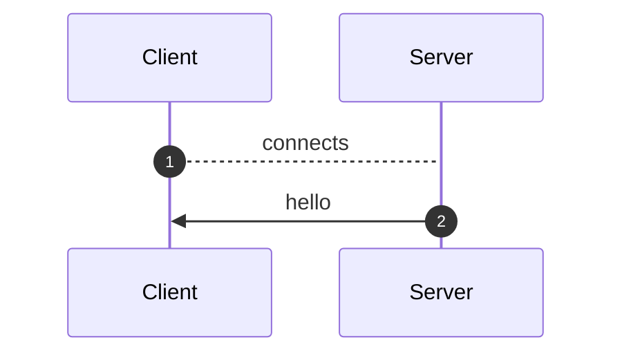
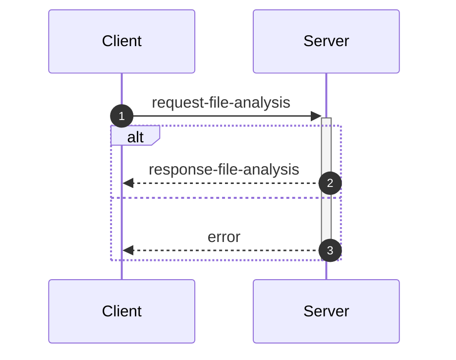
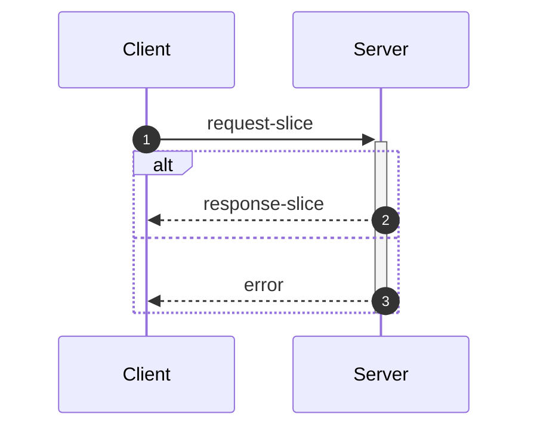
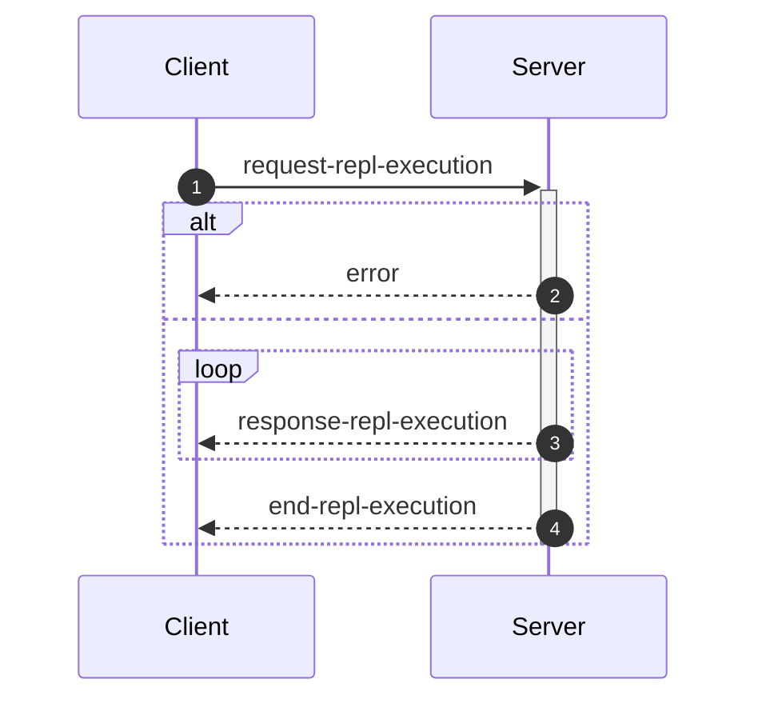

_<span title="an overview of flowR's interface">Generated</span> from '[wiki-interface.ts](https://github.com/flowr-analysis/flowr/tree/main/src/documentation/wiki-interface.ts "src/documentation/wiki-interface.ts")' on 2026-10-27, 20:45:07 UTC (v2.16.7, R v4.5.0), do not edit directly._

Although far from being as detailed as the in-depth explanation of [_flowR_](https://github.com/flowr-analysis/flowr/wiki/Core),
this wiki page explains how to interface with _flowR_ in more detail.
In general, command line arguments and other options provide short descriptions on hover over.

* [💻 Using the REPL](#using-the-repl)
* [⚙️ Configuring FlowR](#configuring-flowr)
* [⚒️ Writing Code](#writing-code)
* [💬 Communicating with the Server](#communicating-with-the-server)

<a id='using-the-repl'></a>
## 💻 Using the REPL

> [!NOTE]
> To execute arbitrary R commands with a repl request, _flowR_ has to be started explicitly with <span title="Description (Command Line Argument): Allow to access the underlying R session when using flowR (security warning: this allows the execution of arbitrary R code!)">`--r-session-access`</span>.
> Please be aware that this introduces a security risk and note that this relies on the [`r-shell` engine](https://github.com/flowr-analysis/flowr/wiki/Engines) .

Although primarily meant for users to explore,
there is nothing which forbids calling _flowR_ as a subprocess to use standard-in, -output, and -error
for communication (although you can access the REPL using the server as well,
with the [REPL Request](#message-request-repl-execution) message).

The read-eval-print loop&nbsp;(REPL) works relatively simple.
You can submit an expression (using <kbd>Enter</kbd>),
which is interpreted as an R&nbsp;expression by default but interpreted as a *command* if it starts with a colon (`:`).
The best command to get started with the REPL is <span title="Description (Repl Command): Show help information (aliases: :h, :?)">`:help`</span>.
Besides, you can leave the REPL either with the command <span title="Description (Repl Command): End the repl (aliases: :q, :exit)">`:quit`</span> or by pressing <kbd>Ctrl</kbd>+<kbd>C</kbd> twice.
When writing a *command*, you may press <kbd>Tab</kbd> to get a list of completions, if available.
Multiple commands can be entered in a single line by separating them with a semicolon (`;`), e.g. `:parse "x<-2"; :df*`.
If a command is given without R code, the REPL will re-use R code given in a previous command.
The prior example will hence return first the parsed AST of the program and then the dataflow graph for `"x <- 2"`.

> [!NOTE]
> If you develop flowR, you may want to launch the repl using the `npm run main-dev` command, this way, you get a non-minified version of flowR with debug information and hot-reloading of source files.

<details>
<summary>Available Commands</summary>

We currently offer the following commands (this with a `[*]` suffix are available with and without the star):

| Command | Description |
| ------- | ----------- |
| **<span title="Description (Repl Command): End the repl (aliases: :q, :exit)">:quit</span>** | End the repl (aliases: **:<span title="Alias of ':quit'. End the repl">q</span>**, **:<span title="Alias of ':quit'. End the repl">exit</span>**) |
| **<span title="Description (Repl Command): Execute the given code as R code. This requires the `--r-session-access` flag to be set and requires the r-shell engine. (aliases: :e, :r)">:execute</span>** | Execute the given code as R code. This requires the `--r-session-access` flag to be set and requires the r-shell engine. (aliases: **:<span title="Alias of ':execute'. Execute the given code as R code. This requires the `--r-session-access` flag to be set and requires the r-shell engine.">e</span>**, **:<span title="Alias of ':execute'. Execute the given code as R code. This requires the `--r-session-access` flag to be set and requires the r-shell engine.">r</span>**) |
| **<span title="Description (Repl Command): Get mermaid code for the control-flow graph of R code (aliases: :cfg, :cf)">:controlflow[*]</span>** | Get mermaid code for the control-flow graph of R code (star: Returns the URL to mermaid.live) (aliases: **:<span title="Alias of ':controlflow'. Get mermaid code for the control-flow graph of R code">cfg</span>**, **:<span title="Alias of ':controlflow'. Get mermaid code for the control-flow graph of R code">cf</span>**) |
| **<span title="Description (Repl Command): Get mermaid code for the control-flow graph with basic blocks (aliases: :cfgb, :cfb)">:controlflowbb[*]</span>** | Get mermaid code for the control-flow graph with basic blocks (star: Returns the URL to mermaid.live) (aliases: **:<span title="Alias of ':controlflowbb'. Get mermaid code for the control-flow graph with basic blocks">cfgb</span>**, **:<span title="Alias of ':controlflowbb'. Get mermaid code for the control-flow graph with basic blocks">cfb</span>**) |
| **<span title="Description (Repl Command): Get mermaid code for the dataflow graph (aliases: :d, :df)">:dataflow[*]</span>** | Get mermaid code for the dataflow graph (star: Returns the URL to mermaid.live) (aliases: **:<span title="Alias of ':dataflow'. Get mermaid code for the dataflow graph">d</span>**, **:<span title="Alias of ':dataflow'. Get mermaid code for the dataflow graph">df</span>**) |
| **<span title="Description (Repl Command): Get mermaid code for the normalized AST of R code (aliases: :n)">:normalize[*]</span>** | Get mermaid code for the normalized AST of R code (star: Returns the URL to mermaid.live) (alias: **:<span title="Alias of ':normalize'. Get mermaid code for the normalized AST of R code">n</span>**) |
| **<span title="Description (Repl Command): Get mermaid code for the simplified dataflow graph (aliases: :ds, :dfs)">:dataflowsimple[*]</span>** | Get mermaid code for the simplified dataflow graph (star: Returns the URL to mermaid.live) (aliases: **:<span title="Alias of ':dataflowsimple'. Get mermaid code for the simplified dataflow graph">ds</span>**, **:<span title="Alias of ':dataflowsimple'. Get mermaid code for the simplified dataflow graph">dfs</span>**) |
| **<span title="Description (Repl Command): Inspect and extend the signature database: `query` (identical to :query @signature), `info <name>` for where a function comes from (identical to :query @function-info), `add <path>` to mount another database/source, `download` to fetch the full-history database. (aliases: :sig)">:signature</span>** | Inspect and extend the signature database: `query` (identical to :query @signature), `info <name>` for where a function comes from (identical to :query @function-info), `add <path>` to mount another database/source, `download` to fetch the full-history database. (alias: **:<span title="Alias of ':signature'. Inspect and extend the signature database: `query` (identical to :query @signature), `info <name>` for where a function comes from (identical to :query @function-info), `add <path>` to mount another database/source, `download` to fetch the full-history database.">sig</span>**) |
| **<span title="Description (Repl Command): Just calculates the DFG, but only prints summary info (aliases: :d#, :df#)">:dataflowsilent</span>** | Just calculates the DFG, but only prints summary info (aliases: **:<span title="Alias of ':dataflowsilent'. Just calculates the DFG, but only prints summary info">d#</span>**, **:<span title="Alias of ':dataflowsilent'. Just calculates the DFG, but only prints summary info">df#</span>**) |
| **<span title="Description (Repl Command): Prints ASCII Art of the parsed, unmodified AST (aliases: :p)">:parse</span>** | Prints ASCII Art of the parsed, unmodified AST (alias: **:<span title="Alias of ':parse'. Prints ASCII Art of the parsed, unmodified AST">p</span>**) |
| **<span title="Description (Repl Command): Prints the version of flowR as well as the current version of R">:version</span>** | Prints the version of flowR as well as the current version of R
| **<span title="Description (Repl Command): Query the given R code (use 'help' for more information)">:query[*]</span>** | Query the given R code (use 'help' for more information) (star: Similar to query, but returns the output in json format.)
| **<span title="Description (Repl Command): Returns an ASCII representation of the dataflow graph (aliases: :df!)">:dataflowascii</span>** | Returns an ASCII representation of the dataflow graph (alias: **:<span title="Alias of ':dataflowascii'. Returns an ASCII representation of the dataflow graph">df!</span>**) |
| **<span title="Description (Repl Command): Returns summarization stats for the normalized AST (aliases: :n#)">:normalize#</span>** | Returns summarization stats for the normalized AST (alias: **:<span title="Alias of ':normalize#'. Returns summarization stats for the normalized AST">n#</span>**) |
| **<span title="Description (Repl Command): Show help information (aliases: :h, :?)">:help</span>** | Show help information (aliases: **:<span title="Alias of ':help'. Show help information">h</span>**, **:<span title="Alias of ':help'. Show help information">?</span>**) |

</details>

> [!TIP]
> 
> As indicated by the examples before, all REPL commands that operate on code keep track of the state.
> Hence, if you run a command like <span title="Description (Repl Command, starred version): Returns the URL to mermaid.live; Base Command: Get mermaid code for the dataflow graph (aliases: :d*, :df*)">`:dataflow*`</span> without providing R code,
> the REPL will re-use the R code provided in a previous command.
> Likewise, doing this will benefit from incrementality!
> If you request the dataflow graph with `:df* x <- 2 * y` and then want to see the parsed AST with `:parse`,
> the REPL will re-use previously obtained information and not re-parse the code again.
> 		

Generally, many commands offer shortcut versions in the REPL. Many queries, for example, offer a shortened format (see the example below).
Of special note, the [Config Query](https://github.com/flowr-analysis/flowr/wiki/%5BQuery%5D-Config)
can be used to also modify the currently active configuration of _flowR_ within the REPL (see the [wiki page](https://github.com/flowr-analysis/flowr/wiki/%5BQuery%5D-Config) for more information).

### Example: Retrieving the Dataflow Graph

To retrieve a URL to the [mermaid](https://mermaid.js.org/) diagram of the dataflow of a given expression,
use <span title="Description (Repl Command, starred version): Returns the URL to mermaid.live; Base Command: Get mermaid code for the dataflow graph (aliases: :d*, :df*)">`:dataflow*`</span> (or <span title="Description (Repl Command): Get mermaid code for the dataflow graph (aliases: :d, :df)">`:dataflow`</span> to get the mermaid code in the cli):

```shell
$ docker run -it --rm eagleoutice/flowr # or npm run flowr 
flowR repl v2.16.7, R grammar v14 (tree-sitter engine)
R> :dataflow* y <- 1 + x
```

<details>
<summary style='color:gray'>Output</summary>

```text
https://mermaid.live/view#base64:eyJjb2RlIjoiZmxvd2NoYXJ0IFREXG4gICAgMXt7XCJgKiM5MTtSTnVtYmVyIzkzOyogKioxKipcbiAgICAgICoxLjYqICgqKmlkOiAxKiopYFwifX1cbiAgICAyKFtcImAqIzkxO1JTeW1ib2wjOTM7KiAqKngqKlxuICAgICAgKjEuMTAqICgqKmlkOiAyKiopYFwiXSlcbiAgICAzW1tcImAqIzkxO1JCaW5hcnlPcCM5MzsqIGJhc2UjNTg7IzU4OyoqIzQzOyoqXG4gICAgICAqMS42LTEwKiAoKippZDogMyoqKVxuICAgIGFyZzogKDEsIDIpYFwiXV1cbiAgICBidWlsdC1pbjpfNDNfW1wiYEJ1aWx0LUluOlxuIzQzO2BcIl1cbiAgICBzdHlsZSBidWlsdC1pbjpfNDNfIHN0cm9rZTpncmF5LGZpbGw6Z3JheSxzdHJva2Utd2lkdGg6MnB4LG9wYWNpdHk6Ljg7XG4gICAgMFtcImAqIzkxO1JTeW1ib2wjOTM7KiAqKnkqKlxuICAgICAgKjEuMSogKCoqaWQ6IDAqKiwgdjogMylgXCJdXG4gICAgNFtbXCJgKiM5MTtSQmluYXJ5T3AjOTM7KiBiYXNlIzU4OyM1ODsqKiM2MDsjNDU7KipcbiAgICAgICoxLjEtMTAqICgqKmlkOiA0KiopXG4gICAgYXJnOiAoMCwgMylgXCJdXVxuICAgIGJ1aWx0LWluOl82MF8tW1wiYEJ1aWx0LUluOlxuIzYwOyM0NTtgXCJdXG4gICAgc3R5bGUgYnVpbHQtaW46XzYwXy0gc3Ryb2tlOmdyYXksZmlsbDpncmF5LHN0cm9rZS13aWR0aDoycHgsb3BhY2l0eTouODtcbiAgICAxIC0uLT58XCJmbG93XCJ8IDJcbiAgICBsaW5rU3R5bGUgMCBzdHJva2U6Z3JheSxjb2xvcjpncmF5O1xuICAgIDIgLS4tPnxcImZsb3dcInwgM1xuICAgIGxpbmtTdHlsZSAxIHN0cm9rZTpncmF5LGNvbG9yOmdyYXk7XG4gICAgMyAtLT58XCJyZWFkcywgYXJnXCJ8IDFcbiAgICAzIC0tPnxcInJlYWRzLCBhcmdcInwgMlxuICAgIDMgLS4tPnxcImZsb3dcInwgMFxuICAgIGxpbmtTdHlsZSA0IHN0cm9rZTpncmF5LGNvbG9yOmdyYXk7XG4gICAgMyAtLi0+fFwicmVhZHMsIGNhbGxzXCJ8IGJ1aWx0LWluOl80M19cbiAgICBsaW5rU3R5bGUgNSBzdHJva2U6Z3JheTtcbiAgICAwIC0tPnxcImRlZmluZWQtYnksIGZsb3dcInwgNFxuICAgIDAgLS0+fFwiZGVmaW5lZC1ieVwifCAzXG4gICAgNCAtLT58XCJyZWFkcywgYXJnXCJ8IDNcbiAgICA0IC0tPnxcInJldHVybnMsIGFyZ1wifCAwXG4gICAgNCAtLi0+fFwicmVhZHMsIGNhbGxzXCJ8IGJ1aWx0LWluOl82MF8tXG4gICAgbGlua1N0eWxlIDEwIHN0cm9rZTpncmF5OyIsIm1lcm1haWQiOnsiYXV0b1N5bmMiOnRydWV9fQ==
```

Retrieve the dataflow graph of the expression `y <- 1 + x`. It looks like this:


<details>

<summary style="color:gray">R Code of the Dataflow Graph</summary>

The analysis ran (parse and normalize with the [tree-sitter](https://github.com/flowr-analysis/flowr/wiki/Engines) engine) in the generation environment. No [signature database](https://github.com/flowr-analysis/flowr/wiki/Signature-Database) is mounted, so `library()` attaches no exports (base-R names are still qualified, e.g., `stats::acf`). 
We encountered no unknown side effects during the analysis.

```r
y <- 1 + x
```

</details>

</details>

For small graphs like this, <span title="Description (Repl Command): Returns an ASCII representation of the dataflow graph (aliases: :df!)">`:dataflowascii`</span> also provides an ASCII representation directly in the REPL:

```shell
$ docker run -it --rm eagleoutice/flowr # or npm run flowr 
flowR repl v2.16.7, R grammar v14 (tree-sitter engine)
R> :df! y <- 1 + x
```

<details open>
<summary style='color:gray'>Output</summary>

```text
                        v<0>v
 c<4>c──────────────────| y |
 |<- |     ┌────────────v---v
 c---c     │
    │   c<3>c   0<1>0
    └───| + |───| 1 |───u<2>u
        c---c   0---0   | x |
           └────────────u---u
Edges:
3 -> 1: reads, arg          3 -> 2: reads, arg
3 -> 0: flows-to            1 -> 2: flows-to
2 -> 3: flows-to            4 -> 3: reads, arg
4 -> 0: returns, arg        0 -> 4: defined-by, flows-to
0 -> 3: defined-by
```

Retrieve the dataflow graph of the expression `y <- 1 + x` as ASCII art.

</details>

For the slicing with <span title="Description (Repl Command): Static backwards executable slicer for R">`:slicer`</span>, you have access to the same [magic comments](#slice-magic-comments) as with the [slice request](#message-request-slice).
Pass `--inline` to splice resolvable `source()` calls into the reconstruction so the slice is a single self-contained R text (the same as the static slice query's `inlineSources` flag).
See `--help` for more flags!

### Example: Interfacing with the File System

Many commands that allow for an R-expression (like <span title="Description (Repl Command, starred version): Returns the URL to mermaid.live; Base Command: Get mermaid code for the dataflow graph (aliases: :d*, :df*)">`:dataflow*`</span>) allow for a file as well
if the argument starts with `file://`.
If you are working from the root directory of the _flowR_ repository, the following gives you the parsed AST of the example file using the <span title="Description (Repl Command): Prints ASCII Art of the parsed, unmodified AST (aliases: :p)">`:parse`</span> command:

> **Watch mode**: Replace `file://` with `watch://` to enter watch mode.
> flowR runs the command immediately and then re-runs it every time the file (or any file inside the folder) changes.
> Enter any other command to leave watch mode.
> For example: `:df watch://analysis.R`

```shell
$ docker run -it --rm eagleoutice/flowr # or npm run flowr 
flowR repl v2.16.7, R grammar v14 (tree-sitter engine)
R> :parse file://test/testfiles/example.R
```

<details>
<summary style='color:gray'>Output</summary>

```text
File: test/testfiles/example.R

program
├ binaryoperator
│ ├ identifier "sum" (1:1─4)
│ ├ <- "<-" (1:5─7)
│ ╰ float "0" (1:8─9)
├ binaryoperator
│ ├ identifier "product" (2:1─8)
│ ├ <- "<-" (2:9─11)
│ ╰ float "1" (2:12─13)
├ binaryoperator
│ ├ identifier "w" (3:1─2)
│ ├ <- "<-" (3:3─5)
│ ╰ float "7" (3:6─7)
├ binaryoperator
│ ├ identifier "N" (4:1─2)
│ ├ <- "<-" (4:3─5)
│ ╰ float "10" (4:6─8)
├ forstatement
│ ├ for "for" (6:1─4)
│ ├ ( "(" (6:5─6)
│ ├ identifier "i" (6:6─7)
│ ├ in "in" (6:8─10)
│ ├ binaryoperator
│ │ ├ float "1" (6:11─12)
│ │ ├ : ":" (6:12─13)
│ │ ╰ parenthesizedexpression
│ │   ├ ( "(" (6:13─14)
│ │   ├ binaryoperator
│ │   │ ├ identifier "N" (6:14─15)
│ │   │ ├ - "-" (6:15─16)
│ │   │ ╰ float "1" (6:16─17)
│ │   ╰ ) ")" (6:17─18)
│ ├ ) ")" (6:18─19)
│ ╰ bracedexpression
│   ├ { "{" (6:20─21)
│   ├ binaryoperator
│   │ ├ identifier "sum" (7:3─6)
│   │ ├ <- "<-" (7:7─9)
│   │ ╰ binaryoperator
│   │   ├ binaryoperator
│   │   │ ├ identifier "sum" (7:10─13)
│   │   │ ├ + "+" (7:14─15)
│   │   │ ╰ identifier "i" (7:16─17)
│   │   ├ + "+" (7:18─19)
│   │   ╰ identifier "w" (7:20─21)
│   ├ binaryoperator
│   │ ├ identifier "product" (8:3─10)
│   │ ├ <- "<-" (8:11─13)
│   │ ╰ binaryoperator
│   │   ├ identifier "product" (8:14─21)
│   │   ├  "" (8:22─23)
│   │   ╰ identifier "i" (8:24─25)
│   ╰ } "}" (9:1─2)
├ call
│ ├ identifier "cat" (11:1─4)
│ ╰ arguments
│   ├ ( "(" (11:4─5)
│   ├ argument
│   │ ╰ string
│   │   ├ stringopen "\"" (11:5─6)
│   │   ├ stringcontent "Sum:" (11:6─10)
│   │   ╰ stringclose "\"" (11:10─11)
│   ├ comma "," (11:11─12)
│   ├ argument
│   │ ╰ identifier "sum" (11:13─16)
│   ├ comma "," (11:16─17)
│   ├ argument
│   │ ╰ string
│   │   ├ stringopen "\"" (11:18─19)
│   │   ├ stringcontent
│   │   │ ╰ escapesequence "\\n" (11:19─21)
│   │   ╰ stringclose "\"" (11:21─22)
│   ╰ ) ")" (11:22─23)
╰ call
  ├ identifier "cat" (12:1─4)
  ╰ arguments
    ├ ( "(" (12:4─5)
    ├ argument
    │ ╰ string
    │   ├ stringopen "\"" (12:5─6)
    │   ├ stringcontent "Product:" (12:6─14)
    │   ╰ stringclose "\"" (12:14─15)
    ├ comma "," (12:15─16)
    ├ argument
    │ ╰ identifier "product" (12:17─24)
    ├ comma "," (12:24─25)
    ├ argument
    │ ╰ string
    │   ├ stringopen "\"" (12:26─27)
    │   ├ stringcontent
    │   │ ╰ escapesequence "\\n" (12:27─29)
    │   ╰ stringclose "\"" (12:29─30)
    ╰ ) ")" (12:30─31)
```

Retrieve the parsed AST of the example file.

<details>

<summary>File Content</summary>

```r
sum <- 0
product <- 1
w <- 7
N <- 10

for (i in 1:(N-1)) {
  sum <- sum + i + w
  product <- product * i
}

cat("Sum:", sum, "\n")
cat("Product:", product, "\n")
```

</details>

As _flowR_ directly transforms this AST the output focuses on being human-readable instead of being machine-readable.
		
</details>

### Example: Run a Query

You can run any query supported by _flowR_ using the <span title="Description (Repl Command): Query the given R code (use 'help' for more information)">`:query`</span> command.
For example, to obtain the shapes of all data frames in a given piece of code, you can run:

```shell
$ docker run -it --rm eagleoutice/flowr # or npm run flowr 
flowR repl v2.16.7, R grammar v14 (tree-sitter engine)
R> :query @absint df-shape "x <- data.frame(a = 1:10, b = 1:10)\ny <- x$a"
```

<details open>
<summary style='color:gray'>Output</summary>

```text
Query: absint (2 ms)
   ╰ $12: (colnames: [{"a", "b"}, {}], cols: [2, 2], rows: [10, 10])
   ╰ $0: (colnames: [{"a", "b"}, {}], cols: [2, 2], rows: [10, 10])
```

Retrieve the shapes of all data frames in the given code.

</details>

To run the linter on a file, you can use (in this example, we just issue the `dead-code` linter on a small piece of code):

```shell
$ docker run -it --rm eagleoutice/flowr # or npm run flowr 
flowR repl v2.16.7, R grammar v14 (tree-sitter engine)
R> :query @linter rules:dead-code "if(FALSE) x <- 2"
```

<details open>
<summary style='color:gray'>Output</summary>

```text
Query: linter (1 ms)
   ╰ Dead Code (dead-code):
       ╰ certain:
           ╰ Code at 1.11-16 (1 quick fix(es) available)
```

Run the linter on the given code, with only the `dead-code` rule enabled.

</details>

For more information on the available queries, please check out the [Query API](https://github.com/flowr-analysis/flowr/wiki/Query-API).

<a id='configuring-flowr'></a>
## ⚙️ Configuring FlowR

When running _flowR_, you may want to specify some behaviors with a dedicated configuration file.
By default, flowR looks for a file named `flowr.json` in the current working directory (or any higher directory).
You can also specify a different file with <span title="Description (Command Line Argument): The name of the configuration file to use">`--config-file`</span> or pass the configuration inline using <span title="Description (Command Line Argument): The flowR configuration to use, as a JSON string">`--config-json`</span>.
A `flowr.json` found this way belongs to the analyzed project, so flowR ignores its options that decide what flowR executes or loads
(`engines.*.wasmPath`, `engines.*.treeSitterWasmPath`, `engines.*.rPath`, `solver.sigdb.additionalPaths`, `solver.sigdb.downloadRepo`, `solver.sigdb.installedLibrary.paths`),
unless you pass <span title="Description (Command Line Argument): Keep the security-sensitive options (e.g., the R executable) of the flowr.json found in the working directory or a parent. Only use this for projects you trust.">`--trust-config`</span>.
To analyze code you do not trust, use the secure mode (<span title="Description (Command Line Argument): Run in secure mode for analyzing untrusted code: flowR does not start R (or any other process), does not access the network, does not search for project configs, and ignores security-sensitive options in every config. Cannot be disabled once enabled. Can also be enabled with the environment variable {italic FLOWR_SECURE_MODE=1}.">`--secure`</span>, see the [security policy](https://github.com/flowr-analysis/flowr/blob/main/.github/SECURITY.md)).
To inspect the current configuration, you can run flowr with the <span title="Description (Command Line Argument): Run with verbose logging (will be passed to the corresponding script)">`--verbose`</span> flag, or use the `config` [Query](https://github.com/flowr-analysis/flowr/wiki/Query-API).
Within the REPL this works by running the following:

```shell
:query @config
```

To work with the <a href="https://github.com/flowr-analysis/flowr/tree/main/src/config.ts#L119"><code><span title="The configuration file format for flowR.">FlowrConfig</span></code></a> you can use the provided helper objects alongside its methods like
<a href="https://github.com/flowr-analysis/flowr/tree/main/src/config.ts#L914"><code><span title="Creates a new flowr config that has the updated values.">FlowrConfig::<b>amend</b></span></code></a>.
The schema below documents every option; the ones you most likely want are:

- <a href="https://github.com/flowr-analysis/flowr/wiki/Interface#configuring-flowr" title="Configuration Option (boolean): Whether source calls should be ignored, causing {@link processSourceCall}&#39;s behavior to be skipped.">ignoreSourceCalls</a>: ignore source calls when analyzing the code, i.e., ignore the inclusion of other files.
- <a href="https://github.com/flowr-analysis/flowr/wiki/Interface#configuring-flowr" title="Configuration Option (boolean): Whether load calls should be ignored, causing {@link processLoadCall}&#39;s behavior to be skipped.">ignoreLoadCalls</a>: ignore load calls when analyzing the code, i.e., ignore the loading of r-data files.
- <a href="https://github.com/flowr-analysis/flowr/wiki/Interface#configuring-flowr" title="Configuration Option (object): Do you want to overwrite (parts) of the builtin definition?">semantics.environment.overwriteBuiltIns</a>: overwrite _flowR_'s handling of built-in functions, or clear the preset definitions entirely.
  See [Configure BuiltIn Semantics](#configure-builtin-semantics) for more information.
- <a href="https://github.com/flowr-analysis/flowr/wiki/Interface#configuring-flowr" title="Configuration Option (string): How to resolve variables and their values. (one of &quot;disabled&quot;, &quot;alias&quot;, &quot;builtin&quot;)">solver.variables</a>: how to resolve variables and their values (`disabled`, `alias`, `builtin`).
- <a href="https://github.com/flowr-analysis/flowr/wiki/Interface#configuring-flowr" title="Configuration Option (array): The engine or set of engines to use for interacting with R code. An empty array means all available engines will be used.">engines</a> and <a href="https://github.com/flowr-analysis/flowr/wiki/Interface#configuring-flowr" title="Configuration Option (string): The default engine to use for interacting with R code. If this is undefined, an arbitrary engine from the specified list will be used. (one of &quot;tree-sitter&quot;, &quot;r-shell&quot;)">defaultEngine</a>: the engines used to interact with R code, see the [Engines wiki page](https://github.com/flowr-analysis/flowr/wiki/Engines).
- <a href="https://github.com/flowr-analysis/flowr/wiki/Interface#configuring-flowr" title="Configuration Option (array): Files a framework loads on its own, without any source() call (e.g. global.R in a shiny app), in the order they are loaded; flowR orders the matching project files accordingly and analyzes them as one program. Entries are case-insensitive globs matched against the file path, a plain name matches any file with that name, and entries matching no project file are warned about. Usually set per project kind via specializeConfig.">project.implicitSources</a>: the files a framework loads without any `source()` call, in the order in which they are
  loaded. Entries are globs (e.g. `R/*.R`) matched against the file path ignoring capitalization; one matching no file is reported.
- <a href="https://github.com/flowr-analysis/flowr/wiki/Interface#configuring-flowr" title="Configuration Option (object): Overwrite (parts of) the configuration depending on the project kind flowR detects, e.g. to give a shiny app its implicit sources.">specializeConfig</a>: overwrite (parts of) the configuration depending on the kind of project _flowR_ detects
  (e.g. `shiny-app`), which is how a shiny app gets its implicit sources by default. What you configure directly wins.
- <a href="https://github.com/flowr-analysis/flowr/wiki/Interface#configuring-flowr" title="Configuration Option (string): Overwrite the project kind flowR would otherwise infer from the analyzed files, e.g. when auto-detection guesses wrong. (one of &quot;package&quot;, &quot;script&quot;, &quot;shiny-app&quot;, &quot;notebook&quot;, &quot;project&quot;, &quot;unknown&quot;)">project.useProjectType</a>: skip that detection and force a project kind yourself, when auto-detection guesses wrong.
- <a href="https://github.com/flowr-analysis/flowr/wiki/Interface#configuring-flowr" title="Configuration Option (array): The default plugins to load when creating a new instance of FlowrAnalyzer">defaultPlugins</a> and <a href="https://github.com/flowr-analysis/flowr/wiki/Interface#configuring-flowr" title="Configuration Option (array): The plugins to load in REPL mode">repl.plugins</a>: the plugins to load for a new <a href="https://github.com/flowr-analysis/flowr/tree/main/src/project/flowr-analyzer.ts#L205"><code><span title="Central class for conducting analyses with FlowR. Use the FlowrAnalyzerBuilder to create a new instance. If you want the original pattern of creating a pipeline and running all steps, you can still do this with FlowrAnalyzer#runFull . To inspect the context of the analyzer, use FlowrAnalyzer#inspectContext (if you are a plugin and need to modify it, use FlowrAnalyzer#context instead).">FlowrAnalyzer</span></code></a> and in the REPL
  (use `flowr:default` to reference the former).

So you can configure _flowR_ by adding a file like the following:

<details>

<summary>Example Configuration File</summary>

```json
{
  "ignoreSourceCalls": true,
  "ignoreLoadCalls": true,
  "semantics": {
    "environment": {
      "overwriteBuiltIns": {
        "definitions": [
          {
            "type": "function",
            "names": [
              "foo"
            ],
            "processor": "builtin:assign",
            "config": {}
          }
        ]
      }
    }
  },
  "defaultPlugins": [
    "file:description",
    "versions:description"
  ],
  "repl": {
    "quickStats": false,
    "dfProcessorHeat": false,
    "hints": true,
    "plugins": [
      "flowr:default"
    ]
  },
  "project": {
    "resolveUnknownPathsOnDisk": true,
    "implicitSources": [
      "global.R",
      "app.R"
    ]
  },
  "linter": {
    "disabledRules": []
  },
  "specializeConfig": {
    "shiny-app": {
      "project": {
        "implicitSources": [
          "global.R",
          "ui.R",
          "server.R",
          "app.R"
        ]
      }
    }
  },
  "engines": [
    {
      "type": "r-shell"
    }
  ],
  "solver": {
    "variables": "alias",
    "evalStrings": true,
    "trackEnvironments": true,
    "sigdb": {
      "enabled": true,
      "loadProjectDependencies": true,
      "eagerlyLoad": false,
      "eagerlyLoadExports": false,
      "linkBaseR": false,
      "linkDescriptionDependencies": false
    },
    "resolveSource": {
      "dropPaths": "no",
      "ignoreCapitalization": true,
      "inferWorkingDirectory": "active-script",
      "searchPath": []
    },
    "instrument": {},
    "slicer": {
      "threshold": 50
    }
  },
  "abstractInterpretation": {
    "wideningThreshold": 4,
    "followCalls": true,
    "dataFrame": {
      "maxColNames": 20,
      "readLoadedData": {
        "readExternalFiles": true,
        "maxReadLines": 1000000
      }
    }
  },
  "incremental": {
    "alwaysIncremental": false,
    "parsing": {
      "activated": false,
      "heuristics": {
        "activated": true,
        "mtime": true,
        "linesFrom": 500,
        "bytesFrom": 50000,
        "alwaysWithEdits": false,
        "minFiles": 1
      }
    }
  },
  "gas": {
    "thresholds": {
      "memory": {
        "problematic": 0.7,
        "critical": 0.9
      },
      "timeMs": {
        "problematic": 100000,
        "critical": 120000
      }
    },
    "features": {}
  }
}
```

</details>

<details>
<a id='configure-builtin-semantics'></a>
<summary>Configure Built-In Semantics</summary>

`semantics/environment/overwriteBuiltins` accepts two keys:

- `loadDefaults` (boolean, initially `true`): If set to `true`, the default built-in definitions are loaded before applying the custom definitions. Setting this flag to `false` explicitly disables the loading of the default definitions.
- `definitions` (array, initially empty): Allows to overwrite or define new built-in elements. Each object within must have a `type` which is one of the below. Furthermore, they may define a string array of `names` which specifies the identifiers to bind the definitions to. You may use `assumePrimitive` to specify whether _flowR_ should assume that this is a primitive non-library definition (so you probably just do not want to specify the key).

  | Type            | Description                                                                                                                                                                                                                                                                                              | Example                                                                                                    |
  | --------------- | -------------------------------------------------------------------------------------------------------------------------------------------------------------------------------------------------------------------------------------------------------------------------------------------------------- | ---------------------------------------------------------------------------------------------------------- |
  | `constant`    | Additionally allows for a `value` this should resolve to.                                                                                                                                                                                                                                                | `{ type: 'constant', names: ['NULL', 'NA'],  value: null }`                                                |
  | `function`    | Is a rather flexible way to define and bind built-in functions. For the time, we do not have extensive documentation to cover all the cases, so please either consult the sources with the `default-builtin-config.ts` or open a [new issue](https://github.com/flowr-analysis/flowr/issues/new/choose). | `{ type: 'function', names: ['next'], processor: 'builtin:d', config: { cfg: ExitPointType.Next } }` |
  | `replacement` | A comfortable way to specify replacement functions like `$<-` or `names<-`. `suffixes` describes the... suffixes to attach automatically. | `{ type: 'replacement', suffixes: ['<-', '<<-'], names: ['[', '[['] }` |

</details>

<details>

<summary style='color:gray'>Full Configuration-File Schema</summary>

- _The configuration file format for flowR._ (object)
    - **logLevel** [optional] _flowR's global minimum log level, applied when the config is loaded._ (string)
        Only allows: 'silly', 'trace', 'debug', 'info', 'warn', 'error', 'fatal'
    - **ignoreSourceCalls** [optional] _Whether source calls should be ignored, causing {@link processSourceCall}'s behavior to be skipped._ (boolean)
    - **ignoreLoadCalls** [optional] _Whether load calls should be ignored, causing {@link processLoadCall}'s behavior to be skipped._ (boolean)
    - **semantics** _Configure language semantics and how flowR handles them._ (object)
        - **environment** [optional] _Semantics regarding how to handle the R environment._ (object)
            - **overwriteBuiltIns** [optional] _Do you want to overwrite (parts) of the builtin definition?_ (object)
                - **loadDefaults** [optional] _Should the default configuration still be loaded?_ (boolean)
                - **definitions** [optional] _The definitions to load/overwrite._ (array)
                Valid item types:
                    - (object)
    - **defaultPlugins** [optional] _The default plugins to load when creating a new instance of FlowrAnalyzer_ (array)
    Valid item types:
        - (alternatives)
            - (string)
            - (array)
    - **repl** _Configuration options for the REPL._ (object)
        - **quickStats** [optional] _Whether to show quick stats in the REPL after each evaluation._ (boolean)
        - **dfProcessorHeat** [optional] _This instruments the dataflow processors to count how often each processor is called._ (boolean)
        - **hints** [optional] _Whether to show dim inline hints on the empty prompt (automatically disabled on non-interactive terminals)._ (boolean)
        - **plugins** [optional] _The plugins to load in REPL mode_ (array)
        Valid item types:
            - (alternatives)
                - (string)
                - (array)
        - **autoUseFileProtocol** [optional] _Prepend the file protocol to a repl input that looks like a path, instead of only warning about it._ (boolean)
        - **queryStats** [optional] _Whether `:query` closes with the line stating how long the queries took (`:query*` never prints it)._ (boolean)
        - **showPlugins** [optional] _Whether `:version` grays out the plugins that did not activate during the last analysis._ (boolean)
    - **project** _Project specific configuration options._ (object)
        - **resolveUnknownPathsOnDisk** [optional] _Whether to resolve unknown paths loaded by the r project disk when trying to source/analyze files._ (boolean)
        - **failOnInaccessiblePath** [optional] _Whether a directory that cannot be traversed during file discovery (e.g. due to permissions) aborts the analysis; when false (the default) such paths are logged and skipped._ (boolean)
        - **basePackages** [optional] _The packages considered part of R itself (base and recommended); if unset, flowR uses its built-in list._ (array)
        Valid item types:
            - (string)
        - **implicitSources** [optional] _Files a framework loads on its own, without any source() call (e.g. global.R in a shiny app), in the order they are loaded; flowR orders the matching project files accordingly and analyzes them as one program. Entries are case-insensitive globs matched against the file path, a plain name matches any file with that name, and entries matching no project file are warned about. Usually set per project kind via specializeConfig._ (array)
        Valid item types:
            - (string)
        - **useProjectType** [optional] _Overwrite the project kind flowR would otherwise infer from the analyzed files, e.g. when auto-detection guesses wrong._ (string)
            Only allows: 'package', 'script', 'shiny-app', 'notebook', 'project', 'unknown'
        - **assumeImplicitEcho** [optional] _Whether the top level of the analyzed code is echoed, so that every visible result printed there is collected as an output by the dependencies query (default true, false for a package)._ (boolean)
        - **discovery** [optional] _Scoping options for the default project discovery._ (object)
            - **full** [optional] _Collect every file below the project root (greedy) instead of only the files the detected project kind needs (default false)._ (boolean)
            - **perKind** [optional] _Per-kind include/exclude glob overrides layered on the default scoping._ (object)
            - **ignore** [optional] _Case-insensitive globs that drop matching files from the intelligent discovery, regardless of kind (e.g. .Renviron to ignore environment files)._ (array)
            Valid item types:
                - (string)
        - **classification** [optional] _Overrides for the signals flowR uses to classify the project kind._ (object)
            - **shinyDescriptionTypes** [optional] _DESCRIPTION Type: values that mark a shiny app._ (array)
            Valid item types:
                - (string)
            - **shinyEntryFiles** [optional] _File names a shiny app is assembled from._ (array)
            Valid item types:
                - (string)
            - **shinyUsagePattern** [optional] _Regex source evidencing shiny usage in an entry file._ (string)
            - **notebookExtensions** [optional] _File extensions marking a notebook._ (array)
            Valid item types:
                - (string)
    - **linter** _Linter configuration options._ (object)
        - **disabledRules** _Linting rule names excluded from the default rule set (a rule requested explicitly via a linter query still runs). Usually set per project kind via specializeConfig._ (array)
        Valid item types:
            - (string)
        - **disabledTags** [optional] _Linting rule tags whose rules are excluded from the default rule set (a rule requested explicitly via a linter query still runs). By default the cmd-check rules are disabled for everything but a package; a configured list replaces that default._ (array)
        Valid item types:
            - (string)
    - **inputSources** [optional] _Further frameworks the input-sources analysis should know about; entries are added to flowR's defaults._ (object)
        - **pure** [optional] _Functions that only pass the constantness of their arguments on._ (array)
        Valid item types:
            - (string)
        - **param** [optional] _Functions whose result is a 'param' input._ (array)
        Valid item types:
            - (string)
        - **file** [optional] _Functions whose result is a 'file' input._ (array)
        Valid item types:
            - (string)
        - **tempfile** [optional] _Functions whose result is a 'tempfile' input._ (array)
        Valid item types:
            - (string)
        - **glob** [optional] _Functions whose result is a 'glob' input._ (array)
        Valid item types:
            - (string)
        - **net** [optional] _Functions whose result is a 'net' input._ (array)
        Valid item types:
            - (string)
        - **rand** [optional] _Functions whose result is a 'rand' input._ (array)
        Valid item types:
            - (string)
        - **system** [optional] _Functions whose result is a 'system' input._ (array)
        Valid item types:
            - (string)
        - **ffi** [optional] _Functions whose result is a 'ffi' input._ (array)
        Valid item types:
            - (string)
        - **lang** [optional] _Functions whose result is a 'lang' input._ (array)
        Valid item types:
            - (string)
        - **options** [optional] _Functions whose result is a 'options' input._ (array)
        Valid item types:
            - (string)
        - **cmdline** [optional] _Functions whose result is a 'cmdline' input._ (array)
        Valid item types:
            - (string)
        - **user** [optional] _Functions whose result is a 'user' input._ (array)
        Valid item types:
            - (string)
        - **const** [optional] _Functions whose result is a 'const' input._ (array)
        Valid item types:
            - (string)
        - **scope** [optional] _Functions whose result is a 'scope' input._ (array)
        Valid item types:
            - (string)
        - **dconst** [optional] _Functions whose result is a 'dconst' input._ (array)
        Valid item types:
            - (string)
        - **unknown** [optional] _Functions whose result is a 'unknown' input._ (array)
        Valid item types:
            - (string)
        - **linkedObjects** [optional] _Objects a framework provides without a definition in the code, e.g. shiny's input._ (array)
        Valid item types:
            - (object)
        - **linkedEntryPoints** [optional] _Calls that hand a function to a framework, which binds its objects to the parameters by position._ (array)
        Valid item types:
            - (object)
    - **specializeConfig** [optional] _Overwrite (parts of) the configuration depending on the project kind flowR detects, e.g. to give a shiny app its implicit sources._ (object)
    - **engines** _The engine or set of engines to use for interacting with R code. An empty array means all available engines will be used._ (array)
    Valid item types:
        - (alternatives)
            - _The configuration for the tree sitter engine._ (object)
                - **type** [required] _Use the tree sitter engine._ (string)
                    Only allows: 'tree-sitter'
                - **wasmPath** [optional] _The path to the tree-sitter-r WASM binary to use. If this is undefined, this uses the default path._ (string)
                - **treeSitterWasmPath** [optional] _The path to the tree-sitter WASM binary to use. If this is undefined, this uses the default path._ (string)
                - **lax** [optional] _Whether to use the lax parser for parsing R code (allowing for syntax errors). If this is undefined, the strict parser will be used._ (boolean)
            - _The configuration for the R shell engine._ (object)
                - **type** [required] _Use the R shell engine._ (string)
                    Only allows: 'r-shell'
                - **rPath** [optional] _The path to the R executable to use. If this is undefined, this uses the default path._ (string)
                - **pipeBind** [optional] _Whether to enable R's experimental pipe-bind operator "=>" by setting _R_USE_PIPEBIND_ for the R session (default false); R itself keeps this off by default, as it is experimental and has never shipped in a release version of R._ (boolean)
    - **defaultEngine** [optional] _The default engine to use for interacting with R code. If this is undefined, an arbitrary engine from the specified list will be used._ (string)
        Only allows: 'tree-sitter', 'r-shell'
    - **solver** _How to resolve constants, constraints, cells, ..._ (object)
        - **variables** _How to resolve variables and their values._ (string)
            Only allows: 'disabled', 'alias', 'builtin'
        - **evalStrings** _Should we include eval(parse(text="...")) calls in the dataflow graph?_ (boolean)
        - **trackEnvironments** [optional] _Track user-created environments (new.env, assign/get/local with envir=, dollar-assign, attach). When false, all envir-style calls fall through conservatively._ (boolean)
        - **sigdb** _Resolving library exports from a signature database._ (object)
            - **enabled** [optional] _Resolve library()/use() exports from a signature database (default true); when false no database is consulted._ (boolean)
            - **loadProjectDependencies** [optional] _Load the project's declared dependencies from its metadata files (DESCRIPTION Imports/Depends, rproject.toml, uvr.toml, renv.lock, rv.lock, uvr.lock) (default true); when false these files are not read for dependencies._ (boolean)
            - **eagerlyLoad** [optional] _Parse the database up front rather than on the first package load (default false, ignored if disabled)._ (boolean)
            - **eagerlyLoadExports** [optional] _Add a vertex for every export on load rather than on demand (default false); keeps the dataflow graph small._ (boolean)
            - **assumedRVersion** [optional] _R version assumed when resolving versioned (base-R) exports: a pin like "4.5" or "auto" to detect the installed R (default "auto")._ (string)
            - **linkBaseR** [optional] _Eagerly attach base-R namespaces so bare base calls resolve without library() (default false)._ (boolean)
            - **linkBaseRCalls** [optional] _Add a lightweight Reads edge from a bare base-R call to its signature-database function vertex (default false; base-R qualification is edge-free otherwise)._ (boolean)
            - **linkPackageCalls** [optional] _Add a lightweight Reads edge from a resolved package call to its signature-database function vertex (default false)._ (boolean)
            - **linkDescriptionDependencies** [optional] _Eagerly attach the namespaces of the project's declared DESCRIPTION dependencies (Imports/Depends) so their exports resolve without an explicit library() (default false)._ (boolean)
            - **warmInBackground** [optional] _Decompress the hot shards (base + most-downloaded) in a background task on startup so the first library() lookup is warm (default false; for long-running servers/REPLs)._ (boolean)
            - **additionalPaths** [optional] _Extra directories or bundle/manifest files searched for signature databases (alongside the shipped default and $FLOWR_SIGDB_DIR); a downloaded full-history bundle placed here is mounted automatically._ (array)
            Valid item types:
                - (string)
            - **downloadRepo** [optional] _GitHub owner/repo the full-history bundle is downloaded from via ":signature download" (default "flowr-analysis/flowr", release tag "sigdb-v<flowR-version>")._ (string)
            - **autoSync** [optional] _On startup, re-download shards whose committed sigdb.remote.json hash no longer matches the cache, in the background (default false; opt-in network sync after a git pull)._ (boolean)
            - **installedLibrary** [optional] _Recovering packages no signature database knows from the copy installed on this machine._ (object)
                - **enabled** [required] _Recover packages no signature database knows from their installed copy (default false)._ (boolean)
                - **paths** [optional] _Library directories to search; when empty they are discovered from the environment and the project._ (array)
                Valid item types:
                    - (string)
                - **useEnvironment** [optional] _Search the libraries R_LIBS_USER/R_LIBS/R_LIBS_SITE name (default true)._ (boolean)
                - **useProjectLibrary** [optional] _Search a project-local renv/packrat library (default true)._ (boolean)
                - **maxDepth** [optional] _How far to descend into the nested layout of a project-local library (default 3)._ (number)
                - **packages** [optional] _Only recover packages whose name matches one of these regular expressions; empty means any._ (array)
                Valid item types:
                    - (string)
            - **blobCacheBudgetMb** [optional] _How many MiB of decoded package blobs every open bundle may hold together (default 16)._ (number)
            - **versionSelection** [optional] _When a project constrains a dependency, resolve to the newest (default), oldest, or system-installed version satisfying it; system needs R and falls back to newest. Base-R packages always resolve against the assumed R version._ (string)
                Only allows: 'newest', 'oldest', 'system'
            - **versionOverrides** [optional] _Force an exact version for specific packages (name -> version), overriding both the project constraint and the versionSelection policy (default {})._ (object)
        - **versionManagement** _Policies for reasoning about dependency versions._ (object)
            - **linkedVersionGroups** [optional] _Groups of packages that must resolve to the same version; version guessing intersects each group so its members stay mutually compatible (default [])._ (array)
            Valid item types:
                - (array)
                Valid item types:
                    - (string)
        - **assumeAttachedPackages** [optional] _Packages to treat as attached without a `library()` call, so what the built-in configuration states about them applies to the analyzed code. The base packages R attaches on startup already resolve without it._ (array)
        Valid item types:
            - (string)
        - **transitiveSideEffectRounds** [optional] _How many rounds the transitive side-effect fixpoint may run before it is cut off (default 32); the propagation stops on its own as soon as a round adds nothing._ (number)
        - **maxOverlayDepth** [optional] _How many binding overlays may stack on one environment frame before a write flattens them (default 4); a pure performance knob, trading lookup cost against copy cost without changing any result._ (number)
        - **instrument** (object)
            - **dataflowExtractors** [optional] _These keys are only intended for use within code, allowing to instrument the dataflow analyzer!_ (any)
        - **resolveSource** [optional] _If lax source calls are active, flowR searches for sourced files much more freely, based on the configurations you give it. This option is only in effect if `ignoreSourceCalls` is set to false._ (object)
            - **dropPaths** _Allow to drop the first or all parts of the sourced path, if it is relative._ (string)
                Only allows: 'no', 'once', 'all'
            - **ignoreCapitalization** _Search for filenames matching in the lowercase._ (boolean)
            - **inferWorkingDirectory** _Try to infer the working directory from the main or any script to analyze._ (string)
                Only allows: 'no', 'main-script', 'active-script', 'any-script'
            - **searchPath** _Additionally search in these paths._ (array)
            Valid item types:
                - (string)
            - **repeatedSourceLimit** [optional] _How often the same file can be sourced within a single run? Please be aware: in case of cyclic sources this may not reach a fixpoint so give this a sensible limit._ (number)
            - **applyReplacements** _Provide name replacements for loaded files_ (array)
            Valid item types:
                - (object)
            - **assumeFilesExist** [optional] _Assume a sourced file is always there, making what it defines certain instead of conditional on the source call._ (boolean)
        - **slicer** [optional] _The configuration for the slicer._ (object)
            - **threshold** [optional] _The maximum number of iterations to perform on a single function call during slicing._ (number)
            - **autoExtend** [optional] _If set, the slicer will gain an additional post-pass._ (boolean)
    - **abstractInterpretation** _The configuration options for abstract interpretation._ (object)
        - **wideningThreshold** _The threshold for the number of visitations of a node at which widening should be performed to ensure the termination of the fixpoint iteration._ (number)
        - **followCalls** _Whether the abstract interpretation is interprocedural, i.e. whether it steps into the functions a call may dispatch to._ (boolean)
        - **dataFrame** _The configuration of the shape inference for data frames._ (object)
            - **maxColNames** _The maximum number of columns names to infer for data frames before over-approximating the column names to top._ (number)
            - **readLoadedData** _Configuration options for reading data frame shapes from loaded external data files, such as CSV files._ (object)
                - **readExternalFiles** _Whether data frame shapes should be extracted from loaded external files, such as CSV files._ (boolean)
                - **maxReadLines** _The maximum number of lines to read when extracting data frame shapes from loaded files, such as CSV files._ (number)
    - **incremental** (object)
        - **alwaysIncremental** _Always take the incremental path, regardless of heuristics._ (boolean)
        - **parsing** (object)
            - **activated** _If set, incremental parsing will be used._ (boolean)
            - **heuristics** (object)
                - **activated** [optional] _If set, the heuristics for incremental parsing will be used._ (boolean)
                - **mtime** [optional] _Skip reparsing entirely if the file's modification time is unchanged since the last parse._ (boolean)
                - **linesFrom** [optional] _Only consider incremental parsing for files with at least this many lines._ (number)
                - **bytesFrom** [optional] _Only consider incremental parsing for files with at least this many bytes._ (number)
                - **alwaysWithEdits** [optional] _Always take the incremental path whenever there is a computed edit region, regardless of the other thresholds._ (boolean)
                - **minFiles** [optional] _Only apply these heuristics once the project has at least this many files loaded._ (number)
    - **gas** [optional] _Resource-usage guard (gas) configuration. All feature factors default to 0 (disabled). See https://github.com/flowr-analysis/flowr/wiki/Core#gas-resource-guard._ (object)
        - **thresholds** [optional] _Thresholds for all gas checks (scaled by per-feature factor), boundable per feature._ (object)
            - **memory** [optional] _Heap-usage fraction thresholds (0-1), either shared or given per feature key (with `default` covering the rest)._ (object)
                - **problematic** [optional] _Heap fraction (0-1) above which Problematic is returned, for every feature without an entry of its own._ (number)
                - **critical** [optional] _Heap fraction (0-1) above which Critical is returned, for every feature without an entry of its own._ (number)
            - **timeMs** [optional] _Elapsed analysis time thresholds in milliseconds, either shared or given per feature key (with `default` covering the rest)._ (object)
                - **problematic** [optional] _Elapsed ms above which Problematic is returned, for every feature without an entry of its own._ (number)
                - **critical** [optional] _Elapsed ms above which Critical is returned, for every feature without an entry of its own._ (number)
            - **steps** [optional] _Processed-AST-node thresholds, counted rather than sampled; only a key that arms a budget (`dataflow`) reads them._ (object)
                - **problematic** [optional] _Processed AST nodes above which Problematic is returned, for every feature without an entry of its own._ (number)
                - **critical** [optional] _Processed AST nodes above which the extraction is cut short, for every feature without an entry of its own._ (number)
            - **vertices** [optional] _Created-dataflow-vertex thresholds, counted like `steps`._ (object)
                - **problematic** [optional] _Created dataflow vertices above which Problematic is returned, for every feature without an entry of its own._ (number)
                - **critical** [optional] _Created dataflow vertices above which the extraction is cut short, for every feature without an entry of its own._ (number)
        - **features** [optional] _Per-feature sensitivity factors. 0 or absent disables gas checking for that feature. A factor of 2 makes the feature twice as sensitive. Recognised keys: `source`, `side-effect-linking`, `linter`, `slicer`, `dataflow`._ (object)
        - **countedCheckEvery** [optional] _How many counted steps pass between two accountings of an armed check, be it a dataflow budget or the slicer's traversal (default 128); trades overshoot against the cost of the check._ (number)
        - **heapProvider** [optional] _Custom heap statistics source (programmatic configs only), overriding the built-in v8/performance.memory detection._ (function)

</details>

<a id='writing-code'></a>
## ⚒️ Writing Code

_flowR_ can be used as a [module](https://www.npmjs.com/package/@eagleoutice/flowr) and offers several main classes and interfaces that are interesting for extension writers 
(see the [Visual Studio Code extension](https://marketplace.visualstudio.com/items?itemName=code-inspect.vscode-flowr) or the [Core](https://github.com/flowr-analysis/flowr/wiki/Core) wiki page for more information).

### Creating Analyses with _flowR_

Nowadays, instances of the <a href="https://github.com/flowr-analysis/flowr/tree/main/src/project/flowr-analyzer.ts#L205"><code><span title="Central class for conducting analyses with FlowR. Use the FlowrAnalyzerBuilder to create a new instance. If you want the original pattern of creating a pipeline and running all steps, you can still do this with FlowrAnalyzer#runFull . To inspect the context of the analyzer, use FlowrAnalyzer#inspectContext (if you are a plugin and need to modify it, use FlowrAnalyzer#context instead).">FlowrAnalyzer</span></code></a> should be used as central frontend to get analysis results from _flowR_.
The entry points an analysis is written against are re-exported from the package root (`import { FlowrAnalyzerBuilder } from '@eagleoutice/flowr'`);
everything else stays reachable under its own path, as in `@eagleoutice/flowr/dataflow/graph/graph`.
For example, a program slice can be created like this:

```ts
const analyzer = await new FlowrAnalyzerBuilder()
    .setEngine('tree-sitter')
    .build();
analyzer.addRequest('x <- 1\ny <- x\nx');
const result = await analyzer.query([
    {
        type:     'static-slice',
        criteria: ['3@x']
    }
]);
```

For more information, please have a look at the [Analyzer](https://github.com/flowr-analysis/flowr/wiki/Analyzer) wiki page, which explains how to construct and use the <a href="https://github.com/flowr-analysis/flowr/tree/main/src/project/flowr-analyzer.ts#L205"><code><span title="Central class for conducting analyses with FlowR. Use the FlowrAnalyzerBuilder to create a new instance. If you want the original pattern of creating a pipeline and running all steps, you can still do this with FlowrAnalyzer#runFull . To inspect the context of the analyzer, use FlowrAnalyzer#inspectContext (if you are a plugin and need to modify it, use FlowrAnalyzer#context instead).">FlowrAnalyzer</span></code></a> in more detail.
To work with specific perspectives, you can also consult the respective pages like the [Dataflow Graph](https://github.com/flowr-analysis/flowr/wiki/Dataflow-Graph) or the [Abstract Interpretation](https://github.com/flowr-analysis/flowr/wiki/Abstract-Interpretation) wiki pages.
### The Pipeline Executor (Low-Level Interface)

Once, in the beginning, _flowR_ was meant to produce a dataflow graph merely to provide *program slices*. 
However, with continuous updates, the [Dataflow Graph](https://github.com/flowr-analysis/flowr/wiki/Dataflow-Graph) repeatedly proves to be the more interesting part.
With this, we restructured _flowR_'s originally *hardcoded* pipeline to be far more flexible. 
Now, it can be theoretically extended or replaced with arbitrary steps, optional steps, and what we call 'decorations' of these steps. 
In short, a slicing pipeline using the <a href="https://github.com/flowr-analysis/flowr/tree/main/src/core/pipeline-executor.ts#L97"><code><span title="**Please note:** The PipelineExecutor is now considered to be a rather low-level API for flowR. While it still works and is the basis for all other layers, we strongly recommend using the FlowrAnalyzer and its builder to create and use an analyzer instance that is pre-configured for your use-case. The pipeline executor allows to execute arbitrary pipelines in a step-by-step fashion. If you are not...">PipelineExecutor</span></code></a> looks like this:

```ts

const slicer = new PipelineExecutor(DEFAULT_SLICING_PIPELINE, {
  parser:    new RShell(),
  request:   requestFromInput('x <- 1\nx + 1'),
  criterion: ['2@x']
})
const slice = await slicer.allRemainingSteps()
// console.log(slice.reconstruct.code)
```

<details><summary>More Information</summary>

If you compare this, with what you would have done with the old (and removed) `SteppingSlicer`, 
this essentially just requires you to replace the `SteppingSlicer` with the <a href="https://github.com/flowr-analysis/flowr/tree/main/src/core/pipeline-executor.ts#L97"><code><span title="**Please note:** The PipelineExecutor is now considered to be a rather low-level API for flowR. While it still works and is the basis for all other layers, we strongly recommend using the FlowrAnalyzer and its builder to create and use an analyzer instance that is pre-configured for your use-case. The pipeline executor allows to execute arbitrary pipelines in a step-by-step fashion. If you are not...">PipelineExecutor</span></code></a>
and to pass the <a href="https://github.com/flowr-analysis/flowr/tree/main/src/core/steps/pipeline/default-pipelines.ts#L18"><code>DEFAULT_SLICING_PIPELINE</code></a> as the first argument.
The <a href="https://github.com/flowr-analysis/flowr/tree/main/src/core/pipeline-executor.ts#L97"><code><span title="**Please note:** The PipelineExecutor is now considered to be a rather low-level API for flowR. While it still works and is the basis for all other layers, we strongly recommend using the FlowrAnalyzer and its builder to create and use an analyzer instance that is pre-configured for your use-case. The pipeline executor allows to execute arbitrary pipelines in a step-by-step fashion. If you are not...">PipelineExecutor</span></code></a>...

1. Provides structures to investigate the results of all intermediate steps
2. Can be executed step-by-step
3. Can repeat steps (e.g., to calculate multiple slices on the same input)

See the in-code documentation for more information.

</details>

### Using the <a href="https://github.com/flowr-analysis/flowr/tree/main/src/r-bridge/shell.ts#L144"><code><span title="The RShell represents an interactive session with the R interpreter. You can configure it by RShellOptions . At the moment we are using a live R session (and not networking etc.) to communicate with R easily, which allows us to install packages etc. However, this might and probably will change in the future (leaving this as a legacy mode :D)">RShell</span></code></a> to Interact with R

The <a href="https://github.com/flowr-analysis/flowr/tree/main/src/r-bridge/shell.ts#L144"><code><span title="The RShell represents an interactive session with the R interpreter. You can configure it by RShellOptions . At the moment we are using a live R session (and not networking etc.) to communicate with R easily, which allows us to install packages etc. However, this might and probably will change in the future (leaving this as a legacy mode :D)">RShell</span></code></a> class allows interfacing with the `R`&nbsp;ecosystem installed on the host system.
Please have a look at [flowR's Engines](https://github.com/flowr-analysis/flowr/wiki/Engines) for more information on alternatives (for example, the <a href="https://github.com/flowr-analysis/flowr/tree/main/src/r-bridge/lang-4.x/tree-sitter/tree-sitter-executor.ts#L29"><code><span title="Synchronous and (way) faster alternative to the RShell using tree-sitter.">TreeSitterExecutor</span></code></a>).

> [!IMPORTANT]
> 
> Each <a href="https://github.com/flowr-analysis/flowr/tree/main/src/r-bridge/shell.ts#L144"><code><span title="The RShell represents an interactive session with the R interpreter. You can configure it by RShellOptions . At the moment we are using a live R session (and not networking etc.) to communicate with R easily, which allows us to install packages etc. However, this might and probably will change in the future (leaving this as a legacy mode :D)">RShell</span></code></a> controls a new instance of the R&nbsp;interpreter, 
> make sure to call <code><a href="https://github.com/flowr-analysis/flowr/tree/main/src/r-bridge/shell.ts#L350"><span title="Close the current R session, makes the object effectively invalid (can no longer be reopened etc.)">RShell::<i>close</i></span></a>()</code> when you are done.

You can start a new "session" by constructing a new object with <code>new <a href="https://github.com/flowr-analysis/flowr/tree/main/src/r-bridge/shell.ts#L144"><span title="The RShell represents an interactive session with the R interpreter. You can configure it by RShellOptions . At the moment we are using a live R session (and not networking etc.) to communicate with R easily, which allows us to install packages etc. However, this might and probably will change in the future (leaving this as a legacy mode :D)">RShell</span></a>()</code>.

However, there are several options that may be of interest 
(e.g., to automatically revive the shell in case of errors or to control the name location of the R process on the system).

With a shell object (let's call it `shell`), you can execute R code by using <a href="https://github.com/flowr-analysis/flowr/tree/main/src/r-bridge/shell.ts#L213"><code><span title="sends the given command directly to the current R session will not do anything to alter input markers!">RShell::<i>sendCommand</i></span></code></a>,
for example <code>shell.<a href="https://github.com/flowr-analysis/flowr/tree/main/src/r-bridge/shell.ts#L213"><span title="sends the given command directly to the current R session will not do anything to alter input markers!">sendCommand</span></a>("1 + 1")</code>.
However, this does not return anything, so if you want to collect the output of your command, use
<a href="https://github.com/flowr-analysis/flowr/tree/main/src/r-bridge/shell.ts#L296"><code><span title="Send a command and collect the output">RShell::<i>sendCommandWithOutput</i></span></code></a> instead.

<a id='communicating-with-the-server'></a>
## 💬 Communicating with the Server

As explained in the [Overview](https://github.com/flowr-analysis/flowr/wiki/Overview), you can run the [TCP](https://de.wikipedia.org/wiki/Transmission_Control_Protocol)&nbsp;server by adding the <span title="Description (Command Line Argument): Do not drop into a repl, but instead start a server on the given port (default: 1042) and listen for messages.">`--server`</span> flag (and, due to the interactive mode, exit with the conventional <kbd>CTRL</kbd>+<kbd>C</kbd>).
Currently, every connection is handled by the same underlying `RShell` - so the server is not designed to handle many clients at a time.
Additionally, the server is not well guarded against attacks (e.g., you can theoretically spawn an arbitrary number of&nbsp;RShell sessions on the target machine).

Every message has to be given in a single line (i.e., without a newline in-between) and end with a newline character. Nevertheless, we will pretty-print example given in the following segments for the ease of reading.

> [!NOTE]
> 
> The default <span title="Description (Command Line Argument): Do not drop into a repl, but instead start a server on the given port (default: 1042) and listen for messages.">`--server`</span> uses a simple [TCP](https://de.wikipedia.org/wiki/Transmission_Control_Protocol)
> connection. If you want _flowR_ to expose a [WebSocket](https://de.wikipedia.org/wiki/WebSocket) server instead, add the <span title="Description (Command Line Argument): If the server flag is set, use websocket for messaging">`--ws`</span> flag (i.e., <span title="Description (Command Line Argument): Do not drop into a repl, but instead start a server on the given port (default: 1042) and listen for messages.">`--server`</span> <span title="Description (Command Line Argument): If the server flag is set, use websocket for messaging">`--ws`</span>) when starting _flowR_ from the command line.

<ul><li>
<a id="message-hello"></a>
<b>Hello</b> Message (<code>hello</code>) 
<details>

<summary style="color:gray"> View Details. <i>The server informs the client about the successful connection and provides Meta-Information.</i> </summary>



After launching _flowR_, for example, with <code>docker run -it --rm eagleoutice/flowr <span title="Description (Command Line Argument): Do not drop into a repl, but instead start a server on the given port (default: 1042) and listen for messages.">-<span/>-server</span></code>&nbsp;(🐳️), connecting should present you with a `hello` message, that amongst others should reveal the versions of&nbsp;_flowR_ and&nbsp;R, using the [semver 2.0](https://semver.org/spec/v2.0.0.html) versioning scheme.
The message looks like this:

```json
{
  "type": "hello",
  "clientName": "client-0",
  "versions": {
    "flowr": "2.16.7",
    "r": "4.5.0",
    "engine": "r-shell"
  }
}
```

There are currently a few messages that you can send after the hello message.
If you want to _slice_ a piece of R code you first have to send an [analysis request](#message-request-file-analysis), so that you can send one or multiple slice requests afterward.
Requests for the [REPL](#message-request-repl-execution) are independent of that.
	
<hr>

<details>
<summary style="color:gray">Message schema (<code>hello</code>)</summary>

For the definition of the hello message, please see it's implementation at [`./src/cli/repl/server/messages/message-hello.ts`](https://github.com/flowr-analysis/flowr/tree/main/src/cli/repl/server/messages/message-hello.ts).

- [required] (object)
    - **type** [required] _The type of the hello message._ (string)
        Only allows: 'hello'
    - **id** [forbidden] _The id of the message is always undefined (as it is the initial message and not requested)._ (any)
    - **clientName** [required] _A unique name that is assigned to each client. It has no semantic meaning and is only used/useful for debugging._ (string)
    - **versions** [required] (object)
        - **flowr** [required] _The version of the flowr server running in semver format._ (string)
        - **r** [required] _The version of the underlying R shell running in semver format._ (string)
        - **engine** [required] _The parser backend that is used to parse the R code._ (string)

</details>

<hr>

</details>
	</li>

<li>
<a id="message-request-file-analysis"></a>
<b>Analysis</b> Message (<code>request-file-analysis</code>) 
<details>

<summary style="color:gray"> View Details. <i>The server builds the dataflow graph for a given input file (or a set of files).</i> </summary>



The request allows the server to analyze a file and prepare it for slicing.
The message can contain a `filetoken`, which is used to identify the file in later slice or query requests (if you do not add one, the request will not be stored and therefore, it is not available for subsequent requests).

> **Please note!**\
> If you want to send and process a lot of analysis requests, but do not want to slice them, please do not pass the `filetoken` field. This will save the server a lot of memory allocation.

Furthermore, the request must contain either a `content` field to directly pass the file's content or a `filepath` field which contains the path to the file (this path must be accessible for the server to be useful).
If you add the `id` field, the answer will use the same `id` so you can match requests and the corresponding answers.
See the implementation of the request-file-analysis message for more information.

You can drop one or more stored file tokens by adding the `invalidateToken` field (a single token or an array of tokens).
The server frees the corresponding analyses _after_ it has answered the request.

> **Tip!**\
> If you only want to drop tokens, you do not need a separate message: send a `request-file-analysis` that contains _just_ the `invalidateToken` field (and no `content` or `filepath`).
> Such a request behaves like an empty file analysis and the server replies with an empty `results` object.
> Because invalidation happens after the response, you may even pass the _current_ `filetoken` in `invalidateToken` to analyze a file once and have the server forget it right after you received the results.

<details>
<summary>Example of the <code>request-file-analysis</code> Message</summary>

_Note:_ even though we pretty-print these messages, they are sent as a single line, ending with a newline.

The following lists all messages that were sent and received in case you want to reproduce the scenario:

<ol>
<li> <code>hello</code> (response)
<details> 

<summary> Show Details </summary>

The first message is always a hello message.

```json
{"type":"hello","clientName":"client-0","versions":{"flowr":"2.16.7","r":"4.5.0","engine":"r-shell"}}
```

</details>
</li>

<li> <b><code>request-file-analysis</code> (request)</b>
<details open> 

<summary> Show Details </summary>

Let's suppose you simply want to analyze the following script:
 
```r
x <- 1
x + 1
```

 For this, you can send the following request:

```json
{"type":"request-file-analysis","id":"1","filetoken":"x","content":"x <- 1\nx + 1"}
```

</details>
</li>

<li> <code>response-file-analysis</code> (response)
<details> 

<summary> Show Details </summary>

The `results` field of the response effectively contains three keys of importance:

- `parse`: which contains 1:1 the parse result in CSV format that we received from the `RShell` (i.e., the AST produced by the parser of the R interpreter).
- `normalize`: which contains the normalized AST, including ids (see the `info` field and the [Normalized AST](https://github.com/flowr-analysis/flowr/wiki/Normalized-AST) wiki page).
- `dataflow`: especially important is the `graph` field which contains the dataflow graph as a set of root vertices (see the [Dataflow Graph](https://github.com/flowr-analysis/flowr/wiki/Dataflow-Graph) wiki page).
			
_As the code is pretty long, we inhibit pretty printing and syntax highlighting (JSON, hiding built-in):_

```text
{"type":"response-file-analysis","format":"json","id":"1","results":{"parse":{"files":[{"parsed":"[1,1,1,6,7,0,\"expr\",false,\"x <- 1\"],[1,1,1,1,1,3,\"SYMBOL\",true,\"x\"],[1,1,1,1,3,7,\"expr\",false,\"x\"],[1,3,1,4,2,7,\"LEFT_ASSIGN\",true,\"<-\"],[1,6,1,6,4,5,\"NUM_CONST\",true,\"1\"],[1,6,1,6,5,7,\"expr\",false,\"1\"],[2,1,2,5,16,0,\"expr\",false,\"x + 1\"],[2,1,2,1,10,12,\"SYMBOL\",true,\"x\"],[2,1,2,1,12,16,\"expr\",false,\"x\"],[2,3,2,3,11,16,\"'+'\",true,\"+\"],[2,5,2,5,13,14,\"NUM_CONST\",true,\"1\"],[2,5,2,5,14,16,\"expr\",false,\"1\"]","filePath":"/tmp/tmp-7376-RhxiCALJ6FBe-.R"}],".meta":{}},"normalize":{"ast":{"type":"RProject","files":[{"root":{"type":"RExpressionList","children":[{"type":"RBinaryOp","location":[1,3,1,4],"lhs":{"type":"RSymbol","location":[1,1,1,1],"content":"x","lexeme":"x","info":{"fullRange":[1,1,1,1],"adToks":[],"id":0,"parent":2,"role":"bin-l","index":0,"nest":0,"file":"/tmp/tmp-7376-RhxiCALJ6FBe-.R"}},"rhs":{"location":[1,6,1,6],"lexeme":"1","info":{"fullRange":[1,6,1,6],"adToks":[],"id":1,"parent":2,"role":"bin-r","index":1,"nest":0,"file":"/tmp/tmp-7376-RhxiCALJ6FBe-.R"},"type":"RNumber","content":{"num":1,"complexNumber":false,"markedAsInt":false}},"operator":"<-","lexeme":"<-","info":{"fullRange":[1,1,1,6],"adToks":[],"id":2,"parent":6,"nest":0,"file":"/tmp/tmp-7376-RhxiCALJ6FBe-.R","index":0,"role":"el-c"}},{"type":"RBinaryOp","location":[2,3,2,3],"lhs":{"type":"RSymbol","location":[2,1,2,1],"content":"x","lexeme":"x","info":{"fullRange":[2,1,2,1],"adToks":[],"id":3,"parent":5,"role":"bin-l","index":0,"nest":0,"file":"/tmp/tmp-7376-RhxiCALJ6FBe-.R"}},"rhs":{"location":[2,5,2,5],"lexeme":"1","info":{"fullRange":[2,5,2,5],"adToks":[],"id":4,"parent":5,"role":"bin-r","index":1,"nest":0,"file":"/tmp/tmp-7376-RhxiCALJ6FBe-.R"},"type":"RNumber","content":{"num":1,"complexNumber":false,"markedAsInt":false}},"operator":"+","lexeme":"+","info":{"fullRange":[2,1,2,5],"adToks":[],"id":5,"parent":6,"nest":0,"file":"/tmp/tmp-7376-RhxiCALJ6FBe-.R","index":1,"role":"el-c"}}],"info":{"adToks":[],"id":6,"nest":0,"file":"/tmp/tmp-7376-RhxiCALJ6FBe-.R","role":"root","index":0}},"filePath":"/tmp/tmp-7376-RhxiCALJ6FBe-.R"}],"info":{"id":7}},".meta":{}},"dataflow":{"unknownReferences":[],"in":[{"nodeId":2,"name":"<-","type":2},{"nodeId":5,"name":"+","type":2}],"out":[{"nodeId":0,"name":"x","type":4,"definedAt":2,"value":[1]}],"environment":{"current":{"id":1627,"parent":"<BuiltInEnvironment>","memory":[["x",[{"nodeId":0,"name":"x","type":4,"definedAt":2,"value":[1]}]]],"globalEnv":true},"level":0},"graph":{"rootVertices":[1,0,2,3,4,5],"vertexInformation":[[1,{"tag":"value","id":1}],[0,{"tag":"vdef","id":0,"source":[1]}],[2,{"tag":"fcall","id":2,"name":"<-","onlyBuiltin":true,"args":[{"nodeId":0,"type":32},{"nodeId":1,"type":32}],"origin":["builtin:assign"]}],[3,{"tag":"use","id":3}],[4,{"tag":"value","id":4}],[5,{"tag":"fcall","id":5,"name":"+","onlyBuiltin":true,"args":[{"nodeId":3,"type":32},{"nodeId":4,"type":32}],"origin":["builtin:d"]}]],"edgeInformation":[[2,[[1,{"types":65}],[0,{"types":72}],["built-in:<-",{"types":5}],[3,{"types":4096}]]],[1,[[0,{"types":4096}]]],[0,[[2,{"types":4098}],[1,{"types":2}]]],[5,[[3,{"types":65}],[4,{"types":65}],["built-in:+",{"types":5}]]],[3,[[0,{"types":1}],[4,{"types":4096}]]],[4,[[5,{"types":4096}]]]],"_unknownSideEffects":[]},"entryPoint":2,"cfgEntry":1,"exitPoints":[{"type":0,"nodeId":5}],"hooks":[],".meta":{}}}}
```

</details>
</li>
</ol>

The complete round-trip covers validating the messages as well as starting and stopping the internal mock server.

</details>

You receive an error if, for whatever reason, the analysis fails (e.g., the message or code you sent contained syntax errors).
It contains a human-readable description *why* the analysis failed (see the error message implementation for more details).

<details>
<summary>Example Error Message</summary>

_Note:_ even though we pretty-print these messages, they are sent as a single line, ending with a newline.

The following lists all messages that were sent and received in case you want to reproduce the scenario:

<ol>
<li> <code>hello</code> (response)
<details> 

<summary> Show Details </summary>

The first message is always a hello message.

```json
{"type":"hello","clientName":"client-0","versions":{"flowr":"2.16.7","r":"4.5.0","engine":"r-shell"}}
```

</details>
</li>

<li> <code>request-file-analysis</code> (request)
<details> 

<summary> Show Details </summary>

```json
{"type":"request-file-analysis","id":"1","filename":"sample.R","content":"x <-"}
```

</details>
</li>

<li> <b><code>error</code> (response)</b>
<details open> 

<summary> Show Details </summary>

```json
{
  "id": "1",
  "type": "error",
  "fatal": false,
  "reason": "Error while analyzing file sample.R: GuardError: unable to parse R code (see the log for more information) for request {\"request\":\"text\",\"content\":\"x <-\"}}\n Report a Bug: https://github.com/flowr-analysis/flowr/issues/new?body=%3C!%2D%2D%20Please%20describe%20your%20issue%20in%20more%20detail%20below!%20%2D%2D%3E%0A%0A%0A%3C!%2D%2D%20Automatically%20generated%20issue%20metadata%2C%20please%20do%20not%20edit%20or%20delete%20content%20below%20this%20line%20%2D%2D%3E%0A%2D%2D%2D%0A%0AflowR%20version%3A%202.16.7%0Anode%20version%3A%20v25.6.1%0Anode%20arch%3A%20x64%0Anode%20platform%3A%20linux%0Amessage%3A%20%60unable%20to%20parse%20R%20code%20%28see%20the%20log%20for%20more%20information%29%20for%20request%20%7B%22request%22%3A%22text%22%2C%22content%22%3A%22x%20%3C%2D%22%7D%7D%60%0Astack%20trace%3A%0A%60%60%60%0A%20%20%20%20at%20guard%20%28%3C%3E%2Fsrc%2Futil%2Fassert.ts%3A128%3A9%29%0A%20%20%20%20at%20guardRetrievedOutput%20%28%3C%3E%2Fsrc%2Fr%2Dbridge%2Fretriever.ts%3A155%3A7%29%0A%20%20%20%20at%20%2Fhome%2Frunner%2Fwork%2Fflowr%2Fflowr%2Fsrc%2Fr%2Dbridge%2Fretriever.ts%3A122%3A4%0A%20%20%20%20at%20processTicksAndRejections%20%28node%3Ainternal%2Fprocess%2Ftask_queues%3A104%3A5%29%0A%20%20%20%20at%20async%20Object.parseRequests%20%5Bas%20processor%5D%20%28%3C%3E%2Fsrc%2Fr%2Dbridge%2Fparser.ts%3A108%3A19%29%0A%20%20%20%20at%20async%20PipelineExecutor.nextStep%20%28%3C%3E%2Fsrc%2Fcore%2Fpipeline%2Dexecutor.ts%3A192%3A25%29%0A%20%20%20%20at%20async%20FlowrAnalyzerCache.stepTapeUntil%20%28%3C%3E%2Fsrc%2Fproject%2Fcache%2Fflowr%2Danalyzer%2Dcache.ts%3A124%3A4%29%0A%60%60%60%0A%0A%2D%2D%2D%0A%09"
}
```

</details>
</li>
</ol>

The complete round-trip covers validating the messages as well as starting and stopping the internal mock server.

</details>

&nbsp;

<a id="analysis-include-cfg"></a>
**Including the Control Flow Graph**

The control flow graph is a view on the dataflow graph: the dataflow analysis records the control flow while it walks
the program, and the graph projects those edges on demand. The server can expose that structure as well (please create
a [new issue](https://github.com/flowr-analysis/flowr/issues/new/choose) for any bug you may encounter).
For this, the analysis request may add `cfg: true` to its list of options.

<details>
<summary>Requesting a Control Flow Graph</summary>

_Note:_ even though we pretty-print these messages, they are sent as a single line, ending with a newline.

The following lists all messages that were sent and received in case you want to reproduce the scenario:

<ol>
<li> <code>hello</code> (response)
<details> 

<summary> Show Details </summary>

The first message is always a hello message.

```json
{"type":"hello","clientName":"client-0","versions":{"flowr":"2.16.7","r":"4.5.0","engine":"r-shell"}}
```

</details>
</li>

<li> <b><code>request-file-analysis</code> (request)</b>
<details open> 

<summary> Show Details </summary>

```json
{
  "type": "request-file-analysis",
  "id": "1",
  "filetoken": "x",
  "content": "if(unknown > 0) { x <- 2 } else { x <- 5 }\nfor(i in 1:x) { print(x); print(i) }",
  "cfg": true
}
```

</details>
</li>

<li> <code>response-file-analysis</code> (response)
<details> 

<summary> Show Details </summary>

The response looks basically the same as a response sent without the `cfg` flag. However, additionally it contains a `cfg` field. 
If you are interested in a visual representation of the control flow graph, see the 
[visualization with mermaid](https://mermaid.live/view#base64:eyJjb2RlIjoiZmxvd2NoYXJ0IFREXG4gICAgbjAoW1wiYFJTeW1ib2wgKDApXG4qKnVua25vd24qKmBcIl0pXG4gICAgbjEoW1wiYFJOdW1iZXIgKDEpXG4qKjAqKmBcIl0pXG4gICAgbjIoW1wiYFJCaW5hcnlPcCAoMilcbioqdW5rbm93biAjNjI7IDAqKmBcIl0pXG4gICAgbjYoW1wiYFJOdW1iZXIgKDYpXG4qKjIqKmBcIl0pXG4gICAgbjUoW1wiYFJTeW1ib2wgKDUpXG4qKngqKmBcIl0pXG4gICAgbjdbXCJgUkJpbmFyeU9wICg3KVxuKip4ICM2MDsjNDU7IDIqKmBcIl1cbiAgICBuOChbXCJgUkV4cHJlc3Npb25MaXN0ICg4KWBcIl0pXG4gICAgbjEyKFtcImBSTnVtYmVyICgxMilcbioqNSoqYFwiXSlcbiAgICBuMTEoW1wiYFJTeW1ib2wgKDExKVxuKip4KipgXCJdKVxuICAgIG4xM1tcImBSQmluYXJ5T3AgKDEzKVxuKip4ICM2MDsjNDU7IDUqKmBcIl1cbiAgICBuMTQoW1wiYFJFeHByZXNzaW9uTGlzdCAoMTQpYFwiXSlcbiAgICBuMTVbXCJgUklmVGhlbkVsc2UgKDE1KVxuKippZih1bmtub3duICM2MjsgMCkgIzEyMzsgeCAjNjA7IzQ1OyAyICMxMjU7IGVsc2UgIzEyMzsgeCAjNjA7IzQ1OyA1ICMxMjU7KipgXCJdXG4gICAgbjE2KFtcImBSU3ltYm9sICgxNilcbioqaSoqYFwiXSlcbiAgICBuMTcoW1wiYFJOdW1iZXIgKDE3KVxuKioxKipgXCJdKVxuICAgIG4xOChbXCJgUlN5bWJvbCAoMTgpXG4qKngqKmBcIl0pXG4gICAgbjE5KFtcImBSQmluYXJ5T3AgKDE5KVxuKioxIzU4O3gqKmBcIl0pXG4gICAgbjIzKFtcImBSU3ltYm9sICgyMylcbioqeCoqYFwiXSlcbiAgICBuMjVbXCJgUkZ1bmN0aW9uQ2FsbCAoMjUpXG4qKnByaW50KHgpKipgXCJdXG4gICAgbjI3KFtcImBSU3ltYm9sICgyNylcbioqaSoqYFwiXSlcbiAgICBuMjlbXCJgUkZ1bmN0aW9uQ2FsbCAoMjkpXG4qKnByaW50KGkpKipgXCJdXG4gICAgbjMwKFtcImBSRXhwcmVzc2lvbkxpc3QgKDMwKWBcIl0pXG4gICAgbjMxW1wiYFJGb3JMb29wICgzMSlcbioqZm9yKGkgaW4gMSM1ODt4KSAjMTIzOyBwcmludCh4KTsgcHJpbnQoaSkgIzEyNTsqKmBcIl1cbiAgICBuMiAtLi0+fFwiYnJhbmNoIG9uIHVua25vd24gIzYyOyAwICgyKSBpZiBUXCJ8IG42XG4gICAgbjIgLS4tPnxcImJyYW5jaCBvbiB1bmtub3duICM2MjsgMCAoMikgaWYgRlwifCBuMTJcbiAgICBuMCAtLT58XCJmbG93cyB0b1wifCBuMVxuICAgIG4xIC0tPnxcImZsb3dzIHRvXCJ8IG4yXG4gICAgbjcgLS0+fFwiZmxvd3MgdG9cInwgbjhcbiAgICBuNiAtLT58XCJmbG93cyB0b1wifCBuNVxuICAgIG41IC0tPnxcImZsb3dzIHRvXCJ8IG43XG4gICAgbjggLS0+fFwiZmxvd3MgdG9cInwgbjE1XG4gICAgbjE1IC0tPnxcImZsb3dzIHRvXCJ8IG4xN1xuICAgIG4xMyAtLT58XCJmbG93cyB0b1wifCBuMTRcbiAgICBuMTIgLS0+fFwiZmxvd3MgdG9cInwgbjExXG4gICAgbjExIC0tPnxcImZsb3dzIHRvXCJ8IG4xM1xuICAgIG4xNCAtLT58XCJmbG93cyB0b1wifCBuMTVcbiAgICBuMTkgLS0+fFwiZmxvd3MgdG9cInwgbjE2XG4gICAgbjE4IC0tPnxcImZsb3dzIHRvXCJ8IG4xOVxuICAgIG4xNyAtLT58XCJmbG93cyB0b1wifCBuMThcbiAgICBuMjUgLS0+fFwiZmxvd3MgdG9cInwgbjI3XG4gICAgbjIzIC0tPnxcImZsb3dzIHRvXCJ8IG4yNVxuICAgIG4yOSAtLT58XCJmbG93cyB0b1wifCBuMzBcbiAgICBuMjcgLS0+fFwiZmxvd3MgdG9cInwgbjI5XG4gICAgbjMwIC0tPnxcImZsb3dzIHRvXCJ8IG4xNlxuICAgIG4xNiAtLi0+fFwiYnJhbmNoIG9uIGkgKDE2KSBpZiBUXCJ8IG4yM1xuICAgIG4xNiAtLi0+fFwiYnJhbmNoIG9uIGkgKDE2KSBpZiBGXCJ8IG4zMVxuICAgIHN0eWxlIG4wIHN0cm9rZTpjeWFuLHN0cm9rZS13aWR0aDo2LjVweDsgICAgc3R5bGUgbjMxIHN0cm9rZTpncmVlbixzdHJva2Utd2lkdGg6Ni41cHg7IiwibWVybWFpZCI6eyJhdXRvU3luYyI6dHJ1ZX19).
			
_As the code is pretty long, we inhibit pretty printing and syntax highlighting (JSON, hiding built-in):_

```text
{"type":"response-file-analysis","format":"json","id":"1","cfg":{"graph":{"roots":[0,1,2,6,5,7,8,12,11,13,14,15,16,17,18,19,23,25,27,29,30,31],"vtxInfos":[[0,[2,0]],[1,[2,1]],[2,[2,2]],[6,[2,6]],[5,[2,5]],[7,[1,7]],[8,[2,8]],[12,[2,12]],[11,[2,11]],[13,[1,13]],[14,[2,14]],[15,[1,15]],[16,[2,16]],[17,[2,17]],[18,[2,18]],[19,[2,19]],[23,[2,23]],[25,[1,25]],[27,[2,27]],[29,[1,29]],[30,[2,30]],[31,[1,31]]],"bbChildren":[],"edgeInfos":[[2,[[6,{"id":15,"when":true}],[12,{"id":15,"when":false}]]],[0,[[1,0]]],[1,[[2,0]]],[7,[[8,0]]],[6,[[5,0]]],[5,[[7,0]]],[8,[[15,0]]],[15,[[17,0]]],[13,[[14,0]]],[12,[[11,0]]],[11,[[13,0]]],[14,[[15,0]]],[19,[[16,0]]],[18,[[19,0]]],[17,[[18,0]]],[25,[[27,0]]],[23,[[25,0]]],[29,[[30,0]]],[27,[[29,0]]],[30,[[16,0]]],[16,[[23,{"id":31,"when":true}],[31,{"id":31,"when":false}]]]],"mayHaveBasicBlocks":false},"entryPoints":[0],"exitPoints":[31],"returns":[],"breaks":[],"nexts":[]},"results":{"parse":{"files":[{"parsed":"[1,1,1,42,38,0,\"expr\",false,\"if(unknown > 0) { x <- 2 } else { x <- 5 }\"],[1,1,1,2,1,38,\"IF\",true,\"if\"],[1,3,1,3,2,38,\"'('\",true,\"(\"],[1,4,1,14,9,38,\"expr\",false,\"unknown > 0\"],[1,4,1,10,3,5,\"SYMBOL\",true,\"unknown\"],[1,4,1,10,5,9,\"expr\",false,\"unknown\"],[1,12,1,12,4,9,\"GT\",true,\">\"],[1,14,1,14,6,7,\"NUM_CONST\",true,\"0\"],[1,14,1,14,7,9,\"expr\",false,\"0\"],[1,15,1,15,8,38,\"')'\",true,\")\"],[1,17,1,26,22,38,\"expr\",false,\"{ x <- 2 }\"],[1,17,1,17,12,22,\"'{'\",true,\"{\"],[1,19,1,24,19,22,\"expr\",false,\"x <- 2\"],[1,19,1,19,13,15,\"SYMBOL\",true,\"x\"],[1,19,1,19,15,19,\"expr\",false,\"x\"],[1,21,1,22,14,19,\"LEFT_ASSIGN\",true,\"<-\"],[1,24,1,24,16,17,\"NUM_CONST\",true,\"2\"],[1,24,1,24,17,19,\"expr\",false,\"2\"],[1,26,1,26,18,22,\"'}'\",true,\"}\"],[1,28,1,31,23,38,\"ELSE\",true,\"else\"],[1,33,1,42,35,38,\"expr\",false,\"{ x <- 5 }\"],[1,33,1,33,25,35,\"'{'\",true,\"{\"],[1,35,1,40,32,35,\"expr\",false,\"x <- 5\"],[1,35,1,35,26,28,\"SYMBOL\",true,\"x\"],[1,35,1,35,28,32,\"expr\",false,\"x\"],[1,37,1,38,27,32,\"LEFT_ASSIGN\",true,\"<-\"],[1,40,1,40,29,30,\"NUM_CONST\",true,\"5\"],[1,40,1,40,30,32,\"expr\",false,\"5\"],[1,42,1,42,31,35,\"'}'\",true,\"}\"],[2,1,2,36,84,0,\"expr\",false,\"for(i in 1:x) { print(x); print(i) }\"],[2,1,2,3,41,84,\"FOR\",true,\"for\"],[2,4,2,13,53,84,\"forcond\",false,\"(i in 1:x)\"],[2,4,2,4,42,53,\"'('\",true,\"(\"],[2,5,2,5,43,53,\"SYMBOL\",true,\"i\"],[2,7,2,8,44,53,\"IN\",true,\"in\"],[2,10,2,12,51,53,\"expr\",false,\"1:x\"],[2,10,2,10,45,46,\"NUM_CONST\",true,\"1\"],[2,10,2,10,46,51,\"expr\",false,\"1\"],[2,11,2,11,47,51,\"':'\",true,\":\"],[2,12,2,12,48,50,\"SYMBOL\",true,\"x\"],[2,12,2,12,50,51,\"expr\",false,\"x\"],[2,13,2,13,49,53,\"')'\",true,\")\"],[2,15,2,36,81,84,\"expr\",false,\"{ print(x); print(i) }\"],[2,15,2,15,54,81,\"'{'\",true,\"{\"],[2,17,2,24,64,81,\"expr\",false,\"print(x)\"],[2,17,2,21,55,57,\"SYMBOL_FUNCTION_CALL\",true,\"print\"],[2,17,2,21,57,64,\"expr\",false,\"print\"],[2,22,2,22,56,64,\"'('\",true,\"(\"],[2,23,2,23,58,60,\"SYMBOL\",true,\"x\"],[2,23,2,23,60,64,\"expr\",false,\"x\"],[2,24,2,24,59,64,\"')'\",true,\")\"],[2,25,2,25,65,81,\"';'\",true,\";\"],[2,27,2,34,77,81,\"expr\",false,\"print(i)\"],[2,27,2,31,68,70,\"SYMBOL_FUNCTION_CALL\",true,\"print\"],[2,27,2,31,70,77,\"expr\",false,\"print\"],[2,32,2,32,69,77,\"'('\",true,\"(\"],[2,33,2,33,71,73,\"SYMBOL\",true,\"i\"],[2,33,2,33,73,77,\"expr\",false,\"i\"],[2,34,2,34,72,77,\"')'\",true,\")\"],[2,36,2,36,78,81,\"'}'\",true,\"}\"]","filePath":"/tmp/tmp-7376-Zm5wZCLTIGv3-.R"}],".meta":{}},"normalize":{"ast":{"type":"RProject","files":[{"root":{"type":"RExpressionList","children":[{"type":"RIfThenElse","condition":{"type":"RBinaryOp","location":[1,12,1,12],"lhs":{"type":"RSymbol","location":[1,4,1,10],"content":"unknown","lexeme":"unknown","info":{"fullRange":[1,4,1,10],"adToks":[],"id":0,"parent":2,"role":"bin-l","index":0,"nest":1,"file":"/tmp/tmp-7376-Zm5wZCLTIGv3-.R"}},"rhs":{"location":[1,14,1,14],"lexeme":"0","info":{"fullRange":[1,14,1,14],"adToks":[],"id":1,"parent":2,"role":"bin-r","index":1,"nest":1,"file":"/tmp/tmp-7376-Zm5wZCLTIGv3-.R"},"type":"RNumber","content":{"num":0,"complexNumber":false,"markedAsInt":false}},"operator":">","lexeme":">","info":{"fullRange":[1,4,1,14],"adToks":[],"id":2,"parent":15,"nest":1,"file":"/tmp/tmp-7376-Zm5wZCLTIGv3-.R","role":"if-c"}},"then":{"type":"RExpressionList","children":[{"type":"RBinaryOp","location":[1,21,1,22],"lhs":{"type":"RSymbol","location":[1,19,1,19],"content":"x","lexeme":"x","info":{"fullRange":[1,19,1,19],"adToks":[],"id":5,"parent":7,"role":"bin-l","index":0,"nest":1,"file":"/tmp/tmp-7376-Zm5wZCLTIGv3-.R"}},"rhs":{"location":[1,24,1,24],"lexeme":"2","info":{"fullRange":[1,24,1,24],"adToks":[],"id":6,"parent":7,"role":"bin-r","index":1,"nest":1,"file":"/tmp/tmp-7376-Zm5wZCLTIGv3-.R"},"type":"RNumber","content":{"num":2,"complexNumber":false,"markedAsInt":false}},"operator":"<-","lexeme":"<-","info":{"fullRange":[1,19,1,24],"adToks":[],"id":7,"parent":8,"nest":1,"file":"/tmp/tmp-7376-Zm5wZCLTIGv3-.R","index":0,"role":"el-c"}}],"grouping":[{"type":"RSymbol","location":[1,17,1,17],"content":"{","lexeme":"{","info":{"fullRange":[1,17,1,26],"adToks":[],"id":3,"role":"el-g","index":0,"nest":1,"file":"/tmp/tmp-7376-Zm5wZCLTIGv3-.R"}},{"type":"RSymbol","location":[1,26,1,26],"content":"}","lexeme":"}","info":{"fullRange":[1,17,1,26],"adToks":[],"id":4,"role":"el-g","index":0,"nest":1,"file":"/tmp/tmp-7376-Zm5wZCLTIGv3-.R"}}],"info":{"adToks":[],"id":8,"parent":15,"nest":1,"file":"/tmp/tmp-7376-Zm5wZCLTIGv3-.R","index":1,"role":"if-then"}},"location":[1,1,1,2],"lexeme":"if","info":{"fullRange":[1,1,1,42],"adToks":[],"id":15,"parent":32,"nest":1,"file":"/tmp/tmp-7376-Zm5wZCLTIGv3-.R","index":0,"role":"el-c"},"otherwise":{"type":"RExpressionList","children":[{"type":"RBinaryOp","location":[1,37,1,38],"lhs":{"type":"RSymbol","location":[1,35,1,35],"content":"x","lexeme":"x","info":{"fullRange":[1,35,1,35],"adToks":[],"id":11,"parent":13,"role":"bin-l","index":0,"nest":1,"file":"/tmp/tmp-7376-Zm5wZCLTIGv3-.R"}},"rhs":{"location":[1,40,1,40],"lexeme":"5","info":{"fullRange":[1,40,1,40],"adToks":[],"id":12,"parent":13,"role":"bin-r","index":1,"nest":1,"file":"/tmp/tmp-7376-Zm5wZCLTIGv3-.R"},"type":"RNumber","content":{"num":5,"complexNumber":false,"markedAsInt":false}},"operator":"<-","lexeme":"<-","info":{"fullRange":[1,35,1,40],"adToks":[],"id":13,"parent":14,"nest":1,"file":"/tmp/tmp-7376-Zm5wZCLTIGv3-.R","index":0,"role":"el-c"}}],"grouping":[{"type":"RSymbol","location":[1,33,1,33],"content":"{","lexeme":"{","info":{"fullRange":[1,33,1,42],"adToks":[],"id":9,"role":"el-g","index":0,"nest":1,"file":"/tmp/tmp-7376-Zm5wZCLTIGv3-.R"}},{"type":"RSymbol","location":[1,42,1,42],"content":"}","lexeme":"}","info":{"fullRange":[1,33,1,42],"adToks":[],"id":10,"role":"el-g","index":0,"nest":1,"file":"/tmp/tmp-7376-Zm5wZCLTIGv3-.R"}}],"info":{"adToks":[],"id":14,"parent":15,"nest":1,"file":"/tmp/tmp-7376-Zm5wZCLTIGv3-.R","index":2,"role":"if-other"}}},{"type":"RForLoop","variable":{"type":"RSymbol","location":[2,5,2,5],"content":"i","lexeme":"i","info":{"adToks":[],"id":16,"parent":31,"role":"for-var","index":0,"nest":1,"file":"/tmp/tmp-7376-Zm5wZCLTIGv3-.R"}},"vector":{"type":"RBinaryOp","location":[2,11,2,11],"lhs":{"location":[2,10,2,10],"lexeme":"1","info":{"fullRange":[2,10,2,10],"adToks":[],"id":17,"parent":19,"role":"bin-l","index":0,"nest":1,"file":"/tmp/tmp-7376-Zm5wZCLTIGv3-.R"},"type":"RNumber","content":{"num":1,"complexNumber":false,"markedAsInt":false}},"rhs":{"type":"RSymbol","location":[2,12,2,12],"content":"x","lexeme":"x","info":{"fullRange":[2,12,2,12],"adToks":[],"id":18,"parent":19,"role":"bin-r","index":1,"nest":1,"file":"/tmp/tmp-7376-Zm5wZCLTIGv3-.R"}},"operator":":","lexeme":":","info":{"fullRange":[2,10,2,12],"adToks":[],"id":19,"parent":31,"nest":1,"file":"/tmp/tmp-7376-Zm5wZCLTIGv3-.R","index":1,"role":"for-vec"}},"body":{"type":"RExpressionList","children":[{"type":"RFunctionCall","named":true,"location":[2,17,2,21],"lexeme":"print","functionName":{"type":"RSymbol","location":[2,17,2,21],"content":"print","lexeme":"print","info":{"fullRange":[2,17,2,24],"adToks":[],"id":22,"parent":25,"role":"call-name","index":0,"nest":1,"file":"/tmp/tmp-7376-Zm5wZCLTIGv3-.R"}},"arguments":[{"type":"RArgument","location":[2,23,2,23],"lexeme":"x","value":{"type":"RSymbol","location":[2,23,2,23],"content":"x","lexeme":"x","info":{"fullRange":[2,23,2,23],"adToks":[],"id":23,"parent":24,"role":"arg-v","index":0,"nest":1,"file":"/tmp/tmp-7376-Zm5wZCLTIGv3-.R"}},"info":{"fullRange":[2,23,2,23],"adToks":[],"id":24,"parent":25,"nest":1,"file":"/tmp/tmp-7376-Zm5wZCLTIGv3-.R","index":1,"role":"call-arg"}}],"info":{"fullRange":[2,17,2,24],"adToks":[],"id":25,"parent":30,"nest":1,"file":"/tmp/tmp-7376-Zm5wZCLTIGv3-.R","index":0,"role":"el-c"}},{"type":"RFunctionCall","named":true,"location":[2,27,2,31],"lexeme":"print","functionName":{"type":"RSymbol","location":[2,27,2,31],"content":"print","lexeme":"print","info":{"fullRange":[2,27,2,34],"adToks":[],"id":26,"parent":29,"role":"call-name","index":0,"nest":1,"file":"/tmp/tmp-7376-Zm5wZCLTIGv3-.R"}},"arguments":[{"type":"RArgument","location":[2,33,2,33],"lexeme":"i","value":{"type":"RSymbol","location":[2,33,2,33],"content":"i","lexeme":"i","info":{"fullRange":[2,33,2,33],"adToks":[],"id":27,"parent":28,"role":"arg-v","index":0,"nest":1,"file":"/tmp/tmp-7376-Zm5wZCLTIGv3-.R"}},"info":{"fullRange":[2,33,2,33],"adToks":[],"id":28,"parent":29,"nest":1,"file":"/tmp/tmp-7376-Zm5wZCLTIGv3-.R","index":1,"role":"call-arg"}}],"info":{"fullRange":[2,27,2,34],"adToks":[],"id":29,"parent":30,"nest":1,"file":"/tmp/tmp-7376-Zm5wZCLTIGv3-.R","index":1,"role":"el-c"}}],"grouping":[{"type":"RSymbol","location":[2,15,2,15],"content":"{","lexeme":"{","info":{"fullRange":[2,15,2,36],"adToks":[],"id":20,"role":"el-g","index":0,"nest":1,"file":"/tmp/tmp-7376-Zm5wZCLTIGv3-.R"}},{"type":"RSymbol","location":[2,36,2,36],"content":"}","lexeme":"}","info":{"fullRange":[2,15,2,36],"adToks":[],"id":21,"role":"el-g","index":0,"nest":1,"file":"/tmp/tmp-7376-Zm5wZCLTIGv3-.R"}}],"info":{"adToks":[],"id":30,"parent":31,"nest":1,"file":"/tmp/tmp-7376-Zm5wZCLTIGv3-.R","index":2,"role":"for-b"}},"lexeme":"for","info":{"fullRange":[2,1,2,36],"adToks":[],"id":31,"parent":32,"nest":1,"file":"/tmp/tmp-7376-Zm5wZCLTIGv3-.R","index":1,"role":"el-c"},"location":[2,1,2,3]}],"info":{"adToks":[],"id":32,"nest":0,"file":"/tmp/tmp-7376-Zm5wZCLTIGv3-.R","role":"root","index":0}},"filePath":"/tmp/tmp-7376-Zm5wZCLTIGv3-.R"}],"info":{"id":33}},".meta":{}},"dataflow":{"unknownReferences":[],"in":[{"nodeId":15,"name":"if","type":2},{"nodeId":0,"name":"unknown","type":1024},{"nodeId":2,"name":">","type":2},{"nodeId":7,"name":"<-","cds":[{"id":15,"when":true}],"type":2},{"nodeId":13,"name":"<-","cds":[{"id":15,"when":false}],"type":2},{"nodeId":8,"name":"{","cds":[{"id":15,"when":true}],"type":2},{"nodeId":14,"name":"{","cds":[{"id":15,"when":false}],"type":2},{"nodeId":31,"name":"for","type":2},{"nodeId":19,"name":":","type":2},{"nodeId":25,"name":"print","type":2},{"nodeId":29,"name":"print","type":2}],"out":[{"nodeId":5,"name":"x","type":4,"definedAt":7,"cds":[{"id":15,"when":true}],"value":[6]},{"nodeId":11,"name":"x","type":4,"definedAt":13,"cds":[{"id":15,"when":false}],"value":[12]},{"nodeId":16,"name":"i","type":1}],"environment":{"current":{"id":1649,"parent":"<BuiltInEnvironment>","memory":[["x",[{"nodeId":5,"name":"x","type":4,"definedAt":7,"cds":[{"id":15,"when":true}],"value":[6]},{"nodeId":11,"name":"x","type":4,"definedAt":13,"cds":[{"id":15,"when":false}],"value":[12]}]],["i",[{"nodeId":16,"name":"i","type":1,"definedAt":31,"value":[19],"iterated":true}]]],"globalEnv":true},"level":0},"graph":{"rootVertices":[0,1,2,6,5,7,8,12,11,13,14,15,16,17,18,19,23,25,27,29,30,31],"vertexInformation":[[0,{"tag":"use","id":0}],[1,{"tag":"value","id":1}],[2,{"tag":"fcall","id":2,"name":">","onlyBuiltin":true,"args":[{"nodeId":0,"type":32},{"nodeId":1,"type":32}],"origin":["builtin:d"]}],[6,{"tag":"value","id":6}],[5,{"tag":"vdef","id":5,"cds":[{"id":15,"when":true}],"source":[6]}],[7,{"tag":"fcall","id":7,"name":"<-","onlyBuiltin":true,"cds":[{"id":15,"when":true}],"args":[{"nodeId":5,"type":32},{"nodeId":6,"type":32}],"origin":["builtin:assign"]}],[8,{"tag":"fcall","id":8,"name":"{","onlyBuiltin":true,"cds":[{"id":15,"when":true}],"args":[{"nodeId":7,"type":32}],"origin":["builtin:el"]}],[12,{"tag":"value","id":12}],[11,{"tag":"vdef","id":11,"cds":[{"id":15,"when":false}],"source":[12]}],[13,{"tag":"fcall","id":13,"name":"<-","onlyBuiltin":true,"cds":[{"id":15,"when":false}],"args":[{"nodeId":11,"type":32},{"nodeId":12,"type":32}],"origin":["builtin:assign"]}],[14,{"tag":"fcall","id":14,"name":"{","onlyBuiltin":true,"cds":[{"id":15,"when":false}],"args":[{"nodeId":13,"type":32}],"origin":["builtin:el"]}],[15,{"tag":"fcall","id":15,"name":"if","onlyBuiltin":true,"args":[{"nodeId":2,"type":32},{"nodeId":8,"type":32},{"nodeId":14,"type":32}],"origin":["builtin:ite"]}],[16,{"tag":"vdef","id":16,"source":[19]}],[17,{"tag":"value","id":17}],[18,{"tag":"use","id":18}],[19,{"tag":"fcall","id":19,"name":":","onlyBuiltin":true,"args":[{"nodeId":17,"type":32},{"nodeId":18,"type":32}],"origin":["builtin:d"]}],[23,{"tag":"use","id":23,"cds":[{"id":31,"when":true}]}],[25,{"tag":"fcall","id":25,"name":"print","onlyBuiltin":true,"cds":[{"id":31,"when":true}],"args":[{"nodeId":23,"type":32}],"origin":["builtin:d"]}],[27,{"tag":"use","id":27,"cds":[{"id":31,"when":true}]}],[29,{"tag":"fcall","id":29,"name":"print","onlyBuiltin":true,"cds":[{"id":31,"when":true}],"args":[{"nodeId":27,"type":32}],"origin":["builtin:d"]}],[30,{"tag":"fcall","id":30,"name":"{","onlyBuiltin":true,"cds":[{"id":31,"when":true}],"args":[{"nodeId":25,"type":32},{"nodeId":29,"type":32}],"origin":["builtin:el"]}],[31,{"tag":"fcall","id":31,"name":"for","onlyBuiltin":true,"args":[{"nodeId":16,"type":32},{"nodeId":19,"type":32},{"nodeId":30,"type":32}],"origin":["builtin:fl"]}]],"edgeInformation":[[2,[[0,{"types":65}],[1,{"types":65}],[6,{"types":8192,"cd":{"id":15,"when":true}}],[12,{"types":8192,"cd":{"id":15,"when":false}}],["built-in:>",{"types":5}]]],[0,[[1,{"types":4096}]]],[1,[[2,{"types":4096}]]],[7,[[6,{"types":65}],[5,{"types":72}],["built-in:<-",{"types":5}],[8,{"types":4096}]]],[6,[[5,{"types":4096}]]],[5,[[7,{"types":4098}],[6,{"types":2}]]],[8,[[7,{"types":72}],["built-in:{",{"types":5}],[15,{"types":4096}]]],[15,[[8,{"types":72}],[14,{"types":72}],[2,{"types":65}],["built-in:if",{"types":5}],[17,{"types":4096}]]],[13,[[12,{"types":65}],[11,{"types":72}],["built-in:<-",{"types":5}],[14,{"types":4096}]]],[12,[[11,{"types":4096}]]],[11,[[13,{"types":4098}],[12,{"types":2}]]],[14,[[13,{"types":72}],["built-in:{",{"types":5}],[15,{"types":4096}]]],[19,[[17,{"types":65}],[18,{"types":65}],[16,{"types":4096}],["built-in::",{"types":5}]]],[18,[[5,{"types":1}],[11,{"types":1}],[19,{"types":4096}]]],[17,[[18,{"types":4096}]]],[25,[[23,{"types":73}],["built-in:print",{"types":5}],[27,{"types":4096}]]],[23,[[5,{"types":1}],[11,{"types":1}],[25,{"types":4096}]]],[29,[[27,{"types":73}],["built-in:print",{"types":5}],[30,{"types":4096}]]],[27,[[16,{"types":1}],[29,{"types":4096}]]],[30,[[25,{"types":64}],[29,{"types":72}],["built-in:{",{"types":5}],[16,{"types":4096}]]],[16,[[19,{"types":2}],[23,{"types":8192,"cd":{"id":31,"when":true}}],[31,{"types":8192,"cd":{"id":31,"when":false}}]]],[31,[[16,{"types":64}],[19,{"types":65}],[30,{"types":320}],["built-in:for",{"types":5}]]]],"_unknownSideEffects":[{"id":25,"linkTo":{"type":"link-to-last-call","callName":{}}},{"id":29,"linkTo":{"type":"link-to-last-call","callName":{}}}]},"entryPoint":15,"cfgEntry":0,"exitPoints":[{"type":0,"nodeId":31}],"hooks":[],".meta":{}}}}
```

</details>
</li>
</ol>

The complete round-trip covers validating the messages as well as starting and stopping the internal mock server.

</details>

&nbsp;

<a id="analysis-format-n-quads"></a>
**Retrieve the Output as RDF N-Quads**

The default response is formatted as JSON.
However, by specifying `format: "n-quads"`, you can retrieve the individual results (e.g., the [Normalized AST](https://github.com/flowr-analysis/flowr/wiki/Normalized-AST)),
as [RDF N-Quads](https://www.w3.org/TR/n-quads/).
This works with and without the control flow graph as described [above](#analysis-include-cfg).

<details>
<summary>Requesting RDF N-Quads</summary>

_Note:_ even though we pretty-print these messages, they are sent as a single line, ending with a newline.

The following lists all messages that were sent and received in case you want to reproduce the scenario:

<ol>
<li> <code>hello</code> (response)
<details> 

<summary> Show Details </summary>

The first message is always a hello message.

```json
{"type":"hello","clientName":"client-0","versions":{"flowr":"2.16.7","r":"4.5.0","engine":"r-shell"}}
```

</details>
</li>

<li> <b><code>request-file-analysis</code> (request)</b>
<details open> 

<summary> Show Details </summary>

```json
{"type":"request-file-analysis","id":"1","filetoken":"x","content":"x <- 1\nx + 1","format":"n-quads","cfg":true}
```

</details>
</li>

<li> <code>response-file-analysis</code> (response)
<details> 

<summary> Show Details </summary>

The base message format is still JSON, only the individual results get converted.
While the context is derived from the `filename`, we currently offer no way to customize other parts of the quads 
(please open a [new issue](https://github.com/flowr-analysis/flowr/issues/new/choose) if you require this).

_As the code is pretty long, we inhibit pretty printing and syntax highlighting (JSON, hiding built-in):_

```text
{"type":"response-file-analysis","format":"n-quads","id":"1","cfg":"<https://uni-ulm.de/r-ast/unknown/0> <https://uni-ulm.de/r-ast/rootIds> \"1\"^^<http://www.w3.org/2001/XMLSchema#integer> <unknown> .\n<https://uni-ulm.de/r-ast/unknown/0> <https://uni-ulm.de/r-ast/rootIds> \"0\"^^<http://www.w3.org/2001/XMLSchema#integer> <unknown> .\n<https://uni-ulm.de/r-ast/unknown/0> <https://uni-ulm.de/r-ast/rootIds> \"2\"^^<http://www.w3.org/2001/XMLSchema#integer> <unknown> .\n<https://uni-ulm.de/r-ast/unknown/0> <https://uni-ulm.de/r-ast/rootIds> \"3\"^^<http://www.w3.org/2001/XMLSchema#integer> <unknown> .\n<https://uni-ulm.de/r-ast/unknown/0> <https://uni-ulm.de/r-ast/rootIds> \"4\"^^<http://www.w3.org/2001/XMLSchema#integer> <unknown> .\n<https://uni-ulm.de/r-ast/unknown/0> <https://uni-ulm.de/r-ast/rootIds> \"5\"^^<http://www.w3.org/2001/XMLSchema#integer> <unknown> .\n<https://uni-ulm.de/r-ast/unknown/0> <https://uni-ulm.de/r-ast/vertices> <https://uni-ulm.de/r-ast/unknown/1> <unknown> .\n<https://uni-ulm.de/r-ast/unknown/1> <https://uni-ulm.de/r-ast/next> <https://uni-ulm.de/r-ast/unknown/2> <unknown> .\n<https://uni-ulm.de/r-ast/unknown/1> <https://uni-ulm.de/r-ast/id> \"1\"^^<http://www.w3.org/2001/XMLSchema#integer> <unknown> .\n<https://uni-ulm.de/r-ast/unknown/0> <https://uni-ulm.de/r-ast/vertices> <https://uni-ulm.de/r-ast/unknown/2> <unknown> .\n<https://uni-ulm.de/r-ast/unknown/2> <https://uni-ulm.de/r-ast/next> <https://uni-ulm.de/r-ast/unknown/3> <unknown> .\n<https://uni-ulm.de/r-ast/unknown/2> <https://uni-ulm.de/r-ast/id> \"0\"^^<http://www.w3.org/2001/XMLSchema#integer> <unknown> .\n<https://uni-ulm.de/r-ast/unknown/0> <https://uni-ulm.de/r-ast/vertices> <https://uni-ulm.de/r-ast/unknown/3> <unknown> .\n<https://uni-ulm.de/r-ast/unknown/3> <https://uni-ulm.de/r-ast/next> <https://uni-ulm.de/r-ast/unknown/4> <unknown> .\n<https://uni-ulm.de/r-ast/unknown/3> <https://uni-ulm.de/r-ast/id> \"2\"^^<http://www.w3.org/2001/XMLSchema#integer> <unknown> .\n<https://uni-ulm.de/r-ast/unknown/0> <https://uni-ulm.de/r-ast/vertices> <https://uni-ulm.de/r-ast/unknown/4> <unknown> .\n<https://uni-ulm.de/r-ast/unknown/4> <https://uni-ulm.de/r-ast/next> <https://uni-ulm.de/r-ast/unknown/5> <unknown> .\n<https://uni-ulm.de/r-ast/unknown/4> <https://uni-ulm.de/r-ast/id> \"3\"^^<http://www.w3.org/2001/XMLSchema#integer> <unknown> .\n<https://uni-ulm.de/r-ast/unknown/0> <https://uni-ulm.de/r-ast/vertices> <https://uni-ulm.de/r-ast/unknown/5> <unknown> .\n<https://uni-ulm.de/r-ast/unknown/5> <https://uni-ulm.de/r-ast/next> <https://uni-ulm.de/r-ast/unknown/6> <unknown> .\n<https://uni-ulm.de/r-ast/unknown/5> <https://uni-ulm.de/r-ast/id> \"4\"^^<http://www.w3.org/2001/XMLSchema#integer> <unknown> .\n<https://uni-ulm.de/r-ast/unknown/0> <https://uni-ulm.de/r-ast/vertices> <https://uni-ulm.de/r-ast/unknown/6> <unknown> .\n<https://uni-ulm.de/r-ast/unknown/6> <https://uni-ulm.de/r-ast/id> \"5\"^^<http://www.w3.org/2001/XMLSchema#integer> <unknown> .\n<https://uni-ulm.de/r-ast/unknown/0> <https://uni-ulm.de/r-ast/edges> <https://uni-ulm.de/r-ast/unknown/7> <unknown> .\n<https://uni-ulm.de/r-ast/unknown/7> <https://uni-ulm.de/r-ast/next> <https://uni-ulm.de/r-ast/unknown/8> <unknown> .\n<https://uni-ulm.de/r-ast/unknown/7> <https://uni-ulm.de/r-ast/from> \"2\"^^<http://www.w3.org/2001/XMLSchema#integer> <unknown> .\n<https://uni-ulm.de/r-ast/unknown/7> <https://uni-ulm.de/r-ast/to> \"3\"^^<http://www.w3.org/2001/XMLSchema#integer> <unknown> .\n<https://uni-ulm.de/r-ast/unknown/7> <https://uni-ulm.de/r-ast/type> \"0\"^^<http://www.w3.org/2001/XMLSchema#integer> <unknown> .\n<https://uni-ulm.de/r-ast/unknown/0> <https://uni-ulm.de/r-ast/edges> <https://uni-ulm.de/r-ast/unknown/8> <unknown> .\n<https://uni-ulm.de/r-ast/unknown/8> <https://uni-ulm.de/r-ast/next> <https://uni-ulm.de/r-ast/unknown/9> <unknown> .\n<https://uni-ulm.de/r-ast/unknown/8> <https://uni-ulm.de/r-ast/from> \"1\"^^<http://www.w3.org/2001/XMLSchema#integer> <unknown> .\n<https://uni-ulm.de/r-ast/unknown/8> <https://uni-ulm.de/r-ast/to> \"0\"^^<http://www.w3.org/2001/XMLSchema#integer> <unknown> .\n<https://uni-ulm.de/r-ast/unknown/8> <https://uni-ulm.de/r-ast/type> \"0\"^^<http://www.w3.org/2001/XMLSchema#integer> <unknown> .\n<https://uni-ulm.de/r-ast/unknown/0> <https://uni-ulm.de/r-ast/edges> <https://uni-ulm.de/r-ast/unknown/9> <unknown> .\n<https://uni-ulm.de/r-ast/unknown/9> <https://uni-ulm.de/r-ast/next> <https://uni-ulm.de/r-ast/unknown/10> <unknown> .\n<https://uni-ulm.de/r-ast/unknown/9> <https://uni-ulm.de/r-ast/from> \"0\"^^<http://www.w3.org/2001/XMLSchema#integer> <unknown> .\n<https://uni-ulm.de/r-ast/unknown/9> <https://uni-ulm.de/r-ast/to> \"2\"^^<http://www.w3.org/2001/XMLSchema#integer> <unknown> .\n<https://uni-ulm.de/r-ast/unknown/9> <https://uni-ulm.de/r-ast/type> \"0\"^^<http://www.w3.org/2001/XMLSchema#integer> <unknown> .\n<https://uni-ulm.de/r-ast/unknown/0> <https://uni-ulm.de/r-ast/edges> <https://uni-ulm.de/r-ast/unknown/10> <unknown> .\n<https://uni-ulm.de/r-ast/unknown/10> <https://uni-ulm.de/r-ast/next> <https://uni-ulm.de/r-ast/unknown/11> <unknown> .\n<https://uni-ulm.de/r-ast/unknown/10> <https://uni-ulm.de/r-ast/from> \"3\"^^<http://www.w3.org/2001/XMLSchema#integer> <unknown> .\n<https://uni-ulm.de/r-ast/unknown/10> <https://uni-ulm.de/r-ast/to> \"4\"^^<http://www.w3.org/2001/XMLSchema#integer> <unknown> .\n<https://uni-ulm.de/r-ast/unknown/10> <https://uni-ulm.de/r-ast/type> \"0\"^^<http://www.w3.org/2001/XMLSchema#integer> <unknown> .\n<https://uni-ulm.de/r-ast/unknown/0> <https://uni-ulm.de/r-ast/edges> <https://uni-ulm.de/r-ast/unknown/11> <unknown> .\n<https://uni-ulm.de/r-ast/unknown/11> <https://uni-ulm.de/r-ast/from> \"4\"^^<http://www.w3.org/2001/XMLSchema#integer> <unknown> .\n<https://uni-ulm.de/r-ast/unknown/11> <https://uni-ulm.de/r-ast/to> \"5\"^^<http://www.w3.org/2001/XMLSchema#integer> <unknown> .\n<https://uni-ulm.de/r-ast/unknown/11> <https://uni-ulm.de/r-ast/type> \"0\"^^<http://www.w3.org/2001/XMLSchema#integer> <unknown> .\n<https://uni-ulm.de/r-ast/unknown/0> <https://uni-ulm.de/r-ast/entryPoints> \"1\"^^<http://www.w3.org/2001/XMLSchema#integer> <unknown> .\n<https://uni-ulm.de/r-ast/unknown/0> <https://uni-ulm.de/r-ast/exitPoints> \"5\"^^<http://www.w3.org/2001/XMLSchema#integer> <unknown> .\n","results":{"parse":"<https://uni-ulm.de/r-ast/unknown/0> <https://uni-ulm.de/r-ast/token> \"exprlist\" <unknown> .\n<https://uni-ulm.de/r-ast/unknown/0> <https://uni-ulm.de/r-ast/text> \"\" <unknown> .\n<https://uni-ulm.de/r-ast/unknown/0> <https://uni-ulm.de/r-ast/id> \"0\"^^<http://www.w3.org/2001/XMLSchema#integer> <unknown> .\n<https://uni-ulm.de/r-ast/unknown/0> <https://uni-ulm.de/r-ast/parent> \"0\"^^<http://www.w3.org/2001/XMLSchema#integer> <unknown> .\n<https://uni-ulm.de/r-ast/unknown/0> <https://uni-ulm.de/r-ast/line1> \"1\"^^<http://www.w3.org/2001/XMLSchema#integer> <unknown> .\n<https://uni-ulm.de/r-ast/unknown/0> <https://uni-ulm.de/r-ast/col1> \"1\"^^<http://www.w3.org/2001/XMLSchema#integer> <unknown> .\n<https://uni-ulm.de/r-ast/unknown/0> <https://uni-ulm.de/r-ast/line2> \"2\"^^<http://www.w3.org/2001/XMLSchema#integer> <unknown> .\n<https://uni-ulm.de/r-ast/unknown/0> <https://uni-ulm.de/r-ast/col2> \"5\"^^<http://www.w3.org/2001/XMLSchema#integer> <unknown> .\n<https://uni-ulm.de/r-ast/unknown/0> <https://uni-ulm.de/r-ast/children> <https://uni-ulm.de/r-ast/unknown/1> <unknown> .\n<https://uni-ulm.de/r-ast/unknown/1> <https://uni-ulm.de/r-ast/next> <https://uni-ulm.de/r-ast/unknown/2> <unknown> .\n<https://uni-ulm.de/r-ast/unknown/1> <https://uni-ulm.de/r-ast/line1> \"1\"^^<http://www.w3.org/2001/XMLSchema#integer> <unknown> .\n<https://uni-ulm.de/r-ast/unknown/1> <https://uni-ulm.de/r-ast/col1> \"1\"^^<http://www.w3.org/2001/XMLSchema#integer> <unknown> .\n<https://uni-ulm.de/r-ast/unknown/1> <https://uni-ulm.de/r-ast/line2> \"1\"^^<http://www.w3.org/2001/XMLSchema#integer> <unknown> .\n<https://uni-ulm.de/r-ast/unknown/1> <https://uni-ulm.de/r-ast/col2> \"6\"^^<http://www.w3.org/2001/XMLSchema#integer> <unknown> .\n<https://uni-ulm.de/r-ast/unknown/1> <https://uni-ulm.de/r-ast/id> \"7\"^^<http://www.w3.org/2001/XMLSchema#integer> <unknown> .\n<https://uni-ulm.de/r-ast/unknown/1> <https://uni-ulm.de/r-ast/parent> \"0\"^^<http://www.w3.org/2001/XMLSchema#integer> <unknown> .\n<https://uni-ulm.de/r-ast/unknown/1> <https://uni-ulm.de/r-ast/token> \"expr\" <unknown> .\n<https://uni-ulm.de/r-ast/unknown/1> <https://uni-ulm.de/r-ast/terminal> \"false\"^^<http://www.w3.org/2001/XMLSchema#boolean> <unknown> .\n<https://uni-ulm.de/r-ast/unknown/1> <https://uni-ulm.de/r-ast/text> \"x <- 1\" <unknown> .\n<https://uni-ulm.de/r-ast/unknown/1> <https://uni-ulm.de/r-ast/children> <https://uni-ulm.de/r-ast/unknown/3> <unknown> .\n<https://uni-ulm.de/r-ast/unknown/3> <https://uni-ulm.de/r-ast/next> <https://uni-ulm.de/r-ast/unknown/4> <unknown> .\n<https://uni-ulm.de/r-ast/unknown/3> <https://uni-ulm.de/r-ast/line1> \"1\"^^<http://www.w3.org/2001/XMLSchema#integer> <unknown> .\n<https://uni-ulm.de/r-ast/unknown/3> <https://uni-ulm.de/r-ast/col1> \"1\"^^<http://www.w3.org/2001/XMLSchema#integer> <unknown> .\n<https://uni-ulm.de/r-ast/unknown/3> <https://uni-ulm.de/r-ast/line2> \"1\"^^<http://www.w3.org/2001/XMLSchema#integer> <unknown> .\n<https://uni-ulm.de/r-ast/unknown/3> <https://uni-ulm.de/r-ast/col2> \"1\"^^<http://www.w3.org/2001/XMLSchema#integer> <unknown> .\n<https://uni-ulm.de/r-ast/unknown/3> <https://uni-ulm.de/r-ast/id> \"3\"^^<http://www.w3.org/2001/XMLSchema#integer> <unknown> .\n<https://uni-ulm.de/r-ast/unknown/3> <https://uni-ulm.de/r-ast/parent> \"7\"^^<http://www.w3.org/2001/XMLSchema#integer> <unknown> .\n<https://uni-ulm.de/r-ast/unknown/3> <https://uni-ulm.de/r-ast/token> \"expr\" <unknown> .\n<https://uni-ulm.de/r-ast/unknown/3> <https://uni-ulm.de/r-ast/terminal> \"false\"^^<http://www.w3.org/2001/XMLSchema#boolean> <unknown> .\n<https://uni-ulm.de/r-ast/unknown/3> <https://uni-ulm.de/r-ast/text> \"x\" <unknown> .\n<https://uni-ulm.de/r-ast/unknown/3> <https://uni-ulm.de/r-ast/children> <https://uni-ulm.de/r-ast/unknown/5> <unknown> .\n<https://uni-ulm.de/r-ast/unknown/5> <https://uni-ulm.de/r-ast/line1> \"1\"^^<http://www.w3.org/2001/XMLSchema#integer> <unknown> .\n<https://uni-ulm.de/r-ast/unknown/5> <https://uni-ulm.de/r-ast/col1> \"1\"^^<http://www.w3.org/2001/XMLSchema#integer> <unknown> .\n<https://uni-ulm.de/r-ast/unknown/5> <https://uni-ulm.de/r-ast/line2> \"1\"^^<http://www.w3.org/2001/XMLSchema#integer> <unknown> .\n<https://uni-ulm.de/r-ast/unknown/5> <https://uni-ulm.de/r-ast/col2> \"1\"^^<http://www.w3.org/2001/XMLSchema#integer> <unknown> .\n<https://uni-ulm.de/r-ast/unknown/5> <https://uni-ulm.de/r-ast/id> \"1\"^^<http://www.w3.org/2001/XMLSchema#integer> <unknown> .\n<https://uni-ulm.de/r-ast/unknown/5> <https://uni-ulm.de/r-ast/parent> \"3\"^^<http://www.w3.org/2001/XMLSchema#integer> <unknown> .\n<https://uni-ulm.de/r-ast/unknown/5> <https://uni-ulm.de/r-ast/token> \"SYMBOL\" <unknown> .\n<https://uni-ulm.de/r-ast/unknown/5> <https://uni-ulm.de/r-ast/terminal> \"true\"^^<http://www.w3.org/2001/XMLSchema#boolean> <unknown> .\n<https://uni-ulm.de/r-ast/unknown/5> <https://uni-ulm.de/r-ast/text> \"x\" <unknown> .\n<https://uni-ulm.de/r-ast/unknown/1> <https://uni-ulm.de/r-ast/children> <https://uni-ulm.de/r-ast/unknown/4> <unknown> .\n<https://uni-ulm.de/r-ast/unknown/4> <https://uni-ulm.de/r-ast/next> <https://uni-ulm.de/r-ast/unknown/6> <unknown> .\n<https://uni-ulm.de/r-ast/unknown/4> <https://uni-ulm.de/r-ast/line1> \"1\"^^<http://www.w3.org/2001/XMLSchema#integer> <unknown> .\n<https://uni-ulm.de/r-ast/unknown/4> <https://uni-ulm.de/r-ast/col1> \"3\"^^<http://www.w3.org/2001/XMLSchema#integer> <unknown> .\n<https://uni-ulm.de/r-ast/unknown/4> <https://uni-ulm.de/r-ast/line2> \"1\"^^<http://www.w3.org/2001/XMLSchema#integer> <unknown> .\n<https://uni-ulm.de/r-ast/unknown/4> <https://uni-ulm.de/r-ast/col2> \"4\"^^<http://www.w3.org/2001/XMLSchema#integer> <unknown> .\n<https://uni-ulm.de/r-ast/unknown/4> <https://uni-ulm.de/r-ast/id> \"2\"^^<http://www.w3.org/2001/XMLSchema#integer> <unknown> .\n<https://uni-ulm.de/r-ast/unknown/4> <https://uni-ulm.de/r-ast/parent> \"7\"^^<http://www.w3.org/2001/XMLSchema#integer> <unknown> .\n<https://uni-ulm.de/r-ast/unknown/4> <https://uni-ulm.de/r-ast/token> \"LEFT_ASSIGN\" <unknown> .\n<https://uni-ulm.de/r-ast/unknown/4> <https://uni-ulm.de/r-ast/terminal> \"true\"^^<http://www.w3.org/2001/XMLSchema#boolean> <unknown> .\n<https://uni-ulm.de/r-ast/unknown/4> <https://uni-ulm.de/r-ast/text> \"<-\" <unknown> .\n<https://uni-ulm.de/r-ast/unknown/1> <https://uni-ulm.de/r-ast/children> <https://uni-ulm.de/r-ast/unknown/6> <unknown> .\n<https://uni-ulm.de/r-ast/unknown/6> <https://uni-ulm.de/r-ast/line1> \"1\"^^<http://www.w3.org/2001/XMLSchema#integer> <unknown> .\n<https://uni-ulm.de/r-ast/unknown/6> <https://uni-ulm.de/r-ast/col1> \"6\"^^<http://www.w3.org/2001/XMLSchema#integer> <unknown> .\n<https://uni-ulm.de/r-ast/unknown/6> <https://uni-ulm.de/r-ast/line2> \"1\"^^<http://www.w3.org/2001/XMLSchema#integer> <unknown> .\n<https://uni-ulm.de/r-ast/unknown/6> <https://uni-ulm.de/r-ast/col2> \"6\"^^<http://www.w3.org/2001/XMLSchema#integer> <unknown> .\n<https://uni-ulm.de/r-ast/unknown/6> <https://uni-ulm.de/r-ast/id> \"5\"^^<http://www.w3.org/2001/XMLSchema#integer> <unknown> .\n<https://uni-ulm.de/r-ast/unknown/6> <https://uni-ulm.de/r-ast/parent> \"7\"^^<http://www.w3.org/2001/XMLSchema#integer> <unknown> .\n<https://uni-ulm.de/r-ast/unknown/6> <https://uni-ulm.de/r-ast/token> \"expr\" <unknown> .\n<https://uni-ulm.de/r-ast/unknown/6> <https://uni-ulm.de/r-ast/terminal> \"false\"^^<http://www.w3.org/2001/XMLSchema#boolean> <unknown> .\n<https://uni-ulm.de/r-ast/unknown/6> <https://uni-ulm.de/r-ast/text> \"1\" <unknown> .\n<https://uni-ulm.de/r-ast/unknown/6> <https://uni-ulm.de/r-ast/children> <https://uni-ulm.de/r-ast/unknown/7> <unknown> .\n<https://uni-ulm.de/r-ast/unknown/7> <https://uni-ulm.de/r-ast/line1> \"1\"^^<http://www.w3.org/2001/XMLSchema#integer> <unknown> .\n<https://uni-ulm.de/r-ast/unknown/7> <https://uni-ulm.de/r-ast/col1> \"6\"^^<http://www.w3.org/2001/XMLSchema#integer> <unknown> .\n<https://uni-ulm.de/r-ast/unknown/7> <https://uni-ulm.de/r-ast/line2> \"1\"^^<http://www.w3.org/2001/XMLSchema#integer> <unknown> .\n<https://uni-ulm.de/r-ast/unknown/7> <https://uni-ulm.de/r-ast/col2> \"6\"^^<http://www.w3.org/2001/XMLSchema#integer> <unknown> .\n<https://uni-ulm.de/r-ast/unknown/7> <https://uni-ulm.de/r-ast/id> \"4\"^^<http://www.w3.org/2001/XMLSchema#integer> <unknown> .\n<https://uni-ulm.de/r-ast/unknown/7> <https://uni-ulm.de/r-ast/parent> \"5\"^^<http://www.w3.org/2001/XMLSchema#integer> <unknown> .\n<https://uni-ulm.de/r-ast/unknown/7> <https://uni-ulm.de/r-ast/token> \"NUM_CONST\" <unknown> .\n<https://uni-ulm.de/r-ast/unknown/7> <https://uni-ulm.de/r-ast/terminal> \"true\"^^<http://www.w3.org/2001/XMLSchema#boolean> <unknown> .\n<https://uni-ulm.de/r-ast/unknown/7> <https://uni-ulm.de/r-ast/text> \"1\" <unknown> .\n<https://uni-ulm.de/r-ast/unknown/0> <https://uni-ulm.de/r-ast/children> <https://uni-ulm.de/r-ast/unknown/2> <unknown> .\n<https://uni-ulm.de/r-ast/unknown/2> <https://uni-ulm.de/r-ast/line1> \"2\"^^<http://www.w3.org/2001/XMLSchema#integer> <unknown> .\n<https://uni-ulm.de/r-ast/unknown/2> <https://uni-ulm.de/r-ast/col1> \"1\"^^<http://www.w3.org/2001/XMLSchema#integer> <unknown> .\n<https://uni-ulm.de/r-ast/unknown/2> <https://uni-ulm.de/r-ast/line2> \"2\"^^<http://www.w3.org/2001/XMLSchema#integer> <unknown> .\n<https://uni-ulm.de/r-ast/unknown/2> <https://uni-ulm.de/r-ast/col2> \"5\"^^<http://www.w3.org/2001/XMLSchema#integer> <unknown> .\n<https://uni-ulm.de/r-ast/unknown/2> <https://uni-ulm.de/r-ast/id> \"16\"^^<http://www.w3.org/2001/XMLSchema#integer> <unknown> .\n<https://uni-ulm.de/r-ast/unknown/2> <https://uni-ulm.de/r-ast/parent> \"0\"^^<http://www.w3.org/2001/XMLSchema#integer> <unknown> .\n<https://uni-ulm.de/r-ast/unknown/2> <https://uni-ulm.de/r-ast/token> \"expr\" <unknown> .\n<https://uni-ulm.de/r-ast/unknown/2> <https://uni-ulm.de/r-ast/terminal> \"false\"^^<http://www.w3.org/2001/XMLSchema#boolean> <unknown> .\n<https://uni-ulm.de/r-ast/unknown/2> <https://uni-ulm.de/r-ast/text> \"x + 1\" <unknown> .\n<https://uni-ulm.de/r-ast/unknown/2> <https://uni-ulm.de/r-ast/children> <https://uni-ulm.de/r-ast/unknown/8> <unknown> .\n<https://uni-ulm.de/r-ast/unknown/8> <https://uni-ulm.de/r-ast/next> <https://uni-ulm.de/r-ast/unknown/9> <unknown> .\n<https://uni-ulm.de/r-ast/unknown/8> <https://uni-ulm.de/r-ast/line1> \"2\"^^<http://www.w3.org/2001/XMLSchema#integer> <unknown> .\n<https://uni-ulm.de/r-ast/unknown/8> <https://uni-ulm.de/r-ast/col1> \"1\"^^<http://www.w3.org/2001/XMLSchema#integer> <unknown> .\n<https://uni-ulm.de/r-ast/unknown/8> <https://uni-ulm.de/r-ast/line2> \"2\"^^<http://www.w3.org/2001/XMLSchema#integer> <unknown> .\n<https://uni-ulm.de/r-ast/unknown/8> <https://uni-ulm.de/r-ast/col2> \"1\"^^<http://www.w3.org/2001/XMLSchema#integer> <unknown> .\n<https://uni-ulm.de/r-ast/unknown/8> <https://uni-ulm.de/r-ast/id> \"12\"^^<http://www.w3.org/2001/XMLSchema#integer> <unknown> .\n<https://uni-ulm.de/r-ast/unknown/8> <https://uni-ulm.de/r-ast/parent> \"16\"^^<http://www.w3.org/2001/XMLSchema#integer> <unknown> .\n<https://uni-ulm.de/r-ast/unknown/8> <https://uni-ulm.de/r-ast/token> \"expr\" <unknown> .\n<https://uni-ulm.de/r-ast/unknown/8> <https://uni-ulm.de/r-ast/terminal> \"false\"^^<http://www.w3.org/2001/XMLSchema#boolean> <unknown> .\n<https://uni-ulm.de/r-ast/unknown/8> <https://uni-ulm.de/r-ast/text> \"x\" <unknown> .\n<https://uni-ulm.de/r-ast/unknown/8> <https://uni-ulm.de/r-ast/children> <https://uni-ulm.de/r-ast/unknown/10> <unknown> .\n<https://uni-ulm.de/r-ast/unknown/10> <https://uni-ulm.de/r-ast/line1> \"2\"^^<http://www.w3.org/2001/XMLSchema#integer> <unknown> .\n<https://uni-ulm.de/r-ast/unknown/10> <https://uni-ulm.de/r-ast/col1> \"1\"^^<http://www.w3.org/2001/XMLSchema#integer> <unknown> .\n<https://uni-ulm.de/r-ast/unknown/10> <https://uni-ulm.de/r-ast/line2> \"2\"^^<http://www.w3.org/2001/XMLSchema#integer> <unknown> .\n<https://uni-ulm.de/r-ast/unknown/10> <https://uni-ulm.de/r-ast/col2> \"1\"^^<http://www.w3.org/2001/XMLSchema#integer> <unknown> .\n<https://uni-ulm.de/r-ast/unknown/10> <https://uni-ulm.de/r-ast/id> \"10\"^^<http://www.w3.org/2001/XMLSchema#integer> <unknown> .\n<https://uni-ulm.de/r-ast/unknown/10> <https://uni-ulm.de/r-ast/parent> \"12\"^^<http://www.w3.org/2001/XMLSchema#integer> <unknown> .\n<https://uni-ulm.de/r-ast/unknown/10> <https://uni-ulm.de/r-ast/token> \"SYMBOL\" <unknown> .\n<https://uni-ulm.de/r-ast/unknown/10> <https://uni-ulm.de/r-ast/terminal> \"true\"^^<http://www.w3.org/2001/XMLSchema#boolean> <unknown> .\n<https://uni-ulm.de/r-ast/unknown/10> <https://uni-ulm.de/r-ast/text> \"x\" <unknown> .\n<https://uni-ulm.de/r-ast/unknown/2> <https://uni-ulm.de/r-ast/children> <https://uni-ulm.de/r-ast/unknown/9> <unknown> .\n<https://uni-ulm.de/r-ast/unknown/9> <https://uni-ulm.de/r-ast/next> <https://uni-ulm.de/r-ast/unknown/11> <unknown> .\n<https://uni-ulm.de/r-ast/unknown/9> <https://uni-ulm.de/r-ast/line1> \"2\"^^<http://www.w3.org/2001/XMLSchema#integer> <unknown> .\n<https://uni-ulm.de/r-ast/unknown/9> <https://uni-ulm.de/r-ast/col1> \"3\"^^<http://www.w3.org/2001/XMLSchema#integer> <unknown> .\n<https://uni-ulm.de/r-ast/unknown/9> <https://uni-ulm.de/r-ast/line2> \"2\"^^<http://www.w3.org/2001/XMLSchema#integer> <unknown> .\n<https://uni-ulm.de/r-ast/unknown/9> <https://uni-ulm.de/r-ast/col2> \"3\"^^<http://www.w3.org/2001/XMLSchema#integer> <unknown> .\n<https://uni-ulm.de/r-ast/unknown/9> <https://uni-ulm.de/r-ast/id> \"11\"^^<http://www.w3.org/2001/XMLSchema#integer> <unknown> .\n<https://uni-ulm.de/r-ast/unknown/9> <https://uni-ulm.de/r-ast/parent> \"16\"^^<http://www.w3.org/2001/XMLSchema#integer> <unk
... [23500 more characters cut, run the example to see the whole response]
```

</details>
</li>
</ol>

The complete round-trip covers validating the messages as well as starting and stopping the internal mock server.

</details>

<a id="analysis-format-compact"></a>
**Retrieve the Output in a Compacted Form**

The default JSON response can get very big quickly.
By specifying `format: "compact"`, you can retrieve the results heavily compacted (using [lz-string](https://www.npmjs.com/package/lz-string)).
This works with and without the control flow graph as described [above](#analysis-include-cfg).

<details>
<summary>Requesting Compacted Results</summary>

_Note:_ even though we pretty-print these messages, they are sent as a single line, ending with a newline.

The following lists all messages that were sent and received in case you want to reproduce the scenario:

<ol>
<li> <code>hello</code> (response)
<details> 

<summary> Show Details </summary>

The first message is always a hello message.

```json
{"type":"hello","clientName":"client-0","versions":{"flowr":"2.16.7","r":"4.5.0","engine":"r-shell"}}
```

</details>
</li>

<li> <b><code>request-file-analysis</code> (request)</b>
<details open> 

<summary> Show Details </summary>

```json
{"type":"request-file-analysis","id":"1","filetoken":"x","content":"x <- 1\nx + 1","format":"compact","cfg":true}
```

</details>
</li>

<li> <code>response-file-analysis</code> (response)
<details> 

<summary> Show Details </summary>

The base message format is still JSON, only the individual results are printed as binary objects.
			
_As the code is pretty long, we inhibit pretty printing and syntax highlighting (JSON, hiding built-in):_

```text
{"type":"response-file-analysis","format":"compact","id":"1","cfg":"ᯡ࡙䂼ࢀܠ墠⹰ₛ⨢灓䤦栱䀭&℡ᤨ೨‶™堥樲Wؠ㰤䠧〬檧ᅎŢ尵礻ᬅᜲ╌⋈夥峴獊嗳䧊彬⢳ʰfጡ䊐ŌŒlဢ䲙獑җ㘱瞠傱▊祵ᄨ咸䕍ᖳ䮦嗵㢔ᤉ㛎άᜀג䀢㰠ተ噧0䨫րٔᓺ僪ö⅞ᐭ䬱怫熆㢀⃒*呋བ༲⻱拐挗笧䉬ᙇؠᗢϧ玑ᥙℋ⹌ṧܴ眱䋴  ","results":"ᯡࠣ䄬Ԁ朥ᢠ⹰ڀ■㚑䤦檲ⲐŒ≎ĸó⻀ᬵǸ吠拀ຨ㠠禥Ꮚᐰᨀ㢦瀠‣怫₱⧠ᝪ劭᫺⨡䲂ƴŔƄ¤Ȅ„Ƞ峀˙憮牲凃㮓✾㸢䉧溔㤦⫋㗈L⨠ጳ౬怪ဣࠠ吡稠䄽ຠበเβ嫹籡㉮唦㴵᱀૦ᗨˈ඲â፼仂⃎晀吮㥳䰚呕睎⽟аⱊᔁ甥⏈兕ਦᬧ䲛敔Ⲱͳ敫玱畖Դ㎿Ⲏ㔊瀍吮❔ٕ垤柺㹃㻲䒦椾†犍倅㦩嬻䛈声←厯⩔ⵖ䏁᭸崹䰸㥍憅䱩玭፿ᯄ偬ₔଠH₶\"晠ȉᘠ᛬φᥒ⌳⒁桒:撆焊㌾䀤牲岠ͦԄ”2䐠̛ᑀⓞ䮢ⰰሴӑ儔娠ϐǬ䡭๷ᕰ⁽ ㊣槢ᨠ̐↰ဤ̤塕၅䀤禡ະ᩺╠ᚠ૮#೽㍩ᶣ慠䃥圊㫝ό്䓦氬ڠ宕㌺ଊ፣䪆ౢ䄀嵬㈎箝楱䟎䅝ጸѨ恍僥ᖿᜰ悺䨴⩐䩮ࢺ噳ᵇ彨¬ᚬ᧚濗姜ף≋∌狦ⱇ抆枧Ê撎ࢷ哀᜗┣むᢉ∠㙛⨷ᅱ̱फ⮸ἁ૔ᒨ䇑悈ᶔ䅤⁀㋠摘珴㉔獔竑Ȁ䡗痵堢㜜凍ႄ䳊අ泇ሄ粠嘴护冰㋜啕`瞔ⶻ㋵玷ド琿㛽㯂Ġᐡ痴䞩獜឵矴㟍ဉ矃皝⿛甝启畍㪢〢䂏唣㪬䊡Ⲕ࿽࠸侣禷璭ᡏ嚄桫ᎄ᳗ᘅ粰儵抴喴⑲㛍㤭䂼灂䭔⯄䰜从叒䠸䥽ಶ܁㚝䱳ࡋ某‭加岩ըう⒲䡐⥔暥刔倥ዔ摌䋽尮瘔ᦄஃ䞳啝柅盜௚䠂暣犜⾾ij羹呁⹣ݔࢌ૳䁳ෳ㩦౓塩䯣暁ප禒䮋t瘔瀦Ʊ⇑ુ᫐犂㖽㊠ඳ㍔ᑼ甍㠷摙ᨿ㍂䏒㉻⎤犼㏅ऌ砡枹䯊疓ᮦ梃㻞珫沁ⴂ╯໛㜲瓋ɭ⬌疂۱抋䧉捧⤠犘ੲゆ䦊ᩲ໲⢃ᜊٶ๓㡹䡂䑢ⵃψӺ咖梥ଢ଼૫ಓඃ澊ԛ屭獆䌠介䊄ഝ愸ᶫࠤᦲ⁸ಒ‴ྦ檋⡧䢇ⵣ椆੒㢉俢᚜单噪㠓掣䡍瞗ᴡ溝ᔒ乥划㰺壶䆆捔慤⹀公⡭煩੪ຊⰪ⁖擫她Ζ潡⯇䕣ᨚ୓‛ⴍ⾆䠤᲋崓⽳࢛⧲匚ࣧ㌟⧧૨椶暿᪂卬湃濞⾔啰䴮䌇皮挒᪦嶂㦶綖ᡶ䍱ዯ掜㎦⩫ߦ凙ዅ⣾䬠㶆᮶Ύ᳓稍ᵎ䡃ߧ䫊坵৖叵ڷ矧䐥Ⴀ⠫〡漎䛥橼勴濚婳䁈ǫᛁ婒Ι⋔嫰㍄縠㝰䁴睌囧≅ᩚ拳徿䈺㽴毹心傟⋀娻l簮㓿朡矬㘟䘉प婀❖䆔ޢ殅ኆ䀠滢ހற‵ೱ䬶׀₅樵⛶ဪౖԠቡᥠВ㲽Ŵ⃀㕿擁䘰䜃䎁ᠲ悂噂甶Հ㉁Ե⟄⭩璘஠‾僬ೠ♄Հ崡₳珴䣁峼ᯢ㈯⤰ᙧ撖܀揇㦓捔砷䁒Ῡ穚౽Ģᕍ磠栆䌾࣠䬭凚䯃ᙞ⤴ࡀ撊⁈䋶ᶅ୔吶儸ሥ乕抔㝁籡䒀Ḯ′ፑ⻫煤乘㙗僀⠛䉶䕤徨⨿ຩ撧咋䏤倹ሜ⠥ူ⒠࡯⃴䃱ࢶ燚᪰䕅敪㳆抜✠≮㼻昑嚲⤮⇳噞R㻦恳ઈ䮪㓢义㠮楾ၲⵔ妤φᒂ歴浯⤌亹岼䡋ᆡ䍇̂ㇳ㪉䜔禬ᒣ丹㒺ᦖᴢፉ抒㷥⹼ˌ择⢞伒〫犋ဳຳ㍴⻄᪓杔牦糿䩄掵楝ᣥ剐剁➠溚⟼噬䳦䯹䑽愅ᾳὁ୉ᨠ⁘ㄬ䕪⢵ୡ涾䗀徫Ә䫪⨶౦勢彩労叅摷㧆ᄓ๊㍂☄媁㋲嬇勼⾥ࠫ䣄凓擔ᐊ➅禎䞪䍉᳄ّమ㦐千ૌ榎㛥㥺ᕜ滩㳥ⴵ╭䡍䚲ᠠ⊤╣繵❪灋䫆䲴㍱㐶喊䫆௵⿇ᶙ在㯎檴⯵ܸ畚ᐋ⻏欤␇⒄儸ත摾䦠䠡㼞廓Ş歉⃷敬㗦䊊⛘ࠕိׇᳫ晛ᰀṔ啂㔲續䚠洅䲼൴墋ࠬ嬀˗〾㟚䧍㚴淕䐨Դ嘲䷋ᮃ㸠ୱ㕒埍ᛱ槍歲᧚僻བྷ䪽⚕㮗䚜扦䩚䖨䥶䷡ᐪ᧙㪔㎗㝧噚ࢪ伄䥝᷷⴫幒㳃௼㬕⍨Ʉ⼈̔樽䳴榏姳某兏㩦羜疬睉ۇ榝碪䢆π㟕᩟㾖ތ圮卪䆸᧝䋸斆澩暢玲⴮愊☦挈㻰⡃ᷲ㘑༚监څ␷᭵พ屷᭼ᣵ䙒ψ壻忇⋈擴抪ͱ羌缄ἃ眿掇勋ᱰ٠ᱮ澈ည刋৖ᆝᤫᐐ㍦㕀竟ㅮ၊佉匼⁵⺳㵐᎒㧦䯑箔籬䵸ǀ₸໚ἣ䐫㌲㈭ኢ䅢ʠ塤⍐暢吠Ą੦д傄䧲ጆ暈ᩌ琴峩嗤≤⑸䚴ᴯ㏢㽧狞ᜲ祎崔䓤䠢ᡂ⊈≠B≡䐌㶰䒠D䒳Ⴉ!⒩#⒩૤ఱၪ姁ᡂ╄≠ª≬ᩀʶ暸܊ࢰ:䢰Z䢲䔱ለᅀMᣫ戉೫ⓒᬼ㔷⒙婖筌䵶ɸド总ⳉ⅛⌮劦㩈癮杏ᵊ␶ᅅ၂੄卒¦䚉咲ҩࡑषፖᅃ歳੄揠橤䀡๭摩➃梩ۡⅱᎏᧅ㴰ұ㍧㓋㇋㞁斁杷擷ഉ九䀷漱䥉⒲䄡掼㥲猎྅䶳啄吊㿛竕㱤估瀦仭ã‱ዄἢቾ㽧ု⯛惶枿二ᐏۼύࠡᢐ愋୧ᷥ㘸夏匹抽⨗ᾍ䤺㧍㺇᪒㖦皂枌䬉筬ᨊ灳姜戅⹩㚞猕䇮崖恽枿⁁㐓弤恁㢠ᆖ᠐ⅎᠤ⽲᩼汞ㆺຣ䯕怪≨垶ଊ᫬榒ռ睚娫᫘徘篑㗚੖祈真࿬瞏斉屼䧈_₹Ჟ᳗ᅓ单炌汭·吢ⷊⅠ㻁䁈嘇ᠥ㚄ీၤœচ灔䟃䬡礑ຢࡁऋ帡Ƭħᦂ㑟交ळ灶惬⭮涒參䐡◵ᩯ᯾忾厹垳⦠ᬮᴐĹ檕⑂Ở㓲࿅卩忛絴䶊瀍稵倫䡽爏ᾘ崰㹬☿ಣ㡵挈֠ҁ៩ᓋ皀߀‧弆ᛐᘀ怨磶䆠ಢ垭⠹ጿᒪế晞ᒴᤤ☤䄤ႊ₀⾦PϿḺ㍰繤䌫⤚濾繤㟍؛⻽抿焀䧋偗⢸૔ず΅席瞟ສј⇶䈟㨡翳廽瘏ణ篬Ǯ䝜␧䁦⁐ય㰤埳摨୴⨧ቺⅸ࿄ล灝⢪䑀垃⑵瑄ങᤦ┢䇾ዿദ矪ě瘽㌧⓴慂ഀ帉䃧䆨А沤і廯炰厹恙攒ྔ㜛瑕⒦ॠ氀㴥ᑢ୐䖥垠䆍牀毲Դ䈄ીť⡞ǔ࿀枦ᡗ䪧癟ଧ珮Ņ燻㑦䧡擿❗⋳䑕纮㘨䫃㯡M玨技前ȉর禦灛ᆪ䁨欙栭慛珀䌥⦺刎቟ੱ橃⫝ஈ稙ɔ⚨Ӹ䈠䵥Ț䕌㻀⤿冂ನ坥⻷ㅧक़姥摗ᅣ๐璪䉜ㆶࣩ㓥ᡮ㈅౸沰≦冋ຳⷧ晾熆䖔Հ瀴幮㘤槥圥窩僠ᨠ`媽ૹᗚ䅡२䢘怙ౕᇏ૨縥♙㹓༘䞥㱉䅋෈璺ㅁ凤㜀滤楞ঊ䔬[婘瓈䫳⎚⳼ौ令篂煄ㄸ೨䓦ग़䄨ଘ壄繒八ဘ敆ŕ䚝ሄ歄䀼ʸҤ卧ɉ⥏嗾ᛅ契格䮟Ꮈ留䧪䶨揦㔸ㅆസ烇幈䨂䵲⳦╌䥵ප戢噄縪佑㇅ॹ⧊䤰ś⋹嫾丄䧊䬦$噬Ệ㲲熈䬄桉䍂᨝ુ㚂ق槯୨僄䑀䥶ൄ䋧╏燜ဤ䟆塁ᤰҬ椙唲愊俷て䭙ᢧૡ㧤兆ᦼ䲰箨‱妜䪘幇ⵋ᥂䧬叅獜䧫ஔ商㵙ሽ䩬硅⭀ᦅ犉┇㕈⅟ዤ咅ῥ绑䮌戠留㥑६秇ၝᨘ倌恢獂凣䶔篇噏勻䱤浅㡇ㅚ㇜噄䵳恷䙀Ⓝ๑䋋䡔睦癕秚䞜栄廹᧟砄旄幗姸๜楧㟪⨇䱌峇ୟ἟䰢吡㽛ㄪ㓓਴㽍ׄћ⢧᭝㧍䪓أǤ׉䯰欛ᖼԵ侌⯁倴ᢰ䵜濤࿱շ佑⤴懲姵俄兙疤欚䔂砄子槡ల夵䵏线൲㔷博㦙䋴⌴佐㦇䦔䈶䝞⧌༲圴⅖㥮㛲䧊甿槢⩂梶癈旐璲籧य़Ⱗ䵨粷棉═⾐儅哅扥侂牨ⳇ╓䪤灧㳄橾惘榶罇⚠ዒ參ⓙチƀᢰ求㹼Ƃ╠⠥䁵ȑᰠ∢ゾ㕪殤哅䗾ஂ璺q兕䷸寐䵦‱प痤瓲唣࿼呷ᑶᖀ䲘䉵怩ᗹ⭪柨㋋ᕉ⭪玷晕╒佲昇ೠᆚ⸨整䵠t⫊䒐⎆彵⥉奣劂圵囎䣛⮚厵滌斒⪒偕㡋㥶優幙椴ⵦ଩榆姉᪭ᄆ喑窕ʽ檶嶅筮䖓⭧懕䓎海⭖埕仍敹⎽᱕睍ᶋξ妕䃯䪽橭†㶛咎⧭烲竨响㸋歾Ὥ咕⿋楿窼㘽㠺ֺڭᕁ⍵䣹ۙ攈帺⛀rൔᇘ䗡ெ垄࠭൭⣦儥㛟㗟⬀Ṕ໙䘙䶂䥖㳚⋬沫⥴瓹䷔槄㵔䳞㗛৆䳔姒䕬፺䭶㇛痼淦俶ǖ֤樶棵仄ª涶䕕᳤浏嚺拷˞ⵚ㋖狕⋝ⶼ滦仵织ⴤ涒䡔付ⷲ㟖磖磚畗⽽㒨7䈽ڋ᥮䳣儍㚋⮇橕嗭涛娥弥抌ᮋσ怍߬委㩭†䊐痫∋梼浢瓧⸋泴盻ڋ⥚滵嚯㔭⢻廱伜箷㭛᡺֒璺䀠簱洪方篅෌泎岗拋൚湮䎖变甾⺳ᄕ䷘ᆝ楕ᒣ篆営㕾焔嗕㔿⼾涔燊㴠沎繴⥇浦泾挖癕㷝橎䷔䯎᧭刎冗䣁嗑淾埶Ꮐ縕橞䴕㷎㵦檞磵糗ㆠ᥾渖ࣖ活溞䑴䟑ለ滎孴巇䵝⺾并׀喇涀咣ῄ唡津㘬彦䷳ⶶ帖ᇉ䷤ᣎ尭栽㸰揾繤籽ๅพ玗翕䅤ᵖ測珔ଌ᱁廀䢂З泼䵕碒䍴⾮幤☠冿፴㤃¸凚榒厔෌㦌ᤱ䞕⻛䍂ᥕጳௌ䏛ৱ䰗ᛒ嵔ᡡ璨倰ᣠ珎䟁䇧綈᭮䮔咟Ḧᴁ林᭩䐥歾揵䯔⏊澞䛖庶捠洖䬭䇍嵠ᣴ滧珅稠ࠄ礉㰅⬳⸋潷ᩂհ㨦殄⃲ッ䇉Ὠ獻凊䒹⩶初ᰣᵕ䔁泫࿈ἅ椃ᮖᖠͦ唁䝾啣㤈੷䯀࠸丁悔Űᶁ⿍㴥ĸඳ⏋羈⟑楳䚹㣦䞻⽳⪾利喨෈㢸㾜唶ㅅ㷪ᣫ♞図椲㽍э׳ᤡ甕㌈ㅐ䆾ഞ婐㾳㺳ⴘ♅妆容᪾ㆵŨ㑍㵉ފ㏆枹婕䃰મᠾ澜܌庂㶼甗⚴Ꮁ缻ᳰ枯庣后崙䗞㬓㾻峾޻⒫徿渳暀Ѿ㭀㤣ஶ㧙枽歞ឆ䗝䛍㓭ୡん災甉䜾亓塿夋ࠓ汫㱻ⅹᝏ嘓ᱹዧᙿ⭓⩥ᶧ权妆Żᅙ᛹劃恿㔞朮㲓䡸䣭¦㨒䤓䀱㰳⅐䴧洳ជ噓㺳૾ᴉᗣᦸ䳹৑㮫珤ዳ䳹㦋ॾ᤟䱁䏓展䬍᙮㿳桸崐➴㧅噹猇ॱ㲋祱嬔燭㣹烣┭♥㨪枻۲㴥䀫䛊䫳埉㝋ࡻ瓴ᚵ㨋┺崃䙕⌻ャ䛠㝼㐻ᱽ䛺⧭㡊㙶વ垢ᴓ䫺ዕ㜍㕣⓺勧⚉㒓㓿勠暁㳣潽፿┋な⫹➷ᝌ桛ⅰ歙噻࿈َ࠭㞖ᴓ槽仨簳㥋ݽ䦊≳㬋չ垗㛓㮳௭曠皑㓛㛡ྴ曁哲䗸娬盯㌚枽Ṏ凣֔䣸ྔ㚑㤛柿丳㚆ዻ瓪滧㜉㹃巸竮坦㦣彼䩇癩䑻榹ᛴྗ䘛狢仢䰇㷫䥤⊎䍷㾋䝽㛫圠看೼㌏㚓㐋㳹Ἂ࿴㦛ᴴ⼊࿭㱠〵䣳㏮搙瘏㼄倸箞㤺㔊᪐燛ၻ㜊㚠窓䳻Ǩ♀繧๜㈗๏㥭眶㴇ຸ羛ᱻ䳉⓰癛ᕛ㒨矐系痾䬎朤緛瓼⬑༌㯋फ़ἄ兴牛奞嬆伦⣄ૼᬯ撀䬛㙟⋮ᛑ␃ݫ缆眬灧᷸╾盤矻ᆊେ侼簄塞刜乂璌Ȿޘ⽅ʴ撖ૻ癜粷ࠦ⎯ྀ㰛㵞✟倅㲇ၝ৩ခ㒛䑹拪⿂睇䐦㴕⿭㦸ͣ䣺⿼缧⛜ॲ㊔瞷屟缁⽛㰧⃝ǹ⼒ㅷ撶㳧⺄璋拺廮ᝆ炑䓝橇⟴稪◘ᴗ令䁷籚ᗷ㞦皇灘⋷䮶畧嫛⸖礬勘ࡅ㗷䠅┛珁缍䫖瘫Þᗰ潪翗煜Ḏ李獷❓巨㜲箰楡ᡌ泼玗ᦶЈẒ砫繙䬓準硗㬫淰⟓㹷㉙㋄ᾞ簱ₙϫ疒˰紶帜⚆ෝ䏡俖灗ᅝ᧪ḯ㉕㇟䋉Ṯ甆粟ᡒ什烻ࣺᏪ枆燯烿䛦枺㙃⟟㛢Έ珻࿝ؔ䰿㧯䆅娍㙟㭏皜塴๲䯘ゞᏭຑ㋏猸岣溄忇板䏵´㼗媛䌈濱祷๛⽊引穛癙毺帶琂枺婔५̖溚ዮ៽皜恎瘃漐粏慝ᯭἕ嘋剟眕弝稏Ⲙ⼏廀ȏሡ㺺栀⑋Ļ森䳳燋続̘怗㆏䏺尒⒓祺礞栖凳猚欘毯Ẕ⭿梘勿䙬煏玞㋾嘤繿暟祦噭⨸డ㨦㹸牅瓟䪠级燗樻槡㹢甿ヘ俽ɋ禆䘙恈㈮㭿澚㧇✻砿Ν俨澫紿撱瀎㸽糺吟᠟㻇য়䴜糪纏皟㸘獩⿣磃㪟❣ᾳᆠ䜟䰎捎絿㘙䢧ئ䊆Ჰ▃尾ᴲ崫〨Dž䆳梯዁䖆摾⍧Ҫኁ剾稛⥌…䃀ݏ憩㘣㠨巨㬵嶻⊝墡㴛⠋殿亴窧摧㋌⼶ลĉধ恙婄䵻皩礤⢒燐ᗀ㛍ࠗ古徏巨ཟ圎䫺䧧䰧⹄޷䅀挐吒䫺伶B،ພ㒛ဍᄮ傔૨᏿⻤ᨬ䡄樢⦛朏੡⚰ఴÜƛ榻䊵ኣؐ矢枓६੐⋸啢⤭縯ડ墸ገᦣ堀礮彭撏杹吪幙㚂羢⩮੨掀禼従ぬ䕟粔栐☔渑㸇㾴㛭剄ᕟᤔ彳ў⌵͍獰㸢恊戹㌺ⅆ爊ಀ亨㪧ᘢ䂬䉕勨㴡眚∵羥↘ݖ䓰䧘ဧ㳹ბ粺⇔ 䆙ȳᣕⅤ૴ᄰ䇽യ㑙儒秦ബ忸弧㠃ᡳ㺏梤ᴺᨢ⌬緫羔䓖ᑈ㹒羀泤梌懡ঠߐ䋢粐⁘ゼ䊯猫儁劧㐳匵懨㩅梐磣笭汱烾䌢෫䦤礦㈲墙愢؄ᬐ䓢䵀Ʉ橸糪ྑᐱਥ㸳⡯戜ڟ桀䠠Ⴉࡉ剰⌮ᗴᴼ⸛Ʌ㰨峯穰Ὣ᧣エ㣾࣌⌡ৱᢱֺ渋埚常䜌┏㷝倓扈円࣊ԨῊɤ妁啍ሊ祂ᢞՃ休㺦⌶嵚஋䧄ť㬇桧戛箜ᴁ㽠唦㉕䢬ʹଫ呱ቧ屬咟㺒⅄቟㕵ု㢴ᠭ⏲໹䚪⏪浀撔公䓒᫐哜䛳橊е⌰ǔ‪៱ 咓慚㍚ᮈ啣ڬṲ՗䕆ᕔ⊀獧政⢈成䟚ᤈ䷣ᚃُԧ䉽Τ嗱⊦挶ᒛ憠嬂᪐䫣὇䀽㑚䉃畧坁䮦ጷ㒄Î䃛樒ᆂ殡〬इᤳ࣌㈱ᨙ┾ࡦ㆒玤ᰐ屃缮噐外扭⊬ተ䠣⪍⑮䳽䜖Ḗ㇣㪕僾壆ΩӬ㧑㙦㰌䥀焴䌮ᗐ玉玩眿彛ሂྫྷ㐴樳䱃灨焣ӗ扷ᒭ䬮䩛ᤗ粫琘↞痦眴岘繷䠑⢷㜂椬湙婧挣/山ᓦظ㲁≇䙺ᦠ痂癢㹛䣽⌠䮜☔淤稹Ɽ९؎ᰃዣརṉ⠸∵௬㩬框凣㱳┈➡ងợ綩⿷ԋ䎀䧾帩稺倻籫ㆤ䘄ᄤ儳ᡩ梦䔛䊜↔ተ竹楩ⲓৌ♖汤纝✔⅟ࢴ቎ਤ叮⇸ᮃ㏔源㯮ⱄ䔍ດ◹䔊嶿ྵ๩Ⳙഺ≣㇧䝮၄䘂䉬旻᝚ᏻዋ奩᎑幩⢞ী僊໮ẜ䠱৯䔄Ꭳ୸㸱獆⨼ɾ拦⛇暠ਡ⚅ᥙ婥䱜䣻䫩幄缱剽䥶䛐␄篸穫㩽撡᧏拔ᤲⵦ₁䓌⦞➳憹٤綱ᩁÒᏄ⚢ᑐᖲ␻悀⧹Ӯក牨ᔳ幰ᄹ峀੪㑒㠣ⵥ犜哅䇮䴟㾲᧑奂䔂勂ಊ⻱⻄䵫帺0爀䃄卨絨൉ᢪᓂ器寱䳩⃁䪕䧎秽棨ⅈ䲕ᶭ哀劓ट䪩ヘ䚸᪓䧻Ⓐᶴ䶡䮴儥ὁ匯摚ㄲ揇弼䱤槛㡮ៈ㟨䭪急㓢卯৩崑囥䌌⁙槓姎p碲㆓㩻瓫剿⚂⠆㞻墳䖸᥈婹ᮔ櫲䕬楃甍዁䣢䀉嫚䆼䖢⹬➋毨廝畬䥆潕ℍ猄㧉墄籩槚国穁ᒴॐ珐ᕜ䓕勯ැ⩁晆㤴䲤⥌攃ᯘ⇤ᒒ䞯ೲ⊙䷼嬉㒈媸喼᧏⒬澄幣䱬懼咩咎ံ␹ᱸ㪀༤ᦴ狰䋌䱓ᥫ⥉Ԗ刱䳺㭩斄䗮晲娊晨俀審᪯T㾁⊔Ⓞ˹擅㖱Ჟৡ⠞᫡᷒ྦྷ䎸南͊侑᷹棤籦吿峇⛊ᄠ႓屩୛礚㐁䦖ㅱ弪䎲Ἷ勾摩ᕁ㲒ⴴⳢ擞㏼ⅴᵙ❄䦸皂९捅氮ᛌ⽫繖᳃㗓䭠˩婊糁ম䲵染䊊ò垦ᓬ®䗍䧴ㄠ朆⒢䙆妓╧Ṍ旭旭ほ島犜剮‹刄冭晿ấ嬧ᢠ㌲䈧珼悠刧䭎㔩⎊឴垤㇀冏᳜垃寬杌沅猓畆⶙䩇夷椲禓杙ᶜ禍㉬⟹Ὣ㏻仴㍾絆┫ྩ槼▿Ễ璓歯㵟Ⳮ猿倗仱晆㾿皇摘቙Ҝ吪⯭㕔岫率ັᘥに㣇᙮䳐᝿䴜筄ᷫ㽑8Î伺ⴺ 疰晻楬斟恢礓桎牢̆Ќ瞹՜␇ᢽ㎠幢暯☈產∔ᇴⲤਗ਼䬟䖥ⵙ昊䚔ሬᗉ捜樍㓮ツ笻涷ㅲ╉Y䘊序禣晧汜纙勭䣎笽玻⓱㜖㧸枻斡ᜓ村ᒂ杌㢬勯场ʘⲮ╥瘆ҴƎᛝସ崄榫泐ዦ㳥ᴥྪて儵┅掸槏梐姗ゝ⌑᯾̓琘⩄㭾楙妲ᆆᅑᐤ壌䬳ᆕ㧺⊴䰂瞱ヾ䔷䉻憄▚晿Ẃܳ⥉⍞礿㈷䮫䗮䲆㹬抜滊旴姌䣜䊑壍睑㐌⫲㇥ڶ屷ᯂ磠⎺攜▃䓐穢拮ਤ监ぎ⒙羸晣∐䔬垈峫曓₩ॖ犐⶞㻞壙ℇ呒敹ᕔ咇⥓ࡉᕚ∧泖⮬㧩掶甭妙嚧䂼勒绅㡏Ⳏ坭Ჶⵙ⒅Ⴕⱽ慤攨⟔墬凕佖峂狳䩂䰙㗜w皴䮳硆┪᧼僫㧨繙彗䫘⬩㚡帴๵࡬ᘓᔒ棼拼皣࡞㳽ₑ⸰✱彙䙱禋溳ᛈ宸䎫ⰷ拗ଇ኉⹀㬜࢑‧ੵ妋ᘘᓪ惒䑎ӟ㋈䬒ঠε㭧祼敨ᦗ珑ᩊ柃⩪䳜䊹䫅伵㗥兵㬲氷Ṱ嘀凜׀ᇖ煊嶜珞Ⱑ㖢㕴㕱ઞ啒┘䆜☠娪ὔ櫤␭˩⺉呵䀉㕶䇮⑚嶊䂥㘢㻲处⇽⢵➵ʵၶ䣂ຖ䚚孔అ㰤噓总⨢䯕㸱烴瑿ᕘ㖧ヾ柕ሓ叓浳⫏捺⧵ヅ撰卷㑮㔩堊ʵ▃叔ᛛ欍⫃⯨㣕᫧Ჹ⶜ኍ牢吂嚝岳囎⃚搀⽍ⱎ㈑Ჱઇ㕏劘ཨቴ䟫盉ᕭ⫁॥㞵ベݷ㒄瘙呰໔㊊㟕仅嫑拻⼽㩬拷旡ચ痕埶嫪䉳䷂㗩㪿⪃䣾㖢϶捱罉⇷笯毚澫䄱⸲敘⫷㙽ⲕ彶๼䳁嚅ᝇᯈ䗀气◭⠽橿䯽㹴翶ྲྀⶊ畦梡庚䪓౩哌笉ન䩅㗕៷ཱུ╦䖇垔妚河矏ㅛۺ掿⼜㷕烺熖ට੡峢携⏊⇀䜐᭸፾௕碴湂Ε粚䎝䒜卽䎬⇟ڬ欨橖䎭䅶壾ɯ疌㓊儒縋᲌㻄烻⮈濯ᱭ㭥擰Ⴕ灂㑖徟⡉翈䧝䋱抯〞⊥硧哸൲䶪昩劂缺碎槚㊰担䵓⌭嵣暅䎐䵘㑙嚆堻⿎㍎⛈᯻ၳ㙩絔䱳獵෼㞲妺忋璌⹑䚽ᡢ檔Ⱔ烥ྸ౎碤ᔤ尰䤫୑仦㥉⩅䤪㽜壗䌼牶ⶔ៧→枳⊋硎嬗ቃ⢩㭉㜑ᅌ窏෇咵帴塺䷏樠圞ⲏ㉍㗍勷箽ᅞᲉ㔯ኚ纙叕曕嚡ӇY䦥⋗≂ᮆ磺㩩嗆䮺⢈瓕䅄磗䌲㐕…᛺ᮑ嗲ᦠ䘠㉰Ỏ淗㜇ᯄ涓Ⱎ┒ະ㮓䧇㔍奛 桷别匯⮎濛㔙䎘䠥⭬䃰ۨᙪ埫ὄ漨墏㤉亱᠍斵⭡㸹؉㛛ά⏺Ὲ啋窰䓁榝ݴ㎑ྸ䝽ᅓ㔕潫ᄂ愍痕ڭ⡱欄≉㲕䅸妴h瞭就ㅚ眂燃ລ拑歱⿍๦䡬⼣ⷀ偳奾≽䟤噃代嫞哧ߍ㪔燷椷ᷮ⒓埦Ĵ⪉⑞⩬䀢ଅ㚍㸊秱╦楹坨䕎巂⬉᪠悏煋ࣷ㹍䶻凰䂜嵡㗞巎巃䜉᪬愙班瀓㺶Δ櫿佅崱▘ᢷ፡妣綾㴇㮕֗⫽綖槹╢渙珛娎䑲ȉ埽拒ⲯ䭑㐭㸉䖃瞂嶞呧分憹∏ńⓖᐇ䴂㪍䵕痵ྉ噑琠哎唨⨊煂ᔔ策溱ብ⯙䧷⦶䗔斛嶾䍭往⯏ở⯫氻㽥›暰珀敢ᙧ嘕㒚納篇狶ո⾹㯝ֺ批ⱷ䖡ᜋ娐町ॳ矑廽ᬒಿ⻱昗☺䯅㶎䝉ᷮ䛕琌ᯓ响窒汒ㅎڷ壻楴絢竹❾峭㨌⿃嫓稤溋䰵㋻ⁱ待䳯甗凍ⴙ紱ᝓ牽箍棵ḝԗ忶梅䀿敠ैᢍᖩ糬ƨߵ暛⋡䝀ஶ▢絒喥洡嗁〼狢ᔔߠᲠ暙䀯剸č㷪ᐷ䴤㬢簈ࣔ嬢氭⺇㝥⨯瞸䯉むཱི̈́▂䰹れ堯笒⭏㓶ဇ䁣㾊ϲ㏐㫡䊛䈼炐攨_䧴ֵ䁖潾㋄䎦惎⸼䩳䚫穁÷⡣ɷ৹孄瓸ჱ媥晈㜡㔄Ꮽᷡ∉ߠ䰬ຢ⟤⵹㄂㒀➏巡婘ȼ姁㽻ڠ乏ⷣいы䩯疖຋彜斠㸺增戂ߪ檐翝夕彸इ䐞౽吱徦禎瀹⬑㫚ৱृ㘴时ᇇ⸁ೀ㌁璹椻婀凇䱼䉀ୣ␅晪⤇ᔩ㖄㉡挬ᐽ䳄刘Ô᭙㇃˺ᝂ綱禝➞渜盋ὃ咟缋摎⼈扉⺬惽ᅝ粁♶ᅑ呲灌㢟冹ᩕ⚸矩ԕᙝં⹟ᰝ咜䛦᪌撆㻊ɩ⩥◅䃗⒅✼䘥昻Ũ㿻࡯嵙杧參¨槝㟷㙗㒓換ټ㳆下෉䖹爇ᮖ⦛䒥敤ṛ㾔䲯ؤ㨶櫻㖕ʛ溞粧㈘拵塯幚Ϳ捪ᖤ㠩湧የ⿡৐⠄櫤稳䓛ẅᩖ⣑⏯ၩ嘠ᑂ咚㺣㶱ᷩ⛚⧃㖱悰᎚യ厫ⅇ撸拒⡶✟Ġ烐㖆㻥夛揜俠ᵩ牊㗱瓻Ⳣ恍‚弃ࢠ堪࡚ጹ㒌⁉壆਎沐⧒᫏ɭ㘝帇罺䵵ᴨ״㨒㴬̺ᓇ⧰୭ᥕᐨ䬢㞪䡔⵺佖䦉症妋檏㴳礰伇ṳ࢖燴䓃原③㔆φ㚻旁榳楨曹眳͑䤕⎛࿲欉侩溿咏შ服๬拳潮䔬䤇揊㟺㺹䛋人絮᧯䠳Ṕ祄ݬ㍜ᅿ叡শ㾜粇庹栨場Ōч仳祰ᵟⴛ䥭䶐㩉盓ᔨ窝⋏⛍ᾌ燓⬰৷ⳣ㎽䷆㡙礇䍦⏌㦮暦柬捺䋮皌烦Ᏺ㇖㵙䪆玼㚔㱺曍᭯٣喵ô椣匧䶖サᲆ►痛槓昳浜痘ʼnᡑ⽸㎽朼❎ଌ椉䚛ጞ履ᡪ埑慲筓然⥢慕喈ᫌ涥ಠ༐<䂢ࠝ㌹纂㩼୊䯠Ҁ⟀殥ᶤ峋晞抜滱㟬繤擔u䭭䒩ߧ㈺粟㫕↹⦠᢫䚹畜ᓱ揿㞥䩸㨠䚸ⲑ⥪ᚨ奂灵๏⣕拫爠⬑㟸䮆䵃ᘸ䁡ᚖẬ柮糚䉼榇无⳿䈄瑒綿叏剱៤媽ᩍ泶♳㈓敐㋄嬷晇榔⇆描掠ȼ⭛फ़掙䮶Ⱳ㆞䤳ٽᕆ昂䤥⺒癈ᣄ〩泜稔ઙ㺞罢ش㦜㇉惜庒⟫仪์䨸嵹䱫彙⑶繬֙桘嘳歌䇨篤籦ゥႵ䒅㞅叁俥ĵ摞椠䃖♠檄㬫ܤ⢾䋄Ⲷ啺䤀縱匾䊛ୢ墳᪲⫵Ⳅ偭໣䫋㱠垥س桞墌ެᩐ䕢ᚅⴸፆʖǼᣄ灐䝃ᬜ䰆氿㽜泍洴嫭⦀˹㛡峙死懁ᗆۖ姫㎋ᝏ〉䥺㵅ᕎ債垼ਊ秤Ȑ㐇书㴓泇ူ⺑湨࿽有柁䞒↌徛䞴堷㳤㯌啑䙨ᧆ柑ᰭ盷䞊ቔ෷஡廟䌠ᴣ圵ɴ炐澸⚕硗呬⎞෫埱幦綞丁ᇝ㵹௹䱕႓Ṗ⣿䶗⫬宩壦杍䪏㇐籴瀦̹ᾭ分爹榲眦㙐ᕆ督㲯ⴿ✃ᰒ㜓㇭乗泺࡭䆣䶥墝㍝㶬盖᛿ᯂ೫㡍扼瀣㞳䈙犵娂ᘵ䦍ⓕ⠢⮊泋㴄滖挾憗◃猐忚栐提Შ́叺时嘥䬳楂䆙ᑸᙘ๡ㆴ⡌壘䋫寨ⷠથ稷搼粯⡦斥⡊⬫厌ᏺ㜗䇼珑实ቆ㑵㷊妗实㛕Ⰽ翮ⷝ噳珵凒ㅘ瀷㛽ᘾ淨ᚰ媖翻硍㊢笲ொ嬛㾑昶ॼ羰⪸瘤嗎纙ἐ換磼㮫ᡇ㈖犗唈宄伔矿ᳮ瀐洌淚˾㬰⾟嘍冗滸↌巏㙋孢櫛㸦凖௓㯚灥ዝ籅氶堪㇭盃᳄涜楏协໮ʽ渺ؖ粶᱿劉Ṍ挳ᤍ➛㬍濥弄㭇澏ㄝ卶㌃再巗宿嬛ⶐ渠⌨䉮䌟洘䡟ᒘ㽻篑ㆽ眽⼍㈧᝷࿽ぃዾ⿠珙ⲗ߿㞘緄睯奁℧?⟜⼔୰͛㐂ᴖ绹ކ巄ྏᜂ瘠搽;⅑寢ⵠᶀㆷ纋ᄖ䎭殈᾵ᨡ経慘⌈㏱⻄㯈儌寽㞕Ϗ癐㹲䲻紖⮄ᇳ喢ặ兹㍋ኺ䲚恄礌悐盥ၒᥝ有痪Ṉ狑亮皁啇䑑䁖婑灼れ⒗畩托䎕ᣢ熯྽夌掳㛌㹑糧⺍坔㚻珆ᱶ㌮䁓Ṟ夐損惣濁緤朽恜懲筢໸瘳䑳⅞ۑឌ嚪枾ⅇ二⳾燾啂ࡲࢳ渒ᥜ堨嘨嚝ה易㰵䭀⧮帖Ɒµ䥯≽Ê盧⊌晿ተ䁭ྰ䣃⟇นㅈ䕮ᅚ᭥叠➼䨉淇唛㿯Ẕ࡙Ⲕ炵䣮Ⰾ羺繪√尺檃ᦼے禇珊⃷ビ峮⬻ⴎॣ࿖Ῐ晍禰皑ᜎ捴亟ㇽ墮塹ᱠ玻ပә笞帼৓ଝঙ佌秳䖮濉⸰ⲃڈ⫼⛓侰圧⪐⠖䓋䇗㧶䃝⃗╲䰿爱Ӵ䀍⧤曽斌啙䌫峋倐▉௸㥞㢥琴㑼䆹㐮Ԍ✂籒珯፯奲夥ᐸ劂䯇㩔ঝↆ៚ᝲ窨䰡倣‱叶偬⨰䦷ᙽ㄄◪⤮⩉Ⅻ毯䳯㌍ծ⺬᭡㚷䕅֜昚எ䁺㡥淸⋜噍ኆⰅ㺵懹❺禞☘䞎᱊㟲ዏᘡ⬕䮺牬—湷啢䁚嘍未岽㸡櫏൉兣⯇ᑡ㧕烷౽殰翓堙䉊坺䎰囚ὃ㲏⹝㴹瀶承䱠瘟៺庚㖜扄䶉笖毃⻞㹼㩗硂Β絙䚈°Έ⻁㻘̍ᮬ滏˕祣䎙䎕嘊❚徸䮻無᧘᜕氛䵡⃍櫗୾ጅ摍䀣猨ර兮ཎ㜒Ṏ⃻㮭潙畾䦘狘㟅幦纂តⷘ怺寑⻽㴥ᲗỾ➘淯䑏䏖矣碇ࠦ⼏導⺫㰽澷ዿ╵刞㰻峚絛涏䷂ἓ氕䙀ǐა儐垟㨟ޛॾ玛柀ן眞殽潕㫢曰毾⤫㷼㝕巂楐倎翝㔤溕⯿ᗕ殃灞徕巠瞔⬎瘛琿翙ἐࠎ䊰紣煎朇₧㸓ᰄ⿪䖧嫍ᯜ殐㌾⹟㲕犷紐कḘᝓ彖䕧挏剑戞ః曄ᆣ碯ჾ䪶␐砛巄罱㔿㗭Ἐڥ⹭⑨્۠⫣偉ⴓ暩繇撾櫟㼞߯渲妳渠你┕ᐜ㠂崞䙇檿檙㺪ˆῃၥ硂͝औ㧩࿻幉繧䃎怕ᨘ箺ἤ窉໯௼籩幆K䎐ࢇ嬄ⲟ㢭枬\\箃糯๟䙕揾砀砖㟲ιƞ∁柴Ẕ⊫拰作ᤜ悈៬ᚢ珱尾媢༌᠌㯠㰉Ƞ瓜Ğ炉ᅠ巆㦈㵀庘䁏˙ᄭ䐫牫Ѷ䎚௶୕㱵猷䂾熘䚏⡺徲翫ᅏ䫟湹岱䂝㶹罷椾嚞爜឵៬∻楏筟嬜Ⱋ䑓㼩焘冁糏瘘栟絶磒撏㸍䜕䯢ဇⶍ翧燎矊ḇ堔ǣᖭ疷㽽猧㙪㟯㚅癫疾ᇘ䘜寻廎緰䣏犴⼗㰒潓煾ˎਙ精匁瞥‖穳抯䕬䈙名ླ߲禛䮱綠䀬墕府粝焿ɰ刓尙➛㵝煗湾୺䐍㡄㻑箻攏ᴤ宵ᩆό崕罨⢁灣Եྶ㘹柇析校欛尅倀罝牛毿䥃吁倖㻺罇给嚞ᨓ氖ゐʏ>፞碞≞҉㹿㻧翫掽擄毢⮲繋粗䊏狄氆⾾彀Ձ෯砢᫔䩌徤洢ᨼ吡䜛⫧口〉ଇ漿᳟秷䰙䒦罻瞸ⷞ൞ఇ⿫㺭紗瓿㗌ต㟭徭Ά焓箩漝ࠜ氛㾾㷧筏ⱍ␐࿬㾿㳁烗喃缙ᰅᾹ⺃೯浶Ӟ望晠ᝩ粻灿䝞㤜㰁ᾤ噫翯緯懝䨛矮䑕繪ٿ䇟ኸⱦ個徫羏红伝㦜␜㼧㹣矲ᠠ㸞昻⿍ẻ笿濟ᴜ籪⑉ᄁ籞罟禞⬘㘓䠑徽砿㲻൳᠓砄耎ጏ熧侨眚᠃寭摯稭燺䬝ࠓ㐜ᄷ糲笯偃弚—夏㹄䂣毟㐝᳣樛罋粔硟䑞尝缩怕ঁ῱羳㼰Ġ⤞碆Ⴌ䩢˰⌞㗽憱䭃䀷翦ཕ罠ŏ㳆窵ᖠᠸఠ掾⠤㠧怩瘄ݳㆠᜲIJⴗ嫆ែ槟剃ᑢ爢皫栩᪮⁅猧⅏绡স١ᘱ梪噫ᘶยと⊳瀽⥰຿洪㢘ⓨҨ๴¦娇ᔡ᥌䚐ዐ瀻≽䎳␥Ʀ渀c䄀怦圯מ⠥晸㐩ℍ恎ₐ罰滚ɤ᪥ㅐṁ夝⺡愡妡祐̆偙ၕ䄋⩼Ȯᤐৎ斀◐Ꭱ㌣樦ᰬᨦ㋪๗䮓ᘮ攗卛ᓠᰕ䧫㾡⼢ऩᰮ㔉灀ା⮔滼愿恂၉殡ᛉᓆ▁պ㞣Ⅶ尻⅖䢔⹿⣃ƻ䚁ଇ介Κἰ盩寤判Ǽ糉䑛Ⴙ灳燣叐ࡢᮚᕠᥬ⥨䬢旣䂸焹㉟嫐熰䆺˨ᰮ吅Ⅱ㶙䔤绵ᐽ噢傞偊䇺摢ܓ狠ḶᏠ燤㖐⑂桄㠉࿶ί䑀恞䆌א෸䷐㺄㋔碣⹡ሬ㬯ሺъ患䔓⇮悠иᎰ⩐㹡ඈ⌧嘃సݢつ煉䅓ϔᡱᗈဴǀ䢨暣割娮縤疣傁暎䆀ƚם䘎⮐㭀僶穹伧穅㰻㡝炂९䇵̌⦁じፎᦀ婡㖣簚ဦ戰䝱䡂圲ⅻ榮لొ暐㕀旡ಢ㜥渫䀫䡉璬ᰢ䇺₪ԓ⎓池᫆ᩁ㖌弥婳墧⡄˃⃘ 䉶匢ྈ኷ீ䩰䡣᫙探⎧с䗂Ⴀ戼䍱޴คᆨ㒥⚮幝㤉䤮憂塊⦨彫ᤃ䁩Ш↸怱䳰瑜੢၁⤩␱㡝ႇ碚←䊹߼だⓈ♱ॡ⹢攦㹧∻ᡇ烏愚䆿䀡׺⑨么ヾᡁ⥢㴦攮ሣс䢂僖⇃ɵښಸỈ㟰滒•䪨ⴭ戹㡐桺䴹䛷烐⌌ൽ槼䘠Ɓ⎢Ꭰሮ娳㡚䡽僰㨮䊰⋢๹ⴈ㈀儤㝣䢦㤮父呒偦僓䌞䊥Ԧ઺桘ᑐ桁䥢㈠K䈷ᑀぢ儁䈑䉾نऌḈ═矡嗬旚䪵ᘶ㐫ᡡ儕䈘ᕫࠗ拗憈᥀ᠠ戡։瘭㎇局硱烒戙ⵉնුឨ⬀晡❢༤太㰳᱉ࡼ烏⇲ႝՎ໨⯸⹞チ兣皱ܩ兮౔㢔儑懱䏘狦ຼέŐ䟁秣ᾦᜯ爾㫬碁焗堻䐑ޠ෴⊤⌐䶸௣珪催帱ⱂ塝ㄊ憗䌉߶ࢄᓸ㨐䮁弅䢤喠簸䉎ѧ热ⅅটࠜై$⑐孡モ⎥䜪䘿桁塿孏嬝̈䙐ሄᗸ㭹㮁時猤礑⸾ଯѾ僛慙䍲ँ࢘␚䫒⹲㐠怢བ㈌柦ᙚ䢸º⏔䘱क़ᎈⳐു筣圤⢬㸷䡚䑭㨱ᅜ樈䞩ຸᇈ⩨檁曤汦̨焼౐㢗ँ憽͠䙦ੲ䅘と籁坣㑦Ძह汅撄䣵↓ⵢۛ癩੟嗰↱㑉䙧圪䀯呃Ҟè縦⊬䛯瑔朱ẙ㜠⋃ᚧ䬭ᤳ㱜摭ㄛ憮䌻՞ࡤᄴ⁙ᑱעቤ✳㤽籕䒙偡↟䐛Ӕఒᰤ㞨報繂ㆥ✮स橚⍓⢤ᇍ⌰䯕੢ᒀ㥄ॱ岨ᥥ㊫Ա毱B棿Ʃ㥍᣺ν‫守妄ፃ垤䢭帻⑎墂桰兴∺䗨攲᤹᧨彁♃湤缪男硋摳₿ሁ戚䟆™៤㡈䐱ⓨ健䚮崹੖璔⤛刃ʳҕ৞滙䤲໱≡桦嚯⠏婉堭䰦ᓟ测ૹ䙅ܐ䊪ᗁ扃杦䢭ᴵ㉜璅च刁⊡䕕दዴ♈孱㣃ᢦ㲮ࢭ牀㡧械℣∢䔝ఈቔ⢀恑㟣擧穃崺牆䱫ࣈㇽᵱ䛙摲ᶸ⮐䙑㒂୒檲ឥ២㺬墥㻾㥣ԃਗ਼ఈἸ斱ṃ⳥ک琋ቔ㯉㸥㆒掶䕉ૼᆐ㙸秼䓙⊠⠠ເײ沐畝糪揪䙰䙚ᕴⲨ喰ᚃ悧㖭䎭ȯ䀸こ䓄Ð嫻஦ᦴ㣸䅁䄃僙ⶬ噍怢Პ帧ㅷ䐈≵མᬌ≰囑⃂廥日ᘬ٫ִ㤁欐掴䟪䛮ጚ෯4᩹ᖩந㇤筸䓌㣂ᇊ拨ϋ෌᲼⏸檑柑槦維絃⁑熽È၅抭䞫ࡄᙼⓘ厒ᬡѺ秲Ὄ湹䫏ᵪ燼≵䖹౮ၬ㍸掑ᥣ㽧㶨朷癝岐ፃ㒃捌o෮ᗘ㎘晘☢窠烁琺⹐籸烅ㅳ挽䟧ຖ᭜⍸羱؃恧ឭ㜲侷䂉磐ᅡ扶䘇๰ᬜ㤘䈑⳼⪡唧琴㹨屬砠ॐ䐍䑿மῩ༸䧱尃滤⌬⼶乇沆㤙Ƨ搟䟏ƤᏜ⿘権威䡢羬㖂狾㳐ӿ㣭ⷠ➞ھႼ⋨綑稃灄ᾩ㜼䅞㑻惌滤ጀኀ䳢ᢠࢤ卶˃剀噧㹨抿玩烨戶摸䢶๶䔋h伩㣢擤ᜨ㸢伩ִ焩戣◶㩁ᇪⷌ䒰℮徽ۣ䥑ㅎⁿ䢅⡫燘掮䄵゜ঔ㒸睑椲ἑ炗䢸䉱≼ㆅঐಐ㫺扢渄୤湊崳佤̮ㆫ瀡⠮歁জ፝䧊⋼Ꮲ㡤呎搔涢㐭椷៪¸⓱॔⧤⑻ᖧਡܢ⫌䕀峧ᔬ⾨䶣㸾䓨ॽ䄪夐䥑៝Ǩ挘嶀ṇョ䀭煁䊈粈䥋ෂ⓵ႜǧᑐ㈁⋢硉ɮဠ楆ኚ㉘䤯䅄▸䷆ኸ嶜❐ᖂ䤥物ጰ⥜㒏│䥢䐂䎼爱᫲㻍▆嶨ⵅ婭咾粥F硦䨗峷㤤䵹἖6ᢩᡢቇ₩璸ᙞ硞䒼䥗Φ⛹૚ᒒ⟐箩䦳ᬣ䩯☹৮劖攟ॅ᣸▌䭹ᔈ䋹㈐䄰瀧䉪ᨆ䟧䉯撲ࢄᄄਪ\"ߒ㮮ǩᔌ㔋崩吼琴牰攂噃ዞ劃厥Ṓ㯈䍡⦲㹄ἦʷ祆揎ᔂघ厶╡抉怫䮄潮嶳ㅇ癯䒸㥍ኜᓡ䧙Ꮁ♼䵑Ὢ⌴䯱伲敇♮㲻槫矌ᴪ⤣ᰶ㈡Ⴟⱊ㈱㡉ᓄɤƯ勣ᙵ≸攃䥹Ꮛ䕄ๆዪ⩝┼ܳ坅紭岷籛੥Ⓩ勚䉂䨊书ἳ埙෾湘哇千ᰳ䂠䨠઎Ჽዤ寪ആὫᨨ⩱ⵂん崯㴵ዠ㊂ᒧ憕≵▝⚕ᾴ☖ㅡŢ᳆䩩ਵ䋠⒁喉犩㨕ǺСါ噔䂱獳⤲⵩䠭㕘䁍咺⥽ሽ┩કᶠၔ砌想೦㵨⪱⩚撏唆↙剽➉ਭ῵ຸ墉޲०ਓ璨䵆ࡺ筘槱吃ᢖ休⓲∅㤀滳浚ฅ⚾䵓ᩴᓺ⦳䌽⑀ိᚴⷴ冉㺳᥄ᅮ撴商撅㓉標劇⛶䩉ᦪ㐐້䞲䛳筬䚴假∡瓮榦䰧♧ཝᗝ৶ㄉ㟩⏅ፀᲱᵗ᩺甊槓匋⟮䬕ᓚ⟴緡㽲᫳❭㪹嵄ᩩ⓽業受稔䜀চ㧩㠹尳঒瞡༰׶ڛ⒴椥᳍⛾䩬䞊㘼ᓉ柲׆⨳亱䥃窂哏榬䉱✞佽‚ピ尉঳嫇湪憀䍁Ả೎挎ⓡ惽瞂֚⚪ฉ᭲梅㍯媸経ᑾ穟楕叨柄䭽侦Ⳕ兑ᗲ⺥磭ᆰፇ٥഍榼口⑅㝠˦㜙⌹浨њ⬱傡糹ᣕ甄ᦉ印擐╴ড়૰㋄桲嗇ル⒱畟㷆簪䦺㌍ૹ䦪⋩ᕰ㯚础䢑♕㘡਷Ꮦ〷ᦎ叁焉䭌ʦ⎬䆹⭭䚅ᮥ劵筥悴㱼᧢㊋寙䪓ᘆ⃖ఌ働ㆆ㳭樭獊琹䭈a沔ͅ䪸愄ୌ乹噒ᛆ瓩ິ䲾ѐⴐ僁㏓➥佲ᆆ㣔喹㜣ᦄᲦ斸獖ⲡᄘ­㋀͕䤓ᔈ䭎㎹ӓ忐拵疿୕暁Ⳅ᨞㌔春䬛⇁䷃Ᏹ㱒㭹ۭ▿歁䛜擭窻愚曙䠰䏠Ռ婹ǒÚ翖涴子瑵礈ਆ␖擭ػጧ෸兹燒▆㹶䶵僳呼沪䨛㏶攙䢪⌖⌌穹ߤⶢ⃐嫃筐㪔䩅˅劽䖩䣍ᴸଌ橤Ș㿋〠䶱䵁㨾窇ဴࡈ¥䐁ⅲ⨼搶❵羇䂷網䥱㙨泟姰玑攍䣶溇媦㣉䗳嗦࣪儱ݜ扚Ჸ㧗㋞橃䫀ဆ᤼埖穂䡸撬丆࡚∽᳂㦧㍎夃互౮㕗ᱨ烨奺䗨倿㋨๥Ტ囕⏟❒ू®㰖୙ᒒᇄ◮ⶎ坟彟泴䄇䅾斵㊢ⷎ㝼柹泡ݚⓑ㾤疮习Ⳙ㦋抹᫩呗ᆠོ䧙祕眆ᷩ஌套ᡚ䠭嘯䁝據๭᜗䲔啹穸䴇ᄪ宍ᄹ砾މ㻝泀宿ܞ׀儩Ęⵃ㙢࢔妽ᾤ♱椓儷፷╋䦳ᐂᑜ䉂器䡺⏬呄䋦Ẃ晇ȑ狙ɇ䲷Ƚ廔瀹禣崅౮ဣ睚ເ⒫㋭狞⑞׌ဒ㯯ằఘᛩ㯬↿睞穸Ⳁ禢㉳栔丧᥸㻐暙॒彳ϭ䦺ൎ庎壞㻼ᐛ晈ॻᡂ㏜昺ᵌྡᨧ၇姷㺁ᔯ抰厧昧䡠⽞⡬緌㔒各㏮㊵低㹸糺秴㊑✰Ͽ៮ӫ∙㺑䭇┦ᖢᬠ纑?祻ㄝ旮ጃᷲ㛌簉䨒ن紡侼汞撃⣠ᦗዜ➒䠠尞₴䨥ᓐ୐碡椰՗床晌֣牠ᐧ俕᪲㷴搥㎳吅濭侲籌䱢ˊᥨ௦㰀⡯Ⱡἢ匡㡣渆࡫ぶ儴溅íĄ牯攆䦔᳢↫㻹煭ʆᬶ徂喥ל第᛺壨ᝎ䬧ᬡ⅊ࢥ৤᠇䑎歌⇡㶶瓥积牊⑒ྀ崄佢圥䌂炤ߨ灼奴慨畞״區䚭࿅侖⍰䘙Ꮃ῅旪ᆳ絈䅝䋱ՙ玈ᖂ䧰埚㖢́ପȤ䱎澳筮ࡻ糛乺Ƀ篐䬨咞㢯ᥙࡳ嘷纭塾僼㡆䌧֯犅柇䱑᳊㼜䛔༪⨴㉌决烞䆎䊸䘏爬ᖴ⮱棫凒‥⦭Ꮂ橋ર䣃剧ᣇ榛樒៊传壪◢繩⿉洷勗䁴罄兿䌜磵଀T⴪潱㔢瘘ש幸晌塴棕ᅄ唄䗡ϳষ卵῱⚢岥⪓䒅صⱲ&⩤煢䧾ગ✘⤣ι咂惊ש匶ᭂ姣㐭兛൩擗ੰဣ䥺于ㅂ䂥〫␶㉉徽䣜⚂䌘ᚻ૕✴⬅፽刂盀枫᜴湏ɽ稷㢖䣰ʜൌƠࠀ暾䳒ย㴌恂ᅎ≻獝煯ದᛣ՞∴䧉⭳䚛ད䬳䡘毮籵Ì䀮⋊כட࠲⮵ᕳ屑ሶ皒廸႔憈ᣄॺ᳴☐䩑ᕂ⮠䢼䮐宀㡫梷䁧牺䷻␧ᎎ*⤁㤀ⲩἂᯑ༠ᥪдōᾼ⃟梷拜᥻௮♰〘姈⺔入Ꭺ䌵之竈哚⥪⤅嚲䪵ᑺ⢃ᖠያହ卲櫒༣έ䓙共˜▬䓿▊Ⳅ幡㜜熩ᶪ㗱㈰᩷ፁ婤㓩◮䭍ᗺ⢬安⵶⚀ݠ奺╋䙸ᵟ䆆㠱禉䓭৞䬈兡㿲宥䃫ẵ㑊ƺ㣞庂⣵☍⸍Ǥ僿᝻兒禅४皷椢樥⑧ᯄ匚旺䆳ᔂⲏሉ⍒挘⳪纵࿠ٺࡿᦑ挙᦭厫᝖䨿᳈ǒ䖅Ἵ㖓㬱㙵晱ᝑ‘◣Ჷ៬⢵ዱぢ朩ٍ䁹๎橾ⵞ⺍ጕ๛䪡ᔺ⬄屑⎱ଅͳ抶塎泆ド㏆字䖎䪲ᔬເ䱲ஒ泉䁪㶶繈⡷㉖㗊匐֦䮧ᜐதრ㠪瘅㗡畇噬䑰緡䡤ଏᰯ䬶៎⮜墑₂俅礫箵畎湲䋀ֈ㌙Ɛ䎀呇冢孒㣢狪嚼䪒潌ሀ᧿⽜ુ礿଄寞⩙ᓩ⒲柨ᬳ揸籢墽泛檗⌞旧ടែ䱪橳伧ଵ䬳㩺㪮慴彋乩㋰凄⯘爪Ⰾឥ⵱≼ᡊ繇䣎ҷˍ㥭䋩槹ಯ᚞⸔ͩ〉紵翪↷䓈ᐊ͜戲䪱আ䆄嗐佒刲㗯ḵ㸳᪸ѭʣ㋗⧒枊ᖤિᛔ⥀淅㎪弅圫㤶᱒Ṷወ妒粥䅲⨼囜䴞ἷ廪䦁䳈Ⓟ䥪㥷潎劅ᔃ稍䭬曒䬘叅ⲠథΎ㱷͎桼㓔㦉䪳籢᎚㥹⧪ᢠࡄ䊵ḓ澱柢⳧勦㉴梚嗎䨰埚⯅ᦵ㟪澅ẫ吷㦪๳䋂剫Ⓠ善⧪嗍఺墩ോ⟨₲ᅴ᫋咽᫅啭૴文獦⒞ⴊ墂❊嗩䍊ն佉᩶絪㖌⫨嗍玆堍⥅᝵㺰⎵廳᮱䛎横狛♺⫔旫⮚圎⬊工〈曵䋫ն䋈㞵㫌畡檢⇿⬂呎⣿䋸ᨄ䧉}日ೀ娢ی橻䪥દ㉢撥ೣ៝᛬張杳ᘢॏ⡌灿懕䒾ࡣᲰ妟圴摪໹ঠᛑ刅翔ɣ摆≩ᱨㅮਨ斑ⷬ債᤺牁咋棶䊤捲笻ක㜨悘毀″ⱌܠᢺ帮ⷓ擵唬卼穾ઐ⪯唲⫧ᚷ戦夭▄䱁ᇋ樛䇎Ϳᛏ勂⹀恨䤻ㄿჶ叽䤌吩䌲悤ᒡ㫂䩽ᄣ๝ょ汆O䁄巜媜൪焱㯠⌦侥䑓⵪涉敮ゕ坶憃⽨ഐ⡄吕延ࠃ幽䙔犁⭣㕄疜һ⮜䢌Ђ᭔ᬍ媠緍᳇敀ೆゟ㘗৆ᔻ˺愑㵚䄩㋃奄䏉◤㛜ᶁ平㕱毧撏䔤喽㧋㞊栀⺓囓❲玮共塝㕕抸䊧⹖命㉚秕猋痴噖坶囌䲿⥨ᔱᏔҤ瀾哽⽚噼̊䫣寎᜹滀㖈竐⼓㷪⧚啋⨹ደⲤ㵌毷◷湮⅞墋㫢畮妫囯⭜埲ҽ㾤؊兴䊔潴瑥垻̻瘄䎣哼௾啝ℚ䞕ᮒߘ㕣مໜ綀Ⓕ痁䥧稆΀瀝㮢憐ࠋ㯷珋ݼ细䕁竗痺䉯唠梟慵⨠㰭᫅⇈ᫍ⃳仒亃笐ඍ橿哯⦡坄⣋㨭䔋㖒䬥ۊ಴煝ျ₌ై㕰濞宽⬦䔕࠺㔄倅㽾㧦䍧劂෻秸㝿ⶾ஝㞦崭䰺恖ᢉ惵Ǖ䍮殕ㄘয়嘝⢱廈ᑒᮀ´梫䥯䣸ⰻࢧ焽瘇⊿坐漁ᙃ₊犭䩠⌂㢍噧凌泃͢悙䈜ӥ卑忪䲚䌭丁Ᏽ㒌ģ凘統䭋റ̬㑌䶑唈䞨᠕ᣕ幕㟋羮净涖ܝ痂ᬐ㗐殠؝☿∭㼺享璈᷃୮፦㵀瘔᪤㗸檁儽ⱆ件䒺Ὑ吒⽽䧉梯繓畑㔪㟏⣡孎㕆維಺曷炋欽慄卹ગඎ䘊㐴涱⭉⟜糅䫊䯓斊ǃ⎐⛨ฉ䧀㞼猉傣㒊䣭僩维仁磾╒㍷⾟ീᩲ㘔渱刳ゆ厭᷋ᵪ暏ᘊ᧝῕偓恳ᩆ垐䷴ޝ♍ᇭ㦺㙔⪏⓽Ớ厙杳䵻᫄㟜䷙唽㑒➊璩Ⲱ拱㳵㰴椺䛾䵡᮶㐬浨䑓➋߭㸁孕៎˰ܴᥖ̖䷣歊唦琩專፦啭ጊ㭺䖕䘃始䊀ࡡ疒䪁㕠ǹḓㆆ濭㒺≖嚌擰᫝癃⛨抋೩䥭占෢ᛶ౺᩺瓕㓮⓸ᇉ㍱ᚵ䴠嫶㔵⿯ⶏ䥻ፍ偻糆ᦏ竪ಠ徻ͱⴢᯪ㗒泉喓㤶䃵煺兖䛍૸㢶盄䎄畀淡ᖶ⾹右₶䉍纺๖ƈ咴旦框嚡ⴠ播㛊橹䊊ர⎲㚺喚㮑嫾㧊⮅曼෷ᨲ孺涶惋㵟㯍֍楳匤桋孑ᕼ㕟ⶹ䇚᭟惿ী(૥楤仴痖۸䭂ᒮာ恿㊔尊ӹ├ᄲπࢪ䏵≉ᱦ䷖框㛧ⶋⰆ⁉ₒர㵖禅䝙瓓穀倮䫬猯䑩㻲䫙囨⾝ᇴ䱎⺍㐱秖巍㞺䷃学㜋婞ሕĤ琭哲႖憍栫㯡䮌盲✱⹷橀皳䀫妛㌬䮭⯻ᅰ攒疆叭㛽ጴ㮘㭘亄擂墌䴎⩳⋥ᩬ൫㛵噊䞦㷜/甩䂷媩♙ӝ嫦弶⩺᣻⿊䪉ᙣࡨ穨✣䷩ɩ䋺栻攆ᓋᏙॺ℆౯徢⫺♺繚妬ƶΞʭ坻㔵᡼䁚⋸Ᏺ⇻絧扈灙峊䆨≶უ廵䬮消㊺ₖ紣DZ⫫糔物値㩊娳لƃ࢜㞘㱹በ搤B∠悽⁝瀧憕ĈĜྺϩƌ䇠ៀ匴ਫᓣ⥭㚤ᷲ㆐矿䛣傾䉮總孋ὂ焏牵Ꮘ粢伐ࡲ㬨眽䴣嫈᮰⪾㉛ᖰ⤋亥⏄硍༐Ԕ㯩ᥑ氏䋧◰ᬽ縀ᰑ㤎䄫࠷䞘ゞᴠㄚ䛡漼⩇㎖凔ᕚ殠ई䕍珛ݩ呼ᵚ䦄甁泊楈ᡎ侽⛅磖妌槺焴䞐઒ᶄô瘹汊ಇ㱨⽨⹅᷈⤥恀婃⹊⊝怤ᅌ瓠ۓ凧⻮伽吀亗榪琨Ꮨ➚㌘ᶾ㭸ᄥ樰䈷㩮塽ࣚƖጁ䧿嗶㠯㒣涘ᓚ皍ڦ岸帶夠ቚ㪔ጋ槶‰㝲㈴巈ò瘰ë剛୎婅㺱䝫甠䢡㨸‽琭⳩ჶ璍汴Ѐ̠ᩨ幨䱡䰢㐦䠮∼栰Ì㯸盹漃儇⋎䴄慣毕Ԍ猧ω㠸仏ᶁ㰏捭比⁗⟎塊⻚昣㢢༿㣀ரẰ㴰䮠甜⹃嗇㹎侴彡㾕䴥䷳⏊ᵳࢇᄀ䦺塵㍀ڀᕀ⹠沠產刦搡⌬璌⼍ᶾ䆔矼⛮१㕯㔽猸椔䃄揷»ྉ滜㴤窩璳汴Η⛮成㋚ྕ礊嗲ਨࢗग崾㭼榥悧傈ᐾ唅ⷣ጗甦䯺✤又㱈٪筴㝆ᘶ෠Ӡਠ碡࢐愀⌯ī⽮廇汄悠ၑ棼༰ເ❸ᕩ㪠壊᯺獙瞜甆傛桍皕䋈ʐ჉┤拄╙偕⯲磷澁汿㸓攧焍噷嗝;懝嶚坠฀᯽埒ᾖび㶌䲸䃛澧Ώㆇᰠ㮚笔Ԉ撴矋畜沆㥞ᆳ甬ޗ唼叾氊澚毊Ў囏矑ᜮа綪ᮧ㔈䗏吒ൾ䔴焛㈗ช䟶刷判㺮縑筬瑝я嶏㛾岝仠娕垁柱嚯ὣ䊉ࢥ竽畻⦿妏㉰Ӹ桑⟀Ḡ篸㝼影婆緁箼䮏楑囥ぞ䏥㬛䫱專柹濋樯㻄ᰩ稧登楯屟㟞椝᝛ć概俰⿖罱㼙綺䍫盜瓿媚勞喕搛祚䐎ヌ㿌ὠਾ·笕癟܏廿⬞羝満•ࠍ漯㿞潸缛␫ଥᇅᆺ⛁侚ẝ倚夨徉翳孬᝟绯洫攠พ呟埖㋞䁌吚␗檠⩩ƒ塕纤ͨݳ瘭㍟嵤ഡ扤ద嚳⚵穊ᒡ¾Ǣ劤ږ土濈䩠狒玈㕠ᐬ籥玫婁徛䒙͇篠຋涠㟏⸨ణ丧㪠堸渮笹ú㼍΢箫♦案ᅐພ笝ε戬㕦⡐佹⃨ᅵᵹ寑㕤⣤咳㾒ᴣࠚబ搎桛傌䀻ƴι窿瓍═㥟◢⟨䗑稖㹥俼⿗糗绑Ϥ߄拘ἑ旘⥁搸帰掊ᐼ ࠽ᄎ算‾ࠍ皈ᥴӠ濞糝䔛䒡瀌ᡟ₁澓绷∆ڂ༰⃿傰棺㙣ᜰ巔ऩ㑙监᝖⇢丷⪼掔ᭉ攈ὁ䚣ఛ樯ᠿ䁗傂僧NJ䏼ܧ¤ᦌᝰ琞綤㊅ⵤ⎍枱㣻৞㻋ͭݸᐔᯔ⯐擴⥀ῴ䢰㩐̈㢓ᠯ䳺ϊު౭ㄸ㐀粁夠紧氭圢ᡝ⢘ტႥ䍠Ⳣྐ䥸㨟㳏≆䶦弗㘿枦㢘焐捒̀䝎晐㞜搔圅㎣߼侸愾秧ᢆ崾㴋ັߦᮊټ䊠ᴼ⫣俚△ℾᵃ㇨瓊㬖㩄Ǐ㫢ấ唱㤘៲傔怯ᒦ屗ī⃨绿ͬℾత᪯卐憡䅩ྦ嬯日ね⒜䣽儡⏕䌸ᥰ᳨㵈㧞䪣穧⌯⢢矴⢆⣮䈛䏌䝆ཛྷẸ㐰绶ԝ眫⤴曬翺㌳羊纛䚷孰⃘䇝幰㶎⬠ᄧഭ礼旉ႍ涍㊊緧絘⟃ઔ㗝஡ᠠ崦☣硐㯽柔垝滧ᵯ㬪奺匄̀ड़㠰壤㍣ߠᘬἫ慗␲၃㪸䈄䵣怖ᚾ禨櫍⦈儨䌿缳染ԇ壍ⵐ眝ଊ揵俋᪝櫨⍺笴ᘮ᫶м戾μ悽ㄨ⯂吼ጰ䍽紐㦬Ᏹ晔恚%斈䆄͛๚倥䜈揱埃Ś㺭漏姿璚䞝ダ捁䙍Ʀᶔĸ盶ᔨ棦碂挿⻻惗䃳୷斿ᓒद᝹嘷ࣜ吮㈧箮㘬粩ⴱ䮸Ử䏇䛁督怼㹐珱䊀懦嚖漍珷璑睤爓关䝣ಠ疑ڛ֖ጃ䙀⮯㟇㥱岒⑇㌓Λ瓰ᢆ˜㶡利䱅籭㽆㌣ᅾ⣾ԍᛁ崴⢏ິὼޘ磡彩ბ㝨眾狲墬ᝀ㭜恈⚅琲โイ濚䅅⭡㒭綑兘ᵝӹ廌Ꮟ۾刁ἢ㵆ଢⵃ沼倠䔽㯭ȧ岷偡䬜⛕ȩᶔ㜠๼℃篧檭悃ㅗ䒕䭐䧄⑦擨ྑ栲㿟㐄ᵸ稄ᩯ⼿फ़璖磰爉ፕ౷⮫溳ׄ扉ᵸ漤㮉䍆冋沀栿皭庑Ӯ楹ẻ΄產ᢳॆ穭Ⓘ嗼䦥掯ᨣ⏇㄂ఱᮔ䮝勩䚀杆┊ឡ㞶歑攈⦷ᎈ㩓୥ᯀ䃭亢㏥㭆椘濡՘䪆ԏ岯抬⟩᭑ᠳ帄泧⾳ွ瀣粿ㅗ捡ᓪ䉌厱⛸⟅ᨖᦴ祉估㣇挺⪿ሢ撹煮䀮ᚧ⒲䶾᷹枀㗉俄ໆ嵭䀡畒䪙ⵎ⧬ᐚ⛜䲟−㊊䓉緦Çὴ䛆՟⪆;⦾湜⅚丱㜊㵴滛ٳ㗇ͮ㚾൚᪉哢ℶ恰嬍㞿睚㳍ґ球㇧⾯痌⏷吸ᤇ爐损䛃྾Ƭ㾬༘䴩俼⊖⿩噖⃉䪑䓖ㅷ㮗ಢ㛚㝆༰㰠ɢ㽀ὗ抇㣂䤅樋Ⲩ杤Ⓦ䓐ԴṀ⻀⚡ᆮદ嚩〹ူਮᑴ烆䆀ũᑷⓎ椃狚̗ᯏ汼窚㤌爏掱䚼䈞ṍă㰈柑ⷦ䔲䔉ᡝ㽑甖⬂囀树䎣ḙ⪬捈厑梆瀣䢽⍑㓱ូᦫ吟嫋᧫Ღ㰆㴹晓沇㣮倧捘⚗Ցᨕㄇ䁕䊴◚㧧☑䵓䃧瓮庻乞窅䴇樅揿✀☥ࡡᗬ穱ན渉匇挼㞸皊࢐姠叠⥸ቮ؀ˌ琹擓ɢǯ斸澆戹㚲ۨ㏱浃䲍圮㗝᣹彝燧糭ᢠ繓᲋礜燿揖栟࿻ᬚᡔ⧘基ⲥ⻮ǫ獛⚏ተ娆挰ᴃ䵭嚮㫼ᱹ叓ᄇ㕮瞣⫋⺜ᴌ坚猪栌䴺ຠ¼畹寨ಆ〡ㆹ捙㖯೥砢㍤染⢳ᡖ㹬氌␃ẚ⛯溻᭓㡝ᴃ᧌猿♐Ɲᾆぼ槹冓溆î昻᝜ڈ繅㨃ᐛ厛䴧ᴆ㓼拊勎眇঒園睖䟡糭標珞䚷乵淆㫜獙痓䗦㧭妸㜻窉敟榯⨎暞㝠ⰶ㧬柹勳甈憓Ᾰ㝞᱘ᐡᄇ珷祄䆠䊐㥨戗㎰叕㤭ᴢ❚㚃紙姝瀬柟体Ḟ㧜滹眓ᔃ㯯}獔ڇ⥨᧨୵杶盎͡㐼≹戫㘲塎塹妫䜡ℏ↣䋜ᙿ伵檜㣜窹䄫ᘆ᛬㎻㵚ↇ磶禠୾朞䷵椛孢柲爓Զ䩱⁺䭲溲烀䘘௒䉘Ⱶ⹪ࢺᒼည儅↠Ꮊ䈈旡䔿㦠Ⲙ៿䰦ᢱ㑢狹卓ק㉌⡿䣚ڏ㳫妣琟䂯俰奞㣢洙欤焰噏䱼彞憓〡Ⴐ䮆ᜏ䷑⸙䘠੧ኮ㓃ॎᎽ㽕⚟侘䗩掲ᛷ䴟ᮑ㮼犥縑䔷⌔籼‪Ƈ⭠妦୭捔ⲹ⨐䟦幅䩫汌ᅎ簣㖿⦐⏜ቻᤐ⁌ⷸउ㼙廙瑜㬶扌ᱺ擔熊⋵妹ௌ暹‴尡㨤祥寓㼷妴ɺ哔憔ᮯ◞珡昬ⷍ౭ۂᙅ概⮝⥮灋簅⛟勺◛厣᛿ุ䬞㵂痥䓫Ұ协呹䳒⺘ᄜ旎嗇春㰆ᕁମᶅ摫㘳漛᪾䌥剆᳾梠⮝ឌⲼ崱ㆲ梅簃沶⑏⹻罙ᦃ指᧏ఐ㩴ⲛᣎ㠲清瑑㼇Ὓ⾻ⴺȧ㌘捼剚✡⺄ᵪᑪ搵䠂ƶ჏乺㵒ᦇጘ旘⯗ᘱ⸷ᧁ㝒溥䋫箶惮綸盈▗匊ᛴ娻៳窲帅㚔繐᧑璃杭䕽ⓜᆁ㴒㦧县柁⵼廮㹢罅卋樶䩎ṿ婢缵૤ׅ䭡ᙻ౪屶ែ硈䃋犵狭䕾䌉䒸ṑ⣫⮣卉ⳇ᾵㭪昵勋㤷呄㥺⋛ᦚ┶嗐ଵ᜶ⵛỉ㌏䘥繦᭶汎᮹᫛ݻ䁐㗕抭㋀䣰䄪毒⵹儓ඇ⏭㖿ན嚓䈹㶉玄柤㧺宵㡢昉棫᜷仏屽㫙熅䬇嗖⭏៱ⲫᶀ䵢ᩕ凋叐懌Ƶ回૰൸።ᘳ瘃T崥㵊渙姫唆瓮ᵼ⫑庅櫯槗⮅坾ᑶ婍奲濵狫ᦊ淏ϔ㓚ඛ狥⪦ᴓ噑㔜按㆘抰ණ搒৏޼歜␻ⴄ禬氚曓ⴻᬥ㭊禙烫糶瓎慾⫟纄嬂ᘑ殺均⾠庽㸌皕窢混慍᝾㓖慃㬕樋礂ሃɲǰ।୺嶡恖咡䃸別扻嬅᧳䭴堛⹼嬹㞚撕䏓勷櫌䩺竞⦁ᣮ喹殚圶ᥡ崣㸦撖៫㿶ᕴ怦ᇓΗ⵳㤨㢻堘⼌₧ས敹簻ᄷ៎㉺䋘ᶕ۱㖵⮯垹ⶁ夕Ꭶ晎尋彶῎ࣻ璬掋ૺԼⰉ糄渡嫺᪣㤽㨭㙖㋏灼䋑㦁⫯ก毥坧⺁幉㑆瘕俋๷绍㠕哟皝Ιම㎌Ꮷư梞⽡౅經椴ຌ睾♃䶊竷ර歮嚔渑寳㔚灭熉慗ዕ❻৙嗴服²़̫泐䫞㣺洹ᑻ籷䒡偺ḡ䀱㦑ᗦᬣ䖲浮ͫ㹪淭䘋畗响✊様ⶇ曣痟ᬢ㘬渥婓㞦縕塻俶䦌桡◓䮆ᛳ☋ᬵ⪯ɕ廫㢶泵眠笚ᦍਰ䫛殈⋢ฐⰖ圓⼰娽㎌缕籋繖櫎⫼ŝ⮓洋昊氚坥ⴭ忍㌐ᦕ嫱Ỗ橯䋠䫖ェ涘嗱⬧㜧猭徃ぶ礭煻瘆厏僿杕↊࢛喭⮩ࢢ洱湓㳖段䑓揖∲໸淛᎔欞渏寇㚌恪嵡֛䓱縱႖⟡䇺܎玓䜆与ᭅ㚎漉壣䀆纍禋唷繌䳿嗖㖔໾暰欨ᛖ濇燧㔮漽灛具仇᭰䏞➛Eḃ䭝埲ⶭ岑㘆犍夫寖啸瞸㷜継眂淔⯚噑⾔璧㏺堍屻瀝̏᭲M?㋧✐⑧᝴漖婣ㄊ禽皻⒗㺌凸嗞珛ۯḜᰂ㠙澈璷㾮罥慛犴㌍繹⸠掏坸䵄僌㙉々忑㡶浙嗻岶㝌¿ᗗᮃ⼁䶬㰌埾潠廱㚤䫽彫⭖勮㡿篑䗟⡉投㋅₻宧壸⮊盽律䖖ᎏᗽ㏜䞎省◀ଡ㘶溛峍㟮斍啐ㄗ䫪⏸啿侂Ἄড渚䃣俅壗㧙ౝ䖛峖ᑲ懸槓▉⼂Ḅ篊睳潬庖㲪獝盋嫖ᩎ杸綮⾙⳿◕兕皧溧娏੦紥牓ㅈᐎ惻㡗缡弝嶡毭矎滗孋㛎淽瑂漶Ἄ篽ח澂⛹P箦⌇渫Ŀ㭞皭嵖娱服⃋⼎秳峹淕ᮖ睎汃嵿㞲綝箛ㇶᨏ函濕䞀缚ị℗瞣浿塳㲟崉媋氵委ᾗ䭞ā缜左㯷圳泗実㍖痽杛〖Ꮝ㏹כ羗⼃ʈݤ暞ⶠ㩆㫡Ⳓȁ珆匌憊搲℞ⴗ⛰«瞿泏媗リ旽䜛㐮椌す翝瞋⌙䷦Ҵྸ᭰㦀亿垣椧磠罍〤㙡䀺缄ϕ溂ໆ䋙忏㜾慽磻朷』᷻杞枞盱☗㭵㝐ẩ廠箾焾浲央⫭嚩䢑ᄄǠ㭤㍝䕋泿庥⦁湣缄㨮ਏᑜゝᮑ䬌淶ݺ࿛澚始㟞涞㾛桫㜛౟⠀ऊ戜᦮穮悰犤㲞を暮०۸ᶡ≝䂐林᫳ຸᷤ݊᷈㵬㇮獣圛⼗怏㱚ⷕⶃ眏敘䞱࿄漉␛㬮䋃㱧爝এա礤玏㚊⮛ܫ瘴ῠ㴓㚱旣孛Ⲯᨿ叻を綇⇻淂䝞矘ᲊ䟈繱羵凛墕挿䱛淟హ့綇朝㚂憠㱸璱焭筧碖ి楽㢜愃缞䷯࠙ྐ渴㧯㱱楄㠠喯偀䟦淙㤎㹏㕪ൺ⋣⡜㾷ݎ祃䞻⶯ᴼ癞璚⾻ᇿ⏣䠌สἓ塃㎡檸ༀᵠ粯吓ʘ礆晄匰ᐈ掁ῆᾭぜ絹䤓槠揮唡䂕Ẕ笁妪㐇㚿浘㡍㺱瞃晧ᾯ㴼ṹᓖ⦄⛰揳䝃༨䲢つ稒癍哧…翵慜ᶤトὧᐞ猴䁱᰾婾↩礕绥䳶㢽枿发夅ᇢЇݿ๳濈㭯㹩搥珫Ⱟ᰼橻劔㚪檫僠笤䏵Ḝ幰咜奢睇䈇篏፼Ớ䶐⨀續⟓柎痔㢴燱橳娻᥮㴽敜矑疉狶巾箞༟泜⋻ႎ磵獇嫘∵棺彿ṹ䛰㎣⟜侭‒㢾㯌欳楓ᅮ嚽䕝ී㔃燽叾ᰏ瞅Თ岛ㅩ煳溧敮ǎ緸漱ܴᨖᖱ㯡ࡣ‘⑘䭃൤ᣊ畮棯ᅜ⛚䔄砱瘈杇垃Ṻ㲐瓁炳坧ݯⒽᵜ暓徐ਖ巚宾侽ɶ㫕㣚悽䔻㗃✹⭙᮫唀௝㌏❷北ⵆ孤犺恳率Ⅾᚿ㍾媞礉弇搛➍石ẟ怈緮炃侧㴮朿珠⺗继槣㗟✦瀣ṅ拠ໍ䈣屃椯౉ᵕ滗ⴈ樊玳⠋俳⺎㶌緙慓䜻䜖䖌忺皘㴑槦㏎㮣䁾沉槬籑殣櫇嘩便⪖௟㴘ᄺ௚亟咱ጕ槐瞢䑩樳緩嘣㽙⺘洔槦琓❠⿯ⲡ㣛ど眕檇ᐮⰼ牛剷䤀਑揀❚研᷀⏢璹፳嬩≎惋娰òㅼ榍㎾⠕伙ᵖ㠢絥暙瀷ᇗ⁽៹⇔䄕⇽斣䟙๽ᰬ㤀璥敳偳⁩扼ボ亞俤◿旱绁燶瞗亿㌐䪐⟀䭎ቾൟᆞ䔊ᨌ䰁➍亗ᷣ导犹瓍猷綯⤏繞榐ᴝ樇ᗺ⠚⿚㫹㿒璅淍盻࣏玠慝ަ䕙反䯔⦁仄屦㦲稘ד粷婏੿棘皘指旻䏴ߌ⼓ត廰珅暳爷ハⰳ䳞稫՜㨁布ំ垲峳兦ᒬ煹䯢瓼๿䍝纙ഓ৶⯓毘伿濧忪縆敽媇桏䞼˝ẑ⬘৯௄兽⻂崧屑㗵曉ᥦ牲㎆務纑⌟稆⯠៹⺦巠㩬瘅珓瓇⡎㶼惟ₘଓ䘀琝筀乯嚍㠲碣ⷃᦶ殽殣䡚䑿-痼Ꮕ构⸻Ὑ䀊翕炋棇峏碾䛙㏜䄈嗫௟䞺⺾淡㮔簁摋啷㾆⌷皗㶛㴓㛳⯸㩿⿩᨜屓䈭䰶㝷㓏㵼㋛歓⌐痻揯᠀⿖᰾㢺熕檋汗䶖枼乛䶙㴃⩞ᯅ圤䐑彿䌼क़ᣪ㬺庎厠桛⑧笚★௷᝻互市㤺窱篫磷彎䞼㓛㆕匆㗰⯤㠁㙛䒖吶粅Nj濇Ⲏ䧷㗛糜掆娐㎨㡆滖嵙㭼猅澋岷悏熾䇙䮙ᔔ瘍ᮥ㞳⺵庵㾂綕檳稇峮暌僜分㜊娗竪䞳攣弧䚸ⱸ䨠ᓚ⢛Ά⏞䞕墩਄䰍圠滭ᷙ㡲絍煣泗枎䱽⇛禞垑丟㎻埡⹕嵓ᎍ墸䩛壓嶎瞿痙ჾ⼞᷸ᕻ¥䋋澏暷ѭ祛嗗䂏㛽损㚕伀嘜导瞪瀜尷㽊盍挓桷ᒎῶ寜玞祕布獏摮ᷰ則㲒耕換檗䦎ᓿ䕝溝✟㧮㯝䞣瀓彋㮦璠ḫ羋⹎䎿滟᢯䄊帆ᰈ堉粨ᶍ౫棋创濷┏᛽罞宖✀痨ᮬ瞻๮帗㭿㬍纻篗Ǫ敽㱚ឞ圞因㦬㝁澊煠竷ᤑ浝≄ឮ徾忙⾞缓巺㯉㟣⽓嵛䀞礭澛寗∏߽᧝䶝挍上滄࿰ṫ‟擁爡喳橺繭ࢴᥛ㞖缏嗺簒㟿濐㼟㻾睍性䄗䈾߼㷙⮟ܙ䷹篛堓⻟ⵐ糼㵝拊䜋显※㕙⯿嗫䧲箾坛⹟峦㬞羍栛燷ḿ姾૘ᄔȈ䏰䟃瞨o德ᷚ爉挛罞੡ੜ撛ⴳ禱␔壌ख汥៕㼎㋮䙸烅ᗛ䫲ᅇล䚛ӯ㯼ྃ⼘㸸绪Ⱁ繳絻厃幞瀱眹局䢔➾▐ּ㲟ᙸ撜哸䗀断ᗧ渣卟爑羕⺯㎔獈╼໱痣睧䏛ࡎ杽槟Ԗ─塟泋㦗厈嘖㪩獌㍇娱愃㷥塨攛牱秊㣴佸婐ⷎ玆ῳ紘砀㼾ŜḌᔟ筘叱ၼ㌠䍘㴽㫾煳暻漗ቮ㕝ᵚ㤯⨖຃⟼◮以睸纱౓淇簑ᄂ汅ນ甐峆Ᵽ᎔佷Ầ㮄砢๓罇䡰྆〡崓ʃ᨝☑䞤唔ɞ瓔禑烩䱸籯⺿㝜ㆍᬿȦ稐朣㄰怎㲍ׅ兓恮䯯㞿֠㺝⫑焃⴯栝伲ὔ惘缥猶搘䧑⡿⃜斩笿慙㈗䦂⽽⒃䔄粙綤焷剄摿啧纈ङ很䄦᠒叁⑉㻵ᅙ秳斕杏㥛剀 剶ስ眄睩䘳䥁祬಺纂ᎿԘ篯ᑀe㱵⨵皅䫳Ⰷ䆿䖦೨ౚ%珶仃ᨁℷ䌀╁ൡ喈ᔕৄゕᵭႬ届猧㕭⿎⵵㳞䈫厈œ⡽ᱸ癢䁃໺ᯋ➂⺥痞䀠̱嶞㬖㐴㓊桍ᘸ䮔ཙ檈጗㛎弔粊媤ව䯶毉氒剟ᶩ忽㳊篣劔嫫⠦砠忩戨ᒖϒ玃⩷嵨寭埲懭续⦗߂玭嚡宔垾౾ẏ㫕ⲕ幋㷩ᱸ櫈͗濆㭦ಳ実ᜒ紺⡞ἆ澼琧㲚ᝳ忺惗枡替焣ഌ䶂䱰ᙓ⠷ⵅ氉㈮碼⧝㛗喏Л槷លĈඈ浟㠌䃫徥欮秢缹尘ύ朎䫯ࠡ㟰焃旳滮⏊⇣㝂ᡪ䤛૷籌ベᎢ⾙⚊㸕ᮦ➞㝙岟㼫㲐瞛抠Џѣ持掞嬑抟簒歈῎嗋⁝厣畊懻䋛Ś仒檳以筷盆⮔⌹䡏䉙­壠ΰ⿍ᗩ碞ङ品఺㽲簢োٓ৶囫圠嬯濺㐀弭㠧㞉喡㹋㟞䤈ࣘ保䮅ت伖皀ⴍϊ繫Ⴅ仮仲ရ⬢㩄╮篣G㊱⏀⁆䕸㞣燽傯䣐䣐Ὂ玻㕝䡙痠ᡯ䂿䈍竺生Ⴅ擱ᝄ倦栓敬糨姗㝥缳䅳䲥兀డ庩橑⅐ȵӀ࠺ݦච䢢ᦓ娯ୟ⏯⍧娓崱⡄偔怠ⴇ㍄䒴7捄⦿勱ᆝ̟䐫੽ᄬ⿴䀮㻂粥糖汀ፊ㡿壞暢紜伊ڋ᠒⿠彙㻲粳厍澷翯慿㷽卸拇禯⮗៽冚忽偪翆泌ⰷ瀛㩿晻域ⴟ䟛㐆僄⿇凮㾴ወ➓砣䯯棗捯疜ଙ☔ఙ埸⾪忳㺒紵䊻瑷楰㱿晵ট᜝☞气埦l怓㹶缅穞ᔌ玏䳿淟槕༚䈲㰚夂Ⱥ徕㾆羾捀㛷瑏箚䜩ख़ྶ䘘䐇⏭᧾彣ؚ絙砠䐡࢏宿䜱⎟ᖦ稐㶒㠞濍忯㺲籍穴ӗ樿屿ӟ洀伞ᘖ㰃᠌ᾣ忈乎纊畧瓈Ἇ也╈垝ℍ帜ᴃ砓䦈忽僶縨▋絯煏柿㊿徜崎з簑㹀澰У灦粜宠䩥甧䑟翏झ则䐗䠚៨忚㽈缥考罧篗猿呿沟斝ᔦ昕᠙码ῴ䐱㽊簭⛋狠ᛏ奟熟䮅㮙榩ᐯ⿫瑇弽㿮垾緸䪏枏䷵礯嶟ᄞ㐗㐒埠澠㽪࡙緈┧牍澿䓿Ɵଜ㘚఑氖⿰⾤㿞缁紻繧緔џ䇿篞箞␛䰜ἵ　䀟㽛㸳缳縭橯筯嗟瓻⧈⊴树䠛婜忋琏㸫籫ᬳ瘗搙俿䃫ⴞᔧ㐚琓俨‎㾃㻝缞㲧笿甏烟䦟⌜㰞ᰒ᠚ 䀘䀑縵翋累灯炟汿毞س吚挘㰘᳥ 羞噬粯籏瀫坟广Ⰷ☞᨟᠐砏埳怟态℡緛笇稇氿磿朞㼝ࠚ䠝᠏怇㿶罙㿛粗縏牏溟旿簟匜吜␞ ᅄ耒࿅儷粷积簟纟嵊ᤄౕᠠⰡ䂞۠ᨨ᭡怋䃉䴍ᙉਠ㜹塈᤾䝩䫴င兞䔯乛ᠠⰍറ䒯庡ݯ䐴孹ᴘࠌ䏨䗖嘕യ嬃太ᐠ㽻ᠠ㞐婃䏆动ᶃ兓䦇妝䞛䃧弸୊崓䥑䤠㋋ᕑ佑囋ፑ䇋ᗑ䗋Սὑ友Ḡᯋਖᣑ傋ʷᮂ庺以Ʋ倲䉺䮴喑䫢划嚪䘒丳巵䏂巴廍庠㌋ፋᬜष咫«䈅ᘇ康剼坋ᗁ哏䭰ᇒဿ䪗䴾䱨ᕶੈPฉࡺᓠ⎁应䁍Рᙀᑰᒰᢈᮗ当唕რふࡀ⛉ല䫫䏋䷱ᕰڤҼ徒DŽ䦘౨ʉ䉷䪉䑈ᇠⶉ䴑ࡺᓐీ⢰̈́叠⊔ᦸί䁹䭀㸄䩀㟛ࠡै१᳀⮚ᕀ㧠⩲ᗠ⬛ÐԠঘᎸ̈́䘜í廍嗰ዀ㑋Ề㗵ഗ壠㎒᫠ଗ倜ᙦᷬ䥎䗧૳䎬䒼ń૖䗧ሌ婌嘕€⥱ӷ䅝ƀ⟀✹䎁佳喈඀䀍ᨾᢀ┎咀೧ᲀ⸼劀㐠Ǩၐ׸ᔀ⍵៖奾喱仐ᴐ೹᪀⳧ูˡ䆲嵖呞商ᵆᓚ嫬嘇ƀ㟢ᎀ䀁䌍က㬳Ę䪰ᔳ冘ૌᔬ䪺䠤䒫ᐰ⃰ᰰ⊀㡻垀‼᭘ಀ⪼ᙉ႐ᄠ㄀ⲹ傸ږ䅚ڀドˡ吀㣉ࠀ⣺ง劰ذ㽰ะ⤀⛉䋊咰㲰㊰⬰㼖ၤᨐಂ䄨ᷕ䒳র≈ᤘٽ䡗ྚᄣĥᖑ䳚墓偛ᦰ⮰⌛ŝᡰ㎰㖰㡵ೀ㛬Ԡደᚠ☶䏀㙰㹰⎎ሗ堙᜖䲀ᔌᐞ䜰Ӡ᭱䭣ᐞ傎哱䄅॰㷩հ⬡ैᓰ⿅寕ଛደ⌶岐քฆ侈䇰㥺ᫀ㵀⌦Ự⸄ᓲᇀ↡䭯庋娸᧰⛭姰リᆓ屝ᆓ娾เ⣰pⰀ⿰㜷䁣峅ᙐ⓴ᐠẙॐ㑃᥻奡ᣉຳጔРՐⶈ吠ىڤᚩ仠䴥䮩匁尠㈠⒞娠◮厩嵞䪐஘Ṭ奠㶑嘊冊宬䮠ጠ⎊䭠᨜फჰ㩜䉳༧ᦤ䎳ᐠ㪯厊፰⶯䂯䐀⨊䬣䘊忀䉖忬ௐ⟎偺埐ㇻᎤ䂐㚹࢐㾀⪺䒯岐㤒倪壉ẢÐ㓌䒂壐ⲩ囉䤐㸲ᰎ唐㯫ᴐ㾐↠⥫嬩崽䕒䏒䢰ಠ㷊䚐ⓜ塯䴆ɀᏈ嶠㏹䪐㟙ᘐ⯻༖䐐㑪䣪䑊夻䭻于̐㑋ଐ➩䰵ᩤẙศ⃳䙈ᆆᚢੈᏉ丛Ố㐑đ᠒䰞䎞呐Ꮆᴃ䄨ⶈ婤ӴŊḨℨ⦛䤨⃰唨Ⱨ౔啒䱋ᵞ嵗ᕍ伐ㆁҥୁᆉ䫋䢴Ἠㆢᒨ⋊䅊Ӵ Ҳ墰⑅緯䈠Ԫ䑆-і₡潬ᤸᖡ䑊㐵瑨⽥䑗冠朽⼽灗ы䑊䰸⑂啰⑄樠 ⥸俄ቄᥤኤᅄ፤᥇涠ୄᶰ潄᳤ᕆ䉡䚎ۄᖀ枤Ὃ梄ᅵ⿄᷃σҜ䢠ƒঐ汏憨៝ؠרਖఐ柏໧攸ᱴ䑁ғޤᆸཋ昄᜸ᬮ䬴ἄሄါ䘄Ḅመ䅱䋷意〄ᠴᦍ⮾∴ቲ潶⬚䄴᧤ᴴᖸኴ᜴ာ䙴ᔓS涅易ޫⲸ䶾⌖̵ࡈࢤ䆯╉⚃䨟ⱀਡ䚨攍☴ᬚ䎙⹙ь༖۔⋝⾩䪜ఀࡒ䙔ᆮ✰ÅԈഄंܻ䅯⡘ڮ̈⦈٠૔ሟ漤䮋䨟⣔Ꮄᨒ૔ᤰࢎ俴ᑞ䥔Იᅵ⼄䕔੒Eѓ䊍䞓戝䢝䛸ᤌ䎠Ჟ䶛⇸ẵ༘ᅘ䬻撥䤛ⶰ⍁⢎䣡∃䞓曝䕓䌺⫈͸䎔ᦀպ䞔᪱ഘᆍ⇸ၧ殠ᠤሔᏭ┥且፵䊬ᝈἸǶ潻栔ន旅ਬᮥ侬ᢖȕ愛䏍推䝟⽫ڎࢤ䲴⛧朔ᾠᅘ伿歿᪽ۘ䔾Ⅷ晴䢥仧憸ᡂຖ⌄Е曉浨ኁ栒澁ⱬᛛ䑌ᕟ๬Ⴀ䥬ᴔᆥ䷈ἔᢤ䃬ᮿӬኞ楰䫬᬴们ᢎ䱢෬ᐇ⺸櫡ੌኧ⟈ፙ໩欈İӇ‫䍌䲌ၧↂ䨰૰ቡ䢬᝾ࢎ䚌ᛇ⪥情ຌ᝚৚䴌ᇷ⍞࣡◑倔ᔬẂ̬ᮔ䔔᷵ୌ፞ಬᘔᆬᚭ┶䅻怽䮆䔛Ⱄ႒倔ᰲ瀔ᶡ䋡⣍争⃣怫䶉⢩战䦰ᴰጠŖ֦ƨᎰኴ倌ᤔᄰ༬ᬇ䞗丞䍌ᝬဣ䟨䬔ኘ樼ᘍ䪬᪶䵽䬚䂼ᲥڼῬᤩ槼ᣏ☩䂧ะሃ拰䁉䴛樯侔ầ潫ࡿ⾧拮␂:⺥殨汴仼ᣉ䟼ቜᴄ䫉䴛滩澈ሎ಺䭫⊴Ӑᩛ歬晗Ⅿ⅗╯⩞ܒϤ楨̀ʵ抯⽯⟌Ӥ×〜ⓗ⭧搃撴⢔撹ތ䅁涰ጔ᮳憧૸xࡾ䐋䶸೏➾๿̜Ỵ渔ࣈ˥⤂ɾ䈜䒅ڌ䈟棠ࣸው⎡Һǔ撹ଦ桭⌮⊢ᄩ〉☢῱ྠ摱ੀ栴栃昷ࠃ毜ᓄ敀潊੢ጎʹ䁔䒋懕䭢ὧ濜ᡵ䢜᥯✩Ӥ༠؎Ɯᖜኸ檷⃯⾜ᖧ∓䔜Ꮇ⸶ଜᑨ༜὎൬ᬫ湘МẂ倜ḡ䠢᥂ఢᦜɂᮢᆲढᙠഢჂስ拳ʛ⢏ҢᦜᩂᥴಖƢᲢᢂၾ䘸̘‚᫂Ꭲ᪢ᯔỈᾌ᭫⛻⺅䏢࣢ጳ䴂ᝢᙦ䳩२໺Ȯ伃暯亢ᡸЂឺȋ滢ᜯ⹗₯⨋槢ႂᣳගὗ⡪Ĝᡂᓶ䝧柲ಧ▛⢢⛅䔘ᷠٸᒹྔ䜲ට䗂ᓂ᧛ӥɤɾ乕䶐ᐧ泂ூᔋ࿂ᖢᗑ2ឌ䪂ᶂᅬᗈᕌ᪈樒ฌ↲ᆈ淵ֲឲអὔ䶲ጢᜐᄂᯎݦ䲂ᠲᮺ§欂䙒Ḃᅒᯤ楕⼂᩸вႧ染䃢᛺୒ᡚ⺿޺ٲ᥂ď⩲ᬢᎄᏂὛ捥Ͳᚂ៭⋩ࣲᮂᎂᔯ⾢ᴻⱒᔂ᫒ᓒᷧ晠橸ĒỒዶ䄘ऒ᠂ጱ漂ˍ⨒᳍৒ᵺිᶤ柒Ṳᕋ櫕֌ኴ䊒ᓲႠ䭲៲ᔼ䡢ᨵ汢ᛚ䝍⠒Ⴞ䰒ᜒღ┠⬪Ⴙ▪᪒᳓伐ኴ䚒ᦂᶪᳳ汙暢༙ඪႾ乪ᏸ䩂ᱱ丩Œ慪ᬜ᱌ᴪ䑁ۈê፪ᮢᱍ栮╲፥Ѫᆒᶢᰢ潶柈ཪᖠ࣪᧪ᰕ⛢ⱊᛪᩊᇪ᪢ᚅ欜ᅖமʐ榰欪ᣊᬠࢶ⟟jᢏߪᖂᦒᡊ᱙櫊ᓊᷱ䣍⪊惊ᒊᢍ䬪ᛎ̚Ⳋᙫ潊ঊᕆ←澪ᏪẹϊቪῊ᷇澊ᶊᲊᘌ䅌⬜ᖊẆ⯴䰖⼦╔መ䀼杰੒ˤ梱¢ᤪᝍ⿪ᝲᵒᦢᩂᖒᛱਟ⮲ᄠᛋׂ႔႒䒪ᒍોކ⦔ᢷழҜ䬜+ز⒀˨ᐒ]䷬Ųየ䧈扷ਟ➰᛿ـ槀䓶佋欜۔↴ʊรর洣Ș䙺ᅺᡟξ଄ͺᯂቇúᜍ䓺ᠴ摟୮溑洝۔⸽෬䑎洆歮敪⟱ঀྼᚥS䄏⎈ۇ䥙ǎ䩸࠯涤濧撇楄ڀ䵯❬ᨘ䩚᪏ŧ枰ᅧ楂ᛘᮌᴞཔ䞗䚬὜ᙿ⋺ᔄ䝦䈚ᨢ业ዋ澼ᢩ໽䯰ᕁ懋滚ᮈࠦዉ⧆şعƲ൚ᓶ䢿↉ۚᇚᕼ䓇ේှศ᣹࿚ᜠ࢚ᄏⲚṩ䚚ហᦋ扲ቴ涾ఙ挠ॵ䜾੗⨰֙ښტౠ໼ָᓰɴ敝⩸=┿⾎Șࣄ檋拕ഺႠ䣦ᥟ”ኘ曭➂ᮐ⥼ᒈᱴ䫟ÄՔה΋樦ဦ᧦ᔀ䕨଀䗘⾞ယᇦᡄ拋榰೪អ侞৆ᄦᎴ䡟ദ᳘౦ᘸ੦ṦᏘ०ᵦᒀ䡐杦ᣨ敬૟ˤɲ᫘਼䑁ͦ᩼˄݈氈૟ܵ⪹⫦ᵤืצᾉϦႮ≴撵࿈扴柕ਟ⮋䦛⋘Ą୨榛↽䜶Ἱ䕞żᓧ旲ᏮⲆ᪆Ljᐇ∻⯈ைᚱ⛲ᶴ䆈എ䒌ܸ䂪ᕵ慆ዦᵆᵩૈெ჆ጀ仉⥦捶᠒澞í䣆ᛋ捴ᷩૈ૶ὶᛅ☸⊆ᰘ൹ଦኚᓹ䚠Ĵإࢦᓫ䗚၇⿺Ნॺᑚᷬƨᥥ価ⶆὦၔᴴ䘩ઘዖᘀ棡୲ਨ沧ƌഢќ斈œ湑䕦ᩱໍ䩫ଆመ૖ẑ滖ᕢɴ润ᤢඖᮅຑ泗⡠䱄ⱆ᜖ὧ撈搪ߖ᱆ᣧ渖ᐂѺߦᓟڶ᪜ᗗ⌖ٶៅ慶ᕆᐆ⪚䗶ᑆ᝶ᓆᛶ₮ᛶἩૈୖᡚᜠ෶ 䖻榮ᵺήᗋ榾樨⿶ᢆᥴȚṩ䮸ٖᑑŖ᧚ኦᵖᖘ๺ᾮὖឌ˦Ӗ᫈ܭ䣅䋄౰ݵಡۚឰ掆῏⣡ޖ៘ጤ၎ዄഠ敬௖ᦖₖᴊ⛗抖ᩞږቤƖᇫ֖ᡎᡰ氈ޖዎქ৮ዥ亴௮᫟ख᭦ἆᖸᘖთ༐恆ᆨ撲ᐃ昮ᵎጛਟ‮῱ছⰮᓦᘮᇢᩊᙆᬚ䌮ᰆᨚ᪭榀೮ᶮ᢮᫭⛶ᆝ⾢䆮´䆜࡮ᣏℴરഛࣹ׾♾⓽柰ႎĠ̾᜾ᐍ䔤߸檵⭮ᲦᇴG⏚Ầᶮᘥ䶦ხẘń᧖၇⮦ỘྦᛇⅫ֚ᇍ٦ᰮŧ扜ᴐ᧕୺ތᖀ渚ᵆΈھᶀᆾᙄᨀⶡ䪾ᖦẾႾᭀ䵌⡟ҜᔴӚᘭ╆ᕞᗾ᷄李ʠቇ汚ጇ⋥ⶶ⶘ᄏ⻮ᨦᝮើጇ⁾៚᱾ፔ᥾ᢇ枦ᖆᴈȚᇩ䁧❾᝺᜗๚᳊঳ŧ晠ᖞᶊ݌ᦞᕇ⊐ကῬ䑎撍ݞ>ऴÞႊ❞အᏺ䋝Ѻါ䕀ɺመ亴愄൞᝺䚠ጇ⍖ᄾᑩ䨄棄ᩝཾᣋྞᡔ䥚ᨵ摖᛺Ỻế䤡ᕕࢷ̀ѝҜ䩡᳍ଓ晹Ǟጤᠹ䢰ϳพ௒ᣮၚᕺ᪡ᱺ␶᭛⅚ᨐ斺ᘏ⃞ẑ慡ᛢⅡᅵϽ١ါ䩡ო+̡ᔠܡᜦ᫞ᘄ浏䘠͡ᆜݡსᛡᣘ毈ӮᲡႡᵷⵅǡᇍࣺᷡᇬἚᐞῡቁṴ᭷แᪿಠ亳沠䱤䐶ᢔ䬡ᅮᝁሴ༗⦛ₑ➚ᢂᜁ᭫⍂ၶ᡺Ąཛ┎᭬ᦋ昮Ếඏ䰥ↈ檪䂚ࠧਔ䮁ኊᬮ休ʊ ٨䢹ⱬ䢻爁'㐣夹⼼㤭ᐠᰭᬧ㙤稀ᐹ瀰ঢ怬樰憥䪪⢾户匃䂩ᰭ㒁唦䢰佦䢲㔠#皈䳌█佨䳨䩝২䯨䡈䣢੎ಖ⊊ౢ❧ʊૈ䯬犠⒠䔈඀䄈䡯℈䩨䵨䴈䧹౎ੲ๩䆖䁦ఆ䇠䫊燈䪸俯Ũ䲈䦝Έ侾⑘产䐿䌈䷂ೢྡྷ┞䆀ݸ仺䓸仈䲸䯈䰉٘䢪⎈䦈䴰䳨㚈䢰䮥⋲ᎠՄ˧ঐ╫を݄䘹Ȼ୐њä৮े⌤佤ঃʯ✵䃃犠ܵ䝬ඝ◓݌䝘甘佐䪓ä䷆䟮䈎䠁䓨㇆䗤䵖䁭䈘䰘仍$䤗䝄䚴⃟഍⚤䣢ತ䧬ܤ䦃Ѥ䥰䌌ᝍ൚І盢㎤䭊㒺剤䱗╤䡜૆ф䯤䳤䪆䉄䵭柀㉩撴产䆔朏X卲༉ྊࠫߪࣽ喝Ⅰըሺืິ䭺ᚣ䙭唙ހ0ɞ⁔䳀䡌掴䳃䁴丼ੴ䬸䰖爪ô侵癔䮁ᙔ䰾᝹放፯噶䆂圭狲扢ྦܜΔ㙿௳盍ଥร用­傘ಒ’๊∲嚳ʬ互∲僔抬乧↬䠥䄔伸㜲朔䵻ࡐ㎹撹Ƭ䰔䵟ຐ䥐㖴曖෤ੴ䤘ಬ䮔佼憬䡇⎬也⓾扤䕳冞柂䇠␮埼䅬伵甂拄ݬ䬺فȠ䔌䡗䗬䤥ာ䭰䪪䄣灠⍤ピ䯠ঐ䁙↬䵝◌䪌䵚೹㖼俌䡭⛱➽⛱ⓔᆺक़ಭݝศ佼സషǤആ䖺㈮ெए๊✌୴瞼୥ྼฤ੐ร௡╄॔丝ᙠ⃀Ӱôྊ೔ㅯᙊₜ亳ܜ䡐吂摲兂曘⊤ૄʰᗚ劺⋠〰㋐䊕᚜䶜丕垜侥ॴ䬜䬂戜䰢俷狼ᕄन嗹䊷憟ೌ⁷懢䩩䌚䁐✛ӝ咮Җ厂凌储上඙枢C囅⛢䭳傪⏢䤖ಌ⠗फ़ħ૳ॐ༯ॠނ下ेણପᕿ䅃ྔ̓์◞ఢòૣ૓๗ීดȂ䲓ಲړ౐␟ڛ൉㋬ૡ㑲䪾匱ӯɗஓছืಂঌ໒r࢔ᅲ䴫Ҁ䠞់ටÒ䩳လᕈ䏾䈂䳗ຬឲ൛ګઓีฐ仒伃ᓝ咗ฐ于ེ㊧哝偀㑗₳ྲྀ憳๞܂䶗ฯ೒乳ଂ䮲䦭ᘕ߉䕅烗燳в䜭Ѫ䦍⚬ప㉴䆰Җ࿯ժ䣕‚䭀㟪䫻咭ֵ懭痍٧⇑ͳ呣⓪䴪盪䷪䷧⋊专區ㇵڂ䳺䒄̔Ŗ೨ㇼ۲Ⴧ僖ະ᠉ᗼ॔䇪䷂乢䄊䰊䶖ୀ㈊䴊䵊䢞↟ൠా杩⋏ुᚰᆪ䆽狥皂♺䶋ᎁᓺ䯬侒憬⏁ߢ争极̊ည䮨吺䡕ग़俢䰉拚䮊䡃ॿಲ߿ն揺䳐ʚ䫃◊䬢ຳ˺䮚䡭冚俿Ƥ燥䉯ɚ伏搦侠ᛊ䠺䰴कਝ⒉挦亊䣁ਤ⚦䨦䯚䵂䩆⌙उ兦䮳炣ຂ拠ʓ关烙ф೚䱚䳦䮌㋚䳦主⁉扪乯ศ䋞朦䬢䠥兞Ǧ䡮擦䡆仳燆䮦䡗瓓Ά倅甿̫噆䠶焝䏎ວ䓦䭑煖傆乳皆䫂䫥焲䵦䰵☆䰄∆瀶䷯䠆䵦丶瘶䡳盦伶䵳璶伟畊⎶䭟䜍⏶䫟䊜玶压№⋈⚕ඊ却唘噱Ă嚐垅㘜໚ᙰ┄偳ᖝⅶ允ॖ䫜䤖′䁪䩣உ愂仏㈖䲻๺⇜࿂珝灳石࠻ങ●䔟哅ೝ傜ҧ྅珪䰮䷿ঔᎨ丑普䷯༧ᜓ⌑ྂ⚹ऩ൞஫圩ਕ璩ཞຩ฼▩ఁྩ࠱ຜኞڞะዣ獩ྂ䀸ᔌ㗧᠕擋呉ଏ䠚၅Δ¡୯噒䣺೉ෟ࿎䢬Ʈ䦚ೝ南ܒ䦎䶨䃚⚝僿叮䨤䞾䪹৮亶ᇮ䲥畾䪁৘ᆁ๞஁༧ൎ企ༀกଲ倁೫刱஠➉䌄⒱໗厖䪒αహषی௫唎䭱ఎ䣱ෞ䫱ડ㋁䙍炶௷䅂䬾䩁悦卖䭼ೱ࿹࿎୑䟂㇆ࡈ࿶᝾䨠乾侩擬晪䳓ˠ䌥፴ೣܬ乴䲌⠐ဢ঑扐䶙惾޵牡䮁ቡ䵺怾ヺ戔Ž䩅❇ᑊ㏣瑗❳ዬ઀慁么ୁ䣥刧⟢珜䢙ↁ䦘噑䓁䢟ᜬ∸䮢伬䱗⓾݀૆ā䴴䷸䔱䬿⟖柅匦垠ᗩ㍪૘ぴ㌺Ӭ䵴㔐゗召ѨϖⓌৰ伿噎࢚௾䓣犍嚟Ǎ凉₥䜣畞䛐㇙䖱䵁さዑ䳕䅕ܭయ୧྾ₑ䪯ངჼ䤛͌Յ䑟㔑䰅䑪߶෎᠑䠾䭺俅䛷୅䔟埨凡䧺冠Ӱנ䒘佑Ƒ䨯ࢪ⁩䭧ॕר˻ᖑ䩞⍩䰞斑佼乐䔠ԩ休乭憑ℐ劂Đ兂ќ’ϐ࿄҃ਝ⇫凍ঀΓ僶䁉䤨們䬧ਪ乔঩䱼匫䋩䳐ǩ䢪∉䪯ॵ盨ȑ乑⋭瘹䩉佑╪匚ᕇପ឵䎒Ҁ䏗ڝ疄㜷łô₭熐䬚䟒াफ़ؐ乘䛻☐䦗ဃ༒䴳ଧථ佂仗ඩ瓝啨୷Ȱϧ㌧ഩ䩐㎗೤㋠ƪƝဝ⃞ȥೂ䥬◼ಀʃ劷攼ᄹ䢲乐ᓐܹ䬑䩧ࢋ೹㕴ԥ䰅䘬ཿⓨ㑕㜬࢛঺છཷࢃઃຈ្䶗৙ഗ඙憠Ԩưϭຳe䴒䴯౶ዚ෩斗༦࢒䱥䨿䇲䥲䣷ୀΪ䷼࿥䱅䠦ࣅ倃પ乧୙犓ᝥ䤦྅䯀䇙䳌⋠垂䰵䫾䑗๥亲䨷૆ʅ䶝⏥䡅䣧Ꮶစ䦠Ե䴅䢥䯞爅䨿䐵佅䧰̀爵䤇෵䬵䩥亘䒵䢅䪂Ƶ䷥䦅䡵䯪俵䤰爧Ά唯ૠ凵䷕仟ݚ㈑સ斕䪟䐍੕䶜ŕ䭥䲿䄼及䳕䰴䱴䄕伏䕵䴯ঠԭ䫮䶗䏮ുǠ☰’佈断亅∾႗ᒪ䵍༕䣌߅䰕䩿䀭䫸䨭䩂㙭侭䭭䤅䥅䫼Ꮼ»έ䵭䮪䧲朱Ҍ䑭䣺珍䮠ۅ䣭䷅䢵䷲䪵䶲丅亅侵中䩒懼ݯۅ䭍䰚倽俍丅䧲柟伴㛠õ䴧৅䯀䏅䵥䠺ཕ䪩䡍䲩撽䲪丽么ࣽ倕䰅䵳༣઎整߽侳྽䩲䨕䤍䵕䤠Ž䫪䭽䮅九䴲㜭䫼ዠ埝䷻ミࢦ♶䜵乕䤍䤓ಅ丅䯐喉䴟傒䴟儛⋰拫৥䵽不䲫㏕䤯ૼᆔٳ䐹☶甝佝䥲䨝佧圫଑ࠝ俫ಒ䬓৪๔ෝ亄暣亪佂㚋൴ʪ׫ᐾ㘂丢ᆹ仌䉣䫭䩽䷛ස嚈ᅘ䅍喠ͷॗ࠺੯ʾ偉ᗃ咒䴃䲒䵡س࡫న䨛⅙䪧༸一䟣䰗ୃ伥䢭䵃䰙㓮૊㊑䰽┎৩䠥䔩䮃䦲䢘㊾嗃䭙ᅣ䵗൞佗෈㒒䭗ฐ侉䨍䶅䶀䁳䧩䫽䣊勓䨳࿰↔é䠥恐╳䤜❳䪲䣝䫬௛৳䥥侃䶛ࡓ䣣䩓丣䠫䮉䡁౗⎵䣓俯Ɠ䨯৓䭺ᚫ䥩䰅䪓䳨㋠喓乬➓乲促丷໳䳭䷳䰷ൣ俫♩ఫ伄㙓䤫䰪䬫䯣䲣䫽啧਋঳䪝介䳷⍒撆䩫䷕टф本ի䣂䝫伷ೳ乴㉃஍䬝䯳䠺॓䣥䭐ㅋ䣙䰧ࡢ䣋䲫䮍犋䦫俕䦪䶻䡫䷍佯ڋ䡡侬䔽䲑䧋产䌋䫻഍䫳䰋䡽侍䰻倓伻䱓之丫䵛䵓佋体䫕䤞僻仓侻䤽䪍䰹䳐ት佃䦍䦦吋ဂ仌䟦啊⍛೹瓵䥓า䭓ଲ䯥䳓࣫䧛ಀ䎲䦏Ю↓ओ佘睲侒䥂˲䶠䩛䯫䯁䦎ហr䨓ቒ䰷傔ᖛࡕ䨡ْ䯔䉯ےó䵲䠺໿Շ丼ߦӥ倃ട劀扽囧䦝䅂䰬ۇ䲬䖒䡲侒䬧๙ͳ๫৉⊪ധ๙䵫ທཕฐ侗ग़⅂䴐佣哰͍䮗ࡕ䲩䫪丙䨏಄ყ因⃵➧஛䷋䥧஛䥵瞂䮃凕୻俽▽丱ヵഛ䰂䡓ପᘛ䵛ࣩв䨧䪔IJ䣃ཱྀૃକ݇䳝䭑łԸ杇俫䥧亽停䥤㏪ళࠪƒ䥫ధ๔๷丿༆ຠ⛝懞⓷俷䨸抒▫䰵ㅗ䡗䮪琧䄤䎬ⓩ䣯䰽ᘀ瘌伜˟晋䡄ਙ䦰ŷ䪯佷䵟㟯ͩ䶤䞼佯拏䥄㈑ѵဇ䃂䩞⒏䮭䃂产䗯䵰㌺O䬚䚨㑷䯊䢯䢪͏䦠▯俯֏䫔ޏ䢪✿䭢䞬圍,~Џඋ瞿亰捠έ㞱亴㆘㜜ٱ佯却㛋冲ฒ栁ƚ䱟な仨ஸੀ㎩伫癿乘ㄪ懯狟䱿伍ז/睓璟䧻犴゠㑱䡦ۿ䦘㝒࿂౟䠼主๟䭪䵟䫟ᐤミ亭Ɵ䦋灯⒴ ⡑⊜瓃䛾ဏ敇ᔽ∱盔䲨恘却瓃䛍⏃䕄㛖㉞♞α乬⇅瓪༼∊ी඙慾ၼ㠄㘖ၼオ⟠Ⲭぶ倎࿧Ꮠᘆ亴䠥䉀⠳嗾~㜺捯״ɻ’Ô͝ਣ焼丶䫵࡞匶䷦䢶䡠∙猳䧔䣀⸱䱴䆀ⴐㅸ摰⣻ႜ⊢⍋♶畠Ⲙ所懍㞳❧ක䩶䯐ᕴΕ侠昈喉䡎☧̟ဖ玍灐⬭䣅僤䙐Ⰿ䙟⌫圿扴側ച熐⫭掐⤮䧓爬䵴仳皶䶐ⲍ営丗䌐⸨⼆╥ັ╥ཿ瑹瓿璭盳熔ڨ⹖␙ช╫ᗦ➣፨⹆⋓眳玵㞹盳痾ʇ➦䧱H⮇↾ുƂ❦㍦䦥噇⃈⠾㖯㏗炳琐⭼㝲唒喹䵺嗲吘冀䄢ಶ史炾燙䝈ⱅ㔤䚒⇈ⰸ⫹攋匫呌ֿƕ盱ኸ⢇疨ⷝ犈⥰ೖ䪉炼ई⼜嚖䯭丈⡭瘲▸⺒◣咸⢋䦣ቒ䚚ンᙘ⤥厸Ⳇ灸⻱䬁䲌੸咽᜜௲匈⫺冖俨⭘⹭獀㗾Ȭ㗌卵䕌ʍ䡬叔嘘⽯Ȑ⨋熓傜ೣ᜔傘ⴈ⣸ⲡ䵌吤⧟䭀㜌⎤⬥⑤⭌ݨ⳨ㅤⳇ⛨⭏狘⤪̤⹨傤⾈⻄劤⻼ည図烤⿗䊭ဤⵤ⾼僸圢扪ȣஜ甎✌⍗㐸ྔУ甤⾌圤⸳ᕸ⩄⽸⥄⹒圳今瑺撴冄Ⲭ叄⬠֝伌⌘⩩撴嚴⦨Ⳙ⽹䦈⥸⢠啢冰ൽᑰঘ⫥犴⥘⫅ප⥘⦬哇ل堘⭵䒂嘤⿗盋古ⲽ၄⯖䴧ᝢ劘⾚固凶䵌啔ⷴ⯔啔Ⱛ匫刬Ҵ乳唔ⶀ⫤⣿燤⩴ⷹ燆唳ጜ叔⺤⿋㗣匔⩰⯸⸔ⴐㆃ❘ⵟ❘⿾੨ጣ圕燎␕犋䂥呆ጬ〒停劝痂ኖ倄⻃ႌਬ⴪ᛖ乤䠨⧴⴪柴⡚佦ᝈ啁ᑻ㌣冿瘭炌״΃垡ـҲි㛢㖌⤗ᆜʜ߀熀ဎ瀢ノ䬲䨉䍗坓匭䷮慩ྠሁ၉୹燉©皔眾䮼⣖⓭র⢫ㄤ杈哣㛻㌟ኜ瀯ä前⑜⫤和⺆皌ⲡ㕥煊無矋嘼璿ੜ⣻㋴煜⣥刵〾୪㈅ㆨೄ拎ᘫ㖧喑ȶ㋜⦦癁熤ⳉᕌ϶旼ⰵㄜ⻧ᑇᖜ⡗ᚢⲢ⦮Ⴁ᜖灎䥓〢ⲩ瘼瘇ᆢⲜⴁ㇧ᆢ⻟Ǽ䞊枢⾃⟢Ⳣ⦥睜⫳堜⾐盜⸞ⓥ犔ⴿق⾢⻞王ែⴢ⣕ૻ僖柌⧧Թ犌⫳咠Ԃⴙ琱灪䏨ূ⮵盼ⴂ⮩盪ᏼⰂ⮠⳾ൺă䔔ࠞɍ⇾࿌β⡲⣘⳾玨⤪ހ⬥ੌ䩀䑌˹䷹㕱ಒ䰑爐䲒䮽嚧ᘐ䭔卂䲻俋㋁඲ⳝ畲⫠⦲⦝柒⺞҄वඵ଺㞄ྒⶥࠣ燝瑴ⷩ瞥盲ⶦ坋ᙴ䏘⪝ᒤⰄ⣴⳸ⰴⰈⱥ䖅ྯ爒⢵୚ྪ⽜Ēⵚㄤ⌨⥼䉞∨⩰惁䠢Ɛ✯ᖄ㞲ܐⳊޑ仑旻䳝們栚Ԝҵ俫侮于ᗙ䥔ろᓊҌ敖ҵ䲷ดݾ̂◧㊊⠤᠗䮊䆑掮乀n䧉▊⿝凁䭭᝵♴䇶೪⻺䣊凪⣥呀ȭॵಷ㔁䶷➗㛧㕺⤌≀ʄ䊠¨п䜌ㅅ㛐ߺ⼂͖晎㑮䱸晚⡚⦷۔௺⻚ⷺ⹖஭倭冋䢁揺Ɑ堕唜⽉敬⎈฼皠⒚⵺㞭區㐚⾚⧫စ䁲䓹Ⓧၠⴠ慆ᘠ嘂咜ོ᝕ԙ⍥ካዟሄ⽜煆ኪ⸢⦶₦⦔᎖ඔǦⰙ㙇₿⇼䶦⪌ྦ⤛Ѧ⦥ᛉ䅦ⷳ䍎㉥ᇬ坴⼈Ⲕ⤲⸟ৼ䡕ᑃ஠⿦⹇⠖䥂䜦⼆⢣ལᎦᓆ⼎望dž⯫䏆⭱ユ⪆⳴ⷂ⻦〆⭥ఆ⤙ゕ猫埪亸⵶ⴻၺ坆⵶⫆⼵䌶⦿₶⳧㊶⺘⺪⧔䶪⹩ף坶ⶬ⧥䕶⦾◠⠥愂ⓓ癃惿¥ళ㟋ゖ⧀⭀㞖⦛矁⎊૒㑗䫆侶☖⩭唭埥ঀۉȚ⡨⦄抚⭢䬆犮⠦⭯䥕⚆フ⒖⽓愼䢮⫥爞㙏⟀⮺䵇ⓨ㕑╧⊖⤬䥡佚⸢⿮⿧┖⳥⇄ⶣ➊曶矉◎⯯䍮⣺⸼痉⟎⼉⇎⭚ܖ⺔Ց亁║伂⒎⡎玖⸎⾆₥䚶ቺ⫈⪨圖ዺ⢎⩎⾕૥璾⧺⪀厷˺。恬䣮ઘ㍺ⶸ㑌䶾ⷂ⭌ӌ䪺佾ⰹ挾⻖ᓨ㞾⾠ϖᔮ⦖⽮ⷂⵞ⬆䘸⩾⩀“ೝ搎௖⫽㚞⥮⿋悕䏀ɢЄ╉ム䥑烚⳷4擮⭀㕴枚む⦞⦚⸀䂸⾞⯾攞⼞⯣˵૞⦆ⵝ⚡⤖⩈⪡ⴓ䛮⮂啡⸝煅㇡⬅୦䎡ⲬȞⱡ⪎⠨⿡⤨⪱倔䂰朎⠥揹䖒㐎⭩䞡Ⲃː⎛十⫥矁⬎ྫྷྵ䂀⮂ώ๶䰁⡎⵮⪁⹁⯣ց⻾⹡⤸匫吱⽎⽡⿡⚱⭆䶲⁘嚁❠⳵૾⩱ガ于⽠⾆↵ᆜ䙙Ñ僮࿱⿮䭀ਾᇨ᝱़ࣺ䵣珱䦺㍑拵䑰☌ٜ丨䫐⨴⣵̀ࢨၭ剑⯱⮍敂䤠༑⥚䥰㛩ྠാㆠ৻⎠࣌ࡠঃࠌ䡺䡻ঃٞ䨤䧻哔䵟ㄘ䅚亳璂ϝ熴憖⫑⼾഼䦑搮ॼ捑䤼䚜ଚ乙Džுʽⅉ⨑⡹䞲⨞ୖ佩盉⻞伮┓Ⱦ䳴ᘲⴚ丟࿉⤖丸⤉⬖䰅侭Џऄ䪼ࠃʃၭᒐ〉⻶爹Ⱂ⇋炱⮉Ⱶ䰉⵿䮠9⣠¹⼮改⾹ⱹ⢹⤔⻖⦋刔⫹ⲫ势䊊䚹⫸⼳其⦋勖⤜䄫哹⿔嘹⳨㗣催僀⁙ⶖ⸼痙⡎֋劙♜ә⫠嗓ދࢨ೓Ö⵴̙⿹⦪䑙⦪⻸⽙Ɽ坢䅭痹⠥⥕ڴɿ匷侾▥⭵ദ⿙⨥ⲙ⻳瑥⾥⸷⎥⽵࡮⾳匫咼嚸⡅⥥ⲉ䨢Ⲭ⿥ⶌ君坅⫎⺱ף咼叔ҷ摅ⶌ埅⬼燤ₙ⩡⦹⿯ׅ⪅⢅⶙ⲉ朅⼮灼嘖匦券ⶅⵥ⾅⩙⸟ਸ⡕៏䶟斌ЅⲌ兵ী䞵⣾⪁΅⾁ⷂⶢ䙵ⱌ≵⡅⹈昵ި猒扢㟵⽯థ⥅〞⸢⻈煕⼴ൈ矟䰅亴Ȯ晥⼦࿕⳥⳵ఞ⧜⸙瘼狠嚕⧥⦮⼅倗࢕⯴䧅⬫剠⓯伧嘭⤵⪕ຉ⥎⭅⧥䄭⧏佉◣厭⦝ˠ哾ܙⰾྵŭ⩇ख㋠冰ϵ珍矴ѕ烮Ꭽ䟘६⍵⠾ⴕⷕ煹⿕睅䲌Εᜦ෍⭗主偈燭⩣倫ુ䍍ⵅ⣍Ⳑ⬤㎱⫠刍ⱖ暑᎜䑝ग़擁嘽⸎ⴵ⺆ᆕೱ᎜䜢ˌ畅໳爽⠢䄽⪕↽⹽⤾⺐ⴲ䪸愧䢣৬┙≽⭎捎ࡃ眨犯ጚा斬哐
... [2158 more characters cut, run the example to see the whole response]
```

</details>
</li>
</ol>

The complete round-trip covers validating the messages as well as starting and stopping the internal mock server.

</details>

<hr>

<details>
<summary style="color:gray">Message schema (<code>request-file-analysis</code>)</summary>

For the definition of the hello message, please see it's implementation at [`./src/cli/repl/server/messages/message-analysis.ts`](https://github.com/flowr-analysis/flowr/tree/main/src/cli/repl/server/messages/message-analysis.ts).

- (object)
    - **type** [required] _The type of the message._ (string)
        Only allows: 'request-file-analysis'
    - **id** [optional] _You may pass an id to link requests with responses (they get the same id)._ (string)
    - **filetoken** [optional] _A unique token to identify the file for subsequent requests. Only use this if you plan to send more queries!_ (string)
    - **filename** [optional] _A human-readable name of the file, only for debugging purposes._ (string)
    - **content** [optional] _The content of the file or an R expression (either give this or the filepath)._ (string)
    - **filepath** [optional] _The path to the file(s) on the local machine (either give this or the content)._ (alternatives)
        - (string)
        - (array)
        Valid item types:
            - (string)
    - **cfg** [optional] _If you want to extract the control flow information of the file._ (boolean)
    - **format** [optional] _The format of the results, if missing we assume json._ (string)
        Only allows: 'json', 'n-quads', 'compact'
    - **invalidateToken** [optional] _One or more file tokens to drop from the server store after this request has been answered._ (alternatives)
        - (string)
        - (array)
        Valid item types:
            - (string)

</details>

<details>
<summary style="color:gray">Message schema (<code>response-file-analysis</code>)</summary>

For the definition of the hello message, please see it's implementation at [`./src/cli/repl/server/messages/message-analysis.ts`](https://github.com/flowr-analysis/flowr/tree/main/src/cli/repl/server/messages/message-analysis.ts).

- [required] _The response to a file analysis request (based on the `format` field)._ (alternatives)
    - _The response in JSON format._ (object)
        - **type** [required] _The type of the message._ (string)
            Only allows: 'response-file-analysis'
        - **id** [optional] _The id of the message, if you passed one in the request._ (string)
        - **format** [required] _The format of the results in json format._ (string)
            Only allows: 'json'
        - **results** [required] _The results of the analysis (one field per step)._ (object)
        - **cfg** [optional] _The control flow information of the file, only present if requested._ (object)
    - _The response as n-quads._ (object)
        - **type** [required] _The type of the message._ (string)
            Only allows: 'response-file-analysis'
        - **id** [optional] _The id of the message, if you passed one in the request._ (string)
        - **format** [required] _The format of the results in n-quads format._ (string)
            Only allows: 'n-quads'
        - **results** [required] _The results of the analysis (one field per step). Quads are presented as string._ (object)
        - **cfg** [optional] _The control flow information of the file, only present if requested._ (string)
    - (object)
        - **type** [required] _The type of the message._ (string)
            Only allows: 'response-file-analysis'
        - **id** [optional] _The id of the message, if you passed one in the request._ (string)
        - **format** [required] _The format of the results in compact format._ (string)
            Only allows: 'compact'
        - **results** [required] _The results of the analysis (one field per step)._ (string)
        - **cfg** [optional] _The control flow information of the file, only present if requested._ (string)

</details>

<hr>

</details>
	</li>

<li>
<a id="message-request-slice"></a>
<b>Slice</b> Message (<code>request-slice</code>) 
<details>

<summary style="color:gray"> View Details. <i>(<a href="https://github.com/flowr-analysis/flowr/wiki/Query%20API">deprecated</a>) The server slices a file based on the given criteria.</i> </summary>



**We deprecated the slice request in favor of the `static-slice` [Query](https://github.com/flowr-analysis/flowr/wiki/Query-API).**

To slice, you have to send a file analysis request first. The `filetoken` you assign is of use here as you can re-use it to repeatedly slice the same file.
Besides that, you only need to add an array of slicing criteria, using one of the formats described on the [terminology wiki page](https://github.com/flowr-analysis/flowr/wiki/Terminology#slicing-criterion) 
(however, instead of using `;`, you can pass separate array elements).
See the implementation of the request-slice message for more information.

Additionally, you may pass `"noMagicComments": true` to disable the automatic selection of elements based on magic comments (see below).

<details>
<summary>Example of the <code>request-slice</code> Message</summary>

_Note:_ even though we pretty-print these messages, they are sent as a single line, ending with a newline.

The following lists all messages that were sent and received in case you want to reproduce the scenario:

<ol>
<li> <code>hello</code> (response)
<details> 

<summary> Show Details </summary>

The first message is always a hello message.

```json
{"type":"hello","clientName":"client-0","versions":{"flowr":"2.16.7","r":"4.5.0","engine":"r-shell"}}
```

</details>
</li>

<li> <code>request-file-analysis</code> (request)
<details> 

<summary> Show Details </summary>

Let's assume you want to slice the following script:

```r
x <- 1
x + 1
```

For this we first request the analysis, using a `filetoken` of `x` to slice the file in the next request.

```json
{"type":"request-file-analysis","id":"1","filetoken":"x","content":"x <- 1\nx + 1"}
```

</details>
</li>

<li> <code>response-file-analysis</code> (response)
<details> 

<summary> Show Details </summary>

See [above](#message-request-file-analysis) for the general structure of the response.
			
_As the code is pretty long, we inhibit pretty printing and syntax highlighting (JSON, hiding built-in):_

```text
{"type":"response-file-analysis","format":"json","id":"1","results":{"parse":{"files":[{"parsed":"[1,1,1,6,7,0,\"expr\",false,\"x <- 1\"],[1,1,1,1,1,3,\"SYMBOL\",true,\"x\"],[1,1,1,1,3,7,\"expr\",false,\"x\"],[1,3,1,4,2,7,\"LEFT_ASSIGN\",true,\"<-\"],[1,6,1,6,4,5,\"NUM_CONST\",true,\"1\"],[1,6,1,6,5,7,\"expr\",false,\"1\"],[2,1,2,5,16,0,\"expr\",false,\"x + 1\"],[2,1,2,1,10,12,\"SYMBOL\",true,\"x\"],[2,1,2,1,12,16,\"expr\",false,\"x\"],[2,3,2,3,11,16,\"'+'\",true,\"+\"],[2,5,2,5,13,14,\"NUM_CONST\",true,\"1\"],[2,5,2,5,14,16,\"expr\",false,\"1\"]","filePath":"/tmp/tmp-7376-9GU8CafYBbng-.R"}],".meta":{}},"normalize":{"ast":{"type":"RProject","files":[{"root":{"type":"RExpressionList","children":[{"type":"RBinaryOp","location":[1,3,1,4],"lhs":{"type":"RSymbol","location":[1,1,1,1],"content":"x","lexeme":"x","info":{"fullRange":[1,1,1,1],"adToks":[],"id":0,"parent":2,"role":"bin-l","index":0,"nest":0,"file":"/tmp/tmp-7376-9GU8CafYBbng-.R"}},"rhs":{"location":[1,6,1,6],"lexeme":"1","info":{"fullRange":[1,6,1,6],"adToks":[],"id":1,"parent":2,"role":"bin-r","index":1,"nest":0,"file":"/tmp/tmp-7376-9GU8CafYBbng-.R"},"type":"RNumber","content":{"num":1,"complexNumber":false,"markedAsInt":false}},"operator":"<-","lexeme":"<-","info":{"fullRange":[1,1,1,6],"adToks":[],"id":2,"parent":6,"nest":0,"file":"/tmp/tmp-7376-9GU8CafYBbng-.R","index":0,"role":"el-c"}},{"type":"RBinaryOp","location":[2,3,2,3],"lhs":{"type":"RSymbol","location":[2,1,2,1],"content":"x","lexeme":"x","info":{"fullRange":[2,1,2,1],"adToks":[],"id":3,"parent":5,"role":"bin-l","index":0,"nest":0,"file":"/tmp/tmp-7376-9GU8CafYBbng-.R"}},"rhs":{"location":[2,5,2,5],"lexeme":"1","info":{"fullRange":[2,5,2,5],"adToks":[],"id":4,"parent":5,"role":"bin-r","index":1,"nest":0,"file":"/tmp/tmp-7376-9GU8CafYBbng-.R"},"type":"RNumber","content":{"num":1,"complexNumber":false,"markedAsInt":false}},"operator":"+","lexeme":"+","info":{"fullRange":[2,1,2,5],"adToks":[],"id":5,"parent":6,"nest":0,"file":"/tmp/tmp-7376-9GU8CafYBbng-.R","index":1,"role":"el-c"}}],"info":{"adToks":[],"id":6,"nest":0,"file":"/tmp/tmp-7376-9GU8CafYBbng-.R","role":"root","index":0}},"filePath":"/tmp/tmp-7376-9GU8CafYBbng-.R"}],"info":{"id":7}},".meta":{}},"dataflow":{"unknownReferences":[],"in":[{"nodeId":2,"name":"<-","type":2},{"nodeId":5,"name":"+","type":2}],"out":[{"nodeId":0,"name":"x","type":4,"definedAt":2,"value":[1]}],"environment":{"current":{"id":1663,"parent":"<BuiltInEnvironment>","memory":[["x",[{"nodeId":0,"name":"x","type":4,"definedAt":2,"value":[1]}]]],"globalEnv":true},"level":0},"graph":{"rootVertices":[1,0,2,3,4,5],"vertexInformation":[[1,{"tag":"value","id":1}],[0,{"tag":"vdef","id":0,"source":[1]}],[2,{"tag":"fcall","id":2,"name":"<-","onlyBuiltin":true,"args":[{"nodeId":0,"type":32},{"nodeId":1,"type":32}],"origin":["builtin:assign"]}],[3,{"tag":"use","id":3}],[4,{"tag":"value","id":4}],[5,{"tag":"fcall","id":5,"name":"+","onlyBuiltin":true,"args":[{"nodeId":3,"type":32},{"nodeId":4,"type":32}],"origin":["builtin:d"]}]],"edgeInformation":[[2,[[1,{"types":65}],[0,{"types":72}],["built-in:<-",{"types":5}],[3,{"types":4096}]]],[1,[[0,{"types":4096}]]],[0,[[2,{"types":4098}],[1,{"types":2}]]],[5,[[3,{"types":65}],[4,{"types":65}],["built-in:+",{"types":5}]]],[3,[[0,{"types":1}],[4,{"types":4096}]]],[4,[[5,{"types":4096}]]]],"_unknownSideEffects":[]},"entryPoint":2,"cfgEntry":1,"exitPoints":[{"type":0,"nodeId":5}],"hooks":[],".meta":{}}}}
```

</details>
</li>

<li> <b><code>request-slice</code> (request)</b>
<details open> 

<summary> Show Details </summary>

The second slice criterion `2:1` is redundant for the input, as they refer to the same variable. It is only for demonstration purposes.

```json
{"type":"request-slice","id":"2","filetoken":"x","criterion":["2@x","2:1"]}
```

</details>
</li>

<li> <code>response-slice</code> (response)
<details> 

<summary> Show Details </summary>

The `results` field of the response contains two keys of importance:

- `slice`: which contains the result of the slicing (e.g., the ids included in the slice in `result`).
- `reconstruct`: contains the reconstructed code, as well as additional meta information. 
                   The automatically selected lines correspond to additional filters (e.g., magic comments) which force the unconditional inclusion of certain elements.

```json
{"type":"response-slice","id":"2","results":{}}
```

</details>
</li>
</ol>

The complete round-trip covers validating the messages as well as starting and stopping the internal mock server.

</details>

The semantics of the error message are similar. If, for example, the slicing criterion is invalid or the `filetoken` is unknown, _flowR_ will respond with an error.

&nbsp;

<a id="slice-magic-comments"></a>
**Magic Comments**

Within a document that is to be sliced, you can use magic comments to influence the slicing process:

- `# flowr@include_next_line` will cause the next line to be included, independent of if it is important for the slice.
- `# flowr@include_this_line` will cause the current line to be included, independent of if it is important for the slice.
- `# flowr@include_start` and `# flowr@include_end` will cause the lines between them to be included, independent of if they are important for the slice. These magic comments can be nested but should appear on a separate line.

<hr>

<details>
<summary style="color:gray">Message schema (<code>request-slice</code>)</summary>

For the definition of the hello message, please see it's implementation at [`./src/cli/repl/server/messages/message-slice.ts`](https://github.com/flowr-analysis/flowr/tree/main/src/cli/repl/server/messages/message-slice.ts).

- (object)
    - **type** [required] _The type of the message._ (string)
        Only allows: 'request-slice'
    - **id** [optional] _The id of the message, if you passed one in the request._ (string)
    - **filetoken** [required] _The filetoken of the file to slice must be the same as with the analysis request._ (string)
    - **criterion** [required] _The slicing criteria to use._ (array)
    Valid item types:
        - (string)
    - **direction** _The direction to slice in. Defaults to backward slicing if unset._ (string)
        Only allows: 'backward', 'forward'

</details>

<details>
<summary style="color:gray">Message schema (<code>response-slice</code>)</summary>

For the definition of the hello message, please see it's implementation at [`./src/cli/repl/server/messages/message-slice.ts`](https://github.com/flowr-analysis/flowr/tree/main/src/cli/repl/server/messages/message-slice.ts).

- _The response to a slice request._ (object)
    - **type** [required] _The type of the message._ (string)
        Only allows: 'response-slice'
    - **id** [optional] _The id of the message, if you passed one in the request._ (string)
    - **results** [required] _The results of the slice (one field per step slicing step)._ (object)

</details>

<hr>

</details>
	</li>

<li>
<a id="message-request-repl-execution"></a>
<b>REPL</b> Message (<code>request-repl-execution</code>) 
<details>

<summary style="color:gray"> View Details. <i>Access the read evaluate print loop of flowR.</i> </summary>



> [!WARNING]
> To execute arbitrary R commands with a request, the server has to be started explicitly with <span title="Description (Command Line Argument): Allow to access the underlying R session when using flowR (security warning: this allows the execution of arbitrary R code!)">`--r-session-access`</span>.
> Please be aware that this introduces a security risk.

The REPL execution message allows to send a REPL command to receive its output. 
For more on the REPL, see the [introduction](https://github.com/flowr-analysis/flowr/wiki/Overview#the-read-eval-print-loop-repl), or the [description below](#using-the-repl).
You only have to pass the command you want to execute in the `expression` field. 
Furthermore, you can set the `ansi` field to `true` if you are interested in output formatted using [ANSI escape codes](https://en.wikipedia.org/wiki/ANSI_escape_code).
We strongly recommend you to make use of the `id` field to link answers with requests as you can theoretically request the execution of multiple scripts at the same time, which then happens in parallel.

> [!WARNING]
> There is currently no automatic sandboxing or safeguarding against such requests. They execute the respective&nbsp;R code on your machine.
> Please be very careful (and do not use <span title="Description (Command Line Argument): Allow to access the underlying R session when using flowR (security warning: this allows the execution of arbitrary R code!)">`--r-session-access`</span> if you are unsure).

The answer on such a request is different from the other messages as the `response-repl-execution` message may be sent multiple times. 
This allows to better handle requests that require more time but already output intermediate results.
You can detect the end of the execution by receiving the `end-repl-execution` message.

The semantics of the error message are similar to that of the other messages.

<details>
<summary>Example of the <code>request-slice</code> Message</summary>

_Note:_ even though we pretty-print these messages, they are sent as a single line, ending with a newline.

The following lists all messages that were sent and received in case you want to reproduce the scenario:

<ol>
<li> <code>hello</code> (response)
<details> 

<summary> Show Details </summary>

The first message is always a hello message.

```json
{"type":"hello","clientName":"client-0","versions":{"flowr":"2.16.7","r":"4.5.0","engine":"r-shell"}}
```

</details>
</li>

<li> <b><code>request-repl-execution</code> (request)</b>
<details open> 

<summary> Show Details </summary>

```json
{"type":"request-repl-execution","id":"1","expression":":help"}
```

</details>
</li>

<li> <code>response-repl-execution</code> (response)
<details> 

<summary> Show Details </summary>

The `stream` field (either `stdout` or `stderr`) informs you of the output's origin: either the standard output or the standard error channel. After this message follows the end marker.

<details>
<summary>Pretty-Printed Result</summary>

```text

If enabled ('--r-session-access' and if using the 'r-shell' engine), you can just enter R expressions which get evaluated right away:
R> 1 + 1
[1] 2

Besides that, you can use the following commands. The scripts can accept further arguments. In general, those ending with [*] may be called with and without the star. 
There are the following basic commands:
  :controlflow[*]     Get mermaid code for the control-flow graph of R code (star: Returns the URL to mermaid.live) (aliases: :cfg, :cf)
     variants: :controlflowbb[*] (:cfgb, :cfb)
  :dataflow[*]        Get mermaid code for the dataflow graph (star: Returns the URL to mermaid.live) (aliases: :d, :df)
     variants: :dataflowascii (:df!), :dataflowsilent (:d#, :df#), :dataflowsimple[*] (:ds, :dfs)
  :execute            Execute the given code as R code. This requires the `--r-session-access` flag to be set and requires the r-shell engine. (aliases: :e, :r)
  :help               Show help information (aliases: :h, :?)
  :normalize[*]       Get mermaid code for the normalized AST of R code (star: Returns the URL to mermaid.live) (alias: :n)
     variants: :normalize# (:n#)
  :parse              Prints ASCII Art of the parsed, unmodified AST (alias: :p)
  :query[*]           Query the given R code (use 'help' for more information) (star: Similar to query, but returns the output in json format.)
  :quit               End the repl (aliases: :q, :exit)
  :signature          Inspect and extend the signature database: `query` (identical to :query @signature), `info <name>` for where a function comes from (identical to :query @function-info), `add <path>` to mount another database/source, `download` to fetch the full-history database. (alias: :sig)
  :version            Prints the version of flowR as well as the current version of R

Furthermore, you can directly call the following scripts which accept arguments. If you are unsure, try to add --help after the command.
  :benchmark          Benchmark the static backwards slicer
  :slicer             Static backwards executable slicer for R
  :summarizer         Summarize the results of the benchmark

You can combine commands by separating them with a semicolon ;.

Commands that accept a file path support two path prefixes:
  file://<path>   run the command once on the given file or folder
  watch://<path>  re-run the command whenever the file (or any file in the folder) changes
                     Press Ctrl+C or enter any other command to leave watch mode.

You are running flowR v2.16.7 (use :version for details). Check for newer releases and per-install upgrade steps (Docker, npm, source) at:
  https://github.com/flowr-analysis/flowr/releases
```

</details>
				
```json
{
  "type": "response-repl-execution",
  "id": "1",
  "result": "\nIf enabled ('--r-session-access' and if using the 'r-shell' engine), you can just enter R expressions which get evaluated right away:\nR> 1 + 1\n[1] 2\n\nBesides that, you can use the following commands. The scripts can accept further arguments. In general, those ending with [*] may be called with and without the star. \nThere are the following basic commands:\n  :controlflow[*]     Get mermaid code for the control-flow graph of R code (star: Returns the URL to mermaid.live) (aliases: :cfg, :cf)\n     variants: :controlflowbb[*] (:cfgb, :cfb)\n  :dataflow[*]        Get mermaid code for the dataflow graph (star: Returns the URL to mermaid.live) (aliases: :d, :df)\n     variants: :dataflowascii (:df!), :dataflowsilent (:d#, :df#), :dataflowsimple[*] (:ds, :dfs)\n  :execute            Execute the given code as R code. This requires the `--r-session-access` flag to be set and requires the r-shell engine. (aliases: :e, :r)\n  :help               Show help information (aliases: :h, :?)\n  :normalize[*]       Get mermaid code for the normalized AST of R code (star: Returns the URL to mermaid.live) (alias: :n)\n     variants: :normalize# (:n#)\n  :parse              Prints ASCII Art of the parsed, unmodified AST (alias: :p)\n  :query[*]           Query the given R code (use 'help' for more information) (star: Similar to query, but returns the output in json format.)\n  :quit               End the repl (aliases: :q, :exit)\n  :signature          Inspect and extend the signature database: `query` (identical to :query @signature), `info <name>` for where a function comes from (identical to :query @function-info), `add <path>` to mount another database/source, `download` to fetch the full-history database. (alias: :sig)\n  :version            Prints the version of flowR as well as the current version of R\n\nFurthermore, you can directly call the following scripts which accept arguments. If you are unsure, try to add --help after the command.\n  :benchmark          Benchmark the static backwards slicer\n  :slicer             Static backwards executable slicer for R\n  :summarizer         Summarize the results of the benchmark\n\nYou can combine commands by separating them with a semicolon ;.\n\nCommands that accept a file path support two path prefixes:\n  file://<path>   run the command once on the given file or folder\n  watch://<path>  re-run the command whenever the file (or any file in the folder) changes\n                     Press Ctrl+C or enter any other command to leave watch mode.\n\nYou are running flowR v2.16.7 (use :version for details). Check for newer releases and per-install upgrade steps (Docker, npm, source) at:\n  https://github.com/flowr-analysis/flowr/releases\n",
  "stream": "stdout"
}
```

</details>
</li>

<li> <code>end-repl-execution</code> (response)
<details> 

<summary> Show Details </summary>

```json
{"type":"end-repl-execution","id":"1"}
```

</details>
</li>
</ol>

The complete round-trip covers validating the messages as well as starting and stopping the internal mock server.

</details>

<hr>

<details>
<summary style="color:gray">Message schema (<code>request-repl-execution</code>)</summary>

For the definition of the hello message, please see it's implementation at [`./src/cli/repl/server/messages/message-repl.ts`](https://github.com/flowr-analysis/flowr/tree/main/src/cli/repl/server/messages/message-repl.ts).

- (object)
    - **type** [required] _The type of the message._ (string)
        Only allows: 'request-repl-execution'
    - **id** [optional] _The id of the message, will be the same for the request._ (string)
    - **ansi** [optional] _Should ansi formatting be enabled for the response? Is `false` by default._ (boolean)
    - **expression** [required] _The expression to execute._ (string)

</details>

<details>
<summary style="color:gray">Message schema (<code>response-repl-execution</code>)</summary>

For the definition of the hello message, please see it's implementation at [`./src/cli/repl/server/messages/message-repl.ts`](https://github.com/flowr-analysis/flowr/tree/main/src/cli/repl/server/messages/message-repl.ts).

- (object)
    - **type** [required] _The type of the message._ (string)
        Only allows: 'response-repl-execution'
    - **id** [optional] _The id of the message, will be the same for the request._ (string)
    - **stream** [required] _The stream the message is from._ (string)
        Only allows: 'stdout', 'stderr'
    - **result** [required] _The output of the execution._ (string)

</details>

<details>
<summary style="color:gray">Message schema (<code>end-repl-execution</code>)</summary>

For the definition of the hello message, please see it's implementation at [`./src/cli/repl/server/messages/message-repl.ts`](https://github.com/flowr-analysis/flowr/tree/main/src/cli/repl/server/messages/message-repl.ts).

- (object)
    - **type** [required] _The type of the message._ (string)
        Only allows: 'end-repl-execution'
    - **id** [optional] _The id of the message, will be the same for the request._ (string)

</details>

<hr>

</details>
	</li>

<li>
<a id="message-request-query"></a>
<b>Query</b> Message (<code>request-query</code>) 
<details>

<summary style="color:gray"> View Details. <i>Query an analysis result for specific information.</i> </summary>


To send queries, you have to send an [analysis request](#message-request-file-analysis) first. The `filetoken` you assign is of use here as you can re-use it to repeatedly query the same file.
This message provides direct access to _flowR_'s Query API. Please consult the [Query API documentation](https://github.com/flowr-analysis/flowr/wiki/Query-API) for more information.

<details>
<summary>Example of the <code>request-query</code> Message</summary>

_Note:_ even though we pretty-print these messages, they are sent as a single line, ending with a newline.

The following lists all messages that were sent and received in case you want to reproduce the scenario:

<ol>
<li> <code>hello</code> (response)
<details> 

<summary> Show Details </summary>

The first message is always a hello message.

```json
{"type":"hello","clientName":"client-0","versions":{"flowr":"2.16.7","r":"4.5.0","engine":"r-shell"}}
```

</details>
</li>

<li> <code>request-file-analysis</code> (request)
<details> 

<summary> Show Details </summary>

Let's assume you want to query the following script:

```r
library(ggplot)
library(dplyr)
library(readr)

# read data with read_csv
data <- read_csv('data.csv')
data2 <- read_csv('data2.csv')

m <- mean(data$x) 
print(m)

data %>%
	ggplot(aes(x = x, y = y)) +
	geom_point()
	
plot(data2$x, data2$y)
points(data2$x, data2$y)
	
print(mean(data2$k))
```
.

For this we first request the analysis, using a dummy `filetoken` of `x` to slice the file in the next request.

```json
{
  "type": "request-file-analysis",
  "id": "1",
  "filetoken": "x",
  "content": "library(ggplot)\nlibrary(dplyr)\nlibrary(readr)\n\n# read data with read_csv\ndata <- read_csv('data.csv')\ndata2 <- read_csv('data2.csv')\n\nm <- mean(data$x) \nprint(m)\n\ndata %>%\n\tggplot(aes(x = x, y = y)) +\n\tgeom_point()\n\t\nplot(data2$x, data2$y)\npoints(data2$x, data2$y)\n\t\nprint(mean(data2$k))"
}
```

</details>
</li>

<li> <code>response-file-analysis</code> (response)
<details> 

<summary> Show Details </summary>

See [above](#message-request-file-analysis) for the general structure of the response.
			
_As the code is pretty long, we inhibit pretty printing and syntax highlighting (JSON, hiding built-in):_

```text
{"type":"response-file-analysis","format":"json","id":"1","results":{"parse":{"files":[{"parsed":"[1,1,1,15,10,0,\"expr\",false,\"library(ggplot)\"],[1,1,1,7,1,3,\"SYMBOL_FUNCTION_CALL\",true,\"library\"],[1,1,1,7,3,10,\"expr\",false,\"library\"],[1,8,1,8,2,10,\"'('\",true,\"(\"],[1,9,1,14,4,6,\"SYMBOL\",true,\"ggplot\"],[1,9,1,14,6,10,\"expr\",false,\"ggplot\"],[1,15,1,15,5,10,\"')'\",true,\")\"],[2,1,2,14,23,0,\"expr\",false,\"library(dplyr)\"],[2,1,2,7,14,16,\"SYMBOL_FUNCTION_CALL\",true,\"library\"],[2,1,2,7,16,23,\"expr\",false,\"library\"],[2,8,2,8,15,23,\"'('\",true,\"(\"],[2,9,2,13,17,19,\"SYMBOL\",true,\"dplyr\"],[2,9,2,13,19,23,\"expr\",false,\"dplyr\"],[2,14,2,14,18,23,\"')'\",true,\")\"],[3,1,3,14,36,0,\"expr\",false,\"library(readr)\"],[3,1,3,7,27,29,\"SYMBOL_FUNCTION_CALL\",true,\"library\"],[3,1,3,7,29,36,\"expr\",false,\"library\"],[3,8,3,8,28,36,\"'('\",true,\"(\"],[3,9,3,13,30,32,\"SYMBOL\",true,\"readr\"],[3,9,3,13,32,36,\"expr\",false,\"readr\"],[3,14,3,14,31,36,\"')'\",true,\")\"],[5,1,5,25,42,-59,\"COMMENT\",true,\"# read data with read_csv\"],[6,1,6,28,59,0,\"expr\",false,\"data <- read_csv('data.csv')\"],[6,1,6,4,45,47,\"SYMBOL\",true,\"data\"],[6,1,6,4,47,59,\"expr\",false,\"data\"],[6,6,6,7,46,59,\"LEFT_ASSIGN\",true,\"<-\"],[6,9,6,28,57,59,\"expr\",false,\"read_csv('data.csv')\"],[6,9,6,16,48,50,\"SYMBOL_FUNCTION_CALL\",true,\"read_csv\"],[6,9,6,16,50,57,\"expr\",false,\"read_csv\"],[6,17,6,17,49,57,\"'('\",true,\"(\"],[6,18,6,27,51,53,\"STR_CONST\",true,\"'data.csv'\"],[6,18,6,27,53,57,\"expr\",false,\"'data.csv'\"],[6,28,6,28,52,57,\"')'\",true,\")\"],[7,1,7,30,76,0,\"expr\",false,\"data2 <- read_csv('data2.csv')\"],[7,1,7,5,62,64,\"SYMBOL\",true,\"data2\"],[7,1,7,5,64,76,\"expr\",false,\"data2\"],[7,7,7,8,63,76,\"LEFT_ASSIGN\",true,\"<-\"],[7,10,7,30,74,76,\"expr\",false,\"read_csv('data2.csv')\"],[7,10,7,17,65,67,\"SYMBOL_FUNCTION_CALL\",true,\"read_csv\"],[7,10,7,17,67,74,\"expr\",false,\"read_csv\"],[7,18,7,18,66,74,\"'('\",true,\"(\"],[7,19,7,29,68,70,\"STR_CONST\",true,\"'data2.csv'\"],[7,19,7,29,70,74,\"expr\",false,\"'data2.csv'\"],[7,30,7,30,69,74,\"')'\",true,\")\"],[9,1,9,17,98,0,\"expr\",false,\"m <- mean(data$x)\"],[9,1,9,1,81,83,\"SYMBOL\",true,\"m\"],[9,1,9,1,83,98,\"expr\",false,\"m\"],[9,3,9,4,82,98,\"LEFT_ASSIGN\",true,\"<-\"],[9,6,9,17,96,98,\"expr\",false,\"mean(data$x)\"],[9,6,9,9,84,86,\"SYMBOL_FUNCTION_CALL\",true,\"mean\"],[9,6,9,9,86,96,\"expr\",false,\"mean\"],[9,10,9,10,85,96,\"'('\",true,\"(\"],[9,11,9,16,91,96,\"expr\",false,\"data$x\"],[9,11,9,14,87,89,\"SYMBOL\",true,\"data\"],[9,11,9,14,89,91,\"expr\",false,\"data\"],[9,15,9,15,88,91,\"'$'\",true,\"$\"],[9,16,9,16,90,91,\"SYMBOL\",true,\"x\"],[9,17,9,17,92,96,\"')'\",true,\")\"],[10,1,10,8,110,0,\"expr\",false,\"print(m)\"],[10,1,10,5,101,103,\"SYMBOL_FUNCTION_CALL\",true,\"print\"],[10,1,10,5,103,110,\"expr\",false,\"print\"],[10,6,10,6,102,110,\"'('\",true,\"(\"],[10,7,10,7,104,106,\"SYMBOL\",true,\"m\"],[10,7,10,7,106,110,\"expr\",false,\"m\"],[10,8,10,8,105,110,\"')'\",true,\")\"],[12,1,14,20,158,0,\"expr\",false,\"data %>%\\n\\tggplot(aes(x = x, y = y)) +\\n\\tgeom_point()\"],[12,1,13,33,149,158,\"expr\",false,\"data %>%\\n\\tggplot(aes(x = x, y = y))\"],[12,1,12,4,116,118,\"SYMBOL\",true,\"data\"],[12,1,12,4,118,149,\"expr\",false,\"data\"],[12,6,12,8,117,149,\"SPECIAL\",true,\"%>%\"],[13,9,13,33,147,149,\"expr\",false,\"ggplot(aes(x = x, y = y))\"],[13,9,13,14,120,122,\"SYMBOL_FUNCTION_CALL\",true,\"ggplot\"],[13,9,13,14,122,147,\"expr\",false,\"ggplot\"],[13,15,13,15,121,147,\"'('\",true,\"(\"],[13,16,13,32,142,147,\"expr\",false,\"aes(x = x, y = y)\"],[13,16,13,18,123,125,\"SYMBOL_FUNCTION_CALL\",true,\"aes\"],[13,16,13,18,125,142,\"expr\",false,\"aes\"],[13,19,13,19,124,142,\"'('\",true,\"(\"],[13,20,13,20,126,142,\"SYMBOL_SUB\",true,\"x\"],[13,22,13,22,127,142,\"EQ_SUB\",true,\"=\"],[13,24,13,24,128,130,\"SYMBOL\",true,\"x\"],[13,24,13,24,130,142,\"expr\",false,\"x\"],[13,25,13,25,129,142,\"','\",true,\",\"],[13,27,13,27,134,142,\"SYMBOL_SUB\",true,\"y\"],[13,29,13,29,135,142,\"EQ_SUB\",true,\"=\"],[13,31,13,31,136,138,\"SYMBOL\",true,\"y\"],[13,31,13,31,138,142,\"expr\",false,\"y\"],[13,32,13,32,137,142,\"')'\",true,\")\"],[13,33,13,33,143,147,\"')'\",true,\")\"],[13,35,13,35,148,158,\"'+'\",true,\"+\"],[14,9,14,20,156,158,\"expr\",false,\"geom_point()\"],[14,9,14,18,151,153,\"SYMBOL_FUNCTION_CALL\",true,\"geom_point\"],[14,9,14,18,153,156,\"expr\",false,\"geom_point\"],[14,19,14,19,152,156,\"'('\",true,\"(\"],[14,20,14,20,154,156,\"')'\",true,\")\"],[16,1,16,22,184,0,\"expr\",false,\"plot(data2$x, data2$y)\"],[16,1,16,4,163,165,\"SYMBOL_FUNCTION_CALL\",true,\"plot\"],[16,1,16,4,165,184,\"expr\",false,\"plot\"],[16,5,16,5,164,184,\"'('\",true,\"(\"],[16,6,16,12,170,184,\"expr\",false,\"data2$x\"],[16,6,16,10,166,168,\"SYMBOL\",true,\"data2\"],[16,6,16,10,168,170,\"expr\",false,\"data2\"],[16,11,16,11,167,170,\"'$'\",true,\"$\"],[16,12,16,12,169,170,\"SYMBOL\",true,\"x\"],[16,13,16,13,171,184,\"','\",true,\",\"],[16,15,16,21,179,184,\"expr\",false,\"data2$y\"],[16,15,16,19,175,177,\"SYMBOL\",true,\"data2\"],[16,15,16,19,177,179,\"expr\",false,\"data2\"],[16,20,16,20,176,179,\"'$'\",true,\"$\"],[16,21,16,21,178,179,\"SYMBOL\",true,\"y\"],[16,22,16,22,180,184,\"')'\",true,\")\"],[17,1,17,24,209,0,\"expr\",false,\"points(data2$x, data2$y)\"],[17,1,17,6,188,190,\"SYMBOL_FUNCTION_CALL\",true,\"points\"],[17,1,17,6,190,209,\"expr\",false,\"points\"],[17,7,17,7,189,209,\"'('\",true,\"(\"],[17,8,17,14,195,209,\"expr\",false,\"data2$x\"],[17,8,17,12,191,193,\"SYMBOL\",true,\"data2\"],[17,8,17,12,193,195,\"expr\",false,\"data2\"],[17,13,17,13,192,195,\"'$'\",true,\"$\"],[17,14,17,14,194,195,\"SYMBOL\",true,\"x\"],[17,15,17,15,196,209,\"','\",true,\",\"],[17,17,17,23,204,209,\"expr\",false,\"data2$y\"],[17,17,17,21,200,202,\"SYMBOL\",true,\"data2\"],[17,17,17,21,202,204,\"expr\",false,\"data2\"],[17,22,17,22,201,204,\"'$'\",true,\"$\"],[17,23,17,23,203,204,\"SYMBOL\",true,\"y\"],[17,24,17,24,205,209,\"')'\",true,\")\"],[19,1,19,20,235,0,\"expr\",false,\"print(mean(data2$k))\"],[19,1,19,5,215,217,\"SYMBOL_FUNCTION_CALL\",true,\"print\"],[19,1,19,5,217,235,\"expr\",false,\"print\"],[19,6,19,6,216,235,\"'('\",true,\"(\"],[19,7,19,19,230,235,\"expr\",false,\"mean(data2$k)\"],[19,7,19,10,218,220,\"SYMBOL_FUNCTION_CALL\",true,\"mean\"],[19,7,19,10,220,230,\"expr\",false,\"mean\"],[19,11,19,11,219,230,\"'('\",true,\"(\"],[19,12,19,18,225,230,\"expr\",false,\"data2$k\"],[19,12,19,16,221,223,\"SYMBOL\",true,\"data2\"],[19,12,19,16,223,225,\"expr\",false,\"data2\"],[19,17,19,17,222,225,\"'$'\",true,\"$\"],[19,18,19,18,224,225,\"SYMBOL\",true,\"k\"],[19,19,19,19,226,230,\"')'\",true,\")\"],[19,20,19,20,231,235,\"')'\",true,\")\"]","filePath":"/tmp/tmp-7376-BCdiy5NGWp8e-.R"}],".meta":{}},"normalize":{"ast":{"type":"RProject","files":[{"root":{"type":"RExpressionList","children":[{"type":"RFunctionCall","named":true,"location":[1,1,1,7],"lexeme":"library","functionName":{"type":"RSymbol","location":[1,1,1,7],"content":"library","lexeme":"library","info":{"fullRange":[1,1,1,15],"adToks":[],"id":0,"parent":3,"role":"call-name","index":0,"nest":0,"file":"/tmp/tmp-7376-BCdiy5NGWp8e-.R"}},"arguments":[{"type":"RArgument","location":[1,9,1,14],"lexeme":"ggplot","value":{"type":"RSymbol","location":[1,9,1,14],"content":"ggplot","lexeme":"ggplot","info":{"fullRange":[1,9,1,14],"adToks":[],"id":1,"parent":2,"role":"arg-v","index":0,"nest":0,"file":"/tmp/tmp-7376-BCdiy5NGWp8e-.R"}},"info":{"fullRange":[1,9,1,14],"adToks":[],"id":2,"parent":3,"nest":0,"file":"/tmp/tmp-7376-BCdiy5NGWp8e-.R","index":1,"role":"call-arg"}}],"info":{"fullRange":[1,1,1,15],"adToks":[],"id":3,"parent":90,"nest":0,"file":"/tmp/tmp-7376-BCdiy5NGWp8e-.R","index":0,"role":"el-c"}},{"type":"RFunctionCall","named":true,"location":[2,1,2,7],"lexeme":"library","functionName":{"type":"RSymbol","location":[2,1,2,7],"content":"library","lexeme":"library","info":{"fullRange":[2,1,2,14],"adToks":[],"id":4,"parent":7,"role":"call-name","index":0,"nest":0,"file":"/tmp/tmp-7376-BCdiy5NGWp8e-.R"}},"arguments":[{"type":"RArgument","location":[2,9,2,13],"lexeme":"dplyr","value":{"type":"RSymbol","location":[2,9,2,13],"content":"dplyr","lexeme":"dplyr","info":{"fullRange":[2,9,2,13],"adToks":[],"id":5,"parent":6,"role":"arg-v","index":0,"nest":0,"file":"/tmp/tmp-7376-BCdiy5NGWp8e-.R"}},"info":{"fullRange":[2,9,2,13],"adToks":[],"id":6,"parent":7,"nest":0,"file":"/tmp/tmp-7376-BCdiy5NGWp8e-.R","index":1,"role":"call-arg"}}],"info":{"fullRange":[2,1,2,14],"adToks":[],"id":7,"parent":90,"nest":0,"file":"/tmp/tmp-7376-BCdiy5NGWp8e-.R","index":1,"role":"el-c"}},{"type":"RFunctionCall","named":true,"location":[3,1,3,7],"lexeme":"library","functionName":{"type":"RSymbol","location":[3,1,3,7],"content":"library","lexeme":"library","info":{"fullRange":[3,1,3,14],"adToks":[],"id":8,"parent":11,"role":"call-name","index":0,"nest":0,"file":"/tmp/tmp-7376-BCdiy5NGWp8e-.R"}},"arguments":[{"type":"RArgument","location":[3,9,3,13],"lexeme":"readr","value":{"type":"RSymbol","location":[3,9,3,13],"content":"readr","lexeme":"readr","info":{"fullRange":[3,9,3,13],"adToks":[],"id":9,"parent":10,"role":"arg-v","index":0,"nest":0,"file":"/tmp/tmp-7376-BCdiy5NGWp8e-.R"}},"info":{"fullRange":[3,9,3,13],"adToks":[],"id":10,"parent":11,"nest":0,"file":"/tmp/tmp-7376-BCdiy5NGWp8e-.R","index":1,"role":"call-arg"}}],"info":{"fullRange":[3,1,3,14],"adToks":[],"id":11,"parent":90,"nest":0,"file":"/tmp/tmp-7376-BCdiy5NGWp8e-.R","index":2,"role":"el-c"}},{"type":"RBinaryOp","location":[6,6,6,7],"lhs":{"type":"RSymbol","location":[6,1,6,4],"content":"data","lexeme":"data","info":{"fullRange":[6,1,6,4],"adToks":[],"id":12,"parent":17,"role":"bin-l","index":0,"nest":0,"file":"/tmp/tmp-7376-BCdiy5NGWp8e-.R"}},"rhs":{"type":"RFunctionCall","named":true,"location":[6,9,6,16],"lexeme":"read_csv","functionName":{"type":"RSymbol","location":[6,9,6,16],"content":"read_csv","lexeme":"read_csv","info":{"fullRange":[6,9,6,28],"adToks":[],"id":13,"parent":16,"role":"call-name","index":0,"nest":0,"file":"/tmp/tmp-7376-BCdiy5NGWp8e-.R"}},"arguments":[{"type":"RArgument","location":[6,18,6,27],"lexeme":"'data.csv'","value":{"type":"RString","location":[6,18,6,27],"content":{"str":"data.csv","quotes":"'"},"lexeme":"'data.csv'","info":{"fullRange":[6,18,6,27],"adToks":[],"id":14,"parent":15,"role":"arg-v","index":0,"nest":0,"file":"/tmp/tmp-7376-BCdiy5NGWp8e-.R"}},"info":{"fullRange":[6,18,6,27],"adToks":[],"id":15,"parent":16,"nest":0,"file":"/tmp/tmp-7376-BCdiy5NGWp8e-.R","index":1,"role":"call-arg"}}],"info":{"fullRange":[6,9,6,28],"adToks":[],"id":16,"parent":17,"nest":0,"file":"/tmp/tmp-7376-BCdiy5NGWp8e-.R","index":1,"role":"bin-r"}},"operator":"<-","lexeme":"<-","info":{"fullRange":[6,1,6,28],"adToks":[{"type":"RComment","location":[5,1,5,25],"lexeme":"# read data with read_csv","info":{"fullRange":[6,1,6,28],"adToks":[]}}],"id":17,"parent":90,"nest":0,"file":"/tmp/tmp-7376-BCdiy5NGWp8e-.R","index":3,"role":"el-c"}},{"type":"RBinaryOp","location":[7,7,7,8],"lhs":{"type":"RSymbol","location":[7,1,7,5],"content":"data2","lexeme":"data2","info":{"fullRange":[7,1,7,5],"adToks":[],"id":18,"parent":23,"role":"bin-l","index":0,"nest":0,"file":"/tmp/tmp-7376-BCdiy5NGWp8e-.R"}},"rhs":{"type":"RFunctionCall","named":true,"location":[7,10,7,17],"lexeme":"read_csv","functionName":{"type":"RSymbol","location":[7,10,7,17],"content":"read_csv","lexeme":"read_csv","info":{"fullRange":[7,10,7,30],"adToks":[],"id":19,"parent":22,"role":"call-name","index":0,"nest":0,"file":"/tmp/tmp-7376-BCdiy5NGWp8e-.R"}},"arguments":[{"type":"RArgument","location":[7,19,7,29],"lexeme":"'data2.csv'","value":{"type":"RString","location":[7,19,7,29],"content":{"str":"data2.csv","quotes":"'"},"lexeme":"'data2.csv'","info":{"fullRange":[7,19,7,29],"adToks":[],"id":20,"parent":21,"role":"arg-v","index":0,"nest":0,"file":"/tmp/tmp-7376-BCdiy5NGWp8e-.R"}},"info":{"fullRange":[7,19,7,29],"adToks":[],"id":21,"parent":22,"nest":0,"file":"/tmp/tmp-7376-BCdiy5NGWp8e-.R","index":1,"role":"call-arg"}}],"info":{"fullRange":[7,10,7,30],"adToks":[],"id":22,"parent":23,"nest":0,"file":"/tmp/tmp-7376-BCdiy5NGWp8e-.R","index":1,"role":"bin-r"}},"operator":"<-","lexeme":"<-","info":{"fullRange":[7,1,7,30],"adToks":[],"id":23,"parent":90,"nest":0,"file":"/tmp/tmp-7376-BCdiy5NGWp8e-.R","index":4,"role":"el-c"}},{"type":"RBinaryOp","location":[9,3,9,4],"lhs":{"type":"RSymbol","location":[9,1,9,1],"content":"m","lexeme":"m","info":{"fullRange":[9,1,9,1],"adToks":[],"id":24,"parent":32,"role":"bin-l","index":0,"nest":0,"file":"/tmp/tmp-7376-BCdiy5NGWp8e-.R"}},"rhs":{"type":"RFunctionCall","named":true,"location":[9,6,9,9],"lexeme":"mean","functionName":{"type":"RSymbol","location":[9,6,9,9],"content":"mean","lexeme":"mean","info":{"fullRange":[9,6,9,17],"adToks":[],"id":25,"parent":31,"role":"call-name","index":0,"nest":0,"file":"/tmp/tmp-7376-BCdiy5NGWp8e-.R"}},"arguments":[{"type":"RArgument","location":[9,11,9,16],"lexeme":"data$x","value":{"type":"RAccess","location":[9,15,9,15],"lexeme":"$","accessed":{"type":"RSymbol","location":[9,11,9,14],"content":"data","lexeme":"data","info":{"fullRange":[9,11,9,14],"adToks":[],"id":26,"parent":29,"role":"acc","index":0,"nest":0,"file":"/tmp/tmp-7376-BCdiy5NGWp8e-.R"}},"operator":"$","access":[{"type":"RArgument","location":[9,16,9,16],"lexeme":"x","value":{"type":"RSymbol","location":[9,16,9,16],"content":"x","lexeme":"x","info":{"fullRange":[9,16,9,16],"adToks":[],"id":27,"parent":28,"role":"arg-v","index":0,"nest":0,"file":"/tmp/tmp-7376-BCdiy5NGWp8e-.R"}},"info":{"fullRange":[9,16,9,16],"adToks":[],"id":28,"parent":29,"nest":0,"file":"/tmp/tmp-7376-BCdiy5NGWp8e-.R","index":1,"role":"idx-acc"}}],"info":{"fullRange":[9,11,9,16],"adToks":[],"id":29,"parent":30,"nest":0,"file":"/tmp/tmp-7376-BCdiy5NGWp8e-.R","index":0,"role":"arg-v"}},"info":{"fullRange":[9,11,9,16],"adToks":[],"id":30,"parent":31,"nest":0,"file":"/tmp/tmp-7376-BCdiy5NGWp8e-.R","index":1,"role":"call-arg"}}],"info":{"fullRange":[9,6,9,17],"adToks":[],"id":31,"parent":32,"nest":0,"file":"/tmp/tmp-7376-BCdiy5NGWp8e-.R","index":1,"role":"bin-r"}},"operator":"<-","lexeme":"<-","info":{"fullRange":[9,1,9,17],"adToks":[],"id":32,"parent":90,"nest":0,"file":"/tmp/tmp-7376-BCdiy5NGWp8e-.R","index":5,"role":"el-c"}},{"type":"RFunctionCall","named":true,"location":[10,1,10,5],"lexeme":"print","functionName":{"type":"RSymbol","location":[10,1,10,5],"content":"print","lexeme":"print","info":{"fullRange":[10,1,10,8],"adToks":[],"id":33,"parent":36,"role":"call-name","index":0,"nest":0,"file":"/tmp/tmp-7376-BCdiy5NGWp8e-.R"}},"arguments":[{"type":"RArgument","location":[10,7,10,7],"lexeme":"m","value":{"type":"RSymbol","location":[10,7,10,7],"content":"m","lexeme":"m","info":{"fullRange":[10,7,10,7],"adToks":[],"id":34,"parent":35,"role":"arg-v","index":0,"nest":0,"file":"/tmp/tmp-7376-BCdiy5NGWp8e-.R"}},"info":{"fullRange":[10,7,10,7],"adToks":[],"id":35,"parent":36,"nest":0,"file":"/tmp/tmp-7376-BCdiy5NGWp8e-.R","index":1,"role":"call-arg"}}],"info":{"fullRange":[10,1,10,8],"adToks":[],"id":36,"parent":90,"nest":0,"file":"/tmp/tmp-7376-BCdiy5NGWp8e-.R","index":6,"role":"el-c"}},{"type":"RBinaryOp","location":[13,35,13,35],"lhs":{"type":"RFunctionCall","named":true,"infixSpecial":true,"lexeme":"data %>%\n\tggplot(aes(x = x, y = y))","location":[12,6,12,8],"functionName":{"type":"RSymbol","location":[12,6,12,8],"lexeme":"%>%","content":"%>%","info":{"id":37,"parent":52,"role":"call-name","index":0,"nest":0,"file":"/tmp/tmp-7376-BCdiy5NGWp8e-.R"}},"arguments":[{"type":"RArgument","location":[12,1,12,4],"value":{"type":"RSymbol","location":[12,1,12,4],"content":"data","lexeme":"data","info":{"fullRange":[12,1,12,4],"adToks":[],"id":38,"parent":39,"role":"arg-v","index":0,"nest":0,"file":"/tmp/tmp-7376-BCdiy5NGWp8e-.R"}},"lexeme":"data","info":{"id":39,"parent":52,"nest":0,"file":"/tmp/tmp-7376-BCdiy5NGWp8e-.R","index":1,"role":"call-arg"}},{"type":"RArgument","location":[13,9,13,14],"value":{"type":"RFunctionCall","named":true,"location":[13,9,13,14],"lexeme":"ggplot","functionName":{"type":"RSymbol","location":[13,9,13,14],"content":"ggplot","lexeme":"ggplot","info":{"fullRange":[13,9,13,33],"adToks":[],"id":40,"parent":50,"role":"call-name","index":0,"nest":0,"file":"/tmp/tmp-7376-BCdiy5NGWp8e-.R"}},"arguments":[{"type":"RArgument","location":[13,16,13,32],"lexeme":"aes(x = x, y = y)","value":{"type":"RFunctionCall","named":true,"location":[13,16,13,18],"lexeme":"aes","functionName":{"type":"RSymbol","location":[13,16,13,18],"content":"aes","lexeme":"aes","info":{"fullRange":[13,16,13,32],"adToks":[],"id":41,"parent":48,"role":"call-name","index":0,"nest":0,"file":"/tmp/tmp-7376-BCdiy5NGWp8e-.R"}},"arguments":[{"type":"RArgument","location":[13,20,13,20],"lexeme":"x","name":{"type":"RSymbol","location":[13,20,13,20],"content":"x","lexeme":"x","info":{"fullRange":[13,20,13,20],"adToks":[],"id":42,"parent":44,"role":"arg-n","index":0,"nest":0,"file":"/tmp/tmp-7376-BCdiy5NGWp8e-.R"}},"value":{"type":"RSymbol","location":[13,24,13,24],"content":"x","lexeme":"x","info":{"fullRange":[13,24,13,24],"adToks":[],"id":43,"parent":44,"role":"arg-v","index":1,"nest":0,"file":"/tmp/tmp-7376-BCdiy5NGWp8e-.R"}},"info":{"fullRange":[13,20,13,20],"adToks":[],"id":44,"parent":48,"nest":0,"file":"/tmp/tmp-7376-BCdiy5NGWp8e-.R","index":1,"role":"call-arg"}},{"type":"RArgument","location":[13,27,13,27],"lexeme":"y","name":{"type":"RSymbol","location":[13,27,13,27],"content":"y","lexeme":"y","info":{"fullRange":[13,27,13,27],"adToks":[],"id":45,"parent":47,"role":"arg-n","index":0,"nest":0,"file":"/tmp/tmp-7376-BCdiy5NGWp8e-.R"}},"value":{"type":"RSymbol","location":[13,31,13,31],"content":"y","lexeme":"y","info":{"fullRange":[13,31,13,31],"adToks":[],"id":46,"parent":47,"role":"arg-v","index":1,"nest":0,"file":"/tmp/tmp-7376-BCdiy5NGWp8e-.R"}},"info":{"fullRange":[13,27,13,27],"adToks":[],"id":47,"parent":48,"nest":0,"file":"/tmp/tmp-7376-BCdiy5NGWp8e-.R","index":2,"role":"call-arg"}}],"info":{"fullRange":[13,16,13,32],"adToks":[],"id":48,"parent":49,"nest":0,"file":"/tmp/tmp-7376-BCdiy5NGWp8e-.R","index":0,"role":"arg-v"}},"info":{"fullRange":[13,16,13,32],"adToks":[],"id":49,"parent":50,"nest":0,"file":"/tmp/tmp-7376-BCdiy5NGWp8e-.R","index":1,"role":"call-arg"}}],"info":{"fullRange":[13,9,13,33],"adToks":[],"id":50,"parent":51,"nest":0,"file":"/tmp/tmp-7376-BCdiy5NGWp8e-.R","index":0,"role":"arg-v"}},"lexeme":"ggplot","info":{"id":51,"parent":52,"nest":0,"file":"/tmp/tmp-7376-BCdiy5NGWp8e-.R","index":2,"role":"call-arg"}}],"info":{"adToks":[],"id":52,"parent":55,"nest":0,"file":"/tmp/tmp-7376-BCdiy5NGWp8e-.R","role":"bin-l"}},"rhs":{"type":"RFunctionCall","named":true,"location":[14,9,14,18],"lexeme":"geom_point","functionName":{"type":"RSymbol","location":[14,9,14,18],"content":"geom_point","lexeme":"geom_point","info":{"fullRange":[14,9,14,20],"adToks":[],"id":53,"parent":54,"role":"call-name","index":0,"nest":0,"file":"/tmp/tmp-7376-BCdiy5NGWp8e-.R"}},"arguments":[],"info":{"fullRange":[14,9,14,20],"adToks":[],"id":54,"parent":55,"nest":0,"file":"/tmp/tmp-7376-BCdiy5NGWp8e-.R","index":1,"role":"bin-r"}},"operator":"+","lexeme":"+","info":{"fullRange":[12,1,14,20],"adToks":[],"id":55,"parent":90,"nest":0,"file":"/tmp/tmp-7376-BCdiy5NGWp8e-.R","index":7,"role":"el-c"}},{"type":"RFunctionCall","named":true,"location":[16,1,16,4],"lexeme":"plot","functionName":{"type":"RSymbol","location":[16,1,16,4],"content":"plot","lexeme":"plot","info":{"fullRange":[16,1,16,22],"adToks":[],"id":56,"parent":67,"role":"call-name","index":0,"nest":0,"file":"/tmp/tmp-7376-BCdiy5NGWp8e-.R"}},"arguments":[{"type":"RArgument","location":[16,6,16,12],"lexeme":"data2$x","value":{"type":"RAccess","location":[16,11,16,11],"lexeme":"$","accessed":{"type":"RSymbol","location":[16,6,16,10],"content":"data2","lexeme":"data2","info":{"fullRange":[16,6,16,10],"adToks":[],"id":57,"parent":60,"role":"acc","index":0,"nest":0,"fi
... [769331 more characters cut, run the example to see the whole response]
```

</details>
</li>

<li> <b><code>request-query</code> (request)</b>
<details open> 

<summary> Show Details </summary>

```json
{
  "type": "request-query",
  "id": "2",
  "filetoken": "x",
  "query": [
    {
      "type": "compound",
      "query": "call-context",
      "commonArguments": {"kind":"visualize","subkind":"text","callTargets":"global"},
      "arguments": [{"callName":"^mean$"},{"callName":"^print$","callTargets":"local"}]
    }
  ]
}
```

</details>
</li>

<li> <code>response-query</code> (response)
<details> 

<summary> Show Details </summary>

```json
{
  "type": "response-query",
  "id": "2",
  "results": {
    "call-context": {".meta":{},"kinds":{"visualize":{"subkinds":{"text":[{"id":31,"name":"mean","calls":["built-in"]},{"id":87,"name":"mean","calls":["built-in"]}]}}}},
    ".meta": {}
  }
}
```

</details>
</li>
</ol>

The complete round-trip covers validating the messages as well as starting and stopping the internal mock server.

</details>

<hr>

<details>
<summary style="color:gray">Message schema (<code>request-query</code>)</summary>

For the definition of the hello message, please see it's implementation at [`./src/cli/repl/server/messages/message-query.ts`](https://github.com/flowr-analysis/flowr/tree/main/src/cli/repl/server/messages/message-query.ts).

- _Request a query to be run on the file analysis information._ (object)
    - **type** [required] _The type of the message._ (string)
        Only allows: 'request-query'
    - **id** [optional] _If you give the id, the response will be sent to the client with the same id._ (string)
    - **filetoken** [required] _The filetoken of the file/data retrieved from the analysis request._ (string)
    - **query** [required] _The query to run on the file analysis information._ (array)
    Valid item types:
        - _A virtual or an active query!_ (alternatives)
            - _Supported queries_ (alternatives)
                - _Call context query used to find calls in the dataflow graph_ (object)
                    - **type** [required] _The type of the query._ (string)
                        Only allows: 'call-context'
                    - **callName** [required] _Regex regarding the function name!_ (string)
                    - **callNameExact** [optional] _Should we automatically add the `^` and `$` anchors to the regex to make it an exact match?_ (boolean)
                    - **kind** [optional] _The kind of the call, this can be used to group calls together (e.g., linking `plot` to `visualize`). Defaults to `.`_ (string)
                    - **subkind** [optional] _The subkind of the call, this can be used to uniquely identify the respective call type when grouping the output (e.g., the normalized name, linking `ggplot` to `plot`). Defaults to `.`_ (string)
                    - **callTargets** [optional] _Call targets the function may have. This defaults to `any`. Request this specifically to gain all call targets we can resolve._ (string)
                        Only allows: 'global', 'must-include-global', 'local', 'must-include-local', 'any'
                    - **callTargetNamespace** [optional] _Only keep calls that resolve to (or are explicitly qualified with) this package (e.g. `bar` to find `bar::foo`)._ (string)
                    - **ignoreParameterValues** [optional] _Should we ignore default values for parameters in the results?_ (boolean)
                    - **includeAliases** [optional] _Consider a case like `f <- function_of_interest`, do you want uses of `f` to be included in the results?_ (boolean)
                    - **fileFilter** [optional] _Filter that, when set, a node's file attribute must match to be considered_ (object)
                        - **fileFilter** [required] _Regex that a node's file attribute must match to be considered_ (string)
                        - **includeUndefinedFiles** [optional] _If `fileFilter` is set, but a nodes `file` attribute is `undefined`, should we include it in the results? Defaults to `true`._ (boolean)
                    - **linkTo** [optional] _Links the current call to the last call of the given kind. This way, you can link a call like `points` to the latest graphics plot etc._ (alternatives)
                        - (alternatives)
                            - _Links the current call to the last call of the given kind. This way, you can link a call like `points` to the latest graphics plot etc._ (object)
                                - **type** [required] _The type of the linkTo sub-query._ (string)
                                    Only allows: 'link-to-last-call'
                                - **callName** [required] _Test regarding the function name of the last call. Similar to `callName`, strings are interpreted as a regular expression, and string arrays are checked for containment._ (alternatives)
                                    - (string)
                                    - (array)
                                    Valid item types:
                                        - (string)
                                - **ignoreIf** [optional] _Should we ignore this (source) call? Currently, there is no well working serialization for this._ (function)
                                - **cascadeIf** [optional] _Should we continue searching after the link was created? Currently, there is no well working serialization for this._ (function)
                                - **attachLinkInfo** [optional] _Additional information to attach to the link._ (object)
                            - _Allows to link nested calls to their parent calls. This way, you can link an `assert_equal` call to the parent `test_that` call etc._ (object)
                                - **type** [required] _The type of the linkTo sub-query._ (string)
                                    Only allows: 'link-to-nested-call'
                                - **callName** [required] _Test regarding the function name of the last call. Similar to `callName`, strings are interpreted as a regular expression, and string arrays are checked for containment._ (alternatives)
                                    - (string)
                                    - (array)
                                    Valid item types:
                                        - (string)
                                - **ignoreIf** [optional] _Should we ignore this (source) call? Currently, there is no well working serialization for this._ (function)
                                - **attachLinkInfo** [optional] _Additional information to attach to the link._ (object)
                        - (array)
                        Valid item types:
                            - (alternatives)
                                - _Links the current call to the last call of the given kind. This way, you can link a call like `points` to the latest graphics plot etc._ (object)
                                    - **type** [required] _The type of the linkTo sub-query._ (string)
                                        Only allows: 'link-to-last-call'
                                    - **callName** [required] _Test regarding the function name of the last call. Similar to `callName`, strings are interpreted as a regular expression, and string arrays are checked for containment._ (alternatives)
                                        - (string)
                                        - (array)
                                        Valid item types:
                                            - (string)
                                    - **ignoreIf** [optional] _Should we ignore this (source) call? Currently, there is no well working serialization for this._ (function)
                                    - **cascadeIf** [optional] _Should we continue searching after the link was created? Currently, there is no well working serialization for this._ (function)
                                    - **attachLinkInfo** [optional] _Additional information to attach to the link._ (object)
                                - _Allows to link nested calls to their parent calls. This way, you can link an `assert_equal` call to the parent `test_that` call etc._ (object)
                                    - **type** [required] _The type of the linkTo sub-query._ (string)
                                        Only allows: 'link-to-nested-call'
                                    - **callName** [required] _Test regarding the function name of the last call. Similar to `callName`, strings are interpreted as a regular expression, and string arrays are checked for containment._ (alternatives)
                                        - (string)
                                        - (array)
                                        Valid item types:
                                            - (string)
                                    - **ignoreIf** [optional] _Should we ignore this (source) call? Currently, there is no well working serialization for this._ (function)
                                    - **attachLinkInfo** [optional] _Additional information to attach to the link._ (object)
                - _The config query retrieves the current configuration of the flowR instance and optionally also updates it._ (object)
                    - **type** [required] _The type of the query._ (string)
                        Only allows: 'config'
                    - **update** [optional] _An optional partial configuration to update the current configuration with before returning it. Only the provided fields will be updated, all other fields will remain unchanged._ (object)
                    - **inspect** [optional] _An optional `.`-separated path (as a string array) to read a single configuration value instead of returning the whole configuration._ (array)
                    Valid item types:
                        - (string)
                    - **reset** [optional] _If true, discard every prior update and revert to the config the analyzer was created with, before returning it._ (boolean)
                - _The control flow query provides the control flow graph of the analysis, optionally simplified._ (object)
                    - **type** [required] _The type of the query._ (string)
                        Only allows: 'control-flow'
                    - **config** [optional] _Optional configuration for the control flow query._ (object)
                        - **simplificationPasses** _The simplification passes to apply to the control flow graph. If unset, the default simplification order will be used._ (array)
                        Valid item types:
                            - (string)
                                Only allows: 'unique-cf-sets', 'analyze-dead-code', 'remove-dead-code', 'to-basic-blocks'
                - _A query to compute the Call Graph of the analyzed project._ (object)
                    - **type** [required] _The type of the query._ (string)
                        Only allows: 'call-graph'
                    - **expandLibraryInternals** [optional] _Expand library/built-in leaf calls into their internal callees via the signature database (default false)._ (boolean)
                    - **reportUnreachable** [optional] _Also report the calls that top-level execution never reaches (default false)._ (boolean)
                - _The dataflow query simply returns the dataflow graph, there is no need to pass it multiple times!_ (object)
                    - **type** [required] _The type of the query._ (string)
                        Only allows: 'dataflow'
                    - **environments** [optional] _Whether to include the environments of the vertices and function definitions (default: true). They make up most of the answer, so leave them out if only the graph itself is of interest._ (boolean)
                - _Either returns all function definitions alongside whether they are recursive, or just those matching the filters._ (object)
                    - **type** [required] _The type of the query._ (string)
                        Only allows: 'does-call'
                    - **queryId** [optional] _An optional unique identifier for this query, to identify it in the output._ (string)
                    - **call** _The function from which calls are being made. This is a slicing criterion that resolves to a function definition node._ (string)
                    - **calls** [required] _The constraints on which functions are being called. This can be a combination of name-based or id-based constraints, combined with logical operators (and, or, one-of)._ (object)
                    - **expandLibraryInternals** [optional] _Expand a reached library/built-in leaf call into its internal callees via the signature database and match constraints against those too (default false)._ (boolean)
                - _The dataflow-lens query returns a simplified view on the dataflow graph_ (object)
                    - **type** [required] _The type of the query._ (string)
                        Only allows: 'dataflow-lens'
                - _The abstract interpretation query retrieves inferred abstract values_ (object)
                    - **type** [required] _The type of the query._ (string)
                        Only allows: 'absint'
                    - **inference** [required] _The type of abstract interpretation inference._ (string)
                        Only allows: 'df-shape'
                    - **criteria** [optional] _The slicing criteria of the nodes to get the inferred abstract values for._ (array)
                    Valid item types:
                        - (string)
                - _The file query finds files in the project based on their roles and path patterns._ (object)
                    - **type** [required] _The type of the query._ (string)
                        Only allows: 'files'
                    - **roles** [optional] _Optional roles of the files to query. If not provided, all roles are considered._ (array)
                    Valid item types:
                        - (string)
                            Only allows: 'description', 'namespace', 'news', 'vignette', 'test', 'install', 'data', 'documentation', 'license', 'virtual-env', 'manifest', 'startup', 'environment', 'source', 'other'
                    - **matchesPathRegex** [optional] _An optional regular expression to match the file paths against._ (string)
                - _The id map query retrieves the id map from the normalized AST._ (object)
                    - **type** [required] _The type of the query._ (string)
                        Only allows: 'id-map'
                - _The normalized AST query simply returns the normalized AST, there is no need to pass it multiple times!_ (object)
                    - **type** [required] _The type of the query._ (string)
                        Only allows: 'normalized-ast'
                - _The cluster query calculates and returns all clusters in the dataflow graph._ (object)
                    - **type** [required] _The type of the query._ (string)
                        Only allows: 'dataflow-cluster'
                - _Slice query used to slice the dataflow graph_ (object)
                    - **type** [required] _The type of the query._ (string)
                        Only allows: 'static-slice'
                    - **criteria** [required] _The slicing criteria to use._ (array)
                    Valid item types:
                        - (string)
                    - **direction** [optional] _The direction to slice in. Defaults to backward slicing if unset._ (string)
                        Only allows: 'backward', 'forward'
                    - **removal** [optional] _Compute the removal slice instead: the code that only exists for the criteria, which can go while the rest keeps working. The result holds the removed statements, the reconstruction the program without them._ (boolean)
                    - **name** [optional] _What to call this slice: the results are keyed by it instead of by the serialized query._ (string)
                    - **noReconstruction** [optional] _Do not reconstruct the slice into readable code._ (boolean)
                    - **noMagicComments** [optional] _Should the magic comments (force-including lines within the slice) be ignored?_ (boolean)
                    - **inlineSources** [optional] _Inline resolvable source() calls into the reconstruction so the result is a single self-contained R text; "banner" marks where each spliced file begins and ends with a banner comment naming it._ (alternatives)
                        - (boolean)
                        - (string)
                            Only allows: 'banner'
                    - **inlineFull** [optional] _Inline all files into the reconstruction, in flowR's loading order and independent of whether they are sourced explicitly; "banner" precedes every file with a banner comment naming it._ (alternatives)
                        - (boolean)
                        - (string)
                            Only allows: 'banner'
                    - **includeCallees** [optional] _If set (and slicing backward), continue the slice past a function-definition boundary, also including the definition's binding and call sites._ (boolean)
                    - **perFile** [optional] _Reconstruct the slice as the project's files, reported in `reconstruct.files` in loading order with their paths, instead of only the entry file._ (boolean)
                    - **reportPackages** [optional] _Also report the packages the slice calls into, i.e. what this selection needs installed rather than what the whole program loads._ (boolean)
                - _Provenance query definition_ (object)
                    - **type** [required] _The type of the query._ (string)
                        Only allows: 'provenance'
                    - **criterion** [required] _The slicing criterion to use._ (string)
                    - **restrictFdef** [required] _Whether to stop on fdef boundaries._ (boolean)
                - _Input Sources query definition_ (object)
                    - **type** [required] _The type of the query._ (string)
                        Only allows: 'input-sources'
                    - **criterion** [required] _The slicing criterion or array of criteria to use._ (alternatives)
                        - (string)
                        - (array)
                        Valid item types:
                            - (string)
                    - **config** [optional] (object)
                        - **pure** [optional] _Deterministic/pure functions: functions that preserve constantness of their inputs (e.g., arithmetic, parse)._ (array)
                        Valid item types:
                            - (string)
                        - **file** [optional] _Functions that read from the filesystem and produce data (e.g., read.csv, readRDS)._ (array)
                        Valid item types:
                            - (string)
                        - **tempfile** [optional] _Functions that produce a temporary file path, which on its own touches no file system (e.g., tempfile, tempdir)._ (array)
                        Valid item types:
                            - (string)
                        - **glob** [optional] _Functions that answer with the paths they match at run time (e.g., list.files, Sys.glob)._ (array)
                        Valid item types:
                            - (string)
                        - **net** [optional] _Functions that fetch data from the network (e.g., download.file, url connections)._ (array)
                        Valid item types:
                            - (string)
                        - **rand** [optional] _Functions that produce randomness (e.g., runif, rnorm)._ (array)
                        Valid item types:
                            - (string)
                        - **system** [optional] _Functions that execute system commands (e.g., system, system2, shell, pipe)._ (array)
                        Valid item types:
                            - (string)
                        - **ffi** [optional] _Functions that call native code via the R FFI (.C, .Call, .Fortran, .External, dyn.load)._ (array)
                        Valid item types:
                            - (string)
                        - **lang** [optional] _Functions that produce language objects (e.g., substitute, quote, bquote, expression)._ (array)
                        Valid item types:
                            - (string)
                        - **options** [optional] _Functions that access or set global options (e.g., options, getOption)._ (array)
                        Valid item types:
                            - (string)
                        - **cmdline** [optional] _Functions that hand back what the program was invoked with (e.g., commandArgs)._ (array)
                        Valid item types:
                            - (string)
                        - **user** [optional] _Functions that read interactive user input (e.g., file.choose, readline, menu, askYesNo)._ (array)
                        Valid item types:
                            - (string)
                        - **sanitizers** [optional] _Functions whose result counts as a derived constant whatever flows in (e.g., an escaping function)._ (array)
                        Valid item types:
                            - (string)
                        - **evaluating** [optional] _Functions that evaluate code or look up names at run time, whose result is unknown (e.g., eval, do.call, exists)._ (array)
                        Valid item types:
                            - (string)
                        - **editing** [optional] _Functions that cut or replace parts of a string, undoing what a sanitizer escaped (e.g., gsub, substr)._ (array)
                        Valid item types:
                            - (string)
                        - **linkedObjects** [optional] _Objects a framework provides without a definition in the code, e.g. shiny's input._ (array)
                        Valid item types:
                            - (object)
                                - **name** [required] _Name of the object, e.g. input._ (string)
                                - **type** [required] _How reads of the object (or of its fields) are classified._ (string)
                                    Only allows: 'param', 'file', 'tempfile', 'glob', 'net', 'rand', 'system', 'ffi', 'lang', 'options', 'cmdline', 'user', 'const', 'scope', 'dconst', 'unknown'
                                - **withParams** [optional] _Only link the object if the function binding it declares all of these parameters as well._ (array)
                                Valid item types:
                                    - (string)
                        - **linkedEntryPoints** [optional] _Calls that hand a function to a framework, which binds its objects to the parameters by position._ (array)
                        Valid item types:
                            - (object)
                                - **call** [required] _The call taking the function, e.g. shiny::shinyApp._ (string)
                                - **argName** [required] _Name of the argument holding the function._ (string)
                                - **argIdx** [required] _Index of that argument when it is passed positionally._ (number)
                                - **params** [required] _Which linkedObject the framework binds to each parameter, by position._ (array)
                                Valid item types:
                                    - (string)
                                        Only allows: 'null'
                - _The dependencies query retrieves and returns the set of all dependencies in the dataflow graph, which includes libraries, sourced files, read data, and written data._ (object)
                    - **type** [required] _The type of the query._ (string)
                        Only allows: 'dependencies'
                    - **ignoreDefaultFunctions** [optional] _Should the set of functions that are detected by default be ignored/skipped? Defaults to false._ (boolean)
                    - **libraryFunctions** [optional] _The set of library functions to search for._ (array)
                    Valid item types:
                        - (object)
                            - **name** [required] _The name of the library function._ (string)
                            - **package** [optional] _The package name of the library function_ (string)
                            - **argIdx** [optional] _The index of the argument that contains the library name._ (number)
                            - **argName** [optional] _The name of the argument that contains the library name._ (string)
                    - **remoteFunctions** [optional] _The set of remote functions to search for._ (array)
                    Valid item types:
                        - (object)
                            - **name** [required] _The name of the library function._ (string)
                            - **package** [optional] _The package name of the library function_ (string)
                            - **argIdx** [optional] _The index of the argument that contains the library name._ (number)
                            - **argName** [optional] _The name of the argument that contains the library name._ (string)
                    - **sourceFunctions** [optional] _The set of source functions to search for._ (array)
                    Valid item types:
                        - (object)
                            - **name** [required] _The name of the library function._ (string)
                            - **package** [optional] _The package name of the library function_ (string)
                            - **argIdx** [optional] _The index of the argument that contains the library name._ (number)
                            - **argName** [optional] _The name of the argument that contains the library name._ (string)
                    - **readFunctions** [optional] _The set of read functions to search for._ (array)
                    Valid item types:
                        - (object)
                            - **name** [required] _The name of the library function._ (string)
                            - **package** [optional] _The package name of the library function_ (string)
                            - **argIdx** [optional] _The index of the argument that contains the library name._ (number)
                            - **argName** [optional] _The name of the argument that contains the library name._ (string)
                    - **writeFunctions** [optional] _The set of write functions to search for._ (array)
                    Valid item types:
                        - (object)
                            - **name** [required] _The name of the library function._ (string)
                            - **package** [optional] _The package name of the library function_ (string)
                            - **argIdx** [optional] _The index of the argument that contains the library name._ (number)
                            - **argName** [optional] _The name of the argument that contains the library name._ (string)
                    - **visualizeFunctions** [optional] _The set of visualize functions to search for._ (array)
                    Valid item types:
                        - (object)
                            - **name** [required] _The name of the library function._ (string)
                            - **package** [optional] _The package name of the library function_ (string)
                            - **argIdx** [optional] _The index of the argument that contains the library name._ (number)
                            - **argName** [optional] _The name of the argument that contains the library name._ (string)
                    - **transformFunctions** [optional] _The set of transform functions to search for._ (array)
                    Valid item types:
                        - (object)
                            - **name** [required] _The name of the library function._ (string)
                            - **package** [optional] _The package name of the library function_ (string)
                            - **argIdx** [optional] _The index of the argument that contains the library name._ (number)
                            - **argName** [optional] _The name of the argument that contains the library name._ (string)
                    - **testFunctions** [optional] _The set of test functions to search for._ (array)
                    Valid item types:
                        - (object)
                            - **name** [required] _The name of the library function._ (string)
                            - **package** [optional] _The package name of the library function_ (string)
                            - **argIdx** [optional] _The index of the argument that contains the library name._ (number)
                            - **argName** [optional] _The name of the argument that contains the library name._ (string)
                    - **statisticsFunctions** [optional] _The set of statistics functions to search for._ (array)
                    Valid item types:
                        - (object)
                            - **name** [required] _The name of the library function._ (string)
                            - **package** [optional] _The package name of the library function_ (string)
                            - **argIdx** [optional] _The index of the argument that contains the library name._ (number)
                            - **argName** [optional] _The name of the argument that contains the library name._ (string)
                    - **enabledCategories** [optional] _A set of flags that determines what types of dependencies are searched for. If unset, all dependency types are searched for._ (array)
                    Valid item types:
                        - (string)
                    - **focus** [optional] _Focus on the dependencies at these slicing criteria: the result names every node taking part in them in `.meta.focus`._ (array)
                    Valid item types:
                        - (string)
                    - **assumedPackages** [optional] _Also report the base packages R attaches on startup (e.g. `stats` for a bare `sd()`) that the code uses but never asks for explicitly, as `library` entries marked `implicit`. `base` is reported too, additionally marked `alwaysAttached`. Defaults to false._ (boolean)
                    - **additionalCategories** [optional] _A set of additional, user-supplied dependency categories, whose results will be included in the query return value. Using the name of a built-in category extends it instead of replacing it._ (object)
                        Only allows: '[object Object]'
                - _The location map query retrieves the location of every id in the ast._ (object)
                    - **type** [required] _The type of the query._ (string)
                        Only allows: 'location-map'
                    - **ids** [optional] _Optional list of ids to filter the results by._ (array)
                    Valid item types:
                        - (string)
                    - **span** [optional] _How much of the source the reported range covers: the token itself (default), the whole subtree of the node, or the top-level statement it belongs to._ (string)
                        Only allows: 'token', 'full', 'statement'
                - _The search query searches the normalized AST and dataflow graph for nodes that match the given search query._ (object)
                    - **type** [required] _The type of the query._ (string)
                        Only allows: 'search'
                    - **search** [required] _The search query to execute._ (object)
                - _Happens-Before tracks whether a always happens before b._ (object)
                    - **type** [required] _The type of the query._ (string)
                        Only allows: 'happens-before'
                    - **a** [required] _The first slicing criterion._ (string)
                    - **b** [required] _The second slicing criterion._ (string)
                - _Query to inspect which functions throw exceptions._ (object)
                    - **type** [required] _The type of the query._ (string)
                        Only allows: 'inspect-exception'
                    - **filter** [optional] _If given, only function definitions that match one of the given slicing criteria are considered. Each criterion can be either `line:column`, `line@variable-name`, or `$id`, where the latter directly specifies the node id of the function definition to be considered._ (array)
                    Valid item types:
                        - [required] (string)
                - _Either returns all function definitions alongside whether they are higher-order functions, or just those matching the filters._ (object)
                    - **type** [required] _The type of the query._ (string)
                        Only allows: 'inspect-higher-order'
                    - **filter** [optional] _If given, only function definitions that match one of the given slicing criteria are considered. Each criterion can be either `line:column`, `line@variable-name`, or `$id`, where the latter directly specifies the node id of the function definition to be considered._ (array)
                    Valid item types:
                        - [required] (string)
                - _Either returns all function definitions alongside whether they are recursive, or just those matching the filters._ (object)
                    - **type** [required] _The type of the query._ (string)
                        Only allows: 'inspect-recursion'
                    - **filter** [optional] _If given, only function definitions that match one of the given slicing criteria are considered. Each criterion can be either `line:column`, `line@variable-name`, or `$id`, where the latter directly specifies the node id of the function definition to be considered._ (array)
                    Valid item types:
                        - [required] (string)
                - _Either returns all function definitions alongside what they and their formals do, or just those matching the filters._ (object)
                    - **type** [required] _The type of the query._ (string)
                        Only allows: 'inspect-fn-props'
                    - **filter** [optional] _If given, only function definitions that match one of the given slicing criteria are considered. Each criterion can be either `line:column`, `line@variable-name`, or `$id`, where the latter directly specifies the node id of the function definition to be considered._ (array)
                    Valid item types:
                        - [required] (string)
                    - **maxDepth** [optional] _How far a value is followed back through names and calls when deciding what a formal stands for (default 6)._ (number)
                    - **only** [optional] _Infer only what the formals do, or only what the function itself does; both are inferred when this is left out._ (string)
                        Only allows: 'arguments', 'function'
                    - **formals** [optional] _Keep only the formals written as one of these names._ (array)
                    Valid item types:
                        - (string)
                    - **props** [optional] _Keep only these properties, named as the ArgProp/CallProp/SemanticCallTag members they are._ (array)
                    Valid item types:
                        - (string)
                            Only allows: 'Forced', 'NoDefault', 'Alias', 'Value', 'Shape', 'Flag', 'Resource', 'Written', 'Nse', 'Callee', 'Presence', 'Bounds', 'Atomic', 'Handle', 'Lazy', 'Injectable', 'Deparsed', 'Pure', 'MayPure', 'Throws', 'Invisible', 'Generic', 'Method', 'Scope', 'NonDet', 'Ambient', 'Configures', 'Ffi', 'Lang', 'Strict', 'Concurrent', 'Primitive', 'Random', 'File', 'TempFile', 'Network', 'Process', 'User', 'CommandLine', 'Glob', 'Graphics', 'Database', 'Opens', 'Closes', 'Reads', 'Writes', 'Prints', 'Narrows', 'Edits', 'Statistics', 'Transforms', 'Deprecated', 'Eval', 'Html', 'JavaScript', 'LoadsPackage', 'AttachesPackage', 'ChecksPackage', 'Declares', 'Frames'
                - _The resolve value query used to get definitions of an identifier_ (object)
                    - **type** [required] _The type of the query._ (string)
                        Only allows: 'resolve-value'
                    - **criteria** [required] _The slicing criteria to use._ (array)
                    Valid item types:
                        - (string)
                - _The project query provides information on the analyzed project._ (object)
                    - **type** [required] _The type of the query._ (string)
                        Only allows: 'project'
                    - **withDf** [optional] _Whether to include Dataflow information in the result._ (boolean)
                    - **showFiles** [optional] _Whether to include the list of files in the result._ (boolean)
                - _Inspects the loaded signature database(s): loaded databases, a package, a function, or wildcard matches (optionally filtered by parameter name or required-parameter count). Names no database records are answered from flowR's own built-in configuration instead and marked as such._ (object)
                    - **type** [required] _The type of the query._ (string)
                        Only allows: 'signature'
                    - **package** [optional] _The package to inspect (glob wildcards allowed); omit for a summary of the loaded databases._ (string)
                    - **function** [optional] _A function/symbol to inspect (glob wildcards allowed)._ (string)
                    - **version** [optional] _A version spec: an exact version, a glob (3.*), a semver range (>=3.0.0, 3.x), or a release-date bound (<=2026, >=2021.05 in YYYY.MM.DD)._ (string)
                    - **parameters** [optional] _Keep only functions that have a parameter matching every one of these names (glob wildcards allowed, position-independent)._ (array)
                    Valid item types:
                        - (string)
                    - **requiredParameters** [optional] _Keep only functions with exactly this many required (no-default) parameters, excluding `...`._ (number)
                    - **flowr** [optional] _A spec over flowR's own built-in view: name(arg, [role], name[role], *) [prop], e.g. p*([alias]) [invisible]._ (string)
                    - **callGraph** [optional] _For a single function, also render its transitive call graph as a mermaid.live link (`--cg`)._ (boolean)
                    - **callGraphMaxNodes** [optional] _How many nodes the rendered call graph may hold before the expansion stops (default 300, `--cg-max <n>`)._ (number)
                - _The resolve value query used to get definitions of an identifier_ (object)
                    - **type** [required] _The type of the query._ (string)
                        Only allows: 'origin'
                    - **criterion** [required] _The slicing criteria to use_ (string)
                - _The linter query lints for the given set of rules and returns the result._ (object)
                    - **type** [required] _The type of the query._ (string)
                        Only allows: 'linter'
                    - **format** [optional] _Print the findings in a machine-readable format instead of the human-readable summary._ (string)
                        Only allows: 'text', 'sarif', 'github'
                    - **rules** _The rules to lint for. If unset, all rules will be included._ (array)
                    Valid item types:
                        - (string)
                            Only allows: 'deprecated-functions', 'file-path-validity', 'seeded-randomness', 'absolute-file-paths', 'unused-definitions', 'naming-convention', 'network-functions', 'dataframe-access-validation', 'dead-code', 'useless-loop', 'problematic-inputs', 'stop-call', 'roxygen-arguments', 'software-has-license', 'software-has-tests', 'no-leaked-credentials', 'undefined-symbol', 'unused-import', 'syntactically-valid', 'unclosed-connection', 'overwritten-file', 'unescaped-arguments', 'namespace-access', 'class-string-comparison', 'description-metadata', 'documentation-mismatch', 'non-ascii-code', 'true-false-abbreviation', 'bogus-return', 'package-hooks', 'global-environment-modification', 'namespace-tampering', 's3-method-consistency', 'foreign-function-calls', 'dependency-declaration', 'call-arguments', 'package-structure', 'compiled-code', 'package-metafiles', 'rd-files', 'package-data', 'package-runtime'
                        - (object)
                            - **name** [required] (string)
                                Only allows: 'deprecated-functions', 'file-path-validity', 'seeded-randomness', 'absolute-file-paths', 'unused-definitions', 'naming-convention', 'network-functions', 'dataframe-access-validation', 'dead-code', 'useless-loop', 'problematic-inputs', 'stop-call', 'roxygen-arguments', 'software-has-license', 'software-has-tests', 'no-leaked-credentials', 'undefined-symbol', 'unused-import', 'syntactically-valid', 'unclosed-connection', 'overwritten-file', 'unescaped-arguments', 'namespace-access', 'class-string-comparison', 'description-metadata', 'documentation-mismatch', 'non-ascii-code', 'true-false-abbreviation', 'bogus-return', 'package-hooks', 'global-environment-modification', 'namespace-tampering', 's3-method-consistency', 'foreign-function-calls', 'dependency-declaration', 'call-arguments', 'package-structure', 'compiled-code', 'package-metafiles', 'rd-files', 'package-data', 'package-runtime'
                            - **config** (object)
                    - **tags** [optional] _Lint for every rule carrying one of these tags, e.g. cmd-check for the R CMD check rules._ (array)
                    Valid item types:
                        - (string)
                            Only allows: 'bug', 'deprecated', 'documentation', 'experimental', 'performance', 'robustness', 'rver3', 'rver4', 'readability', 'reproducibility', 'security', 'shiny', 'smell', 'style', 'usability', 'cmd-check', 'quickfix'
                - _Dice query: selects only paths from the given start nodes that reach the given end nodes._ (object)
                    - **type** [required] _The type of the query._ (string)
                        Only allows: 'dice'
                    - **from** [required] _Slicing criteria for the start of the dice (forward slice seeds)._ (array)
                    Valid item types:
                        - (string)
                    - **to** [required] _Slicing criteria for the end of the dice (backward slice seeds)._ (array)
                    Valid item types:
                        - (string)
                    - **name** [optional] _What to call this slice: the results are keyed by it instead of by the serialized query._ (string)
                    - **noReconstruction** [optional] _Do not reconstruct the slice into readable code._ (boolean)
                    - **noMagicComments** [optional] _Should the magic comments (force-including lines within the slice) be ignored?_ (boolean)
                    - **inlineSources** [optional] _Inline resolvable source() calls into the reconstruction so the result is a single self-contained R text; "banner" marks where each spliced file begins and ends with a banner comment naming it._ (alternatives)
                        - (boolean)
                        - (string)
                            Only allows: 'banner'
                    - **inlineFull** [optional] _Inline all files into the reconstruction, in flowR's loading order and independent of whether they are sourced explicitly; "banner" precedes every file with a banner comment naming it._ (alternatives)
                        - (boolean)
                        - (string)
                            Only allows: 'banner'
                    - **includeCallees** [optional] _If set (and slicing backward), continue the slice past a function-definition boundary, also including the definition's binding and call sites._ (boolean)
                    - **perFile** [optional] _Reconstruct the slice as the project's files, reported in `reconstruct.files` in loading order with their paths, instead of only the entry file._ (boolean)
                    - **reportPackages** [optional] _Also report the packages the slice calls into, i.e. what this selection needs installed rather than what the whole program loads._ (boolean)
                - _Guesses the possible version range of every dependency from declared constraints and signature-database usage._ (object)
                    - **type** [required] _The type of the query._ (string)
                        Only allows: 'guess-dep-versions'
                    - **packages** [optional] _Restrict the guess to these packages; omit to guess for every declared and used dependency._ (array)
                    Valid item types:
                        - (string)
                    - **date** [optional] _Only consider versions released on or before this day, written YYYY.MM.DD (also YYYY or YYYY.MM)._ (string)
                    - **maxCandidates** [optional] _Cap the number of candidate versions listed per dependency._ (number)
                    - **maxIterations** [optional] _Bound both fixpoint loops (mutual transitive refinement and arc consistency)._ (number)
                    - **clean** [optional] _Ignore the project declared constraints (DESCRIPTION/lockfile/transitive); guess purely from code usage and the date/R bounds._ (boolean)
                    - **disabled** [optional] _Exclude these evidence sources from consideration entirely (repl: --disabled followed by their one-letter codes, e.g. --disabled ds for declared+signature)._ (array)
                    Valid item types:
                        - (string)
                            Only allows: 'declared', 'transitive', 'signature', 'date', 'base-r', 'available', 'indirect'
                    - **explode** [optional] _Also explode the guessed space into concrete per-dependency version assignments._ (object)
                        - **order** [optional] _Iterate each dependency newest-first (default) or oldest-first._ (string)
                            Only allows: 'newest', 'oldest'
                        - **prefer** [optional] _A version to prefer per dependency when it survives the constraints._ (object)
                        - **limit** [optional] _Cap the number of version combinations considered. Combinations whose versions cannot be loaded together are skipped, so fewer assignments may come out._ (number)
                - _Reports which packages export a function name, its signature/details in each, and whether flowR itself carries a built-in definition for it._ (object)
                    - **type** [required] _The type of the query._ (string)
                        Only allows: 'function-info'
                    - **name** [required] _The bare function/symbol name to look up._ (string)
                    - **packages** [optional] _Restrict the package list to these names; every exporting package is considered when omitted._ (array)
                    Valid item types:
                        - (string)
            - _Virtual queries (used for structure)_ (alternatives)
                - _Compound query used to combine queries of the same type_ (object)
                    - **type** [required] _The type of the query._ (string)
                        Only allows: 'compound'
                    - **query** [required] _The query to run on the file analysis information._ (string)
                    - **commonArguments** [required] _Common arguments for all queries._ (object)
                    - **arguments** [required] _Arguments for each query._ (array)
                    Valid item types:
                        - (object)

</details>

<details>
<summary style="color:gray">Message schema (<code>response-query</code>)</summary>

For the definition of the hello message, please see it's implementation at [`./src/cli/repl/server/messages/message-query.ts`](https://github.com/flowr-analysis/flowr/tree/main/src/cli/repl/server/messages/message-query.ts).

- _The response to a query request._ (object)
    - **type** [required] (string)
        Only allows: 'response-query'
    - **id** [optional] _The id of the message, will be the same for the request._ (string)
    - **results** [required] _The results of the query._ (object)

</details>

<hr>

</details>
	</li>

</ul>

### 📡 Ways of Connecting

If you are interested in clients that communicate with _flowR_, please check out the [R adapter](https://github.com/flowr-analysis/flowr-r-adapter)
as well as the [Visual Studio Code extension](https://github.com/flowr-analysis/vscode-flowr).

<ol>

<li>
<a id="using-netcat-without-websocket"></a>Using Netcat

<details>

<summary>Without Websocket</summary>

Suppose, you want to launch the server using a docker container. Then, start the server by (forwarding the internal default port):

```shell
docker run -p1042:1042 -it --rm eagleoutice/flowr --server
```

Now, using a tool like [_netcat_](https://linux.die.net/man/1/nc) to connect:

```shell
nc 127.0.0.1 1042
```

Within the started session, type the following message (as a single line) and press enter to see the response:

```json
{"type":"request-file-analysis","content":"x <- 1","id":"1"}
```

</details>
</li>

<li> Using Python
<details>
<summary>Without Websocket</summary>

In Python, a similar process would look like this. After starting the server as with using [netcat](#using-netcat-without-websocket), you can use the following script to connect:

```python

import socket

with socket.socket(socket.AF_INET, socket.SOCK_STREAM) as s:
    s.connect(('127.0.0.1', 1042))
    print(s.recv(4096))  # for the hello message

    s.send(b'{"type":"request-file-analysis","content":"x <- 1","id":"1"}\n')

    print(s.recv(65536))  # for the response (please use a more sophisticated mechanism)
```

</details>
</li>

</ol>
