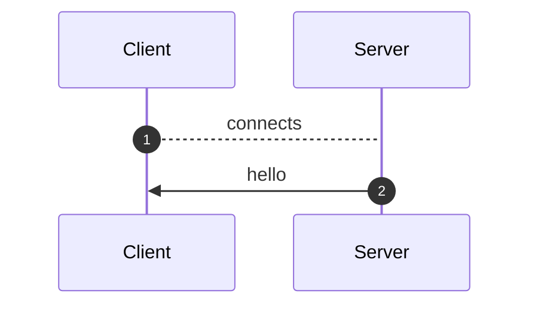
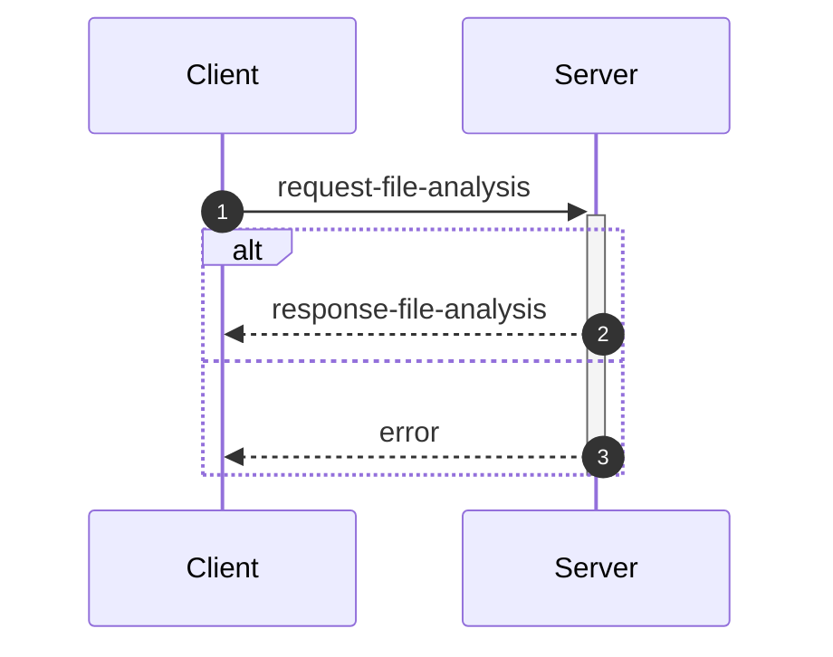
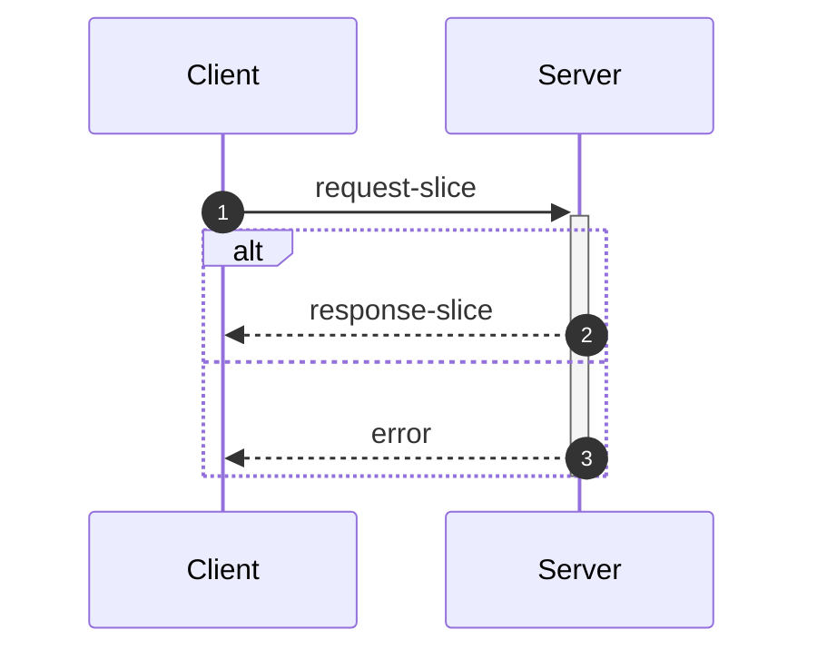
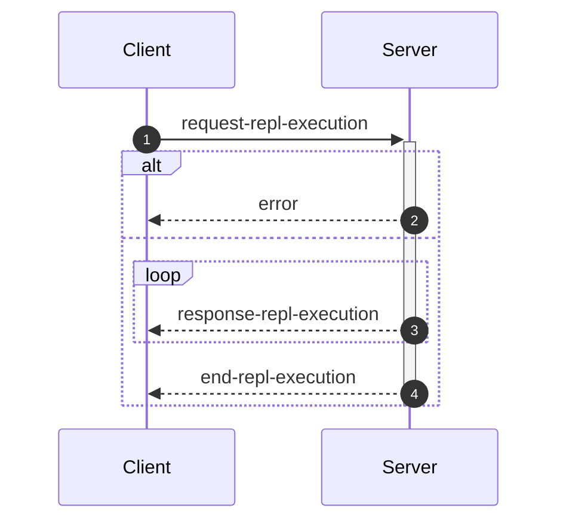

_<span title="an overview of flowR's interface">Generated</span> from '[wiki-interface.ts](https://github.com/flowr-analysis/flowr/tree/main/src/documentation/wiki-interface.ts "src/documentation/wiki-interface.ts")' on 2026-10-19, 04:36:32 UTC (v2.16.2, R v4.5.0), do not edit directly._

Although far from being as detailed as the in-depth explanation of [_flowR_](https://github.com/flowr-analysis/flowr/wiki/Core),
this wiki page explains how to interface with _flowR_ in more detail.
In general, command line arguments and other options provide short descriptions on hover over.

* [💻 Using the REPL](#using-the-repl)
* [⚙️ Configuring FlowR](#configuring-flowr)
* [⚒️ Writing Code](#writing-code)
* [💬 Communicating with the Server](#communicating-with-the-server)

<a id='using-the-repl'></a>
## 💻 Using the REPL

> [!NOTE]
> To execute arbitrary R commands with a repl request, _flowR_ has to be started explicitly with <span title="Description (Command Line Argument): Allow to access the underlying R session when using flowR (security warning: this allows the execution of arbitrary R code!)">`--r-session-access`</span>.
> Please be aware that this introduces a security risk and note that this relies on the [`r-shell` engine](https://github.com/flowr-analysis/flowr/wiki/Engines) .

Although primarily meant for users to explore,
there is nothing which forbids calling _flowR_ as a subprocess to use standard-in, -output, and -error
for communication (although you can access the REPL using the server as well,
with the [REPL Request](#message-request-repl-execution) message).

The read-eval-print loop&nbsp;(REPL) works relatively simple.
You can submit an expression (using <kbd>Enter</kbd>),
which is interpreted as an R&nbsp;expression by default but interpreted as a *command* if it starts with a colon (`:`).
The best command to get started with the REPL is <span title="Description (Repl Command): Show help information (aliases: :h, :?)">`:help`</span>.
Besides, you can leave the REPL either with the command <span title="Description (Repl Command): End the repl (aliases: :q, :exit)">`:quit`</span> or by pressing <kbd>Ctrl</kbd>+<kbd>C</kbd> twice.
When writing a *command*, you may press <kbd>Tab</kbd> to get a list of completions, if available.
Multiple commands can be entered in a single line by separating them with a semicolon (`;`), e.g. `:parse "x<-2"; :df*`.
If a command is given without R code, the REPL will re-use R code given in a previous command.
The prior example will hence return first the parsed AST of the program and then the dataflow graph for `"x <- 2"`.

> [!NOTE]
> If you develop flowR, you may want to launch the repl using the `npm run main-dev` command, this way, you get a non-minified version of flowR with debug information and hot-reloading of source files.

<details>
<summary>Available Commands</summary>

We currently offer the following commands (this with a `[*]` suffix are available with and without the star):

| Command | Description |
| ------- | ----------- |
| **<span title="Description (Repl Command): End the repl (aliases: :q, :exit)">:quit</span>** | End the repl (aliases: **:<span title="Alias of ':quit'. End the repl">q</span>**, **:<span title="Alias of ':quit'. End the repl">exit</span>**) |
| **<span title="Description (Repl Command): Execute the given code as R code. This requires the `--r-session-access` flag to be set and requires the r-shell engine. (aliases: :e, :r)">:execute</span>** | Execute the given code as R code. This requires the `--r-session-access` flag to be set and requires the r-shell engine. (aliases: **:<span title="Alias of ':execute'. Execute the given code as R code. This requires the `--r-session-access` flag to be set and requires the r-shell engine.">e</span>**, **:<span title="Alias of ':execute'. Execute the given code as R code. This requires the `--r-session-access` flag to be set and requires the r-shell engine.">r</span>**) |
| **<span title="Description (Repl Command): Get mermaid code for the control-flow graph of R code (aliases: :cfg, :cf)">:controlflow[*]</span>** | Get mermaid code for the control-flow graph of R code (star: Returns the URL to mermaid.live) (aliases: **:<span title="Alias of ':controlflow'. Get mermaid code for the control-flow graph of R code">cfg</span>**, **:<span title="Alias of ':controlflow'. Get mermaid code for the control-flow graph of R code">cf</span>**) |
| **<span title="Description (Repl Command): Get mermaid code for the control-flow graph with basic blocks (aliases: :cfgb, :cfb)">:controlflowbb[*]</span>** | Get mermaid code for the control-flow graph with basic blocks (star: Returns the URL to mermaid.live) (aliases: **:<span title="Alias of ':controlflowbb'. Get mermaid code for the control-flow graph with basic blocks">cfgb</span>**, **:<span title="Alias of ':controlflowbb'. Get mermaid code for the control-flow graph with basic blocks">cfb</span>**) |
| **<span title="Description (Repl Command): Get mermaid code for the dataflow graph (aliases: :d, :df)">:dataflow[*]</span>** | Get mermaid code for the dataflow graph (star: Returns the URL to mermaid.live) (aliases: **:<span title="Alias of ':dataflow'. Get mermaid code for the dataflow graph">d</span>**, **:<span title="Alias of ':dataflow'. Get mermaid code for the dataflow graph">df</span>**) |
| **<span title="Description (Repl Command): Get mermaid code for the normalized AST of R code (aliases: :n)">:normalize[*]</span>** | Get mermaid code for the normalized AST of R code (star: Returns the URL to mermaid.live) (alias: **:<span title="Alias of ':normalize'. Get mermaid code for the normalized AST of R code">n</span>**) |
| **<span title="Description (Repl Command): Get mermaid code for the simplified dataflow graph (aliases: :ds, :dfs)">:dataflowsimple[*]</span>** | Get mermaid code for the simplified dataflow graph (star: Returns the URL to mermaid.live) (aliases: **:<span title="Alias of ':dataflowsimple'. Get mermaid code for the simplified dataflow graph">ds</span>**, **:<span title="Alias of ':dataflowsimple'. Get mermaid code for the simplified dataflow graph">dfs</span>**) |
| **<span title="Description (Repl Command): Inspect and extend the signature database: `query` (identical to :query @signature), `info <name>` for where a function comes from (identical to :query @function-info), `add <path>` to mount another database/source, `download` to fetch the full-history database. (aliases: :sig)">:signature</span>** | Inspect and extend the signature database: `query` (identical to :query @signature), `info <name>` for where a function comes from (identical to :query @function-info), `add <path>` to mount another database/source, `download` to fetch the full-history database. (alias: **:<span title="Alias of ':signature'. Inspect and extend the signature database: `query` (identical to :query @signature), `info <name>` for where a function comes from (identical to :query @function-info), `add <path>` to mount another database/source, `download` to fetch the full-history database.">sig</span>**) |
| **<span title="Description (Repl Command): Just calculates the DFG, but only prints summary info (aliases: :d#, :df#)">:dataflowsilent</span>** | Just calculates the DFG, but only prints summary info (aliases: **:<span title="Alias of ':dataflowsilent'. Just calculates the DFG, but only prints summary info">d#</span>**, **:<span title="Alias of ':dataflowsilent'. Just calculates the DFG, but only prints summary info">df#</span>**) |
| **<span title="Description (Repl Command): Prints ASCII Art of the parsed, unmodified AST (aliases: :p)">:parse</span>** | Prints ASCII Art of the parsed, unmodified AST (alias: **:<span title="Alias of ':parse'. Prints ASCII Art of the parsed, unmodified AST">p</span>**) |
| **<span title="Description (Repl Command): Prints the version of flowR as well as the current version of R">:version</span>** | Prints the version of flowR as well as the current version of R
| **<span title="Description (Repl Command): Query the given R code (use 'help' for more information)">:query[*]</span>** | Query the given R code (use 'help' for more information) (star: Similar to query, but returns the output in json format.)
| **<span title="Description (Repl Command): Returns an ASCII representation of the dataflow graph (aliases: :df!)">:dataflowascii</span>** | Returns an ASCII representation of the dataflow graph (alias: **:<span title="Alias of ':dataflowascii'. Returns an ASCII representation of the dataflow graph">df!</span>**) |
| **<span title="Description (Repl Command): Returns summarization stats for the normalized AST (aliases: :n#)">:normalize#</span>** | Returns summarization stats for the normalized AST (alias: **:<span title="Alias of ':normalize#'. Returns summarization stats for the normalized AST">n#</span>**) |
| **<span title="Description (Repl Command): Show help information (aliases: :h, :?)">:help</span>** | Show help information (aliases: **:<span title="Alias of ':help'. Show help information">h</span>**, **:<span title="Alias of ':help'. Show help information">?</span>**) |

</details>

> [!TIP]
> 
> As indicated by the examples before, all REPL commands that operate on code keep track of the state.
> Hence, if you run a command like <span title="Description (Repl Command, starred version): Returns the URL to mermaid.live; Base Command: Get mermaid code for the dataflow graph (aliases: :d*, :df*)">`:dataflow*`</span> without providing R code,
> the REPL will re-use the R code provided in a previous command.
> Likewise, doing this will benefit from incrementality!
> If you request the dataflow graph with `:df* x <- 2 * y` and then want to see the parsed AST with `:parse`,
> the REPL will re-use previously obtained information and not re-parse the code again.
> 		

Generally, many commands offer shortcut versions in the REPL. Many queries, for example, offer a shortened format (see the example below).
Of special note, the [Config Query](https://github.com/flowr-analysis/flowr/wiki/%5BQuery%5D-Config)
can be used to also modify the currently active configuration of _flowR_ within the REPL (see the [wiki page](https://github.com/flowr-analysis/flowr/wiki/%5BQuery%5D-Config) for more information).

### Example: Retrieving the Dataflow Graph

To retrieve a URL to the [mermaid](https://mermaid.js.org/) diagram of the dataflow of a given expression,
use <span title="Description (Repl Command, starred version): Returns the URL to mermaid.live; Base Command: Get mermaid code for the dataflow graph (aliases: :d*, :df*)">`:dataflow*`</span> (or <span title="Description (Repl Command): Get mermaid code for the dataflow graph (aliases: :d, :df)">`:dataflow`</span> to get the mermaid code in the cli):

```shell
$ docker run -it --rm eagleoutice/flowr # or npm run flowr 
flowR repl v2.16.2, R grammar v14 (tree-sitter engine)
R> :dataflow* y <- 1 + x
```

<details>
<summary style='color:gray'>Output</summary>

```text
https://mermaid.live/view#base64:eyJjb2RlIjoiZmxvd2NoYXJ0IFREXG4gICAgMXt7XCJgKiM5MTtSTnVtYmVyIzkzOyogKioxKipcbiAgICAgICoxLjYqICgqKmlkOiAxKiopYFwifX1cbiAgICAyKFtcImAqIzkxO1JTeW1ib2wjOTM7KiAqKngqKlxuICAgICAgKjEuMTAqICgqKmlkOiAyKiopYFwiXSlcbiAgICAzW1tcImAqIzkxO1JCaW5hcnlPcCM5MzsqIGJhc2UjNTg7IzU4OyoqIzQzOyoqXG4gICAgICAqMS42LTEwKiAoKippZDogMyoqKVxuICAgIGFyZzogKDEsIDIpYFwiXV1cbiAgICBidWlsdC1pbjpfNDNfW1wiYEJ1aWx0LUluOlxuIzQzO2BcIl1cbiAgICBzdHlsZSBidWlsdC1pbjpfNDNfIHN0cm9rZTpncmF5LGZpbGw6Z3JheSxzdHJva2Utd2lkdGg6MnB4LG9wYWNpdHk6Ljg7XG4gICAgMFtcImAqIzkxO1JTeW1ib2wjOTM7KiAqKnkqKlxuICAgICAgKjEuMSogKCoqaWQ6IDAqKiwgdjogMylgXCJdXG4gICAgNFtbXCJgKiM5MTtSQmluYXJ5T3AjOTM7KiBiYXNlIzU4OyM1ODsqKiM2MDsjNDU7KipcbiAgICAgICoxLjEtMTAqICgqKmlkOiA0KiopXG4gICAgYXJnOiAoMCwgMylgXCJdXVxuICAgIGJ1aWx0LWluOl82MF8tW1wiYEJ1aWx0LUluOlxuIzYwOyM0NTtgXCJdXG4gICAgc3R5bGUgYnVpbHQtaW46XzYwXy0gc3Ryb2tlOmdyYXksZmlsbDpncmF5LHN0cm9rZS13aWR0aDoycHgsb3BhY2l0eTouODtcbiAgICAxIC0uLT58XCJmbG93XCJ8IDJcbiAgICBsaW5rU3R5bGUgMCBzdHJva2U6Z3JheSxjb2xvcjpncmF5O1xuICAgIDIgLS4tPnxcImZsb3dcInwgM1xuICAgIGxpbmtTdHlsZSAxIHN0cm9rZTpncmF5LGNvbG9yOmdyYXk7XG4gICAgMyAtLT58XCJyZWFkcywgYXJnXCJ8IDFcbiAgICAzIC0tPnxcInJlYWRzLCBhcmdcInwgMlxuICAgIDMgLS4tPnxcImZsb3dcInwgMFxuICAgIGxpbmtTdHlsZSA0IHN0cm9rZTpncmF5LGNvbG9yOmdyYXk7XG4gICAgMyAtLi0+fFwicmVhZHMsIGNhbGxzXCJ8IGJ1aWx0LWluOl80M19cbiAgICBsaW5rU3R5bGUgNSBzdHJva2U6Z3JheTtcbiAgICAwIC0tPnxcImRlZmluZWQtYnksIGZsb3dcInwgNFxuICAgIDAgLS0+fFwiZGVmaW5lZC1ieVwifCAzXG4gICAgNCAtLT58XCJyZWFkcywgYXJnXCJ8IDNcbiAgICA0IC0tPnxcInJldHVybnMsIGFyZ1wifCAwXG4gICAgNCAtLi0+fFwicmVhZHMsIGNhbGxzXCJ8IGJ1aWx0LWluOl82MF8tXG4gICAgbGlua1N0eWxlIDEwIHN0cm9rZTpncmF5OyIsIm1lcm1haWQiOnsiYXV0b1N5bmMiOnRydWV9fQ==
```

Retrieve the dataflow graph of the expression `y <- 1 + x`. It looks like this:


<details>

<summary style="color:gray">R Code of the Dataflow Graph</summary>

The analysis ran (including parse and normalize, using the [tree-sitter](https://github.com/flowr-analysis/flowr/wiki/Engines) engine) within the generation environment. No [signature database](https://github.com/flowr-analysis/flowr/wiki/Signature-Database) is mounted for these generated graphs, so `library()` calls attach no package exports; base-R names are still qualified via the generated base-package store (e.g. `acf` as `stats::acf`). 
We encountered no unknown side effects during the analysis.

```r
y <- 1 + x
```

</details>

</details>

For small graphs like this, <span title="Description (Repl Command): Returns an ASCII representation of the dataflow graph (aliases: :df!)">`:dataflowascii`</span> also provides an ASCII representation directly in the REPL:

```shell
$ docker run -it --rm eagleoutice/flowr # or npm run flowr 
flowR repl v2.16.2, R grammar v14 (tree-sitter engine)
R> :df! y <- 1 + x
```

<details open>
<summary style='color:gray'>Output</summary>

```text
                        v<0>v
 c<4>c──────────────────| y |
 |<- |     ┌────────────v---v
 c---c     │
    │   c<3>c   0<1>0
    └───| + |───| 1 |───u<2>u
        c---c   0---0   | x |
           └────────────u---u
Edges:
3 -> 1: reads, arg          3 -> 2: reads, arg
3 -> 0: flows-to            1 -> 2: flows-to
2 -> 3: flows-to            4 -> 3: reads, arg
4 -> 0: returns, arg        0 -> 4: defined-by, flows-to
0 -> 3: defined-by
```

Retrieve the dataflow graph of the expression `y <- 1 + x` as ASCII art.

</details>

For the slicing with <span title="Description (Repl Command): Static backwards executable slicer for R">`:slicer`</span>, you have access to the same [magic comments](#slice-magic-comments) as with the [slice request](#message-request-slice).
Pass `--inline` to splice resolvable `source()` calls into the reconstruction so the slice is a single self-contained R text (the same as the static slice query's `inlineSources` flag).
See `--help` for more flags!

### Example: Interfacing with the File System

Many commands that allow for an R-expression (like <span title="Description (Repl Command, starred version): Returns the URL to mermaid.live; Base Command: Get mermaid code for the dataflow graph (aliases: :d*, :df*)">`:dataflow*`</span>) allow for a file as well
if the argument starts with `file://`.
If you are working from the root directory of the _flowR_ repository, the following gives you the parsed AST of the example file using the <span title="Description (Repl Command): Prints ASCII Art of the parsed, unmodified AST (aliases: :p)">`:parse`</span> command:

> **Watch mode**: Replace `file://` with `watch://` to enter watch mode.
> flowR runs the command immediately and then re-runs it every time the file (or any file inside the folder) changes.
> Enter any other command to leave watch mode.
> For example: `:df watch://analysis.R`

```shell
$ docker run -it --rm eagleoutice/flowr # or npm run flowr 
flowR repl v2.16.2, R grammar v14 (tree-sitter engine)
R> :parse file://test/testfiles/example.R
```

<details>
<summary style='color:gray'>Output</summary>

```text
File: test/testfiles/example.R

program
├ binaryoperator
│ ├ identifier "sum" (1:1─4)
│ ├ <- "<-" (1:5─7)
│ ╰ float "0" (1:8─9)
├ binaryoperator
│ ├ identifier "product" (2:1─8)
│ ├ <- "<-" (2:9─11)
│ ╰ float "1" (2:12─13)
├ binaryoperator
│ ├ identifier "w" (3:1─2)
│ ├ <- "<-" (3:3─5)
│ ╰ float "7" (3:6─7)
├ binaryoperator
│ ├ identifier "N" (4:1─2)
│ ├ <- "<-" (4:3─5)
│ ╰ float "10" (4:6─8)
├ forstatement
│ ├ for "for" (6:1─4)
│ ├ ( "(" (6:5─6)
│ ├ identifier "i" (6:6─7)
│ ├ in "in" (6:8─10)
│ ├ binaryoperator
│ │ ├ float "1" (6:11─12)
│ │ ├ : ":" (6:12─13)
│ │ ╰ parenthesizedexpression
│ │   ├ ( "(" (6:13─14)
│ │   ├ binaryoperator
│ │   │ ├ identifier "N" (6:14─15)
│ │   │ ├ - "-" (6:15─16)
│ │   │ ╰ float "1" (6:16─17)
│ │   ╰ ) ")" (6:17─18)
│ ├ ) ")" (6:18─19)
│ ╰ bracedexpression
│   ├ { "{" (6:20─21)
│   ├ binaryoperator
│   │ ├ identifier "sum" (7:3─6)
│   │ ├ <- "<-" (7:7─9)
│   │ ╰ binaryoperator
│   │   ├ binaryoperator
│   │   │ ├ identifier "sum" (7:10─13)
│   │   │ ├ + "+" (7:14─15)
│   │   │ ╰ identifier "i" (7:16─17)
│   │   ├ + "+" (7:18─19)
│   │   ╰ identifier "w" (7:20─21)
│   ├ binaryoperator
│   │ ├ identifier "product" (8:3─10)
│   │ ├ <- "<-" (8:11─13)
│   │ ╰ binaryoperator
│   │   ├ identifier "product" (8:14─21)
│   │   ├  "" (8:22─23)
│   │   ╰ identifier "i" (8:24─25)
│   ╰ } "}" (9:1─2)
├ call
│ ├ identifier "cat" (11:1─4)
│ ╰ arguments
│   ├ ( "(" (11:4─5)
│   ├ argument
│   │ ╰ string
│   │   ├ " "\"" (11:5─6)
│   │   ├ stringcontent "Sum:" (11:6─10)
│   │   ╰ " "\"" (11:10─11)
│   ├ comma "," (11:11─12)
│   ├ argument
│   │ ╰ identifier "sum" (11:13─16)
│   ├ comma "," (11:16─17)
│   ├ argument
│   │ ╰ string
│   │   ├ " "\"" (11:18─19)
│   │   ├ stringcontent
│   │   │ ╰ escapesequence "\\n" (11:19─21)
│   │   ╰ " "\"" (11:21─22)
│   ╰ ) ")" (11:22─23)
╰ call
  ├ identifier "cat" (12:1─4)
  ╰ arguments
    ├ ( "(" (12:4─5)
    ├ argument
    │ ╰ string
    │   ├ " "\"" (12:5─6)
    │   ├ stringcontent "Product:" (12:6─14)
    │   ╰ " "\"" (12:14─15)
    ├ comma "," (12:15─16)
    ├ argument
    │ ╰ identifier "product" (12:17─24)
    ├ comma "," (12:24─25)
    ├ argument
    │ ╰ string
    │   ├ " "\"" (12:26─27)
    │   ├ stringcontent
    │   │ ╰ escapesequence "\\n" (12:27─29)
    │   ╰ " "\"" (12:29─30)
    ╰ ) ")" (12:30─31)
```

Retrieve the parsed AST of the example file.

<details>

<summary>File Content</summary>

```r
sum <- 0
product <- 1
w <- 7
N <- 10

for (i in 1:(N-1)) {
  sum <- sum + i + w
  product <- product * i
}

cat("Sum:", sum, "\n")
cat("Product:", product, "\n")
```

</details>

As _flowR_ directly transforms this AST the output focuses on being human-readable instead of being machine-readable.
		
</details>

### Example: Run a Query

You can run any query supported by _flowR_ using the <span title="Description (Repl Command): Query the given R code (use 'help' for more information)">`:query`</span> command.
For example, to obtain the shapes of all data frames in a given piece of code, you can run:

```shell
$ docker run -it --rm eagleoutice/flowr # or npm run flowr 
flowR repl v2.16.2, R grammar v14 (tree-sitter engine)
R> :query @absint df-shape "x <- data.frame(a = 1:10, b = 1:10)\ny <- x$a"
```

<details open>
<summary style='color:gray'>Output</summary>

```text
Query: absint (0 ms)
```

Retrieve the shapes of all data frames in the given code.

</details>

To run the linter on a file, you can use (in this example, we just issue the `dead-code` linter on a small piece of code):

```shell
$ docker run -it --rm eagleoutice/flowr # or npm run flowr 
flowR repl v2.16.2, R grammar v14 (tree-sitter engine)
R> :query @linter rules:dead-code "if(FALSE) x <- 2"
```

<details open>
<summary style='color:gray'>Output</summary>

```text
Query: linter (1 ms)
   ╰ Dead Code (dead-code):
       ╰ certain:
           ╰ Code at 1.11-16
```

Run the linter on the given code, with only the `dead-code` rule enabled.

</details>

For more information on the available queries, please check out the [Query API](https://github.com/flowr-analysis/flowr/wiki/Query-API).

<a id='configuring-flowr'></a>
## ⚙️ Configuring FlowR

When running _flowR_, you may want to specify some behaviors with a dedicated configuration file.
By default, flowR looks for a file named `flowr.json` in the current working directory (or any higher directory).
You can also specify a different file with <span title="Description (Command Line Argument): The name of the configuration file to use">`--config-file`</span> or pass the configuration inline using <span title="Description (Command Line Argument): The flowR configuration to use, as a JSON string">`--config-json`</span>.
A `flowr.json` found this way belongs to the analyzed project, so flowR ignores its options that decide what flowR executes or loads
(`engines.*.wasmPath`, `engines.*.treeSitterWasmPath`, `engines.*.rPath`, `solver.sigdb.additionalPaths`, `solver.sigdb.downloadRepo`, `solver.sigdb.installedLibrary.paths`),
unless you pass <span title="Description (Command Line Argument): Keep the security-sensitive options (e.g., the R executable) of the flowr.json found in the working directory or a parent. Only use this for projects you trust.">`--trust-config`</span>.
To analyze code you do not trust, use the secure mode (<span title="Description (Command Line Argument): Run in secure mode for analyzing untrusted code: flowR does not start R (or any other process), does not access the network, does not search for project configs, and ignores security-sensitive options in every config. Cannot be disabled once enabled. Can also be enabled with the environment variable {italic FLOWR_SECURE_MODE=1}.">`--secure`</span>, see the [security policy](https://github.com/flowr-analysis/flowr/blob/main/.github/SECURITY.md)).
To inspect the current configuration, you can run flowr with the <span title="Description (Command Line Argument): Run with verbose logging (will be passed to the corresponding script)">`--verbose`</span> flag, or use the `config` [Query](https://github.com/flowr-analysis/flowr/wiki/Query-API).
Within the REPL this works by running the following:

```shell
:query @config
```

To work with the <a href="https://github.com/flowr-analysis/flowr/tree/main/src/config.ts#L119"><code><span title="The configuration file format for flowR.">FlowrConfig</span></code></a> you can use the provided helper objects alongside its methods like
<a href="https://github.com/flowr-analysis/flowr/tree/main/src/config.ts#L914"><code><span title="Creates a new flowr config that has the updated values.">FlowrConfig::<b>amend</b></span></code></a>.
The schema below documents every option; the ones you most likely want are:

- <a href="https://github.com/flowr-analysis/flowr/wiki/Interface#configuring-flowr" title="Configuration Option (boolean): Whether source calls should be ignored, causing {@link processSourceCall}&#39;s behavior to be skipped.">ignoreSourceCalls</a>: ignore source calls when analyzing the code, i.e., ignore the inclusion of other files.
- <a href="https://github.com/flowr-analysis/flowr/wiki/Interface#configuring-flowr" title="Configuration Option (boolean): Whether load calls should be ignored, causing {@link processLoadCall}&#39;s behavior to be skipped.">ignoreLoadCalls</a>: ignore load calls when analyzing the code, i.e., ignore the loading of r-data files.
- <a href="https://github.com/flowr-analysis/flowr/wiki/Interface#configuring-flowr" title="Configuration Option (object): Do you want to overwrite (parts) of the builtin definition?">semantics.environment.overwriteBuiltIns</a>: overwrite _flowR_'s handling of built-in functions, or clear the preset definitions entirely.
  See [Configure BuiltIn Semantics](#configure-builtin-semantics) for more information.
- <a href="https://github.com/flowr-analysis/flowr/wiki/Interface#configuring-flowr" title="Configuration Option (string): How to resolve variables and their values. (one of &quot;disabled&quot;, &quot;alias&quot;, &quot;builtin&quot;)">solver.variables</a>: how to resolve variables and their values (`disabled`, `alias`, `builtin`).
- <a href="https://github.com/flowr-analysis/flowr/wiki/Interface#configuring-flowr" title="Configuration Option (array): The engine or set of engines to use for interacting with R code. An empty array means all available engines will be used.">engines</a> and <a href="https://github.com/flowr-analysis/flowr/wiki/Interface#configuring-flowr" title="Configuration Option (string): The default engine to use for interacting with R code. If this is undefined, an arbitrary engine from the specified list will be used. (one of &quot;tree-sitter&quot;, &quot;r-shell&quot;)">defaultEngine</a>: the engines used to interact with R code, see the [Engines wiki page](https://github.com/flowr-analysis/flowr/wiki/Engines).
- <a href="https://github.com/flowr-analysis/flowr/wiki/Interface#configuring-flowr" title="Configuration Option (array): Files a framework loads on its own, without any source() call (e.g. global.R in a shiny app), in the order they are loaded; flowR orders the matching project files accordingly and analyzes them as one program. Entries are case-insensitive globs matched against the file path, a plain name matches any file with that name, and entries matching no project file are warned about. Usually set per project kind via specializeConfig.">project.implicitSources</a>: the files a framework loads without any `source()` call, in the order in which they are
  loaded. Entries are globs (e.g. `R/*.R`) matched against the file path ignoring capitalization; one matching no file is reported.
- <a href="https://github.com/flowr-analysis/flowr/wiki/Interface#configuring-flowr" title="Configuration Option (object): Overwrite (parts of) the configuration depending on the project kind flowR detects, e.g. to give a shiny app its implicit sources.">specializeConfig</a>: overwrite (parts of) the configuration depending on the kind of project _flowR_ detects
  (e.g. `shiny-app`), which is how a shiny app gets its implicit sources by default. What you configure directly wins.
- <a href="https://github.com/flowr-analysis/flowr/wiki/Interface#configuring-flowr" title="Configuration Option (string): Overwrite the project kind flowR would otherwise infer from the analyzed files, e.g. when auto-detection guesses wrong. (one of &quot;package&quot;, &quot;script&quot;, &quot;shiny-app&quot;, &quot;notebook&quot;, &quot;project&quot;, &quot;unknown&quot;)">project.useProjectType</a>: skip that detection and force a project kind yourself, when auto-detection guesses wrong.
- <a href="https://github.com/flowr-analysis/flowr/wiki/Interface#configuring-flowr" title="Configuration Option (array): The default plugins to load when creating a new instance of FlowrAnalyzer">defaultPlugins</a> and <a href="https://github.com/flowr-analysis/flowr/wiki/Interface#configuring-flowr" title="Configuration Option (array): The plugins to load in REPL mode">repl.plugins</a>: the plugins to load for a new <a href="https://github.com/flowr-analysis/flowr/tree/main/src/project/flowr-analyzer.ts#L205"><code><span title="Central class for conducting analyses with FlowR. Use the FlowrAnalyzerBuilder to create a new instance. If you want the original pattern of creating a pipeline and running all steps, you can still do this with FlowrAnalyzer#runFull . To inspect the context of the analyzer, use FlowrAnalyzer#inspectContext (if you are a plugin and need to modify it, use FlowrAnalyzer#context instead).">FlowrAnalyzer</span></code></a> and in the REPL
  (use `flowr:default` to reference the former).

So you can configure _flowR_ by adding a file like the following:

<details>

<summary>Example Configuration File</summary>

```json
{
  "ignoreSourceCalls": true,
  "ignoreLoadCalls": true,
  "semantics": {
    "environment": {
      "overwriteBuiltIns": {
        "definitions": [
          {
            "type": "function",
            "names": [
              "foo"
            ],
            "processor": "builtin:assign",
            "config": {}
          }
        ]
      }
    }
  },
  "defaultPlugins": [
    "file:description",
    "versions:description"
  ],
  "repl": {
    "quickStats": false,
    "dfProcessorHeat": false,
    "hints": true,
    "plugins": [
      "flowr:default"
    ]
  },
  "project": {
    "resolveUnknownPathsOnDisk": true,
    "implicitSources": [
      "global.R",
      "app.R"
    ]
  },
  "linter": {
    "disabledRules": []
  },
  "specializeConfig": {
    "shiny-app": {
      "project": {
        "implicitSources": [
          "global.R",
          "ui.R",
          "server.R",
          "app.R"
        ]
      }
    }
  },
  "engines": [
    {
      "type": "r-shell"
    }
  ],
  "solver": {
    "variables": "alias",
    "evalStrings": true,
    "trackEnvironments": true,
    "sigdb": {
      "enabled": true,
      "loadProjectDependencies": true,
      "eagerlyLoad": false,
      "eagerlyLoadExports": false,
      "linkBaseR": false,
      "linkDescriptionDependencies": false
    },
    "resolveSource": {
      "dropPaths": "no",
      "ignoreCapitalization": true,
      "inferWorkingDirectory": "active-script",
      "searchPath": []
    },
    "instrument": {},
    "slicer": {
      "threshold": 50
    }
  },
  "abstractInterpretation": {
    "wideningThreshold": 4,
    "followCalls": true,
    "dataFrame": {
      "maxColNames": 20,
      "readLoadedData": {
        "readExternalFiles": true,
        "maxReadLines": 1000000
      }
    }
  },
  "incremental": {
    "alwaysIncremental": false,
    "parsing": {
      "activated": false,
      "heuristics": {
        "activated": true,
        "mtime": true,
        "linesFrom": 500,
        "bytesFrom": 50000,
        "alwaysWithEdits": false,
        "minFiles": 1
      }
    }
  },
  "gas": {
    "thresholds": {
      "memory": {
        "problematic": 0.7,
        "critical": 0.9
      },
      "timeMs": {
        "problematic": 100000,
        "critical": 120000
      }
    },
    "features": {}
  }
}
```

</details>

<details>
<a id='configure-builtin-semantics'></a>
<summary>Configure Built-In Semantics</summary>

`semantics/environment/overwriteBuiltins` accepts two keys:

- `loadDefaults` (boolean, initially `true`): If set to `true`, the default built-in definitions are loaded before applying the custom definitions. Setting this flag to `false` explicitly disables the loading of the default definitions.
- `definitions` (array, initially empty): Allows to overwrite or define new built-in elements. Each object within must have a `type` which is one of the below. Furthermore, they may define a string array of `names` which specifies the identifiers to bind the definitions to. You may use `assumePrimitive` to specify whether _flowR_ should assume that this is a primitive non-library definition (so you probably just do not want to specify the key).

  | Type            | Description                                                                                                                                                                                                                                                                                              | Example                                                                                                    |
  | --------------- | -------------------------------------------------------------------------------------------------------------------------------------------------------------------------------------------------------------------------------------------------------------------------------------------------------- | ---------------------------------------------------------------------------------------------------------- |
  | `constant`    | Additionally allows for a `value` this should resolve to.                                                                                                                                                                                                                                                | `{ type: 'constant', names: ['NULL', 'NA'],  value: null }`                                                |
  | `function`    | Is a rather flexible way to define and bind built-in functions. For the time, we do not have extensive documentation to cover all the cases, so please either consult the sources with the `default-builtin-config.ts` or open a [new issue](https://github.com/flowr-analysis/flowr/issues/new/choose). | `{ type: 'function', names: ['next'], processor: 'builtin:d', config: { cfg: ExitPointType.Next } }` |
  | `replacement` | A comfortable way to specify replacement functions like `$<-` or `names<-`. `suffixes` describes the... suffixes to attach automatically. | `{ type: 'replacement', suffixes: ['<-', '<<-'], names: ['[', '[['] }` |

</details>

<details>

<summary style='color:gray'>Full Configuration-File Schema</summary>

- _The configuration file format for flowR._ (object)
    - **logLevel** [optional] _flowR's global minimum log level, applied when the config is loaded._ (string)
        Only allows: 'silly', 'trace', 'debug', 'info', 'warn', 'error', 'fatal'
    - **ignoreSourceCalls** [optional] _Whether source calls should be ignored, causing {@link processSourceCall}'s behavior to be skipped._ (boolean)
    - **ignoreLoadCalls** [optional] _Whether load calls should be ignored, causing {@link processLoadCall}'s behavior to be skipped._ (boolean)
    - **semantics** _Configure language semantics and how flowR handles them._ (object)
        - **environment** [optional] _Semantics regarding how to handle the R environment._ (object)
            - **overwriteBuiltIns** [optional] _Do you want to overwrite (parts) of the builtin definition?_ (object)
                - **loadDefaults** [optional] _Should the default configuration still be loaded?_ (boolean)
                - **definitions** [optional] _The definitions to load/overwrite._ (array)
                Valid item types:
                    - (object)
    - **defaultPlugins** [optional] _The default plugins to load when creating a new instance of FlowrAnalyzer_ (array)
    Valid item types:
        - (alternatives)
            - (string)
            - (array)
    - **repl** _Configuration options for the REPL._ (object)
        - **quickStats** [optional] _Whether to show quick stats in the REPL after each evaluation._ (boolean)
        - **dfProcessorHeat** [optional] _This instruments the dataflow processors to count how often each processor is called._ (boolean)
        - **hints** [optional] _Whether to show dim inline hints on the empty prompt (automatically disabled on non-interactive terminals)._ (boolean)
        - **plugins** [optional] _The plugins to load in REPL mode_ (array)
        Valid item types:
            - (alternatives)
                - (string)
                - (array)
        - **autoUseFileProtocol** [optional] _Prepend the file protocol to a repl input that looks like a path, instead of only warning about it._ (boolean)
        - **queryStats** [optional] _Whether `:query` closes with the line stating how long the queries took (`:query*` never prints it)._ (boolean)
        - **showPlugins** [optional] _Whether `:version` grays out the plugins that did not activate during the last analysis._ (boolean)
    - **project** _Project specific configuration options._ (object)
        - **resolveUnknownPathsOnDisk** [optional] _Whether to resolve unknown paths loaded by the r project disk when trying to source/analyze files._ (boolean)
        - **failOnInaccessiblePath** [optional] _Whether a directory that cannot be traversed during file discovery (e.g. due to permissions) aborts the analysis; when false (the default) such paths are logged and skipped._ (boolean)
        - **basePackages** [optional] _The packages considered part of R itself (base and recommended); if unset, flowR uses its built-in list._ (array)
        Valid item types:
            - (string)
        - **implicitSources** [optional] _Files a framework loads on its own, without any source() call (e.g. global.R in a shiny app), in the order they are loaded; flowR orders the matching project files accordingly and analyzes them as one program. Entries are case-insensitive globs matched against the file path, a plain name matches any file with that name, and entries matching no project file are warned about. Usually set per project kind via specializeConfig._ (array)
        Valid item types:
            - (string)
        - **useProjectType** [optional] _Overwrite the project kind flowR would otherwise infer from the analyzed files, e.g. when auto-detection guesses wrong._ (string)
            Only allows: 'package', 'script', 'shiny-app', 'notebook', 'project', 'unknown'
        - **assumeImplicitEcho** [optional] _Whether the top level of the analyzed code is echoed, so that every visible result printed there is collected as an output by the dependencies query (default true, false for a package)._ (boolean)
        - **discovery** [optional] _Scoping options for the default project discovery._ (object)
            - **full** [optional] _Collect every file below the project root (greedy) instead of only the files the detected project kind needs (default false)._ (boolean)
            - **perKind** [optional] _Per-kind include/exclude glob overrides layered on the default scoping._ (object)
            - **ignore** [optional] _Case-insensitive globs that drop matching files from the intelligent discovery, regardless of kind (e.g. .Renviron to ignore environment files)._ (array)
            Valid item types:
                - (string)
        - **classification** [optional] _Overrides for the signals flowR uses to classify the project kind._ (object)
            - **shinyDescriptionTypes** [optional] _DESCRIPTION Type: values that mark a shiny app._ (array)
            Valid item types:
                - (string)
            - **shinyEntryFiles** [optional] _File names a shiny app is assembled from._ (array)
            Valid item types:
                - (string)
            - **shinyUsagePattern** [optional] _Regex source evidencing shiny usage in an entry file._ (string)
            - **notebookExtensions** [optional] _File extensions marking a notebook._ (array)
            Valid item types:
                - (string)
    - **linter** _Linter configuration options._ (object)
        - **disabledRules** _Linting rule names excluded from the default rule set (a rule requested explicitly via a linter query still runs). Usually set per project kind via specializeConfig._ (array)
        Valid item types:
            - (string)
        - **disabledTags** [optional] _Linting rule tags whose rules are excluded from the default rule set (a rule requested explicitly via a linter query still runs). By default the cmd-check rules are disabled for everything but a package; a configured list replaces that default._ (array)
        Valid item types:
            - (string)
    - **inputSources** [optional] _Further frameworks the input-sources analysis should know about; entries are added to flowR's defaults._ (object)
        - **pure** [optional] _Functions that only pass the constantness of their arguments on._ (array)
        Valid item types:
            - (string)
        - **param** [optional] _Functions whose result is a 'param' input._ (array)
        Valid item types:
            - (string)
        - **file** [optional] _Functions whose result is a 'file' input._ (array)
        Valid item types:
            - (string)
        - **tempfile** [optional] _Functions whose result is a 'tempfile' input._ (array)
        Valid item types:
            - (string)
        - **glob** [optional] _Functions whose result is a 'glob' input._ (array)
        Valid item types:
            - (string)
        - **net** [optional] _Functions whose result is a 'net' input._ (array)
        Valid item types:
            - (string)
        - **rand** [optional] _Functions whose result is a 'rand' input._ (array)
        Valid item types:
            - (string)
        - **system** [optional] _Functions whose result is a 'system' input._ (array)
        Valid item types:
            - (string)
        - **ffi** [optional] _Functions whose result is a 'ffi' input._ (array)
        Valid item types:
            - (string)
        - **lang** [optional] _Functions whose result is a 'lang' input._ (array)
        Valid item types:
            - (string)
        - **options** [optional] _Functions whose result is a 'options' input._ (array)
        Valid item types:
            - (string)
        - **cmdline** [optional] _Functions whose result is a 'cmdline' input._ (array)
        Valid item types:
            - (string)
        - **user** [optional] _Functions whose result is a 'user' input._ (array)
        Valid item types:
            - (string)
        - **const** [optional] _Functions whose result is a 'const' input._ (array)
        Valid item types:
            - (string)
        - **scope** [optional] _Functions whose result is a 'scope' input._ (array)
        Valid item types:
            - (string)
        - **dconst** [optional] _Functions whose result is a 'dconst' input._ (array)
        Valid item types:
            - (string)
        - **unknown** [optional] _Functions whose result is a 'unknown' input._ (array)
        Valid item types:
            - (string)
        - **linkedObjects** [optional] _Objects a framework provides without a definition in the code, e.g. shiny's input._ (array)
        Valid item types:
            - (object)
        - **linkedEntryPoints** [optional] _Calls that hand a function to a framework, which binds its objects to the parameters by position._ (array)
        Valid item types:
            - (object)
    - **specializeConfig** [optional] _Overwrite (parts of) the configuration depending on the project kind flowR detects, e.g. to give a shiny app its implicit sources._ (object)
    - **engines** _The engine or set of engines to use for interacting with R code. An empty array means all available engines will be used._ (array)
    Valid item types:
        - (alternatives)
            - _The configuration for the tree sitter engine._ (object)
                - **type** [required] _Use the tree sitter engine._ (string)
                    Only allows: 'tree-sitter'
                - **wasmPath** [optional] _The path to the tree-sitter-r WASM binary to use. If this is undefined, this uses the default path._ (string)
                - **treeSitterWasmPath** [optional] _The path to the tree-sitter WASM binary to use. If this is undefined, this uses the default path._ (string)
                - **lax** [optional] _Whether to use the lax parser for parsing R code (allowing for syntax errors). If this is undefined, the strict parser will be used._ (boolean)
            - _The configuration for the R shell engine._ (object)
                - **type** [required] _Use the R shell engine._ (string)
                    Only allows: 'r-shell'
                - **rPath** [optional] _The path to the R executable to use. If this is undefined, this uses the default path._ (string)
                - **pipeBind** [optional] _Whether to enable R's experimental pipe-bind operator "=>" by setting _R_USE_PIPEBIND_ for the R session (default false); R itself keeps this off by default, as it is experimental and has never shipped in a release version of R._ (boolean)
    - **defaultEngine** [optional] _The default engine to use for interacting with R code. If this is undefined, an arbitrary engine from the specified list will be used._ (string)
        Only allows: 'tree-sitter', 'r-shell'
    - **solver** _How to resolve constants, constraints, cells, ..._ (object)
        - **variables** _How to resolve variables and their values._ (string)
            Only allows: 'disabled', 'alias', 'builtin'
        - **evalStrings** _Should we include eval(parse(text="...")) calls in the dataflow graph?_ (boolean)
        - **trackEnvironments** [optional] _Track user-created environments (new.env, assign/get/local with envir=, dollar-assign, attach). When false, all envir-style calls fall through conservatively._ (boolean)
        - **sigdb** _Resolving library exports from a signature database._ (object)
            - **enabled** [optional] _Resolve library()/use() exports from a signature database (default true); when false no database is consulted._ (boolean)
            - **loadProjectDependencies** [optional] _Load the project's declared dependencies from its metadata files (DESCRIPTION Imports/Depends, rproject.toml, uvr.toml, renv.lock, rv.lock, uvr.lock) (default true); when false these files are not read for dependencies._ (boolean)
            - **eagerlyLoad** [optional] _Parse the database up front rather than on the first package load (default false, ignored if disabled)._ (boolean)
            - **eagerlyLoadExports** [optional] _Add a vertex for every export on load rather than on demand (default false); keeps the dataflow graph small._ (boolean)
            - **assumedRVersion** [optional] _R version assumed when resolving versioned (base-R) exports: a pin like "4.5" or "auto" to detect the installed R (default "auto")._ (string)
            - **linkBaseR** [optional] _Eagerly attach base-R namespaces so bare base calls resolve without library() (default false)._ (boolean)
            - **linkBaseRCalls** [optional] _Add a lightweight Reads edge from a bare base-R call to its signature-database function vertex (default false; base-R qualification is edge-free otherwise)._ (boolean)
            - **linkPackageCalls** [optional] _Add a lightweight Reads edge from a resolved package call to its signature-database function vertex (default false)._ (boolean)
            - **linkDescriptionDependencies** [optional] _Eagerly attach the namespaces of the project's declared DESCRIPTION dependencies (Imports/Depends) so their exports resolve without an explicit library() (default false)._ (boolean)
            - **warmInBackground** [optional] _Decompress the hot shards (base + most-downloaded) in a background task on startup so the first library() lookup is warm (default false; for long-running servers/REPLs)._ (boolean)
            - **additionalPaths** [optional] _Extra directories or bundle/manifest files searched for signature databases (alongside the shipped default and $FLOWR_SIGDB_DIR); a downloaded full-history bundle placed here is mounted automatically._ (array)
            Valid item types:
                - (string)
            - **downloadRepo** [optional] _GitHub owner/repo the full-history bundle is downloaded from via ":signature download" (default "flowr-analysis/flowr", release tag "sigdb-v<flowR-version>")._ (string)
            - **autoSync** [optional] _On startup, re-download shards whose committed sigdb.remote.json hash no longer matches the cache, in the background (default false; opt-in network sync after a git pull)._ (boolean)
            - **installedLibrary** [optional] _Recovering packages no signature database knows from the copy installed on this machine._ (object)
                - **enabled** [required] _Recover packages no signature database knows from their installed copy (default false)._ (boolean)
                - **paths** [optional] _Library directories to search; when empty they are discovered from the environment and the project._ (array)
                Valid item types:
                    - (string)
                - **useEnvironment** [optional] _Search the libraries R_LIBS_USER/R_LIBS/R_LIBS_SITE name (default true)._ (boolean)
                - **useProjectLibrary** [optional] _Search a project-local renv/packrat library (default true)._ (boolean)
                - **maxDepth** [optional] _How far to descend into the nested layout of a project-local library (default 3)._ (number)
                - **packages** [optional] _Only recover packages whose name matches one of these regular expressions; empty means any._ (array)
                Valid item types:
                    - (string)
            - **blobCacheBudgetMb** [optional] _How many MiB of decoded package blobs every open bundle may hold together (default 16)._ (number)
            - **versionSelection** [optional] _When a project constrains a dependency, resolve to the newest (default), oldest, or system-installed version satisfying it; system needs R and falls back to newest. Base-R packages always resolve against the assumed R version._ (string)
                Only allows: 'newest', 'oldest', 'system'
            - **versionOverrides** [optional] _Force an exact version for specific packages (name -> version), overriding both the project constraint and the versionSelection policy (default {})._ (object)
        - **versionManagement** _Policies for reasoning about dependency versions._ (object)
            - **linkedVersionGroups** [optional] _Groups of packages that must resolve to the same version; version guessing intersects each group so its members stay mutually compatible (default [])._ (array)
            Valid item types:
                - (array)
                Valid item types:
                    - (string)
        - **assumeAttachedPackages** [optional] _Packages to treat as attached without a `library()` call, so what the built-in configuration states about them applies to the analyzed code. The base packages R attaches on startup already resolve without it._ (array)
        Valid item types:
            - (string)
        - **transitiveSideEffectRounds** [optional] _How many rounds the transitive side-effect fixpoint may run before it is cut off (default 32); the propagation stops on its own as soon as a round adds nothing._ (number)
        - **maxOverlayDepth** [optional] _How many binding overlays may stack on one environment frame before a write flattens them (default 4); a pure performance knob, trading lookup cost against copy cost without changing any result._ (number)
        - **instrument** (object)
            - **dataflowExtractors** [optional] _These keys are only intended for use within code, allowing to instrument the dataflow analyzer!_ (any)
        - **resolveSource** [optional] _If lax source calls are active, flowR searches for sourced files much more freely, based on the configurations you give it. This option is only in effect if `ignoreSourceCalls` is set to false._ (object)
            - **dropPaths** _Allow to drop the first or all parts of the sourced path, if it is relative._ (string)
                Only allows: 'no', 'once', 'all'
            - **ignoreCapitalization** _Search for filenames matching in the lowercase._ (boolean)
            - **inferWorkingDirectory** _Try to infer the working directory from the main or any script to analyze._ (string)
                Only allows: 'no', 'main-script', 'active-script', 'any-script'
            - **searchPath** _Additionally search in these paths._ (array)
            Valid item types:
                - (string)
            - **repeatedSourceLimit** [optional] _How often the same file can be sourced within a single run? Please be aware: in case of cyclic sources this may not reach a fixpoint so give this a sensible limit._ (number)
            - **applyReplacements** _Provide name replacements for loaded files_ (array)
            Valid item types:
                - (object)
            - **assumeFilesExist** [optional] _Assume a sourced file is always there, making what it defines certain instead of conditional on the source call._ (boolean)
        - **slicer** [optional] _The configuration for the slicer._ (object)
            - **threshold** [optional] _The maximum number of iterations to perform on a single function call during slicing._ (number)
            - **autoExtend** [optional] _If set, the slicer will gain an additional post-pass._ (boolean)
    - **abstractInterpretation** _The configuration options for abstract interpretation._ (object)
        - **wideningThreshold** _The threshold for the number of visitations of a node at which widening should be performed to ensure the termination of the fixpoint iteration._ (number)
        - **followCalls** _Whether the abstract interpretation is interprocedural, i.e. whether it steps into the functions a call may dispatch to._ (boolean)
        - **dataFrame** _The configuration of the shape inference for data frames._ (object)
            - **maxColNames** _The maximum number of columns names to infer for data frames before over-approximating the column names to top._ (number)
            - **readLoadedData** _Configuration options for reading data frame shapes from loaded external data files, such as CSV files._ (object)
                - **readExternalFiles** _Whether data frame shapes should be extracted from loaded external files, such as CSV files._ (boolean)
                - **maxReadLines** _The maximum number of lines to read when extracting data frame shapes from loaded files, such as CSV files._ (number)
    - **incremental** (object)
        - **alwaysIncremental** _Always take the incremental path, regardless of heuristics._ (boolean)
        - **parsing** (object)
            - **activated** _If set, incremental parsing will be used._ (boolean)
            - **heuristics** (object)
                - **activated** [optional] _If set, the heuristics for incremental parsing will be used._ (boolean)
                - **mtime** [optional] _Skip reparsing entirely if the file's modification time is unchanged since the last parse._ (boolean)
                - **linesFrom** [optional] _Only consider incremental parsing for files with at least this many lines._ (number)
                - **bytesFrom** [optional] _Only consider incremental parsing for files with at least this many bytes._ (number)
                - **alwaysWithEdits** [optional] _Always take the incremental path whenever there is a computed edit region, regardless of the other thresholds._ (boolean)
                - **minFiles** [optional] _Only apply these heuristics once the project has at least this many files loaded._ (number)
    - **gas** [optional] _Resource-usage guard (gas) configuration. All feature factors default to 0 (disabled). See https://github.com/flowr-analysis/flowr/wiki/Core#gas-resource-guard._ (object)
        - **thresholds** [optional] _Thresholds for all gas checks (scaled by per-feature factor), boundable per feature._ (object)
            - **memory** [optional] _Heap-usage fraction thresholds (0-1), either shared or given per feature key (with `default` covering the rest)._ (object)
                - **problematic** [optional] _Heap fraction (0-1) above which Problematic is returned, for every feature without an entry of its own._ (number)
                - **critical** [optional] _Heap fraction (0-1) above which Critical is returned, for every feature without an entry of its own._ (number)
            - **timeMs** [optional] _Elapsed analysis time thresholds in milliseconds, either shared or given per feature key (with `default` covering the rest)._ (object)
                - **problematic** [optional] _Elapsed ms above which Problematic is returned, for every feature without an entry of its own._ (number)
                - **critical** [optional] _Elapsed ms above which Critical is returned, for every feature without an entry of its own._ (number)
            - **steps** [optional] _Processed-AST-node thresholds, counted rather than sampled; only a key that arms a budget (`dataflow`) reads them._ (object)
                - **problematic** [optional] _Processed AST nodes above which Problematic is returned, for every feature without an entry of its own._ (number)
                - **critical** [optional] _Processed AST nodes above which the extraction is cut short, for every feature without an entry of its own._ (number)
            - **vertices** [optional] _Created-dataflow-vertex thresholds, counted like `steps`._ (object)
                - **problematic** [optional] _Created dataflow vertices above which Problematic is returned, for every feature without an entry of its own._ (number)
                - **critical** [optional] _Created dataflow vertices above which the extraction is cut short, for every feature without an entry of its own._ (number)
        - **features** [optional] _Per-feature sensitivity factors. 0 or absent disables gas checking for that feature. A factor of 2 makes the feature twice as sensitive. Recognised keys: `source`, `side-effect-linking`, `linter`, `slicer`, `dataflow`._ (object)
        - **countedCheckEvery** [optional] _How many counted steps pass between two accountings of an armed check, be it a dataflow budget or the slicer's traversal (default 128); trades overshoot against the cost of the check._ (number)
        - **heapProvider** [optional] _Custom heap statistics source (programmatic configs only), overriding the built-in v8/performance.memory detection._ (function)

</details>

<a id='writing-code'></a>
## ⚒️ Writing Code

_flowR_ can be used as a [module](https://www.npmjs.com/package/@eagleoutice/flowr) and offers several main classes and interfaces that are interesting for extension writers 
(see the [Visual Studio Code extension](https://marketplace.visualstudio.com/items?itemName=code-inspect.vscode-flowr) or the [Core](https://github.com/flowr-analysis/flowr/wiki/Core) wiki page for more information).

### Creating Analyses with _flowR_

Nowadays, instances of the <a href="https://github.com/flowr-analysis/flowr/tree/main/src/project/flowr-analyzer.ts#L205"><code><span title="Central class for conducting analyses with FlowR. Use the FlowrAnalyzerBuilder to create a new instance. If you want the original pattern of creating a pipeline and running all steps, you can still do this with FlowrAnalyzer#runFull . To inspect the context of the analyzer, use FlowrAnalyzer#inspectContext (if you are a plugin and need to modify it, use FlowrAnalyzer#context instead).">FlowrAnalyzer</span></code></a> should be used as central frontend to get analysis results from _flowR_.
The entry points an analysis is written against are re-exported from the package root (`import { FlowrAnalyzerBuilder } from '@eagleoutice/flowr'`);
everything else stays reachable under its own path, as in `@eagleoutice/flowr/dataflow/graph/graph`.
For example, a program slice can be created like this:

```ts
const analyzer = await new FlowrAnalyzerBuilder()
    .setEngine('tree-sitter')
    .build();
analyzer.addRequest('x <- 1\ny <- x\nx');
const result = await analyzer.query([
    {
        type:     'static-slice',
        criteria: ['3@x']
    }
]);
```

For more information, please have a look at the [Analyzer](https://github.com/flowr-analysis/flowr/wiki/Analyzer) wiki page, which explains how to construct and use the <a href="https://github.com/flowr-analysis/flowr/tree/main/src/project/flowr-analyzer.ts#L205"><code><span title="Central class for conducting analyses with FlowR. Use the FlowrAnalyzerBuilder to create a new instance. If you want the original pattern of creating a pipeline and running all steps, you can still do this with FlowrAnalyzer#runFull . To inspect the context of the analyzer, use FlowrAnalyzer#inspectContext (if you are a plugin and need to modify it, use FlowrAnalyzer#context instead).">FlowrAnalyzer</span></code></a> in more detail.
To work with specific perspectives, you can also consult the respective pages like the [Dataflow Graph](https://github.com/flowr-analysis/flowr/wiki/Dataflow-Graph) or the [Abstract Interpretation](https://github.com/flowr-analysis/flowr/wiki/Abstract-Interpretation) wiki pages.
### The Pipeline Executor (Low-Level Interface)

Once, in the beginning, _flowR_ was meant to produce a dataflow graph merely to provide *program slices*. 
However, with continuous updates, the [Dataflow Graph](https://github.com/flowr-analysis/flowr/wiki/Dataflow-Graph) repeatedly proves to be the more interesting part.
With this, we restructured _flowR_'s originally *hardcoded* pipeline to be far more flexible. 
Now, it can be theoretically extended or replaced with arbitrary steps, optional steps, and what we call 'decorations' of these steps. 
In short, a slicing pipeline using the <a href="https://github.com/flowr-analysis/flowr/tree/main/src/core/pipeline-executor.ts#L97"><code><span title="**Please note:** The PipelineExecutor is now considered to be a rather low-level API for flowR. While it still works and is the basis for all other layers, we strongly recommend using the FlowrAnalyzer and its builder to create and use an analyzer instance that is pre-configured for your use-case. The pipeline executor allows to execute arbitrary pipelines in a step-by-step fashion. If you are not...">PipelineExecutor</span></code></a> looks like this:

```ts

const slicer = new PipelineExecutor(DEFAULT_SLICING_PIPELINE, {
  parser:    new RShell(),
  request:   requestFromInput('x <- 1\nx + 1'),
  criterion: ['2@x']
})
const slice = await slicer.allRemainingSteps()
// console.log(slice.reconstruct.code)
```

<details><summary>More Information</summary>

If you compare this, with what you would have done with the old (and removed) `SteppingSlicer`, 
this essentially just requires you to replace the `SteppingSlicer` with the <a href="https://github.com/flowr-analysis/flowr/tree/main/src/core/pipeline-executor.ts#L97"><code><span title="**Please note:** The PipelineExecutor is now considered to be a rather low-level API for flowR. While it still works and is the basis for all other layers, we strongly recommend using the FlowrAnalyzer and its builder to create and use an analyzer instance that is pre-configured for your use-case. The pipeline executor allows to execute arbitrary pipelines in a step-by-step fashion. If you are not...">PipelineExecutor</span></code></a>
and to pass the <a href="https://github.com/flowr-analysis/flowr/tree/main/src/core/steps/pipeline/default-pipelines.ts#L18"><code>DEFAULT_SLICING_PIPELINE</code></a> as the first argument.
The <a href="https://github.com/flowr-analysis/flowr/tree/main/src/core/pipeline-executor.ts#L97"><code><span title="**Please note:** The PipelineExecutor is now considered to be a rather low-level API for flowR. While it still works and is the basis for all other layers, we strongly recommend using the FlowrAnalyzer and its builder to create and use an analyzer instance that is pre-configured for your use-case. The pipeline executor allows to execute arbitrary pipelines in a step-by-step fashion. If you are not...">PipelineExecutor</span></code></a>...

1. Provides structures to investigate the results of all intermediate steps
2. Can be executed step-by-step
3. Can repeat steps (e.g., to calculate multiple slices on the same input)

See the in-code documentation for more information.

</details>

### Using the <a href="https://github.com/flowr-analysis/flowr/tree/main/src/r-bridge/shell.ts#L144"><code><span title="The RShell represents an interactive session with the R interpreter. You can configure it by RShellOptions . At the moment we are using a live R session (and not networking etc.) to communicate with R easily, which allows us to install packages etc. However, this might and probably will change in the future (leaving this as a legacy mode :D)">RShell</span></code></a> to Interact with R

The <a href="https://github.com/flowr-analysis/flowr/tree/main/src/r-bridge/shell.ts#L144"><code><span title="The RShell represents an interactive session with the R interpreter. You can configure it by RShellOptions . At the moment we are using a live R session (and not networking etc.) to communicate with R easily, which allows us to install packages etc. However, this might and probably will change in the future (leaving this as a legacy mode :D)">RShell</span></code></a> class allows interfacing with the `R`&nbsp;ecosystem installed on the host system.
Please have a look at [flowR's Engines](https://github.com/flowr-analysis/flowr/wiki/Engines) for more information on alternatives (for example, the <a href="https://github.com/flowr-analysis/flowr/tree/main/src/r-bridge/lang-4.x/tree-sitter/tree-sitter-executor.ts#L29"><code><span title="Synchronous and (way) faster alternative to the RShell using tree-sitter.">TreeSitterExecutor</span></code></a>).

> [!IMPORTANT]
> 
> Each <a href="https://github.com/flowr-analysis/flowr/tree/main/src/r-bridge/shell.ts#L144"><code><span title="The RShell represents an interactive session with the R interpreter. You can configure it by RShellOptions . At the moment we are using a live R session (and not networking etc.) to communicate with R easily, which allows us to install packages etc. However, this might and probably will change in the future (leaving this as a legacy mode :D)">RShell</span></code></a> controls a new instance of the R&nbsp;interpreter, 
> make sure to call <code><a href="https://github.com/flowr-analysis/flowr/tree/main/src/r-bridge/shell.ts#L350"><span title="Close the current R session, makes the object effectively invalid (can no longer be reopened etc.)">RShell::<i>close</i></span></a>()</code> when you are done.

You can start a new "session" by constructing a new object with <code>new <a href="https://github.com/flowr-analysis/flowr/tree/main/src/r-bridge/shell.ts#L144"><span title="The RShell represents an interactive session with the R interpreter. You can configure it by RShellOptions . At the moment we are using a live R session (and not networking etc.) to communicate with R easily, which allows us to install packages etc. However, this might and probably will change in the future (leaving this as a legacy mode :D)">RShell</span></a>()</code>.

However, there are several options that may be of interest 
(e.g., to automatically revive the shell in case of errors or to control the name location of the R process on the system).

With a shell object (let's call it `shell`), you can execute R code by using <a href="https://github.com/flowr-analysis/flowr/tree/main/src/r-bridge/shell.ts#L213"><code><span title="sends the given command directly to the current R session will not do anything to alter input markers!">RShell::<i>sendCommand</i></span></code></a>,
for example <code>shell.<a href="https://github.com/flowr-analysis/flowr/tree/main/src/r-bridge/shell.ts#L213"><span title="sends the given command directly to the current R session will not do anything to alter input markers!">sendCommand</span></a>("1 + 1")</code>.
However, this does not return anything, so if you want to collect the output of your command, use
<a href="https://github.com/flowr-analysis/flowr/tree/main/src/r-bridge/shell.ts#L296"><code><span title="Send a command and collect the output">RShell::<i>sendCommandWithOutput</i></span></code></a> instead.

<a id='communicating-with-the-server'></a>
## 💬 Communicating with the Server

As explained in the [Overview](https://github.com/flowr-analysis/flowr/wiki/Overview), you can run the [TCP](https://de.wikipedia.org/wiki/Transmission_Control_Protocol)&nbsp;server by adding the <span title="Description (Command Line Argument): Do not drop into a repl, but instead start a server on the given port (default: 1042) and listen for messages.">`--server`</span> flag (and, due to the interactive mode, exit with the conventional <kbd>CTRL</kbd>+<kbd>C</kbd>).
Currently, every connection is handled by the same underlying `RShell` - so the server is not designed to handle many clients at a time.
Additionally, the server is not well guarded against attacks (e.g., you can theoretically spawn an arbitrary number of&nbsp;RShell sessions on the target machine).

Every message has to be given in a single line (i.e., without a newline in-between) and end with a newline character. Nevertheless, we will pretty-print example given in the following segments for the ease of reading.

> [!NOTE]
> 
> The default <span title="Description (Command Line Argument): Do not drop into a repl, but instead start a server on the given port (default: 1042) and listen for messages.">`--server`</span> uses a simple [TCP](https://de.wikipedia.org/wiki/Transmission_Control_Protocol)
> connection. If you want _flowR_ to expose a [WebSocket](https://de.wikipedia.org/wiki/WebSocket) server instead, add the <span title="Description (Command Line Argument): If the server flag is set, use websocket for messaging">`--ws`</span> flag (i.e., <span title="Description (Command Line Argument): Do not drop into a repl, but instead start a server on the given port (default: 1042) and listen for messages.">`--server`</span> <span title="Description (Command Line Argument): If the server flag is set, use websocket for messaging">`--ws`</span>) when starting _flowR_ from the command line.

<ul><li>
<a id="message-hello"></a>
<b>Hello</b> Message (<code>hello</code>) 
<details>

<summary style="color:gray"> View Details. <i>The server informs the client about the successful connection and provides Meta-Information.</i> </summary>



After launching _flowR_, for example, with <code>docker run -it --rm eagleoutice/flowr <span title="Description (Command Line Argument): Do not drop into a repl, but instead start a server on the given port (default: 1042) and listen for messages.">-<span/>-server</span></code>&nbsp;(🐳️), connecting should present you with a `hello` message, that amongst others should reveal the versions of&nbsp;_flowR_ and&nbsp;R, using the [semver 2.0](https://semver.org/spec/v2.0.0.html) versioning scheme.
The message looks like this:

```json
{
  "type": "hello",
  "clientName": "client-0",
  "versions": {
    "flowr": "2.16.2",
    "r": "4.5.0",
    "engine": "r-shell"
  }
}
```

There are currently a few messages that you can send after the hello message.
If you want to _slice_ a piece of R code you first have to send an [analysis request](#message-request-file-analysis), so that you can send one or multiple slice requests afterward.
Requests for the [REPL](#message-request-repl-execution) are independent of that.
	
<hr>

<details>
<summary style="color:gray">Message schema (<code>hello</code>)</summary>

For the definition of the hello message, please see it's implementation at [`./src/cli/repl/server/messages/message-hello.ts`](https://github.com/flowr-analysis/flowr/tree/main/src/cli/repl/server/messages/message-hello.ts).

- [required] (object)
    - **type** [required] _The type of the hello message._ (string)
        Only allows: 'hello'
    - **id** [forbidden] _The id of the message is always undefined (as it is the initial message and not requested)._ (any)
    - **clientName** [required] _A unique name that is assigned to each client. It has no semantic meaning and is only used/useful for debugging._ (string)
    - **versions** [required] (object)
        - **flowr** [required] _The version of the flowr server running in semver format._ (string)
        - **r** [required] _The version of the underlying R shell running in semver format._ (string)
        - **engine** [required] _The parser backend that is used to parse the R code._ (string)

</details>

<hr>

</details>
	</li>

<li>
<a id="message-request-file-analysis"></a>
<b>Analysis</b> Message (<code>request-file-analysis</code>) 
<details>

<summary style="color:gray"> View Details. <i>The server builds the dataflow graph for a given input file (or a set of files).</i> </summary>



The request allows the server to analyze a file and prepare it for slicing.
The message can contain a `filetoken`, which is used to identify the file in later slice or query requests (if you do not add one, the request will not be stored and therefore, it is not available for subsequent requests).

> **Please note!**\
> If you want to send and process a lot of analysis requests, but do not want to slice them, please do not pass the `filetoken` field. This will save the server a lot of memory allocation.

Furthermore, the request must contain either a `content` field to directly pass the file's content or a `filepath` field which contains the path to the file (this path must be accessible for the server to be useful).
If you add the `id` field, the answer will use the same `id` so you can match requests and the corresponding answers.
See the implementation of the request-file-analysis message for more information.

You can drop one or more stored file tokens by adding the `invalidateToken` field (a single token or an array of tokens).
The server frees the corresponding analyses _after_ it has answered the request.

> **Tip!**\
> If you only want to drop tokens, you do not need a separate message: send a `request-file-analysis` that contains _just_ the `invalidateToken` field (and no `content` or `filepath`).
> Such a request behaves like an empty file analysis and the server replies with an empty `results` object.
> Because invalidation happens after the response, you may even pass the _current_ `filetoken` in `invalidateToken` to analyze a file once and have the server forget it right after you received the results.

<details>
<summary>Example of the <code>request-file-analysis</code> Message</summary>

_Note:_ even though we pretty-print these messages, they are sent as a single line, ending with a newline.

The following lists all messages that were sent and received in case you want to reproduce the scenario:

<ol>
<li> <code>hello</code> (response)
<details> 

<summary> Show Details </summary>

The first message is always a hello message.

```json
{"type":"hello","clientName":"client-0","versions":{"flowr":"2.16.2","r":"4.5.0","engine":"r-shell"}}
```

</details>
</li>

<li> <b><code>request-file-analysis</code> (request)</b>
<details open> 

<summary> Show Details </summary>

Let's suppose you simply want to analyze the following script:
 
```r
x <- 1
x + 1
```

 For this, you can send the following request:

```json
{"type":"request-file-analysis","id":"1","filetoken":"x","content":"x <- 1\nx + 1"}
```

</details>
</li>

<li> <code>response-file-analysis</code> (response)
<details> 

<summary> Show Details </summary>

The `results` field of the response effectively contains three keys of importance:

- `parse`: which contains 1:1 the parse result in CSV format that we received from the `RShell` (i.e., the AST produced by the parser of the R interpreter).
- `normalize`: which contains the normalized AST, including ids (see the `info` field and the [Normalized AST](https://github.com/flowr-analysis/flowr/wiki/Normalized-AST) wiki page).
- `dataflow`: especially important is the `graph` field which contains the dataflow graph as a set of root vertices (see the [Dataflow Graph](https://github.com/flowr-analysis/flowr/wiki/Dataflow-Graph) wiki page).
			
_As the code is pretty long, we inhibit pretty printing and syntax highlighting (JSON, hiding built-in):_

```text
{"type":"response-file-analysis","format":"json","id":"1","results":{"parse":{"files":[{"parsed":"[1,1,1,6,7,0,\"expr\",false,\"x <- 1\"],[1,1,1,1,1,3,\"SYMBOL\",true,\"x\"],[1,1,1,1,3,7,\"expr\",false,\"x\"],[1,3,1,4,2,7,\"LEFT_ASSIGN\",true,\"<-\"],[1,6,1,6,4,5,\"NUM_CONST\",true,\"1\"],[1,6,1,6,5,7,\"expr\",false,\"1\"],[2,1,2,5,16,0,\"expr\",false,\"x + 1\"],[2,1,2,1,10,12,\"SYMBOL\",true,\"x\"],[2,1,2,1,12,16,\"expr\",false,\"x\"],[2,3,2,3,11,16,\"'+'\",true,\"+\"],[2,5,2,5,13,14,\"NUM_CONST\",true,\"1\"],[2,5,2,5,14,16,\"expr\",false,\"1\"]","filePath":"/tmp/tmp-22634-M2AwqOd7IDQN-.R"}],".meta":{}},"normalize":{"ast":{"type":"RProject","files":[{"root":{"type":"RExpressionList","children":[{"type":"RBinaryOp","location":[1,3,1,4],"lhs":{"type":"RSymbol","location":[1,1,1,1],"content":"x","lexeme":"x","info":{"fullRange":[1,1,1,1],"adToks":[],"id":0,"parent":2,"role":"bin-l","index":0,"nest":0,"file":"/tmp/tmp-22634-M2AwqOd7IDQN-.R"}},"rhs":{"location":[1,6,1,6],"lexeme":"1","info":{"fullRange":[1,6,1,6],"adToks":[],"id":1,"parent":2,"role":"bin-r","index":1,"nest":0,"file":"/tmp/tmp-22634-M2AwqOd7IDQN-.R"},"type":"RNumber","content":{"num":1,"complexNumber":false,"markedAsInt":false}},"operator":"<-","lexeme":"<-","info":{"fullRange":[1,1,1,6],"adToks":[],"id":2,"parent":6,"nest":0,"file":"/tmp/tmp-22634-M2AwqOd7IDQN-.R","index":0,"role":"el-c"}},{"type":"RBinaryOp","location":[2,3,2,3],"lhs":{"type":"RSymbol","location":[2,1,2,1],"content":"x","lexeme":"x","info":{"fullRange":[2,1,2,1],"adToks":[],"id":3,"parent":5,"role":"bin-l","index":0,"nest":0,"file":"/tmp/tmp-22634-M2AwqOd7IDQN-.R"}},"rhs":{"location":[2,5,2,5],"lexeme":"1","info":{"fullRange":[2,5,2,5],"adToks":[],"id":4,"parent":5,"role":"bin-r","index":1,"nest":0,"file":"/tmp/tmp-22634-M2AwqOd7IDQN-.R"},"type":"RNumber","content":{"num":1,"complexNumber":false,"markedAsInt":false}},"operator":"+","lexeme":"+","info":{"fullRange":[2,1,2,5],"adToks":[],"id":5,"parent":6,"nest":0,"file":"/tmp/tmp-22634-M2AwqOd7IDQN-.R","index":1,"role":"el-c"}}],"info":{"adToks":[],"id":6,"nest":0,"file":"/tmp/tmp-22634-M2AwqOd7IDQN-.R","role":"root","index":0}},"filePath":"/tmp/tmp-22634-M2AwqOd7IDQN-.R"}],"info":{"id":7}},".meta":{}},"dataflow":{"unknownReferences":[],"in":[{"nodeId":2,"name":"<-","type":2},{"nodeId":5,"name":"+","type":2}],"out":[{"nodeId":0,"name":"x","type":4,"definedAt":2,"value":[1]}],"environment":{"current":{"id":973,"parent":"<BuiltInEnvironment>","memory":[["x",[{"nodeId":0,"name":"x","type":4,"definedAt":2,"value":[1]}]]],"globalEnv":true},"level":0},"graph":{"rootVertices":[1,0,2,3,4,5],"vertexInformation":[[1,{"tag":"value","id":1}],[0,{"tag":"vdef","id":0,"source":[1]}],[2,{"tag":"fcall","id":2,"name":"<-","onlyBuiltin":true,"args":[{"nodeId":0,"type":32},{"nodeId":1,"type":32}],"origin":["builtin:assign"]}],[3,{"tag":"use","id":3}],[4,{"tag":"value","id":4}],[5,{"tag":"fcall","id":5,"name":"+","onlyBuiltin":true,"args":[{"nodeId":3,"type":32},{"nodeId":4,"type":32}],"origin":["builtin:d"]}]],"edgeInformation":[[2,[[1,{"types":65}],[0,{"types":72}],["built-in:<-",{"types":5}],[3,{"types":4096}]]],[1,[[0,{"types":4096}]]],[0,[[2,{"types":4098}],[1,{"types":2}]]],[5,[[3,{"types":65}],[4,{"types":65}],["built-in:+",{"types":5}]]],[3,[[0,{"types":1}],[4,{"types":4096}]]],[4,[[5,{"types":4096}]]]],"_unknownSideEffects":[]},"entryPoint":2,"cfgEntry":1,"exitPoints":[{"type":0,"nodeId":5}],"hooks":[],".meta":{}}}}
```

</details>
</li>
</ol>

The complete round-trip covers validating the messages as well as starting and stopping the internal mock server.

</details>

You receive an error if, for whatever reason, the analysis fails (e.g., the message or code you sent contained syntax errors).
It contains a human-readable description *why* the analysis failed (see the error message implementation for more details).

<details>
<summary>Example Error Message</summary>

_Note:_ even though we pretty-print these messages, they are sent as a single line, ending with a newline.

The following lists all messages that were sent and received in case you want to reproduce the scenario:

<ol>
<li> <code>hello</code> (response)
<details> 

<summary> Show Details </summary>

The first message is always a hello message.

```json
{"type":"hello","clientName":"client-0","versions":{"flowr":"2.16.2","r":"4.5.0","engine":"r-shell"}}
```

</details>
</li>

<li> <code>request-file-analysis</code> (request)
<details> 

<summary> Show Details </summary>

```json
{"type":"request-file-analysis","id":"1","filename":"sample.R","content":"x <-"}
```

</details>
</li>

<li> <b><code>error</code> (response)</b>
<details open> 

<summary> Show Details </summary>

```json
{
  "id": "1",
  "type": "error",
  "fatal": false,
  "reason": "Error while analyzing file sample.R: GuardError: unable to parse R code (see the log for more information) for request {\"request\":\"text\",\"content\":\"x <-\"}}\n Report a Bug: https://github.com/flowr-analysis/flowr/issues/new?body=%3C!%2D%2D%20Please%20describe%20your%20issue%20in%20more%20detail%20below!%20%2D%2D%3E%0A%0A%0A%3C!%2D%2D%20Automatically%20generated%20issue%20metadata%2C%20please%20do%20not%20edit%20or%20delete%20content%20below%20this%20line%20%2D%2D%3E%0A%2D%2D%2D%0A%0AflowR%20version%3A%202.16.2%0Anode%20version%3A%20v25.6.1%0Anode%20arch%3A%20x64%0Anode%20platform%3A%20linux%0Amessage%3A%20%60unable%20to%20parse%20R%20code%20%28see%20the%20log%20for%20more%20information%29%20for%20request%20%7B%22request%22%3A%22text%22%2C%22content%22%3A%22x%20%3C%2D%22%7D%7D%60%0Astack%20trace%3A%0A%60%60%60%0A%20%20%20%20at%20guard%20%28%3C%3E%2Fsrc%2Futil%2Fassert.ts%3A128%3A9%29%0A%20%20%20%20at%20guardRetrievedOutput%20%28%3C%3E%2Fsrc%2Fr%2Dbridge%2Fretriever.ts%3A155%3A7%29%0A%20%20%20%20at%20%2Fhome%2Frunner%2Fwork%2Fflowr%2Fflowr%2Fsrc%2Fr%2Dbridge%2Fretriever.ts%3A122%3A4%0A%20%20%20%20at%20processTicksAndRejections%20%28node%3Ainternal%2Fprocess%2Ftask_queues%3A104%3A5%29%0A%20%20%20%20at%20async%20Object.parseRequests%20%5Bas%20processor%5D%20%28%3C%3E%2Fsrc%2Fr%2Dbridge%2Fparser.ts%3A108%3A19%29%0A%20%20%20%20at%20async%20PipelineExecutor.nextStep%20%28%3C%3E%2Fsrc%2Fcore%2Fpipeline%2Dexecutor.ts%3A192%3A25%29%0A%20%20%20%20at%20async%20FlowrAnalyzerCache.stepTapeUntil%20%28%3C%3E%2Fsrc%2Fproject%2Fcache%2Fflowr%2Danalyzer%2Dcache.ts%3A117%3A4%29%0A%20%20%20%20at%20async%20FlowRServerConnection.sendFileAnalysisResponse%20%28%3C%3E%2Fsrc%2Fcli%2Frepl%2Fserver%2Fconnection.ts%3A206%3A53%29%0A%60%60%60%0A%0A%2D%2D%2D%0A%09"
}
```

</details>
</li>
</ol>

The complete round-trip covers validating the messages as well as starting and stopping the internal mock server.

</details>

&nbsp;

<a id="analysis-include-cfg"></a>
**Including the Control Flow Graph**

The control flow graph is a view on the dataflow graph: the dataflow analysis records the control flow while it walks
the program, and the graph projects those edges on demand. The server can expose that structure as well (please create
a [new issue](https://github.com/flowr-analysis/flowr/issues/new/choose) for any bug you may encounter).
For this, the analysis request may add `cfg: true` to its list of options.

<details>
<summary>Requesting a Control Flow Graph</summary>

_Note:_ even though we pretty-print these messages, they are sent as a single line, ending with a newline.

The following lists all messages that were sent and received in case you want to reproduce the scenario:

<ol>
<li> <code>hello</code> (response)
<details> 

<summary> Show Details </summary>

The first message is always a hello message.

```json
{"type":"hello","clientName":"client-0","versions":{"flowr":"2.16.2","r":"4.5.0","engine":"r-shell"}}
```

</details>
</li>

<li> <b><code>request-file-analysis</code> (request)</b>
<details open> 

<summary> Show Details </summary>

```json
{
  "type": "request-file-analysis",
  "id": "1",
  "filetoken": "x",
  "content": "if(unknown > 0) { x <- 2 } else { x <- 5 }\nfor(i in 1:x) { print(x); print(i) }",
  "cfg": true
}
```

</details>
</li>

<li> <code>response-file-analysis</code> (response)
<details> 

<summary> Show Details </summary>

The response looks basically the same as a response sent without the `cfg` flag. However, additionally it contains a `cfg` field. 
If you are interested in a visual representation of the control flow graph, see the 
[visualization with mermaid](https://mermaid.live/view#base64:eyJjb2RlIjoiZmxvd2NoYXJ0IFREXG4gICAgbjAoW1wiYFJTeW1ib2wgKDApXG4qKnVua25vd24qKmBcIl0pXG4gICAgbjEoW1wiYFJOdW1iZXIgKDEpXG4qKjAqKmBcIl0pXG4gICAgbjIoW1wiYFJCaW5hcnlPcCAoMilcbioqdW5rbm93biAjNjI7IDAqKmBcIl0pXG4gICAgbjYoW1wiYFJOdW1iZXIgKDYpXG4qKjIqKmBcIl0pXG4gICAgbjUoW1wiYFJTeW1ib2wgKDUpXG4qKngqKmBcIl0pXG4gICAgbjdbXCJgUkJpbmFyeU9wICg3KVxuKip4ICM2MDsjNDU7IDIqKmBcIl1cbiAgICBuOChbXCJgUkV4cHJlc3Npb25MaXN0ICg4KWBcIl0pXG4gICAgbjEyKFtcImBSTnVtYmVyICgxMilcbioqNSoqYFwiXSlcbiAgICBuMTEoW1wiYFJTeW1ib2wgKDExKVxuKip4KipgXCJdKVxuICAgIG4xM1tcImBSQmluYXJ5T3AgKDEzKVxuKip4ICM2MDsjNDU7IDUqKmBcIl1cbiAgICBuMTQoW1wiYFJFeHByZXNzaW9uTGlzdCAoMTQpYFwiXSlcbiAgICBuMTVbXCJgUklmVGhlbkVsc2UgKDE1KVxuKippZih1bmtub3duICM2MjsgMCkgIzEyMzsgeCAjNjA7IzQ1OyAyICMxMjU7IGVsc2UgIzEyMzsgeCAjNjA7IzQ1OyA1ICMxMjU7KipgXCJdXG4gICAgbjE2KFtcImBSU3ltYm9sICgxNilcbioqaSoqYFwiXSlcbiAgICBuMTcoW1wiYFJOdW1iZXIgKDE3KVxuKioxKipgXCJdKVxuICAgIG4xOChbXCJgUlN5bWJvbCAoMTgpXG4qKngqKmBcIl0pXG4gICAgbjE5KFtcImBSQmluYXJ5T3AgKDE5KVxuKioxIzU4O3gqKmBcIl0pXG4gICAgbjIzKFtcImBSU3ltYm9sICgyMylcbioqeCoqYFwiXSlcbiAgICBuMjVbXCJgUkZ1bmN0aW9uQ2FsbCAoMjUpXG4qKnByaW50KHgpKipgXCJdXG4gICAgbjI3KFtcImBSU3ltYm9sICgyNylcbioqaSoqYFwiXSlcbiAgICBuMjlbXCJgUkZ1bmN0aW9uQ2FsbCAoMjkpXG4qKnByaW50KGkpKipgXCJdXG4gICAgbjMwKFtcImBSRXhwcmVzc2lvbkxpc3QgKDMwKWBcIl0pXG4gICAgbjMxW1wiYFJGb3JMb29wICgzMSlcbioqZm9yKGkgaW4gMSM1ODt4KSAjMTIzOyBwcmludCh4KTsgcHJpbnQoaSkgIzEyNTsqKmBcIl1cbiAgICBuMiAtLi0+fFwiYnJhbmNoIG9uIHVua25vd24gIzYyOyAwICgyKSBpZiBUXCJ8IG42XG4gICAgbjIgLS4tPnxcImJyYW5jaCBvbiB1bmtub3duICM2MjsgMCAoMikgaWYgRlwifCBuMTJcbiAgICBuMCAtLT58XCJmbG93cyB0b1wifCBuMVxuICAgIG4xIC0tPnxcImZsb3dzIHRvXCJ8IG4yXG4gICAgbjcgLS0+fFwiZmxvd3MgdG9cInwgbjhcbiAgICBuNiAtLT58XCJmbG93cyB0b1wifCBuNVxuICAgIG41IC0tPnxcImZsb3dzIHRvXCJ8IG43XG4gICAgbjggLS0+fFwiZmxvd3MgdG9cInwgbjE1XG4gICAgbjE1IC0tPnxcImZsb3dzIHRvXCJ8IG4xN1xuICAgIG4xMyAtLT58XCJmbG93cyB0b1wifCBuMTRcbiAgICBuMTIgLS0+fFwiZmxvd3MgdG9cInwgbjExXG4gICAgbjExIC0tPnxcImZsb3dzIHRvXCJ8IG4xM1xuICAgIG4xNCAtLT58XCJmbG93cyB0b1wifCBuMTVcbiAgICBuMTkgLS0+fFwiZmxvd3MgdG9cInwgbjE2XG4gICAgbjE4IC0tPnxcImZsb3dzIHRvXCJ8IG4xOVxuICAgIG4xNyAtLT58XCJmbG93cyB0b1wifCBuMThcbiAgICBuMjUgLS0+fFwiZmxvd3MgdG9cInwgbjI3XG4gICAgbjIzIC0tPnxcImZsb3dzIHRvXCJ8IG4yNVxuICAgIG4yOSAtLT58XCJmbG93cyB0b1wifCBuMzBcbiAgICBuMjcgLS0+fFwiZmxvd3MgdG9cInwgbjI5XG4gICAgbjMwIC0tPnxcImZsb3dzIHRvXCJ8IG4xNlxuICAgIG4xNiAtLi0+fFwiYnJhbmNoIG9uIGkgKDE2KSBpZiBUXCJ8IG4yM1xuICAgIG4xNiAtLi0+fFwiYnJhbmNoIG9uIGkgKDE2KSBpZiBGXCJ8IG4zMVxuICAgIHN0eWxlIG4wIHN0cm9rZTpjeWFuLHN0cm9rZS13aWR0aDo2LjVweDsgICAgc3R5bGUgbjMxIHN0cm9rZTpncmVlbixzdHJva2Utd2lkdGg6Ni41cHg7IiwibWVybWFpZCI6eyJhdXRvU3luYyI6dHJ1ZX19).
			
_As the code is pretty long, we inhibit pretty printing and syntax highlighting (JSON, hiding built-in):_

```text
{"type":"response-file-analysis","format":"json","id":"1","cfg":{"graph":{"roots":[0,1,2,6,5,7,8,12,11,13,14,15,16,17,18,19,23,25,27,29,30,31],"vtxInfos":[[0,[2,0]],[1,[2,1]],[2,[2,2]],[6,[2,6]],[5,[2,5]],[7,[1,7]],[8,[2,8]],[12,[2,12]],[11,[2,11]],[13,[1,13]],[14,[2,14]],[15,[1,15]],[16,[2,16]],[17,[2,17]],[18,[2,18]],[19,[2,19]],[23,[2,23]],[25,[1,25]],[27,[2,27]],[29,[1,29]],[30,[2,30]],[31,[1,31]]],"bbChildren":[],"edgeInfos":[[2,[[6,{"id":15,"when":true}],[12,{"id":15,"when":false}]]],[0,[[1,0]]],[1,[[2,0]]],[7,[[8,0]]],[6,[[5,0]]],[5,[[7,0]]],[8,[[15,0]]],[15,[[17,0]]],[13,[[14,0]]],[12,[[11,0]]],[11,[[13,0]]],[14,[[15,0]]],[19,[[16,0]]],[18,[[19,0]]],[17,[[18,0]]],[25,[[27,0]]],[23,[[25,0]]],[29,[[30,0]]],[27,[[29,0]]],[30,[[16,0]]],[16,[[23,{"id":31,"when":true}],[31,{"id":31,"when":false}]]]],"mayHaveBasicBlocks":false},"entryPoints":[0],"exitPoints":[31],"returns":[],"breaks":[],"nexts":[]},"results":{"parse":{"files":[{"parsed":"[1,1,1,42,38,0,\"expr\",false,\"if(unknown > 0) { x <- 2 } else { x <- 5 }\"],[1,1,1,2,1,38,\"IF\",true,\"if\"],[1,3,1,3,2,38,\"'('\",true,\"(\"],[1,4,1,14,9,38,\"expr\",false,\"unknown > 0\"],[1,4,1,10,3,5,\"SYMBOL\",true,\"unknown\"],[1,4,1,10,5,9,\"expr\",false,\"unknown\"],[1,12,1,12,4,9,\"GT\",true,\">\"],[1,14,1,14,6,7,\"NUM_CONST\",true,\"0\"],[1,14,1,14,7,9,\"expr\",false,\"0\"],[1,15,1,15,8,38,\"')'\",true,\")\"],[1,17,1,26,22,38,\"expr\",false,\"{ x <- 2 }\"],[1,17,1,17,12,22,\"'{'\",true,\"{\"],[1,19,1,24,19,22,\"expr\",false,\"x <- 2\"],[1,19,1,19,13,15,\"SYMBOL\",true,\"x\"],[1,19,1,19,15,19,\"expr\",false,\"x\"],[1,21,1,22,14,19,\"LEFT_ASSIGN\",true,\"<-\"],[1,24,1,24,16,17,\"NUM_CONST\",true,\"2\"],[1,24,1,24,17,19,\"expr\",false,\"2\"],[1,26,1,26,18,22,\"'}'\",true,\"}\"],[1,28,1,31,23,38,\"ELSE\",true,\"else\"],[1,33,1,42,35,38,\"expr\",false,\"{ x <- 5 }\"],[1,33,1,33,25,35,\"'{'\",true,\"{\"],[1,35,1,40,32,35,\"expr\",false,\"x <- 5\"],[1,35,1,35,26,28,\"SYMBOL\",true,\"x\"],[1,35,1,35,28,32,\"expr\",false,\"x\"],[1,37,1,38,27,32,\"LEFT_ASSIGN\",true,\"<-\"],[1,40,1,40,29,30,\"NUM_CONST\",true,\"5\"],[1,40,1,40,30,32,\"expr\",false,\"5\"],[1,42,1,42,31,35,\"'}'\",true,\"}\"],[2,1,2,36,84,0,\"expr\",false,\"for(i in 1:x) { print(x); print(i) }\"],[2,1,2,3,41,84,\"FOR\",true,\"for\"],[2,4,2,13,53,84,\"forcond\",false,\"(i in 1:x)\"],[2,4,2,4,42,53,\"'('\",true,\"(\"],[2,5,2,5,43,53,\"SYMBOL\",true,\"i\"],[2,7,2,8,44,53,\"IN\",true,\"in\"],[2,10,2,12,51,53,\"expr\",false,\"1:x\"],[2,10,2,10,45,46,\"NUM_CONST\",true,\"1\"],[2,10,2,10,46,51,\"expr\",false,\"1\"],[2,11,2,11,47,51,\"':'\",true,\":\"],[2,12,2,12,48,50,\"SYMBOL\",true,\"x\"],[2,12,2,12,50,51,\"expr\",false,\"x\"],[2,13,2,13,49,53,\"')'\",true,\")\"],[2,15,2,36,81,84,\"expr\",false,\"{ print(x); print(i) }\"],[2,15,2,15,54,81,\"'{'\",true,\"{\"],[2,17,2,24,64,81,\"expr\",false,\"print(x)\"],[2,17,2,21,55,57,\"SYMBOL_FUNCTION_CALL\",true,\"print\"],[2,17,2,21,57,64,\"expr\",false,\"print\"],[2,22,2,22,56,64,\"'('\",true,\"(\"],[2,23,2,23,58,60,\"SYMBOL\",true,\"x\"],[2,23,2,23,60,64,\"expr\",false,\"x\"],[2,24,2,24,59,64,\"')'\",true,\")\"],[2,25,2,25,65,81,\"';'\",true,\";\"],[2,27,2,34,77,81,\"expr\",false,\"print(i)\"],[2,27,2,31,68,70,\"SYMBOL_FUNCTION_CALL\",true,\"print\"],[2,27,2,31,70,77,\"expr\",false,\"print\"],[2,32,2,32,69,77,\"'('\",true,\"(\"],[2,33,2,33,71,73,\"SYMBOL\",true,\"i\"],[2,33,2,33,73,77,\"expr\",false,\"i\"],[2,34,2,34,72,77,\"')'\",true,\")\"],[2,36,2,36,78,81,\"'}'\",true,\"}\"]","filePath":"/tmp/tmp-22634-ySbYDIXOp3kk-.R"}],".meta":{}},"normalize":{"ast":{"type":"RProject","files":[{"root":{"type":"RExpressionList","children":[{"type":"RIfThenElse","condition":{"type":"RBinaryOp","location":[1,12,1,12],"lhs":{"type":"RSymbol","location":[1,4,1,10],"content":"unknown","lexeme":"unknown","info":{"fullRange":[1,4,1,10],"adToks":[],"id":0,"parent":2,"role":"bin-l","index":0,"nest":1,"file":"/tmp/tmp-22634-ySbYDIXOp3kk-.R"}},"rhs":{"location":[1,14,1,14],"lexeme":"0","info":{"fullRange":[1,14,1,14],"adToks":[],"id":1,"parent":2,"role":"bin-r","index":1,"nest":1,"file":"/tmp/tmp-22634-ySbYDIXOp3kk-.R"},"type":"RNumber","content":{"num":0,"complexNumber":false,"markedAsInt":false}},"operator":">","lexeme":">","info":{"fullRange":[1,4,1,14],"adToks":[],"id":2,"parent":15,"nest":1,"file":"/tmp/tmp-22634-ySbYDIXOp3kk-.R","role":"if-c"}},"then":{"type":"RExpressionList","children":[{"type":"RBinaryOp","location":[1,21,1,22],"lhs":{"type":"RSymbol","location":[1,19,1,19],"content":"x","lexeme":"x","info":{"fullRange":[1,19,1,19],"adToks":[],"id":5,"parent":7,"role":"bin-l","index":0,"nest":1,"file":"/tmp/tmp-22634-ySbYDIXOp3kk-.R"}},"rhs":{"location":[1,24,1,24],"lexeme":"2","info":{"fullRange":[1,24,1,24],"adToks":[],"id":6,"parent":7,"role":"bin-r","index":1,"nest":1,"file":"/tmp/tmp-22634-ySbYDIXOp3kk-.R"},"type":"RNumber","content":{"num":2,"complexNumber":false,"markedAsInt":false}},"operator":"<-","lexeme":"<-","info":{"fullRange":[1,19,1,24],"adToks":[],"id":7,"parent":8,"nest":1,"file":"/tmp/tmp-22634-ySbYDIXOp3kk-.R","index":0,"role":"el-c"}}],"grouping":[{"type":"RSymbol","location":[1,17,1,17],"content":"{","lexeme":"{","info":{"fullRange":[1,17,1,26],"adToks":[],"id":3,"role":"el-g","index":0,"nest":1,"file":"/tmp/tmp-22634-ySbYDIXOp3kk-.R"}},{"type":"RSymbol","location":[1,26,1,26],"content":"}","lexeme":"}","info":{"fullRange":[1,17,1,26],"adToks":[],"id":4,"role":"el-g","index":0,"nest":1,"file":"/tmp/tmp-22634-ySbYDIXOp3kk-.R"}}],"info":{"adToks":[],"id":8,"parent":15,"nest":1,"file":"/tmp/tmp-22634-ySbYDIXOp3kk-.R","index":1,"role":"if-then"}},"location":[1,1,1,2],"lexeme":"if","info":{"fullRange":[1,1,1,42],"adToks":[],"id":15,"parent":32,"nest":1,"file":"/tmp/tmp-22634-ySbYDIXOp3kk-.R","index":0,"role":"el-c"},"otherwise":{"type":"RExpressionList","children":[{"type":"RBinaryOp","location":[1,37,1,38],"lhs":{"type":"RSymbol","location":[1,35,1,35],"content":"x","lexeme":"x","info":{"fullRange":[1,35,1,35],"adToks":[],"id":11,"parent":13,"role":"bin-l","index":0,"nest":1,"file":"/tmp/tmp-22634-ySbYDIXOp3kk-.R"}},"rhs":{"location":[1,40,1,40],"lexeme":"5","info":{"fullRange":[1,40,1,40],"adToks":[],"id":12,"parent":13,"role":"bin-r","index":1,"nest":1,"file":"/tmp/tmp-22634-ySbYDIXOp3kk-.R"},"type":"RNumber","content":{"num":5,"complexNumber":false,"markedAsInt":false}},"operator":"<-","lexeme":"<-","info":{"fullRange":[1,35,1,40],"adToks":[],"id":13,"parent":14,"nest":1,"file":"/tmp/tmp-22634-ySbYDIXOp3kk-.R","index":0,"role":"el-c"}}],"grouping":[{"type":"RSymbol","location":[1,33,1,33],"content":"{","lexeme":"{","info":{"fullRange":[1,33,1,42],"adToks":[],"id":9,"role":"el-g","index":0,"nest":1,"file":"/tmp/tmp-22634-ySbYDIXOp3kk-.R"}},{"type":"RSymbol","location":[1,42,1,42],"content":"}","lexeme":"}","info":{"fullRange":[1,33,1,42],"adToks":[],"id":10,"role":"el-g","index":0,"nest":1,"file":"/tmp/tmp-22634-ySbYDIXOp3kk-.R"}}],"info":{"adToks":[],"id":14,"parent":15,"nest":1,"file":"/tmp/tmp-22634-ySbYDIXOp3kk-.R","index":2,"role":"if-other"}}},{"type":"RForLoop","variable":{"type":"RSymbol","location":[2,5,2,5],"content":"i","lexeme":"i","info":{"adToks":[],"id":16,"parent":31,"role":"for-var","index":0,"nest":1,"file":"/tmp/tmp-22634-ySbYDIXOp3kk-.R"}},"vector":{"type":"RBinaryOp","location":[2,11,2,11],"lhs":{"location":[2,10,2,10],"lexeme":"1","info":{"fullRange":[2,10,2,10],"adToks":[],"id":17,"parent":19,"role":"bin-l","index":0,"nest":1,"file":"/tmp/tmp-22634-ySbYDIXOp3kk-.R"},"type":"RNumber","content":{"num":1,"complexNumber":false,"markedAsInt":false}},"rhs":{"type":"RSymbol","location":[2,12,2,12],"content":"x","lexeme":"x","info":{"fullRange":[2,12,2,12],"adToks":[],"id":18,"parent":19,"role":"bin-r","index":1,"nest":1,"file":"/tmp/tmp-22634-ySbYDIXOp3kk-.R"}},"operator":":","lexeme":":","info":{"fullRange":[2,10,2,12],"adToks":[],"id":19,"parent":31,"nest":1,"file":"/tmp/tmp-22634-ySbYDIXOp3kk-.R","index":1,"role":"for-vec"}},"body":{"type":"RExpressionList","children":[{"type":"RFunctionCall","named":true,"location":[2,17,2,21],"lexeme":"print","functionName":{"type":"RSymbol","location":[2,17,2,21],"content":"print","lexeme":"print","info":{"fullRange":[2,17,2,24],"adToks":[],"id":22,"parent":25,"role":"call-name","index":0,"nest":1,"file":"/tmp/tmp-22634-ySbYDIXOp3kk-.R"}},"arguments":[{"type":"RArgument","location":[2,23,2,23],"lexeme":"x","value":{"type":"RSymbol","location":[2,23,2,23],"content":"x","lexeme":"x","info":{"fullRange":[2,23,2,23],"adToks":[],"id":23,"parent":24,"role":"arg-v","index":0,"nest":1,"file":"/tmp/tmp-22634-ySbYDIXOp3kk-.R"}},"info":{"fullRange":[2,23,2,23],"adToks":[],"id":24,"parent":25,"nest":1,"file":"/tmp/tmp-22634-ySbYDIXOp3kk-.R","index":1,"role":"call-arg"}}],"info":{"fullRange":[2,17,2,24],"adToks":[],"id":25,"parent":30,"nest":1,"file":"/tmp/tmp-22634-ySbYDIXOp3kk-.R","index":0,"role":"el-c"}},{"type":"RFunctionCall","named":true,"location":[2,27,2,31],"lexeme":"print","functionName":{"type":"RSymbol","location":[2,27,2,31],"content":"print","lexeme":"print","info":{"fullRange":[2,27,2,34],"adToks":[],"id":26,"parent":29,"role":"call-name","index":0,"nest":1,"file":"/tmp/tmp-22634-ySbYDIXOp3kk-.R"}},"arguments":[{"type":"RArgument","location":[2,33,2,33],"lexeme":"i","value":{"type":"RSymbol","location":[2,33,2,33],"content":"i","lexeme":"i","info":{"fullRange":[2,33,2,33],"adToks":[],"id":27,"parent":28,"role":"arg-v","index":0,"nest":1,"file":"/tmp/tmp-22634-ySbYDIXOp3kk-.R"}},"info":{"fullRange":[2,33,2,33],"adToks":[],"id":28,"parent":29,"nest":1,"file":"/tmp/tmp-22634-ySbYDIXOp3kk-.R","index":1,"role":"call-arg"}}],"info":{"fullRange":[2,27,2,34],"adToks":[],"id":29,"parent":30,"nest":1,"file":"/tmp/tmp-22634-ySbYDIXOp3kk-.R","index":1,"role":"el-c"}}],"grouping":[{"type":"RSymbol","location":[2,15,2,15],"content":"{","lexeme":"{","info":{"fullRange":[2,15,2,36],"adToks":[],"id":20,"role":"el-g","index":0,"nest":1,"file":"/tmp/tmp-22634-ySbYDIXOp3kk-.R"}},{"type":"RSymbol","location":[2,36,2,36],"content":"}","lexeme":"}","info":{"fullRange":[2,15,2,36],"adToks":[],"id":21,"role":"el-g","index":0,"nest":1,"file":"/tmp/tmp-22634-ySbYDIXOp3kk-.R"}}],"info":{"adToks":[],"id":30,"parent":31,"nest":1,"file":"/tmp/tmp-22634-ySbYDIXOp3kk-.R","index":2,"role":"for-b"}},"lexeme":"for","info":{"fullRange":[2,1,2,36],"adToks":[],"id":31,"parent":32,"nest":1,"file":"/tmp/tmp-22634-ySbYDIXOp3kk-.R","index":1,"role":"el-c"},"location":[2,1,2,3]}],"info":{"adToks":[],"id":32,"nest":0,"file":"/tmp/tmp-22634-ySbYDIXOp3kk-.R","role":"root","index":0}},"filePath":"/tmp/tmp-22634-ySbYDIXOp3kk-.R"}],"info":{"id":33}},".meta":{}},"dataflow":{"unknownReferences":[],"in":[{"nodeId":15,"name":"if","type":2},{"nodeId":0,"name":"unknown","type":1024},{"nodeId":2,"name":">","type":2},{"nodeId":7,"name":"<-","cds":[{"id":15,"when":true}],"type":2},{"nodeId":13,"name":"<-","cds":[{"id":15,"when":false}],"type":2},{"nodeId":8,"name":"{","cds":[{"id":15,"when":true}],"type":2},{"nodeId":14,"name":"{","cds":[{"id":15,"when":false}],"type":2},{"nodeId":31,"name":"for","type":2},{"nodeId":19,"name":":","type":2},{"nodeId":25,"name":"print","type":2},{"nodeId":29,"name":"print","type":2}],"out":[{"nodeId":5,"name":"x","type":4,"definedAt":7,"cds":[{"id":15,"when":true}],"value":[6]},{"nodeId":11,"name":"x","type":4,"definedAt":13,"cds":[{"id":15,"when":false}],"value":[12]},{"nodeId":16,"name":"i","type":1}],"environment":{"current":{"id":995,"parent":"<BuiltInEnvironment>","memory":[["x",[{"nodeId":5,"name":"x","type":4,"definedAt":7,"cds":[{"id":15,"when":true}],"value":[6]},{"nodeId":11,"name":"x","type":4,"definedAt":13,"cds":[{"id":15,"when":false}],"value":[12]}]],["i",[{"nodeId":16,"name":"i","type":1,"definedAt":31,"value":[19],"iterated":true}]]],"globalEnv":true},"level":0},"graph":{"rootVertices":[0,1,2,6,5,7,8,12,11,13,14,15,16,17,18,19,23,25,27,29,30,31],"vertexInformation":[[0,{"tag":"use","id":0}],[1,{"tag":"value","id":1}],[2,{"tag":"fcall","id":2,"name":">","onlyBuiltin":true,"args":[{"nodeId":0,"type":32},{"nodeId":1,"type":32}],"origin":["builtin:d"]}],[6,{"tag":"value","id":6}],[5,{"tag":"vdef","id":5,"cds":[{"id":15,"when":true}],"source":[6]}],[7,{"tag":"fcall","id":7,"name":"<-","onlyBuiltin":true,"cds":[{"id":15,"when":true}],"args":[{"nodeId":5,"type":32},{"nodeId":6,"type":32}],"origin":["builtin:assign"]}],[8,{"tag":"fcall","id":8,"name":"{","onlyBuiltin":true,"cds":[{"id":15,"when":true}],"args":[{"nodeId":7,"type":32}],"origin":["builtin:el"]}],[12,{"tag":"value","id":12}],[11,{"tag":"vdef","id":11,"cds":[{"id":15,"when":false}],"source":[12]}],[13,{"tag":"fcall","id":13,"name":"<-","onlyBuiltin":true,"cds":[{"id":15,"when":false}],"args":[{"nodeId":11,"type":32},{"nodeId":12,"type":32}],"origin":["builtin:assign"]}],[14,{"tag":"fcall","id":14,"name":"{","onlyBuiltin":true,"cds":[{"id":15,"when":false}],"args":[{"nodeId":13,"type":32}],"origin":["builtin:el"]}],[15,{"tag":"fcall","id":15,"name":"if","onlyBuiltin":true,"args":[{"nodeId":2,"type":32},{"nodeId":8,"type":32},{"nodeId":14,"type":32}],"origin":["builtin:ite"]}],[16,{"tag":"vdef","id":16,"source":[19]}],[17,{"tag":"value","id":17}],[18,{"tag":"use","id":18}],[19,{"tag":"fcall","id":19,"name":":","onlyBuiltin":true,"args":[{"nodeId":17,"type":32},{"nodeId":18,"type":32}],"origin":["builtin:d"]}],[23,{"tag":"use","id":23,"cds":[{"id":31,"when":true}]}],[25,{"tag":"fcall","id":25,"name":"print","onlyBuiltin":true,"cds":[{"id":31,"when":true}],"args":[{"nodeId":23,"type":32}],"origin":["builtin:d"]}],[27,{"tag":"use","id":27,"cds":[{"id":31,"when":true}]}],[29,{"tag":"fcall","id":29,"name":"print","onlyBuiltin":true,"cds":[{"id":31,"when":true}],"args":[{"nodeId":27,"type":32}],"origin":["builtin:d"]}],[30,{"tag":"fcall","id":30,"name":"{","onlyBuiltin":true,"cds":[{"id":31,"when":true}],"args":[{"nodeId":25,"type":32},{"nodeId":29,"type":32}],"origin":["builtin:el"]}],[31,{"tag":"fcall","id":31,"name":"for","onlyBuiltin":true,"args":[{"nodeId":16,"type":32},{"nodeId":19,"type":32},{"nodeId":30,"type":32}],"origin":["builtin:fl"]}]],"edgeInformation":[[2,[[0,{"types":65}],[1,{"types":65}],[6,{"types":8192,"cd":{"id":15,"when":true}}],[12,{"types":8192,"cd":{"id":15,"when":false}}],["built-in:>",{"types":5}]]],[0,[[1,{"types":4096}]]],[1,[[2,{"types":4096}]]],[7,[[6,{"types":65}],[5,{"types":72}],["built-in:<-",{"types":5}],[8,{"types":4096}]]],[6,[[5,{"types":4096}]]],[5,[[7,{"types":4098}],[6,{"types":2}]]],[8,[[7,{"types":72}],["built-in:{",{"types":5}],[15,{"types":4096}]]],[15,[[8,{"types":72}],[14,{"types":72}],[2,{"types":65}],["built-in:if",{"types":5}],[17,{"types":4096}]]],[13,[[12,{"types":65}],[11,{"types":72}],["built-in:<-",{"types":5}],[14,{"types":4096}]]],[12,[[11,{"types":4096}]]],[11,[[13,{"types":4098}],[12,{"types":2}]]],[14,[[13,{"types":72}],["built-in:{",{"types":5}],[15,{"types":4096}]]],[19,[[17,{"types":65}],[18,{"types":65}],[16,{"types":4096}],["built-in::",{"types":5}]]],[18,[[5,{"types":1}],[11,{"types":1}],[19,{"types":4096}]]],[17,[[18,{"types":4096}]]],[25,[[23,{"types":73}],["built-in:print",{"types":5}],[27,{"types":4096}]]],[23,[[5,{"types":1}],[11,{"types":1}],[25,{"types":4096}]]],[29,[[27,{"types":73}],["built-in:print",{"types":5}],[30,{"types":4096}]]],[27,[[16,{"types":1}],[29,{"types":4096}]]],[30,[[25,{"types":64}],[29,{"types":72}],["built-in:{",{"types":5}],[16,{"types":4096}]]],[16,[[19,{"types":2}],[23,{"types":8192,"cd":{"id":31,"when":true}}],[31,{"types":8192,"cd":{"id":31,"when":false}}]]],[31,[[16,{"types":64}],[19,{"types":65}],[30,{"types":320}],["built-in:for",{"types":5}]]]],"_unknownSideEffects":[{"id":25,"linkTo":{"type":"link-to-last-call","callName":{}}},{"id":29,"linkTo":{"type":"link-to-last-call","callName":{}}}]},"entryPoint":15,"cfgEntry":0,"exitPoints":[{"type":0,"nodeId":31}],"hooks":[],".meta":{}}}}
```

</details>
</li>
</ol>

The complete round-trip covers validating the messages as well as starting and stopping the internal mock server.

</details>

&nbsp;

<a id="analysis-format-n-quads"></a>
**Retrieve the Output as RDF N-Quads**

The default response is formatted as JSON.
However, by specifying `format: "n-quads"`, you can retrieve the individual results (e.g., the [Normalized AST](https://github.com/flowr-analysis/flowr/wiki/Normalized-AST)),
as [RDF N-Quads](https://www.w3.org/TR/n-quads/).
This works with and without the control flow graph as described [above](#analysis-include-cfg).

<details>
<summary>Requesting RDF N-Quads</summary>

_Note:_ even though we pretty-print these messages, they are sent as a single line, ending with a newline.

The following lists all messages that were sent and received in case you want to reproduce the scenario:

<ol>
<li> <code>hello</code> (response)
<details> 

<summary> Show Details </summary>

The first message is always a hello message.

```json
{"type":"hello","clientName":"client-0","versions":{"flowr":"2.16.2","r":"4.5.0","engine":"r-shell"}}
```

</details>
</li>

<li> <b><code>request-file-analysis</code> (request)</b>
<details open> 

<summary> Show Details </summary>

```json
{"type":"request-file-analysis","id":"1","filetoken":"x","content":"x <- 1\nx + 1","format":"n-quads","cfg":true}
```

</details>
</li>

<li> <code>response-file-analysis</code> (response)
<details> 

<summary> Show Details </summary>

The base message format is still JSON, only the individual results get converted.
While the context is derived from the `filename`, we currently offer no way to customize other parts of the quads 
(please open a [new issue](https://github.com/flowr-analysis/flowr/issues/new/choose) if you require this).

_As the code is pretty long, we inhibit pretty printing and syntax highlighting (JSON, hiding built-in):_

```text
{"type":"response-file-analysis","format":"n-quads","id":"1","cfg":"<https://uni-ulm.de/r-ast/unknown/0> <https://uni-ulm.de/r-ast/rootIds> \"1\"^^<http://www.w3.org/2001/XMLSchema#integer> <unknown> .\n<https://uni-ulm.de/r-ast/unknown/0> <https://uni-ulm.de/r-ast/rootIds> \"0\"^^<http://www.w3.org/2001/XMLSchema#integer> <unknown> .\n<https://uni-ulm.de/r-ast/unknown/0> <https://uni-ulm.de/r-ast/rootIds> \"2\"^^<http://www.w3.org/2001/XMLSchema#integer> <unknown> .\n<https://uni-ulm.de/r-ast/unknown/0> <https://uni-ulm.de/r-ast/rootIds> \"3\"^^<http://www.w3.org/2001/XMLSchema#integer> <unknown> .\n<https://uni-ulm.de/r-ast/unknown/0> <https://uni-ulm.de/r-ast/rootIds> \"4\"^^<http://www.w3.org/2001/XMLSchema#integer> <unknown> .\n<https://uni-ulm.de/r-ast/unknown/0> <https://uni-ulm.de/r-ast/rootIds> \"5\"^^<http://www.w3.org/2001/XMLSchema#integer> <unknown> .\n<https://uni-ulm.de/r-ast/unknown/0> <https://uni-ulm.de/r-ast/vertices> <https://uni-ulm.de/r-ast/unknown/1> <unknown> .\n<https://uni-ulm.de/r-ast/unknown/1> <https://uni-ulm.de/r-ast/next> <https://uni-ulm.de/r-ast/unknown/2> <unknown> .\n<https://uni-ulm.de/r-ast/unknown/1> <https://uni-ulm.de/r-ast/id> \"1\"^^<http://www.w3.org/2001/XMLSchema#integer> <unknown> .\n<https://uni-ulm.de/r-ast/unknown/0> <https://uni-ulm.de/r-ast/vertices> <https://uni-ulm.de/r-ast/unknown/2> <unknown> .\n<https://uni-ulm.de/r-ast/unknown/2> <https://uni-ulm.de/r-ast/next> <https://uni-ulm.de/r-ast/unknown/3> <unknown> .\n<https://uni-ulm.de/r-ast/unknown/2> <https://uni-ulm.de/r-ast/id> \"0\"^^<http://www.w3.org/2001/XMLSchema#integer> <unknown> .\n<https://uni-ulm.de/r-ast/unknown/0> <https://uni-ulm.de/r-ast/vertices> <https://uni-ulm.de/r-ast/unknown/3> <unknown> .\n<https://uni-ulm.de/r-ast/unknown/3> <https://uni-ulm.de/r-ast/next> <https://uni-ulm.de/r-ast/unknown/4> <unknown> .\n<https://uni-ulm.de/r-ast/unknown/3> <https://uni-ulm.de/r-ast/id> \"2\"^^<http://www.w3.org/2001/XMLSchema#integer> <unknown> .\n<https://uni-ulm.de/r-ast/unknown/0> <https://uni-ulm.de/r-ast/vertices> <https://uni-ulm.de/r-ast/unknown/4> <unknown> .\n<https://uni-ulm.de/r-ast/unknown/4> <https://uni-ulm.de/r-ast/next> <https://uni-ulm.de/r-ast/unknown/5> <unknown> .\n<https://uni-ulm.de/r-ast/unknown/4> <https://uni-ulm.de/r-ast/id> \"3\"^^<http://www.w3.org/2001/XMLSchema#integer> <unknown> .\n<https://uni-ulm.de/r-ast/unknown/0> <https://uni-ulm.de/r-ast/vertices> <https://uni-ulm.de/r-ast/unknown/5> <unknown> .\n<https://uni-ulm.de/r-ast/unknown/5> <https://uni-ulm.de/r-ast/next> <https://uni-ulm.de/r-ast/unknown/6> <unknown> .\n<https://uni-ulm.de/r-ast/unknown/5> <https://uni-ulm.de/r-ast/id> \"4\"^^<http://www.w3.org/2001/XMLSchema#integer> <unknown> .\n<https://uni-ulm.de/r-ast/unknown/0> <https://uni-ulm.de/r-ast/vertices> <https://uni-ulm.de/r-ast/unknown/6> <unknown> .\n<https://uni-ulm.de/r-ast/unknown/6> <https://uni-ulm.de/r-ast/id> \"5\"^^<http://www.w3.org/2001/XMLSchema#integer> <unknown> .\n<https://uni-ulm.de/r-ast/unknown/0> <https://uni-ulm.de/r-ast/edges> <https://uni-ulm.de/r-ast/unknown/7> <unknown> .\n<https://uni-ulm.de/r-ast/unknown/7> <https://uni-ulm.de/r-ast/next> <https://uni-ulm.de/r-ast/unknown/8> <unknown> .\n<https://uni-ulm.de/r-ast/unknown/7> <https://uni-ulm.de/r-ast/from> \"2\"^^<http://www.w3.org/2001/XMLSchema#integer> <unknown> .\n<https://uni-ulm.de/r-ast/unknown/7> <https://uni-ulm.de/r-ast/to> \"3\"^^<http://www.w3.org/2001/XMLSchema#integer> <unknown> .\n<https://uni-ulm.de/r-ast/unknown/7> <https://uni-ulm.de/r-ast/type> \"0\"^^<http://www.w3.org/2001/XMLSchema#integer> <unknown> .\n<https://uni-ulm.de/r-ast/unknown/0> <https://uni-ulm.de/r-ast/edges> <https://uni-ulm.de/r-ast/unknown/8> <unknown> .\n<https://uni-ulm.de/r-ast/unknown/8> <https://uni-ulm.de/r-ast/next> <https://uni-ulm.de/r-ast/unknown/9> <unknown> .\n<https://uni-ulm.de/r-ast/unknown/8> <https://uni-ulm.de/r-ast/from> \"1\"^^<http://www.w3.org/2001/XMLSchema#integer> <unknown> .\n<https://uni-ulm.de/r-ast/unknown/8> <https://uni-ulm.de/r-ast/to> \"0\"^^<http://www.w3.org/2001/XMLSchema#integer> <unknown> .\n<https://uni-ulm.de/r-ast/unknown/8> <https://uni-ulm.de/r-ast/type> \"0\"^^<http://www.w3.org/2001/XMLSchema#integer> <unknown> .\n<https://uni-ulm.de/r-ast/unknown/0> <https://uni-ulm.de/r-ast/edges> <https://uni-ulm.de/r-ast/unknown/9> <unknown> .\n<https://uni-ulm.de/r-ast/unknown/9> <https://uni-ulm.de/r-ast/next> <https://uni-ulm.de/r-ast/unknown/10> <unknown> .\n<https://uni-ulm.de/r-ast/unknown/9> <https://uni-ulm.de/r-ast/from> \"0\"^^<http://www.w3.org/2001/XMLSchema#integer> <unknown> .\n<https://uni-ulm.de/r-ast/unknown/9> <https://uni-ulm.de/r-ast/to> \"2\"^^<http://www.w3.org/2001/XMLSchema#integer> <unknown> .\n<https://uni-ulm.de/r-ast/unknown/9> <https://uni-ulm.de/r-ast/type> \"0\"^^<http://www.w3.org/2001/XMLSchema#integer> <unknown> .\n<https://uni-ulm.de/r-ast/unknown/0> <https://uni-ulm.de/r-ast/edges> <https://uni-ulm.de/r-ast/unknown/10> <unknown> .\n<https://uni-ulm.de/r-ast/unknown/10> <https://uni-ulm.de/r-ast/next> <https://uni-ulm.de/r-ast/unknown/11> <unknown> .\n<https://uni-ulm.de/r-ast/unknown/10> <https://uni-ulm.de/r-ast/from> \"3\"^^<http://www.w3.org/2001/XMLSchema#integer> <unknown> .\n<https://uni-ulm.de/r-ast/unknown/10> <https://uni-ulm.de/r-ast/to> \"4\"^^<http://www.w3.org/2001/XMLSchema#integer> <unknown> .\n<https://uni-ulm.de/r-ast/unknown/10> <https://uni-ulm.de/r-ast/type> \"0\"^^<http://www.w3.org/2001/XMLSchema#integer> <unknown> .\n<https://uni-ulm.de/r-ast/unknown/0> <https://uni-ulm.de/r-ast/edges> <https://uni-ulm.de/r-ast/unknown/11> <unknown> .\n<https://uni-ulm.de/r-ast/unknown/11> <https://uni-ulm.de/r-ast/from> \"4\"^^<http://www.w3.org/2001/XMLSchema#integer> <unknown> .\n<https://uni-ulm.de/r-ast/unknown/11> <https://uni-ulm.de/r-ast/to> \"5\"^^<http://www.w3.org/2001/XMLSchema#integer> <unknown> .\n<https://uni-ulm.de/r-ast/unknown/11> <https://uni-ulm.de/r-ast/type> \"0\"^^<http://www.w3.org/2001/XMLSchema#integer> <unknown> .\n<https://uni-ulm.de/r-ast/unknown/0> <https://uni-ulm.de/r-ast/entryPoints> \"1\"^^<http://www.w3.org/2001/XMLSchema#integer> <unknown> .\n<https://uni-ulm.de/r-ast/unknown/0> <https://uni-ulm.de/r-ast/exitPoints> \"5\"^^<http://www.w3.org/2001/XMLSchema#integer> <unknown> .\n","results":{"parse":"<https://uni-ulm.de/r-ast/unknown/0> <https://uni-ulm.de/r-ast/token> \"exprlist\" <unknown> .\n<https://uni-ulm.de/r-ast/unknown/0> <https://uni-ulm.de/r-ast/text> \"\" <unknown> .\n<https://uni-ulm.de/r-ast/unknown/0> <https://uni-ulm.de/r-ast/id> \"0\"^^<http://www.w3.org/2001/XMLSchema#integer> <unknown> .\n<https://uni-ulm.de/r-ast/unknown/0> <https://uni-ulm.de/r-ast/parent> \"0\"^^<http://www.w3.org/2001/XMLSchema#integer> <unknown> .\n<https://uni-ulm.de/r-ast/unknown/0> <https://uni-ulm.de/r-ast/line1> \"1\"^^<http://www.w3.org/2001/XMLSchema#integer> <unknown> .\n<https://uni-ulm.de/r-ast/unknown/0> <https://uni-ulm.de/r-ast/col1> \"1\"^^<http://www.w3.org/2001/XMLSchema#integer> <unknown> .\n<https://uni-ulm.de/r-ast/unknown/0> <https://uni-ulm.de/r-ast/line2> \"2\"^^<http://www.w3.org/2001/XMLSchema#integer> <unknown> .\n<https://uni-ulm.de/r-ast/unknown/0> <https://uni-ulm.de/r-ast/col2> \"5\"^^<http://www.w3.org/2001/XMLSchema#integer> <unknown> .\n<https://uni-ulm.de/r-ast/unknown/0> <https://uni-ulm.de/r-ast/children> <https://uni-ulm.de/r-ast/unknown/1> <unknown> .\n<https://uni-ulm.de/r-ast/unknown/1> <https://uni-ulm.de/r-ast/next> <https://uni-ulm.de/r-ast/unknown/2> <unknown> .\n<https://uni-ulm.de/r-ast/unknown/1> <https://uni-ulm.de/r-ast/line1> \"1\"^^<http://www.w3.org/2001/XMLSchema#integer> <unknown> .\n<https://uni-ulm.de/r-ast/unknown/1> <https://uni-ulm.de/r-ast/col1> \"1\"^^<http://www.w3.org/2001/XMLSchema#integer> <unknown> .\n<https://uni-ulm.de/r-ast/unknown/1> <https://uni-ulm.de/r-ast/line2> \"1\"^^<http://www.w3.org/2001/XMLSchema#integer> <unknown> .\n<https://uni-ulm.de/r-ast/unknown/1> <https://uni-ulm.de/r-ast/col2> \"6\"^^<http://www.w3.org/2001/XMLSchema#integer> <unknown> .\n<https://uni-ulm.de/r-ast/unknown/1> <https://uni-ulm.de/r-ast/id> \"7\"^^<http://www.w3.org/2001/XMLSchema#integer> <unknown> .\n<https://uni-ulm.de/r-ast/unknown/1> <https://uni-ulm.de/r-ast/parent> \"0\"^^<http://www.w3.org/2001/XMLSchema#integer> <unknown> .\n<https://uni-ulm.de/r-ast/unknown/1> <https://uni-ulm.de/r-ast/token> \"expr\" <unknown> .\n<https://uni-ulm.de/r-ast/unknown/1> <https://uni-ulm.de/r-ast/terminal> \"false\"^^<http://www.w3.org/2001/XMLSchema#boolean> <unknown> .\n<https://uni-ulm.de/r-ast/unknown/1> <https://uni-ulm.de/r-ast/text> \"x <- 1\" <unknown> .\n<https://uni-ulm.de/r-ast/unknown/1> <https://uni-ulm.de/r-ast/children> <https://uni-ulm.de/r-ast/unknown/3> <unknown> .\n<https://uni-ulm.de/r-ast/unknown/3> <https://uni-ulm.de/r-ast/next> <https://uni-ulm.de/r-ast/unknown/4> <unknown> .\n<https://uni-ulm.de/r-ast/unknown/3> <https://uni-ulm.de/r-ast/line1> \"1\"^^<http://www.w3.org/2001/XMLSchema#integer> <unknown> .\n<https://uni-ulm.de/r-ast/unknown/3> <https://uni-ulm.de/r-ast/col1> \"1\"^^<http://www.w3.org/2001/XMLSchema#integer> <unknown> .\n<https://uni-ulm.de/r-ast/unknown/3> <https://uni-ulm.de/r-ast/line2> \"1\"^^<http://www.w3.org/2001/XMLSchema#integer> <unknown> .\n<https://uni-ulm.de/r-ast/unknown/3> <https://uni-ulm.de/r-ast/col2> \"1\"^^<http://www.w3.org/2001/XMLSchema#integer> <unknown> .\n<https://uni-ulm.de/r-ast/unknown/3> <https://uni-ulm.de/r-ast/id> \"3\"^^<http://www.w3.org/2001/XMLSchema#integer> <unknown> .\n<https://uni-ulm.de/r-ast/unknown/3> <https://uni-ulm.de/r-ast/parent> \"7\"^^<http://www.w3.org/2001/XMLSchema#integer> <unknown> .\n<https://uni-ulm.de/r-ast/unknown/3> <https://uni-ulm.de/r-ast/token> \"expr\" <unknown> .\n<https://uni-ulm.de/r-ast/unknown/3> <https://uni-ulm.de/r-ast/terminal> \"false\"^^<http://www.w3.org/2001/XMLSchema#boolean> <unknown> .\n<https://uni-ulm.de/r-ast/unknown/3> <https://uni-ulm.de/r-ast/text> \"x\" <unknown> .\n<https://uni-ulm.de/r-ast/unknown/3> <https://uni-ulm.de/r-ast/children> <https://uni-ulm.de/r-ast/unknown/5> <unknown> .\n<https://uni-ulm.de/r-ast/unknown/5> <https://uni-ulm.de/r-ast/line1> \"1\"^^<http://www.w3.org/2001/XMLSchema#integer> <unknown> .\n<https://uni-ulm.de/r-ast/unknown/5> <https://uni-ulm.de/r-ast/col1> \"1\"^^<http://www.w3.org/2001/XMLSchema#integer> <unknown> .\n<https://uni-ulm.de/r-ast/unknown/5> <https://uni-ulm.de/r-ast/line2> \"1\"^^<http://www.w3.org/2001/XMLSchema#integer> <unknown> .\n<https://uni-ulm.de/r-ast/unknown/5> <https://uni-ulm.de/r-ast/col2> \"1\"^^<http://www.w3.org/2001/XMLSchema#integer> <unknown> .\n<https://uni-ulm.de/r-ast/unknown/5> <https://uni-ulm.de/r-ast/id> \"1\"^^<http://www.w3.org/2001/XMLSchema#integer> <unknown> .\n<https://uni-ulm.de/r-ast/unknown/5> <https://uni-ulm.de/r-ast/parent> \"3\"^^<http://www.w3.org/2001/XMLSchema#integer> <unknown> .\n<https://uni-ulm.de/r-ast/unknown/5> <https://uni-ulm.de/r-ast/token> \"SYMBOL\" <unknown> .\n<https://uni-ulm.de/r-ast/unknown/5> <https://uni-ulm.de/r-ast/terminal> \"true\"^^<http://www.w3.org/2001/XMLSchema#boolean> <unknown> .\n<https://uni-ulm.de/r-ast/unknown/5> <https://uni-ulm.de/r-ast/text> \"x\" <unknown> .\n<https://uni-ulm.de/r-ast/unknown/1> <https://uni-ulm.de/r-ast/children> <https://uni-ulm.de/r-ast/unknown/4> <unknown> .\n<https://uni-ulm.de/r-ast/unknown/4> <https://uni-ulm.de/r-ast/next> <https://uni-ulm.de/r-ast/unknown/6> <unknown> .\n<https://uni-ulm.de/r-ast/unknown/4> <https://uni-ulm.de/r-ast/line1> \"1\"^^<http://www.w3.org/2001/XMLSchema#integer> <unknown> .\n<https://uni-ulm.de/r-ast/unknown/4> <https://uni-ulm.de/r-ast/col1> \"3\"^^<http://www.w3.org/2001/XMLSchema#integer> <unknown> .\n<https://uni-ulm.de/r-ast/unknown/4> <https://uni-ulm.de/r-ast/line2> \"1\"^^<http://www.w3.org/2001/XMLSchema#integer> <unknown> .\n<https://uni-ulm.de/r-ast/unknown/4> <https://uni-ulm.de/r-ast/col2> \"4\"^^<http://www.w3.org/2001/XMLSchema#integer> <unknown> .\n<https://uni-ulm.de/r-ast/unknown/4> <https://uni-ulm.de/r-ast/id> \"2\"^^<http://www.w3.org/2001/XMLSchema#integer> <unknown> .\n<https://uni-ulm.de/r-ast/unknown/4> <https://uni-ulm.de/r-ast/parent> \"7\"^^<http://www.w3.org/2001/XMLSchema#integer> <unknown> .\n<https://uni-ulm.de/r-ast/unknown/4> <https://uni-ulm.de/r-ast/token> \"LEFT_ASSIGN\" <unknown> .\n<https://uni-ulm.de/r-ast/unknown/4> <https://uni-ulm.de/r-ast/terminal> \"true\"^^<http://www.w3.org/2001/XMLSchema#boolean> <unknown> .\n<https://uni-ulm.de/r-ast/unknown/4> <https://uni-ulm.de/r-ast/text> \"<-\" <unknown> .\n<https://uni-ulm.de/r-ast/unknown/1> <https://uni-ulm.de/r-ast/children> <https://uni-ulm.de/r-ast/unknown/6> <unknown> .\n<https://uni-ulm.de/r-ast/unknown/6> <https://uni-ulm.de/r-ast/line1> \"1\"^^<http://www.w3.org/2001/XMLSchema#integer> <unknown> .\n<https://uni-ulm.de/r-ast/unknown/6> <https://uni-ulm.de/r-ast/col1> \"6\"^^<http://www.w3.org/2001/XMLSchema#integer> <unknown> .\n<https://uni-ulm.de/r-ast/unknown/6> <https://uni-ulm.de/r-ast/line2> \"1\"^^<http://www.w3.org/2001/XMLSchema#integer> <unknown> .\n<https://uni-ulm.de/r-ast/unknown/6> <https://uni-ulm.de/r-ast/col2> \"6\"^^<http://www.w3.org/2001/XMLSchema#integer> <unknown> .\n<https://uni-ulm.de/r-ast/unknown/6> <https://uni-ulm.de/r-ast/id> \"5\"^^<http://www.w3.org/2001/XMLSchema#integer> <unknown> .\n<https://uni-ulm.de/r-ast/unknown/6> <https://uni-ulm.de/r-ast/parent> \"7\"^^<http://www.w3.org/2001/XMLSchema#integer> <unknown> .\n<https://uni-ulm.de/r-ast/unknown/6> <https://uni-ulm.de/r-ast/token> \"expr\" <unknown> .\n<https://uni-ulm.de/r-ast/unknown/6> <https://uni-ulm.de/r-ast/terminal> \"false\"^^<http://www.w3.org/2001/XMLSchema#boolean> <unknown> .\n<https://uni-ulm.de/r-ast/unknown/6> <https://uni-ulm.de/r-ast/text> \"1\" <unknown> .\n<https://uni-ulm.de/r-ast/unknown/6> <https://uni-ulm.de/r-ast/children> <https://uni-ulm.de/r-ast/unknown/7> <unknown> .\n<https://uni-ulm.de/r-ast/unknown/7> <https://uni-ulm.de/r-ast/line1> \"1\"^^<http://www.w3.org/2001/XMLSchema#integer> <unknown> .\n<https://uni-ulm.de/r-ast/unknown/7> <https://uni-ulm.de/r-ast/col1> \"6\"^^<http://www.w3.org/2001/XMLSchema#integer> <unknown> .\n<https://uni-ulm.de/r-ast/unknown/7> <https://uni-ulm.de/r-ast/line2> \"1\"^^<http://www.w3.org/2001/XMLSchema#integer> <unknown> .\n<https://uni-ulm.de/r-ast/unknown/7> <https://uni-ulm.de/r-ast/col2> \"6\"^^<http://www.w3.org/2001/XMLSchema#integer> <unknown> .\n<https://uni-ulm.de/r-ast/unknown/7> <https://uni-ulm.de/r-ast/id> \"4\"^^<http://www.w3.org/2001/XMLSchema#integer> <unknown> .\n<https://uni-ulm.de/r-ast/unknown/7> <https://uni-ulm.de/r-ast/parent> \"5\"^^<http://www.w3.org/2001/XMLSchema#integer> <unknown> .\n<https://uni-ulm.de/r-ast/unknown/7> <https://uni-ulm.de/r-ast/token> \"NUM_CONST\" <unknown> .\n<https://uni-ulm.de/r-ast/unknown/7> <https://uni-ulm.de/r-ast/terminal> \"true\"^^<http://www.w3.org/2001/XMLSchema#boolean> <unknown> .\n<https://uni-ulm.de/r-ast/unknown/7> <https://uni-ulm.de/r-ast/text> \"1\" <unknown> .\n<https://uni-ulm.de/r-ast/unknown/0> <https://uni-ulm.de/r-ast/children> <https://uni-ulm.de/r-ast/unknown/2> <unknown> .\n<https://uni-ulm.de/r-ast/unknown/2> <https://uni-ulm.de/r-ast/line1> \"2\"^^<http://www.w3.org/2001/XMLSchema#integer> <unknown> .\n<https://uni-ulm.de/r-ast/unknown/2> <https://uni-ulm.de/r-ast/col1> \"1\"^^<http://www.w3.org/2001/XMLSchema#integer> <unknown> .\n<https://uni-ulm.de/r-ast/unknown/2> <https://uni-ulm.de/r-ast/line2> \"2\"^^<http://www.w3.org/2001/XMLSchema#integer> <unknown> .\n<https://uni-ulm.de/r-ast/unknown/2> <https://uni-ulm.de/r-ast/col2> \"5\"^^<http://www.w3.org/2001/XMLSchema#integer> <unknown> .\n<https://uni-ulm.de/r-ast/unknown/2> <https://uni-ulm.de/r-ast/id> \"16\"^^<http://www.w3.org/2001/XMLSchema#integer> <unknown> .\n<https://uni-ulm.de/r-ast/unknown/2> <https://uni-ulm.de/r-ast/parent> \"0\"^^<http://www.w3.org/2001/XMLSchema#integer> <unknown> .\n<https://uni-ulm.de/r-ast/unknown/2> <https://uni-ulm.de/r-ast/token> \"expr\" <unknown> .\n<https://uni-ulm.de/r-ast/unknown/2> <https://uni-ulm.de/r-ast/terminal> \"false\"^^<http://www.w3.org/2001/XMLSchema#boolean> <unknown> .\n<https://uni-ulm.de/r-ast/unknown/2> <https://uni-ulm.de/r-ast/text> \"x + 1\" <unknown> .\n<https://uni-ulm.de/r-ast/unknown/2> <https://uni-ulm.de/r-ast/children> <https://uni-ulm.de/r-ast/unknown/8> <unknown> .\n<https://uni-ulm.de/r-ast/unknown/8> <https://uni-ulm.de/r-ast/next> <https://uni-ulm.de/r-ast/unknown/9> <unknown> .\n<https://uni-ulm.de/r-ast/unknown/8> <https://uni-ulm.de/r-ast/line1> \"2\"^^<http://www.w3.org/2001/XMLSchema#integer> <unknown> .\n<https://uni-ulm.de/r-ast/unknown/8> <https://uni-ulm.de/r-ast/col1> \"1\"^^<http://www.w3.org/2001/XMLSchema#integer> <unknown> .\n<https://uni-ulm.de/r-ast/unknown/8> <https://uni-ulm.de/r-ast/line2> \"2\"^^<http://www.w3.org/2001/XMLSchema#integer> <unknown> .\n<https://uni-ulm.de/r-ast/unknown/8> <https://uni-ulm.de/r-ast/col2> \"1\"^^<http://www.w3.org/2001/XMLSchema#integer> <unknown> .\n<https://uni-ulm.de/r-ast/unknown/8> <https://uni-ulm.de/r-ast/id> \"12\"^^<http://www.w3.org/2001/XMLSchema#integer> <unknown> .\n<https://uni-ulm.de/r-ast/unknown/8> <https://uni-ulm.de/r-ast/parent> \"16\"^^<http://www.w3.org/2001/XMLSchema#integer> <unknown> .\n<https://uni-ulm.de/r-ast/unknown/8> <https://uni-ulm.de/r-ast/token> \"expr\" <unknown> .\n<https://uni-ulm.de/r-ast/unknown/8> <https://uni-ulm.de/r-ast/terminal> \"false\"^^<http://www.w3.org/2001/XMLSchema#boolean> <unknown> .\n<https://uni-ulm.de/r-ast/unknown/8> <https://uni-ulm.de/r-ast/text> \"x\" <unknown> .\n<https://uni-ulm.de/r-ast/unknown/8> <https://uni-ulm.de/r-ast/children> <https://uni-ulm.de/r-ast/unknown/10> <unknown> .\n<https://uni-ulm.de/r-ast/unknown/10> <https://uni-ulm.de/r-ast/line1> \"2\"^^<http://www.w3.org/2001/XMLSchema#integer> <unknown> .\n<https://uni-ulm.de/r-ast/unknown/10> <https://uni-ulm.de/r-ast/col1> \"1\"^^<http://www.w3.org/2001/XMLSchema#integer> <unknown> .\n<https://uni-ulm.de/r-ast/unknown/10> <https://uni-ulm.de/r-ast/line2> \"2\"^^<http://www.w3.org/2001/XMLSchema#integer> <unknown> .\n<https://uni-ulm.de/r-ast/unknown/10> <https://uni-ulm.de/r-ast/col2> \"1\"^^<http://www.w3.org/2001/XMLSchema#integer> <unknown> .\n<https://uni-ulm.de/r-ast/unknown/10> <https://uni-ulm.de/r-ast/id> \"10\"^^<http://www.w3.org/2001/XMLSchema#integer> <unknown> .\n<https://uni-ulm.de/r-ast/unknown/10> <https://uni-ulm.de/r-ast/parent> \"12\"^^<http://www.w3.org/2001/XMLSchema#integer> <unknown> .\n<https://uni-ulm.de/r-ast/unknown/10> <https://uni-ulm.de/r-ast/token> \"SYMBOL\" <unknown> .\n<https://uni-ulm.de/r-ast/unknown/10> <https://uni-ulm.de/r-ast/terminal> \"true\"^^<http://www.w3.org/2001/XMLSchema#boolean> <unknown> .\n<https://uni-ulm.de/r-ast/unknown/10> <https://uni-ulm.de/r-ast/text> \"x\" <unknown> .\n<https://uni-ulm.de/r-ast/unknown/2> <https://uni-ulm.de/r-ast/children> <https://uni-ulm.de/r-ast/unknown/9> <unknown> .\n<https://uni-ulm.de/r-ast/unknown/9> <https://uni-ulm.de/r-ast/next> <https://uni-ulm.de/r-ast/unknown/11> <unknown> .\n<https://uni-ulm.de/r-ast/unknown/9> <https://uni-ulm.de/r-ast/line1> \"2\"^^<http://www.w3.org/2001/XMLSchema#integer> <unknown> .\n<https://uni-ulm.de/r-ast/unknown/9> <https://uni-ulm.de/r-ast/col1> \"3\"^^<http://www.w3.org/2001/XMLSchema#integer> <unknown> .\n<https://uni-ulm.de/r-ast/unknown/9> <https://uni-ulm.de/r-ast/line2> \"2\"^^<http://www.w3.org/2001/XMLSchema#integer> <unknown> .\n<https://uni-ulm.de/r-ast/unknown/9> <https://uni-ulm.de/r-ast/col2> \"3\"^^<http://www.w3.org/2001/XMLSchema#integer> <unknown> .\n<https://uni-ulm.de/r-ast/unknown/9> <https://uni-ulm.de/r-ast/id> \"11\"^^<http://www.w3.org/2001/XMLSchema#integer> <unknown> .\n<https://uni-ulm.de/r-ast/unknown/9> <https://uni-ulm.de/r-ast/parent> \"16\"^^<http://www.w3.org/2001/XMLSchema#integer> <unk
... [23500 more characters cut, run the example to see the whole response]
```

</details>
</li>
</ol>

The complete round-trip covers validating the messages as well as starting and stopping the internal mock server.

</details>

<a id="analysis-format-compact"></a>
**Retrieve the Output in a Compacted Form**

The default JSON response can get very big quickly.
By specifying `format: "compact"`, you can retrieve the results heavily compacted (using [lz-string](https://www.npmjs.com/package/lz-string)).
This works with and without the control flow graph as described [above](#analysis-include-cfg).

<details>
<summary>Requesting Compacted Results</summary>

_Note:_ even though we pretty-print these messages, they are sent as a single line, ending with a newline.

The following lists all messages that were sent and received in case you want to reproduce the scenario:

<ol>
<li> <code>hello</code> (response)
<details> 

<summary> Show Details </summary>

The first message is always a hello message.

```json
{"type":"hello","clientName":"client-0","versions":{"flowr":"2.16.2","r":"4.5.0","engine":"r-shell"}}
```

</details>
</li>

<li> <b><code>request-file-analysis</code> (request)</b>
<details open> 

<summary> Show Details </summary>

```json
{"type":"request-file-analysis","id":"1","filetoken":"x","content":"x <- 1\nx + 1","format":"compact","cfg":true}
```

</details>
</li>

<li> <code>response-file-analysis</code> (response)
<details> 

<summary> Show Details </summary>

The base message format is still JSON, only the individual results are printed as binary objects.
			
_As the code is pretty long, we inhibit pretty printing and syntax highlighting (JSON, hiding built-in):_

```text
{"type":"response-file-analysis","format":"compact","id":"1","cfg":"ᯡ࡙䂼ࢀܠ墠⹰ₛ⨢灓䤦栱䀭&℡ᤨ೨‶™堥樲Wؠ㰤䠧〬檧ᅎŢ尵礻ᬅᜲ╌⋈夥峴獊嗳䧊彬⢳ʰfጡ䊐ŌŒlဢ䲙獑җ㘱瞠傱▊祵ᄨ咸䕍ᖳ䮦嗵㢔ᤉ㛎άᜀג䀢㰠ተ噧0䨫րٔᓺ僪ö⅞ᐭ䬱怫熆㢀⃒*呋བ༲⻱拐挗笧䉬ᙇؠᗢϧ玑ᥙℋ⹌ṧܴ眱䋴  ","results":"ᯡࠣ䄬Ԁ朥ᢠ⹰ڀ■㚑䤦檲ⲐŒ≎ĸó⻀ᬵǸ吠拀ຨ㠠禥Ꮚᐰᨀ㢦瀠‣怫₱⧠ᝪ劭᫺⨡䲂ƴŔƄ¤Ȅ„Ƞ峀˙憮牲凃㮓✾㸢䉧溔㤦⫋㗈L⨠ጳ౬怪ဣࠠ吡稠䄽ຠበเβ嫹籡㉮唦㴵᱀૦ᗨˈ඲â፼仂⃎晀吮㥳䰚呕睎⽟аⱊᔁ甥⏈兕ਦᬧ䲛敔Ⲱͳ敫玱畖Դ㎿Ⲏ㔊瀍吮❔ٕ垤柺㹃㻲䒦椾†犍倅㦩嬻䛈声←厯⩔ⵖ䏁᭸崹䰸㥍憅䱩玭፿ᯄ偬ₔଠH₶\"晠ȉᘠ᛬φᥒѢᏂ㓁ಬӫ椠ᆵ•⣠ᅫ.カ扒.䡉 待Э៲火Ȥ䊡ᙔẶ䀠皂刢䞷整࠯⠣泀窐䚠ÜࢄСá᙭␩〡Ẁ⏄ж䥰׀˓䀠捗Ⳳ➀硰ၑ㗚仏⟶∫ㅑ嬣ǀᛝ⳦䋚䓰犹䌰偘ཱིಛ廿ぴ㐋偯ⓦIJᠫ㑑▇旤ᡆ劤䪬ኳ䉆喴杩砒ᚬ᧚濗姜ף⅋∌狦ⱇ抆枧ˊ撎ࢿ哀᜗┣むᡡ∠㙛⨷ॱ̱फ‭㐾灪娴䑡夀㐵㩡≀₅䃨὏咄┆㘕ㄣ悰᠇嗐ʅ糃ⵀ撹਺旹❍料ÌᕥӅᖅˊ㐠䄎瑻ᮍ喇ខ⨈ᾉ巗∢Hἇ启ሂ㳯؆ᓏി榏㸄籿ᰁ緈㠊ⴕʏ素濂̕ಥx吻崰⢷Г⠉൐⿌数䭆摙ᝃ昙ჂᗥⓃᔅㄴ䷋⹣㈙ᰠ勭ጁ᎟Ꮗ唌凄牍⍅䇘⶿㈴截稌ࠣ㓀␂ⅲ఩䡄刬੭ᧁ㒝ᐡⓍᤫၗ㜥嶝ٱ͸戄疯⨎㵏ᴎ儘姇㰿㐇䆤怆㔨⮰懭㰳͔倸抔亾䈬嘼㎐妰⌅Ṵ勺䀱ᶝᰡ䂄⢄⋈ᛌᴸ䶇Ⳁ΄泭㤳ᵛ⸥礮⚧浨儌䲶椎ᷠ䠩孈盰㨆⌌嵼笁專濋崒嬸⩘䥽挐෰嵊䂳⫛ᵸ䇔ᢺ犊㣱橠Ⲷ̴琱剺窸䋔爸旚纹䊬为㐐䖷ᩨ愊Ŏ䞃窦㩇⋒䌴扸篺䅞圵㱁⋯揊傱ɟ㡦ނ戡߄瀺̼䠩Ё檺樱刹橰穑䌬瘲㌐禸⋌拷瘜彀爫㷽杠㮿╜䠤岜伦噕偹壭ᡱநᑳਲ਼㱼⊲䎺䬢䠭奒癶⃽寰⬉煰杩䋤᡹悻⯹刡ܺ睜櫴䈾比哖䉑泟檑拜᪥廊ᩴ姇朸哳᪨小䯽ᕲມ墘䇃壜䛁坸亅彽䘵僴▓磿ഁ犲怲煅叩ᕊ䞔堣歑峐ᮑ勔⾉僑紸ྒ哵ۈ䲕㻈㕟ྜ⁉Т䁻.瞔㘾咝ᛎ篵ʼŠ๹㔭凙㣮ᗅ劣ᤧ砜窤ˇ㦅㙚ᅉ凶ᚳ礜ࢆ繴昌忱梟䥰ⴭ䁆㸧᪟玠栆᫠ጔ䒺撰Ꮉ⃚ǡ㗔䥓†㞁ϐ㧨傪䚈斯˰ၑ畊压Ǒ塈ܲӪď䒈Ⱕ䁃䠒桫уὁ塬Ӑᣋ࢚䞢䠹ࡢ啳椵劚ḥ怰߈㌦〳ଢ桒屐⌛畄⧎⼯点ߴ䐯ᆪᾣё槼唑䵒؀Ძ吥੄㹢琨Ӊ࿡ɟᨹ硦ɸ⺫檝໑䔸呡݃⤩∶変栺䖀暮ŗऑ㴻䢡ᒂᠨ䎰ᢨⱷ〤涯壾䎡9ग़ጳŏ扴G቞僎㜲䂄䈩〴䃁ᚉᡃ⊐❇岇䠈橦ᒷፉિ঩ᰡ䥝糏ࣄ䩼”穯䁬䪑䐸拺ᓲ祍卪⇨⩡⛨汮⑲昰亼冫⍲‮叐㕁㑴❔狭Ⲭԉဠ℩ᤈ㵜挚㋥๼nj䣨㤓ྡ঺燙ᘂ睁猶⣆ම̙㫮ӧ⋹ᶱ঳႒㍗琞⢳亗✔䌲⳶䲥Ḫ㦖ᩓๅ牼⪇≧時瞳約⡴䔯燫᡹倢ǣẆ⩪䜢窭洝侙ᚼ䣄労ᓜ叁㣦㔼᠔䥌剒ⶅᑱ䨈嶲惁䪙⾴圻វ湠䁼䋅䶶ਕ៓൛ఔ♷奥敀⦨悋侥㤶喆䪪佋Ꮌ㥶๺垜瓆搶揑తᅂ዁Ú刵⺶䵾䙺痎࡛⽵塳嘝Ἂᚦ櫝⃶֓未寮䳏ပ䃼ᆤ怃动戌㩶唬ɠฒڭ䤩杺؁勋燑ᬚ╗䥼Ħ姨狄丕䬷丐һ堵᮫♗ͺᚦ䧉ન池⫷U塺槆ᩍ⅗恚㙚檭哺⻭ⱼ椽剺ヒ狙㋗箝㟺瑑܃⶙燶瘓嘋彑ᄥໂ戼嚆䤏Ҧ䶍ᕽ巛帋ຬ≋㕅佾癖减೬⼥⼻㷑塳ि㪡⭗཮㝔䠊瓫汈毻ሟ哚䷅㪿↴㾗柤⩣ᠽϝ೵綧壋瓍宀縭澉㒊姗抓⇙咱䌨㤒捃୽⯥ࣾ瓡栊㪴ᦕᏼ樑ƚ煼渐睵ᤝ皱墋⺪ᮝ夳ੈͧ䏛㍧⠔礂)猼⁍⸣ဩᎼ㑊⷗笔㉯㹬䏩刽冱ᩝ╰掚ệⱪ⚄涯穡丩䊾㛵溝䐦㎜㸠栨⚉❭僪喠θDŽӰ楡⃁Š唠ř沪兔ી'΅ᡟ亣੭䣗᥃䕕㌬圷彎ᄲᅂ所儈⎾绽ṳ⼺䰉㦶劖⌂␡ఱᅔᅀ1ᅂ憮ᤠ沤␠ńⒹѨ*⑨:⑩ل,ࢲ敹傸ᅅቂ†䕂❮Ⳗ㓀㝰䒠ô䒠Ǵ䒠T䒯₩!㓦₮摡ⲅ䳻Ƨ歃㵟䯑ڶ䞎曐ዠ╮Z啮র⬳歛㰗㱷亶戫ࢲ䠹Բ㦹c⍔橡ɤ䐸䒱离ࢱ痙䔲∀㕂†䝶牄ߑ瑤䎁僈䨗䳲庨ͨ姃婝巵矐猈碊岉⟤沾怽乨䒴劉₠㹧擹㝦揚昹檳ᨋẝ筸幂➨㠦枆䂁倨䥲ྡक़帳䠧㗣焋Ꮹ᝖మ‧℀ᶈ䀩䎦⃸婥櫋モ⠝ᷮ䴅佥攍⨂ⷖ槝珖㼙宑ㆯ㵪㦅枺ㇼ湧仄䃟㦚户ᆛゞ癏倰奅澢〬屠᳘⯘ቷధ៉૎㘿ᣭͽ䀪瀥ᅁ毫-ආ㓙࿎宽ⴥ僼濆㹘绽օ抇➙㜩㤦㜚必˧㹠șө报䝝㶦⾏⽊抈۝′浲ਡ䔬ť㣙䁋㍀愮㪹䛝㠶〈扁⨽И撪䆐ᕿ僔┭⠸怰㦶።䌈⋮橫矚糓ܒ嘍縒〦愙Ḡ⍆䳉Ѣ砍ᵣ牘䀯甞檳Ⱗ摞僆䁃照湞䨑㨬紸䝞ᤥ炧䗰ଠࣧ!粯泠འ䁘経ⶀ௡䀡燍̠ᤤ潚兒⃞ᤴ㵎紪ⵈ⨨䱎籨⭆怖㿜⷏渞د翗旐ៈ尪婌ᵿ槾漕旘䱘ᗡ歠š ቞㈐侬Ç攡来Ṍπ⍀Щ⟒ʲ䪡㍧⩆Ͳ⑁㰯刡ʨᇈ╥ၷㆄ⬔ਭ䢵υ͡≷ῌ䒔ᷡ☨䇗縌ቁސ㥗榽棔㸬翝ഒ梠啣ྡྷț晁睤桫灝ʴ中梞䋗䦲㸣⡱儈஁僇㡰⋏攁珗碊⌌憡ㅥᘸ偉б帯㿟˽柂岯撁⍤ᡞ储悘≼េ䈭䑲刂ᢞ䒮⑥⊦╱㍥㨥႐ཾ瀔瑡≷ކ勡䁏ᖳਁ揆硫氤ᶆㆨ䱺⎼䈱䓣呶͂᱁䚨ᢀ↲ბࠤ䱨ƚᦀ纮ゆ⌖Ჸ澲筑≟歑㊪磈ֶ፱❥㑱絢⋠兆ᡲ糘೤䪠偛؜✠ࢠ䱏丞ᝡፔ壈Չ恑䲫㬺䱛扱Ἤ玣ᒄ൱
㲂⍢༑Ẫ㱷挀Бၪ吠ኡᰑ偮⑪ቌ憱㼩⊗搠կһ䚩亂ೇ─䕜₠⠱䓌☼✳㉇䔀☜コՈԞ⚲㙬Ⲿ䣧殟亳彃⒚⚴㰝㊺擔⒒╨漱碾➜⑳ʻ攂␲⛣㊈咩▽俣㊽礠ȉ救ढ़玍ׅᕝ椈䵴晇啑㻜俤䃅ो⨚伤橪浈槼㛓ׇ㹠Ä⃬媍揟戹呯婪厶ԉ汩㪆剩᷉⸥檛勡ጶဤ䙥ፅᦱ䣮٭ᅣᕑ䝡䲃ጎᢠ⃨ᙴ㎾ጹ㕯䙹̙ᒹཬ㚚㍋慹䋫窕᷌曹㭑剫ᏎὉ䲭癵㏹Ⴑ洆牢㈻៉Ⅽ⚈叝ᭂ⇮暑古摙澰Oᖒ憺ⴏ篎㢓⨶棧▒㐃⺹甉暚◓㫃峥栚↴㮽礠Ȱ㝈奦䁤碆㉁秛䢔沆གྷ⦳侔樇᭙ሏ䫜构᥽秿ဠ὆玼渞䡋媕㍧ᘙ杯噻吞’㵯ẟ▀凹殑⫄௞╀⡊翆∨圥ᇯ溂ଋኁ䓪乮勯Ჱ቎慭綺⁥ࡌ㺟㋍ᓩ㛷ƃ爭䶸ᖫᆋ挃ṙ摉ẍਠ孆湌㡮㌜᥅籋ㅰ瑫ᴥ扉熃掵Ⴅ嫮ॵட᪥ㅏ↝ઘ唩厫硴䁗᰹ᩬ᚛୿᠁⃯ᥧ犋ኞࢂẃ樜瀂䊑㥦ୌ⎅盬ᦅᏤ昅㭒ڞ偌僅៪溎㊢垅ь具捾䌅䊷⨿Ⴀ䕠睎⒀⬕ฅ时䥿䩂帒䙂㹻簹ᓅ㼫斏ଠᴹ畈㦔⮄⊠䃥䎭੝®㵍䦩⪜喵歔ㅝ猨封煓庄⯨凅❍㴳⬇ሠ廎Ů஺⯵澰_ொ䢶浹嚱㍫㢳磵篏怒歵璬晍␡偉䀳䜙㫭㍽祌:™祸勂ᘘ㔊抮㫲堑⾓ɵ擐䙸丘ు㑽瀰㨡ᠴキ⛝ʡథ嫪磽⼋⵴峗妶ᜋ咭禂Ċ຋嚲啸㛣弊沸竮⚩؋⥆章抝♡彰㫡呬:䃻啄㕩㰺ೆ✏䨆հᒥT˝ዪ慷為㓺᫠೷櫇咃ⶂ壽<㖝㉢␷竂㘣⏫⥊曚㒓㲊䱷儩㟓㞑哳†秹Ǩ栫ᨫ嚥⣋抃⛽㋋㵺⣶匞唩㌻㉍䚯含⠊啸窂㖫㙤㫲圚㠋ⰻ垶涛㐤⵺㞉ۊ⁝䦺嫱ۓ嚱ঋᾱ摰塣ӻ碎竼㠃⡺ি章㘴奜瀬漢桬፡筫㚫军せ౽缰㚱ᅻ䫺㲘㚑╵直⻀矹㑚ᨳ曳㘓㳺磸᛿囧⑺⓿楒瞽᧺⁺盅㖊们㓷䅐愇凩㻵㬍㕋ₛ憦䨪瑵⫛栵僺癧⋺Ӽᚺʫ㥃緸ỉ甇㍂᯹ấ့㦵擁ᖂ疶⚻ߺ敮㙄㋊現࣓㕧㇚囷໶癸䴛㳂斃睫㰝⿾ᔭ〷◐抦圁¿Ⱊ䫿绠྽ᕫ敿欋瞧⼚䯳໒՟⍚㓶ǖ悗㍊ᓽ漉⋀栦׼㱝⎦Ҹ᫸⫱睹䚻硘⇹捯㨧㏻ǚ矿㋻䭺ザ着楺ᑕ㪒㓛㓚汘㹪ྶယ禢缰咰篊摚ǡ๿㕲こ⺨砓⇛ౘ⛵睟㱻扒僮瑭㙻⩖琢眰ਥॴ⤁మ►䫻凧祅⃺做礉࿯㙧痽ໆ癀斧毲㇝ྸ給㋵焺㚸罦練囡䦴堦㯷爖䨇䋧灳⇐瓨渧牜弆畈疧劯燰俘搧॒ਝ瘏仺䫴䕦㘸掫⟽䧜⬙ቧ䠋⇈俰縦๕⋄མ穰㥙懎瞐滆䕝Ȣ瓅᜼⏺ᆦ⣳㷆╒໨䳸穇癘织໩䟆ါ䞍眸穱㵐⻬怺ोᵟ᫆俬汱晙Ȑ䵸泇͑⦸䱀竇⍒᪺㛌淦ᡕ戆䬼疘䁭祝℃う縻㦯咴竚㭘廝䵴晋ݑ䳧乬敇ᤳ秛ᠰ抑睞ፀⱠ澫⣹粷仿㞇䍔戋㗏㙬惐榭඘夶勈ᐳˍ墦䙞፼䊂笶慐ጝㇰ渆烘冻㝄㼶壒䖯ဈ䂶皋䠶䈸䦆ࣸ㦆⽜望⽻֧矢曇㊄易˲簝˛煬䴫ඦ䟵Ỷⲷ⌇዗廮⺲湧擒廪ⶬ繶䏼ᗀ佪ࡠ૓凍焊敉宣䘜仄惣ۙ睂ⷃⲒ䫗ㇾⱲ然䝒ㆣ⳵㋶罝ᨓ⻚箐׵㑈኶ဌ㋐⨉⌚欘羅㗈ⶒ瞺擟㗵⹚捒㓲ฟⶊ窇৒⁛᥃㤤㻷䧋ឩ䍖⧽⇎㒬繇䤷丄歆睖㪩䷠〆灗怅ⶢ濃⣖櫒ᬚ浬琶⧽祰悀װ委筫喔淔巓淞使⇷䩛ᅁ泠ʼ杘樆䩮朡彃䜚滶洂ὺ涭伲沒揑仅瀆淗猶嶮澪榐ᠬ希潓㱬⟞嶨⸻⤜䷗෪祾澗滙㶩慶缝䢮ಚ࠸濗᫺↦⫚ᛠ忚Ɱⵙ㩰喋ऄ嗦媢傑仠᳸ᠮ椲縋ᯡ焯Ü攰⽹䂦濲ḍ䳢穖ਜ਼ฟী䨯ՇἯ囤啛筨⤨劋劮娮伄䞁扽῿禬ᱛ佑⭙䎦⬊ગ⯫䏧ᛊ斠ᄫ氬眑殯ⲗ焑‑簅㳁ὑ箑淔犖ðᲊ⧼缲ᐑ沠᥮ઑ㙕≲‘ݶ檦⤉烱码爳ⴆ攮᚞ය攩Ⱞを䬚ӹ礮‘犏䯤⁗柗盄娦ౖᯝ㖪២狢ጤ玱嚙糗嚁மᾶዮ៕枝∔绮᪲௸ὄ㝱㆟嶾ṅ懼ါ䧿沨禇漇䯄從⅓⦖஬擺Ἵ⺓㜲幎翸熓珖橤⏣㚞匄徵燮媚毄ᳮ男ࠫ毛ᦠ͏ચ獱屖橧㏰珋ׅ癬⎘䯩ᾩ䆏籞ᖱ岵槏翖涕怃䁏䇺ᶴ徕捚㮙௄孵滭৖ᰆ䩽犏╘Ꮞ廭狏ᘃ㯌巖匏彁㱢㣎濣ᾐᏋ㑵歯㾔尋ᬝ昺⻔㖿泈忖䖗兯Ᵽ畮ྚ்ᷣ混綗▴㾚礗㉥玢异竭↭䟲従⛦ളंҜ拢䞜䢢㹡ᔏϘ⟥渳玎ϒ啈œ緎䛼窹ຳ槃攟篊㻩䶿㔜ަ⤫獙䎒琱䝓显幉w⅌✗ᙕ㼉帽爏繏•兝睴猕៷廙剾ࠡ玣㳐଎穃埘»眏絟柕㸴䍾䤜㰃㷳罿猒㠏䥦ᩱီ㬏復䏾弚ܮ㶌缎搰ߢ䣀Ỿ玒᫟㱲_㖒喈簯Ꮦ癠缾ޙ殎⫊಄糹澎皖⯧ັ犾欑们縈◮椝缲糇滬☑ఉ㷒潤㘗珂㴶湋ؐ砊㷹ᛞ笗ᷮ絗楟璮㯚绪懞癨ῠ繖澶䤙₡㲭ⓞ搗྾簯经䟚ῥ崛缿Ⱉ䮼粕潞ݐ々⃯捒琘導粯悞㦞ᖷ⇴渚䟷侕籒䬟柱缑簾⤪簚澣紷揃奓㾫璫淕ပ翸累岵嘉䢞㋩〆k繡㩈戟\\᧴䁂㎇㶺①㾘㜪׮—糊䂀ᴠ娥〮䇫罹᧐೫䆞㴳࠾䶺Hι侟ᮉヲ偄卜ɷ厠ㄞ䬑核݉žᇐឆఠ嚢ཱིࣷⵒሀ⨠␫㠎⋃Ƒᢟ攤⢁⭀䧭ᴢϻ矀垡搥瑤႖䜂媶ྊണⴓ䀱㩱ϴᒿ從砦癃傒䅾ႈឆ∐栢⎨䉬͒ᓐ㫡֙䫉妱儂ࠇ戟㻁㽃኿⌧妸ీ⒊笤氺㾷䐡ػ湋ㄠ㘣粰̵悑犧倖᚛ᩮࢄℴ⇆殗⮣瀗碣惜⣜ૠߡ礦␁䳂ℸŤኰ偣ࠤᑘ僲Ǹᕗ䯤ᄦᘌ灪䢉ڜ梀䬣㫂⁣䃤ôထଞ㚋槏䯌↥㯷昂㝣ድ淮僭氡冏佁⶛穬ᢜ嫆ـ୐潢㤶㫽⠫ⶭ㋰┡ᖤ…境䄯⪞⣰猭簑捹ᵒ渗牪ଈ‸ᤅᢀṻԌὐ嘜ᤕы働්ࡸ☁咦☽᾿䄹䥿摰媭昔摷炩ౠງƤ⤒帵㾿ᬀ䒜ႀ澢਩൲࣐⌅枈ㄱᓃ⑫Ꮭ摑֘✰䳝ࠤ刳ࢦ͞ஏ彁䬓焷㱆ᳺ䂨֎ᵌ撬呜⮕⁃旐⿢٧䆄炘愧ݙⶐ䚔Ⲩ剟㖊⎼Ⴀɜ㜪懁䁦憄Ұڠย稩㡈䤜ᢆ㖧๡⾧愵⮤兘Լ⒇☬⫅⨤⣵帜⛐⌐䩦∍䑠懣禘俈䒰⣡䉟Å≩෵ᳱ䍥凮呑挜䚄⾈䩐₭櫳⭆⏤拟叱⸋┵嶳ż䞟揋ᓍˡ≃⭔函猬㘁㽦֠౻繭עᮈ罨熯䱍ᢰ⍳㋤㪂ᱦض碐㙰Ț扰䊃㊪ᡖ♋糓࿘⥺䫧㹠⅐窉篤ែᶂओ㡘᣹ᦻਈ䧱൧亄汤崗玆ᱹ⺃⚩羿村䌢界◁纰怦ේ兎䘘ⵘ狢楓䲾夞ˌ炟塆旧ᰉජ竪壦慀宂ࢨ湈㊄䰡ਛ䤑¸䄳䇘ࢂ䔬ᨣ׀S⃫㣻ⰸ㖩嗑᭧☹ㅏ戗䞠數瘭徬㹄ࣽ㔽傤⟚ވ㷅㟑嬅ᠱ欘穣澩屙⶗㒽啜⟱偆Ⴘ岗䚫ᡖᮨ䏣⹕汒୼綩矣垑䉛眷ɢŎᦸ柷㠹䚐B䒿ౡ࿉寱ႚ઄㙈憌䘥懅㐃ᕐ乛烪礿熉䛎摇ᢼ構ফ䒼撈亂⚨䁉ⶑጩ໼㛦៧的䱡煟өᖓᔳ➁癖礉ↄ䡎丘垤痁吤ॼ竜汤䰳䩨⓿┟粺㟲⼦絡倥ឭ熨ΰ澄滜ব煊ӓኴ䱘␑ᔸ疊牦䦓䖯〄廀๪㱐刺㘗*⃩悹てੳ熾◺扤殂॒䕔ᓽ㷺ಪₜ瓇䊵䧒㫑㥙ᢄ圜掮ݲӳኲ佒⟩ⵙિᡭ⥗᧺Ƨጲೃ模咼᳍监䢩ે㲹摦㩍♕ᩰ彲㢗復ກ;ঠ҉媧墺⪎縶❄⹔棳噮㒾㓮䋨犟ȱ㗇ಸ䱵⤨ҍᩰ䭘ௗ૧㰫⇅㋢⽑⏇紲⩡঳҇⺔碂䉨㊶甊紀Ӡᾮ⛆ތ穱Ω䆎ᾠ熜Ὥ㵔傻灾䬚㶢嬠ࢊ碒ႀ暍ᶔ牤ც⅚䓭⎺▦⻬伢帲䙴᧐䖉暬楢⣩ᵾ礂Ⓖ倞墲栤ۄ౦㪤柬Ṭ湒抣籵焟璉佦⠉撩榹㟉⇬析ᡞų❮แ㺂勆䳎塞璥愁暜慜权ᯠ㵀㼲㥓怩㌞烦⍚榄繍䚘姬ⅳᅠ㫰ӯ幍⳹㌹䶳ູⶓ娷嚛ᦼ曎ἷ<⠗㥀瞝报䥀㼉㛳暍⾥僝尔ឯ͈䮧⎢沵㳍仇凹禥嶷㍚僦杛၀獂劬嵆㴡㎆䶳Y禧⎲z繼杩Ẍ墒ᅖ䍜夛㌶佈廹࿙綶穪唄儛Ỵ柒⥨瑧᳝匝䤛婙崄倹⺑ᦶ朷Ṹ䶒⢭䝜⮙䵡抒㗙涆䦷᪞僑竻ዊޓᷔ㭍岤牋爾㏙⾆擦皏㨐斉ᢠᔓ绨常㲳㎺煵YĘ㶱ຖ楐晏ጼ伒燫権㳀狷ෂ⟙爇殸㲉礹曾᪜皒揪坜写猫䳾⟉ጅ澶⹸礵攏ᾜ僢毫ὐⲮ䖟䫞ↁ怆ចŘ廿昭昢椂糩濫㓮〉▦䀦杤匹ㅀェ憦滰娫挗徣䳪˦䷡〼睆㬆粌䒨ᑙ᮰僒报՝䃞状䡁✌篦榸慣ᥡ䘴䥮ਫ⥇罢䳦௸ႼЊ㰘䞹䢮㲛护懜檒⍶ࣟ䋛劇䶽佤䤶瞫绝ᅰᆠ಴㡓䩍⣉紑੓ᇯɁശ䨳兪䖪ᜱ潭㵁ί̈́拓எ皥勤१ใ၀༜㡳漢沩㯢ᘴṋ䌪░ⱉ滱ɋ牽䈶ᝮ捂䃽泵ᣀ生भ⊗৩ࢶⶆᆜ᜞筊᥾㑫䛕ᑉዼ取Ⓛቅ䄵籋ڴÕ狤唅㱪ᱍჃዴ㲢⽧䓅䲛籮㹋懵ᚈ弫ㅘ䕋稰ᔈ├ᛉ㰄幢帱楽╮⡔堂岹䣷㑃匏䠬ࠞᘁᆷ⁷墟᥶欔嗇㣫猫䳛爵᱀⩹㛙⌅⣃ᥦ㩋។዇㟨䴦昢ศଖ⯴ą喷ᾱ妒≧ᒼ廰旫Óŝⵇአ伢㔅⮉珀䦎咯ᗣᧄ沪棓峚彀Ȥ⹾㵞㧻繿ಒ㥡磜喽ᯫ終㿤磒䩋焥↥ߦ⸱噲ᗌ䙬帼䑊Dz䋒手揘ⵥ⿚璸ಸ▗┺䫜売剭削糀㜪⯳㗢㘁౅炻㷒廯斲埲䍋猯㋁圮䳒⼳ਡ粶䥹փ╰ڀ咠个୐䥐㣉ቸᝲ◑⩊奵双䥠ᜉṋԔ庪㥕⪫劀⥮㸶丑Ɉ和䔒咇⇊敊䅮妸欚㡉L㩰ਊ帶暵啖啸弫ⷬ吕᭽ⵞ䬍⫔᫵⎑q畴~园Ȩ秊၊忨ᬇ䩑䱉᝵⩛悺൤㈞嚊棛⛙䤥ᵵ烲惠ɭⳐ䀇ᒸ⤾㫡孠䶪橩⧏⛆泘⫮ᑭ㥕ᮻ㘽爣䧏ן఻⻁፯⋌ℋ௔ჸ婂庚౅㚠㑁䌋䳰漳潌回嫧⌚ᕕ㧉Ƿ⭹淀び嫷攄璣໩⚩弲⭨乿ὕ৺❿ᶈ敠ᛮ啚徝璪滝㪡掿ኵ⡥㷵㰏敲甤烎刈ਊ௏棚竱䯞✀ԉ䁶ᬵ煃痀喊垛㢋䯌㓍笙䎟⻆䗨∠筸⪀ฐĖ崠泂湶啔ۡ疊䦣㝼澲ⰵ↳䥨㜓᣺栋嚮经勴ᰆৣ㼜㕡㠱Ɠ粤㑡嘚䘋ൎᇒ䂺੫⾼₭⩔⵹せ䕮◓⼂墊屯㳶⢤咲償勰ᙖ䇮灰ᚬ䎄ᴸ⍪粏䱌⚯᳤梡㶎䙗垶֓ᗭ唎ᗴ厫ㅶᇥ于᫔熳㖭皥㓽ۑ皏楩博䆺ᒥ㇖጖᩵㝝⮭張㔌攴䴠朹孆澭劢䴻ᑸ偀⧆䗭ᨰ᭿䉴⬒┬柘綅恠翱䆒⪵唓㠐‴㳵䀷䴬㘶ਨ灙䲉᧌湽ᵨ潓⁍⩋㻂畡堦㧋≆䑠Ⱕн櫄専漳㣍䳖㾷呞ᥜ咣怼兒柋ၪۢ䥴桠㛍箦嫽礨ࢶ̏ર㠪先㥛圐ૣ⪒䣩ယ䗧榇ⴣ㒀孢庨ᎉ痎䤐䰚楐֑␆䶶洤浫㚆孂ࣻ慌廝㚳⩺⼳ྍ㭐⛶嬳畋㓏ᳲ৻᫏⇁✘ⷖ殁㞍绖仿孱䪧㕝唸磌ᎉ栨場Ōƅ嫍ٱ㻳筿涻㖝俟ⱽ掏痛盪ɡ模⠽ᢕ䖀孷ⷰ眝屔ύ䤎ϝᲚ婒櫫∽ⵛ懺䞜愤癸঄⟻綈ឯ䄓媡⦻㲽༂᝶⃖洹桭兮兛㔉ⵖ≜䕕曜‽㛲㧷祌妉㝅ᕥៜዃ揉囌婙䫔ग़㛢䙡熌Ⱞ⎡࿊澐奣綩⻤璬Ԕ֐ߑ搱亿Ḉᣱ幆ớ尯⨸₸ƶ悒ㄙ捤嶷㙩巧஻垕ᦻ६⥅⛌嬘ݱ᧍㧆淶㝥嵂斛徎庺´朻漏㲙極೐戣Ϸ፧痗㘫奴玫ܱ堪䃉㔚⼯㉝禦叿瞈抺烆嶾曳䘯歚㛓ϓ濣⤼◥䚷I㵅ᄳ杔䖚昊⫖廊簏悼š㇇᯸敲席׭᛾䣓师緹ᑴ綿⻢㿝ؤ㩌ὰ؛࡙ߌ㯝尰制ᢹ篜樠帘၂岤ᴠࢸ䓨ຐ䞁椀䔳梐䓨⹡␠布弧㫕⺾篳✆穪䡉䥌ᢔ㤳垨̐僢㴮ᬭ䄑䍦ӈⱕׅ䧄恮懛䟿Ī๦哶⊒⋚૯吢䠧洋⿌Z窼䵭⻝厷珷Ćֺ熷塜梲၌ㅞǩ爤世㬣峙昱ůⅲ椭凉㛥愋峼ຳ泒氄Ᏸ爭ᗺⶨ䵥㠀㩰愦૴忩ࢨ⏸᪞⏂中皾愀礸Ĉಿ⯢⟔࢏℡ᷝ䠰档䷴✪ჸ▥ᄃ⭁䪊ὴ⢋䇡㶴᪰瓁ԭџ惡䄗ነⱁ䔁㨹恼⇌ِɐ罣椭䱗僼䏒ᄃ⺁叒圎ݗ䪯嘌ᥐ撊㬯ⱟᡧ䏦ྜ䴔眱Ǭ㢘糐笧惭㕣ᇉ籚ख᥁༊ᡲὛ⼫䒞企㩉Է⭍䀭淅ⅴ嶕ᢄ䝎砠ଊ䛐劉樒Ị䆺ᒥ嗿&嵺甴ㆼĔ୩毙ᄤ䝪ந糮冓宸缠嵒᫸偡Ϊ彪㣄⺧ქ淐殽⋰拿徺⍢悄㩸ᙧ㌊⯙ᑥ㯈癈敽⪯嗹坨䶕ཙ憎㭣䀃妼㹖䙀⧸拼䞔沉椝䘌椔㖍ὧ㥊旕ᬎ泫悫␞ㆮ◹ᣬ嶚埬㮱吠猿碽e䚒Ṹ狃⮦痵声؛ྐᤞ‼捭ʚ悖䚮ᶦ以溮ഢ瞞绝ࡍᰶ亙ᬐ⫂ষ嬮厓䨜䡯ᩗԘፘ便囎⇧愶Ჟে੷܀ɐရᑍ┟䓽壇䟲䌥✻⮳ㆬ⚄熎㫠ᓱਹ➀⏋㠗ᗩ摢ఈ矎睥᫘Ƥ毃ᙯ㪶ᤗᏵ堏昑楧⼽䲉㈒䙶ỷㆮ稪Փ攏巐Ī㲎䌩㨏㝚恴櫼ᣬ倮፭ᕼ㔑㸚㝠ऩ稦濳媍䚮䙅ᥘ梳ᶪ➰甆ፔ⒇樉细㨇㦨樁ɍޓᢣ珷塴攕䄞䴊㔹䊋屣ధỘ柅挨捒粨焥焑爑侜䧮抇䮋犂盝৓᭬祓䬒ୟ೰Ꮙ了㻀䚇廉䂚娝㑗乐⹓潶㑗ⴗȁ灩ൠ梚䭯㚒恢ఄ檻娙ᐣ椧⓰Дख㵦啊瓗仄剡ᧇ滔ʰ䫐⁾Ă玸൧潞䬇洮⺇ᅣச欌糂ᷬ♳玙ૃ甚ࡖ䩂޸⽇挨ૌ楉宙⯯瑾卺◍୪Ι璺ࠁ㺑移栆瞜瘓劧ὓ㳬ᬟ灠唤デ甮ᨶ☰ᙙ⮀䗙䩣Ὼ罸槐ⳟ圄羇恹ർㅘᙒ䱏⠜䑏惛೿ൂ㛶㙈㸷滩↌⧒⛅᧽䢄扏協⋲ⷱ䈯᮹撳圈柺盃暯朖へ姤໿䞧渞ᅎী弆幇熋秹縕戽㧱湎嶶ዣ甩⡘㓥厧嚂功㒱ᙓቲ瞉⹎廸匌䭙੺bу㩺ᥗÑ⚮ᐱ䵺纨㩀㌘䯽䞜僐斶ᾔ灺Tᶊᡕݏ槌狪䈩䗀⸽ষ⺣ᦝ榤⋼媒歽␨㓕䓠šⲙㄡ嶩䈯㶪ᗷ䊂峐๋Ⴭ撳狳准⺦຅油ॾ▅旣䓛ऽⶍ孮狟䰣఑⿀㨊䩶カ▝塟ᝒ堪椞䫍狖ଗ厓奕㩵懲䔪僁撒嚼䧾ιọ⫔㌜䧞⾊ཱུ䷲嵻䄯櫁噺塦⽤经㫝ᬋ⤎篳≠ව窥疐◀其幀ᶋ狏ۓ⬖傕ⶅ㔿໶筹䶀嗩᛻⇊䴠㗌⼯ଗ撯䋸൞ァ᭼࿏ᣇ垳撜ᘋ⇍㳜㌚⯧ⱕ㥾⟶⽸怿㗹垇䤦簋れ勘竲婵ⵙᴘ㻶罹඀ෑ噮壬䤻௏ݵ㫪呸潍㹋ව࢔刾ṗ囉榝㿢ࠣ৚✏歈⾙㍃⣷繻৪䷢悉床猋䵌礂曩ᮾ䁝㡭燳䐣ᎏᨊ㫜⒱‘撍槟笍Ⰸ洣㯊ᣗ˾掂◮㜻朶瘻煻电Ȱ尒ⴤ㳲ۖ䧵厚Ầ䋅婚晻ഉ痞ۧᰁⳊ亍嫗䒒殒⬆ᜱ䢶烻দ凝ᛳ᭐摻㎭狗⯫玟扤䂌ǿ⧌ᴠ櫡Š㭡沧㪵䍖棸箖⚐眀Ԕᡛ儏狝盵実刧ソ劖皃噞淣欽希⦋低◖盩寑沭⎽拗噸෢嶢㠜≟⌠◣㠫仡⬙涘佽掗仹巈液癒壦狜県ⴤ漅㮥Ⳋ䁝儗㗻ᇬ☀櫇嵫㩛瞏䛑梬笰泹ㄠ㒶攍燙师㴓඲ᯨ伍壒▼篅汏㶵绁㯾ྗ෫孯忄࿻䊱నἆ筣䖶➝礖䗹㮘淾瞅怉ᨛ⾍ᗖ仾䓿滻㡲ↀ禥េ෍垠㼺⾛♴消㻧篥礶ण稖㻾˄λ瞪Ἰ傋ᝍ竗䱞ᆥ溡㹐簗ù嵇Ϭ๴ᙾ悎琠゗䇥営ⰰ㆘㻙ٹᙇ巂࿲矁潫仦叚櫹ƌᲊஷற綠䀬堧皯⪳䃱⧂祤ᇡ孽渱ᦂ⍗䟹ൽ㖵怤㲱綻丽曚ᛸ䟪᲍㠣沩璥خѐ冤㶎翢紽㜭4݂丰窍穽♜ᤉϟ睥巑糧ᴼ䀭䰼Û慧䒃䊶ೃ㤃揾㛄㿾昧ᬹ撗漎哞ẘ羃圮幇ԟ掩瞂搴⨠␗怦㽲⡾ᴋ㚏ɮ䥚❿秜嚸㱚渧撪
ℶ❉ᵠ㤳窯ࠢᔑᏜ懒㨜湇濣ઓ⧫玉‒㳲ᕮ╜堢提ᛌ㭎捒皽᪙標⟓栔粳惯留ഉᵑ発㿬百䲽᪕᧠⟰᳨窲࡯ῼ墢㐉‶㵱砛⢾⪗ᨒ❻Ვ䀂ᠡ䆺任ᢉ乥峉甇ḧ㒛䨉௬ὸ罗㗯杚ആ斳佘熙织剢䤡㧥᯿ᶔ灣䏯㵜垿珷並甥粇㪼古牮⟏潨珳粮絚䌔ᗫ㞖㶥戣翯䒠囶ݻ⺂績䁏措̑௪礑㳮ࠛ⬍榊☖ᝧ᷻慑┨ᚥ紗ऑ䘖ៅ悷ࣻ犒戝ʔ带๫䤖䭮猁䮷ໜ⪃⮋慽⏽ሕ庞㔒搕㉤拟䱎Ⰿ䣥㷆俁憌⧔嗸繄侒洤嫯⥇⬃㝲䌕㶀滛㜵᧡᮳䨊嵇ግ擏㈉欅抳⹵ş巁୼扛ᅜh然幾篏䧋哆毘᱋椕绝⽼㍲⾒⃢Ά¶囶滝܅塏劝㪗㋆ᬗ嶖ฌ㟅զ粻妼ⷨ埓毙ኆ瓝ⷷᆅ㎑珌㝐峆瀷ጛ㝾猵繷཯᱀䝡峔ᔯᨳ沧石⋘ኤ婧⎩效悽揀ᥒ␗࠮㪧缘䘯䥨इ䒩╥儵Ⓤ߫ⱳዠ⚀₾⌛৘庮ሰ暥漥寗竍匍珼ỽ毜㾟พᄮ癈ऎ妋ᙜ᜴漒ᑗʤᰀ⦝缸à枪搸࿀ᇟ㶘㣧溦◼峗坁⮘瘼䡰ⅾ碏⎎⩆㜌ᓖ溒୧Ͳⷿඃ帇䖛嶅墛爏㷏㟢㯱擇㬜ᱚ姾燀巸k尣䦈瀿ᔺ㣒߀䗀禑㘯縛愚ḇ纷嗞盎؎痞式䯝࢈繛ㆰӎ夔嫇瞵廏君涏翘㜕㻕湠窬ϗ࡝㒭渏㞄㸮码䈿䦯༏缝数禽緆秼劭䐟䮑愃仛岚䒘䰤䟣筄硝穯䩞侑䲿ᄌ㴣䔠☏㦉弓ᅓẻހ庭毮ᴕ㗇ཐ᎑獻怏痝缩寡ύ㸳簯Ө生栤倝怎硲Ծ⟚叹ޥῇ㾲⌯ᕞឞ吏㤆ᬙ燛籌䆛樏审漬總磯䧥が珽ဟ峹糨紻砃悹簒㚹㣋搗繠⮖珳㝜㺙玜㼾㺟⼔ޱ᯲笳算ჟ㌞௱侱㶟洷愁છ䘙➹Ð秣捯嗽㔝橦⿝㶥筂ѿ࢘准埓₪结熯⼰怣Ⰷ㘩ᱺರᠡ䐤皅篒擻߅焏揞欜彷ྭ㲙罧䀾ʟ㘟柭濚窣憏㡜ܒ导俶媭级磿᎚★㰜Ỳ納渏扜㼞⏷濒㳹志旿Ā渁䞫瘻玧椏姭圅㰔䶸糙睷堏溛ᘷ䟏ἠ祶ᕏໜ䔘అ冚㲱敇湾妊昑㟊Ỳ瘻籘壟缗ᷤ濊㵭粷婥⦞樒倄旉秫椗䩟樘ᰅ疈紲ࢯ婾棚布杧㎮ᚰⴠ甒帲㨋偐ɋ糏䜿㤝师߆帾綋栯劜引毲⩴缮ԯ浟簕ఛ瞻ֹ稆ᖿ᤻挑栂〕⽭爯彟✘జ澺㾥篇惯凯䌏᠚怔檋熇喾䤞ℌ潀繕碠箠Ⴈ⁷࿭≺糽烷滟瞛爛柣㾾羍恏㈨垖㠄扞糩篛桾挚㐞➱帽科䧿䂞帝栆俾ᗭ翯焽弚ఘ徸Ὣ秗捚䔞椙㏣潅㾩䏿燺๩娽ⳍ坚洿笏竜⬦信῭㹝盷傾㨝㸓澶缫箏摿羝䞛㟥㽌緁礏䁟ᴚЏ߾㺻絿繊土笙㟧绶糣瓮䤟笴䰏怂廖籠ʟ䠜㴆囅ፊ綟紤㊟吚瘯䟷篞彬繄緓禡煿愯䶟㖺Ⱍ㼙⸒瀈柧瞣剟帧緹竷白抟嚏ℾ朜᠛堕䀾濴䟇㽛纥ᶟ簃䊷恟䩎⤡瓸㨫ᯧ㤏╦䁼ࡩ䰡䕦站用䋌ཿڞ╜栥ဖጊ⚡䁽ĕ廯絖筃甀⿠ⴡ㣌㗐ᐢ▲涉ၑⳓø廌ʮ䌚Āᑯ䲏㜡ឝ椁₣㯌䡴䀦㩹ů緣筫烉激∕ᒡ垥尡䰬䷢恛⾳ћ库籠֐ೣ揠㍠曘勠㨦涗ࠩが῟㽷縶ɵ䮪扟⦼ᳺ⯢䂣㩒ⱱ㿭ぅΆă僵希ڐ୰ᔀ⍠濸圢憢੅栻ᗲѐ⃡ƦɈђ䔨ᰰ㰄㻂愤൉Ჲᐹ〡劤₥Ŗς݈཯櫀⶿≡㕜瘙㐫㠶䡃恹₪䈄Ϳ碔௓࠰㩰⓾Ⴃ窣稬琉ᆲၠÀƤ籺祹ՠᣰ⮿ୡ咣儨㰫琰ᡛၯ䂱ƨƶҬ౵摐㕰㫀ᗽ曘瘬⼬߾⁷灥ijЇ硖灨Ⴗ䧀䮡洢洤㏃琻塛㰾ཎ䈋̾Լྔ‰⢀來䆢᭸縪堵⡊ၲ䃒Jˆ٘໘ᝐ╀管ޣ弧俲硒Ά㭸↭瓋᧾ω䏗䝝ᩁ䳍㨩䜷ݬߵ㈤㵓繰К秾ϯӎ䉞ࠜ欥灻砂䡅䭤䠧捀໾⃜歿憃䞟勈㕡䀢䷘फᐋ俪䕞㾄擔䓩ۜツៈ䤫డ刵廈楔怠摂㬳ჵ恌䌼䌰ೂ斨⌰姀㷈咫嘨ሾ䑄≝籖怡෕嫔煰⟈㞒ṁ㱜ҧ凤䁠₱ᴢ䢌Nj納窴攆ࣀ⫗㝁掜愙洬⨧᩸桲喃℩哱ܰԬʗ䫏Ẃⵣ纥筗ㅊ㑜捙僂⇚㶳Ꮰᗿ敗ᇰ䝁杣氊崭਎㿻㾩҅↢浣߆㐔း⭝ᩁᐡ㯢̭⬋䑫⡱バ愯⡃ׄ⊬ᮈ㢰䚁癢䂧ጫ帣摒l㄀批䊕㌶ค⇈㄰惼䱤嶧列碠⑜籐䒚⼚䈽官熋䦨咐䔨⨰⏒ˣએ䑓ࢼ㵢䪚㴃ݚɬ᫞䗰猞㢴㈓嬪…䱖㢘烼懤Ư߮ดᡍ堍⠆࠵斦罐׭ⱕ尪焈懡㳙੖ࠠ᳸㢠⮁᎝疦ိ尌ば墏玒ດ夏ڞㆦ䧿ẵб◉ྤ朔㠄煯烅ྞ↏䉘䢿䑬ᓸ⨏ጞࠣ烐Ⴋ刳䁃ᡧ储ᙰ⍪தᖃ漏ዱ㘮疹㢤撁缀₷䩆㢓೫䌏σ䕟攂䨨ゞ▜᱒弯娲ອѧ炬ᆞ㶗ՙ⎂ጿ䢦༎䳣䀹焔溉硟戸偛ℛ˖嫩๘ᕤ⛦റᤠ瑧ࠠㄶ㑙碌ࢢṶ榤䒧甂ᙄ㹐䏁矢礚᠐व䉈⒖1ᅴᣤ䐱ऺ䣄㉨嘶䝃坒㻳䤾≜㿛䣪ሁ䏈䚾㗂ᆘͨ婤䙃Ҥ璭Ђ⃺摡䣱ᆤ䧘䛁൒Ꮟ䰠昱仜噧墯➥੟碖⭏ᇭᔛؒӪឆᮠ⹱Ԝեⶇݪ剝⒆䣨懺⏽箕៲ᇤⵈ䱱吐煦吐┱㉉ᒘ⢴冦⏂䟹൲摴㷁㹱⑁࢈媵㱈㸢偣烿ᆅ䈜䟱ਪᗄ⦨䎞嵃烐檭┻㉚ᒑ䢾ᆭ⊇筕஠ธ㥈䶱壘癤㏆഻䍰㑹ࣖၫ䵈ࡃ䙊ᙔ㎢᪱Ã敤欬唲扏⑤⣺八⌗惁ࢊ᧘㴨禱䷃⦤ፀⴱ橝ᑴ㹓刉䒡䙁垘摔ⰸ琱䯂፦ʪሧȫ嚵偈㡙憿ۑચᣔ㞈狱㟂栂擧傯坲㧗簼ㇼջeӐҒ丨Ἤ圕↣ভጸẨ䌥梵ᆞ⏎䙭ඦᛈមɑ⟢㍥ᱰ᧢伨撆ᣎ窴拵ͳཆᓊ䢸䃑泠擤㢇懅&冮䀱㇜䰭Ӭ爟Ą᩸泑።僦ᦩ䌾ㄥ䱻ᣄㄼ拍冓ࢬϬ㾎⨘ᬔ勤Ს䬿晍傶஘Æ拀λๆᩑʆ⃑乂〺ᶫଳ♊䌽ᤐ䓅⊎䔺䊒䗺嘭ⰼᗃ⡦癅㬷吼ⲍᢱ⫛悽䒳ހ䏠Ҹ寑ↂ乪⥗䜶๝決൴㒇̌שٮፔŘ䓑ㅭ廥ᦪ㣏癇嫛䩀燦拃䧧ຮሌ㷁㊑欂⻘ඡ㘫ᝦ㪳㤖笕Ѥ燍ฤᣤࣿພ榢㙑㮄㭍䀽Ɒࡇ૮₈ၰʫ˄刖⮑径㏦㮅㜼榵ᲂ㤐ห掼䎧खᆌ冐䟱熢彤礫眾ࢠ㲜ˆㅃ拍冯ીਸ਼ʘ毦ቘ䬈䴖伸ṑ㲚礂檘捒ሿື➼♘杶攑ᜋ斬崃師粄䘮燻扷欏ဓ汤৪ᨑఃᏤ⛗缶áቘ把糍捲ʾߎᝅ劐穮⅍ࡇၯ㼽䰤䗁嬯礁楿䜿࢑൯ጤ䘠ᐳ㏦ު₶⅛ʞ䍫懙䃴䊂เར㏏⣱ᬹ䅥揳ἷ叠㇋䝤ㅪ瑜㩼㇨涜‘⯲惕ྡᘕ夡磾咏࣓ᅠ㲗ٹࣴ䧢㥒㜩⟠唻硭䗤坨⊌᩸滂Ꮴ❋䠘旴㋜Ł昳ŋᾫ硤ㅃ∭䍕窗䆋n௮敘㭡㖩䭼喤撇ソ橱⊋棃ㇲᐂ䓤ற᫴⅒㮩煃̒ㄱ墺㱄ኅ烆䂍▋᧾©ዧᏸ斨圳⏤庪䢹湓硶梥३ሬ✊䁄ጲ⯳ծ沲䍪儫ḵ⬦㘴Ⓜ䧧ㅸ➤⁩ᛸ⮨禑⼲䵤籩☸ቍᡴà䨎ಇܴ䵜ᡈτ䱔湀狥偬ᨹ恷劊壖৳〈׶ྌᮘஐ坁䚳牄⨗㨱亸䀰擀ફᏀ姷㝽沂⑀竩ଲ஧缡䄵⩟㸩⑘竩拒毘䯗䮾䐞⿦喭槰副焽穉剢㊃䨛祮⛚睙 ጄ竆‚ᦲ匐沴Ż犖擥⼋屢①啫搪㛙ᜑ㶲ཧ憁᜹⏠ቭ撰ਗየ።䥙ᆲ∀恉䝼塸䅨忦奌ᒮ⓭䥘勺䦢䷹ጂ㌠就仴粣㭱䊴䥎੶㽤刄紱➲䠮ሟD晩纱⦚煭精巷ઝ簨#棚⒴䲭揪⸠Ὁᶲ䮤䥫䴷癁䪉㣯䛭絆⚝৅ዴ⺴唴⑳犸敩㊻ᇰ⪐哅⨺叚ⓗᐵᙔ佴筲灳䓄匒怳㞫ᚮࢵ⦖䏉⒍୩᢯ᾞ׉⥣獅暰᪺䷯⪗ᒡ璩ᢍ˜➎⡊㏴䘤㜃ᯓ灮᪳柴橯炩䧶劂ԗඹឿ啴尼彲㪣絩୏ോ橺╖愉營㌆哐ؠཕ㨦綩ᘠ㍪䂥䵇᩼⓴䣠絁✆瓕ᰘ㾂⨆喔埧丗ሷ哿熤㓿ⁱ匜⒧朋䘿༨珀௬㤻⾮ਸ济凑㹜椥叀⎆䩠仈㝀愌懳ጺ୫ື㌣漯aೈጌ⟀䨪ׄ᧭㜠◳䍆⩭ಷཱུᝁ壪璕᏶䑔䦌ᐔ㷔泼㷂ብ〠溵嵌ǚ瓥榊縇⟎俼®ʨ劔៳寇扭溽橿㩦ᣯ৭勨̘䱵ᘑ᠔柩䬐ἐ㽫庽㵃穹ऋ榹䀽˦᝽ἦ⁔粲⪳䆐愁猴瑛㡬擖楴⥠曔䣬䈏᤬灑㡓皡剰篬᳧⠤唵椣ዷ❾䳃Ჲ䋄堉ૃ㫧僨庱䙋ڔ擳椨匐撁䴊ᱣ庬盀撴剦Ӫ冾䶮㪐଩ᦤ卥Ⓔ䲏悒≨Ლㆬ䡦敫焿՚᪌ং䙮剀奩侈Ⱡດ䁉磅䃇垔䣤ൄ㊌䳟䛨म❪㗢ᖊ⠤瞩ᛳ怦烪曉卅剺哽⻦㉙⟥ၓዘᩰກ⍒慪糯昹᮴普甓ᦁ⏯⭉䠣᷼㇬瀹⫅᷅㓩൪䯰ᙤ獷繩㊓ޙ俶掘㳷㬎࿭瞸ּ̱捄᪉ᓒᩨ⋨焖䩷╨⩾㥁垲⪄摩媶㵃⚝㽷憅㊋╴㓋጑嵾൹㝒⹈狭纁ᵕᚏⳐᄡʒ枂௥ᐆ㒌灹ᥒ䖇䕭ヂ獜᩽䴚䤮㎉✒ຓᓶ㌔沸ⓒᎆ盄剉ᵔ㶨沬ℹ㏕յ啛渞ᎌ仾㫕綸૭ᚶᕜᙩՕ夼㋆⟪䯙Ệ㖌犹滒ℙ໩瘻孙刹泜ࡠ䥏܅䳢⊖㓕ᩁ篣䩦䋫崺捍桫Ⓢ奶ዟѕ䬘䜖㏐役ᷓ〙㔨ƈ⥗晴桘㓗䈧֏䇧ቺ⺌仑ㆳ商レ㶲嘨٪泂㨋㋺☚໧Ჭῌ曁㲓甄ବ஍䑘癰㄁扺䏹暞仛ዦⒼ墉᪲இ཭稩❔亟ಠᆌ珮斝䭧ၘ➼䁙粓璠㧭ᘼౙ乱ⅅ㧜犩旣䤗挮㡼杁夲㢆拯嶶͋ቺ岽⁤改昖बὮ䀌塢㗸ⶢନ礼ݛዝ岫₮珜䖗㋛᪍୸硰屜憅揰ጼ歂⢋偲姚Ḕ炎哄២ࠫዚ䣴佇䥧扂〧噀䓊♉⅞窲ே׿嘼殉⎓ȅ甓ㄻ泫媎患Ჟㅃ曽ガ̾㸤৩礒瀢Ꮺ咇๕Ṵᾔ秙ԯҶ斗Ἆⵂ◙ܼ攩寪帽ቐ到〧ሿ梼䠯䯛ੂ䲑⚑⁜ᢛ撦͆ᓲᅎ䙝〨䱂ʜㆬ⫠ு⒨䐀ᆠ堢槢Ὑ罛ℽ祦ᔍ焊Ŝ෱ᷙሙ滹䡻墰侲嘪㺎╓᳓爢䞙Ψ䍹ᯙ㵀搓㬓®䫊罜繺┸ď我⍠〵ᒌรᦎ๣Ⰸ濩便ቮ㺃糉৮加ᕷ勵ᜡ㙈㝉⎁竄偏而Œ㺛⚉禗獀ᑟ䡿ᬡ㼴኉ᐫ௒ⰱᘳ繂䷈ᥜଈஈ⊀⢹䶡㌀碔⠫砶؅ၵ㋭຋˥沶䁤ዾ଀岭Т偁〪堶濨びᆩ䅧䃼䨮ࡘ㤌珩ᯡ㒂༖ȕᴅ䭃௨罚䆍䃺כ戈᠏ൡ➡㱢粥㘫᪥瑌⻮秹㩫㮛৭Ⴠ̸⪿憡㬜傥ࠫఴ瑉滩ナ↗泝࠶୮㦇嘀ξ叢檥᪢搣䁉恿ト႓˖䧾ੳ孨ⶾ⩸Ꮲ挌ʨ䰐危䑳㐪慭ʻ֔தᖈ⡍℁㞂㱥䍌 乂摷ბ㰪㖕ヤ࢜ᖗ໹஁⁂梥ಫ̑੎摺䗯ቭ⋱䒍䆩妝拺攠ূ憀㦑簴瞯⡹僞繰⌑؍୉ǫ䇨嚂も穂甤ၘ凥帹ᣑᅺ䌄䔺୲ᘔ⾿ၑ℧ᓥオ⸵䰱䱽࣎*䊸ۼ⁴ᔃ瀰哻忢䢥ᬸ戴瞇汼䚤㆏ᕫ䗃ࢦᒈ冠澑Ⲝ昙倫䜷䩍᱾ࢼ熎扇䖼ⴊᑤ⨘婑ᔖ⒥ᠬ䂷㡌ᱽ棞㆏⋼؝ગ㊢⫘堑⛫㯦夫௑䂁ᡵ廫亊ዹ䗞ସ䂼⭨宁䫂箦䱫丵凬扸嶫纖偾ᩉ嗩ᕿ㋤婱㜲勥栫㬳⥌剼ⓓ⢓ዧ禼ଔᔐ⬄帩㫢䱡穫傷ᙉ滧吧䦕挙䑂䪉ᙎ戆⤱ᄸ䰦楪អᆭ牴䣟䦛拜┠
ᓆ㞴咜ὢ嗙⵪儂ឃ璳⍁Ɫ楅▓ੵᓄ⯐奱☲滤ᑼ橘≈䂅,䆟┃▵䉓䛜⨈壑ひ捅䆙ā䕍௤ᱞ↢䕔Üᇫ僠㈬刹ⴵᯅ⎪Ặⵋᱱ哐折㊮ၚ䫛晄皚ℹ㒂ᤖᓵᦴ䩌ࡱ㓂兼㌋▢秓៌⭧ᦹ␎প涥ᦠᑉ⮼ᱱ断倽ሤ狚ᘒ⸔Iあ僅測ৄ᭏䉷㓅㶥㋎斖ㄿ̰፤夝尜℅伬㦵幋晱磛ↁ㊱咃䮬᫒ⰌὙ㚤磌ᱠᦡࢂ䭎䰯䜦碴ᛇ煔ОÍᗞ㹹ᜅ䳠㗥ビ⹽峁岞∰勖䀽ɑ㚔妓嬒嘨寫伴Ể徰楀͜幈峿䄴Ꮬ妐⧪ၤਡἹে碦燳㪙㴋䧜抢▪ǜ堙㘵⦩年䍁惋ᆱ䦦⒝攥ሕ䷧柚⣇ᢜࠒ䰅㪐恄㕁咇搰㱵⍑䓱獾ᤵұ᭲㻃⟪堜抠ͷ⡍Ⳝ䅹マՈⵢ⇏䍕᫞㭕Ҭṋㆀல澴ᒬ㢃䡁ᖖ栯䫋♡⒙⦲垦⨕拒㟱悺硡╥䍳◸䬮ᇊÿ⚬↖ㆱ䘡䬡㼠嚼˃ᵒ䪳৏綬嗹䔼ඞ䖐Έ❄ᙴ璳⨮ℷ㤼乚䁧息䈊ǰ༘ᣔᔢ䈉Ρ⽠煏猠囗ૣᗩঌ坟䂒吢䑊綵廱拒泌Ἢ૚敶欸喼ू唂ྂ┅◪嬌睊偢戢祾ధ数౟ᔡ⫸暡⣮䢵⹊挈皥╷ዏ᥻彮敲⮉恠猴ស䂪坵⴦ਹ㓋䟠㋈祽䫒籎⫱ङ⮣吙ⴆ…⭮㍵䷁❐෶妪᫞啺╻ᖃ勢哹⧊坕⇔ᗌ盋⹶㋌祳櫙梧↞喳嶂笭⥊壕㨤ᡵ劥㍵໊䕿焹啹䁎ၖij①哚嶕㜊䫵ᝡ乴㫍Ἦ嫛喗䫞啽ƞ稍⵷䱵㡊䵵栐坴ഡ嵶殢喀᫕⃠櫥ʣ⭩⩟倄୥枓抁懏䞫岸ⱗ3HȂ̐愁䂬ᤤٕⲊё⺣b嚻䰨˜䂕¦挍⏴໶₺祑淋彵ථ㔤犼䵰汊䁇Ē૰▁拂䔺俊櫲⣴仃獰䛑喆⊎泼歚ᖮ፦徭㬺䥐㇨磶㇎䭽䰸䵬ⵦ၌歑捳⬴᭭✺澵䚊困㛧Ἷ焵⵰悖㕖䕙國ᐶ公峺涂玊၈ࡣ୺䛓ᰯI㖤檅囉Љԍ⾦ዕ߁۵⧉印囓塖嫪瑬橕ላ⽐䙭⊺䓠㚊䰆੡㍽ᐡ㘼ಓ栯Y喉旖弭㺁ક纋㫅淊ᇍ㛊歄嬙㗮櫈䋛⵴།⢺夘ኊ殣㷌Ἣ盀嶟媽嗃䠯ᜧ⻐䴽㱚凕⤋䒪䷋Ↄ仓㇅嫫籹檼䤇⠫䞽㍺䳕堀滷珈筶⻙⵸㫪㕵橕嘛⬚刴DzΕӨ竵富㐍ዜ墶㫝劖毸፻⩮ၝ≺䏕璋援燍ོ⻄絧は㗄歋埋⶟ⱝ⪨•笋㫴☣⽺䮣㵤䕎畸ⷵď⼵乎ಟ≕歐翷淊⤢⻆ⶌࡑ瘗欕ſ⭼࠮ᚚ帕程瓶៉⩬廏ᾤ㬃㘍殆⩟爡␣㰄↉u䋵籃惾絡田窤ඇ檋摿ⱶ奝⯺䮕ᾊ珴毈⽿౅͵ਰ瘞ზ搋⺎嫭㴦捞༊ᦱ࢏䱏懆ٟҜൕ䫫Ꮴر屣㔺⤭ػ㣴₋筽nj䁌ۻ畋䅀㙐滕䳣ㄼ娭㘊昱㔇ࣾ無֋罝෠ץ㎨淼怣↴⦭䏬䀳⒋卾ǜ綄ڥඬ₴㝷⯆夝㾒ڭ櫈婗籡棿ჲ濞猟ࣜ㒲歸⃮䦃㺁⡭澱⒢ᶰ㥁峋㗄⛬悼⎓唿ⴡ啤໦䔭ܻ呖䧎㣿⇕捽㬗ර峜㞫儁宁俦嬕䂻຋痈杧৚፹犩唬僊㑫ૌ撰䔜步⺕䔨j孭慈姈㫊斱Ѱȳ䠑奥䧆昶媻厥ڋⓎ㸼Ⴋ⼨ਲ਼ᨰ烁䧑厭㕆牭⠺ᥔ悋⭲燋ⶎ⛡怾ᮩƘ森䍓⪆楢綺楊唕❻㱀綛ঙ䵎殝⅌沑叓⵰犭㠡⩖ႏ᜴ແᥒ哕瘆ヷ埮愳♅㭬㮨ড㽔അ掫种絯⹯畃᭹焗⹙木╿్◉㒑䀦䃲〯᫓服ᳯ⯲嗝⬊厵⮊欚俅ྠ搡枦Ȳ⼬桙砥䄇惶䔅౤Ḓ棙瘔晵䴡濇彰㹙Լ㢄㶠ᅗ㠘ᦞ岥ᶵ㬜砈ῲ㿆ᑀ甧絏㲥䇟棡قӝ㎸㢔ử઄⏊伽垮୿猸ⶪ巀ʥᙍ橋䕶翲Øࣕᆉ⋻狕㖇⫌嗸嬩䅖珥偫⋰ᅍ坠ⓗ䯀ᬮ◀䘯⒑⸖⢭⓸暵吚☮❱ි᫔厒㬉痃ᮦ簬惗⮸氚残䗋⸠⛘ᵺড疏⋺竍敶᛭嗦媠窺汅僩䏤ᨬ࠹㛔ᢧ嫿ో溅䲥᧎宆珚桱搻⭈垙擱䀇㺠ǁℳᠵ猰᪵宣ᒛ䵦䷋▆牍ࣻ᭕⿂䖤ⶠ宜㙑慵實噁⭁䷻⻖礹⭠单竖໲䍑宔᫏᫭嫴㑦摱䧻㰬复瓥ௗ⧂䄡㑫校䥵淺䇷㟢洭墫⧖滍囻Ʃ抇任唣敺眄≸⳯㖎漸岓䗐⇅匫⯅繣叄竆+櫕嗑孞嚴Ɑ庋㥖嗍㓻➠⦊⒦哆忓䃜淥⪸㔾䵈巨㴠繐㺼矔䣣戯=び皨ة叝▍㍣劦㫠㷨䬠兣戣樤栴䮁⡂梶ƲȄ✁Š䖼ᓰⰠ㚧ࢧ櫹䗐歼㛕ᗿ婍㓆浅唄ᵖ䴈恛࠙ሪ㣊䮰敤໮燸㉻ӡ樎༻Ք吞⒣࢕性ⰹ䏘盀笴ᴩⰴ矡溢᫒ᜮ䰠籛ҕெᇳ㸴䞙ຯ悴㯵䊾öةẮ䲍䙛ῖ熏樯䗉ᮑᛴ涄娠痺樎ð∰卖䃊ṇႌ䇼Ꮛ碈伄䓄⮘É棓敇㡈㫡罛ગ䴅ㄢᅢ慪件䚱㫄⩉橺䚇㸊凍晛嚕䶍ㇷ緁杦`ᶹ嫎ݛ燘ᘧ←ᷞ䀳哖ï⿋珙朼⺥૱㮿㓡溳廐∜ᕽ݁憖㻶䀠䯊ኻ⻠崯䋴瘁桃呧㔠ऽ㉛瓰ഈ崥⏘枍ະ㡱寿㑹渊嘛ⵎ涽䭻皔㤌㧱䷙杬惷ḃⷼ眵欓嗦⟮栽ㅛॊ㬍嗺Ϟ垖⣃崰ర㯾潤噹ጎ掵⧚۔㛌姲㗞㝯盛Ḍ㪍㓍欃帨㽎举㹚ゐԏ⣳寀湨伝巩঎瘨ห姐ᶀ淽䈄ቡ⁧年㓒珓䠽લ᪠ᅅ椝字⫮刐瓛㿕ᜈ緽䯉林༕ĥ㬞盭性克⡮滽Ί繸།檬䟞྄亢巇㫛柳濁౗᲼䀕Ȼ䮐㨋巺緃ங仧嶸箾瞃桻囧㫶檍᳚殗Ⱁ燲⟋㞀仝㧾㯉矵㗇忲᥈ઈ䚚厘䌋瘶埞柟᭿禊槺疍㒱࿏㑐ɽ៺濔Ἀ絴េ᭫溬嶘穅瘳漛匧㒾砽䂛ᔗȋ淴䡅⾅䒃㶢䕭瘥毋嗏ⓖ插㾚⶗嘇㍦9䨵溱斢у畧渇冏↮惝ᱻ䌔洍㷸寝督廵嵤箆י橊呷㹾楽䙁傖䈌檂࿾ὤỆ㵡箖㡘咯儉䷓ڨ䎛晕涳㦧Ȭ潠⺔㵓㩳瓻椷庿Ȿ耍ʛ娕ḍDz矀彻庥㵴穊痁㖏嗮夎摝张ඔ栋߸⤪叐犱໫㠲㬀䢚䧿㥞粍ᖀⲖ爌柹插䮐绾ᶒ篧男殧ᓏ↖Ⅾ业ᬗ唖埱⧵㾐湛淔ϙ⭗涓ଟㆠ䊝纛䦕ᤋ䷻濎潱绯嵇笒睛潟儉М☝ጚ弖઒翰၈᝵㻈㷺簀ྨ༑孉噜ʞద海漊⟵㟛從绻㶧篥眿樣媟㙾纝犚⪱‹慲㵓潡⼏㷉ᇘ΀῟嬏刞洒昧ᄪ揢⟪㙘⇝ж竊㪐眕櫳奘ݮ嫀⇚ᒖ䜊᧳⏀ᖮ缜Λ窂п殛剠搡夣〦␔‾偞矂亙⻲緓稘හ␯岠斾䆣婵㊊浗勏ఢ徙廿紸稨่ᩀ㳀悞擝ᴚᮕ睯緱珔㤭Ȉ敚١盠ᢢ斀绞斝䶛䘮皕森ゔ㒾͆絼站恲ޏ宨⟎䚽㻛媔܍槱ႄ㞗㚉͆㬈眀ᠷ彀畎怣戧丮ḏ⡖㿒䄇䈝擾فᗰở嬧㋜᭔㎚䘬᠋瘰梞ޝ籑㙴䂔qȿ᤻䏁敀⺧䤺彍⍧ႅᝠǔ絠ٴฯ欛婰抡绵⳻娬樺俶㓯僠懱禢悺ു氌ጠց督Г㉁ᇢ⎭࢔⎗簣䐑ݲ圄ᰟ唗⟞磣⊦妔尿ၛ篓⃷䆥䍔嬜౐Ṩ䪐灎洂暛㭚㸸眡死慴╰䔽穎෸ᡰ㰈ॡ䚝䦧眬昼㱞⢎澵∆斅㫾ഁ璀㭂ྰ⡥ඦ㊗㊪䑹㾬珟廚㬝民඼ỿ娨毞硃㈡Ⴏ簋屒⢅枍⇱絴޾౯椗孰洱珀扦Ȕ伏げ廣䤟懣匐稯€ϳጷ⮋Ȁ稱ʯԾ㻲ҏ侔㛫䏶笨ิ᪐㍨梞汃㴚猯ⶄ≜哕焝Ǵ⏠థ౮Ҵ㼨⮱档઼抮ᵈᩜ忖ᙋ缎b殮ຄⅣ嵈۱倝奦悬ਹ屔咙㝴懰Δ䟠࿢Ᾰ㳨矡仃᪚瀯挤㩗ᜫऒ་⍗婷盟淰䲞╿ⲃ温熮ጋቛ忍森ắ␘突ചᣰ㠈捱䯣摦䆯ᘉٙ槮ᤗ㙶̯㇙భ悔㙸瞧᫼堛ᡁ⧗糽፡壥硆搘ᳱ㓪ẻ嚸沁䚃⡧䔬唹晖⢝⤄Ƣ揥箔ဘἫ䫸桠਀⍧琖㘺瞰璑夌熷緁䛸䜫ᆌ㛘笠܃ᬦ⺯䤿♚៓ជ刌搋㰉൜᳈㙘欞勣ችⶮ䖶ѐ翄椐杻揢摟㍠Ϳ岃䤳᜝憧⦯爽癘㲞澉Ǽ嵣䞆ฝ⬿婘恑拣㴦暸䷷⎡ಋレধ㉧ݸ嘆ቼɨ簑垃䮛⌭㈏㩟沙⤔戀᎐䙧ඈᢢ㷈疱矒䚧䚯ᨹ㏴䨭僺満曙寄毱ᡟⷷ⡡剣ᄦ䞢܏槳䕬㝬䇳ᵟ䛐仇氌㵨礑浃叧㺭ࢿ坴ߐ᣹ে乶㐏ැᲜ㜓䦩斩俄ѹ㛕⥕粈Ŗສ⃢ࠚ眲Ԃ㱗㮩噣৛ᶮᐋ摐ኚ烰䧃捹䝤佫湇塤琩捃眺剮₼乑䲣ⓥㆷ䂪☦炙ᶮᕩ尹Ბ፣म㔋楛喼⃷৮ੜ⟒๭棢㞠择䋃᱇䉬沼๖ኗᣤ䨇Ꮇ䚀࿜᳎ 繩斃潆瓓๬ᐴ䜶Ⅴԣ䏅➪䜥Ṩ㩀畁硳䍇ᅯಽ䡟抟羖োጠ❴ഡᵪ㱘燩䕣ⶺ⹮䢾幗㑤唄䊲敟ي㮵ᢐ䈗ᅊڨ病⩭ʽㅒઅᄞ䧔䌱✬睱溪㪄盡缃㿦縗Ⲻ柿䊋哨৛⥮✧ʊ᭔偔権弲槇ᠮ္ѕ⊗㏚䴹匮焾❑咙ᥴ憉畳ๆ⭯檻ⵞᯉ唌⨓ፍ✤倞Ḡ㘈浡䄳㕦㵬ᄼ救Მᓢ䝗厐♫㔵ἵ䖠ΰȊ߻㒆冿ߏ᪇⓻ৰ匦❄ຄὺ㊄撁偓䭆⃯ℽ套彦⽣䨃叝⚰ƽ᭲喴睱滒揥Ίᆽ洅䚛˝ᄧር⬍ີ牪斧⫉笳ㄦ窔纺䡜⚟瓹䧙␖ف๘ᷢ㉄敉嶳崛ᮕ猿ŝ–೫ᦩ૜本๱᡼㯓䮖殱⺥ᯇ弻᡾⢤泮ᨕᶫ⚊位ᯊ㡬橉䥓曆圬ኻ㕚ڄ礒姗Υ㩮䱓ᦦ㊨硑禂ஆ祭㲿嵑⧯᜾め尳䅝ƪ٣⮫剙璓甂婯ֿ捝窞洃⧞ጠ暅䱲ᲂը澉怳⦛哯沼䍗⚚೩ৢ捒✣篧䞮㨄沉烮㤇㎡昗䞨⥦௄㧢䬏➑佻ᬚ㞌捁䏓⦆孬笽㕑⚀㣡榯㎇䛵伱᣶㠌磑叮䜇箥ι坔劆㴂㹕峗ⲟ礫ᤚ㉌盉壓唇ዯ厾䭚璇㓤懁現䜮仳Ὕᬏ㵹洣ெ湬䦑⽗Ẋ夅᜵猩喠棔漣⋤緙柳冇椭ಹ潓䢃ᴞ禡珛⟺䶣ᴊ㉜籩呓罦Ꮽହ忴ड़ڧ᧜䧐㘐椱㕼ઌ疔簠␶౭宺孑纓㳷禦卟暂丏Ỻ〢焙帳搇⁍势ß䲔崘燩珰ᛰ奱㙡㵼缙䬤ط㧗䭏獡惣䌀䈗猻枍䶏Ἆ㚼砙愫缇䃮{㭕⚒戨༎句晀⹿᭎㡔暁⌔☶ծق⣟㼬㡉૊≤㑔ⱮӲ㨱ख़勳デ籏㾻絛序崏爂ௗܵ伯ᡎ㋌緡奝窇ࠢᦺ䇹嚟泺ଽ୺ណ䱞᤮㭜䘠ޫ䬲ܭ暻ᕔ䜨ጆ׽Ꭶᘩ䰨忡㧔澑䢫犆扎⦺⭛㆓泣ᇧ௮᜵瑈峑࠲暉煅稆Γ㉾灞偠漴~‡孺᜴嵉㰻⅁笓攆巬䱽煔ᆜ挜⦧Ϊ䘵佅᧑㥂暹冓㐆息䞻䣓↊˽⇌䤵ᙄ痿ᥱ㚑҅抉ራᖛ禽狊圲洘▻㍦ថ⼝ᢉぢ槅奓ជϮ䡿͒㺛匏ಧ୅杀⾷ᥬ潒沅侫䑫獍㍔ᥗ壦狸◜㌱ᙳ䵤嵑㣲癅䖫儶⑏ⱻნ䦔㴚⧳叞朦ⷒᬂ㺒罹䕮⹆ᶊߒ⧶扪塡䗅䮱᠊ⲍᵆ㴌旅扳崆ᵯ玼瓘⺕⳿斿㏴ᛏ๽᷵ဇ㥥䗫ǘ䓏枪Ⰼშ傶屗獸ម⽌嵺ㅌ昅竫㞷䵍施㓔䪟㔗旬⮖ᛝ䷄堥㊒窘䕋ၷ墬娊勐捽玣৤婹厴䱌墙㜪樅䉋䞆翭ࡸ糕㆝勷ᗴ䡲ᚮ䴔弖㔂羵晫咰ബ敾૞塈櫵䳜ؾ✈㥅㛹ᷢ皵浫挶硍᥹䓝沝猜◯䰊垖⾰庱㏊澵幋暆湍⬀利㖋拢䦲⮔壹匙ᬨ⍠ⵔ纉ၙ䁻⍾亲䍈傿ႜᶊ᪱⿪ᥥ㬌煅䝫䵶嵏ㅺ䍒ⶡᬚ㓘毾ɿ篌ఝ斱壕婪૶ᚣ样䛗䄸ᬽ㖨䈗N䌦⵭㪫㎬倾堃ጤ᠒㶻㕇欆ㄆ⭎坹⹲ᾶ㇪潙殣媦乢宪Ⴗ睚㚍沣䰟⩀声෍ク䡠䒞⼒㗏栶峑偑嫳勤㴴淰؎崸ᬷ奕箋彋᷌喦监㡒呖仑ࣀ̓ⓥ䫇ᣯ䡊勀瓷㋮䝿㋖䖘˦ᗼ歸埽䣮帾ᕔ㿼潋嶕丧ཽⰶⶏ塱痵毴Ȼⲥ劒ⅺ摍㎋翠柎毎絹㿆1絹ᩝ埇ᘞ娅㔂乷ᅽ䋷炍Õᛜ၏塲෵䤨ᘘ܅ᱣ㭦揑爡ᛶ梍和懝䎐塎෩殀ᘳᄱ娪峚懕尰峇撌㝻ѐ掎۹紳̕噄泅⬎椽⎈ᮋ瑖Ⅱ壸㥁掂灷ඪଡ଼㙭㥎夺䅺淽⌈ѣᯌ栫槗㌠%ᘁᦻ᷺懗瞉㛰曊㊡䄳淞䁌涗䭓㾦䯍㩓毚ⱍ峾㩜ᶟ罻䛴Қ⬔䙰䏭括⪍э◄↏㠳⨧㋅მ㥈尐ƫ஁⨐㌰㨜ᑅNjյ孎䁵㚾ᛩ㴟ࢂᏠ⤑冿☭位乻㮘耇⽮ᗜஓ取ⶢ湵㝣㟭呉ࡈᝀ㙠૗单᫹㗚勔兪⸁ؔ孀䏤׊䙋█硸曀ᦌ៪孢殀圜獂寢禢榵婮乖歮⍻曗䌒຋㗛➢଑{⏨➧઱⣻㸆猩澻䏺ᐡ睎泿䆷㛟砫涁㚆殽徽ᡶ攥洹ိṏ┾ࣛ粏曱傃宻崵扔傛㊅㶀矻羄ⳃ⣨捐噛ġ曇嬻᝟㜙⼮䏀䠦℻幰ᆢ䏉ϖ⑂၃fċ⦙ၡ⵮䲮甽坢碗僗恏磸㽊䊥ႏ汭欍㥿Շ㹉乳íᢄČ掵叛烤▖〱䙲改潰䂫⯘柭䑛糊廒ᴠ義淳眄ӈᖾᎲᎰ䜼ቑ嬹⭛ᣔᛃ墸䃍ᐦ⻧ḝ孼矞喡斩€༔ᦑ怩慡䁂䡣Ⴍᬳ䛪ࡊ৔䷺婺㝎梮䖤喖篁ᔦ䨦䰴⺰ٴ䣲䁍溄䎷㥺ᇽ嗛碡㰪≁㯚䠭⻳嶻㰝ඤĢ⟗㬎泰⧛叡䌥ሪߝ瞒滨㷟㯙ᕾ壡沯㐎氲㻢䱩Ↄቅߛ䙕羦㷛᣶盉ᰛ弇∟⊔ⲛ忪箍抸ᷜ垅ᝃ巠熺睠ቨ₠䵞ཽ澐䐩⡂慿㨭侑ἔ㸅⃥眍澻媯㔎狌ޛ➗漏д篘ᾊ漗㶬¡瞛浇夯㉀籝䅽㈖㈍珻䟖ۡἔ緫㬮尟櫇彯ㅞ纁⺛宗Ꭳ◽㱌瞅ᤒ喾揞⩵渗廏ㅁᰢ㒤䠩ฎ楑㟓⦄滨娕篞瞷沷屿㳈尛㞖Ἆע翟徟Ỵ縅⃡矟淯䞿㎧倣䔛䠯繹䟼濖ၻ㼌䰳篅ֽ決䘿㇡ᤝ䘧侗⠏ỽ౑㾒廵維㭗皕濿妑ञ换⮛❡渎翺⿐㾋滬縏第ཛ潪۠瀡皣垛ဖȏᡟ矑č㼈Ϟ簃盘ỏ崣弡杪刧ᇉⰿ翺㼵侍䇣㣀݋瞵斍孌䃁砒䗹玦栌廿敹㾇漕綰Ӻ砋滨⃀焱᨝䷓ᨮȾᡝ⢓澂懫ο策ວ潨㨀瑁愝䠧ޗȾ査炚ᄃ䇵䎱ܱ瞟汀㵠䅁捒ྦྷ⊅洨䉙柗ᾎ坳䤬篐་禣妅㹾摈ວ疗⽤䡜ᢐ羀滲Ƀ㮫᛻滟忐紁罝厧娖䔿ᔣ䢒⤜ሀϨ䝾ဒᷰ㿯㬱籂ᮧ┖ļ尲ҙ⼦ᇽ⻴ݵໝ瞪成罱礝䰧ຯ焾㧽䷰ℜ圵㸂ࠚ་淿墏㹡獃君Ḷ穯䱜㒒愗㼅␒䞅࿀Ἠ㶐瘡緃畧斯瀌࿻璖ᄐᝃv䟚冚Ე㬨灑美欅玱⣩湚ⵡ灡ሴࡨൂ晏漈嘀⬑梮灰穻㯕浣௚爲໧⍛䝮ᒫᰎ⥧㼽ឲࢵⳕ埡ᮨ㯫⋖♔ᷬ簋ʱί攠捚吣˛㌗䣍好⋔Ɔअ疺䎔婠R沱㓫ℝ㗞㙺栋恌狼㢻䮍綘ė琨㐒涟▵圄羋䗷ᗄ♭Ⴂ䉉此᳹冽㱽㚯沕ᬆ㊙♇皤ᑣ㠷㇝繁祥ᭌᭊ㟥㢇࿱圾筰Ĕ涖綎Ύ๨亪ᐠぶ怹䃲䂾䅰ⵉ械ᇑ栅ㄡ囥ሬᨩ䧑叅⫦丳⫦巑ᐮ爒嫀稰৯崠ض帴␤眒痳孱㞊㦠௉笗Ⴂ敱⸴嵘ࢶ穙糁⍀炂棷桚㶦ἢ湓䠌Ⓚ捪兕湯甐᨞厷へ側૆㪒ʠ඘❐⎂紌୼檌䴒槒㎰㊻㞅ἂᛐํ㶩≴⊂搡୓⋹ᩎ乙㒘ⱥ䱕漫媮⫔ຽ璃缵Ảएᓴ乕㐰珳᪃䐻ṳઌ癹䗓恱㛯†Ფآ瘱㧶窇旇䇄␋帜忭⫺➇㲥ᇷ╪溒弭㹃䖧⅔眧ᴤ模⭹沓䂚ᡜ咠䐽⼤欧汦㲣䆗伇恞㪜矂槰┇⢐秠杙㎫恰㠯揹杔㬩䄱⢼䙹契㼇ᠪᮄⷷ庐㐱程㎿宝䏐湲΢癈ī崇䬳窡灢㸤ᕞХ䈗᫢ᆐ徿ɤ懸槪⋁摃嶽ຂᆑਤ䘍嵘ᩘ⾈态㲨㧩䥈┢䭡列堉⇪䓽䗴冴᛻᭡㔪⌸Ėක乀ጡዄ⌣⽶ᫀୢ唾ᝈX弛厂罅澱硪喱㊷䠓⦖䴞.叠恡中ᴆ䆻⧅潓嬐翠呼剦䌤㌋广ၭ᝗ᤢ䱠吳ㇸ揳枸ѯ庰媢৛姡旽䱰0ᗜ度㈉㼝㳫澷嶽‡᯷傢᷒ᯜỰ㮧櫛ヸƘ砍⸃睛ㇻ漎伢㳫䌴⁏Ꮒ⦆㍁撥଀ȩ竄缅僐䬋ⓜࢸⰡฬ捘⇮㐾ᰳ彧㟠᭽ᙛ瘑㖇泫ᝐ䝈乡⯂堕⬋暵㫈揹勋既櫏⌢櫜插䞁嘛沾ʁ⾫㓷沪琞〺哷㇄㍿䛝៘ډ⻲ۆ⎛ዃְ䏪硎ⷋ毦冗๠丠毘└䓫⯆姻⼣槮੆䄰Თᳲ秎洴⛘唇熆Ⓦ氏䣒၀⣝㳡㌴ᘺ㘎⣀㨡╓▒嬓似Ց䛉㦘㐱䝀༹皙Ⲩ柎⽽Ჲ籫㖃瘕侏域⺠嶬⎏⹃⪈ࠀ埗【碶Ӿ㼼䀻毽乿৞†Ņ㱂✎ฆ㠤㝐ž巚㕥劭挠Ĕ㒎䊬枊嵆⍩湆樸构滛撳㼙 u炿ᰒ㞿⿐Ƀ㧆簅⺻䍗富䳾再᪛ᑭ丑玸朢滛易㷪䞵৩∠ዉ϶ô翔̀勃炀㣅᭝慏亢笅絻硗᭍⛼嗝⮕嫽ⷦ寣瘔ཱ㜋㿶瀳・䨇ṃ㣼淛ᮐᮣ渕᪝歮义奰⫕丢㭐Ὸ䱩纁ᥩ悱嵉ᦺ笁½Ძ᤾⦒纅恛滮㰴㻽⚦㜱䏒籏䀯溢梽͙Ƒѕ台⸐ʑᶚⴣဪ⼙凱盒ѵ⳷嘷㤲瀳ℼᇗ瘉᧾旵ᑉ᷺╅䥮Ⓐ╚㉘槕煦㡇ᒗ䝘ஷ疛嬋ᛌ㳅㩝敄咜䷷♦緁ჩⳬ檢⸂瞘弊৉፞睋栧幢㬀ഩ羞㤗垭ᏼ宐粱੹☏㍈ષ喚ⓓᎾ狝攊᷻փྌ㣋䧔畳渧繵㺸目崥忿䄡绖㽷஭㆓㪍灊⣱帎奄᝽狉଀梲箝猇㑉俯挨箑㛔犩渫簁矂⺗岟挞羻ࠛ惣ij翿дĕ厺Ϡ䚨བྷㄤつ޺廄撧燵∵℣ୟỊἆ䁛籍ᰨ⍨㽍⡖Ⅳ紊䒊伎䜗㯜權䤵ৢ፭砏湈屦哏Ꮁ垫樗琴ገⓌᾕ൬❗㰖䌔䈇廎⥖㲢厒渉⭹■ᵙ䀠嬬娰ஹ㠒┘㴶怱稂圧Ịᐿ板敗䏥倭㵾箬䉲Ᾱ㠈䱤糃搧滮߳亩灓䗊㮊櫧䟯寓涛峣嫖䢍⣧炙ᰁ恋⧺၌⭳搓̨侪灮匦⥪௹戥㊋碾疽㯔〩䬜ᄣ岨竼䇩⎝㎋䲱嫜䄤哱㥞綨橤⨖疋窸ᰡ⾡凤稯૬䛇澇ӵ嘪⡤ϑ玔媳➲此ᓘ埩ᓩ硳杇揵粿֡ޫᔜෟࣅ᣾侴挳✔㐉爁ˇ泼⪿✇媛嶑ࣂ庿аᰵ旵ȶ̍ݺȱ᷸礒孝୥湣ժW紴㗲漌熔缮䏳筇䓯㲿㭞ڟജ⨛咥䍕痏瀘咩䇍ᄖ᠆传ᣎ偠忍夓稉ᵖ〾㕠ḱৼ糄࿓愆厒඿惜୦洘樕㐇㑸⼧ᾑ晌碥犦㍖ᶈᎾᮾ糊ᴕ䘙䷧⸫佒ᣎ㼬穸䩓稐㗯䞾卜溚ѫᨆ★୴⽨彁㶁㕌ë祔ᱏᒆ漇ࠣ⌔慮硗ៅ吸庫∂絥宫潰⧯䲏ㆳ⢛ઌ☚㏩➤摄弞㳺ឹ翲ፇ彏嚅᳟㦛ᄶ◾Ⰹ棍⽒帠☲耎ᙫ戇擯ⷚቦ疞匜ٜ氃枠᫝ব瘫ㅅ礣翻朤畠盞㸁䬓ȝ⍡垣煦幉㲺群㻝᧷崘ሠ滟⦝忊䝖➀㟷⼮幅獲硻๮ن憛ಽ㇟掙湸㛭㔸卡侃ᾝ㾝թ㤏ᥗ氠媃ḅ冑䬗฀尝㧕屒弭揕࡭猰楌▏咂̷॔✟ታᰙ᠙⿙徏睲竍珔♼爽竿嗟䮛㲾休ᰐℶ眡㨜痴Թړ璒ᩯ⥿᳟ඝ崝؈㏾埊⾯ὂМ纘砫瑷䬘ⵙ৲烵ಯ䊼䤳䥯瀡㤕ԸϢ砒ᢃ⁇䏗ᱶ序柦廊᧣瘯焄䣛撅ͼ䬐䕪ᤂ㏾ៜ湕㧃㎟瘀䩎侪ᠿ㲒䊀ೃР༴嶽♱焻幔⒎磥棠䒶ǔ㿳├檫⛰⊖䅲⍊䬦毖凗㗳᷵恊㤓䄏㤂⨰࠯䬔儊冾䏍㴒ἇ㸇㱻࿘Ḍ㶤籜⼧扑⣒块婝਱䊅ⴀ竳᝕‼㿿Yᅩ熼⾮ᔪ斊媣㻃爘狵ࠏ䬔ᾯ丧冁箠Χ甶帿㚖ቢञ澞㬘䑜癲硖显岇䍀̠ᑀⱑ㺱ҟᡦဥ渺稨F䀬䷔嗏坟ፍ㬬¿痺ᗾ枟䋭㐘㭚瞨欁猞懏ⶑ⹮疜忎⑟㚡㤙䎭球ㆂ壀徼㼤繥報ऋ瞯汿䎾㚜生㨧吋㠡促῞公糯Ó笅纖૒缐ಪ㡂昞簹␱㫿ℓ娞敃࿓畤ɶ◡ݩ⺟䁩娚媯䖭倂⒋櫊嬜橼Ąઆ濭殭䣞纎傃ጘ搟修彩㹏䄭罧㖅㔒廀煎ᓄ✞没㐯㊱塉㱪径㧊Өຮࣜ憼堝倀㜙䘛僪䠦畸家.缷䤝扇畯忺㐠ᅢ橄∜䐒⢯䚁⼷䇯㾿ӝ箑宸့᎔䍅ᴡᘔ䄴ฌ猾䓓⺞羹翊ଅ构㕭縸ᛣ恠槵㐽嬋坃ᾀ䨜ᨋ♋爯癦啐Ÿ෤箂⨛ķ砌嫰㝜斩淌籃惋痷ݒ䊞䄲纏Й扗柩䠙忳凼絮枻缠ᡠ੢嗞⭙唥ḑ嵥ᅁ澡㥕穙羙禫笗砗束睖㈖棱Ꮔᣦ簨怓彜擜欆Ǜ竑༏咿䟞㣟Ἑ缕㸃砋౏徊䄤᥇噲౰ؗ盟嬣㤞劌⣰ˈ࿹倅ᄄᬜᛲ䂧禐㝵౟⠠焞เ␜∩ဃ娴㽙㿬岃羗盍᝿埦瓀⿟枆搙㠟ⱙ䮢㿑坢ఄ洓穯梽撟秞唝ࢁ吒ᰟ扝ΆὬ耎ↀЛۯ昄䓟㟞瀣☛槣栜᠓籁㽥凅缅悪રႦĔᬲ婄晾⢕䁢5㾺羐ċ纊櫂ᓏ支䫟糋㊞ㄚ䯄吕〉灊㝠羜哉笓⻇礊楲㉞঱籽䎪໓搞琁ᘖ儈罓㆏竉淟搰翅牟ᰜ⨚瀝思瞟ࡻ烃扥Û罠㯖↗殀栞⳻/礊䉒嫿ᘍ㊅䑍㵥咏缏璿弞刁攘᠐ ᷸翩㬤㸪㣰࠷㻮㓫⫳纗庛础㸺傱〠䤇ჀȖ傈ṀƁ⬛⻨硳⁇繷繌㹸⳧纷繱₌㼂塲Ù⃧幇広䐯烩ₘļ搯缙⫿庅缏㼟幋⋄㸰ŭѰŖѯ幙₿惛ᲤǴ䤂塒Ð⡮ⓜǛ䡸㜛࣯绗⺓㒩2㼔Ŗ媚䁏㺲纟弘弛䠭㻤⫀㹻滏⁀弆⸢Ɲ䈢Ɗ㄀⢜ŻⳜŸ⠡㢄Į‴ǂ㻷廪瘾ᲀBŗ悂IJƊᩔǒŴǖ㙓廻᪯廾᪟ṑ会ƾ溔墾ƀ磥ન㚰㡏碜瘱Ӧķ㺮ũເ⛟ᨶ剴㺚序ứ嚟䔊棟ᩄ⪄⪏Ẕở᪥炩᰾㉙绻အť帵᳻ࣿဠ„ʡ垤⊡巨滸㭠汾糊⑮䅠Ǡ旐籤䕖猂栄⇈ᘠㄎ坈恨ᚡႎ嵰务‴务澰 ὞䃷䈡䃒䂨*䃼ᾓ䠺䃓㪚䂶ᡜᡝཥ౰眯籢㡰睮䄞䢁䃀ઁ䃢䂲䂱䃑䃟圦¹劃搲⑍瞁④䃍ᲂ䂾䃛ᡡ䂨੫䃋Ⲓ䂭杽༶㝠ᔴᑃ䂹摖ëࢋ䄖䉡䄞䃽±潤^䂣²剅㹘rⁿ漣᱁⌧ၠᴰs䠾氮㉓c傄㝐朼恘⃶ᡇᒞ性塰畈`瑱ᱼ㝟䃏ď砼℀摛撐ᒀ吿䃀摢№摝屠℀⃂桰⃟Ⱘ⃹岖⌾㉸⃠᝶ᠭཷ❆₹䄔圬℉Ѽ库潳偭୕ഴ⃠璔⃬ℐὲ⃂⃼⃼摒ℙ榙畅昹⃠眭⒏含⥭呁ᝈ睸ă㞏㽙⃽亖య熟࢖!Gቝ⃡¥⃑硅℃朵⃧ွ碐ὣ⃞慣⃢䅑ⅷ䊖好撖妈൨稯垘く怤ⵛ羜ᾎゑ⾗嬮杒暖㜯䎛⃀੧₮婧₨ਫ਼ₐ惋ⲇ₵䵷⃃畑偘റ䑩䡈惯₠¿⃣涜婩⾟⃵₱垌噈愖䉨愛⃜♍浃唢♟᚜椫礧吸惩涄ட㩗₼徒ࡐҚ愝ぴ惙憏⃩ï摟⃠ᔠ惓⃈➛⠵䃹ศ☧ቲ情⩁悪惔䪂圭㉧戮Ḽ眥朸桂ᾓ༡垅杬昽杒暄摚ཱུ罆㈮址ઉឍ䄰稿䂴ᝃ⃿全ᰪmO传惜䊘眮ሬ䅰㐬⤿㩝惂恧❶佟дᝇॴ㒐琾㲍䑶ᄳ惓悠␫惥⽷㜻惧愙⸫㩌⥢䡦Ĥº檗๨Ⴥ呇ᑙᱰ㡿䵨灭禕㱒ᥚ⼤睪砨ᄃ喖䉬ᄖོ羓瀴&㽘彜扲缫灢ფ弾沄彇⁴彝も綝㒄࡯㽟彊げჍᾅ恡≂彀ð罤‹㽦ႄ㵖჻Ἡࢂ砰羌彐羟彩㜼型ာ㝢䂏Ṽ㾈塰㝍弼垙ნ啛›ᅇᑒႸ罾炔㝯佞ᙶᄝ⁍჏ᾂ羙彟὘歿䴣眧ኒ‫⽗佰ⵠ徜ვᄎ㾂礲罕※ᄔ罌是⡳吡ᘿ䃕䰠栶㾅唯㉌ㄧᅷ჌ᄇᄠ僼Ⴓ塒༿䃣⡪༮ᖀ熌嚛ࡠ僫孏ࠨ傰働悔硢瞘唿䄄像⁨僋⺈儐䙦傶ྒྷ敜僴傽⅜⌤ ❗ᩂ⍒儛羖㭂੖࠰抑羖㭸樦僄Ԫ潦࠸Ⴘ⹮ࡸ眿჈傪熐屮傸ჟ暞傧ᕃ㱖傾㬵㺞僑僢牟პ丩僫ཡ僱儘㰦㭖惫弪⴨આ僫u僵䪉僪碕僭儖䉽傻䡙㺘㘦⹐僺澍屧㈷昳儎儌僾僞丫傼砡傽᪛僋傲儂᰿溗დ僵犗僼᲍僶䊏僫枏儕ୖ౫ྖ爺啩僋ⱑ僝⮈ᖗ஀ヲ䩞洠᱐ュ傶牤ズ汨渴ン䈨ㄘ㱈ビᝪ砧圽䊇ྛ垔ㄚᘮ⾒≤佮⽄屏⽢妖ㄡ㦈㥽ṱᱸ㥑㥡㥰䠳㦅⾒ソ愒ㄕ侘礽侈⼱⦘ⱷੰط佡ᖇ㞃Ɀ䵕॥熞噾唠张ਾㄑ穐⼻嬤㵟㝼≜у惒Ю扫⃓䥉䔽圫愕℟彍瑍⃾ᚙ٭㠼ᴼ稿❣¿摒晁㭣楼㝴檃ニ㥃ヹ穥⹂恞㍦罬䑏ચ浀р瞐ਥ䃟惈睷㜼儓ភピ䑽乀烺⩌䙰敍噽ಐ烨斋ൄ䵪ി窛䶕䴹㖑⼰璁宀➟ཞヘ㭊Თ碀ᕒᱡ㑦䩈烜㵽ᤦ⺛ᶏ䡩漢缡㼨઒烢缷ṹ惀㡒恝㑒㾝㑄⥦၄⤪睏撝ᔭ⒆炲㽷ษភĄ䒊烪烲䉁炾㽦ⱘ煢罇ቼ䀩焁烒湚炾烦ှ烤傞烖焞焂ႝ性ိ➚₋ὧ㈲㮉潮㱎炤摅烔䄞烫ც位Ᲊ烊☺焖䉫炳弡㽷ᮌ䀦焀ቂᩕ⁧烉噇䩙烍нば㝺硳孇സ伣⡨၅ᄐ䂤摖㝃羑彗作䒅ਗ਼㾃ࡕჱヺ㽗侍⽿䴨缲㭗侟❣㠹掆捿䶆烵ൗ伾䵌8倦ἠ爻灜⼠張儺穫W烦烂羛Ⴝ彷烇炯㑻ភ絯儆䢏絅咀缼眼㽴㽳㽦ႆჇ੕ჺ⽉ツⰤͥჷ纏紥眲㆔罝䘡ㅉ࣋Ⱞङ瑮Ⴞ࣋ᾇႹ睩ࢯὛᄍ徕䅾䥞ࢹᄹࢪႨअ睕ࣉ氬ऒ჉汁Ⴓ㽫὞च䙝ःࢨࢭࣾ㽐⬻ࢸ3ࢩࢽ[浂ᄁ找䥗घ怯⾙ࢷ恥࣫ࢵऋ࣫ࢣ穱࣍ࢽ㾗ऎɛ济桑券䣝汳漻ᾓऎ࣠䤁汱垘䢬ㄐ䣍䌬䤂ガ䉍ཪ࢜榁Uტ劜䤁Ȼ啒ॹࣤ䣌㽮ࢠ䣷ᝋकⰥ堢䤒䣻჌䣎祜恦䣒䣂䢵ँ慍恢碂䢶䵩ࠡ瑻჊䣓ࢺ䤁ე㽿ₚ䣖䥡䣘6䣐役㤹䢽ࣣㄇ碞䢿䂪ᕃࣿࣄ䣑䢫ࣚ䣀䣀䤵䣹ࣶ䣽井䣅䢮㩩Ὀ徍浣ञἰ徖࣍䢥ऑ䣅ࣉ䢬摾䦋䤈强࣭ईᮓ䣇ᾞ枖⌰ታङᲛ䣼㽒归^࣒⥙徕Ⴁऐ絧㒄Ⴡងᄒተ弣ᄕ䄷ⁿస功䤄䣲彫Ἢ形⡐⢠煏䵶弡焕Ⱔ⣺ࣹᵫই硈傒窕ᵔ⤍䢴䣷᜺吮╅ₜ䑡ಒ㠦ნ㽊〼砠ᔨẞ宕ᄖ⤕წࡾ烞弾徃⸴罠徒⤗䢧ࣿ୕ₒ⣿هཀྵ烍噷ྉѹ烑抆炶⣅ࢬ㽟ࢪ恀⣫ἴࣂ㾈罕疍⢪㽫惬㈹⤁烃䢪亙⢪羑ⱙᱹ⢿䃋⣥⤖ኅ⢮Ⴇ䣫ὕ⣛䤟ऑ䤀⣦ႝ⤌⤔幾烏⣓烙位ᱻ⣑烑⤐彀棓弩ऋ⢶ࢢ暞㾀棋Ⱗ⤋ഺ⤏㽫䆕⣮Ⅽ⣷ᝏ⢾❮湿⣒㾘羟⣚⾀䢺烳⣹牾䤫⣮奌恨棹䬴᰷ᨪ棛⢧咘椗‽䣄棍ί⢭⣴㼯⤑摗炘罬梨Ẍ棘罴ࢰⶓ烟⺒棛烸棂梻ᚘ1棲棣ス䣪棷ビॾ䤙὚棴㐦椀㽏㾟径棶棴椖棍⢼梲㬾棠幞棎梡棣⣪ᙹ梳⤙䣆㦓棑烷᭵䣈植幇ࣽ摨樵两㾉殝࣎水彽窝Ὧ⢬弳ᠵ⣴䣦㼶Ⴉၞ჌従᝾ჽᄛ㽂碃Ċ⢬⣷᝴横ᖀᢤ䴩Ⴅ疏Ẑ罈䢭ъ恩ᄅᄄḼ碋ံ⤎ჵѼᤁ怾灵჉ࣕ疘ᤌu恍備徘䑂ᣩ䑮弽Ⴋ٤䄀彗䣿䶒⡀杣Ⴄࣤ䂴潸岄࣬罶㾃丸䃿䴽mqࣜऔᣕüョ械棚ࢭ䢸形ᄇᔺ潊梠᱇ࣥᣴ漧咇椘㽬䢍ὐ恽὏棔弿椃ή₟棷᜶碛䵫畧⣔椓ᜡᄒ㢜〤༷㝏ἠ偝გ㮃Ⴅ⩵ᣰ刯㆑梡尣䢾汕ᢦ熉焁䐶佑㽜ⱎ䑪惴㑕溝䒆悤べ浾棶甫烰壅伻ᘠ壊䒏䡘潝瑴Ⴈ੔壁琬壋Ⱘ墾ₘ愈墸搠伶畈ង䑌壋‼外䊒多㐤ᤫ⠠怵瀭羃箚多橔!ͤ䴰඘炤悧䵇䵑㞌V穡ࡔ惕息Ⴛ⠳➋㄄ކ夈䵖壐䜩壦墫⡻ぢ䝹㮙墵简൧㕮墤つ惧䴤ൾ墾ʚ㜤࡝⁏⃫彆烷ჱ墹瑿僟⡅墲筀ઉ‫壼ఴ㍞ᔢ㉞ᕟᝮ✡惮੧壶༺⹹࢓灅嵇቏壬絑戶ᬧ㜨䄟・僪硿夋ⶖ䉐㣣箄ゾదඍସ㣁ㄻ䂥᭕ൣ炈涏稢硝₍堧ါ⁢὿⃰䂝敨恌ㄆ潇ᑂᭌ䃜ㄍ₺䶘ホ㉐ㄙ畮沁ڏ剰ጷ墩汿㈸彸䢷炭傤䤛丩⦐⢾᩸㡆♕⁶㢲攦嶞㣃沕㰺喓乥楮ᜯ捑㢭嘩㣥坬玙Í䱓壹ຉ㢻楫㆘傿砵㣹㢰ɞ⽂⍵⽁䝥㬱䝉ე牵⼨戭⾑Ᵽ灬䨿䂫㢸䩑抗殀ऄ䒋㤁᥌ᙧ㤊歪࡚䱕ᵀ壎ᝪ㑗㤉ȼᴼͭޜޜ唨⥰榟楝㥊溌祢⠲氿㢯㢮⪈磟㤊唿籭硷䉻ᕢ恄磼ސ㭣㤏喀礂奰磣坒(礗头磪⁔碳唺啴礛檓㣱⾋ᵁ兊礍▔碤䞅坉夡✣呼礒㥧殅妗奣灜ⵣ冎磸᥄瑲怹䣤ᦋ椡磢硙㤝獀❌垆磇祳壌祇殗夯㰱磉壌ᘥ磥椒ᦕ榑ၯ㡗椹䱒总㢭ݜݤ䝆磰儶磣楹碮碡ᦞ碽磇㤕㢵碶硣劕楴ᎎὥビ力磄偁ὔ㵇㍬碰傌磙其磙⦚奾熓礆䱐+孪㤘簷礀Ӈ榋榎磳先Ԋ礚礁䝍唩礞❃礉確౨ᶐ磙磠ԈӲ䈯㱾磛礋榊榌㌸ӄ瑢ӡ媝㤌❯磣磊冄䥐礖❰ॠӲӰ孰Ԇ䠯㱦Ҥ礉⁀怹₥啅㑮Ӹ㣌❅坪Ӵ᤻夣呜礈奓碠㔾әℐ㕩Ҧ൑⪕᜿䄙䱥▒ҡӤһ潭^❊ゴԑ䦞䂚ヺӕ᥇ᦊ㥌ℋ㉥╭䚊碱儑僴㴮穑䅄⍯⢭ᔮ䜧ɵ傏窇ᖄࢂŠ㝵炀࣓‧ӯₚই性怣挤䭃獀ᶕᮏ⭮❿䵫₍磛恀⽢㡌䃢o፞潔ᖌ橈硢楺㉄䔂椳䅫挴孱ᴧ䎝䬰᤯͒㉴䓙挪ͮ㌢䔎ɿ㣰䚖牒䓗➚䊋Ӎ⌣Ὓԝ嶌䔜殂獯ⅲ恨䙿⌺絪䒤ছ熀繰浇愀夜㰥焾䓨䚔䓜⭬䒦䓵⍆䒡欲঎䓮䓀玕䅷焽ቮ䔛硁♥䓶䓞䓏㢶紾♵䓾䓱䄶歬ᮚ䓏㵦䔛஍᭓☵䓁䓬岖䔛坓䓅䒪潒㢑僛䒠ⅳ䆞䮕ᔯࡨ[䔀䔍⭊ᑈ杞᭞傧䔁ᭃƁ丶㽱禂ྋរ恿᥯₀ࡺ㊚佾㘭孨┘ң㣵ԏ唠㣱䝒Ѣ恐ࢵ紸䃉ក斘䃾烄䃹㩿䴥楼卡梠棒㊈┐ⓘⓚ佰⓵傒┗瀢⩻⽐㚈潢រ⒰澂伯⽛㣕඄ⓣ涌浘ㅶㅿ㥗㹨⥱Ұ㹝熄౨漦┗⽾潞慽Ⴗ⽑⓰漫尹㢬㬨ઑ㢥⒵喃刿枂⁙ၹ㣪做烔晕棦ჩ倵愇₂/恮Ⴎ棛恐沅掟䵟坊⵿婳のႢᤍ炇簫┟漲᢫ツ晖ᣃ┙弧ⓜ硋悼バ亙ⓙ♲䉅┑橶儁澛棝乂p㪞ᵭᩗ捤夊挸攝☨䂎汕ⴥԋd擎ၨ擜䓯㩈T擏ⵋㅴ擄擿ⵛ㱴撫斉弴枌撲擺ㆌ㩼䓣䭌擲༳攨煜攒攚擡潾ᕷ₟ረħ壖攃㹆ᥞ㦌坸ᎋ⢎剕慟椳磝Ҷ⎚ӆ㉡ಖ擮店売挠Ӄ缯睤ᬯ睢㥆妍㥩㸡擉侓吣椹磱攉᎑撨ᙅ擽᥀學佖撼䨯࣒搤ᅿᤣ㭭㤵攕址㢕攓䙹獍擔Ҧャ㥨磽㉩擳撪㈯擋攏䡻ᖁ处確喟擨ㅩ礂㦞撠桡撸簧塇擥㢷攎ᥐṢ磠ᒡ攐啤ᔐᒦኖᵪ儛㵽数䁌愝唰扂烌ᙧ籲ⴰ∪撸猿䃋簲ᓊ䓭沜婍䡼ᓔ牨睑䑲攑穐媆撦熏夐๟墷㙎悲杹粗崩❂ᓲ僫㣐擋籜䩌ᔜ㤟⽚ᓺ硸橻礇䈽ሯରቹᓓ倲䱎ᔆ䓚ᓙ羞⃆ᒥᔞℒ敬Ҁ檜焈ʅᓉ䔒扝ᒴ≡㑠ᙢp攅᣺ɭ㢘擻尣ᓮ✿䒢䊋ᒨ攅䥇ᒣ潵攧䵴㈯ᓩ屬悺ལᔐ䙏ᒩ㭰惈殓ᒦ撚ᬰ哙ƞ昿ᓳ⾅殐哈ᙸ唗ཆ㡖ᒿ䃞᪈烅ᓕ硤ၢ㢹罟ᓠ歹ᩴ哾㕼哲焈㣜哰ㄌ䰮ᔉ๰瑚,咢ᡂ㤎ᓓ♒磾ᓋ㆚哂瑀ㄈ烓撶ц唛睮ᔔ咢㤊哌唛ᒥ⨮咢ヿୡ唊沜炧䪈瑻ᔎ唂⁌キ᱁啺咬Ⴉ咡劈琶哶ူピゾ璐イ截哊咦ၹ唈咸ㄆ碐ロ䘺啵哣僫簫⦞甫⤷籈唜絠愒手咴∼ᅿړ䡉䕉㈷哺╵穄✻啶準奪䊃ᅟ⃈㮕瞐ᝄ晔璁᱾悅缯眴窗哀੄✴㢇哷噄ᄛ䜤㓮儛㔠⽏䝛殍ܯ䞁ʔ㓱̀᝶愒僛ぶᡢ^䠩⡸䣾༹枒怶䑮僞嬢ᡬ㜻哠㒬焎悰㓌㭍睜㪙㊘ä㒸㒮㒴㒸㐨ⓟ扲ヤ᭞㓬伦ɴ箝咢䉁㓖㄂ᄩ㔒∩उ⠭罞₩怡ᡷ椥ᆁ㤙㒯୅㒱㒶ᔞ哵ࣙ㓶壘%㒬-㓀♵㔝㓣㒭㓿擠ᓊ啛啋㓋ᔹ᭠亅䁗䑑㓪硟攋㓲磅㑾䦁儈唺啨ᦎӔ䰳冂㉇㔑ᒱ呻ᕨᦗ㔟㓣恫㒯㓕⁗ᡱ㼭䒵⡷㓌椶ࡋ㱀瓺ᒰ瓻㓸甙䉤瓬璩ࣽ灘甃๾䥜瓞䱴甙哽⡢瓆Ҧᔨ宏䡡⁸甾ᢺ䩺瓒潪ᒮሲ璵ᒱ吺瓲潦ᓣ䴦瓲擈璷晑᤻㔘㚞瓠瓬⒇㓽⡻ᕁ᥸據ⲑ瓑᥾璩瓛⁗ภᓡ瓵ₙ璻厗ሶ甌咷㒺啙璥甄ᓅ瓘5甊殆䴿䃂дᦀ璕璽㒲沎䒂ᄴ壕屽᝞甕䉼⹛璩甂璱甀瓄⹶悛瓩瓻湇璹甑ⱡ䢗璝㓂⨩⡃瑠಴瓷瓔瓎涀೶罘ᩈ೹夑Ȿ䥡›䙦ᓣࣤ೚甏ᓞ唊撳䒲晧Ⴤದ攕㢤೼ಶ擹ࡻᔨᱧሤ唺啲ೳ甄ബം∧ᓭ瓅㑪ೌ璪಻瓽࣫f悇ㄵ㓖೔ㄯ哆湾䥭ᖜ熆甐ೲ甞䡾䦖೜ആԈ棎ದ䶍Ⴥ籬瀼Ἢ噹ഋそᓕ瓷璢ॆ℠児္匮潌٥ങಠ㊕೙ೳᔈ㤝὘㢳അ攘䐮ᣤ䥥ು坡眨前㝊䙧䙄瑷⁳౨ᔬ䈩䙇೫_Ⱨၞॡ≷೛಩ᦀ婀⵬楑榀氭嚇ွ壳༭碛ች‧⁵㩕疌᝜恡浗瞘告ᦄ䔊筿Ⓣ抝ᢡ䩦唙㱙ᕱ㣼䳅ފ枂჌䴕އই⵽ᜬ恗ण೘䲨❎䊜烀侜嘷ೌ媇೥枆䳯೥屰疝†䳓圻್眯๊㭷䘬尵灸䴄䴑ᕺ测暞圩瓔䳎村墸ガ硰䜼䴙䴎ʜ∨炥ҵ䲸烺䒒䳝❦㽱熚›䳻೷⺕䳚↎沀㠡ᨴ䘼䚞䳟ട਼ҏ祊䙷祷₅墍㆞坻煽⠬ຐ㣋ㅃ䴛碕䲭椺晨溏䳭恌ᔿᅍ䳫ജ垗硕䙔᚟䳌傚ᔦ嵨ⳃ㡯繩䐸⹠ℋ擢焭ㅵаⴙ儦潂౳坢䠿湚祀Ⲛ羘➈マ乄Ⳁ੗ᠫ䑢䥀䭲䥰䬾操媉硋↋ㅰᮔჳ㥛恰䭄ضⳇ厜ԉ㨣ᲄ䃍磲垄䄅擫ℹ‹ⅦⳂⴐᦛ礎Ⲷ眱᥎ⴃ剗ᔇ䉧恝Œ\"砰ኙ⳥ⴓ儺ⴖ⎒⾁ⴍೣ戵ⲸEⳕ←潞慨Хⳝ⳨甝ᨹⳄ琷幃ᨫⳉ撯⾐瑡ⳍ⳱甈⨩Ⳬ⳽慼䃹牞ⴄ亚ӞᘷⳫ撥ㄇ惫汿Ⲽ䪋撧Ⲧⴍⳃ籀泅攗ⲻᙯⳄ璀泗җၻ⩒恌㢀ᔐ䑰河ᵇⲿ㶄沩⒲涌洜ᨱ椌ಛ壨渺森之唕ⴔ治Ⅼ洖㼢泋唈洏ᢲ波沯夝ṝ⁊塩⊟瑗Ԅ擐擠䅶泐湑‮洂⚐㥯扚ⳁⳐ泊泲Ḷ泖洛択沼沰焝‾洖泉⚍䄩泾泿䆙洆ਡⴁ泧ⳗ甞癙泩法㡚泚Ⲏ泝洟㊄儙ᄿ䂬硐Eᅀⴚ䒄傮帱Ⲭ䳌ѳ泇ᆕ㢫洞冚⊄儀洋是泅攕ⲫ泛泼潆ⴞ䠫泯洝એ沤䓹ࡼBÍ器᳀网戢↘㜦ẝ烡恍䢈⃳©ၦ恇ねⱦၯ瀻
偹㢕〴ᣫᾜ㜪丸᳛ᡨ᳈Ჿ䄒᳸ᴖኘᲪ㝤ᳬ㜴ᳰ䃵怬Ჴ偌ᴂ䀼᳽羜᳠ᢅჂᲩ⃟ъ᳒ᳲ᳷坁ᴕཬ∤᳻瀦᳧ⅆᴔᴄ傇だ缸㡮᳈砢᳤ർ㝸㝎祅硗澑ⰭᲪ᳐攍ᴊᲧ呺᳁㜯ԋⱦ᳹㾆᳖᳹᳎¥᳜᳅ᴎ᳘uᴂᲨ㜡Ც檄栽ᳫᒵ⡬氲º᳑᳚Ჩ᳣浳ᳪēᳬᴝᜮ᲻ᳯ₅ᴛ歄ⲇ汌ᙯᴎāㄌKᴛᜢ桤峱᳛悑ᴃᲧ␠峔᳎ഀ岷〴峼Ტ罻᳢Ჶ沈崕㣯᳭ᴙ攚⁸崚⩪沄崝᳴㑣᳭幄᳍ᡴᳫ弶᳙ᴌᲷ漢峎ᴂ岢䉺岬ャ擊峚岪Ɂ峷᳗ᴙ梪汱岤峏ᲣᲿ᳃Ქ㢶崉᲼島Ჰ峰峢崐峛᳈磉峁咻ᚚظKᴕ侚㑘Ф峃潍嚄䙃峃喝崚峀Ѧ崚ᴟ᳉᳓Ჹ᳼崙ᲫづᲭ峾峞ቛ堫岫᥈⾏岳岼䑏崀敫峤崞畠㴃崝岹岦峙峆峩ᳪ偅崖峫᳕岾岵Ღ犖㒐㳖婔㴀㲪峒ᱏ崑峂䳺敼㴋崗⁻峟᳇ĝ摌峖岫Ჰ峎峗岨峃㣰⽧♿崌㳍婼㳜㲾὜抓岴岠尲㲬岵␪㳉浊㳜峄㳂岴㲦㳼䥹牮㴆㳬㽉汖㳇礁抙汨㲻崈㳛峒㴄Ყ峠峇岵峜岺㳐峚㲾᳹籹ࢩ✻Ὁ㲥㳹㲠没䒾汎㳘ᴅ㳲㲠ὥ峧崅岮崖Ჽ㴕峝㴛ᳩ牣㳌ᙳ㳘崌樽ɔ睓㴞䒦⡌!琱e㴂㲻㳾㳱撞㳀峍㲷崀ѽ㳭島㌰粽岿፟㳰粿㲣⩔粨㳳岿䄀紟㳐糇‾㲥崁ᡶ岡㴇崌ᴁ㴗峱㴗ፌ粪㉌粣崕ɣ汷᲼糐擽沆糽摂紆岲紘㳡㳘紎岱㳨崗ن紉攆⾁糋峱䑑粰㳶䕩粢糸怨紂紈糭㳇㴜峺㳤糁糳灲岩೓ȹ粬糾ᑳ沁岪嚝紖糅呮糸㲦₭㳧㳫Ჷ㴄㳡糦噃粱紕㣇沖紞ڒ岶紗᳖嚛紌粮紙糎糥糫糵崋粡級㳛糶氩❗沄峉㴕傠紘甆䡈˂㳢粿糓糲粸紅糠ˊ系粽僡夔穡壨ʼ่̈̃˹糘㦔岥紕㴌岤㲠̋᳷㳕粬撕儌̅像ᨦ級♌璜˓㍏࡜瑂˳紛峘㲧㲪̍㳊ʻ紀̀㑡⩶㈶˽粮˶˵椩̘˙糔峿᳨紒㳒˪㴒紇㲡ˀ̝㲺糌⨽悶ˉ㳄㑩˺ᥝʹ̙̂˲ʾʫ糞˞糵粯峲㐢㥡峽ʽ⁉紃璧ˮˤ̎̓紒˾粪糔˗㳍峸礚⁆˖ઓ宝ʥㄽ孯‷˙̙峎粨䁉ij嬡㭴罰ἡ眦坓ʯʵ˪粿̌嚋存㩀䋽糰䋧ː擼䌐䌂2ˈ䊸䊯孟瞘䌈ä䋷冄˅糤㴏ʺˤ䩬䊴䩀䋉㴏宀䋿煻孢䌂䋚㓲䌔幘䊢䘤䌚垊䊾糴䌚䌋˴扻孅浩宑糙昻⁰紖䊪㙖䋎䊳ʲ䌘༨ẞ䋹ࡈ杊䋻怱䋸糏˕̔ˁ˽⡟子ٮ䋉㳂㜥䋼∫䋃ˮ紛䃈糅˒糝䊣㼣䌔䋷ᝮ㝽事䋛ᠫ䋫䋜抏䊻䊿糛䋥̄䌅ˇ䊵粤紑䋒—䊪也䋛ᠾ㜿䌁托⌟䊨䋆峠⋕㴀⋧䋴ʷ䊦䋊づ㝽乤⋸⋜䌗糝ࡘ⌅䋨䋴⌛㴓˯˵˷崐⌊糰㝼⊪串⋽粲‾䌿䂶⋁䍅乹⊖⋁ཐ禀椒ℯᖆ礩汪࡬粎沏ഝ瞔剫檎⌄敍₩ඃ㩣♨渵悊⭡泴䡁✼⣉⥛㱴᎑Ⅳ䑶啌娼䩔煊䙤㭊䚙㱖䒝籤ㄨ晼穡㤘ᎋ♻洸垈⹼⸦癘म掔Ṉ↛䅘ͻ⋕㣍糪丧⌄砨ً喇᪈䙷䉟⊨䙆甇⋛䅥䄬瑀抠拀੨挟س洌ќ䕏洘挗瀤䕴泩ଷ⌐抸㉕‴値拰᳄拸䔯᱊ᢤ抸⹢挄拦຅⊩⅐拔沃尲拸䕲Ⲻ护䕃㲊⽌㤡澕䔃า⾆抾潴拭⮔拊拮澂伮拨優㣷纖拟儽⃸䙲拝䩽孝䘩拆䌕ⴙ䆈↚䘹拉拦䙅抿䤕噕䱀₹⽵僤媑⪓ᄂ佭僙抾挔䆐佽拍拘ヷ纕拒⁓拪䩪б愮䥹㭛挒䦒挗佶䄬挄ݧ拝笯披⡿祾⦛挈䜿拁⦛挅攙拷⌄ܠይ⥴ސኽ⥟ⶋ皕㦛འ浸ኦ壛⳧㹃抯ĩࡢ洚樴紐歍怬ጆ⵪林ᕳ呩㣖̍啯•ኺ儇抰዗抩ੵ偒ካ空焺ዑḨ٤㭱ⶋ映㬶ጀዴጎ≖ኹޕ䆆ኦ熆ዚ欱条⽆正拪挃挊ጁኴ奾ዖግ死璲䢆䰫灖㑸⶙ዎ彁晓オዮዢ个坵ዅዲⴍካ⁥ዧル簣ᘫ撬6ᖜ㲨ȳዩ擓ጋ擪ዾ挒手ዖ撻጑穧ዲ泜䴌檋皔n乾瑤佯ኧቢ琭䳵䒊繭ዽ㉟ጏዄ攽惐加劻墋皂憟኿ኢ㉸勏ገ勎抪拷挛኱呓ይ亄势ዶ㉄匘勄攷჈劤劥ᅌ劼动劮ዑኯŕ䲂努務睒劢匆唚≧恰恝䴐㈶勖勴劷报䄬匍ਮ努瓾ጞ匟㉧怯㰾⊋昱匕楑勪匔匑ዞ勱勡⊄❞慫)匋椾⊖е勘沥操嚅劯㰰ᳱኹ劯Ľ匕椰ᳺ焭募ⴁ勼ⴑ勫匉劾勹勪碅匋勳勼ⴕ勷熖勷勎勛ዛ勶䈶効煫朿勒ᖕ勑楖品੧恀㋻ኰ助ੰ㌈ࡌጇш㋗྆劢↖勤㊯动㋞匄㌝ੇ嘢⊊甂c帻ᒿ墼㊰唐㋊勝䴢㊻ᓣ䵲㊨擽䩡⁴䁼䀶┟⦀㋟ц䂊㋺㋦Ⓕ劥拹ᡆ㊺㋚㌎း㋬䑮㊶㌑┏䡛⁅㹉播椰㭂ድ榁㋈٢┑㋂㊣劬瑉㋱㌚祃璙䉥㊹㌗琢愢筶糬罙㋻匑Խ㋀ઃ䡥扃㌀橰ȣ㋖㋰ዣ戨䓥勎票Ƚ㋖䰣㊲䤋㋽㌖㋇ⲇ㋨婓㋻壘桌࢛⼸䄈䜿㌎㋌ᴴጂ㌔笠猍⽴ݐ狝⼫⢟㱠猃笸猐猝勝㊬瑗⼾㢐狐䞘狈猑Ⱐ#ႄབྷႄᚒ毢ຒ庒䆒䩒䢒斿ᆒ纒弼碸֒䆒徨ᡄҨᒨ㺜Ⱘຄከ繘ન⯘⡟Ⅶ㔰⚁⯱ヸ柈㴀愜府梣〚ⷳㅜ燲ሿΰ᣶⸐⪠ᬠ⻰㕠ዀ൦╆ዔ紆๕ጘ㔠㢿ᬐ㘸⁢㜨㇀ၠᬠܒ夠ḨὈ䖐㺵ၟ┠ℋ໰‾ؤ⊭ṝ㜨ĸ栐ᑤ冠ᑨ≼ދᣨ䮒䘸燰㼅⨸姸ٔ⋰᠒搨㵔,㛰Ʒ⸂⣒ؒ皠Ȓ挰Ἇ֐⚠⤨⸠㡠␪園婤㜨ᨘၠൠ∪䨠⸒怨▿⠨␒琒䍠珀ᰒ姸⡐ન᠒掎ຄⓍ‒䐨≰‪䰒穃㸪奢໤⯱ठ㜰㌒孔ೕጘᑠᬒ煞࿀㈼啠ᰪ缒堨℀ᩯᰪ熴㥄⁈ࣾᰪ䐪傪稨ୠ剤ᅈၠ㔠ጘ₪疰℀⢗㲪晬ᬠ✪伪渐㋠尪笒䲪地嶒䪠ൠጘ㒪檪畨㼪偠Ȫ憪侎⢪碸័Ҫ碐ㆪ渠㚠㊪亪笶㖪䞪沪羸ڪ垪匘㨪憪窪嶒勀㉠੘䈤傰㄰⬀⫰⑭ᖚᜰ熷Ⴈⶇ㻐Ә汪溍㻙⋰ⰰ᧸ᖪ䡘⫄子㋀Ꮱ⡤ଐ៲રী㳀ဠ  "}
```

</details>
</li>
</ol>

The complete round-trip covers validating the messages as well as starting and stopping the internal mock server.

</details>

<hr>

<details>
<summary style="color:gray">Message schema (<code>request-file-analysis</code>)</summary>

For the definition of the hello message, please see it's implementation at [`./src/cli/repl/server/messages/message-analysis.ts`](https://github.com/flowr-analysis/flowr/tree/main/src/cli/repl/server/messages/message-analysis.ts).

- (object)
    - **type** [required] _The type of the message._ (string)
        Only allows: 'request-file-analysis'
    - **id** [optional] _You may pass an id to link requests with responses (they get the same id)._ (string)
    - **filetoken** [optional] _A unique token to identify the file for subsequent requests. Only use this if you plan to send more queries!_ (string)
    - **filename** [optional] _A human-readable name of the file, only for debugging purposes._ (string)
    - **content** [optional] _The content of the file or an R expression (either give this or the filepath)._ (string)
    - **filepath** [optional] _The path to the file(s) on the local machine (either give this or the content)._ (alternatives)
        - (string)
        - (array)
        Valid item types:
            - (string)
    - **cfg** [optional] _If you want to extract the control flow information of the file._ (boolean)
    - **format** [optional] _The format of the results, if missing we assume json._ (string)
        Only allows: 'json', 'n-quads', 'compact'
    - **invalidateToken** [optional] _One or more file tokens to drop from the server store after this request has been answered._ (alternatives)
        - (string)
        - (array)
        Valid item types:
            - (string)

</details>

<details>
<summary style="color:gray">Message schema (<code>response-file-analysis</code>)</summary>

For the definition of the hello message, please see it's implementation at [`./src/cli/repl/server/messages/message-analysis.ts`](https://github.com/flowr-analysis/flowr/tree/main/src/cli/repl/server/messages/message-analysis.ts).

- [required] _The response to a file analysis request (based on the `format` field)._ (alternatives)
    - _The response in JSON format._ (object)
        - **type** [required] _The type of the message._ (string)
            Only allows: 'response-file-analysis'
        - **id** [optional] _The id of the message, if you passed one in the request._ (string)
        - **format** [required] _The format of the results in json format._ (string)
            Only allows: 'json'
        - **results** [required] _The results of the analysis (one field per step)._ (object)
        - **cfg** [optional] _The control flow information of the file, only present if requested._ (object)
    - _The response as n-quads._ (object)
        - **type** [required] _The type of the message._ (string)
            Only allows: 'response-file-analysis'
        - **id** [optional] _The id of the message, if you passed one in the request._ (string)
        - **format** [required] _The format of the results in n-quads format._ (string)
            Only allows: 'n-quads'
        - **results** [required] _The results of the analysis (one field per step). Quads are presented as string._ (object)
        - **cfg** [optional] _The control flow information of the file, only present if requested._ (string)
    - (object)
        - **type** [required] _The type of the message._ (string)
            Only allows: 'response-file-analysis'
        - **id** [optional] _The id of the message, if you passed one in the request._ (string)
        - **format** [required] _The format of the results in compact format._ (string)
            Only allows: 'compact'
        - **results** [required] _The results of the analysis (one field per step)._ (string)
        - **cfg** [optional] _The control flow information of the file, only present if requested._ (string)

</details>

<hr>

</details>
	</li>

<li>
<a id="message-request-slice"></a>
<b>Slice</b> Message (<code>request-slice</code>) 
<details>

<summary style="color:gray"> View Details. <i>(<a href="https://github.com/flowr-analysis/flowr/wiki/Query%20API">deprecated</a>) The server slices a file based on the given criteria.</i> </summary>



**We deprecated the slice request in favor of the `static-slice` [Query](https://github.com/flowr-analysis/flowr/wiki/Query-API).**

To slice, you have to send a file analysis request first. The `filetoken` you assign is of use here as you can re-use it to repeatedly slice the same file.
Besides that, you only need to add an array of slicing criteria, using one of the formats described on the [terminology wiki page](https://github.com/flowr-analysis/flowr/wiki/Terminology#slicing-criterion) 
(however, instead of using `;`, you can pass separate array elements).
See the implementation of the request-slice message for more information.

Additionally, you may pass `"noMagicComments": true` to disable the automatic selection of elements based on magic comments (see below).

<details>
<summary>Example of the <code>request-slice</code> Message</summary>

_Note:_ even though we pretty-print these messages, they are sent as a single line, ending with a newline.

The following lists all messages that were sent and received in case you want to reproduce the scenario:

<ol>
<li> <code>hello</code> (response)
<details> 

<summary> Show Details </summary>

The first message is always a hello message.

```json
{"type":"hello","clientName":"client-0","versions":{"flowr":"2.16.2","r":"4.5.0","engine":"r-shell"}}
```

</details>
</li>

<li> <code>request-file-analysis</code> (request)
<details> 

<summary> Show Details </summary>

Let's assume you want to slice the following script:

```r
x <- 1
x + 1
```

For this we first request the analysis, using a `filetoken` of `x` to slice the file in the next request.

```json
{"type":"request-file-analysis","id":"1","filetoken":"x","content":"x <- 1\nx + 1"}
```

</details>
</li>

<li> <code>response-file-analysis</code> (response)
<details> 

<summary> Show Details </summary>

See [above](#message-request-file-analysis) for the general structure of the response.
			
_As the code is pretty long, we inhibit pretty printing and syntax highlighting (JSON, hiding built-in):_

```text
{"type":"response-file-analysis","format":"json","id":"1","results":{"parse":{"files":[{"parsed":"[1,1,1,6,7,0,\"expr\",false,\"x <- 1\"],[1,1,1,1,1,3,\"SYMBOL\",true,\"x\"],[1,1,1,1,3,7,\"expr\",false,\"x\"],[1,3,1,4,2,7,\"LEFT_ASSIGN\",true,\"<-\"],[1,6,1,6,4,5,\"NUM_CONST\",true,\"1\"],[1,6,1,6,5,7,\"expr\",false,\"1\"],[2,1,2,5,16,0,\"expr\",false,\"x + 1\"],[2,1,2,1,10,12,\"SYMBOL\",true,\"x\"],[2,1,2,1,12,16,\"expr\",false,\"x\"],[2,3,2,3,11,16,\"'+'\",true,\"+\"],[2,5,2,5,13,14,\"NUM_CONST\",true,\"1\"],[2,5,2,5,14,16,\"expr\",false,\"1\"]","filePath":"/tmp/tmp-22634-2a7deC8AamEz-.R"}],".meta":{}},"normalize":{"ast":{"type":"RProject","files":[{"root":{"type":"RExpressionList","children":[{"type":"RBinaryOp","location":[1,3,1,4],"lhs":{"type":"RSymbol","location":[1,1,1,1],"content":"x","lexeme":"x","info":{"fullRange":[1,1,1,1],"adToks":[],"id":0,"parent":2,"role":"bin-l","index":0,"nest":0,"file":"/tmp/tmp-22634-2a7deC8AamEz-.R"}},"rhs":{"location":[1,6,1,6],"lexeme":"1","info":{"fullRange":[1,6,1,6],"adToks":[],"id":1,"parent":2,"role":"bin-r","index":1,"nest":0,"file":"/tmp/tmp-22634-2a7deC8AamEz-.R"},"type":"RNumber","content":{"num":1,"complexNumber":false,"markedAsInt":false}},"operator":"<-","lexeme":"<-","info":{"fullRange":[1,1,1,6],"adToks":[],"id":2,"parent":6,"nest":0,"file":"/tmp/tmp-22634-2a7deC8AamEz-.R","index":0,"role":"el-c"}},{"type":"RBinaryOp","location":[2,3,2,3],"lhs":{"type":"RSymbol","location":[2,1,2,1],"content":"x","lexeme":"x","info":{"fullRange":[2,1,2,1],"adToks":[],"id":3,"parent":5,"role":"bin-l","index":0,"nest":0,"file":"/tmp/tmp-22634-2a7deC8AamEz-.R"}},"rhs":{"location":[2,5,2,5],"lexeme":"1","info":{"fullRange":[2,5,2,5],"adToks":[],"id":4,"parent":5,"role":"bin-r","index":1,"nest":0,"file":"/tmp/tmp-22634-2a7deC8AamEz-.R"},"type":"RNumber","content":{"num":1,"complexNumber":false,"markedAsInt":false}},"operator":"+","lexeme":"+","info":{"fullRange":[2,1,2,5],"adToks":[],"id":5,"parent":6,"nest":0,"file":"/tmp/tmp-22634-2a7deC8AamEz-.R","index":1,"role":"el-c"}}],"info":{"adToks":[],"id":6,"nest":0,"file":"/tmp/tmp-22634-2a7deC8AamEz-.R","role":"root","index":0}},"filePath":"/tmp/tmp-22634-2a7deC8AamEz-.R"}],"info":{"id":7}},".meta":{}},"dataflow":{"unknownReferences":[],"in":[{"nodeId":2,"name":"<-","type":2},{"nodeId":5,"name":"+","type":2}],"out":[{"nodeId":0,"name":"x","type":4,"definedAt":2,"value":[1]}],"environment":{"current":{"id":1009,"parent":"<BuiltInEnvironment>","memory":[["x",[{"nodeId":0,"name":"x","type":4,"definedAt":2,"value":[1]}]]],"globalEnv":true},"level":0},"graph":{"rootVertices":[1,0,2,3,4,5],"vertexInformation":[[1,{"tag":"value","id":1}],[0,{"tag":"vdef","id":0,"source":[1]}],[2,{"tag":"fcall","id":2,"name":"<-","onlyBuiltin":true,"args":[{"nodeId":0,"type":32},{"nodeId":1,"type":32}],"origin":["builtin:assign"]}],[3,{"tag":"use","id":3}],[4,{"tag":"value","id":4}],[5,{"tag":"fcall","id":5,"name":"+","onlyBuiltin":true,"args":[{"nodeId":3,"type":32},{"nodeId":4,"type":32}],"origin":["builtin:d"]}]],"edgeInformation":[[2,[[1,{"types":65}],[0,{"types":72}],["built-in:<-",{"types":5}],[3,{"types":4096}]]],[1,[[0,{"types":4096}]]],[0,[[2,{"types":4098}],[1,{"types":2}]]],[5,[[3,{"types":65}],[4,{"types":65}],["built-in:+",{"types":5}]]],[3,[[0,{"types":1}],[4,{"types":4096}]]],[4,[[5,{"types":4096}]]]],"_unknownSideEffects":[]},"entryPoint":2,"cfgEntry":1,"exitPoints":[{"type":0,"nodeId":5}],"hooks":[],".meta":{}}}}
```

</details>
</li>

<li> <b><code>request-slice</code> (request)</b>
<details open> 

<summary> Show Details </summary>

The second slice criterion `2:1` is redundant for the input, as they refer to the same variable. It is only for demonstration purposes.

```json
{"type":"request-slice","id":"2","filetoken":"x","criterion":["2@x","2:1"]}
```

</details>
</li>

<li> <code>response-slice</code> (response)
<details> 

<summary> Show Details </summary>

The `results` field of the response contains two keys of importance:

- `slice`: which contains the result of the slicing (e.g., the ids included in the slice in `result`).
- `reconstruct`: contains the reconstructed code, as well as additional meta information. 
                   The automatically selected lines correspond to additional filters (e.g., magic comments) which force the unconditional inclusion of certain elements.

```json
{"type":"response-slice","id":"2","results":{}}
```

</details>
</li>
</ol>

The complete round-trip covers validating the messages as well as starting and stopping the internal mock server.

</details>

The semantics of the error message are similar. If, for example, the slicing criterion is invalid or the `filetoken` is unknown, _flowR_ will respond with an error.

&nbsp;

<a id="slice-magic-comments"></a>
**Magic Comments**

Within a document that is to be sliced, you can use magic comments to influence the slicing process:

- `# flowr@include_next_line` will cause the next line to be included, independent of if it is important for the slice.
- `# flowr@include_this_line` will cause the current line to be included, independent of if it is important for the slice.
- `# flowr@include_start` and `# flowr@include_end` will cause the lines between them to be included, independent of if they are important for the slice. These magic comments can be nested but should appear on a separate line.

<hr>

<details>
<summary style="color:gray">Message schema (<code>request-slice</code>)</summary>

For the definition of the hello message, please see it's implementation at [`./src/cli/repl/server/messages/message-slice.ts`](https://github.com/flowr-analysis/flowr/tree/main/src/cli/repl/server/messages/message-slice.ts).

- (object)
    - **type** [required] _The type of the message._ (string)
        Only allows: 'request-slice'
    - **id** [optional] _The id of the message, if you passed one in the request._ (string)
    - **filetoken** [required] _The filetoken of the file to slice must be the same as with the analysis request._ (string)
    - **criterion** [required] _The slicing criteria to use._ (array)
    Valid item types:
        - (string)
    - **direction** _The direction to slice in. Defaults to backward slicing if unset._ (string)
        Only allows: 'backward', 'forward'

</details>

<details>
<summary style="color:gray">Message schema (<code>response-slice</code>)</summary>

For the definition of the hello message, please see it's implementation at [`./src/cli/repl/server/messages/message-slice.ts`](https://github.com/flowr-analysis/flowr/tree/main/src/cli/repl/server/messages/message-slice.ts).

- _The response to a slice request._ (object)
    - **type** [required] _The type of the message._ (string)
        Only allows: 'response-slice'
    - **id** [optional] _The id of the message, if you passed one in the request._ (string)
    - **results** [required] _The results of the slice (one field per step slicing step)._ (object)

</details>

<hr>

</details>
	</li>

<li>
<a id="message-request-repl-execution"></a>
<b>REPL</b> Message (<code>request-repl-execution</code>) 
<details>

<summary style="color:gray"> View Details. <i>Access the read evaluate print loop of flowR.</i> </summary>



> [!WARNING]
> To execute arbitrary R commands with a request, the server has to be started explicitly with <span title="Description (Command Line Argument): Allow to access the underlying R session when using flowR (security warning: this allows the execution of arbitrary R code!)">`--r-session-access`</span>.
> Please be aware that this introduces a security risk.

The REPL execution message allows to send a REPL command to receive its output. 
For more on the REPL, see the [introduction](https://github.com/flowr-analysis/flowr/wiki/Overview#the-read-eval-print-loop-repl), or the [description below](#using-the-repl).
You only have to pass the command you want to execute in the `expression` field. 
Furthermore, you can set the `ansi` field to `true` if you are interested in output formatted using [ANSI escape codes](https://en.wikipedia.org/wiki/ANSI_escape_code).
We strongly recommend you to make use of the `id` field to link answers with requests as you can theoretically request the execution of multiple scripts at the same time, which then happens in parallel.

> [!WARNING]
> There is currently no automatic sandboxing or safeguarding against such requests. They execute the respective&nbsp;R code on your machine.
> Please be very careful (and do not use <span title="Description (Command Line Argument): Allow to access the underlying R session when using flowR (security warning: this allows the execution of arbitrary R code!)">`--r-session-access`</span> if you are unsure).

The answer on such a request is different from the other messages as the `response-repl-execution` message may be sent multiple times. 
This allows to better handle requests that require more time but already output intermediate results.
You can detect the end of the execution by receiving the `end-repl-execution` message.

The semantics of the error message are similar to that of the other messages.

<details>
<summary>Example of the <code>request-slice</code> Message</summary>

_Note:_ even though we pretty-print these messages, they are sent as a single line, ending with a newline.

The following lists all messages that were sent and received in case you want to reproduce the scenario:

<ol>
<li> <code>hello</code> (response)
<details> 

<summary> Show Details </summary>

The first message is always a hello message.

```json
{"type":"hello","clientName":"client-0","versions":{"flowr":"2.16.2","r":"4.5.0","engine":"r-shell"}}
```

</details>
</li>

<li> <b><code>request-repl-execution</code> (request)</b>
<details open> 

<summary> Show Details </summary>

```json
{"type":"request-repl-execution","id":"1","expression":":help"}
```

</details>
</li>

<li> <code>response-repl-execution</code> (response)
<details> 

<summary> Show Details </summary>

The `stream` field (either `stdout` or `stderr`) informs you of the output's origin: either the standard output or the standard error channel. After this message follows the end marker.

<details>
<summary>Pretty-Printed Result</summary>

```text

If enabled ('--r-session-access' and if using the 'r-shell' engine), you can just enter R expressions which get evaluated right away:
R> 1 + 1
[1] 2

Besides that, you can use the following commands. The scripts can accept further arguments. In general, those ending with [*] may be called with and without the star. 
There are the following basic commands:
  :controlflow[*]     Get mermaid code for the control-flow graph of R code (star: Returns the URL to mermaid.live) (aliases: :cfg, :cf)
     variants: :controlflowbb[*] (:cfgb, :cfb)
  :dataflow[*]        Get mermaid code for the dataflow graph (star: Returns the URL to mermaid.live) (aliases: :d, :df)
     variants: :dataflowascii (:df!), :dataflowsilent (:d#, :df#), :dataflowsimple[*] (:ds, :dfs)
  :execute            Execute the given code as R code. This requires the `--r-session-access` flag to be set and requires the r-shell engine. (aliases: :e, :r)
  :help               Show help information (aliases: :h, :?)
  :normalize[*]       Get mermaid code for the normalized AST of R code (star: Returns the URL to mermaid.live) (alias: :n)
     variants: :normalize# (:n#)
  :parse              Prints ASCII Art of the parsed, unmodified AST (alias: :p)
  :query[*]           Query the given R code (use 'help' for more information) (star: Similar to query, but returns the output in json format.)
  :quit               End the repl (aliases: :q, :exit)
  :signature          Inspect and extend the signature database: `query` (identical to :query @signature), `info <name>` for where a function comes from (identical to :query @function-info), `add <path>` to mount another database/source, `download` to fetch the full-history database. (alias: :sig)
  :version            Prints the version of flowR as well as the current version of R

Furthermore, you can directly call the following scripts which accept arguments. If you are unsure, try to add --help after the command.
  :benchmark          Benchmark the static backwards slicer
  :slicer             Static backwards executable slicer for R
  :summarizer         Summarize the results of the benchmark

You can combine commands by separating them with a semicolon ;.

Commands that accept a file path support two path prefixes:
  file://<path>   run the command once on the given file or folder
  watch://<path>  re-run the command whenever the file (or any file in the folder) changes
                     Press Ctrl+C or enter any other command to leave watch mode.

You are running flowR v2.16.2 (use :version for details). Check for newer releases and per-install upgrade steps (Docker, npm, source) at:
  https://github.com/flowr-analysis/flowr/releases
```

</details>
				
```json
{
  "type": "response-repl-execution",
  "id": "1",
  "result": "\nIf enabled ('--r-session-access' and if using the 'r-shell' engine), you can just enter R expressions which get evaluated right away:\nR> 1 + 1\n[1] 2\n\nBesides that, you can use the following commands. The scripts can accept further arguments. In general, those ending with [*] may be called with and without the star. \nThere are the following basic commands:\n  :controlflow[*]     Get mermaid code for the control-flow graph of R code (star: Returns the URL to mermaid.live) (aliases: :cfg, :cf)\n     variants: :controlflowbb[*] (:cfgb, :cfb)\n  :dataflow[*]        Get mermaid code for the dataflow graph (star: Returns the URL to mermaid.live) (aliases: :d, :df)\n     variants: :dataflowascii (:df!), :dataflowsilent (:d#, :df#), :dataflowsimple[*] (:ds, :dfs)\n  :execute            Execute the given code as R code. This requires the `--r-session-access` flag to be set and requires the r-shell engine. (aliases: :e, :r)\n  :help               Show help information (aliases: :h, :?)\n  :normalize[*]       Get mermaid code for the normalized AST of R code (star: Returns the URL to mermaid.live) (alias: :n)\n     variants: :normalize# (:n#)\n  :parse              Prints ASCII Art of the parsed, unmodified AST (alias: :p)\n  :query[*]           Query the given R code (use 'help' for more information) (star: Similar to query, but returns the output in json format.)\n  :quit               End the repl (aliases: :q, :exit)\n  :signature          Inspect and extend the signature database: `query` (identical to :query @signature), `info <name>` for where a function comes from (identical to :query @function-info), `add <path>` to mount another database/source, `download` to fetch the full-history database. (alias: :sig)\n  :version            Prints the version of flowR as well as the current version of R\n\nFurthermore, you can directly call the following scripts which accept arguments. If you are unsure, try to add --help after the command.\n  :benchmark          Benchmark the static backwards slicer\n  :slicer             Static backwards executable slicer for R\n  :summarizer         Summarize the results of the benchmark\n\nYou can combine commands by separating them with a semicolon ;.\n\nCommands that accept a file path support two path prefixes:\n  file://<path>   run the command once on the given file or folder\n  watch://<path>  re-run the command whenever the file (or any file in the folder) changes\n                     Press Ctrl+C or enter any other command to leave watch mode.\n\nYou are running flowR v2.16.2 (use :version for details). Check for newer releases and per-install upgrade steps (Docker, npm, source) at:\n  https://github.com/flowr-analysis/flowr/releases\n",
  "stream": "stdout"
}
```

</details>
</li>

<li> <code>end-repl-execution</code> (response)
<details> 

<summary> Show Details </summary>

```json
{"type":"end-repl-execution","id":"1"}
```

</details>
</li>
</ol>

The complete round-trip covers validating the messages as well as starting and stopping the internal mock server.

</details>

<hr>

<details>
<summary style="color:gray">Message schema (<code>request-repl-execution</code>)</summary>

For the definition of the hello message, please see it's implementation at [`./src/cli/repl/server/messages/message-repl.ts`](https://github.com/flowr-analysis/flowr/tree/main/src/cli/repl/server/messages/message-repl.ts).

- (object)
    - **type** [required] _The type of the message._ (string)
        Only allows: 'request-repl-execution'
    - **id** [optional] _The id of the message, will be the same for the request._ (string)
    - **ansi** [optional] _Should ansi formatting be enabled for the response? Is `false` by default._ (boolean)
    - **expression** [required] _The expression to execute._ (string)

</details>

<details>
<summary style="color:gray">Message schema (<code>response-repl-execution</code>)</summary>

For the definition of the hello message, please see it's implementation at [`./src/cli/repl/server/messages/message-repl.ts`](https://github.com/flowr-analysis/flowr/tree/main/src/cli/repl/server/messages/message-repl.ts).

- (object)
    - **type** [required] _The type of the message._ (string)
        Only allows: 'response-repl-execution'
    - **id** [optional] _The id of the message, will be the same for the request._ (string)
    - **stream** [required] _The stream the message is from._ (string)
        Only allows: 'stdout', 'stderr'
    - **result** [required] _The output of the execution._ (string)

</details>

<details>
<summary style="color:gray">Message schema (<code>end-repl-execution</code>)</summary>

For the definition of the hello message, please see it's implementation at [`./src/cli/repl/server/messages/message-repl.ts`](https://github.com/flowr-analysis/flowr/tree/main/src/cli/repl/server/messages/message-repl.ts).

- (object)
    - **type** [required] _The type of the message._ (string)
        Only allows: 'end-repl-execution'
    - **id** [optional] _The id of the message, will be the same for the request._ (string)

</details>

<hr>

</details>
	</li>

<li>
<a id="message-request-query"></a>
<b>Query</b> Message (<code>request-query</code>) 
<details>

<summary style="color:gray"> View Details. <i>Query an analysis result for specific information.</i> </summary>


To send queries, you have to send an [analysis request](#message-request-file-analysis) first. The `filetoken` you assign is of use here as you can re-use it to repeatedly query the same file.
This message provides direct access to _flowR_'s Query API. Please consult the [Query API documentation](https://github.com/flowr-analysis/flowr/wiki/Query-API) for more information.

<details>
<summary>Example of the <code>request-query</code> Message</summary>

_Note:_ even though we pretty-print these messages, they are sent as a single line, ending with a newline.

The following lists all messages that were sent and received in case you want to reproduce the scenario:

<ol>
<li> <code>hello</code> (response)
<details> 

<summary> Show Details </summary>

The first message is always a hello message.

```json
{"type":"hello","clientName":"client-0","versions":{"flowr":"2.16.2","r":"4.5.0","engine":"r-shell"}}
```

</details>
</li>

<li> <code>request-file-analysis</code> (request)
<details> 

<summary> Show Details </summary>

Let's assume you want to query the following script:

```r
library(ggplot)
library(dplyr)
library(readr)

# read data with read_csv
data <- read_csv('data.csv')
data2 <- read_csv('data2.csv')

m <- mean(data$x) 
print(m)

data %>%
	ggplot(aes(x = x, y = y)) +
	geom_point()
	
plot(data2$x, data2$y)
points(data2$x, data2$y)
	
print(mean(data2$k))
```
.

For this we first request the analysis, using a dummy `filetoken` of `x` to slice the file in the next request.

```json
{
  "type": "request-file-analysis",
  "id": "1",
  "filetoken": "x",
  "content": "library(ggplot)\nlibrary(dplyr)\nlibrary(readr)\n\n# read data with read_csv\ndata <- read_csv('data.csv')\ndata2 <- read_csv('data2.csv')\n\nm <- mean(data$x) \nprint(m)\n\ndata %>%\n\tggplot(aes(x = x, y = y)) +\n\tgeom_point()\n\t\nplot(data2$x, data2$y)\npoints(data2$x, data2$y)\n\t\nprint(mean(data2$k))"
}
```

</details>
</li>

<li> <code>response-file-analysis</code> (response)
<details> 

<summary> Show Details </summary>

See [above](#message-request-file-analysis) for the general structure of the response.
			
_As the code is pretty long, we inhibit pretty printing and syntax highlighting (JSON, hiding built-in):_

```text
{"type":"response-file-analysis","format":"json","id":"1","results":{"parse":{"files":[{"parsed":"[1,1,1,15,10,0,\"expr\",false,\"library(ggplot)\"],[1,1,1,7,1,3,\"SYMBOL_FUNCTION_CALL\",true,\"library\"],[1,1,1,7,3,10,\"expr\",false,\"library\"],[1,8,1,8,2,10,\"'('\",true,\"(\"],[1,9,1,14,4,6,\"SYMBOL\",true,\"ggplot\"],[1,9,1,14,6,10,\"expr\",false,\"ggplot\"],[1,15,1,15,5,10,\"')'\",true,\")\"],[2,1,2,14,23,0,\"expr\",false,\"library(dplyr)\"],[2,1,2,7,14,16,\"SYMBOL_FUNCTION_CALL\",true,\"library\"],[2,1,2,7,16,23,\"expr\",false,\"library\"],[2,8,2,8,15,23,\"'('\",true,\"(\"],[2,9,2,13,17,19,\"SYMBOL\",true,\"dplyr\"],[2,9,2,13,19,23,\"expr\",false,\"dplyr\"],[2,14,2,14,18,23,\"')'\",true,\")\"],[3,1,3,14,36,0,\"expr\",false,\"library(readr)\"],[3,1,3,7,27,29,\"SYMBOL_FUNCTION_CALL\",true,\"library\"],[3,1,3,7,29,36,\"expr\",false,\"library\"],[3,8,3,8,28,36,\"'('\",true,\"(\"],[3,9,3,13,30,32,\"SYMBOL\",true,\"readr\"],[3,9,3,13,32,36,\"expr\",false,\"readr\"],[3,14,3,14,31,36,\"')'\",true,\")\"],[5,1,5,25,42,-59,\"COMMENT\",true,\"# read data with read_csv\"],[6,1,6,28,59,0,\"expr\",false,\"data <- read_csv('data.csv')\"],[6,1,6,4,45,47,\"SYMBOL\",true,\"data\"],[6,1,6,4,47,59,\"expr\",false,\"data\"],[6,6,6,7,46,59,\"LEFT_ASSIGN\",true,\"<-\"],[6,9,6,28,57,59,\"expr\",false,\"read_csv('data.csv')\"],[6,9,6,16,48,50,\"SYMBOL_FUNCTION_CALL\",true,\"read_csv\"],[6,9,6,16,50,57,\"expr\",false,\"read_csv\"],[6,17,6,17,49,57,\"'('\",true,\"(\"],[6,18,6,27,51,53,\"STR_CONST\",true,\"'data.csv'\"],[6,18,6,27,53,57,\"expr\",false,\"'data.csv'\"],[6,28,6,28,52,57,\"')'\",true,\")\"],[7,1,7,30,76,0,\"expr\",false,\"data2 <- read_csv('data2.csv')\"],[7,1,7,5,62,64,\"SYMBOL\",true,\"data2\"],[7,1,7,5,64,76,\"expr\",false,\"data2\"],[7,7,7,8,63,76,\"LEFT_ASSIGN\",true,\"<-\"],[7,10,7,30,74,76,\"expr\",false,\"read_csv('data2.csv')\"],[7,10,7,17,65,67,\"SYMBOL_FUNCTION_CALL\",true,\"read_csv\"],[7,10,7,17,67,74,\"expr\",false,\"read_csv\"],[7,18,7,18,66,74,\"'('\",true,\"(\"],[7,19,7,29,68,70,\"STR_CONST\",true,\"'data2.csv'\"],[7,19,7,29,70,74,\"expr\",false,\"'data2.csv'\"],[7,30,7,30,69,74,\"')'\",true,\")\"],[9,1,9,17,98,0,\"expr\",false,\"m <- mean(data$x)\"],[9,1,9,1,81,83,\"SYMBOL\",true,\"m\"],[9,1,9,1,83,98,\"expr\",false,\"m\"],[9,3,9,4,82,98,\"LEFT_ASSIGN\",true,\"<-\"],[9,6,9,17,96,98,\"expr\",false,\"mean(data$x)\"],[9,6,9,9,84,86,\"SYMBOL_FUNCTION_CALL\",true,\"mean\"],[9,6,9,9,86,96,\"expr\",false,\"mean\"],[9,10,9,10,85,96,\"'('\",true,\"(\"],[9,11,9,16,91,96,\"expr\",false,\"data$x\"],[9,11,9,14,87,89,\"SYMBOL\",true,\"data\"],[9,11,9,14,89,91,\"expr\",false,\"data\"],[9,15,9,15,88,91,\"'$'\",true,\"$\"],[9,16,9,16,90,91,\"SYMBOL\",true,\"x\"],[9,17,9,17,92,96,\"')'\",true,\")\"],[10,1,10,8,110,0,\"expr\",false,\"print(m)\"],[10,1,10,5,101,103,\"SYMBOL_FUNCTION_CALL\",true,\"print\"],[10,1,10,5,103,110,\"expr\",false,\"print\"],[10,6,10,6,102,110,\"'('\",true,\"(\"],[10,7,10,7,104,106,\"SYMBOL\",true,\"m\"],[10,7,10,7,106,110,\"expr\",false,\"m\"],[10,8,10,8,105,110,\"')'\",true,\")\"],[12,1,14,20,158,0,\"expr\",false,\"data %>%\\n\\tggplot(aes(x = x, y = y)) +\\n\\tgeom_point()\"],[12,1,13,33,149,158,\"expr\",false,\"data %>%\\n\\tggplot(aes(x = x, y = y))\"],[12,1,12,4,116,118,\"SYMBOL\",true,\"data\"],[12,1,12,4,118,149,\"expr\",false,\"data\"],[12,6,12,8,117,149,\"SPECIAL\",true,\"%>%\"],[13,9,13,33,147,149,\"expr\",false,\"ggplot(aes(x = x, y = y))\"],[13,9,13,14,120,122,\"SYMBOL_FUNCTION_CALL\",true,\"ggplot\"],[13,9,13,14,122,147,\"expr\",false,\"ggplot\"],[13,15,13,15,121,147,\"'('\",true,\"(\"],[13,16,13,32,142,147,\"expr\",false,\"aes(x = x, y = y)\"],[13,16,13,18,123,125,\"SYMBOL_FUNCTION_CALL\",true,\"aes\"],[13,16,13,18,125,142,\"expr\",false,\"aes\"],[13,19,13,19,124,142,\"'('\",true,\"(\"],[13,20,13,20,126,142,\"SYMBOL_SUB\",true,\"x\"],[13,22,13,22,127,142,\"EQ_SUB\",true,\"=\"],[13,24,13,24,128,130,\"SYMBOL\",true,\"x\"],[13,24,13,24,130,142,\"expr\",false,\"x\"],[13,25,13,25,129,142,\"','\",true,\",\"],[13,27,13,27,134,142,\"SYMBOL_SUB\",true,\"y\"],[13,29,13,29,135,142,\"EQ_SUB\",true,\"=\"],[13,31,13,31,136,138,\"SYMBOL\",true,\"y\"],[13,31,13,31,138,142,\"expr\",false,\"y\"],[13,32,13,32,137,142,\"')'\",true,\")\"],[13,33,13,33,143,147,\"')'\",true,\")\"],[13,35,13,35,148,158,\"'+'\",true,\"+\"],[14,9,14,20,156,158,\"expr\",false,\"geom_point()\"],[14,9,14,18,151,153,\"SYMBOL_FUNCTION_CALL\",true,\"geom_point\"],[14,9,14,18,153,156,\"expr\",false,\"geom_point\"],[14,19,14,19,152,156,\"'('\",true,\"(\"],[14,20,14,20,154,156,\"')'\",true,\")\"],[16,1,16,22,184,0,\"expr\",false,\"plot(data2$x, data2$y)\"],[16,1,16,4,163,165,\"SYMBOL_FUNCTION_CALL\",true,\"plot\"],[16,1,16,4,165,184,\"expr\",false,\"plot\"],[16,5,16,5,164,184,\"'('\",true,\"(\"],[16,6,16,12,170,184,\"expr\",false,\"data2$x\"],[16,6,16,10,166,168,\"SYMBOL\",true,\"data2\"],[16,6,16,10,168,170,\"expr\",false,\"data2\"],[16,11,16,11,167,170,\"'$'\",true,\"$\"],[16,12,16,12,169,170,\"SYMBOL\",true,\"x\"],[16,13,16,13,171,184,\"','\",true,\",\"],[16,15,16,21,179,184,\"expr\",false,\"data2$y\"],[16,15,16,19,175,177,\"SYMBOL\",true,\"data2\"],[16,15,16,19,177,179,\"expr\",false,\"data2\"],[16,20,16,20,176,179,\"'$'\",true,\"$\"],[16,21,16,21,178,179,\"SYMBOL\",true,\"y\"],[16,22,16,22,180,184,\"')'\",true,\")\"],[17,1,17,24,209,0,\"expr\",false,\"points(data2$x, data2$y)\"],[17,1,17,6,188,190,\"SYMBOL_FUNCTION_CALL\",true,\"points\"],[17,1,17,6,190,209,\"expr\",false,\"points\"],[17,7,17,7,189,209,\"'('\",true,\"(\"],[17,8,17,14,195,209,\"expr\",false,\"data2$x\"],[17,8,17,12,191,193,\"SYMBOL\",true,\"data2\"],[17,8,17,12,193,195,\"expr\",false,\"data2\"],[17,13,17,13,192,195,\"'$'\",true,\"$\"],[17,14,17,14,194,195,\"SYMBOL\",true,\"x\"],[17,15,17,15,196,209,\"','\",true,\",\"],[17,17,17,23,204,209,\"expr\",false,\"data2$y\"],[17,17,17,21,200,202,\"SYMBOL\",true,\"data2\"],[17,17,17,21,202,204,\"expr\",false,\"data2\"],[17,22,17,22,201,204,\"'$'\",true,\"$\"],[17,23,17,23,203,204,\"SYMBOL\",true,\"y\"],[17,24,17,24,205,209,\"')'\",true,\")\"],[19,1,19,20,235,0,\"expr\",false,\"print(mean(data2$k))\"],[19,1,19,5,215,217,\"SYMBOL_FUNCTION_CALL\",true,\"print\"],[19,1,19,5,217,235,\"expr\",false,\"print\"],[19,6,19,6,216,235,\"'('\",true,\"(\"],[19,7,19,19,230,235,\"expr\",false,\"mean(data2$k)\"],[19,7,19,10,218,220,\"SYMBOL_FUNCTION_CALL\",true,\"mean\"],[19,7,19,10,220,230,\"expr\",false,\"mean\"],[19,11,19,11,219,230,\"'('\",true,\"(\"],[19,12,19,18,225,230,\"expr\",false,\"data2$k\"],[19,12,19,16,221,223,\"SYMBOL\",true,\"data2\"],[19,12,19,16,223,225,\"expr\",false,\"data2\"],[19,17,19,17,222,225,\"'$'\",true,\"$\"],[19,18,19,18,224,225,\"SYMBOL\",true,\"k\"],[19,19,19,19,226,230,\"')'\",true,\")\"],[19,20,19,20,231,235,\"')'\",true,\")\"]","filePath":"/tmp/tmp-22634-t2dYCTB1Z75d-.R"}],".meta":{}},"normalize":{"ast":{"type":"RProject","files":[{"root":{"type":"RExpressionList","children":[{"type":"RFunctionCall","named":true,"location":[1,1,1,7],"lexeme":"library","functionName":{"type":"RSymbol","location":[1,1,1,7],"content":"library","lexeme":"library","info":{"fullRange":[1,1,1,15],"adToks":[],"id":0,"parent":3,"role":"call-name","index":0,"nest":0,"file":"/tmp/tmp-22634-t2dYCTB1Z75d-.R"}},"arguments":[{"type":"RArgument","location":[1,9,1,14],"lexeme":"ggplot","value":{"type":"RSymbol","location":[1,9,1,14],"content":"ggplot","lexeme":"ggplot","info":{"fullRange":[1,9,1,14],"adToks":[],"id":1,"parent":2,"role":"arg-v","index":0,"nest":0,"file":"/tmp/tmp-22634-t2dYCTB1Z75d-.R"}},"info":{"fullRange":[1,9,1,14],"adToks":[],"id":2,"parent":3,"nest":0,"file":"/tmp/tmp-22634-t2dYCTB1Z75d-.R","index":1,"role":"call-arg"}}],"info":{"fullRange":[1,1,1,15],"adToks":[],"id":3,"parent":90,"nest":0,"file":"/tmp/tmp-22634-t2dYCTB1Z75d-.R","index":0,"role":"el-c"}},{"type":"RFunctionCall","named":true,"location":[2,1,2,7],"lexeme":"library","functionName":{"type":"RSymbol","location":[2,1,2,7],"content":"library","lexeme":"library","info":{"fullRange":[2,1,2,14],"adToks":[],"id":4,"parent":7,"role":"call-name","index":0,"nest":0,"file":"/tmp/tmp-22634-t2dYCTB1Z75d-.R"}},"arguments":[{"type":"RArgument","location":[2,9,2,13],"lexeme":"dplyr","value":{"type":"RSymbol","location":[2,9,2,13],"content":"dplyr","lexeme":"dplyr","info":{"fullRange":[2,9,2,13],"adToks":[],"id":5,"parent":6,"role":"arg-v","index":0,"nest":0,"file":"/tmp/tmp-22634-t2dYCTB1Z75d-.R"}},"info":{"fullRange":[2,9,2,13],"adToks":[],"id":6,"parent":7,"nest":0,"file":"/tmp/tmp-22634-t2dYCTB1Z75d-.R","index":1,"role":"call-arg"}}],"info":{"fullRange":[2,1,2,14],"adToks":[],"id":7,"parent":90,"nest":0,"file":"/tmp/tmp-22634-t2dYCTB1Z75d-.R","index":1,"role":"el-c"}},{"type":"RFunctionCall","named":true,"location":[3,1,3,7],"lexeme":"library","functionName":{"type":"RSymbol","location":[3,1,3,7],"content":"library","lexeme":"library","info":{"fullRange":[3,1,3,14],"adToks":[],"id":8,"parent":11,"role":"call-name","index":0,"nest":0,"file":"/tmp/tmp-22634-t2dYCTB1Z75d-.R"}},"arguments":[{"type":"RArgument","location":[3,9,3,13],"lexeme":"readr","value":{"type":"RSymbol","location":[3,9,3,13],"content":"readr","lexeme":"readr","info":{"fullRange":[3,9,3,13],"adToks":[],"id":9,"parent":10,"role":"arg-v","index":0,"nest":0,"file":"/tmp/tmp-22634-t2dYCTB1Z75d-.R"}},"info":{"fullRange":[3,9,3,13],"adToks":[],"id":10,"parent":11,"nest":0,"file":"/tmp/tmp-22634-t2dYCTB1Z75d-.R","index":1,"role":"call-arg"}}],"info":{"fullRange":[3,1,3,14],"adToks":[],"id":11,"parent":90,"nest":0,"file":"/tmp/tmp-22634-t2dYCTB1Z75d-.R","index":2,"role":"el-c"}},{"type":"RBinaryOp","location":[6,6,6,7],"lhs":{"type":"RSymbol","location":[6,1,6,4],"content":"data","lexeme":"data","info":{"fullRange":[6,1,6,4],"adToks":[],"id":12,"parent":17,"role":"bin-l","index":0,"nest":0,"file":"/tmp/tmp-22634-t2dYCTB1Z75d-.R"}},"rhs":{"type":"RFunctionCall","named":true,"location":[6,9,6,16],"lexeme":"read_csv","functionName":{"type":"RSymbol","location":[6,9,6,16],"content":"read_csv","lexeme":"read_csv","info":{"fullRange":[6,9,6,28],"adToks":[],"id":13,"parent":16,"role":"call-name","index":0,"nest":0,"file":"/tmp/tmp-22634-t2dYCTB1Z75d-.R"}},"arguments":[{"type":"RArgument","location":[6,18,6,27],"lexeme":"'data.csv'","value":{"type":"RString","location":[6,18,6,27],"content":{"str":"data.csv","quotes":"'"},"lexeme":"'data.csv'","info":{"fullRange":[6,18,6,27],"adToks":[],"id":14,"parent":15,"role":"arg-v","index":0,"nest":0,"file":"/tmp/tmp-22634-t2dYCTB1Z75d-.R"}},"info":{"fullRange":[6,18,6,27],"adToks":[],"id":15,"parent":16,"nest":0,"file":"/tmp/tmp-22634-t2dYCTB1Z75d-.R","index":1,"role":"call-arg"}}],"info":{"fullRange":[6,9,6,28],"adToks":[],"id":16,"parent":17,"nest":0,"file":"/tmp/tmp-22634-t2dYCTB1Z75d-.R","index":1,"role":"bin-r"}},"operator":"<-","lexeme":"<-","info":{"fullRange":[6,1,6,28],"adToks":[{"type":"RComment","location":[5,1,5,25],"lexeme":"# read data with read_csv","info":{"fullRange":[6,1,6,28],"adToks":[]}}],"id":17,"parent":90,"nest":0,"file":"/tmp/tmp-22634-t2dYCTB1Z75d-.R","index":3,"role":"el-c"}},{"type":"RBinaryOp","location":[7,7,7,8],"lhs":{"type":"RSymbol","location":[7,1,7,5],"content":"data2","lexeme":"data2","info":{"fullRange":[7,1,7,5],"adToks":[],"id":18,"parent":23,"role":"bin-l","index":0,"nest":0,"file":"/tmp/tmp-22634-t2dYCTB1Z75d-.R"}},"rhs":{"type":"RFunctionCall","named":true,"location":[7,10,7,17],"lexeme":"read_csv","functionName":{"type":"RSymbol","location":[7,10,7,17],"content":"read_csv","lexeme":"read_csv","info":{"fullRange":[7,10,7,30],"adToks":[],"id":19,"parent":22,"role":"call-name","index":0,"nest":0,"file":"/tmp/tmp-22634-t2dYCTB1Z75d-.R"}},"arguments":[{"type":"RArgument","location":[7,19,7,29],"lexeme":"'data2.csv'","value":{"type":"RString","location":[7,19,7,29],"content":{"str":"data2.csv","quotes":"'"},"lexeme":"'data2.csv'","info":{"fullRange":[7,19,7,29],"adToks":[],"id":20,"parent":21,"role":"arg-v","index":0,"nest":0,"file":"/tmp/tmp-22634-t2dYCTB1Z75d-.R"}},"info":{"fullRange":[7,19,7,29],"adToks":[],"id":21,"parent":22,"nest":0,"file":"/tmp/tmp-22634-t2dYCTB1Z75d-.R","index":1,"role":"call-arg"}}],"info":{"fullRange":[7,10,7,30],"adToks":[],"id":22,"parent":23,"nest":0,"file":"/tmp/tmp-22634-t2dYCTB1Z75d-.R","index":1,"role":"bin-r"}},"operator":"<-","lexeme":"<-","info":{"fullRange":[7,1,7,30],"adToks":[],"id":23,"parent":90,"nest":0,"file":"/tmp/tmp-22634-t2dYCTB1Z75d-.R","index":4,"role":"el-c"}},{"type":"RBinaryOp","location":[9,3,9,4],"lhs":{"type":"RSymbol","location":[9,1,9,1],"content":"m","lexeme":"m","info":{"fullRange":[9,1,9,1],"adToks":[],"id":24,"parent":32,"role":"bin-l","index":0,"nest":0,"file":"/tmp/tmp-22634-t2dYCTB1Z75d-.R"}},"rhs":{"type":"RFunctionCall","named":true,"location":[9,6,9,9],"lexeme":"mean","functionName":{"type":"RSymbol","location":[9,6,9,9],"content":"mean","lexeme":"mean","info":{"fullRange":[9,6,9,17],"adToks":[],"id":25,"parent":31,"role":"call-name","index":0,"nest":0,"file":"/tmp/tmp-22634-t2dYCTB1Z75d-.R"}},"arguments":[{"type":"RArgument","location":[9,11,9,16],"lexeme":"data$x","value":{"type":"RAccess","location":[9,15,9,15],"lexeme":"$","accessed":{"type":"RSymbol","location":[9,11,9,14],"content":"data","lexeme":"data","info":{"fullRange":[9,11,9,14],"adToks":[],"id":26,"parent":29,"role":"acc","index":0,"nest":0,"file":"/tmp/tmp-22634-t2dYCTB1Z75d-.R"}},"operator":"$","access":[{"type":"RArgument","location":[9,16,9,16],"lexeme":"x","value":{"type":"RSymbol","location":[9,16,9,16],"content":"x","lexeme":"x","info":{"fullRange":[9,16,9,16],"adToks":[],"id":27,"parent":28,"role":"arg-v","index":0,"nest":0,"file":"/tmp/tmp-22634-t2dYCTB1Z75d-.R"}},"info":{"fullRange":[9,16,9,16],"adToks":[],"id":28,"parent":29,"nest":0,"file":"/tmp/tmp-22634-t2dYCTB1Z75d-.R","index":1,"role":"idx-acc"}}],"info":{"fullRange":[9,11,9,16],"adToks":[],"id":29,"parent":30,"nest":0,"file":"/tmp/tmp-22634-t2dYCTB1Z75d-.R","index":0,"role":"arg-v"}},"info":{"fullRange":[9,11,9,16],"adToks":[],"id":30,"parent":31,"nest":0,"file":"/tmp/tmp-22634-t2dYCTB1Z75d-.R","index":1,"role":"call-arg"}}],"info":{"fullRange":[9,6,9,17],"adToks":[],"id":31,"parent":32,"nest":0,"file":"/tmp/tmp-22634-t2dYCTB1Z75d-.R","index":1,"role":"bin-r"}},"operator":"<-","lexeme":"<-","info":{"fullRange":[9,1,9,17],"adToks":[],"id":32,"parent":90,"nest":0,"file":"/tmp/tmp-22634-t2dYCTB1Z75d-.R","index":5,"role":"el-c"}},{"type":"RFunctionCall","named":true,"location":[10,1,10,5],"lexeme":"print","functionName":{"type":"RSymbol","location":[10,1,10,5],"content":"print","lexeme":"print","info":{"fullRange":[10,1,10,8],"adToks":[],"id":33,"parent":36,"role":"call-name","index":0,"nest":0,"file":"/tmp/tmp-22634-t2dYCTB1Z75d-.R"}},"arguments":[{"type":"RArgument","location":[10,7,10,7],"lexeme":"m","value":{"type":"RSymbol","location":[10,7,10,7],"content":"m","lexeme":"m","info":{"fullRange":[10,7,10,7],"adToks":[],"id":34,"parent":35,"role":"arg-v","index":0,"nest":0,"file":"/tmp/tmp-22634-t2dYCTB1Z75d-.R"}},"info":{"fullRange":[10,7,10,7],"adToks":[],"id":35,"parent":36,"nest":0,"file":"/tmp/tmp-22634-t2dYCTB1Z75d-.R","index":1,"role":"call-arg"}}],"info":{"fullRange":[10,1,10,8],"adToks":[],"id":36,"parent":90,"nest":0,"file":"/tmp/tmp-22634-t2dYCTB1Z75d-.R","index":6,"role":"el-c"}},{"type":"RBinaryOp","location":[13,35,13,35],"lhs":{"type":"RFunctionCall","named":true,"infixSpecial":true,"lexeme":"data %>%\n\tggplot(aes(x = x, y = y))","location":[12,6,12,8],"functionName":{"type":"RSymbol","location":[12,6,12,8],"lexeme":"%>%","content":"%>%","info":{"id":37,"parent":52,"role":"call-name","index":0,"nest":0,"file":"/tmp/tmp-22634-t2dYCTB1Z75d-.R"}},"arguments":[{"type":"RArgument","location":[12,1,12,4],"value":{"type":"RSymbol","location":[12,1,12,4],"content":"data","lexeme":"data","info":{"fullRange":[12,1,12,4],"adToks":[],"id":38,"parent":39,"role":"arg-v","index":0,"nest":0,"file":"/tmp/tmp-22634-t2dYCTB1Z75d-.R"}},"lexeme":"data","info":{"id":39,"parent":52,"nest":0,"file":"/tmp/tmp-22634-t2dYCTB1Z75d-.R","index":1,"role":"call-arg"}},{"type":"RArgument","location":[13,9,13,14],"value":{"type":"RFunctionCall","named":true,"location":[13,9,13,14],"lexeme":"ggplot","functionName":{"type":"RSymbol","location":[13,9,13,14],"content":"ggplot","lexeme":"ggplot","info":{"fullRange":[13,9,13,33],"adToks":[],"id":40,"parent":50,"role":"call-name","index":0,"nest":0,"file":"/tmp/tmp-22634-t2dYCTB1Z75d-.R"}},"arguments":[{"type":"RArgument","location":[13,16,13,32],"lexeme":"aes(x = x, y = y)","value":{"type":"RFunctionCall","named":true,"location":[13,16,13,18],"lexeme":"aes","functionName":{"type":"RSymbol","location":[13,16,13,18],"content":"aes","lexeme":"aes","info":{"fullRange":[13,16,13,32],"adToks":[],"id":41,"parent":48,"role":"call-name","index":0,"nest":0,"file":"/tmp/tmp-22634-t2dYCTB1Z75d-.R"}},"arguments":[{"type":"RArgument","location":[13,20,13,20],"lexeme":"x","name":{"type":"RSymbol","location":[13,20,13,20],"content":"x","lexeme":"x","info":{"fullRange":[13,20,13,20],"adToks":[],"id":42,"parent":44,"role":"arg-n","index":0,"nest":0,"file":"/tmp/tmp-22634-t2dYCTB1Z75d-.R"}},"value":{"type":"RSymbol","location":[13,24,13,24],"content":"x","lexeme":"x","info":{"fullRange":[13,24,13,24],"adToks":[],"id":43,"parent":44,"role":"arg-v","index":1,"nest":0,"file":"/tmp/tmp-22634-t2dYCTB1Z75d-.R"}},"info":{"fullRange":[13,20,13,20],"adToks":[],"id":44,"parent":48,"nest":0,"file":"/tmp/tmp-22634-t2dYCTB1Z75d-.R","index":1,"role":"call-arg"}},{"type":"RArgument","location":[13,27,13,27],"lexeme":"y","name":{"type":"RSymbol","location":[13,27,13,27],"content":"y","lexeme":"y","info":{"fullRange":[13,27,13,27],"adToks":[],"id":45,"parent":47,"role":"arg-n","index":0,"nest":0,"file":"/tmp/tmp-22634-t2dYCTB1Z75d-.R"}},"value":{"type":"RSymbol","location":[13,31,13,31],"content":"y","lexeme":"y","info":{"fullRange":[13,31,13,31],"adToks":[],"id":46,"parent":47,"role":"arg-v","index":1,"nest":0,"file":"/tmp/tmp-22634-t2dYCTB1Z75d-.R"}},"info":{"fullRange":[13,27,13,27],"adToks":[],"id":47,"parent":48,"nest":0,"file":"/tmp/tmp-22634-t2dYCTB1Z75d-.R","index":2,"role":"call-arg"}}],"info":{"fullRange":[13,16,13,32],"adToks":[],"id":48,"parent":49,"nest":0,"file":"/tmp/tmp-22634-t2dYCTB1Z75d-.R","index":0,"role":"arg-v"}},"info":{"fullRange":[13,16,13,32],"adToks":[],"id":49,"parent":50,"nest":0,"file":"/tmp/tmp-22634-t2dYCTB1Z75d-.R","index":1,"role":"call-arg"}}],"info":{"fullRange":[13,9,13,33],"adToks":[],"id":50,"parent":51,"nest":0,"file":"/tmp/tmp-22634-t2dYCTB1Z75d-.R","index":0,"role":"arg-v"}},"lexeme":"ggplot","info":{"id":51,"parent":52,"nest":0,"file":"/tmp/tmp-22634-t2dYCTB1Z75d-.R","index":2,"role":"call-arg"}}],"info":{"adToks":[],"id":52,"parent":55,"nest":0,"file":"/tmp/tmp-22634-t2dYCTB1Z75d-.R","role":"bin-l"}},"rhs":{"type":"RFunctionCall","named":true,"location":[14,9,14,18],"lexeme":"geom_point","functionName":{"type":"RSymbol","location":[14,9,14,18],"content":"geom_point","lexeme":"geom_point","info":{"fullRange":[14,9,14,20],"adToks":[],"id":53,"parent":54,"role":"call-name","index":0,"nest":0,"file":"/tmp/tmp-22634-t2dYCTB1Z75d-.R"}},"arguments":[],"info":{"fullRange":[14,9,14,20],"adToks":[],"id":54,"parent":55,"nest":0,"file":"/tmp/tmp-22634-t2dYCTB1Z75d-.R","index":1,"role":"bin-r"}},"operator":"+","lexeme":"+","info":{"fullRange":[12,1,14,20],"adToks":[],"id":55,"parent":90,"nest":0,"file":"/tmp/tmp-22634-t2dYCTB1Z75d-.R","index":7,"role":"el-c"}},{"type":"RFunctionCall","named":true,"location":[16,1,16,4],"lexeme":"plot","functionName":{"type":"RSymbol","location":[16,1,16,4],"content":"plot","lexeme":"plot","info":{"fullRange":[16,1,16,22],"adToks":[],"id":56,"parent":67,"role":"call-name","index":0,"nest":0,"file":"/tmp/tmp-22634-t2dYCTB1Z75d-.R"}},"arguments":[{"type":"RArgument","location":[16,6,16,12],"lexeme":"data2$x","value":{"type":"RAccess","location":[16,11,16,11],"lexeme":"$","accessed":{"type":"RSymbol","location":[16,6,16,10],"content":"data2","lexeme":"data2","info":{"fullRange":[16,6,16,10],"adToks":
... [760165 more characters cut, run the example to see the whole response]
```

</details>
</li>

<li> <b><code>request-query</code> (request)</b>
<details open> 

<summary> Show Details </summary>

```json
{
  "type": "request-query",
  "id": "2",
  "filetoken": "x",
  "query": [
    {
      "type": "compound",
      "query": "call-context",
      "commonArguments": {"kind":"visualize","subkind":"text","callTargets":"global"},
      "arguments": [{"callName":"^mean$"},{"callName":"^print$","callTargets":"local"}]
    }
  ]
}
```

</details>
</li>

<li> <code>response-query</code> (response)
<details> 

<summary> Show Details </summary>

```json
{
  "type": "response-query",
  "id": "2",
  "results": {
    "call-context": {".meta":{},"kinds":{"visualize":{"subkinds":{"text":[{"id":31,"name":"mean","calls":["built-in"]},{"id":87,"name":"mean","calls":["built-in"]}]}}}},
    ".meta": {}
  }
}
```

</details>
</li>
</ol>

The complete round-trip covers validating the messages as well as starting and stopping the internal mock server.

</details>

<hr>

<details>
<summary style="color:gray">Message schema (<code>request-query</code>)</summary>

For the definition of the hello message, please see it's implementation at [`./src/cli/repl/server/messages/message-query.ts`](https://github.com/flowr-analysis/flowr/tree/main/src/cli/repl/server/messages/message-query.ts).

- _Request a query to be run on the file analysis information._ (object)
    - **type** [required] _The type of the message._ (string)
        Only allows: 'request-query'
    - **id** [optional] _If you give the id, the response will be sent to the client with the same id._ (string)
    - **filetoken** [required] _The filetoken of the file/data retrieved from the analysis request._ (string)
    - **query** [required] _The query to run on the file analysis information._ (array)
    Valid item types:
        - _A virtual or an active query!_ (alternatives)
            - _Supported queries_ (alternatives)
                - _Call context query used to find calls in the dataflow graph_ (object)
                    - **type** [required] _The type of the query._ (string)
                        Only allows: 'call-context'
                    - **callName** [required] _Regex regarding the function name!_ (string)
                    - **callNameExact** [optional] _Should we automatically add the `^` and `$` anchors to the regex to make it an exact match?_ (boolean)
                    - **kind** [optional] _The kind of the call, this can be used to group calls together (e.g., linking `plot` to `visualize`). Defaults to `.`_ (string)
                    - **subkind** [optional] _The subkind of the call, this can be used to uniquely identify the respective call type when grouping the output (e.g., the normalized name, linking `ggplot` to `plot`). Defaults to `.`_ (string)
                    - **callTargets** [optional] _Call targets the function may have. This defaults to `any`. Request this specifically to gain all call targets we can resolve._ (string)
                        Only allows: 'global', 'must-include-global', 'local', 'must-include-local', 'any'
                    - **callTargetNamespace** [optional] _Only keep calls that resolve to (or are explicitly qualified with) this package (e.g. `bar` to find `bar::foo`)._ (string)
                    - **ignoreParameterValues** [optional] _Should we ignore default values for parameters in the results?_ (boolean)
                    - **includeAliases** [optional] _Consider a case like `f <- function_of_interest`, do you want uses of `f` to be included in the results?_ (boolean)
                    - **fileFilter** [optional] _Filter that, when set, a node's file attribute must match to be considered_ (object)
                        - **fileFilter** [required] _Regex that a node's file attribute must match to be considered_ (string)
                        - **includeUndefinedFiles** [optional] _If `fileFilter` is set, but a nodes `file` attribute is `undefined`, should we include it in the results? Defaults to `true`._ (boolean)
                    - **linkTo** [optional] _Links the current call to the last call of the given kind. This way, you can link a call like `points` to the latest graphics plot etc._ (alternatives)
                        - (alternatives)
                            - _Links the current call to the last call of the given kind. This way, you can link a call like `points` to the latest graphics plot etc._ (object)
                                - **type** [required] _The type of the linkTo sub-query._ (string)
                                    Only allows: 'link-to-last-call'
                                - **callName** [required] _Test regarding the function name of the last call. Similar to `callName`, strings are interpreted as a regular expression, and string arrays are checked for containment._ (alternatives)
                                    - (string)
                                    - (array)
                                    Valid item types:
                                        - (string)
                                - **ignoreIf** [optional] _Should we ignore this (source) call? Currently, there is no well working serialization for this._ (function)
                                - **cascadeIf** [optional] _Should we continue searching after the link was created? Currently, there is no well working serialization for this._ (function)
                                - **attachLinkInfo** [optional] _Additional information to attach to the link._ (object)
                            - _Allows to link nested calls to their parent calls. This way, you can link an `assert_equal` call to the parent `test_that` call etc._ (object)
                                - **type** [required] _The type of the linkTo sub-query._ (string)
                                    Only allows: 'link-to-nested-call'
                                - **callName** [required] _Test regarding the function name of the last call. Similar to `callName`, strings are interpreted as a regular expression, and string arrays are checked for containment._ (alternatives)
                                    - (string)
                                    - (array)
                                    Valid item types:
                                        - (string)
                                - **ignoreIf** [optional] _Should we ignore this (source) call? Currently, there is no well working serialization for this._ (function)
                                - **attachLinkInfo** [optional] _Additional information to attach to the link._ (object)
                        - (array)
                        Valid item types:
                            - (alternatives)
                                - _Links the current call to the last call of the given kind. This way, you can link a call like `points` to the latest graphics plot etc._ (object)
                                    - **type** [required] _The type of the linkTo sub-query._ (string)
                                        Only allows: 'link-to-last-call'
                                    - **callName** [required] _Test regarding the function name of the last call. Similar to `callName`, strings are interpreted as a regular expression, and string arrays are checked for containment._ (alternatives)
                                        - (string)
                                        - (array)
                                        Valid item types:
                                            - (string)
                                    - **ignoreIf** [optional] _Should we ignore this (source) call? Currently, there is no well working serialization for this._ (function)
                                    - **cascadeIf** [optional] _Should we continue searching after the link was created? Currently, there is no well working serialization for this._ (function)
                                    - **attachLinkInfo** [optional] _Additional information to attach to the link._ (object)
                                - _Allows to link nested calls to their parent calls. This way, you can link an `assert_equal` call to the parent `test_that` call etc._ (object)
                                    - **type** [required] _The type of the linkTo sub-query._ (string)
                                        Only allows: 'link-to-nested-call'
                                    - **callName** [required] _Test regarding the function name of the last call. Similar to `callName`, strings are interpreted as a regular expression, and string arrays are checked for containment._ (alternatives)
                                        - (string)
                                        - (array)
                                        Valid item types:
                                            - (string)
                                    - **ignoreIf** [optional] _Should we ignore this (source) call? Currently, there is no well working serialization for this._ (function)
                                    - **attachLinkInfo** [optional] _Additional information to attach to the link._ (object)
                - _The config query retrieves the current configuration of the flowR instance and optionally also updates it._ (object)
                    - **type** [required] _The type of the query._ (string)
                        Only allows: 'config'
                    - **update** [optional] _An optional partial configuration to update the current configuration with before returning it. Only the provided fields will be updated, all other fields will remain unchanged._ (object)
                    - **inspect** [optional] _An optional `.`-separated path (as a string array) to read a single configuration value instead of returning the whole configuration._ (array)
                    Valid item types:
                        - (string)
                    - **reset** [optional] _If true, discard every prior update and revert to the config the analyzer was created with, before returning it._ (boolean)
                - _The control flow query provides the control flow graph of the analysis, optionally simplified._ (object)
                    - **type** [required] _The type of the query._ (string)
                        Only allows: 'control-flow'
                    - **config** [optional] _Optional configuration for the control flow query._ (object)
                        - **simplificationPasses** _The simplification passes to apply to the control flow graph. If unset, the default simplification order will be used._ (array)
                        Valid item types:
                            - (string)
                                Only allows: 'unique-cf-sets', 'analyze-dead-code', 'remove-dead-code', 'to-basic-blocks'
                - _A query to compute the Call Graph of the analyzed project._ (object)
                    - **type** [required] _The type of the query._ (string)
                        Only allows: 'call-graph'
                    - **expandLibraryInternals** [optional] _Expand library/built-in leaf calls into their internal callees via the signature database (default false)._ (boolean)
                    - **reportUnreachable** [optional] _Also report the calls that top-level execution never reaches (default false)._ (boolean)
                - _The dataflow query simply returns the dataflow graph, there is no need to pass it multiple times!_ (object)
                    - **type** [required] _The type of the query._ (string)
                        Only allows: 'dataflow'
                    - **environments** [optional] _Whether to include the environments of the vertices and function definitions (default: true). They make up most of the answer, so leave them out if only the graph itself is of interest._ (boolean)
                - _Either returns all function definitions alongside whether they are recursive, or just those matching the filters._ (object)
                    - **type** [required] _The type of the query._ (string)
                        Only allows: 'does-call'
                    - **queryId** [optional] _An optional unique identifier for this query, to identify it in the output._ (string)
                    - **call** _The function from which calls are being made. This is a slicing criterion that resolves to a function definition node._ (string)
                    - **calls** [required] _The constraints on which functions are being called. This can be a combination of name-based or id-based constraints, combined with logical operators (and, or, one-of)._ (object)
                    - **expandLibraryInternals** [optional] _Expand a reached library/built-in leaf call into its internal callees via the signature database and match constraints against those too (default false)._ (boolean)
                - _The dataflow-lens query returns a simplified view on the dataflow graph_ (object)
                    - **type** [required] _The type of the query._ (string)
                        Only allows: 'dataflow-lens'
                - _The abstract interpretation query retrieves inferred abstract values_ (object)
                    - **type** [required] _The type of the query._ (string)
                        Only allows: 'absint'
                    - **inference** [required] _The type of abstract interpretation inference._ (string)
                        Only allows: 'df-shape'
                    - **criteria** [optional] _The slicing criteria of the nodes to get the inferred abstract values for._ (array)
                    Valid item types:
                        - (string)
                - _The file query finds files in the project based on their roles and path patterns._ (object)
                    - **type** [required] _The type of the query._ (string)
                        Only allows: 'files'
                    - **roles** [optional] _Optional roles of the files to query. If not provided, all roles are considered._ (array)
                    Valid item types:
                        - (string)
                            Only allows: 'description', 'namespace', 'news', 'vignette', 'test', 'install', 'data', 'documentation', 'license', 'virtual-env', 'manifest', 'startup', 'environment', 'source', 'other'
                    - **matchesPathRegex** [optional] _An optional regular expression to match the file paths against._ (string)
                - _The id map query retrieves the id map from the normalized AST._ (object)
                    - **type** [required] _The type of the query._ (string)
                        Only allows: 'id-map'
                - _The normalized AST query simply returns the normalized AST, there is no need to pass it multiple times!_ (object)
                    - **type** [required] _The type of the query._ (string)
                        Only allows: 'normalized-ast'
                - _The cluster query calculates and returns all clusters in the dataflow graph._ (object)
                    - **type** [required] _The type of the query._ (string)
                        Only allows: 'dataflow-cluster'
                - _Slice query used to slice the dataflow graph_ (object)
                    - **type** [required] _The type of the query._ (string)
                        Only allows: 'static-slice'
                    - **criteria** [required] _The slicing criteria to use._ (array)
                    Valid item types:
                        - (string)
                    - **direction** [optional] _The direction to slice in. Defaults to backward slicing if unset._ (string)
                        Only allows: 'backward', 'forward'
                    - **name** [optional] _What to call this slice: the results are keyed by it instead of by the serialized query._ (string)
                    - **noReconstruction** [optional] _Do not reconstruct the slice into readable code._ (boolean)
                    - **noMagicComments** [optional] _Should the magic comments (force-including lines within the slice) be ignored?_ (boolean)
                    - **inlineSources** [optional] _Inline resolvable source() calls into the reconstruction so the result is a single self-contained R text._ (boolean)
                    - **inlineFull** [optional] _Inline all files into the reconstruction, in flowR's loading order and independent of whether they are sourced explicitly; "banner" precedes every file with a banner comment naming it._ (alternatives)
                        - (boolean)
                        - (string)
                            Only allows: 'banner'
                    - **includeCallees** [optional] _If set (and slicing backward), continue the slice past a function-definition boundary, also including the definition's binding and call sites._ (boolean)
                    - **perFile** [optional] _Reconstruct the slice as the project's files, reported in `reconstruct.files` in loading order with their paths, instead of only the entry file._ (boolean)
                    - **reportPackages** [optional] _Also report the packages the slice calls into, i.e. what this selection needs installed rather than what the whole program loads._ (boolean)
                - _Provenance query definition_ (object)
                    - **type** [required] _The type of the query._ (string)
                        Only allows: 'provenance'
                    - **criterion** [required] _The slicing criterion to use._ (string)
                    - **restrictFdef** [required] _Whether to stop on fdef boundaries._ (boolean)
                - _Input Sources query definition_ (object)
                    - **type** [required] _The type of the query._ (string)
                        Only allows: 'input-sources'
                    - **criterion** [required] _The slicing criterion or array of criteria to use._ (alternatives)
                        - (string)
                        - (array)
                        Valid item types:
                            - (string)
                    - **config** [optional] (object)
                        - **pure** [optional] _Deterministic/pure functions: functions that preserve constantness of their inputs (e.g., arithmetic, parse)._ (array)
                        Valid item types:
                            - (string)
                        - **file** [optional] _Functions that read from the filesystem and produce data (e.g., read.csv, readRDS)._ (array)
                        Valid item types:
                            - (string)
                        - **tempfile** [optional] _Functions that produce a temporary file path, which on its own touches no file system (e.g., tempfile, tempdir)._ (array)
                        Valid item types:
                            - (string)
                        - **glob** [optional] _Functions that answer with the paths they match at run time (e.g., list.files, Sys.glob)._ (array)
                        Valid item types:
                            - (string)
                        - **net** [optional] _Functions that fetch data from the network (e.g., download.file, url connections)._ (array)
                        Valid item types:
                            - (string)
                        - **rand** [optional] _Functions that produce randomness (e.g., runif, rnorm)._ (array)
                        Valid item types:
                            - (string)
                        - **system** [optional] _Functions that execute system commands (e.g., system, system2, shell, pipe)._ (array)
                        Valid item types:
                            - (string)
                        - **ffi** [optional] _Functions that call native code via the R FFI (.C, .Call, .Fortran, .External, dyn.load)._ (array)
                        Valid item types:
                            - (string)
                        - **lang** [optional] _Functions that produce language objects (e.g., substitute, quote, bquote, expression)._ (array)
                        Valid item types:
                            - (string)
                        - **options** [optional] _Functions that access or set global options (e.g., options, getOption)._ (array)
                        Valid item types:
                            - (string)
                        - **cmdline** [optional] _Functions that hand back what the program was invoked with (e.g., commandArgs)._ (array)
                        Valid item types:
                            - (string)
                        - **user** [optional] _Functions that read interactive user input (e.g., file.choose, readline, menu, askYesNo)._ (array)
                        Valid item types:
                            - (string)
                        - **sanitizers** [optional] _Functions whose result counts as a derived constant whatever flows in (e.g., an escaping function)._ (array)
                        Valid item types:
                            - (string)
                        - **evaluating** [optional] _Functions that evaluate code or look up names at run time, whose result is unknown (e.g., eval, do.call, exists)._ (array)
                        Valid item types:
                            - (string)
                        - **editing** [optional] _Functions that cut or replace parts of a string, undoing what a sanitizer escaped (e.g., gsub, substr)._ (array)
                        Valid item types:
                            - (string)
                        - **linkedObjects** [optional] _Objects a framework provides without a definition in the code, e.g. shiny's input._ (array)
                        Valid item types:
                            - (object)
                                - **name** [required] _Name of the object, e.g. input._ (string)
                                - **type** [required] _How reads of the object (or of its fields) are classified._ (string)
                                    Only allows: 'param', 'file', 'tempfile', 'glob', 'net', 'rand', 'system', 'ffi', 'lang', 'options', 'cmdline', 'user', 'const', 'scope', 'dconst', 'unknown'
                                - **withParams** [optional] _Only link the object if the function binding it declares all of these parameters as well._ (array)
                                Valid item types:
                                    - (string)
                        - **linkedEntryPoints** [optional] _Calls that hand a function to a framework, which binds its objects to the parameters by position._ (array)
                        Valid item types:
                            - (object)
                                - **call** [required] _The call taking the function, e.g. shiny::shinyApp._ (string)
                                - **argName** [required] _Name of the argument holding the function._ (string)
                                - **argIdx** [required] _Index of that argument when it is passed positionally._ (number)
                                - **params** [required] _Which linkedObject the framework binds to each parameter, by position._ (array)
                                Valid item types:
                                    - (string)
                                        Only allows: 'null'
                - _The dependencies query retrieves and returns the set of all dependencies in the dataflow graph, which includes libraries, sourced files, read data, and written data._ (object)
                    - **type** [required] _The type of the query._ (string)
                        Only allows: 'dependencies'
                    - **ignoreDefaultFunctions** [optional] _Should the set of functions that are detected by default be ignored/skipped? Defaults to false._ (boolean)
                    - **libraryFunctions** [optional] _The set of library functions to search for._ (array)
                    Valid item types:
                        - (object)
                            - **name** [required] _The name of the library function._ (string)
                            - **package** [optional] _The package name of the library function_ (string)
                            - **argIdx** [optional] _The index of the argument that contains the library name._ (number)
                            - **argName** [optional] _The name of the argument that contains the library name._ (string)
                    - **remoteFunctions** [optional] _The set of remote functions to search for._ (array)
                    Valid item types:
                        - (object)
                            - **name** [required] _The name of the library function._ (string)
                            - **package** [optional] _The package name of the library function_ (string)
                            - **argIdx** [optional] _The index of the argument that contains the library name._ (number)
                            - **argName** [optional] _The name of the argument that contains the library name._ (string)
                    - **sourceFunctions** [optional] _The set of source functions to search for._ (array)
                    Valid item types:
                        - (object)
                            - **name** [required] _The name of the library function._ (string)
                            - **package** [optional] _The package name of the library function_ (string)
                            - **argIdx** [optional] _The index of the argument that contains the library name._ (number)
                            - **argName** [optional] _The name of the argument that contains the library name._ (string)
                    - **readFunctions** [optional] _The set of read functions to search for._ (array)
                    Valid item types:
                        - (object)
                            - **name** [required] _The name of the library function._ (string)
                            - **package** [optional] _The package name of the library function_ (string)
                            - **argIdx** [optional] _The index of the argument that contains the library name._ (number)
                            - **argName** [optional] _The name of the argument that contains the library name._ (string)
                    - **writeFunctions** [optional] _The set of write functions to search for._ (array)
                    Valid item types:
                        - (object)
                            - **name** [required] _The name of the library function._ (string)
                            - **package** [optional] _The package name of the library function_ (string)
                            - **argIdx** [optional] _The index of the argument that contains the library name._ (number)
                            - **argName** [optional] _The name of the argument that contains the library name._ (string)
                    - **visualizeFunctions** [optional] _The set of visualize functions to search for._ (array)
                    Valid item types:
                        - (object)
                            - **name** [required] _The name of the library function._ (string)
                            - **package** [optional] _The package name of the library function_ (string)
                            - **argIdx** [optional] _The index of the argument that contains the library name._ (number)
                            - **argName** [optional] _The name of the argument that contains the library name._ (string)
                    - **transformFunctions** [optional] _The set of transform functions to search for._ (array)
                    Valid item types:
                        - (object)
                            - **name** [required] _The name of the library function._ (string)
                            - **package** [optional] _The package name of the library function_ (string)
                            - **argIdx** [optional] _The index of the argument that contains the library name._ (number)
                            - **argName** [optional] _The name of the argument that contains the library name._ (string)
                    - **testFunctions** [optional] _The set of test functions to search for._ (array)
                    Valid item types:
                        - (object)
                            - **name** [required] _The name of the library function._ (string)
                            - **package** [optional] _The package name of the library function_ (string)
                            - **argIdx** [optional] _The index of the argument that contains the library name._ (number)
                            - **argName** [optional] _The name of the argument that contains the library name._ (string)
                    - **statisticsFunctions** [optional] _The set of statistics functions to search for._ (array)
                    Valid item types:
                        - (object)
                            - **name** [required] _The name of the library function._ (string)
                            - **package** [optional] _The package name of the library function_ (string)
                            - **argIdx** [optional] _The index of the argument that contains the library name._ (number)
                            - **argName** [optional] _The name of the argument that contains the library name._ (string)
                    - **enabledCategories** [optional] _A set of flags that determines what types of dependencies are searched for. If unset, all dependency types are searched for._ (array)
                    Valid item types:
                        - (string)
                    - **assumedPackages** [optional] _Also report the base packages R attaches on startup (e.g. `stats` for a bare `sd()`) that the code uses but never asks for explicitly, as `library` entries marked `implicit`. `base` is reported too, additionally marked `alwaysAttached`. Defaults to false._ (boolean)
                    - **additionalCategories** [optional] _A set of additional, user-supplied dependency categories, whose results will be included in the query return value. Using the name of a built-in category extends it instead of replacing it._ (object)
                        Only allows: '[object Object]'
                - _The location map query retrieves the location of every id in the ast._ (object)
                    - **type** [required] _The type of the query._ (string)
                        Only allows: 'location-map'
                    - **ids** [optional] _Optional list of ids to filter the results by._ (array)
                    Valid item types:
                        - (string)
                    - **span** [optional] _How much of the source the reported range covers: the token itself (default), the whole subtree of the node, or the top-level statement it belongs to._ (string)
                        Only allows: 'token', 'full', 'statement'
                - _The search query searches the normalized AST and dataflow graph for nodes that match the given search query._ (object)
                    - **type** [required] _The type of the query._ (string)
                        Only allows: 'search'
                    - **search** [required] _The search query to execute._ (object)
                - _Happens-Before tracks whether a always happens before b._ (object)
                    - **type** [required] _The type of the query._ (string)
                        Only allows: 'happens-before'
                    - **a** [required] _The first slicing criterion._ (string)
                    - **b** [required] _The second slicing criterion._ (string)
                - _Query to inspect which functions throw exceptions._ (object)
                    - **type** [required] _The type of the query._ (string)
                        Only allows: 'inspect-exception'
                    - **filter** [optional] _If given, only function definitions that match one of the given slicing criteria are considered. Each criterion can be either `line:column`, `line@variable-name`, or `$id`, where the latter directly specifies the node id of the function definition to be considered._ (array)
                    Valid item types:
                        - [required] (string)
                - _Either returns all function definitions alongside whether they are higher-order functions, or just those matching the filters._ (object)
                    - **type** [required] _The type of the query._ (string)
                        Only allows: 'inspect-higher-order'
                    - **filter** [optional] _If given, only function definitions that match one of the given slicing criteria are considered. Each criterion can be either `line:column`, `line@variable-name`, or `$id`, where the latter directly specifies the node id of the function definition to be considered._ (array)
                    Valid item types:
                        - [required] (string)
                - _Either returns all function definitions alongside whether they are recursive, or just those matching the filters._ (object)
                    - **type** [required] _The type of the query._ (string)
                        Only allows: 'inspect-recursion'
                    - **filter** [optional] _If given, only function definitions that match one of the given slicing criteria are considered. Each criterion can be either `line:column`, `line@variable-name`, or `$id`, where the latter directly specifies the node id of the function definition to be considered._ (array)
                    Valid item types:
                        - [required] (string)
                - _Either returns all function definitions alongside what they and their formals do, or just those matching the filters._ (object)
                    - **type** [required] _The type of the query._ (string)
                        Only allows: 'inspect-fn-props'
                    - **filter** [optional] _If given, only function definitions that match one of the given slicing criteria are considered. Each criterion can be either `line:column`, `line@variable-name`, or `$id`, where the latter directly specifies the node id of the function definition to be considered._ (array)
                    Valid item types:
                        - [required] (string)
                    - **maxDepth** [optional] _How far a value is followed back through names and calls when deciding what a formal stands for (default 6)._ (number)
                    - **only** [optional] _Infer only what the formals do, or only what the function itself does; both are inferred when this is left out._ (string)
                        Only allows: 'arguments', 'function'
                    - **formals** [optional] _Keep only the formals written as one of these names._ (array)
                    Valid item types:
                        - (string)
                    - **props** [optional] _Keep only these properties, named as the ArgProp/CallProp/SemanticCallTag members they are._ (array)
                    Valid item types:
                        - (string)
                            Only allows: 'Forced', 'NoDefault', 'Alias', 'Value', 'Shape', 'Flag', 'Resource', 'Written', 'Nse', 'Callee', 'Presence', 'Bounds', 'Atomic', 'Handle', 'Lazy', 'Injectable', 'Pure', 'MayPure', 'Throws', 'Invisible', 'Generic', 'Method', 'Scope', 'NonDet', 'Ambient', 'Configures', 'Ffi', 'Lang', 'Strict', 'Concurrent', 'Primitive', 'Random', 'File', 'TempFile', 'Network', 'Process', 'User', 'CommandLine', 'Glob', 'Graphics', 'Database', 'Opens', 'Closes', 'Reads', 'Writes', 'Prints', 'Narrows', 'Edits', 'Statistics', 'Transforms', 'Deprecated', 'Eval', 'Html', 'JavaScript', 'LoadsPackage', 'AttachesPackage', 'ChecksPackage'
                - _The resolve value query used to get definitions of an identifier_ (object)
                    - **type** [required] _The type of the query._ (string)
                        Only allows: 'resolve-value'
                    - **criteria** [required] _The slicing criteria to use._ (array)
                    Valid item types:
                        - (string)
                - _The project query provides information on the analyzed project._ (object)
                    - **type** [required] _The type of the query._ (string)
                        Only allows: 'project'
                    - **withDf** [optional] _Whether to include Dataflow information in the result._ (boolean)
                - _Inspects the loaded signature database(s): loaded databases, a package, a function, or wildcard matches (optionally filtered by parameter name or required-parameter count). Names no database records are answered from flowR's own built-in configuration instead and marked as such._ (object)
                    - **type** [required] _The type of the query._ (string)
                        Only allows: 'signature'
                    - **package** [optional] _The package to inspect (glob wildcards allowed); omit for a summary of the loaded databases._ (string)
                    - **function** [optional] _A function/symbol to inspect (glob wildcards allowed)._ (string)
                    - **version** [optional] _A version spec: an exact version, a glob (3.*), a semver range (>=3.0.0, 3.x), or a release-date bound (<=2026, >=2021.05 in YYYY.MM.DD)._ (string)
                    - **parameters** [optional] _Keep only functions that have a parameter matching every one of these names (glob wildcards allowed, position-independent)._ (array)
                    Valid item types:
                        - (string)
                    - **requiredParameters** [optional] _Keep only functions with exactly this many required (no-default) parameters, excluding `...`._ (number)
                    - **callGraph** [optional] _For a single function, also render its transitive call graph as a mermaid.live link (`--cg`)._ (boolean)
                    - **callGraphMaxNodes** [optional] _How many nodes the rendered call graph may hold before the expansion stops (default 300, `--cg-max <n>`)._ (number)
                - _The resolve value query used to get definitions of an identifier_ (object)
                    - **type** [required] _The type of the query._ (string)
                        Only allows: 'origin'
                    - **criterion** [required] _The slicing criteria to use_ (string)
                - _The linter query lints for the given set of rules and returns the result._ (object)
                    - **type** [required] _The type of the query._ (string)
                        Only allows: 'linter'
                    - **format** [optional] _Print the findings in a machine-readable format instead of the human-readable summary._ (string)
                        Only allows: 'text', 'sarif', 'github'
                    - **rules** _The rules to lint for. If unset, all rules will be included._ (array)
                    Valid item types:
                        - (string)
                            Only allows: 'deprecated-functions', 'file-path-validity', 'seeded-randomness', 'absolute-file-paths', 'unused-definitions', 'naming-convention', 'network-functions', 'dataframe-access-validation', 'dead-code', 'useless-loop', 'problematic-inputs', 'stop-call', 'roxygen-arguments', 'software-has-license', 'software-has-tests', 'no-leaked-credentials', 'undefined-symbol', 'unused-import', 'syntactically-valid', 'unclosed-connection', 'unescaped-arguments', 'namespace-access', 'class-string-comparison', 'description-metadata', 'documentation-mismatch', 'non-ascii-code', 'true-false-abbreviation', 'bogus-return', 'package-hooks', 'global-environment-modification', 'namespace-tampering', 's3-method-consistency', 'foreign-function-calls', 'dependency-declaration', 'call-arguments', 'package-structure', 'compiled-code', 'package-metafiles', 'rd-files', 'package-data', 'package-runtime'
                        - (object)
                            - **name** [required] (string)
                                Only allows: 'deprecated-functions', 'file-path-validity', 'seeded-randomness', 'absolute-file-paths', 'unused-definitions', 'naming-convention', 'network-functions', 'dataframe-access-validation', 'dead-code', 'useless-loop', 'problematic-inputs', 'stop-call', 'roxygen-arguments', 'software-has-license', 'software-has-tests', 'no-leaked-credentials', 'undefined-symbol', 'unused-import', 'syntactically-valid', 'unclosed-connection', 'unescaped-arguments', 'namespace-access', 'class-string-comparison', 'description-metadata', 'documentation-mismatch', 'non-ascii-code', 'true-false-abbreviation', 'bogus-return', 'package-hooks', 'global-environment-modification', 'namespace-tampering', 's3-method-consistency', 'foreign-function-calls', 'dependency-declaration', 'call-arguments', 'package-structure', 'compiled-code', 'package-metafiles', 'rd-files', 'package-data', 'package-runtime'
                            - **config** (object)
                    - **tags** [optional] _Lint for every rule carrying one of these tags, e.g. cmd-check for the R CMD check rules._ (array)
                    Valid item types:
                        - (string)
                            Only allows: 'bug', 'deprecated', 'documentation', 'experimental', 'performance', 'robustness', 'rver3', 'rver4', 'readability', 'reproducibility', 'security', 'shiny', 'smell', 'style', 'usability', 'cmd-check', 'quickfix'
                - _Dice query: selects only paths from the given start nodes that reach the given end nodes._ (object)
                    - **type** [required] _The type of the query._ (string)
                        Only allows: 'dice'
                    - **from** [required] _Slicing criteria for the start of the dice (forward slice seeds)._ (array)
                    Valid item types:
                        - (string)
                    - **to** [required] _Slicing criteria for the end of the dice (backward slice seeds)._ (array)
                    Valid item types:
                        - (string)
                    - **name** [optional] _What to call this slice: the results are keyed by it instead of by the serialized query._ (string)
                    - **noReconstruction** [optional] _Do not reconstruct the slice into readable code._ (boolean)
                    - **noMagicComments** [optional] _Should the magic comments (force-including lines within the slice) be ignored?_ (boolean)
                    - **inlineSources** [optional] _Inline resolvable source() calls into the reconstruction so the result is a single self-contained R text._ (boolean)
                    - **inlineFull** [optional] _Inline all files into the reconstruction, in flowR's loading order and independent of whether they are sourced explicitly; "banner" precedes every file with a banner comment naming it._ (alternatives)
                        - (boolean)
                        - (string)
                            Only allows: 'banner'
                    - **includeCallees** [optional] _If set (and slicing backward), continue the slice past a function-definition boundary, also including the definition's binding and call sites._ (boolean)
                    - **perFile** [optional] _Reconstruct the slice as the project's files, reported in `reconstruct.files` in loading order with their paths, instead of only the entry file._ (boolean)
                    - **reportPackages** [optional] _Also report the packages the slice calls into, i.e. what this selection needs installed rather than what the whole program loads._ (boolean)
                - _Guesses the possible version range of every dependency from declared constraints and signature-database usage._ (object)
                    - **type** [required] _The type of the query._ (string)
                        Only allows: 'guess-dep-versions'
                    - **packages** [optional] _Restrict the guess to these packages; omit to guess for every declared and used dependency._ (array)
                    Valid item types:
                        - (string)
                    - **date** [optional] _Only consider versions released on or before this day, written YYYY.MM.DD (also YYYY or YYYY.MM)._ (string)
                    - **maxCandidates** [optional] _Cap the number of candidate versions listed per dependency._ (number)
                    - **maxIterations** [optional] _Bound both fixpoint loops (mutual transitive refinement and arc consistency)._ (number)
                    - **clean** [optional] _Ignore the project declared constraints (DESCRIPTION/lockfile/transitive); guess purely from code usage and the date/R bounds._ (boolean)
                    - **disabled** [optional] _Exclude these evidence sources from consideration entirely (repl: --disabled followed by their one-letter codes, e.g. --disabled ds for declared+signature)._ (array)
                    Valid item types:
                        - (string)
                            Only allows: 'declared', 'transitive', 'signature', 'date', 'base-r', 'available', 'indirect'
                    - **explode** [optional] _Also explode the guessed space into concrete per-dependency version assignments._ (object)
                        - **order** [optional] _Iterate each dependency newest-first (default) or oldest-first._ (string)
                            Only allows: 'newest', 'oldest'
                        - **prefer** [optional] _A version to prefer per dependency when it survives the constraints._ (object)
                        - **limit** [optional] _Cap the number of version combinations considered. Combinations whose versions cannot be loaded together are skipped, so fewer assignments may come out._ (number)
                - _Reports which packages export a function name, its signature/details in each, and whether flowR itself carries a built-in definition for it._ (object)
                    - **type** [required] _The type of the query._ (string)
                        Only allows: 'function-info'
                    - **name** [required] _The bare function/symbol name to look up._ (string)
                    - **packages** [optional] _Restrict the package list to these names; every exporting package is considered when omitted._ (array)
                    Valid item types:
                        - (string)
            - _Virtual queries (used for structure)_ (alternatives)
                - _Compound query used to combine queries of the same type_ (object)
                    - **type** [required] _The type of the query._ (string)
                        Only allows: 'compound'
                    - **query** [required] _The query to run on the file analysis information._ (string)
                    - **commonArguments** [required] _Common arguments for all queries._ (object)
                    - **arguments** [required] _Arguments for each query._ (array)
                    Valid item types:
                        - (object)

</details>

<details>
<summary style="color:gray">Message schema (<code>response-query</code>)</summary>

For the definition of the hello message, please see it's implementation at [`./src/cli/repl/server/messages/message-query.ts`](https://github.com/flowr-analysis/flowr/tree/main/src/cli/repl/server/messages/message-query.ts).

- _The response to a query request._ (object)
    - **type** [required] (string)
        Only allows: 'response-query'
    - **id** [optional] _The id of the message, will be the same for the request._ (string)
    - **results** [required] _The results of the query._ (object)

</details>

<hr>

</details>
	</li>

</ul>

### 📡 Ways of Connecting

If you are interested in clients that communicate with _flowR_, please check out the [R adapter](https://github.com/flowr-analysis/flowr-r-adapter)
as well as the [Visual Studio Code extension](https://github.com/flowr-analysis/vscode-flowr).

<ol>

<li>
<a id="using-netcat-without-websocket"></a>Using Netcat

<details>

<summary>Without Websocket</summary>

Suppose, you want to launch the server using a docker container. Then, start the server by (forwarding the internal default port):

```shell
docker run -p1042:1042 -it --rm eagleoutice/flowr --server
```

Now, using a tool like [_netcat_](https://linux.die.net/man/1/nc) to connect:

```shell
nc 127.0.0.1 1042
```

Within the started session, type the following message (as a single line) and press enter to see the response:

```json
{"type":"request-file-analysis","content":"x <- 1","id":"1"}
```

</details>
</li>

<li> Using Python
<details>
<summary>Without Websocket</summary>

In Python, a similar process would look like this. After starting the server as with using [netcat](#using-netcat-without-websocket), you can use the following script to connect:

```python

import socket

with socket.socket(socket.AF_INET, socket.SOCK_STREAM) as s:
    s.connect(('127.0.0.1', 1042))
    print(s.recv(4096))  # for the hello message

    s.send(b'{"type":"request-file-analysis","content":"x <- 1","id":"1"}\n')

    print(s.recv(65536))  # for the response (please use a more sophisticated mechanism)
```

</details>
</li>

</ol>
