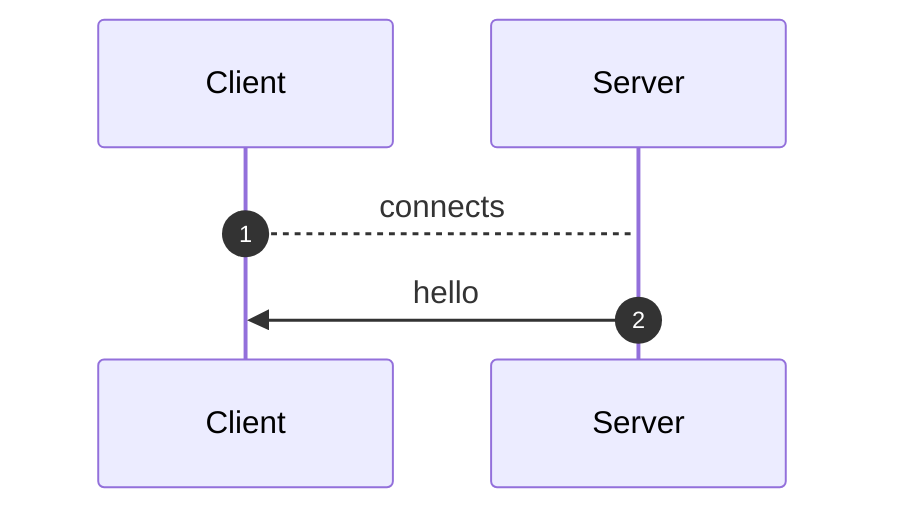
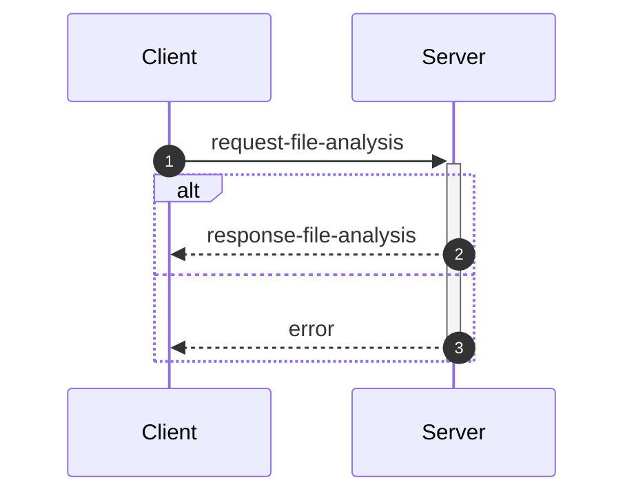
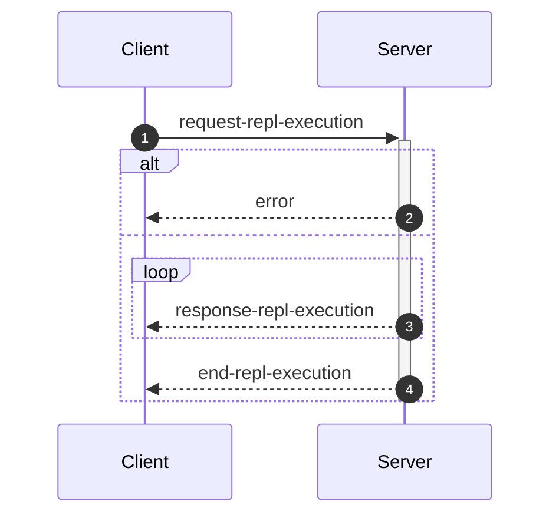
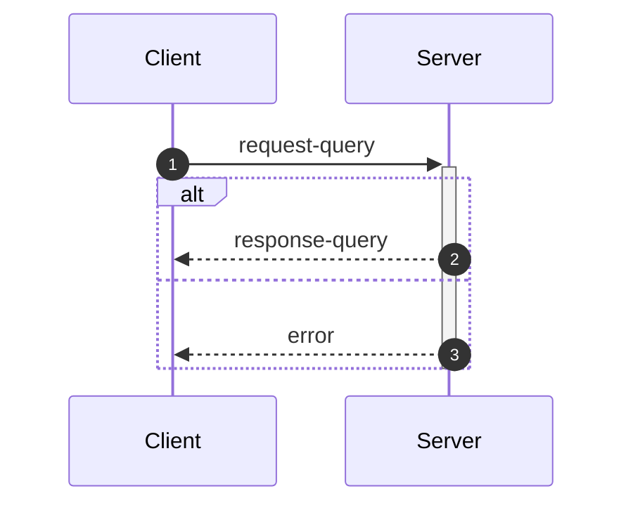

_<span title="an overview of flowR's interface">Generated</span> from '[wiki-interface.ts](https://github.com/flowr-analysis/flowr/tree/main/src/documentation/wiki-interface.ts "src/documentation/wiki-interface.ts")' on 2026-11-13, 12:11:51 UTC (v2.17.6, R v4.5.0), do not edit directly._

Although far from being as detailed as the in-depth explanation of [_flowR_](https://github.com/flowr-analysis/flowr/wiki/Core),
this wiki page explains how to interface with _flowR_ in more detail.
In general, command line arguments and other options provide short descriptions on hover over.

* [💻 Using the REPL](#using-the-repl)
* [⚙️ Configuring FlowR](#configuring-flowr)
* [⚒️ Writing Code](#writing-code)
* [💬 Communicating with the Server](#communicating-with-the-server)

<a id='using-the-repl'></a>
## 💻 Using the REPL

> [!NOTE]
> To execute arbitrary R commands with a repl request, _flowR_ has to be started explicitly with <span title="Description (Command Line Argument): Allow to access the underlying R session when using flowR (security warning: this allows the execution of arbitrary R code!)">`--r-session-access`</span>.
> Please be aware that this introduces a security risk and note that this relies on the [`r-shell` engine](https://github.com/flowr-analysis/flowr/wiki/Engines) .

Although primarily meant for users to explore,
there is nothing which forbids calling _flowR_ as a subprocess to use standard-in, -output, and -error
for communication (although you can access the REPL using the server as well,
with the [REPL Request](#message-request-repl-execution) message).

The read-eval-print loop&nbsp;(REPL) works relatively simple.
You can submit an expression (using <kbd>Enter</kbd>),
which is interpreted as an R&nbsp;expression by default but interpreted as a *command* if it starts with a colon (`:`).
The best command to get started with the REPL is <span title="Description (Repl Command): Show help information (aliases: :h, :?)">`:help`</span>.
Besides, you can leave the REPL either with the command <span title="Description (Repl Command): End the repl (aliases: :q, :exit)">`:quit`</span> or by pressing <kbd>Ctrl</kbd>+<kbd>C</kbd> twice.
When writing a *command*, you may press <kbd>Tab</kbd> to get a list of completions, if available.
Multiple commands can be entered in a single line by separating them with a semicolon (`;`), e.g. `:parse "x<-2"; :df*`.
If a command is given without R code, the REPL will re-use R code given in a previous command.
The prior example will hence return first the parsed AST of the program and then the dataflow graph for `"x <- 2"`.

> [!NOTE]
> If you develop flowR, you may want to launch the repl using the `npm run main-dev` command, this way, you get a non-minified version of flowR with debug information and hot-reloading of source files.

<details>
<summary>Available Commands</summary>

We currently offer the following commands (this with a `[*]` suffix are available with and without the star):

| Command | Description |
| ------- | ----------- |
| **<span title="Description (Repl Command): End the repl (aliases: :q, :exit)">:quit</span>** | End the repl (aliases: **:<span title="Alias of ':quit'. End the repl">q</span>**, **:<span title="Alias of ':quit'. End the repl">exit</span>**) |
| **<span title="Description (Repl Command): Execute the given code as R code. This requires the `--r-session-access` flag to be set and requires the r-shell engine. (aliases: :e, :r)">:execute</span>** | Execute the given code as R code. This requires the `--r-session-access` flag to be set and requires the r-shell engine. (aliases: **:<span title="Alias of ':execute'. Execute the given code as R code. This requires the `--r-session-access` flag to be set and requires the r-shell engine.">e</span>**, **:<span title="Alias of ':execute'. Execute the given code as R code. This requires the `--r-session-access` flag to be set and requires the r-shell engine.">r</span>**) |
| **<span title="Description (Repl Command): Get mermaid code for the control-flow graph of R code (aliases: :cfg, :cf)">:controlflow[*]</span>** | Get mermaid code for the control-flow graph of R code (star: Returns the URL to mermaid.live) (aliases: **:<span title="Alias of ':controlflow'. Get mermaid code for the control-flow graph of R code">cfg</span>**, **:<span title="Alias of ':controlflow'. Get mermaid code for the control-flow graph of R code">cf</span>**) |
| **<span title="Description (Repl Command): Get mermaid code for the control-flow graph with basic blocks (aliases: :cfgb, :cfb)">:controlflowbb[*]</span>** | Get mermaid code for the control-flow graph with basic blocks (star: Returns the URL to mermaid.live) (aliases: **:<span title="Alias of ':controlflowbb'. Get mermaid code for the control-flow graph with basic blocks">cfgb</span>**, **:<span title="Alias of ':controlflowbb'. Get mermaid code for the control-flow graph with basic blocks">cfb</span>**) |
| **<span title="Description (Repl Command): Get mermaid code for the dataflow graph (aliases: :d, :df)">:dataflow[*]</span>** | Get mermaid code for the dataflow graph (star: Returns the URL to mermaid.live) (aliases: **:<span title="Alias of ':dataflow'. Get mermaid code for the dataflow graph">d</span>**, **:<span title="Alias of ':dataflow'. Get mermaid code for the dataflow graph">df</span>**) |
| **<span title="Description (Repl Command): Get mermaid code for the normalized AST of R code (aliases: :n)">:normalize[*]</span>** | Get mermaid code for the normalized AST of R code (star: Returns the URL to mermaid.live) (alias: **:<span title="Alias of ':normalize'. Get mermaid code for the normalized AST of R code">n</span>**) |
| **<span title="Description (Repl Command): Get mermaid code for the simplified dataflow graph (aliases: :ds, :dfs)">:dataflowsimple[*]</span>** | Get mermaid code for the simplified dataflow graph (star: Returns the URL to mermaid.live) (aliases: **:<span title="Alias of ':dataflowsimple'. Get mermaid code for the simplified dataflow graph">ds</span>**, **:<span title="Alias of ':dataflowsimple'. Get mermaid code for the simplified dataflow graph">dfs</span>**) |
| **<span title="Description (Repl Command): Inspect and extend the signature database: `query` (identical to :query @signature), `info <name>` for where a function comes from (identical to :query @function-info), `add <path>` to mount another database/source, `download` to fetch the full-history database. (aliases: :sig)">:signature</span>** | Inspect and extend the signature database: `query` (identical to :query @signature), `info <name>` for where a function comes from (identical to :query @function-info), `add <path>` to mount another database/source, `download` to fetch the full-history database. (alias: **:<span title="Alias of ':signature'. Inspect and extend the signature database: `query` (identical to :query @signature), `info <name>` for where a function comes from (identical to :query @function-info), `add <path>` to mount another database/source, `download` to fetch the full-history database.">sig</span>**) |
| **<span title="Description (Repl Command): Just calculates the DFG, but only prints summary info (aliases: :d#, :df#)">:dataflowsilent</span>** | Just calculates the DFG, but only prints summary info (aliases: **:<span title="Alias of ':dataflowsilent'. Just calculates the DFG, but only prints summary info">d#</span>**, **:<span title="Alias of ':dataflowsilent'. Just calculates the DFG, but only prints summary info">df#</span>**) |
| **<span title="Description (Repl Command): Prints ASCII Art of the parsed, unmodified AST (aliases: :p)">:parse</span>** | Prints ASCII Art of the parsed, unmodified AST (alias: **:<span title="Alias of ':parse'. Prints ASCII Art of the parsed, unmodified AST">p</span>**) |
| **<span title="Description (Repl Command): Prints the version of flowR as well as the current version of R">:version</span>** | Prints the version of flowR as well as the current version of R
| **<span title="Description (Repl Command): Query the given R code (use 'help' for more information)">:query[*]</span>** | Query the given R code (use 'help' for more information) (star: Similar to query, but returns the output in json format.)
| **<span title="Description (Repl Command): Returns an ASCII representation of the dataflow graph (aliases: :df!)">:dataflowascii</span>** | Returns an ASCII representation of the dataflow graph (alias: **:<span title="Alias of ':dataflowascii'. Returns an ASCII representation of the dataflow graph">df!</span>**) |
| **<span title="Description (Repl Command): Returns summarization stats for the normalized AST (aliases: :n#)">:normalize#</span>** | Returns summarization stats for the normalized AST (alias: **:<span title="Alias of ':normalize#'. Returns summarization stats for the normalized AST">n#</span>**) |
| **<span title="Description (Repl Command): Show help information (aliases: :h, :?)">:help</span>** | Show help information (aliases: **:<span title="Alias of ':help'. Show help information">h</span>**, **:<span title="Alias of ':help'. Show help information">?</span>**) |

</details>

> [!TIP]
> 
> As indicated by the examples before, all REPL commands that operate on code keep track of the state.
> Hence, if you run a command like <span title="Description (Repl Command, starred version): Returns the URL to mermaid.live; Base Command: Get mermaid code for the dataflow graph (aliases: :d*, :df*)">`:dataflow*`</span> without providing R code,
> the REPL will re-use the R code provided in a previous command.
> Likewise, doing this will benefit from incrementality!
> If you request the dataflow graph with `:df* x <- 2 * y` and then want to see the parsed AST with `:parse`,
> the REPL will re-use previously obtained information and not re-parse the code again.
> 		

Generally, many commands offer shortcut versions in the REPL. Many queries, for example, offer a shortened format (see the example below).
Of special note, the [Config Query](https://github.com/flowr-analysis/flowr/wiki/%5BQuery%5D-Config)
can be used to also modify the currently active configuration of _flowR_ within the REPL (see the [wiki page](https://github.com/flowr-analysis/flowr/wiki/%5BQuery%5D-Config) for more information).

### Example: Retrieving the Dataflow Graph

To retrieve a URL to the [mermaid](https://mermaid.js.org/) diagram of the dataflow of a given expression,
use <span title="Description (Repl Command, starred version): Returns the URL to mermaid.live; Base Command: Get mermaid code for the dataflow graph (aliases: :d*, :df*)">`:dataflow*`</span> (or <span title="Description (Repl Command): Get mermaid code for the dataflow graph (aliases: :d, :df)">`:dataflow`</span> to get the mermaid code in the cli):

```shell
$ docker run -it --rm eagleoutice/flowr # or npm run flowr 
flowR repl v2.17.6, R grammar v14 (tree-sitter engine)
R> :dataflow* y <- 1 + x
```

<details>
<summary style='color:gray'>Output</summary>

```text
https://mermaid.live/view#base64:eyJjb2RlIjoiZmxvd2NoYXJ0IFREXG4gICAgMXt7XCJgKiM5MTtSTnVtYmVyIzkzOyogKioxKipcbiAgICAgICoxLjYqICgqKmlkOiAxKiopYFwifX1cbiAgICAyKFtcImAqIzkxO1JTeW1ib2wjOTM7KiAqKngqKlxuICAgICAgKjEuMTAqICgqKmlkOiAyKiopYFwiXSlcbiAgICAzW1tcImAqIzkxO1JCaW5hcnlPcCM5MzsqIGJhc2UjNTg7IzU4OyoqIzQzOyoqXG4gICAgICAqMS42LTEwKiAoKippZDogMyoqKVxuICAgIGFyZzogKDEsIDIpYFwiXV1cbiAgICBidWlsdC1pbjpfNDNfW1wiYEJ1aWx0LUluOlxuIzQzO2BcIl1cbiAgICBzdHlsZSBidWlsdC1pbjpfNDNfIHN0cm9rZTpncmF5LGZpbGw6Z3JheSxzdHJva2Utd2lkdGg6MnB4LG9wYWNpdHk6Ljg7XG4gICAgMFtcImAqIzkxO1JTeW1ib2wjOTM7KiAqKnkqKlxuICAgICAgKjEuMSogKCoqaWQ6IDAqKiwgdjogMylgXCJdXG4gICAgNFtbXCJgKiM5MTtSQmluYXJ5T3AjOTM7KiBiYXNlIzU4OyM1ODsqKiM2MDsjNDU7KipcbiAgICAgICoxLjEtMTAqICgqKmlkOiA0KiopXG4gICAgYXJnOiAoMCwgMylgXCJdXVxuICAgIGJ1aWx0LWluOl82MF8tW1wiYEJ1aWx0LUluOlxuIzYwOyM0NTtgXCJdXG4gICAgc3R5bGUgYnVpbHQtaW46XzYwXy0gc3Ryb2tlOmdyYXksZmlsbDpncmF5LHN0cm9rZS13aWR0aDoycHgsb3BhY2l0eTouODtcbiAgICAxIC0uLT58XCJmbG93XCJ8IDJcbiAgICBsaW5rU3R5bGUgMCBzdHJva2U6Z3JheSxjb2xvcjpncmF5O1xuICAgIDIgLS4tPnxcImZsb3dcInwgM1xuICAgIGxpbmtTdHlsZSAxIHN0cm9rZTpncmF5LGNvbG9yOmdyYXk7XG4gICAgMyAtLT58XCJyZWFkcywgYXJnXCJ8IDFcbiAgICAzIC0tPnxcInJlYWRzLCBhcmdcInwgMlxuICAgIDMgLS4tPnxcImZsb3dcInwgMFxuICAgIGxpbmtTdHlsZSA0IHN0cm9rZTpncmF5LGNvbG9yOmdyYXk7XG4gICAgMyAtLi0+fFwicmVhZHMsIGNhbGxzXCJ8IGJ1aWx0LWluOl80M19cbiAgICBsaW5rU3R5bGUgNSBzdHJva2U6Z3JheTtcbiAgICAwIC0tPnxcImRlZmluZWQtYnksIGZsb3dcInwgNFxuICAgIDAgLS0+fFwiZGVmaW5lZC1ieVwifCAzXG4gICAgNCAtLT58XCJyZWFkcywgYXJnXCJ8IDNcbiAgICA0IC0tPnxcInJldHVybnMsIGFyZ1wifCAwXG4gICAgNCAtLi0+fFwicmVhZHMsIGNhbGxzXCJ8IGJ1aWx0LWluOl82MF8tXG4gICAgbGlua1N0eWxlIDEwIHN0cm9rZTpncmF5OyIsIm1lcm1haWQiOnsiYXV0b1N5bmMiOnRydWV9fQ==
```

Retrieve the dataflow graph of the expression `y <- 1 + x`. It looks like this:


<details>

<summary style="color:gray">R Code of the Dataflow Graph</summary>

The analysis ran (parse and normalize with the [tree-sitter](https://github.com/flowr-analysis/flowr/wiki/Engines) engine) in the generation environment. No [signature database](https://github.com/flowr-analysis/flowr/wiki/Signature-Database) is mounted, so `library()` attaches no exports (base-R names are still qualified, e.g., `stats::acf`). 
We encountered no unknown side effects during the analysis.

```r
y <- 1 + x
```

</details>

</details>

For small graphs like this, <span title="Description (Repl Command): Returns an ASCII representation of the dataflow graph (aliases: :df!)">`:dataflowascii`</span> also provides an ASCII representation directly in the REPL:

```shell
$ docker run -it --rm eagleoutice/flowr # or npm run flowr 
flowR repl v2.17.6, R grammar v14 (tree-sitter engine)
R> :df! y <- 1 + x
```

<details open>
<summary style='color:gray'>Output</summary>

```text
                        v<0>v
 c<4>c──────────────────| y |
 |<- |     ┌────────────v---v
 c---c     │
    │   c<3>c   0<1>0
    └───| + |───| 1 |───u<2>u
        c---c   0---0   | x |
           └────────────u---u
Edges:
3 -> 1: reads, arg          3 -> 2: reads, arg
3 -> 0: flows-to            1 -> 2: flows-to
2 -> 3: flows-to            4 -> 3: reads, arg
4 -> 0: returns, arg        0 -> 4: defined-by, flows-to
0 -> 3: defined-by
```

Retrieve the dataflow graph of the expression `y <- 1 + x` as ASCII art.

</details>

For the slicing with <span title="Description (Repl Command): Static backwards executable slicer for R">`:slicer`</span>, you have access to the same [magic comments](#slice-magic-comments) as with the [slice request](#message-request-slice).
Pass `--inline` to splice resolvable `source()` calls into the reconstruction so the slice is a single self-contained R text (the same as the static slice query's `inlineSources` flag).
See `--help` for more flags!

### Example: Interfacing with the File System

Many commands that allow for an R-expression (like <span title="Description (Repl Command, starred version): Returns the URL to mermaid.live; Base Command: Get mermaid code for the dataflow graph (aliases: :d*, :df*)">`:dataflow*`</span>) allow for a file as well
if the argument starts with `file://`.
If you are working from the root directory of the _flowR_ repository, the following gives you the parsed AST of the example file using the <span title="Description (Repl Command): Prints ASCII Art of the parsed, unmodified AST (aliases: :p)">`:parse`</span> command:

> **Watch mode**: Replace `file://` with `watch://` to enter watch mode.
> flowR runs the command immediately and then re-runs it every time the file (or any file inside the folder) changes.
> Enter any other command to leave watch mode.
> For example: `:df watch://analysis.R`

```shell
$ docker run -it --rm eagleoutice/flowr # or npm run flowr 
flowR repl v2.17.6, R grammar v14 (tree-sitter engine)
R> :parse file://test/testfiles/example.R
```

<details>
<summary style='color:gray'>Output</summary>

```text
File: test/testfiles/example.R

program
├ binaryoperator
│ ├ identifier "sum" (1:1─4)
│ ├ <- "<-" (1:5─7)
│ ╰ float "0" (1:8─9)
├ binaryoperator
│ ├ identifier "product" (2:1─8)
│ ├ <- "<-" (2:9─11)
│ ╰ float "1" (2:12─13)
├ binaryoperator
│ ├ identifier "w" (3:1─2)
│ ├ <- "<-" (3:3─5)
│ ╰ float "7" (3:6─7)
├ binaryoperator
│ ├ identifier "N" (4:1─2)
│ ├ <- "<-" (4:3─5)
│ ╰ float "10" (4:6─8)
├ forstatement
│ ├ for "for" (6:1─4)
│ ├ ( "(" (6:5─6)
│ ├ identifier "i" (6:6─7)
│ ├ in "in" (6:8─10)
│ ├ binaryoperator
│ │ ├ float "1" (6:11─12)
│ │ ├ : ":" (6:12─13)
│ │ ╰ parenthesizedexpression
│ │   ├ ( "(" (6:13─14)
│ │   ├ binaryoperator
│ │   │ ├ identifier "N" (6:14─15)
│ │   │ ├ - "-" (6:15─16)
│ │   │ ╰ float "1" (6:16─17)
│ │   ╰ ) ")" (6:17─18)
│ ├ ) ")" (6:18─19)
│ ╰ bracedexpression
│   ├ { "{" (6:20─21)
│   ├ binaryoperator
│   │ ├ identifier "sum" (7:3─6)
│   │ ├ <- "<-" (7:7─9)
│   │ ╰ binaryoperator
│   │   ├ binaryoperator
│   │   │ ├ identifier "sum" (7:10─13)
│   │   │ ├ + "+" (7:14─15)
│   │   │ ╰ identifier "i" (7:16─17)
│   │   ├ + "+" (7:18─19)
│   │   ╰ identifier "w" (7:20─21)
│   ├ binaryoperator
│   │ ├ identifier "product" (8:3─10)
│   │ ├ <- "<-" (8:11─13)
│   │ ╰ binaryoperator
│   │   ├ identifier "product" (8:14─21)
│   │   ├  "" (8:22─23)
│   │   ╰ identifier "i" (8:24─25)
│   ╰ } "}" (9:1─2)
├ call
│ ├ identifier "cat" (11:1─4)
│ ╰ arguments
│   ├ ( "(" (11:4─5)
│   ├ argument
│   │ ╰ string
│   │   ├ stringopen "\"" (11:5─6)
│   │   ├ stringcontent "Sum:" (11:6─10)
│   │   ╰ stringclose "\"" (11:10─11)
│   ├ comma "," (11:11─12)
│   ├ argument
│   │ ╰ identifier "sum" (11:13─16)
│   ├ comma "," (11:16─17)
│   ├ argument
│   │ ╰ string
│   │   ├ stringopen "\"" (11:18─19)
│   │   ├ stringcontent
│   │   │ ╰ escapesequence "\\n" (11:19─21)
│   │   ╰ stringclose "\"" (11:21─22)
│   ╰ ) ")" (11:22─23)
╰ call
  ├ identifier "cat" (12:1─4)
  ╰ arguments
    ├ ( "(" (12:4─5)
    ├ argument
    │ ╰ string
    │   ├ stringopen "\"" (12:5─6)
    │   ├ stringcontent "Product:" (12:6─14)
    │   ╰ stringclose "\"" (12:14─15)
    ├ comma "," (12:15─16)
    ├ argument
    │ ╰ identifier "product" (12:17─24)
    ├ comma "," (12:24─25)
    ├ argument
    │ ╰ string
    │   ├ stringopen "\"" (12:26─27)
    │   ├ stringcontent
    │   │ ╰ escapesequence "\\n" (12:27─29)
    │   ╰ stringclose "\"" (12:29─30)
    ╰ ) ")" (12:30─31)
```

Retrieve the parsed AST of the example file.

<details>

<summary>File Content</summary>

```r
sum <- 0
product <- 1
w <- 7
N <- 10

for (i in 1:(N-1)) {
  sum <- sum + i + w
  product <- product * i
}

cat("Sum:", sum, "\n")
cat("Product:", product, "\n")
```

</details>

As _flowR_ directly transforms this AST the output focuses on being human-readable instead of being machine-readable.
		
</details>

### Example: Run a Query

You can run any query supported by _flowR_ using the <span title="Description (Repl Command): Query the given R code (use 'help' for more information)">`:query`</span> command.
For example, to obtain the shapes of all data frames in a given piece of code, you can run:

```shell
$ docker run -it --rm eagleoutice/flowr # or npm run flowr 
flowR repl v2.17.6, R grammar v14 (tree-sitter engine)
R> :query @absint df-shape "x <- data.frame(a = 1:10, b = 1:10)\ny <- x$a"
```

<details open>
<summary style='color:gray'>Output</summary>

```text
Query: absint (1 ms)
   ╰ $12: (colnames: [{"a", "b"}, {}], cols: [2, 2], rows: [10, 10])
   ╰ $0: (colnames: [{"a", "b"}, {}], cols: [2, 2], rows: [10, 10])
```

Retrieve the shapes of all data frames in the given code.

</details>

To run the linter on a file, you can use (in this example, we just issue the `dead-code` linter on a small piece of code):

```shell
$ docker run -it --rm eagleoutice/flowr # or npm run flowr 
flowR repl v2.17.6, R grammar v14 (tree-sitter engine)
R> :query @linter rules:dead-code "if(FALSE) x <- 2"
```

<details open>
<summary style='color:gray'>Output</summary>

```text
Query: linter (2 ms)
   ╰ Dead Code (dead-code):
       ╰ certain:
           ╰ Code at 1.11-16 (1 quick fix(es) available)
```

Run the linter on the given code, with only the `dead-code` rule enabled.

</details>

For more information on the available queries, please check out the [Query API](https://github.com/flowr-analysis/flowr/wiki/Query-API).

<a id='configuring-flowr'></a>
## ⚙️ Configuring FlowR

When running _flowR_, you may want to specify some behaviors with a dedicated configuration file.
By default, flowR looks for a file named `flowr.json` in the current working directory (or any higher directory).
You can also specify a different file with <span title="Description (Command Line Argument): The name of the configuration file to use">`--config-file`</span> or pass the configuration inline using <span title="Description (Command Line Argument): The flowR configuration to use, as a JSON string">`--config-json`</span>.
A `flowr.json` found this way belongs to the analyzed project, so flowR ignores its options that decide what flowR executes or loads
(`engines.*.wasmPath`, `engines.*.treeSitterWasmPath`, `engines.*.rPath`, `solver.sigdb.additionalPaths`, `solver.sigdb.downloadRepo`, `solver.sigdb.installedLibrary.paths`, `solver.sigdb.onDemand.enabled`, `solver.sigdb.onDemand.repositories`, `solver.sigdb.onDemand.cranMirror`, `solver.sigdb.onDemand.bioconductorMirror`, `solver.sigdb.onDemand.cacheDir`),
unless you pass <span title="Description (Command Line Argument): Keep the security-sensitive options (e.g., the R executable) of the flowr.json found in the working directory or a parent. Only use this for projects you trust.">`--trust-config`</span>.
To analyze code you do not trust, use the secure mode (<span title="Description (Command Line Argument): Run in secure mode for analyzing untrusted code: flowR does not start R (or any other process), does not access the network, does not search for project configs, and ignores security-sensitive options in every config. Cannot be disabled once enabled. Can also be enabled with the environment variable {italic FLOWR_SECURE_MODE=1}.">`--secure`</span>, see the [security policy](https://github.com/flowr-analysis/flowr/blob/main/.github/SECURITY.md)).
To inspect the current configuration, you can run flowr with the <span title="Description (Command Line Argument): Run with verbose logging (will be passed to the corresponding script)">`--verbose`</span> flag, or use the `config` [Query](https://github.com/flowr-analysis/flowr/wiki/Query-API).
Within the REPL this works by running the following:

```shell
:query @config
```

To work with the <a href="https://github.com/flowr-analysis/flowr/tree/main/src/config.ts#L125"><code><span title="The configuration file format for flowR.">FlowrConfig</span></code></a> you can use the provided helper objects alongside its methods like
<a href="https://github.com/flowr-analysis/flowr/tree/main/src/config.ts#L991"><code><span title="Creates a new flowr config that has the updated values.">FlowrConfig::<b>amend</b></span></code></a>.
The schema below documents every option; the ones you most likely want are:

- <a href="https://github.com/flowr-analysis/flowr/wiki/Interface#configuring-flowr" title="Configuration Option (boolean): Whether source calls should be ignored, causing {@link processSourceCall}&#39;s behavior to be skipped.">ignoreSourceCalls</a>: ignore source calls when analyzing the code, i.e., ignore the inclusion of other files.
- <a href="https://github.com/flowr-analysis/flowr/wiki/Interface#configuring-flowr" title="Configuration Option (boolean): Whether load calls should be ignored, causing {@link processLoadCall}&#39;s behavior to be skipped.">ignoreLoadCalls</a>: ignore load calls when analyzing the code, i.e., ignore the loading of r-data files.
- <a href="https://github.com/flowr-analysis/flowr/wiki/Interface#configuring-flowr" title="Configuration Option (object): Do you want to overwrite (parts) of the builtin definition?">semantics.environment.overwriteBuiltIns</a>: overwrite _flowR_'s handling of built-in functions, or clear the preset definitions entirely.
  See [Configure BuiltIn Semantics](#configure-builtin-semantics) for more information.
- <a href="https://github.com/flowr-analysis/flowr/wiki/Interface#configuring-flowr" title="Configuration Option (boolean): Whether calls drawing on a graphics device (e.g., `plot`) count as writing to it, which the ambient state queries then report.">semantics.ambient.drawingWritesDevice</a>: whether calls drawing on a graphics device (e.g., `plot`) count as writing the device in the ambient state queries.
- <a href="https://github.com/flowr-analysis/flowr/wiki/Interface#configuring-flowr" title="Configuration Option (string): How to resolve variables and their values. (one of &quot;disabled&quot;, &quot;alias&quot;, &quot;builtin&quot;)">solver.variables</a>: how to resolve variables and their values (`disabled`, `alias`, `builtin`).
- <a href="https://github.com/flowr-analysis/flowr/wiki/Interface#configuring-flowr" title="Configuration Option (array): The engine or set of engines to use for interacting with R code. An empty array means all available engines will be used.">engines</a> and <a href="https://github.com/flowr-analysis/flowr/wiki/Interface#configuring-flowr" title="Configuration Option (string): The default engine to use for interacting with R code. If this is undefined, an arbitrary engine from the specified list will be used. (one of &quot;tree-sitter&quot;, &quot;r-shell&quot;)">defaultEngine</a>: the engines used to interact with R code, see the [Engines wiki page](https://github.com/flowr-analysis/flowr/wiki/Engines).
- <a href="https://github.com/flowr-analysis/flowr/wiki/Interface#configuring-flowr" title="Configuration Option (array): Files a framework loads on its own, without any source() call (e.g. global.R in a shiny app), in the order they are loaded; flowR orders the matching project files accordingly and analyzes them as one program. Entries are case-insensitive globs matched against the file path, a plain name matches any file with that name, and entries matching no project file are warned about. Usually set per project kind via specializeConfig.">project.implicitSources</a>: the files a framework loads without any `source()` call, in the order in which they are
  loaded. Entries are globs (e.g. `R/*.R`) matched against the file path ignoring capitalization; one matching no file is reported.
- <a href="https://github.com/flowr-analysis/flowr/wiki/Interface#configuring-flowr" title="Configuration Option (object): Overwrite (parts of) the configuration depending on the project kind flowR detects, e.g. to give a shiny app its implicit sources.">specializeConfig</a>: overwrite (parts of) the configuration depending on the kind of project _flowR_ detects
  (e.g. `shiny-app`), which is how a shiny app gets its implicit sources by default. What you configure directly wins.
- <a href="https://github.com/flowr-analysis/flowr/wiki/Interface#configuring-flowr" title="Configuration Option (string): Overwrite the project kind flowR would otherwise infer from the analyzed files, e.g. when auto-detection guesses wrong. (one of &quot;package&quot;, &quot;script&quot;, &quot;shiny-app&quot;, &quot;notebook&quot;, &quot;project&quot;, &quot;unknown&quot;)">project.useProjectType</a>: skip that detection and force a project kind yourself, when auto-detection guesses wrong.
- <a href="https://github.com/flowr-analysis/flowr/wiki/Interface#configuring-flowr" title="Configuration Option (array): The default plugins to load when creating a new instance of FlowrAnalyzer">defaultPlugins</a> and <a href="https://github.com/flowr-analysis/flowr/wiki/Interface#configuring-flowr" title="Configuration Option (array): The plugins to load in REPL mode">repl.plugins</a>: the plugins to load for a new <a href="https://github.com/flowr-analysis/flowr/tree/main/src/project/flowr-analyzer.ts#L242"><code><span title="Central class for conducting analyses with FlowR. Use the FlowrAnalyzerBuilder to create a new instance. If you want the original pattern of creating a pipeline and running all steps, you can still do this with FlowrAnalyzer#runFull . To inspect the context of the analyzer, use FlowrAnalyzer#inspectContext (if you are a plugin and need to modify it, use FlowrAnalyzer#context instead).">FlowrAnalyzer</span></code></a> and in the REPL
  (use `flowr:default` to reference the former).

So you can configure _flowR_ by adding a file like the following:

<details>

<summary>Example Configuration File</summary>

```json
{
  "ignoreSourceCalls": true,
  "ignoreLoadCalls": true,
  "semantics": {
    "environment": {
      "overwriteBuiltIns": {
        "definitions": [
          {
            "type": "function",
            "names": [
              "foo"
            ],
            "processor": "builtin:assign",
            "config": {}
          }
        ]
      }
    }
  },
  "defaultPlugins": [
    "file:description",
    "versions:description"
  ],
  "repl": {
    "quickStats": false,
    "dfProcessorHeat": false,
    "hints": true,
    "plugins": [
      "flowr:default"
    ]
  },
  "project": {
    "resolveUnknownPathsOnDisk": true,
    "implicitSources": [
      "global.R",
      "app.R"
    ]
  },
  "linter": {
    "disabledRules": []
  },
  "specializeConfig": {
    "shiny-app": {
      "project": {
        "implicitSources": [
          "global.R",
          "ui.R",
          "server.R",
          "app.R"
        ]
      }
    }
  },
  "engines": [
    {
      "type": "r-shell"
    }
  ],
  "solver": {
    "variables": "alias",
    "evalStrings": true,
    "trackEnvironments": true,
    "sigdb": {
      "enabled": true,
      "loadProjectDependencies": true,
      "eagerlyLoad": false,
      "eagerlyLoadExports": false,
      "linkBaseR": false,
      "linkDescriptionDependencies": false
    },
    "resolveSource": {
      "dropPaths": "no",
      "ignoreCapitalization": true,
      "inferWorkingDirectory": "active-script",
      "searchPath": []
    },
    "instrument": {},
    "slicer": {
      "threshold": 50
    }
  },
  "abstractInterpretation": {
    "wideningThreshold": 4,
    "followCalls": true,
    "dataFrame": {
      "maxColNames": 20,
      "readLoadedData": {
        "readExternalFiles": true,
        "maxReadLines": 1000000
      }
    }
  },
  "incremental": {
    "alwaysIncremental": false,
    "parsing": {
      "activated": false,
      "heuristics": {
        "activated": true,
        "mtime": true,
        "linesFrom": 500,
        "bytesFrom": 50000,
        "alwaysWithEdits": false,
        "minFiles": 1
      }
    }
  },
  "gas": {
    "thresholds": {
      "memory": {
        "problematic": 0.7,
        "critical": 0.9
      },
      "timeMs": {
        "problematic": 100000,
        "critical": 120000
      }
    },
    "features": {}
  }
}
```

</details>

<details>
<a id='configure-builtin-semantics'></a>
<summary>Configure Built-In Semantics</summary>

`semantics/environment/overwriteBuiltins` accepts two keys:

- `loadDefaults` (boolean, initially `true`): If set to `true`, the default built-in definitions are loaded before applying the custom definitions. Setting this flag to `false` explicitly disables the loading of the default definitions.
- `definitions` (array, initially empty): Allows to overwrite or define new built-in elements. Each object within must have a `type` which is one of the below. Furthermore, they may define a string array of `names` which specifies the identifiers to bind the definitions to. You may use `assumePrimitive` to specify whether _flowR_ should assume that this is a primitive non-library definition (so you probably just do not want to specify the key).

  | Type            | Description                                                                                                                                                                                                                                                                                              | Example                                                                                                    |
  | --------------- | -------------------------------------------------------------------------------------------------------------------------------------------------------------------------------------------------------------------------------------------------------------------------------------------------------- | ---------------------------------------------------------------------------------------------------------- |
  | `constant`    | Additionally allows for a `value` this should resolve to.                                                                                                                                                                                                                                                | `{ type: 'constant', names: ['NULL', 'NA'],  value: null }`                                                |
  | `function`    | Is a rather flexible way to define and bind built-in functions. For the time, we do not have extensive documentation to cover all the cases, so please either consult the sources with the `default-builtin-config/` folder or open a [new issue](https://github.com/flowr-analysis/flowr/issues/new/choose). | `{ type: 'function', names: ['next'], processor: 'builtin:d', config: { cfg: ExitPointType.Next } }` |
  | `replacement` | A comfortable way to specify replacement functions like `$<-` or `names<-`. `suffixes` describes the... suffixes to attach automatically. | `{ type: 'replacement', suffixes: ['<-', '<<-'], names: ['[', '[['] }` |

</details>

<details>

<summary style='color:gray'>Full Configuration-File Schema</summary>

- _The configuration file format for flowR._ (object)
    - **logLevel** [optional] _flowR's global minimum log level, applied when the config is loaded._ (string)
        Only allows: 'silly', 'trace', 'debug', 'info', 'warn', 'error', 'fatal'
    - **ignoreSourceCalls** [optional] _Whether source calls should be ignored, causing {@link processSourceCall}'s behavior to be skipped._ (boolean)
    - **ignoreLoadCalls** [optional] _Whether load calls should be ignored, causing {@link processLoadCall}'s behavior to be skipped._ (boolean)
    - **semantics** _Configure language semantics and how flowR handles them._ (object)
        - **environment** [optional] _Semantics regarding how to handle the R environment._ (object)
            - **overwriteBuiltIns** [optional] _Do you want to overwrite (parts) of the builtin definition?_ (object)
                - **loadDefaults** [optional] _Should the default configuration still be loaded?_ (boolean)
                - **definitions** [optional] _The definitions to load/overwrite._ (array)
                Valid item types:
                    - (object)
        - **ambient** [optional] _Semantics regarding the global state (options, devices, files, ...) calls access._ (object)
            - **drawingWritesDevice** [optional] _Whether calls drawing on a graphics device (e.g., `plot`) count as writing to it, which the ambient state queries then report._ (boolean)
    - **defaultPlugins** [optional] _The default plugins to load when creating a new instance of FlowrAnalyzer_ (array)
    Valid item types:
        - (alternatives)
            - (string)
            - (array)
    - **repl** _Configuration options for the REPL._ (object)
        - **quickStats** [optional] _Whether to show quick stats in the REPL after each evaluation._ (boolean)
        - **dfProcessorHeat** [optional] _This instruments the dataflow processors to count how often each processor is called._ (boolean)
        - **hints** [optional] _Whether to show dim inline hints on the empty prompt (automatically disabled on non-interactive terminals)._ (boolean)
        - **plugins** [optional] _The plugins to load in REPL mode_ (array)
        Valid item types:
            - (alternatives)
                - (string)
                - (array)
        - **autoUseFileProtocol** [optional] _Prepend the file protocol to a repl input that looks like a path, instead of only warning about it._ (boolean)
        - **queryStats** [optional] _Whether `:query` closes with the line stating how long the queries took (`:query*` never prints it)._ (boolean)
        - **showPlugins** [optional] _Whether `:version` grays out the plugins that did not activate during the last analysis._ (boolean)
    - **project** _Project specific configuration options._ (object)
        - **resolveUnknownPathsOnDisk** [optional] _Whether to resolve unknown paths loaded by the r project disk when trying to source/analyze files._ (boolean)
        - **failOnInaccessiblePath** [optional] _Whether a directory that cannot be traversed during file discovery (e.g. due to permissions) aborts the analysis; when false (the default) such paths are logged and skipped._ (boolean)
        - **basePackages** [optional] _The packages considered part of R itself (base and recommended); if unset, flowR uses its built-in list._ (array)
        Valid item types:
            - (string)
        - **implicitSources** [optional] _Files a framework loads on its own, without any source() call (e.g. global.R in a shiny app), in the order they are loaded; flowR orders the matching project files accordingly and analyzes them as one program. Entries are case-insensitive globs matched against the file path, a plain name matches any file with that name, and entries matching no project file are warned about. Usually set per project kind via specializeConfig._ (array)
        Valid item types:
            - (string)
        - **useProjectType** [optional] _Overwrite the project kind flowR would otherwise infer from the analyzed files, e.g. when auto-detection guesses wrong._ (string)
            Only allows: 'package', 'script', 'shiny-app', 'notebook', 'project', 'unknown'
        - **assumeImplicitEcho** [optional] _Whether the top level of the analyzed code is echoed, so that every visible result printed there is collected as an output by the dependencies query (default true, false for a package)._ (boolean)
        - **discovery** [optional] _Scoping options for the default project discovery._ (object)
            - **full** [optional] _Collect every file below the project root (greedy) instead of only the files the detected project kind needs (default false)._ (boolean)
            - **perKind** [optional] _Per-kind include/exclude glob overrides layered on the default scoping._ (object)
            - **ignore** [optional] _Case-insensitive globs that drop matching files from the intelligent discovery, regardless of kind (e.g. .Renviron to ignore environment files)._ (array)
            Valid item types:
                - (string)
        - **classification** [optional] _Overrides for the signals flowR uses to classify the project kind._ (object)
            - **shinyDescriptionTypes** [optional] _DESCRIPTION Type: values that mark a shiny app._ (array)
            Valid item types:
                - (string)
            - **shinyEntryFiles** [optional] _File names a shiny app is assembled from._ (array)
            Valid item types:
                - (string)
            - **shinyUsagePattern** [optional] _Regex source evidencing shiny usage in an entry file._ (string)
            - **notebookExtensions** [optional] _File extensions marking a notebook._ (array)
            Valid item types:
                - (string)
    - **linter** _Linter configuration options._ (object)
        - **disabledRules** _Linting rule names excluded from the default rule set (a rule requested explicitly via a linter query still runs). Usually set per project kind via specializeConfig._ (array)
        Valid item types:
            - (string)
        - **disabledTags** [optional] _Linting rule tags whose rules are excluded from the default rule set (a rule requested explicitly via a linter query still runs). By default the cmd-check rules are disabled for everything but a package; a configured list replaces that default._ (array)
        Valid item types:
            - (string)
    - **inputSources** [optional] _Further frameworks the input-sources analysis should know about; entries are added to flowR's defaults._ (object)
        - **pure** [optional] _Functions that only pass the constantness of their arguments on._ (array)
        Valid item types:
            - (string)
        - **param** [optional] _Functions whose result is a 'param' input._ (array)
        Valid item types:
            - (string)
        - **file** [optional] _Functions whose result is a 'file' input._ (array)
        Valid item types:
            - (string)
        - **tempfile** [optional] _Functions whose result is a 'tempfile' input._ (array)
        Valid item types:
            - (string)
        - **glob** [optional] _Functions whose result is a 'glob' input._ (array)
        Valid item types:
            - (string)
        - **net** [optional] _Functions whose result is a 'net' input._ (array)
        Valid item types:
            - (string)
        - **rand** [optional] _Functions whose result is a 'rand' input._ (array)
        Valid item types:
            - (string)
        - **system** [optional] _Functions whose result is a 'system' input._ (array)
        Valid item types:
            - (string)
        - **ffi** [optional] _Functions whose result is a 'ffi' input._ (array)
        Valid item types:
            - (string)
        - **lang** [optional] _Functions whose result is a 'lang' input._ (array)
        Valid item types:
            - (string)
        - **options** [optional] _Functions whose result is a 'options' input._ (array)
        Valid item types:
            - (string)
        - **cmdline** [optional] _Functions whose result is a 'cmdline' input._ (array)
        Valid item types:
            - (string)
        - **user** [optional] _Functions whose result is a 'user' input._ (array)
        Valid item types:
            - (string)
        - **const** [optional] _Functions whose result is a 'const' input._ (array)
        Valid item types:
            - (string)
        - **scope** [optional] _Functions whose result is a 'scope' input._ (array)
        Valid item types:
            - (string)
        - **dconst** [optional] _Functions whose result is a 'dconst' input._ (array)
        Valid item types:
            - (string)
        - **unknown** [optional] _Functions whose result is a 'unknown' input._ (array)
        Valid item types:
            - (string)
        - **linkedObjects** [optional] _Objects a framework provides without a definition in the code, e.g. shiny's input._ (array)
        Valid item types:
            - (object)
        - **linkedEntryPoints** [optional] _Calls that hand a function to a framework, which binds its objects to the parameters by position._ (array)
        Valid item types:
            - (object)
    - **specializeConfig** [optional] _Overwrite (parts of) the configuration depending on the project kind flowR detects, e.g. to give a shiny app its implicit sources._ (object)
    - **engines** _The engine or set of engines to use for interacting with R code. An empty array means all available engines will be used._ (array)
    Valid item types:
        - (alternatives)
            - _The configuration for the tree sitter engine._ (object)
                - **type** [required] _Use the tree sitter engine._ (string)
                    Only allows: 'tree-sitter'
                - **wasmPath** [optional] _The path to the tree-sitter-r WASM binary to use. If this is undefined, this uses the default path._ (string)
                - **treeSitterWasmPath** [optional] _The path to the tree-sitter WASM binary to use. If this is undefined, this uses the default path._ (string)
                - **lax** [optional] _Whether to use the lax parser for parsing R code (allowing for syntax errors). If this is undefined, the strict parser will be used._ (boolean)
            - _The configuration for the R shell engine._ (object)
                - **type** [required] _Use the R shell engine._ (string)
                    Only allows: 'r-shell'
                - **rPath** [optional] _The path to the R executable to use. If this is undefined, this uses the default path._ (string)
                - **pipeBind** [optional] _Whether to enable R's experimental pipe-bind operator "=>" by setting _R_USE_PIPEBIND_ for the R session (default false); R itself keeps this off by default, as it is experimental and has never shipped in a release version of R._ (boolean)
    - **defaultEngine** [optional] _The default engine to use for interacting with R code. If this is undefined, an arbitrary engine from the specified list will be used._ (string)
        Only allows: 'tree-sitter', 'r-shell'
    - **solver** _How to resolve constants, constraints, cells, ..._ (object)
        - **variables** _How to resolve variables and their values._ (string)
            Only allows: 'disabled', 'alias', 'builtin'
        - **evalStrings** _Should we include eval(parse(text="...")) calls in the dataflow graph?_ (boolean)
        - **trackEnvironments** [optional] _Track user-created environments (new.env, assign/get/local with envir=, dollar-assign, attach). When false, all envir-style calls fall through conservatively._ (boolean)
        - **sigdb** _Resolving library exports from a signature database._ (object)
            - **enabled** [optional] _Resolve library()/use() exports from a signature database (default true); when false no database is consulted._ (boolean)
            - **loadProjectDependencies** [optional] _Load the project's declared dependencies from its metadata files (DESCRIPTION Imports/Depends, rproject.toml, uvr.toml, rig rproj.toml and script blocks, renv.lock, rv.lock, uvr.lock, rig lockfiles) (default true); when false these files are not read for dependencies._ (boolean)
            - **eagerlyLoad** [optional] _Parse the database up front rather than on the first package load (default false, ignored if disabled)._ (boolean)
            - **eagerlyLoadExports** [optional] _Add a vertex for every export on load rather than on demand (default false); keeps the dataflow graph small._ (boolean)
            - **assumedRVersion** [optional] _R version assumed when resolving versioned (base-R) exports: a pin like "4.5" or "auto" to detect the installed R (default "auto")._ (string)
            - **linkBaseR** [optional] _Eagerly attach base-R namespaces so bare base calls resolve without library() (default false)._ (boolean)
            - **linkBaseRCalls** [optional] _Add a lightweight Reads edge from a bare base-R call to its signature-database function vertex (default false; base-R qualification is edge-free otherwise)._ (boolean)
            - **linkPackageCalls** [optional] _Add a lightweight Reads edge from a resolved package call to its signature-database function vertex (default false)._ (boolean)
            - **linkDescriptionDependencies** [optional] _Eagerly attach the namespaces of the project's declared DESCRIPTION dependencies (Imports/Depends) so their exports resolve without an explicit library() (default false)._ (boolean)
            - **warmInBackground** [optional] _Decompress the hot shards (base + most-downloaded) in a background task on startup so the first library() lookup is warm (default false; for long-running servers/REPLs)._ (boolean)
            - **additionalPaths** [optional] _Extra directories or bundle/manifest files searched for signature databases (alongside the shipped default and $FLOWR_SIGDB_DIR); a downloaded full-history bundle placed here is mounted automatically._ (array)
            Valid item types:
                - (string)
            - **downloadRepo** [optional] _GitHub owner/repo the full-history bundle is downloaded from via ":signature download" (default "flowr-analysis/flowr"; the release tag comes from the committed sigdb.remote.json unless a version is given)._ (string)
            - **autoSync** [optional] _On startup, re-download shards whose committed sigdb.remote.json hash no longer matches the cache, in the background (default false; opt-in network sync after a git pull)._ (boolean)
            - **installedLibrary** [optional] _Recovering packages no signature database knows from the copy installed on this machine._ (object)
                - **enabled** [required] _Recover packages no signature database knows from their installed copy (default false)._ (boolean)
                - **paths** [optional] _Library directories to search; when empty they are discovered from the environment and the project._ (array)
                Valid item types:
                    - (string)
                - **useEnvironment** [optional] _Search the libraries R_LIBS_USER/R_LIBS/R_LIBS_SITE name (default true)._ (boolean)
                - **useProjectLibrary** [optional] _Search a project-local renv/packrat library (default true)._ (boolean)
                - **maxDepth** [optional] _How far to descend into the nested layout of a project-local library (default 3)._ (number)
                - **packages** [optional] _Only recover packages whose name matches one of these regular expressions; empty means any._ (array)
                Valid item types:
                    - (string)
            - **onDemand** [optional] _Recovering packages no signature database knows from their sources on CRAN, Bioconductor, or GitHub._ (object)
                - **enabled** [required] _Fetch and recover the sources of packages no signature database knows when the analyzed code uses them (default false, accesses the network)._ (boolean)
                - **sources** [optional] _Where to look, in order: github, cran, bioconductor, or a source a plugin adds (default ["github", "cran", "bioconductor"])._ (array)
                Valid item types:
                    - (string)
                - **repositories** [optional] _GitHub repositories (owner/repo[/subdir][@ref]) to fetch packages from, by package name. The analyzed project may name more (DESCRIPTION Remotes, install_github calls)._ (object)
                - **packages** [optional] _Only recover packages whose name matches one of these regular expressions, empty means any._ (array)
                Valid item types:
                    - (string)
                - **cranMirror** [optional] _The CRAN src/contrib/ to fetch from, over https (default https://cloud.r-project.org/src/contrib/). It may be on the local network._ (string)
                - **bioconductorMirror** [optional] _The Bioconductor host, over https (default https://bioconductor.org). It may be on the local network._ (string)
                - **bioconductorRelease** [optional] _The Bioconductor release to fetch from: release, devel, or a number like 3.20 (default release)._ (string)
                - **githubMirrors** [optional] _Use the GitHub mirrors of CRAN (cran/<pkg>) and Bioconductor (bioc/<pkg>) (default true)._ (boolean)
                - **maxPackages** [optional] _The most packages to fetch for one analysis (default 25)._ (number)
                - **maxArchiveMb** [optional] _The most MiB a package archive may have (default 32). It may unpack to three times that, at most 128 MiB._ (number)
                - **offline** [optional] _Only use what was fetched before, never the network (default false)._ (boolean)
                - **retryAfterHours** [optional] _How many hours to wait before asking again for a package no source had (default 24)._ (number)
                - **cacheDir** [optional] _Where to cache what was fetched (default the on-demand directory of the signature cache)._ (string)
            - **blobCacheBudgetMb** [optional] _How many MiB of decoded package blobs every open bundle may hold together (default 16)._ (number)
            - **versionSelection** [optional] _When a project constrains a dependency, resolve to the newest (default), oldest, or system-installed version satisfying it; system needs R and falls back to newest. Base-R packages always resolve against the assumed R version._ (string)
                Only allows: 'newest', 'oldest', 'system'
            - **versionOverrides** [optional] _Force an exact version for specific packages (name -> version), overriding both the project constraint and the versionSelection policy (default {})._ (object)
        - **versionManagement** _Policies for reasoning about dependency versions._ (object)
            - **linkedVersionGroups** [optional] _Groups of packages that must resolve to the same version; version guessing intersects each group so its members stay mutually compatible (default [])._ (array)
            Valid item types:
                - (array)
                Valid item types:
                    - (string)
        - **assumeAttachedPackages** [optional] _Packages to treat as attached without a `library()` call, so what the built-in configuration states about them applies to the analyzed code. The base packages R attaches on startup already resolve without it._ (array)
        Valid item types:
            - (string)
        - **transitiveSideEffectRounds** [optional] _How many rounds the transitive side-effect fixpoint may run before it is cut off (default 32); the propagation stops on its own as soon as a round adds nothing._ (number)
        - **maxOverlayDepth** [optional] _How many binding overlays may stack on one environment frame before a write flattens them (default 4); a pure performance knob, trading lookup cost against copy cost without changing any result._ (number)
        - **instrument** (object)
            - **dataflowExtractors** [optional] _These keys are only intended for use within code, allowing to instrument the dataflow analyzer!_ (any)
        - **resolveSource** [optional] _If lax source calls are active, flowR searches for sourced files much more freely, based on the configurations you give it. This option is only in effect if `ignoreSourceCalls` is set to false._ (object)
            - **dropPaths** _Allow to drop the first or all parts of the sourced path, if it is relative._ (string)
                Only allows: 'no', 'once', 'all'
            - **ignoreCapitalization** _Search for filenames matching in the lowercase._ (boolean)
            - **inferWorkingDirectory** _Try to infer the working directory from the main or any script to analyze._ (string)
                Only allows: 'no', 'main-script', 'active-script', 'any-script'
            - **searchPath** _Additionally search in these paths._ (array)
            Valid item types:
                - (string)
            - **repeatedSourceLimit** [optional] _How often the same file can be sourced within a single run? Please be aware: in case of cyclic sources this may not reach a fixpoint so give this a sensible limit._ (number)
            - **applyReplacements** _Provide name replacements for loaded files_ (array)
            Valid item types:
                - (object)
            - **assumeFilesExist** [optional] _Assume a sourced file is always there, making what it defines certain instead of conditional on the source call._ (boolean)
        - **slicer** [optional] _The configuration for the slicer._ (object)
            - **threshold** [optional] _The maximum number of iterations to perform on a single function call during slicing._ (number)
            - **autoExtend** [optional] _If set, the slicer will gain an additional post-pass._ (boolean)
    - **abstractInterpretation** _The configuration options for abstract interpretation._ (object)
        - **wideningThreshold** _The threshold for the number of visitations of a node at which widening should be performed to ensure the termination of the fixpoint iteration._ (number)
        - **followCalls** _Whether the abstract interpretation is interprocedural, i.e. whether it steps into the functions a call may dispatch to._ (boolean)
        - **dataFrame** _The configuration of the shape inference for data frames._ (object)
            - **maxColNames** _The maximum number of columns names to infer for data frames before over-approximating the column names to top._ (number)
            - **readLoadedData** _Configuration options for reading data frame shapes from loaded external data files, such as CSV files._ (object)
                - **readExternalFiles** _Whether data frame shapes should be extracted from loaded external files, such as CSV files._ (boolean)
                - **maxReadLines** _The maximum number of lines to read when extracting data frame shapes from loaded files, such as CSV files._ (number)
    - **incremental** (object)
        - **alwaysIncremental** _Always take the incremental path, regardless of heuristics._ (boolean)
        - **parsing** (object)
            - **activated** _If set, incremental parsing will be used._ (boolean)
            - **heuristics** (object)
                - **activated** [optional] _If set, the heuristics for incremental parsing will be used._ (boolean)
                - **mtime** [optional] _Skip reparsing entirely if the file's modification time is unchanged since the last parse._ (boolean)
                - **linesFrom** [optional] _Only consider incremental parsing for files with at least this many lines._ (number)
                - **bytesFrom** [optional] _Only consider incremental parsing for files with at least this many bytes._ (number)
                - **alwaysWithEdits** [optional] _Always take the incremental path whenever there is a computed edit region, regardless of the other thresholds._ (boolean)
                - **minFiles** [optional] _Only apply these heuristics once the project has at least this many files loaded._ (number)
    - **gas** [optional] _Resource-usage guard (gas) configuration. All feature factors default to 0 (disabled). See https://github.com/flowr-analysis/flowr/wiki/Core#gas-resource-guard._ (object)
        - **thresholds** [optional] _Thresholds for all gas checks (scaled by per-feature factor), boundable per feature._ (object)
            - **memory** [optional] _Heap-usage fraction thresholds (0-1), either shared or given per feature key (with `default` covering the rest)._ (object)
                - **problematic** [optional] _Heap fraction (0-1) above which Problematic is returned, for every feature without an entry of its own._ (number)
                - **critical** [optional] _Heap fraction (0-1) above which Critical is returned, for every feature without an entry of its own._ (number)
            - **timeMs** [optional] _Elapsed analysis time thresholds in milliseconds, either shared or given per feature key (with `default` covering the rest)._ (object)
                - **problematic** [optional] _Elapsed ms above which Problematic is returned, for every feature without an entry of its own._ (number)
                - **critical** [optional] _Elapsed ms above which Critical is returned, for every feature without an entry of its own._ (number)
            - **steps** [optional] _Processed-AST-node thresholds, counted rather than sampled; only a key that arms a budget (`dataflow`) reads them._ (object)
                - **problematic** [optional] _Processed AST nodes above which Problematic is returned, for every feature without an entry of its own._ (number)
                - **critical** [optional] _Processed AST nodes above which the extraction is cut short, for every feature without an entry of its own._ (number)
            - **vertices** [optional] _Created-dataflow-vertex thresholds, counted like `steps`._ (object)
                - **problematic** [optional] _Created dataflow vertices above which Problematic is returned, for every feature without an entry of its own._ (number)
                - **critical** [optional] _Created dataflow vertices above which the extraction is cut short, for every feature without an entry of its own._ (number)
        - **features** [optional] _Per-feature sensitivity factors. 0 or absent disables gas checking for that feature. A factor of 2 makes the feature twice as sensitive. Recognised keys: `source`, `side-effect-linking`, `linter`, `slicer`, `dataflow`._ (object)
        - **countedCheckEvery** [optional] _How many counted steps pass between two accountings of an armed check, be it a dataflow budget or the slicer's traversal (default 128); trades overshoot against the cost of the check._ (number)
        - **heapProvider** [optional] _Custom heap statistics source (programmatic configs only), overriding the built-in v8/performance.memory detection._ (function)

</details>

<a id='writing-code'></a>
## ⚒️ Writing Code

_flowR_ can be used as a [module](https://www.npmjs.com/package/@eagleoutice/flowr) and offers several main classes and interfaces that are interesting for extension writers 
(see the [Visual Studio Code extension](https://marketplace.visualstudio.com/items?itemName=code-inspect.vscode-flowr) or the [Core](https://github.com/flowr-analysis/flowr/wiki/Core) wiki page for more information).

### Creating Analyses with _flowR_

Nowadays, instances of the <a href="https://github.com/flowr-analysis/flowr/tree/main/src/project/flowr-analyzer.ts#L242"><code><span title="Central class for conducting analyses with FlowR. Use the FlowrAnalyzerBuilder to create a new instance. If you want the original pattern of creating a pipeline and running all steps, you can still do this with FlowrAnalyzer#runFull . To inspect the context of the analyzer, use FlowrAnalyzer#inspectContext (if you are a plugin and need to modify it, use FlowrAnalyzer#context instead).">FlowrAnalyzer</span></code></a> should be used as central frontend to get analysis results from _flowR_.
The entry points an analysis is written against are re-exported from the package root (`import { FlowrAnalyzerBuilder } from '@eagleoutice/flowr'`);
everything else stays reachable under its own path, as in `@eagleoutice/flowr/dataflow/graph/graph`.
For example, a program slice can be created like this:

```ts
const analyzer = await new FlowrAnalyzerBuilder()
    .setEngine('tree-sitter')
    .build();
analyzer.addRequest('x <- 1\ny <- x\nx');
const { slice, reconstruct } = await analyzer.query({
    type:     'static-slice',
    criteria: ['3@x']
});
```

For more information, please have a look at the [Analyzer](https://github.com/flowr-analysis/flowr/wiki/Analyzer) wiki page, which explains how to construct and use the <a href="https://github.com/flowr-analysis/flowr/tree/main/src/project/flowr-analyzer.ts#L242"><code><span title="Central class for conducting analyses with FlowR. Use the FlowrAnalyzerBuilder to create a new instance. If you want the original pattern of creating a pipeline and running all steps, you can still do this with FlowrAnalyzer#runFull . To inspect the context of the analyzer, use FlowrAnalyzer#inspectContext (if you are a plugin and need to modify it, use FlowrAnalyzer#context instead).">FlowrAnalyzer</span></code></a> in more detail.
To work with specific perspectives, you can also consult the respective pages like the [Dataflow Graph](https://github.com/flowr-analysis/flowr/wiki/Dataflow-Graph) or the [Abstract Interpretation](https://github.com/flowr-analysis/flowr/wiki/Abstract-Interpretation) wiki pages.
### The Pipeline Executor (Low-Level Interface)

Once, in the beginning, _flowR_ was meant to produce a dataflow graph merely to provide *program slices*. 
However, with continuous updates, the [Dataflow Graph](https://github.com/flowr-analysis/flowr/wiki/Dataflow-Graph) repeatedly proves to be the more interesting part.
With this, we restructured _flowR_'s originally *hardcoded* pipeline to be far more flexible. 
Now, it can be theoretically extended or replaced with arbitrary steps, optional steps, and what we call 'decorations' of these steps. 
In short, a slicing pipeline using the <a href="https://github.com/flowr-analysis/flowr/tree/main/src/core/pipeline-executor.ts#L97"><code><span title="**Please note:** The PipelineExecutor is now considered to be a rather low-level API for flowR. While it still works and is the basis for all other layers, we strongly recommend using the FlowrAnalyzer and its builder to create and use an analyzer instance that is pre-configured for your use-case. The pipeline executor allows to execute arbitrary pipelines in a step-by-step fashion. If you are not...">PipelineExecutor</span></code></a> looks like this:

```ts

const slicer = new PipelineExecutor(DEFAULT_SLICING_PIPELINE, {
  parser:    new RShell(),
  request:   requestFromInput('x <- 1\nx + 1'),
  criterion: ['2@x']
})
const slice = await slicer.allRemainingSteps()
// console.log(slice.reconstruct.code)
```

<details><summary>More Information</summary>

If you compare this, with what you would have done with the old (and removed) `SteppingSlicer`, 
this essentially just requires you to replace the `SteppingSlicer` with the <a href="https://github.com/flowr-analysis/flowr/tree/main/src/core/pipeline-executor.ts#L97"><code><span title="**Please note:** The PipelineExecutor is now considered to be a rather low-level API for flowR. While it still works and is the basis for all other layers, we strongly recommend using the FlowrAnalyzer and its builder to create and use an analyzer instance that is pre-configured for your use-case. The pipeline executor allows to execute arbitrary pipelines in a step-by-step fashion. If you are not...">PipelineExecutor</span></code></a>
and to pass the <a href="https://github.com/flowr-analysis/flowr/tree/main/src/core/steps/pipeline/default-pipelines.ts#L18"><code>DEFAULT_SLICING_PIPELINE</code></a> as the first argument.
The <a href="https://github.com/flowr-analysis/flowr/tree/main/src/core/pipeline-executor.ts#L97"><code><span title="**Please note:** The PipelineExecutor is now considered to be a rather low-level API for flowR. While it still works and is the basis for all other layers, we strongly recommend using the FlowrAnalyzer and its builder to create and use an analyzer instance that is pre-configured for your use-case. The pipeline executor allows to execute arbitrary pipelines in a step-by-step fashion. If you are not...">PipelineExecutor</span></code></a>...

1. Provides structures to investigate the results of all intermediate steps
2. Can be executed step-by-step
3. Can repeat steps (e.g., to calculate multiple slices on the same input)

See the in-code documentation for more information.

</details>

### Using the <a href="https://github.com/flowr-analysis/flowr/tree/main/src/r-bridge/shell.ts#L144"><code><span title="The RShell represents an interactive session with the R interpreter. You can configure it by RShellOptions . At the moment we are using a live R session (and not networking etc.) to communicate with R easily, which allows us to install packages etc. However, this might and probably will change in the future (leaving this as a legacy mode :D)">RShell</span></code></a> to Interact with R

The <a href="https://github.com/flowr-analysis/flowr/tree/main/src/r-bridge/shell.ts#L144"><code><span title="The RShell represents an interactive session with the R interpreter. You can configure it by RShellOptions . At the moment we are using a live R session (and not networking etc.) to communicate with R easily, which allows us to install packages etc. However, this might and probably will change in the future (leaving this as a legacy mode :D)">RShell</span></code></a> class allows interfacing with the `R`&nbsp;ecosystem installed on the host system.
Please have a look at [flowR's Engines](https://github.com/flowr-analysis/flowr/wiki/Engines) for more information on alternatives (for example, the <a href="https://github.com/flowr-analysis/flowr/tree/main/src/r-bridge/lang-4.x/tree-sitter/tree-sitter-executor.ts#L29"><code><span title="Synchronous and (way) faster alternative to the RShell using tree-sitter.">TreeSitterExecutor</span></code></a>).

> [!IMPORTANT]
> 
> Each <a href="https://github.com/flowr-analysis/flowr/tree/main/src/r-bridge/shell.ts#L144"><code><span title="The RShell represents an interactive session with the R interpreter. You can configure it by RShellOptions . At the moment we are using a live R session (and not networking etc.) to communicate with R easily, which allows us to install packages etc. However, this might and probably will change in the future (leaving this as a legacy mode :D)">RShell</span></code></a> controls a new instance of the R&nbsp;interpreter, 
> make sure to call <code><a href="https://github.com/flowr-analysis/flowr/tree/main/src/r-bridge/shell.ts#L350"><span title="Close the current R session, makes the object effectively invalid (can no longer be reopened etc.)">RShell::<i>close</i></span></a>()</code> when you are done.

You can start a new "session" by constructing a new object with <code>new <a href="https://github.com/flowr-analysis/flowr/tree/main/src/r-bridge/shell.ts#L144"><span title="The RShell represents an interactive session with the R interpreter. You can configure it by RShellOptions . At the moment we are using a live R session (and not networking etc.) to communicate with R easily, which allows us to install packages etc. However, this might and probably will change in the future (leaving this as a legacy mode :D)">RShell</span></a>()</code>.

However, there are several options that may be of interest 
(e.g., to automatically revive the shell in case of errors or to control the name location of the R process on the system).

With a shell object (let's call it `shell`), you can execute R code by using <a href="https://github.com/flowr-analysis/flowr/tree/main/src/r-bridge/shell.ts#L213"><code><span title="sends the given command directly to the current R session will not do anything to alter input markers!">RShell::<i>sendCommand</i></span></code></a>,
for example <code>shell.<a href="https://github.com/flowr-analysis/flowr/tree/main/src/r-bridge/shell.ts#L213"><span title="sends the given command directly to the current R session will not do anything to alter input markers!">sendCommand</span></a>("1 + 1")</code>.
However, this does not return anything, so if you want to collect the output of your command, use
<a href="https://github.com/flowr-analysis/flowr/tree/main/src/r-bridge/shell.ts#L296"><code><span title="Send a command and collect the output">RShell::<i>sendCommandWithOutput</i></span></code></a> instead.

<a id='communicating-with-the-server'></a>
## 💬 Communicating with the Server

As explained in the [Overview](https://github.com/flowr-analysis/flowr/wiki/Overview), you can run the [TCP](https://de.wikipedia.org/wiki/Transmission_Control_Protocol)&nbsp;server by adding the <span title="Description (Command Line Argument): Do not drop into a repl, but instead start a server on the given port (default: 1042) and listen for messages.">`--server`</span> flag (and, due to the interactive mode, exit with the conventional <kbd>CTRL</kbd>+<kbd>C</kbd>).
Currently, every connection is handled by the same underlying `RShell` - so the server is not designed to handle many clients at a time.
Additionally, the server is not well guarded against attacks (e.g., you can theoretically spawn an arbitrary number of&nbsp;RShell sessions on the target machine).

Every message has to be given in a single line (i.e., without a newline in-between) and end with a newline character. Nevertheless, we will pretty-print example given in the following segments for the ease of reading.

> [!NOTE]
> 
> The default <span title="Description (Command Line Argument): Do not drop into a repl, but instead start a server on the given port (default: 1042) and listen for messages.">`--server`</span> uses a simple [TCP](https://de.wikipedia.org/wiki/Transmission_Control_Protocol)
> connection. If you want _flowR_ to expose a [WebSocket](https://de.wikipedia.org/wiki/WebSocket) server instead, add the <span title="Description (Command Line Argument): If the server flag is set, use websocket for messaging">`--ws`</span> flag (i.e., <span title="Description (Command Line Argument): Do not drop into a repl, but instead start a server on the given port (default: 1042) and listen for messages.">`--server`</span> <span title="Description (Command Line Argument): If the server flag is set, use websocket for messaging">`--ws`</span>) when starting _flowR_ from the command line.

<ul><li>
<a id="message-hello"></a>
<b>Hello</b> Message (<code>hello</code>) 
<details>

<summary style="color:gray"> View Details. <i>The server informs the client about the successful connection and provides Meta-Information.</i> </summary>



After launching _flowR_, for example, with <code>docker run -it --rm eagleoutice/flowr <span title="Description (Command Line Argument): Do not drop into a repl, but instead start a server on the given port (default: 1042) and listen for messages.">-<span/>-server</span></code>&nbsp;(🐳️), connecting should present you with a `hello` message, that amongst others should reveal the versions of&nbsp;_flowR_ and&nbsp;R, using the [semver 2.0](https://semver.org/spec/v2.0.0.html) versioning scheme.
The message looks like this:

```json
{
  "type": "hello",
  "clientName": "client-0",
  "versions": {
    "flowr": "2.17.6",
    "r": "4.5.0",
    "engine": "r-shell"
  }
}
```

There are currently a few messages that you can send after the hello message.
If you want to _slice_ a piece of R code you first have to send an [analysis request](#message-request-file-analysis), so that you can send one or multiple slice requests afterward.
Requests for the [REPL](#message-request-repl-execution) are independent of that.
	
<hr>

<details>
<summary style="color:gray">Message schema (<code>hello</code>)</summary>

For the definition of the hello message, please see it's implementation at [`./src/cli/repl/server/messages/message-hello.ts`](https://github.com/flowr-analysis/flowr/tree/main/src/cli/repl/server/messages/message-hello.ts).

- [required] (object)
    - **type** [required] _The type of the hello message._ (string)
        Only allows: 'hello'
    - **id** [forbidden] _The id of the message is always undefined (as it is the initial message and not requested)._ (any)
    - **clientName** [required] _A unique name that is assigned to each client. It has no semantic meaning and is only used/useful for debugging._ (string)
    - **versions** [required] (object)
        - **flowr** [required] _The version of the flowr server running in semver format._ (string)
        - **r** [required] _The version of the underlying R shell running in semver format._ (string)
        - **engine** [required] _The parser backend that is used to parse the R code._ (string)

</details>

<hr>

</details>
	</li>

<li>
<a id="message-request-file-analysis"></a>
<b>Analysis</b> Message (<code>request-file-analysis</code>) 
<details>

<summary style="color:gray"> View Details. <i>The server builds the dataflow graph for a given input file (or a set of files).</i> </summary>



The request allows the server to analyze a file and prepare it for slicing.
The message can contain a `filetoken`, which is used to identify the file in later slice or query requests (if you do not add one, the request will not be stored and therefore, it is not available for subsequent requests).

> **Please note!**\
> If you want to send and process a lot of analysis requests, but do not want to slice them, please do not pass the `filetoken` field. This will save the server a lot of memory allocation.

Furthermore, the request must contain either a `content` field to directly pass the file's content or a `filepath` field which contains the path to the file (this path must be accessible for the server to be useful).
If you add the `id` field, the answer will use the same `id` so you can match requests and the corresponding answers.
See the implementation of the request-file-analysis message for more information.

You can drop one or more stored file tokens by adding the `invalidateToken` field (a single token or an array of tokens).
The server frees the corresponding analyses _after_ it has answered the request.

> **Tip!**\
> If you only want to drop tokens, you do not need a separate message: send a `request-file-analysis` that contains _just_ the `invalidateToken` field (and no `content` or `filepath`).
> Such a request behaves like an empty file analysis and the server replies with an empty `results` object.
> Because invalidation happens after the response, you may even pass the _current_ `filetoken` in `invalidateToken` to analyze a file once and have the server forget it right after you received the results.

<details>
<summary>Example of the <code>request-file-analysis</code> Message</summary>

_Note:_ even though we pretty-print these messages, they are sent as a single line, ending with a newline.

The following lists all messages that were sent and received in case you want to reproduce the scenario:

<ol>
<li> <code>hello</code> (response)
<details> 

<summary> Show Details </summary>

The first message is always a hello message.

```json
{"type":"hello","clientName":"client-0","versions":{"flowr":"2.17.6","r":"4.5.0","engine":"r-shell"}}
```

</details>
</li>

<li> <b><code>request-file-analysis</code> (request)</b>
<details open> 

<summary> Show Details </summary>

Let's suppose you simply want to analyze the following script:
 
```r
x <- 1
x + 1
```

 For this, you can send the following request:

```json
{"type":"request-file-analysis","id":"1","filetoken":"x","content":"x <- 1\nx + 1"}
```

</details>
</li>

<li> <code>response-file-analysis</code> (response)
<details> 

<summary> Show Details </summary>

The `results` field of the response effectively contains three keys of importance:

- `parse`: which contains 1:1 the parse result in CSV format that we received from the `RShell` (i.e., the AST produced by the parser of the R interpreter).
- `normalize`: which contains the normalized AST, including ids (see the `info` field and the [Normalized AST](https://github.com/flowr-analysis/flowr/wiki/Normalized-AST) wiki page).
- `dataflow`: especially important is the `graph` field which contains the dataflow graph as a set of root vertices (see the [Dataflow Graph](https://github.com/flowr-analysis/flowr/wiki/Dataflow-Graph) wiki page).
			
_As the code is pretty long, we inhibit pretty printing and syntax highlighting (JSON, hiding built-in):_

```text
{"type":"response-file-analysis","format":"json","id":"1","results":{"parse":{"files":[{"parsed":"[1,1,1,6,7,0,\"expr\",false,\"x <- 1\"],[1,1,1,1,1,3,\"SYMBOL\",true,\"x\"],[1,1,1,1,3,7,\"expr\",false,\"x\"],[1,3,1,4,2,7,\"LEFT_ASSIGN\",true,\"<-\"],[1,6,1,6,4,5,\"NUM_CONST\",true,\"1\"],[1,6,1,6,5,7,\"expr\",false,\"1\"],[2,1,2,5,16,0,\"expr\",false,\"x + 1\"],[2,1,2,1,10,12,\"SYMBOL\",true,\"x\"],[2,1,2,1,12,16,\"expr\",false,\"x\"],[2,3,2,3,11,16,\"'+'\",true,\"+\"],[2,5,2,5,13,14,\"NUM_CONST\",true,\"1\"],[2,5,2,5,14,16,\"expr\",false,\"1\"]","filePath":"/tmp/tmp-5298-U4TT4fgQeJiK-.R"}],".meta":{}},"normalize":{"ast":{"type":"RProject","files":[{"root":{"type":"RExpressionList","children":[{"type":"RBinaryOp","location":[1,3,1,4],"lhs":{"type":"RSymbol","location":[1,1,1,1],"content":"x","lexeme":"x","info":{"fullRange":[1,1,1,1],"adToks":[],"id":0,"parent":2,"role":"bin-l","index":0,"nest":0,"file":"/tmp/tmp-5298-U4TT4fgQeJiK-.R"}},"rhs":{"location":[1,6,1,6],"lexeme":"1","info":{"fullRange":[1,6,1,6],"adToks":[],"id":1,"parent":2,"role":"bin-r","index":1,"nest":0,"file":"/tmp/tmp-5298-U4TT4fgQeJiK-.R"},"type":"RNumber","content":{"num":1,"complexNumber":false,"markedAsInt":false}},"operator":"<-","lexeme":"<-","info":{"fullRange":[1,1,1,6],"adToks":[],"id":2,"parent":6,"nest":0,"file":"/tmp/tmp-5298-U4TT4fgQeJiK-.R","index":0,"role":"el-c"}},{"type":"RBinaryOp","location":[2,3,2,3],"lhs":{"type":"RSymbol","location":[2,1,2,1],"content":"x","lexeme":"x","info":{"fullRange":[2,1,2,1],"adToks":[],"id":3,"parent":5,"role":"bin-l","index":0,"nest":0,"file":"/tmp/tmp-5298-U4TT4fgQeJiK-.R"}},"rhs":{"location":[2,5,2,5],"lexeme":"1","info":{"fullRange":[2,5,2,5],"adToks":[],"id":4,"parent":5,"role":"bin-r","index":1,"nest":0,"file":"/tmp/tmp-5298-U4TT4fgQeJiK-.R"},"type":"RNumber","content":{"num":1,"complexNumber":false,"markedAsInt":false}},"operator":"+","lexeme":"+","info":{"fullRange":[2,1,2,5],"adToks":[],"id":5,"parent":6,"nest":0,"file":"/tmp/tmp-5298-U4TT4fgQeJiK-.R","index":1,"role":"el-c"}}],"info":{"adToks":[],"id":6,"nest":0,"file":"/tmp/tmp-5298-U4TT4fgQeJiK-.R","role":"root","index":0}},"filePath":"/tmp/tmp-5298-U4TT4fgQeJiK-.R"}],"info":{"id":7}},".meta":{}},"dataflow":{"unknownReferences":[],"in":[{"nodeId":2,"name":"<-","type":2},{"nodeId":5,"name":"+","type":2}],"out":[{"nodeId":0,"name":"x","type":4,"definedAt":2,"value":[1]}],"environment":{"level":0,"current":{"id":2631,"parent":"<BuiltInEnvironment>","memory":[["x",[{"nodeId":0,"name":"x","type":4,"definedAt":2,"value":[1]}]],["#sink:output",[{"nodeId":5,"name":"#sink:output","type":4,"definedAt":5,"cds":[]}]]],"globalEnv":true}},"graph":{"rootVertices":[1,0,2,3,4,5],"vertexInformation":[[1,{"tag":"value","id":1}],[0,{"tag":"vdef","id":0,"source":[1]}],[2,{"tag":"fcall","id":2,"name":"<-","onlyBuiltin":true,"args":[{"nodeId":0,"type":32},{"nodeId":1,"type":32}],"origin":["builtin:assign"]}],[3,{"tag":"use","id":3}],[4,{"tag":"value","id":4}],[5,{"tag":"fcall","id":5,"name":"+","onlyBuiltin":true,"args":[{"nodeId":3,"type":32},{"nodeId":4,"type":32}],"origin":["builtin:d"]}]],"edgeInformation":[[2,[[1,{"types":65}],[0,{"types":72}],["built-in:<-",{"types":5}],[3,{"types":4096}]]],[1,[[0,{"types":4096}]]],[0,[[2,{"types":4098}],[1,{"types":2}]]],[5,[[3,{"types":65}],[4,{"types":65}],["built-in:+",{"types":5}]]],[3,[[0,{"types":1}],[4,{"types":4096}]]],[4,[[5,{"types":4096}]]]],"_unknownSideEffects":[],"_ambientAccess":[[5,{"reads":["#options","#sink"],"writes":["#sink:output"],"assumed":[],"local":[],"kills":[]}]]},"entryPoint":2,"cfgEntry":1,"exitPoints":[{"type":0,"nodeId":5}],"hooks":[],".meta":{}}}}
```

</details>
</li>
</ol>

The complete round-trip covers validating the messages as well as starting and stopping the internal mock server.

</details>

You receive an error if, for whatever reason, the analysis fails (e.g., the message or code you sent contained syntax errors).
It contains a human-readable description *why* the analysis failed (see the error message implementation for more details).

<details>
<summary>Example Error Message</summary>

_Note:_ even though we pretty-print these messages, they are sent as a single line, ending with a newline.

The following lists all messages that were sent and received in case you want to reproduce the scenario:

<ol>
<li> <code>hello</code> (response)
<details> 

<summary> Show Details </summary>

The first message is always a hello message.

```json
{"type":"hello","clientName":"client-0","versions":{"flowr":"2.17.6","r":"4.5.0","engine":"r-shell"}}
```

</details>
</li>

<li> <code>request-file-analysis</code> (request)
<details> 

<summary> Show Details </summary>

```json
{"type":"request-file-analysis","id":"1","filename":"sample.R","content":"x <-"}
```

</details>
</li>

<li> <b><code>error</code> (response)</b>
<details open> 

<summary> Show Details </summary>

```json
{"id":"1","type":"error","fatal":false,"reason":"Error while analyzing file sample.R: GuardError: unable to parse R code (see the log for more information) for request {\"request\":\"text\",\"content\":\"x <-\"}}\n Report a Bug: https://github.com/flowr-analysis/flowr/issues/new?body=%3C!%2D%2D%20Please%20describe%20your%20issue%20in%20more%20detail%20below!%20%2D%2D%3E%0A%0A%0A%3C!%2D%2D%20Automatically%20generated%20issue%20metadata%2C%20please%20do%20not%20edit%20or%20delete%20content%20below%20this%20line%20%2D%2D%3E%0A%2D%2D%2D%0A%0AflowR%20version%3A%202.17.6%0Anode%20version%3A%20v25.6.1%0Anode%20arch%3A%20x64%0Anode%20platform%3A%20linux%0Amessage%3A%20%60unable%20to%20parse%20R%20code%20%28see%20the%20log%20for%20more%20information%29%20for%20request%20%7B%22request%22%3A%22text%22%2C%22content%22%3A%22x%20%3C%2D%22%7D%7D%60%0Astack%20trace%3A%0A%60%60%60%0A%20%20%20%20at%20guard%20%28%3C%3E%2Fsrc%2Futil%2Fassert.ts%3A128%3A9%29%0A%20%20%20%20at%20guardRetrievedOutput%20%28%3C%3E%2Fsrc%2Fr%2Dbridge%2Fretriever.ts%3A155%3A7%29%0A%20%20%20%20at%20%2Fhome%2Frunner%2Fwork%2Fflowr%2Fflowr%2Fsrc%2Fr%2Dbridge%2Fretriever.ts%3A122%3A4%0A%20%20%20%20at%20processTicksAndRejections%20%28node%3Ainternal%2Fprocess%2Ftask_queues%3A104%3A5%29%0A%20%20%20%20at%20async%20Object.parseRequests%20%5Bas%20processor%5D%20%28%3C%3E%2Fsrc%2Fr%2Dbridge%2Fparser.ts%3A115%3A19%29%0A%20%20%20%20at%20async%20PipelineExecutor.nextStep%20%28%3C%3E%2Fsrc%2Fcore%2Fpipeline%2Dexecutor.ts%3A192%3A25%29%0A%20%20%20%20at%20async%20FlowrAnalyzerCache.stepTapeUntil%20%28%3C%3E%2Fsrc%2Fproject%2Fcache%2Fflowr%2Danalyzer%2Dcache.ts%3A127%3A4%29%0A%60%60%60%0A%0A%2D%2D%2D%0A%09"}
```

</details>
</li>
</ol>

The complete round-trip covers validating the messages as well as starting and stopping the internal mock server.

</details>

&nbsp;

<a id="analysis-include-cfg"></a>
**Including the Control Flow Graph**

The control flow graph is a view on the dataflow graph: the dataflow analysis records the control flow while it walks
the program, and the graph projects those edges on demand. The server can expose that structure as well (please create
a [new issue](https://github.com/flowr-analysis/flowr/issues/new/choose) for any bug you may encounter).
For this, the analysis request may add `cfg: true` to its list of options.

<details>
<summary>Requesting a Control Flow Graph</summary>

_Note:_ even though we pretty-print these messages, they are sent as a single line, ending with a newline.

The following lists all messages that were sent and received in case you want to reproduce the scenario:

<ol>
<li> <code>hello</code> (response)
<details> 

<summary> Show Details </summary>

The first message is always a hello message.

```json
{"type":"hello","clientName":"client-0","versions":{"flowr":"2.17.6","r":"4.5.0","engine":"r-shell"}}
```

</details>
</li>

<li> <b><code>request-file-analysis</code> (request)</b>
<details open> 

<summary> Show Details </summary>

```json
{"type":"request-file-analysis","id":"1","filetoken":"x","content":"if(unknown > 0) { x <- 2 } else { x <- 5 }\nfor(i in 1:x) { print(x); print(i) }","cfg":true}
```

</details>
</li>

<li> <code>response-file-analysis</code> (response)
<details> 

<summary> Show Details </summary>

The response looks basically the same as a response sent without the `cfg` flag. However, additionally it contains a `cfg` field. 
If you are interested in a visual representation of the control flow graph, see the 
[visualization with mermaid](https://mermaid.live/view#base64:eyJjb2RlIjoiZmxvd2NoYXJ0IFREXG4gICAgbjAoW1wiYFJTeW1ib2wgKDApXG4qKnVua25vd24qKmBcIl0pXG4gICAgbjEoW1wiYFJOdW1iZXIgKDEpXG4qKjAqKmBcIl0pXG4gICAgbjIoW1wiYFJCaW5hcnlPcCAoMilcbioqdW5rbm93biAjNjI7IDAqKmBcIl0pXG4gICAgbjYoW1wiYFJOdW1iZXIgKDYpXG4qKjIqKmBcIl0pXG4gICAgbjUoW1wiYFJTeW1ib2wgKDUpXG4qKngqKmBcIl0pXG4gICAgbjdbXCJgUkJpbmFyeU9wICg3KVxuKip4ICM2MDsjNDU7IDIqKmBcIl1cbiAgICBuOChbXCJgUkV4cHJlc3Npb25MaXN0ICg4KWBcIl0pXG4gICAgbjEyKFtcImBSTnVtYmVyICgxMilcbioqNSoqYFwiXSlcbiAgICBuMTEoW1wiYFJTeW1ib2wgKDExKVxuKip4KipgXCJdKVxuICAgIG4xM1tcImBSQmluYXJ5T3AgKDEzKVxuKip4ICM2MDsjNDU7IDUqKmBcIl1cbiAgICBuMTQoW1wiYFJFeHByZXNzaW9uTGlzdCAoMTQpYFwiXSlcbiAgICBuMTVbXCJgUklmVGhlbkVsc2UgKDE1KVxuKippZih1bmtub3duICM2MjsgMCkgIzEyMzsgeCAjNjA7IzQ1OyAyICMxMjU7IGVsc2UgIzEyMzsgeCAjNjA7IzQ1OyA1ICMxMjU7KipgXCJdXG4gICAgbjE2KFtcImBSU3ltYm9sICgxNilcbioqaSoqYFwiXSlcbiAgICBuMTcoW1wiYFJOdW1iZXIgKDE3KVxuKioxKipgXCJdKVxuICAgIG4xOChbXCJgUlN5bWJvbCAoMTgpXG4qKngqKmBcIl0pXG4gICAgbjE5KFtcImBSQmluYXJ5T3AgKDE5KVxuKioxIzU4O3gqKmBcIl0pXG4gICAgbjIzKFtcImBSU3ltYm9sICgyMylcbioqeCoqYFwiXSlcbiAgICBuMjVbXCJgUkZ1bmN0aW9uQ2FsbCAoMjUpXG4qKnByaW50KHgpKipgXCJdXG4gICAgbjI3KFtcImBSU3ltYm9sICgyNylcbioqaSoqYFwiXSlcbiAgICBuMjlbXCJgUkZ1bmN0aW9uQ2FsbCAoMjkpXG4qKnByaW50KGkpKipgXCJdXG4gICAgbjMwKFtcImBSRXhwcmVzc2lvbkxpc3QgKDMwKWBcIl0pXG4gICAgbjMxW1wiYFJGb3JMb29wICgzMSlcbioqZm9yKGkgaW4gMSM1ODt4KSAjMTIzOyBwcmludCh4KTsgcHJpbnQoaSkgIzEyNTsqKmBcIl1cbiAgICBuMiAtLi0+fFwiYnJhbmNoIG9uIHVua25vd24gIzYyOyAwICgyKSBpZiBUXCJ8IG42XG4gICAgbjIgLS4tPnxcImJyYW5jaCBvbiB1bmtub3duICM2MjsgMCAoMikgaWYgRlwifCBuMTJcbiAgICBuMCAtLT58XCJmbG93cyB0b1wifCBuMVxuICAgIG4xIC0tPnxcImZsb3dzIHRvXCJ8IG4yXG4gICAgbjcgLS0+fFwiZmxvd3MgdG9cInwgbjhcbiAgICBuNiAtLT58XCJmbG93cyB0b1wifCBuNVxuICAgIG41IC0tPnxcImZsb3dzIHRvXCJ8IG43XG4gICAgbjggLS0+fFwiZmxvd3MgdG9cInwgbjE1XG4gICAgbjE1IC0tPnxcImZsb3dzIHRvXCJ8IG4xN1xuICAgIG4xMyAtLT58XCJmbG93cyB0b1wifCBuMTRcbiAgICBuMTIgLS0+fFwiZmxvd3MgdG9cInwgbjExXG4gICAgbjExIC0tPnxcImZsb3dzIHRvXCJ8IG4xM1xuICAgIG4xNCAtLT58XCJmbG93cyB0b1wifCBuMTVcbiAgICBuMTkgLS0+fFwiZmxvd3MgdG9cInwgbjE2XG4gICAgbjE4IC0tPnxcImZsb3dzIHRvXCJ8IG4xOVxuICAgIG4xNyAtLT58XCJmbG93cyB0b1wifCBuMThcbiAgICBuMjUgLS0+fFwiZmxvd3MgdG9cInwgbjI3XG4gICAgbjIzIC0tPnxcImZsb3dzIHRvXCJ8IG4yNVxuICAgIG4yOSAtLT58XCJmbG93cyB0b1wifCBuMzBcbiAgICBuMjcgLS0+fFwiZmxvd3MgdG9cInwgbjI5XG4gICAgbjMwIC0tPnxcImZsb3dzIHRvXCJ8IG4xNlxuICAgIG4xNiAtLi0+fFwiYnJhbmNoIG9uIGkgKDE2KSBpZiBUXCJ8IG4yM1xuICAgIG4xNiAtLi0+fFwiYnJhbmNoIG9uIGkgKDE2KSBpZiBGXCJ8IG4zMVxuICAgIHN0eWxlIG4wIHN0cm9rZTpjeWFuLHN0cm9rZS13aWR0aDo2LjVweDsgICAgc3R5bGUgbjMxIHN0cm9rZTpncmVlbixzdHJva2Utd2lkdGg6Ni41cHg7IiwibWVybWFpZCI6eyJhdXRvU3luYyI6dHJ1ZX19).
			
_As the code is pretty long, we inhibit pretty printing and syntax highlighting (JSON, hiding built-in):_

```text
{"type":"response-file-analysis","format":"json","id":"1","cfg":{"graph":{"roots":[0,1,2,6,5,7,8,12,11,13,14,15,16,17,18,19,23,25,27,29,30,31],"vtxInfos":[[0,[2,0]],[1,[2,1]],[2,[2,2]],[6,[2,6]],[5,[2,5]],[7,[1,7]],[8,[2,8]],[12,[2,12]],[11,[2,11]],[13,[1,13]],[14,[2,14]],[15,[1,15]],[16,[2,16]],[17,[2,17]],[18,[2,18]],[19,[2,19]],[23,[2,23]],[25,[1,25]],[27,[2,27]],[29,[1,29]],[30,[2,30]],[31,[1,31]]],"bbChildren":[],"edgeInfos":[[2,[[6,{"id":15,"when":true}],[12,{"id":15,"when":false}]]],[0,[[1,0]]],[1,[[2,0]]],[7,[[8,0]]],[6,[[5,0]]],[5,[[7,0]]],[8,[[15,0]]],[15,[[17,0]]],[13,[[14,0]]],[12,[[11,0]]],[11,[[13,0]]],[14,[[15,0]]],[19,[[16,0]]],[18,[[19,0]]],[17,[[18,0]]],[25,[[27,0]]],[23,[[25,0]]],[29,[[30,0]]],[27,[[29,0]]],[30,[[16,0]]],[16,[[23,{"id":31,"when":true}],[31,{"id":31,"when":false}]]]],"mayHaveBasicBlocks":false},"entryPoints":[0],"exitPoints":[31],"returns":[],"breaks":[],"nexts":[]},"results":{"parse":{"files":[{"parsed":"[1,1,1,42,38,0,\"expr\",false,\"if(unknown > 0) { x <- 2 } else { x <- 5 }\"],[1,1,1,2,1,38,\"IF\",true,\"if\"],[1,3,1,3,2,38,\"'('\",true,\"(\"],[1,4,1,14,9,38,\"expr\",false,\"unknown > 0\"],[1,4,1,10,3,5,\"SYMBOL\",true,\"unknown\"],[1,4,1,10,5,9,\"expr\",false,\"unknown\"],[1,12,1,12,4,9,\"GT\",true,\">\"],[1,14,1,14,6,7,\"NUM_CONST\",true,\"0\"],[1,14,1,14,7,9,\"expr\",false,\"0\"],[1,15,1,15,8,38,\"')'\",true,\")\"],[1,17,1,26,22,38,\"expr\",false,\"{ x <- 2 }\"],[1,17,1,17,12,22,\"'{'\",true,\"{\"],[1,19,1,24,19,22,\"expr\",false,\"x <- 2\"],[1,19,1,19,13,15,\"SYMBOL\",true,\"x\"],[1,19,1,19,15,19,\"expr\",false,\"x\"],[1,21,1,22,14,19,\"LEFT_ASSIGN\",true,\"<-\"],[1,24,1,24,16,17,\"NUM_CONST\",true,\"2\"],[1,24,1,24,17,19,\"expr\",false,\"2\"],[1,26,1,26,18,22,\"'}'\",true,\"}\"],[1,28,1,31,23,38,\"ELSE\",true,\"else\"],[1,33,1,42,35,38,\"expr\",false,\"{ x <- 5 }\"],[1,33,1,33,25,35,\"'{'\",true,\"{\"],[1,35,1,40,32,35,\"expr\",false,\"x <- 5\"],[1,35,1,35,26,28,\"SYMBOL\",true,\"x\"],[1,35,1,35,28,32,\"expr\",false,\"x\"],[1,37,1,38,27,32,\"LEFT_ASSIGN\",true,\"<-\"],[1,40,1,40,29,30,\"NUM_CONST\",true,\"5\"],[1,40,1,40,30,32,\"expr\",false,\"5\"],[1,42,1,42,31,35,\"'}'\",true,\"}\"],[2,1,2,36,84,0,\"expr\",false,\"for(i in 1:x) { print(x); print(i) }\"],[2,1,2,3,41,84,\"FOR\",true,\"for\"],[2,4,2,13,53,84,\"forcond\",false,\"(i in 1:x)\"],[2,4,2,4,42,53,\"'('\",true,\"(\"],[2,5,2,5,43,53,\"SYMBOL\",true,\"i\"],[2,7,2,8,44,53,\"IN\",true,\"in\"],[2,10,2,12,51,53,\"expr\",false,\"1:x\"],[2,10,2,10,45,46,\"NUM_CONST\",true,\"1\"],[2,10,2,10,46,51,\"expr\",false,\"1\"],[2,11,2,11,47,51,\"':'\",true,\":\"],[2,12,2,12,48,50,\"SYMBOL\",true,\"x\"],[2,12,2,12,50,51,\"expr\",false,\"x\"],[2,13,2,13,49,53,\"')'\",true,\")\"],[2,15,2,36,81,84,\"expr\",false,\"{ print(x); print(i) }\"],[2,15,2,15,54,81,\"'{'\",true,\"{\"],[2,17,2,24,64,81,\"expr\",false,\"print(x)\"],[2,17,2,21,55,57,\"SYMBOL_FUNCTION_CALL\",true,\"print\"],[2,17,2,21,57,64,\"expr\",false,\"print\"],[2,22,2,22,56,64,\"'('\",true,\"(\"],[2,23,2,23,58,60,\"SYMBOL\",true,\"x\"],[2,23,2,23,60,64,\"expr\",false,\"x\"],[2,24,2,24,59,64,\"')'\",true,\")\"],[2,25,2,25,65,81,\"';'\",true,\";\"],[2,27,2,34,77,81,\"expr\",false,\"print(i)\"],[2,27,2,31,68,70,\"SYMBOL_FUNCTION_CALL\",true,\"print\"],[2,27,2,31,70,77,\"expr\",false,\"print\"],[2,32,2,32,69,77,\"'('\",true,\"(\"],[2,33,2,33,71,73,\"SYMBOL\",true,\"i\"],[2,33,2,33,73,77,\"expr\",false,\"i\"],[2,34,2,34,72,77,\"')'\",true,\")\"],[2,36,2,36,78,81,\"'}'\",true,\"}\"]","filePath":"/tmp/tmp-5298-AHS935OCsmvS-.R"}],".meta":{}},"normalize":{"ast":{"type":"RProject","files":[{"root":{"type":"RExpressionList","children":[{"type":"RIfThenElse","condition":{"type":"RBinaryOp","location":[1,12,1,12],"lhs":{"type":"RSymbol","location":[1,4,1,10],"content":"unknown","lexeme":"unknown","info":{"fullRange":[1,4,1,10],"adToks":[],"id":0,"parent":2,"role":"bin-l","index":0,"nest":1,"file":"/tmp/tmp-5298-AHS935OCsmvS-.R"}},"rhs":{"location":[1,14,1,14],"lexeme":"0","info":{"fullRange":[1,14,1,14],"adToks":[],"id":1,"parent":2,"role":"bin-r","index":1,"nest":1,"file":"/tmp/tmp-5298-AHS935OCsmvS-.R"},"type":"RNumber","content":{"num":0,"complexNumber":false,"markedAsInt":false}},"operator":">","lexeme":">","info":{"fullRange":[1,4,1,14],"adToks":[],"id":2,"parent":15,"nest":1,"file":"/tmp/tmp-5298-AHS935OCsmvS-.R","role":"if-c"}},"then":{"type":"RExpressionList","children":[{"type":"RBinaryOp","location":[1,21,1,22],"lhs":{"type":"RSymbol","location":[1,19,1,19],"content":"x","lexeme":"x","info":{"fullRange":[1,19,1,19],"adToks":[],"id":5,"parent":7,"role":"bin-l","index":0,"nest":1,"file":"/tmp/tmp-5298-AHS935OCsmvS-.R"}},"rhs":{"location":[1,24,1,24],"lexeme":"2","info":{"fullRange":[1,24,1,24],"adToks":[],"id":6,"parent":7,"role":"bin-r","index":1,"nest":1,"file":"/tmp/tmp-5298-AHS935OCsmvS-.R"},"type":"RNumber","content":{"num":2,"complexNumber":false,"markedAsInt":false}},"operator":"<-","lexeme":"<-","info":{"fullRange":[1,19,1,24],"adToks":[],"id":7,"parent":8,"nest":1,"file":"/tmp/tmp-5298-AHS935OCsmvS-.R","index":0,"role":"el-c"}}],"grouping":[{"type":"RSymbol","location":[1,17,1,17],"content":"{","lexeme":"{","info":{"fullRange":[1,17,1,26],"adToks":[],"id":3,"parent":8,"role":"el-g","index":0,"nest":1,"file":"/tmp/tmp-5298-AHS935OCsmvS-.R"}},{"type":"RSymbol","location":[1,26,1,26],"content":"}","lexeme":"}","info":{"fullRange":[1,17,1,26],"adToks":[],"id":4,"parent":8,"role":"el-g","index":0,"nest":1,"file":"/tmp/tmp-5298-AHS935OCsmvS-.R"}}],"info":{"adToks":[],"id":8,"parent":15,"nest":1,"file":"/tmp/tmp-5298-AHS935OCsmvS-.R","index":1,"role":"if-then"}},"location":[1,1,1,2],"lexeme":"if","info":{"fullRange":[1,1,1,42],"adToks":[],"id":15,"parent":32,"nest":1,"file":"/tmp/tmp-5298-AHS935OCsmvS-.R","index":0,"role":"el-c"},"otherwise":{"type":"RExpressionList","children":[{"type":"RBinaryOp","location":[1,37,1,38],"lhs":{"type":"RSymbol","location":[1,35,1,35],"content":"x","lexeme":"x","info":{"fullRange":[1,35,1,35],"adToks":[],"id":11,"parent":13,"role":"bin-l","index":0,"nest":1,"file":"/tmp/tmp-5298-AHS935OCsmvS-.R"}},"rhs":{"location":[1,40,1,40],"lexeme":"5","info":{"fullRange":[1,40,1,40],"adToks":[],"id":12,"parent":13,"role":"bin-r","index":1,"nest":1,"file":"/tmp/tmp-5298-AHS935OCsmvS-.R"},"type":"RNumber","content":{"num":5,"complexNumber":false,"markedAsInt":false}},"operator":"<-","lexeme":"<-","info":{"fullRange":[1,35,1,40],"adToks":[],"id":13,"parent":14,"nest":1,"file":"/tmp/tmp-5298-AHS935OCsmvS-.R","index":0,"role":"el-c"}}],"grouping":[{"type":"RSymbol","location":[1,33,1,33],"content":"{","lexeme":"{","info":{"fullRange":[1,33,1,42],"adToks":[],"id":9,"parent":14,"role":"el-g","index":0,"nest":1,"file":"/tmp/tmp-5298-AHS935OCsmvS-.R"}},{"type":"RSymbol","location":[1,42,1,42],"content":"}","lexeme":"}","info":{"fullRange":[1,33,1,42],"adToks":[],"id":10,"parent":14,"role":"el-g","index":0,"nest":1,"file":"/tmp/tmp-5298-AHS935OCsmvS-.R"}}],"info":{"adToks":[],"id":14,"parent":15,"nest":1,"file":"/tmp/tmp-5298-AHS935OCsmvS-.R","index":2,"role":"if-other"}}},{"type":"RForLoop","variable":{"type":"RSymbol","location":[2,5,2,5],"content":"i","lexeme":"i","info":{"adToks":[],"id":16,"parent":31,"role":"for-var","index":0,"nest":1,"file":"/tmp/tmp-5298-AHS935OCsmvS-.R"}},"vector":{"type":"RBinaryOp","location":[2,11,2,11],"lhs":{"location":[2,10,2,10],"lexeme":"1","info":{"fullRange":[2,10,2,10],"adToks":[],"id":17,"parent":19,"role":"bin-l","index":0,"nest":1,"file":"/tmp/tmp-5298-AHS935OCsmvS-.R"},"type":"RNumber","content":{"num":1,"complexNumber":false,"markedAsInt":false}},"rhs":{"type":"RSymbol","location":[2,12,2,12],"content":"x","lexeme":"x","info":{"fullRange":[2,12,2,12],"adToks":[],"id":18,"parent":19,"role":"bin-r","index":1,"nest":1,"file":"/tmp/tmp-5298-AHS935OCsmvS-.R"}},"operator":":","lexeme":":","info":{"fullRange":[2,10,2,12],"adToks":[],"id":19,"parent":31,"nest":1,"file":"/tmp/tmp-5298-AHS935OCsmvS-.R","index":1,"role":"for-vec"}},"body":{"type":"RExpressionList","children":[{"type":"RFunctionCall","named":true,"location":[2,17,2,21],"lexeme":"print","functionName":{"type":"RSymbol","location":[2,17,2,21],"content":"print","lexeme":"print","info":{"fullRange":[2,17,2,24],"adToks":[],"id":22,"parent":25,"role":"call-name","index":0,"nest":1,"file":"/tmp/tmp-5298-AHS935OCsmvS-.R"}},"arguments":[{"type":"RArgument","location":[2,23,2,23],"lexeme":"x","value":{"type":"RSymbol","location":[2,23,2,23],"content":"x","lexeme":"x","info":{"fullRange":[2,23,2,23],"adToks":[],"id":23,"parent":24,"role":"arg-v","index":0,"nest":1,"file":"/tmp/tmp-5298-AHS935OCsmvS-.R"}},"info":{"fullRange":[2,23,2,23],"adToks":[],"id":24,"parent":25,"nest":1,"file":"/tmp/tmp-5298-AHS935OCsmvS-.R","index":1,"role":"call-arg"}}],"info":{"fullRange":[2,17,2,24],"adToks":[],"id":25,"parent":30,"nest":1,"file":"/tmp/tmp-5298-AHS935OCsmvS-.R","index":0,"role":"el-c"}},{"type":"RFunctionCall","named":true,"location":[2,27,2,31],"lexeme":"print","functionName":{"type":"RSymbol","location":[2,27,2,31],"content":"print","lexeme":"print","info":{"fullRange":[2,27,2,34],"adToks":[],"id":26,"parent":29,"role":"call-name","index":0,"nest":1,"file":"/tmp/tmp-5298-AHS935OCsmvS-.R"}},"arguments":[{"type":"RArgument","location":[2,33,2,33],"lexeme":"i","value":{"type":"RSymbol","location":[2,33,2,33],"content":"i","lexeme":"i","info":{"fullRange":[2,33,2,33],"adToks":[],"id":27,"parent":28,"role":"arg-v","index":0,"nest":1,"file":"/tmp/tmp-5298-AHS935OCsmvS-.R"}},"info":{"fullRange":[2,33,2,33],"adToks":[],"id":28,"parent":29,"nest":1,"file":"/tmp/tmp-5298-AHS935OCsmvS-.R","index":1,"role":"call-arg"}}],"info":{"fullRange":[2,27,2,34],"adToks":[],"id":29,"parent":30,"nest":1,"file":"/tmp/tmp-5298-AHS935OCsmvS-.R","index":1,"role":"el-c"}}],"grouping":[{"type":"RSymbol","location":[2,15,2,15],"content":"{","lexeme":"{","info":{"fullRange":[2,15,2,36],"adToks":[],"id":20,"parent":30,"role":"el-g","index":0,"nest":1,"file":"/tmp/tmp-5298-AHS935OCsmvS-.R"}},{"type":"RSymbol","location":[2,36,2,36],"content":"}","lexeme":"}","info":{"fullRange":[2,15,2,36],"adToks":[],"id":21,"parent":30,"role":"el-g","index":0,"nest":1,"file":"/tmp/tmp-5298-AHS935OCsmvS-.R"}}],"info":{"adToks":[],"id":30,"parent":31,"nest":1,"file":"/tmp/tmp-5298-AHS935OCsmvS-.R","index":2,"role":"for-b"}},"lexeme":"for","info":{"fullRange":[2,1,2,36],"adToks":[],"id":31,"parent":32,"nest":1,"file":"/tmp/tmp-5298-AHS935OCsmvS-.R","index":1,"role":"el-c"},"location":[2,1,2,3]}],"info":{"adToks":[],"id":32,"nest":0,"file":"/tmp/tmp-5298-AHS935OCsmvS-.R","role":"root","index":0}},"filePath":"/tmp/tmp-5298-AHS935OCsmvS-.R"}],"info":{"id":33}},".meta":{}},"dataflow":{"unknownReferences":[],"in":[{"nodeId":15,"name":"if","type":2},{"nodeId":0,"name":"unknown","type":1024},{"nodeId":2,"name":">","type":2},{"nodeId":7,"name":"<-","cds":[{"id":15,"when":true}],"type":2},{"nodeId":13,"name":"<-","cds":[{"id":15,"when":false}],"type":2},{"nodeId":8,"name":"{","cds":[{"id":15,"when":true}],"type":2},{"nodeId":14,"name":"{","cds":[{"id":15,"when":false}],"type":2},{"nodeId":31,"name":"for","type":2},{"nodeId":19,"name":":","type":2},{"nodeId":25,"name":"print","type":2},{"nodeId":29,"name":"print","type":2}],"out":[{"nodeId":5,"name":"x","type":4,"definedAt":7,"cds":[{"id":15,"when":true}],"value":[6]},{"nodeId":11,"name":"x","type":4,"definedAt":13,"cds":[{"id":15,"when":false}],"value":[12]},{"nodeId":16,"name":"i","type":1}],"environment":{"level":0,"current":{"id":2672,"parent":"<BuiltInEnvironment>","memory":[["x",[{"nodeId":5,"name":"x","type":4,"definedAt":7,"cds":[{"id":15,"when":true}],"value":[6]},{"nodeId":11,"name":"x","type":4,"definedAt":13,"cds":[{"id":15,"when":false}],"value":[12]}]],["#sink:output",[{"nodeId":15,"name":"#sink:output","type":4,"definedAt":15,"cds":[]},{"nodeId":25,"name":"#sink:output","type":4,"definedAt":25,"cds":[]},{"nodeId":29,"name":"#sink:output","type":4,"definedAt":29,"cds":[]}]],["i",[{"nodeId":16,"name":"i","type":1,"definedAt":31,"value":[19],"iterated":true}]]],"globalEnv":true}},"graph":{"rootVertices":[0,1,2,6,5,7,8,12,11,13,14,15,16,17,18,19,23,25,27,29,30,31],"vertexInformation":[[0,{"tag":"use","id":0}],[1,{"tag":"value","id":1}],[2,{"tag":"fcall","id":2,"name":">","onlyBuiltin":true,"args":[{"nodeId":0,"type":32},{"nodeId":1,"type":32}],"origin":["builtin:d"]}],[6,{"tag":"value","id":6}],[5,{"tag":"vdef","id":5,"cds":[{"id":15,"when":true}],"source":[6]}],[7,{"tag":"fcall","id":7,"name":"<-","onlyBuiltin":true,"cds":[{"id":15,"when":true}],"args":[{"nodeId":5,"type":32},{"nodeId":6,"type":32}],"origin":["builtin:assign"]}],[8,{"tag":"fcall","id":8,"name":"{","onlyBuiltin":true,"cds":[{"id":15,"when":true}],"args":[{"nodeId":7,"type":32}],"origin":["builtin:el"]}],[12,{"tag":"value","id":12}],[11,{"tag":"vdef","id":11,"cds":[{"id":15,"when":false}],"source":[12]}],[13,{"tag":"fcall","id":13,"name":"<-","onlyBuiltin":true,"cds":[{"id":15,"when":false}],"args":[{"nodeId":11,"type":32},{"nodeId":12,"type":32}],"origin":["builtin:assign"]}],[14,{"tag":"fcall","id":14,"name":"{","onlyBuiltin":true,"cds":[{"id":15,"when":false}],"args":[{"nodeId":13,"type":32}],"origin":["builtin:el"]}],[15,{"tag":"fcall","id":15,"name":"if","onlyBuiltin":true,"args":[{"nodeId":2,"type":32},{"nodeId":8,"type":32},{"nodeId":14,"type":32}],"origin":["builtin:ite"]}],[16,{"tag":"vdef","id":16,"source":[19]}],[17,{"tag":"value","id":17}],[18,{"tag":"use","id":18}],[19,{"tag":"fcall","id":19,"name":":","onlyBuiltin":true,"args":[{"nodeId":17,"type":32},{"nodeId":18,"type":32}],"origin":["builtin:d"]}],[23,{"tag":"use","id":23,"cds":[{"id":31,"when":true}]}],[25,{"tag":"fcall","id":25,"name":"print","onlyBuiltin":true,"cds":[{"id":31,"when":true}],"args":[{"nodeId":23,"type":32}],"origin":["builtin:d"]}],[27,{"tag":"use","id":27,"cds":[{"id":31,"when":true}]}],[29,{"tag":"fcall","id":29,"name":"print","onlyBuiltin":true,"cds":[{"id":31,"when":true}],"args":[{"nodeId":27,"type":32}],"origin":["builtin:d"]}],[30,{"tag":"fcall","id":30,"name":"{","onlyBuiltin":true,"cds":[{"id":31,"when":true}],"args":[{"nodeId":25,"type":32},{"nodeId":29,"type":32}],"origin":["builtin:el"]}],[31,{"tag":"fcall","id":31,"name":"for","onlyBuiltin":true,"args":[{"nodeId":16,"type":32},{"nodeId":19,"type":32},{"nodeId":30,"type":32}],"origin":["builtin:fl"]}]],"edgeInformation":[[2,[[0,{"types":65}],[1,{"types":65}],[6,{"types":8192,"cd":{"id":15,"when":true}}],[12,{"types":8192,"cd":{"id":15,"when":false}}],["built-in:>",{"types":5}]]],[0,[[1,{"types":4096}]]],[1,[[2,{"types":4096}]]],[7,[[6,{"types":65}],[5,{"types":72}],["built-in:<-",{"types":5}],[8,{"types":4096}]]],[6,[[5,{"types":4096}]]],[5,[[7,{"types":4098}],[6,{"types":2}]]],[8,[[7,{"types":72}],["built-in:{",{"types":5}],[15,{"types":4096}]]],[15,[[8,{"types":72}],[14,{"types":72}],[2,{"types":65}],["built-in:if",{"types":5}],[17,{"types":4096}]]],[13,[[12,{"types":65}],[11,{"types":72}],["built-in:<-",{"types":5}],[14,{"types":4096}]]],[12,[[11,{"types":4096}]]],[11,[[13,{"types":4098}],[12,{"types":2}]]],[14,[[13,{"types":72}],["built-in:{",{"types":5}],[15,{"types":4096}]]],[19,[[17,{"types":65}],[18,{"types":65}],[16,{"types":4096}],["built-in::",{"types":5}]]],[18,[[5,{"types":1}],[11,{"types":1}],[19,{"types":4096}]]],[17,[[18,{"types":4096}]]],[25,[[23,{"types":73}],["built-in:print",{"types":5}],[27,{"types":4096}]]],[23,[[5,{"types":1}],[11,{"types":1}],[25,{"types":4096}]]],[29,[[27,{"types":73}],["built-in:print",{"types":5}],[30,{"types":4096}]]],[27,[[16,{"types":1}],[29,{"types":4096}]]],[30,[[25,{"types":64}],[29,{"types":72}],["built-in:{",{"types":5}],[16,{"types":4096}]]],[16,[[19,{"types":2}],[23,{"types":8192,"cd":{"id":31,"when":true}}],[31,{"types":8192,"cd":{"id":31,"when":false}}]]],[31,[[16,{"types":64}],[19,{"types":65}],[30,{"types":320}],["built-in:for",{"types":5}]]]],"_unknownSideEffects":[],"_ambientAccess":[[15,{"reads":["#options","#sink"],"writes":["#sink:output"],"assumed":[],"local":[],"kills":[]}],[25,{"reads":["#option:digits","#option:width","#option:max.print","#option:digits.secs","#option:useFancyQuotes","#option:scipen","#option:OutDec","#option:*","#sink"],"writes":["#sink:output"],"assumed":[],"local":[],"kills":[]}],[29,{"reads":["#options","#sink"],"writes":["#sink:output"],"assumed":[],"local":[],"kills":[]}]]},"entryPoint":15,"cfgEntry":0,"exitPoints":[{"type":0,"nodeId":31}],"hooks":[],".meta":{}}}}
```

</details>
</li>
</ol>

The complete round-trip covers validating the messages as well as starting and stopping the internal mock server.

</details>

&nbsp;

<a id="analysis-format-n-quads"></a>
**Retrieve the Output as RDF N-Quads**

The default response is formatted as JSON.
However, by specifying `format: "n-quads"`, you can retrieve the individual results (e.g., the [Normalized AST](https://github.com/flowr-analysis/flowr/wiki/Normalized-AST)),
as [RDF N-Quads](https://www.w3.org/TR/n-quads/).
This works with and without the control flow graph as described [above](#analysis-include-cfg).

<details>
<summary>Requesting RDF N-Quads</summary>

_Note:_ even though we pretty-print these messages, they are sent as a single line, ending with a newline.

The following lists all messages that were sent and received in case you want to reproduce the scenario:

<ol>
<li> <code>hello</code> (response)
<details> 

<summary> Show Details </summary>

The first message is always a hello message.

```json
{"type":"hello","clientName":"client-0","versions":{"flowr":"2.17.6","r":"4.5.0","engine":"r-shell"}}
```

</details>
</li>

<li> <b><code>request-file-analysis</code> (request)</b>
<details open> 

<summary> Show Details </summary>

```json
{"type":"request-file-analysis","id":"1","filetoken":"x","content":"x <- 1\nx + 1","format":"n-quads","cfg":true}
```

</details>
</li>

<li> <code>response-file-analysis</code> (response)
<details> 

<summary> Show Details </summary>

The base message format is still JSON, only the individual results get converted.
While the context is derived from the `filename`, we currently offer no way to customize other parts of the quads 
(please open a [new issue](https://github.com/flowr-analysis/flowr/issues/new/choose) if you require this).

_As the code is pretty long, we inhibit pretty printing and syntax highlighting (JSON, hiding built-in):_

```text
{"type":"response-file-analysis","format":"n-quads","id":"1","cfg":"<https://uni-ulm.de/r-ast/unknown/0> <https://uni-ulm.de/r-ast/rootIds> \"1\"^^<http://www.w3.org/2001/XMLSchema#integer> <unknown> .\n<https://uni-ulm.de/r-ast/unknown/0> <https://uni-ulm.de/r-ast/rootIds> \"0\"^^<http://www.w3.org/2001/XMLSchema#integer> <unknown> .\n<https://uni-ulm.de/r-ast/unknown/0> <https://uni-ulm.de/r-ast/rootIds> \"2\"^^<http://www.w3.org/2001/XMLSchema#integer> <unknown> .\n<https://uni-ulm.de/r-ast/unknown/0> <https://uni-ulm.de/r-ast/rootIds> \"3\"^^<http://www.w3.org/2001/XMLSchema#integer> <unknown> .\n<https://uni-ulm.de/r-ast/unknown/0> <https://uni-ulm.de/r-ast/rootIds> \"4\"^^<http://www.w3.org/2001/XMLSchema#integer> <unknown> .\n<https://uni-ulm.de/r-ast/unknown/0> <https://uni-ulm.de/r-ast/rootIds> \"5\"^^<http://www.w3.org/2001/XMLSchema#integer> <unknown> .\n<https://uni-ulm.de/r-ast/unknown/0> <https://uni-ulm.de/r-ast/vertices> <https://uni-ulm.de/r-ast/unknown/1> <unknown> .\n<https://uni-ulm.de/r-ast/unknown/1> <https://uni-ulm.de/r-ast/next> <https://uni-ulm.de/r-ast/unknown/2> <unknown> .\n<https://uni-ulm.de/r-ast/unknown/1> <https://uni-ulm.de/r-ast/id> \"1\"^^<http://www.w3.org/2001/XMLSchema#integer> <unknown> .\n<https://uni-ulm.de/r-ast/unknown/0> <https://uni-ulm.de/r-ast/vertices> <https://uni-ulm.de/r-ast/unknown/2> <unknown> .\n<https://uni-ulm.de/r-ast/unknown/2> <https://uni-ulm.de/r-ast/next> <https://uni-ulm.de/r-ast/unknown/3> <unknown> .\n<https://uni-ulm.de/r-ast/unknown/2> <https://uni-ulm.de/r-ast/id> \"0\"^^<http://www.w3.org/2001/XMLSchema#integer> <unknown> .\n<https://uni-ulm.de/r-ast/unknown/0> <https://uni-ulm.de/r-ast/vertices> <https://uni-ulm.de/r-ast/unknown/3> <unknown> .\n<https://uni-ulm.de/r-ast/unknown/3> <https://uni-ulm.de/r-ast/next> <https://uni-ulm.de/r-ast/unknown/4> <unknown> .\n<https://uni-ulm.de/r-ast/unknown/3> <https://uni-ulm.de/r-ast/id> \"2\"^^<http://www.w3.org/2001/XMLSchema#integer> <unknown> .\n<https://uni-ulm.de/r-ast/unknown/0> <https://uni-ulm.de/r-ast/vertices> <https://uni-ulm.de/r-ast/unknown/4> <unknown> .\n<https://uni-ulm.de/r-ast/unknown/4> <https://uni-ulm.de/r-ast/next> <https://uni-ulm.de/r-ast/unknown/5> <unknown> .\n<https://uni-ulm.de/r-ast/unknown/4> <https://uni-ulm.de/r-ast/id> \"3\"^^<http://www.w3.org/2001/XMLSchema#integer> <unknown> .\n<https://uni-ulm.de/r-ast/unknown/0> <https://uni-ulm.de/r-ast/vertices> <https://uni-ulm.de/r-ast/unknown/5> <unknown> .\n<https://uni-ulm.de/r-ast/unknown/5> <https://uni-ulm.de/r-ast/next> <https://uni-ulm.de/r-ast/unknown/6> <unknown> .\n<https://uni-ulm.de/r-ast/unknown/5> <https://uni-ulm.de/r-ast/id> \"4\"^^<http://www.w3.org/2001/XMLSchema#integer> <unknown> .\n<https://uni-ulm.de/r-ast/unknown/0> <https://uni-ulm.de/r-ast/vertices> <https://uni-ulm.de/r-ast/unknown/6> <unknown> .\n<https://uni-ulm.de/r-ast/unknown/6> <https://uni-ulm.de/r-ast/id> \"5\"^^<http://www.w3.org/2001/XMLSchema#integer> <unknown> .\n<https://uni-ulm.de/r-ast/unknown/0> <https://uni-ulm.de/r-ast/edges> <https://uni-ulm.de/r-ast/unknown/7> <unknown> .\n<https://uni-ulm.de/r-ast/unknown/7> <https://uni-ulm.de/r-ast/next> <https://uni-ulm.de/r-ast/unknown/8> <unknown> .\n<https://uni-ulm.de/r-ast/unknown/7> <https://uni-ulm.de/r-ast/from> \"2\"^^<http://www.w3.org/2001/XMLSchema#integer> <unknown> .\n<https://uni-ulm.de/r-ast/unknown/7> <https://uni-ulm.de/r-ast/to> \"3\"^^<http://www.w3.org/2001/XMLSchema#integer> <unknown> .\n<https://uni-ulm.de/r-ast/unknown/7> <https://uni-ulm.de/r-ast/type> \"0\"^^<http://www.w3.org/2001/XMLSchema#integer> <unknown> .\n<https://uni-ulm.de/r-ast/unknown/0> <https://uni-ulm.de/r-ast/edges> <https://uni-ulm.de/r-ast/unknown/8> <unknown> .\n<https://uni-ulm.de/r-ast/unknown/8> <https://uni-ulm.de/r-ast/next> <https://uni-ulm.de/r-ast/unknown/9> <unknown> .\n<https://uni-ulm.de/r-ast/unknown/8> <https://uni-ulm.de/r-ast/from> \"1\"^^<http://www.w3.org/2001/XMLSchema#integer> <unknown> .\n<https://uni-ulm.de/r-ast/unknown/8> <https://uni-ulm.de/r-ast/to> \"0\"^^<http://www.w3.org/2001/XMLSchema#integer> <unknown> .\n<https://uni-ulm.de/r-ast/unknown/8> <https://uni-ulm.de/r-ast/type> \"0\"^^<http://www.w3.org/2001/XMLSchema#integer> <unknown> .\n<https://uni-ulm.de/r-ast/unknown/0> <https://uni-ulm.de/r-ast/edges> <https://uni-ulm.de/r-ast/unknown/9> <unknown> .\n<https://uni-ulm.de/r-ast/unknown/9> <https://uni-ulm.de/r-ast/next> <https://uni-ulm.de/r-ast/unknown/10> <unknown> .\n<https://uni-ulm.de/r-ast/unknown/9> <https://uni-ulm.de/r-ast/from> \"0\"^^<http://www.w3.org/2001/XMLSchema#integer> <unknown> .\n<https://uni-ulm.de/r-ast/unknown/9> <https://uni-ulm.de/r-ast/to> \"2\"^^<http://www.w3.org/2001/XMLSchema#integer> <unknown> .\n<https://uni-ulm.de/r-ast/unknown/9> <https://uni-ulm.de/r-ast/type> \"0\"^^<http://www.w3.org/2001/XMLSchema#integer> <unknown> .\n<https://uni-ulm.de/r-ast/unknown/0> <https://uni-ulm.de/r-ast/edges> <https://uni-ulm.de/r-ast/unknown/10> <unknown> .\n<https://uni-ulm.de/r-ast/unknown/10> <https://uni-ulm.de/r-ast/next> <https://uni-ulm.de/r-ast/unknown/11> <unknown> .\n<https://uni-ulm.de/r-ast/unknown/10> <https://uni-ulm.de/r-ast/from> \"3\"^^<http://www.w3.org/2001/XMLSchema#integer> <unknown> .\n<https://uni-ulm.de/r-ast/unknown/10> <https://uni-ulm.de/r-ast/to> \"4\"^^<http://www.w3.org/2001/XMLSchema#integer> <unknown> .\n<https://uni-ulm.de/r-ast/unknown/10> <https://uni-ulm.de/r-ast/type> \"0\"^^<http://www.w3.org/2001/XMLSchema#integer> <unknown> .\n<https://uni-ulm.de/r-ast/unknown/0> <https://uni-ulm.de/r-ast/edges> <https://uni-ulm.de/r-ast/unknown/11> <unknown> .\n<https://uni-ulm.de/r-ast/unknown/11> <https://uni-ulm.de/r-ast/from> \"4\"^^<http://www.w3.org/2001/XMLSchema#integer> <unknown> .\n<https://uni-ulm.de/r-ast/unknown/11> <https://uni-ulm.de/r-ast/to> \"5\"^^<http://www.w3.org/2001/XMLSchema#integer> <unknown> .\n<https://uni-ulm.de/r-ast/unknown/11> <https://uni-ulm.de/r-ast/type> \"0\"^^<http://www.w3.org/2001/XMLSchema#integer> <unknown> .\n<https://uni-ulm.de/r-ast/unknown/0> <https://uni-ulm.de/r-ast/entryPoints> \"1\"^^<http://www.w3.org/2001/XMLSchema#integer> <unknown> .\n<https://uni-ulm.de/r-ast/unknown/0> <https://uni-ulm.de/r-ast/exitPoints> \"5\"^^<http://www.w3.org/2001/XMLSchema#integer> <unknown> .\n","results":{"parse":"<https://uni-ulm.de/r-ast/unknown/0> <https://uni-ulm.de/r-ast/token> \"exprlist\" <unknown> .\n<https://uni-ulm.de/r-ast/unknown/0> <https://uni-ulm.de/r-ast/text> \"\" <unknown> .\n<https://uni-ulm.de/r-ast/unknown/0> <https://uni-ulm.de/r-ast/id> \"0\"^^<http://www.w3.org/2001/XMLSchema#integer> <unknown> .\n<https://uni-ulm.de/r-ast/unknown/0> <https://uni-ulm.de/r-ast/parent> \"0\"^^<http://www.w3.org/2001/XMLSchema#integer> <unknown> .\n<https://uni-ulm.de/r-ast/unknown/0> <https://uni-ulm.de/r-ast/line1> \"1\"^^<http://www.w3.org/2001/XMLSchema#integer> <unknown> .\n<https://uni-ulm.de/r-ast/unknown/0> <https://uni-ulm.de/r-ast/col1> \"1\"^^<http://www.w3.org/2001/XMLSchema#integer> <unknown> .\n<https://uni-ulm.de/r-ast/unknown/0> <https://uni-ulm.de/r-ast/line2> \"2\"^^<http://www.w3.org/2001/XMLSchema#integer> <unknown> .\n<https://uni-ulm.de/r-ast/unknown/0> <https://uni-ulm.de/r-ast/col2> \"5\"^^<http://www.w3.org/2001/XMLSchema#integer> <unknown> .\n<https://uni-ulm.de/r-ast/unknown/0> <https://uni-ulm.de/r-ast/children> <https://uni-ulm.de/r-ast/unknown/1> <unknown> .\n<https://uni-ulm.de/r-ast/unknown/1> <https://uni-ulm.de/r-ast/next> <https://uni-ulm.de/r-ast/unknown/2> <unknown> .\n<https://uni-ulm.de/r-ast/unknown/1> <https://uni-ulm.de/r-ast/line1> \"1\"^^<http://www.w3.org/2001/XMLSchema#integer> <unknown> .\n<https://uni-ulm.de/r-ast/unknown/1> <https://uni-ulm.de/r-ast/col1> \"1\"^^<http://www.w3.org/2001/XMLSchema#integer> <unknown> .\n<https://uni-ulm.de/r-ast/unknown/1> <https://uni-ulm.de/r-ast/line2> \"1\"^^<http://www.w3.org/2001/XMLSchema#integer> <unknown> .\n<https://uni-ulm.de/r-ast/unknown/1> <https://uni-ulm.de/r-ast/col2> \"6\"^^<http://www.w3.org/2001/XMLSchema#integer> <unknown> .\n<https://uni-ulm.de/r-ast/unknown/1> <https://uni-ulm.de/r-ast/id> \"7\"^^<http://www.w3.org/2001/XMLSchema#integer> <unknown> .\n<https://uni-ulm.de/r-ast/unknown/1> <https://uni-ulm.de/r-ast/parent> \"0\"^^<http://www.w3.org/2001/XMLSchema#integer> <unknown> .\n<https://uni-ulm.de/r-ast/unknown/1> <https://uni-ulm.de/r-ast/token> \"expr\" <unknown> .\n<https://uni-ulm.de/r-ast/unknown/1> <https://uni-ulm.de/r-ast/terminal> \"false\"^^<http://www.w3.org/2001/XMLSchema#boolean> <unknown> .\n<https://uni-ulm.de/r-ast/unknown/1> <https://uni-ulm.de/r-ast/text> \"x <- 1\" <unknown> .\n<https://uni-ulm.de/r-ast/unknown/1> <https://uni-ulm.de/r-ast/children> <https://uni-ulm.de/r-ast/unknown/3> <unknown> .\n<https://uni-ulm.de/r-ast/unknown/3> <https://uni-ulm.de/r-ast/next> <https://uni-ulm.de/r-ast/unknown/4> <unknown> .\n<https://uni-ulm.de/r-ast/unknown/3> <https://uni-ulm.de/r-ast/line1> \"1\"^^<http://www.w3.org/2001/XMLSchema#integer> <unknown> .\n<https://uni-ulm.de/r-ast/unknown/3> <https://uni-ulm.de/r-ast/col1> \"1\"^^<http://www.w3.org/2001/XMLSchema#integer> <unknown> .\n<https://uni-ulm.de/r-ast/unknown/3> <https://uni-ulm.de/r-ast/line2> \"1\"^^<http://www.w3.org/2001/XMLSchema#integer> <unknown> .\n<https://uni-ulm.de/r-ast/unknown/3> <https://uni-ulm.de/r-ast/col2> \"1\"^^<http://www.w3.org/2001/XMLSchema#integer> <unknown> .\n<https://uni-ulm.de/r-ast/unknown/3> <https://uni-ulm.de/r-ast/id> \"3\"^^<http://www.w3.org/2001/XMLSchema#integer> <unknown> .\n<https://uni-ulm.de/r-ast/unknown/3> <https://uni-ulm.de/r-ast/parent> \"7\"^^<http://www.w3.org/2001/XMLSchema#integer> <unknown> .\n<https://uni-ulm.de/r-ast/unknown/3> <https://uni-ulm.de/r-ast/token> \"expr\" <unknown> .\n<https://uni-ulm.de/r-ast/unknown/3> <https://uni-ulm.de/r-ast/terminal> \"false\"^^<http://www.w3.org/2001/XMLSchema#boolean> <unknown> .\n<https://uni-ulm.de/r-ast/unknown/3> <https://uni-ulm.de/r-ast/text> \"x\" <unknown> .\n<https://uni-ulm.de/r-ast/unknown/3> <https://uni-ulm.de/r-ast/children> <https://uni-ulm.de/r-ast/unknown/5> <unknown> .\n<https://uni-ulm.de/r-ast/unknown/5> <https://uni-ulm.de/r-ast/line1> \"1\"^^<http://www.w3.org/2001/XMLSchema#integer> <unknown> .\n<https://uni-ulm.de/r-ast/unknown/5> <https://uni-ulm.de/r-ast/col1> \"1\"^^<http://www.w3.org/2001/XMLSchema#integer> <unknown> .\n<https://uni-ulm.de/r-ast/unknown/5> <https://uni-ulm.de/r-ast/line2> \"1\"^^<http://www.w3.org/2001/XMLSchema#integer> <unknown> .\n<https://uni-ulm.de/r-ast/unknown/5> <https://uni-ulm.de/r-ast/col2> \"1\"^^<http://www.w3.org/2001/XMLSchema#integer> <unknown> .\n<https://uni-ulm.de/r-ast/unknown/5> <https://uni-ulm.de/r-ast/id> \"1\"^^<http://www.w3.org/2001/XMLSchema#integer> <unknown> .\n<https://uni-ulm.de/r-ast/unknown/5> <https://uni-ulm.de/r-ast/parent> \"3\"^^<http://www.w3.org/2001/XMLSchema#integer> <unknown> .\n<https://uni-ulm.de/r-ast/unknown/5> <https://uni-ulm.de/r-ast/token> \"SYMBOL\" <unknown> .\n<https://uni-ulm.de/r-ast/unknown/5> <https://uni-ulm.de/r-ast/terminal> \"true\"^^<http://www.w3.org/2001/XMLSchema#boolean> <unknown> .\n<https://uni-ulm.de/r-ast/unknown/5> <https://uni-ulm.de/r-ast/text> \"x\" <unknown> .\n<https://uni-ulm.de/r-ast/unknown/1> <https://uni-ulm.de/r-ast/children> <https://uni-ulm.de/r-ast/unknown/4> <unknown> .\n<https://uni-ulm.de/r-ast/unknown/4> <https://uni-ulm.de/r-ast/next> <https://uni-ulm.de/r-ast/unknown/6> <unknown> .\n<https://uni-ulm.de/r-ast/unknown/4> <https://uni-ulm.de/r-ast/line1> \"1\"^^<http://www.w3.org/2001/XMLSchema#integer> <unknown> .\n<https://uni-ulm.de/r-ast/unknown/4> <https://uni-ulm.de/r-ast/col1> \"3\"^^<http://www.w3.org/2001/XMLSchema#integer> <unknown> .\n<https://uni-ulm.de/r-ast/unknown/4> <https://uni-ulm.de/r-ast/line2> \"1\"^^<http://www.w3.org/2001/XMLSchema#integer> <unknown> .\n<https://uni-ulm.de/r-ast/unknown/4> <https://uni-ulm.de/r-ast/col2> \"4\"^^<http://www.w3.org/2001/XMLSchema#integer> <unknown> .\n<https://uni-ulm.de/r-ast/unknown/4> <https://uni-ulm.de/r-ast/id> \"2\"^^<http://www.w3.org/2001/XMLSchema#integer> <unknown> .\n<https://uni-ulm.de/r-ast/unknown/4> <https://uni-ulm.de/r-ast/parent> \"7\"^^<http://www.w3.org/2001/XMLSchema#integer> <unknown> .\n<https://uni-ulm.de/r-ast/unknown/4> <https://uni-ulm.de/r-ast/token> \"LEFT_ASSIGN\" <unknown> .\n<https://uni-ulm.de/r-ast/unknown/4> <https://uni-ulm.de/r-ast/terminal> \"true\"^^<http://www.w3.org/2001/XMLSchema#boolean> <unknown> .\n<https://uni-ulm.de/r-ast/unknown/4> <https://uni-ulm.de/r-ast/text> \"<-\" <unknown> .\n<https://uni-ulm.de/r-ast/unknown/1> <https://uni-ulm.de/r-ast/children> <https://uni-ulm.de/r-ast/unknown/6> <unknown> .\n<https://uni-ulm.de/r-ast/unknown/6> <https://uni-ulm.de/r-ast/line1> \"1\"^^<http://www.w3.org/2001/XMLSchema#integer> <unknown> .\n<https://uni-ulm.de/r-ast/unknown/6> <https://uni-ulm.de/r-ast/col1> \"6\"^^<http://www.w3.org/2001/XMLSchema#integer> <unknown> .\n<https://uni-ulm.de/r-ast/unknown/6> <https://uni-ulm.de/r-ast/line2> \"1\"^^<http://www.w3.org/2001/XMLSchema#integer> <unknown> .\n<https://uni-ulm.de/r-ast/unknown/6> <https://uni-ulm.de/r-ast/col2> \"6\"^^<http://www.w3.org/2001/XMLSchema#integer> <unknown> .\n<https://uni-ulm.de/r-ast/unknown/6> <https://uni-ulm.de/r-ast/id> \"5\"^^<http://www.w3.org/2001/XMLSchema#integer> <unknown> .\n<https://uni-ulm.de/r-ast/unknown/6> <https://uni-ulm.de/r-ast/parent> \"7\"^^<http://www.w3.org/2001/XMLSchema#integer> <unknown> .\n<https://uni-ulm.de/r-ast/unknown/6> <https://uni-ulm.de/r-ast/token> \"expr\" <unknown> .\n<https://uni-ulm.de/r-ast/unknown/6> <https://uni-ulm.de/r-ast/terminal> \"false\"^^<http://www.w3.org/2001/XMLSchema#boolean> <unknown> .\n<https://uni-ulm.de/r-ast/unknown/6> <https://uni-ulm.de/r-ast/text> \"1\" <unknown> .\n<https://uni-ulm.de/r-ast/unknown/6> <https://uni-ulm.de/r-ast/children> <https://uni-ulm.de/r-ast/unknown/7> <unknown> .\n<https://uni-ulm.de/r-ast/unknown/7> <https://uni-ulm.de/r-ast/line1> \"1\"^^<http://www.w3.org/2001/XMLSchema#integer> <unknown> .\n<https://uni-ulm.de/r-ast/unknown/7> <https://uni-ulm.de/r-ast/col1> \"6\"^^<http://www.w3.org/2001/XMLSchema#integer> <unknown> .\n<https://uni-ulm.de/r-ast/unknown/7> <https://uni-ulm.de/r-ast/line2> \"1\"^^<http://www.w3.org/2001/XMLSchema#integer> <unknown> .\n<https://uni-ulm.de/r-ast/unknown/7> <https://uni-ulm.de/r-ast/col2> \"6\"^^<http://www.w3.org/2001/XMLSchema#integer> <unknown> .\n<https://uni-ulm.de/r-ast/unknown/7> <https://uni-ulm.de/r-ast/id> \"4\"^^<http://www.w3.org/2001/XMLSchema#integer> <unknown> .\n<https://uni-ulm.de/r-ast/unknown/7> <https://uni-ulm.de/r-ast/parent> \"5\"^^<http://www.w3.org/2001/XMLSchema#integer> <unknown> .\n<https://uni-ulm.de/r-ast/unknown/7> <https://uni-ulm.de/r-ast/token> \"NUM_CONST\" <unknown> .\n<https://uni-ulm.de/r-ast/unknown/7> <https://uni-ulm.de/r-ast/terminal> \"true\"^^<http://www.w3.org/2001/XMLSchema#boolean> <unknown> .\n<https://uni-ulm.de/r-ast/unknown/7> <https://uni-ulm.de/r-ast/text> \"1\" <unknown> .\n<https://uni-ulm.de/r-ast/unknown/0> <https://uni-ulm.de/r-ast/children> <https://uni-ulm.de/r-ast/unknown/2> <unknown> .\n<https://uni-ulm.de/r-ast/unknown/2> <https://uni-ulm.de/r-ast/line1> \"2\"^^<http://www.w3.org/2001/XMLSchema#integer> <unknown> .\n<https://uni-ulm.de/r-ast/unknown/2> <https://uni-ulm.de/r-ast/col1> \"1\"^^<http://www.w3.org/2001/XMLSchema#integer> <unknown> .\n<https://uni-ulm.de/r-ast/unknown/2> <https://uni-ulm.de/r-ast/line2> \"2\"^^<http://www.w3.org/2001/XMLSchema#integer> <unknown> .\n<https://uni-ulm.de/r-ast/unknown/2> <https://uni-ulm.de/r-ast/col2> \"5\"^^<http://www.w3.org/2001/XMLSchema#integer> <unknown> .\n<https://uni-ulm.de/r-ast/unknown/2> <https://uni-ulm.de/r-ast/id> \"16\"^^<http://www.w3.org/2001/XMLSchema#integer> <unknown> .\n<https://uni-ulm.de/r-ast/unknown/2> <https://uni-ulm.de/r-ast/parent> \"0\"^^<http://www.w3.org/2001/XMLSchema#integer> <unknown> .\n<https://uni-ulm.de/r-ast/unknown/2> <https://uni-ulm.de/r-ast/token> \"expr\" <unknown> .\n<https://uni-ulm.de/r-ast/unknown/2> <https://uni-ulm.de/r-ast/terminal> \"false\"^^<http://www.w3.org/2001/XMLSchema#boolean> <unknown> .\n<https://uni-ulm.de/r-ast/unknown/2> <https://uni-ulm.de/r-ast/text> \"x + 1\" <unknown> .\n<https://uni-ulm.de/r-ast/unknown/2> <https://uni-ulm.de/r-ast/children> <https://uni-ulm.de/r-ast/unknown/8> <unknown> .\n<https://uni-ulm.de/r-ast/unknown/8> <https://uni-ulm.de/r-ast/next> <https://uni-ulm.de/r-ast/unknown/9> <unknown> .\n<https://uni-ulm.de/r-ast/unknown/8> <https://uni-ulm.de/r-ast/line1> \"2\"^^<http://www.w3.org/2001/XMLSchema#integer> <unknown> .\n<https://uni-ulm.de/r-ast/unknown/8> <https://uni-ulm.de/r-ast/col1> \"1\"^^<http://www.w3.org/2001/XMLSchema#integer> <unknown> .\n<https://uni-ulm.de/r-ast/unknown/8> <https://uni-ulm.de/r-ast/line2> \"2\"^^<http://www.w3.org/2001/XMLSchema#integer> <unknown> .\n<https://uni-ulm.de/r-ast/unknown/8> <https://uni-ulm.de/r-ast/col2> \"1\"^^<http://www.w3.org/2001/XMLSchema#integer> <unknown> .\n<https://uni-ulm.de/r-ast/unknown/8> <https://uni-ulm.de/r-ast/id> \"12\"^^<http://www.w3.org/2001/XMLSchema#integer> <unknown> .\n<https://uni-ulm.de/r-ast/unknown/8> <https://uni-ulm.de/r-ast/parent> \"16\"^^<http://www.w3.org/2001/XMLSchema#integer> <unknown> .\n<https://uni-ulm.de/r-ast/unknown/8> <https://uni-ulm.de/r-ast/token> \"expr\" <unknown> .\n<https://uni-ulm.de/r-ast/unknown/8> <https://uni-ulm.de/r-ast/terminal> \"false\"^^<http://www.w3.org/2001/XMLSchema#boolean> <unknown> .\n<https://uni-ulm.de/r-ast/unknown/8> <https://uni-ulm.de/r-ast/text> \"x\" <unknown> .\n<https://uni-ulm.de/r-ast/unknown/8> <https://uni-ulm.de/r-ast/children> <https://uni-ulm.de/r-ast/unknown/10> <unknown> .\n<https://uni-ulm.de/r-ast/unknown/10> <https://uni-ulm.de/r-ast/line1> \"2\"^^<http://www.w3.org/2001/XMLSchema#integer> <unknown> .\n<https://uni-ulm.de/r-ast/unknown/10> <https://uni-ulm.de/r-ast/col1> \"1\"^^<http://www.w3.org/2001/XMLSchema#integer> <unknown> .\n<https://uni-ulm.de/r-ast/unknown/10> <https://uni-ulm.de/r-ast/line2> \"2\"^^<http://www.w3.org/2001/XMLSchema#integer> <unknown> .\n<https://uni-ulm.de/r-ast/unknown/10> <https://uni-ulm.de/r-ast/col2> \"1\"^^<http://www.w3.org/2001/XMLSchema#integer> <unknown> .\n<https://uni-ulm.de/r-ast/unknown/10> <https://uni-ulm.de/r-ast/id> \"10\"^^<http://www.w3.org/2001/XMLSchema#integer> <unknown> .\n<https://uni-ulm.de/r-ast/unknown/10> <https://uni-ulm.de/r-ast/parent> \"12\"^^<http://www.w3.org/2001/XMLSchema#integer> <unknown> .\n<https://uni-ulm.de/r-ast/unknown/10> <https://uni-ulm.de/r-ast/token> \"SYMBOL\" <unknown> .\n<https://uni-ulm.de/r-ast/unknown/10> <https://uni-ulm.de/r-ast/terminal> \"true\"^^<http://www.w3.org/2001/XMLSchema#boolean> <unknown> .\n<https://uni-ulm.de/r-ast/unknown/10> <https://uni-ulm.de/r-ast/text> \"x\" <unknown> .\n<https://uni-ulm.de/r-ast/unknown/2> <https://uni-ulm.de/r-ast/children> <https://uni-ulm.de/r-ast/unknown/9> <unknown> .\n<https://uni-ulm.de/r-ast/unknown/9> <https://uni-ulm.de/r-ast/next> <https://uni-ulm.de/r-ast/unknown/11> <unknown> .\n<https://uni-ulm.de/r-ast/unknown/9> <https://uni-ulm.de/r-ast/line1> \"2\"^^<http://www.w3.org/2001/XMLSchema#integer> <unknown> .\n<https://uni-ulm.de/r-ast/unknown/9> <https://uni-ulm.de/r-ast/col1> \"3\"^^<http://www.w3.org/2001/XMLSchema#integer> <unknown> .\n<https://uni-ulm.de/r-ast/unknown/9> <https://uni-ulm.de/r-ast/line2> \"2\"^^<http://www.w3.org/2001/XMLSchema#integer> <unknown> .\n<https://uni-ulm.de/r-ast/unknown/9> <https://uni-ulm.de/r-ast/col2> \"3\"^^<http://www.w3.org/2001/XMLSchema#integer> <unknown> .\n<https://uni-ulm.de/r-ast/unknown/9> <https://uni-ulm.de/r-ast/id> \"11\"^^<http://www.w3.org/2001/XMLSchema#integer> <unknown> .\n<https://uni-ulm.de/r-ast/unknown/9> <https://uni-ulm.de/r-ast/parent> \"16\"^^<http://www.w3.org/2001/XMLSchema#integer> <unk
... [23500 more characters cut, run the example to see the whole response]
```

</details>
</li>
</ol>

The complete round-trip covers validating the messages as well as starting and stopping the internal mock server.

</details>

<a id="analysis-format-compact"></a>
**Retrieve the Output in a Compacted Form**

The default JSON response can get very big quickly.
By specifying `format: "compact"`, you can retrieve the results heavily compacted (using [lz-string](https://www.npmjs.com/package/lz-string)).
This works with and without the control flow graph as described [above](#analysis-include-cfg).

<details>
<summary>Requesting Compacted Results</summary>

_Note:_ even though we pretty-print these messages, they are sent as a single line, ending with a newline.

The following lists all messages that were sent and received in case you want to reproduce the scenario:

<ol>
<li> <code>hello</code> (response)
<details> 

<summary> Show Details </summary>

The first message is always a hello message.

```json
{"type":"hello","clientName":"client-0","versions":{"flowr":"2.17.6","r":"4.5.0","engine":"r-shell"}}
```

</details>
</li>

<li> <b><code>request-file-analysis</code> (request)</b>
<details open> 

<summary> Show Details </summary>

```json
{"type":"request-file-analysis","id":"1","filetoken":"x","content":"x <- 1\nx + 1","format":"compact","cfg":true}
```

</details>
</li>

<li> <code>response-file-analysis</code> (response)
<details> 

<summary> Show Details </summary>

The base message format is still JSON, only the individual results are printed as binary objects.
			
_As the code is pretty long, we inhibit pretty printing and syntax highlighting (JSON, hiding built-in):_

```text
{"type":"response-file-analysis","format":"compact","id":"1","cfg":"ᯡ࡙䂼ࢀܠ墠⹰ₛ⨢灓䤦栱䀭&℡ᤨ೨‶™堥樲Wؠ㰤䠧〬檧ᅎŢ尵礻ᬅᜲ╌⋈夥峴獊嗳䧊彬⢳ʰfጡ䊐ŌŒlဢ䲙獑җ㘱瞠傱▊祵ᄨ咸䕍ᖳ䮦嗵㢔ᤉ㛎άᜀג䀢㰠ተ噧0䨫րٔᓺ僪ö⅞ᐭ䬱怫熆㢀⃒*呋བ༲⻱拐挗笧䉬ᙇؠᗢϧ玑ᥙℋ⹌ṧܴ眱䋴  ","results":"ᯡࠣ䄬Ԁ朥ᢠ⹰ڀ■㚑䤦檲ⲐŒ≎ĸó⻀ᬵǸ吠拀ຨ㠠禥Ꮚᐰᨀ㢦瀠‣怫₱⧠ᝪ劭᫺⨡䲂ƴŔƄ¤Ȅ„Ƞ峀˙憮牲凃㮓✾㸢䉧溔㤦⫋㗈L⨠ጳ౬怪ဣࠠ吡稠䄽ຠበเβ嫹籡㉮唦㴵᱀૦ᗨˈ඲â፼仂⃎晀吮㥳䰚呕睎⽟аⱊᔁ甥⏈兕ਦᬧ䲛敔Ⲱͳ敫玱畖Դ㎿Ⲏ㔊瀍吮❔ٕ垤柺㹃㻲䒦椾†犍倅㦩嬻䛈声←厯⩔ⵖ䏁᭸崹䰸㥍憅䱩玭፿ᯄ偬ₔଠH₶\"晠ȉᘠ᛬φᥒᕢဢ㠠ู-㍡璚#…᪈W≱ᅠfᤠݠň䀠⿒䈣䰉㡅䄢Ⅰ䬺ཫ†㬠ᳩÃᗪ唤ɔĖ⡝᱃†⼤ᤢ`にᝲɸoᠭ椠ᗄ吶校ⴀ憗嶉Ꮠ㱈ؽ寝瞟堻ဵ墸涡䃰孱嚃⃝⊐奬憨⠼҈➝ðナ᦭栿劃©్屈匓欂ళ⥢㕦३慳㫦㏃簉榍冧㝛漞㞡㢈㖐徼壋ᔘ仹焀䵹෢Ꭽᑍ吉₌దÈ䅭㞊䌃⩀扂⮉獧尺嚥ᄰ㙘ഢ湨ੁ䬣ჲ壱䢓嫶᫤ޢ₟䣶恉倓䛔䆲㈸㖰狼侰ੂ屴䩒干⪶嫲䁃䟰白彲⺝䋇偣侐ẨР僧䣵ἇ化廗䓷帬㿂㹏丐繿䠖償勒ᩉ堭š䈪ᩒਠ熐⤔₲⤮ᛟ噔恡妴慌䶲狜徲ૂ䉲䫒共⫶䵗囙ۦ亐ծ嬋䙬Ȏ䣲㨆䷭媬䬦炮㧩⦨ᘇ塀ᇲ䁜䒥⑐ፁ䥨᱋ᅀᛴٰʷ媄ᙥ滼ᾒٙ☬熇巰幷䜓廫嵢৶娕㼏伧ॠ㫴Ⴞ↡嫨ℭ榀㖨ᤦ㬩ᦘ㳬ᅶ⒭⨐❩Ǔ䡓䀸٦੊䫳欃喨㙭䨡㚍嫶冫埕恿ᄄ档劫༉喌仳嚗乔⟓性ẃ⸻叩滻㦪٧䣊燅➨嘜⼍峋囉भ⿒㖨᭢䦾⛂䵝␤⥰㲏⦨㏌䶈㟈戝㣭憆€姤⛩┴㒕[㚫洰冂㆙▫ㄼⰍ ⾯帴梆ਕⱩ䅟屄䎩ㄦ䐒㰬䇎␥䄳㍩⏈⽯↬匹懆㼨奤㫭ᆖ▎ۡ㩱㥅䨍珀ᯯ勞␧⸡➠歺汌泶䩉䗤่╉奊嫉㵌旁␦泙㽋ှ琉ᔬ糊㐟ↅ㍠綼㖼椦䏍㞿㕺┮瘚⌺慸繾඘祼⎦恽㇓㺌⵿壉窕㑯݂栕䜲慞䮦Ⱐ෸慹ธ楷ᇳⲢ♑䑺᪊℩░岲勵發൘煽ത惟厅椤ぉ⍲橚啐᫦䳵繉㢠到Ԡ瘠ᷧ棸⍧䧺済桊㠥Ù⫸⯦傈哶㭮ڄῸԺࠦ丵嫬瑤◆櫺ࠇ筣᠃♞戜溫糵ᛰ氪㐀ဓ罎凔堎穤侄䠻䴀崡Ⴭ嫩㗃ઁϐ旨僊䶈喬⣰౑െ匋ࠢ恑►㠼ᑖԡ剥ᥠᰑ½ϒ㌡玆ા䧍ᑖডᘡᖂࣱ䔲͂Ѵ檚⟔㽧䃘Ƞ/慑偙ɔ䉂㥕净燅䖍搁ijღ䢡੏敘䴠埈ͻ⩢䀳↠㣀ゾ䎌搸⇀䐢猪笀Ჩ䣶Ȩ䣋绔ᤱਭ⤘ൊ䝒抈❆猳⇐栬⃤惂㺲奌ƥൌ⟹⤅жބ㨩㑉␲埦€Ỳ爢ޡ㼨悝≔䐬⃪⏉嚰Џ็ⵔ劚ȣ⪛玠䠂⦚ႃ੕⧜⟻ᑪ梼㪩m࣡咣凅ᦁ穂厠㷫倹䞠ᢃ0䯀璹ዎᭂ尽䕊ʠ堵⎘尠䐩䔨嶿妊䤳兖ቝ巳沌◠㬳癤掠(码䫫ৗ䍃ངⵧࠅ敞壙ᨠⶏ牌㈤Ⲓ䇸⚨தᛨ墏枢燓`喥ᾶՐဒ㱥⠨⫸猤ȝ⬳婅ဥ⠤Բഡᅂ䍌ɢⱍ偨⊶㘩ͪᝊ癤䱠䖲Ōᓓ⿘䞟▅㳲ໞ倩祕䨫ⱼ௜䬑्僀ᤣ㊣㜞㩅恧ᶉᒶ㢂⟲䕿摪玮䫹⡔䗅⃀ࢪl䀠឴櫅♵笵նীཕ⇅Ὠ喧ᦊ砦歭Ỷⵖᙥ⹏抿牲㦿㒮䵈堬䬸∡紮ˆ筈剎ⴼṸ㕀⌒潐⩝ࣱ㺔׺㜬欑⳥歫嗌❊ێ૱⹱㭄告澂⫂╵మ嘎䎻棛⭽プ畹ઠ㏎⪰׍竲⛖偝ⱪ⁍⻨䪥原㇌嚌嘽哅㖒ᖠỚ䠽⿺劵㓚纍众⯕䗵畮槉祏ણ๴怤䌰ⵊ暩Ҕ乹⓴奨瀢∇⮖ᥪɒ瓄䚈斅ᣵ㷼塱њ寞⾴卧柆䣏䋆檒䁼֩壺ზ棁㳔冔โ牉˰ᣥ૽疛匠ߌ䄩♣উឲ砹䦊ⷅ穱媬匌㓘⳹☠㥼㖨倌⚠ᠵ⁑䵅噊悒⯷⽷斂㝚目盕ⶩ桜淼㫻狜㰜嗉䶔琶崏盥椽❺崢㝇ᯓ歵ព絰㌁悈㨨ĭ㯽9⤺ῖ䞃㜗掃൜罏㳂瘣澵䴺媧⊆㪘磖內බ厩⌞᧍⅜珅嬆ׄ㋻㋕䡝栙嶍䒧栽抭ᶮ凅淈泄擶ތ䲎汼⧿♽㽖ᐒホħ㪑㾕統璾娎☫棓᯷㵹㔚⿍穛䚭椅䱑嶤槟ᒄ䠽紽㶈㈨岀к䁄〞犉㈛ᮃ何嘀㉫ႝ䜞㈷ⅼ烁榊∘ᕻ⽜涽㐋▇⠓༮曡൸儺劺⯅症琴㳪和杺矍恏ឭ嶹岧ạᅗ䶎㹇㺕㫛⟗ӫ亝䡺ᜄ墽⃮㕍偶寗傒祬⋷㗉噺ᖽ峣汐┧㟇䇔ᮬ払⎈⾹堊姞姓䁙ᮗ油Ƌ㚡櫶䋤䵡樿ᚵ尃忕௝嵗㧋䛞皼㴇㛓䱸⧉橡出߉㥛榒࿴筎ዧ㓓繼䰄㣣浓揧媚ሼ筏㓒欝瑉䍽婷檬曙縔㢠㳍⡽Ⲏ洊㜪矨緭⎻њ䍫㼧ᮏ珶椐巧᳍招涼ᡛ籜ᒁ兪室䙎昛䣳ᒅⷾ䚢㹗Ӳ✳㬖厃睙砽宓ᱥ䂿緪㦻ᔓ❀祇ಭᙠȽ旲ᵎ屙杵ᳫƐⅈ瓏椀ᰓᔓ甁䶦䦻掶壓ߔ箶竧攛ᬡ睟崒⹁便ת簇洙睍巯䦏ᜤ積⢠徫劺▢纳ᘕ筰羋Ⰶ⹓扽䰑⼍嘻ᖣⅷ䫕┺続咮嚕究᫡巽垚Ꮷ引䑳歏甌*䡗䎋㊋᦬⾄ᕗ塍坔眄ԧ㪶䧼チ瞔⧛刢唎䍍ᤛ䇝ގ 稱労∆⍋塧䖵刏㭯祑娌圂Ė㪑䝴稆佝礇ဌƀ浡穰㢝氄⼲福幽明瑾㪷䛜䠊䝟⬉䧜䇀㎌㮦哬м羖婝墣㸆❧ᡳ䆢䆍➆߳䶌搎佺ٯ兣࠴意姯噼ఆ杄㪏兌揈䵐㨫䞣։悺ݶ䫣儋⾏㢿儔栁⭕㥵䬜嬏⮛程䧌倈❉ܞ峽偈òՇ倽栰䃥嫡妌儰䕉ᭁ啢㨵䖄ݘ㟼䓄㬬ҽ䬣枃䄋婧䭈ሰࢳ㭹䥕㈸估᥈⢜稱償磊庣‱₹簇峣⌎ܬ姚䳝㰂嶝篸⍬丶䞟⯭ࡢ⸊ᄖ簘㙝┺ࣞ篨ₜ唻價章㯬ᗋ⣨寴㆝娳伥䓔㛢欸ㄞ㨵䓣䌂惑㯥䄜㘍椙穃垢瘂䃺㮿巣᠃⬻箋䆕㬏垗椴㊂ᶆ罉ᢟ偃嚣⑿秼䈄Ⅎ₹䟝䉂ႇऔ⭠⦽ശⴤ䒍䥂嬲䢲姄㔣缈ཱི宀㌍礿䄜㨰″爄Ô殤㺃䴽₾䚈㶂洌侍䖥嗃؊㣖ݼ㫣ᜰブ⑘⾣瘄ᣬ㢨⣬戱潃㧕䓃䔆⣲㡴㚂各棑ᩌ┲࣎僽䗰⎂ࢼ୊׳奲娷浣䖼㖜昴㕖䙸㶢崻ݎڒ㫝嘳擛䞵啽欌磻櫜㈔㸱磣㣧味✄⅃䡻剳䀾Ⓤ㩤⦂炳ӤⒻ᷼઴棻䒂⢂墹䄀笄⼲砵ར♨ⱳ刲ⓐ䙴㥂犲ݵ䚇䇃搶䌦⚊╍䲾椓䟒ⳳ㬵⽮䓼₂ȱ䜱䖃偳挵碯╬㰲爹䴥׊㥢稴壦㤝埃笳ᓂ晲ⓓ琅侗⌸⽲暰㓲撏嚒岳彊杲⻂⚷⳴䘬㛲᠍⭋榘⼝俋烧秖㯝㼽歭愰␠'嘤係䛬ਅఔ嚄曰ᤱ䦣᰸恝稐੸盻歟㘹འ癄牔䚩䳃Ⅴ単冑炴䊛὆溬༼億楄㦻຿ຆᥐ榅䦳ք᱃䨐燢罥㝁妭癊⣤字ำྌ磇♋妚戌憇啅ℨ䰼礙汅ם仈糅㕖䤧ວᇧ䴤⹸⳿㌅◷ᘶ䷌嗅⍛㧎௔䞤ᵖ纏ঔ徦体纆眔搆経䥏䬠瑅͆ᇮ眜則䍃䕾牂䀵偂۠⾬栵䏷Ȁ⻃ࣇ㯦↺⻗⑄⥝ל㛌盄ᣏ奼⡼欤㩚櫆亷ᬅ癄┪獒穧ٔ䗭䮏Դ哘䥐ⵄ段棎ㇹ䬇໦୅䖙伒絆ჟ⇣䪼仅磖㧆ల挅ݠ䗂⣏㬇䋑憱⼳ϧ浟㥏༐分嵒䖇䪖㰚⽀ी ⥟⬏Ἀߨ晤᎛᜙Ѯ٠犬刹㿨㕬㍒ᖅ扐⚍䰑Ჹ伒䅧㊿ᗅ硏㥦⫉ᷡ癉禇୒冁噅㊅厐嫙⏋喕參ᡁᣈ੼⯤ᤥ澯♲⭓ᵉ呍䩡橫ᩞᖮ熑欒刅ẐᡱⰅ濥㘒㉥⬢州櫏᪞ଚᷚ⥍῝Ⴚ坅ᛌ㩻⨿樑㟊冋糝အ仪䩻䨣ᯅ矮䶁䫣᝕䱵⎙䮃ᶱ歍ޣᒳᄥ䷏㵯㱼噡ႋ絲௷ᄭ庍➩㏮屾㢈灾ੇ沭࣏⊀挾峾壉揋橙偭⺍䆎毛ᚵ呭ͨ簹擉像暊剮屹れᕡ㊇᥵絯ᕱ㵍凙䫩յ拎塥妋⍦᪾ᖭՎ㪛⮴徭⻊疸Ȟᚹ➇畭Ⴆ厒⇑ʑ᪖劵Ὄ䶁㋉峥姍繽ᰟᔵ䚊ު檌嫭筌畱˦孥掏斊扵ᝩщ歩揫ᵍᬭբᲽ劭唍₟፻操慯㩳䰓婭响຃ఛḙ綊ᶀ嫫埭ˎⅤᩍ傶掩䍭寥尵ㅊ⍽寙Ὥ斓㢓⭕櫵䏭捻助ᐽ㕊䞗ᰝᬙઊ䶞䫟ᢽ᪎❲ɽ僭○䚆㩹帾ᴈ╰㮼廍ᤊ୦吙埑䈏涐婜橍䯈䦕樽勆⫉䮑紅壹⟎㝰厓墵ᩌ睯磕嚥戈ຟ㩠㏥漍禆⭇ẍ昕ᖄ筐嬭倾垃嬠㴍瀽㭪筑囝沈澑猑勍㾈⺀㪙⎲ャ撡ⓀѲ᪅梹␬╲ೂሽ⓽Ⱒ⚷䀬ᳺ⇲噅烴搬∌庱⠨&拀旃ᴰ摔⚜ⴴ惇⓪ⵒ䐦⣪ⱬ⃒₶ⳙ其⋠疵ᣆ擶ኒ㶰᳒喌㚒歠岴ù涒ⅰ䞝獡ᇽ㡋ᎁ簍柅俯䉶⪳弙秊彺㪏哭㰋摻ᨼ国㴌綘欫反挍数箟嶍ᙩ佥抎幅⃌湤✻哹柉㞌޿吃ඊ睯櫧ṽ㼌ͭ㯲㐝ဉཻ૧垣宋ᕥ㮭᝵䦋ㅽ檷壵⨿㭭ݝ啨瞩箃ݴ呭Ὥ㽯᫁ဳ䪉ᾐ✰樳ፋ≥ߏ吥尋ᶶ㨿厖皌㦂⠀㰃疽⓷䩐㍳Ἃ禟窒㾍㨊䭢篨㿡獊㝸搂對掹ᎉ朰㦣又慶⫰㚍⎏㽳ਭ帅爊஠䯚㱅㬉䏐ާၓ܏岐朗ᩓ❯ೲ䩯ᨓ䂯Ṡ㮚崝┾൨淜㒳̍宱簃峓ჩ繸♳僕屗❮፶嶽ο䔖節劓⪹┐竲㦓㎹⃴篒㱣㺻⺳栋僫䠸⮉⚀㔝乾紗ᚼ斓ⰸˠᮢそ˭̏㪡廳嵬瓡ࠜ媑宍瓾⠇咫׉溃拱㶞娼⦗寑㕓屹䳦䬆ゝᵌⴑ窢㍫㖼ក朶巓梽洝笌囫犿䬔㰆㳳我斟ᚙ㦳᡻୨坭㤓獺ᓿቪ㴣囩拥⛩ィ╸ଜ㠊㻋琾ͦ♺㫥」惾噇崫ⅸᔽ暠ㄓ嫋䌝⫳㦋嘉嫸柏▫غᴎ៚堑ɸ⚨Ÿ渽䀕ඎ㚞ㅫེ勷嚆庝㩼徆杂〻ഊ܌✿嶻烿澖䮞妳㹽ᛴ㟕㢋䬏ଜᚻ㙋哾⼑⛀㼓斋目㛙㌽系䜙㚫㨝ገα眜凋⎌䋵娳㲋᛽଍㫨ㅋ㛹䦎獜ờ㭼潸㚟⯝妾▄㟩卛桐❨☷㻓㽼㋴⛷㮩㗋䔜࿈僋㠋᜔㙎㢛瓌ᜁآ咻ѹ⛫㠎儣቎䬆㙞㤋䟽ᇹɿ㗋㽋⬇笭婽濾惩㞕㉵絽圍ອ・ᗨ㈓㛠瘣ើ⾌䩦㧻౾眝垛コ绿筫ܸ戠༄㪰瘕㼿㫤̢㬱秺⋒Ꮠ粫屝⼓᜖㈻ʯ㌊㏗㬋巽唏ᚕ㧋牞Ἅ栈熛偘ᔄ䨼畋愯㈝皔痧ࣺ䷏ย翧㶈㔏瞤絧㟻秿癚㍻梎䨝㞢獵䯺ㇿ埻㵣留掝ۗ切ў㬅⛨瓁㤏∕ᚌ碱筜䬀ୌ叓ɝ㋻侨爕⟹∖宜縫壻燹檭ᆕ奘⎅໏㳇᯻ㇽ睻凫淉漗樫㦷䁽◸倜片y愖⿋㔫㳙ữ➠粻՛؂箱㙷㕘Ẍ໊翷᷑畳䪏ᱫ耕ᨒ⟇㦇▻伕ᮌ粅彸䘇⼆法痻ƈ㜅㫗⽛浦⹈磳㇚◤溤墻⬉ȑ޸籥棌⸙ં狗቟䘟㴞㊍嶋⢖瀇帝㢞Ỻ⾘圶䥙Ḉ媠磇ሿ攜᪴篩寞嬝滝圧⢙籽⽇㷫濟䷌矌耗㛚ϧ⹌娯滙㌞朚矯Ǟ燻圗㋳᣺刐溈窗⧜ᘂᬸ糯䲝㳦㚶甗᠎⇢〈幗啹☑㞡㺷䶜淡溬Ꮇ揟亃ῆ纛⋙噵澾㇯䡚嬔ྍ㏯䟜Ⱃ漧㬗䇏㷤眦狏౲㘃屺繏㭜䯺㜼痷䃹瘜帩᧧佟ᰗ俎㮹ⳟ尒ە琷㒘帑⸭玧䣛ᅫ殶獷ʛ⸆宩羵吿ᐈ箖畯῿͵㙄箷㞜䷲珮罇䬙簘࿏㊫啚珬ྣ燵儜⇫圓笯缹縇囥皝卲砆耋生懼彼綿߽柹乖缯➚绷㾱磙;ဇ引禗㚝㛤者唷᎝߹彯簓敿紟檍硇⚹』宮溧㨗欏ᙬ֗៤㾏㲿瑗䕮⡛擁厤昮嬿悧Čឰ䟴ᵈ絩ㆯ彞䲨䍁䏊晸㣇挟Ῐ碖㧸ᮕ售㖫䔞⿙ለ㪯㹀寰ቍℝ㠒㿽ཊ甀ࡻ丞岛氅嫃㹐筗搟ड़渕寣彆̖炼冡枙ༀν㚇㭓懠娍們濳你糛㙠㭮粚ে終繿笫恠抜ᰐ䯯ᖊ籡癛ᾞ᝙⠾珟Ū稳泟জ欔凲伧㳡㍏奡典怱悷ȉ嫾毠槝疑燲澆ɜ怳䋖⅚《炕ṀӨᘠ岣禐⡎缶㴱ㅋ䜎羘㮍柆ᙺ㭵殀墜ᠬ羭䍮悓щᣄ椺♯懕③᪴ᝂƬ扑㒶剿ࣄ㎦ኄ㴸۠冼䑟烈戢㧀橀棽ʍ࢔㖱䋄亦ಏ᤯偆ᣌ䛒㗀ᭃ瘮∻൮⟑处֧乥ो䙷ᎀ៝₢፴勹坟嶬๯員悛☁づĻ婣旛㑜䰗᧵⾓緄ನ㇡㜦報矒⇨⧭毩Ⱍ㘓ᓣ罠䉍牡䜁揹䈰㶫䄯ݤᅯ⾜甗矢ä䏸࣏呎堦䬎䢙⺹ډ毯ף紕桇烜Ѓ犠䣡䱚㠁㻉䫉禰ᔇ࠵ᐪᇻ烡㰺爠㏪凘㘂ѭ景܋歗⩢匓㳿悪⎐ཻ嘖ぺļ炇㹱ޗ枏ⵝ咢䍠㼴㲹牨㏡ಘᄾ䛊ᜊՀᏻ๣ᳳ拿❞墩㙓䯦䶥⸽塺ษ稌ឨ䦢ࡳᡘ烌䕌ୄ㎖ᴚ⸿偨ℵ媞拿ᵬऩ毪°巅੘ⶱ㬘ȹ⑰↟ԙ族⽂ओ剟烡⏤ඨ∱瀦Č硲䆏Ӻ⢨巼㐒摕࣫⏱ศ匱ܥ䃭䑷䲤ѓ䐋⇢匒㋴䣓䈵獤⻡✙倃⢿ᄲݲ᠝⍃亪篵棶⎭瞄㣑㖋㔽羹㇩㦳晀䃕粯剔❁⊷新⺒⡦憈健㹾ؿ䍈寕吒ߡᢰ綻ॴ⢖͚䞁燘癘݋斨仢窯⿠梣䊭੘㽑暊଴㾭Ŷ䗰᥀䠍(ਗ਼罚ᶋ࢟咞硥崸汧儼䟎ᗨ嗜耔療磤㷯ඉ䱶煙䌿࢖幣窮቟᱃帬乎⣤͊玿庑ƚ㤽㡼㺻䔂Ὲ儣碬⻰䣲Ϭൔ㔁࢙଴䱩ㅻޒṸ浃䂪ٚ礁ⶏຄ⫞䟥簼粓ㆿ筄梷ဃ∨[磊掟ࢨₑ㢥ܱ౳ᇔ䝦ᴹ᪢偫僦Ԝጒ࿥嘎⍘圲㎾䆇䛁櫟⣜ٷ汐ོ抩ૢⰾ䴚ခ嫊ĢۖἘ堃ƭ穓㞗ɭ㔢㻑㕇㈃恽ং⑑ၽጳ汩ㅖ棫掛ภⰱ値³抜䅃䙪ᬨ禲ᐒृ津⏒છ䆞哤Ⴟ睁䅈➆ᱠ檳ᡩᩃ⒣緌ഔ㸩盦ం≯ㆄ␢抄焜ៗ๐単叽ଘ㺩デ⪊䪕庿䞤ᴄ晲刯癚㤷㴠侗侩刹ሳ灠⨈孡ᥓຳ〇⁂Ⓥ斏ჴ⒊㗧氾ઞŶ㥉Ꮨ䪲箫晜䂢掐乜㭡ᛧⴳ籰ᄹ┹ᤐ䩜氨䭷擮έొ㙶担㴻碝冢孑␫ࢃ眮啔涓勘䤒⯆⽇³特䥛◄ᭈ唝犨畅³掳ི䓉変Ⴙ䲎ᇈ☺ᅩ㇂ީ䓮㔍ዞ䡂⽩᭧嘊≺榡㣶ሀ夂繩濣烥㘖䧒㠉筅⼾⩷䳹⡶᱿◲ᱨ䋾哯ጽ࢚☱栦冷矋椨إሔ嚢ถ畏❥拵ಯ䂉ቹ㔴媜䥂笌ᷘ偓㮩͟㢹匯ࢦ㪡׆沰䇞䥮◑ᮬ䬢᭬䙛㔅ʜས♶⳹ㆸ㩱Ợۗ漛ⳓ٨៵攋匊䰼⼉઄┵♫凯⑺欸甂ᨬ⩄ᓘ፿ऺ⍑梩⊶嬮ㅳ⑹ᘬ硝Ґ婋哥匄侶㖩΄喀噭繪杳ᶌ䖲筨歀᳉㊞㇦◩࿧熶㪗ㆵ䜧ቬ沍翗ፈҫ㋖䪮╹ࡅ庼ባ滂␧ი昢懶䥓⣯巩べ䅩纇䚸ᚄ槢杭ቨ壒绯᱓Ⲵ动䶿։ഇᎽⲂ奭⛓渤䴲㤖奞ᴌ㎢ຂ⽹ȅর䚐ㆍᮢቈ縬劓杒᳋㊫䦚⪑矄䒹橴ᥡझᗌ媃࡭橙ҡ㏂䭢㷎澆䖾ٷ㦘❯᪜䣳䀑ݞೣ㏣䧜㤹䌄Ҳ揅䦿ڃᴜ澒䧮ፑ擘㍶䴞⬉甆䌶庝Ẃ䔰楤缲Ⲩ䇮䲠絫䶿儙׆⮰⡳壙ጴᗣ⥣䴨ࢢ僡ඊ⛈⒖≡樱ᇃ⅟䌰寃ƨ䀇㑐杅ॴ㎔ᵦᆲ㒆ᤤ摽ၴ䐩ㆨ振㨢ビೆ঑૦妥橈燂慛ᇸ拐旨㺧㣣桯ദ伆⡙୙禵岓㧷朣Ჱ⡓短筗垙厹䰮㻙旅ఁ㩲稄⚾檄眒翪揶Ხᶠ⺖㓉㼆㋏瑭ủ▋戂䧓屫᭓㳱狭ㅡ㿩宇瞶⹶צᚥጜ仃෬棔紩勗烢ⴹ扥砃䊃祦ᜄႼ僝レፂ拈஧൧䠙峄榷㢺姱㨐᧭♫俕佁攙犒ⴑㇾᢧԼ㒿䖭╀峴䐂㛫⃃ᄘ扱஼Ⱪᰵ竀ᭇ᤿㫩᪂潓ᅪ彃沸勝䮪⟹䵅ኲ粐榅⓲Ḃ狫䏨䝀ዷ䊢⩩㖮⭅ળ溓䖍䛘垬毘槫繒ː珀⽙㷩㠶℻扻▃摮ᯜ搲೨ὓ甌ઽ䩹〉ఄƾ皞ᦾ旗វ䞒࿬ᣒ೩㎞䦶∥䈅䁿㪆槓槶ᴼ䅲侯泉拏䭠ⳑ┅䕫尃Ǝ▷ᖇᲕຒⵌ࿿ᴘ⬏௪㱎亵瞱䆌爅政ၒ慍䮪⣕㣵૦⥿䍥䰅㑵ᥭ祄Ԍ弴泜嘯ቀ瓾獁⽑㻅痄㙰禀◴⑖᭤䩊䟬哛棑⨡ဟ役စ煺喊秭ᐺ櫲慪䖓ʼn狪⩾⾊⸅⚆爹ঐ唭柒尒擫罎䳐ૹ䰔⾹ふε㹲ᖚ⧰咂嘜䔳㫋ዘ劧咋烦⹙祴枳瑾☀ᗴ双䏃滍䃋⪭犕⧑ℵḆ൲⺋斁ៜ儲佳⪮䡥䌁䯃瑙⃡㇅扲湢┻ᬒ坒扳仍⋔夃䩶⯘⥵٤䞹ᕶ旲哧Ც倫䇊䓈犹㏣⠬⵵㠆缷㑯䗗➊屪園立竚╎䪱ਉ㍡╦嗎㖞㖶呬姪淋峍䕌嫧⩋〖⏕୵䱽ඎᘝ呆未湭㿮泝炠毵䲑➕䎷其ඍ☛埶埸揭羭峜ᤛ剩⥝⣅䑶吲কᗝᛲ嶢暊泮曟咺牴⯎㩹◶୲姖䕢月剌灊ي柬ଃਵ⶯佅؄ིႌᖃ嗾Ὴ繳㳈㣏ུᩣⲝ㌵㠩乸ᵺ攣嚳᪌䤋抭懈൛੼ኽ⹑᧧罾ॹ喿᝶偺濼㛍㮠ଘ᯻䥩㚉㒴僱䥤ᗹᑞ夺䧲䁮Ở獤殸檪䢭状嗆䎖姴㔖冟᤺㕮㻓⫱␒⤝Ⅽ彷㽻♵ᗉ嚀庺姊䂈䟺峆⪄䲳㇎翅嶿掜⊖唩吪䢻ᷭ˂Ⲳ᭛⮕㖅᫷噽繢㖘㑮徂宊䇏˓嫻毵⿝き滶ン㪋甭⚮姒罬柉䙕䛛㊢䱬⋙湖ࢻ捺繋吩弆橄穌⇉欍毂淽㶩⡶ិ㵥ᨒ㙖棆晻绍泐ˈ嬜椡㫅䴅㓸楮䵷ᚑᑚ䩻㧯䛇ᓶ婻⸩㭍傶⳺㖒兖㕾∽ᶻ㝅坔㋨᪼標◭ዕ島嵬攻噵嗚瞒嗌ᗊ⚤媍੝ㆭåᓽ悇⵷哵厚潺䏭Ᏽᴌ⯎⢋⹍兴䛻ൣẉ㕖冶哺㿉䷏竹欽䣤㿭⡕磳孼ʢ㞵傦垺⃎⇗暩ᩁ毽㭭ᥖ䰄䚈⵴ⓕᯔ摻瞎痑盰歞櫻䯑䫸㵸殔䷥⬮场忺㻉揃勴௬湕ⵕ秗杸宀⊥Ґ扰伭攨咠⌺䨀ↂ๤縵憬椭אᆴᯢ戠䂶ブ祎䉴℁㒄ƥ◰慥┒皬Ṃ䄠䭄䱂掉䏤⾑ብ֦ᒆ崴䖒ᗌჂ䛢ႊ仲༂媫ⶣ㗙པᵸ㭠嗵㘳嬊姺痈揘擌㩆欫㓭ኴ⽶⦒⥤瘭化槪澊凈ᚺᯓ䭆⢵ٗ勿㲘秩埳ዮ峺珋Ṡ嚸㍖榩⎵箕㥳兼ᷢ㓫憿ᇺ修廃滔㨦漗㱵ვ緰枒㷍囪建䏺棊㷆૳勾渻㍭竕ᩰ㎝昔着堮妺䛈嗤檬筴儇ザ↵䃵暕嵹ᔇ喊盻稍⻐弉硊桧⤭ⵇᇱ⦃䶕㖝叾卺垍嵭土牴椯ⷝ抖ཿ୷嶧眖忆笓㾈⟟盄稭⪇㒝摦䇿ᾶ㵜旒峚䬛▋淞檣字櫋㤍ଔ磹瞍⦗瞅ሤ堊䧊㟒㳙⭻滍㙍氖㯶➗㷱癵ᬾ崻㔎㿐㼖䬻溻㦽㈖姱ᾎ们ᬡ帞ᗛ殉寑㼟窀桏⸭⌖㳲⽹內䞩寞橛簏忂亲㮀Ლ㛥吔⋼潷ⵈ甕喞瘺ᠸ᥏嬉ܘ᦭㿝矷࿸祡ൃ瓆嚾䵋᲎⩇绕௳ຓ㰴⳧ᡘ瞋Ϯ皠㙾穫尽嗓᳾竣泛ㅝ牷⼃ᕲ͍矛媡箛ọх⫻ڋ洤⽭᮴绰䆔種ྥ勦椧 㭞㽉箧㊲㻭㗕矷羔෾妵廞籛氽Ⓡ暻ˌᱽ⫝㝄㻾䃼䵊൪宮䔒筍㢂⇰箜ᤌ㘍㊕⏸䭡綰機吱䲽ਏ懂䬗穔ᭀ絝ゔ匳愂⍰琠㯖嬛ᆳ⒄烱᭒ᣟ㈣岯籟䤜䎢๻ᥖ䥧主ᒜ∌䝏毐朝栯こ焕᷃㟧墢愦◑巒㽴竚᫰櫭ז妺篈එྡ坡䌛捊⒕圶ݲṏⲃ潕ᇵ䣺䴩ཝ咶啦噎慥绖䚼ᱠ斃ʔ⩞够搄㝌⭱啳ḹ䟀䫘簈桘笽比䑖ࣧ絓噤㬤硛嘿⣑䈄䚠᪗␣璯䙙礄揇㝬㎪䛦䠉Ҁ἖娠Ⱝ㰳㖯展ᄎ奒ഀ㨼䅧植沐ᇣ᪪ῷ䦃ຮ乑ऐ⥱ർ㓖䫻䩋俞燊␚ᯗ⦣嘔幒᣻揸▲㷞埧淳璗熦䠊᱈痃傯ᓿ䞑ര仒㍩楛㈸峛䧻笺ᾡ㾳ͯ楙ᶘ⍸䶪㎩潦碿梋㛣ܡ䢗ⓕถ䥑磦匴侇寡佇嬽劅继ޝ琯⏍♬䵒攁ঈ࿨㼂疚砋ڐ䬄➢Წ烳↺㩚ᓾⶔ坤ょ㋻㐹粓槼篍⺧㑒≮䱒┛推甦㣒哧↹媏⨙䘫丰碝ᣮᥙ㶜㏿೥刁敚⦻撋ܖ☴ᰏ⧃筭œ䳩搈ᑹ庑孛ᨍ抇ᇧ䘦ᱴ瀣憭䝏甝㍻瑌告䬆㘸䛆ǿ㬀ᱸ熽⑵䑜攟㎲ྺ㱙䳧⎺䛝ᧄ⠐ᥤ绝∕Ւ℆ᐌ㖟彘円ᶂ珀䌎ఴ䐇㋄䪧䡼᝻溭Ꭻ嫲⴫̫棶禆ୃ灷や度㡿梖䛊甬ᢠሷᬎᣧ⺱କ欱ⷤ㦧㙥ᅩ崮ᭌᴃ⫢湕᚛⨒暷演瀅෯ᕕ崈掊並㟙䯋䶼ẜ㨓⟻ᵅ⦭瑭൙㳿㍺䳾㔩䪒ል䊎ⴇ婕⠨楣玄Րݧ獠睚㸙癇絍梕䬜⚾ᩯ䓣垭塓峸Ѕ瓀㥩䮆嬻㚄私ۯṀ炭据哶ጅ⎗痾㵩䒶䎍凗括智Ử燳䨹獒瓡㎠㑪㡒洶ếὂ娅篷ᨸ斫点䱐ೣ㎼ⲽ刹伷枋佂᧣䞪὜滫ᅌ᳕秄Ꮾ⾘㯉䗺缽犁☟ேḒ挳罏哚甆䯫乷嫙䋇Ҽ準ᗚ柸塪狕࠭䳒䬊㐁倊㐅䈦ឹ㢕㈋暼尊旫犖晖ᳳ玘ൟ嬙樆⚌ඕ●栍䷊拙㿯㍸斊涗බ㸵䌷ケ窘懟⛸塪㗽瀮䳜䫮叜ⷙ㾲獺犔皅☓殃Ḍ睋㠹䛗哤殕༵ヱ䚆⾺暃ᘆ款嫫⵫嗎ˑॶ䬻㙕㣄惦ㄉ⒅⧣៺巼珋௎翵㫸㎶⹖倭搝㙺㶇娀窻ᱬ炓ኔ⛕䃾卓⺙㠕瞶壻ը◼晥ᠪ濅痏˘◌⏻⳪㯕䑳㩾⥘痵❮彔㴋㜯㫖䜋㏿〕㵭灇冸㊜红㝻੬沓俍慙➀⷟ⷭ䀕橆⠊皐⓿氇ᤃ⌃秴⇟⃴᭭擣㵹䭷瓐⎏䷮ڗ洺懋ỌⳚᜟி哹㜞僶悽এᗓ⚎怋㻻㓍⧻㓽旪ෲ㓕窧瓹喌ซ᮹帽䜃㚌䙱月榋何㌵秖煺ᦂ懎ڍ异硻ᇭ磕㋢搞眧㷹瓗箿斜㗢城孬曳ᖏᩙ˜孓䷕ᚑ滗ா䳾嗬砈塄稃絏懒伂᯦⹸ㆽ僗䓩沏嗧㞬梏◻泏ە㴃䭅沝㙽穗⋿ᎆ仵㛉彶椃媎杝楸㮬渶㤽熆劾㋞㻙⚔塮換Ẍ⷟斟ᭆ⸫㦕愖䕽箄㶶尓幘瓅砛௙盡⬵⒵㟵狗侾⾆巵睒姦砻ᗎ狽廧敍氯㟕箖穻ᾛ巫㟥䳴揻䠼ヴ㴐篙沖㴍媧׿妘᧏紅媭Ⓕ䖌䧸廾捾〟㜙儧揹ގ㧭ܻ壀枚ාυ䂎㕣⛗㔣块煈ቔ嫼㟫⭚欛卯႗䕷笸汪孽敷䉼依淗嚇崶慻᥌㯾⼟宏噉ㄉ䆖嫾χ⶿朊徔愓損᫚㻷߻䴗㚽痗叻ㄅϟ㙤㯏↋㈍ゕᛮݒ渀瑭䅧џ䤞৮♿Ⰴ悝>Օ䬕޻溣㘣䚋㯿纏̖ഠ婁♦制׼ᇕ员⽰匥擛瑊憒ὤᛐ๢浦呏ᗱ䌒➚ᢶあ四୆Ҡ䗫ඨ婗⻦牍ᘻᅵఒ៚ࣂ䲖种宏␈㛂嶦曓͍悑㻵宨Ὠ纃傮矹哝ᖿྴ少笧᳎炘抓䟩䷯㉍濖㿽䶚师≐㪞綛笏獔৷ര᳿㻣䨖ぜᤄ痎丰㢹筫導Ⲑ眚ܢ⿞㩓綯捜㤒㏖☨㦹査䆽緕⻴珴浦㹟㋷啼Ԁ܀仈ᶛ䚝宯姗⋮栚Ḍ纤眯嶽焒緞盬㰱翕愿亙䜐柏痸皞䎮濼ᎁ珹ᬄ㬄繣禼⧗绲枷᲋㐭窮⃽ď班五㪉淛฿୿娏ᮧᶩ媃刯存夞㸛癎㪖熋栍Ϻ绷௸廾㔓縇暹ᄋ揠瘦幘涇ڏ⦙㣠᝷䦍㵉沗⃜玗㐎㚹㽞瓝㸽憞昊ᯇễ㌓䐗睿ໜ⏻嬃ᶚ湎砎䯙绠枝㖟㜓瞮ᑝ⢝凯暞㫅筣綍㚐㗸ᝍṇ㧽欷䳙欖ఔ码㤅翇㎿㦒䗫坉ڋㆫ淮壝䮊㐙㝥㶒招ⶭᶕᗧ枕澋㭣嚮䳼⬏啶㙵㲉濇垆ᣚ獻➆澏揣朋㫛ܟ⯝ࠁᩥ穗儾冑ᛷ柘洷㑋犎㣛積ᰗ娿ᶳシ☎᚝牾㮢⿦砅梗㽚笉㧺⿫㡐愋♏⋘ซ⮕峛娻孏㵘⌄佁盌㼕㔷便娆ᨄ䝶廰ង䪏ཛ嬊᮷久㭊粍ᬽ⺔ǥᝀṓὣ槙౞娺ᷲ潸㰱拗ᗽ⮚㛲㯕形罻眎㵞嬏㯂瘍㶲札唿禜笞᭩嵘翻曼磛䢚㗪瞟弽犹施➞◳吏徯叱䨒慿⬜௭⽁㩑縧噽ℙ㸄ᮖ涪瘍䈿募⾅緆掛㭣摷寽㦟㸏⭹峈继甎啽伓毝㚸㆛剳僎璟◦垼ᳱ炓䢏嵞ᴉ䟌瞭乜晗柽䦝㧢㠇巉碼瘏㣜་痙亐硹縇໾玑刞㜺々吋玏ᒟ笀揅ᾣ㤀椇㮼互渊ާ彸嬻澯⿟樍涫潯૝累Ṧޚ⛢箢㼁疇䁿壺儘ί⹟㤪㰗Njᢛᾊ圴㿧㕧抿㟬甅⟯ὰ窓牗⍼ᶔ᧢⾈巚煝䡿ڜ⫸枡漘綹息洏㻸緽᷶㾺燝甊寿䬛毥渠繽搒恞榀⯻⮔㱬㘇窿۝疏柠⚓㼋环⨅㫗渏ཕ࿟ᖉ䅏㆜娙殽ỷ崳縡ᨼᯐⷮ筥崧‥繨㴎Ƅ䌞㫠娷㻄粽䗾ᇂ⠍ᇰ千Ṯ堮ニ繮䈦ⓩ碄沿䙧̃Ճ׬䡳炪ᩤ炦ャ㰆ࣉ溁੎摶ৱⅷ㸰寮淿⁻Ⴡ矗⢞竁㨫ڥኑ篨ὸ厘䉾῿汊攋䊵㮒㡑ජゝ烜⧦䤆᪴綃⤷䜏䐊叇ౠƑ䶼࢐墒敭撲凞᪦؀䚦䘶璄姱⹁ᒤ糢⥯丢樳儶ྸҠ 厺䀠┤䁥䁨ؠⷁ祃‵府恐˛᧜㉰楨㐦ɽ揾䑸᧸疥ؗ⓿⽙㦋拏ㆍ㬖刐⾗㕨紧嫿Ⲙ犕寶彔穱畍Ȯ帓ᗾ㝇㿹睪䇖Ấఈ₤⑥笷榐জ㱕៹Ӓ紘჏䅨䚡Ⱍ⿭㾯⇷潿Νത㟤䁆纅ຏ奉᜘怺瀊⦍翋椛姟ẜ矩坓㣞璷䷮ڞ丈枨徵⺋營硞傔ᐙ⮫㷛獛燿歟瘊⠐糏ဠႢ橞㼯妯日桓搖☧䲲粨䵏礩g⠔⹥㻓繷皟ඝ㘟倎ゥ缷穿姞҄堚忴䤋稻䍯ᘇ硐⤓䀗稱矇梦ḙᘜ᠕廄峔樟淝嬕ᖉᳯ㟕䬵产㴉妯玵潛姛⃾擉ఙ㭶ఏ帡῕い繞䑳磫盿栋͟ዞН⛁ဓ栋埴翈㑣㻦縍ʻ砒֟墠ᗞ⽠㘚̣對١澹⽙廨巻㥵煝拀寗♎湝睘耒拉䃨䏕卬溑㱠ٮ疏溫咟nड़䷺⡖䨇檠?ᙯ㒔砣棈堗఍總㾩Ѵ纸α㎀࿿杀㼠盞䈣笛ࠪ᠊⁊YĒ绗䃈շ燀ᮟ兾㗀縁窡朥ㄪ࠮⡋䂶H傿㍈ऐ櫀ㅟ㪡攜ᰙ㐬┪䁔㤬I恓䁶搘ਔ⋥ଠ漞䴜⬛琭栈぀復䄓纄˫穰ເᎏ亠罼綕⌙̥㠾灓恼伿ẪḆ祚ጱ扟䣾⊎渣怘縐媇ዪ㗃猫Ṥ崐礹咞期䡏ҡ廜珚┑䀾⏴䝗䂿⋞ɰդ഼亠⮟ち墣䲱砐␰い翑䃛桄ɫ範೟憏嫠丞嬝瘤䀤㠹䀬䁁⃙‾ɬ⠫皐ᬿ僒࣡㘜Ħ㐨怵ᡑᩚᕐ䆷⅂׼ऐ挰❠屡ᰣधဒᠶ㿬恥䃬䅖ϒߦ۸᮸ὀ绡㜣ܧਫ匊⡟䞳㼾⻃泤ӵ甀፰⥋༾窣⹛熖戄ၗ㟖㞃湖㵉㫅眴溗墖Ს㨜妙䮕㽤ᡔ㤥悰䅕ᡆׇ皸ᡠ 狞ባ猧㸭␻硃ႚ惌䇔ʡܶ႐ፄྀ䮡灢䜦⩴刳⦺䡸惺↡ʎޚDŽႩȀ䑡䮣儥䟠㈽)䡫Ⴤ䄫ʞӌཐ᧨⋟ۡ嬢嬥礫࣊ш⡱℃䆦涸穟犈ᭆ䘟௢ᆼ崧⨬耋⡏ᭃ⼬Ệ㰤Р࠯桟䨗⠡亢減ऑ☊⏻练佂炂䌃祀ൿ杈ヒᵁ洣猛師样䁓⡻Ⴥ䇆ʕ؜଄ဨ➰紡繢严䄯ᨺᑔ灲罤ǂ糃٪ࡤ䬸㜀熁勰થ⺦䘶ࡵ⡩ᒘ䇬䊳֜२᪸ⵀ滁㖣窧㤫堼㑄ࡵ碜愰䉍ќ㋔ᥕ増♚浜纤ᄩʊ監濝±慵ᗛ筴㘟戃䮏♁ᙜ䀥浑࠰⏦㢄孠戂㰩ܞㄩ涺䩠⊡ᝉ憧丬䘶偙灺ĉ↳΅ٖ઄ᕀᖰ箁䙰榤【倹䱓のℍ䇛μҠXቈ㻎☁昝垥簭帾ᡞ碝შᅕᦋ՜໌ᇗ䞟ೡ曢⾧ጫ㸼塓碅䄋约䎟ࠖ๔ࡘ⳰焁畔柪Ḕ6䇪㢈䃽Ắ䉄㧵甏惷妐宪ར湙ᗑ㐶᷾៞潠ม䏚ב嘈ᵀ➚ᒞὐ䌚䭠䨻ɂ墔ࣘ憉妔Ӌ獢ᛸ⢠䞁๣嶥Ⱝ瘴㑟ӎメ↠⎥٢ࣜᑸ℠䢱灃⌥䒩䘱ቊ塾䣏ᤐ⊵ڮ▘Ἰ┨両奂Фエ縺塋硯ヌ憝䋴䒺ూᧄ⃐岖䑽㺘堮复᱒䏘䃇↔⋟竚ಂᴩ䂹Ḏ果࿛)戶恏ࡩྒډ㱯՛ӊ佟噳⠱ዣ䠦Ⲫ䨽㡁硼彉ᄩ䊄䛖࢒ὄ㸐极ೣ⹤缭爱牟硰焀ᆴ䗒䠉ൌ᎘ㄨ忨䫣ྥಮ䆡㉞塪啇懈⋪䝄࣊ᦤ㧨瘱ͣ¤猬礰⡋⒂焛縭簣箴ࡉ∿䎯Î⹜⢤砫∼扃࢓ℒᅞ䍚祵甍檛丗ႁᓂ↦怪客橋晈䢮刀僚䔵ࢿ䵄㥿ᄈ埣⍥Ც瘲牙⑻䣵ᅽ◴䐡ਢ᷄⊰溱ᔢ٥犯र⩆ѽ椔⢝⏫є఺ង㢈囁癣榥甮紻⩚㑠烹兞⋵㥐ఏ惃仰哂◝此圑⎅婃網ࢣ湑㳑۔ंᐴℏᄾṂ㦉༯瓈懲矇ـᚣׂ㥴Ⴂ曡Ň㹞㟝䄘⩠䎬慶㿋֎䋊အ穳燩桯䋄ᣑʽ甚䲄㐊ᅺྩମ㻲ᓭ棴烗⼈ឿ᥁翼瀤䆩砶ٟ咉㐧凨⌹ݖ৯杄ㆀ敱䕂彤炪䴷㿽ھᣅ儡⊯㤽়泗夣㘖呢ᓦ圫簋੍䒉ݪ㜄ᵘ䘣㞟晇删彾栢仒䌩ᰱ卪硻⢨ᇰ挅ƻࡦ῟䫸祱ᮂ捦㺨䴲剏ѫ僫ℯ緧ԇ㓂ᯘ㡈扁㏼慦நㄻ恂䚷㵯℻䏳㨧猻⢔ⱘ找Ⴢ䞚␩㌸ⷶ₁ᙑㆹ≠䘻ุ᲌⸸琸㔂漦沯瀈㿽қ棊冈戽䞆ખហ俨奡㞃纛宮嘋᱖埜焅燢≾㪁睼។㯰炡Ӄᯧຨ瀼䯰碐プ☣ʴܯૄᩜ⟈樸ਂ㙤ⶩ怳Ṛ沖僌ሟɑ䘏ඞ⿛忨宎䃂呤ᦨ䜻≗㲝ࣅ憕抁᪍砟擼ⓘ签磃䊛ࠕࠋ㏼Ὰ歓庝掩޾ฦႼⰨ劑䍂⧦微ᔵṎれ礌焿⏊䟃෢᝴〈仡Ţå暬ᘿ䅇ᑹㄇ燆扬䞕८ᬬ⎤刱甃摅㾩⌳繛碍Ӭㄤ⏑䜱ฒᠢ⶘瀩瞃柦㶩ጽ癀⏗彟㆜̟磺଑␼㉷਩嗃怤笕焵ၓ篍⹘煢凎䘜䗚ᚄ㏈圩䟂㰓Ậ簵乛粘棿熂᎒ѐ䯬ᑤ⧈垡ࠃ报ᾮႳㅄ沙䤐䆕䋧䐭ಾἜ⽠寱䨳珥ᒬ⼾牞䉶ᣦ兠扃㫏ত῿䗿≱抃䢚֔洷⡍⊝㤞Ō⎨㤍痆Ꮨ㒷ᠩᩂဧ㮩强晍ᒕ倲⇘ር䛐䶊᮴い疩䢃ብẩᔲ汊ታ䓼煎ጽ䘞ಁᒲ㆐禩灱ᙄ㐬瀅ي折ᑾॉ揌䚰䢩Ⴐ⤸䪁它⣦扬䴴幘ࡤ䒱䥄∠⛡疱᲋丰䝡㑭穅㶯ᒀ䳵⊍坪㆐㰴㪮瘮ᱫ䊗㦑坽寧粑琴ㅌ䟟ὓफ़ቃذ伦ᲄ⏄員炲檧ᬨ樴ᅁ⒚攛ㆻᐂ╣᠚ᯒ⢘獩ᯂ繄景⊦乏䉿摙䥈厀➻थሐ▄掱ᢲ僇玫傻Ն㒜ᓼ㇉Ꮈר䣾Ὤ⹗⍑僃၇䊪砃Śᑺⓛ䥅ᏸ䖴丅殃勘槱氃杧༪ሰ㎬碀礆兟ጳ䛔䴩᧢〴搁恲䶥沭璼ᅙ抈䓡䧦䈺䚘乩ᖔ㱴䄩䥳棇溨ҵᕈኃ感䤭䌅❞౵ᄪ⑤䵱圳孆䴮礵ᅂ䩬䔒弉ጩ䝋ባ枭䝄櫾徃均維岾燱毉磽ा揚竪皮៰㙘旱ྰ捇兠䲵㡊㊇ⓛ৽ᐌ䒭ຩឌ⽘俱̃瑇啯媵煐ゖ哖਍⋑◂䨁ᰲℨ噉ֲ嵅䡩㴱㕍㉵咺৊剜䙄䣵ὔ㧸敉粃细⬔漾恕Ⲳ䒫䨝泎⛯㘏様㰛݉޲津ᓑ厏兔᩿ःय़৲碅௶ᘒ㩟㺉ᚳ汇籩䪻ㅗ䥓棷儴ጚ❰䮩ᰔ㒴皉䂃⍄坪⊷祍办咭榷劁䚶䥕ᘲ⸘湉縜㯇䅭嚼啚橣㒤䥛Ꮋ☌仃‼◴燩卼性楨䂹㗿籪㣁晛⋐笿໔ᅙ宐娑婳懦⩨ᢼ晆剣佨榁䋯⑸乥ᥒ⡀泉䟳狇Ὧ抷ṍ᩠操䦊厦┞䡥῜㬬䘉䍳浇捭᤿㡎穭甌⤢ቾ䜱䵭ᤪ㵔怑孲幤佭纽ཪ䲕ᒥ廘䋒⒚䣺ᘊ㲸俉甲殧恩䆸䅋㡠㭀楽劲䖽༈桨㬤倈皃垙㦫帉䟶Ꮌ䒙㇯㸊࣠䐶ᦥ佦ᣑ昴ਤ㊗ᐅᙝְἫᤦႌ朁㜸⾥奸愶喃敛癤唃ᅳ俗ὸ䣚採㮅班ᢪ㚬滉痳ಇ烬Ⲵ絛ῇೝ椫揁☾䭆ḇ䲨毑ᅒᔥ瑩Ʊ㗥痘ೌ⦰㊧⛡伵淂⏏ゞ惲唥㮯㲳湒Έ䔅榁㏦━䮭ឦ㎔巤柃᧤卨▱奘䩢烡ᤡ㓉┼䭎Ṳ⺴砩᳒⢘殮䂽婐嚂䲱楔捙⑁䴡᱖㤬甉ླ᪅⠓畠ṑ㩢罌᤭㌈昊䵥ႊ⳴玁倃ๅᕯ璲啜䚘沥凰䊽砡䰻ᷪ㔄癹弥亦牨䔲敒䛃㢥ᥱ琮䖵䡱ሺⱟ㤞ᤂɦ櫪श㡇⩺瓂椧㈨敒๛ᇶ㔌缉ⓓᧅ⓭▲癙岒棛噍籋䛜䫎ᣪ㌌凲䧒㝄抯Ⓑਫ਼٪䳤᤽掙␾મፚ㕈僉㕤ਦ䕮碿⭆᪃ⳛ懷司摘䶧ᦊ㸔綉௒姆⣩暹啊᪖洆㧛㍂杕䶃ᦪ㴵։䓲嗄㧮⌵杌癧瓾㧄劻␫䦍ዜ⧴䷹ʃ„㇩㲿屃翕㢷姬向朚䱙ᠼ㾈悉∜妄䛩↻᭡㧌璽ȸ㐃䓱䧻ᄶ∼孙䏒ἤ歩朿ݛ噻䔃槬Ꮘ暣䡍᲼㷼呹篲㖤壯冻፝亗峊঩㌝昑䲱ᮺ⨰婹咓毦䓬撱⭔㚇咴姏㉭曩丳‏姘矹秌攆❬㶼孚噰⭺㧹吺⑓䴫ጎ⑼寙屒㊤嫮䙯ㅞᙼᲤ礹剩➈Ꭵᕦⱴ卙㥡㇆姯ޱᝊṾ泖ᦾ猳ק䱅Ꮶ⛴縱㭲ʇ⑨᲼畛⹽洘⇴⏘䑒䬣ᔢㅵƙʲᩄ✨㓁㝛ࢉᲥ奨㊗晵䱑ᵾ㰻す棲␄姪䄱睊ຈᓎ礪玝朗人ှ✸捙✒倆䗫޾᝚ẍ甃⧌㏅斎伉ᘪ┌栙ἓ㲅៯熸ད橺紞姐䍗撼䳧῎㞜湹縒礇牮抴⽜源瓲禊泓旀俤ᚦ⬤嫹䉸⋆㛪攼ᝐū㳆妍犑☱䦲᝞㒬秹ᡳ縇屨椲彈㹠˱祏珧暠⮴ॎ☀䫁ᨒᰶ睮瞵歛繻䓵㤢઒秖佫ၖ㖠濹洒來෪⎿佀䆋ᓍ㤽匴㪰⥾湶⊢牱൓㟥ᝩβ乘↞⣱ײோ⛨⮠彁™統纓䨶ᯮ޺嵐媋㳢儳珠ᖨⲠ嫶⥔朥湒撄硎㍇䡉ſ粲䆉珆旃䢽᷺⼽㉁崫䜇瑋᳍௼柌泑榔捏枳䫧៪⪼䫹䅲媅唰⺼ଡ଼䡳Ⓛׯ琌ᒠⲐ匚㘢尉䖒㴆≍塀Ὅ⹫Һ䕠ଜᝬ亃ᠱ⪜灥༒䧄㿮㑵罍慷甅秨ੴᚋ佂ᢱㄯ᫱河ኅ珯⑳ፈ纃₳禀娎┈䫗ᚁ㖇㿹⠣懅Ǫ㮽祘㹽䊨ㄮ૿晃ନ坺℔扙師䀄ᵯ羽烜窓ˑ祀ે摨⹴ᅺᶬ捥互挷恌⾸浛窇⋵稇ᤩ撏䣰幾㥂楦Გ䜆殬Ᾰ⃈ʑ㴉奆ୣ䝢⭳Ὺ㋢浩嬓奀媧Ԃ䟳䲆எ㈀⸊⃙倆ᚆ⧁ⳑ䐠ਧⳮ຦⟧僝䳍ಮ㏉硴䂉჌ⷬ䍞斠⫤ෳ⬷獃ⲅ୎㻴ⴢ暲ೈ忌⭴姥媪᜷橊山乔ㅯ峠▿勲ᚮ๎ᚇ嵢䠩枲屦㮩枼壇沔䳡椤珷攸⻸婶Ⳝ繥⸃場濭↰ᕛ⎽碽ᆲ䪚ᓐ【廦㷌糙k⸵ŏ䉿⿺皛㓪㫎卯⦼不ቕ屗㟉ͫ✅奮᩺ᵇ㆏儓═䩳欴⯟ᄽ圲痀ි抷ⱌ㾾㣀અ抸娌ஐӼ⼇ទ⿜廅撓⨵૯吿瓁疭崓䧡䪻㨄䭸咩⳼兙ዓ䡆癌桾ポ⚝峯䥻㈽ᗜ⤰卉❒瑙祫爄㵊⩲壅⦂椔礹㉶䞰ⱸ兆㒸熅㴫疴్穼⥇ᆔ㋖焸䬞柀䠧ᒑⰗᵩအ甇桊޻ナ⥶㌞斵劶❒࿬勱ヒ候༫匵㱉Ṹ瓝熋ˑտૌ䕨ⶴ塂⧂䋅ᇫ䬆硊⡰糕Ṫ᳁滅拁ឺ⣞ᏺ⦂紅ᔳ↶撒䆴㹄㯓㊲㧍䯫晡⹎▩㏒䗱㭪硇㩍癷⣕禃䋙㧋᎟ᔲ䡰呒⏤桅䄪⼷䋯λ棓‡择稓፟ᐮⴥᶙ㲂柅ᖒ₶㱎źⳁᅦ㳬奓䬣ᝡ⹱ᦒ⸪濖瑣傅჋⹺㓌䆊䳍斴ઍ᜗ী屨㑲䍮煪䌄筋兴瓞䡱ુ易牂ᝅ䪨埡⦤汥簂婶籉楰拄婠挆ᕟଔ埑ⱴ怙㣪怵㍊絙磋⩾䃜ֆ勋秺䯔ᗢ⹴兖⍂撚࿓剴侯Ὰ䋂ֆኤ整௠㢼⯋ឥ㭪䰅杪๷ᱏ㩶⋂ㅱ甛斎⮐哱⶗ᒵ⿒氅䙋㙷䭩ㅱ㳖ᙯⓔ嗄⨷暮⦒工⠪箵妫䏇晉ਈ筚奴筺斫䫣ᘷ乤屡ⓜ旙ᣪ㹴ੌ婵⥊嚌⬟亅୯ٔ䢴墵㋪牵嵊徵ᱍ㺽⫐斝挃ᖯੳ柺ⶺ娾㺪匹༭澴檂౸ᢻ㪃䫟斍௾卤⹯ᡎⓒ卵㋪媛㳊ර狂乡岠喃䪢啎⾛ᑲだ硵劳玅ۈ婵淪籬⫅ᕕ㐂哸⫥ᦹ㲘摙噊ૅ⫎๱䫓䕣挌啯ିᑣⵜ唭ⶼ煵䕢ဵ䫉䮹㳙᩻劵嗼બ埔⭅ᡞ⚂樥ᗫ倘痭䀇屐ඛ㼽֏⨯朥ⱉᯔⱊ罵࣋ͶỎൿ⛒井⒰㕕獆埅୲堛嵒挥䢊⿧⇏ᕻ䳏熁ᬘ㕕⮼嚳⣺嶕㧼幵朒մ࣎㩵䛄ኀ拼㕰ો⛫⥂彍㖊内劋⹴凍煻㫔֙㊺㘖䈡咽ྗ柞⦴䉅ᚋ䠇૫Ά竂纟欔ᗯᑛᗰ猌僡⋪仵⭊䃆ᛌ᭰╋䅲崓唤桚ᔑ⫺囍⦢䛕楪䕴泎捴࣏⵨⊣㘚⭃囔⥆冕Ⲻ唵ઋ悴⍋穻㛈䱶䌖喾紸竌⼊廑⢢厅᥊ⶵ㧏嶵䃗䵳ᣛ㨞歶栄ᔇ⒯宽⩞ᯜ籓瓩䔁ⅽ䥩䲩㬆㍹ᓲ⣕ೢ䴐涹䙪紫᥉烆坱L竷ᥢᗼ枒ⴓᯩ㯬䃅檼䊶檕$ଢ଼╸嫀畤Ꭰᘱⱺ嬉⣺䆵把歶惍ᘁ狔ᖄ炧啍欕旗⧠噖⯲獕࿊ⅵ㻊稷㫅岞捙ᖈ⯂堓⻤度✪略Ԋዷ╮晽ᛉ䡵窨瘁ஏ嚻⬲儝⫺噥畫牆㝈坴ೃ喎眡樐⫆暀氊媩₊䜅士⁕䛈ୱ᫅╡乴旧毛ឍ⭞寕㩌簭⏓姷ႊ䝷仟媃ç疟櫧ᡶ⭕殣⑪徉ძ窵ࢌ᩸フ䑧嫙奾毙埻ⳞᑱⰦ嘵⬪䱗₏⍹ᛕ繬ᬉ熼ᮎᑃ䵡寣㴦敕曊ɷ❏䥲ᇎ㦈䫃ඕ䮋呖⥎嫙⒢礭ῒ㡗孌慹滔兽ۚ㧳⭔坐梯ᘆҤ笭⾒烴濎烷㻟ᶒ嫳槇氜㑑䤘媽❺嶵䢢䑶仈⍻⫌涝⪼啉ው嚙ⷛጝ⮜尕ފ⽵᷍掼ὀ噴䛙䗴択嗨沪帍⪦渙燊㓚₉䵱凙禁⪴喫⮨啀濱墾⊬攵㤋㥵὏慼介⶜⛒楲牓圬⶷ኳⅺ璕ߑ᝷䥪ᝲᮡ掕᪬ՠ㊙☴Ⲗ审㧺篵㬻䮶䲎摴燓䵥ܟ喑䮥ᬣ⼡嵡㯚慌笒䞷⣌೴仌祥窽෫Ꮖ㒻⯜埳⇊䃭㒋ⵖ㗋瑿嫉䖉⬛ᔽᬔ㐶⡑幂⪂晭㸻奕Έ篊姗⹶匇唿殓摎⧎奃㱒璭䜺U光ጊ绁୦朖畀瑃秥⪉尃◆僭䞻浗Ẍ啼嫘浪ܗ东୞㕠濙坕ⷆ忭ὤݴ㥗㎲׆祸ᛥԹᩍ噕⥑奙⬦䵉䨻抄箒罿䃇綋᫉ᕺጻ品⺎徳ㆌ瘙凋畔梊♴ᛚ栽˔昊᮹㜧⾺傺㽺繕垺瓗緮⍹嫋玈ᢿ䷣᫹㚤ࠥ幓⠶啍ʋ埴珍幷旂ୠ嚸ụ橑㓌毩妡⃆劭䶻ῶˎ罻姓畻᫙⵵ᮒᖒ䩵唕㼶撑ᔺṖ浉ί燕䚀⛜㔵⮽㖔津右㷢䟭䡻ⓕ疉ヲ໛䉶ᒮ⸐戺ᒺ欩境⺆䆕纺奕֏煵᳝ຍ᫶疥᪱㜊⿞它ⴶ併࡫ᆷ斎⦳⧁⎉朗⼎᭮稫⬑媘⑺䈖䄋⧕䑏⛴㗓ᮗᚮᖉᩂ㞺楶媑⺖唙拲旗涌䡸痈፱ೊ淙毢㓧⯍士⨶掍᲻Ⴔ㕈⣳盙㇋檴ⵎ毅㗛⿈኉⧚燭㯺畗ⵈ峼◅᭹ᚧ䴸欀㒆榶峛⧪泭᠑ㇴ⾌᛽秜䭰໘䷛婪呚橩嘽Ⱞ姵ḻ㗗䷈嫰淛歵᫙䚅橱䮪欀᥋㓆煖⣜フ㙊䙻ዔ慥䛗ง᭴㔂⨶叆㿚庹ಝ䏴⃕⽱ⓒ⍛漶䈦ჯӯ⿄团庚娶䘊䋤城产⟳䥲壭痬籄⫣爓ữ徲秚ẝ叔ᳳ峻ϐݶ䜀ᶫ宓ᙀ楃ᗣ┖䶍今䗤❎孿㫖箎ᛘ浃Ⱌ圴楃倡Ⳇ積઺ݕㆎ㣶㓖卢䪫Ԭ㩀㠞橍匳⬔皽䴋឵甊熽槜䖖曋娑੨㜄棓嬻➺箍偒孔䪏姶⏘䍥ໟؼ歝售泓圷ざ䅍䴼䓖梊峼ᶡ䎈嫽ⴺ㩹㜜汕堷⋊䱙㦋⅖ഉ疶Ӊ㍯圜ᶐ孻㐦檢喃ⱦ熽柺懖翈䛺㽊ᮚ犷൱⩜瘛⼽從ⰺ䚅䴻し佉Ǹ᳘筻囜Ժ猻㕥槝嶣ⱶ断ॺ⇕▋痳ᗑք㚬巵ᬵ㠚湵堅⫝̸䍭ս᫔ཉ磹䍚፺㛉㘓㫸咤涕寫⊪䍍˺瞕㞋ல仑ݺ㫽㔧媾眤槅彷⦎戥⯋欆䢩Ž㷈慰䜀᥵䬐㕷⬫旵⟖嶕㽲㉕܎凾䓔㝶䊫帊媔ᡟ伶南⁆揽ᵛ檦ᜋ㷻槃瞇囆⸅㰕㛒滒堗ⅆ恍ᑚ哖㪏槺௓ᕠଞⷸ㭏㜁濹剋㍜洽姫宕᧍淺䟞捺ʦ疧᭒璽歹坭㹎櫍Ὼ庖⺍畏ၕ➜⎕ᵶ嬀疉殻噯㸜䕝峺紇玉叼槗杣滬㗃ᬜ矌⬅墏ⱎ灅ཻ㴗ಏ珰Dž喅℗⧂窿㔌梷埓㗾敭᝚䝔䜏㧻䟀煸㔞ᆾ䤩矽澽婯㫎溅ᠫ缵ৎ囿◔斉庸᷺答盭減忱䀎扭眓䝷⁋⇺䧑⶞㫌ᴻ寧ᔚ⠷嘅♎槽䃜⫔洌◷㏁ᵣ仾淫ᰟ喰氯圇㢖砍༊᎔㖌仾䩖瞊嬓㷱篔㘾榰刯㘎凝Ⳋ✕Ḋ緰ς坭囦㷹箹睁毯堊Ԋ䯽͚愔ḉ䑺俆畵盔崭唝㟫滿᠅㋚捽ǭᅦⓑ㟲毁ɷ泷ᷠ᪑痱汭寿₾哽⊛囔⦈⵴痎潷ἕ嘋嫂㞝潞剓⦾壭緻ⴕ䠊⵳糖䭲㼗ⷛ箇瓭烏屋⫞䛽Ꮋ੆䒉噰⇜╡礒ᴢᨴ斀㛥唒⯞壽ㇺ֕簊ᗼᕃ⽮歍㵦损矡檙夠籚䝝᳻眗ฎ台䂓㮜缚㶵㬖埒毽帑∡偝⏻ᰖ㨌⍷⫑潹㼏☑ઁ皷⮋垍㼖框䟺巔刈䥰䋞⚛᫓ᶠ᫨㤂涫壃㗉⢝檓塴紋叼ⷀ殈㫇ⶥ窆㒁沣劅ↆ橕甚క䀊⿿秉ޘǕ絡䇗♸ᮙ圠戾潹⠭ᘗ⌍⁜₋㞑ຽ巄㩼㬀ᠻ奧ₖ犮ⳛ㨬䞎紊ₓɤ皪ρḑᝃ焆ᤳ䐫Úẃ畂淂燻˩晥⑪咨ⳟ愭⎾奌↚眪ㅛ統䨾欤ㆪ➎嵹ᶦ瑞䏒ܑਂශ犽墱㔯矕䒮制⦤⻼幎㴖㭂暸䛎ፂീ㞐箰䥦瀣␦䉔ゔ䆡塏瞩つ䦚ځ琪伱䝳关ⱖ䀽湍殑㓂糎䏺೸㛆ࣰᢀ币㦔㮋Ϡ屍⠴氼庠㱦祶㈜䩐簲㣣琩ጭೆ䱛墎メ履䎋墎൛Ԩ䐘๤߰ဠ㉂ấ⑘笹䝱ጄ乄䫑秤珈㔥䘏Ñ⩫㲔⩡瑜⟱⍟⪃℅عᙴᤳ嵰棁瘶ᱧ甮Ѷ毅擟⺹❶䏾ᇕȹ䂸ৰ歸存汦䚡泴䵾∫⠲␴䣕細͟٬ரᕀྕ弊ᅙ刔ྲྀ揗჻咆␅ۧ囝畤㵎剱晃㤱Ⱡ⨺⯍ᙅ䦕ዅ⎋毩ཀྵ毀زᨸឹᐠ憠ට牸冱樲仦⏑ᅸ䌬偔䀄ঔ䴄刊敱历痯㼾嘧Ȓ緮㶭嫔焣栻哐㐠ࠡ冡㖢ⱨ箯歟ᆺ⁥ᆒƣ拥૞ἃ᷃䡥ຬ㐆㩓圵棴䇁䌾䘣㣲擄ఈ翱䪰䃦ᵳ̽␪ಂXㆽ䰻᣹െ䑩Ԡ᥄࿀尝⩃㉢੘ⓋᄚἼ䏄䫽₊ᡈは䴱戠噁⋧䖬⯁⟡晲竌ᛳ絩ྣ烾哯励曨࿁᫧矎欺(㤐斞䏟△౜ᩐ擉偗ٰ币ᶁ+と䬥䀿嚃⁘჋祰භ乘௚嫝㓩沯䬼噚㨺簽–偳ᡬŶ䏸㴨懑棃⛧炭೭搌䒒䥯༉㩣䞸⠠ࠁ癒䋩䦁ᇩ疠♙៚̓ᛑɀᕠ㨡剈悻䅝甿˝ㆱ␅ქབổฤ枀厡ᰠ㊬缾⽸ʆ㶒䙜⍊䠛ඩ澞े㷰ក⍠䘡急ἤ䔯椞⡾㄂ᇲྊᴨତ粑䒪࿀ᄣ㱠ṗ䄩䀠⑚掹ݰ䰸䔔ଂ᫐س抠ٓ㤏ᅖ桠ቂ䙡ᴲ捨亩橄ㅇ⧜Ⅾ橇㑯梸怨抖⿙燂二♘䴱ゼㅐީ抬㹆ࠠҺ⅐ⓘⓠ竔ᎂ❬⁩ᾤ㱾ࡦⅣ䨋号撻䢥ူ吩৞捊❇垙ᡑ䥤琠ఠᬡ楡抧ॗ劅䓱塻恺✀Q᫞Դ烀⬳䦤䙭㳮煛抗Ʌ䧦¢⟲ท⦤㔳䋄γ፠乮抖ᐮ縦⓱ᇠ匪䚴ヹ丒㈤檿㕅ᤠ⺇ʹ㢭帢8=0Ⴠſը׼ᅀ㥈ⵠ刱岥䕗⊞ᓮ䧤厾⇂䱣璀త௬䖳ঠ㥮ᒀ敝㊃ᄎ䴂╥✕碵ἴ㫤ᧉ殳盧匉皾ヌ檎哰伜⎠簧໔Ꮀዴ絩䋨僇慭㚼ᔿ劆[⧮叽➚倕᰺㊸ᩉ暳㇆७ᢾ絜䪀攈灹厼✭桍ᠲ㳔瓩湳⊽祬弿奘窇㔍⦷ᦵ❇咽᧊〠ಣ೰ਟ幵ܺ䲖᫦㱘憄ຳ杠彃⊻䀠㲁⠨瀠Ċ寱㶣⚽๛和೨ሃ䠹ჺ่攑າர㲳槦洂়䅜師I硰厅ᆦ䶶ᴄ㕸箱峳狱倡竁䞀岔ப爙✙㴫ᄦṥ俘槰ᔡ㾡尡縡爹埫ῖ妩x晄ȚИٿ⸇᪌㾡疂䵣⮫嚘栤䂕恎↥Ėį֌禆㋞ਠ欙䶿䳴ᑓ⁐烻䏶૎敋ẉ棫帒᫓׈᫮༸䠧破泾娛㎦枭亻ᩄොູ又᪑₮䢴␠吮偌⁥偃䉍䱯拖㏎۹净㮆娚ᶹ畒皜瘻姀䰾曝䴲Т堌揠痀ᔆ喡厼ḥ⩫ᳮ㧜珕熿಩ᣉ̠٠ഀⷁ澬䀤ፔ䒔暊ᨊ▤枸⠠ȕ体䚎晾ᦹㄽ䠇䴳᫂Ġᒹ壓ઇ䈡⦹䀫⚍峥墜⃠曬ㅓṒ㗤疹筀皆Ṃ⾼爣暀ᙯ偕猢杭īỠঘ္坠熆ᖭ㤹搳撚ガ姰僣娅丧ᶯ䰼繯㔾ѩ懭厄䝝簺ᳮ姘猦杄ϯᥖ㚌罙屾䮇囮涿歐皖栳姊珔傋位䏎㸌紖厓䣦悬䁾秦Ə毈㧨௙䟵䲨䓶㴼癙綰氷ۯၺ❒溕᳷ʔ獵☂˄͐π᝙幅䪸׬砂᝖碤峹㦼஘ᚵ筷ᮤ䱢懙絵㈶屎ྸ皫憞⏟ס௢ᚗ∂ⶦ㱈滩䆨䈇䏬皻䢦庂㴘竹⏫櫷佐囦㳈濩栳樇毯❄潕礼ᐪ⦲们柪㥍ᱳ它݉坣ὡ壬ᯮż岐痊熰攋䞀㤏扬䏸ᤔ0Ԛ呇緢倯㴹㍃ᒓųـ疀ẗ峷⧮惝䅊涴䘍іៜᄔ杉奒ݑ㚈᱀㾧䰖䤣穚䧗㴌ᾈᢔጊ瞊湌ⵂⶊ炿䌲罐ᱫ䫠्⪪ⓒ䦈ጺ▼஁䦫瓸池㤷ㄞ䁆粷⹖੽⑼⦙ᝤ⇴嶘ٔరᢟ卧㚅唉̦┶ᤏ矽㐡㴐◅湾䲠祜ᶧ⸪᷅宾㓸嵏ባڧ㴮垏悡䮐䦦Ⲅ廐㖲羞䯝䴦漗ⷮ↾㿏᚞ܳẅᛆⴻု孏㐖白㴦ᡵ橽㿰ᯤ䮒ᴆ䯃㳮⿂䃙㹗垲㗫Ặ睌嶏☸禕ዹ·䯇寤㟜姩〰綎棍㐦䒗智篺෇澆⋀⯚㒮睦氚尰稞甭忻֕伽ヤኝ㔌ᆡ獣曲䊸嬾㨘犙害✶珮ើৱ㪌❢禨ፄ慼ⵅӖʜ揬獣㹪繎矏磞㒐ጀ纳ᵔគ⪚ᬻ桹ᤵ佊呷ᒂ扽峗榁猆⊄䭯ទ⺜ᳩ㘏侾克㾛䷔❨⡗᱖杸⇥䯅៪㗈ⵁ徟⏞搝愛䳍喍㋘槒䋴Ἐ⯇ᜁ姪U㻚䣵䷸፷煏湺拑㖐㌒沇䭖坾ⷺ廩㿛៊恣剶䳍晾㶾疉彪⻏⯨߅矲帻姿㰵䉣㞲䇌嘉⑞斀朡旻丗ަ筰寵㴦ᩕ绺壷ሃ捽瓘䶄濖ᗁ䯶坦⻺廎圈稾测惔䄯䅹㫓幍櫢昂歫ᝫ⺜怗奲綅癝÷笷㝌᱾࿄扸᫆䮍团⽑㍼ㄠΑ旫亷䛏㩽᫐ᶌ䁰痴歃嘡熬塅ㅒ搪嫽墚Ҕ͋㕸䟙ㄛ殊⬭扶⸽澏娪桞纋ⶶ㯍䐈㮾ቫ᪾䘄Ꮦ❸眸尅ㆤ泥惋䬷硭バ⽘䋶桎ᇓ只✼Ⲗ 䶦秥囃Ⴐ幎ԧ剝焯‥෵厐栛俁ᴾ㡦橱它਋咶᣹啟檻䀮ළጮ᠑䷪ᴃ㱦慵勋အ撍⠦归*䜈䶸㎐㛙⸵ῃ㢆₊㼻ଶ硬樿燜慴ᔔ傘Q䈊住᭴ㇸ絭暻Ŗᙁⱡ墣.戰氲®჏įᲡ̀ᴠⰠༀᄘ⠤炭吺戻咋×䂀K␾㻜᭰ౘ瓆ጡ澼⣧ᐸᛠⷉ᭖⚄澄 㿆梉劻ᑧ梍璆䗛ᑓ攏倬僩ဵ冪彚㫈猉䆨睖榍ͤ᧝'䡅䒋ࣖሌ⁹嶂Ԃ᫭哨㭗䖠㱼䐇㈯ਧ瀴嬾㛜注ȓ㏈൰ឹ撡涎䋺גஊ䀽禺ᬦ᝸皰٣㳶潍䏀呗䪍ऽ旙玟ᜓ՛㢟∌ⱕ᥾㵎再斳䵧㺢᫻㧚䮎㛣傏ᬻ悁扙徊ဆ毤ݓঠⰣ㱦חᐢ相ⷕ卌㩖䷩壁⻖檍屻ㅚ⾏ᡳ抢㐲堩倪₶⟔氲ḃ㳝Ⰽ俻㿖ʌ峺㗛ᮕ囯ⷠ䣃䛜ⲝӛ㟶服垨⇖⡮౺ཿ斄໼宻䀻侊Ӑத渍元Ⲗ㤌ဣ⧝吸⠯ာ官㚡涁㌔ࠈ檽瓋⷗⺏ⵢ䏔ഠ眏䷸㭼䩮澏⡧㖖翍旻咗炎ỻ㹟᎞伅᷂₰ᅐȳ弜㙇㱽啛昵篣旾叓掕㜒竅㬴眹溍墧㏖旍筛㛗ލ㧾機ޖ盲᷻孢療湖Ί潆捽䍛䦖㡭僻৻㞂⻺䷄⢈Ô漁嵷㯆穽ⴸ⬜ᷢ媹毚林㜔ᷣ㮕㛑οᦈ㪎湤ೈ㏖牀⬢⇘䞎≕渓㮼嘾澒媛ㄥ埽篛埗㌍ऺ柔䮛扛搬搉䆶洉廫ㅲࣝ䝳ූȏ㛺ߗ垟㛡差㭾ᚚ滧夠΢Έ㌐⤖渏繠₥റἏ倣⁛杼䐗弜໾毝砀㼖㒮߼俘冾Ỷ梞箌克̅ඏ㒤ᮘᒋ孠氍橡俗ᄾ\\縏ङ癳清ḻ㉎竽䔪䬖☌屧揓ដ㳧㈓箄瞲池ǁˎ斍矛悖倍᧼ߗᄭ代㶸㭆睻潇嶏㼰ເ⹠䐗積凹ේ㾂׃維尔瘩湛幇㔞煽牨㞖Ἇ㣹㿞⾑2嶴ࠀ瞋涟帯㿎砝䒛㤰ჯ篹䟐徉㉈Љᮉ瞄溫壁□濽些ᰗ匋桞柜慳怵䃙⃿㝸⊷尧㛎欫㬧⼁᰼䥥ෝ垗Ș淝專椻沕嬑〡翝䀠楸䃑ũǪŐݰᅀ᳀咡አᔡ栥澋栩ᑳ⁆㠂Ț᫃फ़拽甧沧ဿ橠࢜
∗Љ⍤睇坸㷐穠ᦥؠ⍦Č╺ቖ焀✃䶦孌皗瀃廗搪ٽ练⃱ហ橠⿘㮕异ⷎ篻愀ʸ䓄ܡ斝䐠㥡䘾溥㟙吪䡏硎筲ᄀ䍡ࠏ㟮納殛枱䐏矾⼮ऊ<偗恽矼䏙嬔ෞ暔ਠ͗而׻巛⎝໦㸚䣾࿆ॿ徠祝㯣猪፡崼㱚旖Ꮘㇱ凭寞ྐྵ浕嶠琱硰ࡧ渊૳䉚矔ူ栱彎筍砛淤㡨璱翝䱧撯⤿៻沝吪,ゞ簓戉溼㧨玀ጃ姧漱勁ᩙ䗟澖刈࠼䟞ሒᾘ䓨竊ᒍ䅧⼗ṁ癟ᒓ劒刕⏶筏ཝ̌䀇㲮災檛ˆᘼ೨僎ᤏ໥ႋ篢噛โ㺁⑿䩔ࣧ㉆䒮ㅙ碑廏懬揠䝾䆢ḙ屸瘱杩䛧⢯䜿‣岘冥燵桶篢mϺޗ㥨ࣱ羛睗Χ≙堡厉爗䒍䝆䄲᱔㦞࢑疟٧瞮希瞢欪澌ᔚ⡎篒໺Ἷ彯㭡戫ṇắ䢽穞剷䔙䊲ᐪ㡜ཛྷṯ⯴耎眉冐槠栢㲦䂪夓7撐=䁛䈚ᤁ䛼ᬠᛀᰡ忣ⵟⲚ戰䀱ၧ❙䆽὞Δ確ϳ淇䠠堢Ⱕ換⨸⠳叶Ⴕ䀣ᾰ崟㉒ᶑ愓濖ᵭ䬧䲖┊䣤怪čۓṢ㷬璎璐Ѡ傠タ憿烯斘樊ොℐdž洺㿔獴硰ㄠ૮ھ䙚ቐ洉娆混瀰⅍Ề֞Ή沠㮇彯祃ᵜ様ഇ姺掰柒权ὦ㩭ܹ緳澇佯羡䍘䚑琪᧿厸析Ƈᱚ䌰煸ക犇ೀ怡単ⲙ䴐ల㸞对丫ᴡٌ璞簣䣛繶涽歞㣯崐秫恭䁕俉៾㣇ೢ䃰㘸曮㢾⟎纔宛⼌㏫‘∂ĺʈф⟓嘐䬡䤡㡞ɕ℠晌桌J⇝⊖㣔篬૳紇ხྼ坞亜簽⩊䗾惈”䳏Ĕౠף崇燯綼烜ປ礽牋叩㭥糷ἱ㯥ंᲫ䞸惯綾❝憖崆㨚呪ឝ仝Ἠ˴೙皫翇繎宿籜⚛崆‪㎣柄佚漓巬皎疐؇Ṧ垽䁞௒唟䫠஭宒⾿ᵶ㮠ܙ揑溷᫆㎢砠㺝䔟攕ጓ᠍丣漡㴢縥爫煀䙆ぽ惜瑨䌊砶塴᠆俛᳙㫂瘉暫欇⇮ᖏ䣛措溈䘑ဲឌ⹈崦㫢絥罳伷჎䧀䝜㆕䀤ᗫ௲᠘⹘忥㨲籌౫笇姮煼˜⺒ጃ㛡⯞ណ佄嵕姼緜ྒྷ檇Վ耏㍙⦞㴎囱㎲枔㙤Ῡ巒玥罫楇䍏䙿◱疙紙ᜈ⧮ჲ什Ŗ㫒羦柽缐⸀ᰌ岣妚㔆牏䮬ឃ伤巺㱪煵纫尧Ŏி㵚些挖᨟ం圻⽣ᶵ㨔簵溫䜇ॏҽ嵥喟⬞☚㏥៧侺庾㹧㫵慵筷毮婼桚䗗ᬂ㘛㏞堉並屘㻄噕纋屧䧎疿ᡳᘫ⮚㘍ᷝಐ湭᱔᥺痹涋羷㏎䅿❙涚ᴓพ氎៻⺎布㴂瑅榓祷⯏扽⫛嶝㔡瘌䯇枭⺨᳝Κ终ഓ体࢝彾㓜寚粟䬒ᯂ⃠滃⎥к糝⾻猪媯嵯Ώ៖ᏜⷣСᮈ⼜庳㳺焉犻笇哎筼❟斒園嗪ᑥ㠇⿣ᱳ㧦籭繓眇⓯瓼᫞㶔欏ᨊ䯖场⻈Ợ㲌㞙掐ӗ䟯曾ם㺖܃壬尌揩㟲䋱䒶篡瘝嘶徎⏮媿䮑䜗⸖ᯃ坎侖庽㡆种烻具痎ӿ䧜嶐伖瘔搛埆渥岆㥒㊙疻䟷皏溆㧛定ⴟ仙㎷႞湽嵝㮖簀᡻傗଎涠᛽氁(਴毯㰈࿾潗㶎玥瑛櫷⠰䧿ペ涕圗෮导坲ⅳ嵧㱮羭抓䪗䏏䥿ໞ厑伖䷶㮦㜶溹岝Ɔ瀡琋䝗宏憏䱘㮖ᮊ∶ಎ瞩⿓庣㷯㥝⤛䮗慠ᖿ䧹ኦ'棵揿柶⼔潸͠ĝ捑吗໮緼欠䞔ἐ淺寸眺湇忯㩖绍殫洗Ⓩ坾㝙厗྅㸋宼眷朓嶏㱎烯壛弗箎㳽䛻梞缑緧㡓睢湝崛实爝皳䵳婐婁寛ₕᜏỸjཝ澶崪䈞縒ရ狗>౿䂛斒Țϩ殡眰Ṏ巯㨁磝慓嵗洎⽾珜澖服☚ࠛ宸Ự䶕㣁Ⅳ椨ၗ嘎㗿⭚ᄜ廉␘榱埾ᅀʰ䋤绽暧凇ᜏ〡旞ㄙ䌄嗠琁矱湩嶯㡚産檻椗䬿䉿痞焘爗稨䠘࿵漰㹧幡畃曻䝷ຮੜ⃓椚㈊巡䯢༷濉ᚤ竊縂Ȩᔯ廦᷽ि䔐戕ෳࠔ㠝濇居㮁甽瀧弯⸿ɟ岚ğ戕搁⟢堉潜㳩㬱禍旋樯▂㉟婙ෟ斅ᐂ⯸ފẬ岈竢拳惝抬ᠡ䊢⬦椚䄑Ᏹ䠐㠝ἀȬ筑熳砛嶯䤏⁝犚攐⨁搙⟻࿮ὀ㴳㦡瓝渧啯唾㹜妻礐⼚␎篹࿅潊Ⅵ嬹煓捳剧䢾䰾㒟ᴛ㼙ᛳ⒈㠚丱帐㯱䤓榋婯ᓖᮼ䃙䀦̂؀彈᝺䆀弨㤒秌௫䨷➀懾㊝ㄖ爔ᗡர1⿯ͥ㮥玵狧泯每⥿礯▛फ㱋ழ⿩㆕帳㻑畝炷嫯找ᕜ䷞洐䈜⏤䕻桛ྴ忝㿬瀳栋睗礿䵟‡⤐䈜緭柎似庁崛㿔耒ภ⼐栎㍿៎᪔ᘄⰗ築佌Ẇ䀟㷩燣磇拯疿㱜᚝ᖚ⨉㐖宯ྴ弊嶻㼑獫琐ᵻ乡ŝ᪛ෑᘕ㼟ᮽ俼影Ὣ坕籋曉䥀Ⱐ㘽㷟箘㔚䦃垲¨䢄䍛㺵纥稷峏Ჾ獞ᖟ攞Ἄ叶埅《彤徲縱珋爋琇;筜姜碢朙栣᠑u粭െ磭皻称㚏㴏呂暢䚢有䗭б‰忷–ӈ矍打䭗૾槜▟権〬о㮩⼰Ē䄶缑̴࿰᳀䛿䷜姚眚䤝寺㞡潓䅼リ㦆稈ஈୗ渠淜㮘獛ḍᯮ䧙澒჻㴢আ炈愤᳀⛯ቜບᬒ㘖秸涯⿮庽廫㼩翵笇䷏昊䟝㶙劫᜙䋗L筨ⅽ㳖㲾儛淽吏⚖僟⚛⌟ᘈᯬ㮰瀖ṵ㳌筚猃橗媗᣾剾䒙洐丙䷮㏜睐ƫ湹ᦆ瓪ɩ䭗䫠怣Ѡᆒ朖嗺㟱澐ⅼ䋶粄珛榷䋋捾ⳟ矚愚ẍ篵㼯潼糍㱾硚㳝㪯嚨᫆ዝᙜ劚ᘑ෡䑖ἴ伥欗㦵熃欻瀏౿䇝喜ȝฉ揨࿒　㾭幡笑缻晣羯剟篟㓛ᬘᘝ䠀崢ဎ滂㲖ᨃ焈ᦃ壗ر瀌府ޗ冾䈴—筠⿞㹙䀙紀〷宷ၾ䅲㳞↔⬶呙䞠 庂徥㼁㦵晋橏⅟ǜ䔚⒐慛௲ៜ⾄⾂尡穅獇玧撏Ώᏼ⦛䨕☟⯷䖼₉忍ຆ秄㚘ཛ樿漱好珞₧伛䁐䙂彚⟅dž簔ٷ熗永㓿尡玞ም㜙⠙࿙྅仦澹糓症盛杯㍞䚟濾碪㴪稹߮῏‘㍆ϡ祓濷砏ßボ勝ਘ☞ᷢ　Ῡ渤㺊硾筇曋粿䚏➌姛ᘘ⸍ᰗ涨ࣆᤓ岺Ə㲧攠⏧ᣠᏝഥ昜媍尅瀏࠻录Ǝ碜珗曏店Ⰰ᯾璜堦ⴾЫ㟲愛㹟弁答༗皐Ⅴᚎ⚠⮛Н焣Dᾢ῾ᄊ耊䏮礈ᣰ⵿⫞秾⬘ᦦ丅Ϻ䯒ὼ湈緒笻し粏娏ႎಜ壸癔⠓緯⟙ࢷ倲㼡᤹燸皿橯㉦彜⤡娜猈⁔ఀ⿌Ⴜ綢禓琅息䞿慞废Ꮉ稕ଜ᠖⮢⼡庆粯㫥糥籿噷癎匟Ი⸚Ȅ䯽䟰‑㻵繅磻粷慯笗૞槞ଙ渟琱㰖硱孛㻋{緱耗搿琰嫿㾜姞䨬ࠚ㯺ῌ澸罪繃竭瘏稿寿۞Ꮯ壛枓K,炑ಭ㹁笃祎秵羵卟吏璟㔙猗冶―ᾷࡲᆳɲǰͤ᎐⮰፞ᠼ怣⠕␳ῥႌ缳㸵彫笭牝癏碿ᣞᇟ⮚气ም㠆㯝㽻㺴心筭璈ᅨ⸿⬣寣㼠༧㠃ᑃ႖羳⾍̺ɨ皧歰㢥姀܃剙㎘ࠝ砃怏࢕帪耀㿳้皟滞䬡⒣浘!ᗔȩ痿䟟瞟斞㸜昑暞堜ᾥ瀈罏耛築穘቟䘯Ꮏ䅟橧栗怐忶㾹➔㻙㶳竑㝮惟䚟砟廽幁佁佀甝㣬Ǽᠽ䀢὜ⴜ忝㋜㿝Ɲ䎼玜ᬝ⬜ผ嘝ᬜ㌜恝啼丝㫝啜ܜ渜ⷝ˝娍▝ࠝ洬漜国ҝᱠჀᓬ繁搢⠡⤽䚌⒜ሜ⪜罼掍ဢ㡼浜⾼嶜㪝匉Ⱒ㩝ੑ务㰡俜羼㙼ȣ῝溜抝ẝ⫽ࠢ⬝栣欝⭜⮜䂝ฝ䯽东毼庅⧜㦜掝咠秼㸝䐠縜⳽渍娣㨣眽၀㒜䢝幀姁■␄ᥠୡ秜缜煝皡碝痝倡䯝䒠М瀡依窼⳽⫀Ⓛ亠ᮠダ秽㞠㞜⯝ȜᏝ瞝㵝⫁ᰍ㸍ย䡠ᠠ␅穝™牁အ儢Ⴡ悼夜䪝ణ䶝ဝ䵜∣”幝囝ಜ嵜ȣᾌ垘㟽ᙽٝ怢抔扭ᶠ倣՘〣ʝ筼ሣ㎝翜抝冝஝ኝ䮜᫜ਣ嫜䦝堣傜㕜牀䰜⳽暁岼⳽䤝ģ槝䐢栝䐢㤜䰣ᆌ掍ᔢ┢爜怜ਝៜ塹猣睜ྜྷ嵭➠痁•䯭攢䒭➠ీ嬣ල䴜㔢戢ボᘜ㙜洣䁜ᜣ㈢劝爢ኜ崣㬜㴣哜索⦁ᗝ旜丁ᐣ◜槜庡圝੐兠僀挢䌣☣缢ⷼ挣璡嚬⋜⌢⠠̣㠜䠡砝䝝初ߝᬢ櫁᳝㤣思熌ـܢ倠䜣欣੐ዝ尡ṁ㨜抔ңᬭ粝᎝〣厜ᜣ獝玜㈣⫝ⓝ眢㆝ᠢ䨣伢⦝毽䧜㒬➭㐝㜜✜Უ璼䒜煜⼝జఝ੐ᠡ朝⤣㯜䶜礜⶜旼檝䦠犡ңᛜ䬣ᰣਝ岝˝ણ㪽˜桀အ濭Ȣ⿽㛜媢柠㪣⋭∣̝戣䌝ሢ䴣㒢㜣璢ᬝ劝ⴣ༢堢燜⸝⽼炜⳽䜝焝栜栜㼝⊣㘣⊢ڡ䫀⌢悢㼣㲽⤜ጢṁ␣੐Ģ槝⯝丣ྜ渣寝㩝㞡㍡ㄣ皌儢⦢䯝焢䩈叝焝㾌怡ϝ⃁検禢֣丣夜篜ᤢ䢣⏬ዝ媣㪢┝浜痼穑喢䚣㪣᪣犢灡扬窢拜䇽ڢᶣ⚢ᒢ産Ͻ瀣ᚢ䮝圣⮜恝㘜栢㚢ႜ伣亢⨣⸜䧝榝篠槝➜搢␢㺢₭ᆢᆣ憣ᅡ䆣縢䎁㖜瞜ㆢ䏜䖝窠ግ戝溄ࢣ൜ߜ喢㶣๬䪣梣䬣礣ඣ㞣孭攌丣ᶢ岜Ϭ✼礁撢昜瀣栢㒢䠢璢⎢╜悜ຣ䲢孝ⲣ笝宜ྜ私̣旀₢牀ᥠ泀㜽௝ṽ丣ⓡㅌ䐜ᰍ渝ィ⊢淬秼ϝ呡䏜瀡川㮜旝ѣ③ઢ怠缢ᮣ殢悬庣刌嘙禣摣丣㕽ᐜ⚡ᓁ丢ᗜᱢ屢ἢㄣ᜽屣㎠Ⴠ婁丣ㆣ榝⸣渢妣⌢↣䠜ࠜ牢␣客ᾜ朝㑢呁✜䖜㑢槜兠ㆣ䄣㩜⾝⮣匢ᖢ䅜再徣瞢ᅝྣ攝䑝澢拼楡┣呜笣Ᏽ殡唢ୁ㔢䌜䎣ഢ⁣䫜༢Ꭳ皣嬝厢亢竝偣撽窜Ო墜儽愜栠㑀䚠犠᙭丣ण吣،ᰌ䉢ᠠ乡ᖭ炝愣᰽ᅢѣҝ眜㜝ᨢ伝倠犡伜憢੣ጣ╢㰍㲼絝矼搜禜疝档渜乡᫠焝ੑ㚡䈜㩬㦣䭭ౢౣ瑢斢劢初䙢涝㙣ଢྡྷ⪢⬢暜䍢⨝␝䳁䠤剢ᾢ⎜ᕀ卢嘢擡㍢綢羢咢掣c刢厢圣⁣瘝湜ၣ剼偢⺢Ꭼ␅䘼儜⚬嘢渣ᴜ刁搝㒁嵍ࡣ䒠䮢֜岣儝夌圜䜝ᝣ䤢惝榝㬬ᚌ䐣敢ౣ宣ᖝ瑢敀粣索ʣ碢㲣焝ᩣ秝夌䕢䊣硢⚠䕣橣叝➣഍叝ޣ縣䞢㠝٣劣ᤢ掍ୢ椽禠⭣᠍᪼礣ᙣ䯵Ӣ㍢碢怌⹠š作攢滜ᶭ娝瓢⣽倢朣昜᭢刢₝䠢䕜冝㹢⠢ݢ傜⼢䳽㤼ॣ㐍慢݁ĥร✼校䈠凍堡尼梜㘠ࣣ㓣箌㼢ར畢᪌ᖜ斝丢㉢眜㷜瓢⩣ۣᎌۢ戝㲣ᐝ䛣曣ఝ䉢皁琝ᾝუ祢㛢ɣ璡أ⊣纡戵⻢代㵝णỢ滢⯝箢秼㜼坢杣ᔼלᑣ̢耜㫣瑣ঢᝣ瘍璠ઢኢఢអ㌢߽⏬ⳣ涽氣擢䀜穐᧣糝㩜␜㉠ٝ癢䳣㛝ף䆝白嚝㽜乼Ü⹼崝湽㴜䡽幽ნ᳣羢懝硽ṣ⇜掣㜣洢恢繣ਣၣ㎢䞼ቜ٣䳜磣ᖣ犌㬙␜礁ᶝ橜尣拝旣ㅝ红婠獣⚜ـ☢㾣ౝⴜ㽜罜ᴝ⹽崝災摣紜ⷢ暣朣᫜ᷢ㭢幢㘝糣ಣ恣そݢ䏣㭝ゝ㕝ݝ⧣ᒝ犌ᯢ晣柜ᙢ㧣毣≢㕭ᮡ尠䍝甜๣咵B泣ՙ嘠嗣㯣㗣ᴜ䃜෢珁亝䷢溝⟣᳢ᕼ៣⠣㳣䭝២熝䁢Ϣ࿣ţ䝢䡜㣢揣絣⛝槢㰡硝爝⍢侢㦍ᑂ㕭䀢皡⛣䒢䒭ృ禌‌๽嗣㚝枡篢ࡂࡼ紝䡂ạⷣ正桂慼㡃嘜ຢ㹣㟣緣ຢⲣ࿢゜惣秽䧢桜䝜垣⪝⏬汃⛣ⓢ坜㿣ᢢᕁᩃ狀˝犢㸜巠㡣䎜毢ᕀዜ♃⟀勝ᗢ洜层篣痣ຝࡂɂნ⡃綢湢㎜ᡂᎢ塃懜㟢ᴢ༢䋣ᮜ玢咬嵣䃣⠜珀红Ǣᵣೝ枢ങឣ䪽䰢㞣䙃だ時㤣晢㑂ᓣ嶢⥃♂ᮬဌ⇀ⲝ時ᠼ∱Ղ嚝療あ皜痣灃乃籂䷢湂䉃⡂淣柢扃ᡂ硃⠢ˣ筣矣䋢沢庄㕀伜槝廣䐼槜㾌ἢ柠槝ฤ㈌⑂絢လᏢᑈ╃㒝㏢ᵝ珣⬢Ղ俜஍恃⯢ᠽ⻣瑂᱃偂㗣ᕂ灂ຜ㴜⹂畃⺜ൂṃ暣湣幂冝㹂殝浃剃ˢ嵃䅃䏢ቈᭃ炝徠ར☢槜၀☝縢妣価憡ร䐡Ã監籣榜ᮠ䧢煂䫤ू㞽橃犍孂䁂忣┝㩃澌ᭃ⸼潢巡ᭂ抔堡籡ᣃ㭃敃筂㱂乃䝃㕃惜权⹣ᝂ幂ⵂ㹂浂剂ł䲢佃䨢⽃㹜ணャ㣃⩣ໜ惂秼碝揝儜⣣儝抢羝͂槀䌼ར灡䥁漍੃务糂簣⫢烡㚡尠Ⴡ˂伜ૂჀ㋂牁晽ࢱ㥣碣徝䕣⃂ⷝ徝䩢ۂ䫃⩣尡憠㜼妢纡曃㖍叜犡ୣᗼ䧜盂ṡ〠ㅂ摼⃃溣ᑂ犠أ䋃恂嫂䜝ể➡ॠ䤜⹠䮍溣ᝣ痝穣ੑܭ嫂牀帢⺠䜝漌緝幁䚡䴽叜ャ溣ূ渢硢怍ᧃ⤽䃂ূ䷜姂⊢㧃ׂ␄Ⴣ炜烣珁䩃僂濢ԝ⏬㣃潢疢ᰢ珣⪢ᕀසᣃ䱉㷝羍ೢ⿜恃ᧃ愍᱂ᕂ䓃啂Ⓜ䟣ɂᓂ柣≃㚢季巣参眣瓂矣᭜т㠢庅竣̣↣罢㫣客彂秼㽃㳂⿣斣揢ͣ槣緂䷃姢穂✁緃ᾍ尡֢ⱃᏴ淝֢敂㯣Ӄ╡㱂㕂揃畂Ꮒ桂嫽坃䴣㝃掣繂緣ག䯃嵂䅢教㦠灠ㆢ妣Ɫূ枢㮝Ճ氝丢篃䵣刍旃㲢⩣䛢棣䥣籢㷜䃀ൠ秼᦭秂ⷜÃ箜ᵬ▣Ⴣ导⧢䙣摃犌࿂㏣呂ⷂ捣≬㟂䯢ण㎠纠Ⲽቬ矃兝沃ᲂς筃屃⿃䓃ߢ䡃ῃ䉃產ᚢᆝᷢቂ㉂瓂䂃ᵂ₃佂俢໢㟬秽拃㦡櫂⋂䧂簣瘣篃惢㇂橣ੂ⡝ੑໜ☡摽ㄠ兣嗂砝㗃⶜喣㲂䮠柂ᢢ⒣皂⠤㻽沂᳁ᨣ岃㪝溂ᒡᨢ促洝あ濃⏃⊃擃抃΢哂珂燽㓃‚筣塃㉃ϣт⅂⏢䔼⫂揜⢂漣௝᪃㘡媃ㅃᒃ煂㚃㊢皂䜘Ẃ䣃疣嶝岜㺂ϡ㪼ᚼ壂䒬瑝嘌寢偂Ӄʃ皜ߣ⃝❂̜ᝃᏂ㿃哂㝃冃䴢ᵂ熂䅂䳃䪂桢惝丢␡籡丣䡢校⡣澝呠㲠㸝団ੑ䚡漍⤼⿬拂喠᪃ੂ籠㦂ᦃ峃㪃榃⃢婣㮢千椢䟂㒂ᑉ疃▃䷂䭃ⷃࠡ垃䱈䰍䁂怣◣䯵侃粃䶃โ⏂⊃⹃Ↄൂ≂㶃ᆃ⎣ᴢ犃ㆂ嫝䎂䝢䦂屬堠⠡ᛂ㎡憼㚬䖜Ⓚ䊽ᛂ㓁⻃檃ዂㆢᮂ峃⦂ร秝᪂抣⩣㵣枂摃垣犌ᾃຂ⣂䒬ᾂ檍夌籢䕂猍甂审ᯣ὜䶃係ⶂ啂䝃㾂ᶂ⟢嶃忂硽㶂翃綂ಢூ㉃ᄃ牃焍䷬䧝匃焝孀䧝猃代ᦃੂ䔂ᒂ炣ࠠッ㽽㌣⏭瀡ᱢⴂ㞃柂䴂笂䗢㕭䚀䥣㖃矃ు會磂ᴃ徃崃涂擃ᶂ止ኂ坂䌃嚣㏃劃Ꭲἃ硃₂䑂ⴭ㌂ᳬȂ₭ଂᳬ∂洑縢㤂ℝႂ眝䬂ᢃ筜嚃炢փ❜猢圂畼܂亃䔍⨃Ⲃ⹁◅䗣䍝⁂窍㨃ᾃ㜃ƃ䊂༃䟣湃伃憃淢漂䁣季睂挃䂃ᕜ儃䳃ড়溣ఝ⑁䊡楼㼣⽀a厂܁㮂毝簍♢֝㟀ມ繠媠ᗽ㢜ૃ䚽丢Ѥ涁縣㩢⚂狂竃牢寂â毃ả瑣慂欃㣢攂烃ੜ䘂唃᥃㿢Ϭ䘃䱉䀢㯂広尣佀㯃纂ใ☂㾃昃揂憃奜ᆃἃ翂㷢㏼གઃ七ጂ䳽੃涌⪃礀濼籀氝㩜憡嫢秽佀Ả߃千ࢣ䟃犍᠃╂姢ᨃᏵ䠲歃䦌ᥠ庠⹡ᤡຠ䮍堃澃悽㠳砲ං洃ς⿃ⶂ籂ῃ羃紂䵂参 ⌂皢䀂䎃ೂ⸂俣♽▜柡焃䦠朙㖜⤃़ᖝ椃夃⋂槝ୢ㬘㩬㗝⏣瀲橂䥂ᔃ䐲倠砲㾽楃忢⠂ៃ堳娜䨲罠侂⫢ᜃ咵㘡䄝砂䏂䊂倃෣༂紂嘂瀂㘃䄂屽 㘲擼ⰲᄂ氳耂ぢ⚬碃㦡⺠㼢ὂ爂㥢槝糀ㆌ枂咂ឃ攂栍㨳䠃ಃ㑂ᘍ㨳̼⃝ം䒭湼㜂Ƃ݂䆂㴃昳ᘃ懼̃㱽㿃漃ℂㆂ浂ጃঃ⸂㚡䀳䂀㈂Ԃ⬃䫂݁糁Ⴡ丢䚡␜昡㘢簂㍃࠲ࢽㄲ⨳䣂樲挼⃝䱉晼稲ᶭ㴳लဃ䤲昂昲ᘃ权ᘳŽኃ夲瘃异ฃ犃ⰳં⎂゜⧬䃁䋃䞃爂僃嚃咂Ⅎၸ̳洲斃䭂潜ૃ疽䱢紳匈布濽䘂䤳䏃眃⌲。Ă⼃瀃扂ⴣ㊂礳瘂Բ⯃㴌戃戡ƣ洭弲纡㼲䴲࠳គၸᜲ⏭ୂජـ悲㕭㔝௢朳䯵コ叢圲䌲㜲涂眲抂༳嘃䵃瘲巣㤲΃า睂ἳ㴣㠣ⳃ溢⽣滢ᔳ⩢琝㸲ᬲ禂㗃嬲ࠂၹࢲ✃愲瞂䲂ᕁ䲳㭽䦍េῢ焳៼ᒡ㲲䘳ᐲ崂梲❂椳挲ᤳ琲䄃ళ瘂愃礳丳Գ⎂砢撲☍梃秝ᔳ໣㤃刳┃䴲₳畀㲳翣ⲳႲᲲʳ翣䱉䬙炲塸ᚲ䴌ㅡ煭䖍➀☡၀拭䞌柭➍纅䊴㺠ᚳ玭ൠ᭸ឬዬᖍǐ秬ಲ爲䑉嚳ܲـᚲ侂Წᖭᚲ穐ी䥀ʍ䊠⠠⯡ቡ㚲怡皳ᓁາῬᅡ䇢煡↡瞍ⲕ熲ㆲ戌㪭Რ窭寴წ杀䨂倝亽ឭ筬奂熳决⺂煝ㆽ഍в嵝ⶲʍ㦲〡禲緵ⲕ务ᶲ湡䦳䵡ʍ△⩃ृ嬂敬βᮼ嬍瞃厲ဠ଍䦌䡡ࣂ粳媼㭃ᮌ䦲⯠რ⺳慁喲䣭䮲ᷡ瞂޲㕭‡⮲ᶭ➳ጽ೬斳ઝ䤍Π昼㊣ࠠ繁乬ឳ瞃‡䱈牀枳匈ᾲ係ॠ泀祀煠㨠濽⚠狍䟭䞌㲵䞼抌=΍櫍溡બ妘૭伵䐕寔ۅ嫵ȭ⣍⺰ඁⱍ垌䤥柁঍㒭䷝ṕႭろ㪳ྍຼ䣭徳瞂牁澲ᾳ液穑܈㜃㾲䃁堠r䁲⯡湌⥽㎠㑁焠ᚼ痁亳⎭恳㧽ၳ綍偳㳭ㅁ܉庲斔อ尭犤刅䣐喑ᡲ疠ሡ塲嬙㡳ᕢ≼ʰ㔄䲔䨂摳ቭ瑳憲ᕁ܉䱈 ⓑ䤦၆⤬⥽恬⥆㚠⨚๋惱✏Ⴜ⦐ü⧓ 䀬曼瘢⥨Ẃ㙅㸨✗显䨎䁆⤲⤣ۍ勡ᤀ檽噱䀬კ䂨๳爲䈤შ塦⧶ѩɐᙴɶ匓ن຺⨝窝昽๚⧮✆⨚⦨F⧬ᐠ\"卉ર拉୉㿩晉ᠠᭉ伖絆݉ఠ⹉ṉ坉₆ᷩ狩ࡉ㌡抰䢠塆彉Њဠ拉⩆೉浉⣮⒆㋉㳉拉昴仦ዉ仦൦囆䗁᠀朢癉⽒〠Ṡ悞㍆㤰潉疑傰巩惩၌撰ᤠㅎ䥆৉狑ર৉燉䏉婉̰⧉Ŗ姉ᡰ柆渊◉ᗉ盉Ϡ缰㕎䷉燩塱奖巉緉杆䯉⏉⧉⻦擖㐠ᤖ珉ׁᤖ䷖⽒着凖⺆ㅖ着呲ㆠ梆⣡㊰唂㢉ᒖዩグࢰ㽉ᘰ⭰Ⳝࢉ学㰸筦憐㣦籘⶜Ӧ㞨坠ム玆琶ਘឨࢉ瞖ឆ೦揰竐㤢礠┶⦪ࢠ㸚⽀䇬ᵠᓀḘ䍠㶜占ठ୆ठ圆庶⼆墠᩠ⴶℶ㖐熾㡀ᄮ䁊㚉ⓦ㈨ᣦ揘　⨒᠀眦㈠庉ၢ፠ƉⳆ↉㈑㯰冉熉Ķ䦉⑀ሠ㿁嬦Ⅲ禉ᒨ扉恩䟖瞖ූ㋆䂉竩向䐠➉㨆叆ጁ廱嘆ᯆ侾㨾䃠⸞䙆Ựᝀᡦ撠Ὦ䟆㌠Ꮐ癉⋩ˠ䤉祶⽒懠⣰䃖⑁䩀䪠滉᧦ဠ娆䏪屪䳉噚㾉މ∴䴉枉௱䌉昴஢俩⯾も⚖庱⬰b卆⻉᎔撉ᡆᅉᷩ㟉ⶑ璜ᐠ㛖ㆱ䥆㌉㳉橢擖瘠Ġ悉䐠ȉŖ欉↮殜㬉㡆܉㸠㬉䇖┑༉㐰⒆ሉ忉ሉ匉䊨∉朐籮準䴠癠㧆૩䧮✉縖ឰঠ⏀樉址Ṇ¶勀Ⳁ憴㈖ᰀᜰ搉䥉娦ᶚ䴚ဦ昚〦Ħ疉ㅰ䘶⤆朐斜ග໠㓀ठ砠垰䰀簖嫦淉眉朰㋆三忉三⣩䃠੠䧉瑞澾⸉浦ḉ㸉㊼㓞ⴠ╮矉၌⠠⠹∴搹䐹忉∹ᔞᖩ曾∉爹㈩᚞ᝩ帉⼶Ᲊ䪠㚆ΰ䜉㔉㚐⨹矘Ᲊ稔▉⮈䊉ᱨ抉柰竐㊉㏠㐶䭜㓸檉糠㙰㊀ठ窉␤⚉Ő㦉皉ࡒ⺉׈䶉昀ᶉᓁ㯰憉Ή洆ㆉউ墠⦉㎉妉竊⮉䢚栰渹㍨ᖉ┹倉䣀⋠ⶉ甹㬠㶉ఀठ䎉㴹̹ᦉ䙎ྺጹ弆┑渀ȹ᪀瘹忉瘹捉὆ự℡໦⍉੆⸁揎䙉㲰၉儠剞㿠ࠆ罉᳀䃉揪ጦ殚焪奉׈祉簐ⱉ惖᱉⫐㱉൉⢬ᓀ拆ߢ因僸䇰㚤䥆峉篑ࢹ㥆漰ࢹႹ侉ス榔⚹⃆⢹ᯎᢹ氀癉ञ䒹ಉဠ窹矘щ符⠉ച⍲㔊㥉౉岹䕉敉揰啉㹮烮抹忬効䟆䳩ᴈ䇰᳀➀㋆媹癩糉櫆⋉暹紑㟑ⱌ䋉䢹侾梹䭉墹␆碹㺹ᡉ倠↹咹ᨦሂ㨦呐墂⦹⛐Չ䃠╉粹ᕉ䊹㕉▹㩦ኹ䡾㖹ⷠહ㻘⪹孀杆ᇉ篑㎹ڹ䔸㎹⎹ေᎹ㴸䑹ູஹ⺹⮹ẹ祶㮹光ὠ䞹硉挦⥉匦㭺䂪ྐྵΐ⾹㯰㦹⭸⊹⁹ᖹၹ䣆べඹ狆檹桹⌉ㅚ㑹᫆ Ξ呢唞呎⳩咾Ⳟⲡⲯ箍枘卅筟孲›擧罫ݒAⴞⴖⳂ⎙ⲡⴆચ䁓S,孵䠦㾉㩕ⲭⴌࡌ卄⡑孽⳦ݝ䲳⳵ⲡ〉䍍Ⲣ碽ⳫⳖ笣ⴄ䲪ઞ⍳⳨䓤7ⲫⴄ䁉儞၈p瓋⳴ࡏ㓻ⳏⲯဿⳟⴛⲭ೽⁇Ⲩ᚞⎀泭恰泷Ⲧ撣࠸洏ⲷၰ瓯⳸本_Ⳝ⎋ⲴⳄ泴䂄䀬泐沥卧ⴃⴜ波沤沷㒸洒泯ⳗ㡌泓匼泠洅甸泺泂₂洀H洚䢆泃ᑐ洆᭪洜沶沺泯瞃ݴ泭Ⲡ泶䳆洞況泌捂沧ⴖ泲洄䁧瞁泿Ⲫ沫椆泉洌罔洄子捱洍Ⳇ波捶沧ⳃ⳱玍泸孜唍洆ਖ਼₌䀮恆䠬ࡱ࢟⳽泌ᙫ洋洁[沣沨沲泱率泝㡷沱࠵泑ᶏ治泗沫泃†䡀 ⃗沧治ⴅ留⁰ᴘ᳨K灨ᴐ泜࡯洙᭸᳐᳾筤᳘„᳾沫梬ᴘ᳌᳦ᎀᴄ嬢᲼᳟泈᳼沪䡒ᴄ᳖沮泗⠺Ცᴛݜ哦ᳱࢆੱ㒽洈᳌ᘮᴝⲯ洈厙ᬾᴆᴛ墮ᴖᳮ᳊᳤d䂗泴ᴞᲪ੩ᳳ洁Ჺ卝೑᳦泌ᙅ᳾᳴ᴖᔙ᭕᳁᳝䳅ᴆઘ䂅ᴑ泵᳉᳗Ცਣᴙ᳽Ჺ匤偀㔚泑洝℅画Ჳ᳣Ⲿၑ孇ᳫ᳗ⳇᴃ厗ᴌ洛᳎惶䊗Ჴ᳗⁃洙ᬹ`峜᳑ᵐ峮ၶὔcᲧ᳀睸崕᳗ ㌪3䡊䁽瓚J䁭J䁮‮࢖
ど烤岽᳗Ⳛ༺単䁩⁸䂍ݘ崟Უ࢒峤䁪岽݄峗⡛ⳃB⁆䁂†1ᅀ⺓㗀ּ䠠㙠ᅀ㜟ᅀ♠ᅀ ᒱြ䎱ှ器!䀱ဨϕ倩䀱၉ေဠB䢰᧘Рᇎ␠๮␠ເࢰ ൨䠺䳨䠤⛼⛨䠠+⅃Ţ䝷ჷ‛ᑨ掗ᕷẪ῍昳氇ᤛៃ๭昳搷ᜊࡎ䲟撌૪Ѩǖ樭ᢁ᠆ᑷሪሠ׎洂ő攄涷渠ѨഒѨౌޮǼ΀ૻ᲼摨ਨ槐檻櫲Ţ䈗ឮķᘁ晵檃擽捄२઱浈ಟ欗ᗧᒿ懘੯ႆగᱻᝂ੗ᮘѨ༰ܠగគౌર͝ᶈނ৐橗ᔔሠ࿯ᴂરر᧗ἴ摨ʀޭர૴᧷ᔸ֗ᓩ፯ᙯᰗᾯᦝ棏ᝯጩᣏቷ楯ṇᕂɯ᏾攕ᘗᶊӯḄ೸˯ᛯᮀએᏯᴠஏ戠ׯቪം௯ᙗ῜ǖ摏᧐扏ᤲ୶晏ᘠ৘ȴŏა擴᝗᫴Ῐ?ᶈǷᔸిḅ條槏ᇵᱷᢻᇩᴿ႘৺ᥕᄢᣌ∲ആ晁渞楁桡檖槰浹ᭋ᫮林ᥝ⊿暐暂ᑝቿᮂᗜᕑ悹显ຐ桜湪ѱᇝ曊涻ܾ梯旔䒳៌ຐ搈ৈਈâගΈϤDžᷓ᝻漈෿ᨴ挖࿿ᖘ࡟ᶈரÈʀಗ቟ᇙ晟៿ᗍᘤԌர˰Njჟ᏿ṟዟ᙮掽ኞ漩曉槿ሇ᜿ᢠ๿፴洺ᥕᦟᓮ敿ᙁ捿ᒴ៕ὠጧ棿Ꮼ槧˿ᅑ檉໿ᎈ৿ᗟᓟᰒ්՟ᎈ౟Ẃࣟ᯿‟ၟᝨ曟᭟Ὗሠ巟᳟ᡌ普浟ᇟᗿᨠ叟Ⴀ吹ᰱዉ澿ᛕᓟ欿ግᦟ᫋ᴠ奕፟᝟᪣ᩦ據ᾟᯋ潿ᓉᔆ欟ᄛ༟ᯘॹ؟ẟᰟᘠ厦Ġ嫟᭲ఠ吊ܠ帠奟ᤠ嵟ᑠ嫠嚠厮ᛟᲠ局张婀忟ᖠ墟᧻ᑠ功᥻ᑠ嫋Რ幽ᖥ仟Ẁ٠墌ൿᚎᕠ唟ᓵ擿ᜟᷮଔӠ偓ዠ嬠堟Ỡ忠姠吠喔ŀ埠噷涀剠匠叠冀嫤௟ᔫỀ姟Ẁ因圀庠厍ᭁᜩ滧⧻ዀ垠嫛Რ庪ᡶી弗၎Οῥᡥ䷀喾᤟ᬆ洟ᖹ擿ᘟᲁ฀剀婁ᔌѺ࿵ᤨ栉Ḝ楌氜怢ߨ恈濄滘ऀ♌澘椘悊ࠒϐ滄෎䉠പம漈ࠈගาਰ໴׾ᙄ扠ଘɴীİ࣠ݠ͜໨榎༥撘ชྩ仝⓰卤܈ਠ۰刲తä抯湰哛漠Ʉ࿰塐屐堨扡๐岮޿ᭀ壇À冚ᒮೢ䑺԰忣૿᫴春ἰ垟Ꮐ坿ៀ剩ᚰ偓ᆰ匀吀劈ⶰ崺Œް壺樜洽ᐜ涜ɰ妀̋Ṱ儢೤搬浰凼抴ส཰圆⍐嘮櫰廰娰ৰ圄ې寰域撠P呐剐娕ߐ奐国䵐堙Ⴈ彐嶜ྐމ永᫐台凐妨嗐厨吨朊Ő怀兙ᖎ梐孭櫿ዏᵩ∮-Ẫନ冐僔Ꮸ全໐欰弅ᮐ啅楠儐岰忀嫣៾䦰奀娐差А喺䁰喘曢䩘Ш刨吔昨嶹ዅĘ攨唌̨塈寐木周勰剨垟沨嗰嚨嵨帬୨叐噐僨嚒ᕐ声劈坐嘨橨哐叄拐吔斈埰卨嶨垈劺ި哨宣የ吰圊ˆ圝樨懨劅恈夸却澩䟨嬍᛽䱈囤橈哶湈咰僿᪰嵈岶䊠寠噠ༀ厰忊ࣈ尦䳈倨囈僰䰨噰姈奰忄椨嫤ߐ挤ସ廐桨峰嬈僐弨ᆈ媨啨專厈怈婐堸儈徨唣䫸子合Ǹ嫂˴ਈ彬搬淰徲ຨ姐忸宨员尸国ᬘ涠堞䲐噇⏅䲶斶޾Ძ዇ᴰ僚૮፣ᜰ奄°孿ᦸ占吂提⼠࿏ᐨ⧀Ҕോ᧵懘埘塿ᵩ✘嘙歉ѝᲣඐ喙ᴬƘ償ᵠ劰占ഐ叵ᵞ੘屨圈幠叠ಁ柵ཨ嶊ࣨ哸匴ᰐ樴ഈ囸幘咨动幨嘈巆Ⲥ壛ᖸ沈冤墨婘P呢͛漚࡫¤勬汘尹त媈崤剙ᬤ奤屛൤变ౘ冐⽤廸堨器峤巈匴斀圈૤寐勘岤孽ᗤ妤婤帲๤圤啤剄墤夈庪ચ௩援຤噘剤弨ፄ勤傇ۤ咤堒ʻᚤ壒༨僤兘巬ߤ噠Ҡ█唫ᯄ壄嘈摤廄嚈嚃ׄ嶹း偊и岤夲慄凄墠උẄ坄很僄屘开唓ἤ䲫ૢ槠௟᧠ŀ࿜ˆஇ४ɠජ橤ช΄导愣Ộ嫨坂ಣസ嵎䪱䲺ᜡ໛ፉ搘徴妸氒ᦙᷝᶙᅠ徐喘判孠妝ᜪٙ؄处凄ഄ弤彄卤忈庪વᶝᛄ唤兘凰廴೐単怙侤側墄埠಄巤婤尤ࠄ屄倴廴噄嵫ࣴ壤堜橐ୄ孔塘場凴墽⮔Ӕ兘啰௤兤忤壮Dž 凔彔壖ŝᯔ嶜ڭዴ媔圄婄堒ೄ坨斔垟殔廔徔委岤傄径寴嶜ڄ墔冄婏䖄嬄奸༄劚搔劄婨廴͔叄围廤嗔娄叴夬婘ఄ倬垔娬儔孒⺠刴崌䘴壅ᄴ傠唴匴劌༴啠⾌撴刬并滴嵀卡懘傪੔弘匸噺ì嘘夐栀ᑴ囬崂࠘年値垐墰尤啈坴媩̔墌̬囈䊴嗔嗴噔娬層哴忴啘全嫣ɔ剴庌Ҭ奔卨圔嬬坔弬僔嘋Ɍ勔噌嶺䅌岤姤囌奄夼”囔存唂ʔ弔冬娔冔巄ڌ帄厔嫔巄幌圬埄帪Ԕ嫄咄匈庌凎᧌刌巌嘌庪ด忌怔孄僢❘廐嶄娌宄弡࿌帾梌奬嘬庒暚愬廌各夼弌和弼吴嶬填ᣲ憺ެ帓ၬ凖ᑬ坱ቬ嗘´幬凓Ō卬堰叅抒栀ᨰ巘勼嘎޴巔儆ᇬ叽ᷬ嚣ᅴ堤寀奈唐厸僡ô崌哴奄ʼ偘刔应帪Ռ妼值彌厤呔唨泌哔ᫌ堌孌峔噤圌匄孜後彜凼哜帄嵔嚬垌啬双孥⏔奜峔忔府喌娜沔崔妜嚼嬩ঔ垜兘嬌卜峘儌希儢ഔ嘜廰吼垼刼宄帼尢嚲ஔ崼尬墜喜娼垄咼崬农嗌嚔嶜庼寜࿌媬唜嘢庢墢尴呼吵ᐉᙃᾬ刐喠ॼ嬴喠੬墴彼徼嫘嫫木潆澵⺱曼周拢墿䷨剄Ἥ樳ἷៃࢁ䅝ኸ勒ڜ摜先喸娤噜彴峺Ҽ娢媼妬姴媤媜坌嗸嫜姮䇜哛ᓂ寜夜宼坂怜劜忌巂傜堜岜巼夵湔怌帄儜娢剔桄嫴帢孤娜巜億寜嵄応垂徢宄同嬈庂叜埴孂弢弜唊᜻ᗜ吂崂媄匢妄啨圼徂嗔墼唢唄圂庬傢宄墬唂尔劬厼咂岌冪⡼尶≓᱔䩼垚๼婊ᥢ嵼刄٬喿䅬倲勘壼娸峼巢凼ප奬ሜ屸૬嘂奕ဢ勄嵣ቘ揬徜ᆸ偌婜呌儤弲峴墲圜彂劤僐浌兔峜勂塔囂嬎ì忌埜尜嶲奻伦‚怂岂冢廍⮜嚲岬册墂噌挜叴๒埂僲姂帜嬂嫒形岤廲忌屒Β匲嘔刻ሲ卌嘲堔儲听唲寂劂圲忒喼岼媢尼刂屘媲娲庲咠΢参嵲庒塢垲娺樘Õิ幢圠ੲ圴卼兲兀ղ巒壨孲庴嘸嶊৲坫ᓲ喥䱪嫟ᗢ帔墸帪ժ噴停寬噈啴偒巗昤庽᱒倪值嵜尪垢坜叒奒宖Ē坒嵘僒彬勌嵒冂哴勒巪尒埪坤剒咒咲堲媌凪如妌宼厂儀呄嚢寪墢幄剒吜嵊嬪劂徒剒夒墊宪儢嬒幊専娒墲嬢吒咊埪怒優傒壯䗒囒咪憼嶢妲异及宄弪尢汼剢啭ᙢ头删ഴ啼冪干孢取ü傐塪妴嘼喊壬厴咺尲堠ዖ᫲戔Ǭ弡т媜桜埬妘峪彘᫪婽Ŝ勊啜弊宒堒ࣜ塊嶤归冗仂塤峒僊嚒劂坊兺峔嫺巊咜埪峊匊喼喂噒嶌宂壊兒埊姺喒吊噚庒劊奚刢屚刪堊屘夢彚崢垊夲彘匁椊墢崊弒太圊壚只寺墢帪忚嬊崪喲嵺
... [46974 more characters cut, run the example to see the whole response]
```

</details>
</li>
</ol>

The complete round-trip covers validating the messages as well as starting and stopping the internal mock server.

</details>

<hr>

<details>
<summary style="color:gray">Message schema (<code>request-file-analysis</code>)</summary>

For the definition of the hello message, please see it's implementation at [`./src/cli/repl/server/messages/message-analysis.ts`](https://github.com/flowr-analysis/flowr/tree/main/src/cli/repl/server/messages/message-analysis.ts).

- (object)
    - **type** [required] _The type of the message._ (string)
        Only allows: 'request-file-analysis'
    - **id** [optional] _You may pass an id to link requests with responses (they get the same id)._ (string)
    - **filetoken** [optional] _A unique token to identify the file for subsequent requests. Only use this if you plan to send more queries!_ (string)
    - **filename** [optional] _A human-readable name of the file, only for debugging purposes._ (string)
    - **content** [optional] _The content of the file or an R expression (either give this or the filepath)._ (string)
    - **filepath** [optional] _The path to the file(s) on the local machine (either give this or the content)._ (alternatives)
        - (string)
        - (array)
        Valid item types:
            - (string)
    - **cfg** [optional] _If you want to extract the control flow information of the file._ (boolean)
    - **format** [optional] _The format of the results, if missing we assume json._ (string)
        Only allows: 'json', 'n-quads', 'compact'
    - **invalidateToken** [optional] _One or more file tokens to drop from the server store after this request has been answered._ (alternatives)
        - (string)
        - (array)
        Valid item types:
            - (string)

</details>

<details>
<summary style="color:gray">Message schema (<code>response-file-analysis</code>)</summary>

For the definition of the hello message, please see it's implementation at [`./src/cli/repl/server/messages/message-analysis.ts`](https://github.com/flowr-analysis/flowr/tree/main/src/cli/repl/server/messages/message-analysis.ts).

- [required] _The response to a file analysis request (based on the `format` field)._ (alternatives)
    - _The response in JSON format._ (object)
        - **type** [required] _The type of the message._ (string)
            Only allows: 'response-file-analysis'
        - **id** [optional] _The id of the message, if you passed one in the request._ (string)
        - **format** [required] _The format of the results in json format._ (string)
            Only allows: 'json'
        - **results** [required] _The results of the analysis (one field per step)._ (object)
        - **cfg** [optional] _The control flow information of the file, only present if requested._ (object)
    - _The response as n-quads._ (object)
        - **type** [required] _The type of the message._ (string)
            Only allows: 'response-file-analysis'
        - **id** [optional] _The id of the message, if you passed one in the request._ (string)
        - **format** [required] _The format of the results in n-quads format._ (string)
            Only allows: 'n-quads'
        - **results** [required] _The results of the analysis (one field per step). Quads are presented as string._ (object)
        - **cfg** [optional] _The control flow information of the file, only present if requested._ (string)
    - (object)
        - **type** [required] _The type of the message._ (string)
            Only allows: 'response-file-analysis'
        - **id** [optional] _The id of the message, if you passed one in the request._ (string)
        - **format** [required] _The format of the results in compact format._ (string)
            Only allows: 'compact'
        - **results** [required] _The results of the analysis (one field per step)._ (string)
        - **cfg** [optional] _The control flow information of the file, only present if requested._ (string)

</details>

<hr>

</details>
	</li>

<li>
<a id="message-request-slice"></a>
<b>Slice</b> Message (<code>request-slice</code>) 
<details>

<summary style="color:gray"> View Details. <i>(<a href="https://github.com/flowr-analysis/flowr/wiki/Query%20API">deprecated</a>) The server slices a file based on the given criteria.</i> </summary>


**We deprecated the slice request in favor of the `static-slice` [Query](https://github.com/flowr-analysis/flowr/wiki/Query-API).**

To slice, you have to send a file analysis request first. The `filetoken` you assign is of use here as you can re-use it to repeatedly slice the same file.
Besides that, you only need to add an array of slicing criteria, using one of the formats described on the [terminology wiki page](https://github.com/flowr-analysis/flowr/wiki/Terminology#slicing-criterion) 
(however, instead of using `;`, you can pass separate array elements).
See the implementation of the request-slice message for more information.

Additionally, you may pass `"noMagicComments": true` to disable the automatic selection of elements based on magic comments (see below).

<details>
<summary>Example of the <code>request-slice</code> Message</summary>

_Note:_ even though we pretty-print these messages, they are sent as a single line, ending with a newline.

The following lists all messages that were sent and received in case you want to reproduce the scenario:

<ol>
<li> <code>hello</code> (response)
<details> 

<summary> Show Details </summary>

The first message is always a hello message.

```json
{"type":"hello","clientName":"client-0","versions":{"flowr":"2.17.6","r":"4.5.0","engine":"r-shell"}}
```

</details>
</li>

<li> <code>request-file-analysis</code> (request)
<details> 

<summary> Show Details </summary>

Let's assume you want to slice the following script:

```r
x <- 1
x + 1
```

For this we first request the analysis, using a `filetoken` of `x` to slice the file in the next request.

```json
{"type":"request-file-analysis","id":"1","filetoken":"x","content":"x <- 1\nx + 1"}
```

</details>
</li>

<li> <code>response-file-analysis</code> (response)
<details> 

<summary> Show Details </summary>

See [above](#message-request-file-analysis) for the general structure of the response.
			
_As the code is pretty long, we inhibit pretty printing and syntax highlighting (JSON, hiding built-in):_

```text
{"type":"response-file-analysis","format":"json","id":"1","results":{"parse":{"files":[{"parsed":"[1,1,1,6,7,0,\"expr\",false,\"x <- 1\"],[1,1,1,1,1,3,\"SYMBOL\",true,\"x\"],[1,1,1,1,3,7,\"expr\",false,\"x\"],[1,3,1,4,2,7,\"LEFT_ASSIGN\",true,\"<-\"],[1,6,1,6,4,5,\"NUM_CONST\",true,\"1\"],[1,6,1,6,5,7,\"expr\",false,\"1\"],[2,1,2,5,16,0,\"expr\",false,\"x + 1\"],[2,1,2,1,10,12,\"SYMBOL\",true,\"x\"],[2,1,2,1,12,16,\"expr\",false,\"x\"],[2,3,2,3,11,16,\"'+'\",true,\"+\"],[2,5,2,5,13,14,\"NUM_CONST\",true,\"1\"],[2,5,2,5,14,16,\"expr\",false,\"1\"]","filePath":"/tmp/tmp-5298-7gFg3M8SELaL-.R"}],".meta":{}},"normalize":{"ast":{"type":"RProject","files":[{"root":{"type":"RExpressionList","children":[{"type":"RBinaryOp","location":[1,3,1,4],"lhs":{"type":"RSymbol","location":[1,1,1,1],"content":"x","lexeme":"x","info":{"fullRange":[1,1,1,1],"adToks":[],"id":0,"parent":2,"role":"bin-l","index":0,"nest":0,"file":"/tmp/tmp-5298-7gFg3M8SELaL-.R"}},"rhs":{"location":[1,6,1,6],"lexeme":"1","info":{"fullRange":[1,6,1,6],"adToks":[],"id":1,"parent":2,"role":"bin-r","index":1,"nest":0,"file":"/tmp/tmp-5298-7gFg3M8SELaL-.R"},"type":"RNumber","content":{"num":1,"complexNumber":false,"markedAsInt":false}},"operator":"<-","lexeme":"<-","info":{"fullRange":[1,1,1,6],"adToks":[],"id":2,"parent":6,"nest":0,"file":"/tmp/tmp-5298-7gFg3M8SELaL-.R","index":0,"role":"el-c"}},{"type":"RBinaryOp","location":[2,3,2,3],"lhs":{"type":"RSymbol","location":[2,1,2,1],"content":"x","lexeme":"x","info":{"fullRange":[2,1,2,1],"adToks":[],"id":3,"parent":5,"role":"bin-l","index":0,"nest":0,"file":"/tmp/tmp-5298-7gFg3M8SELaL-.R"}},"rhs":{"location":[2,5,2,5],"lexeme":"1","info":{"fullRange":[2,5,2,5],"adToks":[],"id":4,"parent":5,"role":"bin-r","index":1,"nest":0,"file":"/tmp/tmp-5298-7gFg3M8SELaL-.R"},"type":"RNumber","content":{"num":1,"complexNumber":false,"markedAsInt":false}},"operator":"+","lexeme":"+","info":{"fullRange":[2,1,2,5],"adToks":[],"id":5,"parent":6,"nest":0,"file":"/tmp/tmp-5298-7gFg3M8SELaL-.R","index":1,"role":"el-c"}}],"info":{"adToks":[],"id":6,"nest":0,"file":"/tmp/tmp-5298-7gFg3M8SELaL-.R","role":"root","index":0}},"filePath":"/tmp/tmp-5298-7gFg3M8SELaL-.R"}],"info":{"id":7}},".meta":{}},"dataflow":{"unknownReferences":[],"in":[{"nodeId":2,"name":"<-","type":2},{"nodeId":5,"name":"+","type":2}],"out":[{"nodeId":0,"name":"x","type":4,"definedAt":2,"value":[1]}],"environment":{"level":0,"current":{"id":2704,"parent":"<BuiltInEnvironment>","memory":[["x",[{"nodeId":0,"name":"x","type":4,"definedAt":2,"value":[1]}]],["#sink:output",[{"nodeId":5,"name":"#sink:output","type":4,"definedAt":5,"cds":[]}]]],"globalEnv":true}},"graph":{"rootVertices":[1,0,2,3,4,5],"vertexInformation":[[1,{"tag":"value","id":1}],[0,{"tag":"vdef","id":0,"source":[1]}],[2,{"tag":"fcall","id":2,"name":"<-","onlyBuiltin":true,"args":[{"nodeId":0,"type":32},{"nodeId":1,"type":32}],"origin":["builtin:assign"]}],[3,{"tag":"use","id":3}],[4,{"tag":"value","id":4}],[5,{"tag":"fcall","id":5,"name":"+","onlyBuiltin":true,"args":[{"nodeId":3,"type":32},{"nodeId":4,"type":32}],"origin":["builtin:d"]}]],"edgeInformation":[[2,[[1,{"types":65}],[0,{"types":72}],["built-in:<-",{"types":5}],[3,{"types":4096}]]],[1,[[0,{"types":4096}]]],[0,[[2,{"types":4098}],[1,{"types":2}]]],[5,[[3,{"types":65}],[4,{"types":65}],["built-in:+",{"types":5}]]],[3,[[0,{"types":1}],[4,{"types":4096}]]],[4,[[5,{"types":4096}]]]],"_unknownSideEffects":[],"_ambientAccess":[[5,{"reads":["#options","#sink"],"writes":["#sink:output"],"assumed":[],"local":[],"kills":[]}]]},"entryPoint":2,"cfgEntry":1,"exitPoints":[{"type":0,"nodeId":5}],"hooks":[],".meta":{}}}}
```

</details>
</li>

<li> <b><code>request-slice</code> (request)</b>
<details open> 

<summary> Show Details </summary>

The second slice criterion `2:1` is redundant for the input, as they refer to the same variable. It is only for demonstration purposes.

```json
{"type":"request-slice","id":"2","filetoken":"x","criterion":["2@x","2:1"]}
```

</details>
</li>

<li> <code>response-slice</code> (response)
<details> 

<summary> Show Details </summary>

The `results` field of the response contains two keys of importance:

- `slice`: which contains the result of the slicing (e.g., the ids included in the slice in `result`).
- `reconstruct`: contains the reconstructed code, as well as additional meta information. 
                   The automatically selected lines correspond to additional filters (e.g., magic comments) which force the unconditional inclusion of certain elements.

```json
{"type":"response-slice","id":"2","results":{"slice":{"timesHitThreshold":0,"result":[3,0,2,1],"slicedFor":[3,3],"freeNames":[],".meta":{}},"reconstruct":{"code":"x <- 1\nx","files":[{"path":"/tmp/tmp-5298-7gFg3M8SELaL-.R","code":"x <- 1\nx"}],"linesWithAutoSelected":0,".meta":{}}}}
```

</details>
</li>
</ol>

The complete round-trip covers validating the messages as well as starting and stopping the internal mock server.

</details>

The semantics of the error message are similar. If, for example, the slicing criterion is invalid or the `filetoken` is unknown, _flowR_ will respond with an error.

&nbsp;

<a id="slice-magic-comments"></a>
**Magic Comments**

Within a document that is to be sliced, you can use magic comments to influence the slicing process:

- `# flowr@include_next_line` will cause the next line to be included, independent of if it is important for the slice.
- `# flowr@include_this_line` will cause the current line to be included, independent of if it is important for the slice.
- `# flowr@include_start` and `# flowr@include_end` will cause the lines between them to be included, independent of if they are important for the slice. These magic comments can be nested but should appear on a separate line.

<hr>

<details>
<summary style="color:gray">Message schema (<code>request-slice</code>)</summary>

For the definition of the hello message, please see it's implementation at [`./src/cli/repl/server/messages/message-slice.ts`](https://github.com/flowr-analysis/flowr/tree/main/src/cli/repl/server/messages/message-slice.ts).

- (object)
    - **type** [required] _The type of the message._ (string)
        Only allows: 'request-slice'
    - **id** [optional] _The id of the message, if you passed one in the request._ (string)
    - **filetoken** [required] _The filetoken of the file to slice must be the same as with the analysis request._ (string)
    - **criterion** [required] _The slicing criteria to use._ (array)
    Valid item types:
        - (string)
    - **direction** _The direction to slice in. Defaults to backward slicing if unset._ (string)
        Only allows: 'backward', 'forward'

</details>

<details>
<summary style="color:gray">Message schema (<code>response-slice</code>)</summary>

For the definition of the hello message, please see it's implementation at [`./src/cli/repl/server/messages/message-slice.ts`](https://github.com/flowr-analysis/flowr/tree/main/src/cli/repl/server/messages/message-slice.ts).

- _The response to a slice request._ (object)
    - **type** [required] _The type of the message._ (string)
        Only allows: 'response-slice'
    - **id** [optional] _The id of the message, if you passed one in the request._ (string)
    - **results** [required] _The results of the slice (one field per step slicing step)._ (object)

</details>

<hr>

</details>
	</li>

<li>
<a id="message-request-repl-execution"></a>
<b>REPL</b> Message (<code>request-repl-execution</code>) 
<details>

<summary style="color:gray"> View Details. <i>Access the read evaluate print loop of flowR.</i> </summary>



> [!WARNING]
> To execute arbitrary R commands with a request, the server has to be started explicitly with <span title="Description (Command Line Argument): Allow to access the underlying R session when using flowR (security warning: this allows the execution of arbitrary R code!)">`--r-session-access`</span>.
> Please be aware that this introduces a security risk.

The REPL execution message allows to send a REPL command to receive its output. 
For more on the REPL, see the [introduction](https://github.com/flowr-analysis/flowr/wiki/Overview#the-read-eval-print-loop-repl), or the [description below](#using-the-repl).
You only have to pass the command you want to execute in the `expression` field. 
Furthermore, you can set the `ansi` field to `true` if you are interested in output formatted using [ANSI escape codes](https://en.wikipedia.org/wiki/ANSI_escape_code).
We strongly recommend you to make use of the `id` field to link answers with requests as you can theoretically request the execution of multiple scripts at the same time, which then happens in parallel.

> [!WARNING]
> There is currently no automatic sandboxing or safeguarding against such requests. They execute the respective&nbsp;R code on your machine.
> Please be very careful (and do not use <span title="Description (Command Line Argument): Allow to access the underlying R session when using flowR (security warning: this allows the execution of arbitrary R code!)">`--r-session-access`</span> if you are unsure).

The answer on such a request is different from the other messages as the `response-repl-execution` message may be sent multiple times. 
This allows to better handle requests that require more time but already output intermediate results.
You can detect the end of the execution by receiving the `end-repl-execution` message.

The semantics of the error message are similar to that of the other messages.

<details>
<summary>Example of the <code>request-slice</code> Message</summary>

_Note:_ even though we pretty-print these messages, they are sent as a single line, ending with a newline.

The following lists all messages that were sent and received in case you want to reproduce the scenario:

<ol>
<li> <code>hello</code> (response)
<details> 

<summary> Show Details </summary>

The first message is always a hello message.

```json
{"type":"hello","clientName":"client-0","versions":{"flowr":"2.17.6","r":"4.5.0","engine":"r-shell"}}
```

</details>
</li>

<li> <b><code>request-repl-execution</code> (request)</b>
<details open> 

<summary> Show Details </summary>

```json
{"type":"request-repl-execution","id":"1","expression":":help"}
```

</details>
</li>

<li> <code>response-repl-execution</code> (response)
<details> 

<summary> Show Details </summary>

The `stream` field (either `stdout` or `stderr`) informs you of the output's origin: either the standard output or the standard error channel. After this message follows the end marker.

<details>
<summary>Pretty-Printed Result</summary>

```text

If enabled ('--r-session-access' and if using the 'r-shell' engine), you can just enter R expressions which get evaluated right away:
R> 1 + 1
[1] 2

Besides that, you can use the following commands. The scripts can accept further arguments. In general, those ending with [*] may be called with and without the star. 
There are the following basic commands:
  :controlflow[*]     Get mermaid code for the control-flow graph of R code (star: Returns the URL to mermaid.live) (aliases: :cfg, :cf)
     variants: :controlflowbb[*] (:cfgb, :cfb)
  :dataflow[*]        Get mermaid code for the dataflow graph (star: Returns the URL to mermaid.live) (aliases: :d, :df)
     variants: :dataflowascii (:df!), :dataflowsilent (:d#, :df#), :dataflowsimple[*] (:ds, :dfs)
  :execute            Execute the given code as R code. This requires the `--r-session-access` flag to be set and requires the r-shell engine. (aliases: :e, :r)
  :help               Show help information (aliases: :h, :?)
  :normalize[*]       Get mermaid code for the normalized AST of R code (star: Returns the URL to mermaid.live) (alias: :n)
     variants: :normalize# (:n#)
  :parse              Prints ASCII Art of the parsed, unmodified AST (alias: :p)
  :query[*]           Query the given R code (use 'help' for more information) (star: Similar to query, but returns the output in json format.)
  :quit               End the repl (aliases: :q, :exit)
  :signature          Inspect and extend the signature database: `query` (identical to :query @signature), `info <name>` for where a function comes from (identical to :query @function-info), `add <path>` to mount another database/source, `download` to fetch the full-history database. (alias: :sig)
  :version            Prints the version of flowR as well as the current version of R

Furthermore, you can directly call the following scripts which accept arguments. If you are unsure, try to add --help after the command.
  :benchmark          Benchmark the static backwards slicer
  :slicer             Static backwards executable slicer for R
  :summarizer         Summarize the results of the benchmark

You can combine commands by separating them with a semicolon ;.

Commands that accept a file path support two path prefixes:
  file://<path>   run the command once on the given file or folder
  watch://<path>  re-run the command whenever the file (or any file in the folder) changes
                     Press Ctrl+C or enter any other command to leave watch mode.

You are running flowR v2.17.6 (use :version for details). Check for newer releases and per-install upgrade steps (Docker, npm, source) at:
  https://github.com/flowr-analysis/flowr/releases
```

</details>
				
```json
{"type":"response-repl-execution","id":"1","result":"\nIf enabled ('--r-session-access' and if using the 'r-shell' engine), you can just enter R expressions which get evaluated right away:\nR> 1 + 1\n[1] 2\n\nBesides that, you can use the following commands. The scripts can accept further arguments. In general, those ending with [*] may be called with and without the star. \nThere are the following basic commands:\n  :controlflow[*]     Get mermaid code for the control-flow graph of R code (star: Returns the URL to mermaid.live) (aliases: :cfg, :cf)\n     variants: :controlflowbb[*] (:cfgb, :cfb)\n  :dataflow[*]        Get mermaid code for the dataflow graph (star: Returns the URL to mermaid.live) (aliases: :d, :df)\n     variants: :dataflowascii (:df!), :dataflowsilent (:d#, :df#), :dataflowsimple[*] (:ds, :dfs)\n  :execute            Execute the given code as R code. This requires the `--r-session-access` flag to be set and requires the r-shell engine. (aliases: :e, :r)\n  :help               Show help information (aliases: :h, :?)\n  :normalize[*]       Get mermaid code for the normalized AST of R code (star: Returns the URL to mermaid.live) (alias: :n)\n     variants: :normalize# (:n#)\n  :parse              Prints ASCII Art of the parsed, unmodified AST (alias: :p)\n  :query[*]           Query the given R code (use 'help' for more information) (star: Similar to query, but returns the output in json format.)\n  :quit               End the repl (aliases: :q, :exit)\n  :signature          Inspect and extend the signature database: `query` (identical to :query @signature), `info <name>` for where a function comes from (identical to :query @function-info), `add <path>` to mount another database/source, `download` to fetch the full-history database. (alias: :sig)\n  :version            Prints the version of flowR as well as the current version of R\n\nFurthermore, you can directly call the following scripts which accept arguments. If you are unsure, try to add --help after the command.\n  :benchmark          Benchmark the static backwards slicer\n  :slicer             Static backwards executable slicer for R\n  :summarizer         Summarize the results of the benchmark\n\nYou can combine commands by separating them with a semicolon ;.\n\nCommands that accept a file path support two path prefixes:\n  file://<path>   run the command once on the given file or folder\n  watch://<path>  re-run the command whenever the file (or any file in the folder) changes\n                     Press Ctrl+C or enter any other command to leave watch mode.\n\nYou are running flowR v2.17.6 (use :version for details). Check for newer releases and per-install upgrade steps (Docker, npm, source) at:\n  https://github.com/flowr-analysis/flowr/releases\n","stream":"stdout"}
```

</details>
</li>

<li> <code>end-repl-execution</code> (response)
<details> 

<summary> Show Details </summary>

```json
{"type":"end-repl-execution","id":"1"}
```

</details>
</li>
</ol>

The complete round-trip covers validating the messages as well as starting and stopping the internal mock server.

</details>

<hr>

<details>
<summary style="color:gray">Message schema (<code>request-repl-execution</code>)</summary>

For the definition of the hello message, please see it's implementation at [`./src/cli/repl/server/messages/message-repl.ts`](https://github.com/flowr-analysis/flowr/tree/main/src/cli/repl/server/messages/message-repl.ts).

- (object)
    - **type** [required] _The type of the message._ (string)
        Only allows: 'request-repl-execution'
    - **id** [optional] _The id of the message, will be the same for the request._ (string)
    - **ansi** [optional] _Should ansi formatting be enabled for the response? Is `false` by default._ (boolean)
    - **expression** [required] _The expression to execute._ (string)

</details>

<details>
<summary style="color:gray">Message schema (<code>response-repl-execution</code>)</summary>

For the definition of the hello message, please see it's implementation at [`./src/cli/repl/server/messages/message-repl.ts`](https://github.com/flowr-analysis/flowr/tree/main/src/cli/repl/server/messages/message-repl.ts).

- (object)
    - **type** [required] _The type of the message._ (string)
        Only allows: 'response-repl-execution'
    - **id** [optional] _The id of the message, will be the same for the request._ (string)
    - **stream** [required] _The stream the message is from._ (string)
        Only allows: 'stdout', 'stderr'
    - **result** [required] _The output of the execution._ (string)

</details>

<details>
<summary style="color:gray">Message schema (<code>end-repl-execution</code>)</summary>

For the definition of the hello message, please see it's implementation at [`./src/cli/repl/server/messages/message-repl.ts`](https://github.com/flowr-analysis/flowr/tree/main/src/cli/repl/server/messages/message-repl.ts).

- (object)
    - **type** [required] _The type of the message._ (string)
        Only allows: 'end-repl-execution'
    - **id** [optional] _The id of the message, will be the same for the request._ (string)

</details>

<hr>

</details>
	</li>

<li>
<a id="message-request-query"></a>
<b>Query</b> Message (<code>request-query</code>) 
<details>

<summary style="color:gray"> View Details. <i>Query an analysis result for specific information.</i> </summary>



To send queries, you have to send an [analysis request](#message-request-file-analysis) first. The `filetoken` you assign is of use here as you can re-use it to repeatedly query the same file.
This message provides direct access to _flowR_'s Query API. Please consult the [Query API documentation](https://github.com/flowr-analysis/flowr/wiki/Query-API) for more information.

<details>
<summary>Example of the <code>request-query</code> Message</summary>

_Note:_ even though we pretty-print these messages, they are sent as a single line, ending with a newline.

The following lists all messages that were sent and received in case you want to reproduce the scenario:

<ol>
<li> <code>hello</code> (response)
<details> 

<summary> Show Details </summary>

The first message is always a hello message.

```json
{"type":"hello","clientName":"client-0","versions":{"flowr":"2.17.6","r":"4.5.0","engine":"r-shell"}}
```

</details>
</li>

<li> <code>request-file-analysis</code> (request)
<details> 

<summary> Show Details </summary>

Let's assume you want to query the following script:

```r
library(ggplot)
library(dplyr)
library(readr)

# read data with read_csv
data <- read_csv('data.csv')
data2 <- read_csv('data2.csv')

m <- mean(data$x) 
print(m)

data %>%
	ggplot(aes(x = x, y = y)) +
	geom_point()
	
plot(data2$x, data2$y)
points(data2$x, data2$y)
	
print(mean(data2$k))
```
.

For this we first request the analysis, using a dummy `filetoken` of `x` to slice the file in the next request.

```json
{"type":"request-file-analysis","id":"1","filetoken":"x","content":"library(ggplot)\nlibrary(dplyr)\nlibrary(readr)\n\n# read data with read_csv\ndata <- read_csv('data.csv')\ndata2 <- read_csv('data2.csv')\n\nm <- mean(data$x) \nprint(m)\n\ndata %>%\n\tggplot(aes(x = x, y = y)) +\n\tgeom_point()\n\t\nplot(data2$x, data2$y)\npoints(data2$x, data2$y)\n\t\nprint(mean(data2$k))"}
```

</details>
</li>

<li> <code>response-file-analysis</code> (response)
<details> 

<summary> Show Details </summary>

See [above](#message-request-file-analysis) for the general structure of the response.
			
_As the code is pretty long, we inhibit pretty printing and syntax highlighting (JSON, hiding built-in):_

```text
{"type":"response-file-analysis","format":"json","id":"1","results":{"parse":{"files":[{"parsed":"[1,1,1,15,10,0,\"expr\",false,\"library(ggplot)\"],[1,1,1,7,1,3,\"SYMBOL_FUNCTION_CALL\",true,\"library\"],[1,1,1,7,3,10,\"expr\",false,\"library\"],[1,8,1,8,2,10,\"'('\",true,\"(\"],[1,9,1,14,4,6,\"SYMBOL\",true,\"ggplot\"],[1,9,1,14,6,10,\"expr\",false,\"ggplot\"],[1,15,1,15,5,10,\"')'\",true,\")\"],[2,1,2,14,23,0,\"expr\",false,\"library(dplyr)\"],[2,1,2,7,14,16,\"SYMBOL_FUNCTION_CALL\",true,\"library\"],[2,1,2,7,16,23,\"expr\",false,\"library\"],[2,8,2,8,15,23,\"'('\",true,\"(\"],[2,9,2,13,17,19,\"SYMBOL\",true,\"dplyr\"],[2,9,2,13,19,23,\"expr\",false,\"dplyr\"],[2,14,2,14,18,23,\"')'\",true,\")\"],[3,1,3,14,36,0,\"expr\",false,\"library(readr)\"],[3,1,3,7,27,29,\"SYMBOL_FUNCTION_CALL\",true,\"library\"],[3,1,3,7,29,36,\"expr\",false,\"library\"],[3,8,3,8,28,36,\"'('\",true,\"(\"],[3,9,3,13,30,32,\"SYMBOL\",true,\"readr\"],[3,9,3,13,32,36,\"expr\",false,\"readr\"],[3,14,3,14,31,36,\"')'\",true,\")\"],[5,1,5,25,42,-59,\"COMMENT\",true,\"# read data with read_csv\"],[6,1,6,28,59,0,\"expr\",false,\"data <- read_csv('data.csv')\"],[6,1,6,4,45,47,\"SYMBOL\",true,\"data\"],[6,1,6,4,47,59,\"expr\",false,\"data\"],[6,6,6,7,46,59,\"LEFT_ASSIGN\",true,\"<-\"],[6,9,6,28,57,59,\"expr\",false,\"read_csv('data.csv')\"],[6,9,6,16,48,50,\"SYMBOL_FUNCTION_CALL\",true,\"read_csv\"],[6,9,6,16,50,57,\"expr\",false,\"read_csv\"],[6,17,6,17,49,57,\"'('\",true,\"(\"],[6,18,6,27,51,53,\"STR_CONST\",true,\"'data.csv'\"],[6,18,6,27,53,57,\"expr\",false,\"'data.csv'\"],[6,28,6,28,52,57,\"')'\",true,\")\"],[7,1,7,30,76,0,\"expr\",false,\"data2 <- read_csv('data2.csv')\"],[7,1,7,5,62,64,\"SYMBOL\",true,\"data2\"],[7,1,7,5,64,76,\"expr\",false,\"data2\"],[7,7,7,8,63,76,\"LEFT_ASSIGN\",true,\"<-\"],[7,10,7,30,74,76,\"expr\",false,\"read_csv('data2.csv')\"],[7,10,7,17,65,67,\"SYMBOL_FUNCTION_CALL\",true,\"read_csv\"],[7,10,7,17,67,74,\"expr\",false,\"read_csv\"],[7,18,7,18,66,74,\"'('\",true,\"(\"],[7,19,7,29,68,70,\"STR_CONST\",true,\"'data2.csv'\"],[7,19,7,29,70,74,\"expr\",false,\"'data2.csv'\"],[7,30,7,30,69,74,\"')'\",true,\")\"],[9,1,9,17,98,0,\"expr\",false,\"m <- mean(data$x)\"],[9,1,9,1,81,83,\"SYMBOL\",true,\"m\"],[9,1,9,1,83,98,\"expr\",false,\"m\"],[9,3,9,4,82,98,\"LEFT_ASSIGN\",true,\"<-\"],[9,6,9,17,96,98,\"expr\",false,\"mean(data$x)\"],[9,6,9,9,84,86,\"SYMBOL_FUNCTION_CALL\",true,\"mean\"],[9,6,9,9,86,96,\"expr\",false,\"mean\"],[9,10,9,10,85,96,\"'('\",true,\"(\"],[9,11,9,16,91,96,\"expr\",false,\"data$x\"],[9,11,9,14,87,89,\"SYMBOL\",true,\"data\"],[9,11,9,14,89,91,\"expr\",false,\"data\"],[9,15,9,15,88,91,\"'$'\",true,\"$\"],[9,16,9,16,90,91,\"SYMBOL\",true,\"x\"],[9,17,9,17,92,96,\"')'\",true,\")\"],[10,1,10,8,110,0,\"expr\",false,\"print(m)\"],[10,1,10,5,101,103,\"SYMBOL_FUNCTION_CALL\",true,\"print\"],[10,1,10,5,103,110,\"expr\",false,\"print\"],[10,6,10,6,102,110,\"'('\",true,\"(\"],[10,7,10,7,104,106,\"SYMBOL\",true,\"m\"],[10,7,10,7,106,110,\"expr\",false,\"m\"],[10,8,10,8,105,110,\"')'\",true,\")\"],[12,1,14,20,158,0,\"expr\",false,\"data %>%\\n\\tggplot(aes(x = x, y = y)) +\\n\\tgeom_point()\"],[12,1,13,33,149,158,\"expr\",false,\"data %>%\\n\\tggplot(aes(x = x, y = y))\"],[12,1,12,4,116,118,\"SYMBOL\",true,\"data\"],[12,1,12,4,118,149,\"expr\",false,\"data\"],[12,6,12,8,117,149,\"SPECIAL\",true,\"%>%\"],[13,9,13,33,147,149,\"expr\",false,\"ggplot(aes(x = x, y = y))\"],[13,9,13,14,120,122,\"SYMBOL_FUNCTION_CALL\",true,\"ggplot\"],[13,9,13,14,122,147,\"expr\",false,\"ggplot\"],[13,15,13,15,121,147,\"'('\",true,\"(\"],[13,16,13,32,142,147,\"expr\",false,\"aes(x = x, y = y)\"],[13,16,13,18,123,125,\"SYMBOL_FUNCTION_CALL\",true,\"aes\"],[13,16,13,18,125,142,\"expr\",false,\"aes\"],[13,19,13,19,124,142,\"'('\",true,\"(\"],[13,20,13,20,126,142,\"SYMBOL_SUB\",true,\"x\"],[13,22,13,22,127,142,\"EQ_SUB\",true,\"=\"],[13,24,13,24,128,130,\"SYMBOL\",true,\"x\"],[13,24,13,24,130,142,\"expr\",false,\"x\"],[13,25,13,25,129,142,\"','\",true,\",\"],[13,27,13,27,134,142,\"SYMBOL_SUB\",true,\"y\"],[13,29,13,29,135,142,\"EQ_SUB\",true,\"=\"],[13,31,13,31,136,138,\"SYMBOL\",true,\"y\"],[13,31,13,31,138,142,\"expr\",false,\"y\"],[13,32,13,32,137,142,\"')'\",true,\")\"],[13,33,13,33,143,147,\"')'\",true,\")\"],[13,35,13,35,148,158,\"'+'\",true,\"+\"],[14,9,14,20,156,158,\"expr\",false,\"geom_point()\"],[14,9,14,18,151,153,\"SYMBOL_FUNCTION_CALL\",true,\"geom_point\"],[14,9,14,18,153,156,\"expr\",false,\"geom_point\"],[14,19,14,19,152,156,\"'('\",true,\"(\"],[14,20,14,20,154,156,\"')'\",true,\")\"],[16,1,16,22,184,0,\"expr\",false,\"plot(data2$x, data2$y)\"],[16,1,16,4,163,165,\"SYMBOL_FUNCTION_CALL\",true,\"plot\"],[16,1,16,4,165,184,\"expr\",false,\"plot\"],[16,5,16,5,164,184,\"'('\",true,\"(\"],[16,6,16,12,170,184,\"expr\",false,\"data2$x\"],[16,6,16,10,166,168,\"SYMBOL\",true,\"data2\"],[16,6,16,10,168,170,\"expr\",false,\"data2\"],[16,11,16,11,167,170,\"'$'\",true,\"$\"],[16,12,16,12,169,170,\"SYMBOL\",true,\"x\"],[16,13,16,13,171,184,\"','\",true,\",\"],[16,15,16,21,179,184,\"expr\",false,\"data2$y\"],[16,15,16,19,175,177,\"SYMBOL\",true,\"data2\"],[16,15,16,19,177,179,\"expr\",false,\"data2\"],[16,20,16,20,176,179,\"'$'\",true,\"$\"],[16,21,16,21,178,179,\"SYMBOL\",true,\"y\"],[16,22,16,22,180,184,\"')'\",true,\")\"],[17,1,17,24,209,0,\"expr\",false,\"points(data2$x, data2$y)\"],[17,1,17,6,188,190,\"SYMBOL_FUNCTION_CALL\",true,\"points\"],[17,1,17,6,190,209,\"expr\",false,\"points\"],[17,7,17,7,189,209,\"'('\",true,\"(\"],[17,8,17,14,195,209,\"expr\",false,\"data2$x\"],[17,8,17,12,191,193,\"SYMBOL\",true,\"data2\"],[17,8,17,12,193,195,\"expr\",false,\"data2\"],[17,13,17,13,192,195,\"'$'\",true,\"$\"],[17,14,17,14,194,195,\"SYMBOL\",true,\"x\"],[17,15,17,15,196,209,\"','\",true,\",\"],[17,17,17,23,204,209,\"expr\",false,\"data2$y\"],[17,17,17,21,200,202,\"SYMBOL\",true,\"data2\"],[17,17,17,21,202,204,\"expr\",false,\"data2\"],[17,22,17,22,201,204,\"'$'\",true,\"$\"],[17,23,17,23,203,204,\"SYMBOL\",true,\"y\"],[17,24,17,24,205,209,\"')'\",true,\")\"],[19,1,19,20,235,0,\"expr\",false,\"print(mean(data2$k))\"],[19,1,19,5,215,217,\"SYMBOL_FUNCTION_CALL\",true,\"print\"],[19,1,19,5,217,235,\"expr\",false,\"print\"],[19,6,19,6,216,235,\"'('\",true,\"(\"],[19,7,19,19,230,235,\"expr\",false,\"mean(data2$k)\"],[19,7,19,10,218,220,\"SYMBOL_FUNCTION_CALL\",true,\"mean\"],[19,7,19,10,220,230,\"expr\",false,\"mean\"],[19,11,19,11,219,230,\"'('\",true,\"(\"],[19,12,19,18,225,230,\"expr\",false,\"data2$k\"],[19,12,19,16,221,223,\"SYMBOL\",true,\"data2\"],[19,12,19,16,223,225,\"expr\",false,\"data2\"],[19,17,19,17,222,225,\"'$'\",true,\"$\"],[19,18,19,18,224,225,\"SYMBOL\",true,\"k\"],[19,19,19,19,226,230,\"')'\",true,\")\"],[19,20,19,20,231,235,\"')'\",true,\")\"]","filePath":"/tmp/tmp-5298-RQ7D2Dy5rTIF-.R"}],".meta":{}},"normalize":{"ast":{"type":"RProject","files":[{"root":{"type":"RExpressionList","children":[{"type":"RFunctionCall","named":true,"location":[1,1,1,7],"lexeme":"library","functionName":{"type":"RSymbol","location":[1,1,1,7],"content":"library","lexeme":"library","info":{"fullRange":[1,1,1,15],"adToks":[],"id":0,"parent":3,"role":"call-name","index":0,"nest":0,"file":"/tmp/tmp-5298-RQ7D2Dy5rTIF-.R"}},"arguments":[{"type":"RArgument","location":[1,9,1,14],"lexeme":"ggplot","value":{"type":"RSymbol","location":[1,9,1,14],"content":"ggplot","lexeme":"ggplot","info":{"fullRange":[1,9,1,14],"adToks":[],"id":1,"parent":2,"role":"arg-v","index":0,"nest":0,"file":"/tmp/tmp-5298-RQ7D2Dy5rTIF-.R"}},"info":{"fullRange":[1,9,1,14],"adToks":[],"id":2,"parent":3,"nest":0,"file":"/tmp/tmp-5298-RQ7D2Dy5rTIF-.R","index":1,"role":"call-arg"}}],"info":{"fullRange":[1,1,1,15],"adToks":[],"id":3,"parent":90,"nest":0,"file":"/tmp/tmp-5298-RQ7D2Dy5rTIF-.R","index":0,"role":"el-c"}},{"type":"RFunctionCall","named":true,"location":[2,1,2,7],"lexeme":"library","functionName":{"type":"RSymbol","location":[2,1,2,7],"content":"library","lexeme":"library","info":{"fullRange":[2,1,2,14],"adToks":[],"id":4,"parent":7,"role":"call-name","index":0,"nest":0,"file":"/tmp/tmp-5298-RQ7D2Dy5rTIF-.R"}},"arguments":[{"type":"RArgument","location":[2,9,2,13],"lexeme":"dplyr","value":{"type":"RSymbol","location":[2,9,2,13],"content":"dplyr","lexeme":"dplyr","info":{"fullRange":[2,9,2,13],"adToks":[],"id":5,"parent":6,"role":"arg-v","index":0,"nest":0,"file":"/tmp/tmp-5298-RQ7D2Dy5rTIF-.R"}},"info":{"fullRange":[2,9,2,13],"adToks":[],"id":6,"parent":7,"nest":0,"file":"/tmp/tmp-5298-RQ7D2Dy5rTIF-.R","index":1,"role":"call-arg"}}],"info":{"fullRange":[2,1,2,14],"adToks":[],"id":7,"parent":90,"nest":0,"file":"/tmp/tmp-5298-RQ7D2Dy5rTIF-.R","index":1,"role":"el-c"}},{"type":"RFunctionCall","named":true,"location":[3,1,3,7],"lexeme":"library","functionName":{"type":"RSymbol","location":[3,1,3,7],"content":"library","lexeme":"library","info":{"fullRange":[3,1,3,14],"adToks":[],"id":8,"parent":11,"role":"call-name","index":0,"nest":0,"file":"/tmp/tmp-5298-RQ7D2Dy5rTIF-.R"}},"arguments":[{"type":"RArgument","location":[3,9,3,13],"lexeme":"readr","value":{"type":"RSymbol","location":[3,9,3,13],"content":"readr","lexeme":"readr","info":{"fullRange":[3,9,3,13],"adToks":[],"id":9,"parent":10,"role":"arg-v","index":0,"nest":0,"file":"/tmp/tmp-5298-RQ7D2Dy5rTIF-.R"}},"info":{"fullRange":[3,9,3,13],"adToks":[],"id":10,"parent":11,"nest":0,"file":"/tmp/tmp-5298-RQ7D2Dy5rTIF-.R","index":1,"role":"call-arg"}}],"info":{"fullRange":[3,1,3,14],"adToks":[],"id":11,"parent":90,"nest":0,"file":"/tmp/tmp-5298-RQ7D2Dy5rTIF-.R","index":2,"role":"el-c"}},{"type":"RBinaryOp","location":[6,6,6,7],"lhs":{"type":"RSymbol","location":[6,1,6,4],"content":"data","lexeme":"data","info":{"fullRange":[6,1,6,4],"adToks":[],"id":12,"parent":17,"role":"bin-l","index":0,"nest":0,"file":"/tmp/tmp-5298-RQ7D2Dy5rTIF-.R"}},"rhs":{"type":"RFunctionCall","named":true,"location":[6,9,6,16],"lexeme":"read_csv","functionName":{"type":"RSymbol","location":[6,9,6,16],"content":"read_csv","lexeme":"read_csv","info":{"fullRange":[6,9,6,28],"adToks":[],"id":13,"parent":16,"role":"call-name","index":0,"nest":0,"file":"/tmp/tmp-5298-RQ7D2Dy5rTIF-.R"}},"arguments":[{"type":"RArgument","location":[6,18,6,27],"lexeme":"'data.csv'","value":{"type":"RString","location":[6,18,6,27],"content":{"str":"data.csv","quotes":"'"},"lexeme":"'data.csv'","info":{"fullRange":[6,18,6,27],"adToks":[],"id":14,"parent":15,"role":"arg-v","index":0,"nest":0,"file":"/tmp/tmp-5298-RQ7D2Dy5rTIF-.R"}},"info":{"fullRange":[6,18,6,27],"adToks":[],"id":15,"parent":16,"nest":0,"file":"/tmp/tmp-5298-RQ7D2Dy5rTIF-.R","index":1,"role":"call-arg"}}],"info":{"fullRange":[6,9,6,28],"adToks":[],"id":16,"parent":17,"nest":0,"file":"/tmp/tmp-5298-RQ7D2Dy5rTIF-.R","index":1,"role":"bin-r"}},"operator":"<-","lexeme":"<-","info":{"fullRange":[6,1,6,28],"adToks":[{"type":"RComment","location":[5,1,5,25],"lexeme":"# read data with read_csv","info":{"fullRange":[6,1,6,28],"adToks":[]}}],"id":17,"parent":90,"nest":0,"file":"/tmp/tmp-5298-RQ7D2Dy5rTIF-.R","index":3,"role":"el-c"}},{"type":"RBinaryOp","location":[7,7,7,8],"lhs":{"type":"RSymbol","location":[7,1,7,5],"content":"data2","lexeme":"data2","info":{"fullRange":[7,1,7,5],"adToks":[],"id":18,"parent":23,"role":"bin-l","index":0,"nest":0,"file":"/tmp/tmp-5298-RQ7D2Dy5rTIF-.R"}},"rhs":{"type":"RFunctionCall","named":true,"location":[7,10,7,17],"lexeme":"read_csv","functionName":{"type":"RSymbol","location":[7,10,7,17],"content":"read_csv","lexeme":"read_csv","info":{"fullRange":[7,10,7,30],"adToks":[],"id":19,"parent":22,"role":"call-name","index":0,"nest":0,"file":"/tmp/tmp-5298-RQ7D2Dy5rTIF-.R"}},"arguments":[{"type":"RArgument","location":[7,19,7,29],"lexeme":"'data2.csv'","value":{"type":"RString","location":[7,19,7,29],"content":{"str":"data2.csv","quotes":"'"},"lexeme":"'data2.csv'","info":{"fullRange":[7,19,7,29],"adToks":[],"id":20,"parent":21,"role":"arg-v","index":0,"nest":0,"file":"/tmp/tmp-5298-RQ7D2Dy5rTIF-.R"}},"info":{"fullRange":[7,19,7,29],"adToks":[],"id":21,"parent":22,"nest":0,"file":"/tmp/tmp-5298-RQ7D2Dy5rTIF-.R","index":1,"role":"call-arg"}}],"info":{"fullRange":[7,10,7,30],"adToks":[],"id":22,"parent":23,"nest":0,"file":"/tmp/tmp-5298-RQ7D2Dy5rTIF-.R","index":1,"role":"bin-r"}},"operator":"<-","lexeme":"<-","info":{"fullRange":[7,1,7,30],"adToks":[],"id":23,"parent":90,"nest":0,"file":"/tmp/tmp-5298-RQ7D2Dy5rTIF-.R","index":4,"role":"el-c"}},{"type":"RBinaryOp","location":[9,3,9,4],"lhs":{"type":"RSymbol","location":[9,1,9,1],"content":"m","lexeme":"m","info":{"fullRange":[9,1,9,1],"adToks":[],"id":24,"parent":32,"role":"bin-l","index":0,"nest":0,"file":"/tmp/tmp-5298-RQ7D2Dy5rTIF-.R"}},"rhs":{"type":"RFunctionCall","named":true,"location":[9,6,9,9],"lexeme":"mean","functionName":{"type":"RSymbol","location":[9,6,9,9],"content":"mean","lexeme":"mean","info":{"fullRange":[9,6,9,17],"adToks":[],"id":25,"parent":31,"role":"call-name","index":0,"nest":0,"file":"/tmp/tmp-5298-RQ7D2Dy5rTIF-.R"}},"arguments":[{"type":"RArgument","location":[9,11,9,16],"lexeme":"data$x","value":{"type":"RAccess","location":[9,15,9,15],"lexeme":"$","accessed":{"type":"RSymbol","location":[9,11,9,14],"content":"data","lexeme":"data","info":{"fullRange":[9,11,9,14],"adToks":[],"id":26,"parent":29,"role":"acc","index":0,"nest":0,"file":"/tmp/tmp-5298-RQ7D2Dy5rTIF-.R"}},"operator":"$","access":[{"type":"RArgument","location":[9,16,9,16],"lexeme":"x","value":{"type":"RSymbol","location":[9,16,9,16],"content":"x","lexeme":"x","info":{"fullRange":[9,16,9,16],"adToks":[],"id":27,"parent":28,"role":"arg-v","index":0,"nest":0,"file":"/tmp/tmp-5298-RQ7D2Dy5rTIF-.R"}},"info":{"fullRange":[9,16,9,16],"adToks":[],"id":28,"parent":29,"nest":0,"file":"/tmp/tmp-5298-RQ7D2Dy5rTIF-.R","index":1,"role":"idx-acc"}}],"info":{"fullRange":[9,11,9,16],"adToks":[],"id":29,"parent":30,"nest":0,"file":"/tmp/tmp-5298-RQ7D2Dy5rTIF-.R","index":0,"role":"arg-v"}},"info":{"fullRange":[9,11,9,16],"adToks":[],"id":30,"parent":31,"nest":0,"file":"/tmp/tmp-5298-RQ7D2Dy5rTIF-.R","index":1,"role":"call-arg"}}],"info":{"fullRange":[9,6,9,17],"adToks":[],"id":31,"parent":32,"nest":0,"file":"/tmp/tmp-5298-RQ7D2Dy5rTIF-.R","index":1,"role":"bin-r"}},"operator":"<-","lexeme":"<-","info":{"fullRange":[9,1,9,17],"adToks":[],"id":32,"parent":90,"nest":0,"file":"/tmp/tmp-5298-RQ7D2Dy5rTIF-.R","index":5,"role":"el-c"}},{"type":"RFunctionCall","named":true,"location":[10,1,10,5],"lexeme":"print","functionName":{"type":"RSymbol","location":[10,1,10,5],"content":"print","lexeme":"print","info":{"fullRange":[10,1,10,8],"adToks":[],"id":33,"parent":36,"role":"call-name","index":0,"nest":0,"file":"/tmp/tmp-5298-RQ7D2Dy5rTIF-.R"}},"arguments":[{"type":"RArgument","location":[10,7,10,7],"lexeme":"m","value":{"type":"RSymbol","location":[10,7,10,7],"content":"m","lexeme":"m","info":{"fullRange":[10,7,10,7],"adToks":[],"id":34,"parent":35,"role":"arg-v","index":0,"nest":0,"file":"/tmp/tmp-5298-RQ7D2Dy5rTIF-.R"}},"info":{"fullRange":[10,7,10,7],"adToks":[],"id":35,"parent":36,"nest":0,"file":"/tmp/tmp-5298-RQ7D2Dy5rTIF-.R","index":1,"role":"call-arg"}}],"info":{"fullRange":[10,1,10,8],"adToks":[],"id":36,"parent":90,"nest":0,"file":"/tmp/tmp-5298-RQ7D2Dy5rTIF-.R","index":6,"role":"el-c"}},{"type":"RBinaryOp","location":[13,35,13,35],"lhs":{"type":"RFunctionCall","named":true,"infixSpecial":true,"lexeme":"data %>%\n\tggplot(aes(x = x, y = y))","location":[12,6,12,8],"functionName":{"type":"RSymbol","location":[12,6,12,8],"lexeme":"%>%","content":"%>%","info":{"id":37,"parent":52,"role":"call-name","index":0,"nest":0,"file":"/tmp/tmp-5298-RQ7D2Dy5rTIF-.R"}},"arguments":[{"type":"RArgument","location":[12,1,12,4],"value":{"type":"RSymbol","location":[12,1,12,4],"content":"data","lexeme":"data","info":{"fullRange":[12,1,12,4],"adToks":[],"id":38,"parent":39,"role":"arg-v","index":0,"nest":0,"file":"/tmp/tmp-5298-RQ7D2Dy5rTIF-.R"}},"lexeme":"data","info":{"id":39,"parent":52,"nest":0,"file":"/tmp/tmp-5298-RQ7D2Dy5rTIF-.R","index":1,"role":"call-arg"}},{"type":"RArgument","location":[13,9,13,14],"value":{"type":"RFunctionCall","named":true,"location":[13,9,13,14],"lexeme":"ggplot","functionName":{"type":"RSymbol","location":[13,9,13,14],"content":"ggplot","lexeme":"ggplot","info":{"fullRange":[13,9,13,33],"adToks":[],"id":40,"parent":50,"role":"call-name","index":0,"nest":0,"file":"/tmp/tmp-5298-RQ7D2Dy5rTIF-.R"}},"arguments":[{"type":"RArgument","location":[13,16,13,32],"lexeme":"aes(x = x, y = y)","value":{"type":"RFunctionCall","named":true,"location":[13,16,13,18],"lexeme":"aes","functionName":{"type":"RSymbol","location":[13,16,13,18],"content":"aes","lexeme":"aes","info":{"fullRange":[13,16,13,32],"adToks":[],"id":41,"parent":48,"role":"call-name","index":0,"nest":0,"file":"/tmp/tmp-5298-RQ7D2Dy5rTIF-.R"}},"arguments":[{"type":"RArgument","location":[13,20,13,20],"lexeme":"x","name":{"type":"RSymbol","location":[13,20,13,20],"content":"x","lexeme":"x","info":{"fullRange":[13,20,13,20],"adToks":[],"id":42,"parent":44,"role":"arg-n","index":0,"nest":0,"file":"/tmp/tmp-5298-RQ7D2Dy5rTIF-.R"}},"value":{"type":"RSymbol","location":[13,24,13,24],"content":"x","lexeme":"x","info":{"fullRange":[13,24,13,24],"adToks":[],"id":43,"parent":44,"role":"arg-v","index":1,"nest":0,"file":"/tmp/tmp-5298-RQ7D2Dy5rTIF-.R"}},"info":{"fullRange":[13,20,13,20],"adToks":[],"id":44,"parent":48,"nest":0,"file":"/tmp/tmp-5298-RQ7D2Dy5rTIF-.R","index":1,"role":"call-arg"}},{"type":"RArgument","location":[13,27,13,27],"lexeme":"y","name":{"type":"RSymbol","location":[13,27,13,27],"content":"y","lexeme":"y","info":{"fullRange":[13,27,13,27],"adToks":[],"id":45,"parent":47,"role":"arg-n","index":0,"nest":0,"file":"/tmp/tmp-5298-RQ7D2Dy5rTIF-.R"}},"value":{"type":"RSymbol","location":[13,31,13,31],"content":"y","lexeme":"y","info":{"fullRange":[13,31,13,31],"adToks":[],"id":46,"parent":47,"role":"arg-v","index":1,"nest":0,"file":"/tmp/tmp-5298-RQ7D2Dy5rTIF-.R"}},"info":{"fullRange":[13,27,13,27],"adToks":[],"id":47,"parent":48,"nest":0,"file":"/tmp/tmp-5298-RQ7D2Dy5rTIF-.R","index":2,"role":"call-arg"}}],"info":{"fullRange":[13,16,13,32],"adToks":[],"id":48,"parent":49,"nest":0,"file":"/tmp/tmp-5298-RQ7D2Dy5rTIF-.R","index":0,"role":"arg-v"}},"info":{"fullRange":[13,16,13,32],"adToks":[],"id":49,"parent":50,"nest":0,"file":"/tmp/tmp-5298-RQ7D2Dy5rTIF-.R","index":1,"role":"call-arg"}}],"info":{"fullRange":[13,9,13,33],"adToks":[],"id":50,"parent":51,"nest":0,"file":"/tmp/tmp-5298-RQ7D2Dy5rTIF-.R","index":0,"role":"arg-v"}},"lexeme":"ggplot","info":{"id":51,"parent":52,"nest":0,"file":"/tmp/tmp-5298-RQ7D2Dy5rTIF-.R","index":2,"role":"call-arg"}}],"info":{"adToks":[],"id":52,"parent":55,"nest":0,"file":"/tmp/tmp-5298-RQ7D2Dy5rTIF-.R","role":"bin-l"}},"rhs":{"type":"RFunctionCall","named":true,"location":[14,9,14,18],"lexeme":"geom_point","functionName":{"type":"RSymbol","location":[14,9,14,18],"content":"geom_point","lexeme":"geom_point","info":{"fullRange":[14,9,14,20],"adToks":[],"id":53,"parent":54,"role":"call-name","index":0,"nest":0,"file":"/tmp/tmp-5298-RQ7D2Dy5rTIF-.R"}},"arguments":[],"info":{"fullRange":[14,9,14,20],"adToks":[],"id":54,"parent":55,"nest":0,"file":"/tmp/tmp-5298-RQ7D2Dy5rTIF-.R","index":1,"role":"bin-r"}},"operator":"+","lexeme":"+","info":{"fullRange":[12,1,14,20],"adToks":[],"id":55,"parent":90,"nest":0,"file":"/tmp/tmp-5298-RQ7D2Dy5rTIF-.R","index":7,"role":"el-c"}},{"type":"RFunctionCall","named":true,"location":[16,1,16,4],"lexeme":"plot","functionName":{"type":"RSymbol","location":[16,1,16,4],"content":"plot","lexeme":"plot","info":{"fullRange":[16,1,16,22],"adToks":[],"id":56,"parent":67,"role":"call-name","index":0,"nest":0,"file":"/tmp/tmp-5298-RQ7D2Dy5rTIF-.R"}},"arguments":[{"type":"RArgument","location":[16,6,16,12],"lexeme":"data2$x","value":{"type":"RAccess","location":[16,11,16,11],"lexeme":"$","accessed":{"type":"RSymbol","location":[16,6,16,10],"content":"data2","lexeme":"data2","info":{"fullRange":[16,6,16,10],"adToks":[],"id":57,"parent":60,"role":"acc","index":0,"nest":0,"fi
... [1003637 more characters cut, run the example to see the whole response]
```

</details>
</li>

<li> <b><code>request-query</code> (request)</b>
<details open> 

<summary> Show Details </summary>

```json
{"type":"request-query","id":"2","filetoken":"x","query":[{"type":"compound","query":"call-context","commonArguments":{"kind":"visualize","subkind":"text","callTargets":"global"},"arguments":[{"callName":"^mean$"},{"callName":"^print$","callTargets":"local"}]}]}
```

</details>
</li>

<li> <code>response-query</code> (response)
<details> 

<summary> Show Details </summary>

```json
{"type":"response-query","id":"2","results":{"call-context":{".meta":{},"kinds":{"visualize":{"subkinds":{"text":[{"id":31,"name":"mean","calls":["built-in"]},{"id":87,"name":"mean","calls":["built-in"]}]}}}},".meta":{}}}
```

</details>
</li>
</ol>

The complete round-trip covers validating the messages as well as starting and stopping the internal mock server.

</details>

<hr>

<details>
<summary style="color:gray">Message schema (<code>request-query</code>)</summary>

For the definition of the hello message, please see it's implementation at [`./src/cli/repl/server/messages/message-query.ts`](https://github.com/flowr-analysis/flowr/tree/main/src/cli/repl/server/messages/message-query.ts).

- _Request a query to be run on the file analysis information._ (object)
    - **type** [required] _The type of the message._ (string)
        Only allows: 'request-query'
    - **id** [optional] _If you give the id, the response will be sent to the client with the same id._ (string)
    - **filetoken** [required] _The filetoken of the file/data retrieved from the analysis request._ (string)
    - **query** [required] _The query to run on the file analysis information._ (array)
    Valid item types:
        - _A virtual or an active query!_ (alternatives)
            - _Supported queries_ (alternatives)
                - _Call context query used to find calls in the dataflow graph_ (object)
                    - **type** [required] _The type of the query._ (string)
                        Only allows: 'call-context'
                    - **callName** [required] _Regex regarding the function name!_ (string)
                    - **callNameExact** [optional] _Should we automatically add the `^` and `$` anchors to the regex to make it an exact match?_ (boolean)
                    - **kind** [optional] _The kind of the call, this can be used to group calls together (e.g., linking `plot` to `visualize`). Defaults to `.`_ (string)
                    - **subkind** [optional] _The subkind of the call, this can be used to uniquely identify the respective call type when grouping the output (e.g., the normalized name, linking `ggplot` to `plot`). Defaults to `.`_ (string)
                    - **callTargets** [optional] _Call targets the function may have. This defaults to `any`. Request this specifically to gain all call targets we can resolve._ (string)
                        Only allows: 'global', 'must-include-global', 'local', 'must-include-local', 'any'
                    - **callTargetNamespace** [optional] _Only keep calls that resolve to (or are explicitly qualified with) this package (e.g. `bar` to find `bar::foo`)._ (string)
                    - **ignoreParameterValues** [optional] _Should we ignore default values for parameters in the results?_ (boolean)
                    - **includeAliases** [optional] _Consider a case like `f <- function_of_interest`, do you want uses of `f` to be included in the results?_ (boolean)
                    - **fileFilter** [optional] _Filter that, when set, a node's file attribute must match to be considered_ (object)
                        - **fileFilter** [required] _Regex that a node's file attribute must match to be considered_ (string)
                        - **includeUndefinedFiles** [optional] _If `fileFilter` is set, but a nodes `file` attribute is `undefined`, should we include it in the results? Defaults to `true`._ (boolean)
                    - **linkTo** [optional] _Links the current call to the last call of the given kind. This way, you can link a call like `points` to the latest graphics plot etc._ (alternatives)
                        - (alternatives)
                            - _Links the current call to the last call of the given kind. This way, you can link a call like `points` to the latest graphics plot etc._ (object)
                                - **type** [required] _The type of the linkTo sub-query._ (string)
                                    Only allows: 'link-to-last-call'
                                - **callName** [required] _Test regarding the function name of the last call. Similar to `callName`, strings are interpreted as a regular expression, and string arrays are checked for containment._ (alternatives)
                                    - (string)
                                    - (array)
                                    Valid item types:
                                        - (string)
                                - **ignoreIf** [optional] _Should we ignore this (source) call? Currently, there is no well working serialization for this._ (function)
                                - **cascadeIf** [optional] _Should we continue searching after the link was created? Currently, there is no well working serialization for this._ (function)
                                - **attachLinkInfo** [optional] _Additional information to attach to the link._ (object)
                            - _Allows to link nested calls to their parent calls. This way, you can link an `assert_equal` call to the parent `test_that` call etc._ (object)
                                - **type** [required] _The type of the linkTo sub-query._ (string)
                                    Only allows: 'link-to-nested-call'
                                - **callName** [required] _Test regarding the function name of the last call. Similar to `callName`, strings are interpreted as a regular expression, and string arrays are checked for containment._ (alternatives)
                                    - (string)
                                    - (array)
                                    Valid item types:
                                        - (string)
                                - **ignoreIf** [optional] _Should we ignore this (source) call? Currently, there is no well working serialization for this._ (function)
                                - **attachLinkInfo** [optional] _Additional information to attach to the link._ (object)
                        - (array)
                        Valid item types:
                            - (alternatives)
                                - _Links the current call to the last call of the given kind. This way, you can link a call like `points` to the latest graphics plot etc._ (object)
                                    - **type** [required] _The type of the linkTo sub-query._ (string)
                                        Only allows: 'link-to-last-call'
                                    - **callName** [required] _Test regarding the function name of the last call. Similar to `callName`, strings are interpreted as a regular expression, and string arrays are checked for containment._ (alternatives)
                                        - (string)
                                        - (array)
                                        Valid item types:
                                            - (string)
                                    - **ignoreIf** [optional] _Should we ignore this (source) call? Currently, there is no well working serialization for this._ (function)
                                    - **cascadeIf** [optional] _Should we continue searching after the link was created? Currently, there is no well working serialization for this._ (function)
                                    - **attachLinkInfo** [optional] _Additional information to attach to the link._ (object)
                                - _Allows to link nested calls to their parent calls. This way, you can link an `assert_equal` call to the parent `test_that` call etc._ (object)
                                    - **type** [required] _The type of the linkTo sub-query._ (string)
                                        Only allows: 'link-to-nested-call'
                                    - **callName** [required] _Test regarding the function name of the last call. Similar to `callName`, strings are interpreted as a regular expression, and string arrays are checked for containment._ (alternatives)
                                        - (string)
                                        - (array)
                                        Valid item types:
                                            - (string)
                                    - **ignoreIf** [optional] _Should we ignore this (source) call? Currently, there is no well working serialization for this._ (function)
                                    - **attachLinkInfo** [optional] _Additional information to attach to the link._ (object)
                - _The config query retrieves the current configuration of the flowR instance and optionally also updates it._ (object)
                    - **type** [required] _The type of the query._ (string)
                        Only allows: 'config'
                    - **update** [optional] _An optional partial configuration to update the current configuration with before returning it. Only the provided fields will be updated, all other fields will remain unchanged._ (object)
                    - **inspect** [optional] _An optional `.`-separated path (as a string array) to read a single configuration value instead of returning the whole configuration._ (array)
                    Valid item types:
                        - (string)
                    - **reset** [optional] _If true, discard every prior update and revert to the config the analyzer was created with, before returning it._ (boolean)
                - _The control flow query provides the control flow graph of the analysis, optionally simplified._ (object)
                    - **type** [required] _The type of the query._ (string)
                        Only allows: 'control-flow'
                    - **config** [optional] _Optional configuration for the control flow query._ (object)
                        - **simplificationPasses** _The simplification passes to apply to the control flow graph. If unset, the default simplification order will be used._ (array)
                        Valid item types:
                            - (string)
                                Only allows: 'unique-cf-sets', 'analyze-dead-code', 'remove-dead-code', 'to-basic-blocks'
                - _A query to compute the Call Graph of the analyzed project._ (object)
                    - **type** [required] _The type of the query._ (string)
                        Only allows: 'call-graph'
                    - **expandLibraryInternals** [optional] _Expand library/built-in leaf calls into their internal callees via the signature database (default false)._ (boolean)
                    - **reportUnreachable** [optional] _Also report the calls that top-level execution never reaches (default false)._ (boolean)
                - _The dataflow query simply returns the dataflow graph, there is no need to pass it multiple times!_ (object)
                    - **type** [required] _The type of the query._ (string)
                        Only allows: 'dataflow'
                    - **environments** [optional] _Whether to include the environments of the vertices and function definitions (default: true). They make up most of the answer, so leave them out if only the graph itself is of interest._ (boolean)
                - _Either returns all function definitions alongside whether they are recursive, or just those matching the filters._ (object)
                    - **type** [required] _The type of the query._ (string)
                        Only allows: 'does-call'
                    - **queryId** [optional] _An optional unique identifier for this query, to identify it in the output._ (string)
                    - **call** _The function from which calls are being made. This is a slicing criterion that resolves to a function definition node._ (string)
                    - **calls** [required] _The constraints on which functions are being called. This can be a combination of name-based or id-based constraints, combined with logical operators (and, or, one-of)._ (object)
                    - **expandLibraryInternals** [optional] _Expand a reached library/built-in leaf call into its internal callees via the signature database and match constraints against those too (default false)._ (boolean)
                - _The dataflow-lens query returns a simplified view on the dataflow graph_ (object)
                    - **type** [required] _The type of the query._ (string)
                        Only allows: 'dataflow-lens'
                - _The abstract interpretation query retrieves inferred abstract values_ (object)
                    - **type** [required] _The type of the query._ (string)
                        Only allows: 'absint'
                    - **inference** [required] _The type of abstract interpretation inference._ (string)
                        Only allows: 'df-shape'
                    - **criteria** [optional] _The slicing criteria of the nodes to get the inferred abstract values for._ (array)
                    Valid item types:
                        - (string)
                - _The taint query conducts taint analyses and returns their results._ (object)
                    - **type** [required] _The type of the query._ (string)
                        Only allows: 'taint'
                    - **defs** _The taint analyses to run._ (array)
                - _The file query finds files in the project based on their roles and path patterns._ (object)
                    - **type** [required] _The type of the query._ (string)
                        Only allows: 'files'
                    - **roles** [optional] _Optional roles of the files to query. If not provided, all roles are considered._ (array)
                    Valid item types:
                        - (string)
                            Only allows: 'description', 'namespace', 'news', 'vignette', 'test', 'install', 'data', 'documentation', 'license', 'virtual-env', 'manifest', 'startup', 'environment', 'source', 'other'
                    - **matchesPathRegex** [optional] _An optional regular expression to match the file paths against._ (string)
                - _The id map query retrieves the id map from the normalized AST._ (object)
                    - **type** [required] _The type of the query._ (string)
                        Only allows: 'id-map'
                - _The normalized AST query simply returns the normalized AST, there is no need to pass it multiple times!_ (object)
                    - **type** [required] _The type of the query._ (string)
                        Only allows: 'normalized-ast'
                - _The cluster query calculates and returns all clusters in the dataflow graph._ (object)
                    - **type** [required] _The type of the query._ (string)
                        Only allows: 'dataflow-cluster'
                - _Slice query used to slice the dataflow graph_ (object)
                    - **type** [required] _The type of the query._ (string)
                        Only allows: 'static-slice'
                    - **criteria** [required] _The slicing criteria to use._ (array)
                    Valid item types:
                        - (string)
                    - **direction** [optional] _The direction to slice in. Defaults to backward slicing if unset._ (string)
                        Only allows: 'backward', 'forward'
                    - **removal** [optional] _Compute the removal slice instead: the code that only exists for the criteria, which can go while the rest keeps working. The result holds the removed statements, the reconstruction the program without them._ (boolean)
                    - **name** [optional] _What to call this slice: the results are keyed by it instead of by the serialized query._ (string)
                    - **noReconstruction** [optional] _Do not reconstruct the slice into readable code._ (boolean)
                    - **noMagicComments** [optional] _Should the magic comments (force-including lines within the slice) be ignored?_ (boolean)
                    - **inlineSources** [optional] _Inline resolvable source() calls into the reconstruction so the result is a single self-contained R text; "banner" marks where each spliced file begins and ends with a banner comment naming it._ (alternatives)
                        - (boolean)
                        - (string)
                            Only allows: 'banner'
                    - **inlineFull** [optional] _Inline all files into the reconstruction, in flowR's loading order and independent of whether they are sourced explicitly; "banner" precedes every file with a banner comment naming it._ (alternatives)
                        - (boolean)
                        - (string)
                            Only allows: 'banner'
                    - **includeCallees** [optional] _If set (and slicing backward), continue the slice past a function-definition boundary, also including the definition's binding and call sites._ (boolean)
                    - **perFile** [optional] _Reconstruct the slice as the project's files, reported in `reconstruct.files` in loading order with their paths, instead of only the entry file._ (boolean)
                    - **reportPackages** [optional] _Also report the packages the slice calls into, i.e. what this selection needs installed rather than what the whole program loads._ (boolean)
                - _Provenance query definition_ (object)
                    - **type** [required] _The type of the query._ (string)
                        Only allows: 'provenance'
                    - **criterion** [required] _The slicing criterion to use._ (string)
                    - **restrictFdef** [required] _Whether to stop on fdef boundaries._ (boolean)
                - _Input Sources query definition_ (object)
                    - **type** [required] _The type of the query._ (string)
                        Only allows: 'input-sources'
                    - **criterion** [required] _The slicing criterion or array of criteria to use._ (alternatives)
                        - (string)
                        - (array)
                        Valid item types:
                            - (string)
                    - **config** [optional] (object)
                        - **pure** [optional] _Deterministic/pure functions: functions that preserve constantness of their inputs (e.g., arithmetic, parse)._ (array)
                        Valid item types:
                            - (string)
                        - **file** [optional] _Functions that read from the filesystem and produce data (e.g., read.csv, readRDS)._ (array)
                        Valid item types:
                            - (string)
                        - **tempfile** [optional] _Functions that produce a temporary file path, which on its own touches no file system (e.g., tempfile, tempdir)._ (array)
                        Valid item types:
                            - (string)
                        - **glob** [optional] _Functions that answer with the paths they match at run time (e.g., list.files, Sys.glob)._ (array)
                        Valid item types:
                            - (string)
                        - **net** [optional] _Functions that fetch data from the network (e.g., download.file, url connections)._ (array)
                        Valid item types:
                            - (string)
                        - **rand** [optional] _Functions that produce randomness (e.g., runif, rnorm)._ (array)
                        Valid item types:
                            - (string)
                        - **system** [optional] _Functions that execute system commands (e.g., system, system2, shell, pipe)._ (array)
                        Valid item types:
                            - (string)
                        - **ffi** [optional] _Functions that call native code via the R FFI (.C, .Call, .Fortran, .External, dyn.load)._ (array)
                        Valid item types:
                            - (string)
                        - **lang** [optional] _Functions that produce language objects (e.g., substitute, quote, bquote, expression)._ (array)
                        Valid item types:
                            - (string)
                        - **options** [optional] _Functions that access or set global options (e.g., options, getOption)._ (array)
                        Valid item types:
                            - (string)
                        - **cmdline** [optional] _Functions that hand back what the program was invoked with (e.g., commandArgs)._ (array)
                        Valid item types:
                            - (string)
                        - **user** [optional] _Functions that read interactive user input (e.g., file.choose, readline, menu, askYesNo)._ (array)
                        Valid item types:
                            - (string)
                        - **sanitizers** [optional] _Functions whose result counts as a derived constant whatever flows in (e.g., an escaping function)._ (array)
                        Valid item types:
                            - (string)
                        - **evaluating** [optional] _Functions that evaluate code or look up names at run time, whose result is unknown (e.g., eval, do.call, exists)._ (array)
                        Valid item types:
                            - (string)
                        - **editing** [optional] _Functions that cut or replace parts of a string, undoing what a sanitizer escaped (e.g., gsub, substr)._ (array)
                        Valid item types:
                            - (string)
                        - **linkedObjects** [optional] _Objects a framework provides without a definition in the code, e.g. shiny's input._ (array)
                        Valid item types:
                            - (object)
                                - **name** [required] _Name of the object, e.g. input._ (string)
                                - **type** [required] _How reads of the object (or of its fields) are classified._ (string)
                                    Only allows: 'param', 'file', 'tempfile', 'glob', 'net', 'rand', 'system', 'ffi', 'lang', 'options', 'cmdline', 'user', 'const', 'scope', 'dconst', 'unknown'
                                - **withParams** [optional] _Only link the object if the function binding it declares all of these parameters as well._ (array)
                                Valid item types:
                                    - (string)
                        - **linkedEntryPoints** [optional] _Calls that hand a function to a framework, which binds its objects to the parameters by position._ (array)
                        Valid item types:
                            - (object)
                                - **call** [required] _The call taking the function, e.g. shiny::shinyApp._ (string)
                                - **argName** [required] _Name of the argument holding the function._ (string)
                                - **argIdx** [required] _Index of that argument when it is passed positionally._ (number)
                                - **params** [required] _Which linkedObject the framework binds to each parameter, by position._ (array)
                                Valid item types:
                                    - (string)
                                        Only allows: 'null'
                - _The dependencies query retrieves and returns the set of all dependencies in the dataflow graph, which includes libraries, sourced files, read data, and written data._ (object)
                    - **type** [required] _The type of the query._ (string)
                        Only allows: 'dependencies'
                    - **ignoreDefaultFunctions** [optional] _Should the set of functions that are detected by default be ignored/skipped? Defaults to false._ (boolean)
                    - **libraryFunctions** [optional] _The set of library functions to search for._ (array)
                    Valid item types:
                        - (object)
                            - **name** [required] _The name of the library function._ (string)
                            - **package** [optional] _The package name of the library function_ (string)
                            - **argIdx** [optional] _The index of the argument that contains the library name._ (number)
                            - **argName** [optional] _The name of the argument that contains the library name._ (string)
                    - **remoteFunctions** [optional] _The set of remote functions to search for._ (array)
                    Valid item types:
                        - (object)
                            - **name** [required] _The name of the library function._ (string)
                            - **package** [optional] _The package name of the library function_ (string)
                            - **argIdx** [optional] _The index of the argument that contains the library name._ (number)
                            - **argName** [optional] _The name of the argument that contains the library name._ (string)
                    - **sourceFunctions** [optional] _The set of source functions to search for._ (array)
                    Valid item types:
                        - (object)
                            - **name** [required] _The name of the library function._ (string)
                            - **package** [optional] _The package name of the library function_ (string)
                            - **argIdx** [optional] _The index of the argument that contains the library name._ (number)
                            - **argName** [optional] _The name of the argument that contains the library name._ (string)
                    - **readFunctions** [optional] _The set of read functions to search for._ (array)
                    Valid item types:
                        - (object)
                            - **name** [required] _The name of the library function._ (string)
                            - **package** [optional] _The package name of the library function_ (string)
                            - **argIdx** [optional] _The index of the argument that contains the library name._ (number)
                            - **argName** [optional] _The name of the argument that contains the library name._ (string)
                    - **writeFunctions** [optional] _The set of write functions to search for._ (array)
                    Valid item types:
                        - (object)
                            - **name** [required] _The name of the library function._ (string)
                            - **package** [optional] _The package name of the library function_ (string)
                            - **argIdx** [optional] _The index of the argument that contains the library name._ (number)
                            - **argName** [optional] _The name of the argument that contains the library name._ (string)
                    - **visualizeFunctions** [optional] _The set of visualize functions to search for._ (array)
                    Valid item types:
                        - (object)
                            - **name** [required] _The name of the library function._ (string)
                            - **package** [optional] _The package name of the library function_ (string)
                            - **argIdx** [optional] _The index of the argument that contains the library name._ (number)
                            - **argName** [optional] _The name of the argument that contains the library name._ (string)
                    - **transformFunctions** [optional] _The set of transform functions to search for._ (array)
                    Valid item types:
                        - (object)
                            - **name** [required] _The name of the library function._ (string)
                            - **package** [optional] _The package name of the library function_ (string)
                            - **argIdx** [optional] _The index of the argument that contains the library name._ (number)
                            - **argName** [optional] _The name of the argument that contains the library name._ (string)
                    - **testFunctions** [optional] _The set of test functions to search for._ (array)
                    Valid item types:
                        - (object)
                            - **name** [required] _The name of the library function._ (string)
                            - **package** [optional] _The package name of the library function_ (string)
                            - **argIdx** [optional] _The index of the argument that contains the library name._ (number)
                            - **argName** [optional] _The name of the argument that contains the library name._ (string)
                    - **statisticsFunctions** [optional] _The set of statistics functions to search for._ (array)
                    Valid item types:
                        - (object)
                            - **name** [required] _The name of the library function._ (string)
                            - **package** [optional] _The package name of the library function_ (string)
                            - **argIdx** [optional] _The index of the argument that contains the library name._ (number)
                            - **argName** [optional] _The name of the argument that contains the library name._ (string)
                    - **interactiveFunctions** [optional] _The set of interactive functions to search for._ (array)
                    Valid item types:
                        - (object)
                            - **name** [required] _The name of the library function._ (string)
                            - **package** [optional] _The package name of the library function_ (string)
                            - **argIdx** [optional] _The index of the argument that contains the library name._ (number)
                            - **argName** [optional] _The name of the argument that contains the library name._ (string)
                    - **enabledCategories** [optional] _A set of flags that determines what types of dependencies are searched for. If unset, all dependency types are searched for._ (array)
                    Valid item types:
                        - (string)
                    - **focus** [optional] _Focus on the dependencies at these slicing criteria: the result names every node taking part in them in `.meta.focus`._ (array)
                    Valid item types:
                        - (string)
                    - **assumedPackages** [optional] _Also report the base packages R attaches on startup (e.g. `stats` for a bare `sd()`) that the code uses but never asks for explicitly, as `library` entries marked `implicit`. `base` is reported too, additionally marked `alwaysAttached`. Defaults to false._ (boolean)
                    - **additionalCategories** [optional] _A set of additional, user-supplied dependency categories, whose results will be included in the query return value. Using the name of a built-in category extends it instead of replacing it._ (object)
                        Only allows: '[object Object]'
                - _The location map query retrieves the location of every id in the ast._ (object)
                    - **type** [required] _The type of the query._ (string)
                        Only allows: 'location-map'
                    - **ids** [optional] _Optional list of ids to filter the results by._ (array)
                    Valid item types:
                        - (string)
                    - **span** [optional] _How much of the source the reported range covers: the token itself (default), the whole subtree of the node, or the top-level statement it belongs to._ (string)
                        Only allows: 'token', 'full', 'statement'
                - _The search query searches the normalized AST and dataflow graph for nodes that match the given search query._ (object)
                    - **type** [required] _The type of the query._ (string)
                        Only allows: 'search'
                    - **search** [required] _The search query to execute._ (object)
                - _Happens-Before tracks whether a always happens before b._ (object)
                    - **type** [required] _The type of the query._ (string)
                        Only allows: 'happens-before'
                    - **a** [required] _The first slicing criterion._ (string)
                    - **b** [required] _The second slicing criterion._ (string)
                - _Query to inspect which functions throw exceptions._ (object)
                    - **type** [required] _The type of the query._ (string)
                        Only allows: 'inspect-exception'
                    - **filter** [optional] _If given, only function definitions that match one of the given slicing criteria are considered. Each criterion can be either `line:column`, `line@variable-name`, or `$id`, where the latter directly specifies the node id of the function definition to be considered._ (array)
                    Valid item types:
                        - [required] (string)
                - _Either returns all function definitions alongside whether they are higher-order functions, or just those matching the filters._ (object)
                    - **type** [required] _The type of the query._ (string)
                        Only allows: 'inspect-higher-order'
                    - **filter** [optional] _If given, only function definitions that match one of the given slicing criteria are considered. Each criterion can be either `line:column`, `line@variable-name`, or `$id`, where the latter directly specifies the node id of the function definition to be considered._ (array)
                    Valid item types:
                        - [required] (string)
                - _Either returns all function definitions alongside whether they are recursive, or just those matching the filters._ (object)
                    - **type** [required] _The type of the query._ (string)
                        Only allows: 'inspect-recursion'
                    - **filter** [optional] _If given, only function definitions that match one of the given slicing criteria are considered. Each criterion can be either `line:column`, `line@variable-name`, or `$id`, where the latter directly specifies the node id of the function definition to be considered._ (array)
                    Valid item types:
                        - [required] (string)
                - _Either returns all function definitions alongside what they and their formals do, or just those matching the filters._ (object)
                    - **type** [required] _The type of the query._ (string)
                        Only allows: 'inspect-fn-props'
                    - **filter** [optional] _If given, only function definitions that match one of the given slicing criteria are considered. Each criterion can be either `line:column`, `line@variable-name`, or `$id`, where the latter directly specifies the node id of the function definition to be considered._ (array)
                    Valid item types:
                        - [required] (string)
                    - **maxDepth** [optional] _How far a value is followed back through names and calls when deciding what a formal stands for (default 6)._ (number)
                    - **only** [optional] _Infer only what the formals do, or only what the function itself does; both are inferred when this is left out._ (string)
                        Only allows: 'arguments', 'function'
                    - **formals** [optional] _Keep only the formals written as one of these names._ (array)
                    Valid item types:
                        - (string)
                    - **props** [optional] _Keep only these properties, named as the ArgProp/CallProp/SemanticCallTag members they are._ (array)
                    Valid item types:
                        - (string)
                            Only allows: 'Forced', 'NoDefault', 'Alias', 'Value', 'Shape', 'Flag', 'Resource', 'Written', 'Nse', 'Callee', 'Presence', 'Bounds', 'Atomic', 'Handle', 'Lazy', 'Injectable', 'Deparsed', 'Optional', 'Required', 'Guarded', 'Pure', 'MayPure', 'Throws', 'Invisible', 'Generic', 'Method', 'Scope', 'NonDet', 'Ambient', 'Configures', 'Ffi', 'Lang', 'Strict', 'Concurrent', 'Primitive', 'Random', 'File', 'TempFile', 'Network', 'Process', 'User', 'Interactive', 'CommandLine', 'Glob', 'Graphics', 'Console', 'Database', 'Opens', 'Closes', 'Reads', 'Writes', 'Prints', 'Narrows', 'Edits', 'Statistics', 'Transforms', 'Deprecated', 'Eval', 'Html', 'JavaScript', 'LoadsPackage', 'AttachesPackage', 'ChecksPackage', 'DetachesPackage', 'Declares', 'Frames'
                - _Returns what function definitions ask of the calls they return from, for all of them or just those matching the filter._ (object)
                    - **type** [required] _The type of the query._ (string)
                        Only allows: 'inspect-fn-guards'
                    - **filter** [optional] _If given, only function definitions that match one of the given slicing criteria are considered. Each criterion can be either `line:column`, `line@variable-name`, or `$id`, where the latter directly specifies the node id of the function definition to be considered._ (array)
                    Valid item types:
                        - [required] (string)
                    - **kind** [optional] _Keep only the conditions the function checks itself, or only those R checks for it._ (string)
                        Only allows: 'explicit', 'implicit'
                    - **onlyPure** [optional] _Keep only the conditions failing before any side effect._ (boolean)
                    - **formals** [optional] _Keep only what is said about the formals written as one of these names._ (array)
                    Valid item types:
                        - (string)
                    - **builtIns** [optional] _Also state what these functions of R ask for, written `name` or `pkg::name`._ (array)
                    Valid item types:
                        - (string)
                - _What code reads and writes of the global state (options, environment variables, devices, ...)._ (object)
                    - **type** [required] _The type of the query._ (string)
                        Only allows: 'ambient-access'
                    - **criteria** [optional] _The code to ask for, each slicing criterion with all the code its node spans. Without, every file and the whole project._ (array)
                    Valid item types:
                        - (string)
                    - **functions** [optional] _Also answer for every function definition the code writes._ (boolean)
                    - **includeCallees** [optional] _Whether what the called functions access counts as well (default true)._ (boolean)
                - _The resolve value query used to get definitions of an identifier_ (object)
                    - **type** [required] _The type of the query._ (string)
                        Only allows: 'resolve-value'
                    - **criteria** [required] _The slicing criteria to use._ (array)
                    Valid item types:
                        - (string)
                - _The project query provides information on the analyzed project._ (object)
                    - **type** [required] _The type of the query._ (string)
                        Only allows: 'project'
                    - **withDf** [optional] _Whether to include Dataflow information in the result._ (boolean)
                    - **showFiles** [optional] _Whether to include the list of files in the result._ (boolean)
                - _Inspects the loaded signature database(s): loaded databases, a package, a function, or wildcard matches (optionally filtered by parameter name or required-parameter count). Names no database records are answered from flowR's own built-in configuration instead and marked as such._ (object)
                    - **type** [required] _The type of the query._ (string)
                        Only allows: 'signature'
                    - **package** [optional] _The package to inspect (glob wildcards allowed); omit for a summary of the loaded databases._ (string)
                    - **function** [optional] _A function/symbol to inspect (glob wildcards allowed)._ (string)
                    - **version** [optional] _A version spec: an exact version, a glob (3.*), a semver range (>=3.0.0, 3.x), or a release-date bound (<=2026, >=2021.05 in YYYY.MM.DD)._ (string)
                    - **parameters** [optional] _Keep only functions that have a parameter matching every one of these names (glob wildcards allowed, position-independent)._ (array)
                    Valid item types:
                        - (string)
                    - **requiredParameters** [optional] _Keep only functions with exactly this many required (no-default) parameters, excluding `...`._ (number)
                    - **flowr** [optional] _A spec over flowR's own built-in view: name(arg, [role], name[role], *) [prop], e.g. p*([alias]) [invisible]._ (string)
                    - **callGraph** [optional] _For a single function, also render its transitive call graph as a mermaid.live link (`--cg`)._ (boolean)
                    - **callGraphMaxNodes** [optional] _How many nodes the rendered call graph may hold before the expansion stops (default 300, `--cg-max <n>`)._ (number)
                - _The resolve value query used to get definitions of an identifier_ (object)
                    - **type** [required] _The type of the query._ (string)
                        Only allows: 'origin'
                    - **criterion** [required] _The slicing criteria to use_ (string)
                - _The linter query lints for the given set of rules and returns the result._ (object)
                    - **type** [required] _The type of the query._ (string)
                        Only allows: 'linter'
                    - **format** [optional] _Print the findings in a machine-readable format instead of the human-readable summary._ (string)
                        Only allows: 'text', 'sarif', 'github'
                    - **rules** _The rules to lint for. If unset, all rules will be included._ (array)
                    Valid item types:
                        - (string)
                            Only allows: 'deprecated-functions', 'file-path-validity', 'seeded-randomness', 'absolute-file-paths', 'unused-definitions', 'naming-convention', 'network-functions', 'dataframe-access-validation', 'dead-code', 'useless-loop', 'problematic-inputs', 'stop-call', 'roxygen-arguments', 'software-has-license', 'software-has-tests', 'no-leaked-credentials', 'undefined-symbol', 'unused-import', 'syntactically-valid', 'unclosed-connection', 'overwritten-file', 'unescaped-arguments', 'namespace-access', 'class-string-comparison', 'description-metadata', 'documentation-mismatch', 'non-ascii-code', 'true-false-abbreviation', 'bogus-return', 'package-hooks', 'global-environment-modification', 'namespace-tampering', 's3-method-consistency', 'foreign-function-calls', 'dependency-declaration', 'call-arguments', 'package-structure', 'compiled-code', 'package-metafiles', 'rd-files', 'package-data', 'package-runtime', 'secret-exfiltration', 'process-state-in-session', 'code-clones', 'call-contracts', 'interactive-functions'
                        - (object)
                            - **name** [required] (string)
                                Only allows: 'deprecated-functions', 'file-path-validity', 'seeded-randomness', 'absolute-file-paths', 'unused-definitions', 'naming-convention', 'network-functions', 'dataframe-access-validation', 'dead-code', 'useless-loop', 'problematic-inputs', 'stop-call', 'roxygen-arguments', 'software-has-license', 'software-has-tests', 'no-leaked-credentials', 'undefined-symbol', 'unused-import', 'syntactically-valid', 'unclosed-connection', 'overwritten-file', 'unescaped-arguments', 'namespace-access', 'class-string-comparison', 'description-metadata', 'documentation-mismatch', 'non-ascii-code', 'true-false-abbreviation', 'bogus-return', 'package-hooks', 'global-environment-modification', 'namespace-tampering', 's3-method-consistency', 'foreign-function-calls', 'dependency-declaration', 'call-arguments', 'package-structure', 'compiled-code', 'package-metafiles', 'rd-files', 'package-data', 'package-runtime', 'secret-exfiltration', 'process-state-in-session', 'code-clones', 'call-contracts', 'interactive-functions'
                            - **config** (object)
                    - **tags** [optional] _Lint for every rule carrying one of these tags, e.g. cmd-check for the R CMD check rules._ (array)
                    Valid item types:
                        - (string)
                            Only allows: 'bug', 'deprecated', 'documentation', 'experimental', 'performance', 'robustness', 'rver3', 'rver4', 'readability', 'reproducibility', 'security', 'shiny', 'smell', 'style', 'usability', 'cmd-check', 'quickfix'
                - _Dice query: selects only paths from the given start nodes that reach the given end nodes._ (object)
                    - **type** [required] _The type of the query._ (string)
                        Only allows: 'dice'
                    - **from** [required] _Slicing criteria for the start of the dice (forward slice seeds)._ (array)
                    Valid item types:
                        - (string)
                    - **to** [required] _Slicing criteria for the end of the dice (backward slice seeds)._ (array)
                    Valid item types:
                        - (string)
                    - **name** [optional] _What to call this slice: the results are keyed by it instead of by the serialized query._ (string)
                    - **noReconstruction** [optional] _Do not reconstruct the slice into readable code._ (boolean)
                    - **noMagicComments** [optional] _Should the magic comments (force-including lines within the slice) be ignored?_ (boolean)
                    - **inlineSources** [optional] _Inline resolvable source() calls into the reconstruction so the result is a single self-contained R text; "banner" marks where each spliced file begins and ends with a banner comment naming it._ (alternatives)
                        - (boolean)
                        - (string)
                            Only allows: 'banner'
                    - **inlineFull** [optional] _Inline all files into the reconstruction, in flowR's loading order and independent of whether they are sourced explicitly; "banner" precedes every file with a banner comment naming it._ (alternatives)
                        - (boolean)
                        - (string)
                            Only allows: 'banner'
                    - **includeCallees** [optional] _If set (and slicing backward), continue the slice past a function-definition boundary, also including the definition's binding and call sites._ (boolean)
                    - **perFile** [optional] _Reconstruct the slice as the project's files, reported in `reconstruct.files` in loading order with their paths, instead of only the entry file._ (boolean)
                    - **reportPackages** [optional] _Also report the packages the slice calls into, i.e. what this selection needs installed rather than what the whole program loads._ (boolean)
                - _Guesses the possible version range of every dependency from declared constraints and signature-database usage._ (object)
                    - **type** [required] _The type of the query._ (string)
                        Only allows: 'guess-dep-versions'
                    - **packages** [optional] _Restrict the guess to these packages; omit to guess for every declared and used dependency._ (array)
                    Valid item types:
                        - (string)
                    - **date** [optional] _Only consider versions released on or before this day, written YYYY.MM.DD (also YYYY or YYYY.MM)._ (string)
                    - **maxCandidates** [optional] _Cap the number of candidate versions listed per dependency._ (number)
                    - **maxIterations** [optional] _Bound both fixpoint loops (mutual transitive refinement and arc consistency)._ (number)
                    - **clean** [optional] _Ignore the project declared constraints (DESCRIPTION/lockfile/transitive); guess purely from code usage and the date/R bounds._ (boolean)
                    - **disabled** [optional] _Exclude these evidence sources from consideration entirely (repl: --disabled followed by their one-letter codes, e.g. --disabled ds for declared+signature)._ (array)
                    Valid item types:
                        - (string)
                            Only allows: 'declared', 'transitive', 'signature', 'date', 'base-r', 'available', 'indirect'
                    - **explode** [optional] _Also explode the guessed space into concrete per-dependency version assignments._ (object)
                        - **order** [optional] _Iterate each dependency newest-first (default) or oldest-first._ (string)
                            Only allows: 'newest', 'oldest'
                        - **prefer** [optional] _A version to prefer per dependency when it survives the constraints._ (object)
                        - **limit** [optional] _Cap the number of version combinations considered. Combinations whose versions cannot be loaded together are skipped, so fewer assignments may come out._ (number)
                - _Reports which packages export a function name, its signature/details in each, and whether flowR itself carries a built-in definition for it._ (object)
                    - **type** [required] _The type of the query._ (string)
                        Only allows: 'function-info'
                    - **name** [required] _The bare function/symbol name to look up._ (string)
                    - **packages** [optional] _Restrict the package list to these names; every exporting package is considered when omitted._ (array)
                    Valid item types:
                        - (string)
                - _Finds code clones with a configurable selection of algorithms (AST, token, and fingerprint based)._ (object)
                    - **type** [required] _The type of the query._ (string)
                        Only allows: 'code-clones'
                    - **algorithms** [optional] _The clone detection algorithms to run (default: gst)._ (array)
                    Valid item types:
                        - (string)
                            Only allows: 'baxter', 'gst', 'winnowing'
                    - **perspective** [optional] _How the code is presented to the algorithms: as written (syntax), with sugar and newer R features rewritten (canonical, default), or additionally with single-use temporaries inlined along the dataflow (dataflow)._ (string)
                        Only allows: 'syntax', 'canonical', 'dataflow'
                    - **config** [optional] _Thresholds and options of the algorithms, merged into the defaults._ (object)
                        - **scope** [optional] (string)
                            Only allows: 'all', 'cross-file'
                        - **maxPairs** [optional] (number)
                        - **gst** [optional] (object)
                            - **tokens** (string)
                                Only allows: 'normalized', 'exact'
                            - **minimumMatchLength** (number)
                            - **threshold** (number)
                            - **unit** (string)
                                Only allows: 'function', 'file'
                        - **winnowing** [optional] (object)
                            - **tokens** (string)
                                Only allows: 'normalized', 'exact'
                            - **k** (number)
                            - **t** (number)
                            - **threshold** (number)
                            - **maxDocumentFrequency** (number)
                            - **unit** (string)
                                Only allows: 'function', 'file'
                        - **baxter** [optional] (object)
                            - **massThreshold** (number)
                            - **similarityThreshold** (number)
                    - **exportIndex** [optional] _Also return the clone index of the analyzed files, to search against it later._ (boolean)
                    - **against** [optional] _Previously exported clone indices to search the analyzed files against. They must use the same perspective as the query._ (array)
                    Valid item types:
                        - (object)
                            - **format** [required] (string)
                                Only allows: 'flowr-clone-index'
                            - **version** [required] (number)
                                Only allows: '1'
                            - **perspective** [required] (string)
                                Only allows: 'syntax', 'canonical', 'dataflow'
                            - **files** [required] (array)
                            Valid item types:
                                - (object)
                - _The data columns query returns the columns of a data frame that can be written at a position, after `df$` or within the arguments a call evaluates within its data._ (object)
                    - **type** [required] _The type of the query._ (string)
                        Only allows: 'data-columns'
                    - **positions** [required] _The positions to ask about, as `line:column` of the cursor._ (array)
                    Valid item types:
                        - (string)
                    - **file** [optional] _The file the positions are in, if the analysis holds more than one._ (string)
            - _Virtual queries (used for structure)_ (alternatives)
                - _Compound query used to combine queries of the same type_ (object)
                    - **type** [required] _The type of the query._ (string)
                        Only allows: 'compound'
                    - **query** [required] _The query to run on the file analysis information._ (string)
                    - **commonArguments** [required] _Common arguments for all queries._ (object)
                    - **arguments** [required] _Arguments for each query._ (array)
                    Valid item types:
                        - (object)

</details>

<details>
<summary style="color:gray">Message schema (<code>response-query</code>)</summary>

For the definition of the hello message, please see it's implementation at [`./src/cli/repl/server/messages/message-query.ts`](https://github.com/flowr-analysis/flowr/tree/main/src/cli/repl/server/messages/message-query.ts).

- _The response to a query request._ (object)
    - **type** [required] (string)
        Only allows: 'response-query'
    - **id** [optional] _The id of the message, will be the same for the request._ (string)
    - **results** [required] _The results of the query._ (object)

</details>

<hr>

</details>
	</li>

</ul>

### 📡 Ways of Connecting

If you are interested in clients that communicate with _flowR_, please check out the [R adapter](https://github.com/flowr-analysis/flowr-r-adapter)
as well as the [Visual Studio Code extension](https://github.com/flowr-analysis/vscode-flowr).

<ol>

<li>
<a id="using-netcat-without-websocket"></a>Using Netcat

<details>

<summary>Without Websocket</summary>

Suppose, you want to launch the server using a docker container. Then, start the server by (forwarding the internal default port):

```shell
docker run -p1042:1042 -it --rm eagleoutice/flowr --server
```

Now, using a tool like [_netcat_](https://linux.die.net/man/1/nc) to connect:

```shell
nc 127.0.0.1 1042
```

Within the started session, type the following message (as a single line) and press enter to see the response:

```json
{"type":"request-file-analysis","content":"x <- 1","id":"1"}
```

</details>
</li>

<li> Using Python
<details>
<summary>Without Websocket</summary>

In Python, a similar process would look like this. After starting the server as with using [netcat](#using-netcat-without-websocket), you can use the following script to connect:

```python

import socket

with socket.socket(socket.AF_INET, socket.SOCK_STREAM) as s:
    s.connect(('127.0.0.1', 1042))
    print(s.recv(4096))  # for the hello message

    s.send(b'{"type":"request-file-analysis","content":"x <- 1","id":"1"}\n')

    print(s.recv(65536))  # for the response (please use a more sophisticated mechanism)
```

</details>
</li>

</ol>
