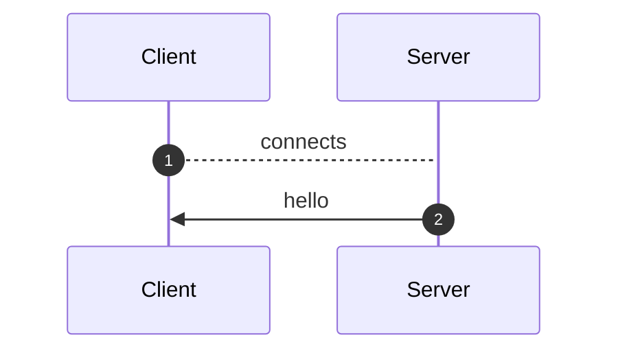
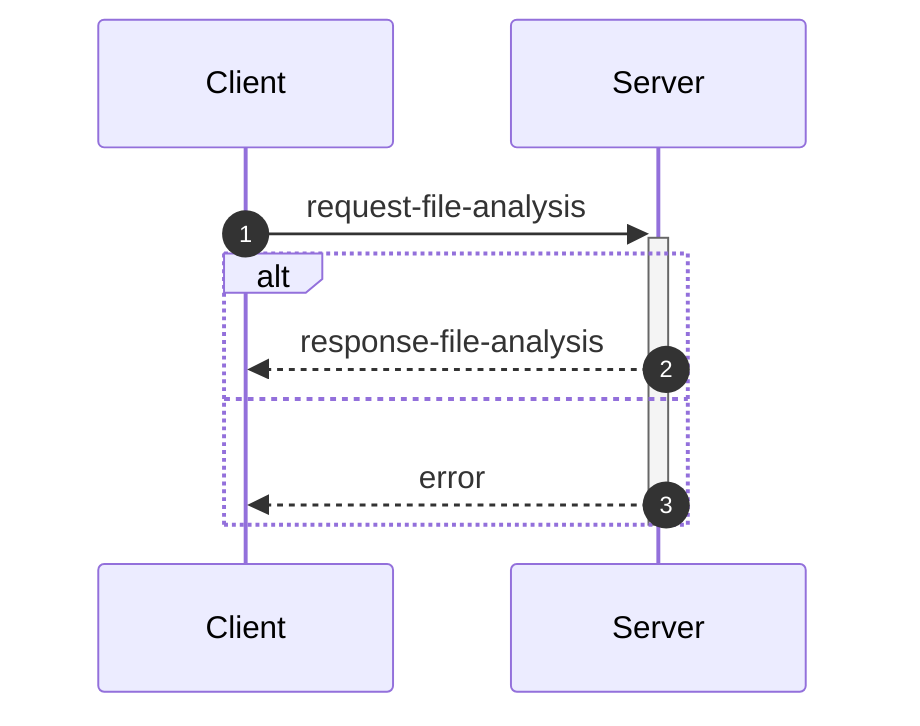
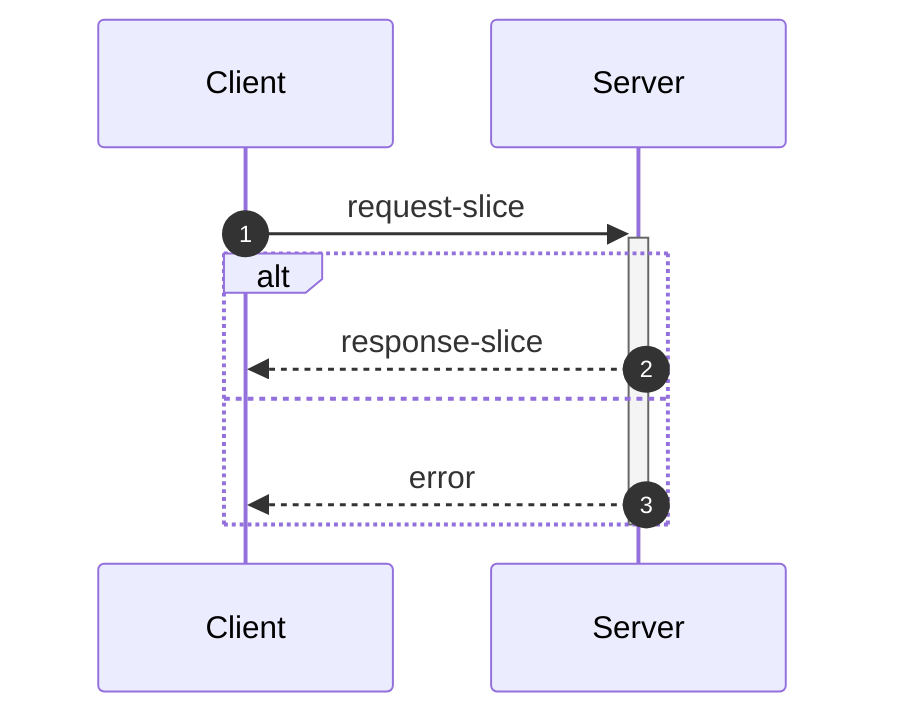
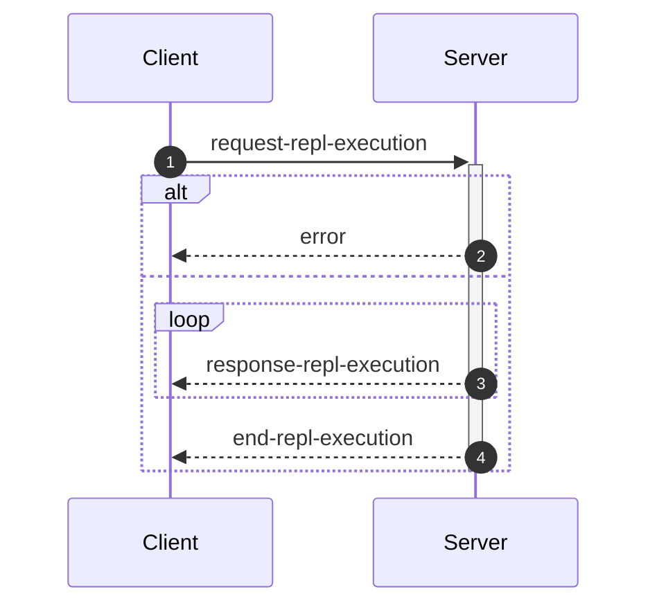

_<span title="an overview of flowR's interface">Generated</span> from '[wiki-interface.ts](https://github.com/flowr-analysis/flowr/tree/main/src/documentation/wiki-interface.ts "src/documentation/wiki-interface.ts")' on 2026-10-23, 07:40:03 UTC (v2.16.6, R v4.6.1), do not edit directly._

Although far from being as detailed as the in-depth explanation of [_flowR_](https://github.com/flowr-analysis/flowr/wiki/Core),
this wiki page explains how to interface with _flowR_ in more detail.
In general, command line arguments and other options provide short descriptions on hover over.

* [💻 Using the REPL](#using-the-repl)
* [⚙️ Configuring FlowR](#configuring-flowr)
* [⚒️ Writing Code](#writing-code)
* [💬 Communicating with the Server](#communicating-with-the-server)

<a id='using-the-repl'></a>
## 💻 Using the REPL

> [!NOTE]
> To execute arbitrary R commands with a repl request, _flowR_ has to be started explicitly with <span title="Description (Command Line Argument): Allow to access the underlying R session when using flowR (security warning: this allows the execution of arbitrary R code!)">`--r-session-access`</span>.
> Please be aware that this introduces a security risk and note that this relies on the [`r-shell` engine](https://github.com/flowr-analysis/flowr/wiki/Engines) .

Although primarily meant for users to explore,
there is nothing which forbids calling _flowR_ as a subprocess to use standard-in, -output, and -error
for communication (although you can access the REPL using the server as well,
with the [REPL Request](#message-request-repl-execution) message).

The read-eval-print loop&nbsp;(REPL) works relatively simple.
You can submit an expression (using <kbd>Enter</kbd>),
which is interpreted as an R&nbsp;expression by default but interpreted as a *command* if it starts with a colon (`:`).
The best command to get started with the REPL is <span title="Description (Repl Command): Show help information (aliases: :h, :?)">`:help`</span>.
Besides, you can leave the REPL either with the command <span title="Description (Repl Command): End the repl (aliases: :q, :exit)">`:quit`</span> or by pressing <kbd>Ctrl</kbd>+<kbd>C</kbd> twice.
When writing a *command*, you may press <kbd>Tab</kbd> to get a list of completions, if available.
Multiple commands can be entered in a single line by separating them with a semicolon (`;`), e.g. `:parse "x<-2"; :df*`.
If a command is given without R code, the REPL will re-use R code given in a previous command.
The prior example will hence return first the parsed AST of the program and then the dataflow graph for `"x <- 2"`.

> [!NOTE]
> If you develop flowR, you may want to launch the repl using the `npm run main-dev` command, this way, you get a non-minified version of flowR with debug information and hot-reloading of source files.

<details>
<summary>Available Commands</summary>

We currently offer the following commands (this with a `[*]` suffix are available with and without the star):

| Command | Description |
| ------- | ----------- |
| **<span title="Description (Repl Command): End the repl (aliases: :q, :exit)">:quit</span>** | End the repl (aliases: **:<span title="Alias of ':quit'. End the repl">q</span>**, **:<span title="Alias of ':quit'. End the repl">exit</span>**) |
| **<span title="Description (Repl Command): Execute the given code as R code. This requires the `--r-session-access` flag to be set and requires the r-shell engine. (aliases: :e, :r)">:execute</span>** | Execute the given code as R code. This requires the `--r-session-access` flag to be set and requires the r-shell engine. (aliases: **:<span title="Alias of ':execute'. Execute the given code as R code. This requires the `--r-session-access` flag to be set and requires the r-shell engine.">e</span>**, **:<span title="Alias of ':execute'. Execute the given code as R code. This requires the `--r-session-access` flag to be set and requires the r-shell engine.">r</span>**) |
| **<span title="Description (Repl Command): Get mermaid code for the control-flow graph of R code (aliases: :cfg, :cf)">:controlflow[*]</span>** | Get mermaid code for the control-flow graph of R code (star: Returns the URL to mermaid.live) (aliases: **:<span title="Alias of ':controlflow'. Get mermaid code for the control-flow graph of R code">cfg</span>**, **:<span title="Alias of ':controlflow'. Get mermaid code for the control-flow graph of R code">cf</span>**) |
| **<span title="Description (Repl Command): Get mermaid code for the control-flow graph with basic blocks (aliases: :cfgb, :cfb)">:controlflowbb[*]</span>** | Get mermaid code for the control-flow graph with basic blocks (star: Returns the URL to mermaid.live) (aliases: **:<span title="Alias of ':controlflowbb'. Get mermaid code for the control-flow graph with basic blocks">cfgb</span>**, **:<span title="Alias of ':controlflowbb'. Get mermaid code for the control-flow graph with basic blocks">cfb</span>**) |
| **<span title="Description (Repl Command): Get mermaid code for the dataflow graph (aliases: :d, :df)">:dataflow[*]</span>** | Get mermaid code for the dataflow graph (star: Returns the URL to mermaid.live) (aliases: **:<span title="Alias of ':dataflow'. Get mermaid code for the dataflow graph">d</span>**, **:<span title="Alias of ':dataflow'. Get mermaid code for the dataflow graph">df</span>**) |
| **<span title="Description (Repl Command): Get mermaid code for the normalized AST of R code (aliases: :n)">:normalize[*]</span>** | Get mermaid code for the normalized AST of R code (star: Returns the URL to mermaid.live) (alias: **:<span title="Alias of ':normalize'. Get mermaid code for the normalized AST of R code">n</span>**) |
| **<span title="Description (Repl Command): Get mermaid code for the simplified dataflow graph (aliases: :ds, :dfs)">:dataflowsimple[*]</span>** | Get mermaid code for the simplified dataflow graph (star: Returns the URL to mermaid.live) (aliases: **:<span title="Alias of ':dataflowsimple'. Get mermaid code for the simplified dataflow graph">ds</span>**, **:<span title="Alias of ':dataflowsimple'. Get mermaid code for the simplified dataflow graph">dfs</span>**) |
| **<span title="Description (Repl Command): Inspect and extend the signature database: `query` (identical to :query @signature), `info <name>` for where a function comes from (identical to :query @function-info), `add <path>` to mount another database/source, `download` to fetch the full-history database. (aliases: :sig)">:signature</span>** | Inspect and extend the signature database: `query` (identical to :query @signature), `info <name>` for where a function comes from (identical to :query @function-info), `add <path>` to mount another database/source, `download` to fetch the full-history database. (alias: **:<span title="Alias of ':signature'. Inspect and extend the signature database: `query` (identical to :query @signature), `info <name>` for where a function comes from (identical to :query @function-info), `add <path>` to mount another database/source, `download` to fetch the full-history database.">sig</span>**) |
| **<span title="Description (Repl Command): Just calculates the DFG, but only prints summary info (aliases: :d#, :df#)">:dataflowsilent</span>** | Just calculates the DFG, but only prints summary info (aliases: **:<span title="Alias of ':dataflowsilent'. Just calculates the DFG, but only prints summary info">d#</span>**, **:<span title="Alias of ':dataflowsilent'. Just calculates the DFG, but only prints summary info">df#</span>**) |
| **<span title="Description (Repl Command): Prints ASCII Art of the parsed, unmodified AST (aliases: :p)">:parse</span>** | Prints ASCII Art of the parsed, unmodified AST (alias: **:<span title="Alias of ':parse'. Prints ASCII Art of the parsed, unmodified AST">p</span>**) |
| **<span title="Description (Repl Command): Prints the version of flowR as well as the current version of R">:version</span>** | Prints the version of flowR as well as the current version of R
| **<span title="Description (Repl Command): Query the given R code (use 'help' for more information)">:query[*]</span>** | Query the given R code (use 'help' for more information) (star: Similar to query, but returns the output in json format.)
| **<span title="Description (Repl Command): Returns an ASCII representation of the dataflow graph (aliases: :df!)">:dataflowascii</span>** | Returns an ASCII representation of the dataflow graph (alias: **:<span title="Alias of ':dataflowascii'. Returns an ASCII representation of the dataflow graph">df!</span>**) |
| **<span title="Description (Repl Command): Returns summarization stats for the normalized AST (aliases: :n#)">:normalize#</span>** | Returns summarization stats for the normalized AST (alias: **:<span title="Alias of ':normalize#'. Returns summarization stats for the normalized AST">n#</span>**) |
| **<span title="Description (Repl Command): Show help information (aliases: :h, :?)">:help</span>** | Show help information (aliases: **:<span title="Alias of ':help'. Show help information">h</span>**, **:<span title="Alias of ':help'. Show help information">?</span>**) |

</details>

> [!TIP]
> 
> As indicated by the examples before, all REPL commands that operate on code keep track of the state.
> Hence, if you run a command like <span title="Description (Repl Command, starred version): Returns the URL to mermaid.live; Base Command: Get mermaid code for the dataflow graph (aliases: :d*, :df*)">`:dataflow*`</span> without providing R code,
> the REPL will re-use the R code provided in a previous command.
> Likewise, doing this will benefit from incrementality!
> If you request the dataflow graph with `:df* x <- 2 * y` and then want to see the parsed AST with `:parse`,
> the REPL will re-use previously obtained information and not re-parse the code again.
> 		

Generally, many commands offer shortcut versions in the REPL. Many queries, for example, offer a shortened format (see the example below).
Of special note, the [Config Query](https://github.com/flowr-analysis/flowr/wiki/%5BQuery%5D-Config)
can be used to also modify the currently active configuration of _flowR_ within the REPL (see the [wiki page](https://github.com/flowr-analysis/flowr/wiki/%5BQuery%5D-Config) for more information).

### Example: Retrieving the Dataflow Graph

To retrieve a URL to the [mermaid](https://mermaid.js.org/) diagram of the dataflow of a given expression,
use <span title="Description (Repl Command, starred version): Returns the URL to mermaid.live; Base Command: Get mermaid code for the dataflow graph (aliases: :d*, :df*)">`:dataflow*`</span> (or <span title="Description (Repl Command): Get mermaid code for the dataflow graph (aliases: :d, :df)">`:dataflow`</span> to get the mermaid code in the cli):

```shell
$ docker run -it --rm eagleoutice/flowr # or npm run flowr 
flowR repl v2.16.6, R grammar v14 (tree-sitter engine)
R> :dataflow* y <- 1 + x
```

<details>
<summary style='color:gray'>Output</summary>

```text
https://mermaid.live/view#base64:eyJjb2RlIjoiZmxvd2NoYXJ0IFREXG4gICAgMXt7XCJgKiM5MTtSTnVtYmVyIzkzOyogKioxKipcbiAgICAgICoxLjYqICgqKmlkOiAxKiopYFwifX1cbiAgICAyKFtcImAqIzkxO1JTeW1ib2wjOTM7KiAqKngqKlxuICAgICAgKjEuMTAqICgqKmlkOiAyKiopYFwiXSlcbiAgICAzW1tcImAqIzkxO1JCaW5hcnlPcCM5MzsqIGJhc2UjNTg7IzU4OyoqIzQzOyoqXG4gICAgICAqMS42LTEwKiAoKippZDogMyoqKVxuICAgIGFyZzogKDEsIDIpYFwiXV1cbiAgICBidWlsdC1pbjpfNDNfW1wiYEJ1aWx0LUluOlxuIzQzO2BcIl1cbiAgICBzdHlsZSBidWlsdC1pbjpfNDNfIHN0cm9rZTpncmF5LGZpbGw6Z3JheSxzdHJva2Utd2lkdGg6MnB4LG9wYWNpdHk6Ljg7XG4gICAgMFtcImAqIzkxO1JTeW1ib2wjOTM7KiAqKnkqKlxuICAgICAgKjEuMSogKCoqaWQ6IDAqKiwgdjogMylgXCJdXG4gICAgNFtbXCJgKiM5MTtSQmluYXJ5T3AjOTM7KiBiYXNlIzU4OyM1ODsqKiM2MDsjNDU7KipcbiAgICAgICoxLjEtMTAqICgqKmlkOiA0KiopXG4gICAgYXJnOiAoMCwgMylgXCJdXVxuICAgIGJ1aWx0LWluOl82MF8tW1wiYEJ1aWx0LUluOlxuIzYwOyM0NTtgXCJdXG4gICAgc3R5bGUgYnVpbHQtaW46XzYwXy0gc3Ryb2tlOmdyYXksZmlsbDpncmF5LHN0cm9rZS13aWR0aDoycHgsb3BhY2l0eTouODtcbiAgICAxIC0uLT58XCJmbG93XCJ8IDJcbiAgICBsaW5rU3R5bGUgMCBzdHJva2U6Z3JheSxjb2xvcjpncmF5O1xuICAgIDIgLS4tPnxcImZsb3dcInwgM1xuICAgIGxpbmtTdHlsZSAxIHN0cm9rZTpncmF5LGNvbG9yOmdyYXk7XG4gICAgMyAtLT58XCJyZWFkcywgYXJnXCJ8IDFcbiAgICAzIC0tPnxcInJlYWRzLCBhcmdcInwgMlxuICAgIDMgLS4tPnxcImZsb3dcInwgMFxuICAgIGxpbmtTdHlsZSA0IHN0cm9rZTpncmF5LGNvbG9yOmdyYXk7XG4gICAgMyAtLi0+fFwicmVhZHMsIGNhbGxzXCJ8IGJ1aWx0LWluOl80M19cbiAgICBsaW5rU3R5bGUgNSBzdHJva2U6Z3JheTtcbiAgICAwIC0tPnxcImRlZmluZWQtYnksIGZsb3dcInwgNFxuICAgIDAgLS0+fFwiZGVmaW5lZC1ieVwifCAzXG4gICAgNCAtLT58XCJyZWFkcywgYXJnXCJ8IDNcbiAgICA0IC0tPnxcInJldHVybnMsIGFyZ1wifCAwXG4gICAgNCAtLi0+fFwicmVhZHMsIGNhbGxzXCJ8IGJ1aWx0LWluOl82MF8tXG4gICAgbGlua1N0eWxlIDEwIHN0cm9rZTpncmF5OyIsIm1lcm1haWQiOnsiYXV0b1N5bmMiOnRydWV9fQ==
```

Retrieve the dataflow graph of the expression `y <- 1 + x`. It looks like this:


<details>

<summary style="color:gray">R Code of the Dataflow Graph</summary>

The analysis ran (including parse and normalize, using the [tree-sitter](https://github.com/flowr-analysis/flowr/wiki/Engines) engine) within the generation environment. No [signature database](https://github.com/flowr-analysis/flowr/wiki/Signature-Database) is mounted for these generated graphs, so `library()` calls attach no package exports; base-R names are still qualified via the generated base-package store (e.g. `acf` as `stats::acf`). 
We encountered no unknown side effects during the analysis.

```r
y <- 1 + x
```

</details>

</details>

For small graphs like this, <span title="Description (Repl Command): Returns an ASCII representation of the dataflow graph (aliases: :df!)">`:dataflowascii`</span> also provides an ASCII representation directly in the REPL:

```shell
$ docker run -it --rm eagleoutice/flowr # or npm run flowr 
flowR repl v2.16.6, R grammar v14 (tree-sitter engine)
R> :df! y <- 1 + x
```

<details open>
<summary style='color:gray'>Output</summary>

```text
                        v<0>v
 c<4>c──────────────────| y |
 |<- |     ┌────────────v---v
 c---c     │
    │   c<3>c   0<1>0
    └───| + |───| 1 |───u<2>u
        c---c   0---0   | x |
           └────────────u---u
Edges:
3 -> 1: reads, arg          3 -> 2: reads, arg
3 -> 0: flows-to            1 -> 2: flows-to
2 -> 3: flows-to            4 -> 3: reads, arg
4 -> 0: returns, arg        0 -> 4: defined-by, flows-to
0 -> 3: defined-by
```

Retrieve the dataflow graph of the expression `y <- 1 + x` as ASCII art.

</details>

For the slicing with <span title="Description (Repl Command): Static backwards executable slicer for R">`:slicer`</span>, you have access to the same [magic comments](#slice-magic-comments) as with the [slice request](#message-request-slice).
Pass `--inline` to splice resolvable `source()` calls into the reconstruction so the slice is a single self-contained R text (the same as the static slice query's `inlineSources` flag).
See `--help` for more flags!

### Example: Interfacing with the File System

Many commands that allow for an R-expression (like <span title="Description (Repl Command, starred version): Returns the URL to mermaid.live; Base Command: Get mermaid code for the dataflow graph (aliases: :d*, :df*)">`:dataflow*`</span>) allow for a file as well
if the argument starts with `file://`.
If you are working from the root directory of the _flowR_ repository, the following gives you the parsed AST of the example file using the <span title="Description (Repl Command): Prints ASCII Art of the parsed, unmodified AST (aliases: :p)">`:parse`</span> command:

> **Watch mode**: Replace `file://` with `watch://` to enter watch mode.
> flowR runs the command immediately and then re-runs it every time the file (or any file inside the folder) changes.
> Enter any other command to leave watch mode.
> For example: `:df watch://analysis.R`

```shell
$ docker run -it --rm eagleoutice/flowr # or npm run flowr 
flowR repl v2.16.6, R grammar v14 (tree-sitter engine)
R> :parse file://test/testfiles/example.R
```

<details>
<summary style='color:gray'>Output</summary>

```text
File: test/testfiles/example.R

program
├ binaryoperator
│ ├ identifier "sum" (1:1─4)
│ ├ <- "<-" (1:5─7)
│ ╰ float "0" (1:8─9)
├ binaryoperator
│ ├ identifier "product" (2:1─8)
│ ├ <- "<-" (2:9─11)
│ ╰ float "1" (2:12─13)
├ binaryoperator
│ ├ identifier "w" (3:1─2)
│ ├ <- "<-" (3:3─5)
│ ╰ float "7" (3:6─7)
├ binaryoperator
│ ├ identifier "N" (4:1─2)
│ ├ <- "<-" (4:3─5)
│ ╰ float "10" (4:6─8)
├ forstatement
│ ├ for "for" (6:1─4)
│ ├ ( "(" (6:5─6)
│ ├ identifier "i" (6:6─7)
│ ├ in "in" (6:8─10)
│ ├ binaryoperator
│ │ ├ float "1" (6:11─12)
│ │ ├ : ":" (6:12─13)
│ │ ╰ parenthesizedexpression
│ │   ├ ( "(" (6:13─14)
│ │   ├ binaryoperator
│ │   │ ├ identifier "N" (6:14─15)
│ │   │ ├ - "-" (6:15─16)
│ │   │ ╰ float "1" (6:16─17)
│ │   ╰ ) ")" (6:17─18)
│ ├ ) ")" (6:18─19)
│ ╰ bracedexpression
│   ├ { "{" (6:20─21)
│   ├ binaryoperator
│   │ ├ identifier "sum" (7:3─6)
│   │ ├ <- "<-" (7:7─9)
│   │ ╰ binaryoperator
│   │   ├ binaryoperator
│   │   │ ├ identifier "sum" (7:10─13)
│   │   │ ├ + "+" (7:14─15)
│   │   │ ╰ identifier "i" (7:16─17)
│   │   ├ + "+" (7:18─19)
│   │   ╰ identifier "w" (7:20─21)
│   ├ binaryoperator
│   │ ├ identifier "product" (8:3─10)
│   │ ├ <- "<-" (8:11─13)
│   │ ╰ binaryoperator
│   │   ├ identifier "product" (8:14─21)
│   │   ├  "" (8:22─23)
│   │   ╰ identifier "i" (8:24─25)
│   ╰ } "}" (9:1─2)
├ call
│ ├ identifier "cat" (11:1─4)
│ ╰ arguments
│   ├ ( "(" (11:4─5)
│   ├ argument
│   │ ╰ string
│   │   ├ " "\"" (11:5─6)
│   │   ├ stringcontent "Sum:" (11:6─10)
│   │   ╰ " "\"" (11:10─11)
│   ├ comma "," (11:11─12)
│   ├ argument
│   │ ╰ identifier "sum" (11:13─16)
│   ├ comma "," (11:16─17)
│   ├ argument
│   │ ╰ string
│   │   ├ " "\"" (11:18─19)
│   │   ├ stringcontent
│   │   │ ╰ escapesequence "\\n" (11:19─21)
│   │   ╰ " "\"" (11:21─22)
│   ╰ ) ")" (11:22─23)
╰ call
  ├ identifier "cat" (12:1─4)
  ╰ arguments
    ├ ( "(" (12:4─5)
    ├ argument
    │ ╰ string
    │   ├ " "\"" (12:5─6)
    │   ├ stringcontent "Product:" (12:6─14)
    │   ╰ " "\"" (12:14─15)
    ├ comma "," (12:15─16)
    ├ argument
    │ ╰ identifier "product" (12:17─24)
    ├ comma "," (12:24─25)
    ├ argument
    │ ╰ string
    │   ├ " "\"" (12:26─27)
    │   ├ stringcontent
    │   │ ╰ escapesequence "\\n" (12:27─29)
    │   ╰ " "\"" (12:29─30)
    ╰ ) ")" (12:30─31)
```

Retrieve the parsed AST of the example file.

<details>

<summary>File Content</summary>

```r
sum <- 0
product <- 1
w <- 7
N <- 10

for (i in 1:(N-1)) {
  sum <- sum + i + w
  product <- product * i
}

cat("Sum:", sum, "\n")
cat("Product:", product, "\n")
```

</details>

As _flowR_ directly transforms this AST the output focuses on being human-readable instead of being machine-readable.
		
</details>

### Example: Run a Query

You can run any query supported by _flowR_ using the <span title="Description (Repl Command): Query the given R code (use 'help' for more information)">`:query`</span> command.
For example, to obtain the shapes of all data frames in a given piece of code, you can run:

```shell
$ docker run -it --rm eagleoutice/flowr # or npm run flowr 
flowR repl v2.16.6, R grammar v14 (tree-sitter engine)
R> :query @absint df-shape "x <- data.frame(a = 1:10, b = 1:10)\ny <- x$a"
```

<details open>
<summary style='color:gray'>Output</summary>

```text
Query: absint (0 ms)
```

Retrieve the shapes of all data frames in the given code.

</details>

To run the linter on a file, you can use (in this example, we just issue the `dead-code` linter on a small piece of code):

```shell
$ docker run -it --rm eagleoutice/flowr # or npm run flowr 
flowR repl v2.16.6, R grammar v14 (tree-sitter engine)
R> :query @linter rules:dead-code "if(FALSE) x <- 2"
```

<details open>
<summary style='color:gray'>Output</summary>

```text
Query: linter (1 ms)
   ╰ Dead Code (dead-code):
       ╰ certain:
           ╰ Code at 1.11-16
```

Run the linter on the given code, with only the `dead-code` rule enabled.

</details>

For more information on the available queries, please check out the [Query API](https://github.com/flowr-analysis/flowr/wiki/Query-API).

<a id='configuring-flowr'></a>
## ⚙️ Configuring FlowR

When running _flowR_, you may want to specify some behaviors with a dedicated configuration file.
By default, flowR looks for a file named `flowr.json` in the current working directory (or any higher directory).
You can also specify a different file with <span title="Description (Command Line Argument): The name of the configuration file to use">`--config-file`</span> or pass the configuration inline using <span title="Description (Command Line Argument): The flowR configuration to use, as a JSON string">`--config-json`</span>.
A `flowr.json` found this way belongs to the analyzed project, so flowR ignores its options that decide what flowR executes or loads
(`engines.*.wasmPath`, `engines.*.treeSitterWasmPath`, `engines.*.rPath`, `solver.sigdb.additionalPaths`, `solver.sigdb.downloadRepo`, `solver.sigdb.installedLibrary.paths`),
unless you pass <span title="Description (Command Line Argument): Keep the security-sensitive options (e.g., the R executable) of the flowr.json found in the working directory or a parent. Only use this for projects you trust.">`--trust-config`</span>.
To analyze code you do not trust, use the secure mode (<span title="Description (Command Line Argument): Run in secure mode for analyzing untrusted code: flowR does not start R (or any other process), does not access the network, does not search for project configs, and ignores security-sensitive options in every config. Cannot be disabled once enabled. Can also be enabled with the environment variable {italic FLOWR_SECURE_MODE=1}.">`--secure`</span>, see the [security policy](https://github.com/flowr-analysis/flowr/blob/main/.github/SECURITY.md)).
To inspect the current configuration, you can run flowr with the <span title="Description (Command Line Argument): Run with verbose logging (will be passed to the corresponding script)">`--verbose`</span> flag, or use the `config` [Query](https://github.com/flowr-analysis/flowr/wiki/Query-API).
Within the REPL this works by running the following:

```shell
:query @config
```

To work with the <a href="https://github.com/flowr-analysis/flowr/tree/main/src/config.ts#L119"><code><span title="The configuration file format for flowR.">FlowrConfig</span></code></a> you can use the provided helper objects alongside its methods like
<a href="https://github.com/flowr-analysis/flowr/tree/main/src/config.ts#L914"><code><span title="Creates a new flowr config that has the updated values.">FlowrConfig::<b>amend</b></span></code></a>.
The schema below documents every option; the ones you most likely want are:

- <a href="https://github.com/flowr-analysis/flowr/wiki/Interface#configuring-flowr" title="Configuration Option (boolean): Whether source calls should be ignored, causing {@link processSourceCall}&#39;s behavior to be skipped.">ignoreSourceCalls</a>: ignore source calls when analyzing the code, i.e., ignore the inclusion of other files.
- <a href="https://github.com/flowr-analysis/flowr/wiki/Interface#configuring-flowr" title="Configuration Option (boolean): Whether load calls should be ignored, causing {@link processLoadCall}&#39;s behavior to be skipped.">ignoreLoadCalls</a>: ignore load calls when analyzing the code, i.e., ignore the loading of r-data files.
- <a href="https://github.com/flowr-analysis/flowr/wiki/Interface#configuring-flowr" title="Configuration Option (object): Do you want to overwrite (parts) of the builtin definition?">semantics.environment.overwriteBuiltIns</a>: overwrite _flowR_'s handling of built-in functions, or clear the preset definitions entirely.
  See [Configure BuiltIn Semantics](#configure-builtin-semantics) for more information.
- <a href="https://github.com/flowr-analysis/flowr/wiki/Interface#configuring-flowr" title="Configuration Option (string): How to resolve variables and their values. (one of &quot;disabled&quot;, &quot;alias&quot;, &quot;builtin&quot;)">solver.variables</a>: how to resolve variables and their values (`disabled`, `alias`, `builtin`).
- <a href="https://github.com/flowr-analysis/flowr/wiki/Interface#configuring-flowr" title="Configuration Option (array): The engine or set of engines to use for interacting with R code. An empty array means all available engines will be used.">engines</a> and <a href="https://github.com/flowr-analysis/flowr/wiki/Interface#configuring-flowr" title="Configuration Option (string): The default engine to use for interacting with R code. If this is undefined, an arbitrary engine from the specified list will be used. (one of &quot;tree-sitter&quot;, &quot;r-shell&quot;)">defaultEngine</a>: the engines used to interact with R code, see the [Engines wiki page](https://github.com/flowr-analysis/flowr/wiki/Engines).
- <a href="https://github.com/flowr-analysis/flowr/wiki/Interface#configuring-flowr" title="Configuration Option (array): Files a framework loads on its own, without any source() call (e.g. global.R in a shiny app), in the order they are loaded; flowR orders the matching project files accordingly and analyzes them as one program. Entries are case-insensitive globs matched against the file path, a plain name matches any file with that name, and entries matching no project file are warned about. Usually set per project kind via specializeConfig.">project.implicitSources</a>: the files a framework loads without any `source()` call, in the order in which they are
  loaded. Entries are globs (e.g. `R/*.R`) matched against the file path ignoring capitalization; one matching no file is reported.
- <a href="https://github.com/flowr-analysis/flowr/wiki/Interface#configuring-flowr" title="Configuration Option (object): Overwrite (parts of) the configuration depending on the project kind flowR detects, e.g. to give a shiny app its implicit sources.">specializeConfig</a>: overwrite (parts of) the configuration depending on the kind of project _flowR_ detects
  (e.g. `shiny-app`), which is how a shiny app gets its implicit sources by default. What you configure directly wins.
- <a href="https://github.com/flowr-analysis/flowr/wiki/Interface#configuring-flowr" title="Configuration Option (string): Overwrite the project kind flowR would otherwise infer from the analyzed files, e.g. when auto-detection guesses wrong. (one of &quot;package&quot;, &quot;script&quot;, &quot;shiny-app&quot;, &quot;notebook&quot;, &quot;project&quot;, &quot;unknown&quot;)">project.useProjectType</a>: skip that detection and force a project kind yourself, when auto-detection guesses wrong.
- <a href="https://github.com/flowr-analysis/flowr/wiki/Interface#configuring-flowr" title="Configuration Option (array): The default plugins to load when creating a new instance of FlowrAnalyzer">defaultPlugins</a> and <a href="https://github.com/flowr-analysis/flowr/wiki/Interface#configuring-flowr" title="Configuration Option (array): The plugins to load in REPL mode">repl.plugins</a>: the plugins to load for a new <a href="https://github.com/flowr-analysis/flowr/tree/main/src/project/flowr-analyzer.ts#L205"><code><span title="Central class for conducting analyses with FlowR. Use the FlowrAnalyzerBuilder to create a new instance. If you want the original pattern of creating a pipeline and running all steps, you can still do this with FlowrAnalyzer#runFull . To inspect the context of the analyzer, use FlowrAnalyzer#inspectContext (if you are a plugin and need to modify it, use FlowrAnalyzer#context instead).">FlowrAnalyzer</span></code></a> and in the REPL
  (use `flowr:default` to reference the former).

So you can configure _flowR_ by adding a file like the following:

<details>

<summary>Example Configuration File</summary>

```json
{
  "ignoreSourceCalls": true,
  "ignoreLoadCalls": true,
  "semantics": {
    "environment": {
      "overwriteBuiltIns": {
        "definitions": [
          {
            "type": "function",
            "names": [
              "foo"
            ],
            "processor": "builtin:assign",
            "config": {}
          }
        ]
      }
    }
  },
  "defaultPlugins": [
    "file:description",
    "versions:description"
  ],
  "repl": {
    "quickStats": false,
    "dfProcessorHeat": false,
    "hints": true,
    "plugins": [
      "flowr:default"
    ]
  },
  "project": {
    "resolveUnknownPathsOnDisk": true,
    "implicitSources": [
      "global.R",
      "app.R"
    ]
  },
  "linter": {
    "disabledRules": []
  },
  "specializeConfig": {
    "shiny-app": {
      "project": {
        "implicitSources": [
          "global.R",
          "ui.R",
          "server.R",
          "app.R"
        ]
      }
    }
  },
  "engines": [
    {
      "type": "r-shell"
    }
  ],
  "solver": {
    "variables": "alias",
    "evalStrings": true,
    "trackEnvironments": true,
    "sigdb": {
      "enabled": true,
      "loadProjectDependencies": true,
      "eagerlyLoad": false,
      "eagerlyLoadExports": false,
      "linkBaseR": false,
      "linkDescriptionDependencies": false
    },
    "resolveSource": {
      "dropPaths": "no",
      "ignoreCapitalization": true,
      "inferWorkingDirectory": "active-script",
      "searchPath": []
    },
    "instrument": {},
    "slicer": {
      "threshold": 50
    }
  },
  "abstractInterpretation": {
    "wideningThreshold": 4,
    "followCalls": true,
    "dataFrame": {
      "maxColNames": 20,
      "readLoadedData": {
        "readExternalFiles": true,
        "maxReadLines": 1000000
      }
    }
  },
  "incremental": {
    "alwaysIncremental": false,
    "parsing": {
      "activated": false,
      "heuristics": {
        "activated": true,
        "mtime": true,
        "linesFrom": 500,
        "bytesFrom": 50000,
        "alwaysWithEdits": false,
        "minFiles": 1
      }
    }
  },
  "gas": {
    "thresholds": {
      "memory": {
        "problematic": 0.7,
        "critical": 0.9
      },
      "timeMs": {
        "problematic": 100000,
        "critical": 120000
      }
    },
    "features": {}
  }
}
```

</details>

<details>
<a id='configure-builtin-semantics'></a>
<summary>Configure Built-In Semantics</summary>

`semantics/environment/overwriteBuiltins` accepts two keys:

- `loadDefaults` (boolean, initially `true`): If set to `true`, the default built-in definitions are loaded before applying the custom definitions. Setting this flag to `false` explicitly disables the loading of the default definitions.
- `definitions` (array, initially empty): Allows to overwrite or define new built-in elements. Each object within must have a `type` which is one of the below. Furthermore, they may define a string array of `names` which specifies the identifiers to bind the definitions to. You may use `assumePrimitive` to specify whether _flowR_ should assume that this is a primitive non-library definition (so you probably just do not want to specify the key).

  | Type            | Description                                                                                                                                                                                                                                                                                              | Example                                                                                                    |
  | --------------- | -------------------------------------------------------------------------------------------------------------------------------------------------------------------------------------------------------------------------------------------------------------------------------------------------------- | ---------------------------------------------------------------------------------------------------------- |
  | `constant`    | Additionally allows for a `value` this should resolve to.                                                                                                                                                                                                                                                | `{ type: 'constant', names: ['NULL', 'NA'],  value: null }`                                                |
  | `function`    | Is a rather flexible way to define and bind built-in functions. For the time, we do not have extensive documentation to cover all the cases, so please either consult the sources with the `default-builtin-config.ts` or open a [new issue](https://github.com/flowr-analysis/flowr/issues/new/choose). | `{ type: 'function', names: ['next'], processor: 'builtin:d', config: { cfg: ExitPointType.Next } }` |
  | `replacement` | A comfortable way to specify replacement functions like `$<-` or `names<-`. `suffixes` describes the... suffixes to attach automatically. | `{ type: 'replacement', suffixes: ['<-', '<<-'], names: ['[', '[['] }` |

</details>

<details>

<summary style='color:gray'>Full Configuration-File Schema</summary>

- _The configuration file format for flowR._ (object)
    - **logLevel** [optional] _flowR's global minimum log level, applied when the config is loaded._ (string)
        Only allows: 'silly', 'trace', 'debug', 'info', 'warn', 'error', 'fatal'
    - **ignoreSourceCalls** [optional] _Whether source calls should be ignored, causing {@link processSourceCall}'s behavior to be skipped._ (boolean)
    - **ignoreLoadCalls** [optional] _Whether load calls should be ignored, causing {@link processLoadCall}'s behavior to be skipped._ (boolean)
    - **semantics** _Configure language semantics and how flowR handles them._ (object)
        - **environment** [optional] _Semantics regarding how to handle the R environment._ (object)
            - **overwriteBuiltIns** [optional] _Do you want to overwrite (parts) of the builtin definition?_ (object)
                - **loadDefaults** [optional] _Should the default configuration still be loaded?_ (boolean)
                - **definitions** [optional] _The definitions to load/overwrite._ (array)
                Valid item types:
                    - (object)
    - **defaultPlugins** [optional] _The default plugins to load when creating a new instance of FlowrAnalyzer_ (array)
    Valid item types:
        - (alternatives)
            - (string)
            - (array)
    - **repl** _Configuration options for the REPL._ (object)
        - **quickStats** [optional] _Whether to show quick stats in the REPL after each evaluation._ (boolean)
        - **dfProcessorHeat** [optional] _This instruments the dataflow processors to count how often each processor is called._ (boolean)
        - **hints** [optional] _Whether to show dim inline hints on the empty prompt (automatically disabled on non-interactive terminals)._ (boolean)
        - **plugins** [optional] _The plugins to load in REPL mode_ (array)
        Valid item types:
            - (alternatives)
                - (string)
                - (array)
        - **autoUseFileProtocol** [optional] _Prepend the file protocol to a repl input that looks like a path, instead of only warning about it._ (boolean)
        - **queryStats** [optional] _Whether `:query` closes with the line stating how long the queries took (`:query*` never prints it)._ (boolean)
        - **showPlugins** [optional] _Whether `:version` grays out the plugins that did not activate during the last analysis._ (boolean)
    - **project** _Project specific configuration options._ (object)
        - **resolveUnknownPathsOnDisk** [optional] _Whether to resolve unknown paths loaded by the r project disk when trying to source/analyze files._ (boolean)
        - **failOnInaccessiblePath** [optional] _Whether a directory that cannot be traversed during file discovery (e.g. due to permissions) aborts the analysis; when false (the default) such paths are logged and skipped._ (boolean)
        - **basePackages** [optional] _The packages considered part of R itself (base and recommended); if unset, flowR uses its built-in list._ (array)
        Valid item types:
            - (string)
        - **implicitSources** [optional] _Files a framework loads on its own, without any source() call (e.g. global.R in a shiny app), in the order they are loaded; flowR orders the matching project files accordingly and analyzes them as one program. Entries are case-insensitive globs matched against the file path, a plain name matches any file with that name, and entries matching no project file are warned about. Usually set per project kind via specializeConfig._ (array)
        Valid item types:
            - (string)
        - **useProjectType** [optional] _Overwrite the project kind flowR would otherwise infer from the analyzed files, e.g. when auto-detection guesses wrong._ (string)
            Only allows: 'package', 'script', 'shiny-app', 'notebook', 'project', 'unknown'
        - **assumeImplicitEcho** [optional] _Whether the top level of the analyzed code is echoed, so that every visible result printed there is collected as an output by the dependencies query (default true, false for a package)._ (boolean)
        - **discovery** [optional] _Scoping options for the default project discovery._ (object)
            - **full** [optional] _Collect every file below the project root (greedy) instead of only the files the detected project kind needs (default false)._ (boolean)
            - **perKind** [optional] _Per-kind include/exclude glob overrides layered on the default scoping._ (object)
            - **ignore** [optional] _Case-insensitive globs that drop matching files from the intelligent discovery, regardless of kind (e.g. .Renviron to ignore environment files)._ (array)
            Valid item types:
                - (string)
        - **classification** [optional] _Overrides for the signals flowR uses to classify the project kind._ (object)
            - **shinyDescriptionTypes** [optional] _DESCRIPTION Type: values that mark a shiny app._ (array)
            Valid item types:
                - (string)
            - **shinyEntryFiles** [optional] _File names a shiny app is assembled from._ (array)
            Valid item types:
                - (string)
            - **shinyUsagePattern** [optional] _Regex source evidencing shiny usage in an entry file._ (string)
            - **notebookExtensions** [optional] _File extensions marking a notebook._ (array)
            Valid item types:
                - (string)
    - **linter** _Linter configuration options._ (object)
        - **disabledRules** _Linting rule names excluded from the default rule set (a rule requested explicitly via a linter query still runs). Usually set per project kind via specializeConfig._ (array)
        Valid item types:
            - (string)
        - **disabledTags** [optional] _Linting rule tags whose rules are excluded from the default rule set (a rule requested explicitly via a linter query still runs). By default the cmd-check rules are disabled for everything but a package; a configured list replaces that default._ (array)
        Valid item types:
            - (string)
    - **inputSources** [optional] _Further frameworks the input-sources analysis should know about; entries are added to flowR's defaults._ (object)
        - **pure** [optional] _Functions that only pass the constantness of their arguments on._ (array)
        Valid item types:
            - (string)
        - **param** [optional] _Functions whose result is a 'param' input._ (array)
        Valid item types:
            - (string)
        - **file** [optional] _Functions whose result is a 'file' input._ (array)
        Valid item types:
            - (string)
        - **tempfile** [optional] _Functions whose result is a 'tempfile' input._ (array)
        Valid item types:
            - (string)
        - **glob** [optional] _Functions whose result is a 'glob' input._ (array)
        Valid item types:
            - (string)
        - **net** [optional] _Functions whose result is a 'net' input._ (array)
        Valid item types:
            - (string)
        - **rand** [optional] _Functions whose result is a 'rand' input._ (array)
        Valid item types:
            - (string)
        - **system** [optional] _Functions whose result is a 'system' input._ (array)
        Valid item types:
            - (string)
        - **ffi** [optional] _Functions whose result is a 'ffi' input._ (array)
        Valid item types:
            - (string)
        - **lang** [optional] _Functions whose result is a 'lang' input._ (array)
        Valid item types:
            - (string)
        - **options** [optional] _Functions whose result is a 'options' input._ (array)
        Valid item types:
            - (string)
        - **cmdline** [optional] _Functions whose result is a 'cmdline' input._ (array)
        Valid item types:
            - (string)
        - **user** [optional] _Functions whose result is a 'user' input._ (array)
        Valid item types:
            - (string)
        - **const** [optional] _Functions whose result is a 'const' input._ (array)
        Valid item types:
            - (string)
        - **scope** [optional] _Functions whose result is a 'scope' input._ (array)
        Valid item types:
            - (string)
        - **dconst** [optional] _Functions whose result is a 'dconst' input._ (array)
        Valid item types:
            - (string)
        - **unknown** [optional] _Functions whose result is a 'unknown' input._ (array)
        Valid item types:
            - (string)
        - **linkedObjects** [optional] _Objects a framework provides without a definition in the code, e.g. shiny's input._ (array)
        Valid item types:
            - (object)
        - **linkedEntryPoints** [optional] _Calls that hand a function to a framework, which binds its objects to the parameters by position._ (array)
        Valid item types:
            - (object)
    - **specializeConfig** [optional] _Overwrite (parts of) the configuration depending on the project kind flowR detects, e.g. to give a shiny app its implicit sources._ (object)
    - **engines** _The engine or set of engines to use for interacting with R code. An empty array means all available engines will be used._ (array)
    Valid item types:
        - (alternatives)
            - _The configuration for the tree sitter engine._ (object)
                - **type** [required] _Use the tree sitter engine._ (string)
                    Only allows: 'tree-sitter'
                - **wasmPath** [optional] _The path to the tree-sitter-r WASM binary to use. If this is undefined, this uses the default path._ (string)
                - **treeSitterWasmPath** [optional] _The path to the tree-sitter WASM binary to use. If this is undefined, this uses the default path._ (string)
                - **lax** [optional] _Whether to use the lax parser for parsing R code (allowing for syntax errors). If this is undefined, the strict parser will be used._ (boolean)
            - _The configuration for the R shell engine._ (object)
                - **type** [required] _Use the R shell engine._ (string)
                    Only allows: 'r-shell'
                - **rPath** [optional] _The path to the R executable to use. If this is undefined, this uses the default path._ (string)
                - **pipeBind** [optional] _Whether to enable R's experimental pipe-bind operator "=>" by setting _R_USE_PIPEBIND_ for the R session (default false); R itself keeps this off by default, as it is experimental and has never shipped in a release version of R._ (boolean)
    - **defaultEngine** [optional] _The default engine to use for interacting with R code. If this is undefined, an arbitrary engine from the specified list will be used._ (string)
        Only allows: 'tree-sitter', 'r-shell'
    - **solver** _How to resolve constants, constraints, cells, ..._ (object)
        - **variables** _How to resolve variables and their values._ (string)
            Only allows: 'disabled', 'alias', 'builtin'
        - **evalStrings** _Should we include eval(parse(text="...")) calls in the dataflow graph?_ (boolean)
        - **trackEnvironments** [optional] _Track user-created environments (new.env, assign/get/local with envir=, dollar-assign, attach). When false, all envir-style calls fall through conservatively._ (boolean)
        - **sigdb** _Resolving library exports from a signature database._ (object)
            - **enabled** [optional] _Resolve library()/use() exports from a signature database (default true); when false no database is consulted._ (boolean)
            - **loadProjectDependencies** [optional] _Load the project's declared dependencies from its metadata files (DESCRIPTION Imports/Depends, rproject.toml, uvr.toml, renv.lock, rv.lock, uvr.lock) (default true); when false these files are not read for dependencies._ (boolean)
            - **eagerlyLoad** [optional] _Parse the database up front rather than on the first package load (default false, ignored if disabled)._ (boolean)
            - **eagerlyLoadExports** [optional] _Add a vertex for every export on load rather than on demand (default false); keeps the dataflow graph small._ (boolean)
            - **assumedRVersion** [optional] _R version assumed when resolving versioned (base-R) exports: a pin like "4.5" or "auto" to detect the installed R (default "auto")._ (string)
            - **linkBaseR** [optional] _Eagerly attach base-R namespaces so bare base calls resolve without library() (default false)._ (boolean)
            - **linkBaseRCalls** [optional] _Add a lightweight Reads edge from a bare base-R call to its signature-database function vertex (default false; base-R qualification is edge-free otherwise)._ (boolean)
            - **linkPackageCalls** [optional] _Add a lightweight Reads edge from a resolved package call to its signature-database function vertex (default false)._ (boolean)
            - **linkDescriptionDependencies** [optional] _Eagerly attach the namespaces of the project's declared DESCRIPTION dependencies (Imports/Depends) so their exports resolve without an explicit library() (default false)._ (boolean)
            - **warmInBackground** [optional] _Decompress the hot shards (base + most-downloaded) in a background task on startup so the first library() lookup is warm (default false; for long-running servers/REPLs)._ (boolean)
            - **additionalPaths** [optional] _Extra directories or bundle/manifest files searched for signature databases (alongside the shipped default and $FLOWR_SIGDB_DIR); a downloaded full-history bundle placed here is mounted automatically._ (array)
            Valid item types:
                - (string)
            - **downloadRepo** [optional] _GitHub owner/repo the full-history bundle is downloaded from via ":signature download" (default "flowr-analysis/flowr", release tag "sigdb-v<flowR-version>")._ (string)
            - **autoSync** [optional] _On startup, re-download shards whose committed sigdb.remote.json hash no longer matches the cache, in the background (default false; opt-in network sync after a git pull)._ (boolean)
            - **installedLibrary** [optional] _Recovering packages no signature database knows from the copy installed on this machine._ (object)
                - **enabled** [required] _Recover packages no signature database knows from their installed copy (default false)._ (boolean)
                - **paths** [optional] _Library directories to search; when empty they are discovered from the environment and the project._ (array)
                Valid item types:
                    - (string)
                - **useEnvironment** [optional] _Search the libraries R_LIBS_USER/R_LIBS/R_LIBS_SITE name (default true)._ (boolean)
                - **useProjectLibrary** [optional] _Search a project-local renv/packrat library (default true)._ (boolean)
                - **maxDepth** [optional] _How far to descend into the nested layout of a project-local library (default 3)._ (number)
                - **packages** [optional] _Only recover packages whose name matches one of these regular expressions; empty means any._ (array)
                Valid item types:
                    - (string)
            - **blobCacheBudgetMb** [optional] _How many MiB of decoded package blobs every open bundle may hold together (default 16)._ (number)
            - **versionSelection** [optional] _When a project constrains a dependency, resolve to the newest (default), oldest, or system-installed version satisfying it; system needs R and falls back to newest. Base-R packages always resolve against the assumed R version._ (string)
                Only allows: 'newest', 'oldest', 'system'
            - **versionOverrides** [optional] _Force an exact version for specific packages (name -> version), overriding both the project constraint and the versionSelection policy (default {})._ (object)
        - **versionManagement** _Policies for reasoning about dependency versions._ (object)
            - **linkedVersionGroups** [optional] _Groups of packages that must resolve to the same version; version guessing intersects each group so its members stay mutually compatible (default [])._ (array)
            Valid item types:
                - (array)
                Valid item types:
                    - (string)
        - **assumeAttachedPackages** [optional] _Packages to treat as attached without a `library()` call, so what the built-in configuration states about them applies to the analyzed code. The base packages R attaches on startup already resolve without it._ (array)
        Valid item types:
            - (string)
        - **transitiveSideEffectRounds** [optional] _How many rounds the transitive side-effect fixpoint may run before it is cut off (default 32); the propagation stops on its own as soon as a round adds nothing._ (number)
        - **maxOverlayDepth** [optional] _How many binding overlays may stack on one environment frame before a write flattens them (default 4); a pure performance knob, trading lookup cost against copy cost without changing any result._ (number)
        - **instrument** (object)
            - **dataflowExtractors** [optional] _These keys are only intended for use within code, allowing to instrument the dataflow analyzer!_ (any)
        - **resolveSource** [optional] _If lax source calls are active, flowR searches for sourced files much more freely, based on the configurations you give it. This option is only in effect if `ignoreSourceCalls` is set to false._ (object)
            - **dropPaths** _Allow to drop the first or all parts of the sourced path, if it is relative._ (string)
                Only allows: 'no', 'once', 'all'
            - **ignoreCapitalization** _Search for filenames matching in the lowercase._ (boolean)
            - **inferWorkingDirectory** _Try to infer the working directory from the main or any script to analyze._ (string)
                Only allows: 'no', 'main-script', 'active-script', 'any-script'
            - **searchPath** _Additionally search in these paths._ (array)
            Valid item types:
                - (string)
            - **repeatedSourceLimit** [optional] _How often the same file can be sourced within a single run? Please be aware: in case of cyclic sources this may not reach a fixpoint so give this a sensible limit._ (number)
            - **applyReplacements** _Provide name replacements for loaded files_ (array)
            Valid item types:
                - (object)
            - **assumeFilesExist** [optional] _Assume a sourced file is always there, making what it defines certain instead of conditional on the source call._ (boolean)
        - **slicer** [optional] _The configuration for the slicer._ (object)
            - **threshold** [optional] _The maximum number of iterations to perform on a single function call during slicing._ (number)
            - **autoExtend** [optional] _If set, the slicer will gain an additional post-pass._ (boolean)
    - **abstractInterpretation** _The configuration options for abstract interpretation._ (object)
        - **wideningThreshold** _The threshold for the number of visitations of a node at which widening should be performed to ensure the termination of the fixpoint iteration._ (number)
        - **followCalls** _Whether the abstract interpretation is interprocedural, i.e. whether it steps into the functions a call may dispatch to._ (boolean)
        - **dataFrame** _The configuration of the shape inference for data frames._ (object)
            - **maxColNames** _The maximum number of columns names to infer for data frames before over-approximating the column names to top._ (number)
            - **readLoadedData** _Configuration options for reading data frame shapes from loaded external data files, such as CSV files._ (object)
                - **readExternalFiles** _Whether data frame shapes should be extracted from loaded external files, such as CSV files._ (boolean)
                - **maxReadLines** _The maximum number of lines to read when extracting data frame shapes from loaded files, such as CSV files._ (number)
    - **incremental** (object)
        - **alwaysIncremental** _Always take the incremental path, regardless of heuristics._ (boolean)
        - **parsing** (object)
            - **activated** _If set, incremental parsing will be used._ (boolean)
            - **heuristics** (object)
                - **activated** [optional] _If set, the heuristics for incremental parsing will be used._ (boolean)
                - **mtime** [optional] _Skip reparsing entirely if the file's modification time is unchanged since the last parse._ (boolean)
                - **linesFrom** [optional] _Only consider incremental parsing for files with at least this many lines._ (number)
                - **bytesFrom** [optional] _Only consider incremental parsing for files with at least this many bytes._ (number)
                - **alwaysWithEdits** [optional] _Always take the incremental path whenever there is a computed edit region, regardless of the other thresholds._ (boolean)
                - **minFiles** [optional] _Only apply these heuristics once the project has at least this many files loaded._ (number)
    - **gas** [optional] _Resource-usage guard (gas) configuration. All feature factors default to 0 (disabled). See https://github.com/flowr-analysis/flowr/wiki/Core#gas-resource-guard._ (object)
        - **thresholds** [optional] _Thresholds for all gas checks (scaled by per-feature factor), boundable per feature._ (object)
            - **memory** [optional] _Heap-usage fraction thresholds (0-1), either shared or given per feature key (with `default` covering the rest)._ (object)
                - **problematic** [optional] _Heap fraction (0-1) above which Problematic is returned, for every feature without an entry of its own._ (number)
                - **critical** [optional] _Heap fraction (0-1) above which Critical is returned, for every feature without an entry of its own._ (number)
            - **timeMs** [optional] _Elapsed analysis time thresholds in milliseconds, either shared or given per feature key (with `default` covering the rest)._ (object)
                - **problematic** [optional] _Elapsed ms above which Problematic is returned, for every feature without an entry of its own._ (number)
                - **critical** [optional] _Elapsed ms above which Critical is returned, for every feature without an entry of its own._ (number)
            - **steps** [optional] _Processed-AST-node thresholds, counted rather than sampled; only a key that arms a budget (`dataflow`) reads them._ (object)
                - **problematic** [optional] _Processed AST nodes above which Problematic is returned, for every feature without an entry of its own._ (number)
                - **critical** [optional] _Processed AST nodes above which the extraction is cut short, for every feature without an entry of its own._ (number)
            - **vertices** [optional] _Created-dataflow-vertex thresholds, counted like `steps`._ (object)
                - **problematic** [optional] _Created dataflow vertices above which Problematic is returned, for every feature without an entry of its own._ (number)
                - **critical** [optional] _Created dataflow vertices above which the extraction is cut short, for every feature without an entry of its own._ (number)
        - **features** [optional] _Per-feature sensitivity factors. 0 or absent disables gas checking for that feature. A factor of 2 makes the feature twice as sensitive. Recognised keys: `source`, `side-effect-linking`, `linter`, `slicer`, `dataflow`._ (object)
        - **countedCheckEvery** [optional] _How many counted steps pass between two accountings of an armed check, be it a dataflow budget or the slicer's traversal (default 128); trades overshoot against the cost of the check._ (number)
        - **heapProvider** [optional] _Custom heap statistics source (programmatic configs only), overriding the built-in v8/performance.memory detection._ (function)

</details>

<a id='writing-code'></a>
## ⚒️ Writing Code

_flowR_ can be used as a [module](https://www.npmjs.com/package/@eagleoutice/flowr) and offers several main classes and interfaces that are interesting for extension writers 
(see the [Visual Studio Code extension](https://marketplace.visualstudio.com/items?itemName=code-inspect.vscode-flowr) or the [Core](https://github.com/flowr-analysis/flowr/wiki/Core) wiki page for more information).

### Creating Analyses with _flowR_

Nowadays, instances of the <a href="https://github.com/flowr-analysis/flowr/tree/main/src/project/flowr-analyzer.ts#L205"><code><span title="Central class for conducting analyses with FlowR. Use the FlowrAnalyzerBuilder to create a new instance. If you want the original pattern of creating a pipeline and running all steps, you can still do this with FlowrAnalyzer#runFull . To inspect the context of the analyzer, use FlowrAnalyzer#inspectContext (if you are a plugin and need to modify it, use FlowrAnalyzer#context instead).">FlowrAnalyzer</span></code></a> should be used as central frontend to get analysis results from _flowR_.
The entry points an analysis is written against are re-exported from the package root (`import { FlowrAnalyzerBuilder } from '@eagleoutice/flowr'`);
everything else stays reachable under its own path, as in `@eagleoutice/flowr/dataflow/graph/graph`.
For example, a program slice can be created like this:

```ts
const analyzer = await new FlowrAnalyzerBuilder()
    .setEngine('tree-sitter')
    .build();
analyzer.addRequest('x <- 1\ny <- x\nx');
const result = await analyzer.query([
    {
        type:     'static-slice',
        criteria: ['3@x']
    }
]);
```

For more information, please have a look at the [Analyzer](https://github.com/flowr-analysis/flowr/wiki/Analyzer) wiki page, which explains how to construct and use the <a href="https://github.com/flowr-analysis/flowr/tree/main/src/project/flowr-analyzer.ts#L205"><code><span title="Central class for conducting analyses with FlowR. Use the FlowrAnalyzerBuilder to create a new instance. If you want the original pattern of creating a pipeline and running all steps, you can still do this with FlowrAnalyzer#runFull . To inspect the context of the analyzer, use FlowrAnalyzer#inspectContext (if you are a plugin and need to modify it, use FlowrAnalyzer#context instead).">FlowrAnalyzer</span></code></a> in more detail.
To work with specific perspectives, you can also consult the respective pages like the [Dataflow Graph](https://github.com/flowr-analysis/flowr/wiki/Dataflow-Graph) or the [Abstract Interpretation](https://github.com/flowr-analysis/flowr/wiki/Abstract-Interpretation) wiki pages.
### The Pipeline Executor (Low-Level Interface)

Once, in the beginning, _flowR_ was meant to produce a dataflow graph merely to provide *program slices*. 
However, with continuous updates, the [Dataflow Graph](https://github.com/flowr-analysis/flowr/wiki/Dataflow-Graph) repeatedly proves to be the more interesting part.
With this, we restructured _flowR_'s originally *hardcoded* pipeline to be far more flexible. 
Now, it can be theoretically extended or replaced with arbitrary steps, optional steps, and what we call 'decorations' of these steps. 
In short, a slicing pipeline using the <a href="https://github.com/flowr-analysis/flowr/tree/main/src/core/pipeline-executor.ts#L97"><code><span title="**Please note:** The PipelineExecutor is now considered to be a rather low-level API for flowR. While it still works and is the basis for all other layers, we strongly recommend using the FlowrAnalyzer and its builder to create and use an analyzer instance that is pre-configured for your use-case. The pipeline executor allows to execute arbitrary pipelines in a step-by-step fashion. If you are not...">PipelineExecutor</span></code></a> looks like this:

```ts

const slicer = new PipelineExecutor(DEFAULT_SLICING_PIPELINE, {
  parser:    new RShell(),
  request:   requestFromInput('x <- 1\nx + 1'),
  criterion: ['2@x']
})
const slice = await slicer.allRemainingSteps()
// console.log(slice.reconstruct.code)
```

<details><summary>More Information</summary>

If you compare this, with what you would have done with the old (and removed) `SteppingSlicer`, 
this essentially just requires you to replace the `SteppingSlicer` with the <a href="https://github.com/flowr-analysis/flowr/tree/main/src/core/pipeline-executor.ts#L97"><code><span title="**Please note:** The PipelineExecutor is now considered to be a rather low-level API for flowR. While it still works and is the basis for all other layers, we strongly recommend using the FlowrAnalyzer and its builder to create and use an analyzer instance that is pre-configured for your use-case. The pipeline executor allows to execute arbitrary pipelines in a step-by-step fashion. If you are not...">PipelineExecutor</span></code></a>
and to pass the <a href="https://github.com/flowr-analysis/flowr/tree/main/src/core/steps/pipeline/default-pipelines.ts#L18"><code>DEFAULT_SLICING_PIPELINE</code></a> as the first argument.
The <a href="https://github.com/flowr-analysis/flowr/tree/main/src/core/pipeline-executor.ts#L97"><code><span title="**Please note:** The PipelineExecutor is now considered to be a rather low-level API for flowR. While it still works and is the basis for all other layers, we strongly recommend using the FlowrAnalyzer and its builder to create and use an analyzer instance that is pre-configured for your use-case. The pipeline executor allows to execute arbitrary pipelines in a step-by-step fashion. If you are not...">PipelineExecutor</span></code></a>...

1. Provides structures to investigate the results of all intermediate steps
2. Can be executed step-by-step
3. Can repeat steps (e.g., to calculate multiple slices on the same input)

See the in-code documentation for more information.

</details>

### Using the <a href="https://github.com/flowr-analysis/flowr/tree/main/src/r-bridge/shell.ts#L144"><code><span title="The RShell represents an interactive session with the R interpreter. You can configure it by RShellOptions . At the moment we are using a live R session (and not networking etc.) to communicate with R easily, which allows us to install packages etc. However, this might and probably will change in the future (leaving this as a legacy mode :D)">RShell</span></code></a> to Interact with R

The <a href="https://github.com/flowr-analysis/flowr/tree/main/src/r-bridge/shell.ts#L144"><code><span title="The RShell represents an interactive session with the R interpreter. You can configure it by RShellOptions . At the moment we are using a live R session (and not networking etc.) to communicate with R easily, which allows us to install packages etc. However, this might and probably will change in the future (leaving this as a legacy mode :D)">RShell</span></code></a> class allows interfacing with the `R`&nbsp;ecosystem installed on the host system.
Please have a look at [flowR's Engines](https://github.com/flowr-analysis/flowr/wiki/Engines) for more information on alternatives (for example, the <a href="https://github.com/flowr-analysis/flowr/tree/main/src/r-bridge/lang-4.x/tree-sitter/tree-sitter-executor.ts#L29"><code><span title="Synchronous and (way) faster alternative to the RShell using tree-sitter.">TreeSitterExecutor</span></code></a>).

> [!IMPORTANT]
> 
> Each <a href="https://github.com/flowr-analysis/flowr/tree/main/src/r-bridge/shell.ts#L144"><code><span title="The RShell represents an interactive session with the R interpreter. You can configure it by RShellOptions . At the moment we are using a live R session (and not networking etc.) to communicate with R easily, which allows us to install packages etc. However, this might and probably will change in the future (leaving this as a legacy mode :D)">RShell</span></code></a> controls a new instance of the R&nbsp;interpreter, 
> make sure to call <code><a href="https://github.com/flowr-analysis/flowr/tree/main/src/r-bridge/shell.ts#L350"><span title="Close the current R session, makes the object effectively invalid (can no longer be reopened etc.)">RShell::<i>close</i></span></a>()</code> when you are done.

You can start a new "session" by constructing a new object with <code>new <a href="https://github.com/flowr-analysis/flowr/tree/main/src/r-bridge/shell.ts#L144"><span title="The RShell represents an interactive session with the R interpreter. You can configure it by RShellOptions . At the moment we are using a live R session (and not networking etc.) to communicate with R easily, which allows us to install packages etc. However, this might and probably will change in the future (leaving this as a legacy mode :D)">RShell</span></a>()</code>.

However, there are several options that may be of interest 
(e.g., to automatically revive the shell in case of errors or to control the name location of the R process on the system).

With a shell object (let's call it `shell`), you can execute R code by using <a href="https://github.com/flowr-analysis/flowr/tree/main/src/r-bridge/shell.ts#L213"><code><span title="sends the given command directly to the current R session will not do anything to alter input markers!">RShell::<i>sendCommand</i></span></code></a>,
for example <code>shell.<a href="https://github.com/flowr-analysis/flowr/tree/main/src/r-bridge/shell.ts#L213"><span title="sends the given command directly to the current R session will not do anything to alter input markers!">sendCommand</span></a>("1 + 1")</code>.
However, this does not return anything, so if you want to collect the output of your command, use
<a href="https://github.com/flowr-analysis/flowr/tree/main/src/r-bridge/shell.ts#L296"><code><span title="Send a command and collect the output">RShell::<i>sendCommandWithOutput</i></span></code></a> instead.

<a id='communicating-with-the-server'></a>
## 💬 Communicating with the Server

As explained in the [Overview](https://github.com/flowr-analysis/flowr/wiki/Overview), you can run the [TCP](https://de.wikipedia.org/wiki/Transmission_Control_Protocol)&nbsp;server by adding the <span title="Description (Command Line Argument): Do not drop into a repl, but instead start a server on the given port (default: 1042) and listen for messages.">`--server`</span> flag (and, due to the interactive mode, exit with the conventional <kbd>CTRL</kbd>+<kbd>C</kbd>).
Currently, every connection is handled by the same underlying `RShell` - so the server is not designed to handle many clients at a time.
Additionally, the server is not well guarded against attacks (e.g., you can theoretically spawn an arbitrary number of&nbsp;RShell sessions on the target machine).

Every message has to be given in a single line (i.e., without a newline in-between) and end with a newline character. Nevertheless, we will pretty-print example given in the following segments for the ease of reading.

> [!NOTE]
> 
> The default <span title="Description (Command Line Argument): Do not drop into a repl, but instead start a server on the given port (default: 1042) and listen for messages.">`--server`</span> uses a simple [TCP](https://de.wikipedia.org/wiki/Transmission_Control_Protocol)
> connection. If you want _flowR_ to expose a [WebSocket](https://de.wikipedia.org/wiki/WebSocket) server instead, add the <span title="Description (Command Line Argument): If the server flag is set, use websocket for messaging">`--ws`</span> flag (i.e., <span title="Description (Command Line Argument): Do not drop into a repl, but instead start a server on the given port (default: 1042) and listen for messages.">`--server`</span> <span title="Description (Command Line Argument): If the server flag is set, use websocket for messaging">`--ws`</span>) when starting _flowR_ from the command line.

<ul><li>
<a id="message-hello"></a>
<b>Hello</b> Message (<code>hello</code>) 
<details>

<summary style="color:gray"> View Details. <i>The server informs the client about the successful connection and provides Meta-Information.</i> </summary>



After launching _flowR_, for example, with <code>docker run -it --rm eagleoutice/flowr <span title="Description (Command Line Argument): Do not drop into a repl, but instead start a server on the given port (default: 1042) and listen for messages.">-<span/>-server</span></code>&nbsp;(🐳️), connecting should present you with a `hello` message, that amongst others should reveal the versions of&nbsp;_flowR_ and&nbsp;R, using the [semver 2.0](https://semver.org/spec/v2.0.0.html) versioning scheme.
The message looks like this:

```json
{
  "type": "hello",
  "clientName": "client-0",
  "versions": {
    "flowr": "2.16.6",
    "r": "4.6.1",
    "engine": "r-shell"
  }
}
```

There are currently a few messages that you can send after the hello message.
If you want to _slice_ a piece of R code you first have to send an [analysis request](#message-request-file-analysis), so that you can send one or multiple slice requests afterward.
Requests for the [REPL](#message-request-repl-execution) are independent of that.
	
<hr>

<details>
<summary style="color:gray">Message schema (<code>hello</code>)</summary>

For the definition of the hello message, please see it's implementation at [`./src/cli/repl/server/messages/message-hello.ts`](https://github.com/flowr-analysis/flowr/tree/main/src/cli/repl/server/messages/message-hello.ts).

- [required] (object)
    - **type** [required] _The type of the hello message._ (string)
        Only allows: 'hello'
    - **id** [forbidden] _The id of the message is always undefined (as it is the initial message and not requested)._ (any)
    - **clientName** [required] _A unique name that is assigned to each client. It has no semantic meaning and is only used/useful for debugging._ (string)
    - **versions** [required] (object)
        - **flowr** [required] _The version of the flowr server running in semver format._ (string)
        - **r** [required] _The version of the underlying R shell running in semver format._ (string)
        - **engine** [required] _The parser backend that is used to parse the R code._ (string)

</details>

<hr>

</details>
	</li>

<li>
<a id="message-request-file-analysis"></a>
<b>Analysis</b> Message (<code>request-file-analysis</code>) 
<details>

<summary style="color:gray"> View Details. <i>The server builds the dataflow graph for a given input file (or a set of files).</i> </summary>



The request allows the server to analyze a file and prepare it for slicing.
The message can contain a `filetoken`, which is used to identify the file in later slice or query requests (if you do not add one, the request will not be stored and therefore, it is not available for subsequent requests).

> **Please note!**\
> If you want to send and process a lot of analysis requests, but do not want to slice them, please do not pass the `filetoken` field. This will save the server a lot of memory allocation.

Furthermore, the request must contain either a `content` field to directly pass the file's content or a `filepath` field which contains the path to the file (this path must be accessible for the server to be useful).
If you add the `id` field, the answer will use the same `id` so you can match requests and the corresponding answers.
See the implementation of the request-file-analysis message for more information.

You can drop one or more stored file tokens by adding the `invalidateToken` field (a single token or an array of tokens).
The server frees the corresponding analyses _after_ it has answered the request.

> **Tip!**\
> If you only want to drop tokens, you do not need a separate message: send a `request-file-analysis` that contains _just_ the `invalidateToken` field (and no `content` or `filepath`).
> Such a request behaves like an empty file analysis and the server replies with an empty `results` object.
> Because invalidation happens after the response, you may even pass the _current_ `filetoken` in `invalidateToken` to analyze a file once and have the server forget it right after you received the results.

<details>
<summary>Example of the <code>request-file-analysis</code> Message</summary>

_Note:_ even though we pretty-print these messages, they are sent as a single line, ending with a newline.

The following lists all messages that were sent and received in case you want to reproduce the scenario:

<ol>
<li> <code>hello</code> (response)
<details> 

<summary> Show Details </summary>

The first message is always a hello message.

```json
{"type":"hello","clientName":"client-0","versions":{"flowr":"2.16.6","r":"4.6.1","engine":"r-shell"}}
```

</details>
</li>

<li> <b><code>request-file-analysis</code> (request)</b>
<details open> 

<summary> Show Details </summary>

Let's suppose you simply want to analyze the following script:
 
```r
x <- 1
x + 1
```

 For this, you can send the following request:

```json
{"type":"request-file-analysis","id":"1","filetoken":"x","content":"x <- 1\nx + 1"}
```

</details>
</li>

<li> <code>response-file-analysis</code> (response)
<details> 

<summary> Show Details </summary>

The `results` field of the response effectively contains three keys of importance:

- `parse`: which contains 1:1 the parse result in CSV format that we received from the `RShell` (i.e., the AST produced by the parser of the R interpreter).
- `normalize`: which contains the normalized AST, including ids (see the `info` field and the [Normalized AST](https://github.com/flowr-analysis/flowr/wiki/Normalized-AST) wiki page).
- `dataflow`: especially important is the `graph` field which contains the dataflow graph as a set of root vertices (see the [Dataflow Graph](https://github.com/flowr-analysis/flowr/wiki/Dataflow-Graph) wiki page).
			
_As the code is pretty long, we inhibit pretty printing and syntax highlighting (JSON, hiding built-in):_

```text
{"type":"response-file-analysis","format":"json","id":"1","results":{"parse":{"files":[{"parsed":"[1,1,1,6,7,0,\"expr\",false,\"x <- 1\"],[1,1,1,1,1,3,\"SYMBOL\",true,\"x\"],[1,1,1,1,3,7,\"expr\",false,\"x\"],[1,3,1,4,2,7,\"LEFT_ASSIGN\",true,\"<-\"],[1,6,1,6,4,5,\"NUM_CONST\",true,\"1\"],[1,6,1,6,5,7,\"expr\",false,\"1\"],[2,1,2,5,16,0,\"expr\",false,\"x + 1\"],[2,1,2,1,10,12,\"SYMBOL\",true,\"x\"],[2,1,2,1,12,16,\"expr\",false,\"x\"],[2,3,2,3,11,16,\"'+'\",true,\"+\"],[2,5,2,5,13,14,\"NUM_CONST\",true,\"1\"],[2,5,2,5,14,16,\"expr\",false,\"1\"]","filePath":"/tmp/tmp-1343492-FoVd8tSzVo34-.R"}],".meta":{}},"normalize":{"ast":{"type":"RProject","files":[{"root":{"type":"RExpressionList","children":[{"type":"RBinaryOp","location":[1,3,1,4],"lhs":{"type":"RSymbol","location":[1,1,1,1],"content":"x","lexeme":"x","info":{"fullRange":[1,1,1,1],"adToks":[],"id":0,"parent":2,"role":"bin-l","index":0,"nest":0,"file":"/tmp/tmp-1343492-FoVd8tSzVo34-.R"}},"rhs":{"location":[1,6,1,6],"lexeme":"1","info":{"fullRange":[1,6,1,6],"adToks":[],"id":1,"parent":2,"role":"bin-r","index":1,"nest":0,"file":"/tmp/tmp-1343492-FoVd8tSzVo34-.R"},"type":"RNumber","content":{"num":1,"complexNumber":false,"markedAsInt":false}},"operator":"<-","lexeme":"<-","info":{"fullRange":[1,1,1,6],"adToks":[],"id":2,"parent":6,"nest":0,"file":"/tmp/tmp-1343492-FoVd8tSzVo34-.R","index":0,"role":"el-c"}},{"type":"RBinaryOp","location":[2,3,2,3],"lhs":{"type":"RSymbol","location":[2,1,2,1],"content":"x","lexeme":"x","info":{"fullRange":[2,1,2,1],"adToks":[],"id":3,"parent":5,"role":"bin-l","index":0,"nest":0,"file":"/tmp/tmp-1343492-FoVd8tSzVo34-.R"}},"rhs":{"location":[2,5,2,5],"lexeme":"1","info":{"fullRange":[2,5,2,5],"adToks":[],"id":4,"parent":5,"role":"bin-r","index":1,"nest":0,"file":"/tmp/tmp-1343492-FoVd8tSzVo34-.R"},"type":"RNumber","content":{"num":1,"complexNumber":false,"markedAsInt":false}},"operator":"+","lexeme":"+","info":{"fullRange":[2,1,2,5],"adToks":[],"id":5,"parent":6,"nest":0,"file":"/tmp/tmp-1343492-FoVd8tSzVo34-.R","index":1,"role":"el-c"}}],"info":{"adToks":[],"id":6,"nest":0,"file":"/tmp/tmp-1343492-FoVd8tSzVo34-.R","role":"root","index":0}},"filePath":"/tmp/tmp-1343492-FoVd8tSzVo34-.R"}],"info":{"id":7}},".meta":{}},"dataflow":{"unknownReferences":[],"in":[{"nodeId":2,"name":"<-","type":2},{"nodeId":5,"name":"+","type":2}],"out":[{"nodeId":0,"name":"x","type":4,"definedAt":2,"value":[1]}],"environment":{"current":{"id":973,"parent":"<BuiltInEnvironment>","memory":[["x",[{"nodeId":0,"name":"x","type":4,"definedAt":2,"value":[1]}]]],"globalEnv":true},"level":0},"graph":{"rootVertices":[1,0,2,3,4,5],"vertexInformation":[[1,{"tag":"value","id":1}],[0,{"tag":"vdef","id":0,"source":[1]}],[2,{"tag":"fcall","id":2,"name":"<-","onlyBuiltin":true,"args":[{"nodeId":0,"type":32},{"nodeId":1,"type":32}],"origin":["builtin:assign"]}],[3,{"tag":"use","id":3}],[4,{"tag":"value","id":4}],[5,{"tag":"fcall","id":5,"name":"+","onlyBuiltin":true,"args":[{"nodeId":3,"type":32},{"nodeId":4,"type":32}],"origin":["builtin:d"]}]],"edgeInformation":[[2,[[1,{"types":65}],[0,{"types":72}],["built-in:<-",{"types":5}],[3,{"types":4096}]]],[1,[[0,{"types":4096}]]],[0,[[2,{"types":4098}],[1,{"types":2}]]],[5,[[3,{"types":65}],[4,{"types":65}],["built-in:+",{"types":5}]]],[3,[[0,{"types":1}],[4,{"types":4096}]]],[4,[[5,{"types":4096}]]]],"_unknownSideEffects":[]},"entryPoint":2,"cfgEntry":1,"exitPoints":[{"type":0,"nodeId":5}],"hooks":[],".meta":{}}}}
```

</details>
</li>
</ol>

The complete round-trip covers validating the messages as well as starting and stopping the internal mock server.

</details>

You receive an error if, for whatever reason, the analysis fails (e.g., the message or code you sent contained syntax errors).
It contains a human-readable description *why* the analysis failed (see the error message implementation for more details).

<details>
<summary>Example Error Message</summary>

_Note:_ even though we pretty-print these messages, they are sent as a single line, ending with a newline.

The following lists all messages that were sent and received in case you want to reproduce the scenario:

<ol>
<li> <code>hello</code> (response)
<details> 

<summary> Show Details </summary>

The first message is always a hello message.

```json
{"type":"hello","clientName":"client-0","versions":{"flowr":"2.16.6","r":"4.6.1","engine":"r-shell"}}
```

</details>
</li>

<li> <code>request-file-analysis</code> (request)
<details> 

<summary> Show Details </summary>

```json
{"type":"request-file-analysis","id":"1","filename":"sample.R","content":"x <-"}
```

</details>
</li>

<li> <b><code>error</code> (response)</b>
<details open> 

<summary> Show Details </summary>

```json
{
  "id": "1",
  "type": "error",
  "fatal": false,
  "reason": "Error while analyzing file sample.R: GuardError: unable to parse R code (see the log for more information) for request {\"request\":\"text\",\"content\":\"x <-\"}}\n Report a Bug: https://github.com/flowr-analysis/flowr/issues/new?body=%3C!%2D%2D%20Please%20describe%20your%20issue%20in%20more%20detail%20below!%20%2D%2D%3E%0A%0A%0A%3C!%2D%2D%20Automatically%20generated%20issue%20metadata%2C%20please%20do%20not%20edit%20or%20delete%20content%20below%20this%20line%20%2D%2D%3E%0A%2D%2D%2D%0A%0AflowR%20version%3A%202.16.6%0Anode%20version%3A%20v26.8.1%0Anode%20arch%3A%20x64%0Anode%20platform%3A%20linux%0Amessage%3A%20%60unable%20to%20parse%20R%20code%20%28see%20the%20log%20for%20more%20information%29%20for%20request%20%7B%22request%22%3A%22text%22%2C%22content%22%3A%22x%20%3C%2D%22%7D%7D%60%0Astack%20trace%3A%0A%60%60%60%0A%20%20%20%20at%20guard%20%28%3C%3E%2Fsrc%2Futil%2Fassert.ts%3A128%3A9%29%0A%20%20%20%20at%20guardRetrievedOutput%20%28%3C%3E%2Fsrc%2Fr%2Dbridge%2Fretriever.ts%3A155%3A7%29%0A%20%20%20%20at%20%2Fhome%2Fostwind%2Fgit%2Fphd%2Fflowr%2Dfield%2Fflowr%2Fsrc%2Fr%2Dbridge%2Fretriever.ts%3A122%3A4%0A%20%20%20%20at%20processTicksAndRejections%20%28node%3Ainternal%2Fprocess%2Ftask_queues%3A104%3A5%29%0A%20%20%20%20at%20async%20Object.parseRequests%20%5Bas%20processor%5D%20%28%3C%3E%2Fsrc%2Fr%2Dbridge%2Fparser.ts%3A108%3A19%29%0A%20%20%20%20at%20async%20PipelineExecutor.nextStep%20%28%3C%3E%2Fsrc%2Fcore%2Fpipeline%2Dexecutor.ts%3A192%3A25%29%0A%20%20%20%20at%20async%20FlowrAnalyzerCache.stepTapeUntil%20%28%3C%3E%2Fsrc%2Fproject%2Fcache%2Fflowr%2Danalyzer%2Dcache.ts%3A117%3A4%29%0A%20%20%20%20at%20async%20FlowRServerConnection.sendFileAnalysisResponse%20%28%3C%3E%2Fsrc%2Fcli%2Frepl%2Fserver%2Fconnection.ts%3A206%3A53%29%0A%60%60%60%0A%0A%2D%2D%2D%0A%09"
}
```

</details>
</li>
</ol>

The complete round-trip covers validating the messages as well as starting and stopping the internal mock server.

</details>

&nbsp;

<a id="analysis-include-cfg"></a>
**Including the Control Flow Graph**

The control flow graph is a view on the dataflow graph: the dataflow analysis records the control flow while it walks
the program, and the graph projects those edges on demand. The server can expose that structure as well (please create
a [new issue](https://github.com/flowr-analysis/flowr/issues/new/choose) for any bug you may encounter).
For this, the analysis request may add `cfg: true` to its list of options.

<details>
<summary>Requesting a Control Flow Graph</summary>

_Note:_ even though we pretty-print these messages, they are sent as a single line, ending with a newline.

The following lists all messages that were sent and received in case you want to reproduce the scenario:

<ol>
<li> <code>hello</code> (response)
<details> 

<summary> Show Details </summary>

The first message is always a hello message.

```json
{"type":"hello","clientName":"client-0","versions":{"flowr":"2.16.6","r":"4.6.1","engine":"r-shell"}}
```

</details>
</li>

<li> <b><code>request-file-analysis</code> (request)</b>
<details open> 

<summary> Show Details </summary>

```json
{
  "type": "request-file-analysis",
  "id": "1",
  "filetoken": "x",
  "content": "if(unknown > 0) { x <- 2 } else { x <- 5 }\nfor(i in 1:x) { print(x); print(i) }",
  "cfg": true
}
```

</details>
</li>

<li> <code>response-file-analysis</code> (response)
<details> 

<summary> Show Details </summary>

The response looks basically the same as a response sent without the `cfg` flag. However, additionally it contains a `cfg` field. 
If you are interested in a visual representation of the control flow graph, see the 
[visualization with mermaid](https://mermaid.live/view#base64:eyJjb2RlIjoiZmxvd2NoYXJ0IFREXG4gICAgbjAoW1wiYFJTeW1ib2wgKDApXG4qKnVua25vd24qKmBcIl0pXG4gICAgbjEoW1wiYFJOdW1iZXIgKDEpXG4qKjAqKmBcIl0pXG4gICAgbjIoW1wiYFJCaW5hcnlPcCAoMilcbioqdW5rbm93biAjNjI7IDAqKmBcIl0pXG4gICAgbjYoW1wiYFJOdW1iZXIgKDYpXG4qKjIqKmBcIl0pXG4gICAgbjUoW1wiYFJTeW1ib2wgKDUpXG4qKngqKmBcIl0pXG4gICAgbjdbXCJgUkJpbmFyeU9wICg3KVxuKip4ICM2MDsjNDU7IDIqKmBcIl1cbiAgICBuOChbXCJgUkV4cHJlc3Npb25MaXN0ICg4KWBcIl0pXG4gICAgbjEyKFtcImBSTnVtYmVyICgxMilcbioqNSoqYFwiXSlcbiAgICBuMTEoW1wiYFJTeW1ib2wgKDExKVxuKip4KipgXCJdKVxuICAgIG4xM1tcImBSQmluYXJ5T3AgKDEzKVxuKip4ICM2MDsjNDU7IDUqKmBcIl1cbiAgICBuMTQoW1wiYFJFeHByZXNzaW9uTGlzdCAoMTQpYFwiXSlcbiAgICBuMTVbXCJgUklmVGhlbkVsc2UgKDE1KVxuKippZih1bmtub3duICM2MjsgMCkgIzEyMzsgeCAjNjA7IzQ1OyAyICMxMjU7IGVsc2UgIzEyMzsgeCAjNjA7IzQ1OyA1ICMxMjU7KipgXCJdXG4gICAgbjE2KFtcImBSU3ltYm9sICgxNilcbioqaSoqYFwiXSlcbiAgICBuMTcoW1wiYFJOdW1iZXIgKDE3KVxuKioxKipgXCJdKVxuICAgIG4xOChbXCJgUlN5bWJvbCAoMTgpXG4qKngqKmBcIl0pXG4gICAgbjE5KFtcImBSQmluYXJ5T3AgKDE5KVxuKioxIzU4O3gqKmBcIl0pXG4gICAgbjIzKFtcImBSU3ltYm9sICgyMylcbioqeCoqYFwiXSlcbiAgICBuMjVbXCJgUkZ1bmN0aW9uQ2FsbCAoMjUpXG4qKnByaW50KHgpKipgXCJdXG4gICAgbjI3KFtcImBSU3ltYm9sICgyNylcbioqaSoqYFwiXSlcbiAgICBuMjlbXCJgUkZ1bmN0aW9uQ2FsbCAoMjkpXG4qKnByaW50KGkpKipgXCJdXG4gICAgbjMwKFtcImBSRXhwcmVzc2lvbkxpc3QgKDMwKWBcIl0pXG4gICAgbjMxW1wiYFJGb3JMb29wICgzMSlcbioqZm9yKGkgaW4gMSM1ODt4KSAjMTIzOyBwcmludCh4KTsgcHJpbnQoaSkgIzEyNTsqKmBcIl1cbiAgICBuMiAtLi0+fFwiYnJhbmNoIG9uIHVua25vd24gIzYyOyAwICgyKSBpZiBUXCJ8IG42XG4gICAgbjIgLS4tPnxcImJyYW5jaCBvbiB1bmtub3duICM2MjsgMCAoMikgaWYgRlwifCBuMTJcbiAgICBuMCAtLT58XCJmbG93cyB0b1wifCBuMVxuICAgIG4xIC0tPnxcImZsb3dzIHRvXCJ8IG4yXG4gICAgbjcgLS0+fFwiZmxvd3MgdG9cInwgbjhcbiAgICBuNiAtLT58XCJmbG93cyB0b1wifCBuNVxuICAgIG41IC0tPnxcImZsb3dzIHRvXCJ8IG43XG4gICAgbjggLS0+fFwiZmxvd3MgdG9cInwgbjE1XG4gICAgbjE1IC0tPnxcImZsb3dzIHRvXCJ8IG4xN1xuICAgIG4xMyAtLT58XCJmbG93cyB0b1wifCBuMTRcbiAgICBuMTIgLS0+fFwiZmxvd3MgdG9cInwgbjExXG4gICAgbjExIC0tPnxcImZsb3dzIHRvXCJ8IG4xM1xuICAgIG4xNCAtLT58XCJmbG93cyB0b1wifCBuMTVcbiAgICBuMTkgLS0+fFwiZmxvd3MgdG9cInwgbjE2XG4gICAgbjE4IC0tPnxcImZsb3dzIHRvXCJ8IG4xOVxuICAgIG4xNyAtLT58XCJmbG93cyB0b1wifCBuMThcbiAgICBuMjUgLS0+fFwiZmxvd3MgdG9cInwgbjI3XG4gICAgbjIzIC0tPnxcImZsb3dzIHRvXCJ8IG4yNVxuICAgIG4yOSAtLT58XCJmbG93cyB0b1wifCBuMzBcbiAgICBuMjcgLS0+fFwiZmxvd3MgdG9cInwgbjI5XG4gICAgbjMwIC0tPnxcImZsb3dzIHRvXCJ8IG4xNlxuICAgIG4xNiAtLi0+fFwiYnJhbmNoIG9uIGkgKDE2KSBpZiBUXCJ8IG4yM1xuICAgIG4xNiAtLi0+fFwiYnJhbmNoIG9uIGkgKDE2KSBpZiBGXCJ8IG4zMVxuICAgIHN0eWxlIG4wIHN0cm9rZTpjeWFuLHN0cm9rZS13aWR0aDo2LjVweDsgICAgc3R5bGUgbjMxIHN0cm9rZTpncmVlbixzdHJva2Utd2lkdGg6Ni41cHg7IiwibWVybWFpZCI6eyJhdXRvU3luYyI6dHJ1ZX19).
			
_As the code is pretty long, we inhibit pretty printing and syntax highlighting (JSON, hiding built-in):_

```text
{"type":"response-file-analysis","format":"json","id":"1","cfg":{"graph":{"roots":[0,1,2,6,5,7,8,12,11,13,14,15,16,17,18,19,23,25,27,29,30,31],"vtxInfos":[[0,[2,0]],[1,[2,1]],[2,[2,2]],[6,[2,6]],[5,[2,5]],[7,[1,7]],[8,[2,8]],[12,[2,12]],[11,[2,11]],[13,[1,13]],[14,[2,14]],[15,[1,15]],[16,[2,16]],[17,[2,17]],[18,[2,18]],[19,[2,19]],[23,[2,23]],[25,[1,25]],[27,[2,27]],[29,[1,29]],[30,[2,30]],[31,[1,31]]],"bbChildren":[],"edgeInfos":[[2,[[6,{"id":15,"when":true}],[12,{"id":15,"when":false}]]],[0,[[1,0]]],[1,[[2,0]]],[7,[[8,0]]],[6,[[5,0]]],[5,[[7,0]]],[8,[[15,0]]],[15,[[17,0]]],[13,[[14,0]]],[12,[[11,0]]],[11,[[13,0]]],[14,[[15,0]]],[19,[[16,0]]],[18,[[19,0]]],[17,[[18,0]]],[25,[[27,0]]],[23,[[25,0]]],[29,[[30,0]]],[27,[[29,0]]],[30,[[16,0]]],[16,[[23,{"id":31,"when":true}],[31,{"id":31,"when":false}]]]],"mayHaveBasicBlocks":false},"entryPoints":[0],"exitPoints":[31],"returns":[],"breaks":[],"nexts":[]},"results":{"parse":{"files":[{"parsed":"[1,1,1,42,38,0,\"expr\",false,\"if(unknown > 0) { x <- 2 } else { x <- 5 }\"],[1,1,1,2,1,38,\"IF\",true,\"if\"],[1,3,1,3,2,38,\"'('\",true,\"(\"],[1,4,1,14,9,38,\"expr\",false,\"unknown > 0\"],[1,4,1,10,3,5,\"SYMBOL\",true,\"unknown\"],[1,4,1,10,5,9,\"expr\",false,\"unknown\"],[1,12,1,12,4,9,\"GT\",true,\">\"],[1,14,1,14,6,7,\"NUM_CONST\",true,\"0\"],[1,14,1,14,7,9,\"expr\",false,\"0\"],[1,15,1,15,8,38,\"')'\",true,\")\"],[1,17,1,26,22,38,\"expr\",false,\"{ x <- 2 }\"],[1,17,1,17,12,22,\"'{'\",true,\"{\"],[1,19,1,24,19,22,\"expr\",false,\"x <- 2\"],[1,19,1,19,13,15,\"SYMBOL\",true,\"x\"],[1,19,1,19,15,19,\"expr\",false,\"x\"],[1,21,1,22,14,19,\"LEFT_ASSIGN\",true,\"<-\"],[1,24,1,24,16,17,\"NUM_CONST\",true,\"2\"],[1,24,1,24,17,19,\"expr\",false,\"2\"],[1,26,1,26,18,22,\"'}'\",true,\"}\"],[1,28,1,31,23,38,\"ELSE\",true,\"else\"],[1,33,1,42,35,38,\"expr\",false,\"{ x <- 5 }\"],[1,33,1,33,25,35,\"'{'\",true,\"{\"],[1,35,1,40,32,35,\"expr\",false,\"x <- 5\"],[1,35,1,35,26,28,\"SYMBOL\",true,\"x\"],[1,35,1,35,28,32,\"expr\",false,\"x\"],[1,37,1,38,27,32,\"LEFT_ASSIGN\",true,\"<-\"],[1,40,1,40,29,30,\"NUM_CONST\",true,\"5\"],[1,40,1,40,30,32,\"expr\",false,\"5\"],[1,42,1,42,31,35,\"'}'\",true,\"}\"],[2,1,2,36,84,0,\"expr\",false,\"for(i in 1:x) { print(x); print(i) }\"],[2,1,2,3,41,84,\"FOR\",true,\"for\"],[2,4,2,13,53,84,\"forcond\",false,\"(i in 1:x)\"],[2,4,2,4,42,53,\"'('\",true,\"(\"],[2,5,2,5,43,53,\"SYMBOL\",true,\"i\"],[2,7,2,8,44,53,\"IN\",true,\"in\"],[2,10,2,12,51,53,\"expr\",false,\"1:x\"],[2,10,2,10,45,46,\"NUM_CONST\",true,\"1\"],[2,10,2,10,46,51,\"expr\",false,\"1\"],[2,11,2,11,47,51,\"':'\",true,\":\"],[2,12,2,12,48,50,\"SYMBOL\",true,\"x\"],[2,12,2,12,50,51,\"expr\",false,\"x\"],[2,13,2,13,49,53,\"')'\",true,\")\"],[2,15,2,36,81,84,\"expr\",false,\"{ print(x); print(i) }\"],[2,15,2,15,54,81,\"'{'\",true,\"{\"],[2,17,2,24,64,81,\"expr\",false,\"print(x)\"],[2,17,2,21,55,57,\"SYMBOL_FUNCTION_CALL\",true,\"print\"],[2,17,2,21,57,64,\"expr\",false,\"print\"],[2,22,2,22,56,64,\"'('\",true,\"(\"],[2,23,2,23,58,60,\"SYMBOL\",true,\"x\"],[2,23,2,23,60,64,\"expr\",false,\"x\"],[2,24,2,24,59,64,\"')'\",true,\")\"],[2,25,2,25,65,81,\"';'\",true,\";\"],[2,27,2,34,77,81,\"expr\",false,\"print(i)\"],[2,27,2,31,68,70,\"SYMBOL_FUNCTION_CALL\",true,\"print\"],[2,27,2,31,70,77,\"expr\",false,\"print\"],[2,32,2,32,69,77,\"'('\",true,\"(\"],[2,33,2,33,71,73,\"SYMBOL\",true,\"i\"],[2,33,2,33,73,77,\"expr\",false,\"i\"],[2,34,2,34,72,77,\"')'\",true,\")\"],[2,36,2,36,78,81,\"'}'\",true,\"}\"]","filePath":"/tmp/tmp-1343492-ZMnFXQB6ZmZt-.R"}],".meta":{}},"normalize":{"ast":{"type":"RProject","files":[{"root":{"type":"RExpressionList","children":[{"type":"RIfThenElse","condition":{"type":"RBinaryOp","location":[1,12,1,12],"lhs":{"type":"RSymbol","location":[1,4,1,10],"content":"unknown","lexeme":"unknown","info":{"fullRange":[1,4,1,10],"adToks":[],"id":0,"parent":2,"role":"bin-l","index":0,"nest":1,"file":"/tmp/tmp-1343492-ZMnFXQB6ZmZt-.R"}},"rhs":{"location":[1,14,1,14],"lexeme":"0","info":{"fullRange":[1,14,1,14],"adToks":[],"id":1,"parent":2,"role":"bin-r","index":1,"nest":1,"file":"/tmp/tmp-1343492-ZMnFXQB6ZmZt-.R"},"type":"RNumber","content":{"num":0,"complexNumber":false,"markedAsInt":false}},"operator":">","lexeme":">","info":{"fullRange":[1,4,1,14],"adToks":[],"id":2,"parent":15,"nest":1,"file":"/tmp/tmp-1343492-ZMnFXQB6ZmZt-.R","role":"if-c"}},"then":{"type":"RExpressionList","children":[{"type":"RBinaryOp","location":[1,21,1,22],"lhs":{"type":"RSymbol","location":[1,19,1,19],"content":"x","lexeme":"x","info":{"fullRange":[1,19,1,19],"adToks":[],"id":5,"parent":7,"role":"bin-l","index":0,"nest":1,"file":"/tmp/tmp-1343492-ZMnFXQB6ZmZt-.R"}},"rhs":{"location":[1,24,1,24],"lexeme":"2","info":{"fullRange":[1,24,1,24],"adToks":[],"id":6,"parent":7,"role":"bin-r","index":1,"nest":1,"file":"/tmp/tmp-1343492-ZMnFXQB6ZmZt-.R"},"type":"RNumber","content":{"num":2,"complexNumber":false,"markedAsInt":false}},"operator":"<-","lexeme":"<-","info":{"fullRange":[1,19,1,24],"adToks":[],"id":7,"parent":8,"nest":1,"file":"/tmp/tmp-1343492-ZMnFXQB6ZmZt-.R","index":0,"role":"el-c"}}],"grouping":[{"type":"RSymbol","location":[1,17,1,17],"content":"{","lexeme":"{","info":{"fullRange":[1,17,1,26],"adToks":[],"id":3,"role":"el-g","index":0,"nest":1,"file":"/tmp/tmp-1343492-ZMnFXQB6ZmZt-.R"}},{"type":"RSymbol","location":[1,26,1,26],"content":"}","lexeme":"}","info":{"fullRange":[1,17,1,26],"adToks":[],"id":4,"role":"el-g","index":0,"nest":1,"file":"/tmp/tmp-1343492-ZMnFXQB6ZmZt-.R"}}],"info":{"adToks":[],"id":8,"parent":15,"nest":1,"file":"/tmp/tmp-1343492-ZMnFXQB6ZmZt-.R","index":1,"role":"if-then"}},"location":[1,1,1,2],"lexeme":"if","info":{"fullRange":[1,1,1,42],"adToks":[],"id":15,"parent":32,"nest":1,"file":"/tmp/tmp-1343492-ZMnFXQB6ZmZt-.R","index":0,"role":"el-c"},"otherwise":{"type":"RExpressionList","children":[{"type":"RBinaryOp","location":[1,37,1,38],"lhs":{"type":"RSymbol","location":[1,35,1,35],"content":"x","lexeme":"x","info":{"fullRange":[1,35,1,35],"adToks":[],"id":11,"parent":13,"role":"bin-l","index":0,"nest":1,"file":"/tmp/tmp-1343492-ZMnFXQB6ZmZt-.R"}},"rhs":{"location":[1,40,1,40],"lexeme":"5","info":{"fullRange":[1,40,1,40],"adToks":[],"id":12,"parent":13,"role":"bin-r","index":1,"nest":1,"file":"/tmp/tmp-1343492-ZMnFXQB6ZmZt-.R"},"type":"RNumber","content":{"num":5,"complexNumber":false,"markedAsInt":false}},"operator":"<-","lexeme":"<-","info":{"fullRange":[1,35,1,40],"adToks":[],"id":13,"parent":14,"nest":1,"file":"/tmp/tmp-1343492-ZMnFXQB6ZmZt-.R","index":0,"role":"el-c"}}],"grouping":[{"type":"RSymbol","location":[1,33,1,33],"content":"{","lexeme":"{","info":{"fullRange":[1,33,1,42],"adToks":[],"id":9,"role":"el-g","index":0,"nest":1,"file":"/tmp/tmp-1343492-ZMnFXQB6ZmZt-.R"}},{"type":"RSymbol","location":[1,42,1,42],"content":"}","lexeme":"}","info":{"fullRange":[1,33,1,42],"adToks":[],"id":10,"role":"el-g","index":0,"nest":1,"file":"/tmp/tmp-1343492-ZMnFXQB6ZmZt-.R"}}],"info":{"adToks":[],"id":14,"parent":15,"nest":1,"file":"/tmp/tmp-1343492-ZMnFXQB6ZmZt-.R","index":2,"role":"if-other"}}},{"type":"RForLoop","variable":{"type":"RSymbol","location":[2,5,2,5],"content":"i","lexeme":"i","info":{"adToks":[],"id":16,"parent":31,"role":"for-var","index":0,"nest":1,"file":"/tmp/tmp-1343492-ZMnFXQB6ZmZt-.R"}},"vector":{"type":"RBinaryOp","location":[2,11,2,11],"lhs":{"location":[2,10,2,10],"lexeme":"1","info":{"fullRange":[2,10,2,10],"adToks":[],"id":17,"parent":19,"role":"bin-l","index":0,"nest":1,"file":"/tmp/tmp-1343492-ZMnFXQB6ZmZt-.R"},"type":"RNumber","content":{"num":1,"complexNumber":false,"markedAsInt":false}},"rhs":{"type":"RSymbol","location":[2,12,2,12],"content":"x","lexeme":"x","info":{"fullRange":[2,12,2,12],"adToks":[],"id":18,"parent":19,"role":"bin-r","index":1,"nest":1,"file":"/tmp/tmp-1343492-ZMnFXQB6ZmZt-.R"}},"operator":":","lexeme":":","info":{"fullRange":[2,10,2,12],"adToks":[],"id":19,"parent":31,"nest":1,"file":"/tmp/tmp-1343492-ZMnFXQB6ZmZt-.R","index":1,"role":"for-vec"}},"body":{"type":"RExpressionList","children":[{"type":"RFunctionCall","named":true,"location":[2,17,2,21],"lexeme":"print","functionName":{"type":"RSymbol","location":[2,17,2,21],"content":"print","lexeme":"print","info":{"fullRange":[2,17,2,24],"adToks":[],"id":22,"parent":25,"role":"call-name","index":0,"nest":1,"file":"/tmp/tmp-1343492-ZMnFXQB6ZmZt-.R"}},"arguments":[{"type":"RArgument","location":[2,23,2,23],"lexeme":"x","value":{"type":"RSymbol","location":[2,23,2,23],"content":"x","lexeme":"x","info":{"fullRange":[2,23,2,23],"adToks":[],"id":23,"parent":24,"role":"arg-v","index":0,"nest":1,"file":"/tmp/tmp-1343492-ZMnFXQB6ZmZt-.R"}},"info":{"fullRange":[2,23,2,23],"adToks":[],"id":24,"parent":25,"nest":1,"file":"/tmp/tmp-1343492-ZMnFXQB6ZmZt-.R","index":1,"role":"call-arg"}}],"info":{"fullRange":[2,17,2,24],"adToks":[],"id":25,"parent":30,"nest":1,"file":"/tmp/tmp-1343492-ZMnFXQB6ZmZt-.R","index":0,"role":"el-c"}},{"type":"RFunctionCall","named":true,"location":[2,27,2,31],"lexeme":"print","functionName":{"type":"RSymbol","location":[2,27,2,31],"content":"print","lexeme":"print","info":{"fullRange":[2,27,2,34],"adToks":[],"id":26,"parent":29,"role":"call-name","index":0,"nest":1,"file":"/tmp/tmp-1343492-ZMnFXQB6ZmZt-.R"}},"arguments":[{"type":"RArgument","location":[2,33,2,33],"lexeme":"i","value":{"type":"RSymbol","location":[2,33,2,33],"content":"i","lexeme":"i","info":{"fullRange":[2,33,2,33],"adToks":[],"id":27,"parent":28,"role":"arg-v","index":0,"nest":1,"file":"/tmp/tmp-1343492-ZMnFXQB6ZmZt-.R"}},"info":{"fullRange":[2,33,2,33],"adToks":[],"id":28,"parent":29,"nest":1,"file":"/tmp/tmp-1343492-ZMnFXQB6ZmZt-.R","index":1,"role":"call-arg"}}],"info":{"fullRange":[2,27,2,34],"adToks":[],"id":29,"parent":30,"nest":1,"file":"/tmp/tmp-1343492-ZMnFXQB6ZmZt-.R","index":1,"role":"el-c"}}],"grouping":[{"type":"RSymbol","location":[2,15,2,15],"content":"{","lexeme":"{","info":{"fullRange":[2,15,2,36],"adToks":[],"id":20,"role":"el-g","index":0,"nest":1,"file":"/tmp/tmp-1343492-ZMnFXQB6ZmZt-.R"}},{"type":"RSymbol","location":[2,36,2,36],"content":"}","lexeme":"}","info":{"fullRange":[2,15,2,36],"adToks":[],"id":21,"role":"el-g","index":0,"nest":1,"file":"/tmp/tmp-1343492-ZMnFXQB6ZmZt-.R"}}],"info":{"adToks":[],"id":30,"parent":31,"nest":1,"file":"/tmp/tmp-1343492-ZMnFXQB6ZmZt-.R","index":2,"role":"for-b"}},"lexeme":"for","info":{"fullRange":[2,1,2,36],"adToks":[],"id":31,"parent":32,"nest":1,"file":"/tmp/tmp-1343492-ZMnFXQB6ZmZt-.R","index":1,"role":"el-c"},"location":[2,1,2,3]}],"info":{"adToks":[],"id":32,"nest":0,"file":"/tmp/tmp-1343492-ZMnFXQB6ZmZt-.R","role":"root","index":0}},"filePath":"/tmp/tmp-1343492-ZMnFXQB6ZmZt-.R"}],"info":{"id":33}},".meta":{}},"dataflow":{"unknownReferences":[],"in":[{"nodeId":15,"name":"if","type":2},{"nodeId":0,"name":"unknown","type":1024},{"nodeId":2,"name":">","type":2},{"nodeId":7,"name":"<-","cds":[{"id":15,"when":true}],"type":2},{"nodeId":13,"name":"<-","cds":[{"id":15,"when":false}],"type":2},{"nodeId":8,"name":"{","cds":[{"id":15,"when":true}],"type":2},{"nodeId":14,"name":"{","cds":[{"id":15,"when":false}],"type":2},{"nodeId":31,"name":"for","type":2},{"nodeId":19,"name":":","type":2},{"nodeId":25,"name":"print","type":2},{"nodeId":29,"name":"print","type":2}],"out":[{"nodeId":5,"name":"x","type":4,"definedAt":7,"cds":[{"id":15,"when":true}],"value":[6]},{"nodeId":11,"name":"x","type":4,"definedAt":13,"cds":[{"id":15,"when":false}],"value":[12]},{"nodeId":16,"name":"i","type":1}],"environment":{"current":{"id":995,"parent":"<BuiltInEnvironment>","memory":[["x",[{"nodeId":5,"name":"x","type":4,"definedAt":7,"cds":[{"id":15,"when":true}],"value":[6]},{"nodeId":11,"name":"x","type":4,"definedAt":13,"cds":[{"id":15,"when":false}],"value":[12]}]],["i",[{"nodeId":16,"name":"i","type":1,"definedAt":31,"value":[19],"iterated":true}]]],"globalEnv":true},"level":0},"graph":{"rootVertices":[0,1,2,6,5,7,8,12,11,13,14,15,16,17,18,19,23,25,27,29,30,31],"vertexInformation":[[0,{"tag":"use","id":0}],[1,{"tag":"value","id":1}],[2,{"tag":"fcall","id":2,"name":">","onlyBuiltin":true,"args":[{"nodeId":0,"type":32},{"nodeId":1,"type":32}],"origin":["builtin:d"]}],[6,{"tag":"value","id":6}],[5,{"tag":"vdef","id":5,"cds":[{"id":15,"when":true}],"source":[6]}],[7,{"tag":"fcall","id":7,"name":"<-","onlyBuiltin":true,"cds":[{"id":15,"when":true}],"args":[{"nodeId":5,"type":32},{"nodeId":6,"type":32}],"origin":["builtin:assign"]}],[8,{"tag":"fcall","id":8,"name":"{","onlyBuiltin":true,"cds":[{"id":15,"when":true}],"args":[{"nodeId":7,"type":32}],"origin":["builtin:el"]}],[12,{"tag":"value","id":12}],[11,{"tag":"vdef","id":11,"cds":[{"id":15,"when":false}],"source":[12]}],[13,{"tag":"fcall","id":13,"name":"<-","onlyBuiltin":true,"cds":[{"id":15,"when":false}],"args":[{"nodeId":11,"type":32},{"nodeId":12,"type":32}],"origin":["builtin:assign"]}],[14,{"tag":"fcall","id":14,"name":"{","onlyBuiltin":true,"cds":[{"id":15,"when":false}],"args":[{"nodeId":13,"type":32}],"origin":["builtin:el"]}],[15,{"tag":"fcall","id":15,"name":"if","onlyBuiltin":true,"args":[{"nodeId":2,"type":32},{"nodeId":8,"type":32},{"nodeId":14,"type":32}],"origin":["builtin:ite"]}],[16,{"tag":"vdef","id":16,"source":[19]}],[17,{"tag":"value","id":17}],[18,{"tag":"use","id":18}],[19,{"tag":"fcall","id":19,"name":":","onlyBuiltin":true,"args":[{"nodeId":17,"type":32},{"nodeId":18,"type":32}],"origin":["builtin:d"]}],[23,{"tag":"use","id":23,"cds":[{"id":31,"when":true}]}],[25,{"tag":"fcall","id":25,"name":"print","onlyBuiltin":true,"cds":[{"id":31,"when":true}],"args":[{"nodeId":23,"type":32}],"origin":["builtin:d"]}],[27,{"tag":"use","id":27,"cds":[{"id":31,"when":true}]}],[29,{"tag":"fcall","id":29,"name":"print","onlyBuiltin":true,"cds":[{"id":31,"when":true}],"args":[{"nodeId":27,"type":32}],"origin":["builtin:d"]}],[30,{"tag":"fcall","id":30,"name":"{","onlyBuiltin":true,"cds":[{"id":31,"when":true}],"args":[{"nodeId":25,"type":32},{"nodeId":29,"type":32}],"origin":["builtin:el"]}],[31,{"tag":"fcall","id":31,"name":"for","onlyBuiltin":true,"args":[{"nodeId":16,"type":32},{"nodeId":19,"type":32},{"nodeId":30,"type":32}],"origin":["builtin:fl"]}]],"edgeInformation":[[2,[[0,{"types":65}],[1,{"types":65}],[6,{"types":8192,"cd":{"id":15,"when":true}}],[12,{"types":8192,"cd":{"id":15,"when":false}}],["built-in:>",{"types":5}]]],[0,[[1,{"types":4096}]]],[1,[[2,{"types":4096}]]],[7,[[6,{"types":65}],[5,{"types":72}],["built-in:<-",{"types":5}],[8,{"types":4096}]]],[6,[[5,{"types":4096}]]],[5,[[7,{"types":4098}],[6,{"types":2}]]],[8,[[7,{"types":72}],["built-in:{",{"types":5}],[15,{"types":4096}]]],[15,[[8,{"types":72}],[14,{"types":72}],[2,{"types":65}],["built-in:if",{"types":5}],[17,{"types":4096}]]],[13,[[12,{"types":65}],[11,{"types":72}],["built-in:<-",{"types":5}],[14,{"types":4096}]]],[12,[[11,{"types":4096}]]],[11,[[13,{"types":4098}],[12,{"types":2}]]],[14,[[13,{"types":72}],["built-in:{",{"types":5}],[15,{"types":4096}]]],[19,[[17,{"types":65}],[18,{"types":65}],[16,{"types":4096}],["built-in::",{"types":5}]]],[18,[[5,{"types":1}],[11,{"types":1}],[19,{"types":4096}]]],[17,[[18,{"types":4096}]]],[25,[[23,{"types":73}],["built-in:print",{"types":5}],[27,{"types":4096}]]],[23,[[5,{"types":1}],[11,{"types":1}],[25,{"types":4096}]]],[29,[[27,{"types":73}],["built-in:print",{"types":5}],[30,{"types":4096}]]],[27,[[16,{"types":1}],[29,{"types":4096}]]],[30,[[25,{"types":64}],[29,{"types":72}],["built-in:{",{"types":5}],[16,{"types":4096}]]],[16,[[19,{"types":2}],[23,{"types":8192,"cd":{"id":31,"when":true}}],[31,{"types":8192,"cd":{"id":31,"when":false}}]]],[31,[[16,{"types":64}],[19,{"types":65}],[30,{"types":320}],["built-in:for",{"types":5}]]]],"_unknownSideEffects":[{"id":25,"linkTo":{"type":"link-to-last-call","callName":{}}},{"id":29,"linkTo":{"type":"link-to-last-call","callName":{}}}]},"entryPoint":15,"cfgEntry":0,"exitPoints":[{"type":0,"nodeId":31}],"hooks":[],".meta":{}}}}
```

</details>
</li>
</ol>

The complete round-trip covers validating the messages as well as starting and stopping the internal mock server.

</details>

&nbsp;

<a id="analysis-format-n-quads"></a>
**Retrieve the Output as RDF N-Quads**

The default response is formatted as JSON.
However, by specifying `format: "n-quads"`, you can retrieve the individual results (e.g., the [Normalized AST](https://github.com/flowr-analysis/flowr/wiki/Normalized-AST)),
as [RDF N-Quads](https://www.w3.org/TR/n-quads/).
This works with and without the control flow graph as described [above](#analysis-include-cfg).

<details>
<summary>Requesting RDF N-Quads</summary>

_Note:_ even though we pretty-print these messages, they are sent as a single line, ending with a newline.

The following lists all messages that were sent and received in case you want to reproduce the scenario:

<ol>
<li> <code>hello</code> (response)
<details> 

<summary> Show Details </summary>

The first message is always a hello message.

```json
{"type":"hello","clientName":"client-0","versions":{"flowr":"2.16.6","r":"4.6.1","engine":"r-shell"}}
```

</details>
</li>

<li> <b><code>request-file-analysis</code> (request)</b>
<details open> 

<summary> Show Details </summary>

```json
{"type":"request-file-analysis","id":"1","filetoken":"x","content":"x <- 1\nx + 1","format":"n-quads","cfg":true}
```

</details>
</li>

<li> <code>response-file-analysis</code> (response)
<details> 

<summary> Show Details </summary>

The base message format is still JSON, only the individual results get converted.
While the context is derived from the `filename`, we currently offer no way to customize other parts of the quads 
(please open a [new issue](https://github.com/flowr-analysis/flowr/issues/new/choose) if you require this).

_As the code is pretty long, we inhibit pretty printing and syntax highlighting (JSON, hiding built-in):_

```text
{"type":"response-file-analysis","format":"n-quads","id":"1","cfg":"<https://uni-ulm.de/r-ast/unknown/0> <https://uni-ulm.de/r-ast/rootIds> \"1\"^^<http://www.w3.org/2001/XMLSchema#integer> <unknown> .\n<https://uni-ulm.de/r-ast/unknown/0> <https://uni-ulm.de/r-ast/rootIds> \"0\"^^<http://www.w3.org/2001/XMLSchema#integer> <unknown> .\n<https://uni-ulm.de/r-ast/unknown/0> <https://uni-ulm.de/r-ast/rootIds> \"2\"^^<http://www.w3.org/2001/XMLSchema#integer> <unknown> .\n<https://uni-ulm.de/r-ast/unknown/0> <https://uni-ulm.de/r-ast/rootIds> \"3\"^^<http://www.w3.org/2001/XMLSchema#integer> <unknown> .\n<https://uni-ulm.de/r-ast/unknown/0> <https://uni-ulm.de/r-ast/rootIds> \"4\"^^<http://www.w3.org/2001/XMLSchema#integer> <unknown> .\n<https://uni-ulm.de/r-ast/unknown/0> <https://uni-ulm.de/r-ast/rootIds> \"5\"^^<http://www.w3.org/2001/XMLSchema#integer> <unknown> .\n<https://uni-ulm.de/r-ast/unknown/0> <https://uni-ulm.de/r-ast/vertices> <https://uni-ulm.de/r-ast/unknown/1> <unknown> .\n<https://uni-ulm.de/r-ast/unknown/1> <https://uni-ulm.de/r-ast/next> <https://uni-ulm.de/r-ast/unknown/2> <unknown> .\n<https://uni-ulm.de/r-ast/unknown/1> <https://uni-ulm.de/r-ast/id> \"1\"^^<http://www.w3.org/2001/XMLSchema#integer> <unknown> .\n<https://uni-ulm.de/r-ast/unknown/0> <https://uni-ulm.de/r-ast/vertices> <https://uni-ulm.de/r-ast/unknown/2> <unknown> .\n<https://uni-ulm.de/r-ast/unknown/2> <https://uni-ulm.de/r-ast/next> <https://uni-ulm.de/r-ast/unknown/3> <unknown> .\n<https://uni-ulm.de/r-ast/unknown/2> <https://uni-ulm.de/r-ast/id> \"0\"^^<http://www.w3.org/2001/XMLSchema#integer> <unknown> .\n<https://uni-ulm.de/r-ast/unknown/0> <https://uni-ulm.de/r-ast/vertices> <https://uni-ulm.de/r-ast/unknown/3> <unknown> .\n<https://uni-ulm.de/r-ast/unknown/3> <https://uni-ulm.de/r-ast/next> <https://uni-ulm.de/r-ast/unknown/4> <unknown> .\n<https://uni-ulm.de/r-ast/unknown/3> <https://uni-ulm.de/r-ast/id> \"2\"^^<http://www.w3.org/2001/XMLSchema#integer> <unknown> .\n<https://uni-ulm.de/r-ast/unknown/0> <https://uni-ulm.de/r-ast/vertices> <https://uni-ulm.de/r-ast/unknown/4> <unknown> .\n<https://uni-ulm.de/r-ast/unknown/4> <https://uni-ulm.de/r-ast/next> <https://uni-ulm.de/r-ast/unknown/5> <unknown> .\n<https://uni-ulm.de/r-ast/unknown/4> <https://uni-ulm.de/r-ast/id> \"3\"^^<http://www.w3.org/2001/XMLSchema#integer> <unknown> .\n<https://uni-ulm.de/r-ast/unknown/0> <https://uni-ulm.de/r-ast/vertices> <https://uni-ulm.de/r-ast/unknown/5> <unknown> .\n<https://uni-ulm.de/r-ast/unknown/5> <https://uni-ulm.de/r-ast/next> <https://uni-ulm.de/r-ast/unknown/6> <unknown> .\n<https://uni-ulm.de/r-ast/unknown/5> <https://uni-ulm.de/r-ast/id> \"4\"^^<http://www.w3.org/2001/XMLSchema#integer> <unknown> .\n<https://uni-ulm.de/r-ast/unknown/0> <https://uni-ulm.de/r-ast/vertices> <https://uni-ulm.de/r-ast/unknown/6> <unknown> .\n<https://uni-ulm.de/r-ast/unknown/6> <https://uni-ulm.de/r-ast/id> \"5\"^^<http://www.w3.org/2001/XMLSchema#integer> <unknown> .\n<https://uni-ulm.de/r-ast/unknown/0> <https://uni-ulm.de/r-ast/edges> <https://uni-ulm.de/r-ast/unknown/7> <unknown> .\n<https://uni-ulm.de/r-ast/unknown/7> <https://uni-ulm.de/r-ast/next> <https://uni-ulm.de/r-ast/unknown/8> <unknown> .\n<https://uni-ulm.de/r-ast/unknown/7> <https://uni-ulm.de/r-ast/from> \"2\"^^<http://www.w3.org/2001/XMLSchema#integer> <unknown> .\n<https://uni-ulm.de/r-ast/unknown/7> <https://uni-ulm.de/r-ast/to> \"3\"^^<http://www.w3.org/2001/XMLSchema#integer> <unknown> .\n<https://uni-ulm.de/r-ast/unknown/7> <https://uni-ulm.de/r-ast/type> \"0\"^^<http://www.w3.org/2001/XMLSchema#integer> <unknown> .\n<https://uni-ulm.de/r-ast/unknown/0> <https://uni-ulm.de/r-ast/edges> <https://uni-ulm.de/r-ast/unknown/8> <unknown> .\n<https://uni-ulm.de/r-ast/unknown/8> <https://uni-ulm.de/r-ast/next> <https://uni-ulm.de/r-ast/unknown/9> <unknown> .\n<https://uni-ulm.de/r-ast/unknown/8> <https://uni-ulm.de/r-ast/from> \"1\"^^<http://www.w3.org/2001/XMLSchema#integer> <unknown> .\n<https://uni-ulm.de/r-ast/unknown/8> <https://uni-ulm.de/r-ast/to> \"0\"^^<http://www.w3.org/2001/XMLSchema#integer> <unknown> .\n<https://uni-ulm.de/r-ast/unknown/8> <https://uni-ulm.de/r-ast/type> \"0\"^^<http://www.w3.org/2001/XMLSchema#integer> <unknown> .\n<https://uni-ulm.de/r-ast/unknown/0> <https://uni-ulm.de/r-ast/edges> <https://uni-ulm.de/r-ast/unknown/9> <unknown> .\n<https://uni-ulm.de/r-ast/unknown/9> <https://uni-ulm.de/r-ast/next> <https://uni-ulm.de/r-ast/unknown/10> <unknown> .\n<https://uni-ulm.de/r-ast/unknown/9> <https://uni-ulm.de/r-ast/from> \"0\"^^<http://www.w3.org/2001/XMLSchema#integer> <unknown> .\n<https://uni-ulm.de/r-ast/unknown/9> <https://uni-ulm.de/r-ast/to> \"2\"^^<http://www.w3.org/2001/XMLSchema#integer> <unknown> .\n<https://uni-ulm.de/r-ast/unknown/9> <https://uni-ulm.de/r-ast/type> \"0\"^^<http://www.w3.org/2001/XMLSchema#integer> <unknown> .\n<https://uni-ulm.de/r-ast/unknown/0> <https://uni-ulm.de/r-ast/edges> <https://uni-ulm.de/r-ast/unknown/10> <unknown> .\n<https://uni-ulm.de/r-ast/unknown/10> <https://uni-ulm.de/r-ast/next> <https://uni-ulm.de/r-ast/unknown/11> <unknown> .\n<https://uni-ulm.de/r-ast/unknown/10> <https://uni-ulm.de/r-ast/from> \"3\"^^<http://www.w3.org/2001/XMLSchema#integer> <unknown> .\n<https://uni-ulm.de/r-ast/unknown/10> <https://uni-ulm.de/r-ast/to> \"4\"^^<http://www.w3.org/2001/XMLSchema#integer> <unknown> .\n<https://uni-ulm.de/r-ast/unknown/10> <https://uni-ulm.de/r-ast/type> \"0\"^^<http://www.w3.org/2001/XMLSchema#integer> <unknown> .\n<https://uni-ulm.de/r-ast/unknown/0> <https://uni-ulm.de/r-ast/edges> <https://uni-ulm.de/r-ast/unknown/11> <unknown> .\n<https://uni-ulm.de/r-ast/unknown/11> <https://uni-ulm.de/r-ast/from> \"4\"^^<http://www.w3.org/2001/XMLSchema#integer> <unknown> .\n<https://uni-ulm.de/r-ast/unknown/11> <https://uni-ulm.de/r-ast/to> \"5\"^^<http://www.w3.org/2001/XMLSchema#integer> <unknown> .\n<https://uni-ulm.de/r-ast/unknown/11> <https://uni-ulm.de/r-ast/type> \"0\"^^<http://www.w3.org/2001/XMLSchema#integer> <unknown> .\n<https://uni-ulm.de/r-ast/unknown/0> <https://uni-ulm.de/r-ast/entryPoints> \"1\"^^<http://www.w3.org/2001/XMLSchema#integer> <unknown> .\n<https://uni-ulm.de/r-ast/unknown/0> <https://uni-ulm.de/r-ast/exitPoints> \"5\"^^<http://www.w3.org/2001/XMLSchema#integer> <unknown> .\n","results":{"parse":"<https://uni-ulm.de/r-ast/unknown/0> <https://uni-ulm.de/r-ast/token> \"exprlist\" <unknown> .\n<https://uni-ulm.de/r-ast/unknown/0> <https://uni-ulm.de/r-ast/text> \"\" <unknown> .\n<https://uni-ulm.de/r-ast/unknown/0> <https://uni-ulm.de/r-ast/id> \"0\"^^<http://www.w3.org/2001/XMLSchema#integer> <unknown> .\n<https://uni-ulm.de/r-ast/unknown/0> <https://uni-ulm.de/r-ast/parent> \"0\"^^<http://www.w3.org/2001/XMLSchema#integer> <unknown> .\n<https://uni-ulm.de/r-ast/unknown/0> <https://uni-ulm.de/r-ast/line1> \"1\"^^<http://www.w3.org/2001/XMLSchema#integer> <unknown> .\n<https://uni-ulm.de/r-ast/unknown/0> <https://uni-ulm.de/r-ast/col1> \"1\"^^<http://www.w3.org/2001/XMLSchema#integer> <unknown> .\n<https://uni-ulm.de/r-ast/unknown/0> <https://uni-ulm.de/r-ast/line2> \"2\"^^<http://www.w3.org/2001/XMLSchema#integer> <unknown> .\n<https://uni-ulm.de/r-ast/unknown/0> <https://uni-ulm.de/r-ast/col2> \"5\"^^<http://www.w3.org/2001/XMLSchema#integer> <unknown> .\n<https://uni-ulm.de/r-ast/unknown/0> <https://uni-ulm.de/r-ast/children> <https://uni-ulm.de/r-ast/unknown/1> <unknown> .\n<https://uni-ulm.de/r-ast/unknown/1> <https://uni-ulm.de/r-ast/next> <https://uni-ulm.de/r-ast/unknown/2> <unknown> .\n<https://uni-ulm.de/r-ast/unknown/1> <https://uni-ulm.de/r-ast/line1> \"1\"^^<http://www.w3.org/2001/XMLSchema#integer> <unknown> .\n<https://uni-ulm.de/r-ast/unknown/1> <https://uni-ulm.de/r-ast/col1> \"1\"^^<http://www.w3.org/2001/XMLSchema#integer> <unknown> .\n<https://uni-ulm.de/r-ast/unknown/1> <https://uni-ulm.de/r-ast/line2> \"1\"^^<http://www.w3.org/2001/XMLSchema#integer> <unknown> .\n<https://uni-ulm.de/r-ast/unknown/1> <https://uni-ulm.de/r-ast/col2> \"6\"^^<http://www.w3.org/2001/XMLSchema#integer> <unknown> .\n<https://uni-ulm.de/r-ast/unknown/1> <https://uni-ulm.de/r-ast/id> \"7\"^^<http://www.w3.org/2001/XMLSchema#integer> <unknown> .\n<https://uni-ulm.de/r-ast/unknown/1> <https://uni-ulm.de/r-ast/parent> \"0\"^^<http://www.w3.org/2001/XMLSchema#integer> <unknown> .\n<https://uni-ulm.de/r-ast/unknown/1> <https://uni-ulm.de/r-ast/token> \"expr\" <unknown> .\n<https://uni-ulm.de/r-ast/unknown/1> <https://uni-ulm.de/r-ast/terminal> \"false\"^^<http://www.w3.org/2001/XMLSchema#boolean> <unknown> .\n<https://uni-ulm.de/r-ast/unknown/1> <https://uni-ulm.de/r-ast/text> \"x <- 1\" <unknown> .\n<https://uni-ulm.de/r-ast/unknown/1> <https://uni-ulm.de/r-ast/children> <https://uni-ulm.de/r-ast/unknown/3> <unknown> .\n<https://uni-ulm.de/r-ast/unknown/3> <https://uni-ulm.de/r-ast/next> <https://uni-ulm.de/r-ast/unknown/4> <unknown> .\n<https://uni-ulm.de/r-ast/unknown/3> <https://uni-ulm.de/r-ast/line1> \"1\"^^<http://www.w3.org/2001/XMLSchema#integer> <unknown> .\n<https://uni-ulm.de/r-ast/unknown/3> <https://uni-ulm.de/r-ast/col1> \"1\"^^<http://www.w3.org/2001/XMLSchema#integer> <unknown> .\n<https://uni-ulm.de/r-ast/unknown/3> <https://uni-ulm.de/r-ast/line2> \"1\"^^<http://www.w3.org/2001/XMLSchema#integer> <unknown> .\n<https://uni-ulm.de/r-ast/unknown/3> <https://uni-ulm.de/r-ast/col2> \"1\"^^<http://www.w3.org/2001/XMLSchema#integer> <unknown> .\n<https://uni-ulm.de/r-ast/unknown/3> <https://uni-ulm.de/r-ast/id> \"3\"^^<http://www.w3.org/2001/XMLSchema#integer> <unknown> .\n<https://uni-ulm.de/r-ast/unknown/3> <https://uni-ulm.de/r-ast/parent> \"7\"^^<http://www.w3.org/2001/XMLSchema#integer> <unknown> .\n<https://uni-ulm.de/r-ast/unknown/3> <https://uni-ulm.de/r-ast/token> \"expr\" <unknown> .\n<https://uni-ulm.de/r-ast/unknown/3> <https://uni-ulm.de/r-ast/terminal> \"false\"^^<http://www.w3.org/2001/XMLSchema#boolean> <unknown> .\n<https://uni-ulm.de/r-ast/unknown/3> <https://uni-ulm.de/r-ast/text> \"x\" <unknown> .\n<https://uni-ulm.de/r-ast/unknown/3> <https://uni-ulm.de/r-ast/children> <https://uni-ulm.de/r-ast/unknown/5> <unknown> .\n<https://uni-ulm.de/r-ast/unknown/5> <https://uni-ulm.de/r-ast/line1> \"1\"^^<http://www.w3.org/2001/XMLSchema#integer> <unknown> .\n<https://uni-ulm.de/r-ast/unknown/5> <https://uni-ulm.de/r-ast/col1> \"1\"^^<http://www.w3.org/2001/XMLSchema#integer> <unknown> .\n<https://uni-ulm.de/r-ast/unknown/5> <https://uni-ulm.de/r-ast/line2> \"1\"^^<http://www.w3.org/2001/XMLSchema#integer> <unknown> .\n<https://uni-ulm.de/r-ast/unknown/5> <https://uni-ulm.de/r-ast/col2> \"1\"^^<http://www.w3.org/2001/XMLSchema#integer> <unknown> .\n<https://uni-ulm.de/r-ast/unknown/5> <https://uni-ulm.de/r-ast/id> \"1\"^^<http://www.w3.org/2001/XMLSchema#integer> <unknown> .\n<https://uni-ulm.de/r-ast/unknown/5> <https://uni-ulm.de/r-ast/parent> \"3\"^^<http://www.w3.org/2001/XMLSchema#integer> <unknown> .\n<https://uni-ulm.de/r-ast/unknown/5> <https://uni-ulm.de/r-ast/token> \"SYMBOL\" <unknown> .\n<https://uni-ulm.de/r-ast/unknown/5> <https://uni-ulm.de/r-ast/terminal> \"true\"^^<http://www.w3.org/2001/XMLSchema#boolean> <unknown> .\n<https://uni-ulm.de/r-ast/unknown/5> <https://uni-ulm.de/r-ast/text> \"x\" <unknown> .\n<https://uni-ulm.de/r-ast/unknown/1> <https://uni-ulm.de/r-ast/children> <https://uni-ulm.de/r-ast/unknown/4> <unknown> .\n<https://uni-ulm.de/r-ast/unknown/4> <https://uni-ulm.de/r-ast/next> <https://uni-ulm.de/r-ast/unknown/6> <unknown> .\n<https://uni-ulm.de/r-ast/unknown/4> <https://uni-ulm.de/r-ast/line1> \"1\"^^<http://www.w3.org/2001/XMLSchema#integer> <unknown> .\n<https://uni-ulm.de/r-ast/unknown/4> <https://uni-ulm.de/r-ast/col1> \"3\"^^<http://www.w3.org/2001/XMLSchema#integer> <unknown> .\n<https://uni-ulm.de/r-ast/unknown/4> <https://uni-ulm.de/r-ast/line2> \"1\"^^<http://www.w3.org/2001/XMLSchema#integer> <unknown> .\n<https://uni-ulm.de/r-ast/unknown/4> <https://uni-ulm.de/r-ast/col2> \"4\"^^<http://www.w3.org/2001/XMLSchema#integer> <unknown> .\n<https://uni-ulm.de/r-ast/unknown/4> <https://uni-ulm.de/r-ast/id> \"2\"^^<http://www.w3.org/2001/XMLSchema#integer> <unknown> .\n<https://uni-ulm.de/r-ast/unknown/4> <https://uni-ulm.de/r-ast/parent> \"7\"^^<http://www.w3.org/2001/XMLSchema#integer> <unknown> .\n<https://uni-ulm.de/r-ast/unknown/4> <https://uni-ulm.de/r-ast/token> \"LEFT_ASSIGN\" <unknown> .\n<https://uni-ulm.de/r-ast/unknown/4> <https://uni-ulm.de/r-ast/terminal> \"true\"^^<http://www.w3.org/2001/XMLSchema#boolean> <unknown> .\n<https://uni-ulm.de/r-ast/unknown/4> <https://uni-ulm.de/r-ast/text> \"<-\" <unknown> .\n<https://uni-ulm.de/r-ast/unknown/1> <https://uni-ulm.de/r-ast/children> <https://uni-ulm.de/r-ast/unknown/6> <unknown> .\n<https://uni-ulm.de/r-ast/unknown/6> <https://uni-ulm.de/r-ast/line1> \"1\"^^<http://www.w3.org/2001/XMLSchema#integer> <unknown> .\n<https://uni-ulm.de/r-ast/unknown/6> <https://uni-ulm.de/r-ast/col1> \"6\"^^<http://www.w3.org/2001/XMLSchema#integer> <unknown> .\n<https://uni-ulm.de/r-ast/unknown/6> <https://uni-ulm.de/r-ast/line2> \"1\"^^<http://www.w3.org/2001/XMLSchema#integer> <unknown> .\n<https://uni-ulm.de/r-ast/unknown/6> <https://uni-ulm.de/r-ast/col2> \"6\"^^<http://www.w3.org/2001/XMLSchema#integer> <unknown> .\n<https://uni-ulm.de/r-ast/unknown/6> <https://uni-ulm.de/r-ast/id> \"5\"^^<http://www.w3.org/2001/XMLSchema#integer> <unknown> .\n<https://uni-ulm.de/r-ast/unknown/6> <https://uni-ulm.de/r-ast/parent> \"7\"^^<http://www.w3.org/2001/XMLSchema#integer> <unknown> .\n<https://uni-ulm.de/r-ast/unknown/6> <https://uni-ulm.de/r-ast/token> \"expr\" <unknown> .\n<https://uni-ulm.de/r-ast/unknown/6> <https://uni-ulm.de/r-ast/terminal> \"false\"^^<http://www.w3.org/2001/XMLSchema#boolean> <unknown> .\n<https://uni-ulm.de/r-ast/unknown/6> <https://uni-ulm.de/r-ast/text> \"1\" <unknown> .\n<https://uni-ulm.de/r-ast/unknown/6> <https://uni-ulm.de/r-ast/children> <https://uni-ulm.de/r-ast/unknown/7> <unknown> .\n<https://uni-ulm.de/r-ast/unknown/7> <https://uni-ulm.de/r-ast/line1> \"1\"^^<http://www.w3.org/2001/XMLSchema#integer> <unknown> .\n<https://uni-ulm.de/r-ast/unknown/7> <https://uni-ulm.de/r-ast/col1> \"6\"^^<http://www.w3.org/2001/XMLSchema#integer> <unknown> .\n<https://uni-ulm.de/r-ast/unknown/7> <https://uni-ulm.de/r-ast/line2> \"1\"^^<http://www.w3.org/2001/XMLSchema#integer> <unknown> .\n<https://uni-ulm.de/r-ast/unknown/7> <https://uni-ulm.de/r-ast/col2> \"6\"^^<http://www.w3.org/2001/XMLSchema#integer> <unknown> .\n<https://uni-ulm.de/r-ast/unknown/7> <https://uni-ulm.de/r-ast/id> \"4\"^^<http://www.w3.org/2001/XMLSchema#integer> <unknown> .\n<https://uni-ulm.de/r-ast/unknown/7> <https://uni-ulm.de/r-ast/parent> \"5\"^^<http://www.w3.org/2001/XMLSchema#integer> <unknown> .\n<https://uni-ulm.de/r-ast/unknown/7> <https://uni-ulm.de/r-ast/token> \"NUM_CONST\" <unknown> .\n<https://uni-ulm.de/r-ast/unknown/7> <https://uni-ulm.de/r-ast/terminal> \"true\"^^<http://www.w3.org/2001/XMLSchema#boolean> <unknown> .\n<https://uni-ulm.de/r-ast/unknown/7> <https://uni-ulm.de/r-ast/text> \"1\" <unknown> .\n<https://uni-ulm.de/r-ast/unknown/0> <https://uni-ulm.de/r-ast/children> <https://uni-ulm.de/r-ast/unknown/2> <unknown> .\n<https://uni-ulm.de/r-ast/unknown/2> <https://uni-ulm.de/r-ast/line1> \"2\"^^<http://www.w3.org/2001/XMLSchema#integer> <unknown> .\n<https://uni-ulm.de/r-ast/unknown/2> <https://uni-ulm.de/r-ast/col1> \"1\"^^<http://www.w3.org/2001/XMLSchema#integer> <unknown> .\n<https://uni-ulm.de/r-ast/unknown/2> <https://uni-ulm.de/r-ast/line2> \"2\"^^<http://www.w3.org/2001/XMLSchema#integer> <unknown> .\n<https://uni-ulm.de/r-ast/unknown/2> <https://uni-ulm.de/r-ast/col2> \"5\"^^<http://www.w3.org/2001/XMLSchema#integer> <unknown> .\n<https://uni-ulm.de/r-ast/unknown/2> <https://uni-ulm.de/r-ast/id> \"16\"^^<http://www.w3.org/2001/XMLSchema#integer> <unknown> .\n<https://uni-ulm.de/r-ast/unknown/2> <https://uni-ulm.de/r-ast/parent> \"0\"^^<http://www.w3.org/2001/XMLSchema#integer> <unknown> .\n<https://uni-ulm.de/r-ast/unknown/2> <https://uni-ulm.de/r-ast/token> \"expr\" <unknown> .\n<https://uni-ulm.de/r-ast/unknown/2> <https://uni-ulm.de/r-ast/terminal> \"false\"^^<http://www.w3.org/2001/XMLSchema#boolean> <unknown> .\n<https://uni-ulm.de/r-ast/unknown/2> <https://uni-ulm.de/r-ast/text> \"x + 1\" <unknown> .\n<https://uni-ulm.de/r-ast/unknown/2> <https://uni-ulm.de/r-ast/children> <https://uni-ulm.de/r-ast/unknown/8> <unknown> .\n<https://uni-ulm.de/r-ast/unknown/8> <https://uni-ulm.de/r-ast/next> <https://uni-ulm.de/r-ast/unknown/9> <unknown> .\n<https://uni-ulm.de/r-ast/unknown/8> <https://uni-ulm.de/r-ast/line1> \"2\"^^<http://www.w3.org/2001/XMLSchema#integer> <unknown> .\n<https://uni-ulm.de/r-ast/unknown/8> <https://uni-ulm.de/r-ast/col1> \"1\"^^<http://www.w3.org/2001/XMLSchema#integer> <unknown> .\n<https://uni-ulm.de/r-ast/unknown/8> <https://uni-ulm.de/r-ast/line2> \"2\"^^<http://www.w3.org/2001/XMLSchema#integer> <unknown> .\n<https://uni-ulm.de/r-ast/unknown/8> <https://uni-ulm.de/r-ast/col2> \"1\"^^<http://www.w3.org/2001/XMLSchema#integer> <unknown> .\n<https://uni-ulm.de/r-ast/unknown/8> <https://uni-ulm.de/r-ast/id> \"12\"^^<http://www.w3.org/2001/XMLSchema#integer> <unknown> .\n<https://uni-ulm.de/r-ast/unknown/8> <https://uni-ulm.de/r-ast/parent> \"16\"^^<http://www.w3.org/2001/XMLSchema#integer> <unknown> .\n<https://uni-ulm.de/r-ast/unknown/8> <https://uni-ulm.de/r-ast/token> \"expr\" <unknown> .\n<https://uni-ulm.de/r-ast/unknown/8> <https://uni-ulm.de/r-ast/terminal> \"false\"^^<http://www.w3.org/2001/XMLSchema#boolean> <unknown> .\n<https://uni-ulm.de/r-ast/unknown/8> <https://uni-ulm.de/r-ast/text> \"x\" <unknown> .\n<https://uni-ulm.de/r-ast/unknown/8> <https://uni-ulm.de/r-ast/children> <https://uni-ulm.de/r-ast/unknown/10> <unknown> .\n<https://uni-ulm.de/r-ast/unknown/10> <https://uni-ulm.de/r-ast/line1> \"2\"^^<http://www.w3.org/2001/XMLSchema#integer> <unknown> .\n<https://uni-ulm.de/r-ast/unknown/10> <https://uni-ulm.de/r-ast/col1> \"1\"^^<http://www.w3.org/2001/XMLSchema#integer> <unknown> .\n<https://uni-ulm.de/r-ast/unknown/10> <https://uni-ulm.de/r-ast/line2> \"2\"^^<http://www.w3.org/2001/XMLSchema#integer> <unknown> .\n<https://uni-ulm.de/r-ast/unknown/10> <https://uni-ulm.de/r-ast/col2> \"1\"^^<http://www.w3.org/2001/XMLSchema#integer> <unknown> .\n<https://uni-ulm.de/r-ast/unknown/10> <https://uni-ulm.de/r-ast/id> \"10\"^^<http://www.w3.org/2001/XMLSchema#integer> <unknown> .\n<https://uni-ulm.de/r-ast/unknown/10> <https://uni-ulm.de/r-ast/parent> \"12\"^^<http://www.w3.org/2001/XMLSchema#integer> <unknown> .\n<https://uni-ulm.de/r-ast/unknown/10> <https://uni-ulm.de/r-ast/token> \"SYMBOL\" <unknown> .\n<https://uni-ulm.de/r-ast/unknown/10> <https://uni-ulm.de/r-ast/terminal> \"true\"^^<http://www.w3.org/2001/XMLSchema#boolean> <unknown> .\n<https://uni-ulm.de/r-ast/unknown/10> <https://uni-ulm.de/r-ast/text> \"x\" <unknown> .\n<https://uni-ulm.de/r-ast/unknown/2> <https://uni-ulm.de/r-ast/children> <https://uni-ulm.de/r-ast/unknown/9> <unknown> .\n<https://uni-ulm.de/r-ast/unknown/9> <https://uni-ulm.de/r-ast/next> <https://uni-ulm.de/r-ast/unknown/11> <unknown> .\n<https://uni-ulm.de/r-ast/unknown/9> <https://uni-ulm.de/r-ast/line1> \"2\"^^<http://www.w3.org/2001/XMLSchema#integer> <unknown> .\n<https://uni-ulm.de/r-ast/unknown/9> <https://uni-ulm.de/r-ast/col1> \"3\"^^<http://www.w3.org/2001/XMLSchema#integer> <unknown> .\n<https://uni-ulm.de/r-ast/unknown/9> <https://uni-ulm.de/r-ast/line2> \"2\"^^<http://www.w3.org/2001/XMLSchema#integer> <unknown> .\n<https://uni-ulm.de/r-ast/unknown/9> <https://uni-ulm.de/r-ast/col2> \"3\"^^<http://www.w3.org/2001/XMLSchema#integer> <unknown> .\n<https://uni-ulm.de/r-ast/unknown/9> <https://uni-ulm.de/r-ast/id> \"11\"^^<http://www.w3.org/2001/XMLSchema#integer> <unknown> .\n<https://uni-ulm.de/r-ast/unknown/9> <https://uni-ulm.de/r-ast/parent> \"16\"^^<http://www.w3.org/2001/XMLSchema#integer> <unk
... [23500 more characters cut, run the example to see the whole response]
```

</details>
</li>
</ol>

The complete round-trip covers validating the messages as well as starting and stopping the internal mock server.

</details>

<a id="analysis-format-compact"></a>
**Retrieve the Output in a Compacted Form**

The default JSON response can get very big quickly.
By specifying `format: "compact"`, you can retrieve the results heavily compacted (using [lz-string](https://www.npmjs.com/package/lz-string)).
This works with and without the control flow graph as described [above](#analysis-include-cfg).

<details>
<summary>Requesting Compacted Results</summary>

_Note:_ even though we pretty-print these messages, they are sent as a single line, ending with a newline.

The following lists all messages that were sent and received in case you want to reproduce the scenario:

<ol>
<li> <code>hello</code> (response)
<details> 

<summary> Show Details </summary>

The first message is always a hello message.

```json
{"type":"hello","clientName":"client-0","versions":{"flowr":"2.16.6","r":"4.6.1","engine":"r-shell"}}
```

</details>
</li>

<li> <b><code>request-file-analysis</code> (request)</b>
<details open> 

<summary> Show Details </summary>

```json
{"type":"request-file-analysis","id":"1","filetoken":"x","content":"x <- 1\nx + 1","format":"compact","cfg":true}
```

</details>
</li>

<li> <code>response-file-analysis</code> (response)
<details> 

<summary> Show Details </summary>

The base message format is still JSON, only the individual results are printed as binary objects.
			
_As the code is pretty long, we inhibit pretty printing and syntax highlighting (JSON, hiding built-in):_

```text
{"type":"response-file-analysis","format":"compact","id":"1","cfg":"ᯡ࡙䂼ࢀܠ墠⹰ₛ⨢灓䤦栱䀭&℡ᤨ೨‶™堥樲Wؠ㰤䠧〬檧ᅎŢ尵礻ᬅᜲ╌⋈夥峴獊嗳䧊彬⢳ʰfጡ䊐ŌŒlဢ䲙獑җ㘱瞠傱▊祵ᄨ咸䕍ᖳ䮦嗵㢔ᤉ㛎άᜀג䀢㰠ተ噧0䨫րٔᓺ僪ö⅞ᐭ䬱怫熆㢀⃒*呋བ༲⻱拐挗笧䉬ᙇؠᗢϧ玑ᥙℋ⹌ṧܴ眱䋴  ","results":"ᯡࠣ䄬Ԁ朥ᢠ⹰ڀ■㚑䤦檲ⲐŒ≎ĸó⻀ᬵǸ吠拀ຨ㠠禥Ꮚᐰᨀ㢦瀠‣怫₱⧠ᝪ劭᫺⨡䲂ƴŔƄ¤Ȅ„Ƞ峀˙憮牲凃㮓✾㸢䉧溔㤦⫋㗈L⨠ጳ౬怪ဣࠠ吡稠䄽ຠበเβ嫹籡㉮唦㴵᱀૦ᗨˈ඲â፼仂⃎晀吮㥳䰚呕睎⽟аⱊᔁ甥⏈兕ਦᬧ䲛敔Ⲱͳ敫玱畖Դ㎿Ⲏ㔊瀍吮❔ٕ垤柺㹃㻲䒦椾†犍倅㦩嬻䛈声←厯⩔ⵖ䏁᭸崹䰸㥍憅䱩玭፿ᯄ偬ₔଠH₶\"晠ȉᘠ᛬φᥒԳ┫夠✤⍅␠畲⊢扲›㙶რ೙ಠπ´†៹℠昔尲悡Ⴠ▭߅倠ᶠຄ䁥૥⪢:⋈ẼᇀOȹĠ⁐▻⤢Ⱐ➸ഉą剴ɈÌ瀠ᣣ泔䧸Ḵج䔾䯇氕䢒汬㛠悈ࣀ歑儎兜᳆ヤᐮU捾濟段ದ琻楑䁤䘤⼬⥙斑ة品ૃӄ烩䶍᧳㸔䀨扈慻眇㮻恼ᨪ帽杌૲㹅㚘㡚噦炩䍪Ɍ穰ᬦƣ䩀掓嫁㡵ࡑࢱਠ殁眢嗁⑤ථ͡ᯉ哕䆶́Ꮑ冱㏅呕䐯ɠ羡因䦿熭㒣ኅ梋ង岯᠅ː匴ኴ喴૙嘢䏇厌᷎呼㶥⟀ώ矽ࠨÀ䞡兜枥狜㞱叝璟⒝侻焜徯盁翙ご䦴℠₟圢ڬ䊡沌ౝࠤ䱣׏皭ᡟ嚄ᡫᎄ᳈✅㲠刵⋘咵勜創ᚪ㗍㤭䊼瀪䳔比䰢⺡冒䠤䭽ಶ܁事䥳ࡋ某‽务⾩ըう⚲䡄⭂
吔倥ᇔ摌䇽尾研禔ः➫坝៕痜䯚䐳ᚳ熝澾̲䂄伒వ剣炎䴢ⱡ䡒塩䭒碅䱂㙩൲灮䮲㏟厠ᠬ䜬䪥凵⎫ௌපʌⷅ勂ௗ㗠彁擰Υऽ⧚漼厬玽呷㏠ݜ敽毗份㭳ပީⴃ斗૊籣淘⯝⸲䵯ㆋࡖ䎋䦂Lj㎏⤡઄಻橢ଋ厊ఋ桠湒㢙俢噱ී⑥厲枈Ϻ㑡梥ୃࡋ䲋ྂ㾊Л㱽燆䌰䲋⊔ਝ慔ᩬ焜䬢ႛ䤠ぴ泳棪௲梃ᇧ墉䷢ᙡ໓䑽䵇๺㔫Ꮋ䩌⽬ᴡ㺝᠒Ṩ刪㰮寶ᆆ擔ㅼ⹀ॲ⩭⦉ᣪ準⼪⁖柫չȗ役⦇ᕻᰦେᤧ崓⸆䠼᱁涅勳䡯⿳夆෦䬞ᴺ欑ᥧ✜ᮺ୲潔忉ⴔ൨亯拯焊䨗⹅㋶ᾷ樂帺⬁Ἲ皐ය搢㊭拡即灺⦭撵Ꮇٸк磨浶䓤湵ȇ圜䡃ͪ檦勵䦾呔⛏獫䐥Ⴀ⠻〡溾䛠᫏嫵ἦ乳䁈෨圁噗ͅ⫖嫐㍁绒⃰䀬磋⬥榺ᔢᬱ⌞ῧڟ惬Ǩν೰唨僸ኇ恋✡㠭缕洣Ὠ䣕儣秌ீ∴㬹ᓔ&瘰㬤岪ࣜ尠棨ⴣ̡及⇑懐⠥ቩ䨠⯣⑸֡掠ૐ漫繩懐䰩ど⬱瑉Ʊੋ啝ჺ㟃恼Ġ窦ゆő⡏̈¤῁句ᜃࢩর䍨䄊ᧃ摒䎽៪⽂㰟ḃ⣚䃱≩᲎䂠⪳籐⠒ᇘ䒀▥ᢣ❑朹凪䐰橕ე㖈⻎䙺ℨᢲଢ㼰আ᮱ᅊ扐ધ၉ᮀ帠䓷ྑ度䄰ᒲ♕ፂⱄ吤❄⇀湞አ撥ঐᒡㅄȂ㢦刱䝄息ᣴ䇉⽏⦭ᆲ奘’⇥牺⠔嵫㥁䱦䊹爈ᦢⱸ搜⟆⚍◠⃪⩥ܩ䦾Ⳣѓ婍㕺㷆ಉ⛌祮⒝䣠妱↹ᴉ⍞掸啥發<䅯䁂䬑▻熅ᐳ⽝獊★窀⦠ぴᴈ五Ꮏ儽ᗲ罗厲ᐷ䅱ᇼ䣫ഇ仉⑳惓ᜃὁ㉪㦇㪅斂眤㓀⳥䩭0स㍉劔⽥ࡹ昲籌䴂担ᩰ楈嶃媽଼㖶⥶⢒乏䳤瑹ἲ奉‒⃀⯉⎒㦙ᜄХ摚⹙ٰ䦽ẓዜ抵⮷湲˸䘢㳞⧵䭫䔾ᩊӗ牎䀄疙ᓪ㙣㙗࣠椶⅊匲櫖୕⟇涃在்櫔⩕㲳畂䔋绔橥㣇㱷喸䢋ڹ௕⌮熪廈〲展ປ嗤䱊㋋⫵ᥤ丐ʻ堽ᬀ᱔䁊ᑜ潎ۂ殠ዶ䷴幺㉂ᬑ⋷⎓᝺戤ᜄ梑䛱䴩叒啇尀ፖⅫ⒚庈䬏⯍૵ⵜ吺㶵⦇◕晻㕦修仸楽坾▩݈甶ჽ⨶➂⚖囏滣栭杧ᆫ嫃ៈ筻㳴㞘唲偨㼍伩䒬㴳去ೌ簓⟇㾐擾慣庰أ㗼緿ᬛ烛篩㹂刹䄈␊暳氝畷ս墧䢑筋㮴淞ᅺ㣪⺼ᥣ྽΂区䅌䚯ℬ羂͢耈欓樉碭㵉⮍䒃௸樕㹵໑妯㈒⩪ᐠ捬㦧咑Ť掮အ垡䲻爜⤍䁖ㅒ㹪㈱⛰砕媎㐡圊ӭᤂ奟ᏼ㤂䚌⚴緖㝻癀ּ绊䬠㐮Ꮗ勧⪈ኼ癮㐬偰⡠偊䜄㨥⢺հ#䧩ళ䣁坅ជ䵹䰊䧯ὅ㢨䢩ର犧⁼挮㶀䴤䩻▬嶳唾䥀Ҁ䒩傩 䒩༮磨΄ᅀ)ᅄ摂†⥂†楂ⓑဠつ䳋ᚤ悩ᒱठɉढ剺♼婨ᯈ≠Š≧摤䀠ᩤ䟀䒠Ô彄䝴㽏勬浡缼媣ᱠϘⰄ喡ᘮ⪐գ䞃໙嘺欋巛⋚瓎ᑸ䒴䅍ģ⌱Ⴚ◆劈ቄფⓏ䫸䒤洳䢲佅儍ࠠgᅃ୛嬔≣え呩柲棞䐣ᒅ做⻸拷宒㒖㕇㋆枔侀Ǯ咂䝩╁䨨Ҽ䧥䯚㳧侇刹檳ᨋ῝孹幂➨㠦架䂁倨䥲ྡत尳䠣㗫瞋௥᝖࠮‧℀ļ䱄〭䣅㫫Ⓥ࣬➮Ꮾ䴅以礏ᓭ俢姛珖㽅㮛䨗㳳ྛᛇ㛭Ḙ撡幬௿ᒌ憚៖?挚ƫ੽硆˫䐧䯥㱢斑䄒窰欆愫᪍㗦熥ᅁ毫ԭ㶉㓙࿎箷⳥䣼徶㺘廾䖕抇枕㟶㬦巋瀗Ჴ?䆬么⿛纽娖策ๆ䂛模盵Ⴠࣰ怢⡫䰠㭒ذ⡂ù䟝㠵∩斣䊂䛡ᐰ䑁漠惦ã䳑ᨴᝢᒹ硛ㆆශ᛭⭑戬剺並縞帲睎ၛ㾲䰡塩枠⣭区ℰ布亲㆟࠙㿣⤚怿ᄛ⊺Ï䔿㤚⟭桓熂ᴘ搬∡ᝠⰣ箬缛砒㌡㴢ă珩㖠漦G䗔ఠ搰粺䉉⌘呭瓁㜩ೂᡂㄔু㱛̥籐Ơ☘䣿ᩗ牄౺呤ǿ烃╘淫婢ଠ祉ࡀ桄৔㑚翳廽玓᧻⑖⇖䜠稢⁄㺃炿డ⟱ǎ䓜ਧၦ℈୯⼘㊠绘೴ĥ᝵⇄࿄㤦⡋⡊䇀侂呫甔฽ጥ⠥䇇瞀䘙‪缇吀砻汎⅂໗⎙㕼ሊಗ᮰ƥ溘ᑰ怤狽暨ݴᤙ续䋙䓰柀汃硾䋪ತ᱉慧扉ᘤ࿮䄞ཟ✧㡁䰲凟ḛ硊庹౨吘惪⚍ࡠ㥋灈椅䉔Ձ绡∟牰坙䱯儣ਸ䚦߿መై汦᱂䈅ॴ╧粺册෈圥ɇ䆭਩⸙㊥儸咸曫♒椎䃄ม≊♇స䜁槮⓸Ӆ⪁ቍ㑉൙ྛ慼塐ژ癦㲯ᇩ䞸愧੍Ⅻຐ恠橃䇻ศ漧癙刀㜘濥ढ熶˘䎙⓱रլ㥈Τㄠघ犦泶̟ම䯁噃ⓚᆀұ屙㹼΂╡Ԫ儁ᎠѠ☯昢ᇹ⑆Ɇছౠǧ濬暙ᖡ՛⹅繞想ޚ䙕ᄾ瞥ಠ晒Ȅ乸⡡⥜燄䷄尣楝䥬䫉୅契䦼䳸呇橁ⓩኈ懧䃮⨑㔈䰙敜䨠˄䪞ጔ桩硰㪟㰡ၠ㸒咒叉ᛉ唰橾剙Ꮙ器㉧፸ᆁ⍩汣⍭ᜩ獬ੲ瓽ᇱŗ④叩⍨䝫౴䷳Ἁ剬窅䏶ᐉ啪⿟单Έ惬ٳᏣ᚞䣩牬㌙Ἡ磭⣖㊳᪖字⚙ᐠ߁䴉⚜⯔嶳䲥▚⃒⪰彟◲⋓䲲್␺≓岻壚栒⤃๏沶敳囬嶾┠ʲ㝛夤伸偫㝞⦾䑴敆絘娃䴬盇絊㨚䫌䁥橊᥆䢱ᧄՀ⅀ќ嗇ፌ皧䫼䵀睕焷➘珇睑»䰜刅䥈㤴䱌椇佀ᦷ䲼䔅潋㇦仟Ⲇ彊庀〜欅䑋⩸⢘巅嵏হ䦟ℴ⃏᧸ࣲᆆ桞׳佌䈷჆娓亜稵ᝏኄⴜ殆嵕ᥣ啱\"礘寙恊䦠䯨冁䩊⩨犉ቹ৯冔猸坙棩㆝㌃᜙兌煺琁⩅牰Aၪ|瑀ᚓ䩬究ኳ擡㩪ិ⌋敁⮲ྻⴅᙎ㰭♱勼ᔔ哫擀^Ⴗ೅绾⠼爅⃒▇䧂榅͆攬⯒瑇ᣟ扏䮂匋糇ױਉ㞷䥪⁞⨠穧勀ᖰ⿬琵Ⓦ㧔⭌䑷擊ᗈ⤨欷䃻ᕩ⪳㩵㳟◤⨌䯅㭳昚⧨䐦ˏᗡ⻂箥Ⳙ啼ǜ墅䫑禈⥲䘴ㅵ喱ཤ徶Ӎᔭ⢛ᆶ㋌癲Ί䥆݋嗇䨊竅䋊礣ⷒ懆ᓉ科Ⳋ掇ਭ啂人噶曗䘏䯔耆᫏㥲㓼巵䳈ᖔɟ᱒ⳋ璼䜩Ř绁☖⦪滀仍积⻢䗷´ᆀ梘朆ാ甫⪴援忶ദ䛢嫶㫂╻⤐䓠绊劺䒼⠱⠿痣⢒燵䛞ᗊᅦ硖⍺楰殦䏤墠昞⑦炴忱不⤔碵⩃畸湄ゃ⇺敾䎧⥴໐൪⭆厶仝䴰淆姸墷┹⭨姸瓕画⣒夅㺤ⷓ䬶凷ǜ䷮⪺摗ᗁ焠ࠄ⭬勛⚍᳍E䰀儰⪣偂ୂč᧮嚁武奍㟪孨ư⦠㑪ᮍ䳭喖ૢᩘ碹堞❭禚⋐ಈㄈ玎㋙屙ीᑾ┟䧢ᅥὙπa在此恈࣠垏应⯥埍侊垬㭣尮᫉㿅㯧乪戣橙宛ᗊ䜎䏜㯶充䷋悍䍴⚽惤杬䇓怍⿏极㨡剽嶋䖘೻墍妍姌篩⁸㕠刴ðؔߍ㎚⎷垈欧⾊嫛匥ᔊ⻟㩓喽ᴮ偾㪈๝ኊΔ筮叝嘏澋䮲嚂䠋澁炷匠ᥦᬻ䣰Ӕ焌⵲完泝怋⽠ٛ冭潩ຑ笛崠ȏὮ㮙嘔̊ᝪ੦兵綈㾗章䀝㨊繨ڐ㌄䀎ᜭ欋兤䀹㍴㯉戽⩣⏚ᮒ嗽ẉ瞁⍯塝戌徙牰㡽⪵➼Ÿ基ত栩桇幵塪惻珨㹮᪈ᄜᓄㄑ倾煓㮺嗊䔼帡篙娶㢅䄑ෳ廣఍杷ۧ嚣♍ឝ竿ᛃ稑䮌䛛⦃Ծ罹уா睄澕ܨ㍈䜼䘮⧍墽੮ヮ䛸㢣ሊ徊ݤㆣ焿ᝦᖷ娃朿惷஌㄃✹攷窅۪䅳䫒䙠峝㒽䫞㵀㣣䴾棰ቯ弣㐊ཡ䞰㲃ソ፹㨻ᆃ瀉擧ᔂ㧅ҽ⓬咺㊳㛢᩟箤঳⥖⽷⚚㽞ظ冁☼䱳㠻棰❘㭡渹ᤛ子㤳䜰೨凚ㇸ⬹䤜❴㸝䆿ⴝ䚅ຘͤ䙝楈㤽●㤁枮㣘Ἱẟ䙆㯃пᓲހ孓⪽役䙡啾昌峵ᦺ㜅㠎罯栎䧳ˡ羢᫮㰣硰ഈᙔ㻑㮽督曪㇣䌽㴕簆㏍ྋ哷暖㌫᠏瓮ᜫʳ戢₡ᮦḫ቎澗箩㨞䊏攈朁㗃熸⌀⚾㰳⌻⌕✏娓⢺勩ញ㶃ⶹ瓒築㩫綸泝┚㌞昏૾♦㰃䐔㋫ݳ婳紾㴈穙㼓⨎猒柟卋ㆀ૫⟖㍈㵿泩ᕅ㥫咿ᬸᔀ䎓㟏䌋ٵ㵓ᑽ畼杙㈓ा挅噍䞮Ϳ糰◒㖋惇泶⢑欃玺䌗穣㬫㼼⫠✽㫫ᦹ㫻来奝䱽⦇囃㞫⥼䛤ǯ䊳泦ᩁ᫣㤫嚸ᛱ冉㝋宽䜝晹㲫䪸櫪㛤㯩▻擒竫㿫䶼᫰域廻ẩ嵡倧庋㏐໦㯃㲽᫿䛽㙾㒻۾殊㜶㖫౱໮᲋庱旸㱱暎䪓੾໺熦㮱Ԍ⩳ᘽ㕓Ӿ㬍፽㧋㓿ඃ䕗㇓痷侜ᔏㄑ岣䨩䁶淛⛉Ƌ矿㙛揾⬉盇㻋傺廢石ㆪῸ缊目椧៹㑅䖫ㆍ⵵摜༟㓋ኼǥ⟇㆛擻仳㘷ᣛ㹵⇶㟲ኧ猧泰䃜㌃牺缞ᘮ㭊漻匜堟ㆧ䞺Ǩ⚏壻炾㜁ཻ㠫ٟ欇㜝㢠澸ਞ枼႓ⳇ湇皱冋ख़‴伞ႛ伈ᾫཆ㛧ⱞȇ༐緧ɟǮ嚅ཇ䕛紋簝㕫␄䨘摲㎈塇ᘯ洰狽滹䨭亿䐖♚Ἒ࿴璫䵘爚᠇ㄳ幚⻒穼瞇፛凨⹨đ㜎悽氼狃Ặ䘀䞍㛍ˏ㋨໘獳猺埂⽳☷᠑昌㇩⌷⇽姑⾲碝哝⌚⺔禷浾⬎⹨籛䄿ዘぐ܈壙刌仮櫷盛༛欵㗇㽟戃䬢竂Ờ灾⿲ṗᰧአ竪眷။䷲⿼琵竾嗻婑㘧᯻撲渺紧孕渁⺎埛秜痶篚獘㋙ⷷ⫶緇ෟ积န瞲Ꮮ⸏坬碠៝昛綱सำጋ岠㒧ặ㩍䆞繸㑜奬兊湱⊈は䎩冷⹸竦ᑡ玀ゞ摻滄檯璘滺♪甛㲟ᗸ杜碫啻㋵⺘㫂ⶅ䏵┇憽㒲ࣩ棊✴ⶐ㏶䁤㨧Ú㷩笩翗ʘણ搕ৡ帇揳㰫ٻ㻞ㄐ๸İ绣㫶垱窎熙ః⽝泏捠㲅ᑇ晞冚檶往ᄯ㇮㮰内瑗嵙ทὴ⿏ᶛ嬦入ౠ羌㻷㗍犈砓礬修箆ဗ㞅㛾廍珬ぬ傑嚏嫜⯾◝祗㏐䠙ᓯ澇㏛㤜ᖃ矷羝傀㾣罏毸卥䋼禯᠒⠃崭௏溔៱ẳ寭㔝䏦㻖疿絤噊徍桿䞐䀦簃縻✖㠒㽊篵ଘ⏭⺱狻◳娯嚤缗∘㲑⌲თ౭݉䀒刵漟䏨䀛穗㥁俿ớ⅟㻿ҸƋ瑿㌱濩㿎瓣Ǜ๯㺷缋ȝ⢡缋统⵶忣抗燿྘⟷㔿瞮徘浴彯磟⬚琖澂晟㶝〓࿼䨰崗爩డ娘ᖉ竗繡穷槯⏽耕⢲û粚⌠㟂͠৥ᾫ籗䏫䈟㈜〨ߧ缤̔牠㗰䰦␋㍎ű㡹惇㟙堯⑨枏㢯畳嬮唱個翂Ź祐ᵇ⨢㠅偘朶崴䎯䀾⨹尅啘モڗ湛ɍଳᑪ䆓淸เㄾఘ堉ၬࢴߢ什愑搒䡙羑ʚ⊠ཡᘥ䰂➼䇫ࡈṿ㊢縕⡒潙ᆬ෯嵂⌤㐳ྻ儗ఈቻḜ渪⧣唢䰹㑀㕞䘙⩯.棝篽汗ӔⰔ䀽栬㱧瑫ᯡࠛ㰲恘ƨͤᇘ㉢倯痠Ⴅ紀෦偢ⶓ吂⁥庄ׄᜠ٢簨禩Ⴇ䒃ƴሠㄈᠶ㬭↕ݷ⾠煝ᄒѕ∴bై╡֚　渶ÕѲൽ⎣ഫ椨ㄚ疮熒ɞ༥ȆㅛҮ௛技崝痓摕⢋Ϣབྷ剁㬤ᘳᡥℿ㭬᠄୼⹢⟶ョḆक़㡐㝚娺゚嚋Ґᑰ盢搨ⱔ焝䉾૘∂֦0梍䱿՟泐睴氫㴾炭䎫储㛆ᶤ岨{慰䒗沐絁㰓ᱞᜫ䈱౟䜁ᖥĽ窼ộ޿柰媢催ῴヿ䈩ೌែڻ媁䦲ᅀ⧚۳㭉ᒨɛ嵛䏑ਈ⛡㱥氳⒃✔䔲Ἢ݂ᒫ欬䢹⅓㈘➱᳸垎䒀ᅬ䞘⎨朣␪柦䣬渖ྴ㝖䆙幧⿐六狊ᙛ⸥ኪ⡚⣧䉁ୀ㵰↑5唱凄䓽⣽ਡᚇ⩕嵔Í૴㖁晧总梆㹓槺ᦆ㻣ᚫঽ縻⃡㔰∶㦥ɭ壟㤂䞊ᖝ᫣でؿ㈩㷹犔ⱁづ㘰㑶㻡䚈ṁ⿃搓䀠渻⌬೬⇱䱧Ѕᑫᆻڧ濰禀܇汌墧䕏䍠ᄼ⨱⤵ፕ㇕䔘᧭⋄憯㋭ャⅡ⋅ᒶ㯐䄷呫凵管䣸嶃笮๋㽊䦨ǐఴẸ㜢႒⊂ژႷᔂᠡ乒ᝈ˻൥䏑䷺᤭汶Ý䗦ᮨ毃❴乚㤊ჷഔ㦑嗦䠥Ⴊ⅁䝉攣ลຬᙙ棶⊯ஜ忘湥㭡琠凛槏⋿㿂㯒偛絿掿値⎑᧹笴Ɫㅅ䓏捨䠳䐐㻦捍⤀䪞吚ᯈ椳悟漓䐦Ẑ偨ᡨ࡙䃰抿൱šĸᬆ塦⡴挔欸球熯⃦Ԗ⏬瓴ዮ带㼼䉳रÑṘ檨㒩⹍Ẍ扆၅休弧榁剘क़㣳毈吳瑮⿱䒹℘䤜⹁ᰥҰ碭ሐᣧ䊰媳᱀楝㤂᏶ဌ㘑䇦仅剶⤒燑Ᏺলᩯኲ䡗䤇஘䆑䃦ဣ㉳炙䔊ῄ璳♓㉌䄇ዼ瘖䑠儫弃牣抺䅧佸䰘Ⅿ滤┙ⷤ仦剩睄弼Ⲍ䦄ѥᆮ⻁繭੽ᄴ吂ᒎ壱Ņɮ吮⥗礱Ᾰ屲翤ਗ਼ກయ঴㣁ᬘ䠦䁑儫犊઩r崳啈⺒⦋ড়൉ⱇ河䊒ᅡንᵄⳑ㩩ᕒҤ叀䩪⭞䇇㪼䒳⦮祁Ᏺ㓳㋠੒䝸䳢佨䚱嗆ᤎᑾ䤯Ю᠟᳃粒凵ᤖᐈ癚㲴⷇⤀ʍ๏牽ᢏ㮂啯橋ᜬ⤎䥔⟄㯄Ա஽䦠⡙ᮤ戠㒪絞瓭挾俺⮡灐ƵM伇䞹ᡄ玽ჭ㧡焪࣎仢〩硱ᆴ٤ी昹႔砹棯ᱮ㒶剿杦㸜濆ೋ窟⦨àඐ縂縪兴㓌㌲䷐ⲡ⪆暹㣁ᨉ࣓၈䧍歫ᶦ䤎㈹ਫ਼䊖䱙喎ౣᤳ╓ᢔ燌̓擦೜᎕㚶╨Ŧ皍≾⨟┌櫓ჭ别⧴佇ⶖ䴤♩ই䆾噺更♊᲌曒ʭ惠͵㊉૖⭹ኚ殃玣槔☾ᒄ尅㛮ჼ̳剌䩁卂㰸Բᖱ㛍穎ᬬ悓䶬ữ漸ಥ䣳䑹枅Ⓘᩡ奾♫ᘼ矓⇫狻䓷›㐭䛶ᮅ㎽痝妑嬫ṯ♒⻮啉烩㋭㎚㘹㍸Ի淆䥝嬏Ż൓≨᝻⳧㎃並㓙⟅欄崭ᆕ敷ᝌ䳀痩⓯簴䍠〴山漊ளຑ㤲◱ᨄ尃ổཀ㲱Ა㋴Ն∱倮炊姿ᨺל碒⪕ᡚ㴏ᱛ䳦ⳙⓧ䃫幡儛曇ᚇǬ篯履ᎃ怿䨊⠉㻅㊏ᚆ税Ыᔼ獍Ꮢ㭘ഓ玾䡓娙氇㾻ᚊ祲斟ᆼ礒檮ݑ擸ਫ亮┙娆抿Ṣ晘枀恃ผ၌⃈圧℩當⃰ȴ؉䢝嘠㣯ᢻᴓ⻬惍禂ங炡㺥ƛ忨䜴ž䓃᎔䝓ⱎॅ壨琇盁⠥ἆэ憍禴撨寱᠙ᩬ䣓Ⴔ糯伎ⱞ弇⑸咄䔷◖ฃ⫒⟡਻㔆琅㒄㑹䄴ᑹ桺䖢㩁ᡋᦩᩎ⓸睘Őŷ啹᠀汱垬䕽砨彂罣癉⹑拗䏌⤑㗾ᯋᄤ㧍燖$唂缪桉僌ೳ嘜⢡䈥⢴ṉ瀪∑ᒤ夈䆫紬ⓟㄘ䫎敹䑒喅㪂ಯ私ᜢḲ泃悅擔⋲䭒⩔ࡰᒥ㪅⥲☔擄募൫攨䃉劧䔷採㬉⻙㸈ἱ⥚ᕶ涰䮫⃮ᓔ疖䭤ⴹ㲴伣椯Ⓤ妳៲⃨堜ཨ㓎惹䭤⥹⋅ਠ皣䦊昻ᙫ抟⋫⹌㓛㊤㡺⩙ⷅጚ喰ⷎ攣ᖤ哒獓Ҫ⥃䳦綮焴ώ亶㸅偫敷ᝄ傒代Ὁ⽍㠹崜ⷪ㸥㿆㔫楴⨝វ呒䵲愰㕆጖台䳙➹⁅儷楽嚛ᘠ吒夢溧峔拎洤䪙㱄橱繳㙠ᕿ៴喪峂擉⽘䫠⪩⬥㍩ٵ䡱䕼䗰垷Ḭ卋ન㋝繣↡惙㞵牵᤻㦒ㄢ哏ၻ㕀ⶑ㳏䪰⩉䠥◁㑶䀂斀旸摤圙᳋≏⫊℻懅⮙☞᢫㕸ᖞ䖴团傈࣢ཉ⡠櫒⍥ⷮ㑵禵ᕳ㦑嗦➪婂之⛍⥝⬄⪙क⻵殶੼ᖘ᧾呠孪䓋桫ˇ⪮૚⨄ⱕ䍷癶敥秦❦卪璋㎒₧⃯⩗畭㪹ࡵ硷劃㫽᭕Ⴜ䌒滪垸ᡫ炓睕ℎ䳵乴㑕秶䓪別㭪皯孍擜櫗俼㿵ᆴ穴浸啽垚ᙣ⫭啈໎勗቉摍⌥啴⯄ᶞ慽ᬥፘڕ稅⭗ṓ熅ふ₡⡴啼ᦛ熓嚿͌䖋烂⻞㫥㌜⩡ఠ䳂漲㵹痬圚喨䞊寊乒笝䎓柝㾱㼵埏⑆㪡ᘊȚ吣嫫啕हa焷兡䊵⩪㸩㄁烱᫂ᠻ篯皯皔ୖ痁⫝̸㸋彽ᆾᗢ㭁刚祈曆㮵ⴌᬨ䵽ⷁ㇫ᨱ犘疻啷䞦欲篊皢䚬猻加ܭ竵ⓧ⍽㲳摌孡ㄺ揈⇂㪬⦸満∥幔寣㫝硉ܩ喚潔䔄燁睒ᩑ┳㾁慔䓯Ⴣ൏犄ЏĻ縯ৄ䛎ᯄ沑խ儶瓾┡䄀Ⴤᢆ嚋㱌⫗檩ᰀ檳☵又䳺ᅽ丄倻溺囈争竃⛩ᯡม⽄坔⁰㟙ᑭ̆خ㎺㵀׀桀嫼樤㋭⊴泶糈⸁㑠圶䜍ừ惸ᛓऍ䬳⠱爺㓽㎛ᗇ⯅忐巒ⶓ牙೾危䬍Ꮁᗷ㍾㎏᩹㒙墸垺䯀嗄拪ᣬ⨩্ޫᖵȶ敆晥ᚆ嬋ᦍ僸๋᭜樱␠仕䩱噾晫桋ᙜ䳺ᦌ奶圁尊活㾹尴曰滚㥉Ӈὖ夅எ䗗ᛗ旖洔㎍姛ᔺ䭰␪䛑徊壻Ύ旄㛣୷煽䈥⣸祸ⷋ禄柟ᖯ⎒ߨ㹎䲥宎毋↩㮵延ᦗ涨敄扶尒斊檦ᎍ૊瀋㋪ฑ绩⩵⒛㛾啾ⱛ䶏㍌癬㬥烄ู༻෮㭦⌘瓺࡮䐬㭪ɀ㬢挛倡䦍ₔ氊❴Ą皨寝śṕ⥑ᎃ厩槄㜽ᷕ掽⽌ࢬ簍强篒崋ⵌ洒㮂㖻䭼撠揂䢙むǫ典ಋᷭ⢼䎇ᶰ⏛㦍ߖᗼ坮մ㖊䟎糚䖔煜汍牲୊㳽Ḵ⎵櫕䌗᮸ḩ〻⇃ط⹘化䣽♍⬑ⷿ呟㡈䯭᫶岸服篓焀慘ᕘ⻥ㄕ卡碟ᶊ砃䷎䍛悂䙅猈窬瀙⩝紙籼侘㵑癎嶾檛⚍寁໱㋊␚䑽ە⨏例慑ᕷ刐祉尧⣉✔䐻欶ኽ㝅䯾䝦ᑍ皨巾瓻㞂㣶㜞竽栤⽩༖ᵱㆷ䡤̯囖儛復嵺夋䵵䡿㰵㻖堾潢㶳┮ᶜ痭⎮濜椐䧟挔╁䐗崱䚕ׅ璏墌䣪᪢ῌ⪻筯檏勠ࡖ喻庤റ㜿ᙯᔪ態捥乢㓶໔ᘝ⇗䉩汵四䛦࠮望❴•亪⇣憯娣抖 羜嘐眳戞滓瓩翔⬨ۏ殜䤣㠔ⁿ䃨㘁ᇄ悡嶪ˀ₝缄ୟ渣⬱Ⱝ翾⾈淄໠㚊娻澖゙ȝ丆䑊᥈抗៍惫і瘿ᝬ稦柕獾㐺㨷挠䜣┆⾽纠䎠⃏ῡ嘡Ȼ揙Ȇ㢍熟▣യ嗩➈䐌㮾ⶽ⒧䖡ਿ綐قƀᓨ䘬Ỹî䍐࿈㒁潤惎擉廾㎼ᵷ㟊㌕⩣㶘絵焿ˆṪ䇏㢋ۍ獯䕨ൕ屖䉞ँ㷢འᯭ㸘欫ா仨ۿᜢዠキ卿塺⌹ཾ᎕㙦☤䏃眈㪚⟨痝㕔掋畢␁ᅄ㶁罣┽ࣞ冰䟲ᵻᇝ嵴శㅖ⍍ප㪡窺䂪咊刺䝛沑Ꮓ䙘⁲ᣱ痵຤㏀ঀ⠤堡ݷތ曨窃㭥晑焍ጝท⦞沧❲Ⲇㇵ䙷䷸斃傱牕᣾捳㉤㺱狧㌺䶢᛫ᑖ᫔ஃ䘄ㅨ㤕挭ຼ㋑椰✿⒐庖୪洁ⴌ沬繖壯য༶崑桦䂸ᲂ৤怾᠈䭼⻔ᙟԼᎀ厲忁䀫㵳呎⩚糶ீ畤Ẵ洯憧タቡ帠᮰偡⏓儕瓷ࣄ柺砡భ琦炗㉵ᑑ幩䢿廥圜⪢⎄淅䵡塳?ၻ枦堑撋戵犕ड✃勛⣆䀅வ罨൷箶ຠྦ燈埑唈ǥᰴ沅ㅯ祙哤斣愊㽰扆巀嘡漩♰ᵿ㟃㑮侾㾀䉖źᴝ㉧㠺垤榣❸ᤄ确᝭䵑䲆敦䴻偰䡫㸸抱⻱ணᾟภ䒑▻磴ḟඛ渹撇刬ڑ折C᷉ಅ㣮卓瑦®ᬿ単㚇殬⚜ὼ枂஀款⋮咹䩂䶍ಧឤ䖆媨ᚗ峺暉ⷌ按㤨⤢䡣䊍䴘瀜㠱幠㶱煇悄ӂ⯐㒑抭瑁⋍吶删⨑徣䝨㽺䋷嘀淄䈑孴Ṥよ爐漰ก憦稬㘻ij֬հ䜊᭬䃩䃽䃐ͱҴㅯ䪞ᓧ⟖ᮜ䏓䕄䭛㪋㎓瞤䣎粇䔏㺕᧋氋᥂⭼࿬⬿糦㏯᠇ᱮ斒㻍纇ᅰ᛾໮⴩瘒傲䢜ৠ䷔䌯䀛ϕᕏ㭩݇ܔᴫᩬ଎涄୨ⳏᒥ潥婪恗榫የ嫙㈫畅䲸㞅ெ⚜ፘມ匩⑏㬶᜼ᛂ敳☯ᣚ挟旜⺑㊺樐ᱽ㳂ᬗ䩓⸲澫ࡏ㣛坦㩂Ⲧ㝅欷ዌ䨵⣱ឥἲ扡᧠ప勷ா琽啾Ἅ婾ၣ⫍ᚔ娲棫ᤨᗱ亥䰔᮴㴠搶ϱ妁◳炼墹゜ᖗ৽ㅿࡋ男塳␶幸禝጗᠗櫉ᤳᒥ䋛སጴ䆂㥁湇拡囀䧴䴪⅄獈牭ᨊ兜瑄䵊㵩穷㒻䀾䧦➥櫉ჰ䜹塼ᝫ፫健㿐塶漓஢狯祱Ῑ倕爪ñ埐ම䷙ඩ將為㚵⇘匂忤糐Ⓩ॓┊⭥⹲ぴ࿸㒻烠嘐޹Ტ搢ㆴ᫞╘簭⼳嫕旘劽绑嶟歺奔᷋棎㫙ᄂ嶍㮷䣁乇ሼඐ䨄坦孄粋܂⛟㫬欬䷭㇯ಷ紨涔⋯垊大夝倒绑䭮䛭Ⱑ埝᭶穨屬嗘叽êᐳ䑔刏笕䁫⶟䢭俷⃼ξ嘄㘷ᷰ滫ⲧ㛖浨᭸淪㇘㜠冣ⱌ慲㟢⎋䵜寭Ṕ䳢ᮤ涪彭䣝徕䀺㣈暪᦬縴႙卢屰䏟㗤㉯ざ筻䪎ᖾ㙍殪㭋⧎狖᫩Ꮿ⸵㬸䕷ȶ堬ⷧ柽ᾛ宻㚌祙慟匷᝸హ倇潹⿤ྜྷ㠖๖惁⋗啘⤓ᪿ㓟䚳≗ú㖇㖶囱墤僻ᶤկ㛻愾汬㰰疡㨆㦸亰㸝幢湋凴槖Ӳ㎞溸㗉嬫凹䯏䑑䀵泹ܰ嵎ᦷ㳩㗩湇㋜䃤⧹ⶇ᷌睵䮤慛ᦐ෗匈嵵焷㊽䬓ᗼ➞᷽懍䣂泤納৽ዹ㯊佗㴲紶䷼枘渶枍Äˌ抔὘Ἃ㮉滳㞲ㄗ≌侗关橭ᳲ㚛䲯䔳⋢簅啞㇔䬗䅭翝看㞪᭑Ἲ✄穑剄ఛ漶㛍咸⟸㿯㸹⁏屠欛ᰌĹ˶˷涏㩂吖៸㝺⇵㎀䐆皹ਢ⃝缈䔠῟䥨⼇箾ῄϝ柟䩾添暄ₖǸ喐ṟ᎕å?•Ⲵ๸ἠ撝䆍᷐⛰മ⺌䪣樺柹㾣Єڮ煀痃ㅍ畳椺烽౺㒝䰮娓儕䴆剒䣛䟻㇛痦挗ݰ١㛘㦃缎揗焎ဋ濦䵫棬䕕唩ᭌ狹㢝怖䱟Ʀ⏅ત㾁盬攽楻⟕倴኉᷃䔒癿寁଴╡㠞䬂ᩍ璚懠㶼倝ᆃ䘢〦䀭‹盚䈇♢ܽᲞパ⥚ᬸ缈⦯⻻㞔㜂Ӽ㲄濽ʅ咓撋䞋毘笙䃧檽㶪Ꮄ䋼⎁⹇悽猵燳⥆ᾦڃ抮㬽䔃⡫Ȃ㿦ⶹタ⣻䧭洑Ṫ峮䩮恻Ꮚ叐Ꮥ休睰䲽粖Ụ㯯㣴紃嫆汜嵣䐒于兞߅㝀ઑ兪煕嘬筳枯睐㔗揥㞩Ĺ焨䪼㪚列⟖㐔穓䋯ӓ甍㴲čTࢇ䜍ɠ厺û᳾s嵮┒䴉厹伮㹙瞇媽ᚐໜᓷἰϓ潯慅㸶悉禤Ϲ櫓䝇庚佋灿ᾬ炃絯楙礒珨᜞㴙挠县溔瞶咰尢紫䩯擇㸻琊࿺ᨩᔷⁿ撘㈁∷ᶄ考䏺壜ⴔᐅ倁♅掇硍刉⑂㲈忉㍣妨皦化䰌⸸㶎㴇偾᪐◫➐溻䄠㍏庡䌔䮧俻瀵瘇⪲ᑮĽឲᲉ㷮ᚫ䐥ᴂ㏃ཙ㺹炫祽֔⧹᝭珊粫䷵ᵭ䄺⮮㛄㱺⛠⟣碊昏䮯䒒秸ᡏ峟ଢ଼ᶬ⨕㽕撷䵼䖕唳堂嵳梋众ᳺ繑Ⰰ⿍㷴ᛷ暿涞ỽ䈺嶔看佩祝欋稻ŧ᲋ݠ櫓৸䡜㞐Κࢻ犎杛┆毎⹣㱮ⱗ篱厑䷲㞶Ἠ眦㆏᧜⍚⹃嗾桄⒇經䗨៙廊綳尅ෛ崘⯘⺚┍毈牳❑䀺烼˶砯ῳϞ༉寖⾑㼯䕷灿宕⼤睂䂮痻毎㷛ᢩ㮵瀛㽢㞧ᮆ碝䇮㝡帆獓䐡篝䌁㒩䕤㥘怣凿䦲˂䤆慮禋䢧፛伎殢潺㩽ȗ穠⎕㈐仿庚究㌏㟙宝ᅃƠ磕癃᛽ྖ渁᠝ޡ痛禥柜߁ߠᾫLɓ⪿䡑䏳睰㸦熳簎䗍猙眲悀ӣ旷䣿垖殉င㹲畲㨠㼳ങ掭ਫǒ㶇‌宽ϡမ崱緦推ಛ㈗簒滛″榯㩟槣㱞崗熈ㆃ個碞܆㎽仄筍磇卦┓凳㹾∮Ġր₟圄仍Ὁ◳爯纍㤐吁୽⟭҇淮ᒛ缔㽫῔繓算瘓䌨䈬⢚㼚窈殾管圄柿盬繝炫潟崚帅༷怅᰷澿亚咷ᡘů䆯ϯ捽䱫జ⾢帙秧粿Ƙ⼃਴帲紫滯⥒猖䰔⽷硠࣢㔇瀧亃ᑤ待㿿䳏⠠⬟憻笽Ḉ㬛殏珛䈊ᄚ强立氠⅞唓楄ą㰶ӷ帖▟縸㟪広㺃羇咧㬒ᰕ篘㺹禷氾㳛爏ቁ帺硻窏⑟㮞௼澳㾺砧曾㶜漆垦⽊౛晰㏟匜措漽㷍緆䛿玜嘆矻ᾤ笐⬏㟟䔞I䎕ࣹ翤泾怣縋䄠㹘篛焗湜暜࠘廙䐕痋帜ℛ䐖ᯊ䥩Մᴏ౾ဦ䟲瀞㿽硧椺弈抻လ幞稉ᢿ營ᬘ߯枟♳縯䞽ᄟᨛ៧উ祳愿䇝䜓篻筲⁊疧偞矾琇ྫྷ帹竫珏㬥㨒㔜ά怏濯䓞⤜ࡹ煦ࡥç竓䪄ᘜీ弰緕猧䏿⇜缞⿌┵粷檯喜พ埼彳価呉䳎វ›ۗ竖墖䀙ᴊ⃗㟻叄粎福䏥⼙⽿礔⹵缗稱ޝⵟ䟶䶤繘䀿翢၈䠎װ᭍筴ᴅ姜К䖜䟘湛等䳮䨘ᯍ㷓奓箉㱓綗࿿倜崮泪㥢䳯䦸᠎绤㠫第竟愢献䜌漵翷稂傟吺㫡㘜繻罷ȥ朝嬡埍㾥罃䉔筢٬㸌‐緣᭬礼ᤚᱺ噸Í紈巹凮ュ羽ᑟ₴䖢Ƥ᠃沧洉碋梎ઁẰ椄奦ᢇ㢢朩᪓戡䏆塭䦣牲ŭ榓ৡ㤤幨崰αᚤ物⨡ㄖ妅䌆湡㽤Ⱪ悉凥℩㐿㾬൙⚇緝恿産⍙䠣ᕨ㰜䚠—䢁睼㿞䬬⠫緵搔≗ෟ䄓᭞縘И滁ا琱忕Ἢ㋤͖↩♿渄ඟ㯐丝ᦩ䱕瀊眪㦡罘g紗ୂ⌼䔠㩮డ⡔瀦⑔‼䁝溯纇纁⃿碟畸䔥ᰟ ᴸ耚߄68qၰŌɀܡ圀᠖ហ唆縢煪Ь䀏๼᷑ཅ栴ːՠǠᚁ䃏ఘጢ༲✤㈠䧮恷㍉恋籰∖㏀ᅡƠ伞ᗁ䰧䀬 త羷Ýᄇ綖兿營渲འ䨡ᄢ嚠怐⍎翰假罉ş籩燨ࠠᖴᅠ澮ᔁ夂堭⃀ᡢ塔Ā䅚Ώ禙㈰ᙔ僠竾⿼ฤ䀦怱灏t彀䣖ɻŨ╟Ɱ坰㷂䜢㶺堕㠱忽悎ÆƘᅴܘ๟槠㴒ڡঠ娤䈯䀵㞨傞䂻晛熭䋟爜ŀ㎂┴椣䀘䎁␴]ၮ⃬䆊Ι催ဈྰ㬟ӡအ愧Ыဋ埨恵Ṇ䆵ˬݴ೐ᦴ䈝෴ᠠ摂䠫簈物炖ᭈ勴ɚݐஐᗟ冠垡㺢㸥堫破ᡖ䄾惑䄥ˢլࢨᵈ呠糡夰焦␫敢塉ၺ悹*ʴ҄ଠᖰ㈠恡㲣᠚ℨ‽є炌᭒䆢াУ䇘ᮠ⼀咜੢ⶓ欑ਬ䠬QZ檄ɠ傖ѷ擨▰唡✢㐦㨨嘭桟炈ҏnjϸր畟枨➠䇡傢䒧瀖䰱恮࡬⃥䇞ᡱۨ୤ᆨ㎀䪡⁣大䄮䨴㡄灩⃺䚊й֒औ╰㪰篞㛔⚧ᤫ盍徻䢂ΛⅬ㣞Әਘᗰ　枡慣¦䔩Ȼ塘㒶䄊㲥̅٨㜸ጨ㵞⋁僙ㄥ氧䐼䑑ၺ償缈䍲ڂ૸ᶨ➀偂倣约䜥格⑍エゲ⅒ഫ㮠ҔẈ⋠旁咥岤搁㳊䒪ᢺPČ沝㥅焓ॸ☠㖁嫢㲧娩㨷桗炕⃾䆋√ܢసᰈズځឩƥီ䰻䱐梇䒈䄱䎵֟疬ᾓ᥀䊁ජ䵙ㄫ瘳呏梎樠慰䊣ץႼᙌ䐗ס忝溣ᬫ⽪汒桑ギӅ䎡笾ঌᴳ䏢Ṥ投尠Ἢ㨻摛炇プ⇽䈡ܖਤᙈ㿠烡෣慁㜭䨶᱘ᢁႣǓχި౤ᓐ㢐⫁ף檦ጬ樼ᩭ㢎Ⴡ憻䍓ڮ่ၨ㄀梁糢笛䐦㸱㱆傑彇懓ࢺ᧺Ȕ曨⩬ᩦੂ涧ᰪ嘮籀⢛傾䒾䏟ޚ࠼ᚸ
幔ృ室䂭渶Ɇぴ烑īπ䓊ྼႫᆐ䛁ᗣ䦤傯⠵扊伯ऀᅸ⎀ԁ௬ᩰ⨏᠎⸅㑧伪刲ⱀ㞧⍍ᅸ䠿琟♆抰䧬ൈ砘䰚弨瘻汋塯⃏愷ℛܞത᯵ᵐ稱ᇣ㱧ᒫ瀺剒㢘トᅱ䊱݌༲ṙ䄨猁ဣ䡧㔭ℹ偝摼൯ሃ䈤䛀མᙨ㰠঱᭹圧䰬帿剃晊⢸绊თ礟⎫旖卑űㅥ攸儮㨿䢶摧焛ᇋЃթय掶峛༺拃ࡠ垂ᄳ⑁㴫⣢刄其恰ڹ⭗埈峪瑥敧Ⲭ唸牎摰僴↕⌰䝩ජߠɐფ删㍚ڬ刱䩘䒞漵刕甚䓄ᜀු㚞ࣱ盢捧素䴱瑊㒜䂹冈焆䞶͜ⓔ㈫⻱㦵浦䬯崵矦й稴䋳䴧䇝࿺ᢰ⋈称揃啦⚫䘾㩌ᒗ汍㣷⌶䔑灇溠㱟⯱濵楦渭ᘱ穘䭆൝⻆峸⡩啶⧴崸璌σ瑥纫ဢ㩅䑹椕䆉Ά䖣ࡺ᭘券梞梂祁ㆬ堡፾౥僌冨ĉ䔳䀽梈ٰف矂᳥㦮紷簷璟ᄚŕ⎩䕎െᦔ㲸䷱⪃൦啐紹晑ᢊ梤㇬掅䖓྆ᯓ嵰⛀倣⫪斯⬼㸹Ґ梿凃␑䓑цᾄѸ統傃獦▨栁晇ⱪ䃧兪抍䚏բૌ㺓㠆ⶂ᳦⏤⺏噟䲁壡ㆢ䍮䔣ॆᒸ⬈䕑䣙囦皔笿渾沞À䣒捃䒆ኜળ਀劖䔃ᥛ䬳䫣冥₞搧㱱⍦܍−⾾ڳ㝢㣅㖫悐䙄❬䷆T嚴ᰱ઎ׄ⼄៨毀䎂氛㎮㤸ᱚᑴდ⼎₫䠚㍸⩼㷡㦑㪕慀䤦圵⤰ᑀ䎚燘␞则ਜ઴ڇ㚑┃斩粰电碶擂磖䨽䁚⫝̸చ⳸⇉ڑ箸姦河⎠䂼䄿ص႒⋰䔏䋍俬᠈䮑孄淦㢬弴቞ࢁಘê䀶媏ହ⨜♽⊑戡憢央漱♡㱿碯⌛戱㈿જ໘㌘吞崴䠀澮㜷泵屯僧焽技◬ন᝜₧】耂↹垩°乁⮪s瀠ᐉ㪃灾ᑢ㐤亪䴃䡧㎪䂺䅜҃瀤৬ʰ⒑ࢴᴢ↤䴑乑㸣循㐃宭㱥Ӵ办楫ް乁ၢ㼘㴨䖜實䡩Ⰽ乜≣цࢲ秙΋ႡᎼℋᢔⴢથᮬᴳ氱ʝ礄শ⡘梈䲨Ả≐昩帲䯂摨嘯ᅇ㻓浻ኒፄ␰䡙䎝崧㼩簌恆ੁ⢷⅏ᱵ⦚偬ጚӐ䤀Ỽ㯤娩䡃㏦㘡為៬䃙ԛ盨㷌㭤䦞惽ԁ᛺⒲㹓⡭勩੘ڢ䥩ڎ⊜⛠也ం㭤嬞ΰ穆盵择⹝䊀䣮৏挀d䭠ᓴ㇤│ણ粉ቨ嵌ᩥ䞡筮㑚ᤈްⓅ࡜ᚶ➩涣ջõ䄢㱆墏暝䅷揱⯠䱉៟嶨恩⁤⍆漩᳡㿹籦Ԑ䥷ᶰ䑠嚖᎕ࣰπ䶃㎚癩⠾煏቗ⒹÝᎨД䧁ᒜや䵡䭉୆伯ಲ奆ѣᚉ䦘抪◬伴ᙙἄ壩斳ᖱ⩫ᢹोὁ擭䥽泙ᨌ乺➱尴傒⩂。✢䊳筰ढᙳ䨇ፎ⛲旁᎒㭀矩嫣㽆♬⫊祏䡨儝爯挎➀ɹᶓ਄呡慂居復䴇Յ⁸掘⤯৘ɒ䲜ዪ⦮ᝩผ㵄漠岽䢠㉪チ䧜棑♜䰙ឲ㼴封㙂䓄䩯Ṥᕇઊ擳਋ጎ䗒䢡⳪㮄硨䰀ᣦ朗⪶ኣ䩥ぎ⦝᎙╼䲡ᆪ⹳೉牲⋇⾨ᒶ祖㊄哶ॿ፩⑜䶵‒ⅴ禩唰嫄垲檺楓䐰筛⊐燹⟼晥ᷪ㔴癤瑳糆湫媺ᥛ੹哼⧧磥⓹ಒᱲ㛴瓉筲㽅⍫䪶翠੽⓵✈Ý⠌᛭᪘ᲴܨѬデ剄ᚽ啟檇ᓓ䦡叒ቁݨ授ȼ〰殳䍇፬䚷⾢䪕磨ᛅ叽╠ּЈ屐ᱰ䬡↊Ⴂ峥ᅚ濆὎ҝ剕Ȯ䪑䊓࿴剉૲⣇⭨横㸮婪ᱦ槜楥LJ䎍ᕒ↋㮀绲叇ݫೋ嵒㪎ぁ槟ᣣᥠՊ揀औ嶁㫽ẛȃ㤩㵚穹㓙槚卋⠊倀䓚▔䎉⍳䂈㝪䘥嵏ઇ㼫榎⃏⑮䵶橸㸠〹⠡₇筯࿫䶿㪘攔༐㉯❮䧿Ⲓ⦔‰石伊✥㯁⛰ᒆ䘳硎匾桁䦽ᴖ夬䇀右䃑籱瀠ᵅ١甆䅔㉨旁䫒᷂⿸煖±Ṣ⣬⸩嘼媋璥榒䱽栯哏䴒♖ℹ䁲愲ᣫ冾ᥑ竄䲪ᧈ㉢妭掌౩以ኹѳ≪昄媻泰䩠悮Ŝ㈱㋕憙ⶠด佉㥭ṣᡀ倥ି㢏༭ᆪ㌬撊啳ᨐ啬旌㥓璄哬ᦼ獋䙯䭸䜏⢴█䯦ᶊ❬慼涄ڇ怣檲㍘ڹ䳿ж㎒孳懄梴ℐ牱დҹ⓭ᆺՃ眳䳮ᨒ㏊઄䈘仹䝌秆柼᪅糪榵瑆檎䳾㒱㍢捥䩔ក䔘⪘㞝䳥櫭斲段⚊恬㍌妡㖋Ỷ╌満㤼ౘA棤䭌ᚈ࠹乩㋺撀ċᱣ哐磹Ồ⺅⦤椇糩硞き၉推Í䫡溦㊳ᩉ㗲䂪⋪栵櫦៝㒺✑㸈毽㚞ยվ᫢樐㖧Ღ圿䍅犆䴑⦮∢⚜作俖㞊⇹搥䞆狕ᶷ⾦䦥泦璮ᗎ曞כዎŻᏉ渳珦沰涽᭙䲖㣸㤤ᐋ®䩕歷䌍ⶲ撓俄㱬᪺兂嚊㒱ᤪ妃⑑ฌᬖ【洤࿒ၥ⥮咻⥉ᑭ䴞曤ő枇ョᡪ䫄㚑⚡⑈屪㸮杒⹊⒣煘珒ѳ䢛ᩆ⨌岉罡┄岭剨ᝒ๭ᓌ৤Ǚ斃垧ᮄ幼墩䫐㎂㧮ဧᐵ⹶Ჩ眜玓䑬䨷ᡮ⑼煙្穆፫Ȱɍ᩸Ⓢ㧒獕攽䗑ᔘ᛼呼㹀㟅䞐卌‹準峅栣቏䒗ಁፒ㦤槙禲汆緮䮳⥆㏛崉ھ䑝搮疀᢮㢽၁㤓獊糫Ⓗ䢲ᑻɺ䣹ϸ朸㊭ᰰ埘嫉㩬⽹ᥑࣤ㝇⊖䴞慡狧ᆇ䮪Ⅾ㝜桢紓祺௯ᖊཆ乢Ⳛ㤩爬⇣䦮ᮏ噜䞙⾝Ⱖ᧪欿潙Ά᜿᧒⁳机代ᮦ㭜殉ᅳ㟤˯ា策䅀䳗㪋Ӆ晲䦞ᆺ㚼䔞◰䂦᧯汋彅乴൶Ǫ球朿䵁ⒾⲜ彙璲㢦⟪঺彟ຑⴇ娞䀳⑷作䳞㪀嬙ጳ槇ᵯ঺㪨ࡩ紝禇獅揟䂠ःᇼ悖倪瀣䁈徼兂ᑭ糾㔏珒⑻䥏ἒⳌ挙廉࠴◖⁾彍㊕峂ᨖ᳠ᖋ䬵⤡ㇼ䠥㳬ᝊ⁌⢹㽜ɼ˴懃組ᦄ䫠唜┢紙扳〨ᡋᒼṛŷ糋㥒琐ᙰ⹀嶹䲢缬㵡砳㟕庰汒䳄̃Ⲗ䇺Ꮒᐻᖞ㕜簥ᐳ幅緪媶⽍䆟焆՘అ☀⸟᜙¢䢥夫⟸⃮䡺Ⴠౝჺ憟㥕橸̠׎䰫ᙄ䬡嘵ၥ塿ブ㪖ᴋ禔௸ᕐ⿁ᬈΛॆ壓㥸嗒㞸罔⹹7稈உᆿ柃潄⿢䜞⦍f㌪᜹团๮䌏禚୓═㒐崁㤤ᶥ缁䯤曮摴᫥慾⌊䌃Ҙʢ悱檮⛿ൢફ䞦㷮涼ൗ㚝̝㤤琚焳䵏 ぜ摥礄ᓄ硎劶དྷ׍⌎µે宴⤸影㗄惢揠焃婩ࡶ⸷乭ʽ奟勌ৠဣጺ▢䂙Ǭ勆ȳⱲᕟ冕Ჭ䧳ਸ਼ᜆ伸⍑Ⳃ惢泠亣字౅㣍♩ẏ㧋୴ᚌ⬈巑⳼乢枪椶硌౴⍆傽拑䖷ଽ‡ᇈ⽨ᝰ㒼㦪檡䅏屾Ὓ窎᳀∵硉◯䫸实ނ䟥嚪弴ى㞽㍛㺃⋨▚䁬ᙕ伸⨩㼲呼劫䔋ࠣታÁ熍̙㛛灓撫㉠巁⤲楹䃒攄䮴㑹磀熆糶祘䫺≲〃⩱♜丒吓䊷ᘰ⡴壉ⅤĔ秲⇒ץ㇩ᛁ₴䭅ؒ沴浖☷棔ኆኬ绌ͤ⤢ఏ῜僮ษᅪᮠൌ傸㻼⥧䋩┢卐ᢒ⽤峩≴歅ও怈浏⩵❛䦖ኺㅛ獸Һ⧴嘉㼤僅捫乆ᐒ究煜凙劽㦾્ᗙᇩ᭯ῢ䵆缃䤉ɋ枰哉纘⊯䥊䪽ᗊⷺ䖩Ṃ緶磫睻ம伱䓐煫往敏浍4⩶᩹㑶㿅䉭䧥്噾乔ᦌʨ斁別毪⦘徉㥲揅毭涵ୋ㩵ٞ剾⑀∋揫ᗅᅾᗺᢒ媑㵫䚵厩㢌ⵇᾷ勹旱壣ᖛ䧄嫹⹝⾅㭫燅华癷ᓛ䅦匂敤㍇ᕜ௩ⅹ⯜爅㈱Ⲱ義理ⳝ⺓箌܎௣ᕔ⥸勁㛲復ና崷卌晹❃㹯糬䗚瓷䟿㍜孰ㄠ̑砍䡙灯䴤溳秄વ拊㓂䣢⿇ᘂ⸒翙垪⢷幍剫泋䥿狍社䪶摊瓿ഥ⟺ᤅ愳ふᯆ幸幎㦀ӥ岋抷ᙌ⣔嫚☒炙侪宵䗬繽泋ա猞旴挧ᑸ䷂劙つ穲⼒௥ᝈ典⋞䠵ଉম■╡⢲僱♨穉ᾒⱷ彉᮶磕纙崍׸⩒ᜁ⸂徥ヮⲵ只⑶ᗭ缰㋊ᜦ㨣₍䄳䠌侼僝ᳪ斵䈲童ᭈ㭉絖ᑒ䃕旹͛█हᦀᩒ絘㮘樉箯ࢭღ䦲ᶃ۴傌䢸܋ɩ䚬秄䊢巧眱䂺拕᥺ˏ斾⮖厙⸒崴Ὺ俸䃊䝙⌡վ䄬ᖑじ±⯮撳㖪姼㛮ɵา綴烉牷䋍刽䪱⁶⮰䜡⹗沬⋪獵݋⁣䥡إ干䣊奞啗ㅊ檓‶᳠⹠犰ȝ嫫੆ዢ㘶䆤悍礔㳤狐Ʌ⣂ጘᒀ㘐㍙ۊ牆䭛㕫産窚䁏Ƽ⠅⽨ऊ吮ᙓ纇䛉۩᫕潔欎⨆恊ᇝ⁺梕ⷎ㠒墳䊓㌥ᵺ竃᳝䜫〿䱈ᘝ⼜挘㖬嗵峸㝶䶩棣᫁畡崖䔫⸟䍺怢毿帺燥㯢ఃᇏࡺ睁嫚᫚ᅅ㎛ѭ⿃⮕Ⓘᑕ㧊烴ⶣ್䛖㝕ㄲৃ劄╳⧦嫢࿀繕⧊䓷滉፴⍈዗㕮伃䪭槳ⶻ䶈ᵢ⠆纋灶䛍笺۔籘᫝ᦥ঩啫࿛⩸䡺歞။璈≅䷭緡⻊嫖䆷⬹坽⡆儭㼆㓕稃櫵㧎ࢺ囖㜬Ὂ䘕䋱暡⭖彭㮤ᣕঊ睶㺫㍿僄嫕嫢亁㴣楠ۖ华垠ኖᾊ᫶燌㤴曐䶄᫶㕒檕檶፩⼕㸎㦀ᾋ㎒ـ≍᏶㞸粟炖䂍唽ୀн㝺䉌綊๻揍❶盛䶁䅜瘋新㬋ˀ䨙䳚纮侣⋵㗋ͳ囒⵮湰甦歗䁋⹗撀䗚泼໡哛䣑奵碫嶑ぜȷ⨣堚Ӯ僽⋤厕ݍ緶⤧䮥ໃऴ笅ࢽ檈硋坣晧䵚凑㚱嫷ᧉݸ盌ᶂ㵳呰w圯牖弮ㄚ礜㹀ྲྀ㽗ὼᛁᴸ櫺瘂氋呛ⶺ寝╃ঊⰋⷷ眒摠竖㝔竫欈Ჟ咭⧞卽⼺朕愊竴⟏㍿绕฾漯㖰ᯧ炀޶娙带䑤羊೷‹坵廌ͮ笙煨ᨥ圿⸲厣⓸⳼䆹更⑌孽浃ⳟⳠീ欏埻⦆喣⇫ㄭ砊Ỷᢍ䷥竘ഥ笔ຌᬭ⸦姍⴦縕఻姷䂎㭴೫䍠͆එዤ㖟⹡悈ᵺ種夻屗⿌䁫㻟䎍܍畯氇䑈漱偽㡤嚭椺澻婶ᑯⵝρ䚻愕厘㜯⣮刣⭚哕愻羶䬵ᣵ㸢⎐乸]ᒬ㞯憗ល䌲㡞ᔻǷⲋི≮据䬖癁᳷㢟ⵦ唠᪺略㈳⚴䗎僺凁絽ڭമⱝ૯ⵁ殈㖼伊㐠扃咄纅䧇ᎏⵊගᬜ㟀洡呃㺦筕粺䩐璏䎵⧝⍌湭渪町㓀淖卣ㅆ窭梊๻᪋惸囑厉ୱգ旀哻᎝⧤吊嬕㻭⏶ῌ瓴⍁掽偡不棲㒍ᄹ当∂Ⰰ㍤⑖㇊䦦姇▫✔界ⅆ㕄溹剃㇤㛭捌㕕㯭᳹㋢㋆め㲫疆礂ˬ͚㱱㈘䴡㉠婌浿狦玖〻উ㈾㛼桳ᤑࣰ㸒䀀⮩ᴢ宊⇆澠技⸖䃡㞬栯ᷳفᐠ␜⃕Ō⭎ჿᵐ碬ⵑ㴰䂬⿪屾㑴殪ⴘ僕ࡡ䋻嵻ᾡ湭䣰孡㠍⴪惽埚垈⍠ᔉߍ⃲筒籒ᛲⷔ煩䉹╊浘ҋ⹶澩䅶狐唯㭍兼Ӣ⸀ㄹ㖝㕁䜙勓㔵౨䩗秕梠皩煪櫴㫘壷扙䐙⇋㿲ҩ睁嫔ޣ㈆浢〧暹ᛘ᫿ጀ溛⡣✊ᄆ㻒⤨涌疱㇅䮟傏碣䱻⓭恇ᣠᦀ ᚪᐢ橒柯㗓幨ઠ洯১Ė惴ւ╁⢍嗬ᮢ坣䫥垮倵砻瀦䂔Ξݍֈ䧦㄀寱㩊㤤墂嗗歪╌籱察恦楾⑻㱖愈炰凖⾦ᛲ洵ⲵ㚹ԅ嬻ᕥឭ墻㳪䪍塁ㄣ厌䘩䷌ٖ㛼渐䪜ᐆ漵媕Ỗ䶍狤၊䞌㛲෌㧔㛝僰包㓟䍍妀ຖ緥᛻埡宍⛹淑籗㚤ⅽě㠓ȕ堋㰬ግᗻ≈侏丣櫆甴㛜䕅嬋㓮槝嬻❥ᬍ⓻淕厎滼橲ᡴ⡙懾寜ᔮ澚桻㼖爨ዻ笫⾊DZⷊ刲盓ÜⅭ㩯斻椧㨮墥ㅉ俔㞈盵淃筶㜏涙媯㒮榽帞ਮ燀ᡚҵ㯯䇰⏑ݳ㹳檩焰宆ⳃ吃ɸ㜠ጠ⠣戤张㵚㑖Цᵬ㪮ㅳ֠䱣ظࠠ碠產ۡ筠㐾ᥧຶᴸ㯱⢕Ӓ俧れᕠᎠ亩籁䦍䳑亥໚ᜄ宍捱桾噣ͮ番浛㒖ޡ瀮揙䞏晚㊌㬸甹欌෧㕣ର楚ᤃԌ䄇4➑休ᶪ啄疮❻ఁ᱄ල↠犗ἰ⧸◩❩╽ᷳ嗔瞲䃁ˇ╁᡽ぱϵ⊳凸㏓䞝栳ᴮᄂ眮䳓嬔௮傽ᅛ暖梦㧼㾵枙犗ᵾॴ↙涳壕⣎䂽ᥠ஁ტ庠砾➕䌠巇⥂瓱濸⣷㍮䈚嵚ᐷ䌋槶刹ទ仭ၩ㫬知淬ષ㞮穽䰁ᦖ܎瘣䯘㠻曗ᷬड़琩梸ɷ㛎䆪竚ص̊⍾ெ㶴⼙盻㫚琹栻勧㠘㽽䝚ᚕ䟡燵尴㝽伝晇㯒眖潄䍗㽎䋵❤⛗納ệᑳ垂六嵠啚癎别坋ᙎ䇽捚䞗唡痺㯈桙滒·㯦疩毛唥Ȏ洤睛▗抱㷿糕㝲ඕ嶉㍕Ɲ漩Ŏከ䌍璩㤕䓀ϳ㯌禱呰㵣㫮畹湄இ㨾厽墚祳戍㤸寇果㥟᷈竾瞡䑇勜傾栢⁛惖㚉㾢烀΄ʂ㵹㯛̣楊堯ⰾ䑝歚஗䭊己尤侎盏涐箙倵漩৖Ϯ啨拚ⴗ抳㏼৆妢᱗摢稵斗䥗儑ṀҨ׵㎚⸏碬៙㱞会ᵲ箈䁁ٛ噏㢎圀ཤ掗洊⯹緄⚃Ửᗬ窱皘⏋凯㔊ⷝ᷊檗モ对懯䝦䆂㪶笷夈唷兗⬤ᯝ৚ἕ䠢篰埁杸弅㸞箖ԧ漩ȿ㖼企垻慀Qょᯅ㝸㻗撩筷墰睨使∂⥀឴寨亅⭊濛ᡔ䴟嶮篩皳歓࿿㍞䬰洛㔔ጊ䷺樴羱㼏ړ㭫瘑ཏ啲ዞ朦ཚ㘕ช垥濝彯曈絺偗疾䢢媘夊劕硭⮫⎀߹壮ᒵ㭢巃䢢䇺၇๿⃖䉄搚枪灨ῴ䇼ቝ硩扛綩梟歧侑╞䬽垚℗ḈᨬῚ侜廑緗㬗㟽汏帇㮜⬝ⴘ䀕䀋䧂‷罼ಿ嵩欞睇氏尠罘⦽ኛ‮䠉篷俏潾ⓜ嵫犐攩䩧妆ा瓼瀭竖ࡧ碬㗌ႈ癵⸑摱琻瀚⭿ⓕٝ減ب䌉嵯๖綰᫙ⱌ磠›楐׎䒡爽封⿕㞈曷姌㛁偷恒Ɠ扡ΐ⣔ຜᆀ㨑䄲䙥ጫ燍䕠玀涶䅧ᮮ㙼楙坐吤ᇽȭ᝗曆ේ⑦獍晛丌砛≜杰壐⨆戁缗禡棩๖⦂滋ᤣ䭢ኽ⛐㡡䆓⩕㿓㙊ᐖ䀭㹱㾴⥱Ђ݄ආ溰㲻㎖娽懠綸㱶⡚傊䶧೭̾⇔ಱ䗰㩋㥜緬弦犸Ⰴ噬᷍礤⇯ੱ緂ན㇚䪺ủⰽ穻⚩㌤⇳熾ᄅử怲ڳńᮔ»㶖䲣咧濗刾〹䢅⃨偕Ў䁔༄殁p禨ᅣ弸⮴ᕗ剼͢儖໗摭ٚဌᛸㆁ✊ॶˡ套枊䥷穰焖〧敂܀Ƌ䁨㟰纾匬⣑痒⨿绹㹢≥憮泜ۿ凜Ṙ㰩⛰᠝ഴ缯湊瑞ߐ⇏∜綗㷵㍜ᮣ斿ᒢሣⶳ¬ᒅ䄤ᩧ核祄⏚䁱ດỘ㙀篁環て␬㴄䉙墋猺ᇍ狊㬻疽䕭岨痎啨囑䔊椺㇬Ҝ睾ᆩ綟㒭⣜ᵚ佨戥⭸㞙⟋㹇犏⢘栦曏෠ਏ⨒ᰄH悢♃ᮦ㢮Ⱖ㉛淖洶㭽哔܎搋濊噽ᥑ⣃ⳡ抯棵漨ෘ澧籾⍺䙅ํ䡿ৈ玢㚶丨戵Խȅྫྷ棾䊖䎜ⅈ㙠⒄㨨煁糃䋉બ䡒厊୚彵⇊砦䠆䞺ᢔ㖣域᷃୧䴬⢖ч㒜䠿㓑՚å᥮ᜬ㖈瀋⇃丨ㆬƓ焯ಝ⧂㈀据䝝Úᨈ㜈澖䋃ጌ䪯㴿Š咝榚刐ᠡ䜙࿆ᮬジ氠ኃ䝦䭺匹䀯ⲓᤃ㈆掱䛏燖ԑ厈盬ᡈᡬ㹓ሽ䡖䢁⃤戌䐊߶㌬恸㵺F䜕槂⃧嘼໽൚㝧⋽ण䷭䗅ߑ喿࢑砹㱡瀣᦯湐冸慸祓揉ᐖ≸j༰ð፠䴧敡᭤堬䠿兏ҕ㩌爆䆀ݞᩬᒑ䣣礧毶✺䱓䢖ㄌ燫恚۲䈧ശᓀ░尢糺帬䯬湛㼻㣿凈䰷䟎ң౜㜠ᦸ禥അ厢砣癐䧹㮩燫掏ᇏೠל㾘給␃᠁侮弹縮粗ⱅ灝㄁䦟ແ洸ㅘ楡擣榧㤭昹乞ʁ㤄䢫刅ݷഫ䩋῀矘㸑摇沮剒ᅐ⊇⑦২僬挐䲾ᮗ䇤ᦕ⟕㥇畹咼Ọ⊉䝋ৗ渟䙒ຑ᪼㍐暑嚣ぇԬ₿䄴岌Ⲑ䧸ᎋ䝭ŽṤ唤矧༃ฦ源ౌ弩內㪦䨁搈➌亁Ẇሞ᭩侳ᕆ礻…ᅛ䍢ᓼ䨖⥷䚏෾ᢜ㪠਑䰃㘉瑭䛰織抛磰ᰡ䏍宦ෑ᱒㹐磩倳槦礯昸奘墊擤䣰凖⚀䲂洲㔄洪䮳⚼湭唺њ䣺ᓿ䨓ㆡ⛛晄猪㘰㜶⫒剝愛璻䡓巀ӱ⨎ፀ⟬䲀ࠂ㭴㠸䵳ⱛ畬Ⴞ㥕ኚघు厴䈴二چᇔ牵㒰␱紗Ժ䷮尠瓲ຼ卣ٲစᬺ㒄欘ᜳ恆景爿ᕟ᲎㓰㤉享⠀交⡰㫼㖉漃└❬㡤浐ઑ⓷㳯ၯ喃皅ͭڄⲼɘ㣻杬律繝㪐唍榳፜❠䳭᳒い竉琳矇㹑䒺ú勉Ӱ䦶卵䛺䵷䂦ギ௉灓။擮؁㳆⯼ᡄ⧹庪ሌ㰟◲㬬映⃣碆坬㾉嵕䢘唉䧲厜♑䳝᪊㶰⋞ᰳ岆൬㽊湔⚅ԉ屚㏌暂乳Ỻ㗾㦹絓㻇㻺伫完㽯㴸㍃䜁䳁桒㢬激怳䧆཭䪿⍑⪓೭䨌㌣尌䵍ᴚ㻝㰉泓楇纮疿歟犓ࡵ᨝⌾晝委劓ࢤᆹ正悙ǯ慓神暓䳱姱卜暱专ὖ㡌溑佈ᮇ獭涼Ỹ皜⓫࠷㍀掩两Ὸ䲸䱙溳文㸡ʼᝐ⊕惃ҋ␚㵖稆ᦔɔ粑磳撇糮冾䵛᪌汰䧺卋䁓倃ᡐ㡬杙峓柝ᗮƾ筒嚚䴝⼳␛䙪䖹ఌ㕜惹䝓峇ᝯල䝚㚂㔝槤獯➳䲫ὖ᧼批祄)᧯槭ଡ଼娭泦¹珍⎧俄ਖ㿗劙稓笔拻揤㸿㺕㮁姜卫曦೏᪎ゼ瞩劓沰⧮庼崃䚏㴒槦卟⟼䶇最Ԝ挙䬁ⰇȈ⁾乏༸烐ೖᘼᄓ᫥ᵂ㼴犩洀橆᪠劻㹞䪑䓷營༕柸乗ᾮ㛜簙䜓怆寬㮼Õʿ㳯㦩ፒ栛䲿Ბ໢थ粳₇⏯ณピჂ棂ゝ㍿渘〛ᮾ㔼瘙䲓砇㶥䶿ზ䚍崄਍珔ᜒ台復偬椙溓ṋ⓬磲ࣞ哪˽永௶ᶩ㍀㛱㤞塙繝㏑㯱妺傷જ䓢⧊፩⚈伀孪㛷¥猳ῦ⿮ឿ࣑抓純䗶珢査低ᡱ㥥॥煭弇⩌޼࿡␨峰䨎區⯬⾷Ი᥋䪰ຠ橀͵ᰐⓙ␩ጁ殚ษ榨ⰵᤞ㙢擉䔫⮇佭籸ⵟ㚎哨䳀䮶᫓乩ᶖ㛔撅ᩫಷ䍵䖦᝔㲋幬&䯩ᚉ㛈䑧ࢮӥ槣઄㵌Ȿ㛶熌㣩׾㎗☪⳨帑㝂暥奫⼆ᕏ~䭗準擺䘉㈙柠戬妪㑃婅燞䶶スン筻䍯浾䦱䬨枷乨嵾㥒查痓樷繍晽潗↑㋪䗰்⟶ⴌ㙙㋲欩佳夋࣋䝫瓓⛑擛⺖恣᝙億奖㆒毥嗫䟆䕎㞹ᓖ亗筣䧤µᚽ㙐幹㓀㖅法䏄罍ᖺ䓗冘✰ᖦ㎑ឧ䐽ᥜƠʲ暳姜➠㡥ዞ▂ᳳ盳䯼晄⹙઱㔪狹沫歇⧭庿峘䖙ଋ⛅䯁ᙸⱯㅅ㍘ᚵ咑屶屏眒務ৄ⫦姾掩䂅ΐȎ媂炑䴓䕶杯枸嵚ᦗዤᘜ䬢未⿒嫊㮌段窓ֶ仮Ⴘ૗⦏NJ嘙㢿ឯེ墟䍜懢ᇵ樇狍ᵻ㗮喔⌛䖦球ᙱ䵭ấり摈凋7峍׭狕窆匓׫⮄朽ⷨ⚕㇢撙䦓⼓Ꮽ嵹᝽徦㴁Ҟ⺬ܰᯆ增঺碉䍋㠇Ṏ畹㝟疚㋧ᘟ玂晤人塞㶼斅填㥷祘㍸带ᖋ㔂㘊㍙嚤͖墕㽊撄佪᝷ා〣盒ᆁ㳶嘐⯬坎⸊媹㎒渵燋ѷ⇍ṹӒ禄䳻旋⭝圧⳶凱㌐ɵ悚䨇㷌㝾緭*峽瓓࠰涋亠̥㺒粕摋䧷坏੹䳗㦄欒憥毈噍⼝᤹⯩䴼ⷋ㚶῍ᣗ糝৅⾺瀰⯹ᘫⲘ嵁ㅒ朕榋槷矎䩼㻔ƌ櫪槺䮏囵⢅ǥ㫺病䠵䁖䓎㖏剸䃴憬匍⥶ᙈ久Ṅ಴溩幨✷ᾬ屾救喋䴁㗐ᯞ噍䴫᪣㹺椙伓䑶磯ᑼ⻘䎌̘స㼘㠃⹿ỽ㶃侭獲⯑㸇ৰ磉孒挚؋ஸᛯʱ嵪㹦捉愫ᙆ₏㵻䝞΄嫻ᗒ殦坙⼦嶣㜯⩹珫湗⽍祂柩᎓笘嗖毦籌漥ᇃᮘ廭䤳੠ᡏࣼ凣䆌䛲琪᮹⚨ⷉ嬹㇆憭笓ᡶ呌板槗ᶃ瓭㖨殕圥ⷸ⒓㘌灭疻緜娄㪴⎠䇓౪⸄ඈូ滩嶓テ漥垻ᕗ⹌棾䝞厏ጆ䷟⯺㞸漉壍㞄糅擓柷啍᡺䗕එ毚ⷼ෻ᜑ⿝戉㽍≥Ⓕ⤵㶍᳻ᅔ⎖择ปା㘸乱嫪㲐㟭盋⯷䗏䫺㇗㶅䜜䖰毵嘸ⱕ孥㬄绕毀ʈق㝹泟寷绎淧㡵牿楷䳫㡖曥嘫㬷溎ᓼ秜厊䛴淂宂ᙪ洊孋㣦栙勣桗烍࠰㭚宓䛫病殙曬澡䔤嬶氕䱫ⓖ摓Ꮠ䒋ᯫW䬸䜙न湽徳㩖眍磻潗⪍Ỻ竗玔因⸝⭚㜣⸉峍㰖樕簻ံ⚏᝾Ϛ㪮໼笡ᯰᚤ漩懇㏀净猍ಊ䝬呂潁楁ᵕ䀹᭣㛎沭姛㞶缍擻௶䳏紡㋑΂圂淊富㘢⼮̭㴌牍穋⷗梮榇Ϝ㟵⻦㦆簥䅔䡬⡃㯮礽瘫婆椏灸䷓王༈痫氂癇ⶉ塻㬪氍洋ῗ㖍惸䗘殙⼔ⶾኚ眉漈墇㼗᭽䔓᧡庡ണ峲ຟ㽀㸀签㌱氻害㒎懥劻朶⌏⛻ໝ㞚笍嶯宵✩潵它㽚沽罋䂗橌坻፞྇㻚帋珥瘡㜣瑯Ǧ废ₛ๕枌峾ූ玘滰嶤簆睝⹻嬷㙠ɽ媛䨷ᾍ᛽䳐㎑⌝ⷣ琙盶⵳寠歾碁ỻ໗ং⟼䱍徨玹䣥笣㘻瀓媏㜾漍殛䲗渍乼矒戻弜渔箟枅泍嵇㬎掍獳ⷖ亃㉅៓嶑㻬嵗㩎Ꭷ梇੧㌾笍玛䜷䌍对໛很嫻淠嬡園∩ᢝ㘶洝嫻ሖᔍǸ祑仸㻍緘䤣瓣᤺а撚牢簠␯ᮡ佺ᑭ྇ᜊᶶ箆矗洟岅㠞漽唋榗ᨌ俼࿘ঘ㼍㘗㯭㚳ᨰ烠絞矽噜د碎䣐⃩剪㍞巌宜癱渫崟㗞烍伛∯璏ᮼΊ澃Ựό㎮瞖᝛岙㮾磭撋⑖縹㡞篕嶁ᜀ㵧ⲍᑇͮࠒ⠽䝣䴀䰮㴌硜ᯞ羃㼚ᶢ寴㞤ᷱ娕㙁縍䒧搗䮎⡟䯝℉⼆涯㬫瀬Ḉ㮫㽮捣疮ᠠ帼䴹瓟殍ᜟ⸚篹㜻漅堰羡档愧ᬯ纍汘➊⇰㘂㮒ວ汈㬃㓁枭槴悯㮌璏淘཯ᇢ؄໾ӀÉ儈㒦ㄶ䕧㤫劌䱛㿐ឃ缜㶸䝶༂ạ巐瘜璣緛编‽᷿䳖ğ眚混歙࿭㖴㧈玞櫭稻㜊挽似卲硟匂湕㣼๎汔㽿㙖瓽䙛墯ᫎ翽࢙椖笗⎹㭮འ᳛张獡緣崧ᷘ䬽呜ᒗॉㇾ㬵焋ⴴ泏墨盞橃獧䶯ⴿ㙙࢑椛挄ි݉ຩ泵怈犑炃䐧沯⚏⁘抦⎚燬綷碄㛐歎瑂㦄K氛ᰯ簿幜墘箚戛⎤䞛༞᰼㽀璑濃䏫ಯ栏٘䊕侯ӳϟࠟ崱᳕䧌ᛥ䖑౓㪮⬽党㒙待凶Ꮦ䝏㞆瀟忧㥶炳䄛掯爽䥝࿙䖉ẳᐊ❳ဖ竕悄粂漭䆊ⴭ㘴ᕚᢚ䔒ሎЈ䜿໙ᶜ㾨箮煃罇羮䯃Y䇜ᔔ䨉揗޷癜Ᾰ奴畉氅䱫ࢶ㚾῵姜❷㵓吐䟜ྃ濌㿫ㄖ瑽焧絮崿˸㯚஘䧯ᗷގ矮Ὀ㣥ଉ籭侧ᾖ㒿洖⻻潃綹ф噶௡玲⹊ᇸ൓緥ᗥᎢ漿ɛ甗㈏揉㬤両ᶇ屺㗖罈嚇✫榾ᦫ椵潊姱⋺᫥≥˔ଞ拹痀狢ዛ㭣㊏暒₀糲ⴟㅤ挫ᴜ㶅㞎灓佧Æ求哩ධ㕅奺⏎玵乛ᶺෲᦴ⇓猇塬ᝧᴃ㚐㥋㨋㏸䷯山܆㰌疻ₓ檹⇮䒠Ἰ耉礖䛮Ꮭ➘乫ᱮ㱘甲窓憹姮湷杚ʗ緂爅⭝枽促䒡⿊ᷙ捆幱拃䈰㍙⚞̋娝恥Ι但眖桞㌠᪓㈦௯฽՟Ṫ矮哲珨ឱ爠忕⬢祁˱᝱ኌ䕤卙拷⟪ః栐⼗㙁㹢籸ᔫ淫፮᡾㸔⺑焟ᒙ஥ㅬ揷ᶱ㿓㲹纓⺂ࡎɽᮈㄍ洖ש玤᠀ະ嶏ႂ糤⛦妇ਮ掲ホ㆓純ת㐙刅䔐怍矪ᇅ戂 ਴䈦⻅ྂᤤ㡸漁吣瑵埋簸㿿ತ1䮰ᔦ⻣ᯄ㕆↍⛿㠘吀ऌ崤↑否⁒瓸僛恈ቐ䂧⃝⏶埍䅳ూ䤨⹬䱩㩣㺨ᥑ⼓簄瞠ۘ䌅ۀ嗭枩斆禐ऱ፩爼淾ݐ㒈渆䒵杊寮礛耊孖䌊ݍ᫕洔㕒䅊張㧒炁㕋具㓭ॿ⸽撎翗ၖ⁚坂㕚徕㷹廝◶仕挦っ戧獩炗⋘Ⱞ倽ᬆ圓␊癵翛շ勎涕绋䶔⒆⛏Ⱈ綒㑖当寨渢ॵ䋧橂筼㵾犒ↅ䣥7䶇箩ŋ䏢ᄳኳ凷ά䝽篓娧儀࣢毬ޥ仮屽㷸ᶕ絨掴ᡧ敽甼䫐ܘᓀ呖㬣䠗⪣㹚珉琭嚍₌睁敓lj泪罱ȷ烽扂ɐҀऍݲ⹍ℹ棾㇟勋῕ㄏ̥綢࢚⡲Л䡭拿ᐐ䪎翊燛⶘焥෱ະᖬ漂⬊淬ߵ䚅᭗昱ਸ乸寓夋᭽Ɔဠ९筽㫋ᦆ☺壍༮噆⑫疎䥫上䍛⢒㞩棪ɶ篭笳䎓⳻ᄑ剠ᠨ細妖䉘Қ࠰ᇟ炎ơᜤ᫇纖⫼Ἷき圈稪倹‹䃑ᬔ扽͈ۻ全ᖏ䇂巛実࠷棑∯㟉•巛㢖秵塠⭄枏Ỿⴤ宙㰮ⱨᣐ砞澍屧㨮罦䰇㧑夎ǿჄ庌咴ᘶ淨砌䵫ԇ㢘侍撻゗⋳䫏慤ម眐厄ȯ堎䘣狛㸳ᔡᙈⰤ崩稳ෟᎆ㜛Ȑ渜矉瀃廊Ѯ爫⿻媗ऎᖃ㯛㮝眍䋏宱瞖漛岧㠾珽杛璗孇ᏼᏚប会ப㰋㞑瀓㢇㦀ֽ揣禗挏≋矝⾐⼐㷊妗㟣埁岋㧎窿໛廗栨䷿恆侪漒崟㢃ߌ佛峧壾硝矛䬗缎䯾唦ྕ缎㷸簉ӓ漣弟㦾耝纛笗啡懼翘垐弉₄箫晶॓徇㤾愢巻巈ဿ㻿ᗙ愗幞䫿᮱޺潯狿㧿࿍秛凗ἰ淼Ყᮙ琫巰ࠐ༵滠㷻㰡笣玛埗ᾎ䌁₞侑䀴ḃ߶ྒྷ焰㼘爁焣涛傳搾ổ傛澟䈋Ῑᇻᡒ䆄㰷㸁祅‵忲␎⃕牴䝒㬟磩ߺ瞻瀋屰粞炁ڧ嘧窯䒌ᢟㄝ缃⏳审ལ湸㱧㩱穃招缯⬾現まऔ槹搑㯯ྥࡽ岐祡玡ᩧ檷砿䗾ɓ△㈏䏩篁ཽ⛯岘笊㛍杧壳㴾㟼ಛ徘漇⅑䠇矆澈㲗㣖稝淧匯Ў偝墟礝㈉揽䟰俋潼㶴羑猳执敯䢿㹜墜Ԗቸᐄ㏧ࣰṿẀ義瑬朊፯墿㎘ڙ㺝划縉氋矽磨㳊ɑ碍樛甯᠏淿䲘羕㜐叴篑༮Ḡ㲌籱痣愈⫯明⹝㚝甓༑吏ࠆ侲ῂ䯔礸畾ᢇ䘳綤㝜噹嵩䱥ⳝ朘㞚㭺烸֢ɯ♝曗篵㺩㺘㹙ਸ惶ᆷ⡒濜䋣㪊漭砭ᖖ垺᣾⨃傯ᅒ⇓硅ᦁ䈩㓩㊙罞ฒ㩏喵烿椯癟叺䐴᯻杜乳淭忐琶榁創↮䘬䀡ᡔČ惺ᰫΓ䷌౮㏐㻙帠✆⎸丯睒攊惕ॴ⊮䋿䭍暊⹈㵡↪梉㒐攮㮿ᒻ睋㛡᠟䪍䷿揱㫗瀚渀勏⨢眕Ꮭ樨熩师殧喔攘ぅȬຣᒊ㒷昚祆絵䐪嬴䠴汿圲榳৊笵⛋晽ඇᒓ⹽䡨模愲ừ傟熛恄䀶ᷤ㑸橈Ǐ盦প䛇ᘢ瘈䡄ᕀ⊹ⳁಔ碲ㄻ硪䟏㏓徐懔ދ伹䧴⦀潦彃Ⴚ罭瑸Ԡἐ纀嗓כ仕定ෑ敔娅幡怍㭱煬嫠㑽予Ӳ睫ဥ⻪㜞哺㣹ᇤᦇ㑌建♫㶏ⴙ緜垷眕Ⴋ㑝爅綫啧㵷樑䓻濔䮏ⴌ淜票眚-摐くか弸炲泜ೂҞ䎀ⷿ⛤䬸㜴瑩㝬⊰ⵔ㰍剛₶粞ṥℏ䢵Ꮭ䶙䓇㸎ƭ檄឴䅐⼏ҋպ㚼㲙䅬濟ഠ缞渓Ǭ瞨㡌ⅻ㳓䘔ⱘ့䌏⿧椭㦈穒⻬㒲滫澂㐟ᓾ终㐛溜㰏俿þϱ㼛縈桟知潆䙪姞ʠ咤᭥弦稰⒟澠䎎߲敁瞸ঢ়幢㼱箪൧汳⢪晟⒜椙犁䨮棕停⿧嚣ெ縃睪繧◷ଙ竔焣嶤䟇ࠩ䀪Ύ璱痮檀も峗炿缀صԙ‧搋⦯࿭‛ᜒᰌ䙑字劐ƿㅈ姞䎜惬㐍牙䚿⿍ℸ緦繹ʇ柉䦿⋙ຍࡵ䗗ᖦ栄ᡱ⵷忂溕ł痾㎫祈倡䔋̝岍烎⽜䔩ګ偠ʥ繗樠߱ܨ羦丘຺⁛濝琇柑㷿ᾛ㛢ᢓ単ഘåᅿ䶷Ὁ朻笲௰Ⓧğ炉ᩉ纪劁弋⒑ᥠ壜⬞㉦ᠩ䦾᮫漽䩴⸒秔嬓㑌ᕿ௻枆欙▆ࢁ堋枲㟃Ę˕磦绷益皵卖尲ጞ嚿璅៳ᰝ⏫㿔ᴖ捻翁掏䋿䉿䖏䚘妑䤑ը㓎…㽿ᔕ砧ᯋ㽚Ѡ䋫ᓞྺ瘜䱜砎⮉㠎ȶ⫲埡⑇䁧淞ߴ土清簈㲺瀒⣊ᆩ欣罛㒴ᇚܤӁ熮৖咶棖⋊努粵䚡潲䂡䌶Რ㼤緝⩁ȞК噶䤠渐㼶ˁ糛㖧礑஢ᚆݚ䝙䥿ɞ㊹抦㋤㾕㯣˃稀䞯搪浄牰 䡲ઓ翧硜Ⴟ䰠梞⌐䠾籤Ⳳ澜栱ᄧ㹊瀴厪洎ᴗ䍟⚞ೣ㨙Ź栜䨠!੢㖞㴜∞怤⠆࿶㜁䀄罥絳翤㦅潩೟ឈ⮖᨟䕢#⿨૕䀄儰ɓ╶ℏ梾攚䀏ႜ౭㸨ܩཬ忤⮤琄⣨∾䣯歐ᗟ枞帇ḟ尚ဉ瀈㿆᰻ᆯ岰ᤗ瘏拞矘㠧废ᄘ灐စတ䀈弮翹医燯烃੆寏ᖝᳵ斄奩爧癒剮℗犄ၕ竮撯㡠㹮⬍᭶吟䣊ᓍဇᬃ㹭咷剟ٜؐ䟟煆❢៳㶝昣然受偷焘烐㭺̀ൟ症䅪⪼䤗䠚䨑⿎฼Ƕ翿摌㐗縛砾仱㳰侰⭺㿐Ჹཌྷ徢ᙌ〓⩊绢绿䠒䲏珿䤭ⅴ䥕狇纠嫜欹ᘾ牅㙧䢡ⴾ➄䛀ಥ׸耜㖊䀊㰎喣؁䜌撩㰇੯䀃ⓨ耀㿤⽌ë吃狅ⵣ㬋撦耊㪬睌楦䭆䀱止䄉㛍焉Ṧጉ㊬眦塭㱇✃咮6塤ሆ⮦ᰁ櫦㭅埈Ⴋ瑭ⓦ怆䘏ℨ娠㘩ᳩᆭ䐍㇯牪gᐈ唋ᯮ罉䄂㲯䀴㞭眤‽䀍ᐆ‴╥༉‴䟍‷⾥㿌ౠ怽ュㅂ怵爯掊㪯怺ᅡ倶ᎎ琡ࠫ㷋ފ֫倸緂俪ࠪࠢ⸀ᝫ䀃 缭ム剨〾Ⱪᆠ〼ς楠瀾Ϗ✦耂罢䀲䀈⢦䀏ⶢ7؁〶塩;䫪吅▅⬌ê㕤耋0ㅢ䀵墂䀱ů␥而氊ᣉ狡ᣉ᳧ᖮฉ瘃 嬠〈Ѕง܋榮䀋瀹㿦揬䝮ူ䘁᛬㎤氁ᗨ⫀耎࠳>⫯ᅭ࠼瓢䠱怱瓬栶僬Ⱐ㦭㬄唁核㦦䎧䠻ᰬͥ珈⠱ᱪ╋➏㿀根ཅ墍僫格⋭ᠴ圦ᎌ㐂༣䥭䧅䨥娭ඨ怪ᘎ⎅櫎₮䴡䲍䢭૮ૄ㍋堸䏀㫫ಈ䢤䟎ᐍ〽䧎㎂堲༭ᵫ㠶堳ᝫⱤ଄们砻ⴉṪࠬ嗂➯㋃堽┧堹㴃㬨㠻砶㠷碣㉧浌п砺㠿砹ࠬ篅㠹㜮㗎೮ᄫⴋㅆ砵垈мⰠ洦⴨敩吡䐷津䐳熤歪㳩⏌㠆嚥砳冣砳ာ㠾梠㠼⫁в㠻暩歃ဵ嗎धᩂ瓤悍䜎䰇笤䟉汩䤠㗫䰦㸇зᑮ䐹␩䐴洢畬ᐺᐹ灁ˊ䐹ᐶ܏叮Ⱓᐷ䐶ᐳ熣஦ⴤ␽帅䷈␱㋁吿㢍璦␿㦡␵␺бమ簩␷砿␴Ѥ㐴篌籮悊㎋䴄◈䐴ଋᐻ䅈吺䴥䐹䥤簬琱ᎅ櫅琴措吴洮吾҅吼␶㬋優〽器㐾㐰إб梁㠳炫㐹➏㐲⥣琴吷҆䭏㋌琺楈Ḥᡢг㣍䰵㐻ᾮ㸌୆к㐵㐽侅宄℠嗠ⰺ㣏䰵ళţႩ吤抅ⰷⰽ䀳㟨㐡㢤氳䰷堰့ߏ吿卂ⰷ␽ఱⴁ焎永氵䀬氲о峤㋅潊᰷ἢ‥氼䲊灢а嬦✡濄ߧⰲ尺燌捈㻤ⰲ➬⫎ж㐻䰾ⰱ焄㐹尽秃㾦櫍㺁尺尽捀ႇⰴ㜡ൈ䍎尲а簶╅瘎升永⢯尺ⰷⰵ紏✌篢簼浍ፉ㰳嶏㰴ȵ⍏⽂䡧憦ኧ䊇⠩礢␹⊡報ఽ堸㰽к琬ᐴ㠻簳ా㠶࠹搼玭吴節ㅤ䰺㪭Ⱦ畏怃㪬⨪器ġ球㰤〪␆ԫ櫦؋吰ⲥ砾喤䟉䫧㮡悎殤ᶋ㌈Ĭ㟧䨮┯᪪྄प媣兩幇∿㸠戶㫣تహ砶₃ᶮ戽攤性⯌ឡ嶍ఆ檬㟭㪤╪刺瘁׉䟭戶刷畅䢩〥䠶庢绢₇㐡䷩È㍮Ⱔ漎Ҍ簎有尠㞢Ў;內ሿⶥ㿉䫥㿌‹⠳嗆⠹漦࠸㗌耈怿珃刵䖃戴൦਴猅䠲屣嫣⸂嘃幁吣਽簪⒅⁃刵㏃吭交䨰燮㈵䷉㈱縈熣㈷'㈲₀爽服ሬ爿؁ଊ☭ᮦ⼯枅簉伦‣*ࠤ岬爳愬‪䘭ఄ栭璊㙎Ⱚ竀䯏䌫਺䨺樄䈴ѭ樻殣бᗭ䫍㐵ͬ⠴吏ᅭᮬ刯ᨯ娭ଂ㈿㐧ਵܭ䫈⻂㶍䨴ᨲ䒄猉䠪氶ᵁ吨㨶ካ⨱య⨶᳨樲戬樺樳垢琭簩樻㌍ᮦ戣⨾尦⯣Ⴆ樽⸮刧毀昭ᮥ㳀浏樻∮ᘮ痋熪ᨶ」璏⒣₍璂ತ䟅⧯嗆尦爥翏嗂㫬吿嗍䋮搻ᨽ✊悍ᴎ殤㜩㌡ᐄ⼃Ⴅ氫ᐅὃ䘼■ୡ㘮灠䰴ވ娷樲娳Ⲃ㨶䜮噏㞭娴౤昰䬍勥␦佢䬉〥昿㞦䨾楨ჯ䰧ਧ᢬㈺㈿⩪ᖢ₎ሿ∺㫣惢瘥挫擡着稱樶俀昭瑮㢦専嘾刡េ仃ԩ忊⑧㘮䄮⊃㐧洈Ⴂ樾ಭ狢↥稸稶嘿琡嘻䘹悢⨺䄫㘸䯀昮楮✎ޫ℥Έᨺ✃⵩瘷笯₏嘾᥄䟆ͭ䘿嗅⴮ᨱᮣ䘿,ဦ屣☰⾎䭎殤娴س㾨欇昽ᨻ㞭昷ӏ咁启昴㍤猉ሷᘿ串猇刲埭缤⸴洢⸸ᘳ楬ᘶ䀪ᘸҮᘳ䨵ᘹ吻∻ᘸ戳ةЄ嘱吢拯㓮刬⠩㒧䂬㈼帪嘺揃悠瘿ᰃ簂ḳ嘽ఎ椠㘺㙄䝢㘵&㘰弡㘺☥㘾ƣ㘺Ḹ㘺㙁帿纫渴哫䨨ḽᮬ瘾樳稽ఁ瘳ⴇ涣„䟅㸱✎☼า㦪ืᨳ䘹ำ樳ึ礮᰿ᨳዧ☼娽ፎ丹⸲縭⸵为昷ଉ〤ķ-⸴澧ਪ䠬㦨熬䝄ݏᤋ⸂ʧ㐫ĿĿ䫣Ȣ垤㈼睁ᘻ䨻淏䨽㈰ⓢ⨺渹㰯栅嘵䷆⨸ჩ⨼ώ㊪戶Რऍܥ㿃ᠼ㸇爵㰄䠈丰㈶为梡.䄵嘉䄻栋⢆䭆䄼⨱䄸䄰梂搼娾 瘦਱䴆殭ᄰ䨪ᥬ㌂؄愥㏅䷏೅㵃専₍渶娶㈲渰ℳ༠⨵ļℴ ℿᜄ爿㨹乮楠氊崧ℿሱቨ刷唬皥㿎䘃㄰㜮″制焵㰋㘇嚥愽恥ᄿਫᄹ瑠ळᄾᥡ∹∻ᯥိ∳兠㒆爨儻⸴户巃ᘹĶ儼戽ʯℾ斨焷Ⱪ戺㎇焽అसḿ戰ሳ㪣ု犪噪⤶ኤ䌅䒩儳簍ࣨ䠥䨾㌅ਬ䤳櫭ሸ椲ፎضᲡ戼⿈∿ᅧ䤻㌁⤵潁⤱匩犦⤻ᯪ⤸䪪々ᱧा䨸䤵ਥ⤶#⤲縧⤰椴శ渲䤻᤾椹㬅椳ῃв寄श䠎ᤱ䠈ཨ㤰溣ޥ绣ަᓎ㢥ᤵ/ळ⵪䤼ⲍ烏嗈惍爻簳䘻䴏ቮ氩䘹⴦爫旈ึ6⠿嗄⼠毭哂嫂䥫䴤禭恡㤲ȿ冎⢮┠&⎥२⁥ଲ䎋䂔Ǵ௽坥玴ȼЄǒ⇂煷囋⅊Ⓩ獸⁇ӏ焁ି㝀䚼Ϳ僥٥ॾ♥ཅ ȗ助⑄㊩⊨䀣⊯夫岢抯犅抨ᘗᬗ团ክ絣㉡〤爣ኯ巀劭✕ᵡ㊩⽁㊯䊪⊭㊯㊩ᐑ吐ᓂᕡ〣砬ൡ撬受પ劬㢤⊭动㱢㊮Ꮐ᪪㇥⊮漑搩曂Ɂ⪫⪬٠檪ϒ檪柢᪨䃂㊨㊭ಮब‧动䲫瓁嘳䀥ሣ䬭ਣዓ㤡䉥䲢炫ᠣᴤ䈗␯凁ڨ䈒熠ⷀ僢忲䀠僠䘑䦂㦡㱥妗㪪Ხ夃⚪湡楤祧䍥㪬湦暫⍤窫稡窪㚣窭姡䉣䁂墩瓄䚭犯ګ春ڪ熧䚫档䨳優崥梗ɑ䚩⩓㺀⚮墆⚬⸐㌧暩暯⚮৤ຩ湠嵃柲ྀ亪㇣岃ྤふ䰖掑ជ孡ち㠑䦁‧㠰穃␒ˡ濆ᰂ溨˷〠ࠥ⭇溬咫๦杣亩㭠⺯㤢⺮境⺬Ⴂ尒Ẫ瞲Ẩ畇姱⑃晱磧䙰篵㪇В䴣縥ࡑ⢬㤩䤫⒯ᶐ爤嶒垅䰐ᣅ㺭撖㺩⽃晲懅㺭懀䆫䫧㺩䩔纬㯷圦篳ĆⲠ䆭纯ᢨƨ䰖䷴境ᠩ兣堗ᰗ䣀䆭⒀䆫ಁ䆬㰰⎂潂dz綆⎅冯ᵲ䕂↭ᦑ䩳᪂纪㴪墵䁠熯朦憮墷ᔫ㒯䫢綐媮ᆪ掓ォ⿵ᆪ䆩ು冪㡷Ä圑䦫冬擃泦種⦬ပ塦⼑䢡㤫ᐯณ⼕垂眕ᙗ粨䖔堭઩毆嘖受瘑⽄⨗㌴᪅㪩㼖Ắ䪱䏣㈤ጬ⺭䈩䍷䣃妯Ơ禯澵檆㼔઀⠅妫禯㸫ᡁɥᑠ塁㡤઴㦬栦㦬庭㦫㑷㦬檄禬֩橲▩㨕ἢ碮Ꮕ㔷▮享๢毦Χ櫷䜥炇櫷籵ʩ⺬ጄ℥⺣僃䘂斬ヂ喨䛴ᜨ㼢䜪ᴯᜨ樧弡․㖫ᴮ穓唬稠㔫渥眧䰖ᔯ崯Ἣ嬫ဧ㖫㴮䤠紮毡௵༭欩ㄥ͐䶨⼮ឣ䒪ထ㬭༭累嬬向ᘓ䂧఑咶ਵ㬮䖡灡㌯¦㌪洮⯰䒴奧㖭笨㜣ఓ嶠⌯㴯㘪粬ᶩᘗ櫳ܯ⚗櫶䀪潀癓粩娮墄⴮禅ⴭ㖨嶪敶末㌬十㖨㖩甩ⶅ窡䝢晀Ჲ䎮Dz巃⠓丑戮⡖dz㹧ᛥڣ䜭⺤耓䎩㠪䆣栭㪫ᪧ䎩掄䮔ጀ屣皱䠥⎯ᇇ㢤㠫▴Ꭽ掫渥嘷ပ囷峴㈡稢Ꭹ⠁Ꭿ繳Ꭹ⎨單㪅㎪㎯໵糷玫喬⋃㢭̕炅权஭⢩玐簯炢淑剂傩玔䔪䮯纭⍰ᖬ㠖㎭㪯⮪斨⎪忒ࢠ殬஬籔呂炢碭㡁ᮬஓ䨨ਓ万ᮨ含嫄⎬叔䊖㐇殪煅㾆㮨宭㎗熬ࢂ徤禁憬堦箫宪淔⮮䤧箨䃂ޫ箪姠ࡑ㳆徂Ⰷ掭ផ㿢䞭枡殮Ꭹ稑Ԗ帶䞮喫△➬➩஬ij倱䎭㪯✗㎩ྴ玪崐护ឪ掬揳枯⸑㮪渑垪㇧㮪⋕ᖯ娔ࡡ价㮫ૅ㞬ࡄ㰰瞪◠峆瞫淣䫠㞨c娕ឪ⚃瞩ٔ圓ྩᩗ奴ແ㥁䣄縪㹴ㅳ䉶ㅷ琣䯠瘑ӗ帗☵⾩丐縗繶侮☭侮仂畵⥆ਮ戯ղ偵獤⎒䘢㈩嶪⠖䧦㶮䑖㦷甁滵ʭ璩ᾨ狁戨㖲瞱刮ႇ刂儀ᶖ㺂擔䁦狱玲庭架ဂ㸓堕簕䍵⺨挗༬㇡溬壆疃稤皁㢶刓䈖眲䁩ឭ᧖皲尔⯅ᅖຮ䝲殠ၨ༁ᘡ᱑₪䦦䇂珒k๧᠒પ堖㘑㦪∗㦭䁨㌢偮嚷渇にᥲ▅擴࣑灬垐㯶痱恖䴧↬⯶ၕتᾢ䶐䌗搨徬劣拷羥竵叠形‫噣⏴棗灬ĂⰃᥗኣ䄪䂬札⭅桩«⦫౗漪ⴡㄥᡭ䎡瀨ጲ填倔剡绷Ṡ塬嶬恱Ԫ玬栠偦檫撤ᡬ术求确朩㻡冱­⭅搠Ѯ硨斒ပ 塯ᡨ嘡ფ塪侶ᬱ塮紣㤥欗刦甩㳀厐℮䃧塭偤㡬ʪ塩挬尮⨓㡨割柦ѩᎂᡨ䃅ᑨ末硪㦖搦䑪筄ހ樥呯䴁◆ᡬ稣␓垥琩࿷䰭᪡䄡盰㲯ṡ簑నጯҧ瑡Ể粯㼨䴮㶭㼯断㲪ᖫ᎖弪粮ܗ挫曒粭ᡪ⯱䜫樦嫢┢Ԫ溁ᕰᄩᖭ棇䣁䀤〡䠥㔷∳呩㑯✪㑩䑭ªᶯ®屪筅▬寄ᔰሮ穓Ἦ紮ඩㄥථǀ嶫䘫䁀✯ክС䠥ᄫ旁㱪Ϋ®㌵彖耐ະ缫耑䉨䴪㇥Ἦⶪණ༨㌦籪ᱪɩɫ⎬亰缯ɫ屮㌶㮶籩౩扫挨㼧ցቬ灧挨疯㗧㱭㬩漩ඨ䎮⨔扨ဖ扯䉬剫ቭ屩术渄ቬ疫ቨ—堡栣癒㖬㥆㮴੬☤悒≭睡≯剪籬㉨扮ɩ㉨垁眪੬洮έᘵ੩⩯㾣癐㚦ῆ橮ⷠ稓㱮≨籭≯稧≩䦆㔨⩯皪⚃橫淤㶩Ω䀡婩癑̨ⶤア㡶ࠠ嶩潄搭㩭ᬄ䶵扨ᩩ剪ᩫ剪甫䩯ᩮ㉪婫燡㩫チ穬Ϋ婭ᘰᘤ䙫㩭穭痡䯄⢤㣠穪῵♫䀤ί穪㬬ٮ漮ٮ♪㉬婨㨬晩䙩ᶬ⮵ᙬ㉮疆羧♭㪨૳㉨䩬ᩪ䩮ᩩ䩩#ᩭᎫ٨㨩噭扭䙬⮶癬᙮ቫ⴫洯䔪᠑੭洩┨扔≪㙨縦䩨ᙨ䷢扵媬癯䀒๨乯䮥癪瞵悯⴮ബ⋇坆剭普㙭㬫ⶨ㉬ᙨ⁳摪⏵籨ῃ潣㯄ጨ浶墀婪扫碆ᶫ⩮㌳㨧壣ང㙨٨ṭⶮ䘗紮沥ṫጮ䌯㗥䌫幪⹮惥⩨䉩丩ᩖ羠┤᠃ᅓ湬䶩乩㙮䘐⧦䣰㚰⋵嶢漨弭妕枧漒瀳ඔ嶩慬嶭庬嶭⌮〉ᐯܩŮᙬ㌫䅬牯婨模䅮峴呴ѯ島㐪ᡫ䫥ᡬ慬籮叱售乪嘤Ṭ弯䱨厖笪瀱䴭䅣缠Ɐ摯䘬全㹨抣呵≢ᡯ⹩ų䥯婖呩嵢毦ㅭ㪯⥭ѩ检煬ඪⅭ妐㬬䩬Ⅿ煭妗弪笯⠵५ᥪ綫ざ䥬⩨抢楫硭六ᘰ㥨ଯ牨楫䞪檦㮳ㅩ楨屯ؤ煩ᩪ柵ᬲᥫ煮繭ᥬ९ᥭ弨ᵷ笨䥯櫰ᑯ䩩䥬㢢祮硬⥮ᰂ╭⥨ῆ炄䘧㥯羨獄敪周଩磥楪䶪㴬溪խ煭ឱᥫ␒奫繫☴奯ծ奮⏵奯٪⺧䀢怢敮╯ᙫ㓓敮䂨䅴普敨偭ᄃ渢ឦ祪䕂ᕮ伪煬᥯ᕩⶪ慪啯啩啩笫弫䵬䥯籪㕩᙮൨畮㹬✓畮䴪㦕器祯庰㙫॥ձ㕨嬨礥牭㗦疪崭疩崩㔪ᪧ祭㙭ද瞡Մ紫楫␓䶯嶭ጠ⢡ឥ剭ի␔⯀૷ථ䦴㤦涪砲啩⩨㤡嘡ͪ∵枤㤧祩䶨塡䍭ร┧ᶨ缪⏷絮怤渠㌯斮ؤ⍩㱥嶯ද嶫㼪湨扗櫴栖䜪䱨兪咥ᖇḪ粭䜮缩挨ᘯ櫱栤栥䙩䜯ͩ㡨灖ᱩ䠡ࢩ⠮揠䯇✫ᙬ浩ŷ癯乬㰰副体⸭㪩୨䭮測獦ᵯᬪᒧᴨ嵩㨡疩ᬡ嵫崮ᕪ煭撥ጦ⿇祪ṩㄢ絫Ꭶὒ叆⠗⾤ⶪ缐卭㶫幩ᱩ獬礣獯䁯穗୨⛱亱╫縒㭫濇硫層宬䡶Ѫ筫१瀂扡熮䴠ቑ७䁖孮獭炫〳孩緧獪垥筫ᱧ汇䝫㿲咡⸪凢ɱ⑅❮㣧❩磠ݫ\"ݫ縡ݯṡ毰獫丑孬䝭獩䝨㭨护杩娦杯汁坫⽦屳媢ء漧炩⑁䨡㝭篃‥⃕矲࡭篳縥࡭柵⟲ఖ怢ᚂ䢥箫ဧ⎪㪤䜖溴⧲灐抠睫㻇㟵⃔愔睮⽨杁䨦㬠ᾖ⮒潮ᾓ淲㯷睯Rၖཫ氕཯ᐗཬ箭㴢佭ᭆྭ撯佬甕潯瞑⽄潭㰕瓦栯爔䡴びؓ璑᦭ߢ罯堯ᡢ㠩縇张㵕⭁ì୑棆冐皬㲪恩➯繷̳䱓㹧ë䱐䃆⃩皲瞬ˠ亭瞬惭⟱磢䃩ၔ张嵕Ẅហᨢ涣㤡ਦ㤬綖Ʈ䘦᧤‥測奦⦐ɯ巀⃭ねྩ惯况ᮅ㞫柱㗣ㆆ㛆硵罪⏣珅ᵤ瞂ᮨ締░橨㑯ޯ瞫妇繫徰埶䎡碨棗傒䣯ਸ਼䃷碐模橯㾡仳䐀呰罬孷縑棩掐徒጗渗抩䚳᜖棭洅棫ೄ壭堐寃ቂ稭杅稭഑ᣭ椓䐰碓㨥稬䔬是俀冷偄檳磭灁㣫渓㣪䘰碔弣垠䃀䓨䞩㈬ゥⓢ幖筬孳凇䓭ᅖ㽒ᄓ凗̐䩰侵⠓⾮╰㩶㞰㖖旣䓪䙅⓬Ćᓨ⓮价ቀ澤䛱件ᘦ哮ᣩӮ┕直ⅰ撱擪㭕⁷擮澩籱Ԓ䛳哫⟁ǵ哬刦哨ᚰ奲⡒䄭೪㣰㓮㷕ᣪᘖ擭વ擩ㄠ䑳⎧㸖瓮㞪৴摕ࣄ张泪䱷烧ᘤ晩屴ృ泪ឥ渖䳭Ӫ䔡㓮⡰媷㓭猐焱⳨⹬✬㮪㹴ੂ൩⽫▱呂᳭烒灴᳭搷ɴ勗ూ䤧懆೗ⓩ䎖㓬⡳䳪峭帒⳯灢煳啰㮩䉗糩糮瀖备㳬⋨屶△!๫ᜬ㥁呄ǐ㜖ǖ˪従滰峭☰䋩⥶㾱湰ᓨ嘯౅拨ɷ⋮剕扰泮窴ౄ㋬┓ഓ᳭䳯ଔ㵳抰⳪㤶₳峬ᓩ㵇ు㋪沲૫೩泮㎧硰䉶晵叕㋭㣪㓪ያˬ狪∑狪䋬勨碑呆䫬撁૬ౄ櫯㖐䇱仱آ惫䇰᫪亮ӭᳯ䫯ᳬ⫭䤱⫨勪瓯峫࿔㳪⺢䛴᫭惨೮罡㫨ẵ㷄ᨒ䭫೪䳮揗㋭䂱ᑒ擪⫯ᘕ梡澤䋭嫮⾫۪ଔṴ縕竭ᮃ૫帬ᵗΕ㿡玲皐ᬵʑ㫰┒㙂津Ẁ⛶悦ဠఔ੗ɑ曮稡⶷㸡㸣窐㺗ຕ桓↕璕䢑挮娦㳪㸧爭⾧縭䖣⛮ⷖᰄဠ痁䞡㡱槶稧盫猶࿒曪ፒ㆖緐㛮纓⳯䢪໭䚕ᘱ仪毇㾡ᓨ禀峆⻪֬懴撒㔩禖湗໩䢓≲仩ྯߣ⻬滒Ֆứ㖷㦱Ḷ展椨௲䷢㦴廬ֆ笱໮滫໩א⺐Ứ劐䪐廮ừ⢖㌲▲གྷỬ㰳㎇绯ᘡ⻪㠂ǯ廯⻬冕䤤斕⣕滮ڔ仯㛬ࡧǮ绫仭᝕玆Ǫ廬⑅Ꭳᤳ䜮൱挰曮Ӓ滨Ҥ䀦懫囮㆕偤文㻫䋭燕懮罂榕ĭᇫრ㰬ଆဦ稦䂦哆㇬᧣㇯缡ᳯ竨嫩皓䆖䃯㶴判౭ᘅ昬嶯㲪儥३狳妱挮౵幮綨૬㢥暕Ⱙ㇮燯㝢㠬Ⱚ洢燯㇮䷀瘮䌂ᨮ੫᱐㘪औ᧭燨矗ɗ惩㉑ⱔ甥嚵㥵⸵㓮峨桳狩䋭世凨㽡᧪䞓᧭๲ࢶ慔秨᧩㘨㱤ᣯஅ⭆׮൒棆Ȗሢ⤦壯唧ѩ榯൨թȓ榭㨦အ縡≯歩◫㧢㛔ざ厷唥䲆嬡≯䍮ἧ剆旬㒮⍨恪粪㸡綥፯旫櫵䃯宪ϒ⋵ਣ㸧竲壪ᣯ汃׬⑂အ懮痬䖇猐㭓殭痯汄ဧᄬ幪䀠䐣㗣倂㠆堠䷭焦ↇ୔⇬㕇෬䷩砄圑䷩ⷪ殅株糴䭯浩ố䷫糱卫痯䝂凪䂖♇淮淪濷䤒率ّᷬ卯㽯彄ҶⰯ㨠㷪䧐ⅲ嫮Ḓ佫䪄ᢷ᪲䲱狯ள⫩Ԑ⥁㷩㐯㷢ϩȰ㝢ᦪ羂᦬㹵⹶ⱴ涬緫⢶ΧⱰᆳ緯ㅰϫⳫ凃ᓭ䟲ϫ凂᧨十揪བྷ兰⾭䉴绔㪢緪俗≵ይⅷ狑㧭㩵䋭ᷩᓅˤ᧤Ꮿ尮㷭揬哬猳ᏮᏂ䛴緪Ꮽ䏮ᘕᏭڧᏫ僤籲可⡴㕕叭繳㧨㏩懶罥珫㫬珪௨੅í一牀䃯䤆ᾧةۗ䮨㓥ᕖ⮮桭நᷩ淩敭獇䢀巬䇨㏱〥㒧❑毭堕巭▵ࣨ⮯ᯬ籃摓壇⯫㌆঩寨碐子䃀ᯮ椫ᅄⓩ尅孄˨篮僮毨磫⽄凄㯬䟪毑盢碗坂ཇ䟪䁄篭ᜐ䟬⟮崥枑㹫䟨柭⥆⡮೴䩐Ɂ⟩ڒ⧫撠烡勀彠羁෬߬搃䴴ỗ屴⩢៨⇩៪᪒殣埬ą㟮痫檃䆯峱柵῰ᆮษԐ嘠冭糵矬埫埯电㪭埪ဢഷᒀ墂毪篩Ԓ俯䀣䳇燀矮⿯㐪㎡⯭㪭墄㇓如棣倡℥僯僭⟩ԑ濫毮ࢮ梃篮х哭㯪㠁忭煓濨㭤Ῡᆦ΅៨壭毩⃨侨翯⃨ῇ忩㶓忮翩瘪畧濮㿮ㄥ㿪㟯㿯灩Ϫ揣翩ᩓ❤䩒Ⴣ៬៪㿩僩ᆡᯠựΎ⳯䁎䁉㾦恎垨焠吮惩罣㞮⁈῭⁎ㄧ⁈࿫⳯縐။燂翮၌瞬䠨ൕ⯪罯≃俬ᆫ≳Ư䮪罪ۂ撰䳃岦ခ䳀ࡋ䋳琷⌕ᬄ 䙶幀Ꮆয琫䪆䌒䖭ᯥါᐬ⣬៕䥮ࡉ⽇⌑倄㴓岢ూ炠Ⓛ桏⮩㰔爯紒兑紕ể純昐̒熣熯ந⬪ᆤဠ㢣䪡橪⺥㜔嘥Ⱨ殭එᆡ㉗き绂(嗨怕,⿴䖖⥤㘕ᵥ㢬ᡈ案ᡏ殪䗣㇨粭侪羅䑋澫ń枒偌Ừ᪔⑊ᾩ⽅㇭洆侯牬⪧炫㚩严থ䱲‗ިᑊ碖ᑊ橁⑏ߩԖ㮷摎睫䀤ᑈ怤呎垀棬瘤㣢㑌呏ኡ珪件珩件㮲ឮ㼆Ⱔ剥⑈续䯬猵瑈⯨్措䛷ᱳ瑌罅窴佁౉呋Ⳮ䱉ᱰ仱价ᱶ瑏瑈樢㦥ᜩ廫ᶡ瑍塰㲐㉆ⱈ⿭ⱉ汎ᱍ䖖㌲᱋汈㱣䨠嗱帮廯㏕妠㱋Ḫ㳱掃᱌恋⑍⢣㱊㱍ࣃ籊渨˲䛲䉱哮罥Ɍ摂籋㿨碑ɉትᛱ仵Ɏ汏ɏ扰㨥䘃Ɏ征≋≌䉎⩥౏㧫㹥䉏⨥≈㽐⯪䉲ቍ凄ῴ俨❪ⱉ扉ⱉ籉Ↄ䦭࣬偠杆噠才糪殯づ㉏埫㵢䉈䁉Ḩ版䉎෯牉ታ矀笠悬࿅ੋ㝮扊摯滬ⷭ䠕䪠㑏㈔俇䩌糭ց㖮卮ᯨ൯⑦㮳䨧⩍䭬ᖰ播牍呋⩏籍㑈䂭橎ɉ件䏦潆᫮罢婊版㏰ᩉ䩎㟭⢢䛳婋Ỵ婎䱧牨禗ቮ㦑ࡍ瘶㮵禓嚰֓准֕ᬱṡ牊㩊淖㮶積ᩎ穏牮㘢㸭㪮㮰♈籎坵ʐُ嫳َ牉剏᱋剎♉㚲綀模♍帩圱洄㬣柭万༶犳太䩎ַᬣᙌ䄥淖ḩԒ噌༡噉䆀❳㙈埨惬㔪渕癉䏨⪂汥ᦷ噎犵掔怖ᖅ㰗嶂嶂ང堦勣拶€▂ඇ㨥姦眵綳ᘇ么之ቶ嶵ਣ▩ᑶ₧愮㦳ᐑᐯ⾣潇樢㨢䶆爮籖悃ฒ䉲໩眕佬縒嵨槪翬㔪棩䑃䥳癋渢椒債ᑖᝦ์癈幏้煆⡮ప⮃乌䢆⹉⼐䅍义២忴ᨢ湏粫์ъ䇇⹏嶅埡漧ṉါ抂幌፡幏扳幏嗯㿬枧ԕ࣭⭪年㰱奅灪㠄先࡬⊴ᑧ工ᦷ判Ŏⅈ⾡兎撳㗤΢湁䖁ኇ䘇஁劅⡦絳⅍➤堣爢纳ท䖳扏穓ㅈ℄繓㓁免堒Ꮐ峇䥏垇䥰ㅊ⥰嘕瘓㶄縖⥈ᔡ࣪巯ࡡ楍瞀ࡒ窪⿑⚪涷〃熲嚱佪๊㚴㸩᳤㸗ң倷ᶴ滢₩⌕彬䥈怱᥉⽃皨ႱҒῲ㸣җ᥉ἴ婯ἳ䯑㲲淖朳җ宰岲ᷓ甆勮㗮⦳糬ుᢅ䧨์杅ᨫἳ縮は⫯䕊检ဖ櫬ኀ╍䟭㸣栦怤ឧ坁ᕋᕌⱉ繈⋦Ռ敎㙋⳨⁥ᕉ䀧ᕉ秪ॱŲ㕊啌籂ᕎϫㆁ畎₲Վ侥ἴ䆲敍䬗畈然䊮ৡ╌嘇Ϯᷡ界揫Ƈ䵎䏬ൈ敉ൈ㕋剎䵏烠ⵎᅵ秩͒ⵍ䟱イ採㪐嘢ᵋ╋啋ⵍ扉䯪汑ᵌॱάᵋ栃㕯攄ぱ▔㵏䥅拣ᵊ൉Սൈ碕㕪㣣㵏ᡤ䵏⮃敯絏єᨤ喧啂瓢ᛮ₨┨區紷͏堂ᨢ䍏䥷ᵎㅔ嵈㳪柣䍈䍍Ⳣ⍋㕉ά捈⍊⍍⬷䍉仆缐ᨦፊ仁ⵎ്⍍剋ో∓ፊ捏⮤͌偫͈㍋委㈦奵淪Ҥ枣\"Ჱ啈Ⱡ㎫ਲ敊㞫剎獏労揰㎭⪳捠㎨ⵌ⻆䭎ⵋ獌ၠ୍Ω柖୍半⇃䭍᯶㎐歈㱥怠䒭㪭歉Ἡ棆朰ᐔ帰摩榢炭ɔ攤符Ἢ䎤䝫䮥欥ᶮ䘕Жᰀᭉ歈ᒩ⑅歎䒪䕆᭍琕ᭉ㉕㒠孉瑒孍䓡ㄧ㭋嬣孉䞠㭌绱嚡ㄦ㭌搗㭎搓歌獏㡢筌獡筊氓瑫ᣮภ݉䲭扖݉攥݌༩ࢯ孍ƣӭ妑㐑㭍㭌❊❉ᯭ妦⾣݊㇧❉ᘳᭋ㮢嚫岪݈笡ݎᐤ¦ᝌ䝍ᝉ涯ᝋ䝌߇坎ᒭ微怡坌橊㗥⚥❈❢㝋筋⒩杊ନ睊攢睉睈䝎稢䝎库旅㷣▱䗥ཌ⿳皣݌⁎佉佌䁣位㼧等張杍䩗杊笠㝍睈潏睉䝋䃣淤ツ὏潋攳樣潌婢䏯刦罋१Ὄ杉঴⽈⒫杌睈ᝈ༭孋䔡ᝌ㭎Ṃ罉潌㉏䃎位婠婂⃏཈佉䍉ŧ憀㝋␭奁ᭈ彈⽊彊⽋É⽈䃏彏⽌潏㣫䃋罈⃏楍婁僉Ὁ⃏勃潥⁧ཉ罍⯩嶣⽥ド䀥Ὄ稤Î吒䅡Ï㝉჎孌ᝊ䃊䂫睍䃏㭄烎擲DZ恈流䣎烈罏℩ニ䣊Ὀ烍⣌㊁惊ᭋ惍筈჋憯᭎彎㘧Ë彋⽎䃌䣎䝏㾪烋䣏ਬ棏⃊ネ古烈惍๫絆䖂䀥烉㨧烉㝊ࣈমᣍ჋彊ᝈ僊㽊壍壏㣈㣉煂㣎㣊拭㣌䓌᭎筍棈杈࣋敡磌孉ᣍ攣ᣈ䣌㽊䣋碄烍ӈ❎ᷦ穒䓈ᱍ籄ᓋ䓋❈Ⓨ㝌彏唢ᣍ彉孏ݏᣊ擌壎࣭扭篭ᓌ㦷㗧⣍㪮䷦棏䓊㸧惊Í磡Ⓨ⽍࣎睌ӈ㓌僋ᝋ⫁㓋▶瓎⣊怤㣡ࠢᓉ㱋䣤晃瀐磏䘠哏佈ᣍ㝌݉࣍⽋ೌ擈䳈ཌ䣥Ⳏ碑㓅᳉烏Ӊ巀ⳉ烊ⳉ⛩㶠峉瓏ᓋ瓋棈೏ቢೋ泋჈擉䃊㓉᳉峋ᓄ㳎⣌ᷤ峊妅弤Ὃᓍ佌泏棊杌ᣎ჉彋Ⓥ࣏哌᳎ӏ潷᥵僎ࢳ⋎⃏࿤拏壍ˋ潏ⳏ厷瓊Ⓦ兠糏䋏磏Ⓢ᳉糊潏᫱拏䣋ᶦˏ擌儇䃷ˉ焆㋊拉磢磊哋㝍磍哌⋊䁧೉⋎⇓㋏ྭ࣬緣ナㆆ્峏ナ瓌巧㽈䋋Ὂ䋋㳌࣊ჍËዉ೏჈૎擈抣ો勉ऄ䫌㋊⡍塋峏樃ިዌ狌჎哋䋋磏⫌勈壎勎㪀佨桍箮⣍᫊ᫎ宭㫏䫋烌⫎ዎ杉⫎࣋⫍⽎糋嫊僌挔㫋䮔彮䤠᫏⯄ස㫌罩䛌竌磎竎磋竉狈⋌䃊⋊勉ۈ坠φ仇䛈痁䛍䛉怨ᛈ⛈泉㳌Ⓨ⛌嫍⫎嫌ۍ嫌㓏嫉Ꭱ曏᳍䝤刢䛊⺇判ᛉ尃㝣᫊⛊狍泈ۋჍ囊᳎㽋㛋ᓯ㛊峊盈盉埫樢㳌䋋ᛌ哈嫎狍Ⓩው݊ۋ囊曉燂ᅷ燆从⣎严㇬仉Ⰵ滎稦盋今泉䋋僫
... [1096 more characters cut, run the example to see the whole response]
```

</details>
</li>
</ol>

The complete round-trip covers validating the messages as well as starting and stopping the internal mock server.

</details>

<hr>

<details>
<summary style="color:gray">Message schema (<code>request-file-analysis</code>)</summary>

For the definition of the hello message, please see it's implementation at [`./src/cli/repl/server/messages/message-analysis.ts`](https://github.com/flowr-analysis/flowr/tree/main/src/cli/repl/server/messages/message-analysis.ts).

- (object)
    - **type** [required] _The type of the message._ (string)
        Only allows: 'request-file-analysis'
    - **id** [optional] _You may pass an id to link requests with responses (they get the same id)._ (string)
    - **filetoken** [optional] _A unique token to identify the file for subsequent requests. Only use this if you plan to send more queries!_ (string)
    - **filename** [optional] _A human-readable name of the file, only for debugging purposes._ (string)
    - **content** [optional] _The content of the file or an R expression (either give this or the filepath)._ (string)
    - **filepath** [optional] _The path to the file(s) on the local machine (either give this or the content)._ (alternatives)
        - (string)
        - (array)
        Valid item types:
            - (string)
    - **cfg** [optional] _If you want to extract the control flow information of the file._ (boolean)
    - **format** [optional] _The format of the results, if missing we assume json._ (string)
        Only allows: 'json', 'n-quads', 'compact'
    - **invalidateToken** [optional] _One or more file tokens to drop from the server store after this request has been answered._ (alternatives)
        - (string)
        - (array)
        Valid item types:
            - (string)

</details>

<details>
<summary style="color:gray">Message schema (<code>response-file-analysis</code>)</summary>

For the definition of the hello message, please see it's implementation at [`./src/cli/repl/server/messages/message-analysis.ts`](https://github.com/flowr-analysis/flowr/tree/main/src/cli/repl/server/messages/message-analysis.ts).

- [required] _The response to a file analysis request (based on the `format` field)._ (alternatives)
    - _The response in JSON format._ (object)
        - **type** [required] _The type of the message._ (string)
            Only allows: 'response-file-analysis'
        - **id** [optional] _The id of the message, if you passed one in the request._ (string)
        - **format** [required] _The format of the results in json format._ (string)
            Only allows: 'json'
        - **results** [required] _The results of the analysis (one field per step)._ (object)
        - **cfg** [optional] _The control flow information of the file, only present if requested._ (object)
    - _The response as n-quads._ (object)
        - **type** [required] _The type of the message._ (string)
            Only allows: 'response-file-analysis'
        - **id** [optional] _The id of the message, if you passed one in the request._ (string)
        - **format** [required] _The format of the results in n-quads format._ (string)
            Only allows: 'n-quads'
        - **results** [required] _The results of the analysis (one field per step). Quads are presented as string._ (object)
        - **cfg** [optional] _The control flow information of the file, only present if requested._ (string)
    - (object)
        - **type** [required] _The type of the message._ (string)
            Only allows: 'response-file-analysis'
        - **id** [optional] _The id of the message, if you passed one in the request._ (string)
        - **format** [required] _The format of the results in compact format._ (string)
            Only allows: 'compact'
        - **results** [required] _The results of the analysis (one field per step)._ (string)
        - **cfg** [optional] _The control flow information of the file, only present if requested._ (string)

</details>

<hr>

</details>
	</li>

<li>
<a id="message-request-slice"></a>
<b>Slice</b> Message (<code>request-slice</code>) 
<details>

<summary style="color:gray"> View Details. <i>(<a href="https://github.com/flowr-analysis/flowr/wiki/Query%20API">deprecated</a>) The server slices a file based on the given criteria.</i> </summary>



**We deprecated the slice request in favor of the `static-slice` [Query](https://github.com/flowr-analysis/flowr/wiki/Query-API).**

To slice, you have to send a file analysis request first. The `filetoken` you assign is of use here as you can re-use it to repeatedly slice the same file.
Besides that, you only need to add an array of slicing criteria, using one of the formats described on the [terminology wiki page](https://github.com/flowr-analysis/flowr/wiki/Terminology#slicing-criterion) 
(however, instead of using `;`, you can pass separate array elements).
See the implementation of the request-slice message for more information.

Additionally, you may pass `"noMagicComments": true` to disable the automatic selection of elements based on magic comments (see below).

<details>
<summary>Example of the <code>request-slice</code> Message</summary>

_Note:_ even though we pretty-print these messages, they are sent as a single line, ending with a newline.

The following lists all messages that were sent and received in case you want to reproduce the scenario:

<ol>
<li> <code>hello</code> (response)
<details> 

<summary> Show Details </summary>

The first message is always a hello message.

```json
{"type":"hello","clientName":"client-0","versions":{"flowr":"2.16.6","r":"4.6.1","engine":"r-shell"}}
```

</details>
</li>

<li> <code>request-file-analysis</code> (request)
<details> 

<summary> Show Details </summary>

Let's assume you want to slice the following script:

```r
x <- 1
x + 1
```

For this we first request the analysis, using a `filetoken` of `x` to slice the file in the next request.

```json
{"type":"request-file-analysis","id":"1","filetoken":"x","content":"x <- 1\nx + 1"}
```

</details>
</li>

<li> <code>response-file-analysis</code> (response)
<details> 

<summary> Show Details </summary>

See [above](#message-request-file-analysis) for the general structure of the response.
			
_As the code is pretty long, we inhibit pretty printing and syntax highlighting (JSON, hiding built-in):_

```text
{"type":"response-file-analysis","format":"json","id":"1","results":{"parse":{"files":[{"parsed":"[1,1,1,6,7,0,\"expr\",false,\"x <- 1\"],[1,1,1,1,1,3,\"SYMBOL\",true,\"x\"],[1,1,1,1,3,7,\"expr\",false,\"x\"],[1,3,1,4,2,7,\"LEFT_ASSIGN\",true,\"<-\"],[1,6,1,6,4,5,\"NUM_CONST\",true,\"1\"],[1,6,1,6,5,7,\"expr\",false,\"1\"],[2,1,2,5,16,0,\"expr\",false,\"x + 1\"],[2,1,2,1,10,12,\"SYMBOL\",true,\"x\"],[2,1,2,1,12,16,\"expr\",false,\"x\"],[2,3,2,3,11,16,\"'+'\",true,\"+\"],[2,5,2,5,13,14,\"NUM_CONST\",true,\"1\"],[2,5,2,5,14,16,\"expr\",false,\"1\"]","filePath":"/tmp/tmp-1343492-EUVKyGhHa3gQ-.R"}],".meta":{}},"normalize":{"ast":{"type":"RProject","files":[{"root":{"type":"RExpressionList","children":[{"type":"RBinaryOp","location":[1,3,1,4],"lhs":{"type":"RSymbol","location":[1,1,1,1],"content":"x","lexeme":"x","info":{"fullRange":[1,1,1,1],"adToks":[],"id":0,"parent":2,"role":"bin-l","index":0,"nest":0,"file":"/tmp/tmp-1343492-EUVKyGhHa3gQ-.R"}},"rhs":{"location":[1,6,1,6],"lexeme":"1","info":{"fullRange":[1,6,1,6],"adToks":[],"id":1,"parent":2,"role":"bin-r","index":1,"nest":0,"file":"/tmp/tmp-1343492-EUVKyGhHa3gQ-.R"},"type":"RNumber","content":{"num":1,"complexNumber":false,"markedAsInt":false}},"operator":"<-","lexeme":"<-","info":{"fullRange":[1,1,1,6],"adToks":[],"id":2,"parent":6,"nest":0,"file":"/tmp/tmp-1343492-EUVKyGhHa3gQ-.R","index":0,"role":"el-c"}},{"type":"RBinaryOp","location":[2,3,2,3],"lhs":{"type":"RSymbol","location":[2,1,2,1],"content":"x","lexeme":"x","info":{"fullRange":[2,1,2,1],"adToks":[],"id":3,"parent":5,"role":"bin-l","index":0,"nest":0,"file":"/tmp/tmp-1343492-EUVKyGhHa3gQ-.R"}},"rhs":{"location":[2,5,2,5],"lexeme":"1","info":{"fullRange":[2,5,2,5],"adToks":[],"id":4,"parent":5,"role":"bin-r","index":1,"nest":0,"file":"/tmp/tmp-1343492-EUVKyGhHa3gQ-.R"},"type":"RNumber","content":{"num":1,"complexNumber":false,"markedAsInt":false}},"operator":"+","lexeme":"+","info":{"fullRange":[2,1,2,5],"adToks":[],"id":5,"parent":6,"nest":0,"file":"/tmp/tmp-1343492-EUVKyGhHa3gQ-.R","index":1,"role":"el-c"}}],"info":{"adToks":[],"id":6,"nest":0,"file":"/tmp/tmp-1343492-EUVKyGhHa3gQ-.R","role":"root","index":0}},"filePath":"/tmp/tmp-1343492-EUVKyGhHa3gQ-.R"}],"info":{"id":7}},".meta":{}},"dataflow":{"unknownReferences":[],"in":[{"nodeId":2,"name":"<-","type":2},{"nodeId":5,"name":"+","type":2}],"out":[{"nodeId":0,"name":"x","type":4,"definedAt":2,"value":[1]}],"environment":{"current":{"id":1009,"parent":"<BuiltInEnvironment>","memory":[["x",[{"nodeId":0,"name":"x","type":4,"definedAt":2,"value":[1]}]]],"globalEnv":true},"level":0},"graph":{"rootVertices":[1,0,2,3,4,5],"vertexInformation":[[1,{"tag":"value","id":1}],[0,{"tag":"vdef","id":0,"source":[1]}],[2,{"tag":"fcall","id":2,"name":"<-","onlyBuiltin":true,"args":[{"nodeId":0,"type":32},{"nodeId":1,"type":32}],"origin":["builtin:assign"]}],[3,{"tag":"use","id":3}],[4,{"tag":"value","id":4}],[5,{"tag":"fcall","id":5,"name":"+","onlyBuiltin":true,"args":[{"nodeId":3,"type":32},{"nodeId":4,"type":32}],"origin":["builtin:d"]}]],"edgeInformation":[[2,[[1,{"types":65}],[0,{"types":72}],["built-in:<-",{"types":5}],[3,{"types":4096}]]],[1,[[0,{"types":4096}]]],[0,[[2,{"types":4098}],[1,{"types":2}]]],[5,[[3,{"types":65}],[4,{"types":65}],["built-in:+",{"types":5}]]],[3,[[0,{"types":1}],[4,{"types":4096}]]],[4,[[5,{"types":4096}]]]],"_unknownSideEffects":[]},"entryPoint":2,"cfgEntry":1,"exitPoints":[{"type":0,"nodeId":5}],"hooks":[],".meta":{}}}}
```

</details>
</li>

<li> <b><code>request-slice</code> (request)</b>
<details open> 

<summary> Show Details </summary>

The second slice criterion `2:1` is redundant for the input, as they refer to the same variable. It is only for demonstration purposes.

```json
{"type":"request-slice","id":"2","filetoken":"x","criterion":["2@x","2:1"]}
```

</details>
</li>

<li> <code>response-slice</code> (response)
<details> 

<summary> Show Details </summary>

The `results` field of the response contains two keys of importance:

- `slice`: which contains the result of the slicing (e.g., the ids included in the slice in `result`).
- `reconstruct`: contains the reconstructed code, as well as additional meta information. 
                   The automatically selected lines correspond to additional filters (e.g., magic comments) which force the unconditional inclusion of certain elements.

```json
{"type":"response-slice","id":"2","results":{}}
```

</details>
</li>
</ol>

The complete round-trip covers validating the messages as well as starting and stopping the internal mock server.

</details>

The semantics of the error message are similar. If, for example, the slicing criterion is invalid or the `filetoken` is unknown, _flowR_ will respond with an error.

&nbsp;

<a id="slice-magic-comments"></a>
**Magic Comments**

Within a document that is to be sliced, you can use magic comments to influence the slicing process:

- `# flowr@include_next_line` will cause the next line to be included, independent of if it is important for the slice.
- `# flowr@include_this_line` will cause the current line to be included, independent of if it is important for the slice.
- `# flowr@include_start` and `# flowr@include_end` will cause the lines between them to be included, independent of if they are important for the slice. These magic comments can be nested but should appear on a separate line.

<hr>

<details>
<summary style="color:gray">Message schema (<code>request-slice</code>)</summary>

For the definition of the hello message, please see it's implementation at [`./src/cli/repl/server/messages/message-slice.ts`](https://github.com/flowr-analysis/flowr/tree/main/src/cli/repl/server/messages/message-slice.ts).

- (object)
    - **type** [required] _The type of the message._ (string)
        Only allows: 'request-slice'
    - **id** [optional] _The id of the message, if you passed one in the request._ (string)
    - **filetoken** [required] _The filetoken of the file to slice must be the same as with the analysis request._ (string)
    - **criterion** [required] _The slicing criteria to use._ (array)
    Valid item types:
        - (string)
    - **direction** _The direction to slice in. Defaults to backward slicing if unset._ (string)
        Only allows: 'backward', 'forward'

</details>

<details>
<summary style="color:gray">Message schema (<code>response-slice</code>)</summary>

For the definition of the hello message, please see it's implementation at [`./src/cli/repl/server/messages/message-slice.ts`](https://github.com/flowr-analysis/flowr/tree/main/src/cli/repl/server/messages/message-slice.ts).

- _The response to a slice request._ (object)
    - **type** [required] _The type of the message._ (string)
        Only allows: 'response-slice'
    - **id** [optional] _The id of the message, if you passed one in the request._ (string)
    - **results** [required] _The results of the slice (one field per step slicing step)._ (object)

</details>

<hr>

</details>
	</li>

<li>
<a id="message-request-repl-execution"></a>
<b>REPL</b> Message (<code>request-repl-execution</code>) 
<details>

<summary style="color:gray"> View Details. <i>Access the read evaluate print loop of flowR.</i> </summary>



> [!WARNING]
> To execute arbitrary R commands with a request, the server has to be started explicitly with <span title="Description (Command Line Argument): Allow to access the underlying R session when using flowR (security warning: this allows the execution of arbitrary R code!)">`--r-session-access`</span>.
> Please be aware that this introduces a security risk.

The REPL execution message allows to send a REPL command to receive its output. 
For more on the REPL, see the [introduction](https://github.com/flowr-analysis/flowr/wiki/Overview#the-read-eval-print-loop-repl), or the [description below](#using-the-repl).
You only have to pass the command you want to execute in the `expression` field. 
Furthermore, you can set the `ansi` field to `true` if you are interested in output formatted using [ANSI escape codes](https://en.wikipedia.org/wiki/ANSI_escape_code).
We strongly recommend you to make use of the `id` field to link answers with requests as you can theoretically request the execution of multiple scripts at the same time, which then happens in parallel.

> [!WARNING]
> There is currently no automatic sandboxing or safeguarding against such requests. They execute the respective&nbsp;R code on your machine.
> Please be very careful (and do not use <span title="Description (Command Line Argument): Allow to access the underlying R session when using flowR (security warning: this allows the execution of arbitrary R code!)">`--r-session-access`</span> if you are unsure).

The answer on such a request is different from the other messages as the `response-repl-execution` message may be sent multiple times. 
This allows to better handle requests that require more time but already output intermediate results.
You can detect the end of the execution by receiving the `end-repl-execution` message.

The semantics of the error message are similar to that of the other messages.

<details>
<summary>Example of the <code>request-slice</code> Message</summary>

_Note:_ even though we pretty-print these messages, they are sent as a single line, ending with a newline.

The following lists all messages that were sent and received in case you want to reproduce the scenario:

<ol>
<li> <code>hello</code> (response)
<details> 

<summary> Show Details </summary>

The first message is always a hello message.

```json
{"type":"hello","clientName":"client-0","versions":{"flowr":"2.16.6","r":"4.6.1","engine":"r-shell"}}
```

</details>
</li>

<li> <b><code>request-repl-execution</code> (request)</b>
<details open> 

<summary> Show Details </summary>

```json
{"type":"request-repl-execution","id":"1","expression":":help"}
```

</details>
</li>

<li> <code>response-repl-execution</code> (response)
<details> 

<summary> Show Details </summary>

The `stream` field (either `stdout` or `stderr`) informs you of the output's origin: either the standard output or the standard error channel. After this message follows the end marker.

<details>
<summary>Pretty-Printed Result</summary>

```text

If enabled ('--r-session-access' and if using the 'r-shell' engine), you can just enter R expressions which get evaluated right away:
R> 1 + 1
[1] 2

Besides that, you can use the following commands. The scripts can accept further arguments. In general, those ending with [*] may be called with and without the star. 
There are the following basic commands:
  :controlflow[*]     Get mermaid code for the control-flow graph of R code (star: Returns the URL to mermaid.live) (aliases: :cfg, :cf)
     variants: :controlflowbb[*] (:cfgb, :cfb)
  :dataflow[*]        Get mermaid code for the dataflow graph (star: Returns the URL to mermaid.live) (aliases: :d, :df)
     variants: :dataflowascii (:df!), :dataflowsilent (:d#, :df#), :dataflowsimple[*] (:ds, :dfs)
  :execute            Execute the given code as R code. This requires the `--r-session-access` flag to be set and requires the r-shell engine. (aliases: :e, :r)
  :help               Show help information (aliases: :h, :?)
  :normalize[*]       Get mermaid code for the normalized AST of R code (star: Returns the URL to mermaid.live) (alias: :n)
     variants: :normalize# (:n#)
  :parse              Prints ASCII Art of the parsed, unmodified AST (alias: :p)
  :query[*]           Query the given R code (use 'help' for more information) (star: Similar to query, but returns the output in json format.)
  :quit               End the repl (aliases: :q, :exit)
  :signature          Inspect and extend the signature database: `query` (identical to :query @signature), `info <name>` for where a function comes from (identical to :query @function-info), `add <path>` to mount another database/source, `download` to fetch the full-history database. (alias: :sig)
  :version            Prints the version of flowR as well as the current version of R

Furthermore, you can directly call the following scripts which accept arguments. If you are unsure, try to add --help after the command.
  :benchmark          Benchmark the static backwards slicer
  :slicer             Static backwards executable slicer for R
  :summarizer         Summarize the results of the benchmark

You can combine commands by separating them with a semicolon ;.

Commands that accept a file path support two path prefixes:
  file://<path>   run the command once on the given file or folder
  watch://<path>  re-run the command whenever the file (or any file in the folder) changes
                     Press Ctrl+C or enter any other command to leave watch mode.

You are running flowR v2.16.6 (use :version for details). Check for newer releases and per-install upgrade steps (Docker, npm, source) at:
  https://github.com/flowr-analysis/flowr/releases
```

</details>
				
```json
{
  "type": "response-repl-execution",
  "id": "1",
  "result": "\nIf enabled ('--r-session-access' and if using the 'r-shell' engine), you can just enter R expressions which get evaluated right away:\nR> 1 + 1\n[1] 2\n\nBesides that, you can use the following commands. The scripts can accept further arguments. In general, those ending with [*] may be called with and without the star. \nThere are the following basic commands:\n  :controlflow[*]     Get mermaid code for the control-flow graph of R code (star: Returns the URL to mermaid.live) (aliases: :cfg, :cf)\n     variants: :controlflowbb[*] (:cfgb, :cfb)\n  :dataflow[*]        Get mermaid code for the dataflow graph (star: Returns the URL to mermaid.live) (aliases: :d, :df)\n     variants: :dataflowascii (:df!), :dataflowsilent (:d#, :df#), :dataflowsimple[*] (:ds, :dfs)\n  :execute            Execute the given code as R code. This requires the `--r-session-access` flag to be set and requires the r-shell engine. (aliases: :e, :r)\n  :help               Show help information (aliases: :h, :?)\n  :normalize[*]       Get mermaid code for the normalized AST of R code (star: Returns the URL to mermaid.live) (alias: :n)\n     variants: :normalize# (:n#)\n  :parse              Prints ASCII Art of the parsed, unmodified AST (alias: :p)\n  :query[*]           Query the given R code (use 'help' for more information) (star: Similar to query, but returns the output in json format.)\n  :quit               End the repl (aliases: :q, :exit)\n  :signature          Inspect and extend the signature database: `query` (identical to :query @signature), `info <name>` for where a function comes from (identical to :query @function-info), `add <path>` to mount another database/source, `download` to fetch the full-history database. (alias: :sig)\n  :version            Prints the version of flowR as well as the current version of R\n\nFurthermore, you can directly call the following scripts which accept arguments. If you are unsure, try to add --help after the command.\n  :benchmark          Benchmark the static backwards slicer\n  :slicer             Static backwards executable slicer for R\n  :summarizer         Summarize the results of the benchmark\n\nYou can combine commands by separating them with a semicolon ;.\n\nCommands that accept a file path support two path prefixes:\n  file://<path>   run the command once on the given file or folder\n  watch://<path>  re-run the command whenever the file (or any file in the folder) changes\n                     Press Ctrl+C or enter any other command to leave watch mode.\n\nYou are running flowR v2.16.6 (use :version for details). Check for newer releases and per-install upgrade steps (Docker, npm, source) at:\n  https://github.com/flowr-analysis/flowr/releases\n",
  "stream": "stdout"
}
```

</details>
</li>

<li> <code>end-repl-execution</code> (response)
<details> 

<summary> Show Details </summary>

```json
{"type":"end-repl-execution","id":"1"}
```

</details>
</li>
</ol>

The complete round-trip covers validating the messages as well as starting and stopping the internal mock server.

</details>

<hr>

<details>
<summary style="color:gray">Message schema (<code>request-repl-execution</code>)</summary>

For the definition of the hello message, please see it's implementation at [`./src/cli/repl/server/messages/message-repl.ts`](https://github.com/flowr-analysis/flowr/tree/main/src/cli/repl/server/messages/message-repl.ts).

- (object)
    - **type** [required] _The type of the message._ (string)
        Only allows: 'request-repl-execution'
    - **id** [optional] _The id of the message, will be the same for the request._ (string)
    - **ansi** [optional] _Should ansi formatting be enabled for the response? Is `false` by default._ (boolean)
    - **expression** [required] _The expression to execute._ (string)

</details>

<details>
<summary style="color:gray">Message schema (<code>response-repl-execution</code>)</summary>

For the definition of the hello message, please see it's implementation at [`./src/cli/repl/server/messages/message-repl.ts`](https://github.com/flowr-analysis/flowr/tree/main/src/cli/repl/server/messages/message-repl.ts).

- (object)
    - **type** [required] _The type of the message._ (string)
        Only allows: 'response-repl-execution'
    - **id** [optional] _The id of the message, will be the same for the request._ (string)
    - **stream** [required] _The stream the message is from._ (string)
        Only allows: 'stdout', 'stderr'
    - **result** [required] _The output of the execution._ (string)

</details>

<details>
<summary style="color:gray">Message schema (<code>end-repl-execution</code>)</summary>

For the definition of the hello message, please see it's implementation at [`./src/cli/repl/server/messages/message-repl.ts`](https://github.com/flowr-analysis/flowr/tree/main/src/cli/repl/server/messages/message-repl.ts).

- (object)
    - **type** [required] _The type of the message._ (string)
        Only allows: 'end-repl-execution'
    - **id** [optional] _The id of the message, will be the same for the request._ (string)

</details>

<hr>

</details>
	</li>

<li>
<a id="message-request-query"></a>
<b>Query</b> Message (<code>request-query</code>) 
<details>

<summary style="color:gray"> View Details. <i>Query an analysis result for specific information.</i> </summary>


To send queries, you have to send an [analysis request](#message-request-file-analysis) first. The `filetoken` you assign is of use here as you can re-use it to repeatedly query the same file.
This message provides direct access to _flowR_'s Query API. Please consult the [Query API documentation](https://github.com/flowr-analysis/flowr/wiki/Query-API) for more information.

<details>
<summary>Example of the <code>request-query</code> Message</summary>

_Note:_ even though we pretty-print these messages, they are sent as a single line, ending with a newline.

The following lists all messages that were sent and received in case you want to reproduce the scenario:

<ol>
<li> <code>hello</code> (response)
<details> 

<summary> Show Details </summary>

The first message is always a hello message.

```json
{"type":"hello","clientName":"client-0","versions":{"flowr":"2.16.6","r":"4.6.1","engine":"r-shell"}}
```

</details>
</li>

<li> <code>request-file-analysis</code> (request)
<details> 

<summary> Show Details </summary>

Let's assume you want to query the following script:

```r
library(ggplot)
library(dplyr)
library(readr)

# read data with read_csv
data <- read_csv('data.csv')
data2 <- read_csv('data2.csv')

m <- mean(data$x) 
print(m)

data %>%
	ggplot(aes(x = x, y = y)) +
	geom_point()
	
plot(data2$x, data2$y)
points(data2$x, data2$y)
	
print(mean(data2$k))
```
.

For this we first request the analysis, using a dummy `filetoken` of `x` to slice the file in the next request.

```json
{
  "type": "request-file-analysis",
  "id": "1",
  "filetoken": "x",
  "content": "library(ggplot)\nlibrary(dplyr)\nlibrary(readr)\n\n# read data with read_csv\ndata <- read_csv('data.csv')\ndata2 <- read_csv('data2.csv')\n\nm <- mean(data$x) \nprint(m)\n\ndata %>%\n\tggplot(aes(x = x, y = y)) +\n\tgeom_point()\n\t\nplot(data2$x, data2$y)\npoints(data2$x, data2$y)\n\t\nprint(mean(data2$k))"
}
```

</details>
</li>

<li> <code>response-file-analysis</code> (response)
<details> 

<summary> Show Details </summary>

See [above](#message-request-file-analysis) for the general structure of the response.
			
_As the code is pretty long, we inhibit pretty printing and syntax highlighting (JSON, hiding built-in):_

```text
{"type":"response-file-analysis","format":"json","id":"1","results":{"parse":{"files":[{"parsed":"[1,1,1,15,10,0,\"expr\",false,\"library(ggplot)\"],[1,1,1,7,1,3,\"SYMBOL_FUNCTION_CALL\",true,\"library\"],[1,1,1,7,3,10,\"expr\",false,\"library\"],[1,8,1,8,2,10,\"'('\",true,\"(\"],[1,9,1,14,4,6,\"SYMBOL\",true,\"ggplot\"],[1,9,1,14,6,10,\"expr\",false,\"ggplot\"],[1,15,1,15,5,10,\"')'\",true,\")\"],[2,1,2,14,23,0,\"expr\",false,\"library(dplyr)\"],[2,1,2,7,14,16,\"SYMBOL_FUNCTION_CALL\",true,\"library\"],[2,1,2,7,16,23,\"expr\",false,\"library\"],[2,8,2,8,15,23,\"'('\",true,\"(\"],[2,9,2,13,17,19,\"SYMBOL\",true,\"dplyr\"],[2,9,2,13,19,23,\"expr\",false,\"dplyr\"],[2,14,2,14,18,23,\"')'\",true,\")\"],[3,1,3,14,36,0,\"expr\",false,\"library(readr)\"],[3,1,3,7,27,29,\"SYMBOL_FUNCTION_CALL\",true,\"library\"],[3,1,3,7,29,36,\"expr\",false,\"library\"],[3,8,3,8,28,36,\"'('\",true,\"(\"],[3,9,3,13,30,32,\"SYMBOL\",true,\"readr\"],[3,9,3,13,32,36,\"expr\",false,\"readr\"],[3,14,3,14,31,36,\"')'\",true,\")\"],[5,1,5,25,42,-59,\"COMMENT\",true,\"# read data with read_csv\"],[6,1,6,28,59,0,\"expr\",false,\"data <- read_csv('data.csv')\"],[6,1,6,4,45,47,\"SYMBOL\",true,\"data\"],[6,1,6,4,47,59,\"expr\",false,\"data\"],[6,6,6,7,46,59,\"LEFT_ASSIGN\",true,\"<-\"],[6,9,6,28,57,59,\"expr\",false,\"read_csv('data.csv')\"],[6,9,6,16,48,50,\"SYMBOL_FUNCTION_CALL\",true,\"read_csv\"],[6,9,6,16,50,57,\"expr\",false,\"read_csv\"],[6,17,6,17,49,57,\"'('\",true,\"(\"],[6,18,6,27,51,53,\"STR_CONST\",true,\"'data.csv'\"],[6,18,6,27,53,57,\"expr\",false,\"'data.csv'\"],[6,28,6,28,52,57,\"')'\",true,\")\"],[7,1,7,30,76,0,\"expr\",false,\"data2 <- read_csv('data2.csv')\"],[7,1,7,5,62,64,\"SYMBOL\",true,\"data2\"],[7,1,7,5,64,76,\"expr\",false,\"data2\"],[7,7,7,8,63,76,\"LEFT_ASSIGN\",true,\"<-\"],[7,10,7,30,74,76,\"expr\",false,\"read_csv('data2.csv')\"],[7,10,7,17,65,67,\"SYMBOL_FUNCTION_CALL\",true,\"read_csv\"],[7,10,7,17,67,74,\"expr\",false,\"read_csv\"],[7,18,7,18,66,74,\"'('\",true,\"(\"],[7,19,7,29,68,70,\"STR_CONST\",true,\"'data2.csv'\"],[7,19,7,29,70,74,\"expr\",false,\"'data2.csv'\"],[7,30,7,30,69,74,\"')'\",true,\")\"],[9,1,9,17,98,0,\"expr\",false,\"m <- mean(data$x)\"],[9,1,9,1,81,83,\"SYMBOL\",true,\"m\"],[9,1,9,1,83,98,\"expr\",false,\"m\"],[9,3,9,4,82,98,\"LEFT_ASSIGN\",true,\"<-\"],[9,6,9,17,96,98,\"expr\",false,\"mean(data$x)\"],[9,6,9,9,84,86,\"SYMBOL_FUNCTION_CALL\",true,\"mean\"],[9,6,9,9,86,96,\"expr\",false,\"mean\"],[9,10,9,10,85,96,\"'('\",true,\"(\"],[9,11,9,16,91,96,\"expr\",false,\"data$x\"],[9,11,9,14,87,89,\"SYMBOL\",true,\"data\"],[9,11,9,14,89,91,\"expr\",false,\"data\"],[9,15,9,15,88,91,\"'$'\",true,\"$\"],[9,16,9,16,90,91,\"SYMBOL\",true,\"x\"],[9,17,9,17,92,96,\"')'\",true,\")\"],[10,1,10,8,110,0,\"expr\",false,\"print(m)\"],[10,1,10,5,101,103,\"SYMBOL_FUNCTION_CALL\",true,\"print\"],[10,1,10,5,103,110,\"expr\",false,\"print\"],[10,6,10,6,102,110,\"'('\",true,\"(\"],[10,7,10,7,104,106,\"SYMBOL\",true,\"m\"],[10,7,10,7,106,110,\"expr\",false,\"m\"],[10,8,10,8,105,110,\"')'\",true,\")\"],[12,1,14,20,158,0,\"expr\",false,\"data %>%\\n\\tggplot(aes(x = x, y = y)) +\\n\\tgeom_point()\"],[12,1,13,33,149,158,\"expr\",false,\"data %>%\\n\\tggplot(aes(x = x, y = y))\"],[12,1,12,4,116,118,\"SYMBOL\",true,\"data\"],[12,1,12,4,118,149,\"expr\",false,\"data\"],[12,6,12,8,117,149,\"SPECIAL\",true,\"%>%\"],[13,9,13,33,147,149,\"expr\",false,\"ggplot(aes(x = x, y = y))\"],[13,9,13,14,120,122,\"SYMBOL_FUNCTION_CALL\",true,\"ggplot\"],[13,9,13,14,122,147,\"expr\",false,\"ggplot\"],[13,15,13,15,121,147,\"'('\",true,\"(\"],[13,16,13,32,142,147,\"expr\",false,\"aes(x = x, y = y)\"],[13,16,13,18,123,125,\"SYMBOL_FUNCTION_CALL\",true,\"aes\"],[13,16,13,18,125,142,\"expr\",false,\"aes\"],[13,19,13,19,124,142,\"'('\",true,\"(\"],[13,20,13,20,126,142,\"SYMBOL_SUB\",true,\"x\"],[13,22,13,22,127,142,\"EQ_SUB\",true,\"=\"],[13,24,13,24,128,130,\"SYMBOL\",true,\"x\"],[13,24,13,24,130,142,\"expr\",false,\"x\"],[13,25,13,25,129,142,\"','\",true,\",\"],[13,27,13,27,134,142,\"SYMBOL_SUB\",true,\"y\"],[13,29,13,29,135,142,\"EQ_SUB\",true,\"=\"],[13,31,13,31,136,138,\"SYMBOL\",true,\"y\"],[13,31,13,31,138,142,\"expr\",false,\"y\"],[13,32,13,32,137,142,\"')'\",true,\")\"],[13,33,13,33,143,147,\"')'\",true,\")\"],[13,35,13,35,148,158,\"'+'\",true,\"+\"],[14,9,14,20,156,158,\"expr\",false,\"geom_point()\"],[14,9,14,18,151,153,\"SYMBOL_FUNCTION_CALL\",true,\"geom_point\"],[14,9,14,18,153,156,\"expr\",false,\"geom_point\"],[14,19,14,19,152,156,\"'('\",true,\"(\"],[14,20,14,20,154,156,\"')'\",true,\")\"],[16,1,16,22,184,0,\"expr\",false,\"plot(data2$x, data2$y)\"],[16,1,16,4,163,165,\"SYMBOL_FUNCTION_CALL\",true,\"plot\"],[16,1,16,4,165,184,\"expr\",false,\"plot\"],[16,5,16,5,164,184,\"'('\",true,\"(\"],[16,6,16,12,170,184,\"expr\",false,\"data2$x\"],[16,6,16,10,166,168,\"SYMBOL\",true,\"data2\"],[16,6,16,10,168,170,\"expr\",false,\"data2\"],[16,11,16,11,167,170,\"'$'\",true,\"$\"],[16,12,16,12,169,170,\"SYMBOL\",true,\"x\"],[16,13,16,13,171,184,\"','\",true,\",\"],[16,15,16,21,179,184,\"expr\",false,\"data2$y\"],[16,15,16,19,175,177,\"SYMBOL\",true,\"data2\"],[16,15,16,19,177,179,\"expr\",false,\"data2\"],[16,20,16,20,176,179,\"'$'\",true,\"$\"],[16,21,16,21,178,179,\"SYMBOL\",true,\"y\"],[16,22,16,22,180,184,\"')'\",true,\")\"],[17,1,17,24,209,0,\"expr\",false,\"points(data2$x, data2$y)\"],[17,1,17,6,188,190,\"SYMBOL_FUNCTION_CALL\",true,\"points\"],[17,1,17,6,190,209,\"expr\",false,\"points\"],[17,7,17,7,189,209,\"'('\",true,\"(\"],[17,8,17,14,195,209,\"expr\",false,\"data2$x\"],[17,8,17,12,191,193,\"SYMBOL\",true,\"data2\"],[17,8,17,12,193,195,\"expr\",false,\"data2\"],[17,13,17,13,192,195,\"'$'\",true,\"$\"],[17,14,17,14,194,195,\"SYMBOL\",true,\"x\"],[17,15,17,15,196,209,\"','\",true,\",\"],[17,17,17,23,204,209,\"expr\",false,\"data2$y\"],[17,17,17,21,200,202,\"SYMBOL\",true,\"data2\"],[17,17,17,21,202,204,\"expr\",false,\"data2\"],[17,22,17,22,201,204,\"'$'\",true,\"$\"],[17,23,17,23,203,204,\"SYMBOL\",true,\"y\"],[17,24,17,24,205,209,\"')'\",true,\")\"],[19,1,19,20,235,0,\"expr\",false,\"print(mean(data2$k))\"],[19,1,19,5,215,217,\"SYMBOL_FUNCTION_CALL\",true,\"print\"],[19,1,19,5,217,235,\"expr\",false,\"print\"],[19,6,19,6,216,235,\"'('\",true,\"(\"],[19,7,19,19,230,235,\"expr\",false,\"mean(data2$k)\"],[19,7,19,10,218,220,\"SYMBOL_FUNCTION_CALL\",true,\"mean\"],[19,7,19,10,220,230,\"expr\",false,\"mean\"],[19,11,19,11,219,230,\"'('\",true,\"(\"],[19,12,19,18,225,230,\"expr\",false,\"data2$k\"],[19,12,19,16,221,223,\"SYMBOL\",true,\"data2\"],[19,12,19,16,223,225,\"expr\",false,\"data2\"],[19,17,19,17,222,225,\"'$'\",true,\"$\"],[19,18,19,18,224,225,\"SYMBOL\",true,\"k\"],[19,19,19,19,226,230,\"')'\",true,\")\"],[19,20,19,20,231,235,\"')'\",true,\")\"]","filePath":"/tmp/tmp-1343492-Nn7j3VnQ6UD8-.R"}],".meta":{}},"normalize":{"ast":{"type":"RProject","files":[{"root":{"type":"RExpressionList","children":[{"type":"RFunctionCall","named":true,"location":[1,1,1,7],"lexeme":"library","functionName":{"type":"RSymbol","location":[1,1,1,7],"content":"library","lexeme":"library","info":{"fullRange":[1,1,1,15],"adToks":[],"id":0,"parent":3,"role":"call-name","index":0,"nest":0,"file":"/tmp/tmp-1343492-Nn7j3VnQ6UD8-.R"}},"arguments":[{"type":"RArgument","location":[1,9,1,14],"lexeme":"ggplot","value":{"type":"RSymbol","location":[1,9,1,14],"content":"ggplot","lexeme":"ggplot","info":{"fullRange":[1,9,1,14],"adToks":[],"id":1,"parent":2,"role":"arg-v","index":0,"nest":0,"file":"/tmp/tmp-1343492-Nn7j3VnQ6UD8-.R"}},"info":{"fullRange":[1,9,1,14],"adToks":[],"id":2,"parent":3,"nest":0,"file":"/tmp/tmp-1343492-Nn7j3VnQ6UD8-.R","index":1,"role":"call-arg"}}],"info":{"fullRange":[1,1,1,15],"adToks":[],"id":3,"parent":90,"nest":0,"file":"/tmp/tmp-1343492-Nn7j3VnQ6UD8-.R","index":0,"role":"el-c"}},{"type":"RFunctionCall","named":true,"location":[2,1,2,7],"lexeme":"library","functionName":{"type":"RSymbol","location":[2,1,2,7],"content":"library","lexeme":"library","info":{"fullRange":[2,1,2,14],"adToks":[],"id":4,"parent":7,"role":"call-name","index":0,"nest":0,"file":"/tmp/tmp-1343492-Nn7j3VnQ6UD8-.R"}},"arguments":[{"type":"RArgument","location":[2,9,2,13],"lexeme":"dplyr","value":{"type":"RSymbol","location":[2,9,2,13],"content":"dplyr","lexeme":"dplyr","info":{"fullRange":[2,9,2,13],"adToks":[],"id":5,"parent":6,"role":"arg-v","index":0,"nest":0,"file":"/tmp/tmp-1343492-Nn7j3VnQ6UD8-.R"}},"info":{"fullRange":[2,9,2,13],"adToks":[],"id":6,"parent":7,"nest":0,"file":"/tmp/tmp-1343492-Nn7j3VnQ6UD8-.R","index":1,"role":"call-arg"}}],"info":{"fullRange":[2,1,2,14],"adToks":[],"id":7,"parent":90,"nest":0,"file":"/tmp/tmp-1343492-Nn7j3VnQ6UD8-.R","index":1,"role":"el-c"}},{"type":"RFunctionCall","named":true,"location":[3,1,3,7],"lexeme":"library","functionName":{"type":"RSymbol","location":[3,1,3,7],"content":"library","lexeme":"library","info":{"fullRange":[3,1,3,14],"adToks":[],"id":8,"parent":11,"role":"call-name","index":0,"nest":0,"file":"/tmp/tmp-1343492-Nn7j3VnQ6UD8-.R"}},"arguments":[{"type":"RArgument","location":[3,9,3,13],"lexeme":"readr","value":{"type":"RSymbol","location":[3,9,3,13],"content":"readr","lexeme":"readr","info":{"fullRange":[3,9,3,13],"adToks":[],"id":9,"parent":10,"role":"arg-v","index":0,"nest":0,"file":"/tmp/tmp-1343492-Nn7j3VnQ6UD8-.R"}},"info":{"fullRange":[3,9,3,13],"adToks":[],"id":10,"parent":11,"nest":0,"file":"/tmp/tmp-1343492-Nn7j3VnQ6UD8-.R","index":1,"role":"call-arg"}}],"info":{"fullRange":[3,1,3,14],"adToks":[],"id":11,"parent":90,"nest":0,"file":"/tmp/tmp-1343492-Nn7j3VnQ6UD8-.R","index":2,"role":"el-c"}},{"type":"RBinaryOp","location":[6,6,6,7],"lhs":{"type":"RSymbol","location":[6,1,6,4],"content":"data","lexeme":"data","info":{"fullRange":[6,1,6,4],"adToks":[],"id":12,"parent":17,"role":"bin-l","index":0,"nest":0,"file":"/tmp/tmp-1343492-Nn7j3VnQ6UD8-.R"}},"rhs":{"type":"RFunctionCall","named":true,"location":[6,9,6,16],"lexeme":"read_csv","functionName":{"type":"RSymbol","location":[6,9,6,16],"content":"read_csv","lexeme":"read_csv","info":{"fullRange":[6,9,6,28],"adToks":[],"id":13,"parent":16,"role":"call-name","index":0,"nest":0,"file":"/tmp/tmp-1343492-Nn7j3VnQ6UD8-.R"}},"arguments":[{"type":"RArgument","location":[6,18,6,27],"lexeme":"'data.csv'","value":{"type":"RString","location":[6,18,6,27],"content":{"str":"data.csv","quotes":"'"},"lexeme":"'data.csv'","info":{"fullRange":[6,18,6,27],"adToks":[],"id":14,"parent":15,"role":"arg-v","index":0,"nest":0,"file":"/tmp/tmp-1343492-Nn7j3VnQ6UD8-.R"}},"info":{"fullRange":[6,18,6,27],"adToks":[],"id":15,"parent":16,"nest":0,"file":"/tmp/tmp-1343492-Nn7j3VnQ6UD8-.R","index":1,"role":"call-arg"}}],"info":{"fullRange":[6,9,6,28],"adToks":[],"id":16,"parent":17,"nest":0,"file":"/tmp/tmp-1343492-Nn7j3VnQ6UD8-.R","index":1,"role":"bin-r"}},"operator":"<-","lexeme":"<-","info":{"fullRange":[6,1,6,28],"adToks":[{"type":"RComment","location":[5,1,5,25],"lexeme":"# read data with read_csv","info":{"fullRange":[6,1,6,28],"adToks":[]}}],"id":17,"parent":90,"nest":0,"file":"/tmp/tmp-1343492-Nn7j3VnQ6UD8-.R","index":3,"role":"el-c"}},{"type":"RBinaryOp","location":[7,7,7,8],"lhs":{"type":"RSymbol","location":[7,1,7,5],"content":"data2","lexeme":"data2","info":{"fullRange":[7,1,7,5],"adToks":[],"id":18,"parent":23,"role":"bin-l","index":0,"nest":0,"file":"/tmp/tmp-1343492-Nn7j3VnQ6UD8-.R"}},"rhs":{"type":"RFunctionCall","named":true,"location":[7,10,7,17],"lexeme":"read_csv","functionName":{"type":"RSymbol","location":[7,10,7,17],"content":"read_csv","lexeme":"read_csv","info":{"fullRange":[7,10,7,30],"adToks":[],"id":19,"parent":22,"role":"call-name","index":0,"nest":0,"file":"/tmp/tmp-1343492-Nn7j3VnQ6UD8-.R"}},"arguments":[{"type":"RArgument","location":[7,19,7,29],"lexeme":"'data2.csv'","value":{"type":"RString","location":[7,19,7,29],"content":{"str":"data2.csv","quotes":"'"},"lexeme":"'data2.csv'","info":{"fullRange":[7,19,7,29],"adToks":[],"id":20,"parent":21,"role":"arg-v","index":0,"nest":0,"file":"/tmp/tmp-1343492-Nn7j3VnQ6UD8-.R"}},"info":{"fullRange":[7,19,7,29],"adToks":[],"id":21,"parent":22,"nest":0,"file":"/tmp/tmp-1343492-Nn7j3VnQ6UD8-.R","index":1,"role":"call-arg"}}],"info":{"fullRange":[7,10,7,30],"adToks":[],"id":22,"parent":23,"nest":0,"file":"/tmp/tmp-1343492-Nn7j3VnQ6UD8-.R","index":1,"role":"bin-r"}},"operator":"<-","lexeme":"<-","info":{"fullRange":[7,1,7,30],"adToks":[],"id":23,"parent":90,"nest":0,"file":"/tmp/tmp-1343492-Nn7j3VnQ6UD8-.R","index":4,"role":"el-c"}},{"type":"RBinaryOp","location":[9,3,9,4],"lhs":{"type":"RSymbol","location":[9,1,9,1],"content":"m","lexeme":"m","info":{"fullRange":[9,1,9,1],"adToks":[],"id":24,"parent":32,"role":"bin-l","index":0,"nest":0,"file":"/tmp/tmp-1343492-Nn7j3VnQ6UD8-.R"}},"rhs":{"type":"RFunctionCall","named":true,"location":[9,6,9,9],"lexeme":"mean","functionName":{"type":"RSymbol","location":[9,6,9,9],"content":"mean","lexeme":"mean","info":{"fullRange":[9,6,9,17],"adToks":[],"id":25,"parent":31,"role":"call-name","index":0,"nest":0,"file":"/tmp/tmp-1343492-Nn7j3VnQ6UD8-.R"}},"arguments":[{"type":"RArgument","location":[9,11,9,16],"lexeme":"data$x","value":{"type":"RAccess","location":[9,15,9,15],"lexeme":"$","accessed":{"type":"RSymbol","location":[9,11,9,14],"content":"data","lexeme":"data","info":{"fullRange":[9,11,9,14],"adToks":[],"id":26,"parent":29,"role":"acc","index":0,"nest":0,"file":"/tmp/tmp-1343492-Nn7j3VnQ6UD8-.R"}},"operator":"$","access":[{"type":"RArgument","location":[9,16,9,16],"lexeme":"x","value":{"type":"RSymbol","location":[9,16,9,16],"content":"x","lexeme":"x","info":{"fullRange":[9,16,9,16],"adToks":[],"id":27,"parent":28,"role":"arg-v","index":0,"nest":0,"file":"/tmp/tmp-1343492-Nn7j3VnQ6UD8-.R"}},"info":{"fullRange":[9,16,9,16],"adToks":[],"id":28,"parent":29,"nest":0,"file":"/tmp/tmp-1343492-Nn7j3VnQ6UD8-.R","index":1,"role":"idx-acc"}}],"info":{"fullRange":[9,11,9,16],"adToks":[],"id":29,"parent":30,"nest":0,"file":"/tmp/tmp-1343492-Nn7j3VnQ6UD8-.R","index":0,"role":"arg-v"}},"info":{"fullRange":[9,11,9,16],"adToks":[],"id":30,"parent":31,"nest":0,"file":"/tmp/tmp-1343492-Nn7j3VnQ6UD8-.R","index":1,"role":"call-arg"}}],"info":{"fullRange":[9,6,9,17],"adToks":[],"id":31,"parent":32,"nest":0,"file":"/tmp/tmp-1343492-Nn7j3VnQ6UD8-.R","index":1,"role":"bin-r"}},"operator":"<-","lexeme":"<-","info":{"fullRange":[9,1,9,17],"adToks":[],"id":32,"parent":90,"nest":0,"file":"/tmp/tmp-1343492-Nn7j3VnQ6UD8-.R","index":5,"role":"el-c"}},{"type":"RFunctionCall","named":true,"location":[10,1,10,5],"lexeme":"print","functionName":{"type":"RSymbol","location":[10,1,10,5],"content":"print","lexeme":"print","info":{"fullRange":[10,1,10,8],"adToks":[],"id":33,"parent":36,"role":"call-name","index":0,"nest":0,"file":"/tmp/tmp-1343492-Nn7j3VnQ6UD8-.R"}},"arguments":[{"type":"RArgument","location":[10,7,10,7],"lexeme":"m","value":{"type":"RSymbol","location":[10,7,10,7],"content":"m","lexeme":"m","info":{"fullRange":[10,7,10,7],"adToks":[],"id":34,"parent":35,"role":"arg-v","index":0,"nest":0,"file":"/tmp/tmp-1343492-Nn7j3VnQ6UD8-.R"}},"info":{"fullRange":[10,7,10,7],"adToks":[],"id":35,"parent":36,"nest":0,"file":"/tmp/tmp-1343492-Nn7j3VnQ6UD8-.R","index":1,"role":"call-arg"}}],"info":{"fullRange":[10,1,10,8],"adToks":[],"id":36,"parent":90,"nest":0,"file":"/tmp/tmp-1343492-Nn7j3VnQ6UD8-.R","index":6,"role":"el-c"}},{"type":"RBinaryOp","location":[13,35,13,35],"lhs":{"type":"RFunctionCall","named":true,"infixSpecial":true,"lexeme":"data %>%\n\tggplot(aes(x = x, y = y))","location":[12,6,12,8],"functionName":{"type":"RSymbol","location":[12,6,12,8],"lexeme":"%>%","content":"%>%","info":{"id":37,"parent":52,"role":"call-name","index":0,"nest":0,"file":"/tmp/tmp-1343492-Nn7j3VnQ6UD8-.R"}},"arguments":[{"type":"RArgument","location":[12,1,12,4],"value":{"type":"RSymbol","location":[12,1,12,4],"content":"data","lexeme":"data","info":{"fullRange":[12,1,12,4],"adToks":[],"id":38,"parent":39,"role":"arg-v","index":0,"nest":0,"file":"/tmp/tmp-1343492-Nn7j3VnQ6UD8-.R"}},"lexeme":"data","info":{"id":39,"parent":52,"nest":0,"file":"/tmp/tmp-1343492-Nn7j3VnQ6UD8-.R","index":1,"role":"call-arg"}},{"type":"RArgument","location":[13,9,13,14],"value":{"type":"RFunctionCall","named":true,"location":[13,9,13,14],"lexeme":"ggplot","functionName":{"type":"RSymbol","location":[13,9,13,14],"content":"ggplot","lexeme":"ggplot","info":{"fullRange":[13,9,13,33],"adToks":[],"id":40,"parent":50,"role":"call-name","index":0,"nest":0,"file":"/tmp/tmp-1343492-Nn7j3VnQ6UD8-.R"}},"arguments":[{"type":"RArgument","location":[13,16,13,32],"lexeme":"aes(x = x, y = y)","value":{"type":"RFunctionCall","named":true,"location":[13,16,13,18],"lexeme":"aes","functionName":{"type":"RSymbol","location":[13,16,13,18],"content":"aes","lexeme":"aes","info":{"fullRange":[13,16,13,32],"adToks":[],"id":41,"parent":48,"role":"call-name","index":0,"nest":0,"file":"/tmp/tmp-1343492-Nn7j3VnQ6UD8-.R"}},"arguments":[{"type":"RArgument","location":[13,20,13,20],"lexeme":"x","name":{"type":"RSymbol","location":[13,20,13,20],"content":"x","lexeme":"x","info":{"fullRange":[13,20,13,20],"adToks":[],"id":42,"parent":44,"role":"arg-n","index":0,"nest":0,"file":"/tmp/tmp-1343492-Nn7j3VnQ6UD8-.R"}},"value":{"type":"RSymbol","location":[13,24,13,24],"content":"x","lexeme":"x","info":{"fullRange":[13,24,13,24],"adToks":[],"id":43,"parent":44,"role":"arg-v","index":1,"nest":0,"file":"/tmp/tmp-1343492-Nn7j3VnQ6UD8-.R"}},"info":{"fullRange":[13,20,13,20],"adToks":[],"id":44,"parent":48,"nest":0,"file":"/tmp/tmp-1343492-Nn7j3VnQ6UD8-.R","index":1,"role":"call-arg"}},{"type":"RArgument","location":[13,27,13,27],"lexeme":"y","name":{"type":"RSymbol","location":[13,27,13,27],"content":"y","lexeme":"y","info":{"fullRange":[13,27,13,27],"adToks":[],"id":45,"parent":47,"role":"arg-n","index":0,"nest":0,"file":"/tmp/tmp-1343492-Nn7j3VnQ6UD8-.R"}},"value":{"type":"RSymbol","location":[13,31,13,31],"content":"y","lexeme":"y","info":{"fullRange":[13,31,13,31],"adToks":[],"id":46,"parent":47,"role":"arg-v","index":1,"nest":0,"file":"/tmp/tmp-1343492-Nn7j3VnQ6UD8-.R"}},"info":{"fullRange":[13,27,13,27],"adToks":[],"id":47,"parent":48,"nest":0,"file":"/tmp/tmp-1343492-Nn7j3VnQ6UD8-.R","index":2,"role":"call-arg"}}],"info":{"fullRange":[13,16,13,32],"adToks":[],"id":48,"parent":49,"nest":0,"file":"/tmp/tmp-1343492-Nn7j3VnQ6UD8-.R","index":0,"role":"arg-v"}},"info":{"fullRange":[13,16,13,32],"adToks":[],"id":49,"parent":50,"nest":0,"file":"/tmp/tmp-1343492-Nn7j3VnQ6UD8-.R","index":1,"role":"call-arg"}}],"info":{"fullRange":[13,9,13,33],"adToks":[],"id":50,"parent":51,"nest":0,"file":"/tmp/tmp-1343492-Nn7j3VnQ6UD8-.R","index":0,"role":"arg-v"}},"lexeme":"ggplot","info":{"id":51,"parent":52,"nest":0,"file":"/tmp/tmp-1343492-Nn7j3VnQ6UD8-.R","index":2,"role":"call-arg"}}],"info":{"adToks":[],"id":52,"parent":55,"nest":0,"file":"/tmp/tmp-1343492-Nn7j3VnQ6UD8-.R","role":"bin-l"}},"rhs":{"type":"RFunctionCall","named":true,"location":[14,9,14,18],"lexeme":"geom_point","functionName":{"type":"RSymbol","location":[14,9,14,18],"content":"geom_point","lexeme":"geom_point","info":{"fullRange":[14,9,14,20],"adToks":[],"id":53,"parent":54,"role":"call-name","index":0,"nest":0,"file":"/tmp/tmp-1343492-Nn7j3VnQ6UD8-.R"}},"arguments":[],"info":{"fullRange":[14,9,14,20],"adToks":[],"id":54,"parent":55,"nest":0,"file":"/tmp/tmp-1343492-Nn7j3VnQ6UD8-.R","index":1,"role":"bin-r"}},"operator":"+","lexeme":"+","info":{"fullRange":[12,1,14,20],"adToks":[],"id":55,"parent":90,"nest":0,"file":"/tmp/tmp-1343492-Nn7j3VnQ6UD8-.R","index":7,"role":"el-c"}},{"type":"RFunctionCall","named":true,"location":[16,1,16,4],"lexeme":"plot","functionName":{"type":"RSymbol","location":[16,1,16,4],"content":"plot","lexeme":"plot","info":{"fullRange":[16,1,16,22],"adToks":[],"id":56,"parent":67,"role":"call-name","index":0,"nest":0,"file":"/tmp/tmp-1343492-Nn7j3VnQ6UD8-.R"}},"arguments":[{"type":"RArgument","location":[16,6,16,12],"lexeme":"data2$x","value":{"type":"RAccess","location":[16,11,16,11],"lexeme":"$","accessed":{"t
... [763411 more characters cut, run the example to see the whole response]
```

</details>
</li>

<li> <b><code>request-query</code> (request)</b>
<details open> 

<summary> Show Details </summary>

```json
{
  "type": "request-query",
  "id": "2",
  "filetoken": "x",
  "query": [
    {
      "type": "compound",
      "query": "call-context",
      "commonArguments": {"kind":"visualize","subkind":"text","callTargets":"global"},
      "arguments": [{"callName":"^mean$"},{"callName":"^print$","callTargets":"local"}]
    }
  ]
}
```

</details>
</li>

<li> <code>response-query</code> (response)
<details> 

<summary> Show Details </summary>

```json
{
  "type": "response-query",
  "id": "2",
  "results": {
    "call-context": {".meta":{},"kinds":{"visualize":{"subkinds":{"text":[{"id":31,"name":"mean","calls":["built-in"]},{"id":87,"name":"mean","calls":["built-in"]}]}}}},
    ".meta": {}
  }
}
```

</details>
</li>
</ol>

The complete round-trip covers validating the messages as well as starting and stopping the internal mock server.

</details>

<hr>

<details>
<summary style="color:gray">Message schema (<code>request-query</code>)</summary>

For the definition of the hello message, please see it's implementation at [`./src/cli/repl/server/messages/message-query.ts`](https://github.com/flowr-analysis/flowr/tree/main/src/cli/repl/server/messages/message-query.ts).

- _Request a query to be run on the file analysis information._ (object)
    - **type** [required] _The type of the message._ (string)
        Only allows: 'request-query'
    - **id** [optional] _If you give the id, the response will be sent to the client with the same id._ (string)
    - **filetoken** [required] _The filetoken of the file/data retrieved from the analysis request._ (string)
    - **query** [required] _The query to run on the file analysis information._ (array)
    Valid item types:
        - _A virtual or an active query!_ (alternatives)
            - _Supported queries_ (alternatives)
                - _Call context query used to find calls in the dataflow graph_ (object)
                    - **type** [required] _The type of the query._ (string)
                        Only allows: 'call-context'
                    - **callName** [required] _Regex regarding the function name!_ (string)
                    - **callNameExact** [optional] _Should we automatically add the `^` and `$` anchors to the regex to make it an exact match?_ (boolean)
                    - **kind** [optional] _The kind of the call, this can be used to group calls together (e.g., linking `plot` to `visualize`). Defaults to `.`_ (string)
                    - **subkind** [optional] _The subkind of the call, this can be used to uniquely identify the respective call type when grouping the output (e.g., the normalized name, linking `ggplot` to `plot`). Defaults to `.`_ (string)
                    - **callTargets** [optional] _Call targets the function may have. This defaults to `any`. Request this specifically to gain all call targets we can resolve._ (string)
                        Only allows: 'global', 'must-include-global', 'local', 'must-include-local', 'any'
                    - **callTargetNamespace** [optional] _Only keep calls that resolve to (or are explicitly qualified with) this package (e.g. `bar` to find `bar::foo`)._ (string)
                    - **ignoreParameterValues** [optional] _Should we ignore default values for parameters in the results?_ (boolean)
                    - **includeAliases** [optional] _Consider a case like `f <- function_of_interest`, do you want uses of `f` to be included in the results?_ (boolean)
                    - **fileFilter** [optional] _Filter that, when set, a node's file attribute must match to be considered_ (object)
                        - **fileFilter** [required] _Regex that a node's file attribute must match to be considered_ (string)
                        - **includeUndefinedFiles** [optional] _If `fileFilter` is set, but a nodes `file` attribute is `undefined`, should we include it in the results? Defaults to `true`._ (boolean)
                    - **linkTo** [optional] _Links the current call to the last call of the given kind. This way, you can link a call like `points` to the latest graphics plot etc._ (alternatives)
                        - (alternatives)
                            - _Links the current call to the last call of the given kind. This way, you can link a call like `points` to the latest graphics plot etc._ (object)
                                - **type** [required] _The type of the linkTo sub-query._ (string)
                                    Only allows: 'link-to-last-call'
                                - **callName** [required] _Test regarding the function name of the last call. Similar to `callName`, strings are interpreted as a regular expression, and string arrays are checked for containment._ (alternatives)
                                    - (string)
                                    - (array)
                                    Valid item types:
                                        - (string)
                                - **ignoreIf** [optional] _Should we ignore this (source) call? Currently, there is no well working serialization for this._ (function)
                                - **cascadeIf** [optional] _Should we continue searching after the link was created? Currently, there is no well working serialization for this._ (function)
                                - **attachLinkInfo** [optional] _Additional information to attach to the link._ (object)
                            - _Allows to link nested calls to their parent calls. This way, you can link an `assert_equal` call to the parent `test_that` call etc._ (object)
                                - **type** [required] _The type of the linkTo sub-query._ (string)
                                    Only allows: 'link-to-nested-call'
                                - **callName** [required] _Test regarding the function name of the last call. Similar to `callName`, strings are interpreted as a regular expression, and string arrays are checked for containment._ (alternatives)
                                    - (string)
                                    - (array)
                                    Valid item types:
                                        - (string)
                                - **ignoreIf** [optional] _Should we ignore this (source) call? Currently, there is no well working serialization for this._ (function)
                                - **attachLinkInfo** [optional] _Additional information to attach to the link._ (object)
                        - (array)
                        Valid item types:
                            - (alternatives)
                                - _Links the current call to the last call of the given kind. This way, you can link a call like `points` to the latest graphics plot etc._ (object)
                                    - **type** [required] _The type of the linkTo sub-query._ (string)
                                        Only allows: 'link-to-last-call'
                                    - **callName** [required] _Test regarding the function name of the last call. Similar to `callName`, strings are interpreted as a regular expression, and string arrays are checked for containment._ (alternatives)
                                        - (string)
                                        - (array)
                                        Valid item types:
                                            - (string)
                                    - **ignoreIf** [optional] _Should we ignore this (source) call? Currently, there is no well working serialization for this._ (function)
                                    - **cascadeIf** [optional] _Should we continue searching after the link was created? Currently, there is no well working serialization for this._ (function)
                                    - **attachLinkInfo** [optional] _Additional information to attach to the link._ (object)
                                - _Allows to link nested calls to their parent calls. This way, you can link an `assert_equal` call to the parent `test_that` call etc._ (object)
                                    - **type** [required] _The type of the linkTo sub-query._ (string)
                                        Only allows: 'link-to-nested-call'
                                    - **callName** [required] _Test regarding the function name of the last call. Similar to `callName`, strings are interpreted as a regular expression, and string arrays are checked for containment._ (alternatives)
                                        - (string)
                                        - (array)
                                        Valid item types:
                                            - (string)
                                    - **ignoreIf** [optional] _Should we ignore this (source) call? Currently, there is no well working serialization for this._ (function)
                                    - **attachLinkInfo** [optional] _Additional information to attach to the link._ (object)
                - _The config query retrieves the current configuration of the flowR instance and optionally also updates it._ (object)
                    - **type** [required] _The type of the query._ (string)
                        Only allows: 'config'
                    - **update** [optional] _An optional partial configuration to update the current configuration with before returning it. Only the provided fields will be updated, all other fields will remain unchanged._ (object)
                    - **inspect** [optional] _An optional `.`-separated path (as a string array) to read a single configuration value instead of returning the whole configuration._ (array)
                    Valid item types:
                        - (string)
                    - **reset** [optional] _If true, discard every prior update and revert to the config the analyzer was created with, before returning it._ (boolean)
                - _The control flow query provides the control flow graph of the analysis, optionally simplified._ (object)
                    - **type** [required] _The type of the query._ (string)
                        Only allows: 'control-flow'
                    - **config** [optional] _Optional configuration for the control flow query._ (object)
                        - **simplificationPasses** _The simplification passes to apply to the control flow graph. If unset, the default simplification order will be used._ (array)
                        Valid item types:
                            - (string)
                                Only allows: 'unique-cf-sets', 'analyze-dead-code', 'remove-dead-code', 'to-basic-blocks'
                - _A query to compute the Call Graph of the analyzed project._ (object)
                    - **type** [required] _The type of the query._ (string)
                        Only allows: 'call-graph'
                    - **expandLibraryInternals** [optional] _Expand library/built-in leaf calls into their internal callees via the signature database (default false)._ (boolean)
                    - **reportUnreachable** [optional] _Also report the calls that top-level execution never reaches (default false)._ (boolean)
                - _The dataflow query simply returns the dataflow graph, there is no need to pass it multiple times!_ (object)
                    - **type** [required] _The type of the query._ (string)
                        Only allows: 'dataflow'
                    - **environments** [optional] _Whether to include the environments of the vertices and function definitions (default: true). They make up most of the answer, so leave them out if only the graph itself is of interest._ (boolean)
                - _Either returns all function definitions alongside whether they are recursive, or just those matching the filters._ (object)
                    - **type** [required] _The type of the query._ (string)
                        Only allows: 'does-call'
                    - **queryId** [optional] _An optional unique identifier for this query, to identify it in the output._ (string)
                    - **call** _The function from which calls are being made. This is a slicing criterion that resolves to a function definition node._ (string)
                    - **calls** [required] _The constraints on which functions are being called. This can be a combination of name-based or id-based constraints, combined with logical operators (and, or, one-of)._ (object)
                    - **expandLibraryInternals** [optional] _Expand a reached library/built-in leaf call into its internal callees via the signature database and match constraints against those too (default false)._ (boolean)
                - _The dataflow-lens query returns a simplified view on the dataflow graph_ (object)
                    - **type** [required] _The type of the query._ (string)
                        Only allows: 'dataflow-lens'
                - _The abstract interpretation query retrieves inferred abstract values_ (object)
                    - **type** [required] _The type of the query._ (string)
                        Only allows: 'absint'
                    - **inference** [required] _The type of abstract interpretation inference._ (string)
                        Only allows: 'df-shape'
                    - **criteria** [optional] _The slicing criteria of the nodes to get the inferred abstract values for._ (array)
                    Valid item types:
                        - (string)
                - _The file query finds files in the project based on their roles and path patterns._ (object)
                    - **type** [required] _The type of the query._ (string)
                        Only allows: 'files'
                    - **roles** [optional] _Optional roles of the files to query. If not provided, all roles are considered._ (array)
                    Valid item types:
                        - (string)
                            Only allows: 'description', 'namespace', 'news', 'vignette', 'test', 'install', 'data', 'documentation', 'license', 'virtual-env', 'manifest', 'startup', 'environment', 'source', 'other'
                    - **matchesPathRegex** [optional] _An optional regular expression to match the file paths against._ (string)
                - _The id map query retrieves the id map from the normalized AST._ (object)
                    - **type** [required] _The type of the query._ (string)
                        Only allows: 'id-map'
                - _The normalized AST query simply returns the normalized AST, there is no need to pass it multiple times!_ (object)
                    - **type** [required] _The type of the query._ (string)
                        Only allows: 'normalized-ast'
                - _The cluster query calculates and returns all clusters in the dataflow graph._ (object)
                    - **type** [required] _The type of the query._ (string)
                        Only allows: 'dataflow-cluster'
                - _Slice query used to slice the dataflow graph_ (object)
                    - **type** [required] _The type of the query._ (string)
                        Only allows: 'static-slice'
                    - **criteria** [required] _The slicing criteria to use._ (array)
                    Valid item types:
                        - (string)
                    - **direction** [optional] _The direction to slice in. Defaults to backward slicing if unset._ (string)
                        Only allows: 'backward', 'forward'
                    - **removal** [optional] _Compute the removal slice instead: the code that only exists for the criteria, which can go while the rest keeps working. The result holds the removed statements, the reconstruction the program without them._ (boolean)
                    - **name** [optional] _What to call this slice: the results are keyed by it instead of by the serialized query._ (string)
                    - **noReconstruction** [optional] _Do not reconstruct the slice into readable code._ (boolean)
                    - **noMagicComments** [optional] _Should the magic comments (force-including lines within the slice) be ignored?_ (boolean)
                    - **inlineSources** [optional] _Inline resolvable source() calls into the reconstruction so the result is a single self-contained R text; "banner" marks where each spliced file begins and ends with a banner comment naming it._ (alternatives)
                        - (boolean)
                        - (string)
                            Only allows: 'banner'
                    - **inlineFull** [optional] _Inline all files into the reconstruction, in flowR's loading order and independent of whether they are sourced explicitly; "banner" precedes every file with a banner comment naming it._ (alternatives)
                        - (boolean)
                        - (string)
                            Only allows: 'banner'
                    - **includeCallees** [optional] _If set (and slicing backward), continue the slice past a function-definition boundary, also including the definition's binding and call sites._ (boolean)
                    - **perFile** [optional] _Reconstruct the slice as the project's files, reported in `reconstruct.files` in loading order with their paths, instead of only the entry file._ (boolean)
                    - **reportPackages** [optional] _Also report the packages the slice calls into, i.e. what this selection needs installed rather than what the whole program loads._ (boolean)
                - _Provenance query definition_ (object)
                    - **type** [required] _The type of the query._ (string)
                        Only allows: 'provenance'
                    - **criterion** [required] _The slicing criterion to use._ (string)
                    - **restrictFdef** [required] _Whether to stop on fdef boundaries._ (boolean)
                - _Input Sources query definition_ (object)
                    - **type** [required] _The type of the query._ (string)
                        Only allows: 'input-sources'
                    - **criterion** [required] _The slicing criterion or array of criteria to use._ (alternatives)
                        - (string)
                        - (array)
                        Valid item types:
                            - (string)
                    - **config** [optional] (object)
                        - **pure** [optional] _Deterministic/pure functions: functions that preserve constantness of their inputs (e.g., arithmetic, parse)._ (array)
                        Valid item types:
                            - (string)
                        - **file** [optional] _Functions that read from the filesystem and produce data (e.g., read.csv, readRDS)._ (array)
                        Valid item types:
                            - (string)
                        - **tempfile** [optional] _Functions that produce a temporary file path, which on its own touches no file system (e.g., tempfile, tempdir)._ (array)
                        Valid item types:
                            - (string)
                        - **glob** [optional] _Functions that answer with the paths they match at run time (e.g., list.files, Sys.glob)._ (array)
                        Valid item types:
                            - (string)
                        - **net** [optional] _Functions that fetch data from the network (e.g., download.file, url connections)._ (array)
                        Valid item types:
                            - (string)
                        - **rand** [optional] _Functions that produce randomness (e.g., runif, rnorm)._ (array)
                        Valid item types:
                            - (string)
                        - **system** [optional] _Functions that execute system commands (e.g., system, system2, shell, pipe)._ (array)
                        Valid item types:
                            - (string)
                        - **ffi** [optional] _Functions that call native code via the R FFI (.C, .Call, .Fortran, .External, dyn.load)._ (array)
                        Valid item types:
                            - (string)
                        - **lang** [optional] _Functions that produce language objects (e.g., substitute, quote, bquote, expression)._ (array)
                        Valid item types:
                            - (string)
                        - **options** [optional] _Functions that access or set global options (e.g., options, getOption)._ (array)
                        Valid item types:
                            - (string)
                        - **cmdline** [optional] _Functions that hand back what the program was invoked with (e.g., commandArgs)._ (array)
                        Valid item types:
                            - (string)
                        - **user** [optional] _Functions that read interactive user input (e.g., file.choose, readline, menu, askYesNo)._ (array)
                        Valid item types:
                            - (string)
                        - **sanitizers** [optional] _Functions whose result counts as a derived constant whatever flows in (e.g., an escaping function)._ (array)
                        Valid item types:
                            - (string)
                        - **evaluating** [optional] _Functions that evaluate code or look up names at run time, whose result is unknown (e.g., eval, do.call, exists)._ (array)
                        Valid item types:
                            - (string)
                        - **editing** [optional] _Functions that cut or replace parts of a string, undoing what a sanitizer escaped (e.g., gsub, substr)._ (array)
                        Valid item types:
                            - (string)
                        - **linkedObjects** [optional] _Objects a framework provides without a definition in the code, e.g. shiny's input._ (array)
                        Valid item types:
                            - (object)
                                - **name** [required] _Name of the object, e.g. input._ (string)
                                - **type** [required] _How reads of the object (or of its fields) are classified._ (string)
                                    Only allows: 'param', 'file', 'tempfile', 'glob', 'net', 'rand', 'system', 'ffi', 'lang', 'options', 'cmdline', 'user', 'const', 'scope', 'dconst', 'unknown'
                                - **withParams** [optional] _Only link the object if the function binding it declares all of these parameters as well._ (array)
                                Valid item types:
                                    - (string)
                        - **linkedEntryPoints** [optional] _Calls that hand a function to a framework, which binds its objects to the parameters by position._ (array)
                        Valid item types:
                            - (object)
                                - **call** [required] _The call taking the function, e.g. shiny::shinyApp._ (string)
                                - **argName** [required] _Name of the argument holding the function._ (string)
                                - **argIdx** [required] _Index of that argument when it is passed positionally._ (number)
                                - **params** [required] _Which linkedObject the framework binds to each parameter, by position._ (array)
                                Valid item types:
                                    - (string)
                                        Only allows: 'null'
                - _The dependencies query retrieves and returns the set of all dependencies in the dataflow graph, which includes libraries, sourced files, read data, and written data._ (object)
                    - **type** [required] _The type of the query._ (string)
                        Only allows: 'dependencies'
                    - **ignoreDefaultFunctions** [optional] _Should the set of functions that are detected by default be ignored/skipped? Defaults to false._ (boolean)
                    - **libraryFunctions** [optional] _The set of library functions to search for._ (array)
                    Valid item types:
                        - (object)
                            - **name** [required] _The name of the library function._ (string)
                            - **package** [optional] _The package name of the library function_ (string)
                            - **argIdx** [optional] _The index of the argument that contains the library name._ (number)
                            - **argName** [optional] _The name of the argument that contains the library name._ (string)
                    - **remoteFunctions** [optional] _The set of remote functions to search for._ (array)
                    Valid item types:
                        - (object)
                            - **name** [required] _The name of the library function._ (string)
                            - **package** [optional] _The package name of the library function_ (string)
                            - **argIdx** [optional] _The index of the argument that contains the library name._ (number)
                            - **argName** [optional] _The name of the argument that contains the library name._ (string)
                    - **sourceFunctions** [optional] _The set of source functions to search for._ (array)
                    Valid item types:
                        - (object)
                            - **name** [required] _The name of the library function._ (string)
                            - **package** [optional] _The package name of the library function_ (string)
                            - **argIdx** [optional] _The index of the argument that contains the library name._ (number)
                            - **argName** [optional] _The name of the argument that contains the library name._ (string)
                    - **readFunctions** [optional] _The set of read functions to search for._ (array)
                    Valid item types:
                        - (object)
                            - **name** [required] _The name of the library function._ (string)
                            - **package** [optional] _The package name of the library function_ (string)
                            - **argIdx** [optional] _The index of the argument that contains the library name._ (number)
                            - **argName** [optional] _The name of the argument that contains the library name._ (string)
                    - **writeFunctions** [optional] _The set of write functions to search for._ (array)
                    Valid item types:
                        - (object)
                            - **name** [required] _The name of the library function._ (string)
                            - **package** [optional] _The package name of the library function_ (string)
                            - **argIdx** [optional] _The index of the argument that contains the library name._ (number)
                            - **argName** [optional] _The name of the argument that contains the library name._ (string)
                    - **visualizeFunctions** [optional] _The set of visualize functions to search for._ (array)
                    Valid item types:
                        - (object)
                            - **name** [required] _The name of the library function._ (string)
                            - **package** [optional] _The package name of the library function_ (string)
                            - **argIdx** [optional] _The index of the argument that contains the library name._ (number)
                            - **argName** [optional] _The name of the argument that contains the library name._ (string)
                    - **transformFunctions** [optional] _The set of transform functions to search for._ (array)
                    Valid item types:
                        - (object)
                            - **name** [required] _The name of the library function._ (string)
                            - **package** [optional] _The package name of the library function_ (string)
                            - **argIdx** [optional] _The index of the argument that contains the library name._ (number)
                            - **argName** [optional] _The name of the argument that contains the library name._ (string)
                    - **testFunctions** [optional] _The set of test functions to search for._ (array)
                    Valid item types:
                        - (object)
                            - **name** [required] _The name of the library function._ (string)
                            - **package** [optional] _The package name of the library function_ (string)
                            - **argIdx** [optional] _The index of the argument that contains the library name._ (number)
                            - **argName** [optional] _The name of the argument that contains the library name._ (string)
                    - **statisticsFunctions** [optional] _The set of statistics functions to search for._ (array)
                    Valid item types:
                        - (object)
                            - **name** [required] _The name of the library function._ (string)
                            - **package** [optional] _The package name of the library function_ (string)
                            - **argIdx** [optional] _The index of the argument that contains the library name._ (number)
                            - **argName** [optional] _The name of the argument that contains the library name._ (string)
                    - **enabledCategories** [optional] _A set of flags that determines what types of dependencies are searched for. If unset, all dependency types are searched for._ (array)
                    Valid item types:
                        - (string)
                    - **assumedPackages** [optional] _Also report the base packages R attaches on startup (e.g. `stats` for a bare `sd()`) that the code uses but never asks for explicitly, as `library` entries marked `implicit`. `base` is reported too, additionally marked `alwaysAttached`. Defaults to false._ (boolean)
                    - **additionalCategories** [optional] _A set of additional, user-supplied dependency categories, whose results will be included in the query return value. Using the name of a built-in category extends it instead of replacing it._ (object)
                        Only allows: '[object Object]'
                - _The location map query retrieves the location of every id in the ast._ (object)
                    - **type** [required] _The type of the query._ (string)
                        Only allows: 'location-map'
                    - **ids** [optional] _Optional list of ids to filter the results by._ (array)
                    Valid item types:
                        - (string)
                    - **span** [optional] _How much of the source the reported range covers: the token itself (default), the whole subtree of the node, or the top-level statement it belongs to._ (string)
                        Only allows: 'token', 'full', 'statement'
                - _The search query searches the normalized AST and dataflow graph for nodes that match the given search query._ (object)
                    - **type** [required] _The type of the query._ (string)
                        Only allows: 'search'
                    - **search** [required] _The search query to execute._ (object)
                - _Happens-Before tracks whether a always happens before b._ (object)
                    - **type** [required] _The type of the query._ (string)
                        Only allows: 'happens-before'
                    - **a** [required] _The first slicing criterion._ (string)
                    - **b** [required] _The second slicing criterion._ (string)
                - _Query to inspect which functions throw exceptions._ (object)
                    - **type** [required] _The type of the query._ (string)
                        Only allows: 'inspect-exception'
                    - **filter** [optional] _If given, only function definitions that match one of the given slicing criteria are considered. Each criterion can be either `line:column`, `line@variable-name`, or `$id`, where the latter directly specifies the node id of the function definition to be considered._ (array)
                    Valid item types:
                        - [required] (string)
                - _Either returns all function definitions alongside whether they are higher-order functions, or just those matching the filters._ (object)
                    - **type** [required] _The type of the query._ (string)
                        Only allows: 'inspect-higher-order'
                    - **filter** [optional] _If given, only function definitions that match one of the given slicing criteria are considered. Each criterion can be either `line:column`, `line@variable-name`, or `$id`, where the latter directly specifies the node id of the function definition to be considered._ (array)
                    Valid item types:
                        - [required] (string)
                - _Either returns all function definitions alongside whether they are recursive, or just those matching the filters._ (object)
                    - **type** [required] _The type of the query._ (string)
                        Only allows: 'inspect-recursion'
                    - **filter** [optional] _If given, only function definitions that match one of the given slicing criteria are considered. Each criterion can be either `line:column`, `line@variable-name`, or `$id`, where the latter directly specifies the node id of the function definition to be considered._ (array)
                    Valid item types:
                        - [required] (string)
                - _Either returns all function definitions alongside what they and their formals do, or just those matching the filters._ (object)
                    - **type** [required] _The type of the query._ (string)
                        Only allows: 'inspect-fn-props'
                    - **filter** [optional] _If given, only function definitions that match one of the given slicing criteria are considered. Each criterion can be either `line:column`, `line@variable-name`, or `$id`, where the latter directly specifies the node id of the function definition to be considered._ (array)
                    Valid item types:
                        - [required] (string)
                    - **maxDepth** [optional] _How far a value is followed back through names and calls when deciding what a formal stands for (default 6)._ (number)
                    - **only** [optional] _Infer only what the formals do, or only what the function itself does; both are inferred when this is left out._ (string)
                        Only allows: 'arguments', 'function'
                    - **formals** [optional] _Keep only the formals written as one of these names._ (array)
                    Valid item types:
                        - (string)
                    - **props** [optional] _Keep only these properties, named as the ArgProp/CallProp/SemanticCallTag members they are._ (array)
                    Valid item types:
                        - (string)
                            Only allows: 'Forced', 'NoDefault', 'Alias', 'Value', 'Shape', 'Flag', 'Resource', 'Written', 'Nse', 'Callee', 'Presence', 'Bounds', 'Atomic', 'Handle', 'Lazy', 'Injectable', 'Pure', 'MayPure', 'Throws', 'Invisible', 'Generic', 'Method', 'Scope', 'NonDet', 'Ambient', 'Configures', 'Ffi', 'Lang', 'Strict', 'Concurrent', 'Primitive', 'Random', 'File', 'TempFile', 'Network', 'Process', 'User', 'CommandLine', 'Glob', 'Graphics', 'Database', 'Opens', 'Closes', 'Reads', 'Writes', 'Prints', 'Narrows', 'Edits', 'Statistics', 'Transforms', 'Deprecated', 'Eval', 'Html', 'JavaScript', 'LoadsPackage', 'AttachesPackage', 'ChecksPackage'
                - _The resolve value query used to get definitions of an identifier_ (object)
                    - **type** [required] _The type of the query._ (string)
                        Only allows: 'resolve-value'
                    - **criteria** [required] _The slicing criteria to use._ (array)
                    Valid item types:
                        - (string)
                - _The project query provides information on the analyzed project._ (object)
                    - **type** [required] _The type of the query._ (string)
                        Only allows: 'project'
                    - **withDf** [optional] _Whether to include Dataflow information in the result._ (boolean)
                - _Inspects the loaded signature database(s): loaded databases, a package, a function, or wildcard matches (optionally filtered by parameter name or required-parameter count). Names no database records are answered from flowR's own built-in configuration instead and marked as such._ (object)
                    - **type** [required] _The type of the query._ (string)
                        Only allows: 'signature'
                    - **package** [optional] _The package to inspect (glob wildcards allowed); omit for a summary of the loaded databases._ (string)
                    - **function** [optional] _A function/symbol to inspect (glob wildcards allowed)._ (string)
                    - **version** [optional] _A version spec: an exact version, a glob (3.*), a semver range (>=3.0.0, 3.x), or a release-date bound (<=2026, >=2021.05 in YYYY.MM.DD)._ (string)
                    - **parameters** [optional] _Keep only functions that have a parameter matching every one of these names (glob wildcards allowed, position-independent)._ (array)
                    Valid item types:
                        - (string)
                    - **requiredParameters** [optional] _Keep only functions with exactly this many required (no-default) parameters, excluding `...`._ (number)
                    - **callGraph** [optional] _For a single function, also render its transitive call graph as a mermaid.live link (`--cg`)._ (boolean)
                    - **callGraphMaxNodes** [optional] _How many nodes the rendered call graph may hold before the expansion stops (default 300, `--cg-max <n>`)._ (number)
                - _The resolve value query used to get definitions of an identifier_ (object)
                    - **type** [required] _The type of the query._ (string)
                        Only allows: 'origin'
                    - **criterion** [required] _The slicing criteria to use_ (string)
                - _The linter query lints for the given set of rules and returns the result._ (object)
                    - **type** [required] _The type of the query._ (string)
                        Only allows: 'linter'
                    - **format** [optional] _Print the findings in a machine-readable format instead of the human-readable summary._ (string)
                        Only allows: 'text', 'sarif', 'github'
                    - **rules** _The rules to lint for. If unset, all rules will be included._ (array)
                    Valid item types:
                        - (string)
                            Only allows: 'deprecated-functions', 'file-path-validity', 'seeded-randomness', 'absolute-file-paths', 'unused-definitions', 'naming-convention', 'network-functions', 'dataframe-access-validation', 'dead-code', 'useless-loop', 'problematic-inputs', 'stop-call', 'roxygen-arguments', 'software-has-license', 'software-has-tests', 'no-leaked-credentials', 'undefined-symbol', 'unused-import', 'syntactically-valid', 'unclosed-connection', 'unescaped-arguments', 'namespace-access', 'class-string-comparison', 'description-metadata', 'documentation-mismatch', 'non-ascii-code', 'true-false-abbreviation', 'bogus-return', 'package-hooks', 'global-environment-modification', 'namespace-tampering', 's3-method-consistency', 'foreign-function-calls', 'dependency-declaration', 'call-arguments', 'package-structure', 'compiled-code', 'package-metafiles', 'rd-files', 'package-data', 'package-runtime'
                        - (object)
                            - **name** [required] (string)
                                Only allows: 'deprecated-functions', 'file-path-validity', 'seeded-randomness', 'absolute-file-paths', 'unused-definitions', 'naming-convention', 'network-functions', 'dataframe-access-validation', 'dead-code', 'useless-loop', 'problematic-inputs', 'stop-call', 'roxygen-arguments', 'software-has-license', 'software-has-tests', 'no-leaked-credentials', 'undefined-symbol', 'unused-import', 'syntactically-valid', 'unclosed-connection', 'unescaped-arguments', 'namespace-access', 'class-string-comparison', 'description-metadata', 'documentation-mismatch', 'non-ascii-code', 'true-false-abbreviation', 'bogus-return', 'package-hooks', 'global-environment-modification', 'namespace-tampering', 's3-method-consistency', 'foreign-function-calls', 'dependency-declaration', 'call-arguments', 'package-structure', 'compiled-code', 'package-metafiles', 'rd-files', 'package-data', 'package-runtime'
                            - **config** (object)
                    - **tags** [optional] _Lint for every rule carrying one of these tags, e.g. cmd-check for the R CMD check rules._ (array)
                    Valid item types:
                        - (string)
                            Only allows: 'bug', 'deprecated', 'documentation', 'experimental', 'performance', 'robustness', 'rver3', 'rver4', 'readability', 'reproducibility', 'security', 'shiny', 'smell', 'style', 'usability', 'cmd-check', 'quickfix'
                - _Dice query: selects only paths from the given start nodes that reach the given end nodes._ (object)
                    - **type** [required] _The type of the query._ (string)
                        Only allows: 'dice'
                    - **from** [required] _Slicing criteria for the start of the dice (forward slice seeds)._ (array)
                    Valid item types:
                        - (string)
                    - **to** [required] _Slicing criteria for the end of the dice (backward slice seeds)._ (array)
                    Valid item types:
                        - (string)
                    - **name** [optional] _What to call this slice: the results are keyed by it instead of by the serialized query._ (string)
                    - **noReconstruction** [optional] _Do not reconstruct the slice into readable code._ (boolean)
                    - **noMagicComments** [optional] _Should the magic comments (force-including lines within the slice) be ignored?_ (boolean)
                    - **inlineSources** [optional] _Inline resolvable source() calls into the reconstruction so the result is a single self-contained R text; "banner" marks where each spliced file begins and ends with a banner comment naming it._ (alternatives)
                        - (boolean)
                        - (string)
                            Only allows: 'banner'
                    - **inlineFull** [optional] _Inline all files into the reconstruction, in flowR's loading order and independent of whether they are sourced explicitly; "banner" precedes every file with a banner comment naming it._ (alternatives)
                        - (boolean)
                        - (string)
                            Only allows: 'banner'
                    - **includeCallees** [optional] _If set (and slicing backward), continue the slice past a function-definition boundary, also including the definition's binding and call sites._ (boolean)
                    - **perFile** [optional] _Reconstruct the slice as the project's files, reported in `reconstruct.files` in loading order with their paths, instead of only the entry file._ (boolean)
                    - **reportPackages** [optional] _Also report the packages the slice calls into, i.e. what this selection needs installed rather than what the whole program loads._ (boolean)
                - _Guesses the possible version range of every dependency from declared constraints and signature-database usage._ (object)
                    - **type** [required] _The type of the query._ (string)
                        Only allows: 'guess-dep-versions'
                    - **packages** [optional] _Restrict the guess to these packages; omit to guess for every declared and used dependency._ (array)
                    Valid item types:
                        - (string)
                    - **date** [optional] _Only consider versions released on or before this day, written YYYY.MM.DD (also YYYY or YYYY.MM)._ (string)
                    - **maxCandidates** [optional] _Cap the number of candidate versions listed per dependency._ (number)
                    - **maxIterations** [optional] _Bound both fixpoint loops (mutual transitive refinement and arc consistency)._ (number)
                    - **clean** [optional] _Ignore the project declared constraints (DESCRIPTION/lockfile/transitive); guess purely from code usage and the date/R bounds._ (boolean)
                    - **disabled** [optional] _Exclude these evidence sources from consideration entirely (repl: --disabled followed by their one-letter codes, e.g. --disabled ds for declared+signature)._ (array)
                    Valid item types:
                        - (string)
                            Only allows: 'declared', 'transitive', 'signature', 'date', 'base-r', 'available', 'indirect'
                    - **explode** [optional] _Also explode the guessed space into concrete per-dependency version assignments._ (object)
                        - **order** [optional] _Iterate each dependency newest-first (default) or oldest-first._ (string)
                            Only allows: 'newest', 'oldest'
                        - **prefer** [optional] _A version to prefer per dependency when it survives the constraints._ (object)
                        - **limit** [optional] _Cap the number of version combinations considered. Combinations whose versions cannot be loaded together are skipped, so fewer assignments may come out._ (number)
                - _Reports which packages export a function name, its signature/details in each, and whether flowR itself carries a built-in definition for it._ (object)
                    - **type** [required] _The type of the query._ (string)
                        Only allows: 'function-info'
                    - **name** [required] _The bare function/symbol name to look up._ (string)
                    - **packages** [optional] _Restrict the package list to these names; every exporting package is considered when omitted._ (array)
                    Valid item types:
                        - (string)
            - _Virtual queries (used for structure)_ (alternatives)
                - _Compound query used to combine queries of the same type_ (object)
                    - **type** [required] _The type of the query._ (string)
                        Only allows: 'compound'
                    - **query** [required] _The query to run on the file analysis information._ (string)
                    - **commonArguments** [required] _Common arguments for all queries._ (object)
                    - **arguments** [required] _Arguments for each query._ (array)
                    Valid item types:
                        - (object)

</details>

<details>
<summary style="color:gray">Message schema (<code>response-query</code>)</summary>

For the definition of the hello message, please see it's implementation at [`./src/cli/repl/server/messages/message-query.ts`](https://github.com/flowr-analysis/flowr/tree/main/src/cli/repl/server/messages/message-query.ts).

- _The response to a query request._ (object)
    - **type** [required] (string)
        Only allows: 'response-query'
    - **id** [optional] _The id of the message, will be the same for the request._ (string)
    - **results** [required] _The results of the query._ (object)

</details>

<hr>

</details>
	</li>

</ul>

### 📡 Ways of Connecting

If you are interested in clients that communicate with _flowR_, please check out the [R adapter](https://github.com/flowr-analysis/flowr-r-adapter)
as well as the [Visual Studio Code extension](https://github.com/flowr-analysis/vscode-flowr).

<ol>

<li>
<a id="using-netcat-without-websocket"></a>Using Netcat

<details>

<summary>Without Websocket</summary>

Suppose, you want to launch the server using a docker container. Then, start the server by (forwarding the internal default port):

```shell
docker run -p1042:1042 -it --rm eagleoutice/flowr --server
```

Now, using a tool like [_netcat_](https://linux.die.net/man/1/nc) to connect:

```shell
nc 127.0.0.1 1042
```

Within the started session, type the following message (as a single line) and press enter to see the response:

```json
{"type":"request-file-analysis","content":"x <- 1","id":"1"}
```

</details>
</li>

<li> Using Python
<details>
<summary>Without Websocket</summary>

In Python, a similar process would look like this. After starting the server as with using [netcat](#using-netcat-without-websocket), you can use the following script to connect:

```python

import socket

with socket.socket(socket.AF_INET, socket.SOCK_STREAM) as s:
    s.connect(('127.0.0.1', 1042))
    print(s.recv(4096))  # for the hello message

    s.send(b'{"type":"request-file-analysis","content":"x <- 1","id":"1"}\n')

    print(s.recv(65536))  # for the response (please use a more sophisticated mechanism)
```

</details>
</li>

</ol>
