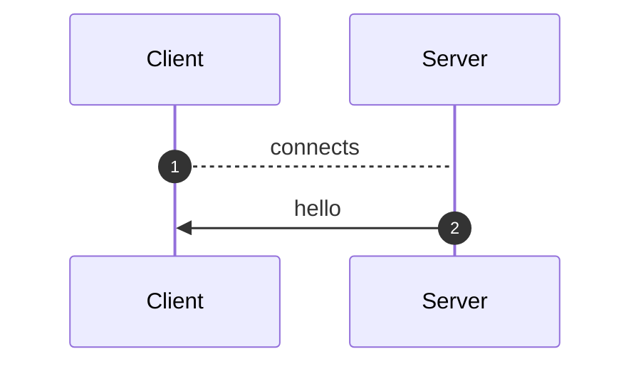
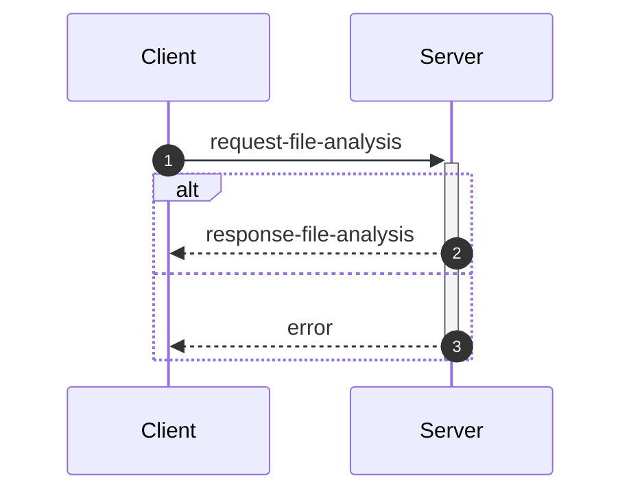
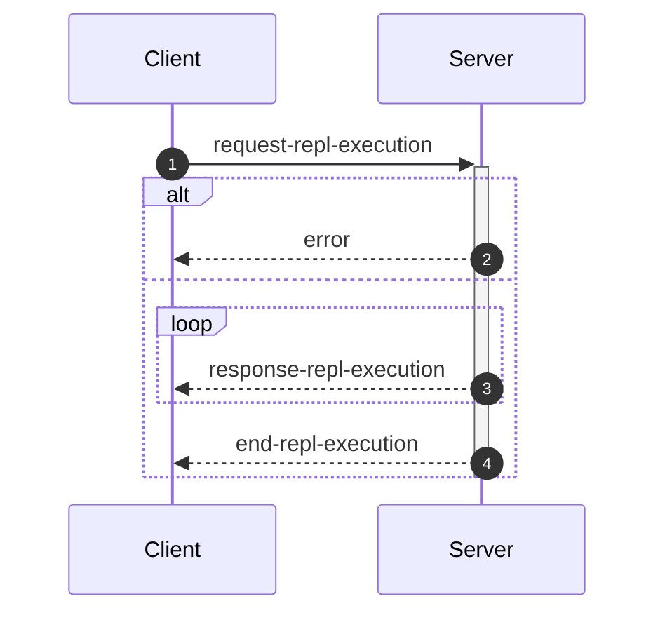
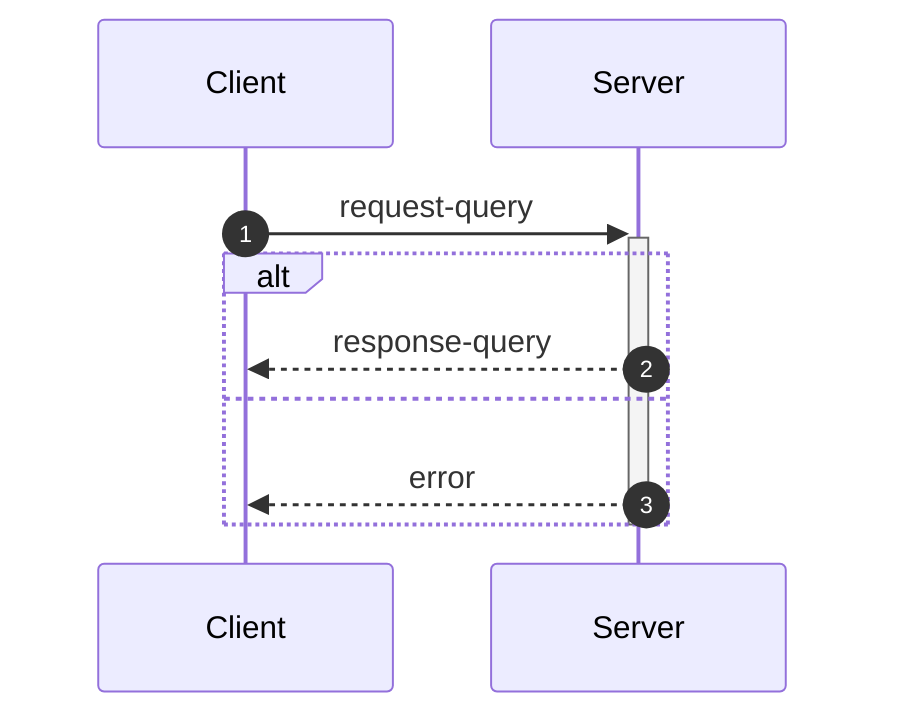

_<span title="an overview of flowR's interface">Generated</span> from '[wiki-interface.ts](https://github.com/flowr-analysis/flowr/tree/main/src/documentation/wiki-interface.ts "src/documentation/wiki-interface.ts")' on 2026-11-04, 13:56:41 UTC (v2.17.0, R v4.6.1), do not edit directly._

Although far from being as detailed as the in-depth explanation of [_flowR_](https://github.com/flowr-analysis/flowr/wiki/Core),
this wiki page explains how to interface with _flowR_ in more detail.
In general, command line arguments and other options provide short descriptions on hover over.

* [💻 Using the REPL](#using-the-repl)
* [⚙️ Configuring FlowR](#configuring-flowr)
* [⚒️ Writing Code](#writing-code)
* [💬 Communicating with the Server](#communicating-with-the-server)

<a id='using-the-repl'></a>
## 💻 Using the REPL

> [!NOTE]
> To execute arbitrary R commands with a repl request, _flowR_ has to be started explicitly with <span title="Description (Command Line Argument): Allow to access the underlying R session when using flowR (security warning: this allows the execution of arbitrary R code!)">`--r-session-access`</span>.
> Please be aware that this introduces a security risk and note that this relies on the [`r-shell` engine](https://github.com/flowr-analysis/flowr/wiki/Engines) .

Although primarily meant for users to explore,
there is nothing which forbids calling _flowR_ as a subprocess to use standard-in, -output, and -error
for communication (although you can access the REPL using the server as well,
with the [REPL Request](#message-request-repl-execution) message).

The read-eval-print loop&nbsp;(REPL) works relatively simple.
You can submit an expression (using <kbd>Enter</kbd>),
which is interpreted as an R&nbsp;expression by default but interpreted as a *command* if it starts with a colon (`:`).
The best command to get started with the REPL is <span title="Description (Repl Command): Show help information (aliases: :h, :?)">`:help`</span>.
Besides, you can leave the REPL either with the command <span title="Description (Repl Command): End the repl (aliases: :q, :exit)">`:quit`</span> or by pressing <kbd>Ctrl</kbd>+<kbd>C</kbd> twice.
When writing a *command*, you may press <kbd>Tab</kbd> to get a list of completions, if available.
Multiple commands can be entered in a single line by separating them with a semicolon (`;`), e.g. `:parse "x<-2"; :df*`.
If a command is given without R code, the REPL will re-use R code given in a previous command.
The prior example will hence return first the parsed AST of the program and then the dataflow graph for `"x <- 2"`.

> [!NOTE]
> If you develop flowR, you may want to launch the repl using the `npm run main-dev` command, this way, you get a non-minified version of flowR with debug information and hot-reloading of source files.

<details>
<summary>Available Commands</summary>

We currently offer the following commands (this with a `[*]` suffix are available with and without the star):

| Command | Description |
| ------- | ----------- |
| **<span title="Description (Repl Command): End the repl (aliases: :q, :exit)">:quit</span>** | End the repl (aliases: **:<span title="Alias of ':quit'. End the repl">q</span>**, **:<span title="Alias of ':quit'. End the repl">exit</span>**) |
| **<span title="Description (Repl Command): Execute the given code as R code. This requires the `--r-session-access` flag to be set and requires the r-shell engine. (aliases: :e, :r)">:execute</span>** | Execute the given code as R code. This requires the `--r-session-access` flag to be set and requires the r-shell engine. (aliases: **:<span title="Alias of ':execute'. Execute the given code as R code. This requires the `--r-session-access` flag to be set and requires the r-shell engine.">e</span>**, **:<span title="Alias of ':execute'. Execute the given code as R code. This requires the `--r-session-access` flag to be set and requires the r-shell engine.">r</span>**) |
| **<span title="Description (Repl Command): Get mermaid code for the control-flow graph of R code (aliases: :cfg, :cf)">:controlflow[*]</span>** | Get mermaid code for the control-flow graph of R code (star: Returns the URL to mermaid.live) (aliases: **:<span title="Alias of ':controlflow'. Get mermaid code for the control-flow graph of R code">cfg</span>**, **:<span title="Alias of ':controlflow'. Get mermaid code for the control-flow graph of R code">cf</span>**) |
| **<span title="Description (Repl Command): Get mermaid code for the control-flow graph with basic blocks (aliases: :cfgb, :cfb)">:controlflowbb[*]</span>** | Get mermaid code for the control-flow graph with basic blocks (star: Returns the URL to mermaid.live) (aliases: **:<span title="Alias of ':controlflowbb'. Get mermaid code for the control-flow graph with basic blocks">cfgb</span>**, **:<span title="Alias of ':controlflowbb'. Get mermaid code for the control-flow graph with basic blocks">cfb</span>**) |
| **<span title="Description (Repl Command): Get mermaid code for the dataflow graph (aliases: :d, :df)">:dataflow[*]</span>** | Get mermaid code for the dataflow graph (star: Returns the URL to mermaid.live) (aliases: **:<span title="Alias of ':dataflow'. Get mermaid code for the dataflow graph">d</span>**, **:<span title="Alias of ':dataflow'. Get mermaid code for the dataflow graph">df</span>**) |
| **<span title="Description (Repl Command): Get mermaid code for the normalized AST of R code (aliases: :n)">:normalize[*]</span>** | Get mermaid code for the normalized AST of R code (star: Returns the URL to mermaid.live) (alias: **:<span title="Alias of ':normalize'. Get mermaid code for the normalized AST of R code">n</span>**) |
| **<span title="Description (Repl Command): Get mermaid code for the simplified dataflow graph (aliases: :ds, :dfs)">:dataflowsimple[*]</span>** | Get mermaid code for the simplified dataflow graph (star: Returns the URL to mermaid.live) (aliases: **:<span title="Alias of ':dataflowsimple'. Get mermaid code for the simplified dataflow graph">ds</span>**, **:<span title="Alias of ':dataflowsimple'. Get mermaid code for the simplified dataflow graph">dfs</span>**) |
| **<span title="Description (Repl Command): Inspect and extend the signature database: `query` (identical to :query @signature), `info <name>` for where a function comes from (identical to :query @function-info), `add <path>` to mount another database/source, `download` to fetch the full-history database. (aliases: :sig)">:signature</span>** | Inspect and extend the signature database: `query` (identical to :query @signature), `info <name>` for where a function comes from (identical to :query @function-info), `add <path>` to mount another database/source, `download` to fetch the full-history database. (alias: **:<span title="Alias of ':signature'. Inspect and extend the signature database: `query` (identical to :query @signature), `info <name>` for where a function comes from (identical to :query @function-info), `add <path>` to mount another database/source, `download` to fetch the full-history database.">sig</span>**) |
| **<span title="Description (Repl Command): Just calculates the DFG, but only prints summary info (aliases: :d#, :df#)">:dataflowsilent</span>** | Just calculates the DFG, but only prints summary info (aliases: **:<span title="Alias of ':dataflowsilent'. Just calculates the DFG, but only prints summary info">d#</span>**, **:<span title="Alias of ':dataflowsilent'. Just calculates the DFG, but only prints summary info">df#</span>**) |
| **<span title="Description (Repl Command): Prints ASCII Art of the parsed, unmodified AST (aliases: :p)">:parse</span>** | Prints ASCII Art of the parsed, unmodified AST (alias: **:<span title="Alias of ':parse'. Prints ASCII Art of the parsed, unmodified AST">p</span>**) |
| **<span title="Description (Repl Command): Prints the version of flowR as well as the current version of R">:version</span>** | Prints the version of flowR as well as the current version of R
| **<span title="Description (Repl Command): Query the given R code (use 'help' for more information)">:query[*]</span>** | Query the given R code (use 'help' for more information) (star: Similar to query, but returns the output in json format.)
| **<span title="Description (Repl Command): Returns an ASCII representation of the dataflow graph (aliases: :df!)">:dataflowascii</span>** | Returns an ASCII representation of the dataflow graph (alias: **:<span title="Alias of ':dataflowascii'. Returns an ASCII representation of the dataflow graph">df!</span>**) |
| **<span title="Description (Repl Command): Returns summarization stats for the normalized AST (aliases: :n#)">:normalize#</span>** | Returns summarization stats for the normalized AST (alias: **:<span title="Alias of ':normalize#'. Returns summarization stats for the normalized AST">n#</span>**) |
| **<span title="Description (Repl Command): Show help information (aliases: :h, :?)">:help</span>** | Show help information (aliases: **:<span title="Alias of ':help'. Show help information">h</span>**, **:<span title="Alias of ':help'. Show help information">?</span>**) |

</details>

> [!TIP]
> 
> As indicated by the examples before, all REPL commands that operate on code keep track of the state.
> Hence, if you run a command like <span title="Description (Repl Command, starred version): Returns the URL to mermaid.live; Base Command: Get mermaid code for the dataflow graph (aliases: :d*, :df*)">`:dataflow*`</span> without providing R code,
> the REPL will re-use the R code provided in a previous command.
> Likewise, doing this will benefit from incrementality!
> If you request the dataflow graph with `:df* x <- 2 * y` and then want to see the parsed AST with `:parse`,
> the REPL will re-use previously obtained information and not re-parse the code again.
> 		

Generally, many commands offer shortcut versions in the REPL. Many queries, for example, offer a shortened format (see the example below).
Of special note, the [Config Query](https://github.com/flowr-analysis/flowr/wiki/%5BQuery%5D-Config)
can be used to also modify the currently active configuration of _flowR_ within the REPL (see the [wiki page](https://github.com/flowr-analysis/flowr/wiki/%5BQuery%5D-Config) for more information).

### Example: Retrieving the Dataflow Graph

To retrieve a URL to the [mermaid](https://mermaid.js.org/) diagram of the dataflow of a given expression,
use <span title="Description (Repl Command, starred version): Returns the URL to mermaid.live; Base Command: Get mermaid code for the dataflow graph (aliases: :d*, :df*)">`:dataflow*`</span> (or <span title="Description (Repl Command): Get mermaid code for the dataflow graph (aliases: :d, :df)">`:dataflow`</span> to get the mermaid code in the cli):

```shell
$ docker run -it --rm eagleoutice/flowr # or npm run flowr 
flowR repl v2.17.0, R grammar v14 (tree-sitter engine)
R> :dataflow* y <- 1 + x
```

<details>
<summary style='color:gray'>Output</summary>

```text
https://mermaid.live/view#base64:eyJjb2RlIjoiZmxvd2NoYXJ0IFREXG4gICAgMXt7XCJgKiM5MTtSTnVtYmVyIzkzOyogKioxKipcbiAgICAgICoxLjYqICgqKmlkOiAxKiopYFwifX1cbiAgICAyKFtcImAqIzkxO1JTeW1ib2wjOTM7KiAqKngqKlxuICAgICAgKjEuMTAqICgqKmlkOiAyKiopYFwiXSlcbiAgICAzW1tcImAqIzkxO1JCaW5hcnlPcCM5MzsqIGJhc2UjNTg7IzU4OyoqIzQzOyoqXG4gICAgICAqMS42LTEwKiAoKippZDogMyoqKVxuICAgIGFyZzogKDEsIDIpYFwiXV1cbiAgICBidWlsdC1pbjpfNDNfW1wiYEJ1aWx0LUluOlxuIzQzO2BcIl1cbiAgICBzdHlsZSBidWlsdC1pbjpfNDNfIHN0cm9rZTpncmF5LGZpbGw6Z3JheSxzdHJva2Utd2lkdGg6MnB4LG9wYWNpdHk6Ljg7XG4gICAgMFtcImAqIzkxO1JTeW1ib2wjOTM7KiAqKnkqKlxuICAgICAgKjEuMSogKCoqaWQ6IDAqKiwgdjogMylgXCJdXG4gICAgNFtbXCJgKiM5MTtSQmluYXJ5T3AjOTM7KiBiYXNlIzU4OyM1ODsqKiM2MDsjNDU7KipcbiAgICAgICoxLjEtMTAqICgqKmlkOiA0KiopXG4gICAgYXJnOiAoMCwgMylgXCJdXVxuICAgIGJ1aWx0LWluOl82MF8tW1wiYEJ1aWx0LUluOlxuIzYwOyM0NTtgXCJdXG4gICAgc3R5bGUgYnVpbHQtaW46XzYwXy0gc3Ryb2tlOmdyYXksZmlsbDpncmF5LHN0cm9rZS13aWR0aDoycHgsb3BhY2l0eTouODtcbiAgICAxIC0uLT58XCJmbG93XCJ8IDJcbiAgICBsaW5rU3R5bGUgMCBzdHJva2U6Z3JheSxjb2xvcjpncmF5O1xuICAgIDIgLS4tPnxcImZsb3dcInwgM1xuICAgIGxpbmtTdHlsZSAxIHN0cm9rZTpncmF5LGNvbG9yOmdyYXk7XG4gICAgMyAtLT58XCJyZWFkcywgYXJnXCJ8IDFcbiAgICAzIC0tPnxcInJlYWRzLCBhcmdcInwgMlxuICAgIDMgLS4tPnxcImZsb3dcInwgMFxuICAgIGxpbmtTdHlsZSA0IHN0cm9rZTpncmF5LGNvbG9yOmdyYXk7XG4gICAgMyAtLi0+fFwicmVhZHMsIGNhbGxzXCJ8IGJ1aWx0LWluOl80M19cbiAgICBsaW5rU3R5bGUgNSBzdHJva2U6Z3JheTtcbiAgICAwIC0tPnxcImRlZmluZWQtYnksIGZsb3dcInwgNFxuICAgIDAgLS0+fFwiZGVmaW5lZC1ieVwifCAzXG4gICAgNCAtLT58XCJyZWFkcywgYXJnXCJ8IDNcbiAgICA0IC0tPnxcInJldHVybnMsIGFyZ1wifCAwXG4gICAgNCAtLi0+fFwicmVhZHMsIGNhbGxzXCJ8IGJ1aWx0LWluOl82MF8tXG4gICAgbGlua1N0eWxlIDEwIHN0cm9rZTpncmF5OyIsIm1lcm1haWQiOnsiYXV0b1N5bmMiOnRydWV9fQ==
```

Retrieve the dataflow graph of the expression `y <- 1 + x`. It looks like this:


<details>

<summary style="color:gray">R Code of the Dataflow Graph</summary>

The analysis ran (parse and normalize with the [tree-sitter](https://github.com/flowr-analysis/flowr/wiki/Engines) engine) in the generation environment. No [signature database](https://github.com/flowr-analysis/flowr/wiki/Signature-Database) is mounted, so `library()` attaches no exports (base-R names are still qualified, e.g., `stats::acf`). 
We encountered no unknown side effects during the analysis.

```r
y <- 1 + x
```

</details>

</details>

For small graphs like this, <span title="Description (Repl Command): Returns an ASCII representation of the dataflow graph (aliases: :df!)">`:dataflowascii`</span> also provides an ASCII representation directly in the REPL:

```shell
$ docker run -it --rm eagleoutice/flowr # or npm run flowr 
flowR repl v2.17.0, R grammar v14 (tree-sitter engine)
R> :df! y <- 1 + x
```

<details open>
<summary style='color:gray'>Output</summary>

```text
                        v<0>v
 c<4>c──────────────────| y |
 |<- |     ┌────────────v---v
 c---c     │
    │   c<3>c   0<1>0
    └───| + |───| 1 |───u<2>u
        c---c   0---0   | x |
           └────────────u---u
Edges:
3 -> 1: reads, arg          3 -> 2: reads, arg
3 -> 0: flows-to            1 -> 2: flows-to
2 -> 3: flows-to            4 -> 3: reads, arg
4 -> 0: returns, arg        0 -> 4: defined-by, flows-to
0 -> 3: defined-by
```

Retrieve the dataflow graph of the expression `y <- 1 + x` as ASCII art.

</details>

For the slicing with <span title="Description (Repl Command): Static backwards executable slicer for R">`:slicer`</span>, you have access to the same [magic comments](#slice-magic-comments) as with the [slice request](#message-request-slice).
Pass `--inline` to splice resolvable `source()` calls into the reconstruction so the slice is a single self-contained R text (the same as the static slice query's `inlineSources` flag).
See `--help` for more flags!

### Example: Interfacing with the File System

Many commands that allow for an R-expression (like <span title="Description (Repl Command, starred version): Returns the URL to mermaid.live; Base Command: Get mermaid code for the dataflow graph (aliases: :d*, :df*)">`:dataflow*`</span>) allow for a file as well
if the argument starts with `file://`.
If you are working from the root directory of the _flowR_ repository, the following gives you the parsed AST of the example file using the <span title="Description (Repl Command): Prints ASCII Art of the parsed, unmodified AST (aliases: :p)">`:parse`</span> command:

> **Watch mode**: Replace `file://` with `watch://` to enter watch mode.
> flowR runs the command immediately and then re-runs it every time the file (or any file inside the folder) changes.
> Enter any other command to leave watch mode.
> For example: `:df watch://analysis.R`

```shell
$ docker run -it --rm eagleoutice/flowr # or npm run flowr 
flowR repl v2.17.0, R grammar v14 (tree-sitter engine)
R> :parse file://test/testfiles/example.R
```

<details>
<summary style='color:gray'>Output</summary>

```text
File: test/testfiles/example.R

program
├ binaryoperator
│ ├ identifier "sum" (1:1─4)
│ ├ <- "<-" (1:5─7)
│ ╰ float "0" (1:8─9)
├ binaryoperator
│ ├ identifier "product" (2:1─8)
│ ├ <- "<-" (2:9─11)
│ ╰ float "1" (2:12─13)
├ binaryoperator
│ ├ identifier "w" (3:1─2)
│ ├ <- "<-" (3:3─5)
│ ╰ float "7" (3:6─7)
├ binaryoperator
│ ├ identifier "N" (4:1─2)
│ ├ <- "<-" (4:3─5)
│ ╰ float "10" (4:6─8)
├ forstatement
│ ├ for "for" (6:1─4)
│ ├ ( "(" (6:5─6)
│ ├ identifier "i" (6:6─7)
│ ├ in "in" (6:8─10)
│ ├ binaryoperator
│ │ ├ float "1" (6:11─12)
│ │ ├ : ":" (6:12─13)
│ │ ╰ parenthesizedexpression
│ │   ├ ( "(" (6:13─14)
│ │   ├ binaryoperator
│ │   │ ├ identifier "N" (6:14─15)
│ │   │ ├ - "-" (6:15─16)
│ │   │ ╰ float "1" (6:16─17)
│ │   ╰ ) ")" (6:17─18)
│ ├ ) ")" (6:18─19)
│ ╰ bracedexpression
│   ├ { "{" (6:20─21)
│   ├ binaryoperator
│   │ ├ identifier "sum" (7:3─6)
│   │ ├ <- "<-" (7:7─9)
│   │ ╰ binaryoperator
│   │   ├ binaryoperator
│   │   │ ├ identifier "sum" (7:10─13)
│   │   │ ├ + "+" (7:14─15)
│   │   │ ╰ identifier "i" (7:16─17)
│   │   ├ + "+" (7:18─19)
│   │   ╰ identifier "w" (7:20─21)
│   ├ binaryoperator
│   │ ├ identifier "product" (8:3─10)
│   │ ├ <- "<-" (8:11─13)
│   │ ╰ binaryoperator
│   │   ├ identifier "product" (8:14─21)
│   │   ├  "" (8:22─23)
│   │   ╰ identifier "i" (8:24─25)
│   ╰ } "}" (9:1─2)
├ call
│ ├ identifier "cat" (11:1─4)
│ ╰ arguments
│   ├ ( "(" (11:4─5)
│   ├ argument
│   │ ╰ string
│   │   ├ stringopen "\"" (11:5─6)
│   │   ├ stringcontent "Sum:" (11:6─10)
│   │   ╰ stringclose "\"" (11:10─11)
│   ├ comma "," (11:11─12)
│   ├ argument
│   │ ╰ identifier "sum" (11:13─16)
│   ├ comma "," (11:16─17)
│   ├ argument
│   │ ╰ string
│   │   ├ stringopen "\"" (11:18─19)
│   │   ├ stringcontent
│   │   │ ╰ escapesequence "\\n" (11:19─21)
│   │   ╰ stringclose "\"" (11:21─22)
│   ╰ ) ")" (11:22─23)
╰ call
  ├ identifier "cat" (12:1─4)
  ╰ arguments
    ├ ( "(" (12:4─5)
    ├ argument
    │ ╰ string
    │   ├ stringopen "\"" (12:5─6)
    │   ├ stringcontent "Product:" (12:6─14)
    │   ╰ stringclose "\"" (12:14─15)
    ├ comma "," (12:15─16)
    ├ argument
    │ ╰ identifier "product" (12:17─24)
    ├ comma "," (12:24─25)
    ├ argument
    │ ╰ string
    │   ├ stringopen "\"" (12:26─27)
    │   ├ stringcontent
    │   │ ╰ escapesequence "\\n" (12:27─29)
    │   ╰ stringclose "\"" (12:29─30)
    ╰ ) ")" (12:30─31)
```

Retrieve the parsed AST of the example file.

<details>

<summary>File Content</summary>

```r
sum <- 0
product <- 1
w <- 7
N <- 10

for (i in 1:(N-1)) {
  sum <- sum + i + w
  product <- product * i
}

cat("Sum:", sum, "\n")
cat("Product:", product, "\n")
```

</details>

As _flowR_ directly transforms this AST the output focuses on being human-readable instead of being machine-readable.
		
</details>

### Example: Run a Query

You can run any query supported by _flowR_ using the <span title="Description (Repl Command): Query the given R code (use 'help' for more information)">`:query`</span> command.
For example, to obtain the shapes of all data frames in a given piece of code, you can run:

```shell
$ docker run -it --rm eagleoutice/flowr # or npm run flowr 
flowR repl v2.17.0, R grammar v14 (tree-sitter engine)
R> :query @absint df-shape "x <- data.frame(a = 1:10, b = 1:10)\ny <- x$a"
```

<details open>
<summary style='color:gray'>Output</summary>

```text
Query: absint (6 ms)
   ╰ $12: (colnames: [{"a", "b"}, {}], cols: [2, 2], rows: [10, 10])
   ╰ $0: (colnames: [{"a", "b"}, {}], cols: [2, 2], rows: [10, 10])
```

Retrieve the shapes of all data frames in the given code.

</details>

To run the linter on a file, you can use (in this example, we just issue the `dead-code` linter on a small piece of code):

```shell
$ docker run -it --rm eagleoutice/flowr # or npm run flowr 
flowR repl v2.17.0, R grammar v14 (tree-sitter engine)
R> :query @linter rules:dead-code "if(FALSE) x <- 2"
```

<details open>
<summary style='color:gray'>Output</summary>

```text
Query: linter (2 ms)
   ╰ Dead Code (dead-code):
       ╰ certain:
           ╰ Code at 1.11-16 (1 quick fix(es) available)
```

Run the linter on the given code, with only the `dead-code` rule enabled.

</details>

For more information on the available queries, please check out the [Query API](https://github.com/flowr-analysis/flowr/wiki/Query-API).

<a id='configuring-flowr'></a>
## ⚙️ Configuring FlowR

When running _flowR_, you may want to specify some behaviors with a dedicated configuration file.
By default, flowR looks for a file named `flowr.json` in the current working directory (or any higher directory).
You can also specify a different file with <span title="Description (Command Line Argument): The name of the configuration file to use">`--config-file`</span> or pass the configuration inline using <span title="Description (Command Line Argument): The flowR configuration to use, as a JSON string">`--config-json`</span>.
A `flowr.json` found this way belongs to the analyzed project, so flowR ignores its options that decide what flowR executes or loads
(`engines.*.wasmPath`, `engines.*.treeSitterWasmPath`, `engines.*.rPath`, `solver.sigdb.additionalPaths`, `solver.sigdb.downloadRepo`, `solver.sigdb.installedLibrary.paths`, `solver.sigdb.onDemand.enabled`, `solver.sigdb.onDemand.repositories`, `solver.sigdb.onDemand.cranMirror`, `solver.sigdb.onDemand.bioconductorMirror`, `solver.sigdb.onDemand.cacheDir`),
unless you pass <span title="Description (Command Line Argument): Keep the security-sensitive options (e.g., the R executable) of the flowr.json found in the working directory or a parent. Only use this for projects you trust.">`--trust-config`</span>.
To analyze code you do not trust, use the secure mode (<span title="Description (Command Line Argument): Run in secure mode for analyzing untrusted code: flowR does not start R (or any other process), does not access the network, does not search for project configs, and ignores security-sensitive options in every config. Cannot be disabled once enabled. Can also be enabled with the environment variable {italic FLOWR_SECURE_MODE=1}.">`--secure`</span>, see the [security policy](https://github.com/flowr-analysis/flowr/blob/main/.github/SECURITY.md)).
To inspect the current configuration, you can run flowr with the <span title="Description (Command Line Argument): Run with verbose logging (will be passed to the corresponding script)">`--verbose`</span> flag, or use the `config` [Query](https://github.com/flowr-analysis/flowr/wiki/Query-API).
Within the REPL this works by running the following:

```shell
:query @config
```

To work with the <a href="https://github.com/flowr-analysis/flowr/tree/main/src/config.ts#L119"><code><span title="The configuration file format for flowR.">FlowrConfig</span></code></a> you can use the provided helper objects alongside its methods like
<a href="https://github.com/flowr-analysis/flowr/tree/main/src/config.ts#L966"><code><span title="Creates a new flowr config that has the updated values.">FlowrConfig::<b>amend</b></span></code></a>.
The schema below documents every option; the ones you most likely want are:

- <a href="https://github.com/flowr-analysis/flowr/wiki/Interface#configuring-flowr" title="Configuration Option (boolean): Whether source calls should be ignored, causing {@link processSourceCall}&#39;s behavior to be skipped.">ignoreSourceCalls</a>: ignore source calls when analyzing the code, i.e., ignore the inclusion of other files.
- <a href="https://github.com/flowr-analysis/flowr/wiki/Interface#configuring-flowr" title="Configuration Option (boolean): Whether load calls should be ignored, causing {@link processLoadCall}&#39;s behavior to be skipped.">ignoreLoadCalls</a>: ignore load calls when analyzing the code, i.e., ignore the loading of r-data files.
- <a href="https://github.com/flowr-analysis/flowr/wiki/Interface#configuring-flowr" title="Configuration Option (object): Do you want to overwrite (parts) of the builtin definition?">semantics.environment.overwriteBuiltIns</a>: overwrite _flowR_'s handling of built-in functions, or clear the preset definitions entirely.
  See [Configure BuiltIn Semantics](#configure-builtin-semantics) for more information.
- <a href="https://github.com/flowr-analysis/flowr/wiki/Interface#configuring-flowr" title="Configuration Option (string): How to resolve variables and their values. (one of &quot;disabled&quot;, &quot;alias&quot;, &quot;builtin&quot;)">solver.variables</a>: how to resolve variables and their values (`disabled`, `alias`, `builtin`).
- <a href="https://github.com/flowr-analysis/flowr/wiki/Interface#configuring-flowr" title="Configuration Option (array): The engine or set of engines to use for interacting with R code. An empty array means all available engines will be used.">engines</a> and <a href="https://github.com/flowr-analysis/flowr/wiki/Interface#configuring-flowr" title="Configuration Option (string): The default engine to use for interacting with R code. If this is undefined, an arbitrary engine from the specified list will be used. (one of &quot;tree-sitter&quot;, &quot;r-shell&quot;)">defaultEngine</a>: the engines used to interact with R code, see the [Engines wiki page](https://github.com/flowr-analysis/flowr/wiki/Engines).
- <a href="https://github.com/flowr-analysis/flowr/wiki/Interface#configuring-flowr" title="Configuration Option (array): Files a framework loads on its own, without any source() call (e.g. global.R in a shiny app), in the order they are loaded; flowR orders the matching project files accordingly and analyzes them as one program. Entries are case-insensitive globs matched against the file path, a plain name matches any file with that name, and entries matching no project file are warned about. Usually set per project kind via specializeConfig.">project.implicitSources</a>: the files a framework loads without any `source()` call, in the order in which they are
  loaded. Entries are globs (e.g. `R/*.R`) matched against the file path ignoring capitalization; one matching no file is reported.
- <a href="https://github.com/flowr-analysis/flowr/wiki/Interface#configuring-flowr" title="Configuration Option (object): Overwrite (parts of) the configuration depending on the project kind flowR detects, e.g. to give a shiny app its implicit sources.">specializeConfig</a>: overwrite (parts of) the configuration depending on the kind of project _flowR_ detects
  (e.g. `shiny-app`), which is how a shiny app gets its implicit sources by default. What you configure directly wins.
- <a href="https://github.com/flowr-analysis/flowr/wiki/Interface#configuring-flowr" title="Configuration Option (string): Overwrite the project kind flowR would otherwise infer from the analyzed files, e.g. when auto-detection guesses wrong. (one of &quot;package&quot;, &quot;script&quot;, &quot;shiny-app&quot;, &quot;notebook&quot;, &quot;project&quot;, &quot;unknown&quot;)">project.useProjectType</a>: skip that detection and force a project kind yourself, when auto-detection guesses wrong.
- <a href="https://github.com/flowr-analysis/flowr/wiki/Interface#configuring-flowr" title="Configuration Option (array): The default plugins to load when creating a new instance of FlowrAnalyzer">defaultPlugins</a> and <a href="https://github.com/flowr-analysis/flowr/wiki/Interface#configuring-flowr" title="Configuration Option (array): The plugins to load in REPL mode">repl.plugins</a>: the plugins to load for a new <a href="https://github.com/flowr-analysis/flowr/tree/main/src/project/flowr-analyzer.ts#L210"><code><span title="Central class for conducting analyses with FlowR. Use the FlowrAnalyzerBuilder to create a new instance. If you want the original pattern of creating a pipeline and running all steps, you can still do this with FlowrAnalyzer#runFull . To inspect the context of the analyzer, use FlowrAnalyzer#inspectContext (if you are a plugin and need to modify it, use FlowrAnalyzer#context instead).">FlowrAnalyzer</span></code></a> and in the REPL
  (use `flowr:default` to reference the former).

So you can configure _flowR_ by adding a file like the following:

<details>

<summary>Example Configuration File</summary>

```json
{
  "ignoreSourceCalls": true,
  "ignoreLoadCalls": true,
  "semantics": {
    "environment": {
      "overwriteBuiltIns": {
        "definitions": [
          {
            "type": "function",
            "names": [
              "foo"
            ],
            "processor": "builtin:assign",
            "config": {}
          }
        ]
      }
    }
  },
  "defaultPlugins": [
    "file:description",
    "versions:description"
  ],
  "repl": {
    "quickStats": false,
    "dfProcessorHeat": false,
    "hints": true,
    "plugins": [
      "flowr:default"
    ]
  },
  "project": {
    "resolveUnknownPathsOnDisk": true,
    "implicitSources": [
      "global.R",
      "app.R"
    ]
  },
  "linter": {
    "disabledRules": []
  },
  "specializeConfig": {
    "shiny-app": {
      "project": {
        "implicitSources": [
          "global.R",
          "ui.R",
          "server.R",
          "app.R"
        ]
      }
    }
  },
  "engines": [
    {
      "type": "r-shell"
    }
  ],
  "solver": {
    "variables": "alias",
    "evalStrings": true,
    "trackEnvironments": true,
    "sigdb": {
      "enabled": true,
      "loadProjectDependencies": true,
      "eagerlyLoad": false,
      "eagerlyLoadExports": false,
      "linkBaseR": false,
      "linkDescriptionDependencies": false
    },
    "resolveSource": {
      "dropPaths": "no",
      "ignoreCapitalization": true,
      "inferWorkingDirectory": "active-script",
      "searchPath": []
    },
    "instrument": {},
    "slicer": {
      "threshold": 50
    }
  },
  "abstractInterpretation": {
    "wideningThreshold": 4,
    "followCalls": true,
    "dataFrame": {
      "maxColNames": 20,
      "readLoadedData": {
        "readExternalFiles": true,
        "maxReadLines": 1000000
      }
    }
  },
  "incremental": {
    "alwaysIncremental": false,
    "parsing": {
      "activated": false,
      "heuristics": {
        "activated": true,
        "mtime": true,
        "linesFrom": 500,
        "bytesFrom": 50000,
        "alwaysWithEdits": false,
        "minFiles": 1
      }
    }
  },
  "gas": {
    "thresholds": {
      "memory": {
        "problematic": 0.7,
        "critical": 0.9
      },
      "timeMs": {
        "problematic": 100000,
        "critical": 120000
      }
    },
    "features": {}
  }
}
```

</details>

<details>
<a id='configure-builtin-semantics'></a>
<summary>Configure Built-In Semantics</summary>

`semantics/environment/overwriteBuiltins` accepts two keys:

- `loadDefaults` (boolean, initially `true`): If set to `true`, the default built-in definitions are loaded before applying the custom definitions. Setting this flag to `false` explicitly disables the loading of the default definitions.
- `definitions` (array, initially empty): Allows to overwrite or define new built-in elements. Each object within must have a `type` which is one of the below. Furthermore, they may define a string array of `names` which specifies the identifiers to bind the definitions to. You may use `assumePrimitive` to specify whether _flowR_ should assume that this is a primitive non-library definition (so you probably just do not want to specify the key).

  | Type            | Description                                                                                                                                                                                                                                                                                              | Example                                                                                                    |
  | --------------- | -------------------------------------------------------------------------------------------------------------------------------------------------------------------------------------------------------------------------------------------------------------------------------------------------------- | ---------------------------------------------------------------------------------------------------------- |
  | `constant`    | Additionally allows for a `value` this should resolve to.                                                                                                                                                                                                                                                | `{ type: 'constant', names: ['NULL', 'NA'],  value: null }`                                                |
  | `function`    | Is a rather flexible way to define and bind built-in functions. For the time, we do not have extensive documentation to cover all the cases, so please either consult the sources with the `default-builtin-config.ts` or open a [new issue](https://github.com/flowr-analysis/flowr/issues/new/choose). | `{ type: 'function', names: ['next'], processor: 'builtin:d', config: { cfg: ExitPointType.Next } }` |
  | `replacement` | A comfortable way to specify replacement functions like `$<-` or `names<-`. `suffixes` describes the... suffixes to attach automatically. | `{ type: 'replacement', suffixes: ['<-', '<<-'], names: ['[', '[['] }` |

</details>

<details>

<summary style='color:gray'>Full Configuration-File Schema</summary>

- _The configuration file format for flowR._ (object)
    - **logLevel** [optional] _flowR's global minimum log level, applied when the config is loaded._ (string)
        Only allows: 'silly', 'trace', 'debug', 'info', 'warn', 'error', 'fatal'
    - **ignoreSourceCalls** [optional] _Whether source calls should be ignored, causing {@link processSourceCall}'s behavior to be skipped._ (boolean)
    - **ignoreLoadCalls** [optional] _Whether load calls should be ignored, causing {@link processLoadCall}'s behavior to be skipped._ (boolean)
    - **semantics** _Configure language semantics and how flowR handles them._ (object)
        - **environment** [optional] _Semantics regarding how to handle the R environment._ (object)
            - **overwriteBuiltIns** [optional] _Do you want to overwrite (parts) of the builtin definition?_ (object)
                - **loadDefaults** [optional] _Should the default configuration still be loaded?_ (boolean)
                - **definitions** [optional] _The definitions to load/overwrite._ (array)
                Valid item types:
                    - (object)
    - **defaultPlugins** [optional] _The default plugins to load when creating a new instance of FlowrAnalyzer_ (array)
    Valid item types:
        - (alternatives)
            - (string)
            - (array)
    - **repl** _Configuration options for the REPL._ (object)
        - **quickStats** [optional] _Whether to show quick stats in the REPL after each evaluation._ (boolean)
        - **dfProcessorHeat** [optional] _This instruments the dataflow processors to count how often each processor is called._ (boolean)
        - **hints** [optional] _Whether to show dim inline hints on the empty prompt (automatically disabled on non-interactive terminals)._ (boolean)
        - **plugins** [optional] _The plugins to load in REPL mode_ (array)
        Valid item types:
            - (alternatives)
                - (string)
                - (array)
        - **autoUseFileProtocol** [optional] _Prepend the file protocol to a repl input that looks like a path, instead of only warning about it._ (boolean)
        - **queryStats** [optional] _Whether `:query` closes with the line stating how long the queries took (`:query*` never prints it)._ (boolean)
        - **showPlugins** [optional] _Whether `:version` grays out the plugins that did not activate during the last analysis._ (boolean)
    - **project** _Project specific configuration options._ (object)
        - **resolveUnknownPathsOnDisk** [optional] _Whether to resolve unknown paths loaded by the r project disk when trying to source/analyze files._ (boolean)
        - **failOnInaccessiblePath** [optional] _Whether a directory that cannot be traversed during file discovery (e.g. due to permissions) aborts the analysis; when false (the default) such paths are logged and skipped._ (boolean)
        - **basePackages** [optional] _The packages considered part of R itself (base and recommended); if unset, flowR uses its built-in list._ (array)
        Valid item types:
            - (string)
        - **implicitSources** [optional] _Files a framework loads on its own, without any source() call (e.g. global.R in a shiny app), in the order they are loaded; flowR orders the matching project files accordingly and analyzes them as one program. Entries are case-insensitive globs matched against the file path, a plain name matches any file with that name, and entries matching no project file are warned about. Usually set per project kind via specializeConfig._ (array)
        Valid item types:
            - (string)
        - **useProjectType** [optional] _Overwrite the project kind flowR would otherwise infer from the analyzed files, e.g. when auto-detection guesses wrong._ (string)
            Only allows: 'package', 'script', 'shiny-app', 'notebook', 'project', 'unknown'
        - **assumeImplicitEcho** [optional] _Whether the top level of the analyzed code is echoed, so that every visible result printed there is collected as an output by the dependencies query (default true, false for a package)._ (boolean)
        - **discovery** [optional] _Scoping options for the default project discovery._ (object)
            - **full** [optional] _Collect every file below the project root (greedy) instead of only the files the detected project kind needs (default false)._ (boolean)
            - **perKind** [optional] _Per-kind include/exclude glob overrides layered on the default scoping._ (object)
            - **ignore** [optional] _Case-insensitive globs that drop matching files from the intelligent discovery, regardless of kind (e.g. .Renviron to ignore environment files)._ (array)
            Valid item types:
                - (string)
        - **classification** [optional] _Overrides for the signals flowR uses to classify the project kind._ (object)
            - **shinyDescriptionTypes** [optional] _DESCRIPTION Type: values that mark a shiny app._ (array)
            Valid item types:
                - (string)
            - **shinyEntryFiles** [optional] _File names a shiny app is assembled from._ (array)
            Valid item types:
                - (string)
            - **shinyUsagePattern** [optional] _Regex source evidencing shiny usage in an entry file._ (string)
            - **notebookExtensions** [optional] _File extensions marking a notebook._ (array)
            Valid item types:
                - (string)
    - **linter** _Linter configuration options._ (object)
        - **disabledRules** _Linting rule names excluded from the default rule set (a rule requested explicitly via a linter query still runs). Usually set per project kind via specializeConfig._ (array)
        Valid item types:
            - (string)
        - **disabledTags** [optional] _Linting rule tags whose rules are excluded from the default rule set (a rule requested explicitly via a linter query still runs). By default the cmd-check rules are disabled for everything but a package; a configured list replaces that default._ (array)
        Valid item types:
            - (string)
    - **inputSources** [optional] _Further frameworks the input-sources analysis should know about; entries are added to flowR's defaults._ (object)
        - **pure** [optional] _Functions that only pass the constantness of their arguments on._ (array)
        Valid item types:
            - (string)
        - **param** [optional] _Functions whose result is a 'param' input._ (array)
        Valid item types:
            - (string)
        - **file** [optional] _Functions whose result is a 'file' input._ (array)
        Valid item types:
            - (string)
        - **tempfile** [optional] _Functions whose result is a 'tempfile' input._ (array)
        Valid item types:
            - (string)
        - **glob** [optional] _Functions whose result is a 'glob' input._ (array)
        Valid item types:
            - (string)
        - **net** [optional] _Functions whose result is a 'net' input._ (array)
        Valid item types:
            - (string)
        - **rand** [optional] _Functions whose result is a 'rand' input._ (array)
        Valid item types:
            - (string)
        - **system** [optional] _Functions whose result is a 'system' input._ (array)
        Valid item types:
            - (string)
        - **ffi** [optional] _Functions whose result is a 'ffi' input._ (array)
        Valid item types:
            - (string)
        - **lang** [optional] _Functions whose result is a 'lang' input._ (array)
        Valid item types:
            - (string)
        - **options** [optional] _Functions whose result is a 'options' input._ (array)
        Valid item types:
            - (string)
        - **cmdline** [optional] _Functions whose result is a 'cmdline' input._ (array)
        Valid item types:
            - (string)
        - **user** [optional] _Functions whose result is a 'user' input._ (array)
        Valid item types:
            - (string)
        - **const** [optional] _Functions whose result is a 'const' input._ (array)
        Valid item types:
            - (string)
        - **scope** [optional] _Functions whose result is a 'scope' input._ (array)
        Valid item types:
            - (string)
        - **dconst** [optional] _Functions whose result is a 'dconst' input._ (array)
        Valid item types:
            - (string)
        - **unknown** [optional] _Functions whose result is a 'unknown' input._ (array)
        Valid item types:
            - (string)
        - **linkedObjects** [optional] _Objects a framework provides without a definition in the code, e.g. shiny's input._ (array)
        Valid item types:
            - (object)
        - **linkedEntryPoints** [optional] _Calls that hand a function to a framework, which binds its objects to the parameters by position._ (array)
        Valid item types:
            - (object)
    - **specializeConfig** [optional] _Overwrite (parts of) the configuration depending on the project kind flowR detects, e.g. to give a shiny app its implicit sources._ (object)
    - **engines** _The engine or set of engines to use for interacting with R code. An empty array means all available engines will be used._ (array)
    Valid item types:
        - (alternatives)
            - _The configuration for the tree sitter engine._ (object)
                - **type** [required] _Use the tree sitter engine._ (string)
                    Only allows: 'tree-sitter'
                - **wasmPath** [optional] _The path to the tree-sitter-r WASM binary to use. If this is undefined, this uses the default path._ (string)
                - **treeSitterWasmPath** [optional] _The path to the tree-sitter WASM binary to use. If this is undefined, this uses the default path._ (string)
                - **lax** [optional] _Whether to use the lax parser for parsing R code (allowing for syntax errors). If this is undefined, the strict parser will be used._ (boolean)
            - _The configuration for the R shell engine._ (object)
                - **type** [required] _Use the R shell engine._ (string)
                    Only allows: 'r-shell'
                - **rPath** [optional] _The path to the R executable to use. If this is undefined, this uses the default path._ (string)
                - **pipeBind** [optional] _Whether to enable R's experimental pipe-bind operator "=>" by setting _R_USE_PIPEBIND_ for the R session (default false); R itself keeps this off by default, as it is experimental and has never shipped in a release version of R._ (boolean)
    - **defaultEngine** [optional] _The default engine to use for interacting with R code. If this is undefined, an arbitrary engine from the specified list will be used._ (string)
        Only allows: 'tree-sitter', 'r-shell'
    - **solver** _How to resolve constants, constraints, cells, ..._ (object)
        - **variables** _How to resolve variables and their values._ (string)
            Only allows: 'disabled', 'alias', 'builtin'
        - **evalStrings** _Should we include eval(parse(text="...")) calls in the dataflow graph?_ (boolean)
        - **trackEnvironments** [optional] _Track user-created environments (new.env, assign/get/local with envir=, dollar-assign, attach). When false, all envir-style calls fall through conservatively._ (boolean)
        - **sigdb** _Resolving library exports from a signature database._ (object)
            - **enabled** [optional] _Resolve library()/use() exports from a signature database (default true); when false no database is consulted._ (boolean)
            - **loadProjectDependencies** [optional] _Load the project's declared dependencies from its metadata files (DESCRIPTION Imports/Depends, rproject.toml, uvr.toml, rig rproj.toml and script blocks, renv.lock, rv.lock, uvr.lock, rig lockfiles) (default true); when false these files are not read for dependencies._ (boolean)
            - **eagerlyLoad** [optional] _Parse the database up front rather than on the first package load (default false, ignored if disabled)._ (boolean)
            - **eagerlyLoadExports** [optional] _Add a vertex for every export on load rather than on demand (default false); keeps the dataflow graph small._ (boolean)
            - **assumedRVersion** [optional] _R version assumed when resolving versioned (base-R) exports: a pin like "4.5" or "auto" to detect the installed R (default "auto")._ (string)
            - **linkBaseR** [optional] _Eagerly attach base-R namespaces so bare base calls resolve without library() (default false)._ (boolean)
            - **linkBaseRCalls** [optional] _Add a lightweight Reads edge from a bare base-R call to its signature-database function vertex (default false; base-R qualification is edge-free otherwise)._ (boolean)
            - **linkPackageCalls** [optional] _Add a lightweight Reads edge from a resolved package call to its signature-database function vertex (default false)._ (boolean)
            - **linkDescriptionDependencies** [optional] _Eagerly attach the namespaces of the project's declared DESCRIPTION dependencies (Imports/Depends) so their exports resolve without an explicit library() (default false)._ (boolean)
            - **warmInBackground** [optional] _Decompress the hot shards (base + most-downloaded) in a background task on startup so the first library() lookup is warm (default false; for long-running servers/REPLs)._ (boolean)
            - **additionalPaths** [optional] _Extra directories or bundle/manifest files searched for signature databases (alongside the shipped default and $FLOWR_SIGDB_DIR); a downloaded full-history bundle placed here is mounted automatically._ (array)
            Valid item types:
                - (string)
            - **downloadRepo** [optional] _GitHub owner/repo the full-history bundle is downloaded from via ":signature download" (default "flowr-analysis/flowr"; the release tag comes from the committed sigdb.remote.json unless a version is given)._ (string)
            - **autoSync** [optional] _On startup, re-download shards whose committed sigdb.remote.json hash no longer matches the cache, in the background (default false; opt-in network sync after a git pull)._ (boolean)
            - **installedLibrary** [optional] _Recovering packages no signature database knows from the copy installed on this machine._ (object)
                - **enabled** [required] _Recover packages no signature database knows from their installed copy (default false)._ (boolean)
                - **paths** [optional] _Library directories to search; when empty they are discovered from the environment and the project._ (array)
                Valid item types:
                    - (string)
                - **useEnvironment** [optional] _Search the libraries R_LIBS_USER/R_LIBS/R_LIBS_SITE name (default true)._ (boolean)
                - **useProjectLibrary** [optional] _Search a project-local renv/packrat library (default true)._ (boolean)
                - **maxDepth** [optional] _How far to descend into the nested layout of a project-local library (default 3)._ (number)
                - **packages** [optional] _Only recover packages whose name matches one of these regular expressions; empty means any._ (array)
                Valid item types:
                    - (string)
            - **onDemand** [optional] _Recovering packages no signature database knows from their sources on CRAN, Bioconductor, or GitHub._ (object)
                - **enabled** [required] _Fetch and recover the sources of packages no signature database knows when the analyzed code uses them (default false, accesses the network)._ (boolean)
                - **sources** [optional] _Where to look, in order: github, cran, bioconductor, or a source a plugin adds (default ["github", "cran", "bioconductor"])._ (array)
                Valid item types:
                    - (string)
                - **repositories** [optional] _GitHub repositories (owner/repo[/subdir][@ref]) to fetch packages from, by package name. The analyzed project may name more (DESCRIPTION Remotes, install_github calls)._ (object)
                - **packages** [optional] _Only recover packages whose name matches one of these regular expressions, empty means any._ (array)
                Valid item types:
                    - (string)
                - **cranMirror** [optional] _The CRAN src/contrib/ to fetch from, over https (default https://cloud.r-project.org/src/contrib/). It may be on the local network._ (string)
                - **bioconductorMirror** [optional] _The Bioconductor host, over https (default https://bioconductor.org). It may be on the local network._ (string)
                - **bioconductorRelease** [optional] _The Bioconductor release to fetch from: release, devel, or a number like 3.20 (default release)._ (string)
                - **githubMirrors** [optional] _Use the GitHub mirrors of CRAN (cran/<pkg>) and Bioconductor (bioc/<pkg>) (default true)._ (boolean)
                - **maxPackages** [optional] _The most packages to fetch for one analysis (default 25)._ (number)
                - **maxArchiveMb** [optional] _The most MiB a package archive may have (default 32). It may unpack to three times that, at most 128 MiB._ (number)
                - **offline** [optional] _Only use what was fetched before, never the network (default false)._ (boolean)
                - **retryAfterHours** [optional] _How many hours to wait before asking again for a package no source had (default 24)._ (number)
                - **cacheDir** [optional] _Where to cache what was fetched (default the on-demand directory of the signature cache)._ (string)
            - **blobCacheBudgetMb** [optional] _How many MiB of decoded package blobs every open bundle may hold together (default 16)._ (number)
            - **versionSelection** [optional] _When a project constrains a dependency, resolve to the newest (default), oldest, or system-installed version satisfying it; system needs R and falls back to newest. Base-R packages always resolve against the assumed R version._ (string)
                Only allows: 'newest', 'oldest', 'system'
            - **versionOverrides** [optional] _Force an exact version for specific packages (name -> version), overriding both the project constraint and the versionSelection policy (default {})._ (object)
        - **versionManagement** _Policies for reasoning about dependency versions._ (object)
            - **linkedVersionGroups** [optional] _Groups of packages that must resolve to the same version; version guessing intersects each group so its members stay mutually compatible (default [])._ (array)
            Valid item types:
                - (array)
                Valid item types:
                    - (string)
        - **assumeAttachedPackages** [optional] _Packages to treat as attached without a `library()` call, so what the built-in configuration states about them applies to the analyzed code. The base packages R attaches on startup already resolve without it._ (array)
        Valid item types:
            - (string)
        - **transitiveSideEffectRounds** [optional] _How many rounds the transitive side-effect fixpoint may run before it is cut off (default 32); the propagation stops on its own as soon as a round adds nothing._ (number)
        - **maxOverlayDepth** [optional] _How many binding overlays may stack on one environment frame before a write flattens them (default 4); a pure performance knob, trading lookup cost against copy cost without changing any result._ (number)
        - **instrument** (object)
            - **dataflowExtractors** [optional] _These keys are only intended for use within code, allowing to instrument the dataflow analyzer!_ (any)
        - **resolveSource** [optional] _If lax source calls are active, flowR searches for sourced files much more freely, based on the configurations you give it. This option is only in effect if `ignoreSourceCalls` is set to false._ (object)
            - **dropPaths** _Allow to drop the first or all parts of the sourced path, if it is relative._ (string)
                Only allows: 'no', 'once', 'all'
            - **ignoreCapitalization** _Search for filenames matching in the lowercase._ (boolean)
            - **inferWorkingDirectory** _Try to infer the working directory from the main or any script to analyze._ (string)
                Only allows: 'no', 'main-script', 'active-script', 'any-script'
            - **searchPath** _Additionally search in these paths._ (array)
            Valid item types:
                - (string)
            - **repeatedSourceLimit** [optional] _How often the same file can be sourced within a single run? Please be aware: in case of cyclic sources this may not reach a fixpoint so give this a sensible limit._ (number)
            - **applyReplacements** _Provide name replacements for loaded files_ (array)
            Valid item types:
                - (object)
            - **assumeFilesExist** [optional] _Assume a sourced file is always there, making what it defines certain instead of conditional on the source call._ (boolean)
        - **slicer** [optional] _The configuration for the slicer._ (object)
            - **threshold** [optional] _The maximum number of iterations to perform on a single function call during slicing._ (number)
            - **autoExtend** [optional] _If set, the slicer will gain an additional post-pass._ (boolean)
    - **abstractInterpretation** _The configuration options for abstract interpretation._ (object)
        - **wideningThreshold** _The threshold for the number of visitations of a node at which widening should be performed to ensure the termination of the fixpoint iteration._ (number)
        - **followCalls** _Whether the abstract interpretation is interprocedural, i.e. whether it steps into the functions a call may dispatch to._ (boolean)
        - **dataFrame** _The configuration of the shape inference for data frames._ (object)
            - **maxColNames** _The maximum number of columns names to infer for data frames before over-approximating the column names to top._ (number)
            - **readLoadedData** _Configuration options for reading data frame shapes from loaded external data files, such as CSV files._ (object)
                - **readExternalFiles** _Whether data frame shapes should be extracted from loaded external files, such as CSV files._ (boolean)
                - **maxReadLines** _The maximum number of lines to read when extracting data frame shapes from loaded files, such as CSV files._ (number)
    - **incremental** (object)
        - **alwaysIncremental** _Always take the incremental path, regardless of heuristics._ (boolean)
        - **parsing** (object)
            - **activated** _If set, incremental parsing will be used._ (boolean)
            - **heuristics** (object)
                - **activated** [optional] _If set, the heuristics for incremental parsing will be used._ (boolean)
                - **mtime** [optional] _Skip reparsing entirely if the file's modification time is unchanged since the last parse._ (boolean)
                - **linesFrom** [optional] _Only consider incremental parsing for files with at least this many lines._ (number)
                - **bytesFrom** [optional] _Only consider incremental parsing for files with at least this many bytes._ (number)
                - **alwaysWithEdits** [optional] _Always take the incremental path whenever there is a computed edit region, regardless of the other thresholds._ (boolean)
                - **minFiles** [optional] _Only apply these heuristics once the project has at least this many files loaded._ (number)
    - **gas** [optional] _Resource-usage guard (gas) configuration. All feature factors default to 0 (disabled). See https://github.com/flowr-analysis/flowr/wiki/Core#gas-resource-guard._ (object)
        - **thresholds** [optional] _Thresholds for all gas checks (scaled by per-feature factor), boundable per feature._ (object)
            - **memory** [optional] _Heap-usage fraction thresholds (0-1), either shared or given per feature key (with `default` covering the rest)._ (object)
                - **problematic** [optional] _Heap fraction (0-1) above which Problematic is returned, for every feature without an entry of its own._ (number)
                - **critical** [optional] _Heap fraction (0-1) above which Critical is returned, for every feature without an entry of its own._ (number)
            - **timeMs** [optional] _Elapsed analysis time thresholds in milliseconds, either shared or given per feature key (with `default` covering the rest)._ (object)
                - **problematic** [optional] _Elapsed ms above which Problematic is returned, for every feature without an entry of its own._ (number)
                - **critical** [optional] _Elapsed ms above which Critical is returned, for every feature without an entry of its own._ (number)
            - **steps** [optional] _Processed-AST-node thresholds, counted rather than sampled; only a key that arms a budget (`dataflow`) reads them._ (object)
                - **problematic** [optional] _Processed AST nodes above which Problematic is returned, for every feature without an entry of its own._ (number)
                - **critical** [optional] _Processed AST nodes above which the extraction is cut short, for every feature without an entry of its own._ (number)
            - **vertices** [optional] _Created-dataflow-vertex thresholds, counted like `steps`._ (object)
                - **problematic** [optional] _Created dataflow vertices above which Problematic is returned, for every feature without an entry of its own._ (number)
                - **critical** [optional] _Created dataflow vertices above which the extraction is cut short, for every feature without an entry of its own._ (number)
        - **features** [optional] _Per-feature sensitivity factors. 0 or absent disables gas checking for that feature. A factor of 2 makes the feature twice as sensitive. Recognised keys: `source`, `side-effect-linking`, `linter`, `slicer`, `dataflow`._ (object)
        - **countedCheckEvery** [optional] _How many counted steps pass between two accountings of an armed check, be it a dataflow budget or the slicer's traversal (default 128); trades overshoot against the cost of the check._ (number)
        - **heapProvider** [optional] _Custom heap statistics source (programmatic configs only), overriding the built-in v8/performance.memory detection._ (function)

</details>

<a id='writing-code'></a>
## ⚒️ Writing Code

_flowR_ can be used as a [module](https://www.npmjs.com/package/@eagleoutice/flowr) and offers several main classes and interfaces that are interesting for extension writers 
(see the [Visual Studio Code extension](https://marketplace.visualstudio.com/items?itemName=code-inspect.vscode-flowr) or the [Core](https://github.com/flowr-analysis/flowr/wiki/Core) wiki page for more information).

### Creating Analyses with _flowR_

Nowadays, instances of the <a href="https://github.com/flowr-analysis/flowr/tree/main/src/project/flowr-analyzer.ts#L210"><code><span title="Central class for conducting analyses with FlowR. Use the FlowrAnalyzerBuilder to create a new instance. If you want the original pattern of creating a pipeline and running all steps, you can still do this with FlowrAnalyzer#runFull . To inspect the context of the analyzer, use FlowrAnalyzer#inspectContext (if you are a plugin and need to modify it, use FlowrAnalyzer#context instead).">FlowrAnalyzer</span></code></a> should be used as central frontend to get analysis results from _flowR_.
The entry points an analysis is written against are re-exported from the package root (`import { FlowrAnalyzerBuilder } from '@eagleoutice/flowr'`);
everything else stays reachable under its own path, as in `@eagleoutice/flowr/dataflow/graph/graph`.
For example, a program slice can be created like this:

```ts
const analyzer = await new FlowrAnalyzerBuilder()
    .setEngine('tree-sitter')
    .build();
analyzer.addRequest('x <- 1\ny <- x\nx');
const result = await analyzer.query([
    {
        type:     'static-slice',
        criteria: ['3@x']
    }
]);
```

For more information, please have a look at the [Analyzer](https://github.com/flowr-analysis/flowr/wiki/Analyzer) wiki page, which explains how to construct and use the <a href="https://github.com/flowr-analysis/flowr/tree/main/src/project/flowr-analyzer.ts#L210"><code><span title="Central class for conducting analyses with FlowR. Use the FlowrAnalyzerBuilder to create a new instance. If you want the original pattern of creating a pipeline and running all steps, you can still do this with FlowrAnalyzer#runFull . To inspect the context of the analyzer, use FlowrAnalyzer#inspectContext (if you are a plugin and need to modify it, use FlowrAnalyzer#context instead).">FlowrAnalyzer</span></code></a> in more detail.
To work with specific perspectives, you can also consult the respective pages like the [Dataflow Graph](https://github.com/flowr-analysis/flowr/wiki/Dataflow-Graph) or the [Abstract Interpretation](https://github.com/flowr-analysis/flowr/wiki/Abstract-Interpretation) wiki pages.
### The Pipeline Executor (Low-Level Interface)

Once, in the beginning, _flowR_ was meant to produce a dataflow graph merely to provide *program slices*. 
However, with continuous updates, the [Dataflow Graph](https://github.com/flowr-analysis/flowr/wiki/Dataflow-Graph) repeatedly proves to be the more interesting part.
With this, we restructured _flowR_'s originally *hardcoded* pipeline to be far more flexible. 
Now, it can be theoretically extended or replaced with arbitrary steps, optional steps, and what we call 'decorations' of these steps. 
In short, a slicing pipeline using the <a href="https://github.com/flowr-analysis/flowr/tree/main/src/core/pipeline-executor.ts#L97"><code><span title="**Please note:** The PipelineExecutor is now considered to be a rather low-level API for flowR. While it still works and is the basis for all other layers, we strongly recommend using the FlowrAnalyzer and its builder to create and use an analyzer instance that is pre-configured for your use-case. The pipeline executor allows to execute arbitrary pipelines in a step-by-step fashion. If you are not...">PipelineExecutor</span></code></a> looks like this:

```ts

const slicer = new PipelineExecutor(DEFAULT_SLICING_PIPELINE, {
  parser:    new RShell(),
  request:   requestFromInput('x <- 1\nx + 1'),
  criterion: ['2@x']
})
const slice = await slicer.allRemainingSteps()
// console.log(slice.reconstruct.code)
```

<details><summary>More Information</summary>

If you compare this, with what you would have done with the old (and removed) `SteppingSlicer`, 
this essentially just requires you to replace the `SteppingSlicer` with the <a href="https://github.com/flowr-analysis/flowr/tree/main/src/core/pipeline-executor.ts#L97"><code><span title="**Please note:** The PipelineExecutor is now considered to be a rather low-level API for flowR. While it still works and is the basis for all other layers, we strongly recommend using the FlowrAnalyzer and its builder to create and use an analyzer instance that is pre-configured for your use-case. The pipeline executor allows to execute arbitrary pipelines in a step-by-step fashion. If you are not...">PipelineExecutor</span></code></a>
and to pass the <a href="https://github.com/flowr-analysis/flowr/tree/main/src/core/steps/pipeline/default-pipelines.ts#L18"><code>DEFAULT_SLICING_PIPELINE</code></a> as the first argument.
The <a href="https://github.com/flowr-analysis/flowr/tree/main/src/core/pipeline-executor.ts#L97"><code><span title="**Please note:** The PipelineExecutor is now considered to be a rather low-level API for flowR. While it still works and is the basis for all other layers, we strongly recommend using the FlowrAnalyzer and its builder to create and use an analyzer instance that is pre-configured for your use-case. The pipeline executor allows to execute arbitrary pipelines in a step-by-step fashion. If you are not...">PipelineExecutor</span></code></a>...

1. Provides structures to investigate the results of all intermediate steps
2. Can be executed step-by-step
3. Can repeat steps (e.g., to calculate multiple slices on the same input)

See the in-code documentation for more information.

</details>

### Using the <a href="https://github.com/flowr-analysis/flowr/tree/main/src/r-bridge/shell.ts#L144"><code><span title="The RShell represents an interactive session with the R interpreter. You can configure it by RShellOptions . At the moment we are using a live R session (and not networking etc.) to communicate with R easily, which allows us to install packages etc. However, this might and probably will change in the future (leaving this as a legacy mode :D)">RShell</span></code></a> to Interact with R

The <a href="https://github.com/flowr-analysis/flowr/tree/main/src/r-bridge/shell.ts#L144"><code><span title="The RShell represents an interactive session with the R interpreter. You can configure it by RShellOptions . At the moment we are using a live R session (and not networking etc.) to communicate with R easily, which allows us to install packages etc. However, this might and probably will change in the future (leaving this as a legacy mode :D)">RShell</span></code></a> class allows interfacing with the `R`&nbsp;ecosystem installed on the host system.
Please have a look at [flowR's Engines](https://github.com/flowr-analysis/flowr/wiki/Engines) for more information on alternatives (for example, the <a href="https://github.com/flowr-analysis/flowr/tree/main/src/r-bridge/lang-4.x/tree-sitter/tree-sitter-executor.ts#L29"><code><span title="Synchronous and (way) faster alternative to the RShell using tree-sitter.">TreeSitterExecutor</span></code></a>).

> [!IMPORTANT]
> 
> Each <a href="https://github.com/flowr-analysis/flowr/tree/main/src/r-bridge/shell.ts#L144"><code><span title="The RShell represents an interactive session with the R interpreter. You can configure it by RShellOptions . At the moment we are using a live R session (and not networking etc.) to communicate with R easily, which allows us to install packages etc. However, this might and probably will change in the future (leaving this as a legacy mode :D)">RShell</span></code></a> controls a new instance of the R&nbsp;interpreter, 
> make sure to call <code><a href="https://github.com/flowr-analysis/flowr/tree/main/src/r-bridge/shell.ts#L350"><span title="Close the current R session, makes the object effectively invalid (can no longer be reopened etc.)">RShell::<i>close</i></span></a>()</code> when you are done.

You can start a new "session" by constructing a new object with <code>new <a href="https://github.com/flowr-analysis/flowr/tree/main/src/r-bridge/shell.ts#L144"><span title="The RShell represents an interactive session with the R interpreter. You can configure it by RShellOptions . At the moment we are using a live R session (and not networking etc.) to communicate with R easily, which allows us to install packages etc. However, this might and probably will change in the future (leaving this as a legacy mode :D)">RShell</span></a>()</code>.

However, there are several options that may be of interest 
(e.g., to automatically revive the shell in case of errors or to control the name location of the R process on the system).

With a shell object (let's call it `shell`), you can execute R code by using <a href="https://github.com/flowr-analysis/flowr/tree/main/src/r-bridge/shell.ts#L213"><code><span title="sends the given command directly to the current R session will not do anything to alter input markers!">RShell::<i>sendCommand</i></span></code></a>,
for example <code>shell.<a href="https://github.com/flowr-analysis/flowr/tree/main/src/r-bridge/shell.ts#L213"><span title="sends the given command directly to the current R session will not do anything to alter input markers!">sendCommand</span></a>("1 + 1")</code>.
However, this does not return anything, so if you want to collect the output of your command, use
<a href="https://github.com/flowr-analysis/flowr/tree/main/src/r-bridge/shell.ts#L296"><code><span title="Send a command and collect the output">RShell::<i>sendCommandWithOutput</i></span></code></a> instead.

<a id='communicating-with-the-server'></a>
## 💬 Communicating with the Server

As explained in the [Overview](https://github.com/flowr-analysis/flowr/wiki/Overview), you can run the [TCP](https://de.wikipedia.org/wiki/Transmission_Control_Protocol)&nbsp;server by adding the <span title="Description (Command Line Argument): Do not drop into a repl, but instead start a server on the given port (default: 1042) and listen for messages.">`--server`</span> flag (and, due to the interactive mode, exit with the conventional <kbd>CTRL</kbd>+<kbd>C</kbd>).
Currently, every connection is handled by the same underlying `RShell` - so the server is not designed to handle many clients at a time.
Additionally, the server is not well guarded against attacks (e.g., you can theoretically spawn an arbitrary number of&nbsp;RShell sessions on the target machine).

Every message has to be given in a single line (i.e., without a newline in-between) and end with a newline character. Nevertheless, we will pretty-print example given in the following segments for the ease of reading.

> [!NOTE]
> 
> The default <span title="Description (Command Line Argument): Do not drop into a repl, but instead start a server on the given port (default: 1042) and listen for messages.">`--server`</span> uses a simple [TCP](https://de.wikipedia.org/wiki/Transmission_Control_Protocol)
> connection. If you want _flowR_ to expose a [WebSocket](https://de.wikipedia.org/wiki/WebSocket) server instead, add the <span title="Description (Command Line Argument): If the server flag is set, use websocket for messaging">`--ws`</span> flag (i.e., <span title="Description (Command Line Argument): Do not drop into a repl, but instead start a server on the given port (default: 1042) and listen for messages.">`--server`</span> <span title="Description (Command Line Argument): If the server flag is set, use websocket for messaging">`--ws`</span>) when starting _flowR_ from the command line.

<ul><li>
<a id="message-hello"></a>
<b>Hello</b> Message (<code>hello</code>) 
<details>

<summary style="color:gray"> View Details. <i>The server informs the client about the successful connection and provides Meta-Information.</i> </summary>



After launching _flowR_, for example, with <code>docker run -it --rm eagleoutice/flowr <span title="Description (Command Line Argument): Do not drop into a repl, but instead start a server on the given port (default: 1042) and listen for messages.">-<span/>-server</span></code>&nbsp;(🐳️), connecting should present you with a `hello` message, that amongst others should reveal the versions of&nbsp;_flowR_ and&nbsp;R, using the [semver 2.0](https://semver.org/spec/v2.0.0.html) versioning scheme.
The message looks like this:

```json
{
  "type": "hello",
  "clientName": "client-0",
  "versions": {
    "flowr": "2.17.0",
    "r": "4.6.1",
    "engine": "r-shell"
  }
}
```

There are currently a few messages that you can send after the hello message.
If you want to _slice_ a piece of R code you first have to send an [analysis request](#message-request-file-analysis), so that you can send one or multiple slice requests afterward.
Requests for the [REPL](#message-request-repl-execution) are independent of that.
	
<hr>

<details>
<summary style="color:gray">Message schema (<code>hello</code>)</summary>

For the definition of the hello message, please see it's implementation at [`./src/cli/repl/server/messages/message-hello.ts`](https://github.com/flowr-analysis/flowr/tree/main/src/cli/repl/server/messages/message-hello.ts).

- [required] (object)
    - **type** [required] _The type of the hello message._ (string)
        Only allows: 'hello'
    - **id** [forbidden] _The id of the message is always undefined (as it is the initial message and not requested)._ (any)
    - **clientName** [required] _A unique name that is assigned to each client. It has no semantic meaning and is only used/useful for debugging._ (string)
    - **versions** [required] (object)
        - **flowr** [required] _The version of the flowr server running in semver format._ (string)
        - **r** [required] _The version of the underlying R shell running in semver format._ (string)
        - **engine** [required] _The parser backend that is used to parse the R code._ (string)

</details>

<hr>

</details>
	</li>

<li>
<a id="message-request-file-analysis"></a>
<b>Analysis</b> Message (<code>request-file-analysis</code>) 
<details>

<summary style="color:gray"> View Details. <i>The server builds the dataflow graph for a given input file (or a set of files).</i> </summary>



The request allows the server to analyze a file and prepare it for slicing.
The message can contain a `filetoken`, which is used to identify the file in later slice or query requests (if you do not add one, the request will not be stored and therefore, it is not available for subsequent requests).

> **Please note!**\
> If you want to send and process a lot of analysis requests, but do not want to slice them, please do not pass the `filetoken` field. This will save the server a lot of memory allocation.

Furthermore, the request must contain either a `content` field to directly pass the file's content or a `filepath` field which contains the path to the file (this path must be accessible for the server to be useful).
If you add the `id` field, the answer will use the same `id` so you can match requests and the corresponding answers.
See the implementation of the request-file-analysis message for more information.

You can drop one or more stored file tokens by adding the `invalidateToken` field (a single token or an array of tokens).
The server frees the corresponding analyses _after_ it has answered the request.

> **Tip!**\
> If you only want to drop tokens, you do not need a separate message: send a `request-file-analysis` that contains _just_ the `invalidateToken` field (and no `content` or `filepath`).
> Such a request behaves like an empty file analysis and the server replies with an empty `results` object.
> Because invalidation happens after the response, you may even pass the _current_ `filetoken` in `invalidateToken` to analyze a file once and have the server forget it right after you received the results.

<details>
<summary>Example of the <code>request-file-analysis</code> Message</summary>

_Note:_ even though we pretty-print these messages, they are sent as a single line, ending with a newline.

The following lists all messages that were sent and received in case you want to reproduce the scenario:

<ol>
<li> <code>hello</code> (response)
<details> 

<summary> Show Details </summary>

The first message is always a hello message.

```json
{"type":"hello","clientName":"client-0","versions":{"flowr":"2.17.0","r":"4.6.1","engine":"r-shell"}}
```

</details>
</li>

<li> <b><code>request-file-analysis</code> (request)</b>
<details open> 

<summary> Show Details </summary>

Let's suppose you simply want to analyze the following script:
 
```r
x <- 1
x + 1
```

 For this, you can send the following request:

```json
{"type":"request-file-analysis","id":"1","filetoken":"x","content":"x <- 1\nx + 1"}
```

</details>
</li>

<li> <code>response-file-analysis</code> (response)
<details> 

<summary> Show Details </summary>

The `results` field of the response effectively contains three keys of importance:

- `parse`: which contains 1:1 the parse result in CSV format that we received from the `RShell` (i.e., the AST produced by the parser of the R interpreter).
- `normalize`: which contains the normalized AST, including ids (see the `info` field and the [Normalized AST](https://github.com/flowr-analysis/flowr/wiki/Normalized-AST) wiki page).
- `dataflow`: especially important is the `graph` field which contains the dataflow graph as a set of root vertices (see the [Dataflow Graph](https://github.com/flowr-analysis/flowr/wiki/Dataflow-Graph) wiki page).
			
_As the code is pretty long, we inhibit pretty printing and syntax highlighting (JSON, hiding built-in):_

```text
{"type":"response-file-analysis","format":"json","id":"1","results":{"parse":{"files":[{"parsed":"[1,1,1,6,7,0,\"expr\",false,\"x <- 1\"],[1,1,1,1,1,3,\"SYMBOL\",true,\"x\"],[1,1,1,1,3,7,\"expr\",false,\"x\"],[1,3,1,4,2,7,\"LEFT_ASSIGN\",true,\"<-\"],[1,6,1,6,4,5,\"NUM_CONST\",true,\"1\"],[1,6,1,6,5,7,\"expr\",false,\"1\"],[2,1,2,5,16,0,\"expr\",false,\"x + 1\"],[2,1,2,1,10,12,\"SYMBOL\",true,\"x\"],[2,1,2,1,12,16,\"expr\",false,\"x\"],[2,3,2,3,11,16,\"'+'\",true,\"+\"],[2,5,2,5,13,14,\"NUM_CONST\",true,\"1\"],[2,5,2,5,14,16,\"expr\",false,\"1\"]","filePath":"/tmp/tmp-2024833-6jHdyHRBDGfS-.R"}],".meta":{}},"normalize":{"ast":{"type":"RProject","files":[{"root":{"type":"RExpressionList","children":[{"type":"RBinaryOp","location":[1,3,1,4],"lhs":{"type":"RSymbol","location":[1,1,1,1],"content":"x","lexeme":"x","info":{"fullRange":[1,1,1,1],"adToks":[],"id":0,"parent":2,"role":"bin-l","index":0,"nest":0,"file":"/tmp/tmp-2024833-6jHdyHRBDGfS-.R"}},"rhs":{"location":[1,6,1,6],"lexeme":"1","info":{"fullRange":[1,6,1,6],"adToks":[],"id":1,"parent":2,"role":"bin-r","index":1,"nest":0,"file":"/tmp/tmp-2024833-6jHdyHRBDGfS-.R"},"type":"RNumber","content":{"num":1,"complexNumber":false,"markedAsInt":false}},"operator":"<-","lexeme":"<-","info":{"fullRange":[1,1,1,6],"adToks":[],"id":2,"parent":6,"nest":0,"file":"/tmp/tmp-2024833-6jHdyHRBDGfS-.R","index":0,"role":"el-c"}},{"type":"RBinaryOp","location":[2,3,2,3],"lhs":{"type":"RSymbol","location":[2,1,2,1],"content":"x","lexeme":"x","info":{"fullRange":[2,1,2,1],"adToks":[],"id":3,"parent":5,"role":"bin-l","index":0,"nest":0,"file":"/tmp/tmp-2024833-6jHdyHRBDGfS-.R"}},"rhs":{"location":[2,5,2,5],"lexeme":"1","info":{"fullRange":[2,5,2,5],"adToks":[],"id":4,"parent":5,"role":"bin-r","index":1,"nest":0,"file":"/tmp/tmp-2024833-6jHdyHRBDGfS-.R"},"type":"RNumber","content":{"num":1,"complexNumber":false,"markedAsInt":false}},"operator":"+","lexeme":"+","info":{"fullRange":[2,1,2,5],"adToks":[],"id":5,"parent":6,"nest":0,"file":"/tmp/tmp-2024833-6jHdyHRBDGfS-.R","index":1,"role":"el-c"}}],"info":{"adToks":[],"id":6,"nest":0,"file":"/tmp/tmp-2024833-6jHdyHRBDGfS-.R","role":"root","index":0}},"filePath":"/tmp/tmp-2024833-6jHdyHRBDGfS-.R"}],"info":{"id":7}},".meta":{}},"dataflow":{"unknownReferences":[],"in":[{"nodeId":2,"name":"<-","type":2},{"nodeId":5,"name":"+","type":2}],"out":[{"nodeId":0,"name":"x","type":4,"definedAt":2,"value":[1]}],"environment":{"current":{"id":2302,"parent":"<BuiltInEnvironment>","memory":[["x",[{"nodeId":0,"name":"x","type":4,"definedAt":2,"value":[1]}]]],"globalEnv":true},"level":0},"graph":{"rootVertices":[1,0,2,3,4,5],"vertexInformation":[[1,{"tag":"value","id":1}],[0,{"tag":"vdef","id":0,"source":[1]}],[2,{"tag":"fcall","id":2,"name":"<-","onlyBuiltin":true,"args":[{"nodeId":0,"type":32},{"nodeId":1,"type":32}],"origin":["builtin:assign"]}],[3,{"tag":"use","id":3}],[4,{"tag":"value","id":4}],[5,{"tag":"fcall","id":5,"name":"+","onlyBuiltin":true,"args":[{"nodeId":3,"type":32},{"nodeId":4,"type":32}],"origin":["builtin:d"]}]],"edgeInformation":[[2,[[1,{"types":65}],[0,{"types":72}],["built-in:<-",{"types":5}],[3,{"types":4096}]]],[1,[[0,{"types":4096}]]],[0,[[2,{"types":4098}],[1,{"types":2}]]],[5,[[3,{"types":65}],[4,{"types":65}],["built-in:+",{"types":5}]]],[3,[[0,{"types":1}],[4,{"types":4096}]]],[4,[[5,{"types":4096}]]]],"_unknownSideEffects":[]},"entryPoint":2,"cfgEntry":1,"exitPoints":[{"type":0,"nodeId":5}],"hooks":[],".meta":{}}}}
```

</details>
</li>
</ol>

The complete round-trip covers validating the messages as well as starting and stopping the internal mock server.

</details>

You receive an error if, for whatever reason, the analysis fails (e.g., the message or code you sent contained syntax errors).
It contains a human-readable description *why* the analysis failed (see the error message implementation for more details).

<details>
<summary>Example Error Message</summary>

_Note:_ even though we pretty-print these messages, they are sent as a single line, ending with a newline.

The following lists all messages that were sent and received in case you want to reproduce the scenario:

<ol>
<li> <code>hello</code> (response)
<details> 

<summary> Show Details </summary>

The first message is always a hello message.

```json
{"type":"hello","clientName":"client-0","versions":{"flowr":"2.17.0","r":"4.6.1","engine":"r-shell"}}
```

</details>
</li>

<li> <code>request-file-analysis</code> (request)
<details> 

<summary> Show Details </summary>

```json
{"type":"request-file-analysis","id":"1","filename":"sample.R","content":"x <-"}
```

</details>
</li>

<li> <b><code>error</code> (response)</b>
<details open> 

<summary> Show Details </summary>

```json
{
  "id": "1",
  "type": "error",
  "fatal": false,
  "reason": "Error while analyzing file sample.R: GuardError: unable to parse R code (see the log for more information) for request {\"request\":\"text\",\"content\":\"x <-\"}}\n Report a Bug: https://github.com/flowr-analysis/flowr/issues/new?body=%3C!%2D%2D%20Please%20describe%20your%20issue%20in%20more%20detail%20below!%20%2D%2D%3E%0A%0A%0A%3C!%2D%2D%20Automatically%20generated%20issue%20metadata%2C%20please%20do%20not%20edit%20or%20delete%20content%20below%20this%20line%20%2D%2D%3E%0A%2D%2D%2D%0A%0AflowR%20version%3A%202.17.0%0Anode%20version%3A%20v26.10.0%0Anode%20arch%3A%20x64%0Anode%20platform%3A%20linux%0Amessage%3A%20%60unable%20to%20parse%20R%20code%20%28see%20the%20log%20for%20more%20information%29%20for%20request%20%7B%22request%22%3A%22text%22%2C%22content%22%3A%22x%20%3C%2D%22%7D%7D%60%0Astack%20trace%3A%0A%60%60%60%0A%20%20%20%20at%20guard%20%28%3C%3E%2Fsrc%2Futil%2Fassert.ts%3A128%3A9%29%0A%20%20%20%20at%20guardRetrievedOutput%20%28%3C%3E%2Fsrc%2Fr%2Dbridge%2Fretriever.ts%3A155%3A7%29%0A%20%20%20%20at%20%2Fhome%2Fostwind%2Fgit%2Fphd%2Fflowr%2Dfield%2Fflowr%2Fsrc%2Fr%2Dbridge%2Fretriever.ts%3A122%3A4%0A%20%20%20%20at%20processTicksAndRejections%20%28node%3Ainternal%2Fprocess%2Ftask_queues%3A104%3A5%29%0A%20%20%20%20at%20async%20Object.parseRequests%20%5Bas%20processor%5D%20%28%3C%3E%2Fsrc%2Fr%2Dbridge%2Fparser.ts%3A108%3A19%29%0A%20%20%20%20at%20async%20PipelineExecutor.nextStep%20%28%3C%3E%2Fsrc%2Fcore%2Fpipeline%2Dexecutor.ts%3A192%3A25%29%0A%20%20%20%20at%20async%20FlowrAnalyzerCache.stepTapeUntil%20%28%3C%3E%2Fsrc%2Fproject%2Fcache%2Fflowr%2Danalyzer%2Dcache.ts%3A125%3A4%29%0A%60%60%60%0A%0A%2D%2D%2D%0A%09"
}
```

</details>
</li>
</ol>

The complete round-trip covers validating the messages as well as starting and stopping the internal mock server.

</details>

&nbsp;

<a id="analysis-include-cfg"></a>
**Including the Control Flow Graph**

The control flow graph is a view on the dataflow graph: the dataflow analysis records the control flow while it walks
the program, and the graph projects those edges on demand. The server can expose that structure as well (please create
a [new issue](https://github.com/flowr-analysis/flowr/issues/new/choose) for any bug you may encounter).
For this, the analysis request may add `cfg: true` to its list of options.

<details>
<summary>Requesting a Control Flow Graph</summary>

_Note:_ even though we pretty-print these messages, they are sent as a single line, ending with a newline.

The following lists all messages that were sent and received in case you want to reproduce the scenario:

<ol>
<li> <code>hello</code> (response)
<details> 

<summary> Show Details </summary>

The first message is always a hello message.

```json
{"type":"hello","clientName":"client-0","versions":{"flowr":"2.17.0","r":"4.6.1","engine":"r-shell"}}
```

</details>
</li>

<li> <b><code>request-file-analysis</code> (request)</b>
<details open> 

<summary> Show Details </summary>

```json
{
  "type": "request-file-analysis",
  "id": "1",
  "filetoken": "x",
  "content": "if(unknown > 0) { x <- 2 } else { x <- 5 }\nfor(i in 1:x) { print(x); print(i) }",
  "cfg": true
}
```

</details>
</li>

<li> <code>response-file-analysis</code> (response)
<details> 

<summary> Show Details </summary>

The response looks basically the same as a response sent without the `cfg` flag. However, additionally it contains a `cfg` field. 
If you are interested in a visual representation of the control flow graph, see the 
[visualization with mermaid](https://mermaid.live/view#base64:eyJjb2RlIjoiZmxvd2NoYXJ0IFREXG4gICAgbjAoW1wiYFJTeW1ib2wgKDApXG4qKnVua25vd24qKmBcIl0pXG4gICAgbjEoW1wiYFJOdW1iZXIgKDEpXG4qKjAqKmBcIl0pXG4gICAgbjIoW1wiYFJCaW5hcnlPcCAoMilcbioqdW5rbm93biAjNjI7IDAqKmBcIl0pXG4gICAgbjYoW1wiYFJOdW1iZXIgKDYpXG4qKjIqKmBcIl0pXG4gICAgbjUoW1wiYFJTeW1ib2wgKDUpXG4qKngqKmBcIl0pXG4gICAgbjdbXCJgUkJpbmFyeU9wICg3KVxuKip4ICM2MDsjNDU7IDIqKmBcIl1cbiAgICBuOChbXCJgUkV4cHJlc3Npb25MaXN0ICg4KWBcIl0pXG4gICAgbjEyKFtcImBSTnVtYmVyICgxMilcbioqNSoqYFwiXSlcbiAgICBuMTEoW1wiYFJTeW1ib2wgKDExKVxuKip4KipgXCJdKVxuICAgIG4xM1tcImBSQmluYXJ5T3AgKDEzKVxuKip4ICM2MDsjNDU7IDUqKmBcIl1cbiAgICBuMTQoW1wiYFJFeHByZXNzaW9uTGlzdCAoMTQpYFwiXSlcbiAgICBuMTVbXCJgUklmVGhlbkVsc2UgKDE1KVxuKippZih1bmtub3duICM2MjsgMCkgIzEyMzsgeCAjNjA7IzQ1OyAyICMxMjU7IGVsc2UgIzEyMzsgeCAjNjA7IzQ1OyA1ICMxMjU7KipgXCJdXG4gICAgbjE2KFtcImBSU3ltYm9sICgxNilcbioqaSoqYFwiXSlcbiAgICBuMTcoW1wiYFJOdW1iZXIgKDE3KVxuKioxKipgXCJdKVxuICAgIG4xOChbXCJgUlN5bWJvbCAoMTgpXG4qKngqKmBcIl0pXG4gICAgbjE5KFtcImBSQmluYXJ5T3AgKDE5KVxuKioxIzU4O3gqKmBcIl0pXG4gICAgbjIzKFtcImBSU3ltYm9sICgyMylcbioqeCoqYFwiXSlcbiAgICBuMjVbXCJgUkZ1bmN0aW9uQ2FsbCAoMjUpXG4qKnByaW50KHgpKipgXCJdXG4gICAgbjI3KFtcImBSU3ltYm9sICgyNylcbioqaSoqYFwiXSlcbiAgICBuMjlbXCJgUkZ1bmN0aW9uQ2FsbCAoMjkpXG4qKnByaW50KGkpKipgXCJdXG4gICAgbjMwKFtcImBSRXhwcmVzc2lvbkxpc3QgKDMwKWBcIl0pXG4gICAgbjMxW1wiYFJGb3JMb29wICgzMSlcbioqZm9yKGkgaW4gMSM1ODt4KSAjMTIzOyBwcmludCh4KTsgcHJpbnQoaSkgIzEyNTsqKmBcIl1cbiAgICBuMiAtLi0+fFwiYnJhbmNoIG9uIHVua25vd24gIzYyOyAwICgyKSBpZiBUXCJ8IG42XG4gICAgbjIgLS4tPnxcImJyYW5jaCBvbiB1bmtub3duICM2MjsgMCAoMikgaWYgRlwifCBuMTJcbiAgICBuMCAtLT58XCJmbG93cyB0b1wifCBuMVxuICAgIG4xIC0tPnxcImZsb3dzIHRvXCJ8IG4yXG4gICAgbjcgLS0+fFwiZmxvd3MgdG9cInwgbjhcbiAgICBuNiAtLT58XCJmbG93cyB0b1wifCBuNVxuICAgIG41IC0tPnxcImZsb3dzIHRvXCJ8IG43XG4gICAgbjggLS0+fFwiZmxvd3MgdG9cInwgbjE1XG4gICAgbjE1IC0tPnxcImZsb3dzIHRvXCJ8IG4xN1xuICAgIG4xMyAtLT58XCJmbG93cyB0b1wifCBuMTRcbiAgICBuMTIgLS0+fFwiZmxvd3MgdG9cInwgbjExXG4gICAgbjExIC0tPnxcImZsb3dzIHRvXCJ8IG4xM1xuICAgIG4xNCAtLT58XCJmbG93cyB0b1wifCBuMTVcbiAgICBuMTkgLS0+fFwiZmxvd3MgdG9cInwgbjE2XG4gICAgbjE4IC0tPnxcImZsb3dzIHRvXCJ8IG4xOVxuICAgIG4xNyAtLT58XCJmbG93cyB0b1wifCBuMThcbiAgICBuMjUgLS0+fFwiZmxvd3MgdG9cInwgbjI3XG4gICAgbjIzIC0tPnxcImZsb3dzIHRvXCJ8IG4yNVxuICAgIG4yOSAtLT58XCJmbG93cyB0b1wifCBuMzBcbiAgICBuMjcgLS0+fFwiZmxvd3MgdG9cInwgbjI5XG4gICAgbjMwIC0tPnxcImZsb3dzIHRvXCJ8IG4xNlxuICAgIG4xNiAtLi0+fFwiYnJhbmNoIG9uIGkgKDE2KSBpZiBUXCJ8IG4yM1xuICAgIG4xNiAtLi0+fFwiYnJhbmNoIG9uIGkgKDE2KSBpZiBGXCJ8IG4zMVxuICAgIHN0eWxlIG4wIHN0cm9rZTpjeWFuLHN0cm9rZS13aWR0aDo2LjVweDsgICAgc3R5bGUgbjMxIHN0cm9rZTpncmVlbixzdHJva2Utd2lkdGg6Ni41cHg7IiwibWVybWFpZCI6eyJhdXRvU3luYyI6dHJ1ZX19).
			
_As the code is pretty long, we inhibit pretty printing and syntax highlighting (JSON, hiding built-in):_

```text
{"type":"response-file-analysis","format":"json","id":"1","cfg":{"graph":{"roots":[0,1,2,6,5,7,8,12,11,13,14,15,16,17,18,19,23,25,27,29,30,31],"vtxInfos":[[0,[2,0]],[1,[2,1]],[2,[2,2]],[6,[2,6]],[5,[2,5]],[7,[1,7]],[8,[2,8]],[12,[2,12]],[11,[2,11]],[13,[1,13]],[14,[2,14]],[15,[1,15]],[16,[2,16]],[17,[2,17]],[18,[2,18]],[19,[2,19]],[23,[2,23]],[25,[1,25]],[27,[2,27]],[29,[1,29]],[30,[2,30]],[31,[1,31]]],"bbChildren":[],"edgeInfos":[[2,[[6,{"id":15,"when":true}],[12,{"id":15,"when":false}]]],[0,[[1,0]]],[1,[[2,0]]],[7,[[8,0]]],[6,[[5,0]]],[5,[[7,0]]],[8,[[15,0]]],[15,[[17,0]]],[13,[[14,0]]],[12,[[11,0]]],[11,[[13,0]]],[14,[[15,0]]],[19,[[16,0]]],[18,[[19,0]]],[17,[[18,0]]],[25,[[27,0]]],[23,[[25,0]]],[29,[[30,0]]],[27,[[29,0]]],[30,[[16,0]]],[16,[[23,{"id":31,"when":true}],[31,{"id":31,"when":false}]]]],"mayHaveBasicBlocks":false},"entryPoints":[0],"exitPoints":[31],"returns":[],"breaks":[],"nexts":[]},"results":{"parse":{"files":[{"parsed":"[1,1,1,42,38,0,\"expr\",false,\"if(unknown > 0) { x <- 2 } else { x <- 5 }\"],[1,1,1,2,1,38,\"IF\",true,\"if\"],[1,3,1,3,2,38,\"'('\",true,\"(\"],[1,4,1,14,9,38,\"expr\",false,\"unknown > 0\"],[1,4,1,10,3,5,\"SYMBOL\",true,\"unknown\"],[1,4,1,10,5,9,\"expr\",false,\"unknown\"],[1,12,1,12,4,9,\"GT\",true,\">\"],[1,14,1,14,6,7,\"NUM_CONST\",true,\"0\"],[1,14,1,14,7,9,\"expr\",false,\"0\"],[1,15,1,15,8,38,\"')'\",true,\")\"],[1,17,1,26,22,38,\"expr\",false,\"{ x <- 2 }\"],[1,17,1,17,12,22,\"'{'\",true,\"{\"],[1,19,1,24,19,22,\"expr\",false,\"x <- 2\"],[1,19,1,19,13,15,\"SYMBOL\",true,\"x\"],[1,19,1,19,15,19,\"expr\",false,\"x\"],[1,21,1,22,14,19,\"LEFT_ASSIGN\",true,\"<-\"],[1,24,1,24,16,17,\"NUM_CONST\",true,\"2\"],[1,24,1,24,17,19,\"expr\",false,\"2\"],[1,26,1,26,18,22,\"'}'\",true,\"}\"],[1,28,1,31,23,38,\"ELSE\",true,\"else\"],[1,33,1,42,35,38,\"expr\",false,\"{ x <- 5 }\"],[1,33,1,33,25,35,\"'{'\",true,\"{\"],[1,35,1,40,32,35,\"expr\",false,\"x <- 5\"],[1,35,1,35,26,28,\"SYMBOL\",true,\"x\"],[1,35,1,35,28,32,\"expr\",false,\"x\"],[1,37,1,38,27,32,\"LEFT_ASSIGN\",true,\"<-\"],[1,40,1,40,29,30,\"NUM_CONST\",true,\"5\"],[1,40,1,40,30,32,\"expr\",false,\"5\"],[1,42,1,42,31,35,\"'}'\",true,\"}\"],[2,1,2,36,84,0,\"expr\",false,\"for(i in 1:x) { print(x); print(i) }\"],[2,1,2,3,41,84,\"FOR\",true,\"for\"],[2,4,2,13,53,84,\"forcond\",false,\"(i in 1:x)\"],[2,4,2,4,42,53,\"'('\",true,\"(\"],[2,5,2,5,43,53,\"SYMBOL\",true,\"i\"],[2,7,2,8,44,53,\"IN\",true,\"in\"],[2,10,2,12,51,53,\"expr\",false,\"1:x\"],[2,10,2,10,45,46,\"NUM_CONST\",true,\"1\"],[2,10,2,10,46,51,\"expr\",false,\"1\"],[2,11,2,11,47,51,\"':'\",true,\":\"],[2,12,2,12,48,50,\"SYMBOL\",true,\"x\"],[2,12,2,12,50,51,\"expr\",false,\"x\"],[2,13,2,13,49,53,\"')'\",true,\")\"],[2,15,2,36,81,84,\"expr\",false,\"{ print(x); print(i) }\"],[2,15,2,15,54,81,\"'{'\",true,\"{\"],[2,17,2,24,64,81,\"expr\",false,\"print(x)\"],[2,17,2,21,55,57,\"SYMBOL_FUNCTION_CALL\",true,\"print\"],[2,17,2,21,57,64,\"expr\",false,\"print\"],[2,22,2,22,56,64,\"'('\",true,\"(\"],[2,23,2,23,58,60,\"SYMBOL\",true,\"x\"],[2,23,2,23,60,64,\"expr\",false,\"x\"],[2,24,2,24,59,64,\"')'\",true,\")\"],[2,25,2,25,65,81,\"';'\",true,\";\"],[2,27,2,34,77,81,\"expr\",false,\"print(i)\"],[2,27,2,31,68,70,\"SYMBOL_FUNCTION_CALL\",true,\"print\"],[2,27,2,31,70,77,\"expr\",false,\"print\"],[2,32,2,32,69,77,\"'('\",true,\"(\"],[2,33,2,33,71,73,\"SYMBOL\",true,\"i\"],[2,33,2,33,73,77,\"expr\",false,\"i\"],[2,34,2,34,72,77,\"')'\",true,\")\"],[2,36,2,36,78,81,\"'}'\",true,\"}\"]","filePath":"/tmp/tmp-2024833-a7GHBcWnMqrr-.R"}],".meta":{}},"normalize":{"ast":{"type":"RProject","files":[{"root":{"type":"RExpressionList","children":[{"type":"RIfThenElse","condition":{"type":"RBinaryOp","location":[1,12,1,12],"lhs":{"type":"RSymbol","location":[1,4,1,10],"content":"unknown","lexeme":"unknown","info":{"fullRange":[1,4,1,10],"adToks":[],"id":0,"parent":2,"role":"bin-l","index":0,"nest":1,"file":"/tmp/tmp-2024833-a7GHBcWnMqrr-.R"}},"rhs":{"location":[1,14,1,14],"lexeme":"0","info":{"fullRange":[1,14,1,14],"adToks":[],"id":1,"parent":2,"role":"bin-r","index":1,"nest":1,"file":"/tmp/tmp-2024833-a7GHBcWnMqrr-.R"},"type":"RNumber","content":{"num":0,"complexNumber":false,"markedAsInt":false}},"operator":">","lexeme":">","info":{"fullRange":[1,4,1,14],"adToks":[],"id":2,"parent":15,"nest":1,"file":"/tmp/tmp-2024833-a7GHBcWnMqrr-.R","role":"if-c"}},"then":{"type":"RExpressionList","children":[{"type":"RBinaryOp","location":[1,21,1,22],"lhs":{"type":"RSymbol","location":[1,19,1,19],"content":"x","lexeme":"x","info":{"fullRange":[1,19,1,19],"adToks":[],"id":5,"parent":7,"role":"bin-l","index":0,"nest":1,"file":"/tmp/tmp-2024833-a7GHBcWnMqrr-.R"}},"rhs":{"location":[1,24,1,24],"lexeme":"2","info":{"fullRange":[1,24,1,24],"adToks":[],"id":6,"parent":7,"role":"bin-r","index":1,"nest":1,"file":"/tmp/tmp-2024833-a7GHBcWnMqrr-.R"},"type":"RNumber","content":{"num":2,"complexNumber":false,"markedAsInt":false}},"operator":"<-","lexeme":"<-","info":{"fullRange":[1,19,1,24],"adToks":[],"id":7,"parent":8,"nest":1,"file":"/tmp/tmp-2024833-a7GHBcWnMqrr-.R","index":0,"role":"el-c"}}],"grouping":[{"type":"RSymbol","location":[1,17,1,17],"content":"{","lexeme":"{","info":{"fullRange":[1,17,1,26],"adToks":[],"id":3,"role":"el-g","index":0,"nest":1,"file":"/tmp/tmp-2024833-a7GHBcWnMqrr-.R"}},{"type":"RSymbol","location":[1,26,1,26],"content":"}","lexeme":"}","info":{"fullRange":[1,17,1,26],"adToks":[],"id":4,"role":"el-g","index":0,"nest":1,"file":"/tmp/tmp-2024833-a7GHBcWnMqrr-.R"}}],"info":{"adToks":[],"id":8,"parent":15,"nest":1,"file":"/tmp/tmp-2024833-a7GHBcWnMqrr-.R","index":1,"role":"if-then"}},"location":[1,1,1,2],"lexeme":"if","info":{"fullRange":[1,1,1,42],"adToks":[],"id":15,"parent":32,"nest":1,"file":"/tmp/tmp-2024833-a7GHBcWnMqrr-.R","index":0,"role":"el-c"},"otherwise":{"type":"RExpressionList","children":[{"type":"RBinaryOp","location":[1,37,1,38],"lhs":{"type":"RSymbol","location":[1,35,1,35],"content":"x","lexeme":"x","info":{"fullRange":[1,35,1,35],"adToks":[],"id":11,"parent":13,"role":"bin-l","index":0,"nest":1,"file":"/tmp/tmp-2024833-a7GHBcWnMqrr-.R"}},"rhs":{"location":[1,40,1,40],"lexeme":"5","info":{"fullRange":[1,40,1,40],"adToks":[],"id":12,"parent":13,"role":"bin-r","index":1,"nest":1,"file":"/tmp/tmp-2024833-a7GHBcWnMqrr-.R"},"type":"RNumber","content":{"num":5,"complexNumber":false,"markedAsInt":false}},"operator":"<-","lexeme":"<-","info":{"fullRange":[1,35,1,40],"adToks":[],"id":13,"parent":14,"nest":1,"file":"/tmp/tmp-2024833-a7GHBcWnMqrr-.R","index":0,"role":"el-c"}}],"grouping":[{"type":"RSymbol","location":[1,33,1,33],"content":"{","lexeme":"{","info":{"fullRange":[1,33,1,42],"adToks":[],"id":9,"role":"el-g","index":0,"nest":1,"file":"/tmp/tmp-2024833-a7GHBcWnMqrr-.R"}},{"type":"RSymbol","location":[1,42,1,42],"content":"}","lexeme":"}","info":{"fullRange":[1,33,1,42],"adToks":[],"id":10,"role":"el-g","index":0,"nest":1,"file":"/tmp/tmp-2024833-a7GHBcWnMqrr-.R"}}],"info":{"adToks":[],"id":14,"parent":15,"nest":1,"file":"/tmp/tmp-2024833-a7GHBcWnMqrr-.R","index":2,"role":"if-other"}}},{"type":"RForLoop","variable":{"type":"RSymbol","location":[2,5,2,5],"content":"i","lexeme":"i","info":{"adToks":[],"id":16,"parent":31,"role":"for-var","index":0,"nest":1,"file":"/tmp/tmp-2024833-a7GHBcWnMqrr-.R"}},"vector":{"type":"RBinaryOp","location":[2,11,2,11],"lhs":{"location":[2,10,2,10],"lexeme":"1","info":{"fullRange":[2,10,2,10],"adToks":[],"id":17,"parent":19,"role":"bin-l","index":0,"nest":1,"file":"/tmp/tmp-2024833-a7GHBcWnMqrr-.R"},"type":"RNumber","content":{"num":1,"complexNumber":false,"markedAsInt":false}},"rhs":{"type":"RSymbol","location":[2,12,2,12],"content":"x","lexeme":"x","info":{"fullRange":[2,12,2,12],"adToks":[],"id":18,"parent":19,"role":"bin-r","index":1,"nest":1,"file":"/tmp/tmp-2024833-a7GHBcWnMqrr-.R"}},"operator":":","lexeme":":","info":{"fullRange":[2,10,2,12],"adToks":[],"id":19,"parent":31,"nest":1,"file":"/tmp/tmp-2024833-a7GHBcWnMqrr-.R","index":1,"role":"for-vec"}},"body":{"type":"RExpressionList","children":[{"type":"RFunctionCall","named":true,"location":[2,17,2,21],"lexeme":"print","functionName":{"type":"RSymbol","location":[2,17,2,21],"content":"print","lexeme":"print","info":{"fullRange":[2,17,2,24],"adToks":[],"id":22,"parent":25,"role":"call-name","index":0,"nest":1,"file":"/tmp/tmp-2024833-a7GHBcWnMqrr-.R"}},"arguments":[{"type":"RArgument","location":[2,23,2,23],"lexeme":"x","value":{"type":"RSymbol","location":[2,23,2,23],"content":"x","lexeme":"x","info":{"fullRange":[2,23,2,23],"adToks":[],"id":23,"parent":24,"role":"arg-v","index":0,"nest":1,"file":"/tmp/tmp-2024833-a7GHBcWnMqrr-.R"}},"info":{"fullRange":[2,23,2,23],"adToks":[],"id":24,"parent":25,"nest":1,"file":"/tmp/tmp-2024833-a7GHBcWnMqrr-.R","index":1,"role":"call-arg"}}],"info":{"fullRange":[2,17,2,24],"adToks":[],"id":25,"parent":30,"nest":1,"file":"/tmp/tmp-2024833-a7GHBcWnMqrr-.R","index":0,"role":"el-c"}},{"type":"RFunctionCall","named":true,"location":[2,27,2,31],"lexeme":"print","functionName":{"type":"RSymbol","location":[2,27,2,31],"content":"print","lexeme":"print","info":{"fullRange":[2,27,2,34],"adToks":[],"id":26,"parent":29,"role":"call-name","index":0,"nest":1,"file":"/tmp/tmp-2024833-a7GHBcWnMqrr-.R"}},"arguments":[{"type":"RArgument","location":[2,33,2,33],"lexeme":"i","value":{"type":"RSymbol","location":[2,33,2,33],"content":"i","lexeme":"i","info":{"fullRange":[2,33,2,33],"adToks":[],"id":27,"parent":28,"role":"arg-v","index":0,"nest":1,"file":"/tmp/tmp-2024833-a7GHBcWnMqrr-.R"}},"info":{"fullRange":[2,33,2,33],"adToks":[],"id":28,"parent":29,"nest":1,"file":"/tmp/tmp-2024833-a7GHBcWnMqrr-.R","index":1,"role":"call-arg"}}],"info":{"fullRange":[2,27,2,34],"adToks":[],"id":29,"parent":30,"nest":1,"file":"/tmp/tmp-2024833-a7GHBcWnMqrr-.R","index":1,"role":"el-c"}}],"grouping":[{"type":"RSymbol","location":[2,15,2,15],"content":"{","lexeme":"{","info":{"fullRange":[2,15,2,36],"adToks":[],"id":20,"role":"el-g","index":0,"nest":1,"file":"/tmp/tmp-2024833-a7GHBcWnMqrr-.R"}},{"type":"RSymbol","location":[2,36,2,36],"content":"}","lexeme":"}","info":{"fullRange":[2,15,2,36],"adToks":[],"id":21,"role":"el-g","index":0,"nest":1,"file":"/tmp/tmp-2024833-a7GHBcWnMqrr-.R"}}],"info":{"adToks":[],"id":30,"parent":31,"nest":1,"file":"/tmp/tmp-2024833-a7GHBcWnMqrr-.R","index":2,"role":"for-b"}},"lexeme":"for","info":{"fullRange":[2,1,2,36],"adToks":[],"id":31,"parent":32,"nest":1,"file":"/tmp/tmp-2024833-a7GHBcWnMqrr-.R","index":1,"role":"el-c"},"location":[2,1,2,3]}],"info":{"adToks":[],"id":32,"nest":0,"file":"/tmp/tmp-2024833-a7GHBcWnMqrr-.R","role":"root","index":0}},"filePath":"/tmp/tmp-2024833-a7GHBcWnMqrr-.R"}],"info":{"id":33}},".meta":{}},"dataflow":{"unknownReferences":[],"in":[{"nodeId":15,"name":"if","type":2},{"nodeId":0,"name":"unknown","type":1024},{"nodeId":2,"name":">","type":2},{"nodeId":7,"name":"<-","cds":[{"id":15,"when":true}],"type":2},{"nodeId":13,"name":"<-","cds":[{"id":15,"when":false}],"type":2},{"nodeId":8,"name":"{","cds":[{"id":15,"when":true}],"type":2},{"nodeId":14,"name":"{","cds":[{"id":15,"when":false}],"type":2},{"nodeId":31,"name":"for","type":2},{"nodeId":19,"name":":","type":2},{"nodeId":25,"name":"print","type":2},{"nodeId":29,"name":"print","type":2}],"out":[{"nodeId":5,"name":"x","type":4,"definedAt":7,"cds":[{"id":15,"when":true}],"value":[6]},{"nodeId":11,"name":"x","type":4,"definedAt":13,"cds":[{"id":15,"when":false}],"value":[12]},{"nodeId":16,"name":"i","type":1}],"environment":{"current":{"id":2324,"parent":"<BuiltInEnvironment>","memory":[["x",[{"nodeId":5,"name":"x","type":4,"definedAt":7,"cds":[{"id":15,"when":true}],"value":[6]},{"nodeId":11,"name":"x","type":4,"definedAt":13,"cds":[{"id":15,"when":false}],"value":[12]}]],["i",[{"nodeId":16,"name":"i","type":1,"definedAt":31,"value":[19],"iterated":true}]]],"globalEnv":true},"level":0},"graph":{"rootVertices":[0,1,2,6,5,7,8,12,11,13,14,15,16,17,18,19,23,25,27,29,30,31],"vertexInformation":[[0,{"tag":"use","id":0}],[1,{"tag":"value","id":1}],[2,{"tag":"fcall","id":2,"name":">","onlyBuiltin":true,"args":[{"nodeId":0,"type":32},{"nodeId":1,"type":32}],"origin":["builtin:d"]}],[6,{"tag":"value","id":6}],[5,{"tag":"vdef","id":5,"cds":[{"id":15,"when":true}],"source":[6]}],[7,{"tag":"fcall","id":7,"name":"<-","onlyBuiltin":true,"cds":[{"id":15,"when":true}],"args":[{"nodeId":5,"type":32},{"nodeId":6,"type":32}],"origin":["builtin:assign"]}],[8,{"tag":"fcall","id":8,"name":"{","onlyBuiltin":true,"cds":[{"id":15,"when":true}],"args":[{"nodeId":7,"type":32}],"origin":["builtin:el"]}],[12,{"tag":"value","id":12}],[11,{"tag":"vdef","id":11,"cds":[{"id":15,"when":false}],"source":[12]}],[13,{"tag":"fcall","id":13,"name":"<-","onlyBuiltin":true,"cds":[{"id":15,"when":false}],"args":[{"nodeId":11,"type":32},{"nodeId":12,"type":32}],"origin":["builtin:assign"]}],[14,{"tag":"fcall","id":14,"name":"{","onlyBuiltin":true,"cds":[{"id":15,"when":false}],"args":[{"nodeId":13,"type":32}],"origin":["builtin:el"]}],[15,{"tag":"fcall","id":15,"name":"if","onlyBuiltin":true,"args":[{"nodeId":2,"type":32},{"nodeId":8,"type":32},{"nodeId":14,"type":32}],"origin":["builtin:ite"]}],[16,{"tag":"vdef","id":16,"source":[19]}],[17,{"tag":"value","id":17}],[18,{"tag":"use","id":18}],[19,{"tag":"fcall","id":19,"name":":","onlyBuiltin":true,"args":[{"nodeId":17,"type":32},{"nodeId":18,"type":32}],"origin":["builtin:d"]}],[23,{"tag":"use","id":23,"cds":[{"id":31,"when":true}]}],[25,{"tag":"fcall","id":25,"name":"print","onlyBuiltin":true,"cds":[{"id":31,"when":true}],"args":[{"nodeId":23,"type":32}],"origin":["builtin:d"]}],[27,{"tag":"use","id":27,"cds":[{"id":31,"when":true}]}],[29,{"tag":"fcall","id":29,"name":"print","onlyBuiltin":true,"cds":[{"id":31,"when":true}],"args":[{"nodeId":27,"type":32}],"origin":["builtin:d"]}],[30,{"tag":"fcall","id":30,"name":"{","onlyBuiltin":true,"cds":[{"id":31,"when":true}],"args":[{"nodeId":25,"type":32},{"nodeId":29,"type":32}],"origin":["builtin:el"]}],[31,{"tag":"fcall","id":31,"name":"for","onlyBuiltin":true,"args":[{"nodeId":16,"type":32},{"nodeId":19,"type":32},{"nodeId":30,"type":32}],"origin":["builtin:fl"]}]],"edgeInformation":[[2,[[0,{"types":65}],[1,{"types":65}],[6,{"types":8192,"cd":{"id":15,"when":true}}],[12,{"types":8192,"cd":{"id":15,"when":false}}],["built-in:>",{"types":5}]]],[0,[[1,{"types":4096}]]],[1,[[2,{"types":4096}]]],[7,[[6,{"types":65}],[5,{"types":72}],["built-in:<-",{"types":5}],[8,{"types":4096}]]],[6,[[5,{"types":4096}]]],[5,[[7,{"types":4098}],[6,{"types":2}]]],[8,[[7,{"types":72}],["built-in:{",{"types":5}],[15,{"types":4096}]]],[15,[[8,{"types":72}],[14,{"types":72}],[2,{"types":65}],["built-in:if",{"types":5}],[17,{"types":4096}]]],[13,[[12,{"types":65}],[11,{"types":72}],["built-in:<-",{"types":5}],[14,{"types":4096}]]],[12,[[11,{"types":4096}]]],[11,[[13,{"types":4098}],[12,{"types":2}]]],[14,[[13,{"types":72}],["built-in:{",{"types":5}],[15,{"types":4096}]]],[19,[[17,{"types":65}],[18,{"types":65}],[16,{"types":4096}],["built-in::",{"types":5}]]],[18,[[5,{"types":1}],[11,{"types":1}],[19,{"types":4096}]]],[17,[[18,{"types":4096}]]],[25,[[23,{"types":73}],["built-in:print",{"types":5}],[27,{"types":4096}]]],[23,[[5,{"types":1}],[11,{"types":1}],[25,{"types":4096}]]],[29,[[27,{"types":73}],["built-in:print",{"types":5}],[30,{"types":4096}]]],[27,[[16,{"types":1}],[29,{"types":4096}]]],[30,[[25,{"types":64}],[29,{"types":72}],["built-in:{",{"types":5}],[16,{"types":4096}]]],[16,[[19,{"types":2}],[23,{"types":8192,"cd":{"id":31,"when":true}}],[31,{"types":8192,"cd":{"id":31,"when":false}}]]],[31,[[16,{"types":64}],[19,{"types":65}],[30,{"types":320}],["built-in:for",{"types":5}]]]],"_unknownSideEffects":[{"id":25,"linkTo":{"type":"link-to-last-call","callName":{}}},{"id":29,"linkTo":{"type":"link-to-last-call","callName":{}}}]},"entryPoint":15,"cfgEntry":0,"exitPoints":[{"type":0,"nodeId":31}],"hooks":[],".meta":{}}}}
```

</details>
</li>
</ol>

The complete round-trip covers validating the messages as well as starting and stopping the internal mock server.

</details>

&nbsp;

<a id="analysis-format-n-quads"></a>
**Retrieve the Output as RDF N-Quads**

The default response is formatted as JSON.
However, by specifying `format: "n-quads"`, you can retrieve the individual results (e.g., the [Normalized AST](https://github.com/flowr-analysis/flowr/wiki/Normalized-AST)),
as [RDF N-Quads](https://www.w3.org/TR/n-quads/).
This works with and without the control flow graph as described [above](#analysis-include-cfg).

<details>
<summary>Requesting RDF N-Quads</summary>

_Note:_ even though we pretty-print these messages, they are sent as a single line, ending with a newline.

The following lists all messages that were sent and received in case you want to reproduce the scenario:

<ol>
<li> <code>hello</code> (response)
<details> 

<summary> Show Details </summary>

The first message is always a hello message.

```json
{"type":"hello","clientName":"client-0","versions":{"flowr":"2.17.0","r":"4.6.1","engine":"r-shell"}}
```

</details>
</li>

<li> <b><code>request-file-analysis</code> (request)</b>
<details open> 

<summary> Show Details </summary>

```json
{"type":"request-file-analysis","id":"1","filetoken":"x","content":"x <- 1\nx + 1","format":"n-quads","cfg":true}
```

</details>
</li>

<li> <code>response-file-analysis</code> (response)
<details> 

<summary> Show Details </summary>

The base message format is still JSON, only the individual results get converted.
While the context is derived from the `filename`, we currently offer no way to customize other parts of the quads 
(please open a [new issue](https://github.com/flowr-analysis/flowr/issues/new/choose) if you require this).

_As the code is pretty long, we inhibit pretty printing and syntax highlighting (JSON, hiding built-in):_

```text
{"type":"response-file-analysis","format":"n-quads","id":"1","cfg":"<https://uni-ulm.de/r-ast/unknown/0> <https://uni-ulm.de/r-ast/rootIds> \"1\"^^<http://www.w3.org/2001/XMLSchema#integer> <unknown> .\n<https://uni-ulm.de/r-ast/unknown/0> <https://uni-ulm.de/r-ast/rootIds> \"0\"^^<http://www.w3.org/2001/XMLSchema#integer> <unknown> .\n<https://uni-ulm.de/r-ast/unknown/0> <https://uni-ulm.de/r-ast/rootIds> \"2\"^^<http://www.w3.org/2001/XMLSchema#integer> <unknown> .\n<https://uni-ulm.de/r-ast/unknown/0> <https://uni-ulm.de/r-ast/rootIds> \"3\"^^<http://www.w3.org/2001/XMLSchema#integer> <unknown> .\n<https://uni-ulm.de/r-ast/unknown/0> <https://uni-ulm.de/r-ast/rootIds> \"4\"^^<http://www.w3.org/2001/XMLSchema#integer> <unknown> .\n<https://uni-ulm.de/r-ast/unknown/0> <https://uni-ulm.de/r-ast/rootIds> \"5\"^^<http://www.w3.org/2001/XMLSchema#integer> <unknown> .\n<https://uni-ulm.de/r-ast/unknown/0> <https://uni-ulm.de/r-ast/vertices> <https://uni-ulm.de/r-ast/unknown/1> <unknown> .\n<https://uni-ulm.de/r-ast/unknown/1> <https://uni-ulm.de/r-ast/next> <https://uni-ulm.de/r-ast/unknown/2> <unknown> .\n<https://uni-ulm.de/r-ast/unknown/1> <https://uni-ulm.de/r-ast/id> \"1\"^^<http://www.w3.org/2001/XMLSchema#integer> <unknown> .\n<https://uni-ulm.de/r-ast/unknown/0> <https://uni-ulm.de/r-ast/vertices> <https://uni-ulm.de/r-ast/unknown/2> <unknown> .\n<https://uni-ulm.de/r-ast/unknown/2> <https://uni-ulm.de/r-ast/next> <https://uni-ulm.de/r-ast/unknown/3> <unknown> .\n<https://uni-ulm.de/r-ast/unknown/2> <https://uni-ulm.de/r-ast/id> \"0\"^^<http://www.w3.org/2001/XMLSchema#integer> <unknown> .\n<https://uni-ulm.de/r-ast/unknown/0> <https://uni-ulm.de/r-ast/vertices> <https://uni-ulm.de/r-ast/unknown/3> <unknown> .\n<https://uni-ulm.de/r-ast/unknown/3> <https://uni-ulm.de/r-ast/next> <https://uni-ulm.de/r-ast/unknown/4> <unknown> .\n<https://uni-ulm.de/r-ast/unknown/3> <https://uni-ulm.de/r-ast/id> \"2\"^^<http://www.w3.org/2001/XMLSchema#integer> <unknown> .\n<https://uni-ulm.de/r-ast/unknown/0> <https://uni-ulm.de/r-ast/vertices> <https://uni-ulm.de/r-ast/unknown/4> <unknown> .\n<https://uni-ulm.de/r-ast/unknown/4> <https://uni-ulm.de/r-ast/next> <https://uni-ulm.de/r-ast/unknown/5> <unknown> .\n<https://uni-ulm.de/r-ast/unknown/4> <https://uni-ulm.de/r-ast/id> \"3\"^^<http://www.w3.org/2001/XMLSchema#integer> <unknown> .\n<https://uni-ulm.de/r-ast/unknown/0> <https://uni-ulm.de/r-ast/vertices> <https://uni-ulm.de/r-ast/unknown/5> <unknown> .\n<https://uni-ulm.de/r-ast/unknown/5> <https://uni-ulm.de/r-ast/next> <https://uni-ulm.de/r-ast/unknown/6> <unknown> .\n<https://uni-ulm.de/r-ast/unknown/5> <https://uni-ulm.de/r-ast/id> \"4\"^^<http://www.w3.org/2001/XMLSchema#integer> <unknown> .\n<https://uni-ulm.de/r-ast/unknown/0> <https://uni-ulm.de/r-ast/vertices> <https://uni-ulm.de/r-ast/unknown/6> <unknown> .\n<https://uni-ulm.de/r-ast/unknown/6> <https://uni-ulm.de/r-ast/id> \"5\"^^<http://www.w3.org/2001/XMLSchema#integer> <unknown> .\n<https://uni-ulm.de/r-ast/unknown/0> <https://uni-ulm.de/r-ast/edges> <https://uni-ulm.de/r-ast/unknown/7> <unknown> .\n<https://uni-ulm.de/r-ast/unknown/7> <https://uni-ulm.de/r-ast/next> <https://uni-ulm.de/r-ast/unknown/8> <unknown> .\n<https://uni-ulm.de/r-ast/unknown/7> <https://uni-ulm.de/r-ast/from> \"2\"^^<http://www.w3.org/2001/XMLSchema#integer> <unknown> .\n<https://uni-ulm.de/r-ast/unknown/7> <https://uni-ulm.de/r-ast/to> \"3\"^^<http://www.w3.org/2001/XMLSchema#integer> <unknown> .\n<https://uni-ulm.de/r-ast/unknown/7> <https://uni-ulm.de/r-ast/type> \"0\"^^<http://www.w3.org/2001/XMLSchema#integer> <unknown> .\n<https://uni-ulm.de/r-ast/unknown/0> <https://uni-ulm.de/r-ast/edges> <https://uni-ulm.de/r-ast/unknown/8> <unknown> .\n<https://uni-ulm.de/r-ast/unknown/8> <https://uni-ulm.de/r-ast/next> <https://uni-ulm.de/r-ast/unknown/9> <unknown> .\n<https://uni-ulm.de/r-ast/unknown/8> <https://uni-ulm.de/r-ast/from> \"1\"^^<http://www.w3.org/2001/XMLSchema#integer> <unknown> .\n<https://uni-ulm.de/r-ast/unknown/8> <https://uni-ulm.de/r-ast/to> \"0\"^^<http://www.w3.org/2001/XMLSchema#integer> <unknown> .\n<https://uni-ulm.de/r-ast/unknown/8> <https://uni-ulm.de/r-ast/type> \"0\"^^<http://www.w3.org/2001/XMLSchema#integer> <unknown> .\n<https://uni-ulm.de/r-ast/unknown/0> <https://uni-ulm.de/r-ast/edges> <https://uni-ulm.de/r-ast/unknown/9> <unknown> .\n<https://uni-ulm.de/r-ast/unknown/9> <https://uni-ulm.de/r-ast/next> <https://uni-ulm.de/r-ast/unknown/10> <unknown> .\n<https://uni-ulm.de/r-ast/unknown/9> <https://uni-ulm.de/r-ast/from> \"0\"^^<http://www.w3.org/2001/XMLSchema#integer> <unknown> .\n<https://uni-ulm.de/r-ast/unknown/9> <https://uni-ulm.de/r-ast/to> \"2\"^^<http://www.w3.org/2001/XMLSchema#integer> <unknown> .\n<https://uni-ulm.de/r-ast/unknown/9> <https://uni-ulm.de/r-ast/type> \"0\"^^<http://www.w3.org/2001/XMLSchema#integer> <unknown> .\n<https://uni-ulm.de/r-ast/unknown/0> <https://uni-ulm.de/r-ast/edges> <https://uni-ulm.de/r-ast/unknown/10> <unknown> .\n<https://uni-ulm.de/r-ast/unknown/10> <https://uni-ulm.de/r-ast/next> <https://uni-ulm.de/r-ast/unknown/11> <unknown> .\n<https://uni-ulm.de/r-ast/unknown/10> <https://uni-ulm.de/r-ast/from> \"3\"^^<http://www.w3.org/2001/XMLSchema#integer> <unknown> .\n<https://uni-ulm.de/r-ast/unknown/10> <https://uni-ulm.de/r-ast/to> \"4\"^^<http://www.w3.org/2001/XMLSchema#integer> <unknown> .\n<https://uni-ulm.de/r-ast/unknown/10> <https://uni-ulm.de/r-ast/type> \"0\"^^<http://www.w3.org/2001/XMLSchema#integer> <unknown> .\n<https://uni-ulm.de/r-ast/unknown/0> <https://uni-ulm.de/r-ast/edges> <https://uni-ulm.de/r-ast/unknown/11> <unknown> .\n<https://uni-ulm.de/r-ast/unknown/11> <https://uni-ulm.de/r-ast/from> \"4\"^^<http://www.w3.org/2001/XMLSchema#integer> <unknown> .\n<https://uni-ulm.de/r-ast/unknown/11> <https://uni-ulm.de/r-ast/to> \"5\"^^<http://www.w3.org/2001/XMLSchema#integer> <unknown> .\n<https://uni-ulm.de/r-ast/unknown/11> <https://uni-ulm.de/r-ast/type> \"0\"^^<http://www.w3.org/2001/XMLSchema#integer> <unknown> .\n<https://uni-ulm.de/r-ast/unknown/0> <https://uni-ulm.de/r-ast/entryPoints> \"1\"^^<http://www.w3.org/2001/XMLSchema#integer> <unknown> .\n<https://uni-ulm.de/r-ast/unknown/0> <https://uni-ulm.de/r-ast/exitPoints> \"5\"^^<http://www.w3.org/2001/XMLSchema#integer> <unknown> .\n","results":{"parse":"<https://uni-ulm.de/r-ast/unknown/0> <https://uni-ulm.de/r-ast/token> \"exprlist\" <unknown> .\n<https://uni-ulm.de/r-ast/unknown/0> <https://uni-ulm.de/r-ast/text> \"\" <unknown> .\n<https://uni-ulm.de/r-ast/unknown/0> <https://uni-ulm.de/r-ast/id> \"0\"^^<http://www.w3.org/2001/XMLSchema#integer> <unknown> .\n<https://uni-ulm.de/r-ast/unknown/0> <https://uni-ulm.de/r-ast/parent> \"0\"^^<http://www.w3.org/2001/XMLSchema#integer> <unknown> .\n<https://uni-ulm.de/r-ast/unknown/0> <https://uni-ulm.de/r-ast/line1> \"1\"^^<http://www.w3.org/2001/XMLSchema#integer> <unknown> .\n<https://uni-ulm.de/r-ast/unknown/0> <https://uni-ulm.de/r-ast/col1> \"1\"^^<http://www.w3.org/2001/XMLSchema#integer> <unknown> .\n<https://uni-ulm.de/r-ast/unknown/0> <https://uni-ulm.de/r-ast/line2> \"2\"^^<http://www.w3.org/2001/XMLSchema#integer> <unknown> .\n<https://uni-ulm.de/r-ast/unknown/0> <https://uni-ulm.de/r-ast/col2> \"5\"^^<http://www.w3.org/2001/XMLSchema#integer> <unknown> .\n<https://uni-ulm.de/r-ast/unknown/0> <https://uni-ulm.de/r-ast/children> <https://uni-ulm.de/r-ast/unknown/1> <unknown> .\n<https://uni-ulm.de/r-ast/unknown/1> <https://uni-ulm.de/r-ast/next> <https://uni-ulm.de/r-ast/unknown/2> <unknown> .\n<https://uni-ulm.de/r-ast/unknown/1> <https://uni-ulm.de/r-ast/line1> \"1\"^^<http://www.w3.org/2001/XMLSchema#integer> <unknown> .\n<https://uni-ulm.de/r-ast/unknown/1> <https://uni-ulm.de/r-ast/col1> \"1\"^^<http://www.w3.org/2001/XMLSchema#integer> <unknown> .\n<https://uni-ulm.de/r-ast/unknown/1> <https://uni-ulm.de/r-ast/line2> \"1\"^^<http://www.w3.org/2001/XMLSchema#integer> <unknown> .\n<https://uni-ulm.de/r-ast/unknown/1> <https://uni-ulm.de/r-ast/col2> \"6\"^^<http://www.w3.org/2001/XMLSchema#integer> <unknown> .\n<https://uni-ulm.de/r-ast/unknown/1> <https://uni-ulm.de/r-ast/id> \"7\"^^<http://www.w3.org/2001/XMLSchema#integer> <unknown> .\n<https://uni-ulm.de/r-ast/unknown/1> <https://uni-ulm.de/r-ast/parent> \"0\"^^<http://www.w3.org/2001/XMLSchema#integer> <unknown> .\n<https://uni-ulm.de/r-ast/unknown/1> <https://uni-ulm.de/r-ast/token> \"expr\" <unknown> .\n<https://uni-ulm.de/r-ast/unknown/1> <https://uni-ulm.de/r-ast/terminal> \"false\"^^<http://www.w3.org/2001/XMLSchema#boolean> <unknown> .\n<https://uni-ulm.de/r-ast/unknown/1> <https://uni-ulm.de/r-ast/text> \"x <- 1\" <unknown> .\n<https://uni-ulm.de/r-ast/unknown/1> <https://uni-ulm.de/r-ast/children> <https://uni-ulm.de/r-ast/unknown/3> <unknown> .\n<https://uni-ulm.de/r-ast/unknown/3> <https://uni-ulm.de/r-ast/next> <https://uni-ulm.de/r-ast/unknown/4> <unknown> .\n<https://uni-ulm.de/r-ast/unknown/3> <https://uni-ulm.de/r-ast/line1> \"1\"^^<http://www.w3.org/2001/XMLSchema#integer> <unknown> .\n<https://uni-ulm.de/r-ast/unknown/3> <https://uni-ulm.de/r-ast/col1> \"1\"^^<http://www.w3.org/2001/XMLSchema#integer> <unknown> .\n<https://uni-ulm.de/r-ast/unknown/3> <https://uni-ulm.de/r-ast/line2> \"1\"^^<http://www.w3.org/2001/XMLSchema#integer> <unknown> .\n<https://uni-ulm.de/r-ast/unknown/3> <https://uni-ulm.de/r-ast/col2> \"1\"^^<http://www.w3.org/2001/XMLSchema#integer> <unknown> .\n<https://uni-ulm.de/r-ast/unknown/3> <https://uni-ulm.de/r-ast/id> \"3\"^^<http://www.w3.org/2001/XMLSchema#integer> <unknown> .\n<https://uni-ulm.de/r-ast/unknown/3> <https://uni-ulm.de/r-ast/parent> \"7\"^^<http://www.w3.org/2001/XMLSchema#integer> <unknown> .\n<https://uni-ulm.de/r-ast/unknown/3> <https://uni-ulm.de/r-ast/token> \"expr\" <unknown> .\n<https://uni-ulm.de/r-ast/unknown/3> <https://uni-ulm.de/r-ast/terminal> \"false\"^^<http://www.w3.org/2001/XMLSchema#boolean> <unknown> .\n<https://uni-ulm.de/r-ast/unknown/3> <https://uni-ulm.de/r-ast/text> \"x\" <unknown> .\n<https://uni-ulm.de/r-ast/unknown/3> <https://uni-ulm.de/r-ast/children> <https://uni-ulm.de/r-ast/unknown/5> <unknown> .\n<https://uni-ulm.de/r-ast/unknown/5> <https://uni-ulm.de/r-ast/line1> \"1\"^^<http://www.w3.org/2001/XMLSchema#integer> <unknown> .\n<https://uni-ulm.de/r-ast/unknown/5> <https://uni-ulm.de/r-ast/col1> \"1\"^^<http://www.w3.org/2001/XMLSchema#integer> <unknown> .\n<https://uni-ulm.de/r-ast/unknown/5> <https://uni-ulm.de/r-ast/line2> \"1\"^^<http://www.w3.org/2001/XMLSchema#integer> <unknown> .\n<https://uni-ulm.de/r-ast/unknown/5> <https://uni-ulm.de/r-ast/col2> \"1\"^^<http://www.w3.org/2001/XMLSchema#integer> <unknown> .\n<https://uni-ulm.de/r-ast/unknown/5> <https://uni-ulm.de/r-ast/id> \"1\"^^<http://www.w3.org/2001/XMLSchema#integer> <unknown> .\n<https://uni-ulm.de/r-ast/unknown/5> <https://uni-ulm.de/r-ast/parent> \"3\"^^<http://www.w3.org/2001/XMLSchema#integer> <unknown> .\n<https://uni-ulm.de/r-ast/unknown/5> <https://uni-ulm.de/r-ast/token> \"SYMBOL\" <unknown> .\n<https://uni-ulm.de/r-ast/unknown/5> <https://uni-ulm.de/r-ast/terminal> \"true\"^^<http://www.w3.org/2001/XMLSchema#boolean> <unknown> .\n<https://uni-ulm.de/r-ast/unknown/5> <https://uni-ulm.de/r-ast/text> \"x\" <unknown> .\n<https://uni-ulm.de/r-ast/unknown/1> <https://uni-ulm.de/r-ast/children> <https://uni-ulm.de/r-ast/unknown/4> <unknown> .\n<https://uni-ulm.de/r-ast/unknown/4> <https://uni-ulm.de/r-ast/next> <https://uni-ulm.de/r-ast/unknown/6> <unknown> .\n<https://uni-ulm.de/r-ast/unknown/4> <https://uni-ulm.de/r-ast/line1> \"1\"^^<http://www.w3.org/2001/XMLSchema#integer> <unknown> .\n<https://uni-ulm.de/r-ast/unknown/4> <https://uni-ulm.de/r-ast/col1> \"3\"^^<http://www.w3.org/2001/XMLSchema#integer> <unknown> .\n<https://uni-ulm.de/r-ast/unknown/4> <https://uni-ulm.de/r-ast/line2> \"1\"^^<http://www.w3.org/2001/XMLSchema#integer> <unknown> .\n<https://uni-ulm.de/r-ast/unknown/4> <https://uni-ulm.de/r-ast/col2> \"4\"^^<http://www.w3.org/2001/XMLSchema#integer> <unknown> .\n<https://uni-ulm.de/r-ast/unknown/4> <https://uni-ulm.de/r-ast/id> \"2\"^^<http://www.w3.org/2001/XMLSchema#integer> <unknown> .\n<https://uni-ulm.de/r-ast/unknown/4> <https://uni-ulm.de/r-ast/parent> \"7\"^^<http://www.w3.org/2001/XMLSchema#integer> <unknown> .\n<https://uni-ulm.de/r-ast/unknown/4> <https://uni-ulm.de/r-ast/token> \"LEFT_ASSIGN\" <unknown> .\n<https://uni-ulm.de/r-ast/unknown/4> <https://uni-ulm.de/r-ast/terminal> \"true\"^^<http://www.w3.org/2001/XMLSchema#boolean> <unknown> .\n<https://uni-ulm.de/r-ast/unknown/4> <https://uni-ulm.de/r-ast/text> \"<-\" <unknown> .\n<https://uni-ulm.de/r-ast/unknown/1> <https://uni-ulm.de/r-ast/children> <https://uni-ulm.de/r-ast/unknown/6> <unknown> .\n<https://uni-ulm.de/r-ast/unknown/6> <https://uni-ulm.de/r-ast/line1> \"1\"^^<http://www.w3.org/2001/XMLSchema#integer> <unknown> .\n<https://uni-ulm.de/r-ast/unknown/6> <https://uni-ulm.de/r-ast/col1> \"6\"^^<http://www.w3.org/2001/XMLSchema#integer> <unknown> .\n<https://uni-ulm.de/r-ast/unknown/6> <https://uni-ulm.de/r-ast/line2> \"1\"^^<http://www.w3.org/2001/XMLSchema#integer> <unknown> .\n<https://uni-ulm.de/r-ast/unknown/6> <https://uni-ulm.de/r-ast/col2> \"6\"^^<http://www.w3.org/2001/XMLSchema#integer> <unknown> .\n<https://uni-ulm.de/r-ast/unknown/6> <https://uni-ulm.de/r-ast/id> \"5\"^^<http://www.w3.org/2001/XMLSchema#integer> <unknown> .\n<https://uni-ulm.de/r-ast/unknown/6> <https://uni-ulm.de/r-ast/parent> \"7\"^^<http://www.w3.org/2001/XMLSchema#integer> <unknown> .\n<https://uni-ulm.de/r-ast/unknown/6> <https://uni-ulm.de/r-ast/token> \"expr\" <unknown> .\n<https://uni-ulm.de/r-ast/unknown/6> <https://uni-ulm.de/r-ast/terminal> \"false\"^^<http://www.w3.org/2001/XMLSchema#boolean> <unknown> .\n<https://uni-ulm.de/r-ast/unknown/6> <https://uni-ulm.de/r-ast/text> \"1\" <unknown> .\n<https://uni-ulm.de/r-ast/unknown/6> <https://uni-ulm.de/r-ast/children> <https://uni-ulm.de/r-ast/unknown/7> <unknown> .\n<https://uni-ulm.de/r-ast/unknown/7> <https://uni-ulm.de/r-ast/line1> \"1\"^^<http://www.w3.org/2001/XMLSchema#integer> <unknown> .\n<https://uni-ulm.de/r-ast/unknown/7> <https://uni-ulm.de/r-ast/col1> \"6\"^^<http://www.w3.org/2001/XMLSchema#integer> <unknown> .\n<https://uni-ulm.de/r-ast/unknown/7> <https://uni-ulm.de/r-ast/line2> \"1\"^^<http://www.w3.org/2001/XMLSchema#integer> <unknown> .\n<https://uni-ulm.de/r-ast/unknown/7> <https://uni-ulm.de/r-ast/col2> \"6\"^^<http://www.w3.org/2001/XMLSchema#integer> <unknown> .\n<https://uni-ulm.de/r-ast/unknown/7> <https://uni-ulm.de/r-ast/id> \"4\"^^<http://www.w3.org/2001/XMLSchema#integer> <unknown> .\n<https://uni-ulm.de/r-ast/unknown/7> <https://uni-ulm.de/r-ast/parent> \"5\"^^<http://www.w3.org/2001/XMLSchema#integer> <unknown> .\n<https://uni-ulm.de/r-ast/unknown/7> <https://uni-ulm.de/r-ast/token> \"NUM_CONST\" <unknown> .\n<https://uni-ulm.de/r-ast/unknown/7> <https://uni-ulm.de/r-ast/terminal> \"true\"^^<http://www.w3.org/2001/XMLSchema#boolean> <unknown> .\n<https://uni-ulm.de/r-ast/unknown/7> <https://uni-ulm.de/r-ast/text> \"1\" <unknown> .\n<https://uni-ulm.de/r-ast/unknown/0> <https://uni-ulm.de/r-ast/children> <https://uni-ulm.de/r-ast/unknown/2> <unknown> .\n<https://uni-ulm.de/r-ast/unknown/2> <https://uni-ulm.de/r-ast/line1> \"2\"^^<http://www.w3.org/2001/XMLSchema#integer> <unknown> .\n<https://uni-ulm.de/r-ast/unknown/2> <https://uni-ulm.de/r-ast/col1> \"1\"^^<http://www.w3.org/2001/XMLSchema#integer> <unknown> .\n<https://uni-ulm.de/r-ast/unknown/2> <https://uni-ulm.de/r-ast/line2> \"2\"^^<http://www.w3.org/2001/XMLSchema#integer> <unknown> .\n<https://uni-ulm.de/r-ast/unknown/2> <https://uni-ulm.de/r-ast/col2> \"5\"^^<http://www.w3.org/2001/XMLSchema#integer> <unknown> .\n<https://uni-ulm.de/r-ast/unknown/2> <https://uni-ulm.de/r-ast/id> \"16\"^^<http://www.w3.org/2001/XMLSchema#integer> <unknown> .\n<https://uni-ulm.de/r-ast/unknown/2> <https://uni-ulm.de/r-ast/parent> \"0\"^^<http://www.w3.org/2001/XMLSchema#integer> <unknown> .\n<https://uni-ulm.de/r-ast/unknown/2> <https://uni-ulm.de/r-ast/token> \"expr\" <unknown> .\n<https://uni-ulm.de/r-ast/unknown/2> <https://uni-ulm.de/r-ast/terminal> \"false\"^^<http://www.w3.org/2001/XMLSchema#boolean> <unknown> .\n<https://uni-ulm.de/r-ast/unknown/2> <https://uni-ulm.de/r-ast/text> \"x + 1\" <unknown> .\n<https://uni-ulm.de/r-ast/unknown/2> <https://uni-ulm.de/r-ast/children> <https://uni-ulm.de/r-ast/unknown/8> <unknown> .\n<https://uni-ulm.de/r-ast/unknown/8> <https://uni-ulm.de/r-ast/next> <https://uni-ulm.de/r-ast/unknown/9> <unknown> .\n<https://uni-ulm.de/r-ast/unknown/8> <https://uni-ulm.de/r-ast/line1> \"2\"^^<http://www.w3.org/2001/XMLSchema#integer> <unknown> .\n<https://uni-ulm.de/r-ast/unknown/8> <https://uni-ulm.de/r-ast/col1> \"1\"^^<http://www.w3.org/2001/XMLSchema#integer> <unknown> .\n<https://uni-ulm.de/r-ast/unknown/8> <https://uni-ulm.de/r-ast/line2> \"2\"^^<http://www.w3.org/2001/XMLSchema#integer> <unknown> .\n<https://uni-ulm.de/r-ast/unknown/8> <https://uni-ulm.de/r-ast/col2> \"1\"^^<http://www.w3.org/2001/XMLSchema#integer> <unknown> .\n<https://uni-ulm.de/r-ast/unknown/8> <https://uni-ulm.de/r-ast/id> \"12\"^^<http://www.w3.org/2001/XMLSchema#integer> <unknown> .\n<https://uni-ulm.de/r-ast/unknown/8> <https://uni-ulm.de/r-ast/parent> \"16\"^^<http://www.w3.org/2001/XMLSchema#integer> <unknown> .\n<https://uni-ulm.de/r-ast/unknown/8> <https://uni-ulm.de/r-ast/token> \"expr\" <unknown> .\n<https://uni-ulm.de/r-ast/unknown/8> <https://uni-ulm.de/r-ast/terminal> \"false\"^^<http://www.w3.org/2001/XMLSchema#boolean> <unknown> .\n<https://uni-ulm.de/r-ast/unknown/8> <https://uni-ulm.de/r-ast/text> \"x\" <unknown> .\n<https://uni-ulm.de/r-ast/unknown/8> <https://uni-ulm.de/r-ast/children> <https://uni-ulm.de/r-ast/unknown/10> <unknown> .\n<https://uni-ulm.de/r-ast/unknown/10> <https://uni-ulm.de/r-ast/line1> \"2\"^^<http://www.w3.org/2001/XMLSchema#integer> <unknown> .\n<https://uni-ulm.de/r-ast/unknown/10> <https://uni-ulm.de/r-ast/col1> \"1\"^^<http://www.w3.org/2001/XMLSchema#integer> <unknown> .\n<https://uni-ulm.de/r-ast/unknown/10> <https://uni-ulm.de/r-ast/line2> \"2\"^^<http://www.w3.org/2001/XMLSchema#integer> <unknown> .\n<https://uni-ulm.de/r-ast/unknown/10> <https://uni-ulm.de/r-ast/col2> \"1\"^^<http://www.w3.org/2001/XMLSchema#integer> <unknown> .\n<https://uni-ulm.de/r-ast/unknown/10> <https://uni-ulm.de/r-ast/id> \"10\"^^<http://www.w3.org/2001/XMLSchema#integer> <unknown> .\n<https://uni-ulm.de/r-ast/unknown/10> <https://uni-ulm.de/r-ast/parent> \"12\"^^<http://www.w3.org/2001/XMLSchema#integer> <unknown> .\n<https://uni-ulm.de/r-ast/unknown/10> <https://uni-ulm.de/r-ast/token> \"SYMBOL\" <unknown> .\n<https://uni-ulm.de/r-ast/unknown/10> <https://uni-ulm.de/r-ast/terminal> \"true\"^^<http://www.w3.org/2001/XMLSchema#boolean> <unknown> .\n<https://uni-ulm.de/r-ast/unknown/10> <https://uni-ulm.de/r-ast/text> \"x\" <unknown> .\n<https://uni-ulm.de/r-ast/unknown/2> <https://uni-ulm.de/r-ast/children> <https://uni-ulm.de/r-ast/unknown/9> <unknown> .\n<https://uni-ulm.de/r-ast/unknown/9> <https://uni-ulm.de/r-ast/next> <https://uni-ulm.de/r-ast/unknown/11> <unknown> .\n<https://uni-ulm.de/r-ast/unknown/9> <https://uni-ulm.de/r-ast/line1> \"2\"^^<http://www.w3.org/2001/XMLSchema#integer> <unknown> .\n<https://uni-ulm.de/r-ast/unknown/9> <https://uni-ulm.de/r-ast/col1> \"3\"^^<http://www.w3.org/2001/XMLSchema#integer> <unknown> .\n<https://uni-ulm.de/r-ast/unknown/9> <https://uni-ulm.de/r-ast/line2> \"2\"^^<http://www.w3.org/2001/XMLSchema#integer> <unknown> .\n<https://uni-ulm.de/r-ast/unknown/9> <https://uni-ulm.de/r-ast/col2> \"3\"^^<http://www.w3.org/2001/XMLSchema#integer> <unknown> .\n<https://uni-ulm.de/r-ast/unknown/9> <https://uni-ulm.de/r-ast/id> \"11\"^^<http://www.w3.org/2001/XMLSchema#integer> <unknown> .\n<https://uni-ulm.de/r-ast/unknown/9> <https://uni-ulm.de/r-ast/parent> \"16\"^^<http://www.w3.org/2001/XMLSchema#integer> <unk
... [23500 more characters cut, run the example to see the whole response]
```

</details>
</li>
</ol>

The complete round-trip covers validating the messages as well as starting and stopping the internal mock server.

</details>

<a id="analysis-format-compact"></a>
**Retrieve the Output in a Compacted Form**

The default JSON response can get very big quickly.
By specifying `format: "compact"`, you can retrieve the results heavily compacted (using [lz-string](https://www.npmjs.com/package/lz-string)).
This works with and without the control flow graph as described [above](#analysis-include-cfg).

<details>
<summary>Requesting Compacted Results</summary>

_Note:_ even though we pretty-print these messages, they are sent as a single line, ending with a newline.

The following lists all messages that were sent and received in case you want to reproduce the scenario:

<ol>
<li> <code>hello</code> (response)
<details> 

<summary> Show Details </summary>

The first message is always a hello message.

```json
{"type":"hello","clientName":"client-0","versions":{"flowr":"2.17.0","r":"4.6.1","engine":"r-shell"}}
```

</details>
</li>

<li> <b><code>request-file-analysis</code> (request)</b>
<details open> 

<summary> Show Details </summary>

```json
{"type":"request-file-analysis","id":"1","filetoken":"x","content":"x <- 1\nx + 1","format":"compact","cfg":true}
```

</details>
</li>

<li> <code>response-file-analysis</code> (response)
<details> 

<summary> Show Details </summary>

The base message format is still JSON, only the individual results are printed as binary objects.
			
_As the code is pretty long, we inhibit pretty printing and syntax highlighting (JSON, hiding built-in):_

```text
{"type":"response-file-analysis","format":"compact","id":"1","cfg":"ᯡ࡙䂼ࢀܠ墠⹰ₛ⨢灓䤦栱䀭&℡ᤨ೨‶™堥樲Wؠ㰤䠧〬檧ᅎŢ尵礻ᬅᜲ╌⋈夥峴獊嗳䧊彬⢳ʰfጡ䊐ŌŒlဢ䲙獑җ㘱瞠傱▊祵ᄨ咸䕍ᖳ䮦嗵㢔ᤉ㛎άᜀג䀢㰠ተ噧0䨫րٔᓺ僪ö⅞ᐭ䬱怫熆㢀⃒*呋བ༲⻱拐挗笧䉬ᙇؠᗢϧ玑ᥙℋ⹌ṧܴ眱䋴  ","results":"ᯡࠣ䄬Ԁ朥ᢠ⹰ڀ■㚑䤦檲ⲐŒ≎ĸó⻀ᬵǸ吠拀ຨ㠠禥Ꮚᐰᨀ㢦瀠‣怫₱⧠ᝪ劭᫺⨡䲂ƴŔƄ¤Ȅ„Ƞ峀˙憮牲凃㮓✾㸢䉧溔㤦⫋㗈L⨠ጳ౬怪ဣࠠ吡稠䄽ຠበเβ嫹籡㉮唦㴵᱀૦ᗨˈ඲â፼仂⃎晀吮㥳䰚呕睎⽟аⱊᔁ甥⏈兕ਦᬧ䲛敔Ⲱͳ敫玱畖Դ㎿Ⲏ㔊瀍吮❔ٕ垤柺㹃㻲䒦椾†犍倅㦩嬻䛈声←厯⩔ⵖ䏁᭸崹䰸㥍憅䱩玭፿ᯄ偬ₔଠH₶\"晠ȉᘠ᛬φᥒѥ䂪䈠݆䧁䥉̾䝵䐠⍬䀮㜀ö㨠Ƀဠ琠ከ%筈ₙ㺷ɸ၄ᐩ㇁瓔'㌵Ⴚૅ⫀䃦䀾攧厤㐠؀䍀
ة㈊)猡嵀⋔䪢洠ᖼ&ᮛ嚲㬧䊠懻㯾砛ǒᅻভ堸ഫ㜺晔௴╧ᓬᢥǡ䛤矰ധૃӽȚ♐ࢱ䋺冪㽓⹁䅕ᑎ咁ᒼൟ⺆㩟㺼᛺ᠮ毓氶砷ڮ啦׫᫚侨ᶾล喱层⓲䋺㺴ۡ䂁નᓶ盈⺕∬≅㛩ⲛ䏊桲ᄦ採偖牠儨̬堹ش⚬䞽嚩噀㰲ࠝ䛖խ翜㗄ಳᓣⳛጄ㲿ဴ䋈債劼創⪵唣⎯唍嶡噽綥⟁䏞瑝ࠨÀ⟑卜឵燜瞸傜䲟⚝⿛甝忏盀u㙕⦨ଢ䇄๔㈴̃炑瑡劒ौ羼㓠䇓ዢⲻᄅ峏᠅ʨ圴勌偵䫅ཬ෎⇐㎼ͳ嚦玲䂛噕⹲ڲᯃዡ尫䮒檂֙瘨Ҕ偄允⤬Ө牲ʫᛕ嗕ƴÅ皹ְ篗\\䇞ⶣ岙瞕៕痝瞪睰⊕农澧珡ነ໕Я䢀㚪ౣ窘ྂ䙱䧢暞೒䑭䵃皚䡢窈஼䆼à㈴ヂ呞傽沃㚌偋㞍囍੼緎̙݆䘽咘热᭴熼玢珃㶾Y獚瓼㺎矻Ɒ㙝╯࣊粕ⰲ侍捼൸事緋ⱡ娬䨒㔼瀊⁒亣历䩢㶌潢Ά਻♾࣓ҕ䥂皙ཪ呸甠ޝਗ਼Ⴢ憃ջं屿浠à䢝㓰攲䵤䶣㿘▦⦂ާ੤ઢṨ΢㎖䣦桡䣣೎ᷣ晡૓䒍䭂ຕ劓ᦸ⸵溉㎚䌈Г璠ⴓ㛐⨀竡岫᭕喫熑ѫ䦊㍫ᒆ⾒㥤⤡嬡⩊搿帛斋᫋洐ᡸ峸ᨆ⵿ᩡ烧⨶嵮䵢綁䧧塾᥶捱᣶厉⣳曢᡺䭪法徹⨕඘䶯ጏ癯㋺㡷䙸ػ礊弻䔆婅⌛๭㇄幕׿獇燙ዅ䷲夺Ӻ墺ⓣ䣎⳽㩡హᳵ嫎卭ک協婹Ṁᒤšᶠޑ穖ᣴ䪖䔞᪪両ℎ㫒䘩刽ᗕ价䆹᠑Ǧ䈤㍅⻑⺤ⅺ৕婯瘜碋纬搽M榠㵲洭䋆㸡婐஠》橖䠝彨䢕儠לீ㈶㮙ᛔ&瘰㬢岪ۉ嚺壨ⴡ䍑冊㇑H懐⠫ዉ䨠㾸ҙzᏗݏ⳶਻Ӡ䬬䫑ಈ摉Ʊᩉ㕝ᏺῃ恼Ġ窦ゆŐ⡏̈§澩偅༅ऑর፨䄊ᧃ摒䋽࿫⽕兠䐃⣚䃱≬ᒾ䂡檣緰㠑ᆸ䒀▥ᤃ❑朹冊䐰橕ე㶉⻎䝺ℨᢲࢢ㼰আ᮱ᅊ扐ધ၅ࡘ帠䓷ྑ庪䈀ᒲ♕ፂⱄ吤❄ূ湡አ撥৐ᒡㅄȂ㢦刱䝄息ᣴ䇉潏⦭ᆲ奘’㬥牺⠔嵯㥁䩦䊹熈ᆣ汸搜⟆⚍◠⃭⩥ܩ䦵Ⳣѓ婃㕺㷆ಉ⛌祮⒝䣠妱↹ᜉ⍞揦㿓⪕曬宯䁂䬑▻熅ᐲ筎.㮆癿┥ᠡգ亩㝢㨚ᇲ嵏玚㥁䅤ᔲᷩ೑䮂唹᧨叡潞㐌ㆄ籪擄翭˫㜥屼յᶫᒺ@ِ晳┈庪დ乹溹㦅䝪ು危㫥甦ᙘ䵎狍昅歡社ၪ╝䨱㡷㊯ᙔ敪抨ר♼㥌傳ᵜ物㳤啿៼別墬ʙ䱶冚幋磘叜㭵噾啊䛆摮掑థᅒዀ僅剕⸴浹䟪⏍媇ⶕ絾䕆夂绉殤ࡔⶇ摌瓍粫䨩烰න嵂哕␅ࣣ岎⎀䰤䂇犭⎳ॾ囫燇⩓⭔獾㗠ᒉT⢙䅷䨅弡始⦓㺷⮊㝦擊媿久Ẵ涐˻堪媣㻴ݡ㒚戡䋶Ⱪᥰ䶨๛ᷖ尙㭆䎃㚆簡嚩⬙䉳疩凚᷆␍ㅂᔰ凊冋䓸⥍㻶ㅇ嚛䍍椄ⶔ幽盤ũ䛉⻕㧳嗏嚺‱ᇯ㨷஌皶佨Ƨ涱䊬緊Ḧ獃窛⢴㥰␡総䑴䍐ᴦ縎峲变ە㰔空ಁ嘾⺣⯖籥䇆呧ᢝ篛㰆ტ᝱對⇠ᴕ䯳Ḙ㨦晞ᆣⷱ⋔ಠ༺皽殭᯴ड़㾋䥥Ÿ眯夆埢紊䧾᱕㹀፪㱇㇋竘桅ᔝ哨㪼ᛀ᮳潰⎆ῇ屹✰ࣴԙ佩䚼绾橣䐫㎟嘠栦⟇㹭瞂Ǚ於梙⃀傡⁵!ᰱݠ唳⃊Ꮀ䌃¥䱕撷专筐䏾㰇盎ᄲᅂ扂儈޻憥᧵䳝䯙㦇⩝በ࣡ळℲೂሲᨳိ䡤䀠ቤ䦰䒠Ä䒠DŽ䒲扠áॊ坺ঢቲ≄(剄敭㒙㶉ゎ傩!咩#咩 㒩ཡठƉ㺓曈煹昙宣㩛巆㐲➔堍⬢ⱈ唀㘾㌃ờ❟㮯㙶ẵ捫ࢲ䠽ԲᶹS⛔橫ɤ丸䒲⡛ࢱ䷝䔲㨇㕂†䜾牄⟛瑤䎁⣈䣯嫰纨͈痆㩣嵕࿞爸緛᪑昱㲾怿癈岴劙₠慬ᔙ㬖₌✰ᆽ⤫ᷓ埼痛扄碧Č綈غ©ᕁ砱ቫ兙n壞⻕㳲玀℄”ม皨¸ಆ෻⎕ဣᓱ䩯๗侹疿䘙沩嚾玫䀇皟㔮箳依⭙环渆獓毝ᇌ䵱↗牍䉎挖憣承‹㍫弤恙㢠֔埨⋎ᠡ⽲ᵼ氩㇭盚源剄㶙〡傍嚷ᄭ愓疤墻琕柯ਜ਼ᣍ砒䰎唁昸纔帘柺䀣磩䧤爯㱋ẵ漶淤样㵠ᇺ刴ƪత╩㦠➆⃢̤ ᦗ圢呱᳐㡬⤘ᆢࢣ娍☸怬㦶።㥈≱ἢ發柔⇽喆ᱡ⩷⠤炜渕᳗今砛⦠ᬬᔐହڀᐱ؏᭩⽫乮㜟〛㔰泣甿౳′⠳犿ച㴾㼌⑿ಢ䑠ገ֠Ē⿨縡⚀⿀‪㺙ᛐḀ怬砮䆠ಠྦྷ⡥ᅿન㺳䤁឴⬤☹䅔ၟᘘ怦W皙⦋濨䢩㕱Х翶䛖燇㴊䑊Ȗ區燀⡞梐瀠嚱O廾㎰䊤ᴺȈ֠礚⟺㹐ֿ⨤㴺砸੡ಣこἀџ㈚ࡇ⡄ঙڦ⡞䣴ව滃唡䈝䕱࿳ᡊ勌ྴ㬤癢纁䚞༥硑䳤吰䂹᱑∂ட㪧㊾⇮ఝ䀚❧床૛∠ޫ摚ਔḦ汛ⳤജ⿂ቓⅎী戓桄㺬ਚࡸ塍䅴ψ朧ⱛ䇜ઠ⸛㽾纯爰涘ީ廉㓨矃᷽摠掗ᗳ剄ļ㠏ᦩ㔲㸨ȿ⹥匨凄ൈ玦屒刊䟨䁱核ᇍ༨劳ቫ凹∈槊晔㇏皏㞹乁Ė噀壁⬬⠴䞸犤♔犀ࡥᷤṉ燺່勤᱕≑ી䕥桓ㅖ໸滦䉍儽࠰偨Ὸ焢㔘曫㹚桾䃄ร打ᆨ䲘圁罷ᨸ͠⩤烵燀ഗ㠧䅠䥟ච綧੐ਅஐ兩㙋⑛଀摇癎绐伈䂹煂䥉㟃㞻㥈㈛焰仁⌺຃ஔㅅ♟䥂䬴嬨଱㈚䙸掦噑∋त圧灉䤰仟㭧硒ᄼ侤攺ᱵূ䫧ǀ䐢∏爉ে⇾樷懔瞚呒ㅾ㓨緄敒䥞䛄䫧䡍㇠侐䛇࿹䥍඄滄≐焦䪟ᇅ牭樔喴刪〽ষඔ粧嵞橵䆠ⵈ㌼⦠ภ實䥁ଉ䳬糥敆ƾ䩴䁄啈ਔ予昘䍚ਚ䱠᱆⍘⇀⛠ᆇ凧⢶Ѭ䃧㓱¥䢠ڂ湌䋯୨叅獚ㅡႠ㄄㵏煔䳌嵄㙛⦁ബ䇧䑨燭䷏ᔇ୕ॽ䳔瞹㝏笖佄慅灲⥎丌切煛ሒ丘拇繄兞䵴忆ȩ㥰䯴碆᭓䥱䦙☄祂煝伇〆՜ኾϜㄣ放燜᛬䪦獄䤳䱠⠵ޢհʢ䦄ᕈ䈗䷄嫇展禌䴈䒄乑抨⼢搷绿禜䳨焷თ䊗㉰椆惊⦹࣠᱙僖祍೴璱㵅牛乌ǁ⌽৘⥼筆㽐楍亂䞅兏㥬⭖㷉䔼◰⭜䦺筎╌⧨嬶ᥓ䘅乿➆磍Ĝ⦜䭄畞夿䪌愵牥┲ⷼ䙇ᓜ☖噔ׄᓌ㦐⼓㶴㇭◐ࣲ慧潇䕾䏲䂶೙㧦⭼䄴ӵ斶⼌䔶筌ᘖ刮௥᳑䗝䦡㮵牌६䴨ଣ⒳憋猀✲⨢䁌ˈ࠴∢ちお偤ˍ禁个䢴㝔橐᠈摷㧯沚㒔䌷佛乒Ƽ䄢務ㄉ⳪濧㋎Ùⵊ慵⩮å⯪奴歄ᅦ⾜當䳆暑੬澆㫞樠˅㕦⎛ᇕ֯⥯⮔↵ᑨඊ䒦創糍൩橆剕狎ڌ櫊怂痫ᥫ撖幥䯖浿璉৕杪⦗ᵞ寕ཏ浿⪮嫞Ꮞ඙檪嚕⧌॰⨾刵濭⢿歾婆❔綝吠߅笑枙䌻署䫬刦⠻䰌㪼噣⌊尥㬐㝭⾂䉿䊺啝㕤㣴䛛㥙䌻盀r᭖㇙方आ坷壀䶧⩆䡔䧒㖄漺楔滖妗⵼汕槀⛜渄寷㧷丌槄❖᳍啟⪓᭕嗏䴺⡚罷ה痂梦䧕⧎妓ⶶ䋷懄Z潶卖⑇⪖氝᫴盎ᖺ殛Ɋ巏ⵝ⸦挧ේ疃⣆呔⫏Ր䮶䷗㷑ⷨ欖䛷浠Ü礊獢⯙梽ᾏ掖挩喵傈䭰㩅庍榎ক婻ᚽ椎㍢ᓳ徊$ᅇ⍺孽机矇⎪۷盏ҫせ᝿伈㙻⃰烲泦疷ㇺ㵈漛⠠ྐྵḍ⪓㤖燝椚櫮煔Ϝ඙歖瞗滗崱榌甔᷊榆᜾緉␢㵺桥Ȕ柛唹歪惗㏝嵫洎䬖䏆丁湎涘俛㷾ぞ外毝渕檾涖壀ง渊昔៌අ⹾痴ௐᕝ沚䂺䟗紭⩶倕罪₿濂砗࿗緩ⶾ恕ˆ浀ᬶ炖ૂε⦶笕῔櫨᩺䀵᳢䐌歺竕㿛疾澽᭕梉嶡䵟㱑⿖刁ቇ፦埄䏰᧖䬯淞͑溁欯姄椔ᵡ振幙䍲ᮁ冑㢂ゕૉໃԼҭಶ䳶₍㶢ᦌ孔ᒐ㵛権↯ള世垂ᶖ撟ᨓ勑怕燙崼ᶎ癴倬ᢐ焎濂ᇼМᩎ堄孞揂὎嶭罪嶧檁仉䊔縜泮丬橋帗榦椯粖幱ᶞ晥䊞樠ࠇӼ䚕⎳梺徑婂հ㨥᭩⛪㑣ㄈ㙹ܼ⁳ဧ䙥双差᲻巕ュŜ欺捳௺㧳ܺ惠ٻ冥抭罇֍ʜ樮䀩ɜᱭ῀偃ǔ㵭Ⓙ植㳐ઈ㺺Ӱ竬⛓຾剝喨࢈岽壮吮㫅ᯯ羓㬩嗥唵೸う㍀⦾皒䚈Ó⪸㽭♲㪊厼儃⪼渓筶ᙆ偉ʥ῀ㄗ➛ᠫ䝦堺)榣㐌崀寎㖢ㆿ崃曊ᱍ㦽㴏䞉孳㲴䌐ᚁ㐓и⋞េ㲘y䀣㵼伄㵊ᴜଡ㪌᩹ⵔ✇墫ⵍ崘杆㿁瑿䓫朶ㆍ㴻瞍㰹㵫ᑎ㌚♁㥫䙻૿璖㕨⟓̗ᮛᝋ橁㌞殼㱓㲰猊៙㍓౸䱜柢↾㠠㞮㑆Ϩ繼ᝮ᝞㤂ᕼ叅喞㭮庾儥ᛉ㶘㩾禨埽㛋䆸櫲៕㗫榹㤗䈭㖫䒺䃰坭☋☔泩䜰഻㿴̐犃ழ⺺⬗Ჳ㴸̐䬼ᚂ㓩㽿㌔Ď㠻➽䴈㝍㯃ļ䜃䕓㊻অ䜇坉㲻泼✅ᛙ⽊兰笆⌡㻻穴盯嚼㧨碇竱㝙ㄓ嵾ۧ椭㜓斾图᛻㭪໺ឤ噓ホᅰᭋ坛و㵎࠷㝅㽈ⷹ滲經㿍˿幠㟧㐻↍猔矑㤝᭿仡瞍ෛ满䛣垩㽚䁼Ἃ睻㽈䯦ᨬㄾ䚻ᔊ㧀᠟㠧无༛ڧ㘅ᆽ໮囏㴓寿܀噗屋䩿ȕᢩ㙃ᵳǥ础獸䷽煾睷゛扚䈖拯㜧ᑹᛯ᛻妫૾ჿ䝤座㉚塣㟛㥫籩ᙋ垨ࢢഹ๱ᐂ奝ቼ勿ຟ槃线䌔ྦྷ㡻ᩜ弉㠕㟫᧸䛺ໃ㙇繜䧧ဗ㹇ŝ绦昊≧停勡侷㊛畹䈆噾↛㑻櫭監㮕䫾㈍⪋㊇ƶ⼖佨窇㕅㫮ᕡ㍃災ᇿ伴㾻䭙༜侌祛ٙ⨊ྑ㌒ỿከ⧐簳屛㜂⸰䬋泃揂噠穇祢旨⹯昷㥞ᛢ伈綵棛廧晸织糘䀾ᱷ㲇㫛Ὃ圓ઈ䴹旨佟㥫㛛䦑㏬簋拟Ἔྈ瞇穟᛬⻋㛇坟䩏⻔缛᱙瓀ᜆ玑Ⅹ娽暬炪捠淥໔䬧⵹෹⻦煷৚嗩䨿㶇ᷜ㗶湖瞅෡䅇⺯彚[嵎潔屗ࣘ伕矦糇㏟䵥溎㾗據泰⑾罘筵摂偬ǖ恚痮啁累䋟渕伮礷濙ḏ湰畗㣚抴ẁ綗称⏦汁狰䬴㷤⛶⩯⒚姭東瘗⑘㧴媼綋᫚વᾬ㸆岢吋嚤ݻ䷞痿眛㪻⥛望濈穷㒘㐃࿊㺗嚜㼏ṻ㇯乜௿ᾘ碜㿾敁熁甗哟䨻䉕繒㟞␍὞碧㋼搃亸狯᝜㼞廼㢏ʝ毽录竗炴̝刀䕸翗᏾⚶祫ྜ㼹ਦ燥掞⋤怉纏摜寬怞睏磟篴ŝ牠悛䜛弳砿㿵᳣䐵〷瓻紁凓硷↺䰄澼罭㚰៹嚵篹ⴛ᫽䫋琏掹瓁㻾籿䤜㏮䛍羛㤝吋㑳猅㬛ⷴぐਈᴚ১宝皂戝࿱㹕㉿㿚孠Ỹ≟ḯ砆⏇竟㓯೫㼻缥㮹㟨彜庯ჸ寳ớ絷ᮙ㳞绋礏Ặ忿䀍⾗ḝ栎〇┟ᰞࠑ糂窗ⲛ០䷿矿㖝崀Aᡏ禱ƬΤ䅚佌Ꭾ延䮠ᦀ␣唒彾⠹⅊ዱ俢ک碋翕弅禚஀Т喣⿷奜ʌ@㗾⪰Ĉ巟Ṛ剰ᕎ⮜咐ᷴ潥Ḍ眩ݸ琦周彘暉Ꮊ暔ᕩ煦殻䃍î䕏䜡僋宄ₗ᳔ԙ曗ᇀ㰱漺䂾䦄ซ嚞䭙ᄋ䉔式᫫榟⪨䨯䡈Çᦔൔန婳⟩ἢ䆆Ⴘᢡሣ䓵㮿ᔮ⁔ල媎㲲ⰶっ壺䉲آѴῑ檥惓⃟栒᭾ઙ䱭缹曅䠬悫⇕ష硥⌧ʹ燧妜¦瀌࢟䤖剿丏జ焑璭Ⴢ縇嘶婁ⴸ䐽濖䅍঱⨇Ꮉ央㮤梓ʢ≔ې圚爵ࢆǑۥ擟ⵢረᡊ儇㡀ࠓ岞㐺寭桮↑᧗⾰嘣刔桖ᾂ䌽Gುѱ☷終⋃ଏ渆ˣ綗ᳱ挡㕂ุ⧁䊤『⾪戍ж⸼⩢洬ђ㽀䣠Řㄞ୚㢌⚨懭ރ擟ע唯桁ੇ䌨獻䌁Ʀ临澹䒿ۢ曐硢㊔仮炽䋔ཏ倁Χ条ҝ吡碙Ӑ晥ォ⡆烜䏖ࡿ奆Ἐ䀨䑫戓剂ᮑ㇀䔇䉗奛怵攟劮唦渺䒖ť޷汨摂㫅剟㎕㸍狷傱溓Ḁ矉ᆛ㬿懈ͤᆂ吴ၢೱॹ䰆♤帇⑯┌䘾ୁ⭘ᶐ摖Ó৴㒳厱䶧㋏䡿ᄢ䟼᠟෕મᙦㄙ梕ఝ੐敃刻桭䜐⤺ᜤ⃢挖穩ᅇ旋ᘤ㞱⪣礸ᑵᇛࠟ沈磂吐積᤯⏞௿埱⮦څ㦶䩸⭞ⲗ㪉ຮ㩓⣱ʍ加Q㵤畧ಅ凉ښΩῂ榅♕バ䏄獄㤱䚤Ɏ悒糺烤ᨨ䓣悬晓椓䉋६⯰㠠堭⡯䲹䟶ὠ祂⢨ᙕ⌱֫ࡈ⡱㧹ዤ沅ㆭ䛶ὸ緉熧䨲n䵹ઓᒑ燥䇨ಀ皙䖌Ỹ硨⠧䀯㑱䋯熯冞౧✱⑌焩䔔䏘䔑ပ㤤Ⴆ揸←允敥射厧ㅜ䕎᩸圃䔯Ṕ礌⊕⚜╁√岭䢚㈋禞ᘸႜ©時紵≯痜␱ụᰲ祙燿䕄ᐲ㐳羬ᩕ摙䊟ฌ崑摅朱増纥䞡ᬈ塃耒⅋烸ጰ͢₁揧椢㢄焨凁ᴐ䘳ㅑŃ瑐ፉସ㇡碧⢷⡱ঌ☞䨈㳁㷑犡夎᎘倍嚩恅ジ抝焰⟤၄挌緐秡㜴岚⊲㶖椧䉭扡⹈➓䫄絼嚭फ़冑᎐䭌Ⅎ䩹咴⊆䥍㣨ᠪᵣᑭ㞢擢崨ᚙ䱩ዤⒺ桭䧏䙈ᎄ绬校‮晋ቮ㔒⠼敥沾㞣䧽䠉ᤘ禜ݒ祀㢨叄挟ỰᏨ㚨劰Ⅱᇔ⶙㚃⌓塤ᤙ旐坋吩炳悥౞擪Ԩᯄ掳Ⅿ≘傴刧ೊⵒ㠡嵣牽绕⛹Ꮔ䘢穮ㅎჅ糋ɗᾑ㌲㪸㳑傈̓䕢㪲亀张㓁厤侹呞僧洽撗ٵႺتᵈʒ㶸ᔕ捛瓼㳉猚䚸᪎冒⒣梠㛲呇泦悒┈䙯墉ѳࠢ㪞ኇ␡ᚴ䚵ũ幍漷崹ɺ⬠ᗄ䪲੻⥍҂ᖔ槲伵ᑏ㓘洞䧚‹⹆⦅֨᜜④ၫ㿣睩畱瓾⵶京㪱䍅Ɔ■燼♣ᡫⷤ投੐澚勬✂㉱⳧僀窓⧊ᇼ檋‣㞬攺䱽涪䦊㓉濄ḱ䒑ᨘ斋抄幒㪠ᯪ⣕巘伃幉熨怴䪂\"枱慔扒㾖⍁磭勱䰶㌹⹛ऋ䙫᲼Ꮷ䴬櫓奡ቐԔ剉䯜㦹෧䘶੺ᥥ寋ᬄ兓ᓕ᭙⊛⥉Хӱ栤⠃硰ⓖ擞Ӵ泲ㄪ㍋瓣㉸䩿䗹㉊᪅炂渶׻኱С㈀嵟⣐环ㇶ㲹瞇ゴ抗娍⒂Ꮘ㢒ൗᩰᴙስમ↼ሡ倬ᜤ㥚冊“㺓ያ歗粜崁惕叹㗅ᚄ亄懙撷Ꮩړ筪ᝏᴗ䏢␺⼐獩‰䩨妇ـৼ岱狣㷪Ⲭ㲅䪒⌱䈇㮾઴䫝䥯Ὄ૒କ⛰䳩摐爷䝖ᤆ緇ຘ禅✪ᤂ㜲䯯囨ഝ擷䵷䶎䐄ᬱ㹱廻暝፼䃍ⳮᑊ糂቏䥶㘱珄垶ᙢ㹩秽ᙬ圓癭彅೗⊍圂⸙䂇惨痜瑀ះ昏 ᑃ䉎⣱㌀⻐⨉欆w䉭婨ᓂ⧹㎒燒⃋纛㎛䲖㸪ᠠ羷媠ښ攁ዬ囂ⶱ჆㴆䷠ᕀչ潘㖼憝↌墝渿᧜⡈䙕哤犞么㮩嘵㦿ᑓՊ枞惬䠒ˮ㻨箍኉猯䲖䦙ʰƌ妛昄䕂䰌೮ࣜ⌐㸙䪵呶婸ர剾䗓࠸兔僭憔烙䄉㎴⢾⁥挵ᦈ噵ᙆᖷூ廝᪑睘Ⳃ੯䮑≮劅䡱࢈㹖㡧淢绒廯ⵈ泙㎠⣳埥䜶甎Ȫ姡㨸册伳榓䍗糀揸⼷䅥悵ᆳㆎ秝䒐ᚷᗑ匮ὓू䩉❅嗥ᗘ㖽⥨禡ᗳ既湫⡉⣀劯ₚ燾Ẏ瀷㰴ㆌ渽ឰ᫂͌倀罐㋹ੌ⻩㇅欴婹ɠ敲婦ⷴ偨⍉珤栢⑜⢴俙➇掁䏒斉䖸尸䜫捊壌㳔ਬ䧖䰮涶皵楰㤫ᖌ忴久⻕Ḽ犦挡゙㜅㼴⺉䉼䕡ᑬ咒哫焮㳘㹷䨧မ⢤ᖶ羋繅䤨᠗ᡒ笲垫泋ኤᴮⷪ㠅☛ⅴ֌昍摰ᴈ㢢䥍ϫ૊ɻඳ待Ѵ犰抑旦擻ⲈṊ琪ᅒ䬑˟晧ਠↅ噵熆≐R媴穪ʼn彙બ⋹ⲅ⫉癵㢻罟ৢ嗐彤眬㳈ࣔ⪳Ꭵ⤼㏐昆ⅱ妑磖䌫欪僢㽍壜待⮥瞹㉈祷ᒵ⥓碸Ȉሜ凋碲ᡌ⪽ፅ⽏䳵㴤㢷Q啦ۨ⮀<ථ∵櫫⯙⳵㩂᝷䖋喛啎ᒡ⯠΃ḥ䣟紋⨤攭㳹₲䍷㭓瘳⢟ᗛӵ㭏⫉ଏ⪍剭ₑ䳵捶ᑞ⨭䖎枺柋懏⛌▇洫⩂⃕懥圂弤ᗆ䘥渡घヌ潐㜥払⿩㪅↋墻啭㖟劘ཨ⹴Ύ盗ᕓଇ牱≕ᮉݰᲄ留呰ߔ⊊旉殪磱檾伽㓕峴痫啡㘍䆟䴐䠒涒≊檲残柽㩕䐣睸翍傃硛៰尃ៈị欖歸䯝㔕෠瀭ᒍ㗷喺ề঒䯍㙗ድ殚ᅎ㿵憒熻嶂嘐⪚ͤ瀋ⷋ⛑竅絀欍㓅≧使暋瘜◁偪戊炋㍃ڳደ淘䝰࿶ࡳ㵢䦤㟾屺瘺ɋᇔ竣灑⤰䓰ゑ睰掙ඃ唾媊᭼箪⇛丮ᬭೝㆭ灗㳪綌燰㖁啢䲂ⶲী㣩᯿〃⻕㴘ᅨ⎐䷭埮ᩆ弪࿯៱⚡捔洣㣰奖㽿ⵧ扜㚁儚墻⣪䓙䚺᪘淘剭ᱵ䖳㍨疟噬囦缓皍櫞䩞᫘䳳㛭婕ᓿ٫㗊㞤同孒庉ᥛ⛕峣Þ¥伴䣳檂ѣ憦哂啨ݖ滷㥐䮋倁⾁㣕䁱㬵斝䦅宩⎋Ṩ㙆嫂媫Ⱬ㕤擔ु穠ฌ㘵吮㞊疍䫹箜殺歋⑅深勿㺕׋᫕兺獻㈳丼㍂硟䡏ᔘ㍛ᓴѩ䶊㞕媊⣺䎊ὒ独犢⎻┘෹圀⼩楹⇚墢ᠠ宎ᧂ䛳᪠⦌䎍巖撸实楇㖍崊懀ፓ㫅֚↎滞⤶崅㭃ှȒަᩪ啨⟧ᘪṦ㍴∛▅㛳ᾠ㚀ⶕ撉徖揺䑮䋡盗櫶炵ᗼငᇱ摤淙䙮捘桛榏⧀⚄㭙䷵㜽纴ⰅBᴢ㚄ₓㅚ⤋秅✎≑洋⫶㍔孎➃㱼㠇慮当慃弡壮㰖湆䒼㪗ᨀ枍㳼由᧮撸瑳䧕缽⥒Ԩ㎵䧕⿇杽稔甽孾㓚έ⯞樣à₌㍽刷并䞗ᄪ疲夲䮄㬈๔漛⣌ී㋽ݔ惲A嵕㙘䶎滊嘯媩倢慁旓ⷽ捠㷳㞄眖睙垲៚㼍櫈ở槅け␙焗䖂᎗ᅊ媃嗶碻㘂䟀㤄笿皲⾩孖Ҿ᭵ᶒ眳✾罛栗⃂✔窤䷵⭝Ͷ呭八ⴺᝧᎾ绚執柑⺡㮵歇ᩥῺ併⽠ᜎ㯠兎晢時ࣆẦ箽㞯⥽⌗֍潰ᔳ砌漂䎂煋㳝ㄚ笓渿⃝ෆ呲礼統⓯嚹ᚳ㚎ᥐ㻅篶㌧ঢ়䌔乲泑䧚吵揚筽⭉晦ᜄ匚⹡ㆢ䜕෶徝෷畵ᄞ緉䷐⫗弙⊢✟⎙㬖䌋㞖紓ॷ᥾猛䠍⿕加اච毁䬣支㑜僩塖ᔫሦ倡ₔ溋狏囻䏹䂘䟼潸緇ࡲơ嘦绉㏖ヲްᵠ敹堯㳴涶㛊囃尡廓‹灅绶䯘俀硥砯䋽坒₋ᡖᕸᠡȾ嘥䚰䩵㉠椤䈬俾╹索ന㪚䢦戻凋Ʉڭʅ㜝⿶㉎⺅墟䠥ᕔ噲憬仠ᩨ戕枮㞥ゔ㋺ત:พ⓼洓ራ墟∀ᔭ⬬ޢ濦䵱焎㐨┓刲漭᰸盀哫殜᫷☕Ἤ⨾孨⎾ธ㉖䱦愽毁㻶ڏ䫉၃ޖ䡀䣬ਞ善イ緉尡翟✙ᰇ⁈瀣妕ᒎ⮁᳒འㇺ楦Ϋ咋廧壓㊙㯨∠ⱑ᩾娉ధ強⭧瀧㒗⪭䣺ᮐ畤准℁纈捭唠㹊縦唹⿂ዷ稺㠊㈮≄♛䓖僱✵廑徳ဎ壍ሊ䠆ᶉ〜ථ佴㤖挨ฝ刜呌羍篓犦䬱⬛′ᥧ晋㱽偷ി崔拳奦ⵟ㇀孆ࣄᬃ嵵幚猰Ꮦ㚜ᦀ㗦㈋೘䫯嬆䲘潮㦮繞Ѩ፤▢㔾᪛倡ʔ櫥涱Ფ擎δ䥻ӱ̐䵠ゑ灧墿粓䜓嬃㞍䠳坺ᚤ⨪⣖㘢潩䬨᳏磋罻䚸ॅㆈ᦭䑀䔘ᴢ㍒㖠⭆棏䨥䧀ᇮ᳗ᗡ䮬⥚噦峪䟴嗩柺卑䲌塻℔偬ቀᘢ䈢│ጢ㇜㝉䄂ڹ⪀䛛怳ⵇ⢱䉗፿徐媡൴䅊睦ᰪ媓ഇ⠍⒢ዠᐂ刯஍与亚㸉䷦埲㾶礑㦕ᠴ曺彭㵝䭳䍮て㼶密ұἤ怾窪Ჷ⟄彭ፑᄃɡ侤䈹偧焯⚁㚼媶池Ó㿲絙孁⏤㔈㯹㦇䰺䲎䂅櫓ᦸ睓ಬ幫ⴁ㏱䱂仹妆হ格場Ō͇䋳溒絗洇䦣了㛽㚆ᐩ粌ᦶ敧‌抓叴᝞ᴈ┐眖㣙泸䤈溜㧹堣Ṇ媓ᮺ杓ㄘ㍛䰮㟙繚枼堡㰼昳᥏ୣᡉ濲⳽獉䉮㶵㚇ⶽ⢷樛昧༜瘓奈䑐篐獮㏼ⷎ⶛改⒊ৱ己棄ᑴ㪦漸┃㘖䂺淸⟩羏=搸ᇠṄض珇ボ㖱䂞䆎Ԗ׍ιΰ֡捠弥ᜲᵢᥳ:氤䨉啹䆺刵冋夦᜚㗤梵桎剚儿Ěၚ㥦渢汿冑䗊剤夂澆㗛⬬⁈䬳䜡オಶ牽秂ׂ崩⾥➫者⩭缷䦤尒㊙䮄䩼䦊㫁熴徸⯑င䑕㒃反䢎奡紈噺羮„㡤Ⲅ澕李峖擾巠⓹㼠ஷ㕂啃斠垂䣠᪒孖硊ଜ綠䐰Ⰵ崀慺ᅂᘉ斎ዪᱽᓭ篹Ც⯖⓹す㮰ⱳ㧓ᖱ挴Ⴤጙ⋍㳕⸬炈ęग़⮄⾡䠮䳾恑枪࿰抪⫺䭨G愞߳ᓢ掩ⅱ䦪籲樋婐ಓඏ࠽灱䈚ॖච⦠☽⠣䳻✤犰ጡ笢恎戼⪯᮴獪㙾㡸嗳毖常盫住ѝ坁欤哹㉁䧶䑯ᶘᗁ絲⭜㜋反ӟ翝欼⛽ァ呓㚎捍጖✷渶庲䋧㜎᦬掀策㠈໽塽埦䳜杺ඦ⣳ᢎ湆噡ᄪ⹠傭剃她⎆䚴㙏⣠ݠᏥ滝䜎ᬯ⸽屡掩瞑掅慉ᬇ͆渽炱溅✐䐃᧳㡭瓻਍᪶䶢㝎墆眻Ⲍడ㉵痬⼴㮚䘠㳿ၵ෧嚍埛塻礨⧔ᜏᰓެ楍彗冎嚛乛䰵崶梻吖毪圌寪࿫㭍緈໌न䛅㙸姵჻焭᧝ㄖᴳ咯䆍儳曻⢊䖦抽怐熢燥惓ᤂஂ䇺ո༳Շ↋ᑌម൱໔อ⩮䁁⤟㐁㼠ℷ䑻ހ㌉ৼ䖬ᒫᭌ巔≳尞ޫ䟚候矎㷀獷対橐㐍瞏岯˭ᮀ⿖䉉憂廹箅؟㟐尮繛ᱎ⏔满୤⺊㊽壖㑉构熼瞄傠姻ȏ೷仵ⶏ㝢摽䰶྅ឆ㇠ᝋ娢᫛᦭მ眊஀༧ㆥ吠䇾⹗׈盷宎湛担䣕Ἧ㰉氯㦽帣䖉羼縁盔军㪢䌍䴣ԏᎌⵟ㦴㈇图瞗纋Ê䳞氛㐏䟒ݖ㮿漕㽉䬦橽߶緑瞠㥅⮐渢挫㲅䊐ᾤ䋟∮摽ࡿ縏皠㾰Ⱑ堣ཌ⮕䀢䬇㎝纖矿ℑ緢戨㱌≛㱍埘漚஛沗㱀澷硝愄爆໏ᇂ玤୍ᇓ唾Ŷ⹻㖮䳻䚶堯䎤垤㹌㴳䙷፟朊㍳穎昝瘗瞰䄞綣ᑕ徰盜盻撑扼䜵瞉⣪竆硛椝晷㞖ᬜ翻僬೜㶕䀥焸穃憯晼बぃ嘼㶷ᾧԖ׺朆摘䀮ᄑឮ|礑揻᭠庑泃濏Z仯䜡ῇㄳ泘㕨㤛ǫ᠜㻠曽㏎ኑ⃵Ꮻۄ砚Ỷ㖅姛ᐕ㞹徑燤㲾盚⫭⳩⸦ฉ撫➏窙⤌埊㪬纥ྫ檚獁紒䀺ᨩ歯浘䵆旜Ӻ㪘悑庼ി妴˖㟡ٵ瑶篢瞖幑仂䦰嫕䩢⛝ᬑ⴫ᵭ㏒浮卟㇅㏅乮᫹漅縭䔦礆匩᰼煩曆ᴻ䣉⏲๲㥙憋㎼⿹奁柴渺她䧖˹璣㠰俜壀۫྽桼嫐Ǚ⁾坴眯潜᮰圿仡㫡㉪䚽怆؞␊ᩋ㳪吇そ㎭数ຌ奥穵䜬憓商ᝯᲐឈԩ籬ጒᥣ܄⨒侪罊咜㞆牄帜畣ߤ瓛扆ˆðΉ柈潗摊昛᝶ল璫Վ繱⤀厶簗䬅攪Ṽޭ䘟杮㎰ⷫ焷筻㢱䪯塅㢌ㅷ䬣ᖟᗻ娜崉Ⰵ㺴摻⬃⮮⿔嚥穷⻯‮嘖储ຊ熚昧᫜柙Ǜ⽫佅杷䩽֕㜀䞙ႜ狋呎噵ᬖ௻⺚䎵㇕睃㶑纑磡尦篫栮᥮祥毡⻨弭篻ჾᶕᗣ᠓剆粤⒏筻㣲嘂Ľٔᑗၽ䱣䷩ę徚甋盎㶥權䰁⾩審ӗ㳽漮⸊㜰ᔊ䃻妏四ⷲ⡻ć昰თ怖䖽淦㲲䈖礋彎婰ଏ⮻ᚧ㸍挠替べ洜瑓岮睛枏慀縿寔土池Ηㇿ⎚࿄睕忚狭掩㯚ᬅ導䫬⍝枮ᤤ‪₅၉犎絃究㴃弌塧漗㪸晗抪ྖ痠䝇帄䤈㸎῟ἁ㮼⼴஝戗㽠喜眪嘀⧺禑尿旟༖ᯊ潽㭂煤〳枒㗺㞥敁盛啩ᷯ䄩篷亄㨩ࢯ፺㾚北瞙ጞ癥䔿墝笗޾䠸硃怲ቝᆜ図䱶崺犧倎燚伃㏧࢘竐䌗峔䔟嬂⁖ŕ㋶ຠ疅姊➹ἄ竵抗ŝྟ縁➙቉眠῁㊟䨘毆ύ㬣ᩯᵝ甛Ɣ<㾈㪍佨灎∟㰇⻰羭曫孜厖Ͽ坚僙砻嫼ᵸ怣㢎Ō粜殯Ѱ紗珽使尾盇怎湙ଏሰ徍ࠓ痯ᱝഖㄼ⼩㶙狄摏ቌ䌜珪渭ۍ橏刖㗚㔤ù㶩籹䥾䟇⺕熠弲倎㥨䮁䌚勤⾮㸩絫䋧疟刱䞼௜愋是㗙య௭》១⁗婾凚䲙埜忰秒璏⻞ន啌澌㷐乸ᭊ䎙㋕ҵ幼嫃瑇歧㣉௹அ䌶ח栾䦜弎ӭ弚竾捒擼㦖ฑブ斆絯⹿㩵㘖寂庪㿛朏兝崜搑㞿㹝痰嵎ύ帰湲⽠㲻昏畟⌗ⷫ攙庣罫牾㔩Ј䯠㻗ļȠ櫡圔紞㞈绲䦯盾彘䐟ឬớ䱺༿˾ጘ㏹濏徙ຯ繟榚咾䡈憰䖪ି⃞寬柡瀶㰳粱滿䊱㘊࿢廴㵘县嚞⨝氆≬糓緯䍟⩀ᘮ3爃掇端㌳昘堔ཛྷ籬矯䆿ᄘᘈ䈗弒⍷楿熟朓椱强绫瀤⌨ᵿ䀧嗬况箙码ㄅ‣㟩嚣ἑ縯䎾厚㨈⟜䥀ۗ磐㞞㪒㯵Ῑ㠛猏悞眛2矊䧣綗淇ޝ䤘池㿖籩甗檾̛氎↺⽭⎯牟㔜綑᠏㊙织猿強伟䠕៤繿㥏擶⬞㘔ʖ徔㴔煿撟瘙ࠈ怎㦋羴ᷟ᯿䉦Z厁ࡳ算冏本ဗ䆁翦窋毿嶝䣐‑〳緭縧濣搘ᘬ徰ũՄ᫟淾㠘毮潤罭簏䯩㰙ᰙ㿀䡯糗緿䴐㾵䀘枭簿琏孿ⵍ态ည㹿絨㏇奃愒ῠ砝昬瘟弞䊜㐛਑甉翦▲羗ṹӠՁ≻憹’⌨孡尚䖳䀶猬ᡀþ㸯絾笾瓳淥ፒȡࠣ㾛ኳ怶䁉㟀ᴫ䛃細ưॲ揗䇓ჼൌ䞐泒倰ᱩ䂝告Š墚঎甶⛠㴩᜶稣㚒ᠭ緌朽ӎ喎DŽ◜稨೴ئ堟۪渢傊䂕倾勱䃅䕌繕ข૨ౣ⺳卂㪡㖭䤂呔沋偉↭捈ᘬʯ窖ၐឍ寕㎶㴢乺琮ࠠⰠΥßᛩČѺ剐ឩ娳⾶⬢⸤㗤堻こ堳喊櫮⸔כᙠ₼嬠䱾湈䄤乒к䡢檭罷Ǚ够䉡Ȓುጱծᨩ㕨㕕⨦娧ٛ⬴ᑻ䁌္çઌ᳜㊜Ⲩ傃㤷䘪眢ᙘ␮囤Ś㋾ᗖ≞ኰ∮䷍₳係否搴ὅ゚峴਎ီ☛↮ᴨ㗀ᐁ礤曔以⡐漭ℏ媽ⷾᥴ䊈ᙈ׀䳦䨴澛ؔ㢦5悝戳㠬ᅢኻ瘘‰㱄㢀䃠ว␯䅤㡓㈿ᩄ䆵ⲥ䋄ഖ˄Ḩ໡ᮨ㤥灣搲奰傛楁ӎⅪܞʝ॰⃨㕡㊈甤ᨯҠ塉ゅ䍧ግ͕ኔလҫ߀緬红怢جάṵ灼㭯媳˕獬ࠧ⭐⚃⡁嚢㱉忐笂礼灦屍䆹Ζֿ瑠ɨⳓ⍀啽㒧⊂尲䡚喽悬䆯ϒݵ㔸ᜐ㹐ㅡ⾢ᨓ䨪琧硍㌴惠⅘䌫ਂ๸᪨到夀档崥㌃琽䨱ࢀ坆灃˦߼ヤὑର筶兣ദීȳ幩羧㖁℔䏨完ࣴ槿䙓ⵁ天嬺泰ᨩ੡䡥⭆⇙ɹќ૨ሢᝀ杁ʣ岦㸯Ԧ⡗灵窕ℳŕԢஸ᫂ᱰ硁滤劧探琷ᅮ࢜傡䅪䊐婩愔Ṑば疀慣㔧㔩Ȼ呟࢈▓༏涚፺॔Ṩ═扞Ⲩ朻⭳Ⴂ㡓䂟㤸µ䍎њ৘᳨㵀䯁႔溤帮☾硌玩⃞↞䎩倦ဈɈ㻀䢁ဠ憧䞴䘼ᘺᢌკ⅒1Ղ๴᪨═翁羣榤昪฻䑛ᡤ僋غ㱂Ҩ⏌ᶈರ握獢ࣂ欫硄Ᾱ濍傄䂀ƨΙჀ᷸Ġ昁毣疧ሬ㘴瑙墑ㄖ∎䋦ږ਄ᐈ⠀䕡◢䊦ㄬ฼ўて焐憜᧧Ӫবᵘ㚐䊁憢஥售⸴Ƀ᡺烑ↀ␕ی৯扭崐䐁ₐޥ䴫氷ɧѵ炸刿Կڢ㝂቏ᆰ䰁ឣ产弫㘱娡㢗焏⇿̀怪ࠢᇈⲺᬢᵣ䴤献ع层ࡠ㉈慐䋔勦়჈⺐抁择䦦Ⴌ棩呛䑶ヾᅓธ䞡દ憨䒨兀籂ᒦ‭籈籕Ⴥ畎搥⓰Ơœ歷䎅Ğ⽠〡಩ᤴ籚炒ц懵䅹ۚຘᣤ⏐埁笱㲤恷爽ਣ䒀ノᄳ䃰䕉ౌ⋄Ⲑ傱ৢ≧潃ऻɟ╜点ᅄ喦ߩࠪᏤㆀ弱䳣᭺䰯 ㉊摪਻ማ䋀ʺ໲ᡠ⟬ᙱ歃筻㠥摫㍼咕⊛⇯䐌䛞ಒዸ⨀䝁⿣湤洤礻瑟硿㄁犩⋓ፅ௴ኤ␨䅁࣢慥₪主桜⒜ジ兲⎑拊ྪᷴ㿨潱䕂⥧ᒫ┴ᩏᡱᄏе⊫ؾూᢠૈ樁寬ಠ݅⬀⒱桂甽㋴⌊䛱ஜᛨ↨嗰♃ⵧ㬪礻汘ⴢ⢥凯ಶ䠕ർᡔ㝐偤䡃Ꭶ䒩䄱቎Ѫი刈䐆䛐ቪᨔ㕈樱ృ愤戒纊㩘瑾⢢充䏉篚㍚ᬆཪమۤ満ᥢ綋²璍る儭␈䓙࿚ᜄ⣀䬱ợᵦ庨䌶冪ಈࣀ凗䑢䓸堚ᄴ○ၑ䧂䌦䆭䴾َ⒛椕懬戦䜮ॸἬ⃿ቸ沂ࡠ冮ᘴ㱊ࢴ壪䪙▊䡗䁷歞奸爰ۙᲩ₪ጹ㨨ᠽࣻ凒䏦䝥ష濏䶀幨ޢ⫤ᬂ椶䙗ᚥ墭㆟兖恰=Ⅰㇸ焊ⶃ冤疨㤿㡌䲔ࣃ㇠拆䟡ࠂ殔䕠楆碥⻦㒯攻ᙗ㒘㤜䙮戻ஐήᯗ᭸䎁ℰⓧ㶨ᬻ癞࢟墬㢡拋̧ୂ悼㢕㗑㦃㣙掭〷ȳ䬣ㄮ噣態䕇खኼ㏲⌱綃书㎫䘸呀Ზ屜熀擨孷ః䔮壘滱弃ᗧ浤睈敯产祱熶ę欩᙮᭴㇘緱會ⶦඪ朽晏癇㤈惽抌婯຾ၜ㊰眑㿱嗧Ⴠవ⹄栱磤⅁㦇䗹྾៌✈䮑㇂⯧宩朾幟ᲃó燓䉃䛃ॎᏲᄘ簑猂י㔡樬ᡃ糁碠१恱ߛလ਌㻈窑㰃å維⼹㴨ᲆ碬兀቗䏡෾Ꮔ⡄⨩䀲௫㴕ἳ༭斥ã焤ጏ稆擞ᕵ娤厱☃ⷤ⚬㼶幉ɶ灲]搐✕〾Ƣ⣈焩嘳晸弡煋ⱈ疯Ԟᑦ熓ㅂ枢ῒᙫᳱƂ妤弢ឭ䋵㢬捡勻ᶏఅᆸ扨᎛㏮牅宠碷拃ᙡ吣㤞惵ⳤ❑ऒᰘ㕈㷐哢繥⑬篤滮⊁ㄥউ䒴➀㞡榠൤檨⃁ⲹ㑫偆᱅Ꭰ䓞৶䀣䬍଱ᯢ㋏㡨⭃秩睶瘩᣽Ԩ䒴ↂቑ惀⛀䲋൨㽑乃簂䘅倰ᘧⲊ⃣য⏺䜞ࠃຂₐ忱彌ᅅ⪱ᒳ⩧䊑H恗䍮҄烉ᕲ⾺㑩䥙ㅄ⑩Ⓖ楬ᑱ⸬䦚ዒ◻ቑᛴⓤ礸儠Ն㔯ņ⋰ኅ┚嬖ⴳ৻᏷佲㳄破ᐠ⟣⩮嘱奰ቢ攟ቚ攺✶⚉Ჲ⋤孩འ嵄౩璳䥟办⓿ᆥዺޘ侹ᣒⳲʄ³卅噮炼‮籔䐤Ǧ浘磋爩ق㨄䌨☰糱䑭␭㰱ŕᙙႃ䆞ҸᏈজᬘ㇀ᴠ㾣⭢祅䶴੥ℝ㑁㇕ᬈ䮾ῂ㝀怘㈍䢰ഒؠ8佢ᄠᲔ犂䆡ㅩ湭岳奞ᔚ࠿䉾ބ䫆ᲂ㖨䃩ὃ䓲槶ಹᑔὈ䓛㌗൹△⌶ᷘ⓪Ợ㮅彆幮礄ᕞ䈨哙䦟姺㡄爁ၙ忇㑬䶲㷡㥩㒻奍㒊⓬䦧ᎊ嬼䲅᪒⯈撩லᥦ噪甆⯿㒱唞仧☉ҟዚⲈ㝖ᖀХ䔈怦ⶢ崿኉癐堼厙䔣充⃌劧㵑㕳侠๬縵摞䩿Ⓗ⦆ሻ殱抑Ὴ⿴嫀ࡅɠޤ㏅籪ᓂ㒱拣攎祊ჹᗅༀ甤婰䏢┄犲簣ุᣩ洐⇒䜹ૣ䡲㲐䝩㑲埤ㅯ㘲橘ᩳ棒䇚厞宀Պᐧۀ䴨Ӽ⢦畷Åኹ栰ҪƂ䈛➠䣭ᾙ୔彀え秄扮⪲呓檇洲榍區炖侉Ẳ㫔揁㫲䇄㸨㊷摙媃ȥ楙⏫⒖䦭ᆴ⢔簱嵵⟆灩暌ᵖ⢭⓬䓢䇏╥㏜䱱Ე争戠叅ᩩ亰䉄䫞瓒樍匨ノ䵟৲㴴橡䪂寄䍩溶൘䴯璳ᆟ努⒅࿝ᚚ㊄媆߲翃㠡↹⩝٨幄ⱏ升✶⟭Ṃ㚔婁拳ⷄ཭䆹ⵕ㪞攀᧭⍗▖෩᪂⊬ᘔ桓߆԰᜹䍗⪺೾榋㡏䎯ࣀᷦ⇄暉ઽ姆烮∱絀婬棙槤㍫ⓡ䩽‚ⵄ怹㗲㑦岯嚶͑婾ⓨ᥍勄村䮣ႈ㹁Ἱ叴粄卩焫䧳擂᱌ᤢ㏋ĩ䷭ឦ㪔墹䉓஥⃩ᆻ絆⚊⓳沇瀴敽ੳ፦⠐梉ْຆ㓫ᆼ㵇♲纔f㎿䢹䱜䇝䇑ܨ灌汳レ঱ᵊ晰䊍⁇戍˪⛹᥆㆔嵢旲犅信妍ୀ㣞⳸勂䧕ƛ噢gᣍក磁ᘢ䫪曤ά晸甘姏卄獁Ĕ檶⥴墹俔Ḫ㏦斺獜縦⣾ӥ㏊搶͋Ṻ⅋╹ዓ䎆櫮⸤狪P版ZǦ暹฻濩ᷨ᳹ד·磨㖱㍁ᙻ甂摍㉲日ދṂ㏌䆱ଳ撆ì砻᭝摚泊妡Ⳏ柭䱻ὐ廎൹狓㰋Ử䶺筞嚓瓦姢㍞榸㚈恰䀬湹䍳澇ഡභ⭂终ᴐ㧳㏶椐Ȼᘮ⪌審⭝༛ᛳ䎲答㚂⃝ॾ抄à瀩؄ᨼ愼儘㢆ያ綼ᐼ憪݀㦝㊢杇፧ሖ㒌翊媒इ䫮促㸳堯Ӝ桃崤䉂癧ᒿ俘綴孡洆捆ၦ㧷᭞ኁℑě̜ပ䲶ⷌ汱㺃椊┡ၨⱤ媅䂒㫊厞䠚䫃ᠺ㏰䎉㩒䳄ᗪ⮰煋栺崓䧱厞⮥᛿䛮㰪ݙ憓䍻厵洷杊湸煁㥼猟⇼ࢌ⼎㞎݀睲䦧旮牅爽䄩☥䲛ቕ➋䮠௲㕬紹䆲埰Ϫ倩搨ṻᢻᚾ犨䯛䪒朠౲㮶甒↓㷫䣏Ɉ媟峨ᴑ狊̧䰕ἆ㢸枹ᶒ⪅痭溶溶ṱ㲲示猢暁ࡸ漠ଡ଼瑡ⴒエ⪑Ⓞ杜婧祛䇽爩曯掕ᮾ⏴儹̒甫毮⣆⽖婥㴐秺剀朙丶䝾⅜䇉檓䔫篯掸䝀㢦糚㦯ℿ犖͢檊䄜搉㳸㨅⁨溹⽔È㺁粷嗐č伢ਖ仜䔠磐祉埩嫌㽊⚧紝秗爧斏䳯Ⲟ㠜柹◵䐇俭侼扑搶䨻稐Ō服䥅┞☜䍑⳩塹祮䐁ᙕ扠˭禿㋫梀ⷿጮ㦑♨೩៨ࡎ倽独繶᳐稀େ㏠ⲁ憴㤘ژ䩬䖻皳偸⃛纜 ⤸DZ摕㍜Ⲟ㶢朥ˠ棙Vd䖪Ž糆夾႞㤐⻜ߡ⩻ఊ䤪ᰶ灊䮇᥈堮䢞৤ƴᒫ䴽ᱱἬ緦夓᪥䯒咮簩巂徂㩭沿䆠䏰⮘亜ㆱᝁ᯻仫㦹⍆媗Ⓧ⧚牮⟉䲀䯁Ⲻ㺥㦜抳ブᡷ⡻ֹ䊣䰶啌ᙪې嫎ě᎙熂曥〃孎僞歆䃾撂ጂᙜ䪌Үくߩ㻨盪剌涵僆暑泊׮㌌ᔡ䲐姊∜㴙⽂㘇㋀硽卙庋║৹ழᦄⴈ⿡䘐፠籴㋇ࠣ㑽╸≶䪍֐ପᙳ亿ᔁⳂ䮥ὓ切৆呹浒牷⊮暴䋤⓬ⲙᣈٰ㳸ສ䬵仡瑿㲯兮撪榣਼៎䲂ᝪ⫝̸殥䘓ఱ庩呵࣋Ѿ⑏䧫୥ⓞ͸妿๔洚䞪૆穋摻ቅኆ岲䗙̮ᛱ乘幑⺸撩⦪ᥧࠦ㱴≤ॼ杺䆃β᛹噬ᴩ⒕ㄙ䕲的㇡Ⴟ㣷ຊ厇᧺ⳛ૾េ扥塡ქ橓᠇㳨⾿磑䄺ዢ拵୑ᗎቕ䌽巛⹅玫糅偈⸷ӄ⁴ኣघ尷є⸡ᙐ⇂籅၁ࢵ㽭Ꮎ❝ॶ⳹ᧁ牏旯䴸屩㦴烔習ᘺ漴䱹ࣁ䦔⊠㫼䪈䣒⥹ⶱ㖠壡֪シ㕏拋擇溔䣟㥷榅ᔆಸ復⊢祥⛲渵寅᩼ᓌ皂勴ת䨷Ԋ⩂Ⲹↂ堘ⷩ眷䋒穳㣞䂢ዷ䗞牄枒Ꮤ吊〲䗅煪ሇ⯩婽䪴ᦄ㒯䖮䪥穼⼂䰉ⴌ㞊哫㢰ཁ穿૷᭖㺄傭债Ⴀv⺖⁒曥刓皅嬱䲍畞᥹沨斀્ᗉ䥘壘䫒䒉⸍¶ፍᬼ䳄ℶ㊤嘧䥝ᜮℱ⤈ᆁ⎡ⷩηשפაᥱ匀文Ꮢ斪⿌奉⋂䲅唰朵ňᨿℹ㐱塖噔ᕧᘺܼ劑垒儅䊕嶠䲬䁍ჲ怸9ڹ琧ᏺ䥕䢢̒嘅⿓痛䭏岇㡼᷏咯⃭ᷰ姐ᖱዣ咫ᶅઃ䪆繋౽ᓟᢪ䒯攣䡊㤏㒦ᒡ⶛Ԯᔌޘ潋ṿ㳒祠碟঴䉯᛾⽜媥⭇ưㅭ尢磆玾䣅ຄ⡜ᕜĨ唄⺜婆㽂睂㕥㊆竨Ŵధ煱ዅ敭䭵ਗ਼ោ唉⯒咱籊ᑶ盓ᅰ⋒撎ૌÎⲬ旆䥕䪘ᓬ䛥岫呶彈煴⣑䕹†ᗴ捸咲⺌兺⏒皞֭⎪Ⓢใ勒屝呉恦┍䮺僯ᅠ⣪繼ፊ⚢敆䥵⋋㊒哯媔⩼摹晈忑㼈犵淳⩶䃏⥴㵌䖥䫑৆⨧ఙ⫒妜ᡪ䧌㳡⺢⾳慱ૄ纟ጔ委Ⰴ噉ⰎҒ㆒病㙊䍦糊涍ૅ栥敦֑奧ࣥ⬪姈ðୂਣ⎫椡ᕻ૊㥱泙ᔥ䔇ᐦ䷅ኵ⤂䠵ݤ畴壪敲ዂ喁偼嗛⏪噵⳯䣢ឪ債冽ͷ䣎൴糅父择皀炚擙⩪卵䒂獵⥫却ᵋᆎ❨㕻⭽⬋⫦圎Ⅽቅ㺴⑄⣋筵⌤ᵲ磌妌䪲⩍祕ߐぞ毑㺒箵⛋䁷ᛎ牅㫌䴭檤ᔽ⩭〽ⷬ߅⼪矵丙柨ದ␠䏬啰᪦繃牎嘝䯺ඥ䠈⛁⊑畵㗬㕼烉㕷䫳۰櫷嫣⭆伭㷊津り䛛僌悺⋋P᫫㹞洽Ђ▔๜ফ⤾៼擵ᴤ卻屶摥ҷ䆑劄=䴨媈ڢ⌨☬㭣㈫⒰㪥㖐⢳⁐w熣䛢潨͜■㗑㌆㯓㾺ન喥᫘t橳桋⧪峍㾆ี冽᫴ൈ䍽᳟㷕䉺䤗ഩᫎ⾺娦⨊橕幍卤㓋⵽囋㕮્◀喕ᙛ⸲⥙㴊廕㎼⢴ॗž೏ㆂ䳠ᕾ㉴嗅⭲咒帒箅ἂ挧ᠨ䝰盋㠬擅䧯巗㭆ථ兙ヲ碹㈒婸坈䌹磍数こ㕌⪣垙⤮冽ⱚ挡ㆢ䧶佴❾᥀粉㬉⥤Ꮛ埪䦖劽⤲埕ルⵄ㠲繽䋮把笰䥸䯵⑕⡼劭㽚廒㎪啂⃉䦄滳嶕䒾疋䮊ᒖ呮嗳䂺䜩㬊窓⏉↋煋䥪敀䧩殕囇⣌哲䣚䟥厊䁵珌㙼ໃ㗞竵啅橗嘨䧙ᓳႺ投氊⯵ɯ᪋㵗奝竺懶䱸᫛⦲弍⣺矕Ћ㻴㳯筸ⓐᵩ窢疇櫍嚅⥡᩽つ犊؋▥忋Ⴌ⪲⩭㪷畊淆▔痒奕⸂䫉ᶪW䯨㵼䛜涀竁䥘欅囦ᝡ彽⸦畞䂲䍘婏ţ弰獎綉䤬᪅櫥今嶈Ṋ洅兪練ࢌ⵴⇔ͤ惬疺⭴ҕᚁ壔ᆦ媒宲猵䒏扣ኮ䍳竵Ԫ᫮垟⧊厣℺埥⒊籗࿊䞶ǂΉڹ瘑Ԣⓠ槞嘜⟉㓩挻ዄ墎㽼奏㼬䛣‿櫲䧥⢒塃⟺緵♋ཷ㒏殲⇓䕲㊥䚃Ꮴ㟲֡徎㩦䕩º䡕圄㮰᝞㊊㒪Ʊᮅ⒮䰰堲䙼懹秣䵅ᯌ総䭔湨ɏ⃣ο族〡ሀ怌⸂䇅ᕻᏗ擶䄵⧝ᑻ㉆Ě揁㎧Ἡݰ璩窑⩥㏋签燐䎇䛪䕃ൂ斄楷᮳≀⸂ʻ愻ઋࢢ᧼ⵥ✒╵ᬀô浐嬣䇆斩ઐɤ䊰ቱᓀ㵠䜎⊹ᩈŋ৩屜但團眥䍔㮵೶⧋㸤朙╳᪆㗴殹墙䒐巒䖺ⵗҍܴ微᎔⛩ᱴᮍ䙻䪩堛ጔ啨烠ҳ简罇秊㷇枒圈及姢൲Ԋ呞≤㹘曡䢓澮໽㲤恭硃欴ⁿ֬৞ಫ၍匔䢅䱦拶孤ኁ偋惨䢸桫⤿䛓䌈礥អთ৳硍׌Յ堦┛⦜夲潅兪㔏⹺㳠擗㹄穵㘤疾畟瀴偎媃䬥宰⚶呍㤴ブᦊᑻ狰⭨䪠嘧䬙㝽ㄩᝋ✝ㄵ├ⳙⶢ㍺愺䭶⹨ⶔ孅㑒殥孋⭶拍ੱ猪䚳䝳⛛㮫啲婴⋉㙑༵傋⤶ᓍ捻ۆⶍ䀋䭶殉ࢺ㚄殤ᨚ槊፺㰶廍婺糴嶊᫲๏⧌ㄠ洦㵬㚜䰕合䓰⍍帔ᶛ㖍✸痄᭤圐浕拽㖰歟⪻ミi哺榳栒ᅶ㉏㽉㛔混拨Ś欭嗅ᗶ撍㧬嫺⮌ᛷᣒ孭⦀橬᭛㟺洵寋㻎㻍㫻瞰ᮍವ൶᭽攀檉䤾ᎱሹⅠ㊜‐䝠嗖疩囹䷙殝㚨淃዇㑎涍塭⺖甍禥竡桁⛱帱㮐㜞淁婀ᔮ潽嚕䄖撄፲燑挶Ỷ䲻塝睤㛈᪼慠ڝ噸᭹ᩲ倫睦殈廼⢸㭹歯涴䀵懾湸∧㫹㡺䏜泋ё䇺䜰ᮓ᪬涇嫓㗎槭壻⋧⭖硛ỗ୐绹対ダ䢄涶⴨盐汆ᄋ〖䬍䇻•⾌᪲⏇މ哚ᶉ䥠瘍哒泧㭝㨴忺䆣羏勾䏔㉻ຩ㄀㭒ᅠࠃ彐䌠䭌抖扄⇳嗙ݩ砡洠㫎ᓱ毭嗍剮嚤淺䕤㟐⛾୰笹㜅奢㪔璾欵奧Ⅾ嘜╚ٔ㪰᧾叔塦箉ଌ䨽ž؎䑧㚖奍䝛⒖䆊۴㏅ފ盫淜㫮壙橭勥ၮ扥罛⼻昶ᨠⷒ旘⺠嶦㬛㗩潝叧㘶䘽糣⳹⌍׵㏚䎊⻦ⶉ䢋⩄⍒圛⃒๽㯠㙶⦍盻Ꮮ❢⼉ⶇ⴪皥⽫嘋㫎淄烔䮇圑⮊⅓䞒盏ᵴ㬴眙汕᥋䠏㖽緌倡ⶏ㲲⋐㝬⻒帑㬭㞕湳嫭䠼ၽᖌ㻕⩡㰀畴≗噫ᛋ㓰Í榫ᙧ㓎䔽໚⚖⦳᧱㣏掚滭帔㰏㒽氂ཐ問ウ毛劗厍混௕ݯ令巃ᎎ疮殸嶗㸻ἅ庵⥻揍୊旱栯滑崯㯪癭榛嚭導坍㏛箳滳墅ߞ橄偍⁂涌橃槶揻⏮汽傛姗䈈攺䟙ྛ滢㖘笴ᝩ㇬݀䲃ԡᱡ㦡櫮⩆㼳
ࡰ䄥䑊㈆㝏䥯Ⲿ䚡㳋庂娋昧䃑㞆撏䷟愵啨盕婌䈂㽝窋沕壃㗼䫛㭍ㅈ¥ȥ甅⨓䥛Ẃ᛭焌ۓ䉧䰀⋄獬囧檢勥ƫ氷婊㽾儨熚㩙䔦㋡繼澐Ệᔷ戅皻殝⥛ຌ洀㑍塻千೶廲呍䋪㤲◫煻浝▏ⵒ⿽憛緩唍泊⦵喒ᛄ༄㡱㘑㚝⌿⮠௩ཁ爔ᣱ勪䭳୤॰綇甒嬂洙ᝃ⍾璹ᤪ縄ఈࡱ揜䞉ᔍₕⶫ瘓⢚Ⳑ‐͝疛朄ӧ喏惛㹵㻣ᗭⶆ玊ۅᮆ䋪怘漛椕ᄏ崵䕉嗙楼⦄ț畕テ౨̘ᷦ䨑䃄ɤ៦☹ઊᒤ唥䓖㙗槖䯿⯞匈嵴尕㜥⚮濒䭊଎紿摌圿橽ɋ⌾挱戚㪚䠏ኾΈ㩄纫恓竰ᇯ涄捀ᆞ櫶楣冧氋⸡必夹组झ算璗潟尲⫄ֵ筩尗Ɨ旿ᴲĜ䊈϶竨ÿ气ޟ㊴䐝⎐倔⪡㿳ሻȰ䤺樴䄰ࣜ䙜;࿞ㄣ៨怗㙁⊰ᘷ羚线㴢㈀ท槿县ㄠ⌣䐧ࠖ㰏⬈尦穭䜏ᢛ種䏆䨝噿㤡䖝ሚ摳瀏ㄠ႘夶ǴXܨȀṽ䁠眒柎➨抡ᑧ崬ီ䘹噈ዊߴ࿊ȐƠ෤⧄癀昡ᨣ␢焬䱘ᓨ⧻碁⟡֨༪♐≉ţ䰔核剆忙佣Ʈ綟烄ഥ⬐㷈ߡ䜣䀐映ҡ堯峔罿䇡晁ࠗᐯ殉剀恄ᢣ䭈䆠簾娣ႚ㾃᜖ၾⅱሕ㊊晠ೠ⩠岡夡樥␭䠹䘽椒縑ޏ瞨ὠ㻤ʞ亾⨚湓刹ᙥ䢀㰮↳Йܪ༴ᵈ㻈ૡ嘐ᬧデ永㼨炍䒔⡦⑰⎈ಘ᳿儰硁槀傧朰䀼ඉࢆㄘ狎䋛㑳懀㒢囐穆ᓐ渠☠倧䐯䎫݌栧ࣛࠖడ曆Ъ⑳㬰碠甠䛤ⲉ滔焙ⴏᅠ狚䅿⛘㉖ીৠ俄ᰰ₴䅾⾬璘ᐥ㢠䱖ൡ橡氨罕ᡃⶦ䏠砡᱐㢑琷ᆃ䎛ށశØ㼔ก噘捡眭ᄼ䮴䕂末戂㓻㄃枤䍤㑐ᐁ柒澧淊縸ঢ᾵㄀ᆶϴ䘡ྐྵ燄ヸ䊤ፃ䡦᩠愻᱗қ⑖Ю⌤㡱ഫгΐ紱晃书ౢ縭㦷䒘ⴡᇿӊᆩಜᡥ孈朁糀旑梃潦Ⱕ碈ᇅᆬਰ䚨䣒ᢄ㨉㖱䃍噦⌓㘽牘㢛䣶偓⏝䈙എل㞐疇ᰠާܯ䔽╯⟟ऀ≊䢒䝩ഭངよ⭱伅捧榵᤿ᔉ墊厣ᇖ⏰䜱ສᰌМޱ咃㹦瀖儺੗煃ࣣ凇⎐䙽྿␄妴划ᖄඩᏐस⩚ॽὥᇽ婔䔣೐ᬤ㵈僱䔡ᵡ䚮玅᩟ಐ焌㇫⍭䟍ๆᠴ㞈挘ࣃ䞧᦮㕆晙䊸憬楋璥䝞䢶ᰔ㙸穂ໃ恕䆭圄䮧ᵢ䂜燞㒭䟳౑ɢܸ疑燀᭦搡Ǧ癖䲋ऐ懐冎䝾䑬޴㇈檅㿃嬐䮮佲⹓Ѩð弁嵩縏ᑫ涠䋘愑戠ᛧ单嬾≑沖椒㈛⏳ⵗ฾ᵟၸ揱檨巑Ү㴾♖㲌䤆凩捖榿໬ⱆ墤瀔㱠焱䎈⠫⅟焥磯偗揱䝐⁂᳼㷘綨⼃哧o弻癖᰸礉拳揾䚸ᇡ᧷˹଩乍ҫ崃ᢸዹ璒棍䵔ፕᲕ䨁Ი㻘痑儳忦㮯Կ湟䊉烨৪䇔⚫ഘ⇆搴⺾硨垬ᒺɀ幟ʉ䓷ূቜ✸⧍敄চ䂲ြင穭猠掷把࣮戏揫ⵣⅺ᨜㙈ẞ梳ᓦ㶯ᴹ払䲂ぬ䨐䢒✶瑉ᩌ㳄憋⪳ᾧ橮毦ᥐ㊙㇎喀卸㢊䰝፬₳䩉䨙䙩呭寂硺ᠥ掬凂㓡⅜䤳䑲䀟⭻ᠶ᷸㭋溕䕗紮簵椰㫖㖪亰ᅟῤ焁悳⿧䉭沼屜␬┙঩Ꮄ⛺䍩᥄㟞൩挳↔␠⪸๎⪕墘⴨⎶ⲕౖὒ㎄濐׃嫆墯ࢼ㕘犜┏ㆷᎣ奅๐┬呸滬ᆃน倶␊●㸿戮槰憠浸Ʈᢂ㟐媑䬣գ窬㸲炱槡⭨庞ʀಸư楄柁呉嬦烆ؽ湤巒ℕ䪼㧖䇀䋆ᙺࣞᓐ⌘ຩ⍂⢢䯰嫒徕ᡦ嚕߭䒯䋋⮮ᑰ尤罜⑅绤⍕河彴梱嚃ⱆ塚Ἄ䝕岑ᦀ◍ࡢ⠸繐ᘩେ嫒ໜ勢Պⵁ丨䜉䩆⸳Ⱗ‧畇ࡈ䉻᧛⫙堾䵝ᦚ㘪㏰щ度㟠㺸౐䕚宏槫焟✡䶚ئ㸋ඤᡓ枰წíᙼ⢺䳤㻎ヹ❭∘⯕≀⮹䇡䚝㦡䈸债津䯙戾㎐Ǖ戓ᵬL映დ矇紬᰾絝⫴斔娄ຒ枯㉋ᮂೌ潖᠕㾝ⱆ櫍ṑᢅ奉娈䎠䲭䴣̏⃢ཐ㱆憴⽄掼࡞䊷䴏爇卖暶俐枫֤䗱ູ猘⚣⎸淹楣侗㚘猥朩橰╊㘻廰⥳篇ᛮẹ❟暝᳥⍅᳹昬㖊勎㏵㊰禓䊕ヅ޷稤祾я㨏浩枋佻Ḣ㒟ᨆஓ⏛ゲ玸ཐ㐯崉甾玓晡൴䄋ஆ喙䶓⮇痭厾㡗繵䛎廕ᢊ疑ኍ坬佥役務洍㮈侻ⶦ㺄彻઄琕⟗ˇḢ㑳Gᥔ⷇᪺紽㝕撸紎る珤璗䏤⩎㱠䠙伤䀇泬䡇硉㺗ᠯᬾӖ牏奠娀䌢泹䚥㓅矯栊㽙ኅ糫䝗獋秖串᫶㲉Х憤आ睘堾羠䆘䌌׷㦰᠘夐❄੉᡼亠㙌❩ၻ䃞૨䌝׮㦐¸⾺熁㉢眙氤㐷Ⲹべ㴿皵紘⒗獯ㅟ䵯᲌䮠䎥䯙渷䱍䀥ペ睗嶥׮஬ᚴⳈ崠∐叐፽⟭惂彖䓦窏僽䇇㍳穾ۛᡏ͌漼䡓佀廯歧淶椫䱽ӧᔭ৷甾ᶒ升㞦洩③䰔摻ᅢ沰拿⊟㙱ⅉܤ屭䒙⨅ᑫճ筂Ⱔ┡ᝉ倨ᦪ儍兌̈́Ղ䞲Ҟ㻐毠ۣᩁᣒᚑ泷榫஬⋌Ⱓᾖ㬛ᏹ瘀炆擣澫㜴䑍挛䈑憄ખ矔梟ಌ㖈ຓ䅬ㅏ䣐₶ঐ䵾狨琐瘂硤娔汒潥䍩㢶ॏഢⓞ疥ጓ硔䬹ᙾↄ屺֠ॄ攰粷僆੿୓窈奿樋అᜌⱋ᫉㓌曅尩ࠃ界㖸磚㽋挝滶䯞ᜥ㰘忆㔱᱓ᣫ⌶㵍桫戯2䢌灾ă᠜஑̻┠҅皖w玈䙹௡妔ⴙ䖩㏛ᛅ倌娦ㅲ琹燫澇❎⊩㣑㦕㽣㻯௳獪៼忲䤒殪珫漍⃎囲˞ᦏᒏ◭䂴䏟悲徒IJ淳㐠恶ᐦᖗ˜ᅒ㋬d䯩ᝰ˄彩㊥᠐▚嚐⭎牿Ⳙᚚ惡◓୥ᚁ⺴姑㈌椵䘠檶乍⊮朲╿Ⴕ昘南ᚁ⸸侉な矦甓Ვ೏䥿㳗ᱏ勱⢶⮟ᛶ烍矱㻯䟡Ӓ峹Ⴭ㙺౓妚⫡昙㌵ᘵ⽏௉㼻包玵⳦ᫌ発櫜喇⬇㋂⯕煍Ⱨ೅㰀ኰ墋௴牢ၠ㹓杅箷䠭婀寽Ϻ墵㷒旹廫㊶࣎๻㫒㦑⬚ᗏ⮸土瞂寡怊柄盋稧拺㜣䛞ඃ狩嗲慩型⻄ჇØ瘡仈ⳁ㧁秃⛙窃ᬎℇ⭙坽ⱘ堵z縤殫潶䵍絽拙⶟㳭婮歚燺⺜宠า痕䍘䯴懩⌢㋞涑⃚痝ᓌ嚕䤖嬶㤊獕屋泷㋮ᅿ壜䖑拧嗜⮡晫⽼姥㸑⋕悋⫶⇮睼滘㖑㫣㘊㺪ၹ㨎录㈲㨶ᠠ഼ٛ಩ǜ㆔⬐姭䰉垯〖嫭㍊挕凫祷秌潿㓐榋ૣ痒毳噿⻮姁␦簭凋╣忎㦏懗ᇷऻ䲄ၻ垘໒僃㘥丅巋䡖໬惾㭗Δ竢෼毣埒⊮彙㑺粁攋䟷ᩖ潸瓕纆济㐣ऀ囟⵲屆噆犭䀻夝会甎㗾⡡✗㗦ᯆល⻡峑㼦旵敫摖⣏㣼竗嗢㬉㗈㌡坷䔦嫲埊溕䪻੷痍⓺ᔾ࿽䦄ࡊᮟ㬊笹ౕユ滹壋桖᪌壺槖掇⛼嘗⭔ደ漹峣㪆稕离執㘃᳼᫘烩㬗昗ᰟ䷋⠵ᗎ㹪籄喀㩗⑆ཾ䋔疛✀痽ᯡ㞊⴩彣㾚絵䂻Ϋᆍ桨姚偗Êⷌ孓搲潩忋㽪睥䪀䮃㣥瑸痑΋更෈⮲園氥塋㐶攭䡻敷▍啽╬¢ᜍ⬹殽ᜇⶕ忖ᮆ磵綻勣䅌㫿撍撩ṅ⣍孇犒氭奝㥈෹烻䯶窏⽻ේ幂㛯嗭⓳㞤ཅⶻ㎦纍䮄渡㮍歹ⷙඐ䵫渒⑩熯ॽ䭜⇢ݒ䛩癷᳎晾狟ᦗ䬏х䮢嚒ⷌ崧ۆ籵澻抷睤ݿố掊竨痴ᰃ㛢湒◛㋲楪啻㼷冎䵧ェ箙㛱෵寴籩浅ォ劸ᰭ嗉媖撌竿孞厈竿䶲䰙㝱洮彧㗦猽旻沖厌⫹磗ᮄ✃ᴦ㰆峾澳夛㑴⾮˶熖࠸峾߱奪୞痧෠矆ⶒ幄Ϫ熅䃋沷⭌咗淗涟曱渘⮼眪溭幋㨶磕擻琉㤍《௘箄⼍㲅㮿垵ⵕ婊ᴎ祍䡩䱜咠琣儠ב悗巪⃞瞀夁ᵭ㼮柭歛⒖䤬㧽壕枌盦ᶫ尃囍潽嬼எ炞巫憖Ŏ瀴ߜ྘୤嶸凤㞫ᣠǯ㠎掩檨撑䤀ᗼ㹒緢廪帔ᐦ睔濓娻㪎撍纻庖䨍磻Զ供拦㶧㭹瘤拷宫ホ䷽榁䈗Ἅ⩦਩淉໗㛯ᯬ瘱湧媵㌾癵槻⋖李೻廝㞆眀巾筱㞐泥弍奆橽榁䨗寊瑰ඵ⾁ᬖ睱籽䄋淑₏㛮礽匛䑖种导⟑䖓式娍簘瘾漏媛㧙ూࠋ㞷ࠍ㹼፽㾐Ȗ㝘殇䁐̰ß㻋☗ᨀะ值恘秐㶜἟ⷣ㭭瞭涾嶯㚎瘝䗛ⲗ䨏䜮矛㦛绻◞筯ᛌ泖⁠硗⺐㈧ ⼎௺べĖ䈋⸞繽㟘˞滃㱿嶣儓㰖格ᵸ㿝ྙ廮϶簇㠐ḓ局痾氝緻㈯䀎᷽栃感ỳ汦ޑ姶沐㶓׶秢ㅍ仗涍㑙࿪厗図෤㮫瞤὏婣㫞洵夋砖測ヹ揝ᄚആ㶪ߒᘤ揍寰礹ᠣ猋䊋⸾ᑆ梚䡫圁ћ漛❡ᰘ㿞࠱筍缧晖刍䠡⏒ᄅ㼙巕筅㠙泻忐皆竍兛疢ℽР㧴儅瀥᷐纹໢ᲈ㾋㉺㇕ວ䐬┿㷐ᢗᾂἎⷣ寧㙻淤㯠炱狽䠛㬮墍ό翖䤏㻢䐂䟸Ūᶳ塏㞱磓㫻મ樺兆㓷嵶䖠䖿℗盂ṫ᫠绦湝䖧亂嘾磹墖⮀⼛⏡ᮮ༩⹰㳑洠̼ާ橶匾磵䂞ⷐ⛆⠴މ▆Ჸ㡸砶燃墧暮о婜沓ᮖ⇷⏟篤睎῰㢭㈡棈䜀嘮啁䔤㱦噦呀✰⠛ҹ澙彠磾爝榧栗᲌綿࢑澝㈆練等ษ汜彨癠ᠳ槒の䕦煝ʘᦜቐᎿ䮇༔睉⌴٩欃綛ࢯ䘾ۻ岒㮜戜⏫ݜ㚬湨㴟㗑狍杧䊗崽̥ኚ禞᪕ἡ⟟៧滈䘤稲⽝硇䥮䉪柾䊐ᄎ㈌ᗦ✭ྐྵᵔ㶄绞敵箫ᔖ䠣࡜櫙䔟ଖᐖဲ佫汫ՌᲉ摝亮ྼ操౽᫏㐺樘⏣݌瞊ố年笱畳揧畯़㥛㒖礈⛭ⷰ煯⤅ነ䜥㣺滳恇㹌穌⇺䗍⾛㯐◈杵စṤ㷘罱淳䰛཮⬽奘濝唑N吒歜仑Ḓ㭀ܹ捅垧䣮᥍㕈๩㱏⌂䷇曃͋ἤ庸瘾燳紛杮䜌卛ᢖ䴁ἒᐋ޵䩖ὄ㬄美湣羛濨礧歞嚔Ⴚ侽㏱ح侅㋵ᑺ๩業双懨ᠢ濽䁣㤁䨛㎤⟼皱ᵜ㢰猑翓濇ᶯ㫏᱙ຕ䀹㧨㐊㺇倇ᷩ堹⒙ⲑ㩻ਢ͍帑劗愙姭⎣孎佗᷃徯㏮渝嫧廮梼畘抟䴀樁㐖ၯ倏ᷜ嵌ᄥ籓愐兰緒笤䆕㖃ᆀ挤ឋ絷ᳬ㯄烞掓䧛哯ࢾ典暑唊盱Ѐ᠏ྙẜ㧍䫱䴫䆎灷熌呜童⌀䜲ழ䓙ⰷᵞ㔵ఴậ樧㟮ゾў䒔羛稒搓ㆥ培‎㫿す枝䟧礯䊚壚࿙ኤ㼕Ἦ័⼃Ạ㈢淚码⒇啎ঽ竸⪜䴗ק㐜ᜦ㛝ᶩ㽤煅璣忇䍯怢㓛₤弭㜕䮽磝嗨䬹भ┅紈痧ⱏⶾず纔夅䨁ఃៈ俓ἆ㻣㑙槣恫縨ޡതㅝ⟢ᘓ䰝ᆦ殑䟊ㄥᅒ瀴㱫๷欎䇼毞ޛ⻱㌈㮚眒ⲙ㤜盹罫圇΅㮾㵙㒐ଟ䛹䮹ܶ⻠廧澪灑祣僧緅琙ዛ嶦擟ᪧ⯸䭉⻆ⳬ徼ݒ筰㲇⢗㬏ջ䏓挗◮ఌܦ⿗ᰱ㸲竑瑫敷ፖ瞌ᱟႛ处秸䩎垤㜦ᴿ峜燵癢᱙㝴ݿ㫘别欃⼏ṡ培⾶ⳣ忷ふ挣屇坯卾䫝䶞彤◶㏊垧佶弾㬪策䤋囷⛎㭿䔐ᶒṙ๘亪ĵ皃㗒娊皵濋䘀ⶖ糎㉽斚ᬄ㢍毸❢฾岵㨲猕纋寷◎礌櫚ẜඏ㈉咐㝲㫧㑉㷫≭止ⷤസـ䕷્᫋⻬ᮡ圫᠁弭㨵㬮礻磷⓯፾ᙝ悞䴎㘆㏭➭ᛄή㥺爵涋矷縄㓿㛻綛䤀น⾉㞤瑊唽㳘晩⬬捗㏎烾⇹毞朆痷ᰚ➕ྪ帩㸒灍梫剧煎὿䗚綗碍ⷱ揢㗪澀㫮㩖洹猝棒Ⱑ仿ዙᶝܓⷶ⯶㝚濎怅㿶綥烻哷ಎ⛽㇜ஜ⌄⸅寉៣令劘研枍棈篗㈊嚤ⶓ㫀⒱ᴌⲭ㜹⿮峓㻶玵撋䝗痮⇾秝࢕洗㧪Ꭰឡ⽨廵㣂穡፛熄┏▥枿䓏晰▟म矧⽲岣怊瘮挋志䌏㫾Ϟ咛挑⧬⏧垸湊櫝㨶箁瘃狷咯摿ⓛ⣅漖⸙ᰒ帽瀔䓇䍰㚱㴃晤ȝ寿ᙔ䎕眗希᯿㜥滎帅㤵㐽珫緷潎糼⯟ᖜ礑㘇Ꮈ睫漃廷䁞砈ޛ乧瘎⵽朦羓柖Ὢ㱺㩗簠㻳坶甭甛獗⇏绽⿛කἂ㘉㰛䠎伿帙㣊絽撫棗䘎ֿ毚▮ȑ䶃⯙㞟໶氰穜∐勋⹑䨿巾仝枕土䫰箠矷漰㾓㹡瓩珓瀇滯羽䃋皑㜁㸞受檦优孰签罥羛支᫄ᘸኗ㒌㼇帚⯞瞹⸧屿㱦籽攻強禯矿䯜焙⼇姯ߠ᝙例尳㳓㻕杉筦朏呗ᩒ㦀㧻㠭㐋⯶䠾㣸紖睃榻羗紎౞⿚⎒⼓秱宿ដ俰㽟㳡紽羧䠷䄾畽ଶ夔䬈䏿篘洐B㼍〆⍧ᾩ≯ᨿ廽梟ᾞ爅⏾家༦濜㺧㹖砃瓻羷䂿⿿ʛᆛ䈙㷫搱峟滤㴲ᑩ瘞᪐ⴀ݈篈᪛丨洟⠮㮥ྙ澀㹐羡秭筇炗岾旼ṛ℘⨃Ͼ䞺矸Ḥ㼩夞绦䗇䎴儿䵼抛䴞擂弝ᮦ拋ᾉ峄纡笃篇䞯唾㟾૚禓爁縖䟇瞛乿崚㵉睽拇禛撐歞எ䔝猣㏯淁叒篅欻ὲ稒㍑ᐠ瞿曭Ǻ䄟ሌ緲䞬佥滒㹆㧩瑵潇澯纎ᇽ䷞窟Ἇ෸寸矁⻮䷜缉㺃毶矯徿Ԋ氢嘺玅㊚屇࿔὚㿰硦稫撛硏ƿოڝℚ㨟搙栂侷ἱ㴀索瞣犹⅏⢾㕜嗔ጐ˪Յ弘㝻ἡ㳠糚禳抷亷嘿͜傘焖⬞䯵㰑佸ỿ徴禹礂ӓ䋯福筫䭚೑恟జਿ䭤彲㲲罩癫碛猯䩿㟽凜検ᨎ䰈枠倒庢㽒窹耉斩㦜㵿᳞ᚙ瘏௰棞ቖ歼ྠச翵緓照宯捾䱜ႛᬘ㨎縑柍དྷ庍㱒篕牳懷䡯榾⣟耇笖瘝Ⱅ᎟〒眲廅冴憙❗孯ከÜ岚ܛ娔Ⰹ堑⼰庮㵢祙猻瘷兯磾䳝淼䦞缅ᯭ媅㬥忊㿚粷慨ᗋ籯⸐ᒣ槝夑䣊ର瞠潢庖㲪罅煻棣問櫾㓟▞㶝Ἓฌ篾࿆⼵㻒秙眡ᵷ⛷౿䖺䞛涑৙Ⲇ૤˃ᶯ㵁ⱀⴳ౼䓙恆幟⦚䬘㌝弎䠕ᖔۢ㱻ढ़禛箈䄱䩣濜⾜Ꮑ㙖栽僋⧪挠翌䨠潈羈۽᯿ቭ↹ࡵⅉ灿⠐澗⹍㵦竕睻禗惗佁䠄恏㺳绕㰋矖⽀ࣨ⅀㏔ᘛ烈榁_ᅨÖ猲␈㞋尞狦授籿ຬᶛ笱䃁塟䠇愚ሬ䦎∬矇✱幰糶纭瓛秥䬏ⱟ㠄焞妴್ᶅ⯁ྟ⺸糫৺ᥨㆯ栿䴙䟜㡣⬼␄伖㴐緛៥旑纪܃㳫縝ώ磆᪩劽攁縩俑縌ℑ♕ౠʸȏ㛨⟿屜從ݝ᧽⟤墖ऴ㽜緉繃縊㠯羿孶ⰸ⪄䈟吘ӱ侺埶㹄ಠϓ癬㜵瑿檧㆟洜㨖孥柢毬ྒ㹍䞚䭃玌㣓㙿斄䟟जᕶ㸘埮⪽ώⅸ籥稁垒煏矤孟暝䨾᨞䂔柹X徯ȼ絲ͫ砙捏糏ⳟ䫤䬝昗ෑ夠瀒忣᳔簮▇ಊ䃰ᇮ墻柞․䄥㲲嗁㠘叚㻊糡秋糷朴䱿盟乤ጙ㘓㐙᠑ヮ彮㾈ℕ箚翷抏䋿槟䮜㾪䜳縞㟴濅彚ᚵ䜵礹样玡䘑箠窟ℝ簵چ'⬥噼㺬嶬箎䓠〞旿俟ટ㾜፱㙌⅘澵ㆮ潪繃絁ᩐ簏竿㿟䭼Șቦⰸယ〛䜀縨綎篖ᰕ篯畞ኟ໼ሟ熃—毿暅ㇴ绞粡ç煰䀏恟岟ඟ爙ወ⠝柷暚㿝◁羱罇矯燉㷈 ᐭ䗥罤戱㤜懙伓罔燪➻㜘䬤D忂刂纼墚㆖眡算‘᐀䤻崤䘔Ⱡቛ᪽灼欓䞆曖≪㳫䎅ᴻ䗆ᡠ䰨怱䏅㓦Õ笻呍⿘抎ㇿ佟捩䦄᪖䧛砏穄ǧₓ瀻ध祠䒠綨᥉Ϟ㮞岧ࠝ㐧㒮桩᜗䪍൘ᮠ๬禀㔣䧸㝷嚩拮⾬Ῠ㿳欙縺瞗Ⱡ櫾⭿弗戥媢㰍࿹㿝Ỽ⇰㵎ي痢沽䙿暃ݕ⊺䩬ᗏ䨮瀗䧊圎罼⚓繟◠╿痟瑡匟᛬璸珀⢎㚗ỽ眴俙扊ڿ煮᪾䥽替瘞䎉⑗Ⱦါ纵噃∡䝝溵夏⬛℟᪹昒᠞搣 ๫ȓ羷纠㼦H㏿泉䐟䵇㘜篿〚灝怖耔䏛绲ⓥ䌊දㄟ宱ሟ䘃௟堠╶侶䰠₥佄ᴟ刟䑽᨟乓ࢅ墠Ꭳ䝷䏷䤠㭫嚗坍嗉䭨ᚾ䅉嗦᥼Ὣᬾ׷䰤ᚱ喩䙓ᢠ⭇ź増䒪宋ẇ乳勗嬫䬠⊠ܠ⊀张┟䁴䁬ڠ〥埊加〔ಮᡰ઺䪠⥟ྠ⁠ㆿ廣䩟宏䥏伴䱼䙠ڑ̼ş俰य़䤤՟墁动ᜣᕸ僑Ɖፄ᢯ө䯚䨠☄ᡠ㞑஠㊰䃠㹶னᢠᘐԢ࿋䣡低嚿䐂᳠ㅀዠ㆜᫠㴠㾯宅䬠∯巉䐁䶛ဋ؃ჾච㺊ڱỠ㇠㬐᧠⚭ࡀ⺜ૠ㙒ඃዠ׌յ۠┠㖵᭰ᙀモ䨳庠㌠㇙塸ᰏ䬚ϡḐ᜜ბᑛұ䶛᪫䎣འ㏑ـ⹀か᳀モ姵ᷔ།ᛀ㕀⌠₍䩼䜛༄ி嚴ᙐᕉ䲢ᨘϨ຾冠ᆠೆಊ୾島ɀ࿀₀⧳఩䃺决ᅩ孫ᇕႡ北啉䠍መʀ☍ᢀ㯿寲᫙念ṴႽᱴ䦤૛႕ᅞ䃐૛ȵ䵧啟䎦䮴実娄᠀妱෰࿹䙂夘Ĵ䋢౱ᴰ张㎰྆䝾傯䞀㄀㺛ỻĀ㦤ɳඎṰػ园ူ㝕宫忇嵀㶨圁ൄàବূǸḢᄢâ࣢ೀ䜫ܢᜤχ䟰а㚅嵔ᨰ⸔ᵰṰ᭐หពὠ㜰⣄ူ㇔ᒰ㼰㹀้ᅂʰ㕀ذⲰグ㓛ᡠᣊҰ㺰⼰㫰ର⺗᷅䶰↰㼰⦰⊽᮰㥵垰⼰㵟冠ᵊᎰ๯䮰ₑᩰⲔp⁾䇑°㘧ᦰ⮎匫䄇䷠㚸䩁ᒰ〼丢่ᄰ㤢ຜ԰℧ᴰ㣗䍽婰⑰ㆰ㥰ば⺰⾰㎰⛌˰⪰⚰㡼ǰ㎰㹰▰⛰⎰⍰࿋䴘䤰䗰⍰෰⡰㖘䇰Ɒ≰⩰⁐♰㱐Ⲕ݇ЙᲰ⇀㗠ㇵ呥墁᭰⸰㝰™ὢð㣢ᣰ㭸̰㷰ᳰ✰㶰㋰⢰㿋彐㛰⯰⏰Ⲱ㪰㉧᧰ⓐ㏰⥰⣐㖰⛐Ⲱ㯰➰㇐㾰⫰⁾䟰ぷᡐ㷄屰■ተⱇ噐⢩ᲰⲔዐ⹢ᅰ㒐㚰⹐◓䧀㍰⥐⃐❰⽢ढტԢࣰㆤૢ᫠ᓰ⍋佐⍰ኰ㗰㷐㢰㗐⻰㳐ㇰ⫐⤈ސ⃐ⷐ㻐㤐⻰㆜Ꮠ㽪࿰⻐╰⼐㣂Ṱኰ⑐⿐⩰⊐⠭֡幰ఐⵣሐば㫦䅀㟒(⁾䇦嚳嵰⅐㚐㕱ᥐ㕄冐⤰▐⟤୐⣗䔛䊗䯰㥅儐㿰㾐㣐㴐㓐㲰∐【㬐⬨⬐∐㧐㡰㌨㐨⿗א㜨㑰⟐㑐ₐ⁐㥕᝵ከ⌠᱆䖢ನℤ䙐⎨␅夀㈨㰉児☨㺐═㸨⍐㖐ⴰ㭐㎐Ⅷ宐㘐⌐⾐⣐⢨㼨⊨エ∐ㆨⅨ㮨㟰⊨⁐㨐㤐㸐㿐ク䮰㭨㔕è㭵䀰⭨㆕䙐⳨㗽垨㰰⚐㈰⽁ᘨ㵰Ѩ㦐ヰ⤨ⶐₘΐ㔨ⓗ婨㞐㢨╰⵨Ⅸ㥨㍨㬨⇐⚨⧐㜐㪨♨⼨㋨⡐㗐㝨ⱐ㬨ヨ⢐㩈㫍婫ᗀ㛭ᛉ፥ಉ增۠Ḩ᎑䦻俰厍้཈㥅彄䈉嗴ᘄ匁姀ㅧᗀ㐍௧ୠҀ⿀␪ᅞ䚃ਘĜ䓑᯾巕͈㛫囜ை⪕ᗀ㈞ދᓵދ᫨⤯唻徫帳彇崍僿僤姞䙢䐠ଡ䋍ጹ僔䔹寋ᴹ乄ঈ㬹墋Ḡᒋ.Ἱ媋Ὺֆ䩒倂坦丒崚嫺䕹䂑䕦䧚䄜ṋ响䛒䍪䱇亨੭ᣋజ඿媺䙓夠丈㌀嬩䊽ðᢒᄰⰟ䳸ற᣶ᅈᑐ᪺ᡪᬿ俩䠼国ᙀᎌᒰᚌῠ⫺ᜡఈ┃ఈ⛉Ỵ亟冓䇫᭰Τቄ䶪ૄ垘ᩨ᩿乨ѥ䋀䐸☠స⑒ᡪ໴圸⢰ᗬ国Àㅿ䉻偓䚸ⓢ䞖䜸ⓢ䰡ᘛ᱋Ü෫崪Ჸ㊸❲ȸ㞸㓐Ԡមdˮᠢྭ乯䯰᮸㑧ᘛ᧵ᤠㅽ帪᫠ឣ嘢ͦዌ岞則ౢ庼ᖔ᮱່═㟌䈩ᕸ∽Ҡ⠥宼Ӹㅸ⥅䨸⒍ވ᫸∳ݹ͸㣡奉䉸ݸ⪞巨౐߸ϸ㡾Ӿ嬐ᥤҩ姐࿸⾺䬥䏨ᡉة䍚䁾厁䦾帀⚚䓸⟵࿰Ỹ↢垈啸ㅘ℘冫࿋䞘׌ᜬ䊃䢤嵘㆜ፘ㭘プ䧸㨼ہ則ᖼ้ಐὄ䷸⁴᥾䁇ౘ㐁䙘♥乘⛺ဿ劰͘㓰୘⫬姆䷲佘㬐Ø⯘㶲余帐ภ༘ᲃ夫䒪䢘㹈ᒘ㨛჆ᢺᑘ⪜䝌䪼䮗劘⒘┨ᱽ䆙婤ᢘ㪘⹽嫕ី㏩໰Ი⍶侘┠Ęノᜠ⢈幞䜰਌࣑䜰Ӡ಼䀼䣑䁡剞䪅ᙸⷬԘ⨫勧ፈᾘ⸅寕ᤘ㔘ⷳᾄṀ㥸⟏ဤ⾺x㱅ᡪᡰᐤ㏨౸ⷉ䣸Ⱛ䤸ᨤ㓵吤⻪ջ䊠夨ि䑾¸㳰ψ⼧寈ጤ㓐䌤㾋ᐠ᛭Ҥ㾓៓䢐અ޳ᨔРತ㓐吠ᙉΤ˙几乕嫙䭈⭠ㇱ䬱彈⋀䯙媰㬐ျ௦嗴匈⻪啦交ۈ◦䰣ࠢᬫਘ⻆䵳৛Ҥ䱳ൈ㪀┊ಀҫLj㋆Ẋ䏪尬䋺䴄亾峨धᮡ哢乤⁛ᖤ兤↹ᥤ◸ⵤ㒀⟦傻䴕ᖤ⾌夕Ụ⫉৤㻇䟎৤㱋௡巤⓱䀮Τ㣈㚅堀庤ὒ䛁姈⑻䧦囬䮠ᱤ⃄佤⁂䑄─Ր㪈⏦䐦囿䩄⩤⶛ހ⃶†䛤㣧垢ত⇤㚇䷤㝄⫉Ꮴツ㻴ᕤ᛭ೄ㈧䊰᥈Ćᑂᅈথ䨧ၤ㬦᪃᱐婥䧣䄊偓䋄㓐啤ᓄⳄ␙ᭊᯛ嫄⳰仄㴧௦嵒๋ᇱ勋ᨣ䲙䧄⊥ǂᗄⶋ巄⚤㿄⣈孊Ỵ ҡ墣㉀㉈㰨㉆>剞₲⓬㉒ᖭӱ㐯确⿫䪽ᵪᤲဴ匳⣤異᧫㉈呣㉞樠 ⃸䬒᷒፲ᶠ౒ჲᰐ⒒᱙ʒᕒ᥄潬ᙼ䢏഼ᐐ枒።ἒᑴ⬒ᦃփȜ䢠ྃٔ潄ᘃ▝ؠ࣎⅐Є横ᶹ懲ℤ佁ēʕ␕⍢Ⴊᅙ殶䱪ᬪᜪᅠ₪ᢪᚄ沪၄៥亪ᤰӄ斪᣼ᔁ枪―Ɒ⿡ժቪᱹ䗪ါݧ淏橌䞋⮻̾⁸ဖີȶཉ⿡⾥⌃䑸汀ࢡ䝴ᦫ⮢፝ⴍⳏ枋ⴥ惗⁒䄜ఀԒ䗊ᚥ䕤ⷫ༈؄Ђऋ䪠晘࡮׸⹴ઢൿ⯜汍ދ䑸檊ᆪ᧿椊ᕒ䋊᱋ொᇼ濲漊᠚഑⦏≓䜀⵴ᯛ٣䯰ᣴᬿ䴚䆂Ẳᡸ伕⛝䊿⾰❩╒䨩⋹਩⺚℩␩淈೸䰊ᦀ೸倊ᱱ௴ᐺჴჾ℺ᡓ⅓ⶥ䌺ᒬ溥东ᦀ¡渉䢬ờº᭾ܺ►Ჺᦺᭋࡀጛ䭠ὀ∀ᮡ䠀῿䘺᎜ሲᮘ䮘ዿƂች䛬᪴抴䞥䧴愤䇙Ⓔ椃敨撀ᡭ↉̨侜ᑐ殆䪉⋗濕৺ᎀ䷺ᨺᛂᓴᐒ⍑䡚ᕿౚᆉ慞∲✴䅚ᐱ䵚ᗙ⇪᪊ۚᷞⳚΏ敲ࡌ䄰ʟⅠⴚ῿⬪䗨ߌ䄺᏾б会ᓚǕ昈᳠̚橠᭮௥దḠ揀䐊ኌ権⯠➲஺ᖤ䰺ၺῺ᪓⼤ӽ䅺ᕺᇿ潔䯆䪿✺ᬺ⠊ሼ撺ዠ潨ऑ₍䡅⮻慯⹦᡻櫬ὁԊ♦̊ⶐ丣䤲ᴓҦ᭰℗䥂៚ᾏ楣䙈佴᪦ᗽⶦᄗ䙺᭍⍝❺᪊ϕ⽚ᑴ⹆ხ୉倛໐惕䠛ྠᎷ䋰ᠺᥛ౨毰ᬐᷓⴜฉ䖴澦Ἲ┎捆ᣆᐨ潆ᭆỵ攢Ḿࢺ䇗ⶴ௭➗⾣⹰捀°櫷椿株ާ⍀ᡣ潔Ἤ涠棰潀怢⣀歐᳀柸䃢溑஌䋙杬ᴚ䟇攛ാ䉾䈻䁸ې橠挜๿䠶᷺৽␂๾䒡侅ඌ䓷攷洿楀ᵀᭀᴇ枻࣠ూᓒ攳ⵡΎ⺑ଥ䕓⩶Ⴢ扪䙶ὑѸ澰乘捝♎⹿َ▆ᚌᯔ⫶᰾ʹ䉳⦛悳䏶ኞ⢏抠暠潷摸䤾२ଆ៳ર惰搬ᮠ搆၇⠆ᑠ悶ᗢ摨శᏎƄ⇸Ǘℶ᩸Զᦡ䌶᳂ܶᛌ浶Ỉಶᙠશ៖᫔࿗慀ቖᕀᇗ⅖ጋ๦⁈借旅֎╶ᢶᷧ愖ॶᬆ᜖ᨄ஌䩉ଖ᳖ᱽ䵶ᣪᨌ䣶ፂ泶၆ո࿶ᩊ┮ၦ䉉२њమ䛋ⅿ懄䈖ᙸ®ᕺࣛ⪰⑖ᕰ扖ἠٖពᔮȆᭀ昆ᝪݖẮÖᡠ䶇಩☶ᠼⓅ䑨Ϡපᚦᩴ࣮យ⺶ᚎɓEশᴬ杷掩இ殶ᢀᾶṾ䓕䛐搪ᠭே撫̖ᘖ᳖ჴમᮌ倖ṙ⨖䍁⑸滖Ე比攥┖জᷠˮᤊᶦዮᚶᔼ᠚ᇗ⍨䭎Ắὰᨶ䜮᪎ᡔ湽俶ᦎᒮὟ漛ⴅ䙂ոஎ៭඿պ౎‌ᰐ⑎ᛮᩎᐸ乎ᴖቶᕎᴰ晸സȘоᐬ࠮Ḗὶჱ࣊ᙺ汑ⶪ⏒䏗濮᪀ᤓ⤀丮ṣ⎎᥺ڎᾓ䦾᫺Ʈ᜺䌘̎ᮆ䖎⑾቏܎ỺȎᰤ渎቎ᣠᯂؚᝂ䥎᭶፶ᐮᴾၸ䬾Ⴒ᭵䏮ᾪⲾᾖᄤ亾᩺䡾ᖾᇐᝨ攳⌎ኺ⒥Ӿᲆ⅞ᐮ᱄䨷杂䈾᠖Ḿ᷺ൌᘳ摢ඎ⍞ᏺ✤എ✖ᗾ䪩β滞ᢶ᫺ᷛ䱍⏈࿞ᷞᗢ滚ᖸ瀎ᾙÞᘾᓾᱥ杇択ᣞɠພᛢ楃⮝⑴┞᚞᭶ứ⭶᳖೟湯⨓棸䢶„ᬠ˟搡䝞᱁Ⱆឞᒖᅚ杇栞အỤ伓ⱑ惂模᭟欆Â抎ဆ⠡ᮀᔨ䦡ᤆⁿⅷ涞ⴡ὎ᄾᜡᘳ歶ᖡᦶ⊃⯔⥡ၡᄴ旦⢞⯦⟊ᮻВ杰਒ఎᧉࡶᨿࣾ፞ᅶሾᩡ᳞ዪ⋾ሑ䇢῎ᑮ৴槂Ᏺ◾ᛷ揾ᜮ䟾ᒎ၆ಋv⨒࿝৵ஆ䀢஻IJ⒀૜Ḫݝ䑌୾ᤖᖤ䑸恰ᇿ۲ᝀ䥱换ဢ੸⾴½ø䆣ό䷁ᯁ቟վЄࢁᯇ洓ʁῪӠৈ憁Ụ䳏氝੸Ⓗ஬䏺䃡䨱ᚆ❑ঀԊ⊥࿳䥄椈ே䗙ৎ䕸ࢨᰤ樐᠐ᝄր䰲Ὶዚ⒁᜼䪴恰᪴拎Ḻᬲᐡഔ䡆᪶䏆ᅨ栁፨䵱ᦆ䏺䇏杦ᐘiӌሔ፸ⷈࣱ᾽䛌ᙹऴⴸɟູѲ੟ࣺ䦐棉ऱᴱូ䟇ܱἾּ᱙ұᜠʱ᥄暱᫩䦱Ⴟ⿚ᥤה楾Ã挠೵䎾ಠ樰ࡥ঱Ꮲౠڬ͢ᓰ஢柭╸๫✨橦ӱ៼湬淡ᷨ䪑፟మᏀ䂓〖Ѹ棐ᦛ樮ᔁ旔櫄ࣔ࢔౟攱ᔈৱᬮ଑᱗栞DZᳱᴰᦰҞᲠⷈഩᥥ⻞䯱ᠤ෹໑ᯱᐈב᭸䍖ጠߑᨺ‘᝼಑቙旔槤ۑ᧘ؼ佁ީᐘৄՔ檖ᮢ撣⚐ᦑფौď⁶ẜ᳟੟வ৔歩Ꮞဩǫ伿⇘༄ੴ漿⭝䡉Ꮉ䇞ۦᓐᫎạ⩟ʎކৎ῟⭟果ᑉ⥉ᛲஈ܎䖌ڸ䘑ᛕ搑ᆑ‑ᗩܩᆮѓ⍥⩸⠞༩ᇏ揭䕨ั伅䦀ຉᡳ◝⬨⒩῱ᴘࠁ᫩䑸༴ٹੑ᫫䬱ᘎមρវ߁ᬁᑌྲ⭥䤑⼈३ၤ濡̴䊩Ԃᨹᒑᛴ泏滲ȴ桮❾ɺ⥸ᴧ扁ߑᳱҍ䓫ũᬹᒐ愹៭◔潑ኢعἨ濡Ӏ梠䚗瀈ⷩ᧺䝐ὑ༿₹Ṻ⼑Ủ႔栎ܠऑ᫟೉ឮᖠဖ৉Კ淉᠑ᩖ⍢䷈Ήḱ䌴਩ᯔ⠞əᥟ榩⶙䅽䴜ՙ᧑䭙 ᜠÙᯗஐᅶ䄉ኸ⡑ḍ䌉ᚠ܉ᓑȉጱᅑḉᲈఉ᝙ჩ䜌ڂⰹ᷈έ䯅䧄౰ແᑡऱᮤ殹፴橄櫀ᴹᢑᧄਘ捻⬪ࢹ៭⨡䇪澈ڹ᳞ƹᥤֹᙋιၩ᳏椹ᰮ൸ӫஙᄽ䞴ङ᡹ႊᱹ᮹ᵩ᤿慮᫗܄洑፹᳀泉ჹᐧӹᅉἿ❺໹ᇎ᷽⧀揹ᐱ俹ჩ Ლ䷈ࠉጁዙᬑሩᆉᒉᵯ䠞೥ỺÙᗰ伴રࠧౙ઱␱➫氢ᏻ恅ᑅᜠɅᷬ憺⢙ṑῴఐ⼱ᵑዙᲥ佑ḉᶘߒᴹဲᰐᓑ 䖱ᝬᙎዔ曽בᜮ઴歆ᇴ柚ᆲὒᲙ淙ქቡ䥅᠔ᵅᜤௌ汦ᄠअᚠ౅ጅႌ懙቟ઠ洌ୱᰧ栅Ⴔୱᇜ映๴ᯐᜁᅰ⧽⃖⡲᥄涙ᠩᒙᣅᅰⳅᢱᛅႊᏅᐒ☐ᆱ῅ᛲ䍺䙉䓚ݝȁẏ؁ႊඒ᪴旴ၵᜊZ᠁ᕵᆲ፺ᆌ丱ᣮ䠑 ᢴัᗕ⋵ስάᛗՀɴȜ䯵እᏌ乢漄۵ᑑᔵ၈━Ꮵ္ᷜ扐撅ᲁḲઁᰁᓵῡUᷪ῔䫕ំ൝Ȝ䍀םొᣏ䘠ଵማ❑ᑜĀᴙ᥄楕ẙᥴᆰᾑᖝࣕᾉ䴊ᐐ樵᳏揕ᛕ᜻̕᧕ᗕᅠ⏕ᯕᑕኔ䉕ᴉṕᐄ⿕ᢕᴜह䪕ሹኙᚙ᳙ᖕẒᙘΕᱭޕኟग़ᕱ᳕ᣬตᬕḆອᣨ䢛▊⚠䱄䎕᠕ᔠ੕Ꮩᠭᇌ漿⸊⡱ᐮṭ᧖᭤˹ᔏ⮞⋹ᄺἿ⩾̏䄽Ⲕ氒䖚ছิ䞭Ს῔佩ྊ ٠ᚰ汤ᚷ暢ᾬ琩眱⡅樸吪ᰦ嬫㙠㐍ص䉮ᔻ㱤✮ᔳ㊻ㄽ₫ᰭ檊㔪ᚺ㵪ᚿ㔠#灖䢌≖䬶䢠¶䵨䯙ƶ係架乩ลம♶䨁䅊䆀īݶ仩࣠䎶ঌ䕖䵝╖䰶䤶䭖䣖䲉ࣩ⟂⑾䆀Mฮ䍐䭺瓶䴖䷏ض䯶䰝ٖ䷓⑮䤷䜶倖ࢃฮ乷儡䜮䲦䒮乜皮件䲑ٮ䷵♖䱖䴚䨠䡖䨚俚♒ቶ冂䤐⚠瞒ڤ䖹ϒ䭐Úߩᇃ঎䳎๼剌啵䕪㘳力Ӂࢢ⎓ˬ䄼烎䣦䳨䔾來䋎䔾䚱䈠䮆䊾俖䅝䛎䵄׎䷀炎倀䁌⏪䲍ℎ乩ྎ䶎䭑ᐎ䡐؂ᇰ䧚҉皞㏯∎䧆敵䀾侍∾䯩ਬξ亾䬾丌䂞䣑䝞⁜㗩枞䤷䐬撿ܕኇ吸঵ຫۥཀྵႢⅠèሧƢ䴞䵌ᓣ䏿፻䞀0Ğ⎡䰆䜞䮲䝃䐞䥱ࠡ䮖䧈攡䱁Ь瑡䱆呡䤾႔㝹牁亩䔎兯璲曉঺ࠜ͊ෲ䵆䴷䚀࿶ࠩ挥ྍ₾倿ㅁ䩂₾厔斁䩧▁䤷䍁东㙲擁䡄䯼㉹晹؁䧁䫪佨䦺䩜㛴抶ࡾ䊁䧙હ☁侼昁俧━仍∞恄䈠マ攞拱䣅卪⠁䢞ㄥჁ佒㓡߁Ѡ䈱䩎±䣊ு䣲䂁䤮ࣥ৙଺䔍ӡ䵄晱九⓱䡠⟪㍁㔑仱䮭➏➽➏⟵࢐䔠ۅየ䬃খ૶঩旎໡㔃ऒ؝હ↱࣭⑑ए⑑ཎឲ戠䶎੡䪣፠⃀Ӱӷ࣡䥚㝃Ⴂ⋩䠳Չ䨎ཁ烬ዄʰᗠ䧵֎ரᒑ凬㗔⏬㝴䜄␚揩䡉䤒ʼn䕪るਡ䥉䬲捉䲂捴冀㟉䭰惶Ꮚ䷓✹䤝਺乆䅐⌧ޯ吱ƌ䥋疯ྡࡔᙢ#੯⁷悹䧅⋹仅ჷ珞ŠÂ䱼䡙䩙䭼伈ᓼ䥤䷡ヸ佤仸䡜ɲ圵䂑ʢ伬䲆ə䥄䮲̈́䵐▜㗬䨜䣨㕄丶倢䭏ĺ䭢䬜䩎Ƣ䲹ࡃᖡ͙୯燨ᅌ䡫ࠀ䑔䡔似伒ᐫዞ䕙佺㜥䳂亙枙候乴䡥䦌䤘䯌䭈䵯僱㔸䞯嘉䪹∘䩖怤䥙䭘䮐ℂ䬤䪂俞֙䭻䎲䙭͹䇇瘢༇օ井ڹ俌惛ឍ⇔䆰ࠏ呭ࢭޅ䳂攵䯹侧➑֝ਠ䢵؅䵲昡䠵䦴䈵䣹䵕ε䤣བব暵䡟嚲撄ࠔƵ䷉䨉\\Œᕠミ垰᠅䡔ᐵ丵䨊௵䵕䬊ↀ㙕俵䧵䥲Ⓟ䑸侾撱▕䷁䰊捵∟狽眂⎕䰊掓┕䲱䤴慬⌁¹䧟搢β۹丝≾๵琗抭侵ࣵ䷀䱭䯊䡖挕䳐Ϩ࿸भ仼Ϩ࢓⎭䩷爊࣭䯭䷵‭䳭侏Ęⓝ⎉摠ၕ䴅佈⋍䡏ƭ何丧ᑃ烒ᛍ仹䷵⎍䲍䲵倏敭付෦ᐍ䨃ࢺ哆⏺゘ဍ䦅ຆঐ琽䢗䔍亽侇⍱䏘ᄅ伲丌䘆ྵ䮁刽唽䲐㒘༹½他皨䑽䫳⁝䶑ฆ⏗૦ਁ意堍亩䠍䡑璵哽䶛✽䩵ྭ伂䃝䨽伍↝䣍䤩ឝ䰠⚉烣䆗䑍盝佼䶌䟘૽䢝䱾শଝ䵁㔣ર䂣侄勗ᆋ▖⟈⛟૚ྗ獱品ર䤉剩॥௵ჴှ䱩䪩冋࿣䵩䶖▲䔵䬸䪘憤䢃畃䴔优押ྜ烴ඦ䨢熬კ䳚勏䙷૆䥲❐ພள眅丰̓䧃侟฻爃䣠Ѓ䤘ᖧૉ堂▷ࢯ牗矓ೈ㑨㄰㟧ࢡ犻ர㕇ଏ垻༖旌䶫枈ഫঢ়າᎆ㜏ᜭ戸せ࡛䔆∛♊晛࢔㊥䲙㓙䙊丶䕓䶬ٷய劅૷䞯吐埳䧚⍯哴㒳䡤䌓佗༳䯔䠇ᐿ௯࿈༸怫乀Տඟ煀犓ࣈ㠒䮳䪓ࡳ䮓ੳ䥇গ䟠㛢䫵䂪䛰㇙䔇ॽᓯ犃䮧௟៟ಽ䆰嘌䷑ହ朳䩰䴫䵏෵⃞ŏਿဝ烾݀ሠ䵋䢖ਰ㑦囟唰㖳䲓഻ও౳䩇୨ㆻ༓൳佇ཱི倓ฏ䙌䅷౸掣䨛ੲ✰䰧ގ㞇๓䩫࣓䵛৻঻佪ӛ౯ರ௧་䲆卛璏痫䴛ࡋ䦚呗䁹䲓䫉ۋ䱃䣑୛இฃ༮掻七आ䮧༪⟋䩮࢛璛䱊枭〵ဎⓀ䈿ᖄ䳡✉伎偣卩ઁ䨨晞Ь眛䱆圛䲪ㅪ牚搬غภ善䯊ী偔ሉ儼焰暧來ට俺搧∀㏍丫杌ˮ猙悌昿ᄵ༔撖倞䬉䨨慞܊ಆۧ䯻ᒼ矧倝瑠ო㟇㐖斕㍒㞄㓒㓡ı䫼Ȣ㒲㙌Ѩז✁ࢃ䴫䊛࠭ྼԛ⏓䨀∠䕷儀✅䁀า䓜㌙䊇䱙㋺噷侕䟕ހ䶂䤂䢌⓷䵼丩䪿傢䷅䉔瞢䦵䃪ୀϔ坯灚䏏噆䑗亅䉌㍺㈨憠؄Ơ睏䗷䮂䵝➗价䢧䎧ᕼ䤞◨ؗ䤗俷䨔ϗ䧤煗䵑⏔垂ӗ业ޒЦ൘䳝≀㑐䦀Ǘ丶䔯乴䴬卅䦯ગ䦗䡎䢹Я价䵝 䶡搂䰨ᓐۨܯ䣗咐ᛴݏ䳭救ⓡ僼亿䒔䢊Uॖࠀ䘗ֳू㙷ӂٔ╘ਜ਼䫷䉌㇡乴俘䇻⏆仑ՙ䦓二乴䲿ྯ坌䴘仄厸䦠ƴ䱈爿䣏䨢㔌䱔Å٪݈䬺暹四䥹亅倵䲀ğ偷憼჏䠤䧏䢑⏅䱉傅䭏䭟䵡໫䝡཰ૡ෡㉌䤥䯬䦙䭘䳌乆䍥䩉䢢⛤䦰ٰ䴪䊟䯥䳄៖ᖲ䅋ᗅ䣭൙亟䴿䖟俤亙䨬څ䰟䴨 ⯵౭ࢠ⪘䬼俅䷺Ꭽᚅ䥄烠⨀䆴亖恀Ɀ俞І䕢倘䎟䮜侂ɠ⠵䥠Ⱐ⧖䗠⫙䭀⫟䴐⇠⥀⩀⼠Ⳑǰܼ琩懜一⦠⨀䎠⥌什⤠׀ⳕ俀⭠⿍က⥬ѥ仠⹳熰ⲝर䏱で๋ⅰ⤟䒐䦟严侠⾟䱠ⴟ䦞ರ⯞䷃杰Ⱐ⋠⻟䢼䥐⦛瞺⒕ᒁ`☰ՙ丹⇐ⲅ┨㄀嗅䰰ⴙ䴜ˀ⥘俰⹠ⵠ⩐⾯䙻א⦐⺠⤠〉㊐⯐ⶐ⦿䇊⑱ؼ䂐ⶽ停Տڠ⫰䫰Ⳁ⧰ⴰ⼰⦾堟䢀⡰憨⮌䮐⴨⣳偨ⶨ⿰⽎搟Ψ⨠䮗囋᎐⹨ⶠ⻰⤰⼐⪨⡐Ⱀⰵፈ⿨⼼亱喈Ⲉ⿠Ⱔ俤䘤䰀⨈⧘䬈䱕२ⴐ⭨⢈⠦嘐⻨⺰⠸Ⰸ⭐⮀⡰⦸Ⲥ䷦⚦❀⤸ⷌŌ䳢䬰⿰ⵐ杗䯢䨟仲暥䃐掴䬃䯀⺈ⱒ➂佐Ⳅᔔ֍䊙⑍烀ⴸ⣸⧁ૺ㜩凸⩴䴄䴿䂺䙦䢰⭘ⵙ⎰Ⳙ⬨⺨౪Ѽ䨤⭙䪃䲏䥬៘⽸⶜䧁ົ࿫࢘䘂䃇ʙ䵌䲆Oخఌᆿ叢䵤⯢䰿䩌㘴䱅伛Ⓙ之仩౐⠤䤤⮸ⴂ䴅围Ȥ⭃ూ吗䳃හ⨯䷭䏗䩤ⴰⶢ䲤⣥ᒘ⤼疿䧢侊㉌㜄⦌佅䲸⪰⬳ૃ௷䡈ⵌᜳॏ䤤ᔔτ⨠䥐⏷䪄⣏䦄⦤⡌䭸⤄⣢䧁င⬟䥜㏢倄⹴䰴ⵘ⪸ⵕ޴⨯伴⻇慔⼗䦅丼䤗䣭ࡴ⧶⚄⿲䬐⤼玄⭴⽢䫄䳴⵫仴⧂㗴⵫俴⫯䪈⩔⥵盔⡏佄ⰳ丬ⷔ䪒拠Ƭִⱕ丨⟄暬Ⲅ⿔⩴Ⲕ⬸⺔⵴ⷈ⵨ⴄ⹷狴⽤ᛌ䯴⳯䮏ગ䥄⯴䪬⻔䵔⾈〗界⪴⸇嗨⦬ⷧ仦෌ⱬ⭪ₔ⬙亢俬䭸䶔⮟䳸⧬ⷢ䰄⸔⡌⥘⼘Ⱜ⫘剈⫷䷔䶀⣄ⷣ唼⻌⭈཈ⶬ⹪⅀⯔䴲ᚃ䲒ࣉ圂䃬䫣皴䭤侔ä䧸䲯燤䩔䙴⤼疙䨿Ů❄䥬⹷牭ㄙ䠥伪ذ⣴ⵧ佾ហޙ䴻ኒӓ䧨᛬⠰⶜⥰ྈ၏ʒɤ⨙䦈䘜⢼͆ե䷅䷤Ⲝ⻼״䡹䬬Ȣ⫬䐄䰙䩋䡺䨤䲤乴侅࿥䱄⡺䱠䩹䰥܌䦌亿伩ǰӰϥ䴌一⬘⳨⩟䲔ުӼ公䟠⑷䔳㑼⢼⧟䯠⦼䣂䢥ᑒ㋏䫈ⴿ䎂⩞甞坙伤⼌䞀杼⩉դ丿䇙䳤䷸俸䥬⿈⤼痩ӂ¸扤⳸⡱ݏԩ琏䯋࿹圪ӥ䠧⃢⦞ࣂ⾒伯ᓨ㞠☷䈼䴂⨀䜂⾂⍔Ⳅ⥒⬓ㆡ䷹ɤ䚪ダု令䅟ኼ瓑䶺ܾ㐌ធㇲ⦰ӂ⿲　呒ⵔ痏Ғ⧥ᗵ∪⯹朩்ࠟ䝋痓₪⻭䊪⤷䆒ⵑ䮒⧕ಀ䌔㍂⦱ㆠײ⫂⡒ⷂ⩒⷏ƪ⿔Ϊⷵ⟪⥢䒪匽Ԭ۾ʒ䱴ཊ⳰攒䳊㜺㔇䶺܇䴁ঊトᐙཡٔª仪䧼ȳ䱒䰻䁍䡹ప㕕޴ۊ⡒㞪暂ऺⳊ⬽֖Вฤ຺⻔ࢬヒ㘇倜ʊ⸇丙໠ܹಱí䧤电上ⰽ䠊ⷒ䰺⬭κ⡴੒๚ⷽ䞊盟掝ห琅䲓➂偌░䭯ࢶ␣ऩ㊣䧵v⟕Ϟڇ䣀ᔚⴤ୪⚇珒ਁ矿䰊⣯僾ាㆌ䈚⾶㗵₦⧱┝䣣䞞䨝䡳࿢㋝犣灶䱸抣㉺慏ٔϻޒהӨ䲀ࢁ仝䲠俍叝什䔣䫞䜧牄⧈挎ጦ⹝⃝䴞䮝䮦⿢㒟䍜☌炚⵳䈀悳⊳⚨൰⼪更؆⽙慔嗸⦘控Š䩆爗睍䵐⮻圠䠆ⰿ䖦⭫ข呞ঝ惤䡶⽂傔燒࿃䶺並⬩煶⭿捶⩉ဗ䁍柶ⷦ≏क伫䬤ഺဂైγ甔Ӌ䳌ㆠ̿ଃጧ၆☃ᚖⴆ⏀ಈ೶⮳烞ڇ▚⨉Ȗ⤝䩫␺啫ㅅ喩嘮⮩㎪㝵䕶ㄱཀྵ吶厅၌⋪㑞倮唒噁啥ు瞮⵸຾倩㚙圮⥪焕ື㗮⨅劖Ⱚ嗓⛋仒创䮗矯ᚙ䓴ᏮᄁϬ̪惑଎㕸သ䬢䓮⩮⸡兮⽹囎⭆䗎⬠䢎⽺㏛伭฀֎⿛䵯ઍ啕͎⧋典柒䝎⤀㍌ۿԯ焏垾ⴼ侧䳎⹔嘰䵐૩垚剌㙕䙨֯灏瑮⮯ౚৗ狣丶䏫૾⹍৾⾠Ͼⸯ爐咽ఒ剾Ⳅ~ⱏ璞⡾⯺兢悮⩚儞⯮⡤䭚࠴僶㓴წ䜹䌡〡㎎Ȿྎ⵹堁噩ฟ吡⤐⅞ġⵔ׽૮⴪瘫Ꮲ儮⼑䰖Ⱋ愲坡⭎㏢勌ר⬞Ⳓ偁ⷃ䬾瘢㠄埯ႂ剞Ⳕ啪唡匾ⶫ䋵⏡ⴼ⸚儲埡ⵏЯ焏圬ަ⽒儁ⴞ䤖⾬૖⠴ᝁⰗᑗ痮哣䭪Ո೷ȁ⩦⩂⃒唁⪆Ⱖ囡⳪ƈ促牵⍡⩱⸞⫖兣䶮Ⳉფ⾲ᑧϹ偐去ᙬᚎ⤽䥇㟎⤃ນ挠ڣ曾⢱㉱⯷䙤䑞ⳁ⤏૱匱⬎䶤⫩勤⮩ࣷ剑⮆䣑ฎ⽑⥑⮴䋑⳴Ӟⷑ⸩ⷀ䄃ഀ䙞⧁⺡⽤⹭冷䬑䁕䁠厷我Ⲗ向⺬ώⷊⰩ⠤监⴩ⳑ⺣悩ⳮ⯁ⱀऀୱ⫑⺁⥢東⾞⭃䇋圲凉⹋咉䮖唱သ⧱⹭叱⩩⭾憆乑⧛䵑⳩『⬩ⷩ⪇೛䯑ⱉ⿛䯚哻燊煞⬉吋佷ᔑ⳩౑⾒܉⽩⭑⫩⨉⨩ⰹ⣑ⶑᄹ⢑⹦亩⭹喩⶚ფ⡩ⴑ⹩ⳤ╩⭬♹Ⰹ⳹⽹⤩⨹⳺㛹⣙⿞⮳甼ⅎ⬫ᄲ吪囉ⵒ䥎⯉⬙⽎⹱冮⫱⦉〔ᗱ⬂៱ⵙ⬉⸑⼢⥹〉⿩ⷙ⻙⧩⿑ⲙ⨡侳዁ⰳ㊹⮑⤥ⶀ⟱⾹⥩ⱹⲥ⽎暥⾥⯑⧑ⶥⴹⳈ䯹⪡ⵞⵘ剙⫥⤉⼑⯥⭩⪥⫙⻩⹅⯩⫹⼩⧹⫩෋㕉⤲嘙⪾⳿ฅ⺼ę⡱⥕䖲Ɩ⨠䴼⌵⾖⣖⭨ිສ̩ࢥ䫎⮩⮧މ⧀Ɵၲ啥ⳓ牚ঊ喉⥵ⴥ⿊佊䃅ⴉ僥⾩ⷅ⭵⪗皙ⲁ⸖⳵䡥ҵ⭬ួ俾冇̜叉ⴾ嘂㒉⹣䭩別⻣䷪䁑⿾傺䖺吊⽣䦑ⴎ⡙ⵘ偒ȕ⧥⪲᠕⦔≕ⶑ⽪劲ሕⵙ⾬º䏀ケⴼ▕Ⱇ牊᝭⺉栓五ڒ畎ⳅ⟭⢎图単༩ੵ⸶䏭⬠ؾ埾励㊯哯ÑࢥⲅⱘპҴݞ⨾⥗ᘕⱸ操⢸టѨ܊剡⨭⻵⺚垷♒ᛍ⪲ᗍ⪝གྷ䂍⽙⻙⮱ⶍ⠷୹⨀čⲭ⼃៭⬽໴ЍⰠ❅⻁⿹⫅⮎䓍ⷩ厌儞㏍⹮悗䦽Ⱙ
... [3663 more characters cut, run the example to see the whole response]
```

</details>
</li>
</ol>

The complete round-trip covers validating the messages as well as starting and stopping the internal mock server.

</details>

<hr>

<details>
<summary style="color:gray">Message schema (<code>request-file-analysis</code>)</summary>

For the definition of the hello message, please see it's implementation at [`./src/cli/repl/server/messages/message-analysis.ts`](https://github.com/flowr-analysis/flowr/tree/main/src/cli/repl/server/messages/message-analysis.ts).

- (object)
    - **type** [required] _The type of the message._ (string)
        Only allows: 'request-file-analysis'
    - **id** [optional] _You may pass an id to link requests with responses (they get the same id)._ (string)
    - **filetoken** [optional] _A unique token to identify the file for subsequent requests. Only use this if you plan to send more queries!_ (string)
    - **filename** [optional] _A human-readable name of the file, only for debugging purposes._ (string)
    - **content** [optional] _The content of the file or an R expression (either give this or the filepath)._ (string)
    - **filepath** [optional] _The path to the file(s) on the local machine (either give this or the content)._ (alternatives)
        - (string)
        - (array)
        Valid item types:
            - (string)
    - **cfg** [optional] _If you want to extract the control flow information of the file._ (boolean)
    - **format** [optional] _The format of the results, if missing we assume json._ (string)
        Only allows: 'json', 'n-quads', 'compact'
    - **invalidateToken** [optional] _One or more file tokens to drop from the server store after this request has been answered._ (alternatives)
        - (string)
        - (array)
        Valid item types:
            - (string)

</details>

<details>
<summary style="color:gray">Message schema (<code>response-file-analysis</code>)</summary>

For the definition of the hello message, please see it's implementation at [`./src/cli/repl/server/messages/message-analysis.ts`](https://github.com/flowr-analysis/flowr/tree/main/src/cli/repl/server/messages/message-analysis.ts).

- [required] _The response to a file analysis request (based on the `format` field)._ (alternatives)
    - _The response in JSON format._ (object)
        - **type** [required] _The type of the message._ (string)
            Only allows: 'response-file-analysis'
        - **id** [optional] _The id of the message, if you passed one in the request._ (string)
        - **format** [required] _The format of the results in json format._ (string)
            Only allows: 'json'
        - **results** [required] _The results of the analysis (one field per step)._ (object)
        - **cfg** [optional] _The control flow information of the file, only present if requested._ (object)
    - _The response as n-quads._ (object)
        - **type** [required] _The type of the message._ (string)
            Only allows: 'response-file-analysis'
        - **id** [optional] _The id of the message, if you passed one in the request._ (string)
        - **format** [required] _The format of the results in n-quads format._ (string)
            Only allows: 'n-quads'
        - **results** [required] _The results of the analysis (one field per step). Quads are presented as string._ (object)
        - **cfg** [optional] _The control flow information of the file, only present if requested._ (string)
    - (object)
        - **type** [required] _The type of the message._ (string)
            Only allows: 'response-file-analysis'
        - **id** [optional] _The id of the message, if you passed one in the request._ (string)
        - **format** [required] _The format of the results in compact format._ (string)
            Only allows: 'compact'
        - **results** [required] _The results of the analysis (one field per step)._ (string)
        - **cfg** [optional] _The control flow information of the file, only present if requested._ (string)

</details>

<hr>

</details>
	</li>

<li>
<a id="message-request-slice"></a>
<b>Slice</b> Message (<code>request-slice</code>) 
<details>

<summary style="color:gray"> View Details. <i>(<a href="https://github.com/flowr-analysis/flowr/wiki/Query%20API">deprecated</a>) The server slices a file based on the given criteria.</i> </summary>


**We deprecated the slice request in favor of the `static-slice` [Query](https://github.com/flowr-analysis/flowr/wiki/Query-API).**

To slice, you have to send a file analysis request first. The `filetoken` you assign is of use here as you can re-use it to repeatedly slice the same file.
Besides that, you only need to add an array of slicing criteria, using one of the formats described on the [terminology wiki page](https://github.com/flowr-analysis/flowr/wiki/Terminology#slicing-criterion) 
(however, instead of using `;`, you can pass separate array elements).
See the implementation of the request-slice message for more information.

Additionally, you may pass `"noMagicComments": true` to disable the automatic selection of elements based on magic comments (see below).

<details>
<summary>Example of the <code>request-slice</code> Message</summary>

_Note:_ even though we pretty-print these messages, they are sent as a single line, ending with a newline.

The following lists all messages that were sent and received in case you want to reproduce the scenario:

<ol>
<li> <code>hello</code> (response)
<details> 

<summary> Show Details </summary>

The first message is always a hello message.

```json
{"type":"hello","clientName":"client-0","versions":{"flowr":"2.17.0","r":"4.6.1","engine":"r-shell"}}
```

</details>
</li>

<li> <code>request-file-analysis</code> (request)
<details> 

<summary> Show Details </summary>

Let's assume you want to slice the following script:

```r
x <- 1
x + 1
```

For this we first request the analysis, using a `filetoken` of `x` to slice the file in the next request.

```json
{"type":"request-file-analysis","id":"1","filetoken":"x","content":"x <- 1\nx + 1"}
```

</details>
</li>

<li> <code>response-file-analysis</code> (response)
<details> 

<summary> Show Details </summary>

See [above](#message-request-file-analysis) for the general structure of the response.
			
_As the code is pretty long, we inhibit pretty printing and syntax highlighting (JSON, hiding built-in):_

```text
{"type":"response-file-analysis","format":"json","id":"1","results":{"parse":{"files":[{"parsed":"[1,1,1,6,7,0,\"expr\",false,\"x <- 1\"],[1,1,1,1,1,3,\"SYMBOL\",true,\"x\"],[1,1,1,1,3,7,\"expr\",false,\"x\"],[1,3,1,4,2,7,\"LEFT_ASSIGN\",true,\"<-\"],[1,6,1,6,4,5,\"NUM_CONST\",true,\"1\"],[1,6,1,6,5,7,\"expr\",false,\"1\"],[2,1,2,5,16,0,\"expr\",false,\"x + 1\"],[2,1,2,1,10,12,\"SYMBOL\",true,\"x\"],[2,1,2,1,12,16,\"expr\",false,\"x\"],[2,3,2,3,11,16,\"'+'\",true,\"+\"],[2,5,2,5,13,14,\"NUM_CONST\",true,\"1\"],[2,5,2,5,14,16,\"expr\",false,\"1\"]","filePath":"/tmp/tmp-2024833-XoYCjdNufR2s-.R"}],".meta":{}},"normalize":{"ast":{"type":"RProject","files":[{"root":{"type":"RExpressionList","children":[{"type":"RBinaryOp","location":[1,3,1,4],"lhs":{"type":"RSymbol","location":[1,1,1,1],"content":"x","lexeme":"x","info":{"fullRange":[1,1,1,1],"adToks":[],"id":0,"parent":2,"role":"bin-l","index":0,"nest":0,"file":"/tmp/tmp-2024833-XoYCjdNufR2s-.R"}},"rhs":{"location":[1,6,1,6],"lexeme":"1","info":{"fullRange":[1,6,1,6],"adToks":[],"id":1,"parent":2,"role":"bin-r","index":1,"nest":0,"file":"/tmp/tmp-2024833-XoYCjdNufR2s-.R"},"type":"RNumber","content":{"num":1,"complexNumber":false,"markedAsInt":false}},"operator":"<-","lexeme":"<-","info":{"fullRange":[1,1,1,6],"adToks":[],"id":2,"parent":6,"nest":0,"file":"/tmp/tmp-2024833-XoYCjdNufR2s-.R","index":0,"role":"el-c"}},{"type":"RBinaryOp","location":[2,3,2,3],"lhs":{"type":"RSymbol","location":[2,1,2,1],"content":"x","lexeme":"x","info":{"fullRange":[2,1,2,1],"adToks":[],"id":3,"parent":5,"role":"bin-l","index":0,"nest":0,"file":"/tmp/tmp-2024833-XoYCjdNufR2s-.R"}},"rhs":{"location":[2,5,2,5],"lexeme":"1","info":{"fullRange":[2,5,2,5],"adToks":[],"id":4,"parent":5,"role":"bin-r","index":1,"nest":0,"file":"/tmp/tmp-2024833-XoYCjdNufR2s-.R"},"type":"RNumber","content":{"num":1,"complexNumber":false,"markedAsInt":false}},"operator":"+","lexeme":"+","info":{"fullRange":[2,1,2,5],"adToks":[],"id":5,"parent":6,"nest":0,"file":"/tmp/tmp-2024833-XoYCjdNufR2s-.R","index":1,"role":"el-c"}}],"info":{"adToks":[],"id":6,"nest":0,"file":"/tmp/tmp-2024833-XoYCjdNufR2s-.R","role":"root","index":0}},"filePath":"/tmp/tmp-2024833-XoYCjdNufR2s-.R"}],"info":{"id":7}},".meta":{}},"dataflow":{"unknownReferences":[],"in":[{"nodeId":2,"name":"<-","type":2},{"nodeId":5,"name":"+","type":2}],"out":[{"nodeId":0,"name":"x","type":4,"definedAt":2,"value":[1]}],"environment":{"current":{"id":2338,"parent":"<BuiltInEnvironment>","memory":[["x",[{"nodeId":0,"name":"x","type":4,"definedAt":2,"value":[1]}]]],"globalEnv":true},"level":0},"graph":{"rootVertices":[1,0,2,3,4,5],"vertexInformation":[[1,{"tag":"value","id":1}],[0,{"tag":"vdef","id":0,"source":[1]}],[2,{"tag":"fcall","id":2,"name":"<-","onlyBuiltin":true,"args":[{"nodeId":0,"type":32},{"nodeId":1,"type":32}],"origin":["builtin:assign"]}],[3,{"tag":"use","id":3}],[4,{"tag":"value","id":4}],[5,{"tag":"fcall","id":5,"name":"+","onlyBuiltin":true,"args":[{"nodeId":3,"type":32},{"nodeId":4,"type":32}],"origin":["builtin:d"]}]],"edgeInformation":[[2,[[1,{"types":65}],[0,{"types":72}],["built-in:<-",{"types":5}],[3,{"types":4096}]]],[1,[[0,{"types":4096}]]],[0,[[2,{"types":4098}],[1,{"types":2}]]],[5,[[3,{"types":65}],[4,{"types":65}],["built-in:+",{"types":5}]]],[3,[[0,{"types":1}],[4,{"types":4096}]]],[4,[[5,{"types":4096}]]]],"_unknownSideEffects":[]},"entryPoint":2,"cfgEntry":1,"exitPoints":[{"type":0,"nodeId":5}],"hooks":[],".meta":{}}}}
```

</details>
</li>

<li> <b><code>request-slice</code> (request)</b>
<details open> 

<summary> Show Details </summary>

The second slice criterion `2:1` is redundant for the input, as they refer to the same variable. It is only for demonstration purposes.

```json
{"type":"request-slice","id":"2","filetoken":"x","criterion":["2@x","2:1"]}
```

</details>
</li>

<li> <code>response-slice</code> (response)
<details> 

<summary> Show Details </summary>

The `results` field of the response contains two keys of importance:

- `slice`: which contains the result of the slicing (e.g., the ids included in the slice in `result`).
- `reconstruct`: contains the reconstructed code, as well as additional meta information. 
                   The automatically selected lines correspond to additional filters (e.g., magic comments) which force the unconditional inclusion of certain elements.

```json
{"type":"response-slice","id":"2","results":{}}
```

</details>
</li>
</ol>

The complete round-trip covers validating the messages as well as starting and stopping the internal mock server.

</details>

The semantics of the error message are similar. If, for example, the slicing criterion is invalid or the `filetoken` is unknown, _flowR_ will respond with an error.

&nbsp;

<a id="slice-magic-comments"></a>
**Magic Comments**

Within a document that is to be sliced, you can use magic comments to influence the slicing process:

- `# flowr@include_next_line` will cause the next line to be included, independent of if it is important for the slice.
- `# flowr@include_this_line` will cause the current line to be included, independent of if it is important for the slice.
- `# flowr@include_start` and `# flowr@include_end` will cause the lines between them to be included, independent of if they are important for the slice. These magic comments can be nested but should appear on a separate line.

<hr>

<details>
<summary style="color:gray">Message schema (<code>request-slice</code>)</summary>

For the definition of the hello message, please see it's implementation at [`./src/cli/repl/server/messages/message-slice.ts`](https://github.com/flowr-analysis/flowr/tree/main/src/cli/repl/server/messages/message-slice.ts).

- (object)
    - **type** [required] _The type of the message._ (string)
        Only allows: 'request-slice'
    - **id** [optional] _The id of the message, if you passed one in the request._ (string)
    - **filetoken** [required] _The filetoken of the file to slice must be the same as with the analysis request._ (string)
    - **criterion** [required] _The slicing criteria to use._ (array)
    Valid item types:
        - (string)
    - **direction** _The direction to slice in. Defaults to backward slicing if unset._ (string)
        Only allows: 'backward', 'forward'

</details>

<details>
<summary style="color:gray">Message schema (<code>response-slice</code>)</summary>

For the definition of the hello message, please see it's implementation at [`./src/cli/repl/server/messages/message-slice.ts`](https://github.com/flowr-analysis/flowr/tree/main/src/cli/repl/server/messages/message-slice.ts).

- _The response to a slice request._ (object)
    - **type** [required] _The type of the message._ (string)
        Only allows: 'response-slice'
    - **id** [optional] _The id of the message, if you passed one in the request._ (string)
    - **results** [required] _The results of the slice (one field per step slicing step)._ (object)

</details>

<hr>

</details>
	</li>

<li>
<a id="message-request-repl-execution"></a>
<b>REPL</b> Message (<code>request-repl-execution</code>) 
<details>

<summary style="color:gray"> View Details. <i>Access the read evaluate print loop of flowR.</i> </summary>



> [!WARNING]
> To execute arbitrary R commands with a request, the server has to be started explicitly with <span title="Description (Command Line Argument): Allow to access the underlying R session when using flowR (security warning: this allows the execution of arbitrary R code!)">`--r-session-access`</span>.
> Please be aware that this introduces a security risk.

The REPL execution message allows to send a REPL command to receive its output. 
For more on the REPL, see the [introduction](https://github.com/flowr-analysis/flowr/wiki/Overview#the-read-eval-print-loop-repl), or the [description below](#using-the-repl).
You only have to pass the command you want to execute in the `expression` field. 
Furthermore, you can set the `ansi` field to `true` if you are interested in output formatted using [ANSI escape codes](https://en.wikipedia.org/wiki/ANSI_escape_code).
We strongly recommend you to make use of the `id` field to link answers with requests as you can theoretically request the execution of multiple scripts at the same time, which then happens in parallel.

> [!WARNING]
> There is currently no automatic sandboxing or safeguarding against such requests. They execute the respective&nbsp;R code on your machine.
> Please be very careful (and do not use <span title="Description (Command Line Argument): Allow to access the underlying R session when using flowR (security warning: this allows the execution of arbitrary R code!)">`--r-session-access`</span> if you are unsure).

The answer on such a request is different from the other messages as the `response-repl-execution` message may be sent multiple times. 
This allows to better handle requests that require more time but already output intermediate results.
You can detect the end of the execution by receiving the `end-repl-execution` message.

The semantics of the error message are similar to that of the other messages.

<details>
<summary>Example of the <code>request-slice</code> Message</summary>

_Note:_ even though we pretty-print these messages, they are sent as a single line, ending with a newline.

The following lists all messages that were sent and received in case you want to reproduce the scenario:

<ol>
<li> <code>hello</code> (response)
<details> 

<summary> Show Details </summary>

The first message is always a hello message.

```json
{"type":"hello","clientName":"client-0","versions":{"flowr":"2.17.0","r":"4.6.1","engine":"r-shell"}}
```

</details>
</li>

<li> <b><code>request-repl-execution</code> (request)</b>
<details open> 

<summary> Show Details </summary>

```json
{"type":"request-repl-execution","id":"1","expression":":help"}
```

</details>
</li>

<li> <code>response-repl-execution</code> (response)
<details> 

<summary> Show Details </summary>

The `stream` field (either `stdout` or `stderr`) informs you of the output's origin: either the standard output or the standard error channel. After this message follows the end marker.

<details>
<summary>Pretty-Printed Result</summary>

```text

If enabled ('--r-session-access' and if using the 'r-shell' engine), you can just enter R expressions which get evaluated right away:
R> 1 + 1
[1] 2

Besides that, you can use the following commands. The scripts can accept further arguments. In general, those ending with [*] may be called with and without the star. 
There are the following basic commands:
  :controlflow[*]     Get mermaid code for the control-flow graph of R code (star: Returns the URL to mermaid.live) (aliases: :cfg, :cf)
     variants: :controlflowbb[*] (:cfgb, :cfb)
  :dataflow[*]        Get mermaid code for the dataflow graph (star: Returns the URL to mermaid.live) (aliases: :d, :df)
     variants: :dataflowascii (:df!), :dataflowsilent (:d#, :df#), :dataflowsimple[*] (:ds, :dfs)
  :execute            Execute the given code as R code. This requires the `--r-session-access` flag to be set and requires the r-shell engine. (aliases: :e, :r)
  :help               Show help information (aliases: :h, :?)
  :normalize[*]       Get mermaid code for the normalized AST of R code (star: Returns the URL to mermaid.live) (alias: :n)
     variants: :normalize# (:n#)
  :parse              Prints ASCII Art of the parsed, unmodified AST (alias: :p)
  :query[*]           Query the given R code (use 'help' for more information) (star: Similar to query, but returns the output in json format.)
  :quit               End the repl (aliases: :q, :exit)
  :signature          Inspect and extend the signature database: `query` (identical to :query @signature), `info <name>` for where a function comes from (identical to :query @function-info), `add <path>` to mount another database/source, `download` to fetch the full-history database. (alias: :sig)
  :version            Prints the version of flowR as well as the current version of R

Furthermore, you can directly call the following scripts which accept arguments. If you are unsure, try to add --help after the command.
  :benchmark          Benchmark the static backwards slicer
  :slicer             Static backwards executable slicer for R
  :summarizer         Summarize the results of the benchmark

You can combine commands by separating them with a semicolon ;.

Commands that accept a file path support two path prefixes:
  file://<path>   run the command once on the given file or folder
  watch://<path>  re-run the command whenever the file (or any file in the folder) changes
                     Press Ctrl+C or enter any other command to leave watch mode.

You are running flowR v2.17.0 (use :version for details). Check for newer releases and per-install upgrade steps (Docker, npm, source) at:
  https://github.com/flowr-analysis/flowr/releases
```

</details>
				
```json
{
  "type": "response-repl-execution",
  "id": "1",
  "result": "\nIf enabled ('--r-session-access' and if using the 'r-shell' engine), you can just enter R expressions which get evaluated right away:\nR> 1 + 1\n[1] 2\n\nBesides that, you can use the following commands. The scripts can accept further arguments. In general, those ending with [*] may be called with and without the star. \nThere are the following basic commands:\n  :controlflow[*]     Get mermaid code for the control-flow graph of R code (star: Returns the URL to mermaid.live) (aliases: :cfg, :cf)\n     variants: :controlflowbb[*] (:cfgb, :cfb)\n  :dataflow[*]        Get mermaid code for the dataflow graph (star: Returns the URL to mermaid.live) (aliases: :d, :df)\n     variants: :dataflowascii (:df!), :dataflowsilent (:d#, :df#), :dataflowsimple[*] (:ds, :dfs)\n  :execute            Execute the given code as R code. This requires the `--r-session-access` flag to be set and requires the r-shell engine. (aliases: :e, :r)\n  :help               Show help information (aliases: :h, :?)\n  :normalize[*]       Get mermaid code for the normalized AST of R code (star: Returns the URL to mermaid.live) (alias: :n)\n     variants: :normalize# (:n#)\n  :parse              Prints ASCII Art of the parsed, unmodified AST (alias: :p)\n  :query[*]           Query the given R code (use 'help' for more information) (star: Similar to query, but returns the output in json format.)\n  :quit               End the repl (aliases: :q, :exit)\n  :signature          Inspect and extend the signature database: `query` (identical to :query @signature), `info <name>` for where a function comes from (identical to :query @function-info), `add <path>` to mount another database/source, `download` to fetch the full-history database. (alias: :sig)\n  :version            Prints the version of flowR as well as the current version of R\n\nFurthermore, you can directly call the following scripts which accept arguments. If you are unsure, try to add --help after the command.\n  :benchmark          Benchmark the static backwards slicer\n  :slicer             Static backwards executable slicer for R\n  :summarizer         Summarize the results of the benchmark\n\nYou can combine commands by separating them with a semicolon ;.\n\nCommands that accept a file path support two path prefixes:\n  file://<path>   run the command once on the given file or folder\n  watch://<path>  re-run the command whenever the file (or any file in the folder) changes\n                     Press Ctrl+C or enter any other command to leave watch mode.\n\nYou are running flowR v2.17.0 (use :version for details). Check for newer releases and per-install upgrade steps (Docker, npm, source) at:\n  https://github.com/flowr-analysis/flowr/releases\n",
  "stream": "stdout"
}
```

</details>
</li>

<li> <code>end-repl-execution</code> (response)
<details> 

<summary> Show Details </summary>

```json
{"type":"end-repl-execution","id":"1"}
```

</details>
</li>
</ol>

The complete round-trip covers validating the messages as well as starting and stopping the internal mock server.

</details>

<hr>

<details>
<summary style="color:gray">Message schema (<code>request-repl-execution</code>)</summary>

For the definition of the hello message, please see it's implementation at [`./src/cli/repl/server/messages/message-repl.ts`](https://github.com/flowr-analysis/flowr/tree/main/src/cli/repl/server/messages/message-repl.ts).

- (object)
    - **type** [required] _The type of the message._ (string)
        Only allows: 'request-repl-execution'
    - **id** [optional] _The id of the message, will be the same for the request._ (string)
    - **ansi** [optional] _Should ansi formatting be enabled for the response? Is `false` by default._ (boolean)
    - **expression** [required] _The expression to execute._ (string)

</details>

<details>
<summary style="color:gray">Message schema (<code>response-repl-execution</code>)</summary>

For the definition of the hello message, please see it's implementation at [`./src/cli/repl/server/messages/message-repl.ts`](https://github.com/flowr-analysis/flowr/tree/main/src/cli/repl/server/messages/message-repl.ts).

- (object)
    - **type** [required] _The type of the message._ (string)
        Only allows: 'response-repl-execution'
    - **id** [optional] _The id of the message, will be the same for the request._ (string)
    - **stream** [required] _The stream the message is from._ (string)
        Only allows: 'stdout', 'stderr'
    - **result** [required] _The output of the execution._ (string)

</details>

<details>
<summary style="color:gray">Message schema (<code>end-repl-execution</code>)</summary>

For the definition of the hello message, please see it's implementation at [`./src/cli/repl/server/messages/message-repl.ts`](https://github.com/flowr-analysis/flowr/tree/main/src/cli/repl/server/messages/message-repl.ts).

- (object)
    - **type** [required] _The type of the message._ (string)
        Only allows: 'end-repl-execution'
    - **id** [optional] _The id of the message, will be the same for the request._ (string)

</details>

<hr>

</details>
	</li>

<li>
<a id="message-request-query"></a>
<b>Query</b> Message (<code>request-query</code>) 
<details>

<summary style="color:gray"> View Details. <i>Query an analysis result for specific information.</i> </summary>



To send queries, you have to send an [analysis request](#message-request-file-analysis) first. The `filetoken` you assign is of use here as you can re-use it to repeatedly query the same file.
This message provides direct access to _flowR_'s Query API. Please consult the [Query API documentation](https://github.com/flowr-analysis/flowr/wiki/Query-API) for more information.

<details>
<summary>Example of the <code>request-query</code> Message</summary>

_Note:_ even though we pretty-print these messages, they are sent as a single line, ending with a newline.

The following lists all messages that were sent and received in case you want to reproduce the scenario:

<ol>
<li> <code>hello</code> (response)
<details> 

<summary> Show Details </summary>

The first message is always a hello message.

```json
{"type":"hello","clientName":"client-0","versions":{"flowr":"2.17.0","r":"4.6.1","engine":"r-shell"}}
```

</details>
</li>

<li> <code>request-file-analysis</code> (request)
<details> 

<summary> Show Details </summary>

Let's assume you want to query the following script:

```r
library(ggplot)
library(dplyr)
library(readr)

# read data with read_csv
data <- read_csv('data.csv')
data2 <- read_csv('data2.csv')

m <- mean(data$x) 
print(m)

data %>%
	ggplot(aes(x = x, y = y)) +
	geom_point()
	
plot(data2$x, data2$y)
points(data2$x, data2$y)
	
print(mean(data2$k))
```
.

For this we first request the analysis, using a dummy `filetoken` of `x` to slice the file in the next request.

```json
{
  "type": "request-file-analysis",
  "id": "1",
  "filetoken": "x",
  "content": "library(ggplot)\nlibrary(dplyr)\nlibrary(readr)\n\n# read data with read_csv\ndata <- read_csv('data.csv')\ndata2 <- read_csv('data2.csv')\n\nm <- mean(data$x) \nprint(m)\n\ndata %>%\n\tggplot(aes(x = x, y = y)) +\n\tgeom_point()\n\t\nplot(data2$x, data2$y)\npoints(data2$x, data2$y)\n\t\nprint(mean(data2$k))"
}
```

</details>
</li>

<li> <code>response-file-analysis</code> (response)
<details> 

<summary> Show Details </summary>

See [above](#message-request-file-analysis) for the general structure of the response.
			
_As the code is pretty long, we inhibit pretty printing and syntax highlighting (JSON, hiding built-in):_

```text
{"type":"response-file-analysis","format":"json","id":"1","results":{"parse":{"files":[{"parsed":"[1,1,1,15,10,0,\"expr\",false,\"library(ggplot)\"],[1,1,1,7,1,3,\"SYMBOL_FUNCTION_CALL\",true,\"library\"],[1,1,1,7,3,10,\"expr\",false,\"library\"],[1,8,1,8,2,10,\"'('\",true,\"(\"],[1,9,1,14,4,6,\"SYMBOL\",true,\"ggplot\"],[1,9,1,14,6,10,\"expr\",false,\"ggplot\"],[1,15,1,15,5,10,\"')'\",true,\")\"],[2,1,2,14,23,0,\"expr\",false,\"library(dplyr)\"],[2,1,2,7,14,16,\"SYMBOL_FUNCTION_CALL\",true,\"library\"],[2,1,2,7,16,23,\"expr\",false,\"library\"],[2,8,2,8,15,23,\"'('\",true,\"(\"],[2,9,2,13,17,19,\"SYMBOL\",true,\"dplyr\"],[2,9,2,13,19,23,\"expr\",false,\"dplyr\"],[2,14,2,14,18,23,\"')'\",true,\")\"],[3,1,3,14,36,0,\"expr\",false,\"library(readr)\"],[3,1,3,7,27,29,\"SYMBOL_FUNCTION_CALL\",true,\"library\"],[3,1,3,7,29,36,\"expr\",false,\"library\"],[3,8,3,8,28,36,\"'('\",true,\"(\"],[3,9,3,13,30,32,\"SYMBOL\",true,\"readr\"],[3,9,3,13,32,36,\"expr\",false,\"readr\"],[3,14,3,14,31,36,\"')'\",true,\")\"],[5,1,5,25,42,-59,\"COMMENT\",true,\"# read data with read_csv\"],[6,1,6,28,59,0,\"expr\",false,\"data <- read_csv('data.csv')\"],[6,1,6,4,45,47,\"SYMBOL\",true,\"data\"],[6,1,6,4,47,59,\"expr\",false,\"data\"],[6,6,6,7,46,59,\"LEFT_ASSIGN\",true,\"<-\"],[6,9,6,28,57,59,\"expr\",false,\"read_csv('data.csv')\"],[6,9,6,16,48,50,\"SYMBOL_FUNCTION_CALL\",true,\"read_csv\"],[6,9,6,16,50,57,\"expr\",false,\"read_csv\"],[6,17,6,17,49,57,\"'('\",true,\"(\"],[6,18,6,27,51,53,\"STR_CONST\",true,\"'data.csv'\"],[6,18,6,27,53,57,\"expr\",false,\"'data.csv'\"],[6,28,6,28,52,57,\"')'\",true,\")\"],[7,1,7,30,76,0,\"expr\",false,\"data2 <- read_csv('data2.csv')\"],[7,1,7,5,62,64,\"SYMBOL\",true,\"data2\"],[7,1,7,5,64,76,\"expr\",false,\"data2\"],[7,7,7,8,63,76,\"LEFT_ASSIGN\",true,\"<-\"],[7,10,7,30,74,76,\"expr\",false,\"read_csv('data2.csv')\"],[7,10,7,17,65,67,\"SYMBOL_FUNCTION_CALL\",true,\"read_csv\"],[7,10,7,17,67,74,\"expr\",false,\"read_csv\"],[7,18,7,18,66,74,\"'('\",true,\"(\"],[7,19,7,29,68,70,\"STR_CONST\",true,\"'data2.csv'\"],[7,19,7,29,70,74,\"expr\",false,\"'data2.csv'\"],[7,30,7,30,69,74,\"')'\",true,\")\"],[9,1,9,17,98,0,\"expr\",false,\"m <- mean(data$x)\"],[9,1,9,1,81,83,\"SYMBOL\",true,\"m\"],[9,1,9,1,83,98,\"expr\",false,\"m\"],[9,3,9,4,82,98,\"LEFT_ASSIGN\",true,\"<-\"],[9,6,9,17,96,98,\"expr\",false,\"mean(data$x)\"],[9,6,9,9,84,86,\"SYMBOL_FUNCTION_CALL\",true,\"mean\"],[9,6,9,9,86,96,\"expr\",false,\"mean\"],[9,10,9,10,85,96,\"'('\",true,\"(\"],[9,11,9,16,91,96,\"expr\",false,\"data$x\"],[9,11,9,14,87,89,\"SYMBOL\",true,\"data\"],[9,11,9,14,89,91,\"expr\",false,\"data\"],[9,15,9,15,88,91,\"'$'\",true,\"$\"],[9,16,9,16,90,91,\"SYMBOL\",true,\"x\"],[9,17,9,17,92,96,\"')'\",true,\")\"],[10,1,10,8,110,0,\"expr\",false,\"print(m)\"],[10,1,10,5,101,103,\"SYMBOL_FUNCTION_CALL\",true,\"print\"],[10,1,10,5,103,110,\"expr\",false,\"print\"],[10,6,10,6,102,110,\"'('\",true,\"(\"],[10,7,10,7,104,106,\"SYMBOL\",true,\"m\"],[10,7,10,7,106,110,\"expr\",false,\"m\"],[10,8,10,8,105,110,\"')'\",true,\")\"],[12,1,14,20,158,0,\"expr\",false,\"data %>%\\n\\tggplot(aes(x = x, y = y)) +\\n\\tgeom_point()\"],[12,1,13,33,149,158,\"expr\",false,\"data %>%\\n\\tggplot(aes(x = x, y = y))\"],[12,1,12,4,116,118,\"SYMBOL\",true,\"data\"],[12,1,12,4,118,149,\"expr\",false,\"data\"],[12,6,12,8,117,149,\"SPECIAL\",true,\"%>%\"],[13,9,13,33,147,149,\"expr\",false,\"ggplot(aes(x = x, y = y))\"],[13,9,13,14,120,122,\"SYMBOL_FUNCTION_CALL\",true,\"ggplot\"],[13,9,13,14,122,147,\"expr\",false,\"ggplot\"],[13,15,13,15,121,147,\"'('\",true,\"(\"],[13,16,13,32,142,147,\"expr\",false,\"aes(x = x, y = y)\"],[13,16,13,18,123,125,\"SYMBOL_FUNCTION_CALL\",true,\"aes\"],[13,16,13,18,125,142,\"expr\",false,\"aes\"],[13,19,13,19,124,142,\"'('\",true,\"(\"],[13,20,13,20,126,142,\"SYMBOL_SUB\",true,\"x\"],[13,22,13,22,127,142,\"EQ_SUB\",true,\"=\"],[13,24,13,24,128,130,\"SYMBOL\",true,\"x\"],[13,24,13,24,130,142,\"expr\",false,\"x\"],[13,25,13,25,129,142,\"','\",true,\",\"],[13,27,13,27,134,142,\"SYMBOL_SUB\",true,\"y\"],[13,29,13,29,135,142,\"EQ_SUB\",true,\"=\"],[13,31,13,31,136,138,\"SYMBOL\",true,\"y\"],[13,31,13,31,138,142,\"expr\",false,\"y\"],[13,32,13,32,137,142,\"')'\",true,\")\"],[13,33,13,33,143,147,\"')'\",true,\")\"],[13,35,13,35,148,158,\"'+'\",true,\"+\"],[14,9,14,20,156,158,\"expr\",false,\"geom_point()\"],[14,9,14,18,151,153,\"SYMBOL_FUNCTION_CALL\",true,\"geom_point\"],[14,9,14,18,153,156,\"expr\",false,\"geom_point\"],[14,19,14,19,152,156,\"'('\",true,\"(\"],[14,20,14,20,154,156,\"')'\",true,\")\"],[16,1,16,22,184,0,\"expr\",false,\"plot(data2$x, data2$y)\"],[16,1,16,4,163,165,\"SYMBOL_FUNCTION_CALL\",true,\"plot\"],[16,1,16,4,165,184,\"expr\",false,\"plot\"],[16,5,16,5,164,184,\"'('\",true,\"(\"],[16,6,16,12,170,184,\"expr\",false,\"data2$x\"],[16,6,16,10,166,168,\"SYMBOL\",true,\"data2\"],[16,6,16,10,168,170,\"expr\",false,\"data2\"],[16,11,16,11,167,170,\"'$'\",true,\"$\"],[16,12,16,12,169,170,\"SYMBOL\",true,\"x\"],[16,13,16,13,171,184,\"','\",true,\",\"],[16,15,16,21,179,184,\"expr\",false,\"data2$y\"],[16,15,16,19,175,177,\"SYMBOL\",true,\"data2\"],[16,15,16,19,177,179,\"expr\",false,\"data2\"],[16,20,16,20,176,179,\"'$'\",true,\"$\"],[16,21,16,21,178,179,\"SYMBOL\",true,\"y\"],[16,22,16,22,180,184,\"')'\",true,\")\"],[17,1,17,24,209,0,\"expr\",false,\"points(data2$x, data2$y)\"],[17,1,17,6,188,190,\"SYMBOL_FUNCTION_CALL\",true,\"points\"],[17,1,17,6,190,209,\"expr\",false,\"points\"],[17,7,17,7,189,209,\"'('\",true,\"(\"],[17,8,17,14,195,209,\"expr\",false,\"data2$x\"],[17,8,17,12,191,193,\"SYMBOL\",true,\"data2\"],[17,8,17,12,193,195,\"expr\",false,\"data2\"],[17,13,17,13,192,195,\"'$'\",true,\"$\"],[17,14,17,14,194,195,\"SYMBOL\",true,\"x\"],[17,15,17,15,196,209,\"','\",true,\",\"],[17,17,17,23,204,209,\"expr\",false,\"data2$y\"],[17,17,17,21,200,202,\"SYMBOL\",true,\"data2\"],[17,17,17,21,202,204,\"expr\",false,\"data2\"],[17,22,17,22,201,204,\"'$'\",true,\"$\"],[17,23,17,23,203,204,\"SYMBOL\",true,\"y\"],[17,24,17,24,205,209,\"')'\",true,\")\"],[19,1,19,20,235,0,\"expr\",false,\"print(mean(data2$k))\"],[19,1,19,5,215,217,\"SYMBOL_FUNCTION_CALL\",true,\"print\"],[19,1,19,5,217,235,\"expr\",false,\"print\"],[19,6,19,6,216,235,\"'('\",true,\"(\"],[19,7,19,19,230,235,\"expr\",false,\"mean(data2$k)\"],[19,7,19,10,218,220,\"SYMBOL_FUNCTION_CALL\",true,\"mean\"],[19,7,19,10,220,230,\"expr\",false,\"mean\"],[19,11,19,11,219,230,\"'('\",true,\"(\"],[19,12,19,18,225,230,\"expr\",false,\"data2$k\"],[19,12,19,16,221,223,\"SYMBOL\",true,\"data2\"],[19,12,19,16,223,225,\"expr\",false,\"data2\"],[19,17,19,17,222,225,\"'$'\",true,\"$\"],[19,18,19,18,224,225,\"SYMBOL\",true,\"k\"],[19,19,19,19,226,230,\"')'\",true,\")\"],[19,20,19,20,231,235,\"')'\",true,\")\"]","filePath":"/tmp/tmp-2024833-lqJUlgMdt1vd-.R"}],".meta":{}},"normalize":{"ast":{"type":"RProject","files":[{"root":{"type":"RExpressionList","children":[{"type":"RFunctionCall","named":true,"location":[1,1,1,7],"lexeme":"library","functionName":{"type":"RSymbol","location":[1,1,1,7],"content":"library","lexeme":"library","info":{"fullRange":[1,1,1,15],"adToks":[],"id":0,"parent":3,"role":"call-name","index":0,"nest":0,"file":"/tmp/tmp-2024833-lqJUlgMdt1vd-.R"}},"arguments":[{"type":"RArgument","location":[1,9,1,14],"lexeme":"ggplot","value":{"type":"RSymbol","location":[1,9,1,14],"content":"ggplot","lexeme":"ggplot","info":{"fullRange":[1,9,1,14],"adToks":[],"id":1,"parent":2,"role":"arg-v","index":0,"nest":0,"file":"/tmp/tmp-2024833-lqJUlgMdt1vd-.R"}},"info":{"fullRange":[1,9,1,14],"adToks":[],"id":2,"parent":3,"nest":0,"file":"/tmp/tmp-2024833-lqJUlgMdt1vd-.R","index":1,"role":"call-arg"}}],"info":{"fullRange":[1,1,1,15],"adToks":[],"id":3,"parent":90,"nest":0,"file":"/tmp/tmp-2024833-lqJUlgMdt1vd-.R","index":0,"role":"el-c"}},{"type":"RFunctionCall","named":true,"location":[2,1,2,7],"lexeme":"library","functionName":{"type":"RSymbol","location":[2,1,2,7],"content":"library","lexeme":"library","info":{"fullRange":[2,1,2,14],"adToks":[],"id":4,"parent":7,"role":"call-name","index":0,"nest":0,"file":"/tmp/tmp-2024833-lqJUlgMdt1vd-.R"}},"arguments":[{"type":"RArgument","location":[2,9,2,13],"lexeme":"dplyr","value":{"type":"RSymbol","location":[2,9,2,13],"content":"dplyr","lexeme":"dplyr","info":{"fullRange":[2,9,2,13],"adToks":[],"id":5,"parent":6,"role":"arg-v","index":0,"nest":0,"file":"/tmp/tmp-2024833-lqJUlgMdt1vd-.R"}},"info":{"fullRange":[2,9,2,13],"adToks":[],"id":6,"parent":7,"nest":0,"file":"/tmp/tmp-2024833-lqJUlgMdt1vd-.R","index":1,"role":"call-arg"}}],"info":{"fullRange":[2,1,2,14],"adToks":[],"id":7,"parent":90,"nest":0,"file":"/tmp/tmp-2024833-lqJUlgMdt1vd-.R","index":1,"role":"el-c"}},{"type":"RFunctionCall","named":true,"location":[3,1,3,7],"lexeme":"library","functionName":{"type":"RSymbol","location":[3,1,3,7],"content":"library","lexeme":"library","info":{"fullRange":[3,1,3,14],"adToks":[],"id":8,"parent":11,"role":"call-name","index":0,"nest":0,"file":"/tmp/tmp-2024833-lqJUlgMdt1vd-.R"}},"arguments":[{"type":"RArgument","location":[3,9,3,13],"lexeme":"readr","value":{"type":"RSymbol","location":[3,9,3,13],"content":"readr","lexeme":"readr","info":{"fullRange":[3,9,3,13],"adToks":[],"id":9,"parent":10,"role":"arg-v","index":0,"nest":0,"file":"/tmp/tmp-2024833-lqJUlgMdt1vd-.R"}},"info":{"fullRange":[3,9,3,13],"adToks":[],"id":10,"parent":11,"nest":0,"file":"/tmp/tmp-2024833-lqJUlgMdt1vd-.R","index":1,"role":"call-arg"}}],"info":{"fullRange":[3,1,3,14],"adToks":[],"id":11,"parent":90,"nest":0,"file":"/tmp/tmp-2024833-lqJUlgMdt1vd-.R","index":2,"role":"el-c"}},{"type":"RBinaryOp","location":[6,6,6,7],"lhs":{"type":"RSymbol","location":[6,1,6,4],"content":"data","lexeme":"data","info":{"fullRange":[6,1,6,4],"adToks":[],"id":12,"parent":17,"role":"bin-l","index":0,"nest":0,"file":"/tmp/tmp-2024833-lqJUlgMdt1vd-.R"}},"rhs":{"type":"RFunctionCall","named":true,"location":[6,9,6,16],"lexeme":"read_csv","functionName":{"type":"RSymbol","location":[6,9,6,16],"content":"read_csv","lexeme":"read_csv","info":{"fullRange":[6,9,6,28],"adToks":[],"id":13,"parent":16,"role":"call-name","index":0,"nest":0,"file":"/tmp/tmp-2024833-lqJUlgMdt1vd-.R"}},"arguments":[{"type":"RArgument","location":[6,18,6,27],"lexeme":"'data.csv'","value":{"type":"RString","location":[6,18,6,27],"content":{"str":"data.csv","quotes":"'"},"lexeme":"'data.csv'","info":{"fullRange":[6,18,6,27],"adToks":[],"id":14,"parent":15,"role":"arg-v","index":0,"nest":0,"file":"/tmp/tmp-2024833-lqJUlgMdt1vd-.R"}},"info":{"fullRange":[6,18,6,27],"adToks":[],"id":15,"parent":16,"nest":0,"file":"/tmp/tmp-2024833-lqJUlgMdt1vd-.R","index":1,"role":"call-arg"}}],"info":{"fullRange":[6,9,6,28],"adToks":[],"id":16,"parent":17,"nest":0,"file":"/tmp/tmp-2024833-lqJUlgMdt1vd-.R","index":1,"role":"bin-r"}},"operator":"<-","lexeme":"<-","info":{"fullRange":[6,1,6,28],"adToks":[{"type":"RComment","location":[5,1,5,25],"lexeme":"# read data with read_csv","info":{"fullRange":[6,1,6,28],"adToks":[]}}],"id":17,"parent":90,"nest":0,"file":"/tmp/tmp-2024833-lqJUlgMdt1vd-.R","index":3,"role":"el-c"}},{"type":"RBinaryOp","location":[7,7,7,8],"lhs":{"type":"RSymbol","location":[7,1,7,5],"content":"data2","lexeme":"data2","info":{"fullRange":[7,1,7,5],"adToks":[],"id":18,"parent":23,"role":"bin-l","index":0,"nest":0,"file":"/tmp/tmp-2024833-lqJUlgMdt1vd-.R"}},"rhs":{"type":"RFunctionCall","named":true,"location":[7,10,7,17],"lexeme":"read_csv","functionName":{"type":"RSymbol","location":[7,10,7,17],"content":"read_csv","lexeme":"read_csv","info":{"fullRange":[7,10,7,30],"adToks":[],"id":19,"parent":22,"role":"call-name","index":0,"nest":0,"file":"/tmp/tmp-2024833-lqJUlgMdt1vd-.R"}},"arguments":[{"type":"RArgument","location":[7,19,7,29],"lexeme":"'data2.csv'","value":{"type":"RString","location":[7,19,7,29],"content":{"str":"data2.csv","quotes":"'"},"lexeme":"'data2.csv'","info":{"fullRange":[7,19,7,29],"adToks":[],"id":20,"parent":21,"role":"arg-v","index":0,"nest":0,"file":"/tmp/tmp-2024833-lqJUlgMdt1vd-.R"}},"info":{"fullRange":[7,19,7,29],"adToks":[],"id":21,"parent":22,"nest":0,"file":"/tmp/tmp-2024833-lqJUlgMdt1vd-.R","index":1,"role":"call-arg"}}],"info":{"fullRange":[7,10,7,30],"adToks":[],"id":22,"parent":23,"nest":0,"file":"/tmp/tmp-2024833-lqJUlgMdt1vd-.R","index":1,"role":"bin-r"}},"operator":"<-","lexeme":"<-","info":{"fullRange":[7,1,7,30],"adToks":[],"id":23,"parent":90,"nest":0,"file":"/tmp/tmp-2024833-lqJUlgMdt1vd-.R","index":4,"role":"el-c"}},{"type":"RBinaryOp","location":[9,3,9,4],"lhs":{"type":"RSymbol","location":[9,1,9,1],"content":"m","lexeme":"m","info":{"fullRange":[9,1,9,1],"adToks":[],"id":24,"parent":32,"role":"bin-l","index":0,"nest":0,"file":"/tmp/tmp-2024833-lqJUlgMdt1vd-.R"}},"rhs":{"type":"RFunctionCall","named":true,"location":[9,6,9,9],"lexeme":"mean","functionName":{"type":"RSymbol","location":[9,6,9,9],"content":"mean","lexeme":"mean","info":{"fullRange":[9,6,9,17],"adToks":[],"id":25,"parent":31,"role":"call-name","index":0,"nest":0,"file":"/tmp/tmp-2024833-lqJUlgMdt1vd-.R"}},"arguments":[{"type":"RArgument","location":[9,11,9,16],"lexeme":"data$x","value":{"type":"RAccess","location":[9,15,9,15],"lexeme":"$","accessed":{"type":"RSymbol","location":[9,11,9,14],"content":"data","lexeme":"data","info":{"fullRange":[9,11,9,14],"adToks":[],"id":26,"parent":29,"role":"acc","index":0,"nest":0,"file":"/tmp/tmp-2024833-lqJUlgMdt1vd-.R"}},"operator":"$","access":[{"type":"RArgument","location":[9,16,9,16],"lexeme":"x","value":{"type":"RSymbol","location":[9,16,9,16],"content":"x","lexeme":"x","info":{"fullRange":[9,16,9,16],"adToks":[],"id":27,"parent":28,"role":"arg-v","index":0,"nest":0,"file":"/tmp/tmp-2024833-lqJUlgMdt1vd-.R"}},"info":{"fullRange":[9,16,9,16],"adToks":[],"id":28,"parent":29,"nest":0,"file":"/tmp/tmp-2024833-lqJUlgMdt1vd-.R","index":1,"role":"idx-acc"}}],"info":{"fullRange":[9,11,9,16],"adToks":[],"id":29,"parent":30,"nest":0,"file":"/tmp/tmp-2024833-lqJUlgMdt1vd-.R","index":0,"role":"arg-v"}},"info":{"fullRange":[9,11,9,16],"adToks":[],"id":30,"parent":31,"nest":0,"file":"/tmp/tmp-2024833-lqJUlgMdt1vd-.R","index":1,"role":"call-arg"}}],"info":{"fullRange":[9,6,9,17],"adToks":[],"id":31,"parent":32,"nest":0,"file":"/tmp/tmp-2024833-lqJUlgMdt1vd-.R","index":1,"role":"bin-r"}},"operator":"<-","lexeme":"<-","info":{"fullRange":[9,1,9,17],"adToks":[],"id":32,"parent":90,"nest":0,"file":"/tmp/tmp-2024833-lqJUlgMdt1vd-.R","index":5,"role":"el-c"}},{"type":"RFunctionCall","named":true,"location":[10,1,10,5],"lexeme":"print","functionName":{"type":"RSymbol","location":[10,1,10,5],"content":"print","lexeme":"print","info":{"fullRange":[10,1,10,8],"adToks":[],"id":33,"parent":36,"role":"call-name","index":0,"nest":0,"file":"/tmp/tmp-2024833-lqJUlgMdt1vd-.R"}},"arguments":[{"type":"RArgument","location":[10,7,10,7],"lexeme":"m","value":{"type":"RSymbol","location":[10,7,10,7],"content":"m","lexeme":"m","info":{"fullRange":[10,7,10,7],"adToks":[],"id":34,"parent":35,"role":"arg-v","index":0,"nest":0,"file":"/tmp/tmp-2024833-lqJUlgMdt1vd-.R"}},"info":{"fullRange":[10,7,10,7],"adToks":[],"id":35,"parent":36,"nest":0,"file":"/tmp/tmp-2024833-lqJUlgMdt1vd-.R","index":1,"role":"call-arg"}}],"info":{"fullRange":[10,1,10,8],"adToks":[],"id":36,"parent":90,"nest":0,"file":"/tmp/tmp-2024833-lqJUlgMdt1vd-.R","index":6,"role":"el-c"}},{"type":"RBinaryOp","location":[13,35,13,35],"lhs":{"type":"RFunctionCall","named":true,"infixSpecial":true,"lexeme":"data %>%\n\tggplot(aes(x = x, y = y))","location":[12,6,12,8],"functionName":{"type":"RSymbol","location":[12,6,12,8],"lexeme":"%>%","content":"%>%","info":{"id":37,"parent":52,"role":"call-name","index":0,"nest":0,"file":"/tmp/tmp-2024833-lqJUlgMdt1vd-.R"}},"arguments":[{"type":"RArgument","location":[12,1,12,4],"value":{"type":"RSymbol","location":[12,1,12,4],"content":"data","lexeme":"data","info":{"fullRange":[12,1,12,4],"adToks":[],"id":38,"parent":39,"role":"arg-v","index":0,"nest":0,"file":"/tmp/tmp-2024833-lqJUlgMdt1vd-.R"}},"lexeme":"data","info":{"id":39,"parent":52,"nest":0,"file":"/tmp/tmp-2024833-lqJUlgMdt1vd-.R","index":1,"role":"call-arg"}},{"type":"RArgument","location":[13,9,13,14],"value":{"type":"RFunctionCall","named":true,"location":[13,9,13,14],"lexeme":"ggplot","functionName":{"type":"RSymbol","location":[13,9,13,14],"content":"ggplot","lexeme":"ggplot","info":{"fullRange":[13,9,13,33],"adToks":[],"id":40,"parent":50,"role":"call-name","index":0,"nest":0,"file":"/tmp/tmp-2024833-lqJUlgMdt1vd-.R"}},"arguments":[{"type":"RArgument","location":[13,16,13,32],"lexeme":"aes(x = x, y = y)","value":{"type":"RFunctionCall","named":true,"location":[13,16,13,18],"lexeme":"aes","functionName":{"type":"RSymbol","location":[13,16,13,18],"content":"aes","lexeme":"aes","info":{"fullRange":[13,16,13,32],"adToks":[],"id":41,"parent":48,"role":"call-name","index":0,"nest":0,"file":"/tmp/tmp-2024833-lqJUlgMdt1vd-.R"}},"arguments":[{"type":"RArgument","location":[13,20,13,20],"lexeme":"x","name":{"type":"RSymbol","location":[13,20,13,20],"content":"x","lexeme":"x","info":{"fullRange":[13,20,13,20],"adToks":[],"id":42,"parent":44,"role":"arg-n","index":0,"nest":0,"file":"/tmp/tmp-2024833-lqJUlgMdt1vd-.R"}},"value":{"type":"RSymbol","location":[13,24,13,24],"content":"x","lexeme":"x","info":{"fullRange":[13,24,13,24],"adToks":[],"id":43,"parent":44,"role":"arg-v","index":1,"nest":0,"file":"/tmp/tmp-2024833-lqJUlgMdt1vd-.R"}},"info":{"fullRange":[13,20,13,20],"adToks":[],"id":44,"parent":48,"nest":0,"file":"/tmp/tmp-2024833-lqJUlgMdt1vd-.R","index":1,"role":"call-arg"}},{"type":"RArgument","location":[13,27,13,27],"lexeme":"y","name":{"type":"RSymbol","location":[13,27,13,27],"content":"y","lexeme":"y","info":{"fullRange":[13,27,13,27],"adToks":[],"id":45,"parent":47,"role":"arg-n","index":0,"nest":0,"file":"/tmp/tmp-2024833-lqJUlgMdt1vd-.R"}},"value":{"type":"RSymbol","location":[13,31,13,31],"content":"y","lexeme":"y","info":{"fullRange":[13,31,13,31],"adToks":[],"id":46,"parent":47,"role":"arg-v","index":1,"nest":0,"file":"/tmp/tmp-2024833-lqJUlgMdt1vd-.R"}},"info":{"fullRange":[13,27,13,27],"adToks":[],"id":47,"parent":48,"nest":0,"file":"/tmp/tmp-2024833-lqJUlgMdt1vd-.R","index":2,"role":"call-arg"}}],"info":{"fullRange":[13,16,13,32],"adToks":[],"id":48,"parent":49,"nest":0,"file":"/tmp/tmp-2024833-lqJUlgMdt1vd-.R","index":0,"role":"arg-v"}},"info":{"fullRange":[13,16,13,32],"adToks":[],"id":49,"parent":50,"nest":0,"file":"/tmp/tmp-2024833-lqJUlgMdt1vd-.R","index":1,"role":"call-arg"}}],"info":{"fullRange":[13,9,13,33],"adToks":[],"id":50,"parent":51,"nest":0,"file":"/tmp/tmp-2024833-lqJUlgMdt1vd-.R","index":0,"role":"arg-v"}},"lexeme":"ggplot","info":{"id":51,"parent":52,"nest":0,"file":"/tmp/tmp-2024833-lqJUlgMdt1vd-.R","index":2,"role":"call-arg"}}],"info":{"adToks":[],"id":52,"parent":55,"nest":0,"file":"/tmp/tmp-2024833-lqJUlgMdt1vd-.R","role":"bin-l"}},"rhs":{"type":"RFunctionCall","named":true,"location":[14,9,14,18],"lexeme":"geom_point","functionName":{"type":"RSymbol","location":[14,9,14,18],"content":"geom_point","lexeme":"geom_point","info":{"fullRange":[14,9,14,20],"adToks":[],"id":53,"parent":54,"role":"call-name","index":0,"nest":0,"file":"/tmp/tmp-2024833-lqJUlgMdt1vd-.R"}},"arguments":[],"info":{"fullRange":[14,9,14,20],"adToks":[],"id":54,"parent":55,"nest":0,"file":"/tmp/tmp-2024833-lqJUlgMdt1vd-.R","index":1,"role":"bin-r"}},"operator":"+","lexeme":"+","info":{"fullRange":[12,1,14,20],"adToks":[],"id":55,"parent":90,"nest":0,"file":"/tmp/tmp-2024833-lqJUlgMdt1vd-.R","index":7,"role":"el-c"}},{"type":"RFunctionCall","named":true,"location":[16,1,16,4],"lexeme":"plot","functionName":{"type":"RSymbol","location":[16,1,16,4],"content":"plot","lexeme":"plot","info":{"fullRange":[16,1,16,22],"adToks":[],"id":56,"parent":67,"role":"call-name","index":0,"nest":0,"file":"/tmp/tmp-2024833-lqJUlgMdt1vd-.R"}},"arguments":[{"type":"RArgument","location":[16,6,16,12],"lexeme":"data2$x","value":{"type":"RAccess","location":[16,11,16,11],"lexeme":"$","accessed":{"t
... [769757 more characters cut, run the example to see the whole response]
```

</details>
</li>

<li> <b><code>request-query</code> (request)</b>
<details open> 

<summary> Show Details </summary>

```json
{
  "type": "request-query",
  "id": "2",
  "filetoken": "x",
  "query": [
    {
      "type": "compound",
      "query": "call-context",
      "commonArguments": {"kind":"visualize","subkind":"text","callTargets":"global"},
      "arguments": [{"callName":"^mean$"},{"callName":"^print$","callTargets":"local"}]
    }
  ]
}
```

</details>
</li>

<li> <code>response-query</code> (response)
<details> 

<summary> Show Details </summary>

```json
{
  "type": "response-query",
  "id": "2",
  "results": {
    "call-context": {".meta":{},"kinds":{"visualize":{"subkinds":{"text":[{"id":31,"name":"mean","calls":["built-in"]},{"id":87,"name":"mean","calls":["built-in"]}]}}}},
    ".meta": {}
  }
}
```

</details>
</li>
</ol>

The complete round-trip covers validating the messages as well as starting and stopping the internal mock server.

</details>

<hr>

<details>
<summary style="color:gray">Message schema (<code>request-query</code>)</summary>

For the definition of the hello message, please see it's implementation at [`./src/cli/repl/server/messages/message-query.ts`](https://github.com/flowr-analysis/flowr/tree/main/src/cli/repl/server/messages/message-query.ts).

- _Request a query to be run on the file analysis information._ (object)
    - **type** [required] _The type of the message._ (string)
        Only allows: 'request-query'
    - **id** [optional] _If you give the id, the response will be sent to the client with the same id._ (string)
    - **filetoken** [required] _The filetoken of the file/data retrieved from the analysis request._ (string)
    - **query** [required] _The query to run on the file analysis information._ (array)
    Valid item types:
        - _A virtual or an active query!_ (alternatives)
            - _Supported queries_ (alternatives)
                - _Call context query used to find calls in the dataflow graph_ (object)
                    - **type** [required] _The type of the query._ (string)
                        Only allows: 'call-context'
                    - **callName** [required] _Regex regarding the function name!_ (string)
                    - **callNameExact** [optional] _Should we automatically add the `^` and `$` anchors to the regex to make it an exact match?_ (boolean)
                    - **kind** [optional] _The kind of the call, this can be used to group calls together (e.g., linking `plot` to `visualize`). Defaults to `.`_ (string)
                    - **subkind** [optional] _The subkind of the call, this can be used to uniquely identify the respective call type when grouping the output (e.g., the normalized name, linking `ggplot` to `plot`). Defaults to `.`_ (string)
                    - **callTargets** [optional] _Call targets the function may have. This defaults to `any`. Request this specifically to gain all call targets we can resolve._ (string)
                        Only allows: 'global', 'must-include-global', 'local', 'must-include-local', 'any'
                    - **callTargetNamespace** [optional] _Only keep calls that resolve to (or are explicitly qualified with) this package (e.g. `bar` to find `bar::foo`)._ (string)
                    - **ignoreParameterValues** [optional] _Should we ignore default values for parameters in the results?_ (boolean)
                    - **includeAliases** [optional] _Consider a case like `f <- function_of_interest`, do you want uses of `f` to be included in the results?_ (boolean)
                    - **fileFilter** [optional] _Filter that, when set, a node's file attribute must match to be considered_ (object)
                        - **fileFilter** [required] _Regex that a node's file attribute must match to be considered_ (string)
                        - **includeUndefinedFiles** [optional] _If `fileFilter` is set, but a nodes `file` attribute is `undefined`, should we include it in the results? Defaults to `true`._ (boolean)
                    - **linkTo** [optional] _Links the current call to the last call of the given kind. This way, you can link a call like `points` to the latest graphics plot etc._ (alternatives)
                        - (alternatives)
                            - _Links the current call to the last call of the given kind. This way, you can link a call like `points` to the latest graphics plot etc._ (object)
                                - **type** [required] _The type of the linkTo sub-query._ (string)
                                    Only allows: 'link-to-last-call'
                                - **callName** [required] _Test regarding the function name of the last call. Similar to `callName`, strings are interpreted as a regular expression, and string arrays are checked for containment._ (alternatives)
                                    - (string)
                                    - (array)
                                    Valid item types:
                                        - (string)
                                - **ignoreIf** [optional] _Should we ignore this (source) call? Currently, there is no well working serialization for this._ (function)
                                - **cascadeIf** [optional] _Should we continue searching after the link was created? Currently, there is no well working serialization for this._ (function)
                                - **attachLinkInfo** [optional] _Additional information to attach to the link._ (object)
                            - _Allows to link nested calls to their parent calls. This way, you can link an `assert_equal` call to the parent `test_that` call etc._ (object)
                                - **type** [required] _The type of the linkTo sub-query._ (string)
                                    Only allows: 'link-to-nested-call'
                                - **callName** [required] _Test regarding the function name of the last call. Similar to `callName`, strings are interpreted as a regular expression, and string arrays are checked for containment._ (alternatives)
                                    - (string)
                                    - (array)
                                    Valid item types:
                                        - (string)
                                - **ignoreIf** [optional] _Should we ignore this (source) call? Currently, there is no well working serialization for this._ (function)
                                - **attachLinkInfo** [optional] _Additional information to attach to the link._ (object)
                        - (array)
                        Valid item types:
                            - (alternatives)
                                - _Links the current call to the last call of the given kind. This way, you can link a call like `points` to the latest graphics plot etc._ (object)
                                    - **type** [required] _The type of the linkTo sub-query._ (string)
                                        Only allows: 'link-to-last-call'
                                    - **callName** [required] _Test regarding the function name of the last call. Similar to `callName`, strings are interpreted as a regular expression, and string arrays are checked for containment._ (alternatives)
                                        - (string)
                                        - (array)
                                        Valid item types:
                                            - (string)
                                    - **ignoreIf** [optional] _Should we ignore this (source) call? Currently, there is no well working serialization for this._ (function)
                                    - **cascadeIf** [optional] _Should we continue searching after the link was created? Currently, there is no well working serialization for this._ (function)
                                    - **attachLinkInfo** [optional] _Additional information to attach to the link._ (object)
                                - _Allows to link nested calls to their parent calls. This way, you can link an `assert_equal` call to the parent `test_that` call etc._ (object)
                                    - **type** [required] _The type of the linkTo sub-query._ (string)
                                        Only allows: 'link-to-nested-call'
                                    - **callName** [required] _Test regarding the function name of the last call. Similar to `callName`, strings are interpreted as a regular expression, and string arrays are checked for containment._ (alternatives)
                                        - (string)
                                        - (array)
                                        Valid item types:
                                            - (string)
                                    - **ignoreIf** [optional] _Should we ignore this (source) call? Currently, there is no well working serialization for this._ (function)
                                    - **attachLinkInfo** [optional] _Additional information to attach to the link._ (object)
                - _The config query retrieves the current configuration of the flowR instance and optionally also updates it._ (object)
                    - **type** [required] _The type of the query._ (string)
                        Only allows: 'config'
                    - **update** [optional] _An optional partial configuration to update the current configuration with before returning it. Only the provided fields will be updated, all other fields will remain unchanged._ (object)
                    - **inspect** [optional] _An optional `.`-separated path (as a string array) to read a single configuration value instead of returning the whole configuration._ (array)
                    Valid item types:
                        - (string)
                    - **reset** [optional] _If true, discard every prior update and revert to the config the analyzer was created with, before returning it._ (boolean)
                - _The control flow query provides the control flow graph of the analysis, optionally simplified._ (object)
                    - **type** [required] _The type of the query._ (string)
                        Only allows: 'control-flow'
                    - **config** [optional] _Optional configuration for the control flow query._ (object)
                        - **simplificationPasses** _The simplification passes to apply to the control flow graph. If unset, the default simplification order will be used._ (array)
                        Valid item types:
                            - (string)
                                Only allows: 'unique-cf-sets', 'analyze-dead-code', 'remove-dead-code', 'to-basic-blocks'
                - _A query to compute the Call Graph of the analyzed project._ (object)
                    - **type** [required] _The type of the query._ (string)
                        Only allows: 'call-graph'
                    - **expandLibraryInternals** [optional] _Expand library/built-in leaf calls into their internal callees via the signature database (default false)._ (boolean)
                    - **reportUnreachable** [optional] _Also report the calls that top-level execution never reaches (default false)._ (boolean)
                - _The dataflow query simply returns the dataflow graph, there is no need to pass it multiple times!_ (object)
                    - **type** [required] _The type of the query._ (string)
                        Only allows: 'dataflow'
                    - **environments** [optional] _Whether to include the environments of the vertices and function definitions (default: true). They make up most of the answer, so leave them out if only the graph itself is of interest._ (boolean)
                - _Either returns all function definitions alongside whether they are recursive, or just those matching the filters._ (object)
                    - **type** [required] _The type of the query._ (string)
                        Only allows: 'does-call'
                    - **queryId** [optional] _An optional unique identifier for this query, to identify it in the output._ (string)
                    - **call** _The function from which calls are being made. This is a slicing criterion that resolves to a function definition node._ (string)
                    - **calls** [required] _The constraints on which functions are being called. This can be a combination of name-based or id-based constraints, combined with logical operators (and, or, one-of)._ (object)
                    - **expandLibraryInternals** [optional] _Expand a reached library/built-in leaf call into its internal callees via the signature database and match constraints against those too (default false)._ (boolean)
                - _The dataflow-lens query returns a simplified view on the dataflow graph_ (object)
                    - **type** [required] _The type of the query._ (string)
                        Only allows: 'dataflow-lens'
                - _The abstract interpretation query retrieves inferred abstract values_ (object)
                    - **type** [required] _The type of the query._ (string)
                        Only allows: 'absint'
                    - **inference** [required] _The type of abstract interpretation inference._ (string)
                        Only allows: 'df-shape'
                    - **criteria** [optional] _The slicing criteria of the nodes to get the inferred abstract values for._ (array)
                    Valid item types:
                        - (string)
                - _The taint query conducts taint analyses and returns their results._ (object)
                    - **type** [required] _The type of the query._ (string)
                        Only allows: 'taint'
                    - **defs** _The taint analyses to run._ (array)
                - _The file query finds files in the project based on their roles and path patterns._ (object)
                    - **type** [required] _The type of the query._ (string)
                        Only allows: 'files'
                    - **roles** [optional] _Optional roles of the files to query. If not provided, all roles are considered._ (array)
                    Valid item types:
                        - (string)
                            Only allows: 'description', 'namespace', 'news', 'vignette', 'test', 'install', 'data', 'documentation', 'license', 'virtual-env', 'manifest', 'startup', 'environment', 'source', 'other'
                    - **matchesPathRegex** [optional] _An optional regular expression to match the file paths against._ (string)
                - _The id map query retrieves the id map from the normalized AST._ (object)
                    - **type** [required] _The type of the query._ (string)
                        Only allows: 'id-map'
                - _The normalized AST query simply returns the normalized AST, there is no need to pass it multiple times!_ (object)
                    - **type** [required] _The type of the query._ (string)
                        Only allows: 'normalized-ast'
                - _The cluster query calculates and returns all clusters in the dataflow graph._ (object)
                    - **type** [required] _The type of the query._ (string)
                        Only allows: 'dataflow-cluster'
                - _Slice query used to slice the dataflow graph_ (object)
                    - **type** [required] _The type of the query._ (string)
                        Only allows: 'static-slice'
                    - **criteria** [required] _The slicing criteria to use._ (array)
                    Valid item types:
                        - (string)
                    - **direction** [optional] _The direction to slice in. Defaults to backward slicing if unset._ (string)
                        Only allows: 'backward', 'forward'
                    - **removal** [optional] _Compute the removal slice instead: the code that only exists for the criteria, which can go while the rest keeps working. The result holds the removed statements, the reconstruction the program without them._ (boolean)
                    - **name** [optional] _What to call this slice: the results are keyed by it instead of by the serialized query._ (string)
                    - **noReconstruction** [optional] _Do not reconstruct the slice into readable code._ (boolean)
                    - **noMagicComments** [optional] _Should the magic comments (force-including lines within the slice) be ignored?_ (boolean)
                    - **inlineSources** [optional] _Inline resolvable source() calls into the reconstruction so the result is a single self-contained R text; "banner" marks where each spliced file begins and ends with a banner comment naming it._ (alternatives)
                        - (boolean)
                        - (string)
                            Only allows: 'banner'
                    - **inlineFull** [optional] _Inline all files into the reconstruction, in flowR's loading order and independent of whether they are sourced explicitly; "banner" precedes every file with a banner comment naming it._ (alternatives)
                        - (boolean)
                        - (string)
                            Only allows: 'banner'
                    - **includeCallees** [optional] _If set (and slicing backward), continue the slice past a function-definition boundary, also including the definition's binding and call sites._ (boolean)
                    - **perFile** [optional] _Reconstruct the slice as the project's files, reported in `reconstruct.files` in loading order with their paths, instead of only the entry file._ (boolean)
                    - **reportPackages** [optional] _Also report the packages the slice calls into, i.e. what this selection needs installed rather than what the whole program loads._ (boolean)
                - _Provenance query definition_ (object)
                    - **type** [required] _The type of the query._ (string)
                        Only allows: 'provenance'
                    - **criterion** [required] _The slicing criterion to use._ (string)
                    - **restrictFdef** [required] _Whether to stop on fdef boundaries._ (boolean)
                - _Input Sources query definition_ (object)
                    - **type** [required] _The type of the query._ (string)
                        Only allows: 'input-sources'
                    - **criterion** [required] _The slicing criterion or array of criteria to use._ (alternatives)
                        - (string)
                        - (array)
                        Valid item types:
                            - (string)
                    - **config** [optional] (object)
                        - **pure** [optional] _Deterministic/pure functions: functions that preserve constantness of their inputs (e.g., arithmetic, parse)._ (array)
                        Valid item types:
                            - (string)
                        - **file** [optional] _Functions that read from the filesystem and produce data (e.g., read.csv, readRDS)._ (array)
                        Valid item types:
                            - (string)
                        - **tempfile** [optional] _Functions that produce a temporary file path, which on its own touches no file system (e.g., tempfile, tempdir)._ (array)
                        Valid item types:
                            - (string)
                        - **glob** [optional] _Functions that answer with the paths they match at run time (e.g., list.files, Sys.glob)._ (array)
                        Valid item types:
                            - (string)
                        - **net** [optional] _Functions that fetch data from the network (e.g., download.file, url connections)._ (array)
                        Valid item types:
                            - (string)
                        - **rand** [optional] _Functions that produce randomness (e.g., runif, rnorm)._ (array)
                        Valid item types:
                            - (string)
                        - **system** [optional] _Functions that execute system commands (e.g., system, system2, shell, pipe)._ (array)
                        Valid item types:
                            - (string)
                        - **ffi** [optional] _Functions that call native code via the R FFI (.C, .Call, .Fortran, .External, dyn.load)._ (array)
                        Valid item types:
                            - (string)
                        - **lang** [optional] _Functions that produce language objects (e.g., substitute, quote, bquote, expression)._ (array)
                        Valid item types:
                            - (string)
                        - **options** [optional] _Functions that access or set global options (e.g., options, getOption)._ (array)
                        Valid item types:
                            - (string)
                        - **cmdline** [optional] _Functions that hand back what the program was invoked with (e.g., commandArgs)._ (array)
                        Valid item types:
                            - (string)
                        - **user** [optional] _Functions that read interactive user input (e.g., file.choose, readline, menu, askYesNo)._ (array)
                        Valid item types:
                            - (string)
                        - **sanitizers** [optional] _Functions whose result counts as a derived constant whatever flows in (e.g., an escaping function)._ (array)
                        Valid item types:
                            - (string)
                        - **evaluating** [optional] _Functions that evaluate code or look up names at run time, whose result is unknown (e.g., eval, do.call, exists)._ (array)
                        Valid item types:
                            - (string)
                        - **editing** [optional] _Functions that cut or replace parts of a string, undoing what a sanitizer escaped (e.g., gsub, substr)._ (array)
                        Valid item types:
                            - (string)
                        - **linkedObjects** [optional] _Objects a framework provides without a definition in the code, e.g. shiny's input._ (array)
                        Valid item types:
                            - (object)
                                - **name** [required] _Name of the object, e.g. input._ (string)
                                - **type** [required] _How reads of the object (or of its fields) are classified._ (string)
                                    Only allows: 'param', 'file', 'tempfile', 'glob', 'net', 'rand', 'system', 'ffi', 'lang', 'options', 'cmdline', 'user', 'const', 'scope', 'dconst', 'unknown'
                                - **withParams** [optional] _Only link the object if the function binding it declares all of these parameters as well._ (array)
                                Valid item types:
                                    - (string)
                        - **linkedEntryPoints** [optional] _Calls that hand a function to a framework, which binds its objects to the parameters by position._ (array)
                        Valid item types:
                            - (object)
                                - **call** [required] _The call taking the function, e.g. shiny::shinyApp._ (string)
                                - **argName** [required] _Name of the argument holding the function._ (string)
                                - **argIdx** [required] _Index of that argument when it is passed positionally._ (number)
                                - **params** [required] _Which linkedObject the framework binds to each parameter, by position._ (array)
                                Valid item types:
                                    - (string)
                                        Only allows: 'null'
                - _The dependencies query retrieves and returns the set of all dependencies in the dataflow graph, which includes libraries, sourced files, read data, and written data._ (object)
                    - **type** [required] _The type of the query._ (string)
                        Only allows: 'dependencies'
                    - **ignoreDefaultFunctions** [optional] _Should the set of functions that are detected by default be ignored/skipped? Defaults to false._ (boolean)
                    - **libraryFunctions** [optional] _The set of library functions to search for._ (array)
                    Valid item types:
                        - (object)
                            - **name** [required] _The name of the library function._ (string)
                            - **package** [optional] _The package name of the library function_ (string)
                            - **argIdx** [optional] _The index of the argument that contains the library name._ (number)
                            - **argName** [optional] _The name of the argument that contains the library name._ (string)
                    - **remoteFunctions** [optional] _The set of remote functions to search for._ (array)
                    Valid item types:
                        - (object)
                            - **name** [required] _The name of the library function._ (string)
                            - **package** [optional] _The package name of the library function_ (string)
                            - **argIdx** [optional] _The index of the argument that contains the library name._ (number)
                            - **argName** [optional] _The name of the argument that contains the library name._ (string)
                    - **sourceFunctions** [optional] _The set of source functions to search for._ (array)
                    Valid item types:
                        - (object)
                            - **name** [required] _The name of the library function._ (string)
                            - **package** [optional] _The package name of the library function_ (string)
                            - **argIdx** [optional] _The index of the argument that contains the library name._ (number)
                            - **argName** [optional] _The name of the argument that contains the library name._ (string)
                    - **readFunctions** [optional] _The set of read functions to search for._ (array)
                    Valid item types:
                        - (object)
                            - **name** [required] _The name of the library function._ (string)
                            - **package** [optional] _The package name of the library function_ (string)
                            - **argIdx** [optional] _The index of the argument that contains the library name._ (number)
                            - **argName** [optional] _The name of the argument that contains the library name._ (string)
                    - **writeFunctions** [optional] _The set of write functions to search for._ (array)
                    Valid item types:
                        - (object)
                            - **name** [required] _The name of the library function._ (string)
                            - **package** [optional] _The package name of the library function_ (string)
                            - **argIdx** [optional] _The index of the argument that contains the library name._ (number)
                            - **argName** [optional] _The name of the argument that contains the library name._ (string)
                    - **visualizeFunctions** [optional] _The set of visualize functions to search for._ (array)
                    Valid item types:
                        - (object)
                            - **name** [required] _The name of the library function._ (string)
                            - **package** [optional] _The package name of the library function_ (string)
                            - **argIdx** [optional] _The index of the argument that contains the library name._ (number)
                            - **argName** [optional] _The name of the argument that contains the library name._ (string)
                    - **transformFunctions** [optional] _The set of transform functions to search for._ (array)
                    Valid item types:
                        - (object)
                            - **name** [required] _The name of the library function._ (string)
                            - **package** [optional] _The package name of the library function_ (string)
                            - **argIdx** [optional] _The index of the argument that contains the library name._ (number)
                            - **argName** [optional] _The name of the argument that contains the library name._ (string)
                    - **testFunctions** [optional] _The set of test functions to search for._ (array)
                    Valid item types:
                        - (object)
                            - **name** [required] _The name of the library function._ (string)
                            - **package** [optional] _The package name of the library function_ (string)
                            - **argIdx** [optional] _The index of the argument that contains the library name._ (number)
                            - **argName** [optional] _The name of the argument that contains the library name._ (string)
                    - **statisticsFunctions** [optional] _The set of statistics functions to search for._ (array)
                    Valid item types:
                        - (object)
                            - **name** [required] _The name of the library function._ (string)
                            - **package** [optional] _The package name of the library function_ (string)
                            - **argIdx** [optional] _The index of the argument that contains the library name._ (number)
                            - **argName** [optional] _The name of the argument that contains the library name._ (string)
                    - **enabledCategories** [optional] _A set of flags that determines what types of dependencies are searched for. If unset, all dependency types are searched for._ (array)
                    Valid item types:
                        - (string)
                    - **focus** [optional] _Focus on the dependencies at these slicing criteria: the result names every node taking part in them in `.meta.focus`._ (array)
                    Valid item types:
                        - (string)
                    - **assumedPackages** [optional] _Also report the base packages R attaches on startup (e.g. `stats` for a bare `sd()`) that the code uses but never asks for explicitly, as `library` entries marked `implicit`. `base` is reported too, additionally marked `alwaysAttached`. Defaults to false._ (boolean)
                    - **additionalCategories** [optional] _A set of additional, user-supplied dependency categories, whose results will be included in the query return value. Using the name of a built-in category extends it instead of replacing it._ (object)
                        Only allows: '[object Object]'
                - _The location map query retrieves the location of every id in the ast._ (object)
                    - **type** [required] _The type of the query._ (string)
                        Only allows: 'location-map'
                    - **ids** [optional] _Optional list of ids to filter the results by._ (array)
                    Valid item types:
                        - (string)
                    - **span** [optional] _How much of the source the reported range covers: the token itself (default), the whole subtree of the node, or the top-level statement it belongs to._ (string)
                        Only allows: 'token', 'full', 'statement'
                - _The search query searches the normalized AST and dataflow graph for nodes that match the given search query._ (object)
                    - **type** [required] _The type of the query._ (string)
                        Only allows: 'search'
                    - **search** [required] _The search query to execute._ (object)
                - _Happens-Before tracks whether a always happens before b._ (object)
                    - **type** [required] _The type of the query._ (string)
                        Only allows: 'happens-before'
                    - **a** [required] _The first slicing criterion._ (string)
                    - **b** [required] _The second slicing criterion._ (string)
                - _Query to inspect which functions throw exceptions._ (object)
                    - **type** [required] _The type of the query._ (string)
                        Only allows: 'inspect-exception'
                    - **filter** [optional] _If given, only function definitions that match one of the given slicing criteria are considered. Each criterion can be either `line:column`, `line@variable-name`, or `$id`, where the latter directly specifies the node id of the function definition to be considered._ (array)
                    Valid item types:
                        - [required] (string)
                - _Either returns all function definitions alongside whether they are higher-order functions, or just those matching the filters._ (object)
                    - **type** [required] _The type of the query._ (string)
                        Only allows: 'inspect-higher-order'
                    - **filter** [optional] _If given, only function definitions that match one of the given slicing criteria are considered. Each criterion can be either `line:column`, `line@variable-name`, or `$id`, where the latter directly specifies the node id of the function definition to be considered._ (array)
                    Valid item types:
                        - [required] (string)
                - _Either returns all function definitions alongside whether they are recursive, or just those matching the filters._ (object)
                    - **type** [required] _The type of the query._ (string)
                        Only allows: 'inspect-recursion'
                    - **filter** [optional] _If given, only function definitions that match one of the given slicing criteria are considered. Each criterion can be either `line:column`, `line@variable-name`, or `$id`, where the latter directly specifies the node id of the function definition to be considered._ (array)
                    Valid item types:
                        - [required] (string)
                - _Either returns all function definitions alongside what they and their formals do, or just those matching the filters._ (object)
                    - **type** [required] _The type of the query._ (string)
                        Only allows: 'inspect-fn-props'
                    - **filter** [optional] _If given, only function definitions that match one of the given slicing criteria are considered. Each criterion can be either `line:column`, `line@variable-name`, or `$id`, where the latter directly specifies the node id of the function definition to be considered._ (array)
                    Valid item types:
                        - [required] (string)
                    - **maxDepth** [optional] _How far a value is followed back through names and calls when deciding what a formal stands for (default 6)._ (number)
                    - **only** [optional] _Infer only what the formals do, or only what the function itself does; both are inferred when this is left out._ (string)
                        Only allows: 'arguments', 'function'
                    - **formals** [optional] _Keep only the formals written as one of these names._ (array)
                    Valid item types:
                        - (string)
                    - **props** [optional] _Keep only these properties, named as the ArgProp/CallProp/SemanticCallTag members they are._ (array)
                    Valid item types:
                        - (string)
                            Only allows: 'Forced', 'NoDefault', 'Alias', 'Value', 'Shape', 'Flag', 'Resource', 'Written', 'Nse', 'Callee', 'Presence', 'Bounds', 'Atomic', 'Handle', 'Lazy', 'Injectable', 'Deparsed', 'Pure', 'MayPure', 'Throws', 'Invisible', 'Generic', 'Method', 'Scope', 'NonDet', 'Ambient', 'Configures', 'Ffi', 'Lang', 'Strict', 'Concurrent', 'Primitive', 'Random', 'File', 'TempFile', 'Network', 'Process', 'User', 'CommandLine', 'Glob', 'Graphics', 'Database', 'Opens', 'Closes', 'Reads', 'Writes', 'Prints', 'Narrows', 'Edits', 'Statistics', 'Transforms', 'Deprecated', 'Eval', 'Html', 'JavaScript', 'LoadsPackage', 'AttachesPackage', 'ChecksPackage', 'DetachesPackage', 'Declares', 'Frames'
                - _The resolve value query used to get definitions of an identifier_ (object)
                    - **type** [required] _The type of the query._ (string)
                        Only allows: 'resolve-value'
                    - **criteria** [required] _The slicing criteria to use._ (array)
                    Valid item types:
                        - (string)
                - _The project query provides information on the analyzed project._ (object)
                    - **type** [required] _The type of the query._ (string)
                        Only allows: 'project'
                    - **withDf** [optional] _Whether to include Dataflow information in the result._ (boolean)
                    - **showFiles** [optional] _Whether to include the list of files in the result._ (boolean)
                - _Inspects the loaded signature database(s): loaded databases, a package, a function, or wildcard matches (optionally filtered by parameter name or required-parameter count). Names no database records are answered from flowR's own built-in configuration instead and marked as such._ (object)
                    - **type** [required] _The type of the query._ (string)
                        Only allows: 'signature'
                    - **package** [optional] _The package to inspect (glob wildcards allowed); omit for a summary of the loaded databases._ (string)
                    - **function** [optional] _A function/symbol to inspect (glob wildcards allowed)._ (string)
                    - **version** [optional] _A version spec: an exact version, a glob (3.*), a semver range (>=3.0.0, 3.x), or a release-date bound (<=2026, >=2021.05 in YYYY.MM.DD)._ (string)
                    - **parameters** [optional] _Keep only functions that have a parameter matching every one of these names (glob wildcards allowed, position-independent)._ (array)
                    Valid item types:
                        - (string)
                    - **requiredParameters** [optional] _Keep only functions with exactly this many required (no-default) parameters, excluding `...`._ (number)
                    - **flowr** [optional] _A spec over flowR's own built-in view: name(arg, [role], name[role], *) [prop], e.g. p*([alias]) [invisible]._ (string)
                    - **callGraph** [optional] _For a single function, also render its transitive call graph as a mermaid.live link (`--cg`)._ (boolean)
                    - **callGraphMaxNodes** [optional] _How many nodes the rendered call graph may hold before the expansion stops (default 300, `--cg-max <n>`)._ (number)
                - _The resolve value query used to get definitions of an identifier_ (object)
                    - **type** [required] _The type of the query._ (string)
                        Only allows: 'origin'
                    - **criterion** [required] _The slicing criteria to use_ (string)
                - _The linter query lints for the given set of rules and returns the result._ (object)
                    - **type** [required] _The type of the query._ (string)
                        Only allows: 'linter'
                    - **format** [optional] _Print the findings in a machine-readable format instead of the human-readable summary._ (string)
                        Only allows: 'text', 'sarif', 'github'
                    - **rules** _The rules to lint for. If unset, all rules will be included._ (array)
                    Valid item types:
                        - (string)
                            Only allows: 'deprecated-functions', 'file-path-validity', 'seeded-randomness', 'absolute-file-paths', 'unused-definitions', 'naming-convention', 'network-functions', 'dataframe-access-validation', 'dead-code', 'useless-loop', 'problematic-inputs', 'stop-call', 'roxygen-arguments', 'software-has-license', 'software-has-tests', 'no-leaked-credentials', 'undefined-symbol', 'unused-import', 'syntactically-valid', 'unclosed-connection', 'overwritten-file', 'unescaped-arguments', 'namespace-access', 'class-string-comparison', 'description-metadata', 'documentation-mismatch', 'non-ascii-code', 'true-false-abbreviation', 'bogus-return', 'package-hooks', 'global-environment-modification', 'namespace-tampering', 's3-method-consistency', 'foreign-function-calls', 'dependency-declaration', 'call-arguments', 'package-structure', 'compiled-code', 'package-metafiles', 'rd-files', 'package-data', 'package-runtime', 'secret-exfiltration', 'process-state-in-session'
                        - (object)
                            - **name** [required] (string)
                                Only allows: 'deprecated-functions', 'file-path-validity', 'seeded-randomness', 'absolute-file-paths', 'unused-definitions', 'naming-convention', 'network-functions', 'dataframe-access-validation', 'dead-code', 'useless-loop', 'problematic-inputs', 'stop-call', 'roxygen-arguments', 'software-has-license', 'software-has-tests', 'no-leaked-credentials', 'undefined-symbol', 'unused-import', 'syntactically-valid', 'unclosed-connection', 'overwritten-file', 'unescaped-arguments', 'namespace-access', 'class-string-comparison', 'description-metadata', 'documentation-mismatch', 'non-ascii-code', 'true-false-abbreviation', 'bogus-return', 'package-hooks', 'global-environment-modification', 'namespace-tampering', 's3-method-consistency', 'foreign-function-calls', 'dependency-declaration', 'call-arguments', 'package-structure', 'compiled-code', 'package-metafiles', 'rd-files', 'package-data', 'package-runtime', 'secret-exfiltration', 'process-state-in-session'
                            - **config** (object)
                    - **tags** [optional] _Lint for every rule carrying one of these tags, e.g. cmd-check for the R CMD check rules._ (array)
                    Valid item types:
                        - (string)
                            Only allows: 'bug', 'deprecated', 'documentation', 'experimental', 'performance', 'robustness', 'rver3', 'rver4', 'readability', 'reproducibility', 'security', 'shiny', 'smell', 'style', 'usability', 'cmd-check', 'quickfix'
                - _Dice query: selects only paths from the given start nodes that reach the given end nodes._ (object)
                    - **type** [required] _The type of the query._ (string)
                        Only allows: 'dice'
                    - **from** [required] _Slicing criteria for the start of the dice (forward slice seeds)._ (array)
                    Valid item types:
                        - (string)
                    - **to** [required] _Slicing criteria for the end of the dice (backward slice seeds)._ (array)
                    Valid item types:
                        - (string)
                    - **name** [optional] _What to call this slice: the results are keyed by it instead of by the serialized query._ (string)
                    - **noReconstruction** [optional] _Do not reconstruct the slice into readable code._ (boolean)
                    - **noMagicComments** [optional] _Should the magic comments (force-including lines within the slice) be ignored?_ (boolean)
                    - **inlineSources** [optional] _Inline resolvable source() calls into the reconstruction so the result is a single self-contained R text; "banner" marks where each spliced file begins and ends with a banner comment naming it._ (alternatives)
                        - (boolean)
                        - (string)
                            Only allows: 'banner'
                    - **inlineFull** [optional] _Inline all files into the reconstruction, in flowR's loading order and independent of whether they are sourced explicitly; "banner" precedes every file with a banner comment naming it._ (alternatives)
                        - (boolean)
                        - (string)
                            Only allows: 'banner'
                    - **includeCallees** [optional] _If set (and slicing backward), continue the slice past a function-definition boundary, also including the definition's binding and call sites._ (boolean)
                    - **perFile** [optional] _Reconstruct the slice as the project's files, reported in `reconstruct.files` in loading order with their paths, instead of only the entry file._ (boolean)
                    - **reportPackages** [optional] _Also report the packages the slice calls into, i.e. what this selection needs installed rather than what the whole program loads._ (boolean)
                - _Guesses the possible version range of every dependency from declared constraints and signature-database usage._ (object)
                    - **type** [required] _The type of the query._ (string)
                        Only allows: 'guess-dep-versions'
                    - **packages** [optional] _Restrict the guess to these packages; omit to guess for every declared and used dependency._ (array)
                    Valid item types:
                        - (string)
                    - **date** [optional] _Only consider versions released on or before this day, written YYYY.MM.DD (also YYYY or YYYY.MM)._ (string)
                    - **maxCandidates** [optional] _Cap the number of candidate versions listed per dependency._ (number)
                    - **maxIterations** [optional] _Bound both fixpoint loops (mutual transitive refinement and arc consistency)._ (number)
                    - **clean** [optional] _Ignore the project declared constraints (DESCRIPTION/lockfile/transitive); guess purely from code usage and the date/R bounds._ (boolean)
                    - **disabled** [optional] _Exclude these evidence sources from consideration entirely (repl: --disabled followed by their one-letter codes, e.g. --disabled ds for declared+signature)._ (array)
                    Valid item types:
                        - (string)
                            Only allows: 'declared', 'transitive', 'signature', 'date', 'base-r', 'available', 'indirect'
                    - **explode** [optional] _Also explode the guessed space into concrete per-dependency version assignments._ (object)
                        - **order** [optional] _Iterate each dependency newest-first (default) or oldest-first._ (string)
                            Only allows: 'newest', 'oldest'
                        - **prefer** [optional] _A version to prefer per dependency when it survives the constraints._ (object)
                        - **limit** [optional] _Cap the number of version combinations considered. Combinations whose versions cannot be loaded together are skipped, so fewer assignments may come out._ (number)
                - _Reports which packages export a function name, its signature/details in each, and whether flowR itself carries a built-in definition for it._ (object)
                    - **type** [required] _The type of the query._ (string)
                        Only allows: 'function-info'
                    - **name** [required] _The bare function/symbol name to look up._ (string)
                    - **packages** [optional] _Restrict the package list to these names; every exporting package is considered when omitted._ (array)
                    Valid item types:
                        - (string)
            - _Virtual queries (used for structure)_ (alternatives)
                - _Compound query used to combine queries of the same type_ (object)
                    - **type** [required] _The type of the query._ (string)
                        Only allows: 'compound'
                    - **query** [required] _The query to run on the file analysis information._ (string)
                    - **commonArguments** [required] _Common arguments for all queries._ (object)
                    - **arguments** [required] _Arguments for each query._ (array)
                    Valid item types:
                        - (object)

</details>

<details>
<summary style="color:gray">Message schema (<code>response-query</code>)</summary>

For the definition of the hello message, please see it's implementation at [`./src/cli/repl/server/messages/message-query.ts`](https://github.com/flowr-analysis/flowr/tree/main/src/cli/repl/server/messages/message-query.ts).

- _The response to a query request._ (object)
    - **type** [required] (string)
        Only allows: 'response-query'
    - **id** [optional] _The id of the message, will be the same for the request._ (string)
    - **results** [required] _The results of the query._ (object)

</details>

<hr>

</details>
	</li>

</ul>

### 📡 Ways of Connecting

If you are interested in clients that communicate with _flowR_, please check out the [R adapter](https://github.com/flowr-analysis/flowr-r-adapter)
as well as the [Visual Studio Code extension](https://github.com/flowr-analysis/vscode-flowr).

<ol>

<li>
<a id="using-netcat-without-websocket"></a>Using Netcat

<details>

<summary>Without Websocket</summary>

Suppose, you want to launch the server using a docker container. Then, start the server by (forwarding the internal default port):

```shell
docker run -p1042:1042 -it --rm eagleoutice/flowr --server
```

Now, using a tool like [_netcat_](https://linux.die.net/man/1/nc) to connect:

```shell
nc 127.0.0.1 1042
```

Within the started session, type the following message (as a single line) and press enter to see the response:

```json
{"type":"request-file-analysis","content":"x <- 1","id":"1"}
```

</details>
</li>

<li> Using Python
<details>
<summary>Without Websocket</summary>

In Python, a similar process would look like this. After starting the server as with using [netcat](#using-netcat-without-websocket), you can use the following script to connect:

```python

import socket

with socket.socket(socket.AF_INET, socket.SOCK_STREAM) as s:
    s.connect(('127.0.0.1', 1042))
    print(s.recv(4096))  # for the hello message

    s.send(b'{"type":"request-file-analysis","content":"x <- 1","id":"1"}\n')

    print(s.recv(65536))  # for the response (please use a more sophisticated mechanism)
```

</details>
</li>

</ol>
