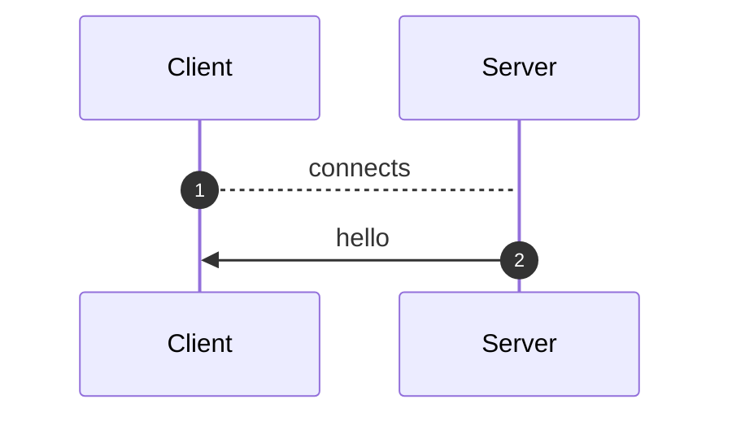
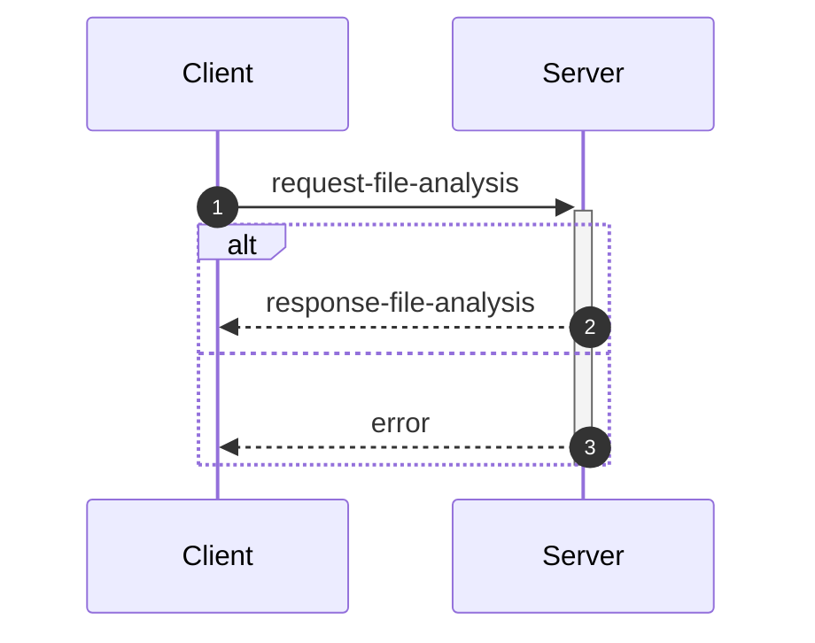
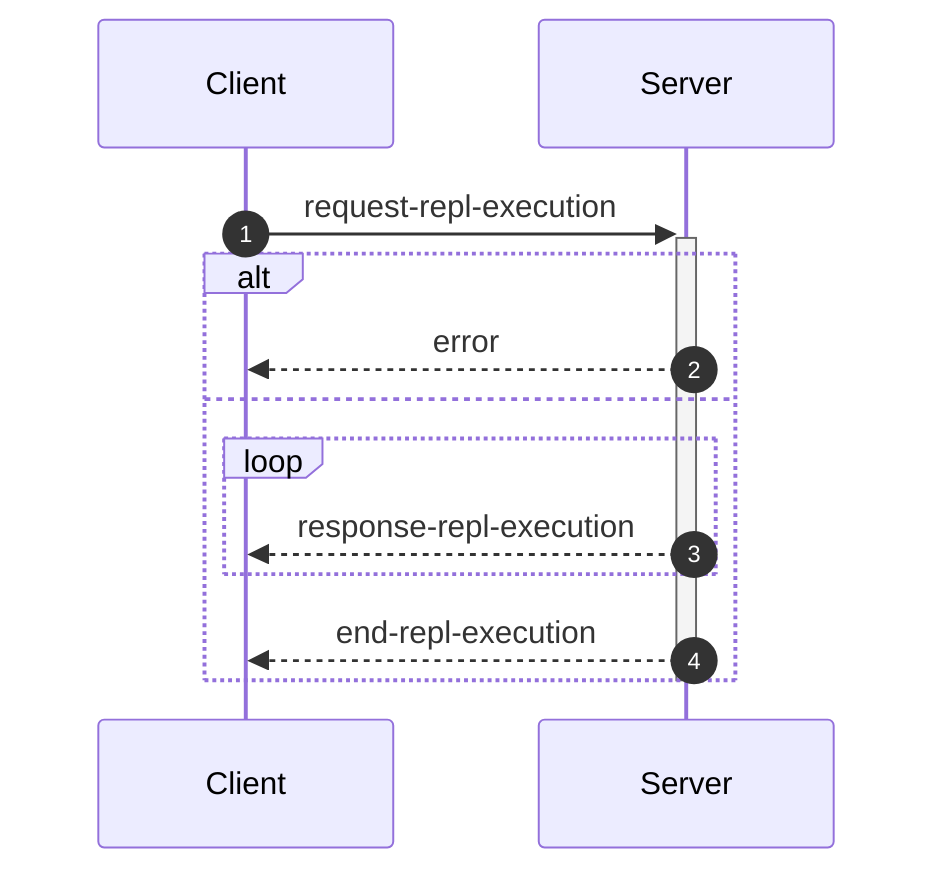
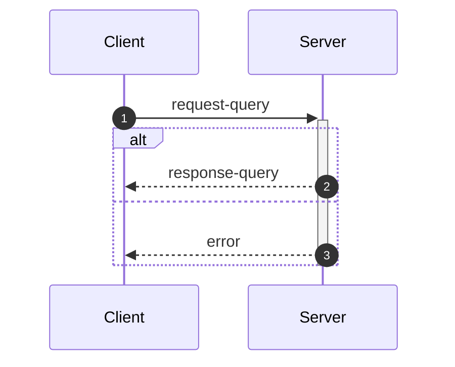

_<span title="an overview of flowR's interface">Generated</span> from '[wiki-interface.ts](https://github.com/flowr-analysis/flowr/tree/main/src/documentation/wiki-interface.ts "src/documentation/wiki-interface.ts")' on 2026-11-26, 11:49:42 UTC (v2.17.13, R v4.5.0), do not edit directly._

Although far from being as detailed as the in-depth explanation of [_flowR_](https://github.com/flowr-analysis/flowr/wiki/Core),
this wiki page explains how to interface with _flowR_ in more detail.
In general, command line arguments and other options provide short descriptions on hover over.

* [💻 Using the REPL](#using-the-repl)
* [⚙️ Configuring FlowR](#configuring-flowr)
* [⚒️ Writing Code](#writing-code)
* [💬 Communicating with the Server](#communicating-with-the-server)

<a id='using-the-repl'></a>
## 💻 Using the REPL

> [!NOTE]
> To execute arbitrary R commands with a repl request, _flowR_ has to be started explicitly with <span title="Description (Command Line Argument): Allow to access the underlying R session when using flowR (security warning: this allows the execution of arbitrary R code!)">`--r-session-access`</span>.
> Please be aware that this introduces a security risk and note that this relies on the [`r-shell` engine](https://github.com/flowr-analysis/flowr/wiki/Engines) .

Although primarily meant for users to explore,
there is nothing which forbids calling _flowR_ as a subprocess to use standard-in, -output, and -error
for communication (although you can access the REPL using the server as well,
with the [REPL Request](#message-request-repl-execution) message).

The read-eval-print loop&nbsp;(REPL) works relatively simple.
You can submit an expression (using <kbd>Enter</kbd>),
which is interpreted as an R&nbsp;expression by default but interpreted as a *command* if it starts with a colon (`:`).
The best command to get started with the REPL is <span title="Description (Repl Command): Show help information (aliases: :h, :?)">`:help`</span>.
Besides, you can leave the REPL either with the command <span title="Description (Repl Command): End the repl (aliases: :q, :exit)">`:quit`</span> or by pressing <kbd>Ctrl</kbd>+<kbd>C</kbd> twice.
When writing a *command*, you may press <kbd>Tab</kbd> to get a list of completions, if available.
Multiple commands can be entered in a single line by separating them with a semicolon (`;`), e.g. `:parse "x<-2"; :df*`.
If a command is given without R code, the REPL will re-use R code given in a previous command.
The prior example will hence return first the parsed AST of the program and then the dataflow graph for `"x <- 2"`.

> [!NOTE]
> If you develop flowR, you may want to launch the repl using the `npm run main-dev` command, this way, you get a non-minified version of flowR with debug information and hot-reloading of source files.

<details>
<summary>Available Commands</summary>

We currently offer the following commands (this with a `[*]` suffix are available with and without the star):

| Command | Description |
| ------- | ----------- |
| **<span title="Description (Repl Command): End the repl (aliases: :q, :exit)">:quit</span>** | End the repl (aliases: **:<span title="Alias of ':quit'. End the repl">q</span>**, **:<span title="Alias of ':quit'. End the repl">exit</span>**) |
| **<span title="Description (Repl Command): Execute the given code as R code. This requires the `--r-session-access` flag to be set and requires the r-shell engine. (aliases: :e, :r)">:execute</span>** | Execute the given code as R code. This requires the `--r-session-access` flag to be set and requires the r-shell engine. (aliases: **:<span title="Alias of ':execute'. Execute the given code as R code. This requires the `--r-session-access` flag to be set and requires the r-shell engine.">e</span>**, **:<span title="Alias of ':execute'. Execute the given code as R code. This requires the `--r-session-access` flag to be set and requires the r-shell engine.">r</span>**) |
| **<span title="Description (Repl Command): Get mermaid code for the control-flow graph of R code (aliases: :cfg, :cf)">:controlflow[*]</span>** | Get mermaid code for the control-flow graph of R code (star: Returns the URL to mermaid.live) (aliases: **:<span title="Alias of ':controlflow'. Get mermaid code for the control-flow graph of R code">cfg</span>**, **:<span title="Alias of ':controlflow'. Get mermaid code for the control-flow graph of R code">cf</span>**) |
| **<span title="Description (Repl Command): Get mermaid code for the control-flow graph with basic blocks (aliases: :cfgb, :cfb)">:controlflowbb[*]</span>** | Get mermaid code for the control-flow graph with basic blocks (star: Returns the URL to mermaid.live) (aliases: **:<span title="Alias of ':controlflowbb'. Get mermaid code for the control-flow graph with basic blocks">cfgb</span>**, **:<span title="Alias of ':controlflowbb'. Get mermaid code for the control-flow graph with basic blocks">cfb</span>**) |
| **<span title="Description (Repl Command): Get mermaid code for the dataflow graph (aliases: :d, :df)">:dataflow[*]</span>** | Get mermaid code for the dataflow graph (star: Returns the URL to mermaid.live) (aliases: **:<span title="Alias of ':dataflow'. Get mermaid code for the dataflow graph">d</span>**, **:<span title="Alias of ':dataflow'. Get mermaid code for the dataflow graph">df</span>**) |
| **<span title="Description (Repl Command): Get mermaid code for the normalized AST of R code (aliases: :n)">:normalize[*]</span>** | Get mermaid code for the normalized AST of R code (star: Returns the URL to mermaid.live) (alias: **:<span title="Alias of ':normalize'. Get mermaid code for the normalized AST of R code">n</span>**) |
| **<span title="Description (Repl Command): Get mermaid code for the simplified dataflow graph (aliases: :ds, :dfs)">:dataflowsimple[*]</span>** | Get mermaid code for the simplified dataflow graph (star: Returns the URL to mermaid.live) (aliases: **:<span title="Alias of ':dataflowsimple'. Get mermaid code for the simplified dataflow graph">ds</span>**, **:<span title="Alias of ':dataflowsimple'. Get mermaid code for the simplified dataflow graph">dfs</span>**) |
| **<span title="Description (Repl Command): Inspect and extend the signature database: `query` (identical to :query @signature), `info <name>` for where a function comes from (identical to :query @function-info), `add <path>` to mount another database/source, `download` to fetch the full-history database. (aliases: :sig)">:signature</span>** | Inspect and extend the signature database: `query` (identical to :query @signature), `info <name>` for where a function comes from (identical to :query @function-info), `add <path>` to mount another database/source, `download` to fetch the full-history database. (alias: **:<span title="Alias of ':signature'. Inspect and extend the signature database: `query` (identical to :query @signature), `info <name>` for where a function comes from (identical to :query @function-info), `add <path>` to mount another database/source, `download` to fetch the full-history database.">sig</span>**) |
| **<span title="Description (Repl Command): Just calculates the DFG, but only prints summary info (aliases: :d#, :df#)">:dataflowsilent</span>** | Just calculates the DFG, but only prints summary info (aliases: **:<span title="Alias of ':dataflowsilent'. Just calculates the DFG, but only prints summary info">d#</span>**, **:<span title="Alias of ':dataflowsilent'. Just calculates the DFG, but only prints summary info">df#</span>**) |
| **<span title="Description (Repl Command): Prints ASCII Art of the parsed, unmodified AST (aliases: :p)">:parse</span>** | Prints ASCII Art of the parsed, unmodified AST (alias: **:<span title="Alias of ':parse'. Prints ASCII Art of the parsed, unmodified AST">p</span>**) |
| **<span title="Description (Repl Command): Prints the version of flowR as well as the current version of R">:version</span>** | Prints the version of flowR as well as the current version of R
| **<span title="Description (Repl Command): Query the given R code (use 'help' for more information)">:query[*]</span>** | Query the given R code (use 'help' for more information) (star: Similar to query, but returns the output in json format.)
| **<span title="Description (Repl Command): Returns an ASCII representation of the dataflow graph (aliases: :df!)">:dataflowascii</span>** | Returns an ASCII representation of the dataflow graph (alias: **:<span title="Alias of ':dataflowascii'. Returns an ASCII representation of the dataflow graph">df!</span>**) |
| **<span title="Description (Repl Command): Returns summarization stats for the normalized AST (aliases: :n#)">:normalize#</span>** | Returns summarization stats for the normalized AST (alias: **:<span title="Alias of ':normalize#'. Returns summarization stats for the normalized AST">n#</span>**) |
| **<span title="Description (Repl Command): Show help information (aliases: :h, :?)">:help</span>** | Show help information (aliases: **:<span title="Alias of ':help'. Show help information">h</span>**, **:<span title="Alias of ':help'. Show help information">?</span>**) |

</details>

> [!TIP]
> 
> As indicated by the examples before, all REPL commands that operate on code keep track of the state.
> Hence, if you run a command like <span title="Description (Repl Command, starred version): Returns the URL to mermaid.live; Base Command: Get mermaid code for the dataflow graph (aliases: :d*, :df*)">`:dataflow*`</span> without providing R code,
> the REPL will re-use the R code provided in a previous command.
> Likewise, doing this will benefit from incrementality!
> If you request the dataflow graph with `:df* x <- 2 * y` and then want to see the parsed AST with `:parse`,
> the REPL will re-use previously obtained information and not re-parse the code again.
> 		

Generally, many commands offer shortcut versions in the REPL. Many queries, for example, offer a shortened format (see the example below).
Of special note, the [Config Query](https://github.com/flowr-analysis/flowr/wiki/%5BQuery%5D-Config)
can be used to also modify the currently active configuration of _flowR_ within the REPL (see the [wiki page](https://github.com/flowr-analysis/flowr/wiki/%5BQuery%5D-Config) for more information).

### Example: Retrieving the Dataflow Graph

To retrieve a URL to the [mermaid](https://mermaid.js.org/) diagram of the dataflow of a given expression,
use <span title="Description (Repl Command, starred version): Returns the URL to mermaid.live; Base Command: Get mermaid code for the dataflow graph (aliases: :d*, :df*)">`:dataflow*`</span> (or <span title="Description (Repl Command): Get mermaid code for the dataflow graph (aliases: :d, :df)">`:dataflow`</span> to get the mermaid code in the cli):

```shell
$ docker run -it --rm eagleoutice/flowr # or npm run flowr 
flowR repl v2.17.13, R grammar v14 (tree-sitter engine)
R> :dataflow* y <- 1 + x
```

<details>
<summary style='color:gray'>Output</summary>

```text
https://mermaid.live/view#base64:eyJjb2RlIjoiZmxvd2NoYXJ0IFREXG4gICAgMXt7XCJgKiM5MTtSTnVtYmVyIzkzOyogKioxKipcbiAgICAgICoxLjYqICgqKmlkOiAxKiopYFwifX1cbiAgICAyKFtcImAqIzkxO1JTeW1ib2wjOTM7KiAqKngqKlxuICAgICAgKjEuMTAqICgqKmlkOiAyKiopYFwiXSlcbiAgICAzW1tcImAqIzkxO1JCaW5hcnlPcCM5MzsqIGJhc2UjNTg7IzU4OyoqIzQzOyoqXG4gICAgICAqMS42LTEwKiAoKippZDogMyoqKVxuICAgIGFyZzogKDEsIDIpYFwiXV1cbiAgICBidWlsdC1pbjpfNDNfW1wiYEJ1aWx0LUluOlxuIzQzO2BcIl1cbiAgICBzdHlsZSBidWlsdC1pbjpfNDNfIHN0cm9rZTpncmF5LGZpbGw6Z3JheSxzdHJva2Utd2lkdGg6MnB4LG9wYWNpdHk6Ljg7XG4gICAgMFtcImAqIzkxO1JTeW1ib2wjOTM7KiAqKnkqKlxuICAgICAgKjEuMSogKCoqaWQ6IDAqKiwgdjogMylgXCJdXG4gICAgNFtbXCJgKiM5MTtSQmluYXJ5T3AjOTM7KiBiYXNlIzU4OyM1ODsqKiM2MDsjNDU7KipcbiAgICAgICoxLjEtMTAqICgqKmlkOiA0KiopXG4gICAgYXJnOiAoMCwgMylgXCJdXVxuICAgIGJ1aWx0LWluOl82MF8tW1wiYEJ1aWx0LUluOlxuIzYwOyM0NTtgXCJdXG4gICAgc3R5bGUgYnVpbHQtaW46XzYwXy0gc3Ryb2tlOmdyYXksZmlsbDpncmF5LHN0cm9rZS13aWR0aDoycHgsb3BhY2l0eTouODtcbiAgICAxIC0uLT58XCJmbG93XCJ8IDJcbiAgICBsaW5rU3R5bGUgMCBzdHJva2U6Z3JheSxjb2xvcjpncmF5O1xuICAgIDIgLS4tPnxcImZsb3dcInwgM1xuICAgIGxpbmtTdHlsZSAxIHN0cm9rZTpncmF5LGNvbG9yOmdyYXk7XG4gICAgMyAtLT58XCJyZWFkcywgYXJnXCJ8IDFcbiAgICAzIC0tPnxcInJlYWRzLCBhcmdcInwgMlxuICAgIDMgLS4tPnxcImZsb3dcInwgMFxuICAgIGxpbmtTdHlsZSA0IHN0cm9rZTpncmF5LGNvbG9yOmdyYXk7XG4gICAgMyAtLi0+fFwicmVhZHMsIGNhbGxzXCJ8IGJ1aWx0LWluOl80M19cbiAgICBsaW5rU3R5bGUgNSBzdHJva2U6Z3JheTtcbiAgICAwIC0tPnxcImRlZmluZWQtYnksIGZsb3dcInwgNFxuICAgIDAgLS0+fFwiZGVmaW5lZC1ieVwifCAzXG4gICAgNCAtLT58XCJyZWFkcywgYXJnXCJ8IDNcbiAgICA0IC0tPnxcInJldHVybnMsIGFyZ1wifCAwXG4gICAgNCAtLi0+fFwicmVhZHMsIGNhbGxzXCJ8IGJ1aWx0LWluOl82MF8tXG4gICAgbGlua1N0eWxlIDEwIHN0cm9rZTpncmF5OyIsIm1lcm1haWQiOiJ7XCJhdXRvU3luY1wiOnRydWV9In0=
```

Retrieve the dataflow graph of the expression `y <- 1 + x`. It looks like this:


<details>

<summary style="color:gray">R Code of the Dataflow Graph</summary>

The analysis ran (parse and normalize with the [tree-sitter](https://github.com/flowr-analysis/flowr/wiki/Engines) engine) in the generation environment. No [signature database](https://github.com/flowr-analysis/flowr/wiki/Signature-Database) is mounted, so `library()` attaches no exports (base-R names are still qualified, e.g., `stats::acf`). 
We encountered no unknown side effects during the analysis.

```r
y <- 1 + x
```

</details>

</details>

For small graphs like this, <span title="Description (Repl Command): Returns an ASCII representation of the dataflow graph (aliases: :df!)">`:dataflowascii`</span> also provides an ASCII representation directly in the REPL:

```shell
$ docker run -it --rm eagleoutice/flowr # or npm run flowr 
flowR repl v2.17.13, R grammar v14 (tree-sitter engine)
R> :df! y <- 1 + x
```

<details open>
<summary style='color:gray'>Output</summary>

```text
                        v<0>v
 c<4>c──────────────────| y |
 |<- |     ┌────────────v---v
 c---c     │
    │   c<3>c   0<1>0
    └───| + |───| 1 |───u<2>u
        c---c   0---0   | x |
           └────────────u---u
Edges:
3 -> 1: reads, arg          3 -> 2: reads, arg
3 -> 0: flows-to            1 -> 2: flows-to
2 -> 3: flows-to            4 -> 3: reads, arg
4 -> 0: returns, arg        0 -> 4: defined-by, flows-to
0 -> 3: defined-by
```

Retrieve the dataflow graph of the expression `y <- 1 + x` as ASCII art.

</details>

For the slicing with <span title="Description (Repl Command): Static backwards executable slicer for R">`:slicer`</span>, you have access to the same [magic comments](#slice-magic-comments) as with the [slice request](#message-request-slice).
Pass `--inline` to splice resolvable `source()` calls into the reconstruction so the slice is a single self-contained R text (the same as the static slice query's `inlineSources` flag).
See `--help` for more flags!

### Example: Interfacing with the File System

Many commands that allow for an R-expression (like <span title="Description (Repl Command, starred version): Returns the URL to mermaid.live; Base Command: Get mermaid code for the dataflow graph (aliases: :d*, :df*)">`:dataflow*`</span>) allow for a file as well
if the argument starts with `file://`.
If you are working from the root directory of the _flowR_ repository, the following gives you the parsed AST of the example file using the <span title="Description (Repl Command): Prints ASCII Art of the parsed, unmodified AST (aliases: :p)">`:parse`</span> command:

> **Watch mode**: Replace `file://` with `watch://` to enter watch mode.
> flowR runs the command immediately and then re-runs it every time the file (or any file inside the folder) changes.
> Enter any other command to leave watch mode.
> For example: `:df watch://analysis.R`

```shell
$ docker run -it --rm eagleoutice/flowr # or npm run flowr 
flowR repl v2.17.13, R grammar v14 (tree-sitter engine)
R> :parse file://test/testfiles/example.R
```

<details>
<summary style='color:gray'>Output</summary>

```text
File: test/testfiles/example.R

program
├ binaryoperator
│ ├ identifier "sum" (1:1─4)
│ ├ <- "<-" (1:5─7)
│ ╰ float "0" (1:8─9)
├ binaryoperator
│ ├ identifier "product" (2:1─8)
│ ├ <- "<-" (2:9─11)
│ ╰ float "1" (2:12─13)
├ binaryoperator
│ ├ identifier "w" (3:1─2)
│ ├ <- "<-" (3:3─5)
│ ╰ float "7" (3:6─7)
├ binaryoperator
│ ├ identifier "N" (4:1─2)
│ ├ <- "<-" (4:3─5)
│ ╰ float "10" (4:6─8)
├ forstatement
│ ├ for "for" (6:1─4)
│ ├ ( "(" (6:5─6)
│ ├ identifier "i" (6:6─7)
│ ├ in "in" (6:8─10)
│ ├ binaryoperator
│ │ ├ float "1" (6:11─12)
│ │ ├ : ":" (6:12─13)
│ │ ╰ parenthesizedexpression
│ │   ├ ( "(" (6:13─14)
│ │   ├ binaryoperator
│ │   │ ├ identifier "N" (6:14─15)
│ │   │ ├ - "-" (6:15─16)
│ │   │ ╰ float "1" (6:16─17)
│ │   ╰ ) ")" (6:17─18)
│ ├ ) ")" (6:18─19)
│ ╰ bracedexpression
│   ├ { "{" (6:20─21)
│   ├ binaryoperator
│   │ ├ identifier "sum" (7:3─6)
│   │ ├ <- "<-" (7:7─9)
│   │ ╰ binaryoperator
│   │   ├ binaryoperator
│   │   │ ├ identifier "sum" (7:10─13)
│   │   │ ├ + "+" (7:14─15)
│   │   │ ╰ identifier "i" (7:16─17)
│   │   ├ + "+" (7:18─19)
│   │   ╰ identifier "w" (7:20─21)
│   ├ binaryoperator
│   │ ├ identifier "product" (8:3─10)
│   │ ├ <- "<-" (8:11─13)
│   │ ╰ binaryoperator
│   │   ├ identifier "product" (8:14─21)
│   │   ├  "" (8:22─23)
│   │   ╰ identifier "i" (8:24─25)
│   ╰ } "}" (9:1─2)
├ call
│ ├ identifier "cat" (11:1─4)
│ ╰ arguments
│   ├ ( "(" (11:4─5)
│   ├ argument
│   │ ╰ string
│   │   ├ stringopen "\"" (11:5─6)
│   │   ├ stringcontent "Sum:" (11:6─10)
│   │   ╰ stringclose "\"" (11:10─11)
│   ├ comma "," (11:11─12)
│   ├ argument
│   │ ╰ identifier "sum" (11:13─16)
│   ├ comma "," (11:16─17)
│   ├ argument
│   │ ╰ string
│   │   ├ stringopen "\"" (11:18─19)
│   │   ├ stringcontent
│   │   │ ╰ escapesequence "\\n" (11:19─21)
│   │   ╰ stringclose "\"" (11:21─22)
│   ╰ ) ")" (11:22─23)
╰ call
  ├ identifier "cat" (12:1─4)
  ╰ arguments
    ├ ( "(" (12:4─5)
    ├ argument
    │ ╰ string
    │   ├ stringopen "\"" (12:5─6)
    │   ├ stringcontent "Product:" (12:6─14)
    │   ╰ stringclose "\"" (12:14─15)
    ├ comma "," (12:15─16)
    ├ argument
    │ ╰ identifier "product" (12:17─24)
    ├ comma "," (12:24─25)
    ├ argument
    │ ╰ string
    │   ├ stringopen "\"" (12:26─27)
    │   ├ stringcontent
    │   │ ╰ escapesequence "\\n" (12:27─29)
    │   ╰ stringclose "\"" (12:29─30)
    ╰ ) ")" (12:30─31)
```

Retrieve the parsed AST of the example file.

<details>

<summary>File Content</summary>

```r
sum <- 0
product <- 1
w <- 7
N <- 10

for (i in 1:(N-1)) {
  sum <- sum + i + w
  product <- product * i
}

cat("Sum:", sum, "\n")
cat("Product:", product, "\n")
```

</details>

As _flowR_ directly transforms this AST the output focuses on being human-readable instead of being machine-readable.
		
</details>

### Example: Run a Query

You can run any query supported by _flowR_ using the <span title="Description (Repl Command): Query the given R code (use 'help' for more information)">`:query`</span> command.
For example, to obtain the shapes of all data frames in a given piece of code, you can run:

```shell
$ docker run -it --rm eagleoutice/flowr # or npm run flowr 
flowR repl v2.17.13, R grammar v14 (tree-sitter engine)
R> :query @absint df-shape "x <- data.frame(a = 1:10, b = 1:10)\ny <- x$a"
```

<details open>
<summary style='color:gray'>Output</summary>

```text
Query: absint (3 ms)
   ╰ $12: (colnames: [{"a", "b"}, {}], cols: [2, 2], rows: [10, 10])
   ╰ $0: (colnames: [{"a", "b"}, {}], cols: [2, 2], rows: [10, 10])
```

Retrieve the shapes of all data frames in the given code.

</details>

To run the linter on a file, you can use (in this example, we just issue the `dead-code` linter on a small piece of code):

```shell
$ docker run -it --rm eagleoutice/flowr # or npm run flowr 
flowR repl v2.17.13, R grammar v14 (tree-sitter engine)
R> :query @linter rules:dead-code "if(FALSE) x <- 2"
```

<details open>
<summary style='color:gray'>Output</summary>

```text
Query: linter (6 ms)
   ╰ Dead Code (dead-code):
       ╰ certain:
           ╰ Code at 1.11-16 (1 quick fix(es) available)
```

Run the linter on the given code, with only the `dead-code` rule enabled.

</details>

For more information on the available queries, please check out the [Query API](https://github.com/flowr-analysis/flowr/wiki/Query-API).

<a id='configuring-flowr'></a>
## ⚙️ Configuring FlowR

When running _flowR_, you may want to specify some behaviors with a dedicated configuration file.
By default, flowR looks for a file named `flowr.json` in the current working directory (or any higher directory).
You can also specify a different file with <span title="Description (Command Line Argument): The name of the configuration file to use">`--config-file`</span> or pass the configuration inline using <span title="Description (Command Line Argument): The flowR configuration to use, as a JSON string">`--config-json`</span>.
A `flowr.json` found this way belongs to the analyzed project, so flowR ignores its options that decide what flowR executes or loads
(`defaultPlugins.*.1`, `repl.plugins.*.1`, `engines.*.wasmPath`, `engines.*.treeSitterWasmPath`, `engines.*.rPath`, `solver.sigdb.additionalPaths`, `solver.sigdb.downloadRepo`, `solver.sigdb.autoSync`, `solver.sigdb.installedLibrary.paths`, `solver.sigdb.onDemand.enabled`, `solver.sigdb.onDemand.repositories`, `solver.sigdb.onDemand.cranMirror`, `solver.sigdb.onDemand.bioconductorMirror`, `solver.sigdb.onDemand.cacheDir`, `solver.instrument.dataflowExtractors`),
unless you pass <span title="Description (Command Line Argument): Keep the security-sensitive options (e.g., the R executable) of the flowr.json found in the working directory or a parent. Only use this for projects you trust.">`--trust-config`</span>.
To analyze code you do not trust, use the secure mode (<span title="Description (Command Line Argument): Run in secure mode for analyzing untrusted code: flowR does not start R (or any other process), does not access the network, does not search for project configs, and ignores security-sensitive options in every config. Cannot be disabled once enabled. Can also be enabled with the environment variable {italic FLOWR_SECURE_MODE=1}.">`--secure`</span>, see the [security policy](https://github.com/flowr-analysis/flowr/blob/main/.github/SECURITY.md)).
To inspect the current configuration, you can run flowr with the <span title="Description (Command Line Argument): Run with verbose logging (will be passed to the corresponding script)">`--verbose`</span> flag, or use the `config` [Query](https://github.com/flowr-analysis/flowr/wiki/Query-API).
Within the REPL this works by running the following:

```shell
:query @config
```

To work with the <a href="https://github.com/flowr-analysis/flowr/tree/main/src/config.ts#L132"><code><span title="The configuration file format for flowR.">FlowrConfig</span></code></a> you can use the provided helper objects alongside its methods like
<a href="https://github.com/flowr-analysis/flowr/tree/main/src/config.ts#L983"><code><span title="Creates a new flowr config that has the updated values.">FlowrConfig::<b>amend</b></span></code></a>.
The schema below documents every option; the ones you most likely want are:

- <a href="https://github.com/flowr-analysis/flowr/wiki/Interface#configuring-flowr" title="Configuration Option (boolean): Whether source calls should be ignored, causing {@link processSourceCall}&#39;s behavior to be skipped.">ignoreSourceCalls</a>: ignore source calls when analyzing the code, i.e., ignore the inclusion of other files.
- <a href="https://github.com/flowr-analysis/flowr/wiki/Interface#configuring-flowr" title="Configuration Option (boolean): Whether load calls should be ignored, causing {@link processLoadCall}&#39;s behavior to be skipped.">ignoreLoadCalls</a>: ignore load calls when analyzing the code, i.e., ignore the loading of r-data files.
- <a href="https://github.com/flowr-analysis/flowr/wiki/Interface#configuring-flowr" title="Configuration Option (object): Do you want to overwrite (parts) of the builtin definition?">semantics.environment.overwriteBuiltIns</a>: overwrite _flowR_'s handling of built-in functions, or clear the preset definitions entirely.
  See [Configure BuiltIn Semantics](#configure-builtin-semantics) for more information.
- <a href="https://github.com/flowr-analysis/flowr/wiki/Interface#configuring-flowr" title="Configuration Option (boolean): Whether calls drawing on a graphics device (e.g., `plot`) count as writing to it, which the ambient state queries then report.">semantics.ambient.drawingWritesDevice</a>: whether calls drawing on a graphics device (e.g., `plot`) count as writing the device in the ambient state queries.
- <a href="https://github.com/flowr-analysis/flowr/wiki/Interface#configuring-flowr" title="Configuration Option (boolean): Whether a sourced file flowR cannot read may bind S3/S4 methods that later calls dispatch to. This is sound, but chains every later call that may dispatch, so it is off by default.">solver.resolveSource.unseenMethods</a>: whether a sourced file _flowR_ cannot read may bind S3/S4 methods that later calls dispatch to (sound, but chains every such call, off by default).
- <a href="https://github.com/flowr-analysis/flowr/wiki/Interface#configuring-flowr" title="Configuration Option (string): How to resolve variables and their values. (one of &quot;disabled&quot;, &quot;alias&quot;, &quot;builtin&quot;)">solver.variables</a>: how to resolve variables and their values (`disabled`, `alias`, `builtin`).
- <a href="https://github.com/flowr-analysis/flowr/wiki/Interface#configuring-flowr" title="Configuration Option (array): The engine or set of engines to use for interacting with R code. An empty array means all available engines will be used.">engines</a> and <a href="https://github.com/flowr-analysis/flowr/wiki/Interface#configuring-flowr" title="Configuration Option (string): The default engine to use for interacting with R code. If this is undefined, an arbitrary engine from the specified list will be used. (one of &quot;tree-sitter&quot;, &quot;r-shell&quot;)">defaultEngine</a>: the engines used to interact with R code, see the [Engines wiki page](https://github.com/flowr-analysis/flowr/wiki/Engines).
- <a href="https://github.com/flowr-analysis/flowr/wiki/Interface#configuring-flowr" title="Configuration Option (array): Files a framework loads on its own, without any source() call (e.g. global.R in a shiny app), in the order they are loaded; flowR orders the matching project files accordingly and analyzes them as one program. Entries are case-insensitive globs matched against the file path, a plain name matches any file with that name, and entries matching no project file are warned about. Usually set per project kind via specializeConfig.">project.implicitSources</a>: the files a framework loads without any `source()` call, in the order in which they are
  loaded. Entries are globs (e.g. `R/*.R`) matched against the file path ignoring capitalization; one matching no file is reported.
- <a href="https://github.com/flowr-analysis/flowr/wiki/Interface#configuring-flowr" title="Configuration Option (object): Overwrite (parts of) the configuration depending on the project kind flowR detects, e.g. to give a shiny app its implicit sources.">specializeConfig</a>: overwrite (parts of) the configuration depending on the kind of project _flowR_ detects
  (e.g. `shiny-app`), which is how a shiny app gets its implicit sources by default. What you configure directly wins.
- <a href="https://github.com/flowr-analysis/flowr/wiki/Interface#configuring-flowr" title="Configuration Option (string): Overwrite the project kind flowR would otherwise infer from the analyzed files, e.g. when auto-detection guesses wrong. (one of &quot;package&quot;, &quot;script&quot;, &quot;shiny-app&quot;, &quot;notebook&quot;, &quot;project&quot;, &quot;unknown&quot;)">project.useProjectType</a>: skip that detection and force a project kind yourself, when auto-detection guesses wrong.
- <a href="https://github.com/flowr-analysis/flowr/wiki/Interface#configuring-flowr" title="Configuration Option (array): The default plugins to load when creating a new instance of FlowrAnalyzer">defaultPlugins</a> and <a href="https://github.com/flowr-analysis/flowr/wiki/Interface#configuring-flowr" title="Configuration Option (array): The plugins to load in REPL mode">repl.plugins</a>: the plugins to load for a new <a href="https://github.com/flowr-analysis/flowr/tree/main/src/project/flowr-analyzer.ts#L237"><code><span title="Central class for conducting analyses with FlowR. Use the FlowrAnalyzerBuilder to create a new instance. If you want the original pattern of creating a pipeline and running all steps, you can still do this with FlowrAnalyzer#runFull . To inspect the context of the analyzer, use FlowrAnalyzer#inspectContext (if you are a plugin and need to modify it, use FlowrAnalyzer#context instead).">FlowrAnalyzer</span></code></a> and in the REPL
  (use `flowr:default` to reference the former).

So you can configure _flowR_ by adding a file like the following:

<details>

<summary>Example Configuration File</summary>

```json
{
  "ignoreSourceCalls": true,
  "ignoreLoadCalls": true,
  "semantics": {
    "environment": {
      "overwriteBuiltIns": {
        "definitions": [
          {
            "type": "function",
            "names": [
              "foo"
            ],
            "processor": "builtin:assign",
            "config": {}
          }
        ]
      }
    }
  },
  "defaultPlugins": [
    "file:description",
    "versions:description"
  ],
  "repl": {
    "quickStats": false,
    "dfProcessorHeat": false,
    "hints": true,
    "plugins": [
      "flowr:default"
    ]
  },
  "project": {
    "resolveUnknownPathsOnDisk": true,
    "implicitSources": [
      "global.R",
      "app.R"
    ]
  },
  "linter": {
    "disabledRules": []
  },
  "specializeConfig": {
    "shiny-app": {
      "project": {
        "implicitSources": [
          "global.R",
          "ui.R",
          "server.R",
          "app.R"
        ]
      }
    }
  },
  "engines": [
    {
      "type": "r-shell"
    }
  ],
  "solver": {
    "variables": "alias",
    "evalStrings": true,
    "trackEnvironments": true,
    "sigdb": {
      "enabled": true,
      "loadProjectDependencies": true,
      "eagerlyLoad": false,
      "eagerlyLoadExports": false,
      "linkBaseR": false,
      "linkDescriptionDependencies": false
    },
    "resolveSource": {
      "dropPaths": "no",
      "ignoreCapitalization": true,
      "inferWorkingDirectory": "active-script",
      "searchPath": []
    },
    "instrument": {},
    "slicer": {
      "threshold": 50
    }
  },
  "abstractInterpretation": {
    "wideningThreshold": 4,
    "followCalls": true,
    "dataFrame": {
      "maxColNames": 20,
      "readLoadedData": {
        "readExternalFiles": true,
        "maxReadLines": 1000000
      }
    }
  },
  "incremental": {
    "alwaysIncremental": false,
    "parsing": {
      "activated": false,
      "heuristics": {
        "activated": true,
        "mtime": true,
        "linesFrom": 500,
        "bytesFrom": 50000,
        "alwaysWithEdits": false,
        "minFiles": 1
      }
    },
    "dataflow": {
      "reuse": true,
      "activated": false,
      "checkpoints": 2,
      "minStatements": 0
    }
  },
  "gas": {
    "thresholds": {
      "memory": {
        "problematic": 0.7,
        "critical": 0.9
      },
      "timeMs": {
        "problematic": 100000,
        "critical": 120000
      }
    },
    "features": {}
  }
}
```

</details>

<details>
<a id='configure-builtin-semantics'></a>
<summary>Configure Built-In Semantics</summary>

`semantics/environment/overwriteBuiltins` accepts two keys:

- `loadDefaults` (boolean, initially `true`): If set to `true`, the default built-in definitions are loaded before applying the custom definitions. Setting this flag to `false` explicitly disables the loading of the default definitions.
- `definitions` (array, initially empty): Allows to overwrite or define new built-in elements. Each object within must have a `type` which is one of the below. Furthermore, they may define a string array of `names` which specifies the identifiers to bind the definitions to. You may use `assumePrimitive` to specify whether _flowR_ should assume that this is a primitive non-library definition (so you probably just do not want to specify the key).

  | Type            | Description                                                                                                                                                                                                                                                                                              | Example                                                                                                    |
  | --------------- | -------------------------------------------------------------------------------------------------------------------------------------------------------------------------------------------------------------------------------------------------------------------------------------------------------- | ---------------------------------------------------------------------------------------------------------- |
  | `constant`    | Additionally allows for a `value` this should resolve to.                                                                                                                                                                                                                                                | `{ type: 'constant', names: ['NULL', 'NA'],  value: null }`                                                |
  | `function`    | Is a rather flexible way to define and bind built-in functions. For the time, we do not have extensive documentation to cover all the cases, so please either consult the sources with the `default-builtin-config/` folder or open a [new issue](https://github.com/flowr-analysis/flowr/issues/new/choose). | `{ type: 'function', names: ['next'], processor: 'builtin:d', config: { cfg: ExitPointType.Next } }` |
  | `replacement` | A comfortable way to specify replacement functions like `$<-` or `names<-`. `suffixes` describes the... suffixes to attach automatically. | `{ type: 'replacement', suffixes: ['<-', '<<-'], names: ['[', '[['] }` |

</details>

<details>

<summary style='color:gray'>Full Configuration-File Schema</summary>

- _The configuration file format for flowR._ (object)
    - **logLevel** [optional] _flowR's global minimum log level, applied when the config is loaded._ (string)
        Only allows: 'silly', 'trace', 'debug', 'info', 'warn', 'error', 'fatal'
    - **ignoreSourceCalls** [optional] _Whether source calls should be ignored, causing {@link processSourceCall}'s behavior to be skipped._ (boolean)
    - **ignoreLoadCalls** [optional] _Whether load calls should be ignored, causing {@link processLoadCall}'s behavior to be skipped._ (boolean)
    - **semantics** _Configure language semantics and how flowR handles them._ (object)
        - **environment** [optional] _Semantics regarding how to handle the R environment._ (object)
            - **overwriteBuiltIns** [optional] _Do you want to overwrite (parts) of the builtin definition?_ (object)
                - **loadDefaults** [optional] _Should the default configuration still be loaded?_ (boolean)
                - **definitions** [optional] _The definitions to load/overwrite._ (array)
                Valid item types:
                    - (object)
        - **ambient** [optional] _Semantics regarding the global state (options, devices, files, ...) calls access._ (object)
            - **drawingWritesDevice** [optional] _Whether calls drawing on a graphics device (e.g., `plot`) count as writing to it, which the ambient state queries then report._ (boolean)
    - **defaultPlugins** [optional] _The default plugins to load when creating a new instance of FlowrAnalyzer_ (array)
    Valid item types:
        - (alternatives)
            - (string)
            - (array)
    - **repl** _Configuration options for the REPL._ (object)
        - **quickStats** [optional] _Whether to show quick stats in the REPL after each evaluation._ (boolean)
        - **dfProcessorHeat** [optional] _This instruments the dataflow processors to count how often each processor is called._ (boolean)
        - **hints** [optional] _Whether to show dim inline hints on the empty prompt (automatically disabled on non-interactive terminals)._ (boolean)
        - **plugins** [optional] _The plugins to load in REPL mode_ (array)
        Valid item types:
            - (alternatives)
                - (string)
                - (array)
        - **autoUseFileProtocol** [optional] _Prepend the file protocol to a repl input that looks like a path, instead of only warning about it._ (boolean)
        - **queryStats** [optional] _Whether `:query` closes with the line stating how long the queries took (`:query*` never prints it)._ (boolean)
        - **showPlugins** [optional] _Whether `:version` grays out the plugins that did not activate during the last analysis._ (boolean)
    - **project** _Project specific configuration options._ (object)
        - **resolveUnknownPathsOnDisk** [optional] _Whether to resolve unknown paths loaded by the r project disk when trying to source/analyze files._ (boolean)
        - **failOnInaccessiblePath** [optional] _Whether a directory that cannot be traversed during file discovery (e.g. due to permissions) aborts the analysis; when false (the default) such paths are logged and skipped._ (boolean)
        - **basePackages** [optional] _The packages considered part of R itself (base and recommended); if unset, flowR uses its built-in list._ (array)
        Valid item types:
            - (string)
        - **implicitSources** [optional] _Files a framework loads on its own, without any source() call (e.g. global.R in a shiny app), in the order they are loaded; flowR orders the matching project files accordingly and analyzes them as one program. Entries are case-insensitive globs matched against the file path, a plain name matches any file with that name, and entries matching no project file are warned about. Usually set per project kind via specializeConfig._ (array)
        Valid item types:
            - (string)
        - **useProjectType** [optional] _Overwrite the project kind flowR would otherwise infer from the analyzed files, e.g. when auto-detection guesses wrong._ (string)
            Only allows: 'package', 'script', 'shiny-app', 'notebook', 'project', 'unknown'
        - **assumeImplicitEcho** [optional] _Whether the top level of the analyzed code is echoed, so that every visible result printed there is collected as an output by the dependencies query (default true, false for a package)._ (boolean)
        - **discovery** [optional] _Scoping options for the default project discovery._ (object)
            - **full** [optional] _Collect every file below the project root (greedy) instead of only the files the detected project kind needs (default false)._ (boolean)
            - **perKind** [optional] _Per-kind include/exclude glob overrides layered on the default scoping._ (object)
            - **ignore** [optional] _Case-insensitive globs that drop matching files from the intelligent discovery, regardless of kind (e.g. .Renviron to ignore environment files)._ (array)
            Valid item types:
                - (string)
        - **classification** [optional] _Overrides for the signals flowR uses to classify the project kind._ (object)
            - **shinyDescriptionTypes** [optional] _DESCRIPTION Type: values that mark a shiny app._ (array)
            Valid item types:
                - (string)
            - **shinyEntryFiles** [optional] _File names a shiny app is assembled from._ (array)
            Valid item types:
                - (string)
            - **shinyUsagePattern** [optional] _Regex source evidencing shiny usage in an entry file._ (string)
            - **notebookExtensions** [optional] _File extensions marking a notebook._ (array)
            Valid item types:
                - (string)
    - **linter** _Linter configuration options._ (object)
        - **disabledRules** _Linting rule names excluded from the default rule set (a rule requested explicitly via a linter query still runs). Usually set per project kind via specializeConfig._ (array)
        Valid item types:
            - (string)
        - **disabledTags** [optional] _Linting rule tags whose rules are excluded from the default rule set (a rule requested explicitly via a linter query still runs). By default the cmd-check rules are disabled for everything but a package; a configured list replaces that default._ (array)
        Valid item types:
            - (string)
    - **inputSources** [optional] _Further frameworks the input-sources analysis should know about; entries are added to flowR's defaults._ (object)
        - **pure** [optional] _Functions that only pass the constantness of their arguments on._ (array)
        Valid item types:
            - (string)
        - **param** [optional] _Functions whose result is a 'param' input._ (array)
        Valid item types:
            - (string)
        - **file** [optional] _Functions whose result is a 'file' input._ (array)
        Valid item types:
            - (string)
        - **tempfile** [optional] _Functions whose result is a 'tempfile' input._ (array)
        Valid item types:
            - (string)
        - **glob** [optional] _Functions whose result is a 'glob' input._ (array)
        Valid item types:
            - (string)
        - **net** [optional] _Functions whose result is a 'net' input._ (array)
        Valid item types:
            - (string)
        - **rand** [optional] _Functions whose result is a 'rand' input._ (array)
        Valid item types:
            - (string)
        - **system** [optional] _Functions whose result is a 'system' input._ (array)
        Valid item types:
            - (string)
        - **ffi** [optional] _Functions whose result is a 'ffi' input._ (array)
        Valid item types:
            - (string)
        - **lang** [optional] _Functions whose result is a 'lang' input._ (array)
        Valid item types:
            - (string)
        - **options** [optional] _Functions whose result is a 'options' input._ (array)
        Valid item types:
            - (string)
        - **cmdline** [optional] _Functions whose result is a 'cmdline' input._ (array)
        Valid item types:
            - (string)
        - **user** [optional] _Functions whose result is a 'user' input._ (array)
        Valid item types:
            - (string)
        - **const** [optional] _Functions whose result is a 'const' input._ (array)
        Valid item types:
            - (string)
        - **scope** [optional] _Functions whose result is a 'scope' input._ (array)
        Valid item types:
            - (string)
        - **dconst** [optional] _Functions whose result is a 'dconst' input._ (array)
        Valid item types:
            - (string)
        - **unknown** [optional] _Functions whose result is a 'unknown' input._ (array)
        Valid item types:
            - (string)
        - **linkedObjects** [optional] _Objects a framework provides without a definition in the code, e.g. shiny's input._ (array)
        Valid item types:
            - (object)
        - **linkedEntryPoints** [optional] _Calls that hand a function to a framework, which binds its objects to the parameters by position._ (array)
        Valid item types:
            - (object)
    - **specializeConfig** [optional] _Overwrite (parts of) the configuration depending on the project kind flowR detects, e.g. to give a shiny app its implicit sources._ (object)
    - **engines** _The engine or set of engines to use for interacting with R code. An empty array means all available engines will be used._ (array)
    Valid item types:
        - (alternatives)
            - _The configuration for the tree sitter engine._ (object)
                - **type** [required] _Use the tree sitter engine._ (string)
                    Only allows: 'tree-sitter'
                - **wasmPath** [optional] _The path to the tree-sitter-r WASM binary to use. If this is undefined, this uses the default path._ (string)
                - **treeSitterWasmPath** [optional] _The path to the tree-sitter WASM binary to use. If this is undefined, this uses the default path._ (string)
                - **lax** [optional] _Whether to use the lax parser for parsing R code (allowing for syntax errors). If this is undefined, the strict parser will be used._ (boolean)
            - _The configuration for the R shell engine._ (object)
                - **type** [required] _Use the R shell engine._ (string)
                    Only allows: 'r-shell'
                - **rPath** [optional] _The path to the R executable to use. If this is undefined, this uses the default path._ (string)
                - **pipeBind** [optional] _Whether to enable R's experimental pipe-bind operator "=>" by setting _R_USE_PIPEBIND_ for the R session (default false); R itself keeps this off by default, as it is experimental and has never shipped in a release version of R._ (boolean)
    - **defaultEngine** [optional] _The default engine to use for interacting with R code. If this is undefined, an arbitrary engine from the specified list will be used._ (string)
        Only allows: 'tree-sitter', 'r-shell'
    - **solver** _How to resolve constants, constraints, cells, ..._ (object)
        - **variables** _How to resolve variables and their values._ (string)
            Only allows: 'disabled', 'alias', 'builtin'
        - **evalStrings** _Should we include eval(parse(text="...")) calls in the dataflow graph?_ (boolean)
        - **trackEnvironments** [optional] _Track user-created environments (new.env, assign/get/local with envir=, dollar-assign, attach). When false, all envir-style calls fall through conservatively._ (boolean)
        - **sigdb** _Resolving library exports from a signature database._ (object)
            - **enabled** [optional] _Resolve library()/use() exports from a signature database (default true); when false no database is consulted._ (boolean)
            - **loadProjectDependencies** [optional] _Load the project's declared dependencies from its metadata files (DESCRIPTION Imports/Depends, rproject.toml, uvr.toml, rig rproj.toml and script blocks, renv.lock, rv.lock, uvr.lock, rig lockfiles) (default true); when false these files are not read for dependencies._ (boolean)
            - **eagerlyLoad** [optional] _Parse the database up front rather than on the first package load (default false, ignored if disabled)._ (boolean)
            - **eagerlyLoadExports** [optional] _Add a vertex for every export on load rather than on demand (default false); keeps the dataflow graph small._ (boolean)
            - **assumedRVersion** [optional] _R version assumed when resolving versioned (base-R) exports: a pin like "4.5" or "auto" to detect the installed R (default "auto")._ (string)
            - **linkBaseR** [optional] _Eagerly attach base-R namespaces so bare base calls resolve without library() (default false)._ (boolean)
            - **linkBaseRCalls** [optional] _Add a lightweight Reads edge from a bare base-R call to its signature-database function vertex (default false; base-R qualification is edge-free otherwise)._ (boolean)
            - **linkPackageCalls** [optional] _Add a lightweight Reads edge from a resolved package call to its signature-database function vertex (default false)._ (boolean)
            - **linkDescriptionDependencies** [optional] _Eagerly attach the namespaces of the project's declared DESCRIPTION dependencies (Imports/Depends) so their exports resolve without an explicit library() (default false)._ (boolean)
            - **warmInBackground** [optional] _Decompress the hot shards (base + most-downloaded) in a background task on startup so the first library() lookup is warm (default false; for long-running servers/REPLs)._ (boolean)
            - **additionalPaths** [optional] _Extra directories or bundle/manifest files searched for signature databases (alongside the shipped default and $FLOWR_SIGDB_DIR); a downloaded full-history bundle placed here is mounted automatically._ (array)
            Valid item types:
                - (string)
            - **downloadRepo** [optional] _GitHub owner/repo the full-history bundle is downloaded from via ":signature download" (default "flowr-analysis/flowr"; the release tag comes from the committed sigdb.remote.json unless a version is given)._ (string)
            - **autoSync** [optional] _On startup, re-download shards whose committed sigdb.remote.json hash no longer matches the cache, in the background (default false; opt-in network sync after a git pull)._ (boolean)
            - **installedLibrary** [optional] _Recovering packages no signature database knows from the copy installed on this machine._ (object)
                - **enabled** [required] _Recover packages no signature database knows from their installed copy (default false)._ (boolean)
                - **paths** [optional] _Library directories to search; when empty they are discovered from the environment and the project._ (array)
                Valid item types:
                    - (string)
                - **useEnvironment** [optional] _Search the libraries R_LIBS_USER/R_LIBS/R_LIBS_SITE name (default true)._ (boolean)
                - **useProjectLibrary** [optional] _Search a project-local renv/packrat library (default true)._ (boolean)
                - **maxDepth** [optional] _How far to descend into the nested layout of a project-local library (default 3)._ (number)
                - **packages** [optional] _Only recover packages whose name matches one of these regular expressions; empty means any._ (array)
                Valid item types:
                    - (string)
            - **onDemand** [optional] _Recovering packages no signature database knows from their sources on CRAN, Bioconductor, or GitHub._ (object)
                - **enabled** [required] _Fetch and recover the sources of packages no signature database knows when the analyzed code uses them (default false, accesses the network)._ (boolean)
                - **sources** [optional] _Where to look, in order: github, cran, bioconductor, or a source a plugin adds (default ["github", "cran", "bioconductor"])._ (array)
                Valid item types:
                    - (string)
                - **repositories** [optional] _GitHub repositories (owner/repo[/subdir][@ref]) to fetch packages from, by package name. The analyzed project may name more (DESCRIPTION Remotes, install_github calls)._ (object)
                - **packages** [optional] _Only recover packages whose name matches one of these regular expressions, empty means any._ (array)
                Valid item types:
                    - (string)
                - **cranMirror** [optional] _The CRAN src/contrib/ to fetch from, over https (default https://cloud.r-project.org/src/contrib/). It may be on the local network._ (string)
                - **bioconductorMirror** [optional] _The Bioconductor host, over https (default https://bioconductor.org). It may be on the local network._ (string)
                - **bioconductorRelease** [optional] _The Bioconductor release to fetch from: release, devel, or a number like 3.20 (default release)._ (string)
                - **githubMirrors** [optional] _Use the GitHub mirrors of CRAN (cran/<pkg>) and Bioconductor (bioc/<pkg>) (default true)._ (boolean)
                - **maxPackages** [optional] _The most packages to fetch for one analysis (default 25)._ (number)
                - **maxArchiveMb** [optional] _The most MiB a package archive may have (default 32). It may unpack to three times that, at most 128 MiB._ (number)
                - **offline** [optional] _Only use what was fetched before, never the network (default false)._ (boolean)
                - **retryAfterHours** [optional] _How many hours to wait before asking again for a package no source had (default 24)._ (number)
                - **cacheDir** [optional] _Where to cache what was fetched (default the on-demand directory of the signature cache)._ (string)
            - **blobCacheBudgetMb** [optional] _How many MiB of decoded package blobs every open bundle may hold together (default 16)._ (number)
            - **versionSelection** [optional] _When a project constrains a dependency, resolve to the newest (default), oldest, or system-installed version satisfying it; system needs R and falls back to newest. Base-R packages always resolve against the assumed R version._ (string)
                Only allows: 'newest', 'oldest', 'system'
            - **versionOverrides** [optional] _Force an exact version for specific packages (name -> version), overriding both the project constraint and the versionSelection policy (default {})._ (object)
        - **versionManagement** _Policies for reasoning about dependency versions._ (object)
            - **linkedVersionGroups** [optional] _Groups of packages that must resolve to the same version; version guessing intersects each group so its members stay mutually compatible (default [])._ (array)
            Valid item types:
                - (array)
                Valid item types:
                    - (string)
        - **assumeAttachedPackages** [optional] _Packages to treat as attached without a `library()` call, so what the built-in configuration states about them applies to the analyzed code. The base packages R attaches on startup already resolve without it._ (array)
        Valid item types:
            - (string)
        - **transitiveSideEffectRounds** [optional] _How many rounds the transitive side-effect fixpoint may run before it is cut off (default 32); the propagation stops on its own as soon as a round adds nothing._ (number)
        - **maxOverlayDepth** [optional] _How many binding overlays may stack on one environment frame before a write flattens them (default 4); a pure performance knob, trading lookup cost against copy cost without changing any result._ (number)
        - **instrument** (object)
            - **dataflowExtractors** [optional] _These keys are only intended for use within code, allowing to instrument the dataflow analyzer!_ (any)
        - **resolveSource** [optional] _If lax source calls are active, flowR searches for sourced files much more freely, based on the configurations you give it. This option is only in effect if `ignoreSourceCalls` is set to false._ (object)
            - **dropPaths** _Allow to drop the first or all parts of the sourced path, if it is relative._ (string)
                Only allows: 'no', 'once', 'all'
            - **ignoreCapitalization** _Search for filenames matching in the lowercase._ (boolean)
            - **inferWorkingDirectory** _Try to infer the working directory from the main or any script to analyze._ (string)
                Only allows: 'no', 'main-script', 'active-script', 'any-script'
            - **searchPath** _Additionally search in these paths._ (array)
            Valid item types:
                - (string)
            - **repeatedSourceLimit** [optional] _How often the same file can be sourced within a single run? Please be aware: in case of cyclic sources this may not reach a fixpoint so give this a sensible limit._ (number)
            - **applyReplacements** _Provide name replacements for loaded files_ (array)
            Valid item types:
                - (object)
            - **assumeFilesExist** [optional] _Assume a sourced file is always there, making what it defines certain instead of conditional on the source call._ (boolean)
            - **unseenMethods** [optional] _Whether a sourced file flowR cannot read may bind S3/S4 methods that later calls dispatch to. This is sound, but chains every later call that may dispatch, so it is off by default._ (boolean)
        - **slicer** [optional] _The configuration for the slicer._ (object)
            - **threshold** [optional] _The maximum number of iterations to perform on a single function call during slicing._ (number)
            - **autoExtend** [optional] _If set, the slicer will gain an additional post-pass._ (boolean)
    - **abstractInterpretation** _The configuration options for abstract interpretation._ (object)
        - **wideningThreshold** _The threshold for the number of visitations of a node at which widening should be performed to ensure the termination of the fixpoint iteration._ (number)
        - **followCalls** _Whether the abstract interpretation is interprocedural, i.e. whether it steps into the functions a call may dispatch to._ (boolean)
        - **dataFrame** _The configuration of the shape inference for data frames._ (object)
            - **maxColNames** _The maximum number of columns names to infer for data frames before over-approximating the column names to top._ (number)
            - **readLoadedData** _Configuration options for reading data frame shapes from loaded external data files, such as CSV files._ (object)
                - **readExternalFiles** _Whether data frame shapes should be extracted from loaded external files, such as CSV files._ (boolean)
                - **maxReadLines** _The maximum number of lines to read when extracting data frame shapes from loaded files, such as CSV files._ (number)
    - **incremental** (object)
        - **alwaysIncremental** _Always take the incremental path, regardless of heuristics._ (boolean)
        - **parsing** (object)
            - **activated** _If set, incremental parsing will be used._ (boolean)
            - **heuristics** (object)
                - **activated** [optional] _If set, the heuristics for incremental parsing will be used._ (boolean)
                - **mtime** [optional] _Skip reparsing entirely if the file's modification time is unchanged since the last parse._ (boolean)
                - **linesFrom** [optional] _Only consider incremental parsing for files with at least this many lines._ (number)
                - **bytesFrom** [optional] _Only consider incremental parsing for files with at least this many bytes._ (number)
                - **alwaysWithEdits** [optional] _Always take the incremental path whenever there is a computed edit region, regardless of the other thresholds._ (boolean)
                - **minFiles** [optional] _Only apply these heuristics once the project has at least this many files loaded._ (number)
        - **dataflow** (object)
            - **reuse** [optional] _Hand out the last dataflow analysis again if the files did not change besides their comments._ (boolean)
            - **activated** _Resume the analysis of a file after its last unchanged top-level statement, from checkpoints the analysis before kept._ (boolean)
            - **checkpoints** [optional] _After how many of the last top-level statements to keep a checkpoint to resume from (each copies the graph)._ (number)
            - **minStatements** [optional] _Keep checkpoints only for files with at least this many top-level statements._ (number)
    - **gas** [optional] _Resource-usage guard (gas) configuration. All feature factors default to 0 (disabled). See https://github.com/flowr-analysis/flowr/wiki/Core#gas-resource-guard._ (object)
        - **thresholds** [optional] _Thresholds for all gas checks (scaled by per-feature factor), boundable per feature._ (object)
            - **memory** [optional] _Heap-usage fraction thresholds (0-1), either shared or given per feature key (with `default` covering the rest)._ (object)
                - **problematic** [optional] _Heap fraction (0-1) above which Problematic is returned, for every feature without an entry of its own._ (number)
                - **critical** [optional] _Heap fraction (0-1) above which Critical is returned, for every feature without an entry of its own._ (number)
            - **timeMs** [optional] _Elapsed analysis time thresholds in milliseconds, either shared or given per feature key (with `default` covering the rest)._ (object)
                - **problematic** [optional] _Elapsed ms above which Problematic is returned, for every feature without an entry of its own._ (number)
                - **critical** [optional] _Elapsed ms above which Critical is returned, for every feature without an entry of its own._ (number)
            - **steps** [optional] _Processed-AST-node thresholds, counted rather than sampled; only a key that arms a budget (`dataflow`) reads them._ (object)
                - **problematic** [optional] _Processed AST nodes above which Problematic is returned, for every feature without an entry of its own._ (number)
                - **critical** [optional] _Processed AST nodes above which the extraction is cut short, for every feature without an entry of its own._ (number)
            - **vertices** [optional] _Created-dataflow-vertex thresholds, counted like `steps`._ (object)
                - **problematic** [optional] _Created dataflow vertices above which Problematic is returned, for every feature without an entry of its own._ (number)
                - **critical** [optional] _Created dataflow vertices above which the extraction is cut short, for every feature without an entry of its own._ (number)
        - **features** [optional] _Per-feature sensitivity factors. 0 or absent disables gas checking for that feature. A factor of 2 makes the feature twice as sensitive. Recognised keys: `source`, `side-effect-linking`, `linter`, `slicer`, `dataflow`._ (object)
        - **countedCheckEvery** [optional] _How many counted steps pass between two accountings of an armed check, be it a dataflow budget or the slicer's traversal (default 128); trades overshoot against the cost of the check._ (number)
        - **heapProvider** [optional] _Custom heap statistics source (programmatic configs only), overriding the built-in v8/performance.memory detection._ (function)

</details>

<a id='writing-code'></a>
## ⚒️ Writing Code

_flowR_ can be used as a [module](https://www.npmjs.com/package/@eagleoutice/flowr) and offers several main classes and interfaces that are interesting for extension writers 
(see the [Visual Studio Code extension](https://marketplace.visualstudio.com/items?itemName=code-inspect.vscode-flowr) or the [Core](https://github.com/flowr-analysis/flowr/wiki/Core) wiki page for more information).

### Creating Analyses with _flowR_

Nowadays, instances of the <a href="https://github.com/flowr-analysis/flowr/tree/main/src/project/flowr-analyzer.ts#L237"><code><span title="Central class for conducting analyses with FlowR. Use the FlowrAnalyzerBuilder to create a new instance. If you want the original pattern of creating a pipeline and running all steps, you can still do this with FlowrAnalyzer#runFull . To inspect the context of the analyzer, use FlowrAnalyzer#inspectContext (if you are a plugin and need to modify it, use FlowrAnalyzer#context instead).">FlowrAnalyzer</span></code></a> should be used as central frontend to get analysis results from _flowR_.
The entry points an analysis is written against are re-exported from the package root (`import { FlowrAnalyzerBuilder } from '@eagleoutice/flowr'`);
everything else stays reachable under its own path, as in `@eagleoutice/flowr/dataflow/graph/graph`.
For example, a program slice can be created like this:

```ts
const analyzer = await new FlowrAnalyzerBuilder()
    .setEngine('tree-sitter')
    .build();
analyzer.addRequest('x <- 1\ny <- x\nx');
const { slice, reconstruct } = await analyzer.query({ type: 'static-slice', criteria: ['3@x'] });
```

For more information, please have a look at the [Analyzer](https://github.com/flowr-analysis/flowr/wiki/Analyzer) wiki page, which explains how to construct and use the <a href="https://github.com/flowr-analysis/flowr/tree/main/src/project/flowr-analyzer.ts#L237"><code><span title="Central class for conducting analyses with FlowR. Use the FlowrAnalyzerBuilder to create a new instance. If you want the original pattern of creating a pipeline and running all steps, you can still do this with FlowrAnalyzer#runFull . To inspect the context of the analyzer, use FlowrAnalyzer#inspectContext (if you are a plugin and need to modify it, use FlowrAnalyzer#context instead).">FlowrAnalyzer</span></code></a> in more detail.
To work with specific perspectives, you can also consult the respective pages like the [Dataflow Graph](https://github.com/flowr-analysis/flowr/wiki/Dataflow-Graph) or the [Abstract Interpretation](https://github.com/flowr-analysis/flowr/wiki/Abstract-Interpretation) wiki pages.
### The Pipeline Executor (Low-Level Interface)

Once, in the beginning, _flowR_ was meant to produce a dataflow graph merely to provide *program slices*. 
However, with continuous updates, the [Dataflow Graph](https://github.com/flowr-analysis/flowr/wiki/Dataflow-Graph) repeatedly proves to be the more interesting part.
With this, we restructured _flowR_'s originally *hardcoded* pipeline to be far more flexible. 
Now, it can be theoretically extended or replaced with arbitrary steps, optional steps, and what we call 'decorations' of these steps. 
In short, a slicing pipeline using the <a href="https://github.com/flowr-analysis/flowr/tree/main/src/core/pipeline-executor.ts#L97"><code><span title="**Please note:** The PipelineExecutor is now considered to be a rather low-level API for flowR. While it still works and is the basis for all other layers, we strongly recommend using the FlowrAnalyzer and its builder to create and use an analyzer instance that is pre-configured for your use-case. The pipeline executor allows to execute arbitrary pipelines in a step-by-step fashion. If you are not...">PipelineExecutor</span></code></a> looks like this:

```ts

const slicer = new PipelineExecutor(DEFAULT_SLICING_PIPELINE, {
  parser:    new RShell(),
  request:   requestFromInput('x <- 1\nx + 1'),
  criterion: ['2@x']
})
const slice = await slicer.allRemainingSteps()
// console.log(slice.reconstruct.code)
```

<details><summary>More Information</summary>

If you compare this, with what you would have done with the old (and removed) `SteppingSlicer`, 
this essentially just requires you to replace the `SteppingSlicer` with the <a href="https://github.com/flowr-analysis/flowr/tree/main/src/core/pipeline-executor.ts#L97"><code><span title="**Please note:** The PipelineExecutor is now considered to be a rather low-level API for flowR. While it still works and is the basis for all other layers, we strongly recommend using the FlowrAnalyzer and its builder to create and use an analyzer instance that is pre-configured for your use-case. The pipeline executor allows to execute arbitrary pipelines in a step-by-step fashion. If you are not...">PipelineExecutor</span></code></a>
and to pass the <a href="https://github.com/flowr-analysis/flowr/tree/main/src/core/steps/pipeline/default-pipelines.ts#L15"><code>DEFAULT_SLICING_PIPELINE</code></a> as the first argument.
The <a href="https://github.com/flowr-analysis/flowr/tree/main/src/core/pipeline-executor.ts#L97"><code><span title="**Please note:** The PipelineExecutor is now considered to be a rather low-level API for flowR. While it still works and is the basis for all other layers, we strongly recommend using the FlowrAnalyzer and its builder to create and use an analyzer instance that is pre-configured for your use-case. The pipeline executor allows to execute arbitrary pipelines in a step-by-step fashion. If you are not...">PipelineExecutor</span></code></a>...

1. Provides structures to investigate the results of all intermediate steps
2. Can be executed step-by-step
3. Can repeat steps (e.g., to calculate multiple slices on the same input)

See the in-code documentation for more information.

</details>

### Using the <a href="https://github.com/flowr-analysis/flowr/tree/main/src/r-bridge/shell.ts#L133"><code><span title="The RShell represents an interactive session with the R interpreter. You can configure it by RShellOptions . At the moment we are using a live R session (and not networking etc.) to communicate with R easily, which allows us to install packages etc. However, this might and probably will change in the future (leaving this as a legacy mode :D)">RShell</span></code></a> to Interact with R

The <a href="https://github.com/flowr-analysis/flowr/tree/main/src/r-bridge/shell.ts#L133"><code><span title="The RShell represents an interactive session with the R interpreter. You can configure it by RShellOptions . At the moment we are using a live R session (and not networking etc.) to communicate with R easily, which allows us to install packages etc. However, this might and probably will change in the future (leaving this as a legacy mode :D)">RShell</span></code></a> class allows interfacing with the `R`&nbsp;ecosystem installed on the host system.
Please have a look at [flowR's Engines](https://github.com/flowr-analysis/flowr/wiki/Engines) for more information on alternatives (for example, the <a href="https://github.com/flowr-analysis/flowr/tree/main/src/r-bridge/lang-4.x/tree-sitter/tree-sitter-executor.ts#L26"><code><span title="Synchronous and (way) faster alternative to the RShell using tree-sitter.">TreeSitterExecutor</span></code></a>).

> [!IMPORTANT]
> 
> Each <a href="https://github.com/flowr-analysis/flowr/tree/main/src/r-bridge/shell.ts#L133"><code><span title="The RShell represents an interactive session with the R interpreter. You can configure it by RShellOptions . At the moment we are using a live R session (and not networking etc.) to communicate with R easily, which allows us to install packages etc. However, this might and probably will change in the future (leaving this as a legacy mode :D)">RShell</span></code></a> controls a new instance of the R&nbsp;interpreter, 
> make sure to call <code><a href="https://github.com/flowr-analysis/flowr/tree/main/src/r-bridge/shell.ts#L328"><span title="Close the current R session, makes the object effectively invalid (can no longer be reopened etc.)">RShell::<i>close</i></span></a>()</code> when you are done.

You can start a new "session" by constructing a new object with <code>new <a href="https://github.com/flowr-analysis/flowr/tree/main/src/r-bridge/shell.ts#L133"><span title="The RShell represents an interactive session with the R interpreter. You can configure it by RShellOptions . At the moment we are using a live R session (and not networking etc.) to communicate with R easily, which allows us to install packages etc. However, this might and probably will change in the future (leaving this as a legacy mode :D)">RShell</span></a>()</code>.

However, there are several options that may be of interest 
(e.g., to automatically revive the shell in case of errors or to control the name location of the R process on the system).

With a shell object (let's call it `shell`), you can execute R code by using <a href="https://github.com/flowr-analysis/flowr/tree/main/src/r-bridge/shell.ts#L199"><code><span title="sends the given command directly to the current R session will not do anything to alter input markers!">RShell::<i>sendCommand</i></span></code></a>,
for example <code>shell.<a href="https://github.com/flowr-analysis/flowr/tree/main/src/r-bridge/shell.ts#L199"><span title="sends the given command directly to the current R session will not do anything to alter input markers!">sendCommand</span></a>("1 + 1")</code>.
However, this does not return anything, so if you want to collect the output of your command, use
<a href="https://github.com/flowr-analysis/flowr/tree/main/src/r-bridge/shell.ts#L279"><code><span title="Send a command and collect the output">RShell::<i>sendCommandWithOutput</i></span></code></a> instead.

<a id='communicating-with-the-server'></a>
## 💬 Communicating with the Server

As explained in the [Overview](https://github.com/flowr-analysis/flowr/wiki/Overview), you can run the [TCP](https://de.wikipedia.org/wiki/Transmission_Control_Protocol)&nbsp;server by adding the <span title="Description (Command Line Argument): Do not drop into a repl, but instead start a server on the given port (default: 1042) and listen for messages.">`--server`</span> flag (and, due to the interactive mode, exit with the conventional <kbd>CTRL</kbd>+<kbd>C</kbd>).
Currently, every connection is handled by the same underlying `RShell` - so the server is not designed to handle many clients at a time.
Additionally, the server is not well guarded against attacks (e.g., you can theoretically spawn an arbitrary number of&nbsp;RShell sessions on the target machine).

Every message has to be given in a single line (i.e., without a newline in-between) and end with a newline character. Nevertheless, we will pretty-print example given in the following segments for the ease of reading.

> [!NOTE]
> 
> The default <span title="Description (Command Line Argument): Do not drop into a repl, but instead start a server on the given port (default: 1042) and listen for messages.">`--server`</span> uses a simple [TCP](https://de.wikipedia.org/wiki/Transmission_Control_Protocol)
> connection. If you want _flowR_ to expose a [WebSocket](https://de.wikipedia.org/wiki/WebSocket) server instead, add the <span title="Description (Command Line Argument): If the server flag is set, use websocket for messaging">`--ws`</span> flag (i.e., <span title="Description (Command Line Argument): Do not drop into a repl, but instead start a server on the given port (default: 1042) and listen for messages.">`--server`</span> <span title="Description (Command Line Argument): If the server flag is set, use websocket for messaging">`--ws`</span>) when starting _flowR_ from the command line.

<ul><li>
<a id="message-hello"></a>
<b>Hello</b> Message (<code>hello</code>) 
<details>

<summary style="color:gray"> View Details. <i>The server informs the client about the successful connection and provides Meta-Information.</i> </summary>



After launching _flowR_, for example, with <code>docker run -it --rm eagleoutice/flowr <span title="Description (Command Line Argument): Do not drop into a repl, but instead start a server on the given port (default: 1042) and listen for messages.">-<span/>-server</span></code>&nbsp;(🐳️), connecting should present you with a `hello` message, that amongst others should reveal the versions of&nbsp;_flowR_ and&nbsp;R, using the [semver 2.0](https://semver.org/spec/v2.0.0.html) versioning scheme.
The message looks like this:

```json
{
  "type": "hello",
  "clientName": "client-0",
  "versions": {
    "flowr": "2.17.13",
    "r": "4.5.0",
    "engine": "r-shell"
  }
}
```

There are currently a few messages that you can send after the hello message.
If you want to _slice_ a piece of R code you first have to send an [analysis request](#message-request-file-analysis), so that you can send one or multiple slice requests afterward.
Requests for the [REPL](#message-request-repl-execution) are independent of that.
	
<hr>

<details>
<summary style="color:gray">Message schema (<code>hello</code>)</summary>

For the definition of the hello message, please see it's implementation at [`./src/cli/repl/server/messages/message-hello.ts`](https://github.com/flowr-analysis/flowr/tree/main/src/cli/repl/server/messages/message-hello.ts).

- [required] (object)
    - **type** [required] _The type of the hello message._ (string)
        Only allows: 'hello'
    - **id** [forbidden] _The id of the message is always undefined (as it is the initial message and not requested)._ (any)
    - **clientName** [required] _A unique name that is assigned to each client. It has no semantic meaning and is only used/useful for debugging._ (string)
    - **versions** [required] (object)
        - **flowr** [required] _The version of the flowr server running in semver format._ (string)
        - **r** [required] _The version of the underlying R shell running in semver format._ (string)
        - **engine** [required] _The parser backend that is used to parse the R code._ (string)

</details>

<hr>

</details>
	</li>

<li>
<a id="message-request-file-analysis"></a>
<b>Analysis</b> Message (<code>request-file-analysis</code>) 
<details>

<summary style="color:gray"> View Details. <i>The server builds the dataflow graph for a given input file (or a set of files).</i> </summary>



The request allows the server to analyze a file and prepare it for slicing.
The message can contain a `filetoken`, which is used to identify the file in later slice or query requests (if you do not add one, the request will not be stored and therefore, it is not available for subsequent requests).

> **Please note!**\
> If you want to send and process a lot of analysis requests, but do not want to slice them, please do not pass the `filetoken` field. This will save the server a lot of memory allocation.

Furthermore, the request must contain either a `content` field to directly pass the file's content or a `filepath` field which contains the path to the file (this path must be accessible for the server to be useful).
If you add the `id` field, the answer will use the same `id` so you can match requests and the corresponding answers.
See the implementation of the request-file-analysis message for more information.

You can drop one or more stored file tokens by adding the `invalidateToken` field (a single token or an array of tokens).
The server frees the corresponding analyses _after_ it has answered the request.

> **Tip!**\
> If you only want to drop tokens, you do not need a separate message: send a `request-file-analysis` that contains _just_ the `invalidateToken` field (and no `content` or `filepath`).
> Such a request behaves like an empty file analysis and the server replies with an empty `results` object.
> Because invalidation happens after the response, you may even pass the _current_ `filetoken` in `invalidateToken` to analyze a file once and have the server forget it right after you received the results.

<details>
<summary>Example of the <code>request-file-analysis</code> Message</summary>

_Note:_ even though we pretty-print these messages, they are sent as a single line, ending with a newline.

The following lists all messages that were sent and received in case you want to reproduce the scenario:

<ol>
<li> <code>hello</code> (response)
<details> 

<summary> Show Details </summary>

The first message is always a hello message.

```json
{"type":"hello","clientName":"client-0","versions":{"flowr":"2.17.13","r":"4.5.0","engine":"r-shell"}}
```

</details>
</li>

<li> <b><code>request-file-analysis</code> (request)</b>
<details open> 

<summary> Show Details </summary>

Let's suppose you simply want to analyze the following script:
 
```r
x <- 1
x + 1
```

 For this, you can send the following request:

```json
{"type":"request-file-analysis","id":"1","filetoken":"x","content":"x <- 1\nx + 1"}
```

</details>
</li>

<li> <code>response-file-analysis</code> (response)
<details> 

<summary> Show Details </summary>

The `results` field of the response effectively contains three keys of importance:

- `parse`: which contains 1:1 the parse result in CSV format that we received from the `RShell` (i.e., the AST produced by the parser of the R interpreter).
- `normalize`: which contains the normalized AST, including ids (see the `info` field and the [Normalized AST](https://github.com/flowr-analysis/flowr/wiki/Normalized-AST) wiki page).
- `dataflow`: especially important is the `graph` field which contains the dataflow graph as a set of root vertices (see the [Dataflow Graph](https://github.com/flowr-analysis/flowr/wiki/Dataflow-Graph) wiki page).
			
_As the code is pretty long, we inhibit pretty printing and syntax highlighting (JSON, hiding built-in):_

```text
{"type":"response-file-analysis","format":"json","id":"1","results":{"parse":{"files":[{"parsed":"[1,1,1,6,7,0,\"expr\",false,\"x <- 1\"],[1,1,1,1,1,3,\"SYMBOL\",true,\"x\"],[1,1,1,1,3,7,\"expr\",false,\"x\"],[1,3,1,4,2,7,\"LEFT_ASSIGN\",true,\"<-\"],[1,6,1,6,4,5,\"NUM_CONST\",true,\"1\"],[1,6,1,6,5,7,\"expr\",false,\"1\"],[2,1,2,5,16,0,\"expr\",false,\"x + 1\"],[2,1,2,1,10,12,\"SYMBOL\",true,\"x\"],[2,1,2,1,12,16,\"expr\",false,\"x\"],[2,3,2,3,11,16,\"'+'\",true,\"+\"],[2,5,2,5,13,14,\"NUM_CONST\",true,\"1\"],[2,5,2,5,14,16,\"expr\",false,\"1\"]","filePath":"/tmp/tmp-5597-MJhjJ6QcaXon-.R"}],".meta":{}},"normalize":{"ast":{"type":"RProject","files":[{"root":{"type":"RExpressionList","children":[{"type":"RBinaryOp","location":[1,3,1,4],"lhs":{"type":"RSymbol","location":[1,1,1,1],"content":"x","lexeme":"x","info":{"fullRange":[1,1,1,1],"adToks":[],"id":0,"parent":2,"role":"bin-l","index":0,"nest":0,"file":"/tmp/tmp-5597-MJhjJ6QcaXon-.R"}},"rhs":{"location":[1,6,1,6],"lexeme":"1","info":{"fullRange":[1,6,1,6],"adToks":[],"id":1,"parent":2,"role":"bin-r","index":1,"nest":0,"file":"/tmp/tmp-5597-MJhjJ6QcaXon-.R"},"type":"RNumber","content":{"num":1,"complexNumber":false,"markedAsInt":false}},"operator":"<-","lexeme":"<-","info":{"fullRange":[1,1,1,6],"adToks":[],"id":2,"parent":6,"nest":0,"file":"/tmp/tmp-5597-MJhjJ6QcaXon-.R","index":0,"role":"el-c"}},{"type":"RBinaryOp","location":[2,3,2,3],"lhs":{"type":"RSymbol","location":[2,1,2,1],"content":"x","lexeme":"x","info":{"fullRange":[2,1,2,1],"adToks":[],"id":3,"parent":5,"role":"bin-l","index":0,"nest":0,"file":"/tmp/tmp-5597-MJhjJ6QcaXon-.R"}},"rhs":{"location":[2,5,2,5],"lexeme":"1","info":{"fullRange":[2,5,2,5],"adToks":[],"id":4,"parent":5,"role":"bin-r","index":1,"nest":0,"file":"/tmp/tmp-5597-MJhjJ6QcaXon-.R"},"type":"RNumber","content":{"num":1,"complexNumber":false,"markedAsInt":false}},"operator":"+","lexeme":"+","info":{"fullRange":[2,1,2,5],"adToks":[],"id":5,"parent":6,"nest":0,"file":"/tmp/tmp-5597-MJhjJ6QcaXon-.R","index":1,"role":"el-c"}}],"info":{"adToks":[],"id":6,"nest":0,"file":"/tmp/tmp-5597-MJhjJ6QcaXon-.R","role":"root","index":0}},"filePath":"/tmp/tmp-5597-MJhjJ6QcaXon-.R"}],"info":{"id":7}},".meta":{}},"dataflow":{"unknownReferences":[],"in":[{"nodeId":2,"name":"<-","type":2},{"nodeId":5,"name":"+","type":2}],"out":[{"nodeId":0,"name":"x","type":4,"definedAt":2,"value":[1]}],"environment":{"level":0,"current":{"id":1149,"parent":"<BuiltInEnvironment>","memory":[["x",[{"nodeId":0,"name":"x","type":4,"definedAt":2,"value":[1]}]],["#sink:output",[{"nodeId":5,"name":"#sink:output","type":4,"definedAt":5,"cds":[]}]]],"globalEnv":true}},"graph":{"rootVertices":[1,0,2,3,4,5],"vertexInformation":[[1,{"tag":"value","id":1}],[0,{"tag":"vdef","id":0,"source":[1]}],[2,{"tag":"fcall","id":2,"name":"<-","onlyBuiltin":true,"args":[{"nodeId":0,"type":32},{"nodeId":1,"type":32}],"origin":["builtin:assign"]}],[3,{"tag":"use","id":3}],[4,{"tag":"value","id":4}],[5,{"tag":"fcall","id":5,"name":"+","onlyBuiltin":true,"args":[{"nodeId":3,"type":32},{"nodeId":4,"type":32}],"origin":["builtin:d"]}]],"edgeInformation":[[2,[[1,{"types":65}],[0,{"types":72}],["built-in:<-",{"types":5}],[3,{"types":4096}]]],[1,[[0,{"types":4096}]]],[0,[[2,{"types":4098}],[1,{"types":2}]]],[5,[[3,{"types":65}],[4,{"types":65}],["built-in:+",{"types":5}]]],[3,[[0,{"types":1}],[4,{"types":4096}]]],[4,[[5,{"types":4096}]]]],"_unknownSideEffects":[],"_ambientAccess":[[5,{"reads":["#options","#sink"],"writes":["#sink:output"],"assumed":[],"local":[],"kills":[]}]]},"entryPoint":2,"cfgEntry":1,"exitPoints":[{"type":0,"nodeId":5}],"hooks":[],".meta":{}}}}
```

</details>
</li>
</ol>

The complete round-trip covers validating the messages as well as starting and stopping the internal mock server.

</details>

You receive an error if, for whatever reason, the analysis fails (e.g., the message or code you sent contained syntax errors).
It contains a human-readable description *why* the analysis failed (see the error message implementation for more details).

<details>
<summary>Example Error Message</summary>

_Note:_ even though we pretty-print these messages, they are sent as a single line, ending with a newline.

The following lists all messages that were sent and received in case you want to reproduce the scenario:

<ol>
<li> <code>hello</code> (response)
<details> 

<summary> Show Details </summary>

The first message is always a hello message.

```json
{"type":"hello","clientName":"client-0","versions":{"flowr":"2.17.13","r":"4.5.0","engine":"r-shell"}}
```

</details>
</li>

<li> <code>request-file-analysis</code> (request)
<details> 

<summary> Show Details </summary>

```json
{"type":"request-file-analysis","id":"1","filename":"sample.R","content":"x <-"}
```

</details>
</li>

<li> <b><code>error</code> (response)</b>
<details open> 

<summary> Show Details </summary>

```json
{"id":"1","type":"error","fatal":false,"reason":"Error while analyzing file sample.R: GuardError: unable to parse R code (see the log for more information) for request {\"request\":\"text\",\"content\":\"x <-\"}}\n Report a Bug: https://github.com/flowr-analysis/flowr/issues/new?body=%3C!%2D%2D%20Please%20describe%20your%20issue%20in%20more%20detail%20below!%20%2D%2D%3E%0A%0A%0A%3C!%2D%2D%20Automatically%20generated%20issue%20metadata%2C%20please%20do%20not%20edit%20or%20delete%20content%20below%20this%20line%20%2D%2D%3E%0A%2D%2D%2D%0A%0AflowR%20version%3A%202.17.13%0Anode%20version%3A%20v25.6.1%0Anode%20arch%3A%20x64%0Anode%20platform%3A%20linux%0Amessage%3A%20%60unable%20to%20parse%20R%20code%20%28see%20the%20log%20for%20more%20information%29%20for%20request%20%7B%22request%22%3A%22text%22%2C%22content%22%3A%22x%20%3C%2D%22%7D%7D%60%0Astack%20trace%3A%0A%60%60%60%0A%20%20%20%20at%20guard%20%28%3C%3E%2Fsrc%2Futil%2Fassert.ts%3A125%3A9%29%0A%20%20%20%20at%20guardRetrievedOutput%20%28%3C%3E%2Fsrc%2Fr%2Dbridge%2Fretriever.ts%3A137%3A7%29%0A%20%20%20%20at%20%2Fhome%2Frunner%2Fwork%2Fflowr%2Fflowr%2Fsrc%2Fr%2Dbridge%2Fretriever.ts%3A106%3A4%0A%20%20%20%20at%20processTicksAndRejections%20%28node%3Ainternal%2Fprocess%2Ftask_queues%3A104%3A5%29%0A%20%20%20%20at%20async%20Object.parseRequests%20%5Bas%20processor%5D%20%28%3C%3E%2Fsrc%2Fr%2Dbridge%2Fparser.ts%3A110%3A19%29%0A%20%20%20%20at%20async%20PipelineExecutor.nextStep%20%28%3C%3E%2Fsrc%2Fcore%2Fpipeline%2Dexecutor.ts%3A189%3A25%29%0A%20%20%20%20at%20async%20FlowrAnalyzerCache.stepTapeUntil%20%28%3C%3E%2Fsrc%2Fproject%2Fcache%2Fflowr%2Danalyzer%2Dcache.ts%3A124%3A4%29%0A%60%60%60%0A%0A%2D%2D%2D%0A%09"}
```

</details>
</li>
</ol>

The complete round-trip covers validating the messages as well as starting and stopping the internal mock server.

</details>

&nbsp;

<a id="analysis-include-cfg"></a>
**Including the Control Flow Graph**

The control flow graph is a view on the dataflow graph: the dataflow analysis records the control flow while it walks
the program, and the graph projects those edges on demand. The server can expose that structure as well (please create
a [new issue](https://github.com/flowr-analysis/flowr/issues/new/choose) for any bug you may encounter).
For this, the analysis request may add `cfg: true` to its list of options.

<details>
<summary>Requesting a Control Flow Graph</summary>

_Note:_ even though we pretty-print these messages, they are sent as a single line, ending with a newline.

The following lists all messages that were sent and received in case you want to reproduce the scenario:

<ol>
<li> <code>hello</code> (response)
<details> 

<summary> Show Details </summary>

The first message is always a hello message.

```json
{"type":"hello","clientName":"client-0","versions":{"flowr":"2.17.13","r":"4.5.0","engine":"r-shell"}}
```

</details>
</li>

<li> <b><code>request-file-analysis</code> (request)</b>
<details open> 

<summary> Show Details </summary>

```json
{"type":"request-file-analysis","id":"1","filetoken":"x","content":"if(unknown > 0) { x <- 2 } else { x <- 5 }\nfor(i in 1:x) { print(x); print(i) }","cfg":true}
```

</details>
</li>

<li> <code>response-file-analysis</code> (response)
<details> 

<summary> Show Details </summary>

The response looks basically the same as a response sent without the `cfg` flag. However, additionally it contains a `cfg` field. 
If you are interested in a visual representation of the control flow graph, see the 
[visualization with mermaid](https://mermaid.live/view#base64:eyJjb2RlIjoiZmxvd2NoYXJ0IFREXG4gICAgbjAoW1wiYFJTeW1ib2wgKDApXG4qKnVua25vd24qKmBcIl0pXG4gICAgbjEoW1wiYFJOdW1iZXIgKDEpXG4qKjAqKmBcIl0pXG4gICAgbjIoW1wiYFJCaW5hcnlPcCAoMilcbioqdW5rbm93biAjNjI7IDAqKmBcIl0pXG4gICAgbjYoW1wiYFJOdW1iZXIgKDYpXG4qKjIqKmBcIl0pXG4gICAgbjUoW1wiYFJTeW1ib2wgKDUpXG4qKngqKmBcIl0pXG4gICAgbjdbXCJgUkJpbmFyeU9wICg3KVxuKip4ICM2MDsjNDU7IDIqKmBcIl1cbiAgICBuOChbXCJgUkV4cHJlc3Npb25MaXN0ICg4KWBcIl0pXG4gICAgbjEyKFtcImBSTnVtYmVyICgxMilcbioqNSoqYFwiXSlcbiAgICBuMTEoW1wiYFJTeW1ib2wgKDExKVxuKip4KipgXCJdKVxuICAgIG4xM1tcImBSQmluYXJ5T3AgKDEzKVxuKip4ICM2MDsjNDU7IDUqKmBcIl1cbiAgICBuMTQoW1wiYFJFeHByZXNzaW9uTGlzdCAoMTQpYFwiXSlcbiAgICBuMTVbXCJgUklmVGhlbkVsc2UgKDE1KVxuKippZih1bmtub3duICM2MjsgMCkgIzEyMzsgeCAjNjA7IzQ1OyAyICMxMjU7IGVsc2UgIzEyMzsgeCAjNjA7IzQ1OyA1ICMxMjU7KipgXCJdXG4gICAgbjE2KFtcImBSU3ltYm9sICgxNilcbioqaSoqYFwiXSlcbiAgICBuMTcoW1wiYFJOdW1iZXIgKDE3KVxuKioxKipgXCJdKVxuICAgIG4xOChbXCJgUlN5bWJvbCAoMTgpXG4qKngqKmBcIl0pXG4gICAgbjE5KFtcImBSQmluYXJ5T3AgKDE5KVxuKioxIzU4O3gqKmBcIl0pXG4gICAgbjIzKFtcImBSU3ltYm9sICgyMylcbioqeCoqYFwiXSlcbiAgICBuMjVbXCJgUkZ1bmN0aW9uQ2FsbCAoMjUpXG4qKnByaW50KHgpKipgXCJdXG4gICAgbjI3KFtcImBSU3ltYm9sICgyNylcbioqaSoqYFwiXSlcbiAgICBuMjlbXCJgUkZ1bmN0aW9uQ2FsbCAoMjkpXG4qKnByaW50KGkpKipgXCJdXG4gICAgbjMwKFtcImBSRXhwcmVzc2lvbkxpc3QgKDMwKWBcIl0pXG4gICAgbjMxW1wiYFJGb3JMb29wICgzMSlcbioqZm9yKGkgaW4gMSM1ODt4KSAjMTIzOyBwcmludCh4KTsgcHJpbnQoaSkgIzEyNTsqKmBcIl1cbiAgICBuMiAtLi0+fFwiYnJhbmNoIG9uIHVua25vd24gIzYyOyAwICgyKSBpZiBUXCJ8IG42XG4gICAgbjIgLS4tPnxcImJyYW5jaCBvbiB1bmtub3duICM2MjsgMCAoMikgaWYgRlwifCBuMTJcbiAgICBuMCAtLT58XCJmbG93cyB0b1wifCBuMVxuICAgIG4xIC0tPnxcImZsb3dzIHRvXCJ8IG4yXG4gICAgbjcgLS0+fFwiZmxvd3MgdG9cInwgbjhcbiAgICBuNiAtLT58XCJmbG93cyB0b1wifCBuNVxuICAgIG41IC0tPnxcImZsb3dzIHRvXCJ8IG43XG4gICAgbjggLS0+fFwiZmxvd3MgdG9cInwgbjE1XG4gICAgbjE1IC0tPnxcImZsb3dzIHRvXCJ8IG4xN1xuICAgIG4xMyAtLT58XCJmbG93cyB0b1wifCBuMTRcbiAgICBuMTIgLS0+fFwiZmxvd3MgdG9cInwgbjExXG4gICAgbjExIC0tPnxcImZsb3dzIHRvXCJ8IG4xM1xuICAgIG4xNCAtLT58XCJmbG93cyB0b1wifCBuMTVcbiAgICBuMTkgLS0+fFwiZmxvd3MgdG9cInwgbjE2XG4gICAgbjE4IC0tPnxcImZsb3dzIHRvXCJ8IG4xOVxuICAgIG4xNyAtLT58XCJmbG93cyB0b1wifCBuMThcbiAgICBuMjUgLS0+fFwiZmxvd3MgdG9cInwgbjI3XG4gICAgbjIzIC0tPnxcImZsb3dzIHRvXCJ8IG4yNVxuICAgIG4yOSAtLT58XCJmbG93cyB0b1wifCBuMzBcbiAgICBuMjcgLS0+fFwiZmxvd3MgdG9cInwgbjI5XG4gICAgbjMwIC0tPnxcImZsb3dzIHRvXCJ8IG4xNlxuICAgIG4xNiAtLi0+fFwiYnJhbmNoIG9uIGkgKDE2KSBpZiBUXCJ8IG4yM1xuICAgIG4xNiAtLi0+fFwiYnJhbmNoIG9uIGkgKDE2KSBpZiBGXCJ8IG4zMVxuICAgIHN0eWxlIG4wIHN0cm9rZTpjeWFuLHN0cm9rZS13aWR0aDo2LjVweDsgICAgc3R5bGUgbjMxIHN0cm9rZTpncmVlbixzdHJva2Utd2lkdGg6Ni41cHg7IiwibWVybWFpZCI6IntcImF1dG9TeW5jXCI6dHJ1ZX0ifQ==).
			
_As the code is pretty long, we inhibit pretty printing and syntax highlighting (JSON, hiding built-in):_

```text
{"type":"response-file-analysis","format":"json","id":"1","cfg":{"graph":{"roots":[0,1,2,6,5,7,8,12,11,13,14,15,16,17,18,19,23,25,27,29,30,31],"vtxInfos":[[0,[2,0]],[1,[2,1]],[2,[2,2]],[6,[2,6]],[5,[2,5]],[7,[1,7]],[8,[2,8]],[12,[2,12]],[11,[2,11]],[13,[1,13]],[14,[2,14]],[15,[1,15]],[16,[2,16]],[17,[2,17]],[18,[2,18]],[19,[2,19]],[23,[2,23]],[25,[1,25]],[27,[2,27]],[29,[1,29]],[30,[2,30]],[31,[1,31]]],"bbChildren":[],"edgeInfos":[[2,[[6,{"id":15,"when":true}],[12,{"id":15,"when":false}]]],[0,[[1,0]]],[1,[[2,0]]],[7,[[8,0]]],[6,[[5,0]]],[5,[[7,0]]],[8,[[15,0]]],[15,[[17,0]]],[13,[[14,0]]],[12,[[11,0]]],[11,[[13,0]]],[14,[[15,0]]],[19,[[16,0]]],[18,[[19,0]]],[17,[[18,0]]],[25,[[27,0]]],[23,[[25,0]]],[29,[[30,0]]],[27,[[29,0]]],[30,[[16,0]]],[16,[[23,{"id":31,"when":true}],[31,{"id":31,"when":false}]]]],"mayHaveBasicBlocks":false},"entryPoints":[0],"exitPoints":[31],"returns":[],"breaks":[],"nexts":[]},"results":{"parse":{"files":[{"parsed":"[1,1,1,42,38,0,\"expr\",false,\"if(unknown > 0) { x <- 2 } else { x <- 5 }\"],[1,1,1,2,1,38,\"IF\",true,\"if\"],[1,3,1,3,2,38,\"'('\",true,\"(\"],[1,4,1,14,9,38,\"expr\",false,\"unknown > 0\"],[1,4,1,10,3,5,\"SYMBOL\",true,\"unknown\"],[1,4,1,10,5,9,\"expr\",false,\"unknown\"],[1,12,1,12,4,9,\"GT\",true,\">\"],[1,14,1,14,6,7,\"NUM_CONST\",true,\"0\"],[1,14,1,14,7,9,\"expr\",false,\"0\"],[1,15,1,15,8,38,\"')'\",true,\")\"],[1,17,1,26,22,38,\"expr\",false,\"{ x <- 2 }\"],[1,17,1,17,12,22,\"'{'\",true,\"{\"],[1,19,1,24,19,22,\"expr\",false,\"x <- 2\"],[1,19,1,19,13,15,\"SYMBOL\",true,\"x\"],[1,19,1,19,15,19,\"expr\",false,\"x\"],[1,21,1,22,14,19,\"LEFT_ASSIGN\",true,\"<-\"],[1,24,1,24,16,17,\"NUM_CONST\",true,\"2\"],[1,24,1,24,17,19,\"expr\",false,\"2\"],[1,26,1,26,18,22,\"'}'\",true,\"}\"],[1,28,1,31,23,38,\"ELSE\",true,\"else\"],[1,33,1,42,35,38,\"expr\",false,\"{ x <- 5 }\"],[1,33,1,33,25,35,\"'{'\",true,\"{\"],[1,35,1,40,32,35,\"expr\",false,\"x <- 5\"],[1,35,1,35,26,28,\"SYMBOL\",true,\"x\"],[1,35,1,35,28,32,\"expr\",false,\"x\"],[1,37,1,38,27,32,\"LEFT_ASSIGN\",true,\"<-\"],[1,40,1,40,29,30,\"NUM_CONST\",true,\"5\"],[1,40,1,40,30,32,\"expr\",false,\"5\"],[1,42,1,42,31,35,\"'}'\",true,\"}\"],[2,1,2,36,84,0,\"expr\",false,\"for(i in 1:x) { print(x); print(i) }\"],[2,1,2,3,41,84,\"FOR\",true,\"for\"],[2,4,2,13,53,84,\"forcond\",false,\"(i in 1:x)\"],[2,4,2,4,42,53,\"'('\",true,\"(\"],[2,5,2,5,43,53,\"SYMBOL\",true,\"i\"],[2,7,2,8,44,53,\"IN\",true,\"in\"],[2,10,2,12,51,53,\"expr\",false,\"1:x\"],[2,10,2,10,45,46,\"NUM_CONST\",true,\"1\"],[2,10,2,10,46,51,\"expr\",false,\"1\"],[2,11,2,11,47,51,\"':'\",true,\":\"],[2,12,2,12,48,50,\"SYMBOL\",true,\"x\"],[2,12,2,12,50,51,\"expr\",false,\"x\"],[2,13,2,13,49,53,\"')'\",true,\")\"],[2,15,2,36,81,84,\"expr\",false,\"{ print(x); print(i) }\"],[2,15,2,15,54,81,\"'{'\",true,\"{\"],[2,17,2,24,64,81,\"expr\",false,\"print(x)\"],[2,17,2,21,55,57,\"SYMBOL_FUNCTION_CALL\",true,\"print\"],[2,17,2,21,57,64,\"expr\",false,\"print\"],[2,22,2,22,56,64,\"'('\",true,\"(\"],[2,23,2,23,58,60,\"SYMBOL\",true,\"x\"],[2,23,2,23,60,64,\"expr\",false,\"x\"],[2,24,2,24,59,64,\"')'\",true,\")\"],[2,25,2,25,65,81,\"';'\",true,\";\"],[2,27,2,34,77,81,\"expr\",false,\"print(i)\"],[2,27,2,31,68,70,\"SYMBOL_FUNCTION_CALL\",true,\"print\"],[2,27,2,31,70,77,\"expr\",false,\"print\"],[2,32,2,32,69,77,\"'('\",true,\"(\"],[2,33,2,33,71,73,\"SYMBOL\",true,\"i\"],[2,33,2,33,73,77,\"expr\",false,\"i\"],[2,34,2,34,72,77,\"')'\",true,\")\"],[2,36,2,36,78,81,\"'}'\",true,\"}\"]","filePath":"/tmp/tmp-5597-F92Cm0BuRWCK-.R"}],".meta":{}},"normalize":{"ast":{"type":"RProject","files":[{"root":{"type":"RExpressionList","children":[{"type":"RIfThenElse","condition":{"type":"RBinaryOp","location":[1,12,1,12],"lhs":{"type":"RSymbol","location":[1,4,1,10],"content":"unknown","lexeme":"unknown","info":{"fullRange":[1,4,1,10],"adToks":[],"id":0,"parent":2,"role":"bin-l","index":0,"nest":1,"file":"/tmp/tmp-5597-F92Cm0BuRWCK-.R"}},"rhs":{"location":[1,14,1,14],"lexeme":"0","info":{"fullRange":[1,14,1,14],"adToks":[],"id":1,"parent":2,"role":"bin-r","index":1,"nest":1,"file":"/tmp/tmp-5597-F92Cm0BuRWCK-.R"},"type":"RNumber","content":{"num":0,"complexNumber":false,"markedAsInt":false}},"operator":">","lexeme":">","info":{"fullRange":[1,4,1,14],"adToks":[],"id":2,"parent":15,"nest":1,"file":"/tmp/tmp-5597-F92Cm0BuRWCK-.R","role":"if-c"}},"then":{"type":"RExpressionList","children":[{"type":"RBinaryOp","location":[1,21,1,22],"lhs":{"type":"RSymbol","location":[1,19,1,19],"content":"x","lexeme":"x","info":{"fullRange":[1,19,1,19],"adToks":[],"id":5,"parent":7,"role":"bin-l","index":0,"nest":1,"file":"/tmp/tmp-5597-F92Cm0BuRWCK-.R"}},"rhs":{"location":[1,24,1,24],"lexeme":"2","info":{"fullRange":[1,24,1,24],"adToks":[],"id":6,"parent":7,"role":"bin-r","index":1,"nest":1,"file":"/tmp/tmp-5597-F92Cm0BuRWCK-.R"},"type":"RNumber","content":{"num":2,"complexNumber":false,"markedAsInt":false}},"operator":"<-","lexeme":"<-","info":{"fullRange":[1,19,1,24],"adToks":[],"id":7,"parent":8,"nest":1,"file":"/tmp/tmp-5597-F92Cm0BuRWCK-.R","index":0,"role":"el-c"}}],"grouping":[{"type":"RSymbol","location":[1,17,1,17],"content":"{","lexeme":"{","info":{"fullRange":[1,17,1,26],"adToks":[],"id":3,"parent":8,"role":"el-g","index":0,"nest":1,"file":"/tmp/tmp-5597-F92Cm0BuRWCK-.R"}},{"type":"RSymbol","location":[1,26,1,26],"content":"}","lexeme":"}","info":{"fullRange":[1,17,1,26],"adToks":[],"id":4,"parent":8,"role":"el-g","index":0,"nest":1,"file":"/tmp/tmp-5597-F92Cm0BuRWCK-.R"}}],"info":{"adToks":[],"id":8,"parent":15,"nest":1,"file":"/tmp/tmp-5597-F92Cm0BuRWCK-.R","index":1,"role":"if-then"}},"location":[1,1,1,2],"lexeme":"if","info":{"fullRange":[1,1,1,42],"adToks":[],"id":15,"parent":32,"nest":1,"file":"/tmp/tmp-5597-F92Cm0BuRWCK-.R","index":0,"role":"el-c"},"otherwise":{"type":"RExpressionList","children":[{"type":"RBinaryOp","location":[1,37,1,38],"lhs":{"type":"RSymbol","location":[1,35,1,35],"content":"x","lexeme":"x","info":{"fullRange":[1,35,1,35],"adToks":[],"id":11,"parent":13,"role":"bin-l","index":0,"nest":1,"file":"/tmp/tmp-5597-F92Cm0BuRWCK-.R"}},"rhs":{"location":[1,40,1,40],"lexeme":"5","info":{"fullRange":[1,40,1,40],"adToks":[],"id":12,"parent":13,"role":"bin-r","index":1,"nest":1,"file":"/tmp/tmp-5597-F92Cm0BuRWCK-.R"},"type":"RNumber","content":{"num":5,"complexNumber":false,"markedAsInt":false}},"operator":"<-","lexeme":"<-","info":{"fullRange":[1,35,1,40],"adToks":[],"id":13,"parent":14,"nest":1,"file":"/tmp/tmp-5597-F92Cm0BuRWCK-.R","index":0,"role":"el-c"}}],"grouping":[{"type":"RSymbol","location":[1,33,1,33],"content":"{","lexeme":"{","info":{"fullRange":[1,33,1,42],"adToks":[],"id":9,"parent":14,"role":"el-g","index":0,"nest":1,"file":"/tmp/tmp-5597-F92Cm0BuRWCK-.R"}},{"type":"RSymbol","location":[1,42,1,42],"content":"}","lexeme":"}","info":{"fullRange":[1,33,1,42],"adToks":[],"id":10,"parent":14,"role":"el-g","index":0,"nest":1,"file":"/tmp/tmp-5597-F92Cm0BuRWCK-.R"}}],"info":{"adToks":[],"id":14,"parent":15,"nest":1,"file":"/tmp/tmp-5597-F92Cm0BuRWCK-.R","index":2,"role":"if-other"}}},{"type":"RForLoop","variable":{"type":"RSymbol","location":[2,5,2,5],"content":"i","lexeme":"i","info":{"adToks":[],"id":16,"parent":31,"role":"for-var","index":0,"nest":1,"file":"/tmp/tmp-5597-F92Cm0BuRWCK-.R"}},"vector":{"type":"RBinaryOp","location":[2,11,2,11],"lhs":{"location":[2,10,2,10],"lexeme":"1","info":{"fullRange":[2,10,2,10],"adToks":[],"id":17,"parent":19,"role":"bin-l","index":0,"nest":1,"file":"/tmp/tmp-5597-F92Cm0BuRWCK-.R"},"type":"RNumber","content":{"num":1,"complexNumber":false,"markedAsInt":false}},"rhs":{"type":"RSymbol","location":[2,12,2,12],"content":"x","lexeme":"x","info":{"fullRange":[2,12,2,12],"adToks":[],"id":18,"parent":19,"role":"bin-r","index":1,"nest":1,"file":"/tmp/tmp-5597-F92Cm0BuRWCK-.R"}},"operator":":","lexeme":":","info":{"fullRange":[2,10,2,12],"adToks":[],"id":19,"parent":31,"nest":1,"file":"/tmp/tmp-5597-F92Cm0BuRWCK-.R","index":1,"role":"for-vec"}},"body":{"type":"RExpressionList","children":[{"type":"RFunctionCall","named":true,"location":[2,17,2,21],"lexeme":"print","functionName":{"type":"RSymbol","location":[2,17,2,21],"content":"print","lexeme":"print","info":{"fullRange":[2,17,2,24],"adToks":[],"id":22,"parent":25,"role":"call-name","index":0,"nest":1,"file":"/tmp/tmp-5597-F92Cm0BuRWCK-.R"}},"arguments":[{"type":"RArgument","location":[2,23,2,23],"lexeme":"x","value":{"type":"RSymbol","location":[2,23,2,23],"content":"x","lexeme":"x","info":{"fullRange":[2,23,2,23],"adToks":[],"id":23,"parent":24,"role":"arg-v","index":0,"nest":1,"file":"/tmp/tmp-5597-F92Cm0BuRWCK-.R"}},"info":{"fullRange":[2,23,2,23],"adToks":[],"id":24,"parent":25,"nest":1,"file":"/tmp/tmp-5597-F92Cm0BuRWCK-.R","index":1,"role":"call-arg"}}],"info":{"fullRange":[2,17,2,24],"adToks":[],"id":25,"parent":30,"nest":1,"file":"/tmp/tmp-5597-F92Cm0BuRWCK-.R","index":0,"role":"el-c"}},{"type":"RFunctionCall","named":true,"location":[2,27,2,31],"lexeme":"print","functionName":{"type":"RSymbol","location":[2,27,2,31],"content":"print","lexeme":"print","info":{"fullRange":[2,27,2,34],"adToks":[],"id":26,"parent":29,"role":"call-name","index":0,"nest":1,"file":"/tmp/tmp-5597-F92Cm0BuRWCK-.R"}},"arguments":[{"type":"RArgument","location":[2,33,2,33],"lexeme":"i","value":{"type":"RSymbol","location":[2,33,2,33],"content":"i","lexeme":"i","info":{"fullRange":[2,33,2,33],"adToks":[],"id":27,"parent":28,"role":"arg-v","index":0,"nest":1,"file":"/tmp/tmp-5597-F92Cm0BuRWCK-.R"}},"info":{"fullRange":[2,33,2,33],"adToks":[],"id":28,"parent":29,"nest":1,"file":"/tmp/tmp-5597-F92Cm0BuRWCK-.R","index":1,"role":"call-arg"}}],"info":{"fullRange":[2,27,2,34],"adToks":[],"id":29,"parent":30,"nest":1,"file":"/tmp/tmp-5597-F92Cm0BuRWCK-.R","index":1,"role":"el-c"}}],"grouping":[{"type":"RSymbol","location":[2,15,2,15],"content":"{","lexeme":"{","info":{"fullRange":[2,15,2,36],"adToks":[],"id":20,"parent":30,"role":"el-g","index":0,"nest":1,"file":"/tmp/tmp-5597-F92Cm0BuRWCK-.R"}},{"type":"RSymbol","location":[2,36,2,36],"content":"}","lexeme":"}","info":{"fullRange":[2,15,2,36],"adToks":[],"id":21,"parent":30,"role":"el-g","index":0,"nest":1,"file":"/tmp/tmp-5597-F92Cm0BuRWCK-.R"}}],"info":{"adToks":[],"id":30,"parent":31,"nest":1,"file":"/tmp/tmp-5597-F92Cm0BuRWCK-.R","index":2,"role":"for-b"}},"lexeme":"for","info":{"fullRange":[2,1,2,36],"adToks":[],"id":31,"parent":32,"nest":1,"file":"/tmp/tmp-5597-F92Cm0BuRWCK-.R","index":1,"role":"el-c"},"location":[2,1,2,3]}],"info":{"adToks":[],"id":32,"nest":0,"file":"/tmp/tmp-5597-F92Cm0BuRWCK-.R","role":"root","index":0}},"filePath":"/tmp/tmp-5597-F92Cm0BuRWCK-.R"}],"info":{"id":33}},".meta":{}},"dataflow":{"unknownReferences":[],"in":[{"nodeId":15,"name":"if","type":2},{"nodeId":0,"name":"unknown","type":1024},{"nodeId":2,"name":">","type":2},{"nodeId":7,"name":"<-","cds":[{"id":15,"when":true}],"type":2},{"nodeId":13,"name":"<-","cds":[{"id":15,"when":false}],"type":2},{"nodeId":8,"name":"{","cds":[{"id":15,"when":true}],"type":2},{"nodeId":14,"name":"{","cds":[{"id":15,"when":false}],"type":2},{"nodeId":31,"name":"for","type":2},{"nodeId":19,"name":":","type":2},{"nodeId":25,"name":"print","type":2},{"nodeId":29,"name":"print","type":2}],"out":[{"nodeId":5,"name":"x","type":4,"definedAt":7,"cds":[{"id":15,"when":true}],"value":[6]},{"nodeId":11,"name":"x","type":4,"definedAt":13,"cds":[{"id":15,"when":false}],"value":[12]},{"nodeId":16,"name":"i","type":1}],"environment":{"level":0,"current":{"id":1177,"parent":"<BuiltInEnvironment>","memory":[["x",[{"nodeId":5,"name":"x","type":4,"definedAt":7,"cds":[{"id":15,"when":true}],"value":[6]},{"nodeId":11,"name":"x","type":4,"definedAt":13,"cds":[{"id":15,"when":false}],"value":[12]}]],["#sink:output",[{"nodeId":15,"name":"#sink:output","type":4,"definedAt":15,"cds":[]},{"nodeId":25,"name":"#sink:output","type":4,"definedAt":25,"cds":[]},{"nodeId":29,"name":"#sink:output","type":4,"definedAt":29,"cds":[]}]],["i",[{"nodeId":16,"name":"i","type":1,"definedAt":31,"value":[19],"iterated":true}]]],"globalEnv":true}},"graph":{"rootVertices":[0,1,2,6,5,7,8,12,11,13,14,15,16,17,18,19,23,25,27,29,30,31],"vertexInformation":[[0,{"tag":"use","id":0}],[1,{"tag":"value","id":1}],[2,{"tag":"fcall","id":2,"name":">","onlyBuiltin":true,"args":[{"nodeId":0,"type":32},{"nodeId":1,"type":32}],"origin":["builtin:d"]}],[6,{"tag":"value","id":6}],[5,{"tag":"vdef","id":5,"cds":[{"id":15,"when":true}],"source":[6]}],[7,{"tag":"fcall","id":7,"name":"<-","onlyBuiltin":true,"cds":[{"id":15,"when":true}],"args":[{"nodeId":5,"type":32},{"nodeId":6,"type":32}],"origin":["builtin:assign"]}],[8,{"tag":"fcall","id":8,"name":"{","onlyBuiltin":true,"cds":[{"id":15,"when":true}],"args":[{"nodeId":7,"type":32}],"origin":["builtin:el"]}],[12,{"tag":"value","id":12}],[11,{"tag":"vdef","id":11,"cds":[{"id":15,"when":false}],"source":[12]}],[13,{"tag":"fcall","id":13,"name":"<-","onlyBuiltin":true,"cds":[{"id":15,"when":false}],"args":[{"nodeId":11,"type":32},{"nodeId":12,"type":32}],"origin":["builtin:assign"]}],[14,{"tag":"fcall","id":14,"name":"{","onlyBuiltin":true,"cds":[{"id":15,"when":false}],"args":[{"nodeId":13,"type":32}],"origin":["builtin:el"]}],[15,{"tag":"fcall","id":15,"name":"if","onlyBuiltin":true,"args":[{"nodeId":2,"type":32},{"nodeId":8,"type":32},{"nodeId":14,"type":32}],"origin":["builtin:ite"]}],[16,{"tag":"vdef","id":16,"source":[19]}],[17,{"tag":"value","id":17}],[18,{"tag":"use","id":18}],[19,{"tag":"fcall","id":19,"name":":","onlyBuiltin":true,"args":[{"nodeId":17,"type":32},{"nodeId":18,"type":32}],"origin":["builtin:d"]}],[23,{"tag":"use","id":23,"cds":[{"id":31,"when":true}]}],[25,{"tag":"fcall","id":25,"name":"print","onlyBuiltin":true,"cds":[{"id":31,"when":true}],"args":[{"nodeId":23,"type":32}],"origin":["builtin:d"]}],[27,{"tag":"use","id":27,"cds":[{"id":31,"when":true}]}],[29,{"tag":"fcall","id":29,"name":"print","onlyBuiltin":true,"cds":[{"id":31,"when":true}],"args":[{"nodeId":27,"type":32}],"origin":["builtin:d"]}],[30,{"tag":"fcall","id":30,"name":"{","onlyBuiltin":true,"cds":[{"id":31,"when":true}],"args":[{"nodeId":25,"type":32},{"nodeId":29,"type":32}],"origin":["builtin:el"]}],[31,{"tag":"fcall","id":31,"name":"for","onlyBuiltin":true,"args":[{"nodeId":16,"type":32},{"nodeId":19,"type":32},{"nodeId":30,"type":32}],"origin":["builtin:fl"]}]],"edgeInformation":[[2,[[0,{"types":65}],[1,{"types":65}],[6,{"types":8192,"cd":{"id":15,"when":true}}],[12,{"types":8192,"cd":{"id":15,"when":false}}],["built-in:>",{"types":5}]]],[0,[[1,{"types":4096}]]],[1,[[2,{"types":4096}]]],[7,[[6,{"types":65}],[5,{"types":72}],["built-in:<-",{"types":5}],[8,{"types":4096}]]],[6,[[5,{"types":4096}]]],[5,[[7,{"types":4098}],[6,{"types":2}]]],[8,[[7,{"types":72}],["built-in:{",{"types":5}],[15,{"types":4096}]]],[15,[[8,{"types":72}],[14,{"types":72}],[2,{"types":65}],["built-in:if",{"types":5}],[17,{"types":4096}]]],[13,[[12,{"types":65}],[11,{"types":72}],["built-in:<-",{"types":5}],[14,{"types":4096}]]],[12,[[11,{"types":4096}]]],[11,[[13,{"types":4098}],[12,{"types":2}]]],[14,[[13,{"types":72}],["built-in:{",{"types":5}],[15,{"types":4096}]]],[19,[[17,{"types":65}],[18,{"types":65}],[16,{"types":4096}],["built-in::",{"types":5}]]],[18,[[5,{"types":1}],[11,{"types":1}],[19,{"types":4096}]]],[17,[[18,{"types":4096}]]],[25,[[23,{"types":73}],["built-in:print",{"types":5}],[27,{"types":4096}]]],[23,[[5,{"types":1}],[11,{"types":1}],[25,{"types":4096}]]],[29,[[27,{"types":73}],["built-in:print",{"types":5}],[30,{"types":4096}]]],[27,[[16,{"types":1}],[29,{"types":4096}]]],[30,[[25,{"types":64}],[29,{"types":72}],["built-in:{",{"types":5}],[16,{"types":4096}]]],[16,[[19,{"types":2}],[23,{"types":8192,"cd":{"id":31,"when":true}}],[31,{"types":8192,"cd":{"id":31,"when":false}}]]],[31,[[16,{"types":64}],[19,{"types":65}],[30,{"types":320}],["built-in:for",{"types":5}]]]],"_unknownSideEffects":[],"_ambientAccess":[[15,{"reads":["#options","#sink"],"writes":["#sink:output"],"assumed":[],"local":[],"kills":[]}],[25,{"reads":["#option:digits","#option:width","#option:max.print","#option:digits.secs","#option:useFancyQuotes","#option:scipen","#option:OutDec","#option:*","#sink"],"writes":["#sink:output"],"assumed":[],"local":[],"kills":[]}],[29,{"reads":["#options","#sink"],"writes":["#sink:output"],"assumed":[],"local":[],"kills":[]}]]},"entryPoint":15,"cfgEntry":0,"exitPoints":[{"type":0,"nodeId":31}],"hooks":[],".meta":{}}}}
```

</details>
</li>
</ol>

The complete round-trip covers validating the messages as well as starting and stopping the internal mock server.

</details>

&nbsp;

<a id="analysis-format-n-quads"></a>
**Retrieve the Output as RDF N-Quads**

The default response is formatted as JSON.
However, by specifying `format: "n-quads"`, you can retrieve the individual results (e.g., the [Normalized AST](https://github.com/flowr-analysis/flowr/wiki/Normalized-AST)),
as [RDF N-Quads](https://www.w3.org/TR/n-quads/).
This works with and without the control flow graph as described [above](#analysis-include-cfg).

<details>
<summary>Requesting RDF N-Quads</summary>

_Note:_ even though we pretty-print these messages, they are sent as a single line, ending with a newline.

The following lists all messages that were sent and received in case you want to reproduce the scenario:

<ol>
<li> <code>hello</code> (response)
<details> 

<summary> Show Details </summary>

The first message is always a hello message.

```json
{"type":"hello","clientName":"client-0","versions":{"flowr":"2.17.13","r":"4.5.0","engine":"r-shell"}}
```

</details>
</li>

<li> <b><code>request-file-analysis</code> (request)</b>
<details open> 

<summary> Show Details </summary>

```json
{"type":"request-file-analysis","id":"1","filetoken":"x","content":"x <- 1\nx + 1","format":"n-quads","cfg":true}
```

</details>
</li>

<li> <code>response-file-analysis</code> (response)
<details> 

<summary> Show Details </summary>

The base message format is still JSON, only the individual results get converted.
While the context is derived from the `filename`, we currently offer no way to customize other parts of the quads 
(please open a [new issue](https://github.com/flowr-analysis/flowr/issues/new/choose) if you require this).

_As the code is pretty long, we inhibit pretty printing and syntax highlighting (JSON, hiding built-in):_

```text
{"type":"response-file-analysis","format":"n-quads","id":"1","cfg":"<https://uni-ulm.de/r-ast/unknown/0> <https://uni-ulm.de/r-ast/rootIds> \"1\"^^<http://www.w3.org/2001/XMLSchema#integer> <unknown> .\n<https://uni-ulm.de/r-ast/unknown/0> <https://uni-ulm.de/r-ast/rootIds> \"0\"^^<http://www.w3.org/2001/XMLSchema#integer> <unknown> .\n<https://uni-ulm.de/r-ast/unknown/0> <https://uni-ulm.de/r-ast/rootIds> \"2\"^^<http://www.w3.org/2001/XMLSchema#integer> <unknown> .\n<https://uni-ulm.de/r-ast/unknown/0> <https://uni-ulm.de/r-ast/rootIds> \"3\"^^<http://www.w3.org/2001/XMLSchema#integer> <unknown> .\n<https://uni-ulm.de/r-ast/unknown/0> <https://uni-ulm.de/r-ast/rootIds> \"4\"^^<http://www.w3.org/2001/XMLSchema#integer> <unknown> .\n<https://uni-ulm.de/r-ast/unknown/0> <https://uni-ulm.de/r-ast/rootIds> \"5\"^^<http://www.w3.org/2001/XMLSchema#integer> <unknown> .\n<https://uni-ulm.de/r-ast/unknown/0> <https://uni-ulm.de/r-ast/vertices> <https://uni-ulm.de/r-ast/unknown/1> <unknown> .\n<https://uni-ulm.de/r-ast/unknown/1> <https://uni-ulm.de/r-ast/next> <https://uni-ulm.de/r-ast/unknown/2> <unknown> .\n<https://uni-ulm.de/r-ast/unknown/1> <https://uni-ulm.de/r-ast/id> \"1\"^^<http://www.w3.org/2001/XMLSchema#integer> <unknown> .\n<https://uni-ulm.de/r-ast/unknown/0> <https://uni-ulm.de/r-ast/vertices> <https://uni-ulm.de/r-ast/unknown/2> <unknown> .\n<https://uni-ulm.de/r-ast/unknown/2> <https://uni-ulm.de/r-ast/next> <https://uni-ulm.de/r-ast/unknown/3> <unknown> .\n<https://uni-ulm.de/r-ast/unknown/2> <https://uni-ulm.de/r-ast/id> \"0\"^^<http://www.w3.org/2001/XMLSchema#integer> <unknown> .\n<https://uni-ulm.de/r-ast/unknown/0> <https://uni-ulm.de/r-ast/vertices> <https://uni-ulm.de/r-ast/unknown/3> <unknown> .\n<https://uni-ulm.de/r-ast/unknown/3> <https://uni-ulm.de/r-ast/next> <https://uni-ulm.de/r-ast/unknown/4> <unknown> .\n<https://uni-ulm.de/r-ast/unknown/3> <https://uni-ulm.de/r-ast/id> \"2\"^^<http://www.w3.org/2001/XMLSchema#integer> <unknown> .\n<https://uni-ulm.de/r-ast/unknown/0> <https://uni-ulm.de/r-ast/vertices> <https://uni-ulm.de/r-ast/unknown/4> <unknown> .\n<https://uni-ulm.de/r-ast/unknown/4> <https://uni-ulm.de/r-ast/next> <https://uni-ulm.de/r-ast/unknown/5> <unknown> .\n<https://uni-ulm.de/r-ast/unknown/4> <https://uni-ulm.de/r-ast/id> \"3\"^^<http://www.w3.org/2001/XMLSchema#integer> <unknown> .\n<https://uni-ulm.de/r-ast/unknown/0> <https://uni-ulm.de/r-ast/vertices> <https://uni-ulm.de/r-ast/unknown/5> <unknown> .\n<https://uni-ulm.de/r-ast/unknown/5> <https://uni-ulm.de/r-ast/next> <https://uni-ulm.de/r-ast/unknown/6> <unknown> .\n<https://uni-ulm.de/r-ast/unknown/5> <https://uni-ulm.de/r-ast/id> \"4\"^^<http://www.w3.org/2001/XMLSchema#integer> <unknown> .\n<https://uni-ulm.de/r-ast/unknown/0> <https://uni-ulm.de/r-ast/vertices> <https://uni-ulm.de/r-ast/unknown/6> <unknown> .\n<https://uni-ulm.de/r-ast/unknown/6> <https://uni-ulm.de/r-ast/id> \"5\"^^<http://www.w3.org/2001/XMLSchema#integer> <unknown> .\n<https://uni-ulm.de/r-ast/unknown/0> <https://uni-ulm.de/r-ast/edges> <https://uni-ulm.de/r-ast/unknown/7> <unknown> .\n<https://uni-ulm.de/r-ast/unknown/7> <https://uni-ulm.de/r-ast/next> <https://uni-ulm.de/r-ast/unknown/8> <unknown> .\n<https://uni-ulm.de/r-ast/unknown/7> <https://uni-ulm.de/r-ast/from> \"2\"^^<http://www.w3.org/2001/XMLSchema#integer> <unknown> .\n<https://uni-ulm.de/r-ast/unknown/7> <https://uni-ulm.de/r-ast/to> \"3\"^^<http://www.w3.org/2001/XMLSchema#integer> <unknown> .\n<https://uni-ulm.de/r-ast/unknown/7> <https://uni-ulm.de/r-ast/type> \"0\"^^<http://www.w3.org/2001/XMLSchema#integer> <unknown> .\n<https://uni-ulm.de/r-ast/unknown/0> <https://uni-ulm.de/r-ast/edges> <https://uni-ulm.de/r-ast/unknown/8> <unknown> .\n<https://uni-ulm.de/r-ast/unknown/8> <https://uni-ulm.de/r-ast/next> <https://uni-ulm.de/r-ast/unknown/9> <unknown> .\n<https://uni-ulm.de/r-ast/unknown/8> <https://uni-ulm.de/r-ast/from> \"1\"^^<http://www.w3.org/2001/XMLSchema#integer> <unknown> .\n<https://uni-ulm.de/r-ast/unknown/8> <https://uni-ulm.de/r-ast/to> \"0\"^^<http://www.w3.org/2001/XMLSchema#integer> <unknown> .\n<https://uni-ulm.de/r-ast/unknown/8> <https://uni-ulm.de/r-ast/type> \"0\"^^<http://www.w3.org/2001/XMLSchema#integer> <unknown> .\n<https://uni-ulm.de/r-ast/unknown/0> <https://uni-ulm.de/r-ast/edges> <https://uni-ulm.de/r-ast/unknown/9> <unknown> .\n<https://uni-ulm.de/r-ast/unknown/9> <https://uni-ulm.de/r-ast/next> <https://uni-ulm.de/r-ast/unknown/10> <unknown> .\n<https://uni-ulm.de/r-ast/unknown/9> <https://uni-ulm.de/r-ast/from> \"0\"^^<http://www.w3.org/2001/XMLSchema#integer> <unknown> .\n<https://uni-ulm.de/r-ast/unknown/9> <https://uni-ulm.de/r-ast/to> \"2\"^^<http://www.w3.org/2001/XMLSchema#integer> <unknown> .\n<https://uni-ulm.de/r-ast/unknown/9> <https://uni-ulm.de/r-ast/type> \"0\"^^<http://www.w3.org/2001/XMLSchema#integer> <unknown> .\n<https://uni-ulm.de/r-ast/unknown/0> <https://uni-ulm.de/r-ast/edges> <https://uni-ulm.de/r-ast/unknown/10> <unknown> .\n<https://uni-ulm.de/r-ast/unknown/10> <https://uni-ulm.de/r-ast/next> <https://uni-ulm.de/r-ast/unknown/11> <unknown> .\n<https://uni-ulm.de/r-ast/unknown/10> <https://uni-ulm.de/r-ast/from> \"3\"^^<http://www.w3.org/2001/XMLSchema#integer> <unknown> .\n<https://uni-ulm.de/r-ast/unknown/10> <https://uni-ulm.de/r-ast/to> \"4\"^^<http://www.w3.org/2001/XMLSchema#integer> <unknown> .\n<https://uni-ulm.de/r-ast/unknown/10> <https://uni-ulm.de/r-ast/type> \"0\"^^<http://www.w3.org/2001/XMLSchema#integer> <unknown> .\n<https://uni-ulm.de/r-ast/unknown/0> <https://uni-ulm.de/r-ast/edges> <https://uni-ulm.de/r-ast/unknown/11> <unknown> .\n<https://uni-ulm.de/r-ast/unknown/11> <https://uni-ulm.de/r-ast/from> \"4\"^^<http://www.w3.org/2001/XMLSchema#integer> <unknown> .\n<https://uni-ulm.de/r-ast/unknown/11> <https://uni-ulm.de/r-ast/to> \"5\"^^<http://www.w3.org/2001/XMLSchema#integer> <unknown> .\n<https://uni-ulm.de/r-ast/unknown/11> <https://uni-ulm.de/r-ast/type> \"0\"^^<http://www.w3.org/2001/XMLSchema#integer> <unknown> .\n<https://uni-ulm.de/r-ast/unknown/0> <https://uni-ulm.de/r-ast/entryPoints> \"1\"^^<http://www.w3.org/2001/XMLSchema#integer> <unknown> .\n<https://uni-ulm.de/r-ast/unknown/0> <https://uni-ulm.de/r-ast/exitPoints> \"5\"^^<http://www.w3.org/2001/XMLSchema#integer> <unknown> .\n","results":{"parse":"<https://uni-ulm.de/r-ast/unknown/0> <https://uni-ulm.de/r-ast/token> \"exprlist\" <unknown> .\n<https://uni-ulm.de/r-ast/unknown/0> <https://uni-ulm.de/r-ast/text> \"\" <unknown> .\n<https://uni-ulm.de/r-ast/unknown/0> <https://uni-ulm.de/r-ast/id> \"0\"^^<http://www.w3.org/2001/XMLSchema#integer> <unknown> .\n<https://uni-ulm.de/r-ast/unknown/0> <https://uni-ulm.de/r-ast/parent> \"0\"^^<http://www.w3.org/2001/XMLSchema#integer> <unknown> .\n<https://uni-ulm.de/r-ast/unknown/0> <https://uni-ulm.de/r-ast/line1> \"1\"^^<http://www.w3.org/2001/XMLSchema#integer> <unknown> .\n<https://uni-ulm.de/r-ast/unknown/0> <https://uni-ulm.de/r-ast/col1> \"1\"^^<http://www.w3.org/2001/XMLSchema#integer> <unknown> .\n<https://uni-ulm.de/r-ast/unknown/0> <https://uni-ulm.de/r-ast/line2> \"2\"^^<http://www.w3.org/2001/XMLSchema#integer> <unknown> .\n<https://uni-ulm.de/r-ast/unknown/0> <https://uni-ulm.de/r-ast/col2> \"5\"^^<http://www.w3.org/2001/XMLSchema#integer> <unknown> .\n<https://uni-ulm.de/r-ast/unknown/0> <https://uni-ulm.de/r-ast/children> <https://uni-ulm.de/r-ast/unknown/1> <unknown> .\n<https://uni-ulm.de/r-ast/unknown/1> <https://uni-ulm.de/r-ast/next> <https://uni-ulm.de/r-ast/unknown/2> <unknown> .\n<https://uni-ulm.de/r-ast/unknown/1> <https://uni-ulm.de/r-ast/line1> \"1\"^^<http://www.w3.org/2001/XMLSchema#integer> <unknown> .\n<https://uni-ulm.de/r-ast/unknown/1> <https://uni-ulm.de/r-ast/col1> \"1\"^^<http://www.w3.org/2001/XMLSchema#integer> <unknown> .\n<https://uni-ulm.de/r-ast/unknown/1> <https://uni-ulm.de/r-ast/line2> \"1\"^^<http://www.w3.org/2001/XMLSchema#integer> <unknown> .\n<https://uni-ulm.de/r-ast/unknown/1> <https://uni-ulm.de/r-ast/col2> \"6\"^^<http://www.w3.org/2001/XMLSchema#integer> <unknown> .\n<https://uni-ulm.de/r-ast/unknown/1> <https://uni-ulm.de/r-ast/id> \"7\"^^<http://www.w3.org/2001/XMLSchema#integer> <unknown> .\n<https://uni-ulm.de/r-ast/unknown/1> <https://uni-ulm.de/r-ast/parent> \"0\"^^<http://www.w3.org/2001/XMLSchema#integer> <unknown> .\n<https://uni-ulm.de/r-ast/unknown/1> <https://uni-ulm.de/r-ast/token> \"expr\" <unknown> .\n<https://uni-ulm.de/r-ast/unknown/1> <https://uni-ulm.de/r-ast/terminal> \"false\"^^<http://www.w3.org/2001/XMLSchema#boolean> <unknown> .\n<https://uni-ulm.de/r-ast/unknown/1> <https://uni-ulm.de/r-ast/text> \"x <- 1\" <unknown> .\n<https://uni-ulm.de/r-ast/unknown/1> <https://uni-ulm.de/r-ast/children> <https://uni-ulm.de/r-ast/unknown/3> <unknown> .\n<https://uni-ulm.de/r-ast/unknown/3> <https://uni-ulm.de/r-ast/next> <https://uni-ulm.de/r-ast/unknown/4> <unknown> .\n<https://uni-ulm.de/r-ast/unknown/3> <https://uni-ulm.de/r-ast/line1> \"1\"^^<http://www.w3.org/2001/XMLSchema#integer> <unknown> .\n<https://uni-ulm.de/r-ast/unknown/3> <https://uni-ulm.de/r-ast/col1> \"1\"^^<http://www.w3.org/2001/XMLSchema#integer> <unknown> .\n<https://uni-ulm.de/r-ast/unknown/3> <https://uni-ulm.de/r-ast/line2> \"1\"^^<http://www.w3.org/2001/XMLSchema#integer> <unknown> .\n<https://uni-ulm.de/r-ast/unknown/3> <https://uni-ulm.de/r-ast/col2> \"1\"^^<http://www.w3.org/2001/XMLSchema#integer> <unknown> .\n<https://uni-ulm.de/r-ast/unknown/3> <https://uni-ulm.de/r-ast/id> \"3\"^^<http://www.w3.org/2001/XMLSchema#integer> <unknown> .\n<https://uni-ulm.de/r-ast/unknown/3> <https://uni-ulm.de/r-ast/parent> \"7\"^^<http://www.w3.org/2001/XMLSchema#integer> <unknown> .\n<https://uni-ulm.de/r-ast/unknown/3> <https://uni-ulm.de/r-ast/token> \"expr\" <unknown> .\n<https://uni-ulm.de/r-ast/unknown/3> <https://uni-ulm.de/r-ast/terminal> \"false\"^^<http://www.w3.org/2001/XMLSchema#boolean> <unknown> .\n<https://uni-ulm.de/r-ast/unknown/3> <https://uni-ulm.de/r-ast/text> \"x\" <unknown> .\n<https://uni-ulm.de/r-ast/unknown/3> <https://uni-ulm.de/r-ast/children> <https://uni-ulm.de/r-ast/unknown/5> <unknown> .\n<https://uni-ulm.de/r-ast/unknown/5> <https://uni-ulm.de/r-ast/line1> \"1\"^^<http://www.w3.org/2001/XMLSchema#integer> <unknown> .\n<https://uni-ulm.de/r-ast/unknown/5> <https://uni-ulm.de/r-ast/col1> \"1\"^^<http://www.w3.org/2001/XMLSchema#integer> <unknown> .\n<https://uni-ulm.de/r-ast/unknown/5> <https://uni-ulm.de/r-ast/line2> \"1\"^^<http://www.w3.org/2001/XMLSchema#integer> <unknown> .\n<https://uni-ulm.de/r-ast/unknown/5> <https://uni-ulm.de/r-ast/col2> \"1\"^^<http://www.w3.org/2001/XMLSchema#integer> <unknown> .\n<https://uni-ulm.de/r-ast/unknown/5> <https://uni-ulm.de/r-ast/id> \"1\"^^<http://www.w3.org/2001/XMLSchema#integer> <unknown> .\n<https://uni-ulm.de/r-ast/unknown/5> <https://uni-ulm.de/r-ast/parent> \"3\"^^<http://www.w3.org/2001/XMLSchema#integer> <unknown> .\n<https://uni-ulm.de/r-ast/unknown/5> <https://uni-ulm.de/r-ast/token> \"SYMBOL\" <unknown> .\n<https://uni-ulm.de/r-ast/unknown/5> <https://uni-ulm.de/r-ast/terminal> \"true\"^^<http://www.w3.org/2001/XMLSchema#boolean> <unknown> .\n<https://uni-ulm.de/r-ast/unknown/5> <https://uni-ulm.de/r-ast/text> \"x\" <unknown> .\n<https://uni-ulm.de/r-ast/unknown/1> <https://uni-ulm.de/r-ast/children> <https://uni-ulm.de/r-ast/unknown/4> <unknown> .\n<https://uni-ulm.de/r-ast/unknown/4> <https://uni-ulm.de/r-ast/next> <https://uni-ulm.de/r-ast/unknown/6> <unknown> .\n<https://uni-ulm.de/r-ast/unknown/4> <https://uni-ulm.de/r-ast/line1> \"1\"^^<http://www.w3.org/2001/XMLSchema#integer> <unknown> .\n<https://uni-ulm.de/r-ast/unknown/4> <https://uni-ulm.de/r-ast/col1> \"3\"^^<http://www.w3.org/2001/XMLSchema#integer> <unknown> .\n<https://uni-ulm.de/r-ast/unknown/4> <https://uni-ulm.de/r-ast/line2> \"1\"^^<http://www.w3.org/2001/XMLSchema#integer> <unknown> .\n<https://uni-ulm.de/r-ast/unknown/4> <https://uni-ulm.de/r-ast/col2> \"4\"^^<http://www.w3.org/2001/XMLSchema#integer> <unknown> .\n<https://uni-ulm.de/r-ast/unknown/4> <https://uni-ulm.de/r-ast/id> \"2\"^^<http://www.w3.org/2001/XMLSchema#integer> <unknown> .\n<https://uni-ulm.de/r-ast/unknown/4> <https://uni-ulm.de/r-ast/parent> \"7\"^^<http://www.w3.org/2001/XMLSchema#integer> <unknown> .\n<https://uni-ulm.de/r-ast/unknown/4> <https://uni-ulm.de/r-ast/token> \"LEFT_ASSIGN\" <unknown> .\n<https://uni-ulm.de/r-ast/unknown/4> <https://uni-ulm.de/r-ast/terminal> \"true\"^^<http://www.w3.org/2001/XMLSchema#boolean> <unknown> .\n<https://uni-ulm.de/r-ast/unknown/4> <https://uni-ulm.de/r-ast/text> \"<-\" <unknown> .\n<https://uni-ulm.de/r-ast/unknown/1> <https://uni-ulm.de/r-ast/children> <https://uni-ulm.de/r-ast/unknown/6> <unknown> .\n<https://uni-ulm.de/r-ast/unknown/6> <https://uni-ulm.de/r-ast/line1> \"1\"^^<http://www.w3.org/2001/XMLSchema#integer> <unknown> .\n<https://uni-ulm.de/r-ast/unknown/6> <https://uni-ulm.de/r-ast/col1> \"6\"^^<http://www.w3.org/2001/XMLSchema#integer> <unknown> .\n<https://uni-ulm.de/r-ast/unknown/6> <https://uni-ulm.de/r-ast/line2> \"1\"^^<http://www.w3.org/2001/XMLSchema#integer> <unknown> .\n<https://uni-ulm.de/r-ast/unknown/6> <https://uni-ulm.de/r-ast/col2> \"6\"^^<http://www.w3.org/2001/XMLSchema#integer> <unknown> .\n<https://uni-ulm.de/r-ast/unknown/6> <https://uni-ulm.de/r-ast/id> \"5\"^^<http://www.w3.org/2001/XMLSchema#integer> <unknown> .\n<https://uni-ulm.de/r-ast/unknown/6> <https://uni-ulm.de/r-ast/parent> \"7\"^^<http://www.w3.org/2001/XMLSchema#integer> <unknown> .\n<https://uni-ulm.de/r-ast/unknown/6> <https://uni-ulm.de/r-ast/token> \"expr\" <unknown> .\n<https://uni-ulm.de/r-ast/unknown/6> <https://uni-ulm.de/r-ast/terminal> \"false\"^^<http://www.w3.org/2001/XMLSchema#boolean> <unknown> .\n<https://uni-ulm.de/r-ast/unknown/6> <https://uni-ulm.de/r-ast/text> \"1\" <unknown> .\n<https://uni-ulm.de/r-ast/unknown/6> <https://uni-ulm.de/r-ast/children> <https://uni-ulm.de/r-ast/unknown/7> <unknown> .\n<https://uni-ulm.de/r-ast/unknown/7> <https://uni-ulm.de/r-ast/line1> \"1\"^^<http://www.w3.org/2001/XMLSchema#integer> <unknown> .\n<https://uni-ulm.de/r-ast/unknown/7> <https://uni-ulm.de/r-ast/col1> \"6\"^^<http://www.w3.org/2001/XMLSchema#integer> <unknown> .\n<https://uni-ulm.de/r-ast/unknown/7> <https://uni-ulm.de/r-ast/line2> \"1\"^^<http://www.w3.org/2001/XMLSchema#integer> <unknown> .\n<https://uni-ulm.de/r-ast/unknown/7> <https://uni-ulm.de/r-ast/col2> \"6\"^^<http://www.w3.org/2001/XMLSchema#integer> <unknown> .\n<https://uni-ulm.de/r-ast/unknown/7> <https://uni-ulm.de/r-ast/id> \"4\"^^<http://www.w3.org/2001/XMLSchema#integer> <unknown> .\n<https://uni-ulm.de/r-ast/unknown/7> <https://uni-ulm.de/r-ast/parent> \"5\"^^<http://www.w3.org/2001/XMLSchema#integer> <unknown> .\n<https://uni-ulm.de/r-ast/unknown/7> <https://uni-ulm.de/r-ast/token> \"NUM_CONST\" <unknown> .\n<https://uni-ulm.de/r-ast/unknown/7> <https://uni-ulm.de/r-ast/terminal> \"true\"^^<http://www.w3.org/2001/XMLSchema#boolean> <unknown> .\n<https://uni-ulm.de/r-ast/unknown/7> <https://uni-ulm.de/r-ast/text> \"1\" <unknown> .\n<https://uni-ulm.de/r-ast/unknown/0> <https://uni-ulm.de/r-ast/children> <https://uni-ulm.de/r-ast/unknown/2> <unknown> .\n<https://uni-ulm.de/r-ast/unknown/2> <https://uni-ulm.de/r-ast/line1> \"2\"^^<http://www.w3.org/2001/XMLSchema#integer> <unknown> .\n<https://uni-ulm.de/r-ast/unknown/2> <https://uni-ulm.de/r-ast/col1> \"1\"^^<http://www.w3.org/2001/XMLSchema#integer> <unknown> .\n<https://uni-ulm.de/r-ast/unknown/2> <https://uni-ulm.de/r-ast/line2> \"2\"^^<http://www.w3.org/2001/XMLSchema#integer> <unknown> .\n<https://uni-ulm.de/r-ast/unknown/2> <https://uni-ulm.de/r-ast/col2> \"5\"^^<http://www.w3.org/2001/XMLSchema#integer> <unknown> .\n<https://uni-ulm.de/r-ast/unknown/2> <https://uni-ulm.de/r-ast/id> \"16\"^^<http://www.w3.org/2001/XMLSchema#integer> <unknown> .\n<https://uni-ulm.de/r-ast/unknown/2> <https://uni-ulm.de/r-ast/parent> \"0\"^^<http://www.w3.org/2001/XMLSchema#integer> <unknown> .\n<https://uni-ulm.de/r-ast/unknown/2> <https://uni-ulm.de/r-ast/token> \"expr\" <unknown> .\n<https://uni-ulm.de/r-ast/unknown/2> <https://uni-ulm.de/r-ast/terminal> \"false\"^^<http://www.w3.org/2001/XMLSchema#boolean> <unknown> .\n<https://uni-ulm.de/r-ast/unknown/2> <https://uni-ulm.de/r-ast/text> \"x + 1\" <unknown> .\n<https://uni-ulm.de/r-ast/unknown/2> <https://uni-ulm.de/r-ast/children> <https://uni-ulm.de/r-ast/unknown/8> <unknown> .\n<https://uni-ulm.de/r-ast/unknown/8> <https://uni-ulm.de/r-ast/next> <https://uni-ulm.de/r-ast/unknown/9> <unknown> .\n<https://uni-ulm.de/r-ast/unknown/8> <https://uni-ulm.de/r-ast/line1> \"2\"^^<http://www.w3.org/2001/XMLSchema#integer> <unknown> .\n<https://uni-ulm.de/r-ast/unknown/8> <https://uni-ulm.de/r-ast/col1> \"1\"^^<http://www.w3.org/2001/XMLSchema#integer> <unknown> .\n<https://uni-ulm.de/r-ast/unknown/8> <https://uni-ulm.de/r-ast/line2> \"2\"^^<http://www.w3.org/2001/XMLSchema#integer> <unknown> .\n<https://uni-ulm.de/r-ast/unknown/8> <https://uni-ulm.de/r-ast/col2> \"1\"^^<http://www.w3.org/2001/XMLSchema#integer> <unknown> .\n<https://uni-ulm.de/r-ast/unknown/8> <https://uni-ulm.de/r-ast/id> \"12\"^^<http://www.w3.org/2001/XMLSchema#integer> <unknown> .\n<https://uni-ulm.de/r-ast/unknown/8> <https://uni-ulm.de/r-ast/parent> \"16\"^^<http://www.w3.org/2001/XMLSchema#integer> <unknown> .\n<https://uni-ulm.de/r-ast/unknown/8> <https://uni-ulm.de/r-ast/token> \"expr\" <unknown> .\n<https://uni-ulm.de/r-ast/unknown/8> <https://uni-ulm.de/r-ast/terminal> \"false\"^^<http://www.w3.org/2001/XMLSchema#boolean> <unknown> .\n<https://uni-ulm.de/r-ast/unknown/8> <https://uni-ulm.de/r-ast/text> \"x\" <unknown> .\n<https://uni-ulm.de/r-ast/unknown/8> <https://uni-ulm.de/r-ast/children> <https://uni-ulm.de/r-ast/unknown/10> <unknown> .\n<https://uni-ulm.de/r-ast/unknown/10> <https://uni-ulm.de/r-ast/line1> \"2\"^^<http://www.w3.org/2001/XMLSchema#integer> <unknown> .\n<https://uni-ulm.de/r-ast/unknown/10> <https://uni-ulm.de/r-ast/col1> \"1\"^^<http://www.w3.org/2001/XMLSchema#integer> <unknown> .\n<https://uni-ulm.de/r-ast/unknown/10> <https://uni-ulm.de/r-ast/line2> \"2\"^^<http://www.w3.org/2001/XMLSchema#integer> <unknown> .\n<https://uni-ulm.de/r-ast/unknown/10> <https://uni-ulm.de/r-ast/col2> \"1\"^^<http://www.w3.org/2001/XMLSchema#integer> <unknown> .\n<https://uni-ulm.de/r-ast/unknown/10> <https://uni-ulm.de/r-ast/id> \"10\"^^<http://www.w3.org/2001/XMLSchema#integer> <unknown> .\n<https://uni-ulm.de/r-ast/unknown/10> <https://uni-ulm.de/r-ast/parent> \"12\"^^<http://www.w3.org/2001/XMLSchema#integer> <unknown> .\n<https://uni-ulm.de/r-ast/unknown/10> <https://uni-ulm.de/r-ast/token> \"SYMBOL\" <unknown> .\n<https://uni-ulm.de/r-ast/unknown/10> <https://uni-ulm.de/r-ast/terminal> \"true\"^^<http://www.w3.org/2001/XMLSchema#boolean> <unknown> .\n<https://uni-ulm.de/r-ast/unknown/10> <https://uni-ulm.de/r-ast/text> \"x\" <unknown> .\n<https://uni-ulm.de/r-ast/unknown/2> <https://uni-ulm.de/r-ast/children> <https://uni-ulm.de/r-ast/unknown/9> <unknown> .\n<https://uni-ulm.de/r-ast/unknown/9> <https://uni-ulm.de/r-ast/next> <https://uni-ulm.de/r-ast/unknown/11> <unknown> .\n<https://uni-ulm.de/r-ast/unknown/9> <https://uni-ulm.de/r-ast/line1> \"2\"^^<http://www.w3.org/2001/XMLSchema#integer> <unknown> .\n<https://uni-ulm.de/r-ast/unknown/9> <https://uni-ulm.de/r-ast/col1> \"3\"^^<http://www.w3.org/2001/XMLSchema#integer> <unknown> .\n<https://uni-ulm.de/r-ast/unknown/9> <https://uni-ulm.de/r-ast/line2> \"2\"^^<http://www.w3.org/2001/XMLSchema#integer> <unknown> .\n<https://uni-ulm.de/r-ast/unknown/9> <https://uni-ulm.de/r-ast/col2> \"3\"^^<http://www.w3.org/2001/XMLSchema#integer> <unknown> .\n<https://uni-ulm.de/r-ast/unknown/9> <https://uni-ulm.de/r-ast/id> \"11\"^^<http://www.w3.org/2001/XMLSchema#integer> <unknown> .\n<https://uni-ulm.de/r-ast/unknown/9> <https://uni-ulm.de/r-ast/parent> \"16\"^^<http://www.w3.org/2001/XMLSchema#integer> <unk
... [23500 more characters cut, run the example to see the whole response]
```

</details>
</li>
</ol>

The complete round-trip covers validating the messages as well as starting and stopping the internal mock server.

</details>

<a id="analysis-format-compact"></a>
**Retrieve the Output in a Compacted Form**

The default JSON response can get very big quickly.
By specifying `format: "compact"`, you can retrieve the results heavily compacted (using [lz-string](https://www.npmjs.com/package/lz-string)).
This works with and without the control flow graph as described [above](#analysis-include-cfg).

<details>
<summary>Requesting Compacted Results</summary>

_Note:_ even though we pretty-print these messages, they are sent as a single line, ending with a newline.

The following lists all messages that were sent and received in case you want to reproduce the scenario:

<ol>
<li> <code>hello</code> (response)
<details> 

<summary> Show Details </summary>

The first message is always a hello message.

```json
{"type":"hello","clientName":"client-0","versions":{"flowr":"2.17.13","r":"4.5.0","engine":"r-shell"}}
```

</details>
</li>

<li> <b><code>request-file-analysis</code> (request)</b>
<details open> 

<summary> Show Details </summary>

```json
{"type":"request-file-analysis","id":"1","filetoken":"x","content":"x <- 1\nx + 1","format":"compact","cfg":true}
```

</details>
</li>

<li> <code>response-file-analysis</code> (response)
<details> 

<summary> Show Details </summary>

The base message format is still JSON, only the individual results are printed as binary objects.
			
_As the code is pretty long, we inhibit pretty printing and syntax highlighting (JSON, hiding built-in):_

```text
{"type":"response-file-analysis","format":"compact","id":"1","cfg":"ᯡ࡙䂼ࢀܠ墠⹰ₛ⨢灓䤦栱䀭&℡ᤨ೨‶™堥樲Wؠ㰤䠧〬檧ᅎŢ尵礻ᬅᜲ╌⋈夥峴獊嗳䧊彬⢳ʰfጡ䊐ŌŒlဢ䲙獑җ㘱瞠傱▊祵ᄨ咸䕍ᖳ䮦嗵㢔ᤉ㛎άᜀג䀢㰠ተ噧0䨫րٔᓺ僪ö⅞ᐭ䬱怫熆㢀⃒*呋བ༲⻱拐挗笧䉬ᙇؠᗢϧ玑ᥙℋ⹌ṧܴ眱䋴  ","results":"ᯡࠣ䄬Ԁ朥ᢠ⹰ڀ■㚑䤦檲ⲐŒ≎ĸó⻀ᬵǸ吠拀ຨ㠠禥Ꮚᐰᨀ㢦瀠‣怫₱⧠ᝪ劭᫺⨡䲂ƴŔƄ¤Ȅ„Ƞ峀˙憮牲凃㮓✾㸢䉧溔㤦⫋㗈L⨠ጳ౬怪ဣࠠ吡稠䄽ຠበเβ嫹籡㉮唦㴵᱀૦ᗨˈ඲â፼仂⃎晀吮㥳䰚呕睎⽟аⱊᔁ甥⏈兕ਦᬧ䲛敔Ⲱͳ敫玱畖Դ㎿Ⲏ㔊瀍吮❔ٕ垤柺㹃㻲䒦椾†犍倅㦩嬻䛈声←厯⩔ⵖ䏁᭸崹䰸㥍憅䱩玭፿ᯄ偬ₔଠH₶\"晠ȉᘠ᛬φᥒᕪ倢㤸ᤱ䀧ᠡ橦ὀ˖ᇘ劖℡₄=$儠Þ攨൏匀䬤ҥŌ㑝ᚠČ㳄ɀ告吰ὰϹ℔炭!㰰搨ġ䅌⵨ঀŜ恇␫ᚲ偫⡷!䜎秄仡烀႒澗᷾濌䖶抃㘦͢⸚妭Εু敓فₐ㻆ᴔ綞泈恗⁾䦬Ʉザ梂䫯䮨ね┫ᔸ╇ѭ⭉享濄f䭦೽㟻泾́况儖㦃ᘳ煓㏣䃵㉗Ѩᩰ䭧务塐ౌ儤᪽唫䳈䆨䓅倦娯㢅⴪≀沐ᨮ弻暰㋠摘灔㉔睔ۑȀ䠯矵堢㈜凍ႄ䳊඄Ჷᘄː唵拄况狉吢Χ册涮垼嶥⟀緖痽ࠨÀߞ剜➹烜垯ᇜ㒟⟝ྫ玜ᾷ盁㿉㟴঴℠䁿唣窬䊠Ⲕ࿽ࡈ侣秗璭ᠿ嚄桫ᎅ᳗᠅ʨ匴ኴ厵૙剭嗎⇐Ꮌѳ暪炳翓埵癲Բ⯃ዡ尽䢓ં֙瘨ה偓煁⤬Өቲī䑨ӕ㺴Å嚹ְ寗Ǽ细ⲣⲑ皕⟙瓝垢睰粙傜俋珡䉠ଲ湣Ôࢌ૳䂃ෳ㩦౓塩䯣暁ੲゆ亲县厠ᠬ䔭હ囵䏃ৌ疴Œ䷙坂珇㗠彁擰緉਽䧂洼Ꮄ熼ᑧ㏠ݜ晽⮻䳽殝క篞⮂䕧ോ屵淘䮵⠳㕷㟋ࡖ䒊熂Lj捧⤠犘ฺ⩼උ⎒ഋ⢗⡒墑䷢晡೓ॴ[…泂孤ᑸ璖⢂䱫஛⠧欂㟉ᨹ籭⨳ၷ眩⃢ウ㉨ଢ乨ʢ⍺䱦䢖䥣಺᳢䙮൓硥䩃噢瀔Ƙ璒ֽ欧‧俄库䳕㹯Ŷ欐⳹曘ⲫ䑔ⶪঢ⭔䥪⭪䅨۸奮⭀⼋汋㓩⿇形抆罫ᯊ泲§г⽕檂ྊ㪊ὣ椔怋夜宧㬄ᢺ卬浔ᾡ⤕喀丮˷皊击⹄拪ᢷ燴尊壼娻˜歀熤〷竒䶣ॴ㝄哘寲怯⣦㋠槦䑮㧆䗲ҁঊ坵᫂㗴ڱ圝঑Åካ〡渾䛧櫯䫴瀚噳䁈ᇫᛁ婔Й⋒嫰㍂繲㽰䂴潌噧⓲偺狳彿䈺㾴揹徳傺㋄娻l簡㓿朡矬帟娉भ䥀ݖ䆔ޢ䮉ጆ䀠滢ހற₵ᳱ䬶׀ႇ橕⓶ဥ䁸ᥔ旴ᢌਣ䒢㊠⠂礪 ຖ❔焉⇌ᩕ掦慐ዢ拌␊ᘪ₄┪㕯⓶䘈砷`!籆ሥႊ䡤㬯ᩴࡔ⣁尢ᑂ㈠椰ᥥ痋ী㌕“㕨⠣摐ഴص桍䲣Фࢠ⚆⽼q㤺恡ص偂тᅣᔿͅ℆Ɑށ຃摖ഡ䐰㥠ᥧᵉ㉸̯檘䨡䇪ࡌ໨琴椲䑄⾬à㗅撇疲䄱䁚俉࠸䀴卲⎹☀ኪኑ斔Ь哗挢徺ొ㋢ಕ❈勅碯㕱ׂ㢺ሡ婝Ͳས窟♀
㦔Ñ瀤ಀز琫፤巧摷͑╠倶ˈ強1őℰ玮㥳⊌⟄䯖㩧ཀྵ㠬扽䬸瀠Ľɔ姲⬑撋搫℀̉⛶䝆䁹樜Ì䄓ᩰ嬯ᆢ炢夶థ桳犀ࠅ࣒ସ娴㳙牊īᬬ悠⿈扶佄⃊á≣⁔⑰斠䡫Ӕधጕ䅁䥱攽䢳࠾㉠▤ᙫ璱㧍ሿᘓ៴ƞ⋑猴ᓠえ煂ⓔᐦ⁼反ˊ䓘ഇ䵅ᅮᱨ穩⫥楳䗎Ὃ૗⦆䈶兿熰%牺峈⫎拁㋣擝泈ೃ極㔆浳▀⇆㬌珖㕤⥤堉ⓚ㗓ऐ洤ήᘢ勦ࢠ⽣䁺ᷪᒯ䬧t↉㊜椭ષ⟴㾹Ŷ䳣ᣈਭ㏶ᢲ嚺削䬉⎌屲喽䛊䒳⩐᭷ᵎ圶泏ᩃ⭍፼⋀་櫄»◖ৃ圗⌲䠻⻒䋁⃝刡曔塒劕ኽ呈矊㬊↕⾄䬕刋᷅㨽⟴㝿吲悎ዩ䷴ᠡფׂ࣪↍ា⥝ᙲᰠ䡕櫄噲䃌幘↼ᥙ⥔ᾟᘴℨ㜟䣭ᅳ秙克䣟Ⰼ吷䆅㘊䱌婘⧍౶浈忌棆ԥ㴬愍㠂塴ዓ椭特◴嬦ቾ䬹㦴囋ᑛ͏獎⦠Ṳ䴲ᐧ様⫓∭獢࿖湋漃⹵ࡾ瘛ᡚ嫝᎐晷礒瘩䖋们ᣕ䙍㗅嫛⏃㫇ⷴ瞈䶖檼Ỡ䙝䉚㷡嶹⇀呃⩔徔˅㲋缆ṭ柺丌㜓᧛猓刯繡㔊琺䧣⯕珼啘㸆㗚㤋ⲣẃ㞩垺嚲栳滰௢㗆ᆙ寲⸗⥘畎母⥹澽峄嵚゛毗兝ஔ䓪䰵濊⪟⩃㽤喷嶚ሶ簏パὫ盅䠊线涎♒挮㛦瘲圕决䂀ပ私䡜熠Šā㨧Ვ显㷮₄亱簺ᜈⶥ硲ର奇⣝ଢ穎敠渹䰢ےŃ塑◁䌺㓝㣈榷ᚷ凱筈ㇻᨋᇗ¢嘦岍暘涍焏仩桼ㅽ欳擕ந㌶㊎ᜄ杍⵾『橺ᗬ對ᷰḙ㢮ш瘣┏ࣩ䵌病娫᦭歐万垆‘杦积䃯泿㲇Ϟᠧ梛ᵛ㌂ᣟ媲碕绯亶羻䦮㣵䣜璨纷࡚㯒慬ឈ廥溼ᗭ泳ブ䜨盇窋࿊灭櫭矦ḏ妶嶝㕞殶业憫堟㖮ဠ坊ߍ䶷ử煿秫㆖惍ߜ掎儞湁滾戍弓ዶ坦㚖⚅㟎抭楣៽吕凖⵪៘丄纎槚俞憎缃彩型珀㯹云Ꮮ燺儓ἥ㘽ᔜᶚ䫟䰇╋ᦞ⭧怎㤘栄弿䴔㕹岍ᐎ忓矙箓㞏஋紫ⵝᨁ㴛喎ؖ㱫䆖ߍ垿樏柫㚕Ⰸᶓ䣞ᐬ強⌙៙㙶ᤃ❋抝∌屵䄾揳宫䶐毺瓷࿊䥺惿敧ⲻ毼矪㤛ɚ䗣㌞盠Èᎊ㟓曼槥Ṱせ᫂⻥湵厗Ɉ㷨੾矼㐧ㅰ盧睷ॉϩ湷㝃ⵉ滦䚯㚯݉揭皿焃ⷛ㣸İ矯ڛ柡ᚪ燯͘ၖ㺠烿⍂ᓤê㛏༛ૡ⻠牷ᦙ瓳๨࠯ਦᯬᨤ璭ச捦朘ຟὸ㻨䆠ଵᾙ⁠㹓爿㴛恚⪃狯࡙ݷḧ㟀獚㑀㫺ୂ૛◣䅹㒀碒᝻㼅痿ਜ਼⡍䈅灓ਙ佶噷勷ᵉ⿯⺍㟟ᇚ㫩縴皰瀻ⷲɿ㞻㲦可Ềທ᪥ქٰि⟚ワ㘩ಇṉ⫠ⅰፅᨤ䏳ȁ盠司揽ᒲࠨ䗙᳨⫤෇ϛᑗ亴ௐ灚䓨懳痰䪤筢懬඀䈘毩ๅ㟿㩚ᱎ廇瓨榻䍰亂े㾤Ꮼ凁ฏ⿺㳩冄௰焚磥ઌ瓰䍥׹㈟㇈步⡞兔ืদ埬⹾₷ጥ◨焮฀涧㝬᛺㙷⼥᱙Ȟ㝟⍺痦缚瑝⇛෷童ಸ罹忳ؿ琨秀椷繯ᆙࡤ篤䅵ठ尻䁑ڰૻ⛧⭩ᇾ癤忛硞庡狨呧偆拁狠䏸੏Ƅ灀灅Ꮼᅙ储獧㙈⚕ࢍ┙㧰㻔䦧✙懺慷୐組䇯儯࠸湙ь曃೓㢧寬滝㕈啛䩎ⅴ䯇ኤ楖ᙫ༇ڦ癁䥫燰䋤婞᛼䱐䛥㩔憹ㆽ᭧乂㨼䮷㗤׳儸璘䙦属囏࢝ឥ濳竞ಟ⿤╒湤ፙ'ᏼᇄྍ⹇慈ન䨬䘸ථʼnீ䡺ㅐ㈇㗤书滯ᅤ䷠沚䥊↲䦰䕄晟楱䦄嫧癝਄ி໦䀸幌൏㷋塙๗௸日旦楸䰰烤䑈仍炰媄䩑Ỳ且泄㳾伓൨拆呒ᨊ൸櫇䋱䤺䰼䆛ݛ䨋િउ瓠樋獕ᭆ䱗䨆䬄䶇㏮奧睨掇ṍ愷焐寧ὣ爋匘徧嵋帠䨻ᬂࡄ ϳɧ傆椩પlየᠹᢩ٬⎀ᨹ⶯牣㲄ాబ⚕ඳὦ⊨癿捓᷹䩯宲淊ᑙỷຎ刷ᷮ䢐偩㐄暑㽠瑦玽↉咓᩾牯ₙჲ㟐厩曾ন穴拁ᥱ糷皁㌶᭙敫๮别ᖥ⋨゚ઘ勞卭澱卷ᾥ⬭溚䳗ᦉ≍垬㉼ᆚ⏨㪓ⷾḁᝮ粉布惥羪穥㇆ᴩ摍䉸ΟᲦ䷔ŪᏣẅ౯溌㍰Ἱ灌冲㍃採桌㇘勛歁Ừⅻ૕Ṟ宩熓፰巉㱌塩㳨啅櫬⿌䭵潅၎冈䉥ṑ毬ၶ㈬忾娪汰⬄櫮嫷ຜ犹እ᧭憂紺ᣙ䋖⹩掭ᗞ䥎璇ʗᖉ纭䕦岴妞叭忇抜ᇅ穉幽姿澙恩 ũͲ紇⇞㕋䱸ⲿ撮㙂晿糴⑦⟪椱⋻ᔂ⸬স狨᝙㢳⦱潮晑␒纵紉攁⺳宵僝☥⣋䅶Ⳣ៼㎓ᅺ⊺嘐⛪ʼ洆穅⺫䥾⒤ឆ⿓犹哜栞⮫東䊢告㬋約笕✸⦒᜶ヱᚶⶓ烽પ箑㨊මᣛ⟘❽຺匇⑟䠃ぽ勷笉⟳ࡰ僧㭭㤲羳᪠ᓤ㫪⭶竐᠂㝂孲攴擡⾊災潣圖ルõ䬜普⍊㴄ᛊ埒㨊⑿犬㜡㬳潳⋖斪⭪ṱ᫯擑›❼ⴀ唅⤳板䫉朆㱺祸ዣ䜩℻✺઴㟽㢫剻梻㗩㘊㖈匛⛕⼺架勢㚉Ⲳᦴ㭞咙⢊㒢ᪧ䩭尲穴挕㕭⸲♷ࣝ㔍䆊噸䃇㟫►㞉媨碓㗫嵲䫿嗅㞫汶䌔㓣ₒ䛹۫㟔⋓ࠁા䟸⇊粴櫆查㗓⊽亿堉㊋਺ᜌឋ㭊䆂۫⚵㽛㹰很㘯⡪氉⫑ᕻ㳻⣽ᛎޥ♋䧶㼶咾㷻浱㳮啾㢺㞶✗擪㯫㱽✎㫳㤳瓳᫦㜽喋⁽䢧ᖧ嶺刅伏圛㏪ᓽⓡ㖷⓺⋲⻬喷≺慵ᛛ㓫⻛疷ᛦ眨␋㑾洎㒳㞻篰僙䕍㣻⟿漝稯⬋❵ۀද⳺᏾ド睐⚚໻⫝礠画ᣰ匚⃜ⷺ⩱皢㛚⢻偓櫡妠࠳㻿䥀戴壄倪⥪㐈勄䙋⥴儲Ḥ䵈Ŷ䯠࣍ᵋŦሐ濄䙂癁䣈С掂備儽ᲄ婂㸽ࢀ䐨獄ㄵ࿩䳤⭂ক䦙ᎄⰭ妓ଌ䊒ᝄ㤳䯊囦坎㐻䥠஽睆ᕰ盞∲櫴㪡㐦㩚㍲㼅⑇↺䧴暰ᛇ₲乹伇妓㷪㧾滨甯⽒ɵ绤༟㼧朷㪾ѝ⛛珻ᚦ甬⧚挵笍瑄扛㹞䬏疫⍇䡛䫂痀烊ᡒỺ瞀渻書㔒璺㋚崶䛰㑏☋慜櫷㛏⚧毾絭痚ⳇĵ㞏☏⯫ᓹࢠ䳳㓫漇⚰便ⱇ៼暻盓∪᧰绸䷙╻敗暣矀柛䋼⼔佔瀛新᧙矵ⲧ⁔⨐๋◚俵泤乴珛啝漞ᗴ潺╹㫆乼欆浞⬘㚔漇ѓ䧻㙝㒦䑘ᨍ佛㊦⯻䛑侾⊇橵廦ຟ園ⱟ欇睈璋厍燼璗⪻䭜㻵俤㔚᭔媷䷦㶋㟸┍嚓㤆㻵禪倓✇᝚䨋佄椦ⅱ⺧丠罇䁞⊴⿫㣇ήȘ䷗➶߰䇁⻴玫畟槔今眆ˑב楢斒䣾ጕ敂爆㲴䘒ໂ檧⍝㽺ಕ✶南䖹伏⟧㳘㼊⹩䡇燹㋰倁䦚䌹৖㐼旪䝚漇盚紇⃘ݯ瘪挆Òᗌ䴔櫒祔禫ⵒ漼潐䫨ཋ⮶ݷǹ䛑㭶惗⚴඀搶ჳ嗙暻㷇㡘䚤潵㉷嗷⪩晖熚䍜庱䲂盷捘絩䱐慷㻰◶ෆ䐠䀂ໟ箭⊶䥕☃ᘤ皶燴ଦ⽄絖歹㬭嗿㡖㭷঳乊洇୑⸞ⱔ糗濹⸚湫㗖絓ዔ渴檫᧜滄坬籖叓禵ⷦ罢◑喡眾死燕緬ឯ㤂硔㘉畆曣拖唇临笻䞵淇⟺毺懙環ᯬ瘚㦳̓皚纗晶㻦⳾滪ⳗ娔砄⎷ࢗ䶥䷟⠗䴃෦䰾繗㝺Ϯ⑂盒៙㖹ⷾ擇狓巇澜混⿕ท渢濫䲓⎳漶櫖嫐αᖔ懗㏾ζ湡翷傜匎涂矖ໟ淎ṻ埋´▱溢㲖懾⛟嘘愢ᢚ睌῭⟷᭗瘖氦瞆槱市ṟ㈗峗嶪ặ㧇㫝綯ᶩ洗翱㷓⾐㋓ൿ痻洪⭖䫺⏉┑祷ז緅✋⡮檲Ꮺᵊ〗䰃䇠᷶泓ボ௦᳆糶烘盻ᵉ窦⪙眚ྛ㵒䢜ࢨ瀎簒Ở㏸瞁榗䲲帋矹クຕ˰溜沯⢜㪿ὦ籯㇟揅⟱汶䲚䷂巖究恞ఛ溴槷岔嘘෥沎ᱸ䰐⾙栛⟜؟溅橮バ揼佖漂㎜䘇պ紷ḿ䜘ṵ橏」叛搧㨒ڕ爐痙洮㋆㎨ѹ綆嚛䏰态涗ⳝৣ临㎷喟氃Ḓ碏᫚᯺ᰩ濯睐lj帵潎⁗䏡⒬≎ὒ玸㸇⾮䤐䯞皞璚㮓⧝屳愎㗕䰉ᱩ⁎犔ொ盭欏䍓䛻巺掛檕Ⱍ唉㤮疞琔ṕ瀏䶙㏌ᩍ㦗夑殢᱙涶ㅙߧ廠粯徟秊Ჭ敎䎜䞩巃惏枙䟉⿓纏㤘寮ἆ穏⮐ⷭ㞋璿␊⸁ṳ絾榚䇝♩拻䞙ᰝ㰬疮ᷙ柖囉猓໐᷍ὐ碗沄ᬀ璘抗擓చ怘皖⭞ហ㹫煚㚗ᯛẕ繿愒ළ㸕狾徘᯽帾愾嬜⿚ὃ㭇ܔ液౪慯㚖௳㲑杗儐〜淪⯚籼䟍嶙猫熑挔峅儎Ἑ䦹Ẻ禾㼒秲峺渮㴐䐜纳み俖疹潤⺗䨟◠㽫砿⯖⍎屋戾Ⓖ寷ῗ棞唒〝徣㑮ᘜ㗴㵓紾ܚ柫嵜㇞ⶼ瀅㳟㘿㽗ࠎ綳样⼗澦滥⠠ᆷᵜ䞕࿱佹᰿璿䨮ឋ縆廀㺝娓揭ᄍ㪐䟰㕀畩㠟Ԯ〚堊孆฻笤旟᭼㌔ۿ㍇ᶚ灇䷞喙倌矍⋅祛旿㣽ᘑ᷾ଢ屹瘉埾垸ᜎ羢繊砭懍➜ױ歯罄屎吠ⒾȘ樊„ᘽᨺ抯⹼倔צåᴀণ䮾ỹЁ厥庫竵泟⒌䙳⿩Ὑ味癨䠾ܘ䈇忖㼗欇撟࢝Ԕ勨Ó問瑖峞ᶘ堵瞹湊ѸᎯᰜ狑㟿侘ᔃ盗䡡戋ǎ➹㘲ݿ沯ணヵ䡖嬦㱭ホ䳶䠚㠵Ὰ䇪㫯涫㴜吪㷬ὔК极嗐ೠ䩨椬䛝ဨ杲ガ攨⢠掑෺⒮ᨤ椸穠ㅞ䚘匘䐞⪬䁂礣≭೰◱ᝦ嚧⩩梁䛫ႚʃۨ孇ᨧ㉎怴⇑匄笻习墕摑ዘ枒ᘣᏖэ⽔׬匕冖戧⩎殹Ť㤕枿⹣簭恉惑ˡ喐㴞ᰙⷅ⾲䄳破揟˔礐㻸缧ʲ㙇婁㮚㷠矒⺬ܨᦣӌ竓■歩疠灁喡ᬙ௏⾦㻳竡林ᴜྒྷ灖㍯嵯煓䑾䔘榈ₗ囉笚洹⯣䜮痽䮇ᵞເ⁡‚㏭⎰ᆁѠ ᐣ弑㱇惗䋭瀨➺候਎寄䇘⤗槏ᵂ䃵剖侘䐉甗佾⼤夰䑦ↅ㦄ᛇ๢ᒫ摄ᖐ給慅帎㇊搅㟖懟㡂〗✜Ү姨䣶≩࡟囡巋氹⒅懜䝘ᵀ淢琭慷⾛緸༐⍞堘₉ிż䒗␐橽ᮕࡀ愠哎উ吱㞛ࠍ֣ᇶ歄ᴐ䬽椫⋳嬭̰ง奾瑥ഇ亾Ǜ؊ᑠ䇃昭㩒惜◌೽䒮佥؍墐ᇻ㥤ᰈ䏂Ḩ䩖徉巋率䘞೸砿灧繅䠝⨰僃ʗᙊ罪探喨ℂ〤䠅җ⚾۶὇㘍⨫䙞ìⱊ猊䴱柚ঀຸ盱稹掠媂䭑所䂳Е୐㮞捧洅ভ䅻奣栰䗣殮婚烠扏౨⼞♧ᮁ悕匍㫪涻⮃稫ⷦ潗̞ঠ䀱焤笻㞴䇍᪦ᡘ碃䎫࿪ᤔ㰿फ䓎ᥤ栌䒖⇈䞼ኸ嬃ฬᡟÆ巗૬㞑ሧर㱰㘴ּᣈ娂⡭籞䄞揉ं凱㯥䜺䢃煒筞ለ秢庮籇䢲ጙန㡱㿦㼰ʃ幂䠊杀摂਩䉘䌱币๗儒磤Ћ᲎ᘶ䕊‍Ѕ窑⹃睴推䡯䣡層タ䑶ধڰᮤ礣✫塓❏䊞㠏僚ؤ⬿籵㇗穜᯳㊢劫्椗䱞ল⢩晄㼷㢏编硤ሸ禲屮PӾᏡဂ⠮䅆䜷Ѥ燰╮Ề撲瑓乑ҷ⳿ื䠎冚男䒞懹䘎᮸漝禬Ṑ夒⎼䪂㣩⃤㢷㑳Ĵ❶ᔈ擂ㆫ兝䜶掫ࡪ⏞㾺䪶抇䨟穤᧤箲⼓㕈㾀ᐄ৫䡩䯻淁㮷ƨ䑆ᕄ炝ٯ籡㢵⊄ኜ䎁䵦అ䑲⦻䟁ᛓ༂械敞擜揷㕔㤑埥㘻⁳⥖䠙Ỵ緂㝷ᕊ䓐劦䪜⛉៥檿媀䆭▶Ḱ歳幩ᵐ環⌡ࠪㆾ၄䊳ⲅ樕䝟殉ల䢮現Ӹ匨䩢ⷑ䗄囡䲊⧃狕淄串娑敟ңኔ঒ド毧઱沐嚴➯洠嶳ත硝検㴨䡊㞮ᙆ笻溫⦂л⎬嫌摯橢ऀ匚䴪㽺ᝥ䒲᪔⨗㮣ᴄ樢Ƕ൮㒬⊈຦➁ᤈ㒶䩶䥔䤼ᯄ䧢撬偌䳈㏨䵒ゞ窆侇䚘৮䘳ᆱγ漪ⷿᓅ㏟牍幖繥䲶穳槝磨៤䉣抨啌㣨ᐋ咼㫶ႆ㐴䂒㈑⟽ᔽ㋲挐䭞ಣ䏅䧲㤹㱇璾㑤楡֊႔妃壬㵞䣰Ꮿペ㶹涆⣄汳㻕♑ᢌ係ᙩࡆ䴎扪䣖ⁱ⿄⫂暒᪪ӹᝇല偮䩒ᓬ䌀侴℩ࢅ⚰⡬椸է挈➬᪮୊䤗ⷝ䥪㟹䒫綸ڬ奡昉Ὄ䄲ۯ啒ᴁ畍䯮㙙ᒛⲼ䷝焼攳ᛨ漣槨佁甅㏓倘⯩俇䶻Ẋ夣䚪Ḡ岒䤨͖擊劽䧛容ᑦ禶๰⊓ᨻẸ磓⭬慝㔌ᐗ฾⹹䖙冺濘㤫⚏᭬嘃Ⱬᵊ攞割੾❹ᔅ簻㩺禾攻ኄ圓復潅孒籚伂㻊で㺻橩㦀ិᄢ䈄峨⁌㔍Ο䰖䝮⼑ਹ應⇜ᡴᵲ₭畀娦僱決⎉ቦ⚧㩫ᇜ摟版惂⡄崫⢣⍩䣔㚹ᚄ↦ဧ憈慶᭚Ő妬匫㢪⋯ࢗᒑ冁α沂墍搾䏘曼䲝ᷪ婁圾玣ᓬ㍩㠆ᆱ繼幈撧ᷛ㩓擨ᡘ˫拕ち㖲倵妵㶵槵❖ጢ拓毪哠ʶ㧸䩝䟩㐵粺窗⥧攮ᰔ巓罪㿸㔀㍦䦪㩩㰆↽熗㦊▎ጜ熪北㽓ᓹ㵡矿䝞巅溱ຈ奱搷ៜ枂班惀䲫獹࿂㒹爅恹亏䦨ᓌⲢ嵒㇯ᓑ䴗㲞䶆〉䔇⩵⺓妑ᔓႲ穓糨㹼㚕⋩㗱㴑紶割婽ᛏ暄媂癪⚯擈壸પ⸑㪙㖆紁噹秱䚩᳜浪乫彆挗抖⥖㿥㎄枱榍冑ݻᙈ䒃◨⽞洜૑喩㬙や䙺ⅲ▐ᕟởᾒ〰⍀᳄㏬⸮㒙 伶㦂⧇☠儂傂睗佌݊䬮ⲡ㢹䝇疺㥦㦴文ᵬ眒⽨惐⤁ⵚ⬬㬥尛Ṽ䖓ምᚓሒ儫煏ൔ㋦犷ਸ਼㥩槸㜷᥯娉ᙫኂ䡊晍擀壴㍣仑㈙⋄ɶ⦎ᨇ⠃ᗌ畊䝉嵁䓏਺⧥⧅㱵ၰ▏煗ᜲ垒戒ཎὂኤ獼⠦♅欆攻⹶䇨Ӡ氒曪⥋⅓䪥䩒⭯䣱ᖶ斺⒗祢嚰崪概叭ᓃ⫕ⴖ⪘┵烇㉼㦆ᗢ坄売偫䵍๵勀ૉ丬サ䌇ᦽ䮮Վᘭᢊ沃͌糎峻猹⿨⁚Շ㑺屨嗈⛣ᠪ墅楪擓㓌取䭹⽉ⱷቸ煠㈐坾ᢪ敫勍⋙ᴔ⬕佗巵汵岻տ䕙枌廲曋䝭Ӈ⬐䪚ⲩℾ盷幼㖌ী斆帒樃ᛏ罚檲櫙Ⱆ㳕斶⭳䥵䄶ᑢ圊告䗋壗Ძ䯼ຑ㟅⣊ͳ嶐㗽唾嘺勊ᇉ⫅動⫺⸑㔕浶ʳ㙳旍噵ፚ䔬᧋勘㊦⪞⪅−㟚ᒱ溋ᖸ曬厊澒ᯏ睋㫾⪽ⴞ◵䐚ཹ撑痑售弚䒂䣏旱㳄狏嗝⎱ᠸ㵾沐疊媻ႜ渺拋໋竧䩯䲬㾅ࡅ幰͵祠㓿ᓚ䨢Ừ嫟猃Ȱ樥ₙ咩޶ը秎啸叺綋⋋瓕̞橻⥭ㄶ㜶帲⍾楶垦彆䠍⿉䛗૘橰⨢ⱅ溷፹㶊㗱ំ処䴃瓉კ㫐ᨦ吶㊅氥ヺ㏒⦦ᗣᢦ哓Ϭ݌⛏珰河㼕㾴擳⎑娇呜ᰚ毪䒋㵵⛢䭷⣳㸉Ƿ煿ㆂṇ噖塋ᝪ擉DZ⛚総⪘傥䭗ý㍯൫砥屺琒盎狉㌄᪗⵹⤑疴ᕷ掀ⵀԚ廌擋᫫绛ᛔ⩷䭮⻍ᣖό卷ㇱ曱孆䆻揊᧜䫐婤例₥婵狵捨ൖ㜆儙ஒⳎ⅍䪲娡ⰳⳕཔ䓵玟ᘛ呩劘昻劊捎䛓殸ࣝ⪕͵䳾熊㦾៴廆潺熎㵑ᛙᬾ槣⦹⃅፶ᮆⴰ㩭孚怺㎊糎㛢嬔๋㘭痵䫹嵶淙䪩寖硋箋⧕㪦樦渫ⴍ僗㻾Გ䵕ᗪ坲嶋ો盕眞寝ⵛ㴥絔፱筭焴吱嵤嬻垐䥓䛠㨪棕㛭㘹涠⤩⇼ᦴደ缬瑊呁刦ᆘ⦁≦ຳ塸ᢅ┓ኢ⏢泳籋ಷ僁చৱ峁ㄷὊㄸ懲ᗌ䥐䖭匨⣎ㄝ䦴⩱垔攷呶墆䗫㕙嶨䝋炈䏝暾⭜津㘽煖糰㭹ආ畞劶䯻秨哝ວ㋑煳㬽Ꮆ䍷䞑ᷭ⑅圎兊೪櫌唱寲溤⯽᪔㨅ઝᶫ唣冊漻ए㋎۷᭫⽰堵宕祷嵼ᶮ瑃妨囪䔌凙圓尕ⵓⵁ毗ⁿᕽ浝㠃刎画ඊߏ墶筟⫡⁩䧶⯴卺㗐׮匌抂ફ獙亱汆ⲣ⪅桔堎侘ᴫ婣厎盺眏柁滓⌜汛㐽汔件⾎敍㓑固濻ᆋ範᫉ᬣ滿㌅䇵㟸᭰ⶉ㖗岆䗻僷绖伉揪狓㳵ḉ૿⭺洢㕻呆刻㨉⇛曔᭷檗㕺⏔佼䝣㔪㒹対嗻㼈磎廼㰎沏㚙朕㪺潧槄畻ღ滋帊䫍囬㨦⣓☝糕忿䗈紱筎ၺ劲⮉䇕⒬篶扑㳍ݷᛀĝ嵞㜠㑾䣒☎峝ƻ搐浛屍ᥴ㫵୦攭眐㔖梛ŋ症䆮窫䴛⍍栭㋰⃭ᔣ甬孖捛瀉ϓ绐㭪殿㫽૗翵⮓啛⛵彾熚⤍ᅝ廡嬝⭎⁕攮敿îᴡ畀㹁嚺烊◖᪯歃滠投㰔篼揃縑瓷ლ始䦯႕⤜款⛀旽ᢆ瑒毐䷰甍峞符Ս࢜懄㭏棐狩㒖ᑓ箝䏢ി垚笚⸻ῃ撰竾沠渍ᰗவ箎⌸章ㄴ翻䐿⢔䈇ⱟ歯Ⱍ畄㛽佢⍠⥄㶴䆚᰾䗝ᆦ嫰ᵈ甽兹橑⺃奸癘䀎䨚┼෕ƾᏥ⼯ⲃ漮㯳⣢䐗瓠㵾昒甈ωậۨ᡻₊ࡕ⡕ͭϳ皔㚲倛ᮈ⿑ᇅ稦᥿㕃滔䙜㭬䏶༏怊缛礸盓囻嬰ᬰ粃㽤⿹磶⎍皮徒侧⎎沟懜䜛濸稝㥦䉖䒊㸏ഈ㻖左㴻翑㻜箾ᥨ瓣ㅙ彰浲ళ娎哦爉᯶廇ضḤ榃⮶ᦹ⤉㴻෨ㅮ磺経ҏ漤笮ᵤ焩炯ᮺ湴⎷೤㙌噆稽翊ໞ䚾ọ⛍嫷᱑椘ι೒㥩仦䨼⊖ㆻ娰ᱴ糣壕᯴擤㴰䲀㎐瑇ᬿ䢆Ớ䟝橗䝍槗ᩐ枋⎣寂㗡嬊焸䯺⦾㢁湨栣垭䱒瓦⎄仌㹾乧檻噁净欪ᵃ㐣吖ᥖԓጨ坃嵱䗆⎪劂ᛇ箙῔椃䝮䐌味㦖慍儆曣娻傖㼘䞑Ი缳㥮犰噿卽搦㐶櫆㘹㳊ዝ䛕᷄纃罖ᙜ㔜ⷊ坝嘾畜傽䢑᪮➃歬桃፴䉖発ᐍಲ㴆䆪఻㧊⦧䚅᳌氾祬歜┟參ೌ㓶会ᘋ悚仑暉᥆⏓抬ᥝ泤䌰ె㫩篻忊㇒亡ن氘瀍∬兕᳠叇೓巢ܭ洉烼剁ॊ਱侽ᯡ◽ًע生੎岭商㹲⻡㏅潱噽⦰ظ坸嵦Ꮱ㥂熭欍䣓⼙ੜ⇷⦁㬻痰燒懮ᫌᜃ⧚怹ᚍ槳ηᴔ翃⫮ն従嵴⼉共瘆檿䊞凶晃᮸礝仯佚唒換朎㰛ᇆ䦹ຊ樊⟤乤瓵矬↼瓽㍓瓱㛔䆦碽゛榳صῄ皓敵㱑㳾඼䵾崙戚籺ᒅ䖸昬屇こ兌戵ㄍ玬㘊備吇᪼ႀ燬栙ᢎ㐓㈖⣑彼猶皇己䖵方⺃▢⚝ᩄ睳ⷬ㹐泧୭乲塦傧缹ࢍ熷⠕ᥠ烳䇭⿾ጉᗗ直㨹眷㑪⊃᧗暳ຼ正╯⣑ᓹ㌾䱿⒁樺婸溊ᗅᚂ忒燓澮汕▗ᏼފ㝩䂶窸㷀様曺夂撵ễ狗ԓ䭼䰿庹灧⻫ᖃ秼枹ⱌ纉嵍ᚰૢ獹眥㭵园畼‘嗑獗ᦊ祳灯嫟崋ⶢྕ㯌筃᰺睝ᘒ䮤彵㗣䲬ⓛ㙷௶伵朅沷Ꮈⶁ▹柂峤簝䥯湖勥㎁⹑㦂䠧❓⶟嫋枻ⱒ紽榬緶泩琜ⶾさ爦ོ文㨇嚌孔綳㟍⛜㌋䭊ൔ㩵焛ौ઎汨䟻䲿⬃嬵⫔ۭ⮔ⷵ㳜畻喼ᶙ嗝୩ᶪ縻♗硖悂⭷ⵠ媭禷冺皈☌㙤左笝峍㙙㓡⬿ⱖᐬ檧᧌福䳥៙怒纣楱瘿ᾈᯁ⸍㛡䑷婿疀඾㙦将玫⊍⯴⫪ᬸ喫㴭婷͸斘㘕䛌實梓犖৑㫫䰁亳㬙岷㽹࿛斨緮ᤴ溻ㅬ甸ଖᏻⳓ㯕字䘹囉喽៭宂敳㣌㫜洔畓ⷑ暅咆任嶅淌㛽天♻᳏䛟ᛪ㎪潩㮶䞷牸殟瘃圹嬈癛᱘㚸代⯩溓㪽玗槼箋爓圗濠撻ܮ竚㳥䬲沑㤕尊ỻඐ月篋嬂椻᭬嗖⛰㬴洆哕拻䊽厑曶៭槶皊⃏寑ⶇ㰛⾗㤪穖槻榝䗋㠂嫇◓㮎磞Ỻ᮳温㵝哖佹ʘጉ㛝寜槫後珒㌌欳俭㧝俫᫹䳅巻䞡姤枋甙ෙ包笸㟟㌭屺烾◁෴暲幃㉓寍䀏㬐噓洉埅纷⽹绑෺眍὆给ᄏ㟗㎆ŋ⽬勄盗▿㪞ᷤ࿯幖愋Ⰽ傓㼋嶗涀翭冶ဍ枘禧㘫巽䌻岎Ớ㓯箰䶷䀝掷㠺Ē皾ᘣ徒皧泶ₔ滶宧濐筥䇗瑽䪍㦮㜘㼶狋缏损㻶㬩⸾㮣榷⿼㮚␇㝑幁氛娎啟Ỵ㴳ⱋ㳝甯⫼⟝ⷪ㝣屈㖽῭੭↟珼瓴䯮挫紌䟰⺦䋀⒢甫桎ဨᙼஸс㔈₫䡸⯋京亶楷⩥ȣペ剙䚶ᰁ㓂䋣䑼ᆉ挰|ヂ禧⨔᧖懪䮫ᝐ㘉硷㱝ℒ搔๪ⵚ獛∌織᜘䝝⿖㜝䃮湝䤋縙࿒嫪懫ᰭ籓㜍㫽ⷷ㷃眺⨋椚ή俊夁磧嚌㫾曳୰滘矽渖㞻ᶄᦠ亯Ჹ瑻⤼圁绵孄ᵖ屃䄗䭝碟ᗛ似㴡纕瀽梚ৣߤ宯冑撖߿ⶈ緝㠔Ἁ憫㌽亐⇾杷Ἤ箃棯ᵿഄϜ瞼㪙攞妼ᒜ絴㖊呌睝䖖௻礉㷕乕‖盳₽祐漂╰Ố炃杯盌ቅ䇄ྚ㥡禫ᦾ⺘ሕ权Ỽ畫墆ᩛྊ㎷྾㦱悷Ử彾焛帛柹ㅣ縇≝沙緭࿞尥杧秔䆒̱᷅瀏㠅䭎ݚᤎ௳༒⽼柛㎍禛ۦ㮈崪盃墮壘䤋嫼⺬䣆㷧⩗暚∋嶲඀㺉撶㗿崓㎭皡㴹⦷嗖ǚ滼ޑ洼炽䧮䧸嬂揢研䀅琇ᮾ♐⫪箿⳾徣烧磝䚜冡⻍娑昳䘍䂼ợ䜻ᳰ爻囎⠪厄ॿឫΌ榻䎾䶚崙堆—粻牏⧝玃玧眿ḡ璛ʯ珔䘗凥沘穽怗୚⤍䨁暝壍樛䬇喒⫭㟻Ẉㄜ摏ㄾᬕ◖濡塥爻ㇼ⎑㜛尉幆散緯坽⽕ᗂ癝㵝万༮瓾⇼審侶癓斎፞܇疨࿕㮲ⴃ䛽Ⲕ㗫㝆忒珳䑖߉猛将⾛㩔洗Ɉ喝☈坃崂璛䰌Ꮬ笊㰏皇㺽氇塯粜ᘁ⯫廲绝砏⇝椂嘔࿃峺攛ᴗ哙昘တ瘆綋䘮䗟眎揧矆媕戇䤾儞痼枸㶘穕拎⿘ܗ珊漉㿎硛恽羜◝䴳琺瓻倾凞㎖ᯎဃ㬎煗⻼⺒䷭埈巑纫皗橛⬌⯧侘綫众彙撝瘔䏒湷㬛搢Қ⮐೉婄竹祝෼墜㸓㟪㻖稧籎ᷜ⌉䞽Ṹ筭灷೽䔑᧵睽㛶㡣稿矜礚枪♫䀕憗矽緔䏫佄㺊绛䧦㫟⁉䐙ẫᰣ樷䌾瞗珹圢嘾琷侏㪛眓戌༣㰙笷煾嶙㒗ᄶ㾿塻庿疙㶄⟴幑㳚琗櫾䤛ⷮ朴㰨緛瀾斜ᩃ䰎ྰ㳳爯浜欒௭䠚㿺磛朿䏞▗ᯔ䠓㤖戗祾湾盲垠᲍籭䵎毼ބ㞼庆㋆犥忮㧻ᇀବᒨ澊८恺௑僔亪㾹঍䦕㿩梈撨ⱬ䁳䳨偺烄ヅ䣪㵹ᑄ⽃ᠧ䌕䛚痴睐䤶橈䔘僈乙槁‫ẕÐ䧨ଠ罄盢矿᱊ᢰ俩㭸ሧ潇⑏Ѳ䋯潦႔┯嘷ㄜ唎⊹䌴⾸⢫ᒜ᪔ह଺᝚ೆ⭯瓽抢䜄╯ߴ᱐䯂杮එӄᎆ୪⳱՗亯ᢌ恄 ʺ樠ňሣ昢⁐ōɉഠ⊓㌡䁃洁兲䃪ề样㜵穜惣拌ᗏ䀆ڕ疗⽯展缕璶农ʋ世怘笋滏㞞笗㐈侮㸤疷儚撞⻜ᯑ⡥磾㮼熞☟᱔徯囫癢˞尮Ⱈ劝⇵竷板䯳瘘㠑怚䊻煀㧞楢尊䨻㹐ϗ纴ޝ䴟࿕䞶淍縷䄾姞⮛㟱濊缽描㊮筟北䟢㼧翷憿㛺ሒ矍໷㾓睏ᥜ䞀A۴↜⎋࿯䘑缏ࢿ禁䨛㥕’䀟ï牼ᖟ㐖堜翺缋灿暀䘙᠌快㻨拏曟ᭂḑ䚕捇Ⱗ癣篟∜弄ⶾớ綒⿿㼝ғ氘ጳ廊ᳮ穚狻挙䊟㗾⨜活䜔Ⅼ忾˗䰤绤愄惫猱ݏ岤⼞ឹᨚ嘒 㔤翞㼣㼇緃₻獗消˿㻐ᰝ䐢渓㨫⿷栣羒᫥ᑽ竍瀠ၛ偻ࠎ⹜弘畕瞋௧德煹⼝粤笽琋楣䜧㢾焝䑋㍒Ʀᥠ㔠^>縈瀧䍴‵៰⨪²ࢉ籐Ջ矿斿嵿㒡㰢笘ࠪᰄ⁘復Ȅɋ祾Ӏᵿ媠縞䟙暢瞡樭ᰱ䑈₉⃮ɸ‚䆫䃀㈕ኡ├⨤吕‾偎ᑆ罱㑐çɮīఀⷩڤ䰢娧〭样俿₁㽃Ʒ絨޷烀ᕠ㻿ⴡ嬣版☓稬灕悛䃥Ṑ㲶㧡瞮⼟䧏㏎ᯍ怙儑瀺ӿ濌༡Ǔ嶐禶炓愋嶇ჾ坝ᐛ๖䀹巣悃䃘纲㇜ҏ炨ᩍᮟ㨡䂣儥乀 偏⁹罣ŏ冨ڷ煨ᶟ嫿□㰜瘘᠃報ሳ9\\䇲䃼ٟ率੏喟Ӟ␢䄧⪅ా俸ゕ☰䇇⇢Ѣ䜭┰㍠擡洢欙戭 あ義䃓Ɖˌ҄ຬǐ㭀䘐ᶢ⸥瘨ᐼ⯶垳㾆Ȍ㴧㮽烫枣叟⻾寽䀙砬愀Yឡᮁƹ峣祽盫攠ゖ㶎အ判᠔ᘊ嫫敇䃗ኣΰؘ୰Ꮯ岀叡䈠匦席怿ࡖょ惥䇆Ͳӌཨ፠䀀湢䶢วį搰㡜䢈婪ↇαၼ࣠ᾐ㈕෡ア咦∭ⱡᡁ䡫惂⅓ɞՄଘ᧨㋟⫡欣欥礬Ȼ䡄࢞愚Ǽ౿礚玟櫰ㄯㆾ摜⶛民эᗲ种圯他㷩㥷㎝恗䦗೦⿍⯚‪琴瓷㎾㠱⇵ᣥռࢴ 㚰節㸝伦戮㈾硑ႜ愃Ȍ䏞֒ธᏨㇿ㽁涢严ഫȿ၏偪缡䆋絮ڦ༇ै㲀瓁㝅㊥产ਾ喼ႝᄈ¬䍵ӒུႸ㥀䝁斣媧㤩堰ѓᠮ⃡⇀䈮ї煥擠た㗖䭢⋛⴨砂䏪偿༧↎ธܶ琿欈㻯⨒㓝ᮘ⼔昃䑂Ὲ潆ಙ㵵२ΰᙨ⽐簡⫰↧䬩ాౌやヅ∕䉾ըʹἸ㖴⊁Ⱍ搤匫ⰹ䡀࢝䃬慀Ɩܺ੿撘ㅠ憁攢枧丨帹㡘Ғቪ憗Гࠚᛜᅪᜐ縁䈢ⶦ㔯㘱こ塾僥≺疛ֆ਴ኈ㯓䀞ᇢⰦ愲༎属ࡴ烤⇼αԲ琌湩䏽ு弼溤娩6桋䞷睼↞䊊焔ੵ䐸Ɀ‱ἣ恤䬭ı偟欶ã纗䊻ўࡸᴘ㳠渞嵣澧甬縸灛碖㄁∟䋜ܑਸῤ㉬⦁⯣ᩧ㳤䄿ᑔⵃ愁ᅑͤ䑁ஸᤘ㗐犁໣⦥㬯樳汈࢖ञ懘␋ᩢࡂᴨ㖠穾ৣ⑦洮举㏲䒕㐿抢㰷بਿ榨≏଱懜汤␬䵆০㓉剥缚ט䜼ཿ悄␨䵁䯣ଛಮ䘺ቖᢞ©ᅯ䊶Ӟ໒᜘㞰䘱ဠ੥笭縸䩕⑥ᄕᇉ⋣߅ଢᴤ⫔㺱櫢宒悬㈱ᴬ摻჉ᅟɪ䟆ࡔᥴ❐䓾ᗝ甥涑㠆᱐䞷傼渨䊏㡱඼ᶅ䳰䶾㉽瑧ᜮ㇊屈枸缭愰˂䟛ာᄒै䆁Ꭲ䁧᪬↭剓ᒍ丱ሊ糚䞩ౢᆄ㤨共呂㙧傩䥁䱑⑯焁凐ʊ䚪ொᛴ㯬㧱㿂ⵦ䈪嘼ⱝ命ヘᇸʎ䗦௚᥄ト璱ᵢ缤گ夸㑇Ѹ十代䍿碨烝湰㮯௎㭢൨ஓ耊揭ࢂ烵允絆䗗皓渠⍷ᜁᯝ碦披播糣ྷٟ晰ⶾ筴ᑩ懱ềㅞ⺱愘ᨑ媩᝾㾪䑕೴籡竳瑉橯嫄ბ劽䴚䲅㐋䋽価୵૧ሊ㭋ง擳岫㩨䆜⒦㴑䠍穘ᢏ棰㈟⌤䗲૪᳈㬠溞梃晦憫㘸穆⒂ᤜㆳ摲ㅚતႇ廧⟁撌⿸粯ᄻ矡㑭ㄊᅡ䶜燱്慫巰䤞時性壱活♏ࡧࣽㅎ䄮䑀ౖᯄ⫔Qໂ⼦ⶫ攳ـ咍夘ㆈ⌄䗭๻溬㗨晑凢䱤ɔ䘉翯ಏ䤓䪞戮簖㈮ᩬ⑘䌱ᗢấ圫䈵ๆ䲘䃐䘬揭īࡪᯰ₸牱⋢⧥亩ᬵ㱜ಃᄃ绗⏍䔇૒ᔔ㿈揑أ仦帕᜸≘ⓑࢮ熑⢖稷༏瀄╲௑ᇣ䇤匓Զ⡔₆焎爅ⵘ䖼摮ኘ㥘槱⁰槦➩㰽Ṋ汯⣘㆝⎄䚵ফ摼ㆠ䦑獢壤䐬圹浲偯壝熕戲篜煆ሴ⦐祑猃接㚮匳瑗㒜煾熤䈯֝ਾᒔ╈恑㈃൥Ҭ崲㉚ぬ礗燙损䑛जᗐ㸈犱ᬵ㟦ქḰ繚਺㣱煠兺䔻৮⺼㙀睱ൢ䦥㔨⼵繉ౡ倧ᅪ⍱䖎町ᱰⱏ㨎⥌‘䁮弃繜ʁᢴ↧捫䜿ࣤ᳋咓๑噂㇧墬䠽࿡Პ墾ᇧ⌘䙐亵Ԝ⳸丁⸲⑄硭町籀≶₪冮⋊䘯੘ᶢ⒘䦩楡䱇屫ゲ慏䂇ӣ纏˓䛯೒២㻸媁ⲣ䣥ڨำռ≮᭟㈋戦䫊瑡ᔃ寸漑“၄Ԕ☋≉屩礕ॠቂ䒔ดᴴ㙩㤪ߨ䒤に宧ⅈਣԃ憘ደټພጸ㮤刱帲⡦䉭夶⩁扨䓇ᆟ䋐╇ੑᇄ㷤枩᪳ⱇƪ䄼ᥗ扣┟৙∲އษ᫲ℸ塩滢䉄冮璶ᅘ層䔑兲ጺ笫㖱ᴷ䤋㳱䔲呦綕妉橱偰õ亳⊼示匰ᬞ侈䰡લهީᴾᥔ折碫儹磎䕒ઉᾔ◄巑ֳ浆庯ᔵ⅒ኍӧ䧎Ꮎ⛈௉ᕈ⯤棩竃绥⌯ᬵᥛ牭夙熍ቾ䖧ᓢ᱂␈呩佴⯤ㆨ¶⹃㒈羉兆㳟禠䭩ᢒ⁈璊⠲䟧㉫⢺㯨䪂⒲⨃糛䛼䵡ᯘ⹈祩ᾱᕇⅦ咹Հၤ礓र捬䕸争ᎂ㣈嶩䨲ʦᱬ細祗剽礞䦐勔䗜䷡ቒ㜀勉ᡃፇ⺮⊷Ṅኟ攔⥚ՑⓌ䪑ᡰ∰䛩朜孄㸑䢰ӳ䁵圣䨛㳝㣲䥱ዔ㧘嫱߬Ṧ㞪礹湙ʖ䓂䨗昃䘼ဈ៲✤笩媲ˇ幫ॉ祌⑻礋ि掌⑰侲ᰪ♴䪱祳瑇澩㲱煅⪈㓕⦒䍵⑬䨵᧴❴峩㾳秧㾨抸ᩙ᪓䤍朑唣䟼Ⴚἢ⌽⒑渃㍧摨劰畃ታ咢⨈䐇㪿ࣆᶨ㩘昑䗌㐘␇䔳噍厯ᔉ⢜叉բ䵖ᡢ㭈痱榳Ⲧ捫Ⴟ൑㊂㔉⥽ቭ⓿ଥ᰺ⷤ䚉↳懋㱯㢴㉎㪂ᒥ楥刾䘇ບၼ〴䑩䫲棥羯᪺癝㟃ᓋⅩᎻ▱൩ᵰ㾘倂ቼЙᚗᲳ秬粛₻䥄എ❿෬᪺⫄窉繲ᆤ⍪㱥൑㪓タ䨂吘⑆䤉ᒺ㎔泉湲㯄ᕩڳ煕犞Ӓ慐叵☆䩙᠂㴔棉ᑒ燄╯↻㵙㉨ᒧ榘吟䝨㞩Ḣ嫴䩶図忇剫吺㷡偭㔚ᩙሹ◗ඤᘊ䀇ℚ䇲幸㥬㌳ߪ䊶Ἰ乵ᄂ㨃疛惂᩸䟾ᒼ剐㡳棥ᙀⲏἥ࣒Β㤔ጶ὎䰿㩮禰چプు⧹〻ᾍ㫕᳙硒⑗⟯壽Þ扣惘ᔖ溵͗䩬ഉ樁刱⑸䱟榼⚄偩䯳摅坪纴翤篃₲䆬䖠某૎ᨢ≌徱Ṓ䓦垪皲畈⚐÷椨䱨䞚䮺氊㰬䂉৳务❪瀅䵋⩦彄ᨙ⎫╾䱾፼㩄竩墳ϸ彩়╓汬棯楼㊇ٲ䡞ᨷ塈卹⚣⇦᢮斸浗ᚘ䳕خ䲛䝩䰎ᜆ㽷ᅾ䡒⹆睨䊻獎ڟ䴁⨊絿䘤䵁᪪㽴三綳㿧ᣪ㺶牍汧཭凬升ӄ䬋Ჶ⟌瀉䲲૘ê࠻䥛㉨ಫ熌匂䰍௶ᘆ㊔侹㋒䒆խẰୃ㙵⳹䧁㍷␢俻ᴧ䳴䃹ᣓ㞪尔簀䭎≤᳖榲汛♞皕ጢⲸ焞瞃淥䓯຀נ嚛ᔁ槊䖄Яଂᮦⵔ拉㉓ᧅ绯䆱䢳牠─姻㌕⚶䠺᧲㬴桉⿒▄绯ḳ❊乱璬楇剞┰䶘ᆚ㠄浹䥲癤ᣯ庶契窔⳩ਐ㱔┌䧕៵嬛ቁᓒ䩅勮ⴰ答ᑳ泋⦺ፂ䐳供ᾒ✬杙勒㴄杯綴᝞㩨峊᥈厹松䭍ᢊ⠴䜉皒㵆᛫憷嵖٦⣞㧐勉昫䲭ᱎ↼匉ㅲ㒅僯ֿ⍋Ѷ಼⥮报勂๛ዶ㱘䖑磓㭇㸒瀻癆皕ᓔ㨉㉑曚䮡ቖ㊸痩埒悆৩ᒳၖ㙾箙妧䍭枓䭪ᆎ㚼䈄窓䄄䋫ஶଡ଼๳峖㥔ዽ攦䤗᳖㠌嶙ᾓ⒇㍯暰ݝ㙷擻㧚吆ⓓ伩ᕎ⩜喉囌䞅垯㤴≌皛Ⳳ⧵揩➑䣯ᱫ伌凾㎳྇Ӭ➳䭋㱾Ჩᦏ㌞嬻䰬Ṯ㨬教∓҇篨冶὆ᩨ㲵槔㏣架䤏ᩂ㧤瞙ઓ碆٪暰⍚⡟Ყ䆪䉊晖ટᵦ☜墙㜓㿩൬ㆳᝐ皔ᴙ㧅̛⒑䧾ᖖ㛘圙㥼෥䓑枹䭂牣㒢稆㐧▿俁摮㎴楙体漄翬箲孛湣紈楻㎷┍䪿ᕊⰐ毙櫃嘄濨p㵆⢏峻祴压ж侢Ṟ⛌殙Ͳ〴⭭侴捖Ẓ䒢⦌㈮⬠乷ᅝ垷㷉ᒓ㲅旯疳䏰ڄ歫䨝卹✷䩗ᄦ⫝̸唥氓䀇睯ᖴგಈ峴ᦈ化柗䳣ỡⰜ箩㎓㘅糯灴Ñ竟岤᧢爸ᙓ䪀徎⻌擙䤓ึ䵩䒰ፗො䋛٭厺窹矋᧮㩣㶑ᩃ瞄ۮ桿䏥ƞ岢䥈ኧ⚷久䩚㷬料䰲☷㳪灷罗亝ˆ祬獇摛䶇ᄁ㏜䜥⊫径䩏ᡶ⣀ŧ䊥⇕凪᝸⴯ᮁㇼ䒥㯲刷恉䡹坂䧄⋿䛱੊ك䨗惂㷔窥ᱝ翅矩殰㽛๪糵盻␔ᓔ㑋Ṛ⬜煥㌪弇橬塳䩋冄ʾ䕕੽旴⪐冺◢䍱簓ⴵ硈u烎乯䊪䘞૊ᘤ⭊῱⑂硁カᠸ乫ᕂ㭆ࡻ⳵䗾⎂ᒏ伋ፑ㕌繉ⶒ⤷矪斺歉䪊粶⥞卄暰⧨偊Ἇ♞嚃楛妮Ƅ椢暗ᢨᛜ括攸䖰᥎䳄憹由䚇㒅ᦿ⟺刹ያᦊ瑹磹䡶ឆ㎿૑溜櫥ෲ玭噟ᆉტ䗿獬ᓰⰏᜁ⋌偹愒့ᡎ呴幔桸梫⤪珄┃ऀዎ㾧᫙䰫䝇䯖殻ŋຉ泰ƃ㉯摭䫬槑㡿㛥䚫㬶桏汲ὑ䢈匄ᦖ獾ᑫ䩫ᡘ⣀戥䶲犵ㄭ⁲浉ຆ紐┺獁ᕅ珅ᏺ㝼屙⃼܇ᅎ䨊䓂Ὗ㣑楦䭘ᚺ⨴嫖∜曹㼫倄╋㱾䃁嚌峙䕨ஂ月⮔姶⏲塅㔪Ⴔ敎䂰壓⦏㒦楷ከ៌ⲻᖜ⣌燅⺒䴵癈Ⴕ㝌穮Ã䗩䬍ᛆⷥᑑ⟲䟚冪⏺畈䱷奊㆒ᳯ盈献碮嚤壑㘲戙凓䠄祗斲ೋ㶹˛い獃ᖗ亐卾㬂烅Ϋ䑇䁉婲ⵒ⦋̊ি狩杦ⰴ庎ⷢ淥䈓眴䁉湳㝏㥤粣敉䯫⒜⽘娱㇌䚅杫䠷䭏䎲佖檊峵׃䮆ᖁ畅應㌼妅ᇒᖷ篵Ʊ壆奶拓旝牏ᗦⴠ囹⁂䞅砓㔴佌偿擇㆙狷֑䫏ᜆ倀儑⇜悙呋㚵棩㹳ὓ熓弤؁ଂ╏䣾ᩆ㸔䱥㉳皷洭⩷ཝຄ狲攡䯲ឿเ傁⩬猅獠敄⡈ⶳ䋄楾્旨⬏ᖠⲀ咹⴪攵笪朵ト䥱峁她匈⤹勺ᘹො冉╰珥䕊ᑵ忪㮺糍╨梯敀⪁搫㙿Ꮙ⺒湑䓓ᶴᩈኵ㏳婴ውՐ䰐ᙡ⯰咩⒢捎࿓穄჎ᢼ棞纈˃ᘂ䪴嚹⢰刞㖄䗥C᩶捋偸⋄౭犮䘁⯨啞⽢嚅㪪尅⾪噵ʭ䩽糟ẏ狅׳᳀碮⶙椢⭜䞵ᾫ磻絊ⱽ哞॰ዜ妀ᴭ朩⬬埘⮴昙惊͆䋎湰㋊慨䋰㧏珀ᘤ᎚ᜡ㹊媱䓊䡷ዉᆴ⋍ᖀ䋡啂刿ᚨ⬧ṁ㲊撥ᩋᙷ华她䳖ຖ㊥┨犧ᗇ亸偹㯲内婲恶珪橰ӂᱠ犹᚞⪤噗ミ႔⻒嗥ł攴⫭硶ᓟ㦘崅ᕑ⭐嗥ⵜ包␊狉ᚫ獶勎ế務妀᳕㹟⯍ᙞ〚崵㎊禵悋祶盌ᕼ絞婩⪼斷㌓᝽䬔咒⮪皙ṋ恵磈ၻ狁㦟䫅施⬂䞷䧱⼥㐺朅俊慵潊䌰勒ᕩ䫑喐⡆坫䪺孴⚊縵㧊㩵湎䍾䫝䵤⫟喂ଌᘔⷪ内㦯ᖵ㿳筶泊ㅿ㋗຀狴禖右攳⠰值㠂瀖။⤶⦔ᵰዊ奡勘ᕱ䮹唫⦲坡㰊哕⒊㋶穌浻ો㪚䫫䕌毡哼Ⲧ噒㠢䓕旋ᒆ囉൵Ã㖏ᫍ喙⮈垖⦃ቑㆪ䉩┓挶᳌䱺㫒啧杤䗕匌嬀⿅ᵙ㦂恅泽䒙௭䅽䣅睇粔╌挾竰剳጗䦥ᵅ籪徚ॉ剸䀬劄嶝戄䰒㮫ໄ奌ㄠக穫敚᥊唅坦友ኵ੮㉕䠓甠෩⺌潅㥳围捍䵾㓖ඈ糋◵㎣咼⪴垤㙢欹夋柩ᗬ熰⛃Ǝ嫾奫⎝᝽⯠否㓺䯹䅋׷俪ᡷ擃▌笁㘓樣杻䩾刮◜竵妋嫶⇮籵䛞Ṯ᫘☑樾噊⹰兵㏲秵抋䓥⻋፳㫂֟窤ਇ㊰❳⺚娹㣚䃴࣪㲶歍畱啕ᱥ䊠痍䮦嗟ⴺ娽㥲灾▊㰄╷籱畅ㅾ㪻⅀䯸埤⣄朅⛊爕ያ擶᫋嵶絞΋⬜㦫䯨磿⺾奅㻒縕宋࿷㱎宰䳗疃嬗痮樠吽䪮埦Ⱂ嚅䪊磶梎㥰ᇁᆕ⬑斋ೀ㚿⧰哃⍂䰵櫪䗶᜵ᒽ櫍疆ۊ㦆᎐㔧䱦囕ウ䠕ㄋ⻷ラ畳Ớ▋᫫敞櫐㒧傟ᶃ㦚䄭ᄋ癔䧅䁿曝禎欅㔪ᨮ唞⹱囥㕦箩画ᢙ䊎㨱䭋ᶗ䫸൳∱ᗌ⪚喝☊弭᎒⹖჈㽴泉絫㊿ා檌ᜍ亱堳㧼嬥ऋ䘴ҋͼ㙂ඈ嬋昂檶呏⢌ᦵ㤺何䪺棵巉海⋎啣પඖ⮺坰棛ዃ⾚䜵Ћť䢊棿⋎㯗嬸൓䬨ᝡ⡎境⏊䨭扸扵坏呷⧓浣⛖㕶ᨽ囸瀑关㸌ὕƪ˴纩孶燀䕧䛟㥐檪㗣⾲墹⮺噵‹⣷族⍹ໃ紦窸畣᫵埽⢒吣㳊勾㏊䁶ୈ⾺⛓整犴䵓䫀圵㑡喳⁊毵俒祔䋌㙻ᵍ厁䪮䵮歮᝴桶忣⼚殭⾋湕᪈⵲槞庀扦祘嫄㘨丨即ㅺ晕ᦻ䆹翊⳺⫗㶐狰฀婎埨汩妽⇊皕⛊T᳊梳懗箽᫛ㄛ䏤围橅徳㡦慭儺ⶴᇍ磶⧅䆚甜⵿᪅㒛⻙剫㜆奍⢊̄Ẍ⫷ۙ⮉✎䘅ᬉ㖂䢅剣㑆獍㷬਄珌˱囑ᵩ櫯畉樠ِ泱偙䖦琭ઊ㹵͌摾櫛፦۔⶝⩑㙻䲙婞㓶玙啻޷喎ṹ嗖綖囁ൗᩥ嘾䬶墋㿺噍⇊䇵粍⽴奞䭡᛹ൟᬚ攵ⱱ宭⤊怅╪⨴痋÷回㡿ᜍ෩᫯嘈歖妳ⶆ䩅ය⏑牌佲෗㍮圝䴣⯓㘼⿡嬻㨒䪵ൻ㵕ᎈ╲䷗⭺㛾׭᭓㛔沭姴⤆䬕୻吆஌⛳㗟卢✌㖶匂摇⸥克伷ૅ⦻䡉瞌䃽ח䕻۪ช橸埮⮊噋㠽๭朻緖枌໻዗᪷ͧ䷲殉㟸䨦啛ザ犍扻ῗ枈嘱䷏涒眃⵱嫷㘆棽偻⫶再《յ涋嚰㷟䖂䊮ⷩ櫙㕵⬼嶡⍚厍Żブᶎૼ痔⭭᫰ᨬ捫坤玆ᮯ䫚扮漋㗶劗坹滟㢓㫩桴粬昔ዄ婂䴫㕨玈䴙Ⳬ睻㍐㵲ἧᤦ畨媯⦓ṝ↺憊ᶻ㋗冊楹䗅㭦㣘ᶃ寒唁沫᣿制朕羺燵࿮㫼㷎䂏㔿椷嫰瘱滝嫣ぶ笭䍚࿖Ọ⋱淙஋盓ශ孜㙟ৡ屛❟㪽獺櫕梉䞲⷇妌神斌ʯ㜽⫶千ⰶ帽恊㿷㣋䳸ᭅ岚棴䷫ᨱ㕞泃幋⯖碅㥛儸ᔉǷᗕ᭨䛧䖂᪜眼⡣娩㷇ᄁ䯋ఇ甎潵䏍Ť朚ൣⶠ噾殫咍⯪䮍罻穖嚈學ハ宂仐淪㩃㓡檾ቷ㷒篭䣚庚⬍狿巅榘⣐嵵宠㚢澕剘ⵚ䇕䔽熗෋ܺ⏎Κ⚤ඉ㪰㛳Ⳬ屮㓦橍矻ₗり絷዆䭽䛳䵏燮㞍⺽嵕␖䗽澋竖緌硴㗈垑✋嵇᭍㜺䪑套ㇲ栅㋺ᅖ㬉潿⯓䮞㌎⸀ᮦᖄ䥞峻㝦塝ఋ更䊓܈ૐ᪟⼗ᵬ፜盉泑ᮻ⍮磽䪻๔卫㧱㇟繽朂ᖿ㭨坻䥉医㟮岍瞫ὕĎ᛹玢Ε⺧ⵢ媖瓕⤝ᾭ㈾慕㫻߷⏋䏴⏁㍿圄嵴氖畂汛岃Ⳝ䧽⃋┗硌壵珑纇᫟浗㬑㑆溇圛㌾奝䚻槖ដ䇹◌穕ᛱ渔篧㗫⫽嗏〾呙悚㎗્⓿מ淚紟ᶊᨸ㙚䪁屏⫮濍寻䍔㢍淵懔繡滾ඝ㬒畉橪塷㪾煭凚兵㪋ᳵ⧓⽠ỳ嵚笵瞳殛喯㲬䙵厛▕紈䞴䏛㭫ẫ籢箢疏⯡┳㧾䱭ೲ煔挈姺㥃㞛⻤㸂稣㐸樋廓♾湥㦚ᤖ䐈෾࿁⭷溳ⵟ㰓㟦沺刭ⴎ繽㧺䵥吏峵䷗ཪ櫵㶲᯵皎毯喏㚣ຽപ№嗈᧶䧛例଒紭㩼啷梥囟㣒埝ᴺ椶⊊痹㻉杺Ẵ⸒筧疧殾寿㉞羝ⴚ掔凈㣸ϑᾍ缄緼୳砋潅哛⣾忀⣲Е䬌㏹㟓罥⻀㴣ᮺ曒滻孙⣮硽翫䑖殎䏿ⷄ䶍⫹皻㮦晗棟劯↷㓝槅዗㌍ઋ䯆㮙滐楿宵甞梱岓ゞ䘹啋稗㘊矾俚事滟紦嬭痍䵽删杞唵瀧切ឫ䣴㿗給༓縀篽ᘓ濾偏㜌箵昺⠔ላῴ䟟ና㻴㷡窹嗿漏償╮烽寣列㧊ჷ࿘佧Ქ㵟笕瑎瀟姠珂䰝ᤚح漏ݼ䏚澗窺綟ਖ਼盹澠㾇㣮嬕∼ᢛⰍ䡙矚â⻗⤨㳙皬毻巣㵎嶎橛椙擬扴⧻ঞ὆䤆榸皉䰆၇㝬澨䇈怀䛅㝳⟤晿༂乹ߵ䄸昳坌⦲畮嶰⽣夥碭焪儇ጔ䢹ޗ娟䅲཭䇲擾὜ₚઇ楠欭ĭၸӘ桉⎐DŽ͢᱐੡⻘⚔έ㥏㴠ョ榏ࢢ姣⥬᭠ܡྣཬজ杠഍䱟䬿⠰ろ灴掲⒳႓䄟奰⿸䍼▚妒も禫僪汾䌫⨚์ᨸ㊎ᒁ䇣⧓匱㼠⢢稤<䑻偧㩞惱澳ᝧ㋚䝑၌ഭਐቼ桳嶐ᇘᘦ䇒එ棄叧⑥⩣䲼傭਽⯋滔僠窪䌳Êൈ惴Ɔጱ竑暽甭ᄾ㨦⃐њ側䤉ႌـҞ༸ᝀ⩠䂨㊅姰找⻇ྠᆼ▏㲱ྺ٨㉎䢲畨䇈䢮◴ㄣ䢒䦜ᆾ⎨ĥഗ⦧橰溠Ѩࢁ૧ढأ嘭Ⲗሃ怼䮼斓䒂Ć䔠˃礂Ⰱ楌瓫㎵䭝籖士篔畉疡拇嬮╀栠ဣ䌣⬣ࢡ眫智⍔䅪⌄ݽ䞪វᗦ嵦नി濤㒀温凨΍༙߭珆䖈畈ⷃ䕁皭㫄㩚䠹棤w⏗桸ᢲᨵʲਠᩨཡᒬ丣播ࢁ矖ὸ伔ᔡൔ䜴㗨撿㚹ㅧ洩ᒅ倌ᙛ僌ᇙ㫜㨱൶ᦶተ捽㥣妤འ䟈ቑ琪壣䶆䎦攣ྪ㊻旳䙂⩰渀΁析瑩䬥䀫昣⁘ᇋ穰ଧ䱘Ӝ矣剧⦯匼ᴩ㸮䁓⡜ⱆȋ⅌Ḙ㬰樏㴽䋧盂ᬿ⦳晌ࣹ㇊掲琠Г⬸࣋䢞夈击捭䞽Ǫᢼ䄰ીᴠᔴᾭ㼸ᆨ撌嵾㇥ᤥ䛹ై䚜㹴⇠丠偦媅䑵幜滅⌬ᇖ疙رໟȳ屨欐ᆠ㠡䟡兡婓䨬ౄ䑆ㅲ䝢ʞὤ㛸昈⁨┹㎭灢〤धᣳᇠ፦ᅽϘ䝌ۨ磀Ƭᒧ⊮㊠吇㲆⻐凚㺽檷⋁ᵌ交猩尠汆០ᘐ晠⊒パত㻄♆αᡱ।愠㔳㿧ᅘ¸⦰抐澯ႆጩڴ挨朄ヽ㵁劬⤠祠Ⴘ㹒ᒁ嵩䦣ಢ⛼⃸Ūഴ঩䒳籆珃Һ慑䀧ӳ䧢䁲➄⣩᮴㙤矤ኳডఠ梺㌳࢙䤌❦ᐆ႔仝癈ଜᶩ斳乆窇ᒀᦶ㊗䓤壒捒L擹ᦠড়Ƞᠠᴠ恁†弪䠽层₊⤊䇄ፙ֒㩄緩碳㝁乬摴
怪␼几叴⚴㐙ᵲ㳬㚮噅檱ᅯ㒾Ṝ䪟┉㇑હ♋໴ᚰኴ摸眽㫦᙮㯌敕䪌ᩔἸ–✼䁙᪪㨄毀ᮨ峇祮ાᕚ⪜哢ょᎍ䈕ᮒ㈄绉垳䥧Σ᪹ᅘ六唐⦮吒♢仩䷬㇄濉嚳棇ᴈᚾ൚揃ᔄ樑區 Ʊƾ煜߮ࣿ৒捀枱ལ瞒㾈င㎳㠡㎮攠ว搹穇〦叶㏅࿐䖴㞆☈ᙨ癠墭㱧Ჭ䤽䉞ᇭㄾ䇁仞᩾֠ᤘ૳䪱ᕬ匿ቑ䲎徵ሉ䉕净-⟵毸爷౎ᠽ本曀㩘⦦㣽偪ƟǘȜȄᏏ孟㣓ठ⃬␢稧砳罤䭻Ჟú扺䂋ौ惰Ҡᗡ๢䌠瘧㬭ⴜ癕㸴ŕ祋ᨩ哄㍠㾁⎦DŽᵋ獝班䯀娈揢曤⊫ᢰࠐᅹ哓涇㋯於⭔␳㱚᧗⢞ㇾභ摨ୈເⱠ姁ဘ喸柦嚀渦娝⁺染笋ᩊれ籜ᇓ夈⛭䶺ሪ糊泻䄓‡曫ħ᯼੣䱙䒓⤇ᤃ眿՘卆,䁩悋↔䱈䚦㧨簫ᶕ௦手↼䯀'旼氹棑ࢇ業䑱睓څ㈼ᦤ㍷⚱伨Ŧ㌠ഹ冓ᎁ碣⺻ᣣᒎ瓻憲㎤柊ාᭆ㝰揰ㄓ檇ڢ榾怦㰨瓵樄䣬柷ฮƊ㇬案ऌ溇㛮኷孖㒀ⴒቁ㐞塥䷮ᾖㅌ毹䳓䤠㷬ᖺ⭝ຄ⟊娕㎺柅䴋᳔ߌ浙捈ഇᮁ㎿᭞໏ᴛ冯䎗柞灟ᵘ㈧䧹徤槧⻯徸筙ᚆ摈׹㏟朝䰷ᰮ㥾ᡙ椮碡⤡䰡栩ຑ䲋嘸玂┃亜㒼氥䐫喝槮ᅅ䃓亗ᕢֲஓ望⎰媕ᥢ窥洫㽰ಭ咹畗࢚前㨚珧䘴⌯ᦎ㨗䖮箓繛ࠣ޼䯊ڈ⣠禮異晧䶱 ༬繈⧐䘇狦嬸琎Ꮡ甛ዻೡ⟗佚Ԧ㵋㦯ᔾ嶍఻痗ᥢ᲏㮸䤴搽䅏∞؝坜▌ᔠ埱珒奥ᠷ梖Ὠ۳⍰ٺ痨⥏嫦䳞厵㸛⼕ᬌΏ㟊筻⺸ⴽ㨽瑫漨㐿⩟㩝嚦ί娾丌䒣挙⽻᳾៓̘嵌ဂ狨恫悷ㇲ䉻Þಭ羒ƴᵬ嬜༷構婿㋖奵ᏺ滛稍⁘៚㞚◬Е笴ഀᮍ备◞枍㜚⏒箼㣜௹挑策盔㷁↴妻挓ዅ婨ᣰ⿀栺簿⦑ळ☐䯖ڶ瓏檻局綾氣亚尖䈻汝৉ጌ⛗㸑ᮼ฻⥅斠痘屍Ჷȕ☋⡒梚ኒ旴ே淜悌姬☂纬ྫ嶷㕌๻⁤ঈ猉³䬡᪋㟔怉嬷㙅睫⢫Vှ囹ঐ㌔⻴䬡ࠆᗷ泩ヿⶶ厝滛⨬㌋䳔̪崝হக枲䏨带㈨淙琳㔷⃯㮻睓᪔࿞∙䣝晿ำё㠒ш㞳㌶⯯泪壘獐牍䗕␉ြ⾌楘㐸纅㒎恶嗂䅸瞁䢻㌕◝䭖᪁⼂⎥㈲愵䷣ࢶ杍≹寷嫜፦绺巩猚⾬᳒浀糮杫帓爯ऊ擕禜䬅纹䯮㮰ⰽᐥ㬂瘷㄃ࠡ⎮㙼ᓥ喊ଞ旄憧ᜭⶤ幕㪒牷Ὥ℧熔泎ў炓䍯ἑ䶲݆㑚廳┊抒煋᯺㚕澉೾濬ჯ旋絴㯆撠yナ瑂忋䗬⃻屺ۙ熉焸㗟଱埭祦岉㒊旅䧋磷ೖ瞍㳒ŵ惱㗟㷻筕啀ṥ㳗㓘柍ɛ㘔㉸ᛒ⏆猃式⇳ᝉⳞ樕㩌仕囶啷ࢃ啻ᾉ喂૵☐毚坃⻢墉㧖ᤅ沋⑷㣎੽⇻䶗檼◎嚕㩄ඉ毥㪽⍦洋ኔ捌䥸䳖▗ě㛏⬤ܓ᫲徚㢠ᙥ捋၆嗌她⣖斃Ꮟ㧘ᚶ䇁཭᷌㏪愱惴䑗穌᥋≛ኑ⊠-ṃ┸稡焺畖઎䬋ᇦ獣⡐浈壳ႄ簱䘻㡍尡ჹ噘䊑磣㫡咬㝐滂ᬩ๊缭唠⊆‡ࣻ燒窟磴䗣搄㙴攭℃㵦紑氻応᲎◱ⵞ᰾$ぴ博យⴸ䑳㳆玭塰校侣ⱥ墯ㄱ戩‡इ䄋侠䆰ຠᘠ⮐䛆ᐣ成樫ㄩ剕䁋恐fዷ᭾Lj࣌ᾳঠ擭ᒆ䨧玛朐䷩டޚ䳴䊅㧆拉璻⡆ࢯ䋼䘴䪉曺␱䑼噰濗⽳㵲ṍ䮻ʑ媍ⱡ墧ㄦ#䑩壦㜸䃘䍓㟲ይ纀具㚏Ⲣኦ簳桊⠤嬤烼濏ԓ㞆㥀㮻窰㺌ᑣ秝ᐠᛩ෗吟ݨɡ彫㢶牍歋Ѧ䎎㋼䯊«瑖䗹厰曤⥭干ㅈ续䵻燖㚢᫸秜फഘ喷偌W䴘䘓䀆柤⽻㩇₏¸凐定ܜ⧮男㝅椲䈄੸ްՀ敇⪎曼བ冎監淇寺㞶湙寋ㆶ涍䲠㛖䖀泾㔥玟㜇ⷣ寛㞮濉​㼳䉭䟻㠡ྍ圡村吲恄ৱ寂䘱浃塠Æ捰⢀柠䦌壻䵖ⲍ栭冢㬢坝͵帛㴆痭恛⛗ᮍ篎淑ᠷ㛡渎孧㞈䳣夫㚖扭楛粖䒣䁤怮䞆ܔⷜ㬤睅欏؇㹮昍樻兦ጎ䗾緕➞橊淪ಔ癖汵崧㞬禽澨⻖嬏⇽৑⻛仳ՙ㮄砙污ᦳエ磽彛Ֆ棁倡⧜䎈仼淕௬㇋竗ǒ㐖楽忻媖䄌᧺䩔果༑၍㭪ᡫa妇ㄮ涽呛ທ笌夼ᯘ䧹漍巫寔㙩泻嶫㰂ᰄᗃ擠㎌旸㝶侏ᔂ淗㮪瘴⍋彻㧈໥瓸帠ᘧ┧巗愭牊熪⏌柦⃩䮴㐮翽丨ᗀ䯢ϼ⥜Ԭ刢㑰箾䆕ɯ᪒௾琐⮛༖䗠篽碣吠ᩈ縀箋↛涒䕌ʴ㿽簰丁劣㘺矕ᾟ漜y篞ᄃ汦¯㨴濍坛㢖䱈珸柖焵໰巋宅䝯洃婪ㄠڤ⅛獇༌㊗志侉㓪撗㮥睝汕嵷㉾癵氄猗淢⯸劥簦廹禱ㆁၔ≗峷䀎杽翛碠產爥毙྘᜔䘑᭬ᕿ泃壄ঞ煝墪䰯挍剦⟘羍ᔎ䗑ਲ皨ᱳ崟㭶暽倛澗耍䛄œ‸ȕ㷆㎉䜋溄ࣄ崡曇᭳弖ૃ緹俜䄀绩淸㯪㊭渰㦗ゾ撉媫爮ሾ◴砡⾊廠渉㭉㘱࿨㨠磁慽䎻ྖ㐼ǻ傝Ꮛ为䏆ܺາ↲ᮀ独掣䎛䓀犭恝矐:⬰ᙀ⥀楠☡樤␭ᐵ၂⁐獚ŧ淚Å࢈ᝍ籠᭦ಃ䟻毚䄌⛬㶰ᚦྸᰭ孜㔶瑱呧യገ〤⩜儉Ԉ刄䟺㚌浵嫰烂ᒽ什㝠惁׻䩒᢬硝⑙筭㝗泸ɳㄶ矝朐㠡時⤣⏚ᾉ籔偀䞷∝淊˄ผᒝ䲨桀ၢ篹淗宗弛摡筛皷䊴㪠ൈؐ⤛ᝀ亍崧࿔冾⨪Mᯐཁ渥弊㘱惽爛䒼᤿☰忞㞝ሒ呄卜䆖Ễ㶃㧽┃拃०夾⧹撞㾝堡⏰恥༌撴㾒㩞桠Ề厝同⩝咟⤇䡃⎥䟙໊᳌㸏㋱淃紀世᪡‣濒㤣⡉Ḉ❝ຌϢ㦤磑攠㋧᪯㹂晚ģ椟戯␕₺倦氬㴿㸂៝侁梱湮♞䲟瞋਋偆䟋࿣濌㵃㪖箃䠶䮮堽ᩛ䒐滍䨄嶂縩僮ἳ嬱⯩獃疹沮㖍牛專⤙园❷䞅ྜ⍗嵄甩攳䊨Ɱ杣緾ࠣ携桍巪₪䞛浙娤ᥱ竃勇ဠ甼ᩛ劚ԂK⏥篝瞚Ự䠗㗜൸㿛㭆⥢䟹墘攐绺Ψ䝭ႥḌ㻠炑懚僇䦔棃槤柒儔⣰㏷㰏眓䁮͠܄ሤߧ䰠罃䀡㘪渦椇چ烸ǵĀе༹氃挰䈠䒢単昮䴁砶㎨⡙伳Ṡˠঀ᤽啰僠榾ᢥᘢⴑ˵β恡型俽寪㑸ਃ哇౧㽣঻皒吰盥•ㆭ♂ʤŠ炘惽卋烮䔙焧䀩攓嵬珩㫁䆨î㤬皱懚䬇㗮ኯᾥīകS砤构ǗḶ㩉ູ祭榇ϯἼ⭜獛ⴞ姰呆柹伯ἆ㸜չ曓䯀㫮䖼᭛䀨紅模㷩䡃䟻ễ̠׹稃䵮េ䎾姸䰬ᴇ滥稑杢ཙ沚㪅㗙祓兀໮⁾╛亗!㧹ㆴ᠔煅權՛໙紃妃䉏厍᛼㚙〺ᑜ₝Įо㣞ঀ᥀ㆧ嗱ᇂ⚢怨删䙎玸枀愃὞㣌窥漓堇ᝡ䐣㕧烙氵[䨅灂⽨ˮ䝌粙火䠇篯彂㍟珜⿫稄䯂⣮ᅤ巩䞲瞹眓劷慏඿㕢㺝㴘稐䂕ℏ佯Ḣ䙒疹瀓巧囯ᯡÜ皙ᔙ⠸ᷨខ矀岮㣉晙抓疓ĸ䳍䣜ⷞ䌔׫恭䁘⻤⤥㰦㥘ហ₷繯倏晡䖝崍漅ఊ។〈弲Ǣ㓥斫唨㙏枡喢熝ട㨆⯓យ伴役㻲癅磳椫䵏剼ἥ䦚㌈秹Ⰰ枦⻯ᾞ㣜盅欠᭷嫏ᕾ瓟熞㌟䰥Ⰿ枯仫―㿲眙熍僷߮♿泙嗘猙旦ఎ枎⺀Კ㰼目昫棋彎ࡽ⏿晔斉ᘂ䮰垸⹢䁥㭱㿕缫剳ᗇⱣ浚䀦崞ᗻ涬亷⹰ͽ㹪礹戄ᅷ幎垽᫚⚒權㗪䯆䞭⹿ 㨲盵窋昇ዎ彾⭜妙ᬓ秨᯻៭借῭㦰࢕榋忛嗎瀼㛝ᣕ嬕甐䏎㮁㞗䅝㳔ݱ朋䇷恏ⅽベᶐ笟ณ毴ឲ璫ε寚穡浥嵗࣯䔭廛溑笜฀ᰒ坐溌岆䀚穕瓋墰ˮ㳿୙ᦐᜂ෥䰊柰澴崞㦺穉槄≗撎恾筛⎔ᴛ旫Ὄ㝂㝖ὧ媅㳭洫楗⏏慼ㇸ㝷圙㨊灢古໴求ᶸ熍抽眷拎穿㻙⚒᜝嘊䮠㝗伦峛㴦熪ᇻ摗⦏䋼旝纟᜞橂宣㝈源滏ᠼ纭絻峑䶎䆎❙殙Ά淣ҝ㝎⿛ᾳ㹖秽㥛撃Ⓠ⥣ᣤ定箑䷦❜眭暌俻㤆簍箻䳗໏滼ۘޔ㌖ⷸ᯿㞲滌嶛㮦簦ד怷⒎懿ᗛ䥕།⸌ఃℐ⿑幁㼨絙燨㺗朸㷽䋝砡✞㈩㯠㍒ၮ憢䗚美樝緷禰䯼‡⾘匌帛殨ࢿ⻙崝㮎短槛壷↏䃾秙඘㼆秤氚矐漻忣㢒痽楻侇㼏⫿囙䞗̏旹ම䜲㛗崏㦊笝捛烛兦^䌢⺑㬚怺P¥䇀ǻ広㻝棛糨弮そ悘⊗㜟㷥な矧濋巛㼶砭惫濷䠏㗿䛚䎟㼊緼寻䞓⹿彯㹺縥毫吷◡Ͻ⤾ྕ圁Ḏ毨ᯈᾀ㶦ᶎణ礋暗ኗ停碟䄘ڙ䘮䑵瞨Ṩễ嬣㘠ɧ漗城拁ゟ粣䈙淾ࠞ㝗漋广㴶皝灻志圏ǽ⢜瞖洛巺㯾瞪ᑀ律堾秕涧粗罎瑉䋻䤟Ȼ㨟߃㟀ḻ垨纑獭睛眗堠׽㏼⺛爔举簖㜧潙尩㷡烽曛䄯ྎᑜ璙箞㼟␔宦睡濈㱋㷁皃減䖯䘿ṿᢙ夓缔眔珀俉漶屆䀱缃灇椨㭏㹂䂤䤟㲚⏢ᇺ伪ό嵈紩綣煇喗⢿硞㒟榙眐搎䞩㞗濔㼭㩑炭捇楯ⲿᇼ㿚禒戎ᷦ掮འ✖峠籲瞱泇宯Ⱆ扉᪟ᶓ徔ᡉ〺叡丹峨禠௓渠㻯ᚎ⢬崦⤗挏␇➧矱ẚ㱿㶊祣悇愯↾佟折瞖ᨄ搋簚ཊ滌㺟㶹箃纇綯僖屜些ᴞ攍㐌篡ྂᖮ㸌粡獳稠ᵯṆ图䔽㒬✅嗪⮿杴⺀ñ㯂牏䆫竀晎‽㵣斑挟☵⡋伯ṯᶛ㿊穮კ䒷扠剾竛䦑樒ᏽ柵ុ˚忄䊚病棍亷噾穝࢙ᾝ㼜ᐙ䯗俤ὲ㼸窒窃抇濯㛧係䵙攖嬆㐞⠍基潘㱱彥猃窛䠯඿❽ᆞ礛焼ᨐᑘû憨尪㭱㊋禝皻猎慞咛䔚眃⏸埾侮忝庰綜繣碇篏姏楟㺛儗㪅䐛Т倝㟇὆㵕纋槇⻏犿竟௟ܓ㘒⺩၌l࿓怘紬烽⥗䤠ᑨቢ淙溕★毳寗⾟⹾㻤缕绽晇磏⽿潜䚛妜༁≈㯬倒忒㰮㼑૕绰㋏渡嘚ᔽⶕ琫尒堛₝帧ὰ䒺ºᖋ窷ᨰ∣ᖙ⸢氲ㇲ⟉濊佶岺秴ঀᠨć፾ဣ㊥༛焲ᐷ傉⃫彷㻍㧽竱玗狏⏿Ꭲ岀㪚嬕栺桵埼W㶎穱䘈἗狏睆࿜ᑠ漟硕㗶凒䣲䃷Ὤ篩窂硗竏־ž⃼朒东淪㯉瞹ἕ㼀㭱㸧筗䍈ᔏጋ㠣䟟ȭ᯦珮痈㺍濁糡盳敧孏㔾嵟ᶞ㞗樅ᏸ尊⽍澲㱟㪵瘓晷俯咎箎囙䀮侙┊毖⣬❶庶̠ੂ౫櫷䝏䫟侞䄤爵㘔砅⿱溣㲦緦礦笯疞属凜愙䜗ЃᏌ侽ࢠ晭㳪㣣牥汥ڿʑ┾涟朐瘌尉箤佢廨糱磃灻溗熿婟俿綜㜞ᖂ⠈嗀ὃ準幌粣㯇曰㺿桞፞愚䢗พᠩⳝᾏྷ᱐䂟ㆋ態冨稰倣䌘冝䘍ᘞ៧Ƥ忒岲糌䙫惋巐㭿浜溟㌘Ԯ䰟妺坬弙㳩㰊玷梯䝏㩮䃇㦙Ḭ星䯣⮪濎庌繹纎煋摷棯㭟璜Θ䞚ᠯ䁒埍␚憵㻚䀼秧矤㵷䇟ம澙࣠ᴓ射㒅⿝徆紮繣ǻ炗耏ಏ൬崟ㄒ؏緳ֈ忑㽼㽢磉箥汏減㥯熣傘℟⨕௣㬋栯兤㸁稂羋炯冏፞ờǞ圞瘁堇堟㝭㾋㷄礮繓瑋厏⦿㹃岽⬩Ḁ㨝淐ࣆᡁ罗徃皩斃嘏絠⎜㪸漑ఫ簊⡕⃟弤廍㶥՛昨ᬏ䬡嗃爜⼘ⰹ⯯ှྡྷ㺭.㺽瑱ᖋ佀᪞⊜䈘㐜射樠珻…䆶籍稍稯籯疯䁞劝ნ䇓㰜矩⟒㝪䀜翬䘷篣熛䕀摿惮௙䤟㴥痫⟺少㾑㿅㡅禵熫煏㸱ⱽ䈟ጘ⬟ࠕ枨㟗ἒ纩㿅硷瞷嵷ſ⾞丟ẙ昊埦䯂忶耊繱罓紓瓯惯⫿ዟ嬙償㐎Ⰳ࿧瀃㹓洃缔̛玘ûᲞ斢␞ᬚ⠚俢矬⟤纊㵳緝珯旗媟唟ⴟ㨚栒ࠉ㠟㯯睪ᣦ簮㧁ԠነҬ_殜؛ྙΉ⿩ᯥ​ᾴ纏㶷璋楦ఠᤱ熢⤡校∭㠳䡣俱㟻絲̏煨ߟ䆿⎟哝渚㬒⸋␛瀒澴㽺耔窞砏珏䎿滟ᙝОทሰ⟥䃭炿䆛䏧磠Ư朗澨⶧笘ണ劕搝⡀˩偆燺Ჳ组൯楟劬ㅞοᗼ洬嘀必䁲⃩丠jⴢ劚個俺僣ῷ戳寧῱篥㟤Y篥寪U㟫緩#㟮揷緬ᛠ㿳忻忡槡⟷柼⿯瓶௥H㿪᷷ⷧ戽爽爮⿿峡⿡ࣨ䁙⿢珫០䟬培矾珪柸⯡㿵矪䟹矶柩㿡㗰࿰῿姱㯼᯾Ỻ㟸\\PI䏴⟬ᨦ਩೶槤⁕䐵凧ᛵ⯿俸߫㟩䫢䁅㏿㇯査M⋩⁛㏩⌼㠷䀫⟲毣Ꮋ⁔己⏲珬㿪柢㿨⨾䁔䟵䁙埱Ꮵ䁇矱㿯毹㿠Ώ埽寸㟬矾翵㗧㿸䀯㿵㗵廳恛恗戬ȥ㯭⟵恁稤噼ᣥ篯῵㗨⟲篸毺-篾⣧篯篷戳⨢䨾栵㠡ਠ㧪砹࿽篧◳၍࿧㻳⨥㻾Ⱦၒ>У$噪叿၉⌴偒㐦ਸ਼䧷俠௹柪忪㧲۠恔⿰淠矶ᯱᗧ⁖盪ᎢϮᗭ㷡右໯偒䁚ྺ䁘濨緼執䷢恆恝濣珳矺柦㿤䏷毿矿濳䁕㿾㯢й䟲?⧵㗽俻ၜ†⁋戸R⟾⁉R۱䓵堧⯾忳偑忳⓸刿偓⁁∨砡䈨砹娤䁛䫽᯳嵥灊-灕㧹只䁐柩矸柦が柪恊㿬䏻矩き䁁恃䁕旫䁞☦㯾㯪⁘㯫ぇ㻲怦Ῡ⌼ᐮਠ灎昷し房す⯾䠿埼毯ぅ9翭㟢厡X௼灂䛧灏灚灓A忢⿨戾䡋⨡௺停᯻䀻戯忬᧫䡖ヤᏡ矻៤濷៾濤䟶ぜࡓ濵珻濭執矺⯮࡜ᷯ擵寢㻢㟶´恄࿬῿㿲俯࿭㿵㨢ῡ偖⁒忬灐口柿䡝偝ᷫU⋠៰俻䡝⟼᯵Ȣ(糷⁒៺判毡桉桞矡淸ࡉごࡂⷮう寪⡖緦⡉䁅ぞ寠࿾ࡃぅ寸῭䟤B\\LU㨲၄࿷⠽⨯せ㷷ࡊ凳俼㠮㟨灇ᨠ灃篾ၛ篳࿩ၚ偊砶偌囪偁∦停偕篲塍岨翣哱盬8篲⨥審塅塞၉柮⁕柣⯽柢䛭桄簱桁䳧柬⿹䡍⁚桚⠽桁䳰᧾桛*ᓹ桃㷨戠㡉䓴㿨⡆䁄⡊が⡂ࡑ珧濻㡑し㡞恕け恝そ早䟷戼⾹⯶࿿珧ᡁᡐ灈⁘灞硇⛣俳ၒ㘣寵࿹⯠塃寧⠯仢忪䡙偑᷿塖㡅㡄㡃偞㧦௪毨ў㡗໮၁㡙ϣ⛪৸Ꮸ恜ぜ㿴⡒㿰ᡚ㿠硙䁞㿼䟮⡎䟡⡜揸࿩⌸吭ࡕ忦娦ᡉ⌵ᐫ䨩৥篯ᗾ၈䰧拹⯫ヰ䷱䑂䡄࿨峠㧨篼䐴篮7㯴࿤㯻䑗㯷䀳ࡍ烮ᡘ灖硉痦Ϯ偌࿾ၑ旪翧䠶䨾ၚ㯮⑁⑓ぐšѕ⑎⟳篴㟤篠㧨塎+࿸᧭ᡙ硙䟳ᡟ䁑硞㟻ᡁ翷⡊䈿⡈㯳⡖篬8⑇⛱俰忷၇䁐摚硗硅侺䡉䧴ᯫ䏽⑄т桌㡊桅Ͻ⑌淣灙ᛳ߷׹ᐠࡌえࡖ䁄࡛叡䁟桃矮㿸ᡇѐ硌ᡍあᡘ凸៾刿䟢凮俭&䈿⠺⠩ⓤ偌塄䑁∻ヱ⑊㠾搽ᣠ㧥䟰䷲廸呝䑄⁊呜.Ὺၚ:⠼㠥ῶᡜ摗ᡓ⛷㏦ϼ翻⑏䑜࿬㯾搵Ⱕ摁∲栤忽擡塄⑖硗寶硋塈桇塄ߡ揩ᷦᑈϺ᯸ᑖ⛪៷㑅ứ⌬翽䨽㾠摂知௬䁔⣬瑜᣸䰲瑕㡋桁ᑇ桉ᑒ恎恋ѝᑂ柷у埿ђ㏼․器ᇶ俢㻼᣿⑈․ヶ㑜恟⾭ሼ䑙灗㰺ᡅ篱໺῰㟴ొ⑂⁜硑ヸ曬摒摛俰㑖硒刹⡉翡Ὼ偋呄Q摑ే䠷呟呉⌫2䱜㠾摄[硜件篽硓၇⑖T灓㑁⁒ۮ瑜৴呛㧵㏦㷬ѐ矲ᗵ搾瑃報瑒⺧忷搠珰お石嵺ⱔぅ㈹є恕ќ恍瑂⡃瑁ざ恚ࡗ濶ࡖ⯤硎晦槣告硟⺿恽翾ϭ8‵㻮㡉摖怺䱐廱搲䌹⯼忠I⛧ᡒᨾၐ䡟㿯㯩汜Ῡ䇺ⱕ⑕汃⡗㯸᱆䱂Ὺ翵⑕昪摝翴䱈䱜偍忿恆䱛栰ž䠩᱗ᇴ偕ᱝᱛ⊹⯩৬ై౒ㇵ࡞၍忯翻᱕㑛寸毻࿤ే⇾䠺⠺摝㑏硘桏摂䛱ⱙ⁗槵⁄ᑈ戵屉灜2栬翯䧮ⱆ瑁嵴翢␱х⿺怭⿯௣ᗼై䯧ᗢ㑀濳៾ᑃ㡍毿៹䁅ᑖ㿡䁛ћ瑓ᑀ׻ᑑ⡅㗳摒䡃ⷨ௷摚⟿塏屔㱜桊௸ⱋ偉㡂籟痩ᓳ⑀㱊⏾ⱌ壩籛盵ᗽ⿱៤砫ᗧ⿵烷ᗿ⿣៲䯤恈柽矵㱛ⱝ㱄䏻ⱋ㱃濳珷瑀汇ᑀ籘⁎U䏿硓⯢⛽籐ᑚ籛׼уᎽ籊ⱇ䀪瑞⿠Ꮼ壭㠻䀼珺ྡྷ㱂䠡៺㱗籎㱝៳䗱㱄ɛ桊㗼ɍ濲⡓瑊ࡓєᡗ㱘硑Ɂ䏿῰桇旤籝槺忥屐䉊籈ⱇɄⱍ⋬䉄瑁∨䁊栦栶ц⏱≓ᛲ䇳籊㱓⿦㱅៷⿠ɝ䗨ɘ恍㡂あᏳ㡎埯㡑䁃ᑓ䉀揪扇䉁審恎⣰䱗Ꮸ籖ᷤ≇෰⿢䛭≙≇槮䧲桐瑚别扈燲屐៧㿽尹䑂៱㡕桜᯴ቚ稲ᯫ௺䉋籖䉛⿾䉐ɑ䉘ɘ扅ь扆◢扒ɔ⯥埫瑖Ɏ扜ᡟ㱜״⑃烬剗࿥硉㑅⯫摎Ⱨ摔≅偐фቊмቃT㡖灅䡊቙剌ቔ㣮绪ᨸၗ䡁嵴ℸ၎១ቋ≉៫⿶㱕៯⿠才ቈ扙瑙㱛毭䉙ᑃ䉚ɀ剃珨剏㱀䑅栰⟹⯽⡂䓹⯡盾㯤簷᱂␯䇣䱉偉屌籞໿剞⟿㟦籎灏哶牄矫ࡎ≅≁࣭᱂≃≒㱃⿢㉇≏籔䯵ቂ䯾㉂工䉖䯼濽ё執ⱂ扆Ƀ㉎寷䉏瑈࿳栫牙䟳砶ొ䈸ၝ䟸㘲ూ䠣硘䀨⠢江ੇ⡓く埵㠠桖剐㠾剝扌≟緭牋Ɋ≎㷨戳牜䉐೶䱙ూ቎њ刭䩝尣籇牛籈吮䉚㉟≟ᗮ㉅ⱔɕ䉂੍㱕㉍ᑋ䉖⡇㱞扐汀≇寢䱝䩋篳#呕䑋⁚核⟥篡䱜᱉摂俳ၟ㳽ਗ਼Эሶ滩扚య⩁∯呐⟲栻䀦ਸ਼摊၎橆ਪ橚హ橓⩊塐俦橆᱀俨俺摌0俣1橄H⠩৮塋栴ᩜ囶篺⠮瑒㷧實ᩌⱎᩔ㟨䩅翰䉚⠯恟㉑汜䉅ण呎≈៮ᐭ俱携㛵㗯⧽੄塁∵ャ呅၁栰㟶滠篷戠校࿬䱉摟㯿⑃橏廥㯿⑁砠䩅翮婍婑翰廯婟ᩎ塞2䱛樨≛摍ɏ塃ɉే䩞䩃屟扑;䩖◮ᛯ婝牔⣵婗䩌㉗片籙ቈ⩞㱐扌⩌ਫ਼秹㉝瑚੒ੋ矦扛㱎ɝ䁁Ʉ剗㈻汄摇ీ㑙穐⁕穕㨳ੀၛੜ䩅扒䩊㩔ߥ屍㩞㩏扌㛭㩖盻䀵塐㉓嵣㯵塔㉇௼㉗㩊㉏≀穔⩉㱒ぅ㱒⩂ɚ⩓㱝㉀ᡆ穟ⱁ䟻埳ᠺУ硎塂㑞၉䱅篳穚偀澹⯰၆၈䑌䩎摂橈ᩉ摕䙏㯬ਸ਼含⡇汉䱞၊棥ᩑ㯻婌俯ᓣ塇穅Ɋ䩔㷱剞໢ٔ举牚≖籏哦♝⟪㠫栣⧹䓪ٌ壿⾴澭♋㩞ه㩀⩏㩙ف䉘ੈ穅瑂⩚恌ࡋⱆ⩊穐剞ੁ⩟䉏珽㿿䟬堳ᠵ橋䐾婋⩂篲ౝ婀䱌♈䑝⩄怴◶ဤ呂㩎剟穛㑜籛♂৭剔ў♑牑+♕♉ᾷᷥ♇䨾翣♇⟵ᙂ䠾翮ن䉛≐⩈晈੐濣ቕⱋቔ穓ⱜ穚扚䟶晏矫ᑏ䉞穝緬硓晇⩛䙔ῢ橖怣晙扜♜ᙔ௲ᙇ栻ᙒ≁㩁ࣱᙍᙝ⟦᧽㩘㱜㙛牛㩟䩙០੍៨噉䉄噜⩜ੂ晏桛ٟቖ⩄ᡎ晘剛㉚摜䙙⯤䀻䐾ၒ䑍:䑚俼䐹砧㿬᱁∠栶滵凸橒硅晜橃硑癕噆叻⩁䙕㨵橑穐籛噊牃扂⛮⏸ᗿ㑃剜㡞㷼㙒⺡㻨䉔䁄䉌⊺๗♏ᙏ牀噟籅ل晍ٔ扃ٍ㙐䏷ቛ่ᡋ㙖扇㙋㉟瑓寤簼ᩒ㠺姠㟺㟢䨿燼ᩁ䨺剔橕時橝晝੝婚ၒ౗晈㯸ᩙɓ䱓㟶䡂⛡๘ـ瑁࣡แ⛱໥⑃䩈珼⹝㠬㱂珪䉏♖㙒㉗≕๘晘噁㉝ى㉓ٝ䉊晇ـ乚穓㉞噏㙟᳧寸湄_㈧导湓৸䱛癅䙛之噗乑D桂䛴㩂⹆ᙈᑌ๓屆⋺⹒籖盱䈰䷹籒矨㱚ُ湉旱๑቟ᙐ晅⹑㙝ቝ⹓๓⹏ใю⩊噃䉀湑ਜ਼㛴湑篣ṍ烲湑篧ṕ伨橄燵乚Ȥ䩙䙟汌♁湆䡉湞໤Ṗ♔แ牓剑*昿湌⏴㉠Ṛ瑎้滵幌ṁـ晉يṖ㉝๙䉌晕㙇ቃ㙆恖੏ٕṎ穏㙎㟪㯴䈴ᠫ嗥汓爯砤癄渥乘局ᑄ婙稦栿ⰽ⠢㷶橖ᗾᠾ၈≷嘳၍摜硁汚ల繆㟽穜剑硗癃哬剜屜幒牋䱟义䊲Ѷ幆灞幜ใ⛫幒⺨䁓⑂㙓嵰ń㉞ቁ⹉቏幐ੀ㹍⹔੘㹄穋⹅㉇⹓㙆晎੖噁ਗ਼㹟瑂橍固摉䘺Ϡ∩m㯨ᠽ汀㧽爩Ȱ≂䩞G噛㟱ᎴŞ⟰ⱈ㙔⣮䅅牚呖䧱搳ံ栺㛣ᙍ⋵ᐭ栽䅓䅍综㱓≟♎㙅ቆʼn㙖ṁ◭ⱜ噒晒噍㉏⹆噞⡓ʼn੊ᗿ䁌乎㟢乒澣實乑凮㟾乕癐幙⯮瑋♋盢䅗穊䅀ๆ䩄续䅊#䅈䗭湛ɑ䩚刷䅇忮態琪ๆ怪俻䅃Ꮎ汛幄ⅉ⹞㙆㉄⩐㹙㙘穘◦⅝㙙Ŝ㹗ه毨乐湄乖婟໳ᠱ栥汍ੌ幝癉⌳ᨢᛢ牛塏乊幄绳慐㙄ٔ⣷慒⺣⇲⹁ࣼ兗ᙜṙ๒ṚŘᅖő矾ŜᅑŌ穓ў⅕Œ㹎ᅍṛ埿⠺摒أᅆ湝ᅕ㗳䘶ਾၟ⠬翬怩ᡂ幔籐้䊪兎♉慑1ᇩᓦᗸŌ壭ㅚ㙂łṊŁ㙜ⅆṎő㉌ɕ兂噝党晚噍ʼn⅐䙎⣠ᳬਲ਼ᩊ䈵橁屒㩒慊♉䊳ㅁ慁䩗ɑᗮ橐ೡ㹆Ͻㅌ⊯煐恈⅏䩒ř⹞允㱀煉先煜晔㹊ᅈ⯢㹖ᅝŞ晁噂揯Ṝ‵ᡚ僽ो栳ॆㅁ剀т⛨ै兘⹔⣨䥒㛶⿾籍幘䉋灌壩⿲䥏慑⹟牌⅁兂⅐煃⹘煁Ṋੌ煗⹓光ॊ煋埴硉晅⡄ῤ᱘ㅍ⡄幇ᅃ㑏ᅙ屟緢䥟屘䥃湑㩎䥞⥜䥈ၝ␠्⋾稳ɚ兇幔⅟㩕⹕䥚ढ़䥖ू積矻䥅ł煋兙ॗ㙁ᅊᡅ翵⡙᱖湀橎᱙⧺湆剜慑\"♍柠ٖ⥍⥗䡱ㅋ煉䩂䠿ɉᓭ⾣⥃Ꭼ᥂仲ᐴ⓿⛴Ḥ怼ȱ䳤໹㳲ᡑ厳壹栬᥇壮吰⦥㣬糥栫圪᳥煀䥓亲᥆≂ᥐ೴糭᣼ᥞ㈢奇ⓦ擴ᠥ9㰴␺᥌6ᥖ䨾ᥘ糫㓯ᱚᐰᠣㇿ烦奈䠩᥇೼⫭哪爺䅐㓿奐ᥙ慔懣㾵ㅑ姪⻰㱃幟⁎㥛⛫奆'奎♿烼㠹㥙搡奁吰㥍扒♈套䌻㥔契ᗹ㥇䧫牛慞㈾Х䩂仾奙㰤ి㥌㥅䓦祕尡♑5祐೴\"兔⣻祚燫೹ᥚ懰盷場ᇫ㑑6槷ⓤ/祝祔2⺡∧祁嵾Վٖᐫ䨰刺ᐧ›ϰ核拡㳤໴❷姿䛮ǫ㳾䇴!∳ᥝ⃻罴六䃼惤౴᫣┽嘿˫图ၶ稦ᛧࣵ㯨捰䃤ۿ烵᧰㓩՝祁∮՞Պ祈戱⊫ㅅՌ਻=Փՙ㰤⫼恊㠦䈾ဦ᧹娱᥋೯Տ巠䕐盨䕟⇽ሱ⊬䕊浣⃥䃭䉶䕓嘾䕊堢‱䕗⾹䕘৲旡ᔪ㙹㥳䕄᛻䕅䓤╔祘╟䕉ᓠ$䕹ᒂਅᩅỼๅ᮶憥᠁泜ഄ渒݅ᜠÅᥔؘব扇⳩⁂ῦ敗搘湬晝∠ਅᯅᓦ⡊৿⥆Þ惢সĞ濡∸⁢ࡳ༅Ი估✜樘cⱐ氱殅ᅋ⾅ᚡ椅ᤥᐅጅᵲਅ᥎䀠E犽⤮檻犺䊱ኳ(ા澉ኋ኱䀯ኸ劵વ㪈᲻䚇઼䀈椩ࠩ粄䪳Ꮒ.檼⒃⪳欿⪳અ檴檸䀮檰ᒈᒄኽ⤮ⲁ➇㨴縨灃኷ᒆ,簥⠀劀䢉ࠢ䄾ऩण欶䤣အ⬂技㪹媾ⲃ媻媰岳Ⓐᅦᒎᒃ㊄㪰䔨᪶㪱㪼窄冠䪻㪽䚀㲽璽⤨窼窹ʻ窻窉眻窸戠⌇愇媸䀦䀧愁ᒇᒂ爠ᮀ⚏掂爪ㅆᠪھ縉⤡煌⚴㮎垁थड⚊洧㔯Ꮻ䚳咈㢧咎ᜣ璏ឫ埧璉碨琤బ嚈Ɓ侮碫䚻㞀㚅㒉㴦欭၏ဣ憏◁ࠨ悎爫歩吨䨦ቧ吨㟨㐡ဤ劁ဨ⺃⦆⺋ࠣ␢ᆃↀ欪㨍ȣऊ糍ᚰಀ傥璈Ρ縫৏ᚲ禤嚶┊嚻䄢紡嚲紥嚳嚵ↇ嚿Ȣ‥䘿࿌т㚶䢡ᆉ⼿碋㞈它ઉ䚸䚸崺ຽ溅᪂縴༶ⲅ溈媂堇ላ琥考䊄ᴨ爫ࢌ䠠ⴉ窆〠㨣ኳⲽ亸ᰪ㪷㍏氠䴡殍ሪ∩⠯᪵朧ັ琧㊳欸亼ູ杭⺹Ჾ冂Ⓞ䪉⑀䊽砷⩁➇ᒍ┫硏ኇᪿ坡⚱粉労粸ⲻ৥ᐪ䄨᪎溹媶ᑄ䪎怠ီ䚿ẽ厃溳ㄧ溻᪵粈ẻ氋᪵広欱Ẳ㤲抄庼溴庸丄⢮䚾ബᔇ滉倮搢檇㍂ᾍ庳征礡ᠧ娩庴爨प⾌␮䨠獢ᾅ㸦焨纾⊼悋埅⊱π㟁篍ῄ碦⪹⁎ദ埭埢氬䨡ု)礮㸫㾍䲆Ẹ卄笅ẳʮ精㺵ܺኍ䘁檸䀭搇䆱➄䲽㺾ᖃ䐤纶甍┱⻅*焣ઈ↻䔼溿↿ᄽ⬆ᘡ溶ⲋ㢶抳㊂↳㺳⧨暹⠭䤯掎↳㪾纱憴琠暽䰪碏↌暽璁侪斡暹紦欭暼㰠ƌ࿫㎠ᚱᆴᚺ埢ᚸྮᚺጬ㚳ᚵ㚺㔡侫㚴帯㚱䀧〮嚽弼皾ຍ嚻嚻࠯嚹皴㚻䫋皰ႇᷢ暼㐯惄縨†•ㆲ嚶嚴皱ဢ皷ㆰ熸㚶匆㣂熹⺃欹師↹杪ᆶະ䒇হᝮ犺㊅窵ਸ਼ᅬ䦽㊄〼㌆ኸ⤭䊺ဨЃ簦䲺!䦵䁣暉㧀㙀᷄وὄ㊲㜢㊻琦㊷玄抽圢抳㊿ᱨ䨯檉㱈氪ථᴮᬧ㘣ઈ檾粲⦴䦵㊏䆼䦲䊅䦻ᜃ䦹㸣ኾ專⦻⚼⦹䨦䪺₄篎₃䵃⊿疩⮧⦲紮㊹㴩㊸㔊抸宀湮榹窆沵亮ᴩ抂技ᦿଶᦻ榴䪊檲䦽ຸ岿᤯㦹䦲堍䦷犻䦿ẏ䦻ᦼ⊲䪸妿Ꮶ⦲῁⊹῅妇⊿㼠抸榱㊼榵㊽ⴊ榰ᓬ㦸犎尥榴垣榵㈩ʱ媾粲禸ڏ㦰禸༴禴ㄣ䖺禱㨎禳檰⺲ㆃ禵励琢⦴妾⦸ㅌ篈䌨㊱妶ֹ紡ֽᐤ榷┢榻䒆榹䰂㦴䖶㦻ઋ榲抁䖿ସ▸ڀ 㐺䖊䰺䌵信䢵䪵䦵䳀灦甲み㊛㕀Ԣ䫻熄獀ε亵侩䴴㛵䦵䲷⟈͐͐ɫ㓹֞଱≕䥕仡–䩠Uң㓕䲰瘟້•䱕䯄㝄单䦮䣕䮕䤠Ъ㙠Љ䪁◄㒕䩦䰭䶕乨͚༂ʠî侕䥡ܚ䭱㗄㌭䶒­䪭䨕䧕䰕俕䵨m䭼ɭ䨭䱽ྭ伭䲒î䴭䲌烠ʭ䦤ㄕ俥井䣭乍乭丕丠ࠕ䱩枭仍䧭䡤㒍䨜煍䰦㞭䶠䕍乣㝍䶭䣩攍䡺䇍䵭䯍佭乨̍亍䴴〽伬䑍䩪㔍䬬㈨灍䵕䦭䭩䮭䣭佡災䲭䩄׍俍䤢掽仔ガ㙭䥌㊕䱠Ͻ俚౽䱕侬㉽何䮭䳝仕佑䪔ϕ䣃㆔ソ䢎嚝䲷⚴ۨƌ։àԱܱڭ仝䣩愝䬝丰؝䫽丽䧽䪉ȣ䩗ģ䬱Ɲ䴎劣伝䴣依䩐ΉМ揤஠ԣ倝䴕䭱㚴ţ侠ͣ䧸ࣣ䶣䯝䯡ͭ䣃㗣䵣伏㑃䳣䶨皎䣃俣䫃䧢㉣䩪㟃䩃䰝䭍乽仳燣䯣䮃䬣保䫴£俕փ䧃䩝䩦丳䶣䲷⋶䫝代䣩抳䥃䪔ڒコ㎳䷃䳺䪳䲳亳䣍䱠ѨЃ䵃䱳䪁⛳䤻㕳䰦㏑䣳䰍侹œ侳䯩䴪³ビ䥳侜䥓䲷➨Փ䥽䣩抓䳓䬙仓䪁⎓䯓侫ઓ䲷▪ͦ䨍䴃䯰ྐྵ+䧳䢝䤂ң㌫䱓侜䬫䲷↰ګ䤃䠣侹k䶂ܫ䷕䲫䣃㕫䫦䴳䱽໫䬻ຓ䬃乎獠ݫ並ڴÀÙĄ¨πˈӰˈԁҀބĦȧो䦫侫ற琦㎨Ԑ疨ִܐ狣䳳䬋䱨ȋ䰋䥭倃俕ܕ䩐ɄʈɄ IJሤ䝗ᨦ秮搢ሦ耒ሤ搢ሠ\"䤲˸㤲ź撠8IJŀ㮺¸IJʲIJ ɉण攣䴠䜄ഄ䀡模ठ!咩ę©Ƙ氤沩 Õቐ䱉Γ䎒炒斬羓㶓Ⳃ僼繝綒暒䙀፼愓⎓⒓濜ⵀ֡᳀䒡஌売唝πޠ䒠㷂‡攌呀䒠圼㩬⪭怠䒡潀䒡糡━ⷠ㘠寓绬䒡漭㌭淜ᵀ䱈儓━㦒ࢭഓ௽⮡ᒡⴽ採ᙢ䦒㊓᯽洓ᴓᙢㄒ⁸ᮒ垠䒡焠瀡̒แ糡⤠寳箒燁ᮓ烣暠ᮒ枠䒡⤡Բ㞓≬䒠☠䓱㤡獣㎒憠㾓क़㉀በᴓᇁ̓䴒恝紒朒洒✓氍侌䆓䦒䳃紒厜䌒䵀⌒ṡ疠挒ጓ㘡ἓ暠匒爜†㌒ᓁ⹀แ㌭䬓犝䬒弽暠欓允斌†㨡≬殡Š嬒⌬㍣ޓ獢㮠樓暠㎒憡ᨒռ㘝伒㍲㺒ฃ䜒咠眓ì㄃ἢ⺓獀ᑃ㋤慀皍羼䘍䀍㚳㔭吳᫒䬌Ē扉䱒䱣曝棲㸒៳墌吽ሀ㕢佲㈢䣂ၼ㋍࿑痝ⴜ旨䕒ᚡ嬬Ạ檡⺠ు០ᚠᱠ㙲絒抝亠䰒⭭玀氓枠ᰓ暡㤡㊠☡⾓尒㾽㰓Ⱂ撽䁠盡㤠ⴠ⛓栓䰒簓堒㤍㕳愽渒ᗂఒ涒ฃ縒㲽倜縓倝羳ವ烃䐓缃␒ຍ搓偽ᐓ䮑吒圽氰琓縓ဓ᠓Àہࠒᚠ尓ᙀ᠒Ⱂ⠫氓㢭㠒⠒栓ᠪ倒堒㓬㤌䠓砓ఒ堫倓␪ֲ瀃䲽∽ख़ᗃḒ橌䰫ےЫ硓䠓⠒Г岍栳‪㋝哀㐂㐡倪ϑ〪审Ჰࠪఒ䠫堪极㠪㠓ᇠᠫҁ䐪㠪ࠒ砪䠓氪别含ྃ㠒ᐪᨪ␪娪瀒嬼ఫ㯓氫怓䟓ᰫ⾓ےᐪ汒ᛒ嘪䀫Г羼簫㗬ȫ㚳㚍櫤〪紁ཡ戫獓琓䱣㨫䨫ℜ爫株杠縪㈪⨫ī昫ᐪ䨪搠〒棒砓昡ᄫ䠫優㐫绳㌳瀒䘪䵀焪箒ᜓ⿒ᐪ䤼⬁嘪橍ँ䑒⩳㡸䐒七簪搓⣽ᐒ琒⌀䐫फౠㄪ盡旁䭳䮭ⰼ殬ွ⇡ഩᘡǓͲ⮡瘥೭宭㮬䙓僀ବ⩡敘␡烁䤍亠庡១ᅁ℡䵠ః౬␠価աᨠᄡఠ琡叡⒭㜁翣箠Ҁ汘欈ጪᑠ扒Ἥ១眠䦽榣೭ପ䕁䬪耜䠠欪ᬪ嬫㽱㬫⬀渓椫疩☪䣳ँጉ旀Ԫᥙ㼪瘪ⶬ‫攪丫ᔫᆣ⸫濳㔫ਫ甫夥ز䴪⛀⴫哌孬㖳氽០翠㒬璭㴪恀硬坭̪◭ॠ〉ᒡ匭ܫ⡲徍匫㌫℡猫乡⿝瀠ɡ⬫欫ᬪ盠⼬䵀笪盠ܫ挫⒪匫†㌫ွ屁湬ᴝ㴪㒫㜫璫༪䲪㸀⼫ᗭ⡓焬ኌ«夫᷵琀䥭ҫ停⽡棲䪫匭䔪ㅳ≠攪㘃怫ȪႫ㽒傪㰓刪ഫ䤫ী㫡ࢫ卨㦲昽柭ᴫਰ㴫䝭墪ᶳⅠ碫ౠ䬭ၡ勁〉嚄䜪撫岪ᒪ咪珀䊪璫眪ಪ伫䲫盁ⲫ溪▘⒫ጪ✪㲪㴨粫ᜫʪ䬪䆫䃠↪抪㬪ⲫ⼪努䞬㳢Ẫ䒫ଭ䰪ᥘ檪֪Ѽ٘缫獀汘᪫ѭ┪ส₫㪪⸫唫師ڪ吪稪炪暪㗲瓴嚫洪᥁㚪ׁ皪坬紪㢪孬⺫ᮠҪ禫䪪庫Ძㆪ纪ଫƪ⬫䆫⊫嬪⋀ኪ沪ٙ冫䜪Ạ熫橀পʫ䝬玪眫⦫஫伫ᦫኪ琪∼ಔ⁹ᖫ䘓䟒ᵙ࿢檀咳㄂ᄒ峃瞫尪㡸媫㖪㪫丫ဪ䈫㹀秢眒ুᨠ筡櫓㿼‒㘀䴓ⷭ᭳⦁啝❣ᥱ⪪㿰屒r䎳㰪疪循唫ᗳ㨀㴁殪㺫✪㰪㰠䄼Ͱ憫⯭笫勁ᕳῲᲪㆫ᮪㎪㮪ᣬ㓍ᆫ毒ᆭᎪᑫ撫Π欪䑀矝㿁䓑ѫᮡ䑪⭌ፂ簡庪岪㡪ൠ硪ᱪ⏐屪ᆪʵᝠ填ɪ宪唡未≪亪啬愪઒ሑ扫䃃殀眙౪᮫䱫眫ᅀ汫硫ᱫ抪➫⮫Ꭲ恁㢭剫厫ᓃ穫≫⩪䙫憫橫勁秒䅡摫婫㺫᥁噪ᮠ氙ƪ棒橪㱪pᙫᑪᭀṪѪ癪䑪♪ṌŪ㩫ࠠỒ੪Ⅺᦫ癪㱪ㄪ㓒䕉Ց硍ᰠ〓ᰠሡ㯡㪠墁㓀␡⁌握榫䮫䙪ث刍◰犫⑼紸ස樱珒౫斪䙀⣀番␜喪ᭁ䦳媪␓⡫悫ණ䥳㦱ᅪ湪槡ㅫ٫煪慫ᆫ⑫乫⭀ɫᙫ瀣ᒫ䵡塭㮫㑪〱䵫䛠⹫塪宫Ⱬ⌠٪扫Ⅻ屪♪↱絪䉪泭᭪㙫⪩㹪♫ᒤݫ㉫牫汫੪⹭䩪煫䕪४筫ᩫᝫ១哳䅫䍫ཫ⍪䃁埀唼ᵡ⭪㉫㌪Ὣ孪⍫㭫ᆪ乪婪歫០᳠䍪䃅圫㒪㹪㭪ቪ෍⽪䅫䝪亪䕪姀⮫ᆪᅪë卫兪リ㝪ཪ士䙫ᆪ䥪Òᯍ⥫♳楫␫ᥫ奪۠祫ᐥ嫭ժ䮪⓪佫╫禭敫㕫篒⵫垪䣲䵪㳪皭પ⹍䶐൫啁咘ᤣª䯬䡪ᵪ怪嵫湼㵪୲絪磫ūͪ䓫Ὢ泫彫僁捫ძëᓃ㍫呫璬瑫䭪፫籪厫⫫⦫䃫㙫⃫䣪⋪晱⣫䉫櫪⃪彪惫ቪ呠⫪兪牪剠䍫䝬⹀㙲᫫□士䆰⽪Ừͫ䃠穫棫䓫ǫ⓪㽪晫罫፫曪兪ፀ㻫囪⻫㛪ূ姒⭪৪䱪懫Ӫ٪烫幫ᣫ凪佪瑪ৰ໫ᕘ囫❪䣪๫Ⰼ䷍旪ㅪ仫⧫᫫⻫僁擫溅Ò୨哫畒㓫䛂瓪ጲ೫殡祫䳪ⰸ杪ᳪ䁬峫㱫֪ᖪ盫漁䋫ɕв火珫洼勫ᕙ浪ᾫᵪ悪૫桪庁ᡫ⇫ݫ≠⧪嗪㛪㗪㫫旪猪獫粪㑫ԩ䛫˫⛫Ǫ㧫ݪ᭫ߪ㍨杫ᆫ筪篪宫廫෪䟪槪㗪ᝪῪ梫坪孪Ϊ绫晫仫䷫槪緳旫潫ᇪǫ֌嫫勁㽫晪J噫か恋䗪ࡊ᧪䣢矪卪ᛪ秪ᱪ׫䦫࣫䟪繪旪⡊晑ᗪ⿫嗪㱫㣫姫⹫ݪ෫䁊㿪၊㗪淫㟬浙஀巪⿀㷫؂緪㥪堡೪ժ⏫告⤫碳ᳫ漫㞂創䯫ᕫᅼ剋䦂㕪チᩪ拪ᣳ㫸䩊⯪睲ს㋪ᔪဪ桫濳䫪瑊僫㡫忪告⑊♫⟫摋Ẳ۪ᜪ୫埪䭫㟫㫫磪俫䙊䗫灊ⷪ㏫òᙊ忪䱊♋㿪㱫翪ي竫⇠䁊❫Ⅱ䆁绫桋⹋၊⇪ŋ๊ᇫ俪⹊䇫僀䡋燪曪࿪宫䧫之⳪ᡊ湊塊ᇒ๊硊Ὣъ㜫㉼奋ᅊ㗫繪ᙊ墠桊䷫奋槫㑋⥋瑊宫ొ⅊ॊ㇫ⷪ㐫䥫ᷫ绐楫オ堠籊ϫ⹠䳫娘Ⳬ䞫泪漪ឪ䵀ᩪ爒㉊橌卋䱒䥊燫眓དྷ侪⩋♪罫Ȳ᝜፳䂫ᾫᯪ⭽૪ձ㯪ㅊᛪ߫᥋⍋ᡋ晊䝊䧪噋獪埪㼬㟪柒㡋৪懪之幋ⵊ◪ㇸ籫矫ോ០幊ⵋ╋ॊ牋೜ോي䅋㽋㝪慊恊㕊敊㱪偊ᙊか煋罊测ࡋୋ祊䧫ᑊ潋ᡊძ旫硋Ṫጙ׫࣋潊⣫ᕋ䵠࣊杊㥋畊彊⃊ӫ棊Ӌᡊ汊篸ᷫᢨ届ሠ㱊絊†奫緫㥫Ϫ䍊ሠ⍋⏫捋Ž䣋歊叫൪䋊砪珪ძ䩋僁ዋ橋壭ᩋ毪狫㭊䫃筊ᡪ◁旪❋⽋㓊㥊ᝋ䃋ŋᙋ纪㝊䛪癊ཋ⣋佊惊凫僊筪墑旫曊灊Ê䯫滫ᝊ懪廫ᑊ䩪Ī⩫䱋㕊㗫ナ介࿪煋❋⿫㇫䋊柪㓊擋槪壊ᙊ㣊搠幪䑊ᣊ㥊ᕋ㻊宪啋ⓋNj歌痪ᙋ䵊ᣪ嫋槫瓊䴭ᓫ嵋哫㵊瀡絊峋͊䉊䞁糋妫栽ख़勋৓栢㍊䖫๪痊Тな㇙硒෍⵫勫狊眽ห疫徫窫ᓓ吁݋㫋磪᫊罊懊⟪༭ཊ楊呫噋㝊掫嗀⛫⛋࿫㛊ᅋ盋濫৊㽋⇋⧋Ë䯊坫⯊⁋睪益䣋੊᩠烋
... [47540 more characters cut, run the example to see the whole response]
```

</details>
</li>
</ol>

The complete round-trip covers validating the messages as well as starting and stopping the internal mock server.

</details>

<hr>

<details>
<summary style="color:gray">Message schema (<code>request-file-analysis</code>)</summary>

For the definition of the hello message, please see it's implementation at [`./src/cli/repl/server/messages/message-analysis.ts`](https://github.com/flowr-analysis/flowr/tree/main/src/cli/repl/server/messages/message-analysis.ts).

- (object)
    - **type** [required] _The type of the message._ (string)
        Only allows: 'request-file-analysis'
    - **id** [optional] _You may pass an id to link requests with responses (they get the same id)._ (string)
    - **filetoken** [optional] _A unique token to identify the file for subsequent requests. Only use this if you plan to send more queries!_ (string)
    - **filename** [optional] _A human-readable name of the file, only for debugging purposes._ (string)
    - **content** [optional] _The content of the file or an R expression (either give this or the filepath)._ (string)
    - **filepath** [optional] _The path to the file(s) on the local machine (either give this or the content)._ (alternatives)
        - (string)
        - (array)
        Valid item types:
            - (string)
    - **cfg** [optional] _If you want to extract the control flow information of the file._ (boolean)
    - **format** [optional] _The format of the results, if missing we assume json._ (string)
        Only allows: 'json', 'n-quads', 'compact'
    - **invalidateToken** [optional] _One or more file tokens to drop from the server store after this request has been answered._ (alternatives)
        - (string)
        - (array)
        Valid item types:
            - (string)

</details>

<details>
<summary style="color:gray">Message schema (<code>response-file-analysis</code>)</summary>

For the definition of the hello message, please see it's implementation at [`./src/cli/repl/server/messages/message-analysis.ts`](https://github.com/flowr-analysis/flowr/tree/main/src/cli/repl/server/messages/message-analysis.ts).

- [required] _The response to a file analysis request (based on the `format` field)._ (alternatives)
    - _The response in JSON format._ (object)
        - **type** [required] _The type of the message._ (string)
            Only allows: 'response-file-analysis'
        - **id** [optional] _The id of the message, if you passed one in the request._ (string)
        - **format** [required] _The format of the results in json format._ (string)
            Only allows: 'json'
        - **results** [required] _The results of the analysis (one field per step)._ (object)
        - **cfg** [optional] _The control flow information of the file, only present if requested._ (object)
    - _The response as n-quads._ (object)
        - **type** [required] _The type of the message._ (string)
            Only allows: 'response-file-analysis'
        - **id** [optional] _The id of the message, if you passed one in the request._ (string)
        - **format** [required] _The format of the results in n-quads format._ (string)
            Only allows: 'n-quads'
        - **results** [required] _The results of the analysis (one field per step). Quads are presented as string._ (object)
        - **cfg** [optional] _The control flow information of the file, only present if requested._ (string)
    - (object)
        - **type** [required] _The type of the message._ (string)
            Only allows: 'response-file-analysis'
        - **id** [optional] _The id of the message, if you passed one in the request._ (string)
        - **format** [required] _The format of the results in compact format._ (string)
            Only allows: 'compact'
        - **results** [required] _The results of the analysis (one field per step)._ (string)
        - **cfg** [optional] _The control flow information of the file, only present if requested._ (string)

</details>

<hr>

</details>
	</li>

<li>
<a id="message-request-slice"></a>
<b>Slice</b> Message (<code>request-slice</code>) 
<details>

<summary style="color:gray"> View Details. <i>(<a href="https://github.com/flowr-analysis/flowr/wiki/Query%20API">deprecated</a>) The server slices a file based on the given criteria.</i> </summary>


**We deprecated the slice request in favor of the `static-slice` [Query](https://github.com/flowr-analysis/flowr/wiki/Query-API).**

To slice, you have to send a file analysis request first. The `filetoken` you assign is of use here as you can re-use it to repeatedly slice the same file.
Besides that, you only need to add an array of slicing criteria, using one of the formats described on the [terminology wiki page](https://github.com/flowr-analysis/flowr/wiki/Terminology#slicing-criterion) 
(however, instead of using `;`, you can pass separate array elements).
See the implementation of the request-slice message for more information.

Additionally, you may pass `"noMagicComments": true` to disable the automatic selection of elements based on magic comments (see below).

<details>
<summary>Example of the <code>request-slice</code> Message</summary>

_Note:_ even though we pretty-print these messages, they are sent as a single line, ending with a newline.

The following lists all messages that were sent and received in case you want to reproduce the scenario:

<ol>
<li> <code>hello</code> (response)
<details> 

<summary> Show Details </summary>

The first message is always a hello message.

```json
{"type":"hello","clientName":"client-0","versions":{"flowr":"2.17.13","r":"4.5.0","engine":"r-shell"}}
```

</details>
</li>

<li> <code>request-file-analysis</code> (request)
<details> 

<summary> Show Details </summary>

Let's assume you want to slice the following script:

```r
x <- 1
x + 1
```

For this we first request the analysis, using a `filetoken` of `x` to slice the file in the next request.

```json
{"type":"request-file-analysis","id":"1","filetoken":"x","content":"x <- 1\nx + 1"}
```

</details>
</li>

<li> <code>response-file-analysis</code> (response)
<details> 

<summary> Show Details </summary>

See [above](#message-request-file-analysis) for the general structure of the response.
			
_As the code is pretty long, we inhibit pretty printing and syntax highlighting (JSON, hiding built-in):_

```text
{"type":"response-file-analysis","format":"json","id":"1","results":{"parse":{"files":[{"parsed":"[1,1,1,6,7,0,\"expr\",false,\"x <- 1\"],[1,1,1,1,1,3,\"SYMBOL\",true,\"x\"],[1,1,1,1,3,7,\"expr\",false,\"x\"],[1,3,1,4,2,7,\"LEFT_ASSIGN\",true,\"<-\"],[1,6,1,6,4,5,\"NUM_CONST\",true,\"1\"],[1,6,1,6,5,7,\"expr\",false,\"1\"],[2,1,2,5,16,0,\"expr\",false,\"x + 1\"],[2,1,2,1,10,12,\"SYMBOL\",true,\"x\"],[2,1,2,1,12,16,\"expr\",false,\"x\"],[2,3,2,3,11,16,\"'+'\",true,\"+\"],[2,5,2,5,13,14,\"NUM_CONST\",true,\"1\"],[2,5,2,5,14,16,\"expr\",false,\"1\"]","filePath":"/tmp/tmp-5597-JZMqbq6BA0o4-.R"}],".meta":{}},"normalize":{"ast":{"type":"RProject","files":[{"root":{"type":"RExpressionList","children":[{"type":"RBinaryOp","location":[1,3,1,4],"lhs":{"type":"RSymbol","location":[1,1,1,1],"content":"x","lexeme":"x","info":{"fullRange":[1,1,1,1],"adToks":[],"id":0,"parent":2,"role":"bin-l","index":0,"nest":0,"file":"/tmp/tmp-5597-JZMqbq6BA0o4-.R"}},"rhs":{"location":[1,6,1,6],"lexeme":"1","info":{"fullRange":[1,6,1,6],"adToks":[],"id":1,"parent":2,"role":"bin-r","index":1,"nest":0,"file":"/tmp/tmp-5597-JZMqbq6BA0o4-.R"},"type":"RNumber","content":{"num":1,"complexNumber":false,"markedAsInt":false}},"operator":"<-","lexeme":"<-","info":{"fullRange":[1,1,1,6],"adToks":[],"id":2,"parent":6,"nest":0,"file":"/tmp/tmp-5597-JZMqbq6BA0o4-.R","index":0,"role":"el-c"}},{"type":"RBinaryOp","location":[2,3,2,3],"lhs":{"type":"RSymbol","location":[2,1,2,1],"content":"x","lexeme":"x","info":{"fullRange":[2,1,2,1],"adToks":[],"id":3,"parent":5,"role":"bin-l","index":0,"nest":0,"file":"/tmp/tmp-5597-JZMqbq6BA0o4-.R"}},"rhs":{"location":[2,5,2,5],"lexeme":"1","info":{"fullRange":[2,5,2,5],"adToks":[],"id":4,"parent":5,"role":"bin-r","index":1,"nest":0,"file":"/tmp/tmp-5597-JZMqbq6BA0o4-.R"},"type":"RNumber","content":{"num":1,"complexNumber":false,"markedAsInt":false}},"operator":"+","lexeme":"+","info":{"fullRange":[2,1,2,5],"adToks":[],"id":5,"parent":6,"nest":0,"file":"/tmp/tmp-5597-JZMqbq6BA0o4-.R","index":1,"role":"el-c"}}],"info":{"adToks":[],"id":6,"nest":0,"file":"/tmp/tmp-5597-JZMqbq6BA0o4-.R","role":"root","index":0}},"filePath":"/tmp/tmp-5597-JZMqbq6BA0o4-.R"}],"info":{"id":7}},".meta":{}},"dataflow":{"unknownReferences":[],"in":[{"nodeId":2,"name":"<-","type":2},{"nodeId":5,"name":"+","type":2}],"out":[{"nodeId":0,"name":"x","type":4,"definedAt":2,"value":[1]}],"environment":{"level":0,"current":{"id":1194,"parent":"<BuiltInEnvironment>","memory":[["x",[{"nodeId":0,"name":"x","type":4,"definedAt":2,"value":[1]}]],["#sink:output",[{"nodeId":5,"name":"#sink:output","type":4,"definedAt":5,"cds":[]}]]],"globalEnv":true}},"graph":{"rootVertices":[1,0,2,3,4,5],"vertexInformation":[[1,{"tag":"value","id":1}],[0,{"tag":"vdef","id":0,"source":[1]}],[2,{"tag":"fcall","id":2,"name":"<-","onlyBuiltin":true,"args":[{"nodeId":0,"type":32},{"nodeId":1,"type":32}],"origin":["builtin:assign"]}],[3,{"tag":"use","id":3}],[4,{"tag":"value","id":4}],[5,{"tag":"fcall","id":5,"name":"+","onlyBuiltin":true,"args":[{"nodeId":3,"type":32},{"nodeId":4,"type":32}],"origin":["builtin:d"]}]],"edgeInformation":[[2,[[1,{"types":65}],[0,{"types":72}],["built-in:<-",{"types":5}],[3,{"types":4096}]]],[1,[[0,{"types":4096}]]],[0,[[2,{"types":4098}],[1,{"types":2}]]],[5,[[3,{"types":65}],[4,{"types":65}],["built-in:+",{"types":5}]]],[3,[[0,{"types":1}],[4,{"types":4096}]]],[4,[[5,{"types":4096}]]]],"_unknownSideEffects":[],"_ambientAccess":[[5,{"reads":["#options","#sink"],"writes":["#sink:output"],"assumed":[],"local":[],"kills":[]}]]},"entryPoint":2,"cfgEntry":1,"exitPoints":[{"type":0,"nodeId":5}],"hooks":[],".meta":{}}}}
```

</details>
</li>

<li> <b><code>request-slice</code> (request)</b>
<details open> 

<summary> Show Details </summary>

The second slice criterion `2:1` is redundant for the input, as they refer to the same variable. It is only for demonstration purposes.

```json
{"type":"request-slice","id":"2","filetoken":"x","criterion":["2@x","2:1"]}
```

</details>
</li>

<li> <code>response-slice</code> (response)
<details> 

<summary> Show Details </summary>

The `results` field of the response contains two keys of importance:

- `slice`: which contains the result of the slicing (e.g., the ids included in the slice in `result`).
- `reconstruct`: contains the reconstructed code, as well as additional meta information. 
                   The automatically selected lines correspond to additional filters (e.g., magic comments) which force the unconditional inclusion of certain elements.

```json
{"type":"response-slice","id":"2","results":{"slice":{"timesHitThreshold":0,"result":[3,0,2,1],"slicedFor":[3,3],"freeNames":[],".meta":{}},"reconstruct":{"code":"x <- 1\nx","files":[{"path":"/tmp/tmp-5597-JZMqbq6BA0o4-.R","code":"x <- 1\nx"}],"linesWithAutoSelected":0,".meta":{}}}}
```

</details>
</li>
</ol>

The complete round-trip covers validating the messages as well as starting and stopping the internal mock server.

</details>

The semantics of the error message are similar. If, for example, the slicing criterion is invalid or the `filetoken` is unknown, _flowR_ will respond with an error.

&nbsp;

<a id="slice-magic-comments"></a>
**Magic Comments**

Within a document that is to be sliced, you can use magic comments to influence the slicing process:

- `# flowr@include_next_line` will cause the next line to be included, independent of if it is important for the slice.
- `# flowr@include_this_line` will cause the current line to be included, independent of if it is important for the slice.
- `# flowr@include_start` and `# flowr@include_end` will cause the lines between them to be included, independent of if they are important for the slice. These magic comments can be nested but should appear on a separate line.

<hr>

<details>
<summary style="color:gray">Message schema (<code>request-slice</code>)</summary>

For the definition of the hello message, please see it's implementation at [`./src/cli/repl/server/messages/message-slice.ts`](https://github.com/flowr-analysis/flowr/tree/main/src/cli/repl/server/messages/message-slice.ts).

- (object)
    - **type** [required] _The type of the message._ (string)
        Only allows: 'request-slice'
    - **id** [optional] _The id of the message, if you passed one in the request._ (string)
    - **filetoken** [required] _The filetoken of the file to slice must be the same as with the analysis request._ (string)
    - **criterion** [required] _The slicing criteria to use._ (array)
    Valid item types:
        - (string)
    - **direction** _The direction to slice in. Defaults to backward slicing if unset._ (string)
        Only allows: 'backward', 'forward'

</details>

<details>
<summary style="color:gray">Message schema (<code>response-slice</code>)</summary>

For the definition of the hello message, please see it's implementation at [`./src/cli/repl/server/messages/message-slice.ts`](https://github.com/flowr-analysis/flowr/tree/main/src/cli/repl/server/messages/message-slice.ts).

- _The response to a slice request._ (object)
    - **type** [required] _The type of the message._ (string)
        Only allows: 'response-slice'
    - **id** [optional] _The id of the message, if you passed one in the request._ (string)
    - **results** [required] _The results of the slice (one field per step slicing step)._ (object)

</details>

<hr>

</details>
	</li>

<li>
<a id="message-request-repl-execution"></a>
<b>REPL</b> Message (<code>request-repl-execution</code>) 
<details>

<summary style="color:gray"> View Details. <i>Access the read evaluate print loop of flowR.</i> </summary>



> [!WARNING]
> To execute arbitrary R commands with a request, the server has to be started explicitly with <span title="Description (Command Line Argument): Allow to access the underlying R session when using flowR (security warning: this allows the execution of arbitrary R code!)">`--r-session-access`</span>.
> Please be aware that this introduces a security risk.

The REPL execution message allows to send a REPL command to receive its output. 
For more on the REPL, see the [introduction](https://github.com/flowr-analysis/flowr/wiki/Overview#the-read-eval-print-loop-repl), or the [description below](#using-the-repl).
You only have to pass the command you want to execute in the `expression` field. 
Furthermore, you can set the `ansi` field to `true` if you are interested in output formatted using [ANSI escape codes](https://en.wikipedia.org/wiki/ANSI_escape_code).
We strongly recommend you to make use of the `id` field to link answers with requests as you can theoretically request the execution of multiple scripts at the same time, which then happens in parallel.

> [!WARNING]
> There is currently no automatic sandboxing or safeguarding against such requests. They execute the respective&nbsp;R code on your machine.
> Please be very careful (and do not use <span title="Description (Command Line Argument): Allow to access the underlying R session when using flowR (security warning: this allows the execution of arbitrary R code!)">`--r-session-access`</span> if you are unsure).

The answer on such a request is different from the other messages as the `response-repl-execution` message may be sent multiple times. 
This allows to better handle requests that require more time but already output intermediate results.
You can detect the end of the execution by receiving the `end-repl-execution` message.

The semantics of the error message are similar to that of the other messages.

<details>
<summary>Example of the <code>request-slice</code> Message</summary>

_Note:_ even though we pretty-print these messages, they are sent as a single line, ending with a newline.

The following lists all messages that were sent and received in case you want to reproduce the scenario:

<ol>
<li> <code>hello</code> (response)
<details> 

<summary> Show Details </summary>

The first message is always a hello message.

```json
{"type":"hello","clientName":"client-0","versions":{"flowr":"2.17.13","r":"4.5.0","engine":"r-shell"}}
```

</details>
</li>

<li> <b><code>request-repl-execution</code> (request)</b>
<details open> 

<summary> Show Details </summary>

```json
{"type":"request-repl-execution","id":"1","expression":":help"}
```

</details>
</li>

<li> <code>response-repl-execution</code> (response)
<details> 

<summary> Show Details </summary>

The `stream` field (either `stdout` or `stderr`) informs you of the output's origin: either the standard output or the standard error channel. After this message follows the end marker.

<details>
<summary>Pretty-Printed Result</summary>

```text

If enabled ('--r-session-access' and if using the 'r-shell' engine), you can just enter R expressions which get evaluated right away:
R> 1 + 1
[1] 2

Besides that, you can use the following commands. The scripts can accept further arguments. In general, those ending with [*] may be called with and without the star. 
There are the following basic commands:
  :controlflow[*]     Get mermaid code for the control-flow graph of R code (star: Returns the URL to mermaid.live) (aliases: :cfg, :cf)
     variants: :controlflowbb[*] (:cfgb, :cfb)
  :dataflow[*]        Get mermaid code for the dataflow graph (star: Returns the URL to mermaid.live) (aliases: :d, :df)
     variants: :dataflowascii (:df!), :dataflowsilent (:d#, :df#), :dataflowsimple[*] (:ds, :dfs)
  :execute            Execute the given code as R code. This requires the `--r-session-access` flag to be set and requires the r-shell engine. (aliases: :e, :r)
  :help               Show help information (aliases: :h, :?)
  :normalize[*]       Get mermaid code for the normalized AST of R code (star: Returns the URL to mermaid.live) (alias: :n)
     variants: :normalize# (:n#)
  :parse              Prints ASCII Art of the parsed, unmodified AST (alias: :p)
  :query[*]           Query the given R code (use 'help' for more information) (star: Similar to query, but returns the output in json format.)
  :quit               End the repl (aliases: :q, :exit)
  :signature          Inspect and extend the signature database: `query` (identical to :query @signature), `info <name>` for where a function comes from (identical to :query @function-info), `add <path>` to mount another database/source, `download` to fetch the full-history database. (alias: :sig)
  :version            Prints the version of flowR as well as the current version of R

Furthermore, you can directly call the following scripts which accept arguments. If you are unsure, try to add --help after the command.
  :benchmark          Benchmark the static backwards slicer
  :slicer             Static backwards executable slicer for R
  :summarizer         Summarize the results of the benchmark

You can combine commands by separating them with a semicolon ;.

Commands that accept a file path support two path prefixes:
  file://<path>   run the command once on the given file or folder
  watch://<path>  re-run the command whenever the file (or any file in the folder) changes
                     Press Ctrl+C or enter any other command to leave watch mode.

You are running flowR v2.17.13 (use :version for details). Check for newer releases and per-install upgrade steps (Docker, npm, source) at:
  https://github.com/flowr-analysis/flowr/releases
```

</details>
				
```json
{"type":"response-repl-execution","id":"1","result":"\nIf enabled ('--r-session-access' and if using the 'r-shell' engine), you can just enter R expressions which get evaluated right away:\nR> 1 + 1\n[1] 2\n\nBesides that, you can use the following commands. The scripts can accept further arguments. In general, those ending with [*] may be called with and without the star. \nThere are the following basic commands:\n  :controlflow[*]     Get mermaid code for the control-flow graph of R code (star: Returns the URL to mermaid.live) (aliases: :cfg, :cf)\n     variants: :controlflowbb[*] (:cfgb, :cfb)\n  :dataflow[*]        Get mermaid code for the dataflow graph (star: Returns the URL to mermaid.live) (aliases: :d, :df)\n     variants: :dataflowascii (:df!), :dataflowsilent (:d#, :df#), :dataflowsimple[*] (:ds, :dfs)\n  :execute            Execute the given code as R code. This requires the `--r-session-access` flag to be set and requires the r-shell engine. (aliases: :e, :r)\n  :help               Show help information (aliases: :h, :?)\n  :normalize[*]       Get mermaid code for the normalized AST of R code (star: Returns the URL to mermaid.live) (alias: :n)\n     variants: :normalize# (:n#)\n  :parse              Prints ASCII Art of the parsed, unmodified AST (alias: :p)\n  :query[*]           Query the given R code (use 'help' for more information) (star: Similar to query, but returns the output in json format.)\n  :quit               End the repl (aliases: :q, :exit)\n  :signature          Inspect and extend the signature database: `query` (identical to :query @signature), `info <name>` for where a function comes from (identical to :query @function-info), `add <path>` to mount another database/source, `download` to fetch the full-history database. (alias: :sig)\n  :version            Prints the version of flowR as well as the current version of R\n\nFurthermore, you can directly call the following scripts which accept arguments. If you are unsure, try to add --help after the command.\n  :benchmark          Benchmark the static backwards slicer\n  :slicer             Static backwards executable slicer for R\n  :summarizer         Summarize the results of the benchmark\n\nYou can combine commands by separating them with a semicolon ;.\n\nCommands that accept a file path support two path prefixes:\n  file://<path>   run the command once on the given file or folder\n  watch://<path>  re-run the command whenever the file (or any file in the folder) changes\n                     Press Ctrl+C or enter any other command to leave watch mode.\n\nYou are running flowR v2.17.13 (use :version for details). Check for newer releases and per-install upgrade steps (Docker, npm, source) at:\n  https://github.com/flowr-analysis/flowr/releases\n","stream":"stdout"}
```

</details>
</li>

<li> <code>end-repl-execution</code> (response)
<details> 

<summary> Show Details </summary>

```json
{"type":"end-repl-execution","id":"1"}
```

</details>
</li>
</ol>

The complete round-trip covers validating the messages as well as starting and stopping the internal mock server.

</details>

<hr>

<details>
<summary style="color:gray">Message schema (<code>request-repl-execution</code>)</summary>

For the definition of the hello message, please see it's implementation at [`./src/cli/repl/server/messages/message-repl.ts`](https://github.com/flowr-analysis/flowr/tree/main/src/cli/repl/server/messages/message-repl.ts).

- (object)
    - **type** [required] _The type of the message._ (string)
        Only allows: 'request-repl-execution'
    - **id** [optional] _The id of the message, will be the same for the request._ (string)
    - **ansi** [optional] _Should ansi formatting be enabled for the response? Is `false` by default._ (boolean)
    - **expression** [required] _The expression to execute._ (string)

</details>

<details>
<summary style="color:gray">Message schema (<code>response-repl-execution</code>)</summary>

For the definition of the hello message, please see it's implementation at [`./src/cli/repl/server/messages/message-repl.ts`](https://github.com/flowr-analysis/flowr/tree/main/src/cli/repl/server/messages/message-repl.ts).

- (object)
    - **type** [required] _The type of the message._ (string)
        Only allows: 'response-repl-execution'
    - **id** [optional] _The id of the message, will be the same for the request._ (string)
    - **stream** [required] _The stream the message is from._ (string)
        Only allows: 'stdout', 'stderr'
    - **result** [required] _The output of the execution._ (string)

</details>

<details>
<summary style="color:gray">Message schema (<code>end-repl-execution</code>)</summary>

For the definition of the hello message, please see it's implementation at [`./src/cli/repl/server/messages/message-repl.ts`](https://github.com/flowr-analysis/flowr/tree/main/src/cli/repl/server/messages/message-repl.ts).

- (object)
    - **type** [required] _The type of the message._ (string)
        Only allows: 'end-repl-execution'
    - **id** [optional] _The id of the message, will be the same for the request._ (string)

</details>

<hr>

</details>
	</li>

<li>
<a id="message-request-query"></a>
<b>Query</b> Message (<code>request-query</code>) 
<details>

<summary style="color:gray"> View Details. <i>Query an analysis result for specific information.</i> </summary>



To send queries, you have to send an [analysis request](#message-request-file-analysis) first. The `filetoken` you assign is of use here as you can re-use it to repeatedly query the same file.
This message provides direct access to _flowR_'s Query API. Please consult the [Query API documentation](https://github.com/flowr-analysis/flowr/wiki/Query-API) for more information.

<details>
<summary>Example of the <code>request-query</code> Message</summary>

_Note:_ even though we pretty-print these messages, they are sent as a single line, ending with a newline.

The following lists all messages that were sent and received in case you want to reproduce the scenario:

<ol>
<li> <code>hello</code> (response)
<details> 

<summary> Show Details </summary>

The first message is always a hello message.

```json
{"type":"hello","clientName":"client-0","versions":{"flowr":"2.17.13","r":"4.5.0","engine":"r-shell"}}
```

</details>
</li>

<li> <code>request-file-analysis</code> (request)
<details> 

<summary> Show Details </summary>

Let's assume you want to query the following script:

```r
library(ggplot)
library(dplyr)
library(readr)

# read data with read_csv
data <- read_csv('data.csv')
data2 <- read_csv('data2.csv')

m <- mean(data$x) 
print(m)

data %>%
	ggplot(aes(x = x, y = y)) +
	geom_point()
	
plot(data2$x, data2$y)
points(data2$x, data2$y)
	
print(mean(data2$k))
```
.

For this we first request the analysis, using a dummy `filetoken` of `x` to slice the file in the next request.

```json
{"type":"request-file-analysis","id":"1","filetoken":"x","content":"library(ggplot)\nlibrary(dplyr)\nlibrary(readr)\n\n# read data with read_csv\ndata <- read_csv('data.csv')\ndata2 <- read_csv('data2.csv')\n\nm <- mean(data$x) \nprint(m)\n\ndata %>%\n\tggplot(aes(x = x, y = y)) +\n\tgeom_point()\n\t\nplot(data2$x, data2$y)\npoints(data2$x, data2$y)\n\t\nprint(mean(data2$k))"}
```

</details>
</li>

<li> <code>response-file-analysis</code> (response)
<details> 

<summary> Show Details </summary>

See [above](#message-request-file-analysis) for the general structure of the response.
			
_As the code is pretty long, we inhibit pretty printing and syntax highlighting (JSON, hiding built-in):_

```text
{"type":"response-file-analysis","format":"json","id":"1","results":{"parse":{"files":[{"parsed":"[1,1,1,15,10,0,\"expr\",false,\"library(ggplot)\"],[1,1,1,7,1,3,\"SYMBOL_FUNCTION_CALL\",true,\"library\"],[1,1,1,7,3,10,\"expr\",false,\"library\"],[1,8,1,8,2,10,\"'('\",true,\"(\"],[1,9,1,14,4,6,\"SYMBOL\",true,\"ggplot\"],[1,9,1,14,6,10,\"expr\",false,\"ggplot\"],[1,15,1,15,5,10,\"')'\",true,\")\"],[2,1,2,14,23,0,\"expr\",false,\"library(dplyr)\"],[2,1,2,7,14,16,\"SYMBOL_FUNCTION_CALL\",true,\"library\"],[2,1,2,7,16,23,\"expr\",false,\"library\"],[2,8,2,8,15,23,\"'('\",true,\"(\"],[2,9,2,13,17,19,\"SYMBOL\",true,\"dplyr\"],[2,9,2,13,19,23,\"expr\",false,\"dplyr\"],[2,14,2,14,18,23,\"')'\",true,\")\"],[3,1,3,14,36,0,\"expr\",false,\"library(readr)\"],[3,1,3,7,27,29,\"SYMBOL_FUNCTION_CALL\",true,\"library\"],[3,1,3,7,29,36,\"expr\",false,\"library\"],[3,8,3,8,28,36,\"'('\",true,\"(\"],[3,9,3,13,30,32,\"SYMBOL\",true,\"readr\"],[3,9,3,13,32,36,\"expr\",false,\"readr\"],[3,14,3,14,31,36,\"')'\",true,\")\"],[5,1,5,25,42,-59,\"COMMENT\",true,\"# read data with read_csv\"],[6,1,6,28,59,0,\"expr\",false,\"data <- read_csv('data.csv')\"],[6,1,6,4,45,47,\"SYMBOL\",true,\"data\"],[6,1,6,4,47,59,\"expr\",false,\"data\"],[6,6,6,7,46,59,\"LEFT_ASSIGN\",true,\"<-\"],[6,9,6,28,57,59,\"expr\",false,\"read_csv('data.csv')\"],[6,9,6,16,48,50,\"SYMBOL_FUNCTION_CALL\",true,\"read_csv\"],[6,9,6,16,50,57,\"expr\",false,\"read_csv\"],[6,17,6,17,49,57,\"'('\",true,\"(\"],[6,18,6,27,51,53,\"STR_CONST\",true,\"'data.csv'\"],[6,18,6,27,53,57,\"expr\",false,\"'data.csv'\"],[6,28,6,28,52,57,\"')'\",true,\")\"],[7,1,7,30,76,0,\"expr\",false,\"data2 <- read_csv('data2.csv')\"],[7,1,7,5,62,64,\"SYMBOL\",true,\"data2\"],[7,1,7,5,64,76,\"expr\",false,\"data2\"],[7,7,7,8,63,76,\"LEFT_ASSIGN\",true,\"<-\"],[7,10,7,30,74,76,\"expr\",false,\"read_csv('data2.csv')\"],[7,10,7,17,65,67,\"SYMBOL_FUNCTION_CALL\",true,\"read_csv\"],[7,10,7,17,67,74,\"expr\",false,\"read_csv\"],[7,18,7,18,66,74,\"'('\",true,\"(\"],[7,19,7,29,68,70,\"STR_CONST\",true,\"'data2.csv'\"],[7,19,7,29,70,74,\"expr\",false,\"'data2.csv'\"],[7,30,7,30,69,74,\"')'\",true,\")\"],[9,1,9,17,98,0,\"expr\",false,\"m <- mean(data$x)\"],[9,1,9,1,81,83,\"SYMBOL\",true,\"m\"],[9,1,9,1,83,98,\"expr\",false,\"m\"],[9,3,9,4,82,98,\"LEFT_ASSIGN\",true,\"<-\"],[9,6,9,17,96,98,\"expr\",false,\"mean(data$x)\"],[9,6,9,9,84,86,\"SYMBOL_FUNCTION_CALL\",true,\"mean\"],[9,6,9,9,86,96,\"expr\",false,\"mean\"],[9,10,9,10,85,96,\"'('\",true,\"(\"],[9,11,9,16,91,96,\"expr\",false,\"data$x\"],[9,11,9,14,87,89,\"SYMBOL\",true,\"data\"],[9,11,9,14,89,91,\"expr\",false,\"data\"],[9,15,9,15,88,91,\"'$'\",true,\"$\"],[9,16,9,16,90,91,\"SYMBOL\",true,\"x\"],[9,17,9,17,92,96,\"')'\",true,\")\"],[10,1,10,8,110,0,\"expr\",false,\"print(m)\"],[10,1,10,5,101,103,\"SYMBOL_FUNCTION_CALL\",true,\"print\"],[10,1,10,5,103,110,\"expr\",false,\"print\"],[10,6,10,6,102,110,\"'('\",true,\"(\"],[10,7,10,7,104,106,\"SYMBOL\",true,\"m\"],[10,7,10,7,106,110,\"expr\",false,\"m\"],[10,8,10,8,105,110,\"')'\",true,\")\"],[12,1,14,20,158,0,\"expr\",false,\"data %>%\\n\\tggplot(aes(x = x, y = y)) +\\n\\tgeom_point()\"],[12,1,13,33,149,158,\"expr\",false,\"data %>%\\n\\tggplot(aes(x = x, y = y))\"],[12,1,12,4,116,118,\"SYMBOL\",true,\"data\"],[12,1,12,4,118,149,\"expr\",false,\"data\"],[12,6,12,8,117,149,\"SPECIAL\",true,\"%>%\"],[13,9,13,33,147,149,\"expr\",false,\"ggplot(aes(x = x, y = y))\"],[13,9,13,14,120,122,\"SYMBOL_FUNCTION_CALL\",true,\"ggplot\"],[13,9,13,14,122,147,\"expr\",false,\"ggplot\"],[13,15,13,15,121,147,\"'('\",true,\"(\"],[13,16,13,32,142,147,\"expr\",false,\"aes(x = x, y = y)\"],[13,16,13,18,123,125,\"SYMBOL_FUNCTION_CALL\",true,\"aes\"],[13,16,13,18,125,142,\"expr\",false,\"aes\"],[13,19,13,19,124,142,\"'('\",true,\"(\"],[13,20,13,20,126,142,\"SYMBOL_SUB\",true,\"x\"],[13,22,13,22,127,142,\"EQ_SUB\",true,\"=\"],[13,24,13,24,128,130,\"SYMBOL\",true,\"x\"],[13,24,13,24,130,142,\"expr\",false,\"x\"],[13,25,13,25,129,142,\"','\",true,\",\"],[13,27,13,27,134,142,\"SYMBOL_SUB\",true,\"y\"],[13,29,13,29,135,142,\"EQ_SUB\",true,\"=\"],[13,31,13,31,136,138,\"SYMBOL\",true,\"y\"],[13,31,13,31,138,142,\"expr\",false,\"y\"],[13,32,13,32,137,142,\"')'\",true,\")\"],[13,33,13,33,143,147,\"')'\",true,\")\"],[13,35,13,35,148,158,\"'+'\",true,\"+\"],[14,9,14,20,156,158,\"expr\",false,\"geom_point()\"],[14,9,14,18,151,153,\"SYMBOL_FUNCTION_CALL\",true,\"geom_point\"],[14,9,14,18,153,156,\"expr\",false,\"geom_point\"],[14,19,14,19,152,156,\"'('\",true,\"(\"],[14,20,14,20,154,156,\"')'\",true,\")\"],[16,1,16,22,184,0,\"expr\",false,\"plot(data2$x, data2$y)\"],[16,1,16,4,163,165,\"SYMBOL_FUNCTION_CALL\",true,\"plot\"],[16,1,16,4,165,184,\"expr\",false,\"plot\"],[16,5,16,5,164,184,\"'('\",true,\"(\"],[16,6,16,12,170,184,\"expr\",false,\"data2$x\"],[16,6,16,10,166,168,\"SYMBOL\",true,\"data2\"],[16,6,16,10,168,170,\"expr\",false,\"data2\"],[16,11,16,11,167,170,\"'$'\",true,\"$\"],[16,12,16,12,169,170,\"SYMBOL\",true,\"x\"],[16,13,16,13,171,184,\"','\",true,\",\"],[16,15,16,21,179,184,\"expr\",false,\"data2$y\"],[16,15,16,19,175,177,\"SYMBOL\",true,\"data2\"],[16,15,16,19,177,179,\"expr\",false,\"data2\"],[16,20,16,20,176,179,\"'$'\",true,\"$\"],[16,21,16,21,178,179,\"SYMBOL\",true,\"y\"],[16,22,16,22,180,184,\"')'\",true,\")\"],[17,1,17,24,209,0,\"expr\",false,\"points(data2$x, data2$y)\"],[17,1,17,6,188,190,\"SYMBOL_FUNCTION_CALL\",true,\"points\"],[17,1,17,6,190,209,\"expr\",false,\"points\"],[17,7,17,7,189,209,\"'('\",true,\"(\"],[17,8,17,14,195,209,\"expr\",false,\"data2$x\"],[17,8,17,12,191,193,\"SYMBOL\",true,\"data2\"],[17,8,17,12,193,195,\"expr\",false,\"data2\"],[17,13,17,13,192,195,\"'$'\",true,\"$\"],[17,14,17,14,194,195,\"SYMBOL\",true,\"x\"],[17,15,17,15,196,209,\"','\",true,\",\"],[17,17,17,23,204,209,\"expr\",false,\"data2$y\"],[17,17,17,21,200,202,\"SYMBOL\",true,\"data2\"],[17,17,17,21,202,204,\"expr\",false,\"data2\"],[17,22,17,22,201,204,\"'$'\",true,\"$\"],[17,23,17,23,203,204,\"SYMBOL\",true,\"y\"],[17,24,17,24,205,209,\"')'\",true,\")\"],[19,1,19,20,235,0,\"expr\",false,\"print(mean(data2$k))\"],[19,1,19,5,215,217,\"SYMBOL_FUNCTION_CALL\",true,\"print\"],[19,1,19,5,217,235,\"expr\",false,\"print\"],[19,6,19,6,216,235,\"'('\",true,\"(\"],[19,7,19,19,230,235,\"expr\",false,\"mean(data2$k)\"],[19,7,19,10,218,220,\"SYMBOL_FUNCTION_CALL\",true,\"mean\"],[19,7,19,10,220,230,\"expr\",false,\"mean\"],[19,11,19,11,219,230,\"'('\",true,\"(\"],[19,12,19,18,225,230,\"expr\",false,\"data2$k\"],[19,12,19,16,221,223,\"SYMBOL\",true,\"data2\"],[19,12,19,16,223,225,\"expr\",false,\"data2\"],[19,17,19,17,222,225,\"'$'\",true,\"$\"],[19,18,19,18,224,225,\"SYMBOL\",true,\"k\"],[19,19,19,19,226,230,\"')'\",true,\")\"],[19,20,19,20,231,235,\"')'\",true,\")\"]","filePath":"/tmp/tmp-5597-pvF21JuTSax7-.R"}],".meta":{}},"normalize":{"ast":{"type":"RProject","files":[{"root":{"type":"RExpressionList","children":[{"type":"RFunctionCall","named":true,"location":[1,1,1,7],"lexeme":"library","functionName":{"type":"RSymbol","location":[1,1,1,7],"content":"library","lexeme":"library","info":{"fullRange":[1,1,1,15],"adToks":[],"id":0,"parent":3,"role":"call-name","index":0,"nest":0,"file":"/tmp/tmp-5597-pvF21JuTSax7-.R"}},"arguments":[{"type":"RArgument","location":[1,9,1,14],"lexeme":"ggplot","value":{"type":"RSymbol","location":[1,9,1,14],"content":"ggplot","lexeme":"ggplot","info":{"fullRange":[1,9,1,14],"adToks":[],"id":1,"parent":2,"role":"arg-v","index":0,"nest":0,"file":"/tmp/tmp-5597-pvF21JuTSax7-.R"}},"info":{"fullRange":[1,9,1,14],"adToks":[],"id":2,"parent":3,"nest":0,"file":"/tmp/tmp-5597-pvF21JuTSax7-.R","index":1,"role":"call-arg"}}],"info":{"fullRange":[1,1,1,15],"adToks":[],"id":3,"parent":90,"nest":0,"file":"/tmp/tmp-5597-pvF21JuTSax7-.R","index":0,"role":"el-c"}},{"type":"RFunctionCall","named":true,"location":[2,1,2,7],"lexeme":"library","functionName":{"type":"RSymbol","location":[2,1,2,7],"content":"library","lexeme":"library","info":{"fullRange":[2,1,2,14],"adToks":[],"id":4,"parent":7,"role":"call-name","index":0,"nest":0,"file":"/tmp/tmp-5597-pvF21JuTSax7-.R"}},"arguments":[{"type":"RArgument","location":[2,9,2,13],"lexeme":"dplyr","value":{"type":"RSymbol","location":[2,9,2,13],"content":"dplyr","lexeme":"dplyr","info":{"fullRange":[2,9,2,13],"adToks":[],"id":5,"parent":6,"role":"arg-v","index":0,"nest":0,"file":"/tmp/tmp-5597-pvF21JuTSax7-.R"}},"info":{"fullRange":[2,9,2,13],"adToks":[],"id":6,"parent":7,"nest":0,"file":"/tmp/tmp-5597-pvF21JuTSax7-.R","index":1,"role":"call-arg"}}],"info":{"fullRange":[2,1,2,14],"adToks":[],"id":7,"parent":90,"nest":0,"file":"/tmp/tmp-5597-pvF21JuTSax7-.R","index":1,"role":"el-c"}},{"type":"RFunctionCall","named":true,"location":[3,1,3,7],"lexeme":"library","functionName":{"type":"RSymbol","location":[3,1,3,7],"content":"library","lexeme":"library","info":{"fullRange":[3,1,3,14],"adToks":[],"id":8,"parent":11,"role":"call-name","index":0,"nest":0,"file":"/tmp/tmp-5597-pvF21JuTSax7-.R"}},"arguments":[{"type":"RArgument","location":[3,9,3,13],"lexeme":"readr","value":{"type":"RSymbol","location":[3,9,3,13],"content":"readr","lexeme":"readr","info":{"fullRange":[3,9,3,13],"adToks":[],"id":9,"parent":10,"role":"arg-v","index":0,"nest":0,"file":"/tmp/tmp-5597-pvF21JuTSax7-.R"}},"info":{"fullRange":[3,9,3,13],"adToks":[],"id":10,"parent":11,"nest":0,"file":"/tmp/tmp-5597-pvF21JuTSax7-.R","index":1,"role":"call-arg"}}],"info":{"fullRange":[3,1,3,14],"adToks":[],"id":11,"parent":90,"nest":0,"file":"/tmp/tmp-5597-pvF21JuTSax7-.R","index":2,"role":"el-c"}},{"type":"RBinaryOp","location":[6,6,6,7],"lhs":{"type":"RSymbol","location":[6,1,6,4],"content":"data","lexeme":"data","info":{"fullRange":[6,1,6,4],"adToks":[],"id":12,"parent":17,"role":"bin-l","index":0,"nest":0,"file":"/tmp/tmp-5597-pvF21JuTSax7-.R"}},"rhs":{"type":"RFunctionCall","named":true,"location":[6,9,6,16],"lexeme":"read_csv","functionName":{"type":"RSymbol","location":[6,9,6,16],"content":"read_csv","lexeme":"read_csv","info":{"fullRange":[6,9,6,28],"adToks":[],"id":13,"parent":16,"role":"call-name","index":0,"nest":0,"file":"/tmp/tmp-5597-pvF21JuTSax7-.R"}},"arguments":[{"type":"RArgument","location":[6,18,6,27],"lexeme":"'data.csv'","value":{"type":"RString","location":[6,18,6,27],"content":{"str":"data.csv","quotes":"'"},"lexeme":"'data.csv'","info":{"fullRange":[6,18,6,27],"adToks":[],"id":14,"parent":15,"role":"arg-v","index":0,"nest":0,"file":"/tmp/tmp-5597-pvF21JuTSax7-.R"}},"info":{"fullRange":[6,18,6,27],"adToks":[],"id":15,"parent":16,"nest":0,"file":"/tmp/tmp-5597-pvF21JuTSax7-.R","index":1,"role":"call-arg"}}],"info":{"fullRange":[6,9,6,28],"adToks":[],"id":16,"parent":17,"nest":0,"file":"/tmp/tmp-5597-pvF21JuTSax7-.R","index":1,"role":"bin-r"}},"operator":"<-","lexeme":"<-","info":{"fullRange":[6,1,6,28],"adToks":[{"type":"RComment","location":[5,1,5,25],"lexeme":"# read data with read_csv","info":{"fullRange":[6,1,6,28],"adToks":[]}}],"id":17,"parent":90,"nest":0,"file":"/tmp/tmp-5597-pvF21JuTSax7-.R","index":3,"role":"el-c"}},{"type":"RBinaryOp","location":[7,7,7,8],"lhs":{"type":"RSymbol","location":[7,1,7,5],"content":"data2","lexeme":"data2","info":{"fullRange":[7,1,7,5],"adToks":[],"id":18,"parent":23,"role":"bin-l","index":0,"nest":0,"file":"/tmp/tmp-5597-pvF21JuTSax7-.R"}},"rhs":{"type":"RFunctionCall","named":true,"location":[7,10,7,17],"lexeme":"read_csv","functionName":{"type":"RSymbol","location":[7,10,7,17],"content":"read_csv","lexeme":"read_csv","info":{"fullRange":[7,10,7,30],"adToks":[],"id":19,"parent":22,"role":"call-name","index":0,"nest":0,"file":"/tmp/tmp-5597-pvF21JuTSax7-.R"}},"arguments":[{"type":"RArgument","location":[7,19,7,29],"lexeme":"'data2.csv'","value":{"type":"RString","location":[7,19,7,29],"content":{"str":"data2.csv","quotes":"'"},"lexeme":"'data2.csv'","info":{"fullRange":[7,19,7,29],"adToks":[],"id":20,"parent":21,"role":"arg-v","index":0,"nest":0,"file":"/tmp/tmp-5597-pvF21JuTSax7-.R"}},"info":{"fullRange":[7,19,7,29],"adToks":[],"id":21,"parent":22,"nest":0,"file":"/tmp/tmp-5597-pvF21JuTSax7-.R","index":1,"role":"call-arg"}}],"info":{"fullRange":[7,10,7,30],"adToks":[],"id":22,"parent":23,"nest":0,"file":"/tmp/tmp-5597-pvF21JuTSax7-.R","index":1,"role":"bin-r"}},"operator":"<-","lexeme":"<-","info":{"fullRange":[7,1,7,30],"adToks":[],"id":23,"parent":90,"nest":0,"file":"/tmp/tmp-5597-pvF21JuTSax7-.R","index":4,"role":"el-c"}},{"type":"RBinaryOp","location":[9,3,9,4],"lhs":{"type":"RSymbol","location":[9,1,9,1],"content":"m","lexeme":"m","info":{"fullRange":[9,1,9,1],"adToks":[],"id":24,"parent":32,"role":"bin-l","index":0,"nest":0,"file":"/tmp/tmp-5597-pvF21JuTSax7-.R"}},"rhs":{"type":"RFunctionCall","named":true,"location":[9,6,9,9],"lexeme":"mean","functionName":{"type":"RSymbol","location":[9,6,9,9],"content":"mean","lexeme":"mean","info":{"fullRange":[9,6,9,17],"adToks":[],"id":25,"parent":31,"role":"call-name","index":0,"nest":0,"file":"/tmp/tmp-5597-pvF21JuTSax7-.R"}},"arguments":[{"type":"RArgument","location":[9,11,9,16],"lexeme":"data$x","value":{"type":"RAccess","location":[9,15,9,15],"lexeme":"$","accessed":{"type":"RSymbol","location":[9,11,9,14],"content":"data","lexeme":"data","info":{"fullRange":[9,11,9,14],"adToks":[],"id":26,"parent":29,"role":"acc","index":0,"nest":0,"file":"/tmp/tmp-5597-pvF21JuTSax7-.R"}},"operator":"$","access":[{"type":"RArgument","location":[9,16,9,16],"lexeme":"x","value":{"type":"RSymbol","location":[9,16,9,16],"content":"x","lexeme":"x","info":{"fullRange":[9,16,9,16],"adToks":[],"id":27,"parent":28,"role":"arg-v","index":0,"nest":0,"file":"/tmp/tmp-5597-pvF21JuTSax7-.R"}},"info":{"fullRange":[9,16,9,16],"adToks":[],"id":28,"parent":29,"nest":0,"file":"/tmp/tmp-5597-pvF21JuTSax7-.R","index":1,"role":"idx-acc"}}],"info":{"fullRange":[9,11,9,16],"adToks":[],"id":29,"parent":30,"nest":0,"file":"/tmp/tmp-5597-pvF21JuTSax7-.R","index":0,"role":"arg-v"}},"info":{"fullRange":[9,11,9,16],"adToks":[],"id":30,"parent":31,"nest":0,"file":"/tmp/tmp-5597-pvF21JuTSax7-.R","index":1,"role":"call-arg"}}],"info":{"fullRange":[9,6,9,17],"adToks":[],"id":31,"parent":32,"nest":0,"file":"/tmp/tmp-5597-pvF21JuTSax7-.R","index":1,"role":"bin-r"}},"operator":"<-","lexeme":"<-","info":{"fullRange":[9,1,9,17],"adToks":[],"id":32,"parent":90,"nest":0,"file":"/tmp/tmp-5597-pvF21JuTSax7-.R","index":5,"role":"el-c"}},{"type":"RFunctionCall","named":true,"location":[10,1,10,5],"lexeme":"print","functionName":{"type":"RSymbol","location":[10,1,10,5],"content":"print","lexeme":"print","info":{"fullRange":[10,1,10,8],"adToks":[],"id":33,"parent":36,"role":"call-name","index":0,"nest":0,"file":"/tmp/tmp-5597-pvF21JuTSax7-.R"}},"arguments":[{"type":"RArgument","location":[10,7,10,7],"lexeme":"m","value":{"type":"RSymbol","location":[10,7,10,7],"content":"m","lexeme":"m","info":{"fullRange":[10,7,10,7],"adToks":[],"id":34,"parent":35,"role":"arg-v","index":0,"nest":0,"file":"/tmp/tmp-5597-pvF21JuTSax7-.R"}},"info":{"fullRange":[10,7,10,7],"adToks":[],"id":35,"parent":36,"nest":0,"file":"/tmp/tmp-5597-pvF21JuTSax7-.R","index":1,"role":"call-arg"}}],"info":{"fullRange":[10,1,10,8],"adToks":[],"id":36,"parent":90,"nest":0,"file":"/tmp/tmp-5597-pvF21JuTSax7-.R","index":6,"role":"el-c"}},{"type":"RBinaryOp","location":[13,35,13,35],"lhs":{"type":"RFunctionCall","named":true,"infixSpecial":true,"lexeme":"data %>%\n\tggplot(aes(x = x, y = y))","location":[12,6,12,8],"functionName":{"type":"RSymbol","location":[12,6,12,8],"lexeme":"%>%","content":"%>%","info":{"id":37,"parent":52,"role":"call-name","index":0,"nest":0,"file":"/tmp/tmp-5597-pvF21JuTSax7-.R"}},"arguments":[{"type":"RArgument","location":[12,1,12,4],"value":{"type":"RSymbol","location":[12,1,12,4],"content":"data","lexeme":"data","info":{"fullRange":[12,1,12,4],"adToks":[],"id":38,"parent":39,"role":"arg-v","index":0,"nest":0,"file":"/tmp/tmp-5597-pvF21JuTSax7-.R"}},"lexeme":"data","info":{"id":39,"parent":52,"nest":0,"file":"/tmp/tmp-5597-pvF21JuTSax7-.R","index":1,"role":"call-arg"}},{"type":"RArgument","location":[13,9,13,14],"value":{"type":"RFunctionCall","named":true,"location":[13,9,13,14],"lexeme":"ggplot","functionName":{"type":"RSymbol","location":[13,9,13,14],"content":"ggplot","lexeme":"ggplot","info":{"fullRange":[13,9,13,33],"adToks":[],"id":40,"parent":50,"role":"call-name","index":0,"nest":0,"file":"/tmp/tmp-5597-pvF21JuTSax7-.R"}},"arguments":[{"type":"RArgument","location":[13,16,13,32],"lexeme":"aes(x = x, y = y)","value":{"type":"RFunctionCall","named":true,"location":[13,16,13,18],"lexeme":"aes","functionName":{"type":"RSymbol","location":[13,16,13,18],"content":"aes","lexeme":"aes","info":{"fullRange":[13,16,13,32],"adToks":[],"id":41,"parent":48,"role":"call-name","index":0,"nest":0,"file":"/tmp/tmp-5597-pvF21JuTSax7-.R"}},"arguments":[{"type":"RArgument","location":[13,20,13,20],"lexeme":"x","name":{"type":"RSymbol","location":[13,20,13,20],"content":"x","lexeme":"x","info":{"fullRange":[13,20,13,20],"adToks":[],"id":42,"parent":44,"role":"arg-n","index":0,"nest":0,"file":"/tmp/tmp-5597-pvF21JuTSax7-.R"}},"value":{"type":"RSymbol","location":[13,24,13,24],"content":"x","lexeme":"x","info":{"fullRange":[13,24,13,24],"adToks":[],"id":43,"parent":44,"role":"arg-v","index":1,"nest":0,"file":"/tmp/tmp-5597-pvF21JuTSax7-.R"}},"info":{"fullRange":[13,20,13,20],"adToks":[],"id":44,"parent":48,"nest":0,"file":"/tmp/tmp-5597-pvF21JuTSax7-.R","index":1,"role":"call-arg"}},{"type":"RArgument","location":[13,27,13,27],"lexeme":"y","name":{"type":"RSymbol","location":[13,27,13,27],"content":"y","lexeme":"y","info":{"fullRange":[13,27,13,27],"adToks":[],"id":45,"parent":47,"role":"arg-n","index":0,"nest":0,"file":"/tmp/tmp-5597-pvF21JuTSax7-.R"}},"value":{"type":"RSymbol","location":[13,31,13,31],"content":"y","lexeme":"y","info":{"fullRange":[13,31,13,31],"adToks":[],"id":46,"parent":47,"role":"arg-v","index":1,"nest":0,"file":"/tmp/tmp-5597-pvF21JuTSax7-.R"}},"info":{"fullRange":[13,27,13,27],"adToks":[],"id":47,"parent":48,"nest":0,"file":"/tmp/tmp-5597-pvF21JuTSax7-.R","index":2,"role":"call-arg"}}],"info":{"fullRange":[13,16,13,32],"adToks":[],"id":48,"parent":49,"nest":0,"file":"/tmp/tmp-5597-pvF21JuTSax7-.R","index":0,"role":"arg-v"}},"info":{"fullRange":[13,16,13,32],"adToks":[],"id":49,"parent":50,"nest":0,"file":"/tmp/tmp-5597-pvF21JuTSax7-.R","index":1,"role":"call-arg"}}],"info":{"fullRange":[13,9,13,33],"adToks":[],"id":50,"parent":51,"nest":0,"file":"/tmp/tmp-5597-pvF21JuTSax7-.R","index":0,"role":"arg-v"}},"lexeme":"ggplot","info":{"id":51,"parent":52,"nest":0,"file":"/tmp/tmp-5597-pvF21JuTSax7-.R","index":2,"role":"call-arg"}}],"info":{"adToks":[],"id":52,"parent":55,"nest":0,"file":"/tmp/tmp-5597-pvF21JuTSax7-.R","role":"bin-l"}},"rhs":{"type":"RFunctionCall","named":true,"location":[14,9,14,18],"lexeme":"geom_point","functionName":{"type":"RSymbol","location":[14,9,14,18],"content":"geom_point","lexeme":"geom_point","info":{"fullRange":[14,9,14,20],"adToks":[],"id":53,"parent":54,"role":"call-name","index":0,"nest":0,"file":"/tmp/tmp-5597-pvF21JuTSax7-.R"}},"arguments":[],"info":{"fullRange":[14,9,14,20],"adToks":[],"id":54,"parent":55,"nest":0,"file":"/tmp/tmp-5597-pvF21JuTSax7-.R","index":1,"role":"bin-r"}},"operator":"+","lexeme":"+","info":{"fullRange":[12,1,14,20],"adToks":[],"id":55,"parent":90,"nest":0,"file":"/tmp/tmp-5597-pvF21JuTSax7-.R","index":7,"role":"el-c"}},{"type":"RFunctionCall","named":true,"location":[16,1,16,4],"lexeme":"plot","functionName":{"type":"RSymbol","location":[16,1,16,4],"content":"plot","lexeme":"plot","info":{"fullRange":[16,1,16,22],"adToks":[],"id":56,"parent":67,"role":"call-name","index":0,"nest":0,"file":"/tmp/tmp-5597-pvF21JuTSax7-.R"}},"arguments":[{"type":"RArgument","location":[16,6,16,12],"lexeme":"data2$x","value":{"type":"RAccess","location":[16,11,16,11],"lexeme":"$","accessed":{"type":"RSymbol","location":[16,6,16,10],"content":"data2","lexeme":"data2","info":{"fullRange":[16,6,16,10],"adToks":[],"id":57,"parent":60,"role":"acc","index":0,"nest":0,"fi
... [1029687 more characters cut, run the example to see the whole response]
```

</details>
</li>

<li> <b><code>request-query</code> (request)</b>
<details open> 

<summary> Show Details </summary>

```json
{"type":"request-query","id":"2","filetoken":"x","query":[{"type":"compound","query":"call-context","commonArguments":{"kind":"visualize","subkind":"text","callTargets":"global"},"arguments":[{"callName":"^mean$"},{"callName":"^print$","callTargets":"local"}]}]}
```

</details>
</li>

<li> <code>response-query</code> (response)
<details> 

<summary> Show Details </summary>

```json
{"type":"response-query","id":"2","results":{"call-context":{".meta":{},"kinds":{"visualize":{"subkinds":{"text":[{"id":31,"name":"mean","calls":["built-in"]},{"id":87,"name":"mean","calls":["built-in"]}]}}}},".meta":{}}}
```

</details>
</li>
</ol>

The complete round-trip covers validating the messages as well as starting and stopping the internal mock server.

</details>

<hr>

<details>
<summary style="color:gray">Message schema (<code>request-query</code>)</summary>

For the definition of the hello message, please see it's implementation at [`./src/cli/repl/server/messages/message-query.ts`](https://github.com/flowr-analysis/flowr/tree/main/src/cli/repl/server/messages/message-query.ts).

- _Request a query to be run on the file analysis information._ (object)
    - **type** [required] _The type of the message._ (string)
        Only allows: 'request-query'
    - **id** [optional] _If you give the id, the response will be sent to the client with the same id._ (string)
    - **filetoken** [required] _The filetoken of the file/data retrieved from the analysis request._ (string)
    - **query** [required] _The query to run on the file analysis information._ (array)
    Valid item types:
        - _A virtual or an active query!_ (alternatives)
            - _Supported queries_ (alternatives)
                - _Call context query used to find calls in the dataflow graph_ (object)
                    - **type** [required] _The type of the query._ (string)
                        Only allows: 'call-context'
                    - **callName** [required] _Regex regarding the function name!_ (string)
                    - **callNameExact** [optional] _Should we automatically add the `^` and `$` anchors to the regex to make it an exact match?_ (boolean)
                    - **kind** [optional] _The kind of the call, this can be used to group calls together (e.g., linking `plot` to `visualize`). Defaults to `.`_ (string)
                    - **subkind** [optional] _The subkind of the call, this can be used to uniquely identify the respective call type when grouping the output (e.g., the normalized name, linking `ggplot` to `plot`). Defaults to `.`_ (string)
                    - **callTargets** [optional] _Call targets the function may have. This defaults to `any`. Request this specifically to gain all call targets we can resolve._ (string)
                        Only allows: 'global', 'must-include-global', 'local', 'must-include-local', 'any'
                    - **callTargetNamespace** [optional] _Only keep calls that resolve to (or are explicitly qualified with) this package (e.g. `bar` to find `bar::foo`)._ (string)
                    - **ignoreParameterValues** [optional] _Should we ignore default values for parameters in the results?_ (boolean)
                    - **includeAliases** [optional] _Consider a case like `f <- function_of_interest`, do you want uses of `f` to be included in the results?_ (boolean)
                    - **fileFilter** [optional] _Filter that, when set, a node's file attribute must match to be considered_ (object)
                        - **fileFilter** [required] _Regex that a node's file attribute must match to be considered_ (string)
                        - **includeUndefinedFiles** [optional] _If `fileFilter` is set, but a nodes `file` attribute is `undefined`, should we include it in the results? Defaults to `true`._ (boolean)
                    - **linkTo** [optional] _Links the current call to the last call of the given kind. This way, you can link a call like `points` to the latest graphics plot etc._ (alternatives)
                        - (alternatives)
                            - _Links the current call to the last call of the given kind. This way, you can link a call like `points` to the latest graphics plot etc._ (object)
                                - **type** [required] _The type of the linkTo sub-query._ (string)
                                    Only allows: 'link-to-last-call'
                                - **callName** [required] _Test regarding the function name of the last call. Similar to `callName`, strings are interpreted as a regular expression, and string arrays are checked for containment._ (alternatives)
                                    - (string)
                                    - (array)
                                    Valid item types:
                                        - (string)
                                - **ignoreIf** [optional] _Should we ignore this (source) call? Currently, there is no well working serialization for this._ (function)
                                - **cascadeIf** [optional] _Should we continue searching after the link was created? Currently, there is no well working serialization for this._ (function)
                                - **attachLinkInfo** [optional] _Additional information to attach to the link._ (object)
                            - _Allows to link nested calls to their parent calls. This way, you can link an `assert_equal` call to the parent `test_that` call etc._ (object)
                                - **type** [required] _The type of the linkTo sub-query._ (string)
                                    Only allows: 'link-to-nested-call'
                                - **callName** [required] _Test regarding the function name of the last call. Similar to `callName`, strings are interpreted as a regular expression, and string arrays are checked for containment._ (alternatives)
                                    - (string)
                                    - (array)
                                    Valid item types:
                                        - (string)
                                - **ignoreIf** [optional] _Should we ignore this (source) call? Currently, there is no well working serialization for this._ (function)
                                - **attachLinkInfo** [optional] _Additional information to attach to the link._ (object)
                        - (array)
                        Valid item types:
                            - (alternatives)
                                - _Links the current call to the last call of the given kind. This way, you can link a call like `points` to the latest graphics plot etc._ (object)
                                    - **type** [required] _The type of the linkTo sub-query._ (string)
                                        Only allows: 'link-to-last-call'
                                    - **callName** [required] _Test regarding the function name of the last call. Similar to `callName`, strings are interpreted as a regular expression, and string arrays are checked for containment._ (alternatives)
                                        - (string)
                                        - (array)
                                        Valid item types:
                                            - (string)
                                    - **ignoreIf** [optional] _Should we ignore this (source) call? Currently, there is no well working serialization for this._ (function)
                                    - **cascadeIf** [optional] _Should we continue searching after the link was created? Currently, there is no well working serialization for this._ (function)
                                    - **attachLinkInfo** [optional] _Additional information to attach to the link._ (object)
                                - _Allows to link nested calls to their parent calls. This way, you can link an `assert_equal` call to the parent `test_that` call etc._ (object)
                                    - **type** [required] _The type of the linkTo sub-query._ (string)
                                        Only allows: 'link-to-nested-call'
                                    - **callName** [required] _Test regarding the function name of the last call. Similar to `callName`, strings are interpreted as a regular expression, and string arrays are checked for containment._ (alternatives)
                                        - (string)
                                        - (array)
                                        Valid item types:
                                            - (string)
                                    - **ignoreIf** [optional] _Should we ignore this (source) call? Currently, there is no well working serialization for this._ (function)
                                    - **attachLinkInfo** [optional] _Additional information to attach to the link._ (object)
                - _The config query retrieves the current configuration of the flowR instance and optionally also updates it._ (object)
                    - **type** [required] _The type of the query._ (string)
                        Only allows: 'config'
                    - **update** [optional] _An optional partial configuration to update the current configuration with before returning it. Only the provided fields will be updated, all other fields will remain unchanged._ (object)
                    - **inspect** [optional] _An optional `.`-separated path (as a string array) to read a single configuration value instead of returning the whole configuration._ (array)
                    Valid item types:
                        - (string)
                    - **reset** [optional] _If true, discard every prior update and revert to the config the analyzer was created with, before returning it._ (boolean)
                - _The control flow query provides the control flow graph of the analysis, optionally simplified._ (object)
                    - **type** [required] _The type of the query._ (string)
                        Only allows: 'control-flow'
                    - **config** [optional] _Optional configuration for the control flow query._ (object)
                        - **simplificationPasses** _The simplification passes to apply to the control flow graph. If unset, the default simplification order will be used._ (array)
                        Valid item types:
                            - (string)
                                Only allows: 'unique-cf-sets', 'analyze-dead-code', 'remove-dead-code', 'to-basic-blocks'
                - _A query to compute the Call Graph of the analyzed project._ (object)
                    - **type** [required] _The type of the query._ (string)
                        Only allows: 'call-graph'
                    - **expandLibraryInternals** [optional] _Expand library/built-in leaf calls into their internal callees via the signature database (default false)._ (boolean)
                    - **reportUnreachable** [optional] _Also report the calls that top-level execution never reaches (default false)._ (boolean)
                - _The dataflow query simply returns the dataflow graph, there is no need to pass it multiple times!_ (object)
                    - **type** [required] _The type of the query._ (string)
                        Only allows: 'dataflow'
                    - **environments** [optional] _Whether to include the environments of the vertices and function definitions (default: true). They make up most of the answer, so leave them out if only the graph itself is of interest._ (boolean)
                - _Either returns all function definitions alongside whether they are recursive, or just those matching the filters._ (object)
                    - **type** [required] _The type of the query._ (string)
                        Only allows: 'does-call'
                    - **queryId** [optional] _An optional unique identifier for this query, to identify it in the output._ (string)
                    - **call** _The function from which calls are being made. This is a slicing criterion that resolves to a function definition node._ (string)
                    - **calls** [required] _The constraints on which functions are being called. This can be a combination of name-based or id-based constraints, combined with logical operators (and, or, one-of)._ (object)
                    - **expandLibraryInternals** [optional] _Expand a reached library/built-in leaf call into its internal callees via the signature database and match constraints against those too (default false)._ (boolean)
                - _The dataflow-lens query returns a simplified view on the dataflow graph_ (object)
                    - **type** [required] _The type of the query._ (string)
                        Only allows: 'dataflow-lens'
                - _The abstract interpretation query retrieves inferred abstract values_ (object)
                    - **type** [required] _The type of the query._ (string)
                        Only allows: 'absint'
                    - **inference** [required] _The type of abstract interpretation inference._ (string)
                        Only allows: 'df-shape'
                    - **criteria** [optional] _The slicing criteria of the nodes to get the inferred abstract values for._ (array)
                    Valid item types:
                        - (string)
                - _The taint query conducts taint analyses and returns their results._ (object)
                    - **type** [required] _The type of the query._ (string)
                        Only allows: 'taint'
                    - **defs** _The taint analyses to run._ (array)
                - _The file query finds files in the project based on their roles and path patterns._ (object)
                    - **type** [required] _The type of the query._ (string)
                        Only allows: 'files'
                    - **roles** [optional] _Optional roles of the files to query. If not provided, all roles are considered._ (array)
                    Valid item types:
                        - (string)
                            Only allows: 'description', 'namespace', 'news', 'vignette', 'test', 'install', 'data', 'documentation', 'license', 'virtual-env', 'manifest', 'startup', 'environment', 'source', 'other'
                    - **matchesPathRegex** [optional] _An optional regular expression to match the file paths against._ (string)
                - _The id map query retrieves the id map from the normalized AST._ (object)
                    - **type** [required] _The type of the query._ (string)
                        Only allows: 'id-map'
                - _The normalized AST query simply returns the normalized AST, there is no need to pass it multiple times!_ (object)
                    - **type** [required] _The type of the query._ (string)
                        Only allows: 'normalized-ast'
                - _The cluster query calculates and returns all clusters in the dataflow graph._ (object)
                    - **type** [required] _The type of the query._ (string)
                        Only allows: 'dataflow-cluster'
                - _Slice query used to slice the dataflow graph_ (object)
                    - **type** [required] _The type of the query._ (string)
                        Only allows: 'static-slice'
                    - **criteria** [required] _The slicing criteria to use._ (array)
                    Valid item types:
                        - (string)
                    - **direction** [optional] _The direction to slice in. Defaults to backward slicing if unset._ (string)
                        Only allows: 'backward', 'forward'
                    - **removal** [optional] _Compute the removal slice instead: the code that only exists for the criteria, which can go while the rest keeps working. The result holds the removed statements, the reconstruction the program without them._ (boolean)
                    - **name** [optional] _What to call this slice: the results are keyed by it instead of by the serialized query._ (string)
                    - **noReconstruction** [optional] _Do not reconstruct the slice into readable code._ (boolean)
                    - **noMagicComments** [optional] _Should the magic comments (force-including lines within the slice) be ignored?_ (boolean)
                    - **inlineSources** [optional] _Inline resolvable source() calls into the reconstruction so the result is a single self-contained R text; "banner" marks where each spliced file begins and ends with a banner comment naming it._ (alternatives)
                        - (boolean)
                        - (string)
                            Only allows: 'banner'
                    - **inlineFull** [optional] _Inline all files into the reconstruction, in flowR's loading order and independent of whether they are sourced explicitly; "banner" precedes every file with a banner comment naming it._ (alternatives)
                        - (boolean)
                        - (string)
                            Only allows: 'banner'
                    - **includeCallees** [optional] _If set (and slicing backward), continue the slice past a function-definition boundary, also including the definition's binding and call sites._ (boolean)
                    - **perFile** [optional] _Reconstruct the slice as the project's files, reported in `reconstruct.files` in loading order with their paths, instead of only the entry file._ (boolean)
                    - **reportPackages** [optional] _Also report the packages the slice calls into, i.e. what this selection needs installed rather than what the whole program loads._ (boolean)
                - _Provenance query definition_ (object)
                    - **type** [required] _The type of the query._ (string)
                        Only allows: 'provenance'
                    - **criterion** [required] _The slicing criterion to use._ (string)
                    - **restrictFdef** [required] _Whether to stop on fdef boundaries._ (boolean)
                - _Input Sources query definition_ (object)
                    - **type** [required] _The type of the query._ (string)
                        Only allows: 'input-sources'
                    - **criterion** [required] _The slicing criterion or array of criteria to use._ (alternatives)
                        - (string)
                        - (array)
                        Valid item types:
                            - (string)
                    - **config** [optional] (object)
                        - **pure** [optional] _Deterministic/pure functions: functions that preserve constantness of their inputs (e.g., arithmetic, parse)._ (array)
                        Valid item types:
                            - (string)
                        - **file** [optional] _Functions that read from the filesystem and produce data (e.g., read.csv, readRDS)._ (array)
                        Valid item types:
                            - (string)
                        - **tempfile** [optional] _Functions that produce a temporary file path, which on its own touches no file system (e.g., tempfile, tempdir)._ (array)
                        Valid item types:
                            - (string)
                        - **glob** [optional] _Functions that answer with the paths they match at run time (e.g., list.files, Sys.glob)._ (array)
                        Valid item types:
                            - (string)
                        - **net** [optional] _Functions that fetch data from the network (e.g., download.file, url connections)._ (array)
                        Valid item types:
                            - (string)
                        - **rand** [optional] _Functions that produce randomness (e.g., runif, rnorm)._ (array)
                        Valid item types:
                            - (string)
                        - **system** [optional] _Functions that execute system commands (e.g., system, system2, shell, pipe)._ (array)
                        Valid item types:
                            - (string)
                        - **ffi** [optional] _Functions that call native code via the R FFI (.C, .Call, .Fortran, .External, dyn.load)._ (array)
                        Valid item types:
                            - (string)
                        - **lang** [optional] _Functions that produce language objects (e.g., substitute, quote, bquote, expression)._ (array)
                        Valid item types:
                            - (string)
                        - **options** [optional] _Functions that access or set global options (e.g., options, getOption)._ (array)
                        Valid item types:
                            - (string)
                        - **cmdline** [optional] _Functions that hand back what the program was invoked with (e.g., commandArgs)._ (array)
                        Valid item types:
                            - (string)
                        - **user** [optional] _Functions that read interactive user input (e.g., file.choose, readline, menu, askYesNo)._ (array)
                        Valid item types:
                            - (string)
                        - **sanitizers** [optional] _Functions whose result counts as a derived constant whatever flows in (e.g., an escaping function)._ (array)
                        Valid item types:
                            - (string)
                        - **evaluating** [optional] _Functions that evaluate code or look up names at run time, whose result is unknown (e.g., eval, do.call, exists)._ (array)
                        Valid item types:
                            - (string)
                        - **editing** [optional] _Functions that cut or replace parts of a string, undoing what a sanitizer escaped (e.g., gsub, substr)._ (array)
                        Valid item types:
                            - (string)
                        - **linkedObjects** [optional] _Objects a framework provides without a definition in the code, e.g. shiny's input._ (array)
                        Valid item types:
                            - (object)
                                - **name** [required] _Name of the object, e.g. input._ (string)
                                - **type** [required] _How reads of the object (or of its fields) are classified._ (string)
                                    Only allows: 'param', 'file', 'tempfile', 'glob', 'net', 'rand', 'system', 'ffi', 'lang', 'options', 'cmdline', 'user', 'const', 'scope', 'dconst', 'unknown'
                                - **withParams** [optional] _Only link the object if the function binding it declares all of these parameters as well._ (array)
                                Valid item types:
                                    - (string)
                        - **linkedEntryPoints** [optional] _Calls that hand a function to a framework, which binds its objects to the parameters by position._ (array)
                        Valid item types:
                            - (object)
                                - **call** [required] _The call taking the function, e.g. shiny::shinyApp._ (string)
                                - **argName** [required] _Name of the argument holding the function._ (string)
                                - **argIdx** [required] _Index of that argument when it is passed positionally._ (number)
                                - **params** [required] _Which linkedObject the framework binds to each parameter, by position._ (array)
                                Valid item types:
                                    - (string)
                                        Only allows: 'null'
                - _The dependencies query retrieves and returns the set of all dependencies in the dataflow graph, which includes libraries, sourced files, read data, and written data._ (object)
                    - **type** [required] _The type of the query._ (string)
                        Only allows: 'dependencies'
                    - **ignoreDefaultFunctions** [optional] _Should the set of functions that are detected by default be ignored/skipped? Defaults to false._ (boolean)
                    - **libraryFunctions** [optional] _The set of library functions to search for._ (array)
                    Valid item types:
                        - (object)
                            - **name** [required] _The name of the library function._ (string)
                            - **package** [optional] _The package name of the library function_ (string)
                            - **argIdx** [optional] _The index of the argument that contains the library name._ (number)
                            - **argName** [optional] _The name of the argument that contains the library name._ (string)
                    - **remoteFunctions** [optional] _The set of remote functions to search for._ (array)
                    Valid item types:
                        - (object)
                            - **name** [required] _The name of the library function._ (string)
                            - **package** [optional] _The package name of the library function_ (string)
                            - **argIdx** [optional] _The index of the argument that contains the library name._ (number)
                            - **argName** [optional] _The name of the argument that contains the library name._ (string)
                    - **sourceFunctions** [optional] _The set of source functions to search for._ (array)
                    Valid item types:
                        - (object)
                            - **name** [required] _The name of the library function._ (string)
                            - **package** [optional] _The package name of the library function_ (string)
                            - **argIdx** [optional] _The index of the argument that contains the library name._ (number)
                            - **argName** [optional] _The name of the argument that contains the library name._ (string)
                    - **readFunctions** [optional] _The set of read functions to search for._ (array)
                    Valid item types:
                        - (object)
                            - **name** [required] _The name of the library function._ (string)
                            - **package** [optional] _The package name of the library function_ (string)
                            - **argIdx** [optional] _The index of the argument that contains the library name._ (number)
                            - **argName** [optional] _The name of the argument that contains the library name._ (string)
                    - **writeFunctions** [optional] _The set of write functions to search for._ (array)
                    Valid item types:
                        - (object)
                            - **name** [required] _The name of the library function._ (string)
                            - **package** [optional] _The package name of the library function_ (string)
                            - **argIdx** [optional] _The index of the argument that contains the library name._ (number)
                            - **argName** [optional] _The name of the argument that contains the library name._ (string)
                    - **visualizeFunctions** [optional] _The set of visualize functions to search for._ (array)
                    Valid item types:
                        - (object)
                            - **name** [required] _The name of the library function._ (string)
                            - **package** [optional] _The package name of the library function_ (string)
                            - **argIdx** [optional] _The index of the argument that contains the library name._ (number)
                            - **argName** [optional] _The name of the argument that contains the library name._ (string)
                    - **transformFunctions** [optional] _The set of transform functions to search for._ (array)
                    Valid item types:
                        - (object)
                            - **name** [required] _The name of the library function._ (string)
                            - **package** [optional] _The package name of the library function_ (string)
                            - **argIdx** [optional] _The index of the argument that contains the library name._ (number)
                            - **argName** [optional] _The name of the argument that contains the library name._ (string)
                    - **testFunctions** [optional] _The set of test functions to search for._ (array)
                    Valid item types:
                        - (object)
                            - **name** [required] _The name of the library function._ (string)
                            - **package** [optional] _The package name of the library function_ (string)
                            - **argIdx** [optional] _The index of the argument that contains the library name._ (number)
                            - **argName** [optional] _The name of the argument that contains the library name._ (string)
                    - **statisticsFunctions** [optional] _The set of statistics functions to search for._ (array)
                    Valid item types:
                        - (object)
                            - **name** [required] _The name of the library function._ (string)
                            - **package** [optional] _The package name of the library function_ (string)
                            - **argIdx** [optional] _The index of the argument that contains the library name._ (number)
                            - **argName** [optional] _The name of the argument that contains the library name._ (string)
                    - **interactiveFunctions** [optional] _The set of interactive functions to search for._ (array)
                    Valid item types:
                        - (object)
                            - **name** [required] _The name of the library function._ (string)
                            - **package** [optional] _The package name of the library function_ (string)
                            - **argIdx** [optional] _The index of the argument that contains the library name._ (number)
                            - **argName** [optional] _The name of the argument that contains the library name._ (string)
                    - **enabledCategories** [optional] _A set of flags that determines what types of dependencies are searched for. If unset, all dependency types are searched for._ (array)
                    Valid item types:
                        - (string)
                    - **focus** [optional] _Focus on the dependencies at these slicing criteria: the result names every node taking part in them in `.meta.focus`._ (array)
                    Valid item types:
                        - (string)
                    - **assumedPackages** [optional] _Also report the base packages R attaches on startup (e.g. `stats` for a bare `sd()`) that the code uses but never asks for explicitly, as `library` entries marked `implicit`. `base` is reported too, additionally marked `alwaysAttached`. Defaults to false._ (boolean)
                    - **additionalCategories** [optional] _A set of additional, user-supplied dependency categories, whose results will be included in the query return value. Using the name of a built-in category extends it instead of replacing it._ (object)
                        Only allows: '[object Object]'
                - _The location map query retrieves the location of every id in the ast._ (object)
                    - **type** [required] _The type of the query._ (string)
                        Only allows: 'location-map'
                    - **ids** [optional] _Optional list of ids to filter the results by._ (array)
                    Valid item types:
                        - (string)
                    - **span** [optional] _How much of the source the reported range covers: the token itself (default), the whole subtree of the node, or the top-level statement it belongs to._ (string)
                        Only allows: 'token', 'full', 'statement'
                - _The search query searches the normalized AST and dataflow graph for nodes that match the given search query._ (object)
                    - **type** [required] _The type of the query._ (string)
                        Only allows: 'search'
                    - **search** [required] _The search query to execute._ (object)
                - _Happens-Before tracks whether a always happens before b._ (object)
                    - **type** [required] _The type of the query._ (string)
                        Only allows: 'happens-before'
                    - **a** [required] _The first slicing criterion._ (string)
                    - **b** [required] _The second slicing criterion._ (string)
                - _Query to inspect which functions throw exceptions._ (object)
                    - **type** [required] _The type of the query._ (string)
                        Only allows: 'inspect-exception'
                    - **filter** [optional] _If given, only function definitions that match one of the given slicing criteria are considered. Each criterion can be either `line:column`, `line@variable-name`, or `$id`, where the latter directly specifies the node id of the function definition to be considered._ (array)
                    Valid item types:
                        - [required] (string)
                - _Either returns all function definitions alongside whether they are higher-order functions, or just those matching the filters._ (object)
                    - **type** [required] _The type of the query._ (string)
                        Only allows: 'inspect-higher-order'
                    - **filter** [optional] _If given, only function definitions that match one of the given slicing criteria are considered. Each criterion can be either `line:column`, `line@variable-name`, or `$id`, where the latter directly specifies the node id of the function definition to be considered._ (array)
                    Valid item types:
                        - [required] (string)
                - _Either returns all function definitions alongside whether they are recursive, or just those matching the filters._ (object)
                    - **type** [required] _The type of the query._ (string)
                        Only allows: 'inspect-recursion'
                    - **filter** [optional] _If given, only function definitions that match one of the given slicing criteria are considered. Each criterion can be either `line:column`, `line@variable-name`, or `$id`, where the latter directly specifies the node id of the function definition to be considered._ (array)
                    Valid item types:
                        - [required] (string)
                - _Either returns all function definitions alongside what they and their formals do, or just those matching the filters._ (object)
                    - **type** [required] _The type of the query._ (string)
                        Only allows: 'inspect-fn-props'
                    - **filter** [optional] _If given, only function definitions that match one of the given slicing criteria are considered. Each criterion can be either `line:column`, `line@variable-name`, or `$id`, where the latter directly specifies the node id of the function definition to be considered._ (array)
                    Valid item types:
                        - [required] (string)
                    - **natives** [optional] _The native routines of the analyzed package (as the signature database records them), whose purity and concurrency the calls to them inherit._ (array)
                    Valid item types:
                        - (object)
                    - **maxDepth** [optional] _How far a value is followed back through names and calls when deciding what a formal stands for (default 6)._ (number)
                    - **only** [optional] _Infer only what the formals do, or only what the function itself does; both are inferred when this is left out._ (string)
                        Only allows: 'arguments', 'function'
                    - **formals** [optional] _Keep only the formals written as one of these names._ (array)
                    Valid item types:
                        - (string)
                    - **props** [optional] _Keep only these properties, named as the ArgProp/CallProp/SemanticCallTag members they are._ (array)
                    Valid item types:
                        - (string)
                            Only allows: 'Forced', 'NoDefault', 'Alias', 'Value', 'Shape', 'Flag', 'Resource', 'Written', 'Nse', 'Callee', 'Presence', 'Bounds', 'Atomic', 'Handle', 'Lazy', 'Injectable', 'Deparsed', 'Optional', 'Required', 'Guarded', 'Pure', 'MayPure', 'Throws', 'Invisible', 'Generic', 'Method', 'Scope', 'NonDet', 'Ambient', 'Configures', 'Ffi', 'Lang', 'Strict', 'Concurrent', 'Primitive', 'Random', 'File', 'TempFile', 'Network', 'Process', 'User', 'Interactive', 'CommandLine', 'Glob', 'Graphics', 'Console', 'Database', 'Opens', 'Closes', 'Reads', 'Writes', 'Prints', 'Narrows', 'Edits', 'Statistics', 'Transforms', 'Deprecated', 'Eval', 'Html', 'JavaScript', 'LoadsPackage', 'AttachesPackage', 'ChecksPackage', 'DetachesPackage', 'Declares', 'Frames'
                - _Returns what function definitions ask of the calls they return from, for all of them or just those matching the filter._ (object)
                    - **type** [required] _The type of the query._ (string)
                        Only allows: 'inspect-fn-guards'
                    - **filter** [optional] _If given, only function definitions that match one of the given slicing criteria are considered. Each criterion can be either `line:column`, `line@variable-name`, or `$id`, where the latter directly specifies the node id of the function definition to be considered._ (array)
                    Valid item types:
                        - [required] (string)
                    - **kind** [optional] _Keep only the conditions the function checks itself, or only those R checks for it._ (string)
                        Only allows: 'explicit', 'implicit'
                    - **onlyPure** [optional] _Keep only the conditions failing before any side effect._ (boolean)
                    - **formals** [optional] _Keep only what is said about the formals written as one of these names._ (array)
                    Valid item types:
                        - (string)
                    - **builtIns** [optional] _Also state what these functions of R ask for, written `name` or `pkg::name`._ (array)
                    Valid item types:
                        - (string)
                    - **natives** [optional] _The native routines of the analyzed package (as the signature database records them), whose contracts the calls to them inherit._ (array)
                    Valid item types:
                        - (object)
                - _What code reads and writes of the global state (options, environment variables, devices, ...)._ (object)
                    - **type** [required] _The type of the query._ (string)
                        Only allows: 'ambient-access'
                    - **criteria** [optional] _The code to ask for, each slicing criterion with all the code its node spans. Without, every file and the whole project._ (array)
                    Valid item types:
                        - (string)
                    - **functions** [optional] _Also answer for every function definition the code writes._ (boolean)
                    - **includeCallees** [optional] _Whether what the called functions access counts as well (default true)._ (boolean)
                - _The resolve value query used to get definitions of an identifier_ (object)
                    - **type** [required] _The type of the query._ (string)
                        Only allows: 'resolve-value'
                    - **criteria** [required] _The slicing criteria to use._ (array)
                    Valid item types:
                        - (string)
                - _The project query provides information on the analyzed project._ (object)
                    - **type** [required] _The type of the query._ (string)
                        Only allows: 'project'
                    - **withDf** [optional] _Whether to include Dataflow information in the result._ (boolean)
                    - **showFiles** [optional] _Whether to include the list of files in the result._ (boolean)
                - _Inspects the loaded signature database(s): loaded databases, a package, a function, or wildcard matches (optionally filtered by parameter name or required-parameter count). Names no database records are answered from flowR's own built-in configuration instead and marked as such._ (object)
                    - **type** [required] _The type of the query._ (string)
                        Only allows: 'signature'
                    - **package** [optional] _The package to inspect (glob wildcards allowed); omit for a summary of the loaded databases._ (string)
                    - **function** [optional] _A function/symbol to inspect (glob wildcards allowed)._ (string)
                    - **version** [optional] _A version spec: an exact version, a glob (3.*), a semver range (>=3.0.0, 3.x), or a release-date bound (<=2026, >=2021.05 in YYYY.MM.DD)._ (string)
                    - **parameters** [optional] _Keep only functions that have a parameter matching every one of these names (glob wildcards allowed, position-independent)._ (array)
                    Valid item types:
                        - (string)
                    - **requiredParameters** [optional] _Keep only functions with exactly this many required (no-default) parameters, excluding `...`._ (number)
                    - **flowr** [optional] _A spec over flowR's own built-in view: name(arg, [role], name[role], *) [prop], e.g. p*([alias]) [invisible]._ (string)
                    - **callGraph** [optional] _For a single function, also render its transitive call graph as a mermaid.live link (`--cg`)._ (boolean)
                    - **callGraphMaxNodes** [optional] _How many nodes the rendered call graph may hold before the expansion stops (default 300, `--cg-max <n>`)._ (number)
                - _The resolve value query used to get definitions of an identifier_ (object)
                    - **type** [required] _The type of the query._ (string)
                        Only allows: 'origin'
                    - **criterion** [required] _The slicing criteria to use_ (string)
                - _The linter query lints for the given set of rules and returns the result._ (object)
                    - **type** [required] _The type of the query._ (string)
                        Only allows: 'linter'
                    - **format** [optional] _Print the findings in a machine-readable format instead of the human-readable summary._ (string)
                        Only allows: 'text', 'sarif', 'github'
                    - **rules** _The rules to lint for. If unset, all rules will be included._ (array)
                    Valid item types:
                        - (string)
                            Only allows: 'deprecated-functions', 'file-path-validity', 'seeded-randomness', 'absolute-file-paths', 'unused-definitions', 'naming-convention', 'network-functions', 'dataframe-access-validation', 'dead-code', 'useless-loop', 'problematic-inputs', 'stop-call', 'roxygen-arguments', 'software-has-license', 'software-has-tests', 'no-leaked-credentials', 'undefined-symbol', 'unused-import', 'syntactically-valid', 'unclosed-connection', 'overwritten-file', 'unescaped-arguments', 'namespace-access', 'class-string-comparison', 'description-metadata', 'documentation-mismatch', 'non-ascii-code', 'true-false-abbreviation', 'bogus-return', 'package-hooks', 'global-environment-modification', 'namespace-tampering', 's3-method-consistency', 'foreign-function-calls', 'dependency-declaration', 'call-arguments', 'package-structure', 'compiled-code', 'package-metafiles', 'rd-files', 'package-data', 'package-runtime', 'secret-exfiltration', 'process-state-in-session', 'code-clones', 'call-contracts', 'interactive-functions', 'autoload-files'
                        - (object)
                            - **name** [required] (string)
                                Only allows: 'deprecated-functions', 'file-path-validity', 'seeded-randomness', 'absolute-file-paths', 'unused-definitions', 'naming-convention', 'network-functions', 'dataframe-access-validation', 'dead-code', 'useless-loop', 'problematic-inputs', 'stop-call', 'roxygen-arguments', 'software-has-license', 'software-has-tests', 'no-leaked-credentials', 'undefined-symbol', 'unused-import', 'syntactically-valid', 'unclosed-connection', 'overwritten-file', 'unescaped-arguments', 'namespace-access', 'class-string-comparison', 'description-metadata', 'documentation-mismatch', 'non-ascii-code', 'true-false-abbreviation', 'bogus-return', 'package-hooks', 'global-environment-modification', 'namespace-tampering', 's3-method-consistency', 'foreign-function-calls', 'dependency-declaration', 'call-arguments', 'package-structure', 'compiled-code', 'package-metafiles', 'rd-files', 'package-data', 'package-runtime', 'secret-exfiltration', 'process-state-in-session', 'code-clones', 'call-contracts', 'interactive-functions', 'autoload-files'
                            - **config** (object)
                    - **tags** [optional] _Lint for every rule carrying one of these tags, e.g. cmd-check for the R CMD check rules._ (array)
                    Valid item types:
                        - (string)
                            Only allows: 'bug', 'deprecated', 'documentation', 'experimental', 'performance', 'robustness', 'rver3', 'rver4', 'readability', 'reproducibility', 'security', 'shiny', 'smell', 'style', 'usability', 'cmd-check', 'quickfix'
                - _Dice query: selects only paths from the given start nodes that reach the given end nodes._ (object)
                    - **type** [required] _The type of the query._ (string)
                        Only allows: 'dice'
                    - **from** [required] _Slicing criteria for the start of the dice (forward slice seeds)._ (array)
                    Valid item types:
                        - (string)
                    - **to** [required] _Slicing criteria for the end of the dice (backward slice seeds)._ (array)
                    Valid item types:
                        - (string)
                    - **name** [optional] _What to call this slice: the results are keyed by it instead of by the serialized query._ (string)
                    - **noReconstruction** [optional] _Do not reconstruct the slice into readable code._ (boolean)
                    - **noMagicComments** [optional] _Should the magic comments (force-including lines within the slice) be ignored?_ (boolean)
                    - **inlineSources** [optional] _Inline resolvable source() calls into the reconstruction so the result is a single self-contained R text; "banner" marks where each spliced file begins and ends with a banner comment naming it._ (alternatives)
                        - (boolean)
                        - (string)
                            Only allows: 'banner'
                    - **inlineFull** [optional] _Inline all files into the reconstruction, in flowR's loading order and independent of whether they are sourced explicitly; "banner" precedes every file with a banner comment naming it._ (alternatives)
                        - (boolean)
                        - (string)
                            Only allows: 'banner'
                    - **includeCallees** [optional] _If set (and slicing backward), continue the slice past a function-definition boundary, also including the definition's binding and call sites._ (boolean)
                    - **perFile** [optional] _Reconstruct the slice as the project's files, reported in `reconstruct.files` in loading order with their paths, instead of only the entry file._ (boolean)
                    - **reportPackages** [optional] _Also report the packages the slice calls into, i.e. what this selection needs installed rather than what the whole program loads._ (boolean)
                - _Guesses the possible version range of every dependency from declared constraints and signature-database usage._ (object)
                    - **type** [required] _The type of the query._ (string)
                        Only allows: 'guess-dep-versions'
                    - **packages** [optional] _Restrict the guess to these packages; omit to guess for every declared and used dependency._ (array)
                    Valid item types:
                        - (string)
                    - **date** [optional] _Only consider versions released on or before this day, written YYYY.MM.DD (also YYYY or YYYY.MM)._ (string)
                    - **maxCandidates** [optional] _Cap the number of candidate versions listed per dependency._ (number)
                    - **maxIterations** [optional] _Bound both fixpoint loops (mutual transitive refinement and arc consistency)._ (number)
                    - **clean** [optional] _Ignore the project declared constraints (DESCRIPTION/lockfile/transitive); guess purely from code usage and the date/R bounds._ (boolean)
                    - **disabled** [optional] _Exclude these evidence sources from consideration entirely (repl: --disabled followed by their one-letter codes, e.g. --disabled ds for declared+signature)._ (array)
                    Valid item types:
                        - (string)
                            Only allows: 'declared', 'transitive', 'signature', 'date', 'base-r', 'available', 'indirect'
                    - **explode** [optional] _Also explode the guessed space into concrete per-dependency version assignments._ (object)
                        - **order** [optional] _Iterate each dependency newest-first (default) or oldest-first._ (string)
                            Only allows: 'newest', 'oldest'
                        - **prefer** [optional] _A version to prefer per dependency when it survives the constraints._ (object)
                        - **limit** [optional] _Cap the number of version combinations considered. Combinations whose versions cannot be loaded together are skipped, so fewer assignments may come out._ (number)
                - _Reports which packages export a function name, its signature/details in each, and whether flowR itself carries a built-in definition for it._ (object)
                    - **type** [required] _The type of the query._ (string)
                        Only allows: 'function-info'
                    - **name** [required] _The bare function/symbol name to look up._ (string)
                    - **packages** [optional] _Restrict the package list to these names; every exporting package is considered when omitted._ (array)
                    Valid item types:
                        - (string)
                - _Finds code clones with a configurable selection of algorithms (AST, token, and fingerprint based)._ (object)
                    - **type** [required] _The type of the query._ (string)
                        Only allows: 'code-clones'
                    - **algorithms** [optional] _The clone detection algorithms to run (default: gst)._ (array)
                    Valid item types:
                        - (string)
                            Only allows: 'baxter', 'gst', 'winnowing'
                    - **perspective** [optional] _How the code is presented to the algorithms: as written (syntax), with sugar and newer R features rewritten (canonical, default), or additionally with single-use temporaries inlined along the dataflow (dataflow)._ (string)
                        Only allows: 'syntax', 'canonical', 'dataflow'
                    - **config** [optional] _Thresholds and options of the algorithms, merged into the defaults._ (object)
                        - **scope** [optional] (string)
                            Only allows: 'all', 'cross-file'
                        - **maxPairs** [optional] (number)
                        - **gst** [optional] (object)
                            - **tokens** (string)
                                Only allows: 'normalized', 'exact'
                            - **minimumMatchLength** (number)
                            - **threshold** (number)
                            - **unit** (string)
                                Only allows: 'function', 'file'
                        - **winnowing** [optional] (object)
                            - **tokens** (string)
                                Only allows: 'normalized', 'exact'
                            - **k** (number)
                            - **t** (number)
                            - **threshold** (number)
                            - **maxDocumentFrequency** (number)
                            - **unit** (string)
                                Only allows: 'function', 'file'
                        - **baxter** [optional] (object)
                            - **massThreshold** (number)
                            - **similarityThreshold** (number)
                    - **exportIndex** [optional] _Also return the clone index of the analyzed files, to search against it later._ (boolean)
                    - **against** [optional] _Previously exported clone indices to search the analyzed files against. They must use the same perspective as the query._ (array)
                    Valid item types:
                        - (object)
                            - **format** [required] (string)
                                Only allows: 'flowr-clone-index'
                            - **version** [required] (number)
                                Only allows: '1'
                            - **perspective** [required] (string)
                                Only allows: 'syntax', 'canonical', 'dataflow'
                            - **files** [required] (array)
                            Valid item types:
                                - (object)
                - _The data columns query returns the columns of a data frame that can be written at a position, after `df$` or within the arguments a call evaluates within its data._ (object)
                    - **type** [required] _The type of the query._ (string)
                        Only allows: 'data-columns'
                    - **positions** [required] _The positions to ask about, as `line:column` of the cursor._ (array)
                    Valid item types:
                        - (string)
                    - **file** [optional] _The file the positions are in, if the analysis holds more than one._ (string)
            - _Virtual queries (used for structure)_ (alternatives)
                - _Compound query used to combine queries of the same type_ (object)
                    - **type** [required] _The type of the query._ (string)
                        Only allows: 'compound'
                    - **query** [required] _The query to run on the file analysis information._ (string)
                    - **commonArguments** [required] _Common arguments for all queries._ (object)
                    - **arguments** [required] _Arguments for each query._ (array)
                    Valid item types:
                        - (object)

</details>

<details>
<summary style="color:gray">Message schema (<code>response-query</code>)</summary>

For the definition of the hello message, please see it's implementation at [`./src/cli/repl/server/messages/message-query.ts`](https://github.com/flowr-analysis/flowr/tree/main/src/cli/repl/server/messages/message-query.ts).

- _The response to a query request._ (object)
    - **type** [required] (string)
        Only allows: 'response-query'
    - **id** [optional] _The id of the message, will be the same for the request._ (string)
    - **results** [required] _The results of the query._ (object)

</details>

<hr>

</details>
	</li>

</ul>

### 📡 Ways of Connecting

If you are interested in clients that communicate with _flowR_, please check out the [R adapter](https://github.com/flowr-analysis/flowr-r-adapter)
as well as the [Visual Studio Code extension](https://github.com/flowr-analysis/vscode-flowr).

<ol>

<li>
<a id="using-netcat-without-websocket"></a>Using Netcat

<details>

<summary>Without Websocket</summary>

Suppose, you want to launch the server using a docker container. Then, start the server by (forwarding the internal default port):

```shell
docker run -p1042:1042 -it --rm eagleoutice/flowr --server
```

Now, using a tool like [_netcat_](https://linux.die.net/man/1/nc) to connect:

```shell
nc 127.0.0.1 1042
```

Within the started session, type the following message (as a single line) and press enter to see the response:

```json
{"type":"request-file-analysis","content":"x <- 1","id":"1"}
```

</details>
</li>

<li> Using Python
<details>
<summary>Without Websocket</summary>

In Python, a similar process would look like this. After starting the server as with using [netcat](#using-netcat-without-websocket), you can use the following script to connect:

```python

import socket

with socket.socket(socket.AF_INET, socket.SOCK_STREAM) as s:
    s.connect(('127.0.0.1', 1042))
    print(s.recv(4096))  # for the hello message

    s.send(b'{"type":"request-file-analysis","content":"x <- 1","id":"1"}\n')

    print(s.recv(65536))  # for the response (please use a more sophisticated mechanism)
```

</details>
</li>

</ol>
