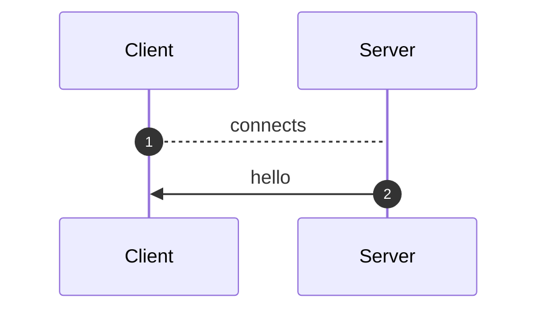
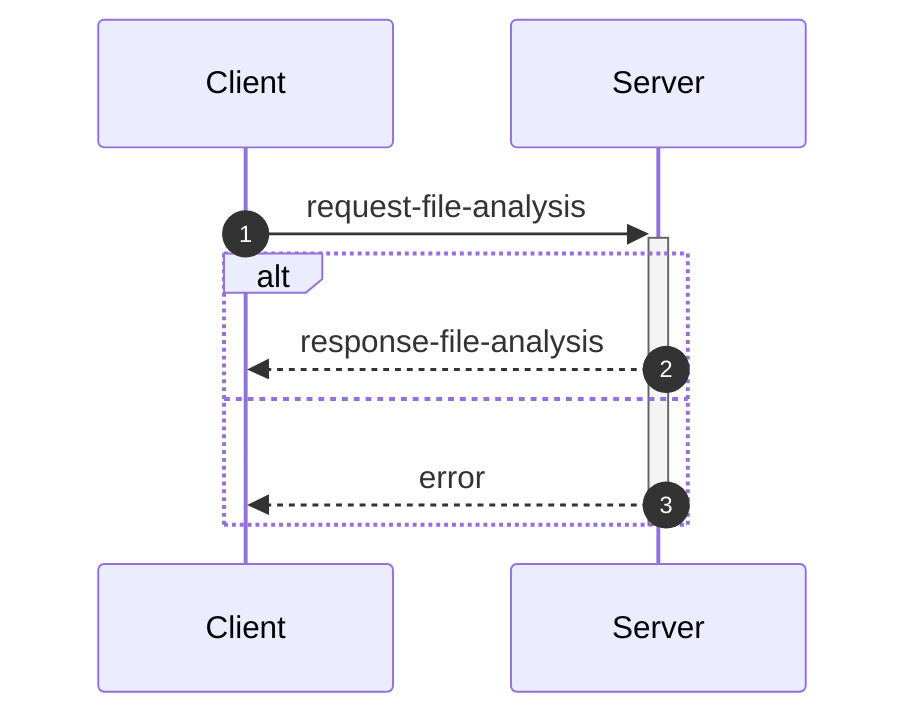
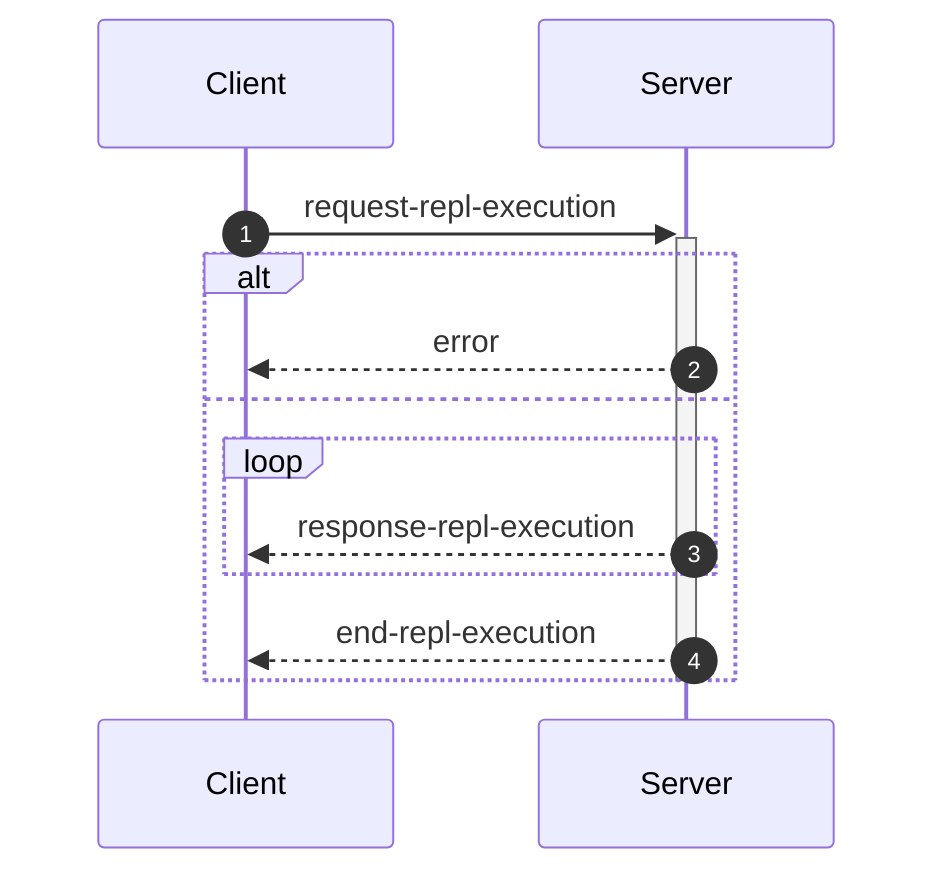
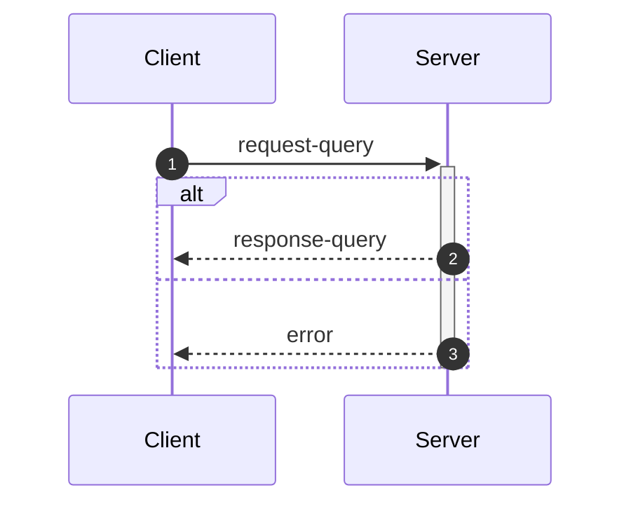

_<span title="an overview of flowR's interface">Generated</span> from '[wiki-interface.ts](https://github.com/flowr-analysis/flowr/tree/main/src/documentation/wiki-interface.ts "src/documentation/wiki-interface.ts")' on 2026-11-04, 11:37:27 UTC (v2.17.0, R v4.6.1), do not edit directly._

Although far from being as detailed as the in-depth explanation of [_flowR_](https://github.com/flowr-analysis/flowr/wiki/Core),
this wiki page explains how to interface with _flowR_ in more detail.
In general, command line arguments and other options provide short descriptions on hover over.

* [💻 Using the REPL](#using-the-repl)
* [⚙️ Configuring FlowR](#configuring-flowr)
* [⚒️ Writing Code](#writing-code)
* [💬 Communicating with the Server](#communicating-with-the-server)

<a id='using-the-repl'></a>
## 💻 Using the REPL

> [!NOTE]
> To execute arbitrary R commands with a repl request, _flowR_ has to be started explicitly with <span title="Description (Command Line Argument): Allow to access the underlying R session when using flowR (security warning: this allows the execution of arbitrary R code!)">`--r-session-access`</span>.
> Please be aware that this introduces a security risk and note that this relies on the [`r-shell` engine](https://github.com/flowr-analysis/flowr/wiki/Engines) .

Although primarily meant for users to explore,
there is nothing which forbids calling _flowR_ as a subprocess to use standard-in, -output, and -error
for communication (although you can access the REPL using the server as well,
with the [REPL Request](#message-request-repl-execution) message).

The read-eval-print loop&nbsp;(REPL) works relatively simple.
You can submit an expression (using <kbd>Enter</kbd>),
which is interpreted as an R&nbsp;expression by default but interpreted as a *command* if it starts with a colon (`:`).
The best command to get started with the REPL is <span title="Description (Repl Command): Show help information (aliases: :h, :?)">`:help`</span>.
Besides, you can leave the REPL either with the command <span title="Description (Repl Command): End the repl (aliases: :q, :exit)">`:quit`</span> or by pressing <kbd>Ctrl</kbd>+<kbd>C</kbd> twice.
When writing a *command*, you may press <kbd>Tab</kbd> to get a list of completions, if available.
Multiple commands can be entered in a single line by separating them with a semicolon (`;`), e.g. `:parse "x<-2"; :df*`.
If a command is given without R code, the REPL will re-use R code given in a previous command.
The prior example will hence return first the parsed AST of the program and then the dataflow graph for `"x <- 2"`.

> [!NOTE]
> If you develop flowR, you may want to launch the repl using the `npm run main-dev` command, this way, you get a non-minified version of flowR with debug information and hot-reloading of source files.

<details>
<summary>Available Commands</summary>

We currently offer the following commands (this with a `[*]` suffix are available with and without the star):

| Command | Description |
| ------- | ----------- |
| **<span title="Description (Repl Command): End the repl (aliases: :q, :exit)">:quit</span>** | End the repl (aliases: **:<span title="Alias of ':quit'. End the repl">q</span>**, **:<span title="Alias of ':quit'. End the repl">exit</span>**) |
| **<span title="Description (Repl Command): Execute the given code as R code. This requires the `--r-session-access` flag to be set and requires the r-shell engine. (aliases: :e, :r)">:execute</span>** | Execute the given code as R code. This requires the `--r-session-access` flag to be set and requires the r-shell engine. (aliases: **:<span title="Alias of ':execute'. Execute the given code as R code. This requires the `--r-session-access` flag to be set and requires the r-shell engine.">e</span>**, **:<span title="Alias of ':execute'. Execute the given code as R code. This requires the `--r-session-access` flag to be set and requires the r-shell engine.">r</span>**) |
| **<span title="Description (Repl Command): Get mermaid code for the control-flow graph of R code (aliases: :cfg, :cf)">:controlflow[*]</span>** | Get mermaid code for the control-flow graph of R code (star: Returns the URL to mermaid.live) (aliases: **:<span title="Alias of ':controlflow'. Get mermaid code for the control-flow graph of R code">cfg</span>**, **:<span title="Alias of ':controlflow'. Get mermaid code for the control-flow graph of R code">cf</span>**) |
| **<span title="Description (Repl Command): Get mermaid code for the control-flow graph with basic blocks (aliases: :cfgb, :cfb)">:controlflowbb[*]</span>** | Get mermaid code for the control-flow graph with basic blocks (star: Returns the URL to mermaid.live) (aliases: **:<span title="Alias of ':controlflowbb'. Get mermaid code for the control-flow graph with basic blocks">cfgb</span>**, **:<span title="Alias of ':controlflowbb'. Get mermaid code for the control-flow graph with basic blocks">cfb</span>**) |
| **<span title="Description (Repl Command): Get mermaid code for the dataflow graph (aliases: :d, :df)">:dataflow[*]</span>** | Get mermaid code for the dataflow graph (star: Returns the URL to mermaid.live) (aliases: **:<span title="Alias of ':dataflow'. Get mermaid code for the dataflow graph">d</span>**, **:<span title="Alias of ':dataflow'. Get mermaid code for the dataflow graph">df</span>**) |
| **<span title="Description (Repl Command): Get mermaid code for the normalized AST of R code (aliases: :n)">:normalize[*]</span>** | Get mermaid code for the normalized AST of R code (star: Returns the URL to mermaid.live) (alias: **:<span title="Alias of ':normalize'. Get mermaid code for the normalized AST of R code">n</span>**) |
| **<span title="Description (Repl Command): Get mermaid code for the simplified dataflow graph (aliases: :ds, :dfs)">:dataflowsimple[*]</span>** | Get mermaid code for the simplified dataflow graph (star: Returns the URL to mermaid.live) (aliases: **:<span title="Alias of ':dataflowsimple'. Get mermaid code for the simplified dataflow graph">ds</span>**, **:<span title="Alias of ':dataflowsimple'. Get mermaid code for the simplified dataflow graph">dfs</span>**) |
| **<span title="Description (Repl Command): Inspect and extend the signature database: `query` (identical to :query @signature), `info <name>` for where a function comes from (identical to :query @function-info), `add <path>` to mount another database/source, `download` to fetch the full-history database. (aliases: :sig)">:signature</span>** | Inspect and extend the signature database: `query` (identical to :query @signature), `info <name>` for where a function comes from (identical to :query @function-info), `add <path>` to mount another database/source, `download` to fetch the full-history database. (alias: **:<span title="Alias of ':signature'. Inspect and extend the signature database: `query` (identical to :query @signature), `info <name>` for where a function comes from (identical to :query @function-info), `add <path>` to mount another database/source, `download` to fetch the full-history database.">sig</span>**) |
| **<span title="Description (Repl Command): Just calculates the DFG, but only prints summary info (aliases: :d#, :df#)">:dataflowsilent</span>** | Just calculates the DFG, but only prints summary info (aliases: **:<span title="Alias of ':dataflowsilent'. Just calculates the DFG, but only prints summary info">d#</span>**, **:<span title="Alias of ':dataflowsilent'. Just calculates the DFG, but only prints summary info">df#</span>**) |
| **<span title="Description (Repl Command): Prints ASCII Art of the parsed, unmodified AST (aliases: :p)">:parse</span>** | Prints ASCII Art of the parsed, unmodified AST (alias: **:<span title="Alias of ':parse'. Prints ASCII Art of the parsed, unmodified AST">p</span>**) |
| **<span title="Description (Repl Command): Prints the version of flowR as well as the current version of R">:version</span>** | Prints the version of flowR as well as the current version of R
| **<span title="Description (Repl Command): Query the given R code (use 'help' for more information)">:query[*]</span>** | Query the given R code (use 'help' for more information) (star: Similar to query, but returns the output in json format.)
| **<span title="Description (Repl Command): Returns an ASCII representation of the dataflow graph (aliases: :df!)">:dataflowascii</span>** | Returns an ASCII representation of the dataflow graph (alias: **:<span title="Alias of ':dataflowascii'. Returns an ASCII representation of the dataflow graph">df!</span>**) |
| **<span title="Description (Repl Command): Returns summarization stats for the normalized AST (aliases: :n#)">:normalize#</span>** | Returns summarization stats for the normalized AST (alias: **:<span title="Alias of ':normalize#'. Returns summarization stats for the normalized AST">n#</span>**) |
| **<span title="Description (Repl Command): Show help information (aliases: :h, :?)">:help</span>** | Show help information (aliases: **:<span title="Alias of ':help'. Show help information">h</span>**, **:<span title="Alias of ':help'. Show help information">?</span>**) |

</details>

> [!TIP]
> 
> As indicated by the examples before, all REPL commands that operate on code keep track of the state.
> Hence, if you run a command like <span title="Description (Repl Command, starred version): Returns the URL to mermaid.live; Base Command: Get mermaid code for the dataflow graph (aliases: :d*, :df*)">`:dataflow*`</span> without providing R code,
> the REPL will re-use the R code provided in a previous command.
> Likewise, doing this will benefit from incrementality!
> If you request the dataflow graph with `:df* x <- 2 * y` and then want to see the parsed AST with `:parse`,
> the REPL will re-use previously obtained information and not re-parse the code again.
> 		

Generally, many commands offer shortcut versions in the REPL. Many queries, for example, offer a shortened format (see the example below).
Of special note, the [Config Query](https://github.com/flowr-analysis/flowr/wiki/%5BQuery%5D-Config)
can be used to also modify the currently active configuration of _flowR_ within the REPL (see the [wiki page](https://github.com/flowr-analysis/flowr/wiki/%5BQuery%5D-Config) for more information).

### Example: Retrieving the Dataflow Graph

To retrieve a URL to the [mermaid](https://mermaid.js.org/) diagram of the dataflow of a given expression,
use <span title="Description (Repl Command, starred version): Returns the URL to mermaid.live; Base Command: Get mermaid code for the dataflow graph (aliases: :d*, :df*)">`:dataflow*`</span> (or <span title="Description (Repl Command): Get mermaid code for the dataflow graph (aliases: :d, :df)">`:dataflow`</span> to get the mermaid code in the cli):

```shell
$ docker run -it --rm eagleoutice/flowr # or npm run flowr 
flowR repl v2.17.0, R grammar v14 (tree-sitter engine)
R> :dataflow* y <- 1 + x
```

<details>
<summary style='color:gray'>Output</summary>

```text
https://mermaid.live/view#base64:eyJjb2RlIjoiZmxvd2NoYXJ0IFREXG4gICAgMXt7XCJgKiM5MTtSTnVtYmVyIzkzOyogKioxKipcbiAgICAgICoxLjYqICgqKmlkOiAxKiopYFwifX1cbiAgICAyKFtcImAqIzkxO1JTeW1ib2wjOTM7KiAqKngqKlxuICAgICAgKjEuMTAqICgqKmlkOiAyKiopYFwiXSlcbiAgICAzW1tcImAqIzkxO1JCaW5hcnlPcCM5MzsqIGJhc2UjNTg7IzU4OyoqIzQzOyoqXG4gICAgICAqMS42LTEwKiAoKippZDogMyoqKVxuICAgIGFyZzogKDEsIDIpYFwiXV1cbiAgICBidWlsdC1pbjpfNDNfW1wiYEJ1aWx0LUluOlxuIzQzO2BcIl1cbiAgICBzdHlsZSBidWlsdC1pbjpfNDNfIHN0cm9rZTpncmF5LGZpbGw6Z3JheSxzdHJva2Utd2lkdGg6MnB4LG9wYWNpdHk6Ljg7XG4gICAgMFtcImAqIzkxO1JTeW1ib2wjOTM7KiAqKnkqKlxuICAgICAgKjEuMSogKCoqaWQ6IDAqKiwgdjogMylgXCJdXG4gICAgNFtbXCJgKiM5MTtSQmluYXJ5T3AjOTM7KiBiYXNlIzU4OyM1ODsqKiM2MDsjNDU7KipcbiAgICAgICoxLjEtMTAqICgqKmlkOiA0KiopXG4gICAgYXJnOiAoMCwgMylgXCJdXVxuICAgIGJ1aWx0LWluOl82MF8tW1wiYEJ1aWx0LUluOlxuIzYwOyM0NTtgXCJdXG4gICAgc3R5bGUgYnVpbHQtaW46XzYwXy0gc3Ryb2tlOmdyYXksZmlsbDpncmF5LHN0cm9rZS13aWR0aDoycHgsb3BhY2l0eTouODtcbiAgICAxIC0uLT58XCJmbG93XCJ8IDJcbiAgICBsaW5rU3R5bGUgMCBzdHJva2U6Z3JheSxjb2xvcjpncmF5O1xuICAgIDIgLS4tPnxcImZsb3dcInwgM1xuICAgIGxpbmtTdHlsZSAxIHN0cm9rZTpncmF5LGNvbG9yOmdyYXk7XG4gICAgMyAtLT58XCJyZWFkcywgYXJnXCJ8IDFcbiAgICAzIC0tPnxcInJlYWRzLCBhcmdcInwgMlxuICAgIDMgLS4tPnxcImZsb3dcInwgMFxuICAgIGxpbmtTdHlsZSA0IHN0cm9rZTpncmF5LGNvbG9yOmdyYXk7XG4gICAgMyAtLi0+fFwicmVhZHMsIGNhbGxzXCJ8IGJ1aWx0LWluOl80M19cbiAgICBsaW5rU3R5bGUgNSBzdHJva2U6Z3JheTtcbiAgICAwIC0tPnxcImRlZmluZWQtYnksIGZsb3dcInwgNFxuICAgIDAgLS0+fFwiZGVmaW5lZC1ieVwifCAzXG4gICAgNCAtLT58XCJyZWFkcywgYXJnXCJ8IDNcbiAgICA0IC0tPnxcInJldHVybnMsIGFyZ1wifCAwXG4gICAgNCAtLi0+fFwicmVhZHMsIGNhbGxzXCJ8IGJ1aWx0LWluOl82MF8tXG4gICAgbGlua1N0eWxlIDEwIHN0cm9rZTpncmF5OyIsIm1lcm1haWQiOnsiYXV0b1N5bmMiOnRydWV9fQ==
```

Retrieve the dataflow graph of the expression `y <- 1 + x`. It looks like this:


<details>

<summary style="color:gray">R Code of the Dataflow Graph</summary>

The analysis ran (parse and normalize with the [tree-sitter](https://github.com/flowr-analysis/flowr/wiki/Engines) engine) in the generation environment. No [signature database](https://github.com/flowr-analysis/flowr/wiki/Signature-Database) is mounted, so `library()` attaches no exports (base-R names are still qualified, e.g., `stats::acf`). 
We encountered no unknown side effects during the analysis.

```r
y <- 1 + x
```

</details>

</details>

For small graphs like this, <span title="Description (Repl Command): Returns an ASCII representation of the dataflow graph (aliases: :df!)">`:dataflowascii`</span> also provides an ASCII representation directly in the REPL:

```shell
$ docker run -it --rm eagleoutice/flowr # or npm run flowr 
flowR repl v2.17.0, R grammar v14 (tree-sitter engine)
R> :df! y <- 1 + x
```

<details open>
<summary style='color:gray'>Output</summary>

```text
                        v<0>v
 c<4>c──────────────────| y |
 |<- |     ┌────────────v---v
 c---c     │
    │   c<3>c   0<1>0
    └───| + |───| 1 |───u<2>u
        c---c   0---0   | x |
           └────────────u---u
Edges:
3 -> 1: reads, arg          3 -> 2: reads, arg
3 -> 0: flows-to            1 -> 2: flows-to
2 -> 3: flows-to            4 -> 3: reads, arg
4 -> 0: returns, arg        0 -> 4: defined-by, flows-to
0 -> 3: defined-by
```

Retrieve the dataflow graph of the expression `y <- 1 + x` as ASCII art.

</details>

For the slicing with <span title="Description (Repl Command): Static backwards executable slicer for R">`:slicer`</span>, you have access to the same [magic comments](#slice-magic-comments) as with the [slice request](#message-request-slice).
Pass `--inline` to splice resolvable `source()` calls into the reconstruction so the slice is a single self-contained R text (the same as the static slice query's `inlineSources` flag).
See `--help` for more flags!

### Example: Interfacing with the File System

Many commands that allow for an R-expression (like <span title="Description (Repl Command, starred version): Returns the URL to mermaid.live; Base Command: Get mermaid code for the dataflow graph (aliases: :d*, :df*)">`:dataflow*`</span>) allow for a file as well
if the argument starts with `file://`.
If you are working from the root directory of the _flowR_ repository, the following gives you the parsed AST of the example file using the <span title="Description (Repl Command): Prints ASCII Art of the parsed, unmodified AST (aliases: :p)">`:parse`</span> command:

> **Watch mode**: Replace `file://` with `watch://` to enter watch mode.
> flowR runs the command immediately and then re-runs it every time the file (or any file inside the folder) changes.
> Enter any other command to leave watch mode.
> For example: `:df watch://analysis.R`

```shell
$ docker run -it --rm eagleoutice/flowr # or npm run flowr 
flowR repl v2.17.0, R grammar v14 (tree-sitter engine)
R> :parse file://test/testfiles/example.R
```

<details>
<summary style='color:gray'>Output</summary>

```text
File: test/testfiles/example.R

program
├ binaryoperator
│ ├ identifier "sum" (1:1─4)
│ ├ <- "<-" (1:5─7)
│ ╰ float "0" (1:8─9)
├ binaryoperator
│ ├ identifier "product" (2:1─8)
│ ├ <- "<-" (2:9─11)
│ ╰ float "1" (2:12─13)
├ binaryoperator
│ ├ identifier "w" (3:1─2)
│ ├ <- "<-" (3:3─5)
│ ╰ float "7" (3:6─7)
├ binaryoperator
│ ├ identifier "N" (4:1─2)
│ ├ <- "<-" (4:3─5)
│ ╰ float "10" (4:6─8)
├ forstatement
│ ├ for "for" (6:1─4)
│ ├ ( "(" (6:5─6)
│ ├ identifier "i" (6:6─7)
│ ├ in "in" (6:8─10)
│ ├ binaryoperator
│ │ ├ float "1" (6:11─12)
│ │ ├ : ":" (6:12─13)
│ │ ╰ parenthesizedexpression
│ │   ├ ( "(" (6:13─14)
│ │   ├ binaryoperator
│ │   │ ├ identifier "N" (6:14─15)
│ │   │ ├ - "-" (6:15─16)
│ │   │ ╰ float "1" (6:16─17)
│ │   ╰ ) ")" (6:17─18)
│ ├ ) ")" (6:18─19)
│ ╰ bracedexpression
│   ├ { "{" (6:20─21)
│   ├ binaryoperator
│   │ ├ identifier "sum" (7:3─6)
│   │ ├ <- "<-" (7:7─9)
│   │ ╰ binaryoperator
│   │   ├ binaryoperator
│   │   │ ├ identifier "sum" (7:10─13)
│   │   │ ├ + "+" (7:14─15)
│   │   │ ╰ identifier "i" (7:16─17)
│   │   ├ + "+" (7:18─19)
│   │   ╰ identifier "w" (7:20─21)
│   ├ binaryoperator
│   │ ├ identifier "product" (8:3─10)
│   │ ├ <- "<-" (8:11─13)
│   │ ╰ binaryoperator
│   │   ├ identifier "product" (8:14─21)
│   │   ├  "" (8:22─23)
│   │   ╰ identifier "i" (8:24─25)
│   ╰ } "}" (9:1─2)
├ call
│ ├ identifier "cat" (11:1─4)
│ ╰ arguments
│   ├ ( "(" (11:4─5)
│   ├ argument
│   │ ╰ string
│   │   ├ stringopen "\"" (11:5─6)
│   │   ├ stringcontent "Sum:" (11:6─10)
│   │   ╰ stringclose "\"" (11:10─11)
│   ├ comma "," (11:11─12)
│   ├ argument
│   │ ╰ identifier "sum" (11:13─16)
│   ├ comma "," (11:16─17)
│   ├ argument
│   │ ╰ string
│   │   ├ stringopen "\"" (11:18─19)
│   │   ├ stringcontent
│   │   │ ╰ escapesequence "\\n" (11:19─21)
│   │   ╰ stringclose "\"" (11:21─22)
│   ╰ ) ")" (11:22─23)
╰ call
  ├ identifier "cat" (12:1─4)
  ╰ arguments
    ├ ( "(" (12:4─5)
    ├ argument
    │ ╰ string
    │   ├ stringopen "\"" (12:5─6)
    │   ├ stringcontent "Product:" (12:6─14)
    │   ╰ stringclose "\"" (12:14─15)
    ├ comma "," (12:15─16)
    ├ argument
    │ ╰ identifier "product" (12:17─24)
    ├ comma "," (12:24─25)
    ├ argument
    │ ╰ string
    │   ├ stringopen "\"" (12:26─27)
    │   ├ stringcontent
    │   │ ╰ escapesequence "\\n" (12:27─29)
    │   ╰ stringclose "\"" (12:29─30)
    ╰ ) ")" (12:30─31)
```

Retrieve the parsed AST of the example file.

<details>

<summary>File Content</summary>

```r
sum <- 0
product <- 1
w <- 7
N <- 10

for (i in 1:(N-1)) {
  sum <- sum + i + w
  product <- product * i
}

cat("Sum:", sum, "\n")
cat("Product:", product, "\n")
```

</details>

As _flowR_ directly transforms this AST the output focuses on being human-readable instead of being machine-readable.
		
</details>

### Example: Run a Query

You can run any query supported by _flowR_ using the <span title="Description (Repl Command): Query the given R code (use 'help' for more information)">`:query`</span> command.
For example, to obtain the shapes of all data frames in a given piece of code, you can run:

```shell
$ docker run -it --rm eagleoutice/flowr # or npm run flowr 
flowR repl v2.17.0, R grammar v14 (tree-sitter engine)
R> :query @absint df-shape "x <- data.frame(a = 1:10, b = 1:10)\ny <- x$a"
```

<details open>
<summary style='color:gray'>Output</summary>

```text
Query: absint (4 ms)
   ╰ $12: (colnames: [{"a", "b"}, {}], cols: [2, 2], rows: [10, 10])
   ╰ $0: (colnames: [{"a", "b"}, {}], cols: [2, 2], rows: [10, 10])
```

Retrieve the shapes of all data frames in the given code.

</details>

To run the linter on a file, you can use (in this example, we just issue the `dead-code` linter on a small piece of code):

```shell
$ docker run -it --rm eagleoutice/flowr # or npm run flowr 
flowR repl v2.17.0, R grammar v14 (tree-sitter engine)
R> :query @linter rules:dead-code "if(FALSE) x <- 2"
```

<details open>
<summary style='color:gray'>Output</summary>

```text
Query: linter (2 ms)
   ╰ Dead Code (dead-code):
       ╰ certain:
           ╰ Code at 1.11-16 (1 quick fix(es) available)
```

Run the linter on the given code, with only the `dead-code` rule enabled.

</details>

For more information on the available queries, please check out the [Query API](https://github.com/flowr-analysis/flowr/wiki/Query-API).

<a id='configuring-flowr'></a>
## ⚙️ Configuring FlowR

When running _flowR_, you may want to specify some behaviors with a dedicated configuration file.
By default, flowR looks for a file named `flowr.json` in the current working directory (or any higher directory).
You can also specify a different file with <span title="Description (Command Line Argument): The name of the configuration file to use">`--config-file`</span> or pass the configuration inline using <span title="Description (Command Line Argument): The flowR configuration to use, as a JSON string">`--config-json`</span>.
A `flowr.json` found this way belongs to the analyzed project, so flowR ignores its options that decide what flowR executes or loads
(`engines.*.wasmPath`, `engines.*.treeSitterWasmPath`, `engines.*.rPath`, `solver.sigdb.additionalPaths`, `solver.sigdb.downloadRepo`, `solver.sigdb.installedLibrary.paths`, `solver.sigdb.onDemand.enabled`, `solver.sigdb.onDemand.repositories`, `solver.sigdb.onDemand.cranMirror`, `solver.sigdb.onDemand.bioconductorMirror`, `solver.sigdb.onDemand.cacheDir`),
unless you pass <span title="Description (Command Line Argument): Keep the security-sensitive options (e.g., the R executable) of the flowr.json found in the working directory or a parent. Only use this for projects you trust.">`--trust-config`</span>.
To analyze code you do not trust, use the secure mode (<span title="Description (Command Line Argument): Run in secure mode for analyzing untrusted code: flowR does not start R (or any other process), does not access the network, does not search for project configs, and ignores security-sensitive options in every config. Cannot be disabled once enabled. Can also be enabled with the environment variable {italic FLOWR_SECURE_MODE=1}.">`--secure`</span>, see the [security policy](https://github.com/flowr-analysis/flowr/blob/main/.github/SECURITY.md)).
To inspect the current configuration, you can run flowr with the <span title="Description (Command Line Argument): Run with verbose logging (will be passed to the corresponding script)">`--verbose`</span> flag, or use the `config` [Query](https://github.com/flowr-analysis/flowr/wiki/Query-API).
Within the REPL this works by running the following:

```shell
:query @config
```

To work with the <a href="https://github.com/flowr-analysis/flowr/tree/main/src/config.ts#L119"><code><span title="The configuration file format for flowR.">FlowrConfig</span></code></a> you can use the provided helper objects alongside its methods like
<a href="https://github.com/flowr-analysis/flowr/tree/main/src/config.ts#L966"><code><span title="Creates a new flowr config that has the updated values.">FlowrConfig::<b>amend</b></span></code></a>.
The schema below documents every option; the ones you most likely want are:

- <a href="https://github.com/flowr-analysis/flowr/wiki/Interface#configuring-flowr" title="Configuration Option (boolean): Whether source calls should be ignored, causing {@link processSourceCall}&#39;s behavior to be skipped.">ignoreSourceCalls</a>: ignore source calls when analyzing the code, i.e., ignore the inclusion of other files.
- <a href="https://github.com/flowr-analysis/flowr/wiki/Interface#configuring-flowr" title="Configuration Option (boolean): Whether load calls should be ignored, causing {@link processLoadCall}&#39;s behavior to be skipped.">ignoreLoadCalls</a>: ignore load calls when analyzing the code, i.e., ignore the loading of r-data files.
- <a href="https://github.com/flowr-analysis/flowr/wiki/Interface#configuring-flowr" title="Configuration Option (object): Do you want to overwrite (parts) of the builtin definition?">semantics.environment.overwriteBuiltIns</a>: overwrite _flowR_'s handling of built-in functions, or clear the preset definitions entirely.
  See [Configure BuiltIn Semantics](#configure-builtin-semantics) for more information.
- <a href="https://github.com/flowr-analysis/flowr/wiki/Interface#configuring-flowr" title="Configuration Option (string): How to resolve variables and their values. (one of &quot;disabled&quot;, &quot;alias&quot;, &quot;builtin&quot;)">solver.variables</a>: how to resolve variables and their values (`disabled`, `alias`, `builtin`).
- <a href="https://github.com/flowr-analysis/flowr/wiki/Interface#configuring-flowr" title="Configuration Option (array): The engine or set of engines to use for interacting with R code. An empty array means all available engines will be used.">engines</a> and <a href="https://github.com/flowr-analysis/flowr/wiki/Interface#configuring-flowr" title="Configuration Option (string): The default engine to use for interacting with R code. If this is undefined, an arbitrary engine from the specified list will be used. (one of &quot;tree-sitter&quot;, &quot;r-shell&quot;)">defaultEngine</a>: the engines used to interact with R code, see the [Engines wiki page](https://github.com/flowr-analysis/flowr/wiki/Engines).
- <a href="https://github.com/flowr-analysis/flowr/wiki/Interface#configuring-flowr" title="Configuration Option (array): Files a framework loads on its own, without any source() call (e.g. global.R in a shiny app), in the order they are loaded; flowR orders the matching project files accordingly and analyzes them as one program. Entries are case-insensitive globs matched against the file path, a plain name matches any file with that name, and entries matching no project file are warned about. Usually set per project kind via specializeConfig.">project.implicitSources</a>: the files a framework loads without any `source()` call, in the order in which they are
  loaded. Entries are globs (e.g. `R/*.R`) matched against the file path ignoring capitalization; one matching no file is reported.
- <a href="https://github.com/flowr-analysis/flowr/wiki/Interface#configuring-flowr" title="Configuration Option (object): Overwrite (parts of) the configuration depending on the project kind flowR detects, e.g. to give a shiny app its implicit sources.">specializeConfig</a>: overwrite (parts of) the configuration depending on the kind of project _flowR_ detects
  (e.g. `shiny-app`), which is how a shiny app gets its implicit sources by default. What you configure directly wins.
- <a href="https://github.com/flowr-analysis/flowr/wiki/Interface#configuring-flowr" title="Configuration Option (string): Overwrite the project kind flowR would otherwise infer from the analyzed files, e.g. when auto-detection guesses wrong. (one of &quot;package&quot;, &quot;script&quot;, &quot;shiny-app&quot;, &quot;notebook&quot;, &quot;project&quot;, &quot;unknown&quot;)">project.useProjectType</a>: skip that detection and force a project kind yourself, when auto-detection guesses wrong.
- <a href="https://github.com/flowr-analysis/flowr/wiki/Interface#configuring-flowr" title="Configuration Option (array): The default plugins to load when creating a new instance of FlowrAnalyzer">defaultPlugins</a> and <a href="https://github.com/flowr-analysis/flowr/wiki/Interface#configuring-flowr" title="Configuration Option (array): The plugins to load in REPL mode">repl.plugins</a>: the plugins to load for a new <a href="https://github.com/flowr-analysis/flowr/tree/main/src/project/flowr-analyzer.ts#L210"><code><span title="Central class for conducting analyses with FlowR. Use the FlowrAnalyzerBuilder to create a new instance. If you want the original pattern of creating a pipeline and running all steps, you can still do this with FlowrAnalyzer#runFull . To inspect the context of the analyzer, use FlowrAnalyzer#inspectContext (if you are a plugin and need to modify it, use FlowrAnalyzer#context instead).">FlowrAnalyzer</span></code></a> and in the REPL
  (use `flowr:default` to reference the former).

So you can configure _flowR_ by adding a file like the following:

<details>

<summary>Example Configuration File</summary>

```json
{
  "ignoreSourceCalls": true,
  "ignoreLoadCalls": true,
  "semantics": {
    "environment": {
      "overwriteBuiltIns": {
        "definitions": [
          {
            "type": "function",
            "names": [
              "foo"
            ],
            "processor": "builtin:assign",
            "config": {}
          }
        ]
      }
    }
  },
  "defaultPlugins": [
    "file:description",
    "versions:description"
  ],
  "repl": {
    "quickStats": false,
    "dfProcessorHeat": false,
    "hints": true,
    "plugins": [
      "flowr:default"
    ]
  },
  "project": {
    "resolveUnknownPathsOnDisk": true,
    "implicitSources": [
      "global.R",
      "app.R"
    ]
  },
  "linter": {
    "disabledRules": []
  },
  "specializeConfig": {
    "shiny-app": {
      "project": {
        "implicitSources": [
          "global.R",
          "ui.R",
          "server.R",
          "app.R"
        ]
      }
    }
  },
  "engines": [
    {
      "type": "r-shell"
    }
  ],
  "solver": {
    "variables": "alias",
    "evalStrings": true,
    "trackEnvironments": true,
    "sigdb": {
      "enabled": true,
      "loadProjectDependencies": true,
      "eagerlyLoad": false,
      "eagerlyLoadExports": false,
      "linkBaseR": false,
      "linkDescriptionDependencies": false
    },
    "resolveSource": {
      "dropPaths": "no",
      "ignoreCapitalization": true,
      "inferWorkingDirectory": "active-script",
      "searchPath": []
    },
    "instrument": {},
    "slicer": {
      "threshold": 50
    }
  },
  "abstractInterpretation": {
    "wideningThreshold": 4,
    "followCalls": true,
    "dataFrame": {
      "maxColNames": 20,
      "readLoadedData": {
        "readExternalFiles": true,
        "maxReadLines": 1000000
      }
    }
  },
  "incremental": {
    "alwaysIncremental": false,
    "parsing": {
      "activated": false,
      "heuristics": {
        "activated": true,
        "mtime": true,
        "linesFrom": 500,
        "bytesFrom": 50000,
        "alwaysWithEdits": false,
        "minFiles": 1
      }
    }
  },
  "gas": {
    "thresholds": {
      "memory": {
        "problematic": 0.7,
        "critical": 0.9
      },
      "timeMs": {
        "problematic": 100000,
        "critical": 120000
      }
    },
    "features": {}
  }
}
```

</details>

<details>
<a id='configure-builtin-semantics'></a>
<summary>Configure Built-In Semantics</summary>

`semantics/environment/overwriteBuiltins` accepts two keys:

- `loadDefaults` (boolean, initially `true`): If set to `true`, the default built-in definitions are loaded before applying the custom definitions. Setting this flag to `false` explicitly disables the loading of the default definitions.
- `definitions` (array, initially empty): Allows to overwrite or define new built-in elements. Each object within must have a `type` which is one of the below. Furthermore, they may define a string array of `names` which specifies the identifiers to bind the definitions to. You may use `assumePrimitive` to specify whether _flowR_ should assume that this is a primitive non-library definition (so you probably just do not want to specify the key).

  | Type            | Description                                                                                                                                                                                                                                                                                              | Example                                                                                                    |
  | --------------- | -------------------------------------------------------------------------------------------------------------------------------------------------------------------------------------------------------------------------------------------------------------------------------------------------------- | ---------------------------------------------------------------------------------------------------------- |
  | `constant`    | Additionally allows for a `value` this should resolve to.                                                                                                                                                                                                                                                | `{ type: 'constant', names: ['NULL', 'NA'],  value: null }`                                                |
  | `function`    | Is a rather flexible way to define and bind built-in functions. For the time, we do not have extensive documentation to cover all the cases, so please either consult the sources with the `default-builtin-config.ts` or open a [new issue](https://github.com/flowr-analysis/flowr/issues/new/choose). | `{ type: 'function', names: ['next'], processor: 'builtin:d', config: { cfg: ExitPointType.Next } }` |
  | `replacement` | A comfortable way to specify replacement functions like `$<-` or `names<-`. `suffixes` describes the... suffixes to attach automatically. | `{ type: 'replacement', suffixes: ['<-', '<<-'], names: ['[', '[['] }` |

</details>

<details>

<summary style='color:gray'>Full Configuration-File Schema</summary>

- _The configuration file format for flowR._ (object)
    - **logLevel** [optional] _flowR's global minimum log level, applied when the config is loaded._ (string)
        Only allows: 'silly', 'trace', 'debug', 'info', 'warn', 'error', 'fatal'
    - **ignoreSourceCalls** [optional] _Whether source calls should be ignored, causing {@link processSourceCall}'s behavior to be skipped._ (boolean)
    - **ignoreLoadCalls** [optional] _Whether load calls should be ignored, causing {@link processLoadCall}'s behavior to be skipped._ (boolean)
    - **semantics** _Configure language semantics and how flowR handles them._ (object)
        - **environment** [optional] _Semantics regarding how to handle the R environment._ (object)
            - **overwriteBuiltIns** [optional] _Do you want to overwrite (parts) of the builtin definition?_ (object)
                - **loadDefaults** [optional] _Should the default configuration still be loaded?_ (boolean)
                - **definitions** [optional] _The definitions to load/overwrite._ (array)
                Valid item types:
                    - (object)
    - **defaultPlugins** [optional] _The default plugins to load when creating a new instance of FlowrAnalyzer_ (array)
    Valid item types:
        - (alternatives)
            - (string)
            - (array)
    - **repl** _Configuration options for the REPL._ (object)
        - **quickStats** [optional] _Whether to show quick stats in the REPL after each evaluation._ (boolean)
        - **dfProcessorHeat** [optional] _This instruments the dataflow processors to count how often each processor is called._ (boolean)
        - **hints** [optional] _Whether to show dim inline hints on the empty prompt (automatically disabled on non-interactive terminals)._ (boolean)
        - **plugins** [optional] _The plugins to load in REPL mode_ (array)
        Valid item types:
            - (alternatives)
                - (string)
                - (array)
        - **autoUseFileProtocol** [optional] _Prepend the file protocol to a repl input that looks like a path, instead of only warning about it._ (boolean)
        - **queryStats** [optional] _Whether `:query` closes with the line stating how long the queries took (`:query*` never prints it)._ (boolean)
        - **showPlugins** [optional] _Whether `:version` grays out the plugins that did not activate during the last analysis._ (boolean)
    - **project** _Project specific configuration options._ (object)
        - **resolveUnknownPathsOnDisk** [optional] _Whether to resolve unknown paths loaded by the r project disk when trying to source/analyze files._ (boolean)
        - **failOnInaccessiblePath** [optional] _Whether a directory that cannot be traversed during file discovery (e.g. due to permissions) aborts the analysis; when false (the default) such paths are logged and skipped._ (boolean)
        - **basePackages** [optional] _The packages considered part of R itself (base and recommended); if unset, flowR uses its built-in list._ (array)
        Valid item types:
            - (string)
        - **implicitSources** [optional] _Files a framework loads on its own, without any source() call (e.g. global.R in a shiny app), in the order they are loaded; flowR orders the matching project files accordingly and analyzes them as one program. Entries are case-insensitive globs matched against the file path, a plain name matches any file with that name, and entries matching no project file are warned about. Usually set per project kind via specializeConfig._ (array)
        Valid item types:
            - (string)
        - **useProjectType** [optional] _Overwrite the project kind flowR would otherwise infer from the analyzed files, e.g. when auto-detection guesses wrong._ (string)
            Only allows: 'package', 'script', 'shiny-app', 'notebook', 'project', 'unknown'
        - **assumeImplicitEcho** [optional] _Whether the top level of the analyzed code is echoed, so that every visible result printed there is collected as an output by the dependencies query (default true, false for a package)._ (boolean)
        - **discovery** [optional] _Scoping options for the default project discovery._ (object)
            - **full** [optional] _Collect every file below the project root (greedy) instead of only the files the detected project kind needs (default false)._ (boolean)
            - **perKind** [optional] _Per-kind include/exclude glob overrides layered on the default scoping._ (object)
            - **ignore** [optional] _Case-insensitive globs that drop matching files from the intelligent discovery, regardless of kind (e.g. .Renviron to ignore environment files)._ (array)
            Valid item types:
                - (string)
        - **classification** [optional] _Overrides for the signals flowR uses to classify the project kind._ (object)
            - **shinyDescriptionTypes** [optional] _DESCRIPTION Type: values that mark a shiny app._ (array)
            Valid item types:
                - (string)
            - **shinyEntryFiles** [optional] _File names a shiny app is assembled from._ (array)
            Valid item types:
                - (string)
            - **shinyUsagePattern** [optional] _Regex source evidencing shiny usage in an entry file._ (string)
            - **notebookExtensions** [optional] _File extensions marking a notebook._ (array)
            Valid item types:
                - (string)
    - **linter** _Linter configuration options._ (object)
        - **disabledRules** _Linting rule names excluded from the default rule set (a rule requested explicitly via a linter query still runs). Usually set per project kind via specializeConfig._ (array)
        Valid item types:
            - (string)
        - **disabledTags** [optional] _Linting rule tags whose rules are excluded from the default rule set (a rule requested explicitly via a linter query still runs). By default the cmd-check rules are disabled for everything but a package; a configured list replaces that default._ (array)
        Valid item types:
            - (string)
    - **inputSources** [optional] _Further frameworks the input-sources analysis should know about; entries are added to flowR's defaults._ (object)
        - **pure** [optional] _Functions that only pass the constantness of their arguments on._ (array)
        Valid item types:
            - (string)
        - **param** [optional] _Functions whose result is a 'param' input._ (array)
        Valid item types:
            - (string)
        - **file** [optional] _Functions whose result is a 'file' input._ (array)
        Valid item types:
            - (string)
        - **tempfile** [optional] _Functions whose result is a 'tempfile' input._ (array)
        Valid item types:
            - (string)
        - **glob** [optional] _Functions whose result is a 'glob' input._ (array)
        Valid item types:
            - (string)
        - **net** [optional] _Functions whose result is a 'net' input._ (array)
        Valid item types:
            - (string)
        - **rand** [optional] _Functions whose result is a 'rand' input._ (array)
        Valid item types:
            - (string)
        - **system** [optional] _Functions whose result is a 'system' input._ (array)
        Valid item types:
            - (string)
        - **ffi** [optional] _Functions whose result is a 'ffi' input._ (array)
        Valid item types:
            - (string)
        - **lang** [optional] _Functions whose result is a 'lang' input._ (array)
        Valid item types:
            - (string)
        - **options** [optional] _Functions whose result is a 'options' input._ (array)
        Valid item types:
            - (string)
        - **cmdline** [optional] _Functions whose result is a 'cmdline' input._ (array)
        Valid item types:
            - (string)
        - **user** [optional] _Functions whose result is a 'user' input._ (array)
        Valid item types:
            - (string)
        - **const** [optional] _Functions whose result is a 'const' input._ (array)
        Valid item types:
            - (string)
        - **scope** [optional] _Functions whose result is a 'scope' input._ (array)
        Valid item types:
            - (string)
        - **dconst** [optional] _Functions whose result is a 'dconst' input._ (array)
        Valid item types:
            - (string)
        - **unknown** [optional] _Functions whose result is a 'unknown' input._ (array)
        Valid item types:
            - (string)
        - **linkedObjects** [optional] _Objects a framework provides without a definition in the code, e.g. shiny's input._ (array)
        Valid item types:
            - (object)
        - **linkedEntryPoints** [optional] _Calls that hand a function to a framework, which binds its objects to the parameters by position._ (array)
        Valid item types:
            - (object)
    - **specializeConfig** [optional] _Overwrite (parts of) the configuration depending on the project kind flowR detects, e.g. to give a shiny app its implicit sources._ (object)
    - **engines** _The engine or set of engines to use for interacting with R code. An empty array means all available engines will be used._ (array)
    Valid item types:
        - (alternatives)
            - _The configuration for the tree sitter engine._ (object)
                - **type** [required] _Use the tree sitter engine._ (string)
                    Only allows: 'tree-sitter'
                - **wasmPath** [optional] _The path to the tree-sitter-r WASM binary to use. If this is undefined, this uses the default path._ (string)
                - **treeSitterWasmPath** [optional] _The path to the tree-sitter WASM binary to use. If this is undefined, this uses the default path._ (string)
                - **lax** [optional] _Whether to use the lax parser for parsing R code (allowing for syntax errors). If this is undefined, the strict parser will be used._ (boolean)
            - _The configuration for the R shell engine._ (object)
                - **type** [required] _Use the R shell engine._ (string)
                    Only allows: 'r-shell'
                - **rPath** [optional] _The path to the R executable to use. If this is undefined, this uses the default path._ (string)
                - **pipeBind** [optional] _Whether to enable R's experimental pipe-bind operator "=>" by setting _R_USE_PIPEBIND_ for the R session (default false); R itself keeps this off by default, as it is experimental and has never shipped in a release version of R._ (boolean)
    - **defaultEngine** [optional] _The default engine to use for interacting with R code. If this is undefined, an arbitrary engine from the specified list will be used._ (string)
        Only allows: 'tree-sitter', 'r-shell'
    - **solver** _How to resolve constants, constraints, cells, ..._ (object)
        - **variables** _How to resolve variables and their values._ (string)
            Only allows: 'disabled', 'alias', 'builtin'
        - **evalStrings** _Should we include eval(parse(text="...")) calls in the dataflow graph?_ (boolean)
        - **trackEnvironments** [optional] _Track user-created environments (new.env, assign/get/local with envir=, dollar-assign, attach). When false, all envir-style calls fall through conservatively._ (boolean)
        - **sigdb** _Resolving library exports from a signature database._ (object)
            - **enabled** [optional] _Resolve library()/use() exports from a signature database (default true); when false no database is consulted._ (boolean)
            - **loadProjectDependencies** [optional] _Load the project's declared dependencies from its metadata files (DESCRIPTION Imports/Depends, rproject.toml, uvr.toml, rig rproj.toml and script blocks, renv.lock, rv.lock, uvr.lock, rig lockfiles) (default true); when false these files are not read for dependencies._ (boolean)
            - **eagerlyLoad** [optional] _Parse the database up front rather than on the first package load (default false, ignored if disabled)._ (boolean)
            - **eagerlyLoadExports** [optional] _Add a vertex for every export on load rather than on demand (default false); keeps the dataflow graph small._ (boolean)
            - **assumedRVersion** [optional] _R version assumed when resolving versioned (base-R) exports: a pin like "4.5" or "auto" to detect the installed R (default "auto")._ (string)
            - **linkBaseR** [optional] _Eagerly attach base-R namespaces so bare base calls resolve without library() (default false)._ (boolean)
            - **linkBaseRCalls** [optional] _Add a lightweight Reads edge from a bare base-R call to its signature-database function vertex (default false; base-R qualification is edge-free otherwise)._ (boolean)
            - **linkPackageCalls** [optional] _Add a lightweight Reads edge from a resolved package call to its signature-database function vertex (default false)._ (boolean)
            - **linkDescriptionDependencies** [optional] _Eagerly attach the namespaces of the project's declared DESCRIPTION dependencies (Imports/Depends) so their exports resolve without an explicit library() (default false)._ (boolean)
            - **warmInBackground** [optional] _Decompress the hot shards (base + most-downloaded) in a background task on startup so the first library() lookup is warm (default false; for long-running servers/REPLs)._ (boolean)
            - **additionalPaths** [optional] _Extra directories or bundle/manifest files searched for signature databases (alongside the shipped default and $FLOWR_SIGDB_DIR); a downloaded full-history bundle placed here is mounted automatically._ (array)
            Valid item types:
                - (string)
            - **downloadRepo** [optional] _GitHub owner/repo the full-history bundle is downloaded from via ":signature download" (default "flowr-analysis/flowr"; the release tag comes from the committed sigdb.remote.json unless a version is given)._ (string)
            - **autoSync** [optional] _On startup, re-download shards whose committed sigdb.remote.json hash no longer matches the cache, in the background (default false; opt-in network sync after a git pull)._ (boolean)
            - **installedLibrary** [optional] _Recovering packages no signature database knows from the copy installed on this machine._ (object)
                - **enabled** [required] _Recover packages no signature database knows from their installed copy (default false)._ (boolean)
                - **paths** [optional] _Library directories to search; when empty they are discovered from the environment and the project._ (array)
                Valid item types:
                    - (string)
                - **useEnvironment** [optional] _Search the libraries R_LIBS_USER/R_LIBS/R_LIBS_SITE name (default true)._ (boolean)
                - **useProjectLibrary** [optional] _Search a project-local renv/packrat library (default true)._ (boolean)
                - **maxDepth** [optional] _How far to descend into the nested layout of a project-local library (default 3)._ (number)
                - **packages** [optional] _Only recover packages whose name matches one of these regular expressions; empty means any._ (array)
                Valid item types:
                    - (string)
            - **onDemand** [optional] _Recovering packages no signature database knows from their sources on CRAN, Bioconductor, or GitHub._ (object)
                - **enabled** [required] _Fetch and recover the sources of packages no signature database knows when the analyzed code uses them (default false, accesses the network)._ (boolean)
                - **sources** [optional] _Where to look, in order: github, cran, bioconductor, or a source a plugin adds (default ["github", "cran", "bioconductor"])._ (array)
                Valid item types:
                    - (string)
                - **repositories** [optional] _GitHub repositories (owner/repo[/subdir][@ref]) to fetch packages from, by package name. The analyzed project may name more (DESCRIPTION Remotes, install_github calls)._ (object)
                - **packages** [optional] _Only recover packages whose name matches one of these regular expressions, empty means any._ (array)
                Valid item types:
                    - (string)
                - **cranMirror** [optional] _The CRAN src/contrib/ to fetch from, over https (default https://cloud.r-project.org/src/contrib/). It may be on the local network._ (string)
                - **bioconductorMirror** [optional] _The Bioconductor host, over https (default https://bioconductor.org). It may be on the local network._ (string)
                - **bioconductorRelease** [optional] _The Bioconductor release to fetch from: release, devel, or a number like 3.20 (default release)._ (string)
                - **githubMirrors** [optional] _Use the GitHub mirrors of CRAN (cran/<pkg>) and Bioconductor (bioc/<pkg>) (default true)._ (boolean)
                - **maxPackages** [optional] _The most packages to fetch for one analysis (default 25)._ (number)
                - **maxArchiveMb** [optional] _The most MiB a package archive may have (default 32). It may unpack to three times that, at most 128 MiB._ (number)
                - **offline** [optional] _Only use what was fetched before, never the network (default false)._ (boolean)
                - **retryAfterHours** [optional] _How many hours to wait before asking again for a package no source had (default 24)._ (number)
                - **cacheDir** [optional] _Where to cache what was fetched (default the on-demand directory of the signature cache)._ (string)
            - **blobCacheBudgetMb** [optional] _How many MiB of decoded package blobs every open bundle may hold together (default 16)._ (number)
            - **versionSelection** [optional] _When a project constrains a dependency, resolve to the newest (default), oldest, or system-installed version satisfying it; system needs R and falls back to newest. Base-R packages always resolve against the assumed R version._ (string)
                Only allows: 'newest', 'oldest', 'system'
            - **versionOverrides** [optional] _Force an exact version for specific packages (name -> version), overriding both the project constraint and the versionSelection policy (default {})._ (object)
        - **versionManagement** _Policies for reasoning about dependency versions._ (object)
            - **linkedVersionGroups** [optional] _Groups of packages that must resolve to the same version; version guessing intersects each group so its members stay mutually compatible (default [])._ (array)
            Valid item types:
                - (array)
                Valid item types:
                    - (string)
        - **assumeAttachedPackages** [optional] _Packages to treat as attached without a `library()` call, so what the built-in configuration states about them applies to the analyzed code. The base packages R attaches on startup already resolve without it._ (array)
        Valid item types:
            - (string)
        - **transitiveSideEffectRounds** [optional] _How many rounds the transitive side-effect fixpoint may run before it is cut off (default 32); the propagation stops on its own as soon as a round adds nothing._ (number)
        - **maxOverlayDepth** [optional] _How many binding overlays may stack on one environment frame before a write flattens them (default 4); a pure performance knob, trading lookup cost against copy cost without changing any result._ (number)
        - **instrument** (object)
            - **dataflowExtractors** [optional] _These keys are only intended for use within code, allowing to instrument the dataflow analyzer!_ (any)
        - **resolveSource** [optional] _If lax source calls are active, flowR searches for sourced files much more freely, based on the configurations you give it. This option is only in effect if `ignoreSourceCalls` is set to false._ (object)
            - **dropPaths** _Allow to drop the first or all parts of the sourced path, if it is relative._ (string)
                Only allows: 'no', 'once', 'all'
            - **ignoreCapitalization** _Search for filenames matching in the lowercase._ (boolean)
            - **inferWorkingDirectory** _Try to infer the working directory from the main or any script to analyze._ (string)
                Only allows: 'no', 'main-script', 'active-script', 'any-script'
            - **searchPath** _Additionally search in these paths._ (array)
            Valid item types:
                - (string)
            - **repeatedSourceLimit** [optional] _How often the same file can be sourced within a single run? Please be aware: in case of cyclic sources this may not reach a fixpoint so give this a sensible limit._ (number)
            - **applyReplacements** _Provide name replacements for loaded files_ (array)
            Valid item types:
                - (object)
            - **assumeFilesExist** [optional] _Assume a sourced file is always there, making what it defines certain instead of conditional on the source call._ (boolean)
        - **slicer** [optional] _The configuration for the slicer._ (object)
            - **threshold** [optional] _The maximum number of iterations to perform on a single function call during slicing._ (number)
            - **autoExtend** [optional] _If set, the slicer will gain an additional post-pass._ (boolean)
    - **abstractInterpretation** _The configuration options for abstract interpretation._ (object)
        - **wideningThreshold** _The threshold for the number of visitations of a node at which widening should be performed to ensure the termination of the fixpoint iteration._ (number)
        - **followCalls** _Whether the abstract interpretation is interprocedural, i.e. whether it steps into the functions a call may dispatch to._ (boolean)
        - **dataFrame** _The configuration of the shape inference for data frames._ (object)
            - **maxColNames** _The maximum number of columns names to infer for data frames before over-approximating the column names to top._ (number)
            - **readLoadedData** _Configuration options for reading data frame shapes from loaded external data files, such as CSV files._ (object)
                - **readExternalFiles** _Whether data frame shapes should be extracted from loaded external files, such as CSV files._ (boolean)
                - **maxReadLines** _The maximum number of lines to read when extracting data frame shapes from loaded files, such as CSV files._ (number)
    - **incremental** (object)
        - **alwaysIncremental** _Always take the incremental path, regardless of heuristics._ (boolean)
        - **parsing** (object)
            - **activated** _If set, incremental parsing will be used._ (boolean)
            - **heuristics** (object)
                - **activated** [optional] _If set, the heuristics for incremental parsing will be used._ (boolean)
                - **mtime** [optional] _Skip reparsing entirely if the file's modification time is unchanged since the last parse._ (boolean)
                - **linesFrom** [optional] _Only consider incremental parsing for files with at least this many lines._ (number)
                - **bytesFrom** [optional] _Only consider incremental parsing for files with at least this many bytes._ (number)
                - **alwaysWithEdits** [optional] _Always take the incremental path whenever there is a computed edit region, regardless of the other thresholds._ (boolean)
                - **minFiles** [optional] _Only apply these heuristics once the project has at least this many files loaded._ (number)
    - **gas** [optional] _Resource-usage guard (gas) configuration. All feature factors default to 0 (disabled). See https://github.com/flowr-analysis/flowr/wiki/Core#gas-resource-guard._ (object)
        - **thresholds** [optional] _Thresholds for all gas checks (scaled by per-feature factor), boundable per feature._ (object)
            - **memory** [optional] _Heap-usage fraction thresholds (0-1), either shared or given per feature key (with `default` covering the rest)._ (object)
                - **problematic** [optional] _Heap fraction (0-1) above which Problematic is returned, for every feature without an entry of its own._ (number)
                - **critical** [optional] _Heap fraction (0-1) above which Critical is returned, for every feature without an entry of its own._ (number)
            - **timeMs** [optional] _Elapsed analysis time thresholds in milliseconds, either shared or given per feature key (with `default` covering the rest)._ (object)
                - **problematic** [optional] _Elapsed ms above which Problematic is returned, for every feature without an entry of its own._ (number)
                - **critical** [optional] _Elapsed ms above which Critical is returned, for every feature without an entry of its own._ (number)
            - **steps** [optional] _Processed-AST-node thresholds, counted rather than sampled; only a key that arms a budget (`dataflow`) reads them._ (object)
                - **problematic** [optional] _Processed AST nodes above which Problematic is returned, for every feature without an entry of its own._ (number)
                - **critical** [optional] _Processed AST nodes above which the extraction is cut short, for every feature without an entry of its own._ (number)
            - **vertices** [optional] _Created-dataflow-vertex thresholds, counted like `steps`._ (object)
                - **problematic** [optional] _Created dataflow vertices above which Problematic is returned, for every feature without an entry of its own._ (number)
                - **critical** [optional] _Created dataflow vertices above which the extraction is cut short, for every feature without an entry of its own._ (number)
        - **features** [optional] _Per-feature sensitivity factors. 0 or absent disables gas checking for that feature. A factor of 2 makes the feature twice as sensitive. Recognised keys: `source`, `side-effect-linking`, `linter`, `slicer`, `dataflow`._ (object)
        - **countedCheckEvery** [optional] _How many counted steps pass between two accountings of an armed check, be it a dataflow budget or the slicer's traversal (default 128); trades overshoot against the cost of the check._ (number)
        - **heapProvider** [optional] _Custom heap statistics source (programmatic configs only), overriding the built-in v8/performance.memory detection._ (function)

</details>

<a id='writing-code'></a>
## ⚒️ Writing Code

_flowR_ can be used as a [module](https://www.npmjs.com/package/@eagleoutice/flowr) and offers several main classes and interfaces that are interesting for extension writers 
(see the [Visual Studio Code extension](https://marketplace.visualstudio.com/items?itemName=code-inspect.vscode-flowr) or the [Core](https://github.com/flowr-analysis/flowr/wiki/Core) wiki page for more information).

### Creating Analyses with _flowR_

Nowadays, instances of the <a href="https://github.com/flowr-analysis/flowr/tree/main/src/project/flowr-analyzer.ts#L210"><code><span title="Central class for conducting analyses with FlowR. Use the FlowrAnalyzerBuilder to create a new instance. If you want the original pattern of creating a pipeline and running all steps, you can still do this with FlowrAnalyzer#runFull . To inspect the context of the analyzer, use FlowrAnalyzer#inspectContext (if you are a plugin and need to modify it, use FlowrAnalyzer#context instead).">FlowrAnalyzer</span></code></a> should be used as central frontend to get analysis results from _flowR_.
The entry points an analysis is written against are re-exported from the package root (`import { FlowrAnalyzerBuilder } from '@eagleoutice/flowr'`);
everything else stays reachable under its own path, as in `@eagleoutice/flowr/dataflow/graph/graph`.
For example, a program slice can be created like this:

```ts
const analyzer = await new FlowrAnalyzerBuilder()
    .setEngine('tree-sitter')
    .build();
analyzer.addRequest('x <- 1\ny <- x\nx');
const result = await analyzer.query([
    {
        type:     'static-slice',
        criteria: ['3@x']
    }
]);
```

For more information, please have a look at the [Analyzer](https://github.com/flowr-analysis/flowr/wiki/Analyzer) wiki page, which explains how to construct and use the <a href="https://github.com/flowr-analysis/flowr/tree/main/src/project/flowr-analyzer.ts#L210"><code><span title="Central class for conducting analyses with FlowR. Use the FlowrAnalyzerBuilder to create a new instance. If you want the original pattern of creating a pipeline and running all steps, you can still do this with FlowrAnalyzer#runFull . To inspect the context of the analyzer, use FlowrAnalyzer#inspectContext (if you are a plugin and need to modify it, use FlowrAnalyzer#context instead).">FlowrAnalyzer</span></code></a> in more detail.
To work with specific perspectives, you can also consult the respective pages like the [Dataflow Graph](https://github.com/flowr-analysis/flowr/wiki/Dataflow-Graph) or the [Abstract Interpretation](https://github.com/flowr-analysis/flowr/wiki/Abstract-Interpretation) wiki pages.
### The Pipeline Executor (Low-Level Interface)

Once, in the beginning, _flowR_ was meant to produce a dataflow graph merely to provide *program slices*. 
However, with continuous updates, the [Dataflow Graph](https://github.com/flowr-analysis/flowr/wiki/Dataflow-Graph) repeatedly proves to be the more interesting part.
With this, we restructured _flowR_'s originally *hardcoded* pipeline to be far more flexible. 
Now, it can be theoretically extended or replaced with arbitrary steps, optional steps, and what we call 'decorations' of these steps. 
In short, a slicing pipeline using the <a href="https://github.com/flowr-analysis/flowr/tree/main/src/core/pipeline-executor.ts#L97"><code><span title="**Please note:** The PipelineExecutor is now considered to be a rather low-level API for flowR. While it still works and is the basis for all other layers, we strongly recommend using the FlowrAnalyzer and its builder to create and use an analyzer instance that is pre-configured for your use-case. The pipeline executor allows to execute arbitrary pipelines in a step-by-step fashion. If you are not...">PipelineExecutor</span></code></a> looks like this:

```ts

const slicer = new PipelineExecutor(DEFAULT_SLICING_PIPELINE, {
  parser:    new RShell(),
  request:   requestFromInput('x <- 1\nx + 1'),
  criterion: ['2@x']
})
const slice = await slicer.allRemainingSteps()
// console.log(slice.reconstruct.code)
```

<details><summary>More Information</summary>

If you compare this, with what you would have done with the old (and removed) `SteppingSlicer`, 
this essentially just requires you to replace the `SteppingSlicer` with the <a href="https://github.com/flowr-analysis/flowr/tree/main/src/core/pipeline-executor.ts#L97"><code><span title="**Please note:** The PipelineExecutor is now considered to be a rather low-level API for flowR. While it still works and is the basis for all other layers, we strongly recommend using the FlowrAnalyzer and its builder to create and use an analyzer instance that is pre-configured for your use-case. The pipeline executor allows to execute arbitrary pipelines in a step-by-step fashion. If you are not...">PipelineExecutor</span></code></a>
and to pass the <a href="https://github.com/flowr-analysis/flowr/tree/main/src/core/steps/pipeline/default-pipelines.ts#L18"><code>DEFAULT_SLICING_PIPELINE</code></a> as the first argument.
The <a href="https://github.com/flowr-analysis/flowr/tree/main/src/core/pipeline-executor.ts#L97"><code><span title="**Please note:** The PipelineExecutor is now considered to be a rather low-level API for flowR. While it still works and is the basis for all other layers, we strongly recommend using the FlowrAnalyzer and its builder to create and use an analyzer instance that is pre-configured for your use-case. The pipeline executor allows to execute arbitrary pipelines in a step-by-step fashion. If you are not...">PipelineExecutor</span></code></a>...

1. Provides structures to investigate the results of all intermediate steps
2. Can be executed step-by-step
3. Can repeat steps (e.g., to calculate multiple slices on the same input)

See the in-code documentation for more information.

</details>

### Using the <a href="https://github.com/flowr-analysis/flowr/tree/main/src/r-bridge/shell.ts#L144"><code><span title="The RShell represents an interactive session with the R interpreter. You can configure it by RShellOptions . At the moment we are using a live R session (and not networking etc.) to communicate with R easily, which allows us to install packages etc. However, this might and probably will change in the future (leaving this as a legacy mode :D)">RShell</span></code></a> to Interact with R

The <a href="https://github.com/flowr-analysis/flowr/tree/main/src/r-bridge/shell.ts#L144"><code><span title="The RShell represents an interactive session with the R interpreter. You can configure it by RShellOptions . At the moment we are using a live R session (and not networking etc.) to communicate with R easily, which allows us to install packages etc. However, this might and probably will change in the future (leaving this as a legacy mode :D)">RShell</span></code></a> class allows interfacing with the `R`&nbsp;ecosystem installed on the host system.
Please have a look at [flowR's Engines](https://github.com/flowr-analysis/flowr/wiki/Engines) for more information on alternatives (for example, the <a href="https://github.com/flowr-analysis/flowr/tree/main/src/r-bridge/lang-4.x/tree-sitter/tree-sitter-executor.ts#L29"><code><span title="Synchronous and (way) faster alternative to the RShell using tree-sitter.">TreeSitterExecutor</span></code></a>).

> [!IMPORTANT]
> 
> Each <a href="https://github.com/flowr-analysis/flowr/tree/main/src/r-bridge/shell.ts#L144"><code><span title="The RShell represents an interactive session with the R interpreter. You can configure it by RShellOptions . At the moment we are using a live R session (and not networking etc.) to communicate with R easily, which allows us to install packages etc. However, this might and probably will change in the future (leaving this as a legacy mode :D)">RShell</span></code></a> controls a new instance of the R&nbsp;interpreter, 
> make sure to call <code><a href="https://github.com/flowr-analysis/flowr/tree/main/src/r-bridge/shell.ts#L350"><span title="Close the current R session, makes the object effectively invalid (can no longer be reopened etc.)">RShell::<i>close</i></span></a>()</code> when you are done.

You can start a new "session" by constructing a new object with <code>new <a href="https://github.com/flowr-analysis/flowr/tree/main/src/r-bridge/shell.ts#L144"><span title="The RShell represents an interactive session with the R interpreter. You can configure it by RShellOptions . At the moment we are using a live R session (and not networking etc.) to communicate with R easily, which allows us to install packages etc. However, this might and probably will change in the future (leaving this as a legacy mode :D)">RShell</span></a>()</code>.

However, there are several options that may be of interest 
(e.g., to automatically revive the shell in case of errors or to control the name location of the R process on the system).

With a shell object (let's call it `shell`), you can execute R code by using <a href="https://github.com/flowr-analysis/flowr/tree/main/src/r-bridge/shell.ts#L213"><code><span title="sends the given command directly to the current R session will not do anything to alter input markers!">RShell::<i>sendCommand</i></span></code></a>,
for example <code>shell.<a href="https://github.com/flowr-analysis/flowr/tree/main/src/r-bridge/shell.ts#L213"><span title="sends the given command directly to the current R session will not do anything to alter input markers!">sendCommand</span></a>("1 + 1")</code>.
However, this does not return anything, so if you want to collect the output of your command, use
<a href="https://github.com/flowr-analysis/flowr/tree/main/src/r-bridge/shell.ts#L296"><code><span title="Send a command and collect the output">RShell::<i>sendCommandWithOutput</i></span></code></a> instead.

<a id='communicating-with-the-server'></a>
## 💬 Communicating with the Server

As explained in the [Overview](https://github.com/flowr-analysis/flowr/wiki/Overview), you can run the [TCP](https://de.wikipedia.org/wiki/Transmission_Control_Protocol)&nbsp;server by adding the <span title="Description (Command Line Argument): Do not drop into a repl, but instead start a server on the given port (default: 1042) and listen for messages.">`--server`</span> flag (and, due to the interactive mode, exit with the conventional <kbd>CTRL</kbd>+<kbd>C</kbd>).
Currently, every connection is handled by the same underlying `RShell` - so the server is not designed to handle many clients at a time.
Additionally, the server is not well guarded against attacks (e.g., you can theoretically spawn an arbitrary number of&nbsp;RShell sessions on the target machine).

Every message has to be given in a single line (i.e., without a newline in-between) and end with a newline character. Nevertheless, we will pretty-print example given in the following segments for the ease of reading.

> [!NOTE]
> 
> The default <span title="Description (Command Line Argument): Do not drop into a repl, but instead start a server on the given port (default: 1042) and listen for messages.">`--server`</span> uses a simple [TCP](https://de.wikipedia.org/wiki/Transmission_Control_Protocol)
> connection. If you want _flowR_ to expose a [WebSocket](https://de.wikipedia.org/wiki/WebSocket) server instead, add the <span title="Description (Command Line Argument): If the server flag is set, use websocket for messaging">`--ws`</span> flag (i.e., <span title="Description (Command Line Argument): Do not drop into a repl, but instead start a server on the given port (default: 1042) and listen for messages.">`--server`</span> <span title="Description (Command Line Argument): If the server flag is set, use websocket for messaging">`--ws`</span>) when starting _flowR_ from the command line.

<ul><li>
<a id="message-hello"></a>
<b>Hello</b> Message (<code>hello</code>) 
<details>

<summary style="color:gray"> View Details. <i>The server informs the client about the successful connection and provides Meta-Information.</i> </summary>



After launching _flowR_, for example, with <code>docker run -it --rm eagleoutice/flowr <span title="Description (Command Line Argument): Do not drop into a repl, but instead start a server on the given port (default: 1042) and listen for messages.">-<span/>-server</span></code>&nbsp;(🐳️), connecting should present you with a `hello` message, that amongst others should reveal the versions of&nbsp;_flowR_ and&nbsp;R, using the [semver 2.0](https://semver.org/spec/v2.0.0.html) versioning scheme.
The message looks like this:

```json
{
  "type": "hello",
  "clientName": "client-0",
  "versions": {
    "flowr": "2.17.0",
    "r": "4.6.1",
    "engine": "r-shell"
  }
}
```

There are currently a few messages that you can send after the hello message.
If you want to _slice_ a piece of R code you first have to send an [analysis request](#message-request-file-analysis), so that you can send one or multiple slice requests afterward.
Requests for the [REPL](#message-request-repl-execution) are independent of that.
	
<hr>

<details>
<summary style="color:gray">Message schema (<code>hello</code>)</summary>

For the definition of the hello message, please see it's implementation at [`./src/cli/repl/server/messages/message-hello.ts`](https://github.com/flowr-analysis/flowr/tree/main/src/cli/repl/server/messages/message-hello.ts).

- [required] (object)
    - **type** [required] _The type of the hello message._ (string)
        Only allows: 'hello'
    - **id** [forbidden] _The id of the message is always undefined (as it is the initial message and not requested)._ (any)
    - **clientName** [required] _A unique name that is assigned to each client. It has no semantic meaning and is only used/useful for debugging._ (string)
    - **versions** [required] (object)
        - **flowr** [required] _The version of the flowr server running in semver format._ (string)
        - **r** [required] _The version of the underlying R shell running in semver format._ (string)
        - **engine** [required] _The parser backend that is used to parse the R code._ (string)

</details>

<hr>

</details>
	</li>

<li>
<a id="message-request-file-analysis"></a>
<b>Analysis</b> Message (<code>request-file-analysis</code>) 
<details>

<summary style="color:gray"> View Details. <i>The server builds the dataflow graph for a given input file (or a set of files).</i> </summary>



The request allows the server to analyze a file and prepare it for slicing.
The message can contain a `filetoken`, which is used to identify the file in later slice or query requests (if you do not add one, the request will not be stored and therefore, it is not available for subsequent requests).

> **Please note!**\
> If you want to send and process a lot of analysis requests, but do not want to slice them, please do not pass the `filetoken` field. This will save the server a lot of memory allocation.

Furthermore, the request must contain either a `content` field to directly pass the file's content or a `filepath` field which contains the path to the file (this path must be accessible for the server to be useful).
If you add the `id` field, the answer will use the same `id` so you can match requests and the corresponding answers.
See the implementation of the request-file-analysis message for more information.

You can drop one or more stored file tokens by adding the `invalidateToken` field (a single token or an array of tokens).
The server frees the corresponding analyses _after_ it has answered the request.

> **Tip!**\
> If you only want to drop tokens, you do not need a separate message: send a `request-file-analysis` that contains _just_ the `invalidateToken` field (and no `content` or `filepath`).
> Such a request behaves like an empty file analysis and the server replies with an empty `results` object.
> Because invalidation happens after the response, you may even pass the _current_ `filetoken` in `invalidateToken` to analyze a file once and have the server forget it right after you received the results.

<details>
<summary>Example of the <code>request-file-analysis</code> Message</summary>

_Note:_ even though we pretty-print these messages, they are sent as a single line, ending with a newline.

The following lists all messages that were sent and received in case you want to reproduce the scenario:

<ol>
<li> <code>hello</code> (response)
<details> 

<summary> Show Details </summary>

The first message is always a hello message.

```json
{"type":"hello","clientName":"client-0","versions":{"flowr":"2.17.0","r":"4.6.1","engine":"r-shell"}}
```

</details>
</li>

<li> <b><code>request-file-analysis</code> (request)</b>
<details open> 

<summary> Show Details </summary>

Let's suppose you simply want to analyze the following script:
 
```r
x <- 1
x + 1
```

 For this, you can send the following request:

```json
{"type":"request-file-analysis","id":"1","filetoken":"x","content":"x <- 1\nx + 1"}
```

</details>
</li>

<li> <code>response-file-analysis</code> (response)
<details> 

<summary> Show Details </summary>

The `results` field of the response effectively contains three keys of importance:

- `parse`: which contains 1:1 the parse result in CSV format that we received from the `RShell` (i.e., the AST produced by the parser of the R interpreter).
- `normalize`: which contains the normalized AST, including ids (see the `info` field and the [Normalized AST](https://github.com/flowr-analysis/flowr/wiki/Normalized-AST) wiki page).
- `dataflow`: especially important is the `graph` field which contains the dataflow graph as a set of root vertices (see the [Dataflow Graph](https://github.com/flowr-analysis/flowr/wiki/Dataflow-Graph) wiki page).
			
_As the code is pretty long, we inhibit pretty printing and syntax highlighting (JSON, hiding built-in):_

```text
{"type":"response-file-analysis","format":"json","id":"1","results":{"parse":{"files":[{"parsed":"[1,1,1,6,7,0,\"expr\",false,\"x <- 1\"],[1,1,1,1,1,3,\"SYMBOL\",true,\"x\"],[1,1,1,1,3,7,\"expr\",false,\"x\"],[1,3,1,4,2,7,\"LEFT_ASSIGN\",true,\"<-\"],[1,6,1,6,4,5,\"NUM_CONST\",true,\"1\"],[1,6,1,6,5,7,\"expr\",false,\"1\"],[2,1,2,5,16,0,\"expr\",false,\"x + 1\"],[2,1,2,1,10,12,\"SYMBOL\",true,\"x\"],[2,1,2,1,12,16,\"expr\",false,\"x\"],[2,3,2,3,11,16,\"'+'\",true,\"+\"],[2,5,2,5,13,14,\"NUM_CONST\",true,\"1\"],[2,5,2,5,14,16,\"expr\",false,\"1\"]","filePath":"/tmp/tmp-703695-1OIVdlugxMyM-.R"}],".meta":{}},"normalize":{"ast":{"type":"RProject","files":[{"root":{"type":"RExpressionList","children":[{"type":"RBinaryOp","location":[1,3,1,4],"lhs":{"type":"RSymbol","location":[1,1,1,1],"content":"x","lexeme":"x","info":{"fullRange":[1,1,1,1],"adToks":[],"id":0,"parent":2,"role":"bin-l","index":0,"nest":0,"file":"/tmp/tmp-703695-1OIVdlugxMyM-.R"}},"rhs":{"location":[1,6,1,6],"lexeme":"1","info":{"fullRange":[1,6,1,6],"adToks":[],"id":1,"parent":2,"role":"bin-r","index":1,"nest":0,"file":"/tmp/tmp-703695-1OIVdlugxMyM-.R"},"type":"RNumber","content":{"num":1,"complexNumber":false,"markedAsInt":false}},"operator":"<-","lexeme":"<-","info":{"fullRange":[1,1,1,6],"adToks":[],"id":2,"parent":6,"nest":0,"file":"/tmp/tmp-703695-1OIVdlugxMyM-.R","index":0,"role":"el-c"}},{"type":"RBinaryOp","location":[2,3,2,3],"lhs":{"type":"RSymbol","location":[2,1,2,1],"content":"x","lexeme":"x","info":{"fullRange":[2,1,2,1],"adToks":[],"id":3,"parent":5,"role":"bin-l","index":0,"nest":0,"file":"/tmp/tmp-703695-1OIVdlugxMyM-.R"}},"rhs":{"location":[2,5,2,5],"lexeme":"1","info":{"fullRange":[2,5,2,5],"adToks":[],"id":4,"parent":5,"role":"bin-r","index":1,"nest":0,"file":"/tmp/tmp-703695-1OIVdlugxMyM-.R"},"type":"RNumber","content":{"num":1,"complexNumber":false,"markedAsInt":false}},"operator":"+","lexeme":"+","info":{"fullRange":[2,1,2,5],"adToks":[],"id":5,"parent":6,"nest":0,"file":"/tmp/tmp-703695-1OIVdlugxMyM-.R","index":1,"role":"el-c"}}],"info":{"adToks":[],"id":6,"nest":0,"file":"/tmp/tmp-703695-1OIVdlugxMyM-.R","role":"root","index":0}},"filePath":"/tmp/tmp-703695-1OIVdlugxMyM-.R"}],"info":{"id":7}},".meta":{}},"dataflow":{"unknownReferences":[],"in":[{"nodeId":2,"name":"<-","type":2},{"nodeId":5,"name":"+","type":2}],"out":[{"nodeId":0,"name":"x","type":4,"definedAt":2,"value":[1]}],"environment":{"current":{"id":2302,"parent":"<BuiltInEnvironment>","memory":[["x",[{"nodeId":0,"name":"x","type":4,"definedAt":2,"value":[1]}]]],"globalEnv":true},"level":0},"graph":{"rootVertices":[1,0,2,3,4,5],"vertexInformation":[[1,{"tag":"value","id":1}],[0,{"tag":"vdef","id":0,"source":[1]}],[2,{"tag":"fcall","id":2,"name":"<-","onlyBuiltin":true,"args":[{"nodeId":0,"type":32},{"nodeId":1,"type":32}],"origin":["builtin:assign"]}],[3,{"tag":"use","id":3}],[4,{"tag":"value","id":4}],[5,{"tag":"fcall","id":5,"name":"+","onlyBuiltin":true,"args":[{"nodeId":3,"type":32},{"nodeId":4,"type":32}],"origin":["builtin:d"]}]],"edgeInformation":[[2,[[1,{"types":65}],[0,{"types":72}],["built-in:<-",{"types":5}],[3,{"types":4096}]]],[1,[[0,{"types":4096}]]],[0,[[2,{"types":4098}],[1,{"types":2}]]],[5,[[3,{"types":65}],[4,{"types":65}],["built-in:+",{"types":5}]]],[3,[[0,{"types":1}],[4,{"types":4096}]]],[4,[[5,{"types":4096}]]]],"_unknownSideEffects":[]},"entryPoint":2,"cfgEntry":1,"exitPoints":[{"type":0,"nodeId":5}],"hooks":[],".meta":{}}}}
```

</details>
</li>
</ol>

The complete round-trip covers validating the messages as well as starting and stopping the internal mock server.

</details>

You receive an error if, for whatever reason, the analysis fails (e.g., the message or code you sent contained syntax errors).
It contains a human-readable description *why* the analysis failed (see the error message implementation for more details).

<details>
<summary>Example Error Message</summary>

_Note:_ even though we pretty-print these messages, they are sent as a single line, ending with a newline.

The following lists all messages that were sent and received in case you want to reproduce the scenario:

<ol>
<li> <code>hello</code> (response)
<details> 

<summary> Show Details </summary>

The first message is always a hello message.

```json
{"type":"hello","clientName":"client-0","versions":{"flowr":"2.17.0","r":"4.6.1","engine":"r-shell"}}
```

</details>
</li>

<li> <code>request-file-analysis</code> (request)
<details> 

<summary> Show Details </summary>

```json
{"type":"request-file-analysis","id":"1","filename":"sample.R","content":"x <-"}
```

</details>
</li>

<li> <b><code>error</code> (response)</b>
<details open> 

<summary> Show Details </summary>

```json
{
  "id": "1",
  "type": "error",
  "fatal": false,
  "reason": "Error while analyzing file sample.R: GuardError: unable to parse R code (see the log for more information) for request {\"request\":\"text\",\"content\":\"x <-\"}}\n Report a Bug: https://github.com/flowr-analysis/flowr/issues/new?body=%3C!%2D%2D%20Please%20describe%20your%20issue%20in%20more%20detail%20below!%20%2D%2D%3E%0A%0A%0A%3C!%2D%2D%20Automatically%20generated%20issue%20metadata%2C%20please%20do%20not%20edit%20or%20delete%20content%20below%20this%20line%20%2D%2D%3E%0A%2D%2D%2D%0A%0AflowR%20version%3A%202.17.0%0Anode%20version%3A%20v26.10.0%0Anode%20arch%3A%20x64%0Anode%20platform%3A%20linux%0Amessage%3A%20%60unable%20to%20parse%20R%20code%20%28see%20the%20log%20for%20more%20information%29%20for%20request%20%7B%22request%22%3A%22text%22%2C%22content%22%3A%22x%20%3C%2D%22%7D%7D%60%0Astack%20trace%3A%0A%60%60%60%0A%20%20%20%20at%20guard%20%28%3C%3E%2Fsrc%2Futil%2Fassert.ts%3A128%3A9%29%0A%20%20%20%20at%20guardRetrievedOutput%20%28%3C%3E%2Fsrc%2Fr%2Dbridge%2Fretriever.ts%3A155%3A7%29%0A%20%20%20%20at%20%2Fhome%2Fostwind%2Fgit%2Fphd%2Fflowr%2Dfield%2Fflowr%2Fsrc%2Fr%2Dbridge%2Fretriever.ts%3A122%3A4%0A%20%20%20%20at%20processTicksAndRejections%20%28node%3Ainternal%2Fprocess%2Ftask_queues%3A104%3A5%29%0A%20%20%20%20at%20async%20Object.parseRequests%20%5Bas%20processor%5D%20%28%3C%3E%2Fsrc%2Fr%2Dbridge%2Fparser.ts%3A108%3A19%29%0A%20%20%20%20at%20async%20PipelineExecutor.nextStep%20%28%3C%3E%2Fsrc%2Fcore%2Fpipeline%2Dexecutor.ts%3A192%3A25%29%0A%20%20%20%20at%20async%20FlowrAnalyzerCache.stepTapeUntil%20%28%3C%3E%2Fsrc%2Fproject%2Fcache%2Fflowr%2Danalyzer%2Dcache.ts%3A125%3A4%29%0A%60%60%60%0A%0A%2D%2D%2D%0A%09"
}
```

</details>
</li>
</ol>

The complete round-trip covers validating the messages as well as starting and stopping the internal mock server.

</details>

&nbsp;

<a id="analysis-include-cfg"></a>
**Including the Control Flow Graph**

The control flow graph is a view on the dataflow graph: the dataflow analysis records the control flow while it walks
the program, and the graph projects those edges on demand. The server can expose that structure as well (please create
a [new issue](https://github.com/flowr-analysis/flowr/issues/new/choose) for any bug you may encounter).
For this, the analysis request may add `cfg: true` to its list of options.

<details>
<summary>Requesting a Control Flow Graph</summary>

_Note:_ even though we pretty-print these messages, they are sent as a single line, ending with a newline.

The following lists all messages that were sent and received in case you want to reproduce the scenario:

<ol>
<li> <code>hello</code> (response)
<details> 

<summary> Show Details </summary>

The first message is always a hello message.

```json
{"type":"hello","clientName":"client-0","versions":{"flowr":"2.17.0","r":"4.6.1","engine":"r-shell"}}
```

</details>
</li>

<li> <b><code>request-file-analysis</code> (request)</b>
<details open> 

<summary> Show Details </summary>

```json
{
  "type": "request-file-analysis",
  "id": "1",
  "filetoken": "x",
  "content": "if(unknown > 0) { x <- 2 } else { x <- 5 }\nfor(i in 1:x) { print(x); print(i) }",
  "cfg": true
}
```

</details>
</li>

<li> <code>response-file-analysis</code> (response)
<details> 

<summary> Show Details </summary>

The response looks basically the same as a response sent without the `cfg` flag. However, additionally it contains a `cfg` field. 
If you are interested in a visual representation of the control flow graph, see the 
[visualization with mermaid](https://mermaid.live/view#base64:eyJjb2RlIjoiZmxvd2NoYXJ0IFREXG4gICAgbjAoW1wiYFJTeW1ib2wgKDApXG4qKnVua25vd24qKmBcIl0pXG4gICAgbjEoW1wiYFJOdW1iZXIgKDEpXG4qKjAqKmBcIl0pXG4gICAgbjIoW1wiYFJCaW5hcnlPcCAoMilcbioqdW5rbm93biAjNjI7IDAqKmBcIl0pXG4gICAgbjYoW1wiYFJOdW1iZXIgKDYpXG4qKjIqKmBcIl0pXG4gICAgbjUoW1wiYFJTeW1ib2wgKDUpXG4qKngqKmBcIl0pXG4gICAgbjdbXCJgUkJpbmFyeU9wICg3KVxuKip4ICM2MDsjNDU7IDIqKmBcIl1cbiAgICBuOChbXCJgUkV4cHJlc3Npb25MaXN0ICg4KWBcIl0pXG4gICAgbjEyKFtcImBSTnVtYmVyICgxMilcbioqNSoqYFwiXSlcbiAgICBuMTEoW1wiYFJTeW1ib2wgKDExKVxuKip4KipgXCJdKVxuICAgIG4xM1tcImBSQmluYXJ5T3AgKDEzKVxuKip4ICM2MDsjNDU7IDUqKmBcIl1cbiAgICBuMTQoW1wiYFJFeHByZXNzaW9uTGlzdCAoMTQpYFwiXSlcbiAgICBuMTVbXCJgUklmVGhlbkVsc2UgKDE1KVxuKippZih1bmtub3duICM2MjsgMCkgIzEyMzsgeCAjNjA7IzQ1OyAyICMxMjU7IGVsc2UgIzEyMzsgeCAjNjA7IzQ1OyA1ICMxMjU7KipgXCJdXG4gICAgbjE2KFtcImBSU3ltYm9sICgxNilcbioqaSoqYFwiXSlcbiAgICBuMTcoW1wiYFJOdW1iZXIgKDE3KVxuKioxKipgXCJdKVxuICAgIG4xOChbXCJgUlN5bWJvbCAoMTgpXG4qKngqKmBcIl0pXG4gICAgbjE5KFtcImBSQmluYXJ5T3AgKDE5KVxuKioxIzU4O3gqKmBcIl0pXG4gICAgbjIzKFtcImBSU3ltYm9sICgyMylcbioqeCoqYFwiXSlcbiAgICBuMjVbXCJgUkZ1bmN0aW9uQ2FsbCAoMjUpXG4qKnByaW50KHgpKipgXCJdXG4gICAgbjI3KFtcImBSU3ltYm9sICgyNylcbioqaSoqYFwiXSlcbiAgICBuMjlbXCJgUkZ1bmN0aW9uQ2FsbCAoMjkpXG4qKnByaW50KGkpKipgXCJdXG4gICAgbjMwKFtcImBSRXhwcmVzc2lvbkxpc3QgKDMwKWBcIl0pXG4gICAgbjMxW1wiYFJGb3JMb29wICgzMSlcbioqZm9yKGkgaW4gMSM1ODt4KSAjMTIzOyBwcmludCh4KTsgcHJpbnQoaSkgIzEyNTsqKmBcIl1cbiAgICBuMiAtLi0+fFwiYnJhbmNoIG9uIHVua25vd24gIzYyOyAwICgyKSBpZiBUXCJ8IG42XG4gICAgbjIgLS4tPnxcImJyYW5jaCBvbiB1bmtub3duICM2MjsgMCAoMikgaWYgRlwifCBuMTJcbiAgICBuMCAtLT58XCJmbG93cyB0b1wifCBuMVxuICAgIG4xIC0tPnxcImZsb3dzIHRvXCJ8IG4yXG4gICAgbjcgLS0+fFwiZmxvd3MgdG9cInwgbjhcbiAgICBuNiAtLT58XCJmbG93cyB0b1wifCBuNVxuICAgIG41IC0tPnxcImZsb3dzIHRvXCJ8IG43XG4gICAgbjggLS0+fFwiZmxvd3MgdG9cInwgbjE1XG4gICAgbjE1IC0tPnxcImZsb3dzIHRvXCJ8IG4xN1xuICAgIG4xMyAtLT58XCJmbG93cyB0b1wifCBuMTRcbiAgICBuMTIgLS0+fFwiZmxvd3MgdG9cInwgbjExXG4gICAgbjExIC0tPnxcImZsb3dzIHRvXCJ8IG4xM1xuICAgIG4xNCAtLT58XCJmbG93cyB0b1wifCBuMTVcbiAgICBuMTkgLS0+fFwiZmxvd3MgdG9cInwgbjE2XG4gICAgbjE4IC0tPnxcImZsb3dzIHRvXCJ8IG4xOVxuICAgIG4xNyAtLT58XCJmbG93cyB0b1wifCBuMThcbiAgICBuMjUgLS0+fFwiZmxvd3MgdG9cInwgbjI3XG4gICAgbjIzIC0tPnxcImZsb3dzIHRvXCJ8IG4yNVxuICAgIG4yOSAtLT58XCJmbG93cyB0b1wifCBuMzBcbiAgICBuMjcgLS0+fFwiZmxvd3MgdG9cInwgbjI5XG4gICAgbjMwIC0tPnxcImZsb3dzIHRvXCJ8IG4xNlxuICAgIG4xNiAtLi0+fFwiYnJhbmNoIG9uIGkgKDE2KSBpZiBUXCJ8IG4yM1xuICAgIG4xNiAtLi0+fFwiYnJhbmNoIG9uIGkgKDE2KSBpZiBGXCJ8IG4zMVxuICAgIHN0eWxlIG4wIHN0cm9rZTpjeWFuLHN0cm9rZS13aWR0aDo2LjVweDsgICAgc3R5bGUgbjMxIHN0cm9rZTpncmVlbixzdHJva2Utd2lkdGg6Ni41cHg7IiwibWVybWFpZCI6eyJhdXRvU3luYyI6dHJ1ZX19).
			
_As the code is pretty long, we inhibit pretty printing and syntax highlighting (JSON, hiding built-in):_

```text
{"type":"response-file-analysis","format":"json","id":"1","cfg":{"graph":{"roots":[0,1,2,6,5,7,8,12,11,13,14,15,16,17,18,19,23,25,27,29,30,31],"vtxInfos":[[0,[2,0]],[1,[2,1]],[2,[2,2]],[6,[2,6]],[5,[2,5]],[7,[1,7]],[8,[2,8]],[12,[2,12]],[11,[2,11]],[13,[1,13]],[14,[2,14]],[15,[1,15]],[16,[2,16]],[17,[2,17]],[18,[2,18]],[19,[2,19]],[23,[2,23]],[25,[1,25]],[27,[2,27]],[29,[1,29]],[30,[2,30]],[31,[1,31]]],"bbChildren":[],"edgeInfos":[[2,[[6,{"id":15,"when":true}],[12,{"id":15,"when":false}]]],[0,[[1,0]]],[1,[[2,0]]],[7,[[8,0]]],[6,[[5,0]]],[5,[[7,0]]],[8,[[15,0]]],[15,[[17,0]]],[13,[[14,0]]],[12,[[11,0]]],[11,[[13,0]]],[14,[[15,0]]],[19,[[16,0]]],[18,[[19,0]]],[17,[[18,0]]],[25,[[27,0]]],[23,[[25,0]]],[29,[[30,0]]],[27,[[29,0]]],[30,[[16,0]]],[16,[[23,{"id":31,"when":true}],[31,{"id":31,"when":false}]]]],"mayHaveBasicBlocks":false},"entryPoints":[0],"exitPoints":[31],"returns":[],"breaks":[],"nexts":[]},"results":{"parse":{"files":[{"parsed":"[1,1,1,42,38,0,\"expr\",false,\"if(unknown > 0) { x <- 2 } else { x <- 5 }\"],[1,1,1,2,1,38,\"IF\",true,\"if\"],[1,3,1,3,2,38,\"'('\",true,\"(\"],[1,4,1,14,9,38,\"expr\",false,\"unknown > 0\"],[1,4,1,10,3,5,\"SYMBOL\",true,\"unknown\"],[1,4,1,10,5,9,\"expr\",false,\"unknown\"],[1,12,1,12,4,9,\"GT\",true,\">\"],[1,14,1,14,6,7,\"NUM_CONST\",true,\"0\"],[1,14,1,14,7,9,\"expr\",false,\"0\"],[1,15,1,15,8,38,\"')'\",true,\")\"],[1,17,1,26,22,38,\"expr\",false,\"{ x <- 2 }\"],[1,17,1,17,12,22,\"'{'\",true,\"{\"],[1,19,1,24,19,22,\"expr\",false,\"x <- 2\"],[1,19,1,19,13,15,\"SYMBOL\",true,\"x\"],[1,19,1,19,15,19,\"expr\",false,\"x\"],[1,21,1,22,14,19,\"LEFT_ASSIGN\",true,\"<-\"],[1,24,1,24,16,17,\"NUM_CONST\",true,\"2\"],[1,24,1,24,17,19,\"expr\",false,\"2\"],[1,26,1,26,18,22,\"'}'\",true,\"}\"],[1,28,1,31,23,38,\"ELSE\",true,\"else\"],[1,33,1,42,35,38,\"expr\",false,\"{ x <- 5 }\"],[1,33,1,33,25,35,\"'{'\",true,\"{\"],[1,35,1,40,32,35,\"expr\",false,\"x <- 5\"],[1,35,1,35,26,28,\"SYMBOL\",true,\"x\"],[1,35,1,35,28,32,\"expr\",false,\"x\"],[1,37,1,38,27,32,\"LEFT_ASSIGN\",true,\"<-\"],[1,40,1,40,29,30,\"NUM_CONST\",true,\"5\"],[1,40,1,40,30,32,\"expr\",false,\"5\"],[1,42,1,42,31,35,\"'}'\",true,\"}\"],[2,1,2,36,84,0,\"expr\",false,\"for(i in 1:x) { print(x); print(i) }\"],[2,1,2,3,41,84,\"FOR\",true,\"for\"],[2,4,2,13,53,84,\"forcond\",false,\"(i in 1:x)\"],[2,4,2,4,42,53,\"'('\",true,\"(\"],[2,5,2,5,43,53,\"SYMBOL\",true,\"i\"],[2,7,2,8,44,53,\"IN\",true,\"in\"],[2,10,2,12,51,53,\"expr\",false,\"1:x\"],[2,10,2,10,45,46,\"NUM_CONST\",true,\"1\"],[2,10,2,10,46,51,\"expr\",false,\"1\"],[2,11,2,11,47,51,\"':'\",true,\":\"],[2,12,2,12,48,50,\"SYMBOL\",true,\"x\"],[2,12,2,12,50,51,\"expr\",false,\"x\"],[2,13,2,13,49,53,\"')'\",true,\")\"],[2,15,2,36,81,84,\"expr\",false,\"{ print(x); print(i) }\"],[2,15,2,15,54,81,\"'{'\",true,\"{\"],[2,17,2,24,64,81,\"expr\",false,\"print(x)\"],[2,17,2,21,55,57,\"SYMBOL_FUNCTION_CALL\",true,\"print\"],[2,17,2,21,57,64,\"expr\",false,\"print\"],[2,22,2,22,56,64,\"'('\",true,\"(\"],[2,23,2,23,58,60,\"SYMBOL\",true,\"x\"],[2,23,2,23,60,64,\"expr\",false,\"x\"],[2,24,2,24,59,64,\"')'\",true,\")\"],[2,25,2,25,65,81,\"';'\",true,\";\"],[2,27,2,34,77,81,\"expr\",false,\"print(i)\"],[2,27,2,31,68,70,\"SYMBOL_FUNCTION_CALL\",true,\"print\"],[2,27,2,31,70,77,\"expr\",false,\"print\"],[2,32,2,32,69,77,\"'('\",true,\"(\"],[2,33,2,33,71,73,\"SYMBOL\",true,\"i\"],[2,33,2,33,73,77,\"expr\",false,\"i\"],[2,34,2,34,72,77,\"')'\",true,\")\"],[2,36,2,36,78,81,\"'}'\",true,\"}\"]","filePath":"/tmp/tmp-703695-bMbmjkn1bR7J-.R"}],".meta":{}},"normalize":{"ast":{"type":"RProject","files":[{"root":{"type":"RExpressionList","children":[{"type":"RIfThenElse","condition":{"type":"RBinaryOp","location":[1,12,1,12],"lhs":{"type":"RSymbol","location":[1,4,1,10],"content":"unknown","lexeme":"unknown","info":{"fullRange":[1,4,1,10],"adToks":[],"id":0,"parent":2,"role":"bin-l","index":0,"nest":1,"file":"/tmp/tmp-703695-bMbmjkn1bR7J-.R"}},"rhs":{"location":[1,14,1,14],"lexeme":"0","info":{"fullRange":[1,14,1,14],"adToks":[],"id":1,"parent":2,"role":"bin-r","index":1,"nest":1,"file":"/tmp/tmp-703695-bMbmjkn1bR7J-.R"},"type":"RNumber","content":{"num":0,"complexNumber":false,"markedAsInt":false}},"operator":">","lexeme":">","info":{"fullRange":[1,4,1,14],"adToks":[],"id":2,"parent":15,"nest":1,"file":"/tmp/tmp-703695-bMbmjkn1bR7J-.R","role":"if-c"}},"then":{"type":"RExpressionList","children":[{"type":"RBinaryOp","location":[1,21,1,22],"lhs":{"type":"RSymbol","location":[1,19,1,19],"content":"x","lexeme":"x","info":{"fullRange":[1,19,1,19],"adToks":[],"id":5,"parent":7,"role":"bin-l","index":0,"nest":1,"file":"/tmp/tmp-703695-bMbmjkn1bR7J-.R"}},"rhs":{"location":[1,24,1,24],"lexeme":"2","info":{"fullRange":[1,24,1,24],"adToks":[],"id":6,"parent":7,"role":"bin-r","index":1,"nest":1,"file":"/tmp/tmp-703695-bMbmjkn1bR7J-.R"},"type":"RNumber","content":{"num":2,"complexNumber":false,"markedAsInt":false}},"operator":"<-","lexeme":"<-","info":{"fullRange":[1,19,1,24],"adToks":[],"id":7,"parent":8,"nest":1,"file":"/tmp/tmp-703695-bMbmjkn1bR7J-.R","index":0,"role":"el-c"}}],"grouping":[{"type":"RSymbol","location":[1,17,1,17],"content":"{","lexeme":"{","info":{"fullRange":[1,17,1,26],"adToks":[],"id":3,"role":"el-g","index":0,"nest":1,"file":"/tmp/tmp-703695-bMbmjkn1bR7J-.R"}},{"type":"RSymbol","location":[1,26,1,26],"content":"}","lexeme":"}","info":{"fullRange":[1,17,1,26],"adToks":[],"id":4,"role":"el-g","index":0,"nest":1,"file":"/tmp/tmp-703695-bMbmjkn1bR7J-.R"}}],"info":{"adToks":[],"id":8,"parent":15,"nest":1,"file":"/tmp/tmp-703695-bMbmjkn1bR7J-.R","index":1,"role":"if-then"}},"location":[1,1,1,2],"lexeme":"if","info":{"fullRange":[1,1,1,42],"adToks":[],"id":15,"parent":32,"nest":1,"file":"/tmp/tmp-703695-bMbmjkn1bR7J-.R","index":0,"role":"el-c"},"otherwise":{"type":"RExpressionList","children":[{"type":"RBinaryOp","location":[1,37,1,38],"lhs":{"type":"RSymbol","location":[1,35,1,35],"content":"x","lexeme":"x","info":{"fullRange":[1,35,1,35],"adToks":[],"id":11,"parent":13,"role":"bin-l","index":0,"nest":1,"file":"/tmp/tmp-703695-bMbmjkn1bR7J-.R"}},"rhs":{"location":[1,40,1,40],"lexeme":"5","info":{"fullRange":[1,40,1,40],"adToks":[],"id":12,"parent":13,"role":"bin-r","index":1,"nest":1,"file":"/tmp/tmp-703695-bMbmjkn1bR7J-.R"},"type":"RNumber","content":{"num":5,"complexNumber":false,"markedAsInt":false}},"operator":"<-","lexeme":"<-","info":{"fullRange":[1,35,1,40],"adToks":[],"id":13,"parent":14,"nest":1,"file":"/tmp/tmp-703695-bMbmjkn1bR7J-.R","index":0,"role":"el-c"}}],"grouping":[{"type":"RSymbol","location":[1,33,1,33],"content":"{","lexeme":"{","info":{"fullRange":[1,33,1,42],"adToks":[],"id":9,"role":"el-g","index":0,"nest":1,"file":"/tmp/tmp-703695-bMbmjkn1bR7J-.R"}},{"type":"RSymbol","location":[1,42,1,42],"content":"}","lexeme":"}","info":{"fullRange":[1,33,1,42],"adToks":[],"id":10,"role":"el-g","index":0,"nest":1,"file":"/tmp/tmp-703695-bMbmjkn1bR7J-.R"}}],"info":{"adToks":[],"id":14,"parent":15,"nest":1,"file":"/tmp/tmp-703695-bMbmjkn1bR7J-.R","index":2,"role":"if-other"}}},{"type":"RForLoop","variable":{"type":"RSymbol","location":[2,5,2,5],"content":"i","lexeme":"i","info":{"adToks":[],"id":16,"parent":31,"role":"for-var","index":0,"nest":1,"file":"/tmp/tmp-703695-bMbmjkn1bR7J-.R"}},"vector":{"type":"RBinaryOp","location":[2,11,2,11],"lhs":{"location":[2,10,2,10],"lexeme":"1","info":{"fullRange":[2,10,2,10],"adToks":[],"id":17,"parent":19,"role":"bin-l","index":0,"nest":1,"file":"/tmp/tmp-703695-bMbmjkn1bR7J-.R"},"type":"RNumber","content":{"num":1,"complexNumber":false,"markedAsInt":false}},"rhs":{"type":"RSymbol","location":[2,12,2,12],"content":"x","lexeme":"x","info":{"fullRange":[2,12,2,12],"adToks":[],"id":18,"parent":19,"role":"bin-r","index":1,"nest":1,"file":"/tmp/tmp-703695-bMbmjkn1bR7J-.R"}},"operator":":","lexeme":":","info":{"fullRange":[2,10,2,12],"adToks":[],"id":19,"parent":31,"nest":1,"file":"/tmp/tmp-703695-bMbmjkn1bR7J-.R","index":1,"role":"for-vec"}},"body":{"type":"RExpressionList","children":[{"type":"RFunctionCall","named":true,"location":[2,17,2,21],"lexeme":"print","functionName":{"type":"RSymbol","location":[2,17,2,21],"content":"print","lexeme":"print","info":{"fullRange":[2,17,2,24],"adToks":[],"id":22,"parent":25,"role":"call-name","index":0,"nest":1,"file":"/tmp/tmp-703695-bMbmjkn1bR7J-.R"}},"arguments":[{"type":"RArgument","location":[2,23,2,23],"lexeme":"x","value":{"type":"RSymbol","location":[2,23,2,23],"content":"x","lexeme":"x","info":{"fullRange":[2,23,2,23],"adToks":[],"id":23,"parent":24,"role":"arg-v","index":0,"nest":1,"file":"/tmp/tmp-703695-bMbmjkn1bR7J-.R"}},"info":{"fullRange":[2,23,2,23],"adToks":[],"id":24,"parent":25,"nest":1,"file":"/tmp/tmp-703695-bMbmjkn1bR7J-.R","index":1,"role":"call-arg"}}],"info":{"fullRange":[2,17,2,24],"adToks":[],"id":25,"parent":30,"nest":1,"file":"/tmp/tmp-703695-bMbmjkn1bR7J-.R","index":0,"role":"el-c"}},{"type":"RFunctionCall","named":true,"location":[2,27,2,31],"lexeme":"print","functionName":{"type":"RSymbol","location":[2,27,2,31],"content":"print","lexeme":"print","info":{"fullRange":[2,27,2,34],"adToks":[],"id":26,"parent":29,"role":"call-name","index":0,"nest":1,"file":"/tmp/tmp-703695-bMbmjkn1bR7J-.R"}},"arguments":[{"type":"RArgument","location":[2,33,2,33],"lexeme":"i","value":{"type":"RSymbol","location":[2,33,2,33],"content":"i","lexeme":"i","info":{"fullRange":[2,33,2,33],"adToks":[],"id":27,"parent":28,"role":"arg-v","index":0,"nest":1,"file":"/tmp/tmp-703695-bMbmjkn1bR7J-.R"}},"info":{"fullRange":[2,33,2,33],"adToks":[],"id":28,"parent":29,"nest":1,"file":"/tmp/tmp-703695-bMbmjkn1bR7J-.R","index":1,"role":"call-arg"}}],"info":{"fullRange":[2,27,2,34],"adToks":[],"id":29,"parent":30,"nest":1,"file":"/tmp/tmp-703695-bMbmjkn1bR7J-.R","index":1,"role":"el-c"}}],"grouping":[{"type":"RSymbol","location":[2,15,2,15],"content":"{","lexeme":"{","info":{"fullRange":[2,15,2,36],"adToks":[],"id":20,"role":"el-g","index":0,"nest":1,"file":"/tmp/tmp-703695-bMbmjkn1bR7J-.R"}},{"type":"RSymbol","location":[2,36,2,36],"content":"}","lexeme":"}","info":{"fullRange":[2,15,2,36],"adToks":[],"id":21,"role":"el-g","index":0,"nest":1,"file":"/tmp/tmp-703695-bMbmjkn1bR7J-.R"}}],"info":{"adToks":[],"id":30,"parent":31,"nest":1,"file":"/tmp/tmp-703695-bMbmjkn1bR7J-.R","index":2,"role":"for-b"}},"lexeme":"for","info":{"fullRange":[2,1,2,36],"adToks":[],"id":31,"parent":32,"nest":1,"file":"/tmp/tmp-703695-bMbmjkn1bR7J-.R","index":1,"role":"el-c"},"location":[2,1,2,3]}],"info":{"adToks":[],"id":32,"nest":0,"file":"/tmp/tmp-703695-bMbmjkn1bR7J-.R","role":"root","index":0}},"filePath":"/tmp/tmp-703695-bMbmjkn1bR7J-.R"}],"info":{"id":33}},".meta":{}},"dataflow":{"unknownReferences":[],"in":[{"nodeId":15,"name":"if","type":2},{"nodeId":0,"name":"unknown","type":1024},{"nodeId":2,"name":">","type":2},{"nodeId":7,"name":"<-","cds":[{"id":15,"when":true}],"type":2},{"nodeId":13,"name":"<-","cds":[{"id":15,"when":false}],"type":2},{"nodeId":8,"name":"{","cds":[{"id":15,"when":true}],"type":2},{"nodeId":14,"name":"{","cds":[{"id":15,"when":false}],"type":2},{"nodeId":31,"name":"for","type":2},{"nodeId":19,"name":":","type":2},{"nodeId":25,"name":"print","type":2},{"nodeId":29,"name":"print","type":2}],"out":[{"nodeId":5,"name":"x","type":4,"definedAt":7,"cds":[{"id":15,"when":true}],"value":[6]},{"nodeId":11,"name":"x","type":4,"definedAt":13,"cds":[{"id":15,"when":false}],"value":[12]},{"nodeId":16,"name":"i","type":1}],"environment":{"current":{"id":2324,"parent":"<BuiltInEnvironment>","memory":[["x",[{"nodeId":5,"name":"x","type":4,"definedAt":7,"cds":[{"id":15,"when":true}],"value":[6]},{"nodeId":11,"name":"x","type":4,"definedAt":13,"cds":[{"id":15,"when":false}],"value":[12]}]],["i",[{"nodeId":16,"name":"i","type":1,"definedAt":31,"value":[19],"iterated":true}]]],"globalEnv":true},"level":0},"graph":{"rootVertices":[0,1,2,6,5,7,8,12,11,13,14,15,16,17,18,19,23,25,27,29,30,31],"vertexInformation":[[0,{"tag":"use","id":0}],[1,{"tag":"value","id":1}],[2,{"tag":"fcall","id":2,"name":">","onlyBuiltin":true,"args":[{"nodeId":0,"type":32},{"nodeId":1,"type":32}],"origin":["builtin:d"]}],[6,{"tag":"value","id":6}],[5,{"tag":"vdef","id":5,"cds":[{"id":15,"when":true}],"source":[6]}],[7,{"tag":"fcall","id":7,"name":"<-","onlyBuiltin":true,"cds":[{"id":15,"when":true}],"args":[{"nodeId":5,"type":32},{"nodeId":6,"type":32}],"origin":["builtin:assign"]}],[8,{"tag":"fcall","id":8,"name":"{","onlyBuiltin":true,"cds":[{"id":15,"when":true}],"args":[{"nodeId":7,"type":32}],"origin":["builtin:el"]}],[12,{"tag":"value","id":12}],[11,{"tag":"vdef","id":11,"cds":[{"id":15,"when":false}],"source":[12]}],[13,{"tag":"fcall","id":13,"name":"<-","onlyBuiltin":true,"cds":[{"id":15,"when":false}],"args":[{"nodeId":11,"type":32},{"nodeId":12,"type":32}],"origin":["builtin:assign"]}],[14,{"tag":"fcall","id":14,"name":"{","onlyBuiltin":true,"cds":[{"id":15,"when":false}],"args":[{"nodeId":13,"type":32}],"origin":["builtin:el"]}],[15,{"tag":"fcall","id":15,"name":"if","onlyBuiltin":true,"args":[{"nodeId":2,"type":32},{"nodeId":8,"type":32},{"nodeId":14,"type":32}],"origin":["builtin:ite"]}],[16,{"tag":"vdef","id":16,"source":[19]}],[17,{"tag":"value","id":17}],[18,{"tag":"use","id":18}],[19,{"tag":"fcall","id":19,"name":":","onlyBuiltin":true,"args":[{"nodeId":17,"type":32},{"nodeId":18,"type":32}],"origin":["builtin:d"]}],[23,{"tag":"use","id":23,"cds":[{"id":31,"when":true}]}],[25,{"tag":"fcall","id":25,"name":"print","onlyBuiltin":true,"cds":[{"id":31,"when":true}],"args":[{"nodeId":23,"type":32}],"origin":["builtin:d"]}],[27,{"tag":"use","id":27,"cds":[{"id":31,"when":true}]}],[29,{"tag":"fcall","id":29,"name":"print","onlyBuiltin":true,"cds":[{"id":31,"when":true}],"args":[{"nodeId":27,"type":32}],"origin":["builtin:d"]}],[30,{"tag":"fcall","id":30,"name":"{","onlyBuiltin":true,"cds":[{"id":31,"when":true}],"args":[{"nodeId":25,"type":32},{"nodeId":29,"type":32}],"origin":["builtin:el"]}],[31,{"tag":"fcall","id":31,"name":"for","onlyBuiltin":true,"args":[{"nodeId":16,"type":32},{"nodeId":19,"type":32},{"nodeId":30,"type":32}],"origin":["builtin:fl"]}]],"edgeInformation":[[2,[[0,{"types":65}],[1,{"types":65}],[6,{"types":8192,"cd":{"id":15,"when":true}}],[12,{"types":8192,"cd":{"id":15,"when":false}}],["built-in:>",{"types":5}]]],[0,[[1,{"types":4096}]]],[1,[[2,{"types":4096}]]],[7,[[6,{"types":65}],[5,{"types":72}],["built-in:<-",{"types":5}],[8,{"types":4096}]]],[6,[[5,{"types":4096}]]],[5,[[7,{"types":4098}],[6,{"types":2}]]],[8,[[7,{"types":72}],["built-in:{",{"types":5}],[15,{"types":4096}]]],[15,[[8,{"types":72}],[14,{"types":72}],[2,{"types":65}],["built-in:if",{"types":5}],[17,{"types":4096}]]],[13,[[12,{"types":65}],[11,{"types":72}],["built-in:<-",{"types":5}],[14,{"types":4096}]]],[12,[[11,{"types":4096}]]],[11,[[13,{"types":4098}],[12,{"types":2}]]],[14,[[13,{"types":72}],["built-in:{",{"types":5}],[15,{"types":4096}]]],[19,[[17,{"types":65}],[18,{"types":65}],[16,{"types":4096}],["built-in::",{"types":5}]]],[18,[[5,{"types":1}],[11,{"types":1}],[19,{"types":4096}]]],[17,[[18,{"types":4096}]]],[25,[[23,{"types":73}],["built-in:print",{"types":5}],[27,{"types":4096}]]],[23,[[5,{"types":1}],[11,{"types":1}],[25,{"types":4096}]]],[29,[[27,{"types":73}],["built-in:print",{"types":5}],[30,{"types":4096}]]],[27,[[16,{"types":1}],[29,{"types":4096}]]],[30,[[25,{"types":64}],[29,{"types":72}],["built-in:{",{"types":5}],[16,{"types":4096}]]],[16,[[19,{"types":2}],[23,{"types":8192,"cd":{"id":31,"when":true}}],[31,{"types":8192,"cd":{"id":31,"when":false}}]]],[31,[[16,{"types":64}],[19,{"types":65}],[30,{"types":320}],["built-in:for",{"types":5}]]]],"_unknownSideEffects":[{"id":25,"linkTo":{"type":"link-to-last-call","callName":{}}},{"id":29,"linkTo":{"type":"link-to-last-call","callName":{}}}]},"entryPoint":15,"cfgEntry":0,"exitPoints":[{"type":0,"nodeId":31}],"hooks":[],".meta":{}}}}
```

</details>
</li>
</ol>

The complete round-trip covers validating the messages as well as starting and stopping the internal mock server.

</details>

&nbsp;

<a id="analysis-format-n-quads"></a>
**Retrieve the Output as RDF N-Quads**

The default response is formatted as JSON.
However, by specifying `format: "n-quads"`, you can retrieve the individual results (e.g., the [Normalized AST](https://github.com/flowr-analysis/flowr/wiki/Normalized-AST)),
as [RDF N-Quads](https://www.w3.org/TR/n-quads/).
This works with and without the control flow graph as described [above](#analysis-include-cfg).

<details>
<summary>Requesting RDF N-Quads</summary>

_Note:_ even though we pretty-print these messages, they are sent as a single line, ending with a newline.

The following lists all messages that were sent and received in case you want to reproduce the scenario:

<ol>
<li> <code>hello</code> (response)
<details> 

<summary> Show Details </summary>

The first message is always a hello message.

```json
{"type":"hello","clientName":"client-0","versions":{"flowr":"2.17.0","r":"4.6.1","engine":"r-shell"}}
```

</details>
</li>

<li> <b><code>request-file-analysis</code> (request)</b>
<details open> 

<summary> Show Details </summary>

```json
{"type":"request-file-analysis","id":"1","filetoken":"x","content":"x <- 1\nx + 1","format":"n-quads","cfg":true}
```

</details>
</li>

<li> <code>response-file-analysis</code> (response)
<details> 

<summary> Show Details </summary>

The base message format is still JSON, only the individual results get converted.
While the context is derived from the `filename`, we currently offer no way to customize other parts of the quads 
(please open a [new issue](https://github.com/flowr-analysis/flowr/issues/new/choose) if you require this).

_As the code is pretty long, we inhibit pretty printing and syntax highlighting (JSON, hiding built-in):_

```text
{"type":"response-file-analysis","format":"n-quads","id":"1","cfg":"<https://uni-ulm.de/r-ast/unknown/0> <https://uni-ulm.de/r-ast/rootIds> \"1\"^^<http://www.w3.org/2001/XMLSchema#integer> <unknown> .\n<https://uni-ulm.de/r-ast/unknown/0> <https://uni-ulm.de/r-ast/rootIds> \"0\"^^<http://www.w3.org/2001/XMLSchema#integer> <unknown> .\n<https://uni-ulm.de/r-ast/unknown/0> <https://uni-ulm.de/r-ast/rootIds> \"2\"^^<http://www.w3.org/2001/XMLSchema#integer> <unknown> .\n<https://uni-ulm.de/r-ast/unknown/0> <https://uni-ulm.de/r-ast/rootIds> \"3\"^^<http://www.w3.org/2001/XMLSchema#integer> <unknown> .\n<https://uni-ulm.de/r-ast/unknown/0> <https://uni-ulm.de/r-ast/rootIds> \"4\"^^<http://www.w3.org/2001/XMLSchema#integer> <unknown> .\n<https://uni-ulm.de/r-ast/unknown/0> <https://uni-ulm.de/r-ast/rootIds> \"5\"^^<http://www.w3.org/2001/XMLSchema#integer> <unknown> .\n<https://uni-ulm.de/r-ast/unknown/0> <https://uni-ulm.de/r-ast/vertices> <https://uni-ulm.de/r-ast/unknown/1> <unknown> .\n<https://uni-ulm.de/r-ast/unknown/1> <https://uni-ulm.de/r-ast/next> <https://uni-ulm.de/r-ast/unknown/2> <unknown> .\n<https://uni-ulm.de/r-ast/unknown/1> <https://uni-ulm.de/r-ast/id> \"1\"^^<http://www.w3.org/2001/XMLSchema#integer> <unknown> .\n<https://uni-ulm.de/r-ast/unknown/0> <https://uni-ulm.de/r-ast/vertices> <https://uni-ulm.de/r-ast/unknown/2> <unknown> .\n<https://uni-ulm.de/r-ast/unknown/2> <https://uni-ulm.de/r-ast/next> <https://uni-ulm.de/r-ast/unknown/3> <unknown> .\n<https://uni-ulm.de/r-ast/unknown/2> <https://uni-ulm.de/r-ast/id> \"0\"^^<http://www.w3.org/2001/XMLSchema#integer> <unknown> .\n<https://uni-ulm.de/r-ast/unknown/0> <https://uni-ulm.de/r-ast/vertices> <https://uni-ulm.de/r-ast/unknown/3> <unknown> .\n<https://uni-ulm.de/r-ast/unknown/3> <https://uni-ulm.de/r-ast/next> <https://uni-ulm.de/r-ast/unknown/4> <unknown> .\n<https://uni-ulm.de/r-ast/unknown/3> <https://uni-ulm.de/r-ast/id> \"2\"^^<http://www.w3.org/2001/XMLSchema#integer> <unknown> .\n<https://uni-ulm.de/r-ast/unknown/0> <https://uni-ulm.de/r-ast/vertices> <https://uni-ulm.de/r-ast/unknown/4> <unknown> .\n<https://uni-ulm.de/r-ast/unknown/4> <https://uni-ulm.de/r-ast/next> <https://uni-ulm.de/r-ast/unknown/5> <unknown> .\n<https://uni-ulm.de/r-ast/unknown/4> <https://uni-ulm.de/r-ast/id> \"3\"^^<http://www.w3.org/2001/XMLSchema#integer> <unknown> .\n<https://uni-ulm.de/r-ast/unknown/0> <https://uni-ulm.de/r-ast/vertices> <https://uni-ulm.de/r-ast/unknown/5> <unknown> .\n<https://uni-ulm.de/r-ast/unknown/5> <https://uni-ulm.de/r-ast/next> <https://uni-ulm.de/r-ast/unknown/6> <unknown> .\n<https://uni-ulm.de/r-ast/unknown/5> <https://uni-ulm.de/r-ast/id> \"4\"^^<http://www.w3.org/2001/XMLSchema#integer> <unknown> .\n<https://uni-ulm.de/r-ast/unknown/0> <https://uni-ulm.de/r-ast/vertices> <https://uni-ulm.de/r-ast/unknown/6> <unknown> .\n<https://uni-ulm.de/r-ast/unknown/6> <https://uni-ulm.de/r-ast/id> \"5\"^^<http://www.w3.org/2001/XMLSchema#integer> <unknown> .\n<https://uni-ulm.de/r-ast/unknown/0> <https://uni-ulm.de/r-ast/edges> <https://uni-ulm.de/r-ast/unknown/7> <unknown> .\n<https://uni-ulm.de/r-ast/unknown/7> <https://uni-ulm.de/r-ast/next> <https://uni-ulm.de/r-ast/unknown/8> <unknown> .\n<https://uni-ulm.de/r-ast/unknown/7> <https://uni-ulm.de/r-ast/from> \"2\"^^<http://www.w3.org/2001/XMLSchema#integer> <unknown> .\n<https://uni-ulm.de/r-ast/unknown/7> <https://uni-ulm.de/r-ast/to> \"3\"^^<http://www.w3.org/2001/XMLSchema#integer> <unknown> .\n<https://uni-ulm.de/r-ast/unknown/7> <https://uni-ulm.de/r-ast/type> \"0\"^^<http://www.w3.org/2001/XMLSchema#integer> <unknown> .\n<https://uni-ulm.de/r-ast/unknown/0> <https://uni-ulm.de/r-ast/edges> <https://uni-ulm.de/r-ast/unknown/8> <unknown> .\n<https://uni-ulm.de/r-ast/unknown/8> <https://uni-ulm.de/r-ast/next> <https://uni-ulm.de/r-ast/unknown/9> <unknown> .\n<https://uni-ulm.de/r-ast/unknown/8> <https://uni-ulm.de/r-ast/from> \"1\"^^<http://www.w3.org/2001/XMLSchema#integer> <unknown> .\n<https://uni-ulm.de/r-ast/unknown/8> <https://uni-ulm.de/r-ast/to> \"0\"^^<http://www.w3.org/2001/XMLSchema#integer> <unknown> .\n<https://uni-ulm.de/r-ast/unknown/8> <https://uni-ulm.de/r-ast/type> \"0\"^^<http://www.w3.org/2001/XMLSchema#integer> <unknown> .\n<https://uni-ulm.de/r-ast/unknown/0> <https://uni-ulm.de/r-ast/edges> <https://uni-ulm.de/r-ast/unknown/9> <unknown> .\n<https://uni-ulm.de/r-ast/unknown/9> <https://uni-ulm.de/r-ast/next> <https://uni-ulm.de/r-ast/unknown/10> <unknown> .\n<https://uni-ulm.de/r-ast/unknown/9> <https://uni-ulm.de/r-ast/from> \"0\"^^<http://www.w3.org/2001/XMLSchema#integer> <unknown> .\n<https://uni-ulm.de/r-ast/unknown/9> <https://uni-ulm.de/r-ast/to> \"2\"^^<http://www.w3.org/2001/XMLSchema#integer> <unknown> .\n<https://uni-ulm.de/r-ast/unknown/9> <https://uni-ulm.de/r-ast/type> \"0\"^^<http://www.w3.org/2001/XMLSchema#integer> <unknown> .\n<https://uni-ulm.de/r-ast/unknown/0> <https://uni-ulm.de/r-ast/edges> <https://uni-ulm.de/r-ast/unknown/10> <unknown> .\n<https://uni-ulm.de/r-ast/unknown/10> <https://uni-ulm.de/r-ast/next> <https://uni-ulm.de/r-ast/unknown/11> <unknown> .\n<https://uni-ulm.de/r-ast/unknown/10> <https://uni-ulm.de/r-ast/from> \"3\"^^<http://www.w3.org/2001/XMLSchema#integer> <unknown> .\n<https://uni-ulm.de/r-ast/unknown/10> <https://uni-ulm.de/r-ast/to> \"4\"^^<http://www.w3.org/2001/XMLSchema#integer> <unknown> .\n<https://uni-ulm.de/r-ast/unknown/10> <https://uni-ulm.de/r-ast/type> \"0\"^^<http://www.w3.org/2001/XMLSchema#integer> <unknown> .\n<https://uni-ulm.de/r-ast/unknown/0> <https://uni-ulm.de/r-ast/edges> <https://uni-ulm.de/r-ast/unknown/11> <unknown> .\n<https://uni-ulm.de/r-ast/unknown/11> <https://uni-ulm.de/r-ast/from> \"4\"^^<http://www.w3.org/2001/XMLSchema#integer> <unknown> .\n<https://uni-ulm.de/r-ast/unknown/11> <https://uni-ulm.de/r-ast/to> \"5\"^^<http://www.w3.org/2001/XMLSchema#integer> <unknown> .\n<https://uni-ulm.de/r-ast/unknown/11> <https://uni-ulm.de/r-ast/type> \"0\"^^<http://www.w3.org/2001/XMLSchema#integer> <unknown> .\n<https://uni-ulm.de/r-ast/unknown/0> <https://uni-ulm.de/r-ast/entryPoints> \"1\"^^<http://www.w3.org/2001/XMLSchema#integer> <unknown> .\n<https://uni-ulm.de/r-ast/unknown/0> <https://uni-ulm.de/r-ast/exitPoints> \"5\"^^<http://www.w3.org/2001/XMLSchema#integer> <unknown> .\n","results":{"parse":"<https://uni-ulm.de/r-ast/unknown/0> <https://uni-ulm.de/r-ast/token> \"exprlist\" <unknown> .\n<https://uni-ulm.de/r-ast/unknown/0> <https://uni-ulm.de/r-ast/text> \"\" <unknown> .\n<https://uni-ulm.de/r-ast/unknown/0> <https://uni-ulm.de/r-ast/id> \"0\"^^<http://www.w3.org/2001/XMLSchema#integer> <unknown> .\n<https://uni-ulm.de/r-ast/unknown/0> <https://uni-ulm.de/r-ast/parent> \"0\"^^<http://www.w3.org/2001/XMLSchema#integer> <unknown> .\n<https://uni-ulm.de/r-ast/unknown/0> <https://uni-ulm.de/r-ast/line1> \"1\"^^<http://www.w3.org/2001/XMLSchema#integer> <unknown> .\n<https://uni-ulm.de/r-ast/unknown/0> <https://uni-ulm.de/r-ast/col1> \"1\"^^<http://www.w3.org/2001/XMLSchema#integer> <unknown> .\n<https://uni-ulm.de/r-ast/unknown/0> <https://uni-ulm.de/r-ast/line2> \"2\"^^<http://www.w3.org/2001/XMLSchema#integer> <unknown> .\n<https://uni-ulm.de/r-ast/unknown/0> <https://uni-ulm.de/r-ast/col2> \"5\"^^<http://www.w3.org/2001/XMLSchema#integer> <unknown> .\n<https://uni-ulm.de/r-ast/unknown/0> <https://uni-ulm.de/r-ast/children> <https://uni-ulm.de/r-ast/unknown/1> <unknown> .\n<https://uni-ulm.de/r-ast/unknown/1> <https://uni-ulm.de/r-ast/next> <https://uni-ulm.de/r-ast/unknown/2> <unknown> .\n<https://uni-ulm.de/r-ast/unknown/1> <https://uni-ulm.de/r-ast/line1> \"1\"^^<http://www.w3.org/2001/XMLSchema#integer> <unknown> .\n<https://uni-ulm.de/r-ast/unknown/1> <https://uni-ulm.de/r-ast/col1> \"1\"^^<http://www.w3.org/2001/XMLSchema#integer> <unknown> .\n<https://uni-ulm.de/r-ast/unknown/1> <https://uni-ulm.de/r-ast/line2> \"1\"^^<http://www.w3.org/2001/XMLSchema#integer> <unknown> .\n<https://uni-ulm.de/r-ast/unknown/1> <https://uni-ulm.de/r-ast/col2> \"6\"^^<http://www.w3.org/2001/XMLSchema#integer> <unknown> .\n<https://uni-ulm.de/r-ast/unknown/1> <https://uni-ulm.de/r-ast/id> \"7\"^^<http://www.w3.org/2001/XMLSchema#integer> <unknown> .\n<https://uni-ulm.de/r-ast/unknown/1> <https://uni-ulm.de/r-ast/parent> \"0\"^^<http://www.w3.org/2001/XMLSchema#integer> <unknown> .\n<https://uni-ulm.de/r-ast/unknown/1> <https://uni-ulm.de/r-ast/token> \"expr\" <unknown> .\n<https://uni-ulm.de/r-ast/unknown/1> <https://uni-ulm.de/r-ast/terminal> \"false\"^^<http://www.w3.org/2001/XMLSchema#boolean> <unknown> .\n<https://uni-ulm.de/r-ast/unknown/1> <https://uni-ulm.de/r-ast/text> \"x <- 1\" <unknown> .\n<https://uni-ulm.de/r-ast/unknown/1> <https://uni-ulm.de/r-ast/children> <https://uni-ulm.de/r-ast/unknown/3> <unknown> .\n<https://uni-ulm.de/r-ast/unknown/3> <https://uni-ulm.de/r-ast/next> <https://uni-ulm.de/r-ast/unknown/4> <unknown> .\n<https://uni-ulm.de/r-ast/unknown/3> <https://uni-ulm.de/r-ast/line1> \"1\"^^<http://www.w3.org/2001/XMLSchema#integer> <unknown> .\n<https://uni-ulm.de/r-ast/unknown/3> <https://uni-ulm.de/r-ast/col1> \"1\"^^<http://www.w3.org/2001/XMLSchema#integer> <unknown> .\n<https://uni-ulm.de/r-ast/unknown/3> <https://uni-ulm.de/r-ast/line2> \"1\"^^<http://www.w3.org/2001/XMLSchema#integer> <unknown> .\n<https://uni-ulm.de/r-ast/unknown/3> <https://uni-ulm.de/r-ast/col2> \"1\"^^<http://www.w3.org/2001/XMLSchema#integer> <unknown> .\n<https://uni-ulm.de/r-ast/unknown/3> <https://uni-ulm.de/r-ast/id> \"3\"^^<http://www.w3.org/2001/XMLSchema#integer> <unknown> .\n<https://uni-ulm.de/r-ast/unknown/3> <https://uni-ulm.de/r-ast/parent> \"7\"^^<http://www.w3.org/2001/XMLSchema#integer> <unknown> .\n<https://uni-ulm.de/r-ast/unknown/3> <https://uni-ulm.de/r-ast/token> \"expr\" <unknown> .\n<https://uni-ulm.de/r-ast/unknown/3> <https://uni-ulm.de/r-ast/terminal> \"false\"^^<http://www.w3.org/2001/XMLSchema#boolean> <unknown> .\n<https://uni-ulm.de/r-ast/unknown/3> <https://uni-ulm.de/r-ast/text> \"x\" <unknown> .\n<https://uni-ulm.de/r-ast/unknown/3> <https://uni-ulm.de/r-ast/children> <https://uni-ulm.de/r-ast/unknown/5> <unknown> .\n<https://uni-ulm.de/r-ast/unknown/5> <https://uni-ulm.de/r-ast/line1> \"1\"^^<http://www.w3.org/2001/XMLSchema#integer> <unknown> .\n<https://uni-ulm.de/r-ast/unknown/5> <https://uni-ulm.de/r-ast/col1> \"1\"^^<http://www.w3.org/2001/XMLSchema#integer> <unknown> .\n<https://uni-ulm.de/r-ast/unknown/5> <https://uni-ulm.de/r-ast/line2> \"1\"^^<http://www.w3.org/2001/XMLSchema#integer> <unknown> .\n<https://uni-ulm.de/r-ast/unknown/5> <https://uni-ulm.de/r-ast/col2> \"1\"^^<http://www.w3.org/2001/XMLSchema#integer> <unknown> .\n<https://uni-ulm.de/r-ast/unknown/5> <https://uni-ulm.de/r-ast/id> \"1\"^^<http://www.w3.org/2001/XMLSchema#integer> <unknown> .\n<https://uni-ulm.de/r-ast/unknown/5> <https://uni-ulm.de/r-ast/parent> \"3\"^^<http://www.w3.org/2001/XMLSchema#integer> <unknown> .\n<https://uni-ulm.de/r-ast/unknown/5> <https://uni-ulm.de/r-ast/token> \"SYMBOL\" <unknown> .\n<https://uni-ulm.de/r-ast/unknown/5> <https://uni-ulm.de/r-ast/terminal> \"true\"^^<http://www.w3.org/2001/XMLSchema#boolean> <unknown> .\n<https://uni-ulm.de/r-ast/unknown/5> <https://uni-ulm.de/r-ast/text> \"x\" <unknown> .\n<https://uni-ulm.de/r-ast/unknown/1> <https://uni-ulm.de/r-ast/children> <https://uni-ulm.de/r-ast/unknown/4> <unknown> .\n<https://uni-ulm.de/r-ast/unknown/4> <https://uni-ulm.de/r-ast/next> <https://uni-ulm.de/r-ast/unknown/6> <unknown> .\n<https://uni-ulm.de/r-ast/unknown/4> <https://uni-ulm.de/r-ast/line1> \"1\"^^<http://www.w3.org/2001/XMLSchema#integer> <unknown> .\n<https://uni-ulm.de/r-ast/unknown/4> <https://uni-ulm.de/r-ast/col1> \"3\"^^<http://www.w3.org/2001/XMLSchema#integer> <unknown> .\n<https://uni-ulm.de/r-ast/unknown/4> <https://uni-ulm.de/r-ast/line2> \"1\"^^<http://www.w3.org/2001/XMLSchema#integer> <unknown> .\n<https://uni-ulm.de/r-ast/unknown/4> <https://uni-ulm.de/r-ast/col2> \"4\"^^<http://www.w3.org/2001/XMLSchema#integer> <unknown> .\n<https://uni-ulm.de/r-ast/unknown/4> <https://uni-ulm.de/r-ast/id> \"2\"^^<http://www.w3.org/2001/XMLSchema#integer> <unknown> .\n<https://uni-ulm.de/r-ast/unknown/4> <https://uni-ulm.de/r-ast/parent> \"7\"^^<http://www.w3.org/2001/XMLSchema#integer> <unknown> .\n<https://uni-ulm.de/r-ast/unknown/4> <https://uni-ulm.de/r-ast/token> \"LEFT_ASSIGN\" <unknown> .\n<https://uni-ulm.de/r-ast/unknown/4> <https://uni-ulm.de/r-ast/terminal> \"true\"^^<http://www.w3.org/2001/XMLSchema#boolean> <unknown> .\n<https://uni-ulm.de/r-ast/unknown/4> <https://uni-ulm.de/r-ast/text> \"<-\" <unknown> .\n<https://uni-ulm.de/r-ast/unknown/1> <https://uni-ulm.de/r-ast/children> <https://uni-ulm.de/r-ast/unknown/6> <unknown> .\n<https://uni-ulm.de/r-ast/unknown/6> <https://uni-ulm.de/r-ast/line1> \"1\"^^<http://www.w3.org/2001/XMLSchema#integer> <unknown> .\n<https://uni-ulm.de/r-ast/unknown/6> <https://uni-ulm.de/r-ast/col1> \"6\"^^<http://www.w3.org/2001/XMLSchema#integer> <unknown> .\n<https://uni-ulm.de/r-ast/unknown/6> <https://uni-ulm.de/r-ast/line2> \"1\"^^<http://www.w3.org/2001/XMLSchema#integer> <unknown> .\n<https://uni-ulm.de/r-ast/unknown/6> <https://uni-ulm.de/r-ast/col2> \"6\"^^<http://www.w3.org/2001/XMLSchema#integer> <unknown> .\n<https://uni-ulm.de/r-ast/unknown/6> <https://uni-ulm.de/r-ast/id> \"5\"^^<http://www.w3.org/2001/XMLSchema#integer> <unknown> .\n<https://uni-ulm.de/r-ast/unknown/6> <https://uni-ulm.de/r-ast/parent> \"7\"^^<http://www.w3.org/2001/XMLSchema#integer> <unknown> .\n<https://uni-ulm.de/r-ast/unknown/6> <https://uni-ulm.de/r-ast/token> \"expr\" <unknown> .\n<https://uni-ulm.de/r-ast/unknown/6> <https://uni-ulm.de/r-ast/terminal> \"false\"^^<http://www.w3.org/2001/XMLSchema#boolean> <unknown> .\n<https://uni-ulm.de/r-ast/unknown/6> <https://uni-ulm.de/r-ast/text> \"1\" <unknown> .\n<https://uni-ulm.de/r-ast/unknown/6> <https://uni-ulm.de/r-ast/children> <https://uni-ulm.de/r-ast/unknown/7> <unknown> .\n<https://uni-ulm.de/r-ast/unknown/7> <https://uni-ulm.de/r-ast/line1> \"1\"^^<http://www.w3.org/2001/XMLSchema#integer> <unknown> .\n<https://uni-ulm.de/r-ast/unknown/7> <https://uni-ulm.de/r-ast/col1> \"6\"^^<http://www.w3.org/2001/XMLSchema#integer> <unknown> .\n<https://uni-ulm.de/r-ast/unknown/7> <https://uni-ulm.de/r-ast/line2> \"1\"^^<http://www.w3.org/2001/XMLSchema#integer> <unknown> .\n<https://uni-ulm.de/r-ast/unknown/7> <https://uni-ulm.de/r-ast/col2> \"6\"^^<http://www.w3.org/2001/XMLSchema#integer> <unknown> .\n<https://uni-ulm.de/r-ast/unknown/7> <https://uni-ulm.de/r-ast/id> \"4\"^^<http://www.w3.org/2001/XMLSchema#integer> <unknown> .\n<https://uni-ulm.de/r-ast/unknown/7> <https://uni-ulm.de/r-ast/parent> \"5\"^^<http://www.w3.org/2001/XMLSchema#integer> <unknown> .\n<https://uni-ulm.de/r-ast/unknown/7> <https://uni-ulm.de/r-ast/token> \"NUM_CONST\" <unknown> .\n<https://uni-ulm.de/r-ast/unknown/7> <https://uni-ulm.de/r-ast/terminal> \"true\"^^<http://www.w3.org/2001/XMLSchema#boolean> <unknown> .\n<https://uni-ulm.de/r-ast/unknown/7> <https://uni-ulm.de/r-ast/text> \"1\" <unknown> .\n<https://uni-ulm.de/r-ast/unknown/0> <https://uni-ulm.de/r-ast/children> <https://uni-ulm.de/r-ast/unknown/2> <unknown> .\n<https://uni-ulm.de/r-ast/unknown/2> <https://uni-ulm.de/r-ast/line1> \"2\"^^<http://www.w3.org/2001/XMLSchema#integer> <unknown> .\n<https://uni-ulm.de/r-ast/unknown/2> <https://uni-ulm.de/r-ast/col1> \"1\"^^<http://www.w3.org/2001/XMLSchema#integer> <unknown> .\n<https://uni-ulm.de/r-ast/unknown/2> <https://uni-ulm.de/r-ast/line2> \"2\"^^<http://www.w3.org/2001/XMLSchema#integer> <unknown> .\n<https://uni-ulm.de/r-ast/unknown/2> <https://uni-ulm.de/r-ast/col2> \"5\"^^<http://www.w3.org/2001/XMLSchema#integer> <unknown> .\n<https://uni-ulm.de/r-ast/unknown/2> <https://uni-ulm.de/r-ast/id> \"16\"^^<http://www.w3.org/2001/XMLSchema#integer> <unknown> .\n<https://uni-ulm.de/r-ast/unknown/2> <https://uni-ulm.de/r-ast/parent> \"0\"^^<http://www.w3.org/2001/XMLSchema#integer> <unknown> .\n<https://uni-ulm.de/r-ast/unknown/2> <https://uni-ulm.de/r-ast/token> \"expr\" <unknown> .\n<https://uni-ulm.de/r-ast/unknown/2> <https://uni-ulm.de/r-ast/terminal> \"false\"^^<http://www.w3.org/2001/XMLSchema#boolean> <unknown> .\n<https://uni-ulm.de/r-ast/unknown/2> <https://uni-ulm.de/r-ast/text> \"x + 1\" <unknown> .\n<https://uni-ulm.de/r-ast/unknown/2> <https://uni-ulm.de/r-ast/children> <https://uni-ulm.de/r-ast/unknown/8> <unknown> .\n<https://uni-ulm.de/r-ast/unknown/8> <https://uni-ulm.de/r-ast/next> <https://uni-ulm.de/r-ast/unknown/9> <unknown> .\n<https://uni-ulm.de/r-ast/unknown/8> <https://uni-ulm.de/r-ast/line1> \"2\"^^<http://www.w3.org/2001/XMLSchema#integer> <unknown> .\n<https://uni-ulm.de/r-ast/unknown/8> <https://uni-ulm.de/r-ast/col1> \"1\"^^<http://www.w3.org/2001/XMLSchema#integer> <unknown> .\n<https://uni-ulm.de/r-ast/unknown/8> <https://uni-ulm.de/r-ast/line2> \"2\"^^<http://www.w3.org/2001/XMLSchema#integer> <unknown> .\n<https://uni-ulm.de/r-ast/unknown/8> <https://uni-ulm.de/r-ast/col2> \"1\"^^<http://www.w3.org/2001/XMLSchema#integer> <unknown> .\n<https://uni-ulm.de/r-ast/unknown/8> <https://uni-ulm.de/r-ast/id> \"12\"^^<http://www.w3.org/2001/XMLSchema#integer> <unknown> .\n<https://uni-ulm.de/r-ast/unknown/8> <https://uni-ulm.de/r-ast/parent> \"16\"^^<http://www.w3.org/2001/XMLSchema#integer> <unknown> .\n<https://uni-ulm.de/r-ast/unknown/8> <https://uni-ulm.de/r-ast/token> \"expr\" <unknown> .\n<https://uni-ulm.de/r-ast/unknown/8> <https://uni-ulm.de/r-ast/terminal> \"false\"^^<http://www.w3.org/2001/XMLSchema#boolean> <unknown> .\n<https://uni-ulm.de/r-ast/unknown/8> <https://uni-ulm.de/r-ast/text> \"x\" <unknown> .\n<https://uni-ulm.de/r-ast/unknown/8> <https://uni-ulm.de/r-ast/children> <https://uni-ulm.de/r-ast/unknown/10> <unknown> .\n<https://uni-ulm.de/r-ast/unknown/10> <https://uni-ulm.de/r-ast/line1> \"2\"^^<http://www.w3.org/2001/XMLSchema#integer> <unknown> .\n<https://uni-ulm.de/r-ast/unknown/10> <https://uni-ulm.de/r-ast/col1> \"1\"^^<http://www.w3.org/2001/XMLSchema#integer> <unknown> .\n<https://uni-ulm.de/r-ast/unknown/10> <https://uni-ulm.de/r-ast/line2> \"2\"^^<http://www.w3.org/2001/XMLSchema#integer> <unknown> .\n<https://uni-ulm.de/r-ast/unknown/10> <https://uni-ulm.de/r-ast/col2> \"1\"^^<http://www.w3.org/2001/XMLSchema#integer> <unknown> .\n<https://uni-ulm.de/r-ast/unknown/10> <https://uni-ulm.de/r-ast/id> \"10\"^^<http://www.w3.org/2001/XMLSchema#integer> <unknown> .\n<https://uni-ulm.de/r-ast/unknown/10> <https://uni-ulm.de/r-ast/parent> \"12\"^^<http://www.w3.org/2001/XMLSchema#integer> <unknown> .\n<https://uni-ulm.de/r-ast/unknown/10> <https://uni-ulm.de/r-ast/token> \"SYMBOL\" <unknown> .\n<https://uni-ulm.de/r-ast/unknown/10> <https://uni-ulm.de/r-ast/terminal> \"true\"^^<http://www.w3.org/2001/XMLSchema#boolean> <unknown> .\n<https://uni-ulm.de/r-ast/unknown/10> <https://uni-ulm.de/r-ast/text> \"x\" <unknown> .\n<https://uni-ulm.de/r-ast/unknown/2> <https://uni-ulm.de/r-ast/children> <https://uni-ulm.de/r-ast/unknown/9> <unknown> .\n<https://uni-ulm.de/r-ast/unknown/9> <https://uni-ulm.de/r-ast/next> <https://uni-ulm.de/r-ast/unknown/11> <unknown> .\n<https://uni-ulm.de/r-ast/unknown/9> <https://uni-ulm.de/r-ast/line1> \"2\"^^<http://www.w3.org/2001/XMLSchema#integer> <unknown> .\n<https://uni-ulm.de/r-ast/unknown/9> <https://uni-ulm.de/r-ast/col1> \"3\"^^<http://www.w3.org/2001/XMLSchema#integer> <unknown> .\n<https://uni-ulm.de/r-ast/unknown/9> <https://uni-ulm.de/r-ast/line2> \"2\"^^<http://www.w3.org/2001/XMLSchema#integer> <unknown> .\n<https://uni-ulm.de/r-ast/unknown/9> <https://uni-ulm.de/r-ast/col2> \"3\"^^<http://www.w3.org/2001/XMLSchema#integer> <unknown> .\n<https://uni-ulm.de/r-ast/unknown/9> <https://uni-ulm.de/r-ast/id> \"11\"^^<http://www.w3.org/2001/XMLSchema#integer> <unknown> .\n<https://uni-ulm.de/r-ast/unknown/9> <https://uni-ulm.de/r-ast/parent> \"16\"^^<http://www.w3.org/2001/XMLSchema#integer> <unk
... [23500 more characters cut, run the example to see the whole response]
```

</details>
</li>
</ol>

The complete round-trip covers validating the messages as well as starting and stopping the internal mock server.

</details>

<a id="analysis-format-compact"></a>
**Retrieve the Output in a Compacted Form**

The default JSON response can get very big quickly.
By specifying `format: "compact"`, you can retrieve the results heavily compacted (using [lz-string](https://www.npmjs.com/package/lz-string)).
This works with and without the control flow graph as described [above](#analysis-include-cfg).

<details>
<summary>Requesting Compacted Results</summary>

_Note:_ even though we pretty-print these messages, they are sent as a single line, ending with a newline.

The following lists all messages that were sent and received in case you want to reproduce the scenario:

<ol>
<li> <code>hello</code> (response)
<details> 

<summary> Show Details </summary>

The first message is always a hello message.

```json
{"type":"hello","clientName":"client-0","versions":{"flowr":"2.17.0","r":"4.6.1","engine":"r-shell"}}
```

</details>
</li>

<li> <b><code>request-file-analysis</code> (request)</b>
<details open> 

<summary> Show Details </summary>

```json
{"type":"request-file-analysis","id":"1","filetoken":"x","content":"x <- 1\nx + 1","format":"compact","cfg":true}
```

</details>
</li>

<li> <code>response-file-analysis</code> (response)
<details> 

<summary> Show Details </summary>

The base message format is still JSON, only the individual results are printed as binary objects.
			
_As the code is pretty long, we inhibit pretty printing and syntax highlighting (JSON, hiding built-in):_

```text
{"type":"response-file-analysis","format":"compact","id":"1","cfg":"ᯡ࡙䂼ࢀܠ墠⹰ₛ⨢灓䤦栱䀭&℡ᤨ೨‶™堥樲Wؠ㰤䠧〬檧ᅎŢ尵礻ᬅᜲ╌⋈夥峴獊嗳䧊彬⢳ʰfጡ䊐ŌŒlဢ䲙獑җ㘱瞠傱▊祵ᄨ咸䕍ᖳ䮦嗵㢔ᤉ㛎άᜀג䀢㰠ተ噧0䨫րٔᓺ僪ö⅞ᐭ䬱怫熆㢀⃒*呋བ༲⻱拐挗笧䉬ᙇؠᗢϧ玑ᥙℋ⹌ṧܴ眱䋴  ","results":"ᯡࠣ䄬Ԁ朥ᢠ⹰ڀ■㚑䤦檲ⲐŒ≎ĸó⻀ᬵǸ吠拀ຨ㠠禥Ꮚᐰᨀ㢦瀠‣怫₱⧠ᝪ劭᫺⨡䲂ƴŔƄ¤Ȅ„Ƞ峀˙憮牲凃㮓✾㸢䉧溔㤦⫋㗈L⨠ጳ౬怪ဣࠠ吡稠䄽ຠበเβ嫹籡㉮唦㴵᱀૦ᗨˈ඲â፼仂⃎晀吮㥳䰚呕睎⽟аⱊᔁ甥⏈兕ਦᬧ䲛敔Ⲱͳ敫玱畖Դ㎿Ⲏ㔊瀍吮❔ٕ垤柺㹃㻲䒦椾†犍倅㦩嬻䛈声←厯⩔ⵖ䏁᭸崹䰸㥍憅䱩玭፿ᯄ偬ₔଠH₶\"晠ȉᘠ᛬φᥒ⌥䓱栠✵⍁ᡀ戤․㨪琶-〡㐠睮♠ǰjဠఌ傠猚⸩だ䡰ዦ䏲栠໠ݒ⅔斒啡­]䨯✨栠௡٠䀰ల旴䂶3昣㩠։ᔥ娠⭘,㜗ⵄ瘯ԡ䏖矝瀖΄˖ጻぐᨶ橕䲈ៈ䪮⦸ㄪΡඩ激ᨬᕦ㇚Д䲀ᅃו⌴纆屣ʊ⡭⣢⥘᪞峬璞絀ɕ婐໷㏸ᜐᜭۊ䘫䭕㪿࡛Ḽোᇘ⊑劥媝ᐭ䆠怵ࡉ圍⡼㖟ᢵ嫥㈎ۋⅨ䐻ฦ䁛䤢䑀౒悄ږᩒƖ嫦墡灨‒᫸ᕗ缑嚰㉬匭㌌䮱犜䁶ૂ剱䬒䥴嫶䨥๞取眚䖗瘵Ầว䤔⁀ʥṦ崔廷圗幆划㈝ؖႏ䐓惿堖倠⫒᫉䐫š刪ᩒਢ爐└⁒㤩᚟乔恡妲慌䶰狼垷牢䑷૲噴⩊嫷☭坁壓丧⧶厗䥠㷲᪎⤡䦻冲惼ᗯ㨊ㄥ㴖Ф㩰౱჉ؤ攒⤦䔴␥媡䨠化䲥䤛室ṡ䃍䇼⌗㩷䜓帯喗⡂㫵㼏吒䧠㫴პ↡婈ㄨᨀ㶮᧦✯ᨘ⫪ᇖ㒨㦅㍭痀㺒ڐ̡䡱䕲媚䊗ㆭ姒䃍巖嫔㦓盘ఄᲺᢖ刃䍔浳嚗享亭皘ć䰻䮕禛徍ㅡ䔓ᕜ㋋煕な㷗ᶔ㖂㧌䧐㠖棒㟩咓㿉J㨨椨㽮疚⴬ᤸㆲආ⼬妤⛩ሖ㲪嫀⌍'㺪ᴰ冁ㅥⶨ煼」†恬㺔梅ਂ◊䍨᱅䏉ㄧ䍪∪䆾␣䆈杩瘈紨ම⼽愶₮姤⻫ᆮ⻒巡屉举㓓㷢琧稔偊秖䑉焚烺䖻᫳䔩㢢╉㕗☄歈秙㉉û჎ᖄ´紵ⶾ唼砸⳼氽现橽缐揎୽㝭↝⣪⯸㼽⮃㢼歳⩺ᩓ㭬刓Ⲥⷫ㖎缅⟲㔲㿕㖨՛䭸焼൹敽൤捼䵪哜⏩噔៥斠昑岲剘擫ã₻ⰃⒺ毊䑙穟䤤〹⍲橚䵐᫦䳳縹㢠到Ԥ癲䟱塦䱳婲䣰⪐Ԡ秵䩐☭泍嚖帬擟䐪ᨰ঺䪮姚ѣⴻ◔瀀件倜䳸ᶠ㠫ំ⣸⪇悐ಡ姃ǿ⑩习ⷍḫ偒ࣛʶ娠Ζ࡛ռ䔨䇵䉢栬᢭፰䶨Ŧජ䁙ᕬ倦庨ıᨳ℥䥘㢜㫭ഁ塬Ӑᓋࡦ䉢䠹ࢂ即楝刚ḥ怰߈㌦〳ઢ㡉崥弧ൂ⬎ࢫࢹٔ䐦儺ᩣ摍樜䜓⁠ٞ⪫咕੄᧩琨ۈ忮Ÿ䈪䑦ɸপᩓઑഺ呡ૃ⤳⏶䬉桎䙟㺪Ⴟ๑医䠱ᦂᠢ䎰ᲺまΤ䮫㣾䍡⼻籨氃繙ቂ㑄员❄㇆湡አ撩ਐᏂ硎ጨ㕂ಉ␤妭␺䨒窸榉ᆳ䀫ᐌ❄剿◴䞴ೄ㟩༱ťᢲ繛剆㛅怠擊⊣ҩ䫌愨᥺ᇔㅕ刨⃥ᙹ☤仫䁝䩄㈾䦎䉒癍䑴㌇⺕勘簠ᓯ༑癄㇫ṳ䤷㉐ᇆ⪓朔灳p培⢶瑧ሠ穝博⥄⹸ᕻщ瀹䷙憺᥯ᵳ惒଒␇暚Ԝ坯糜⽥䶽妀奩倢ƒ᪅᪖䛢籍Ჲ⩥Ẽ䢅䭫瓁劎⫦畖ᑘ䓪犼刅ᦾ税ᴢ୛牪㶷խᚪ眅犰⵱ࠫ䢬墓ㅄ爲ⶵ繥旊彋峄Ǒన祢傊潎㋅㢶敾喸䇉⫙⛨仪焸ृ剅⇁⤣᥻⛒淏᳤ʕ᝼ᄎ墊壌檒⡖测嚦旌ጋⱹ嵰൱区剒䫊⹱఻䜄㶩䁨֞声㧱ᗋ煃勮㯆㎖㜆纋䁸椠䱿㦢夺姞“㍱獽ᛶ媋䛩ⱉ᥻秩勺瀭寐ۖ䎃售憊窶䮥彳嘞养Ꮫ尋㾶㉤㠖㫂⺯ⶹ磷淥ၛ்揧⮅⪂⁊ᵥ䐭⹍掺ⶨ垊柂竣ⷲ撚瓈䐌庾洙楿巄堳濝᫿⬔慩㑂禍ᣤ䊝ᤸ⣏删႓窩ㅔមడ䠧䑴䍐ᴡ絥尦㟔ڳ㯅僦ಞ䬊ᬛ㟤᭦᤻塧ᢀ䮛Ⰴ羛᝱昉⬘䈣潲Ξ傛♕䚦ⷳ⊬഑伋刏欣䂺捊労⠭䚇▷杷ฤ撼䇤ŕᡘ吐セ緗笰ᅬ啬䇉瘿ㇼᴃⵗ叼Ⓠ⪂䚑㓭┚与梼₋ᥣ〦䃲㐋嫌尐瓧ᳲ予᳀偰䃀⪩搱ݠ唳⃊ 㥙ᆢ㤬ᮄ䜎移ῃ筝獊圱ऱᆂŰ瑋䲑岺樔峫泔半᪲
悩ুठ©॑ษ癢ሠ²ቬ䉄%ቄ-ቄଲ&ѩ櫚桬ࢲ䤱ဠ⊱ሗࠡ昋⎣ဧ⡤䀠橤䀡橤䀠ᩤ䟀䒢⥞㊬咁ⶅ泺৏槕祘䁧㱶⫋Ōॴ灇坔宽弛ᷛ篒⬾䌃▨䥨᫰ြㄲᧆ媊▢≮౤䙈ᶨ䧭娥थ珕ᅄੂⒶߛ瑤䎀㝈䡏嫰纨ň痆㪝姥㟑狈煊枑َ撾怪ై粴剙₠᧣᳙㒇禝䬉檲ᨓᲝ筿幂➨㠢柶䂁倨䥲ྡै怃䠧㗋焋毮᝖Ю㎎Ė䐠䰬㈭淆漊庬⊐熼烮䴘⽮愮㓧ᶎ㇙玵⩗㥭䦯㓪禃暰灅淣岱䙩⣞䀒ᛠᝢ简缄⿀೓䗿ʀᓘ䀹㮷摀圸͏⤹⺌ӓ⴮䇋眀䕂⓷䬭ඦ涉㤧⼯ú▾廟⚘碣嶪⮟㞃ᒶ⊓曽竟㉪吠῔䲼ѻ㎷㣛㜙㛼⚠ߴ½啁
僠ትஸږ㈬ၐ∠禠綐է燫Ƥ䊯䄸Ⴈ᏾䘠掹ㅔɎ䉙ᨐច暛ℽ㎺㇤ۄ㪦ޛ泼㓣෺宙⪸ǐ᧯Ñ䂇婢ᅛ皗峮稡垟⠙㔨洝琿ⱳ‬⡃猿Ԛ㴺㼌▿ಠ䑿挈֠ᄒ俯㺡⚀⿀‬㹙ᛐ㸀怼砮䆠ಣྻ⠥ၿ㊨㺢ᚁᎴ⌤☾䅴ដᢂ徦Pß┻絺繤䞫ન䁋绔デי浨ↀॵᄥത䈖䆧ဘ㯫幠༉㒦摁椀འ␧ߴ㼃熠┚၃桗䅠爨搽ʼn燿ᙳ矷Ǻ䁀䜊呔䈔䝀攤甭⡔ဌન纾䄹劀唠塄缌ཟᐢ⿩᪜ণ㶥摄∆皟‹䉝ⅲྏ’ᑞ晣朒⚤紫Ŷ઒㸦㼷桙↰䎥᱄糴࠿ⴤ纳䠬ਐ祦塂愼଀偤础㫷痟㼦⯨㴄犨牦槣摠撗۲ᑀŏわ∢㔴㼟㚁Ɓ前᣹ీ幥呑愴ੈ嫀㉐ᒔࠐ娚㡛䅬撈恨濧ᑍ৥ࣤ穑纖㈸懤ဥ⬘॔ᖀ䴢䤟ば扤ُێ瑠◧⹖焺ै哦汅⋑ྸ玤੹ㇺ╸嬧噎凡฀仧ᩆۏཹ㯧⴫栴䇠ݥنॗ໼ਹ獣ˆܟ㔋穖⛽狳♇ㅃ熰৐书繐兴੸漛矸ॕన硇㙑Û௟▸ᱨ䦍૕১ṃ䤸仴ᒂ⇷具⏤崈ढ़䨨䠴䥄紬䥓เ䅤ᙊ䥀仠偅噖冻๲⥩ᩏㅐゴ惄䀹ʸɤ君泷⥈㋞⧅Ս桂䰠綻䵟䦚䵨查町㆖ම糇繚䦶ॸ櫄᥁冺䲤盅奇ኖ䯅Ễൄ⃂ຨ睨䍒⥊勌ఠ楣ᢶ䰪ϧ煙⇆ឬ抅䙑槄䦔俥嵎↴䦐俄㙞养န獅ⅈ᤻哬䐡፞㻺䓐ᇇ㥂盕䣬פ䡮燘䵬棇卐ሰԌ哅㹜䤥䭀䋇ୄঊ䭌䛅䑫⧌䠰䟂ݞভ二牸児㥊坔䑋ख़᧟砟᪆浆⇻䥨䓥ᵏǿ෨峆ଡ଼㦡Ō塅絖㤡侼料㝋়䷽ᬇṕ秤䥵➣漸䂒䋘嬒睚榣ຘ怅ரհآ磤⁚⦙䳜繧⽃榗佴嘙ὟㄮႢ䀵×盧ജ䗻ナ֋懛㲧㭟㧝䶛ౚ惒ㄤDŽ䗓佇ᄨ俴េ倪ᡨ䵢甇僒妡䡼䘣⣙䗋俏㏧磅ن䔲䠴筆楣༲甴獝ሔ⥎⌴特䗥䟴㬶潒㧞佌搄磙祘喲兂Ӓᨖ㑒䫉ഢᦲ⣂璷Ṃ旈瞲篂ņ⑒䣽⪶壃◵ൟᔆ᥂奌䳢乩泈敋䥒僦˅⫡柘疵䃂皐႒崵㵈ুƀಱ屉㹼Ԃ╠⠥䁵̩ᰠ∢〡㛪囪㣇旚Ⱂ䰹恽処䨸習瓡ᅱ⪘䗸搨㨑⹴狡ዅᖿ୪尠㋐啙⫉Ṵોᕙⴒ䁦䭔喞Ꮌ羴㝹喕睛স僠t竊⑰掶埾婈塻⪂ⲵ硪番䒚呕⋈ඞ⭒呵凍ɺ੢ᆥᡗ⶞த冖旉⪭ၶ夑捗㊫橖嚙❉涇⬷悕廎ඎ⭮埵拊榘樿ᥕᯎ噪䕞徕秈絪ఠߊ窣攬┺役¿咕⾋罾䫃堕ℊ⃴ګ垙㈻窭ڥ撃㸻ᔅ匴㓊䀡␬浦攵ى䵍⫺浄燞㼛⿦姶ো䃤潚䥷䧊㕐㞆島槝䬌沆䵃᧊旋⺘䍕旃䷸淺何燐瘜渦䅕䇞䤰槲呕瓚㕊ᙶ糔槌℡卖勷囒ᖪ沚巵拓䴬⵪䁖痄痚浆皴杈清⦦䠢ᛎ畵⦌嚺υؠ؇ݫ᪌冖䤍⮂䯺廍型玈ᩝ巍⾈᭯婉岍ᡓ䞄孍已㤉⪠Ĩ凰囗埓仵◿຤噇》㐵围申㏺⋸㜌瘛↓嗿仈暸嫚⫀^㒗⋋⚣泦䊶毗痘梎恗໙帉涎嚕䗟淃棖侖ɰ㵊劰ᄖ᫋♻款掴Ꮢ㴺溾篕柔ഹ濜宕េ㦛浾綹㟀㶅毖䖕䕎欝歎䴷㻐緼湮掕Ǎḇ桾眴㯒式沨畷Ṍλ檞礷淗㴿檖嫗毝慉瀞娔䧈Ϸ⧮翕␣緡桂簬僡䶫⾶琕凉ⵄ᧎盶࿾೩歈填燪冸ᢤ瘬᝘䐆濡䏵㓽䍤Ṕ⤮悅綝䱠͕碊䐛犾䨯梊勺䆼㠱⠩䐀泞挖⧒幂ᩔܭ㥀䏲洱䫋墼帄ᣛẮ㿋ට槁䒭勅䆧᎖紾ຠᱱ嗴墄͘剑本ᇎ欌ⅎ眗廊嶂᥸倖秇甖ῶ劯Š妽漡䢗奸嵈〠㽗䝋债碿澈Ɵ况ࢢ吽•夰䲻歷䯝嘳幌埒⠕Ὲ࣮⊓搂㎖櫡ᩄ稔㫭ᅉ哽➬㹝淎獫䩴〜㘵娴凨ᴠȭ㢀♆Š䘣擸止㖣朸㢶ŭೳ㜺䭽咆㭳橡⫑-³堈ں朄媙ጸ供☰嗳ュ瓬䈚㳹㨾ഈ晏夃♪䳮◖㤳ⴻ媣晵ⱸൠ剔ઞ䙣ڸ嶻朽඀㐥揂ߟ廍ຸ凗♮㚓披捯桦㙓䯊熄柢㥾㾸紀᜾㗣癵⋠ᙯଓᠧ宻䡜䛥යࣻ曭䑫ᗁ┓嬲娫䎾䁑朚㏁桽ᒅ栁㙭Ⰹ⣮ᓩ㡫桌勽窦ᷫᆮጕ➆㵤窹䝶䲶㕨筍洋➉ᚃ效溱暚㣫ƿᣧ䍹㕲攓䀭㷻⅐帳㋡⚱㑳抒㓸堙㣳兹怾ᘩ㎘ቿ姗ᜍ㕫Ὲ⫸឵㤫♼೬᝹㶓䑺㤒ᛙ㾫፰挛䘣⤋ס嬇㊃޴煾ྲྀ᠑㔻ᴔ䭐ᙇ嬋㩸䌊埮㑓ᨢ崓ގ〻ܳ㴂㚃ㆋ徸✔コ㊦㞹ઽᒵ⾋ſ拭㚙⠃⛥珽㦻晼䣯圓㰅˹擕㘵⭻㴕ᛶ䴧㷪㫹嬇ねۥ愧圓拾㵛姻侪㟈ㄶ碃㬝ᙵ㪓使⫧椁㰋৏㞟㙗⣛孡众ㄇ潓̍ᢹ癏㝛᭺帱傃औ壹澜㜅ԛ៹⹓坬㻛ⲯ㛶癝㛋搎目㜭㦽䊿榁㠑㘛᪁ۢ曣㬧Ⰶ续デ㛅移᛼僑ẁ嗿䬟眵㧳⁜盷噹㸧䏽இ 綧౞督堑㎧潡嬑ƍȞ㤾糤噟㋧㙞暌嘯媻ɜ滦㚗㈧ிሏ㛪力ᔳ㴗྄㙑毻⾂„竧㥚圞ᛶ⽲䱛༚倚≛㱙ⱻ㚒ᇻᅚ朗埤焃㽿曩埈燇ᇸ⨝༅இ畁嬙ᓞぃ̾槼兼狻Дਚ㘹㊇⻻▌នㆇ⏾彪᜻㪪僀⇭眢⵻棘ℭ嚒䶮๛䛽哾㊷Ὓ偁丢屧䃝ᇸฯㅇ徊䧴娑㖷㩘㛼僒王㳥ᩛ࿼琓佟嘘䮘眥繛⻦砜緛⡼ᘐ⺛㘷䩝㄄⼅૷㤽໧矦纑Ᏼ甑曔绪⍧丏瞋倧⍟旿⼗㈷ࡘ䴟埌瀵旜䷽咶珳ᑖ㻽棿㐃÷ᷪ眘竵焼መᘢ秗偘น乢㎓㻿淲块֛䴼挑澞犦岠⨩䇶榗䒹Ⳉῡ狳付㷰侾篛埘欛瀒㤧捾䈘旁笷䕙ϸᾡ狰ଳ☛眍⮰䊙秺漒籇៛਑⺦燫ᇙ抹Ῥί策㏨▆繷俽囬㞩疗溳㳰䇃㲻㯞匓䪚簧卛ᇽṞ禇⿜搉瞀珯䦇娕⺥祻晙὇皒䒘࢜泠怑㴁涝埌‎烥ҝ痲ᾉ稷妟׵ว㢏⶜壩彵烛䞞橑庯΋筧䄵㆞柯䢝弞᚝紜㱏槲䩍祏⃙⏬廱篗⭘Ⱄ侣甠徙။Ὴ爿㾙⇖材№ğ氕簭ி泘ӹ侃繓俜䨗湴⎿峷⠓掋矋獋埾庤㱿ᗛ㓲㯓㹿ѻ尃Ḽ⻿⏞巽㹵┸త稾㺺秧㭳࿤習烋殙清㽪絿昷ဇЋ熖娘濼㊚㻿級ऑ朧縿搻㷯㿹㳃缙撱繻瑟溱忳㽙簗縚倚⸣ⴟ尙ῶ漦箏懛峦瑟珵䫎枪0䰻糨䃦ૢច䵅Ť侀р೐ਡછሎ呕ⱥ௨慱᳀ጠ⣷缦㸟琰䄡␧1㬷僖ɠᕸ᧼⋀ⷰ༥⨇琓倮檙⸍濈曲ᡮƠ啩㐁瓥ኝⳮ䋉ň㖓㠵倹栴㨀ᙷ㐍㐮။⚑˥旗ᣐ四⠰ു傼ఏݠ洭帑〢၁恤೟弡壁搲傄䄼琈᪈ਸ㓇ྴ㸥Ϛ⍐㘢搧Ꮐ眶⪺Տ杏ᖝ਑:悫̽䋴ኰ࠱ӊඵ䆾䃸᜞q⸑᩸ჳ㳥牞奚䘩〱䂖䅰㢻⽞ᡣ⼑၀ᐵ⥯栗嘞㠧㩮䡩㹽稃ⴰ瘢丫矷₼䌬௕݁夤欢ࢉ拦䌄᪟નԭ䑄垃海瑔ુ㰚䱦梍ᰰǙ挠咴瀖璱桀ⵥ牡侖䚤瀷࿒繍ۘᑐ朜媅䱎ᤨ燊ຘ佂⎨倉࢏ᬃԴ᠟᥽⬯䧿睟ɓႮു⺧ᘱ㬸Çޤጋļ儬呻ヱͷ烘㛁㊤ͤ硺ຼ硼Ᏸ斢庅䱃徜᳴࿨⼁㢤㈀䢇懘獄ᗆᡂ⢄査烠䢁ఘ⃮ᮦ㘴ғℱ㤂伨䝢炩⟰氫䒭ߧĞ筓漣᝚愫筂ጰ䓢ᘖ㡅㽷ʩஸ㶴婦嚄瞮廰ވ䬠罝堂㉄潏籰ಈ㑌⪢䈢᫊ሖ碎䒏㏝㬔扙䥮⋝甇䙦䛙稰櫛ᆡዪỷ⛴乳ే慞∥࿘❡㋛ᔷ⑽咚䚯拄٣犫䃽䩈憭ை㊾坩⽆Ყ匊䓤ᧈ惃甑橕㼫⌀䟴㸞䭥捉㑹慺ㅠఈ嗢⃗௢礪⒏᠋䇁൥⨯撓凘ۚᬀ䂂ẩ㱞羏≞ഔᴲ㽧奩7偊䖟⁇C㐲汊劘Ė䃄㟞ᶦḾ䲞愿䠣欐喂亂噅䁸⌰۬㮐⛤ᄺ液ᆠ䞲ᘲঃԮɏ㝷ͻ஠᷑१ܴ汪唑䇪ठᵬҪ౪㢹扡戬㽑ݦਵ⤪䕔ገ籢む⹂䡅扁྅ྑ䨂䠆牛粄⪺ᡃ㶸ⱄ㡬ᄕ䍫獃峂漨笰ᱢ㸩Ӿẘ柃嵀繕Ⴧ糼䕈⺑ဧ缶స㹃ܦḟ㬣ᆩ㹈⣋簠ย∤⿦䱣㱥↟䟲ఐ怲尓㤷焅捛矈␈⟥₿汬৚Ӿᶤ戂㐒態烳拰亘〈ⵒ䢼确ॼ樄ᤘ昢䑮湄ࢸᠸ侈㲩砙セ⡥抭央泻⚂盄稫极ጋㄌ⻚ࡄࢾ吪ᄼ☮Ⴐ碲䷒䥂⢵ፄ䧤㎾煆⬇⊝ᄵ㡠ථጳ繑ㅌݙዖග㹾敄಴㊏৽ᄉᢄ坥紅॑⃋䧺य़圢ㅛ䲰剼ㅛ䠛⧈㎲ከ՝烐䣶ㅠ۬㵇Ẇ䁘⥞㪙ᶻ㞳偬⥍碸ᣢ䧓ɱ哄ㅏ㐮኷䒙湉ᙳㅮ婟᥻⌞ᑸ噩僇⌫奜䅢בᗘ澳ᱯ筮冗斤摘い䛄僥Ⱗ咱␦䇴䅲⠪䣰䓺卆ૄ㪁Ҥ窼䱦㊐ͨ䧙ᇀ栤ਢ䈷Ꮓᆺ⺉峥皆櫕䈨⦦ᾈ彲殮䧼睦↉⎳䈌Ӈ墷⩲䥐ㅿ୔糲ከ嵙㔌粌ۼ亨㔘ᚽ㽝楸䩝ᨤ䝼朖椮ᓓᴄ乔ᰴυ〤㩭⦅䑿栄䌅䐥㵖㮍愐叒☉߆湊⁀䨏ᤂ泸碳罔糷哏ቡ仴㰹䬓冶䗘ᄧف澄繌ᣯ⋹ೱ⎹୦㷾ࠢ㸂婼噘঵ᕲ㇭㫐☲Ӭ僠džຖ櫇ἲ㩰槥ֵ湄啒⼖ፎ᜷䖉俆┬煆ᤃ♭໘㦡᭽࿳Ⱬ獐㓪⌥䵿䙹婛咰掦໨柲放᳒ۮቑⳕ厹䠺㐹⍹亿盘䧦晁Ό㹌盩⪲䡋䡭඄㿁Ⲧ䱢皟ၸ查Ꭼ斲⸨⑛泜ᗣᘐⒹ⾆嶲䍖倱獝ᓈ䐠㇮ᥛ甓㐄䱪㔉擇緍๼糁撥ⴑ⚒崳⳹擎匦ीഠ䃄㲼亟硕㣣䂋⫓ᛯ⏺沥敕N㷁捈⪁㬳㧅撥ᕲᳳ瞣ᓥ䣞䑝䱴ㄠἇ播䙔䧪方‌焲斑ཏ峀唱ᇮ⌌娇ㆬ䚚廜窄ᑜ碲毩௳瓑㶳䣒㪙䶅ᘌ៝夲枓抜攃䬖㙛㳻̝䷎㜹竄ᝃ㺘榡ჿᲬ暜佪᝔抑቟䤚㕱ԋ瞳牠夵䓲Ჿ⪝ル୑✿珑૯䕴㈲㲥纀┐᛿ᰔ唒䥪奆ڄஷၾⷙⵓၶ缻夣摊ᠿ⭲翫晍啠୳両∁圤性䋋㤰ᢰᒬ皲㪒䲡ʭ牨⭞⧮⭦Ἄ㎭ẗ摻ᄜ䎓磭ポ㉛ᵀⱄ㑥䵛ᆴ巅皒曨召抒㉭烃㝆Ͱ⿞⁙橧ⲽ䏙盫媿ፌ溪牎⍜䭾ⴅ䥑㢶楅࿉ྩິ᠓Ọ䠫婏ᣏ䭘㈽䡅䡶ᗂ⦲厼刎朰偿⮫㊐䷾磺ⰸ౧呮Ĵ厷㆙ㅔឈ倲疃䵯ݟ拏આ猩թ䓚稳煹冂╥涌ャ㯭౅⋦ˢ⽱づ䴴䚽Ӗ█儳፸䭲柮秹ഉ崅䢉㲙䋅Ἁ㞱╊撴墜株掗漢㜷૯䢉⛶考ᬶ○ቡᒦỗⅪ匔佔勔⏈瘹☙╙΃呃盦䎂⿼烅Ϭ烐⽕䩓ੱ⫥ঘ汽婺奱៦Ⴐ仪㍫泟劫䯶⭳凮缒⹱奵剻ᘘ哒緪х峒抣䱢⮉㪅㟙殿ྦ؞槜暘⻪煌⽓杰⬾⯙䀘⪦ၶ禌ᕜ᝸偷ᥳ㍎੉Ἲ碘䢱㫎䑷䳌琵Ǒ杉侪䒣筍早⭵௺⦹⯅ҥബ╸岫ᛲ啠尙ʢ䀻ᒬ䫏ਸ䘠ᙴ佇䦘১ᐢ啐峪⩶狔糎⭹⺶㐜㒆╵禉䨟ᔨ庼䌄䴃Ꮋଇ䒵⥣ഘ季垳䪓⹧䚖ɻ㣫⣎勗㣝⩵煵⌌൵犪ᾼ¸8Ἢ氐㛉ᡆ⫝̸ᐈ㍥㘩ᔳ浵䓃唲䒚勀咥㘦㻹处‣⪕ヵ琶ζࣟ嗮ᖺ嗆ႊṌ珳悆戳⤭㾵祵Ű岲㔲䑆厖㨍❷䋚㭳嘖⢜⪵ヵ㑳͞㗇架嶺䧀奶㙚㬺殳⻦㗵崥歺Ჟ╍咂⁞᱊ᱍ㳁㺗፭倘㑕㔅卹⽏㗂嚖劦➡璠敾૩橒啅⯑噅᭶⯌症擎啺䔠筣曜笭歴ఽ㪥㎵䭽嶚岍唾出型嫎俸Ŧቩࡽ㣕⇷䍰檃ਝ៵抦✁ᐐ廀ツᎍƵ垵ᗤ却嵻凿嚿᜚咓׮盈⎍ℛ⸝⯎㷷汽ॸ⊡⠔夦瓒⿌ዓ梋氛Ɽ⃑㯷睷䙮ᔈ㖂嵲䉪የज़⒰᫰潃㺕汕数ͭᆴ㠔坪်᜶⇍ڶ᫈涣㔅㱔ᱢ㹁ฑឫᏦ娊ℇ䋞坅抏⻃┾ŷڴᖋ䫦䀾ᴺ磅㊍㻛竁ᯠ滜㥭巷罴㖟媏嗩呦磒㪍Lj栵᩟ⴖ⹙⍔㓸浶䴫䩡密弻ઑ姅ۥ᫰椳⋭㾆棽㉳䵚晉冑ƺᒏ⧒拲⍰⾓㨲彗咰㎓ท䌹廪湲扨㧀᛻檈櫓㼹㣗咰玎繷戰姒澫ࠕ㇨尾௑䫉ආ᧹ᭉॸ᦯晷䘸ٻ⟬嗏ᛗ祛⺪㧑廴᫰涘╥㞂Ⱜ灻࿉ᨦ㓔县⿋⩬⫶歾㷞⸁ឳ䊒奻䉎Ꮈ㛥䯇㊮㺐ẹ珯ծ㴇戉榦枃抏慕ᪧ毌澻⩰焵瓿㎎浺▤䎾㷳奤ە䝐Ǯ澫⎍᝵ዳ䕉海㠍垆牥ត᷏檣↚㐭㨪穡㻽ቫ╅敖⍀⤢⨨䙓㛊䣅݌ᑜ庄呩ޚ攽募੶嗒્㑧盟婅ࠥ堍歺㨁ᔣ崐圃嗨嫻㺐淑㣄㰋䥧✴ʗ䔿極ᷩᘵ坢ṛ⪊౭㍈]挳⾖劗䛼䞐畘僓刎㽪紋ಥ⨧熻ष✍㷺৥枙ᵜ瑘䙎䓂⌈䦢礈媕⯕ፀᶻ⃰ᵪƲ癩凌殢欍Ὗ⺵⠬bサ掕䡺媆巩残嗖榋绳ᯔ紛㩵⇐サ林壵坹ᶠ垍奾⯛経ѓ但䀫ܧႵĕതཻ嵶璛塊穊‡ߌ἞䮃歛䞶ଷ慴熋䶘楪戮໚้䆵Ầ⪳殭ⱄ商ᛴ杨ƺ┏“怋䧰柒ỉᯃ橏㓵ϗ⼶⽪పᓡך縍㞐毋۝淋檷㏽宕磈ㆂ䕇咗啻⺽汉ᧈ㴎௥楠㟝ⴗ惼֘緇析嫓ቫ䶭䓍Ỻԇ槗ⳅ羈㟸奦綫ۅ找殅๩俊廓ⲋ混㒉㐔┻⯇ṭᜩ寲䍒焑㭷䶍筚桼䧅०ٹ柑㘳睋妚睩而濅Ε稞懎╤ဗ滰焨Ϋᒠ㮎Հ犧娮⡈涻မ夣⠢偟坟浈Ս揔䷁ᓗ俀笟ኰᥠ洣䖴ぞ℞峨无㼪碲瀿ߜጐژ৿㩭ᔰᡑⶩ㘬㞶憜杜喣9္䶻࠰档櫢䁗ᕵ␹着㲢ᘛ娏筴∁ܶⱰ籣望ၘ㐻ᕤᚄ屟㪦㮲⣝㓰捧ᅊㅲᐧ⍩శ尼搿ቺ漚ழ坊汝ظ⪩夎㪇汔掳纁䊐․䨛瑨碏ᨰቄᢳ↦㤬៰岴マິḊ硧縺䡬ሏ欜ᥗ⦍墮㱟焙縁ᙐ曡璛ᘢ⒞ᆨ଻樸䭃⢬Ⴒ啗z嘠㨚恨┿ៜ䊧尪湿ᡃሬᝉ⤉祭ໜ搄ᄠᘿ䋍㊖䚙⣏⊥ᓵ⩮䤇絈委㼠֦ኪ璔㇗⃚ۢ⠖硴晕Ώ⍕හ㽱圻䆱䵇箋叶ᬎぢⵠ㊸╷粛ൈ岼惦〹⥷㈈厚澳㱢玬抸䃶⍱㖈㇪珥罖䏍漄Ⱈ⹉⼢啘㦷㐫掹疤倔橉ï㍘䇵䙗␘甙࡬丱⑔Ḑ嚜ᾑ䚻漻⣃勏䜄㔤糍ᱳ慚礟╸䳌攟ˈႼዄ⩢⛾᱙┵纬繄机ጹේ峢ņソ姂ଓ␉ᡤ曶䗃પ䩁ᖏᯒ㣢ཧ唿ᯬ䦯䘻冢๩愩篵ྍᏼ䶀௩猛磑犈ћ䛫҇ϡ硵繜哪峼䕂㥪婵結ႌ塻⃸垆≀ᘢ䈮䔄润灒㻉摇ᚽ檂ᛃ↓⼐纱䡔୾杪ȉ൴䞖疧永稹樝஝᥵ረ䬡┪䠾ⶤ嘦㰹梆䰻据繙Ꭵ捔抽ܳ䍒എ⍏㔬Ⓓ浺㤎扪⠳ Ი晍ó䍓䳠⎿ん᜹䵇㨬ᚁ廴枾ᓌ攬烬㛪⣾㍊琶㖹䎆唸寛庴ʃᬩ೓↮⧺洗ͷೖ㐹宆疺暇ₒ恰Ӑࢾ䝭浮೤珱❮㱹瞆啂呞ᦹ㪒➼犓◮ᙵ崂猼礖㹙眆緧揈秥柆斔祚ᗮ㪂壦Ꭹ䶾㕙瓸㔈㺒悒ᅓᨬ惜䴭㋽儗━亞㳙渇暼溋᨟林ᤢ敐ㅈі澌猡兼⛎➛଼皋⧟䩴↼⥴㗭䉯橴壽㟺ϋ㞀ὁ䏜/ႀ䒠碰䁹Ẻ⌖噦Țෘϸۓ皁托ᙁ╞⦫ࣸ´呋ᕐˍ䶩ϧ徺㲄䂮ᚻᜂ秆坯ო࿘᷈⵶ຠ⟇矈࿄㫡ᛘ娂瑵Տӗ䔎⩥扉㭘䰷嵆嘸䁭ᝤ橇❎稦♺४ଲ⹄Ḵ積抽埖䧽᠔嵽⍫問媶在䍎ⵚ媑䶄湻必旗礀дἅ⿯ṽ䭩办Ⱕ㝰䞶㬿禖剱⭢庪渜秡ᝌ።⭏疝ቓѷ理▔⫬噎ᛪॽ⛭]纎⯑⟅㝹ޱ呰㇈嗩挄Ⴤᬙ櫍祙 Ұ⌙൚⠱⻩䠫ᐺㅱ恪࿰Ჩ嫲⮕偲䄞ೳუ厮䅳䧘⠧枋Ⲏ棢凭嗜℗䅦ࠈ㣸㘡☡ᡕ⃶ㄍἃጡ笪Ḳ効ࡲㄲ疷堍湎嗳爼ᇊ湒㖑䋘╠䏷⵱庵混兾⢊痘嚿獩㧑潘滾䬇毾埝㞑晓ӏፗዤ៶毽怂ᾯᜇቭ渤೮ࠈ㋽⑼㟤਒曪爦竳咄⹆慁妈㚃㊌垛殉ᖇฝ଩崿庐ᴡ伱笉ᰄ涝㘉嶛ᓼ㡸ۚ㟑欩ᤆ㊏槓㫯⛌洞刭煚ླྀ玊䷛笙忆撻ఠద犛疅ູ墠⿽⋾ၵℏ堇ƶ晢ڌ䗖᜛⥝ᩋ㹍繷攼‸猭㜅姆皳嶎嗜儚寊漞⁞㢧ӎ嫐␥䠙ῦ惻崧ⷙ㜆㔶澌㈠ጷ䶨箕ᇜ㓰夒̫ཬ࡙涎୾㰄䡥癰⑽灅∦楸ὼ㲫忒⣟U௔⳧㯔枅拎啁䖼䣝墴⏻₧׬፧粨䱁⠮礤℉ᡌ໿㝹桀樫仰救晶ୡ浶Ƚ䄷⑿ޅ᷒ᚪ䞮牛絪Ꮣ⌛ᨔ⿅㈡⣋׹⪬㹢眩⬾瓼兏௖妰ᶅ涺Ž䕁桾垞׺皠䟎灛ᱍᯟ䋤Ͻ淗㡥璶ᑾ瞊䗞眈帰㵋䨌壔Ỿ㯄ٕ刞⸖㐋ˤ帀㨡㝎祙ѫ叚ᓮ㳅䝃㫟Ⴅ嘦ྒྷ縠ຏ嶞格̍–᫦厦ⶲ傕ⴗ◽Ĝ☍懘֬๩㌨傖ग़缈ẇ㬅㸖࡜ⳟ編༙ᖠᤒ䛗Ⱛ擃筓濕匝愮愊憜䏴༃徎羛ԍ怤伟㰇汛㙷⤣摙翌䎲࿠஁෫慗Ⱐᄞ寒⳸㽅悯䟊ປ割ͤ㴿䅴=क़创㎬暣㤗㐗珼楼␏♥≱篵ᔽ࢓伫䴛ླྀಃ熆塻ෝ㧏㪑╀㳧簽䲐㔓䮢↬ଅ䮯ጆ厇␈篎ᇤᫍㄶ岚ữ䟎ᱯ㐳䞯睼焕㽘៼㫌榳㭱⊛爅歎ᴀ㼪偮㠿ԋ揣㠜㭩翅咼௾屽⭵㈲底斡՟┗ۛ暒♉瓇纵⪝ᙳ淁俰㽳秚橘値嗆倔⾉流帑攧咁ᕸऔ畩䩶挗▟叾仧༉烱些您૪㋡⽓嘡㒳楾䴔紅仿擄ᦋ嗎᫾姪殛ᒿ桝盯᭟愀琔┲㰘綹ᒿ噦㧷ᮖ汬厲⚮࡞愅⊋䓎㰑擰ូ䧛䳿ఙ侞Ὴ兛狹⎸ᕼ௭ೕ⸋仇㓕綖璛ᱤ笀朁寄㢉玗粕慣ᤧ㕶ॲ䘔啪ៅ㺫橙烝噛劌⿅䯔ತ㒅খᥱᴦ൑⣹᪴汰煺అ፩㾾Ⓧ⁽䒰明ᅐ͠ڠ཮㵣⇆℮⻙㡶⼻ᆸ婶狚䫔岄節焤糝冈㱼⺊ⲵ稪繽♕⥋䓌嗝䣋玂⫝̸堭Ⰹ⾚䬥䑷᩿㒞⧰଻劊緋睎න惑䋍ᥭ㫴ዠ畼㺞嗱ፈഊ糲揽竘祿珧⹍㪅櫷恽こ嘄煸䮕刄⏏烋ἳ媰湽㿰硷⩿峆ᗱ圩乴琻爱统ᬖⰂᯣ㸭畗ዢ✽ʩ®䄺਻硏⿫朘䀢滝㽎ⷷ壾䖘㗼ഭ๷䦃ᨡ租師气濥䲍秗䋼Ι枸僖ů䱀ᆏᐌ烗射磥=橗䫽疝ⷡ垯Რɛ美ᠥ㜐௿⼍➽沗䗿㮖ध炣屫㑜眎Ꮯጆᮾ愃㷍玭઼㝯巺㟫嵘〺☎㧜珱栻ëޯޗⶎ◘縓瞞䁶碛喏䟙圖㮯潉Ɲ橗㛾ᔈАཝ⋻䧊䀴⻝⪚ࠏ漥㣅敪槼㶗◬పၠ䓛旎㟜౞߭濛䧐ᾰᵺ愜⸐禤㿡§睖䢝㥥࠘漋㬤敤ἄ⤒Е眨徔䓧焿႙䩕篏侻ᥰ劯ᮿ⤐ⁿ睓必㞋䬿墛㈔抑Ộ笩ᅀᬣ㫔欮䃕㈲彇抿䪝欁֗⼈筝磷㟰ᔗ?偪㳉縋墓拫⨐栃Ṱ枡➯⃌罚ㄭ伧幁璛䬵翟░柋潄篥懯栣涙柀欸ʎ෠⶿㍟娐ሠ庢砳揓┆羚琈侈䀛ℷ淁䆘䨇殼Ὤ≫敏奜㠴䗺ෙ㴼㬷畏⢟ଈⴜ彠籄⤷ïഥ㘨⾛䦥碠ર㖚㨛䶷Ẫ秳抍䓼䶝Ⱍၸ㷅畇恩඙瘟޵ࢬ٫盏㙦㡺᯶⼢峕硷䨏㏚丗埓ἴ瑻碏㩯ଯ狩ལ廜噸۾写㔕堙忞彌வ◞択義澻㾅狂㨠঴䜛䯐澫Ɩ㭗竌༗᯻伩㵟ᔗ緿昷ᘞ㤏幾缈↷䂏漣圹អ帽爗䥿ⴭИ䰌ଚ缓淼墜噰縏㦫⃲䵸㣾⽊࣠對恧 ጿ曜溙ࠜ⿰糬ᚯ繟Ԝ稁ྺ䮑罧悿⻿⼛਴ヨ⇥֯峯伹㐐硿ẩ纫眇ᩜ䔜⯢㜻侢㗯孟⦞⸞暚⃥稇榿ˡ急ᐴ㴌翵罏拞忝琍矉漥羋箽ᬼᱪ埲弲羽緲ǟ欚㐒Zद徠ᒋⳃᘟ挄ሑ敠֏仍⍟ᬓ⧍ᾈ絝描ᆞ僘砓彖綠ڗ獎疬尘堷㹆㽗濿ㄜ窗㠗松ㅧ綏䲾㎞ᐝ矲㾥篷杄஝ḝ࿲㽒廑碯䮂ਞሏ某䣓耗獏夝礟ဈ㿶籷燏氚ሐ簛⿏㾕箲猳⌝攧〕ᾲ紬♿璞帟弔徣♖ᒇ敜㡯ࠕ惈翏㱗翯炾熚ఞ䠓潰墿惐ℜ垚硪罳糁䩨⥁ᘘᖐሽ耖禿撿؞甙毪䒧紻簿睩᠟ᰂῑ罨綗祟㺜倓堔崹籅侟庞庙哉翅⽄巗涀ᝫ἞涍⍙撡䈆矨介缶缏系硘䌠ᰠ⬟㬞沤፛䀩᠌ⱱ᤽ѻ⁀ͅ塆⏌䖠⤟⩶栣㏙瀮㦦భ㿚⽶劸Ϩ׍玧⬩咯ᴡ͍˙ೖ痣祪Ὄ睦LJ敘ӊ䒀ἓᵅᰎ∅㰧ザ來恄䝚⭁ſԶ⡨෥倇䨽͘厥烉Ш懌恆ϋ▖Ȃ̄Ҋʝ⍃䍏⚡⺥㹺ԣࢎ㵷㯇֘¦ʴ᪲㔰ၷႛᾶ⌢ㅻ䰭⢀罶悐䀢悀ᵨ禸๨̀⯵ࢡፍ㽈怯矁ᇶ揓䃮恾喿⬤ඐᆩ࿫⍺⢣⻚渲僈忯⟜簸䅟瓂ׄᒕ✩寠棜䛌䷛֡義智堥ɩ劦䴼䃕㊴ഥᮐ⦤䍁⤁䶦ឦ侱+琴̑䀽报䌩ࡕ墠ᵬ㥄⻨ߤ刮䇣⋂Ѡ⑵ƭᣔ哌ࢄ岢ᗤ㫨儊凧℠᫼偺歝汭΋惔ࢧ⑕怃ᕨ⺢⚠稨ႅレ俈ᅏ⩷क拰䄀䲏䯬ঢᕱ憢̣㠽寨⍙愕䠼槒ܙϨᘌᕨ㰰䎣朱⠥ᐻᡒ偰ᦞҎ↊ܞˆᲽƀ滜▣ㄈ嘨ႎ塓ゅ䌴⊾䦵ሬလثҀ䧬熢怢☪ርᡄ9℘㬂ⲡࠝ䄤ᆨⰰ䝒ࡣ㴦㩴縉⼦灪岝䅥ʮݿ畑๨⻓⍀ർಥ⦇尻䡅喳惢䇏ɪݔ䃤ᨐ㹐㕡徣∑⃢琨桐摓₡㒍ɚ֤䉄ᗐ㨰延␠炧ة◦ᡇᐪႣ⼉惑括୒推⊀ṁॣ⬤呦䨵ўၹ缿㹨悹ߛ㊠ンྞ᫬ಥ⑀岈ൡ梓ჹ恙ɰ⇒బഐ⪰寡ྣ歉㸯㍃㐠⡶㺚䇰づӬ摸Ṉ₰条殍Ⴇາ㑃ь㠢僧岨䎵Ѭ୴ᙥ䊎♁攌愋㔯琡ౝ傞僗˱䎩ؽ㛑朠アᏁୢ嚧⤮‽Ꮱ桻簲ࢷɬԖ傌ថ◰䏡睢Ԥ帮ᐶĻ∯ჿ↜䊞ѥψဨ㞺ກ嵣ᆥ┪ᘳᑚӜㄙⅣʳՊরನ㔰竁ᦢ墧㌭ਾౕ偤烕䅳䊭ء㝟潞א痀䩣⼤洩၂汔㽃彻⃩à̰ª⩧寐ᘡ寣瞦嬪㖊摛䢛჎憨璛ҍЌᅰₐ琨䃣䎤䌬ȹ屘ࡾラ⇛䏚ܶ࡞⭘⑸㴁ѣ஧ᜫ☾䑓᡼惰懵䃗݌࿬Ḩ⾐沁勣Ĥᱢ㸶థ硺⥳懶䎮ؤ䅂᎘⼐䃺ྥ⾥窔ㄾࡥ䡻僯愾䉙ޖ྘ᷨ㴨忁繢䎧縭ĺ᱌㲾Ⴜࢤ䐐䞎෢Ῐ⹐峁у炤჆☴居⡪焔憃ৰ䖊ल၍౨咁ᡂй甮丰㱔桽࣠㢶䋝޾ತ⬘ⵁ㠊⛨愹倢獌汬U䢸Ö␌䝚ྜᛤ㟐堁⽢岦笭焸ɀᡠ䣁⅑⃠䗨攲ᛠ䝨䛡拣穧⒪ワɑᡲࣱ䅪⍳҉╼‘⌨䡱屢婧䊬主剃䳔⢢ᇟ沧ख़঒ᑜʨ疁䨢ⶫમ䅯㉘冺≔⺕≸䗖जᨄ⎨码潢㱦礪吸ᱏ灰⤙䆺≮殅ຢᤴ⽨企亴煦Ⴈ⤼䉙⒊࣑犉≔䚥૪ᒹɈ䲁䥂偤䤩氳̻䀣⣒儸␚穀˺ቱ૏̀㫨᫛ㅄ㨮圩测ࣺ恍⍛ޙผᯌ࿨坱⁃ŧ̮਱䩇⢂椟士⋂䚭ौᱵᲈ粱௩੤傩┺剃⢚烞儫∦䕍৪᱔⽈濱涣標䬪瘌㩝⸮椓ሌ儣ᮽઓۥधα岂ࡡ岭㨽㩏硷䣮∗⊣ɝ༘ᴔ⟈毱惃䉥↭ぃو㑪梼ᆋ⌞䕰䀦ᣈㅈ䡑⦣㍧咮房橉䱷棸㇌捡թࡊ᭛姬㵈岑棥⢩㙀♆ₙ⤲ख瀵篏咺⫌⣩㢜䓢坦⺢ئ♋䑢炾ㇳ⍯箛焟捿͸爰⍄狤椩汩㙍ⱪ吭場LJ⪱犖᝚學紁嶂ᶦ㴯ጽ晉ࡩ壴㤐℘ͦѦ　≳⺢㞂♥⬭洰⿲Ბ⎇㇭䗘Gऌ⏌⧈您ᯂ㻦ඨ┿癙ᒀ㣕㡵䇾䦧৒毀䥘崊ᮂ㖤⩐✳恎Ъ嚆抣ⲫ䋷८ᨌⵘ瓄劃ⵥ溫笲䱕⢈ᣀ焥捣䒐ৎẮ峘䕱笂ⲑ㻱⪣湵䫄嶘⪳捌ɫ呮⪼㷨殑嶀ۤ缬眴䩛屾㤀熥掇㫯྾ᱜ⾈弑ᑑ痥⃀䰷⹘桉碴⅍夷䜳௶ᙠᖘ寡⎂㧦㞩綯乄ᱬ᥂燧ⴲ硿๼ᔼ⳨糑ᐃ㿧⮬ᜉ吻⡔惥ķ捠⚿ֺሌ䀐៑癃㝦綪㼵湅⒏㤗熉砧䒠仾ຨ℘䆞ᐂ假傦º᫩疤Ӣ漁燦嫠䲊˼⼘笰ࠃ嫣㎩₶䱍ɮ礑ķ揨⚵൒ᚘ․嬩㇍耚嫗爥玦8ᝋ䈖㆖‡➂䤫呾ᡌ瑢扇暬改᱈䟇䡲ᚻ䔄䧭ᑙ杄帨ᄦグ⒠⏔ៅ㘷䦤䦚⪲拈╏ဌ˵䱤弱滃ʥ䣥ࠩ䉃瑢䓿㴍汴▤䍱ᆸ䍤並ؼ仒䣖Ԡㅀ䫄壵 ⵽䨨份඼囸他₲ቄㅆ瘬぀₉䄈䤼槄⛭නᑨĢ㤤浹橠㜪䌿ɗ杀塽㆙Ɍ⠙ৈᶂ㾬ᶩ峣罦ߗ䒿䇾ኅ次৤Ã^ऱᑑ౤峀㪲楩᷄⒱᮹ኆ┙ऺᖄ䔄䥑ᮜ㽄孶䊳䁦缡ᒾ穌剿⃹滭፺☘痉ὲ㧫©ᐠ加ᩪ㘸㾨ኒ擖䥲ሰ僨䶖❂㻤潩ཡ呅ٯ爩ㅆ䲑⒧ヅ጑ס఩ᓒ▄穘㊸ᣥ浦㒹契㊑'灲აӤ七濟屄罀ླ㑃桠獦ᅕိ灸Ҥ娄䆮ˆ 什㘐尀䚠琡縫ⴼᒥ㙈⥁䊞劒Ŕ恒㷐睁【⿹慆笄ఠQڤ∠⟉屦笫押抬ㅕᓒD勳⁳ୀr⨈䁱媃捆秄珍㥖⢃湽䨜䃬媒䠶䢬⅀淬凅⻨Ū粷ᥝ牭Щ⥕ሠ兮㐹欅䦄壮皲㭅ቫ沸ᙑ䱩▌⧭⌟ݒ仆᫪⌄礸ল峄札岷ᕌ㎿漵䈻ፆ㪥᠜⻞仴啌⫡ࠪ姱䀤嬵㨩Ⓑⳡぺ⧁೴ṅ噹ݒ榢⛇笶檱牏硵᤟Ⅵኣߒ佯⭧Ꮴ佩㇂なҢ༡١檚⥛⦳䓧䩝琩ⷒ⌒Ꮱ爨㓁஠䷫敏◘ᣌ憀淐µඝ䋰㭄冶岳䝄紨IJ敒᩽℈槔਀䍙໊ἧೄ村瓍梤檑⽉枤桓傐ৄ㲧⟂ॵᮺ⏰纉翨䗅啫犺ⵝᒏ᪖榵功㍶䰉᭺⑔䥑߃ᵧ畮㚶ᥒ犒㪅榽勋☪ᖽ晚㚈罪珳恠ູ͖䵔䞬灻槹厗䦢揭ፀÔ焠姳ᵇ啫⸶ⵅ±瓛ᅽ勷⑤ᑟݺ㓤幡烳籥奨Ẵ嵂媑瓵槇史塞䰍Ꮐ₏␉㪔ḱ僬✹䍊䬫瓉榏劇▬♍᪮x塚翲峨佮澭㡴ڀ撦榐î␺䪭ᴦ⼺᤹䁒ࢆ䤩抭总٤兮ᦤፙ煿ھᩧ徬䉩щ⿇彬纶ᢹቯ瓥槬㎀搡䣃፺␬有㌲ᵧ笪㚺᥍ᐳೖ槒㏨柡佉Ủ⇤Ⴙ䖴䊄㍩焤⧺ᓜᲐ䋘㏋ͮ䱍ᡦ⺔䦉⥒晸壯䦾嵑♱擐᧔㐈明䣳ᒊ☬䞉㥓㪄筯榹⧼晹歰妻䣀͡㒉ᘙቌ点䧳嚇热妿悫⠴傛ₚ䣚➶倓Ꮖ⫁္⩓楺塣緧䣦ᙻ୾扽䀲䂴灌ತᔮ⍺㋒媠䏲喵浒晨䳜ᦂ㋦ፁȬ暶㤼㫉ゕ帨句斷綸繐⳷ᓕ㉊攺‹ᬛࣹࠝ竒ᗒấ禅-ᶮ䀱姱І撙ѻ၉Ƈ፹磒㈲የ纶歅ᚇ⳪ჽ㌗㌕䶬࿶⃹ෂ൨㲠ⶴ孟ϕ泵奫㊯歭介᎕僩㏹䛒Ꮔ牅র⍜▹䌪泡厠政䂚朖㋌䳹ඬ㥘䇫බݍ液ݱ娃㎆᪱疧἖⊌旱樳廤搥䎼娴ຕⴒぶ㏖曕丛ፘ᳣ᘮ坒䄅۩籣怮ດᳳ牨珑柡敿➜Ꮠ©糰揚Ҥ殃祛ⶸ碫ᓖ䆹暦⟠倈⧺ᙄ᧡無笠㐶疿㚜⡔∜掝⑷㌴aι㮉䬠ⴈ๪檾獆䙪䳦槛叴擸俆ᐍ乼灒䋔⡣ᗬ䲰䵁涢ⅎ㥬爠僓倇᭕刄糑ஒ㴅ⷫ玶杚ࢧ儆扯ɻ㊈᜕ᵎ∸䨢潁䰰㊁お坏ኇ䲱䥏⍻Ⓚ栗ᰁၜ唒姼ἆᙰ箻狮@劁᪐Ƴ暛䰶Dz⵨䳙㷸刄⋡䞸㥄Ṧ峚ᦁ狀朙䯦䞾⃜槙䯒怉叫橦࡝Ṫ呇䅾㤉曞枥⳾㯨㱙完紘猂窳敇溏甄璵狊ħ䤆ᓆ㰬伉ࣳ嬄⏫╬ὔ㹭攒㨙̫㪗仇Ⴞ⏰䮙⢒㤅 瘠⋮檮糁亠䣝旋亊汾㋤湙ш搓㽶怣孜иᵜ礴Ƃ懀减᥾ጜ䄶潵簆彷澱彋幧歏祋牾暲吏ἢ㟨攙歸ⵊ忮徰❎繯瘨堯珛妩ൂ摊⓰科㘘堇㿭⾾罍Ɵ級㦼磯䍇䘂枇廿⻊簪ᨅᓭ޵橜䰰粸֐ପ䑄Ꮰ傹ഋ㩨ث␓短ʱ䀹๡ゖ㦤ଃ筱඀厘΢勖໥老䆀䁳㍗㚇礙ہഘ័ⶏ᧡㠭㒥Ī䳸妵㭄ⰷ⑂唂Êਥ攆䧨䑦㱫ᒙ㱣绸呧㸮滱⾵㭢ᙏ恀‸ᔴ晈໨殰崲અ࿧྾ㅘ㉺䴐禺㍃有䵼恡壢愶匪唪䣐塶妱櫕䋻֪灓堤䱿ᙂ㍢狊⋓ⶰ呏梤僉珋奆惿Ꮨᕷ琩ق╂屹ᴫ皅䳗桲᪴井಼⧝䌕╯䮐幾㚢㹥㵓倄煤摽偖ᆟ冄䗄㖹嫛ኈŀ䌇㽀㚫瓊㛩摵絞㪔ʼ夥ଡ攴⧵ᯌᓂ搹䍳㙅⡌౽⣉౱ऋ糍੩⤄瑸區徣ᣉ櫑㎀㩏㲱壛ᅨⳞ䕅叚⟸䢐剑㑔壥ᜪ嬇䩊䱰晞≰Ⲻ䔮ფ⑊Ǹ崕怄以喸䧇執㱳䍕⪞挝䧽劼ធ༸喂ㆬ䕥ᐹDž士屿㦳熚⦗䕜Άݤ⯎ᜩ⅂紜㼒娄᝭⎮慌旌᳝⚾ખ᤟㋵䯽奛ږ羪‶哨屶⽊煾ᩌ┼擊᜶᎒杄䔛ⅅȌᰦᅋ⡵၅䥸Ɵồ˒ᘲ坢ᷩ〢䠰呫ຆ৮Ꮍ䓆ㅫ炚槇獫晬ⷷ᭡ဌ䖦㥄唶湋䱽瓷䦝⌊昷ㅵᗛ㝢ᗱ㐇ᩥ徳媴䥱ቂ䓛熖㳿㧩椅᜶౴屩ⱔ栥⷇屋╡㓔⥱抨䔰䩗›⼈忲䏲玼ࠔα怤㱹壝恿加旨䨥ᒺ⭤屉䀌䂉练抴㳬䩺烜䥬労౮䯃ᖄ䶔峉㩝㭎仨↷炖ٺ磗概⭀敫䧢ଇ慪ऺߢࠠ妄ઇൈ幣界楹ᄢܞ匃┼⻔巚㒲奥䓫⮨㦲㙽兆ᦚ㌁⧆䋓អ匩ᑙ⌲῅䝙ຠ穆ৎ᳀桟Ჶ波௣ᔪⱘ堑㤜棥䪃㚷乮ɱⓖ䄸ዹ䔣䮔僰䋧ᐄሴ䉢⇪Ꮅ杍晹沼祰ᡋ慼擀ࣨ㓐ؠᙣᅆ㫩仄疅㇨糙祯⋝䗆䬧摖⵬强⏰㭮䉌࠷㯗ᄏ⋵妚猖攳૗ᕆ⭪䑸䜏ბอ䁶䣕Ż汤䏘⋹滽䄏ᕗㄜ唙⢘⡩ଂ勺彏幷䋖↦㓌’䂘lj⌀娷䢢巈⧥呵㴦崋䲶妎⌑ᛜ䒦ᕱ䲢哪㴂䞅楪嶷⭯發䃙ಂ૪ᕬⰚ塪ᒂ巠ڪ竊䍁潋懢暳喬砥䳯奟䫚栔ⰲ嗥₌伵癁¶㝏婲Ӟմㅝ敂Ⰶᒎ䊼⋅ⱌ攵⭊⫁✠嗪癳檪㳲἖⪊牙⹔ĉ᭢窵䏓ᩴ礱᥼㣗▟һ硲䮀喉ⵒ嚌㑪䳸Ọ湷礢㥺㹵數䓘唴⪕㈆֔ග幪橵↽ʵˋᦉ招㸱㲲䖜⪀嘹⻼劣ཊ勅緫ᅵ✴敽㋅ᕫ傔᧊≕Њ׷䓅⧊䇀ⳋழ狈煿狐ᖞ䪦᥅⬀吭ሲ孛䪑㵀曋䎵࣍ൾ᫛Ἵъᕒ⮸埏喺充▪簴㙊㼷䓐હ⍇▊狳䕡䄚垙䧷ᇮ徑௅姼ⴉ曍䥰㽩㖜檲嫩⬹慦׈亵㊪嵈ߊ張囈䦴㭏ƫ㹜⅌಩ᜬ⸊呵⻲缉⍊䒑6絰夵䆥⫓ᗾ䳇ଢ଼ⷬ୵⼊䏵擋䤡㜓ⲿ㌾ᡒ᫨ǯ博咅䵐柔ᒫ࿰㱣礁èᕻ啀ൡ䫀㗅⬽ᘃ⼎恭⁺ᅕ灪ᦶ楗⍵෰䕥⤆㕬納Zʔଈʘĥ㩊㰷ᓦ喅䒧䶑櫂ㅇ玛Ն䦰શ㹈㼐ਨ瑁㡑洭嘧甮橃嘌搋䓠ݿ䈮ᒫ㵀攑ᘢ因ᶰự㺇᫧⃢欀̓ⵞⲍ㮺姕揋⭓烏⿇㛀ᚭ㋾䗟䰝҂⼲斥垒沅疒Ⓐ㗯煺ી症嬁ᔱ⯬哷悖庴仺汅侵ਦ是乽睃ᢏ哖ӕწ墛⦬堵∬恕ὓᓶɕ䞆䳙䦇攩⌈⎯䛬উგ➲熕妲䈵揉㭼什䇇嫔画䰚味ⰺ庅做底淠◶⹐㑾攽ѧ㫂瘋ᐦ㮜㚮忽㥴嫺ת潴⍍儋⻉հયⅽ汼┌痾毸亲繵४㻴䯨♰ዀᶔ竚擓毻嫘䱾孩⠛⑕愊⪷ோഊ曏㑯㪻⤰疫噤䭎忽⼚抒㈋仴⟎❇⻇㕶瓈ᗞ殪啗⮞培ⷚ帶Ⅎཆീ»㻈΄㬖甲ሽ᭥䣴嘣⒤ெ刊嗶忊潵䥞嶔બ疧⩰㓼⨮嫿䑚婱悲׈⿋悷ǟᕌ咡痾ᖂ⛜嚉ቝ⬺礕Ὂܶ↩屿竔牨⪡喬ᩮ喺佁噑ࢦ䵪樺ૅ䢈澮妦疰ⓡช畖厅⧦岊⢂䥕㎪ⱔ㟏筵ᇜᖎ܏♓ጶ䄨浉䈣ⱄ檭Ⱪ曡䢊䃾僀䎎披ᘌ⮷ᜳ⵾婭⹦奅下੗࿎⣽燢ተ䓢ඖ狔㑘澡園◄媭穡偖凊㒲ᇓ换ۺ൏氈㜜⭑圹ナ断㾊汕⹨㍹⫏Ζ䚣᭔㔱⾩嘃㭞Ἔ䮓ῑ潩䃵匡湲撸নᮘ⡫䯴䯁⦒弌˒⬆杢稭ᡆ䅵⑰৾֞拈䴱Ó孺硕橪瓀嶱ᠣ欼憒ލ⑱䌴␻丯ẃ㙦灵示兗Ꮗᓲ㝒厅䂊䴱Ą䧴楗⣳⧗Ⲁᚻ灡畗㓷3厛㭪㧝ᨼ⚳䁒ᗘ岢喭Ի㳰⚈倮⩪卸示䵊ሆ㑔澾哓㷛࿵ի歖㚎瓴₯ҟ✝䷑⊶㯄沗ᦳ⊎༭払㥕敨ຶ़ᡖ቉ጐ員㗽䕻⯜堢态䑢橢丩㓇䢥䝙塩疱ǔ╿ᖀʲ䅤ᘐ壡Ⰲ枒䋶剿励ᜃ嫥䐭;Τ䔞䝺礜嶼夥凮爰䗕亹傓礷䡱㕻$䢝ႛՍ婺㓇琑哇䰦䮛扗砠ჱ⍽㚼嶌་⩙匲⵹ᦊ⋸箽䭺ᛢ䖣浥㓹⼺洚啶犵哀⋗ⶤ㗉嗍碍磹ⵉ㤱㓒湥怙ζ䤡絻㦶疋䙡㩵㊅ۣ粖娭㞫⾥岋㦶紩щ૔⑉ҁ⭩殜὇䧽Ⓗ㗦♖剁䑖壕☱㶥斍᫰嗜歺ᚧ嚁孬篫ඇℱ߱㝾ᄭΛᶈ䛺痐撩嚯ⶌ它㞚濍歱⍖翍⓺᧕捄㤼Ⱔ⇅㚵嘎䄁㜋ʭ垻❂៍榲㗖ᦐۿ㾭宅歾Îⲛ㞦潮ᶻ⩰⺍噻䷔எ䲱䵲橼⊾涑䢎ᇁᏟʳ嚖揀䳺ϔᮋ㫿ᗌଫ㚧嚫孹ቮ瀔ⷛ㷉ǐ⨨㝺ྏЉ媾孰て浃寏熮梚抛㷖妍渁浫㬢㼉␿ࣉ཈ï嫫̃㍝僫㉖嬍棺ᯔ澌䑹緕箝盍ീ㪴⇦◻旪䑣㐽⒑緗ឨ廿緉宕皦熑宠白猣岳⸮筲䅀᳔滓懶ᇌ祙盒·嫭㗁汍僧吨ℽⱚᕦ䙀狷ವ箕洴乬㪁㔞榵士㤮嘍᫨䂕嵊㴊揀ய羂ᩴ∋Ě⺆憠ౖ䩮ग़ᄰᄉ傷ԫ䞙໴ⶴ㪷窡ڳ廁ᓖ嚭㕛㩗硒⻫⋎埝଎勚㮷㙁浃僇♖䔽榲䚔㔎⓴㏎᤭ᚪ㔘㩲㯹歭孇⣶亍睻岕ẕ燸曗₣傋怮㨤吒渳崇㠃㭲⍠◔劗ײ珑呧ໟ渎㯷㚚漓嬳╦命僛嚕植◰揟䇏㕜䓮⯒㟒䖠৺坎熽㥚撗䴊⧽᥇ឝ灝ⓛ娪畵滞໴䚇㺽Ƌ槸挌᫹揞ᝠ໤崶㨾実燇汇⾤吠筺ᴆ◒ෲ⯍杰皯ᶪ㩍㑝㍪⭷㨄紱暌箉倡ࢤ疥Ꮢ滵崨ⶨ眞氽屛㪎稽㹛⁠㜋焫⏏㑳律⪻㯺䪅焰涗㗮䝽䧚গ玉痹ࣖ瞂㛍෷㩑嫮⨉➵䒎朒῔瓪֏෿㯏㞙⺹嶫牙㩚ܛ媗⃟ѝ›歐啣ਬ੯❤潷䪨箭姕榕嫛㏎䨽ṛ侖་⏻᛽᝾梢㵪涟ᄆٰ₮㽎巈ᱡ㦠凪Ꮔ㼳
ࡘ䄳Rㆄ抍₰䚾䕝幕狦㨋昢就Ꮖ✟烆殕᠓⽨帲⓰⃝⮋⩙殉淶㣆㬮ㅈµʥ矵⺓䟛‌᧭痥䍑䉧䰃ዙ㎐䆅ⶆ犀捼Ⓑ屏㘇ঢ়ᖚ扲⦇䋂㐯䭔圖嵅૏䅋檷嘡┡᪖㧠ⷻ㯗䙬槛嶵⢛Ԧ篥㡄ᇗ勥佇ᏮῚ窷㗗⧸⵳ጷ㋵硲ඈ狧湿愖Ş圠侳ṣᐍ䧄▿喡ᚸ኱稷ቧ槩淇㭾癹撛夛泠疋氶守2Ḍℑ➷殰囑ඉ㋠翡䴗圧㏳̮往䊩∽笲ᕥ⿥䘞ڤ㎂坋縗ᝣ对䟈ᠾᔎ噯┩➷ٽ෵䲐⨠⬸㐂䟠䊿焸弦⠸⦐北牂侢ରԴ䲀㑳䊤ㅪ抷狆Ⴙ曖縞梧疊?壒匞眀ٳᴒ峏慽㿞ૃ缄ࣷ穑疆淶şワᔝ婳汣怋俹㰱㽲ʅ緜䲄Ǐ潆ǟ✘᜝⑳㰕ᾧ濻橚䭂ザ綇箨䡄ᖟ垟㮔㽪దЕ泎䕾㒪羗㐷縘ڄሰᲱᬫ㙾礝ⵠ㈢⠏僈没㑌绣ἓ箩̠ᶲྂ൩⾊੠䠨㝡ḡ⼯⬯ǻ撰ݝˢ亠㞜ᮞ牉砦▉榯⺹䕐ⰪȒ月٨༯櫠㊦ㄠ⮵ȧᠬ僥忰㨢䎏滮ૺڷŞ侃徏【砝㽡䀗栻ဣ傌ㅀǪ僌ܨϐ᤽䧠渒乨䟄⚢ᑧ崬ီ䘽㸠˗ৼ๋⭴Ѐ̠⮨䥩污䰢㐦䠹扚缁λ竤໠᯿啀懀初㤧羶值ᯱ㿚ᕷ粋Б⭒ඊۨ㞠濞囀㌠ɢऒ乲狗ᄔ猲䌷䩟眍⭀ڀ拡篤癁夯ⴥ塐心䮛࢏ဨ䧦宕㍀ڀᕀ⹠沠產刦搬挱䩭㼊ϔܹ㡐ỽ૰斡筣塈崭ޡ瑖࢟儀戁䏃۵ŠᾥṀ渡橉䐦̧术䡞㿁㥍缂䏆䅪౭⣊᪐櫁丅咜型揧₃廁烵ᚉーlÀިʧḮ㩐䰱漮㸾㻣☼੬厖ᄑĊĭ䟴䒈ᾚ翣櫓刮Ǫ甬亴ࣰ汊䁇Š䨘⁖揝⅁㧱ࡰ㌃穲扐碆瘳懗浴稣⎯柘㸛ⴒ⯣㾦弮Ả⥫碃焕ᆢ恠䟾䉂ὧन憚瑃澦䤭羇䉛暫㙏䉐䡌䚦Âᵶ⚨捇ك㋵Ҭ⭴䩗Ų⤁ᕒࢄ䙙割ῄ〨暱亰笰咬唼㉚™䣸ᇶ⍰䘹ຫ佥ᷨ澖ὃ⼨⩂Ծ≕弪剂ᇙㇰ扞䂘ન暳㣃羉犯ㄽ὆璟ए劥␛අྤቴ㇨畱姈൧⢑᤾ପ䌷⤕偋焚䝕ฺᱟ壅া潃昨ʮ⌼婔璕檫减窞䙕㑊᧪漈洭࿃罦䗠砡ٝ碏籚刅⏁䟕ྦᰴㄨ晑䱃⹦ॱ䍌ᢌ⩨奘䭞⍶䘦䮇潤㖖奩Ↄ્溭⑅䩔孯棳娠挦䛺䇒╌㯸౑漀嫧冯夸乛Ґ繫╭勅⑰࢖᧊ⷸ汱澃ѕ綮吾樫䲓佈屭櫄㱯๊Ṍ㜐狑矣⑀ᖮ̺橒㐥㽹T别䝶対ᮬ㌴֑捡ঠ榬䔾㩛岎溩棥䬇䚻旟椷峷Ȿ䠅㙚ᒮ⼾乐戼夆偘፦䆇ධ޼㛨渑匃䛧䪲ጻ捪㒌ሮ沞⏶䝳༪ᠺ⩈熺暃䬐偬抓ҵ⊅ٜ⁑ࣥ疩ఱ䂂㵏㎤ⰳ毦㒮漼⅑抁磳爖၏䟰侎ޜ㿐慑糡ῦ⑭桇繞圡㥝য়࣯㘅䛩Ჽ䧯ẩ䍮剜⩯᪗㨮Ზᣦћ挦䙰們᯴㣘筩猃兇徭Լ癙ኅ䳎⣦㶁ᆞᡒ㙬ㆸ怩䲳ⓤካ咾瀍絻ऻ㳲Ễ䁜䲝䴷䗄昱圳ය㱯Ⴞ噛尠┝㇮⍦䚻ඩὒ㦥契喳㢂㙮坒嬯㊟䤃䨉Ꮅ炜丆ҋῲ孉枳纚欴ᆰ晁㧸員糳᎖Шᬘ瑂㡁ð㜄ᐡ礀沾᱑⭾הᥫ䎇㭺九ᅣĜሹ≚䉴㵭ᾒഀઆ礐ㆰ吚➩ȹᣢ㲄欩夀᱆㮷䒺澡䪁Ⴀ槞吒瑨ȭᾊⱘ縖椃罇汯ҽ剛劖ᤘ榨卦☻ཥ᭽䏨漺અ୆㚀Ⲿ濯)ᾙ⥓焘嫅ڽ曥嫌宑礳❆ᖋ㌽⡒呐㣧慾म⊡䵲栀☠ᚑ䦠夭キ㘹䁓忁ᄓǾ慮⩑曺ڢຸ妈ⴘ勡㐃Ɂಮ☺彰⬖囥穁慐Ῑ䥕剪瑱⠩䆛塩綪⚐儈ᣙ嘫Ⲷ塏⺌䇕䚑ᦀ淍ࡠᰍ䵙佁Ի嬔ⶢ加⭅槸䨨䐹磮埍ⴧ‡䵎䡁䁤妣́ӡ䱣᪦㴪♁梣ѳ焮␸⍗籉೮㱴㍾䇱䵚暁֬犬๓坒件㐕炻䫇慌ㄿᴩԜ᛫ᬔ卌甀䐎峠ា啖㭖塴⽜姐厰杳ŋᦠɀ箁嫓㶦犕㖹⍙䇯⳪癣㎌↭佲暞嚌楚睵ᢤ囮־㉩䒍洛⦢缍凹㫼ᠤ樒⽐ℕ剝䚢档杔れ祇姧揜䷝䲩ᵭ䬶ȩና⢊䋬惤᝜Ⱕ㝿╵ͭ枫䱕ⵀ䟴汗㷀嗆仱䮹⿹⺄攊溃䪕景呗‖䗼絙䵪⨆嗓悥ཏ琤㋜稝₫条䷇伦㘌煹秳▬暑䞻売云崒稌⑘䛻䴿᱾ㅆ᧑᭸㘆欀ᖹ筝庍纰ⵔϊ〭梂⍛⼹஫ϓ禒׹⻷㽚嬳紅㻙漋枏乀Ḟ䰳䁺㷳的摯Ꮋ慥罭紎た珌瘗䃤⽴塩ล朤зዬࡂу纗ᡈ孮і猏夀崀䞢歙嚥帄Ϭ⮺潖穗䵕⨐ఋ砾䱙᪞ヴ䴥庤㔇䡏斯㾤↕䌞ַ㧸ឣ䚐❄Iᾼ亠䅍睨䡸ჟ壥䌀䗶㦐d⽠Ѡ☠ᱥ䯙氆ᯯ䮹渤Ẅ㢆婐஥瘈⹠塰㏉੥珙夷≎ᑻボừ䌔䘁୆ᚴⲒⵏ槸ৎ䩝ℸჀ⃒勣ڎჼᨕ㍆㪺ಙ⹦㏌翤☌आ㞣ㆸ攠慃㲊ა㪭ӯ盩੟ឬ拤潑嗁椬ᝆ㣔橥灆恐䧩ᛋ㉮⪙⩏㠄洅瞇俆癤堤䨤⹳‬㎵⅛≸٨஥݄㤜΀㞢ඦ呦熕⳧䗀獍Ᵽ丘弮㦬桅凓Ⴗ፧ත朰事⾜ࢸ䮴ޘ嚼侩ㆴ᫹掓Ⲷ♤ٻ戯,ቾ▦喓䆘ϸ壵沷䍅丹䊷䕍ഥᓗ㖼匋硪䯵ᙗ⋴屺֠̈́傣㾇ㄯ᩸䡚榛䢛◐猡ᛚⲀة㨇㹮罫᠂ᅌ籂䓝▤㌌⺫ൗ灆ⵐ塼䋒玅䗁㦷兡䉭˖妈თ࠵婰Ŗⰷ㎥ブ䄵嫫圷䫬ι㓐䂘ᳯ䘍㎯ᙑ䶙Ү㣺ฅ灑ă͎導䓒㣋挞ᧀ⮩ᙧ⥿õ⟖唵䮫灶⿧晻䀢᳁䬜ᖬ䬡䷀ɂ忝៪洵方涶〠䩻ᓚ䀢勵☈ᓟ䃀ᥓ䍙ヲ猅翓墇㝏ㅻ㓛䖔ᳺᧇ䮤埚ⵧḉ㐬⪈䃫⾷⠕㛊㙕▎❼◒⮳ៀⱄᅵ昪繅筋⡷ˌ⃖㭋⎾઩澉绀ºⴌᾦ㵪戅曋ɶ۬畾ዞ幞ዱ嗁䮴囨ᐢ⮊歪恞䰸睷㍍奼䋔⋞᫩ᮙ჌㧠乘孳⚺疤ݔ⽷Ǯ啿峞喃勶嗠歏ᚚⲲ塕㨒毒俫䐒曏ᱏ೙㖘૫糍愉嘳Ⳏ੭ㅴ㯨⧺ㅚ啃㊣暠牔严棱㲙囑⵨᭵㶜៥繋綆Ŏ幹ۖ▌᫥ᗿ䮕囃ⱖ堹㖊给䈓羈緍冫ዐ疈䖖痺㣿嘃䥦ࠅ㓤珁ላ㙈惍᷁໒喌㬁㖩殘堝⽮婅お˕䟫炷嗌䵾慜嶜ᎀᗦ殔嘮ၾ奝㑊绵䞋㷂੃妔廓֝䗕⣝ໄᶀ湈痭ㆪ祵滣˷࣭୺付ঌ嬎嗗毯扟ⲿ漭㓚牕瀋ザۛ坿ཙ嶋纠ᙐ㙯܎嬣み䐽഻䑖瀃᳦K㶇捯ቖᰐⱹ⽾幣㼂眕䛓嶀绎疹ᛓᶜ嫼痣⮿垦ⴞ堥㩦捪㤻縆が䝶燗㖞䛺◂ᖙ刔ℒ孬❢Ӟ䝞玥༘y廚䎎笚ට欺坤氦弳㎦牭喋ɗ௎歾ᇗᎆ᫴旍武㛻ⷊࢃ㰟䏭啾๖໗泤䄥㶘㬟ර䯆㚤洦ij䀂竭䰋䲱㢎ᡨ祭ᎂ᫧笓⯱堟⻦怖䐶桵熴㷶ᕥ㋾㫐罬ᇚ秔⯢㒪洑夕㜀呍矋伶㣌⳾ᛓஈᬋ痛ᰘ㚮ཅ嶩㚶涕压嬼斍䅹旝玘䚧㔂嬥㜌ⳆӶᄄ㻥壻瑶坌喾嗗㦜書偩歯囐滮幡὆拹燋硃考嫽⻒繑✌Ė瓀䑆浻ഓ㊴㿍磒撶掏੒ቫ༭௕淁乆㚝⻵塻㤚櫭琋䛖熏᫹伄䮆ᴓ丁䶋㘲ⲅ岈枖攍䏸㏗ઓ㠦Ϛ㱥㙧歶ࣥ䯺⒪嬵㿒扵懫⥶层敻哞㦛⎣涺尃垾湹庫㜖笭炋嗗⇏㻼ɥ宔㋾䪮寛㛚漱ට㙑ᐭ䚻价甍劏岏ᆝ㺪ぺᰁב淭島ㆦ榍珫ᗗⅎ䧸㧓ⶑ┥ḟ䮟㝼潺奪⧮焭崻ࡶ䴍皩㇦果⪽掟ᮚݾⰜ昫ひ欄ᅫ具㭏䕾ሩᖘ猚ḙ⬷ឡ慵忭㚆澽嵻䱗̌⓹Ꮯᶌ优巿宛⯉滂௻〰㑂⤦䟪₏哽砦ज़⼔෾戸㳉Ĉςī㷠墛䩠ል៖䅙§仺෻㮘砊渳娷㟲漭埻冖忍䜠䯒り⼚⷗᭿璃淧庥奌ᆽ悛䵗☎⏻ዸ揰⠦帐網涥ċ峺䒾曽炻纗⾏᛼㯜យ滮㷭宎盦⸞崋〦懤஛泗䅲狼ἰ澄ἒ坞渘甛㞓嫗㩚才喣⼖Ԍ篽委瞊⛠緹ሙ盧眯怛㘎籘䷋☗ᘌᙺᅳ᰺㭫ՎӠ㙼⿰ヸ侞拍箛㘗幍淸௝喈仳ⶽ簖㝺洝奫㽺撝䵛㈖㥀⠂瘦厑⻵㶪刀྿濊坭㺘̠ㄠ䜖㥏㗗Ḫ愱Ȓρ⮜㟆溂尳㰊掝杫〖ᨏ畿㻝侟缙᷁筴皖溛巇㥳䄣紀ⰮⳌ⿸狙᫁䇲νᭃ㜍㮐Ʉ㧦紁ӻḮ䢎灙⇘算༂渎笮矗渗巿ㅡ痽性ᗷ䀾桝䬠⇬尶ࠉ᝴ᵙ䂻㄁኶磻凖㨿䠂࢔喀✘ⶢܿ癄ἰ㸏㦾慍竻䉗ᐿ摙ᇝឃ㬒䷬⛺༄ገ㡷㢺楽䆞௖ؼ划炑燈 仝ޖ帐⁠ب畖磣塻儯矎叿寙ㄊ∕䐟嬫囥汅 㨟㷽䴧㉖琼呝ූंላᘖ毾ྟ硭忨砂ୣ幧氡揉窕ᒕ⤛嚱䐋䯓㞳溗彐秞牣煛椮耎刽柔䀽ᇪ盬䞪࿒Ὀ㵢歱璕➧⊯倽皨州浜㫘ƈĚ㠊碟㙓㋞缣叻焮洼ቘ璔䤄⼌䏔䝴ຉⴷ妷ヴ䎫⩘甯᪌乚⧂䄂ԏ擭惍盯ዟ子眱琝榋ሯ㵺⭹㗝椐㻣䎷ᮧྼ῞ዪဎ樣昛件¿ۺ咢㐦煆᭺倳流Ḍႈ獖竽尛䫫н䓽䗝ຓ凧搎抖༄ᾍ尸烆权篖塮䬨⪨䊐㙶呈笳⃰嘿溮䳄燒笣䡻愮☼扟䷞夈䇫揋߄໓湅寿〡眳爛ɮႽ⥞⚰⿰⧽Ꮠ❊၁Ὑྯㆺ瓞䲴㈑㘎墼嗘攚ᇮ᷸䟌佱῝彤緑翝滧敨紿⥸嫚ᾐ໯ɩ✪倘Ⴊ㾴絉業ᬨ⮯᧍ل渣㔞䨎礧䞋๾沌㾄碱玳䶧牷⤽畟沘㔄ȑ叆〮侹⼪㧉∹玣澋笷⤎㋲㟔ṹዬ㐘➘ཬỚ㿧㛩曭囧⽯䤼巻沝礐廱吂筜࠳ὴ忽㴹竅汅㫩㞧汸Ⲑ㏛刹⃪柩ាὊ㪈燾牍䩇ۗ怌㻽翙䔐壗斾䞨ȕễ嫨義祣佁ۯ喿䵙哏ⴐ⇃㎶窳┶䋺㶴磳Ꮢؠ㮯਌噙⚖ᄍ樚㏔➚图ᶰ㼄築潝翇ྖ䌽͜䗟ᴕ㧰嗝典wṦ㺳䖲窑ॻ̇྽坙稢甋㧺㎭➽仕ᶆ㧸稑羝䨇懯囐ग़Ⳕ紅䫾棐᠗伫䅊䗍䯸ᰫ䎫◯㽑婓䆚忭稛倯枊俗ᾞ㶘羓ḃ礧O㲾⧸Აⴈ燢牎䛈⻨♯塾ⵞ惟Է员ࡽ⎳ᖈ崀曬㖆ᝮ任沎㺄犾絳䞇屎⊫烜ẘ⌞懿Ꮗܴ㙼᱘䉵ȴֵ彻抯䒉ⓞ䆐䴜ƴⳞް䗃Ὁ㩬牁畳䭇汎籼㥟溕攖戃䶼⟤⸣ᵈ㽜癠५䋨㨐匿哞妑ᵦ䓉燓殡ᄯȺȽ㴉殫皷ṏ㩿叿榗䌀秱䯿⟧伓ᰬ䀄穙痫嶱䧯䒈⋟㘥㉞᳿✣♇䫖⸋姹㟒憐ǫⵡ়乻䫟⦂滲又䝍亱ᵥ姼秉澓羷䍎㺿筛糐⾔ᗸ䯅ᯀ䔲幩⭘煴㋖䨅ᯐ䢶ॴ竆↜⍢ᷣ㭨瞭泃嵗㥹❋晛䚷Ṿ秹㒔礂懧召朦⿝᳄㫊筆罓悇䋯䔀㫜ᒕ玎☘奎坝竉ᕍ哇Ⴒ㟋婷䯠✏╹哒ᬁ⬅帆枨伾ἑ㸒稉溋皇Ṯ二䋚ῗ⬟㛯帋ᨧ⿦ẍ㲸灿䬲䔑䅡ኖ䤖ਠ䷞໪⮣㯧⹒崼孚綵挽旷糏഼滝⚖例㼌氒堓⺓ᾞ娢瞩搫烧အ⃼攌⛻⌆勁ᯘ䓺▄㐈䊵◵焋䑗䒗楿ᇼ斔ᬔ猎⯌㰃⾺ᷖ㶈牵栓奷Ŏž⫚粚጗爘䰅ኴ溎沍㵛㗕樥ᣗۊ捷㻝⪅ⓘ⫽ᯞ圬渦嵓㶦皎疻壷每Ⰾ滙禖䜇绦Ꭲ᝸侬弆㨶穥瀃稾䖏䵿䃸Ι枫-學柈ཅ塛㷲歭抰⩷⎖䌓嗛⏜ᬞ෾⯬᝚⻟ḉ㢚熭樋切庮㣽䋘妒㦌⋄㌻㜥絽岆ㅛⶩᝡ岇临⯬䮽ቤ㬋渉毿㝌潦幊婦篍攻籧᧏ۿ㕙䢜ጄ昄巺埢瀊嶤╮烮恝灇㷃᧼᫉瑅ⷍۜ欗㠚砉岽㰺燍濻秛㚎㫾噜纚䜝凥㯟杚俋嶻㵒窙撓䲗ฬ㷼络䮗笎⮯㯋ሑ燼ໄ⺖缹纐῀帏㷾㷟疝眆พ㮫圡濹廖㽿㗭末德㺎ᕼᛜஐ弘נ᷵堐̯弿㭾種橻䩸瀏խࠗ䞩杼㾨߱㕪湝幣㷮硝猛翗刎տᇘ侖⼃ᨔ篧堟乭崥㲮笕窣湗ဎ摾⯤㤾ș匢㯿级潩槄ኍ澬⭊亗㐎秼敾ྕ圈巢Ꮂ矨ιỀ笌璍桫是绯ν^䞙缓᾵߿矉ᙗ弱嚓õ⃘户噎֕⍌䄗漅ⷠ箿㜬ḫ屃㰮縅硛緷璎俾㇞㶓⼆嗻氚眿⹇万殱穣确翹彌潘眡嚐ᛞU䟄堒Ὧ廋㽞疵獻憗⯏࡞墚憙刀渇ߪ睽ຘ㻟㷎碃拻䣗ᵩ᝘沙Ϛሕ布෨侍⿔䢆捦⒳祋启缏僽岜ㄑ爑෫ࠑ睞὇庌㭡瘽挧澇෗|炙ᆒ嬀䐞ഴ伲漟嶨考⒳渜㔀㧡ᙳӱ㔟ᰠ˰Ô侪Ṓ㽓㫞炣磛幯ℎ՟䯟礓Ἂ巰⠒倆滊㹻㢊⇳狪ᵯᢿⰼ⪩䀠娇徐债㞤啖㵳㵩烃樻捗ఎ⩜ڞ殕爘㏦䟱似ᾟ῀綾畓梫䡯尾ɟ⪟࿘ᐫ㐑ᯐ㰖ゖ㻧䑸⃏⵽௓淇㽜晻洜爉⏱栓堐Ὦ㴬糼羳攧漇磗懽柛窑⨌旹珡ཛྷ㬡㽴ὑ繌䝈ُ洆Ⳬᗡࢀ☘ఔߚ࿐ᾮ㱢纁粹箫擷㯎繟⺞ᔛ㨔吖ᐙ眯Ὂ㾹㭥甓䢷勯኏䊔জԌʺ潹氂〉Ἦ㺄統綝沛瑏ᆿマ䫟䌒⨌啿㐀伦Ἶ㿝㼗㊃狜ই湾὜擃ᶐ೹៚昀㚇䧚䀌禡糃簷䤗䡿㥝▘崓ᘇ䷼埦⼪廪㿼繵盫男珯䷭竜䒙猞ᙥ㌇糨坤䳑Ꮩ㨊糍愇嫗ま烼⶜匕匂㘇ᯉ堎从㼓㧏䡅灋漯⤏⫞俺煈บᐗ埥ᲃ祂忋岊箃汾盛䋾⟼䦙㤟∜毳߯཰忉㻦緅畝粇䷯䦾䳞䷚⌓᨝䰛堐☴䅺嵕㦎狓簭侏勾眸盜㱕嗽㘘ᮾ俁彼䀔磅獻櫷嶏㰎營㧟熔丟䷫簉侏漐㲿幎ᦨ抰⤏⽿嫟ṗ演䓕㌦夌ᕎܩ⣜म接⢇კᆓ࠯咙匟圑尝ួ༨庢㴄㣖ዌ⌗儢䫣翥䉮弛縂䂹瞵㇖䂂䥾磶ḧ殄幖䭧筠圈㼛ҏ೤ˮᆋ抒㵲笒紛矧氏䓿潌⫚礯彌↘䴄൧۟㻮䌣焧耗圩䁞傞湔ະ๙Ƥ࿡⿙挸糡礦梸㼗䠃綮⢝媩Ⓙ妖∴㟆➸䀋㳞籉瓻憷峫吪ཬ濫妿ໞ妇砜㟜捸縟ໃ瑥⥯琿洙柜獼䈓縛⠂㥶㸐㾥斑祫㊒✜ⵉ碝䓆礛౟䚜栔编ၤ勺䙀Ŭഗ厄⟻渿ⷝ刾⾞␋朾俼ॕᒠ紆崣罌婧絾毿织甞䟼䔈栂ƹශ⾌縟椠ć揘缯磟ᘯ洜㨜琋Ⓕ侴濭➙梋༫砇瀶繿㶄単㖩啳吇劺⪮戦㻂繁碈ᬷ椝橿䚧ঝⴘ劷ᎉ堚ኔ彾䊼絲˫緹磻䞿紶簉䬟啲吒䑭ྵㅕ⪢羁⪇Ί彰㧮剜䂝歅世粩宠ף禱㽘糥稹圷狡䖿㩳⶜匛渗㐅堗⿬彞䯒簫㭃瓗爠␰嗟约ଟୃ㰅㠇䧻஦獆籌瞥⶛汳̑管㖟ഛ捓0㗝捴ᾯ拘㶹㔀᫿㬏奿ීྞᔆ縙Ⴔ埪处შ᷵䝃缚簗搨᛿⑟䑽Ȟ扦ⰴ࿮ổ濯漗㉣紓燫篯䩟ำ凤㮎徯㙕࿰　燢፴忒䛝瓯笘忿沟疞爞А⠕堟〗Ὀᣩ紭碦⇌㶿崻᪟眅䘙畂唠%᧑㳟ᔷ䁏޹䇊Ẅ⿯ɥ㼵␅缙㈬攍笃盖【加㒺埳導儕ȉ㕖୭ǫ⪱爀端绵樒ິ氃傡ᠱ䁙箌䦬»畀温幅壼毟疞䄦瘙䖈က僼偗ဨध砀Ე՞࠾敉樦ᶟ५ࠝယ桒椽僊ⱟᛮᡟ圠Ꮉ䫤夦篒ẏ簐焽⃴䀚秊ګ羧秷絕吙㮡ⵡᘟธ唗䕊㝤ⅼ翀窵㓀ហԔ乩◟宺⥭㧌⼅瀀䇛ᝩ⸝纮娟敜卿緟䪆ื搝叮テड⠠懔皜笗怋粶潟筀⌟㪚ᐮ妘㠕畫怜₀ϛⲰ౭છ具⾖नࠍѦ㻜垦怃䀘ᳵ͗罩拭䴇䛟碟籊᠞⹮䠈撖㠟扛嚶䎐∗翔ᨿ礝Ⅵ䆕ȡ桹樎振祣ㄫ⧪ɠܖኊ棠Նቿ篊礂䏟穦㐔勀ۯ筊灠䌐㠥姆㎀ډ㤩礧ᣭᨥS槭᪢⯫䂯稀ჺ尀܎㐀յ㌗礶笜䮽㉌礀㦼磆㬰މʰ߬ࡰՀٱ塖焫⯐妤䭐ԗ棱惮̓⩐ދ㊨ިаӊ㤰߿᢫ȝ秸ᇋ࢓ᐝᏄ䁱焅ᩏ⬅硘䅨ࠎረԱ⤈ݪ捫ጰƩ@⇅㢤ᨅ棓禩ጸلʸۯ䎸Өص㥷᫢ੈڮனᮗ㎣ㅣ㋷䌐ѩ㦠㭸۸Ӿϸٌ吒¸կ䆸ڦ≤੸ŕ䊊偸܀Ԓ↊ŤԘ⭏婪穝墐ס磀᎘Ꮮɿ䂓፧ㄪᮗ㉱㡣⦱禟䁄ҷ禗⭼㉤ݤէኪ䎄壏礯ᄰ∗ᡒ㧐ӄҦय़㋼䎩㉣僵ヵ᩾⋟ň䡤ɐɐƄ怭⌋氊挔ࠔӄ勦ƺᤏ䅝㍅᫵ᮕ冐ᡰኔ٣卟E᫠焎⅕ᦱ秴ݯᯩ㥴Ѯ勇栶Ƿヮ匌ѐ䏏ㅄٔӵ塔૨䰏穱䁔পᇚ˧᪙ㆿ˂䪸⍳ᎆࡰ۠⩟䬼⦱筪䯰䇷㊆刼Ӫ㉚䌽㨲凪ȢҼ۶禼ԩఄჄ䀸ž䅴≛͠⋠⌈␈⇴঱む⎀䋰立㬢ִ塔ᅢپ䇊ǪΆρ㇮悎䇪Ăд䌢٦䊲؂ߤƅሄ⁲ۄֲ͢в؛㌨Ѕ⌲ٲݺʂӾɿૂ৒߲܂ҒՒۓ倮珤嬒ђѽ⇍ᅅ⁥䆱窒ص䣀寒䃪Ӂ䐂݀獒Ӊ㫤ѽ䅊ز֍毎㭄ޢݰ婢ؒУ䮈⇠∈⁀⍂׀燂Ҧ礻塊ڪࠒߊȪԫ槲֪Ғյ䃺ֲݲے勲ۚ؂ߺӒٚۺӪޒк熚Ъ݊Ԫَ炪ނкުո≪ݪԚ۪߫ࢊӊيش珢厲٤㦢ר؊ضኲۤᇢߥBߠⅯ䆺؉夯̺碢篚ͺ٦՚׺ڦњܦߊÚݶࠚߚݨ√ْ׶ܚіЦѦߊϒ۶ڊئ҉↚އ箝ዦࠃ㯆ѪᎲٚ䋖۲Ԣۮַၔچނ媈夆к؆ՠ‶Ԉℶи⎺ՙςԚŶؖզҦڊߖ؂ՖܾӶתNԽžࠚߦےݖֲׅ㤮Ԅ₲ҾЮӊמ޾ڮҬ掮֙磾Ӳف勈ᤡҚࠓ䉚䉞ݖᅆ֦Ф檑㤊ֆݗ⢞ђҎԺقںܴ䈎܄≺ࠕ㤾݁ўږ߅㭞Ѿ޾Ғ۾ڱ֞ۡѱԖֲ宖ߦԞҮؔ䩐!ѳ磡ԫ栶吔凑ܚТۯ䄞Ԣ۞ߺ媢ю笊Ձ܆ۢڎӠ⎎ҺܶځڶѺծ祺գ㬱ھ݆ޖپࠁךܡ׾҉ޚر՞߾ӞܑܖԉӉ֦ёܱ؞ݑӐŪѮЩ܎奮׹׎媓憑ަ܎姆߱ةېݎلᡢ׎ӁީׁԎҶۂࠎԁ҂Չй܉־׉ݱޱױ؉ݱٙӟ௥خܹٲٹӑ֖硔႙߹ڑԅՙ܅⋔ջㄵԶ᦯惸ϡϞᥣ㠢ঽ内ትִ墴䦣ᯚ䆜䬢ᦫ䬷㋔֣卵ᩓ樔گ䦜յ᭞意䠣䨅䠻㉭ቈ叆債ࠔ傭ҵ䥴䇱ゔԩҁ磦祎硖禩筧ᡕ穜算椳ᤕコᬵ匱䠲ࡳᬰ䮭㈕㋳᫭㏠ϭ㍞打ᫍ㋲爼橤欟⡙孖⮖䰔સ抻ᬸ槩稲⩬Ҿ⡎寽ԩⰃ㣭ٌ僭ן䌓稓⣴ڸਣ׼৩ᤪࠊʖ⁂Р޻ʼn⎊慅ʦB掑∃硂㊳䢍勤䊲ȗΘھ⪣ࠀ犣ٽ㍚䭏秺㥺䤳ғ⏴䠿ép寈奰壥ϣӠɃծ⎑⅚䫐䏔፼ႍ億؏ᬸ稐ՓÓָ⧱榊˓ؒↅʰ炫ղ揳ٓؤ⍃ޟ㊶À?А䈞搟䊱簃㦚ƫܐ炫ؚ儀ڋ塡剋⥲拨憵䮷̤牵嫹䣳䇎䃀፵ᮩԭ҄獸ë䍹匋҃剋⪋ڴ嫃Ս儍͛ۜㅛ␋ڤ᪬Ƥ狕䪻ڠ™Ʀ̛ȧҶ怰䋯䅈䐑᭖þɡ構欤狦ଞᩁ⤫歜᫓氖㤄䣡჻ф჻ߛْㆤ䦇߹᭷ॲDž㰏ŕ䀱䣳䄒⤑ㄷں·һР妛٣䐟椻Փ䆅ᆮ´䨛߯橰⣰姧ӵᇆᢜлょӡ䌣穲ɷҺͷ܍䦷з⡷ۯ䌷ڷԗ樷ᯞК⣁ϓ妒ㅨ䏯џŸふ孇⊙̸䬬⦱积хǏة㍏像ࠏُ׋寑ㆅͥᇺ¥競㪸䋋ݙ䃀ſԙ憰ܹ⣤ፇ椂]䁹ᤂ¸ij䥦⡹ᤈᡬʝᭇ᧿ٿѡ㯩みџӒ孞原゠䘐䣮̌䃤ދإ寠䒓ٲ᎑⇠䕼䁚⇫ٮ᥻ׂ祃̀䕿孀䞹⏫㪱煳箳ހ䙀ã̀䖖箕˃礱⦰䓊䊠Ȳ児䕦㋖禈სቍͭ₠Ð䘍ઠϥ㋐䎗ᯘெ寴܏ወ޵נǵࠑ碦९᭲Ӿʽ技檚䭖ᤤ榕⨝䏕ߐ榈ȟ䊱㐟޸Ⰺㅐ猐䥱⤵ݬԛַ֕ڬ֛⬴⧩嫐櫽Ѭ䩓桥䆈䘸ᦌ欈䖧㐈䙭ܬ܅↬DZガד椀殓֐
䗕䢮匨䚌ޫመ䒞桕⧌稗椤䙕劄ᥤ䓜ᰕި䙨䟅㡔ࣰ䆶Ⱏ櫇椲ϸ㡨殞䦐Lj䚴䫸䐤⯄䓰ˬ棏⦤橸䚬歸䝼⬬׸䞗㌕Դ䖜栻㊤䛍ᦟ僤䠘䚪僔䖤䓁䃈䈲冔䟨磅nj悐ⅅ¨娰灈䘒勴㈽ㅠ墎孝⦐䔔䘍ࣈ䃊䇅⎔䔔䙮箨䄷ͺਬ䑀犀毦⍅㏱ᩍȩ௦ᰌ拪厇⪱᭚᯽⭬䓬䐷燅⃊䀠³ᬰ湥皙穥噤怡٤吲愹㙤〢㭀癥ၙᰧᢳᵰࡐᷠ厤㌺乧坠䀡湤⪨湤啠 ֻࣁ␎⍶∦⊾≖⏮ϐǖ⊻㣞≵絍槢⨞⎒ㄡ⌙㈂恠≊䓁⎔ㄔ㈁⤰¬ョ೺ᨋʇ数夅摹疌䶋愶丝甹嗖斁呗熡⋩⋂工䡙⎩≩⍨磩⏩⎖䷂䍷ɰムƉ≑㕷ᠹ⍳䎋⒀䡹␎唁嗹≙⊨嘙⋋ㆦ痳嵾⦺槢৆ᖞ悲兙5ᕘᔆ呜㡌䶤č㧊䰩㒹⎳专唑≕⍀崶瓊⇂䤶䆗搫䲿䆜Ďҹㇽǜ䆪⃃㧬೧đ恃⑊䇠₵吠⡰ࡽ㡌䷝⌉≲䴉⍽⥍≱ㆽ⋿旎⦃∺啞ᗍ瑖撜Ԏ㦒⋤煬⍧攼䕜⏴夡␨ᢞ啨塓痪ӯ墉ᣁᐷჁᕏ┱糢₳◻঳⍌ŧॳ≗ⅼ⏱㕓⎓⎽籙䠫⏛墫⏺槻墀⏰ᵣᦘ˫≕㳕Ż⥴ಋ≻桄ɽ巶累僲̌ࣜʧ碓∦優⌄䦘䏻炬⍋壊ࡆ̺䡈夶䱘⋄₯ᔏ畄唘儔Ɋ䑃Ⴛ撟䈰ഩ⡍ᗇ≇冇⎙倽愄䧓⋼⊷⌓≙䥷≻燷⏅ᵗ⍪敹⢗⊉᤯ᓛⳂ㷻瑏⍄嘚⧏≻棴偂ƿ畨礸烀执甬奢޵䏢⦊≛悉ᦀ揿甘兀揿瓻⧐搏瓷悳⍨稉Áᔻ∮凳⏓ㅻ≿⏻⌆㕺㔫≀⏆㖒槛綖䦾碛⏢ᐭ墧∮။⍴ඨ拋⌦Ɏ咇⧎吠ⴙ䊄ჽ╨恝┟ㅸҒᆻ≀䥈掁榾础ᥟ䎷⏔◉䡔⋷憈招⊬楓瑫⍽⡘拐儤捷⨔挵ᠹ悿ョ㲵ᡬ掐᡺̇メ椥೚䎀ᗮ㕿䅣᣶ϸ扖攻䥍᧬抢䣼搅懺崀⊣愓⡶璒䈍䍟縚ᷟ粈ಟ甈ය縀c慉„ř椠Ⳗ䌌ฆ఼ൠⒼ൛⤆ЀҬⲩ}䥷᱒⊠椬粔⦍瓫榰ᡌ傴℘೿䆝碤ⲡ䃵ȗ喪∋梪搑൧̸´⊊ⴽ旨ᇍ撮Ⴗ姶㕺扒挷塊搞恌䴺ठ≗ⲥ搲ࢥ搢扯䵪ɩผ挝慎夆䨅啼妆搆ʊ෉⸊෢捚粲ӂ抂所㶆ൌㄲ掉↲扱慲扼ల恒採怷Გ捱悥昒捫Ī戫>൪抒ჺ掛⇊拨Ɗ掎捀生ʂ⅂糡ㅍ據掚扲┎慚捖挞拜䁽䠥ᆞ抄ⱖ呮搚抜ᄦ扈润抭甜奤ℶ掶ᐶ扛尡拫g‱槊ɩ䉎恚扑揋⅛₃絬ెೢ拆೭籖掂揖搌ഖ拏琮掆ʮ捚ㇱᖒ掇ↇ啱悘ê䍶㓪䁙揿ᖪ戭悬灘凩䈋槖堾෱␜マ戰傞抡扁挺䇱扽䧡指ᓡ椤ᑌ䲿⏾䱍䕹戠⏼⏙揣⎖䧙挊搑憗∭威抍䦅捑抋ℝᨙᅉŭ挩抆抱控
挤⎼巢╱拍扤⍖冓炋↥扃䈺ҥ掙捥挲凥扏ᅅ挾揎揃_Å戵抮喡揁捿䏰扶略▽損探⌴烋3揻⃭揓⨙}揑抰嵅ㄽ擓扙函捛⅝挰ಝ扥托Ϻ傰扺⢣揚捃揅揃払捽⢭挧楓挳手⤓捻打╀冣括擛扮扂絠ɏ敡拣掣承峨簨₽斡拄唀䇇ࡒ捺ᠱሊⱇ抄ⵇ⋇梄ᇕ7抇掚抏⏐䰣抒ძţ搅捊揄涗䍷掇恨W抷掠㗪エ喭ȇ拐ķ戨ⳲࢬⲶ愿絉界̋চ掿挪瑖᧣炊籤ᒧ戯掛↵䋜紾损抷絏掉索⁠ቿ拽夾挕惒擛━᢬ⴀቷ◛擴㦟挧搗揣振戧注綀Ꮤ攺搡㗮沰ᐐ኿緆᤽⌽揕す偶ⴊ^ℝ挺拋扺拐ዦᄑ挅抸ፁ拃抓䶕拾捃⊀䢻承ᄃ⍴ൈፗ円刁⢠₽凂⒬7䉁⃷妥䇫捞捎䳨灌䲒ʍ燨䶴ਊᶡ⊠№䐪䁵₀ㄽ戰ㅥ灄ዄᏧ烫憜䄄ሥ࠴ዠ炴ᐙ₸ƽ೴ᏺऑ≟儖䓃儤䣦ᴿ泦Ჺ敦ᅌý◀倵▁ഽ¬礝ᖭ棋1̰ೞ̖ʗŒࣲ⍿≂৬ቀ䡆ʒɆɵ抬⍰挟悓䱸搚墼拥ഌᏌ䧼ኘᥧ⢕絤抟Ư䷂ӜኽƇ姩൸喚姃ǧ爃ဪ⁇煛⦡ලᅜᏜ፫䥴焜ዃ恫䍛ႢጀbᎁೢኮЄ䅂ታ甓⌥搈⵫慵层≓愊ൢŐ兂ፘ↨Ô䂢䳨ºȈⷕ䃋Ɖ㒉౨悪Ꮿ䶄䘈ተࡶጇ燥⏎㓜࡭桌䴶І΁搗与䳴䄶䄮䃧絪ዑᇪᏁ恮ሸ㕶㳕Īኾን絒Ʒ捬ӕǞኬ㑍䖇熊቗æᏊኝņጯdžᎆቌ॔䰶ኔ䶣Ḉⵘ䄥拗ȃ䢄ᄆᐃ䃔䃵ఱቇ煨㔮摖ሸ䇪焣∲儖ኧ攱Ꮥ拷炑Ꮹች㦳畗\\䄚䶳璋娉ኛᡷ慺؄払揆䍡ኌ惿䎵ʄᆛǟ䉥ᕵ持↍#槍䁓ॎᏙ䏎᏶ጎቂ㷤ⅱ悎㑀ጰß戞ን絥壉2᧋経ŵᐊ㖃咳׊ጠ䆻ሊᏚ榙᢫2䈀冺቙㦜Ꮭ搏ńሿ䇄ቬᎥ䁪⑘姾ᖁጶᎡ∦樁Ⴢ≽ፇ഑␁‪䳰焽䀶Ⅵ⸍İ紤ႆᏊႍ塉ㇱኟŽᏋ၆䵦ቇ熚፰⇃ሸ儑⎼ರर℡שዳ቎ኾ䶖⥿ヮዹጥሻ‮ዹ⎳畂挏戻技䥅ᎎጺ斋敕ቾᎾድ፾጖䓟惕ኪᢼտ᥷奿䃻ጕ粑挩ვƍᎬጀ›ንሱԕᎡጺ䄌Ꭽደŭ዆ᇭኜዺውክዛ቙᧽䅎Ⓗዕé奌壔䆪Ɔ儐ᅜ፷䄁ኞಘᇽቒ奺⋝Ꮨ↡⎝ᐉ搣ᏻ◽ɣᐇ惣Ꮹ䁃᎙ッᎯ኶ሬ䱿ᏋI㇗Ꮔ娒䈗ᐎ䴳ᐆፑᎡ⏓ኆ熂䱌䷠叹ቍ䑞⣛␫኶ʫዌጾ䶉ᓜඞ懥ድ㳅娈Ⲏᐑᐌቧ⠧፷ቧ፜ࢻስዟ愧፛⁧ጰᠲ䅲ㅛၲᒢᔻӵІࡀˆ匈卸㤀䆅䱵☇፺ᐚ䀺؜ፚᎧ᎐妚ው኏¾⍝Ꮂ⌞ɂኁᎦቒ⏟兂綳僶㲁恆Ϭ戳䎄努≆≈洭ᐐ刮ᅸ劚ᏸ券匍䷘挔厈十䉘卶⌽䷪䧧燬౽䇒ፀ緌匲䄌包䷷䲺䏞ͬባؗ唶摏፺䊘卍ባФ匢Ꭴ勽⍄匡◢ጦኄ叔勈喷⇑倴叓ヌክₒう͆䋂剝⁷⌌ቲ厦ㆪ≓಼卥簼厌厒፴౗惃愼吒ፙ烄Ū䅤ዤ፥煘ⱜ䂲䆛⡺䉣Ԭቈ名ጏ世⋺ㆂ勬爂吆䡴Ꮃ䷔勘⏪吗ዔᏔፙ炄ŧ刁⥦剙傡紋ნ勢⎳ᢌ̯ᎁ಺卷ሺ勺勧i᎙冴ᐂ䱑㗒叼጑≆动呆厔戛僦卨祦剷傽傊勀Ċ刺ᏼ勾䔵磠†卿䄆吚ムᄶ反ኬኄ፺卟ഴ凶匑兖刣姖劀䤚厡⋮卙⌴煡匹ࢯ㓞緰ळ䡩ᐎ䦊勇ᎎ劰䊁扐㦈焲ቮ掳畎授䂀吋⁜䇽瘞惿䌪⎳甫悽碃嗑㒻⦝⁤燭撁匨ᐁ粪ၵ†èೳ䶨䳲ᳱ搑亠异↥።ડ⎡⮀⻩䚝波ၨ㫂物礀㫃ᩳ篭搰玡ᥬ㣁ⳳ୉Ⳳ⫀ 㸪槭䑪榌椰<槁ৗၜ楼ⴜ榹櫿⦵瓹壢楡ವL¼䄂槞ᅈࢊ愫䣊榫ᓊ榬楌榊椺楃ᄧᆘ⒟桌]Ⅲ桝⤻嚲楶榵烬榒楈リ榤呡樁Ԍ椱戂ㅎ榊穓栾楧⡾椴㙞槲椮၁樝ᓪ榪楇⦮焪樇⥃Җ⊆橣䧾Ѩ฾℀䡓ჺ⦆7⁅ዢ㇅楍憮纵䪂堳Ŵ ㄌᄦ泮ㄕ䢘冹榀樖ろ榬棥椝検᢮焬棽樆梨ᡙ槄䂙榬ລ楜ࡑо䂖঵榚榧㉤慓榻ᇃ䀦P⊲ॗ⃍Ṁᜏ瓕槬沂墭椹᳭椡ᅬ愝楝樍榌栣樊吳䙥᰷榺凜椝ᤞ剉憣Ʀ冱ひ兀㉐⑈¥ʉ⒘冐㠳㊛≿楠ṵᄌ\"Đ吠ᦳ⥗槃炗槙ᠯ榾‹ᤆ楸⦏樘ၼᇠᥤ⫠ᤳ戫櫭䔛樼椛樹绊ⲝᆈ感䂭ⅲ⧒਒Ĵ|Ȇ懡ᰠ児┈ᥐゴᤲ䔈ᤡ䲴ᨘ瓴᥮梸ᦁ✚ⱘᥑ䧏䚋ㅓ䃴ᨘᧁ⤣ॿ⧱ᙆ䳨ㅺᚯ槾ᄦ泴᥀围ᥔ瓔᤯瓘᳸䢏窗池Გᦔ嫛擬ᦊᚰ勸ᦷ䛓⁔აࢌ᤬⡜᧭Ⅸ榝ቄᧀᙂ᧙冬ᚂᧈᤦᚪᦨѷᓊܟ汪᤭⫺ᅻ咒ᓬ䊎儡憉偱਍処ᆦ憲瀽懢ᦾ•桉ॐᤲ䳺ሞ棁᥇呦ᔞ㱪ⴅ慂⳵⥫匈дºü䦯椳ģㅲ児⒣慖曱ᤳ慇䑱ᥴ䃔␬ɜ⳪̂ᨻ⑦಍䛄㈩ᥩᨎᅉ᥻䜉ᤦ油ᤣ慥᧼突ኣ懭ો䰪簹⦤呶抽᧷榘梆р烩稢ၘ樅㺆兛愦注⃫僖ఽᥘ㇊۽᧘ؽ䤯恈H⥅ফ᧫ᦵ櫚䥠䤸⌗✃਀䥝ⱳচ⫘刖ᄏ䥑䦘凫᧨䨒⃈䨆Ұࣩ䥷䧑䥽嚷᧺愒ქ烠⤸䥉䧇䧈儮㋠ႛᅹ综≗ᦑぜऒ䦭䨕᪹绎䫩梋ᥗ☿ᧈ⨎呈䥗煘榠妢䨇त榉হ窶ᙝࣩ窉᧎哷ॖ洗ো᧋ॄ⧠女纽䥫᧋ৃ泡偓ᣬ绬⨌儂⣱偾ܐㅊʄ爹᳚䡒¸ㄺ庄奓ᤳㇽჴ姎儓ᥝ䲎ჰㆮ焲儏穗吷㊬橬奌妴璜姫偔璲女┑咬䄞䄜妏煚ⴒ娆ڔ姼泲儭ሖ䣬妳ᦵ炧䁼擊奊ؼ姆ႚ太娘ㄼҒ䰤᧷愢欂┝य़šᑠŹⅳ楉⤦ᨊ嫊ٖ妶夭䔌Ⴝᦨॾ奢姰ᰬ头縢ၝᥘ䲠ℒ‹⧟䢶她ħǜ᧜䱹ȓ呂妮姖奛䂑夳↱奢琿ӿ呝᳸ʪ妴娅ҹ奙灝᧢姘ਙ姹奲姊۹兹威妉䑾套Į⋁妖峕姏⫭媯恸ě穯ƃო懠ਕ奲撫ᑡ姕奲࡯ȴ妨ሙಣ夠䧍Ⱟƍ姕妽头绿洌妒䄦䓃姭Ố㡊㈍ừ妤瓛擕夣仨婍妯ų娆冓ửᆋ姴璖᧱⬝夯瓇姬䑟ढ़吷妿磂碻妗ũਲ਼奠璛妃᥾㸱ሔ摇免䥗妯砸Ხ牣㑞摿ᑛ燾⩽⫆᩺Ӭᩃᩧ᪃᪵ምČᆭ熟妧吠㤲䒶犂⢄奍ণᱷ奢᡼姢ˆ㦧␮Ǩ渼į姓傻ᦆⴍ磪焸楉ᓦƵ䦪㻈㤶䧘㥱䛮᪊㹔㤫䧿ˬ㐶熈擒煤煿穄煖⦄爃ش煻㇤昩㇐憌ܛㅦ⢧ㇼڒ㆓⅊煡䠣ⰲ昻猁尨ܗ㆙㤂䔍Ǿ䁵ㄫ櫿ᨋ圍⤶উ⣊㨄䥊燩種烩窞଒㦏⑹竮䘼㧰䢶㧉㒌㧳Ⓐ猙熤呷愖㧍熗㫑缞Ⴓܛ㺜㤿嫱ㆴ熢㦍ۢ㥩㇔熂㨔焲㥖䃋䡞ڬ熢ْۧ窃䤶燷牃熛墢સ⨁拻惏ఫ䡮㨍熉熤煦㋼牍煹㥟䋅㺌㦰㹥㥫㆒㩋㇜㨋ㇾ㦻㇭ᡴ燛㇬䐼܂㤴Ԅ唂䓲㤹㦨㧏㇜熑䃝曾ܜـ橯ㄺ㥏ㅗ㇜煺㧔䣭绑㦠焩㦿⫚碣᧙㇩窍㨑沗♣㧯٦ᇓ曊ㄴ楅㧂繅㤢瓉㦊ⴙ᱒乒Ḭ⫟᱊ʝ狩桸ᓰᥫ欐㩕ᆄᥔ䲇恼ᇄࡇ槯ग㦷ⲡ䀽Dž⚚盁䫑愾᰼᰹᳑㋠儢ഏ㧩᪊焏㥜̅䂉漛溼ᒐ瑹湍᳝狯懰姁䱦榰ᥜਕᥖ⹜ࢰ禍㊘ዀ礭⩌㡁沋㪫㻸ʂ㛛⚺⁨⛓‼ᤲᆸ♁䋥䂩N摵ⅤᥦⰣ焷䣲ㅈҚ㥢ҟ瀺稼౬墴Ʒ破⛜甘礡嘢瓜禖塊偔ৣ䤭䦤哢秤⥌⊎ᨎ江䧆ᔌ⃏䤶ᒹ⁀㈗扪礿ㅩ⣭竜椒禴堶⛷♔䱐º4ࢩ楙ᄂ秂礲䓦祭䧠碴狤⨐哙¶祆禷≲禺禄®秶䁮䫔ቊ租‾⁐態৿哼چौĊ禘森秤楪禢䤸奐⒚礦礩і秨ᰲ稝ᓱ稕䨆祚绹R秩琺䧩祉尪禊⩂䔃䤸≰增⁜࠾灆㈜♾㆏႐₹纩㦲冦牼䧵况㒛⃩童䦘姦㦥䦣ᨄ㨄婁㥙䨘䩝ॐš灡༅ຢ䦺秢⚢䦢媈偉℉फⰻ᪽㧃ᥟ⤁禬Āت籫䉉禧ᤡ缉礴塠奞Ҥ奋秆ᓤᇧ璮燧㙴塠⦎兩䤿䧠冇ᦀ甀姕᧎呐ÁR´ख़瓪Ǒ⁏प䧧㛃沕㊘妕冋ᨁЧ秿ࡀ⨐䥡䃇稁秷秗稞桩刿禠妁ቀՄ妣勏礳硝禾泰ּ࣐؛稔ᙏᥗᦿ䥑環Ԡ՗福猅刐׽禯悋秭䥂付אՏ禶Z3丳汻䤴ֿ秨֧祟祇䥬感礭ᆠ׸ף冄״ր֊㹴Չ䁝稺橉䂸熭㔖ᘢըԩ䦔׏᤬֟礸׬ոԧ樌䡢ח碼׋ἒ՟妖凎劔ႨӢ‹ᦽಊ׌咤㴌ઘ奔ׂ׿稂ֈլ֬奌גԮ硫ㄊ֚׀֯稒拥䃶ךְֺՍਪႽ䡺؏媧䂥瀿稂৔צ׈Շ祲؆Ւׂ匎֐–ׄ⥩嫾Ծ׎ת੿炾֮煾穅ᰦ֞զֿ䄔׆סׂ夶ׂ利Ԧ֪Խ✙֓磄Կ৥঴ԯ৻वफ़䁿礹ՆաՅַ秙Րど劅׋是祱؀؏অ৥ঢ⑔攄戞֕՗᥸䦲֛֭塚祵ᄇ秥䐠堶೼䥏♭ׁ؅ᐤԪ䦾䂊㡃ᐠᛕו䃣נ列⛄᪀琳؎唔ᛇ⠦煁ՠ؄⺒䨖֫ᛜպ䁩⁅ৗ؋ᦃ䧤㤥Ⴛת㊡ב䥛ㇺ㪧㌒笗ョᦏᥬ恙烺悠䊫穧৖ᤄ䨐᥀䖬䥨夰瓭秚秭շ㌚盫֤姗ք穔⩶秄㳫⨲祮梺租Բׯ䛺恏է秀⧑䧰⤹䧎ŀ䗰⧁祈椫ևך妢ㄲ禥ԥ簸䔭䧮撾䂈䖮熆Ҹ䗂磸䕐䦹֎䨘䖣ջק䥃֕ڭ㤰⦆♰⧂䕘榁秲Ք䕘值䕆礬䕕ᔒ䖩祰ԩ秺䤵ּ䗛擼䗷᧧稏؜䘉֢䕤䗉䦲䗄䖘棗⛝䒲䖴䕑燴䗌Ԧ⡺䄔䖷ռ֊䘍䥫櫍姮䗝䥙爂䤌䱑䂺䖻⣺䕧䥇ᧇ䨚䖼ࡈբ䖀⥆䗹䉹䦶䘈奴䖸ג䘌䣾䘎䖨䕃䪩䕴⦋ଁ֌䕪夳␹䖖祼䖫祘䖈և䤤䘔ע䕕稱䖰⤶䘍祰䕽䛐䖫Ԫ౑Ղ稆稘娋祎ᩙ䕊䕫橉֧৉犽䖌兯櫣ə秭䡌೎⢁䤤㹐ր䨎䀰䧢㥷称䥚䖡䖬Մ妝烱撈䥜䖗ᥐ姄窾б⃁䕦䕜ࠢ౾稷᦭㋮₺㧼⋉䧴֧䕡⊯ⅉ䁉䄕䁘䔨♡䃇灙灘္₀妘夶⛛䗸[䃲䦣ᦁ䀯䖌є䦋䕰奻९ঢ䧌儠▨奘槗繵҅䥷ဵ䦢䧽燩穚ºĐ妅䤴Շׂ姓禮䀩⁧䫄ѯ岵塒䦱Ԥ奉䕝䗷դ◐剾⚮燥ּࣄ◿焥᪯Օस≣䗁䧯׀䦃磛ᥙ䑳䕓আ倥䗠凭灱䙻ౘ䗅䔯礱ₘ湳㦝ㆋ灥炛ᨨ奐䖷稈▚⥸┨х墕䥈⥴☍Ҫ䔣㛘ת┶禈䣹焧㤡偖祺┼棳仚ᨈ悊䒆♝慓祒8▔㊽ܒ▲怫䢚┤劑秐䡇᲼磯燢磃㺤哎╩夎☁Ҧ►᧦╡儨䛤⛈╠ᅒ▸◶▄Ә☞梾☖䃾☝ᓱ◰⢉⪮僁䂛悆⧰⇩┺ಈ皤祅䙁♄禢⚄秳♁䊏ᆽ䠲ှ妒禄妒⨇㉠槿♘傒䄉▾⛥䪼∕◉▮傎惩䅠䆍▁䄷䙤秙☈惄稛♨兼एᅾၦ䃎⦁⧛䁸㦓烴ᆳᅕ◺ƽ┮䆫ᒒ䄓┯外滎噐ㇺ撷䴟䫡ᥖⴁ㹸㈆ࣘㆣ籵ု恺嚏繁拳囂硼绞↮席爛头㚝挚昫䣧▜稗纇╳↢ࣇ夷構妿塷榢爨㻦㹷恊曻Ⱕ灦䀲䀾⃖䂱ਅ煄ᦻ娈ঌ婛妳姯DŽ纒ɴ㥟㧏◇䨿◺✘ᴈ敻犥琿ⱃ㑆滻▝碬ುೠ㐱Ǣ׽䗢ԥ㴆䩁祰汐灘慒䤴易㫠ࡺ䀢ի奥㈇⩶如笏始糴⩏癗漅秏头繼斥屜斍ᇡ磢散Ƣ␮㦯瘮㨓⇱幋䆥„㺾䁒敜ങ燳⒬琴ঃ㌋娐⇇ƨↄ㹷愜璢঺旲䓁ⓓ⩥㙴媫㻆斥ᜅ⛵晭ㅏ⇵檰熕ᡡ劋㦈᫿樸᫴儠₮昜晑ҋLJ⪶斚癩爖ょ⪆旮◳శ⠾⫭䑮㨁斮櫖斂⬖昈媘䈥拌႙䁫䡋㧽㧯儧⣜ğ䢎ሆᆋ䪄ĉ欄櫓槧ᐩ旱䁩方┪ㇺ኉旊ㄯ楹斋㥞ᅸ⧚ұ攭㩙㥩⨯竱⪅䄋瀱繢␽旱敾纓∮斂墀檼煦ᇺ壩©红䡭♎昋檰㤵ᅞ泚ĵᨥ儶♃斃旹斕昁抅㣎⬍敆琲䐻斴䀽旗⫡旺☕㱳䐧斃妕䪟䩆溘䈩䡝ᠸᙨ᛹斥ળ敾㈮绠檧ⲷ旾Ѳ䁗旆䁙凖᫼懚ӧ敶昐橇旗⩵䄁֯⩚壠ᖥ炘㥅滍↔᪝攡⩆㻷⅟檚構旛廛䔒⬀ᖭ◊ٳ䔈ᔭ⫎⬁䂿★ܘ墘ᔸ旒斤Ȓ既䋹⩄㈯敶ᅨᕺřიᕷ槸۱⩤ᗸ教檘ⱹ⁺憊兢ᣧ昌ᗇ昌⫅᪭ˠ䗂⌐灷᪹₉沥橵敩ੌႥ㩉斗✌ᔺ䃔㇒ᖀ岴अ斐ᖋ∘更ᖸ᩠䘘㩢ᖹ⦒⑄樂ᕦᆩ旲ᘅ旳→ᔫ斚ቪᕍነ䡮ㄨᖎ旵椿պ竲ᣢᖯ牵ဦᖄ楦ᕅ敆ᘉ昃ࡶᔶᖆᕶᕊᕋ旔ᖖ敍牪ᔠᕜᗗ⪑⪆㊴⫱ᗿ䪖攺⪿ᦴᔢᕚᕺ≎ᗽ洎ᖿᒾᕲᗩ旆ᗰ妞ᔪᖶᗪᕖᖬ冟⬐ᔪຯ斷૭檮ᖳᨠ䖕ᇺ窂ᔾᗏ䕾ᗙᕞᗗ๿崞ᘙᗥᔹ䓖ᘑ䫳斥旺ᕐ炌秀䕔Îᕦભᕹᗭᕙᖅ斍ᘆᖥᔡᗽᗊᗨᗥҔ଒⪑ᘝ勑ᘁ旗⩪⧱ᗍ⩛ᕱ昑ᗑ斩ᗤ㉙牉ᕐ烚ᗃᔹᔳᕝᕳᗅ敒ᕥᘒᕣ斪ᖫᖗ斅ᘊᘖ繵ᘓʢᖉᖚᔭᔾ₦ᗗᗾᔲᗞᔽᘓᕽᗶᕗᖀ梖ᔥ敺ᗃ䋠䗣ᖕᕂᖹᖰ嗪૳ᘗᔫᖯᖙᕀ唰啫ᕁᗑ斃㣳䄋ᖸᔹ⪤啻ᗘઈᕸ≍⫄㱸ᖴ嘗㚜斨ٹሓ匜ᖣᔵ᪨嘏ȗ昅ᕄ㚺ᘎ敕ᔷᕇ*ᣰ喭樣ᖐ嘘㨨嘉ᕪ᩟旋ᖴ⪒⃂摦姏搴嗭焄啯⫠⫍⩛檎湭姠㦲㋐ᖬᨹ⡂ᘑ䃇⢇㊋墆囆㺵ᖽ䪸⋚嗥ᇌᔦ嗮䒢唧⩜喦⃚喃ᗊ⋇⣈ژ喭⪊喈Ǥ嗪嗛櫳⓮䄞库೔唞庝䘝猋⫬嗜梞喀Û䫌ᔯ〳Ȟ剦ᇨ啸啤ᖂ䂫䒫儹旦牂ᘜ㌞幻兺䂩č⩿昀㧆嗶ᬁ喖≱嗑救嗈楉焑嗷ᖩ唠敉啞ᕜĉ営啊Ⴙ喛⃹営Ù啠ӝᖋ檥嗧᪘栱嗵᫝䫴拑嗔㡵嘟ᕭᗀ嫕喓无唭嘍儹喡嗍唽䔽嘝泛冎啍嘀਒抋嗳␼ⰱ攷ᦪ亹ᇸ櫹ᇩᗩ格ⳅ嗊⌅喑窵
... [3579 more characters cut, run the example to see the whole response]
```

</details>
</li>
</ol>

The complete round-trip covers validating the messages as well as starting and stopping the internal mock server.

</details>

<hr>

<details>
<summary style="color:gray">Message schema (<code>request-file-analysis</code>)</summary>

For the definition of the hello message, please see it's implementation at [`./src/cli/repl/server/messages/message-analysis.ts`](https://github.com/flowr-analysis/flowr/tree/main/src/cli/repl/server/messages/message-analysis.ts).

- (object)
    - **type** [required] _The type of the message._ (string)
        Only allows: 'request-file-analysis'
    - **id** [optional] _You may pass an id to link requests with responses (they get the same id)._ (string)
    - **filetoken** [optional] _A unique token to identify the file for subsequent requests. Only use this if you plan to send more queries!_ (string)
    - **filename** [optional] _A human-readable name of the file, only for debugging purposes._ (string)
    - **content** [optional] _The content of the file or an R expression (either give this or the filepath)._ (string)
    - **filepath** [optional] _The path to the file(s) on the local machine (either give this or the content)._ (alternatives)
        - (string)
        - (array)
        Valid item types:
            - (string)
    - **cfg** [optional] _If you want to extract the control flow information of the file._ (boolean)
    - **format** [optional] _The format of the results, if missing we assume json._ (string)
        Only allows: 'json', 'n-quads', 'compact'
    - **invalidateToken** [optional] _One or more file tokens to drop from the server store after this request has been answered._ (alternatives)
        - (string)
        - (array)
        Valid item types:
            - (string)

</details>

<details>
<summary style="color:gray">Message schema (<code>response-file-analysis</code>)</summary>

For the definition of the hello message, please see it's implementation at [`./src/cli/repl/server/messages/message-analysis.ts`](https://github.com/flowr-analysis/flowr/tree/main/src/cli/repl/server/messages/message-analysis.ts).

- [required] _The response to a file analysis request (based on the `format` field)._ (alternatives)
    - _The response in JSON format._ (object)
        - **type** [required] _The type of the message._ (string)
            Only allows: 'response-file-analysis'
        - **id** [optional] _The id of the message, if you passed one in the request._ (string)
        - **format** [required] _The format of the results in json format._ (string)
            Only allows: 'json'
        - **results** [required] _The results of the analysis (one field per step)._ (object)
        - **cfg** [optional] _The control flow information of the file, only present if requested._ (object)
    - _The response as n-quads._ (object)
        - **type** [required] _The type of the message._ (string)
            Only allows: 'response-file-analysis'
        - **id** [optional] _The id of the message, if you passed one in the request._ (string)
        - **format** [required] _The format of the results in n-quads format._ (string)
            Only allows: 'n-quads'
        - **results** [required] _The results of the analysis (one field per step). Quads are presented as string._ (object)
        - **cfg** [optional] _The control flow information of the file, only present if requested._ (string)
    - (object)
        - **type** [required] _The type of the message._ (string)
            Only allows: 'response-file-analysis'
        - **id** [optional] _The id of the message, if you passed one in the request._ (string)
        - **format** [required] _The format of the results in compact format._ (string)
            Only allows: 'compact'
        - **results** [required] _The results of the analysis (one field per step)._ (string)
        - **cfg** [optional] _The control flow information of the file, only present if requested._ (string)

</details>

<hr>

</details>
	</li>

<li>
<a id="message-request-slice"></a>
<b>Slice</b> Message (<code>request-slice</code>) 
<details>

<summary style="color:gray"> View Details. <i>(<a href="https://github.com/flowr-analysis/flowr/wiki/Query%20API">deprecated</a>) The server slices a file based on the given criteria.</i> </summary>


**We deprecated the slice request in favor of the `static-slice` [Query](https://github.com/flowr-analysis/flowr/wiki/Query-API).**

To slice, you have to send a file analysis request first. The `filetoken` you assign is of use here as you can re-use it to repeatedly slice the same file.
Besides that, you only need to add an array of slicing criteria, using one of the formats described on the [terminology wiki page](https://github.com/flowr-analysis/flowr/wiki/Terminology#slicing-criterion) 
(however, instead of using `;`, you can pass separate array elements).
See the implementation of the request-slice message for more information.

Additionally, you may pass `"noMagicComments": true` to disable the automatic selection of elements based on magic comments (see below).

<details>
<summary>Example of the <code>request-slice</code> Message</summary>

_Note:_ even though we pretty-print these messages, they are sent as a single line, ending with a newline.

The following lists all messages that were sent and received in case you want to reproduce the scenario:

<ol>
<li> <code>hello</code> (response)
<details> 

<summary> Show Details </summary>

The first message is always a hello message.

```json
{"type":"hello","clientName":"client-0","versions":{"flowr":"2.17.0","r":"4.6.1","engine":"r-shell"}}
```

</details>
</li>

<li> <code>request-file-analysis</code> (request)
<details> 

<summary> Show Details </summary>

Let's assume you want to slice the following script:

```r
x <- 1
x + 1
```

For this we first request the analysis, using a `filetoken` of `x` to slice the file in the next request.

```json
{"type":"request-file-analysis","id":"1","filetoken":"x","content":"x <- 1\nx + 1"}
```

</details>
</li>

<li> <code>response-file-analysis</code> (response)
<details> 

<summary> Show Details </summary>

See [above](#message-request-file-analysis) for the general structure of the response.
			
_As the code is pretty long, we inhibit pretty printing and syntax highlighting (JSON, hiding built-in):_

```text
{"type":"response-file-analysis","format":"json","id":"1","results":{"parse":{"files":[{"parsed":"[1,1,1,6,7,0,\"expr\",false,\"x <- 1\"],[1,1,1,1,1,3,\"SYMBOL\",true,\"x\"],[1,1,1,1,3,7,\"expr\",false,\"x\"],[1,3,1,4,2,7,\"LEFT_ASSIGN\",true,\"<-\"],[1,6,1,6,4,5,\"NUM_CONST\",true,\"1\"],[1,6,1,6,5,7,\"expr\",false,\"1\"],[2,1,2,5,16,0,\"expr\",false,\"x + 1\"],[2,1,2,1,10,12,\"SYMBOL\",true,\"x\"],[2,1,2,1,12,16,\"expr\",false,\"x\"],[2,3,2,3,11,16,\"'+'\",true,\"+\"],[2,5,2,5,13,14,\"NUM_CONST\",true,\"1\"],[2,5,2,5,14,16,\"expr\",false,\"1\"]","filePath":"/tmp/tmp-703695-0lwjReSDQp55-.R"}],".meta":{}},"normalize":{"ast":{"type":"RProject","files":[{"root":{"type":"RExpressionList","children":[{"type":"RBinaryOp","location":[1,3,1,4],"lhs":{"type":"RSymbol","location":[1,1,1,1],"content":"x","lexeme":"x","info":{"fullRange":[1,1,1,1],"adToks":[],"id":0,"parent":2,"role":"bin-l","index":0,"nest":0,"file":"/tmp/tmp-703695-0lwjReSDQp55-.R"}},"rhs":{"location":[1,6,1,6],"lexeme":"1","info":{"fullRange":[1,6,1,6],"adToks":[],"id":1,"parent":2,"role":"bin-r","index":1,"nest":0,"file":"/tmp/tmp-703695-0lwjReSDQp55-.R"},"type":"RNumber","content":{"num":1,"complexNumber":false,"markedAsInt":false}},"operator":"<-","lexeme":"<-","info":{"fullRange":[1,1,1,6],"adToks":[],"id":2,"parent":6,"nest":0,"file":"/tmp/tmp-703695-0lwjReSDQp55-.R","index":0,"role":"el-c"}},{"type":"RBinaryOp","location":[2,3,2,3],"lhs":{"type":"RSymbol","location":[2,1,2,1],"content":"x","lexeme":"x","info":{"fullRange":[2,1,2,1],"adToks":[],"id":3,"parent":5,"role":"bin-l","index":0,"nest":0,"file":"/tmp/tmp-703695-0lwjReSDQp55-.R"}},"rhs":{"location":[2,5,2,5],"lexeme":"1","info":{"fullRange":[2,5,2,5],"adToks":[],"id":4,"parent":5,"role":"bin-r","index":1,"nest":0,"file":"/tmp/tmp-703695-0lwjReSDQp55-.R"},"type":"RNumber","content":{"num":1,"complexNumber":false,"markedAsInt":false}},"operator":"+","lexeme":"+","info":{"fullRange":[2,1,2,5],"adToks":[],"id":5,"parent":6,"nest":0,"file":"/tmp/tmp-703695-0lwjReSDQp55-.R","index":1,"role":"el-c"}}],"info":{"adToks":[],"id":6,"nest":0,"file":"/tmp/tmp-703695-0lwjReSDQp55-.R","role":"root","index":0}},"filePath":"/tmp/tmp-703695-0lwjReSDQp55-.R"}],"info":{"id":7}},".meta":{}},"dataflow":{"unknownReferences":[],"in":[{"nodeId":2,"name":"<-","type":2},{"nodeId":5,"name":"+","type":2}],"out":[{"nodeId":0,"name":"x","type":4,"definedAt":2,"value":[1]}],"environment":{"current":{"id":2338,"parent":"<BuiltInEnvironment>","memory":[["x",[{"nodeId":0,"name":"x","type":4,"definedAt":2,"value":[1]}]]],"globalEnv":true},"level":0},"graph":{"rootVertices":[1,0,2,3,4,5],"vertexInformation":[[1,{"tag":"value","id":1}],[0,{"tag":"vdef","id":0,"source":[1]}],[2,{"tag":"fcall","id":2,"name":"<-","onlyBuiltin":true,"args":[{"nodeId":0,"type":32},{"nodeId":1,"type":32}],"origin":["builtin:assign"]}],[3,{"tag":"use","id":3}],[4,{"tag":"value","id":4}],[5,{"tag":"fcall","id":5,"name":"+","onlyBuiltin":true,"args":[{"nodeId":3,"type":32},{"nodeId":4,"type":32}],"origin":["builtin:d"]}]],"edgeInformation":[[2,[[1,{"types":65}],[0,{"types":72}],["built-in:<-",{"types":5}],[3,{"types":4096}]]],[1,[[0,{"types":4096}]]],[0,[[2,{"types":4098}],[1,{"types":2}]]],[5,[[3,{"types":65}],[4,{"types":65}],["built-in:+",{"types":5}]]],[3,[[0,{"types":1}],[4,{"types":4096}]]],[4,[[5,{"types":4096}]]]],"_unknownSideEffects":[]},"entryPoint":2,"cfgEntry":1,"exitPoints":[{"type":0,"nodeId":5}],"hooks":[],".meta":{}}}}
```

</details>
</li>

<li> <b><code>request-slice</code> (request)</b>
<details open> 

<summary> Show Details </summary>

The second slice criterion `2:1` is redundant for the input, as they refer to the same variable. It is only for demonstration purposes.

```json
{"type":"request-slice","id":"2","filetoken":"x","criterion":["2@x","2:1"]}
```

</details>
</li>

<li> <code>response-slice</code> (response)
<details> 

<summary> Show Details </summary>

The `results` field of the response contains two keys of importance:

- `slice`: which contains the result of the slicing (e.g., the ids included in the slice in `result`).
- `reconstruct`: contains the reconstructed code, as well as additional meta information. 
                   The automatically selected lines correspond to additional filters (e.g., magic comments) which force the unconditional inclusion of certain elements.

```json
{"type":"response-slice","id":"2","results":{}}
```

</details>
</li>
</ol>

The complete round-trip covers validating the messages as well as starting and stopping the internal mock server.

</details>

The semantics of the error message are similar. If, for example, the slicing criterion is invalid or the `filetoken` is unknown, _flowR_ will respond with an error.

&nbsp;

<a id="slice-magic-comments"></a>
**Magic Comments**

Within a document that is to be sliced, you can use magic comments to influence the slicing process:

- `# flowr@include_next_line` will cause the next line to be included, independent of if it is important for the slice.
- `# flowr@include_this_line` will cause the current line to be included, independent of if it is important for the slice.
- `# flowr@include_start` and `# flowr@include_end` will cause the lines between them to be included, independent of if they are important for the slice. These magic comments can be nested but should appear on a separate line.

<hr>

<details>
<summary style="color:gray">Message schema (<code>request-slice</code>)</summary>

For the definition of the hello message, please see it's implementation at [`./src/cli/repl/server/messages/message-slice.ts`](https://github.com/flowr-analysis/flowr/tree/main/src/cli/repl/server/messages/message-slice.ts).

- (object)
    - **type** [required] _The type of the message._ (string)
        Only allows: 'request-slice'
    - **id** [optional] _The id of the message, if you passed one in the request._ (string)
    - **filetoken** [required] _The filetoken of the file to slice must be the same as with the analysis request._ (string)
    - **criterion** [required] _The slicing criteria to use._ (array)
    Valid item types:
        - (string)
    - **direction** _The direction to slice in. Defaults to backward slicing if unset._ (string)
        Only allows: 'backward', 'forward'

</details>

<details>
<summary style="color:gray">Message schema (<code>response-slice</code>)</summary>

For the definition of the hello message, please see it's implementation at [`./src/cli/repl/server/messages/message-slice.ts`](https://github.com/flowr-analysis/flowr/tree/main/src/cli/repl/server/messages/message-slice.ts).

- _The response to a slice request._ (object)
    - **type** [required] _The type of the message._ (string)
        Only allows: 'response-slice'
    - **id** [optional] _The id of the message, if you passed one in the request._ (string)
    - **results** [required] _The results of the slice (one field per step slicing step)._ (object)

</details>

<hr>

</details>
	</li>

<li>
<a id="message-request-repl-execution"></a>
<b>REPL</b> Message (<code>request-repl-execution</code>) 
<details>

<summary style="color:gray"> View Details. <i>Access the read evaluate print loop of flowR.</i> </summary>



> [!WARNING]
> To execute arbitrary R commands with a request, the server has to be started explicitly with <span title="Description (Command Line Argument): Allow to access the underlying R session when using flowR (security warning: this allows the execution of arbitrary R code!)">`--r-session-access`</span>.
> Please be aware that this introduces a security risk.

The REPL execution message allows to send a REPL command to receive its output. 
For more on the REPL, see the [introduction](https://github.com/flowr-analysis/flowr/wiki/Overview#the-read-eval-print-loop-repl), or the [description below](#using-the-repl).
You only have to pass the command you want to execute in the `expression` field. 
Furthermore, you can set the `ansi` field to `true` if you are interested in output formatted using [ANSI escape codes](https://en.wikipedia.org/wiki/ANSI_escape_code).
We strongly recommend you to make use of the `id` field to link answers with requests as you can theoretically request the execution of multiple scripts at the same time, which then happens in parallel.

> [!WARNING]
> There is currently no automatic sandboxing or safeguarding against such requests. They execute the respective&nbsp;R code on your machine.
> Please be very careful (and do not use <span title="Description (Command Line Argument): Allow to access the underlying R session when using flowR (security warning: this allows the execution of arbitrary R code!)">`--r-session-access`</span> if you are unsure).

The answer on such a request is different from the other messages as the `response-repl-execution` message may be sent multiple times. 
This allows to better handle requests that require more time but already output intermediate results.
You can detect the end of the execution by receiving the `end-repl-execution` message.

The semantics of the error message are similar to that of the other messages.

<details>
<summary>Example of the <code>request-slice</code> Message</summary>

_Note:_ even though we pretty-print these messages, they are sent as a single line, ending with a newline.

The following lists all messages that were sent and received in case you want to reproduce the scenario:

<ol>
<li> <code>hello</code> (response)
<details> 

<summary> Show Details </summary>

The first message is always a hello message.

```json
{"type":"hello","clientName":"client-0","versions":{"flowr":"2.17.0","r":"4.6.1","engine":"r-shell"}}
```

</details>
</li>

<li> <b><code>request-repl-execution</code> (request)</b>
<details open> 

<summary> Show Details </summary>

```json
{"type":"request-repl-execution","id":"1","expression":":help"}
```

</details>
</li>

<li> <code>response-repl-execution</code> (response)
<details> 

<summary> Show Details </summary>

The `stream` field (either `stdout` or `stderr`) informs you of the output's origin: either the standard output or the standard error channel. After this message follows the end marker.

<details>
<summary>Pretty-Printed Result</summary>

```text

If enabled ('--r-session-access' and if using the 'r-shell' engine), you can just enter R expressions which get evaluated right away:
R> 1 + 1
[1] 2

Besides that, you can use the following commands. The scripts can accept further arguments. In general, those ending with [*] may be called with and without the star. 
There are the following basic commands:
  :controlflow[*]     Get mermaid code for the control-flow graph of R code (star: Returns the URL to mermaid.live) (aliases: :cfg, :cf)
     variants: :controlflowbb[*] (:cfgb, :cfb)
  :dataflow[*]        Get mermaid code for the dataflow graph (star: Returns the URL to mermaid.live) (aliases: :d, :df)
     variants: :dataflowascii (:df!), :dataflowsilent (:d#, :df#), :dataflowsimple[*] (:ds, :dfs)
  :execute            Execute the given code as R code. This requires the `--r-session-access` flag to be set and requires the r-shell engine. (aliases: :e, :r)
  :help               Show help information (aliases: :h, :?)
  :normalize[*]       Get mermaid code for the normalized AST of R code (star: Returns the URL to mermaid.live) (alias: :n)
     variants: :normalize# (:n#)
  :parse              Prints ASCII Art of the parsed, unmodified AST (alias: :p)
  :query[*]           Query the given R code (use 'help' for more information) (star: Similar to query, but returns the output in json format.)
  :quit               End the repl (aliases: :q, :exit)
  :signature          Inspect and extend the signature database: `query` (identical to :query @signature), `info <name>` for where a function comes from (identical to :query @function-info), `add <path>` to mount another database/source, `download` to fetch the full-history database. (alias: :sig)
  :version            Prints the version of flowR as well as the current version of R

Furthermore, you can directly call the following scripts which accept arguments. If you are unsure, try to add --help after the command.
  :benchmark          Benchmark the static backwards slicer
  :slicer             Static backwards executable slicer for R
  :summarizer         Summarize the results of the benchmark

You can combine commands by separating them with a semicolon ;.

Commands that accept a file path support two path prefixes:
  file://<path>   run the command once on the given file or folder
  watch://<path>  re-run the command whenever the file (or any file in the folder) changes
                     Press Ctrl+C or enter any other command to leave watch mode.

You are running flowR v2.17.0 (use :version for details). Check for newer releases and per-install upgrade steps (Docker, npm, source) at:
  https://github.com/flowr-analysis/flowr/releases
```

</details>
				
```json
{
  "type": "response-repl-execution",
  "id": "1",
  "result": "\nIf enabled ('--r-session-access' and if using the 'r-shell' engine), you can just enter R expressions which get evaluated right away:\nR> 1 + 1\n[1] 2\n\nBesides that, you can use the following commands. The scripts can accept further arguments. In general, those ending with [*] may be called with and without the star. \nThere are the following basic commands:\n  :controlflow[*]     Get mermaid code for the control-flow graph of R code (star: Returns the URL to mermaid.live) (aliases: :cfg, :cf)\n     variants: :controlflowbb[*] (:cfgb, :cfb)\n  :dataflow[*]        Get mermaid code for the dataflow graph (star: Returns the URL to mermaid.live) (aliases: :d, :df)\n     variants: :dataflowascii (:df!), :dataflowsilent (:d#, :df#), :dataflowsimple[*] (:ds, :dfs)\n  :execute            Execute the given code as R code. This requires the `--r-session-access` flag to be set and requires the r-shell engine. (aliases: :e, :r)\n  :help               Show help information (aliases: :h, :?)\n  :normalize[*]       Get mermaid code for the normalized AST of R code (star: Returns the URL to mermaid.live) (alias: :n)\n     variants: :normalize# (:n#)\n  :parse              Prints ASCII Art of the parsed, unmodified AST (alias: :p)\n  :query[*]           Query the given R code (use 'help' for more information) (star: Similar to query, but returns the output in json format.)\n  :quit               End the repl (aliases: :q, :exit)\n  :signature          Inspect and extend the signature database: `query` (identical to :query @signature), `info <name>` for where a function comes from (identical to :query @function-info), `add <path>` to mount another database/source, `download` to fetch the full-history database. (alias: :sig)\n  :version            Prints the version of flowR as well as the current version of R\n\nFurthermore, you can directly call the following scripts which accept arguments. If you are unsure, try to add --help after the command.\n  :benchmark          Benchmark the static backwards slicer\n  :slicer             Static backwards executable slicer for R\n  :summarizer         Summarize the results of the benchmark\n\nYou can combine commands by separating them with a semicolon ;.\n\nCommands that accept a file path support two path prefixes:\n  file://<path>   run the command once on the given file or folder\n  watch://<path>  re-run the command whenever the file (or any file in the folder) changes\n                     Press Ctrl+C or enter any other command to leave watch mode.\n\nYou are running flowR v2.17.0 (use :version for details). Check for newer releases and per-install upgrade steps (Docker, npm, source) at:\n  https://github.com/flowr-analysis/flowr/releases\n",
  "stream": "stdout"
}
```

</details>
</li>

<li> <code>end-repl-execution</code> (response)
<details> 

<summary> Show Details </summary>

```json
{"type":"end-repl-execution","id":"1"}
```

</details>
</li>
</ol>

The complete round-trip covers validating the messages as well as starting and stopping the internal mock server.

</details>

<hr>

<details>
<summary style="color:gray">Message schema (<code>request-repl-execution</code>)</summary>

For the definition of the hello message, please see it's implementation at [`./src/cli/repl/server/messages/message-repl.ts`](https://github.com/flowr-analysis/flowr/tree/main/src/cli/repl/server/messages/message-repl.ts).

- (object)
    - **type** [required] _The type of the message._ (string)
        Only allows: 'request-repl-execution'
    - **id** [optional] _The id of the message, will be the same for the request._ (string)
    - **ansi** [optional] _Should ansi formatting be enabled for the response? Is `false` by default._ (boolean)
    - **expression** [required] _The expression to execute._ (string)

</details>

<details>
<summary style="color:gray">Message schema (<code>response-repl-execution</code>)</summary>

For the definition of the hello message, please see it's implementation at [`./src/cli/repl/server/messages/message-repl.ts`](https://github.com/flowr-analysis/flowr/tree/main/src/cli/repl/server/messages/message-repl.ts).

- (object)
    - **type** [required] _The type of the message._ (string)
        Only allows: 'response-repl-execution'
    - **id** [optional] _The id of the message, will be the same for the request._ (string)
    - **stream** [required] _The stream the message is from._ (string)
        Only allows: 'stdout', 'stderr'
    - **result** [required] _The output of the execution._ (string)

</details>

<details>
<summary style="color:gray">Message schema (<code>end-repl-execution</code>)</summary>

For the definition of the hello message, please see it's implementation at [`./src/cli/repl/server/messages/message-repl.ts`](https://github.com/flowr-analysis/flowr/tree/main/src/cli/repl/server/messages/message-repl.ts).

- (object)
    - **type** [required] _The type of the message._ (string)
        Only allows: 'end-repl-execution'
    - **id** [optional] _The id of the message, will be the same for the request._ (string)

</details>

<hr>

</details>
	</li>

<li>
<a id="message-request-query"></a>
<b>Query</b> Message (<code>request-query</code>) 
<details>

<summary style="color:gray"> View Details. <i>Query an analysis result for specific information.</i> </summary>



To send queries, you have to send an [analysis request](#message-request-file-analysis) first. The `filetoken` you assign is of use here as you can re-use it to repeatedly query the same file.
This message provides direct access to _flowR_'s Query API. Please consult the [Query API documentation](https://github.com/flowr-analysis/flowr/wiki/Query-API) for more information.

<details>
<summary>Example of the <code>request-query</code> Message</summary>

_Note:_ even though we pretty-print these messages, they are sent as a single line, ending with a newline.

The following lists all messages that were sent and received in case you want to reproduce the scenario:

<ol>
<li> <code>hello</code> (response)
<details> 

<summary> Show Details </summary>

The first message is always a hello message.

```json
{"type":"hello","clientName":"client-0","versions":{"flowr":"2.17.0","r":"4.6.1","engine":"r-shell"}}
```

</details>
</li>

<li> <code>request-file-analysis</code> (request)
<details> 

<summary> Show Details </summary>

Let's assume you want to query the following script:

```r
library(ggplot)
library(dplyr)
library(readr)

# read data with read_csv
data <- read_csv('data.csv')
data2 <- read_csv('data2.csv')

m <- mean(data$x) 
print(m)

data %>%
	ggplot(aes(x = x, y = y)) +
	geom_point()
	
plot(data2$x, data2$y)
points(data2$x, data2$y)
	
print(mean(data2$k))
```
.

For this we first request the analysis, using a dummy `filetoken` of `x` to slice the file in the next request.

```json
{
  "type": "request-file-analysis",
  "id": "1",
  "filetoken": "x",
  "content": "library(ggplot)\nlibrary(dplyr)\nlibrary(readr)\n\n# read data with read_csv\ndata <- read_csv('data.csv')\ndata2 <- read_csv('data2.csv')\n\nm <- mean(data$x) \nprint(m)\n\ndata %>%\n\tggplot(aes(x = x, y = y)) +\n\tgeom_point()\n\t\nplot(data2$x, data2$y)\npoints(data2$x, data2$y)\n\t\nprint(mean(data2$k))"
}
```

</details>
</li>

<li> <code>response-file-analysis</code> (response)
<details> 

<summary> Show Details </summary>

See [above](#message-request-file-analysis) for the general structure of the response.
			
_As the code is pretty long, we inhibit pretty printing and syntax highlighting (JSON, hiding built-in):_

```text
{"type":"response-file-analysis","format":"json","id":"1","results":{"parse":{"files":[{"parsed":"[1,1,1,15,10,0,\"expr\",false,\"library(ggplot)\"],[1,1,1,7,1,3,\"SYMBOL_FUNCTION_CALL\",true,\"library\"],[1,1,1,7,3,10,\"expr\",false,\"library\"],[1,8,1,8,2,10,\"'('\",true,\"(\"],[1,9,1,14,4,6,\"SYMBOL\",true,\"ggplot\"],[1,9,1,14,6,10,\"expr\",false,\"ggplot\"],[1,15,1,15,5,10,\"')'\",true,\")\"],[2,1,2,14,23,0,\"expr\",false,\"library(dplyr)\"],[2,1,2,7,14,16,\"SYMBOL_FUNCTION_CALL\",true,\"library\"],[2,1,2,7,16,23,\"expr\",false,\"library\"],[2,8,2,8,15,23,\"'('\",true,\"(\"],[2,9,2,13,17,19,\"SYMBOL\",true,\"dplyr\"],[2,9,2,13,19,23,\"expr\",false,\"dplyr\"],[2,14,2,14,18,23,\"')'\",true,\")\"],[3,1,3,14,36,0,\"expr\",false,\"library(readr)\"],[3,1,3,7,27,29,\"SYMBOL_FUNCTION_CALL\",true,\"library\"],[3,1,3,7,29,36,\"expr\",false,\"library\"],[3,8,3,8,28,36,\"'('\",true,\"(\"],[3,9,3,13,30,32,\"SYMBOL\",true,\"readr\"],[3,9,3,13,32,36,\"expr\",false,\"readr\"],[3,14,3,14,31,36,\"')'\",true,\")\"],[5,1,5,25,42,-59,\"COMMENT\",true,\"# read data with read_csv\"],[6,1,6,28,59,0,\"expr\",false,\"data <- read_csv('data.csv')\"],[6,1,6,4,45,47,\"SYMBOL\",true,\"data\"],[6,1,6,4,47,59,\"expr\",false,\"data\"],[6,6,6,7,46,59,\"LEFT_ASSIGN\",true,\"<-\"],[6,9,6,28,57,59,\"expr\",false,\"read_csv('data.csv')\"],[6,9,6,16,48,50,\"SYMBOL_FUNCTION_CALL\",true,\"read_csv\"],[6,9,6,16,50,57,\"expr\",false,\"read_csv\"],[6,17,6,17,49,57,\"'('\",true,\"(\"],[6,18,6,27,51,53,\"STR_CONST\",true,\"'data.csv'\"],[6,18,6,27,53,57,\"expr\",false,\"'data.csv'\"],[6,28,6,28,52,57,\"')'\",true,\")\"],[7,1,7,30,76,0,\"expr\",false,\"data2 <- read_csv('data2.csv')\"],[7,1,7,5,62,64,\"SYMBOL\",true,\"data2\"],[7,1,7,5,64,76,\"expr\",false,\"data2\"],[7,7,7,8,63,76,\"LEFT_ASSIGN\",true,\"<-\"],[7,10,7,30,74,76,\"expr\",false,\"read_csv('data2.csv')\"],[7,10,7,17,65,67,\"SYMBOL_FUNCTION_CALL\",true,\"read_csv\"],[7,10,7,17,67,74,\"expr\",false,\"read_csv\"],[7,18,7,18,66,74,\"'('\",true,\"(\"],[7,19,7,29,68,70,\"STR_CONST\",true,\"'data2.csv'\"],[7,19,7,29,70,74,\"expr\",false,\"'data2.csv'\"],[7,30,7,30,69,74,\"')'\",true,\")\"],[9,1,9,17,98,0,\"expr\",false,\"m <- mean(data$x)\"],[9,1,9,1,81,83,\"SYMBOL\",true,\"m\"],[9,1,9,1,83,98,\"expr\",false,\"m\"],[9,3,9,4,82,98,\"LEFT_ASSIGN\",true,\"<-\"],[9,6,9,17,96,98,\"expr\",false,\"mean(data$x)\"],[9,6,9,9,84,86,\"SYMBOL_FUNCTION_CALL\",true,\"mean\"],[9,6,9,9,86,96,\"expr\",false,\"mean\"],[9,10,9,10,85,96,\"'('\",true,\"(\"],[9,11,9,16,91,96,\"expr\",false,\"data$x\"],[9,11,9,14,87,89,\"SYMBOL\",true,\"data\"],[9,11,9,14,89,91,\"expr\",false,\"data\"],[9,15,9,15,88,91,\"'$'\",true,\"$\"],[9,16,9,16,90,91,\"SYMBOL\",true,\"x\"],[9,17,9,17,92,96,\"')'\",true,\")\"],[10,1,10,8,110,0,\"expr\",false,\"print(m)\"],[10,1,10,5,101,103,\"SYMBOL_FUNCTION_CALL\",true,\"print\"],[10,1,10,5,103,110,\"expr\",false,\"print\"],[10,6,10,6,102,110,\"'('\",true,\"(\"],[10,7,10,7,104,106,\"SYMBOL\",true,\"m\"],[10,7,10,7,106,110,\"expr\",false,\"m\"],[10,8,10,8,105,110,\"')'\",true,\")\"],[12,1,14,20,158,0,\"expr\",false,\"data %>%\\n\\tggplot(aes(x = x, y = y)) +\\n\\tgeom_point()\"],[12,1,13,33,149,158,\"expr\",false,\"data %>%\\n\\tggplot(aes(x = x, y = y))\"],[12,1,12,4,116,118,\"SYMBOL\",true,\"data\"],[12,1,12,4,118,149,\"expr\",false,\"data\"],[12,6,12,8,117,149,\"SPECIAL\",true,\"%>%\"],[13,9,13,33,147,149,\"expr\",false,\"ggplot(aes(x = x, y = y))\"],[13,9,13,14,120,122,\"SYMBOL_FUNCTION_CALL\",true,\"ggplot\"],[13,9,13,14,122,147,\"expr\",false,\"ggplot\"],[13,15,13,15,121,147,\"'('\",true,\"(\"],[13,16,13,32,142,147,\"expr\",false,\"aes(x = x, y = y)\"],[13,16,13,18,123,125,\"SYMBOL_FUNCTION_CALL\",true,\"aes\"],[13,16,13,18,125,142,\"expr\",false,\"aes\"],[13,19,13,19,124,142,\"'('\",true,\"(\"],[13,20,13,20,126,142,\"SYMBOL_SUB\",true,\"x\"],[13,22,13,22,127,142,\"EQ_SUB\",true,\"=\"],[13,24,13,24,128,130,\"SYMBOL\",true,\"x\"],[13,24,13,24,130,142,\"expr\",false,\"x\"],[13,25,13,25,129,142,\"','\",true,\",\"],[13,27,13,27,134,142,\"SYMBOL_SUB\",true,\"y\"],[13,29,13,29,135,142,\"EQ_SUB\",true,\"=\"],[13,31,13,31,136,138,\"SYMBOL\",true,\"y\"],[13,31,13,31,138,142,\"expr\",false,\"y\"],[13,32,13,32,137,142,\"')'\",true,\")\"],[13,33,13,33,143,147,\"')'\",true,\")\"],[13,35,13,35,148,158,\"'+'\",true,\"+\"],[14,9,14,20,156,158,\"expr\",false,\"geom_point()\"],[14,9,14,18,151,153,\"SYMBOL_FUNCTION_CALL\",true,\"geom_point\"],[14,9,14,18,153,156,\"expr\",false,\"geom_point\"],[14,19,14,19,152,156,\"'('\",true,\"(\"],[14,20,14,20,154,156,\"')'\",true,\")\"],[16,1,16,22,184,0,\"expr\",false,\"plot(data2$x, data2$y)\"],[16,1,16,4,163,165,\"SYMBOL_FUNCTION_CALL\",true,\"plot\"],[16,1,16,4,165,184,\"expr\",false,\"plot\"],[16,5,16,5,164,184,\"'('\",true,\"(\"],[16,6,16,12,170,184,\"expr\",false,\"data2$x\"],[16,6,16,10,166,168,\"SYMBOL\",true,\"data2\"],[16,6,16,10,168,170,\"expr\",false,\"data2\"],[16,11,16,11,167,170,\"'$'\",true,\"$\"],[16,12,16,12,169,170,\"SYMBOL\",true,\"x\"],[16,13,16,13,171,184,\"','\",true,\",\"],[16,15,16,21,179,184,\"expr\",false,\"data2$y\"],[16,15,16,19,175,177,\"SYMBOL\",true,\"data2\"],[16,15,16,19,177,179,\"expr\",false,\"data2\"],[16,20,16,20,176,179,\"'$'\",true,\"$\"],[16,21,16,21,178,179,\"SYMBOL\",true,\"y\"],[16,22,16,22,180,184,\"')'\",true,\")\"],[17,1,17,24,209,0,\"expr\",false,\"points(data2$x, data2$y)\"],[17,1,17,6,188,190,\"SYMBOL_FUNCTION_CALL\",true,\"points\"],[17,1,17,6,190,209,\"expr\",false,\"points\"],[17,7,17,7,189,209,\"'('\",true,\"(\"],[17,8,17,14,195,209,\"expr\",false,\"data2$x\"],[17,8,17,12,191,193,\"SYMBOL\",true,\"data2\"],[17,8,17,12,193,195,\"expr\",false,\"data2\"],[17,13,17,13,192,195,\"'$'\",true,\"$\"],[17,14,17,14,194,195,\"SYMBOL\",true,\"x\"],[17,15,17,15,196,209,\"','\",true,\",\"],[17,17,17,23,204,209,\"expr\",false,\"data2$y\"],[17,17,17,21,200,202,\"SYMBOL\",true,\"data2\"],[17,17,17,21,202,204,\"expr\",false,\"data2\"],[17,22,17,22,201,204,\"'$'\",true,\"$\"],[17,23,17,23,203,204,\"SYMBOL\",true,\"y\"],[17,24,17,24,205,209,\"')'\",true,\")\"],[19,1,19,20,235,0,\"expr\",false,\"print(mean(data2$k))\"],[19,1,19,5,215,217,\"SYMBOL_FUNCTION_CALL\",true,\"print\"],[19,1,19,5,217,235,\"expr\",false,\"print\"],[19,6,19,6,216,235,\"'('\",true,\"(\"],[19,7,19,19,230,235,\"expr\",false,\"mean(data2$k)\"],[19,7,19,10,218,220,\"SYMBOL_FUNCTION_CALL\",true,\"mean\"],[19,7,19,10,220,230,\"expr\",false,\"mean\"],[19,11,19,11,219,230,\"'('\",true,\"(\"],[19,12,19,18,225,230,\"expr\",false,\"data2$k\"],[19,12,19,16,221,223,\"SYMBOL\",true,\"data2\"],[19,12,19,16,223,225,\"expr\",false,\"data2\"],[19,17,19,17,222,225,\"'$'\",true,\"$\"],[19,18,19,18,224,225,\"SYMBOL\",true,\"k\"],[19,19,19,19,226,230,\"')'\",true,\")\"],[19,20,19,20,231,235,\"')'\",true,\")\"]","filePath":"/tmp/tmp-703695-pliwDZrPb7xO-.R"}],".meta":{}},"normalize":{"ast":{"type":"RProject","files":[{"root":{"type":"RExpressionList","children":[{"type":"RFunctionCall","named":true,"location":[1,1,1,7],"lexeme":"library","functionName":{"type":"RSymbol","location":[1,1,1,7],"content":"library","lexeme":"library","info":{"fullRange":[1,1,1,15],"adToks":[],"id":0,"parent":3,"role":"call-name","index":0,"nest":0,"file":"/tmp/tmp-703695-pliwDZrPb7xO-.R"}},"arguments":[{"type":"RArgument","location":[1,9,1,14],"lexeme":"ggplot","value":{"type":"RSymbol","location":[1,9,1,14],"content":"ggplot","lexeme":"ggplot","info":{"fullRange":[1,9,1,14],"adToks":[],"id":1,"parent":2,"role":"arg-v","index":0,"nest":0,"file":"/tmp/tmp-703695-pliwDZrPb7xO-.R"}},"info":{"fullRange":[1,9,1,14],"adToks":[],"id":2,"parent":3,"nest":0,"file":"/tmp/tmp-703695-pliwDZrPb7xO-.R","index":1,"role":"call-arg"}}],"info":{"fullRange":[1,1,1,15],"adToks":[],"id":3,"parent":90,"nest":0,"file":"/tmp/tmp-703695-pliwDZrPb7xO-.R","index":0,"role":"el-c"}},{"type":"RFunctionCall","named":true,"location":[2,1,2,7],"lexeme":"library","functionName":{"type":"RSymbol","location":[2,1,2,7],"content":"library","lexeme":"library","info":{"fullRange":[2,1,2,14],"adToks":[],"id":4,"parent":7,"role":"call-name","index":0,"nest":0,"file":"/tmp/tmp-703695-pliwDZrPb7xO-.R"}},"arguments":[{"type":"RArgument","location":[2,9,2,13],"lexeme":"dplyr","value":{"type":"RSymbol","location":[2,9,2,13],"content":"dplyr","lexeme":"dplyr","info":{"fullRange":[2,9,2,13],"adToks":[],"id":5,"parent":6,"role":"arg-v","index":0,"nest":0,"file":"/tmp/tmp-703695-pliwDZrPb7xO-.R"}},"info":{"fullRange":[2,9,2,13],"adToks":[],"id":6,"parent":7,"nest":0,"file":"/tmp/tmp-703695-pliwDZrPb7xO-.R","index":1,"role":"call-arg"}}],"info":{"fullRange":[2,1,2,14],"adToks":[],"id":7,"parent":90,"nest":0,"file":"/tmp/tmp-703695-pliwDZrPb7xO-.R","index":1,"role":"el-c"}},{"type":"RFunctionCall","named":true,"location":[3,1,3,7],"lexeme":"library","functionName":{"type":"RSymbol","location":[3,1,3,7],"content":"library","lexeme":"library","info":{"fullRange":[3,1,3,14],"adToks":[],"id":8,"parent":11,"role":"call-name","index":0,"nest":0,"file":"/tmp/tmp-703695-pliwDZrPb7xO-.R"}},"arguments":[{"type":"RArgument","location":[3,9,3,13],"lexeme":"readr","value":{"type":"RSymbol","location":[3,9,3,13],"content":"readr","lexeme":"readr","info":{"fullRange":[3,9,3,13],"adToks":[],"id":9,"parent":10,"role":"arg-v","index":0,"nest":0,"file":"/tmp/tmp-703695-pliwDZrPb7xO-.R"}},"info":{"fullRange":[3,9,3,13],"adToks":[],"id":10,"parent":11,"nest":0,"file":"/tmp/tmp-703695-pliwDZrPb7xO-.R","index":1,"role":"call-arg"}}],"info":{"fullRange":[3,1,3,14],"adToks":[],"id":11,"parent":90,"nest":0,"file":"/tmp/tmp-703695-pliwDZrPb7xO-.R","index":2,"role":"el-c"}},{"type":"RBinaryOp","location":[6,6,6,7],"lhs":{"type":"RSymbol","location":[6,1,6,4],"content":"data","lexeme":"data","info":{"fullRange":[6,1,6,4],"adToks":[],"id":12,"parent":17,"role":"bin-l","index":0,"nest":0,"file":"/tmp/tmp-703695-pliwDZrPb7xO-.R"}},"rhs":{"type":"RFunctionCall","named":true,"location":[6,9,6,16],"lexeme":"read_csv","functionName":{"type":"RSymbol","location":[6,9,6,16],"content":"read_csv","lexeme":"read_csv","info":{"fullRange":[6,9,6,28],"adToks":[],"id":13,"parent":16,"role":"call-name","index":0,"nest":0,"file":"/tmp/tmp-703695-pliwDZrPb7xO-.R"}},"arguments":[{"type":"RArgument","location":[6,18,6,27],"lexeme":"'data.csv'","value":{"type":"RString","location":[6,18,6,27],"content":{"str":"data.csv","quotes":"'"},"lexeme":"'data.csv'","info":{"fullRange":[6,18,6,27],"adToks":[],"id":14,"parent":15,"role":"arg-v","index":0,"nest":0,"file":"/tmp/tmp-703695-pliwDZrPb7xO-.R"}},"info":{"fullRange":[6,18,6,27],"adToks":[],"id":15,"parent":16,"nest":0,"file":"/tmp/tmp-703695-pliwDZrPb7xO-.R","index":1,"role":"call-arg"}}],"info":{"fullRange":[6,9,6,28],"adToks":[],"id":16,"parent":17,"nest":0,"file":"/tmp/tmp-703695-pliwDZrPb7xO-.R","index":1,"role":"bin-r"}},"operator":"<-","lexeme":"<-","info":{"fullRange":[6,1,6,28],"adToks":[{"type":"RComment","location":[5,1,5,25],"lexeme":"# read data with read_csv","info":{"fullRange":[6,1,6,28],"adToks":[]}}],"id":17,"parent":90,"nest":0,"file":"/tmp/tmp-703695-pliwDZrPb7xO-.R","index":3,"role":"el-c"}},{"type":"RBinaryOp","location":[7,7,7,8],"lhs":{"type":"RSymbol","location":[7,1,7,5],"content":"data2","lexeme":"data2","info":{"fullRange":[7,1,7,5],"adToks":[],"id":18,"parent":23,"role":"bin-l","index":0,"nest":0,"file":"/tmp/tmp-703695-pliwDZrPb7xO-.R"}},"rhs":{"type":"RFunctionCall","named":true,"location":[7,10,7,17],"lexeme":"read_csv","functionName":{"type":"RSymbol","location":[7,10,7,17],"content":"read_csv","lexeme":"read_csv","info":{"fullRange":[7,10,7,30],"adToks":[],"id":19,"parent":22,"role":"call-name","index":0,"nest":0,"file":"/tmp/tmp-703695-pliwDZrPb7xO-.R"}},"arguments":[{"type":"RArgument","location":[7,19,7,29],"lexeme":"'data2.csv'","value":{"type":"RString","location":[7,19,7,29],"content":{"str":"data2.csv","quotes":"'"},"lexeme":"'data2.csv'","info":{"fullRange":[7,19,7,29],"adToks":[],"id":20,"parent":21,"role":"arg-v","index":0,"nest":0,"file":"/tmp/tmp-703695-pliwDZrPb7xO-.R"}},"info":{"fullRange":[7,19,7,29],"adToks":[],"id":21,"parent":22,"nest":0,"file":"/tmp/tmp-703695-pliwDZrPb7xO-.R","index":1,"role":"call-arg"}}],"info":{"fullRange":[7,10,7,30],"adToks":[],"id":22,"parent":23,"nest":0,"file":"/tmp/tmp-703695-pliwDZrPb7xO-.R","index":1,"role":"bin-r"}},"operator":"<-","lexeme":"<-","info":{"fullRange":[7,1,7,30],"adToks":[],"id":23,"parent":90,"nest":0,"file":"/tmp/tmp-703695-pliwDZrPb7xO-.R","index":4,"role":"el-c"}},{"type":"RBinaryOp","location":[9,3,9,4],"lhs":{"type":"RSymbol","location":[9,1,9,1],"content":"m","lexeme":"m","info":{"fullRange":[9,1,9,1],"adToks":[],"id":24,"parent":32,"role":"bin-l","index":0,"nest":0,"file":"/tmp/tmp-703695-pliwDZrPb7xO-.R"}},"rhs":{"type":"RFunctionCall","named":true,"location":[9,6,9,9],"lexeme":"mean","functionName":{"type":"RSymbol","location":[9,6,9,9],"content":"mean","lexeme":"mean","info":{"fullRange":[9,6,9,17],"adToks":[],"id":25,"parent":31,"role":"call-name","index":0,"nest":0,"file":"/tmp/tmp-703695-pliwDZrPb7xO-.R"}},"arguments":[{"type":"RArgument","location":[9,11,9,16],"lexeme":"data$x","value":{"type":"RAccess","location":[9,15,9,15],"lexeme":"$","accessed":{"type":"RSymbol","location":[9,11,9,14],"content":"data","lexeme":"data","info":{"fullRange":[9,11,9,14],"adToks":[],"id":26,"parent":29,"role":"acc","index":0,"nest":0,"file":"/tmp/tmp-703695-pliwDZrPb7xO-.R"}},"operator":"$","access":[{"type":"RArgument","location":[9,16,9,16],"lexeme":"x","value":{"type":"RSymbol","location":[9,16,9,16],"content":"x","lexeme":"x","info":{"fullRange":[9,16,9,16],"adToks":[],"id":27,"parent":28,"role":"arg-v","index":0,"nest":0,"file":"/tmp/tmp-703695-pliwDZrPb7xO-.R"}},"info":{"fullRange":[9,16,9,16],"adToks":[],"id":28,"parent":29,"nest":0,"file":"/tmp/tmp-703695-pliwDZrPb7xO-.R","index":1,"role":"idx-acc"}}],"info":{"fullRange":[9,11,9,16],"adToks":[],"id":29,"parent":30,"nest":0,"file":"/tmp/tmp-703695-pliwDZrPb7xO-.R","index":0,"role":"arg-v"}},"info":{"fullRange":[9,11,9,16],"adToks":[],"id":30,"parent":31,"nest":0,"file":"/tmp/tmp-703695-pliwDZrPb7xO-.R","index":1,"role":"call-arg"}}],"info":{"fullRange":[9,6,9,17],"adToks":[],"id":31,"parent":32,"nest":0,"file":"/tmp/tmp-703695-pliwDZrPb7xO-.R","index":1,"role":"bin-r"}},"operator":"<-","lexeme":"<-","info":{"fullRange":[9,1,9,17],"adToks":[],"id":32,"parent":90,"nest":0,"file":"/tmp/tmp-703695-pliwDZrPb7xO-.R","index":5,"role":"el-c"}},{"type":"RFunctionCall","named":true,"location":[10,1,10,5],"lexeme":"print","functionName":{"type":"RSymbol","location":[10,1,10,5],"content":"print","lexeme":"print","info":{"fullRange":[10,1,10,8],"adToks":[],"id":33,"parent":36,"role":"call-name","index":0,"nest":0,"file":"/tmp/tmp-703695-pliwDZrPb7xO-.R"}},"arguments":[{"type":"RArgument","location":[10,7,10,7],"lexeme":"m","value":{"type":"RSymbol","location":[10,7,10,7],"content":"m","lexeme":"m","info":{"fullRange":[10,7,10,7],"adToks":[],"id":34,"parent":35,"role":"arg-v","index":0,"nest":0,"file":"/tmp/tmp-703695-pliwDZrPb7xO-.R"}},"info":{"fullRange":[10,7,10,7],"adToks":[],"id":35,"parent":36,"nest":0,"file":"/tmp/tmp-703695-pliwDZrPb7xO-.R","index":1,"role":"call-arg"}}],"info":{"fullRange":[10,1,10,8],"adToks":[],"id":36,"parent":90,"nest":0,"file":"/tmp/tmp-703695-pliwDZrPb7xO-.R","index":6,"role":"el-c"}},{"type":"RBinaryOp","location":[13,35,13,35],"lhs":{"type":"RFunctionCall","named":true,"infixSpecial":true,"lexeme":"data %>%\n\tggplot(aes(x = x, y = y))","location":[12,6,12,8],"functionName":{"type":"RSymbol","location":[12,6,12,8],"lexeme":"%>%","content":"%>%","info":{"id":37,"parent":52,"role":"call-name","index":0,"nest":0,"file":"/tmp/tmp-703695-pliwDZrPb7xO-.R"}},"arguments":[{"type":"RArgument","location":[12,1,12,4],"value":{"type":"RSymbol","location":[12,1,12,4],"content":"data","lexeme":"data","info":{"fullRange":[12,1,12,4],"adToks":[],"id":38,"parent":39,"role":"arg-v","index":0,"nest":0,"file":"/tmp/tmp-703695-pliwDZrPb7xO-.R"}},"lexeme":"data","info":{"id":39,"parent":52,"nest":0,"file":"/tmp/tmp-703695-pliwDZrPb7xO-.R","index":1,"role":"call-arg"}},{"type":"RArgument","location":[13,9,13,14],"value":{"type":"RFunctionCall","named":true,"location":[13,9,13,14],"lexeme":"ggplot","functionName":{"type":"RSymbol","location":[13,9,13,14],"content":"ggplot","lexeme":"ggplot","info":{"fullRange":[13,9,13,33],"adToks":[],"id":40,"parent":50,"role":"call-name","index":0,"nest":0,"file":"/tmp/tmp-703695-pliwDZrPb7xO-.R"}},"arguments":[{"type":"RArgument","location":[13,16,13,32],"lexeme":"aes(x = x, y = y)","value":{"type":"RFunctionCall","named":true,"location":[13,16,13,18],"lexeme":"aes","functionName":{"type":"RSymbol","location":[13,16,13,18],"content":"aes","lexeme":"aes","info":{"fullRange":[13,16,13,32],"adToks":[],"id":41,"parent":48,"role":"call-name","index":0,"nest":0,"file":"/tmp/tmp-703695-pliwDZrPb7xO-.R"}},"arguments":[{"type":"RArgument","location":[13,20,13,20],"lexeme":"x","name":{"type":"RSymbol","location":[13,20,13,20],"content":"x","lexeme":"x","info":{"fullRange":[13,20,13,20],"adToks":[],"id":42,"parent":44,"role":"arg-n","index":0,"nest":0,"file":"/tmp/tmp-703695-pliwDZrPb7xO-.R"}},"value":{"type":"RSymbol","location":[13,24,13,24],"content":"x","lexeme":"x","info":{"fullRange":[13,24,13,24],"adToks":[],"id":43,"parent":44,"role":"arg-v","index":1,"nest":0,"file":"/tmp/tmp-703695-pliwDZrPb7xO-.R"}},"info":{"fullRange":[13,20,13,20],"adToks":[],"id":44,"parent":48,"nest":0,"file":"/tmp/tmp-703695-pliwDZrPb7xO-.R","index":1,"role":"call-arg"}},{"type":"RArgument","location":[13,27,13,27],"lexeme":"y","name":{"type":"RSymbol","location":[13,27,13,27],"content":"y","lexeme":"y","info":{"fullRange":[13,27,13,27],"adToks":[],"id":45,"parent":47,"role":"arg-n","index":0,"nest":0,"file":"/tmp/tmp-703695-pliwDZrPb7xO-.R"}},"value":{"type":"RSymbol","location":[13,31,13,31],"content":"y","lexeme":"y","info":{"fullRange":[13,31,13,31],"adToks":[],"id":46,"parent":47,"role":"arg-v","index":1,"nest":0,"file":"/tmp/tmp-703695-pliwDZrPb7xO-.R"}},"info":{"fullRange":[13,27,13,27],"adToks":[],"id":47,"parent":48,"nest":0,"file":"/tmp/tmp-703695-pliwDZrPb7xO-.R","index":2,"role":"call-arg"}}],"info":{"fullRange":[13,16,13,32],"adToks":[],"id":48,"parent":49,"nest":0,"file":"/tmp/tmp-703695-pliwDZrPb7xO-.R","index":0,"role":"arg-v"}},"info":{"fullRange":[13,16,13,32],"adToks":[],"id":49,"parent":50,"nest":0,"file":"/tmp/tmp-703695-pliwDZrPb7xO-.R","index":1,"role":"call-arg"}}],"info":{"fullRange":[13,9,13,33],"adToks":[],"id":50,"parent":51,"nest":0,"file":"/tmp/tmp-703695-pliwDZrPb7xO-.R","index":0,"role":"arg-v"}},"lexeme":"ggplot","info":{"id":51,"parent":52,"nest":0,"file":"/tmp/tmp-703695-pliwDZrPb7xO-.R","index":2,"role":"call-arg"}}],"info":{"adToks":[],"id":52,"parent":55,"nest":0,"file":"/tmp/tmp-703695-pliwDZrPb7xO-.R","role":"bin-l"}},"rhs":{"type":"RFunctionCall","named":true,"location":[14,9,14,18],"lexeme":"geom_point","functionName":{"type":"RSymbol","location":[14,9,14,18],"content":"geom_point","lexeme":"geom_point","info":{"fullRange":[14,9,14,20],"adToks":[],"id":53,"parent":54,"role":"call-name","index":0,"nest":0,"file":"/tmp/tmp-703695-pliwDZrPb7xO-.R"}},"arguments":[],"info":{"fullRange":[14,9,14,20],"adToks":[],"id":54,"parent":55,"nest":0,"file":"/tmp/tmp-703695-pliwDZrPb7xO-.R","index":1,"role":"bin-r"}},"operator":"+","lexeme":"+","info":{"fullRange":[12,1,14,20],"adToks":[],"id":55,"parent":90,"nest":0,"file":"/tmp/tmp-703695-pliwDZrPb7xO-.R","index":7,"role":"el-c"}},{"type":"RFunctionCall","named":true,"location":[16,1,16,4],"lexeme":"plot","functionName":{"type":"RSymbol","location":[16,1,16,4],"content":"plot","lexeme":"plot","info":{"fullRange":[16,1,16,22],"adToks":[],"id":56,"parent":67,"role":"call-name","index":0,"nest":0,"file":"/tmp/tmp-703695-pliwDZrPb7xO-.R"}},"arguments":[{"type":"RArgument","location":[16,6,16,12],"lexeme":"data2$x","value":{"type":"RAccess","location":[16,11,16,11],"lexeme":"$","accessed":{"type":"RSymbol","location":[16,6,16,10],"content":"data2","
... [769664 more characters cut, run the example to see the whole response]
```

</details>
</li>

<li> <b><code>request-query</code> (request)</b>
<details open> 

<summary> Show Details </summary>

```json
{
  "type": "request-query",
  "id": "2",
  "filetoken": "x",
  "query": [
    {
      "type": "compound",
      "query": "call-context",
      "commonArguments": {"kind":"visualize","subkind":"text","callTargets":"global"},
      "arguments": [{"callName":"^mean$"},{"callName":"^print$","callTargets":"local"}]
    }
  ]
}
```

</details>
</li>

<li> <code>response-query</code> (response)
<details> 

<summary> Show Details </summary>

```json
{
  "type": "response-query",
  "id": "2",
  "results": {
    "call-context": {".meta":{},"kinds":{"visualize":{"subkinds":{"text":[{"id":31,"name":"mean","calls":["built-in"]},{"id":87,"name":"mean","calls":["built-in"]}]}}}},
    ".meta": {}
  }
}
```

</details>
</li>
</ol>

The complete round-trip covers validating the messages as well as starting and stopping the internal mock server.

</details>

<hr>

<details>
<summary style="color:gray">Message schema (<code>request-query</code>)</summary>

For the definition of the hello message, please see it's implementation at [`./src/cli/repl/server/messages/message-query.ts`](https://github.com/flowr-analysis/flowr/tree/main/src/cli/repl/server/messages/message-query.ts).

- _Request a query to be run on the file analysis information._ (object)
    - **type** [required] _The type of the message._ (string)
        Only allows: 'request-query'
    - **id** [optional] _If you give the id, the response will be sent to the client with the same id._ (string)
    - **filetoken** [required] _The filetoken of the file/data retrieved from the analysis request._ (string)
    - **query** [required] _The query to run on the file analysis information._ (array)
    Valid item types:
        - _A virtual or an active query!_ (alternatives)
            - _Supported queries_ (alternatives)
                - _Call context query used to find calls in the dataflow graph_ (object)
                    - **type** [required] _The type of the query._ (string)
                        Only allows: 'call-context'
                    - **callName** [required] _Regex regarding the function name!_ (string)
                    - **callNameExact** [optional] _Should we automatically add the `^` and `$` anchors to the regex to make it an exact match?_ (boolean)
                    - **kind** [optional] _The kind of the call, this can be used to group calls together (e.g., linking `plot` to `visualize`). Defaults to `.`_ (string)
                    - **subkind** [optional] _The subkind of the call, this can be used to uniquely identify the respective call type when grouping the output (e.g., the normalized name, linking `ggplot` to `plot`). Defaults to `.`_ (string)
                    - **callTargets** [optional] _Call targets the function may have. This defaults to `any`. Request this specifically to gain all call targets we can resolve._ (string)
                        Only allows: 'global', 'must-include-global', 'local', 'must-include-local', 'any'
                    - **callTargetNamespace** [optional] _Only keep calls that resolve to (or are explicitly qualified with) this package (e.g. `bar` to find `bar::foo`)._ (string)
                    - **ignoreParameterValues** [optional] _Should we ignore default values for parameters in the results?_ (boolean)
                    - **includeAliases** [optional] _Consider a case like `f <- function_of_interest`, do you want uses of `f` to be included in the results?_ (boolean)
                    - **fileFilter** [optional] _Filter that, when set, a node's file attribute must match to be considered_ (object)
                        - **fileFilter** [required] _Regex that a node's file attribute must match to be considered_ (string)
                        - **includeUndefinedFiles** [optional] _If `fileFilter` is set, but a nodes `file` attribute is `undefined`, should we include it in the results? Defaults to `true`._ (boolean)
                    - **linkTo** [optional] _Links the current call to the last call of the given kind. This way, you can link a call like `points` to the latest graphics plot etc._ (alternatives)
                        - (alternatives)
                            - _Links the current call to the last call of the given kind. This way, you can link a call like `points` to the latest graphics plot etc._ (object)
                                - **type** [required] _The type of the linkTo sub-query._ (string)
                                    Only allows: 'link-to-last-call'
                                - **callName** [required] _Test regarding the function name of the last call. Similar to `callName`, strings are interpreted as a regular expression, and string arrays are checked for containment._ (alternatives)
                                    - (string)
                                    - (array)
                                    Valid item types:
                                        - (string)
                                - **ignoreIf** [optional] _Should we ignore this (source) call? Currently, there is no well working serialization for this._ (function)
                                - **cascadeIf** [optional] _Should we continue searching after the link was created? Currently, there is no well working serialization for this._ (function)
                                - **attachLinkInfo** [optional] _Additional information to attach to the link._ (object)
                            - _Allows to link nested calls to their parent calls. This way, you can link an `assert_equal` call to the parent `test_that` call etc._ (object)
                                - **type** [required] _The type of the linkTo sub-query._ (string)
                                    Only allows: 'link-to-nested-call'
                                - **callName** [required] _Test regarding the function name of the last call. Similar to `callName`, strings are interpreted as a regular expression, and string arrays are checked for containment._ (alternatives)
                                    - (string)
                                    - (array)
                                    Valid item types:
                                        - (string)
                                - **ignoreIf** [optional] _Should we ignore this (source) call? Currently, there is no well working serialization for this._ (function)
                                - **attachLinkInfo** [optional] _Additional information to attach to the link._ (object)
                        - (array)
                        Valid item types:
                            - (alternatives)
                                - _Links the current call to the last call of the given kind. This way, you can link a call like `points` to the latest graphics plot etc._ (object)
                                    - **type** [required] _The type of the linkTo sub-query._ (string)
                                        Only allows: 'link-to-last-call'
                                    - **callName** [required] _Test regarding the function name of the last call. Similar to `callName`, strings are interpreted as a regular expression, and string arrays are checked for containment._ (alternatives)
                                        - (string)
                                        - (array)
                                        Valid item types:
                                            - (string)
                                    - **ignoreIf** [optional] _Should we ignore this (source) call? Currently, there is no well working serialization for this._ (function)
                                    - **cascadeIf** [optional] _Should we continue searching after the link was created? Currently, there is no well working serialization for this._ (function)
                                    - **attachLinkInfo** [optional] _Additional information to attach to the link._ (object)
                                - _Allows to link nested calls to their parent calls. This way, you can link an `assert_equal` call to the parent `test_that` call etc._ (object)
                                    - **type** [required] _The type of the linkTo sub-query._ (string)
                                        Only allows: 'link-to-nested-call'
                                    - **callName** [required] _Test regarding the function name of the last call. Similar to `callName`, strings are interpreted as a regular expression, and string arrays are checked for containment._ (alternatives)
                                        - (string)
                                        - (array)
                                        Valid item types:
                                            - (string)
                                    - **ignoreIf** [optional] _Should we ignore this (source) call? Currently, there is no well working serialization for this._ (function)
                                    - **attachLinkInfo** [optional] _Additional information to attach to the link._ (object)
                - _The config query retrieves the current configuration of the flowR instance and optionally also updates it._ (object)
                    - **type** [required] _The type of the query._ (string)
                        Only allows: 'config'
                    - **update** [optional] _An optional partial configuration to update the current configuration with before returning it. Only the provided fields will be updated, all other fields will remain unchanged._ (object)
                    - **inspect** [optional] _An optional `.`-separated path (as a string array) to read a single configuration value instead of returning the whole configuration._ (array)
                    Valid item types:
                        - (string)
                    - **reset** [optional] _If true, discard every prior update and revert to the config the analyzer was created with, before returning it._ (boolean)
                - _The control flow query provides the control flow graph of the analysis, optionally simplified._ (object)
                    - **type** [required] _The type of the query._ (string)
                        Only allows: 'control-flow'
                    - **config** [optional] _Optional configuration for the control flow query._ (object)
                        - **simplificationPasses** _The simplification passes to apply to the control flow graph. If unset, the default simplification order will be used._ (array)
                        Valid item types:
                            - (string)
                                Only allows: 'unique-cf-sets', 'analyze-dead-code', 'remove-dead-code', 'to-basic-blocks'
                - _A query to compute the Call Graph of the analyzed project._ (object)
                    - **type** [required] _The type of the query._ (string)
                        Only allows: 'call-graph'
                    - **expandLibraryInternals** [optional] _Expand library/built-in leaf calls into their internal callees via the signature database (default false)._ (boolean)
                    - **reportUnreachable** [optional] _Also report the calls that top-level execution never reaches (default false)._ (boolean)
                - _The dataflow query simply returns the dataflow graph, there is no need to pass it multiple times!_ (object)
                    - **type** [required] _The type of the query._ (string)
                        Only allows: 'dataflow'
                    - **environments** [optional] _Whether to include the environments of the vertices and function definitions (default: true). They make up most of the answer, so leave them out if only the graph itself is of interest._ (boolean)
                - _Either returns all function definitions alongside whether they are recursive, or just those matching the filters._ (object)
                    - **type** [required] _The type of the query._ (string)
                        Only allows: 'does-call'
                    - **queryId** [optional] _An optional unique identifier for this query, to identify it in the output._ (string)
                    - **call** _The function from which calls are being made. This is a slicing criterion that resolves to a function definition node._ (string)
                    - **calls** [required] _The constraints on which functions are being called. This can be a combination of name-based or id-based constraints, combined with logical operators (and, or, one-of)._ (object)
                    - **expandLibraryInternals** [optional] _Expand a reached library/built-in leaf call into its internal callees via the signature database and match constraints against those too (default false)._ (boolean)
                - _The dataflow-lens query returns a simplified view on the dataflow graph_ (object)
                    - **type** [required] _The type of the query._ (string)
                        Only allows: 'dataflow-lens'
                - _The abstract interpretation query retrieves inferred abstract values_ (object)
                    - **type** [required] _The type of the query._ (string)
                        Only allows: 'absint'
                    - **inference** [required] _The type of abstract interpretation inference._ (string)
                        Only allows: 'df-shape'
                    - **criteria** [optional] _The slicing criteria of the nodes to get the inferred abstract values for._ (array)
                    Valid item types:
                        - (string)
                - _The taint query conducts taint analyses and returns their results._ (object)
                    - **type** [required] _The type of the query._ (string)
                        Only allows: 'taint'
                    - **defs** _The taint analyses to run._ (array)
                - _The file query finds files in the project based on their roles and path patterns._ (object)
                    - **type** [required] _The type of the query._ (string)
                        Only allows: 'files'
                    - **roles** [optional] _Optional roles of the files to query. If not provided, all roles are considered._ (array)
                    Valid item types:
                        - (string)
                            Only allows: 'description', 'namespace', 'news', 'vignette', 'test', 'install', 'data', 'documentation', 'license', 'virtual-env', 'manifest', 'startup', 'environment', 'source', 'other'
                    - **matchesPathRegex** [optional] _An optional regular expression to match the file paths against._ (string)
                - _The id map query retrieves the id map from the normalized AST._ (object)
                    - **type** [required] _The type of the query._ (string)
                        Only allows: 'id-map'
                - _The normalized AST query simply returns the normalized AST, there is no need to pass it multiple times!_ (object)
                    - **type** [required] _The type of the query._ (string)
                        Only allows: 'normalized-ast'
                - _The cluster query calculates and returns all clusters in the dataflow graph._ (object)
                    - **type** [required] _The type of the query._ (string)
                        Only allows: 'dataflow-cluster'
                - _Slice query used to slice the dataflow graph_ (object)
                    - **type** [required] _The type of the query._ (string)
                        Only allows: 'static-slice'
                    - **criteria** [required] _The slicing criteria to use._ (array)
                    Valid item types:
                        - (string)
                    - **direction** [optional] _The direction to slice in. Defaults to backward slicing if unset._ (string)
                        Only allows: 'backward', 'forward'
                    - **removal** [optional] _Compute the removal slice instead: the code that only exists for the criteria, which can go while the rest keeps working. The result holds the removed statements, the reconstruction the program without them._ (boolean)
                    - **name** [optional] _What to call this slice: the results are keyed by it instead of by the serialized query._ (string)
                    - **noReconstruction** [optional] _Do not reconstruct the slice into readable code._ (boolean)
                    - **noMagicComments** [optional] _Should the magic comments (force-including lines within the slice) be ignored?_ (boolean)
                    - **inlineSources** [optional] _Inline resolvable source() calls into the reconstruction so the result is a single self-contained R text; "banner" marks where each spliced file begins and ends with a banner comment naming it._ (alternatives)
                        - (boolean)
                        - (string)
                            Only allows: 'banner'
                    - **inlineFull** [optional] _Inline all files into the reconstruction, in flowR's loading order and independent of whether they are sourced explicitly; "banner" precedes every file with a banner comment naming it._ (alternatives)
                        - (boolean)
                        - (string)
                            Only allows: 'banner'
                    - **includeCallees** [optional] _If set (and slicing backward), continue the slice past a function-definition boundary, also including the definition's binding and call sites._ (boolean)
                    - **perFile** [optional] _Reconstruct the slice as the project's files, reported in `reconstruct.files` in loading order with their paths, instead of only the entry file._ (boolean)
                    - **reportPackages** [optional] _Also report the packages the slice calls into, i.e. what this selection needs installed rather than what the whole program loads._ (boolean)
                - _Provenance query definition_ (object)
                    - **type** [required] _The type of the query._ (string)
                        Only allows: 'provenance'
                    - **criterion** [required] _The slicing criterion to use._ (string)
                    - **restrictFdef** [required] _Whether to stop on fdef boundaries._ (boolean)
                - _Input Sources query definition_ (object)
                    - **type** [required] _The type of the query._ (string)
                        Only allows: 'input-sources'
                    - **criterion** [required] _The slicing criterion or array of criteria to use._ (alternatives)
                        - (string)
                        - (array)
                        Valid item types:
                            - (string)
                    - **config** [optional] (object)
                        - **pure** [optional] _Deterministic/pure functions: functions that preserve constantness of their inputs (e.g., arithmetic, parse)._ (array)
                        Valid item types:
                            - (string)
                        - **file** [optional] _Functions that read from the filesystem and produce data (e.g., read.csv, readRDS)._ (array)
                        Valid item types:
                            - (string)
                        - **tempfile** [optional] _Functions that produce a temporary file path, which on its own touches no file system (e.g., tempfile, tempdir)._ (array)
                        Valid item types:
                            - (string)
                        - **glob** [optional] _Functions that answer with the paths they match at run time (e.g., list.files, Sys.glob)._ (array)
                        Valid item types:
                            - (string)
                        - **net** [optional] _Functions that fetch data from the network (e.g., download.file, url connections)._ (array)
                        Valid item types:
                            - (string)
                        - **rand** [optional] _Functions that produce randomness (e.g., runif, rnorm)._ (array)
                        Valid item types:
                            - (string)
                        - **system** [optional] _Functions that execute system commands (e.g., system, system2, shell, pipe)._ (array)
                        Valid item types:
                            - (string)
                        - **ffi** [optional] _Functions that call native code via the R FFI (.C, .Call, .Fortran, .External, dyn.load)._ (array)
                        Valid item types:
                            - (string)
                        - **lang** [optional] _Functions that produce language objects (e.g., substitute, quote, bquote, expression)._ (array)
                        Valid item types:
                            - (string)
                        - **options** [optional] _Functions that access or set global options (e.g., options, getOption)._ (array)
                        Valid item types:
                            - (string)
                        - **cmdline** [optional] _Functions that hand back what the program was invoked with (e.g., commandArgs)._ (array)
                        Valid item types:
                            - (string)
                        - **user** [optional] _Functions that read interactive user input (e.g., file.choose, readline, menu, askYesNo)._ (array)
                        Valid item types:
                            - (string)
                        - **sanitizers** [optional] _Functions whose result counts as a derived constant whatever flows in (e.g., an escaping function)._ (array)
                        Valid item types:
                            - (string)
                        - **evaluating** [optional] _Functions that evaluate code or look up names at run time, whose result is unknown (e.g., eval, do.call, exists)._ (array)
                        Valid item types:
                            - (string)
                        - **editing** [optional] _Functions that cut or replace parts of a string, undoing what a sanitizer escaped (e.g., gsub, substr)._ (array)
                        Valid item types:
                            - (string)
                        - **linkedObjects** [optional] _Objects a framework provides without a definition in the code, e.g. shiny's input._ (array)
                        Valid item types:
                            - (object)
                                - **name** [required] _Name of the object, e.g. input._ (string)
                                - **type** [required] _How reads of the object (or of its fields) are classified._ (string)
                                    Only allows: 'param', 'file', 'tempfile', 'glob', 'net', 'rand', 'system', 'ffi', 'lang', 'options', 'cmdline', 'user', 'const', 'scope', 'dconst', 'unknown'
                                - **withParams** [optional] _Only link the object if the function binding it declares all of these parameters as well._ (array)
                                Valid item types:
                                    - (string)
                        - **linkedEntryPoints** [optional] _Calls that hand a function to a framework, which binds its objects to the parameters by position._ (array)
                        Valid item types:
                            - (object)
                                - **call** [required] _The call taking the function, e.g. shiny::shinyApp._ (string)
                                - **argName** [required] _Name of the argument holding the function._ (string)
                                - **argIdx** [required] _Index of that argument when it is passed positionally._ (number)
                                - **params** [required] _Which linkedObject the framework binds to each parameter, by position._ (array)
                                Valid item types:
                                    - (string)
                                        Only allows: 'null'
                - _The dependencies query retrieves and returns the set of all dependencies in the dataflow graph, which includes libraries, sourced files, read data, and written data._ (object)
                    - **type** [required] _The type of the query._ (string)
                        Only allows: 'dependencies'
                    - **ignoreDefaultFunctions** [optional] _Should the set of functions that are detected by default be ignored/skipped? Defaults to false._ (boolean)
                    - **libraryFunctions** [optional] _The set of library functions to search for._ (array)
                    Valid item types:
                        - (object)
                            - **name** [required] _The name of the library function._ (string)
                            - **package** [optional] _The package name of the library function_ (string)
                            - **argIdx** [optional] _The index of the argument that contains the library name._ (number)
                            - **argName** [optional] _The name of the argument that contains the library name._ (string)
                    - **remoteFunctions** [optional] _The set of remote functions to search for._ (array)
                    Valid item types:
                        - (object)
                            - **name** [required] _The name of the library function._ (string)
                            - **package** [optional] _The package name of the library function_ (string)
                            - **argIdx** [optional] _The index of the argument that contains the library name._ (number)
                            - **argName** [optional] _The name of the argument that contains the library name._ (string)
                    - **sourceFunctions** [optional] _The set of source functions to search for._ (array)
                    Valid item types:
                        - (object)
                            - **name** [required] _The name of the library function._ (string)
                            - **package** [optional] _The package name of the library function_ (string)
                            - **argIdx** [optional] _The index of the argument that contains the library name._ (number)
                            - **argName** [optional] _The name of the argument that contains the library name._ (string)
                    - **readFunctions** [optional] _The set of read functions to search for._ (array)
                    Valid item types:
                        - (object)
                            - **name** [required] _The name of the library function._ (string)
                            - **package** [optional] _The package name of the library function_ (string)
                            - **argIdx** [optional] _The index of the argument that contains the library name._ (number)
                            - **argName** [optional] _The name of the argument that contains the library name._ (string)
                    - **writeFunctions** [optional] _The set of write functions to search for._ (array)
                    Valid item types:
                        - (object)
                            - **name** [required] _The name of the library function._ (string)
                            - **package** [optional] _The package name of the library function_ (string)
                            - **argIdx** [optional] _The index of the argument that contains the library name._ (number)
                            - **argName** [optional] _The name of the argument that contains the library name._ (string)
                    - **visualizeFunctions** [optional] _The set of visualize functions to search for._ (array)
                    Valid item types:
                        - (object)
                            - **name** [required] _The name of the library function._ (string)
                            - **package** [optional] _The package name of the library function_ (string)
                            - **argIdx** [optional] _The index of the argument that contains the library name._ (number)
                            - **argName** [optional] _The name of the argument that contains the library name._ (string)
                    - **transformFunctions** [optional] _The set of transform functions to search for._ (array)
                    Valid item types:
                        - (object)
                            - **name** [required] _The name of the library function._ (string)
                            - **package** [optional] _The package name of the library function_ (string)
                            - **argIdx** [optional] _The index of the argument that contains the library name._ (number)
                            - **argName** [optional] _The name of the argument that contains the library name._ (string)
                    - **testFunctions** [optional] _The set of test functions to search for._ (array)
                    Valid item types:
                        - (object)
                            - **name** [required] _The name of the library function._ (string)
                            - **package** [optional] _The package name of the library function_ (string)
                            - **argIdx** [optional] _The index of the argument that contains the library name._ (number)
                            - **argName** [optional] _The name of the argument that contains the library name._ (string)
                    - **statisticsFunctions** [optional] _The set of statistics functions to search for._ (array)
                    Valid item types:
                        - (object)
                            - **name** [required] _The name of the library function._ (string)
                            - **package** [optional] _The package name of the library function_ (string)
                            - **argIdx** [optional] _The index of the argument that contains the library name._ (number)
                            - **argName** [optional] _The name of the argument that contains the library name._ (string)
                    - **enabledCategories** [optional] _A set of flags that determines what types of dependencies are searched for. If unset, all dependency types are searched for._ (array)
                    Valid item types:
                        - (string)
                    - **focus** [optional] _Focus on the dependencies at these slicing criteria: the result names every node taking part in them in `.meta.focus`._ (array)
                    Valid item types:
                        - (string)
                    - **assumedPackages** [optional] _Also report the base packages R attaches on startup (e.g. `stats` for a bare `sd()`) that the code uses but never asks for explicitly, as `library` entries marked `implicit`. `base` is reported too, additionally marked `alwaysAttached`. Defaults to false._ (boolean)
                    - **additionalCategories** [optional] _A set of additional, user-supplied dependency categories, whose results will be included in the query return value. Using the name of a built-in category extends it instead of replacing it._ (object)
                        Only allows: '[object Object]'
                - _The location map query retrieves the location of every id in the ast._ (object)
                    - **type** [required] _The type of the query._ (string)
                        Only allows: 'location-map'
                    - **ids** [optional] _Optional list of ids to filter the results by._ (array)
                    Valid item types:
                        - (string)
                    - **span** [optional] _How much of the source the reported range covers: the token itself (default), the whole subtree of the node, or the top-level statement it belongs to._ (string)
                        Only allows: 'token', 'full', 'statement'
                - _The search query searches the normalized AST and dataflow graph for nodes that match the given search query._ (object)
                    - **type** [required] _The type of the query._ (string)
                        Only allows: 'search'
                    - **search** [required] _The search query to execute._ (object)
                - _Happens-Before tracks whether a always happens before b._ (object)
                    - **type** [required] _The type of the query._ (string)
                        Only allows: 'happens-before'
                    - **a** [required] _The first slicing criterion._ (string)
                    - **b** [required] _The second slicing criterion._ (string)
                - _Query to inspect which functions throw exceptions._ (object)
                    - **type** [required] _The type of the query._ (string)
                        Only allows: 'inspect-exception'
                    - **filter** [optional] _If given, only function definitions that match one of the given slicing criteria are considered. Each criterion can be either `line:column`, `line@variable-name`, or `$id`, where the latter directly specifies the node id of the function definition to be considered._ (array)
                    Valid item types:
                        - [required] (string)
                - _Either returns all function definitions alongside whether they are higher-order functions, or just those matching the filters._ (object)
                    - **type** [required] _The type of the query._ (string)
                        Only allows: 'inspect-higher-order'
                    - **filter** [optional] _If given, only function definitions that match one of the given slicing criteria are considered. Each criterion can be either `line:column`, `line@variable-name`, or `$id`, where the latter directly specifies the node id of the function definition to be considered._ (array)
                    Valid item types:
                        - [required] (string)
                - _Either returns all function definitions alongside whether they are recursive, or just those matching the filters._ (object)
                    - **type** [required] _The type of the query._ (string)
                        Only allows: 'inspect-recursion'
                    - **filter** [optional] _If given, only function definitions that match one of the given slicing criteria are considered. Each criterion can be either `line:column`, `line@variable-name`, or `$id`, where the latter directly specifies the node id of the function definition to be considered._ (array)
                    Valid item types:
                        - [required] (string)
                - _Either returns all function definitions alongside what they and their formals do, or just those matching the filters._ (object)
                    - **type** [required] _The type of the query._ (string)
                        Only allows: 'inspect-fn-props'
                    - **filter** [optional] _If given, only function definitions that match one of the given slicing criteria are considered. Each criterion can be either `line:column`, `line@variable-name`, or `$id`, where the latter directly specifies the node id of the function definition to be considered._ (array)
                    Valid item types:
                        - [required] (string)
                    - **maxDepth** [optional] _How far a value is followed back through names and calls when deciding what a formal stands for (default 6)._ (number)
                    - **only** [optional] _Infer only what the formals do, or only what the function itself does; both are inferred when this is left out._ (string)
                        Only allows: 'arguments', 'function'
                    - **formals** [optional] _Keep only the formals written as one of these names._ (array)
                    Valid item types:
                        - (string)
                    - **props** [optional] _Keep only these properties, named as the ArgProp/CallProp/SemanticCallTag members they are._ (array)
                    Valid item types:
                        - (string)
                            Only allows: 'Forced', 'NoDefault', 'Alias', 'Value', 'Shape', 'Flag', 'Resource', 'Written', 'Nse', 'Callee', 'Presence', 'Bounds', 'Atomic', 'Handle', 'Lazy', 'Injectable', 'Deparsed', 'Pure', 'MayPure', 'Throws', 'Invisible', 'Generic', 'Method', 'Scope', 'NonDet', 'Ambient', 'Configures', 'Ffi', 'Lang', 'Strict', 'Concurrent', 'Primitive', 'Random', 'File', 'TempFile', 'Network', 'Process', 'User', 'CommandLine', 'Glob', 'Graphics', 'Database', 'Opens', 'Closes', 'Reads', 'Writes', 'Prints', 'Narrows', 'Edits', 'Statistics', 'Transforms', 'Deprecated', 'Eval', 'Html', 'JavaScript', 'LoadsPackage', 'AttachesPackage', 'ChecksPackage', 'DetachesPackage', 'Declares', 'Frames'
                - _The resolve value query used to get definitions of an identifier_ (object)
                    - **type** [required] _The type of the query._ (string)
                        Only allows: 'resolve-value'
                    - **criteria** [required] _The slicing criteria to use._ (array)
                    Valid item types:
                        - (string)
                - _The project query provides information on the analyzed project._ (object)
                    - **type** [required] _The type of the query._ (string)
                        Only allows: 'project'
                    - **withDf** [optional] _Whether to include Dataflow information in the result._ (boolean)
                    - **showFiles** [optional] _Whether to include the list of files in the result._ (boolean)
                - _Inspects the loaded signature database(s): loaded databases, a package, a function, or wildcard matches (optionally filtered by parameter name or required-parameter count). Names no database records are answered from flowR's own built-in configuration instead and marked as such._ (object)
                    - **type** [required] _The type of the query._ (string)
                        Only allows: 'signature'
                    - **package** [optional] _The package to inspect (glob wildcards allowed); omit for a summary of the loaded databases._ (string)
                    - **function** [optional] _A function/symbol to inspect (glob wildcards allowed)._ (string)
                    - **version** [optional] _A version spec: an exact version, a glob (3.*), a semver range (>=3.0.0, 3.x), or a release-date bound (<=2026, >=2021.05 in YYYY.MM.DD)._ (string)
                    - **parameters** [optional] _Keep only functions that have a parameter matching every one of these names (glob wildcards allowed, position-independent)._ (array)
                    Valid item types:
                        - (string)
                    - **requiredParameters** [optional] _Keep only functions with exactly this many required (no-default) parameters, excluding `...`._ (number)
                    - **flowr** [optional] _A spec over flowR's own built-in view: name(arg, [role], name[role], *) [prop], e.g. p*([alias]) [invisible]._ (string)
                    - **callGraph** [optional] _For a single function, also render its transitive call graph as a mermaid.live link (`--cg`)._ (boolean)
                    - **callGraphMaxNodes** [optional] _How many nodes the rendered call graph may hold before the expansion stops (default 300, `--cg-max <n>`)._ (number)
                - _The resolve value query used to get definitions of an identifier_ (object)
                    - **type** [required] _The type of the query._ (string)
                        Only allows: 'origin'
                    - **criterion** [required] _The slicing criteria to use_ (string)
                - _The linter query lints for the given set of rules and returns the result._ (object)
                    - **type** [required] _The type of the query._ (string)
                        Only allows: 'linter'
                    - **format** [optional] _Print the findings in a machine-readable format instead of the human-readable summary._ (string)
                        Only allows: 'text', 'sarif', 'github'
                    - **rules** _The rules to lint for. If unset, all rules will be included._ (array)
                    Valid item types:
                        - (string)
                            Only allows: 'deprecated-functions', 'file-path-validity', 'seeded-randomness', 'absolute-file-paths', 'unused-definitions', 'naming-convention', 'network-functions', 'dataframe-access-validation', 'dead-code', 'useless-loop', 'problematic-inputs', 'stop-call', 'roxygen-arguments', 'software-has-license', 'software-has-tests', 'no-leaked-credentials', 'undefined-symbol', 'unused-import', 'syntactically-valid', 'unclosed-connection', 'overwritten-file', 'unescaped-arguments', 'namespace-access', 'class-string-comparison', 'description-metadata', 'documentation-mismatch', 'non-ascii-code', 'true-false-abbreviation', 'bogus-return', 'package-hooks', 'global-environment-modification', 'namespace-tampering', 's3-method-consistency', 'foreign-function-calls', 'dependency-declaration', 'call-arguments', 'package-structure', 'compiled-code', 'package-metafiles', 'rd-files', 'package-data', 'package-runtime', 'secret-exfiltration', 'process-state-in-session'
                        - (object)
                            - **name** [required] (string)
                                Only allows: 'deprecated-functions', 'file-path-validity', 'seeded-randomness', 'absolute-file-paths', 'unused-definitions', 'naming-convention', 'network-functions', 'dataframe-access-validation', 'dead-code', 'useless-loop', 'problematic-inputs', 'stop-call', 'roxygen-arguments', 'software-has-license', 'software-has-tests', 'no-leaked-credentials', 'undefined-symbol', 'unused-import', 'syntactically-valid', 'unclosed-connection', 'overwritten-file', 'unescaped-arguments', 'namespace-access', 'class-string-comparison', 'description-metadata', 'documentation-mismatch', 'non-ascii-code', 'true-false-abbreviation', 'bogus-return', 'package-hooks', 'global-environment-modification', 'namespace-tampering', 's3-method-consistency', 'foreign-function-calls', 'dependency-declaration', 'call-arguments', 'package-structure', 'compiled-code', 'package-metafiles', 'rd-files', 'package-data', 'package-runtime', 'secret-exfiltration', 'process-state-in-session'
                            - **config** (object)
                    - **tags** [optional] _Lint for every rule carrying one of these tags, e.g. cmd-check for the R CMD check rules._ (array)
                    Valid item types:
                        - (string)
                            Only allows: 'bug', 'deprecated', 'documentation', 'experimental', 'performance', 'robustness', 'rver3', 'rver4', 'readability', 'reproducibility', 'security', 'shiny', 'smell', 'style', 'usability', 'cmd-check', 'quickfix'
                - _Dice query: selects only paths from the given start nodes that reach the given end nodes._ (object)
                    - **type** [required] _The type of the query._ (string)
                        Only allows: 'dice'
                    - **from** [required] _Slicing criteria for the start of the dice (forward slice seeds)._ (array)
                    Valid item types:
                        - (string)
                    - **to** [required] _Slicing criteria for the end of the dice (backward slice seeds)._ (array)
                    Valid item types:
                        - (string)
                    - **name** [optional] _What to call this slice: the results are keyed by it instead of by the serialized query._ (string)
                    - **noReconstruction** [optional] _Do not reconstruct the slice into readable code._ (boolean)
                    - **noMagicComments** [optional] _Should the magic comments (force-including lines within the slice) be ignored?_ (boolean)
                    - **inlineSources** [optional] _Inline resolvable source() calls into the reconstruction so the result is a single self-contained R text; "banner" marks where each spliced file begins and ends with a banner comment naming it._ (alternatives)
                        - (boolean)
                        - (string)
                            Only allows: 'banner'
                    - **inlineFull** [optional] _Inline all files into the reconstruction, in flowR's loading order and independent of whether they are sourced explicitly; "banner" precedes every file with a banner comment naming it._ (alternatives)
                        - (boolean)
                        - (string)
                            Only allows: 'banner'
                    - **includeCallees** [optional] _If set (and slicing backward), continue the slice past a function-definition boundary, also including the definition's binding and call sites._ (boolean)
                    - **perFile** [optional] _Reconstruct the slice as the project's files, reported in `reconstruct.files` in loading order with their paths, instead of only the entry file._ (boolean)
                    - **reportPackages** [optional] _Also report the packages the slice calls into, i.e. what this selection needs installed rather than what the whole program loads._ (boolean)
                - _Guesses the possible version range of every dependency from declared constraints and signature-database usage._ (object)
                    - **type** [required] _The type of the query._ (string)
                        Only allows: 'guess-dep-versions'
                    - **packages** [optional] _Restrict the guess to these packages; omit to guess for every declared and used dependency._ (array)
                    Valid item types:
                        - (string)
                    - **date** [optional] _Only consider versions released on or before this day, written YYYY.MM.DD (also YYYY or YYYY.MM)._ (string)
                    - **maxCandidates** [optional] _Cap the number of candidate versions listed per dependency._ (number)
                    - **maxIterations** [optional] _Bound both fixpoint loops (mutual transitive refinement and arc consistency)._ (number)
                    - **clean** [optional] _Ignore the project declared constraints (DESCRIPTION/lockfile/transitive); guess purely from code usage and the date/R bounds._ (boolean)
                    - **disabled** [optional] _Exclude these evidence sources from consideration entirely (repl: --disabled followed by their one-letter codes, e.g. --disabled ds for declared+signature)._ (array)
                    Valid item types:
                        - (string)
                            Only allows: 'declared', 'transitive', 'signature', 'date', 'base-r', 'available', 'indirect'
                    - **explode** [optional] _Also explode the guessed space into concrete per-dependency version assignments._ (object)
                        - **order** [optional] _Iterate each dependency newest-first (default) or oldest-first._ (string)
                            Only allows: 'newest', 'oldest'
                        - **prefer** [optional] _A version to prefer per dependency when it survives the constraints._ (object)
                        - **limit** [optional] _Cap the number of version combinations considered. Combinations whose versions cannot be loaded together are skipped, so fewer assignments may come out._ (number)
                - _Reports which packages export a function name, its signature/details in each, and whether flowR itself carries a built-in definition for it._ (object)
                    - **type** [required] _The type of the query._ (string)
                        Only allows: 'function-info'
                    - **name** [required] _The bare function/symbol name to look up._ (string)
                    - **packages** [optional] _Restrict the package list to these names; every exporting package is considered when omitted._ (array)
                    Valid item types:
                        - (string)
            - _Virtual queries (used for structure)_ (alternatives)
                - _Compound query used to combine queries of the same type_ (object)
                    - **type** [required] _The type of the query._ (string)
                        Only allows: 'compound'
                    - **query** [required] _The query to run on the file analysis information._ (string)
                    - **commonArguments** [required] _Common arguments for all queries._ (object)
                    - **arguments** [required] _Arguments for each query._ (array)
                    Valid item types:
                        - (object)

</details>

<details>
<summary style="color:gray">Message schema (<code>response-query</code>)</summary>

For the definition of the hello message, please see it's implementation at [`./src/cli/repl/server/messages/message-query.ts`](https://github.com/flowr-analysis/flowr/tree/main/src/cli/repl/server/messages/message-query.ts).

- _The response to a query request._ (object)
    - **type** [required] (string)
        Only allows: 'response-query'
    - **id** [optional] _The id of the message, will be the same for the request._ (string)
    - **results** [required] _The results of the query._ (object)

</details>

<hr>

</details>
	</li>

</ul>

### 📡 Ways of Connecting

If you are interested in clients that communicate with _flowR_, please check out the [R adapter](https://github.com/flowr-analysis/flowr-r-adapter)
as well as the [Visual Studio Code extension](https://github.com/flowr-analysis/vscode-flowr).

<ol>

<li>
<a id="using-netcat-without-websocket"></a>Using Netcat

<details>

<summary>Without Websocket</summary>

Suppose, you want to launch the server using a docker container. Then, start the server by (forwarding the internal default port):

```shell
docker run -p1042:1042 -it --rm eagleoutice/flowr --server
```

Now, using a tool like [_netcat_](https://linux.die.net/man/1/nc) to connect:

```shell
nc 127.0.0.1 1042
```

Within the started session, type the following message (as a single line) and press enter to see the response:

```json
{"type":"request-file-analysis","content":"x <- 1","id":"1"}
```

</details>
</li>

<li> Using Python
<details>
<summary>Without Websocket</summary>

In Python, a similar process would look like this. After starting the server as with using [netcat](#using-netcat-without-websocket), you can use the following script to connect:

```python

import socket

with socket.socket(socket.AF_INET, socket.SOCK_STREAM) as s:
    s.connect(('127.0.0.1', 1042))
    print(s.recv(4096))  # for the hello message

    s.send(b'{"type":"request-file-analysis","content":"x <- 1","id":"1"}\n')

    print(s.recv(65536))  # for the response (please use a more sophisticated mechanism)
```

</details>
</li>

</ol>
