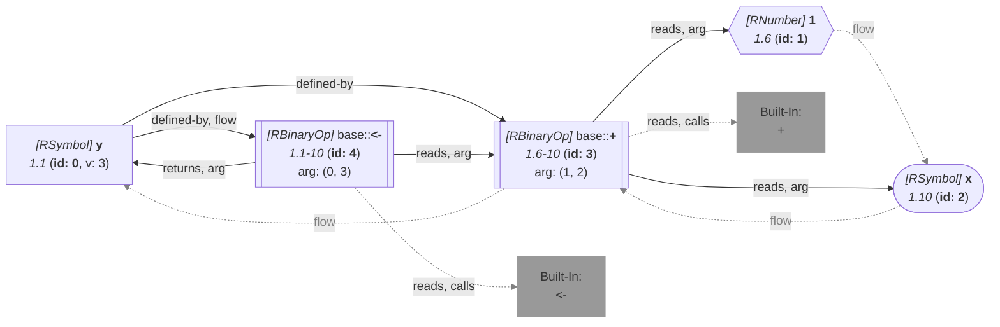
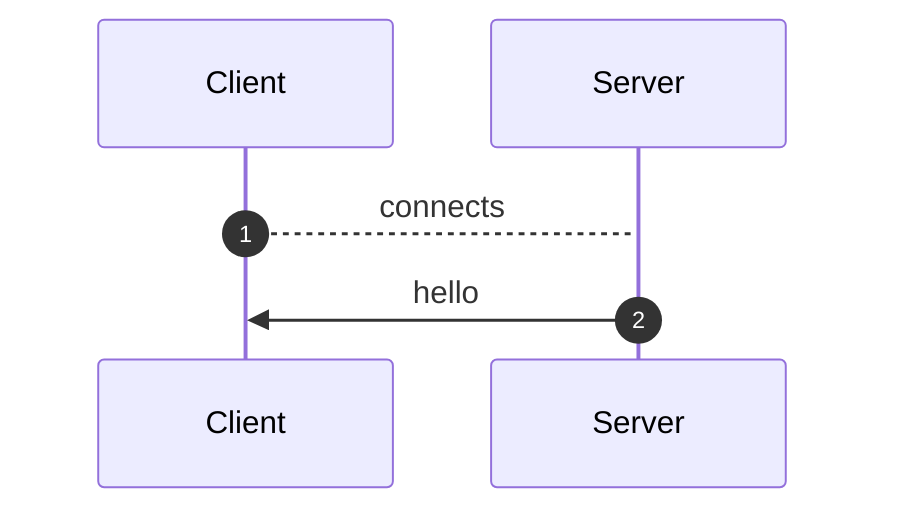
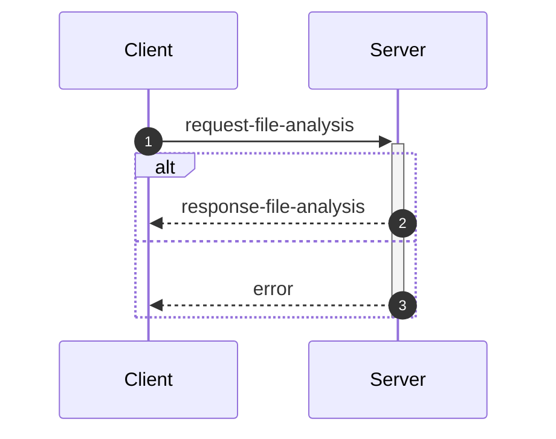
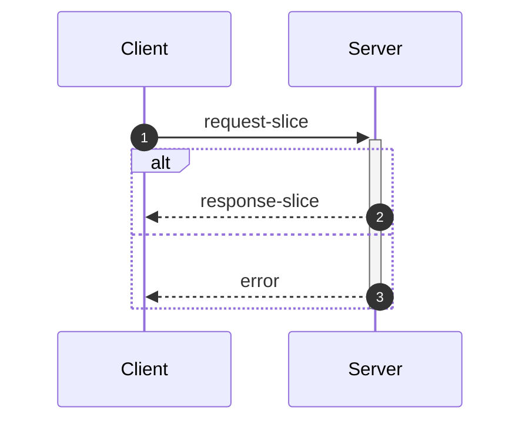
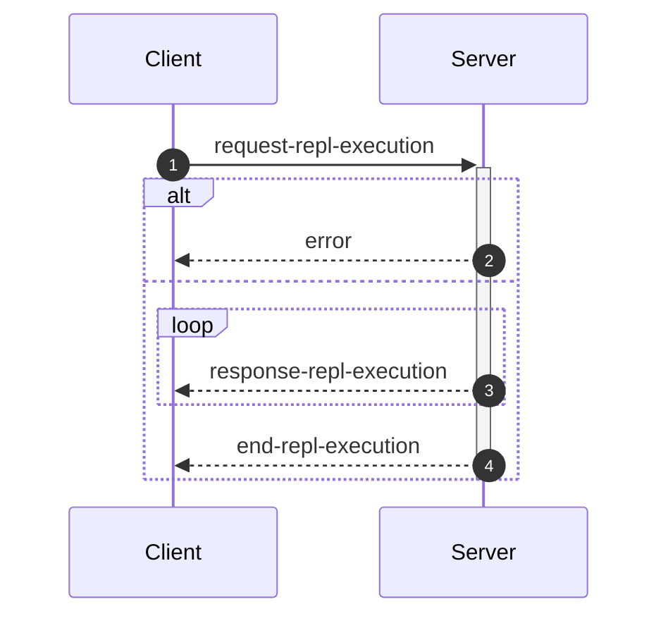

_<span title="an overview of flowR's interface">Generated</span> from '[wiki-interface.ts](https://github.com/flowr-analysis/flowr/tree/main/src/documentation/wiki-interface.ts "src/documentation/wiki-interface.ts")' on 2026-10-19, 18:04:52 UTC (v2.16.3, R v4.6.1), do not edit directly._

Although far from being as detailed as the in-depth explanation of [_flowR_](https://github.com/flowr-analysis/flowr/wiki/Core),
this wiki page explains how to interface with _flowR_ in more detail.
In general, command line arguments and other options provide short descriptions on hover over.

* [💻 Using the REPL](#using-the-repl)
* [⚙️ Configuring FlowR](#configuring-flowr)
* [⚒️ Writing Code](#writing-code)
* [💬 Communicating with the Server](#communicating-with-the-server)

<a id='using-the-repl'></a>
## 💻 Using the REPL

> [!NOTE]
> To execute arbitrary R commands with a repl request, _flowR_ has to be started explicitly with <span title="Description (Command Line Argument): Allow to access the underlying R session when using flowR (security warning: this allows the execution of arbitrary R code!)">`--r-session-access`</span>.
> Please be aware that this introduces a security risk and note that this relies on the [`r-shell` engine](https://github.com/flowr-analysis/flowr/wiki/Engines) .

Although primarily meant for users to explore,
there is nothing which forbids calling _flowR_ as a subprocess to use standard-in, -output, and -error
for communication (although you can access the REPL using the server as well,
with the [REPL Request](#message-request-repl-execution) message).

The read-eval-print loop&nbsp;(REPL) works relatively simple.
You can submit an expression (using <kbd>Enter</kbd>),
which is interpreted as an R&nbsp;expression by default but interpreted as a *command* if it starts with a colon (`:`).
The best command to get started with the REPL is <span title="Description (Repl Command): Show help information (aliases: :h, :?)">`:help`</span>.
Besides, you can leave the REPL either with the command <span title="Description (Repl Command): End the repl (aliases: :q, :exit)">`:quit`</span> or by pressing <kbd>Ctrl</kbd>+<kbd>C</kbd> twice.
When writing a *command*, you may press <kbd>Tab</kbd> to get a list of completions, if available.
Multiple commands can be entered in a single line by separating them with a semicolon (`;`), e.g. `:parse "x<-2"; :df*`.
If a command is given without R code, the REPL will re-use R code given in a previous command.
The prior example will hence return first the parsed AST of the program and then the dataflow graph for `"x <- 2"`.

> [!NOTE]
> If you develop flowR, you may want to launch the repl using the `npm run main-dev` command, this way, you get a non-minified version of flowR with debug information and hot-reloading of source files.

<details>
<summary>Available Commands</summary>

We currently offer the following commands (this with a `[*]` suffix are available with and without the star):

| Command | Description |
| ------- | ----------- |
| **<span title="Description (Repl Command): End the repl (aliases: :q, :exit)">:quit</span>** | End the repl (aliases: **:<span title="Alias of ':quit'. End the repl">q</span>**, **:<span title="Alias of ':quit'. End the repl">exit</span>**) |
| **<span title="Description (Repl Command): Execute the given code as R code. This requires the `--r-session-access` flag to be set and requires the r-shell engine. (aliases: :e, :r)">:execute</span>** | Execute the given code as R code. This requires the `--r-session-access` flag to be set and requires the r-shell engine. (aliases: **:<span title="Alias of ':execute'. Execute the given code as R code. This requires the `--r-session-access` flag to be set and requires the r-shell engine.">e</span>**, **:<span title="Alias of ':execute'. Execute the given code as R code. This requires the `--r-session-access` flag to be set and requires the r-shell engine.">r</span>**) |
| **<span title="Description (Repl Command): Get mermaid code for the control-flow graph of R code (aliases: :cfg, :cf)">:controlflow[*]</span>** | Get mermaid code for the control-flow graph of R code (star: Returns the URL to mermaid.live) (aliases: **:<span title="Alias of ':controlflow'. Get mermaid code for the control-flow graph of R code">cfg</span>**, **:<span title="Alias of ':controlflow'. Get mermaid code for the control-flow graph of R code">cf</span>**) |
| **<span title="Description (Repl Command): Get mermaid code for the control-flow graph with basic blocks (aliases: :cfgb, :cfb)">:controlflowbb[*]</span>** | Get mermaid code for the control-flow graph with basic blocks (star: Returns the URL to mermaid.live) (aliases: **:<span title="Alias of ':controlflowbb'. Get mermaid code for the control-flow graph with basic blocks">cfgb</span>**, **:<span title="Alias of ':controlflowbb'. Get mermaid code for the control-flow graph with basic blocks">cfb</span>**) |
| **<span title="Description (Repl Command): Get mermaid code for the dataflow graph (aliases: :d, :df)">:dataflow[*]</span>** | Get mermaid code for the dataflow graph (star: Returns the URL to mermaid.live) (aliases: **:<span title="Alias of ':dataflow'. Get mermaid code for the dataflow graph">d</span>**, **:<span title="Alias of ':dataflow'. Get mermaid code for the dataflow graph">df</span>**) |
| **<span title="Description (Repl Command): Get mermaid code for the normalized AST of R code (aliases: :n)">:normalize[*]</span>** | Get mermaid code for the normalized AST of R code (star: Returns the URL to mermaid.live) (alias: **:<span title="Alias of ':normalize'. Get mermaid code for the normalized AST of R code">n</span>**) |
| **<span title="Description (Repl Command): Get mermaid code for the simplified dataflow graph (aliases: :ds, :dfs)">:dataflowsimple[*]</span>** | Get mermaid code for the simplified dataflow graph (star: Returns the URL to mermaid.live) (aliases: **:<span title="Alias of ':dataflowsimple'. Get mermaid code for the simplified dataflow graph">ds</span>**, **:<span title="Alias of ':dataflowsimple'. Get mermaid code for the simplified dataflow graph">dfs</span>**) |
| **<span title="Description (Repl Command): Inspect and extend the signature database: `query` (identical to :query @signature), `info <name>` for where a function comes from (identical to :query @function-info), `add <path>` to mount another database/source, `download` to fetch the full-history database. (aliases: :sig)">:signature</span>** | Inspect and extend the signature database: `query` (identical to :query @signature), `info <name>` for where a function comes from (identical to :query @function-info), `add <path>` to mount another database/source, `download` to fetch the full-history database. (alias: **:<span title="Alias of ':signature'. Inspect and extend the signature database: `query` (identical to :query @signature), `info <name>` for where a function comes from (identical to :query @function-info), `add <path>` to mount another database/source, `download` to fetch the full-history database.">sig</span>**) |
| **<span title="Description (Repl Command): Just calculates the DFG, but only prints summary info (aliases: :d#, :df#)">:dataflowsilent</span>** | Just calculates the DFG, but only prints summary info (aliases: **:<span title="Alias of ':dataflowsilent'. Just calculates the DFG, but only prints summary info">d#</span>**, **:<span title="Alias of ':dataflowsilent'. Just calculates the DFG, but only prints summary info">df#</span>**) |
| **<span title="Description (Repl Command): Prints ASCII Art of the parsed, unmodified AST (aliases: :p)">:parse</span>** | Prints ASCII Art of the parsed, unmodified AST (alias: **:<span title="Alias of ':parse'. Prints ASCII Art of the parsed, unmodified AST">p</span>**) |
| **<span title="Description (Repl Command): Prints the version of flowR as well as the current version of R">:version</span>** | Prints the version of flowR as well as the current version of R
| **<span title="Description (Repl Command): Query the given R code (use 'help' for more information)">:query[*]</span>** | Query the given R code (use 'help' for more information) (star: Similar to query, but returns the output in json format.)
| **<span title="Description (Repl Command): Returns an ASCII representation of the dataflow graph (aliases: :df!)">:dataflowascii</span>** | Returns an ASCII representation of the dataflow graph (alias: **:<span title="Alias of ':dataflowascii'. Returns an ASCII representation of the dataflow graph">df!</span>**) |
| **<span title="Description (Repl Command): Returns summarization stats for the normalized AST (aliases: :n#)">:normalize#</span>** | Returns summarization stats for the normalized AST (alias: **:<span title="Alias of ':normalize#'. Returns summarization stats for the normalized AST">n#</span>**) |
| **<span title="Description (Repl Command): Show help information (aliases: :h, :?)">:help</span>** | Show help information (aliases: **:<span title="Alias of ':help'. Show help information">h</span>**, **:<span title="Alias of ':help'. Show help information">?</span>**) |

</details>

> [!TIP]
> 
> As indicated by the examples before, all REPL commands that operate on code keep track of the state.
> Hence, if you run a command like <span title="Description (Repl Command, starred version): Returns the URL to mermaid.live; Base Command: Get mermaid code for the dataflow graph (aliases: :d*, :df*)">`:dataflow*`</span> without providing R code,
> the REPL will re-use the R code provided in a previous command.
> Likewise, doing this will benefit from incrementality!
> If you request the dataflow graph with `:df* x <- 2 * y` and then want to see the parsed AST with `:parse`,
> the REPL will re-use previously obtained information and not re-parse the code again.
> 		

Generally, many commands offer shortcut versions in the REPL. Many queries, for example, offer a shortened format (see the example below).
Of special note, the [Config Query](https://github.com/flowr-analysis/flowr/wiki/%5BQuery%5D-Config)
can be used to also modify the currently active configuration of _flowR_ within the REPL (see the [wiki page](https://github.com/flowr-analysis/flowr/wiki/%5BQuery%5D-Config) for more information).

### Example: Retrieving the Dataflow Graph

To retrieve a URL to the [mermaid](https://mermaid.js.org/) diagram of the dataflow of a given expression,
use <span title="Description (Repl Command, starred version): Returns the URL to mermaid.live; Base Command: Get mermaid code for the dataflow graph (aliases: :d*, :df*)">`:dataflow*`</span> (or <span title="Description (Repl Command): Get mermaid code for the dataflow graph (aliases: :d, :df)">`:dataflow`</span> to get the mermaid code in the cli):

```shell
$ docker run -it --rm eagleoutice/flowr # or npm run flowr 
flowR repl v2.16.3, R grammar v14 (tree-sitter engine)
R> :dataflow* y <- 1 + x
```

<details>
<summary style='color:gray'>Output</summary>

```text
https://mermaid.live/view#base64:eyJjb2RlIjoiZmxvd2NoYXJ0IFREXG4gICAgMXt7XCJgKiM5MTtSTnVtYmVyIzkzOyogKioxKipcbiAgICAgICoxLjYqICgqKmlkOiAxKiopYFwifX1cbiAgICAyKFtcImAqIzkxO1JTeW1ib2wjOTM7KiAqKngqKlxuICAgICAgKjEuMTAqICgqKmlkOiAyKiopYFwiXSlcbiAgICAzW1tcImAqIzkxO1JCaW5hcnlPcCM5MzsqIGJhc2UjNTg7IzU4OyoqIzQzOyoqXG4gICAgICAqMS42LTEwKiAoKippZDogMyoqKVxuICAgIGFyZzogKDEsIDIpYFwiXV1cbiAgICBidWlsdC1pbjpfNDNfW1wiYEJ1aWx0LUluOlxuIzQzO2BcIl1cbiAgICBzdHlsZSBidWlsdC1pbjpfNDNfIHN0cm9rZTpncmF5LGZpbGw6Z3JheSxzdHJva2Utd2lkdGg6MnB4LG9wYWNpdHk6Ljg7XG4gICAgMFtcImAqIzkxO1JTeW1ib2wjOTM7KiAqKnkqKlxuICAgICAgKjEuMSogKCoqaWQ6IDAqKiwgdjogMylgXCJdXG4gICAgNFtbXCJgKiM5MTtSQmluYXJ5T3AjOTM7KiBiYXNlIzU4OyM1ODsqKiM2MDsjNDU7KipcbiAgICAgICoxLjEtMTAqICgqKmlkOiA0KiopXG4gICAgYXJnOiAoMCwgMylgXCJdXVxuICAgIGJ1aWx0LWluOl82MF8tW1wiYEJ1aWx0LUluOlxuIzYwOyM0NTtgXCJdXG4gICAgc3R5bGUgYnVpbHQtaW46XzYwXy0gc3Ryb2tlOmdyYXksZmlsbDpncmF5LHN0cm9rZS13aWR0aDoycHgsb3BhY2l0eTouODtcbiAgICAxIC0uLT58XCJmbG93XCJ8IDJcbiAgICBsaW5rU3R5bGUgMCBzdHJva2U6Z3JheSxjb2xvcjpncmF5O1xuICAgIDIgLS4tPnxcImZsb3dcInwgM1xuICAgIGxpbmtTdHlsZSAxIHN0cm9rZTpncmF5LGNvbG9yOmdyYXk7XG4gICAgMyAtLT58XCJyZWFkcywgYXJnXCJ8IDFcbiAgICAzIC0tPnxcInJlYWRzLCBhcmdcInwgMlxuICAgIDMgLS4tPnxcImZsb3dcInwgMFxuICAgIGxpbmtTdHlsZSA0IHN0cm9rZTpncmF5LGNvbG9yOmdyYXk7XG4gICAgMyAtLi0+fFwicmVhZHMsIGNhbGxzXCJ8IGJ1aWx0LWluOl80M19cbiAgICBsaW5rU3R5bGUgNSBzdHJva2U6Z3JheTtcbiAgICAwIC0tPnxcImRlZmluZWQtYnksIGZsb3dcInwgNFxuICAgIDAgLS0+fFwiZGVmaW5lZC1ieVwifCAzXG4gICAgNCAtLT58XCJyZWFkcywgYXJnXCJ8IDNcbiAgICA0IC0tPnxcInJldHVybnMsIGFyZ1wifCAwXG4gICAgNCAtLi0+fFwicmVhZHMsIGNhbGxzXCJ8IGJ1aWx0LWluOl82MF8tXG4gICAgbGlua1N0eWxlIDEwIHN0cm9rZTpncmF5OyIsIm1lcm1haWQiOnsiYXV0b1N5bmMiOnRydWV9fQ==
```

Retrieve the dataflow graph of the expression `y <- 1 + x`. It looks like this:



<details>

<summary style="color:gray">R Code of the Dataflow Graph</summary>

The analysis ran (including parse and normalize, using the [tree-sitter](https://github.com/flowr-analysis/flowr/wiki/Engines) engine) within the generation environment. No [signature database](https://github.com/flowr-analysis/flowr/wiki/Signature-Database) is mounted for these generated graphs, so `library()` calls attach no package exports; base-R names are still qualified via the generated base-package store (e.g. `acf` as `stats::acf`). 
We encountered no unknown side effects during the analysis.

```r
y <- 1 + x
```

</details>

</details>

For small graphs like this, <span title="Description (Repl Command): Returns an ASCII representation of the dataflow graph (aliases: :df!)">`:dataflowascii`</span> also provides an ASCII representation directly in the REPL:

```shell
$ docker run -it --rm eagleoutice/flowr # or npm run flowr 
flowR repl v2.16.3, R grammar v14 (tree-sitter engine)
R> :df! y <- 1 + x
```

<details open>
<summary style='color:gray'>Output</summary>

```text
                        v<0>v
 c<4>c──────────────────| y |
 |<- |     ┌────────────v---v
 c---c     │
    │   c<3>c   0<1>0
    └───| + |───| 1 |───u<2>u
        c---c   0---0   | x |
           └────────────u---u
Edges:
3 -> 1: reads, arg          3 -> 2: reads, arg
3 -> 0: flows-to            1 -> 2: flows-to
2 -> 3: flows-to            4 -> 3: reads, arg
4 -> 0: returns, arg        0 -> 4: defined-by, flows-to
0 -> 3: defined-by
```

Retrieve the dataflow graph of the expression `y <- 1 + x` as ASCII art.

</details>

For the slicing with <span title="Description (Repl Command): Static backwards executable slicer for R">`:slicer`</span>, you have access to the same [magic comments](#slice-magic-comments) as with the [slice request](#message-request-slice).
Pass `--inline` to splice resolvable `source()` calls into the reconstruction so the slice is a single self-contained R text (the same as the static slice query's `inlineSources` flag).
See `--help` for more flags!

### Example: Interfacing with the File System

Many commands that allow for an R-expression (like <span title="Description (Repl Command, starred version): Returns the URL to mermaid.live; Base Command: Get mermaid code for the dataflow graph (aliases: :d*, :df*)">`:dataflow*`</span>) allow for a file as well
if the argument starts with `file://`.
If you are working from the root directory of the _flowR_ repository, the following gives you the parsed AST of the example file using the <span title="Description (Repl Command): Prints ASCII Art of the parsed, unmodified AST (aliases: :p)">`:parse`</span> command:

> **Watch mode**: Replace `file://` with `watch://` to enter watch mode.
> flowR runs the command immediately and then re-runs it every time the file (or any file inside the folder) changes.
> Enter any other command to leave watch mode.
> For example: `:df watch://analysis.R`

```shell
$ docker run -it --rm eagleoutice/flowr # or npm run flowr 
flowR repl v2.16.3, R grammar v14 (tree-sitter engine)
R> :parse file://test/testfiles/example.R
```

<details>
<summary style='color:gray'>Output</summary>

```text
File: test/testfiles/example.R

program
├ binaryoperator
│ ├ identifier "sum" (1:1─4)
│ ├ <- "<-" (1:5─7)
│ ╰ float "0" (1:8─9)
├ binaryoperator
│ ├ identifier "product" (2:1─8)
│ ├ <- "<-" (2:9─11)
│ ╰ float "1" (2:12─13)
├ binaryoperator
│ ├ identifier "w" (3:1─2)
│ ├ <- "<-" (3:3─5)
│ ╰ float "7" (3:6─7)
├ binaryoperator
│ ├ identifier "N" (4:1─2)
│ ├ <- "<-" (4:3─5)
│ ╰ float "10" (4:6─8)
├ forstatement
│ ├ for "for" (6:1─4)
│ ├ ( "(" (6:5─6)
│ ├ identifier "i" (6:6─7)
│ ├ in "in" (6:8─10)
│ ├ binaryoperator
│ │ ├ float "1" (6:11─12)
│ │ ├ : ":" (6:12─13)
│ │ ╰ parenthesizedexpression
│ │   ├ ( "(" (6:13─14)
│ │   ├ binaryoperator
│ │   │ ├ identifier "N" (6:14─15)
│ │   │ ├ - "-" (6:15─16)
│ │   │ ╰ float "1" (6:16─17)
│ │   ╰ ) ")" (6:17─18)
│ ├ ) ")" (6:18─19)
│ ╰ bracedexpression
│   ├ { "{" (6:20─21)
│   ├ binaryoperator
│   │ ├ identifier "sum" (7:3─6)
│   │ ├ <- "<-" (7:7─9)
│   │ ╰ binaryoperator
│   │   ├ binaryoperator
│   │   │ ├ identifier "sum" (7:10─13)
│   │   │ ├ + "+" (7:14─15)
│   │   │ ╰ identifier "i" (7:16─17)
│   │   ├ + "+" (7:18─19)
│   │   ╰ identifier "w" (7:20─21)
│   ├ binaryoperator
│   │ ├ identifier "product" (8:3─10)
│   │ ├ <- "<-" (8:11─13)
│   │ ╰ binaryoperator
│   │   ├ identifier "product" (8:14─21)
│   │   ├  "" (8:22─23)
│   │   ╰ identifier "i" (8:24─25)
│   ╰ } "}" (9:1─2)
├ call
│ ├ identifier "cat" (11:1─4)
│ ╰ arguments
│   ├ ( "(" (11:4─5)
│   ├ argument
│   │ ╰ string
│   │   ├ " "\"" (11:5─6)
│   │   ├ stringcontent "Sum:" (11:6─10)
│   │   ╰ " "\"" (11:10─11)
│   ├ comma "," (11:11─12)
│   ├ argument
│   │ ╰ identifier "sum" (11:13─16)
│   ├ comma "," (11:16─17)
│   ├ argument
│   │ ╰ string
│   │   ├ " "\"" (11:18─19)
│   │   ├ stringcontent
│   │   │ ╰ escapesequence "\\n" (11:19─21)
│   │   ╰ " "\"" (11:21─22)
│   ╰ ) ")" (11:22─23)
╰ call
  ├ identifier "cat" (12:1─4)
  ╰ arguments
    ├ ( "(" (12:4─5)
    ├ argument
    │ ╰ string
    │   ├ " "\"" (12:5─6)
    │   ├ stringcontent "Product:" (12:6─14)
    │   ╰ " "\"" (12:14─15)
    ├ comma "," (12:15─16)
    ├ argument
    │ ╰ identifier "product" (12:17─24)
    ├ comma "," (12:24─25)
    ├ argument
    │ ╰ string
    │   ├ " "\"" (12:26─27)
    │   ├ stringcontent
    │   │ ╰ escapesequence "\\n" (12:27─29)
    │   ╰ " "\"" (12:29─30)
    ╰ ) ")" (12:30─31)
```

Retrieve the parsed AST of the example file.

<details>

<summary>File Content</summary>

```r
sum <- 0
product <- 1
w <- 7
N <- 10

for (i in 1:(N-1)) {
  sum <- sum + i + w
  product <- product * i
}

cat("Sum:", sum, "\n")
cat("Product:", product, "\n")
```

</details>

As _flowR_ directly transforms this AST the output focuses on being human-readable instead of being machine-readable.
		
</details>

### Example: Run a Query

You can run any query supported by _flowR_ using the <span title="Description (Repl Command): Query the given R code (use 'help' for more information)">`:query`</span> command.
For example, to obtain the shapes of all data frames in a given piece of code, you can run:

```shell
$ docker run -it --rm eagleoutice/flowr # or npm run flowr 
flowR repl v2.16.3, R grammar v14 (tree-sitter engine)
R> :query @absint df-shape "x <- data.frame(a = 1:10, b = 1:10)\ny <- x$a"
```

<details open>
<summary style='color:gray'>Output</summary>

```text
Query: absint (0 ms)
```

Retrieve the shapes of all data frames in the given code.

</details>

To run the linter on a file, you can use (in this example, we just issue the `dead-code` linter on a small piece of code):

```shell
$ docker run -it --rm eagleoutice/flowr # or npm run flowr 
flowR repl v2.16.3, R grammar v14 (tree-sitter engine)
R> :query @linter rules:dead-code "if(FALSE) x <- 2"
```

<details open>
<summary style='color:gray'>Output</summary>

```text
Query: linter (1 ms)
   ╰ Dead Code (dead-code):
       ╰ certain:
           ╰ Code at 1.11-16
```

Run the linter on the given code, with only the `dead-code` rule enabled.

</details>

For more information on the available queries, please check out the [Query API](https://github.com/flowr-analysis/flowr/wiki/Query-API).

<a id='configuring-flowr'></a>
## ⚙️ Configuring FlowR

When running _flowR_, you may want to specify some behaviors with a dedicated configuration file.
By default, flowR looks for a file named `flowr.json` in the current working directory (or any higher directory).
You can also specify a different file with <span title="Description (Command Line Argument): The name of the configuration file to use">`--config-file`</span> or pass the configuration inline using <span title="Description (Command Line Argument): The flowR configuration to use, as a JSON string">`--config-json`</span>.
A `flowr.json` found this way belongs to the analyzed project, so flowR ignores its options that decide what flowR executes or loads
(`engines.*.wasmPath`, `engines.*.treeSitterWasmPath`, `engines.*.rPath`, `solver.sigdb.additionalPaths`, `solver.sigdb.downloadRepo`, `solver.sigdb.installedLibrary.paths`),
unless you pass <span title="Description (Command Line Argument): Keep the security-sensitive options (e.g., the R executable) of the flowr.json found in the working directory or a parent. Only use this for projects you trust.">`--trust-config`</span>.
To analyze code you do not trust, use the secure mode (<span title="Description (Command Line Argument): Run in secure mode for analyzing untrusted code: flowR does not start R (or any other process), does not access the network, does not search for project configs, and ignores security-sensitive options in every config. Cannot be disabled once enabled. Can also be enabled with the environment variable {italic FLOWR_SECURE_MODE=1}.">`--secure`</span>, see the [security policy](https://github.com/flowr-analysis/flowr/blob/main/.github/SECURITY.md)).
To inspect the current configuration, you can run flowr with the <span title="Description (Command Line Argument): Run with verbose logging (will be passed to the corresponding script)">`--verbose`</span> flag, or use the `config` [Query](https://github.com/flowr-analysis/flowr/wiki/Query-API).
Within the REPL this works by running the following:

```shell
:query @config
```

To work with the <a href="https://github.com/flowr-analysis/flowr/tree/main/src/config.ts#L119"><code><span title="The configuration file format for flowR.">FlowrConfig</span></code></a> you can use the provided helper objects alongside its methods like
<a href="https://github.com/flowr-analysis/flowr/tree/main/src/config.ts#L914"><code><span title="Creates a new flowr config that has the updated values.">FlowrConfig::<b>amend</b></span></code></a>.
The schema below documents every option; the ones you most likely want are:

- <a href="https://github.com/flowr-analysis/flowr/wiki/Interface#configuring-flowr" title="Configuration Option (boolean): Whether source calls should be ignored, causing {@link processSourceCall}&#39;s behavior to be skipped.">ignoreSourceCalls</a>: ignore source calls when analyzing the code, i.e., ignore the inclusion of other files.
- <a href="https://github.com/flowr-analysis/flowr/wiki/Interface#configuring-flowr" title="Configuration Option (boolean): Whether load calls should be ignored, causing {@link processLoadCall}&#39;s behavior to be skipped.">ignoreLoadCalls</a>: ignore load calls when analyzing the code, i.e., ignore the loading of r-data files.
- <a href="https://github.com/flowr-analysis/flowr/wiki/Interface#configuring-flowr" title="Configuration Option (object): Do you want to overwrite (parts) of the builtin definition?">semantics.environment.overwriteBuiltIns</a>: overwrite _flowR_'s handling of built-in functions, or clear the preset definitions entirely.
  See [Configure BuiltIn Semantics](#configure-builtin-semantics) for more information.
- <a href="https://github.com/flowr-analysis/flowr/wiki/Interface#configuring-flowr" title="Configuration Option (string): How to resolve variables and their values. (one of &quot;disabled&quot;, &quot;alias&quot;, &quot;builtin&quot;)">solver.variables</a>: how to resolve variables and their values (`disabled`, `alias`, `builtin`).
- <a href="https://github.com/flowr-analysis/flowr/wiki/Interface#configuring-flowr" title="Configuration Option (array): The engine or set of engines to use for interacting with R code. An empty array means all available engines will be used.">engines</a> and <a href="https://github.com/flowr-analysis/flowr/wiki/Interface#configuring-flowr" title="Configuration Option (string): The default engine to use for interacting with R code. If this is undefined, an arbitrary engine from the specified list will be used. (one of &quot;tree-sitter&quot;, &quot;r-shell&quot;)">defaultEngine</a>: the engines used to interact with R code, see the [Engines wiki page](https://github.com/flowr-analysis/flowr/wiki/Engines).
- <a href="https://github.com/flowr-analysis/flowr/wiki/Interface#configuring-flowr" title="Configuration Option (array): Files a framework loads on its own, without any source() call (e.g. global.R in a shiny app), in the order they are loaded; flowR orders the matching project files accordingly and analyzes them as one program. Entries are case-insensitive globs matched against the file path, a plain name matches any file with that name, and entries matching no project file are warned about. Usually set per project kind via specializeConfig.">project.implicitSources</a>: the files a framework loads without any `source()` call, in the order in which they are
  loaded. Entries are globs (e.g. `R/*.R`) matched against the file path ignoring capitalization; one matching no file is reported.
- <a href="https://github.com/flowr-analysis/flowr/wiki/Interface#configuring-flowr" title="Configuration Option (object): Overwrite (parts of) the configuration depending on the project kind flowR detects, e.g. to give a shiny app its implicit sources.">specializeConfig</a>: overwrite (parts of) the configuration depending on the kind of project _flowR_ detects
  (e.g. `shiny-app`), which is how a shiny app gets its implicit sources by default. What you configure directly wins.
- <a href="https://github.com/flowr-analysis/flowr/wiki/Interface#configuring-flowr" title="Configuration Option (string): Overwrite the project kind flowR would otherwise infer from the analyzed files, e.g. when auto-detection guesses wrong. (one of &quot;package&quot;, &quot;script&quot;, &quot;shiny-app&quot;, &quot;notebook&quot;, &quot;project&quot;, &quot;unknown&quot;)">project.useProjectType</a>: skip that detection and force a project kind yourself, when auto-detection guesses wrong.
- <a href="https://github.com/flowr-analysis/flowr/wiki/Interface#configuring-flowr" title="Configuration Option (array): The default plugins to load when creating a new instance of FlowrAnalyzer">defaultPlugins</a> and <a href="https://github.com/flowr-analysis/flowr/wiki/Interface#configuring-flowr" title="Configuration Option (array): The plugins to load in REPL mode">repl.plugins</a>: the plugins to load for a new <a href="https://github.com/flowr-analysis/flowr/tree/main/src/project/flowr-analyzer.ts#L205"><code><span title="Central class for conducting analyses with FlowR. Use the FlowrAnalyzerBuilder to create a new instance. If you want the original pattern of creating a pipeline and running all steps, you can still do this with FlowrAnalyzer#runFull . To inspect the context of the analyzer, use FlowrAnalyzer#inspectContext (if you are a plugin and need to modify it, use FlowrAnalyzer#context instead).">FlowrAnalyzer</span></code></a> and in the REPL
  (use `flowr:default` to reference the former).

So you can configure _flowR_ by adding a file like the following:

<details>

<summary>Example Configuration File</summary>

```json
{
  "ignoreSourceCalls": true,
  "ignoreLoadCalls": true,
  "semantics": {
    "environment": {
      "overwriteBuiltIns": {
        "definitions": [
          {
            "type": "function",
            "names": [
              "foo"
            ],
            "processor": "builtin:assign",
            "config": {}
          }
        ]
      }
    }
  },
  "defaultPlugins": [
    "file:description",
    "versions:description"
  ],
  "repl": {
    "quickStats": false,
    "dfProcessorHeat": false,
    "hints": true,
    "plugins": [
      "flowr:default"
    ]
  },
  "project": {
    "resolveUnknownPathsOnDisk": true,
    "implicitSources": [
      "global.R",
      "app.R"
    ]
  },
  "linter": {
    "disabledRules": []
  },
  "specializeConfig": {
    "shiny-app": {
      "project": {
        "implicitSources": [
          "global.R",
          "ui.R",
          "server.R",
          "app.R"
        ]
      }
    }
  },
  "engines": [
    {
      "type": "r-shell"
    }
  ],
  "solver": {
    "variables": "alias",
    "evalStrings": true,
    "trackEnvironments": true,
    "sigdb": {
      "enabled": true,
      "loadProjectDependencies": true,
      "eagerlyLoad": false,
      "eagerlyLoadExports": false,
      "linkBaseR": false,
      "linkDescriptionDependencies": false
    },
    "resolveSource": {
      "dropPaths": "no",
      "ignoreCapitalization": true,
      "inferWorkingDirectory": "active-script",
      "searchPath": []
    },
    "instrument": {},
    "slicer": {
      "threshold": 50
    }
  },
  "abstractInterpretation": {
    "wideningThreshold": 4,
    "followCalls": true,
    "dataFrame": {
      "maxColNames": 20,
      "readLoadedData": {
        "readExternalFiles": true,
        "maxReadLines": 1000000
      }
    }
  },
  "incremental": {
    "alwaysIncremental": false,
    "parsing": {
      "activated": false,
      "heuristics": {
        "activated": true,
        "mtime": true,
        "linesFrom": 500,
        "bytesFrom": 50000,
        "alwaysWithEdits": false,
        "minFiles": 1
      }
    }
  },
  "gas": {
    "thresholds": {
      "memory": {
        "problematic": 0.7,
        "critical": 0.9
      },
      "timeMs": {
        "problematic": 100000,
        "critical": 120000
      }
    },
    "features": {}
  }
}
```

</details>

<details>
<a id='configure-builtin-semantics'></a>
<summary>Configure Built-In Semantics</summary>

`semantics/environment/overwriteBuiltins` accepts two keys:

- `loadDefaults` (boolean, initially `true`): If set to `true`, the default built-in definitions are loaded before applying the custom definitions. Setting this flag to `false` explicitly disables the loading of the default definitions.
- `definitions` (array, initially empty): Allows to overwrite or define new built-in elements. Each object within must have a `type` which is one of the below. Furthermore, they may define a string array of `names` which specifies the identifiers to bind the definitions to. You may use `assumePrimitive` to specify whether _flowR_ should assume that this is a primitive non-library definition (so you probably just do not want to specify the key).

  | Type            | Description                                                                                                                                                                                                                                                                                              | Example                                                                                                    |
  | --------------- | -------------------------------------------------------------------------------------------------------------------------------------------------------------------------------------------------------------------------------------------------------------------------------------------------------- | ---------------------------------------------------------------------------------------------------------- |
  | `constant`    | Additionally allows for a `value` this should resolve to.                                                                                                                                                                                                                                                | `{ type: 'constant', names: ['NULL', 'NA'],  value: null }`                                                |
  | `function`    | Is a rather flexible way to define and bind built-in functions. For the time, we do not have extensive documentation to cover all the cases, so please either consult the sources with the `default-builtin-config.ts` or open a [new issue](https://github.com/flowr-analysis/flowr/issues/new/choose). | `{ type: 'function', names: ['next'], processor: 'builtin:d', config: { cfg: ExitPointType.Next } }` |
  | `replacement` | A comfortable way to specify replacement functions like `$<-` or `names<-`. `suffixes` describes the... suffixes to attach automatically. | `{ type: 'replacement', suffixes: ['<-', '<<-'], names: ['[', '[['] }` |

</details>

<details>

<summary style='color:gray'>Full Configuration-File Schema</summary>

- _The configuration file format for flowR._ (object)
    - **logLevel** [optional] _flowR's global minimum log level, applied when the config is loaded._ (string)
        Only allows: 'silly', 'trace', 'debug', 'info', 'warn', 'error', 'fatal'
    - **ignoreSourceCalls** [optional] _Whether source calls should be ignored, causing {@link processSourceCall}'s behavior to be skipped._ (boolean)
    - **ignoreLoadCalls** [optional] _Whether load calls should be ignored, causing {@link processLoadCall}'s behavior to be skipped._ (boolean)
    - **semantics** _Configure language semantics and how flowR handles them._ (object)
        - **environment** [optional] _Semantics regarding how to handle the R environment._ (object)
            - **overwriteBuiltIns** [optional] _Do you want to overwrite (parts) of the builtin definition?_ (object)
                - **loadDefaults** [optional] _Should the default configuration still be loaded?_ (boolean)
                - **definitions** [optional] _The definitions to load/overwrite._ (array)
                Valid item types:
                    - (object)
    - **defaultPlugins** [optional] _The default plugins to load when creating a new instance of FlowrAnalyzer_ (array)
    Valid item types:
        - (alternatives)
            - (string)
            - (array)
    - **repl** _Configuration options for the REPL._ (object)
        - **quickStats** [optional] _Whether to show quick stats in the REPL after each evaluation._ (boolean)
        - **dfProcessorHeat** [optional] _This instruments the dataflow processors to count how often each processor is called._ (boolean)
        - **hints** [optional] _Whether to show dim inline hints on the empty prompt (automatically disabled on non-interactive terminals)._ (boolean)
        - **plugins** [optional] _The plugins to load in REPL mode_ (array)
        Valid item types:
            - (alternatives)
                - (string)
                - (array)
        - **autoUseFileProtocol** [optional] _Prepend the file protocol to a repl input that looks like a path, instead of only warning about it._ (boolean)
        - **queryStats** [optional] _Whether `:query` closes with the line stating how long the queries took (`:query*` never prints it)._ (boolean)
        - **showPlugins** [optional] _Whether `:version` grays out the plugins that did not activate during the last analysis._ (boolean)
    - **project** _Project specific configuration options._ (object)
        - **resolveUnknownPathsOnDisk** [optional] _Whether to resolve unknown paths loaded by the r project disk when trying to source/analyze files._ (boolean)
        - **failOnInaccessiblePath** [optional] _Whether a directory that cannot be traversed during file discovery (e.g. due to permissions) aborts the analysis; when false (the default) such paths are logged and skipped._ (boolean)
        - **basePackages** [optional] _The packages considered part of R itself (base and recommended); if unset, flowR uses its built-in list._ (array)
        Valid item types:
            - (string)
        - **implicitSources** [optional] _Files a framework loads on its own, without any source() call (e.g. global.R in a shiny app), in the order they are loaded; flowR orders the matching project files accordingly and analyzes them as one program. Entries are case-insensitive globs matched against the file path, a plain name matches any file with that name, and entries matching no project file are warned about. Usually set per project kind via specializeConfig._ (array)
        Valid item types:
            - (string)
        - **useProjectType** [optional] _Overwrite the project kind flowR would otherwise infer from the analyzed files, e.g. when auto-detection guesses wrong._ (string)
            Only allows: 'package', 'script', 'shiny-app', 'notebook', 'project', 'unknown'
        - **assumeImplicitEcho** [optional] _Whether the top level of the analyzed code is echoed, so that every visible result printed there is collected as an output by the dependencies query (default true, false for a package)._ (boolean)
        - **discovery** [optional] _Scoping options for the default project discovery._ (object)
            - **full** [optional] _Collect every file below the project root (greedy) instead of only the files the detected project kind needs (default false)._ (boolean)
            - **perKind** [optional] _Per-kind include/exclude glob overrides layered on the default scoping._ (object)
            - **ignore** [optional] _Case-insensitive globs that drop matching files from the intelligent discovery, regardless of kind (e.g. .Renviron to ignore environment files)._ (array)
            Valid item types:
                - (string)
        - **classification** [optional] _Overrides for the signals flowR uses to classify the project kind._ (object)
            - **shinyDescriptionTypes** [optional] _DESCRIPTION Type: values that mark a shiny app._ (array)
            Valid item types:
                - (string)
            - **shinyEntryFiles** [optional] _File names a shiny app is assembled from._ (array)
            Valid item types:
                - (string)
            - **shinyUsagePattern** [optional] _Regex source evidencing shiny usage in an entry file._ (string)
            - **notebookExtensions** [optional] _File extensions marking a notebook._ (array)
            Valid item types:
                - (string)
    - **linter** _Linter configuration options._ (object)
        - **disabledRules** _Linting rule names excluded from the default rule set (a rule requested explicitly via a linter query still runs). Usually set per project kind via specializeConfig._ (array)
        Valid item types:
            - (string)
        - **disabledTags** [optional] _Linting rule tags whose rules are excluded from the default rule set (a rule requested explicitly via a linter query still runs). By default the cmd-check rules are disabled for everything but a package; a configured list replaces that default._ (array)
        Valid item types:
            - (string)
    - **inputSources** [optional] _Further frameworks the input-sources analysis should know about; entries are added to flowR's defaults._ (object)
        - **pure** [optional] _Functions that only pass the constantness of their arguments on._ (array)
        Valid item types:
            - (string)
        - **param** [optional] _Functions whose result is a 'param' input._ (array)
        Valid item types:
            - (string)
        - **file** [optional] _Functions whose result is a 'file' input._ (array)
        Valid item types:
            - (string)
        - **tempfile** [optional] _Functions whose result is a 'tempfile' input._ (array)
        Valid item types:
            - (string)
        - **glob** [optional] _Functions whose result is a 'glob' input._ (array)
        Valid item types:
            - (string)
        - **net** [optional] _Functions whose result is a 'net' input._ (array)
        Valid item types:
            - (string)
        - **rand** [optional] _Functions whose result is a 'rand' input._ (array)
        Valid item types:
            - (string)
        - **system** [optional] _Functions whose result is a 'system' input._ (array)
        Valid item types:
            - (string)
        - **ffi** [optional] _Functions whose result is a 'ffi' input._ (array)
        Valid item types:
            - (string)
        - **lang** [optional] _Functions whose result is a 'lang' input._ (array)
        Valid item types:
            - (string)
        - **options** [optional] _Functions whose result is a 'options' input._ (array)
        Valid item types:
            - (string)
        - **cmdline** [optional] _Functions whose result is a 'cmdline' input._ (array)
        Valid item types:
            - (string)
        - **user** [optional] _Functions whose result is a 'user' input._ (array)
        Valid item types:
            - (string)
        - **const** [optional] _Functions whose result is a 'const' input._ (array)
        Valid item types:
            - (string)
        - **scope** [optional] _Functions whose result is a 'scope' input._ (array)
        Valid item types:
            - (string)
        - **dconst** [optional] _Functions whose result is a 'dconst' input._ (array)
        Valid item types:
            - (string)
        - **unknown** [optional] _Functions whose result is a 'unknown' input._ (array)
        Valid item types:
            - (string)
        - **linkedObjects** [optional] _Objects a framework provides without a definition in the code, e.g. shiny's input._ (array)
        Valid item types:
            - (object)
        - **linkedEntryPoints** [optional] _Calls that hand a function to a framework, which binds its objects to the parameters by position._ (array)
        Valid item types:
            - (object)
    - **specializeConfig** [optional] _Overwrite (parts of) the configuration depending on the project kind flowR detects, e.g. to give a shiny app its implicit sources._ (object)
    - **engines** _The engine or set of engines to use for interacting with R code. An empty array means all available engines will be used._ (array)
    Valid item types:
        - (alternatives)
            - _The configuration for the tree sitter engine._ (object)
                - **type** [required] _Use the tree sitter engine._ (string)
                    Only allows: 'tree-sitter'
                - **wasmPath** [optional] _The path to the tree-sitter-r WASM binary to use. If this is undefined, this uses the default path._ (string)
                - **treeSitterWasmPath** [optional] _The path to the tree-sitter WASM binary to use. If this is undefined, this uses the default path._ (string)
                - **lax** [optional] _Whether to use the lax parser for parsing R code (allowing for syntax errors). If this is undefined, the strict parser will be used._ (boolean)
            - _The configuration for the R shell engine._ (object)
                - **type** [required] _Use the R shell engine._ (string)
                    Only allows: 'r-shell'
                - **rPath** [optional] _The path to the R executable to use. If this is undefined, this uses the default path._ (string)
                - **pipeBind** [optional] _Whether to enable R's experimental pipe-bind operator "=>" by setting _R_USE_PIPEBIND_ for the R session (default false); R itself keeps this off by default, as it is experimental and has never shipped in a release version of R._ (boolean)
    - **defaultEngine** [optional] _The default engine to use for interacting with R code. If this is undefined, an arbitrary engine from the specified list will be used._ (string)
        Only allows: 'tree-sitter', 'r-shell'
    - **solver** _How to resolve constants, constraints, cells, ..._ (object)
        - **variables** _How to resolve variables and their values._ (string)
            Only allows: 'disabled', 'alias', 'builtin'
        - **evalStrings** _Should we include eval(parse(text="...")) calls in the dataflow graph?_ (boolean)
        - **trackEnvironments** [optional] _Track user-created environments (new.env, assign/get/local with envir=, dollar-assign, attach). When false, all envir-style calls fall through conservatively._ (boolean)
        - **sigdb** _Resolving library exports from a signature database._ (object)
            - **enabled** [optional] _Resolve library()/use() exports from a signature database (default true); when false no database is consulted._ (boolean)
            - **loadProjectDependencies** [optional] _Load the project's declared dependencies from its metadata files (DESCRIPTION Imports/Depends, rproject.toml, uvr.toml, renv.lock, rv.lock, uvr.lock) (default true); when false these files are not read for dependencies._ (boolean)
            - **eagerlyLoad** [optional] _Parse the database up front rather than on the first package load (default false, ignored if disabled)._ (boolean)
            - **eagerlyLoadExports** [optional] _Add a vertex for every export on load rather than on demand (default false); keeps the dataflow graph small._ (boolean)
            - **assumedRVersion** [optional] _R version assumed when resolving versioned (base-R) exports: a pin like "4.5" or "auto" to detect the installed R (default "auto")._ (string)
            - **linkBaseR** [optional] _Eagerly attach base-R namespaces so bare base calls resolve without library() (default false)._ (boolean)
            - **linkBaseRCalls** [optional] _Add a lightweight Reads edge from a bare base-R call to its signature-database function vertex (default false; base-R qualification is edge-free otherwise)._ (boolean)
            - **linkPackageCalls** [optional] _Add a lightweight Reads edge from a resolved package call to its signature-database function vertex (default false)._ (boolean)
            - **linkDescriptionDependencies** [optional] _Eagerly attach the namespaces of the project's declared DESCRIPTION dependencies (Imports/Depends) so their exports resolve without an explicit library() (default false)._ (boolean)
            - **warmInBackground** [optional] _Decompress the hot shards (base + most-downloaded) in a background task on startup so the first library() lookup is warm (default false; for long-running servers/REPLs)._ (boolean)
            - **additionalPaths** [optional] _Extra directories or bundle/manifest files searched for signature databases (alongside the shipped default and $FLOWR_SIGDB_DIR); a downloaded full-history bundle placed here is mounted automatically._ (array)
            Valid item types:
                - (string)
            - **downloadRepo** [optional] _GitHub owner/repo the full-history bundle is downloaded from via ":signature download" (default "flowr-analysis/flowr", release tag "sigdb-v<flowR-version>")._ (string)
            - **autoSync** [optional] _On startup, re-download shards whose committed sigdb.remote.json hash no longer matches the cache, in the background (default false; opt-in network sync after a git pull)._ (boolean)
            - **installedLibrary** [optional] _Recovering packages no signature database knows from the copy installed on this machine._ (object)
                - **enabled** [required] _Recover packages no signature database knows from their installed copy (default false)._ (boolean)
                - **paths** [optional] _Library directories to search; when empty they are discovered from the environment and the project._ (array)
                Valid item types:
                    - (string)
                - **useEnvironment** [optional] _Search the libraries R_LIBS_USER/R_LIBS/R_LIBS_SITE name (default true)._ (boolean)
                - **useProjectLibrary** [optional] _Search a project-local renv/packrat library (default true)._ (boolean)
                - **maxDepth** [optional] _How far to descend into the nested layout of a project-local library (default 3)._ (number)
                - **packages** [optional] _Only recover packages whose name matches one of these regular expressions; empty means any._ (array)
                Valid item types:
                    - (string)
            - **blobCacheBudgetMb** [optional] _How many MiB of decoded package blobs every open bundle may hold together (default 16)._ (number)
            - **versionSelection** [optional] _When a project constrains a dependency, resolve to the newest (default), oldest, or system-installed version satisfying it; system needs R and falls back to newest. Base-R packages always resolve against the assumed R version._ (string)
                Only allows: 'newest', 'oldest', 'system'
            - **versionOverrides** [optional] _Force an exact version for specific packages (name -> version), overriding both the project constraint and the versionSelection policy (default {})._ (object)
        - **versionManagement** _Policies for reasoning about dependency versions._ (object)
            - **linkedVersionGroups** [optional] _Groups of packages that must resolve to the same version; version guessing intersects each group so its members stay mutually compatible (default [])._ (array)
            Valid item types:
                - (array)
                Valid item types:
                    - (string)
        - **assumeAttachedPackages** [optional] _Packages to treat as attached without a `library()` call, so what the built-in configuration states about them applies to the analyzed code. The base packages R attaches on startup already resolve without it._ (array)
        Valid item types:
            - (string)
        - **transitiveSideEffectRounds** [optional] _How many rounds the transitive side-effect fixpoint may run before it is cut off (default 32); the propagation stops on its own as soon as a round adds nothing._ (number)
        - **maxOverlayDepth** [optional] _How many binding overlays may stack on one environment frame before a write flattens them (default 4); a pure performance knob, trading lookup cost against copy cost without changing any result._ (number)
        - **instrument** (object)
            - **dataflowExtractors** [optional] _These keys are only intended for use within code, allowing to instrument the dataflow analyzer!_ (any)
        - **resolveSource** [optional] _If lax source calls are active, flowR searches for sourced files much more freely, based on the configurations you give it. This option is only in effect if `ignoreSourceCalls` is set to false._ (object)
            - **dropPaths** _Allow to drop the first or all parts of the sourced path, if it is relative._ (string)
                Only allows: 'no', 'once', 'all'
            - **ignoreCapitalization** _Search for filenames matching in the lowercase._ (boolean)
            - **inferWorkingDirectory** _Try to infer the working directory from the main or any script to analyze._ (string)
                Only allows: 'no', 'main-script', 'active-script', 'any-script'
            - **searchPath** _Additionally search in these paths._ (array)
            Valid item types:
                - (string)
            - **repeatedSourceLimit** [optional] _How often the same file can be sourced within a single run? Please be aware: in case of cyclic sources this may not reach a fixpoint so give this a sensible limit._ (number)
            - **applyReplacements** _Provide name replacements for loaded files_ (array)
            Valid item types:
                - (object)
            - **assumeFilesExist** [optional] _Assume a sourced file is always there, making what it defines certain instead of conditional on the source call._ (boolean)
        - **slicer** [optional] _The configuration for the slicer._ (object)
            - **threshold** [optional] _The maximum number of iterations to perform on a single function call during slicing._ (number)
            - **autoExtend** [optional] _If set, the slicer will gain an additional post-pass._ (boolean)
    - **abstractInterpretation** _The configuration options for abstract interpretation._ (object)
        - **wideningThreshold** _The threshold for the number of visitations of a node at which widening should be performed to ensure the termination of the fixpoint iteration._ (number)
        - **followCalls** _Whether the abstract interpretation is interprocedural, i.e. whether it steps into the functions a call may dispatch to._ (boolean)
        - **dataFrame** _The configuration of the shape inference for data frames._ (object)
            - **maxColNames** _The maximum number of columns names to infer for data frames before over-approximating the column names to top._ (number)
            - **readLoadedData** _Configuration options for reading data frame shapes from loaded external data files, such as CSV files._ (object)
                - **readExternalFiles** _Whether data frame shapes should be extracted from loaded external files, such as CSV files._ (boolean)
                - **maxReadLines** _The maximum number of lines to read when extracting data frame shapes from loaded files, such as CSV files._ (number)
    - **incremental** (object)
        - **alwaysIncremental** _Always take the incremental path, regardless of heuristics._ (boolean)
        - **parsing** (object)
            - **activated** _If set, incremental parsing will be used._ (boolean)
            - **heuristics** (object)
                - **activated** [optional] _If set, the heuristics for incremental parsing will be used._ (boolean)
                - **mtime** [optional] _Skip reparsing entirely if the file's modification time is unchanged since the last parse._ (boolean)
                - **linesFrom** [optional] _Only consider incremental parsing for files with at least this many lines._ (number)
                - **bytesFrom** [optional] _Only consider incremental parsing for files with at least this many bytes._ (number)
                - **alwaysWithEdits** [optional] _Always take the incremental path whenever there is a computed edit region, regardless of the other thresholds._ (boolean)
                - **minFiles** [optional] _Only apply these heuristics once the project has at least this many files loaded._ (number)
    - **gas** [optional] _Resource-usage guard (gas) configuration. All feature factors default to 0 (disabled). See https://github.com/flowr-analysis/flowr/wiki/Core#gas-resource-guard._ (object)
        - **thresholds** [optional] _Thresholds for all gas checks (scaled by per-feature factor), boundable per feature._ (object)
            - **memory** [optional] _Heap-usage fraction thresholds (0-1), either shared or given per feature key (with `default` covering the rest)._ (object)
                - **problematic** [optional] _Heap fraction (0-1) above which Problematic is returned, for every feature without an entry of its own._ (number)
                - **critical** [optional] _Heap fraction (0-1) above which Critical is returned, for every feature without an entry of its own._ (number)
            - **timeMs** [optional] _Elapsed analysis time thresholds in milliseconds, either shared or given per feature key (with `default` covering the rest)._ (object)
                - **problematic** [optional] _Elapsed ms above which Problematic is returned, for every feature without an entry of its own._ (number)
                - **critical** [optional] _Elapsed ms above which Critical is returned, for every feature without an entry of its own._ (number)
            - **steps** [optional] _Processed-AST-node thresholds, counted rather than sampled; only a key that arms a budget (`dataflow`) reads them._ (object)
                - **problematic** [optional] _Processed AST nodes above which Problematic is returned, for every feature without an entry of its own._ (number)
                - **critical** [optional] _Processed AST nodes above which the extraction is cut short, for every feature without an entry of its own._ (number)
            - **vertices** [optional] _Created-dataflow-vertex thresholds, counted like `steps`._ (object)
                - **problematic** [optional] _Created dataflow vertices above which Problematic is returned, for every feature without an entry of its own._ (number)
                - **critical** [optional] _Created dataflow vertices above which the extraction is cut short, for every feature without an entry of its own._ (number)
        - **features** [optional] _Per-feature sensitivity factors. 0 or absent disables gas checking for that feature. A factor of 2 makes the feature twice as sensitive. Recognised keys: `source`, `side-effect-linking`, `linter`, `slicer`, `dataflow`._ (object)
        - **countedCheckEvery** [optional] _How many counted steps pass between two accountings of an armed check, be it a dataflow budget or the slicer's traversal (default 128); trades overshoot against the cost of the check._ (number)
        - **heapProvider** [optional] _Custom heap statistics source (programmatic configs only), overriding the built-in v8/performance.memory detection._ (function)

</details>

<a id='writing-code'></a>
## ⚒️ Writing Code

_flowR_ can be used as a [module](https://www.npmjs.com/package/@eagleoutice/flowr) and offers several main classes and interfaces that are interesting for extension writers 
(see the [Visual Studio Code extension](https://marketplace.visualstudio.com/items?itemName=code-inspect.vscode-flowr) or the [Core](https://github.com/flowr-analysis/flowr/wiki/Core) wiki page for more information).

### Creating Analyses with _flowR_

Nowadays, instances of the <a href="https://github.com/flowr-analysis/flowr/tree/main/src/project/flowr-analyzer.ts#L205"><code><span title="Central class for conducting analyses with FlowR. Use the FlowrAnalyzerBuilder to create a new instance. If you want the original pattern of creating a pipeline and running all steps, you can still do this with FlowrAnalyzer#runFull . To inspect the context of the analyzer, use FlowrAnalyzer#inspectContext (if you are a plugin and need to modify it, use FlowrAnalyzer#context instead).">FlowrAnalyzer</span></code></a> should be used as central frontend to get analysis results from _flowR_.
The entry points an analysis is written against are re-exported from the package root (`import { FlowrAnalyzerBuilder } from '@eagleoutice/flowr'`);
everything else stays reachable under its own path, as in `@eagleoutice/flowr/dataflow/graph/graph`.
For example, a program slice can be created like this:

```ts
const analyzer = await new FlowrAnalyzerBuilder()
    .setEngine('tree-sitter')
    .build();
analyzer.addRequest('x <- 1\ny <- x\nx');
const result = await analyzer.query([
    {
        type:     'static-slice',
        criteria: ['3@x']
    }
]);
```

For more information, please have a look at the [Analyzer](https://github.com/flowr-analysis/flowr/wiki/Analyzer) wiki page, which explains how to construct and use the <a href="https://github.com/flowr-analysis/flowr/tree/main/src/project/flowr-analyzer.ts#L205"><code><span title="Central class for conducting analyses with FlowR. Use the FlowrAnalyzerBuilder to create a new instance. If you want the original pattern of creating a pipeline and running all steps, you can still do this with FlowrAnalyzer#runFull . To inspect the context of the analyzer, use FlowrAnalyzer#inspectContext (if you are a plugin and need to modify it, use FlowrAnalyzer#context instead).">FlowrAnalyzer</span></code></a> in more detail.
To work with specific perspectives, you can also consult the respective pages like the [Dataflow Graph](https://github.com/flowr-analysis/flowr/wiki/Dataflow-Graph) or the [Abstract Interpretation](https://github.com/flowr-analysis/flowr/wiki/Abstract-Interpretation) wiki pages.
### The Pipeline Executor (Low-Level Interface)

Once, in the beginning, _flowR_ was meant to produce a dataflow graph merely to provide *program slices*. 
However, with continuous updates, the [Dataflow Graph](https://github.com/flowr-analysis/flowr/wiki/Dataflow-Graph) repeatedly proves to be the more interesting part.
With this, we restructured _flowR_'s originally *hardcoded* pipeline to be far more flexible. 
Now, it can be theoretically extended or replaced with arbitrary steps, optional steps, and what we call 'decorations' of these steps. 
In short, a slicing pipeline using the <a href="https://github.com/flowr-analysis/flowr/tree/main/src/core/pipeline-executor.ts#L97"><code><span title="**Please note:** The PipelineExecutor is now considered to be a rather low-level API for flowR. While it still works and is the basis for all other layers, we strongly recommend using the FlowrAnalyzer and its builder to create and use an analyzer instance that is pre-configured for your use-case. The pipeline executor allows to execute arbitrary pipelines in a step-by-step fashion. If you are not...">PipelineExecutor</span></code></a> looks like this:

```ts

const slicer = new PipelineExecutor(DEFAULT_SLICING_PIPELINE, {
  parser:    new RShell(),
  request:   requestFromInput('x <- 1\nx + 1'),
  criterion: ['2@x']
})
const slice = await slicer.allRemainingSteps()
// console.log(slice.reconstruct.code)
```

<details><summary>More Information</summary>

If you compare this, with what you would have done with the old (and removed) `SteppingSlicer`, 
this essentially just requires you to replace the `SteppingSlicer` with the <a href="https://github.com/flowr-analysis/flowr/tree/main/src/core/pipeline-executor.ts#L97"><code><span title="**Please note:** The PipelineExecutor is now considered to be a rather low-level API for flowR. While it still works and is the basis for all other layers, we strongly recommend using the FlowrAnalyzer and its builder to create and use an analyzer instance that is pre-configured for your use-case. The pipeline executor allows to execute arbitrary pipelines in a step-by-step fashion. If you are not...">PipelineExecutor</span></code></a>
and to pass the <a href="https://github.com/flowr-analysis/flowr/tree/main/src/core/steps/pipeline/default-pipelines.ts#L18"><code>DEFAULT_SLICING_PIPELINE</code></a> as the first argument.
The <a href="https://github.com/flowr-analysis/flowr/tree/main/src/core/pipeline-executor.ts#L97"><code><span title="**Please note:** The PipelineExecutor is now considered to be a rather low-level API for flowR. While it still works and is the basis for all other layers, we strongly recommend using the FlowrAnalyzer and its builder to create and use an analyzer instance that is pre-configured for your use-case. The pipeline executor allows to execute arbitrary pipelines in a step-by-step fashion. If you are not...">PipelineExecutor</span></code></a>...

1. Provides structures to investigate the results of all intermediate steps
2. Can be executed step-by-step
3. Can repeat steps (e.g., to calculate multiple slices on the same input)

See the in-code documentation for more information.

</details>

### Using the <a href="https://github.com/flowr-analysis/flowr/tree/main/src/r-bridge/shell.ts#L144"><code><span title="The RShell represents an interactive session with the R interpreter. You can configure it by RShellOptions . At the moment we are using a live R session (and not networking etc.) to communicate with R easily, which allows us to install packages etc. However, this might and probably will change in the future (leaving this as a legacy mode :D)">RShell</span></code></a> to Interact with R

The <a href="https://github.com/flowr-analysis/flowr/tree/main/src/r-bridge/shell.ts#L144"><code><span title="The RShell represents an interactive session with the R interpreter. You can configure it by RShellOptions . At the moment we are using a live R session (and not networking etc.) to communicate with R easily, which allows us to install packages etc. However, this might and probably will change in the future (leaving this as a legacy mode :D)">RShell</span></code></a> class allows interfacing with the `R`&nbsp;ecosystem installed on the host system.
Please have a look at [flowR's Engines](https://github.com/flowr-analysis/flowr/wiki/Engines) for more information on alternatives (for example, the <a href="https://github.com/flowr-analysis/flowr/tree/main/src/r-bridge/lang-4.x/tree-sitter/tree-sitter-executor.ts#L29"><code><span title="Synchronous and (way) faster alternative to the RShell using tree-sitter.">TreeSitterExecutor</span></code></a>).

> [!IMPORTANT]
> 
> Each <a href="https://github.com/flowr-analysis/flowr/tree/main/src/r-bridge/shell.ts#L144"><code><span title="The RShell represents an interactive session with the R interpreter. You can configure it by RShellOptions . At the moment we are using a live R session (and not networking etc.) to communicate with R easily, which allows us to install packages etc. However, this might and probably will change in the future (leaving this as a legacy mode :D)">RShell</span></code></a> controls a new instance of the R&nbsp;interpreter, 
> make sure to call <code><a href="https://github.com/flowr-analysis/flowr/tree/main/src/r-bridge/shell.ts#L350"><span title="Close the current R session, makes the object effectively invalid (can no longer be reopened etc.)">RShell::<i>close</i></span></a>()</code> when you are done.

You can start a new "session" by constructing a new object with <code>new <a href="https://github.com/flowr-analysis/flowr/tree/main/src/r-bridge/shell.ts#L144"><span title="The RShell represents an interactive session with the R interpreter. You can configure it by RShellOptions . At the moment we are using a live R session (and not networking etc.) to communicate with R easily, which allows us to install packages etc. However, this might and probably will change in the future (leaving this as a legacy mode :D)">RShell</span></a>()</code>.

However, there are several options that may be of interest 
(e.g., to automatically revive the shell in case of errors or to control the name location of the R process on the system).

With a shell object (let's call it `shell`), you can execute R code by using <a href="https://github.com/flowr-analysis/flowr/tree/main/src/r-bridge/shell.ts#L213"><code><span title="sends the given command directly to the current R session will not do anything to alter input markers!">RShell::<i>sendCommand</i></span></code></a>,
for example <code>shell.<a href="https://github.com/flowr-analysis/flowr/tree/main/src/r-bridge/shell.ts#L213"><span title="sends the given command directly to the current R session will not do anything to alter input markers!">sendCommand</span></a>("1 + 1")</code>.
However, this does not return anything, so if you want to collect the output of your command, use
<a href="https://github.com/flowr-analysis/flowr/tree/main/src/r-bridge/shell.ts#L296"><code><span title="Send a command and collect the output">RShell::<i>sendCommandWithOutput</i></span></code></a> instead.

<a id='communicating-with-the-server'></a>
## 💬 Communicating with the Server

As explained in the [Overview](https://github.com/flowr-analysis/flowr/wiki/Overview), you can run the [TCP](https://de.wikipedia.org/wiki/Transmission_Control_Protocol)&nbsp;server by adding the <span title="Description (Command Line Argument): Do not drop into a repl, but instead start a server on the given port (default: 1042) and listen for messages.">`--server`</span> flag (and, due to the interactive mode, exit with the conventional <kbd>CTRL</kbd>+<kbd>C</kbd>).
Currently, every connection is handled by the same underlying `RShell` - so the server is not designed to handle many clients at a time.
Additionally, the server is not well guarded against attacks (e.g., you can theoretically spawn an arbitrary number of&nbsp;RShell sessions on the target machine).

Every message has to be given in a single line (i.e., without a newline in-between) and end with a newline character. Nevertheless, we will pretty-print example given in the following segments for the ease of reading.

> [!NOTE]
> 
> The default <span title="Description (Command Line Argument): Do not drop into a repl, but instead start a server on the given port (default: 1042) and listen for messages.">`--server`</span> uses a simple [TCP](https://de.wikipedia.org/wiki/Transmission_Control_Protocol)
> connection. If you want _flowR_ to expose a [WebSocket](https://de.wikipedia.org/wiki/WebSocket) server instead, add the <span title="Description (Command Line Argument): If the server flag is set, use websocket for messaging">`--ws`</span> flag (i.e., <span title="Description (Command Line Argument): Do not drop into a repl, but instead start a server on the given port (default: 1042) and listen for messages.">`--server`</span> <span title="Description (Command Line Argument): If the server flag is set, use websocket for messaging">`--ws`</span>) when starting _flowR_ from the command line.

<ul><li>
<a id="message-hello"></a>
<b>Hello</b> Message (<code>hello</code>) 
<details>

<summary style="color:gray"> View Details. <i>The server informs the client about the successful connection and provides Meta-Information.</i> </summary>



After launching _flowR_, for example, with <code>docker run -it --rm eagleoutice/flowr <span title="Description (Command Line Argument): Do not drop into a repl, but instead start a server on the given port (default: 1042) and listen for messages.">-<span/>-server</span></code>&nbsp;(🐳️), connecting should present you with a `hello` message, that amongst others should reveal the versions of&nbsp;_flowR_ and&nbsp;R, using the [semver 2.0](https://semver.org/spec/v2.0.0.html) versioning scheme.
The message looks like this:

```json
{
  "type": "hello",
  "clientName": "client-0",
  "versions": {
    "flowr": "2.16.3",
    "r": "4.6.1",
    "engine": "r-shell"
  }
}
```

There are currently a few messages that you can send after the hello message.
If you want to _slice_ a piece of R code you first have to send an [analysis request](#message-request-file-analysis), so that you can send one or multiple slice requests afterward.
Requests for the [REPL](#message-request-repl-execution) are independent of that.
	
<hr>

<details>
<summary style="color:gray">Message schema (<code>hello</code>)</summary>

For the definition of the hello message, please see it's implementation at [`./src/cli/repl/server/messages/message-hello.ts`](https://github.com/flowr-analysis/flowr/tree/main/src/cli/repl/server/messages/message-hello.ts).

- [required] (object)
    - **type** [required] _The type of the hello message._ (string)
        Only allows: 'hello'
    - **id** [forbidden] _The id of the message is always undefined (as it is the initial message and not requested)._ (any)
    - **clientName** [required] _A unique name that is assigned to each client. It has no semantic meaning and is only used/useful for debugging._ (string)
    - **versions** [required] (object)
        - **flowr** [required] _The version of the flowr server running in semver format._ (string)
        - **r** [required] _The version of the underlying R shell running in semver format._ (string)
        - **engine** [required] _The parser backend that is used to parse the R code._ (string)

</details>

<hr>

</details>
	</li>

<li>
<a id="message-request-file-analysis"></a>
<b>Analysis</b> Message (<code>request-file-analysis</code>) 
<details>

<summary style="color:gray"> View Details. <i>The server builds the dataflow graph for a given input file (or a set of files).</i> </summary>



The request allows the server to analyze a file and prepare it for slicing.
The message can contain a `filetoken`, which is used to identify the file in later slice or query requests (if you do not add one, the request will not be stored and therefore, it is not available for subsequent requests).

> **Please note!**\
> If you want to send and process a lot of analysis requests, but do not want to slice them, please do not pass the `filetoken` field. This will save the server a lot of memory allocation.

Furthermore, the request must contain either a `content` field to directly pass the file's content or a `filepath` field which contains the path to the file (this path must be accessible for the server to be useful).
If you add the `id` field, the answer will use the same `id` so you can match requests and the corresponding answers.
See the implementation of the request-file-analysis message for more information.

You can drop one or more stored file tokens by adding the `invalidateToken` field (a single token or an array of tokens).
The server frees the corresponding analyses _after_ it has answered the request.

> **Tip!**\
> If you only want to drop tokens, you do not need a separate message: send a `request-file-analysis` that contains _just_ the `invalidateToken` field (and no `content` or `filepath`).
> Such a request behaves like an empty file analysis and the server replies with an empty `results` object.
> Because invalidation happens after the response, you may even pass the _current_ `filetoken` in `invalidateToken` to analyze a file once and have the server forget it right after you received the results.

<details>
<summary>Example of the <code>request-file-analysis</code> Message</summary>

_Note:_ even though we pretty-print these messages, they are sent as a single line, ending with a newline.

The following lists all messages that were sent and received in case you want to reproduce the scenario:

<ol>
<li> <code>hello</code> (response)
<details> 

<summary> Show Details </summary>

The first message is always a hello message.

```json
{"type":"hello","clientName":"client-0","versions":{"flowr":"2.16.3","r":"4.6.1","engine":"r-shell"}}
```

</details>
</li>

<li> <b><code>request-file-analysis</code> (request)</b>
<details open> 

<summary> Show Details </summary>

Let's suppose you simply want to analyze the following script:
 
```r
x <- 1
x + 1
```

 For this, you can send the following request:

```json
{"type":"request-file-analysis","id":"1","filetoken":"x","content":"x <- 1\nx + 1"}
```

</details>
</li>

<li> <code>response-file-analysis</code> (response)
<details> 

<summary> Show Details </summary>

The `results` field of the response effectively contains three keys of importance:

- `parse`: which contains 1:1 the parse result in CSV format that we received from the `RShell` (i.e., the AST produced by the parser of the R interpreter).
- `normalize`: which contains the normalized AST, including ids (see the `info` field and the [Normalized AST](https://github.com/flowr-analysis/flowr/wiki/Normalized-AST) wiki page).
- `dataflow`: especially important is the `graph` field which contains the dataflow graph as a set of root vertices (see the [Dataflow Graph](https://github.com/flowr-analysis/flowr/wiki/Dataflow-Graph) wiki page).
			
_As the code is pretty long, we inhibit pretty printing and syntax highlighting (JSON, hiding built-in):_

```text
{"type":"response-file-analysis","format":"json","id":"1","results":{"parse":{"files":[{"parsed":"[1,1,1,6,7,0,\"expr\",false,\"x <- 1\"],[1,1,1,1,1,3,\"SYMBOL\",true,\"x\"],[1,1,1,1,3,7,\"expr\",false,\"x\"],[1,3,1,4,2,7,\"LEFT_ASSIGN\",true,\"<-\"],[1,6,1,6,4,5,\"NUM_CONST\",true,\"1\"],[1,6,1,6,5,7,\"expr\",false,\"1\"],[2,1,2,5,16,0,\"expr\",false,\"x + 1\"],[2,1,2,1,10,12,\"SYMBOL\",true,\"x\"],[2,1,2,1,12,16,\"expr\",false,\"x\"],[2,3,2,3,11,16,\"'+'\",true,\"+\"],[2,5,2,5,13,14,\"NUM_CONST\",true,\"1\"],[2,5,2,5,14,16,\"expr\",false,\"1\"]","filePath":"/tmp/tmp-4177018-P24iBIHasUYW-.R"}],".meta":{}},"normalize":{"ast":{"type":"RProject","files":[{"root":{"type":"RExpressionList","children":[{"type":"RBinaryOp","location":[1,3,1,4],"lhs":{"type":"RSymbol","location":[1,1,1,1],"content":"x","lexeme":"x","info":{"fullRange":[1,1,1,1],"adToks":[],"id":0,"parent":2,"role":"bin-l","index":0,"nest":0,"file":"/tmp/tmp-4177018-P24iBIHasUYW-.R"}},"rhs":{"location":[1,6,1,6],"lexeme":"1","info":{"fullRange":[1,6,1,6],"adToks":[],"id":1,"parent":2,"role":"bin-r","index":1,"nest":0,"file":"/tmp/tmp-4177018-P24iBIHasUYW-.R"},"type":"RNumber","content":{"num":1,"complexNumber":false,"markedAsInt":false}},"operator":"<-","lexeme":"<-","info":{"fullRange":[1,1,1,6],"adToks":[],"id":2,"parent":6,"nest":0,"file":"/tmp/tmp-4177018-P24iBIHasUYW-.R","index":0,"role":"el-c"}},{"type":"RBinaryOp","location":[2,3,2,3],"lhs":{"type":"RSymbol","location":[2,1,2,1],"content":"x","lexeme":"x","info":{"fullRange":[2,1,2,1],"adToks":[],"id":3,"parent":5,"role":"bin-l","index":0,"nest":0,"file":"/tmp/tmp-4177018-P24iBIHasUYW-.R"}},"rhs":{"location":[2,5,2,5],"lexeme":"1","info":{"fullRange":[2,5,2,5],"adToks":[],"id":4,"parent":5,"role":"bin-r","index":1,"nest":0,"file":"/tmp/tmp-4177018-P24iBIHasUYW-.R"},"type":"RNumber","content":{"num":1,"complexNumber":false,"markedAsInt":false}},"operator":"+","lexeme":"+","info":{"fullRange":[2,1,2,5],"adToks":[],"id":5,"parent":6,"nest":0,"file":"/tmp/tmp-4177018-P24iBIHasUYW-.R","index":1,"role":"el-c"}}],"info":{"adToks":[],"id":6,"nest":0,"file":"/tmp/tmp-4177018-P24iBIHasUYW-.R","role":"root","index":0}},"filePath":"/tmp/tmp-4177018-P24iBIHasUYW-.R"}],"info":{"id":7}},".meta":{}},"dataflow":{"unknownReferences":[],"in":[{"nodeId":2,"name":"<-","type":2},{"nodeId":5,"name":"+","type":2}],"out":[{"nodeId":0,"name":"x","type":4,"definedAt":2,"value":[1]}],"environment":{"current":{"id":1501,"parent":"<BuiltInEnvironment>","memory":[["x",[{"nodeId":0,"name":"x","type":4,"definedAt":2,"value":[1]}]]],"globalEnv":true},"level":0},"graph":{"rootVertices":[1,0,2,3,4,5],"vertexInformation":[[1,{"tag":"value","id":1}],[0,{"tag":"vdef","id":0,"source":[1]}],[2,{"tag":"fcall","id":2,"name":"<-","onlyBuiltin":true,"args":[{"nodeId":0,"type":32},{"nodeId":1,"type":32}],"origin":["builtin:assign"]}],[3,{"tag":"use","id":3}],[4,{"tag":"value","id":4}],[5,{"tag":"fcall","id":5,"name":"+","onlyBuiltin":true,"args":[{"nodeId":3,"type":32},{"nodeId":4,"type":32}],"origin":["builtin:d"]}]],"edgeInformation":[[2,[[1,{"types":65}],[0,{"types":72}],["built-in:<-",{"types":5}],[3,{"types":4096}]]],[1,[[0,{"types":4096}]]],[0,[[2,{"types":4098}],[1,{"types":2}]]],[5,[[3,{"types":65}],[4,{"types":65}],["built-in:+",{"types":5}]]],[3,[[0,{"types":1}],[4,{"types":4096}]]],[4,[[5,{"types":4096}]]]],"_unknownSideEffects":[]},"entryPoint":2,"cfgEntry":1,"exitPoints":[{"type":0,"nodeId":5}],"hooks":[],".meta":{}}}}
```

</details>
</li>
</ol>

The complete round-trip covers validating the messages as well as starting and stopping the internal mock server.

</details>

You receive an error if, for whatever reason, the analysis fails (e.g., the message or code you sent contained syntax errors).
It contains a human-readable description *why* the analysis failed (see the error message implementation for more details).

<details>
<summary>Example Error Message</summary>

_Note:_ even though we pretty-print these messages, they are sent as a single line, ending with a newline.

The following lists all messages that were sent and received in case you want to reproduce the scenario:

<ol>
<li> <code>hello</code> (response)
<details> 

<summary> Show Details </summary>

The first message is always a hello message.

```json
{"type":"hello","clientName":"client-0","versions":{"flowr":"2.16.3","r":"4.6.1","engine":"r-shell"}}
```

</details>
</li>

<li> <code>request-file-analysis</code> (request)
<details> 

<summary> Show Details </summary>

```json
{"type":"request-file-analysis","id":"1","filename":"sample.R","content":"x <-"}
```

</details>
</li>

<li> <b><code>error</code> (response)</b>
<details open> 

<summary> Show Details </summary>

```json
{
  "id": "1",
  "type": "error",
  "fatal": false,
  "reason": "Error while analyzing file sample.R: GuardError: unable to parse R code (see the log for more information) for request {\"request\":\"text\",\"content\":\"x <-\"}}\n Report a Bug: https://github.com/flowr-analysis/flowr/issues/new?body=%3C!%2D%2D%20Please%20describe%20your%20issue%20in%20more%20detail%20below!%20%2D%2D%3E%0A%0A%0A%3C!%2D%2D%20Automatically%20generated%20issue%20metadata%2C%20please%20do%20not%20edit%20or%20delete%20content%20below%20this%20line%20%2D%2D%3E%0A%2D%2D%2D%0A%0AflowR%20version%3A%202.16.3%0Anode%20version%3A%20v26.8.1%0Anode%20arch%3A%20x64%0Anode%20platform%3A%20linux%0Amessage%3A%20%60unable%20to%20parse%20R%20code%20%28see%20the%20log%20for%20more%20information%29%20for%20request%20%7B%22request%22%3A%22text%22%2C%22content%22%3A%22x%20%3C%2D%22%7D%7D%60%0Astack%20trace%3A%0A%60%60%60%0A%20%20%20%20at%20guard%20%28%3C%3E%2Fsrc%2Futil%2Fassert.ts%3A128%3A9%29%0A%20%20%20%20at%20guardRetrievedOutput%20%28%3C%3E%2Fsrc%2Fr%2Dbridge%2Fretriever.ts%3A155%3A7%29%0A%20%20%20%20at%20%2Fhome%2Fostwind%2Fgit%2Fphd%2Fflowr%2Dfield%2Fflowr%2Fsrc%2Fr%2Dbridge%2Fretriever.ts%3A122%3A4%0A%20%20%20%20at%20processTicksAndRejections%20%28node%3Ainternal%2Fprocess%2Ftask_queues%3A104%3A5%29%0A%20%20%20%20at%20async%20Object.parseRequests%20%5Bas%20processor%5D%20%28%3C%3E%2Fsrc%2Fr%2Dbridge%2Fparser.ts%3A108%3A19%29%0A%20%20%20%20at%20async%20PipelineExecutor.nextStep%20%28%3C%3E%2Fsrc%2Fcore%2Fpipeline%2Dexecutor.ts%3A192%3A25%29%0A%20%20%20%20at%20async%20FlowrAnalyzerCache.stepTapeUntil%20%28%3C%3E%2Fsrc%2Fproject%2Fcache%2Fflowr%2Danalyzer%2Dcache.ts%3A117%3A4%29%0A%20%20%20%20at%20async%20FlowRServerConnection.sendFileAnalysisResponse%20%28%3C%3E%2Fsrc%2Fcli%2Frepl%2Fserver%2Fconnection.ts%3A206%3A53%29%0A%60%60%60%0A%0A%2D%2D%2D%0A%09"
}
```

</details>
</li>
</ol>

The complete round-trip covers validating the messages as well as starting and stopping the internal mock server.

</details>

&nbsp;

<a id="analysis-include-cfg"></a>
**Including the Control Flow Graph**

The control flow graph is a view on the dataflow graph: the dataflow analysis records the control flow while it walks
the program, and the graph projects those edges on demand. The server can expose that structure as well (please create
a [new issue](https://github.com/flowr-analysis/flowr/issues/new/choose) for any bug you may encounter).
For this, the analysis request may add `cfg: true` to its list of options.

<details>
<summary>Requesting a Control Flow Graph</summary>

_Note:_ even though we pretty-print these messages, they are sent as a single line, ending with a newline.

The following lists all messages that were sent and received in case you want to reproduce the scenario:

<ol>
<li> <code>hello</code> (response)
<details> 

<summary> Show Details </summary>

The first message is always a hello message.

```json
{"type":"hello","clientName":"client-0","versions":{"flowr":"2.16.3","r":"4.6.1","engine":"r-shell"}}
```

</details>
</li>

<li> <b><code>request-file-analysis</code> (request)</b>
<details open> 

<summary> Show Details </summary>

```json
{
  "type": "request-file-analysis",
  "id": "1",
  "filetoken": "x",
  "content": "if(unknown > 0) { x <- 2 } else { x <- 5 }\nfor(i in 1:x) { print(x); print(i) }",
  "cfg": true
}
```

</details>
</li>

<li> <code>response-file-analysis</code> (response)
<details> 

<summary> Show Details </summary>

The response looks basically the same as a response sent without the `cfg` flag. However, additionally it contains a `cfg` field. 
If you are interested in a visual representation of the control flow graph, see the 
[visualization with mermaid](https://mermaid.live/view#base64:eyJjb2RlIjoiZmxvd2NoYXJ0IFREXG4gICAgbjAoW1wiYFJTeW1ib2wgKDApXG4qKnVua25vd24qKmBcIl0pXG4gICAgbjEoW1wiYFJOdW1iZXIgKDEpXG4qKjAqKmBcIl0pXG4gICAgbjIoW1wiYFJCaW5hcnlPcCAoMilcbioqdW5rbm93biAjNjI7IDAqKmBcIl0pXG4gICAgbjYoW1wiYFJOdW1iZXIgKDYpXG4qKjIqKmBcIl0pXG4gICAgbjUoW1wiYFJTeW1ib2wgKDUpXG4qKngqKmBcIl0pXG4gICAgbjdbXCJgUkJpbmFyeU9wICg3KVxuKip4ICM2MDsjNDU7IDIqKmBcIl1cbiAgICBuOChbXCJgUkV4cHJlc3Npb25MaXN0ICg4KWBcIl0pXG4gICAgbjEyKFtcImBSTnVtYmVyICgxMilcbioqNSoqYFwiXSlcbiAgICBuMTEoW1wiYFJTeW1ib2wgKDExKVxuKip4KipgXCJdKVxuICAgIG4xM1tcImBSQmluYXJ5T3AgKDEzKVxuKip4ICM2MDsjNDU7IDUqKmBcIl1cbiAgICBuMTQoW1wiYFJFeHByZXNzaW9uTGlzdCAoMTQpYFwiXSlcbiAgICBuMTVbXCJgUklmVGhlbkVsc2UgKDE1KVxuKippZih1bmtub3duICM2MjsgMCkgIzEyMzsgeCAjNjA7IzQ1OyAyICMxMjU7IGVsc2UgIzEyMzsgeCAjNjA7IzQ1OyA1ICMxMjU7KipgXCJdXG4gICAgbjE2KFtcImBSU3ltYm9sICgxNilcbioqaSoqYFwiXSlcbiAgICBuMTcoW1wiYFJOdW1iZXIgKDE3KVxuKioxKipgXCJdKVxuICAgIG4xOChbXCJgUlN5bWJvbCAoMTgpXG4qKngqKmBcIl0pXG4gICAgbjE5KFtcImBSQmluYXJ5T3AgKDE5KVxuKioxIzU4O3gqKmBcIl0pXG4gICAgbjIzKFtcImBSU3ltYm9sICgyMylcbioqeCoqYFwiXSlcbiAgICBuMjVbXCJgUkZ1bmN0aW9uQ2FsbCAoMjUpXG4qKnByaW50KHgpKipgXCJdXG4gICAgbjI3KFtcImBSU3ltYm9sICgyNylcbioqaSoqYFwiXSlcbiAgICBuMjlbXCJgUkZ1bmN0aW9uQ2FsbCAoMjkpXG4qKnByaW50KGkpKipgXCJdXG4gICAgbjMwKFtcImBSRXhwcmVzc2lvbkxpc3QgKDMwKWBcIl0pXG4gICAgbjMxW1wiYFJGb3JMb29wICgzMSlcbioqZm9yKGkgaW4gMSM1ODt4KSAjMTIzOyBwcmludCh4KTsgcHJpbnQoaSkgIzEyNTsqKmBcIl1cbiAgICBuMiAtLi0+fFwiYnJhbmNoIG9uIHVua25vd24gIzYyOyAwICgyKSBpZiBUXCJ8IG42XG4gICAgbjIgLS4tPnxcImJyYW5jaCBvbiB1bmtub3duICM2MjsgMCAoMikgaWYgRlwifCBuMTJcbiAgICBuMCAtLT58XCJmbG93cyB0b1wifCBuMVxuICAgIG4xIC0tPnxcImZsb3dzIHRvXCJ8IG4yXG4gICAgbjcgLS0+fFwiZmxvd3MgdG9cInwgbjhcbiAgICBuNiAtLT58XCJmbG93cyB0b1wifCBuNVxuICAgIG41IC0tPnxcImZsb3dzIHRvXCJ8IG43XG4gICAgbjggLS0+fFwiZmxvd3MgdG9cInwgbjE1XG4gICAgbjE1IC0tPnxcImZsb3dzIHRvXCJ8IG4xN1xuICAgIG4xMyAtLT58XCJmbG93cyB0b1wifCBuMTRcbiAgICBuMTIgLS0+fFwiZmxvd3MgdG9cInwgbjExXG4gICAgbjExIC0tPnxcImZsb3dzIHRvXCJ8IG4xM1xuICAgIG4xNCAtLT58XCJmbG93cyB0b1wifCBuMTVcbiAgICBuMTkgLS0+fFwiZmxvd3MgdG9cInwgbjE2XG4gICAgbjE4IC0tPnxcImZsb3dzIHRvXCJ8IG4xOVxuICAgIG4xNyAtLT58XCJmbG93cyB0b1wifCBuMThcbiAgICBuMjUgLS0+fFwiZmxvd3MgdG9cInwgbjI3XG4gICAgbjIzIC0tPnxcImZsb3dzIHRvXCJ8IG4yNVxuICAgIG4yOSAtLT58XCJmbG93cyB0b1wifCBuMzBcbiAgICBuMjcgLS0+fFwiZmxvd3MgdG9cInwgbjI5XG4gICAgbjMwIC0tPnxcImZsb3dzIHRvXCJ8IG4xNlxuICAgIG4xNiAtLi0+fFwiYnJhbmNoIG9uIGkgKDE2KSBpZiBUXCJ8IG4yM1xuICAgIG4xNiAtLi0+fFwiYnJhbmNoIG9uIGkgKDE2KSBpZiBGXCJ8IG4zMVxuICAgIHN0eWxlIG4wIHN0cm9rZTpjeWFuLHN0cm9rZS13aWR0aDo2LjVweDsgICAgc3R5bGUgbjMxIHN0cm9rZTpncmVlbixzdHJva2Utd2lkdGg6Ni41cHg7IiwibWVybWFpZCI6eyJhdXRvU3luYyI6dHJ1ZX19).
			
_As the code is pretty long, we inhibit pretty printing and syntax highlighting (JSON, hiding built-in):_

```text
{"type":"response-file-analysis","format":"json","id":"1","cfg":{"graph":{"roots":[0,1,2,6,5,7,8,12,11,13,14,15,16,17,18,19,23,25,27,29,30,31],"vtxInfos":[[0,[2,0]],[1,[2,1]],[2,[2,2]],[6,[2,6]],[5,[2,5]],[7,[1,7]],[8,[2,8]],[12,[2,12]],[11,[2,11]],[13,[1,13]],[14,[2,14]],[15,[1,15]],[16,[2,16]],[17,[2,17]],[18,[2,18]],[19,[2,19]],[23,[2,23]],[25,[1,25]],[27,[2,27]],[29,[1,29]],[30,[2,30]],[31,[1,31]]],"bbChildren":[],"edgeInfos":[[2,[[6,{"id":15,"when":true}],[12,{"id":15,"when":false}]]],[0,[[1,0]]],[1,[[2,0]]],[7,[[8,0]]],[6,[[5,0]]],[5,[[7,0]]],[8,[[15,0]]],[15,[[17,0]]],[13,[[14,0]]],[12,[[11,0]]],[11,[[13,0]]],[14,[[15,0]]],[19,[[16,0]]],[18,[[19,0]]],[17,[[18,0]]],[25,[[27,0]]],[23,[[25,0]]],[29,[[30,0]]],[27,[[29,0]]],[30,[[16,0]]],[16,[[23,{"id":31,"when":true}],[31,{"id":31,"when":false}]]]],"mayHaveBasicBlocks":false},"entryPoints":[0],"exitPoints":[31],"returns":[],"breaks":[],"nexts":[]},"results":{"parse":{"files":[{"parsed":"[1,1,1,42,38,0,\"expr\",false,\"if(unknown > 0) { x <- 2 } else { x <- 5 }\"],[1,1,1,2,1,38,\"IF\",true,\"if\"],[1,3,1,3,2,38,\"'('\",true,\"(\"],[1,4,1,14,9,38,\"expr\",false,\"unknown > 0\"],[1,4,1,10,3,5,\"SYMBOL\",true,\"unknown\"],[1,4,1,10,5,9,\"expr\",false,\"unknown\"],[1,12,1,12,4,9,\"GT\",true,\">\"],[1,14,1,14,6,7,\"NUM_CONST\",true,\"0\"],[1,14,1,14,7,9,\"expr\",false,\"0\"],[1,15,1,15,8,38,\"')'\",true,\")\"],[1,17,1,26,22,38,\"expr\",false,\"{ x <- 2 }\"],[1,17,1,17,12,22,\"'{'\",true,\"{\"],[1,19,1,24,19,22,\"expr\",false,\"x <- 2\"],[1,19,1,19,13,15,\"SYMBOL\",true,\"x\"],[1,19,1,19,15,19,\"expr\",false,\"x\"],[1,21,1,22,14,19,\"LEFT_ASSIGN\",true,\"<-\"],[1,24,1,24,16,17,\"NUM_CONST\",true,\"2\"],[1,24,1,24,17,19,\"expr\",false,\"2\"],[1,26,1,26,18,22,\"'}'\",true,\"}\"],[1,28,1,31,23,38,\"ELSE\",true,\"else\"],[1,33,1,42,35,38,\"expr\",false,\"{ x <- 5 }\"],[1,33,1,33,25,35,\"'{'\",true,\"{\"],[1,35,1,40,32,35,\"expr\",false,\"x <- 5\"],[1,35,1,35,26,28,\"SYMBOL\",true,\"x\"],[1,35,1,35,28,32,\"expr\",false,\"x\"],[1,37,1,38,27,32,\"LEFT_ASSIGN\",true,\"<-\"],[1,40,1,40,29,30,\"NUM_CONST\",true,\"5\"],[1,40,1,40,30,32,\"expr\",false,\"5\"],[1,42,1,42,31,35,\"'}'\",true,\"}\"],[2,1,2,36,84,0,\"expr\",false,\"for(i in 1:x) { print(x); print(i) }\"],[2,1,2,3,41,84,\"FOR\",true,\"for\"],[2,4,2,13,53,84,\"forcond\",false,\"(i in 1:x)\"],[2,4,2,4,42,53,\"'('\",true,\"(\"],[2,5,2,5,43,53,\"SYMBOL\",true,\"i\"],[2,7,2,8,44,53,\"IN\",true,\"in\"],[2,10,2,12,51,53,\"expr\",false,\"1:x\"],[2,10,2,10,45,46,\"NUM_CONST\",true,\"1\"],[2,10,2,10,46,51,\"expr\",false,\"1\"],[2,11,2,11,47,51,\"':'\",true,\":\"],[2,12,2,12,48,50,\"SYMBOL\",true,\"x\"],[2,12,2,12,50,51,\"expr\",false,\"x\"],[2,13,2,13,49,53,\"')'\",true,\")\"],[2,15,2,36,81,84,\"expr\",false,\"{ print(x); print(i) }\"],[2,15,2,15,54,81,\"'{'\",true,\"{\"],[2,17,2,24,64,81,\"expr\",false,\"print(x)\"],[2,17,2,21,55,57,\"SYMBOL_FUNCTION_CALL\",true,\"print\"],[2,17,2,21,57,64,\"expr\",false,\"print\"],[2,22,2,22,56,64,\"'('\",true,\"(\"],[2,23,2,23,58,60,\"SYMBOL\",true,\"x\"],[2,23,2,23,60,64,\"expr\",false,\"x\"],[2,24,2,24,59,64,\"')'\",true,\")\"],[2,25,2,25,65,81,\"';'\",true,\";\"],[2,27,2,34,77,81,\"expr\",false,\"print(i)\"],[2,27,2,31,68,70,\"SYMBOL_FUNCTION_CALL\",true,\"print\"],[2,27,2,31,70,77,\"expr\",false,\"print\"],[2,32,2,32,69,77,\"'('\",true,\"(\"],[2,33,2,33,71,73,\"SYMBOL\",true,\"i\"],[2,33,2,33,73,77,\"expr\",false,\"i\"],[2,34,2,34,72,77,\"')'\",true,\")\"],[2,36,2,36,78,81,\"'}'\",true,\"}\"]","filePath":"/tmp/tmp-4177018-wpSxpp22sKAo-.R"}],".meta":{}},"normalize":{"ast":{"type":"RProject","files":[{"root":{"type":"RExpressionList","children":[{"type":"RIfThenElse","condition":{"type":"RBinaryOp","location":[1,12,1,12],"lhs":{"type":"RSymbol","location":[1,4,1,10],"content":"unknown","lexeme":"unknown","info":{"fullRange":[1,4,1,10],"adToks":[],"id":0,"parent":2,"role":"bin-l","index":0,"nest":1,"file":"/tmp/tmp-4177018-wpSxpp22sKAo-.R"}},"rhs":{"location":[1,14,1,14],"lexeme":"0","info":{"fullRange":[1,14,1,14],"adToks":[],"id":1,"parent":2,"role":"bin-r","index":1,"nest":1,"file":"/tmp/tmp-4177018-wpSxpp22sKAo-.R"},"type":"RNumber","content":{"num":0,"complexNumber":false,"markedAsInt":false}},"operator":">","lexeme":">","info":{"fullRange":[1,4,1,14],"adToks":[],"id":2,"parent":15,"nest":1,"file":"/tmp/tmp-4177018-wpSxpp22sKAo-.R","role":"if-c"}},"then":{"type":"RExpressionList","children":[{"type":"RBinaryOp","location":[1,21,1,22],"lhs":{"type":"RSymbol","location":[1,19,1,19],"content":"x","lexeme":"x","info":{"fullRange":[1,19,1,19],"adToks":[],"id":5,"parent":7,"role":"bin-l","index":0,"nest":1,"file":"/tmp/tmp-4177018-wpSxpp22sKAo-.R"}},"rhs":{"location":[1,24,1,24],"lexeme":"2","info":{"fullRange":[1,24,1,24],"adToks":[],"id":6,"parent":7,"role":"bin-r","index":1,"nest":1,"file":"/tmp/tmp-4177018-wpSxpp22sKAo-.R"},"type":"RNumber","content":{"num":2,"complexNumber":false,"markedAsInt":false}},"operator":"<-","lexeme":"<-","info":{"fullRange":[1,19,1,24],"adToks":[],"id":7,"parent":8,"nest":1,"file":"/tmp/tmp-4177018-wpSxpp22sKAo-.R","index":0,"role":"el-c"}}],"grouping":[{"type":"RSymbol","location":[1,17,1,17],"content":"{","lexeme":"{","info":{"fullRange":[1,17,1,26],"adToks":[],"id":3,"role":"el-g","index":0,"nest":1,"file":"/tmp/tmp-4177018-wpSxpp22sKAo-.R"}},{"type":"RSymbol","location":[1,26,1,26],"content":"}","lexeme":"}","info":{"fullRange":[1,17,1,26],"adToks":[],"id":4,"role":"el-g","index":0,"nest":1,"file":"/tmp/tmp-4177018-wpSxpp22sKAo-.R"}}],"info":{"adToks":[],"id":8,"parent":15,"nest":1,"file":"/tmp/tmp-4177018-wpSxpp22sKAo-.R","index":1,"role":"if-then"}},"location":[1,1,1,2],"lexeme":"if","info":{"fullRange":[1,1,1,42],"adToks":[],"id":15,"parent":32,"nest":1,"file":"/tmp/tmp-4177018-wpSxpp22sKAo-.R","index":0,"role":"el-c"},"otherwise":{"type":"RExpressionList","children":[{"type":"RBinaryOp","location":[1,37,1,38],"lhs":{"type":"RSymbol","location":[1,35,1,35],"content":"x","lexeme":"x","info":{"fullRange":[1,35,1,35],"adToks":[],"id":11,"parent":13,"role":"bin-l","index":0,"nest":1,"file":"/tmp/tmp-4177018-wpSxpp22sKAo-.R"}},"rhs":{"location":[1,40,1,40],"lexeme":"5","info":{"fullRange":[1,40,1,40],"adToks":[],"id":12,"parent":13,"role":"bin-r","index":1,"nest":1,"file":"/tmp/tmp-4177018-wpSxpp22sKAo-.R"},"type":"RNumber","content":{"num":5,"complexNumber":false,"markedAsInt":false}},"operator":"<-","lexeme":"<-","info":{"fullRange":[1,35,1,40],"adToks":[],"id":13,"parent":14,"nest":1,"file":"/tmp/tmp-4177018-wpSxpp22sKAo-.R","index":0,"role":"el-c"}}],"grouping":[{"type":"RSymbol","location":[1,33,1,33],"content":"{","lexeme":"{","info":{"fullRange":[1,33,1,42],"adToks":[],"id":9,"role":"el-g","index":0,"nest":1,"file":"/tmp/tmp-4177018-wpSxpp22sKAo-.R"}},{"type":"RSymbol","location":[1,42,1,42],"content":"}","lexeme":"}","info":{"fullRange":[1,33,1,42],"adToks":[],"id":10,"role":"el-g","index":0,"nest":1,"file":"/tmp/tmp-4177018-wpSxpp22sKAo-.R"}}],"info":{"adToks":[],"id":14,"parent":15,"nest":1,"file":"/tmp/tmp-4177018-wpSxpp22sKAo-.R","index":2,"role":"if-other"}}},{"type":"RForLoop","variable":{"type":"RSymbol","location":[2,5,2,5],"content":"i","lexeme":"i","info":{"adToks":[],"id":16,"parent":31,"role":"for-var","index":0,"nest":1,"file":"/tmp/tmp-4177018-wpSxpp22sKAo-.R"}},"vector":{"type":"RBinaryOp","location":[2,11,2,11],"lhs":{"location":[2,10,2,10],"lexeme":"1","info":{"fullRange":[2,10,2,10],"adToks":[],"id":17,"parent":19,"role":"bin-l","index":0,"nest":1,"file":"/tmp/tmp-4177018-wpSxpp22sKAo-.R"},"type":"RNumber","content":{"num":1,"complexNumber":false,"markedAsInt":false}},"rhs":{"type":"RSymbol","location":[2,12,2,12],"content":"x","lexeme":"x","info":{"fullRange":[2,12,2,12],"adToks":[],"id":18,"parent":19,"role":"bin-r","index":1,"nest":1,"file":"/tmp/tmp-4177018-wpSxpp22sKAo-.R"}},"operator":":","lexeme":":","info":{"fullRange":[2,10,2,12],"adToks":[],"id":19,"parent":31,"nest":1,"file":"/tmp/tmp-4177018-wpSxpp22sKAo-.R","index":1,"role":"for-vec"}},"body":{"type":"RExpressionList","children":[{"type":"RFunctionCall","named":true,"location":[2,17,2,21],"lexeme":"print","functionName":{"type":"RSymbol","location":[2,17,2,21],"content":"print","lexeme":"print","info":{"fullRange":[2,17,2,24],"adToks":[],"id":22,"parent":25,"role":"call-name","index":0,"nest":1,"file":"/tmp/tmp-4177018-wpSxpp22sKAo-.R"}},"arguments":[{"type":"RArgument","location":[2,23,2,23],"lexeme":"x","value":{"type":"RSymbol","location":[2,23,2,23],"content":"x","lexeme":"x","info":{"fullRange":[2,23,2,23],"adToks":[],"id":23,"parent":24,"role":"arg-v","index":0,"nest":1,"file":"/tmp/tmp-4177018-wpSxpp22sKAo-.R"}},"info":{"fullRange":[2,23,2,23],"adToks":[],"id":24,"parent":25,"nest":1,"file":"/tmp/tmp-4177018-wpSxpp22sKAo-.R","index":1,"role":"call-arg"}}],"info":{"fullRange":[2,17,2,24],"adToks":[],"id":25,"parent":30,"nest":1,"file":"/tmp/tmp-4177018-wpSxpp22sKAo-.R","index":0,"role":"el-c"}},{"type":"RFunctionCall","named":true,"location":[2,27,2,31],"lexeme":"print","functionName":{"type":"RSymbol","location":[2,27,2,31],"content":"print","lexeme":"print","info":{"fullRange":[2,27,2,34],"adToks":[],"id":26,"parent":29,"role":"call-name","index":0,"nest":1,"file":"/tmp/tmp-4177018-wpSxpp22sKAo-.R"}},"arguments":[{"type":"RArgument","location":[2,33,2,33],"lexeme":"i","value":{"type":"RSymbol","location":[2,33,2,33],"content":"i","lexeme":"i","info":{"fullRange":[2,33,2,33],"adToks":[],"id":27,"parent":28,"role":"arg-v","index":0,"nest":1,"file":"/tmp/tmp-4177018-wpSxpp22sKAo-.R"}},"info":{"fullRange":[2,33,2,33],"adToks":[],"id":28,"parent":29,"nest":1,"file":"/tmp/tmp-4177018-wpSxpp22sKAo-.R","index":1,"role":"call-arg"}}],"info":{"fullRange":[2,27,2,34],"adToks":[],"id":29,"parent":30,"nest":1,"file":"/tmp/tmp-4177018-wpSxpp22sKAo-.R","index":1,"role":"el-c"}}],"grouping":[{"type":"RSymbol","location":[2,15,2,15],"content":"{","lexeme":"{","info":{"fullRange":[2,15,2,36],"adToks":[],"id":20,"role":"el-g","index":0,"nest":1,"file":"/tmp/tmp-4177018-wpSxpp22sKAo-.R"}},{"type":"RSymbol","location":[2,36,2,36],"content":"}","lexeme":"}","info":{"fullRange":[2,15,2,36],"adToks":[],"id":21,"role":"el-g","index":0,"nest":1,"file":"/tmp/tmp-4177018-wpSxpp22sKAo-.R"}}],"info":{"adToks":[],"id":30,"parent":31,"nest":1,"file":"/tmp/tmp-4177018-wpSxpp22sKAo-.R","index":2,"role":"for-b"}},"lexeme":"for","info":{"fullRange":[2,1,2,36],"adToks":[],"id":31,"parent":32,"nest":1,"file":"/tmp/tmp-4177018-wpSxpp22sKAo-.R","index":1,"role":"el-c"},"location":[2,1,2,3]}],"info":{"adToks":[],"id":32,"nest":0,"file":"/tmp/tmp-4177018-wpSxpp22sKAo-.R","role":"root","index":0}},"filePath":"/tmp/tmp-4177018-wpSxpp22sKAo-.R"}],"info":{"id":33}},".meta":{}},"dataflow":{"unknownReferences":[],"in":[{"nodeId":15,"name":"if","type":2},{"nodeId":0,"name":"unknown","type":1024},{"nodeId":2,"name":">","type":2},{"nodeId":7,"name":"<-","cds":[{"id":15,"when":true}],"type":2},{"nodeId":13,"name":"<-","cds":[{"id":15,"when":false}],"type":2},{"nodeId":8,"name":"{","cds":[{"id":15,"when":true}],"type":2},{"nodeId":14,"name":"{","cds":[{"id":15,"when":false}],"type":2},{"nodeId":31,"name":"for","type":2},{"nodeId":19,"name":":","type":2},{"nodeId":25,"name":"print","type":2},{"nodeId":29,"name":"print","type":2}],"out":[{"nodeId":5,"name":"x","type":4,"definedAt":7,"cds":[{"id":15,"when":true}],"value":[6]},{"nodeId":11,"name":"x","type":4,"definedAt":13,"cds":[{"id":15,"when":false}],"value":[12]},{"nodeId":16,"name":"i","type":1}],"environment":{"current":{"id":1523,"parent":"<BuiltInEnvironment>","memory":[["x",[{"nodeId":5,"name":"x","type":4,"definedAt":7,"cds":[{"id":15,"when":true}],"value":[6]},{"nodeId":11,"name":"x","type":4,"definedAt":13,"cds":[{"id":15,"when":false}],"value":[12]}]],["i",[{"nodeId":16,"name":"i","type":1,"definedAt":31,"value":[19],"iterated":true}]]],"globalEnv":true},"level":0},"graph":{"rootVertices":[0,1,2,6,5,7,8,12,11,13,14,15,16,17,18,19,23,25,27,29,30,31],"vertexInformation":[[0,{"tag":"use","id":0}],[1,{"tag":"value","id":1}],[2,{"tag":"fcall","id":2,"name":">","onlyBuiltin":true,"args":[{"nodeId":0,"type":32},{"nodeId":1,"type":32}],"origin":["builtin:d"]}],[6,{"tag":"value","id":6}],[5,{"tag":"vdef","id":5,"cds":[{"id":15,"when":true}],"source":[6]}],[7,{"tag":"fcall","id":7,"name":"<-","onlyBuiltin":true,"cds":[{"id":15,"when":true}],"args":[{"nodeId":5,"type":32},{"nodeId":6,"type":32}],"origin":["builtin:assign"]}],[8,{"tag":"fcall","id":8,"name":"{","onlyBuiltin":true,"cds":[{"id":15,"when":true}],"args":[{"nodeId":7,"type":32}],"origin":["builtin:el"]}],[12,{"tag":"value","id":12}],[11,{"tag":"vdef","id":11,"cds":[{"id":15,"when":false}],"source":[12]}],[13,{"tag":"fcall","id":13,"name":"<-","onlyBuiltin":true,"cds":[{"id":15,"when":false}],"args":[{"nodeId":11,"type":32},{"nodeId":12,"type":32}],"origin":["builtin:assign"]}],[14,{"tag":"fcall","id":14,"name":"{","onlyBuiltin":true,"cds":[{"id":15,"when":false}],"args":[{"nodeId":13,"type":32}],"origin":["builtin:el"]}],[15,{"tag":"fcall","id":15,"name":"if","onlyBuiltin":true,"args":[{"nodeId":2,"type":32},{"nodeId":8,"type":32},{"nodeId":14,"type":32}],"origin":["builtin:ite"]}],[16,{"tag":"vdef","id":16,"source":[19]}],[17,{"tag":"value","id":17}],[18,{"tag":"use","id":18}],[19,{"tag":"fcall","id":19,"name":":","onlyBuiltin":true,"args":[{"nodeId":17,"type":32},{"nodeId":18,"type":32}],"origin":["builtin:d"]}],[23,{"tag":"use","id":23,"cds":[{"id":31,"when":true}]}],[25,{"tag":"fcall","id":25,"name":"print","onlyBuiltin":true,"cds":[{"id":31,"when":true}],"args":[{"nodeId":23,"type":32}],"origin":["builtin:d"]}],[27,{"tag":"use","id":27,"cds":[{"id":31,"when":true}]}],[29,{"tag":"fcall","id":29,"name":"print","onlyBuiltin":true,"cds":[{"id":31,"when":true}],"args":[{"nodeId":27,"type":32}],"origin":["builtin:d"]}],[30,{"tag":"fcall","id":30,"name":"{","onlyBuiltin":true,"cds":[{"id":31,"when":true}],"args":[{"nodeId":25,"type":32},{"nodeId":29,"type":32}],"origin":["builtin:el"]}],[31,{"tag":"fcall","id":31,"name":"for","onlyBuiltin":true,"args":[{"nodeId":16,"type":32},{"nodeId":19,"type":32},{"nodeId":30,"type":32}],"origin":["builtin:fl"]}]],"edgeInformation":[[2,[[0,{"types":65}],[1,{"types":65}],[6,{"types":8192,"cd":{"id":15,"when":true}}],[12,{"types":8192,"cd":{"id":15,"when":false}}],["built-in:>",{"types":5}]]],[0,[[1,{"types":4096}]]],[1,[[2,{"types":4096}]]],[7,[[6,{"types":65}],[5,{"types":72}],["built-in:<-",{"types":5}],[8,{"types":4096}]]],[6,[[5,{"types":4096}]]],[5,[[7,{"types":4098}],[6,{"types":2}]]],[8,[[7,{"types":72}],["built-in:{",{"types":5}],[15,{"types":4096}]]],[15,[[8,{"types":72}],[14,{"types":72}],[2,{"types":65}],["built-in:if",{"types":5}],[17,{"types":4096}]]],[13,[[12,{"types":65}],[11,{"types":72}],["built-in:<-",{"types":5}],[14,{"types":4096}]]],[12,[[11,{"types":4096}]]],[11,[[13,{"types":4098}],[12,{"types":2}]]],[14,[[13,{"types":72}],["built-in:{",{"types":5}],[15,{"types":4096}]]],[19,[[17,{"types":65}],[18,{"types":65}],[16,{"types":4096}],["built-in::",{"types":5}]]],[18,[[5,{"types":1}],[11,{"types":1}],[19,{"types":4096}]]],[17,[[18,{"types":4096}]]],[25,[[23,{"types":73}],["built-in:print",{"types":5}],[27,{"types":4096}]]],[23,[[5,{"types":1}],[11,{"types":1}],[25,{"types":4096}]]],[29,[[27,{"types":73}],["built-in:print",{"types":5}],[30,{"types":4096}]]],[27,[[16,{"types":1}],[29,{"types":4096}]]],[30,[[25,{"types":64}],[29,{"types":72}],["built-in:{",{"types":5}],[16,{"types":4096}]]],[16,[[19,{"types":2}],[23,{"types":8192,"cd":{"id":31,"when":true}}],[31,{"types":8192,"cd":{"id":31,"when":false}}]]],[31,[[16,{"types":64}],[19,{"types":65}],[30,{"types":320}],["built-in:for",{"types":5}]]]],"_unknownSideEffects":[{"id":25,"linkTo":{"type":"link-to-last-call","callName":{}}},{"id":29,"linkTo":{"type":"link-to-last-call","callName":{}}}]},"entryPoint":15,"cfgEntry":0,"exitPoints":[{"type":0,"nodeId":31}],"hooks":[],".meta":{}}}}
```

</details>
</li>
</ol>

The complete round-trip covers validating the messages as well as starting and stopping the internal mock server.

</details>

&nbsp;

<a id="analysis-format-n-quads"></a>
**Retrieve the Output as RDF N-Quads**

The default response is formatted as JSON.
However, by specifying `format: "n-quads"`, you can retrieve the individual results (e.g., the [Normalized AST](https://github.com/flowr-analysis/flowr/wiki/Normalized-AST)),
as [RDF N-Quads](https://www.w3.org/TR/n-quads/).
This works with and without the control flow graph as described [above](#analysis-include-cfg).

<details>
<summary>Requesting RDF N-Quads</summary>

_Note:_ even though we pretty-print these messages, they are sent as a single line, ending with a newline.

The following lists all messages that were sent and received in case you want to reproduce the scenario:

<ol>
<li> <code>hello</code> (response)
<details> 

<summary> Show Details </summary>

The first message is always a hello message.

```json
{"type":"hello","clientName":"client-0","versions":{"flowr":"2.16.3","r":"4.6.1","engine":"r-shell"}}
```

</details>
</li>

<li> <b><code>request-file-analysis</code> (request)</b>
<details open> 

<summary> Show Details </summary>

```json
{"type":"request-file-analysis","id":"1","filetoken":"x","content":"x <- 1\nx + 1","format":"n-quads","cfg":true}
```

</details>
</li>

<li> <code>response-file-analysis</code> (response)
<details> 

<summary> Show Details </summary>

The base message format is still JSON, only the individual results get converted.
While the context is derived from the `filename`, we currently offer no way to customize other parts of the quads 
(please open a [new issue](https://github.com/flowr-analysis/flowr/issues/new/choose) if you require this).

_As the code is pretty long, we inhibit pretty printing and syntax highlighting (JSON, hiding built-in):_

```text
{"type":"response-file-analysis","format":"n-quads","id":"1","cfg":"<https://uni-ulm.de/r-ast/unknown/0> <https://uni-ulm.de/r-ast/rootIds> \"1\"^^<http://www.w3.org/2001/XMLSchema#integer> <unknown> .\n<https://uni-ulm.de/r-ast/unknown/0> <https://uni-ulm.de/r-ast/rootIds> \"0\"^^<http://www.w3.org/2001/XMLSchema#integer> <unknown> .\n<https://uni-ulm.de/r-ast/unknown/0> <https://uni-ulm.de/r-ast/rootIds> \"2\"^^<http://www.w3.org/2001/XMLSchema#integer> <unknown> .\n<https://uni-ulm.de/r-ast/unknown/0> <https://uni-ulm.de/r-ast/rootIds> \"3\"^^<http://www.w3.org/2001/XMLSchema#integer> <unknown> .\n<https://uni-ulm.de/r-ast/unknown/0> <https://uni-ulm.de/r-ast/rootIds> \"4\"^^<http://www.w3.org/2001/XMLSchema#integer> <unknown> .\n<https://uni-ulm.de/r-ast/unknown/0> <https://uni-ulm.de/r-ast/rootIds> \"5\"^^<http://www.w3.org/2001/XMLSchema#integer> <unknown> .\n<https://uni-ulm.de/r-ast/unknown/0> <https://uni-ulm.de/r-ast/vertices> <https://uni-ulm.de/r-ast/unknown/1> <unknown> .\n<https://uni-ulm.de/r-ast/unknown/1> <https://uni-ulm.de/r-ast/next> <https://uni-ulm.de/r-ast/unknown/2> <unknown> .\n<https://uni-ulm.de/r-ast/unknown/1> <https://uni-ulm.de/r-ast/id> \"1\"^^<http://www.w3.org/2001/XMLSchema#integer> <unknown> .\n<https://uni-ulm.de/r-ast/unknown/0> <https://uni-ulm.de/r-ast/vertices> <https://uni-ulm.de/r-ast/unknown/2> <unknown> .\n<https://uni-ulm.de/r-ast/unknown/2> <https://uni-ulm.de/r-ast/next> <https://uni-ulm.de/r-ast/unknown/3> <unknown> .\n<https://uni-ulm.de/r-ast/unknown/2> <https://uni-ulm.de/r-ast/id> \"0\"^^<http://www.w3.org/2001/XMLSchema#integer> <unknown> .\n<https://uni-ulm.de/r-ast/unknown/0> <https://uni-ulm.de/r-ast/vertices> <https://uni-ulm.de/r-ast/unknown/3> <unknown> .\n<https://uni-ulm.de/r-ast/unknown/3> <https://uni-ulm.de/r-ast/next> <https://uni-ulm.de/r-ast/unknown/4> <unknown> .\n<https://uni-ulm.de/r-ast/unknown/3> <https://uni-ulm.de/r-ast/id> \"2\"^^<http://www.w3.org/2001/XMLSchema#integer> <unknown> .\n<https://uni-ulm.de/r-ast/unknown/0> <https://uni-ulm.de/r-ast/vertices> <https://uni-ulm.de/r-ast/unknown/4> <unknown> .\n<https://uni-ulm.de/r-ast/unknown/4> <https://uni-ulm.de/r-ast/next> <https://uni-ulm.de/r-ast/unknown/5> <unknown> .\n<https://uni-ulm.de/r-ast/unknown/4> <https://uni-ulm.de/r-ast/id> \"3\"^^<http://www.w3.org/2001/XMLSchema#integer> <unknown> .\n<https://uni-ulm.de/r-ast/unknown/0> <https://uni-ulm.de/r-ast/vertices> <https://uni-ulm.de/r-ast/unknown/5> <unknown> .\n<https://uni-ulm.de/r-ast/unknown/5> <https://uni-ulm.de/r-ast/next> <https://uni-ulm.de/r-ast/unknown/6> <unknown> .\n<https://uni-ulm.de/r-ast/unknown/5> <https://uni-ulm.de/r-ast/id> \"4\"^^<http://www.w3.org/2001/XMLSchema#integer> <unknown> .\n<https://uni-ulm.de/r-ast/unknown/0> <https://uni-ulm.de/r-ast/vertices> <https://uni-ulm.de/r-ast/unknown/6> <unknown> .\n<https://uni-ulm.de/r-ast/unknown/6> <https://uni-ulm.de/r-ast/id> \"5\"^^<http://www.w3.org/2001/XMLSchema#integer> <unknown> .\n<https://uni-ulm.de/r-ast/unknown/0> <https://uni-ulm.de/r-ast/edges> <https://uni-ulm.de/r-ast/unknown/7> <unknown> .\n<https://uni-ulm.de/r-ast/unknown/7> <https://uni-ulm.de/r-ast/next> <https://uni-ulm.de/r-ast/unknown/8> <unknown> .\n<https://uni-ulm.de/r-ast/unknown/7> <https://uni-ulm.de/r-ast/from> \"2\"^^<http://www.w3.org/2001/XMLSchema#integer> <unknown> .\n<https://uni-ulm.de/r-ast/unknown/7> <https://uni-ulm.de/r-ast/to> \"3\"^^<http://www.w3.org/2001/XMLSchema#integer> <unknown> .\n<https://uni-ulm.de/r-ast/unknown/7> <https://uni-ulm.de/r-ast/type> \"0\"^^<http://www.w3.org/2001/XMLSchema#integer> <unknown> .\n<https://uni-ulm.de/r-ast/unknown/0> <https://uni-ulm.de/r-ast/edges> <https://uni-ulm.de/r-ast/unknown/8> <unknown> .\n<https://uni-ulm.de/r-ast/unknown/8> <https://uni-ulm.de/r-ast/next> <https://uni-ulm.de/r-ast/unknown/9> <unknown> .\n<https://uni-ulm.de/r-ast/unknown/8> <https://uni-ulm.de/r-ast/from> \"1\"^^<http://www.w3.org/2001/XMLSchema#integer> <unknown> .\n<https://uni-ulm.de/r-ast/unknown/8> <https://uni-ulm.de/r-ast/to> \"0\"^^<http://www.w3.org/2001/XMLSchema#integer> <unknown> .\n<https://uni-ulm.de/r-ast/unknown/8> <https://uni-ulm.de/r-ast/type> \"0\"^^<http://www.w3.org/2001/XMLSchema#integer> <unknown> .\n<https://uni-ulm.de/r-ast/unknown/0> <https://uni-ulm.de/r-ast/edges> <https://uni-ulm.de/r-ast/unknown/9> <unknown> .\n<https://uni-ulm.de/r-ast/unknown/9> <https://uni-ulm.de/r-ast/next> <https://uni-ulm.de/r-ast/unknown/10> <unknown> .\n<https://uni-ulm.de/r-ast/unknown/9> <https://uni-ulm.de/r-ast/from> \"0\"^^<http://www.w3.org/2001/XMLSchema#integer> <unknown> .\n<https://uni-ulm.de/r-ast/unknown/9> <https://uni-ulm.de/r-ast/to> \"2\"^^<http://www.w3.org/2001/XMLSchema#integer> <unknown> .\n<https://uni-ulm.de/r-ast/unknown/9> <https://uni-ulm.de/r-ast/type> \"0\"^^<http://www.w3.org/2001/XMLSchema#integer> <unknown> .\n<https://uni-ulm.de/r-ast/unknown/0> <https://uni-ulm.de/r-ast/edges> <https://uni-ulm.de/r-ast/unknown/10> <unknown> .\n<https://uni-ulm.de/r-ast/unknown/10> <https://uni-ulm.de/r-ast/next> <https://uni-ulm.de/r-ast/unknown/11> <unknown> .\n<https://uni-ulm.de/r-ast/unknown/10> <https://uni-ulm.de/r-ast/from> \"3\"^^<http://www.w3.org/2001/XMLSchema#integer> <unknown> .\n<https://uni-ulm.de/r-ast/unknown/10> <https://uni-ulm.de/r-ast/to> \"4\"^^<http://www.w3.org/2001/XMLSchema#integer> <unknown> .\n<https://uni-ulm.de/r-ast/unknown/10> <https://uni-ulm.de/r-ast/type> \"0\"^^<http://www.w3.org/2001/XMLSchema#integer> <unknown> .\n<https://uni-ulm.de/r-ast/unknown/0> <https://uni-ulm.de/r-ast/edges> <https://uni-ulm.de/r-ast/unknown/11> <unknown> .\n<https://uni-ulm.de/r-ast/unknown/11> <https://uni-ulm.de/r-ast/from> \"4\"^^<http://www.w3.org/2001/XMLSchema#integer> <unknown> .\n<https://uni-ulm.de/r-ast/unknown/11> <https://uni-ulm.de/r-ast/to> \"5\"^^<http://www.w3.org/2001/XMLSchema#integer> <unknown> .\n<https://uni-ulm.de/r-ast/unknown/11> <https://uni-ulm.de/r-ast/type> \"0\"^^<http://www.w3.org/2001/XMLSchema#integer> <unknown> .\n<https://uni-ulm.de/r-ast/unknown/0> <https://uni-ulm.de/r-ast/entryPoints> \"1\"^^<http://www.w3.org/2001/XMLSchema#integer> <unknown> .\n<https://uni-ulm.de/r-ast/unknown/0> <https://uni-ulm.de/r-ast/exitPoints> \"5\"^^<http://www.w3.org/2001/XMLSchema#integer> <unknown> .\n","results":{"parse":"<https://uni-ulm.de/r-ast/unknown/0> <https://uni-ulm.de/r-ast/token> \"exprlist\" <unknown> .\n<https://uni-ulm.de/r-ast/unknown/0> <https://uni-ulm.de/r-ast/text> \"\" <unknown> .\n<https://uni-ulm.de/r-ast/unknown/0> <https://uni-ulm.de/r-ast/id> \"0\"^^<http://www.w3.org/2001/XMLSchema#integer> <unknown> .\n<https://uni-ulm.de/r-ast/unknown/0> <https://uni-ulm.de/r-ast/parent> \"0\"^^<http://www.w3.org/2001/XMLSchema#integer> <unknown> .\n<https://uni-ulm.de/r-ast/unknown/0> <https://uni-ulm.de/r-ast/line1> \"1\"^^<http://www.w3.org/2001/XMLSchema#integer> <unknown> .\n<https://uni-ulm.de/r-ast/unknown/0> <https://uni-ulm.de/r-ast/col1> \"1\"^^<http://www.w3.org/2001/XMLSchema#integer> <unknown> .\n<https://uni-ulm.de/r-ast/unknown/0> <https://uni-ulm.de/r-ast/line2> \"2\"^^<http://www.w3.org/2001/XMLSchema#integer> <unknown> .\n<https://uni-ulm.de/r-ast/unknown/0> <https://uni-ulm.de/r-ast/col2> \"5\"^^<http://www.w3.org/2001/XMLSchema#integer> <unknown> .\n<https://uni-ulm.de/r-ast/unknown/0> <https://uni-ulm.de/r-ast/children> <https://uni-ulm.de/r-ast/unknown/1> <unknown> .\n<https://uni-ulm.de/r-ast/unknown/1> <https://uni-ulm.de/r-ast/next> <https://uni-ulm.de/r-ast/unknown/2> <unknown> .\n<https://uni-ulm.de/r-ast/unknown/1> <https://uni-ulm.de/r-ast/line1> \"1\"^^<http://www.w3.org/2001/XMLSchema#integer> <unknown> .\n<https://uni-ulm.de/r-ast/unknown/1> <https://uni-ulm.de/r-ast/col1> \"1\"^^<http://www.w3.org/2001/XMLSchema#integer> <unknown> .\n<https://uni-ulm.de/r-ast/unknown/1> <https://uni-ulm.de/r-ast/line2> \"1\"^^<http://www.w3.org/2001/XMLSchema#integer> <unknown> .\n<https://uni-ulm.de/r-ast/unknown/1> <https://uni-ulm.de/r-ast/col2> \"6\"^^<http://www.w3.org/2001/XMLSchema#integer> <unknown> .\n<https://uni-ulm.de/r-ast/unknown/1> <https://uni-ulm.de/r-ast/id> \"7\"^^<http://www.w3.org/2001/XMLSchema#integer> <unknown> .\n<https://uni-ulm.de/r-ast/unknown/1> <https://uni-ulm.de/r-ast/parent> \"0\"^^<http://www.w3.org/2001/XMLSchema#integer> <unknown> .\n<https://uni-ulm.de/r-ast/unknown/1> <https://uni-ulm.de/r-ast/token> \"expr\" <unknown> .\n<https://uni-ulm.de/r-ast/unknown/1> <https://uni-ulm.de/r-ast/terminal> \"false\"^^<http://www.w3.org/2001/XMLSchema#boolean> <unknown> .\n<https://uni-ulm.de/r-ast/unknown/1> <https://uni-ulm.de/r-ast/text> \"x <- 1\" <unknown> .\n<https://uni-ulm.de/r-ast/unknown/1> <https://uni-ulm.de/r-ast/children> <https://uni-ulm.de/r-ast/unknown/3> <unknown> .\n<https://uni-ulm.de/r-ast/unknown/3> <https://uni-ulm.de/r-ast/next> <https://uni-ulm.de/r-ast/unknown/4> <unknown> .\n<https://uni-ulm.de/r-ast/unknown/3> <https://uni-ulm.de/r-ast/line1> \"1\"^^<http://www.w3.org/2001/XMLSchema#integer> <unknown> .\n<https://uni-ulm.de/r-ast/unknown/3> <https://uni-ulm.de/r-ast/col1> \"1\"^^<http://www.w3.org/2001/XMLSchema#integer> <unknown> .\n<https://uni-ulm.de/r-ast/unknown/3> <https://uni-ulm.de/r-ast/line2> \"1\"^^<http://www.w3.org/2001/XMLSchema#integer> <unknown> .\n<https://uni-ulm.de/r-ast/unknown/3> <https://uni-ulm.de/r-ast/col2> \"1\"^^<http://www.w3.org/2001/XMLSchema#integer> <unknown> .\n<https://uni-ulm.de/r-ast/unknown/3> <https://uni-ulm.de/r-ast/id> \"3\"^^<http://www.w3.org/2001/XMLSchema#integer> <unknown> .\n<https://uni-ulm.de/r-ast/unknown/3> <https://uni-ulm.de/r-ast/parent> \"7\"^^<http://www.w3.org/2001/XMLSchema#integer> <unknown> .\n<https://uni-ulm.de/r-ast/unknown/3> <https://uni-ulm.de/r-ast/token> \"expr\" <unknown> .\n<https://uni-ulm.de/r-ast/unknown/3> <https://uni-ulm.de/r-ast/terminal> \"false\"^^<http://www.w3.org/2001/XMLSchema#boolean> <unknown> .\n<https://uni-ulm.de/r-ast/unknown/3> <https://uni-ulm.de/r-ast/text> \"x\" <unknown> .\n<https://uni-ulm.de/r-ast/unknown/3> <https://uni-ulm.de/r-ast/children> <https://uni-ulm.de/r-ast/unknown/5> <unknown> .\n<https://uni-ulm.de/r-ast/unknown/5> <https://uni-ulm.de/r-ast/line1> \"1\"^^<http://www.w3.org/2001/XMLSchema#integer> <unknown> .\n<https://uni-ulm.de/r-ast/unknown/5> <https://uni-ulm.de/r-ast/col1> \"1\"^^<http://www.w3.org/2001/XMLSchema#integer> <unknown> .\n<https://uni-ulm.de/r-ast/unknown/5> <https://uni-ulm.de/r-ast/line2> \"1\"^^<http://www.w3.org/2001/XMLSchema#integer> <unknown> .\n<https://uni-ulm.de/r-ast/unknown/5> <https://uni-ulm.de/r-ast/col2> \"1\"^^<http://www.w3.org/2001/XMLSchema#integer> <unknown> .\n<https://uni-ulm.de/r-ast/unknown/5> <https://uni-ulm.de/r-ast/id> \"1\"^^<http://www.w3.org/2001/XMLSchema#integer> <unknown> .\n<https://uni-ulm.de/r-ast/unknown/5> <https://uni-ulm.de/r-ast/parent> \"3\"^^<http://www.w3.org/2001/XMLSchema#integer> <unknown> .\n<https://uni-ulm.de/r-ast/unknown/5> <https://uni-ulm.de/r-ast/token> \"SYMBOL\" <unknown> .\n<https://uni-ulm.de/r-ast/unknown/5> <https://uni-ulm.de/r-ast/terminal> \"true\"^^<http://www.w3.org/2001/XMLSchema#boolean> <unknown> .\n<https://uni-ulm.de/r-ast/unknown/5> <https://uni-ulm.de/r-ast/text> \"x\" <unknown> .\n<https://uni-ulm.de/r-ast/unknown/1> <https://uni-ulm.de/r-ast/children> <https://uni-ulm.de/r-ast/unknown/4> <unknown> .\n<https://uni-ulm.de/r-ast/unknown/4> <https://uni-ulm.de/r-ast/next> <https://uni-ulm.de/r-ast/unknown/6> <unknown> .\n<https://uni-ulm.de/r-ast/unknown/4> <https://uni-ulm.de/r-ast/line1> \"1\"^^<http://www.w3.org/2001/XMLSchema#integer> <unknown> .\n<https://uni-ulm.de/r-ast/unknown/4> <https://uni-ulm.de/r-ast/col1> \"3\"^^<http://www.w3.org/2001/XMLSchema#integer> <unknown> .\n<https://uni-ulm.de/r-ast/unknown/4> <https://uni-ulm.de/r-ast/line2> \"1\"^^<http://www.w3.org/2001/XMLSchema#integer> <unknown> .\n<https://uni-ulm.de/r-ast/unknown/4> <https://uni-ulm.de/r-ast/col2> \"4\"^^<http://www.w3.org/2001/XMLSchema#integer> <unknown> .\n<https://uni-ulm.de/r-ast/unknown/4> <https://uni-ulm.de/r-ast/id> \"2\"^^<http://www.w3.org/2001/XMLSchema#integer> <unknown> .\n<https://uni-ulm.de/r-ast/unknown/4> <https://uni-ulm.de/r-ast/parent> \"7\"^^<http://www.w3.org/2001/XMLSchema#integer> <unknown> .\n<https://uni-ulm.de/r-ast/unknown/4> <https://uni-ulm.de/r-ast/token> \"LEFT_ASSIGN\" <unknown> .\n<https://uni-ulm.de/r-ast/unknown/4> <https://uni-ulm.de/r-ast/terminal> \"true\"^^<http://www.w3.org/2001/XMLSchema#boolean> <unknown> .\n<https://uni-ulm.de/r-ast/unknown/4> <https://uni-ulm.de/r-ast/text> \"<-\" <unknown> .\n<https://uni-ulm.de/r-ast/unknown/1> <https://uni-ulm.de/r-ast/children> <https://uni-ulm.de/r-ast/unknown/6> <unknown> .\n<https://uni-ulm.de/r-ast/unknown/6> <https://uni-ulm.de/r-ast/line1> \"1\"^^<http://www.w3.org/2001/XMLSchema#integer> <unknown> .\n<https://uni-ulm.de/r-ast/unknown/6> <https://uni-ulm.de/r-ast/col1> \"6\"^^<http://www.w3.org/2001/XMLSchema#integer> <unknown> .\n<https://uni-ulm.de/r-ast/unknown/6> <https://uni-ulm.de/r-ast/line2> \"1\"^^<http://www.w3.org/2001/XMLSchema#integer> <unknown> .\n<https://uni-ulm.de/r-ast/unknown/6> <https://uni-ulm.de/r-ast/col2> \"6\"^^<http://www.w3.org/2001/XMLSchema#integer> <unknown> .\n<https://uni-ulm.de/r-ast/unknown/6> <https://uni-ulm.de/r-ast/id> \"5\"^^<http://www.w3.org/2001/XMLSchema#integer> <unknown> .\n<https://uni-ulm.de/r-ast/unknown/6> <https://uni-ulm.de/r-ast/parent> \"7\"^^<http://www.w3.org/2001/XMLSchema#integer> <unknown> .\n<https://uni-ulm.de/r-ast/unknown/6> <https://uni-ulm.de/r-ast/token> \"expr\" <unknown> .\n<https://uni-ulm.de/r-ast/unknown/6> <https://uni-ulm.de/r-ast/terminal> \"false\"^^<http://www.w3.org/2001/XMLSchema#boolean> <unknown> .\n<https://uni-ulm.de/r-ast/unknown/6> <https://uni-ulm.de/r-ast/text> \"1\" <unknown> .\n<https://uni-ulm.de/r-ast/unknown/6> <https://uni-ulm.de/r-ast/children> <https://uni-ulm.de/r-ast/unknown/7> <unknown> .\n<https://uni-ulm.de/r-ast/unknown/7> <https://uni-ulm.de/r-ast/line1> \"1\"^^<http://www.w3.org/2001/XMLSchema#integer> <unknown> .\n<https://uni-ulm.de/r-ast/unknown/7> <https://uni-ulm.de/r-ast/col1> \"6\"^^<http://www.w3.org/2001/XMLSchema#integer> <unknown> .\n<https://uni-ulm.de/r-ast/unknown/7> <https://uni-ulm.de/r-ast/line2> \"1\"^^<http://www.w3.org/2001/XMLSchema#integer> <unknown> .\n<https://uni-ulm.de/r-ast/unknown/7> <https://uni-ulm.de/r-ast/col2> \"6\"^^<http://www.w3.org/2001/XMLSchema#integer> <unknown> .\n<https://uni-ulm.de/r-ast/unknown/7> <https://uni-ulm.de/r-ast/id> \"4\"^^<http://www.w3.org/2001/XMLSchema#integer> <unknown> .\n<https://uni-ulm.de/r-ast/unknown/7> <https://uni-ulm.de/r-ast/parent> \"5\"^^<http://www.w3.org/2001/XMLSchema#integer> <unknown> .\n<https://uni-ulm.de/r-ast/unknown/7> <https://uni-ulm.de/r-ast/token> \"NUM_CONST\" <unknown> .\n<https://uni-ulm.de/r-ast/unknown/7> <https://uni-ulm.de/r-ast/terminal> \"true\"^^<http://www.w3.org/2001/XMLSchema#boolean> <unknown> .\n<https://uni-ulm.de/r-ast/unknown/7> <https://uni-ulm.de/r-ast/text> \"1\" <unknown> .\n<https://uni-ulm.de/r-ast/unknown/0> <https://uni-ulm.de/r-ast/children> <https://uni-ulm.de/r-ast/unknown/2> <unknown> .\n<https://uni-ulm.de/r-ast/unknown/2> <https://uni-ulm.de/r-ast/line1> \"2\"^^<http://www.w3.org/2001/XMLSchema#integer> <unknown> .\n<https://uni-ulm.de/r-ast/unknown/2> <https://uni-ulm.de/r-ast/col1> \"1\"^^<http://www.w3.org/2001/XMLSchema#integer> <unknown> .\n<https://uni-ulm.de/r-ast/unknown/2> <https://uni-ulm.de/r-ast/line2> \"2\"^^<http://www.w3.org/2001/XMLSchema#integer> <unknown> .\n<https://uni-ulm.de/r-ast/unknown/2> <https://uni-ulm.de/r-ast/col2> \"5\"^^<http://www.w3.org/2001/XMLSchema#integer> <unknown> .\n<https://uni-ulm.de/r-ast/unknown/2> <https://uni-ulm.de/r-ast/id> \"16\"^^<http://www.w3.org/2001/XMLSchema#integer> <unknown> .\n<https://uni-ulm.de/r-ast/unknown/2> <https://uni-ulm.de/r-ast/parent> \"0\"^^<http://www.w3.org/2001/XMLSchema#integer> <unknown> .\n<https://uni-ulm.de/r-ast/unknown/2> <https://uni-ulm.de/r-ast/token> \"expr\" <unknown> .\n<https://uni-ulm.de/r-ast/unknown/2> <https://uni-ulm.de/r-ast/terminal> \"false\"^^<http://www.w3.org/2001/XMLSchema#boolean> <unknown> .\n<https://uni-ulm.de/r-ast/unknown/2> <https://uni-ulm.de/r-ast/text> \"x + 1\" <unknown> .\n<https://uni-ulm.de/r-ast/unknown/2> <https://uni-ulm.de/r-ast/children> <https://uni-ulm.de/r-ast/unknown/8> <unknown> .\n<https://uni-ulm.de/r-ast/unknown/8> <https://uni-ulm.de/r-ast/next> <https://uni-ulm.de/r-ast/unknown/9> <unknown> .\n<https://uni-ulm.de/r-ast/unknown/8> <https://uni-ulm.de/r-ast/line1> \"2\"^^<http://www.w3.org/2001/XMLSchema#integer> <unknown> .\n<https://uni-ulm.de/r-ast/unknown/8> <https://uni-ulm.de/r-ast/col1> \"1\"^^<http://www.w3.org/2001/XMLSchema#integer> <unknown> .\n<https://uni-ulm.de/r-ast/unknown/8> <https://uni-ulm.de/r-ast/line2> \"2\"^^<http://www.w3.org/2001/XMLSchema#integer> <unknown> .\n<https://uni-ulm.de/r-ast/unknown/8> <https://uni-ulm.de/r-ast/col2> \"1\"^^<http://www.w3.org/2001/XMLSchema#integer> <unknown> .\n<https://uni-ulm.de/r-ast/unknown/8> <https://uni-ulm.de/r-ast/id> \"12\"^^<http://www.w3.org/2001/XMLSchema#integer> <unknown> .\n<https://uni-ulm.de/r-ast/unknown/8> <https://uni-ulm.de/r-ast/parent> \"16\"^^<http://www.w3.org/2001/XMLSchema#integer> <unknown> .\n<https://uni-ulm.de/r-ast/unknown/8> <https://uni-ulm.de/r-ast/token> \"expr\" <unknown> .\n<https://uni-ulm.de/r-ast/unknown/8> <https://uni-ulm.de/r-ast/terminal> \"false\"^^<http://www.w3.org/2001/XMLSchema#boolean> <unknown> .\n<https://uni-ulm.de/r-ast/unknown/8> <https://uni-ulm.de/r-ast/text> \"x\" <unknown> .\n<https://uni-ulm.de/r-ast/unknown/8> <https://uni-ulm.de/r-ast/children> <https://uni-ulm.de/r-ast/unknown/10> <unknown> .\n<https://uni-ulm.de/r-ast/unknown/10> <https://uni-ulm.de/r-ast/line1> \"2\"^^<http://www.w3.org/2001/XMLSchema#integer> <unknown> .\n<https://uni-ulm.de/r-ast/unknown/10> <https://uni-ulm.de/r-ast/col1> \"1\"^^<http://www.w3.org/2001/XMLSchema#integer> <unknown> .\n<https://uni-ulm.de/r-ast/unknown/10> <https://uni-ulm.de/r-ast/line2> \"2\"^^<http://www.w3.org/2001/XMLSchema#integer> <unknown> .\n<https://uni-ulm.de/r-ast/unknown/10> <https://uni-ulm.de/r-ast/col2> \"1\"^^<http://www.w3.org/2001/XMLSchema#integer> <unknown> .\n<https://uni-ulm.de/r-ast/unknown/10> <https://uni-ulm.de/r-ast/id> \"10\"^^<http://www.w3.org/2001/XMLSchema#integer> <unknown> .\n<https://uni-ulm.de/r-ast/unknown/10> <https://uni-ulm.de/r-ast/parent> \"12\"^^<http://www.w3.org/2001/XMLSchema#integer> <unknown> .\n<https://uni-ulm.de/r-ast/unknown/10> <https://uni-ulm.de/r-ast/token> \"SYMBOL\" <unknown> .\n<https://uni-ulm.de/r-ast/unknown/10> <https://uni-ulm.de/r-ast/terminal> \"true\"^^<http://www.w3.org/2001/XMLSchema#boolean> <unknown> .\n<https://uni-ulm.de/r-ast/unknown/10> <https://uni-ulm.de/r-ast/text> \"x\" <unknown> .\n<https://uni-ulm.de/r-ast/unknown/2> <https://uni-ulm.de/r-ast/children> <https://uni-ulm.de/r-ast/unknown/9> <unknown> .\n<https://uni-ulm.de/r-ast/unknown/9> <https://uni-ulm.de/r-ast/next> <https://uni-ulm.de/r-ast/unknown/11> <unknown> .\n<https://uni-ulm.de/r-ast/unknown/9> <https://uni-ulm.de/r-ast/line1> \"2\"^^<http://www.w3.org/2001/XMLSchema#integer> <unknown> .\n<https://uni-ulm.de/r-ast/unknown/9> <https://uni-ulm.de/r-ast/col1> \"3\"^^<http://www.w3.org/2001/XMLSchema#integer> <unknown> .\n<https://uni-ulm.de/r-ast/unknown/9> <https://uni-ulm.de/r-ast/line2> \"2\"^^<http://www.w3.org/2001/XMLSchema#integer> <unknown> .\n<https://uni-ulm.de/r-ast/unknown/9> <https://uni-ulm.de/r-ast/col2> \"3\"^^<http://www.w3.org/2001/XMLSchema#integer> <unknown> .\n<https://uni-ulm.de/r-ast/unknown/9> <https://uni-ulm.de/r-ast/id> \"11\"^^<http://www.w3.org/2001/XMLSchema#integer> <unknown> .\n<https://uni-ulm.de/r-ast/unknown/9> <https://uni-ulm.de/r-ast/parent> \"16\"^^<http://www.w3.org/2001/XMLSchema#integer> <unk
... [23500 more characters cut, run the example to see the whole response]
```

</details>
</li>
</ol>

The complete round-trip covers validating the messages as well as starting and stopping the internal mock server.

</details>

<a id="analysis-format-compact"></a>
**Retrieve the Output in a Compacted Form**

The default JSON response can get very big quickly.
By specifying `format: "compact"`, you can retrieve the results heavily compacted (using [lz-string](https://www.npmjs.com/package/lz-string)).
This works with and without the control flow graph as described [above](#analysis-include-cfg).

<details>
<summary>Requesting Compacted Results</summary>

_Note:_ even though we pretty-print these messages, they are sent as a single line, ending with a newline.

The following lists all messages that were sent and received in case you want to reproduce the scenario:

<ol>
<li> <code>hello</code> (response)
<details> 

<summary> Show Details </summary>

The first message is always a hello message.

```json
{"type":"hello","clientName":"client-0","versions":{"flowr":"2.16.3","r":"4.6.1","engine":"r-shell"}}
```

</details>
</li>

<li> <b><code>request-file-analysis</code> (request)</b>
<details open> 

<summary> Show Details </summary>

```json
{"type":"request-file-analysis","id":"1","filetoken":"x","content":"x <- 1\nx + 1","format":"compact","cfg":true}
```

</details>
</li>

<li> <code>response-file-analysis</code> (response)
<details> 

<summary> Show Details </summary>

The base message format is still JSON, only the individual results are printed as binary objects.
			
_As the code is pretty long, we inhibit pretty printing and syntax highlighting (JSON, hiding built-in):_

```text
{"type":"response-file-analysis","format":"compact","id":"1","cfg":"ᯡ࡙䂼ࢀܠ墠⹰ₛ⨢灓䤦栱䀭&℡ᤨ೨‶™堥樲Wؠ㰤䠧〬檧ᅎŢ尵礻ᬅᜲ╌⋈夥峴獊嗳䧊彬⢳ʰfጡ䊐ŌŒlဢ䲙獑җ㘱瞠傱▊祵ᄨ咸䕍ᖳ䮦嗵㢔ᤉ㛎άᜀג䀢㰠ተ噧0䨫րٔᓺ僪ö⅞ᐭ䬱怫熆㢀⃒*呋བ༲⻱拐挗笧䉬ᙇؠᗢϧ玑ᥙℋ⹌ṧܴ眱䋴  ","results":"ᯡࠣ䄬Ԁ朥ᢠ⹰ڀ■㚑䤦檲ⲐŒ≎ĸó⻀ᬵǸ吠拀ຨ㠠禥Ꮚᐰᨀ㢦瀠‣怫₱⧠ᝪ劭᫺⨡䲂ƴŔƄ¤Ȅ„Ƞ峀˙憮牲凃㮓✾㸢䉧溔㤦⫋㗈L⨠ጳ౬怪ဣࠠ吡稠䄽ຠበเβ嫹籡㉮唦㴵᱀૦ᗨˈ඲â፼仂⃎晀吮㥳䰚呕睎⽟аⱊᔁ甥⏈兕ਦᬧ䲛敔Ⲱͳ敫玱畖Դ㎿Ⲏ㔊瀍吮❔ٕ垤柺㹃㻲䒦椾†犍倅㦩嬻䛈声←厯⩔ⵖ䏁᭸崹䰸㥍憅䱩玭፿ᯄ偬ₔଠH₶\"晠ȉᘠ᛬φᥒ⡢䒂ᡌԠā䡐;仈怡眑1․㫥ᩦ.冰”2䐠̛ᑀ˞䮢ⰰሴӑ儔娠ϐǬ䠨啺啰″㡵ϳ䉔%灣၀Цӓ畀■ԓǽဲ婪䆥5丠̸緖䥛Ϣ䄁烇椔͡天ⶩ䛸భش䶆ᨻ橇⎴昸䊡恆劏氯ͪ冴溣絆ᠨ䣣ױ䕀巎ს᪴ჴゴ丽ᢍ㍚㿞䠡ඥే㷽眫㰫䍠毃䌅䍻⟤仯ܦ櫨渱᪉↥彪΀恐╤ຏ㭴ᜦ儦ᄲ慠ඎἀ᫔ᒨ䃸㠭Ɨ○㗣ᘦↇ⧇擯ৌₘሤɭ㘦䲠䊋␹ፅ䍹㭉撙Ὀᑥ㣅ᒅ㳌哵ෂÀᤋ瓛ྈ㕷ā⨈ई㶯∢Hᰱ㳏ง㰿ᧄ籸罪緿᠃紟=↠疂㓳ᑭ∷ろɭಥĀ䈺㴰ಲ䍫‿൐れ旐䭆摙ᝋ搥჊ᕅ㓇ᔵૅ≓⎋䢌ᴇT淅帄栱瑭㮴䂄圈擐㜦牜䚸䅾㶢½ᐩ籨⩣Œ㲴䂂痋㖥ႅIφↄȍ悯よ⮍㨉㱝㘋㸏␆巴⢻㓿ࠍ紐ᒶ΄徰愍⨴䌬搹扬䦻䉌䄽㎨嶶⌼暸䈬劰᫘أᇃ┵‭┉抻அûދ㘈䬏涐៨㥔ऋ≇⚉寇ᴀ岷̷洐ǯᥗ㜇琗㻾掣⨎⩭⼵Ⱈ浴ኾ淡岺確樧㭸䇔❶䬰൯ᩴ䰸嶞嚷檚纾䊬昸斦禿䋌儻㍨䎱⍒由㭠Ǹ抮䑈壸煱拘伹⭰⁘኿㵔ᣤ䭹Ꮺ䀾ँ媈䙀牖勜䠪㗱亻㔔娿殬嘿䜐斸⊌䤿㏨去㑼嚁இ➶⳾籚\"組௜烊ઘǔ㟂曫㘂扼↲橶䱒唽䭜幵੠㛤⩪夠ྞ翾暊杒ضཞܙ孰ᚰ≘⃚峛欆䘸᮵丰⛵磲⛕瓶䞆䲶ᛨᰤ婶症紞孙瑁罕ᘠ睿ᙑ䚒¦皚囦煙囆䔾δ夢䴃ᓟΆ䬡☳㥅░榶f慞噆楝囵㖖༻刨恉囃唕㪄㕭׈ɉ無⑀ਥ氠㯏凐⛇矔埩剴瀪Ԓ㗔㑬儏母皢೨q⑭ȣᦹ⯶ᗲ婕叔慯縠⢭䁙䱣尧崵傊チ塔柠栻ĸ患彨䤕儡֢ீਵ㬥ᗔ繬႖ۙ਽⦍ۓ示Φ৆橳ㄠ棣ば݄榴ȟࡉ⩆䋣㊗ㄞ஺姣ジঁ⥶ၭᾱၒዥ㛇刧⠔㰫䁀཰昬恆ଦࡽ̰氕ᩄ叼वᅒઉࠫ⊔㊧⢛倥⸃䬰જ䴷⣺ᑩ㎫栰ͱ羼 吴䢬Ӑଲ㑶ᜂ㩝⢢፦剎䟍ᗰ᣻⅁挾℡ẃᙗႂ㛤〭݀ᔳ惜ک༵燝ජ繀Ѡ೥ɨ╸䱬䒵ک撪㑛䑄倹ᆂ㤥ဢ⒠ቫჴ䕑䂼ਉ᪱ൗ摺ⷅ㉮✠Ṯ㢢䣩ᆼ榾⹒ᕘ劜☥䪊╴僯䳘̹㘅ওᵹ䈼㌔⎉㩯Ⓒ䛬೰䡙㠤㥤䕣奝棆⧤㢦䓼巭婯ྠኻ爞᧥ᕊ犊㥂๦ǔ嵫㴁䤪〦૧ᜳ溬犬㟇空❼摎守⨀▰禳ᵓ⽁勁☵ગ曌丯粡仉㦰▸埓畒䭉ᨠ⁌㉌筯棣ുஶ╈含斡䪹㗇湽䠊⹉㣚⸅ᷯ斿ዒ狭㌞⋇䥶攒湳狐Ɒ綱Ù˫❍䮲⿆⹥៊䃌㳄‘ఢ祂傋ዘ䯅㒵敷ᜄǏ˭⛨⻩焸ୃ牅℁㏇㕲ᘊ斨⪇⸴坾疦厪曀刣◷Ш㙺瞮嬕䴅䶺঱吻凎⊉⍤ᔱ䆘緎樸Ҡ倃േἲ㻃䮍⥖ံ㔆环曦⮠ᣲø唓䋂ᯓ㸢玖6綏⛸標᥾⤠嵲嗝媋⯔䎃圮瞈笂澥勲䦩堫Ꮑ媻⡷䍠犊ᮊ仂⮭劻ᖣ怋ᯜ㭵㻆ሲ凴Ɽ檲汩䑶⸛娳⟜筣㷲ᑺ璈䐈廾楅Ӿⶠ弚ᧄIJ጖枕矒紉缊䰣়綥ଚ›㬛⛵澂ȡ描䑴䍐ᴡ絓帊₇⮱⋕僦ಞ掌ધ㟤㭣ᨋ塧ᢞ۟⾗斈❱䘍⇀᧣溳㶀㒧焩篲凸⣾ទ栏䜚ᬅ湘痉⊡ⲑ1㐮畢睴䒹燤ŕ塘卢㯚ρ䜰ᅮᵬ䇉瘾䧙殳灙㆚㠔䪅⠘日䴄俉濬槎⧓翶ˆՆ㊏ܝ㑄峲予ˀ偖⋈)您㨨ᅵ෩Ƒ䄢瘻犚瞙嶿盯ᱠ潘疑ࢱशႵݡ峱倁恋▬嫫║冹ሠ䘨䢺ࢰ(䢳ऀ䲠㙢ሠ²ቬ䉄%ቄ-ቄᬲ&Ѩ᫖桬ࢲ䤱ᆪᅁ⩻⛫孩̀ݰ䒠ô䒶⢩ 㒩ཡठƈ纅ಈ䅼方幹⭱卩㢖䖑櫐ዣ䕮ʚ䝬᧼ḕ祙ㇷ㮗䖓桜ⳑॉP充妰Ô孭┅⑨ᆨ䥟Ꮡथ姫ᅄ幻⏺အᑤ䥌瞏梩ۣ湱ჿⷁ細ͱ孢璛㞪澓擱氄瞝䵅楝䂟楱祉␪䄡㎶㢒樎潶俳啂㎶㤛盐籤估瀵侍ã‱ዄἢቑ㡇ီ殗懶㞢⺌࠼䀮䇠≙ᡸ搻慡畀նㆸ乼⮾ᨓᲫ䧼古妛傲㝜端໖瀒㼎妛ẑ杞湦㪗ቔ㘋忮ŵ夥硾氠㺫琧ᘩ㰀䰭ᜰ୏猅Ե挢昊⃋䶥ᚉ壷ᷩ੤䗏ᘨ᪭囲牎崾⇔䬣㴞ⴓ爛㜴ἁ⣝押ᄗ畁揙䳧⠠㽉ᥘ湪矦㒧渊洞䴣࿈͛⩢䁓↠擆ᝐ̌搸ⅱ䐣獑笀ڨᎨ䋈㨥ॊႥ⣭㿙ᤗ䁘ㆠ㤆Ɑ܄傢渋埾ᜁ幤拗尃哠ඥ亘ά͙濽瞷啑羿杳ච累屳″磃眿┙㴦㺼⎿ಠ⑸ገ֠ऑ砻ᓧ皀῀‼㸥ᛐЀ怢碮䆠ಡ侷⡅ᑿ㪨㺯㼕ၴԤ☯㺔ᖣ㠘忶䛢ん։桗纮哠䧃ぁ桐玟ѡ㯽䛒㔟▫塓䆮䐟㨠D㺃炿డ⟢ƾ䗜㐤てₐ୯ș၈ᑈ෴㨧坸⅘࿄Ḥࡏ⠺䙀䄀㑧璄೭┥⠺䄷烱⺥㡁䆇㛗∣汔℮甒こᷣ㔏砀䞻ᱛ⢃灠㾛䑗桺ਜῂ犣䆚ࡐ稐䩱ŧ爪ᴢ汎ᐾਨ瘙棩䆠倨灒ᵭƆ䛌ᧀ⤨ᅜఀ秩巫䪙ࡈ入䑐㻁ୠ硦屟∘ඨ䛃托繩ඣ╤発凖䜔Հ瀣ᅩ㌈慤眿竵䆠㵊㌫慷∐奤篫✃ಸ婤粤ሉ䟈䘦≄Ⅽ౐恣ቑ㄰ʸ䌚甲怣ಀ剻癓᢮儮।㿩ᙨᅸ浤㴭冩നᝂ穑燫猀㜲⨢䁌ˈᑩ怢ဳ΄ῦ啹ᅨ៏⃧᱀᳚ㄏ⼦湙慒Lj䀧ṇ␦᎘䌘㹃⊐ܘ䡇繞加两濧繆䅶ぉቄዱٺ㉤揈*䜩动燜拙⽩悬㱡į滱垩䤩䍞Ꭹ≭ɡኡᐑ偭ኌⱔ⫩璫Დ䐉ᤊ᩠㉢ቬ樲祫㉪ፙ጑౭犖᎑ᱩn੾ዡᬦᕪ䩳䊵ᢠ祬㪠Ĕ઻焇妺㫳⪻瑴❌᮳漴徍␪㼳墿哽▪⫝̸າ㓊㭘㫳ເr⢄济ㆢഩ㢇ᅉ樊䭤毆ㅝ楿ഔ廅协榘喬敆ᯫ⛑䬬䵀⍚㈎䖸升⍑Á䱌岅ṁ᥎䳴噆卄⥾䬀࿆䕙ᆵ䩌悅ⷬ椽倝ⵆ奆燖䤇୆╁熊佰泓ፄ䈜䪌窆杓᥎᠌接͌楫䲕\"秷᤹㋪◆珋ᇩ৫噯ሻፙͪ੦㎲៙᳭忀ᔗᤊ$ᆎ㣒䅯Ӂ枴⋕྿峕фㅓ疲䳳朊㴓玼䣯松㍃啉糧⠠ྻ㤢੫శᵆ妧佤爇罇⦢伔䘆惡ս䫄坈惑橲֢徥䵈䖨⡜倅ཌྷ槳佢玆क़א㍂渶獋䩤⺢吆݊ᨐ⪜䜪ଵㄴ⬄怄棍ᥠ⡔䌄੪՜Ⲥ瓅䵒☟劰ܵ㵧Ⓩ䬂玤ᓋ秮䥢甶䱑妇䳢䌵䥝㬊⬢剻哌᧔䩌朴睙懁䣒䚶歎䃇瑦ᛄ㺰ᙱ၇᮷䓝㫖ⴌ璶䵉ٞ〝⢆䴲敪ⵌ尴泄ᘖⱜ皶㹇璎⿉⻂朲ѴԒ箅⋄斱⥔҆ᵳ䓯乲捄⋌榙⸂耛捙ծⶪ䚨值ᡐ珲心懬◩ॊ徴坉ڼₜ焵浉ܗ亪攵㓊㥚⨚፶惷喹⭔潶ᵠĜ⻎๥㒆幥䇋犗拷懞⁍ⶁ匬凂׉&Րઑ罊榬櫎捸㍡佞⯢剥⑒恙凮婵繎纀䪄䘱ʶ×֥֜㰮䁚άჹῇ㉆毥ሠᯋᵨᶸ厙檱ͬ礽Ⱡ⍥䶛猡⬭ᢗ嶛ጾ凉柏Ⲛ瓾常俉䡗樮包翌぀᫋播旮癲೩夊ዢ樥Ⴠڠῂ奱⪰捭❦堣ᬚ唕嶄捦䗑刕⿊䡱̞児Š祦䕹坭ຏ൫᪀୭皍ṕᮅ庌佃‪桎勅歋ᩭ᮵彭㖉⎘琚咹៊掔‘偍Ὴ啧楥岱涏㤪嬕嫵ઊ槍娢ᫍ翲䎍৵塵⯊榧嫱晙狏疅⭰᷁庍ᮟᬑ塍忉♱᫂⪾㠥垭㑆т኉Ꮙ櫉๮⥴ᵷᔝ怚宍幜᮹ᅺ紏侠㪰吽湤⍑嫣引岏捰媃前抋୴墵忤犋憑㫻偽䖈⩟ႃா⽂㍯嫙⍭缍䙞⤶姅愎坥උ庍ʎ୭ƻ厍妏ྀ穛勥⼋睠簒䯽䕴㋘唫幹᪈὿ᕙ墱ᨉ獼竭夽ஊ⵹䊻媽᜵ᾝᒵ⒝榎㮌嫯咝弊瘹兵局搊▭ᰟ堣匋熊ᯇ好溍ݭ穃彽椉ႌ㩻娣慠ï㈇植伌ʺِ㐣弎帩冃औ⾌⩬娵ѣሽ⸴稼喝㠻獽㫃妍ᐽ⾅܏䵣嫤羈箅啣媃枌婐ɸ堓զ容嘝բऊ䋫偅䰉䃨㯢ᣣ؈㞒ڿ媣䄾आ穁如值椏㮨ຢ擎ᒈ䟝巵सᣳ籲忍䄏㒝ܴ㸽☿征᫴㛣଺᣶䟠參妋㤄ছ哲ᶷ某竬㏣է磫⑏嚩㬽㵣䞴㒣⇉㤌ಉ嘳紗·䝢⒳冲᭞篱☴怾㢉窒㢤娸喜䞇哃㰌⾃㮷崝ʰᓭ夑涣⸍愗笪ネ揷஌宒䎮₻䶓☵׳ࢹΈ⟏平䐹モ⛖嫽纸䀮ᵲ㈣亹䳠䘵ྸ獡╯☱嵲᪉⳹僌㍃㒌䔐昸㌳હ⤜⟊㻃斺ἵ䜺㷃璽䮖果㻳㭡捾⛭ኈើᔅ஀㾃稉᳼✂兓₏㳧橜㒶恹彃喨㞔㈻㹱㬡┫࠻ᖙ㮯渓梽糸昿喍ᘍ䆢ᝡ㴁屼㫎₵ʀ嗑䌊䫭ᑫቼഊ᙭庫昼挋ހ楫剻䴓䎹䀚岡㐭䗶㜫ੲ猕ᘴ㚫專挓䟮㲱乿ᠾᙉ㿫䈼ᾄ窙㊝帻䬄外㴉᩹垐堉㩋殌⓲噇奌ᮻ│‰呀絺ⴁ䍈㮴揣ጆ婈ㆋ᫉䳇晱㡋婼櫳䚷友䦹厝囍㚱䍿䳢傝㋾➹卣倰䵸忐⫠㛣㼜忖夒ᝍ䌋൸⃶噝㶫⽽䭬㙃㕋਺曩ȟ⒭㰳嶴㞼᡻┊㬚᯦㙋塓᛾㒓㗆嫼♄៫㉻㞿᜜㞄㰙呍⤕㝆㑻竺狟㜽ⴸఢ穑㙬㹣ⵑ໸眦㤅社欚㚡嵛ᠤ枉泺啛凹⻸扞忻᭿ࣷᒑ寛໿洗㛮㨋₌Ἓ㠝㴁䯻圐瘷௛固↶灐қ啽噵㟯㕾៺ἕ盭ᐛ┈㿒ᆃע挸㷅殢㳡恜塈ล㌅բ嗌⍲唲ਨ⨤惲孡桝䈗ۀ简ၞ噟疨㜝垺↱࿥慻κ坨枮㉋㓺䒾妰署㨐給△嚔窴┦嵸痀㏁㝹อ㖽痼༂唉扸涹ሇ᳤璜姾ޖ噸İ懡㞑偷㵇ᱚ摴俭ယ穰侸籄痪浙|฻ᔎ徨⧭⟷₇嵚㬮光̢ϊ৥㕌熈ࠔԾ癧峡坞ἆ䪳ἧ⬨戄朿沭㿺⇀⾼游䣸伌៫ᢡ㣿㼒જ烹呟∙乔⌷Ǹ嚺⸽檈㵘囑僘㘇݈◪㊲粧╞旺俊➷㪐䁃ᭂ繫✑嘌皪牡ዟ称᪽ó䅚㭷ᑚ癑䤃㨄༡⤱伨ᘜ⺤叅囙☕ਚ竫㍮෢Ľ☠⫘ฏ⟊ⓗ狝෥㮼墷㽚业瀒簷ⵗ渓䶚狗඼墲漺照↾渑⾖狽䯜痺矚熷廜㪶㚒砪࿞巼瞎狷篞⒗澆璦࿝摩倩攛ⵐ㹌崂痗䮌䷫㯁纷䁲⏬ᯯ䦋䝼䏷ᒣ㶋䷞㬏仰穷撩揿囚玣檱ᐟ痃ૄࣟǸ䟼砪檞䬳⹑᭝䚩䒁О㦁䊛㘗皉粯檲㐜ࣦ`㏝猅䓀੏㲜囲㙂ᖡ梮㒇 瀯塔䰓Ṋ煏纜ⷷ兦ᙏ棙氒捀ろ嬿仮溙甲砣浏ἑ⤠潥ᐓ濩熗Ξ㦡幸ਗ㗝㯬佭瞗玟哅徲焗侘毷䵝礊Ӡ⩄Ǯ喯૷ࠄ㻡嬯᎛緤澖署ᐧ篱ᾀ欿੣΁滙▿梊㴇ؔᬇ検㐛䥢琗曛᳢⯙瀿撪៥㾡畛猜Ր矼䚷㶚▱㹛絏⻺园㽕ˏ䦾砘⸥禂ሙ䂵ῼ䪗匜ఔ绎篿⩈㌒⿨ᑟ◿俳潍椏傲៻漫絟狝倘縯羷ԙ䰈嘧炯笙Ὸ纗玟岮罻笯堳㫝嫴Ἷ癊ᒻ῿㾷磧嬘栄晾䁊Н੭㨐嚨°ɔ䂟媆溺怏巘ī᫬渟ጜ᠑⇭㽊碠࠹塞䐢〸姛䈢犗瀁ⷩ⠒᯦挭؛獠㳾╛࠻㿂ú䀫䌭ᨠ⠥妨罰䦁嚀ゆᐪ债徵Ǥ祐ီᠣࣷ灟稸=ı亾区圉ㅈ䅰¯ಠ圢䯰࿡҈愮✳䞮䨥氋₸䇔Өᐈ⏉喦亮¦㷊⁐㎡ਤ砹傄曆ހ᪀揈矣•⠺न୔廡䜦ค䗇㜌䎸ṍᑍಠ㊨捛奏睠⼴圥ᰴ澷ᓁэ攓ㄠ㘦䊰̽憉瑁Ȯ⤥堻ࡰ䘬␆涗ʢ啐࿴案⨜ૠ၁ത4ڬ↑҄᜻₢ᔓ⑞ᄜ泸ភ䡢㌦耄࢏ǐクհ捣倫㍾䵺屄ಽ䋂妋㨵ᛂ绹Ԗ拰斢䃲Hロ粏払䪁䦉媅रƴ筘ᒦ㋣椐㫷ྙϜੲଘ䔉殇羨ù⋳У㪢ᘩᑃďౖต嚡疦甡䟑烰ը湀剣甔෺剀ξઈ㮡耛⸂煇憺ᮀဨ榁倭᭦Ḧ䍢∠ⰱᢚ䠰䶮䣃ݷ汰忢Ղ䉛䊐⊡බ娱ⵚ湨䢗䊏ӄᢠ╀㢮籑⃄⋆牄⸐ಒഢ၌慩ひ᩠ᬤဢ䞵ネᦕڄ⒁ᶥ〆桳ሓ爍⍨呄暳㉑㢗ց偀㖡㨤䠦䀡ļ䝔ᔲ〩絑䎥ᶓ䎱ཽ᭰內猇梩拔䔰Ỉ耉ศ㸺䣐ᵾರ㴎傳甿ሮ᡹ڒᰰ䮩暬ᩈ䡭␌熛倴㭤熭‰嘻棒ၐ攭䫒᧧გ⌱珵叱炤ဳ瑹嚁笚ᘈ䲝ᆬ⿺棶䍆ㄔ㊚ღŨ䱴ůᤠុ⹂㌷扔梼͓㊠᱖䲦挻ᒒ关㢆ၸ沍㜯晐墦⊾㋁࢚⌧帹ㅝ㆞䖬း牤ⶭ瑸煇⏗瑠בࠑ㌲Ⲯ㈂窤䌠ⱽガ硎ᢩ䋋挼⇱滧㔶㓌燰݄惸形冒౶ⴵ批烦䤆㩻嶏璉ㆡ䚤榳¼༒㓣热扯ဝᐁ琻䂁Ѿㆲ᫾ᦣ㜃櫗䃱捪䳻౜㥂ᯧ炅䆹ἇ䙸䐘布倩歭浈扱玎嗺㶋ူ᪹♔㫆悘濢斬䅞浊掋揖坺毧㲈ㆺ暭䐲᳐丳渨㵻杶㷈珼␑䑥㼹棖শ᯻旟3Ⴉ兝授ˉ☈㣱约䌺扫燒窬悤栂䡪ṋ䒬⎠ඉ䬩䮺嚄㑾ᅆ䒮ᄘ䏬䑪䃶奭Ө䮕䊩zี撀ȗ᥼杤䌂欪楂Ⓟ䶠⟜㭺㵢Ⰺ⊎煊⚼曄䫂ᵔ❶䂳኶㕁ഠ嶛䔲㗉僮⟩᲏೜灯ᅊ擧瑎௥෩፠㲿㊏܎⚬⠃ę䅩㥏Ӽ扒㊒㝾䘚悼剪㜛䗖ᆓ㨁慩楀⢪൒亪⩁⢰䲵懋䥪歪ጤ凔⥯㹏擷ᓆ牊㑉䔊欩֫偂㮡ᵲু䵮ᇧ睈䵽㕪㕩罄沷㐧⨄㭆ᛴ僲榨寢⡹Џঠ኉㤤✲㶠櫈ӗ⍔哳堩ⵏ℔掿柜㦼羋暲⊉盶▶ᗔ偂孫߫墙ⶂ䦲㌘慡ጾ⪘溧ⓗⶔ劂ᴭҩ甑吊┞ጠ啛䔹穰䚺㦹႔署厕絕✱叧玠ఉ䵙塋けܗ䝂ବ䁒ᐩ㝾ಧ㘟ෙ䗢ᢆ⮤秇䄗䔃᢬泂ⷳ捌೰䢑䫛ᴦ慫䔿绐剩╷愔牤哭偁䳒㋭ؘ弑耊妿䙲樔柀懬煓ࠧ㍍漧礧晊㌉狪២⁧䄫⛩橨狳䋩桎⳧⥜߄ᰂ煥ᖽ碲⧲栚ᡬ漡䫭偍ⴗ㒙䯺ኹ䎅㸄侽᧐㏓᢮௳糩ᭈⲱ㋷࿋䭬ᖺ䶴䚒⋮旍ᶷ㸍提㭍罎⣗׺㉹根䶴٫㬞曰ᘼ捃盯ㅝ㤇֕¶㢩㨻㸎䪒⊑曰᪼䐝ࠕୃ㢭岀䳶㥙橄㜍㙷傾柆ᘼ歳kᝃⳄ猱౧務⌄⎾䲊㨅晢ᓼ喓䇩啑ྲྀ犫佮⨆ᖸ䇮ᑿ㥎搳ᜌ槀㨓⍈歡狝倎⭙末綿྾榩柗ἵこ䊠䱼ᳵ珉Ү㪙ᾇ怸Լ㨓昧ᣜ毓岩ᨬ㳓揱俾⬩切㚸ṷ⧵枻ᧄ瘒᢮彗ᅙ珖䮞⼙☇✷䕃ᐻ曼᜜湥៮㝇Àૻ乞〡倷㮰籆祯ᮦޜℂ⾶䥜奘஥甆㒱窲懀ƶ儡ⓘ䊢散揯ᱽʁ㲥䭔ᡉᘤ枸岐奬ޑᐐ睩І㥈價㍨⻁⏹昶⓬晻ᨈᣰ庢䚩瘁惀功甹䬁ⶢנ㻂羮秦Ԩ⩂嘐怐⽄协琘⧰婥値ࡻຒ䘏◸⺢ᠠ㥣䍋⊽ୟ伡⠺崒房兿᧦ឈ喳Ꮽ泷刳畘㐉凑⁙Ԅ拋ោ兇ࣨจ㵕᪒珦唚䣏䃌ᱜ㎤㑧照䧕功ผ䮩噍壛è䪐ҕʼ➓䔿ঃ嚀ᚂ朿㡪Ղⓗྋ㍒⡊⌥昰ቱↅᬙᝄ宼縓⦖柽ጕ榁加ໜ唵䵍⦞⒮僟྘獪ٌ拨乥੔▉⾹暷䓭惁╺㊄ಭ⥫淨瓀㓁䮈ࢹㇴ̢⠌Ŭ昃䘿ὂ旔捊䷾㋺˶ⲕხ怵㙲䥫䩋ᓗ⏒痓ڔ㪩偢懡昡㔅፣乻奣㌛ᝄ⦒痫囨㳐䜬ዠ伴㐩桅摷߆ᘾ橴寭⯫⣯Ὀ欯䫉犟崚怶‴ṫ䫟ᚔ凢ᡊῳ獒ଆ㌏มⰦ查婽֚㩀瀭ᚪ槢糭拘⢰泏ม⮑౴ᭃՠ槄嘓ᗘ䱕ѯ幇捯የೃ勺ੵ✀斍Ȍ堈ᣓ〪堩峅᥶⩻嘅㫹ƹ涳姄䧹䕀咶Ჳⶩ楠⪱爬䤖⃩䝳埁㩤䕭䚤䋊䫌彌⟲浍碢ቴ⍤㥶惩喍ņ呛䅨ˀມ潭ⶑ⋹哕⨠歴敹磛晋笓⛍ò益嫜㵺͝⢕㯵栤䵼Űơ嘒忤疘ࡣㇹԋ⮣੎⶚师㑽∦峩ý⾘疀怦⛆塈⪘⸦䬵䭴で禂㘉哆厀劊⧎㛲欃⁾લ⎩硸‡ⶓ䥭ד槑˜㬶磈ᩈ懕杲⛱梻歲ṃ凚▉佈痐෎໼ᠵ汛爚ⲕ糲䠆▂ਘ瀶勀欓反䳑ૉ歒狑㆕燴松ᒅ䂻坎僒厫彍僃敉嶗⭽⚕㌵睾嵴⓼ˊ崼插峅廋⫥䫞ㅌ▜˵ύ₇痴欙Ѡ➋⹭绞n殫๝⃕缹罾桽╌模偝䀉瘩僼⤘ᰃ䡲㧥偖慴䎍ĸ㑟䏈㬣摋⫀䢷禐檕⠹窰佼婮෢׍ᅦ䜣曍滛㴛殝䷫䊰´剳犅䧾ᝏᢵ㍘⥰࿾桖㐢ⷨ㟡䈣㣸䱌ᘜ㖿ὤ穓抉᷹䜚ᯋ⦮Ⳳ䯙棴ṻෝ❵᧦嶤⊈ᛉ⚶ᯍ䧳☥⢲ᕭ፤ᖏ欹嫦敳ㅑ汉ᔾᮡ䵓㙭焅泼厏㬅悵ڴो㋱㧍䉙剿⺕啭⫇㱾⹋唫猟䬪䵕ẍĻÐ嫐̓㫎㩕᧥㏍嗒㟥嫎㈣⾭煍ᒽᗞ别㳐慢嗊፤⁌ʤȊ剺妎恜✄寏ம⊹ƴ⩅⭶㕉䢾彲㌓ᷨ㸺䳈੭Ȥ久杅⾪䡊֩ផ寶䈊⢊ề女ሧ焷‰桂Ⱓ殊֜敭卖涂兇䷄恵戸淾㫄旗ὸ㵮喸妭哖䆋ᮍ偐盎密死༕祔άⵜ涇㖍屖仺⹳淞利嫆盛㨉⡕㓪筢㘓㔈Ÿਡᘦ狦囋寚樛⦡翗櫲⃃淜栽尮濺愎恛相㩂⊙䄽傕⛯殔浀瘝啖⢋ᦊ׋䍩媁浧⤍䊕ㇿ絜涥煶兊䶊ᮎ痂伐㮑涥㲽哣৽᭽ᶮ各⇎⩑抨珚ਵᩌ氙勺䤛䕯䝭畡㜫ᄈʔ㶦粰ጐŜ䕦õ扠ᧉ䡢帑椸ဈༀ瞁❥崾㬟ਥ⥌ᶔ䐻呌䅐˪ഄ岺唈⧄ᝃ㩮ᕗ⼊ᆵ勿ɦ⶧⟴䟠ᆩ䶋㭚溳㫭槰㏽宔೰ⓜࡾ畧栮恈㖦ဨả珖殱䪮୅哱捰⶯獐ᕍò戈䟏Ⳡ笝欸䍼哷㏰پ拙瘓ᚺ䢢瀠䨸磪㪧ವ㧢砢䯴楖熎撷噾亢ญ埁縥戛嚺ⷝ䙵愾搻妽甈៾湤㥧瓟ۼ戮ᔒᢅ浴㑍籰緗ӯ嘿ᜤᒧ幏Ⅵ笶儡ᨨ㽁ᓈ䵻灒̼៸ᩙ१稼ᅬਸ⻧‐㯈㬁࿇䕃挿劑㋬ㆣ⎾ᶘ䀿ڬ῰ㅠ氪䱂〺䋣⭺ᴺ☧瘢㰤㤴䪼㘵昖⃷垓䋀ඇ嘠⎚㳈殦ǖ琓溠盝ድၖ䩝眕᯾ᑄ䈧も悚泎ᎈ樈㼑榧槹碮抧ޢ枮䰌䆍丿栯䰵沍冥撫ࡖ⭢懷䗂ᄯ࢚Ἧゔ洏揘ᨤ㮣篸〣偙㺸౎ు纤㰹悌↱ߐঝ屣墶恱竜䏉啈㍁瘦嘭⢂↻͔ᡰ热נబₗ妋㙨叟㺧ؼ䢘㽓ې᝾⌠̯ⱟ偧檖ಐ⋁嘐丼㣎眈笖ᒐ糣洮属㄂妣犆尢䑒䉦⇋擪ᶲᄨ桃㺅≘橳晜矾Ⴑ洊␲௓搱㪺欷㒥গ<⤬嵙⏫廧ڨ⯁䯝‚冞慷㸠㖔㗹ඝⓆ䐗⫔四䤲⒏䲤䙼焷™⠑秷Nj䖘࢘嵇㞫⤹哈ᛔ歧㝏ɍȘ㓵ᘶ⏵䄄㵎䋛礹咚啅㯪᱈瞊䪯嗺ᎃ⏔ઔ㛔杧洎羱ᆣ䛺ⶾ䟃眷姅熀崴䌫屑杚痁䗐烩䟥榸橽絶噐壩⏫์㛑尠唼沗䝆䚮ᦈ愃㚬㱽ᩳ糀似㶝⧦紸岍竃䗀ܞ潣㊠⵽˶Ĉḩ穆₿ᲈฮ䞿懤毃炫⅐┗䕛䎐ࢩ周⨰办剭汉Ṻ㌳伶嗭㙺Ꭼ主嬠ᱣ昌⃚伉ό߭ࡦ潕⏼敫䗐様匩䗁爌ᱏ䦦欮ൈ祽㞭旵礊崻຋怑昽沿犇漕♧⸎㫠⌗q煾吊ണ₉䆛䲽檛ἁ泿坤擭Ѯ滾࣭滏䜲㫩梒嚽Ṓ⛃ⴵ⋤杳夦狽᪕䃙狙䲱攳㱍撀㒯ਣ᳴打紤ʆᠮ㵢⋦㨜纛熺䮤嬄昳⤇ⵓ䒬੃䐥䍠梆㎹瘣禽䚚ᨘ札斠瓓侴糹焊幑䶶㡾涆壨寲ẙᄐ湐絵䐣❴椠ᴖ皂抠㵁咸्洆杌0㸍⹲㭒洟瓀๵䰢甇㦺垮㨌̇᰿⡐㻖㡘ɥ䗓㝀ᵞ欇硏Œ椣䖗”᫭煴⯽攈⑇丬押嚻兊槑㝣砵Ӝ砥碪ὓ㴂绩ࣞ㔙当Ά庚Ⴐ寥ࡢs༬璬➨⶜昡㉀敀瀈翚㓈៿汪㮓娩惓˺槨ⱥᬢ仩抍ড়⢢䓐徐绳䝬䕛棩፩丁㭠渷㊊㛰従婍泛ㆾ密⟲˴䏈珮Ꮄ唌篶冐悱窄䫼ོ䑎ⱗ坟㖌⸛ᯎ䀉撹浞礑ឮ侜瘬⥍凤ዬ䩨㇩㶘緀呆浕◳ኅ඾危愺嗀ᣗ焺ⷮ῱Ċᔴᦌ༸ǀ͠ሓ廁ͱ情䯶⽨棥垣㌑榛桝ពᔈ仫窈᳗涋பⵣ昅営ᬈ浉㚤⛾戒缑伲搾ଐ⮭坿⬅懁冧榖و坌ƪ曫硭㔼ድ涁ⴊঀѷ矐㫖ᖨ⫍⹊歫磏๋勲⬾⹸㑵䙶੾杢婍愊夤⨆䰃ֹ爤⯓䴨橢杶敾汅旪囼廊爉Ọ傢欏䯦⾅㊸壶絽甬ᾚ㑨ʔӰ⻏䔳⪺kⱞ׵祶灐▝旧匶幀ᦋ淌᫐玪ㆧ⼽㬵揉ᾥ堺㺁Ŷ彼瑄ᯎ叩籝氝ⵙ㓄滶䍼▙ᗩ䶾寚挠Ꮝ糘欀ᔟ⻝㠭嗶佖縡瘎៫ᚦ縋⫯愺籾歃⽄⼭絷䃻ᶚ劔㝺峿Ƞᬣ䬨伬ᮍ䰲ᔈŗᒢᎁ෡➼廲簋緍ᡟ䜁ᰞ䄣㕕羶㶔㎂丆㝁峿܉戣৑㮃൹ଓ㷕䃷㓽瘸㗿基瘶泋叏ᴹ⯔尓ⵜ濈䈱糽冐⸊䦵塮䪻恌槑⬘孟⳵㐭⛖⳺斍䶪榭弆煊喍余㞋ᅂ沝㲭嵗⣻㑄涾戸䦐䃋➺ሣ〡絭ㄈͶ〫廽箟淘回忶纻塑ϗ_傞氧㦵寗棪䞆ᶰ瞵⺠᫻⹮淕敝㈖湃㯍増ڠ䮐淊秓妶猻㦏ᬶ伅孡 ט㜡槸ᕼ秤Ï䇎硰㬏㗟㔇氁ࣃ㥍喙䷸怶巷㙬壍࿛ȍ⯙瑈䭡呯㱸壖׸ᮑཉ瞅希∠免㫷掝㯩܆᫄㗐㧾厑渐瞽岹䮛穢ߝ᫭ᶋ涯㒀⮗毾๜奫盻壪畍䇏矓滾ᒗ沿㚍恈濻ྜ堲慫湊栉ૠ暳廮宛滯ㄽ焝[羃෶㙡尷刧侎⥒ⰱᄳⵏ咣峷๽枔ϊ噿妑ᴠফ備ᬉ寐Ṹ䞣爮࡟咹㗽㥬䱫ル毙゘⻲丯䅰璅儮壼墲䏕៭⸒ᒐࠠ欭㼅㶆䭍㏘༮籟㞉䪽招媖朧ʱҞ⹝ᓂὠ竣禖㜀ᩎ⏾๶嬾纰棠傯੟ޭ消珃斖࿺㦞䏙皸ự椐⌾呈弛嬦Ṹ犣篼⡢弦ṝན壍ა㠣Ვ朑䞸ᵟ㘣䈖䃰礋搗瞨㴩ࡇ᜽䟙Sӭ濠ঞ癱⹛冃澈乫n吓Ἶ矗爖ݥ泻擨吠ㅝ━秲皀㮁摞撾抖䨎᭎眄羳搆य़⮉潒仕帡悫䲼ᢑ紕❉Ỵ瑳劯㶪䔏Ꮾ倒岩揇墼䟕㼟箯⽅䱓䊕⍟徃ά亇嫩灞䚼ᔣ᧨❅Ṭ糓櫯ᅝ旅㭢愊㽻⌎ᶾ䐱刚❀Ổ皃永怢ᴏ㐎丳婕䬇ㅘ溘围Ⓞ䊲࿓䦧ࠥ㴙向ཬ㼡栺⾾溔ἀᐠ彜猎慮㙿ੂ叀ᙺ㡹淇䮿䆝ㇹ㯝᱂爵塏煞堬἗俻ᴜ湨㺍䒝澏朡ᵷ䎫晏Ýᾂ睢侑㽁捤ন์慐偸就契㵏彘ጜ珟亇຅籐㖿ᒑ泷ᜬ嶯㰲䁫抪଒ẽ㞞炗㟩ᜊ䖛垮努筭ᬲ˸ᴔሥ⽮睓㙝罗ቆ嗢绶攊磐澫繌㎹㜱⺭㫴ݙ❌▓抃已῎䛋憒掾ྌ毊巐梴͕⤇ᖑ稕㸎帲㑋Მ瘋㬘嫞㏝㭍㟙጗ሬ၁ヘ䱬縋撏罨欇玖ᨣ㢭毐磿ᥞ෼㟮㦦粮㻆☉ቇ潴✓㫃㤼䗛纹؜㞛᧏凕籐ڂ᱕㨜Ԁʁ౅᭢㟵㹝ᩛ䍈⒄㲶ධ☩湰壂⚎碠珈ࠄ⒀粴䀮㡟⼣ⴰ♪倢孿ૌچ㰫牀㣟䖈炁ஈᮎⅎ啗寧⸛㸑ⴝ汵≪᷹儃崥凄偔性䜟ᄣ㢻㴟␛㗙↴禤ち䍦笭剹俙沫祊漜䗍篸㕀Ⴋ㷺偰ሰ䈠✎ᷘ☻宴撗㻕侗欍ޘ㸝ⓧ庾痺唏8乶㯀ᆇ偽眺旽䀪帟沶䚡绻帏㶺᤯将攧㸽椗Ⴏᄞᢌᔿ廋䶛掎禋崝箷滩沄ቋ乞執᱕㞸኏堛䎏™㜁療Ṝ䴍烁ݤ箖␎眴㰾琶刾Ꮪ忺㰔ἇ㶷嬯◾犧䐛䮪掃䱧彳ଉ嵶➡瀄籘ㅯ㏿㭾嵌烼㸣䔠ฎⲚ̃㛮Ỹᓃ➕䩗ྍ緭㜢㿶瀧幺䂝㜘䞩ὤ浃棯ᡝ攟Ϣ佔㵉瀯ા㾰戞㯎䵔祽杯䍝剆ϩཎ⭡琱ⰿ₝ᨄ㯈幌羬⣥睝ᤛ㸋࿑木ᄞ㽁⿙᎗ᢸNJ笝瞯῿㴓ⰰ侞㲩爧穾䆜䈄䅌幆ǫ犯ќ㑮㏪ྕ童繘㱿檜☆⁼‐緳掗絟㞓ᏸ⽆㱥皇䅿⎝䋞埦Ἄ纃琘狞ᜰ氐盙Ἢರᠡ䐥㚓氖暛߅洏௞ᬞ彷係㸩簇玏䂘洬⠐ớ㪳樯旟㌞௵ྨ㲍睧婵掜✭⟌ῆ綻敏痾㼑䰔俁䀝竗恟䎞Н墼ٮ篛怼勜ᴞ◮纸羽绢叭ԟ幄侾Ἶ考稏Ὕ眐寛潷⇣緷俿㶜婇ឦḒ笽抗䇞ଖ᯺ྑ㱣綝ھ㎚樎㟴弔竽篥痾娙ᱚ漼紥嗯曾ͫᐖ栛‖粓挎篞ᜊ幩扊׀ؠ❆෻㤐ੋ保Ơݿ㶜἗揽぀㳝獯羿⊚瘂߆㺔咷秒㚟⤛᠁戒粣瘩ᡞࣧ琎͡㿁绊纏㢜ഒ砝໲翓犛杞禟␒㎃㿕翆峿孠爚埾Ῡㆋ窏功⣛ᡤᆀ௘ϯ揯⛝Ἕ㠕ῢ㷳簸ϟ徜孼ῤ啃羗穟㦞搕粏徳㹣磛僟䦞ࠔ⾥忥秏斿垟气ߧ弣禛眿偔؝呥´廪筷瑄䨝㎔宓䥮䄻ᅓ哺Ⱈ尙埊㽺綛皿ß䔘砟㽉⥫畑ᒟ㒞␈㟩溙翹䷟Ɲ∜៬ᾤ㿅瘿䄞ም 怓耗㭻篿ᜋ堐㢱჉籨篌琟懸ᆎ⫔㉭┛䀪ᓤ⿢侵弯幖緫簏猛楇䤟቞㬝瀛ࠔ㠉矹忀獶缞粯毿猏曛䨟⋾ঝ〛倪Ѧ㿦ῗ羑绤峀؃䐠႗䤬ஸ♰ۘ㑠ȋ⼳揝ᕦ溼ʰੑ㒻樇垤㜞翽㜛Უ态濨῍垖Ŝʼ㠠ি殯弗▨ร㈦ᵣⶡ‥Ⲥ杕Ȋ旟瀨๏摀㓟༞儢ঘ␨䀍濡ы崪䋹ᱼↈரዏ䠠潎ᬣໃ㠧⠹ዥ恥๽ǐ͎䌦`ỷ壠举匢椃䰮嘩ぅ嵓䄕㊬̇穀̨‚᧛㰰纉瞪戨ᣥॷ弧䃫㹾˨Ę஛敗䓠儡ῐᬃȪᑪ›⯔墘䇳紌Ր૳ࢰ㹀揈絥㈨㩷ੋ⡒性┴䆊㴤ڤ➠ᙿ埠癡缣㤧⽠堸⡊恡⑦䇭ɂ߇瘸ጰ㓰ˀ姜द☮䰾灕偾䄖䈔絒۳眈ᒷ孯ᦡ粢ㆠخᐲ嫮を强㸵˙⋤સᱏ䊀䫶浡㪣垑ଉᡒ灥硢Ṛȶژঋ所㳟᫡伜ᬦȪ氲࡛⯍惝烐給و൵栐⬀寂➸✧ݑ䰲嫲࢜惀ႍϲڑŸᐧ帀撡㲣紤ሴష㗲ぬႣ䇓緳硢૟▾丐〢竜㨋प▇拾㓌穸㺧ᇣ楍癟泹ằ㺘֕樐ࠄ㡂䋩₹㌡籄䀪ᨈ㟄؆堡❲“䵢ᘨษ彶䢃ὴȝ㴹Ԃᚄ᫑喰周癣㬒㤯㫈䇠崬崰倢䉺䤟睴྾岰楁孠粩ศ嚫⑄䢜䐧硝䁝㧋ㅵ懹勰堄橣Қ椫⎮¯Ŝ㨭ႄȹࠏ䚡䑌Ḱ涎ॣ࠘䌒␇ℹ㒽僕劖䏃ᬲเസጏ㗁྽⚥⌮皅⑚紭Ⴜ≏絝ؾᘇ抏߰棁㽢㢪┬ؽᑝ壀唼⊡姃ޱㅌႸ⢰彖ᐠ埠挩守䧢⼩ズ憩䍅䡚૑䔈㺰娡ń⊦㰭昽彠ᢆ⾒ǘ̕ݶ෌ᕨ徊②卣䶥⬩㼧ᄾ䮵儚戕ᵢ⋲඼ᓢ಼֤惑⾨匫㸠㏭ዟ₆搨碛ׄఌᱠὐ䮴㷢㦛ᔑฺ属㢙プ恗䏷Ѧ໌ᔙ䜫ᎁ⿬筑嬫②汃桷ニ绅㢯֏焣瀈㫟Ɓ緢䖤䜬僥糦揚᥉憷䲁受柅₤ㆊ⠁㆝唻㱲籃ᓨ㡿烯ᒹ䌄㎆ฌᒠ⸠ᨁ牵«㤪愵㱆嬲ऐᘨ⋣牺፺愐⥐尬㿼砳楧䄥ㆻ㡽ჾ纈⍍偁˯每徦ᠱ徜䍓炮Ḹ≘䑪㉾ᆆ簤䠖瘬Ჱᘿ㗒ు洈崦就᧬桒䢦ᇍ䏏卑র૤㢠㬱䝣⦦傯䐁ቛ4䣲౒⎐䐼愲ᠤ␏ᖞᐣᣒ⒮栎㉄䥎僸ᢊ␄䙚琥༄ⰰ勺畃㡩徖㡫ᰯ摷㴣⁺⍷ᣑ࢜߄ⵂܱ㒑倛⪴㤿扙摷僤狶≫竹ఫ恘⇒ɱ㶜䥦撩▌ੈ皡⣇ĥ␓碵๝䭝᭨溱絃润ಪ焼㉄䅖⤉ᅄ䥌䜩ࠢᚴ㺿ᶱ惜⹲᪭攺牒㍗R凶搦䙉ઙ䞜Ề䓮㇃皥䊩嘡੍䒔⢣ᅛ䊬䐹爊፣˨哒㐐浦⨔瘁䩄җ⣳ᅮ⍶䓙঎䥔㬡⓱婃㱢杒くܼ咔梮њ⍂䝵ଜ᭴㑟㱱緃०ຮ┲⦵ᑶ椔儧綖䖅சᎴ␈幱Ӥ坦样‫戮悴N㨳⏁䕭ંḴ㼈峱≠⡣⛰㨩ܼс䤏ੋ⋘㇍༔Ჱத⻚睬䦂঩ࡍ氱ᑅ䁫䩈⅘゗嚬Ŭ⪸䄔券㝤ᆩ䴴䙊ᑪᢽ⁷懱䓃䋦ᦍᛮ᪘㲂⥦篳匳吡䱭ᣕ匄捥䘶ۆΰᬭᐠ窬㨢▯氁廦ⓜ™ㆾℵ䒫ລ東ָ己⫂椲冪猰䨧䲂椏ଜ挃ȫଚ὾嵸吠䶂ᓥᯱ嬷㙕䅌Թ䲂戤䔁㖖ᵌㆸ䴬暃愲⪨㴳崥敛㕸ᬟ䏶䞿䕷䨌⓰೑⚃䋊⎮䜺尭䄯jㅾ揥䔎剮ᜌ⦸斎兢⼤搣ኌध摜㣦勏䘝䝃஍⭘ϕᵆᛂ珓䎬䳧乃ᱯ夋㊕扳䛫౏䗸᩽࿲㜂Ⅷ皀⧩婉ゅ㼽冲㳤נ愽䫜嬠᭑䡁幈粢偡›ᙍÜ⡃揅橂唎ᕯᏘ䢲⤃廤ᜨ枀汇㽊碢焻扗ىޤᙄㇿᄑ炨௥䞯欽⩪㲕䈹燋స灋坝減ម玑ᤃṦ؆㼾幆䱹楴礆男ӺೞМ≆ྑ佡姧渐༴液浕礎⃗拆瀠䭾ⓙ孄ᬒ懹ᷦ別帯⹙憤ᔴঈቿ䘶ߢ擪侢ⴔ球㍧妭݅䅃Zӵ泤掇䦰䣁ᕸ㣐Ằ㉣䐣桮؁籙ᡢ棚↳扞䟴䝨懂ఐ៦朼䌸旰缣ĵ✲፯惚糼䌒ਲᵼ㟘壁兝䁧沩㥭㹇ឯӃ䈸戵栨䬁䃎塤汔翄扄⑪⮮偤౥瘼⋬ፈ♮൑ᲂᝣ㵨婣䶢㞨ᰍ幑M䒫⺺⌀ュ૞ᰬ⫘樘濂瀧樐⢵橁奒䓃元䌌◾เਲ⨐占仅⾥弢䒼᩵䉻䔖द㲢⚝࣎䐂⹤倱㳣ᥤ十Ⓖㅊ幍ი䦎䱌⛤乃䔘⥰ᕸ᧐ㅇࠧᒼ㬡ኘ⊗य़䌫ݨ休ᭂ┐碱暝ấ牫抢层剸Ⓔ䤥墤䍋৞撶ᢠ⃩碃畅ቬ瘴楕劘僌䨟⎞窔䰊ᩰ䲄瘢决令ޖሆㅁႆ擋ध拗Ұ૽校䧄ƾ㴃妉㡩匋你㼲厊䙦ኆ■䰚ᣂ⇒⧩䎤⥅縄岷ຽㆭ擦䛲岖⑐仠⺷䮄糎扝ⅇw☂ՃⳆ烹㳐紂䖷࣎ᚒ㜸獱ဲѧ湮‰ॅᥐ㣮樣禒╌与氪⇷㼆⑐惄䮰沱牰劖擲⦽⑁♉Ţ᝴⃯ى৽㥅湮洰祍੩ʚ⨐劺│䯥ື䲴翩扜擄ῠ䀯溿办十⦐e╲俹ᖃش旔癳ᡦ㩪㊻穕੯⼽ᒒ勨䙌乺♊≴獆⵳㵆կ㟊ᕀ檄哈⤧Ꮨ䚂撻䍩咨嫁⃣ૄ㪯²啓焥哣⩶即狟猉ጂ˫ᇉᵳ渋畨❤㐭ʼn獍煫䉛ᦪ䴩䔈Ҏ㠜Ȳ汇╭ဵᑐ⒍唞煌刽╌ヵᜌ呔翉ᇙ廅絯ڻ䥣∯そ㻀㤓⩸̠ྺ䈵Ǥᡘ㌻偦ᚺⵗ污⒈⧑叭Ⓡ慭ᰘㄓᢚ⾭矧攨犉൵砮㄃爓ᐞ猛暍ᡸ⦮✆ᖬ瀚幒㚁哨扷ᒷङ剋⑇⋍ቺ⒘ᇁ䢢珆୬⺿䵶䑶%⁜Ƥㄸ㋛恨属⼉᎝捅歬䲽煤坅壔䤩劧䇬䲙ၻ偨䴉㏳寇཮惇晨窗]楳䲬䌾ლὤ㮔䕰右毀ᩮ⯨➪究セ榼∜❆䰜ፄ⨔瀹ῳ…᝔↳⸻窖甜悎䅰㯁䶔׼⚴圚ำ₇♪⊺቞≽瓶⧩磠朤䳯䐚⌬癲⁣兠棩憶䍁ᵟ㍃₡刼✦伯䫦⮁⌱ল㕦䶬ᆿ൘䙭䣟঄㊀晾䫃ᨬ㮔眹㩓⅘ᣮ䦸㐱烔ⅅ樔呴斕ᒥឦ⹈凩祀ښ♗ࠃ浙ઓᔅ⥮綽椮䲝ዽᢠ᪹灌⪅ũՊ՘䞤♈榩ኃ☼䡟ಒ㵭ၺ絓ႄᨖ撶ൿ⚜ೀ䨮㌙⒥ᗓᏘᓐ嶁⃲㚧北ָ獊⩺⼦槔ᓜ朩侊ᢺ㣬仢罒㽄㲱䖼ୌᚅヰ奺沏ᢪ癃欙左Լ❒粇拫砇Ӷ徦䑶槈ᐵ楊ࢽᜒ⫾㼘形緇潫禵䉎噸甚䢭㋞ᡊྕၲᩌ堆ᗳ碧૫䄾ј噥ᄒ⦁㏆斵䮫ᓔ⏬糉᭳䦄纫媴䵄晩൓ᦐ㍒曭䡔ᯕ᪱㇁䁱冇⛯斶㑚嚠⣓⑇㐊筳ᒭზ㚴勹畲⮅嫩⊴≗暐㌾繛㏕㥭䧛Ṙ㾱㴹毓粢㫰憌⑅硤杳∏䎘杞䪚၆㐨嫱៓᥇笯皼短橠ⴜ᥅㋌㊭促ᄮ㠓ᑨ磣旡懅䂉ీ乤絷व㉭䐱䮧ᢪℼ䟾桓ᮆ㻬䦲ㅘ买䚄㑸猄栃䦇ᕸ㴌挩溓䡧⍩䎹❐㡢哵姞Ꭳdz䮭ᘖ⛓㻁ₒ羅໩ᡂⱂ䢐᳜㤵䉩摽䷋捄䎼净寒億ჯ熸ᝁ࿓泾槄㊱撕䥧᪺⩼彖渐嬆旮ᒹ㝕⹡㘽汽䆩Ӊ೛ᥭᇼ烀枒ᩦ՗ᖺ窳䲗ᢰ繒卑㊳ଢᆢ唨൹ᒨ咢晳㈹ᄤᚢ嵝⫹㔹Ⅎᅐ϶ࡤ祆峁ᆙ弣Ꭽ柴ᱭᴕ妉㊣旣यᵀ㯰㢙䮣㚒绦䞱嫮ᠼ㳕䠩珫Ǡٯᘑ䥘窙痝ᨆ槠Ⰳ矸佛峯㦸献晤੨ኈৼ疁ὃ畀⌦㥁纼⢸粻壒ᕅ䤿ള涧嵨ᑒ埥ᄰಀ嬡ᓢ၅፨扌¶ࣈ䏞ܸᮜ䮔⨒࣋ⶲᾹㅢ漱倻恝ࠧ䡿䴽䂥庉ᴙၜఄ橶㧬归ᒕ塘䐮⡧䯲ӟᢴ娨䔒ᰓ唲թ嬣à㲨Ь⤐೓䝜྿ᗳᆜ䰙妘Ⰷ忮㒶㼭᪐̄ۡ峠ᐡ䭠毼䌢笹ᖂ拨灌瀎愱繬̇秨䎇偀⭿ኡ⌴ຢȫ稫氰䖱捆桬ᤶ੐˲ڏ功ᓞ㸢尙䨫⬓桉ㄇᝂ⼿̝̖䅤ᄒ儰婮∊Й࿜ᰵ恏ၽ惓ࡦ䐺䨮ࣛ଴瘅擁ⷢⰪ␍⧉㑏ᐆ惚Ŭ晸ք௏偰⡰嵤ݢ粖䧢娷琰㴏嵖ᢛ㍈Vନ᠈ະ剡㎢岥㢢㰵ⰴ㡲僇叛嬧՛᳓欐ǯ␱㝢䜚紪埢్ἰ⤤憑グ䔶௳筶Ȩ忀僂㽁樽愄削㨤烏屹9զ଀ヤ⯸䆱㍫’玨䔴䘃漭僂冈⋂Վਬᚰ⪨廚Â櫜䎁а籈ࡼ居兾傝ɝ䇩墐㖗ბ߂禀ᡥ㐆䁮ၷ⣍憑䌙֢唦ᙲַɱ✖೥㔱崶ₕ⛃绦㒶⊤⇽ᅼᛨⲸ刁㓢吠㖪㧛扎掸㣌㄰䢗祜嗮ᑨⵦ䕁㺿⹥ګਵ♌ᑷ\"熑挖㥷૦ዬ⿱⎥䰂䴙䤫⌶橈䑿⣕繾拡⫟੸嫈⸌⍤ǐʊ梃戶卵㻬僕䅸⋑䕠䩆᠄⪘嫏ᄲ梥㞫歙慈㡯偬͍䋟熑䊩ᒌ⾀巑⽂硤⚪嘩䥋㑹᱌䦞䆏祡ᅭ|⧢泩ヰἺ牫愶≉ɺ彟ㅧዶ◨樆ᗭ搴嗩㡢亥᱌⚣䱌䁷僕এዎ׀䬖፪⨴忡㊐䫅煫か䖴䑡䙇ז劧怸掱ᓴ⯘奩∂瓼╫⬓畏弦品ᅵ勨㤚Ҧ␨牣૔䣲玥፫挴癈扱㓊惁ޖ䕮ና筱€垡㴂஁羪倷敎ɸ哟䦀唠㡂䮽ᔳ珧ፂ䴠Ҩ畢㡹ፉ♸䖬᥼勠┪䯼ᝦ⯸亹㷚㵅ҫִ篅䃃᧵᪥㌊䖎䮣ϼⰄ墡⃒䮖㲐熴ᙀ噻䢾抽㖜惣痵架ⓒ攈ጆ㗥)㜶歍᩿ⳓ憄愮攣䪍៱䰌姹⸺㗶稤ᡇ䔴縨峏ɧ傁教୧ᕦ⢌嬦֒侦屫㳙睏墍䙷ᠪ两ᨳᲑȆӮᔅ䴜⚠䕀Ԑ☠Ᾱࣴ禞〦熏捌≾⭜圱奼姀䨸ⶡ҃㨪孠窎ㄢ䒟䮠‡Ⱈ厑′梹8眑․眎ˇٴū㑡ࡈɲㄶ䔲ϧ⠉欓㲑㱮⁳⳷禉҇₠⯫ر〜咥䀔ᧀ᭵⩦⭒晲䓖乽砤ᗤ⫓敱ƒ佱庐᳦喭挲揭ⲍ⨪≾઺熙䴡⥰䭔䕥Ⲃ㞅恊ᬆݏऀㄽ㹀䴍禶勳恉⵫䫜划䁄㧢幣ᓍ༬䇤绋I屘䮥⡻ޛ䐬⦒䓮帕㡇㥉Ȃ缧㺩䫸䩍⌸͌Ȣę⎐ஔ獊ᡅ禳㥽ㅃ≔炛䱚䄸⏾ሒ垞䞐ྈ揹媑樧弨縤栮䂟愕冸࠯✼̚Ɖ⁸䋕ʅ僉㝨ૅ繟䬌ȹ⬜埆䒕࠵⼘♵ự抨ૈ火䫒䢄奐唱⪗㍥⡢ର๊沀ӊめዉ╸浐伺⬄䓅⪪嘋䛖◵㳊耈᳊楻ᜧ礳泉ᙀ檣僛ᨆ䥵⢞͵♊絵㠁൴ᑦ㕹効ᕰ墇ᔽ⮀掭⸺孆㶇ᛵ䰹㧅嗤῁ྣȶ⪲啧⪷▅⴪嘈᱊䳵⠁㕶拈⵵呣ಷ※纊㷶啭搪冕⑊潵珊❵狊㳨ᫌ恀䠻!刢唽⦟Э㳰ࡕࣲ卷⻎啷㫎㕣⫇喩⭱ቭ瞚庵㰺什䢊暣⇉浻旰ඐ᫰㘆嗔⩇䉀梙咺拴榀㰠䰡 ࠣ䍟ٙ傘ႉ嗳⹁䭬Тᷔ碀‣戣吤ᬷ㔩偦奌檉䝝ⶪണᯈழ溊䎁⨡ᰬ⡦慌వ绰内捻ា婭⬌㥕㺫⍷᱅໢⛘ㅣ橊㗼ƹ埳Ⲛख़঺浕䎋֣姉䗉戢ⵦᲞ㘐ⴀȫ⢆劭ㅙᣕۨᮃⱂ䒭㛈ご嬓䋒歆ㆋ⡶壬䵺耈⨱嫷漱ݰ໒䵸碝㗆歹唻ⷲംú沕玊搀㧋温盏䵠嫓㘝䂽咴憖効෺䖤⺊㳴☢䭱彞判媥₫ㇰ扞䂘͍⪎㢕ઊ糨ᯊⱽ䃔ᶈ哖痧夕噇⨶弽㭰㞕㚊⧶ⷊ᝻曎籆㫄痹殶呆⟜嬍⪢ߕ挊廵䯏翫盘榰㫕剡橷ᡳ⼴⫝㏚咕缊䛵`❳໓䌥嬗儉歧嗻⢖咍❚倄樋秴☤⽷籉禇∮略散噒ᎎ叚定廬⼊䟴ᧈί滗絿〳疼櫯囻⤟⦝⦨㘕燡㟴䡃㭰组圳竺燻欻䟏⪙䙎ᖟ㽥⹱桕㽁罱ǟ纹呝痩檑唯⠧ຝ㰦嚕◊⽶允䃼矤嶗嫅痋ᘟ简ᛡ弗Ԋ倵㬪ҩ⭬䅰·ͥۤğ樻映橁媽Ⲡ⠭㈊䋵₈產犠嵴⑍夎毫埯ⵎ坽㗪嬭娤屔፷䐥ᄼ⊦嫓Ⓔ᪢⎐渔௣㲚渨䐊硗‹渪⇌ͮ灜පᩥ啯⧏杣√禤⧘穗࿯㹸挫⍦䜕㴂䕔㖎㞺⒃⡺爰区姷䲋ဩ㇜⎃嫩申䢈㚜◓Ӄ⍃㲭䔪Ἑ潋䩍㘾曛媶瓞ᬗᢩ⬃೯ᇴ⥀嘅乪䢇ੀ⧟ᠠ䢽畺ℨ㠀櫓ճ㑆朰為៵碌䣿懁换竱㪩ᯈ䍄梞埦嵆猕⬑╕ઋ㹰╋☠暶燪珪ॿ伧᧮囁ဩ䮉⩄୔᝵泎Ⴊ\"㡉᮫Ѭ汪ⱊ媆䙢翰⿠戳ӌů㍡᭎無ᨹ唤校嚃゚篰ڻ摗ಎ୹㉆᎕⩧൳㢮㐼樉≠ᤆ彼ဋ愅㿏磻廈⎟ま疢᭎㜰滙厍≆嘕⢺ᗱ珋㊾⹄ᱣ竻ᠯ殷㏠ϛׅ⒤ၨ㕋࢘䆃楾㡱ͥ的ฎ᪼⛀檩̨㈷⅁䗉Ბ䀧ᣲ〿᫝暰ó⭂埽⾺張㭂朰㿅ᾢ玮ਧ搧⽒桙碅䄇悖䈵դΒ吹㳣Ṵ⇦䞄㽾䊻甙㺠ऋ夂য়Ⰵ㯟␚栕〉淈ᵭ署Ὑた穨⃈䍰樶ଢ଼ᢓ⺹ጊ珤屡户印䢜垈á⓫㡬瓱ᨬ來╍橻㓖ወ㋻ᫎ啲ᬑ悻痹㚒漅师ា竁ะ˖⣢䲧嗎䌦䴋瑦寊䢵憒ᬦỶ媎䉻燖᠐儇䰴ඐ՜栶ⲁ噫ን喓㹨്㓡⻕懍嵵૑ඃ櫏ⷂ㲝㜇䐕徼⾶瞰惺ᱢ䎌夳睎ᘵ紣ṑ嫆炆歭埬取乤≴䱃猥ᖰͿ宒㋩嗹嬀‹䚕偻⨶涬棐嗒掊竧᱀㮕晢ⶕ౫®桚厡Ć嫶ݠ潖ᶏ໵◗ᮅ䂜淖᩺䗮涡Ꮫ⼺澂䷺ݴ拈婀స撢࡛浚歱儆津垻◶甍䓹⋓枊ͫ㷐桝盨媯尟㓗⥅嗸ᇲ掖桱䴊ᛃ㫰䛃歹㛶ⷠ業’櫍孩䁖榔竻䷁䵌ࠀ࡚᭵䉔唯᯲⛬仿⪨⊸؎せ炁焧䀮俲ݠ㊬様஦⠄懭ᾈ㄄■擁焠䴢㐧旊吽㑫éȒᆨ䑕ⳮ᳘ᘠ睢呠愉ᛷυ䮆拪浼孰皀杣官ၶ湨ⱛЦ㸭懾櫕ኔۢᷦ獯ұ槖䓧㪟⽡ᣁ標椋Ꮚ滦䞄⮓Ḅ㮰䓑殃凧⮮樠Ṛ粗槀ĨᏐ汍灃ツ䧤畒洕傧♮疍㑛糖ᔉ۱☽徯⃕ᴷ匐皉泔෇ㄼ溽ᱛ⒕⯧丫怺枍佃ᶻdz筅棓匇ဈ㘐佀ᚗ畓弭㩦⊣䋴嶛᧜皶檳帋⤮濍㥛㗕Ύװ淔ម䄐帘㵂璉渗氢⑶縹ྣ碚ጋ抨缷᝸䕲嵰㫲痉泃圠ᵟ⃽招禗䤋䓍 垂┥嶅㫉۹榠໧㎮䆔湛ῢ礏燺珘ര亯᷂㮡愶沅奷ㆊ璽᫚⢔福䧴௃2仦浈䊐矕棢姷㙎浙㳢窔勖ⷺᯕࡤ滬嵟㨣ᘠ眣墏嫄そ⿨ᖖ┈巽⯞籍⺻帕㰄瑝溋倿啮孽哋冗碏㷺ፘ䝢⼄䔀第瞭湓彦㰾縌祁桃墉ች㯻㡙Ẩ㷇㯽㑝⫋养⬎沽碛ǖሉײ叇ၤ⼔㶏㮄┱澫宰㿎洉檚屁搯◻瀽ᾯ䢃਩咒䐆䕇普ᄼ㥽㪛ゔᨎ䏴柖ྕ漟⷗㬋㙕泣堀㶀婝㛋⾔ऋ珳受垛䭁㴥ᆅ癃䐛呯⹬痝㪑⯩ᤶ䘨寂㎪䐫ᛊ株畽⦠Εⴎ呝⟊ㄗᄉ㏵埁སແ⸚篭璭㈇劏⑼曥ॢ徖⚇㯼矋澍庬帔㊳皛殻帉坿⟆㽬䨚琎䇼埂➊庠縊窣琥滷僷㼎䝝छ⢤弉㥳࿛垜㻼㶊䲓畺㌷塯ⵞ岹㺬怢琈㾢猥ы廬෬ࠧ皓唻哏⟾籕挛䳕嘉ȏ珎坻Ố緪㮋睝溯巼⬾壙俚⸔̅࿲俇ޟ漚ᨙ冬⎅湇殳墲摹ྼ絙坍)߄徙㛙緬穋皧混帿⨎湡笛碗堍᯷௒ᾌ▖们ჱ拇梷彦⬞玸せ㰦䨗[ၐ径缂浞㰀白棷尿⛖挝᠛䰕怎珴㟁從晞ѭ竗瘫検攠殠䅝㧜眗嚑凱‰恴厘礙緈඗ෟ卟㓞䐝␦倖倾埴毓例⼝嚋筱ጀẢ姟✾䄣奌琬㰍ၕ濝㏗1΍秵䚀㌁Ҋ␐嫽ේທढ㧷寀⋁溱ᵕⰸ༙池㹿↞䊽瘦笔〼᯾䛉宗纯嶢۴登潽ৢ١䤣ᵜ搮禕塓畚჊〢素⳼࿗榠㰏㺾挣簚ᾛ栍㏰ら྇ƣ㷼ېຟ渀㺀笾䃝⬦帅棰⊊ႁ愘䇾⸦ᠲ൭ᗃ⑟❦䍼拲⮖嬬⡟㏋㞃亽差㨤琽澓姀毮冝砧ഗᠻ桔ࢎ睨↵縏窘ె␀㸹⋡汣㻚೺爽緿忑意ㅖ㑇積烈䕬२ݠ̰਒㇚䘺刡ᢊ熡䚯⃺ذว殧刿ⶡ卣挧愮䰹恝ࢀ⃷↫㶎撆ྫྷᲸ㊳ࠡ唽䐚䜭显侰䵢⠤偌䎲⯫ዼᬗ兟⟡䫝㼦纖‏桘梆徆懈紱ّ矔Ử匰砞櫰䦸伮匏盀㿎⚘ሆ㪑ᑢᙄ厨匐檞䵣娚Į㸸㑓埐愋绐嶁ܞྌ᪨㬿㾾䡃欧㱉手᱙ᯞ䚌灄䘉䖖㣛滓嗝㚱珣墋〭縋忱碅䃷懬⌻ڑಢ᤟倨瞁渉䬧崯⢵ࡇ⒏儘弓䎒㋧㎖ظ㪿Ჾ䘀డᚇ椸䴁㰫䈢凅␃箹ໜế叀斁曝ᐧ䄬縹牗⿕僤牠␔⮡ే樦䫈樠㫃㸚ኬ⤻䦳㒎棶㻰᷉䀵ΐݶ儐楌ԣ佧㔔夽硛和徊憣⏿٘པ᳠㾨淁䃃兺䊬฼崎椝䈀縣߽嬚ᤣ匎尡庤䰓ု崾晚ᶿ椖冴⍬۱ಒᣤ㕿㮱䭽屦淕⌍簎㒘楾戂⎤ܓඐ⇬㲸漌⪃璄ᐯ猺瑼⟼éҜ㘸宿ᰖᶞࡘ筸拣檧枔䬿合ࢍ㄁刐揟ڋಕ歐㡨泾嗃扼⎭С帢Ḽ䤕໭掃䛠࿚Ḃᝌ墑刃氠➯㸊ᙕᲟ惬爔⎓䛣സṔ㫟䀁嶃ᣦ㶗圹寢ᲜⲲ↴捉ޚ㦞ᡶ⏉娠㨝䘪廙෶忿◒㤟庻握䆇຦ᬄ㒈櫑潃卦㾳欹噸ᒟㄕ⬲␐䷻断欰㰠篞砳⪙奣ᔾ࿿⋩䤅⫈ᎌ䞔ದᰫ傤憑吃ᚦ⾬圻恗ಋԝ㸲ᐂ䝛琱ό旘ᙱ䪵睓侺狱榼揖牋༕嶥ܷ΍槴ੰ美椌ધẕ䔊兞碆䔞凚ጵ䜰䳃欇劀泾㇝〛⮬耈繖㗘⓻瓽捀٬䶙Ᵽ堒㊹⻩᭚扭洌淵ኘ僬䧕Ћ刄伩汲㊗⁑寣⃦甮梼埾柁䓲঳⏬⠔仑᳢㠟⋹ⶳ㱇䤬碽猇穪䗝ไ熐斲䷹ᣄĄ祡槌ᝆ⺗吸⥜㯒ԗ䦽⏫ޣ෉ᠪ㓟㈎挳䣧㩯〿櫶粙彰䇺燉⚂伞᮪㯸唄䵡ॡ炷u展檜呡⇧፷䅴അᮒ㇀珩䅳⯧偯夿呟㲞䔃爀可䛃ཤ棿冤槑永Ệ䢶ℼ癔㖽㓦䋅䋩⦬⎍៺㍠濉綳ॆͯⒽ淼᪍杧䨜卫ފຶẺ㼤捩偳ⵆ尭焾啙࢚ᣡ䧮䏋✠ऽ᭨䚄橱翳㪑但浶㲲㪝ᓹ槬卣⛪࿙ᩛ嗀祩澳߇繯 扞䂒哮䦧榿⛭෵ῠ㜰湺硓䂇歛策╒㪴ᆢհᐍ䳐γᴲ㤬楡兣ᔦ┮岾嵟ڊ儁⨂捐⛨ǡὲ㠴溉毳櫧檕璸቞ગ瓰᪊㎍叻೜М㼍屹焪⬵乨䛎穑⯭ᗎഞ台暹䵽Ὀ㎔愹筓毦卬冿ⱙ劀䂖䧍䌿⠙ྜྷ᳔㷟㣏૓ῦᶯ▸彀嚀畭⸲惻╟②ᣥ杬物想ඇヮ䚽嵘䚘哿䧲又杋ဓṢ㨴硹缣ᗆ䙬儳㭛㚊ⴋ⨗㛮杌䵼瑯ڈᴒ夳㗘ண紧❖ࣴᄺ妦㍹❎伛ᯪ㏌抉申㵧䠬禿ᕜ䟘泻槅换曞䲫᦮㜶᭙溓礆傯䠻㝐乘俖㧝憰崛䱴卪㹄纹厳䚇奬䮾歖暜峪䧪珌ࠇณᯎが澱氃இඬ容⥸伯㢓⧛㎩曛ฯᡏ䉫⎋␡喇❮䞾筑Ẏ⓿姒珨䜕仉ᫎ㙴洡䕳秆䱮ᚽ⅛䚍䔄⨘继杅亗ḅ挆Ċ灡ႛๅ}卒ẋ泥槹Ꮩ⛇䵉᷶㥔缙紓ߧ墬徺啕䚜洓㧋㐙ባ䔏ᡮ㥈漲氺汔暡㳱Ŝೊ廆୽愎昫䶯ᩎ㔢撉榓樇㟯恻余撙甂禢䣸㭿䶻ᵾㆢ應燆父≮羺浕ᕿ䋶冖斆槖䯯⌡ㆴ烙䱓Ⰷ瑎恹佔䚖磹ㆹ双ឰ⶧ᤪ㜜粐ᨳћ畯熼Iᆐ⌝姙䊲ᘿ惮޼ͨ彳㦫סᑍ侸䃜犘峼䖸୾✴⸧Ṧ㰼烹䯳☇懭㑺‣冎὾ᨁ⌡㧌⹸姡㠜矑ఠႷ᙮游╟㱦ዡ樁珲ៈ⻨庡㫬慥挫ଆ╬Ᾱݔ㚝䌊ỳ㎈៘ⵧᶬㄴ琱凖ॡㅏ楏Ӟ盾ጜ㱎⪐⪦⧆椖ჲ惮䑓瀷杬ᱽ僒暒儚◘Η枸⾶Ḇ㻂篥暫⸶Ɐ੿㹙䆛剡幈­ᙦ焳᭰卒溅怫ᖑ⧊噼ⓕچ⋯姇உᙼⲄ嶾㖲焥泳憶祌䶿㵘⦜㋧⇫㏜᠒⟌嬩㑂朖⫫皔㥯s⡑妜約؆㍺枖⾭Ό㓂瘩布⟆䍏冹⃙䚀㪃㦼㎋柃䵬妑ܒ缅熫綔㥭扵㞉㏏ย䇛ଽ៧乘嵩㏲澅彫☷݌塾˜纃⋢槑䭛ہⲴ崶㒷┵冫㸆䛓ጉ⼻埳ư䙥㷋㩑⿋᳞㎪沉巳呧䩎Ế坔纖崉昚玢暊䵗ᢹ㟂桅匌噶ᷬṿ绫ᖓქ䧒㗥厵⿜忑㖪毅矫屷㽏煼擔ປጇ䗖୵ᘒ⾼弥㹊爵伫紷涐⤠㴀ᆞଝᗄ塣޵⻱偪㉢憮悮੠滍⑼泜䦛㌗ᘟ㎐᠕⿘展ボ攅䧋㎶෬⵿㽙▒㋭旜⢌槝ⷲ寡㯫兕滩ᢈ㰥坨ᇬţ䁶㗎煢ᦇϑ楝寊疱䇫Ͷ䝍呹˚▓䌁◰᜜䂒ᠶ仭㮨Ⅰ岹峷旆愀曟⶘⠧ļ歜ϛ⺦⸢橽㾈㊅⋶瓖珮خ㹍垻澖娄㌽⛶῁ɺ灑宫繶ۭ䍺囒ᦟ㽧Ѯ燤ጾ䙍䥾㝺狵ྋ曶樛棨瀿涒䕠⃣歡䩝ⵁ䒰ᖚ扆⓾˷⏎ዏ໖′㬎罂⁼㬴ₕ牵᜖㤼崋໚௎祾乐օ⋰ᖺ珁١ྙ۽㹜㺈䮹㍳棵ᩔ廞㶌傁惨䆗埯⺖娪巠㻕紤眣眢ᄌᛑễ疗⺸í洈楮嵸ᆬ情䤤᥼⹴ཻ懜㶞悏ㄮȔ࣐況݄掦玠朻籗੡὾ᇛ਴䜙ฒ悴㛉ᒪ幾㦍ອ䛵䦹䨥᪼Ⱥ涆₉᧟朕坽榑㛨・ޠ檻߶ҏ磾ᛔ᎙撨䶯殰㝦Ⳇ⊳㛪卭疢♖纴㠪様甠%ἑλ੻篖➎ᛔ๬筷䨰n㜄摙廣ⵖ䊹椫䗥᳥۰lΉ啵ۥኮ⪘䝐䑍瀆槝ᱻ㽖砊㈰གྷ吩ᛨⷿ⃄㚕J⥺嫵⽒戥䮉瀢㈰࿮ᅕˏഥ窠汪汷䣗䎡ⅰ╻壖榏拸㗔楷ၖ⁚宧᩺淕嶔傧㫪椥孡ᖏ戥啫嗊層Ⲏ備㛷晻⎋㙶燰㷶䧗喏M䷒溩⠧⸕㱝ᖶ淫᩻⌢௱䜭不ᮎ଻糐䂙卯ၰ䂗䪋硋䒇⯖總⻻稕厎Ȿ滳㮂Ӹ⷗ᯕ䦏ᙜ湄ږ悉㌚傶੧䫼奙䂫㭤束尔أ䵩汪劑䈄㕲㼴Ⰺௌϕ爮祧ၕ哸䧐均₨༮榁ᲀ䌊イ劋篬ᙢ䡖๢疞ᗿ䋯⡄䉉夽樊╱ៗ巔ϟ紱䉜焛䛊摔嘶ߘ榘羍䡛曋ᬫ崣灩䯬眔ӹ煨ତ啷䇇㋢ঽ痒䆗എ䂠亠᪘ʢ偩㯬眕ⳉᱪ弧̈́Ơ࿰㡦@┢º⅌䊜洕ᨠಯĖ㻲祡瓛⹛ᧁᗸ庡吡⠮め㩠᧷⁊՗㉲᩽䒈㮗朏戣ࡉࢱ漊₅㰖睍淄㘰Щ۽叛孠䜎漥᰻䡟滧巓㮡矝泴埚檨ⱝ柛剩亲ᠥ㱭搹ᄰ㷂ㆱ˳瀞䃗㹩䟽䱑䴇绁⏿ŷ宎⻮䆥㮩㤍溧ರ䨡٢㠤涗ଋ恀Ⴅ↗框㷘笱睕ȷ廗㊎籝緛䫑⸏淹㯛ၭ滿㸓㬽癐ț嬏㼾灝掳ᄖ檗߼䟓侚ἀ᭸笳盭润汜䒾斠છ塑娍ⷿ⟞俧㼎㷌筓䷥࡛弐㋮挎妛拘ᘎ嗺埙垖弙⑊⚭癙ⱓᦏ㋞毽䌛⌖琎㔥矖羙漋嶡㡿瘯湏弿㧈]砛㨐㐏焔šᾒț䮁箋睈傏嫿㥓ᔝ归ޖᏀ߿は㱡⡆ϗ㮇癫氽床壎篝斛
ᬍ䁆侧⾑缎塆笾䅿溠㼏㉞搝枛دᐏ㿿㯖愇ȟ緃僌໻洠㼢刡盽挧⨖ဿ៽炞羗㼌Њ圐ဌ均嵯㮡穱㗒ⸯЌᠲ㳯愗漖ϱ篺獈䴦德㑡糝䤧ᰖ搽⑀傗Ⴚ䇤⊇箃栈ᴨ㴀穞掣弧‗戽翹⢓愆懿ύࠖປ溨㧣崡禣匛Ἧ䀌ၞ⁧ᄛ㻧䐌̊໧洿弐篰┝甛㿛㌎䭽៟儊缁䐝磗睬ᵰ㷷㔞珹晋欮怼≜碞㞑懻䐞篼༪`巿㡁罃屧®丼⩝柕ᄜᄩ⎤箪③᳀㧈篰ⴣ䝧⬦樼恛緲㾏分痄⌤ཹ泝⹀税璣竛ጮ㘎⡘㿕䤆䈅䐆簇➟濴㱿㹱綣性ԯ⸿牘碘ě凴ε䠍眜Ṕ㱈琱换᭧₈ᄼ也Ҙᤐ⾖ᦐ㯡ాᴏ⤽䎀Ĩḭ珆ଌ䱳ࡎ礋䝬⡞尛寽⋳尒ਮ樳㡛Ôহ懸爮勍㡰⴯炍戣瀩Ⲩ攑摽硛揝䁏ͨㄬ⾑ሒ痰ᬢ圿䷃Მ嬚檵磍羯ࠋ塾䫻੔枼囫窈ଵ㗿噵张ਝㄬ㕺​ዑ仞ፉ婣Ჿ㹾ቃ㝙䳋᎒ⷬ䢳笚來㥨搆ç፴癥稯熤漟ࣟ廹䲭䆻ㅼ䎷璎䟘㐿崦嶡小獇Ꮷ♪ظᯐẀ糀௃␱䪔␽朆ᙸ䂋ㅩŭ䌬抉涉ে棬ᗇ汬ל瓇⠷ќ猾䇃ܿƲଛ㕚爍㩺㪼怣檟實⃅摦憮佭ᴿᓥ䱱䠖攸䓵憿㇭㪔ᣨܪ᎝⛙烹⹫ာ琹想忐p㲸単炢䀸簰墈಼盘ⲛ埬皉䔳㑒⷗ᔔश堬緀Œ⪒ㆅ怳ᩡᮺ᭮ᝄਵӭ⬏熫㑃娭᳟㐊枼㮴欠埌籙断Ử⛮瓤孙⚆洊ᑧ㏰¾⇣țɼ璸䢪渀㔰㬏䃉⭵洅ᦽ྘䵫෗ỏ䝿Ư㡨䪒᷁掼⓴䐶ᴞ曜坓㪮⚯䅕䀮Ỿ✀啀߯暡Ὗ㚑ʊ㨄ᱮဥ䵝Ϯٗ⯦Წ㻑ׯⱴ但皜⡩⍿᷿䆏伇扞㺜纂㼰縇硎ιმ杧ᄫ硘哴Ⴉ٩⪁㱪̜࿂௅㶸⹱㲦ਸ਼ๆ浞ఌᝤ⿥Ṥை斥炫痚䎕奡ᠷ娮䔆梒ጷᡈø帬斛ィ′ᣠ㯐࿴無ᠧד媣窩喊⮶䧆㶂穗㋓圷Ṏ煊๥橶忹◷牬栁䆣Ḻ㨝ংᚐ᪷潁ּ㪥皘㊢剞䯙ᦚ⾎⏺⪙䇦綫䟮᭎徲㵚‬ᄨⱺ琾停㜄柹㲕ਠᠥ㞷Ეⓘ徢7昚杰Í瓘␝忯㩘岾漍㾺⼽幚東礍以皷㯗䁡ㆱ䔰Ռ垳祙䲃୤ᡣʗൎ禗ဥ㪲⺤┅匘汙䞔䏧ⲗऍ砤毂䞑䀦簣᥄㊟矝䶩妈僋煷懊丅䫛撅㽲嘉憊埃Ɗ彃嵧㡖㶔⢢烎ᔏ冰䶐㣀疄☛䳱〈畚⪖⸭ㆋ噇◷⌽沌䋗䍃塾⯀ಭዔ̐⛱ᇅ⑺Ѡ喖䒼笍㖖㍃嘊捡㯇⽡秛ᕺ祕条᏷姏翀㑦Á笍匊⡸㔛㶲䄈D溵残懔範宅缫瓼昫瘚札ࢮ兞ኝ㬚纪抰࿷ᙝ罾Ǜ粘䵴₠傛㔻ⴵ൝嬻䠬䟥̭佖烽擬籨甠)ἑ╗戇䣽给䀠ܕ䦽ᜑ䒽畔㞷\"࢖熉㚊➐᭲㳾厗ፒ七吠\"篥䋼槟䄢䜞一ᯤ嗬滑廓㷦睫ⳳ洪溎➾㳽஗ፘ⸎⩜唂䔰µ✞尚吝穗珣ᾡǦ瓸疣㹬௷᝚湱䜒狖种死䓮ᶏ㫽纍濜ⶈ淩寙⊆潯ίప礍竻澂徏哳⽾⶚Ạ㫠Ʌথ䆞拜␫֪㜤伉Ӭ࿷Ч斀Ⳡ纂᏷ᝌ௶㭰吮繼ᷘ䓮☥姽㮯坡甂᷹R圞䃟䐃䘫澈ಠᖗ㎯Ꮀ峆ᖀ绌巰䯴丗殊䧟྄ؐ巛矨皕羺咫ƃ泬༞毊沰侩僛啲墕稳䱻䎥爄旵ག嚻ʶ捩䱋ቺᯌ俉ࡒⷾ⯫ᵠ᯼᎐ᒨ淨㸏縱瞳滨崓キ⭝甙㴗ᕭի㣝☪咔围溕矔п嵽䞕㰽拔⡫ᡄ䏎ㆂ㮠Ᾰ濉ᶠ穐伮ࡠ㷽䡕炃ᜬ䖺戫ᗷᮟ♩؝಺⌏㣤往圴⽪∩暴倎⹳㿙ዾἐ㗽毠࿡瞠㱟ⴡ瑮暷Я犬偞惦№凁Ѕ䨇䈱Ů呬燁禕㳉⡠勮珈炜瞥ᮡ䐗櫢ⶼ῭՜柄˒㛵㌗ȏ₿矝૨㼟練管籓渵櫩㤼摢䫍浦琏淚⿚⧬弉⵸擥㊎朰㱾⫱焤竐⏇ᠡஂ䣧⎖㔐㸂瀩✂Ả⭀矵ⱅ攋䳆ᮤᏼ⢕垶㼇╢篵⚳᥿ⓠ箳ᨃ癍㦀瘸亼潼玤䭨䌠噓࿵╝噸羃એ䉹嫭Ầ繜䊙ょ୤Ᏽ沄旙∛Ể啩爾៞⌠橳埱߫恠ⴵ疨湋䚩狧䘴紦偑冴ᅯ₩灕ⱃ拵⼠嫺⟥㗼ὒ㸮㣢椀妤ዷ䜍喠㪚㛞⩮▌府佒Ǫ㼴秛ੳ惇啯⻻瘅榨䴗♂吅捙侾ঊ㸳柉緲ⓝ⒨⛶孖窚㭖᨜堧㑰䩽ὡ瘡ᗹ票ᾇ垈ݏ烊㲣翊⛁⸁⸡俓梦㲬筨䉳络泯檿啨とᄞἍ୦屴窸嬱淥㧉硴墦㙨ᖍ֠⧋ᄑŷ⠾柱梕冎ࢼ筙眫穓㛯䑾ᅿ哸Ữ娓吊៎煥壛⍼糼碵㈡㹏㲏۳溛攑睜Ố柩伱助࣬竅磓灘䎄➿ⷾ熏楹䘚塖᠒慈征㽖犙䑞㎷橊੾˟྅挗ⴸ䯽ᛂ⾣爩㺞汬䳣瘑⏯橿೜卆㌙࠸僊枷ज庙㵭㩕䧋潔㧯婃灠␄⬚䇰毪埾糋⥿୬缜ཫ縇缋橓⛟ඞ↰瘁䯦௞䐾㬙奜禞磽哰ᯏⰠỞᖙℕỌ䰐磺⿶徹㷺硽尋撠ᇏپဉ篩᧱悷⡛垸濵ṳ乊类ٮᣆ䓮➾᧞怦幸䛢氌幋⾏ 㳞ᾉ惫睗氅糘洇䠿✙万峩ᛥ⼦焘䒹ⵇ擻瀸祭瀙מ࡭ܒ⸘త㞫漍幻㾴槍耜梗妱ۿ畃揇幍ḑ㕒⻚䃿ᆎ㱮⇩罋抷徏枾❝䪞ᬙ⨅氊埥ྠ彍⥪綎粔㆘痒槿Ѱ⥇੆į㍅僃ø⿁⇼㘤獋旲ï典࿷੔⻫ഌɚ杢倻䨏ऑ⇝焘༗䰐߾挻憠玚࠵篲窗澢傸ι愠ϥᶇᜄ࠙徭ͱ⧪Ⅺ㒀≫f 冉叅唈ٛᣉᦵ喠㗾ᛚផ䉎灣Ჟ伌㱍ᒣ猫ⴆ↕抬ᤍゝ夐ȝ䐂䟷ྕ⾰䫁簆♛ဩ䗜ᵠ䙝ҁઃⴎ⧡ൡ΅䁤綞督照梢矴य़㢟岇戓༩稟㪂ᾐŨ緲潃瘆䪯圠Ꮞ呣ᆋឦẞ㘆㱒PŢÃຑէ澤ㄠ流杗̢㐩嶮斂㕻祦毝搞ڒⓑ㋨䬏䱹ຜ枃漑儬庌攧甤矓⿊硉̞࡯䞿Zሇ䯫穹ఒ⠇倂竲ო㴼紼⏈ፀг䍞ㆣജῊ㐓䑙俫Ὼ䇌繗ϓ笅礶眰͟审ᤰ灢Ⱏ硖䡀ⶏ嚼纕哦ᬇ榨⮔摣⢰級⢴琅㕁䶆彌弌ჹ㋲嗘Ꮸǭⵊ⌹憙拻慠丶䫰彡ࡦ絙硗ஆ୪劑ᧂ綢䓛䊽ᰛ剐偳䩖憕玥缺熷洼ၿ䪓歘忤昜䰀懄㲠审ῧᤊۛ繾㩯磒⽕䖢ኣ呥䐇ߴ充ᾤ庠翾紸欆䏸Ἰ⎔捄㴧嘒㇙䱛վ䒋⻡绹礊ଶᛲ⃭⌃懋〠࿚ᶆ䮥俲Ⓛญ凵箧磭㙓呟ⷶ插㔚悮࠘涌㐑㋘瘨灎峫桗祒〨秳罞መलచ揳ῆ梞㻗㎍羠ీፁ⇿ளᘢἙ⻊㰞៣澻Ჳ礜没砧瑏眏気䁰、☛嚣᠙砐奷很Ǿ緌┛禅伯濿፡䂞湓Ȕࠜ䘨᾽⃢ಳ殉وũᔢᘿ䌺礟洛Ӽ䑆㗸╸㿺․㔄ⱥү礰廊痚ຣ刘⾩䠊䑖´㓘绪粹㱇琿畺᧟劬ա⸞⋲⠆柣⿷឴缹糳稍杯祟瘼ι४䢅㐘➛㟧ῇὬ纙縚砪筡ݰ⋟倁䬟ⴁ帚᠒急㿘ê翭⩅ըɣῚᶩ崲㖙ᖼ竜瀕忯掉〮媳֋米灔ᅊ䄿啞ผ◴樛簖硝᮸㾩⯔繱緳䵧潼㞼⡞⦲≹䎨⻁Ꮱ珝Ἶ凸㹐爏盉濟磗ӻ䍗委‖䀭怟㿧湱ᇗ惧䉪͇箠椌㌏⻢„㧑地ৰ巇潏⬺晋ບ睫⓿嬯孿䠏姊䲟䢯功偺୯䆽噯單䦟台ٯ䞔䑊喟庯䵩د䣴ቀ᱌2Ȅᄠ⏴žྯ咥ܠ㼋峭娟䈟䞯嫹༟䘟奈ᰑ傪ೈଗ嬗庉ሜ݈ઠ㕿尟噈᜗怏列尯娗噪䔠㿩ഠ⧡ᐗ吤ᰗ垷੠᠗䨆٠ĪᱱɠⰒಭ䄂ဟ嚋傍ᅀṯ䪖䘊嶠㻟勺姆寏䇒З巆刷䄿婠㺬婠㝬ਪበ⊇ɠ✪ҫ噁Ꮸᦠ㒥͠⢣姧ఠṠ㐘ᅠ㥠㣕䵠⃿倿䒷岐ୠ╒ݠⅆ你㙓峠⿻巻ࡀⴾᗂ䀫म៞Ꮍ䫠⨠۠☠㗻嫉䭪䌨䌽凷䥀㥒刑ൺ୪嶪咘䦿䜧䭪䣜ཇࡌ徿寄ቀ㒗䖭噂ᇴ ಲ偞確偋礴㬥栺⯥畯㷮砬㠶⠨䢠⛯ա⊪ᷠ㼠个ᷢ෥戮偛®偑樠'橐ᾘ乐ὰᄠࣰᙧ愒ӈ۰ᇰᰥ憵棍擝ϰἅ఩ˠ࠶PၲՐᶠ䕐ᕰ᭰ᵐ᭐ᐭ敼⭬䈉ɉ੝濅ȩࡀᡐ᭠䍰ᙐᥐᲐ᧙抃桷ਭ毅఑֐ዹIஐᯐ᭠䅐ᙐ᪀ᤵ梠੐ᆀ។䯏䜠੨/殇ࣈ樄Ӈ∠ӒྠᑸƔອ濃有暀ʨ៦പ䨍ࡽ⍤ޖࣇ࠵樨ᰰẬ䑨ᘹྙԥਵనᨹ๨᧹ોĨᔨ᝺̨ḻ༨ᡯ༠Ṍ䆨Ṙનᢹ沨᧨៦ިႀǯ䞛掔Ƃ悰Ὺ䎨ឮ⨍hᬅ浨ᅨᱨᒋ͈Ꮅ۵䅣⭙䳈ᲛĖ䙞Ƥ⇕i༽榠ᆍ昿櫈ồ䟣औऊ໠@่䪈ፀᩖ䇈ᠨ䗈፵昄௞༧憈ὦↈ፰➍✲月ᣕࣶ⺃ℾ䐕湜ထ戟洠កᄶ梙̖毙澈ው沱߶ⶠ䟶✲䔸ᢲ䔸Მ؈ᢛ␈ᔽ↬٣⩑ဒ¸ᥫ⨟晎无᰸᎝⡶䋣浙ψᣵ沱୘¸ᶲ䌸᯼䦩䴄䊕☩侩䭸ឞ⥌䒸᜛⎎䚎䰈ᨿ棢ȡǸᢻමᠸ᫠ዴ⨸ᦫy䮈ᯟ歝⽩䃸ጧ৓⡫⚩䣸႕≵沌亪䈇䤠ᣙ溺೟敝摕拙汹䘸ኋ⅃昄࿟淬䓘ᶌ䥅枙氾䰨Ṧ擉氈෴⒧Šী૗漽曋昍欥料沥梜濛䕨়亘ᚎ䌂ℕӺ住סǯҁϤ⎘ម၅抹䳓故敼ⴘᾪⅉ沐⸘ḙⷢ⨃䡠ᰢ䔃䲤ᛈჹ෇Ȯׅ≂࿞⺞⦦⟅⟈ᐫҤᦕⶌ䪤 ⥏欜৯檷椂⃏楤᡿棕භ扛֘ិ撘ќߍޢȿ愯愇桿敷潄ͷ揇ϣ➯朏槤Տ⿤ᘏ汾඀ᤠᩯ枯棷揎曭暮̄໭桰ɇ䙯挶ହ扏洮๏杨ⱍ⟴⌅դᝯ溠ངᓯ橄ᐋ擯懄ᷗ潗擯杝滻乨௛旅⿥湦䝿杤 欷枇र⭤አ࿄Ữ䔺Εۆ旿殚搄ᣣ榋丂⓱䠴ᗣ暟慺ϓ઺ఄ᙮䘂ݣ氨ᅮдᮽ不渗⡶渴ᬤᎵ䚴ᯣ怩ࣨ8༴ẫ慺Ҙߏ䙽戵⩲修枪Ѵ឴Ẵᤰ⥴ቴᶴᓧȆ俸ᜆ䃨掠ᐩ朆䍬䋠!䧄䫴ᘟ滴ᬺ䏴᮸္⎤Ფᤫ䈤ངڤᙴỳ䏢ڤំ䙔ᒽ瀕⣻浔Ữ曻擔ᄃ敼乴ᚋ❔ᄐ䷋搈旔᳔ᣌ䓴ᦀࡋⰱ䢔ᲔỔᤱ䪔Ჲ䉎榔ᓆ⦣歍ாɔᶻ櫜䤙䃫䒴ᵭ䊴Ἷ䴔ᄔቤᡫⲏ䌔ᡠቂ䫙䠄ᷖ捄䚹朔ṋ䈴ᛰ䠛䏵⡫☬ე᠏ҕⳔᖂ毣۔៓೔ᢠߡಅ沉䢬ᛔᳩ䎬᰻Əྫྷ႐䁜䑬ዢ⽔京᦬ጅ氲抬ᖛ͘ᩬᵣ慫槢䥨䥿఻涵澦⚸⶷䣇ฆ⹎✮⁨ዽў⑂䥨䠢䴫歉楬澤䊓柒⦫म朸ؓ檫∍涋ݗ涋⛜⻵䣕⁤Ḙ䅌ᐨ䅌ᶖ擞䃥䥌䛥⹧Ĉᜒ⎻䮕愘ᡤၯ撸䢈ᇥ乓♄掾䐸˞交’ĩ昍椬ኅ暺䎌Ⴙ枌္ⰲ䣌戬ṹฌᗼ⸽檢仐᷈Ḥᴌᾥ⊅瀌ᝈᒶ़᭪䎱䪹⅓䂃ܼᦹ⪭ઓ⒍␤ຸᾍ⓳ⷠ᪞੖扃溃楆潪Υ⯡ڥⓧࡍପ䢼᥿⹠ძ䮗⤊Û惿旄ᾘ䝼ᕿ泘᷁ਠĿ拔৤໼ᜮ£憰⏼᭽杹ԅ⃹׼့撐䏼᫋拽Ӽჼᶠ䥜᎗懫Ҽ╿湈䮰ཛྷᕜዼṻ◼᧼፸ત䖴ϼᢨ⟼ᨼ਄৉潨इ櫜䬧ӛ戭桜ኹ౜ᾰᙜᾄᝳ敗Ӝṩ䳼ᶌ䄜ᡏ惼᠆涰ড়ᦤ䮻䦀Ȝṕ䘤䫜ᰈ¯明ȳ潳⃎դͯึ欴ຣ樍樾⋗攲ྱׂ仯枂࿄ᆄᛯ淗拋旅↿昷戒⇇挠೗悘淗滼ᎃⷯ撈ƪ઴ଃ洞䃾⒛恤ᔤᙿ搜᨜“ᇄᕗ⏈జ᪤䤫ౠ漒䱠沛ܿ敄Ⴟ旤ᙠ؄Ḃ䊢ᄤᛌᎫעᓢὦ⋀⼱䩌⽤ᷮ䍂ጄ᎛攇漿橷濢᧤ࡂᓱ佂ᗯ欄ᚗ毫䡒⡂ἢᧂអᬜࢱ䢂᳗愅擂ᯢዂᾯ泬ໂᜄ⪂ᲂᵿ朷溦澂Ⴙ⛝檏昧ⵤ᰺⡒⏀ȂẂᱯ概ᙯ澏曂Ꮴ᷎伂᪸ʗ旄᠉⸂ᰂᄞا⿓浔䜲ỻࣂ ᨽߢᶂᷤ፛ڮ⌠ࢲ႐䷂ἷ掲ᢴ歱䢃波̧ీʢቴ䣖ɲር⹢⽤ᷢᆂ᪲ᖂᐲሠஂᆻॲᭀ䵲ኢឲᝥ汲Ỳᙲሲ᳎⋂࿽๲ᕓ⡒ᜠ৲Ჲዛೂᠲᬅ拲ኂ⩒᧲ᅂỮ⒘Ѿ࿂ᎂⶠࢂᎾ䌞๒ὔ䏢ჲᵒኅ歒ᖢ旒᭲ᣒᾢ沒ᦲᵂᐠ᱇撷槝斒ᴷ惹氈௒ᐘڲᓲᢒឪࡒ┷敇椂ᜄế䈒ᢷ澛℟Μ䠂ᥒဲፄፒሲᭊ♜ᄝⱂᆏ໭৺侘ᮤᠸ䧄፿椰☈C಄䖷潲ᴒᖂ᭄ᑯ招మ⤪ᗗ撫⁗湜᫝ಪᔂኇ⦄挞಴ൔ䏈ͪფᖪ᝸࿒Ⴏ捵༞⃚恱ృٮ৤ṯ泬ாए揻䡖扜៪ቜቢݯ楗湗恛䚢ᱰᵪᄲኪ᳢Ṅ浮毃惜Ꮓ柚⳼៓໼ᷪᓲᡯ攒ᓪᘪኅ斢ᔰ䫳ℝ₊ᓯ愄ᴙ⫊ዜ᪒ᯫ䨃棿攓෇ೊᰨᾊዜỊტᴸ৊ᬅ淊ᣪᝂ♯殪ኊᪿ攧亿掮棯淗暊ᬦԊ᭜ḒᏂ᯸为ᔗ揽欜ᄺᝂἺᔗ棕NJᓟ挒ሊᲨ⏊Ḋ៊Ⴏ栊ᅏ䠺ᩢ䕯惗椘ᨲᒺᱏ椲ᴂᙺᣖ䜒■ସĊၴ὏挆䝺ᴊὔ䪺ᡄᨿ拪ᦺᘊᵄᢿ濊ᐺᇺ澺ቜኊሺវṦ䭺ᕺṪᐒᢟ⓺ᅚᴹ䩒ὺ ბ೒ᛇ拺᥌䛺ᮏ懺ၯ旺ኲᶪᐊᒿ濺ᵯ桚ᲊႚᱺ᫫汸⽚ᦊᅺႱⳚὼ᭜᠆汒ᰨẒᗂ៓༾⹕榯洦晛҇泤តƌw憇暊༊႒Ꮴ῾ۨ䭷暺ኅ抄ᴁ䕤ೂɾՒᎺᬹ暺䷥⟤ṳ⣄ᮃ≇䮺ᰂᯌøӄកÚ梡ா̄෪᱄ᛁfᥘŬ߄ὤᄝ⢦ỒᲦᩣඤḸ੦ᕑɗ海檄᾿瀒᭗擐䴸హ擯榄᾿潻旣ঢᮒɿ溢᪰ᔲπীຄᦢᦦူၗ⇒᤺᭿櫒၏敤ḵ▻椚ᢂ዆ᐌ⌚᭾✚ቲࣤ᮷搚ᚇ瀚ᖆࠦᐢዾ࢈ⰴ䑣⇚ᢻ¯挦ዥ⸥抹෭槞ńỾ❗敊ᕗԚᥟ⓬▊ᄲ滆ᆆႤᜒ෱̴䰨ᓜቑ׼⛻䂑ϸ᝔ۋ௹䴓⋽ȶᏱ߬伶ấ䔲ƻ濋ӦⰢ䪶ᡝຶᲛึᘠशᐤശṍ⣃ⵍ⋽শᄈබᶌ䙶Ὥদ⅚ظ࢜ҟ涡杶᥺䦟抓〓⎃❔ƼỶᵍ涠৾䍂࢔ᙠԴᬊĹ斌ⷞ擶ᑳ☊⡫⃈ٖჶᅚ༌࢞敎杖ᛑ椽⥳‫⚸ᖃ⦼នⷶ᦭濽߶ᛘ⡔ၖᐄ᱖ᚲ⪾棖ᑾ渱檖ၣ߫栨䎄杓䄬ᙲ中懣栨侪䟃ԓ̜ා⹈䜖Ⴏ⽔䯆杫ⴅ⊽慥欦ਖᠻⶌ䐮ᡪ䡬ᯣೈቬᄮᲃ⣕Жᢵ➜౻⠞䡾ʈූ਄ైէ梖摘Ậ᡻挅ݦ浊᢬᫈ឬᴮᘜ⡿ড䷢䄚⏐ᎀ渼䲷漲Ḝ᭮ሦ䃹ۊ❈䌮ع䏈཮ዹ⾗撔ᠧ௼䒕⟓䯚⮅潉毮ዕ修ổ搄桡澸ᖸ⤕榻౎ᒮ曔䑎᜽淉䓐䌠K惨汋汑涩槕渘䳎ᗋ數䧫枀䔼⦯Ŕ₎Ꮶ⏁欂槎ᬦޜ୲䄴ᠪ঎ၬឲ䄊䋀䙄梓椂⵲䰠䋧␮毁撱挕⧆⃺⸈⸆⧴⃁䟠䄎Ἆᇪ䳢܎ᔎၕ⒕⹸מح⤟̾ᾡ懎ᆞ泵␎ᕶ⠎ᬿ⭻䀾ᛜ৵┾ᥨ༾៬䠵ⴾᅏ橔⡞⒧⍛找ᶉ₾ᇕ撾Ḏ΅⟚恅『ᾊ▾ᆎṾᢉ⚛拾᳦⿳Κᖦ₽൸੒ᩎᑴ槕澖⌔⟮惾ᇖ⚮⸿௾ᑾฬ␚⥞ጀ涊⧾ၲ䰨ᅞ፸ɲ䗈溞沭Ⲿ᭾ᄖ≞Ếứ擾ᕆ⏾ዞᖲ䡫Ⳟᣲ䛵䐚⟤橇晌᮸丿ঞ῾ᇬ決抾ᚊ⚾ᆕ榾Ṟᆞᶴೳ涎ᵲஞ᨞ᇾừⷾ᥃੾᥾ᙎᡞኊ⼦执䌞ᒎ⒆⠚桜⤔䐚‡Ღⷚ‡ᗚ₽෶⠡ạሡၞᵾ᬴Ԟᤡኴ⩞ᲆ⼞ᷚ⦡Ἒ␚⺡᾵⒕ℸमᅓ䠵ⵡጮႱ敾ᇞ፾៩松ᯞᬖ⣯䚮❡ᡮᡫⷡᲃ➌䋅椚ᰡᣡᨡᎡᏩ殳櫡ᷞᅎ◬ỡጡỲ⚎⧬᧾⭡ుᳩ䩾᷏ů♇殸䡠Ě攐␨永අ⼱最䏔ࠞ丵➢ౠí撜ढᮈҁ ར⸘Ș࿌戂曚樻Ⲇ晪愚◅⾈৾᜘ห懦ᠿौȴ死悺䴟敺⛬䌾ȱᬨ✘悁Ⴗℸ昪慦⬗⽬䘱፺‱ἴ梱္▿乛″杏昞ऎᴱ䤐✨⅒攱ᡏ⌱፦朱ὦ歡αᾷಱᄲ慱ዜ⩜ⳓͱᦢ❱ằ᮱ῠ⯁ᆈ濁ᖶ执ⱱᚊ橱ᵆ捊擱ჱᎢ楏⫝̸⳱ პǩ佱ᵸб䁜䅑ᩑ᷆梜ⁱ᧱ᴱᣘ晊柱ፘ䭑ᡑᕱἍ䕉侵䝑᷏੮ۻ悑ᄱᬺ涅⤠‘ᬁ፺扡౱䛑Ꮃ䒑ᖆ椰⚑឵佘᫳泭䱠ဈ¢۬䌑ᠻ༑ሢྞវ梵✮Ჱ扡๸आᕳ䯛慅溰ὤݯ涰ᵎ䗅√⮤ᚚὬ䘑ᜑሑᶠ䣳櫸ฑሑᐚ䰋抻怺⨂ᎈ␋撻栭䨋树ἢ怩ቚ槰ᅪ晳ࠎⲌ‾⃺⬞᣾ᚮ⡩ᄡ扩ᢈ⼻潦⳩᰾扩ᤃ䃎၎᧣⍎ᵉ䨵⎔䰙汨ۄɎᓴ˘᧘ᖆẲፙ沥❼$ڲ᮪᜘ܻX淘泐ᜠో⠖侌ڲᱦᆜª䫉ᆫ⏄ᾆᱸኹ䗅ⳉᓯ柉ιဖᖬᕾ߮᭎ህ⁉ᑔᰤ洎᰺⡠ࣜ⏹䢦榓䴉᭠䜉᝕涀İਜ਼஋⤚ ᠹ኶䰴ᾖቷΑሊ∹ᡄ৉䀹ᬹᐧԠୣ挙⫆ჺᘞဉᨙ╻扡借Թᄷ憹ኹᑓ↴὏澹ᬎ䘙⼍ృ࠙⊠⎖᾵䀸❲⴮Ⅾ⠠挊൴䆘⢪┡ᢆ␔抜⿬ᅹးⲘ᷹ḗ䣠䇁ᶞፄ䵲䐦⚆⻬ဠ⓹ᥳ溕ฦ➤ⷬᙆ⿞ᩰ䇘Ṡጶ抳済࠻ 樑ᛙᵲ伌旞ṙ኿䥙ᦑ䵙᫹ၡᭁᇹΌᗹᗙᇙᚩᅹᷙ᤾᭍ࡖᬾᕐ⓹៮⥁៙ᠮ™᪲䶿ޖ͙ᖄ❙኎╥䶾ᾙᴙιᒕℙዤ䭻⋴ဴ掙⨰݋晻浤䒼ᚤ䍼፨朽橹ᖹᚧ报ṑڥẋ拠ײਉᷴᦹᬜ⸞ᠤ䈆䁹ᙑ἖ᅓ䔥ᮽ䑘ឥᓛཷ➡䟫∤䢎ᰨᐠ䘎ಠ䵥ᙹ漥ᖎᑹᆘ俐䔌澓Ȳ掜䳓Eᶗ໥᭺漥ᇟ扈᱄䅅ប໹⺡к䙼ᣟ੅Ẋ殹Ớཽ࿡亡ƺ氉ᷠ◅ቅᲖ查潚捻ǎฉ᫒⒅ᑠ൮滖ᮬ䆅ᅧv䬥፥၎斅ጱ䆅ᧅᴉᇀⰨẀ⌅ᐢ⡸Ꮿ⨥䰉Ọ习᪅ἠॷ柣撶乥ᰨṶ䥥ᵭ䥽ݠ຤ΐ俣⛟泅ᇻ∵ᝥᡫ⸵ქᏮḝĥጻ䔾ᘖᕥỞ̵ᥦήᇥᵬႥᝎᆵᙹ⸮ᒼᾩᘋ䶵፟桓Ե᾵ᇤࡵᙅᱵ὇☃溗捵ᜣ涅曅ἒ䛅ᣅ឵Ἰଵ᪇ە⑵ᐫ௵ᩤώڂ操Ҭᔮ᭾Ҭ៵ᴵၕᥦѕḅ᭡ҕ⠔஬ᝬᕕ᎐䮱Ƥ◝↤ⶥᮅᵴ揭渘俕ᑼ䘐䣌䄒λ䫌䦕ᦅ∗䋰ር⇻䣶⃨䡘ៅᤉ侵汘ᄩ枘ᚇߘၺ䋰ᒑ⊩汀ɻ侑澕䎤ᮬ䶠ᨭ᤽⠫搑旗⨑淂丑悵民柦߸៖ἰ᪐᭄ം๊༲Ớမ歸૱ݔၖ楦ೳ⎅᳻ⶩ༕ጅy䤳扎䡬中᝔៌䍭Ꮲ{༑ᤘ䳬ဥ䓭၌ᖰ䲾拕ፆ曭ᣬ᫒⏭ᑌᦒᾊҟ汈იņ༮ࢺᑍዶቍᆠٍ᧠䧭ᜥᓝ曮᯸࿽്᭍᡹䓍ᱍሲ歍ᥡᾙ῵Ⱒ䠵⡒⸬ᾉ䝠ຩ׭ᐭ៍ሥᯍᰵ⽴ḅ⒕⒦⚕⦘䆔⒴䪍Ⴭẍᾍ᪦ⶵ∍᤬‭⨥Ꮘ̆୏棽䆍ᱺ⿢З଍ចឪఽွ᭠䔽ῢܺᖜ࠽ᚷ梠ࡒ₽᭛฽ቕᕾʽᶳ⥺᪽ᓲ䥽⿦ዲ侽ុ槆ᦋ亽ᳵᐭӈѽᖥሮᕽᲈᰍᾔᛦ⤙ᣆ◼⧅ٽႵᆭ⃽Პᑥᨲ࠵⳽យᤙ䛦⌈ȃ䓽ᡝᱝᘽᬑڍᕾ௽ᩝᲔ搕⧽ᜠѝᝲ洰䥓✅Ⴖጤ䛽ᯱᛪ䂶ṠᠡⱯ䧅恝ᶋ٫ⷸዽᄅǝ 晱Ἷ保៽ᶠ䢡സʝᆥ湊࢝˶ᲄ䰚䴝ὀ橽ᅝᜍᕾฦ伝Ꮤᾳܝ᯿楥⹿潱䚥ᢺᓈਣΆ桉䓵ỽᇂ᝿椣᡹᥺ᄣၽᏍႧ˝ᚹᦂ࠵⢧Ӹᴣἵ᧝ᇽᚣᵘ᷽ᢠ֣ᯝႂᒛ⫻殒Ỹ৻澞⅒桒⎅⭌╼⺝Ꮉᾝ揈ൣᡥᷥᦂࡒ⻣ᥛ枺ⶌೕ䬌ټᐔ俣ᤴ⩧湝ᦧ䶝ৈ⤴⟨”恛減Ƀἤكᢪ䃃ᡃᇅẵ᪇沬ᇃ᭺⋻⿉旛ৢ⪱⽶⽵昐Ḧ䗂⫑䔑䂽จƃΥ⡴䵑䆃ᦀ฻ମ櫑䴃䵉䍃抈ۆ⒩䮇ߐ䇚⾵䟓䐄ভ掃槞༄䲈܈੣氫汛⩶⡕泽ḱᏹ敬ᶬႆ᩵᪇楕ᦾێ⣚ṙ䋤Ὠශ氘᤻⧅枸Ȃ₃ᩣ懨ؐᛅᤳ榃ᴳᬪᄃႾ侃ṷࡽ⪈༃ᴩ払攩氂䓨䶃ᅣ䐳Ꭶ⨳ᣃ渳ኵळᛦ♳ᚌၗ⺳ᛶ䧕Ჳᤥ䱇⬥䙓ጙḱޝ᮳ᥜ⽨sᣳ፫䑨仈ⷨ⩛Юࡆ䶑䍎䴃ዳខ৑ஞ⓶⠷檾ঀୈဎ⡕検⁗ⓓ៞梟↓ᩓ᰾梘൥⤚ᆓ᜽杹䝹Ꮓᷦ႕掕漆ᤓនᏀ䘓ᱴࣹ䌎䄨ᤠ⢑̓ᯢ⢬⦜⚧䜓Ꮴ⇻橣ȓὲࠛ䓾┫ǿ悩怮Ḝ梑߆䠫ᔘ⥲敲⥲淃᭶ⵞଈ⛌⫑ᘼᇔᴱ⎨䎫ᗓ✘ଲ檡ᡈ⎔䎽擞ᆞᮇΰᥓከ侫ፀ܈⑫ῳᮣ䃫᭫”ᚉஞᣫ᷽捨樘߀චࡾΜ䱋ᩋᶔ∫ἠᶋ滫ᝃᐜ䵞ɋ᳎ᶔ♰ᒼ棋᥋ᨪ䏫᥹ᶥ䅥။Ⴝ୹Ꮞ➫ᭋᡫὋ᭚⟋᷋᜻慘⥏⺋᧹ᢆ事቙ኆ䗋ᄋ᮫ፋၫᨇ⥝὜⾋ᇘ᫋Ậ䎶䝱቙ἁ4ѡ䍸ম೫᫅᫫ᝋላ᲎Ȼᎎ⺿䛢মඦ乚ᐡᚾʶ撻῕ᵋገ⛫ኋᔻᄷ捚᲻᳚⻩᷿➻ẕḨ⪈նՈ倝Ɓᐹᆣᰨ⊈๻᤻䚈ջᘹ᙮⋫᲋Ἃḝᷪ♻ᅻảӻᬻီ◻჻᯻យ杻᷻᧿氌ᴼၛᡂ䘻ᒋᜋἈ⎻ᖨ≛჻៻ᝆ⬰⽻ᡂ䢼⣨̎⍻ጁѴᬯ䵋ᦾཛྷƤ˜檽棴槛ᡧ䣼⯛቞⑗棨ċᚼ⎛ᇘΊᑴᐷ䇫ኛᒂ䑴ᴋᆛᾛႺ䮠ୠᅓ䐛ᬿ潔䭨⭭昜ೳ◲Ҩᘆ仸Ќǝ৤آԈࢴ͎ࢌڦᬅ攭毫倛ἕ橀ᦛ栛ᆧᘙЧṍ櫏䚜Ṙاፇ愧Ꮄఌtଧᄠ༧ጾࢧᏄᲧᔼᴁЛᙀᔲೞఛᰨዧဧ᥌䮧ᰕ戧ፋ摧጗毘ध᮴ധᦏ洮१ჿ浧ᴦ஦Ყኧ᯸仧ἕ棧ᦧᛧჇᎧᎨ䰧ᖁΐߧዠុ⩧᱇ᶧᔌهႧ᥇ᇉᵇὧᚉ˧ᓧᷢ⍺૧ᷛᑻའ᧧᫇ឧᏧᅎᛦว၇Ꮗ᷅慧ᕧ ͧḚ掫୬ᱣᮇ፩׵ឺ߇Ᏽሷជᄕקᄇ䁧ጇᱧᜇᔧሇᨇṇḇᒇᲱఛ࡫⮇ᆇỠ⒈࠷Ὢ䎷ᖇᇧᤷᄇᷧệ᪩েᮀἷᑇሇᖏ朧Ჷᐇ᳄፻ྷ᮲᳙Ὠஷᣠ䫷ᖇᶇ᪳ᅺá䟇ᲛԷᾧᨧᐈ✷᷇Ⴗ᠌߷᭷ᢇᒧፆ擷᰷䋷ᦷᐷᚮ滭̡ච׷ṛᴁ֑佭˗ጠķ᪭Wᔇᰭ桧᱗ῧᩗᕷṗ፷ႇᅇᵗᥐ䎖חን⛵ᯫ䧗Ჹ⾗ᖷᨈ஗ᴗᇎ䨷ᅓ䔗ᷗ៷៓࿗᩷Ⴙ๷ጠᡇᙧጧᒷᕗ᭧ᔫ林၉淼䳗጗ᬗ᧗ᛗ᭹橞䮗ᯗအ/ᘀᬷኗᅣᙗጿ橇ᘇίᕇᴯἫ涀ࢯᚯᲯᧁፄ䒯ắᰈযጷᤖۨᗇᮯᚗṧᆗᡯ᪷᧱஗ᩯᔠටᲢ♛९ᑙṹಫ⭯ለ཯ᑗᓴɗዯᘯቇῇᇯᶗᔜ⌄ឡ䔇欗቏ᡏᴉ懛OᩏᲸ౷ᴷᅏᓯᅷ᪗ፏᅗᦗ኷჏὜⭲᳏ᗏᣗ፩䣻䶽滏ភ朝枏ቀාᾦ⛇ᖯᣯᬇᒏᯇữ᝷᧯᠍ⴏᄗ᯸䖠࿽̏ᎏᢊ䠿ᘗᰨሿᾏᬏṏᯧᲗᳯᨯᯇᄯᖗᔯᙌ栿ᣬ䤿ᬗᮛ૗ᣇᷛᮿᏗᡷៗᯏᡗႿ᥏ᎯᲿᵷၯ᠏ẏᮢ䏛ဇ᧣᳘⃿ሷḿᯐ䃗ጁ䇿ᣕ༿ᴇᨏᕏᕿṗᪿᚏếᾲ⋿᝗ᡫ⡿៯ᵥ䬛wᩁ䍟᫿዇᜘༏ჯᰯቧឯጧᰏ᤯ᰇᦁ佟ṟᱣဧßᡁ䗿᱃ᯟᏗ᜿᩿႗ᦄ⫟᥷᲏ᑟᑯᲇᏟặ῟ᄛ৷᛿ჟ潄ďᖱሙ⢔ẟᓟᤇᠯᅙඟḏᵿᝏ᭿቟ᅴῶᶠ伟ᦀଗᴠ唿ᷛᜠ尟ᱠ೟῏ᘏᵏ኿᧟ᚿᷟᐭഠ庾䊭ᘆ䕟ᔲȍਟ᣽䱠屿ᆯᆟဠ吙Р庠删堡ཏḠ凋斪䖿ᮕ२ଗᱠ剠咽ᇠ幠坯ᥠ刏፠偟ᛯ፿ᗟჷဿ᫠勠娭ࡠ垲佨ৠ匎ᒈҠ加广ႏሯἇẗ᱀喠婀壙ᐷ࡫⒭ଗᯀ孀尺⿀叠噏០募ᢿᢏ᭠塟ᦠ屟ᶠ婭࡮⸥佀嬗὘ܑႀ厈ⴀ怈À怟ሏᄰເ⬖悳棧欧椩棵慿ᒿᫀ徯ᨠ剀屯ᐭༀ咖䧖攀地嬀刓伀堗ᠧ᪀呭ᰀ媖昣攲౱䐰嫶⿿ᘰ帯ᶀ徟ᙸᆖ杖䂰囿ᨖ摿Ꮜᾖ樀剷Ḁ冰对䷮涰堰彵氰峀囟᫯ᇟỀ厀姀僙䐖測␖欗ᥰ张巷ኸ䡐孰埏ፋ搀偦旮新彲ΰ嫰垰奿ၰ屰ޟ‏ᶈ濰哙乐囿ṭ械廹䯐岀叏᠟ᝰ嚭ᙷẀ勀廟᭏ὠ嘠宀峬߭滓䂐怚ௐ埐偨䴐墐圏ᘀ媐启Ẑ凰実ᑰ廐嬹澐寫䜐怚ࡍ挐宸䘨弐彯ᬐᠠ吐原ᐏᷰ屰嬅曍滓䤨娨剐廗ᚉب児徧ጨ嵠在尠喀墨倨峬ʨ寫䶨兰娃▦₪䤝䢶╨嵝敜የ⌵⑰䈔䳢ৢਜ਼ःᰫ浉䈖潨備▛╨吧ா䁜䏘ູ斳ᜣԻ⬪∼⒩䟤楠↏࿕␶䵲俜⍎䕮捎䞏±࢐䆬☹䉈嵙⡤憉䟸挑抻ᶻ濽䢢⹘樴‿丐⏐⡠悈孥柘消怚Э⏚⠱䦱᣽䄈嬱䩙Ủຨ⾻˽ଈ唈孠䐈娱䲙䏈ழٱ⩙搸嚡Ȣ঱ⵛለ偰↨Ⲭ䘸券嚂伸儸寸扫⯘ุ媱⽏⟤Ⴘ嵋ᐰⷐ⬸则䚸傸埆䡸岸匏ë栻ഫᆼ淛ᔓ慸屛攣᪭֧䆈徸嘉Ṹ厬␉ᣋ歸兛晑ᑱ⪒䜑ᢱ䲸寸儒ᛑຈ娈呰⓱䁘婰嶌䏸喖氵ᅄ䮄ᵳ沔፣䙊佘债⚔Ꮈ哸嘈僭䝘壋暔ᓍ⡄٨Ϙ垎ᦺϲ⥲⅓䘁ᵲ⯲┸宸吐ⷞ折孠亘忲⅚ਊ⹊⦘办洘兊⻘婘媁ⳓொⲖӁ漘埊⟣撘С᥺䕵ỹ䳂Ȥ寅⌋ᶘ妈坍Ⱔ勮┤响⼤彶ᰖ揔വ⎕ߩ᮸佹溤儶䴤凘噘培瀈Τ埴ᬬᚤ噧䀹⠮揋⩙湮敤垤嘘岬䍤傗੤噋晑ᥤ叺揚䍤咚樘匸姘培晋撚棼⧤嬂᪷ߵ橗柹䋞䙫⓲Ʉ䬜ۭ༈匤峸喝ᕄ噄孄宝ᩄ屈̈́啉溸䇅䴐䥃Ņ⦨囐䷄兹ᆠ൅ⱘ咞侤媁ⓣ䄒҄巀屣ᦄ崈ۙᲄ弍ಝ亠ྵ䊊۬䴄崄交䛯⢋ᴸ垸寤堍∄嬄呹⾪䠴嘄嘮፩䲝䭸⨄圄媪䤴匄嘴坄庄忬᜴崴尴岘ኴ吴幵ᛝ沄堙⦴垾淛Ꮣ਴匴坤古偤哝掴弴屴啘兴媴喴垁ਘസݓᜬ䃴哴喘咴劼䋴嶽ế䦀৴岙䨘฿ш䳴偔叨䢴彤凴屔廨䣼⿴吚⡔囡ൔ巚⮛ီ潔傽ഋᷤ堄噴咂䳔廙ᑲⷴ嗔倻ᖂ䨘༫ᩙ梔嫙䩔婴媁⏴咔嚂䊔妺䝔府⳴徔围噔困䃴峜ⴲ䬔厰᝔哚☤坹樘ด嚔廔冔堔冢п᥮氬婂悔孨⳴唬唔应岬䎕䱨伔唬哲䱠ڗ䲅ሖ᪬叅ቴ堬壖榬岅Ᏺ䞬嚅ኒ䓈રரனᑄД宸䓰ɬ噬嫩ᶬ厘奓൬婬幬域ᓿᢠӬ孬倻瀚̈௏䷋᜽栖榤卄䏬崡伩Ἕ,僬吭ౌ埬峾⢝ୠ䕌婌孌儸⾴婐彎➪䛔兌喢枪䅫Ḵ垫ᘁ᳌忄弟ߌ幌嬤巴ሪڤ䚌寽ڌ弆䒌嬬厬団֌嵪䧳цᖾ橢ဋ毛択欌勬岌僄妑樌嚋擁栌岋慚ܿ،啎戼嚋滌劌妑渼夋暡挼匋椊 Šನᜊನ乿㱬乺乾乻㙱噼昩乶乺㎴䌯乾乹प⒬優儣涥䄤ತ椷䜨Å䬡樢崬戬౏弨ᬶ䴯ᄥ޳ྵኅ樽ᡆឳ㩭䐉爨䫥縪倦怢㨭⠡启⣦ⓦᚽᮀ曌弭…㑶‬⣩帢ˤࠦ怯ṹ戯搪ᔰ丧ᨤ砌ሬూ倥ࠦ幼␩⿆ᄬ⌶ģ炴〠᤭䮦ᶉㄽ⹵䌵㨧㳎䌵㜬窡娠繶䄯⚠ƣ愋䴈扭粇幻䀭倨㹻Ḅ幹倯Å䀮ࠨ㹸并ᄮ㼤ࠣ⠨㹲䀬㹷Ī猄䄮㹹㹹Ⓒ⼅⹵㜫ب℠繵Ĥಠ㗂繺䄥䨮繵㹻慢䅸䀦᱿弢․ሥṶ暤㛌弥ࠫṱ⿨⎵⠢ź幼䄭瀰ⅲⅺ抡⒧ԡᯢſ繶慴䀥༄䢪唤࠭‬弪慲爮ᰤᅺ⹲倦性ⅸ慸ᅵ堲侊ᅰ兿懃ᅻ䀣⠬弯慹ᅹ椬慴ࠦŰᅽጧ兴筥匢ร慸丮兽倮ᅺ共•Űㅳ兴℥堼ᅾ榮ࠬ弣Ÿㅽᅲᅱ听䠠䜸伴立簥∫尣娠⧋⽢槀ⴆ㐫ᄯⴈ䶯朲ॲኁ䥁娬䈥㜬ㅿ◌ᒰ渫帨₠㸧䮥甍㐪吤  "}
```

</details>
</li>
</ol>

The complete round-trip covers validating the messages as well as starting and stopping the internal mock server.

</details>

<hr>

<details>
<summary style="color:gray">Message schema (<code>request-file-analysis</code>)</summary>

For the definition of the hello message, please see it's implementation at [`./src/cli/repl/server/messages/message-analysis.ts`](https://github.com/flowr-analysis/flowr/tree/main/src/cli/repl/server/messages/message-analysis.ts).

- (object)
    - **type** [required] _The type of the message._ (string)
        Only allows: 'request-file-analysis'
    - **id** [optional] _You may pass an id to link requests with responses (they get the same id)._ (string)
    - **filetoken** [optional] _A unique token to identify the file for subsequent requests. Only use this if you plan to send more queries!_ (string)
    - **filename** [optional] _A human-readable name of the file, only for debugging purposes._ (string)
    - **content** [optional] _The content of the file or an R expression (either give this or the filepath)._ (string)
    - **filepath** [optional] _The path to the file(s) on the local machine (either give this or the content)._ (alternatives)
        - (string)
        - (array)
        Valid item types:
            - (string)
    - **cfg** [optional] _If you want to extract the control flow information of the file._ (boolean)
    - **format** [optional] _The format of the results, if missing we assume json._ (string)
        Only allows: 'json', 'n-quads', 'compact'
    - **invalidateToken** [optional] _One or more file tokens to drop from the server store after this request has been answered._ (alternatives)
        - (string)
        - (array)
        Valid item types:
            - (string)

</details>

<details>
<summary style="color:gray">Message schema (<code>response-file-analysis</code>)</summary>

For the definition of the hello message, please see it's implementation at [`./src/cli/repl/server/messages/message-analysis.ts`](https://github.com/flowr-analysis/flowr/tree/main/src/cli/repl/server/messages/message-analysis.ts).

- [required] _The response to a file analysis request (based on the `format` field)._ (alternatives)
    - _The response in JSON format._ (object)
        - **type** [required] _The type of the message._ (string)
            Only allows: 'response-file-analysis'
        - **id** [optional] _The id of the message, if you passed one in the request._ (string)
        - **format** [required] _The format of the results in json format._ (string)
            Only allows: 'json'
        - **results** [required] _The results of the analysis (one field per step)._ (object)
        - **cfg** [optional] _The control flow information of the file, only present if requested._ (object)
    - _The response as n-quads._ (object)
        - **type** [required] _The type of the message._ (string)
            Only allows: 'response-file-analysis'
        - **id** [optional] _The id of the message, if you passed one in the request._ (string)
        - **format** [required] _The format of the results in n-quads format._ (string)
            Only allows: 'n-quads'
        - **results** [required] _The results of the analysis (one field per step). Quads are presented as string._ (object)
        - **cfg** [optional] _The control flow information of the file, only present if requested._ (string)
    - (object)
        - **type** [required] _The type of the message._ (string)
            Only allows: 'response-file-analysis'
        - **id** [optional] _The id of the message, if you passed one in the request._ (string)
        - **format** [required] _The format of the results in compact format._ (string)
            Only allows: 'compact'
        - **results** [required] _The results of the analysis (one field per step)._ (string)
        - **cfg** [optional] _The control flow information of the file, only present if requested._ (string)

</details>

<hr>

</details>
	</li>

<li>
<a id="message-request-slice"></a>
<b>Slice</b> Message (<code>request-slice</code>) 
<details>

<summary style="color:gray"> View Details. <i>(<a href="https://github.com/flowr-analysis/flowr/wiki/Query%20API">deprecated</a>) The server slices a file based on the given criteria.</i> </summary>



**We deprecated the slice request in favor of the `static-slice` [Query](https://github.com/flowr-analysis/flowr/wiki/Query-API).**

To slice, you have to send a file analysis request first. The `filetoken` you assign is of use here as you can re-use it to repeatedly slice the same file.
Besides that, you only need to add an array of slicing criteria, using one of the formats described on the [terminology wiki page](https://github.com/flowr-analysis/flowr/wiki/Terminology#slicing-criterion) 
(however, instead of using `;`, you can pass separate array elements).
See the implementation of the request-slice message for more information.

Additionally, you may pass `"noMagicComments": true` to disable the automatic selection of elements based on magic comments (see below).

<details>
<summary>Example of the <code>request-slice</code> Message</summary>

_Note:_ even though we pretty-print these messages, they are sent as a single line, ending with a newline.

The following lists all messages that were sent and received in case you want to reproduce the scenario:

<ol>
<li> <code>hello</code> (response)
<details> 

<summary> Show Details </summary>

The first message is always a hello message.

```json
{"type":"hello","clientName":"client-0","versions":{"flowr":"2.16.3","r":"4.6.1","engine":"r-shell"}}
```

</details>
</li>

<li> <code>request-file-analysis</code> (request)
<details> 

<summary> Show Details </summary>

Let's assume you want to slice the following script:

```r
x <- 1
x + 1
```

For this we first request the analysis, using a `filetoken` of `x` to slice the file in the next request.

```json
{"type":"request-file-analysis","id":"1","filetoken":"x","content":"x <- 1\nx + 1"}
```

</details>
</li>

<li> <code>response-file-analysis</code> (response)
<details> 

<summary> Show Details </summary>

See [above](#message-request-file-analysis) for the general structure of the response.
			
_As the code is pretty long, we inhibit pretty printing and syntax highlighting (JSON, hiding built-in):_

```text
{"type":"response-file-analysis","format":"json","id":"1","results":{"parse":{"files":[{"parsed":"[1,1,1,6,7,0,\"expr\",false,\"x <- 1\"],[1,1,1,1,1,3,\"SYMBOL\",true,\"x\"],[1,1,1,1,3,7,\"expr\",false,\"x\"],[1,3,1,4,2,7,\"LEFT_ASSIGN\",true,\"<-\"],[1,6,1,6,4,5,\"NUM_CONST\",true,\"1\"],[1,6,1,6,5,7,\"expr\",false,\"1\"],[2,1,2,5,16,0,\"expr\",false,\"x + 1\"],[2,1,2,1,10,12,\"SYMBOL\",true,\"x\"],[2,1,2,1,12,16,\"expr\",false,\"x\"],[2,3,2,3,11,16,\"'+'\",true,\"+\"],[2,5,2,5,13,14,\"NUM_CONST\",true,\"1\"],[2,5,2,5,14,16,\"expr\",false,\"1\"]","filePath":"/tmp/tmp-4177018-0jg45wIAHtEK-.R"}],".meta":{}},"normalize":{"ast":{"type":"RProject","files":[{"root":{"type":"RExpressionList","children":[{"type":"RBinaryOp","location":[1,3,1,4],"lhs":{"type":"RSymbol","location":[1,1,1,1],"content":"x","lexeme":"x","info":{"fullRange":[1,1,1,1],"adToks":[],"id":0,"parent":2,"role":"bin-l","index":0,"nest":0,"file":"/tmp/tmp-4177018-0jg45wIAHtEK-.R"}},"rhs":{"location":[1,6,1,6],"lexeme":"1","info":{"fullRange":[1,6,1,6],"adToks":[],"id":1,"parent":2,"role":"bin-r","index":1,"nest":0,"file":"/tmp/tmp-4177018-0jg45wIAHtEK-.R"},"type":"RNumber","content":{"num":1,"complexNumber":false,"markedAsInt":false}},"operator":"<-","lexeme":"<-","info":{"fullRange":[1,1,1,6],"adToks":[],"id":2,"parent":6,"nest":0,"file":"/tmp/tmp-4177018-0jg45wIAHtEK-.R","index":0,"role":"el-c"}},{"type":"RBinaryOp","location":[2,3,2,3],"lhs":{"type":"RSymbol","location":[2,1,2,1],"content":"x","lexeme":"x","info":{"fullRange":[2,1,2,1],"adToks":[],"id":3,"parent":5,"role":"bin-l","index":0,"nest":0,"file":"/tmp/tmp-4177018-0jg45wIAHtEK-.R"}},"rhs":{"location":[2,5,2,5],"lexeme":"1","info":{"fullRange":[2,5,2,5],"adToks":[],"id":4,"parent":5,"role":"bin-r","index":1,"nest":0,"file":"/tmp/tmp-4177018-0jg45wIAHtEK-.R"},"type":"RNumber","content":{"num":1,"complexNumber":false,"markedAsInt":false}},"operator":"+","lexeme":"+","info":{"fullRange":[2,1,2,5],"adToks":[],"id":5,"parent":6,"nest":0,"file":"/tmp/tmp-4177018-0jg45wIAHtEK-.R","index":1,"role":"el-c"}}],"info":{"adToks":[],"id":6,"nest":0,"file":"/tmp/tmp-4177018-0jg45wIAHtEK-.R","role":"root","index":0}},"filePath":"/tmp/tmp-4177018-0jg45wIAHtEK-.R"}],"info":{"id":7}},".meta":{}},"dataflow":{"unknownReferences":[],"in":[{"nodeId":2,"name":"<-","type":2},{"nodeId":5,"name":"+","type":2}],"out":[{"nodeId":0,"name":"x","type":4,"definedAt":2,"value":[1]}],"environment":{"current":{"id":1537,"parent":"<BuiltInEnvironment>","memory":[["x",[{"nodeId":0,"name":"x","type":4,"definedAt":2,"value":[1]}]]],"globalEnv":true},"level":0},"graph":{"rootVertices":[1,0,2,3,4,5],"vertexInformation":[[1,{"tag":"value","id":1}],[0,{"tag":"vdef","id":0,"source":[1]}],[2,{"tag":"fcall","id":2,"name":"<-","onlyBuiltin":true,"args":[{"nodeId":0,"type":32},{"nodeId":1,"type":32}],"origin":["builtin:assign"]}],[3,{"tag":"use","id":3}],[4,{"tag":"value","id":4}],[5,{"tag":"fcall","id":5,"name":"+","onlyBuiltin":true,"args":[{"nodeId":3,"type":32},{"nodeId":4,"type":32}],"origin":["builtin:d"]}]],"edgeInformation":[[2,[[1,{"types":65}],[0,{"types":72}],["built-in:<-",{"types":5}],[3,{"types":4096}]]],[1,[[0,{"types":4096}]]],[0,[[2,{"types":4098}],[1,{"types":2}]]],[5,[[3,{"types":65}],[4,{"types":65}],["built-in:+",{"types":5}]]],[3,[[0,{"types":1}],[4,{"types":4096}]]],[4,[[5,{"types":4096}]]]],"_unknownSideEffects":[]},"entryPoint":2,"cfgEntry":1,"exitPoints":[{"type":0,"nodeId":5}],"hooks":[],".meta":{}}}}
```

</details>
</li>

<li> <b><code>request-slice</code> (request)</b>
<details open> 

<summary> Show Details </summary>

The second slice criterion `2:1` is redundant for the input, as they refer to the same variable. It is only for demonstration purposes.

```json
{"type":"request-slice","id":"2","filetoken":"x","criterion":["2@x","2:1"]}
```

</details>
</li>

<li> <code>response-slice</code> (response)
<details> 

<summary> Show Details </summary>

The `results` field of the response contains two keys of importance:

- `slice`: which contains the result of the slicing (e.g., the ids included in the slice in `result`).
- `reconstruct`: contains the reconstructed code, as well as additional meta information. 
                   The automatically selected lines correspond to additional filters (e.g., magic comments) which force the unconditional inclusion of certain elements.

```json
{"type":"response-slice","id":"2","results":{}}
```

</details>
</li>
</ol>

The complete round-trip covers validating the messages as well as starting and stopping the internal mock server.

</details>

The semantics of the error message are similar. If, for example, the slicing criterion is invalid or the `filetoken` is unknown, _flowR_ will respond with an error.

&nbsp;

<a id="slice-magic-comments"></a>
**Magic Comments**

Within a document that is to be sliced, you can use magic comments to influence the slicing process:

- `# flowr@include_next_line` will cause the next line to be included, independent of if it is important for the slice.
- `# flowr@include_this_line` will cause the current line to be included, independent of if it is important for the slice.
- `# flowr@include_start` and `# flowr@include_end` will cause the lines between them to be included, independent of if they are important for the slice. These magic comments can be nested but should appear on a separate line.

<hr>

<details>
<summary style="color:gray">Message schema (<code>request-slice</code>)</summary>

For the definition of the hello message, please see it's implementation at [`./src/cli/repl/server/messages/message-slice.ts`](https://github.com/flowr-analysis/flowr/tree/main/src/cli/repl/server/messages/message-slice.ts).

- (object)
    - **type** [required] _The type of the message._ (string)
        Only allows: 'request-slice'
    - **id** [optional] _The id of the message, if you passed one in the request._ (string)
    - **filetoken** [required] _The filetoken of the file to slice must be the same as with the analysis request._ (string)
    - **criterion** [required] _The slicing criteria to use._ (array)
    Valid item types:
        - (string)
    - **direction** _The direction to slice in. Defaults to backward slicing if unset._ (string)
        Only allows: 'backward', 'forward'

</details>

<details>
<summary style="color:gray">Message schema (<code>response-slice</code>)</summary>

For the definition of the hello message, please see it's implementation at [`./src/cli/repl/server/messages/message-slice.ts`](https://github.com/flowr-analysis/flowr/tree/main/src/cli/repl/server/messages/message-slice.ts).

- _The response to a slice request._ (object)
    - **type** [required] _The type of the message._ (string)
        Only allows: 'response-slice'
    - **id** [optional] _The id of the message, if you passed one in the request._ (string)
    - **results** [required] _The results of the slice (one field per step slicing step)._ (object)

</details>

<hr>

</details>
	</li>

<li>
<a id="message-request-repl-execution"></a>
<b>REPL</b> Message (<code>request-repl-execution</code>) 
<details>

<summary style="color:gray"> View Details. <i>Access the read evaluate print loop of flowR.</i> </summary>



> [!WARNING]
> To execute arbitrary R commands with a request, the server has to be started explicitly with <span title="Description (Command Line Argument): Allow to access the underlying R session when using flowR (security warning: this allows the execution of arbitrary R code!)">`--r-session-access`</span>.
> Please be aware that this introduces a security risk.

The REPL execution message allows to send a REPL command to receive its output. 
For more on the REPL, see the [introduction](https://github.com/flowr-analysis/flowr/wiki/Overview#the-read-eval-print-loop-repl), or the [description below](#using-the-repl).
You only have to pass the command you want to execute in the `expression` field. 
Furthermore, you can set the `ansi` field to `true` if you are interested in output formatted using [ANSI escape codes](https://en.wikipedia.org/wiki/ANSI_escape_code).
We strongly recommend you to make use of the `id` field to link answers with requests as you can theoretically request the execution of multiple scripts at the same time, which then happens in parallel.

> [!WARNING]
> There is currently no automatic sandboxing or safeguarding against such requests. They execute the respective&nbsp;R code on your machine.
> Please be very careful (and do not use <span title="Description (Command Line Argument): Allow to access the underlying R session when using flowR (security warning: this allows the execution of arbitrary R code!)">`--r-session-access`</span> if you are unsure).

The answer on such a request is different from the other messages as the `response-repl-execution` message may be sent multiple times. 
This allows to better handle requests that require more time but already output intermediate results.
You can detect the end of the execution by receiving the `end-repl-execution` message.

The semantics of the error message are similar to that of the other messages.

<details>
<summary>Example of the <code>request-slice</code> Message</summary>

_Note:_ even though we pretty-print these messages, they are sent as a single line, ending with a newline.

The following lists all messages that were sent and received in case you want to reproduce the scenario:

<ol>
<li> <code>hello</code> (response)
<details> 

<summary> Show Details </summary>

The first message is always a hello message.

```json
{"type":"hello","clientName":"client-0","versions":{"flowr":"2.16.3","r":"4.6.1","engine":"r-shell"}}
```

</details>
</li>

<li> <b><code>request-repl-execution</code> (request)</b>
<details open> 

<summary> Show Details </summary>

```json
{"type":"request-repl-execution","id":"1","expression":":help"}
```

</details>
</li>

<li> <code>response-repl-execution</code> (response)
<details> 

<summary> Show Details </summary>

The `stream` field (either `stdout` or `stderr`) informs you of the output's origin: either the standard output or the standard error channel. After this message follows the end marker.

<details>
<summary>Pretty-Printed Result</summary>

```text

If enabled ('--r-session-access' and if using the 'r-shell' engine), you can just enter R expressions which get evaluated right away:
R> 1 + 1
[1] 2

Besides that, you can use the following commands. The scripts can accept further arguments. In general, those ending with [*] may be called with and without the star. 
There are the following basic commands:
  :controlflow[*]     Get mermaid code for the control-flow graph of R code (star: Returns the URL to mermaid.live) (aliases: :cfg, :cf)
     variants: :controlflowbb[*] (:cfgb, :cfb)
  :dataflow[*]        Get mermaid code for the dataflow graph (star: Returns the URL to mermaid.live) (aliases: :d, :df)
     variants: :dataflowascii (:df!), :dataflowsilent (:d#, :df#), :dataflowsimple[*] (:ds, :dfs)
  :execute            Execute the given code as R code. This requires the `--r-session-access` flag to be set and requires the r-shell engine. (aliases: :e, :r)
  :help               Show help information (aliases: :h, :?)
  :normalize[*]       Get mermaid code for the normalized AST of R code (star: Returns the URL to mermaid.live) (alias: :n)
     variants: :normalize# (:n#)
  :parse              Prints ASCII Art of the parsed, unmodified AST (alias: :p)
  :query[*]           Query the given R code (use 'help' for more information) (star: Similar to query, but returns the output in json format.)
  :quit               End the repl (aliases: :q, :exit)
  :signature          Inspect and extend the signature database: `query` (identical to :query @signature), `info <name>` for where a function comes from (identical to :query @function-info), `add <path>` to mount another database/source, `download` to fetch the full-history database. (alias: :sig)
  :version            Prints the version of flowR as well as the current version of R

Furthermore, you can directly call the following scripts which accept arguments. If you are unsure, try to add --help after the command.
  :benchmark          Benchmark the static backwards slicer
  :slicer             Static backwards executable slicer for R
  :summarizer         Summarize the results of the benchmark

You can combine commands by separating them with a semicolon ;.

Commands that accept a file path support two path prefixes:
  file://<path>   run the command once on the given file or folder
  watch://<path>  re-run the command whenever the file (or any file in the folder) changes
                     Press Ctrl+C or enter any other command to leave watch mode.

You are running flowR v2.16.3 (use :version for details). Check for newer releases and per-install upgrade steps (Docker, npm, source) at:
  https://github.com/flowr-analysis/flowr/releases
```

</details>
				
```json
{
  "type": "response-repl-execution",
  "id": "1",
  "result": "\nIf enabled ('--r-session-access' and if using the 'r-shell' engine), you can just enter R expressions which get evaluated right away:\nR> 1 + 1\n[1] 2\n\nBesides that, you can use the following commands. The scripts can accept further arguments. In general, those ending with [*] may be called with and without the star. \nThere are the following basic commands:\n  :controlflow[*]     Get mermaid code for the control-flow graph of R code (star: Returns the URL to mermaid.live) (aliases: :cfg, :cf)\n     variants: :controlflowbb[*] (:cfgb, :cfb)\n  :dataflow[*]        Get mermaid code for the dataflow graph (star: Returns the URL to mermaid.live) (aliases: :d, :df)\n     variants: :dataflowascii (:df!), :dataflowsilent (:d#, :df#), :dataflowsimple[*] (:ds, :dfs)\n  :execute            Execute the given code as R code. This requires the `--r-session-access` flag to be set and requires the r-shell engine. (aliases: :e, :r)\n  :help               Show help information (aliases: :h, :?)\n  :normalize[*]       Get mermaid code for the normalized AST of R code (star: Returns the URL to mermaid.live) (alias: :n)\n     variants: :normalize# (:n#)\n  :parse              Prints ASCII Art of the parsed, unmodified AST (alias: :p)\n  :query[*]           Query the given R code (use 'help' for more information) (star: Similar to query, but returns the output in json format.)\n  :quit               End the repl (aliases: :q, :exit)\n  :signature          Inspect and extend the signature database: `query` (identical to :query @signature), `info <name>` for where a function comes from (identical to :query @function-info), `add <path>` to mount another database/source, `download` to fetch the full-history database. (alias: :sig)\n  :version            Prints the version of flowR as well as the current version of R\n\nFurthermore, you can directly call the following scripts which accept arguments. If you are unsure, try to add --help after the command.\n  :benchmark          Benchmark the static backwards slicer\n  :slicer             Static backwards executable slicer for R\n  :summarizer         Summarize the results of the benchmark\n\nYou can combine commands by separating them with a semicolon ;.\n\nCommands that accept a file path support two path prefixes:\n  file://<path>   run the command once on the given file or folder\n  watch://<path>  re-run the command whenever the file (or any file in the folder) changes\n                     Press Ctrl+C or enter any other command to leave watch mode.\n\nYou are running flowR v2.16.3 (use :version for details). Check for newer releases and per-install upgrade steps (Docker, npm, source) at:\n  https://github.com/flowr-analysis/flowr/releases\n",
  "stream": "stdout"
}
```

</details>
</li>

<li> <code>end-repl-execution</code> (response)
<details> 

<summary> Show Details </summary>

```json
{"type":"end-repl-execution","id":"1"}
```

</details>
</li>
</ol>

The complete round-trip covers validating the messages as well as starting and stopping the internal mock server.

</details>

<hr>

<details>
<summary style="color:gray">Message schema (<code>request-repl-execution</code>)</summary>

For the definition of the hello message, please see it's implementation at [`./src/cli/repl/server/messages/message-repl.ts`](https://github.com/flowr-analysis/flowr/tree/main/src/cli/repl/server/messages/message-repl.ts).

- (object)
    - **type** [required] _The type of the message._ (string)
        Only allows: 'request-repl-execution'
    - **id** [optional] _The id of the message, will be the same for the request._ (string)
    - **ansi** [optional] _Should ansi formatting be enabled for the response? Is `false` by default._ (boolean)
    - **expression** [required] _The expression to execute._ (string)

</details>

<details>
<summary style="color:gray">Message schema (<code>response-repl-execution</code>)</summary>

For the definition of the hello message, please see it's implementation at [`./src/cli/repl/server/messages/message-repl.ts`](https://github.com/flowr-analysis/flowr/tree/main/src/cli/repl/server/messages/message-repl.ts).

- (object)
    - **type** [required] _The type of the message._ (string)
        Only allows: 'response-repl-execution'
    - **id** [optional] _The id of the message, will be the same for the request._ (string)
    - **stream** [required] _The stream the message is from._ (string)
        Only allows: 'stdout', 'stderr'
    - **result** [required] _The output of the execution._ (string)

</details>

<details>
<summary style="color:gray">Message schema (<code>end-repl-execution</code>)</summary>

For the definition of the hello message, please see it's implementation at [`./src/cli/repl/server/messages/message-repl.ts`](https://github.com/flowr-analysis/flowr/tree/main/src/cli/repl/server/messages/message-repl.ts).

- (object)
    - **type** [required] _The type of the message._ (string)
        Only allows: 'end-repl-execution'
    - **id** [optional] _The id of the message, will be the same for the request._ (string)

</details>

<hr>

</details>
	</li>

<li>
<a id="message-request-query"></a>
<b>Query</b> Message (<code>request-query</code>) 
<details>

<summary style="color:gray"> View Details. <i>Query an analysis result for specific information.</i> </summary>


To send queries, you have to send an [analysis request](#message-request-file-analysis) first. The `filetoken` you assign is of use here as you can re-use it to repeatedly query the same file.
This message provides direct access to _flowR_'s Query API. Please consult the [Query API documentation](https://github.com/flowr-analysis/flowr/wiki/Query-API) for more information.

<details>
<summary>Example of the <code>request-query</code> Message</summary>

_Note:_ even though we pretty-print these messages, they are sent as a single line, ending with a newline.

The following lists all messages that were sent and received in case you want to reproduce the scenario:

<ol>
<li> <code>hello</code> (response)
<details> 

<summary> Show Details </summary>

The first message is always a hello message.

```json
{"type":"hello","clientName":"client-0","versions":{"flowr":"2.16.3","r":"4.6.1","engine":"r-shell"}}
```

</details>
</li>

<li> <code>request-file-analysis</code> (request)
<details> 

<summary> Show Details </summary>

Let's assume you want to query the following script:

```r
library(ggplot)
library(dplyr)
library(readr)

# read data with read_csv
data <- read_csv('data.csv')
data2 <- read_csv('data2.csv')

m <- mean(data$x) 
print(m)

data %>%
	ggplot(aes(x = x, y = y)) +
	geom_point()
	
plot(data2$x, data2$y)
points(data2$x, data2$y)
	
print(mean(data2$k))
```
.

For this we first request the analysis, using a dummy `filetoken` of `x` to slice the file in the next request.

```json
{
  "type": "request-file-analysis",
  "id": "1",
  "filetoken": "x",
  "content": "library(ggplot)\nlibrary(dplyr)\nlibrary(readr)\n\n# read data with read_csv\ndata <- read_csv('data.csv')\ndata2 <- read_csv('data2.csv')\n\nm <- mean(data$x) \nprint(m)\n\ndata %>%\n\tggplot(aes(x = x, y = y)) +\n\tgeom_point()\n\t\nplot(data2$x, data2$y)\npoints(data2$x, data2$y)\n\t\nprint(mean(data2$k))"
}
```

</details>
</li>

<li> <code>response-file-analysis</code> (response)
<details> 

<summary> Show Details </summary>

See [above](#message-request-file-analysis) for the general structure of the response.
			
_As the code is pretty long, we inhibit pretty printing and syntax highlighting (JSON, hiding built-in):_

```text
{"type":"response-file-analysis","format":"json","id":"1","results":{"parse":{"files":[{"parsed":"[1,1,1,15,10,0,\"expr\",false,\"library(ggplot)\"],[1,1,1,7,1,3,\"SYMBOL_FUNCTION_CALL\",true,\"library\"],[1,1,1,7,3,10,\"expr\",false,\"library\"],[1,8,1,8,2,10,\"'('\",true,\"(\"],[1,9,1,14,4,6,\"SYMBOL\",true,\"ggplot\"],[1,9,1,14,6,10,\"expr\",false,\"ggplot\"],[1,15,1,15,5,10,\"')'\",true,\")\"],[2,1,2,14,23,0,\"expr\",false,\"library(dplyr)\"],[2,1,2,7,14,16,\"SYMBOL_FUNCTION_CALL\",true,\"library\"],[2,1,2,7,16,23,\"expr\",false,\"library\"],[2,8,2,8,15,23,\"'('\",true,\"(\"],[2,9,2,13,17,19,\"SYMBOL\",true,\"dplyr\"],[2,9,2,13,19,23,\"expr\",false,\"dplyr\"],[2,14,2,14,18,23,\"')'\",true,\")\"],[3,1,3,14,36,0,\"expr\",false,\"library(readr)\"],[3,1,3,7,27,29,\"SYMBOL_FUNCTION_CALL\",true,\"library\"],[3,1,3,7,29,36,\"expr\",false,\"library\"],[3,8,3,8,28,36,\"'('\",true,\"(\"],[3,9,3,13,30,32,\"SYMBOL\",true,\"readr\"],[3,9,3,13,32,36,\"expr\",false,\"readr\"],[3,14,3,14,31,36,\"')'\",true,\")\"],[5,1,5,25,42,-59,\"COMMENT\",true,\"# read data with read_csv\"],[6,1,6,28,59,0,\"expr\",false,\"data <- read_csv('data.csv')\"],[6,1,6,4,45,47,\"SYMBOL\",true,\"data\"],[6,1,6,4,47,59,\"expr\",false,\"data\"],[6,6,6,7,46,59,\"LEFT_ASSIGN\",true,\"<-\"],[6,9,6,28,57,59,\"expr\",false,\"read_csv('data.csv')\"],[6,9,6,16,48,50,\"SYMBOL_FUNCTION_CALL\",true,\"read_csv\"],[6,9,6,16,50,57,\"expr\",false,\"read_csv\"],[6,17,6,17,49,57,\"'('\",true,\"(\"],[6,18,6,27,51,53,\"STR_CONST\",true,\"'data.csv'\"],[6,18,6,27,53,57,\"expr\",false,\"'data.csv'\"],[6,28,6,28,52,57,\"')'\",true,\")\"],[7,1,7,30,76,0,\"expr\",false,\"data2 <- read_csv('data2.csv')\"],[7,1,7,5,62,64,\"SYMBOL\",true,\"data2\"],[7,1,7,5,64,76,\"expr\",false,\"data2\"],[7,7,7,8,63,76,\"LEFT_ASSIGN\",true,\"<-\"],[7,10,7,30,74,76,\"expr\",false,\"read_csv('data2.csv')\"],[7,10,7,17,65,67,\"SYMBOL_FUNCTION_CALL\",true,\"read_csv\"],[7,10,7,17,67,74,\"expr\",false,\"read_csv\"],[7,18,7,18,66,74,\"'('\",true,\"(\"],[7,19,7,29,68,70,\"STR_CONST\",true,\"'data2.csv'\"],[7,19,7,29,70,74,\"expr\",false,\"'data2.csv'\"],[7,30,7,30,69,74,\"')'\",true,\")\"],[9,1,9,17,98,0,\"expr\",false,\"m <- mean(data$x)\"],[9,1,9,1,81,83,\"SYMBOL\",true,\"m\"],[9,1,9,1,83,98,\"expr\",false,\"m\"],[9,3,9,4,82,98,\"LEFT_ASSIGN\",true,\"<-\"],[9,6,9,17,96,98,\"expr\",false,\"mean(data$x)\"],[9,6,9,9,84,86,\"SYMBOL_FUNCTION_CALL\",true,\"mean\"],[9,6,9,9,86,96,\"expr\",false,\"mean\"],[9,10,9,10,85,96,\"'('\",true,\"(\"],[9,11,9,16,91,96,\"expr\",false,\"data$x\"],[9,11,9,14,87,89,\"SYMBOL\",true,\"data\"],[9,11,9,14,89,91,\"expr\",false,\"data\"],[9,15,9,15,88,91,\"'$'\",true,\"$\"],[9,16,9,16,90,91,\"SYMBOL\",true,\"x\"],[9,17,9,17,92,96,\"')'\",true,\")\"],[10,1,10,8,110,0,\"expr\",false,\"print(m)\"],[10,1,10,5,101,103,\"SYMBOL_FUNCTION_CALL\",true,\"print\"],[10,1,10,5,103,110,\"expr\",false,\"print\"],[10,6,10,6,102,110,\"'('\",true,\"(\"],[10,7,10,7,104,106,\"SYMBOL\",true,\"m\"],[10,7,10,7,106,110,\"expr\",false,\"m\"],[10,8,10,8,105,110,\"')'\",true,\")\"],[12,1,14,20,158,0,\"expr\",false,\"data %>%\\n\\tggplot(aes(x = x, y = y)) +\\n\\tgeom_point()\"],[12,1,13,33,149,158,\"expr\",false,\"data %>%\\n\\tggplot(aes(x = x, y = y))\"],[12,1,12,4,116,118,\"SYMBOL\",true,\"data\"],[12,1,12,4,118,149,\"expr\",false,\"data\"],[12,6,12,8,117,149,\"SPECIAL\",true,\"%>%\"],[13,9,13,33,147,149,\"expr\",false,\"ggplot(aes(x = x, y = y))\"],[13,9,13,14,120,122,\"SYMBOL_FUNCTION_CALL\",true,\"ggplot\"],[13,9,13,14,122,147,\"expr\",false,\"ggplot\"],[13,15,13,15,121,147,\"'('\",true,\"(\"],[13,16,13,32,142,147,\"expr\",false,\"aes(x = x, y = y)\"],[13,16,13,18,123,125,\"SYMBOL_FUNCTION_CALL\",true,\"aes\"],[13,16,13,18,125,142,\"expr\",false,\"aes\"],[13,19,13,19,124,142,\"'('\",true,\"(\"],[13,20,13,20,126,142,\"SYMBOL_SUB\",true,\"x\"],[13,22,13,22,127,142,\"EQ_SUB\",true,\"=\"],[13,24,13,24,128,130,\"SYMBOL\",true,\"x\"],[13,24,13,24,130,142,\"expr\",false,\"x\"],[13,25,13,25,129,142,\"','\",true,\",\"],[13,27,13,27,134,142,\"SYMBOL_SUB\",true,\"y\"],[13,29,13,29,135,142,\"EQ_SUB\",true,\"=\"],[13,31,13,31,136,138,\"SYMBOL\",true,\"y\"],[13,31,13,31,138,142,\"expr\",false,\"y\"],[13,32,13,32,137,142,\"')'\",true,\")\"],[13,33,13,33,143,147,\"')'\",true,\")\"],[13,35,13,35,148,158,\"'+'\",true,\"+\"],[14,9,14,20,156,158,\"expr\",false,\"geom_point()\"],[14,9,14,18,151,153,\"SYMBOL_FUNCTION_CALL\",true,\"geom_point\"],[14,9,14,18,153,156,\"expr\",false,\"geom_point\"],[14,19,14,19,152,156,\"'('\",true,\"(\"],[14,20,14,20,154,156,\"')'\",true,\")\"],[16,1,16,22,184,0,\"expr\",false,\"plot(data2$x, data2$y)\"],[16,1,16,4,163,165,\"SYMBOL_FUNCTION_CALL\",true,\"plot\"],[16,1,16,4,165,184,\"expr\",false,\"plot\"],[16,5,16,5,164,184,\"'('\",true,\"(\"],[16,6,16,12,170,184,\"expr\",false,\"data2$x\"],[16,6,16,10,166,168,\"SYMBOL\",true,\"data2\"],[16,6,16,10,168,170,\"expr\",false,\"data2\"],[16,11,16,11,167,170,\"'$'\",true,\"$\"],[16,12,16,12,169,170,\"SYMBOL\",true,\"x\"],[16,13,16,13,171,184,\"','\",true,\",\"],[16,15,16,21,179,184,\"expr\",false,\"data2$y\"],[16,15,16,19,175,177,\"SYMBOL\",true,\"data2\"],[16,15,16,19,177,179,\"expr\",false,\"data2\"],[16,20,16,20,176,179,\"'$'\",true,\"$\"],[16,21,16,21,178,179,\"SYMBOL\",true,\"y\"],[16,22,16,22,180,184,\"')'\",true,\")\"],[17,1,17,24,209,0,\"expr\",false,\"points(data2$x, data2$y)\"],[17,1,17,6,188,190,\"SYMBOL_FUNCTION_CALL\",true,\"points\"],[17,1,17,6,190,209,\"expr\",false,\"points\"],[17,7,17,7,189,209,\"'('\",true,\"(\"],[17,8,17,14,195,209,\"expr\",false,\"data2$x\"],[17,8,17,12,191,193,\"SYMBOL\",true,\"data2\"],[17,8,17,12,193,195,\"expr\",false,\"data2\"],[17,13,17,13,192,195,\"'$'\",true,\"$\"],[17,14,17,14,194,195,\"SYMBOL\",true,\"x\"],[17,15,17,15,196,209,\"','\",true,\",\"],[17,17,17,23,204,209,\"expr\",false,\"data2$y\"],[17,17,17,21,200,202,\"SYMBOL\",true,\"data2\"],[17,17,17,21,202,204,\"expr\",false,\"data2\"],[17,22,17,22,201,204,\"'$'\",true,\"$\"],[17,23,17,23,203,204,\"SYMBOL\",true,\"y\"],[17,24,17,24,205,209,\"')'\",true,\")\"],[19,1,19,20,235,0,\"expr\",false,\"print(mean(data2$k))\"],[19,1,19,5,215,217,\"SYMBOL_FUNCTION_CALL\",true,\"print\"],[19,1,19,5,217,235,\"expr\",false,\"print\"],[19,6,19,6,216,235,\"'('\",true,\"(\"],[19,7,19,19,230,235,\"expr\",false,\"mean(data2$k)\"],[19,7,19,10,218,220,\"SYMBOL_FUNCTION_CALL\",true,\"mean\"],[19,7,19,10,220,230,\"expr\",false,\"mean\"],[19,11,19,11,219,230,\"'('\",true,\"(\"],[19,12,19,18,225,230,\"expr\",false,\"data2$k\"],[19,12,19,16,221,223,\"SYMBOL\",true,\"data2\"],[19,12,19,16,223,225,\"expr\",false,\"data2\"],[19,17,19,17,222,225,\"'$'\",true,\"$\"],[19,18,19,18,224,225,\"SYMBOL\",true,\"k\"],[19,19,19,19,226,230,\"')'\",true,\")\"],[19,20,19,20,231,235,\"')'\",true,\")\"]","filePath":"/tmp/tmp-4177018-5OyBiq61x9OD-.R"}],".meta":{}},"normalize":{"ast":{"type":"RProject","files":[{"root":{"type":"RExpressionList","children":[{"type":"RFunctionCall","named":true,"location":[1,1,1,7],"lexeme":"library","functionName":{"type":"RSymbol","location":[1,1,1,7],"content":"library","lexeme":"library","info":{"fullRange":[1,1,1,15],"adToks":[],"id":0,"parent":3,"role":"call-name","index":0,"nest":0,"file":"/tmp/tmp-4177018-5OyBiq61x9OD-.R"}},"arguments":[{"type":"RArgument","location":[1,9,1,14],"lexeme":"ggplot","value":{"type":"RSymbol","location":[1,9,1,14],"content":"ggplot","lexeme":"ggplot","info":{"fullRange":[1,9,1,14],"adToks":[],"id":1,"parent":2,"role":"arg-v","index":0,"nest":0,"file":"/tmp/tmp-4177018-5OyBiq61x9OD-.R"}},"info":{"fullRange":[1,9,1,14],"adToks":[],"id":2,"parent":3,"nest":0,"file":"/tmp/tmp-4177018-5OyBiq61x9OD-.R","index":1,"role":"call-arg"}}],"info":{"fullRange":[1,1,1,15],"adToks":[],"id":3,"parent":90,"nest":0,"file":"/tmp/tmp-4177018-5OyBiq61x9OD-.R","index":0,"role":"el-c"}},{"type":"RFunctionCall","named":true,"location":[2,1,2,7],"lexeme":"library","functionName":{"type":"RSymbol","location":[2,1,2,7],"content":"library","lexeme":"library","info":{"fullRange":[2,1,2,14],"adToks":[],"id":4,"parent":7,"role":"call-name","index":0,"nest":0,"file":"/tmp/tmp-4177018-5OyBiq61x9OD-.R"}},"arguments":[{"type":"RArgument","location":[2,9,2,13],"lexeme":"dplyr","value":{"type":"RSymbol","location":[2,9,2,13],"content":"dplyr","lexeme":"dplyr","info":{"fullRange":[2,9,2,13],"adToks":[],"id":5,"parent":6,"role":"arg-v","index":0,"nest":0,"file":"/tmp/tmp-4177018-5OyBiq61x9OD-.R"}},"info":{"fullRange":[2,9,2,13],"adToks":[],"id":6,"parent":7,"nest":0,"file":"/tmp/tmp-4177018-5OyBiq61x9OD-.R","index":1,"role":"call-arg"}}],"info":{"fullRange":[2,1,2,14],"adToks":[],"id":7,"parent":90,"nest":0,"file":"/tmp/tmp-4177018-5OyBiq61x9OD-.R","index":1,"role":"el-c"}},{"type":"RFunctionCall","named":true,"location":[3,1,3,7],"lexeme":"library","functionName":{"type":"RSymbol","location":[3,1,3,7],"content":"library","lexeme":"library","info":{"fullRange":[3,1,3,14],"adToks":[],"id":8,"parent":11,"role":"call-name","index":0,"nest":0,"file":"/tmp/tmp-4177018-5OyBiq61x9OD-.R"}},"arguments":[{"type":"RArgument","location":[3,9,3,13],"lexeme":"readr","value":{"type":"RSymbol","location":[3,9,3,13],"content":"readr","lexeme":"readr","info":{"fullRange":[3,9,3,13],"adToks":[],"id":9,"parent":10,"role":"arg-v","index":0,"nest":0,"file":"/tmp/tmp-4177018-5OyBiq61x9OD-.R"}},"info":{"fullRange":[3,9,3,13],"adToks":[],"id":10,"parent":11,"nest":0,"file":"/tmp/tmp-4177018-5OyBiq61x9OD-.R","index":1,"role":"call-arg"}}],"info":{"fullRange":[3,1,3,14],"adToks":[],"id":11,"parent":90,"nest":0,"file":"/tmp/tmp-4177018-5OyBiq61x9OD-.R","index":2,"role":"el-c"}},{"type":"RBinaryOp","location":[6,6,6,7],"lhs":{"type":"RSymbol","location":[6,1,6,4],"content":"data","lexeme":"data","info":{"fullRange":[6,1,6,4],"adToks":[],"id":12,"parent":17,"role":"bin-l","index":0,"nest":0,"file":"/tmp/tmp-4177018-5OyBiq61x9OD-.R"}},"rhs":{"type":"RFunctionCall","named":true,"location":[6,9,6,16],"lexeme":"read_csv","functionName":{"type":"RSymbol","location":[6,9,6,16],"content":"read_csv","lexeme":"read_csv","info":{"fullRange":[6,9,6,28],"adToks":[],"id":13,"parent":16,"role":"call-name","index":0,"nest":0,"file":"/tmp/tmp-4177018-5OyBiq61x9OD-.R"}},"arguments":[{"type":"RArgument","location":[6,18,6,27],"lexeme":"'data.csv'","value":{"type":"RString","location":[6,18,6,27],"content":{"str":"data.csv","quotes":"'"},"lexeme":"'data.csv'","info":{"fullRange":[6,18,6,27],"adToks":[],"id":14,"parent":15,"role":"arg-v","index":0,"nest":0,"file":"/tmp/tmp-4177018-5OyBiq61x9OD-.R"}},"info":{"fullRange":[6,18,6,27],"adToks":[],"id":15,"parent":16,"nest":0,"file":"/tmp/tmp-4177018-5OyBiq61x9OD-.R","index":1,"role":"call-arg"}}],"info":{"fullRange":[6,9,6,28],"adToks":[],"id":16,"parent":17,"nest":0,"file":"/tmp/tmp-4177018-5OyBiq61x9OD-.R","index":1,"role":"bin-r"}},"operator":"<-","lexeme":"<-","info":{"fullRange":[6,1,6,28],"adToks":[{"type":"RComment","location":[5,1,5,25],"lexeme":"# read data with read_csv","info":{"fullRange":[6,1,6,28],"adToks":[]}}],"id":17,"parent":90,"nest":0,"file":"/tmp/tmp-4177018-5OyBiq61x9OD-.R","index":3,"role":"el-c"}},{"type":"RBinaryOp","location":[7,7,7,8],"lhs":{"type":"RSymbol","location":[7,1,7,5],"content":"data2","lexeme":"data2","info":{"fullRange":[7,1,7,5],"adToks":[],"id":18,"parent":23,"role":"bin-l","index":0,"nest":0,"file":"/tmp/tmp-4177018-5OyBiq61x9OD-.R"}},"rhs":{"type":"RFunctionCall","named":true,"location":[7,10,7,17],"lexeme":"read_csv","functionName":{"type":"RSymbol","location":[7,10,7,17],"content":"read_csv","lexeme":"read_csv","info":{"fullRange":[7,10,7,30],"adToks":[],"id":19,"parent":22,"role":"call-name","index":0,"nest":0,"file":"/tmp/tmp-4177018-5OyBiq61x9OD-.R"}},"arguments":[{"type":"RArgument","location":[7,19,7,29],"lexeme":"'data2.csv'","value":{"type":"RString","location":[7,19,7,29],"content":{"str":"data2.csv","quotes":"'"},"lexeme":"'data2.csv'","info":{"fullRange":[7,19,7,29],"adToks":[],"id":20,"parent":21,"role":"arg-v","index":0,"nest":0,"file":"/tmp/tmp-4177018-5OyBiq61x9OD-.R"}},"info":{"fullRange":[7,19,7,29],"adToks":[],"id":21,"parent":22,"nest":0,"file":"/tmp/tmp-4177018-5OyBiq61x9OD-.R","index":1,"role":"call-arg"}}],"info":{"fullRange":[7,10,7,30],"adToks":[],"id":22,"parent":23,"nest":0,"file":"/tmp/tmp-4177018-5OyBiq61x9OD-.R","index":1,"role":"bin-r"}},"operator":"<-","lexeme":"<-","info":{"fullRange":[7,1,7,30],"adToks":[],"id":23,"parent":90,"nest":0,"file":"/tmp/tmp-4177018-5OyBiq61x9OD-.R","index":4,"role":"el-c"}},{"type":"RBinaryOp","location":[9,3,9,4],"lhs":{"type":"RSymbol","location":[9,1,9,1],"content":"m","lexeme":"m","info":{"fullRange":[9,1,9,1],"adToks":[],"id":24,"parent":32,"role":"bin-l","index":0,"nest":0,"file":"/tmp/tmp-4177018-5OyBiq61x9OD-.R"}},"rhs":{"type":"RFunctionCall","named":true,"location":[9,6,9,9],"lexeme":"mean","functionName":{"type":"RSymbol","location":[9,6,9,9],"content":"mean","lexeme":"mean","info":{"fullRange":[9,6,9,17],"adToks":[],"id":25,"parent":31,"role":"call-name","index":0,"nest":0,"file":"/tmp/tmp-4177018-5OyBiq61x9OD-.R"}},"arguments":[{"type":"RArgument","location":[9,11,9,16],"lexeme":"data$x","value":{"type":"RAccess","location":[9,15,9,15],"lexeme":"$","accessed":{"type":"RSymbol","location":[9,11,9,14],"content":"data","lexeme":"data","info":{"fullRange":[9,11,9,14],"adToks":[],"id":26,"parent":29,"role":"acc","index":0,"nest":0,"file":"/tmp/tmp-4177018-5OyBiq61x9OD-.R"}},"operator":"$","access":[{"type":"RArgument","location":[9,16,9,16],"lexeme":"x","value":{"type":"RSymbol","location":[9,16,9,16],"content":"x","lexeme":"x","info":{"fullRange":[9,16,9,16],"adToks":[],"id":27,"parent":28,"role":"arg-v","index":0,"nest":0,"file":"/tmp/tmp-4177018-5OyBiq61x9OD-.R"}},"info":{"fullRange":[9,16,9,16],"adToks":[],"id":28,"parent":29,"nest":0,"file":"/tmp/tmp-4177018-5OyBiq61x9OD-.R","index":1,"role":"idx-acc"}}],"info":{"fullRange":[9,11,9,16],"adToks":[],"id":29,"parent":30,"nest":0,"file":"/tmp/tmp-4177018-5OyBiq61x9OD-.R","index":0,"role":"arg-v"}},"info":{"fullRange":[9,11,9,16],"adToks":[],"id":30,"parent":31,"nest":0,"file":"/tmp/tmp-4177018-5OyBiq61x9OD-.R","index":1,"role":"call-arg"}}],"info":{"fullRange":[9,6,9,17],"adToks":[],"id":31,"parent":32,"nest":0,"file":"/tmp/tmp-4177018-5OyBiq61x9OD-.R","index":1,"role":"bin-r"}},"operator":"<-","lexeme":"<-","info":{"fullRange":[9,1,9,17],"adToks":[],"id":32,"parent":90,"nest":0,"file":"/tmp/tmp-4177018-5OyBiq61x9OD-.R","index":5,"role":"el-c"}},{"type":"RFunctionCall","named":true,"location":[10,1,10,5],"lexeme":"print","functionName":{"type":"RSymbol","location":[10,1,10,5],"content":"print","lexeme":"print","info":{"fullRange":[10,1,10,8],"adToks":[],"id":33,"parent":36,"role":"call-name","index":0,"nest":0,"file":"/tmp/tmp-4177018-5OyBiq61x9OD-.R"}},"arguments":[{"type":"RArgument","location":[10,7,10,7],"lexeme":"m","value":{"type":"RSymbol","location":[10,7,10,7],"content":"m","lexeme":"m","info":{"fullRange":[10,7,10,7],"adToks":[],"id":34,"parent":35,"role":"arg-v","index":0,"nest":0,"file":"/tmp/tmp-4177018-5OyBiq61x9OD-.R"}},"info":{"fullRange":[10,7,10,7],"adToks":[],"id":35,"parent":36,"nest":0,"file":"/tmp/tmp-4177018-5OyBiq61x9OD-.R","index":1,"role":"call-arg"}}],"info":{"fullRange":[10,1,10,8],"adToks":[],"id":36,"parent":90,"nest":0,"file":"/tmp/tmp-4177018-5OyBiq61x9OD-.R","index":6,"role":"el-c"}},{"type":"RBinaryOp","location":[13,35,13,35],"lhs":{"type":"RFunctionCall","named":true,"infixSpecial":true,"lexeme":"data %>%\n\tggplot(aes(x = x, y = y))","location":[12,6,12,8],"functionName":{"type":"RSymbol","location":[12,6,12,8],"lexeme":"%>%","content":"%>%","info":{"id":37,"parent":52,"role":"call-name","index":0,"nest":0,"file":"/tmp/tmp-4177018-5OyBiq61x9OD-.R"}},"arguments":[{"type":"RArgument","location":[12,1,12,4],"value":{"type":"RSymbol","location":[12,1,12,4],"content":"data","lexeme":"data","info":{"fullRange":[12,1,12,4],"adToks":[],"id":38,"parent":39,"role":"arg-v","index":0,"nest":0,"file":"/tmp/tmp-4177018-5OyBiq61x9OD-.R"}},"lexeme":"data","info":{"id":39,"parent":52,"nest":0,"file":"/tmp/tmp-4177018-5OyBiq61x9OD-.R","index":1,"role":"call-arg"}},{"type":"RArgument","location":[13,9,13,14],"value":{"type":"RFunctionCall","named":true,"location":[13,9,13,14],"lexeme":"ggplot","functionName":{"type":"RSymbol","location":[13,9,13,14],"content":"ggplot","lexeme":"ggplot","info":{"fullRange":[13,9,13,33],"adToks":[],"id":40,"parent":50,"role":"call-name","index":0,"nest":0,"file":"/tmp/tmp-4177018-5OyBiq61x9OD-.R"}},"arguments":[{"type":"RArgument","location":[13,16,13,32],"lexeme":"aes(x = x, y = y)","value":{"type":"RFunctionCall","named":true,"location":[13,16,13,18],"lexeme":"aes","functionName":{"type":"RSymbol","location":[13,16,13,18],"content":"aes","lexeme":"aes","info":{"fullRange":[13,16,13,32],"adToks":[],"id":41,"parent":48,"role":"call-name","index":0,"nest":0,"file":"/tmp/tmp-4177018-5OyBiq61x9OD-.R"}},"arguments":[{"type":"RArgument","location":[13,20,13,20],"lexeme":"x","name":{"type":"RSymbol","location":[13,20,13,20],"content":"x","lexeme":"x","info":{"fullRange":[13,20,13,20],"adToks":[],"id":42,"parent":44,"role":"arg-n","index":0,"nest":0,"file":"/tmp/tmp-4177018-5OyBiq61x9OD-.R"}},"value":{"type":"RSymbol","location":[13,24,13,24],"content":"x","lexeme":"x","info":{"fullRange":[13,24,13,24],"adToks":[],"id":43,"parent":44,"role":"arg-v","index":1,"nest":0,"file":"/tmp/tmp-4177018-5OyBiq61x9OD-.R"}},"info":{"fullRange":[13,20,13,20],"adToks":[],"id":44,"parent":48,"nest":0,"file":"/tmp/tmp-4177018-5OyBiq61x9OD-.R","index":1,"role":"call-arg"}},{"type":"RArgument","location":[13,27,13,27],"lexeme":"y","name":{"type":"RSymbol","location":[13,27,13,27],"content":"y","lexeme":"y","info":{"fullRange":[13,27,13,27],"adToks":[],"id":45,"parent":47,"role":"arg-n","index":0,"nest":0,"file":"/tmp/tmp-4177018-5OyBiq61x9OD-.R"}},"value":{"type":"RSymbol","location":[13,31,13,31],"content":"y","lexeme":"y","info":{"fullRange":[13,31,13,31],"adToks":[],"id":46,"parent":47,"role":"arg-v","index":1,"nest":0,"file":"/tmp/tmp-4177018-5OyBiq61x9OD-.R"}},"info":{"fullRange":[13,27,13,27],"adToks":[],"id":47,"parent":48,"nest":0,"file":"/tmp/tmp-4177018-5OyBiq61x9OD-.R","index":2,"role":"call-arg"}}],"info":{"fullRange":[13,16,13,32],"adToks":[],"id":48,"parent":49,"nest":0,"file":"/tmp/tmp-4177018-5OyBiq61x9OD-.R","index":0,"role":"arg-v"}},"info":{"fullRange":[13,16,13,32],"adToks":[],"id":49,"parent":50,"nest":0,"file":"/tmp/tmp-4177018-5OyBiq61x9OD-.R","index":1,"role":"call-arg"}}],"info":{"fullRange":[13,9,13,33],"adToks":[],"id":50,"parent":51,"nest":0,"file":"/tmp/tmp-4177018-5OyBiq61x9OD-.R","index":0,"role":"arg-v"}},"lexeme":"ggplot","info":{"id":51,"parent":52,"nest":0,"file":"/tmp/tmp-4177018-5OyBiq61x9OD-.R","index":2,"role":"call-arg"}}],"info":{"adToks":[],"id":52,"parent":55,"nest":0,"file":"/tmp/tmp-4177018-5OyBiq61x9OD-.R","role":"bin-l"}},"rhs":{"type":"RFunctionCall","named":true,"location":[14,9,14,18],"lexeme":"geom_point","functionName":{"type":"RSymbol","location":[14,9,14,18],"content":"geom_point","lexeme":"geom_point","info":{"fullRange":[14,9,14,20],"adToks":[],"id":53,"parent":54,"role":"call-name","index":0,"nest":0,"file":"/tmp/tmp-4177018-5OyBiq61x9OD-.R"}},"arguments":[],"info":{"fullRange":[14,9,14,20],"adToks":[],"id":54,"parent":55,"nest":0,"file":"/tmp/tmp-4177018-5OyBiq61x9OD-.R","index":1,"role":"bin-r"}},"operator":"+","lexeme":"+","info":{"fullRange":[12,1,14,20],"adToks":[],"id":55,"parent":90,"nest":0,"file":"/tmp/tmp-4177018-5OyBiq61x9OD-.R","index":7,"role":"el-c"}},{"type":"RFunctionCall","named":true,"location":[16,1,16,4],"lexeme":"plot","functionName":{"type":"RSymbol","location":[16,1,16,4],"content":"plot","lexeme":"plot","info":{"fullRange":[16,1,16,22],"adToks":[],"id":56,"parent":67,"role":"call-name","index":0,"nest":0,"file":"/tmp/tmp-4177018-5OyBiq61x9OD-.R"}},"arguments":[{"type":"RArgument","location":[16,6,16,12],"lexeme":"data2$x","value":{"type":"RAccess","location":[16,11,16,11],"lexeme":"$","accessed":{"t
... [760351 more characters cut, run the example to see the whole response]
```

</details>
</li>

<li> <b><code>request-query</code> (request)</b>
<details open> 

<summary> Show Details </summary>

```json
{
  "type": "request-query",
  "id": "2",
  "filetoken": "x",
  "query": [
    {
      "type": "compound",
      "query": "call-context",
      "commonArguments": {"kind":"visualize","subkind":"text","callTargets":"global"},
      "arguments": [{"callName":"^mean$"},{"callName":"^print$","callTargets":"local"}]
    }
  ]
}
```

</details>
</li>

<li> <code>response-query</code> (response)
<details> 

<summary> Show Details </summary>

```json
{
  "type": "response-query",
  "id": "2",
  "results": {
    "call-context": {".meta":{},"kinds":{"visualize":{"subkinds":{"text":[{"id":31,"name":"mean","calls":["built-in"]},{"id":87,"name":"mean","calls":["built-in"]}]}}}},
    ".meta": {}
  }
}
```

</details>
</li>
</ol>

The complete round-trip covers validating the messages as well as starting and stopping the internal mock server.

</details>

<hr>

<details>
<summary style="color:gray">Message schema (<code>request-query</code>)</summary>

For the definition of the hello message, please see it's implementation at [`./src/cli/repl/server/messages/message-query.ts`](https://github.com/flowr-analysis/flowr/tree/main/src/cli/repl/server/messages/message-query.ts).

- _Request a query to be run on the file analysis information._ (object)
    - **type** [required] _The type of the message._ (string)
        Only allows: 'request-query'
    - **id** [optional] _If you give the id, the response will be sent to the client with the same id._ (string)
    - **filetoken** [required] _The filetoken of the file/data retrieved from the analysis request._ (string)
    - **query** [required] _The query to run on the file analysis information._ (array)
    Valid item types:
        - _A virtual or an active query!_ (alternatives)
            - _Supported queries_ (alternatives)
                - _Call context query used to find calls in the dataflow graph_ (object)
                    - **type** [required] _The type of the query._ (string)
                        Only allows: 'call-context'
                    - **callName** [required] _Regex regarding the function name!_ (string)
                    - **callNameExact** [optional] _Should we automatically add the `^` and `$` anchors to the regex to make it an exact match?_ (boolean)
                    - **kind** [optional] _The kind of the call, this can be used to group calls together (e.g., linking `plot` to `visualize`). Defaults to `.`_ (string)
                    - **subkind** [optional] _The subkind of the call, this can be used to uniquely identify the respective call type when grouping the output (e.g., the normalized name, linking `ggplot` to `plot`). Defaults to `.`_ (string)
                    - **callTargets** [optional] _Call targets the function may have. This defaults to `any`. Request this specifically to gain all call targets we can resolve._ (string)
                        Only allows: 'global', 'must-include-global', 'local', 'must-include-local', 'any'
                    - **callTargetNamespace** [optional] _Only keep calls that resolve to (or are explicitly qualified with) this package (e.g. `bar` to find `bar::foo`)._ (string)
                    - **ignoreParameterValues** [optional] _Should we ignore default values for parameters in the results?_ (boolean)
                    - **includeAliases** [optional] _Consider a case like `f <- function_of_interest`, do you want uses of `f` to be included in the results?_ (boolean)
                    - **fileFilter** [optional] _Filter that, when set, a node's file attribute must match to be considered_ (object)
                        - **fileFilter** [required] _Regex that a node's file attribute must match to be considered_ (string)
                        - **includeUndefinedFiles** [optional] _If `fileFilter` is set, but a nodes `file` attribute is `undefined`, should we include it in the results? Defaults to `true`._ (boolean)
                    - **linkTo** [optional] _Links the current call to the last call of the given kind. This way, you can link a call like `points` to the latest graphics plot etc._ (alternatives)
                        - (alternatives)
                            - _Links the current call to the last call of the given kind. This way, you can link a call like `points` to the latest graphics plot etc._ (object)
                                - **type** [required] _The type of the linkTo sub-query._ (string)
                                    Only allows: 'link-to-last-call'
                                - **callName** [required] _Test regarding the function name of the last call. Similar to `callName`, strings are interpreted as a regular expression, and string arrays are checked for containment._ (alternatives)
                                    - (string)
                                    - (array)
                                    Valid item types:
                                        - (string)
                                - **ignoreIf** [optional] _Should we ignore this (source) call? Currently, there is no well working serialization for this._ (function)
                                - **cascadeIf** [optional] _Should we continue searching after the link was created? Currently, there is no well working serialization for this._ (function)
                                - **attachLinkInfo** [optional] _Additional information to attach to the link._ (object)
                            - _Allows to link nested calls to their parent calls. This way, you can link an `assert_equal` call to the parent `test_that` call etc._ (object)
                                - **type** [required] _The type of the linkTo sub-query._ (string)
                                    Only allows: 'link-to-nested-call'
                                - **callName** [required] _Test regarding the function name of the last call. Similar to `callName`, strings are interpreted as a regular expression, and string arrays are checked for containment._ (alternatives)
                                    - (string)
                                    - (array)
                                    Valid item types:
                                        - (string)
                                - **ignoreIf** [optional] _Should we ignore this (source) call? Currently, there is no well working serialization for this._ (function)
                                - **attachLinkInfo** [optional] _Additional information to attach to the link._ (object)
                        - (array)
                        Valid item types:
                            - (alternatives)
                                - _Links the current call to the last call of the given kind. This way, you can link a call like `points` to the latest graphics plot etc._ (object)
                                    - **type** [required] _The type of the linkTo sub-query._ (string)
                                        Only allows: 'link-to-last-call'
                                    - **callName** [required] _Test regarding the function name of the last call. Similar to `callName`, strings are interpreted as a regular expression, and string arrays are checked for containment._ (alternatives)
                                        - (string)
                                        - (array)
                                        Valid item types:
                                            - (string)
                                    - **ignoreIf** [optional] _Should we ignore this (source) call? Currently, there is no well working serialization for this._ (function)
                                    - **cascadeIf** [optional] _Should we continue searching after the link was created? Currently, there is no well working serialization for this._ (function)
                                    - **attachLinkInfo** [optional] _Additional information to attach to the link._ (object)
                                - _Allows to link nested calls to their parent calls. This way, you can link an `assert_equal` call to the parent `test_that` call etc._ (object)
                                    - **type** [required] _The type of the linkTo sub-query._ (string)
                                        Only allows: 'link-to-nested-call'
                                    - **callName** [required] _Test regarding the function name of the last call. Similar to `callName`, strings are interpreted as a regular expression, and string arrays are checked for containment._ (alternatives)
                                        - (string)
                                        - (array)
                                        Valid item types:
                                            - (string)
                                    - **ignoreIf** [optional] _Should we ignore this (source) call? Currently, there is no well working serialization for this._ (function)
                                    - **attachLinkInfo** [optional] _Additional information to attach to the link._ (object)
                - _The config query retrieves the current configuration of the flowR instance and optionally also updates it._ (object)
                    - **type** [required] _The type of the query._ (string)
                        Only allows: 'config'
                    - **update** [optional] _An optional partial configuration to update the current configuration with before returning it. Only the provided fields will be updated, all other fields will remain unchanged._ (object)
                    - **inspect** [optional] _An optional `.`-separated path (as a string array) to read a single configuration value instead of returning the whole configuration._ (array)
                    Valid item types:
                        - (string)
                    - **reset** [optional] _If true, discard every prior update and revert to the config the analyzer was created with, before returning it._ (boolean)
                - _The control flow query provides the control flow graph of the analysis, optionally simplified._ (object)
                    - **type** [required] _The type of the query._ (string)
                        Only allows: 'control-flow'
                    - **config** [optional] _Optional configuration for the control flow query._ (object)
                        - **simplificationPasses** _The simplification passes to apply to the control flow graph. If unset, the default simplification order will be used._ (array)
                        Valid item types:
                            - (string)
                                Only allows: 'unique-cf-sets', 'analyze-dead-code', 'remove-dead-code', 'to-basic-blocks'
                - _A query to compute the Call Graph of the analyzed project._ (object)
                    - **type** [required] _The type of the query._ (string)
                        Only allows: 'call-graph'
                    - **expandLibraryInternals** [optional] _Expand library/built-in leaf calls into their internal callees via the signature database (default false)._ (boolean)
                    - **reportUnreachable** [optional] _Also report the calls that top-level execution never reaches (default false)._ (boolean)
                - _The dataflow query simply returns the dataflow graph, there is no need to pass it multiple times!_ (object)
                    - **type** [required] _The type of the query._ (string)
                        Only allows: 'dataflow'
                    - **environments** [optional] _Whether to include the environments of the vertices and function definitions (default: true). They make up most of the answer, so leave them out if only the graph itself is of interest._ (boolean)
                - _Either returns all function definitions alongside whether they are recursive, or just those matching the filters._ (object)
                    - **type** [required] _The type of the query._ (string)
                        Only allows: 'does-call'
                    - **queryId** [optional] _An optional unique identifier for this query, to identify it in the output._ (string)
                    - **call** _The function from which calls are being made. This is a slicing criterion that resolves to a function definition node._ (string)
                    - **calls** [required] _The constraints on which functions are being called. This can be a combination of name-based or id-based constraints, combined with logical operators (and, or, one-of)._ (object)
                    - **expandLibraryInternals** [optional] _Expand a reached library/built-in leaf call into its internal callees via the signature database and match constraints against those too (default false)._ (boolean)
                - _The dataflow-lens query returns a simplified view on the dataflow graph_ (object)
                    - **type** [required] _The type of the query._ (string)
                        Only allows: 'dataflow-lens'
                - _The abstract interpretation query retrieves inferred abstract values_ (object)
                    - **type** [required] _The type of the query._ (string)
                        Only allows: 'absint'
                    - **inference** [required] _The type of abstract interpretation inference._ (string)
                        Only allows: 'df-shape'
                    - **criteria** [optional] _The slicing criteria of the nodes to get the inferred abstract values for._ (array)
                    Valid item types:
                        - (string)
                - _The file query finds files in the project based on their roles and path patterns._ (object)
                    - **type** [required] _The type of the query._ (string)
                        Only allows: 'files'
                    - **roles** [optional] _Optional roles of the files to query. If not provided, all roles are considered._ (array)
                    Valid item types:
                        - (string)
                            Only allows: 'description', 'namespace', 'news', 'vignette', 'test', 'install', 'data', 'documentation', 'license', 'virtual-env', 'manifest', 'startup', 'environment', 'source', 'other'
                    - **matchesPathRegex** [optional] _An optional regular expression to match the file paths against._ (string)
                - _The id map query retrieves the id map from the normalized AST._ (object)
                    - **type** [required] _The type of the query._ (string)
                        Only allows: 'id-map'
                - _The normalized AST query simply returns the normalized AST, there is no need to pass it multiple times!_ (object)
                    - **type** [required] _The type of the query._ (string)
                        Only allows: 'normalized-ast'
                - _The cluster query calculates and returns all clusters in the dataflow graph._ (object)
                    - **type** [required] _The type of the query._ (string)
                        Only allows: 'dataflow-cluster'
                - _Slice query used to slice the dataflow graph_ (object)
                    - **type** [required] _The type of the query._ (string)
                        Only allows: 'static-slice'
                    - **criteria** [required] _The slicing criteria to use._ (array)
                    Valid item types:
                        - (string)
                    - **direction** [optional] _The direction to slice in. Defaults to backward slicing if unset._ (string)
                        Only allows: 'backward', 'forward'
                    - **name** [optional] _What to call this slice: the results are keyed by it instead of by the serialized query._ (string)
                    - **noReconstruction** [optional] _Do not reconstruct the slice into readable code._ (boolean)
                    - **noMagicComments** [optional] _Should the magic comments (force-including lines within the slice) be ignored?_ (boolean)
                    - **inlineSources** [optional] _Inline resolvable source() calls into the reconstruction so the result is a single self-contained R text._ (boolean)
                    - **inlineFull** [optional] _Inline all files into the reconstruction, in flowR's loading order and independent of whether they are sourced explicitly; "banner" precedes every file with a banner comment naming it._ (alternatives)
                        - (boolean)
                        - (string)
                            Only allows: 'banner'
                    - **includeCallees** [optional] _If set (and slicing backward), continue the slice past a function-definition boundary, also including the definition's binding and call sites._ (boolean)
                    - **perFile** [optional] _Reconstruct the slice as the project's files, reported in `reconstruct.files` in loading order with their paths, instead of only the entry file._ (boolean)
                    - **reportPackages** [optional] _Also report the packages the slice calls into, i.e. what this selection needs installed rather than what the whole program loads._ (boolean)
                - _Provenance query definition_ (object)
                    - **type** [required] _The type of the query._ (string)
                        Only allows: 'provenance'
                    - **criterion** [required] _The slicing criterion to use._ (string)
                    - **restrictFdef** [required] _Whether to stop on fdef boundaries._ (boolean)
                - _Input Sources query definition_ (object)
                    - **type** [required] _The type of the query._ (string)
                        Only allows: 'input-sources'
                    - **criterion** [required] _The slicing criterion or array of criteria to use._ (alternatives)
                        - (string)
                        - (array)
                        Valid item types:
                            - (string)
                    - **config** [optional] (object)
                        - **pure** [optional] _Deterministic/pure functions: functions that preserve constantness of their inputs (e.g., arithmetic, parse)._ (array)
                        Valid item types:
                            - (string)
                        - **file** [optional] _Functions that read from the filesystem and produce data (e.g., read.csv, readRDS)._ (array)
                        Valid item types:
                            - (string)
                        - **tempfile** [optional] _Functions that produce a temporary file path, which on its own touches no file system (e.g., tempfile, tempdir)._ (array)
                        Valid item types:
                            - (string)
                        - **glob** [optional] _Functions that answer with the paths they match at run time (e.g., list.files, Sys.glob)._ (array)
                        Valid item types:
                            - (string)
                        - **net** [optional] _Functions that fetch data from the network (e.g., download.file, url connections)._ (array)
                        Valid item types:
                            - (string)
                        - **rand** [optional] _Functions that produce randomness (e.g., runif, rnorm)._ (array)
                        Valid item types:
                            - (string)
                        - **system** [optional] _Functions that execute system commands (e.g., system, system2, shell, pipe)._ (array)
                        Valid item types:
                            - (string)
                        - **ffi** [optional] _Functions that call native code via the R FFI (.C, .Call, .Fortran, .External, dyn.load)._ (array)
                        Valid item types:
                            - (string)
                        - **lang** [optional] _Functions that produce language objects (e.g., substitute, quote, bquote, expression)._ (array)
                        Valid item types:
                            - (string)
                        - **options** [optional] _Functions that access or set global options (e.g., options, getOption)._ (array)
                        Valid item types:
                            - (string)
                        - **cmdline** [optional] _Functions that hand back what the program was invoked with (e.g., commandArgs)._ (array)
                        Valid item types:
                            - (string)
                        - **user** [optional] _Functions that read interactive user input (e.g., file.choose, readline, menu, askYesNo)._ (array)
                        Valid item types:
                            - (string)
                        - **sanitizers** [optional] _Functions whose result counts as a derived constant whatever flows in (e.g., an escaping function)._ (array)
                        Valid item types:
                            - (string)
                        - **evaluating** [optional] _Functions that evaluate code or look up names at run time, whose result is unknown (e.g., eval, do.call, exists)._ (array)
                        Valid item types:
                            - (string)
                        - **editing** [optional] _Functions that cut or replace parts of a string, undoing what a sanitizer escaped (e.g., gsub, substr)._ (array)
                        Valid item types:
                            - (string)
                        - **linkedObjects** [optional] _Objects a framework provides without a definition in the code, e.g. shiny's input._ (array)
                        Valid item types:
                            - (object)
                                - **name** [required] _Name of the object, e.g. input._ (string)
                                - **type** [required] _How reads of the object (or of its fields) are classified._ (string)
                                    Only allows: 'param', 'file', 'tempfile', 'glob', 'net', 'rand', 'system', 'ffi', 'lang', 'options', 'cmdline', 'user', 'const', 'scope', 'dconst', 'unknown'
                                - **withParams** [optional] _Only link the object if the function binding it declares all of these parameters as well._ (array)
                                Valid item types:
                                    - (string)
                        - **linkedEntryPoints** [optional] _Calls that hand a function to a framework, which binds its objects to the parameters by position._ (array)
                        Valid item types:
                            - (object)
                                - **call** [required] _The call taking the function, e.g. shiny::shinyApp._ (string)
                                - **argName** [required] _Name of the argument holding the function._ (string)
                                - **argIdx** [required] _Index of that argument when it is passed positionally._ (number)
                                - **params** [required] _Which linkedObject the framework binds to each parameter, by position._ (array)
                                Valid item types:
                                    - (string)
                                        Only allows: 'null'
                - _The dependencies query retrieves and returns the set of all dependencies in the dataflow graph, which includes libraries, sourced files, read data, and written data._ (object)
                    - **type** [required] _The type of the query._ (string)
                        Only allows: 'dependencies'
                    - **ignoreDefaultFunctions** [optional] _Should the set of functions that are detected by default be ignored/skipped? Defaults to false._ (boolean)
                    - **libraryFunctions** [optional] _The set of library functions to search for._ (array)
                    Valid item types:
                        - (object)
                            - **name** [required] _The name of the library function._ (string)
                            - **package** [optional] _The package name of the library function_ (string)
                            - **argIdx** [optional] _The index of the argument that contains the library name._ (number)
                            - **argName** [optional] _The name of the argument that contains the library name._ (string)
                    - **remoteFunctions** [optional] _The set of remote functions to search for._ (array)
                    Valid item types:
                        - (object)
                            - **name** [required] _The name of the library function._ (string)
                            - **package** [optional] _The package name of the library function_ (string)
                            - **argIdx** [optional] _The index of the argument that contains the library name._ (number)
                            - **argName** [optional] _The name of the argument that contains the library name._ (string)
                    - **sourceFunctions** [optional] _The set of source functions to search for._ (array)
                    Valid item types:
                        - (object)
                            - **name** [required] _The name of the library function._ (string)
                            - **package** [optional] _The package name of the library function_ (string)
                            - **argIdx** [optional] _The index of the argument that contains the library name._ (number)
                            - **argName** [optional] _The name of the argument that contains the library name._ (string)
                    - **readFunctions** [optional] _The set of read functions to search for._ (array)
                    Valid item types:
                        - (object)
                            - **name** [required] _The name of the library function._ (string)
                            - **package** [optional] _The package name of the library function_ (string)
                            - **argIdx** [optional] _The index of the argument that contains the library name._ (number)
                            - **argName** [optional] _The name of the argument that contains the library name._ (string)
                    - **writeFunctions** [optional] _The set of write functions to search for._ (array)
                    Valid item types:
                        - (object)
                            - **name** [required] _The name of the library function._ (string)
                            - **package** [optional] _The package name of the library function_ (string)
                            - **argIdx** [optional] _The index of the argument that contains the library name._ (number)
                            - **argName** [optional] _The name of the argument that contains the library name._ (string)
                    - **visualizeFunctions** [optional] _The set of visualize functions to search for._ (array)
                    Valid item types:
                        - (object)
                            - **name** [required] _The name of the library function._ (string)
                            - **package** [optional] _The package name of the library function_ (string)
                            - **argIdx** [optional] _The index of the argument that contains the library name._ (number)
                            - **argName** [optional] _The name of the argument that contains the library name._ (string)
                    - **transformFunctions** [optional] _The set of transform functions to search for._ (array)
                    Valid item types:
                        - (object)
                            - **name** [required] _The name of the library function._ (string)
                            - **package** [optional] _The package name of the library function_ (string)
                            - **argIdx** [optional] _The index of the argument that contains the library name._ (number)
                            - **argName** [optional] _The name of the argument that contains the library name._ (string)
                    - **testFunctions** [optional] _The set of test functions to search for._ (array)
                    Valid item types:
                        - (object)
                            - **name** [required] _The name of the library function._ (string)
                            - **package** [optional] _The package name of the library function_ (string)
                            - **argIdx** [optional] _The index of the argument that contains the library name._ (number)
                            - **argName** [optional] _The name of the argument that contains the library name._ (string)
                    - **statisticsFunctions** [optional] _The set of statistics functions to search for._ (array)
                    Valid item types:
                        - (object)
                            - **name** [required] _The name of the library function._ (string)
                            - **package** [optional] _The package name of the library function_ (string)
                            - **argIdx** [optional] _The index of the argument that contains the library name._ (number)
                            - **argName** [optional] _The name of the argument that contains the library name._ (string)
                    - **enabledCategories** [optional] _A set of flags that determines what types of dependencies are searched for. If unset, all dependency types are searched for._ (array)
                    Valid item types:
                        - (string)
                    - **assumedPackages** [optional] _Also report the base packages R attaches on startup (e.g. `stats` for a bare `sd()`) that the code uses but never asks for explicitly, as `library` entries marked `implicit`. `base` is reported too, additionally marked `alwaysAttached`. Defaults to false._ (boolean)
                    - **additionalCategories** [optional] _A set of additional, user-supplied dependency categories, whose results will be included in the query return value. Using the name of a built-in category extends it instead of replacing it._ (object)
                        Only allows: '[object Object]'
                - _The location map query retrieves the location of every id in the ast._ (object)
                    - **type** [required] _The type of the query._ (string)
                        Only allows: 'location-map'
                    - **ids** [optional] _Optional list of ids to filter the results by._ (array)
                    Valid item types:
                        - (string)
                    - **span** [optional] _How much of the source the reported range covers: the token itself (default), the whole subtree of the node, or the top-level statement it belongs to._ (string)
                        Only allows: 'token', 'full', 'statement'
                - _The search query searches the normalized AST and dataflow graph for nodes that match the given search query._ (object)
                    - **type** [required] _The type of the query._ (string)
                        Only allows: 'search'
                    - **search** [required] _The search query to execute._ (object)
                - _Happens-Before tracks whether a always happens before b._ (object)
                    - **type** [required] _The type of the query._ (string)
                        Only allows: 'happens-before'
                    - **a** [required] _The first slicing criterion._ (string)
                    - **b** [required] _The second slicing criterion._ (string)
                - _Query to inspect which functions throw exceptions._ (object)
                    - **type** [required] _The type of the query._ (string)
                        Only allows: 'inspect-exception'
                    - **filter** [optional] _If given, only function definitions that match one of the given slicing criteria are considered. Each criterion can be either `line:column`, `line@variable-name`, or `$id`, where the latter directly specifies the node id of the function definition to be considered._ (array)
                    Valid item types:
                        - [required] (string)
                - _Either returns all function definitions alongside whether they are higher-order functions, or just those matching the filters._ (object)
                    - **type** [required] _The type of the query._ (string)
                        Only allows: 'inspect-higher-order'
                    - **filter** [optional] _If given, only function definitions that match one of the given slicing criteria are considered. Each criterion can be either `line:column`, `line@variable-name`, or `$id`, where the latter directly specifies the node id of the function definition to be considered._ (array)
                    Valid item types:
                        - [required] (string)
                - _Either returns all function definitions alongside whether they are recursive, or just those matching the filters._ (object)
                    - **type** [required] _The type of the query._ (string)
                        Only allows: 'inspect-recursion'
                    - **filter** [optional] _If given, only function definitions that match one of the given slicing criteria are considered. Each criterion can be either `line:column`, `line@variable-name`, or `$id`, where the latter directly specifies the node id of the function definition to be considered._ (array)
                    Valid item types:
                        - [required] (string)
                - _Either returns all function definitions alongside what they and their formals do, or just those matching the filters._ (object)
                    - **type** [required] _The type of the query._ (string)
                        Only allows: 'inspect-fn-props'
                    - **filter** [optional] _If given, only function definitions that match one of the given slicing criteria are considered. Each criterion can be either `line:column`, `line@variable-name`, or `$id`, where the latter directly specifies the node id of the function definition to be considered._ (array)
                    Valid item types:
                        - [required] (string)
                    - **maxDepth** [optional] _How far a value is followed back through names and calls when deciding what a formal stands for (default 6)._ (number)
                    - **only** [optional] _Infer only what the formals do, or only what the function itself does; both are inferred when this is left out._ (string)
                        Only allows: 'arguments', 'function'
                    - **formals** [optional] _Keep only the formals written as one of these names._ (array)
                    Valid item types:
                        - (string)
                    - **props** [optional] _Keep only these properties, named as the ArgProp/CallProp/SemanticCallTag members they are._ (array)
                    Valid item types:
                        - (string)
                            Only allows: 'Forced', 'NoDefault', 'Alias', 'Value', 'Shape', 'Flag', 'Resource', 'Written', 'Nse', 'Callee', 'Presence', 'Bounds', 'Atomic', 'Handle', 'Lazy', 'Injectable', 'Pure', 'MayPure', 'Throws', 'Invisible', 'Generic', 'Method', 'Scope', 'NonDet', 'Ambient', 'Configures', 'Ffi', 'Lang', 'Strict', 'Concurrent', 'Primitive', 'Random', 'File', 'TempFile', 'Network', 'Process', 'User', 'CommandLine', 'Glob', 'Graphics', 'Database', 'Opens', 'Closes', 'Reads', 'Writes', 'Prints', 'Narrows', 'Edits', 'Statistics', 'Transforms', 'Deprecated', 'Eval', 'Html', 'JavaScript', 'LoadsPackage', 'AttachesPackage', 'ChecksPackage'
                - _The resolve value query used to get definitions of an identifier_ (object)
                    - **type** [required] _The type of the query._ (string)
                        Only allows: 'resolve-value'
                    - **criteria** [required] _The slicing criteria to use._ (array)
                    Valid item types:
                        - (string)
                - _The project query provides information on the analyzed project._ (object)
                    - **type** [required] _The type of the query._ (string)
                        Only allows: 'project'
                    - **withDf** [optional] _Whether to include Dataflow information in the result._ (boolean)
                - _Inspects the loaded signature database(s): loaded databases, a package, a function, or wildcard matches (optionally filtered by parameter name or required-parameter count). Names no database records are answered from flowR's own built-in configuration instead and marked as such._ (object)
                    - **type** [required] _The type of the query._ (string)
                        Only allows: 'signature'
                    - **package** [optional] _The package to inspect (glob wildcards allowed); omit for a summary of the loaded databases._ (string)
                    - **function** [optional] _A function/symbol to inspect (glob wildcards allowed)._ (string)
                    - **version** [optional] _A version spec: an exact version, a glob (3.*), a semver range (>=3.0.0, 3.x), or a release-date bound (<=2026, >=2021.05 in YYYY.MM.DD)._ (string)
                    - **parameters** [optional] _Keep only functions that have a parameter matching every one of these names (glob wildcards allowed, position-independent)._ (array)
                    Valid item types:
                        - (string)
                    - **requiredParameters** [optional] _Keep only functions with exactly this many required (no-default) parameters, excluding `...`._ (number)
                    - **callGraph** [optional] _For a single function, also render its transitive call graph as a mermaid.live link (`--cg`)._ (boolean)
                    - **callGraphMaxNodes** [optional] _How many nodes the rendered call graph may hold before the expansion stops (default 300, `--cg-max <n>`)._ (number)
                - _The resolve value query used to get definitions of an identifier_ (object)
                    - **type** [required] _The type of the query._ (string)
                        Only allows: 'origin'
                    - **criterion** [required] _The slicing criteria to use_ (string)
                - _The linter query lints for the given set of rules and returns the result._ (object)
                    - **type** [required] _The type of the query._ (string)
                        Only allows: 'linter'
                    - **format** [optional] _Print the findings in a machine-readable format instead of the human-readable summary._ (string)
                        Only allows: 'text', 'sarif', 'github'
                    - **rules** _The rules to lint for. If unset, all rules will be included._ (array)
                    Valid item types:
                        - (string)
                            Only allows: 'deprecated-functions', 'file-path-validity', 'seeded-randomness', 'absolute-file-paths', 'unused-definitions', 'naming-convention', 'network-functions', 'dataframe-access-validation', 'dead-code', 'useless-loop', 'problematic-inputs', 'stop-call', 'roxygen-arguments', 'software-has-license', 'software-has-tests', 'no-leaked-credentials', 'undefined-symbol', 'unused-import', 'syntactically-valid', 'unclosed-connection', 'unescaped-arguments', 'namespace-access', 'class-string-comparison', 'description-metadata', 'documentation-mismatch', 'non-ascii-code', 'true-false-abbreviation', 'bogus-return', 'package-hooks', 'global-environment-modification', 'namespace-tampering', 's3-method-consistency', 'foreign-function-calls', 'dependency-declaration', 'call-arguments', 'package-structure', 'compiled-code', 'package-metafiles', 'rd-files', 'package-data', 'package-runtime'
                        - (object)
                            - **name** [required] (string)
                                Only allows: 'deprecated-functions', 'file-path-validity', 'seeded-randomness', 'absolute-file-paths', 'unused-definitions', 'naming-convention', 'network-functions', 'dataframe-access-validation', 'dead-code', 'useless-loop', 'problematic-inputs', 'stop-call', 'roxygen-arguments', 'software-has-license', 'software-has-tests', 'no-leaked-credentials', 'undefined-symbol', 'unused-import', 'syntactically-valid', 'unclosed-connection', 'unescaped-arguments', 'namespace-access', 'class-string-comparison', 'description-metadata', 'documentation-mismatch', 'non-ascii-code', 'true-false-abbreviation', 'bogus-return', 'package-hooks', 'global-environment-modification', 'namespace-tampering', 's3-method-consistency', 'foreign-function-calls', 'dependency-declaration', 'call-arguments', 'package-structure', 'compiled-code', 'package-metafiles', 'rd-files', 'package-data', 'package-runtime'
                            - **config** (object)
                    - **tags** [optional] _Lint for every rule carrying one of these tags, e.g. cmd-check for the R CMD check rules._ (array)
                    Valid item types:
                        - (string)
                            Only allows: 'bug', 'deprecated', 'documentation', 'experimental', 'performance', 'robustness', 'rver3', 'rver4', 'readability', 'reproducibility', 'security', 'shiny', 'smell', 'style', 'usability', 'cmd-check', 'quickfix'
                - _Dice query: selects only paths from the given start nodes that reach the given end nodes._ (object)
                    - **type** [required] _The type of the query._ (string)
                        Only allows: 'dice'
                    - **from** [required] _Slicing criteria for the start of the dice (forward slice seeds)._ (array)
                    Valid item types:
                        - (string)
                    - **to** [required] _Slicing criteria for the end of the dice (backward slice seeds)._ (array)
                    Valid item types:
                        - (string)
                    - **name** [optional] _What to call this slice: the results are keyed by it instead of by the serialized query._ (string)
                    - **noReconstruction** [optional] _Do not reconstruct the slice into readable code._ (boolean)
                    - **noMagicComments** [optional] _Should the magic comments (force-including lines within the slice) be ignored?_ (boolean)
                    - **inlineSources** [optional] _Inline resolvable source() calls into the reconstruction so the result is a single self-contained R text._ (boolean)
                    - **inlineFull** [optional] _Inline all files into the reconstruction, in flowR's loading order and independent of whether they are sourced explicitly; "banner" precedes every file with a banner comment naming it._ (alternatives)
                        - (boolean)
                        - (string)
                            Only allows: 'banner'
                    - **includeCallees** [optional] _If set (and slicing backward), continue the slice past a function-definition boundary, also including the definition's binding and call sites._ (boolean)
                    - **perFile** [optional] _Reconstruct the slice as the project's files, reported in `reconstruct.files` in loading order with their paths, instead of only the entry file._ (boolean)
                    - **reportPackages** [optional] _Also report the packages the slice calls into, i.e. what this selection needs installed rather than what the whole program loads._ (boolean)
                - _Guesses the possible version range of every dependency from declared constraints and signature-database usage._ (object)
                    - **type** [required] _The type of the query._ (string)
                        Only allows: 'guess-dep-versions'
                    - **packages** [optional] _Restrict the guess to these packages; omit to guess for every declared and used dependency._ (array)
                    Valid item types:
                        - (string)
                    - **date** [optional] _Only consider versions released on or before this day, written YYYY.MM.DD (also YYYY or YYYY.MM)._ (string)
                    - **maxCandidates** [optional] _Cap the number of candidate versions listed per dependency._ (number)
                    - **maxIterations** [optional] _Bound both fixpoint loops (mutual transitive refinement and arc consistency)._ (number)
                    - **clean** [optional] _Ignore the project declared constraints (DESCRIPTION/lockfile/transitive); guess purely from code usage and the date/R bounds._ (boolean)
                    - **disabled** [optional] _Exclude these evidence sources from consideration entirely (repl: --disabled followed by their one-letter codes, e.g. --disabled ds for declared+signature)._ (array)
                    Valid item types:
                        - (string)
                            Only allows: 'declared', 'transitive', 'signature', 'date', 'base-r', 'available', 'indirect'
                    - **explode** [optional] _Also explode the guessed space into concrete per-dependency version assignments._ (object)
                        - **order** [optional] _Iterate each dependency newest-first (default) or oldest-first._ (string)
                            Only allows: 'newest', 'oldest'
                        - **prefer** [optional] _A version to prefer per dependency when it survives the constraints._ (object)
                        - **limit** [optional] _Cap the number of version combinations considered. Combinations whose versions cannot be loaded together are skipped, so fewer assignments may come out._ (number)
                - _Reports which packages export a function name, its signature/details in each, and whether flowR itself carries a built-in definition for it._ (object)
                    - **type** [required] _The type of the query._ (string)
                        Only allows: 'function-info'
                    - **name** [required] _The bare function/symbol name to look up._ (string)
                    - **packages** [optional] _Restrict the package list to these names; every exporting package is considered when omitted._ (array)
                    Valid item types:
                        - (string)
            - _Virtual queries (used for structure)_ (alternatives)
                - _Compound query used to combine queries of the same type_ (object)
                    - **type** [required] _The type of the query._ (string)
                        Only allows: 'compound'
                    - **query** [required] _The query to run on the file analysis information._ (string)
                    - **commonArguments** [required] _Common arguments for all queries._ (object)
                    - **arguments** [required] _Arguments for each query._ (array)
                    Valid item types:
                        - (object)

</details>

<details>
<summary style="color:gray">Message schema (<code>response-query</code>)</summary>

For the definition of the hello message, please see it's implementation at [`./src/cli/repl/server/messages/message-query.ts`](https://github.com/flowr-analysis/flowr/tree/main/src/cli/repl/server/messages/message-query.ts).

- _The response to a query request._ (object)
    - **type** [required] (string)
        Only allows: 'response-query'
    - **id** [optional] _The id of the message, will be the same for the request._ (string)
    - **results** [required] _The results of the query._ (object)

</details>

<hr>

</details>
	</li>

</ul>

### 📡 Ways of Connecting

If you are interested in clients that communicate with _flowR_, please check out the [R adapter](https://github.com/flowr-analysis/flowr-r-adapter)
as well as the [Visual Studio Code extension](https://github.com/flowr-analysis/vscode-flowr).

<ol>

<li>
<a id="using-netcat-without-websocket"></a>Using Netcat

<details>

<summary>Without Websocket</summary>

Suppose, you want to launch the server using a docker container. Then, start the server by (forwarding the internal default port):

```shell
docker run -p1042:1042 -it --rm eagleoutice/flowr --server
```

Now, using a tool like [_netcat_](https://linux.die.net/man/1/nc) to connect:

```shell
nc 127.0.0.1 1042
```

Within the started session, type the following message (as a single line) and press enter to see the response:

```json
{"type":"request-file-analysis","content":"x <- 1","id":"1"}
```

</details>
</li>

<li> Using Python
<details>
<summary>Without Websocket</summary>

In Python, a similar process would look like this. After starting the server as with using [netcat](#using-netcat-without-websocket), you can use the following script to connect:

```python

import socket

with socket.socket(socket.AF_INET, socket.SOCK_STREAM) as s:
    s.connect(('127.0.0.1', 1042))
    print(s.recv(4096))  # for the hello message

    s.send(b'{"type":"request-file-analysis","content":"x <- 1","id":"1"}\n')

    print(s.recv(65536))  # for the response (please use a more sophisticated mechanism)
```

</details>
</li>

</ol>
