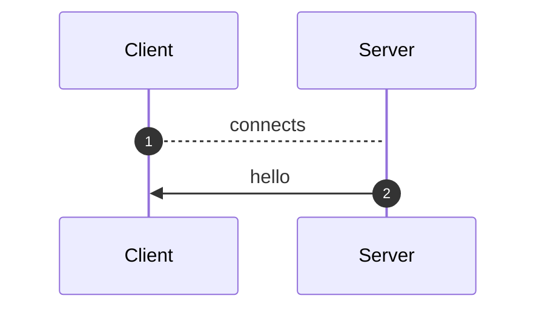
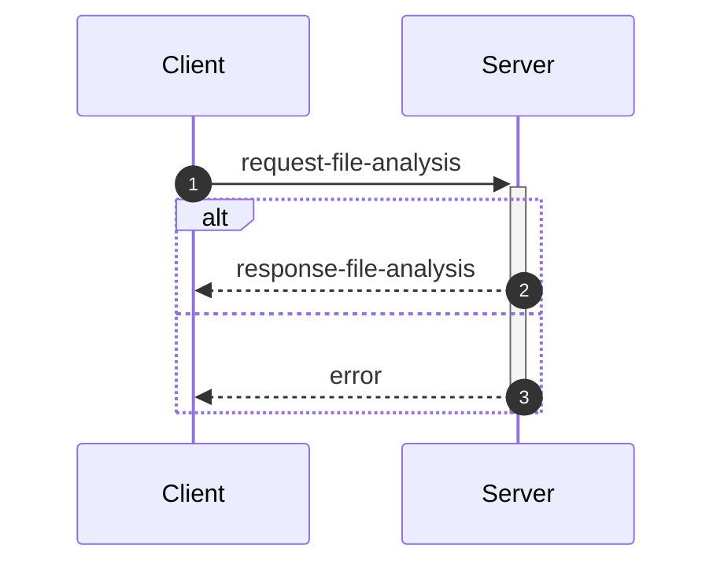
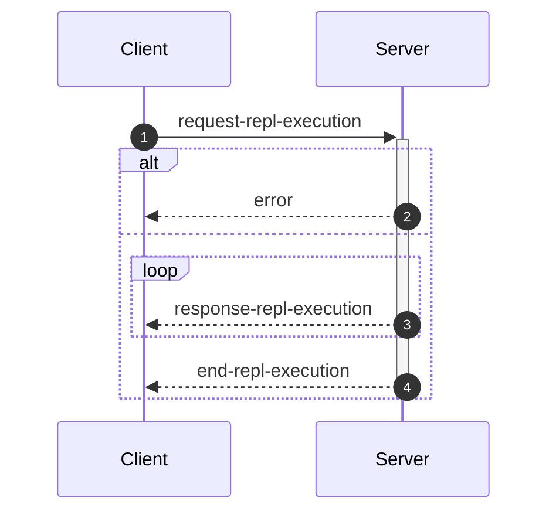
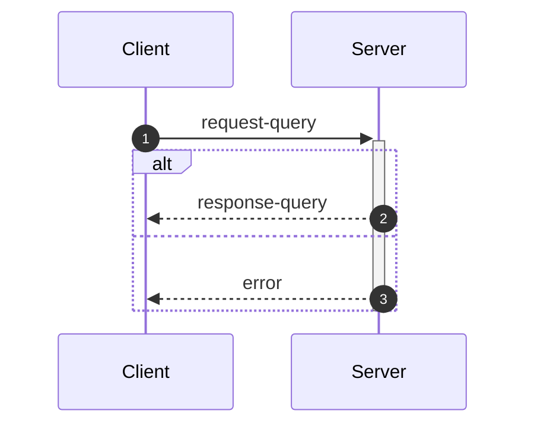

_<span title="an overview of flowR's interface">Generated</span> from '[wiki-interface.ts](https://github.com/flowr-analysis/flowr/tree/main/src/documentation/wiki-interface.ts "src/documentation/wiki-interface.ts")' on 2026-11-10, 21:10:40 UTC (v2.17.5, R v4.6.1), do not edit directly._

Although far from being as detailed as the in-depth explanation of [_flowR_](https://github.com/flowr-analysis/flowr/wiki/Core),
this wiki page explains how to interface with _flowR_ in more detail.
In general, command line arguments and other options provide short descriptions on hover over.

* [💻 Using the REPL](#using-the-repl)
* [⚙️ Configuring FlowR](#configuring-flowr)
* [⚒️ Writing Code](#writing-code)
* [💬 Communicating with the Server](#communicating-with-the-server)

<a id='using-the-repl'></a>
## 💻 Using the REPL

> [!NOTE]
> To execute arbitrary R commands with a repl request, _flowR_ has to be started explicitly with <span title="Description (Command Line Argument): Allow to access the underlying R session when using flowR (security warning: this allows the execution of arbitrary R code!)">`--r-session-access`</span>.
> Please be aware that this introduces a security risk and note that this relies on the [`r-shell` engine](https://github.com/flowr-analysis/flowr/wiki/Engines) .

Although primarily meant for users to explore,
there is nothing which forbids calling _flowR_ as a subprocess to use standard-in, -output, and -error
for communication (although you can access the REPL using the server as well,
with the [REPL Request](#message-request-repl-execution) message).

The read-eval-print loop&nbsp;(REPL) works relatively simple.
You can submit an expression (using <kbd>Enter</kbd>),
which is interpreted as an R&nbsp;expression by default but interpreted as a *command* if it starts with a colon (`:`).
The best command to get started with the REPL is <span title="Description (Repl Command): Show help information (aliases: :h, :?)">`:help`</span>.
Besides, you can leave the REPL either with the command <span title="Description (Repl Command): End the repl (aliases: :q, :exit)">`:quit`</span> or by pressing <kbd>Ctrl</kbd>+<kbd>C</kbd> twice.
When writing a *command*, you may press <kbd>Tab</kbd> to get a list of completions, if available.
Multiple commands can be entered in a single line by separating them with a semicolon (`;`), e.g. `:parse "x<-2"; :df*`.
If a command is given without R code, the REPL will re-use R code given in a previous command.
The prior example will hence return first the parsed AST of the program and then the dataflow graph for `"x <- 2"`.

> [!NOTE]
> If you develop flowR, you may want to launch the repl using the `npm run main-dev` command, this way, you get a non-minified version of flowR with debug information and hot-reloading of source files.

<details>
<summary>Available Commands</summary>

We currently offer the following commands (this with a `[*]` suffix are available with and without the star):

| Command | Description |
| ------- | ----------- |
| **<span title="Description (Repl Command): End the repl (aliases: :q, :exit)">:quit</span>** | End the repl (aliases: **:<span title="Alias of ':quit'. End the repl">q</span>**, **:<span title="Alias of ':quit'. End the repl">exit</span>**) |
| **<span title="Description (Repl Command): Execute the given code as R code. This requires the `--r-session-access` flag to be set and requires the r-shell engine. (aliases: :e, :r)">:execute</span>** | Execute the given code as R code. This requires the `--r-session-access` flag to be set and requires the r-shell engine. (aliases: **:<span title="Alias of ':execute'. Execute the given code as R code. This requires the `--r-session-access` flag to be set and requires the r-shell engine.">e</span>**, **:<span title="Alias of ':execute'. Execute the given code as R code. This requires the `--r-session-access` flag to be set and requires the r-shell engine.">r</span>**) |
| **<span title="Description (Repl Command): Get mermaid code for the control-flow graph of R code (aliases: :cfg, :cf)">:controlflow[*]</span>** | Get mermaid code for the control-flow graph of R code (star: Returns the URL to mermaid.live) (aliases: **:<span title="Alias of ':controlflow'. Get mermaid code for the control-flow graph of R code">cfg</span>**, **:<span title="Alias of ':controlflow'. Get mermaid code for the control-flow graph of R code">cf</span>**) |
| **<span title="Description (Repl Command): Get mermaid code for the control-flow graph with basic blocks (aliases: :cfgb, :cfb)">:controlflowbb[*]</span>** | Get mermaid code for the control-flow graph with basic blocks (star: Returns the URL to mermaid.live) (aliases: **:<span title="Alias of ':controlflowbb'. Get mermaid code for the control-flow graph with basic blocks">cfgb</span>**, **:<span title="Alias of ':controlflowbb'. Get mermaid code for the control-flow graph with basic blocks">cfb</span>**) |
| **<span title="Description (Repl Command): Get mermaid code for the dataflow graph (aliases: :d, :df)">:dataflow[*]</span>** | Get mermaid code for the dataflow graph (star: Returns the URL to mermaid.live) (aliases: **:<span title="Alias of ':dataflow'. Get mermaid code for the dataflow graph">d</span>**, **:<span title="Alias of ':dataflow'. Get mermaid code for the dataflow graph">df</span>**) |
| **<span title="Description (Repl Command): Get mermaid code for the normalized AST of R code (aliases: :n)">:normalize[*]</span>** | Get mermaid code for the normalized AST of R code (star: Returns the URL to mermaid.live) (alias: **:<span title="Alias of ':normalize'. Get mermaid code for the normalized AST of R code">n</span>**) |
| **<span title="Description (Repl Command): Get mermaid code for the simplified dataflow graph (aliases: :ds, :dfs)">:dataflowsimple[*]</span>** | Get mermaid code for the simplified dataflow graph (star: Returns the URL to mermaid.live) (aliases: **:<span title="Alias of ':dataflowsimple'. Get mermaid code for the simplified dataflow graph">ds</span>**, **:<span title="Alias of ':dataflowsimple'. Get mermaid code for the simplified dataflow graph">dfs</span>**) |
| **<span title="Description (Repl Command): Inspect and extend the signature database: `query` (identical to :query @signature), `info <name>` for where a function comes from (identical to :query @function-info), `add <path>` to mount another database/source, `download` to fetch the full-history database. (aliases: :sig)">:signature</span>** | Inspect and extend the signature database: `query` (identical to :query @signature), `info <name>` for where a function comes from (identical to :query @function-info), `add <path>` to mount another database/source, `download` to fetch the full-history database. (alias: **:<span title="Alias of ':signature'. Inspect and extend the signature database: `query` (identical to :query @signature), `info <name>` for where a function comes from (identical to :query @function-info), `add <path>` to mount another database/source, `download` to fetch the full-history database.">sig</span>**) |
| **<span title="Description (Repl Command): Just calculates the DFG, but only prints summary info (aliases: :d#, :df#)">:dataflowsilent</span>** | Just calculates the DFG, but only prints summary info (aliases: **:<span title="Alias of ':dataflowsilent'. Just calculates the DFG, but only prints summary info">d#</span>**, **:<span title="Alias of ':dataflowsilent'. Just calculates the DFG, but only prints summary info">df#</span>**) |
| **<span title="Description (Repl Command): Prints ASCII Art of the parsed, unmodified AST (aliases: :p)">:parse</span>** | Prints ASCII Art of the parsed, unmodified AST (alias: **:<span title="Alias of ':parse'. Prints ASCII Art of the parsed, unmodified AST">p</span>**) |
| **<span title="Description (Repl Command): Prints the version of flowR as well as the current version of R">:version</span>** | Prints the version of flowR as well as the current version of R
| **<span title="Description (Repl Command): Query the given R code (use 'help' for more information)">:query[*]</span>** | Query the given R code (use 'help' for more information) (star: Similar to query, but returns the output in json format.)
| **<span title="Description (Repl Command): Returns an ASCII representation of the dataflow graph (aliases: :df!)">:dataflowascii</span>** | Returns an ASCII representation of the dataflow graph (alias: **:<span title="Alias of ':dataflowascii'. Returns an ASCII representation of the dataflow graph">df!</span>**) |
| **<span title="Description (Repl Command): Returns summarization stats for the normalized AST (aliases: :n#)">:normalize#</span>** | Returns summarization stats for the normalized AST (alias: **:<span title="Alias of ':normalize#'. Returns summarization stats for the normalized AST">n#</span>**) |
| **<span title="Description (Repl Command): Show help information (aliases: :h, :?)">:help</span>** | Show help information (aliases: **:<span title="Alias of ':help'. Show help information">h</span>**, **:<span title="Alias of ':help'. Show help information">?</span>**) |

</details>

> [!TIP]
> 
> As indicated by the examples before, all REPL commands that operate on code keep track of the state.
> Hence, if you run a command like <span title="Description (Repl Command, starred version): Returns the URL to mermaid.live; Base Command: Get mermaid code for the dataflow graph (aliases: :d*, :df*)">`:dataflow*`</span> without providing R code,
> the REPL will re-use the R code provided in a previous command.
> Likewise, doing this will benefit from incrementality!
> If you request the dataflow graph with `:df* x <- 2 * y` and then want to see the parsed AST with `:parse`,
> the REPL will re-use previously obtained information and not re-parse the code again.
> 		

Generally, many commands offer shortcut versions in the REPL. Many queries, for example, offer a shortened format (see the example below).
Of special note, the [Config Query](https://github.com/flowr-analysis/flowr/wiki/%5BQuery%5D-Config)
can be used to also modify the currently active configuration of _flowR_ within the REPL (see the [wiki page](https://github.com/flowr-analysis/flowr/wiki/%5BQuery%5D-Config) for more information).

### Example: Retrieving the Dataflow Graph

To retrieve a URL to the [mermaid](https://mermaid.js.org/) diagram of the dataflow of a given expression,
use <span title="Description (Repl Command, starred version): Returns the URL to mermaid.live; Base Command: Get mermaid code for the dataflow graph (aliases: :d*, :df*)">`:dataflow*`</span> (or <span title="Description (Repl Command): Get mermaid code for the dataflow graph (aliases: :d, :df)">`:dataflow`</span> to get the mermaid code in the cli):

```shell
$ docker run -it --rm eagleoutice/flowr # or npm run flowr 
flowR repl v2.17.5, R grammar v14 (tree-sitter engine)
R> :dataflow* y <- 1 + x
```

<details>
<summary style='color:gray'>Output</summary>

```text
https://mermaid.live/view#base64:eyJjb2RlIjoiZmxvd2NoYXJ0IFREXG4gICAgMXt7XCJgKiM5MTtSTnVtYmVyIzkzOyogKioxKipcbiAgICAgICoxLjYqICgqKmlkOiAxKiopYFwifX1cbiAgICAyKFtcImAqIzkxO1JTeW1ib2wjOTM7KiAqKngqKlxuICAgICAgKjEuMTAqICgqKmlkOiAyKiopYFwiXSlcbiAgICAzW1tcImAqIzkxO1JCaW5hcnlPcCM5MzsqIGJhc2UjNTg7IzU4OyoqIzQzOyoqXG4gICAgICAqMS42LTEwKiAoKippZDogMyoqKVxuICAgIGFyZzogKDEsIDIpYFwiXV1cbiAgICBidWlsdC1pbjpfNDNfW1wiYEJ1aWx0LUluOlxuIzQzO2BcIl1cbiAgICBzdHlsZSBidWlsdC1pbjpfNDNfIHN0cm9rZTpncmF5LGZpbGw6Z3JheSxzdHJva2Utd2lkdGg6MnB4LG9wYWNpdHk6Ljg7XG4gICAgMFtcImAqIzkxO1JTeW1ib2wjOTM7KiAqKnkqKlxuICAgICAgKjEuMSogKCoqaWQ6IDAqKiwgdjogMylgXCJdXG4gICAgNFtbXCJgKiM5MTtSQmluYXJ5T3AjOTM7KiBiYXNlIzU4OyM1ODsqKiM2MDsjNDU7KipcbiAgICAgICoxLjEtMTAqICgqKmlkOiA0KiopXG4gICAgYXJnOiAoMCwgMylgXCJdXVxuICAgIGJ1aWx0LWluOl82MF8tW1wiYEJ1aWx0LUluOlxuIzYwOyM0NTtgXCJdXG4gICAgc3R5bGUgYnVpbHQtaW46XzYwXy0gc3Ryb2tlOmdyYXksZmlsbDpncmF5LHN0cm9rZS13aWR0aDoycHgsb3BhY2l0eTouODtcbiAgICAxIC0uLT58XCJmbG93XCJ8IDJcbiAgICBsaW5rU3R5bGUgMCBzdHJva2U6Z3JheSxjb2xvcjpncmF5O1xuICAgIDIgLS4tPnxcImZsb3dcInwgM1xuICAgIGxpbmtTdHlsZSAxIHN0cm9rZTpncmF5LGNvbG9yOmdyYXk7XG4gICAgMyAtLT58XCJyZWFkcywgYXJnXCJ8IDFcbiAgICAzIC0tPnxcInJlYWRzLCBhcmdcInwgMlxuICAgIDMgLS4tPnxcImZsb3dcInwgMFxuICAgIGxpbmtTdHlsZSA0IHN0cm9rZTpncmF5LGNvbG9yOmdyYXk7XG4gICAgMyAtLi0+fFwicmVhZHMsIGNhbGxzXCJ8IGJ1aWx0LWluOl80M19cbiAgICBsaW5rU3R5bGUgNSBzdHJva2U6Z3JheTtcbiAgICAwIC0tPnxcImRlZmluZWQtYnksIGZsb3dcInwgNFxuICAgIDAgLS0+fFwiZGVmaW5lZC1ieVwifCAzXG4gICAgNCAtLT58XCJyZWFkcywgYXJnXCJ8IDNcbiAgICA0IC0tPnxcInJldHVybnMsIGFyZ1wifCAwXG4gICAgNCAtLi0+fFwicmVhZHMsIGNhbGxzXCJ8IGJ1aWx0LWluOl82MF8tXG4gICAgbGlua1N0eWxlIDEwIHN0cm9rZTpncmF5OyIsIm1lcm1haWQiOnsiYXV0b1N5bmMiOnRydWV9fQ==
```

Retrieve the dataflow graph of the expression `y <- 1 + x`. It looks like this:


<details>

<summary style="color:gray">R Code of the Dataflow Graph</summary>

The analysis ran (parse and normalize with the [tree-sitter](https://github.com/flowr-analysis/flowr/wiki/Engines) engine) in the generation environment. No [signature database](https://github.com/flowr-analysis/flowr/wiki/Signature-Database) is mounted, so `library()` attaches no exports (base-R names are still qualified, e.g., `stats::acf`). 
We encountered no unknown side effects during the analysis.

```r
y <- 1 + x
```

</details>

</details>

For small graphs like this, <span title="Description (Repl Command): Returns an ASCII representation of the dataflow graph (aliases: :df!)">`:dataflowascii`</span> also provides an ASCII representation directly in the REPL:

```shell
$ docker run -it --rm eagleoutice/flowr # or npm run flowr 
flowR repl v2.17.5, R grammar v14 (tree-sitter engine)
R> :df! y <- 1 + x
```

<details open>
<summary style='color:gray'>Output</summary>

```text
                        v<0>v
 c<4>c──────────────────| y |
 |<- |     ┌────────────v---v
 c---c     │
    │   c<3>c   0<1>0
    └───| + |───| 1 |───u<2>u
        c---c   0---0   | x |
           └────────────u---u
Edges:
3 -> 1: reads, arg          3 -> 2: reads, arg
3 -> 0: flows-to            1 -> 2: flows-to
2 -> 3: flows-to            4 -> 3: reads, arg
4 -> 0: returns, arg        0 -> 4: defined-by, flows-to
0 -> 3: defined-by
```

Retrieve the dataflow graph of the expression `y <- 1 + x` as ASCII art.

</details>

For the slicing with <span title="Description (Repl Command): Static backwards executable slicer for R">`:slicer`</span>, you have access to the same [magic comments](#slice-magic-comments) as with the [slice request](#message-request-slice).
Pass `--inline` to splice resolvable `source()` calls into the reconstruction so the slice is a single self-contained R text (the same as the static slice query's `inlineSources` flag).
See `--help` for more flags!

### Example: Interfacing with the File System

Many commands that allow for an R-expression (like <span title="Description (Repl Command, starred version): Returns the URL to mermaid.live; Base Command: Get mermaid code for the dataflow graph (aliases: :d*, :df*)">`:dataflow*`</span>) allow for a file as well
if the argument starts with `file://`.
If you are working from the root directory of the _flowR_ repository, the following gives you the parsed AST of the example file using the <span title="Description (Repl Command): Prints ASCII Art of the parsed, unmodified AST (aliases: :p)">`:parse`</span> command:

> **Watch mode**: Replace `file://` with `watch://` to enter watch mode.
> flowR runs the command immediately and then re-runs it every time the file (or any file inside the folder) changes.
> Enter any other command to leave watch mode.
> For example: `:df watch://analysis.R`

```shell
$ docker run -it --rm eagleoutice/flowr # or npm run flowr 
flowR repl v2.17.5, R grammar v14 (tree-sitter engine)
R> :parse file://test/testfiles/example.R
```

<details>
<summary style='color:gray'>Output</summary>

```text
File: test/testfiles/example.R

program
├ binaryoperator
│ ├ identifier "sum" (1:1─4)
│ ├ <- "<-" (1:5─7)
│ ╰ float "0" (1:8─9)
├ binaryoperator
│ ├ identifier "product" (2:1─8)
│ ├ <- "<-" (2:9─11)
│ ╰ float "1" (2:12─13)
├ binaryoperator
│ ├ identifier "w" (3:1─2)
│ ├ <- "<-" (3:3─5)
│ ╰ float "7" (3:6─7)
├ binaryoperator
│ ├ identifier "N" (4:1─2)
│ ├ <- "<-" (4:3─5)
│ ╰ float "10" (4:6─8)
├ forstatement
│ ├ for "for" (6:1─4)
│ ├ ( "(" (6:5─6)
│ ├ identifier "i" (6:6─7)
│ ├ in "in" (6:8─10)
│ ├ binaryoperator
│ │ ├ float "1" (6:11─12)
│ │ ├ : ":" (6:12─13)
│ │ ╰ parenthesizedexpression
│ │   ├ ( "(" (6:13─14)
│ │   ├ binaryoperator
│ │   │ ├ identifier "N" (6:14─15)
│ │   │ ├ - "-" (6:15─16)
│ │   │ ╰ float "1" (6:16─17)
│ │   ╰ ) ")" (6:17─18)
│ ├ ) ")" (6:18─19)
│ ╰ bracedexpression
│   ├ { "{" (6:20─21)
│   ├ binaryoperator
│   │ ├ identifier "sum" (7:3─6)
│   │ ├ <- "<-" (7:7─9)
│   │ ╰ binaryoperator
│   │   ├ binaryoperator
│   │   │ ├ identifier "sum" (7:10─13)
│   │   │ ├ + "+" (7:14─15)
│   │   │ ╰ identifier "i" (7:16─17)
│   │   ├ + "+" (7:18─19)
│   │   ╰ identifier "w" (7:20─21)
│   ├ binaryoperator
│   │ ├ identifier "product" (8:3─10)
│   │ ├ <- "<-" (8:11─13)
│   │ ╰ binaryoperator
│   │   ├ identifier "product" (8:14─21)
│   │   ├  "" (8:22─23)
│   │   ╰ identifier "i" (8:24─25)
│   ╰ } "}" (9:1─2)
├ call
│ ├ identifier "cat" (11:1─4)
│ ╰ arguments
│   ├ ( "(" (11:4─5)
│   ├ argument
│   │ ╰ string
│   │   ├ stringopen "\"" (11:5─6)
│   │   ├ stringcontent "Sum:" (11:6─10)
│   │   ╰ stringclose "\"" (11:10─11)
│   ├ comma "," (11:11─12)
│   ├ argument
│   │ ╰ identifier "sum" (11:13─16)
│   ├ comma "," (11:16─17)
│   ├ argument
│   │ ╰ string
│   │   ├ stringopen "\"" (11:18─19)
│   │   ├ stringcontent
│   │   │ ╰ escapesequence "\\n" (11:19─21)
│   │   ╰ stringclose "\"" (11:21─22)
│   ╰ ) ")" (11:22─23)
╰ call
  ├ identifier "cat" (12:1─4)
  ╰ arguments
    ├ ( "(" (12:4─5)
    ├ argument
    │ ╰ string
    │   ├ stringopen "\"" (12:5─6)
    │   ├ stringcontent "Product:" (12:6─14)
    │   ╰ stringclose "\"" (12:14─15)
    ├ comma "," (12:15─16)
    ├ argument
    │ ╰ identifier "product" (12:17─24)
    ├ comma "," (12:24─25)
    ├ argument
    │ ╰ string
    │   ├ stringopen "\"" (12:26─27)
    │   ├ stringcontent
    │   │ ╰ escapesequence "\\n" (12:27─29)
    │   ╰ stringclose "\"" (12:29─30)
    ╰ ) ")" (12:30─31)
```

Retrieve the parsed AST of the example file.

<details>

<summary>File Content</summary>

```r
sum <- 0
product <- 1
w <- 7
N <- 10

for (i in 1:(N-1)) {
  sum <- sum + i + w
  product <- product * i
}

cat("Sum:", sum, "\n")
cat("Product:", product, "\n")
```

</details>

As _flowR_ directly transforms this AST the output focuses on being human-readable instead of being machine-readable.
		
</details>

### Example: Run a Query

You can run any query supported by _flowR_ using the <span title="Description (Repl Command): Query the given R code (use 'help' for more information)">`:query`</span> command.
For example, to obtain the shapes of all data frames in a given piece of code, you can run:

```shell
$ docker run -it --rm eagleoutice/flowr # or npm run flowr 
flowR repl v2.17.5, R grammar v14 (tree-sitter engine)
R> :query @absint df-shape "x <- data.frame(a = 1:10, b = 1:10)\ny <- x$a"
```

<details open>
<summary style='color:gray'>Output</summary>

```text
Query: absint (1 ms)
   ╰ $12: (colnames: [{"a", "b"}, {}], cols: [2, 2], rows: [10, 10])
   ╰ $0: (colnames: [{"a", "b"}, {}], cols: [2, 2], rows: [10, 10])
```

Retrieve the shapes of all data frames in the given code.

</details>

To run the linter on a file, you can use (in this example, we just issue the `dead-code` linter on a small piece of code):

```shell
$ docker run -it --rm eagleoutice/flowr # or npm run flowr 
flowR repl v2.17.5, R grammar v14 (tree-sitter engine)
R> :query @linter rules:dead-code "if(FALSE) x <- 2"
```

<details open>
<summary style='color:gray'>Output</summary>

```text
Query: linter (2 ms)
   ╰ Dead Code (dead-code):
       ╰ certain:
           ╰ Code at 1.11-16 (1 quick fix(es) available)
```

Run the linter on the given code, with only the `dead-code` rule enabled.

</details>

For more information on the available queries, please check out the [Query API](https://github.com/flowr-analysis/flowr/wiki/Query-API).

<a id='configuring-flowr'></a>
## ⚙️ Configuring FlowR

When running _flowR_, you may want to specify some behaviors with a dedicated configuration file.
By default, flowR looks for a file named `flowr.json` in the current working directory (or any higher directory).
You can also specify a different file with <span title="Description (Command Line Argument): The name of the configuration file to use">`--config-file`</span> or pass the configuration inline using <span title="Description (Command Line Argument): The flowR configuration to use, as a JSON string">`--config-json`</span>.
A `flowr.json` found this way belongs to the analyzed project, so flowR ignores its options that decide what flowR executes or loads
(`engines.*.wasmPath`, `engines.*.treeSitterWasmPath`, `engines.*.rPath`, `solver.sigdb.additionalPaths`, `solver.sigdb.downloadRepo`, `solver.sigdb.installedLibrary.paths`, `solver.sigdb.onDemand.enabled`, `solver.sigdb.onDemand.repositories`, `solver.sigdb.onDemand.cranMirror`, `solver.sigdb.onDemand.bioconductorMirror`, `solver.sigdb.onDemand.cacheDir`),
unless you pass <span title="Description (Command Line Argument): Keep the security-sensitive options (e.g., the R executable) of the flowr.json found in the working directory or a parent. Only use this for projects you trust.">`--trust-config`</span>.
To analyze code you do not trust, use the secure mode (<span title="Description (Command Line Argument): Run in secure mode for analyzing untrusted code: flowR does not start R (or any other process), does not access the network, does not search for project configs, and ignores security-sensitive options in every config. Cannot be disabled once enabled. Can also be enabled with the environment variable {italic FLOWR_SECURE_MODE=1}.">`--secure`</span>, see the [security policy](https://github.com/flowr-analysis/flowr/blob/main/.github/SECURITY.md)).
To inspect the current configuration, you can run flowr with the <span title="Description (Command Line Argument): Run with verbose logging (will be passed to the corresponding script)">`--verbose`</span> flag, or use the `config` [Query](https://github.com/flowr-analysis/flowr/wiki/Query-API).
Within the REPL this works by running the following:

```shell
:query @config
```

To work with the <a href="https://github.com/flowr-analysis/flowr/tree/main/src/config.ts#L125"><code><span title="The configuration file format for flowR.">FlowrConfig</span></code></a> you can use the provided helper objects alongside its methods like
<a href="https://github.com/flowr-analysis/flowr/tree/main/src/config.ts#L991"><code><span title="Creates a new flowr config that has the updated values.">FlowrConfig::<b>amend</b></span></code></a>.
The schema below documents every option; the ones you most likely want are:

- <a href="https://github.com/flowr-analysis/flowr/wiki/Interface#configuring-flowr" title="Configuration Option (boolean): Whether source calls should be ignored, causing {@link processSourceCall}&#39;s behavior to be skipped.">ignoreSourceCalls</a>: ignore source calls when analyzing the code, i.e., ignore the inclusion of other files.
- <a href="https://github.com/flowr-analysis/flowr/wiki/Interface#configuring-flowr" title="Configuration Option (boolean): Whether load calls should be ignored, causing {@link processLoadCall}&#39;s behavior to be skipped.">ignoreLoadCalls</a>: ignore load calls when analyzing the code, i.e., ignore the loading of r-data files.
- <a href="https://github.com/flowr-analysis/flowr/wiki/Interface#configuring-flowr" title="Configuration Option (object): Do you want to overwrite (parts) of the builtin definition?">semantics.environment.overwriteBuiltIns</a>: overwrite _flowR_'s handling of built-in functions, or clear the preset definitions entirely.
  See [Configure BuiltIn Semantics](#configure-builtin-semantics) for more information.
- <a href="https://github.com/flowr-analysis/flowr/wiki/Interface#configuring-flowr" title="Configuration Option (boolean): Whether calls drawing on a graphics device (e.g., `plot`) count as writing to it, which the ambient state queries then report.">semantics.ambient.drawingWritesDevice</a>: whether calls drawing on a graphics device (e.g., `plot`) count as writing the device in the ambient state queries.
- <a href="https://github.com/flowr-analysis/flowr/wiki/Interface#configuring-flowr" title="Configuration Option (string): How to resolve variables and their values. (one of &quot;disabled&quot;, &quot;alias&quot;, &quot;builtin&quot;)">solver.variables</a>: how to resolve variables and their values (`disabled`, `alias`, `builtin`).
- <a href="https://github.com/flowr-analysis/flowr/wiki/Interface#configuring-flowr" title="Configuration Option (array): The engine or set of engines to use for interacting with R code. An empty array means all available engines will be used.">engines</a> and <a href="https://github.com/flowr-analysis/flowr/wiki/Interface#configuring-flowr" title="Configuration Option (string): The default engine to use for interacting with R code. If this is undefined, an arbitrary engine from the specified list will be used. (one of &quot;tree-sitter&quot;, &quot;r-shell&quot;)">defaultEngine</a>: the engines used to interact with R code, see the [Engines wiki page](https://github.com/flowr-analysis/flowr/wiki/Engines).
- <a href="https://github.com/flowr-analysis/flowr/wiki/Interface#configuring-flowr" title="Configuration Option (array): Files a framework loads on its own, without any source() call (e.g. global.R in a shiny app), in the order they are loaded; flowR orders the matching project files accordingly and analyzes them as one program. Entries are case-insensitive globs matched against the file path, a plain name matches any file with that name, and entries matching no project file are warned about. Usually set per project kind via specializeConfig.">project.implicitSources</a>: the files a framework loads without any `source()` call, in the order in which they are
  loaded. Entries are globs (e.g. `R/*.R`) matched against the file path ignoring capitalization; one matching no file is reported.
- <a href="https://github.com/flowr-analysis/flowr/wiki/Interface#configuring-flowr" title="Configuration Option (object): Overwrite (parts of) the configuration depending on the project kind flowR detects, e.g. to give a shiny app its implicit sources.">specializeConfig</a>: overwrite (parts of) the configuration depending on the kind of project _flowR_ detects
  (e.g. `shiny-app`), which is how a shiny app gets its implicit sources by default. What you configure directly wins.
- <a href="https://github.com/flowr-analysis/flowr/wiki/Interface#configuring-flowr" title="Configuration Option (string): Overwrite the project kind flowR would otherwise infer from the analyzed files, e.g. when auto-detection guesses wrong. (one of &quot;package&quot;, &quot;script&quot;, &quot;shiny-app&quot;, &quot;notebook&quot;, &quot;project&quot;, &quot;unknown&quot;)">project.useProjectType</a>: skip that detection and force a project kind yourself, when auto-detection guesses wrong.
- <a href="https://github.com/flowr-analysis/flowr/wiki/Interface#configuring-flowr" title="Configuration Option (array): The default plugins to load when creating a new instance of FlowrAnalyzer">defaultPlugins</a> and <a href="https://github.com/flowr-analysis/flowr/wiki/Interface#configuring-flowr" title="Configuration Option (array): The plugins to load in REPL mode">repl.plugins</a>: the plugins to load for a new <a href="https://github.com/flowr-analysis/flowr/tree/main/src/project/flowr-analyzer.ts#L240"><code><span title="Central class for conducting analyses with FlowR. Use the FlowrAnalyzerBuilder to create a new instance. If you want the original pattern of creating a pipeline and running all steps, you can still do this with FlowrAnalyzer#runFull . To inspect the context of the analyzer, use FlowrAnalyzer#inspectContext (if you are a plugin and need to modify it, use FlowrAnalyzer#context instead).">FlowrAnalyzer</span></code></a> and in the REPL
  (use `flowr:default` to reference the former).

So you can configure _flowR_ by adding a file like the following:

<details>

<summary>Example Configuration File</summary>

```json
{
  "ignoreSourceCalls": true,
  "ignoreLoadCalls": true,
  "semantics": {
    "environment": {
      "overwriteBuiltIns": {
        "definitions": [
          {
            "type": "function",
            "names": [
              "foo"
            ],
            "processor": "builtin:assign",
            "config": {}
          }
        ]
      }
    }
  },
  "defaultPlugins": [
    "file:description",
    "versions:description"
  ],
  "repl": {
    "quickStats": false,
    "dfProcessorHeat": false,
    "hints": true,
    "plugins": [
      "flowr:default"
    ]
  },
  "project": {
    "resolveUnknownPathsOnDisk": true,
    "implicitSources": [
      "global.R",
      "app.R"
    ]
  },
  "linter": {
    "disabledRules": []
  },
  "specializeConfig": {
    "shiny-app": {
      "project": {
        "implicitSources": [
          "global.R",
          "ui.R",
          "server.R",
          "app.R"
        ]
      }
    }
  },
  "engines": [
    {
      "type": "r-shell"
    }
  ],
  "solver": {
    "variables": "alias",
    "evalStrings": true,
    "trackEnvironments": true,
    "sigdb": {
      "enabled": true,
      "loadProjectDependencies": true,
      "eagerlyLoad": false,
      "eagerlyLoadExports": false,
      "linkBaseR": false,
      "linkDescriptionDependencies": false
    },
    "resolveSource": {
      "dropPaths": "no",
      "ignoreCapitalization": true,
      "inferWorkingDirectory": "active-script",
      "searchPath": []
    },
    "instrument": {},
    "slicer": {
      "threshold": 50
    }
  },
  "abstractInterpretation": {
    "wideningThreshold": 4,
    "followCalls": true,
    "dataFrame": {
      "maxColNames": 20,
      "readLoadedData": {
        "readExternalFiles": true,
        "maxReadLines": 1000000
      }
    }
  },
  "incremental": {
    "alwaysIncremental": false,
    "parsing": {
      "activated": false,
      "heuristics": {
        "activated": true,
        "mtime": true,
        "linesFrom": 500,
        "bytesFrom": 50000,
        "alwaysWithEdits": false,
        "minFiles": 1
      }
    }
  },
  "gas": {
    "thresholds": {
      "memory": {
        "problematic": 0.7,
        "critical": 0.9
      },
      "timeMs": {
        "problematic": 100000,
        "critical": 120000
      }
    },
    "features": {}
  }
}
```

</details>

<details>
<a id='configure-builtin-semantics'></a>
<summary>Configure Built-In Semantics</summary>

`semantics/environment/overwriteBuiltins` accepts two keys:

- `loadDefaults` (boolean, initially `true`): If set to `true`, the default built-in definitions are loaded before applying the custom definitions. Setting this flag to `false` explicitly disables the loading of the default definitions.
- `definitions` (array, initially empty): Allows to overwrite or define new built-in elements. Each object within must have a `type` which is one of the below. Furthermore, they may define a string array of `names` which specifies the identifiers to bind the definitions to. You may use `assumePrimitive` to specify whether _flowR_ should assume that this is a primitive non-library definition (so you probably just do not want to specify the key).

  | Type            | Description                                                                                                                                                                                                                                                                                              | Example                                                                                                    |
  | --------------- | -------------------------------------------------------------------------------------------------------------------------------------------------------------------------------------------------------------------------------------------------------------------------------------------------------- | ---------------------------------------------------------------------------------------------------------- |
  | `constant`    | Additionally allows for a `value` this should resolve to.                                                                                                                                                                                                                                                | `{ type: 'constant', names: ['NULL', 'NA'],  value: null }`                                                |
  | `function`    | Is a rather flexible way to define and bind built-in functions. For the time, we do not have extensive documentation to cover all the cases, so please either consult the sources with the `default-builtin-config/` folder or open a [new issue](https://github.com/flowr-analysis/flowr/issues/new/choose). | `{ type: 'function', names: ['next'], processor: 'builtin:d', config: { cfg: ExitPointType.Next } }` |
  | `replacement` | A comfortable way to specify replacement functions like `$<-` or `names<-`. `suffixes` describes the... suffixes to attach automatically. | `{ type: 'replacement', suffixes: ['<-', '<<-'], names: ['[', '[['] }` |

</details>

<details>

<summary style='color:gray'>Full Configuration-File Schema</summary>

- _The configuration file format for flowR._ (object)
    - **logLevel** [optional] _flowR's global minimum log level, applied when the config is loaded._ (string)
        Only allows: 'silly', 'trace', 'debug', 'info', 'warn', 'error', 'fatal'
    - **ignoreSourceCalls** [optional] _Whether source calls should be ignored, causing {@link processSourceCall}'s behavior to be skipped._ (boolean)
    - **ignoreLoadCalls** [optional] _Whether load calls should be ignored, causing {@link processLoadCall}'s behavior to be skipped._ (boolean)
    - **semantics** _Configure language semantics and how flowR handles them._ (object)
        - **environment** [optional] _Semantics regarding how to handle the R environment._ (object)
            - **overwriteBuiltIns** [optional] _Do you want to overwrite (parts) of the builtin definition?_ (object)
                - **loadDefaults** [optional] _Should the default configuration still be loaded?_ (boolean)
                - **definitions** [optional] _The definitions to load/overwrite._ (array)
                Valid item types:
                    - (object)
        - **ambient** [optional] _Semantics regarding the global state (options, devices, files, ...) calls access._ (object)
            - **drawingWritesDevice** [optional] _Whether calls drawing on a graphics device (e.g., `plot`) count as writing to it, which the ambient state queries then report._ (boolean)
    - **defaultPlugins** [optional] _The default plugins to load when creating a new instance of FlowrAnalyzer_ (array)
    Valid item types:
        - (alternatives)
            - (string)
            - (array)
    - **repl** _Configuration options for the REPL._ (object)
        - **quickStats** [optional] _Whether to show quick stats in the REPL after each evaluation._ (boolean)
        - **dfProcessorHeat** [optional] _This instruments the dataflow processors to count how often each processor is called._ (boolean)
        - **hints** [optional] _Whether to show dim inline hints on the empty prompt (automatically disabled on non-interactive terminals)._ (boolean)
        - **plugins** [optional] _The plugins to load in REPL mode_ (array)
        Valid item types:
            - (alternatives)
                - (string)
                - (array)
        - **autoUseFileProtocol** [optional] _Prepend the file protocol to a repl input that looks like a path, instead of only warning about it._ (boolean)
        - **queryStats** [optional] _Whether `:query` closes with the line stating how long the queries took (`:query*` never prints it)._ (boolean)
        - **showPlugins** [optional] _Whether `:version` grays out the plugins that did not activate during the last analysis._ (boolean)
    - **project** _Project specific configuration options._ (object)
        - **resolveUnknownPathsOnDisk** [optional] _Whether to resolve unknown paths loaded by the r project disk when trying to source/analyze files._ (boolean)
        - **failOnInaccessiblePath** [optional] _Whether a directory that cannot be traversed during file discovery (e.g. due to permissions) aborts the analysis; when false (the default) such paths are logged and skipped._ (boolean)
        - **basePackages** [optional] _The packages considered part of R itself (base and recommended); if unset, flowR uses its built-in list._ (array)
        Valid item types:
            - (string)
        - **implicitSources** [optional] _Files a framework loads on its own, without any source() call (e.g. global.R in a shiny app), in the order they are loaded; flowR orders the matching project files accordingly and analyzes them as one program. Entries are case-insensitive globs matched against the file path, a plain name matches any file with that name, and entries matching no project file are warned about. Usually set per project kind via specializeConfig._ (array)
        Valid item types:
            - (string)
        - **useProjectType** [optional] _Overwrite the project kind flowR would otherwise infer from the analyzed files, e.g. when auto-detection guesses wrong._ (string)
            Only allows: 'package', 'script', 'shiny-app', 'notebook', 'project', 'unknown'
        - **assumeImplicitEcho** [optional] _Whether the top level of the analyzed code is echoed, so that every visible result printed there is collected as an output by the dependencies query (default true, false for a package)._ (boolean)
        - **discovery** [optional] _Scoping options for the default project discovery._ (object)
            - **full** [optional] _Collect every file below the project root (greedy) instead of only the files the detected project kind needs (default false)._ (boolean)
            - **perKind** [optional] _Per-kind include/exclude glob overrides layered on the default scoping._ (object)
            - **ignore** [optional] _Case-insensitive globs that drop matching files from the intelligent discovery, regardless of kind (e.g. .Renviron to ignore environment files)._ (array)
            Valid item types:
                - (string)
        - **classification** [optional] _Overrides for the signals flowR uses to classify the project kind._ (object)
            - **shinyDescriptionTypes** [optional] _DESCRIPTION Type: values that mark a shiny app._ (array)
            Valid item types:
                - (string)
            - **shinyEntryFiles** [optional] _File names a shiny app is assembled from._ (array)
            Valid item types:
                - (string)
            - **shinyUsagePattern** [optional] _Regex source evidencing shiny usage in an entry file._ (string)
            - **notebookExtensions** [optional] _File extensions marking a notebook._ (array)
            Valid item types:
                - (string)
    - **linter** _Linter configuration options._ (object)
        - **disabledRules** _Linting rule names excluded from the default rule set (a rule requested explicitly via a linter query still runs). Usually set per project kind via specializeConfig._ (array)
        Valid item types:
            - (string)
        - **disabledTags** [optional] _Linting rule tags whose rules are excluded from the default rule set (a rule requested explicitly via a linter query still runs). By default the cmd-check rules are disabled for everything but a package; a configured list replaces that default._ (array)
        Valid item types:
            - (string)
    - **inputSources** [optional] _Further frameworks the input-sources analysis should know about; entries are added to flowR's defaults._ (object)
        - **pure** [optional] _Functions that only pass the constantness of their arguments on._ (array)
        Valid item types:
            - (string)
        - **param** [optional] _Functions whose result is a 'param' input._ (array)
        Valid item types:
            - (string)
        - **file** [optional] _Functions whose result is a 'file' input._ (array)
        Valid item types:
            - (string)
        - **tempfile** [optional] _Functions whose result is a 'tempfile' input._ (array)
        Valid item types:
            - (string)
        - **glob** [optional] _Functions whose result is a 'glob' input._ (array)
        Valid item types:
            - (string)
        - **net** [optional] _Functions whose result is a 'net' input._ (array)
        Valid item types:
            - (string)
        - **rand** [optional] _Functions whose result is a 'rand' input._ (array)
        Valid item types:
            - (string)
        - **system** [optional] _Functions whose result is a 'system' input._ (array)
        Valid item types:
            - (string)
        - **ffi** [optional] _Functions whose result is a 'ffi' input._ (array)
        Valid item types:
            - (string)
        - **lang** [optional] _Functions whose result is a 'lang' input._ (array)
        Valid item types:
            - (string)
        - **options** [optional] _Functions whose result is a 'options' input._ (array)
        Valid item types:
            - (string)
        - **cmdline** [optional] _Functions whose result is a 'cmdline' input._ (array)
        Valid item types:
            - (string)
        - **user** [optional] _Functions whose result is a 'user' input._ (array)
        Valid item types:
            - (string)
        - **const** [optional] _Functions whose result is a 'const' input._ (array)
        Valid item types:
            - (string)
        - **scope** [optional] _Functions whose result is a 'scope' input._ (array)
        Valid item types:
            - (string)
        - **dconst** [optional] _Functions whose result is a 'dconst' input._ (array)
        Valid item types:
            - (string)
        - **unknown** [optional] _Functions whose result is a 'unknown' input._ (array)
        Valid item types:
            - (string)
        - **linkedObjects** [optional] _Objects a framework provides without a definition in the code, e.g. shiny's input._ (array)
        Valid item types:
            - (object)
        - **linkedEntryPoints** [optional] _Calls that hand a function to a framework, which binds its objects to the parameters by position._ (array)
        Valid item types:
            - (object)
    - **specializeConfig** [optional] _Overwrite (parts of) the configuration depending on the project kind flowR detects, e.g. to give a shiny app its implicit sources._ (object)
    - **engines** _The engine or set of engines to use for interacting with R code. An empty array means all available engines will be used._ (array)
    Valid item types:
        - (alternatives)
            - _The configuration for the tree sitter engine._ (object)
                - **type** [required] _Use the tree sitter engine._ (string)
                    Only allows: 'tree-sitter'
                - **wasmPath** [optional] _The path to the tree-sitter-r WASM binary to use. If this is undefined, this uses the default path._ (string)
                - **treeSitterWasmPath** [optional] _The path to the tree-sitter WASM binary to use. If this is undefined, this uses the default path._ (string)
                - **lax** [optional] _Whether to use the lax parser for parsing R code (allowing for syntax errors). If this is undefined, the strict parser will be used._ (boolean)
            - _The configuration for the R shell engine._ (object)
                - **type** [required] _Use the R shell engine._ (string)
                    Only allows: 'r-shell'
                - **rPath** [optional] _The path to the R executable to use. If this is undefined, this uses the default path._ (string)
                - **pipeBind** [optional] _Whether to enable R's experimental pipe-bind operator "=>" by setting _R_USE_PIPEBIND_ for the R session (default false); R itself keeps this off by default, as it is experimental and has never shipped in a release version of R._ (boolean)
    - **defaultEngine** [optional] _The default engine to use for interacting with R code. If this is undefined, an arbitrary engine from the specified list will be used._ (string)
        Only allows: 'tree-sitter', 'r-shell'
    - **solver** _How to resolve constants, constraints, cells, ..._ (object)
        - **variables** _How to resolve variables and their values._ (string)
            Only allows: 'disabled', 'alias', 'builtin'
        - **evalStrings** _Should we include eval(parse(text="...")) calls in the dataflow graph?_ (boolean)
        - **trackEnvironments** [optional] _Track user-created environments (new.env, assign/get/local with envir=, dollar-assign, attach). When false, all envir-style calls fall through conservatively._ (boolean)
        - **sigdb** _Resolving library exports from a signature database._ (object)
            - **enabled** [optional] _Resolve library()/use() exports from a signature database (default true); when false no database is consulted._ (boolean)
            - **loadProjectDependencies** [optional] _Load the project's declared dependencies from its metadata files (DESCRIPTION Imports/Depends, rproject.toml, uvr.toml, rig rproj.toml and script blocks, renv.lock, rv.lock, uvr.lock, rig lockfiles) (default true); when false these files are not read for dependencies._ (boolean)
            - **eagerlyLoad** [optional] _Parse the database up front rather than on the first package load (default false, ignored if disabled)._ (boolean)
            - **eagerlyLoadExports** [optional] _Add a vertex for every export on load rather than on demand (default false); keeps the dataflow graph small._ (boolean)
            - **assumedRVersion** [optional] _R version assumed when resolving versioned (base-R) exports: a pin like "4.5" or "auto" to detect the installed R (default "auto")._ (string)
            - **linkBaseR** [optional] _Eagerly attach base-R namespaces so bare base calls resolve without library() (default false)._ (boolean)
            - **linkBaseRCalls** [optional] _Add a lightweight Reads edge from a bare base-R call to its signature-database function vertex (default false; base-R qualification is edge-free otherwise)._ (boolean)
            - **linkPackageCalls** [optional] _Add a lightweight Reads edge from a resolved package call to its signature-database function vertex (default false)._ (boolean)
            - **linkDescriptionDependencies** [optional] _Eagerly attach the namespaces of the project's declared DESCRIPTION dependencies (Imports/Depends) so their exports resolve without an explicit library() (default false)._ (boolean)
            - **warmInBackground** [optional] _Decompress the hot shards (base + most-downloaded) in a background task on startup so the first library() lookup is warm (default false; for long-running servers/REPLs)._ (boolean)
            - **additionalPaths** [optional] _Extra directories or bundle/manifest files searched for signature databases (alongside the shipped default and $FLOWR_SIGDB_DIR); a downloaded full-history bundle placed here is mounted automatically._ (array)
            Valid item types:
                - (string)
            - **downloadRepo** [optional] _GitHub owner/repo the full-history bundle is downloaded from via ":signature download" (default "flowr-analysis/flowr"; the release tag comes from the committed sigdb.remote.json unless a version is given)._ (string)
            - **autoSync** [optional] _On startup, re-download shards whose committed sigdb.remote.json hash no longer matches the cache, in the background (default false; opt-in network sync after a git pull)._ (boolean)
            - **installedLibrary** [optional] _Recovering packages no signature database knows from the copy installed on this machine._ (object)
                - **enabled** [required] _Recover packages no signature database knows from their installed copy (default false)._ (boolean)
                - **paths** [optional] _Library directories to search; when empty they are discovered from the environment and the project._ (array)
                Valid item types:
                    - (string)
                - **useEnvironment** [optional] _Search the libraries R_LIBS_USER/R_LIBS/R_LIBS_SITE name (default true)._ (boolean)
                - **useProjectLibrary** [optional] _Search a project-local renv/packrat library (default true)._ (boolean)
                - **maxDepth** [optional] _How far to descend into the nested layout of a project-local library (default 3)._ (number)
                - **packages** [optional] _Only recover packages whose name matches one of these regular expressions; empty means any._ (array)
                Valid item types:
                    - (string)
            - **onDemand** [optional] _Recovering packages no signature database knows from their sources on CRAN, Bioconductor, or GitHub._ (object)
                - **enabled** [required] _Fetch and recover the sources of packages no signature database knows when the analyzed code uses them (default false, accesses the network)._ (boolean)
                - **sources** [optional] _Where to look, in order: github, cran, bioconductor, or a source a plugin adds (default ["github", "cran", "bioconductor"])._ (array)
                Valid item types:
                    - (string)
                - **repositories** [optional] _GitHub repositories (owner/repo[/subdir][@ref]) to fetch packages from, by package name. The analyzed project may name more (DESCRIPTION Remotes, install_github calls)._ (object)
                - **packages** [optional] _Only recover packages whose name matches one of these regular expressions, empty means any._ (array)
                Valid item types:
                    - (string)
                - **cranMirror** [optional] _The CRAN src/contrib/ to fetch from, over https (default https://cloud.r-project.org/src/contrib/). It may be on the local network._ (string)
                - **bioconductorMirror** [optional] _The Bioconductor host, over https (default https://bioconductor.org). It may be on the local network._ (string)
                - **bioconductorRelease** [optional] _The Bioconductor release to fetch from: release, devel, or a number like 3.20 (default release)._ (string)
                - **githubMirrors** [optional] _Use the GitHub mirrors of CRAN (cran/<pkg>) and Bioconductor (bioc/<pkg>) (default true)._ (boolean)
                - **maxPackages** [optional] _The most packages to fetch for one analysis (default 25)._ (number)
                - **maxArchiveMb** [optional] _The most MiB a package archive may have (default 32). It may unpack to three times that, at most 128 MiB._ (number)
                - **offline** [optional] _Only use what was fetched before, never the network (default false)._ (boolean)
                - **retryAfterHours** [optional] _How many hours to wait before asking again for a package no source had (default 24)._ (number)
                - **cacheDir** [optional] _Where to cache what was fetched (default the on-demand directory of the signature cache)._ (string)
            - **blobCacheBudgetMb** [optional] _How many MiB of decoded package blobs every open bundle may hold together (default 16)._ (number)
            - **versionSelection** [optional] _When a project constrains a dependency, resolve to the newest (default), oldest, or system-installed version satisfying it; system needs R and falls back to newest. Base-R packages always resolve against the assumed R version._ (string)
                Only allows: 'newest', 'oldest', 'system'
            - **versionOverrides** [optional] _Force an exact version for specific packages (name -> version), overriding both the project constraint and the versionSelection policy (default {})._ (object)
        - **versionManagement** _Policies for reasoning about dependency versions._ (object)
            - **linkedVersionGroups** [optional] _Groups of packages that must resolve to the same version; version guessing intersects each group so its members stay mutually compatible (default [])._ (array)
            Valid item types:
                - (array)
                Valid item types:
                    - (string)
        - **assumeAttachedPackages** [optional] _Packages to treat as attached without a `library()` call, so what the built-in configuration states about them applies to the analyzed code. The base packages R attaches on startup already resolve without it._ (array)
        Valid item types:
            - (string)
        - **transitiveSideEffectRounds** [optional] _How many rounds the transitive side-effect fixpoint may run before it is cut off (default 32); the propagation stops on its own as soon as a round adds nothing._ (number)
        - **maxOverlayDepth** [optional] _How many binding overlays may stack on one environment frame before a write flattens them (default 4); a pure performance knob, trading lookup cost against copy cost without changing any result._ (number)
        - **instrument** (object)
            - **dataflowExtractors** [optional] _These keys are only intended for use within code, allowing to instrument the dataflow analyzer!_ (any)
        - **resolveSource** [optional] _If lax source calls are active, flowR searches for sourced files much more freely, based on the configurations you give it. This option is only in effect if `ignoreSourceCalls` is set to false._ (object)
            - **dropPaths** _Allow to drop the first or all parts of the sourced path, if it is relative._ (string)
                Only allows: 'no', 'once', 'all'
            - **ignoreCapitalization** _Search for filenames matching in the lowercase._ (boolean)
            - **inferWorkingDirectory** _Try to infer the working directory from the main or any script to analyze._ (string)
                Only allows: 'no', 'main-script', 'active-script', 'any-script'
            - **searchPath** _Additionally search in these paths._ (array)
            Valid item types:
                - (string)
            - **repeatedSourceLimit** [optional] _How often the same file can be sourced within a single run? Please be aware: in case of cyclic sources this may not reach a fixpoint so give this a sensible limit._ (number)
            - **applyReplacements** _Provide name replacements for loaded files_ (array)
            Valid item types:
                - (object)
            - **assumeFilesExist** [optional] _Assume a sourced file is always there, making what it defines certain instead of conditional on the source call._ (boolean)
        - **slicer** [optional] _The configuration for the slicer._ (object)
            - **threshold** [optional] _The maximum number of iterations to perform on a single function call during slicing._ (number)
            - **autoExtend** [optional] _If set, the slicer will gain an additional post-pass._ (boolean)
    - **abstractInterpretation** _The configuration options for abstract interpretation._ (object)
        - **wideningThreshold** _The threshold for the number of visitations of a node at which widening should be performed to ensure the termination of the fixpoint iteration._ (number)
        - **followCalls** _Whether the abstract interpretation is interprocedural, i.e. whether it steps into the functions a call may dispatch to._ (boolean)
        - **dataFrame** _The configuration of the shape inference for data frames._ (object)
            - **maxColNames** _The maximum number of columns names to infer for data frames before over-approximating the column names to top._ (number)
            - **readLoadedData** _Configuration options for reading data frame shapes from loaded external data files, such as CSV files._ (object)
                - **readExternalFiles** _Whether data frame shapes should be extracted from loaded external files, such as CSV files._ (boolean)
                - **maxReadLines** _The maximum number of lines to read when extracting data frame shapes from loaded files, such as CSV files._ (number)
    - **incremental** (object)
        - **alwaysIncremental** _Always take the incremental path, regardless of heuristics._ (boolean)
        - **parsing** (object)
            - **activated** _If set, incremental parsing will be used._ (boolean)
            - **heuristics** (object)
                - **activated** [optional] _If set, the heuristics for incremental parsing will be used._ (boolean)
                - **mtime** [optional] _Skip reparsing entirely if the file's modification time is unchanged since the last parse._ (boolean)
                - **linesFrom** [optional] _Only consider incremental parsing for files with at least this many lines._ (number)
                - **bytesFrom** [optional] _Only consider incremental parsing for files with at least this many bytes._ (number)
                - **alwaysWithEdits** [optional] _Always take the incremental path whenever there is a computed edit region, regardless of the other thresholds._ (boolean)
                - **minFiles** [optional] _Only apply these heuristics once the project has at least this many files loaded._ (number)
    - **gas** [optional] _Resource-usage guard (gas) configuration. All feature factors default to 0 (disabled). See https://github.com/flowr-analysis/flowr/wiki/Core#gas-resource-guard._ (object)
        - **thresholds** [optional] _Thresholds for all gas checks (scaled by per-feature factor), boundable per feature._ (object)
            - **memory** [optional] _Heap-usage fraction thresholds (0-1), either shared or given per feature key (with `default` covering the rest)._ (object)
                - **problematic** [optional] _Heap fraction (0-1) above which Problematic is returned, for every feature without an entry of its own._ (number)
                - **critical** [optional] _Heap fraction (0-1) above which Critical is returned, for every feature without an entry of its own._ (number)
            - **timeMs** [optional] _Elapsed analysis time thresholds in milliseconds, either shared or given per feature key (with `default` covering the rest)._ (object)
                - **problematic** [optional] _Elapsed ms above which Problematic is returned, for every feature without an entry of its own._ (number)
                - **critical** [optional] _Elapsed ms above which Critical is returned, for every feature without an entry of its own._ (number)
            - **steps** [optional] _Processed-AST-node thresholds, counted rather than sampled; only a key that arms a budget (`dataflow`) reads them._ (object)
                - **problematic** [optional] _Processed AST nodes above which Problematic is returned, for every feature without an entry of its own._ (number)
                - **critical** [optional] _Processed AST nodes above which the extraction is cut short, for every feature without an entry of its own._ (number)
            - **vertices** [optional] _Created-dataflow-vertex thresholds, counted like `steps`._ (object)
                - **problematic** [optional] _Created dataflow vertices above which Problematic is returned, for every feature without an entry of its own._ (number)
                - **critical** [optional] _Created dataflow vertices above which the extraction is cut short, for every feature without an entry of its own._ (number)
        - **features** [optional] _Per-feature sensitivity factors. 0 or absent disables gas checking for that feature. A factor of 2 makes the feature twice as sensitive. Recognised keys: `source`, `side-effect-linking`, `linter`, `slicer`, `dataflow`._ (object)
        - **countedCheckEvery** [optional] _How many counted steps pass between two accountings of an armed check, be it a dataflow budget or the slicer's traversal (default 128); trades overshoot against the cost of the check._ (number)
        - **heapProvider** [optional] _Custom heap statistics source (programmatic configs only), overriding the built-in v8/performance.memory detection._ (function)

</details>

<a id='writing-code'></a>
## ⚒️ Writing Code

_flowR_ can be used as a [module](https://www.npmjs.com/package/@eagleoutice/flowr) and offers several main classes and interfaces that are interesting for extension writers 
(see the [Visual Studio Code extension](https://marketplace.visualstudio.com/items?itemName=code-inspect.vscode-flowr) or the [Core](https://github.com/flowr-analysis/flowr/wiki/Core) wiki page for more information).

### Creating Analyses with _flowR_

Nowadays, instances of the <a href="https://github.com/flowr-analysis/flowr/tree/main/src/project/flowr-analyzer.ts#L240"><code><span title="Central class for conducting analyses with FlowR. Use the FlowrAnalyzerBuilder to create a new instance. If you want the original pattern of creating a pipeline and running all steps, you can still do this with FlowrAnalyzer#runFull . To inspect the context of the analyzer, use FlowrAnalyzer#inspectContext (if you are a plugin and need to modify it, use FlowrAnalyzer#context instead).">FlowrAnalyzer</span></code></a> should be used as central frontend to get analysis results from _flowR_.
The entry points an analysis is written against are re-exported from the package root (`import { FlowrAnalyzerBuilder } from '@eagleoutice/flowr'`);
everything else stays reachable under its own path, as in `@eagleoutice/flowr/dataflow/graph/graph`.
For example, a program slice can be created like this:

```ts
const analyzer = await new FlowrAnalyzerBuilder()
    .setEngine('tree-sitter')
    .build();
analyzer.addRequest('x <- 1\ny <- x\nx');
const { slice, reconstruct } = await analyzer.query({
    type:     'static-slice',
    criteria: ['3@x']
});
```

For more information, please have a look at the [Analyzer](https://github.com/flowr-analysis/flowr/wiki/Analyzer) wiki page, which explains how to construct and use the <a href="https://github.com/flowr-analysis/flowr/tree/main/src/project/flowr-analyzer.ts#L240"><code><span title="Central class for conducting analyses with FlowR. Use the FlowrAnalyzerBuilder to create a new instance. If you want the original pattern of creating a pipeline and running all steps, you can still do this with FlowrAnalyzer#runFull . To inspect the context of the analyzer, use FlowrAnalyzer#inspectContext (if you are a plugin and need to modify it, use FlowrAnalyzer#context instead).">FlowrAnalyzer</span></code></a> in more detail.
To work with specific perspectives, you can also consult the respective pages like the [Dataflow Graph](https://github.com/flowr-analysis/flowr/wiki/Dataflow-Graph) or the [Abstract Interpretation](https://github.com/flowr-analysis/flowr/wiki/Abstract-Interpretation) wiki pages.
### The Pipeline Executor (Low-Level Interface)

Once, in the beginning, _flowR_ was meant to produce a dataflow graph merely to provide *program slices*. 
However, with continuous updates, the [Dataflow Graph](https://github.com/flowr-analysis/flowr/wiki/Dataflow-Graph) repeatedly proves to be the more interesting part.
With this, we restructured _flowR_'s originally *hardcoded* pipeline to be far more flexible. 
Now, it can be theoretically extended or replaced with arbitrary steps, optional steps, and what we call 'decorations' of these steps. 
In short, a slicing pipeline using the <a href="https://github.com/flowr-analysis/flowr/tree/main/src/core/pipeline-executor.ts#L97"><code><span title="**Please note:** The PipelineExecutor is now considered to be a rather low-level API for flowR. While it still works and is the basis for all other layers, we strongly recommend using the FlowrAnalyzer and its builder to create and use an analyzer instance that is pre-configured for your use-case. The pipeline executor allows to execute arbitrary pipelines in a step-by-step fashion. If you are not...">PipelineExecutor</span></code></a> looks like this:

```ts

const slicer = new PipelineExecutor(DEFAULT_SLICING_PIPELINE, {
  parser:    new RShell(),
  request:   requestFromInput('x <- 1\nx + 1'),
  criterion: ['2@x']
})
const slice = await slicer.allRemainingSteps()
// console.log(slice.reconstruct.code)
```

<details><summary>More Information</summary>

If you compare this, with what you would have done with the old (and removed) `SteppingSlicer`, 
this essentially just requires you to replace the `SteppingSlicer` with the <a href="https://github.com/flowr-analysis/flowr/tree/main/src/core/pipeline-executor.ts#L97"><code><span title="**Please note:** The PipelineExecutor is now considered to be a rather low-level API for flowR. While it still works and is the basis for all other layers, we strongly recommend using the FlowrAnalyzer and its builder to create and use an analyzer instance that is pre-configured for your use-case. The pipeline executor allows to execute arbitrary pipelines in a step-by-step fashion. If you are not...">PipelineExecutor</span></code></a>
and to pass the <a href="https://github.com/flowr-analysis/flowr/tree/main/src/core/steps/pipeline/default-pipelines.ts#L18"><code>DEFAULT_SLICING_PIPELINE</code></a> as the first argument.
The <a href="https://github.com/flowr-analysis/flowr/tree/main/src/core/pipeline-executor.ts#L97"><code><span title="**Please note:** The PipelineExecutor is now considered to be a rather low-level API for flowR. While it still works and is the basis for all other layers, we strongly recommend using the FlowrAnalyzer and its builder to create and use an analyzer instance that is pre-configured for your use-case. The pipeline executor allows to execute arbitrary pipelines in a step-by-step fashion. If you are not...">PipelineExecutor</span></code></a>...

1. Provides structures to investigate the results of all intermediate steps
2. Can be executed step-by-step
3. Can repeat steps (e.g., to calculate multiple slices on the same input)

See the in-code documentation for more information.

</details>

### Using the <a href="https://github.com/flowr-analysis/flowr/tree/main/src/r-bridge/shell.ts#L144"><code><span title="The RShell represents an interactive session with the R interpreter. You can configure it by RShellOptions . At the moment we are using a live R session (and not networking etc.) to communicate with R easily, which allows us to install packages etc. However, this might and probably will change in the future (leaving this as a legacy mode :D)">RShell</span></code></a> to Interact with R

The <a href="https://github.com/flowr-analysis/flowr/tree/main/src/r-bridge/shell.ts#L144"><code><span title="The RShell represents an interactive session with the R interpreter. You can configure it by RShellOptions . At the moment we are using a live R session (and not networking etc.) to communicate with R easily, which allows us to install packages etc. However, this might and probably will change in the future (leaving this as a legacy mode :D)">RShell</span></code></a> class allows interfacing with the `R`&nbsp;ecosystem installed on the host system.
Please have a look at [flowR's Engines](https://github.com/flowr-analysis/flowr/wiki/Engines) for more information on alternatives (for example, the <a href="https://github.com/flowr-analysis/flowr/tree/main/src/r-bridge/lang-4.x/tree-sitter/tree-sitter-executor.ts#L29"><code><span title="Synchronous and (way) faster alternative to the RShell using tree-sitter.">TreeSitterExecutor</span></code></a>).

> [!IMPORTANT]
> 
> Each <a href="https://github.com/flowr-analysis/flowr/tree/main/src/r-bridge/shell.ts#L144"><code><span title="The RShell represents an interactive session with the R interpreter. You can configure it by RShellOptions . At the moment we are using a live R session (and not networking etc.) to communicate with R easily, which allows us to install packages etc. However, this might and probably will change in the future (leaving this as a legacy mode :D)">RShell</span></code></a> controls a new instance of the R&nbsp;interpreter, 
> make sure to call <code><a href="https://github.com/flowr-analysis/flowr/tree/main/src/r-bridge/shell.ts#L350"><span title="Close the current R session, makes the object effectively invalid (can no longer be reopened etc.)">RShell::<i>close</i></span></a>()</code> when you are done.

You can start a new "session" by constructing a new object with <code>new <a href="https://github.com/flowr-analysis/flowr/tree/main/src/r-bridge/shell.ts#L144"><span title="The RShell represents an interactive session with the R interpreter. You can configure it by RShellOptions . At the moment we are using a live R session (and not networking etc.) to communicate with R easily, which allows us to install packages etc. However, this might and probably will change in the future (leaving this as a legacy mode :D)">RShell</span></a>()</code>.

However, there are several options that may be of interest 
(e.g., to automatically revive the shell in case of errors or to control the name location of the R process on the system).

With a shell object (let's call it `shell`), you can execute R code by using <a href="https://github.com/flowr-analysis/flowr/tree/main/src/r-bridge/shell.ts#L213"><code><span title="sends the given command directly to the current R session will not do anything to alter input markers!">RShell::<i>sendCommand</i></span></code></a>,
for example <code>shell.<a href="https://github.com/flowr-analysis/flowr/tree/main/src/r-bridge/shell.ts#L213"><span title="sends the given command directly to the current R session will not do anything to alter input markers!">sendCommand</span></a>("1 + 1")</code>.
However, this does not return anything, so if you want to collect the output of your command, use
<a href="https://github.com/flowr-analysis/flowr/tree/main/src/r-bridge/shell.ts#L296"><code><span title="Send a command and collect the output">RShell::<i>sendCommandWithOutput</i></span></code></a> instead.

<a id='communicating-with-the-server'></a>
## 💬 Communicating with the Server

As explained in the [Overview](https://github.com/flowr-analysis/flowr/wiki/Overview), you can run the [TCP](https://de.wikipedia.org/wiki/Transmission_Control_Protocol)&nbsp;server by adding the <span title="Description (Command Line Argument): Do not drop into a repl, but instead start a server on the given port (default: 1042) and listen for messages.">`--server`</span> flag (and, due to the interactive mode, exit with the conventional <kbd>CTRL</kbd>+<kbd>C</kbd>).
Currently, every connection is handled by the same underlying `RShell` - so the server is not designed to handle many clients at a time.
Additionally, the server is not well guarded against attacks (e.g., you can theoretically spawn an arbitrary number of&nbsp;RShell sessions on the target machine).

Every message has to be given in a single line (i.e., without a newline in-between) and end with a newline character. Nevertheless, we will pretty-print example given in the following segments for the ease of reading.

> [!NOTE]
> 
> The default <span title="Description (Command Line Argument): Do not drop into a repl, but instead start a server on the given port (default: 1042) and listen for messages.">`--server`</span> uses a simple [TCP](https://de.wikipedia.org/wiki/Transmission_Control_Protocol)
> connection. If you want _flowR_ to expose a [WebSocket](https://de.wikipedia.org/wiki/WebSocket) server instead, add the <span title="Description (Command Line Argument): If the server flag is set, use websocket for messaging">`--ws`</span> flag (i.e., <span title="Description (Command Line Argument): Do not drop into a repl, but instead start a server on the given port (default: 1042) and listen for messages.">`--server`</span> <span title="Description (Command Line Argument): If the server flag is set, use websocket for messaging">`--ws`</span>) when starting _flowR_ from the command line.

<ul><li>
<a id="message-hello"></a>
<b>Hello</b> Message (<code>hello</code>) 
<details>

<summary style="color:gray"> View Details. <i>The server informs the client about the successful connection and provides Meta-Information.</i> </summary>



After launching _flowR_, for example, with <code>docker run -it --rm eagleoutice/flowr <span title="Description (Command Line Argument): Do not drop into a repl, but instead start a server on the given port (default: 1042) and listen for messages.">-<span/>-server</span></code>&nbsp;(🐳️), connecting should present you with a `hello` message, that amongst others should reveal the versions of&nbsp;_flowR_ and&nbsp;R, using the [semver 2.0](https://semver.org/spec/v2.0.0.html) versioning scheme.
The message looks like this:

```json
{
  "type": "hello",
  "clientName": "client-0",
  "versions": {
    "flowr": "2.17.5",
    "r": "4.6.1",
    "engine": "r-shell"
  }
}
```

There are currently a few messages that you can send after the hello message.
If you want to _slice_ a piece of R code you first have to send an [analysis request](#message-request-file-analysis), so that you can send one or multiple slice requests afterward.
Requests for the [REPL](#message-request-repl-execution) are independent of that.
	
<hr>

<details>
<summary style="color:gray">Message schema (<code>hello</code>)</summary>

For the definition of the hello message, please see it's implementation at [`./src/cli/repl/server/messages/message-hello.ts`](https://github.com/flowr-analysis/flowr/tree/main/src/cli/repl/server/messages/message-hello.ts).

- [required] (object)
    - **type** [required] _The type of the hello message._ (string)
        Only allows: 'hello'
    - **id** [forbidden] _The id of the message is always undefined (as it is the initial message and not requested)._ (any)
    - **clientName** [required] _A unique name that is assigned to each client. It has no semantic meaning and is only used/useful for debugging._ (string)
    - **versions** [required] (object)
        - **flowr** [required] _The version of the flowr server running in semver format._ (string)
        - **r** [required] _The version of the underlying R shell running in semver format._ (string)
        - **engine** [required] _The parser backend that is used to parse the R code._ (string)

</details>

<hr>

</details>
	</li>

<li>
<a id="message-request-file-analysis"></a>
<b>Analysis</b> Message (<code>request-file-analysis</code>) 
<details>

<summary style="color:gray"> View Details. <i>The server builds the dataflow graph for a given input file (or a set of files).</i> </summary>



The request allows the server to analyze a file and prepare it for slicing.
The message can contain a `filetoken`, which is used to identify the file in later slice or query requests (if you do not add one, the request will not be stored and therefore, it is not available for subsequent requests).

> **Please note!**\
> If you want to send and process a lot of analysis requests, but do not want to slice them, please do not pass the `filetoken` field. This will save the server a lot of memory allocation.

Furthermore, the request must contain either a `content` field to directly pass the file's content or a `filepath` field which contains the path to the file (this path must be accessible for the server to be useful).
If you add the `id` field, the answer will use the same `id` so you can match requests and the corresponding answers.
See the implementation of the request-file-analysis message for more information.

You can drop one or more stored file tokens by adding the `invalidateToken` field (a single token or an array of tokens).
The server frees the corresponding analyses _after_ it has answered the request.

> **Tip!**\
> If you only want to drop tokens, you do not need a separate message: send a `request-file-analysis` that contains _just_ the `invalidateToken` field (and no `content` or `filepath`).
> Such a request behaves like an empty file analysis and the server replies with an empty `results` object.
> Because invalidation happens after the response, you may even pass the _current_ `filetoken` in `invalidateToken` to analyze a file once and have the server forget it right after you received the results.

<details>
<summary>Example of the <code>request-file-analysis</code> Message</summary>

_Note:_ even though we pretty-print these messages, they are sent as a single line, ending with a newline.

The following lists all messages that were sent and received in case you want to reproduce the scenario:

<ol>
<li> <code>hello</code> (response)
<details> 

<summary> Show Details </summary>

The first message is always a hello message.

```json
{"type":"hello","clientName":"client-0","versions":{"flowr":"2.17.5","r":"4.6.1","engine":"r-shell"}}
```

</details>
</li>

<li> <b><code>request-file-analysis</code> (request)</b>
<details open> 

<summary> Show Details </summary>

Let's suppose you simply want to analyze the following script:
 
```r
x <- 1
x + 1
```

 For this, you can send the following request:

```json
{"type":"request-file-analysis","id":"1","filetoken":"x","content":"x <- 1\nx + 1"}
```

</details>
</li>

<li> <code>response-file-analysis</code> (response)
<details> 

<summary> Show Details </summary>

The `results` field of the response effectively contains three keys of importance:

- `parse`: which contains 1:1 the parse result in CSV format that we received from the `RShell` (i.e., the AST produced by the parser of the R interpreter).
- `normalize`: which contains the normalized AST, including ids (see the `info` field and the [Normalized AST](https://github.com/flowr-analysis/flowr/wiki/Normalized-AST) wiki page).
- `dataflow`: especially important is the `graph` field which contains the dataflow graph as a set of root vertices (see the [Dataflow Graph](https://github.com/flowr-analysis/flowr/wiki/Dataflow-Graph) wiki page).
			
_As the code is pretty long, we inhibit pretty printing and syntax highlighting (JSON, hiding built-in):_

```text
{"type":"response-file-analysis","format":"json","id":"1","results":{"parse":{"files":[{"parsed":"[1,1,1,6,7,0,\"expr\",false,\"x <- 1\"],[1,1,1,1,1,3,\"SYMBOL\",true,\"x\"],[1,1,1,1,3,7,\"expr\",false,\"x\"],[1,3,1,4,2,7,\"LEFT_ASSIGN\",true,\"<-\"],[1,6,1,6,4,5,\"NUM_CONST\",true,\"1\"],[1,6,1,6,5,7,\"expr\",false,\"1\"],[2,1,2,5,16,0,\"expr\",false,\"x + 1\"],[2,1,2,1,10,12,\"SYMBOL\",true,\"x\"],[2,1,2,1,12,16,\"expr\",false,\"x\"],[2,3,2,3,11,16,\"'+'\",true,\"+\"],[2,5,2,5,13,14,\"NUM_CONST\",true,\"1\"],[2,5,2,5,14,16,\"expr\",false,\"1\"]","filePath":"/tmp/tmp-2284689-LskwsNqV7dqH-.R"}],".meta":{}},"normalize":{"ast":{"type":"RProject","files":[{"root":{"type":"RExpressionList","children":[{"type":"RBinaryOp","location":[1,3,1,4],"lhs":{"type":"RSymbol","location":[1,1,1,1],"content":"x","lexeme":"x","info":{"fullRange":[1,1,1,1],"adToks":[],"id":0,"parent":2,"role":"bin-l","index":0,"nest":0,"file":"/tmp/tmp-2284689-LskwsNqV7dqH-.R"}},"rhs":{"location":[1,6,1,6],"lexeme":"1","info":{"fullRange":[1,6,1,6],"adToks":[],"id":1,"parent":2,"role":"bin-r","index":1,"nest":0,"file":"/tmp/tmp-2284689-LskwsNqV7dqH-.R"},"type":"RNumber","content":{"num":1,"complexNumber":false,"markedAsInt":false}},"operator":"<-","lexeme":"<-","info":{"fullRange":[1,1,1,6],"adToks":[],"id":2,"parent":6,"nest":0,"file":"/tmp/tmp-2284689-LskwsNqV7dqH-.R","index":0,"role":"el-c"}},{"type":"RBinaryOp","location":[2,3,2,3],"lhs":{"type":"RSymbol","location":[2,1,2,1],"content":"x","lexeme":"x","info":{"fullRange":[2,1,2,1],"adToks":[],"id":3,"parent":5,"role":"bin-l","index":0,"nest":0,"file":"/tmp/tmp-2284689-LskwsNqV7dqH-.R"}},"rhs":{"location":[2,5,2,5],"lexeme":"1","info":{"fullRange":[2,5,2,5],"adToks":[],"id":4,"parent":5,"role":"bin-r","index":1,"nest":0,"file":"/tmp/tmp-2284689-LskwsNqV7dqH-.R"},"type":"RNumber","content":{"num":1,"complexNumber":false,"markedAsInt":false}},"operator":"+","lexeme":"+","info":{"fullRange":[2,1,2,5],"adToks":[],"id":5,"parent":6,"nest":0,"file":"/tmp/tmp-2284689-LskwsNqV7dqH-.R","index":1,"role":"el-c"}}],"info":{"adToks":[],"id":6,"nest":0,"file":"/tmp/tmp-2284689-LskwsNqV7dqH-.R","role":"root","index":0}},"filePath":"/tmp/tmp-2284689-LskwsNqV7dqH-.R"}],"info":{"id":7}},".meta":{}},"dataflow":{"unknownReferences":[],"in":[{"nodeId":2,"name":"<-","type":2},{"nodeId":5,"name":"+","type":2}],"out":[{"nodeId":0,"name":"x","type":4,"definedAt":2,"value":[1]}],"environment":{"level":0,"current":{"id":3340,"parent":"<BuiltInEnvironment>","memory":[["x",[{"nodeId":0,"name":"x","type":4,"definedAt":2,"value":[1]}]],["#sink:output",[{"nodeId":5,"name":"#sink:output","type":4,"definedAt":5,"cds":[]}]]],"globalEnv":true}},"graph":{"rootVertices":[1,0,2,3,4,5],"vertexInformation":[[1,{"tag":"value","id":1}],[0,{"tag":"vdef","id":0,"source":[1]}],[2,{"tag":"fcall","id":2,"name":"<-","onlyBuiltin":true,"args":[{"nodeId":0,"type":32},{"nodeId":1,"type":32}],"origin":["builtin:assign"]}],[3,{"tag":"use","id":3}],[4,{"tag":"value","id":4}],[5,{"tag":"fcall","id":5,"name":"+","onlyBuiltin":true,"args":[{"nodeId":3,"type":32},{"nodeId":4,"type":32}],"origin":["builtin:d"]}]],"edgeInformation":[[2,[[1,{"types":65}],[0,{"types":72}],["built-in:<-",{"types":5}],[3,{"types":4096}]]],[1,[[0,{"types":4096}]]],[0,[[2,{"types":4098}],[1,{"types":2}]]],[5,[[3,{"types":65}],[4,{"types":65}],["built-in:+",{"types":5}]]],[3,[[0,{"types":1}],[4,{"types":4096}]]],[4,[[5,{"types":4096}]]]],"_unknownSideEffects":[],"_ambientAccess":[[5,{"reads":["#options","#sink"],"writes":["#sink:output"],"assumed":[],"local":[],"kills":[]}]]},"entryPoint":2,"cfgEntry":1,"exitPoints":[{"type":0,"nodeId":5}],"hooks":[],".meta":{}}}}
```

</details>
</li>
</ol>

The complete round-trip covers validating the messages as well as starting and stopping the internal mock server.

</details>

You receive an error if, for whatever reason, the analysis fails (e.g., the message or code you sent contained syntax errors).
It contains a human-readable description *why* the analysis failed (see the error message implementation for more details).

<details>
<summary>Example Error Message</summary>

_Note:_ even though we pretty-print these messages, they are sent as a single line, ending with a newline.

The following lists all messages that were sent and received in case you want to reproduce the scenario:

<ol>
<li> <code>hello</code> (response)
<details> 

<summary> Show Details </summary>

The first message is always a hello message.

```json
{"type":"hello","clientName":"client-0","versions":{"flowr":"2.17.5","r":"4.6.1","engine":"r-shell"}}
```

</details>
</li>

<li> <code>request-file-analysis</code> (request)
<details> 

<summary> Show Details </summary>

```json
{"type":"request-file-analysis","id":"1","filename":"sample.R","content":"x <-"}
```

</details>
</li>

<li> <b><code>error</code> (response)</b>
<details open> 

<summary> Show Details </summary>

```json
{"id":"1","type":"error","fatal":false,"reason":"Error while analyzing file sample.R: GuardError: unable to parse R code (see the log for more information) for request {\"request\":\"text\",\"content\":\"x <-\"}}\n Report a Bug: https://github.com/flowr-analysis/flowr/issues/new?body=%3C!%2D%2D%20Please%20describe%20your%20issue%20in%20more%20detail%20below!%20%2D%2D%3E%0A%0A%0A%3C!%2D%2D%20Automatically%20generated%20issue%20metadata%2C%20please%20do%20not%20edit%20or%20delete%20content%20below%20this%20line%20%2D%2D%3E%0A%2D%2D%2D%0A%0AflowR%20version%3A%202.17.5%0Anode%20version%3A%20v26.10.0%0Anode%20arch%3A%20x64%0Anode%20platform%3A%20linux%0Amessage%3A%20%60unable%20to%20parse%20R%20code%20%28see%20the%20log%20for%20more%20information%29%20for%20request%20%7B%22request%22%3A%22text%22%2C%22content%22%3A%22x%20%3C%2D%22%7D%7D%60%0Astack%20trace%3A%0A%60%60%60%0A%20%20%20%20at%20guard%20%28%3C%3E%2Fsrc%2Futil%2Fassert.ts%3A128%3A9%29%0A%20%20%20%20at%20guardRetrievedOutput%20%28%3C%3E%2Fsrc%2Fr%2Dbridge%2Fretriever.ts%3A155%3A7%29%0A%20%20%20%20at%20%2Fhome%2Fostwind%2Fgit%2Fphd%2Fflowr%2Dfield%2Fflowr%2Fsrc%2Fr%2Dbridge%2Fretriever.ts%3A122%3A4%0A%20%20%20%20at%20processTicksAndRejections%20%28node%3Ainternal%2Fprocess%2Ftask_queues%3A104%3A5%29%0A%20%20%20%20at%20async%20Object.parseRequests%20%5Bas%20processor%5D%20%28%3C%3E%2Fsrc%2Fr%2Dbridge%2Fparser.ts%3A115%3A19%29%0A%20%20%20%20at%20async%20PipelineExecutor.nextStep%20%28%3C%3E%2Fsrc%2Fcore%2Fpipeline%2Dexecutor.ts%3A192%3A25%29%0A%20%20%20%20at%20async%20FlowrAnalyzerCache.stepTapeUntil%20%28%3C%3E%2Fsrc%2Fproject%2Fcache%2Fflowr%2Danalyzer%2Dcache.ts%3A127%3A4%29%0A%60%60%60%0A%0A%2D%2D%2D%0A%09"}
```

</details>
</li>
</ol>

The complete round-trip covers validating the messages as well as starting and stopping the internal mock server.

</details>

&nbsp;

<a id="analysis-include-cfg"></a>
**Including the Control Flow Graph**

The control flow graph is a view on the dataflow graph: the dataflow analysis records the control flow while it walks
the program, and the graph projects those edges on demand. The server can expose that structure as well (please create
a [new issue](https://github.com/flowr-analysis/flowr/issues/new/choose) for any bug you may encounter).
For this, the analysis request may add `cfg: true` to its list of options.

<details>
<summary>Requesting a Control Flow Graph</summary>

_Note:_ even though we pretty-print these messages, they are sent as a single line, ending with a newline.

The following lists all messages that were sent and received in case you want to reproduce the scenario:

<ol>
<li> <code>hello</code> (response)
<details> 

<summary> Show Details </summary>

The first message is always a hello message.

```json
{"type":"hello","clientName":"client-0","versions":{"flowr":"2.17.5","r":"4.6.1","engine":"r-shell"}}
```

</details>
</li>

<li> <b><code>request-file-analysis</code> (request)</b>
<details open> 

<summary> Show Details </summary>

```json
{"type":"request-file-analysis","id":"1","filetoken":"x","content":"if(unknown > 0) { x <- 2 } else { x <- 5 }\nfor(i in 1:x) { print(x); print(i) }","cfg":true}
```

</details>
</li>

<li> <code>response-file-analysis</code> (response)
<details> 

<summary> Show Details </summary>

The response looks basically the same as a response sent without the `cfg` flag. However, additionally it contains a `cfg` field. 
If you are interested in a visual representation of the control flow graph, see the 
[visualization with mermaid](https://mermaid.live/view#base64:eyJjb2RlIjoiZmxvd2NoYXJ0IFREXG4gICAgbjAoW1wiYFJTeW1ib2wgKDApXG4qKnVua25vd24qKmBcIl0pXG4gICAgbjEoW1wiYFJOdW1iZXIgKDEpXG4qKjAqKmBcIl0pXG4gICAgbjIoW1wiYFJCaW5hcnlPcCAoMilcbioqdW5rbm93biAjNjI7IDAqKmBcIl0pXG4gICAgbjYoW1wiYFJOdW1iZXIgKDYpXG4qKjIqKmBcIl0pXG4gICAgbjUoW1wiYFJTeW1ib2wgKDUpXG4qKngqKmBcIl0pXG4gICAgbjdbXCJgUkJpbmFyeU9wICg3KVxuKip4ICM2MDsjNDU7IDIqKmBcIl1cbiAgICBuOChbXCJgUkV4cHJlc3Npb25MaXN0ICg4KWBcIl0pXG4gICAgbjEyKFtcImBSTnVtYmVyICgxMilcbioqNSoqYFwiXSlcbiAgICBuMTEoW1wiYFJTeW1ib2wgKDExKVxuKip4KipgXCJdKVxuICAgIG4xM1tcImBSQmluYXJ5T3AgKDEzKVxuKip4ICM2MDsjNDU7IDUqKmBcIl1cbiAgICBuMTQoW1wiYFJFeHByZXNzaW9uTGlzdCAoMTQpYFwiXSlcbiAgICBuMTVbXCJgUklmVGhlbkVsc2UgKDE1KVxuKippZih1bmtub3duICM2MjsgMCkgIzEyMzsgeCAjNjA7IzQ1OyAyICMxMjU7IGVsc2UgIzEyMzsgeCAjNjA7IzQ1OyA1ICMxMjU7KipgXCJdXG4gICAgbjE2KFtcImBSU3ltYm9sICgxNilcbioqaSoqYFwiXSlcbiAgICBuMTcoW1wiYFJOdW1iZXIgKDE3KVxuKioxKipgXCJdKVxuICAgIG4xOChbXCJgUlN5bWJvbCAoMTgpXG4qKngqKmBcIl0pXG4gICAgbjE5KFtcImBSQmluYXJ5T3AgKDE5KVxuKioxIzU4O3gqKmBcIl0pXG4gICAgbjIzKFtcImBSU3ltYm9sICgyMylcbioqeCoqYFwiXSlcbiAgICBuMjVbXCJgUkZ1bmN0aW9uQ2FsbCAoMjUpXG4qKnByaW50KHgpKipgXCJdXG4gICAgbjI3KFtcImBSU3ltYm9sICgyNylcbioqaSoqYFwiXSlcbiAgICBuMjlbXCJgUkZ1bmN0aW9uQ2FsbCAoMjkpXG4qKnByaW50KGkpKipgXCJdXG4gICAgbjMwKFtcImBSRXhwcmVzc2lvbkxpc3QgKDMwKWBcIl0pXG4gICAgbjMxW1wiYFJGb3JMb29wICgzMSlcbioqZm9yKGkgaW4gMSM1ODt4KSAjMTIzOyBwcmludCh4KTsgcHJpbnQoaSkgIzEyNTsqKmBcIl1cbiAgICBuMiAtLi0+fFwiYnJhbmNoIG9uIHVua25vd24gIzYyOyAwICgyKSBpZiBUXCJ8IG42XG4gICAgbjIgLS4tPnxcImJyYW5jaCBvbiB1bmtub3duICM2MjsgMCAoMikgaWYgRlwifCBuMTJcbiAgICBuMCAtLT58XCJmbG93cyB0b1wifCBuMVxuICAgIG4xIC0tPnxcImZsb3dzIHRvXCJ8IG4yXG4gICAgbjcgLS0+fFwiZmxvd3MgdG9cInwgbjhcbiAgICBuNiAtLT58XCJmbG93cyB0b1wifCBuNVxuICAgIG41IC0tPnxcImZsb3dzIHRvXCJ8IG43XG4gICAgbjggLS0+fFwiZmxvd3MgdG9cInwgbjE1XG4gICAgbjE1IC0tPnxcImZsb3dzIHRvXCJ8IG4xN1xuICAgIG4xMyAtLT58XCJmbG93cyB0b1wifCBuMTRcbiAgICBuMTIgLS0+fFwiZmxvd3MgdG9cInwgbjExXG4gICAgbjExIC0tPnxcImZsb3dzIHRvXCJ8IG4xM1xuICAgIG4xNCAtLT58XCJmbG93cyB0b1wifCBuMTVcbiAgICBuMTkgLS0+fFwiZmxvd3MgdG9cInwgbjE2XG4gICAgbjE4IC0tPnxcImZsb3dzIHRvXCJ8IG4xOVxuICAgIG4xNyAtLT58XCJmbG93cyB0b1wifCBuMThcbiAgICBuMjUgLS0+fFwiZmxvd3MgdG9cInwgbjI3XG4gICAgbjIzIC0tPnxcImZsb3dzIHRvXCJ8IG4yNVxuICAgIG4yOSAtLT58XCJmbG93cyB0b1wifCBuMzBcbiAgICBuMjcgLS0+fFwiZmxvd3MgdG9cInwgbjI5XG4gICAgbjMwIC0tPnxcImZsb3dzIHRvXCJ8IG4xNlxuICAgIG4xNiAtLi0+fFwiYnJhbmNoIG9uIGkgKDE2KSBpZiBUXCJ8IG4yM1xuICAgIG4xNiAtLi0+fFwiYnJhbmNoIG9uIGkgKDE2KSBpZiBGXCJ8IG4zMVxuICAgIHN0eWxlIG4wIHN0cm9rZTpjeWFuLHN0cm9rZS13aWR0aDo2LjVweDsgICAgc3R5bGUgbjMxIHN0cm9rZTpncmVlbixzdHJva2Utd2lkdGg6Ni41cHg7IiwibWVybWFpZCI6eyJhdXRvU3luYyI6dHJ1ZX19).
			
_As the code is pretty long, we inhibit pretty printing and syntax highlighting (JSON, hiding built-in):_

```text
{"type":"response-file-analysis","format":"json","id":"1","cfg":{"graph":{"roots":[0,1,2,6,5,7,8,12,11,13,14,15,16,17,18,19,23,25,27,29,30,31],"vtxInfos":[[0,[2,0]],[1,[2,1]],[2,[2,2]],[6,[2,6]],[5,[2,5]],[7,[1,7]],[8,[2,8]],[12,[2,12]],[11,[2,11]],[13,[1,13]],[14,[2,14]],[15,[1,15]],[16,[2,16]],[17,[2,17]],[18,[2,18]],[19,[2,19]],[23,[2,23]],[25,[1,25]],[27,[2,27]],[29,[1,29]],[30,[2,30]],[31,[1,31]]],"bbChildren":[],"edgeInfos":[[2,[[6,{"id":15,"when":true}],[12,{"id":15,"when":false}]]],[0,[[1,0]]],[1,[[2,0]]],[7,[[8,0]]],[6,[[5,0]]],[5,[[7,0]]],[8,[[15,0]]],[15,[[17,0]]],[13,[[14,0]]],[12,[[11,0]]],[11,[[13,0]]],[14,[[15,0]]],[19,[[16,0]]],[18,[[19,0]]],[17,[[18,0]]],[25,[[27,0]]],[23,[[25,0]]],[29,[[30,0]]],[27,[[29,0]]],[30,[[16,0]]],[16,[[23,{"id":31,"when":true}],[31,{"id":31,"when":false}]]]],"mayHaveBasicBlocks":false},"entryPoints":[0],"exitPoints":[31],"returns":[],"breaks":[],"nexts":[]},"results":{"parse":{"files":[{"parsed":"[1,1,1,42,38,0,\"expr\",false,\"if(unknown > 0) { x <- 2 } else { x <- 5 }\"],[1,1,1,2,1,38,\"IF\",true,\"if\"],[1,3,1,3,2,38,\"'('\",true,\"(\"],[1,4,1,14,9,38,\"expr\",false,\"unknown > 0\"],[1,4,1,10,3,5,\"SYMBOL\",true,\"unknown\"],[1,4,1,10,5,9,\"expr\",false,\"unknown\"],[1,12,1,12,4,9,\"GT\",true,\">\"],[1,14,1,14,6,7,\"NUM_CONST\",true,\"0\"],[1,14,1,14,7,9,\"expr\",false,\"0\"],[1,15,1,15,8,38,\"')'\",true,\")\"],[1,17,1,26,22,38,\"expr\",false,\"{ x <- 2 }\"],[1,17,1,17,12,22,\"'{'\",true,\"{\"],[1,19,1,24,19,22,\"expr\",false,\"x <- 2\"],[1,19,1,19,13,15,\"SYMBOL\",true,\"x\"],[1,19,1,19,15,19,\"expr\",false,\"x\"],[1,21,1,22,14,19,\"LEFT_ASSIGN\",true,\"<-\"],[1,24,1,24,16,17,\"NUM_CONST\",true,\"2\"],[1,24,1,24,17,19,\"expr\",false,\"2\"],[1,26,1,26,18,22,\"'}'\",true,\"}\"],[1,28,1,31,23,38,\"ELSE\",true,\"else\"],[1,33,1,42,35,38,\"expr\",false,\"{ x <- 5 }\"],[1,33,1,33,25,35,\"'{'\",true,\"{\"],[1,35,1,40,32,35,\"expr\",false,\"x <- 5\"],[1,35,1,35,26,28,\"SYMBOL\",true,\"x\"],[1,35,1,35,28,32,\"expr\",false,\"x\"],[1,37,1,38,27,32,\"LEFT_ASSIGN\",true,\"<-\"],[1,40,1,40,29,30,\"NUM_CONST\",true,\"5\"],[1,40,1,40,30,32,\"expr\",false,\"5\"],[1,42,1,42,31,35,\"'}'\",true,\"}\"],[2,1,2,36,84,0,\"expr\",false,\"for(i in 1:x) { print(x); print(i) }\"],[2,1,2,3,41,84,\"FOR\",true,\"for\"],[2,4,2,13,53,84,\"forcond\",false,\"(i in 1:x)\"],[2,4,2,4,42,53,\"'('\",true,\"(\"],[2,5,2,5,43,53,\"SYMBOL\",true,\"i\"],[2,7,2,8,44,53,\"IN\",true,\"in\"],[2,10,2,12,51,53,\"expr\",false,\"1:x\"],[2,10,2,10,45,46,\"NUM_CONST\",true,\"1\"],[2,10,2,10,46,51,\"expr\",false,\"1\"],[2,11,2,11,47,51,\"':'\",true,\":\"],[2,12,2,12,48,50,\"SYMBOL\",true,\"x\"],[2,12,2,12,50,51,\"expr\",false,\"x\"],[2,13,2,13,49,53,\"')'\",true,\")\"],[2,15,2,36,81,84,\"expr\",false,\"{ print(x); print(i) }\"],[2,15,2,15,54,81,\"'{'\",true,\"{\"],[2,17,2,24,64,81,\"expr\",false,\"print(x)\"],[2,17,2,21,55,57,\"SYMBOL_FUNCTION_CALL\",true,\"print\"],[2,17,2,21,57,64,\"expr\",false,\"print\"],[2,22,2,22,56,64,\"'('\",true,\"(\"],[2,23,2,23,58,60,\"SYMBOL\",true,\"x\"],[2,23,2,23,60,64,\"expr\",false,\"x\"],[2,24,2,24,59,64,\"')'\",true,\")\"],[2,25,2,25,65,81,\"';'\",true,\";\"],[2,27,2,34,77,81,\"expr\",false,\"print(i)\"],[2,27,2,31,68,70,\"SYMBOL_FUNCTION_CALL\",true,\"print\"],[2,27,2,31,70,77,\"expr\",false,\"print\"],[2,32,2,32,69,77,\"'('\",true,\"(\"],[2,33,2,33,71,73,\"SYMBOL\",true,\"i\"],[2,33,2,33,73,77,\"expr\",false,\"i\"],[2,34,2,34,72,77,\"')'\",true,\")\"],[2,36,2,36,78,81,\"'}'\",true,\"}\"]","filePath":"/tmp/tmp-2284689-hn6Wnzofnd1Z-.R"}],".meta":{}},"normalize":{"ast":{"type":"RProject","files":[{"root":{"type":"RExpressionList","children":[{"type":"RIfThenElse","condition":{"type":"RBinaryOp","location":[1,12,1,12],"lhs":{"type":"RSymbol","location":[1,4,1,10],"content":"unknown","lexeme":"unknown","info":{"fullRange":[1,4,1,10],"adToks":[],"id":0,"parent":2,"role":"bin-l","index":0,"nest":1,"file":"/tmp/tmp-2284689-hn6Wnzofnd1Z-.R"}},"rhs":{"location":[1,14,1,14],"lexeme":"0","info":{"fullRange":[1,14,1,14],"adToks":[],"id":1,"parent":2,"role":"bin-r","index":1,"nest":1,"file":"/tmp/tmp-2284689-hn6Wnzofnd1Z-.R"},"type":"RNumber","content":{"num":0,"complexNumber":false,"markedAsInt":false}},"operator":">","lexeme":">","info":{"fullRange":[1,4,1,14],"adToks":[],"id":2,"parent":15,"nest":1,"file":"/tmp/tmp-2284689-hn6Wnzofnd1Z-.R","role":"if-c"}},"then":{"type":"RExpressionList","children":[{"type":"RBinaryOp","location":[1,21,1,22],"lhs":{"type":"RSymbol","location":[1,19,1,19],"content":"x","lexeme":"x","info":{"fullRange":[1,19,1,19],"adToks":[],"id":5,"parent":7,"role":"bin-l","index":0,"nest":1,"file":"/tmp/tmp-2284689-hn6Wnzofnd1Z-.R"}},"rhs":{"location":[1,24,1,24],"lexeme":"2","info":{"fullRange":[1,24,1,24],"adToks":[],"id":6,"parent":7,"role":"bin-r","index":1,"nest":1,"file":"/tmp/tmp-2284689-hn6Wnzofnd1Z-.R"},"type":"RNumber","content":{"num":2,"complexNumber":false,"markedAsInt":false}},"operator":"<-","lexeme":"<-","info":{"fullRange":[1,19,1,24],"adToks":[],"id":7,"parent":8,"nest":1,"file":"/tmp/tmp-2284689-hn6Wnzofnd1Z-.R","index":0,"role":"el-c"}}],"grouping":[{"type":"RSymbol","location":[1,17,1,17],"content":"{","lexeme":"{","info":{"fullRange":[1,17,1,26],"adToks":[],"id":3,"parent":8,"role":"el-g","index":0,"nest":1,"file":"/tmp/tmp-2284689-hn6Wnzofnd1Z-.R"}},{"type":"RSymbol","location":[1,26,1,26],"content":"}","lexeme":"}","info":{"fullRange":[1,17,1,26],"adToks":[],"id":4,"parent":8,"role":"el-g","index":0,"nest":1,"file":"/tmp/tmp-2284689-hn6Wnzofnd1Z-.R"}}],"info":{"adToks":[],"id":8,"parent":15,"nest":1,"file":"/tmp/tmp-2284689-hn6Wnzofnd1Z-.R","index":1,"role":"if-then"}},"location":[1,1,1,2],"lexeme":"if","info":{"fullRange":[1,1,1,42],"adToks":[],"id":15,"parent":32,"nest":1,"file":"/tmp/tmp-2284689-hn6Wnzofnd1Z-.R","index":0,"role":"el-c"},"otherwise":{"type":"RExpressionList","children":[{"type":"RBinaryOp","location":[1,37,1,38],"lhs":{"type":"RSymbol","location":[1,35,1,35],"content":"x","lexeme":"x","info":{"fullRange":[1,35,1,35],"adToks":[],"id":11,"parent":13,"role":"bin-l","index":0,"nest":1,"file":"/tmp/tmp-2284689-hn6Wnzofnd1Z-.R"}},"rhs":{"location":[1,40,1,40],"lexeme":"5","info":{"fullRange":[1,40,1,40],"adToks":[],"id":12,"parent":13,"role":"bin-r","index":1,"nest":1,"file":"/tmp/tmp-2284689-hn6Wnzofnd1Z-.R"},"type":"RNumber","content":{"num":5,"complexNumber":false,"markedAsInt":false}},"operator":"<-","lexeme":"<-","info":{"fullRange":[1,35,1,40],"adToks":[],"id":13,"parent":14,"nest":1,"file":"/tmp/tmp-2284689-hn6Wnzofnd1Z-.R","index":0,"role":"el-c"}}],"grouping":[{"type":"RSymbol","location":[1,33,1,33],"content":"{","lexeme":"{","info":{"fullRange":[1,33,1,42],"adToks":[],"id":9,"parent":14,"role":"el-g","index":0,"nest":1,"file":"/tmp/tmp-2284689-hn6Wnzofnd1Z-.R"}},{"type":"RSymbol","location":[1,42,1,42],"content":"}","lexeme":"}","info":{"fullRange":[1,33,1,42],"adToks":[],"id":10,"parent":14,"role":"el-g","index":0,"nest":1,"file":"/tmp/tmp-2284689-hn6Wnzofnd1Z-.R"}}],"info":{"adToks":[],"id":14,"parent":15,"nest":1,"file":"/tmp/tmp-2284689-hn6Wnzofnd1Z-.R","index":2,"role":"if-other"}}},{"type":"RForLoop","variable":{"type":"RSymbol","location":[2,5,2,5],"content":"i","lexeme":"i","info":{"adToks":[],"id":16,"parent":31,"role":"for-var","index":0,"nest":1,"file":"/tmp/tmp-2284689-hn6Wnzofnd1Z-.R"}},"vector":{"type":"RBinaryOp","location":[2,11,2,11],"lhs":{"location":[2,10,2,10],"lexeme":"1","info":{"fullRange":[2,10,2,10],"adToks":[],"id":17,"parent":19,"role":"bin-l","index":0,"nest":1,"file":"/tmp/tmp-2284689-hn6Wnzofnd1Z-.R"},"type":"RNumber","content":{"num":1,"complexNumber":false,"markedAsInt":false}},"rhs":{"type":"RSymbol","location":[2,12,2,12],"content":"x","lexeme":"x","info":{"fullRange":[2,12,2,12],"adToks":[],"id":18,"parent":19,"role":"bin-r","index":1,"nest":1,"file":"/tmp/tmp-2284689-hn6Wnzofnd1Z-.R"}},"operator":":","lexeme":":","info":{"fullRange":[2,10,2,12],"adToks":[],"id":19,"parent":31,"nest":1,"file":"/tmp/tmp-2284689-hn6Wnzofnd1Z-.R","index":1,"role":"for-vec"}},"body":{"type":"RExpressionList","children":[{"type":"RFunctionCall","named":true,"location":[2,17,2,21],"lexeme":"print","functionName":{"type":"RSymbol","location":[2,17,2,21],"content":"print","lexeme":"print","info":{"fullRange":[2,17,2,24],"adToks":[],"id":22,"parent":25,"role":"call-name","index":0,"nest":1,"file":"/tmp/tmp-2284689-hn6Wnzofnd1Z-.R"}},"arguments":[{"type":"RArgument","location":[2,23,2,23],"lexeme":"x","value":{"type":"RSymbol","location":[2,23,2,23],"content":"x","lexeme":"x","info":{"fullRange":[2,23,2,23],"adToks":[],"id":23,"parent":24,"role":"arg-v","index":0,"nest":1,"file":"/tmp/tmp-2284689-hn6Wnzofnd1Z-.R"}},"info":{"fullRange":[2,23,2,23],"adToks":[],"id":24,"parent":25,"nest":1,"file":"/tmp/tmp-2284689-hn6Wnzofnd1Z-.R","index":1,"role":"call-arg"}}],"info":{"fullRange":[2,17,2,24],"adToks":[],"id":25,"parent":30,"nest":1,"file":"/tmp/tmp-2284689-hn6Wnzofnd1Z-.R","index":0,"role":"el-c"}},{"type":"RFunctionCall","named":true,"location":[2,27,2,31],"lexeme":"print","functionName":{"type":"RSymbol","location":[2,27,2,31],"content":"print","lexeme":"print","info":{"fullRange":[2,27,2,34],"adToks":[],"id":26,"parent":29,"role":"call-name","index":0,"nest":1,"file":"/tmp/tmp-2284689-hn6Wnzofnd1Z-.R"}},"arguments":[{"type":"RArgument","location":[2,33,2,33],"lexeme":"i","value":{"type":"RSymbol","location":[2,33,2,33],"content":"i","lexeme":"i","info":{"fullRange":[2,33,2,33],"adToks":[],"id":27,"parent":28,"role":"arg-v","index":0,"nest":1,"file":"/tmp/tmp-2284689-hn6Wnzofnd1Z-.R"}},"info":{"fullRange":[2,33,2,33],"adToks":[],"id":28,"parent":29,"nest":1,"file":"/tmp/tmp-2284689-hn6Wnzofnd1Z-.R","index":1,"role":"call-arg"}}],"info":{"fullRange":[2,27,2,34],"adToks":[],"id":29,"parent":30,"nest":1,"file":"/tmp/tmp-2284689-hn6Wnzofnd1Z-.R","index":1,"role":"el-c"}}],"grouping":[{"type":"RSymbol","location":[2,15,2,15],"content":"{","lexeme":"{","info":{"fullRange":[2,15,2,36],"adToks":[],"id":20,"parent":30,"role":"el-g","index":0,"nest":1,"file":"/tmp/tmp-2284689-hn6Wnzofnd1Z-.R"}},{"type":"RSymbol","location":[2,36,2,36],"content":"}","lexeme":"}","info":{"fullRange":[2,15,2,36],"adToks":[],"id":21,"parent":30,"role":"el-g","index":0,"nest":1,"file":"/tmp/tmp-2284689-hn6Wnzofnd1Z-.R"}}],"info":{"adToks":[],"id":30,"parent":31,"nest":1,"file":"/tmp/tmp-2284689-hn6Wnzofnd1Z-.R","index":2,"role":"for-b"}},"lexeme":"for","info":{"fullRange":[2,1,2,36],"adToks":[],"id":31,"parent":32,"nest":1,"file":"/tmp/tmp-2284689-hn6Wnzofnd1Z-.R","index":1,"role":"el-c"},"location":[2,1,2,3]}],"info":{"adToks":[],"id":32,"nest":0,"file":"/tmp/tmp-2284689-hn6Wnzofnd1Z-.R","role":"root","index":0}},"filePath":"/tmp/tmp-2284689-hn6Wnzofnd1Z-.R"}],"info":{"id":33}},".meta":{}},"dataflow":{"unknownReferences":[],"in":[{"nodeId":15,"name":"if","type":2},{"nodeId":0,"name":"unknown","type":1024},{"nodeId":2,"name":">","type":2},{"nodeId":7,"name":"<-","cds":[{"id":15,"when":true}],"type":2},{"nodeId":13,"name":"<-","cds":[{"id":15,"when":false}],"type":2},{"nodeId":8,"name":"{","cds":[{"id":15,"when":true}],"type":2},{"nodeId":14,"name":"{","cds":[{"id":15,"when":false}],"type":2},{"nodeId":31,"name":"for","type":2},{"nodeId":19,"name":":","type":2},{"nodeId":25,"name":"print","type":2},{"nodeId":29,"name":"print","type":2}],"out":[{"nodeId":5,"name":"x","type":4,"definedAt":7,"cds":[{"id":15,"when":true}],"value":[6]},{"nodeId":11,"name":"x","type":4,"definedAt":13,"cds":[{"id":15,"when":false}],"value":[12]},{"nodeId":16,"name":"i","type":1}],"environment":{"level":0,"current":{"id":3381,"parent":"<BuiltInEnvironment>","memory":[["x",[{"nodeId":5,"name":"x","type":4,"definedAt":7,"cds":[{"id":15,"when":true}],"value":[6]},{"nodeId":11,"name":"x","type":4,"definedAt":13,"cds":[{"id":15,"when":false}],"value":[12]}]],["#sink:output",[{"nodeId":15,"name":"#sink:output","type":4,"definedAt":15,"cds":[]},{"nodeId":25,"name":"#sink:output","type":4,"definedAt":25,"cds":[]},{"nodeId":29,"name":"#sink:output","type":4,"definedAt":29,"cds":[]}]],["i",[{"nodeId":16,"name":"i","type":1,"definedAt":31,"value":[19],"iterated":true}]]],"globalEnv":true}},"graph":{"rootVertices":[0,1,2,6,5,7,8,12,11,13,14,15,16,17,18,19,23,25,27,29,30,31],"vertexInformation":[[0,{"tag":"use","id":0}],[1,{"tag":"value","id":1}],[2,{"tag":"fcall","id":2,"name":">","onlyBuiltin":true,"args":[{"nodeId":0,"type":32},{"nodeId":1,"type":32}],"origin":["builtin:d"]}],[6,{"tag":"value","id":6}],[5,{"tag":"vdef","id":5,"cds":[{"id":15,"when":true}],"source":[6]}],[7,{"tag":"fcall","id":7,"name":"<-","onlyBuiltin":true,"cds":[{"id":15,"when":true}],"args":[{"nodeId":5,"type":32},{"nodeId":6,"type":32}],"origin":["builtin:assign"]}],[8,{"tag":"fcall","id":8,"name":"{","onlyBuiltin":true,"cds":[{"id":15,"when":true}],"args":[{"nodeId":7,"type":32}],"origin":["builtin:el"]}],[12,{"tag":"value","id":12}],[11,{"tag":"vdef","id":11,"cds":[{"id":15,"when":false}],"source":[12]}],[13,{"tag":"fcall","id":13,"name":"<-","onlyBuiltin":true,"cds":[{"id":15,"when":false}],"args":[{"nodeId":11,"type":32},{"nodeId":12,"type":32}],"origin":["builtin:assign"]}],[14,{"tag":"fcall","id":14,"name":"{","onlyBuiltin":true,"cds":[{"id":15,"when":false}],"args":[{"nodeId":13,"type":32}],"origin":["builtin:el"]}],[15,{"tag":"fcall","id":15,"name":"if","onlyBuiltin":true,"args":[{"nodeId":2,"type":32},{"nodeId":8,"type":32},{"nodeId":14,"type":32}],"origin":["builtin:ite"]}],[16,{"tag":"vdef","id":16,"source":[19]}],[17,{"tag":"value","id":17}],[18,{"tag":"use","id":18}],[19,{"tag":"fcall","id":19,"name":":","onlyBuiltin":true,"args":[{"nodeId":17,"type":32},{"nodeId":18,"type":32}],"origin":["builtin:d"]}],[23,{"tag":"use","id":23,"cds":[{"id":31,"when":true}]}],[25,{"tag":"fcall","id":25,"name":"print","onlyBuiltin":true,"cds":[{"id":31,"when":true}],"args":[{"nodeId":23,"type":32}],"origin":["builtin:d"]}],[27,{"tag":"use","id":27,"cds":[{"id":31,"when":true}]}],[29,{"tag":"fcall","id":29,"name":"print","onlyBuiltin":true,"cds":[{"id":31,"when":true}],"args":[{"nodeId":27,"type":32}],"origin":["builtin:d"]}],[30,{"tag":"fcall","id":30,"name":"{","onlyBuiltin":true,"cds":[{"id":31,"when":true}],"args":[{"nodeId":25,"type":32},{"nodeId":29,"type":32}],"origin":["builtin:el"]}],[31,{"tag":"fcall","id":31,"name":"for","onlyBuiltin":true,"args":[{"nodeId":16,"type":32},{"nodeId":19,"type":32},{"nodeId":30,"type":32}],"origin":["builtin:fl"]}]],"edgeInformation":[[2,[[0,{"types":65}],[1,{"types":65}],[6,{"types":8192,"cd":{"id":15,"when":true}}],[12,{"types":8192,"cd":{"id":15,"when":false}}],["built-in:>",{"types":5}]]],[0,[[1,{"types":4096}]]],[1,[[2,{"types":4096}]]],[7,[[6,{"types":65}],[5,{"types":72}],["built-in:<-",{"types":5}],[8,{"types":4096}]]],[6,[[5,{"types":4096}]]],[5,[[7,{"types":4098}],[6,{"types":2}]]],[8,[[7,{"types":72}],["built-in:{",{"types":5}],[15,{"types":4096}]]],[15,[[8,{"types":72}],[14,{"types":72}],[2,{"types":65}],["built-in:if",{"types":5}],[17,{"types":4096}]]],[13,[[12,{"types":65}],[11,{"types":72}],["built-in:<-",{"types":5}],[14,{"types":4096}]]],[12,[[11,{"types":4096}]]],[11,[[13,{"types":4098}],[12,{"types":2}]]],[14,[[13,{"types":72}],["built-in:{",{"types":5}],[15,{"types":4096}]]],[19,[[17,{"types":65}],[18,{"types":65}],[16,{"types":4096}],["built-in::",{"types":5}]]],[18,[[5,{"types":1}],[11,{"types":1}],[19,{"types":4096}]]],[17,[[18,{"types":4096}]]],[25,[[23,{"types":73}],["built-in:print",{"types":5}],[27,{"types":4096}]]],[23,[[5,{"types":1}],[11,{"types":1}],[25,{"types":4096}]]],[29,[[27,{"types":73}],["built-in:print",{"types":5}],[30,{"types":4096}]]],[27,[[16,{"types":1}],[29,{"types":4096}]]],[30,[[25,{"types":64}],[29,{"types":72}],["built-in:{",{"types":5}],[16,{"types":4096}]]],[16,[[19,{"types":2}],[23,{"types":8192,"cd":{"id":31,"when":true}}],[31,{"types":8192,"cd":{"id":31,"when":false}}]]],[31,[[16,{"types":64}],[19,{"types":65}],[30,{"types":320}],["built-in:for",{"types":5}]]]],"_unknownSideEffects":[],"_ambientAccess":[[15,{"reads":["#options","#sink"],"writes":["#sink:output"],"assumed":[],"local":[],"kills":[]}],[25,{"reads":["#option:digits","#option:width","#option:max.print","#option:digits.secs","#option:useFancyQuotes","#option:scipen","#option:OutDec","#option:*","#sink"],"writes":["#sink:output"],"assumed":[],"local":[],"kills":[]}],[29,{"reads":["#options","#sink"],"writes":["#sink:output"],"assumed":[],"local":[],"kills":[]}]]},"entryPoint":15,"cfgEntry":0,"exitPoints":[{"type":0,"nodeId":31}],"hooks":[],".meta":{}}}}
```

</details>
</li>
</ol>

The complete round-trip covers validating the messages as well as starting and stopping the internal mock server.

</details>

&nbsp;

<a id="analysis-format-n-quads"></a>
**Retrieve the Output as RDF N-Quads**

The default response is formatted as JSON.
However, by specifying `format: "n-quads"`, you can retrieve the individual results (e.g., the [Normalized AST](https://github.com/flowr-analysis/flowr/wiki/Normalized-AST)),
as [RDF N-Quads](https://www.w3.org/TR/n-quads/).
This works with and without the control flow graph as described [above](#analysis-include-cfg).

<details>
<summary>Requesting RDF N-Quads</summary>

_Note:_ even though we pretty-print these messages, they are sent as a single line, ending with a newline.

The following lists all messages that were sent and received in case you want to reproduce the scenario:

<ol>
<li> <code>hello</code> (response)
<details> 

<summary> Show Details </summary>

The first message is always a hello message.

```json
{"type":"hello","clientName":"client-0","versions":{"flowr":"2.17.5","r":"4.6.1","engine":"r-shell"}}
```

</details>
</li>

<li> <b><code>request-file-analysis</code> (request)</b>
<details open> 

<summary> Show Details </summary>

```json
{"type":"request-file-analysis","id":"1","filetoken":"x","content":"x <- 1\nx + 1","format":"n-quads","cfg":true}
```

</details>
</li>

<li> <code>response-file-analysis</code> (response)
<details> 

<summary> Show Details </summary>

The base message format is still JSON, only the individual results get converted.
While the context is derived from the `filename`, we currently offer no way to customize other parts of the quads 
(please open a [new issue](https://github.com/flowr-analysis/flowr/issues/new/choose) if you require this).

_As the code is pretty long, we inhibit pretty printing and syntax highlighting (JSON, hiding built-in):_

```text
{"type":"response-file-analysis","format":"n-quads","id":"1","cfg":"<https://uni-ulm.de/r-ast/unknown/0> <https://uni-ulm.de/r-ast/rootIds> \"1\"^^<http://www.w3.org/2001/XMLSchema#integer> <unknown> .\n<https://uni-ulm.de/r-ast/unknown/0> <https://uni-ulm.de/r-ast/rootIds> \"0\"^^<http://www.w3.org/2001/XMLSchema#integer> <unknown> .\n<https://uni-ulm.de/r-ast/unknown/0> <https://uni-ulm.de/r-ast/rootIds> \"2\"^^<http://www.w3.org/2001/XMLSchema#integer> <unknown> .\n<https://uni-ulm.de/r-ast/unknown/0> <https://uni-ulm.de/r-ast/rootIds> \"3\"^^<http://www.w3.org/2001/XMLSchema#integer> <unknown> .\n<https://uni-ulm.de/r-ast/unknown/0> <https://uni-ulm.de/r-ast/rootIds> \"4\"^^<http://www.w3.org/2001/XMLSchema#integer> <unknown> .\n<https://uni-ulm.de/r-ast/unknown/0> <https://uni-ulm.de/r-ast/rootIds> \"5\"^^<http://www.w3.org/2001/XMLSchema#integer> <unknown> .\n<https://uni-ulm.de/r-ast/unknown/0> <https://uni-ulm.de/r-ast/vertices> <https://uni-ulm.de/r-ast/unknown/1> <unknown> .\n<https://uni-ulm.de/r-ast/unknown/1> <https://uni-ulm.de/r-ast/next> <https://uni-ulm.de/r-ast/unknown/2> <unknown> .\n<https://uni-ulm.de/r-ast/unknown/1> <https://uni-ulm.de/r-ast/id> \"1\"^^<http://www.w3.org/2001/XMLSchema#integer> <unknown> .\n<https://uni-ulm.de/r-ast/unknown/0> <https://uni-ulm.de/r-ast/vertices> <https://uni-ulm.de/r-ast/unknown/2> <unknown> .\n<https://uni-ulm.de/r-ast/unknown/2> <https://uni-ulm.de/r-ast/next> <https://uni-ulm.de/r-ast/unknown/3> <unknown> .\n<https://uni-ulm.de/r-ast/unknown/2> <https://uni-ulm.de/r-ast/id> \"0\"^^<http://www.w3.org/2001/XMLSchema#integer> <unknown> .\n<https://uni-ulm.de/r-ast/unknown/0> <https://uni-ulm.de/r-ast/vertices> <https://uni-ulm.de/r-ast/unknown/3> <unknown> .\n<https://uni-ulm.de/r-ast/unknown/3> <https://uni-ulm.de/r-ast/next> <https://uni-ulm.de/r-ast/unknown/4> <unknown> .\n<https://uni-ulm.de/r-ast/unknown/3> <https://uni-ulm.de/r-ast/id> \"2\"^^<http://www.w3.org/2001/XMLSchema#integer> <unknown> .\n<https://uni-ulm.de/r-ast/unknown/0> <https://uni-ulm.de/r-ast/vertices> <https://uni-ulm.de/r-ast/unknown/4> <unknown> .\n<https://uni-ulm.de/r-ast/unknown/4> <https://uni-ulm.de/r-ast/next> <https://uni-ulm.de/r-ast/unknown/5> <unknown> .\n<https://uni-ulm.de/r-ast/unknown/4> <https://uni-ulm.de/r-ast/id> \"3\"^^<http://www.w3.org/2001/XMLSchema#integer> <unknown> .\n<https://uni-ulm.de/r-ast/unknown/0> <https://uni-ulm.de/r-ast/vertices> <https://uni-ulm.de/r-ast/unknown/5> <unknown> .\n<https://uni-ulm.de/r-ast/unknown/5> <https://uni-ulm.de/r-ast/next> <https://uni-ulm.de/r-ast/unknown/6> <unknown> .\n<https://uni-ulm.de/r-ast/unknown/5> <https://uni-ulm.de/r-ast/id> \"4\"^^<http://www.w3.org/2001/XMLSchema#integer> <unknown> .\n<https://uni-ulm.de/r-ast/unknown/0> <https://uni-ulm.de/r-ast/vertices> <https://uni-ulm.de/r-ast/unknown/6> <unknown> .\n<https://uni-ulm.de/r-ast/unknown/6> <https://uni-ulm.de/r-ast/id> \"5\"^^<http://www.w3.org/2001/XMLSchema#integer> <unknown> .\n<https://uni-ulm.de/r-ast/unknown/0> <https://uni-ulm.de/r-ast/edges> <https://uni-ulm.de/r-ast/unknown/7> <unknown> .\n<https://uni-ulm.de/r-ast/unknown/7> <https://uni-ulm.de/r-ast/next> <https://uni-ulm.de/r-ast/unknown/8> <unknown> .\n<https://uni-ulm.de/r-ast/unknown/7> <https://uni-ulm.de/r-ast/from> \"2\"^^<http://www.w3.org/2001/XMLSchema#integer> <unknown> .\n<https://uni-ulm.de/r-ast/unknown/7> <https://uni-ulm.de/r-ast/to> \"3\"^^<http://www.w3.org/2001/XMLSchema#integer> <unknown> .\n<https://uni-ulm.de/r-ast/unknown/7> <https://uni-ulm.de/r-ast/type> \"0\"^^<http://www.w3.org/2001/XMLSchema#integer> <unknown> .\n<https://uni-ulm.de/r-ast/unknown/0> <https://uni-ulm.de/r-ast/edges> <https://uni-ulm.de/r-ast/unknown/8> <unknown> .\n<https://uni-ulm.de/r-ast/unknown/8> <https://uni-ulm.de/r-ast/next> <https://uni-ulm.de/r-ast/unknown/9> <unknown> .\n<https://uni-ulm.de/r-ast/unknown/8> <https://uni-ulm.de/r-ast/from> \"1\"^^<http://www.w3.org/2001/XMLSchema#integer> <unknown> .\n<https://uni-ulm.de/r-ast/unknown/8> <https://uni-ulm.de/r-ast/to> \"0\"^^<http://www.w3.org/2001/XMLSchema#integer> <unknown> .\n<https://uni-ulm.de/r-ast/unknown/8> <https://uni-ulm.de/r-ast/type> \"0\"^^<http://www.w3.org/2001/XMLSchema#integer> <unknown> .\n<https://uni-ulm.de/r-ast/unknown/0> <https://uni-ulm.de/r-ast/edges> <https://uni-ulm.de/r-ast/unknown/9> <unknown> .\n<https://uni-ulm.de/r-ast/unknown/9> <https://uni-ulm.de/r-ast/next> <https://uni-ulm.de/r-ast/unknown/10> <unknown> .\n<https://uni-ulm.de/r-ast/unknown/9> <https://uni-ulm.de/r-ast/from> \"0\"^^<http://www.w3.org/2001/XMLSchema#integer> <unknown> .\n<https://uni-ulm.de/r-ast/unknown/9> <https://uni-ulm.de/r-ast/to> \"2\"^^<http://www.w3.org/2001/XMLSchema#integer> <unknown> .\n<https://uni-ulm.de/r-ast/unknown/9> <https://uni-ulm.de/r-ast/type> \"0\"^^<http://www.w3.org/2001/XMLSchema#integer> <unknown> .\n<https://uni-ulm.de/r-ast/unknown/0> <https://uni-ulm.de/r-ast/edges> <https://uni-ulm.de/r-ast/unknown/10> <unknown> .\n<https://uni-ulm.de/r-ast/unknown/10> <https://uni-ulm.de/r-ast/next> <https://uni-ulm.de/r-ast/unknown/11> <unknown> .\n<https://uni-ulm.de/r-ast/unknown/10> <https://uni-ulm.de/r-ast/from> \"3\"^^<http://www.w3.org/2001/XMLSchema#integer> <unknown> .\n<https://uni-ulm.de/r-ast/unknown/10> <https://uni-ulm.de/r-ast/to> \"4\"^^<http://www.w3.org/2001/XMLSchema#integer> <unknown> .\n<https://uni-ulm.de/r-ast/unknown/10> <https://uni-ulm.de/r-ast/type> \"0\"^^<http://www.w3.org/2001/XMLSchema#integer> <unknown> .\n<https://uni-ulm.de/r-ast/unknown/0> <https://uni-ulm.de/r-ast/edges> <https://uni-ulm.de/r-ast/unknown/11> <unknown> .\n<https://uni-ulm.de/r-ast/unknown/11> <https://uni-ulm.de/r-ast/from> \"4\"^^<http://www.w3.org/2001/XMLSchema#integer> <unknown> .\n<https://uni-ulm.de/r-ast/unknown/11> <https://uni-ulm.de/r-ast/to> \"5\"^^<http://www.w3.org/2001/XMLSchema#integer> <unknown> .\n<https://uni-ulm.de/r-ast/unknown/11> <https://uni-ulm.de/r-ast/type> \"0\"^^<http://www.w3.org/2001/XMLSchema#integer> <unknown> .\n<https://uni-ulm.de/r-ast/unknown/0> <https://uni-ulm.de/r-ast/entryPoints> \"1\"^^<http://www.w3.org/2001/XMLSchema#integer> <unknown> .\n<https://uni-ulm.de/r-ast/unknown/0> <https://uni-ulm.de/r-ast/exitPoints> \"5\"^^<http://www.w3.org/2001/XMLSchema#integer> <unknown> .\n","results":{"parse":"<https://uni-ulm.de/r-ast/unknown/0> <https://uni-ulm.de/r-ast/token> \"exprlist\" <unknown> .\n<https://uni-ulm.de/r-ast/unknown/0> <https://uni-ulm.de/r-ast/text> \"\" <unknown> .\n<https://uni-ulm.de/r-ast/unknown/0> <https://uni-ulm.de/r-ast/id> \"0\"^^<http://www.w3.org/2001/XMLSchema#integer> <unknown> .\n<https://uni-ulm.de/r-ast/unknown/0> <https://uni-ulm.de/r-ast/parent> \"0\"^^<http://www.w3.org/2001/XMLSchema#integer> <unknown> .\n<https://uni-ulm.de/r-ast/unknown/0> <https://uni-ulm.de/r-ast/line1> \"1\"^^<http://www.w3.org/2001/XMLSchema#integer> <unknown> .\n<https://uni-ulm.de/r-ast/unknown/0> <https://uni-ulm.de/r-ast/col1> \"1\"^^<http://www.w3.org/2001/XMLSchema#integer> <unknown> .\n<https://uni-ulm.de/r-ast/unknown/0> <https://uni-ulm.de/r-ast/line2> \"2\"^^<http://www.w3.org/2001/XMLSchema#integer> <unknown> .\n<https://uni-ulm.de/r-ast/unknown/0> <https://uni-ulm.de/r-ast/col2> \"5\"^^<http://www.w3.org/2001/XMLSchema#integer> <unknown> .\n<https://uni-ulm.de/r-ast/unknown/0> <https://uni-ulm.de/r-ast/children> <https://uni-ulm.de/r-ast/unknown/1> <unknown> .\n<https://uni-ulm.de/r-ast/unknown/1> <https://uni-ulm.de/r-ast/next> <https://uni-ulm.de/r-ast/unknown/2> <unknown> .\n<https://uni-ulm.de/r-ast/unknown/1> <https://uni-ulm.de/r-ast/line1> \"1\"^^<http://www.w3.org/2001/XMLSchema#integer> <unknown> .\n<https://uni-ulm.de/r-ast/unknown/1> <https://uni-ulm.de/r-ast/col1> \"1\"^^<http://www.w3.org/2001/XMLSchema#integer> <unknown> .\n<https://uni-ulm.de/r-ast/unknown/1> <https://uni-ulm.de/r-ast/line2> \"1\"^^<http://www.w3.org/2001/XMLSchema#integer> <unknown> .\n<https://uni-ulm.de/r-ast/unknown/1> <https://uni-ulm.de/r-ast/col2> \"6\"^^<http://www.w3.org/2001/XMLSchema#integer> <unknown> .\n<https://uni-ulm.de/r-ast/unknown/1> <https://uni-ulm.de/r-ast/id> \"7\"^^<http://www.w3.org/2001/XMLSchema#integer> <unknown> .\n<https://uni-ulm.de/r-ast/unknown/1> <https://uni-ulm.de/r-ast/parent> \"0\"^^<http://www.w3.org/2001/XMLSchema#integer> <unknown> .\n<https://uni-ulm.de/r-ast/unknown/1> <https://uni-ulm.de/r-ast/token> \"expr\" <unknown> .\n<https://uni-ulm.de/r-ast/unknown/1> <https://uni-ulm.de/r-ast/terminal> \"false\"^^<http://www.w3.org/2001/XMLSchema#boolean> <unknown> .\n<https://uni-ulm.de/r-ast/unknown/1> <https://uni-ulm.de/r-ast/text> \"x <- 1\" <unknown> .\n<https://uni-ulm.de/r-ast/unknown/1> <https://uni-ulm.de/r-ast/children> <https://uni-ulm.de/r-ast/unknown/3> <unknown> .\n<https://uni-ulm.de/r-ast/unknown/3> <https://uni-ulm.de/r-ast/next> <https://uni-ulm.de/r-ast/unknown/4> <unknown> .\n<https://uni-ulm.de/r-ast/unknown/3> <https://uni-ulm.de/r-ast/line1> \"1\"^^<http://www.w3.org/2001/XMLSchema#integer> <unknown> .\n<https://uni-ulm.de/r-ast/unknown/3> <https://uni-ulm.de/r-ast/col1> \"1\"^^<http://www.w3.org/2001/XMLSchema#integer> <unknown> .\n<https://uni-ulm.de/r-ast/unknown/3> <https://uni-ulm.de/r-ast/line2> \"1\"^^<http://www.w3.org/2001/XMLSchema#integer> <unknown> .\n<https://uni-ulm.de/r-ast/unknown/3> <https://uni-ulm.de/r-ast/col2> \"1\"^^<http://www.w3.org/2001/XMLSchema#integer> <unknown> .\n<https://uni-ulm.de/r-ast/unknown/3> <https://uni-ulm.de/r-ast/id> \"3\"^^<http://www.w3.org/2001/XMLSchema#integer> <unknown> .\n<https://uni-ulm.de/r-ast/unknown/3> <https://uni-ulm.de/r-ast/parent> \"7\"^^<http://www.w3.org/2001/XMLSchema#integer> <unknown> .\n<https://uni-ulm.de/r-ast/unknown/3> <https://uni-ulm.de/r-ast/token> \"expr\" <unknown> .\n<https://uni-ulm.de/r-ast/unknown/3> <https://uni-ulm.de/r-ast/terminal> \"false\"^^<http://www.w3.org/2001/XMLSchema#boolean> <unknown> .\n<https://uni-ulm.de/r-ast/unknown/3> <https://uni-ulm.de/r-ast/text> \"x\" <unknown> .\n<https://uni-ulm.de/r-ast/unknown/3> <https://uni-ulm.de/r-ast/children> <https://uni-ulm.de/r-ast/unknown/5> <unknown> .\n<https://uni-ulm.de/r-ast/unknown/5> <https://uni-ulm.de/r-ast/line1> \"1\"^^<http://www.w3.org/2001/XMLSchema#integer> <unknown> .\n<https://uni-ulm.de/r-ast/unknown/5> <https://uni-ulm.de/r-ast/col1> \"1\"^^<http://www.w3.org/2001/XMLSchema#integer> <unknown> .\n<https://uni-ulm.de/r-ast/unknown/5> <https://uni-ulm.de/r-ast/line2> \"1\"^^<http://www.w3.org/2001/XMLSchema#integer> <unknown> .\n<https://uni-ulm.de/r-ast/unknown/5> <https://uni-ulm.de/r-ast/col2> \"1\"^^<http://www.w3.org/2001/XMLSchema#integer> <unknown> .\n<https://uni-ulm.de/r-ast/unknown/5> <https://uni-ulm.de/r-ast/id> \"1\"^^<http://www.w3.org/2001/XMLSchema#integer> <unknown> .\n<https://uni-ulm.de/r-ast/unknown/5> <https://uni-ulm.de/r-ast/parent> \"3\"^^<http://www.w3.org/2001/XMLSchema#integer> <unknown> .\n<https://uni-ulm.de/r-ast/unknown/5> <https://uni-ulm.de/r-ast/token> \"SYMBOL\" <unknown> .\n<https://uni-ulm.de/r-ast/unknown/5> <https://uni-ulm.de/r-ast/terminal> \"true\"^^<http://www.w3.org/2001/XMLSchema#boolean> <unknown> .\n<https://uni-ulm.de/r-ast/unknown/5> <https://uni-ulm.de/r-ast/text> \"x\" <unknown> .\n<https://uni-ulm.de/r-ast/unknown/1> <https://uni-ulm.de/r-ast/children> <https://uni-ulm.de/r-ast/unknown/4> <unknown> .\n<https://uni-ulm.de/r-ast/unknown/4> <https://uni-ulm.de/r-ast/next> <https://uni-ulm.de/r-ast/unknown/6> <unknown> .\n<https://uni-ulm.de/r-ast/unknown/4> <https://uni-ulm.de/r-ast/line1> \"1\"^^<http://www.w3.org/2001/XMLSchema#integer> <unknown> .\n<https://uni-ulm.de/r-ast/unknown/4> <https://uni-ulm.de/r-ast/col1> \"3\"^^<http://www.w3.org/2001/XMLSchema#integer> <unknown> .\n<https://uni-ulm.de/r-ast/unknown/4> <https://uni-ulm.de/r-ast/line2> \"1\"^^<http://www.w3.org/2001/XMLSchema#integer> <unknown> .\n<https://uni-ulm.de/r-ast/unknown/4> <https://uni-ulm.de/r-ast/col2> \"4\"^^<http://www.w3.org/2001/XMLSchema#integer> <unknown> .\n<https://uni-ulm.de/r-ast/unknown/4> <https://uni-ulm.de/r-ast/id> \"2\"^^<http://www.w3.org/2001/XMLSchema#integer> <unknown> .\n<https://uni-ulm.de/r-ast/unknown/4> <https://uni-ulm.de/r-ast/parent> \"7\"^^<http://www.w3.org/2001/XMLSchema#integer> <unknown> .\n<https://uni-ulm.de/r-ast/unknown/4> <https://uni-ulm.de/r-ast/token> \"LEFT_ASSIGN\" <unknown> .\n<https://uni-ulm.de/r-ast/unknown/4> <https://uni-ulm.de/r-ast/terminal> \"true\"^^<http://www.w3.org/2001/XMLSchema#boolean> <unknown> .\n<https://uni-ulm.de/r-ast/unknown/4> <https://uni-ulm.de/r-ast/text> \"<-\" <unknown> .\n<https://uni-ulm.de/r-ast/unknown/1> <https://uni-ulm.de/r-ast/children> <https://uni-ulm.de/r-ast/unknown/6> <unknown> .\n<https://uni-ulm.de/r-ast/unknown/6> <https://uni-ulm.de/r-ast/line1> \"1\"^^<http://www.w3.org/2001/XMLSchema#integer> <unknown> .\n<https://uni-ulm.de/r-ast/unknown/6> <https://uni-ulm.de/r-ast/col1> \"6\"^^<http://www.w3.org/2001/XMLSchema#integer> <unknown> .\n<https://uni-ulm.de/r-ast/unknown/6> <https://uni-ulm.de/r-ast/line2> \"1\"^^<http://www.w3.org/2001/XMLSchema#integer> <unknown> .\n<https://uni-ulm.de/r-ast/unknown/6> <https://uni-ulm.de/r-ast/col2> \"6\"^^<http://www.w3.org/2001/XMLSchema#integer> <unknown> .\n<https://uni-ulm.de/r-ast/unknown/6> <https://uni-ulm.de/r-ast/id> \"5\"^^<http://www.w3.org/2001/XMLSchema#integer> <unknown> .\n<https://uni-ulm.de/r-ast/unknown/6> <https://uni-ulm.de/r-ast/parent> \"7\"^^<http://www.w3.org/2001/XMLSchema#integer> <unknown> .\n<https://uni-ulm.de/r-ast/unknown/6> <https://uni-ulm.de/r-ast/token> \"expr\" <unknown> .\n<https://uni-ulm.de/r-ast/unknown/6> <https://uni-ulm.de/r-ast/terminal> \"false\"^^<http://www.w3.org/2001/XMLSchema#boolean> <unknown> .\n<https://uni-ulm.de/r-ast/unknown/6> <https://uni-ulm.de/r-ast/text> \"1\" <unknown> .\n<https://uni-ulm.de/r-ast/unknown/6> <https://uni-ulm.de/r-ast/children> <https://uni-ulm.de/r-ast/unknown/7> <unknown> .\n<https://uni-ulm.de/r-ast/unknown/7> <https://uni-ulm.de/r-ast/line1> \"1\"^^<http://www.w3.org/2001/XMLSchema#integer> <unknown> .\n<https://uni-ulm.de/r-ast/unknown/7> <https://uni-ulm.de/r-ast/col1> \"6\"^^<http://www.w3.org/2001/XMLSchema#integer> <unknown> .\n<https://uni-ulm.de/r-ast/unknown/7> <https://uni-ulm.de/r-ast/line2> \"1\"^^<http://www.w3.org/2001/XMLSchema#integer> <unknown> .\n<https://uni-ulm.de/r-ast/unknown/7> <https://uni-ulm.de/r-ast/col2> \"6\"^^<http://www.w3.org/2001/XMLSchema#integer> <unknown> .\n<https://uni-ulm.de/r-ast/unknown/7> <https://uni-ulm.de/r-ast/id> \"4\"^^<http://www.w3.org/2001/XMLSchema#integer> <unknown> .\n<https://uni-ulm.de/r-ast/unknown/7> <https://uni-ulm.de/r-ast/parent> \"5\"^^<http://www.w3.org/2001/XMLSchema#integer> <unknown> .\n<https://uni-ulm.de/r-ast/unknown/7> <https://uni-ulm.de/r-ast/token> \"NUM_CONST\" <unknown> .\n<https://uni-ulm.de/r-ast/unknown/7> <https://uni-ulm.de/r-ast/terminal> \"true\"^^<http://www.w3.org/2001/XMLSchema#boolean> <unknown> .\n<https://uni-ulm.de/r-ast/unknown/7> <https://uni-ulm.de/r-ast/text> \"1\" <unknown> .\n<https://uni-ulm.de/r-ast/unknown/0> <https://uni-ulm.de/r-ast/children> <https://uni-ulm.de/r-ast/unknown/2> <unknown> .\n<https://uni-ulm.de/r-ast/unknown/2> <https://uni-ulm.de/r-ast/line1> \"2\"^^<http://www.w3.org/2001/XMLSchema#integer> <unknown> .\n<https://uni-ulm.de/r-ast/unknown/2> <https://uni-ulm.de/r-ast/col1> \"1\"^^<http://www.w3.org/2001/XMLSchema#integer> <unknown> .\n<https://uni-ulm.de/r-ast/unknown/2> <https://uni-ulm.de/r-ast/line2> \"2\"^^<http://www.w3.org/2001/XMLSchema#integer> <unknown> .\n<https://uni-ulm.de/r-ast/unknown/2> <https://uni-ulm.de/r-ast/col2> \"5\"^^<http://www.w3.org/2001/XMLSchema#integer> <unknown> .\n<https://uni-ulm.de/r-ast/unknown/2> <https://uni-ulm.de/r-ast/id> \"16\"^^<http://www.w3.org/2001/XMLSchema#integer> <unknown> .\n<https://uni-ulm.de/r-ast/unknown/2> <https://uni-ulm.de/r-ast/parent> \"0\"^^<http://www.w3.org/2001/XMLSchema#integer> <unknown> .\n<https://uni-ulm.de/r-ast/unknown/2> <https://uni-ulm.de/r-ast/token> \"expr\" <unknown> .\n<https://uni-ulm.de/r-ast/unknown/2> <https://uni-ulm.de/r-ast/terminal> \"false\"^^<http://www.w3.org/2001/XMLSchema#boolean> <unknown> .\n<https://uni-ulm.de/r-ast/unknown/2> <https://uni-ulm.de/r-ast/text> \"x + 1\" <unknown> .\n<https://uni-ulm.de/r-ast/unknown/2> <https://uni-ulm.de/r-ast/children> <https://uni-ulm.de/r-ast/unknown/8> <unknown> .\n<https://uni-ulm.de/r-ast/unknown/8> <https://uni-ulm.de/r-ast/next> <https://uni-ulm.de/r-ast/unknown/9> <unknown> .\n<https://uni-ulm.de/r-ast/unknown/8> <https://uni-ulm.de/r-ast/line1> \"2\"^^<http://www.w3.org/2001/XMLSchema#integer> <unknown> .\n<https://uni-ulm.de/r-ast/unknown/8> <https://uni-ulm.de/r-ast/col1> \"1\"^^<http://www.w3.org/2001/XMLSchema#integer> <unknown> .\n<https://uni-ulm.de/r-ast/unknown/8> <https://uni-ulm.de/r-ast/line2> \"2\"^^<http://www.w3.org/2001/XMLSchema#integer> <unknown> .\n<https://uni-ulm.de/r-ast/unknown/8> <https://uni-ulm.de/r-ast/col2> \"1\"^^<http://www.w3.org/2001/XMLSchema#integer> <unknown> .\n<https://uni-ulm.de/r-ast/unknown/8> <https://uni-ulm.de/r-ast/id> \"12\"^^<http://www.w3.org/2001/XMLSchema#integer> <unknown> .\n<https://uni-ulm.de/r-ast/unknown/8> <https://uni-ulm.de/r-ast/parent> \"16\"^^<http://www.w3.org/2001/XMLSchema#integer> <unknown> .\n<https://uni-ulm.de/r-ast/unknown/8> <https://uni-ulm.de/r-ast/token> \"expr\" <unknown> .\n<https://uni-ulm.de/r-ast/unknown/8> <https://uni-ulm.de/r-ast/terminal> \"false\"^^<http://www.w3.org/2001/XMLSchema#boolean> <unknown> .\n<https://uni-ulm.de/r-ast/unknown/8> <https://uni-ulm.de/r-ast/text> \"x\" <unknown> .\n<https://uni-ulm.de/r-ast/unknown/8> <https://uni-ulm.de/r-ast/children> <https://uni-ulm.de/r-ast/unknown/10> <unknown> .\n<https://uni-ulm.de/r-ast/unknown/10> <https://uni-ulm.de/r-ast/line1> \"2\"^^<http://www.w3.org/2001/XMLSchema#integer> <unknown> .\n<https://uni-ulm.de/r-ast/unknown/10> <https://uni-ulm.de/r-ast/col1> \"1\"^^<http://www.w3.org/2001/XMLSchema#integer> <unknown> .\n<https://uni-ulm.de/r-ast/unknown/10> <https://uni-ulm.de/r-ast/line2> \"2\"^^<http://www.w3.org/2001/XMLSchema#integer> <unknown> .\n<https://uni-ulm.de/r-ast/unknown/10> <https://uni-ulm.de/r-ast/col2> \"1\"^^<http://www.w3.org/2001/XMLSchema#integer> <unknown> .\n<https://uni-ulm.de/r-ast/unknown/10> <https://uni-ulm.de/r-ast/id> \"10\"^^<http://www.w3.org/2001/XMLSchema#integer> <unknown> .\n<https://uni-ulm.de/r-ast/unknown/10> <https://uni-ulm.de/r-ast/parent> \"12\"^^<http://www.w3.org/2001/XMLSchema#integer> <unknown> .\n<https://uni-ulm.de/r-ast/unknown/10> <https://uni-ulm.de/r-ast/token> \"SYMBOL\" <unknown> .\n<https://uni-ulm.de/r-ast/unknown/10> <https://uni-ulm.de/r-ast/terminal> \"true\"^^<http://www.w3.org/2001/XMLSchema#boolean> <unknown> .\n<https://uni-ulm.de/r-ast/unknown/10> <https://uni-ulm.de/r-ast/text> \"x\" <unknown> .\n<https://uni-ulm.de/r-ast/unknown/2> <https://uni-ulm.de/r-ast/children> <https://uni-ulm.de/r-ast/unknown/9> <unknown> .\n<https://uni-ulm.de/r-ast/unknown/9> <https://uni-ulm.de/r-ast/next> <https://uni-ulm.de/r-ast/unknown/11> <unknown> .\n<https://uni-ulm.de/r-ast/unknown/9> <https://uni-ulm.de/r-ast/line1> \"2\"^^<http://www.w3.org/2001/XMLSchema#integer> <unknown> .\n<https://uni-ulm.de/r-ast/unknown/9> <https://uni-ulm.de/r-ast/col1> \"3\"^^<http://www.w3.org/2001/XMLSchema#integer> <unknown> .\n<https://uni-ulm.de/r-ast/unknown/9> <https://uni-ulm.de/r-ast/line2> \"2\"^^<http://www.w3.org/2001/XMLSchema#integer> <unknown> .\n<https://uni-ulm.de/r-ast/unknown/9> <https://uni-ulm.de/r-ast/col2> \"3\"^^<http://www.w3.org/2001/XMLSchema#integer> <unknown> .\n<https://uni-ulm.de/r-ast/unknown/9> <https://uni-ulm.de/r-ast/id> \"11\"^^<http://www.w3.org/2001/XMLSchema#integer> <unknown> .\n<https://uni-ulm.de/r-ast/unknown/9> <https://uni-ulm.de/r-ast/parent> \"16\"^^<http://www.w3.org/2001/XMLSchema#integer> <unk
... [23500 more characters cut, run the example to see the whole response]
```

</details>
</li>
</ol>

The complete round-trip covers validating the messages as well as starting and stopping the internal mock server.

</details>

<a id="analysis-format-compact"></a>
**Retrieve the Output in a Compacted Form**

The default JSON response can get very big quickly.
By specifying `format: "compact"`, you can retrieve the results heavily compacted (using [lz-string](https://www.npmjs.com/package/lz-string)).
This works with and without the control flow graph as described [above](#analysis-include-cfg).

<details>
<summary>Requesting Compacted Results</summary>

_Note:_ even though we pretty-print these messages, they are sent as a single line, ending with a newline.

The following lists all messages that were sent and received in case you want to reproduce the scenario:

<ol>
<li> <code>hello</code> (response)
<details> 

<summary> Show Details </summary>

The first message is always a hello message.

```json
{"type":"hello","clientName":"client-0","versions":{"flowr":"2.17.5","r":"4.6.1","engine":"r-shell"}}
```

</details>
</li>

<li> <b><code>request-file-analysis</code> (request)</b>
<details open> 

<summary> Show Details </summary>

```json
{"type":"request-file-analysis","id":"1","filetoken":"x","content":"x <- 1\nx + 1","format":"compact","cfg":true}
```

</details>
</li>

<li> <code>response-file-analysis</code> (response)
<details> 

<summary> Show Details </summary>

The base message format is still JSON, only the individual results are printed as binary objects.
			
_As the code is pretty long, we inhibit pretty printing and syntax highlighting (JSON, hiding built-in):_

```text
{"type":"response-file-analysis","format":"compact","id":"1","cfg":"ᯡ࡙䂼ࢀܠ墠⹰ₛ⨢灓䤦栱䀭&℡ᤨ೨‶™堥樲Wؠ㰤䠧〬檧ᅎŢ尵礻ᬅᜲ╌⋈夥峴獊嗳䧊彬⢳ʰfጡ䊐ŌŒlဢ䲙獑җ㘱瞠傱▊祵ᄨ咸䕍ᖳ䮦嗵㢔ᤉ㛎άᜀג䀢㰠ተ噧0䨫րٔᓺ僪ö⅞ᐭ䬱怫熆㢀⃒*呋བ༲⻱拐挗笧䉬ᙇؠᗢϧ玑ᥙℋ⹌ṧܴ眱䋴  ","results":"ᯡࠣ䄬Ԁ朥ᢠ⹰ڀ■㚑䤦檲ⲐŒ≎ĸó⻀ᬵǸ吠拀ຨ㠠禥Ꮚᐰᨀ㢦瀠‣怫₱⧠ᝪ劭᫺⨡䲂ƴŔƄ¤Ȅ„Ƞ峀˙憮牲凃㮓✾㸢䉧溔㤦⫋㗈L⨠ጳ౬怪ဣࠠ吡稠䄽ຠበเβ嫹籡㉮唦㴵᱀૦ᗨˈ඲â፼仂⃎晀吮㥳䰚呕睎⽟аⱊᔁ甥⏈兕ਦᬧ䲛敔Ⲱͳ敫玱畖Դ㎿Ⲏ㔊瀍吮❔ٕ垤柺㹃㻲䒦椾†犍倅㦩嬻䛈声←厯⩔ⵖ䏁᭸崹䰸㥍憅䱩玭፿ᯄ偬ₔଠH₶\"晠ȉᘠ᛬φᥒѢဠ㥢㩛ဤ烩ᨠᵧ✀堠ҠDŽ〪倠॥䆰”ᥨ%筈‥㺷ɸ၄ᐩ㇁瓔'〣䲰ਪ勊偠捠྅ϳ䉔%灣၀Цӑ畀■ԓǽာ婪䄍5丠̸絖䥛Ϣ䄁巇椔͡夦ⶩ䛸భϗආᨻ橇⎴昸䊡惦劏氯͒冤溣絆ᠨ䣡深䕀巎ს᪴᝴ゴ丽ᢍ㍚㿞䠡഍ే㷽眫㰫䍧⯃䌅䍻⟤仯ܢ櫨渱኉ℍ彪΀恐ᥤڏ㭴᝚儦ᄲ㭠ඎἁ櫔ᒨ䃸㠭Ɨሥࡠ㢅䃨ⴂ㒄⌃㑭ㄣ悰ြ㗐᪄ȳⵀ撹ฺ摙ᝋ昙Ⴢᑅᓋᘅዊ嗍жᶝឃ氭⬀᱊㴢ᴯ㈈䁠Ԧ㶭؅㲏Ḁ絭ᐊ搚Ⰾ糟ဇ簠甬ϋ㇆䷠搼ಀ燃Ⴠ⼴䍯∧ደ榈Ѓ☬ඹ⸲擹❍攙⃌ᓥⓍᔅ⋌咈䚈涒ටᴀ⚳㓗⊺ɝ㇁牍ྷ㔹ᘭ懼枹匰⯯だᏅşप䢀♨劰Ⱶ㒍᷄ೀՀ瓨Ⲡ㷘ሌಪ䈷捏ߍ㶏㸈糷㪮ኍᰁ緟ḣዠ䷈∜䌫㗰䨴㋀场㍬縹㊨䶺␌䔴狔爸㉀䌌ഀأᇃ㔵∕┅抻அûރ㐸䬏涐៨㥔इ≇⚃寇ᴀ岷⌷洐ǯᥗ㜏琗ᇱ掣⨁Ⱈ畸ጊ䢺箎܌歄孰ᱚ戭刄羳⤶僲ô尷᪔樿樶嘼᪐棱㌨疲⌌礸狈噻⏧⠬㪸槱Զ㬲⭘眻挡樬ޤ吀暦Һ毄䈰Ϣɞ䬰ቒ叀氽牠∿ᬔ癙䎬瘸搩䄵㎨涶∼攼犍⮵䵂洅狫⟺ᝠⁿ▢䠥峢伨㞭䱹墍ɴ䮨੶䫳♳⊒垿䯂䠭妪楶℣䁕⩙浵曡䋫杁罞欥判䟚棛气䘸ᩬ繗䌩站᭩盛ᩊ皵㙅圲嫶男絊濂櫄䊓ᘠ媐坓狖㋠ᣴ♕哶⚕兆⼶檁䙰敐䷩ᕆ潵磼❕瓾➼疞朻刨慉曍喕㪈㑭㧈͉無⑀ਥ氠㯏凑䛇矔⠑冴瀪̒㗔㑬ュ⯍皲೨˜๔ါὋ疶瑂᫳䶽功2⍿熆儈Ȏ䰣檮梌൓灍冠尢缡嗔䀇穤俍࠸Ⲱ崡傻奉වWィ塕摰㕣㑕䙢格᦭ୱ䶨ƀᤩ⵬ຬᬥ*⚹‿碰።䈫̕ગ焅灺姣ジঀ楶ᆭಥၒᇥᛇ刧⠔㰫䁀 縳ʢ硄燹۲ࡩ卅ἆ䣹র፨䂚ሴ籭Ɨ吠巊Ⅰ⧁䀴偐⽪的ు灤ȓរ灖䚈欢Ҙ卡硁ࢪ່簧ᗧᦂ㑇ჺ⧁墈ـ檋凞䵹ᘧ䎭ፆ峘炨佃偋Ⓠ㢼繐̠ືᇐ㨨摦:㇄₂ò嵣㑰ᔘ奆榇௰ၚ傟㨨Ŵら䬭㇭ែ檼፣䃧㚱䒸縓ᢲ࿉⬳ㅐᰅ栩揠᱑䀢◰ࢫ䥠䫱⸣抵ŠⰪ凢⸠∤护㧬崕╩璹䦡戉幓ጀިݒ㇠$㣨疄撧擱澳ᜃ䘪ઢ泜䴣嚨֢夡ᘥ⌌卣עૉ᭾૘儴涸Υ㩈ऐⱥ䃋㳊䍣仯ᡀᐹ㣝叉ᑊ䀸⢰株䥌ᦀሲ愍ɡ哋と࿓斖⺶戢Ⲱঁ斥籴⸷⭟晐䰕€⯌ዠ䕐फɨ䤍ԡ䡀噻ᱎㅎǙ᭩␫䆳㺡⫑⥷ট䗊䛌ᨭ唠ᱲʄ!㰮嫋櫀㣸⛒䴤篊㭍稽⻙᝷䄎嚈廊棩㹈⥵ᛀ窰沧⊔姥䂬寢ဿ梐ӥեኪ礇બⲵsᖾ䲈⃅Ѝɤ䵤ឺ䂊煭⧕䱱՝䉫嫟妕⢰൦ĺ䟃ᛂ⥵泊畀ൺ奴ĝ⽴䁋㟖䵐窩猂⤬疚敵ᚮ଍㫒બ璠○㫌ح橭瘁櫚䷟檛ご㞇喎梉免⋉䩼಺匠ሸ䁙ⓔ␳傪敃㋪⎠त㵴䏪⠧䮇੒挱ሪ䰦૬湱䊫⇭娫㧚⪡プ斁ᖺ䞶䋸⣥仴嗨媫ம૰慰煾ខ䈾⪦欭珳·噠㓆℉↵ᥲ้ᭈ狎⿺ṻ䪞栧槙童㰬獿昆氺ᚢⱵ≑㗝忺ᣏ歮⒖ආ━䖈Ị滕ǽ㛁ⷵ໅㫷㭦㽶目濋滩ᣳ⃼㶡છ擂筃㊬掃偠㲏㼈Ϫᓾ揠ㆺ濋ᯘ栅▀ᛷ᰽ʲ湕䉗Ꮛ婇઀䚤绕ㄘ三䮎䧟ᨳÖ嶝尶ᆌ䅞⩍宆▉猍惙橳䗶⬊㬋᪂㯔濰睤乶慼漃᭴㏱൷墈㟎穄ȕᾙ㋞簊樏渝翷఩㔇Ვ朌ᫌ䋃ᅀ圼ර↰嬃ð樠⦊ޘ昭㳠件垊檚⥣䅚㕨垈⣞少▍ᕾཁࡺ涪樻烶㏡䥧咚ᤳ㦶眣ຒ廷稶Ḗ繸獀㌆悜㟼澭᜜໥瞌׋⫵ⓞ⻣婚㊟暡繏筢瓉緊煇⽋䍕畚㈈䏅๒暧伉ྱ界ᙕ呌௥㍖㢻皕ᮚ琍䛼j䋼秗伓拴ḽ崮ⓞ☲歴份㘘综搝⺫嚘ࠌ簮ઋ仡秔׺⿱ᅼ昔㾽౻䮒穎ᖈ柗㝯ጐ琹癙ᦫ孃䣽㷗徛⦱箼淌㽱⺕巃纸戋⁝✣㭯檿氆揯獼嚢沺∕忻᱑䎛㷯壅⠐甭姶ಱ浸凢㧛㯗⏌廪侗綸瞵壺㘕格₌減䗘柫㘎⌖༴扼勴嶮䇾৪洇᫴坨羷ߖ⿵挾⌜介䢍揨硇棼⟑嶆ৎ枳㊿渓䳳嵛㰞ᾞᚙ尅匮䆜⻇笶稃㝅撼䎸嵛ᨒݕ噷☝ច檔坯圉๸⏅濿Ⲑ瀈硛丅⽱攗尅沣䍾᯶⦋៵┍㦎櫋垍搏ࠃ徽乊䛿繖䀠ᔴ沆抒㫦䆣ᶅ⓮稔↺沁Ⰾ䉗箺ᔣ梖愖᷈㶥渾᫐㿇㳈渎ᩓ㢼㴾擦៑⟛泳愎濕厯೧瀖侓߅㳤斞䶕▹㸓扆世ῃᄱ戠撑㟍続ɶ඗ϙ絊掮ग恴㒩楴劓瞲㐼浡䀕傈紞殾ਕᛓə朮氪涸ⴙ柚࢔௜ɋ毁䓓゘䊗捎䫓῜嶘᫆笩忖ᵏ毚瘪࡮帏濎㫗刳粺抎堗ᮧⳟ涎滕翟⳴ᴎ᮵㮦䎀ើ梔⁦淫檡烓ᡱ浯ມଖ碞ᶄጾ婑㊹ξ欖㹰ᔪ䍂ᦾ㝐䅝᷽朡猓䗌粬᳞ส䎮ɸᦁ敓炉簤᝾痰忈䊻泱伨㟎崑溆䊔妼㔴ᅮࢨ架㷊ს䴩秄縊ᇞ㆑嚮ബᓞ猁⿉䍶ၾ䚪⧖糄济འ旓䌯惎孱ιⱄᛎ㜮Ზ屦ᎱΗ喱尢ጞ㎗㾥嵗▎ᮐǙ⌆Ḧヴn熠ሠᩧg擞⊢栭呢⌡撱搪৊⎱ႁ䰬撞䏇汦㰩硴㶉②寐ᑣ氳湡ክ➵ᵴᥱῐⱼ∫₩瘐ᱯΫ抁厫ᡣ⊘Ἦ⺮ـ䉼῱䐒墄崙᥁冨矌䍆᯾孒⢀籘搩ᩫ䊘綶᷁㚨塼緫旑ᙩ㑺緑ᷡ疪Ბ䋕ᚑ㸖ᐡ緒早✩᩽拱恑䅯滐勵橉᤬ᯃⶺ昑㟱粑甞ḱ䁪緕ኽ杢᢭䉭⌵ኢ⾒≶⍱ᖱಫ≮卩⮩岮巁ᎃ桱剮ᒅ˪ᥩય䱢匸ᨹᴭவ㷖ᤡᬪ௃᎕᡹獯炏ኾ᥁ޮ徭㈽጑⯐䲗㰴ᕉᦩ穨縈ᝩྖ㏒勫ự㕬沂綫毑㙯沙㌔ᮉ㇫៙捍ᄁ䫮璔瓍ᱶů㡮扷ᕶ椫扸帜ᬉ柶҇粟☱—皟籡዆‫⡭倠߅ӿ⇭䡓ିࢠ㯏屒墸䕨撞⌣㛩䔖Ⓤ䧓碸⃄䝆⒳ಆ䳶ᥰ㍒犷ℌ磠㺳⾻೵╔㫢✹愜昷䵲㘃棭晗囲嬀⮁ը㹓挵澙լ㷒Ћ᣿➆㡓㦺ƞ敁⃒厾咱栁ン羴擝┶⻳Ⰴ㓛߮₂圹梫❎㢃㖳㔕攪⇒渍峼䝚㨝✀㴏䒤㤓缷㝹⓱㠲ƵÚᕌ⽓ࢼ䌸暞➍ᢌ㊿朂䬣ᱻ䃳ᤎ⽂䦼┚᫆⥜ᐹʬ支䭒唳䴝᝹を⡼Ⳕᛔₓ䡸烊朔㗝⮺⮚昱⯢牺⋙ҳ䊫攅⋓松⸫炵儍▖䮪ᖽ糼᧑⩪☈ૌ噁䝊ⱼ㣞ឮ䁪扴ደ啎㱊䑷ⳁ䟺㙪⑻烝昤ⷲ​磰䟉㪪␁㲱妢㬒†r⣷潃梯佪䢇罝禆ଜ穤ㅜ旹ப玄ॄ֮⾯㠴峜䥰⤒䰷呇ṏ䪀䫇ᣈ弌⥌澴䋑㥜䢊殦ⓟ乍⯟᫵Â⦄砏㊧⃋☒䯲䧵筄嘆ཚ儆ࣣ⦷⹊榅ᣓջ灔嗷т熆䱷෧ᗦ▱⬰璴拙燏ⷼ篧睕噊⩜砘ś産⧲汧ແׇ⮜冴⍔攡珪璅㉌相濒更䡅ᥛ⼅㪄ճ╽䦺紴❏敜⦼偵⇐燗⭳⸵᫃㨂Ⲍ䭔⳵奩ⴚ䳇叧痐ⷄ䕖筁䖠椄眴ᧀ唵⯸圥טⴼ⾦悶⹎嗗බ病坑熸椴怴燅榽⹲篆哈䴺⵶䃴梴ॽ䬺䵀⛍狳㚤溷ὒ䴦⻆俚槗㚈ࢆ狵ᧀؒ溯η姌֩猆宴秛淠ဆ侶ׄᖺ䮦燔滉෼䲶䷕凐㇈ⵦ圅嫍疪沴牵㻀疊橚簵㗕ʬ⻪攄㩘㤭剎䑗⻘൐椐儗䷆営梶玦每֥⡂続᷅䴪⤘劷燝涤楜煖寔䶰㊜侅橌ᥔ毪拷啁ᶙ⺆綔࡟ᆉ檒杗Ꮻḝⷮ䛔㯐紸ⱘ椅䷄嵃櫖䖗Ễ↖溪挕旊縂䲎䟷╉綉⦞䙵ᕇⶋ෪穤ේ纵⡎倖䷎ඓ䲾扗⹜嵓梖緦ỈΝ੾栬埏ඏ烾併哛楄潜濖⽘㖞䭉ᝳ䌲勵አ⵨妲抭ᇑ⭩犨䢽ᐭప穾Bహة㢧䎃፹⥋䉲㙊˺ⷳ景媫ᙁ⩠ⱴ㌃ᑠʯᓡ扻Ꭹ⻨ⴿ㉌љ⎫๤店კᗩ番振ᅩᩩ‬廏ᖵ࢔὆ঙ瀚峷࿁㖔殮勶罅㖷淒䊄反丗㏞䚔῍眎⸆琗㳋授Ầ伶奝և⹩甔烒崠᪪外柑榖⡶礵ᯙ⵰ẁ瞆㗎凞㒦侔䷟ⴣ漦樯㿃Ꭳ浡嘮䵂棟濡瀮淗ፕ桁歴䊕熞෦毗埛喾上洬矜禄濾敬ᥚ㼓⥨徭剌綡ᱮ久ڝ㗠⹣⠶⊌䧼歉洷䏓巭ᤞ甅㿝綼䭎䗇⭀㍵泙癯ࣛ㌭湉䐬㭎䏰ᡩ䒗㗆叅⸎䡖䋹ϭ⪉痭痉球澉噺㪓ፕⶾ瓔˟፮洇ݶ㹍洳ᬝᓮ佋珬᰺堡⽜區һゔ⁚㕐ᶺ櫧ᚏ滋᥺捔⿉᷀ᱬ确䡙方榩皔桜厾ḙ剬⺞㵷Ὡ磖溌ᕲ橁幬Ẏ巏ᡀ篷♅ᗘ奙䈗᛺口榉刬᪀⯥漥戮㖊௦仡汌䖞喂尡䓌窅疄ᮘ䯗农㌾䫥䴬熆㍱ஹ位云ᅞ᥹沕嚓㈇渒䩏ᦏ㍻⩈滵ຕᗼ壅䃗亙䦰嬥僌溗ΗῚ罅窉ல妙廚䊌䖩⥉搭䎑⬫ᳪ翭Ǎ⯌⣵懗䝊ᬰ届䣖汈昨汕䊏硞உ履具ᆙ㵶屲偤৚䎾湙灄ᢈ㘞欠楎䏜䷏汹櫸㶆䭾寅濎ן殁ᰭ渗㛊Ꮞ⤅美绔玏殭廆媈淺如瘷溜歙ὦ巇安䭍侙峌寎᏿ᰚ潌喏䰑嵍嫭Ỗᯡ⽡缏䝚ଫ䩕痗翎㵯ⳝ瓎冔㍖峁晌彻௻濝幌嶂ᰙ橞璔俖䭱侽燖ឃ㗫墩欎ຑ継嬒損嶗㮥䴞囍䤈篨淏ৌ厍安塉暌዇帿᾵叏䎇玽溝斌疟帏奡䈍⤃刅嶼绌㪈纐婭䒶䶆ⵠ㪃热再㵰㯕䰼ᶎݙ檨愌উ䏹傤擶曣捨㱩䨽၆ᶆ⣣䛬ᦋ㌹循丕焘ᰌ嵈杍⥟ᬳ屢浮௑卢㬝䦏ྚ➤ᶳ䙖依ᮃ৹泎⣎箺㴃䤽⪅㇜㦂缿糗䕞㬶氌㾏㆟巊咽検笫楁䠭䄜䎃ᥳ䟕㟋浼張㑥䏉⬾㡠甌偝ࠑ櫓忏Ꮗࠋ㟹縼⃃㭤㫽浽⧍ល妭橾㴛箭弈䨌ଗ吇忳⌿ㄅ䞍于䫖⬘䟻幵籾ྏ巀椥岾㾐㝚崳漛⫂⟢⻢玌䌕寓㤫䊿嫂ߪ㱜澏䬓㭮盳慍甎秃徑䵼஀㝳嵣澮枒架Ⱌ䌍嬗㌽㨭孏⊙柯㾎氮⏟㟌෵廾䜏杔㫩倾実ᜱ⪵涿䌜ϗ幻殾土圠橍滕礛㞅嶦礔ጄ❔箉碼憒✠㥦䮏䖟号㥥煾℁瞳έ䕿ਐ㛵㼽籟㲟瞾壓獿ȈᎬ嬣䂌∅㮮㺧䕄㤍枂禝僿⮐⯞㸵磽滗៵浭坝䈂ᝫ㶧䕯崎Є硡扽⨀⟀夻䁍檘㟟媇耏瘍伷㤇燝✂步㴍欗㮊䐜簍潼弘㙚䀖磴ഒǂ糅榿ቆ㭲砩䳞㚆斘稢綾妞縋妧碝戁Ά㴧㞼⮘念睧擼爘ݔ紣暜斀侱㩇枵笇瞄絵廝徙៉ᴶ橞㰃ណ繛獞伝ဇ㰗娍ข箓㤍䣯⶞睝崯叼ఄ〓᫗䉝缌枈㰧瓜䏵坷律焤ᴊྙ絷簿嘈忢㥏盞⤗⿏怓懞↎征㮙皍夊ᝋ㶏嬝纃忏婫䘮樜徝┽琿他ஈ炂ኳ㘡㭭楟ᗽ搕׬⤾㸇焯延ㄘᖀ᷄㺏㮑䀽႕⹓የ李Თ㊮厞˜后妺㻶㢇洟㘕⧲ῷὝ喂㚫崞䣺3綺⛗祶澟㏬夕慦眷絸瑇䋾坹挍滓廅毊意⨴⤕ࡌ㞄㵒瞗孎嚛㪇—ǯᬐᴍឌ嵵⧫楧⳯盲侚Ω➏⮤廩篳⪿⼝℗濼ལ粓獽庡᝘導嚡Ʀܶ濫⇽灓ᕣ兮͑爗䆮᎚ⰶ㟉☥穻懏༽*䙧㜠哄ঐ㵎䅘䀹ᴸĭ塠᲋ᜢ㸭䁚录Ϡ玿塞桛㐱厧縱碩⦠惹敃ワᠺ䤊⊱咄㸹婨ᆥ⇺ገ橃㽨ᵃ₲⌱䥶⚉ኌ⦰吢8ʪ᫠䆈݀ୂႼ戵䤺⛱埁㴺㙫瑁䚛ြ䎈ᇨΦ梲掛䢌㗙ց䞲᲌燌㼄奘᝷㋉哔㗻㽓ˌ僐㹾◺ᘋ₍䇁姀᨟ۜ甒忠㽖̱甐㋞⠦ẋ喳纂䤴欟¢䄨ᡐ嬿糋㐟喡弛␲ⷃ慧㪠ႋଢ଼ἒ⡚張Є眇偞ਹ稂䁲繗ࠚ⿀熽㳔⟥㕳璝ㆋ唁笚始䎭䄤㤕憨憝䰬忹᜺沍焐⬪垤‍㿂ᇆ穗溏ΰ墮燣㜺⊴昤㗾➥簃࢐Ƃ㤯戏ባ⋵Ⴞʱ඿䍡౹㐻π帮Р⣣㿔ⓕ恌㭵紎ྕ壡䎦䠰⒙ƛ禼႟ᅄ䬖΅惡˙ీ㨁ޤᨄ矔ℼՒኰ偼吓硄梥岵嗭励悦⦊࢏ሁݳ晝ᑢᔗᕾ棘䏉ߍ䘱॥㸌偯䇸礱↰戣夬⩀⽸㱷砘㠎⌧࠹៉䆄޸ᖧᡝ娐獪烢Ო೬㶞て尻ࢀ兵䗿洈瞣⺫⑑ᤙ尢༔⵾ኙ對翆庴笢搸滼ອٞ伱⍁ྨ㨱ሙ炈ኴ六䓪፟ኼ⦫ᗯ喅絾痳䬡ᇺ㔵篜㻴䔰ᒿ㻂禬ᩀ夆؆癌㵚牧琎ⲕ凮Ԯឈ炃έ寥烩拋璊幑姧簾撀ℷ䜌ᶏ⁃㶨ᡢႴ峫瀬␱嫹䜲㮷♳䟓欈䊃ㅴ嫮⣀絔౼㪆崧؈䎷熵䠌ჷ੄䶖᱄ར捌ड़℆滛伱沍愷篐ṧÀ㩇⭏χ࿃姑ᡄ㴶沇晄♘ᬷ㫼∮兎潞扄ನ⼑٦䟀ᱤ㇪煯⣀䐳弑乕⃹␇ࡢ㎚◦⤿䖱↔ఉ樗ᓵ砯ㅏセ夑໢㽑Ꭵ炱瑡ॽ㢦晸欲咮⇥䃲綋ଂ∑䓻ᤲϔ纏䓾擿ᗂ桮癞炭䘍眏䝾学ҴᓃẂ䑈ᬨ碲熪䅕碠紀䥤↞㑧撺㉦ㆷ䚉ᡩ㚲䜭楗Ӄ披ীⲱ≆倈悇ㅿ礖ᒯᮣ璬ˢ彧拾ࢿ刞݅ᢾ粛㇨◑ᛗC祪淧䓺⏜䨴⫖䋅⫅Ѹख़㣚ὤ塳䒮♖ⓧ岂䷊㕱⇻䅁箦熊➝枴湃暗湔൬ᳲ俢⍉ዥ伽䪞ↆⒹ憄沣oᅚ䝲匌䷏勉执㸿悓䦼䛙ᗽ㮣䕫牓撴䵺䯌㷉烦䔵檐缀▯漨䰂剫乎眥挄䩢❉ᑅㄵ㩼楻砺ᣔ慃穭ᵜ焋˶䫪㾊准紽屯䨟碦ᾘ捃ݭ畆㞞勈ଡ䧩๦㼱劗熭┢栘羂籫浕೔㌄ࠪ㑩⃆㺼粄䧌䛡ፄ䋃ࡩ案ಢ䌝圤䙞商ഃᩮ冦⨊ᖤ牲ޫ楙㒣፶䵜ℹئ㚼䚙䧜䜡ᑴ䯜ㆭ击೩緀䫦凩ᾤ⺴⚝⥄柙ប獲ཀྵ忺䴅㍚䴢㸉Ệᬿ⎶姄ᮥ᛬淌ᳫ摈⽬≽更ⲩ►サ孞ᆰ攺ᑨ幒ଓ䍆ⴃ቉൒ⅹ淅ᖹ≭槊曱ᤤ彲㽩歜瓢㉃䣌ⷩェ檋扱⬈搩ᐠ傳⽪孜⣓峪䧏姊侥ᵌ䑩⻈䗉檠汲⮮䟰ᶍ䏴䡖㴩ⵇ暿熪⧒磹搼汒暬屝㓤㋙䫺✱᷄℻๸䆊撃杤幽㣪籚筽㍳䩦㵙毄喹ẟᇛ╹ᶘ澲lᝒᢤ䏃ॎ⤉㍹怴䱵㧜祥᭼穃ㅭ⅘䳖猲䤎㯶羆༶棑燲昱ᘼ焳䯯䕋ᤋ኏ࡎ⪩渇䂴籣櫬摷ᡳ̒⧨繍Ჿ珻畆⏩ᎄ⤀p॑树✔熓␕ᝒ睙獋䢪㫙䰆爼咁檪⛎ᱰ䴰ᕃᑓ䌪䋺ก姄縻婥䅇ࣺၬᣰ碬⴮಺⎑䌄㜈㈲㺦౨ᢊ䛣݌䥰筣ࠥ烒ㄓౝƸ㣦㦤ɩᆐⓥ䧸櫐姩噐汙牿⁼㔔෦槅㜸噮煩④ᨶዳ⿯╅䮘㍟䣺ⷹሆ䤏婥檻映冬䥳㙨歜ඐஸ皂㶮瀅⺿璍䖄攓䅬漒๋杔泝ⴉ传⤙᜴㸲㩾ᦣ⟓ာ杓᭫䕔೽⊓ॐ㏙熆劲ㅪ榆ᚧᔇ▪⪬䝔㴈特෮㜉䲸䁼䶮ᥩ敵ၬ琪幋彃Ჴ૛燆⪹㛄༃Ⲉ爛枮ሔ嘫劮哀㔓犰২⥱瓤ᮾҦ兺ᘀᡌ埒ᰕ湔ⳣ௱ኦ㉹ᢆ䴹毒幇礯Ὄ䬒䛨孞̀ச⴪㿅弅㎅ŭ⧣昴巨朲䁌ٛᲾ籇䦰㲙㐵ஸੴ禬暠垌个癵䓙洘䭽䥴⥅ڵ⦃癤ᒞ攸哒噪勩擃糜䭖⫑⌅᭥婰⩧☗ᗃ斬淒啉㍆勥猊⽙▙ἷ䶾ၫ⦆時屘䀪瓛哑ዾⳉ☡侷擈ᦟ槣☣ᢲ壪⍷⹒㋍⏖⥩⺅径璱䦗㦴߯᫒摜琮屆̄䮪ⲙ⠑χ᱾䖆妔埥∂簜烋拇䣿ਰ⽆㜅䟅羳幽敯ᑲ嶌啊݈糈犤ȹ⨺㆞ᇇް֋㨂竄埘穫俨䭂વ䫌ဎ㍉ଶ慰⥷ᖲ坂囜䲣燨䥑ᳬ⭽⩵㧞䏋慱扪ᖽ碏ᇴ廪ⵋ潄┐䭐⹞⹮㜶ᔇ穥嗱❒喂䤫维䉿䳘絝䥦㚅̴ᚶՠ㧰朼圊嫪ᚫ૞勻⬖ⷹ⣹犷ൻẉ啒ঽᣗ๊孍䃑匕⮭䳵⯩扵Ế榍燢╦ᅘ梴淏䫃嫏䯭⮩⦵Ҷ獻㺃㖀撰Ṻ拫ᗎⳚ嫣᏶Ⳕ㌉䁴発䆔啖⚪椲緕溭ۚ咶ሻⵇ忕ɷᩴ䆉◊旦喷㵓⽉仂哋檂⡽⠅◵繼↋ᕤ婭ᇪ會䗋棛沱㎙⬶⧵䲴݆繴ᕦⓢ坌䫊緊㛒擀䫪⬲⋅ᥘ䵲ඕ㖁哙ᠪ繊Ⓥ磁㸠䬕ⵝ⵲⥴⟉╣᥿啤吚姊硈彙Ë狍Ⱪ㖕篵Žͨᖜ嗡偊岅Ⴭቜ抴ᰌࢭ⟵Ƿ὿抖ൡ✁堷る槏揶勓䮛⼑⵵䟶捷疕൛旲ᦌ䇊ᡌ乚䫜ᩑ⹳㈜䳶᝹㕮㘟ᜡ埇ὒ卨ୗ⋈琔Ⲟ⺖灴ჺㆈ䷙ᓋ昊撻梎Ở挈氋୥⚙姴ࣴᖇ兙嫾宪稻⒍໛䓁橢⦝㊙婗彼䶑䶬㟹᳦渪仭ᗷ狂ૻ凕➭痶猸略㕏暙嶲瞻働秕܏⨢款❭磴烵䮑܉ۖ᎚枫ㆈ槊狧ଧ】㭙絔嫲㵽ඦ呑媺濜ᶍ絋჌橘槓⠭ద䡼劈橭昶叐刋峋ᛜ囍歊涬儭᫗ჷ⭤䶍橦傴库䷌杞⛖婯亻㥙滵哶䎏ⷡ㔢ᾔ旺䵋◞₯橂⮵㗥梴壷䭭㦤ំᷦ垃㲏嫞㋭欋♑⫍ᅔ⸱疘䷤㗎哶䤂⾉允壐察ⵞ㏍啔拾卩ය㖱凊惺䓎⃀㪤歚⩭ㅁῖㇲ撙上ߡᖆ皋䯍姉㚱硪༌እ⸺咥⡽ՕҔ䝰纼㵃璭䌐०঱姄䡩㨽儽犜ᗬ䁂榩橔棴⋹㩄⡑䞄妦䲏ᢜ䕫ڼ䓂督篂⣍⋇౾⚎㪅ዷ㌳斟ැ㑵崊汛⻋滎媳ጏ⬧き婔孺殄涎䞃囨湛嶏揑嬘媕⠻⊭⵴䝼ྒⷔ柀匒䵚৯㛂᛼孌瀝㫭ᚗࡺތ楻㗙启ỻ㕐ᷞ໑ᮮ橧Ⓧᒕ䥿疊ᗒ図妚俛瞊穏໇娩氋㡅ⴆ䧲䭣旭㟅嵮䪊៏㗅墹尅๯㦽䁕૷㍶ijៜ並咺傈䏆ڥ䯁椓㾍⽗珳獦昕㠙兊璻ᢋ⏆⬓殞檃㫝ⱶ乷⽣ⷯ㖷区寻ᰍῘ⣩˃溙㰍⼖矽䮞紣ᛑ呒檂痭൘囷㭓漦⨽ℓ査侂絁曵勞䧺糴㗗櫴㭏檔㑍㤖楷ᶛ䕽㝊岞䎚尊㕉ᚹ᭺⡫㒵䪆፹ᵯ╾瑑᷌插䨏旀ۢ媝厇㰲癷䟳兤ൎ㕯喎䦴㜍淎溥篊橿㠣Ϸ疼⽤Ϸ皀ㄾ柛帍巗庺篂瀗㻝䄖৵䄙ට㐞ᕦ䣺䆏櫊代琏泏㤉᳗杲羃ᕉ甯寝ߓᐍᛋẽ絸ᠠ綣‭໲ñ㵿眐㎡嘺燨揖nj㬎桟∍␕埲䃴ϟ䒳兮樦㒏㟋皬寇⡀慵寚更果淉眯奡䣴׌㧈媣ݍ滻⨙宗惶惼Ḇဎ彺佻ᮉ墐ዿڼ⧿ⵣ愮ᢽ㵿嵨࿘㥁掚犊㻂绽ᰓ䰒✝䍔揺儃䎛睘㴞恚щ೙㾔窥䶓⠝ᷕ柽嵫嗛域ᆁ圧拉撃㺲䮄濐昣⃵䳿箇㖰ᛘ㹁爧ᔿ撄ỹآ⸻⏽凔㯲儆ⷡ࿠ㆺ塦Ј䒗√ෂᤣ⳽杕੿棦疣ฟ屑緛⌺⇓ሇ㯒ṧ㝃礭癕Ṣ䷰؝凁䈦政۔盵⫊ᵶ㭭燵㞿殄㴳吿ᕚ搢式子圮䙨ᨧ㯃Ն穓ᦂ⍦ഁᑆ庚᤺㯜Ჷ㩓淨瞃⯗繓㭺㕫ౠ劒櫧政ʎᛉؤ᱅⟣伭䌹á䷪ൂ㲰䐚㸉ᒗ竍܆渧㦑殯泳䁸ුౄㆤ强䰽俙熼箽牄緵̖ⱘ㶗揳࿛啩悊Ⅿ懞伜㏑ⲛ㶃ṕϽ㦓㸐仢㓾浦掊ᧈᇁݙ犟㡳亯壶ᔖፀ敬メ剧溉㲍ᆧ㫦ᤘ璳⾬硝唓⶟ช㘔堪璹ʘ槗޹ᥟ⻃᮴寻ᤊ⸞ඤ姾凧຺䷄∂ۮᵀ杣爭⹘⢒浔⋍啉䴦事傞爏⠑ᬎ㵞慔͞磩፿撦㶁墆セ墒㳨暹䡔晓䕶ၖӸΩ䱈㴩弧嚾咓皬朮ᢔ恳抭࡞䔞㎸䷆Ᏹ柆媽嚀㈄䙸ᵨ瓣璭啜彤掄且㪬䘦Ꮋ䲂延䛋澈炭䇭ⱗ䪙厐乺㪙垆渎犎樆䛓ᮼ皳恮也潡㎣甶㗇Ӈ悀珝䎒䏘㘇◄纖ᡵ楊巌ᐬ仢磛婓幺⻑呆厷㥦֕咂ᡨ䖃Ӹ䌿㶨匪䣃⺹૕殱⡄嶕嘽ㆡ巖ᯌᄃ㪪Ấ棒娘䟠ᢘ泍ٜⷭ唊檆ဎ㧡噦ȍڄ移♃ᢐ憃烖ൕ涍㶋౴㚉歆ᚿ㊝眒㮖⡘澳䥦⽞儓匠璂㗱䬆ế梕䖭朾ᤂ楳ጬ啘ďఃထㅁ悶䔈犉᧡۟᧬桳䣕ࣹ唌䮰俏ẞ䳧簿䦛旼ܱῠ筓弦㓘佲獚⿟嶊䤛掆ዶ爊暌ⱒ綫彭㣜঳㎧㔦㫹䂷涺঑∛៎楤摃㸦ᥔᴜ☾༅㍱乶਺亚ớ筟ᩈ槳毭㓖ૻ卸䳿ᛙ䶶碼溉ᗳ៘导盕其㹙䬙ጽ亷噵侇潌ⲇ禵ᬃẲ慓勎䝕狼㖟ෞ倱暇㎻喉斥晽Ỳ秋嵏殼̔⯴ྈ啹泇淬疛Ἆ噲官测ᛯ牳ዶ⯖⹉㤚壶㓊ʄᘚ⛂殟壋߸㙙擺Ͼ๝㮅嗇ᔋ悆洕埝梊瑋㿯ᝑ૷ඍ⿽ㇵ冶嵹溌斾᜚嵌㡓䇏ཐ笈浂⿬㿉䓶潽䚐纹垧ᮺ瀃㇮汙壽䰏䳵㛕窷旯皔ᇈ㟢廞␝⣏ᒻऔ叧ⰹ㢁姷䘾⎇嗴噘᳒悋歏懜འ᯲ఴㅗേ䆔ᎀ㧰✏ᤨ⹫䟬ᓜድ፵⻿報牆䅽⊐㍥枹姺昻ᗵ懔᫢⮉᜹ㆅ㉶猒஘䨞噑嬶泻沍糒紙㶥࿳㸙糖卾ᎉ䧲㚞孊抻ᴆ博糨歔澋㿩塗и㭀淦㯮ᾔ澋ዯ緊Γ଻㟎㯭扗杸ஒ痨嬽濖捋䞍㇕ᛰ᭴汙㘭廗缕ᒚ㗿㙪怖纋䐷嗑筫槠氥㨭䟖狸䎓⇷➦ⷺ搝ᱬⷷᔔ緶癊㖍䗶㛺嶘⸔垎嶺浛⌏ὒ⻾⭡ⵧ㚩万ૻ㦌ວ暍Ὂ熋ඏ卝⬘㮊ⶩ㔁溆ㇼ䕈淶㝂忺斍૭໒挚縆汚妍游ㄏ窜㷛㟱忮瓳熍y᛻Ᏼ倅㊑矖䕺⮏梵㝗尮砃Ḏ㭞▏Ꭱ⹙㸭爖孺㖛布㠞Ⰾ爭甎ዙ企ᐆⷃ㡜欛叿㖂ⶼ㞕ᴲ缻㠬᏾笋䯼࿏㨣畧Ǽ劑巗晴嶡牛ˌ᧺㼒ࠇ泒妝妆残䒕ᷢ཮壮羻氾凒ᖛ筳減㡃罺㿽禙痳ᯤ岆烋⥏⯝笛䰓涏㓽䚯᫺㒖䶽㜀㽎眾䐾ෙ戇െ瀉㞝䘮᛺⎔⏾埤㯡琣ᬏ⒑㮑ݭ៨磆䅖᷺ᎈϕ砏᷁樳׏䍙Ȉ㯬ỗ㢝嵚䩟ㄟ˓盬㶇ㅛ耒䃕枕ײ᭴၃Ú䱋ↈ䢘ឺଷ㜫খဣ࿊అ倈䓃㯀⩔⯇ֺఒ㹉炫䤴ࠢ⌎䡆ᦸ慥抪⬩冊䘛ౠʙӽശ拒㫣禜氲ヹ櫇㡝䭑揕ໟ妱懛╌័ㇻݦ䴛㘕䱽㗿᎐Ꮘྞ尐綇Ṭ䇔㖟笴ῲ剉硧燽瞔淢瘧岀紬Ŕ剛㈍嬶⹯㠆䄯ፙ㤅涭࿼㰤扇䧏ᒖᄊ䟫Ὲ燓煛∉⚇旵㙾㩰枇৖៟ᨗ星䱼㠥幍泹儬㺻瘤㲹愁䢕ṒỶ㮃洇㠹䷶ཚ䤉珻厄㤥渇瞦῵燢孵浌瓠纔᯻儍㐑杽怏䭧ぼ寛娎孰帞匫燯囋℞䇋฿姑碇᰿沖ᨐࠝ澟㬃䳮翼䌀Ϗ佞張皷缾㳟⼈ច⽍㵙檷ㆪ䚉⛨佒॑渝⸾獰䘈ʝᴓキ昮≞ଌ␓⌓岱槧䉽׌☆範徵ᛱ䈮⹽店搅㙜妰㰧浶糓凬ށᶰ笕䕎䳽䞛䮶噮㣑毳ſ冘缝ᛦ䛼穓柋硘ጉ淹盅㪚璧ᵾ㲑瘒挬䳈絫湲㻘椞䎠湡㣵澛嗏璚懼坱᷑媃䋺儿䔆ᇓ⽌㣕竧ⰿ⶗㈍圲 焋暎䑘喗ණ柢㽅惗䨽㶝⇿䟞岶瀋碛Ǚ㌛㏖⹁㮹懗絾⎝۱埈Ẽ箩秮㺹眂䃦板寙漷瓽ޖ㨄垊屈㬋妓ỿܞ⯿䎇㭍耇⶯狃夅㞻潶痍涎ᇻ㞘ᗇ漻㶟◹㡽⬂㗨é潂狼璮棙俗绬⺎㭝畗䒗㶐㷭睚䷘箻澇爈䦅㈂漵㱩亷¾喕䐔坡徢稚廯ھ䌇㯸仳濽扷ƿҔ᧩睃Ẫ皻磯㽜㬋杻滧㾖抗䅮㛙瘊篏岠罛娚撚ԑ䎰乶妼滗䁝៟圑䟻峓ョ殎㳩ൡ曎㞏宭毗䅿ྜ䷪ྼ㷁繇猿佟ሇᯜ㜓㱱琇ܙ䔙ᣪ杴乎癮搋ᒛ⼚䞮⽗㯃絯᛽瑘೟⠐㴯㢧吗耉⎏审狥㽣拯≿㎘܉㭪㿬祅矮◝ᅀⴲṵ㽠繏⌏⧚ਛថὉ煽檾ᱜᬃ➪ۻ㩅壇痖愚䘐ᔪ亥璻悒㣞㚎毡湆㸽猯ᗽ澓䐘殖㶛㴛廒些紀ᶦ⸺ḥ栗滟猞巹㮼帼眽璏㳚㈝Σḳ㨵綯ᅿ箐燱ཕ佛㷝瘾㚝戜䐜ẫ㵫枏䮷䮖ᯰ㬳㹮㯝怎ઘȈ➦㠌竽瓏ぞ䙳戂❵Ꭱ㏮沩⥘ト⍗⢊㵦ѽю犕⨖䛥ề㈡⽣㍄憘扡શ⃱䤫ᬰ戒㙞䛳є煠㌡摸壯⻖亶ෂ略父䨽篵԰⸝矮婮ぼڭခ㫤㌧梄ᒟᩦ䠊஢ৣ癳嘶䉎␏ᐍ඙ჹ໇涳扪⌓➘粔糂凛瑹甃梄㢊罗⸄ቲම⍕烦䋦̔ኸ䈏傱䉢恹⋎ᐦ䗰䬨Ⱔ䀠qᵠEɠዠ␦=偵ᇀٮↀᠡ㶤书⧹≔ࢲ捣ࠡ紩ㄑ灖ڷ嵳乛䘔㮲༮簋汗⧿㲘⏬⽪幩簟ᗾၝ䨜㠟៚⤭盯焟᳙ۺ佑’筓㋿㋄Ⰾʼᡵ筷疐ඞ奕埳Ӛ粄ႏ畩䚡ᰜ濫㺏⇗滿ޟത矤䁎者༏捉἞簛桖⤝罛愵⳿礒ဘ矁岜灗䎾哚ညᬗ澳Ệ榋㯞璟弖坧㴿ㆿ林孾㜒ᆪ廔穅䀠䊇⤅篘瞼▝Ӭ⿽ᡕ劋磂㛟䱅ĺ徳礭篏磿␜⸕㠓䀙䋗绿枞漙冷徬^簧礦ࠗ涂墟ऎ⭜চ暕三工អ垈绤㶵㨚瞯減圏ᛮㄍ翘࿐倉ᷳ㾡李皅㲓筚揯樈ßЊ䑱᠛嘓䊣㿡䉅㼧繈墋礻疟愊ḟ᎞宜怘፤㰌矡桋彰償糝稠ဏ桲᚟㧺ℝ箛▗弍䅶aན帨ʿㅀࡽ斗䆧Ծ昝䇘ଗ圏姷禶㼽纷ಠ婵珳䀠ྣ宩๲Nj擬ၰ൏敠㳟⸞娣楡䰔煃&㡜灌ᢶ͘䦌⟀ᔟ囟৞索Ⱗ⸓〿㟣䁻㽎ۘޗ炜࿠⠠傡夣煹眖瘀Ꮶⶭཝ⺐ɿ㬭燁欿嘍㒾琢䰛倮丅珣㮦䂨溏㰪梣噀᚟僟㋞ఀ☚欣堸ڢ微彚ĸ傣桘࢚ഀ⇀歆㜢⳰ᠩ䀍灑忏䂶縡ʟ箐ଏ柠⿟⿞ဣ䈦羲瘆糮ၡ幹⼙̦祏ᎌ杛匏١儌夥攔欂懩ឯ低⼔㴨ߢ爁授ὠ爞總㖘㯁ᠴོ恵₷ŕό״ැᶐ⣖፡✣堙娬⾮灋兓罏Ǭʚڟ砐ἚᎠ䞞䆢耘㸗иၐ㾴ℐƳ̹㫜瘋挕巷⸡䩽୛䘫ᐴ極柋㶐≳㸄禊玤⻟帰䢾䴝ԥ䡖ᐻ෴獙惶⚷ɾڑᗈᾟ开歡笣ฦẦ吴ⶽ傞弯ƬʮԘธḟ䡀䡡憢Ȧ䘬☡ъ碴東縧㷧秇璿氧䆇ྮ獜㈛ᘮ昊ᑙ⁳݌↻ʾ穞炯槀グ憆࿜稥〲䠤ご䢂炓繻ぉՒ୐䵨⫟ϡ㌨伦ᤪ娼楽炁o䇦糄ʒఐᷨ〰灡↢₤䘮8ᑖ⢟ᜱ纰Β穅獴ỽ䍰怮⤝纥搫␵烰௑㮙绪Ⱶۇ痤Ꭰ㼰圞␼Ц砕栂⑇夹ხ዆䌍ԁ䃔ὰⲠ勈᭢⴦䬬缌灃偻Ⴗ繎䊞ךဈᏨ⯰侞偢ʦ䀫᷁ᡄ⡸䄋ἂ䉳ܩ皮拝䚟Ⴡۅ⭘嘬厀䱟ㆲフŻ̆ҡ盰急䝰缞㵙䮰倓䖇䱐ഡペ⅗ʈ׼ਔڈ㳜㦁䩣ð夫ǩ桄濔瑷↝Оؤऔᯨ㯰罁形ᶧ窔娋ࡌ㿀侌ĺⳅՄ਻撙䉯㳁翍卛崔戱塙ᡸ㽜↣䌺堺瞛櫙䝐曔෢䗑㜬嘼ⱖ䢅ッ愧䌟灚ຠԈ㌐䎁毢㳂漭耋恁硤ℐⅱ䏂ئ঳湀㘰䊮ผ榦␑䠾≘₠ࣘ憓浇۾燨ᬾ呐倾烢ᚈ㌩䄰剡ஷ漮೼痥氝痈↳垲㙮吱愚㡱墬䜵ֱ缲伝֔䆓牧泎伫㍨╃㕛嗶ఈ槶⊢愥૫׈娳眷沎䳜ⳞᎣ猛琒ᨲ䑄桥⃋縸⌨惁࿼ᖤ㺴➡厝弤䀔㘳㱀ょ儀⇍䊝٤ં᱈㘐晡矣焧㴓丽ᑒᡪ⃅䈌⋱ܧヤᶰ㪐䳾䁝ٛ怰ሽ৻ₘཝʐ⋮۹ೌᒤ㓠禘ᝂ笙伭嘿⿫撋Ĝᄠ䊨䚤ࠠᩤⲀ䤁⻢慦嘨䔳ᡐ埒⾉Ȑɢ䚮ও检㔠氊ᔢ咙㢬縼篪㿋澌冹䊔ࠌ෴ᴵ䥨嬁坸ࡥ䰨㤹⁛㡱㙒冯籞ҙட枤㶠澱曢ť䈪Զ≎ᒕ瞎憏䋥Ҟࢴ᪸㈨憎࿍䤥缨昏၊➢僀懟汜磇熼ᷤ⍈娒秜凘篒⸏䩝渪椒磥⏈׿瓔፸➈挡㷃幦檬ᄴј䒀⣧懡⏮䒁瓚ᕐ⏈怔產➚ậ縸塍篈澑懷㳯ᧆ㙴ᨤ⠈磱畢ࢤਮ䴰ቁ᷒烌ʦʶ䖒ጦᑿ䶈䖡ස暦温刺片䲁炦ℵ䉪䚁দᤈ⏨睡҂ݤࢫ礿㱕౳⣟ℸ掂祚爢ᔠ♷ṡ粂呛ᖫ䨰䩅r睊湀⊋㡝狠ᮔⰐ漱秣⊺᜕䎂وਧᤒ䇊紼䘶ຒ៬㋰惑᱑桧ᶩᭆ牉桴墺兒挊䝃ࢊᛸ⨐牁㪬汦䛑儱燸矂₾兯⊩䠞௶ᩬ⥠瀱䪃䛧ㄮՆ㙂㑴僿ỹ糓܈ຆᴵ䤀䇁峣զ䖨㬹⡘碆棷ㅅ䏫䔩䔖Ἄ㼉࿑䦃啦稨ܴ䙟摪ᢳ冈拮䝝ॻ愠⬈由儜炥溮⾊ᏸ㡿⤃ⅺ㘕䗙睶ᘔ㺭⹡ᠣ兦玩攼⑐៛ᣒ焷˙䕼ಎᑆஈ埑ⷐ෦⬭Ḽ⑼碑弮∛⌞۫ਗ਼ᗼ㇈塁曃Ꮷ澳㔱᱒Ა磺ᆲ䉍䓥ಂᏌㄠ䲁䓕fᔭ✾塝ᲊ傺ㄻ⸎䟆ຢᑰ㱳㳱故窥妪燯㙂翖磊燜掗ࠓൡᑌ㧀昩ㆃⲦ憫嘵㱝屼墶懽挵䝞ཕ恜㱈痱䣃᫦掭ḋ橇粔ザᇻೣ櫯ฬᮉ厨䭦忂玛瀬㌳෽㲂ӭ爄䉰╙௾፼㔨嶑䐃䋤灪㜾ᙛѧ䤚懲拏䘧എ᰼㔈䐑䘲ᑦ⡯㔽⅓呾ᣚत戶ڃ㑮ቬ㸈唱′⿤〩ᬶ忼ѵ獯煋抆䜅ื䤧喐喱吜䡇沬㬾婙Ҙ䒡ㆈ⏄⚨䩫⳼ㆠ渱┳溧檫父⅌ᱦ඀绚᎑䟅༊ὢ㹘熩ែ翥绕ㄶ噝䉥⭮৕ⰲ➌ࠦᯐ㽘䈼ኢṄⅠ䌵そɻ够৸ጢ➘㘩᝸㗘坁⛢瞤䡫弾汚ቻ嶓ਊ扄ؔ嚪ᐘ⣤䆖ጲ痹䱮挸俬䲓㮏冉⏘䔵牑攤⭠掩◢檨ኑᐉ杬俈䣜伂⏲㦔䛲ሯ䆿๮⚝㴘汢⤺䋰恦୮㸨籊㬨傧掂ᔄ嫚䲜穧ᘠᤳ坵厩䣩㢲糚㪌ᓩ঄㝯੎˃絧ၪ碽晇抅ⓚƒᏼ䙐࢏昲㧄䑩ቃ知ᖫ眰౛≲㽆⹁㔛۸佖ᝬ㺀侊䆳⥇ᡪ嘼ᵭ䊇棃㈗㱓䒹嚮ế庨曁ڃ偅瓐ࢼえ⊞ケध扁␏ଥᔈ㈴翑攲ᷧ断Ⴗ՜䊇㝄⨃ኁןཅሜ㌴甞③ⵥ沮似么㑥ᤀॄ占▇ෆᥪ㺸厎ֲうம⥈婍抚炦⦻䊹✏ૻ૪⼤䓑㢃ൄ粮弲楘瑻⓰煲口䚄丞揲ㄅὩ㤃Ӥ剭欺ㅀɧ椅湉⋉䕬䬡ἣ屴哱畲籇ƫ劸㑟犇䓪燕ጱ₺䣊ᾢ⓿㱑乳慅ά䒷敃剩㵫৳Ђ❬䱩ᢂ㬴栖磂廄㉬·Ṅ㒇佑凪叠▯૪ᨺ⚴卑▲⍲妭檼婟⪂ࣣ⧠勁䛷ಈဲ㦴岁窲带ࡪ犼ⅆ橨㤔ㄨ厖穱ુᑜⴴ䤑౳⫅ㅩ᪇㫸媐攏⦣扌☄㖅楒㆘幩昂㬥紒ᒵ⮯䮩Ė構⌡┏଍ᎀ⿤撩ࡰ䟦潨ຶ敒Ⲑ瓴槊Ᏻ⟔俕ጲ⟐睩⤃潙汮ڿ楐婪甂ㆋ卫➞䫩ᰛ䖟☡ᬳ珇㎯墰㵏᲌梨ḧɠ̷ࡡὪ⩔奩仲࿅ᕧ漴㕎穿㔜᦯卭⟨侄ᆊㄸ椉尃揆箨✲噏䞯咲⻟勩㡎䢡ფ↤攉௜䧤䙮䈾扞㲘浽槼ᐒ✐䢍ῢ㫨樉䱓搧レ䌽㵆⊝㣢᧧拾՞䭃ጚ㨴媉塲ῆᾨ㪶ⵋና哽⹏㴠李䲙櫚Ⲑ眹泳䅚Ⱪ撷⛯ᩰ䴍縺匤䓁価᫺⎘䒹╱故⤭碻ፊ≭┞楌Ꮺ䚿ೊᴈ╬懱歲咇呯䊻⍟屴ᄄ⧢匇⟟ാ዇岘擉䵒㢆翔┳㯸㑿咰ঀ⎀柵㞣ၲㄔ刹㳂ᇆ䮩㦰吭普焎椲᎛➙䩃ᰆ㮈姉ȳ៦彩犻㕂㩤ⳤ⥱㊥⟑ෳΆ䀬寉Ʋ䗄䃩ᦾ嵔㉲傥⥰㏌│ཥᜦ㡔䎩ン屚恩優煇犉惰ㆇ叡䕩䣉᥶✔畹枣㇅櫬ຼ瑜䙱һ熊ኛ䒈䤃ᤨ⬸伹堃ㆆ䕯䖼⯱ᙬ僭৬⋘播䧛᥵墴䓹剳㋹ͬ⺹㙈珕夓໥㐀䟍䴆ᆚ㏬䭉ན箄ᔧ庴ཤ籾ᥓ燁ታ⛉䮝Ệ⻴特亳⎆笩崿汆㚟泏爌㏺敐䮛ᘦ⯄䐹૲㯅⭫掲啕䙵ᔚ楤䍕╖亁䱄⠏ᢱ⪜Ě׵岽ቂ⌧Ս౗Ꮨ⮈䙎ᚒ₁ש汌坅撮㒬ᝎ犑ଧ䥭ᷕ棔癒ᦒ᷇પ亽嵘Ⲯᰲ孌⚉⃂冻㏼撢俘ᓆ☟݉㜂⏆仯㺱䝅皈⣱Ļ功⒪䰝ዦ㛔甎䝝ច树ᚷ⭙殺¯妶㌴稩俽ᾶㄬ厩瞄℅繪伹ፂ๬ᴘ樞㌳⚙ਫᖊ☴䋑ೳ῅㇩梻ᵗດ泺㥮狸杄䧥ᨊ㐬䟙᳜䓅厬⪽䭎ᙠ烌稔獠碩䣞棖⛰້ⶓ湅䇨圴癖噢偈禨爢杆䵗ᳶ㗄甹௓䔅㑬疰俭ṭӅ煺抇㥻䵋ᰅ䵌祑ᄍ冇㝨⼽❃Ṹヹ夨㍷䛡यᛖ㓌祹欂܆岪᮴䵘癹岰妇㋂❇䫭ᗶ㜌窙᳒㗄የ㴽噕湴粰⸵尭䙭癏Ḗ⥴䵙尓྅歪垸杞暍㳴᥅捡枏䯷ᅶ♬䱙㢓⼤᭤ᶷ癛床Ჶ妝珢撚䤋ᶖ㺜嘙划篇䟩㮰ὕ皛崜⨑䏵㦝䵰်㫔忹㪒櫅翮樱彛⺉┐祑劜旗产ᣡ⨢殡䕒⒇䅪琷ཅ⊂ː娜吔稪䥮ណ⼌䏙粒ᐵᝯ䚁䷨㙠棹⧏狝摹䵪၆ご䳩䳃၇景䶼㗥ٺೇᦢ፠ᑧ䲀垦㫄廹䘪अ䕃ἱ㹊ઐⲤ秜剔景䶊ᎎ⚔乙䰪缇え伷ペ⪚墹祈厾䪅䥏ᵬⲢ忱楅㚄㑋漋㙖尽˷ᦀ஗枍䲧ᢪᖢ䨁瘪ৄ᫪簽惛䪏㳞ֹ剉᧪䠭ⓦⷷ䀉ʒچ⑊弄ᥘ㙹ᴌ㨅叿撰⩰噡╢翱慓耆᭯ൂ᪱晣㳝⦚ਸᛗ䱐劶㹂獁䒫切ቌִ歁ƚ⌓姨ஓ曀⺞ᗚ⌢庩Ⱚل῭恶睟ṡ˯㤹㏝晈⩿᎞㲢䖙䨪஦憓⼻⃉幠ᒮ䕷北ۤ⭌὆╌榥ᤨ䤆剌冺㽉ẆᲫ祢ઔ朄⢝渞㚄縙ਓစ䏪撲罐䪏唑奵੖ᖷ䬰巑⾨吩ڪ泸ᳬ殲仵㙽壣䗱剻撼⣡ᤡ⌂籙㺪Ḅ揮⎿Ê慺䳤秖௞ᕟ࢐刖❔竒娳窇竪ƴ㍚↊Ⴙ爈䎹㬘⤟᩾㼌揙㰒樵㔬⸳⃑庛⋄╉㋚ᜍ䷔᫾⬂嶴⒒䠄篫ັ䣜繶⋙؇䷏撢⳯ᛩ㭜築熪┇灋ͭ午庀ዱ兼Ꮄᔐ丨嵾↌囉ᘸ䌙䃗ᐋ篶䊴ஊ㺠粥擎䈇ᢥ億哙東⡻甩஺剌⺗Ἥሙᱽᓫ俉李⨄拙粝⽆ෳ冁祁䗈䧐䨮ᔒ⼑៩㦢䈙夒䌶煋⎿䓒溁ው᤬㉽㫜⡤⬁⥌箥䫣吅楊┰操㆟唊䕿狖ᙊⳏᯑ➷ෑ专炷⍊ʻ೏㹿䳬┣੭敔䩬寡㒂缥ᨍȷ㉋㮌烗⥴䃄䧪䬦撴⦰媆㌜柹䪫媶牮妿睞冕ʠզ䬋擢⦣改⠂她⢪桄扏喺⍅羷㲮昑猑ᓸ⵬僑①櫑墲␄晉㡷ᣋ熙狭攥䭩䜯䳽ὁ䟼揾䃳ĵ篷⡰㓘๦犯ֱఔᚔ⮬凡⧰戅䭲㰴䙋Ᾰ磚⦟拦ᨖ玸暢Ⳍ儸㰘媅ᓒ侶❎㱹品↉㌀╌䪰唟侄嵪㈲䶙ᗪ䀷僬䚹峇㹮犨Ռ૱ᝠ⻌ᨥ㨔抅揫䦶佋㖲䃊㪀咷既ଅ᠁ⷫ៶⒒䃹恓掶楎㹿泘妚ˋय़㈲ӝ玻ᰙ㑂嶅炪ࢵリż䓊劗⌚ᖌ઀៦⮠咙㈪䓅滫ᤷۓᦷौ䦞䒪╢⫉ᕨⴲ嵋倂絅Ⱄ㡵㋯硾Ⳗ兰⌞ᄪ⬶樠⻰嫱ⷔ䎅䯲䶶睋关⭁♮䫆ᗪ㉸吹⴫ᒅ⩲䦵⦪㶘჋摺擐䕲匁ᗴ䮌哪䲼句⊼捅㪴ɋ橱狄䖍㌟旚狴嘥ⷂ嫾⟂筆堪抷ٌ᥽ˏ᥷甒㥮勓᜔䧬崖⴪晾搣㈵惋㾵哒媞⫷ᖥ⩁ᕎⲈ唿ᰲ୥䣫岵⣎湺⩙䅵⫍ᔩૢ啄⿼冘㜂秙璒ᱴ啌ྶ䃞ᖉጉ狓ୌ吶䱓ᎅ㜴楙̒垶彋᭮糔沙㋏旌昕᜵Ⱌ单‪圅狋劆乍≲૒煦ዓԡ㌴Ⓝ䴌唥∂卵ᔓ♷⽍暴᳕橵䫳嗥௮嗊〜▥′厵㼫␷ۉ妴⫌㕴ዠ׫㏆嗔ⶺ刕⮌敵⌫ʶ䋌ㅺ嫓䅥烚嗠樺嚣⭢席㾊乑獊䝶⚬ᑲ⛾ൾ㳲䖷⩓៨⾪宕☬糅ᘒԇ擎㵸勔啪ⴊᘓ⮻ឝ⹐呉《痥Š㓶壊癸櫁䵳抩ᗈ匘嚨⡴劵㄰杵ߪ潴ハ㶱ۓ㪐洡㕳㍖ᗙ⼜凩⾂卙⚪ⴄ噭᩾奊叆撺㺎凝ᗺⶲ΅㧄㻁杪㏀㨕ழ᡽⒓ὤU⠥笉ੑ俄ⲫ↱䩍⬄☑پ坋牺狉䫏⫪圼⣊嘕ㄌ箅ࡊ椵槈ቸ㛝ᦍ岷䖩⫾ᑶ⯶劥⢼朵乓ࣶ⣴歳烄妓䬔㗫珫咜⩂僮㬺碉ঊ寥৏殴૞᥮㪪ᦻ⩳ឍ⬼坦⠚ґӊ∶Ⴭ歶滕ᖕ䫮㗟挑⟊⼣ᶥ⪒䗕䴂ᣴᝊ㵹滐榓᳝ᴕ琑嘙ⱆ冽㐊䩅䏓恵߉ᾱ㝔㵨䬑痩ᡶព㎊匊⏊汱⻋⽥搗ॳᓞ⩴䪭疄劕圫⼰倮↏ၑዊ槶○䵴ⱄօ᫐ᗪ櫂埼⡎嵽⬌擥撋灷⟊╰⋎㶞嫗疥毰坟䰺ḝ⺜笕疪䍴寎學立ඇጅ昛橹䜠⴯᜕⩺吭ᦋ䅵族፲泟畬㳝ᗙ欎ᓿ⧃ᒣ㫼昅庋㊶݈ᕼ᳄畱⊮幔䬌嘶⽫ᐝ㾺䤭㧫ᾴ䛉繶ᛑ䞸⊥㹊Ⰸᜒ⭞凅⁲䣑瑪⭷穋⵾㹃㖕竍喜᪖址湄媍㞪䢭⸋⿶働惽櫁₏⪧ᔭ歱啒⦒噣㥦淕᫫ᨷ㳉❹敹晩笍෤櫓噍⨚傃⊺冭⪋查悋杽્ⶎۦ㗹⭺嚷⻬垙✢缭⠒恘撍侼䩑嵺᫒敍樾嘆㔺啣㗋㪭ᭃ繵乊ぼ懂ᎋۿ喦᭻᜸棐吭╺䡕䐻ᙔҏ冲櫎⏓竝ᦌ歉ᗣⲱ况㏢䄭㻊糷䷈⣵㍚ඍཕ禖㏦啉ቻᝣ⮜䡭ᣪ㩔筭㊍⫞梜㋠㕘䩚㠇⭜嶳㻢悭挊楗傋᝺⧒巎㌗疉ኄᭌⲕክ㹦渵刻ᬷ⺉ᘌ⋗㵫檢㔬ᭀ㓛࿉婭㽦䌵瘻૵ㅍ᣽フ噥䛑疱㌖囀泬庳㷊晭㜪睗៊⍿⻌㪠櫊㦏᪥唑ൿှ㶜甭ފ⮦ʈ俌৏玏㬐؁᪡㛴渴宱ᑲ䑍Ꮺ僗篩᳴Ⓦ玃䋻ൗ䪴㖨澸嫫㽒縭》ፖ噍罳᧗溗ᜍ疴ᬍ囲伎层㊶瑥ኋ᩶⊉˷峖᎖ጝᔩᨰ㜼漉写㟆祥ጋ᝖␩䍾ᇃ䶈暤㕫੷嘔汖ፙり抭᪪㹕㺈哳䛈榋᳓☌獍ᚓ䣩捵௺䇩殳㻵ᵉ䒭桴㔨ʔᚡ櫽ᜧ⩷⨽⡖稶Ὢ䌙⏌㲳໙犟栾℁ᅢ⍆潒ᦲ੖沜ᵀ煹⻮؀毣ஸ⽔籌栵ᅕ䑄䍨͂ኴ穱尠椠炫రな瘾敃㷫慞䋍射呄㤔℔ⷕ値摯奥๊彧傏௻㐹䙔ุഘ⪥稊෗ਮⶠᕈ⏅坁以宣኶橨乻⌲▍滺㗖淧囷䎴x㑘␠⇔␝ĠূЈㅍ၌仵ነ吁㓞䊤䣎䢹尉祔ᆲᐋ㉼䅮惻̅䛁ᨢු厰㫤㸱娽ᐴ焝庯䢫⿅㣺ଇ๢⛾ध⠭䰩䂉嫅禷䔺䀧⏰ᛉ᭠㥁牠ᒨ῱/硴惙ŲLj♔兢䶄牮䡍埕㙬گϘ桔㜏ⷍֿ㖱梺䪥䮨⯅犽挄稕竸䀾䝬㜉ભᲲ⅃֮屨᱐◐礋崨絧䝾䷗样ࡢ橈Ę疩䮼䵎㋺ᠼ⃸怀㫡〯嬦㭫ཙ渕䰹割ڠĠᙐ㇐Ⲩ侐円懳␶剎峄凱捶㚳嘤乮勜՛ᜁᔋ<ᑏᮅ枆ڼⷚ家˳叇㍨ẽ㻈ږ刢᧱$杶橦晨㯊ጄ䊠ྲ៰Ⴁ啂敃侈ᇹ㷉剛嚻涡僸癱氇ᩂ䮨⊱敃籋嵉ݷ緀翀໡㸼㰃㚫瑸⸔Ḅ劕彡禖୶曲幷㕳伍塎㩬堫㏪ڜࢌ⬎幩ࠀ堡⋢㐢䉀Ï㺰祇ϻ⢺孡᤮盀呛ᆗ儋倫樦㌩䁆桝婽㓛⥩懮⥎寈糛矖䗲㻳监^⻴ᘠȘ妗旱旻緅䞞溽ᇞ䂘璷䂨հຠ㊪⯚㞕䍧懲ቐ䞅ὤ嵄㫽⊽椠Ңጠภ䚜咕㜏淼瓁⍈㛦ᴾ䭣吠䂮專ߐ㇀⌠瀡澥抭叔呈堵࣌ᤝ᝽洣婷䀈㑨溥㶕⡢〣शᝳ漘嵖ოȤ䗌ܗ㣀⺬庒愖㨰۽儠ᵷ盐浟孊㭞楽įㄮ䐀ᢚ焔〠⏻埯椪Ộ減ჱ眃烧児ା皨Ლࠡ爈㷺⟰侙劤嵄笼↳澖偁ၦ㷅ᙛ绗䉢䠮⨸ེ䤃巯嫕眈掇娠ؠච峀⥢䨍珼䟚氧Ỹ㶐ȁ睟ӗ塰ι波↚㲖㈏ҡែぃœ㵈箽坝棔像㓰ዝ䂝䔠b号緀潻皹Çን甽溇嗗㩞䅽ⶰ〠侠䀦'⁂шï慲ʛ瑨Ӫ᭰ࣽ殛儖渏寸䟍ᠵ庮ᶬǠ䄑洗垯㯁㯝榛⭆昋㫸࿘ᾕդ縛ጞ皨呯媥婞䲝ښ№猉ㇷ濉ᾙ滳㵾⇭癋沗嗰D⪝甛ᨗ㐍柿俜彳廂綼笍瞓梗怄˞䍮⬛椔ᑵ埽矞很庿㵆䩏㗫湇垏䡞䫽批稦湯߼῎罻皠„栚ޗ戗ۿ࿔⋋绱綇ࡀÚĥ֏⸠⽽ᥠ掠ԣ㺯氧㽼峎ḛ稯㛼䆀Ϩᥖ睢傱䕃夠ۺ೚⿈?紾䈓ƺˠޜӾ捨䌚⢗䌋⇶ᡃޜ憚棰f卑㇋兢㐵ᬶ繵店䉆痸儹样彟䃼Ğ̚೗板厡䒠堚ሣ紣簬发筓ݐᲟZ恚䊋෠擰Ҡⷠ幣⌣瘨笲ℊ暃㸴í碨ỷ⫏塐⡠աᨠᔧ姾吺㭠䊦З淎㭐᨟ૠ矎耀ठ缣й灗႟䄀䈁ͤ䁯䁠ḕ௺ᄖ咢䒠㊡樥䐭∤㳘䈂⊲ݍ捨Ṕୀ滟ʣⴛ䨬Ꮵ⡕疽℆䇂⃘޿䆰ϰむ楮䷀眦㖢㰹Ḩ穷感䇠䍘瀶砛桫匠٠㴀䏁滷㑡翾寗睺⻭ᆨŸ盁〠Ђ條羙擯紲狖痔ḟ卬„怣嘛䀯ХS<î⇧ㄘ䆃㘌䆠㱏Ⅵ㿰抰䠬䉧䁓搭è亯⃝ڐഏߠ㶠ܐଝᨚ␬⌉崢縺彵Ȉ傚㦈ྋ传 繗㜆ᗉ窔姁痾悎惷ǧΜ݄ǔᨰ㉀桁䫁द刬搽灟ႎ桂䇸䌼刂ກ䑨㗀湥ຣ㒧種఻᧴㷊焓䄻䏋㴎๸ᠣ඀稁綣渧⹢Ŀ灙碕惶↯̸烜๝ឨરೠຠ¦ⱐ禆ї䙴ᄏ抐䎱ڡಢᩗ朰畂⑃撦⚢刺焮䢞ࣱᆩ䎣兩ಮ坄㥨窱樈㱚㌕姨沼椼儅↵巺ᆚ෴ᴏ僰罇⽣呌瀔ᤍ毵翑儆冸淼稠ಅʖ൐摿Ⱓឲ䠖䲩⣍矝ヶǵ䶸搊瓂ᱍ嗥䗎爾ㅩᐱ笡庢Ƞ獯ʻ塴_⋌戅ర⋖渕瓋矷⬰狿嗛⵬章඀䩅␻Ⰵ垣㝆惍㜻ᣔ䖍㳻㗞疝嚮疮嫛嚿痭彷姮焖❧嵸崽県⑽椁は⏵䇝ྒ且䀈毶₃⁧㾱㖉䋱ᣚ捴犣唠䷃ข案屓≦伾捒Ꮄ䷈癞㍘䎚ㇹ䶖孑垴檵哓㓓ව皦ᑵ愐ᙐ毈壳⼼ᣅ䙖窠惌㾲ᅔ㰈畺狥欽⑨沘ᤔᛛ痐孆ᛄ瀉墫☚牍宺乔㿏␵䫃୷።䶾ᮻ埜櫬㕡❑堭᳻ທ᜼㩖岐䘦爃Ẏ䝀傚᷼㍸愑慄㽦䞯㠩Ṓ旛⮉曽ⷉ犼ᖒ沼㒋㞶戳⎊˖ノ㹝䃬㣳㬂䵶歟ྲྀ⨧ᜳ姶䅝楧⻶攸呓䨡⣨]⏉㭣嗟消ㇰ簖早晛俗娻᷷翐椄懱F䟃咵橒ᠹ⋱審玱嚮愌撦翑㣽⾙⚥䜺筟㑥త秏ತ淦喭眾烳摐磠㇘Ꮛ婣ල⽜㻸猑娭⣦ᡔӍ癛۟壭ᝅ男⬾㕽⣈嬘潊䚃ኺ⑭ⶭó秈៟燋予䜒僉ᫍ⨤渌㠳⽧箯㒾䅟ⲓّ爝Ꮗ䝣ഹᾅ劤玶呕瑆๕⯊慟旉ᤎৢഥᩜ㝙ᢼ㾃⽷⣕澻摬梎䖀岇Ⅰ䋹淽峍㨙ᢠ૷㎑堼畆ၮ䊻帳劁壾䨆挦✷喑⨿ឤ猹Ǎ濄ᡯ潈♜燍璐熳ᐝ⫳ัᯢ倣㗚礍⫫湬傓⣴勖ୣ冿Ꮞ㮺盵ᶔ㛄氩斃⛆婬媿՛ʈᤔ⦤Ꮝ䟚䷢渊㵍䴩繳揋ᡭ亹坾㗝୶⧩ᔤ⚪㝭Ἄ㹣Ⳇ䪭⋆年⢽篾㿍歼凚ᎏ㬵඄甧拈瑚筣⊼皢㾉⤸῏⽶滱呐朚ษḲ㷂ᱰ㐽炰稢ㆼ㟷矈侒溰㎃⦱佊Ო嗿㇁剓婛㔕䛆瀫ڛ᝷⇮Ꭸ暉䳃ᩋ嚈挹唠▦‣ㆿ㍚㿑睵৅巏㯊ཱིᣃ帬璹櫃䢜䳮僑᯻᰾<へ縔杝ឈ抶㍌改䮨㜰Ṁ怢碭ᬤ䁏䑻怵ڰ⃨ݠଠߌᅽᲜ㪣層ڭ〡砬d唅د䄊İ䜏⊀ᨣ溤ઢ嶺㭓暊⤋嚹⍍ለ䵋ᡏ剬戞琍㾇箥⦼孟䤱ᔻ০㴼☵䳸䌮㶌癔૓校ᾢ屧㢩焻扖姎႞ᄕ䶬䑖㩸᧾䗀厇ᓀ缣稧䨼ᴌ㑻㎧怽作乨ތ緄㏓洱⻬ᔧ㭛䚀ഗ姲¤會䱧ᠮ㛏㨖枓ԇ⡹囥̥咎ᾗ⇱ણ杅瓦歖㱼濙揀ଇ目扢搋樱泸⒄̳xΤ䒎㛜揹厝㺆䒗⃖婾ഭ戤秆᎟寧䷞泅ઈ᫐⧀੡ጕ斺㏺ẑ僥秋獗晱䵯ᣖ㩼繙洓ᤡ㗬䑂ᗴ庑᭶禷㎎曢᮫⃗冟₹惓⠆瀣⾹測䢇⡅䀿崰期㕠妡゠ቹ什棡ᾢ⎿䍓咟Ꮧ傍ᵸᚘ倊Ɏ㼜櫹䷓瀇ᗬុ䮶㒟瑚秀୭晠⹱ᬖ㵤恹䈓簷ᡍढ緲ဣ㝹᧜ସᛐ⻁マ໢炥帓椇⇵ѿ烚纄䋻吹玞ࡈ⿯΅㣳䚥怫܇䁏垽Ü濍崞秡㨲ᘨ⺐塔෢绁碫粱቎▽抦䀶Ⳡ缍⌯朐⾸娋ҏ⿰㒫洱㉍枽樥ↀ⾒䖵珺ᇵ↘對ϒե䛀㔷寭熿Ú憐⻐ౠŝは䳑梩ㆂ渖恈䵛ᦣ޿䭚ແዺ㺩献᛿䳨夞㹢栙竀Ṛ㿮籸傯娧㰠◒ࢰ凐⋆䏁㴂烰ャ潁啎ᮦᓐট砵▨ᷕ᝺⾔ዌబ懅惈櫡ᗦ类™㸡⡈皪䰇倢⿠њò癅岀甶䱎ᜋ潕㓐⺺◄䬡ሀ⹀崶㪲笠≫㐶哬†炭䆚拣᧱છᙒ⼳䐷斲秥乫猇牍屼磐榓㴏䘘䂕ƒƏᣱ㯜明焽䠷筏昳ⳓ憌ⴑἝ䮢᠒⇸塙㉜椅捣ℶ⃍ࡼ㣞㚛ዹ؋䮙᛭໷梉㐂柅羫䘷罭䁻㫹禀約ᗨ䮀朖⒌尝垪湅樶传愤ᔤ彘ᄹጝ稐Ⱉᷩ⺛瓅㽪ᷙ攓✶◯慺罘䖎ㄊ䖦ଭᘠͪ戥䐪␡⠩䁚䂩5˄Ѩఀ杠㣫欠㯣喿䐭叟䩋◗䯬᠙䴂尷⃪碠ፋ橷㭄ᾌݕ寋⫮嗲ÈⱐБ洱㓧♙獨㍷䳭㈓欦斟ˡ傏⁐凶ⴑ汪䎘᷄ཫ䬇㹏θӒ㸮C䑪
ᘢ⼟tӊ昈⾫ⵠ咡䁠Ӟ儩ќࠦ䯔ᙳ㐤帙ི籄⸣咱崕†⨥簠ጏ䡫㏾䁚⾈䍵ʠ᥹澫޷㍎ㅼ棒憃⫦✻⭟ᙉό塕㩂䛵樶卡痌⵽Ϸ緝嬟༖ᶖ嚁⼷Ვ㐏䗵喓ᚽ滏㨈Ӕဨ栳张䮥ᘺ〚尭㰺柵䶠榇绬᩽۞ඕ㠯喽⁰†⵼䇴ྡྷ瞕沋ᬡߍ睾瑂ⶌ嫣☜殰Ↄ⹤䖭㷈ô㮓䓶Ŏ䉢䳓帣欖㗼毞៏⶚ɽ㾒桅櫋禶὏㑸攃涎̃㗟䯁櫠滁㎏檺Ꮥ儝査ゎ浸㲿㖖ଖ䑁毮埃˚庙Ṛ珵硨㧷槌睻ờ儺笃桿௢ŭZÑ㥨ᾮ䍫䮇⤯᝽⻜⎄\"痳⁡嚫ⶀ䌭㿲懅岋丱㹎侦ᬫ熔澎⠠䬵垢⻗᧍㈦毄ሻ۷䇍౻维䎕׎ᑁ灔囤⸞湳㾂洅囨䀀っ粡₥ᶓ(ᒐ}䂚掉澁䙠ဴ㛀ᰠ烀೹仕戰䀱ၓᮙ䁌淠Μආ挴ⶻ⍗အ〤堫ƙ呔ん᭼⇋Ǚ塤㆒濥浳犧៭合嘥䎔㫸ຩ䀴ƳⱣȅザ紡䜽ࢡ℡晽ᑗ憾䓦䶢⮲箂䏩妃垶甫㒀戠禎哼嫚໌囥ⶸ浚㛰ȉ嵠ࠜჭ夠嫖亍⩡㧓᚝曳⸉歾㟈မ尫㵱э䶻曖皏¡秗玓栠⸇᭡㝼洺䂣ض櫐ѻᤠ再䀡䗝䎅叟桤尔ᝲ濘弼ƶ歍繓ᾇӬ櫹᧔␵㜚涷䂻ª潞浛㑜ᔫ⇀牑ᖍ㭹ㇸ箈㴄稀家r䏤ٔӰട፻栁ᘣሢ募巍䉕䰵偸Ŕ䆦䟋㣶碰⣻⽖枌۹䷙琸䀱吡␝䅰Γ淾ʮ擵䣻廗ⶎᇺ䷘ᮒ曲痯嶍粆溃峅ంᔽ䶈佗ⶏ竺Ꮬ䞘᜜涯ᰐ砉汭墾㻶簴㍛歗廁奺ⷒ㸲᛾⡕孃堒Ⱐ幫㠲憥扻㷖恢㋺回禊箝ৗ嬳晎沮寤༠܍国斖濗朥瀨䞞ۢ᧱૚瞊溄崛㸖砍翻㢗ďǾ㋘㴼།炃ヰ眇U崶࿆涽綻䊖崏⧻⏒掘䤅Ḍ㮏䆑滓忧㈎敭捛໗㎍㫼烞➂἟帏㯔矽濩ғ㵖扝僻ᚖ㶌嫿姜ျ⡄淏㯓㞦渓季㸶災䫻憗ឍ䗼淚䮇㛦瀹㬸㬅涿櫥㛼纩燛䊗⬎拿⯗3⻱巛ₚ砎浳ᥗ埤m吠૖܎灼⭑㸸簽傟⯣眩汘妧㬎捝壻㛖⨏㧾急㎟㘽᷌篲愓淇弋㜮摝磻ᴗᴌ培㧐⾕ܑ㦡㭢矂溫崑㷖敍䶛䔶ޏ旻⫔⏗泤緁篕㛻滆䑋㒢晅簛⨖幠䫺卑Ⱟᴈ綻௺ᡠẉ壧朒᧽汛丗䚍䏹濒➏㼜Χ᭨睳洓壿㢾篭创攗䔍曽珞㾐ᩅ緲篷瞂汷徫ㅎ戅瓛䠗瘎禹㿑禞䔄Г宅盵洟婅㋧㦣楻淡ᨖ䅹ⓗ緟ᬏЈⰓ瞰≏塧㢡攝撛瘖礎㏺⟞䄕㼐渀篒ຐἙ幟㾡洝䄋戮ⶕ⿹௞№绦稀୔༤䵟墏㵺絵紳䄮㱀塛ႝ羚眏緻孜໌ᵉ嬒దྣ测⭷ࠢ犥㢜ᄖǢ縝篪ཝ湨㻈䔾晣匛ږ䠼࡚悐㾅∎㷀䞸ึ瀓廰穡督䛻䨮砎◽淛ℐ眈▶⬧曜ᵴᬟ㖖矠ល䚧礽徏⢦⌦ਨ緋஀噜ᱴ㢠ձ皝嚻嬁㸾䑟碔徐ሞΰ䝪໢ᾏ宨礱瑃彻ຖ砽᧸ಘ⾂绲⏢䜴๥異㱐皶懇ধ種䂎ᗼ፟⤑凸㷢䜽癪 獸紸ࠣ愻穰怣崊Ờ箁۶漏₧ྮᵠ㨣娈ᗃ嶀启ᴾ䙞璖ᄞ仿␕ࠉ矺ᴬ㷠罁甝系熮娿᛺䲟儚廱䐔宔ཝ佌㡫宱籅峋⎯᪔乚甊愝弛І殭َ᷀Τ素љ窋〠晃⩛䍘㦃成౜❭࿀Ừ䏘稪ȃ䒧⺯刼穛痖礔㈂䎷䝹瞦ᴜ㿯㠑梣寈ሮ䂿㥾紮䤚䈜揝ᆫแᾅ寁Ⰼ眳娰倖䢾汞ᒟㄜ燤厭綝矢≠ҁܦ曃缧拖ാ怡⍒ᄞ爖ϧ䜸໷漦尸笑撃懇♯Ἷ姾粞ཱྀ⇧Ꮽݼ但Ὢ㮫㍑羳峧嬗䊼瞸を夐⳪名❉Ⴝᶌ㮴穂埳潛炰っ煛卞焔ᶘ㏲❗ྕṲ㿴絩樃浇普爼浝粒䄛Ȗ㷵ކ侍Ḱ㿔緂᮳叇榯猭⯿忚ԁ㈘Ꮿ➰互渳᦬瘾燵䳇ඖ䆾ᨿ嚝䔛催ˆ惵䄵Ṹ塄筱瑚枇滮✏ᩙ䂛厏懵Ᏻᰝ྾Ṻ㫿㮹捓呧支妾扟㲟䴑㜃去߮佫Ử㪷㡉橚䟇Ⴗ壎綺皗'娘ළ歈些侼㹜窙甫⽨ᨖ⪍䁛勝冮稐珒❅杼涝妠Ж瀍拞—媠淼ࢮ崾漄ḃᣭ⁉ᷛ庨炉簴ₛ䪑夬ㇾሥ䞞Ỳ䰩枓仄ẳ壞֠ᙝ䈷⪗᧬槾↕䴁䨙厯䟈ື᷈㲄瞉涓恇拮暭彤⻖ⴃᇣ縃ݵ丯ᵗ富素ੳ䜇䃮᰿ᾉ㺖㮉⛩䷨⢐ï䊼㱗㩱恫惫ᵯ恾卞⿓┘槽Ᏻ➌侗汎㬨竩絓筇嗯ऽ⣘溒ⴖ弛ႌ䞧伩䲉尲籅焳朷௯廷͟ঔግ筩၌ú坌ᾙҜ爁盫䤠⠍੡ћ嗕ጆ㧢ϩ柒⽓ὤ㼨翱拳䤷啎ᄼ㑜冒⾇䨒稔䟁ᇲ᳚߂締ဠ缽ᣎ䥿棙㨪䬂⼛е僉凲ᾳ夁෢扽圀⻡姌扜䯾䤈嘝௃ᜦ䅌š·㒅戠॰᳏慁ኧ稠吺嘍Ⱄ䝍⻣⹕㿂痵纐Ꭼ䅗椽㴤ᴮ䤛䀣⯆埨ߦ忱㼇兕筤ͷ䅣椼┎悠吢國厽柚〔廑㰶㌅绫控榁ᬿ䳜淺ᅧ㗻䰖⡮້侐֩㚤෣媻ᙛ᝿䱾嶓焌㧻⎴ឪ⾰Ὁ㿄窥楫䧇ᙯ嚽䋘写匒ᘕ௾❻㚲濄㦠ි纫俐㊛椿⬣ 儭༚⎡㰔〚嵁ܒ๵沭嫷䲯ɭ瓞㿓ⴌ⨁ᨛ垠̾庹㥨瑱秓眷ⷚ䓽䱣㻴㌗ۭ毊尊㘤忳㪚猎昋抇彏䦽擞䦘ଅ㧧毋❙仾嶬㴄硹經套ዯ斾睟ห䜔懢巈⟙㞹廦䄕㶁治圷呯祙槚⮑ᶔ囯ҏ䭮⿊漋㵙㜙章ࠇ玖㾽ഫ纔ބ໽巃〮盁泱ެ焥恃劇唖ぽ尻篝䌀Ỿி坞⻞忝㧔ƥ抽柗⑎㻽偛⦝笞☏毡㠁瀂“㢔病类姃ᱡ瑼┍ԯ⌈➎Ⱊឡ石席洺瑃ɽ扷歑瑿紦珻᰺㗮氤圹⻑幑㤃卍榃棇揗˯㡢䀭禔丅淕㞷佤⭗㰥㕬演㐈Ɱ೼廾㻷漊爄䰇垚佀峛㵿㵙撫愷㳯糽⏞⺞⌃◱㷂柺⾡ẉ䟗㭕焳戨⌸ጎ䴤ᓞ䤂笟姁埦䂁徤䌺締๐⋷㳀媠囜⏞䤙੝ఇ烀濚ঠӐ஦ᤨᵷ狡瑾䴣䊒䜜桁⮥悅৲ẺɊ爣籄ؠ瀿棼⿚垞ऩ栩偪睥湅沷㹡絽拓庱㬎⊽໾䊑䧤㸜Ꮎ堧⼌ṳ㴱⾣悛䄓੠ᆾ༈檜緉穋玻䝆湉ƻ㳗㑀᫽痗⁏㛼䃚㯞ἁᨄ篮㟎潱满㤖粜ܫ乛Ԗ籝線᪙✰᷶றཾ溣洓㮾罙瑛椷䤿慾Ǚ梞⾃㸂ᆩ㰚慒尦ں犜ᷙ搗᫡䙟ᕙ羔Ȟљ⯏砉྇Ƞ紺穽磛掯̎灟ွ㤙匢帖珌睔癅沐䊠མ౦඗ڼ塟⭘㞛䈋刽߶笡伮弐廱䤳楳䞇由⦢⤡栨戧㡃䰕❱伟㓠ɩ畨ᕇ䕀璾揽姘侜真䐔箴柾⻣思䀒磙瑋偷⯽䗚椒ܘ帝ః₊ⁱ嶤फ़ဘʘ▯導⍿䉡໳㟤栲痸㟺䆁操חĺ絃耗䋎㙟䉠喛刊狵䱋纕⾍穸Մʆ瑰᷀⿶๝備⛼爁搕吴ဎῤŭ㥡纓紧哗␠⅜壙四皗Ꮺ⟔侢㛻巐㹁绍煹揯粿⨽㴊卛礷爵ޯ絹Ṹ砜翁硏击璷⡏ᶌ⪝侖刘䗶㏚侜渲Ṕ确糳穋塗敮ɽ批㤟娍搎៩㟽і⅂䘠㟦挻弰ヶ櫯㇝垙嬞琁᧰⾤眻ᾳ㴏㋹罇㵏ҿ婂朥瀨Ἄ燱巎⿌漀Დ㲱獝悫屏᪾⩽统唒异㈊ុ篜倂屫奍ƃ絃睯戡㵟剞ᓒ嘍Ⱈ⑤ࡕ⺉届絬๸ೌ幰痁᥾㲝夐琭ฅⰈû溶巿㵺縲ô㵈ᝡ审兠䯐簼縗↌瞎忏忆塕ђ珄㜗䠠桠〣ᖺ唇毻箧恋₱⌞忂灉掋幗タ不禝㴜䔝琇㯶杼彰墳漌ࠫ珁灏査姝癝䚞؋昋殸睲ḷ巆㻉祻瓋棏僖᩟ቛ⌞ឃ෵䞼✨簈局礕炛ㄇ䇯綿燞旚窟ᜐ䴁㞮៊溂䀜庉ɛ澫啓௠㱀⼣㚫丝䔃᮶ᷓ廀Ϯ罋㱻筭榏䅾䋿֘֔初◭㟵ར濴㳂稦绝旇斯࠿ӟ০ጟ䬞䘗偓࿽в䃂䌍瀲ሠ̻璯ᷜ㮝➜ጋ篪e伸ể囼碳㺁点欏痿⏟察༚ໂࠁ咝䞏渤徐ԩ࿍榻檀ա䢝ઘ଑ሗ㯬ឱ⽇态㰥㱥糝绗娏䴿㋝帍䖑ϗḙ䠊ℚỈ糾綍緰仧琗禿崨〢ᤛญ樂䖰ᾭ瞉㴚㩣绻⢧泇ሾ承儜戟挝ࠁШ›ߙ㺩㣶灅穯沿繿掼瞟᜗帑㧡瞨睜澨紱㪵瀩紗抗䯾ㅼ珚ⓔ㨙ᗡ栃侯滭㹠籔ߊగ䍧㟾勭ႛធ㨟௡㑗瀓⺍㻿㮠ྜྷ敭䳯䣾⇞玿ܝ儨᯴㞹坁㻔⠬翏嶜氠㝷հ⡞挟䘝弎ᯯྺ⾀㸤絩翞͇梡翇㍎槜ⳛ਑缉⟱ǩῥ㿐ɋ殳癞曤ᆷ⑁┕ㄝ⨓䐝⟾ဝ澕年㼉羾粫穷憿⛿ᘌ備➑㸾䘁箣ݛ仼㵹綡缇甧殿ݟ࡝嶞䶠䬁嘄⿏Ἡ⸭娩禣絏氛䍏જ⬞忷䰌㯡⿃坥㸵ǵ糋红竷啿瀮㙂ོ厧ᾛ㯳⾨䜺㾚ᷕ粮碞穛疏⻞ڟ䤛梜㐜ር⡆ 㠋↵㼩޴ၴ਋槎寿䯞㴩ⲍ合盖侠㽀㴄ᢷ㗵憨⽷㠡⵾䯞斖䠕嘏G濽忦維磓緰夘ه棿㛿㟘௑ᨔ栫ᒍ睥⻉糳纞烘ᘼ伋媞䴟৘⶞ह㟤巻⿞䀍㽞粓焛斕䮿✿溜応ᤗ䠍䈡䞢瞀E籅ܑ煏澿擗绿痼炝筒栅⸔࿣忑῎翋缀磛橙猏ܮ惝㞙焔眃凴簈⿼潊㼓㥃绷扷剏㤏⋼料縖疋⸛⑄㟾坠㷀āಈŰӝ䃿Ɵ棝໺栃'䠨崲癁嵯峅㸏椿䮏䫎䫝䍞䀠吥䟮᠉忝廳粖㥽㡙挳棯亟׿䨛㔑爨氬ࠓ殞Ῑ睥翧瑯摄⧯哞㣾㜜を㮇ᐴ⠜彂㹞㳸䋼§筤࣯征ᔥ紝皙ഖ瘓眎翦弉䈗碋续戏唇ᛟ᪜弙樟㠖瀃怂篿㽲ᲃ歋ᓊ笗旫Қ氝殉᠝儰ਭ徜䣠義縭緱獧綯琫匿槿ඝ稙䠀ထႎ淺杳粫磯絿悿暸⦞爟㿛刚ᬆ〔氈௩而㴱絭Ƴ籟籏嵶紨ⵦ崶糓岚峜㷶綠縋緝ᰯ䶧絗⶝綊洹㱛崪縒㦰Λ絛紝Ü䃢䀿ᵒ㴧糖痲㰨ώᱫ㵭絁㱍糰峥㵞尨綈ȥ岷崔絨線綷絗ᷔ↘洏綦簭槌Ӎ㶗⳰ƤƦⱊ籅綌Ġ̤瘐ϗ崢㴖㷅䶿緗巟㵌㳺帐ϥ紴̽Ĺ籣㳄̀㰣F㶴ɔ̸粤Ή糸絢簳純ʒ㳕㷸糔ͬϟ系㶝経˓帆籅汯⶜絸㸙ℏ㳑籃紾㲼㳿綝岶㱙⸉P糘緶峲簳㵵籛丐˰Ξⱐʮ縒㥨ΐΦ㴴䃵ᴛᲈ㳖甂ͩ浭浭峟ᱍ涟᳍渟᷸㵗嵘㴽氽帎絪㳞峽屴㳔縂ᵾ綋㸈ɸ˞紻㱈綻㱦糉㵋ᰰʧ㲝ᴍf㵉憤籉峻綺⁲᷸ͣ糬′ȧ紭糖痹綎籧ḕí汒ϭ峏1瓍嶍汘㱁氪ˠ嵈͊㳁㶐崨粇緊̍緾絅㲊Ѓ岚縊̚糎㷽ᶸ嵠糖紥䳦ɕ糾㵻緳㸒㣎Ͱ増Ï嵎粿ᶃ䲘Ǩ˖ℸ㵟ᷟᱸ㴆Ƞ嵡涏糘㴪Ͷ˫㲗浪͊ʍ綸ʖʸ͚紷糷岬緱㱡᷎㴋決΋ᴥ䲾̨㷂㳕籇㵓懾˿㘞㸍Ŵɤ巊綺
ȳ䷁Ⳟθ㳒͸㲒ȶ̒ʶЍ屶Ϊ㶘㶪̴巡̴㶇緍籚綴㴁ʺ㲮ή‸粵糒ᶢʒḈ䳩ʩͶⱀ浂ϕ絩Ξ℩˕⃉䲬巚㵝磇汾ɜᲵ̰䅵ɉˆʞω̞Βˡ渒̹Ύᱡ˴糡̤㲯㷪Ȧ᱁ϙ̯㵞簮˸Ʌ巤Ů㱫峜ʿ崆籋簸岠緅嵱ȩ嵒籟嶵̏峚ι㵤簴緰紣͵˓㸃ℕ㵰籸疛愕㱞淲Εɍ巒І̠帉̍嵠屭ι˭緤ᳪ㷝永·ᷖʍЇ糁Ιν籷簴⧽糣Ḉ峌ϑ璣緀ⴹ縏䈈屏䅌œⱮʢȧ㸑崻尯䰳ɩ屣ϖᷔ㈛ʖ⸀㱑˵ͣ嘉ǧϕγ͒ͳʉϳȡΠ嶶ʓϐ絹ϣ巹ύ糍΢就㳫΁ɥ岷紊ɽ綾◇ϡ帟¯絔愕㲯嵦憗絝¶綨CÍ㰿͸絿屨浑崞緗\"ʺɖ籥Ȭ崥䳇̑Ж絕綎͐̂㷧ͭⱏ絝硇̟㓐d䃀䊇ʸ㷆Ξ˸㴉̭ȹϓɁ㳶ψʑ沫ˋ㴖ρ˨巫ȯЁΚ糲᱑㷯紀䉅綌峴ɱ屍㴦嵔̥˸⅘糟糓崐౏ʹ㈒⁌ⴸ䎇Šθ糤ə㲛沱↸䏭㷘±↘䈤䍤䈱糿屟屳緌㵿Ϡ_峥紊屟屘籅緘Coⵂ縝T䌓䵦尵Ƨ緜ᲂ帔䌜䆀ŝ˿ĿΔ㷾ȵŕ㸋μⳌ䋄䌌䋏峪敟Ʌ泯䲜͟㵑㸜紦㰼䋄悽㷳屌ⱚ巢ëⲟ籅緺嶜粜䏢䋣⶿Δ㰢䉂䌬̝Ă䎼䏲䁃縟籗⇟ЀΟ˖尯䶀䍏粠䊎Ϛ̎ϔ㆒䋀䌾̂䏀䉸痢䍿䲕̇Άɰ䉓˰䋓Ϙ㶓ˈȫɖΐ䋊㸐䍫ΖȽ綨䌙ίɺ㨄ϡ岥粿糼籿糸⃏ϕ㲏˟̀ʝ˒䐘簯䳊䐒䍳㱠䋂ϔナ䋓㷘2紃ȫ㳖䏦έ岊䊆ϊ䈕Ͱ䌡ɷ͐䍡ʢᵗ΁㱫̇粚䈷級䍋ϸ̄⢰䃓嵂綏緗巠φ嵆䋿嶍磁巆䏙籼䌿巤䊸䉅絴䋺岁⃺䅌㳴Ɂ䍐⷗嵔璂䈢紱䏢₲簺尲絛̋縆䉒紛̖䏎ɶ䌪䍠䎩疑䊴氷ȝň泩璖䎲ͩ䏩䏊䎇ʮ䍍帞ʍ巰䎺䋷ϭ糺䊐䍍͙ɢ崗ʙ̾䌮Ȧ䋨䍷䱅沰䅘䉡䎤䄢䎸紈䎏ʜ䌺ℸ䈥ᶩ結Plű涂籒䌆䏛̳㴬巉䋗ⱳ㲻ᵣʚ͜Ვ䋊Եͩ䎥℈絉䎣᳭䉉Ĉ粳̰䉳̊䎉Ⱥ䋮䎭Ɏ䋭ˎ䉍˪˙䎗Ў䊨䈫ᴯ˂尺ʥ䏭㰦巅䏿Ϭ̸䎌E䊥͑䍕䉢˺ʽ秭䌑䐕䊧ʊ緍䉇䂴氺汊䎿㖑Ჭ尸㴮䎰䊽䊷ʭɐ䊪˹䉪͝䉁ϗ͖ϥ㶝䐗Н䉨䐙ɽᵀ㵁籅汨d䇗嵡糰ǡ紪尸䅟ǚ㶔˛維Lⳣ⳸䊦粋ȓå䋧䏁䉅浱师䉃䉛㰥綀ϝʎ㶝Λ̥榓䎳䊹㵳䎚˓䍰多⸛緈㸓㳖琯䎉䐍䎊䎮䐊䎫䎹䎡ɺ䋐䏹䏎䐐緫㲗ʨ粙䌍ɋЙ䋋ϛ㸏䃔䐇Ɯ泳尫帉⃸泔䏹⅝ɥ䍇䌸䏥䏸䊜䌇䎏΅䏥粆䉷䌰Ƙ糬ᱎȯ䵯䎶䉳䉹㷔ㅯ䍅䷀ⰹ綩ˎ綅ฐ⎗Ȗ䐓䌉䌫䌷ʹ䊺䎏䍹䐓ɋ䊋䌈ο䌸⌸̨䐋䉂崽ʈⵒಂ巘≏嵮₂帘∶㷣䏿紸䍴䌰⎱ɰ⌅峱˸ⱨ␂˗䏅ʑЀlj絨⏯䶘⃇沦ʯ䎨ή⳴⌥泯䏞ɏ䈹䈭ɽ䍫䍭͇紦洿䍺綎䋙˿䏞屟䍘≡嶘⎰഼∯㔤⎰ർ⊑烽㷇䉑嵾䊇䎡䍤⎤䌺Ά䍷䋑䋰⌥椌懴␄⊀綰Ⲕ␚ϰ涥䑔⊡㳔⋱Ḃ⌔⋉Їɮ䎽䎷ͽ䋫䐈⋹͋䉙ˌ⏙䌋䎙䈻䐚䋟䌙ᷨ䉨洸⇃Ő尿㸞⁠䅛䎍惀⍄ϵ綔㳿ℽŢ䇕|ᶈ䎛涓線৙ೞ惽㲜㴶帘䍱䅦␓綿紷䎆緬絜ˋ糝Ʉ⋷䏢㴣⇫՚ˑͶ䊅̰v␑Ξ⇹緓䋖瘞㶖∰䐔␉䋳̹䌶ʈ⊹̈∩淐䉌⋖θ≚䎯㸎␖ʽ絟䎾䌸䎋丄䊠愅ⷄⅶ㲆㷣„Ʌ涞℔㱑䏉㱢∻紥䰮⌳ϰ˂≡㲖⊉帗䎟Ⳝ䅒½§䵍䌺ഒ䇝±≱⌓䏮Ⱛ䌕ˏ䏈⊡͎⌺緷ϭɸ⎫ʾ∨䋺紌⊯Ϫ⏕汼㲟䎫崟䋽砲岠⊣ⶫ嵠⍸䏻ⷸ䎧粍秙甜污⎢㴶␈䱑⏲㶱⊾洕䏗䏐⊌Ⅵ⋑⏨戗䊌Ġ㳱␒㥤Ͳ⊰䐑⊫䌩⏮䊒⏎∿䐒⋗ϝ䍿䎪⏿䌙䐌⌱ʊⴁ䍽Ǹ䐓œ⌿尢⌸縈峅崢⊰⍄⌧㷄⊶ⴵ⍂⏑Ͳⳝ⋻ⶍ洨⍾κ⇍岮⋲⌽䋈⏮⊩⍷ɩ⏫䌒⏩⌐䊱㷚䊁ɪ≘⎉⎾䎭Ȅ䌀憜∸䈰⋻䋅↱⇗嶧䌴䃬Œ綵緐㵥̩䱣⍅∴⋀涍涏Მ洖⏛洯㓲ϯ䉮∷ˮ⍓˃⋽䋬⎱涎⎾紪⊝䎳≭⍪⊾䊽ϼಁ↌䍅紅䏘綃䉵籋⌥䶕淝⏶⊑̷⍪洠Ԯ䆵⏔り≑ᳵ∽䍏䍕⍃⏕⍬⍩≝䐃⍚䌳⌎䊧⎌⍭⋳⊽ϘǼ⏤Ȍ米㐿␝¿⋫⍢㸃䈯䷗∪ᳶ∩䋶䏻緷⏪ᵈ㷺̄⌣⌊ᶠ扚Η∬⍮⊬⋒≬⌏䍎䏬␕⊎䍉⊳⋸≳∻㴣䎮͊␚ਈ經⊆㶬˿̏綋絡⌃䐇∯䴈㱠捩洧υ⎺ⅈ捀扈㶕㸔䄻⌺ಿ⃎ͣ⏵⏲∩⌯⏒⎯⎃≗ΰ抿䉞糰揉⊏⋐挥䎶൯糬粓⍒帍⊬͇⊜䉨报⋡⌰̥棸挦ʷ⌟≖⏴掸捰妭硸搒㨔揁Ⲳ䄍瑳䴃恬°Å生䶆භ䳵敞▝Ȕ揊痺䇹奦瓢璮൝wㄢ౴捺ɣ璬拣ϔ㈔搗䋦痢琬抐⎢抵琼ⷃpƗ䄄䁬拠ì批⁌搖ം䄼ɲ䃣ŝ᳽㔮಩nj揹ǘ疾▋琾↥⏩瓒授挰Ò掏ᶢ汤Ⲩɦʭ浊扱䵲技Dz捭ᓽ㖇Ċ抜䇂捚䅱䴈²⃮̘緑䎲㣺搜抌ⅺ捼氤ⳉ䳰䆾ˠ捣呆扞́瑚持䄴ⴲ⅙ª掵璆捵甩䎺⃶捰奠Æ挟㒖挛ⷀඒ拭ా⶧Ġ氻崘涵瘖挭䍠Ű委↖扸甎挍䌄⅝碁⇐r䂔ąⳭ­ೆട丝ᕈ᱙䰾⳶ೄ䶝ǔ₼揠㒛啯哢㗯吺㖍ѹ凪煚憑഻䲚п↣䵀疊岩㖦甽嗜掩琢沏甾挭䏔↎挎捗⊌‴⢮⋲䄥⅊⇾捞掗䆂䅦痊⁐X∂:泻⃌挷䴞抆ᰡ掠ⲡ扐೫怴⣡掞㗳啢㘉ל攁援倱戻D±拍硱拓粓浅ᄶ╯㓨⧑捇㶑揩瓩抦掺‴⥰堠iↂ㙀笃攂⾂唂〠ᾃ瓀徂紕䄼஠䴂ⴂ`倬̔ᴂ宼᳭秼瞕栬ᖔẠ笂̂⾤歐㬅昀経㱁禡Í⸄֤㑀⳰㬂瘨㴤伬綔晔ሡ㗕䫍ଃᤃ拀┬䞌暌㠕܃ᬃࠠ笃⡸ ̚燭კ煦熴熏㇆煔燤۸ö熐ì煋ₖ燋穙㆙㆝㻮熕Ⴑ÷㪎爖ㄾ䃙熨㩅⛔烩燁ᛉ爄稥焹燙熔㬔㩄燭჌㩈曣统恦䊔燜亀¿䂠Ẃ穔粱è䅫㇝㇈ᅏ㬙ၒ~眄笃燅㈃燣煃燵ㅣ湻㫌㪌㨮ᚳ熈傶煜㪓焫熣ṭ燱ვ盋熋憻燻燪竇爋㈟冃爛煴暈^ᛃ熨ß煈晜㫞ℍ暫٢ሙႍ犃G窾庭ႰজÏᚫㇽ㇩ნ煒ノ傑ీॲ㫦䡒㫹ヶ㨮㡶糖㫟ࢎ䄁䃂܁梔䚂䣿ࡀशᛪں㩗倽ㄚ̒|䙐䛜䘪䀱Đ䙃攆䳚䂴悘摦䂖粆䃑熴ᄏ價۵䘥ۑT䃂䙴䙭ぇ乨⁌噉ٌۚঌঽ䉈Ⴖ㫬磠Ⴭ狟惀媖⡜ह圜ু红਍ሏ偂ংऴ䘲ঈ⁄¯纄瘦ᛐ䛌०ّ㩊焠঳㙁窠৅ㆠ্ܝ窩ǧ懂ᑍۗሮᛘ乡䂻Ḩ竃偾⁎櫩®㙷穥䃷⁓熧چ1০䙜㫃䃉儕晴惗Ⴭ熁䩀~র穽熲䘿凁ᛞळ晁笉৅㈉ৈⰴ䌗㇯婅॑婜㩬儜䋂積焦瑰৭煜煙ㆋ煲ᇭ၈ÿ晍䈄笅দ懆䉴朌\"ğ熝ॠ৯ትफ़籕ॗ㪕ਐभਂ㚝ㆰⲍতၗ窣৅ㆣ৥অट煄烨㘢窺\\䃵笙㈝㙷㪩ਐßဳ·″৾ 燠燵‥₥呭ᛏ怡႟ၒ媬劒婔⫴媪媭ᩱᨺ৙ࡱ燖ل烦簶籽䁙′§খP䛵べগἜ曧恗笋৅㈋ॡㅡ䀴䂙熅㆖稿主॓ۻ३漕ষ₇ㅧ㙰Ğ၁窐湈䧅ㄤ䤨䧈ⴃ凕⼟熄䥘冱檈䥛्᰸঵(ؼ曩滫煖䛞癪悥吸গ೪मࣘৄघय़倽つষ䁟ػʀ㠴থ䂢傔怲TॺԔলヒॶपड़堼ऻ⃤䑺ज़恚খ2bदঞۂਂ৑²আ॒ৼ䚒৶ॄड़㓼䤣࣊ਙ䪼ै夊䦜ल竺䨚ल¦द䥦䧲ৱ皶৬ਆ䧀䥝熎婇悘䧴ᒴ䤿焻ᅁ䧚燺穧煜庭ٚ爀稳Ɖ瘴燏㈃䁓燕湠ℎ燀Ñ䥨尰࢔ۚଋ᪭䪚ᨿ঱儐煿炨燎曨煆烈焪燫䒴惍窩ㆯ桳傽Ԅ笉熦憹䦏嫑䦱䨎३ሙᴍ䦦笑䧬皩䦵ჿㄢ⛉䤷ह䥥⁾爄婢焻᫻᪝劂燽〲煡䁲熅䥒焵䦒燞㙵䦢≕䦁ক䤻塳健⁔⁁竭䥥Ω熱穙焽䧣ǧ燂ᓹ熑䦏伝䧦煏恉䧡ẉ䦍熃䥹䦹ၙ䤸㊙䤡⨥䤹ӥ䥟僅䤪䄅䧌債䥰㫵䤮滻䧛䄍䃛䤴笈僪稣熦懷䥔笁ჷ䨇䦺ᅕㆭو⧝䧗䦓㘣䤯䧦䙃䥈৞䃍䤳䧙䤴媰煂燦ઓ䧖瀫䨏僲煗僒煬㚈焳朕摻䤶窰⨕䧁窭䦐⧁䥘䆸⦏娠&凈洑凈繉䑩䅉慉光੡纖㮚㺶ᰆ删汩Ხ⥖㈠煉ᅉṉ儊ᕉ光呌窠㌠㌠䤆綰⒡儴浉嵉爰ĩ␠獰䊆⍉糖䡖㿺䭉ⵉᱚ坪絉༩䚦汚≠侚搠ϩ䆔ᝉ漆ෑ䐠ᝉ㭉撠漞ᅀ⠠Ⴉ݉Ȱ瑉粼汚É㽀⃉჉ဠ㝉怠ཉ಼䣉䃉⽀壉梶柺擉棉哉㟺䣉惖ఠ჉僺䝉⻩洸峉坖糉坉卉睉୉咠撠㳉㓉ᆆ䎁勉愠Ⴉ罉ನˉښ⋉烉ዉ᫉㛉ૉ崩㵠䓉⺰䣉廉潉們彉ỉ౨ᛉ⪆應确╶泉僉͉杉ỉ姉佚壉磉䇉䃰ᧉཚ璾竉䉶䛉旉淉泉ⵉÚ㵉ド䯩杉Ꮙፉ绉䐠獉䆆捚⭉ḁ彉Ꮙ呌ՠ沠⻠庰ఠ԰┰׉❉粼埉矉愠⿉㻉⨰⫉䆆翉殐䂉䔰߉勑炉࿉₉៉⌠㺰溔❐栀₉Έ拉ᬰՠ䒉砠撉࿾㠠㒉㣉䫉Ӊ䊆ⲉ⒉䪶㲉ʉ瓉ⷚ劉Ᲊ犉Қ碉⪆᪉粉⢉璉⻉䲉沉暉濉䊉毉抉らຉ䪉ۉ揩暰⚉ډ炰ᄩ叉䗉粼熉⯉ႉ⮚І榉㵶歉ᙚ熉呌䒠উ忉洸㖉ᦉ睠㦉䆔ⶉ䖉䟉㖉呌ͩ疉ಉ暰ᎉ涉⇩㣀ІஉΉ勑ᎉ掉厉㚉玉悉睠ᨑᮉ梉഑碠㟺㓀䀑້㏉棩粼徉垉㍉䅀䊆愉凉න愉弚उ䋉ĉ神洸ᤠउ溉ႉ寉І┉㹀侉䎁ഉ異䴁➉珉ඎ㐠ᄉ㢀ՠਠ㮰⪠涩㨠⪠䴠⪠幠䘠Ṡ碀㲮⌉䤉ᱡ屮㟺㢠⥶墠ᥠ᥶嚉̉洸༉䒠⼉Ἁᔉ⺰等ဠ⌠≠⚠≠ ᅂ†䌻₏㒻₌䁂ⁱ⁂䁂†IᅀὋᅀㆴ䠠Ơᅀ௫වঠᅀ⥀ᅀ ⊱ၒ倭偐窞婽‱ဠ:䢰pࢰඹ厹䢰 ୼⌰⺠㵈㵋ᵈⵑ7絛嵍筣仯槮ᵒⵘ呈绯槤㵐ᨡ䊵柺氰ب䠢㳧拫厥娬砨䠢摄0䋭䈨䠷嫩⽲砫吨䠨煙ݹჷȳ䋵敍惨䠰筽孾ᗠ㈰⺴͒个䵅嫪͖ቂሱ␲䠬᫶㠵柼̓ⵆ戽∽䍓䍞͍敛∣㵁砨䠾ီ>͋戺ⰵဲㅟ㵙ᨳ㵄翤#㵆砨䠵ါ橆絎潨䠤怸䴷ီ栫䵚㵆ᠻ絃Ꮏ䍊䠰⍟絇敔捃䍚昬巠㳻㠣䍟ᷧ䍌浑*捔㋢㳸⍙⍁砱挽孢⍕噛捈䠺⍂揤6⍞䨿戫戽孥⍄䷥⍆㫦栽⍕ሯ᳤'‮潧㠪ᐻ⍎學忰絟⍈砣ፆ栰捁潣ፎ䍄捞捍捂捌㕕捈⌱灑ॖ㙖⹮᭰峨廥拦狹瑜ݡ╛૩╆⋴千㉝姻∤㭫⡟繇卄旧慟嫬ᛩḸΎ㹒䯮穁ᛲ⓷ର姸珹碽ᥖ栮࿣栫⠫栧䈥簶栰␡⹀祂嗩㍕曤潡丽㍖砳㍆样ဦ⠤急絇㍅㍟㍃᫪Ц䐷ဥ倷╂獏㍍㍚獍˿楋⋱㋣Ꮏ千升ࡋ獆۱㏯卑㏠癄ݿ汄㍝≌㍜波㍆䀪㍃䜦㍗嫡甾㍋獑獕㍜਼樨獖栻㍙户㍙ୂ䘣㍊ݶ獔獜獓୒獙獛ロ˸獞獗根㍉獜ਥ獋晌䙕千獚⛰୉䍑僿孼Ḽሤ獌獑॓䭅絚૥䳤ଡ଼ቄ廩䨼剋㛺୞ܶୀ砢┡୑㍈䭚䭇୐獏ୃ刣ଡ଼ᨸ䭅ୗ୆獘獀䭒䭋୊獔䭖Վ獜总⭕⭌䀶䭌ड़灘۱䭓㕋⭅嵔ᵧ䭇ᕂ䭔克㝠歏㵐㍅۠⭆ቜୄ⭒㍝æ୊帧琪⭅祁㍕⡉ୟ㍕୑⭝୑琤᭍㍌ᭃ⭄.歊ᭆ䭏⭖獂䭁᭄歉᭍獒⛲歍樹歛獖歂䭂ђ嘱歙䍐孈୓⺮␸㍐⭜僸⭉卛歕䥜然⭛ୋ䐴歍ᨲ氳幉⹎ᐰ烬䃥簲ȫݧݲ湋㠭塐彦㝮㝵⥑ਫ孧␾厤䀵ਸ਼ˣ栿栥簳䠫䠧搦㗾2␪吳•ေ䀮䀵㰴㝭渴໴砬ᨴ媸䖪㭑䐽栴.㭁ሼоཱϿ孙㭄䀣砭㭃㭋㭆䐯㭰ᨿ㭌歆ㅂ歃歫刣ᘦ歆і⸵ֺ娨孑僰ݔ孔棽歔㍚孒୛ྥᅓþഡ字⭌㱆䐺娭孑ṕ㽳孂㝼䃧孒急敟孑ȩཱུ㽸㭏ჲ䰬㭂䠵孨筒久糶㭞㭔ေ㭚氶筕㭈∱筛㭆̯㭛ᡐ筒㭂䝆㭌筅簾瀸曠⿦筄佮筇㏱䝓㭙䝅筍樭筃᭝⫭卂⭗筅䝿娧繉⨼㭑ॄ䝎⫹婞ᥗ癌䖢孃歒ݖ绪㍞㍞孅⭎⭉孉ᭅ孃ᅝ孕晜㝸烼㠫݇݊潠㭟݆㽰䝋䐧孡Щ❔䝛孳ྸ筒䝛䝚ⷦ䝗否剐❁䝎఩䝙筆儵䝀筑ᆼ䝚㭔筈筧䝒筛佺筞杞䝞筄❉筇㭏ᨢ᝝筝㹊筦❂ਹ❎❈㿽杍❍筴媨݋Qᆯ䭝之❍䫴ୈ⭜㍏❆ݗƾ݄䭑݌杅݉⒲杔䃣ݛ孙傻ݏ孞杏ݙᙌ礶㝨䝆䐵❌䝃䝆᝗格筆珿杉㭈᝕ᝄ᝔❌᝗㭕筍䝊ᝊ㝄筆㝞ᝋ吱ᝒõ㽰ᝊ刨❁筅㝃᝚⨫ᝊ❁㋫筐ᨬ坎浃Ṑ憪䳫☡቏᯹捙睕ौݛ❂݁坘柬⓱恍捕ᨳ‫॑㉏᝝睐坔え嘵䍓朿織㜵歓ㅈ癜݌ୗ❗睉坊ย帺᝛㝊䝁ሮ䈬㗠ب䬼❎òᝏ濳㭺ᐫ㝇李ᝏ杖䝊筀睘傭杗إ㕐口ཛྷ佖㝄ᝇཉ⫤㔠佟㠨何ऩ佋䝂体噇䀽佟ཛྷ᝝㝈佂䡷佖ᝅ佊倷䝐⽏ཞ杏戡⹘⽍㝂❃㝉਴ㅂ⽇㝜㠧噍低⽋³位筎低稥㫨㐬住佅佁ྶ⽙ᙕ㝓᝔⽜㝉⨥ᕔ佛㈻杌潅簸ⰲ潌䀢偾䝖՟⽕⽚ᤣ⽋མ挧⽊潜睚堫ᝎ佅棿潗杉1敝潉⽆潅⽈佖䭄䕎粥䴷ࣳ䀥獓䀢•簰栲攥䨤䀰࣡㰺潂睖潊睓等⻺₥䭂坕㔨ᑐ瘡佐⛦བ彐畚Ⱞཆメཋ睉ཇ睚ᗿ❐᭖匲Ὗ佗␨ὃ佄⽁὎潘佇㿫杓䝒⽚䝊佟㝗ݮ佘燮㕑潏䀹潊㽋⽜ж὏✧潛佖䬯彅佝㽗མὅ䝖潎作⽔潕㽉ᰦ⽀罐彬ᘱ⽓㽘㽐佔㽚兗㽅簻⽔〨⽎罙⽁罐潑Ȫݹ罚ⷰ㽎὘彄㽎佁潂㽚㝀ὟȠÌ仨睅㭛潞罋佔㽏潌罓⽐Ὅ罗⽚ᖫ㽔㽂ὙÂÆὊ罐Ô὘罎穯⭙ὕ岵ὒ⹝ὔ䭓Ὓὖ氯Ὃ澮⃰彄ὃ᳡罔彗ᝋᭋ忱彄㿥珲彛⌻ਮ彗珦彅㣯㘼块䃁⓵毴ݓ䝭彖坒孓歆孊୕ཏ昽ཇÊὀ㽍Ð罓Î低Ṋ煙⃟彁㭌∶㽅乾㽟䃌Óཅ⃝㭀Ã罞Ὃ罄ឲ繇⃏㽂惏⽞À潕╲屯罂罟㽝罐睁⽗罒惈Ú惓礽⽎情罙Ń㽑惓罁Û罘潖᝙㽒㽅ÙɁ惃É惕⽔Í惒Í⃃潕⾫潈彐䃘Ý㓤惙佇䝗吴ბნკ惙⓳㓵჏Ó惄僊惂ი䃌㱔䃔似䃑㥒䃍䑚䃘㱖䃗㠿ὁ䃑妳Õ䃊৯᝟᭿戧䃆戨ピ坐տ勡彝畿勢⃉㙉ఽ彞坂୑坕䥗彈მཝჀ䃙䃎僑ਫ⃉㽔὜Å⃏⃏㝟䝉Ṉ惉彟Ⴥ潍㽁კ⒣⃆惕ᡆჀ烟彃惝Æ烉჌⽅ɵლ⽙烘㝚潡⭈㐷惇ჟ惝ذ჉潖ჂÕ罘僕烔僕⽈潗罍テ珺烛჋ヌ僞潋ᕏヅ㽎Ⴭ潟ÚË჉䃌὏ვ჋ࠣダࣙࣕ⽛Ô࣑烅佊僅烉ࣟ࣎ᅤ䃎ᆣ祌䃔̭὚ࣻ䩝僇Ὃ.䃀彗働烛ᝅ兌ዣᎫ⍢᫾睐汘⣔徱❍⽔Ǫ᥁ᵔヘࣁፅ彘挶メナ孓彙寻录ᅕヂ䣔惟彎␲ࣖ䣈䃇ツ佂烜罙ɞ㝏䝉ᝄ֬烋䃝࣌࣌惛烈㽚ࣛ㽖㬵Ⴡ棓ノ䣂ナ羳烒罚僎ᐦ罇惌ზ僅࣊⣂∡烇⣅佂ࣟÄ䣃棄矧罄潛⣀僟罘䣐ᣏ惛フࣇ㠨ᕄ棓࣊Ó潈ᝎÉ棑Ù㔰䣈僊ᣅᣐ࣍ᣘ㋢僞࣑:䣝⃏䣎佉ὑ䣉ࣹ晌⥂䃍䣋#䣓像搾䃎徱䃈罄㽟働浩^⣊ደⵇ敀ე堡盩⨶ࣜ䥆⣄䡀Ś㣎ᣊ䥞牾ཞペ⃇❍⣘灃⣖݋⣌ᣑᣊ氿⣏࣐棉⨷ニᣂÈ烂棆佛幚棑㽌磞棑ࣈ磗჌フ棁磟壈ࣚニ棚壋烚烇搻惟烌壔䣛佄࣏㣒烈∤ე壆僕ᣘᣆ㣚ჟボᣞ㭕磖烑ਥლ壋ࣈ⽇࣏ᣀ棉磉޸壑Ӟ壂਼䣄Ӕ棖壑棈ᣕ⽑壗➩䣉僅䣍壃ὄ+ὃ僗Ὃ僇壂 壏僄ཝ䃂ਦӗ᭏筱਻䓊㣘摃ᣞ彎㣈䉁㣐Ⓜ翹彃❑㳹⣝㣛睉ヅཅベ漰䣏Ӏ壓⃘棕Ⴢ磚低㽎娸惕ნ惙ᣒӜ壘ᣇ佚壍棚ᣘ磃磅琻棌擋惏烇ⵀӆᣉ罚壒ᣗ棋ӝ磛䓃ⓅⓌ䓈佅ӁᣔӍზὃӘ睄櫱磝磉Ï擔棈䣐磍磂壐䓎ӟ㣆壍ӆ䣔ᓂ壂䓒烯ᣨ娹僝稵僝䣞䓆䃉䓛壇䣜瘽䓎慖嫫刹Ӎࣇ䓕盽ᣂⓜヘ壿琪ペᤪ坐癍㣈廮坕⣞Ⓥ彁⃕丩⃂ᓎ჏⣂ӊࣛ擔㽔磃ⓜ棋ⓐ惇ⓜ烏Ⓠ擐擐ӑ罇㽔擋擊ӕ⽔罏哂Û磀擏棏磞擎㓑擘Ӟᓟ擅擙ᓆᓚӉ㣎磗⃙㓈擙გ哕჉ᓏ㠷ᣘᓟᣘ㓞㽈壚壊ᓐ㓍擖ᓊ壝㓅⃄䓝棂操ᓆ綪䓍弫ᓂ‧ᓃ壏ᓑ䓋䣙䓈哗㭯䣐㣂˸㣞哊哈坅ೀⓅ棤⃎⣒壀㍊Ⓟ哀硝哖⃊ݛ㣝Է哈䓟哊瓞㓍ⓜ㽌㓆㽄烊棊㓆棂瓂ᣖ㓈㓅㓙棌攥磋㓋瓘ᣍ㓜䳃㓇棅烗磎擔䓝䳑罀瓃ࣜࣜӕ擅ᓌ瓊კ䳁ӛ䳖Ⳇ瓈ⓖ棒䣕潇ᣓდәⳈ作ᓟ䳅⃃瓆Ⳕ瓌䣇瓟ⳟ彟瓜擛Ӗ๡䣒䓙壆ద䓅僝壎3壀哇㠥䓍䓁ೃ䓆睍樼僄旤ベ刷泎哖䭋ೀ᳌塯⭙哕㣀䳆⃙ཋ哑Ⓦ䳐瓒ᓒ䳆ᣔ㓚壓Ⓚ惔烑䳖磆㓉᳂擄擗瓉烇᳊泏䳁᳎დ㓒ࣘⳔ巿磏㓗᳂Ⳏ棟彘瓎壕Ⓥ䓜瓓擉Ⳙ泇擖瓕ӓⳆÛ⳧䳗潍瓟᳅佐泄瓉Ӊ⨮ᓒⳏ瓞瓔Ⳛ瓑὆泝ᓗ磥壘䢵䣎䓁䓓䣌彻僗壗䣀壑೐⣜哌᳚㱔⣀͞䣑ݒ⣔磄᳌Ⓦ糖ドŕ哘峰䳆᳝⣞ϭȡŐ䕇哂娹Ⓧ峔㳌㽝瘶䳟⃞䳖体᳓条Ⳋ烃糟ә磉㓄ˉ峜⣞׬泊⽐ⳇ烟棊峍䳆㳜Ⳁ搹據Ⳅ㳔ˑ㣞ⳕ峚ᓓ糗擆˃ⳃトᓖÏ峗Ⳁ㳀䋏㈰峝磜㳎峊䣊㳀ೊ泈೛᥎泗砡泛ᓉ泅泆೐哇僘哓泔哐ツ磘棜པ⊨棜㽀ⓙ恕ㅄⓈᩌⓂ⋒Ⓧ秿䭅⣈䳙ピ㥌剽㿭Ⳟӈ刡㝉瓒㓏䓐簨毢傽瓀⊧峆幟糑ਪⱃᳫ峎䝏ᣑ浫泜彛㿪Կ泆⋍⋎哖峿⋘砼糗⋇⠭拙㣆卝パ⋞糋㣛哀䨾招⃐㳐䋘招ⓓ拂;拈˛筢዇⋉⨼拀в拞ዉṇ㳌哖睚㣏⋇俵ೋ⻫ዋ拇ዀⓉዅ❑ዔᱜ慑⣕⃟拓㣍ᇤ䳍བ⋖ውვ዁䳊዆ዐ䣈拋潁዇᫬務ዌዓ⋊招⋍ዖ拐䳬招勗ዄ⋔勍෷峗巰栠ᯱ॓⨶㋂᳌孙⋅糔>㋒勼杕݀烼ᙋ孂筇䠤㝄㭒䰶㋃坙㚫坈烴厫⽞హ束㠶慞䭝獛泖ୁ㋐糇敍㋌㋦۽㋜糑狂勘坹㋞㍅狟ᨤ᝽ݚ杀ク㋎䌴㝅杕⥈狁ᬳ坔ᝪ杜狈∲狎ጬ૚狟䣝橉೐⺱狑拖㋍㩄佱ॆÃ睒⃞幆勈ዟ勓ሠ૛㋇坘ˆ䨶ေ䠠揦拟䋓䓏૘⋑僯૟㱊㻡㋟織㭳狏೘ୋ哓勮校⠲敗拹㽝)᫥华狄⩍䫝狉狌㕓䫝㋛䇣=䫊⋃懨嗫䫞⋟嫷䫐姿䫐⫁勸⫓权૶狓᭞狙☡⫊⫑担⫎⫟廹࠶ᠵ㍑ू燦怺櫉㨱㋊氧䝡⠺㵛櫫乁䋭᭨㋐ⳮ櫁櫘糬㣌㕗櫌᝴㡛債⾾ৱौ᫁仫狞⹱དニ歞⃐❰㝣䳯截㻫效ཙ嗤秬-᫋ॅ⋒᫑潊䭑孋䀫䋒怠㱕獛櫀糯ᫌ㋕䭘燼凤堣᫱ु楐Ϫ糆晙寥䀣ᛸ䫑嫜睴䭀䃶⟲湐૎ૂ䃠ሬ烰彤娮杌筼嫍♎嫔勩䫇㇪㫋癒⳨ᐼ糄潷嫺᫑湞绱幘㋿䝦ݥ㋀ረᐰ媳㳣ᓁᒵ㓱坩ެ壯ಫ煃
... [45256 more characters cut, run the example to see the whole response]
```

</details>
</li>
</ol>

The complete round-trip covers validating the messages as well as starting and stopping the internal mock server.

</details>

<hr>

<details>
<summary style="color:gray">Message schema (<code>request-file-analysis</code>)</summary>

For the definition of the hello message, please see it's implementation at [`./src/cli/repl/server/messages/message-analysis.ts`](https://github.com/flowr-analysis/flowr/tree/main/src/cli/repl/server/messages/message-analysis.ts).

- (object)
    - **type** [required] _The type of the message._ (string)
        Only allows: 'request-file-analysis'
    - **id** [optional] _You may pass an id to link requests with responses (they get the same id)._ (string)
    - **filetoken** [optional] _A unique token to identify the file for subsequent requests. Only use this if you plan to send more queries!_ (string)
    - **filename** [optional] _A human-readable name of the file, only for debugging purposes._ (string)
    - **content** [optional] _The content of the file or an R expression (either give this or the filepath)._ (string)
    - **filepath** [optional] _The path to the file(s) on the local machine (either give this or the content)._ (alternatives)
        - (string)
        - (array)
        Valid item types:
            - (string)
    - **cfg** [optional] _If you want to extract the control flow information of the file._ (boolean)
    - **format** [optional] _The format of the results, if missing we assume json._ (string)
        Only allows: 'json', 'n-quads', 'compact'
    - **invalidateToken** [optional] _One or more file tokens to drop from the server store after this request has been answered._ (alternatives)
        - (string)
        - (array)
        Valid item types:
            - (string)

</details>

<details>
<summary style="color:gray">Message schema (<code>response-file-analysis</code>)</summary>

For the definition of the hello message, please see it's implementation at [`./src/cli/repl/server/messages/message-analysis.ts`](https://github.com/flowr-analysis/flowr/tree/main/src/cli/repl/server/messages/message-analysis.ts).

- [required] _The response to a file analysis request (based on the `format` field)._ (alternatives)
    - _The response in JSON format._ (object)
        - **type** [required] _The type of the message._ (string)
            Only allows: 'response-file-analysis'
        - **id** [optional] _The id of the message, if you passed one in the request._ (string)
        - **format** [required] _The format of the results in json format._ (string)
            Only allows: 'json'
        - **results** [required] _The results of the analysis (one field per step)._ (object)
        - **cfg** [optional] _The control flow information of the file, only present if requested._ (object)
    - _The response as n-quads._ (object)
        - **type** [required] _The type of the message._ (string)
            Only allows: 'response-file-analysis'
        - **id** [optional] _The id of the message, if you passed one in the request._ (string)
        - **format** [required] _The format of the results in n-quads format._ (string)
            Only allows: 'n-quads'
        - **results** [required] _The results of the analysis (one field per step). Quads are presented as string._ (object)
        - **cfg** [optional] _The control flow information of the file, only present if requested._ (string)
    - (object)
        - **type** [required] _The type of the message._ (string)
            Only allows: 'response-file-analysis'
        - **id** [optional] _The id of the message, if you passed one in the request._ (string)
        - **format** [required] _The format of the results in compact format._ (string)
            Only allows: 'compact'
        - **results** [required] _The results of the analysis (one field per step)._ (string)
        - **cfg** [optional] _The control flow information of the file, only present if requested._ (string)

</details>

<hr>

</details>
	</li>

<li>
<a id="message-request-slice"></a>
<b>Slice</b> Message (<code>request-slice</code>) 
<details>

<summary style="color:gray"> View Details. <i>(<a href="https://github.com/flowr-analysis/flowr/wiki/Query%20API">deprecated</a>) The server slices a file based on the given criteria.</i> </summary>


**We deprecated the slice request in favor of the `static-slice` [Query](https://github.com/flowr-analysis/flowr/wiki/Query-API).**

To slice, you have to send a file analysis request first. The `filetoken` you assign is of use here as you can re-use it to repeatedly slice the same file.
Besides that, you only need to add an array of slicing criteria, using one of the formats described on the [terminology wiki page](https://github.com/flowr-analysis/flowr/wiki/Terminology#slicing-criterion) 
(however, instead of using `;`, you can pass separate array elements).
See the implementation of the request-slice message for more information.

Additionally, you may pass `"noMagicComments": true` to disable the automatic selection of elements based on magic comments (see below).

<details>
<summary>Example of the <code>request-slice</code> Message</summary>

_Note:_ even though we pretty-print these messages, they are sent as a single line, ending with a newline.

The following lists all messages that were sent and received in case you want to reproduce the scenario:

<ol>
<li> <code>hello</code> (response)
<details> 

<summary> Show Details </summary>

The first message is always a hello message.

```json
{"type":"hello","clientName":"client-0","versions":{"flowr":"2.17.5","r":"4.6.1","engine":"r-shell"}}
```

</details>
</li>

<li> <code>request-file-analysis</code> (request)
<details> 

<summary> Show Details </summary>

Let's assume you want to slice the following script:

```r
x <- 1
x + 1
```

For this we first request the analysis, using a `filetoken` of `x` to slice the file in the next request.

```json
{"type":"request-file-analysis","id":"1","filetoken":"x","content":"x <- 1\nx + 1"}
```

</details>
</li>

<li> <code>response-file-analysis</code> (response)
<details> 

<summary> Show Details </summary>

See [above](#message-request-file-analysis) for the general structure of the response.
			
_As the code is pretty long, we inhibit pretty printing and syntax highlighting (JSON, hiding built-in):_

```text
{"type":"response-file-analysis","format":"json","id":"1","results":{"parse":{"files":[{"parsed":"[1,1,1,6,7,0,\"expr\",false,\"x <- 1\"],[1,1,1,1,1,3,\"SYMBOL\",true,\"x\"],[1,1,1,1,3,7,\"expr\",false,\"x\"],[1,3,1,4,2,7,\"LEFT_ASSIGN\",true,\"<-\"],[1,6,1,6,4,5,\"NUM_CONST\",true,\"1\"],[1,6,1,6,5,7,\"expr\",false,\"1\"],[2,1,2,5,16,0,\"expr\",false,\"x + 1\"],[2,1,2,1,10,12,\"SYMBOL\",true,\"x\"],[2,1,2,1,12,16,\"expr\",false,\"x\"],[2,3,2,3,11,16,\"'+'\",true,\"+\"],[2,5,2,5,13,14,\"NUM_CONST\",true,\"1\"],[2,5,2,5,14,16,\"expr\",false,\"1\"]","filePath":"/tmp/tmp-2284689-SYWA0Npt36A1-.R"}],".meta":{}},"normalize":{"ast":{"type":"RProject","files":[{"root":{"type":"RExpressionList","children":[{"type":"RBinaryOp","location":[1,3,1,4],"lhs":{"type":"RSymbol","location":[1,1,1,1],"content":"x","lexeme":"x","info":{"fullRange":[1,1,1,1],"adToks":[],"id":0,"parent":2,"role":"bin-l","index":0,"nest":0,"file":"/tmp/tmp-2284689-SYWA0Npt36A1-.R"}},"rhs":{"location":[1,6,1,6],"lexeme":"1","info":{"fullRange":[1,6,1,6],"adToks":[],"id":1,"parent":2,"role":"bin-r","index":1,"nest":0,"file":"/tmp/tmp-2284689-SYWA0Npt36A1-.R"},"type":"RNumber","content":{"num":1,"complexNumber":false,"markedAsInt":false}},"operator":"<-","lexeme":"<-","info":{"fullRange":[1,1,1,6],"adToks":[],"id":2,"parent":6,"nest":0,"file":"/tmp/tmp-2284689-SYWA0Npt36A1-.R","index":0,"role":"el-c"}},{"type":"RBinaryOp","location":[2,3,2,3],"lhs":{"type":"RSymbol","location":[2,1,2,1],"content":"x","lexeme":"x","info":{"fullRange":[2,1,2,1],"adToks":[],"id":3,"parent":5,"role":"bin-l","index":0,"nest":0,"file":"/tmp/tmp-2284689-SYWA0Npt36A1-.R"}},"rhs":{"location":[2,5,2,5],"lexeme":"1","info":{"fullRange":[2,5,2,5],"adToks":[],"id":4,"parent":5,"role":"bin-r","index":1,"nest":0,"file":"/tmp/tmp-2284689-SYWA0Npt36A1-.R"},"type":"RNumber","content":{"num":1,"complexNumber":false,"markedAsInt":false}},"operator":"+","lexeme":"+","info":{"fullRange":[2,1,2,5],"adToks":[],"id":5,"parent":6,"nest":0,"file":"/tmp/tmp-2284689-SYWA0Npt36A1-.R","index":1,"role":"el-c"}}],"info":{"adToks":[],"id":6,"nest":0,"file":"/tmp/tmp-2284689-SYWA0Npt36A1-.R","role":"root","index":0}},"filePath":"/tmp/tmp-2284689-SYWA0Npt36A1-.R"}],"info":{"id":7}},".meta":{}},"dataflow":{"unknownReferences":[],"in":[{"nodeId":2,"name":"<-","type":2},{"nodeId":5,"name":"+","type":2}],"out":[{"nodeId":0,"name":"x","type":4,"definedAt":2,"value":[1]}],"environment":{"level":0,"current":{"id":3413,"parent":"<BuiltInEnvironment>","memory":[["x",[{"nodeId":0,"name":"x","type":4,"definedAt":2,"value":[1]}]],["#sink:output",[{"nodeId":5,"name":"#sink:output","type":4,"definedAt":5,"cds":[]}]]],"globalEnv":true}},"graph":{"rootVertices":[1,0,2,3,4,5],"vertexInformation":[[1,{"tag":"value","id":1}],[0,{"tag":"vdef","id":0,"source":[1]}],[2,{"tag":"fcall","id":2,"name":"<-","onlyBuiltin":true,"args":[{"nodeId":0,"type":32},{"nodeId":1,"type":32}],"origin":["builtin:assign"]}],[3,{"tag":"use","id":3}],[4,{"tag":"value","id":4}],[5,{"tag":"fcall","id":5,"name":"+","onlyBuiltin":true,"args":[{"nodeId":3,"type":32},{"nodeId":4,"type":32}],"origin":["builtin:d"]}]],"edgeInformation":[[2,[[1,{"types":65}],[0,{"types":72}],["built-in:<-",{"types":5}],[3,{"types":4096}]]],[1,[[0,{"types":4096}]]],[0,[[2,{"types":4098}],[1,{"types":2}]]],[5,[[3,{"types":65}],[4,{"types":65}],["built-in:+",{"types":5}]]],[3,[[0,{"types":1}],[4,{"types":4096}]]],[4,[[5,{"types":4096}]]]],"_unknownSideEffects":[],"_ambientAccess":[[5,{"reads":["#options","#sink"],"writes":["#sink:output"],"assumed":[],"local":[],"kills":[]}]]},"entryPoint":2,"cfgEntry":1,"exitPoints":[{"type":0,"nodeId":5}],"hooks":[],".meta":{}}}}
```

</details>
</li>

<li> <b><code>request-slice</code> (request)</b>
<details open> 

<summary> Show Details </summary>

The second slice criterion `2:1` is redundant for the input, as they refer to the same variable. It is only for demonstration purposes.

```json
{"type":"request-slice","id":"2","filetoken":"x","criterion":["2@x","2:1"]}
```

</details>
</li>

<li> <code>response-slice</code> (response)
<details> 

<summary> Show Details </summary>

The `results` field of the response contains two keys of importance:

- `slice`: which contains the result of the slicing (e.g., the ids included in the slice in `result`).
- `reconstruct`: contains the reconstructed code, as well as additional meta information. 
                   The automatically selected lines correspond to additional filters (e.g., magic comments) which force the unconditional inclusion of certain elements.

```json
{"type":"response-slice","id":"2","results":{"slice":{"timesHitThreshold":0,"result":[3,0,2,1],"slicedFor":[3,3],"freeNames":[],".meta":{}},"reconstruct":{"code":"x <- 1\nx","files":[{"path":"/tmp/tmp-2284689-SYWA0Npt36A1-.R","code":"x <- 1\nx"}],"linesWithAutoSelected":0,".meta":{}}}}
```

</details>
</li>
</ol>

The complete round-trip covers validating the messages as well as starting and stopping the internal mock server.

</details>

The semantics of the error message are similar. If, for example, the slicing criterion is invalid or the `filetoken` is unknown, _flowR_ will respond with an error.

&nbsp;

<a id="slice-magic-comments"></a>
**Magic Comments**

Within a document that is to be sliced, you can use magic comments to influence the slicing process:

- `# flowr@include_next_line` will cause the next line to be included, independent of if it is important for the slice.
- `# flowr@include_this_line` will cause the current line to be included, independent of if it is important for the slice.
- `# flowr@include_start` and `# flowr@include_end` will cause the lines between them to be included, independent of if they are important for the slice. These magic comments can be nested but should appear on a separate line.

<hr>

<details>
<summary style="color:gray">Message schema (<code>request-slice</code>)</summary>

For the definition of the hello message, please see it's implementation at [`./src/cli/repl/server/messages/message-slice.ts`](https://github.com/flowr-analysis/flowr/tree/main/src/cli/repl/server/messages/message-slice.ts).

- (object)
    - **type** [required] _The type of the message._ (string)
        Only allows: 'request-slice'
    - **id** [optional] _The id of the message, if you passed one in the request._ (string)
    - **filetoken** [required] _The filetoken of the file to slice must be the same as with the analysis request._ (string)
    - **criterion** [required] _The slicing criteria to use._ (array)
    Valid item types:
        - (string)
    - **direction** _The direction to slice in. Defaults to backward slicing if unset._ (string)
        Only allows: 'backward', 'forward'

</details>

<details>
<summary style="color:gray">Message schema (<code>response-slice</code>)</summary>

For the definition of the hello message, please see it's implementation at [`./src/cli/repl/server/messages/message-slice.ts`](https://github.com/flowr-analysis/flowr/tree/main/src/cli/repl/server/messages/message-slice.ts).

- _The response to a slice request._ (object)
    - **type** [required] _The type of the message._ (string)
        Only allows: 'response-slice'
    - **id** [optional] _The id of the message, if you passed one in the request._ (string)
    - **results** [required] _The results of the slice (one field per step slicing step)._ (object)

</details>

<hr>

</details>
	</li>

<li>
<a id="message-request-repl-execution"></a>
<b>REPL</b> Message (<code>request-repl-execution</code>) 
<details>

<summary style="color:gray"> View Details. <i>Access the read evaluate print loop of flowR.</i> </summary>



> [!WARNING]
> To execute arbitrary R commands with a request, the server has to be started explicitly with <span title="Description (Command Line Argument): Allow to access the underlying R session when using flowR (security warning: this allows the execution of arbitrary R code!)">`--r-session-access`</span>.
> Please be aware that this introduces a security risk.

The REPL execution message allows to send a REPL command to receive its output. 
For more on the REPL, see the [introduction](https://github.com/flowr-analysis/flowr/wiki/Overview#the-read-eval-print-loop-repl), or the [description below](#using-the-repl).
You only have to pass the command you want to execute in the `expression` field. 
Furthermore, you can set the `ansi` field to `true` if you are interested in output formatted using [ANSI escape codes](https://en.wikipedia.org/wiki/ANSI_escape_code).
We strongly recommend you to make use of the `id` field to link answers with requests as you can theoretically request the execution of multiple scripts at the same time, which then happens in parallel.

> [!WARNING]
> There is currently no automatic sandboxing or safeguarding against such requests. They execute the respective&nbsp;R code on your machine.
> Please be very careful (and do not use <span title="Description (Command Line Argument): Allow to access the underlying R session when using flowR (security warning: this allows the execution of arbitrary R code!)">`--r-session-access`</span> if you are unsure).

The answer on such a request is different from the other messages as the `response-repl-execution` message may be sent multiple times. 
This allows to better handle requests that require more time but already output intermediate results.
You can detect the end of the execution by receiving the `end-repl-execution` message.

The semantics of the error message are similar to that of the other messages.

<details>
<summary>Example of the <code>request-slice</code> Message</summary>

_Note:_ even though we pretty-print these messages, they are sent as a single line, ending with a newline.

The following lists all messages that were sent and received in case you want to reproduce the scenario:

<ol>
<li> <code>hello</code> (response)
<details> 

<summary> Show Details </summary>

The first message is always a hello message.

```json
{"type":"hello","clientName":"client-0","versions":{"flowr":"2.17.5","r":"4.6.1","engine":"r-shell"}}
```

</details>
</li>

<li> <b><code>request-repl-execution</code> (request)</b>
<details open> 

<summary> Show Details </summary>

```json
{"type":"request-repl-execution","id":"1","expression":":help"}
```

</details>
</li>

<li> <code>response-repl-execution</code> (response)
<details> 

<summary> Show Details </summary>

The `stream` field (either `stdout` or `stderr`) informs you of the output's origin: either the standard output or the standard error channel. After this message follows the end marker.

<details>
<summary>Pretty-Printed Result</summary>

```text

If enabled ('--r-session-access' and if using the 'r-shell' engine), you can just enter R expressions which get evaluated right away:
R> 1 + 1
[1] 2

Besides that, you can use the following commands. The scripts can accept further arguments. In general, those ending with [*] may be called with and without the star. 
There are the following basic commands:
  :controlflow[*]     Get mermaid code for the control-flow graph of R code (star: Returns the URL to mermaid.live) (aliases: :cfg, :cf)
     variants: :controlflowbb[*] (:cfgb, :cfb)
  :dataflow[*]        Get mermaid code for the dataflow graph (star: Returns the URL to mermaid.live) (aliases: :d, :df)
     variants: :dataflowascii (:df!), :dataflowsilent (:d#, :df#), :dataflowsimple[*] (:ds, :dfs)
  :execute            Execute the given code as R code. This requires the `--r-session-access` flag to be set and requires the r-shell engine. (aliases: :e, :r)
  :help               Show help information (aliases: :h, :?)
  :normalize[*]       Get mermaid code for the normalized AST of R code (star: Returns the URL to mermaid.live) (alias: :n)
     variants: :normalize# (:n#)
  :parse              Prints ASCII Art of the parsed, unmodified AST (alias: :p)
  :query[*]           Query the given R code (use 'help' for more information) (star: Similar to query, but returns the output in json format.)
  :quit               End the repl (aliases: :q, :exit)
  :signature          Inspect and extend the signature database: `query` (identical to :query @signature), `info <name>` for where a function comes from (identical to :query @function-info), `add <path>` to mount another database/source, `download` to fetch the full-history database. (alias: :sig)
  :version            Prints the version of flowR as well as the current version of R

Furthermore, you can directly call the following scripts which accept arguments. If you are unsure, try to add --help after the command.
  :benchmark          Benchmark the static backwards slicer
  :slicer             Static backwards executable slicer for R
  :summarizer         Summarize the results of the benchmark

You can combine commands by separating them with a semicolon ;.

Commands that accept a file path support two path prefixes:
  file://<path>   run the command once on the given file or folder
  watch://<path>  re-run the command whenever the file (or any file in the folder) changes
                     Press Ctrl+C or enter any other command to leave watch mode.

You are running flowR v2.17.5 (use :version for details). Check for newer releases and per-install upgrade steps (Docker, npm, source) at:
  https://github.com/flowr-analysis/flowr/releases
```

</details>
				
```json
{"type":"response-repl-execution","id":"1","result":"\nIf enabled ('--r-session-access' and if using the 'r-shell' engine), you can just enter R expressions which get evaluated right away:\nR> 1 + 1\n[1] 2\n\nBesides that, you can use the following commands. The scripts can accept further arguments. In general, those ending with [*] may be called with and without the star. \nThere are the following basic commands:\n  :controlflow[*]     Get mermaid code for the control-flow graph of R code (star: Returns the URL to mermaid.live) (aliases: :cfg, :cf)\n     variants: :controlflowbb[*] (:cfgb, :cfb)\n  :dataflow[*]        Get mermaid code for the dataflow graph (star: Returns the URL to mermaid.live) (aliases: :d, :df)\n     variants: :dataflowascii (:df!), :dataflowsilent (:d#, :df#), :dataflowsimple[*] (:ds, :dfs)\n  :execute            Execute the given code as R code. This requires the `--r-session-access` flag to be set and requires the r-shell engine. (aliases: :e, :r)\n  :help               Show help information (aliases: :h, :?)\n  :normalize[*]       Get mermaid code for the normalized AST of R code (star: Returns the URL to mermaid.live) (alias: :n)\n     variants: :normalize# (:n#)\n  :parse              Prints ASCII Art of the parsed, unmodified AST (alias: :p)\n  :query[*]           Query the given R code (use 'help' for more information) (star: Similar to query, but returns the output in json format.)\n  :quit               End the repl (aliases: :q, :exit)\n  :signature          Inspect and extend the signature database: `query` (identical to :query @signature), `info <name>` for where a function comes from (identical to :query @function-info), `add <path>` to mount another database/source, `download` to fetch the full-history database. (alias: :sig)\n  :version            Prints the version of flowR as well as the current version of R\n\nFurthermore, you can directly call the following scripts which accept arguments. If you are unsure, try to add --help after the command.\n  :benchmark          Benchmark the static backwards slicer\n  :slicer             Static backwards executable slicer for R\n  :summarizer         Summarize the results of the benchmark\n\nYou can combine commands by separating them with a semicolon ;.\n\nCommands that accept a file path support two path prefixes:\n  file://<path>   run the command once on the given file or folder\n  watch://<path>  re-run the command whenever the file (or any file in the folder) changes\n                     Press Ctrl+C or enter any other command to leave watch mode.\n\nYou are running flowR v2.17.5 (use :version for details). Check for newer releases and per-install upgrade steps (Docker, npm, source) at:\n  https://github.com/flowr-analysis/flowr/releases\n","stream":"stdout"}
```

</details>
</li>

<li> <code>end-repl-execution</code> (response)
<details> 

<summary> Show Details </summary>

```json
{"type":"end-repl-execution","id":"1"}
```

</details>
</li>
</ol>

The complete round-trip covers validating the messages as well as starting and stopping the internal mock server.

</details>

<hr>

<details>
<summary style="color:gray">Message schema (<code>request-repl-execution</code>)</summary>

For the definition of the hello message, please see it's implementation at [`./src/cli/repl/server/messages/message-repl.ts`](https://github.com/flowr-analysis/flowr/tree/main/src/cli/repl/server/messages/message-repl.ts).

- (object)
    - **type** [required] _The type of the message._ (string)
        Only allows: 'request-repl-execution'
    - **id** [optional] _The id of the message, will be the same for the request._ (string)
    - **ansi** [optional] _Should ansi formatting be enabled for the response? Is `false` by default._ (boolean)
    - **expression** [required] _The expression to execute._ (string)

</details>

<details>
<summary style="color:gray">Message schema (<code>response-repl-execution</code>)</summary>

For the definition of the hello message, please see it's implementation at [`./src/cli/repl/server/messages/message-repl.ts`](https://github.com/flowr-analysis/flowr/tree/main/src/cli/repl/server/messages/message-repl.ts).

- (object)
    - **type** [required] _The type of the message._ (string)
        Only allows: 'response-repl-execution'
    - **id** [optional] _The id of the message, will be the same for the request._ (string)
    - **stream** [required] _The stream the message is from._ (string)
        Only allows: 'stdout', 'stderr'
    - **result** [required] _The output of the execution._ (string)

</details>

<details>
<summary style="color:gray">Message schema (<code>end-repl-execution</code>)</summary>

For the definition of the hello message, please see it's implementation at [`./src/cli/repl/server/messages/message-repl.ts`](https://github.com/flowr-analysis/flowr/tree/main/src/cli/repl/server/messages/message-repl.ts).

- (object)
    - **type** [required] _The type of the message._ (string)
        Only allows: 'end-repl-execution'
    - **id** [optional] _The id of the message, will be the same for the request._ (string)

</details>

<hr>

</details>
	</li>

<li>
<a id="message-request-query"></a>
<b>Query</b> Message (<code>request-query</code>) 
<details>

<summary style="color:gray"> View Details. <i>Query an analysis result for specific information.</i> </summary>



To send queries, you have to send an [analysis request](#message-request-file-analysis) first. The `filetoken` you assign is of use here as you can re-use it to repeatedly query the same file.
This message provides direct access to _flowR_'s Query API. Please consult the [Query API documentation](https://github.com/flowr-analysis/flowr/wiki/Query-API) for more information.

<details>
<summary>Example of the <code>request-query</code> Message</summary>

_Note:_ even though we pretty-print these messages, they are sent as a single line, ending with a newline.

The following lists all messages that were sent and received in case you want to reproduce the scenario:

<ol>
<li> <code>hello</code> (response)
<details> 

<summary> Show Details </summary>

The first message is always a hello message.

```json
{"type":"hello","clientName":"client-0","versions":{"flowr":"2.17.5","r":"4.6.1","engine":"r-shell"}}
```

</details>
</li>

<li> <code>request-file-analysis</code> (request)
<details> 

<summary> Show Details </summary>

Let's assume you want to query the following script:

```r
library(ggplot)
library(dplyr)
library(readr)

# read data with read_csv
data <- read_csv('data.csv')
data2 <- read_csv('data2.csv')

m <- mean(data$x) 
print(m)

data %>%
	ggplot(aes(x = x, y = y)) +
	geom_point()
	
plot(data2$x, data2$y)
points(data2$x, data2$y)
	
print(mean(data2$k))
```
.

For this we first request the analysis, using a dummy `filetoken` of `x` to slice the file in the next request.

```json
{"type":"request-file-analysis","id":"1","filetoken":"x","content":"library(ggplot)\nlibrary(dplyr)\nlibrary(readr)\n\n# read data with read_csv\ndata <- read_csv('data.csv')\ndata2 <- read_csv('data2.csv')\n\nm <- mean(data$x) \nprint(m)\n\ndata %>%\n\tggplot(aes(x = x, y = y)) +\n\tgeom_point()\n\t\nplot(data2$x, data2$y)\npoints(data2$x, data2$y)\n\t\nprint(mean(data2$k))"}
```

</details>
</li>

<li> <code>response-file-analysis</code> (response)
<details> 

<summary> Show Details </summary>

See [above](#message-request-file-analysis) for the general structure of the response.
			
_As the code is pretty long, we inhibit pretty printing and syntax highlighting (JSON, hiding built-in):_

```text
{"type":"response-file-analysis","format":"json","id":"1","results":{"parse":{"files":[{"parsed":"[1,1,1,15,10,0,\"expr\",false,\"library(ggplot)\"],[1,1,1,7,1,3,\"SYMBOL_FUNCTION_CALL\",true,\"library\"],[1,1,1,7,3,10,\"expr\",false,\"library\"],[1,8,1,8,2,10,\"'('\",true,\"(\"],[1,9,1,14,4,6,\"SYMBOL\",true,\"ggplot\"],[1,9,1,14,6,10,\"expr\",false,\"ggplot\"],[1,15,1,15,5,10,\"')'\",true,\")\"],[2,1,2,14,23,0,\"expr\",false,\"library(dplyr)\"],[2,1,2,7,14,16,\"SYMBOL_FUNCTION_CALL\",true,\"library\"],[2,1,2,7,16,23,\"expr\",false,\"library\"],[2,8,2,8,15,23,\"'('\",true,\"(\"],[2,9,2,13,17,19,\"SYMBOL\",true,\"dplyr\"],[2,9,2,13,19,23,\"expr\",false,\"dplyr\"],[2,14,2,14,18,23,\"')'\",true,\")\"],[3,1,3,14,36,0,\"expr\",false,\"library(readr)\"],[3,1,3,7,27,29,\"SYMBOL_FUNCTION_CALL\",true,\"library\"],[3,1,3,7,29,36,\"expr\",false,\"library\"],[3,8,3,8,28,36,\"'('\",true,\"(\"],[3,9,3,13,30,32,\"SYMBOL\",true,\"readr\"],[3,9,3,13,32,36,\"expr\",false,\"readr\"],[3,14,3,14,31,36,\"')'\",true,\")\"],[5,1,5,25,42,-59,\"COMMENT\",true,\"# read data with read_csv\"],[6,1,6,28,59,0,\"expr\",false,\"data <- read_csv('data.csv')\"],[6,1,6,4,45,47,\"SYMBOL\",true,\"data\"],[6,1,6,4,47,59,\"expr\",false,\"data\"],[6,6,6,7,46,59,\"LEFT_ASSIGN\",true,\"<-\"],[6,9,6,28,57,59,\"expr\",false,\"read_csv('data.csv')\"],[6,9,6,16,48,50,\"SYMBOL_FUNCTION_CALL\",true,\"read_csv\"],[6,9,6,16,50,57,\"expr\",false,\"read_csv\"],[6,17,6,17,49,57,\"'('\",true,\"(\"],[6,18,6,27,51,53,\"STR_CONST\",true,\"'data.csv'\"],[6,18,6,27,53,57,\"expr\",false,\"'data.csv'\"],[6,28,6,28,52,57,\"')'\",true,\")\"],[7,1,7,30,76,0,\"expr\",false,\"data2 <- read_csv('data2.csv')\"],[7,1,7,5,62,64,\"SYMBOL\",true,\"data2\"],[7,1,7,5,64,76,\"expr\",false,\"data2\"],[7,7,7,8,63,76,\"LEFT_ASSIGN\",true,\"<-\"],[7,10,7,30,74,76,\"expr\",false,\"read_csv('data2.csv')\"],[7,10,7,17,65,67,\"SYMBOL_FUNCTION_CALL\",true,\"read_csv\"],[7,10,7,17,67,74,\"expr\",false,\"read_csv\"],[7,18,7,18,66,74,\"'('\",true,\"(\"],[7,19,7,29,68,70,\"STR_CONST\",true,\"'data2.csv'\"],[7,19,7,29,70,74,\"expr\",false,\"'data2.csv'\"],[7,30,7,30,69,74,\"')'\",true,\")\"],[9,1,9,17,98,0,\"expr\",false,\"m <- mean(data$x)\"],[9,1,9,1,81,83,\"SYMBOL\",true,\"m\"],[9,1,9,1,83,98,\"expr\",false,\"m\"],[9,3,9,4,82,98,\"LEFT_ASSIGN\",true,\"<-\"],[9,6,9,17,96,98,\"expr\",false,\"mean(data$x)\"],[9,6,9,9,84,86,\"SYMBOL_FUNCTION_CALL\",true,\"mean\"],[9,6,9,9,86,96,\"expr\",false,\"mean\"],[9,10,9,10,85,96,\"'('\",true,\"(\"],[9,11,9,16,91,96,\"expr\",false,\"data$x\"],[9,11,9,14,87,89,\"SYMBOL\",true,\"data\"],[9,11,9,14,89,91,\"expr\",false,\"data\"],[9,15,9,15,88,91,\"'$'\",true,\"$\"],[9,16,9,16,90,91,\"SYMBOL\",true,\"x\"],[9,17,9,17,92,96,\"')'\",true,\")\"],[10,1,10,8,110,0,\"expr\",false,\"print(m)\"],[10,1,10,5,101,103,\"SYMBOL_FUNCTION_CALL\",true,\"print\"],[10,1,10,5,103,110,\"expr\",false,\"print\"],[10,6,10,6,102,110,\"'('\",true,\"(\"],[10,7,10,7,104,106,\"SYMBOL\",true,\"m\"],[10,7,10,7,106,110,\"expr\",false,\"m\"],[10,8,10,8,105,110,\"')'\",true,\")\"],[12,1,14,20,158,0,\"expr\",false,\"data %>%\\n\\tggplot(aes(x = x, y = y)) +\\n\\tgeom_point()\"],[12,1,13,33,149,158,\"expr\",false,\"data %>%\\n\\tggplot(aes(x = x, y = y))\"],[12,1,12,4,116,118,\"SYMBOL\",true,\"data\"],[12,1,12,4,118,149,\"expr\",false,\"data\"],[12,6,12,8,117,149,\"SPECIAL\",true,\"%>%\"],[13,9,13,33,147,149,\"expr\",false,\"ggplot(aes(x = x, y = y))\"],[13,9,13,14,120,122,\"SYMBOL_FUNCTION_CALL\",true,\"ggplot\"],[13,9,13,14,122,147,\"expr\",false,\"ggplot\"],[13,15,13,15,121,147,\"'('\",true,\"(\"],[13,16,13,32,142,147,\"expr\",false,\"aes(x = x, y = y)\"],[13,16,13,18,123,125,\"SYMBOL_FUNCTION_CALL\",true,\"aes\"],[13,16,13,18,125,142,\"expr\",false,\"aes\"],[13,19,13,19,124,142,\"'('\",true,\"(\"],[13,20,13,20,126,142,\"SYMBOL_SUB\",true,\"x\"],[13,22,13,22,127,142,\"EQ_SUB\",true,\"=\"],[13,24,13,24,128,130,\"SYMBOL\",true,\"x\"],[13,24,13,24,130,142,\"expr\",false,\"x\"],[13,25,13,25,129,142,\"','\",true,\",\"],[13,27,13,27,134,142,\"SYMBOL_SUB\",true,\"y\"],[13,29,13,29,135,142,\"EQ_SUB\",true,\"=\"],[13,31,13,31,136,138,\"SYMBOL\",true,\"y\"],[13,31,13,31,138,142,\"expr\",false,\"y\"],[13,32,13,32,137,142,\"')'\",true,\")\"],[13,33,13,33,143,147,\"')'\",true,\")\"],[13,35,13,35,148,158,\"'+'\",true,\"+\"],[14,9,14,20,156,158,\"expr\",false,\"geom_point()\"],[14,9,14,18,151,153,\"SYMBOL_FUNCTION_CALL\",true,\"geom_point\"],[14,9,14,18,153,156,\"expr\",false,\"geom_point\"],[14,19,14,19,152,156,\"'('\",true,\"(\"],[14,20,14,20,154,156,\"')'\",true,\")\"],[16,1,16,22,184,0,\"expr\",false,\"plot(data2$x, data2$y)\"],[16,1,16,4,163,165,\"SYMBOL_FUNCTION_CALL\",true,\"plot\"],[16,1,16,4,165,184,\"expr\",false,\"plot\"],[16,5,16,5,164,184,\"'('\",true,\"(\"],[16,6,16,12,170,184,\"expr\",false,\"data2$x\"],[16,6,16,10,166,168,\"SYMBOL\",true,\"data2\"],[16,6,16,10,168,170,\"expr\",false,\"data2\"],[16,11,16,11,167,170,\"'$'\",true,\"$\"],[16,12,16,12,169,170,\"SYMBOL\",true,\"x\"],[16,13,16,13,171,184,\"','\",true,\",\"],[16,15,16,21,179,184,\"expr\",false,\"data2$y\"],[16,15,16,19,175,177,\"SYMBOL\",true,\"data2\"],[16,15,16,19,177,179,\"expr\",false,\"data2\"],[16,20,16,20,176,179,\"'$'\",true,\"$\"],[16,21,16,21,178,179,\"SYMBOL\",true,\"y\"],[16,22,16,22,180,184,\"')'\",true,\")\"],[17,1,17,24,209,0,\"expr\",false,\"points(data2$x, data2$y)\"],[17,1,17,6,188,190,\"SYMBOL_FUNCTION_CALL\",true,\"points\"],[17,1,17,6,190,209,\"expr\",false,\"points\"],[17,7,17,7,189,209,\"'('\",true,\"(\"],[17,8,17,14,195,209,\"expr\",false,\"data2$x\"],[17,8,17,12,191,193,\"SYMBOL\",true,\"data2\"],[17,8,17,12,193,195,\"expr\",false,\"data2\"],[17,13,17,13,192,195,\"'$'\",true,\"$\"],[17,14,17,14,194,195,\"SYMBOL\",true,\"x\"],[17,15,17,15,196,209,\"','\",true,\",\"],[17,17,17,23,204,209,\"expr\",false,\"data2$y\"],[17,17,17,21,200,202,\"SYMBOL\",true,\"data2\"],[17,17,17,21,202,204,\"expr\",false,\"data2\"],[17,22,17,22,201,204,\"'$'\",true,\"$\"],[17,23,17,23,203,204,\"SYMBOL\",true,\"y\"],[17,24,17,24,205,209,\"')'\",true,\")\"],[19,1,19,20,235,0,\"expr\",false,\"print(mean(data2$k))\"],[19,1,19,5,215,217,\"SYMBOL_FUNCTION_CALL\",true,\"print\"],[19,1,19,5,217,235,\"expr\",false,\"print\"],[19,6,19,6,216,235,\"'('\",true,\"(\"],[19,7,19,19,230,235,\"expr\",false,\"mean(data2$k)\"],[19,7,19,10,218,220,\"SYMBOL_FUNCTION_CALL\",true,\"mean\"],[19,7,19,10,220,230,\"expr\",false,\"mean\"],[19,11,19,11,219,230,\"'('\",true,\"(\"],[19,12,19,18,225,230,\"expr\",false,\"data2$k\"],[19,12,19,16,221,223,\"SYMBOL\",true,\"data2\"],[19,12,19,16,223,225,\"expr\",false,\"data2\"],[19,17,19,17,222,225,\"'$'\",true,\"$\"],[19,18,19,18,224,225,\"SYMBOL\",true,\"k\"],[19,19,19,19,226,230,\"')'\",true,\")\"],[19,20,19,20,231,235,\"')'\",true,\")\"]","filePath":"/tmp/tmp-2284689-kNJBmmTeamwP-.R"}],".meta":{}},"normalize":{"ast":{"type":"RProject","files":[{"root":{"type":"RExpressionList","children":[{"type":"RFunctionCall","named":true,"location":[1,1,1,7],"lexeme":"library","functionName":{"type":"RSymbol","location":[1,1,1,7],"content":"library","lexeme":"library","info":{"fullRange":[1,1,1,15],"adToks":[],"id":0,"parent":3,"role":"call-name","index":0,"nest":0,"file":"/tmp/tmp-2284689-kNJBmmTeamwP-.R"}},"arguments":[{"type":"RArgument","location":[1,9,1,14],"lexeme":"ggplot","value":{"type":"RSymbol","location":[1,9,1,14],"content":"ggplot","lexeme":"ggplot","info":{"fullRange":[1,9,1,14],"adToks":[],"id":1,"parent":2,"role":"arg-v","index":0,"nest":0,"file":"/tmp/tmp-2284689-kNJBmmTeamwP-.R"}},"info":{"fullRange":[1,9,1,14],"adToks":[],"id":2,"parent":3,"nest":0,"file":"/tmp/tmp-2284689-kNJBmmTeamwP-.R","index":1,"role":"call-arg"}}],"info":{"fullRange":[1,1,1,15],"adToks":[],"id":3,"parent":90,"nest":0,"file":"/tmp/tmp-2284689-kNJBmmTeamwP-.R","index":0,"role":"el-c"}},{"type":"RFunctionCall","named":true,"location":[2,1,2,7],"lexeme":"library","functionName":{"type":"RSymbol","location":[2,1,2,7],"content":"library","lexeme":"library","info":{"fullRange":[2,1,2,14],"adToks":[],"id":4,"parent":7,"role":"call-name","index":0,"nest":0,"file":"/tmp/tmp-2284689-kNJBmmTeamwP-.R"}},"arguments":[{"type":"RArgument","location":[2,9,2,13],"lexeme":"dplyr","value":{"type":"RSymbol","location":[2,9,2,13],"content":"dplyr","lexeme":"dplyr","info":{"fullRange":[2,9,2,13],"adToks":[],"id":5,"parent":6,"role":"arg-v","index":0,"nest":0,"file":"/tmp/tmp-2284689-kNJBmmTeamwP-.R"}},"info":{"fullRange":[2,9,2,13],"adToks":[],"id":6,"parent":7,"nest":0,"file":"/tmp/tmp-2284689-kNJBmmTeamwP-.R","index":1,"role":"call-arg"}}],"info":{"fullRange":[2,1,2,14],"adToks":[],"id":7,"parent":90,"nest":0,"file":"/tmp/tmp-2284689-kNJBmmTeamwP-.R","index":1,"role":"el-c"}},{"type":"RFunctionCall","named":true,"location":[3,1,3,7],"lexeme":"library","functionName":{"type":"RSymbol","location":[3,1,3,7],"content":"library","lexeme":"library","info":{"fullRange":[3,1,3,14],"adToks":[],"id":8,"parent":11,"role":"call-name","index":0,"nest":0,"file":"/tmp/tmp-2284689-kNJBmmTeamwP-.R"}},"arguments":[{"type":"RArgument","location":[3,9,3,13],"lexeme":"readr","value":{"type":"RSymbol","location":[3,9,3,13],"content":"readr","lexeme":"readr","info":{"fullRange":[3,9,3,13],"adToks":[],"id":9,"parent":10,"role":"arg-v","index":0,"nest":0,"file":"/tmp/tmp-2284689-kNJBmmTeamwP-.R"}},"info":{"fullRange":[3,9,3,13],"adToks":[],"id":10,"parent":11,"nest":0,"file":"/tmp/tmp-2284689-kNJBmmTeamwP-.R","index":1,"role":"call-arg"}}],"info":{"fullRange":[3,1,3,14],"adToks":[],"id":11,"parent":90,"nest":0,"file":"/tmp/tmp-2284689-kNJBmmTeamwP-.R","index":2,"role":"el-c"}},{"type":"RBinaryOp","location":[6,6,6,7],"lhs":{"type":"RSymbol","location":[6,1,6,4],"content":"data","lexeme":"data","info":{"fullRange":[6,1,6,4],"adToks":[],"id":12,"parent":17,"role":"bin-l","index":0,"nest":0,"file":"/tmp/tmp-2284689-kNJBmmTeamwP-.R"}},"rhs":{"type":"RFunctionCall","named":true,"location":[6,9,6,16],"lexeme":"read_csv","functionName":{"type":"RSymbol","location":[6,9,6,16],"content":"read_csv","lexeme":"read_csv","info":{"fullRange":[6,9,6,28],"adToks":[],"id":13,"parent":16,"role":"call-name","index":0,"nest":0,"file":"/tmp/tmp-2284689-kNJBmmTeamwP-.R"}},"arguments":[{"type":"RArgument","location":[6,18,6,27],"lexeme":"'data.csv'","value":{"type":"RString","location":[6,18,6,27],"content":{"str":"data.csv","quotes":"'"},"lexeme":"'data.csv'","info":{"fullRange":[6,18,6,27],"adToks":[],"id":14,"parent":15,"role":"arg-v","index":0,"nest":0,"file":"/tmp/tmp-2284689-kNJBmmTeamwP-.R"}},"info":{"fullRange":[6,18,6,27],"adToks":[],"id":15,"parent":16,"nest":0,"file":"/tmp/tmp-2284689-kNJBmmTeamwP-.R","index":1,"role":"call-arg"}}],"info":{"fullRange":[6,9,6,28],"adToks":[],"id":16,"parent":17,"nest":0,"file":"/tmp/tmp-2284689-kNJBmmTeamwP-.R","index":1,"role":"bin-r"}},"operator":"<-","lexeme":"<-","info":{"fullRange":[6,1,6,28],"adToks":[{"type":"RComment","location":[5,1,5,25],"lexeme":"# read data with read_csv","info":{"fullRange":[6,1,6,28],"adToks":[]}}],"id":17,"parent":90,"nest":0,"file":"/tmp/tmp-2284689-kNJBmmTeamwP-.R","index":3,"role":"el-c"}},{"type":"RBinaryOp","location":[7,7,7,8],"lhs":{"type":"RSymbol","location":[7,1,7,5],"content":"data2","lexeme":"data2","info":{"fullRange":[7,1,7,5],"adToks":[],"id":18,"parent":23,"role":"bin-l","index":0,"nest":0,"file":"/tmp/tmp-2284689-kNJBmmTeamwP-.R"}},"rhs":{"type":"RFunctionCall","named":true,"location":[7,10,7,17],"lexeme":"read_csv","functionName":{"type":"RSymbol","location":[7,10,7,17],"content":"read_csv","lexeme":"read_csv","info":{"fullRange":[7,10,7,30],"adToks":[],"id":19,"parent":22,"role":"call-name","index":0,"nest":0,"file":"/tmp/tmp-2284689-kNJBmmTeamwP-.R"}},"arguments":[{"type":"RArgument","location":[7,19,7,29],"lexeme":"'data2.csv'","value":{"type":"RString","location":[7,19,7,29],"content":{"str":"data2.csv","quotes":"'"},"lexeme":"'data2.csv'","info":{"fullRange":[7,19,7,29],"adToks":[],"id":20,"parent":21,"role":"arg-v","index":0,"nest":0,"file":"/tmp/tmp-2284689-kNJBmmTeamwP-.R"}},"info":{"fullRange":[7,19,7,29],"adToks":[],"id":21,"parent":22,"nest":0,"file":"/tmp/tmp-2284689-kNJBmmTeamwP-.R","index":1,"role":"call-arg"}}],"info":{"fullRange":[7,10,7,30],"adToks":[],"id":22,"parent":23,"nest":0,"file":"/tmp/tmp-2284689-kNJBmmTeamwP-.R","index":1,"role":"bin-r"}},"operator":"<-","lexeme":"<-","info":{"fullRange":[7,1,7,30],"adToks":[],"id":23,"parent":90,"nest":0,"file":"/tmp/tmp-2284689-kNJBmmTeamwP-.R","index":4,"role":"el-c"}},{"type":"RBinaryOp","location":[9,3,9,4],"lhs":{"type":"RSymbol","location":[9,1,9,1],"content":"m","lexeme":"m","info":{"fullRange":[9,1,9,1],"adToks":[],"id":24,"parent":32,"role":"bin-l","index":0,"nest":0,"file":"/tmp/tmp-2284689-kNJBmmTeamwP-.R"}},"rhs":{"type":"RFunctionCall","named":true,"location":[9,6,9,9],"lexeme":"mean","functionName":{"type":"RSymbol","location":[9,6,9,9],"content":"mean","lexeme":"mean","info":{"fullRange":[9,6,9,17],"adToks":[],"id":25,"parent":31,"role":"call-name","index":0,"nest":0,"file":"/tmp/tmp-2284689-kNJBmmTeamwP-.R"}},"arguments":[{"type":"RArgument","location":[9,11,9,16],"lexeme":"data$x","value":{"type":"RAccess","location":[9,15,9,15],"lexeme":"$","accessed":{"type":"RSymbol","location":[9,11,9,14],"content":"data","lexeme":"data","info":{"fullRange":[9,11,9,14],"adToks":[],"id":26,"parent":29,"role":"acc","index":0,"nest":0,"file":"/tmp/tmp-2284689-kNJBmmTeamwP-.R"}},"operator":"$","access":[{"type":"RArgument","location":[9,16,9,16],"lexeme":"x","value":{"type":"RSymbol","location":[9,16,9,16],"content":"x","lexeme":"x","info":{"fullRange":[9,16,9,16],"adToks":[],"id":27,"parent":28,"role":"arg-v","index":0,"nest":0,"file":"/tmp/tmp-2284689-kNJBmmTeamwP-.R"}},"info":{"fullRange":[9,16,9,16],"adToks":[],"id":28,"parent":29,"nest":0,"file":"/tmp/tmp-2284689-kNJBmmTeamwP-.R","index":1,"role":"idx-acc"}}],"info":{"fullRange":[9,11,9,16],"adToks":[],"id":29,"parent":30,"nest":0,"file":"/tmp/tmp-2284689-kNJBmmTeamwP-.R","index":0,"role":"arg-v"}},"info":{"fullRange":[9,11,9,16],"adToks":[],"id":30,"parent":31,"nest":0,"file":"/tmp/tmp-2284689-kNJBmmTeamwP-.R","index":1,"role":"call-arg"}}],"info":{"fullRange":[9,6,9,17],"adToks":[],"id":31,"parent":32,"nest":0,"file":"/tmp/tmp-2284689-kNJBmmTeamwP-.R","index":1,"role":"bin-r"}},"operator":"<-","lexeme":"<-","info":{"fullRange":[9,1,9,17],"adToks":[],"id":32,"parent":90,"nest":0,"file":"/tmp/tmp-2284689-kNJBmmTeamwP-.R","index":5,"role":"el-c"}},{"type":"RFunctionCall","named":true,"location":[10,1,10,5],"lexeme":"print","functionName":{"type":"RSymbol","location":[10,1,10,5],"content":"print","lexeme":"print","info":{"fullRange":[10,1,10,8],"adToks":[],"id":33,"parent":36,"role":"call-name","index":0,"nest":0,"file":"/tmp/tmp-2284689-kNJBmmTeamwP-.R"}},"arguments":[{"type":"RArgument","location":[10,7,10,7],"lexeme":"m","value":{"type":"RSymbol","location":[10,7,10,7],"content":"m","lexeme":"m","info":{"fullRange":[10,7,10,7],"adToks":[],"id":34,"parent":35,"role":"arg-v","index":0,"nest":0,"file":"/tmp/tmp-2284689-kNJBmmTeamwP-.R"}},"info":{"fullRange":[10,7,10,7],"adToks":[],"id":35,"parent":36,"nest":0,"file":"/tmp/tmp-2284689-kNJBmmTeamwP-.R","index":1,"role":"call-arg"}}],"info":{"fullRange":[10,1,10,8],"adToks":[],"id":36,"parent":90,"nest":0,"file":"/tmp/tmp-2284689-kNJBmmTeamwP-.R","index":6,"role":"el-c"}},{"type":"RBinaryOp","location":[13,35,13,35],"lhs":{"type":"RFunctionCall","named":true,"infixSpecial":true,"lexeme":"data %>%\n\tggplot(aes(x = x, y = y))","location":[12,6,12,8],"functionName":{"type":"RSymbol","location":[12,6,12,8],"lexeme":"%>%","content":"%>%","info":{"id":37,"parent":52,"role":"call-name","index":0,"nest":0,"file":"/tmp/tmp-2284689-kNJBmmTeamwP-.R"}},"arguments":[{"type":"RArgument","location":[12,1,12,4],"value":{"type":"RSymbol","location":[12,1,12,4],"content":"data","lexeme":"data","info":{"fullRange":[12,1,12,4],"adToks":[],"id":38,"parent":39,"role":"arg-v","index":0,"nest":0,"file":"/tmp/tmp-2284689-kNJBmmTeamwP-.R"}},"lexeme":"data","info":{"id":39,"parent":52,"nest":0,"file":"/tmp/tmp-2284689-kNJBmmTeamwP-.R","index":1,"role":"call-arg"}},{"type":"RArgument","location":[13,9,13,14],"value":{"type":"RFunctionCall","named":true,"location":[13,9,13,14],"lexeme":"ggplot","functionName":{"type":"RSymbol","location":[13,9,13,14],"content":"ggplot","lexeme":"ggplot","info":{"fullRange":[13,9,13,33],"adToks":[],"id":40,"parent":50,"role":"call-name","index":0,"nest":0,"file":"/tmp/tmp-2284689-kNJBmmTeamwP-.R"}},"arguments":[{"type":"RArgument","location":[13,16,13,32],"lexeme":"aes(x = x, y = y)","value":{"type":"RFunctionCall","named":true,"location":[13,16,13,18],"lexeme":"aes","functionName":{"type":"RSymbol","location":[13,16,13,18],"content":"aes","lexeme":"aes","info":{"fullRange":[13,16,13,32],"adToks":[],"id":41,"parent":48,"role":"call-name","index":0,"nest":0,"file":"/tmp/tmp-2284689-kNJBmmTeamwP-.R"}},"arguments":[{"type":"RArgument","location":[13,20,13,20],"lexeme":"x","name":{"type":"RSymbol","location":[13,20,13,20],"content":"x","lexeme":"x","info":{"fullRange":[13,20,13,20],"adToks":[],"id":42,"parent":44,"role":"arg-n","index":0,"nest":0,"file":"/tmp/tmp-2284689-kNJBmmTeamwP-.R"}},"value":{"type":"RSymbol","location":[13,24,13,24],"content":"x","lexeme":"x","info":{"fullRange":[13,24,13,24],"adToks":[],"id":43,"parent":44,"role":"arg-v","index":1,"nest":0,"file":"/tmp/tmp-2284689-kNJBmmTeamwP-.R"}},"info":{"fullRange":[13,20,13,20],"adToks":[],"id":44,"parent":48,"nest":0,"file":"/tmp/tmp-2284689-kNJBmmTeamwP-.R","index":1,"role":"call-arg"}},{"type":"RArgument","location":[13,27,13,27],"lexeme":"y","name":{"type":"RSymbol","location":[13,27,13,27],"content":"y","lexeme":"y","info":{"fullRange":[13,27,13,27],"adToks":[],"id":45,"parent":47,"role":"arg-n","index":0,"nest":0,"file":"/tmp/tmp-2284689-kNJBmmTeamwP-.R"}},"value":{"type":"RSymbol","location":[13,31,13,31],"content":"y","lexeme":"y","info":{"fullRange":[13,31,13,31],"adToks":[],"id":46,"parent":47,"role":"arg-v","index":1,"nest":0,"file":"/tmp/tmp-2284689-kNJBmmTeamwP-.R"}},"info":{"fullRange":[13,27,13,27],"adToks":[],"id":47,"parent":48,"nest":0,"file":"/tmp/tmp-2284689-kNJBmmTeamwP-.R","index":2,"role":"call-arg"}}],"info":{"fullRange":[13,16,13,32],"adToks":[],"id":48,"parent":49,"nest":0,"file":"/tmp/tmp-2284689-kNJBmmTeamwP-.R","index":0,"role":"arg-v"}},"info":{"fullRange":[13,16,13,32],"adToks":[],"id":49,"parent":50,"nest":0,"file":"/tmp/tmp-2284689-kNJBmmTeamwP-.R","index":1,"role":"call-arg"}}],"info":{"fullRange":[13,9,13,33],"adToks":[],"id":50,"parent":51,"nest":0,"file":"/tmp/tmp-2284689-kNJBmmTeamwP-.R","index":0,"role":"arg-v"}},"lexeme":"ggplot","info":{"id":51,"parent":52,"nest":0,"file":"/tmp/tmp-2284689-kNJBmmTeamwP-.R","index":2,"role":"call-arg"}}],"info":{"adToks":[],"id":52,"parent":55,"nest":0,"file":"/tmp/tmp-2284689-kNJBmmTeamwP-.R","role":"bin-l"}},"rhs":{"type":"RFunctionCall","named":true,"location":[14,9,14,18],"lexeme":"geom_point","functionName":{"type":"RSymbol","location":[14,9,14,18],"content":"geom_point","lexeme":"geom_point","info":{"fullRange":[14,9,14,20],"adToks":[],"id":53,"parent":54,"role":"call-name","index":0,"nest":0,"file":"/tmp/tmp-2284689-kNJBmmTeamwP-.R"}},"arguments":[],"info":{"fullRange":[14,9,14,20],"adToks":[],"id":54,"parent":55,"nest":0,"file":"/tmp/tmp-2284689-kNJBmmTeamwP-.R","index":1,"role":"bin-r"}},"operator":"+","lexeme":"+","info":{"fullRange":[12,1,14,20],"adToks":[],"id":55,"parent":90,"nest":0,"file":"/tmp/tmp-2284689-kNJBmmTeamwP-.R","index":7,"role":"el-c"}},{"type":"RFunctionCall","named":true,"location":[16,1,16,4],"lexeme":"plot","functionName":{"type":"RSymbol","location":[16,1,16,4],"content":"plot","lexeme":"plot","info":{"fullRange":[16,1,16,22],"adToks":[],"id":56,"parent":67,"role":"call-name","index":0,"nest":0,"file":"/tmp/tmp-2284689-kNJBmmTeamwP-.R"}},"arguments":[{"type":"RArgument","location":[16,6,16,12],"lexeme":"data2$x","value":{"type":"RAccess","location":[16,11,16,11],"lexeme":"$","accessed":{"t
... [1003916 more characters cut, run the example to see the whole response]
```

</details>
</li>

<li> <b><code>request-query</code> (request)</b>
<details open> 

<summary> Show Details </summary>

```json
{"type":"request-query","id":"2","filetoken":"x","query":[{"type":"compound","query":"call-context","commonArguments":{"kind":"visualize","subkind":"text","callTargets":"global"},"arguments":[{"callName":"^mean$"},{"callName":"^print$","callTargets":"local"}]}]}
```

</details>
</li>

<li> <code>response-query</code> (response)
<details> 

<summary> Show Details </summary>

```json
{"type":"response-query","id":"2","results":{"call-context":{".meta":{},"kinds":{"visualize":{"subkinds":{"text":[{"id":31,"name":"mean","calls":["built-in"]},{"id":87,"name":"mean","calls":["built-in"]}]}}}},".meta":{}}}
```

</details>
</li>
</ol>

The complete round-trip covers validating the messages as well as starting and stopping the internal mock server.

</details>

<hr>

<details>
<summary style="color:gray">Message schema (<code>request-query</code>)</summary>

For the definition of the hello message, please see it's implementation at [`./src/cli/repl/server/messages/message-query.ts`](https://github.com/flowr-analysis/flowr/tree/main/src/cli/repl/server/messages/message-query.ts).

- _Request a query to be run on the file analysis information._ (object)
    - **type** [required] _The type of the message._ (string)
        Only allows: 'request-query'
    - **id** [optional] _If you give the id, the response will be sent to the client with the same id._ (string)
    - **filetoken** [required] _The filetoken of the file/data retrieved from the analysis request._ (string)
    - **query** [required] _The query to run on the file analysis information._ (array)
    Valid item types:
        - _A virtual or an active query!_ (alternatives)
            - _Supported queries_ (alternatives)
                - _Call context query used to find calls in the dataflow graph_ (object)
                    - **type** [required] _The type of the query._ (string)
                        Only allows: 'call-context'
                    - **callName** [required] _Regex regarding the function name!_ (string)
                    - **callNameExact** [optional] _Should we automatically add the `^` and `$` anchors to the regex to make it an exact match?_ (boolean)
                    - **kind** [optional] _The kind of the call, this can be used to group calls together (e.g., linking `plot` to `visualize`). Defaults to `.`_ (string)
                    - **subkind** [optional] _The subkind of the call, this can be used to uniquely identify the respective call type when grouping the output (e.g., the normalized name, linking `ggplot` to `plot`). Defaults to `.`_ (string)
                    - **callTargets** [optional] _Call targets the function may have. This defaults to `any`. Request this specifically to gain all call targets we can resolve._ (string)
                        Only allows: 'global', 'must-include-global', 'local', 'must-include-local', 'any'
                    - **callTargetNamespace** [optional] _Only keep calls that resolve to (or are explicitly qualified with) this package (e.g. `bar` to find `bar::foo`)._ (string)
                    - **ignoreParameterValues** [optional] _Should we ignore default values for parameters in the results?_ (boolean)
                    - **includeAliases** [optional] _Consider a case like `f <- function_of_interest`, do you want uses of `f` to be included in the results?_ (boolean)
                    - **fileFilter** [optional] _Filter that, when set, a node's file attribute must match to be considered_ (object)
                        - **fileFilter** [required] _Regex that a node's file attribute must match to be considered_ (string)
                        - **includeUndefinedFiles** [optional] _If `fileFilter` is set, but a nodes `file` attribute is `undefined`, should we include it in the results? Defaults to `true`._ (boolean)
                    - **linkTo** [optional] _Links the current call to the last call of the given kind. This way, you can link a call like `points` to the latest graphics plot etc._ (alternatives)
                        - (alternatives)
                            - _Links the current call to the last call of the given kind. This way, you can link a call like `points` to the latest graphics plot etc._ (object)
                                - **type** [required] _The type of the linkTo sub-query._ (string)
                                    Only allows: 'link-to-last-call'
                                - **callName** [required] _Test regarding the function name of the last call. Similar to `callName`, strings are interpreted as a regular expression, and string arrays are checked for containment._ (alternatives)
                                    - (string)
                                    - (array)
                                    Valid item types:
                                        - (string)
                                - **ignoreIf** [optional] _Should we ignore this (source) call? Currently, there is no well working serialization for this._ (function)
                                - **cascadeIf** [optional] _Should we continue searching after the link was created? Currently, there is no well working serialization for this._ (function)
                                - **attachLinkInfo** [optional] _Additional information to attach to the link._ (object)
                            - _Allows to link nested calls to their parent calls. This way, you can link an `assert_equal` call to the parent `test_that` call etc._ (object)
                                - **type** [required] _The type of the linkTo sub-query._ (string)
                                    Only allows: 'link-to-nested-call'
                                - **callName** [required] _Test regarding the function name of the last call. Similar to `callName`, strings are interpreted as a regular expression, and string arrays are checked for containment._ (alternatives)
                                    - (string)
                                    - (array)
                                    Valid item types:
                                        - (string)
                                - **ignoreIf** [optional] _Should we ignore this (source) call? Currently, there is no well working serialization for this._ (function)
                                - **attachLinkInfo** [optional] _Additional information to attach to the link._ (object)
                        - (array)
                        Valid item types:
                            - (alternatives)
                                - _Links the current call to the last call of the given kind. This way, you can link a call like `points` to the latest graphics plot etc._ (object)
                                    - **type** [required] _The type of the linkTo sub-query._ (string)
                                        Only allows: 'link-to-last-call'
                                    - **callName** [required] _Test regarding the function name of the last call. Similar to `callName`, strings are interpreted as a regular expression, and string arrays are checked for containment._ (alternatives)
                                        - (string)
                                        - (array)
                                        Valid item types:
                                            - (string)
                                    - **ignoreIf** [optional] _Should we ignore this (source) call? Currently, there is no well working serialization for this._ (function)
                                    - **cascadeIf** [optional] _Should we continue searching after the link was created? Currently, there is no well working serialization for this._ (function)
                                    - **attachLinkInfo** [optional] _Additional information to attach to the link._ (object)
                                - _Allows to link nested calls to their parent calls. This way, you can link an `assert_equal` call to the parent `test_that` call etc._ (object)
                                    - **type** [required] _The type of the linkTo sub-query._ (string)
                                        Only allows: 'link-to-nested-call'
                                    - **callName** [required] _Test regarding the function name of the last call. Similar to `callName`, strings are interpreted as a regular expression, and string arrays are checked for containment._ (alternatives)
                                        - (string)
                                        - (array)
                                        Valid item types:
                                            - (string)
                                    - **ignoreIf** [optional] _Should we ignore this (source) call? Currently, there is no well working serialization for this._ (function)
                                    - **attachLinkInfo** [optional] _Additional information to attach to the link._ (object)
                - _The config query retrieves the current configuration of the flowR instance and optionally also updates it._ (object)
                    - **type** [required] _The type of the query._ (string)
                        Only allows: 'config'
                    - **update** [optional] _An optional partial configuration to update the current configuration with before returning it. Only the provided fields will be updated, all other fields will remain unchanged._ (object)
                    - **inspect** [optional] _An optional `.`-separated path (as a string array) to read a single configuration value instead of returning the whole configuration._ (array)
                    Valid item types:
                        - (string)
                    - **reset** [optional] _If true, discard every prior update and revert to the config the analyzer was created with, before returning it._ (boolean)
                - _The control flow query provides the control flow graph of the analysis, optionally simplified._ (object)
                    - **type** [required] _The type of the query._ (string)
                        Only allows: 'control-flow'
                    - **config** [optional] _Optional configuration for the control flow query._ (object)
                        - **simplificationPasses** _The simplification passes to apply to the control flow graph. If unset, the default simplification order will be used._ (array)
                        Valid item types:
                            - (string)
                                Only allows: 'unique-cf-sets', 'analyze-dead-code', 'remove-dead-code', 'to-basic-blocks'
                - _A query to compute the Call Graph of the analyzed project._ (object)
                    - **type** [required] _The type of the query._ (string)
                        Only allows: 'call-graph'
                    - **expandLibraryInternals** [optional] _Expand library/built-in leaf calls into their internal callees via the signature database (default false)._ (boolean)
                    - **reportUnreachable** [optional] _Also report the calls that top-level execution never reaches (default false)._ (boolean)
                - _The dataflow query simply returns the dataflow graph, there is no need to pass it multiple times!_ (object)
                    - **type** [required] _The type of the query._ (string)
                        Only allows: 'dataflow'
                    - **environments** [optional] _Whether to include the environments of the vertices and function definitions (default: true). They make up most of the answer, so leave them out if only the graph itself is of interest._ (boolean)
                - _Either returns all function definitions alongside whether they are recursive, or just those matching the filters._ (object)
                    - **type** [required] _The type of the query._ (string)
                        Only allows: 'does-call'
                    - **queryId** [optional] _An optional unique identifier for this query, to identify it in the output._ (string)
                    - **call** _The function from which calls are being made. This is a slicing criterion that resolves to a function definition node._ (string)
                    - **calls** [required] _The constraints on which functions are being called. This can be a combination of name-based or id-based constraints, combined with logical operators (and, or, one-of)._ (object)
                    - **expandLibraryInternals** [optional] _Expand a reached library/built-in leaf call into its internal callees via the signature database and match constraints against those too (default false)._ (boolean)
                - _The dataflow-lens query returns a simplified view on the dataflow graph_ (object)
                    - **type** [required] _The type of the query._ (string)
                        Only allows: 'dataflow-lens'
                - _The abstract interpretation query retrieves inferred abstract values_ (object)
                    - **type** [required] _The type of the query._ (string)
                        Only allows: 'absint'
                    - **inference** [required] _The type of abstract interpretation inference._ (string)
                        Only allows: 'df-shape'
                    - **criteria** [optional] _The slicing criteria of the nodes to get the inferred abstract values for._ (array)
                    Valid item types:
                        - (string)
                - _The taint query conducts taint analyses and returns their results._ (object)
                    - **type** [required] _The type of the query._ (string)
                        Only allows: 'taint'
                    - **defs** _The taint analyses to run._ (array)
                - _The file query finds files in the project based on their roles and path patterns._ (object)
                    - **type** [required] _The type of the query._ (string)
                        Only allows: 'files'
                    - **roles** [optional] _Optional roles of the files to query. If not provided, all roles are considered._ (array)
                    Valid item types:
                        - (string)
                            Only allows: 'description', 'namespace', 'news', 'vignette', 'test', 'install', 'data', 'documentation', 'license', 'virtual-env', 'manifest', 'startup', 'environment', 'source', 'other'
                    - **matchesPathRegex** [optional] _An optional regular expression to match the file paths against._ (string)
                - _The id map query retrieves the id map from the normalized AST._ (object)
                    - **type** [required] _The type of the query._ (string)
                        Only allows: 'id-map'
                - _The normalized AST query simply returns the normalized AST, there is no need to pass it multiple times!_ (object)
                    - **type** [required] _The type of the query._ (string)
                        Only allows: 'normalized-ast'
                - _The cluster query calculates and returns all clusters in the dataflow graph._ (object)
                    - **type** [required] _The type of the query._ (string)
                        Only allows: 'dataflow-cluster'
                - _Slice query used to slice the dataflow graph_ (object)
                    - **type** [required] _The type of the query._ (string)
                        Only allows: 'static-slice'
                    - **criteria** [required] _The slicing criteria to use._ (array)
                    Valid item types:
                        - (string)
                    - **direction** [optional] _The direction to slice in. Defaults to backward slicing if unset._ (string)
                        Only allows: 'backward', 'forward'
                    - **removal** [optional] _Compute the removal slice instead: the code that only exists for the criteria, which can go while the rest keeps working. The result holds the removed statements, the reconstruction the program without them._ (boolean)
                    - **name** [optional] _What to call this slice: the results are keyed by it instead of by the serialized query._ (string)
                    - **noReconstruction** [optional] _Do not reconstruct the slice into readable code._ (boolean)
                    - **noMagicComments** [optional] _Should the magic comments (force-including lines within the slice) be ignored?_ (boolean)
                    - **inlineSources** [optional] _Inline resolvable source() calls into the reconstruction so the result is a single self-contained R text; "banner" marks where each spliced file begins and ends with a banner comment naming it._ (alternatives)
                        - (boolean)
                        - (string)
                            Only allows: 'banner'
                    - **inlineFull** [optional] _Inline all files into the reconstruction, in flowR's loading order and independent of whether they are sourced explicitly; "banner" precedes every file with a banner comment naming it._ (alternatives)
                        - (boolean)
                        - (string)
                            Only allows: 'banner'
                    - **includeCallees** [optional] _If set (and slicing backward), continue the slice past a function-definition boundary, also including the definition's binding and call sites._ (boolean)
                    - **perFile** [optional] _Reconstruct the slice as the project's files, reported in `reconstruct.files` in loading order with their paths, instead of only the entry file._ (boolean)
                    - **reportPackages** [optional] _Also report the packages the slice calls into, i.e. what this selection needs installed rather than what the whole program loads._ (boolean)
                - _Provenance query definition_ (object)
                    - **type** [required] _The type of the query._ (string)
                        Only allows: 'provenance'
                    - **criterion** [required] _The slicing criterion to use._ (string)
                    - **restrictFdef** [required] _Whether to stop on fdef boundaries._ (boolean)
                - _Input Sources query definition_ (object)
                    - **type** [required] _The type of the query._ (string)
                        Only allows: 'input-sources'
                    - **criterion** [required] _The slicing criterion or array of criteria to use._ (alternatives)
                        - (string)
                        - (array)
                        Valid item types:
                            - (string)
                    - **config** [optional] (object)
                        - **pure** [optional] _Deterministic/pure functions: functions that preserve constantness of their inputs (e.g., arithmetic, parse)._ (array)
                        Valid item types:
                            - (string)
                        - **file** [optional] _Functions that read from the filesystem and produce data (e.g., read.csv, readRDS)._ (array)
                        Valid item types:
                            - (string)
                        - **tempfile** [optional] _Functions that produce a temporary file path, which on its own touches no file system (e.g., tempfile, tempdir)._ (array)
                        Valid item types:
                            - (string)
                        - **glob** [optional] _Functions that answer with the paths they match at run time (e.g., list.files, Sys.glob)._ (array)
                        Valid item types:
                            - (string)
                        - **net** [optional] _Functions that fetch data from the network (e.g., download.file, url connections)._ (array)
                        Valid item types:
                            - (string)
                        - **rand** [optional] _Functions that produce randomness (e.g., runif, rnorm)._ (array)
                        Valid item types:
                            - (string)
                        - **system** [optional] _Functions that execute system commands (e.g., system, system2, shell, pipe)._ (array)
                        Valid item types:
                            - (string)
                        - **ffi** [optional] _Functions that call native code via the R FFI (.C, .Call, .Fortran, .External, dyn.load)._ (array)
                        Valid item types:
                            - (string)
                        - **lang** [optional] _Functions that produce language objects (e.g., substitute, quote, bquote, expression)._ (array)
                        Valid item types:
                            - (string)
                        - **options** [optional] _Functions that access or set global options (e.g., options, getOption)._ (array)
                        Valid item types:
                            - (string)
                        - **cmdline** [optional] _Functions that hand back what the program was invoked with (e.g., commandArgs)._ (array)
                        Valid item types:
                            - (string)
                        - **user** [optional] _Functions that read interactive user input (e.g., file.choose, readline, menu, askYesNo)._ (array)
                        Valid item types:
                            - (string)
                        - **sanitizers** [optional] _Functions whose result counts as a derived constant whatever flows in (e.g., an escaping function)._ (array)
                        Valid item types:
                            - (string)
                        - **evaluating** [optional] _Functions that evaluate code or look up names at run time, whose result is unknown (e.g., eval, do.call, exists)._ (array)
                        Valid item types:
                            - (string)
                        - **editing** [optional] _Functions that cut or replace parts of a string, undoing what a sanitizer escaped (e.g., gsub, substr)._ (array)
                        Valid item types:
                            - (string)
                        - **linkedObjects** [optional] _Objects a framework provides without a definition in the code, e.g. shiny's input._ (array)
                        Valid item types:
                            - (object)
                                - **name** [required] _Name of the object, e.g. input._ (string)
                                - **type** [required] _How reads of the object (or of its fields) are classified._ (string)
                                    Only allows: 'param', 'file', 'tempfile', 'glob', 'net', 'rand', 'system', 'ffi', 'lang', 'options', 'cmdline', 'user', 'const', 'scope', 'dconst', 'unknown'
                                - **withParams** [optional] _Only link the object if the function binding it declares all of these parameters as well._ (array)
                                Valid item types:
                                    - (string)
                        - **linkedEntryPoints** [optional] _Calls that hand a function to a framework, which binds its objects to the parameters by position._ (array)
                        Valid item types:
                            - (object)
                                - **call** [required] _The call taking the function, e.g. shiny::shinyApp._ (string)
                                - **argName** [required] _Name of the argument holding the function._ (string)
                                - **argIdx** [required] _Index of that argument when it is passed positionally._ (number)
                                - **params** [required] _Which linkedObject the framework binds to each parameter, by position._ (array)
                                Valid item types:
                                    - (string)
                                        Only allows: 'null'
                - _The dependencies query retrieves and returns the set of all dependencies in the dataflow graph, which includes libraries, sourced files, read data, and written data._ (object)
                    - **type** [required] _The type of the query._ (string)
                        Only allows: 'dependencies'
                    - **ignoreDefaultFunctions** [optional] _Should the set of functions that are detected by default be ignored/skipped? Defaults to false._ (boolean)
                    - **libraryFunctions** [optional] _The set of library functions to search for._ (array)
                    Valid item types:
                        - (object)
                            - **name** [required] _The name of the library function._ (string)
                            - **package** [optional] _The package name of the library function_ (string)
                            - **argIdx** [optional] _The index of the argument that contains the library name._ (number)
                            - **argName** [optional] _The name of the argument that contains the library name._ (string)
                    - **remoteFunctions** [optional] _The set of remote functions to search for._ (array)
                    Valid item types:
                        - (object)
                            - **name** [required] _The name of the library function._ (string)
                            - **package** [optional] _The package name of the library function_ (string)
                            - **argIdx** [optional] _The index of the argument that contains the library name._ (number)
                            - **argName** [optional] _The name of the argument that contains the library name._ (string)
                    - **sourceFunctions** [optional] _The set of source functions to search for._ (array)
                    Valid item types:
                        - (object)
                            - **name** [required] _The name of the library function._ (string)
                            - **package** [optional] _The package name of the library function_ (string)
                            - **argIdx** [optional] _The index of the argument that contains the library name._ (number)
                            - **argName** [optional] _The name of the argument that contains the library name._ (string)
                    - **readFunctions** [optional] _The set of read functions to search for._ (array)
                    Valid item types:
                        - (object)
                            - **name** [required] _The name of the library function._ (string)
                            - **package** [optional] _The package name of the library function_ (string)
                            - **argIdx** [optional] _The index of the argument that contains the library name._ (number)
                            - **argName** [optional] _The name of the argument that contains the library name._ (string)
                    - **writeFunctions** [optional] _The set of write functions to search for._ (array)
                    Valid item types:
                        - (object)
                            - **name** [required] _The name of the library function._ (string)
                            - **package** [optional] _The package name of the library function_ (string)
                            - **argIdx** [optional] _The index of the argument that contains the library name._ (number)
                            - **argName** [optional] _The name of the argument that contains the library name._ (string)
                    - **visualizeFunctions** [optional] _The set of visualize functions to search for._ (array)
                    Valid item types:
                        - (object)
                            - **name** [required] _The name of the library function._ (string)
                            - **package** [optional] _The package name of the library function_ (string)
                            - **argIdx** [optional] _The index of the argument that contains the library name._ (number)
                            - **argName** [optional] _The name of the argument that contains the library name._ (string)
                    - **transformFunctions** [optional] _The set of transform functions to search for._ (array)
                    Valid item types:
                        - (object)
                            - **name** [required] _The name of the library function._ (string)
                            - **package** [optional] _The package name of the library function_ (string)
                            - **argIdx** [optional] _The index of the argument that contains the library name._ (number)
                            - **argName** [optional] _The name of the argument that contains the library name._ (string)
                    - **testFunctions** [optional] _The set of test functions to search for._ (array)
                    Valid item types:
                        - (object)
                            - **name** [required] _The name of the library function._ (string)
                            - **package** [optional] _The package name of the library function_ (string)
                            - **argIdx** [optional] _The index of the argument that contains the library name._ (number)
                            - **argName** [optional] _The name of the argument that contains the library name._ (string)
                    - **statisticsFunctions** [optional] _The set of statistics functions to search for._ (array)
                    Valid item types:
                        - (object)
                            - **name** [required] _The name of the library function._ (string)
                            - **package** [optional] _The package name of the library function_ (string)
                            - **argIdx** [optional] _The index of the argument that contains the library name._ (number)
                            - **argName** [optional] _The name of the argument that contains the library name._ (string)
                    - **enabledCategories** [optional] _A set of flags that determines what types of dependencies are searched for. If unset, all dependency types are searched for._ (array)
                    Valid item types:
                        - (string)
                    - **focus** [optional] _Focus on the dependencies at these slicing criteria: the result names every node taking part in them in `.meta.focus`._ (array)
                    Valid item types:
                        - (string)
                    - **assumedPackages** [optional] _Also report the base packages R attaches on startup (e.g. `stats` for a bare `sd()`) that the code uses but never asks for explicitly, as `library` entries marked `implicit`. `base` is reported too, additionally marked `alwaysAttached`. Defaults to false._ (boolean)
                    - **additionalCategories** [optional] _A set of additional, user-supplied dependency categories, whose results will be included in the query return value. Using the name of a built-in category extends it instead of replacing it._ (object)
                        Only allows: '[object Object]'
                - _The location map query retrieves the location of every id in the ast._ (object)
                    - **type** [required] _The type of the query._ (string)
                        Only allows: 'location-map'
                    - **ids** [optional] _Optional list of ids to filter the results by._ (array)
                    Valid item types:
                        - (string)
                    - **span** [optional] _How much of the source the reported range covers: the token itself (default), the whole subtree of the node, or the top-level statement it belongs to._ (string)
                        Only allows: 'token', 'full', 'statement'
                - _The search query searches the normalized AST and dataflow graph for nodes that match the given search query._ (object)
                    - **type** [required] _The type of the query._ (string)
                        Only allows: 'search'
                    - **search** [required] _The search query to execute._ (object)
                - _Happens-Before tracks whether a always happens before b._ (object)
                    - **type** [required] _The type of the query._ (string)
                        Only allows: 'happens-before'
                    - **a** [required] _The first slicing criterion._ (string)
                    - **b** [required] _The second slicing criterion._ (string)
                - _Query to inspect which functions throw exceptions._ (object)
                    - **type** [required] _The type of the query._ (string)
                        Only allows: 'inspect-exception'
                    - **filter** [optional] _If given, only function definitions that match one of the given slicing criteria are considered. Each criterion can be either `line:column`, `line@variable-name`, or `$id`, where the latter directly specifies the node id of the function definition to be considered._ (array)
                    Valid item types:
                        - [required] (string)
                - _Either returns all function definitions alongside whether they are higher-order functions, or just those matching the filters._ (object)
                    - **type** [required] _The type of the query._ (string)
                        Only allows: 'inspect-higher-order'
                    - **filter** [optional] _If given, only function definitions that match one of the given slicing criteria are considered. Each criterion can be either `line:column`, `line@variable-name`, or `$id`, where the latter directly specifies the node id of the function definition to be considered._ (array)
                    Valid item types:
                        - [required] (string)
                - _Either returns all function definitions alongside whether they are recursive, or just those matching the filters._ (object)
                    - **type** [required] _The type of the query._ (string)
                        Only allows: 'inspect-recursion'
                    - **filter** [optional] _If given, only function definitions that match one of the given slicing criteria are considered. Each criterion can be either `line:column`, `line@variable-name`, or `$id`, where the latter directly specifies the node id of the function definition to be considered._ (array)
                    Valid item types:
                        - [required] (string)
                - _Either returns all function definitions alongside what they and their formals do, or just those matching the filters._ (object)
                    - **type** [required] _The type of the query._ (string)
                        Only allows: 'inspect-fn-props'
                    - **filter** [optional] _If given, only function definitions that match one of the given slicing criteria are considered. Each criterion can be either `line:column`, `line@variable-name`, or `$id`, where the latter directly specifies the node id of the function definition to be considered._ (array)
                    Valid item types:
                        - [required] (string)
                    - **maxDepth** [optional] _How far a value is followed back through names and calls when deciding what a formal stands for (default 6)._ (number)
                    - **only** [optional] _Infer only what the formals do, or only what the function itself does; both are inferred when this is left out._ (string)
                        Only allows: 'arguments', 'function'
                    - **formals** [optional] _Keep only the formals written as one of these names._ (array)
                    Valid item types:
                        - (string)
                    - **props** [optional] _Keep only these properties, named as the ArgProp/CallProp/SemanticCallTag members they are._ (array)
                    Valid item types:
                        - (string)
                            Only allows: 'Forced', 'NoDefault', 'Alias', 'Value', 'Shape', 'Flag', 'Resource', 'Written', 'Nse', 'Callee', 'Presence', 'Bounds', 'Atomic', 'Handle', 'Lazy', 'Injectable', 'Deparsed', 'Optional', 'Required', 'Guarded', 'Pure', 'MayPure', 'Throws', 'Invisible', 'Generic', 'Method', 'Scope', 'NonDet', 'Ambient', 'Configures', 'Ffi', 'Lang', 'Strict', 'Concurrent', 'Primitive', 'Random', 'File', 'TempFile', 'Network', 'Process', 'User', 'CommandLine', 'Glob', 'Graphics', 'Console', 'Database', 'Opens', 'Closes', 'Reads', 'Writes', 'Prints', 'Narrows', 'Edits', 'Statistics', 'Transforms', 'Deprecated', 'Eval', 'Html', 'JavaScript', 'LoadsPackage', 'AttachesPackage', 'ChecksPackage', 'DetachesPackage', 'Declares', 'Frames'
                - _Returns what function definitions ask of the calls they return from, for all of them or just those matching the filter._ (object)
                    - **type** [required] _The type of the query._ (string)
                        Only allows: 'inspect-fn-guards'
                    - **filter** [optional] _If given, only function definitions that match one of the given slicing criteria are considered. Each criterion can be either `line:column`, `line@variable-name`, or `$id`, where the latter directly specifies the node id of the function definition to be considered._ (array)
                    Valid item types:
                        - [required] (string)
                    - **kind** [optional] _Keep only the conditions the function checks itself, or only those R checks for it._ (string)
                        Only allows: 'explicit', 'implicit'
                    - **onlyPure** [optional] _Keep only the conditions failing before any side effect._ (boolean)
                    - **formals** [optional] _Keep only what is said about the formals written as one of these names._ (array)
                    Valid item types:
                        - (string)
                    - **builtIns** [optional] _Also state what these functions of R ask for, written `name` or `pkg::name`._ (array)
                    Valid item types:
                        - (string)
                - _What code reads and writes of the global state (options, environment variables, devices, ...)._ (object)
                    - **type** [required] _The type of the query._ (string)
                        Only allows: 'ambient-access'
                    - **criteria** [optional] _The code to ask for, each slicing criterion with all the code its node spans. Without, every file and the whole project._ (array)
                    Valid item types:
                        - (string)
                    - **functions** [optional] _Also answer for every function definition the code writes._ (boolean)
                    - **includeCallees** [optional] _Whether what the called functions access counts as well (default true)._ (boolean)
                - _The resolve value query used to get definitions of an identifier_ (object)
                    - **type** [required] _The type of the query._ (string)
                        Only allows: 'resolve-value'
                    - **criteria** [required] _The slicing criteria to use._ (array)
                    Valid item types:
                        - (string)
                - _The project query provides information on the analyzed project._ (object)
                    - **type** [required] _The type of the query._ (string)
                        Only allows: 'project'
                    - **withDf** [optional] _Whether to include Dataflow information in the result._ (boolean)
                    - **showFiles** [optional] _Whether to include the list of files in the result._ (boolean)
                - _Inspects the loaded signature database(s): loaded databases, a package, a function, or wildcard matches (optionally filtered by parameter name or required-parameter count). Names no database records are answered from flowR's own built-in configuration instead and marked as such._ (object)
                    - **type** [required] _The type of the query._ (string)
                        Only allows: 'signature'
                    - **package** [optional] _The package to inspect (glob wildcards allowed); omit for a summary of the loaded databases._ (string)
                    - **function** [optional] _A function/symbol to inspect (glob wildcards allowed)._ (string)
                    - **version** [optional] _A version spec: an exact version, a glob (3.*), a semver range (>=3.0.0, 3.x), or a release-date bound (<=2026, >=2021.05 in YYYY.MM.DD)._ (string)
                    - **parameters** [optional] _Keep only functions that have a parameter matching every one of these names (glob wildcards allowed, position-independent)._ (array)
                    Valid item types:
                        - (string)
                    - **requiredParameters** [optional] _Keep only functions with exactly this many required (no-default) parameters, excluding `...`._ (number)
                    - **flowr** [optional] _A spec over flowR's own built-in view: name(arg, [role], name[role], *) [prop], e.g. p*([alias]) [invisible]._ (string)
                    - **callGraph** [optional] _For a single function, also render its transitive call graph as a mermaid.live link (`--cg`)._ (boolean)
                    - **callGraphMaxNodes** [optional] _How many nodes the rendered call graph may hold before the expansion stops (default 300, `--cg-max <n>`)._ (number)
                - _The resolve value query used to get definitions of an identifier_ (object)
                    - **type** [required] _The type of the query._ (string)
                        Only allows: 'origin'
                    - **criterion** [required] _The slicing criteria to use_ (string)
                - _The linter query lints for the given set of rules and returns the result._ (object)
                    - **type** [required] _The type of the query._ (string)
                        Only allows: 'linter'
                    - **format** [optional] _Print the findings in a machine-readable format instead of the human-readable summary._ (string)
                        Only allows: 'text', 'sarif', 'github'
                    - **rules** _The rules to lint for. If unset, all rules will be included._ (array)
                    Valid item types:
                        - (string)
                            Only allows: 'deprecated-functions', 'file-path-validity', 'seeded-randomness', 'absolute-file-paths', 'unused-definitions', 'naming-convention', 'network-functions', 'dataframe-access-validation', 'dead-code', 'useless-loop', 'problematic-inputs', 'stop-call', 'roxygen-arguments', 'software-has-license', 'software-has-tests', 'no-leaked-credentials', 'undefined-symbol', 'unused-import', 'syntactically-valid', 'unclosed-connection', 'overwritten-file', 'unescaped-arguments', 'namespace-access', 'class-string-comparison', 'description-metadata', 'documentation-mismatch', 'non-ascii-code', 'true-false-abbreviation', 'bogus-return', 'package-hooks', 'global-environment-modification', 'namespace-tampering', 's3-method-consistency', 'foreign-function-calls', 'dependency-declaration', 'call-arguments', 'package-structure', 'compiled-code', 'package-metafiles', 'rd-files', 'package-data', 'package-runtime', 'secret-exfiltration', 'process-state-in-session', 'code-clones', 'call-contracts'
                        - (object)
                            - **name** [required] (string)
                                Only allows: 'deprecated-functions', 'file-path-validity', 'seeded-randomness', 'absolute-file-paths', 'unused-definitions', 'naming-convention', 'network-functions', 'dataframe-access-validation', 'dead-code', 'useless-loop', 'problematic-inputs', 'stop-call', 'roxygen-arguments', 'software-has-license', 'software-has-tests', 'no-leaked-credentials', 'undefined-symbol', 'unused-import', 'syntactically-valid', 'unclosed-connection', 'overwritten-file', 'unescaped-arguments', 'namespace-access', 'class-string-comparison', 'description-metadata', 'documentation-mismatch', 'non-ascii-code', 'true-false-abbreviation', 'bogus-return', 'package-hooks', 'global-environment-modification', 'namespace-tampering', 's3-method-consistency', 'foreign-function-calls', 'dependency-declaration', 'call-arguments', 'package-structure', 'compiled-code', 'package-metafiles', 'rd-files', 'package-data', 'package-runtime', 'secret-exfiltration', 'process-state-in-session', 'code-clones', 'call-contracts'
                            - **config** (object)
                    - **tags** [optional] _Lint for every rule carrying one of these tags, e.g. cmd-check for the R CMD check rules._ (array)
                    Valid item types:
                        - (string)
                            Only allows: 'bug', 'deprecated', 'documentation', 'experimental', 'performance', 'robustness', 'rver3', 'rver4', 'readability', 'reproducibility', 'security', 'shiny', 'smell', 'style', 'usability', 'cmd-check', 'quickfix'
                - _Dice query: selects only paths from the given start nodes that reach the given end nodes._ (object)
                    - **type** [required] _The type of the query._ (string)
                        Only allows: 'dice'
                    - **from** [required] _Slicing criteria for the start of the dice (forward slice seeds)._ (array)
                    Valid item types:
                        - (string)
                    - **to** [required] _Slicing criteria for the end of the dice (backward slice seeds)._ (array)
                    Valid item types:
                        - (string)
                    - **name** [optional] _What to call this slice: the results are keyed by it instead of by the serialized query._ (string)
                    - **noReconstruction** [optional] _Do not reconstruct the slice into readable code._ (boolean)
                    - **noMagicComments** [optional] _Should the magic comments (force-including lines within the slice) be ignored?_ (boolean)
                    - **inlineSources** [optional] _Inline resolvable source() calls into the reconstruction so the result is a single self-contained R text; "banner" marks where each spliced file begins and ends with a banner comment naming it._ (alternatives)
                        - (boolean)
                        - (string)
                            Only allows: 'banner'
                    - **inlineFull** [optional] _Inline all files into the reconstruction, in flowR's loading order and independent of whether they are sourced explicitly; "banner" precedes every file with a banner comment naming it._ (alternatives)
                        - (boolean)
                        - (string)
                            Only allows: 'banner'
                    - **includeCallees** [optional] _If set (and slicing backward), continue the slice past a function-definition boundary, also including the definition's binding and call sites._ (boolean)
                    - **perFile** [optional] _Reconstruct the slice as the project's files, reported in `reconstruct.files` in loading order with their paths, instead of only the entry file._ (boolean)
                    - **reportPackages** [optional] _Also report the packages the slice calls into, i.e. what this selection needs installed rather than what the whole program loads._ (boolean)
                - _Guesses the possible version range of every dependency from declared constraints and signature-database usage._ (object)
                    - **type** [required] _The type of the query._ (string)
                        Only allows: 'guess-dep-versions'
                    - **packages** [optional] _Restrict the guess to these packages; omit to guess for every declared and used dependency._ (array)
                    Valid item types:
                        - (string)
                    - **date** [optional] _Only consider versions released on or before this day, written YYYY.MM.DD (also YYYY or YYYY.MM)._ (string)
                    - **maxCandidates** [optional] _Cap the number of candidate versions listed per dependency._ (number)
                    - **maxIterations** [optional] _Bound both fixpoint loops (mutual transitive refinement and arc consistency)._ (number)
                    - **clean** [optional] _Ignore the project declared constraints (DESCRIPTION/lockfile/transitive); guess purely from code usage and the date/R bounds._ (boolean)
                    - **disabled** [optional] _Exclude these evidence sources from consideration entirely (repl: --disabled followed by their one-letter codes, e.g. --disabled ds for declared+signature)._ (array)
                    Valid item types:
                        - (string)
                            Only allows: 'declared', 'transitive', 'signature', 'date', 'base-r', 'available', 'indirect'
                    - **explode** [optional] _Also explode the guessed space into concrete per-dependency version assignments._ (object)
                        - **order** [optional] _Iterate each dependency newest-first (default) or oldest-first._ (string)
                            Only allows: 'newest', 'oldest'
                        - **prefer** [optional] _A version to prefer per dependency when it survives the constraints._ (object)
                        - **limit** [optional] _Cap the number of version combinations considered. Combinations whose versions cannot be loaded together are skipped, so fewer assignments may come out._ (number)
                - _Reports which packages export a function name, its signature/details in each, and whether flowR itself carries a built-in definition for it._ (object)
                    - **type** [required] _The type of the query._ (string)
                        Only allows: 'function-info'
                    - **name** [required] _The bare function/symbol name to look up._ (string)
                    - **packages** [optional] _Restrict the package list to these names; every exporting package is considered when omitted._ (array)
                    Valid item types:
                        - (string)
                - _Finds code clones with a configurable selection of algorithms (AST, token, and fingerprint based)._ (object)
                    - **type** [required] _The type of the query._ (string)
                        Only allows: 'code-clones'
                    - **algorithms** [optional] _The clone detection algorithms to run (default: gst)._ (array)
                    Valid item types:
                        - (string)
                            Only allows: 'baxter', 'gst', 'winnowing'
                    - **perspective** [optional] _How the code is presented to the algorithms: as written (syntax), with sugar and newer R features rewritten (canonical, default), or additionally with single-use temporaries inlined along the dataflow (dataflow)._ (string)
                        Only allows: 'syntax', 'canonical', 'dataflow'
                    - **config** [optional] _Thresholds and options of the algorithms, merged into the defaults._ (object)
                        - **scope** [optional] (string)
                            Only allows: 'all', 'cross-file'
                        - **maxPairs** [optional] (number)
                        - **gst** [optional] (object)
                            - **tokens** (string)
                                Only allows: 'normalized', 'exact'
                            - **minimumMatchLength** (number)
                            - **threshold** (number)
                            - **unit** (string)
                                Only allows: 'function', 'file'
                        - **winnowing** [optional] (object)
                            - **tokens** (string)
                                Only allows: 'normalized', 'exact'
                            - **k** (number)
                            - **t** (number)
                            - **threshold** (number)
                            - **maxDocumentFrequency** (number)
                            - **unit** (string)
                                Only allows: 'function', 'file'
                        - **baxter** [optional] (object)
                            - **massThreshold** (number)
                            - **similarityThreshold** (number)
                    - **exportIndex** [optional] _Also return the clone index of the analyzed files, to search against it later._ (boolean)
                    - **against** [optional] _Previously exported clone indices to search the analyzed files against. They must use the same perspective as the query._ (array)
                    Valid item types:
                        - (object)
                            - **format** [required] (string)
                                Only allows: 'flowr-clone-index'
                            - **version** [required] (number)
                                Only allows: '1'
                            - **perspective** [required] (string)
                                Only allows: 'syntax', 'canonical', 'dataflow'
                            - **files** [required] (array)
                            Valid item types:
                                - (object)
                - _The data columns query returns the columns of a data frame that can be written at a position, after `df$` or within the arguments a call evaluates within its data._ (object)
                    - **type** [required] _The type of the query._ (string)
                        Only allows: 'data-columns'
                    - **positions** [required] _The positions to ask about, as `line:column` of the cursor._ (array)
                    Valid item types:
                        - (string)
                    - **file** [optional] _The file the positions are in, if the analysis holds more than one._ (string)
            - _Virtual queries (used for structure)_ (alternatives)
                - _Compound query used to combine queries of the same type_ (object)
                    - **type** [required] _The type of the query._ (string)
                        Only allows: 'compound'
                    - **query** [required] _The query to run on the file analysis information._ (string)
                    - **commonArguments** [required] _Common arguments for all queries._ (object)
                    - **arguments** [required] _Arguments for each query._ (array)
                    Valid item types:
                        - (object)

</details>

<details>
<summary style="color:gray">Message schema (<code>response-query</code>)</summary>

For the definition of the hello message, please see it's implementation at [`./src/cli/repl/server/messages/message-query.ts`](https://github.com/flowr-analysis/flowr/tree/main/src/cli/repl/server/messages/message-query.ts).

- _The response to a query request._ (object)
    - **type** [required] (string)
        Only allows: 'response-query'
    - **id** [optional] _The id of the message, will be the same for the request._ (string)
    - **results** [required] _The results of the query._ (object)

</details>

<hr>

</details>
	</li>

</ul>

### 📡 Ways of Connecting

If you are interested in clients that communicate with _flowR_, please check out the [R adapter](https://github.com/flowr-analysis/flowr-r-adapter)
as well as the [Visual Studio Code extension](https://github.com/flowr-analysis/vscode-flowr).

<ol>

<li>
<a id="using-netcat-without-websocket"></a>Using Netcat

<details>

<summary>Without Websocket</summary>

Suppose, you want to launch the server using a docker container. Then, start the server by (forwarding the internal default port):

```shell
docker run -p1042:1042 -it --rm eagleoutice/flowr --server
```

Now, using a tool like [_netcat_](https://linux.die.net/man/1/nc) to connect:

```shell
nc 127.0.0.1 1042
```

Within the started session, type the following message (as a single line) and press enter to see the response:

```json
{"type":"request-file-analysis","content":"x <- 1","id":"1"}
```

</details>
</li>

<li> Using Python
<details>
<summary>Without Websocket</summary>

In Python, a similar process would look like this. After starting the server as with using [netcat](#using-netcat-without-websocket), you can use the following script to connect:

```python

import socket

with socket.socket(socket.AF_INET, socket.SOCK_STREAM) as s:
    s.connect(('127.0.0.1', 1042))
    print(s.recv(4096))  # for the hello message

    s.send(b'{"type":"request-file-analysis","content":"x <- 1","id":"1"}\n')

    print(s.recv(65536))  # for the response (please use a more sophisticated mechanism)
```

</details>
</li>

</ol>
