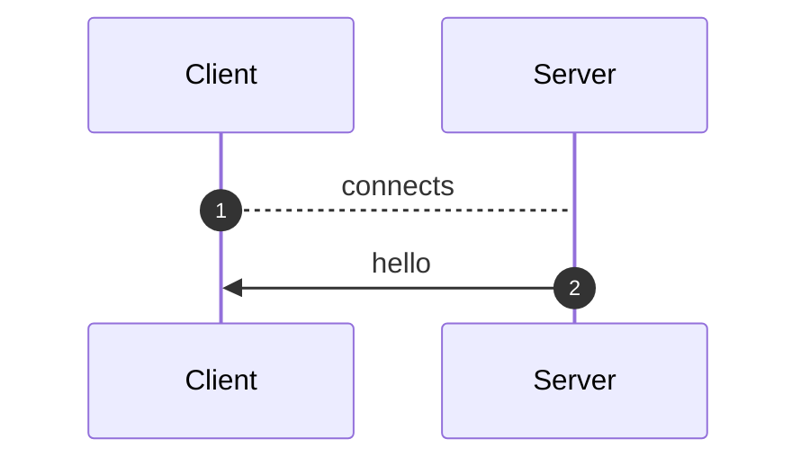
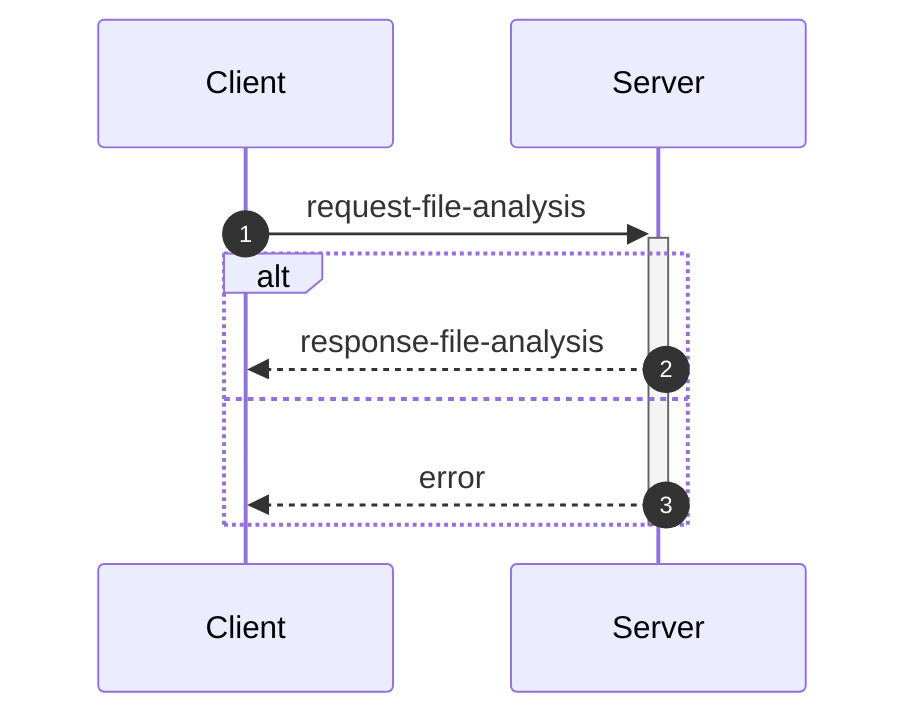
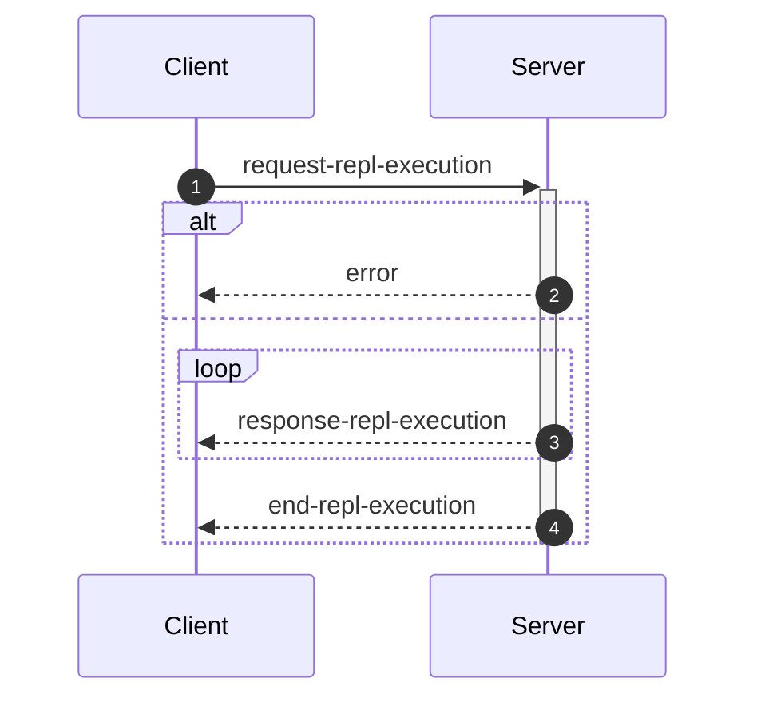
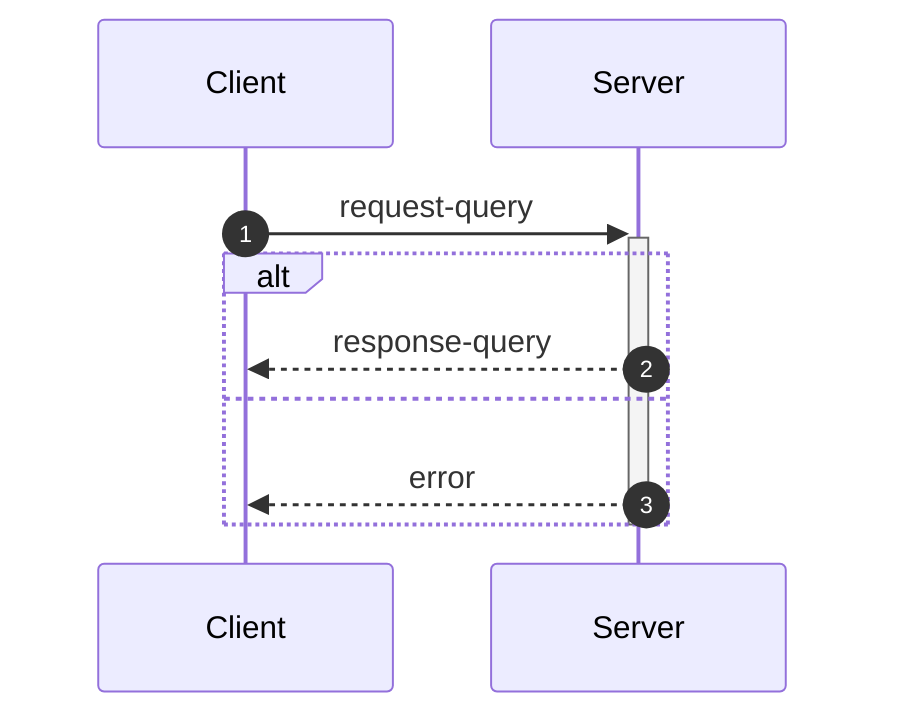

_<span title="an overview of flowR's interface">Generated</span> from '[wiki-interface.ts](https://github.com/flowr-analysis/flowr/tree/main/src/documentation/wiki-interface.ts "src/documentation/wiki-interface.ts")' on 2026-11-04, 17:20:41 UTC (v2.17.1, R v4.6.1), do not edit directly._

Although far from being as detailed as the in-depth explanation of [_flowR_](https://github.com/flowr-analysis/flowr/wiki/Core),
this wiki page explains how to interface with _flowR_ in more detail.
In general, command line arguments and other options provide short descriptions on hover over.

* [💻 Using the REPL](#using-the-repl)
* [⚙️ Configuring FlowR](#configuring-flowr)
* [⚒️ Writing Code](#writing-code)
* [💬 Communicating with the Server](#communicating-with-the-server)

<a id='using-the-repl'></a>
## 💻 Using the REPL

> [!NOTE]
> To execute arbitrary R commands with a repl request, _flowR_ has to be started explicitly with <span title="Description (Command Line Argument): Allow to access the underlying R session when using flowR (security warning: this allows the execution of arbitrary R code!)">`--r-session-access`</span>.
> Please be aware that this introduces a security risk and note that this relies on the [`r-shell` engine](https://github.com/flowr-analysis/flowr/wiki/Engines) .

Although primarily meant for users to explore,
there is nothing which forbids calling _flowR_ as a subprocess to use standard-in, -output, and -error
for communication (although you can access the REPL using the server as well,
with the [REPL Request](#message-request-repl-execution) message).

The read-eval-print loop&nbsp;(REPL) works relatively simple.
You can submit an expression (using <kbd>Enter</kbd>),
which is interpreted as an R&nbsp;expression by default but interpreted as a *command* if it starts with a colon (`:`).
The best command to get started with the REPL is <span title="Description (Repl Command): Show help information (aliases: :h, :?)">`:help`</span>.
Besides, you can leave the REPL either with the command <span title="Description (Repl Command): End the repl (aliases: :q, :exit)">`:quit`</span> or by pressing <kbd>Ctrl</kbd>+<kbd>C</kbd> twice.
When writing a *command*, you may press <kbd>Tab</kbd> to get a list of completions, if available.
Multiple commands can be entered in a single line by separating them with a semicolon (`;`), e.g. `:parse "x<-2"; :df*`.
If a command is given without R code, the REPL will re-use R code given in a previous command.
The prior example will hence return first the parsed AST of the program and then the dataflow graph for `"x <- 2"`.

> [!NOTE]
> If you develop flowR, you may want to launch the repl using the `npm run main-dev` command, this way, you get a non-minified version of flowR with debug information and hot-reloading of source files.

<details>
<summary>Available Commands</summary>

We currently offer the following commands (this with a `[*]` suffix are available with and without the star):

| Command | Description |
| ------- | ----------- |
| **<span title="Description (Repl Command): End the repl (aliases: :q, :exit)">:quit</span>** | End the repl (aliases: **:<span title="Alias of ':quit'. End the repl">q</span>**, **:<span title="Alias of ':quit'. End the repl">exit</span>**) |
| **<span title="Description (Repl Command): Execute the given code as R code. This requires the `--r-session-access` flag to be set and requires the r-shell engine. (aliases: :e, :r)">:execute</span>** | Execute the given code as R code. This requires the `--r-session-access` flag to be set and requires the r-shell engine. (aliases: **:<span title="Alias of ':execute'. Execute the given code as R code. This requires the `--r-session-access` flag to be set and requires the r-shell engine.">e</span>**, **:<span title="Alias of ':execute'. Execute the given code as R code. This requires the `--r-session-access` flag to be set and requires the r-shell engine.">r</span>**) |
| **<span title="Description (Repl Command): Get mermaid code for the control-flow graph of R code (aliases: :cfg, :cf)">:controlflow[*]</span>** | Get mermaid code for the control-flow graph of R code (star: Returns the URL to mermaid.live) (aliases: **:<span title="Alias of ':controlflow'. Get mermaid code for the control-flow graph of R code">cfg</span>**, **:<span title="Alias of ':controlflow'. Get mermaid code for the control-flow graph of R code">cf</span>**) |
| **<span title="Description (Repl Command): Get mermaid code for the control-flow graph with basic blocks (aliases: :cfgb, :cfb)">:controlflowbb[*]</span>** | Get mermaid code for the control-flow graph with basic blocks (star: Returns the URL to mermaid.live) (aliases: **:<span title="Alias of ':controlflowbb'. Get mermaid code for the control-flow graph with basic blocks">cfgb</span>**, **:<span title="Alias of ':controlflowbb'. Get mermaid code for the control-flow graph with basic blocks">cfb</span>**) |
| **<span title="Description (Repl Command): Get mermaid code for the dataflow graph (aliases: :d, :df)">:dataflow[*]</span>** | Get mermaid code for the dataflow graph (star: Returns the URL to mermaid.live) (aliases: **:<span title="Alias of ':dataflow'. Get mermaid code for the dataflow graph">d</span>**, **:<span title="Alias of ':dataflow'. Get mermaid code for the dataflow graph">df</span>**) |
| **<span title="Description (Repl Command): Get mermaid code for the normalized AST of R code (aliases: :n)">:normalize[*]</span>** | Get mermaid code for the normalized AST of R code (star: Returns the URL to mermaid.live) (alias: **:<span title="Alias of ':normalize'. Get mermaid code for the normalized AST of R code">n</span>**) |
| **<span title="Description (Repl Command): Get mermaid code for the simplified dataflow graph (aliases: :ds, :dfs)">:dataflowsimple[*]</span>** | Get mermaid code for the simplified dataflow graph (star: Returns the URL to mermaid.live) (aliases: **:<span title="Alias of ':dataflowsimple'. Get mermaid code for the simplified dataflow graph">ds</span>**, **:<span title="Alias of ':dataflowsimple'. Get mermaid code for the simplified dataflow graph">dfs</span>**) |
| **<span title="Description (Repl Command): Inspect and extend the signature database: `query` (identical to :query @signature), `info <name>` for where a function comes from (identical to :query @function-info), `add <path>` to mount another database/source, `download` to fetch the full-history database. (aliases: :sig)">:signature</span>** | Inspect and extend the signature database: `query` (identical to :query @signature), `info <name>` for where a function comes from (identical to :query @function-info), `add <path>` to mount another database/source, `download` to fetch the full-history database. (alias: **:<span title="Alias of ':signature'. Inspect and extend the signature database: `query` (identical to :query @signature), `info <name>` for where a function comes from (identical to :query @function-info), `add <path>` to mount another database/source, `download` to fetch the full-history database.">sig</span>**) |
| **<span title="Description (Repl Command): Just calculates the DFG, but only prints summary info (aliases: :d#, :df#)">:dataflowsilent</span>** | Just calculates the DFG, but only prints summary info (aliases: **:<span title="Alias of ':dataflowsilent'. Just calculates the DFG, but only prints summary info">d#</span>**, **:<span title="Alias of ':dataflowsilent'. Just calculates the DFG, but only prints summary info">df#</span>**) |
| **<span title="Description (Repl Command): Prints ASCII Art of the parsed, unmodified AST (aliases: :p)">:parse</span>** | Prints ASCII Art of the parsed, unmodified AST (alias: **:<span title="Alias of ':parse'. Prints ASCII Art of the parsed, unmodified AST">p</span>**) |
| **<span title="Description (Repl Command): Prints the version of flowR as well as the current version of R">:version</span>** | Prints the version of flowR as well as the current version of R
| **<span title="Description (Repl Command): Query the given R code (use 'help' for more information)">:query[*]</span>** | Query the given R code (use 'help' for more information) (star: Similar to query, but returns the output in json format.)
| **<span title="Description (Repl Command): Returns an ASCII representation of the dataflow graph (aliases: :df!)">:dataflowascii</span>** | Returns an ASCII representation of the dataflow graph (alias: **:<span title="Alias of ':dataflowascii'. Returns an ASCII representation of the dataflow graph">df!</span>**) |
| **<span title="Description (Repl Command): Returns summarization stats for the normalized AST (aliases: :n#)">:normalize#</span>** | Returns summarization stats for the normalized AST (alias: **:<span title="Alias of ':normalize#'. Returns summarization stats for the normalized AST">n#</span>**) |
| **<span title="Description (Repl Command): Show help information (aliases: :h, :?)">:help</span>** | Show help information (aliases: **:<span title="Alias of ':help'. Show help information">h</span>**, **:<span title="Alias of ':help'. Show help information">?</span>**) |

</details>

> [!TIP]
> 
> As indicated by the examples before, all REPL commands that operate on code keep track of the state.
> Hence, if you run a command like <span title="Description (Repl Command, starred version): Returns the URL to mermaid.live; Base Command: Get mermaid code for the dataflow graph (aliases: :d*, :df*)">`:dataflow*`</span> without providing R code,
> the REPL will re-use the R code provided in a previous command.
> Likewise, doing this will benefit from incrementality!
> If you request the dataflow graph with `:df* x <- 2 * y` and then want to see the parsed AST with `:parse`,
> the REPL will re-use previously obtained information and not re-parse the code again.
> 		

Generally, many commands offer shortcut versions in the REPL. Many queries, for example, offer a shortened format (see the example below).
Of special note, the [Config Query](https://github.com/flowr-analysis/flowr/wiki/%5BQuery%5D-Config)
can be used to also modify the currently active configuration of _flowR_ within the REPL (see the [wiki page](https://github.com/flowr-analysis/flowr/wiki/%5BQuery%5D-Config) for more information).

### Example: Retrieving the Dataflow Graph

To retrieve a URL to the [mermaid](https://mermaid.js.org/) diagram of the dataflow of a given expression,
use <span title="Description (Repl Command, starred version): Returns the URL to mermaid.live; Base Command: Get mermaid code for the dataflow graph (aliases: :d*, :df*)">`:dataflow*`</span> (or <span title="Description (Repl Command): Get mermaid code for the dataflow graph (aliases: :d, :df)">`:dataflow`</span> to get the mermaid code in the cli):

```shell
$ docker run -it --rm eagleoutice/flowr # or npm run flowr 
flowR repl v2.17.1, R grammar v14 (tree-sitter engine)
R> :dataflow* y <- 1 + x
```

<details>
<summary style='color:gray'>Output</summary>

```text
https://mermaid.live/view#base64:eyJjb2RlIjoiZmxvd2NoYXJ0IFREXG4gICAgMXt7XCJgKiM5MTtSTnVtYmVyIzkzOyogKioxKipcbiAgICAgICoxLjYqICgqKmlkOiAxKiopYFwifX1cbiAgICAyKFtcImAqIzkxO1JTeW1ib2wjOTM7KiAqKngqKlxuICAgICAgKjEuMTAqICgqKmlkOiAyKiopYFwiXSlcbiAgICAzW1tcImAqIzkxO1JCaW5hcnlPcCM5MzsqIGJhc2UjNTg7IzU4OyoqIzQzOyoqXG4gICAgICAqMS42LTEwKiAoKippZDogMyoqKVxuICAgIGFyZzogKDEsIDIpYFwiXV1cbiAgICBidWlsdC1pbjpfNDNfW1wiYEJ1aWx0LUluOlxuIzQzO2BcIl1cbiAgICBzdHlsZSBidWlsdC1pbjpfNDNfIHN0cm9rZTpncmF5LGZpbGw6Z3JheSxzdHJva2Utd2lkdGg6MnB4LG9wYWNpdHk6Ljg7XG4gICAgMFtcImAqIzkxO1JTeW1ib2wjOTM7KiAqKnkqKlxuICAgICAgKjEuMSogKCoqaWQ6IDAqKiwgdjogMylgXCJdXG4gICAgNFtbXCJgKiM5MTtSQmluYXJ5T3AjOTM7KiBiYXNlIzU4OyM1ODsqKiM2MDsjNDU7KipcbiAgICAgICoxLjEtMTAqICgqKmlkOiA0KiopXG4gICAgYXJnOiAoMCwgMylgXCJdXVxuICAgIGJ1aWx0LWluOl82MF8tW1wiYEJ1aWx0LUluOlxuIzYwOyM0NTtgXCJdXG4gICAgc3R5bGUgYnVpbHQtaW46XzYwXy0gc3Ryb2tlOmdyYXksZmlsbDpncmF5LHN0cm9rZS13aWR0aDoycHgsb3BhY2l0eTouODtcbiAgICAxIC0uLT58XCJmbG93XCJ8IDJcbiAgICBsaW5rU3R5bGUgMCBzdHJva2U6Z3JheSxjb2xvcjpncmF5O1xuICAgIDIgLS4tPnxcImZsb3dcInwgM1xuICAgIGxpbmtTdHlsZSAxIHN0cm9rZTpncmF5LGNvbG9yOmdyYXk7XG4gICAgMyAtLT58XCJyZWFkcywgYXJnXCJ8IDFcbiAgICAzIC0tPnxcInJlYWRzLCBhcmdcInwgMlxuICAgIDMgLS4tPnxcImZsb3dcInwgMFxuICAgIGxpbmtTdHlsZSA0IHN0cm9rZTpncmF5LGNvbG9yOmdyYXk7XG4gICAgMyAtLi0+fFwicmVhZHMsIGNhbGxzXCJ8IGJ1aWx0LWluOl80M19cbiAgICBsaW5rU3R5bGUgNSBzdHJva2U6Z3JheTtcbiAgICAwIC0tPnxcImRlZmluZWQtYnksIGZsb3dcInwgNFxuICAgIDAgLS0+fFwiZGVmaW5lZC1ieVwifCAzXG4gICAgNCAtLT58XCJyZWFkcywgYXJnXCJ8IDNcbiAgICA0IC0tPnxcInJldHVybnMsIGFyZ1wifCAwXG4gICAgNCAtLi0+fFwicmVhZHMsIGNhbGxzXCJ8IGJ1aWx0LWluOl82MF8tXG4gICAgbGlua1N0eWxlIDEwIHN0cm9rZTpncmF5OyIsIm1lcm1haWQiOnsiYXV0b1N5bmMiOnRydWV9fQ==
```

Retrieve the dataflow graph of the expression `y <- 1 + x`. It looks like this:


<details>

<summary style="color:gray">R Code of the Dataflow Graph</summary>

The analysis ran (parse and normalize with the [tree-sitter](https://github.com/flowr-analysis/flowr/wiki/Engines) engine) in the generation environment. No [signature database](https://github.com/flowr-analysis/flowr/wiki/Signature-Database) is mounted, so `library()` attaches no exports (base-R names are still qualified, e.g., `stats::acf`). 
We encountered no unknown side effects during the analysis.

```r
y <- 1 + x
```

</details>

</details>

For small graphs like this, <span title="Description (Repl Command): Returns an ASCII representation of the dataflow graph (aliases: :df!)">`:dataflowascii`</span> also provides an ASCII representation directly in the REPL:

```shell
$ docker run -it --rm eagleoutice/flowr # or npm run flowr 
flowR repl v2.17.1, R grammar v14 (tree-sitter engine)
R> :df! y <- 1 + x
```

<details open>
<summary style='color:gray'>Output</summary>

```text
                        v<0>v
 c<4>c──────────────────| y |
 |<- |     ┌────────────v---v
 c---c     │
    │   c<3>c   0<1>0
    └───| + |───| 1 |───u<2>u
        c---c   0---0   | x |
           └────────────u---u
Edges:
3 -> 1: reads, arg          3 -> 2: reads, arg
3 -> 0: flows-to            1 -> 2: flows-to
2 -> 3: flows-to            4 -> 3: reads, arg
4 -> 0: returns, arg        0 -> 4: defined-by, flows-to
0 -> 3: defined-by
```

Retrieve the dataflow graph of the expression `y <- 1 + x` as ASCII art.

</details>

For the slicing with <span title="Description (Repl Command): Static backwards executable slicer for R">`:slicer`</span>, you have access to the same [magic comments](#slice-magic-comments) as with the [slice request](#message-request-slice).
Pass `--inline` to splice resolvable `source()` calls into the reconstruction so the slice is a single self-contained R text (the same as the static slice query's `inlineSources` flag).
See `--help` for more flags!

### Example: Interfacing with the File System

Many commands that allow for an R-expression (like <span title="Description (Repl Command, starred version): Returns the URL to mermaid.live; Base Command: Get mermaid code for the dataflow graph (aliases: :d*, :df*)">`:dataflow*`</span>) allow for a file as well
if the argument starts with `file://`.
If you are working from the root directory of the _flowR_ repository, the following gives you the parsed AST of the example file using the <span title="Description (Repl Command): Prints ASCII Art of the parsed, unmodified AST (aliases: :p)">`:parse`</span> command:

> **Watch mode**: Replace `file://` with `watch://` to enter watch mode.
> flowR runs the command immediately and then re-runs it every time the file (or any file inside the folder) changes.
> Enter any other command to leave watch mode.
> For example: `:df watch://analysis.R`

```shell
$ docker run -it --rm eagleoutice/flowr # or npm run flowr 
flowR repl v2.17.1, R grammar v14 (tree-sitter engine)
R> :parse file://test/testfiles/example.R
```

<details>
<summary style='color:gray'>Output</summary>

```text
File: test/testfiles/example.R

program
├ binaryoperator
│ ├ identifier "sum" (1:1─4)
│ ├ <- "<-" (1:5─7)
│ ╰ float "0" (1:8─9)
├ binaryoperator
│ ├ identifier "product" (2:1─8)
│ ├ <- "<-" (2:9─11)
│ ╰ float "1" (2:12─13)
├ binaryoperator
│ ├ identifier "w" (3:1─2)
│ ├ <- "<-" (3:3─5)
│ ╰ float "7" (3:6─7)
├ binaryoperator
│ ├ identifier "N" (4:1─2)
│ ├ <- "<-" (4:3─5)
│ ╰ float "10" (4:6─8)
├ forstatement
│ ├ for "for" (6:1─4)
│ ├ ( "(" (6:5─6)
│ ├ identifier "i" (6:6─7)
│ ├ in "in" (6:8─10)
│ ├ binaryoperator
│ │ ├ float "1" (6:11─12)
│ │ ├ : ":" (6:12─13)
│ │ ╰ parenthesizedexpression
│ │   ├ ( "(" (6:13─14)
│ │   ├ binaryoperator
│ │   │ ├ identifier "N" (6:14─15)
│ │   │ ├ - "-" (6:15─16)
│ │   │ ╰ float "1" (6:16─17)
│ │   ╰ ) ")" (6:17─18)
│ ├ ) ")" (6:18─19)
│ ╰ bracedexpression
│   ├ { "{" (6:20─21)
│   ├ binaryoperator
│   │ ├ identifier "sum" (7:3─6)
│   │ ├ <- "<-" (7:7─9)
│   │ ╰ binaryoperator
│   │   ├ binaryoperator
│   │   │ ├ identifier "sum" (7:10─13)
│   │   │ ├ + "+" (7:14─15)
│   │   │ ╰ identifier "i" (7:16─17)
│   │   ├ + "+" (7:18─19)
│   │   ╰ identifier "w" (7:20─21)
│   ├ binaryoperator
│   │ ├ identifier "product" (8:3─10)
│   │ ├ <- "<-" (8:11─13)
│   │ ╰ binaryoperator
│   │   ├ identifier "product" (8:14─21)
│   │   ├  "" (8:22─23)
│   │   ╰ identifier "i" (8:24─25)
│   ╰ } "}" (9:1─2)
├ call
│ ├ identifier "cat" (11:1─4)
│ ╰ arguments
│   ├ ( "(" (11:4─5)
│   ├ argument
│   │ ╰ string
│   │   ├ stringopen "\"" (11:5─6)
│   │   ├ stringcontent "Sum:" (11:6─10)
│   │   ╰ stringclose "\"" (11:10─11)
│   ├ comma "," (11:11─12)
│   ├ argument
│   │ ╰ identifier "sum" (11:13─16)
│   ├ comma "," (11:16─17)
│   ├ argument
│   │ ╰ string
│   │   ├ stringopen "\"" (11:18─19)
│   │   ├ stringcontent
│   │   │ ╰ escapesequence "\\n" (11:19─21)
│   │   ╰ stringclose "\"" (11:21─22)
│   ╰ ) ")" (11:22─23)
╰ call
  ├ identifier "cat" (12:1─4)
  ╰ arguments
    ├ ( "(" (12:4─5)
    ├ argument
    │ ╰ string
    │   ├ stringopen "\"" (12:5─6)
    │   ├ stringcontent "Product:" (12:6─14)
    │   ╰ stringclose "\"" (12:14─15)
    ├ comma "," (12:15─16)
    ├ argument
    │ ╰ identifier "product" (12:17─24)
    ├ comma "," (12:24─25)
    ├ argument
    │ ╰ string
    │   ├ stringopen "\"" (12:26─27)
    │   ├ stringcontent
    │   │ ╰ escapesequence "\\n" (12:27─29)
    │   ╰ stringclose "\"" (12:29─30)
    ╰ ) ")" (12:30─31)
```

Retrieve the parsed AST of the example file.

<details>

<summary>File Content</summary>

```r
sum <- 0
product <- 1
w <- 7
N <- 10

for (i in 1:(N-1)) {
  sum <- sum + i + w
  product <- product * i
}

cat("Sum:", sum, "\n")
cat("Product:", product, "\n")
```

</details>

As _flowR_ directly transforms this AST the output focuses on being human-readable instead of being machine-readable.
		
</details>

### Example: Run a Query

You can run any query supported by _flowR_ using the <span title="Description (Repl Command): Query the given R code (use 'help' for more information)">`:query`</span> command.
For example, to obtain the shapes of all data frames in a given piece of code, you can run:

```shell
$ docker run -it --rm eagleoutice/flowr # or npm run flowr 
flowR repl v2.17.1, R grammar v14 (tree-sitter engine)
R> :query @absint df-shape "x <- data.frame(a = 1:10, b = 1:10)\ny <- x$a"
```

<details open>
<summary style='color:gray'>Output</summary>

```text
Query: absint (3 ms)
   ╰ $12: (colnames: [{"a", "b"}, {}], cols: [2, 2], rows: [10, 10])
   ╰ $0: (colnames: [{"a", "b"}, {}], cols: [2, 2], rows: [10, 10])
```

Retrieve the shapes of all data frames in the given code.

</details>

To run the linter on a file, you can use (in this example, we just issue the `dead-code` linter on a small piece of code):

```shell
$ docker run -it --rm eagleoutice/flowr # or npm run flowr 
flowR repl v2.17.1, R grammar v14 (tree-sitter engine)
R> :query @linter rules:dead-code "if(FALSE) x <- 2"
```

<details open>
<summary style='color:gray'>Output</summary>

```text
Query: linter (2 ms)
   ╰ Dead Code (dead-code):
       ╰ certain:
           ╰ Code at 1.11-16 (1 quick fix(es) available)
```

Run the linter on the given code, with only the `dead-code` rule enabled.

</details>

For more information on the available queries, please check out the [Query API](https://github.com/flowr-analysis/flowr/wiki/Query-API).

<a id='configuring-flowr'></a>
## ⚙️ Configuring FlowR

When running _flowR_, you may want to specify some behaviors with a dedicated configuration file.
By default, flowR looks for a file named `flowr.json` in the current working directory (or any higher directory).
You can also specify a different file with <span title="Description (Command Line Argument): The name of the configuration file to use">`--config-file`</span> or pass the configuration inline using <span title="Description (Command Line Argument): The flowR configuration to use, as a JSON string">`--config-json`</span>.
A `flowr.json` found this way belongs to the analyzed project, so flowR ignores its options that decide what flowR executes or loads
(`engines.*.wasmPath`, `engines.*.treeSitterWasmPath`, `engines.*.rPath`, `solver.sigdb.additionalPaths`, `solver.sigdb.downloadRepo`, `solver.sigdb.installedLibrary.paths`, `solver.sigdb.onDemand.enabled`, `solver.sigdb.onDemand.repositories`, `solver.sigdb.onDemand.cranMirror`, `solver.sigdb.onDemand.bioconductorMirror`, `solver.sigdb.onDemand.cacheDir`),
unless you pass <span title="Description (Command Line Argument): Keep the security-sensitive options (e.g., the R executable) of the flowr.json found in the working directory or a parent. Only use this for projects you trust.">`--trust-config`</span>.
To analyze code you do not trust, use the secure mode (<span title="Description (Command Line Argument): Run in secure mode for analyzing untrusted code: flowR does not start R (or any other process), does not access the network, does not search for project configs, and ignores security-sensitive options in every config. Cannot be disabled once enabled. Can also be enabled with the environment variable {italic FLOWR_SECURE_MODE=1}.">`--secure`</span>, see the [security policy](https://github.com/flowr-analysis/flowr/blob/main/.github/SECURITY.md)).
To inspect the current configuration, you can run flowr with the <span title="Description (Command Line Argument): Run with verbose logging (will be passed to the corresponding script)">`--verbose`</span> flag, or use the `config` [Query](https://github.com/flowr-analysis/flowr/wiki/Query-API).
Within the REPL this works by running the following:

```shell
:query @config
```

To work with the <a href="https://github.com/flowr-analysis/flowr/tree/main/src/config.ts#L119"><code><span title="The configuration file format for flowR.">FlowrConfig</span></code></a> you can use the provided helper objects alongside its methods like
<a href="https://github.com/flowr-analysis/flowr/tree/main/src/config.ts#L966"><code><span title="Creates a new flowr config that has the updated values.">FlowrConfig::<b>amend</b></span></code></a>.
The schema below documents every option; the ones you most likely want are:

- <a href="https://github.com/flowr-analysis/flowr/wiki/Interface#configuring-flowr" title="Configuration Option (boolean): Whether source calls should be ignored, causing {@link processSourceCall}&#39;s behavior to be skipped.">ignoreSourceCalls</a>: ignore source calls when analyzing the code, i.e., ignore the inclusion of other files.
- <a href="https://github.com/flowr-analysis/flowr/wiki/Interface#configuring-flowr" title="Configuration Option (boolean): Whether load calls should be ignored, causing {@link processLoadCall}&#39;s behavior to be skipped.">ignoreLoadCalls</a>: ignore load calls when analyzing the code, i.e., ignore the loading of r-data files.
- <a href="https://github.com/flowr-analysis/flowr/wiki/Interface#configuring-flowr" title="Configuration Option (object): Do you want to overwrite (parts) of the builtin definition?">semantics.environment.overwriteBuiltIns</a>: overwrite _flowR_'s handling of built-in functions, or clear the preset definitions entirely.
  See [Configure BuiltIn Semantics](#configure-builtin-semantics) for more information.
- <a href="https://github.com/flowr-analysis/flowr/wiki/Interface#configuring-flowr" title="Configuration Option (string): How to resolve variables and their values. (one of &quot;disabled&quot;, &quot;alias&quot;, &quot;builtin&quot;)">solver.variables</a>: how to resolve variables and their values (`disabled`, `alias`, `builtin`).
- <a href="https://github.com/flowr-analysis/flowr/wiki/Interface#configuring-flowr" title="Configuration Option (array): The engine or set of engines to use for interacting with R code. An empty array means all available engines will be used.">engines</a> and <a href="https://github.com/flowr-analysis/flowr/wiki/Interface#configuring-flowr" title="Configuration Option (string): The default engine to use for interacting with R code. If this is undefined, an arbitrary engine from the specified list will be used. (one of &quot;tree-sitter&quot;, &quot;r-shell&quot;)">defaultEngine</a>: the engines used to interact with R code, see the [Engines wiki page](https://github.com/flowr-analysis/flowr/wiki/Engines).
- <a href="https://github.com/flowr-analysis/flowr/wiki/Interface#configuring-flowr" title="Configuration Option (array): Files a framework loads on its own, without any source() call (e.g. global.R in a shiny app), in the order they are loaded; flowR orders the matching project files accordingly and analyzes them as one program. Entries are case-insensitive globs matched against the file path, a plain name matches any file with that name, and entries matching no project file are warned about. Usually set per project kind via specializeConfig.">project.implicitSources</a>: the files a framework loads without any `source()` call, in the order in which they are
  loaded. Entries are globs (e.g. `R/*.R`) matched against the file path ignoring capitalization; one matching no file is reported.
- <a href="https://github.com/flowr-analysis/flowr/wiki/Interface#configuring-flowr" title="Configuration Option (object): Overwrite (parts of) the configuration depending on the project kind flowR detects, e.g. to give a shiny app its implicit sources.">specializeConfig</a>: overwrite (parts of) the configuration depending on the kind of project _flowR_ detects
  (e.g. `shiny-app`), which is how a shiny app gets its implicit sources by default. What you configure directly wins.
- <a href="https://github.com/flowr-analysis/flowr/wiki/Interface#configuring-flowr" title="Configuration Option (string): Overwrite the project kind flowR would otherwise infer from the analyzed files, e.g. when auto-detection guesses wrong. (one of &quot;package&quot;, &quot;script&quot;, &quot;shiny-app&quot;, &quot;notebook&quot;, &quot;project&quot;, &quot;unknown&quot;)">project.useProjectType</a>: skip that detection and force a project kind yourself, when auto-detection guesses wrong.
- <a href="https://github.com/flowr-analysis/flowr/wiki/Interface#configuring-flowr" title="Configuration Option (array): The default plugins to load when creating a new instance of FlowrAnalyzer">defaultPlugins</a> and <a href="https://github.com/flowr-analysis/flowr/wiki/Interface#configuring-flowr" title="Configuration Option (array): The plugins to load in REPL mode">repl.plugins</a>: the plugins to load for a new <a href="https://github.com/flowr-analysis/flowr/tree/main/src/project/flowr-analyzer.ts#L210"><code><span title="Central class for conducting analyses with FlowR. Use the FlowrAnalyzerBuilder to create a new instance. If you want the original pattern of creating a pipeline and running all steps, you can still do this with FlowrAnalyzer#runFull . To inspect the context of the analyzer, use FlowrAnalyzer#inspectContext (if you are a plugin and need to modify it, use FlowrAnalyzer#context instead).">FlowrAnalyzer</span></code></a> and in the REPL
  (use `flowr:default` to reference the former).

So you can configure _flowR_ by adding a file like the following:

<details>

<summary>Example Configuration File</summary>

```json
{
  "ignoreSourceCalls": true,
  "ignoreLoadCalls": true,
  "semantics": {
    "environment": {
      "overwriteBuiltIns": {
        "definitions": [
          {
            "type": "function",
            "names": [
              "foo"
            ],
            "processor": "builtin:assign",
            "config": {}
          }
        ]
      }
    }
  },
  "defaultPlugins": [
    "file:description",
    "versions:description"
  ],
  "repl": {
    "quickStats": false,
    "dfProcessorHeat": false,
    "hints": true,
    "plugins": [
      "flowr:default"
    ]
  },
  "project": {
    "resolveUnknownPathsOnDisk": true,
    "implicitSources": [
      "global.R",
      "app.R"
    ]
  },
  "linter": {
    "disabledRules": []
  },
  "specializeConfig": {
    "shiny-app": {
      "project": {
        "implicitSources": [
          "global.R",
          "ui.R",
          "server.R",
          "app.R"
        ]
      }
    }
  },
  "engines": [
    {
      "type": "r-shell"
    }
  ],
  "solver": {
    "variables": "alias",
    "evalStrings": true,
    "trackEnvironments": true,
    "sigdb": {
      "enabled": true,
      "loadProjectDependencies": true,
      "eagerlyLoad": false,
      "eagerlyLoadExports": false,
      "linkBaseR": false,
      "linkDescriptionDependencies": false
    },
    "resolveSource": {
      "dropPaths": "no",
      "ignoreCapitalization": true,
      "inferWorkingDirectory": "active-script",
      "searchPath": []
    },
    "instrument": {},
    "slicer": {
      "threshold": 50
    }
  },
  "abstractInterpretation": {
    "wideningThreshold": 4,
    "followCalls": true,
    "dataFrame": {
      "maxColNames": 20,
      "readLoadedData": {
        "readExternalFiles": true,
        "maxReadLines": 1000000
      }
    }
  },
  "incremental": {
    "alwaysIncremental": false,
    "parsing": {
      "activated": false,
      "heuristics": {
        "activated": true,
        "mtime": true,
        "linesFrom": 500,
        "bytesFrom": 50000,
        "alwaysWithEdits": false,
        "minFiles": 1
      }
    }
  },
  "gas": {
    "thresholds": {
      "memory": {
        "problematic": 0.7,
        "critical": 0.9
      },
      "timeMs": {
        "problematic": 100000,
        "critical": 120000
      }
    },
    "features": {}
  }
}
```

</details>

<details>
<a id='configure-builtin-semantics'></a>
<summary>Configure Built-In Semantics</summary>

`semantics/environment/overwriteBuiltins` accepts two keys:

- `loadDefaults` (boolean, initially `true`): If set to `true`, the default built-in definitions are loaded before applying the custom definitions. Setting this flag to `false` explicitly disables the loading of the default definitions.
- `definitions` (array, initially empty): Allows to overwrite or define new built-in elements. Each object within must have a `type` which is one of the below. Furthermore, they may define a string array of `names` which specifies the identifiers to bind the definitions to. You may use `assumePrimitive` to specify whether _flowR_ should assume that this is a primitive non-library definition (so you probably just do not want to specify the key).

  | Type            | Description                                                                                                                                                                                                                                                                                              | Example                                                                                                    |
  | --------------- | -------------------------------------------------------------------------------------------------------------------------------------------------------------------------------------------------------------------------------------------------------------------------------------------------------- | ---------------------------------------------------------------------------------------------------------- |
  | `constant`    | Additionally allows for a `value` this should resolve to.                                                                                                                                                                                                                                                | `{ type: 'constant', names: ['NULL', 'NA'],  value: null }`                                                |
  | `function`    | Is a rather flexible way to define and bind built-in functions. For the time, we do not have extensive documentation to cover all the cases, so please either consult the sources with the `default-builtin-config.ts` or open a [new issue](https://github.com/flowr-analysis/flowr/issues/new/choose). | `{ type: 'function', names: ['next'], processor: 'builtin:d', config: { cfg: ExitPointType.Next } }` |
  | `replacement` | A comfortable way to specify replacement functions like `$<-` or `names<-`. `suffixes` describes the... suffixes to attach automatically. | `{ type: 'replacement', suffixes: ['<-', '<<-'], names: ['[', '[['] }` |

</details>

<details>

<summary style='color:gray'>Full Configuration-File Schema</summary>

- _The configuration file format for flowR._ (object)
    - **logLevel** [optional] _flowR's global minimum log level, applied when the config is loaded._ (string)
        Only allows: 'silly', 'trace', 'debug', 'info', 'warn', 'error', 'fatal'
    - **ignoreSourceCalls** [optional] _Whether source calls should be ignored, causing {@link processSourceCall}'s behavior to be skipped._ (boolean)
    - **ignoreLoadCalls** [optional] _Whether load calls should be ignored, causing {@link processLoadCall}'s behavior to be skipped._ (boolean)
    - **semantics** _Configure language semantics and how flowR handles them._ (object)
        - **environment** [optional] _Semantics regarding how to handle the R environment._ (object)
            - **overwriteBuiltIns** [optional] _Do you want to overwrite (parts) of the builtin definition?_ (object)
                - **loadDefaults** [optional] _Should the default configuration still be loaded?_ (boolean)
                - **definitions** [optional] _The definitions to load/overwrite._ (array)
                Valid item types:
                    - (object)
    - **defaultPlugins** [optional] _The default plugins to load when creating a new instance of FlowrAnalyzer_ (array)
    Valid item types:
        - (alternatives)
            - (string)
            - (array)
    - **repl** _Configuration options for the REPL._ (object)
        - **quickStats** [optional] _Whether to show quick stats in the REPL after each evaluation._ (boolean)
        - **dfProcessorHeat** [optional] _This instruments the dataflow processors to count how often each processor is called._ (boolean)
        - **hints** [optional] _Whether to show dim inline hints on the empty prompt (automatically disabled on non-interactive terminals)._ (boolean)
        - **plugins** [optional] _The plugins to load in REPL mode_ (array)
        Valid item types:
            - (alternatives)
                - (string)
                - (array)
        - **autoUseFileProtocol** [optional] _Prepend the file protocol to a repl input that looks like a path, instead of only warning about it._ (boolean)
        - **queryStats** [optional] _Whether `:query` closes with the line stating how long the queries took (`:query*` never prints it)._ (boolean)
        - **showPlugins** [optional] _Whether `:version` grays out the plugins that did not activate during the last analysis._ (boolean)
    - **project** _Project specific configuration options._ (object)
        - **resolveUnknownPathsOnDisk** [optional] _Whether to resolve unknown paths loaded by the r project disk when trying to source/analyze files._ (boolean)
        - **failOnInaccessiblePath** [optional] _Whether a directory that cannot be traversed during file discovery (e.g. due to permissions) aborts the analysis; when false (the default) such paths are logged and skipped._ (boolean)
        - **basePackages** [optional] _The packages considered part of R itself (base and recommended); if unset, flowR uses its built-in list._ (array)
        Valid item types:
            - (string)
        - **implicitSources** [optional] _Files a framework loads on its own, without any source() call (e.g. global.R in a shiny app), in the order they are loaded; flowR orders the matching project files accordingly and analyzes them as one program. Entries are case-insensitive globs matched against the file path, a plain name matches any file with that name, and entries matching no project file are warned about. Usually set per project kind via specializeConfig._ (array)
        Valid item types:
            - (string)
        - **useProjectType** [optional] _Overwrite the project kind flowR would otherwise infer from the analyzed files, e.g. when auto-detection guesses wrong._ (string)
            Only allows: 'package', 'script', 'shiny-app', 'notebook', 'project', 'unknown'
        - **assumeImplicitEcho** [optional] _Whether the top level of the analyzed code is echoed, so that every visible result printed there is collected as an output by the dependencies query (default true, false for a package)._ (boolean)
        - **discovery** [optional] _Scoping options for the default project discovery._ (object)
            - **full** [optional] _Collect every file below the project root (greedy) instead of only the files the detected project kind needs (default false)._ (boolean)
            - **perKind** [optional] _Per-kind include/exclude glob overrides layered on the default scoping._ (object)
            - **ignore** [optional] _Case-insensitive globs that drop matching files from the intelligent discovery, regardless of kind (e.g. .Renviron to ignore environment files)._ (array)
            Valid item types:
                - (string)
        - **classification** [optional] _Overrides for the signals flowR uses to classify the project kind._ (object)
            - **shinyDescriptionTypes** [optional] _DESCRIPTION Type: values that mark a shiny app._ (array)
            Valid item types:
                - (string)
            - **shinyEntryFiles** [optional] _File names a shiny app is assembled from._ (array)
            Valid item types:
                - (string)
            - **shinyUsagePattern** [optional] _Regex source evidencing shiny usage in an entry file._ (string)
            - **notebookExtensions** [optional] _File extensions marking a notebook._ (array)
            Valid item types:
                - (string)
    - **linter** _Linter configuration options._ (object)
        - **disabledRules** _Linting rule names excluded from the default rule set (a rule requested explicitly via a linter query still runs). Usually set per project kind via specializeConfig._ (array)
        Valid item types:
            - (string)
        - **disabledTags** [optional] _Linting rule tags whose rules are excluded from the default rule set (a rule requested explicitly via a linter query still runs). By default the cmd-check rules are disabled for everything but a package; a configured list replaces that default._ (array)
        Valid item types:
            - (string)
    - **inputSources** [optional] _Further frameworks the input-sources analysis should know about; entries are added to flowR's defaults._ (object)
        - **pure** [optional] _Functions that only pass the constantness of their arguments on._ (array)
        Valid item types:
            - (string)
        - **param** [optional] _Functions whose result is a 'param' input._ (array)
        Valid item types:
            - (string)
        - **file** [optional] _Functions whose result is a 'file' input._ (array)
        Valid item types:
            - (string)
        - **tempfile** [optional] _Functions whose result is a 'tempfile' input._ (array)
        Valid item types:
            - (string)
        - **glob** [optional] _Functions whose result is a 'glob' input._ (array)
        Valid item types:
            - (string)
        - **net** [optional] _Functions whose result is a 'net' input._ (array)
        Valid item types:
            - (string)
        - **rand** [optional] _Functions whose result is a 'rand' input._ (array)
        Valid item types:
            - (string)
        - **system** [optional] _Functions whose result is a 'system' input._ (array)
        Valid item types:
            - (string)
        - **ffi** [optional] _Functions whose result is a 'ffi' input._ (array)
        Valid item types:
            - (string)
        - **lang** [optional] _Functions whose result is a 'lang' input._ (array)
        Valid item types:
            - (string)
        - **options** [optional] _Functions whose result is a 'options' input._ (array)
        Valid item types:
            - (string)
        - **cmdline** [optional] _Functions whose result is a 'cmdline' input._ (array)
        Valid item types:
            - (string)
        - **user** [optional] _Functions whose result is a 'user' input._ (array)
        Valid item types:
            - (string)
        - **const** [optional] _Functions whose result is a 'const' input._ (array)
        Valid item types:
            - (string)
        - **scope** [optional] _Functions whose result is a 'scope' input._ (array)
        Valid item types:
            - (string)
        - **dconst** [optional] _Functions whose result is a 'dconst' input._ (array)
        Valid item types:
            - (string)
        - **unknown** [optional] _Functions whose result is a 'unknown' input._ (array)
        Valid item types:
            - (string)
        - **linkedObjects** [optional] _Objects a framework provides without a definition in the code, e.g. shiny's input._ (array)
        Valid item types:
            - (object)
        - **linkedEntryPoints** [optional] _Calls that hand a function to a framework, which binds its objects to the parameters by position._ (array)
        Valid item types:
            - (object)
    - **specializeConfig** [optional] _Overwrite (parts of) the configuration depending on the project kind flowR detects, e.g. to give a shiny app its implicit sources._ (object)
    - **engines** _The engine or set of engines to use for interacting with R code. An empty array means all available engines will be used._ (array)
    Valid item types:
        - (alternatives)
            - _The configuration for the tree sitter engine._ (object)
                - **type** [required] _Use the tree sitter engine._ (string)
                    Only allows: 'tree-sitter'
                - **wasmPath** [optional] _The path to the tree-sitter-r WASM binary to use. If this is undefined, this uses the default path._ (string)
                - **treeSitterWasmPath** [optional] _The path to the tree-sitter WASM binary to use. If this is undefined, this uses the default path._ (string)
                - **lax** [optional] _Whether to use the lax parser for parsing R code (allowing for syntax errors). If this is undefined, the strict parser will be used._ (boolean)
            - _The configuration for the R shell engine._ (object)
                - **type** [required] _Use the R shell engine._ (string)
                    Only allows: 'r-shell'
                - **rPath** [optional] _The path to the R executable to use. If this is undefined, this uses the default path._ (string)
                - **pipeBind** [optional] _Whether to enable R's experimental pipe-bind operator "=>" by setting _R_USE_PIPEBIND_ for the R session (default false); R itself keeps this off by default, as it is experimental and has never shipped in a release version of R._ (boolean)
    - **defaultEngine** [optional] _The default engine to use for interacting with R code. If this is undefined, an arbitrary engine from the specified list will be used._ (string)
        Only allows: 'tree-sitter', 'r-shell'
    - **solver** _How to resolve constants, constraints, cells, ..._ (object)
        - **variables** _How to resolve variables and their values._ (string)
            Only allows: 'disabled', 'alias', 'builtin'
        - **evalStrings** _Should we include eval(parse(text="...")) calls in the dataflow graph?_ (boolean)
        - **trackEnvironments** [optional] _Track user-created environments (new.env, assign/get/local with envir=, dollar-assign, attach). When false, all envir-style calls fall through conservatively._ (boolean)
        - **sigdb** _Resolving library exports from a signature database._ (object)
            - **enabled** [optional] _Resolve library()/use() exports from a signature database (default true); when false no database is consulted._ (boolean)
            - **loadProjectDependencies** [optional] _Load the project's declared dependencies from its metadata files (DESCRIPTION Imports/Depends, rproject.toml, uvr.toml, rig rproj.toml and script blocks, renv.lock, rv.lock, uvr.lock, rig lockfiles) (default true); when false these files are not read for dependencies._ (boolean)
            - **eagerlyLoad** [optional] _Parse the database up front rather than on the first package load (default false, ignored if disabled)._ (boolean)
            - **eagerlyLoadExports** [optional] _Add a vertex for every export on load rather than on demand (default false); keeps the dataflow graph small._ (boolean)
            - **assumedRVersion** [optional] _R version assumed when resolving versioned (base-R) exports: a pin like "4.5" or "auto" to detect the installed R (default "auto")._ (string)
            - **linkBaseR** [optional] _Eagerly attach base-R namespaces so bare base calls resolve without library() (default false)._ (boolean)
            - **linkBaseRCalls** [optional] _Add a lightweight Reads edge from a bare base-R call to its signature-database function vertex (default false; base-R qualification is edge-free otherwise)._ (boolean)
            - **linkPackageCalls** [optional] _Add a lightweight Reads edge from a resolved package call to its signature-database function vertex (default false)._ (boolean)
            - **linkDescriptionDependencies** [optional] _Eagerly attach the namespaces of the project's declared DESCRIPTION dependencies (Imports/Depends) so their exports resolve without an explicit library() (default false)._ (boolean)
            - **warmInBackground** [optional] _Decompress the hot shards (base + most-downloaded) in a background task on startup so the first library() lookup is warm (default false; for long-running servers/REPLs)._ (boolean)
            - **additionalPaths** [optional] _Extra directories or bundle/manifest files searched for signature databases (alongside the shipped default and $FLOWR_SIGDB_DIR); a downloaded full-history bundle placed here is mounted automatically._ (array)
            Valid item types:
                - (string)
            - **downloadRepo** [optional] _GitHub owner/repo the full-history bundle is downloaded from via ":signature download" (default "flowr-analysis/flowr"; the release tag comes from the committed sigdb.remote.json unless a version is given)._ (string)
            - **autoSync** [optional] _On startup, re-download shards whose committed sigdb.remote.json hash no longer matches the cache, in the background (default false; opt-in network sync after a git pull)._ (boolean)
            - **installedLibrary** [optional] _Recovering packages no signature database knows from the copy installed on this machine._ (object)
                - **enabled** [required] _Recover packages no signature database knows from their installed copy (default false)._ (boolean)
                - **paths** [optional] _Library directories to search; when empty they are discovered from the environment and the project._ (array)
                Valid item types:
                    - (string)
                - **useEnvironment** [optional] _Search the libraries R_LIBS_USER/R_LIBS/R_LIBS_SITE name (default true)._ (boolean)
                - **useProjectLibrary** [optional] _Search a project-local renv/packrat library (default true)._ (boolean)
                - **maxDepth** [optional] _How far to descend into the nested layout of a project-local library (default 3)._ (number)
                - **packages** [optional] _Only recover packages whose name matches one of these regular expressions; empty means any._ (array)
                Valid item types:
                    - (string)
            - **onDemand** [optional] _Recovering packages no signature database knows from their sources on CRAN, Bioconductor, or GitHub._ (object)
                - **enabled** [required] _Fetch and recover the sources of packages no signature database knows when the analyzed code uses them (default false, accesses the network)._ (boolean)
                - **sources** [optional] _Where to look, in order: github, cran, bioconductor, or a source a plugin adds (default ["github", "cran", "bioconductor"])._ (array)
                Valid item types:
                    - (string)
                - **repositories** [optional] _GitHub repositories (owner/repo[/subdir][@ref]) to fetch packages from, by package name. The analyzed project may name more (DESCRIPTION Remotes, install_github calls)._ (object)
                - **packages** [optional] _Only recover packages whose name matches one of these regular expressions, empty means any._ (array)
                Valid item types:
                    - (string)
                - **cranMirror** [optional] _The CRAN src/contrib/ to fetch from, over https (default https://cloud.r-project.org/src/contrib/). It may be on the local network._ (string)
                - **bioconductorMirror** [optional] _The Bioconductor host, over https (default https://bioconductor.org). It may be on the local network._ (string)
                - **bioconductorRelease** [optional] _The Bioconductor release to fetch from: release, devel, or a number like 3.20 (default release)._ (string)
                - **githubMirrors** [optional] _Use the GitHub mirrors of CRAN (cran/<pkg>) and Bioconductor (bioc/<pkg>) (default true)._ (boolean)
                - **maxPackages** [optional] _The most packages to fetch for one analysis (default 25)._ (number)
                - **maxArchiveMb** [optional] _The most MiB a package archive may have (default 32). It may unpack to three times that, at most 128 MiB._ (number)
                - **offline** [optional] _Only use what was fetched before, never the network (default false)._ (boolean)
                - **retryAfterHours** [optional] _How many hours to wait before asking again for a package no source had (default 24)._ (number)
                - **cacheDir** [optional] _Where to cache what was fetched (default the on-demand directory of the signature cache)._ (string)
            - **blobCacheBudgetMb** [optional] _How many MiB of decoded package blobs every open bundle may hold together (default 16)._ (number)
            - **versionSelection** [optional] _When a project constrains a dependency, resolve to the newest (default), oldest, or system-installed version satisfying it; system needs R and falls back to newest. Base-R packages always resolve against the assumed R version._ (string)
                Only allows: 'newest', 'oldest', 'system'
            - **versionOverrides** [optional] _Force an exact version for specific packages (name -> version), overriding both the project constraint and the versionSelection policy (default {})._ (object)
        - **versionManagement** _Policies for reasoning about dependency versions._ (object)
            - **linkedVersionGroups** [optional] _Groups of packages that must resolve to the same version; version guessing intersects each group so its members stay mutually compatible (default [])._ (array)
            Valid item types:
                - (array)
                Valid item types:
                    - (string)
        - **assumeAttachedPackages** [optional] _Packages to treat as attached without a `library()` call, so what the built-in configuration states about them applies to the analyzed code. The base packages R attaches on startup already resolve without it._ (array)
        Valid item types:
            - (string)
        - **transitiveSideEffectRounds** [optional] _How many rounds the transitive side-effect fixpoint may run before it is cut off (default 32); the propagation stops on its own as soon as a round adds nothing._ (number)
        - **maxOverlayDepth** [optional] _How many binding overlays may stack on one environment frame before a write flattens them (default 4); a pure performance knob, trading lookup cost against copy cost without changing any result._ (number)
        - **instrument** (object)
            - **dataflowExtractors** [optional] _These keys are only intended for use within code, allowing to instrument the dataflow analyzer!_ (any)
        - **resolveSource** [optional] _If lax source calls are active, flowR searches for sourced files much more freely, based on the configurations you give it. This option is only in effect if `ignoreSourceCalls` is set to false._ (object)
            - **dropPaths** _Allow to drop the first or all parts of the sourced path, if it is relative._ (string)
                Only allows: 'no', 'once', 'all'
            - **ignoreCapitalization** _Search for filenames matching in the lowercase._ (boolean)
            - **inferWorkingDirectory** _Try to infer the working directory from the main or any script to analyze._ (string)
                Only allows: 'no', 'main-script', 'active-script', 'any-script'
            - **searchPath** _Additionally search in these paths._ (array)
            Valid item types:
                - (string)
            - **repeatedSourceLimit** [optional] _How often the same file can be sourced within a single run? Please be aware: in case of cyclic sources this may not reach a fixpoint so give this a sensible limit._ (number)
            - **applyReplacements** _Provide name replacements for loaded files_ (array)
            Valid item types:
                - (object)
            - **assumeFilesExist** [optional] _Assume a sourced file is always there, making what it defines certain instead of conditional on the source call._ (boolean)
        - **slicer** [optional] _The configuration for the slicer._ (object)
            - **threshold** [optional] _The maximum number of iterations to perform on a single function call during slicing._ (number)
            - **autoExtend** [optional] _If set, the slicer will gain an additional post-pass._ (boolean)
    - **abstractInterpretation** _The configuration options for abstract interpretation._ (object)
        - **wideningThreshold** _The threshold for the number of visitations of a node at which widening should be performed to ensure the termination of the fixpoint iteration._ (number)
        - **followCalls** _Whether the abstract interpretation is interprocedural, i.e. whether it steps into the functions a call may dispatch to._ (boolean)
        - **dataFrame** _The configuration of the shape inference for data frames._ (object)
            - **maxColNames** _The maximum number of columns names to infer for data frames before over-approximating the column names to top._ (number)
            - **readLoadedData** _Configuration options for reading data frame shapes from loaded external data files, such as CSV files._ (object)
                - **readExternalFiles** _Whether data frame shapes should be extracted from loaded external files, such as CSV files._ (boolean)
                - **maxReadLines** _The maximum number of lines to read when extracting data frame shapes from loaded files, such as CSV files._ (number)
    - **incremental** (object)
        - **alwaysIncremental** _Always take the incremental path, regardless of heuristics._ (boolean)
        - **parsing** (object)
            - **activated** _If set, incremental parsing will be used._ (boolean)
            - **heuristics** (object)
                - **activated** [optional] _If set, the heuristics for incremental parsing will be used._ (boolean)
                - **mtime** [optional] _Skip reparsing entirely if the file's modification time is unchanged since the last parse._ (boolean)
                - **linesFrom** [optional] _Only consider incremental parsing for files with at least this many lines._ (number)
                - **bytesFrom** [optional] _Only consider incremental parsing for files with at least this many bytes._ (number)
                - **alwaysWithEdits** [optional] _Always take the incremental path whenever there is a computed edit region, regardless of the other thresholds._ (boolean)
                - **minFiles** [optional] _Only apply these heuristics once the project has at least this many files loaded._ (number)
    - **gas** [optional] _Resource-usage guard (gas) configuration. All feature factors default to 0 (disabled). See https://github.com/flowr-analysis/flowr/wiki/Core#gas-resource-guard._ (object)
        - **thresholds** [optional] _Thresholds for all gas checks (scaled by per-feature factor), boundable per feature._ (object)
            - **memory** [optional] _Heap-usage fraction thresholds (0-1), either shared or given per feature key (with `default` covering the rest)._ (object)
                - **problematic** [optional] _Heap fraction (0-1) above which Problematic is returned, for every feature without an entry of its own._ (number)
                - **critical** [optional] _Heap fraction (0-1) above which Critical is returned, for every feature without an entry of its own._ (number)
            - **timeMs** [optional] _Elapsed analysis time thresholds in milliseconds, either shared or given per feature key (with `default` covering the rest)._ (object)
                - **problematic** [optional] _Elapsed ms above which Problematic is returned, for every feature without an entry of its own._ (number)
                - **critical** [optional] _Elapsed ms above which Critical is returned, for every feature without an entry of its own._ (number)
            - **steps** [optional] _Processed-AST-node thresholds, counted rather than sampled; only a key that arms a budget (`dataflow`) reads them._ (object)
                - **problematic** [optional] _Processed AST nodes above which Problematic is returned, for every feature without an entry of its own._ (number)
                - **critical** [optional] _Processed AST nodes above which the extraction is cut short, for every feature without an entry of its own._ (number)
            - **vertices** [optional] _Created-dataflow-vertex thresholds, counted like `steps`._ (object)
                - **problematic** [optional] _Created dataflow vertices above which Problematic is returned, for every feature without an entry of its own._ (number)
                - **critical** [optional] _Created dataflow vertices above which the extraction is cut short, for every feature without an entry of its own._ (number)
        - **features** [optional] _Per-feature sensitivity factors. 0 or absent disables gas checking for that feature. A factor of 2 makes the feature twice as sensitive. Recognised keys: `source`, `side-effect-linking`, `linter`, `slicer`, `dataflow`._ (object)
        - **countedCheckEvery** [optional] _How many counted steps pass between two accountings of an armed check, be it a dataflow budget or the slicer's traversal (default 128); trades overshoot against the cost of the check._ (number)
        - **heapProvider** [optional] _Custom heap statistics source (programmatic configs only), overriding the built-in v8/performance.memory detection._ (function)

</details>

<a id='writing-code'></a>
## ⚒️ Writing Code

_flowR_ can be used as a [module](https://www.npmjs.com/package/@eagleoutice/flowr) and offers several main classes and interfaces that are interesting for extension writers 
(see the [Visual Studio Code extension](https://marketplace.visualstudio.com/items?itemName=code-inspect.vscode-flowr) or the [Core](https://github.com/flowr-analysis/flowr/wiki/Core) wiki page for more information).

### Creating Analyses with _flowR_

Nowadays, instances of the <a href="https://github.com/flowr-analysis/flowr/tree/main/src/project/flowr-analyzer.ts#L210"><code><span title="Central class for conducting analyses with FlowR. Use the FlowrAnalyzerBuilder to create a new instance. If you want the original pattern of creating a pipeline and running all steps, you can still do this with FlowrAnalyzer#runFull . To inspect the context of the analyzer, use FlowrAnalyzer#inspectContext (if you are a plugin and need to modify it, use FlowrAnalyzer#context instead).">FlowrAnalyzer</span></code></a> should be used as central frontend to get analysis results from _flowR_.
The entry points an analysis is written against are re-exported from the package root (`import { FlowrAnalyzerBuilder } from '@eagleoutice/flowr'`);
everything else stays reachable under its own path, as in `@eagleoutice/flowr/dataflow/graph/graph`.
For example, a program slice can be created like this:

```ts
const analyzer = await new FlowrAnalyzerBuilder()
    .setEngine('tree-sitter')
    .build();
analyzer.addRequest('x <- 1\ny <- x\nx');
const result = await analyzer.query([
    {
        type:     'static-slice',
        criteria: ['3@x']
    }
]);
```

For more information, please have a look at the [Analyzer](https://github.com/flowr-analysis/flowr/wiki/Analyzer) wiki page, which explains how to construct and use the <a href="https://github.com/flowr-analysis/flowr/tree/main/src/project/flowr-analyzer.ts#L210"><code><span title="Central class for conducting analyses with FlowR. Use the FlowrAnalyzerBuilder to create a new instance. If you want the original pattern of creating a pipeline and running all steps, you can still do this with FlowrAnalyzer#runFull . To inspect the context of the analyzer, use FlowrAnalyzer#inspectContext (if you are a plugin and need to modify it, use FlowrAnalyzer#context instead).">FlowrAnalyzer</span></code></a> in more detail.
To work with specific perspectives, you can also consult the respective pages like the [Dataflow Graph](https://github.com/flowr-analysis/flowr/wiki/Dataflow-Graph) or the [Abstract Interpretation](https://github.com/flowr-analysis/flowr/wiki/Abstract-Interpretation) wiki pages.
### The Pipeline Executor (Low-Level Interface)

Once, in the beginning, _flowR_ was meant to produce a dataflow graph merely to provide *program slices*. 
However, with continuous updates, the [Dataflow Graph](https://github.com/flowr-analysis/flowr/wiki/Dataflow-Graph) repeatedly proves to be the more interesting part.
With this, we restructured _flowR_'s originally *hardcoded* pipeline to be far more flexible. 
Now, it can be theoretically extended or replaced with arbitrary steps, optional steps, and what we call 'decorations' of these steps. 
In short, a slicing pipeline using the <a href="https://github.com/flowr-analysis/flowr/tree/main/src/core/pipeline-executor.ts#L97"><code><span title="**Please note:** The PipelineExecutor is now considered to be a rather low-level API for flowR. While it still works and is the basis for all other layers, we strongly recommend using the FlowrAnalyzer and its builder to create and use an analyzer instance that is pre-configured for your use-case. The pipeline executor allows to execute arbitrary pipelines in a step-by-step fashion. If you are not...">PipelineExecutor</span></code></a> looks like this:

```ts

const slicer = new PipelineExecutor(DEFAULT_SLICING_PIPELINE, {
  parser:    new RShell(),
  request:   requestFromInput('x <- 1\nx + 1'),
  criterion: ['2@x']
})
const slice = await slicer.allRemainingSteps()
// console.log(slice.reconstruct.code)
```

<details><summary>More Information</summary>

If you compare this, with what you would have done with the old (and removed) `SteppingSlicer`, 
this essentially just requires you to replace the `SteppingSlicer` with the <a href="https://github.com/flowr-analysis/flowr/tree/main/src/core/pipeline-executor.ts#L97"><code><span title="**Please note:** The PipelineExecutor is now considered to be a rather low-level API for flowR. While it still works and is the basis for all other layers, we strongly recommend using the FlowrAnalyzer and its builder to create and use an analyzer instance that is pre-configured for your use-case. The pipeline executor allows to execute arbitrary pipelines in a step-by-step fashion. If you are not...">PipelineExecutor</span></code></a>
and to pass the <a href="https://github.com/flowr-analysis/flowr/tree/main/src/core/steps/pipeline/default-pipelines.ts#L18"><code>DEFAULT_SLICING_PIPELINE</code></a> as the first argument.
The <a href="https://github.com/flowr-analysis/flowr/tree/main/src/core/pipeline-executor.ts#L97"><code><span title="**Please note:** The PipelineExecutor is now considered to be a rather low-level API for flowR. While it still works and is the basis for all other layers, we strongly recommend using the FlowrAnalyzer and its builder to create and use an analyzer instance that is pre-configured for your use-case. The pipeline executor allows to execute arbitrary pipelines in a step-by-step fashion. If you are not...">PipelineExecutor</span></code></a>...

1. Provides structures to investigate the results of all intermediate steps
2. Can be executed step-by-step
3. Can repeat steps (e.g., to calculate multiple slices on the same input)

See the in-code documentation for more information.

</details>

### Using the <a href="https://github.com/flowr-analysis/flowr/tree/main/src/r-bridge/shell.ts#L144"><code><span title="The RShell represents an interactive session with the R interpreter. You can configure it by RShellOptions . At the moment we are using a live R session (and not networking etc.) to communicate with R easily, which allows us to install packages etc. However, this might and probably will change in the future (leaving this as a legacy mode :D)">RShell</span></code></a> to Interact with R

The <a href="https://github.com/flowr-analysis/flowr/tree/main/src/r-bridge/shell.ts#L144"><code><span title="The RShell represents an interactive session with the R interpreter. You can configure it by RShellOptions . At the moment we are using a live R session (and not networking etc.) to communicate with R easily, which allows us to install packages etc. However, this might and probably will change in the future (leaving this as a legacy mode :D)">RShell</span></code></a> class allows interfacing with the `R`&nbsp;ecosystem installed on the host system.
Please have a look at [flowR's Engines](https://github.com/flowr-analysis/flowr/wiki/Engines) for more information on alternatives (for example, the <a href="https://github.com/flowr-analysis/flowr/tree/main/src/r-bridge/lang-4.x/tree-sitter/tree-sitter-executor.ts#L29"><code><span title="Synchronous and (way) faster alternative to the RShell using tree-sitter.">TreeSitterExecutor</span></code></a>).

> [!IMPORTANT]
> 
> Each <a href="https://github.com/flowr-analysis/flowr/tree/main/src/r-bridge/shell.ts#L144"><code><span title="The RShell represents an interactive session with the R interpreter. You can configure it by RShellOptions . At the moment we are using a live R session (and not networking etc.) to communicate with R easily, which allows us to install packages etc. However, this might and probably will change in the future (leaving this as a legacy mode :D)">RShell</span></code></a> controls a new instance of the R&nbsp;interpreter, 
> make sure to call <code><a href="https://github.com/flowr-analysis/flowr/tree/main/src/r-bridge/shell.ts#L350"><span title="Close the current R session, makes the object effectively invalid (can no longer be reopened etc.)">RShell::<i>close</i></span></a>()</code> when you are done.

You can start a new "session" by constructing a new object with <code>new <a href="https://github.com/flowr-analysis/flowr/tree/main/src/r-bridge/shell.ts#L144"><span title="The RShell represents an interactive session with the R interpreter. You can configure it by RShellOptions . At the moment we are using a live R session (and not networking etc.) to communicate with R easily, which allows us to install packages etc. However, this might and probably will change in the future (leaving this as a legacy mode :D)">RShell</span></a>()</code>.

However, there are several options that may be of interest 
(e.g., to automatically revive the shell in case of errors or to control the name location of the R process on the system).

With a shell object (let's call it `shell`), you can execute R code by using <a href="https://github.com/flowr-analysis/flowr/tree/main/src/r-bridge/shell.ts#L213"><code><span title="sends the given command directly to the current R session will not do anything to alter input markers!">RShell::<i>sendCommand</i></span></code></a>,
for example <code>shell.<a href="https://github.com/flowr-analysis/flowr/tree/main/src/r-bridge/shell.ts#L213"><span title="sends the given command directly to the current R session will not do anything to alter input markers!">sendCommand</span></a>("1 + 1")</code>.
However, this does not return anything, so if you want to collect the output of your command, use
<a href="https://github.com/flowr-analysis/flowr/tree/main/src/r-bridge/shell.ts#L296"><code><span title="Send a command and collect the output">RShell::<i>sendCommandWithOutput</i></span></code></a> instead.

<a id='communicating-with-the-server'></a>
## 💬 Communicating with the Server

As explained in the [Overview](https://github.com/flowr-analysis/flowr/wiki/Overview), you can run the [TCP](https://de.wikipedia.org/wiki/Transmission_Control_Protocol)&nbsp;server by adding the <span title="Description (Command Line Argument): Do not drop into a repl, but instead start a server on the given port (default: 1042) and listen for messages.">`--server`</span> flag (and, due to the interactive mode, exit with the conventional <kbd>CTRL</kbd>+<kbd>C</kbd>).
Currently, every connection is handled by the same underlying `RShell` - so the server is not designed to handle many clients at a time.
Additionally, the server is not well guarded against attacks (e.g., you can theoretically spawn an arbitrary number of&nbsp;RShell sessions on the target machine).

Every message has to be given in a single line (i.e., without a newline in-between) and end with a newline character. Nevertheless, we will pretty-print example given in the following segments for the ease of reading.

> [!NOTE]
> 
> The default <span title="Description (Command Line Argument): Do not drop into a repl, but instead start a server on the given port (default: 1042) and listen for messages.">`--server`</span> uses a simple [TCP](https://de.wikipedia.org/wiki/Transmission_Control_Protocol)
> connection. If you want _flowR_ to expose a [WebSocket](https://de.wikipedia.org/wiki/WebSocket) server instead, add the <span title="Description (Command Line Argument): If the server flag is set, use websocket for messaging">`--ws`</span> flag (i.e., <span title="Description (Command Line Argument): Do not drop into a repl, but instead start a server on the given port (default: 1042) and listen for messages.">`--server`</span> <span title="Description (Command Line Argument): If the server flag is set, use websocket for messaging">`--ws`</span>) when starting _flowR_ from the command line.

<ul><li>
<a id="message-hello"></a>
<b>Hello</b> Message (<code>hello</code>) 
<details>

<summary style="color:gray"> View Details. <i>The server informs the client about the successful connection and provides Meta-Information.</i> </summary>



After launching _flowR_, for example, with <code>docker run -it --rm eagleoutice/flowr <span title="Description (Command Line Argument): Do not drop into a repl, but instead start a server on the given port (default: 1042) and listen for messages.">-<span/>-server</span></code>&nbsp;(🐳️), connecting should present you with a `hello` message, that amongst others should reveal the versions of&nbsp;_flowR_ and&nbsp;R, using the [semver 2.0](https://semver.org/spec/v2.0.0.html) versioning scheme.
The message looks like this:

```json
{
  "type": "hello",
  "clientName": "client-0",
  "versions": {
    "flowr": "2.17.1",
    "r": "4.6.1",
    "engine": "r-shell"
  }
}
```

There are currently a few messages that you can send after the hello message.
If you want to _slice_ a piece of R code you first have to send an [analysis request](#message-request-file-analysis), so that you can send one or multiple slice requests afterward.
Requests for the [REPL](#message-request-repl-execution) are independent of that.
	
<hr>

<details>
<summary style="color:gray">Message schema (<code>hello</code>)</summary>

For the definition of the hello message, please see it's implementation at [`./src/cli/repl/server/messages/message-hello.ts`](https://github.com/flowr-analysis/flowr/tree/main/src/cli/repl/server/messages/message-hello.ts).

- [required] (object)
    - **type** [required] _The type of the hello message._ (string)
        Only allows: 'hello'
    - **id** [forbidden] _The id of the message is always undefined (as it is the initial message and not requested)._ (any)
    - **clientName** [required] _A unique name that is assigned to each client. It has no semantic meaning and is only used/useful for debugging._ (string)
    - **versions** [required] (object)
        - **flowr** [required] _The version of the flowr server running in semver format._ (string)
        - **r** [required] _The version of the underlying R shell running in semver format._ (string)
        - **engine** [required] _The parser backend that is used to parse the R code._ (string)

</details>

<hr>

</details>
	</li>

<li>
<a id="message-request-file-analysis"></a>
<b>Analysis</b> Message (<code>request-file-analysis</code>) 
<details>

<summary style="color:gray"> View Details. <i>The server builds the dataflow graph for a given input file (or a set of files).</i> </summary>



The request allows the server to analyze a file and prepare it for slicing.
The message can contain a `filetoken`, which is used to identify the file in later slice or query requests (if you do not add one, the request will not be stored and therefore, it is not available for subsequent requests).

> **Please note!**\
> If you want to send and process a lot of analysis requests, but do not want to slice them, please do not pass the `filetoken` field. This will save the server a lot of memory allocation.

Furthermore, the request must contain either a `content` field to directly pass the file's content or a `filepath` field which contains the path to the file (this path must be accessible for the server to be useful).
If you add the `id` field, the answer will use the same `id` so you can match requests and the corresponding answers.
See the implementation of the request-file-analysis message for more information.

You can drop one or more stored file tokens by adding the `invalidateToken` field (a single token or an array of tokens).
The server frees the corresponding analyses _after_ it has answered the request.

> **Tip!**\
> If you only want to drop tokens, you do not need a separate message: send a `request-file-analysis` that contains _just_ the `invalidateToken` field (and no `content` or `filepath`).
> Such a request behaves like an empty file analysis and the server replies with an empty `results` object.
> Because invalidation happens after the response, you may even pass the _current_ `filetoken` in `invalidateToken` to analyze a file once and have the server forget it right after you received the results.

<details>
<summary>Example of the <code>request-file-analysis</code> Message</summary>

_Note:_ even though we pretty-print these messages, they are sent as a single line, ending with a newline.

The following lists all messages that were sent and received in case you want to reproduce the scenario:

<ol>
<li> <code>hello</code> (response)
<details> 

<summary> Show Details </summary>

The first message is always a hello message.

```json
{"type":"hello","clientName":"client-0","versions":{"flowr":"2.17.1","r":"4.6.1","engine":"r-shell"}}
```

</details>
</li>

<li> <b><code>request-file-analysis</code> (request)</b>
<details open> 

<summary> Show Details </summary>

Let's suppose you simply want to analyze the following script:
 
```r
x <- 1
x + 1
```

 For this, you can send the following request:

```json
{"type":"request-file-analysis","id":"1","filetoken":"x","content":"x <- 1\nx + 1"}
```

</details>
</li>

<li> <code>response-file-analysis</code> (response)
<details> 

<summary> Show Details </summary>

The `results` field of the response effectively contains three keys of importance:

- `parse`: which contains 1:1 the parse result in CSV format that we received from the `RShell` (i.e., the AST produced by the parser of the R interpreter).
- `normalize`: which contains the normalized AST, including ids (see the `info` field and the [Normalized AST](https://github.com/flowr-analysis/flowr/wiki/Normalized-AST) wiki page).
- `dataflow`: especially important is the `graph` field which contains the dataflow graph as a set of root vertices (see the [Dataflow Graph](https://github.com/flowr-analysis/flowr/wiki/Dataflow-Graph) wiki page).
			
_As the code is pretty long, we inhibit pretty printing and syntax highlighting (JSON, hiding built-in):_

```text
{"type":"response-file-analysis","format":"json","id":"1","results":{"parse":{"files":[{"parsed":"[1,1,1,6,7,0,\"expr\",false,\"x <- 1\"],[1,1,1,1,1,3,\"SYMBOL\",true,\"x\"],[1,1,1,1,3,7,\"expr\",false,\"x\"],[1,3,1,4,2,7,\"LEFT_ASSIGN\",true,\"<-\"],[1,6,1,6,4,5,\"NUM_CONST\",true,\"1\"],[1,6,1,6,5,7,\"expr\",false,\"1\"],[2,1,2,5,16,0,\"expr\",false,\"x + 1\"],[2,1,2,1,10,12,\"SYMBOL\",true,\"x\"],[2,1,2,1,12,16,\"expr\",false,\"x\"],[2,3,2,3,11,16,\"'+'\",true,\"+\"],[2,5,2,5,13,14,\"NUM_CONST\",true,\"1\"],[2,5,2,5,14,16,\"expr\",false,\"1\"]","filePath":"/tmp/tmp-3384140-w2oAYA96RSuC-.R"}],".meta":{}},"normalize":{"ast":{"type":"RProject","files":[{"root":{"type":"RExpressionList","children":[{"type":"RBinaryOp","location":[1,3,1,4],"lhs":{"type":"RSymbol","location":[1,1,1,1],"content":"x","lexeme":"x","info":{"fullRange":[1,1,1,1],"adToks":[],"id":0,"parent":2,"role":"bin-l","index":0,"nest":0,"file":"/tmp/tmp-3384140-w2oAYA96RSuC-.R"}},"rhs":{"location":[1,6,1,6],"lexeme":"1","info":{"fullRange":[1,6,1,6],"adToks":[],"id":1,"parent":2,"role":"bin-r","index":1,"nest":0,"file":"/tmp/tmp-3384140-w2oAYA96RSuC-.R"},"type":"RNumber","content":{"num":1,"complexNumber":false,"markedAsInt":false}},"operator":"<-","lexeme":"<-","info":{"fullRange":[1,1,1,6],"adToks":[],"id":2,"parent":6,"nest":0,"file":"/tmp/tmp-3384140-w2oAYA96RSuC-.R","index":0,"role":"el-c"}},{"type":"RBinaryOp","location":[2,3,2,3],"lhs":{"type":"RSymbol","location":[2,1,2,1],"content":"x","lexeme":"x","info":{"fullRange":[2,1,2,1],"adToks":[],"id":3,"parent":5,"role":"bin-l","index":0,"nest":0,"file":"/tmp/tmp-3384140-w2oAYA96RSuC-.R"}},"rhs":{"location":[2,5,2,5],"lexeme":"1","info":{"fullRange":[2,5,2,5],"adToks":[],"id":4,"parent":5,"role":"bin-r","index":1,"nest":0,"file":"/tmp/tmp-3384140-w2oAYA96RSuC-.R"},"type":"RNumber","content":{"num":1,"complexNumber":false,"markedAsInt":false}},"operator":"+","lexeme":"+","info":{"fullRange":[2,1,2,5],"adToks":[],"id":5,"parent":6,"nest":0,"file":"/tmp/tmp-3384140-w2oAYA96RSuC-.R","index":1,"role":"el-c"}}],"info":{"adToks":[],"id":6,"nest":0,"file":"/tmp/tmp-3384140-w2oAYA96RSuC-.R","role":"root","index":0}},"filePath":"/tmp/tmp-3384140-w2oAYA96RSuC-.R"}],"info":{"id":7}},".meta":{}},"dataflow":{"unknownReferences":[],"in":[{"nodeId":2,"name":"<-","type":2},{"nodeId":5,"name":"+","type":2}],"out":[{"nodeId":0,"name":"x","type":4,"definedAt":2,"value":[1]}],"environment":{"current":{"id":2302,"parent":"<BuiltInEnvironment>","memory":[["x",[{"nodeId":0,"name":"x","type":4,"definedAt":2,"value":[1]}]]],"globalEnv":true},"level":0},"graph":{"rootVertices":[1,0,2,3,4,5],"vertexInformation":[[1,{"tag":"value","id":1}],[0,{"tag":"vdef","id":0,"source":[1]}],[2,{"tag":"fcall","id":2,"name":"<-","onlyBuiltin":true,"args":[{"nodeId":0,"type":32},{"nodeId":1,"type":32}],"origin":["builtin:assign"]}],[3,{"tag":"use","id":3}],[4,{"tag":"value","id":4}],[5,{"tag":"fcall","id":5,"name":"+","onlyBuiltin":true,"args":[{"nodeId":3,"type":32},{"nodeId":4,"type":32}],"origin":["builtin:d"]}]],"edgeInformation":[[2,[[1,{"types":65}],[0,{"types":72}],["built-in:<-",{"types":5}],[3,{"types":4096}]]],[1,[[0,{"types":4096}]]],[0,[[2,{"types":4098}],[1,{"types":2}]]],[5,[[3,{"types":65}],[4,{"types":65}],["built-in:+",{"types":5}]]],[3,[[0,{"types":1}],[4,{"types":4096}]]],[4,[[5,{"types":4096}]]]],"_unknownSideEffects":[]},"entryPoint":2,"cfgEntry":1,"exitPoints":[{"type":0,"nodeId":5}],"hooks":[],".meta":{}}}}
```

</details>
</li>
</ol>

The complete round-trip covers validating the messages as well as starting and stopping the internal mock server.

</details>

You receive an error if, for whatever reason, the analysis fails (e.g., the message or code you sent contained syntax errors).
It contains a human-readable description *why* the analysis failed (see the error message implementation for more details).

<details>
<summary>Example Error Message</summary>

_Note:_ even though we pretty-print these messages, they are sent as a single line, ending with a newline.

The following lists all messages that were sent and received in case you want to reproduce the scenario:

<ol>
<li> <code>hello</code> (response)
<details> 

<summary> Show Details </summary>

The first message is always a hello message.

```json
{"type":"hello","clientName":"client-0","versions":{"flowr":"2.17.1","r":"4.6.1","engine":"r-shell"}}
```

</details>
</li>

<li> <code>request-file-analysis</code> (request)
<details> 

<summary> Show Details </summary>

```json
{"type":"request-file-analysis","id":"1","filename":"sample.R","content":"x <-"}
```

</details>
</li>

<li> <b><code>error</code> (response)</b>
<details open> 

<summary> Show Details </summary>

```json
{
  "id": "1",
  "type": "error",
  "fatal": false,
  "reason": "Error while analyzing file sample.R: GuardError: unable to parse R code (see the log for more information) for request {\"request\":\"text\",\"content\":\"x <-\"}}\n Report a Bug: https://github.com/flowr-analysis/flowr/issues/new?body=%3C!%2D%2D%20Please%20describe%20your%20issue%20in%20more%20detail%20below!%20%2D%2D%3E%0A%0A%0A%3C!%2D%2D%20Automatically%20generated%20issue%20metadata%2C%20please%20do%20not%20edit%20or%20delete%20content%20below%20this%20line%20%2D%2D%3E%0A%2D%2D%2D%0A%0AflowR%20version%3A%202.17.1%0Anode%20version%3A%20v26.10.0%0Anode%20arch%3A%20x64%0Anode%20platform%3A%20linux%0Amessage%3A%20%60unable%20to%20parse%20R%20code%20%28see%20the%20log%20for%20more%20information%29%20for%20request%20%7B%22request%22%3A%22text%22%2C%22content%22%3A%22x%20%3C%2D%22%7D%7D%60%0Astack%20trace%3A%0A%60%60%60%0A%20%20%20%20at%20guard%20%28%3C%3E%2Fsrc%2Futil%2Fassert.ts%3A128%3A9%29%0A%20%20%20%20at%20guardRetrievedOutput%20%28%3C%3E%2Fsrc%2Fr%2Dbridge%2Fretriever.ts%3A155%3A7%29%0A%20%20%20%20at%20%2Fhome%2Fostwind%2Fgit%2Fphd%2Fflowr%2Dfield%2Fflowr%2Fsrc%2Fr%2Dbridge%2Fretriever.ts%3A122%3A4%0A%20%20%20%20at%20processTicksAndRejections%20%28node%3Ainternal%2Fprocess%2Ftask_queues%3A104%3A5%29%0A%20%20%20%20at%20async%20Object.parseRequests%20%5Bas%20processor%5D%20%28%3C%3E%2Fsrc%2Fr%2Dbridge%2Fparser.ts%3A108%3A19%29%0A%20%20%20%20at%20async%20PipelineExecutor.nextStep%20%28%3C%3E%2Fsrc%2Fcore%2Fpipeline%2Dexecutor.ts%3A192%3A25%29%0A%20%20%20%20at%20async%20FlowrAnalyzerCache.stepTapeUntil%20%28%3C%3E%2Fsrc%2Fproject%2Fcache%2Fflowr%2Danalyzer%2Dcache.ts%3A125%3A4%29%0A%60%60%60%0A%0A%2D%2D%2D%0A%09"
}
```

</details>
</li>
</ol>

The complete round-trip covers validating the messages as well as starting and stopping the internal mock server.

</details>

&nbsp;

<a id="analysis-include-cfg"></a>
**Including the Control Flow Graph**

The control flow graph is a view on the dataflow graph: the dataflow analysis records the control flow while it walks
the program, and the graph projects those edges on demand. The server can expose that structure as well (please create
a [new issue](https://github.com/flowr-analysis/flowr/issues/new/choose) for any bug you may encounter).
For this, the analysis request may add `cfg: true` to its list of options.

<details>
<summary>Requesting a Control Flow Graph</summary>

_Note:_ even though we pretty-print these messages, they are sent as a single line, ending with a newline.

The following lists all messages that were sent and received in case you want to reproduce the scenario:

<ol>
<li> <code>hello</code> (response)
<details> 

<summary> Show Details </summary>

The first message is always a hello message.

```json
{"type":"hello","clientName":"client-0","versions":{"flowr":"2.17.1","r":"4.6.1","engine":"r-shell"}}
```

</details>
</li>

<li> <b><code>request-file-analysis</code> (request)</b>
<details open> 

<summary> Show Details </summary>

```json
{
  "type": "request-file-analysis",
  "id": "1",
  "filetoken": "x",
  "content": "if(unknown > 0) { x <- 2 } else { x <- 5 }\nfor(i in 1:x) { print(x); print(i) }",
  "cfg": true
}
```

</details>
</li>

<li> <code>response-file-analysis</code> (response)
<details> 

<summary> Show Details </summary>

The response looks basically the same as a response sent without the `cfg` flag. However, additionally it contains a `cfg` field. 
If you are interested in a visual representation of the control flow graph, see the 
[visualization with mermaid](https://mermaid.live/view#base64:eyJjb2RlIjoiZmxvd2NoYXJ0IFREXG4gICAgbjAoW1wiYFJTeW1ib2wgKDApXG4qKnVua25vd24qKmBcIl0pXG4gICAgbjEoW1wiYFJOdW1iZXIgKDEpXG4qKjAqKmBcIl0pXG4gICAgbjIoW1wiYFJCaW5hcnlPcCAoMilcbioqdW5rbm93biAjNjI7IDAqKmBcIl0pXG4gICAgbjYoW1wiYFJOdW1iZXIgKDYpXG4qKjIqKmBcIl0pXG4gICAgbjUoW1wiYFJTeW1ib2wgKDUpXG4qKngqKmBcIl0pXG4gICAgbjdbXCJgUkJpbmFyeU9wICg3KVxuKip4ICM2MDsjNDU7IDIqKmBcIl1cbiAgICBuOChbXCJgUkV4cHJlc3Npb25MaXN0ICg4KWBcIl0pXG4gICAgbjEyKFtcImBSTnVtYmVyICgxMilcbioqNSoqYFwiXSlcbiAgICBuMTEoW1wiYFJTeW1ib2wgKDExKVxuKip4KipgXCJdKVxuICAgIG4xM1tcImBSQmluYXJ5T3AgKDEzKVxuKip4ICM2MDsjNDU7IDUqKmBcIl1cbiAgICBuMTQoW1wiYFJFeHByZXNzaW9uTGlzdCAoMTQpYFwiXSlcbiAgICBuMTVbXCJgUklmVGhlbkVsc2UgKDE1KVxuKippZih1bmtub3duICM2MjsgMCkgIzEyMzsgeCAjNjA7IzQ1OyAyICMxMjU7IGVsc2UgIzEyMzsgeCAjNjA7IzQ1OyA1ICMxMjU7KipgXCJdXG4gICAgbjE2KFtcImBSU3ltYm9sICgxNilcbioqaSoqYFwiXSlcbiAgICBuMTcoW1wiYFJOdW1iZXIgKDE3KVxuKioxKipgXCJdKVxuICAgIG4xOChbXCJgUlN5bWJvbCAoMTgpXG4qKngqKmBcIl0pXG4gICAgbjE5KFtcImBSQmluYXJ5T3AgKDE5KVxuKioxIzU4O3gqKmBcIl0pXG4gICAgbjIzKFtcImBSU3ltYm9sICgyMylcbioqeCoqYFwiXSlcbiAgICBuMjVbXCJgUkZ1bmN0aW9uQ2FsbCAoMjUpXG4qKnByaW50KHgpKipgXCJdXG4gICAgbjI3KFtcImBSU3ltYm9sICgyNylcbioqaSoqYFwiXSlcbiAgICBuMjlbXCJgUkZ1bmN0aW9uQ2FsbCAoMjkpXG4qKnByaW50KGkpKipgXCJdXG4gICAgbjMwKFtcImBSRXhwcmVzc2lvbkxpc3QgKDMwKWBcIl0pXG4gICAgbjMxW1wiYFJGb3JMb29wICgzMSlcbioqZm9yKGkgaW4gMSM1ODt4KSAjMTIzOyBwcmludCh4KTsgcHJpbnQoaSkgIzEyNTsqKmBcIl1cbiAgICBuMiAtLi0+fFwiYnJhbmNoIG9uIHVua25vd24gIzYyOyAwICgyKSBpZiBUXCJ8IG42XG4gICAgbjIgLS4tPnxcImJyYW5jaCBvbiB1bmtub3duICM2MjsgMCAoMikgaWYgRlwifCBuMTJcbiAgICBuMCAtLT58XCJmbG93cyB0b1wifCBuMVxuICAgIG4xIC0tPnxcImZsb3dzIHRvXCJ8IG4yXG4gICAgbjcgLS0+fFwiZmxvd3MgdG9cInwgbjhcbiAgICBuNiAtLT58XCJmbG93cyB0b1wifCBuNVxuICAgIG41IC0tPnxcImZsb3dzIHRvXCJ8IG43XG4gICAgbjggLS0+fFwiZmxvd3MgdG9cInwgbjE1XG4gICAgbjE1IC0tPnxcImZsb3dzIHRvXCJ8IG4xN1xuICAgIG4xMyAtLT58XCJmbG93cyB0b1wifCBuMTRcbiAgICBuMTIgLS0+fFwiZmxvd3MgdG9cInwgbjExXG4gICAgbjExIC0tPnxcImZsb3dzIHRvXCJ8IG4xM1xuICAgIG4xNCAtLT58XCJmbG93cyB0b1wifCBuMTVcbiAgICBuMTkgLS0+fFwiZmxvd3MgdG9cInwgbjE2XG4gICAgbjE4IC0tPnxcImZsb3dzIHRvXCJ8IG4xOVxuICAgIG4xNyAtLT58XCJmbG93cyB0b1wifCBuMThcbiAgICBuMjUgLS0+fFwiZmxvd3MgdG9cInwgbjI3XG4gICAgbjIzIC0tPnxcImZsb3dzIHRvXCJ8IG4yNVxuICAgIG4yOSAtLT58XCJmbG93cyB0b1wifCBuMzBcbiAgICBuMjcgLS0+fFwiZmxvd3MgdG9cInwgbjI5XG4gICAgbjMwIC0tPnxcImZsb3dzIHRvXCJ8IG4xNlxuICAgIG4xNiAtLi0+fFwiYnJhbmNoIG9uIGkgKDE2KSBpZiBUXCJ8IG4yM1xuICAgIG4xNiAtLi0+fFwiYnJhbmNoIG9uIGkgKDE2KSBpZiBGXCJ8IG4zMVxuICAgIHN0eWxlIG4wIHN0cm9rZTpjeWFuLHN0cm9rZS13aWR0aDo2LjVweDsgICAgc3R5bGUgbjMxIHN0cm9rZTpncmVlbixzdHJva2Utd2lkdGg6Ni41cHg7IiwibWVybWFpZCI6eyJhdXRvU3luYyI6dHJ1ZX19).
			
_As the code is pretty long, we inhibit pretty printing and syntax highlighting (JSON, hiding built-in):_

```text
{"type":"response-file-analysis","format":"json","id":"1","cfg":{"graph":{"roots":[0,1,2,6,5,7,8,12,11,13,14,15,16,17,18,19,23,25,27,29,30,31],"vtxInfos":[[0,[2,0]],[1,[2,1]],[2,[2,2]],[6,[2,6]],[5,[2,5]],[7,[1,7]],[8,[2,8]],[12,[2,12]],[11,[2,11]],[13,[1,13]],[14,[2,14]],[15,[1,15]],[16,[2,16]],[17,[2,17]],[18,[2,18]],[19,[2,19]],[23,[2,23]],[25,[1,25]],[27,[2,27]],[29,[1,29]],[30,[2,30]],[31,[1,31]]],"bbChildren":[],"edgeInfos":[[2,[[6,{"id":15,"when":true}],[12,{"id":15,"when":false}]]],[0,[[1,0]]],[1,[[2,0]]],[7,[[8,0]]],[6,[[5,0]]],[5,[[7,0]]],[8,[[15,0]]],[15,[[17,0]]],[13,[[14,0]]],[12,[[11,0]]],[11,[[13,0]]],[14,[[15,0]]],[19,[[16,0]]],[18,[[19,0]]],[17,[[18,0]]],[25,[[27,0]]],[23,[[25,0]]],[29,[[30,0]]],[27,[[29,0]]],[30,[[16,0]]],[16,[[23,{"id":31,"when":true}],[31,{"id":31,"when":false}]]]],"mayHaveBasicBlocks":false},"entryPoints":[0],"exitPoints":[31],"returns":[],"breaks":[],"nexts":[]},"results":{"parse":{"files":[{"parsed":"[1,1,1,42,38,0,\"expr\",false,\"if(unknown > 0) { x <- 2 } else { x <- 5 }\"],[1,1,1,2,1,38,\"IF\",true,\"if\"],[1,3,1,3,2,38,\"'('\",true,\"(\"],[1,4,1,14,9,38,\"expr\",false,\"unknown > 0\"],[1,4,1,10,3,5,\"SYMBOL\",true,\"unknown\"],[1,4,1,10,5,9,\"expr\",false,\"unknown\"],[1,12,1,12,4,9,\"GT\",true,\">\"],[1,14,1,14,6,7,\"NUM_CONST\",true,\"0\"],[1,14,1,14,7,9,\"expr\",false,\"0\"],[1,15,1,15,8,38,\"')'\",true,\")\"],[1,17,1,26,22,38,\"expr\",false,\"{ x <- 2 }\"],[1,17,1,17,12,22,\"'{'\",true,\"{\"],[1,19,1,24,19,22,\"expr\",false,\"x <- 2\"],[1,19,1,19,13,15,\"SYMBOL\",true,\"x\"],[1,19,1,19,15,19,\"expr\",false,\"x\"],[1,21,1,22,14,19,\"LEFT_ASSIGN\",true,\"<-\"],[1,24,1,24,16,17,\"NUM_CONST\",true,\"2\"],[1,24,1,24,17,19,\"expr\",false,\"2\"],[1,26,1,26,18,22,\"'}'\",true,\"}\"],[1,28,1,31,23,38,\"ELSE\",true,\"else\"],[1,33,1,42,35,38,\"expr\",false,\"{ x <- 5 }\"],[1,33,1,33,25,35,\"'{'\",true,\"{\"],[1,35,1,40,32,35,\"expr\",false,\"x <- 5\"],[1,35,1,35,26,28,\"SYMBOL\",true,\"x\"],[1,35,1,35,28,32,\"expr\",false,\"x\"],[1,37,1,38,27,32,\"LEFT_ASSIGN\",true,\"<-\"],[1,40,1,40,29,30,\"NUM_CONST\",true,\"5\"],[1,40,1,40,30,32,\"expr\",false,\"5\"],[1,42,1,42,31,35,\"'}'\",true,\"}\"],[2,1,2,36,84,0,\"expr\",false,\"for(i in 1:x) { print(x); print(i) }\"],[2,1,2,3,41,84,\"FOR\",true,\"for\"],[2,4,2,13,53,84,\"forcond\",false,\"(i in 1:x)\"],[2,4,2,4,42,53,\"'('\",true,\"(\"],[2,5,2,5,43,53,\"SYMBOL\",true,\"i\"],[2,7,2,8,44,53,\"IN\",true,\"in\"],[2,10,2,12,51,53,\"expr\",false,\"1:x\"],[2,10,2,10,45,46,\"NUM_CONST\",true,\"1\"],[2,10,2,10,46,51,\"expr\",false,\"1\"],[2,11,2,11,47,51,\"':'\",true,\":\"],[2,12,2,12,48,50,\"SYMBOL\",true,\"x\"],[2,12,2,12,50,51,\"expr\",false,\"x\"],[2,13,2,13,49,53,\"')'\",true,\")\"],[2,15,2,36,81,84,\"expr\",false,\"{ print(x); print(i) }\"],[2,15,2,15,54,81,\"'{'\",true,\"{\"],[2,17,2,24,64,81,\"expr\",false,\"print(x)\"],[2,17,2,21,55,57,\"SYMBOL_FUNCTION_CALL\",true,\"print\"],[2,17,2,21,57,64,\"expr\",false,\"print\"],[2,22,2,22,56,64,\"'('\",true,\"(\"],[2,23,2,23,58,60,\"SYMBOL\",true,\"x\"],[2,23,2,23,60,64,\"expr\",false,\"x\"],[2,24,2,24,59,64,\"')'\",true,\")\"],[2,25,2,25,65,81,\"';'\",true,\";\"],[2,27,2,34,77,81,\"expr\",false,\"print(i)\"],[2,27,2,31,68,70,\"SYMBOL_FUNCTION_CALL\",true,\"print\"],[2,27,2,31,70,77,\"expr\",false,\"print\"],[2,32,2,32,69,77,\"'('\",true,\"(\"],[2,33,2,33,71,73,\"SYMBOL\",true,\"i\"],[2,33,2,33,73,77,\"expr\",false,\"i\"],[2,34,2,34,72,77,\"')'\",true,\")\"],[2,36,2,36,78,81,\"'}'\",true,\"}\"]","filePath":"/tmp/tmp-3384140-fHUdT0thM6QN-.R"}],".meta":{}},"normalize":{"ast":{"type":"RProject","files":[{"root":{"type":"RExpressionList","children":[{"type":"RIfThenElse","condition":{"type":"RBinaryOp","location":[1,12,1,12],"lhs":{"type":"RSymbol","location":[1,4,1,10],"content":"unknown","lexeme":"unknown","info":{"fullRange":[1,4,1,10],"adToks":[],"id":0,"parent":2,"role":"bin-l","index":0,"nest":1,"file":"/tmp/tmp-3384140-fHUdT0thM6QN-.R"}},"rhs":{"location":[1,14,1,14],"lexeme":"0","info":{"fullRange":[1,14,1,14],"adToks":[],"id":1,"parent":2,"role":"bin-r","index":1,"nest":1,"file":"/tmp/tmp-3384140-fHUdT0thM6QN-.R"},"type":"RNumber","content":{"num":0,"complexNumber":false,"markedAsInt":false}},"operator":">","lexeme":">","info":{"fullRange":[1,4,1,14],"adToks":[],"id":2,"parent":15,"nest":1,"file":"/tmp/tmp-3384140-fHUdT0thM6QN-.R","role":"if-c"}},"then":{"type":"RExpressionList","children":[{"type":"RBinaryOp","location":[1,21,1,22],"lhs":{"type":"RSymbol","location":[1,19,1,19],"content":"x","lexeme":"x","info":{"fullRange":[1,19,1,19],"adToks":[],"id":5,"parent":7,"role":"bin-l","index":0,"nest":1,"file":"/tmp/tmp-3384140-fHUdT0thM6QN-.R"}},"rhs":{"location":[1,24,1,24],"lexeme":"2","info":{"fullRange":[1,24,1,24],"adToks":[],"id":6,"parent":7,"role":"bin-r","index":1,"nest":1,"file":"/tmp/tmp-3384140-fHUdT0thM6QN-.R"},"type":"RNumber","content":{"num":2,"complexNumber":false,"markedAsInt":false}},"operator":"<-","lexeme":"<-","info":{"fullRange":[1,19,1,24],"adToks":[],"id":7,"parent":8,"nest":1,"file":"/tmp/tmp-3384140-fHUdT0thM6QN-.R","index":0,"role":"el-c"}}],"grouping":[{"type":"RSymbol","location":[1,17,1,17],"content":"{","lexeme":"{","info":{"fullRange":[1,17,1,26],"adToks":[],"id":3,"role":"el-g","index":0,"nest":1,"file":"/tmp/tmp-3384140-fHUdT0thM6QN-.R"}},{"type":"RSymbol","location":[1,26,1,26],"content":"}","lexeme":"}","info":{"fullRange":[1,17,1,26],"adToks":[],"id":4,"role":"el-g","index":0,"nest":1,"file":"/tmp/tmp-3384140-fHUdT0thM6QN-.R"}}],"info":{"adToks":[],"id":8,"parent":15,"nest":1,"file":"/tmp/tmp-3384140-fHUdT0thM6QN-.R","index":1,"role":"if-then"}},"location":[1,1,1,2],"lexeme":"if","info":{"fullRange":[1,1,1,42],"adToks":[],"id":15,"parent":32,"nest":1,"file":"/tmp/tmp-3384140-fHUdT0thM6QN-.R","index":0,"role":"el-c"},"otherwise":{"type":"RExpressionList","children":[{"type":"RBinaryOp","location":[1,37,1,38],"lhs":{"type":"RSymbol","location":[1,35,1,35],"content":"x","lexeme":"x","info":{"fullRange":[1,35,1,35],"adToks":[],"id":11,"parent":13,"role":"bin-l","index":0,"nest":1,"file":"/tmp/tmp-3384140-fHUdT0thM6QN-.R"}},"rhs":{"location":[1,40,1,40],"lexeme":"5","info":{"fullRange":[1,40,1,40],"adToks":[],"id":12,"parent":13,"role":"bin-r","index":1,"nest":1,"file":"/tmp/tmp-3384140-fHUdT0thM6QN-.R"},"type":"RNumber","content":{"num":5,"complexNumber":false,"markedAsInt":false}},"operator":"<-","lexeme":"<-","info":{"fullRange":[1,35,1,40],"adToks":[],"id":13,"parent":14,"nest":1,"file":"/tmp/tmp-3384140-fHUdT0thM6QN-.R","index":0,"role":"el-c"}}],"grouping":[{"type":"RSymbol","location":[1,33,1,33],"content":"{","lexeme":"{","info":{"fullRange":[1,33,1,42],"adToks":[],"id":9,"role":"el-g","index":0,"nest":1,"file":"/tmp/tmp-3384140-fHUdT0thM6QN-.R"}},{"type":"RSymbol","location":[1,42,1,42],"content":"}","lexeme":"}","info":{"fullRange":[1,33,1,42],"adToks":[],"id":10,"role":"el-g","index":0,"nest":1,"file":"/tmp/tmp-3384140-fHUdT0thM6QN-.R"}}],"info":{"adToks":[],"id":14,"parent":15,"nest":1,"file":"/tmp/tmp-3384140-fHUdT0thM6QN-.R","index":2,"role":"if-other"}}},{"type":"RForLoop","variable":{"type":"RSymbol","location":[2,5,2,5],"content":"i","lexeme":"i","info":{"adToks":[],"id":16,"parent":31,"role":"for-var","index":0,"nest":1,"file":"/tmp/tmp-3384140-fHUdT0thM6QN-.R"}},"vector":{"type":"RBinaryOp","location":[2,11,2,11],"lhs":{"location":[2,10,2,10],"lexeme":"1","info":{"fullRange":[2,10,2,10],"adToks":[],"id":17,"parent":19,"role":"bin-l","index":0,"nest":1,"file":"/tmp/tmp-3384140-fHUdT0thM6QN-.R"},"type":"RNumber","content":{"num":1,"complexNumber":false,"markedAsInt":false}},"rhs":{"type":"RSymbol","location":[2,12,2,12],"content":"x","lexeme":"x","info":{"fullRange":[2,12,2,12],"adToks":[],"id":18,"parent":19,"role":"bin-r","index":1,"nest":1,"file":"/tmp/tmp-3384140-fHUdT0thM6QN-.R"}},"operator":":","lexeme":":","info":{"fullRange":[2,10,2,12],"adToks":[],"id":19,"parent":31,"nest":1,"file":"/tmp/tmp-3384140-fHUdT0thM6QN-.R","index":1,"role":"for-vec"}},"body":{"type":"RExpressionList","children":[{"type":"RFunctionCall","named":true,"location":[2,17,2,21],"lexeme":"print","functionName":{"type":"RSymbol","location":[2,17,2,21],"content":"print","lexeme":"print","info":{"fullRange":[2,17,2,24],"adToks":[],"id":22,"parent":25,"role":"call-name","index":0,"nest":1,"file":"/tmp/tmp-3384140-fHUdT0thM6QN-.R"}},"arguments":[{"type":"RArgument","location":[2,23,2,23],"lexeme":"x","value":{"type":"RSymbol","location":[2,23,2,23],"content":"x","lexeme":"x","info":{"fullRange":[2,23,2,23],"adToks":[],"id":23,"parent":24,"role":"arg-v","index":0,"nest":1,"file":"/tmp/tmp-3384140-fHUdT0thM6QN-.R"}},"info":{"fullRange":[2,23,2,23],"adToks":[],"id":24,"parent":25,"nest":1,"file":"/tmp/tmp-3384140-fHUdT0thM6QN-.R","index":1,"role":"call-arg"}}],"info":{"fullRange":[2,17,2,24],"adToks":[],"id":25,"parent":30,"nest":1,"file":"/tmp/tmp-3384140-fHUdT0thM6QN-.R","index":0,"role":"el-c"}},{"type":"RFunctionCall","named":true,"location":[2,27,2,31],"lexeme":"print","functionName":{"type":"RSymbol","location":[2,27,2,31],"content":"print","lexeme":"print","info":{"fullRange":[2,27,2,34],"adToks":[],"id":26,"parent":29,"role":"call-name","index":0,"nest":1,"file":"/tmp/tmp-3384140-fHUdT0thM6QN-.R"}},"arguments":[{"type":"RArgument","location":[2,33,2,33],"lexeme":"i","value":{"type":"RSymbol","location":[2,33,2,33],"content":"i","lexeme":"i","info":{"fullRange":[2,33,2,33],"adToks":[],"id":27,"parent":28,"role":"arg-v","index":0,"nest":1,"file":"/tmp/tmp-3384140-fHUdT0thM6QN-.R"}},"info":{"fullRange":[2,33,2,33],"adToks":[],"id":28,"parent":29,"nest":1,"file":"/tmp/tmp-3384140-fHUdT0thM6QN-.R","index":1,"role":"call-arg"}}],"info":{"fullRange":[2,27,2,34],"adToks":[],"id":29,"parent":30,"nest":1,"file":"/tmp/tmp-3384140-fHUdT0thM6QN-.R","index":1,"role":"el-c"}}],"grouping":[{"type":"RSymbol","location":[2,15,2,15],"content":"{","lexeme":"{","info":{"fullRange":[2,15,2,36],"adToks":[],"id":20,"role":"el-g","index":0,"nest":1,"file":"/tmp/tmp-3384140-fHUdT0thM6QN-.R"}},{"type":"RSymbol","location":[2,36,2,36],"content":"}","lexeme":"}","info":{"fullRange":[2,15,2,36],"adToks":[],"id":21,"role":"el-g","index":0,"nest":1,"file":"/tmp/tmp-3384140-fHUdT0thM6QN-.R"}}],"info":{"adToks":[],"id":30,"parent":31,"nest":1,"file":"/tmp/tmp-3384140-fHUdT0thM6QN-.R","index":2,"role":"for-b"}},"lexeme":"for","info":{"fullRange":[2,1,2,36],"adToks":[],"id":31,"parent":32,"nest":1,"file":"/tmp/tmp-3384140-fHUdT0thM6QN-.R","index":1,"role":"el-c"},"location":[2,1,2,3]}],"info":{"adToks":[],"id":32,"nest":0,"file":"/tmp/tmp-3384140-fHUdT0thM6QN-.R","role":"root","index":0}},"filePath":"/tmp/tmp-3384140-fHUdT0thM6QN-.R"}],"info":{"id":33}},".meta":{}},"dataflow":{"unknownReferences":[],"in":[{"nodeId":15,"name":"if","type":2},{"nodeId":0,"name":"unknown","type":1024},{"nodeId":2,"name":">","type":2},{"nodeId":7,"name":"<-","cds":[{"id":15,"when":true}],"type":2},{"nodeId":13,"name":"<-","cds":[{"id":15,"when":false}],"type":2},{"nodeId":8,"name":"{","cds":[{"id":15,"when":true}],"type":2},{"nodeId":14,"name":"{","cds":[{"id":15,"when":false}],"type":2},{"nodeId":31,"name":"for","type":2},{"nodeId":19,"name":":","type":2},{"nodeId":25,"name":"print","type":2},{"nodeId":29,"name":"print","type":2}],"out":[{"nodeId":5,"name":"x","type":4,"definedAt":7,"cds":[{"id":15,"when":true}],"value":[6]},{"nodeId":11,"name":"x","type":4,"definedAt":13,"cds":[{"id":15,"when":false}],"value":[12]},{"nodeId":16,"name":"i","type":1}],"environment":{"current":{"id":2324,"parent":"<BuiltInEnvironment>","memory":[["x",[{"nodeId":5,"name":"x","type":4,"definedAt":7,"cds":[{"id":15,"when":true}],"value":[6]},{"nodeId":11,"name":"x","type":4,"definedAt":13,"cds":[{"id":15,"when":false}],"value":[12]}]],["i",[{"nodeId":16,"name":"i","type":1,"definedAt":31,"value":[19],"iterated":true}]]],"globalEnv":true},"level":0},"graph":{"rootVertices":[0,1,2,6,5,7,8,12,11,13,14,15,16,17,18,19,23,25,27,29,30,31],"vertexInformation":[[0,{"tag":"use","id":0}],[1,{"tag":"value","id":1}],[2,{"tag":"fcall","id":2,"name":">","onlyBuiltin":true,"args":[{"nodeId":0,"type":32},{"nodeId":1,"type":32}],"origin":["builtin:d"]}],[6,{"tag":"value","id":6}],[5,{"tag":"vdef","id":5,"cds":[{"id":15,"when":true}],"source":[6]}],[7,{"tag":"fcall","id":7,"name":"<-","onlyBuiltin":true,"cds":[{"id":15,"when":true}],"args":[{"nodeId":5,"type":32},{"nodeId":6,"type":32}],"origin":["builtin:assign"]}],[8,{"tag":"fcall","id":8,"name":"{","onlyBuiltin":true,"cds":[{"id":15,"when":true}],"args":[{"nodeId":7,"type":32}],"origin":["builtin:el"]}],[12,{"tag":"value","id":12}],[11,{"tag":"vdef","id":11,"cds":[{"id":15,"when":false}],"source":[12]}],[13,{"tag":"fcall","id":13,"name":"<-","onlyBuiltin":true,"cds":[{"id":15,"when":false}],"args":[{"nodeId":11,"type":32},{"nodeId":12,"type":32}],"origin":["builtin:assign"]}],[14,{"tag":"fcall","id":14,"name":"{","onlyBuiltin":true,"cds":[{"id":15,"when":false}],"args":[{"nodeId":13,"type":32}],"origin":["builtin:el"]}],[15,{"tag":"fcall","id":15,"name":"if","onlyBuiltin":true,"args":[{"nodeId":2,"type":32},{"nodeId":8,"type":32},{"nodeId":14,"type":32}],"origin":["builtin:ite"]}],[16,{"tag":"vdef","id":16,"source":[19]}],[17,{"tag":"value","id":17}],[18,{"tag":"use","id":18}],[19,{"tag":"fcall","id":19,"name":":","onlyBuiltin":true,"args":[{"nodeId":17,"type":32},{"nodeId":18,"type":32}],"origin":["builtin:d"]}],[23,{"tag":"use","id":23,"cds":[{"id":31,"when":true}]}],[25,{"tag":"fcall","id":25,"name":"print","onlyBuiltin":true,"cds":[{"id":31,"when":true}],"args":[{"nodeId":23,"type":32}],"origin":["builtin:d"]}],[27,{"tag":"use","id":27,"cds":[{"id":31,"when":true}]}],[29,{"tag":"fcall","id":29,"name":"print","onlyBuiltin":true,"cds":[{"id":31,"when":true}],"args":[{"nodeId":27,"type":32}],"origin":["builtin:d"]}],[30,{"tag":"fcall","id":30,"name":"{","onlyBuiltin":true,"cds":[{"id":31,"when":true}],"args":[{"nodeId":25,"type":32},{"nodeId":29,"type":32}],"origin":["builtin:el"]}],[31,{"tag":"fcall","id":31,"name":"for","onlyBuiltin":true,"args":[{"nodeId":16,"type":32},{"nodeId":19,"type":32},{"nodeId":30,"type":32}],"origin":["builtin:fl"]}]],"edgeInformation":[[2,[[0,{"types":65}],[1,{"types":65}],[6,{"types":8192,"cd":{"id":15,"when":true}}],[12,{"types":8192,"cd":{"id":15,"when":false}}],["built-in:>",{"types":5}]]],[0,[[1,{"types":4096}]]],[1,[[2,{"types":4096}]]],[7,[[6,{"types":65}],[5,{"types":72}],["built-in:<-",{"types":5}],[8,{"types":4096}]]],[6,[[5,{"types":4096}]]],[5,[[7,{"types":4098}],[6,{"types":2}]]],[8,[[7,{"types":72}],["built-in:{",{"types":5}],[15,{"types":4096}]]],[15,[[8,{"types":72}],[14,{"types":72}],[2,{"types":65}],["built-in:if",{"types":5}],[17,{"types":4096}]]],[13,[[12,{"types":65}],[11,{"types":72}],["built-in:<-",{"types":5}],[14,{"types":4096}]]],[12,[[11,{"types":4096}]]],[11,[[13,{"types":4098}],[12,{"types":2}]]],[14,[[13,{"types":72}],["built-in:{",{"types":5}],[15,{"types":4096}]]],[19,[[17,{"types":65}],[18,{"types":65}],[16,{"types":4096}],["built-in::",{"types":5}]]],[18,[[5,{"types":1}],[11,{"types":1}],[19,{"types":4096}]]],[17,[[18,{"types":4096}]]],[25,[[23,{"types":73}],["built-in:print",{"types":5}],[27,{"types":4096}]]],[23,[[5,{"types":1}],[11,{"types":1}],[25,{"types":4096}]]],[29,[[27,{"types":73}],["built-in:print",{"types":5}],[30,{"types":4096}]]],[27,[[16,{"types":1}],[29,{"types":4096}]]],[30,[[25,{"types":64}],[29,{"types":72}],["built-in:{",{"types":5}],[16,{"types":4096}]]],[16,[[19,{"types":2}],[23,{"types":8192,"cd":{"id":31,"when":true}}],[31,{"types":8192,"cd":{"id":31,"when":false}}]]],[31,[[16,{"types":64}],[19,{"types":65}],[30,{"types":320}],["built-in:for",{"types":5}]]]],"_unknownSideEffects":[{"id":25,"linkTo":{"type":"link-to-last-call","callName":{}}},{"id":29,"linkTo":{"type":"link-to-last-call","callName":{}}}]},"entryPoint":15,"cfgEntry":0,"exitPoints":[{"type":0,"nodeId":31}],"hooks":[],".meta":{}}}}
```

</details>
</li>
</ol>

The complete round-trip covers validating the messages as well as starting and stopping the internal mock server.

</details>

&nbsp;

<a id="analysis-format-n-quads"></a>
**Retrieve the Output as RDF N-Quads**

The default response is formatted as JSON.
However, by specifying `format: "n-quads"`, you can retrieve the individual results (e.g., the [Normalized AST](https://github.com/flowr-analysis/flowr/wiki/Normalized-AST)),
as [RDF N-Quads](https://www.w3.org/TR/n-quads/).
This works with and without the control flow graph as described [above](#analysis-include-cfg).

<details>
<summary>Requesting RDF N-Quads</summary>

_Note:_ even though we pretty-print these messages, they are sent as a single line, ending with a newline.

The following lists all messages that were sent and received in case you want to reproduce the scenario:

<ol>
<li> <code>hello</code> (response)
<details> 

<summary> Show Details </summary>

The first message is always a hello message.

```json
{"type":"hello","clientName":"client-0","versions":{"flowr":"2.17.1","r":"4.6.1","engine":"r-shell"}}
```

</details>
</li>

<li> <b><code>request-file-analysis</code> (request)</b>
<details open> 

<summary> Show Details </summary>

```json
{"type":"request-file-analysis","id":"1","filetoken":"x","content":"x <- 1\nx + 1","format":"n-quads","cfg":true}
```

</details>
</li>

<li> <code>response-file-analysis</code> (response)
<details> 

<summary> Show Details </summary>

The base message format is still JSON, only the individual results get converted.
While the context is derived from the `filename`, we currently offer no way to customize other parts of the quads 
(please open a [new issue](https://github.com/flowr-analysis/flowr/issues/new/choose) if you require this).

_As the code is pretty long, we inhibit pretty printing and syntax highlighting (JSON, hiding built-in):_

```text
{"type":"response-file-analysis","format":"n-quads","id":"1","cfg":"<https://uni-ulm.de/r-ast/unknown/0> <https://uni-ulm.de/r-ast/rootIds> \"1\"^^<http://www.w3.org/2001/XMLSchema#integer> <unknown> .\n<https://uni-ulm.de/r-ast/unknown/0> <https://uni-ulm.de/r-ast/rootIds> \"0\"^^<http://www.w3.org/2001/XMLSchema#integer> <unknown> .\n<https://uni-ulm.de/r-ast/unknown/0> <https://uni-ulm.de/r-ast/rootIds> \"2\"^^<http://www.w3.org/2001/XMLSchema#integer> <unknown> .\n<https://uni-ulm.de/r-ast/unknown/0> <https://uni-ulm.de/r-ast/rootIds> \"3\"^^<http://www.w3.org/2001/XMLSchema#integer> <unknown> .\n<https://uni-ulm.de/r-ast/unknown/0> <https://uni-ulm.de/r-ast/rootIds> \"4\"^^<http://www.w3.org/2001/XMLSchema#integer> <unknown> .\n<https://uni-ulm.de/r-ast/unknown/0> <https://uni-ulm.de/r-ast/rootIds> \"5\"^^<http://www.w3.org/2001/XMLSchema#integer> <unknown> .\n<https://uni-ulm.de/r-ast/unknown/0> <https://uni-ulm.de/r-ast/vertices> <https://uni-ulm.de/r-ast/unknown/1> <unknown> .\n<https://uni-ulm.de/r-ast/unknown/1> <https://uni-ulm.de/r-ast/next> <https://uni-ulm.de/r-ast/unknown/2> <unknown> .\n<https://uni-ulm.de/r-ast/unknown/1> <https://uni-ulm.de/r-ast/id> \"1\"^^<http://www.w3.org/2001/XMLSchema#integer> <unknown> .\n<https://uni-ulm.de/r-ast/unknown/0> <https://uni-ulm.de/r-ast/vertices> <https://uni-ulm.de/r-ast/unknown/2> <unknown> .\n<https://uni-ulm.de/r-ast/unknown/2> <https://uni-ulm.de/r-ast/next> <https://uni-ulm.de/r-ast/unknown/3> <unknown> .\n<https://uni-ulm.de/r-ast/unknown/2> <https://uni-ulm.de/r-ast/id> \"0\"^^<http://www.w3.org/2001/XMLSchema#integer> <unknown> .\n<https://uni-ulm.de/r-ast/unknown/0> <https://uni-ulm.de/r-ast/vertices> <https://uni-ulm.de/r-ast/unknown/3> <unknown> .\n<https://uni-ulm.de/r-ast/unknown/3> <https://uni-ulm.de/r-ast/next> <https://uni-ulm.de/r-ast/unknown/4> <unknown> .\n<https://uni-ulm.de/r-ast/unknown/3> <https://uni-ulm.de/r-ast/id> \"2\"^^<http://www.w3.org/2001/XMLSchema#integer> <unknown> .\n<https://uni-ulm.de/r-ast/unknown/0> <https://uni-ulm.de/r-ast/vertices> <https://uni-ulm.de/r-ast/unknown/4> <unknown> .\n<https://uni-ulm.de/r-ast/unknown/4> <https://uni-ulm.de/r-ast/next> <https://uni-ulm.de/r-ast/unknown/5> <unknown> .\n<https://uni-ulm.de/r-ast/unknown/4> <https://uni-ulm.de/r-ast/id> \"3\"^^<http://www.w3.org/2001/XMLSchema#integer> <unknown> .\n<https://uni-ulm.de/r-ast/unknown/0> <https://uni-ulm.de/r-ast/vertices> <https://uni-ulm.de/r-ast/unknown/5> <unknown> .\n<https://uni-ulm.de/r-ast/unknown/5> <https://uni-ulm.de/r-ast/next> <https://uni-ulm.de/r-ast/unknown/6> <unknown> .\n<https://uni-ulm.de/r-ast/unknown/5> <https://uni-ulm.de/r-ast/id> \"4\"^^<http://www.w3.org/2001/XMLSchema#integer> <unknown> .\n<https://uni-ulm.de/r-ast/unknown/0> <https://uni-ulm.de/r-ast/vertices> <https://uni-ulm.de/r-ast/unknown/6> <unknown> .\n<https://uni-ulm.de/r-ast/unknown/6> <https://uni-ulm.de/r-ast/id> \"5\"^^<http://www.w3.org/2001/XMLSchema#integer> <unknown> .\n<https://uni-ulm.de/r-ast/unknown/0> <https://uni-ulm.de/r-ast/edges> <https://uni-ulm.de/r-ast/unknown/7> <unknown> .\n<https://uni-ulm.de/r-ast/unknown/7> <https://uni-ulm.de/r-ast/next> <https://uni-ulm.de/r-ast/unknown/8> <unknown> .\n<https://uni-ulm.de/r-ast/unknown/7> <https://uni-ulm.de/r-ast/from> \"2\"^^<http://www.w3.org/2001/XMLSchema#integer> <unknown> .\n<https://uni-ulm.de/r-ast/unknown/7> <https://uni-ulm.de/r-ast/to> \"3\"^^<http://www.w3.org/2001/XMLSchema#integer> <unknown> .\n<https://uni-ulm.de/r-ast/unknown/7> <https://uni-ulm.de/r-ast/type> \"0\"^^<http://www.w3.org/2001/XMLSchema#integer> <unknown> .\n<https://uni-ulm.de/r-ast/unknown/0> <https://uni-ulm.de/r-ast/edges> <https://uni-ulm.de/r-ast/unknown/8> <unknown> .\n<https://uni-ulm.de/r-ast/unknown/8> <https://uni-ulm.de/r-ast/next> <https://uni-ulm.de/r-ast/unknown/9> <unknown> .\n<https://uni-ulm.de/r-ast/unknown/8> <https://uni-ulm.de/r-ast/from> \"1\"^^<http://www.w3.org/2001/XMLSchema#integer> <unknown> .\n<https://uni-ulm.de/r-ast/unknown/8> <https://uni-ulm.de/r-ast/to> \"0\"^^<http://www.w3.org/2001/XMLSchema#integer> <unknown> .\n<https://uni-ulm.de/r-ast/unknown/8> <https://uni-ulm.de/r-ast/type> \"0\"^^<http://www.w3.org/2001/XMLSchema#integer> <unknown> .\n<https://uni-ulm.de/r-ast/unknown/0> <https://uni-ulm.de/r-ast/edges> <https://uni-ulm.de/r-ast/unknown/9> <unknown> .\n<https://uni-ulm.de/r-ast/unknown/9> <https://uni-ulm.de/r-ast/next> <https://uni-ulm.de/r-ast/unknown/10> <unknown> .\n<https://uni-ulm.de/r-ast/unknown/9> <https://uni-ulm.de/r-ast/from> \"0\"^^<http://www.w3.org/2001/XMLSchema#integer> <unknown> .\n<https://uni-ulm.de/r-ast/unknown/9> <https://uni-ulm.de/r-ast/to> \"2\"^^<http://www.w3.org/2001/XMLSchema#integer> <unknown> .\n<https://uni-ulm.de/r-ast/unknown/9> <https://uni-ulm.de/r-ast/type> \"0\"^^<http://www.w3.org/2001/XMLSchema#integer> <unknown> .\n<https://uni-ulm.de/r-ast/unknown/0> <https://uni-ulm.de/r-ast/edges> <https://uni-ulm.de/r-ast/unknown/10> <unknown> .\n<https://uni-ulm.de/r-ast/unknown/10> <https://uni-ulm.de/r-ast/next> <https://uni-ulm.de/r-ast/unknown/11> <unknown> .\n<https://uni-ulm.de/r-ast/unknown/10> <https://uni-ulm.de/r-ast/from> \"3\"^^<http://www.w3.org/2001/XMLSchema#integer> <unknown> .\n<https://uni-ulm.de/r-ast/unknown/10> <https://uni-ulm.de/r-ast/to> \"4\"^^<http://www.w3.org/2001/XMLSchema#integer> <unknown> .\n<https://uni-ulm.de/r-ast/unknown/10> <https://uni-ulm.de/r-ast/type> \"0\"^^<http://www.w3.org/2001/XMLSchema#integer> <unknown> .\n<https://uni-ulm.de/r-ast/unknown/0> <https://uni-ulm.de/r-ast/edges> <https://uni-ulm.de/r-ast/unknown/11> <unknown> .\n<https://uni-ulm.de/r-ast/unknown/11> <https://uni-ulm.de/r-ast/from> \"4\"^^<http://www.w3.org/2001/XMLSchema#integer> <unknown> .\n<https://uni-ulm.de/r-ast/unknown/11> <https://uni-ulm.de/r-ast/to> \"5\"^^<http://www.w3.org/2001/XMLSchema#integer> <unknown> .\n<https://uni-ulm.de/r-ast/unknown/11> <https://uni-ulm.de/r-ast/type> \"0\"^^<http://www.w3.org/2001/XMLSchema#integer> <unknown> .\n<https://uni-ulm.de/r-ast/unknown/0> <https://uni-ulm.de/r-ast/entryPoints> \"1\"^^<http://www.w3.org/2001/XMLSchema#integer> <unknown> .\n<https://uni-ulm.de/r-ast/unknown/0> <https://uni-ulm.de/r-ast/exitPoints> \"5\"^^<http://www.w3.org/2001/XMLSchema#integer> <unknown> .\n","results":{"parse":"<https://uni-ulm.de/r-ast/unknown/0> <https://uni-ulm.de/r-ast/token> \"exprlist\" <unknown> .\n<https://uni-ulm.de/r-ast/unknown/0> <https://uni-ulm.de/r-ast/text> \"\" <unknown> .\n<https://uni-ulm.de/r-ast/unknown/0> <https://uni-ulm.de/r-ast/id> \"0\"^^<http://www.w3.org/2001/XMLSchema#integer> <unknown> .\n<https://uni-ulm.de/r-ast/unknown/0> <https://uni-ulm.de/r-ast/parent> \"0\"^^<http://www.w3.org/2001/XMLSchema#integer> <unknown> .\n<https://uni-ulm.de/r-ast/unknown/0> <https://uni-ulm.de/r-ast/line1> \"1\"^^<http://www.w3.org/2001/XMLSchema#integer> <unknown> .\n<https://uni-ulm.de/r-ast/unknown/0> <https://uni-ulm.de/r-ast/col1> \"1\"^^<http://www.w3.org/2001/XMLSchema#integer> <unknown> .\n<https://uni-ulm.de/r-ast/unknown/0> <https://uni-ulm.de/r-ast/line2> \"2\"^^<http://www.w3.org/2001/XMLSchema#integer> <unknown> .\n<https://uni-ulm.de/r-ast/unknown/0> <https://uni-ulm.de/r-ast/col2> \"5\"^^<http://www.w3.org/2001/XMLSchema#integer> <unknown> .\n<https://uni-ulm.de/r-ast/unknown/0> <https://uni-ulm.de/r-ast/children> <https://uni-ulm.de/r-ast/unknown/1> <unknown> .\n<https://uni-ulm.de/r-ast/unknown/1> <https://uni-ulm.de/r-ast/next> <https://uni-ulm.de/r-ast/unknown/2> <unknown> .\n<https://uni-ulm.de/r-ast/unknown/1> <https://uni-ulm.de/r-ast/line1> \"1\"^^<http://www.w3.org/2001/XMLSchema#integer> <unknown> .\n<https://uni-ulm.de/r-ast/unknown/1> <https://uni-ulm.de/r-ast/col1> \"1\"^^<http://www.w3.org/2001/XMLSchema#integer> <unknown> .\n<https://uni-ulm.de/r-ast/unknown/1> <https://uni-ulm.de/r-ast/line2> \"1\"^^<http://www.w3.org/2001/XMLSchema#integer> <unknown> .\n<https://uni-ulm.de/r-ast/unknown/1> <https://uni-ulm.de/r-ast/col2> \"6\"^^<http://www.w3.org/2001/XMLSchema#integer> <unknown> .\n<https://uni-ulm.de/r-ast/unknown/1> <https://uni-ulm.de/r-ast/id> \"7\"^^<http://www.w3.org/2001/XMLSchema#integer> <unknown> .\n<https://uni-ulm.de/r-ast/unknown/1> <https://uni-ulm.de/r-ast/parent> \"0\"^^<http://www.w3.org/2001/XMLSchema#integer> <unknown> .\n<https://uni-ulm.de/r-ast/unknown/1> <https://uni-ulm.de/r-ast/token> \"expr\" <unknown> .\n<https://uni-ulm.de/r-ast/unknown/1> <https://uni-ulm.de/r-ast/terminal> \"false\"^^<http://www.w3.org/2001/XMLSchema#boolean> <unknown> .\n<https://uni-ulm.de/r-ast/unknown/1> <https://uni-ulm.de/r-ast/text> \"x <- 1\" <unknown> .\n<https://uni-ulm.de/r-ast/unknown/1> <https://uni-ulm.de/r-ast/children> <https://uni-ulm.de/r-ast/unknown/3> <unknown> .\n<https://uni-ulm.de/r-ast/unknown/3> <https://uni-ulm.de/r-ast/next> <https://uni-ulm.de/r-ast/unknown/4> <unknown> .\n<https://uni-ulm.de/r-ast/unknown/3> <https://uni-ulm.de/r-ast/line1> \"1\"^^<http://www.w3.org/2001/XMLSchema#integer> <unknown> .\n<https://uni-ulm.de/r-ast/unknown/3> <https://uni-ulm.de/r-ast/col1> \"1\"^^<http://www.w3.org/2001/XMLSchema#integer> <unknown> .\n<https://uni-ulm.de/r-ast/unknown/3> <https://uni-ulm.de/r-ast/line2> \"1\"^^<http://www.w3.org/2001/XMLSchema#integer> <unknown> .\n<https://uni-ulm.de/r-ast/unknown/3> <https://uni-ulm.de/r-ast/col2> \"1\"^^<http://www.w3.org/2001/XMLSchema#integer> <unknown> .\n<https://uni-ulm.de/r-ast/unknown/3> <https://uni-ulm.de/r-ast/id> \"3\"^^<http://www.w3.org/2001/XMLSchema#integer> <unknown> .\n<https://uni-ulm.de/r-ast/unknown/3> <https://uni-ulm.de/r-ast/parent> \"7\"^^<http://www.w3.org/2001/XMLSchema#integer> <unknown> .\n<https://uni-ulm.de/r-ast/unknown/3> <https://uni-ulm.de/r-ast/token> \"expr\" <unknown> .\n<https://uni-ulm.de/r-ast/unknown/3> <https://uni-ulm.de/r-ast/terminal> \"false\"^^<http://www.w3.org/2001/XMLSchema#boolean> <unknown> .\n<https://uni-ulm.de/r-ast/unknown/3> <https://uni-ulm.de/r-ast/text> \"x\" <unknown> .\n<https://uni-ulm.de/r-ast/unknown/3> <https://uni-ulm.de/r-ast/children> <https://uni-ulm.de/r-ast/unknown/5> <unknown> .\n<https://uni-ulm.de/r-ast/unknown/5> <https://uni-ulm.de/r-ast/line1> \"1\"^^<http://www.w3.org/2001/XMLSchema#integer> <unknown> .\n<https://uni-ulm.de/r-ast/unknown/5> <https://uni-ulm.de/r-ast/col1> \"1\"^^<http://www.w3.org/2001/XMLSchema#integer> <unknown> .\n<https://uni-ulm.de/r-ast/unknown/5> <https://uni-ulm.de/r-ast/line2> \"1\"^^<http://www.w3.org/2001/XMLSchema#integer> <unknown> .\n<https://uni-ulm.de/r-ast/unknown/5> <https://uni-ulm.de/r-ast/col2> \"1\"^^<http://www.w3.org/2001/XMLSchema#integer> <unknown> .\n<https://uni-ulm.de/r-ast/unknown/5> <https://uni-ulm.de/r-ast/id> \"1\"^^<http://www.w3.org/2001/XMLSchema#integer> <unknown> .\n<https://uni-ulm.de/r-ast/unknown/5> <https://uni-ulm.de/r-ast/parent> \"3\"^^<http://www.w3.org/2001/XMLSchema#integer> <unknown> .\n<https://uni-ulm.de/r-ast/unknown/5> <https://uni-ulm.de/r-ast/token> \"SYMBOL\" <unknown> .\n<https://uni-ulm.de/r-ast/unknown/5> <https://uni-ulm.de/r-ast/terminal> \"true\"^^<http://www.w3.org/2001/XMLSchema#boolean> <unknown> .\n<https://uni-ulm.de/r-ast/unknown/5> <https://uni-ulm.de/r-ast/text> \"x\" <unknown> .\n<https://uni-ulm.de/r-ast/unknown/1> <https://uni-ulm.de/r-ast/children> <https://uni-ulm.de/r-ast/unknown/4> <unknown> .\n<https://uni-ulm.de/r-ast/unknown/4> <https://uni-ulm.de/r-ast/next> <https://uni-ulm.de/r-ast/unknown/6> <unknown> .\n<https://uni-ulm.de/r-ast/unknown/4> <https://uni-ulm.de/r-ast/line1> \"1\"^^<http://www.w3.org/2001/XMLSchema#integer> <unknown> .\n<https://uni-ulm.de/r-ast/unknown/4> <https://uni-ulm.de/r-ast/col1> \"3\"^^<http://www.w3.org/2001/XMLSchema#integer> <unknown> .\n<https://uni-ulm.de/r-ast/unknown/4> <https://uni-ulm.de/r-ast/line2> \"1\"^^<http://www.w3.org/2001/XMLSchema#integer> <unknown> .\n<https://uni-ulm.de/r-ast/unknown/4> <https://uni-ulm.de/r-ast/col2> \"4\"^^<http://www.w3.org/2001/XMLSchema#integer> <unknown> .\n<https://uni-ulm.de/r-ast/unknown/4> <https://uni-ulm.de/r-ast/id> \"2\"^^<http://www.w3.org/2001/XMLSchema#integer> <unknown> .\n<https://uni-ulm.de/r-ast/unknown/4> <https://uni-ulm.de/r-ast/parent> \"7\"^^<http://www.w3.org/2001/XMLSchema#integer> <unknown> .\n<https://uni-ulm.de/r-ast/unknown/4> <https://uni-ulm.de/r-ast/token> \"LEFT_ASSIGN\" <unknown> .\n<https://uni-ulm.de/r-ast/unknown/4> <https://uni-ulm.de/r-ast/terminal> \"true\"^^<http://www.w3.org/2001/XMLSchema#boolean> <unknown> .\n<https://uni-ulm.de/r-ast/unknown/4> <https://uni-ulm.de/r-ast/text> \"<-\" <unknown> .\n<https://uni-ulm.de/r-ast/unknown/1> <https://uni-ulm.de/r-ast/children> <https://uni-ulm.de/r-ast/unknown/6> <unknown> .\n<https://uni-ulm.de/r-ast/unknown/6> <https://uni-ulm.de/r-ast/line1> \"1\"^^<http://www.w3.org/2001/XMLSchema#integer> <unknown> .\n<https://uni-ulm.de/r-ast/unknown/6> <https://uni-ulm.de/r-ast/col1> \"6\"^^<http://www.w3.org/2001/XMLSchema#integer> <unknown> .\n<https://uni-ulm.de/r-ast/unknown/6> <https://uni-ulm.de/r-ast/line2> \"1\"^^<http://www.w3.org/2001/XMLSchema#integer> <unknown> .\n<https://uni-ulm.de/r-ast/unknown/6> <https://uni-ulm.de/r-ast/col2> \"6\"^^<http://www.w3.org/2001/XMLSchema#integer> <unknown> .\n<https://uni-ulm.de/r-ast/unknown/6> <https://uni-ulm.de/r-ast/id> \"5\"^^<http://www.w3.org/2001/XMLSchema#integer> <unknown> .\n<https://uni-ulm.de/r-ast/unknown/6> <https://uni-ulm.de/r-ast/parent> \"7\"^^<http://www.w3.org/2001/XMLSchema#integer> <unknown> .\n<https://uni-ulm.de/r-ast/unknown/6> <https://uni-ulm.de/r-ast/token> \"expr\" <unknown> .\n<https://uni-ulm.de/r-ast/unknown/6> <https://uni-ulm.de/r-ast/terminal> \"false\"^^<http://www.w3.org/2001/XMLSchema#boolean> <unknown> .\n<https://uni-ulm.de/r-ast/unknown/6> <https://uni-ulm.de/r-ast/text> \"1\" <unknown> .\n<https://uni-ulm.de/r-ast/unknown/6> <https://uni-ulm.de/r-ast/children> <https://uni-ulm.de/r-ast/unknown/7> <unknown> .\n<https://uni-ulm.de/r-ast/unknown/7> <https://uni-ulm.de/r-ast/line1> \"1\"^^<http://www.w3.org/2001/XMLSchema#integer> <unknown> .\n<https://uni-ulm.de/r-ast/unknown/7> <https://uni-ulm.de/r-ast/col1> \"6\"^^<http://www.w3.org/2001/XMLSchema#integer> <unknown> .\n<https://uni-ulm.de/r-ast/unknown/7> <https://uni-ulm.de/r-ast/line2> \"1\"^^<http://www.w3.org/2001/XMLSchema#integer> <unknown> .\n<https://uni-ulm.de/r-ast/unknown/7> <https://uni-ulm.de/r-ast/col2> \"6\"^^<http://www.w3.org/2001/XMLSchema#integer> <unknown> .\n<https://uni-ulm.de/r-ast/unknown/7> <https://uni-ulm.de/r-ast/id> \"4\"^^<http://www.w3.org/2001/XMLSchema#integer> <unknown> .\n<https://uni-ulm.de/r-ast/unknown/7> <https://uni-ulm.de/r-ast/parent> \"5\"^^<http://www.w3.org/2001/XMLSchema#integer> <unknown> .\n<https://uni-ulm.de/r-ast/unknown/7> <https://uni-ulm.de/r-ast/token> \"NUM_CONST\" <unknown> .\n<https://uni-ulm.de/r-ast/unknown/7> <https://uni-ulm.de/r-ast/terminal> \"true\"^^<http://www.w3.org/2001/XMLSchema#boolean> <unknown> .\n<https://uni-ulm.de/r-ast/unknown/7> <https://uni-ulm.de/r-ast/text> \"1\" <unknown> .\n<https://uni-ulm.de/r-ast/unknown/0> <https://uni-ulm.de/r-ast/children> <https://uni-ulm.de/r-ast/unknown/2> <unknown> .\n<https://uni-ulm.de/r-ast/unknown/2> <https://uni-ulm.de/r-ast/line1> \"2\"^^<http://www.w3.org/2001/XMLSchema#integer> <unknown> .\n<https://uni-ulm.de/r-ast/unknown/2> <https://uni-ulm.de/r-ast/col1> \"1\"^^<http://www.w3.org/2001/XMLSchema#integer> <unknown> .\n<https://uni-ulm.de/r-ast/unknown/2> <https://uni-ulm.de/r-ast/line2> \"2\"^^<http://www.w3.org/2001/XMLSchema#integer> <unknown> .\n<https://uni-ulm.de/r-ast/unknown/2> <https://uni-ulm.de/r-ast/col2> \"5\"^^<http://www.w3.org/2001/XMLSchema#integer> <unknown> .\n<https://uni-ulm.de/r-ast/unknown/2> <https://uni-ulm.de/r-ast/id> \"16\"^^<http://www.w3.org/2001/XMLSchema#integer> <unknown> .\n<https://uni-ulm.de/r-ast/unknown/2> <https://uni-ulm.de/r-ast/parent> \"0\"^^<http://www.w3.org/2001/XMLSchema#integer> <unknown> .\n<https://uni-ulm.de/r-ast/unknown/2> <https://uni-ulm.de/r-ast/token> \"expr\" <unknown> .\n<https://uni-ulm.de/r-ast/unknown/2> <https://uni-ulm.de/r-ast/terminal> \"false\"^^<http://www.w3.org/2001/XMLSchema#boolean> <unknown> .\n<https://uni-ulm.de/r-ast/unknown/2> <https://uni-ulm.de/r-ast/text> \"x + 1\" <unknown> .\n<https://uni-ulm.de/r-ast/unknown/2> <https://uni-ulm.de/r-ast/children> <https://uni-ulm.de/r-ast/unknown/8> <unknown> .\n<https://uni-ulm.de/r-ast/unknown/8> <https://uni-ulm.de/r-ast/next> <https://uni-ulm.de/r-ast/unknown/9> <unknown> .\n<https://uni-ulm.de/r-ast/unknown/8> <https://uni-ulm.de/r-ast/line1> \"2\"^^<http://www.w3.org/2001/XMLSchema#integer> <unknown> .\n<https://uni-ulm.de/r-ast/unknown/8> <https://uni-ulm.de/r-ast/col1> \"1\"^^<http://www.w3.org/2001/XMLSchema#integer> <unknown> .\n<https://uni-ulm.de/r-ast/unknown/8> <https://uni-ulm.de/r-ast/line2> \"2\"^^<http://www.w3.org/2001/XMLSchema#integer> <unknown> .\n<https://uni-ulm.de/r-ast/unknown/8> <https://uni-ulm.de/r-ast/col2> \"1\"^^<http://www.w3.org/2001/XMLSchema#integer> <unknown> .\n<https://uni-ulm.de/r-ast/unknown/8> <https://uni-ulm.de/r-ast/id> \"12\"^^<http://www.w3.org/2001/XMLSchema#integer> <unknown> .\n<https://uni-ulm.de/r-ast/unknown/8> <https://uni-ulm.de/r-ast/parent> \"16\"^^<http://www.w3.org/2001/XMLSchema#integer> <unknown> .\n<https://uni-ulm.de/r-ast/unknown/8> <https://uni-ulm.de/r-ast/token> \"expr\" <unknown> .\n<https://uni-ulm.de/r-ast/unknown/8> <https://uni-ulm.de/r-ast/terminal> \"false\"^^<http://www.w3.org/2001/XMLSchema#boolean> <unknown> .\n<https://uni-ulm.de/r-ast/unknown/8> <https://uni-ulm.de/r-ast/text> \"x\" <unknown> .\n<https://uni-ulm.de/r-ast/unknown/8> <https://uni-ulm.de/r-ast/children> <https://uni-ulm.de/r-ast/unknown/10> <unknown> .\n<https://uni-ulm.de/r-ast/unknown/10> <https://uni-ulm.de/r-ast/line1> \"2\"^^<http://www.w3.org/2001/XMLSchema#integer> <unknown> .\n<https://uni-ulm.de/r-ast/unknown/10> <https://uni-ulm.de/r-ast/col1> \"1\"^^<http://www.w3.org/2001/XMLSchema#integer> <unknown> .\n<https://uni-ulm.de/r-ast/unknown/10> <https://uni-ulm.de/r-ast/line2> \"2\"^^<http://www.w3.org/2001/XMLSchema#integer> <unknown> .\n<https://uni-ulm.de/r-ast/unknown/10> <https://uni-ulm.de/r-ast/col2> \"1\"^^<http://www.w3.org/2001/XMLSchema#integer> <unknown> .\n<https://uni-ulm.de/r-ast/unknown/10> <https://uni-ulm.de/r-ast/id> \"10\"^^<http://www.w3.org/2001/XMLSchema#integer> <unknown> .\n<https://uni-ulm.de/r-ast/unknown/10> <https://uni-ulm.de/r-ast/parent> \"12\"^^<http://www.w3.org/2001/XMLSchema#integer> <unknown> .\n<https://uni-ulm.de/r-ast/unknown/10> <https://uni-ulm.de/r-ast/token> \"SYMBOL\" <unknown> .\n<https://uni-ulm.de/r-ast/unknown/10> <https://uni-ulm.de/r-ast/terminal> \"true\"^^<http://www.w3.org/2001/XMLSchema#boolean> <unknown> .\n<https://uni-ulm.de/r-ast/unknown/10> <https://uni-ulm.de/r-ast/text> \"x\" <unknown> .\n<https://uni-ulm.de/r-ast/unknown/2> <https://uni-ulm.de/r-ast/children> <https://uni-ulm.de/r-ast/unknown/9> <unknown> .\n<https://uni-ulm.de/r-ast/unknown/9> <https://uni-ulm.de/r-ast/next> <https://uni-ulm.de/r-ast/unknown/11> <unknown> .\n<https://uni-ulm.de/r-ast/unknown/9> <https://uni-ulm.de/r-ast/line1> \"2\"^^<http://www.w3.org/2001/XMLSchema#integer> <unknown> .\n<https://uni-ulm.de/r-ast/unknown/9> <https://uni-ulm.de/r-ast/col1> \"3\"^^<http://www.w3.org/2001/XMLSchema#integer> <unknown> .\n<https://uni-ulm.de/r-ast/unknown/9> <https://uni-ulm.de/r-ast/line2> \"2\"^^<http://www.w3.org/2001/XMLSchema#integer> <unknown> .\n<https://uni-ulm.de/r-ast/unknown/9> <https://uni-ulm.de/r-ast/col2> \"3\"^^<http://www.w3.org/2001/XMLSchema#integer> <unknown> .\n<https://uni-ulm.de/r-ast/unknown/9> <https://uni-ulm.de/r-ast/id> \"11\"^^<http://www.w3.org/2001/XMLSchema#integer> <unknown> .\n<https://uni-ulm.de/r-ast/unknown/9> <https://uni-ulm.de/r-ast/parent> \"16\"^^<http://www.w3.org/2001/XMLSchema#integer> <unk
... [23500 more characters cut, run the example to see the whole response]
```

</details>
</li>
</ol>

The complete round-trip covers validating the messages as well as starting and stopping the internal mock server.

</details>

<a id="analysis-format-compact"></a>
**Retrieve the Output in a Compacted Form**

The default JSON response can get very big quickly.
By specifying `format: "compact"`, you can retrieve the results heavily compacted (using [lz-string](https://www.npmjs.com/package/lz-string)).
This works with and without the control flow graph as described [above](#analysis-include-cfg).

<details>
<summary>Requesting Compacted Results</summary>

_Note:_ even though we pretty-print these messages, they are sent as a single line, ending with a newline.

The following lists all messages that were sent and received in case you want to reproduce the scenario:

<ol>
<li> <code>hello</code> (response)
<details> 

<summary> Show Details </summary>

The first message is always a hello message.

```json
{"type":"hello","clientName":"client-0","versions":{"flowr":"2.17.1","r":"4.6.1","engine":"r-shell"}}
```

</details>
</li>

<li> <b><code>request-file-analysis</code> (request)</b>
<details open> 

<summary> Show Details </summary>

```json
{"type":"request-file-analysis","id":"1","filetoken":"x","content":"x <- 1\nx + 1","format":"compact","cfg":true}
```

</details>
</li>

<li> <code>response-file-analysis</code> (response)
<details> 

<summary> Show Details </summary>

The base message format is still JSON, only the individual results are printed as binary objects.
			
_As the code is pretty long, we inhibit pretty printing and syntax highlighting (JSON, hiding built-in):_

```text
{"type":"response-file-analysis","format":"compact","id":"1","cfg":"ᯡ࡙䂼ࢀܠ墠⹰ₛ⨢灓䤦栱䀭&℡ᤨ೨‶™堥樲Wؠ㰤䠧〬檧ᅎŢ尵礻ᬅᜲ╌⋈夥峴獊嗳䧊彬⢳ʰfጡ䊐ŌŒlဢ䲙獑җ㘱瞠傱▊祵ᄨ咸䕍ᖳ䮦嗵㢔ᤉ㛎άᜀג䀢㰠ተ噧0䨫րٔᓺ僪ö⅞ᐭ䬱怫熆㢀⃒*呋བ༲⻱拐挗笧䉬ᙇؠᗢϧ玑ᥙℋ⹌ṧܴ眱䋴  ","results":"ᯡࠣ䄬Ԁ朥ᢠ⹰ڀ■㚑䤦檲ⲐŒ≎ĸó⻀ᬵǸ吠拀ຨ㠠禥Ꮚᐰᨀ㢦瀠‣怫₱⧠ᝪ劭᫺⨡䲂ƴŔƄ¤Ȅ„Ƞ峀˙憮牲凃㮓✾㸢䉧溔㤦⫋㗈L⨠ጳ౬怪ဣࠠ吡稠䄽ຠበเβ嫹籡㉮唦㴵᱀૦ᗨˈ඲â፼仂⃎晀吮㥳䰚呕睎⽟аⱊᔁ甥⏈兕ਦᬧ䲛敔Ⲱͳ敫玱畖Դ㎿Ⲏ㔊瀍吮❔ٕ垤柺㹃㻲䒦椾†犍倅㦩嬻䛈声←厯⩔ⵖ䏁᭸崹䰸㥍憅䱩玭፿ᯄ偬ₔଠH₶\"晠ȉᘠ᛬φᥒ⚳†㥢ੈ⋡䣊T䀦倣䰠笠ᇠɰ䀬䆃਱䠠㩩␠̛ᑀ⋞䮢ⰰሴӑ儔娠ϖર䵊嫊偠ᎈ唧厤㐠؀䍀
ة㐊)猡嵀ⓔ䪢䔠ᖼ&ᮚ㚲㬧䊠懱㯾砛ǒቻভ堸പᒺ晔௴╧ᓬᢥǠ⛤矰ധዃᓽȚ♐ࢱ䊪冪㽓⹁䅕ᑁ咁ᒼൟ⺆㩟㺰ĺ䔸ދ娌஘஦䃵⌥斺嵯䐽伮۵䣼ᅔ楢䕞䨦惠ヲ姍浰尺䐸䑪䔠㖸箠櫰剂ۧðޒⁱУٸಡ仆䙠⹖哶ၜठņ嬥☠㹕刬䦲懌䎲牜侲ં䩱䪒䅶⪊嫳ǃ䟴盽僱⼝䋇僣䄒ẨР僇䓷ặ嬕帰ἕ⺣֩婏且纘ࠓ维ဪ噆啕Ȁ⡒䅆䙢䃼℩Ẩᙩⅅ怓䚸ࡖ㋸△㊼宵爢䑰䫲噷䩪䕲刉䇕摖ᚓ䀺⛴渪㠯㩆巪⃒㎔㉸ᮣ㤾⍬⃏ỡ®䨧㹄ᕁ䂹Ū⁑⫱嫂偒䀴廳გᾖ炧䡔ᖐ➨弎䬑店塰㺋亦㻏䐒绲␩媤࿨ブ唪↦∨煆⓭愶₮姤⻫ᆮ㍬ΩⰯ乡丠恒੔兴ð丼㇖㙰ᗗ㙖亮⺝圢粧፦๔㲐晻⪕伓冗凝传ᴓΒ溞⾐ᶌ⡑ἅ㞪嘜㛈㹏㶓৭㉯皍ㄦ梒⿩唓₉Ê☩䷺㤭疓⌬൸㢏ᨘ⫪ᇖ㒨㤴㍎冃吤ᴬ㤈䊫ᖮᘌ㎮爟㔤΢⻎㵣ᴲ㔲㗋䆟居䎉ㄧ䏪㈮䅾␧䇓㝨搈⣬憬圻憶ォ奄㻯ᅮ⛱㦹䉉亾㓗㷢琠ؔ䡎秂呉焚烾䖻۷䖩㢦◉㕐整㭌禙⩉ûࣉᖄΏ綵㖹嘌砽屣޹㕲㾺ℐ珎௽⽫∝㣩捘⼽Ⰳ⢼毳㳊椶愼ⷫ㖊婟䋉笂㙜䐑無➒絜⯆Ⱑธ浸䷤歺ኂ掮⛑䩹ᩥ耓ᐑ岲前祽ത絼䵄槬坌橻纬಺橚佳♦哷᫃檮ဴ䈡₽䀧㤚ᬤ毞㭴粺䥮À佚奦Ӯ崯嫮桁䲯窡።ɓ㋇⳷ℱ嚴浥ఙ罜᨟⍖݀ஔေ哂䎁⦿ƍᰥ恗稕⷇缿剄嶈䂢悥栥ѽ全洠Ǜн䋎⊧⨻⛌父䂁䊉媤池੐水ϩ⪅愢㙨ᙩ揢⯫ʇۢぅ䋅ⱡ᪒੠摫ૺ佩皯椐ᜠ䁝↸ᦠ䱴࿡㨨ℯ檈䥷㣤≤摉剀ڪ梪ુ㝠੗䎉偁秴⻂㑱ხ⟀‭┞ష籨湂ᠲ惬⓰Ⱬ䖈竂ҕ൨洱嫷⟂㚨䌬㒦⃟䘤禭摈仑భ⇨ե๏łⷤ㲏⇀䐮⓳୩⢾ॊळ䤴槗້⁒⍤尪⁘䤠Ҳ⇉ಂ⥈ቌ㕂檏䡔卬攌丠岳䈙Ẳ͞卜墅ᆱ▘稬悮ᅑ»楳ᝲ瀨㋵ᅠ≴敶ウಽ೺㚱楦ᙲ歂厲Ą〼晰噫㩑䢑ি汕᎒獝搀ᣇ㲒昘祮ԝ䮠䎳妛ῲⅬâ䤄扻劼䆬甎候㺼䤀太䒾獦㲇墺䕬䩉瀯䡹ܴ姞᫓⥀ૡ⫸ⅾᒢ畩拪⚠ࠣ೓ᳳ㩟⎨㴄噯╼妇勦ⲉ㑳㈚䦪乖䪙㮑祭劜枬ዲ䤅䑲ᗙ⯪䵊发∢牓ᒼ歌Ⓨ䣙剱㇊忪ཉČ⌣Ṷៈ终䪢⥉ἳ嘋Ή䫓⧒Ꮣ屦ͨ沩⢈ⶉ䵿ז広઩步׵嵡咂槊㤟⺕愬බ嘓୆⬞㌇ɤ㘦咉䤊⭱䕤〾᮰㡆ŀ؛⎑曤矏㊤淵䳽䷙徺瀺᩠ᴶṰ堄䖏䀼滴㳰敕嚺㇊⯍㠄䦏❖尥㜌ۍ惰疣塻ề屫⥆斂㙀Ԋ盚栵Ჶ൭喻瀶孅㰅এ商䜌盹࢕䒩ᒕ଱櫘専⸶䮟㞸䨋Ằ殔礶巏ᾛ柛媗㹖澐◞窉d䃝ᡳ᷺坛㫀٦⨖ਫ痈砿䳸溵᭺ϝဦໞᅲೠ瑛甶债廖ⶽ㋻榈ㆧ濙㬭㻻煖ֺ儼懢侣廼▼尳咜筰瀭㶎ඊ䉏优䒝瓀皴㔂㲃笃ㄬङ䔑䏍┴΃槱捞咧晊➘焣ඔಠኾতᰍ䙘䁪ㄊ㈣⟐綯媕码砌‣ᨂ敚匢㾳ᚚ❔纭睥三滮哐͠ᥛ֘㈦折ቜ祮㑂厒Ԣ吠Ԁ䑚ˈ䴥⤌䘷బᚁ但幠⹙俨㇤⠫ݷࢩࢱㄲ⢔௯÷༊乻斢平㔱䥀Ҁ䒩傩 䒩ҭӨ΄ᅀ)ᅄ摂†⥂⠄≥ㅀ€䒭⪍ӡॉᄲ$⤲ુ婢委塗⡤䡈䒠Ǵ䒠T䒯₩!㗞★呹々勻䆾潫杖㬵ㄊ堲惥✠㵫⛩䦹禲帉ߔ箵㈈湔墩ᒣ桱ၙ䠧ᨻ⛄㡄━䑩澣墩᳸ᱱၾݲኑ☎≬篞䑨㘭઩ᴘ浏梠઩媇♛㍽箾▯寄⟔然⨌Ȟ动⥪⑴ࠣ᱓䑶犆窔禽⤻Დ濽痡ቄ碧¼玈غ©ᕁ砱ᅫ䥙~峞㻝㱒玁愄”ร皨¸ಃ෱➕ဠ毱乮乏佹綼★溞梿᧫㠷亐疮瞲⾅䯙泮秶狓寝ሌ䭱憐੍䩏挖恣牿‹ル弤悙㢠䖜坈⫎ᠱ⽲ͼ氩㉍仞湨剄継ァ墌㚷Ⴍ焐හ媻䰓柏ज़㣃瞪䠎㔋♒纖巤摚䀣磩䧧㉯㸓獝澶揤栯㵠৺刴̪ద╉㦠枆⃢ତ ᤗ圡呩᳐Ѫ⢤ᖢࢦ琀ظ怬㦶༩⢿Ɩ⺇媁槵猼ℊ⟈檈㾍皾導垗䏉䀻Ƽ砫౦㏄ᄧ澗媑姬怃缽℻Ҝ搇ઈϞኝ吋Ὧ⁏䎨䰃ၑਤ崡〨ḫ笿䡉䰫琨ͯ彅嘨ሸξǰ〣ၣ猊ᣅⰊ兯叒Ʌબ悩䉐㚤ᵦష烠ء堂祒槿䢱䦆児ܟ嚬型崥ᬤ䑢ူ甲Һಣ皨䞟笗忝ᾎㅙш⇱ှ䂈ѯ䪜㐃Y筀⏰㞦䄄ࣨጢ娈㾌傿弣㪤⃷䢈㲣璩ℊ؊Ͱ琿汕ଝᆣ啌惥⋐㞅栉惋祠ܝ₀ვᥘㅢ户㝚㯮婂娻Ⴞ稠㕣予ḿᄈ⟰㠻ソ㈰Ⱁ㺫䪙ݘ㗢䟫⃱篰㠈憄悶հ᫃氽ノԐⱂ簲╛硟偢瘈Ẇ祙剣࠭琷㪙ι漉娵ܠ㹬纈䂍Ⅿ䄡䐅䣔搄㢢䔹傷հⳂ᪣䣀凰ᡃ᠍惾ٓස䅏㽼劔⳵匼ᢷ磗姭朰䀧⨰㡰喬ᐪ⋬㥣⤾ᢾ㩂弃༼礍Ѵↂึ兤䛌ⷣ䕉墽ᎌ⎣㬼椐䠐⤂ᴶ协䖌䠂㚥琪℀ᘝ予䓇䞎န私䁔ȟ䪔挶㥏㩂伲һ礈߸⃂䂺⢺Ҍ⤜⠁Ӧ䚤☳ܸ䂃䙟园⽎┎䕺嬌紻擼✊੐焂ᤋ匲㓬Ѓ却⚪㊲㺭Ⓟ䚰Ⓜ欿ⓨ✀㰲㬴椝䓉Յ洲㣕᫪Ⱳ‬䅬ς⬃ʲᓘ㡚匘䚲䣀Ҳ㩳࣋㓋⟪䀂㒼墵⒢↲㘵壍⛒㗂窷ң➒ⵤ⺰斃⚺①然罾䮦⹲໅ⰸDz䍑抶瑩⒝姬䦲䳹䟐䃑猰㑥䙘㏳਷┗ࠚ⾂ⴰ㣀撒㸳↶ʌĆ㌽㪩ん✔㊃妱,懼㲤⼴ⓗ䙚ⵣ䅁~旚ヒ¸⤅⚶㕳方ԍ╶㝲቏哎┨⏱⎲䒶旖⁳ጲ᳻䗙䱓爱Ԫ◆⡈εᓁ晀ᛲ䞱䤜昜㲒ẵᲪӮ぀ᖽӠ敎㡒⮷⽋栂⾲璍崓ᤞ⊲້灡ጰᅰ༷愳搠⇳枼獰ᜯȪ倥˜敠ⅲ䖸Ҳ敞㯳⾳哻窞㔂乀䌐ᙡ⠽᜾洓ᬱ⤪籏㭅ࠖ㘫ᦷ梬Ƀ唪ֽキ⛩ᅲ㲲洂戺ੑ梻䊥栁㛒↺崆᝖ⴲㆼ玑ᑚ塱扽ʬ撠⿂牲括䗾㶪⠇䢩曂ヰ度䂞ᓞ⺒ƽⲯ撩Ⱂ曂助ᛖ⩫䩳ጝ曺ᩒ੶㳦ᙬ⓱๺挕ᖢ㎪ᡲ弾ᘉ⃪റ㾙旒⛓Ჸ⌜䧙⬼㩵岩ۙ㩒໌๷䑑⥫ጻŕᝠ⯪穂恹ኘ㶜尥扪䁰֠唡क़dʀ岬⫀䔹㋒ⅺ㋐嗉嘤㴰ʽᰛὭ皶䣞䓨ಒ᩵墾℅。祷\"噵Ⓥ商⪪唵ⓋŲࣺ埞⁅䮾૷䮕ⵍㅾ㎎呚䀠吽⾘楇杻㖓ഒ捅竛ᕈ䰺媫ے㕵⼺祶૊啓⪤帴≀䖊ず礴嫑ૻ⢕ീ盐㧮㈚懴㋘瘀倊姵埢畃⪺楶滔㗵⦄峴䳁㕏⿌䁗廍㕚㈚䏈/Ⱅ㡋瑮ᬡ嶱悎ⱈ᩷溕糊嵸橎匭⢈㶐Ⰶ墈撍⹡᫱嘚ᵑ捣吠੩曼㓙㳭峳櫬嚳㝊ჹ✈㖫⺻䙸峄㖹⦊橀ᛵ嗓ㄴ˵暺ℓ⧫䥱ᤞ㗋ほ䓵䪡垣⊺睵⛎ó㼋ɷ⪹㑕㻓ᳳ囥㟻䝭㛳曍吽⥋ᵹᣭ嗝㵊䓻璽ᆣ㺣᝼㜑㔧㉺ࣽᛦ㛫㘊潼欔㚝Ⰻ癰~ʖ秅ᘆ㉮滖緄䷇⭆懖ϖൗ⢶䗔᧑㖊㝮緗扗⬉梕\"঳凍瞏᧍㩓凥綏筷䊭徽檌᝭⫿᢭ऎ宊犻幽壯ᢳ㨽†㸴疋❭ᏸ✗Å㭚⋱滈㐷⑚䗷溲矶㚛⳰盤⩯⇴別ắ䟮儚珰⁝㜫㲺秲廎痏⟚佻Ө矶㔚㯱⻾䨿⊚痶盽啚㺕揷⺯ᔣ㍛ⷳ亠癣㬋㟻۰眗㱛᯺崟盤⌲細䆣疟㺪ෳ卉 篻珱㻥畿㰦⛱᫛矣☧䉰Ớ禀焦ᚹᣊඓ㎋櫽统嘔㎺౜滆⒒Ḹ䯵⢨䢳廃毻dž㗷喧櫺纱眤䑦翉曳≐紦㿱㴉಺ᑦ㡞㻬痗⽊㱝⥽⃮Ȩ男ۀ啫㲦疺峥ຨ晚䫿ᵳพ䎩痿ሇ᣸瀦㻲滮࿈浤⠦౤㪗㟰⤅ơസ瑪瘀爓༏㺔ᱣ⻃瘍㝵嗾憳吻㋃巺↧矒⊦曍ਁ睙婆ເžѮ翗⩙᭞栯寐ᴱˈ⍲埔厭⚡剮䋘掕灉䧆ഺᥨᲸ乯滺壢䒾⶯ᢒㅸ͔ᝮᲗϠᵆ圵呯籼ᔴ⨒⡚dऐ祖红䂬߱泵䢙畯欲䝬ژᎏ潑Ὦ㪚䠮噀ᇂ犂祧ᵲ清…嵃ᨒ磭䌪㍒ƹ宇㢂カṹ揵Ӎ㍉᪑᧯⢂䕚㈙䏋ଫ⠴䙢濱ᢏඳਥ揃Ⱝd煱潴䇛᷃ỡӯ溑琅ౖ䋭ᚚ匿Პ埯牪ୀ嶥濬㻞㪤妥䨂Ɔ­瞒➳瓄珮㈥姑榕㒥᡾瞴❖玳ẹ纤㆞ፔۥ微㺎历劅浏ვ䮂ᲅ畏ᦂ⮟叹啃Ỽஜ槳ˌ梭䮚榑䄦㦚—ᨅ泮岓瓏ỉ⚙怱廙傸ᭁ庞䴻樱䕚㚝⭲媂䏌瀪䭔姜͍穌⬾壵瀭㖙୼孥潍暓୏ᰵ縖熙ፂ媑㟏៻㐂ᱠⲍ罨௝䦬㹳㪂ఆㅭ璂௲ⴐ峪翌溗⯼墙炎උ௶屑烌ʔ⯴嵭溌䦖ᶄ寍亏犭毼偵ᣊ㶒௴复䍉㮗毮ᾄ㱐Θ孡塕公㒌᮵嬮羯䳆ᯝ寅➏௩歝屴ᾎ祹᯴崌ッ瓘⃽嫭眎䔷㯽䙿㺎㖘㭺⡈悏疉琓ẽ乎⷟己塅刌侟㰉ᬕ對瞁㢎嫜ী挩琹奵扉Ɵ箠㥼ℌ㢒篺廝夎澏䰍棍搏௎欫屴㠿⦱嬶᷵ᠾ⾢ݕ䎕繅㏹⯉槳၏आ禈⨹儌䞈寈塣䢏禕獈㷕竭毢䟜⻣䡮焛㭼㮕無ၧ⎝䶛⊷⟔ߴ尳砚璐㏊᷃嘌⋞߅墽珬ֆ㯋ᯥ䰎幨୲㸳眼皘ቚ㨳䐱嶓㈭ၝ礿⦌杋彝忌愔㬬㹳帎䎍⟌㰱笾殑⣶㲶㲏▋枣ᑖ㮌⥬ᐶ㢳笏̑Ѱ㫸憌疑栈媃刼ᾈ⮺㧍稾煨仞㬝硿ⶲ䰖⨥湰৴䠂㺍拀ଆ᐀䦫尽挌害弐剼⎉箐ᤃ畍䬓箋孋寍猬棚ᩋ爖礑⡽㮲溆洞⟐㱳畼唞篎㹫咎匕笣㷾ಾ㌍㮣㥓綴䴮珁㾽۾⚜圼嫋廍ᴑݳ庻䍾儃杮ᇻ䅚垜晷㰝?溸ބ㱥Ͻ侂獮ᳲ壾幦筧㡫䧼夆㟕ᮻ矾㜮ᰜ䪍滊式站Ҵড㛩知㷵ౝ戏㜪㼛势挜尕㱩撍Ȟ㮳ᖧ籜漇⛨竻ϊ爥偶ᘋ摯噲俈笛壬㈆埊㠧姽够௏Ⴧ禣甁᭼笩ṿ⦈₉嬒㕝犗劀䀍窎攁ఛ㼻懾㈖坦弭乞ᬍࠓ㨷䎍嬐笸㲷䚰Ԉ簸㷪ሀሏ堂粳䇟岂㉱㰖䍜冞⿬窻歜嘜眼筱ຼ⸈濙乻盝屐漽瀷拃洡ѵ䈧⣜⽈ୡ窞ᤴ䜓眮㿗擼崉漦ᶽ疏爛⟴岯䢜稏枹祀 云扪宱佯䳠弶廗嚕抑ះ㺗筝㔍⊅箍㚝穑弩䂕↝㜒စ纷筍㈆忩磳泽向佭竷亸㰁橱䃠⟁ఔ⟮⺛紉⠆㾛㯀ᛌ娙⼣秉絷氝䋳缀玞♉䀛籬擬㰄潔网ᷭ倇忤氏劜嚋㽶槿嘟㰛潚㆟厞⠞㢇笯玺䈚网笷ໟ㪽ဖ㻸ཕਟ疟尾ᱚ穩‡编⦚஀ಁ᱁৿ɑᵭ睑ᄡᬣဵⱝṫ橊öᥤ穓硶冞೹瞓嗾彉္〪ħ箹䖠丢箰䒠݅浛瘉֡榐Ⰺ忝伔㯧洇㌼䭒棢㢂˴≿ኆ璲ⶎ㩕⒩ℋ䅀嚡杣㧮㭙㖍č亡爚吲睑ィ㧐Ẃ㇁尵漥㽕紽熀ɀ⇢ᐺ俒䆚ވᙟ≈嘨ᡁ橚⢇抿ݡ悲᰿¾Ȅ槛䑵⦢‭揻㾐ɠΐ㧡䞀甩⑘ё⣠Ẃၣ暤羰ᒓ糥瓠⹁ᰛڏ䇁嬞࡬٠涜ᐩ濫縶ᓿ獄偈ݰ⿪࿑㺹変䱰䬝៳⑔䃿͵烛彄ત氿ᴥ↺Ӷ༰䘅䚣㑙჋䵲࿀嵁㴻䰲䯐纑⊺ۀ涣〈㮢P⵪ण䷜⦦⨻梛㬝ڄ᧟ᾢ倐ё栬巀ਃ埄䶥罤⣐拟稔ₐ烽澑凩䥊䌚ৈめ∛ᐲ㡸戓叼ᑰ杢⸬‬7䋘੐㫁¨ظߟ䇣ߜᩐ卣㫄ɐ䞛ᗾྸ㷁材ℷֹ憒㭡旣㥕䬭呅漽粁࢘␱㶤ᵩ俋慘䚜ጧ㸣圫籝㄁䌑็儴ᱥ湂㐩ᱧԎ⵨憢Ҫ≈䤒ʴࡤ庱恦穨ሪ䒧ᢛ斏ⵃ☕牘澎䍞瑄⠁⣑⨪ࡔ櫤䖠᱐濝ᜒ੟ᄙ椅ഗ倔洸笃ᡢ绚凊᪐甽炪I䣑⋊´⩱ᙤⰵࣛᱫ㮌ႇ㽤ᚪず剈慴䅈⺞䶈〼ण刐⁌᭏ㆅྶɽㅣ⸚༴㉱ᑥ氀࢛凣悂ᬠ揃笪䙊ः䊃ิ㙆㒚ッ瑹㋧㢆䭱₂⚪摕䤚擀ެㅱ嵱猱瑱↾䄂⬸擥ဢ稧⣖ᐫ㒄㰁ತ≯^桋џ曐䳃䨬噌夒⎺ൌ⻱㔲㬷+ÏЮᑘ繃ࢯ噄₵碕悌✁㲘㬻沈燽䒢ი怉熤⨲N丙৳එ෦⇠䱥⺕䕼ᐐ略啁
墹揅ઋ䳴ᷤ⤧屡㇝ჾᥜ┝湥摕炮ࡼቨ〡䑹Ⰲ㮩爉䜾᰸癣↩㹉ᄛ揬➜㘑柦ᤦళ冈߯梯Ⱓ湤㑟㣪紛琜㍰晧㌶㒝㌏䝁ᘤ寂䡩䅏窗挖ཌ㳬ቆℲ䉨ۊ㯁Შ洃缮⡂䓍䐟Ⴇ儩穡ㄿ㊩ॠ䖎ᢪᜲ崪繕ӥ㵔㠜⌑卥ظ抛䠿Վᛤ䯢眴⻴⪂碘侽Ᏸ痹ត涭亐䓫浤哽㑬慕ペ䍈ॲ⎖ǻⒾㄱ䦊⚎杄楼ဤᗣ⢤ዬ䦋䛩佥傳⢠ਔ⒲᳀䪳ⶕᥘ㥧Ꮿ䐸䑼㉆秤՟঺▙⾡ള⹭ोԑዴ更၉ὅ♂ઞ㺈ÀĆኳ㫂᳭ᓝ层䧲⩉徥䒻㡺䱹⚣侤䝅⥮䦳纛℩ᚔ⌦㉫⪳䩲ㆳ䬴ⵙ㟄⹮咡ш怮⛐⫶ሥ岹㱺幜䡕ᇨ昢൬♮—⡒三ૐ掐һ䩫仚⠕ᡴ崂檁䵂ᣫ籆䰝ጘ㐣䔭ℰ⧮䢺ϔ廲⡫塧敺▿ᐛ从䧦䴮՝ᓢ㭝䣔瑳穭≀ᄍ厖䬗䫱ӹ庽⅁晖ľ⽤ẝ筪⩏甜␡亯䱉抋暿旚ॗ⑲䞔嘠཯故夗䰬䧿墠ႅ瞍尹અ⟃—珥␢奚୰⵾ॲ⢹扸Ⰵڕ㺯␵ጴ关疵ፈ䮆Ꮴᒨ㟩恸⦇紪䧪䘒ង毃ࠤ獐⤊抮哮効忤≧㧙囃篁ᶴ㕐῕畄Ⓔ㎾䤬㢁纆甧瞢冿⚂⺏⫓犫癃桞ᱨ爆⌞嚆⤈橰䤭䘕ᔔ殃⣨х⒳㉦乖㾮筈咻喢㱄杲挌拘獯㕞ⴄ㊍㈢㥹瞅㡪皝妜昧᮴㝃癴刨੸፦អ㞹⤄弪㚄⤶摋ᖌ䯳䌨❌䕈摂৸⩁椆唱<㱠斊᡼寽㪩䯤ⳋ叉世⫖壇歋吱㦭ᦺ⎅ⓤ෭绾斍₮㐪⪉崤䠦䀢⥾斻ᥘ怑▔⎮Ⲭ኶䷆▉竪㮿湷⇱⣗ᄎᾒ⌀㪷㓡Ⴚ㕠㙙ᝥම䀺礪⁋Ŭ矒Ꮼ孅ഔ玴௾⎙⭈玽㑥礪慹ᇏ㪌㷭㍁糜汁䭱䢙欆³䲊牊ⓟỔ琓㬕⹐̂爿ม┩␅械᪝⇏ሟሼ怒噭柦Ჩ┃䧾╩䐴㰰婲᥿极ᐜ䚜倦߰೤勰⿡⩞㿲⡢េ天ܤ乢䘫僪惝攖拴懁⎒䥈媎㌭ֿ煀庹ਪ呌…㏫䬒䈥㵅厴嚒䈜ᕿᣜ䳄Ӫ㭊朠屈ⷊ⻦㺨咽珓䧖礝惏㊒㻮惎峼జ熹߮ඇᑷᅡ䔼枞檛ᯓડ滧筕ଃ煍卥㳄厳⹪㻚ᗷ䮌爌㙉ݝ挗添䢩թ奻概ţ䥔孬⠲唳坕䗯䃔捞䔞↥⯥ᱯ熘嚁ᖵᢲ桫日䣑⡽᷵౱ⓞᵒ㦼㏀妷᡼ᒫ⼣癈㯳ˇઔ⯆⽥Ⲵ㺲扫ᧁ暄偲妫妔劺ゼ䫪ഘ埖ࣚ愸ᅾپ䙓慗㼢哯僊ˣᏚ⧫怙䚷匂榊溻杀巜漪⩫䳔泛௧㘹㑹䪵扸᪈䇴壌嘂廫க歉䭧碿䱭䙶⹨Ҳƺ斬㣙᷒琪漐峊㊳䫗ャ哰ɫ晽憂昁稫漒垂坈䓀睒䨳珁㼅䨥䄇祽◬朇ᢇ⿫ݩ扴朱稁ⴙ㔒澵紆㱄ᗖᚴ廒瑪㱓ˇ㽀ⱑ⹥㨅㤷ࡡ禋斟懔ᚒ䧫Ⅻ瓅Ⴁ䬍瘥⎅⬅⩽Ẋ牔咲庋ᡃ䰮㨵⃀䮢⅔឵嘥䜴橦䘅ᚢ噒伝ˋ狑ᔉ⭸ടᱰ⠠檷ɺᖢ䩊啧ඃ絋峒⪠䊀ݵ⪅㵵ᕱ景籄撺嗠既⍏拆泓⪨⥕⇴ᐂ䔨纅Է䡚問Kଭ୊欁䍽ⱑ㻅ᡷ⊩氻㚼◠ঠƣ糌‥籰櫭ͱ㉉⽶ᢲඞዱ咧᤺把ㄯ她ࠠᵾ࣭㉶睴缲敼㕱૸঺䢓始纳恷䏫⽕⏵糴畼ᢅ㖩➶徖㈍㝳᳇㭻嗢⻍♅噴ᢶ医㕳ᘖ哺烀䕵㱇㮁櫋⯭⯕˷歊ᶂ熅⓮宩⤘哎㫔ť樹༼≵旄筿Ⳋ籽ֵᏚ妋㰧删啓䭜ɝⶕ浶㝱牺䳇吵⃺戊層ໂ䂝养⹝䨕珴㾽浵痳回寎ᴊ㿈⻉㪮䮆෵௎矶捻⶘䕠䙅ᨦ堝㐑⫎哥絥˧ଅ⾤㝵Ṷ痋䪎൮ᆫࠒ⇀峠ᰀ橱㗙ȅ徺ᯘභ噐彼䉲敭樻䬊䥝܂㦕挵⃲䎁熶呡傩⠺݈䱉泌ᩩ䰃⑵࿵❳繠䵤ᘑ垑ⴺ⓬䧐✒ᯰ欝⠙楕ࡹᎇ糆䉣䚒坼箭㇝㬖ᩈ澩㽄ൔൺ厑२㗉哦渻䦳Ǐᔁᬋ拣⼑᱗䢲㎞ෆ㔡姈潩㒌槔䚤≏⮳㊭嗫峵ᦟ䶒┹帺䌺⚠秎䫒ᫌ椃㺹͗㣶୧᧖㠑夆䲺再槇㊯Ⅎ欑ㅍॖҬ玁ෙ᚜〆䩻ᡎ姌橃爂欑き等䌩㸷׈呁塸利憯່糃䶗㛒啙吅䑺婳ⷸ柹弟⽺௎ਰ甔勬激㆕哄捸煣㻃瀲⢬楺乁滒㚰状泊㻪᷸䝼㶴洵ᗈ䷚❺绮罎席婣䣻㙢秢⚈剸浚㈷䚜ڲᆊ秈✈嬜潛㔘ᗸ棲简⼉啀䘠๰姎緗眂嫰汶㿹攦௧穠ᶩ▣吖柺ᅁ䋾䡉䳓⹢帽摖㳼⹒᚝曖⍀∢ج嵋嬊䥯䝌ᩜ礤≠❧昍僟ʜ䇺㡊瑩຤㩫⷇㗶筊╦眹旬畻敤樻淵湒仺珊⯏ල疅絽㑠巚攼攠୚垌⊬⻟㣔汕宽緖秶敽㳲矓厬匨祀㪾籷䋕氧㷚㊐ᗲ煿ᶆ儋墴四ኃ入望Ꭲⓨᴆ篗⌆捾⬚睘塟ዚ曁寊㌗㨽⁐ᰤ垧㷰ᆆ喖㮉夎佛܍㯉扟㫆⢯⇴眧䍳ཧᴮ痈䔎栋㺋垮Ồ叼࢕ীˠ懮൶㵆䄇弾傛ਉ߅溬ᬋ揯⃝㋄⯿㮲◌妼倲事⤈Ṉ庰õㅏ㐡㵗㼋⽴攭眱ᆄ䄌李᥎皠筂汖䷝Ζ䯿፭丝痝忶漲㐋毽㚯ੌ⼭㫥ᘖ௸㗘緮璗庶嬚῔╏㻿ொ╱㱕ᐔ㟸垶緩皗圏㲫位忐玆䯣ⷉ㋭㈔ᶎ潻ㇷ矔䤞扳倌♩攐毜䶷⌝㠔⟳彣斀␟墴䝼᳕ࠪ焝䯠⸠翆䢓㟱羚⸐ฎ嬡䏉痒㫒滾㏐ᶞ⻽朖ඃ彌挃晿僖繩砺䳊䇩䍌Я䨠䕢厊碔᜔๐㚎֝ې淼泑䵹ㅠ竹憤塟㐻β妵ᡁ䌦䰺奊䆰婻㘷䘝㨷⩢℄䅷矅勄咦䑉䢁宑勠٨࿆垥⬭儎䏚皌囂ᫍȖ₽缞܎৷ݣ櫡♿僭䎔㙓栿㇁䫊潁圖ɀڐ礒Ꮕ᪾㩻⦪稦䤸ǙᎬ䃍ᜐ٧䫖ᯣ؅塾ῇ䎱బ⧤墁尴㑐㻄䜓≂⣣ᙷ⩧懒䐀ඕᒦ穦㼎⛍ᆶ䏳⿨祃ಭ乹す⎥ရ呌椛爸澢懓狂ᇈ漩㨔ቆ棱म厐Ρ繻ᵏ亷冢٧椴㪍抓ᩝ殝㉣൬嵑恍㹢းሊⰆᾠᡃЭ㑾ᤈψྠ㧒˦羶䋚梽䙶ᡨ扄淆℆㦉揔咬㿈仺ᬻ炅刚摎᪹㈃倐產⩼Ϗ౵᭢䣫夸䲄໣⑞Ừ▍m国弥ၤ疼崫ᅛ栉峗睃珕ༀ洤䡯ၑौ᦬䏣Ⴘ⛧ᘻ䕌৛᪥桭䤳㿰ℽ⣾ⶎറ庆ᅆ傺†ধ઎ᾤ猳箮坁┎ᐛె擩徛倠ኜ᪮浙Ấ笵宴㽵凍凟฽嚊㝆㢺䳌⨂❾⩺ӈ㓂俽▬双ႊ影沜粽䊑⽅倱ᴰ庳䦯奰哶j互壉瀱㐻ᘭ亀䉁᧤糳䶐ҺᕳṀ埗⍓Ɇ斥ਿ┬♂ƀᑀ㮮畗⼲᏶䵬堉叆㦉ᨥ嫩㮴䷃㷕‭ៃ䤕⒘啝圂䒆协ᗜ唧⣀䓐ᔘ咣᫺条ሹ何庞匕ဇ⅂⺏✞ῌ䵓峭竷䔓䴅了㍂䑩方ᠡ⌞䞠渉Ǔ憬啟㝫㶥俶㱉畚曃㚊㊡杳᧬箌㺮䥐⮜甅亮㻹八ᶼ᫻娊䦫ᷨ犡⧭☆⪊玫矶㎹亡斡′恊㳣᷵᳓ᷮ势峼䎮䱂㛰䦆⊺㢸秽曯᤮⼓可稅崚㍇与ブ㚆澿庁㚜柩偼沆廮屿洖獟丮㨥樇௥㺔籲祼᡹㷣猳䭛̙玙⮖ㅡ毨䡹☼ؔ枰嶲彣塁买碮岅敼㑡窫皾㋐ѧ奜䋜扄慅▬ᮝ傆宖ؒㅛ溄礶ґ珰ي࠼爆䶄〿僻䍝䖋㨶橂ᆂ੉䯤婟㡢嵡ᕳ&氤䢲㼥奆㊵䦕夥ᘦ㋄浳ᩮᩘ㼡䒑䶤㥠橄牸榙䧉૩፲繫䕍䭼ḵ䮻䘾㯲㖁䐣妜ᛲᝯ戀㉅♶煵哭䂉➳ᶙ徆䑵妔旉䪼妒羁槤Y૧㔴Ϧ㚊㺦瘾久爑∔⾘敋㪲㴷ଂ涐υ㝉琺㥽▊咬Ƿᝳ㺐痨亵䬞䶅ⵢ庅紈㰶ᖗⳎ敜䃗㧓坕䲳䩍嶎⷏ࢅ伜䵺桫抮坷౰䊰垧᱂ᬁ✟慡ࠄᔈන㸦₉㎛˧ᅈ㽠੆歼渘猞S⛣殮Ⅿᗕ坻ျ婐Ⲓ䶏ࡀ䡱䈚͖ච⦠☣⡃䷻♄擠㻠堣墧વ昃巂梷䒦ඏㇺ垕⌺礃檳瑚䫴⮀̣㡾敷⽂΃ᖰ狁孪ఞ䦵㥓楺田池ᒭ犊䣽傘䴐櫩三ⷫ渤寲Ӑ离㬯ᨯɆ㎣稸丑獻瞻┻ᠫ妲๮ᬼ攧፨䎶普㎙඾嚍來毥皍䀁䀮䁏䗞὘Ö⸰率曯筡然笭⫭穉ᜀ孇窿Ս座ፒ⮌㣺㜎㕶樣ᖏ旙抜瀦¥ᜦ礆̽檴ྜྷ㝨ጶ砽ᯯ牪㛡嬲下㮍䋖替䡹ⷳ炽奧ィ睍⨮圄暎淸㐍䏗癱ێ吢᪭妌糤ℎ汖圇ᮕ嚯䤽䎋ㇼ㢌ฤ埣⼲攫绤⤦ᕍ௑䱂㣚匷毒ᒭ䘞托婰竄竰䯖燌ᚠ昑㼠¶䉿ឈ㱾播⹇㐋唌䎺伌Ⅎ珉帞㰋椊ᳳ༌㯃ⷧ⎑䴌ᅟ䋧㒦乮ὥ準喧枕䘑犒䔂橡ଌ磟⼟஢Ⲃ㉅浖怰᫛巹ᗗ奮羛幬❁䞅ȣ澺ѝ䚖㑽྘䘑瞠䒾杛䙌柒按ͫ澠౽憗䒤垗䗷盷寎秛媏⟭滻㯻沗㢠尧怃Đ⛾眆櫧☶䈍ྼ㌌ㄈ▚පံ䜌ⷂЋ—娟ଧ倽悞ܷ㭘Ἅ㎉厛Ỻ㕄緸ྨ㺩㮐渡႑ॅ䊔ὴ䟟ᴯόࡿЌ໯帴嘠毩恝〰剰ᴙⅣ术㤏冟䐔Ꮨ嫎瘛؎埓⼚篢ⱈᗝ弮㱙ⷉ⏿擘㹮絭欣Ꮮܔ㰂ᖈ紵弋穟㘲㽅泐㬄瓧᧬㼇ᴍ幢ῐ稕䞌晜╁揭柊①ボ体䍶爋厉濝㮎໇▽⹫掯࿀滐ᷧ࣍檦ᠾ䍻ᄂƍ梪ś垱焸亁庩片㱌劗ᜪ㮩Ṥ甽磗榊ᆂᎬ伲俩晇燄⊞惹敹ῐ㏃湯怼唄↮䜫३泼筷㻟⭘㘟ⷔ絳旗ſ撣叉䬚㯘娽ⳮ姜Ჰ枕໮㏄ⵖ嶴دᦴ䫦㱄検䕡楖㥮ɫᴪㅿⵗ⭛劑ᓍ亥᱙䈢⠔ຒ䊍ᬨℝ㌱哚㈰⁒䡫城宠笇⯏繺⇶簗Ỽ狖䯮࣎嗋㉄♑ᣉ氇ᱬㅐ䄔ࠝ淸绍忯䒸̌哧䗞㲇≄䷡᭚໻⮎䗚唓溮檃䌒⌓估榑画䧄䚑൱岛㫳㧘㇙儹僡曃樌嗁綼䎏ᓑᴎ呴峺偄浖೚䕳㥿垚ↅ掹㭢⡢⚗ិᚰ窔皴繳煠╴〉䰅挷㉽牱ᗵᅐ͠ڠዯ㵡מ↙⼵㫐備摸瓋拞䫂峴碄䫏䡳⬐㱲⼞㔘䃷սӐ܎淰ɸถᇏ⼯㢩⫛⽍㵹⟪⵿糋嘗⟠⻾㎋珎䫝祵䋉⼱⒕盷ᵡ桒痷縬೚碭咏绘欍氁⺕㱒佷ḙ憟㗫׶⪂犍傦ᇟ奤籥歜䝭洅糿۸⸔㝞໻漋䣏䧚笝Ͼ們ᕍ癗⬨䶚▿欭峁ӻ嗏䒦Ⅴ䁧ɍ漷眹倫渀䤉屶秋抎ŵ厈㮱瀛㽍旗噇䱣ḑ忺焊㰁㘧侸‡澐᧾⎗䴓弭帙㠑崪珸ߎ㗛䔊混䨗㫽挠ㇼថ業瞧巾箻䑩ᾡ漕嗋㬰ޝ礗Ž᪵ⷲ㞿ⴞ耋䐏绎Ȅ塩䏐ೄᕜ࿼ᆕ縃偰㳡簛䟗˘ᑠ߉滥㵼䄯㋡ᄒϻ᝹弌ᄠ∾纣⼃峧⯠嚭戳牝䞒㷺ླ庚禛佯⽂⢼ʛ瀐稭淜橞徝⤺礨⋡筫燗㵅爌殄Ớ思纯௽㫿৹哢㷑砻槏珅䨛䟠☘笙Å悳䎗෿瞵屩稕暿䷟㈁⟍⍨碩ᅀᬣᛑ欮䁭㎦嚇䖾嚝㬔篽ᗋ㴚盯㠡紩㐕伡庆燧堹暛㨃柒ீճ绍ᕎᅮⅭ࿺㱮皛玿㓿؞㯣ύ㸉๏廀ᵪ㹆»䎐ష䰵檜‭ឬR碫支煟⌘Ѝᮙ㰵缷粿টᢼ埱⅒繳揰ɼ䋴氀ᜩ岵熧䪎㛩㘔ࠋ≀E碓㭣椥䰚ś曉֌ⅾ湾ᘉ柲彐耇㓰燞⬝珱俍俭瑗䍾䘣嘘㞾੏჻经ⵜ㷕ᰖ圽㻶瘾繩㮛䨉㠊徢❛懏㋣ଢ䬅྘巽矊䓾ᶹ寪᠉微粃篷殏䬢簂濷摆洗䏾⦛朘塈獛㴺簿㋿眙ᯮ倍㱑畇嘎ᗾ♦ྣỊ籽硄琢则ࠄ愲徃㡄ᇙ糘Ḟ࿯弱竇⠏晞ਓ旦㞠罼ⵯ廀礞渤㠨Nj˻畵䦩箜柽ᒌ纩眗䍋梟ᐑ⻒竮᝾⦈ẝ林䏦Ἥᖓ繏歟ጘ䈃峈恰䞪ᶿ᳟椬堁灡㸓煓䃟㪝厃⾵㿕窷猏䲝♉堊弭㰶ܠ⨐ਃⰔ᠙槍緗撯ᶝⲞ篻⾄繩煯嶏⽂㰎澠㿹㽑࿿ឞ䈑ॄlᇅ缠໷奧導䯾䧣窠቟㍹㚛ࠟᾧ㾾稕䊞䨞䠔ච縨网ୟ拣ᐘ姣⾥絧翇尶檘㰙㢨纫穹瘏嶟吓ఌ澆冷片䗾甛瑭怚罫籎ㅟ㬞欗寡姛弐巿愞ป㰏⾤㻝縷檝圝簝倘羙紙缿䌞П☓㟲罽᯸䅿䬜䌗࿡㿻紐⯟絜ᾚḈ⿰穥窑ఠ␜ଡ瀀䀞㋿犟䏉⒥ሶῡῬ▟抟玥凱砙罓繿玿攂ట㌞旝’怕᠂⿩⮪杈Ȋ嵨㥗熻槷䀱Ⱑ捼ঙ丑⠈埬ᾩ㾙ဴ㷀؂狹掠㰟Ể瞝ປ耔栍䁉旝羜缞えف₋油௒ጨ兡瀙䏒䡢䲩䁱¹㰨˞祃犃汁ᶠ墀⨢Ⱊ〰࠼恁埉ᶐ⚘屄ۙ㠇澭仳ც#ᐈ右᪭၊㋊䃴庤畹抱ፙⵀ㠶⹖夣ᖑ昂禉竷₉।勆І࢈࿲䗀ㆭञ௩☤壵ᄇၜ䖢䂳ƺ˕š半℀ㅛ㰠煠ู勗砰ᇳ斮ᕶ๙ⴢࠅ㐐ᯁ奋㉠愠֠࢓挋灆ႇい橧没⢤૾昰㙀䩡㷵ᤧራ⛈汧ᖺ⭄爦䓰㪽爄䡰⠳㩘⊤䧈嚑␿ֲ㗐瞁ㄟ灠ƛͲ¤ᆤ՚倱⾀䀥Ἤ䊻㠥䉃ၸ热䁷䏯俱ਬ⋜磠漁⋡Ꮙ嫹৕⑈狃煉ɐ焚杢Ķᕠཬ䵪⬡奉₡焷㉢㩸灐䃺؈᙮婅ⓡ⮙匧燵䰰䓡ゐ偅䄨䵢᥀ऌ⊰∂⧘ຢ㝻Я禭ൡ橘だ愑̌ݙ䈘ᗒߊ͡㽁䴦娪偡ᩭ榺傕僽ήࠔྫྷѐ㷨࣡㿡俀☪ᤥᡄ洺⾂}᧰䣼௘ሱ䢱࿄൩欤¦⋥塞獎惐ěɡ怿ለ៰㸀婁㺹朦ㄪ尹ᱯ࢒愃猞ᶱ碠Ф᧎؀摁⸨ယဥ爷紦㡃ဧ⼂䉆嫮҈ኢڋ㡁皢傥㨯悧⑃犠悤㊢ࢱڰ匸ᗰᆰ疀晢㌧ㄫ䰶儽䢝惢∊䣧²೸ၷހ湰⩢䧛ᮢ᰿⑒䖹愃㰷˴ↂ৤ᄲӰ䅁䨄➙〗撦ᑗ⹟თ䆽絆ሦ൴⨑展⇀䁭匐䄪㐷ᑆ㎤თ䇰䊆姢஠ۈ‷メⵣ⢥េ㨻᢭桯⃶⇘䊣専ඩ⫐ⰲ◁宙撤洫氿㑓綬乔懮䏱ࠊ೘ᢈ㬀䦁๢༥紪<₲ᡲ㭷䆎䵣޹䚬ሩ嗧㤨㾣Ὶ禱䀮᱘࢔僰℩䏋ņ౴ጨ㥰媁ೣࢦ⊥ళ䱜䴾ォ䀥䉝Ժన⇸㓰署≢ᚤ㘪嘽㑆⁅ᄊ℮䉵׷㗧⯘㿀ୁ㛢沧༩稺⡟桯ሹ慖䆣خ਴ᵘ㽀緂㼝⊣ሣ,‴㛟惹㙀⋠䑡඼ᕕ幐睡祢ʦ湁⸹娾碚イ℺䍗ӂ༸᮸㧐毁៣ầ是㸶ⱌ硢㠫憄䋏Ӿௌᢐ⌨厁♣Ѥമᄼ㑔䒈收繮ᇛŐජᨮတ惁樢ᇈ悯ĺᱟ墼ऐ櫢␀䓪෌ೈ㤨犁╣桥圪愰焳⡶㺍⇑∐䜈恌ᯌฐ拡๢ޤ伨幎≄ⱅࢿᓵ䏏ۺොὸ㝒⎁厢ߩ㒮ࡌⱗ③᎝ᄿ䋙ؐ༠ل㿐䨱⇣攩悪ᑄ䍵夷⥔€ė箅盏漿䁈䰠⃂Ⅶ⒯临䉑ᡢ僮䆈⏎䂁ོᶤ㤰岨㱂㮥沩᭭剑撍惝ᅥ䍦⤹ೌᕤ㮀禱嫢ٱ漩夸籇ᒌᴧᅾ䋸䛖ং᧨⁋╞绥ᅧ⊬༧扁䡵潗䊽⎰僥ਈ斱᱕㜠ᇃㆥ本ℳቁᑪࢴ懐䐉ׅ๲Ꭴ㍈仁ൃ禦犨㔲≉撄焷ᆄ⏭ѱൄ᪄㪨䖱婃㒤檬᫨㡞撊㊜凅䎸䘾ଌḗ䟿㞤燂㵤粬⊦ᩂ児猦⁽䠽㠲⒔௎Ề擱奣煦ᜬ┺䉕ᡢ棅ᇖ䁴䖎૪ᢍገ䛱毃൧㚯⅋婘咞椃ᆧ≇ᆹূᕴ⫨繘❣㙦㒬⌻ᢦ璁⣷憅䉘䐦చᐔ㠐吠ǣ籤㸬…䳿璁᎝ᑔᶧ௓ಫ䅔ℨ灑槃⃦暯䤲䩑⒀愔凹䌁䟰⁦ὴ⤸囱˃乥પ泎ⱘ൉⣃刅⎑䐼୚ᡬ㛈煑榃ⓧᆫ䬳婁ⱪ惊ㅉベ䔳䖚ᑈ⏬⍈峘ᅃ娬㞣㟵炽墴ჷ㣟੶஬᱂Ᾰ孡䆂嚥喩ᴳ恛澹₦簳☍䝽惖၄⧸䏑ݱ宀⠦ệ䗺᲍畷ㄷ䏽䑊❢᭄㦐昁徃ᕥ㇠℧怺ᡞᥥƀൈ௧੄ؼ⦸熑Ậ㇦帶瀩⹚漻壀ㅉ扲䗇੪ᆼ⊰忑洂㬁⬣̀⹋㇅Ɗ燗啫䖠ษ߼〔᩾戁峒帵༸Ꭾ仞煚燜戻䔦ʎ᪤◘䶁㭢磤玬眿乄悜࢑熔戹䜕ୗ楜㲘欒ᬠ㛛痳᳆幩⫞崹煩搋䕽~ፔ⹨俑圂姦Ǡ眷之೗㣌✕䡏䙸˞ၜ⿈們㊑⦚䴢Ⅷ塂㱨һ戅㦇䕩௞ᙠᆘ瑁昂ᕦ垯㜻之屶礞溰᎗䞙਴ᩜ㐤啁ሂ⁇㔥樨㡇₁ӭ炔⌳䐡ٮᬢ⎨㰩杁⫧ᾮ₺繕ʆ磒庄Ꭸ⛲သႜ㶤爐㰅癲灭䞧ᓴ䊟㝡৪䱆㭠人戬⯸搑䐳櫧ᡨ漱繝ɮ殈㙾≣Ԁ䤡ᩂ≋ఀ痹厥⊖梿抶㓆䦄Ⲕ∮⍙㉆Ổ㇈䰀挑揫伴之婵珚८刨䱩ɏ㖥斌ॳ⪲严ㅉ䒥弼桔抂椈㇫⏨抨״៘⓺⚒欳⿺汯⅏ㅌ壃䔖܂ᵐ˘俔⼂➐➩⽀摦䆗梻兆桖㥁⇆ኔ⑲璌ⷸћ¾嘢籈䩩畬ㅖ䢉䓌㡨ैኺ惲෌⋤冱睍ˣ⡫碽๠ቶヵᅑ⁎䗵ශૣ勄䫺䪳捫㑮ဥల҄炽爥ቆ⚣䞥䵲♮⵩猲慇桰挶楇扼礞恓⸜╣ਉᩐ⿄桩柣䕥㉯ŧᥑᗘ擩䥺Ꮰ僀՞Ւⸯ⽒ʳ㝇晪ᢳ犤抔㤦ᄶዖ⪌䦡᧲⺋ứᢂ羢๫ⴺ契ⲇ歇䦗ኑ慔掚ᤐ婙ؼ䡲捇ࠧ弣ᄩ䂉Ⓤ縧綢⊸乥ᣢᦤུ匳⤠漧䁫□␸灴↮ԊſǞʈݠ　᫰楨玅ኾᡓᔸⱯ♟ጂ䝊ฟଣ夲ើ⃠#࠸≀̚䲴⡐❉ᵉ㦱䕫ု敍ᨰ壀惛፥䕍࣪ᰲ㵨祔禔֦⁰樨套ᥒ撫白ᣵ⒨嘀ឫૣఀ汳⣄⹪⊰愴檂ᒬᳫᴑ㥜仹惒⸄䵩ྲ⭇๮粱琷扮擎䤠劢✢仪Ꮜⰴ槩歳歙㴑䊸槻≾獝伖⧱䩪୙ⴺ‸暲⫠㐫䗱䀨ᐥ㩁撢氱ズ䧱ཚᆞ䮮│⦂滄㩨䌺呛檂哿⦃甓♄倕ዐ㼅ᵰ䈁⮱捪䳈浞檡禂滔䈽⑮█ᥡິㄐᥙ潄弢掣䵉㴢ࡈ冣⋐猼䶉ᷠ巄䟉秂◇敬Ҷⵟ䙐甌}⊠獬హᵛ嚰奲ు㉳ᴡႷ䗸⠾甖槏፛⓬眍ᘥ࿔叉DzӤ中揂ᵕ㪄ຕ樋዇◒䪺Ⴤ㈸紉網䃅ᝯ፯㵌㩺瓉≍沯♺ᆶ楑ᄔ伉⚕䂄关Ա䕙䱴ೊ䥞⣛ⓨȍᱠጔ勩杳຦潬᫧絘ᒘ瓇楺┐䋞䰆Ἒ⺔竁ղ媧䭯偣䍄ᑠೀ䒿ⲇϡ䲜漦⟃⌹㎵尢ᣮ䯬䖩٪೔᥺剐柱ຩⵦ⼬瓴柳҇嵪沼桄ⱹಥ椴㊟☻∳᭦⎔䧑漨ᲅ䪷ㆱ̈́燀啷䊷惏䒖䡈䷦⌔溄绲晆ヨ㸽䍅㪟瓧楂㈨暒Ƀᵄ⒬籁俳Å磠冬嵔㪎೥ᨊ䆉変䪘旆◔漰皽⥨凤熸䍌窒ೣᥔ䏰松䵓შⷬ䐉㚥碆欶亱ፘ媃䴉᥿剼撤䮫ᦆ⅌怹䷲Ɔ኷‫戦椴\"ᚘ嵘₱㝲䗦ⱌ伹峨⡣南娬㒻⪙䴗ᥔ㋌搿䉫Ḇ㓌另滒啪䕁樧佥С๘ٽ䄲䉸лᎻ࠮ࡹ右喣佭皷⭇⡉硦姝憽✃匨▾ᅌ䘌傠寺䛨ධⰨ㚘甈᫛㏦栍䲻ዘ؃ᐠ䜌㨣໯㲉㭓摕洞如Ᏸ僭侰丶㺌悤䗓䮄洦㖸垽㚌ね妖㧖杉䪼➖⨠Ϲ㇒ۊ㲢嶳㭏绉砩姣㈠᣹ឧᢖ⽬繨͓澆燴҃䶦㣈䳮ℊ沱暽䡧ᔡ䂼䧀ϒ佢摁瀢㭔乹泔⨛籟碉瓇Ხ⪌恑ⶲ஥咡儈ध搹ᴓ奭◱曁䨍ӝ଼灦窩㤅Ǭ㰵ࢱ亁᳣奔㕅杳主ᄞ團➀洳秂ྒྷ唣◽ઝᲮⓇ碵枡ⅷᡡ7㱌籨㎣戣瘪䑀ᭇ沤傱㏌䖋ஷ⼘ࢢ│ᇳᘡ䗵ʱ竮暖擹榉㍓ݙ䩵ᮎ㻼籩⽡伆嵩嚶᥹₴磗ᓂ䆵摦⟷Ვ娴僁ㄒ㬇圲䞶坏穋⃼≓ᷪ犸ይ᧌⬬拜ὁⰲ䪄ࡊ睜⚏擴妸⊼攚䮳ὡཛྷ唠癠؄乮κ佄᳊㲷䚐åᏉ厠૾⍜惐䵲㟅䳭枹ζ幵⁢种∯愶䤗ᙾ㵌矙䩓淳⯬ྼὝ⩦⃮祠䵛枂ᆹ渷๼礉㎵ⴧ埮玹㣠悆㓻㳹劍栗䮈❞ⶄ熙癲ຄ⟪箱⽕暙᩹禕爣⑗䭿ᗮ⚼哪渓〇旬煉氵䗀紿禥ᓽ窇䣟ᛢᖐ䠉畣瑄❂俤䍻;洞㧱ᖇ摰ѫ໤㱼串耒ኹ偌俯罇㹻糎♸ୟ擃䪐ᧀĜ甩匒楤⁈ᑥÞ<泘ט琰ᕀ⨰⪹ᲙϱͲ佦砆䁽䃈乹⥪׬ⳅ枳䯭斲˭㭮Ī㈤⚒r⃜㹹ˣⲔ਴㬣䥞া೫±㤪ᚊぎ䁰╃3Ტ愊猉枴伀囁⍢珖殘䀳ᆆ災⃂ѝ䞟禚஘ᚈ⽠嫁✐㺥᡽û⎲ᘧ刯⊑‡Ԧ牯␴♓ᥥ嫜䆁ⴌ橀㼧型㟼⻝㮇焀უ⭀瞜ఴⷨ⮩䧲抅䟮⨷ᕒ㺍糌娗珺杴䠐勰Ⱳ㤒悪洫䞳Ѵ㦩᫄⌈䖊爟客䪐墂᩻୆⳨ᔴ屌⊴氶乬೭㧆ሺᑁ䢼丁㸢筹㢫㚇Nᆲ䩉ᅭ糥榗猭匘⯫ᰮ◂枡ڽ卫⎵㑸䕉偐啿乏䈆ᚐᚻᘁ⬔妩娪崶䗫㮷神繉㓹᧣ો斔⬓ṑ㩙㋥彵唷ำ᱿ᕳ珑咦填ㄶᕂ俘囱ⶂ呹ණ組疮瑼䭄店₡䔻䊦ᛄ⾦ၒ│䨥嗨壇Ṏ┇㣐噁晚榮掁ᘴ戏Ḗ㖌䟥ᚲ㬶㵯精⽀঒哀▿੡ព๰ḓḲ倚填⦛椯㡵僉写ⓔ戄䬬࠿䱤偆⎢ᵨ䩌ᴇᵗ⑼Ⴒᗚॿ瘻水ূ⢰忑㟄料眈Ⲷ✵౰⡙墩捹ຟ浗墸ୄ奱ⵠ泅㪫籇椭㑾൭ᡪ劮㪔䬽⑖๟ᡎ⚐ၦ๣⊷ἡ人Ô䚀抣䖠䰈ᄫ䡔岑♲䟪番帧ᕉ燂❾䢙抩煎䮥⢊ⴢཀྵ⢔祔⭫Ⲷ狭ྼ㓊纗Ⓣ禢䬒刚⤴厉ⳏ㯅ᖪິ㹵㩹缷㥄倨☊㒳ᑢⴔ喾㭲亙嵫窷ᱨ಻擄榇崟䘆䯑ᙺ⯴嶮㽔灅嘼榴⻣滃ⳗॎ牘ڭ䬪㈷敪Ӻᛂ⮚⹘然㕏㑽住庈儤⚖擋⛂⸈徆㡸堥㍪ʶ๊ⱃ⡩䏅㔚๵䫗孖⺣⣹ㅒ澄⽙ຢะ␻岣㦞崒屦૕᝻们堊⒒䉥惫粴๫ٱ⻷ঝ攦ࡋ↭䂕国⏙⣰ἅᗕ侶㝍歍氤ᑪœڶàθ㌄旹॔姌␰羴Íⱻ槯妌Ⲳ䆵䯋⒚޹戝孨䶩攼≸୏ṹ䓄妟兹旷䫞⚨ၢ幜䤪呩ᑊਜ਼沒ų糔֟狡炙ሤ䖞⸢尙㊪欂⍁ઠ砥煡Ⓞ㟏Օ扌⫝ϛ㎂佩⠌䄅৳嬶䝏㮸䣋橦ૉ收䪇ᘺᏃ᧚⬠㌵渡ⱷ窒ㅵ拚攫㓙ᖇ䁱懖佲啼IJ戅ᗓ埆燰ٍ㍉ᙺଞ䖂⮲ᖂ⫢嵅⥬桅㬐殨㓊⥽勘嚝䩉恍㧃䩆厏ឫ嗪楼睋⚣൅⎳Žㆅୃᔽ㋖暹ⶵẅ㊒昅槪祰䋉奿䓓绗䫳ा⫆⥅⸒喜ᆪ岵㳡⺡−敲琠ƛ剨ᖏ஢咆ᛓᚙ⳪䙅ୋᡶᘃ䕷䓑璀㣋ᄫ㢒嗠劂嶵㝹ᬂ穡ڣข楶㖳啱倢嘗䢪嘑䡒喅㖄凅ᓓ㼶⋎ᙱዔ奴䫑喕⩸ᑕ⤊嗵⛋⊥♊絵༤᳤愾▂䫇竻⩴唑⫋ៅ⤲䣵䖙⫇ೋռ዗ㅨ㊴䗓⬒厽⦲尮ⱽ໵湊䷇盈⥺竍╹嘦⡭঒垝⪬క㝪澅拋光倀ᘸ價嶰䬒唱⭊啥⼝ጵ⒞ن炋桁ᑗ䕿⫋确૖㠠殓ə〚尕Ⰺ牠䟜偦♇䘨⛕᾵ኃ嗓ⷾᐤ㟺๜堈Ɓኑ碇⇋ဧ磌ⱬ櫣Ⳉᱟ寳⥖䣭Ⲃ涵毤䙡䧊塭⋉䲉᪦庖䀽Ś֔Ŝ५ۙ犲ዶᴧ扭ᛖ磌⢰؈⌋ⓨɻႴមᔤ☱ⷒ皠₹䪫ᔼ崵㖦搄ሏ撧๜庰⚘䬠ᮁ㻬澌݁⵴嫘R檛欭㉶匍╺懬ي倈緈晸㽊նᱱ঴⸈奫༺向ヒ瘙構其Ⓨᢏ䙂㩢檠焸毺∛⧦⃥㒲祊啫璧睌晴㳏緁籆◾ⶀ嚾⨬幙㓲璕碋ㇵ㉑慿᫖楷ㅘ政ᶽᒜ哩▒⭚玕玳ض珍瞽ˆ熸㬐善Ä旣Ⳬផ㫚粕痳৶栐ቿ䤭ᡫ㫲剳ઊ篲඾剜㆚䷉抋暀柏媴潠禐᫜畝殔堶䯢卓尛Ѩ墲⿹䕉掵㫔䅥狪畃殜㠿⾢咝㻛⨕笍兆ỏ獴焣㶐㒱㖣排磏ⲭᓽ㮐Ⅹ㝫䷴౩杰໋ᦟ㋑䚝歏嘒⼲匽㜚梕䗫䄄柍û䥖Ṡ䢴ේቓ嘠桑ᨹ䶚亸䰻摂⍒潵滆ᙨ㫜斿ఛ咑о兽㢚划ㄊ᏶*佺礰䎛㖏疝⍸㝼䭹柇ੋ㚩下早磎≴㥉䶉㪸㖛଀㓿⥤孽ご目瘺朘੯䊅㕗㹑晾ඇ኶䃈梢堵␺獩㇊呕⧉嵹㋘⍿᪤嘉㖆⟈概䝃⇅᦭籩曡⵭惺烐劑ڡප氘咾ⷱ匣㑪汕娺㼅ಋ㽲㇖厼ᔛඈᮻ䠩ࡉᾃ⥦禭㰻卆硶壴㐩掏ષൢᩡ☩⤑庤㖺礹皋㹕凌⵼他᎝ၖจ᪹䘄楬攺㭼䒙᮳ⷅ熗䞾⧍犬乏拻每ほ乔䇱Ⲧ瑪૒⼄䳢稨㡑Ƌ筂ঁҡ惤伱“䫺䩕ᅪು⎱ᠨᬣ緅Უⓥ䋌♓䖒቎㕆䕵焺啶㊊⽮槈ẇ⛫ýᩂρᐉ呱傆焎壠⍔Ⴆ㪎᧎D曰䗔ᶆ㙸丯䢬典烉ȊᎷ㲎侷䪳㍥{㇈⇚㟰⭱“₆䨕↺❖窍೾䉻堹に䵳ᰒᓼ栢撘㺆䏭愒併䪏ڻ⑒掟喊䵈嫶灤䜬iṎᱻ呺ⲗ㨮კ⢙ᄕၿʺ䤴␳二ѧӠ縑➫r澯⍩≅硸恻煞堲楒♴厶䱚圼䚣⼦≮卿䮔繧伅摩㟁୅幎䙁╍え团䅃步廸⮗ᒾ帩夓ͻ⤵富乷㗐悍⦷㖉⢲杆ɬ歩ⴴ宍煲段嘑⦒廍㳌疵ⶊ眅嗒䨳㌋ナ橝䑪桋乫㩶槍奺㓖ⶈ㫶糉殂㊍北ዪ♂瑠Ѻ妍ད䍻崧ඈ竼䖬殗圑䖡孅㤟⬭剄Ⱘ˕㴭槕┭㎵෍歴嚤৑嫝㚟ࢄ悳卖䢉粳槖ፃข櫡牬擊淮將䖰ڭ徻⟪᲍⋺㺻拓囻⟿ች㛤摗綫Ȉ㐍墕㨢㣍ᓂ䷗䡏撪淜઀盄涝⋀ͮ漺⯠ੇ⌍⳻ᇖ䦍曲㗀學礘渏橇㟶兵危㆖抄➩汪乵媼㷑桝㚺਍ᇷ㓦榍塻㰴稍⹩篗ิ㻽౳㰾䌣ごࡷ㙨䭽厄巶玍৩Ꮧ嗔维緍u䚰ḛכš熆澣ㄴᐠ⡚斢㶴楂᷈ᠸ皹⵻嫻㝩犑༧⢯∽᧻牔ᄌ刡๬ⳐὝۄ㯟㗋ⴽ厛‮䅤⁛挷䤋᛺৔䝱盘’娠᧵΃儻⠖母㿺秗䞌䎏㷝⶧ຶᓯ婛ጩ濸⑧‽ծ䥛䐋品⇸淚䞟໕࢔㪗㙣ㆳ奌ᑮ禸⠡檗瘰怩䷂厾亸䐴㩽㕱渃凛⼖䘽灳ڗ竔ㇴ⧚枍䜊嫶ᓸ垍独䔇㌖凍䕛梗⦌懽摔噧䕶⻲縝⨙淽䄁㥮竍䚈沔⪗׺寽杮㛓ᷗ嬠瘩漸崷わ㸽⬺⦕斌♢㐳孥➌嵑㮬瑖椂ڧ㏶施疌禖匊盺ড়垆⼊婛咪ኙⶣ夐从悰罋䢖澨秿ெ䝤盄巊㮴睕棪奷⣆罽歩喊䊯ㅱ㲩嶷໪᷈㭜璵漓帪㔠恽此䛊ፂ۷ᛄ᭴7䦂寺痥浞ရ⥮䐦勛挶䇤槾羵ᮂ㼰檂ႝぴ疛⚠଎敹懺㮖羋混揋枙圕㛗㰎病樫娗㾨㻢䈜稸Ȉᗵ㷘垆眙崿㩗礳䕛圧‾巤⒕ḹ喉ፏ߁㝇⭙ᵯ㪘瓝潓墷⤎潽ཡ䤖ሌෳ绞⯃倴㶟凿ϥၐ嚒岾淖悚ᶖ㈈◻⏇垟䛪˴篭娳氊᫯㧻࠴᳡稩乓挃䐷ᡓᳲຼ䅔ʡ2女ᦓ㊢ƛ㴖睷佼ऺ⽾ん妿ᶥǜ吞ȍ㸷ろ⿽༲嘎㭴◔\\伞灻ᆘ劙8ᛏ㽊廜䍹㌲㺍Ṃ禢ቕ弥ᗠ孢嘣䤯᫔䮄ໝ疛ॸ嘎Ⴋ埏穐做稧医殍滭墱㌘⧝嶛⻒඄㞇ᰮ㷋筄擣᭿孵֨婎◾綄㾛ቻ剳୍ⷓ⾃擴㷚純↴攺嫠Ʉ᷒♺ᵧụ៵急੷䠪緊㔉ゕ垅唢䛮塅㲤猖䎈㧷㟍嚅Ờ⸫ⷌᛳ漈᧪⟞坝疳ణᘠĠዓ獸ᖅʣ竊ᔪ຿堚ᯪ瀘ر⼨᠉樤忏彧ᒽ⁒ƶ娰債ᇤඞ䠠旌ᓣ㮓䫲䂪㹑ᓠ䠳硾奒ↅᡌᲞ擝㕐Ⱇ㜢⺦⩱署级⣾⭈嗏歙∟㤤㼝ͻ岔劬犽忌䕎绪緦焯百đ䣞ഞ勆ᤡ᠔ㆬ嘷㿒㽣纵國䖟睟涏吟⨞兩檱并浅⿵活羊Ȝϸނ璏氩ఠ櫪⋰◰ိ⪢䁑戰䀮гቛ呉˰ᖙʘᛜ᎜瘦⾱《汣㿐彤纴緋䤐࿨⁀㲎؞焣儧␯怍⁛缰瑖█䴷䤿矨ᠺ居⚋ဣ㝜㰔孂آ傖฻佃縎ᡯ痩ʀ㋛֡瀵殍伱䔠᭰㨩㠹䋐栴ୌ཈䙉Ѐ̠㮨㥨ᱡ䰢㐦䠵戹ᢒ⦴卯烲䡢ରẴ䲀䙲㪧ᥭ㊳⫖兀䇣ᛪִ໸ᵺ哬㹁樌嶅ပ䰧㌢㹋㦃⻽⢉ْໞ⪻埱⑴朝䨦᧘琸⑗傅㗄ǃ͞ⅱህ㙺晠ೠ⩠岡夡樥␭䠥䘬哒:ܝƈᨘ䟟⚡纣⪧曠㢡呛⍰㱝↯ͭٺුᤈ㇈࿡瘐§㓇ȼ㼪ࢅ㒌⠪愷䊰നᯏர泰♣䒦㿶瘾ਯ墉乔杴磬೮ു潎ⵌᮠঠᐡ焣焂懧ᨱ戽憧䌠㧉䄲䱔懤Ṁᵠ燐⚰䴥ὶ碘㙺䣼㧽₷儜ἻհԀ㹲㘨偋⚔塉㢀ᧂማ墨䝷櫂ặ䎐瘁揣⟀㜐帿屝䒀塇憯倰䚑怢ᢙ朠࠱口呣㖩䄿፫嬦幤␲⍣ǁೇᖤ㘱帱澊瑦珋ᄿ奩℧盙成檜䙁ⅼᮂ䦨缱篣ᱧ㩠灢扑ᒐ䣬Ȃ⏟ݩยᡄ㪎⦴䘌婧۳椽硦儩䣴ሚⵚ䞞๊д຦ȔϠᡧ㤸㤿噤ᒀ⤂⦋⏤㭼㫂ᵬ忨摱窴ㅧᒮ┻ڣᒀ䜱ሁ぀¹လṴ㭈畱硣悈挕椼ѭ⤷⣫ሙ㊌䚊㩺ᰩ旨痞峎杦᳨匹׆䲃ऐ砾~䚾༟ڴ㹈篱糃彧纮⾤ٜҚ䤈ㇿٸ⦝৊⑷佨罱杁ܛ沬维祁䲎㏐冢犉䛊ᯂᾥ䜈敱筰Ő㦮笡穛尤壹ላ圎䜸䁶Ḗ䘉ⴉ㖃哥㤋欿敄沎ᣫ㈓⊍䝻眊Ŭ㘎嚸姪⦑燇⸺晛㢀壳戄ᄙ䝇಺ļ㙠ᐼ⦃牦ឭ嘸挶ಞ౤恝␆䠎⯦ᯏ࿘牝࿱汥䀔㘏ⷵ練֌伈ҝ䚣మᯤ㆘欑矣䕧㥇䜾港㲄࣢ᙇ搔ࣕ౤䟻è牑䰳埧Ⲭⴻ⹟Ⲩӥ拹綟䜟⏤±খ孁愸㉆笕ޢ椤Ბ䐹爍ₔ❏ശ᷼Θ温䕃继࡭䅆⅞溡晖ো勑䠜㒞᫃դ檅⤳±㳔甸穎൴䓾㍾捧䚸䶀䂢㋈権煀╦瞮㢾乑咧䓾⩞Ᏹ䘸ᆫ᛺ᩏ㦡ᗐ煬ಯ弻慚岶┅㍫䖳ৌ丞䕄Ҧ䂲ြ㎵๭猠ၸ㲖䓩熼⌬❎㞙᮴㲐氁媳塆断⤻⩓ᲂ瑫爝፞ब䰻๒ㆱ㓩哆獆炮ⲻ垦犙攄๤匉⛐熈㔦⡋㛴然䲅⨯㢼炀䓩Ꮦ凒㓁ⅲ䢳䙒㲠睑ⅳ…ॹ熴㝽⤾籚ᤪ㬁哺侀ᕰ㨤砱澳♇⩭墽Փ䒋⓸瀽ᎎᣂ倏䃒㯎ᖒᝳ໇✈䠦畟塱植咾掺▚䵜᪴㣤翩猳䃆ὡڸ楖ʋ䔚冮㘅䮢ᡖᢓø椞ᔥঠᘕࡠҫ㪋梎湂絉摷ഩᵪ㼵兑根ⵚ㲭〮䎃_⮆䤹ʀgಸݐ梤纁啉䂦瓄嘾奥㷃敬䁢硐Ⅻ࣍ɿ੸জ㡤ㆰ呠ฏ棷ῆ桍ƹ嬍㔧⛒ঠ䦷卤籨委ݸ噖ᶏ4疠ห圄䛻ᇽー♸ላሰ帧ࠡN⋬່嵩媆թ櫍傖ᗺ暓䦸暩哝倢ັ吵၂⳸㖉㳠条侣ᭅᨈʴ䋣封僯ᘸ㊸⯓奵硤㏂䆱䶚զ㐋ᶤٓឰ壮䓩癰⢧䴁䫺䑹䖹睈ᗨ孌毠䳓⾢ᷪ猥㹱ӭ泥折ⴒ晸䶣ᵬӌ映૓⢆䬬䈻䍓᫡ೲᨆ຦曯セᾂڌ愶ͭڥ䋬䫉籋㚝඀姘劾昮ต஍݋䎸᳦䘰禠碊Ⲉ⺎睽⛀㌽牡伛ᱶ㸴秦≸㼘槬犈束Ⲵ桉㦾ඩ╻伶͎㻵㻰ݳ拽㷮吹筗媁␿妧捼ʧ䩗ᠶ㿽ᥡ㤤秇寄޾⛠䈿㳟偷䋔厷䳚Ạ䑜紞椓揇濪唄余Ồᄫ㧅玦䁷䲧፾㪜绱媨ố懈澻䭙⺁ⴟ姺珃౪殌ᮗ∎圲㡚ⓩ牻ᶿ宵滧盗禭壟暧㔚˾㓉䞙省崉奘䷆嵑䓰┚㨉玦䣟伆ȡ㹎垘ഝł怀y⃜Ɠ紖؎Ԛ淘፧伡澢烢ᚓ့溡䁹渡Ƃⲑ⚈ௐ崗烽Ṫ㬰椥椫䈶秬→♜䆀䌙ל௙揘ᎲԴ俎❠᪶㿅汏ࡼ礍憆@䗵㦐d⳺猱㯢烆ᔫሆ㗮嚪彯↞棃טగ篗⥨妱㱂瑥堠焷䨄囷棔低⋱䖳஍秡ખ̻匇⯟ᶫỉხᘺњຈ羒储玚曃亾憮㎘ጹ奐㋃ే⤮孓硢㾃爏䔠ۤ㕀仄ᙬ໹媸ࡰ塸㽣戯 ⒂◎湏䫒่ᲅ䈙⫄䇨䬡䥠䷪㐦䚊吧㑫éŨ各䚿䂌ܐ⇐ڨ⹍喹ݛڃ挚࣏చ杙旃ἒ଼懔ǽᲂ淧≷瑎উԄ☉嵌櫚◨䮩ア椙筊岶瓤復ⓗ ⒆◽㊓䆘Ř弭⫒絅幫⁰Ռ怢ᓒ⦕9▪䯨⤟¸㞇Ӕଠ፩⩀൏⥪㓙嚞೿䫽㐍ៃ促‑㪌灅䌩ᘂ⅌к㯽劄㋩伈䬳᛿仾㏋旒溅匩ֶɦ㙺㣛ࡧ䑍浙渋ᛛ姢壛₪楅瓜᮷櫯屺歖榇指☃㎏ᜃ䲜廦Ე☘桫定䙥䑏⏲姆ዲ㝩䭭朰⸈幥㬖唵睱纷Ⴭᦪ群斓搶旴曰á⻓吅㻒玬繫䊶⚣੸竪⦅籙◪䯏ᇊⱼ寉㶒祹羣䚶湏᩾拘禒ᳪ᧿௏ᙐ$帉㉪榤奋痠ᓏ繺歟煈૫ג暢囱ⷨ侅㐝ㇷཋ䤄秅乳縄筝栦ᗛ䯋ؾⴋᳵれ筵坫ɶ㵍ᾪ糘ϧ狩嗗㨈䰏恺寵泀嗵䦑㙶ㅠҫ䛕羡␲ҟ揺੣㔙̧ⵤ揵櫋箷懬㕾磕喏ଏ䗝⯡嚉Ⱕ⌭ㄲ払擵㧍减批慅尭ᬜ㘙䮩嚹䖆庍㑰䪼㐊簣巏ᱺ⫚嚖狾㗏⬥嚝ⴶ尕㉺篅惈絷᧦ൺ囜ᦆ嬇䛈氝ᜉⵯẹ㝾݈ẈᛶჍ孹罹嶘掹ཙ⼚⨙⸂牱Қ橐ᡋ瑶Ϗξ໖ປ偮ᘂ武杫⿜妽㰲瑕呣シ㽍䚽᫕㷜櫪瘀Ⱉჯ⸷ო㑊盵漋ᴆ䢋ü㫘汦ସ'ໜᴦ䟡屉䮺昹纋篷׏ṿ竟䖗⫫瘒殒ክ⴬异㐚牕䖋坸㣄⇚ㇻ㬍焐ᮆ緑槡嫃㨞Ϭਰ᏶ᑮ〶㇜⋭ଜᘴᬺ晧⿁嬽㦦犕悋槶碏穸ᇕ綄ё෺毫噿䛎属㒑ᱥܻ䯶悎㘤惔历ଘᅞ绮㩙箲㋳㿺灙狋⇷⢍磼磑䎗૳痉歙ᅿⲦ峍㈚粵疋㔧劎䣻ⴣඁዾ丐⭔㝴溫᯳㱙喭癫㺨偢⽾燝㶕挑䷛毆㘤澹少㎦炵疻杗抏䍼㧔嶙曼䷆ซ噠婾塾➊濈恻ൗ䕅⬤營ㆇ⛬剎劵暥⼥塓㡚猵嫋潷澡Ṻ䗓喌嬌䓑ᰓ嚨湎孩幒耕旋䂽▎ૼ䣍䮎䜏⸈ᰎㄌⲧ฼⩖秸纻ℇ↎磿ך榌會瘈孭㚢⳹奮㾆慙筻橷痍♸⧐䦂㛣墯ᰖ䎈汔坩㙖柃㥄攑⍤⻽⡓掋଍⸚宫㜺漁庋㩪痍灔
㣭罽䧞⎛慕渊᭧㛜洟⼀ࠖ稑᷹㟥᱃䫐Ⲳᖏ㋸喣䯤䂮⳪孙㍲猅犎寖㖎䝻嗛疃勥丁᭶㝤滝寓㲊挸䟻⩷Í㫽㧓䉢༎㈵ᯞˆ啳忯䊸भ沉䚖咏ჹג喌᛫▴儯噇ⴃ妫㐺昍崋䊗ҏ廼淖➛眗⸅㩌皍㰝嫊Ზ紶瓛ᗚᷨ⤣秓⷗䋔ᙀ学Ꮑ瀌墵㢒橵燫㸱㋏乽哕㦂๛᷃ᯓ㛙洈᡻㯮榍珻ᗗ熍廽筢➘ὧⷚ氄瘻ⶁ煷㨦慕恛ᴇ弍ピ羢揪䠮䂚႘嫸浨☯㥨ᑝ昖᳷朏⫻⇑ஓ༘瘌㮖瞂瀃娷㒠碽壛ㆷ漌◸变৪Ử㷢ⷒ瞾揫廔⌠ࣝ墛䥆‣䔧ਪ垛Ὦ祚箺矫䧃屯㽖牍揻÷紌䓼௝禘⻤䷤N睷㗛妳㓢㕍务瓖乃᯺૕䮜廢㘹管皹歎涇ⳛ⬕敻᯷ᴏ啼矛㞉眚㷞簏囓沍婫㩞敍俻⒀氌槽ⓔ晆㡁盹ੜࡠ浄孙⍟ௐ஛㙈渌䳸矜侐⛿ḅ宿᜽氯婒ᱞ橅溛㈗ㅏ俹㿘羕䬋㗟㮆絀Ἥ宑䚺紐ؠ戠ฌ½獎㰳䉒ϴࠅ㝔䢟宻㷮曽檛㸖᷿̌懔瞃⥐ϱ䮦笓澯彟㦡玎紀ᰮ㛎緽叚ᛉdzΤࠀŦ澐ƣ怆拑༧ฆ㺣灚寖‧休Ў箟瞩⻮怏㒞氲ᔧw‽俼䯚濰∉㶷䃐๮淈㩈⩖秢Í燖⦠㄄⡯儍仦綹宗㙑汝巿㥁绽耛爯?㏹῕它滮涮␽䖔Ἰ㺿仁悍嚧䌮稽㱙梘ㄈ䈱༧吂⍦漤㻜܊琠ࢧ渗怌᫹墟後䇫⶧ߧ睞溕忯㨎掕硧ࠀℿ⁙滙償櫉涨䜯✢ᷰㄽ᫚䱃偧氠ᔿ埾䷑枒漌⏋ܲ࿐浨㵺悊癣䰵ᆗ伌珹傖Ė䬙緂䟵ྦ殘㾿㴨孃缊們㉻㓹昌㋢䌔␘箾嘨ύ姿㳱稕执㬯䤽摝௔焜⻽εޫ㓆Წ㡈煾焃堜㐮᧍㾔渦羝┬␛學百ⱄ㵀燑悽囧溮㬽ᑞ淟▊㼕完偞皀᷐㨞喑潍畨慠伱βढ们ਝ慳ޕํ汸䀃㜱毝䭧嬯刽彽姚礒䇯␝඿໷⼍弄䘮ਲ਼䒐䄨朚䅙㭄ሶ═傈⭯瘯♲㴥㮡痝䋧寷∼㢧࢐礙ਚ援⟋㘦⽤᰿チ泵穧㶮؍硅ʕ┞婩ᏺ➋ᚷ汤䔤甴㙝毢᥯嘍揻ᢟ⤞৲㷆䞌件ᵜ㴄瀡挳夀㹯㿌՟Ÿ夌䀢叙❬捭Ჷ岭拪桻ᜨ殯倲湜墟㤋܆叾筩๾Ẕ㸄疩氍惇䲯ೡ憖媞涞桕史䜦眊橲⤭庲瑓哻䍖਎㿼႒夃⨅丘玎体沚㨠瘉烳罧据భ決䚚ᚗᨅ◲╽䣠䗸庸縴↚熇璶猾ȴ㊕徎燪㷤柘瞳὜㵬煘䯃晇瞯㴿ᑚઘ昷傅㏲柤为⨖㻰敹繶Ӳ◁朿䍚缅䀷夦[⟢ྋ᱔㿌琞浝囇㚮㈾࿻⚘焍ልσ❝五ྮ㮼瑊濈䴇৯䂽帀繾山૾ច䭷付渀㱼竉氝竇杮䦽ॿ⺖䔍㛱ᷴ䟄癞᳘㬘瞩祌ᓐ䯯៍窭底愇㇟㙾悗亪洅璢灧ث璇⫗ିᥞ歘䔚戛Ꮥ栙ᄚ⿚㮌稉珓癇翯㢽屛⦯̚䱂௎浞ဝ⦱㺢痡汴⡰橮ሏ穆㖏ᴝ欃琔㬨乿ᴩ娏㞮愝穇ⷮ㾾巾㢑䤕懹੟ᩌ⾇淒狂綈庫圧䣮␹䫪㆟ጝȣ溥柪企Ბ㭴甉箫歧汏派㝛憞䴀䘗叝柞亣͉㷿࡙烃溇Վ旋墶Ա⵾旡爗簌⿻濦㽢竑渓屻笯㪽ဧ檒⎇ਜ䶲᠘伯̺ƺ㚏呋䎷罃׷䒭㪂╛㋥ၱⰂ嘷ɪ姴Թ棽牛ն朏哝䚔夌⇱Ϧ杜⾻ᾊ㨒灅淍熷䳮ٰ⟼ᜱ汮ᘃ狋箫ᝥ䷵㴫巌标Ṏ䓴ḴҎ毛ޗ⼜ḝ㮨睻欻奧㽲痫岇斮Ṿ૝榚礧؋㏃挋㟪崎㰈畵紝䝷Ⲑർҭ⶚呲乶㖍在䯚彅㳜®攅啫⇎奼歙斒䌑刖䯿筈也ᶒ㡫ㄆ熋瞇㍏䐲盚➏礚绯窶○日Љ毥松瓖呛ᶶ䥽懺௦䬀㗼喳㯈睦帅㦄灵瘓厇矮穼㝟熘㌑瘏珎枡⻲渡㯏-森妍楎ఎ给䑧㢧⍁䑳⨽⸲弌姷㊵潽硗揎᥿敽ᯞ㬖਎⯴៌丱崵㩦絕罫橗㧏徿摘暛崋᨞琜䠶䗩帽宷㲑慖㣗攐⼃Ո䊌ᓘ⬐᮸㬧⽲彪墆璮榻瑗௎䲽⻘㚙朊㗣㹾㝿俻Ḋ㨶瓕沭皇㾺䫿囚㌹櫛㘛⚀皁俦睩⚩杄歽䫗᪏ݿ竜殘ᬓᘓᮧ➼⿎廎㶔狹揃婗䅎␏ә窚ጙ₶‡㝧มᲾ㾖睹䭦ńԦ欌⽅὞⺋嗷宾埔漚忳㱗㗍樻䣷嶎疾ᵘᮓ化瘒ᯯ柼佟ⴹ㪚疭犝乗㍰㧿⧽゙笏呧㮮㈿⩩䰗㯺羽浻嵗ඎ◿緞殞⼕丅氅树ཐ嶧㥊科泋盧朎䑽˛খ煰㸛氜䟩漀‗䀒᪾౰⍥垎帛朣稤㼊䷨᯾垀滧庼墾白煵䖗◮嗼坙႐弎痮吅瞏ཷ岩㠢簵熳ᨗఏዽ䯾䮝Ѱϲ廐纇瀅棌犡窍㥻扷喏⃽ໟྙܘ㘃簉瞚澇嵂㦔篥敓䒗纎曽糘宜笎ᷢ◸༣ᤍ帎彁炓ᰱㄎ亃⨯Ⱖྔ䈗淪߳垡溁忓㾦獽掳䠗勏ᇾט喜᜙㘕尐”ᾠ㲈㷾犖溧磲䖬ծ噒ΐ䈛渚尔埅滰㾅㣡祽硛疗ᯎ㱝毟嶑ℜ渀䟫㝎㙾幣ヌ川班撯⃛处幖ਤ哬娌ഘ–ẗͶ㲁磃惛俗挎矾傛ᶔ་☖䟰矘ΰ尹㡁羥栛沗䀎᯽䵢㤟㈉ḗ㯚᭿ᱼ㵓㏵䒯╇儗眾⏽௝徒㬀ᷮ宭࿯滔㻟㲘缝潧栗績⯼㇜ᆛ缘䗴➤䨬㤂㹕㩇彳琜㔀㧡๳哵㔟ᰵ搞氆ཾẒ㹯㽡猹暛䰗㨎㡟૝焔弜吗篪但⹥庸縰䧳緪┯㻂〢ᚙ㖗⾒丘㔭伲瀀㽳㤑糃戻嬯㲾䍞゙ഝ䈋旦㸜ྒྷ⨥屴稲篑瓫椯瀃抢㚘᎚ᤏ兖柙㟵㖛ॠǗ⼌疉喂᾿㍎皚徘⼆緪䠛瞊ṹ岼糱考棇紗₿௾烝Ԕ漆㐅⯋㟂渤琢縙熑ᦇ粭澿壞疵堡᱋᷶㈭㢷漰㽿㹡縃椇唗桾՞憝഑㨏䘉寐俈庤㿂羹瘤ಷ碯䊏ⓝ«ঌ㬓Ꭺਥྛὒ㶢籙箳皷爷县՞ᦜ⎝猒㐒᠍枌徬㽵㨎᳀勅住㞾悇ໝ⚇⯡毞堔係徚㾄粆焝絧嵏⟯湽㣙椕䌇䷪᮶⽈弎㸞㻉绝祡⫫ھ像疜恰猗Ə堀⼴彡㵲耉纋樷瓏᡿侼䏛㾐䘂㏲᠋侤ầ漰禎獵洷㹄⃢巾᪛电ᾪᘒ巟旭⹎ฆ禪瀻楧椗灾㹟墚㾕㘜㗭埠倃Ὢ㸐穵甽搣晗㘏壿翝窂垟᯶埰ྜྷࡕ瀆緀槕悿ⷎ㥪䛜䆜礚㘕␏䞮ယ漁㶬缆粍懷䎗秏㝟⏟崗ᨑ珷币潎௛㵸绔⴫ᎋ绮爱移㽍恈㧨簍ૺʥ᢭撻䬾㠃牗䁯棾痟涟垐䮜绽墫濇彴⠞༮᰼␗棚愃⊢ŕ䚰Іᢋ夛䂽䮭朦ᶪά箢匁朂矟⶚䜜⨆ᰝ㟖⮌ૈᛠ⸃᷽ㇷ小ၟ㱧榮悳縈簀࿴渊挣無硝᛼㲯国前ᖧ⾚䈕䔖߸ᣂ⁅᠄∬缭罫缗洏♾硝欩᡹䐈暀㫅濦埯涱祃缺澘梉庰抟㊴἞嶳䉃壿漪㿍牴恚ޗ✗戳暊嶼╭ᑙᕙ䠇∍Ὼۈฉ祢ᢠՐўᶱ᝜䊟䜛冁婲俩ぼሺ⯞硳睇滹〿⏾盫眵⨑Ѓ⠊Ⴭ‚᪔紒䥓礜⒭恿倧㳅䆫ᨕ␳皵俞㝖㼊䷹礓瞺Ⱇ捑 盤䶳䨖櫑⟱矌彊㸫甙碃糓㩅塿⍞ᱠ⌞笺ఈ栎俒徱㿬糥纅籇晁䙏ℂ㦟狈䨘␉䱽壌徒㻟៓䔭⢈෋匷矾嶱笝繬᷺娗ਜ怔㻧候耑ቷ濁䠠狞↝᳿专䒦堉俚徫疂紁礱籗爠ᐰ㇞Úᴟ⋻縄㟡瀇ፖᛞ㔅硙漇焋ᑧ㖣悟✜標⨆:⾂⚐㺷䜑箫瞵ᕠ䢿巟䇧㕑☟幉柠Ύ乷䀍䛰盫焯缏䖁䟟檞ଙ捚簀䤹〯彽㮿䀈籷䰗槏杏ःᄝに⢴␚သ㺀燙掑㤭祇盔囘屟䡞㎜弛㸒䠟⠖瀈䩸羌罋僇秔弿砏仟洜瀻⢠\"䬐䁿犫ࠇ嗭Ᾱ٘ཡ崋ῦぢ纟含禘溹䗻䎫䦩䀂侧഍⸴⍷⇭絺櫂ᖺ׶姼㝖㝂➺嶿⿋僸垰ẃ2ᗣ筧皰櫆奥峿䲥曞厨ᘜ䎼砆ℕᚗၨষ眰Ეཞಡ稱兲喝̛ᘑ砗濭傗勛Ⅼ媡⤼㘰渠ݓ斡簮ᘀ䍶橙ጼ∏㾾繣䨀ᨗ牗⃀崦砡ë寭树潍】ᚷ徻签疉ၯ瘯㳶懌㴞×␶䥞䉩浽眽㾕群ᐟӅࣈן栁朇Ř甤ᶈⅧႁ㿜粺疺๗㑷岝楿禸䥡␝⧢௴࿕㰆忠䢙少信ިའ程ȣፃ夗朌䟹ǹ ⪅˳習Ư窻ᙴ䤟䨟࠿ⵯᨺ砙檚耔䦢䍺杙❏硟嫟綟岟㨠熃㪢堓◐欭翦耎歛簻紻৻約唟糅粼₯粏絭椏緣क㶨Ęᱩ㰢淠₤᳸嵋㲊浦䲢䁥痦䶩u惼䔭⓴愇Ȁ̧ᦰʦ奅嗺㴧㧽嗋ᶎ᱐ʔ䃐Ɏ䖐З縊傇䵈К㡸ϧ₭撅吼㵕擌⤎畘ˀ◠紱絗當紙⒭撄Ɨ࣑懣紝Ń綰⇃糶ೈ䂷兆淎䠠烒℘秼䳯吲紋悘ʇĘɣ䣔̘̎ᆨſ°ᆲ峼఺瘘ᷬ恿¬Ї恬ɃႰ嵗沷ᲈ̕ൂ䶹ൿ天夻糍焸ʛ糼⤬̲Ƭʷ慬ʳᢜ̜ʏ\"Ѕ籚愽⣬̰ε粕Ǣ̢ᒁᵍ㷰ο䰳䇠粷僢࡟慇࣫塼̜⠱搽唽綟憂έᄧ紪͵࠵⇀摯嵻䣪̌Ϭᴲʕױ樎↹紉ↃJ䱨ၿ䃜䅥甸ĸǪぎ倽畍あŚϚɝƺ̞䴅ᨂ䶤ᄷ⥸൯㱊䰩梿䁃౎儛多Ϡʵᄇ䵗ೊɠ僋琫G塯⡖ɸℏ妊ᰲЎ⵱֊⓷籾ⅱҕ䢨㵭㐿䃐Ţౌၵि֐Ϲš㔧泺◯汍▸⁇堻⢖̭᧧‮巣⤵ƞЖɘ紎浀ⴚ৲‬ǿ₶㔔ူᄬႰᅦ՟壐ᄐₚ㶚帞ɪⱓ⃡ϯ⁕ĵǓœ娗ㅾℵDZΪ∞ʻ
͑ЂNJ䢪ᆩͲǡ̩ϑʈ妤Ǫ儑ɩʍqʏĐ◉ԹˉɑιΉϥ槗㤄⑙ωȾ兾墙ǹǯ汹ˡ燞䲔懥̟⃑Έ㤉̴巬˅ʙ˵痊ɵᶊΏ嘑͙ɏ品ȬႬᄁȸ㤱ʸ㶱˵峱˕͑εΑ̥ͭιЊ急˙͕éʵ⡉̍ʉ̅Ιɐ9ˍЍϥ˹ʳ㡽ϭ˽˵疝Ȭ初̃縅xťɤ㶅ʑɅΌ䷬懃Ѕʅ˺㣮⢩ЂʡϵНࠩȦऽ䆀ሀᆕ΁Μ‭ʕ䂱̫巅Нϙ̣͍͕¹͕ƍ˝̩̽̄ᅉύ͕Mɝλϝβ嶣ȪᅕɻȳϽϛɛ̈́禥Ƀ˥͚㣪䢩ϧ℻ɉ̞χɨ根ᳰ̮Έⶂ哓́ΓДᄰሇ戕ʸ⃌ჼ㶭㶭ͱϋ˭ɋʃʧ͑̋ʯ̛̇ή䅏ϝ˻͝Ώ̩˛ЙЋȣʃ̧ͣΧ瑥˥Ϗˆ⤵Ɵϧ∏;ਛ˵瘂㒎᷇㴰丐ॷȯ悕͗άႫ̪Ⴍͫɭ̿˿̳ϫ΋˯ιΟɐ䉠䐉ː䎋ʷ恟ͿɯЅΨ䍰䋣ϟ˃ʠ䎔ʠ䊞ʨ䎍ⱳο˰籊渒㶡ηЋϓʀဲ䄓̀䏗ȱΫʰ䊝ëɨ䍻͋ɲ嵤䊩ΐ䊐䍄䊠䎐䎸䉿䖐䋻Ϩ䎛ɑ͈䍧˃ȴ䉁ⴲ䢝Ɇ⸌儐䌏㤸䌑㠬䌧˳Ќϸ䏴Ⳳী䉕ƀ䊁˗̫ʗ̧䄗˧㷽d䍰䍨䏽Ȩ䋄䍄䊄䏼䋤䊃ȿʹ䊿ȸ䐚Ⲵ䏤䉴䉩ϴ䍃̽籬䎍Ⲕ䎴䌔䍪债ϣ⡆䨗樄䳇炌0䁏೵岓ס槊䧒䉪⴮□䳽ⅱⓞ೭攤㠺Α梲㡚͚ͪ僋瓪䶴̐棘䍚擢ᥲ䎷慷ჺ䍢堺͇燦大槦夡Ϭ䍔峘紅㳙巑䱕糛ᴑ䰯甦ෆ嵉䶩䵿թ䶴┖妆䌮夑䑮壮堹䷎奥㣏呄㕭簤喧ᖋ嗭䶇ಗ嗐粩Í䴫瘖䈳呤㸈䁅ᡦ奟戉綅呎᳇؎䎡ф䶙̭ƛᄓ˷籯疄䅭ㆲ䅣Ǿㆤ傱粲䲌摻概ǖ慩6慜ȹⴢ㦾䉶榾䏦䢳⑇綪洀璕Ř℗旀ᅆ┗䆄䁴ⵌˆⲕ֞䏄⵻ত儳⓱䍮䉏ほ棒ȯ䳻㶊㳦ⴱ䋌嶶畱䉢ᕆᵙ啔㥙嗅瀩䐞䐇ᄡ䌫怡䑰ė䄤⁏゠ზ౤㱰㦟⢳ಙ䍪Ȱ̻涘⧌p͠”ㅦ擨²㢋Ḇ改慷⁕᧒㢶㑺䊊㦅䍡槌ു栭善ᆖ䆪Ⲳ䳊᦭䋬䷅瀵䏼൦Ī㦊擵䍠Ŝ䃣Ɲ䄽䋅燝璏t⁘䃽䏮คɔⱒ㧉䨘䵟壵琥౅瑍㓢ᦕ䌫⤝m䋁ᢈ槭䋅ᦠⓉƲ嶗䁚愬搶㕨␳䊷悳䉳䏋᳍䌁愗痒㡝ćĄ奭納䉉䂝䋀ⴝ䐒䥿ൣ䊕䐕䍷ჾ絉ij䋭Ƴ䍵䉐ⲹ䘋䌻䎥ƻ䐙改怫䱟Āȏ䄰㥷䲄ℛ䈧䋴墚傷偒◯旕䍙㵻䱧䍰䂅淯䶧䌲䅧䊅涹䉜恰čƀ巫᳄႙䍲䥗䌖燐Кࡋ璑ƾ总಑lî䶃;คാ与⥥䌗䋱ⴢ㦗䉗䋱⴬㧒䀿䋛㢇.⅂υ䉏ჟ䊡ⅺ痫䡙䊩䋶㈟䉀Ȝ唙䈧෇䉗㵺ᇟ䐉䈳ム⏓籒ᖖ帋棾币ㅑ䉍Ƴ痓Ლ䄑粟呰䅁簽Ⅰǣ⢨⌟ᡇ࣬ࣀ⥕᡿⁠h⌚䕠Ê䥘ℛ䰲ӳ⸆䷲䉴ɘ䲣ಒ䏦և䱉งï䅭籓⒮䍾ᖦ呬擘Ŋ䋄㓔Ġშᦌൢᑽᨋ奤▸喲䋦ʍ䈶㒊䋊ㄔ㗲㒄时㓼㑄⏹Ä≷樒ᖄ≟娄⍚䉄⍪僦Ƥ娚˚̜㕼Იး⌊攋憌␀痓䴈涸⍕㖄ർ⌀᧼⌌⊚傎䣸∪䉅⵱и⃻ᘚ಑ⓩ䋾ᴤ㗂敤␗ゔ㒔␒ᘊ䊈Ė㔣ᑆ喲汭粜㖲㕥疔⍿壾ɾㄲ⏒㖨崼␆䴢㣜⊼∭⦪⍚،僴⇣⥊⎖㵲䂮ヘᆲ䁤Ⳉ㢜㖛瀥ᢃ్డ咶凨Ȁ⎼惴‽ℒ僊⏊≥㶊⌧к⏸㢜㒳ᇊ奨䲶䆐䗥粚ࡇ⨈娚਀ⴟ岞啚␚⊟唒倽†i⼩孂䛝䍃畂〡ൂة࡬ፂ൸卂⠼揬ⵃ欸漀⇢炬ᵂ呃㭂㿵孂ເ ˏҏᆛᇣ恃ᆧᆃᅧǸ³ᇣ尷ᇛ昭೿ನ檔媅ᤍᆲ塠⸿ᅟ檏ᄮ储Vᢇᐨ兞ሓొ䆉ᅊ劖犔嫬Ѷ硳♸ᅕ᳏㉟⩘橴ᇨ公拨刐兄全兄冹䛇䆰ℸ刀瀭䙗ᇯų剰ᐤ凸欛磤兴冝∨冁ᢙ㢋㪯⅛攁嬐填桞⁠灜䂁む媺଒⨹ᰭ䛢”౩ᴌ媘刞᪹欘企媀⻉嫉⑫⃟牗亯惞à䋜夎䁂冄ą屝ڃ䃤点䊵₈Ⴆ櫗碪磱尭䙆典儩♸列ᓪ刌呚凌ⰽ暎凚攐䪤Ⱨᱺ⳧沂ᅣ摕⇣牗簶ᆕ⇁ᆳ䐰欃擕窝᳙̒౤䫋䡤䪅⑄䬖⢕勃䑞冶«䒞儥ࢽ⇔娲ᆽǣ狹ᄱ凃ᩱ冁㒕竑凧瑏慛᪣㒘Ȍ䤑冕烉冲ⱚ䁣䔗ぼȅጎ⡷ᑮƪ碎焈⑁冫ȃ⤑ለ⑤ↇ硪ᇣ汷永⛢ࣵ⑵汳☴ᅒᄗ䫞ℑ⻝响慟欑⤖⡶䫍允媋克碽優ľưề初刁冣凌䇣儭䛃允ଃ克炳凜ⳳ凍⇓兹噩Ẋセ六犷慍⺴㠱笍⻜⤏八倠品b憃ಥ凝烙ಏ创窂⡿创窓唀ㇲ刽擾凇噤䩹则ၙ冝硡冁公ဨ䲱减氿憸໭㑐擅兑凈橰ᒕ冇ࢩ凍笔䃩円ᇛ⩇吿⪯䬐塄懩勉劄ㄉ匄戄ᰡ凊㡈㈘琰糄ಇ愣刔᱊䓆ᄪ೥冸㆘㈋ⴟ沁౤ㅤ⣴ㅫ冝∧⫇ۤ䰸㣘ƶ䲒㈟壇簵⇱ᆦ塬䘽Ưſᩱ≮ⲫǕ剧᲻庆䳪ㄬ汶䳪㈗゗㫙⃶ۍ吶ㄱ瀯繂⬞绥ںـۅ㹳䑱炴䂂ƐỔۈĔۦ٤዆سȆى〶ᙤ䁱撓仇Ⅽℰ㹶ᑽ䃅䀫璡碎⡊Ⴜۏ愉汢ᘼ怺䃇櫞ၣ琬థ䃾愦㸡㺡缁㻂Ȃƶ㸨墬¢ᅵᜅ࢚᪴爷࠹氷᪵㇡ㄷ汉㇓࠭䙧懠㆗㬑湖㈚憰ㅿ慁焃ⓛ⒚橱Ოㆿ弟窏加ڮㅝۮㄫ㼐Žㄾㄣ᡾㇧竣۞㇋稺㨡ㆌ۩㇒ᙁㄳ企ㅸ灦牱ㅙ哑ㇹㄩ㈖حԕㆁ缄䘹㈛㈑ㆋ₵㻪婎㇜劥㇗䒬瓯劲䑿繞⡚犕ㆭㅌ㺯フㄾㄿㇾⁱ擂䤏㈋ㄭ㈋ㆱë䛍ㅖ炀䩙ⴂႿ庰屰爝ㄲ㑂䢴䃣億甅Ƴ纙ᑿㆅ䃨燵傷嫭˽۝ڋ㻎㈐㬎㈒瑳↵ڔ٦ڬڞ㇫㇣㒳Ʒ㡡樱ㅙ抁Ɽ䁜9ↇᬅ⃌煀⪷ㆩㇷ堢⣙㆓㼙㇗㈗ㆪ壥ㆹㆯⴇ۠儷ԙ㻨墏ㅟㅀ煣ƨ煐ੵㄢ犾Ӈ憛冯☽⑚灬煏♝ļ焮兗琼熑㇡戀熾␸煨煵倽偩䳆煸然燝ㇰ煣儆熬ᅬ⹵䂣㈖熍僸煍䨮熷᪷ㆨ⛂燾煔ń桲燏ㄵ㇒爙ذ娠煁燉ㅆ櫟㇭㇕ࠪ入㹪໢Ʋ剢煔€ᫍ溨f牶౎燶煋Ʋ䅈慹熾爒夅᫹燈燨戓做狥煝⢥磵傂焾懈䋞爂爞熚႟六⑒煪燱ᒍ燀燏♩ᄱ櫇皩熅㻩熬瑰ᐹ燝呥焥煇㓃熎煖熀粨⠽熍剓燡㆙㹏ㆰଟㆿ䀱燪熦⼔༐₩狟ㆥ㉻熍熓ೈ䣕ᛚ父ᜋ兿峆䂧煸ç熭ㄳ㻁䚡燫燱䃋熍燏幂ἇ燚䁧燻燒ᙑ牁ᩬ拏煫灄?燤ᙅ䒭ㆢ䃓纜穪⸶ᙀ৐“组⳾㻦ੋ熠熛䫯熮繪熰ਃ繰勿熛嘰ী঩汪燆烍㊻猘ȶᚘ਑㈹犗焴ଐঋ熭㹫šㆭ㇤ख़㌈৭᣾㛔श㈾㊷纁䡺公⻆塝⣋ᚕဲ煨Åㅍ燡焽爒燿ㅯ煱煀焭䛞ᆹ↼煦爁檷狴嚝熫㸣煛ၣ熍ㆊぼु摼ध桋⢇ᒠᄈᆢ⁦ĝ慗泵炞₭燯㆝砭䙹Ļ磎๓硕๠⺠ႝ⊥‮傈ᡬ⻸ᢺ⑅ቦਗ怰僗波愆ਙ㻊㡶ढ偬6䜚ӣ๴ᄠᢝ⋩梒┛哲೑ु㉓ࢶÉ勨⡢䲨⚮䄎㳛䣾瑵䂙䆃暏ƻś䄎сᆈㅯㄡॳ㠵♹ĵ⛝刜ㄷ⤑ᅠ㇧瓢ㄽ㓕⚐䚁ॽӘᔑॉᑍ৘䡚䀬㇟䀤䡲戈๛擟灝ঝ沒慵䋱䃳硩䣥႖ৣ㑿ڥ䢩৩ਝ撚㢉ऩ烩懝䡹ঐYন⚙৛Ī₥ঀڈㅴ⃷♵炥滋ṵ䐫ㅐÁ¤⢥ড়ფˆ恴ᅭ¬ᘨት䁂婘䛄ポो昼暢প砯৫碽熟᫁ѥభ䙓LJ序⛎໷✊⁧ℂᓽ८䁃न瀠䧴橋Ṑ䨘䢐䨒纹Ç煳䉚䄈䥏૸⼃ॠ₍䡧ਃफ़䃇৙災ڷঁ僷ो悗ਘ价☯哣瀭攒ࢴ䧟䃺⁻♡䃷♉䱨䩏ব⁲怱穅ㇸǔ䦚燛硓磗⠭䛱尵窻䂾‽☵窃汲䨕䲻灄璼㈊焰Ҭᛆ瀮ョ憒䈒ࣝ䀷懙䫺煿瑹瓶悅䓀䦟漀䧯॰䨟ಲၸ焟ᩲ㺸Ѹ䥍⻟焚汴䁥థ縮䨝᪀᪄䊘䦳৯䁍४䱥䂩℈⤓਒峉ক熦০फ़৆ৢ悧ዒⳐ䬎䃬䥪⚜ࢵ⑈䠾ᅑ䧗਀⚜࠽္⚤㢮愈ႛ᜖䀺㻢ࢷभ࣡汌塬䥉䧯ܑ䤨ዷ⚻ৈბ䧘䚜ࢆ۔Ӌ˙䊢䨕䥀䥿᪄唃剠䦪䧚䨕偟਌儵穳ㆷ燗慰ᑆ䦰䦧㋝纶N䥥಑
䧶䥲࡚䂳䦉漌䪶þ৳硏怫䨏೫䥆ঐċ䦽檃५碾䦂⃾䥛䃞䦯ဤࠡ䥉५ৡ䥆䁾ॻ䥿ڱ䥓ᡚ䀢沞⳺⃥K⢇䧱䥗৴䥠⸩䦷凾ᇩ䧺ₙ䚬愉䥙♹䥃劮䆙䥋瀥䥴⁥䤲塅䥿䨅䧰⧵䁌塯䧼Ⱕ₏䦵䨚凵䧅䧌䥽ً㇘ҭ䥛䋭䦘⧓ࢗ⚐倹䦢䧠䥄⤱ၝ䦯৚䤣䦠摦䧤⹃䥼䧍मᅚ䁋䤽偛䧳䦮䦨䤩ẻ䦁䧻䤨䧇ک⃉ 㣝䠭થ૤廟戔籂⦂⦐2⧒昮匇䦫ण⃈䌉ো৻䥬ⲻৡ䥗䂧ᅩ䦡ᅿĥ৮сᆁᅷᣅদ棋Ẩ瀵⛦ㄡ憋穠㈏䚽৸䳒⨏−⨐₮曄㈀ᄻ঒⤪⥎晿᫳礃㇩⃑ৠ㼞⥩₮⨗晚灅∏Ɔਃˇ櫷㊟䨅⇪⥡䨃̊⦹ॺ⨚儦⥘匙৛০⦚摛哬⩫偢椆⨜塡দ傱Ñど⇻岋窣免ਙ⨎假p愮┑খ㹁⥎悁⥘撰䤡⦽ध梅ₚਚ঺⑸ᚾ₡⦫咅∃ʾু䧋䧒䲂缋ط桥⧵硅⦛⑖৫ᆁ⤮মআ籲îਖ⡒Ó梇ᑻ⨃懖粀‘⥮ᇕ䳞Ʃঃ暃⤼⨁䥳⤸承५棶ঔⱮ凭७⦜ࣛ⥬招⨚㄃棻⦘屻⧻桢冟⒣⥧䦞ঘ⌛⦧⥏惧⤯䥷⧦曷䨃⧞र榀䡗⨄梗⧹泀焮⥯⦬惿⧽ᅽ⠿⨙硤ӑ剤ԛ䑗⦟⥰c⥓ৱ⦶∜渵窖撵फ焴榗㫛ㅪ䦕傾⃱穴⤧凥व窅炩糹橥窀哷僪㣁犘榈嫶䑀䠮倠„憉垤冉Ỉ樘杠嬑熢㛁䥠几ැ⤄䋞嫤᜔忀ㅱ瑄ነㅱ▱粱㐨㚁嗨উᄄউݰ ᾃ㓷䉳㓩㒨‰㓼䔛䢙㔙ᙅ㔞आᣁ犕㓾ప吶P墍㓀坪љ怹博砫㒰爫㒱㔑㓫㔋㔆䣍⨭⚐ఢ棓㑥咽㒿㔅ɑ㓣㓟桓㔐檄甉㱉㒯テᤚ⩫㵨甀瑪吸瓏㓽㓿㓓⡴瓒剓㒳㓯哆ឃ㒿哐劀儷㔩哐䈴ݯး⑙䢉䓢恫偣䥚ᣖ瓑恗䴳ڕⰪ厍ᶇ墒࣐䘯ᡴ撜❊璬㓩䒑瓎㒊璑瑹ెᝮ㐹甅఺瓠恲ₚ瓆݆瓞п䉼哥橓–甞ᡮ瓽甎甝瓱怣}ᅃӻ偖佑獅琱悇增甕ⱁ璺丱甛ࣦ〥瓹璩甞㑥瓵択掖亏甉㰢晉硛㈩㶑和乲䱖ѥ⣷ܴ(ⅰ㢏擿瓞公ᱞԨ䢖!S䩄഑焟映೜楀ಾ䄉⤒唛䩨ೂ࡮䣴ೆㅴഃ煷亓熒⌾味疈罳ᙺ䣹倠ႂ僣ᓠ㓹䢳硚­ゼೊ䱈ઇ畕ᡎ೤劇畴晎೶㨾ഘⱊಶጷᙺഊ⓻捻丵䠾ದ೬咽䓸㓰捯⚟椒烏ၻ䣐䘾೵搹怾ക晞ತɬย⑿綐฼รೱⵖᐱഁ玕ᙥᚑೌࠦ࢘ҋ಻㱹ೲ僲㔉哬瑶೅瑄乌೐͠䒛䨭ಧझ಺ʚ畎ஃಠ䳽㈻烵窉ࢩ嚝⢧ピ桂䓩〸乜烙㡒炠瑭଺䔐椛ᓁ碨䴏檕穟樫ઘ炧僉松㊚烔ങ᥂Ȫm•Ⓖಪ匶壩楈ੂ䳕ᡚ䴓Ƌᙜ䳻ť⃤⢚烧Ƈഩ摟ٟ≓㽲䴒䳓࣪䳐㢺䳐䘦䳚烥ᙩ䕼礙梖䳤皇ㅺ哷䉹䳟綞唒㑧ɨ㠪絁࢚㓼彘礈ࣟ眴၅桵搥䲬ͩ䳨㰻㹙䴙㾛瀴~撬ⓡ䔖ᒧ火䳗⓳ᄯ⒦ⅢⓉ粂⒵噲┞灈⢼ࡘᓘ擦せ䳣䓍恢牦┃ᓯ擴擟✠ⴓ碤॥ࠪ硊撰⳺擦ゔ‰䣌㠷္䣸缸℺擄塞ы┘Ⓘᒸ缰╅瑛䳟䓯癤ⴚ㓌歠ⴒ綍砹攚㓪ᔚ㔈梢␣஁䐪綊䴁擦஋慘皑攓䲢ⴎᔞ䵹擞਻䲫䳧䓹ᑨ桞䱒㽶䴙桙ᐴ梁Ⲧ≑㦟ൃ␹pᤚ棁Ⲩ᣶綑ⲷ⡗絆㨯࠯棆ᝩ⡥䲯㚆⣐䙹ⴙⴞ昭ⳣ䳘悽ᢍⴈᣲ呦₟⳱⳽⡣怰儾䌿棢՜㦝ⳋ⑙ⳝ䳚碛ⴋⲳⳁ⅏⳧⳾㽝㉺哇ುड़⸵ኍ䒯䄗⨭罧㽐泦ಱ㍂㴥♸波♀ဥၙ䴑ᆄ泙⣇⳽ⳓ砱ཁࡴ沽五泳䳠癸沬䄍䃙೅☬䄘窉Ⲹ࣓⢐沽怪泒剺沥ျ碟ᆊⱢ硴沸ྲྀ洆ĽⳜ㚌洄ӄᩅ乎沿Ⳕ䮞泖法Ⳑ縢洓䃔洎ࡕ㈦༶测䂦⥻䂩䢊烮⽼泩洜洉洓䃓娹丱Ⳉ䄁慶䅣८䳺ᶙ治䄓䄅洊泇࠾ヅⳃ䳗᪝泼⑴ͩ沮佡㱞ᤉ㲓䃤潫䂳瀥泳洐೨侑છ洇泝機洟㱦扠ᳱ籧油洊杷泤獓༯河泛䄏沺使泇泈ʋ泬Ȱᳫ彆ຒ䵭婤犓⩒Ӂ喝ᖊ㖄䵝ࢎ碥Ԉ䭴䢾瓑疒छ䨽㦘睬ᴑ磤牡ⲩⲥ䓻≋䳾ਵⴁFᴛ創₭ᝅ愆ಫ䄗┝擝疖瑓米椊㓟੣Á撱བᲬ.ᴉᤡ㒤汉Ჹᴔᳱɳ㣉ᩤ㣟㽱墪͇ᤃἮ၉壂㢹壝扙壣̥壪㣅壬㢂ᔉ畆䃍夐呃䄩㎕禜湵䎎㣥᱁∢㨱噔壓壙ė缫Ӭ㽫᳢Ⳋ䒪絗㠪絼䕛ᳰ㊚紫⌵Ფ⒐峅ᩕ᲻⒐礷怪礐橫炒磑磛ᤕ͑夜㣂䎉墲㣣ᲿᢳᴆΓᴏ屍搫Ⱒ岾·楪缧䲥㢤Ө磎椒ⴎ㓕ᲭӸ崂˜峤剤岩碱桉磏䵚崀὚峛᣼㣔岩墢㣽Ჴ㽌崉儏ᢪ㤚⡊㣓Ჺ㣠壐⢮倨墶崌ᴖࠫ墻⎎ओ㡘᱃恗ᴋ嚓墥ቌ士壬傋壎抐彡崂㣏㕩楒崌ㅭ瀨⵪崕礚Р峕㣽┙崋棸⹅岺匫匥獳ࣺ崑䵰礫岥֎㾈峜湑暉ᓞ䒒Ѻ▌Ćੰಢ䆔㡍!䳵೼䘳灮䤀㴖ތ⸦摠恾傢匴㲸㽭Ⱓ禗ഌ丧㾟ඎ奊झؽ䮗甗籭㣻儞঒恬睠㳩䑲㩼眾泌㳔䖆娷㔀ഉ⣼䙳炖僞к㳚夣焪㳱㪆Ɵ⮆㮜癇殕匥ጽ卌ࡩഘ፭᎑䆂恤䁈牮ࣾᲣ扅礌棶ᤒ㐷ᴀⵠҋ㵱ɾⰺ梺撁ᎏ䱞㳜⬼㊝㲯Ⱗ⡾ӡᒾᓷ䉳㳎ᔚ䅈䳐㡄ᓙⰮးᓐ䩟╺५烋⢴䉑綒㑧㳶Ⱖ挨攻梺丸mJт瓇࡫㳁ᒰ牰紓㴒㱪㤽擓䩼䂈糐糸愻㳏㲳❛㳇㳷㲷㳼敊ၓ息၏儚‧䓄ᩖΓҶ/㳣㒄糽⒨敦⳸磼䘠糀紅ɘ糺๎ᓒ劚粩擁ᔙ㾌䁴紟㵆᝿碖粮湐䨠啀無᳖撔ⲟၞџ㢅ᣯサ㡊ၧ∸置ؼ⣖攚㒧䒏媚㒺ᓿ䓠峎擕䳱᳞ⵉ峫漪索ヵ⓼䜥粮紛捚ᓃ⡴倨㸢⑓噏㢡⍍䲥⶝⳦X̻㹶⳾糯䴈伽‾粶ⲌⴎⲠᆗ粮紛尣孴ࢷㄯӦସⳊⒿ䳀恟䳼㨢Ⲹ碿䉦ᓏ㒥Ԛ摥Îⴐ䉁Ⅹ孹ᐡ奺ᔔ森ⴔࢰˬᓸ⳿ፒhˈਫ䒹dʤ棬˿䒴˾ᒦ䩚楨̉❪̎ѵ┙❦ʸ†ˢ䰬ᒠ␢̛䒡ⳛ炤̗⢪̑夵⒧灏糴ʡᅚ́˲ὧ撡朴皉ʴ悊杮ˏ悎̜➂̝ⴞ̇瓇࡚椽9̊ʾⳍʡ杯硛஄㣘ك̎籼ʹ籰ʺ擢ʮၵ̟㴕̑ੳ˱籽ʠᅧ˅Ჾⓡ⁆࠺ʁ\"ⴊ⨴楯ʳ熕պᔉ㱥˺恋ʾ̅籴磐ٲ̒̆尯˅⨠䋮Ⳍⳅ䭟̘䌏˾ˑ㉣恒砿ʢ卅ࡾ搼̀ʫ̜ː˒擿䳾ʲ̛˷㵼䋘d䋪⳰䵬䋜䌔䋧տ碌䋇㤌vʾ吰䌗㥐䊵˒䋕˒ʡʤ乖䋁ˊ˄䋂䵁䌚ʰ➄┗䔞䔞⣶᳉䋘⒮˜ˎ̂䌋ʰ{ʹⲪ䋴継䋞䓱ʺ̟⩚榁䒽䋙቗㈮䋅䋅̂䊼ᒻ˾˳匽⒦授ʸᬩⱖⵓࣇ䋞̞䊭ˑ㝫⓺䋆ㅯ⁍汵猥˓䋰䌌ᓊख│墼攪敋卦଱┊糭䋝♽䊾ⴞ涙㾄倭擄⋽攞Ჩ䓇䲠⋎䋲擵䋃ᴂ壧䒃㵸䳘Ⳁ恢砤ॼ慈͢Ⳳ⋢Ⲣೢⲹ┆㔗↕紈⋗䌈⓽䭘⊿糶⌎㵶ᔸ紞㵩ᣋ㳭቏㳂⊼⊪擬⋌ᒶⓊࢶ擝撇¦挩⌚㓆Ⳟ䊸䊺泾⊤糱䊿産喕撧ɯ₎⋆ᝧɞ⌒爡⌀ⲵ䋊ࢿ擮䋱⌂灀᜹⊢ᔇ换ⲹ⋽ⓙ⋛̆⋕ᠽ⌅⋏䊿畇⋨粴椙擐純棽⋖ᒝ⊰ᎌ⋃⌁⋢䌅䊺擫䊼瑟炓ͫ⋩ㅂᔍ糶擎磷䊥⋭˯⌓㲰䈼ⳁ⅚榕⊤ȹ☸恍⋻⳾䢘‹䂶粴按㱟⊿₎䌏擀挎ѫˀ⌜✫⋧愸抨抽糁䴒䊧⌍檌拂拷⓴挏糬஖括抬䋊䋼拽沲㲡护紘Ⱳ挟攐̋捪拇Ȱ抺挓⌓᳈拾ጦ拺㣹⋊粤抡䌘嚚䋓㳮指˚䊱挗⊼缶䋜抻━䌖⤝扈Ს純⋖摥ؾ␢攏ႁʷ䴗′ⓣ恒Ⓥ䒣⌒拞џ䴚ⓒ⳪ⓀᝲⲨⳊ၈ⳡ哂䋰抢㳗熘%ၓⓘ࠴Ⳏ䆓⊽̄ⳙ¿③砷၂⋠ᔓᝐ悄ኩ恒゜⳺ᒦ掝٘絨጑楕䲬ኴ悁ʑ┐ⲣԪ綛䢉䌚㓢⣞撥⓹䄎攌ҭ䳀⡡擽⒮碪紽mLⳚᒹ˟㲹ⲧ糧⁤偙梦ɭ㱖拳拯䋔抾抩ዎ䒩ኪ⤷ጤ䅶̙ዬ厚䵭䅧䴋抴㕻挂䢇䲳䓗䲷抽ᴒ⒡ᡡ⋊ࢭ㩸ᎁ掗拙括ⴒ硊㠷ᬽ椃㰦捀እ䵕糦ዘ˖漸aዯᒱጄ⁹ړ⓫䴅ዎ䈵⋄ⓙዣ剖ԕࡄ⑒扸紐勵΁枛ಠ၁਩䅩厊粯ጁዱ䎊ɉ㱵摘紌⒇ࢦ䩬势䐧⠰ԁ㱖徐樢勼求匉㰸勃捌࢘匐⍌ᎈ⍛焄匔慴匌ɑድ搲匛⁒勒剖匄ᐼ喑桰怽瀷ᔀპ劷ٔh㮁㳏ጤጠ႑㴖ऒ掑䅳䣾摉ࡤ沧㳁ⳳᔈ᱊洅䢯厐桁匇᎒嘩惍务匑桗つ惟䃣勯ტ䰭匿ጰ卣匹劽⅙劬࠳⁨哌哽恉Ჵ匛㩕匂᝽㳆栳劵⃽Ï匝沓ᤁ纃挀䡯Ὀ昸ᕯ㓖潯ὐᣋѨᣬŶ卜熋嵜⺛炇❭ቇ弰ℋ佻紇㵐䘭煃㍹単㋸惁Ⅴ㋔㌶佡㲏瓐ᴘವጄ㌘㽑獫灡歧噲砳‣塯ၱ⁢䔟㣶೷泸ә沸ᳬ㩏洏ᴋĩᲺ乌㌖㴈供泿璠ᴂ㋐፩籗抍媞㝐㋔磕٬ᨩ♹ጃ˯฽⁅㋕䙿╷㴁牤㠦哖瞌噫u㌈㵚嘵㊫ⱂ㋘墽啍烧ུ͛縶ᖛ徊Ä䂣扗勗⽣⑫㌞溋㋲䢬簷㋾䃙ኘ崇笸F島Ⴃ䃏⭖ἱ཯⁆岮䒪碸岩㩮Ӳ㦖㪟㌔悾᳴⳧㽫灆硶組狀Ხ劍啲宜十弬猜䮂卬㳒壍ൽ番ᘧ唴牺卝ഺൖ㖘ള㕽⥞㍺䑆䓯嚇啬狠䲴᳃䐼犽䭽㉤峟ᖍᥗᑎ狯䈫㍜ᳶ䵼梢慮煮࡜悕摅ࢵ崊䒻バᑝᤒ犷䵪狩ു犁猈恱犱勎ᤚ๗峅ंᑝᣨ䊾焽籮犡嶆岾犬啗㽵ሽ硏㽥沓狞犢犺畡猊猕Ⲅ㕖㣅ࣳⲄ䀰羌䕼⤘礊඙犬䵊狓唧墮䵨梦挷狗犽狯嚏ᕒ恋狤劐૪ₓ狏喕汼狟喘ଖ犼ⓢ犳僃⬢憄摩䱴୩㎛㥒犻᤿歩ᦏ狭ࣿ犡ᔬૐ䉳炌ଔ୰ૹᖆᘤશ啙ᕆ猖商ᕊ恊䋤શ૒硎᳖㝑玏▃礳ᕯ狴兒᳭䁽犣ሹ玆્拼㔿ᕶ૳猐怲㋏ᕴ̹ૐፓႺ䄘犻㼼榟Ἢ犿犻疁ષ㱴羊Ⱕ૮լΙଞ捘ો䜹䊢䲽牕扳઴ૻ狻㽔ફ優⋍ᄴ㡇䄊䢖㓔慞椅ᴵ狈ԑ狋厌倲Ṡ૗ॐ2Ẋҕ狏䖕ࣉ唥狽傽愧ૼ兇૤䢷૦癗ૉ犱狏କ犴䥠䫍₂梿ଔ䬀䪽狃㼡ઽ儔⤘ㄪ⊭㴏ష䱿䴶䄤䫮㓅ऄ䫑狴䫴㚔䬟૔䫀䬄⒚狭碦૿઩ો૘઴啠奙ᔾ䫭഻ଅ䥛犩䆈䫸㩇଒䫷૊䫜ዯૺ䬗૜搦䫬䪠䬆䫒扜૞ૹ徐䫭૨䫂䫖ᵧ઼䣉㉪䫬疊䪹䫕狙䫳બ䫇狌䬅䪰䫼墭ଂ૥猒⋖ᴲ䫊⌇ઠ䔣䪵䬉䪮࠴䫳䫿ଓ䫚䬙䫋䬊઱ཕ択䬍楆ᔴ啘૫ᒾ䪾唡岉悞䬞紘畻ଁ䪧䫤㡽䪺)䫗䫟䪺䪳䫉狓䫦䬚䪠⬗峈㖑儝ൡત㖙墮䶇䫘䫷䫯ၤ䫃䫯䫹䪼⪿䫜⬟䫬䨶䪻植僕䴲ૈ䫧䫑䫒䫷癩䫣䪯䫵猏ૅ䫿䬏䬌䫖⬋ࢿ法ᡕ扨⫾狽磌啸⫎狘ଙႎ㉆᝕扵⫁≸狡債ଐඁ࣡椽▎⪴⪸䫞⫆⤘䖂⪭ࢬ奢䫩ㅱ䫍౸䫒Ȯ⫁疋⫾ᎂ䫾⫔⪲ᕖ䫓Ɑ⬌匟⨭⫝Ⅽ啐㹙ᖉ乽᣾䬏唤ᔡ䪤⫁䪡ᦆ䤢吷䫋ᅻ吠㥁氢લ᭲⫊畋ᅸ櫊⬘欙啜䫻䫋⬒ᴘ恸欒䬘恻呡̭¡㕀欐櫰⪪櫧甸崇ⁿ⾓䙡⪟⽵ዝ⬜Უ⬃散㑚櫐›畅ᄪ卛㉅ࢡ⬗䬌ⶊ㋂壉犾`祘檽᥿⼪卿硤䂞啰椙ұ売Ტ䬒ᳮ欎欙⥾櫜榞檬⫙䪥ଗ怱櫍猎‘櫬櫩
... [3665 more characters cut, run the example to see the whole response]
```

</details>
</li>
</ol>

The complete round-trip covers validating the messages as well as starting and stopping the internal mock server.

</details>

<hr>

<details>
<summary style="color:gray">Message schema (<code>request-file-analysis</code>)</summary>

For the definition of the hello message, please see it's implementation at [`./src/cli/repl/server/messages/message-analysis.ts`](https://github.com/flowr-analysis/flowr/tree/main/src/cli/repl/server/messages/message-analysis.ts).

- (object)
    - **type** [required] _The type of the message._ (string)
        Only allows: 'request-file-analysis'
    - **id** [optional] _You may pass an id to link requests with responses (they get the same id)._ (string)
    - **filetoken** [optional] _A unique token to identify the file for subsequent requests. Only use this if you plan to send more queries!_ (string)
    - **filename** [optional] _A human-readable name of the file, only for debugging purposes._ (string)
    - **content** [optional] _The content of the file or an R expression (either give this or the filepath)._ (string)
    - **filepath** [optional] _The path to the file(s) on the local machine (either give this or the content)._ (alternatives)
        - (string)
        - (array)
        Valid item types:
            - (string)
    - **cfg** [optional] _If you want to extract the control flow information of the file._ (boolean)
    - **format** [optional] _The format of the results, if missing we assume json._ (string)
        Only allows: 'json', 'n-quads', 'compact'
    - **invalidateToken** [optional] _One or more file tokens to drop from the server store after this request has been answered._ (alternatives)
        - (string)
        - (array)
        Valid item types:
            - (string)

</details>

<details>
<summary style="color:gray">Message schema (<code>response-file-analysis</code>)</summary>

For the definition of the hello message, please see it's implementation at [`./src/cli/repl/server/messages/message-analysis.ts`](https://github.com/flowr-analysis/flowr/tree/main/src/cli/repl/server/messages/message-analysis.ts).

- [required] _The response to a file analysis request (based on the `format` field)._ (alternatives)
    - _The response in JSON format._ (object)
        - **type** [required] _The type of the message._ (string)
            Only allows: 'response-file-analysis'
        - **id** [optional] _The id of the message, if you passed one in the request._ (string)
        - **format** [required] _The format of the results in json format._ (string)
            Only allows: 'json'
        - **results** [required] _The results of the analysis (one field per step)._ (object)
        - **cfg** [optional] _The control flow information of the file, only present if requested._ (object)
    - _The response as n-quads._ (object)
        - **type** [required] _The type of the message._ (string)
            Only allows: 'response-file-analysis'
        - **id** [optional] _The id of the message, if you passed one in the request._ (string)
        - **format** [required] _The format of the results in n-quads format._ (string)
            Only allows: 'n-quads'
        - **results** [required] _The results of the analysis (one field per step). Quads are presented as string._ (object)
        - **cfg** [optional] _The control flow information of the file, only present if requested._ (string)
    - (object)
        - **type** [required] _The type of the message._ (string)
            Only allows: 'response-file-analysis'
        - **id** [optional] _The id of the message, if you passed one in the request._ (string)
        - **format** [required] _The format of the results in compact format._ (string)
            Only allows: 'compact'
        - **results** [required] _The results of the analysis (one field per step)._ (string)
        - **cfg** [optional] _The control flow information of the file, only present if requested._ (string)

</details>

<hr>

</details>
	</li>

<li>
<a id="message-request-slice"></a>
<b>Slice</b> Message (<code>request-slice</code>) 
<details>

<summary style="color:gray"> View Details. <i>(<a href="https://github.com/flowr-analysis/flowr/wiki/Query%20API">deprecated</a>) The server slices a file based on the given criteria.</i> </summary>


**We deprecated the slice request in favor of the `static-slice` [Query](https://github.com/flowr-analysis/flowr/wiki/Query-API).**

To slice, you have to send a file analysis request first. The `filetoken` you assign is of use here as you can re-use it to repeatedly slice the same file.
Besides that, you only need to add an array of slicing criteria, using one of the formats described on the [terminology wiki page](https://github.com/flowr-analysis/flowr/wiki/Terminology#slicing-criterion) 
(however, instead of using `;`, you can pass separate array elements).
See the implementation of the request-slice message for more information.

Additionally, you may pass `"noMagicComments": true` to disable the automatic selection of elements based on magic comments (see below).

<details>
<summary>Example of the <code>request-slice</code> Message</summary>

_Note:_ even though we pretty-print these messages, they are sent as a single line, ending with a newline.

The following lists all messages that were sent and received in case you want to reproduce the scenario:

<ol>
<li> <code>hello</code> (response)
<details> 

<summary> Show Details </summary>

The first message is always a hello message.

```json
{"type":"hello","clientName":"client-0","versions":{"flowr":"2.17.1","r":"4.6.1","engine":"r-shell"}}
```

</details>
</li>

<li> <code>request-file-analysis</code> (request)
<details> 

<summary> Show Details </summary>

Let's assume you want to slice the following script:

```r
x <- 1
x + 1
```

For this we first request the analysis, using a `filetoken` of `x` to slice the file in the next request.

```json
{"type":"request-file-analysis","id":"1","filetoken":"x","content":"x <- 1\nx + 1"}
```

</details>
</li>

<li> <code>response-file-analysis</code> (response)
<details> 

<summary> Show Details </summary>

See [above](#message-request-file-analysis) for the general structure of the response.
			
_As the code is pretty long, we inhibit pretty printing and syntax highlighting (JSON, hiding built-in):_

```text
{"type":"response-file-analysis","format":"json","id":"1","results":{"parse":{"files":[{"parsed":"[1,1,1,6,7,0,\"expr\",false,\"x <- 1\"],[1,1,1,1,1,3,\"SYMBOL\",true,\"x\"],[1,1,1,1,3,7,\"expr\",false,\"x\"],[1,3,1,4,2,7,\"LEFT_ASSIGN\",true,\"<-\"],[1,6,1,6,4,5,\"NUM_CONST\",true,\"1\"],[1,6,1,6,5,7,\"expr\",false,\"1\"],[2,1,2,5,16,0,\"expr\",false,\"x + 1\"],[2,1,2,1,10,12,\"SYMBOL\",true,\"x\"],[2,1,2,1,12,16,\"expr\",false,\"x\"],[2,3,2,3,11,16,\"'+'\",true,\"+\"],[2,5,2,5,13,14,\"NUM_CONST\",true,\"1\"],[2,5,2,5,14,16,\"expr\",false,\"1\"]","filePath":"/tmp/tmp-3384140-0PabtUXm9R3D-.R"}],".meta":{}},"normalize":{"ast":{"type":"RProject","files":[{"root":{"type":"RExpressionList","children":[{"type":"RBinaryOp","location":[1,3,1,4],"lhs":{"type":"RSymbol","location":[1,1,1,1],"content":"x","lexeme":"x","info":{"fullRange":[1,1,1,1],"adToks":[],"id":0,"parent":2,"role":"bin-l","index":0,"nest":0,"file":"/tmp/tmp-3384140-0PabtUXm9R3D-.R"}},"rhs":{"location":[1,6,1,6],"lexeme":"1","info":{"fullRange":[1,6,1,6],"adToks":[],"id":1,"parent":2,"role":"bin-r","index":1,"nest":0,"file":"/tmp/tmp-3384140-0PabtUXm9R3D-.R"},"type":"RNumber","content":{"num":1,"complexNumber":false,"markedAsInt":false}},"operator":"<-","lexeme":"<-","info":{"fullRange":[1,1,1,6],"adToks":[],"id":2,"parent":6,"nest":0,"file":"/tmp/tmp-3384140-0PabtUXm9R3D-.R","index":0,"role":"el-c"}},{"type":"RBinaryOp","location":[2,3,2,3],"lhs":{"type":"RSymbol","location":[2,1,2,1],"content":"x","lexeme":"x","info":{"fullRange":[2,1,2,1],"adToks":[],"id":3,"parent":5,"role":"bin-l","index":0,"nest":0,"file":"/tmp/tmp-3384140-0PabtUXm9R3D-.R"}},"rhs":{"location":[2,5,2,5],"lexeme":"1","info":{"fullRange":[2,5,2,5],"adToks":[],"id":4,"parent":5,"role":"bin-r","index":1,"nest":0,"file":"/tmp/tmp-3384140-0PabtUXm9R3D-.R"},"type":"RNumber","content":{"num":1,"complexNumber":false,"markedAsInt":false}},"operator":"+","lexeme":"+","info":{"fullRange":[2,1,2,5],"adToks":[],"id":5,"parent":6,"nest":0,"file":"/tmp/tmp-3384140-0PabtUXm9R3D-.R","index":1,"role":"el-c"}}],"info":{"adToks":[],"id":6,"nest":0,"file":"/tmp/tmp-3384140-0PabtUXm9R3D-.R","role":"root","index":0}},"filePath":"/tmp/tmp-3384140-0PabtUXm9R3D-.R"}],"info":{"id":7}},".meta":{}},"dataflow":{"unknownReferences":[],"in":[{"nodeId":2,"name":"<-","type":2},{"nodeId":5,"name":"+","type":2}],"out":[{"nodeId":0,"name":"x","type":4,"definedAt":2,"value":[1]}],"environment":{"current":{"id":2338,"parent":"<BuiltInEnvironment>","memory":[["x",[{"nodeId":0,"name":"x","type":4,"definedAt":2,"value":[1]}]]],"globalEnv":true},"level":0},"graph":{"rootVertices":[1,0,2,3,4,5],"vertexInformation":[[1,{"tag":"value","id":1}],[0,{"tag":"vdef","id":0,"source":[1]}],[2,{"tag":"fcall","id":2,"name":"<-","onlyBuiltin":true,"args":[{"nodeId":0,"type":32},{"nodeId":1,"type":32}],"origin":["builtin:assign"]}],[3,{"tag":"use","id":3}],[4,{"tag":"value","id":4}],[5,{"tag":"fcall","id":5,"name":"+","onlyBuiltin":true,"args":[{"nodeId":3,"type":32},{"nodeId":4,"type":32}],"origin":["builtin:d"]}]],"edgeInformation":[[2,[[1,{"types":65}],[0,{"types":72}],["built-in:<-",{"types":5}],[3,{"types":4096}]]],[1,[[0,{"types":4096}]]],[0,[[2,{"types":4098}],[1,{"types":2}]]],[5,[[3,{"types":65}],[4,{"types":65}],["built-in:+",{"types":5}]]],[3,[[0,{"types":1}],[4,{"types":4096}]]],[4,[[5,{"types":4096}]]]],"_unknownSideEffects":[]},"entryPoint":2,"cfgEntry":1,"exitPoints":[{"type":0,"nodeId":5}],"hooks":[],".meta":{}}}}
```

</details>
</li>

<li> <b><code>request-slice</code> (request)</b>
<details open> 

<summary> Show Details </summary>

The second slice criterion `2:1` is redundant for the input, as they refer to the same variable. It is only for demonstration purposes.

```json
{"type":"request-slice","id":"2","filetoken":"x","criterion":["2@x","2:1"]}
```

</details>
</li>

<li> <code>response-slice</code> (response)
<details> 

<summary> Show Details </summary>

The `results` field of the response contains two keys of importance:

- `slice`: which contains the result of the slicing (e.g., the ids included in the slice in `result`).
- `reconstruct`: contains the reconstructed code, as well as additional meta information. 
                   The automatically selected lines correspond to additional filters (e.g., magic comments) which force the unconditional inclusion of certain elements.

```json
{"type":"response-slice","id":"2","results":{}}
```

</details>
</li>
</ol>

The complete round-trip covers validating the messages as well as starting and stopping the internal mock server.

</details>

The semantics of the error message are similar. If, for example, the slicing criterion is invalid or the `filetoken` is unknown, _flowR_ will respond with an error.

&nbsp;

<a id="slice-magic-comments"></a>
**Magic Comments**

Within a document that is to be sliced, you can use magic comments to influence the slicing process:

- `# flowr@include_next_line` will cause the next line to be included, independent of if it is important for the slice.
- `# flowr@include_this_line` will cause the current line to be included, independent of if it is important for the slice.
- `# flowr@include_start` and `# flowr@include_end` will cause the lines between them to be included, independent of if they are important for the slice. These magic comments can be nested but should appear on a separate line.

<hr>

<details>
<summary style="color:gray">Message schema (<code>request-slice</code>)</summary>

For the definition of the hello message, please see it's implementation at [`./src/cli/repl/server/messages/message-slice.ts`](https://github.com/flowr-analysis/flowr/tree/main/src/cli/repl/server/messages/message-slice.ts).

- (object)
    - **type** [required] _The type of the message._ (string)
        Only allows: 'request-slice'
    - **id** [optional] _The id of the message, if you passed one in the request._ (string)
    - **filetoken** [required] _The filetoken of the file to slice must be the same as with the analysis request._ (string)
    - **criterion** [required] _The slicing criteria to use._ (array)
    Valid item types:
        - (string)
    - **direction** _The direction to slice in. Defaults to backward slicing if unset._ (string)
        Only allows: 'backward', 'forward'

</details>

<details>
<summary style="color:gray">Message schema (<code>response-slice</code>)</summary>

For the definition of the hello message, please see it's implementation at [`./src/cli/repl/server/messages/message-slice.ts`](https://github.com/flowr-analysis/flowr/tree/main/src/cli/repl/server/messages/message-slice.ts).

- _The response to a slice request._ (object)
    - **type** [required] _The type of the message._ (string)
        Only allows: 'response-slice'
    - **id** [optional] _The id of the message, if you passed one in the request._ (string)
    - **results** [required] _The results of the slice (one field per step slicing step)._ (object)

</details>

<hr>

</details>
	</li>

<li>
<a id="message-request-repl-execution"></a>
<b>REPL</b> Message (<code>request-repl-execution</code>) 
<details>

<summary style="color:gray"> View Details. <i>Access the read evaluate print loop of flowR.</i> </summary>



> [!WARNING]
> To execute arbitrary R commands with a request, the server has to be started explicitly with <span title="Description (Command Line Argument): Allow to access the underlying R session when using flowR (security warning: this allows the execution of arbitrary R code!)">`--r-session-access`</span>.
> Please be aware that this introduces a security risk.

The REPL execution message allows to send a REPL command to receive its output. 
For more on the REPL, see the [introduction](https://github.com/flowr-analysis/flowr/wiki/Overview#the-read-eval-print-loop-repl), or the [description below](#using-the-repl).
You only have to pass the command you want to execute in the `expression` field. 
Furthermore, you can set the `ansi` field to `true` if you are interested in output formatted using [ANSI escape codes](https://en.wikipedia.org/wiki/ANSI_escape_code).
We strongly recommend you to make use of the `id` field to link answers with requests as you can theoretically request the execution of multiple scripts at the same time, which then happens in parallel.

> [!WARNING]
> There is currently no automatic sandboxing or safeguarding against such requests. They execute the respective&nbsp;R code on your machine.
> Please be very careful (and do not use <span title="Description (Command Line Argument): Allow to access the underlying R session when using flowR (security warning: this allows the execution of arbitrary R code!)">`--r-session-access`</span> if you are unsure).

The answer on such a request is different from the other messages as the `response-repl-execution` message may be sent multiple times. 
This allows to better handle requests that require more time but already output intermediate results.
You can detect the end of the execution by receiving the `end-repl-execution` message.

The semantics of the error message are similar to that of the other messages.

<details>
<summary>Example of the <code>request-slice</code> Message</summary>

_Note:_ even though we pretty-print these messages, they are sent as a single line, ending with a newline.

The following lists all messages that were sent and received in case you want to reproduce the scenario:

<ol>
<li> <code>hello</code> (response)
<details> 

<summary> Show Details </summary>

The first message is always a hello message.

```json
{"type":"hello","clientName":"client-0","versions":{"flowr":"2.17.1","r":"4.6.1","engine":"r-shell"}}
```

</details>
</li>

<li> <b><code>request-repl-execution</code> (request)</b>
<details open> 

<summary> Show Details </summary>

```json
{"type":"request-repl-execution","id":"1","expression":":help"}
```

</details>
</li>

<li> <code>response-repl-execution</code> (response)
<details> 

<summary> Show Details </summary>

The `stream` field (either `stdout` or `stderr`) informs you of the output's origin: either the standard output or the standard error channel. After this message follows the end marker.

<details>
<summary>Pretty-Printed Result</summary>

```text

If enabled ('--r-session-access' and if using the 'r-shell' engine), you can just enter R expressions which get evaluated right away:
R> 1 + 1
[1] 2

Besides that, you can use the following commands. The scripts can accept further arguments. In general, those ending with [*] may be called with and without the star. 
There are the following basic commands:
  :controlflow[*]     Get mermaid code for the control-flow graph of R code (star: Returns the URL to mermaid.live) (aliases: :cfg, :cf)
     variants: :controlflowbb[*] (:cfgb, :cfb)
  :dataflow[*]        Get mermaid code for the dataflow graph (star: Returns the URL to mermaid.live) (aliases: :d, :df)
     variants: :dataflowascii (:df!), :dataflowsilent (:d#, :df#), :dataflowsimple[*] (:ds, :dfs)
  :execute            Execute the given code as R code. This requires the `--r-session-access` flag to be set and requires the r-shell engine. (aliases: :e, :r)
  :help               Show help information (aliases: :h, :?)
  :normalize[*]       Get mermaid code for the normalized AST of R code (star: Returns the URL to mermaid.live) (alias: :n)
     variants: :normalize# (:n#)
  :parse              Prints ASCII Art of the parsed, unmodified AST (alias: :p)
  :query[*]           Query the given R code (use 'help' for more information) (star: Similar to query, but returns the output in json format.)
  :quit               End the repl (aliases: :q, :exit)
  :signature          Inspect and extend the signature database: `query` (identical to :query @signature), `info <name>` for where a function comes from (identical to :query @function-info), `add <path>` to mount another database/source, `download` to fetch the full-history database. (alias: :sig)
  :version            Prints the version of flowR as well as the current version of R

Furthermore, you can directly call the following scripts which accept arguments. If you are unsure, try to add --help after the command.
  :benchmark          Benchmark the static backwards slicer
  :slicer             Static backwards executable slicer for R
  :summarizer         Summarize the results of the benchmark

You can combine commands by separating them with a semicolon ;.

Commands that accept a file path support two path prefixes:
  file://<path>   run the command once on the given file or folder
  watch://<path>  re-run the command whenever the file (or any file in the folder) changes
                     Press Ctrl+C or enter any other command to leave watch mode.

You are running flowR v2.17.1 (use :version for details). Check for newer releases and per-install upgrade steps (Docker, npm, source) at:
  https://github.com/flowr-analysis/flowr/releases
```

</details>
				
```json
{
  "type": "response-repl-execution",
  "id": "1",
  "result": "\nIf enabled ('--r-session-access' and if using the 'r-shell' engine), you can just enter R expressions which get evaluated right away:\nR> 1 + 1\n[1] 2\n\nBesides that, you can use the following commands. The scripts can accept further arguments. In general, those ending with [*] may be called with and without the star. \nThere are the following basic commands:\n  :controlflow[*]     Get mermaid code for the control-flow graph of R code (star: Returns the URL to mermaid.live) (aliases: :cfg, :cf)\n     variants: :controlflowbb[*] (:cfgb, :cfb)\n  :dataflow[*]        Get mermaid code for the dataflow graph (star: Returns the URL to mermaid.live) (aliases: :d, :df)\n     variants: :dataflowascii (:df!), :dataflowsilent (:d#, :df#), :dataflowsimple[*] (:ds, :dfs)\n  :execute            Execute the given code as R code. This requires the `--r-session-access` flag to be set and requires the r-shell engine. (aliases: :e, :r)\n  :help               Show help information (aliases: :h, :?)\n  :normalize[*]       Get mermaid code for the normalized AST of R code (star: Returns the URL to mermaid.live) (alias: :n)\n     variants: :normalize# (:n#)\n  :parse              Prints ASCII Art of the parsed, unmodified AST (alias: :p)\n  :query[*]           Query the given R code (use 'help' for more information) (star: Similar to query, but returns the output in json format.)\n  :quit               End the repl (aliases: :q, :exit)\n  :signature          Inspect and extend the signature database: `query` (identical to :query @signature), `info <name>` for where a function comes from (identical to :query @function-info), `add <path>` to mount another database/source, `download` to fetch the full-history database. (alias: :sig)\n  :version            Prints the version of flowR as well as the current version of R\n\nFurthermore, you can directly call the following scripts which accept arguments. If you are unsure, try to add --help after the command.\n  :benchmark          Benchmark the static backwards slicer\n  :slicer             Static backwards executable slicer for R\n  :summarizer         Summarize the results of the benchmark\n\nYou can combine commands by separating them with a semicolon ;.\n\nCommands that accept a file path support two path prefixes:\n  file://<path>   run the command once on the given file or folder\n  watch://<path>  re-run the command whenever the file (or any file in the folder) changes\n                     Press Ctrl+C or enter any other command to leave watch mode.\n\nYou are running flowR v2.17.1 (use :version for details). Check for newer releases and per-install upgrade steps (Docker, npm, source) at:\n  https://github.com/flowr-analysis/flowr/releases\n",
  "stream": "stdout"
}
```

</details>
</li>

<li> <code>end-repl-execution</code> (response)
<details> 

<summary> Show Details </summary>

```json
{"type":"end-repl-execution","id":"1"}
```

</details>
</li>
</ol>

The complete round-trip covers validating the messages as well as starting and stopping the internal mock server.

</details>

<hr>

<details>
<summary style="color:gray">Message schema (<code>request-repl-execution</code>)</summary>

For the definition of the hello message, please see it's implementation at [`./src/cli/repl/server/messages/message-repl.ts`](https://github.com/flowr-analysis/flowr/tree/main/src/cli/repl/server/messages/message-repl.ts).

- (object)
    - **type** [required] _The type of the message._ (string)
        Only allows: 'request-repl-execution'
    - **id** [optional] _The id of the message, will be the same for the request._ (string)
    - **ansi** [optional] _Should ansi formatting be enabled for the response? Is `false` by default._ (boolean)
    - **expression** [required] _The expression to execute._ (string)

</details>

<details>
<summary style="color:gray">Message schema (<code>response-repl-execution</code>)</summary>

For the definition of the hello message, please see it's implementation at [`./src/cli/repl/server/messages/message-repl.ts`](https://github.com/flowr-analysis/flowr/tree/main/src/cli/repl/server/messages/message-repl.ts).

- (object)
    - **type** [required] _The type of the message._ (string)
        Only allows: 'response-repl-execution'
    - **id** [optional] _The id of the message, will be the same for the request._ (string)
    - **stream** [required] _The stream the message is from._ (string)
        Only allows: 'stdout', 'stderr'
    - **result** [required] _The output of the execution._ (string)

</details>

<details>
<summary style="color:gray">Message schema (<code>end-repl-execution</code>)</summary>

For the definition of the hello message, please see it's implementation at [`./src/cli/repl/server/messages/message-repl.ts`](https://github.com/flowr-analysis/flowr/tree/main/src/cli/repl/server/messages/message-repl.ts).

- (object)
    - **type** [required] _The type of the message._ (string)
        Only allows: 'end-repl-execution'
    - **id** [optional] _The id of the message, will be the same for the request._ (string)

</details>

<hr>

</details>
	</li>

<li>
<a id="message-request-query"></a>
<b>Query</b> Message (<code>request-query</code>) 
<details>

<summary style="color:gray"> View Details. <i>Query an analysis result for specific information.</i> </summary>



To send queries, you have to send an [analysis request](#message-request-file-analysis) first. The `filetoken` you assign is of use here as you can re-use it to repeatedly query the same file.
This message provides direct access to _flowR_'s Query API. Please consult the [Query API documentation](https://github.com/flowr-analysis/flowr/wiki/Query-API) for more information.

<details>
<summary>Example of the <code>request-query</code> Message</summary>

_Note:_ even though we pretty-print these messages, they are sent as a single line, ending with a newline.

The following lists all messages that were sent and received in case you want to reproduce the scenario:

<ol>
<li> <code>hello</code> (response)
<details> 

<summary> Show Details </summary>

The first message is always a hello message.

```json
{"type":"hello","clientName":"client-0","versions":{"flowr":"2.17.1","r":"4.6.1","engine":"r-shell"}}
```

</details>
</li>

<li> <code>request-file-analysis</code> (request)
<details> 

<summary> Show Details </summary>

Let's assume you want to query the following script:

```r
library(ggplot)
library(dplyr)
library(readr)

# read data with read_csv
data <- read_csv('data.csv')
data2 <- read_csv('data2.csv')

m <- mean(data$x) 
print(m)

data %>%
	ggplot(aes(x = x, y = y)) +
	geom_point()
	
plot(data2$x, data2$y)
points(data2$x, data2$y)
	
print(mean(data2$k))
```
.

For this we first request the analysis, using a dummy `filetoken` of `x` to slice the file in the next request.

```json
{
  "type": "request-file-analysis",
  "id": "1",
  "filetoken": "x",
  "content": "library(ggplot)\nlibrary(dplyr)\nlibrary(readr)\n\n# read data with read_csv\ndata <- read_csv('data.csv')\ndata2 <- read_csv('data2.csv')\n\nm <- mean(data$x) \nprint(m)\n\ndata %>%\n\tggplot(aes(x = x, y = y)) +\n\tgeom_point()\n\t\nplot(data2$x, data2$y)\npoints(data2$x, data2$y)\n\t\nprint(mean(data2$k))"
}
```

</details>
</li>

<li> <code>response-file-analysis</code> (response)
<details> 

<summary> Show Details </summary>

See [above](#message-request-file-analysis) for the general structure of the response.
			
_As the code is pretty long, we inhibit pretty printing and syntax highlighting (JSON, hiding built-in):_

```text
{"type":"response-file-analysis","format":"json","id":"1","results":{"parse":{"files":[{"parsed":"[1,1,1,15,10,0,\"expr\",false,\"library(ggplot)\"],[1,1,1,7,1,3,\"SYMBOL_FUNCTION_CALL\",true,\"library\"],[1,1,1,7,3,10,\"expr\",false,\"library\"],[1,8,1,8,2,10,\"'('\",true,\"(\"],[1,9,1,14,4,6,\"SYMBOL\",true,\"ggplot\"],[1,9,1,14,6,10,\"expr\",false,\"ggplot\"],[1,15,1,15,5,10,\"')'\",true,\")\"],[2,1,2,14,23,0,\"expr\",false,\"library(dplyr)\"],[2,1,2,7,14,16,\"SYMBOL_FUNCTION_CALL\",true,\"library\"],[2,1,2,7,16,23,\"expr\",false,\"library\"],[2,8,2,8,15,23,\"'('\",true,\"(\"],[2,9,2,13,17,19,\"SYMBOL\",true,\"dplyr\"],[2,9,2,13,19,23,\"expr\",false,\"dplyr\"],[2,14,2,14,18,23,\"')'\",true,\")\"],[3,1,3,14,36,0,\"expr\",false,\"library(readr)\"],[3,1,3,7,27,29,\"SYMBOL_FUNCTION_CALL\",true,\"library\"],[3,1,3,7,29,36,\"expr\",false,\"library\"],[3,8,3,8,28,36,\"'('\",true,\"(\"],[3,9,3,13,30,32,\"SYMBOL\",true,\"readr\"],[3,9,3,13,32,36,\"expr\",false,\"readr\"],[3,14,3,14,31,36,\"')'\",true,\")\"],[5,1,5,25,42,-59,\"COMMENT\",true,\"# read data with read_csv\"],[6,1,6,28,59,0,\"expr\",false,\"data <- read_csv('data.csv')\"],[6,1,6,4,45,47,\"SYMBOL\",true,\"data\"],[6,1,6,4,47,59,\"expr\",false,\"data\"],[6,6,6,7,46,59,\"LEFT_ASSIGN\",true,\"<-\"],[6,9,6,28,57,59,\"expr\",false,\"read_csv('data.csv')\"],[6,9,6,16,48,50,\"SYMBOL_FUNCTION_CALL\",true,\"read_csv\"],[6,9,6,16,50,57,\"expr\",false,\"read_csv\"],[6,17,6,17,49,57,\"'('\",true,\"(\"],[6,18,6,27,51,53,\"STR_CONST\",true,\"'data.csv'\"],[6,18,6,27,53,57,\"expr\",false,\"'data.csv'\"],[6,28,6,28,52,57,\"')'\",true,\")\"],[7,1,7,30,76,0,\"expr\",false,\"data2 <- read_csv('data2.csv')\"],[7,1,7,5,62,64,\"SYMBOL\",true,\"data2\"],[7,1,7,5,64,76,\"expr\",false,\"data2\"],[7,7,7,8,63,76,\"LEFT_ASSIGN\",true,\"<-\"],[7,10,7,30,74,76,\"expr\",false,\"read_csv('data2.csv')\"],[7,10,7,17,65,67,\"SYMBOL_FUNCTION_CALL\",true,\"read_csv\"],[7,10,7,17,67,74,\"expr\",false,\"read_csv\"],[7,18,7,18,66,74,\"'('\",true,\"(\"],[7,19,7,29,68,70,\"STR_CONST\",true,\"'data2.csv'\"],[7,19,7,29,70,74,\"expr\",false,\"'data2.csv'\"],[7,30,7,30,69,74,\"')'\",true,\")\"],[9,1,9,17,98,0,\"expr\",false,\"m <- mean(data$x)\"],[9,1,9,1,81,83,\"SYMBOL\",true,\"m\"],[9,1,9,1,83,98,\"expr\",false,\"m\"],[9,3,9,4,82,98,\"LEFT_ASSIGN\",true,\"<-\"],[9,6,9,17,96,98,\"expr\",false,\"mean(data$x)\"],[9,6,9,9,84,86,\"SYMBOL_FUNCTION_CALL\",true,\"mean\"],[9,6,9,9,86,96,\"expr\",false,\"mean\"],[9,10,9,10,85,96,\"'('\",true,\"(\"],[9,11,9,16,91,96,\"expr\",false,\"data$x\"],[9,11,9,14,87,89,\"SYMBOL\",true,\"data\"],[9,11,9,14,89,91,\"expr\",false,\"data\"],[9,15,9,15,88,91,\"'$'\",true,\"$\"],[9,16,9,16,90,91,\"SYMBOL\",true,\"x\"],[9,17,9,17,92,96,\"')'\",true,\")\"],[10,1,10,8,110,0,\"expr\",false,\"print(m)\"],[10,1,10,5,101,103,\"SYMBOL_FUNCTION_CALL\",true,\"print\"],[10,1,10,5,103,110,\"expr\",false,\"print\"],[10,6,10,6,102,110,\"'('\",true,\"(\"],[10,7,10,7,104,106,\"SYMBOL\",true,\"m\"],[10,7,10,7,106,110,\"expr\",false,\"m\"],[10,8,10,8,105,110,\"')'\",true,\")\"],[12,1,14,20,158,0,\"expr\",false,\"data %>%\\n\\tggplot(aes(x = x, y = y)) +\\n\\tgeom_point()\"],[12,1,13,33,149,158,\"expr\",false,\"data %>%\\n\\tggplot(aes(x = x, y = y))\"],[12,1,12,4,116,118,\"SYMBOL\",true,\"data\"],[12,1,12,4,118,149,\"expr\",false,\"data\"],[12,6,12,8,117,149,\"SPECIAL\",true,\"%>%\"],[13,9,13,33,147,149,\"expr\",false,\"ggplot(aes(x = x, y = y))\"],[13,9,13,14,120,122,\"SYMBOL_FUNCTION_CALL\",true,\"ggplot\"],[13,9,13,14,122,147,\"expr\",false,\"ggplot\"],[13,15,13,15,121,147,\"'('\",true,\"(\"],[13,16,13,32,142,147,\"expr\",false,\"aes(x = x, y = y)\"],[13,16,13,18,123,125,\"SYMBOL_FUNCTION_CALL\",true,\"aes\"],[13,16,13,18,125,142,\"expr\",false,\"aes\"],[13,19,13,19,124,142,\"'('\",true,\"(\"],[13,20,13,20,126,142,\"SYMBOL_SUB\",true,\"x\"],[13,22,13,22,127,142,\"EQ_SUB\",true,\"=\"],[13,24,13,24,128,130,\"SYMBOL\",true,\"x\"],[13,24,13,24,130,142,\"expr\",false,\"x\"],[13,25,13,25,129,142,\"','\",true,\",\"],[13,27,13,27,134,142,\"SYMBOL_SUB\",true,\"y\"],[13,29,13,29,135,142,\"EQ_SUB\",true,\"=\"],[13,31,13,31,136,138,\"SYMBOL\",true,\"y\"],[13,31,13,31,138,142,\"expr\",false,\"y\"],[13,32,13,32,137,142,\"')'\",true,\")\"],[13,33,13,33,143,147,\"')'\",true,\")\"],[13,35,13,35,148,158,\"'+'\",true,\"+\"],[14,9,14,20,156,158,\"expr\",false,\"geom_point()\"],[14,9,14,18,151,153,\"SYMBOL_FUNCTION_CALL\",true,\"geom_point\"],[14,9,14,18,153,156,\"expr\",false,\"geom_point\"],[14,19,14,19,152,156,\"'('\",true,\"(\"],[14,20,14,20,154,156,\"')'\",true,\")\"],[16,1,16,22,184,0,\"expr\",false,\"plot(data2$x, data2$y)\"],[16,1,16,4,163,165,\"SYMBOL_FUNCTION_CALL\",true,\"plot\"],[16,1,16,4,165,184,\"expr\",false,\"plot\"],[16,5,16,5,164,184,\"'('\",true,\"(\"],[16,6,16,12,170,184,\"expr\",false,\"data2$x\"],[16,6,16,10,166,168,\"SYMBOL\",true,\"data2\"],[16,6,16,10,168,170,\"expr\",false,\"data2\"],[16,11,16,11,167,170,\"'$'\",true,\"$\"],[16,12,16,12,169,170,\"SYMBOL\",true,\"x\"],[16,13,16,13,171,184,\"','\",true,\",\"],[16,15,16,21,179,184,\"expr\",false,\"data2$y\"],[16,15,16,19,175,177,\"SYMBOL\",true,\"data2\"],[16,15,16,19,177,179,\"expr\",false,\"data2\"],[16,20,16,20,176,179,\"'$'\",true,\"$\"],[16,21,16,21,178,179,\"SYMBOL\",true,\"y\"],[16,22,16,22,180,184,\"')'\",true,\")\"],[17,1,17,24,209,0,\"expr\",false,\"points(data2$x, data2$y)\"],[17,1,17,6,188,190,\"SYMBOL_FUNCTION_CALL\",true,\"points\"],[17,1,17,6,190,209,\"expr\",false,\"points\"],[17,7,17,7,189,209,\"'('\",true,\"(\"],[17,8,17,14,195,209,\"expr\",false,\"data2$x\"],[17,8,17,12,191,193,\"SYMBOL\",true,\"data2\"],[17,8,17,12,193,195,\"expr\",false,\"data2\"],[17,13,17,13,192,195,\"'$'\",true,\"$\"],[17,14,17,14,194,195,\"SYMBOL\",true,\"x\"],[17,15,17,15,196,209,\"','\",true,\",\"],[17,17,17,23,204,209,\"expr\",false,\"data2$y\"],[17,17,17,21,200,202,\"SYMBOL\",true,\"data2\"],[17,17,17,21,202,204,\"expr\",false,\"data2\"],[17,22,17,22,201,204,\"'$'\",true,\"$\"],[17,23,17,23,203,204,\"SYMBOL\",true,\"y\"],[17,24,17,24,205,209,\"')'\",true,\")\"],[19,1,19,20,235,0,\"expr\",false,\"print(mean(data2$k))\"],[19,1,19,5,215,217,\"SYMBOL_FUNCTION_CALL\",true,\"print\"],[19,1,19,5,217,235,\"expr\",false,\"print\"],[19,6,19,6,216,235,\"'('\",true,\"(\"],[19,7,19,19,230,235,\"expr\",false,\"mean(data2$k)\"],[19,7,19,10,218,220,\"SYMBOL_FUNCTION_CALL\",true,\"mean\"],[19,7,19,10,220,230,\"expr\",false,\"mean\"],[19,11,19,11,219,230,\"'('\",true,\"(\"],[19,12,19,18,225,230,\"expr\",false,\"data2$k\"],[19,12,19,16,221,223,\"SYMBOL\",true,\"data2\"],[19,12,19,16,223,225,\"expr\",false,\"data2\"],[19,17,19,17,222,225,\"'$'\",true,\"$\"],[19,18,19,18,224,225,\"SYMBOL\",true,\"k\"],[19,19,19,19,226,230,\"')'\",true,\")\"],[19,20,19,20,231,235,\"')'\",true,\")\"]","filePath":"/tmp/tmp-3384140-MqEneXB34QZ0-.R"}],".meta":{}},"normalize":{"ast":{"type":"RProject","files":[{"root":{"type":"RExpressionList","children":[{"type":"RFunctionCall","named":true,"location":[1,1,1,7],"lexeme":"library","functionName":{"type":"RSymbol","location":[1,1,1,7],"content":"library","lexeme":"library","info":{"fullRange":[1,1,1,15],"adToks":[],"id":0,"parent":3,"role":"call-name","index":0,"nest":0,"file":"/tmp/tmp-3384140-MqEneXB34QZ0-.R"}},"arguments":[{"type":"RArgument","location":[1,9,1,14],"lexeme":"ggplot","value":{"type":"RSymbol","location":[1,9,1,14],"content":"ggplot","lexeme":"ggplot","info":{"fullRange":[1,9,1,14],"adToks":[],"id":1,"parent":2,"role":"arg-v","index":0,"nest":0,"file":"/tmp/tmp-3384140-MqEneXB34QZ0-.R"}},"info":{"fullRange":[1,9,1,14],"adToks":[],"id":2,"parent":3,"nest":0,"file":"/tmp/tmp-3384140-MqEneXB34QZ0-.R","index":1,"role":"call-arg"}}],"info":{"fullRange":[1,1,1,15],"adToks":[],"id":3,"parent":90,"nest":0,"file":"/tmp/tmp-3384140-MqEneXB34QZ0-.R","index":0,"role":"el-c"}},{"type":"RFunctionCall","named":true,"location":[2,1,2,7],"lexeme":"library","functionName":{"type":"RSymbol","location":[2,1,2,7],"content":"library","lexeme":"library","info":{"fullRange":[2,1,2,14],"adToks":[],"id":4,"parent":7,"role":"call-name","index":0,"nest":0,"file":"/tmp/tmp-3384140-MqEneXB34QZ0-.R"}},"arguments":[{"type":"RArgument","location":[2,9,2,13],"lexeme":"dplyr","value":{"type":"RSymbol","location":[2,9,2,13],"content":"dplyr","lexeme":"dplyr","info":{"fullRange":[2,9,2,13],"adToks":[],"id":5,"parent":6,"role":"arg-v","index":0,"nest":0,"file":"/tmp/tmp-3384140-MqEneXB34QZ0-.R"}},"info":{"fullRange":[2,9,2,13],"adToks":[],"id":6,"parent":7,"nest":0,"file":"/tmp/tmp-3384140-MqEneXB34QZ0-.R","index":1,"role":"call-arg"}}],"info":{"fullRange":[2,1,2,14],"adToks":[],"id":7,"parent":90,"nest":0,"file":"/tmp/tmp-3384140-MqEneXB34QZ0-.R","index":1,"role":"el-c"}},{"type":"RFunctionCall","named":true,"location":[3,1,3,7],"lexeme":"library","functionName":{"type":"RSymbol","location":[3,1,3,7],"content":"library","lexeme":"library","info":{"fullRange":[3,1,3,14],"adToks":[],"id":8,"parent":11,"role":"call-name","index":0,"nest":0,"file":"/tmp/tmp-3384140-MqEneXB34QZ0-.R"}},"arguments":[{"type":"RArgument","location":[3,9,3,13],"lexeme":"readr","value":{"type":"RSymbol","location":[3,9,3,13],"content":"readr","lexeme":"readr","info":{"fullRange":[3,9,3,13],"adToks":[],"id":9,"parent":10,"role":"arg-v","index":0,"nest":0,"file":"/tmp/tmp-3384140-MqEneXB34QZ0-.R"}},"info":{"fullRange":[3,9,3,13],"adToks":[],"id":10,"parent":11,"nest":0,"file":"/tmp/tmp-3384140-MqEneXB34QZ0-.R","index":1,"role":"call-arg"}}],"info":{"fullRange":[3,1,3,14],"adToks":[],"id":11,"parent":90,"nest":0,"file":"/tmp/tmp-3384140-MqEneXB34QZ0-.R","index":2,"role":"el-c"}},{"type":"RBinaryOp","location":[6,6,6,7],"lhs":{"type":"RSymbol","location":[6,1,6,4],"content":"data","lexeme":"data","info":{"fullRange":[6,1,6,4],"adToks":[],"id":12,"parent":17,"role":"bin-l","index":0,"nest":0,"file":"/tmp/tmp-3384140-MqEneXB34QZ0-.R"}},"rhs":{"type":"RFunctionCall","named":true,"location":[6,9,6,16],"lexeme":"read_csv","functionName":{"type":"RSymbol","location":[6,9,6,16],"content":"read_csv","lexeme":"read_csv","info":{"fullRange":[6,9,6,28],"adToks":[],"id":13,"parent":16,"role":"call-name","index":0,"nest":0,"file":"/tmp/tmp-3384140-MqEneXB34QZ0-.R"}},"arguments":[{"type":"RArgument","location":[6,18,6,27],"lexeme":"'data.csv'","value":{"type":"RString","location":[6,18,6,27],"content":{"str":"data.csv","quotes":"'"},"lexeme":"'data.csv'","info":{"fullRange":[6,18,6,27],"adToks":[],"id":14,"parent":15,"role":"arg-v","index":0,"nest":0,"file":"/tmp/tmp-3384140-MqEneXB34QZ0-.R"}},"info":{"fullRange":[6,18,6,27],"adToks":[],"id":15,"parent":16,"nest":0,"file":"/tmp/tmp-3384140-MqEneXB34QZ0-.R","index":1,"role":"call-arg"}}],"info":{"fullRange":[6,9,6,28],"adToks":[],"id":16,"parent":17,"nest":0,"file":"/tmp/tmp-3384140-MqEneXB34QZ0-.R","index":1,"role":"bin-r"}},"operator":"<-","lexeme":"<-","info":{"fullRange":[6,1,6,28],"adToks":[{"type":"RComment","location":[5,1,5,25],"lexeme":"# read data with read_csv","info":{"fullRange":[6,1,6,28],"adToks":[]}}],"id":17,"parent":90,"nest":0,"file":"/tmp/tmp-3384140-MqEneXB34QZ0-.R","index":3,"role":"el-c"}},{"type":"RBinaryOp","location":[7,7,7,8],"lhs":{"type":"RSymbol","location":[7,1,7,5],"content":"data2","lexeme":"data2","info":{"fullRange":[7,1,7,5],"adToks":[],"id":18,"parent":23,"role":"bin-l","index":0,"nest":0,"file":"/tmp/tmp-3384140-MqEneXB34QZ0-.R"}},"rhs":{"type":"RFunctionCall","named":true,"location":[7,10,7,17],"lexeme":"read_csv","functionName":{"type":"RSymbol","location":[7,10,7,17],"content":"read_csv","lexeme":"read_csv","info":{"fullRange":[7,10,7,30],"adToks":[],"id":19,"parent":22,"role":"call-name","index":0,"nest":0,"file":"/tmp/tmp-3384140-MqEneXB34QZ0-.R"}},"arguments":[{"type":"RArgument","location":[7,19,7,29],"lexeme":"'data2.csv'","value":{"type":"RString","location":[7,19,7,29],"content":{"str":"data2.csv","quotes":"'"},"lexeme":"'data2.csv'","info":{"fullRange":[7,19,7,29],"adToks":[],"id":20,"parent":21,"role":"arg-v","index":0,"nest":0,"file":"/tmp/tmp-3384140-MqEneXB34QZ0-.R"}},"info":{"fullRange":[7,19,7,29],"adToks":[],"id":21,"parent":22,"nest":0,"file":"/tmp/tmp-3384140-MqEneXB34QZ0-.R","index":1,"role":"call-arg"}}],"info":{"fullRange":[7,10,7,30],"adToks":[],"id":22,"parent":23,"nest":0,"file":"/tmp/tmp-3384140-MqEneXB34QZ0-.R","index":1,"role":"bin-r"}},"operator":"<-","lexeme":"<-","info":{"fullRange":[7,1,7,30],"adToks":[],"id":23,"parent":90,"nest":0,"file":"/tmp/tmp-3384140-MqEneXB34QZ0-.R","index":4,"role":"el-c"}},{"type":"RBinaryOp","location":[9,3,9,4],"lhs":{"type":"RSymbol","location":[9,1,9,1],"content":"m","lexeme":"m","info":{"fullRange":[9,1,9,1],"adToks":[],"id":24,"parent":32,"role":"bin-l","index":0,"nest":0,"file":"/tmp/tmp-3384140-MqEneXB34QZ0-.R"}},"rhs":{"type":"RFunctionCall","named":true,"location":[9,6,9,9],"lexeme":"mean","functionName":{"type":"RSymbol","location":[9,6,9,9],"content":"mean","lexeme":"mean","info":{"fullRange":[9,6,9,17],"adToks":[],"id":25,"parent":31,"role":"call-name","index":0,"nest":0,"file":"/tmp/tmp-3384140-MqEneXB34QZ0-.R"}},"arguments":[{"type":"RArgument","location":[9,11,9,16],"lexeme":"data$x","value":{"type":"RAccess","location":[9,15,9,15],"lexeme":"$","accessed":{"type":"RSymbol","location":[9,11,9,14],"content":"data","lexeme":"data","info":{"fullRange":[9,11,9,14],"adToks":[],"id":26,"parent":29,"role":"acc","index":0,"nest":0,"file":"/tmp/tmp-3384140-MqEneXB34QZ0-.R"}},"operator":"$","access":[{"type":"RArgument","location":[9,16,9,16],"lexeme":"x","value":{"type":"RSymbol","location":[9,16,9,16],"content":"x","lexeme":"x","info":{"fullRange":[9,16,9,16],"adToks":[],"id":27,"parent":28,"role":"arg-v","index":0,"nest":0,"file":"/tmp/tmp-3384140-MqEneXB34QZ0-.R"}},"info":{"fullRange":[9,16,9,16],"adToks":[],"id":28,"parent":29,"nest":0,"file":"/tmp/tmp-3384140-MqEneXB34QZ0-.R","index":1,"role":"idx-acc"}}],"info":{"fullRange":[9,11,9,16],"adToks":[],"id":29,"parent":30,"nest":0,"file":"/tmp/tmp-3384140-MqEneXB34QZ0-.R","index":0,"role":"arg-v"}},"info":{"fullRange":[9,11,9,16],"adToks":[],"id":30,"parent":31,"nest":0,"file":"/tmp/tmp-3384140-MqEneXB34QZ0-.R","index":1,"role":"call-arg"}}],"info":{"fullRange":[9,6,9,17],"adToks":[],"id":31,"parent":32,"nest":0,"file":"/tmp/tmp-3384140-MqEneXB34QZ0-.R","index":1,"role":"bin-r"}},"operator":"<-","lexeme":"<-","info":{"fullRange":[9,1,9,17],"adToks":[],"id":32,"parent":90,"nest":0,"file":"/tmp/tmp-3384140-MqEneXB34QZ0-.R","index":5,"role":"el-c"}},{"type":"RFunctionCall","named":true,"location":[10,1,10,5],"lexeme":"print","functionName":{"type":"RSymbol","location":[10,1,10,5],"content":"print","lexeme":"print","info":{"fullRange":[10,1,10,8],"adToks":[],"id":33,"parent":36,"role":"call-name","index":0,"nest":0,"file":"/tmp/tmp-3384140-MqEneXB34QZ0-.R"}},"arguments":[{"type":"RArgument","location":[10,7,10,7],"lexeme":"m","value":{"type":"RSymbol","location":[10,7,10,7],"content":"m","lexeme":"m","info":{"fullRange":[10,7,10,7],"adToks":[],"id":34,"parent":35,"role":"arg-v","index":0,"nest":0,"file":"/tmp/tmp-3384140-MqEneXB34QZ0-.R"}},"info":{"fullRange":[10,7,10,7],"adToks":[],"id":35,"parent":36,"nest":0,"file":"/tmp/tmp-3384140-MqEneXB34QZ0-.R","index":1,"role":"call-arg"}}],"info":{"fullRange":[10,1,10,8],"adToks":[],"id":36,"parent":90,"nest":0,"file":"/tmp/tmp-3384140-MqEneXB34QZ0-.R","index":6,"role":"el-c"}},{"type":"RBinaryOp","location":[13,35,13,35],"lhs":{"type":"RFunctionCall","named":true,"infixSpecial":true,"lexeme":"data %>%\n\tggplot(aes(x = x, y = y))","location":[12,6,12,8],"functionName":{"type":"RSymbol","location":[12,6,12,8],"lexeme":"%>%","content":"%>%","info":{"id":37,"parent":52,"role":"call-name","index":0,"nest":0,"file":"/tmp/tmp-3384140-MqEneXB34QZ0-.R"}},"arguments":[{"type":"RArgument","location":[12,1,12,4],"value":{"type":"RSymbol","location":[12,1,12,4],"content":"data","lexeme":"data","info":{"fullRange":[12,1,12,4],"adToks":[],"id":38,"parent":39,"role":"arg-v","index":0,"nest":0,"file":"/tmp/tmp-3384140-MqEneXB34QZ0-.R"}},"lexeme":"data","info":{"id":39,"parent":52,"nest":0,"file":"/tmp/tmp-3384140-MqEneXB34QZ0-.R","index":1,"role":"call-arg"}},{"type":"RArgument","location":[13,9,13,14],"value":{"type":"RFunctionCall","named":true,"location":[13,9,13,14],"lexeme":"ggplot","functionName":{"type":"RSymbol","location":[13,9,13,14],"content":"ggplot","lexeme":"ggplot","info":{"fullRange":[13,9,13,33],"adToks":[],"id":40,"parent":50,"role":"call-name","index":0,"nest":0,"file":"/tmp/tmp-3384140-MqEneXB34QZ0-.R"}},"arguments":[{"type":"RArgument","location":[13,16,13,32],"lexeme":"aes(x = x, y = y)","value":{"type":"RFunctionCall","named":true,"location":[13,16,13,18],"lexeme":"aes","functionName":{"type":"RSymbol","location":[13,16,13,18],"content":"aes","lexeme":"aes","info":{"fullRange":[13,16,13,32],"adToks":[],"id":41,"parent":48,"role":"call-name","index":0,"nest":0,"file":"/tmp/tmp-3384140-MqEneXB34QZ0-.R"}},"arguments":[{"type":"RArgument","location":[13,20,13,20],"lexeme":"x","name":{"type":"RSymbol","location":[13,20,13,20],"content":"x","lexeme":"x","info":{"fullRange":[13,20,13,20],"adToks":[],"id":42,"parent":44,"role":"arg-n","index":0,"nest":0,"file":"/tmp/tmp-3384140-MqEneXB34QZ0-.R"}},"value":{"type":"RSymbol","location":[13,24,13,24],"content":"x","lexeme":"x","info":{"fullRange":[13,24,13,24],"adToks":[],"id":43,"parent":44,"role":"arg-v","index":1,"nest":0,"file":"/tmp/tmp-3384140-MqEneXB34QZ0-.R"}},"info":{"fullRange":[13,20,13,20],"adToks":[],"id":44,"parent":48,"nest":0,"file":"/tmp/tmp-3384140-MqEneXB34QZ0-.R","index":1,"role":"call-arg"}},{"type":"RArgument","location":[13,27,13,27],"lexeme":"y","name":{"type":"RSymbol","location":[13,27,13,27],"content":"y","lexeme":"y","info":{"fullRange":[13,27,13,27],"adToks":[],"id":45,"parent":47,"role":"arg-n","index":0,"nest":0,"file":"/tmp/tmp-3384140-MqEneXB34QZ0-.R"}},"value":{"type":"RSymbol","location":[13,31,13,31],"content":"y","lexeme":"y","info":{"fullRange":[13,31,13,31],"adToks":[],"id":46,"parent":47,"role":"arg-v","index":1,"nest":0,"file":"/tmp/tmp-3384140-MqEneXB34QZ0-.R"}},"info":{"fullRange":[13,27,13,27],"adToks":[],"id":47,"parent":48,"nest":0,"file":"/tmp/tmp-3384140-MqEneXB34QZ0-.R","index":2,"role":"call-arg"}}],"info":{"fullRange":[13,16,13,32],"adToks":[],"id":48,"parent":49,"nest":0,"file":"/tmp/tmp-3384140-MqEneXB34QZ0-.R","index":0,"role":"arg-v"}},"info":{"fullRange":[13,16,13,32],"adToks":[],"id":49,"parent":50,"nest":0,"file":"/tmp/tmp-3384140-MqEneXB34QZ0-.R","index":1,"role":"call-arg"}}],"info":{"fullRange":[13,9,13,33],"adToks":[],"id":50,"parent":51,"nest":0,"file":"/tmp/tmp-3384140-MqEneXB34QZ0-.R","index":0,"role":"arg-v"}},"lexeme":"ggplot","info":{"id":51,"parent":52,"nest":0,"file":"/tmp/tmp-3384140-MqEneXB34QZ0-.R","index":2,"role":"call-arg"}}],"info":{"adToks":[],"id":52,"parent":55,"nest":0,"file":"/tmp/tmp-3384140-MqEneXB34QZ0-.R","role":"bin-l"}},"rhs":{"type":"RFunctionCall","named":true,"location":[14,9,14,18],"lexeme":"geom_point","functionName":{"type":"RSymbol","location":[14,9,14,18],"content":"geom_point","lexeme":"geom_point","info":{"fullRange":[14,9,14,20],"adToks":[],"id":53,"parent":54,"role":"call-name","index":0,"nest":0,"file":"/tmp/tmp-3384140-MqEneXB34QZ0-.R"}},"arguments":[],"info":{"fullRange":[14,9,14,20],"adToks":[],"id":54,"parent":55,"nest":0,"file":"/tmp/tmp-3384140-MqEneXB34QZ0-.R","index":1,"role":"bin-r"}},"operator":"+","lexeme":"+","info":{"fullRange":[12,1,14,20],"adToks":[],"id":55,"parent":90,"nest":0,"file":"/tmp/tmp-3384140-MqEneXB34QZ0-.R","index":7,"role":"el-c"}},{"type":"RFunctionCall","named":true,"location":[16,1,16,4],"lexeme":"plot","functionName":{"type":"RSymbol","location":[16,1,16,4],"content":"plot","lexeme":"plot","info":{"fullRange":[16,1,16,22],"adToks":[],"id":56,"parent":67,"role":"call-name","index":0,"nest":0,"file":"/tmp/tmp-3384140-MqEneXB34QZ0-.R"}},"arguments":[{"type":"RArgument","location":[16,6,16,12],"lexeme":"data2$x","value":{"type":"RAccess","location":[16,11,16,11],"lexeme":"$","accessed":{"t
... [769757 more characters cut, run the example to see the whole response]
```

</details>
</li>

<li> <b><code>request-query</code> (request)</b>
<details open> 

<summary> Show Details </summary>

```json
{
  "type": "request-query",
  "id": "2",
  "filetoken": "x",
  "query": [
    {
      "type": "compound",
      "query": "call-context",
      "commonArguments": {"kind":"visualize","subkind":"text","callTargets":"global"},
      "arguments": [{"callName":"^mean$"},{"callName":"^print$","callTargets":"local"}]
    }
  ]
}
```

</details>
</li>

<li> <code>response-query</code> (response)
<details> 

<summary> Show Details </summary>

```json
{
  "type": "response-query",
  "id": "2",
  "results": {
    "call-context": {".meta":{},"kinds":{"visualize":{"subkinds":{"text":[{"id":31,"name":"mean","calls":["built-in"]},{"id":87,"name":"mean","calls":["built-in"]}]}}}},
    ".meta": {}
  }
}
```

</details>
</li>
</ol>

The complete round-trip covers validating the messages as well as starting and stopping the internal mock server.

</details>

<hr>

<details>
<summary style="color:gray">Message schema (<code>request-query</code>)</summary>

For the definition of the hello message, please see it's implementation at [`./src/cli/repl/server/messages/message-query.ts`](https://github.com/flowr-analysis/flowr/tree/main/src/cli/repl/server/messages/message-query.ts).

- _Request a query to be run on the file analysis information._ (object)
    - **type** [required] _The type of the message._ (string)
        Only allows: 'request-query'
    - **id** [optional] _If you give the id, the response will be sent to the client with the same id._ (string)
    - **filetoken** [required] _The filetoken of the file/data retrieved from the analysis request._ (string)
    - **query** [required] _The query to run on the file analysis information._ (array)
    Valid item types:
        - _A virtual or an active query!_ (alternatives)
            - _Supported queries_ (alternatives)
                - _Call context query used to find calls in the dataflow graph_ (object)
                    - **type** [required] _The type of the query._ (string)
                        Only allows: 'call-context'
                    - **callName** [required] _Regex regarding the function name!_ (string)
                    - **callNameExact** [optional] _Should we automatically add the `^` and `$` anchors to the regex to make it an exact match?_ (boolean)
                    - **kind** [optional] _The kind of the call, this can be used to group calls together (e.g., linking `plot` to `visualize`). Defaults to `.`_ (string)
                    - **subkind** [optional] _The subkind of the call, this can be used to uniquely identify the respective call type when grouping the output (e.g., the normalized name, linking `ggplot` to `plot`). Defaults to `.`_ (string)
                    - **callTargets** [optional] _Call targets the function may have. This defaults to `any`. Request this specifically to gain all call targets we can resolve._ (string)
                        Only allows: 'global', 'must-include-global', 'local', 'must-include-local', 'any'
                    - **callTargetNamespace** [optional] _Only keep calls that resolve to (or are explicitly qualified with) this package (e.g. `bar` to find `bar::foo`)._ (string)
                    - **ignoreParameterValues** [optional] _Should we ignore default values for parameters in the results?_ (boolean)
                    - **includeAliases** [optional] _Consider a case like `f <- function_of_interest`, do you want uses of `f` to be included in the results?_ (boolean)
                    - **fileFilter** [optional] _Filter that, when set, a node's file attribute must match to be considered_ (object)
                        - **fileFilter** [required] _Regex that a node's file attribute must match to be considered_ (string)
                        - **includeUndefinedFiles** [optional] _If `fileFilter` is set, but a nodes `file` attribute is `undefined`, should we include it in the results? Defaults to `true`._ (boolean)
                    - **linkTo** [optional] _Links the current call to the last call of the given kind. This way, you can link a call like `points` to the latest graphics plot etc._ (alternatives)
                        - (alternatives)
                            - _Links the current call to the last call of the given kind. This way, you can link a call like `points` to the latest graphics plot etc._ (object)
                                - **type** [required] _The type of the linkTo sub-query._ (string)
                                    Only allows: 'link-to-last-call'
                                - **callName** [required] _Test regarding the function name of the last call. Similar to `callName`, strings are interpreted as a regular expression, and string arrays are checked for containment._ (alternatives)
                                    - (string)
                                    - (array)
                                    Valid item types:
                                        - (string)
                                - **ignoreIf** [optional] _Should we ignore this (source) call? Currently, there is no well working serialization for this._ (function)
                                - **cascadeIf** [optional] _Should we continue searching after the link was created? Currently, there is no well working serialization for this._ (function)
                                - **attachLinkInfo** [optional] _Additional information to attach to the link._ (object)
                            - _Allows to link nested calls to their parent calls. This way, you can link an `assert_equal` call to the parent `test_that` call etc._ (object)
                                - **type** [required] _The type of the linkTo sub-query._ (string)
                                    Only allows: 'link-to-nested-call'
                                - **callName** [required] _Test regarding the function name of the last call. Similar to `callName`, strings are interpreted as a regular expression, and string arrays are checked for containment._ (alternatives)
                                    - (string)
                                    - (array)
                                    Valid item types:
                                        - (string)
                                - **ignoreIf** [optional] _Should we ignore this (source) call? Currently, there is no well working serialization for this._ (function)
                                - **attachLinkInfo** [optional] _Additional information to attach to the link._ (object)
                        - (array)
                        Valid item types:
                            - (alternatives)
                                - _Links the current call to the last call of the given kind. This way, you can link a call like `points` to the latest graphics plot etc._ (object)
                                    - **type** [required] _The type of the linkTo sub-query._ (string)
                                        Only allows: 'link-to-last-call'
                                    - **callName** [required] _Test regarding the function name of the last call. Similar to `callName`, strings are interpreted as a regular expression, and string arrays are checked for containment._ (alternatives)
                                        - (string)
                                        - (array)
                                        Valid item types:
                                            - (string)
                                    - **ignoreIf** [optional] _Should we ignore this (source) call? Currently, there is no well working serialization for this._ (function)
                                    - **cascadeIf** [optional] _Should we continue searching after the link was created? Currently, there is no well working serialization for this._ (function)
                                    - **attachLinkInfo** [optional] _Additional information to attach to the link._ (object)
                                - _Allows to link nested calls to their parent calls. This way, you can link an `assert_equal` call to the parent `test_that` call etc._ (object)
                                    - **type** [required] _The type of the linkTo sub-query._ (string)
                                        Only allows: 'link-to-nested-call'
                                    - **callName** [required] _Test regarding the function name of the last call. Similar to `callName`, strings are interpreted as a regular expression, and string arrays are checked for containment._ (alternatives)
                                        - (string)
                                        - (array)
                                        Valid item types:
                                            - (string)
                                    - **ignoreIf** [optional] _Should we ignore this (source) call? Currently, there is no well working serialization for this._ (function)
                                    - **attachLinkInfo** [optional] _Additional information to attach to the link._ (object)
                - _The config query retrieves the current configuration of the flowR instance and optionally also updates it._ (object)
                    - **type** [required] _The type of the query._ (string)
                        Only allows: 'config'
                    - **update** [optional] _An optional partial configuration to update the current configuration with before returning it. Only the provided fields will be updated, all other fields will remain unchanged._ (object)
                    - **inspect** [optional] _An optional `.`-separated path (as a string array) to read a single configuration value instead of returning the whole configuration._ (array)
                    Valid item types:
                        - (string)
                    - **reset** [optional] _If true, discard every prior update and revert to the config the analyzer was created with, before returning it._ (boolean)
                - _The control flow query provides the control flow graph of the analysis, optionally simplified._ (object)
                    - **type** [required] _The type of the query._ (string)
                        Only allows: 'control-flow'
                    - **config** [optional] _Optional configuration for the control flow query._ (object)
                        - **simplificationPasses** _The simplification passes to apply to the control flow graph. If unset, the default simplification order will be used._ (array)
                        Valid item types:
                            - (string)
                                Only allows: 'unique-cf-sets', 'analyze-dead-code', 'remove-dead-code', 'to-basic-blocks'
                - _A query to compute the Call Graph of the analyzed project._ (object)
                    - **type** [required] _The type of the query._ (string)
                        Only allows: 'call-graph'
                    - **expandLibraryInternals** [optional] _Expand library/built-in leaf calls into their internal callees via the signature database (default false)._ (boolean)
                    - **reportUnreachable** [optional] _Also report the calls that top-level execution never reaches (default false)._ (boolean)
                - _The dataflow query simply returns the dataflow graph, there is no need to pass it multiple times!_ (object)
                    - **type** [required] _The type of the query._ (string)
                        Only allows: 'dataflow'
                    - **environments** [optional] _Whether to include the environments of the vertices and function definitions (default: true). They make up most of the answer, so leave them out if only the graph itself is of interest._ (boolean)
                - _Either returns all function definitions alongside whether they are recursive, or just those matching the filters._ (object)
                    - **type** [required] _The type of the query._ (string)
                        Only allows: 'does-call'
                    - **queryId** [optional] _An optional unique identifier for this query, to identify it in the output._ (string)
                    - **call** _The function from which calls are being made. This is a slicing criterion that resolves to a function definition node._ (string)
                    - **calls** [required] _The constraints on which functions are being called. This can be a combination of name-based or id-based constraints, combined with logical operators (and, or, one-of)._ (object)
                    - **expandLibraryInternals** [optional] _Expand a reached library/built-in leaf call into its internal callees via the signature database and match constraints against those too (default false)._ (boolean)
                - _The dataflow-lens query returns a simplified view on the dataflow graph_ (object)
                    - **type** [required] _The type of the query._ (string)
                        Only allows: 'dataflow-lens'
                - _The abstract interpretation query retrieves inferred abstract values_ (object)
                    - **type** [required] _The type of the query._ (string)
                        Only allows: 'absint'
                    - **inference** [required] _The type of abstract interpretation inference._ (string)
                        Only allows: 'df-shape'
                    - **criteria** [optional] _The slicing criteria of the nodes to get the inferred abstract values for._ (array)
                    Valid item types:
                        - (string)
                - _The taint query conducts taint analyses and returns their results._ (object)
                    - **type** [required] _The type of the query._ (string)
                        Only allows: 'taint'
                    - **defs** _The taint analyses to run._ (array)
                - _The file query finds files in the project based on their roles and path patterns._ (object)
                    - **type** [required] _The type of the query._ (string)
                        Only allows: 'files'
                    - **roles** [optional] _Optional roles of the files to query. If not provided, all roles are considered._ (array)
                    Valid item types:
                        - (string)
                            Only allows: 'description', 'namespace', 'news', 'vignette', 'test', 'install', 'data', 'documentation', 'license', 'virtual-env', 'manifest', 'startup', 'environment', 'source', 'other'
                    - **matchesPathRegex** [optional] _An optional regular expression to match the file paths against._ (string)
                - _The id map query retrieves the id map from the normalized AST._ (object)
                    - **type** [required] _The type of the query._ (string)
                        Only allows: 'id-map'
                - _The normalized AST query simply returns the normalized AST, there is no need to pass it multiple times!_ (object)
                    - **type** [required] _The type of the query._ (string)
                        Only allows: 'normalized-ast'
                - _The cluster query calculates and returns all clusters in the dataflow graph._ (object)
                    - **type** [required] _The type of the query._ (string)
                        Only allows: 'dataflow-cluster'
                - _Slice query used to slice the dataflow graph_ (object)
                    - **type** [required] _The type of the query._ (string)
                        Only allows: 'static-slice'
                    - **criteria** [required] _The slicing criteria to use._ (array)
                    Valid item types:
                        - (string)
                    - **direction** [optional] _The direction to slice in. Defaults to backward slicing if unset._ (string)
                        Only allows: 'backward', 'forward'
                    - **removal** [optional] _Compute the removal slice instead: the code that only exists for the criteria, which can go while the rest keeps working. The result holds the removed statements, the reconstruction the program without them._ (boolean)
                    - **name** [optional] _What to call this slice: the results are keyed by it instead of by the serialized query._ (string)
                    - **noReconstruction** [optional] _Do not reconstruct the slice into readable code._ (boolean)
                    - **noMagicComments** [optional] _Should the magic comments (force-including lines within the slice) be ignored?_ (boolean)
                    - **inlineSources** [optional] _Inline resolvable source() calls into the reconstruction so the result is a single self-contained R text; "banner" marks where each spliced file begins and ends with a banner comment naming it._ (alternatives)
                        - (boolean)
                        - (string)
                            Only allows: 'banner'
                    - **inlineFull** [optional] _Inline all files into the reconstruction, in flowR's loading order and independent of whether they are sourced explicitly; "banner" precedes every file with a banner comment naming it._ (alternatives)
                        - (boolean)
                        - (string)
                            Only allows: 'banner'
                    - **includeCallees** [optional] _If set (and slicing backward), continue the slice past a function-definition boundary, also including the definition's binding and call sites._ (boolean)
                    - **perFile** [optional] _Reconstruct the slice as the project's files, reported in `reconstruct.files` in loading order with their paths, instead of only the entry file._ (boolean)
                    - **reportPackages** [optional] _Also report the packages the slice calls into, i.e. what this selection needs installed rather than what the whole program loads._ (boolean)
                - _Provenance query definition_ (object)
                    - **type** [required] _The type of the query._ (string)
                        Only allows: 'provenance'
                    - **criterion** [required] _The slicing criterion to use._ (string)
                    - **restrictFdef** [required] _Whether to stop on fdef boundaries._ (boolean)
                - _Input Sources query definition_ (object)
                    - **type** [required] _The type of the query._ (string)
                        Only allows: 'input-sources'
                    - **criterion** [required] _The slicing criterion or array of criteria to use._ (alternatives)
                        - (string)
                        - (array)
                        Valid item types:
                            - (string)
                    - **config** [optional] (object)
                        - **pure** [optional] _Deterministic/pure functions: functions that preserve constantness of their inputs (e.g., arithmetic, parse)._ (array)
                        Valid item types:
                            - (string)
                        - **file** [optional] _Functions that read from the filesystem and produce data (e.g., read.csv, readRDS)._ (array)
                        Valid item types:
                            - (string)
                        - **tempfile** [optional] _Functions that produce a temporary file path, which on its own touches no file system (e.g., tempfile, tempdir)._ (array)
                        Valid item types:
                            - (string)
                        - **glob** [optional] _Functions that answer with the paths they match at run time (e.g., list.files, Sys.glob)._ (array)
                        Valid item types:
                            - (string)
                        - **net** [optional] _Functions that fetch data from the network (e.g., download.file, url connections)._ (array)
                        Valid item types:
                            - (string)
                        - **rand** [optional] _Functions that produce randomness (e.g., runif, rnorm)._ (array)
                        Valid item types:
                            - (string)
                        - **system** [optional] _Functions that execute system commands (e.g., system, system2, shell, pipe)._ (array)
                        Valid item types:
                            - (string)
                        - **ffi** [optional] _Functions that call native code via the R FFI (.C, .Call, .Fortran, .External, dyn.load)._ (array)
                        Valid item types:
                            - (string)
                        - **lang** [optional] _Functions that produce language objects (e.g., substitute, quote, bquote, expression)._ (array)
                        Valid item types:
                            - (string)
                        - **options** [optional] _Functions that access or set global options (e.g., options, getOption)._ (array)
                        Valid item types:
                            - (string)
                        - **cmdline** [optional] _Functions that hand back what the program was invoked with (e.g., commandArgs)._ (array)
                        Valid item types:
                            - (string)
                        - **user** [optional] _Functions that read interactive user input (e.g., file.choose, readline, menu, askYesNo)._ (array)
                        Valid item types:
                            - (string)
                        - **sanitizers** [optional] _Functions whose result counts as a derived constant whatever flows in (e.g., an escaping function)._ (array)
                        Valid item types:
                            - (string)
                        - **evaluating** [optional] _Functions that evaluate code or look up names at run time, whose result is unknown (e.g., eval, do.call, exists)._ (array)
                        Valid item types:
                            - (string)
                        - **editing** [optional] _Functions that cut or replace parts of a string, undoing what a sanitizer escaped (e.g., gsub, substr)._ (array)
                        Valid item types:
                            - (string)
                        - **linkedObjects** [optional] _Objects a framework provides without a definition in the code, e.g. shiny's input._ (array)
                        Valid item types:
                            - (object)
                                - **name** [required] _Name of the object, e.g. input._ (string)
                                - **type** [required] _How reads of the object (or of its fields) are classified._ (string)
                                    Only allows: 'param', 'file', 'tempfile', 'glob', 'net', 'rand', 'system', 'ffi', 'lang', 'options', 'cmdline', 'user', 'const', 'scope', 'dconst', 'unknown'
                                - **withParams** [optional] _Only link the object if the function binding it declares all of these parameters as well._ (array)
                                Valid item types:
                                    - (string)
                        - **linkedEntryPoints** [optional] _Calls that hand a function to a framework, which binds its objects to the parameters by position._ (array)
                        Valid item types:
                            - (object)
                                - **call** [required] _The call taking the function, e.g. shiny::shinyApp._ (string)
                                - **argName** [required] _Name of the argument holding the function._ (string)
                                - **argIdx** [required] _Index of that argument when it is passed positionally._ (number)
                                - **params** [required] _Which linkedObject the framework binds to each parameter, by position._ (array)
                                Valid item types:
                                    - (string)
                                        Only allows: 'null'
                - _The dependencies query retrieves and returns the set of all dependencies in the dataflow graph, which includes libraries, sourced files, read data, and written data._ (object)
                    - **type** [required] _The type of the query._ (string)
                        Only allows: 'dependencies'
                    - **ignoreDefaultFunctions** [optional] _Should the set of functions that are detected by default be ignored/skipped? Defaults to false._ (boolean)
                    - **libraryFunctions** [optional] _The set of library functions to search for._ (array)
                    Valid item types:
                        - (object)
                            - **name** [required] _The name of the library function._ (string)
                            - **package** [optional] _The package name of the library function_ (string)
                            - **argIdx** [optional] _The index of the argument that contains the library name._ (number)
                            - **argName** [optional] _The name of the argument that contains the library name._ (string)
                    - **remoteFunctions** [optional] _The set of remote functions to search for._ (array)
                    Valid item types:
                        - (object)
                            - **name** [required] _The name of the library function._ (string)
                            - **package** [optional] _The package name of the library function_ (string)
                            - **argIdx** [optional] _The index of the argument that contains the library name._ (number)
                            - **argName** [optional] _The name of the argument that contains the library name._ (string)
                    - **sourceFunctions** [optional] _The set of source functions to search for._ (array)
                    Valid item types:
                        - (object)
                            - **name** [required] _The name of the library function._ (string)
                            - **package** [optional] _The package name of the library function_ (string)
                            - **argIdx** [optional] _The index of the argument that contains the library name._ (number)
                            - **argName** [optional] _The name of the argument that contains the library name._ (string)
                    - **readFunctions** [optional] _The set of read functions to search for._ (array)
                    Valid item types:
                        - (object)
                            - **name** [required] _The name of the library function._ (string)
                            - **package** [optional] _The package name of the library function_ (string)
                            - **argIdx** [optional] _The index of the argument that contains the library name._ (number)
                            - **argName** [optional] _The name of the argument that contains the library name._ (string)
                    - **writeFunctions** [optional] _The set of write functions to search for._ (array)
                    Valid item types:
                        - (object)
                            - **name** [required] _The name of the library function._ (string)
                            - **package** [optional] _The package name of the library function_ (string)
                            - **argIdx** [optional] _The index of the argument that contains the library name._ (number)
                            - **argName** [optional] _The name of the argument that contains the library name._ (string)
                    - **visualizeFunctions** [optional] _The set of visualize functions to search for._ (array)
                    Valid item types:
                        - (object)
                            - **name** [required] _The name of the library function._ (string)
                            - **package** [optional] _The package name of the library function_ (string)
                            - **argIdx** [optional] _The index of the argument that contains the library name._ (number)
                            - **argName** [optional] _The name of the argument that contains the library name._ (string)
                    - **transformFunctions** [optional] _The set of transform functions to search for._ (array)
                    Valid item types:
                        - (object)
                            - **name** [required] _The name of the library function._ (string)
                            - **package** [optional] _The package name of the library function_ (string)
                            - **argIdx** [optional] _The index of the argument that contains the library name._ (number)
                            - **argName** [optional] _The name of the argument that contains the library name._ (string)
                    - **testFunctions** [optional] _The set of test functions to search for._ (array)
                    Valid item types:
                        - (object)
                            - **name** [required] _The name of the library function._ (string)
                            - **package** [optional] _The package name of the library function_ (string)
                            - **argIdx** [optional] _The index of the argument that contains the library name._ (number)
                            - **argName** [optional] _The name of the argument that contains the library name._ (string)
                    - **statisticsFunctions** [optional] _The set of statistics functions to search for._ (array)
                    Valid item types:
                        - (object)
                            - **name** [required] _The name of the library function._ (string)
                            - **package** [optional] _The package name of the library function_ (string)
                            - **argIdx** [optional] _The index of the argument that contains the library name._ (number)
                            - **argName** [optional] _The name of the argument that contains the library name._ (string)
                    - **enabledCategories** [optional] _A set of flags that determines what types of dependencies are searched for. If unset, all dependency types are searched for._ (array)
                    Valid item types:
                        - (string)
                    - **focus** [optional] _Focus on the dependencies at these slicing criteria: the result names every node taking part in them in `.meta.focus`._ (array)
                    Valid item types:
                        - (string)
                    - **assumedPackages** [optional] _Also report the base packages R attaches on startup (e.g. `stats` for a bare `sd()`) that the code uses but never asks for explicitly, as `library` entries marked `implicit`. `base` is reported too, additionally marked `alwaysAttached`. Defaults to false._ (boolean)
                    - **additionalCategories** [optional] _A set of additional, user-supplied dependency categories, whose results will be included in the query return value. Using the name of a built-in category extends it instead of replacing it._ (object)
                        Only allows: '[object Object]'
                - _The location map query retrieves the location of every id in the ast._ (object)
                    - **type** [required] _The type of the query._ (string)
                        Only allows: 'location-map'
                    - **ids** [optional] _Optional list of ids to filter the results by._ (array)
                    Valid item types:
                        - (string)
                    - **span** [optional] _How much of the source the reported range covers: the token itself (default), the whole subtree of the node, or the top-level statement it belongs to._ (string)
                        Only allows: 'token', 'full', 'statement'
                - _The search query searches the normalized AST and dataflow graph for nodes that match the given search query._ (object)
                    - **type** [required] _The type of the query._ (string)
                        Only allows: 'search'
                    - **search** [required] _The search query to execute._ (object)
                - _Happens-Before tracks whether a always happens before b._ (object)
                    - **type** [required] _The type of the query._ (string)
                        Only allows: 'happens-before'
                    - **a** [required] _The first slicing criterion._ (string)
                    - **b** [required] _The second slicing criterion._ (string)
                - _Query to inspect which functions throw exceptions._ (object)
                    - **type** [required] _The type of the query._ (string)
                        Only allows: 'inspect-exception'
                    - **filter** [optional] _If given, only function definitions that match one of the given slicing criteria are considered. Each criterion can be either `line:column`, `line@variable-name`, or `$id`, where the latter directly specifies the node id of the function definition to be considered._ (array)
                    Valid item types:
                        - [required] (string)
                - _Either returns all function definitions alongside whether they are higher-order functions, or just those matching the filters._ (object)
                    - **type** [required] _The type of the query._ (string)
                        Only allows: 'inspect-higher-order'
                    - **filter** [optional] _If given, only function definitions that match one of the given slicing criteria are considered. Each criterion can be either `line:column`, `line@variable-name`, or `$id`, where the latter directly specifies the node id of the function definition to be considered._ (array)
                    Valid item types:
                        - [required] (string)
                - _Either returns all function definitions alongside whether they are recursive, or just those matching the filters._ (object)
                    - **type** [required] _The type of the query._ (string)
                        Only allows: 'inspect-recursion'
                    - **filter** [optional] _If given, only function definitions that match one of the given slicing criteria are considered. Each criterion can be either `line:column`, `line@variable-name`, or `$id`, where the latter directly specifies the node id of the function definition to be considered._ (array)
                    Valid item types:
                        - [required] (string)
                - _Either returns all function definitions alongside what they and their formals do, or just those matching the filters._ (object)
                    - **type** [required] _The type of the query._ (string)
                        Only allows: 'inspect-fn-props'
                    - **filter** [optional] _If given, only function definitions that match one of the given slicing criteria are considered. Each criterion can be either `line:column`, `line@variable-name`, or `$id`, where the latter directly specifies the node id of the function definition to be considered._ (array)
                    Valid item types:
                        - [required] (string)
                    - **maxDepth** [optional] _How far a value is followed back through names and calls when deciding what a formal stands for (default 6)._ (number)
                    - **only** [optional] _Infer only what the formals do, or only what the function itself does; both are inferred when this is left out._ (string)
                        Only allows: 'arguments', 'function'
                    - **formals** [optional] _Keep only the formals written as one of these names._ (array)
                    Valid item types:
                        - (string)
                    - **props** [optional] _Keep only these properties, named as the ArgProp/CallProp/SemanticCallTag members they are._ (array)
                    Valid item types:
                        - (string)
                            Only allows: 'Forced', 'NoDefault', 'Alias', 'Value', 'Shape', 'Flag', 'Resource', 'Written', 'Nse', 'Callee', 'Presence', 'Bounds', 'Atomic', 'Handle', 'Lazy', 'Injectable', 'Deparsed', 'Pure', 'MayPure', 'Throws', 'Invisible', 'Generic', 'Method', 'Scope', 'NonDet', 'Ambient', 'Configures', 'Ffi', 'Lang', 'Strict', 'Concurrent', 'Primitive', 'Random', 'File', 'TempFile', 'Network', 'Process', 'User', 'CommandLine', 'Glob', 'Graphics', 'Database', 'Opens', 'Closes', 'Reads', 'Writes', 'Prints', 'Narrows', 'Edits', 'Statistics', 'Transforms', 'Deprecated', 'Eval', 'Html', 'JavaScript', 'LoadsPackage', 'AttachesPackage', 'ChecksPackage', 'DetachesPackage', 'Declares', 'Frames'
                - _The resolve value query used to get definitions of an identifier_ (object)
                    - **type** [required] _The type of the query._ (string)
                        Only allows: 'resolve-value'
                    - **criteria** [required] _The slicing criteria to use._ (array)
                    Valid item types:
                        - (string)
                - _The project query provides information on the analyzed project._ (object)
                    - **type** [required] _The type of the query._ (string)
                        Only allows: 'project'
                    - **withDf** [optional] _Whether to include Dataflow information in the result._ (boolean)
                    - **showFiles** [optional] _Whether to include the list of files in the result._ (boolean)
                - _Inspects the loaded signature database(s): loaded databases, a package, a function, or wildcard matches (optionally filtered by parameter name or required-parameter count). Names no database records are answered from flowR's own built-in configuration instead and marked as such._ (object)
                    - **type** [required] _The type of the query._ (string)
                        Only allows: 'signature'
                    - **package** [optional] _The package to inspect (glob wildcards allowed); omit for a summary of the loaded databases._ (string)
                    - **function** [optional] _A function/symbol to inspect (glob wildcards allowed)._ (string)
                    - **version** [optional] _A version spec: an exact version, a glob (3.*), a semver range (>=3.0.0, 3.x), or a release-date bound (<=2026, >=2021.05 in YYYY.MM.DD)._ (string)
                    - **parameters** [optional] _Keep only functions that have a parameter matching every one of these names (glob wildcards allowed, position-independent)._ (array)
                    Valid item types:
                        - (string)
                    - **requiredParameters** [optional] _Keep only functions with exactly this many required (no-default) parameters, excluding `...`._ (number)
                    - **flowr** [optional] _A spec over flowR's own built-in view: name(arg, [role], name[role], *) [prop], e.g. p*([alias]) [invisible]._ (string)
                    - **callGraph** [optional] _For a single function, also render its transitive call graph as a mermaid.live link (`--cg`)._ (boolean)
                    - **callGraphMaxNodes** [optional] _How many nodes the rendered call graph may hold before the expansion stops (default 300, `--cg-max <n>`)._ (number)
                - _The resolve value query used to get definitions of an identifier_ (object)
                    - **type** [required] _The type of the query._ (string)
                        Only allows: 'origin'
                    - **criterion** [required] _The slicing criteria to use_ (string)
                - _The linter query lints for the given set of rules and returns the result._ (object)
                    - **type** [required] _The type of the query._ (string)
                        Only allows: 'linter'
                    - **format** [optional] _Print the findings in a machine-readable format instead of the human-readable summary._ (string)
                        Only allows: 'text', 'sarif', 'github'
                    - **rules** _The rules to lint for. If unset, all rules will be included._ (array)
                    Valid item types:
                        - (string)
                            Only allows: 'deprecated-functions', 'file-path-validity', 'seeded-randomness', 'absolute-file-paths', 'unused-definitions', 'naming-convention', 'network-functions', 'dataframe-access-validation', 'dead-code', 'useless-loop', 'problematic-inputs', 'stop-call', 'roxygen-arguments', 'software-has-license', 'software-has-tests', 'no-leaked-credentials', 'undefined-symbol', 'unused-import', 'syntactically-valid', 'unclosed-connection', 'overwritten-file', 'unescaped-arguments', 'namespace-access', 'class-string-comparison', 'description-metadata', 'documentation-mismatch', 'non-ascii-code', 'true-false-abbreviation', 'bogus-return', 'package-hooks', 'global-environment-modification', 'namespace-tampering', 's3-method-consistency', 'foreign-function-calls', 'dependency-declaration', 'call-arguments', 'package-structure', 'compiled-code', 'package-metafiles', 'rd-files', 'package-data', 'package-runtime', 'secret-exfiltration', 'process-state-in-session'
                        - (object)
                            - **name** [required] (string)
                                Only allows: 'deprecated-functions', 'file-path-validity', 'seeded-randomness', 'absolute-file-paths', 'unused-definitions', 'naming-convention', 'network-functions', 'dataframe-access-validation', 'dead-code', 'useless-loop', 'problematic-inputs', 'stop-call', 'roxygen-arguments', 'software-has-license', 'software-has-tests', 'no-leaked-credentials', 'undefined-symbol', 'unused-import', 'syntactically-valid', 'unclosed-connection', 'overwritten-file', 'unescaped-arguments', 'namespace-access', 'class-string-comparison', 'description-metadata', 'documentation-mismatch', 'non-ascii-code', 'true-false-abbreviation', 'bogus-return', 'package-hooks', 'global-environment-modification', 'namespace-tampering', 's3-method-consistency', 'foreign-function-calls', 'dependency-declaration', 'call-arguments', 'package-structure', 'compiled-code', 'package-metafiles', 'rd-files', 'package-data', 'package-runtime', 'secret-exfiltration', 'process-state-in-session'
                            - **config** (object)
                    - **tags** [optional] _Lint for every rule carrying one of these tags, e.g. cmd-check for the R CMD check rules._ (array)
                    Valid item types:
                        - (string)
                            Only allows: 'bug', 'deprecated', 'documentation', 'experimental', 'performance', 'robustness', 'rver3', 'rver4', 'readability', 'reproducibility', 'security', 'shiny', 'smell', 'style', 'usability', 'cmd-check', 'quickfix'
                - _Dice query: selects only paths from the given start nodes that reach the given end nodes._ (object)
                    - **type** [required] _The type of the query._ (string)
                        Only allows: 'dice'
                    - **from** [required] _Slicing criteria for the start of the dice (forward slice seeds)._ (array)
                    Valid item types:
                        - (string)
                    - **to** [required] _Slicing criteria for the end of the dice (backward slice seeds)._ (array)
                    Valid item types:
                        - (string)
                    - **name** [optional] _What to call this slice: the results are keyed by it instead of by the serialized query._ (string)
                    - **noReconstruction** [optional] _Do not reconstruct the slice into readable code._ (boolean)
                    - **noMagicComments** [optional] _Should the magic comments (force-including lines within the slice) be ignored?_ (boolean)
                    - **inlineSources** [optional] _Inline resolvable source() calls into the reconstruction so the result is a single self-contained R text; "banner" marks where each spliced file begins and ends with a banner comment naming it._ (alternatives)
                        - (boolean)
                        - (string)
                            Only allows: 'banner'
                    - **inlineFull** [optional] _Inline all files into the reconstruction, in flowR's loading order and independent of whether they are sourced explicitly; "banner" precedes every file with a banner comment naming it._ (alternatives)
                        - (boolean)
                        - (string)
                            Only allows: 'banner'
                    - **includeCallees** [optional] _If set (and slicing backward), continue the slice past a function-definition boundary, also including the definition's binding and call sites._ (boolean)
                    - **perFile** [optional] _Reconstruct the slice as the project's files, reported in `reconstruct.files` in loading order with their paths, instead of only the entry file._ (boolean)
                    - **reportPackages** [optional] _Also report the packages the slice calls into, i.e. what this selection needs installed rather than what the whole program loads._ (boolean)
                - _Guesses the possible version range of every dependency from declared constraints and signature-database usage._ (object)
                    - **type** [required] _The type of the query._ (string)
                        Only allows: 'guess-dep-versions'
                    - **packages** [optional] _Restrict the guess to these packages; omit to guess for every declared and used dependency._ (array)
                    Valid item types:
                        - (string)
                    - **date** [optional] _Only consider versions released on or before this day, written YYYY.MM.DD (also YYYY or YYYY.MM)._ (string)
                    - **maxCandidates** [optional] _Cap the number of candidate versions listed per dependency._ (number)
                    - **maxIterations** [optional] _Bound both fixpoint loops (mutual transitive refinement and arc consistency)._ (number)
                    - **clean** [optional] _Ignore the project declared constraints (DESCRIPTION/lockfile/transitive); guess purely from code usage and the date/R bounds._ (boolean)
                    - **disabled** [optional] _Exclude these evidence sources from consideration entirely (repl: --disabled followed by their one-letter codes, e.g. --disabled ds for declared+signature)._ (array)
                    Valid item types:
                        - (string)
                            Only allows: 'declared', 'transitive', 'signature', 'date', 'base-r', 'available', 'indirect'
                    - **explode** [optional] _Also explode the guessed space into concrete per-dependency version assignments._ (object)
                        - **order** [optional] _Iterate each dependency newest-first (default) or oldest-first._ (string)
                            Only allows: 'newest', 'oldest'
                        - **prefer** [optional] _A version to prefer per dependency when it survives the constraints._ (object)
                        - **limit** [optional] _Cap the number of version combinations considered. Combinations whose versions cannot be loaded together are skipped, so fewer assignments may come out._ (number)
                - _Reports which packages export a function name, its signature/details in each, and whether flowR itself carries a built-in definition for it._ (object)
                    - **type** [required] _The type of the query._ (string)
                        Only allows: 'function-info'
                    - **name** [required] _The bare function/symbol name to look up._ (string)
                    - **packages** [optional] _Restrict the package list to these names; every exporting package is considered when omitted._ (array)
                    Valid item types:
                        - (string)
            - _Virtual queries (used for structure)_ (alternatives)
                - _Compound query used to combine queries of the same type_ (object)
                    - **type** [required] _The type of the query._ (string)
                        Only allows: 'compound'
                    - **query** [required] _The query to run on the file analysis information._ (string)
                    - **commonArguments** [required] _Common arguments for all queries._ (object)
                    - **arguments** [required] _Arguments for each query._ (array)
                    Valid item types:
                        - (object)

</details>

<details>
<summary style="color:gray">Message schema (<code>response-query</code>)</summary>

For the definition of the hello message, please see it's implementation at [`./src/cli/repl/server/messages/message-query.ts`](https://github.com/flowr-analysis/flowr/tree/main/src/cli/repl/server/messages/message-query.ts).

- _The response to a query request._ (object)
    - **type** [required] (string)
        Only allows: 'response-query'
    - **id** [optional] _The id of the message, will be the same for the request._ (string)
    - **results** [required] _The results of the query._ (object)

</details>

<hr>

</details>
	</li>

</ul>

### 📡 Ways of Connecting

If you are interested in clients that communicate with _flowR_, please check out the [R adapter](https://github.com/flowr-analysis/flowr-r-adapter)
as well as the [Visual Studio Code extension](https://github.com/flowr-analysis/vscode-flowr).

<ol>

<li>
<a id="using-netcat-without-websocket"></a>Using Netcat

<details>

<summary>Without Websocket</summary>

Suppose, you want to launch the server using a docker container. Then, start the server by (forwarding the internal default port):

```shell
docker run -p1042:1042 -it --rm eagleoutice/flowr --server
```

Now, using a tool like [_netcat_](https://linux.die.net/man/1/nc) to connect:

```shell
nc 127.0.0.1 1042
```

Within the started session, type the following message (as a single line) and press enter to see the response:

```json
{"type":"request-file-analysis","content":"x <- 1","id":"1"}
```

</details>
</li>

<li> Using Python
<details>
<summary>Without Websocket</summary>

In Python, a similar process would look like this. After starting the server as with using [netcat](#using-netcat-without-websocket), you can use the following script to connect:

```python

import socket

with socket.socket(socket.AF_INET, socket.SOCK_STREAM) as s:
    s.connect(('127.0.0.1', 1042))
    print(s.recv(4096))  # for the hello message

    s.send(b'{"type":"request-file-analysis","content":"x <- 1","id":"1"}\n')

    print(s.recv(65536))  # for the response (please use a more sophisticated mechanism)
```

</details>
</li>

</ol>
