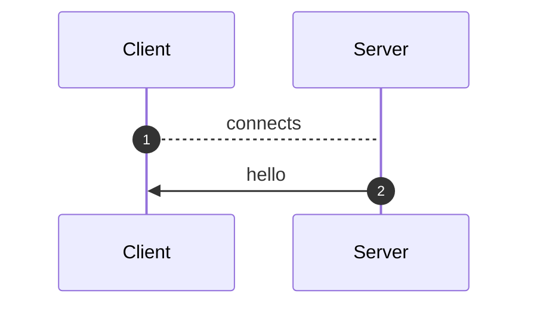
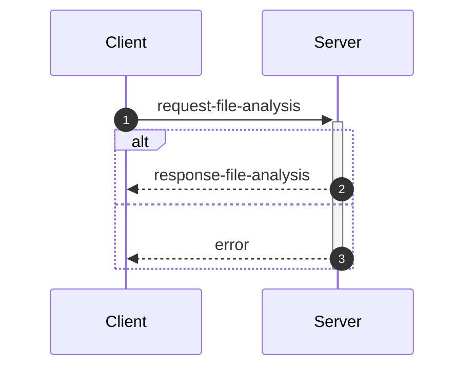
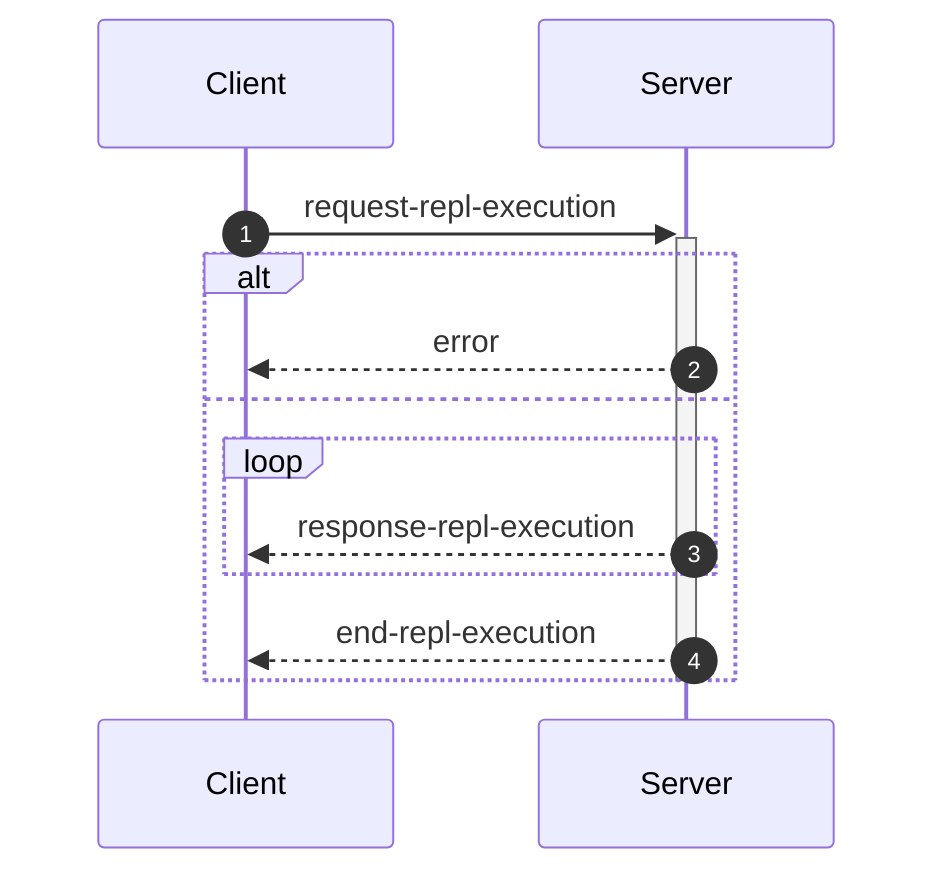
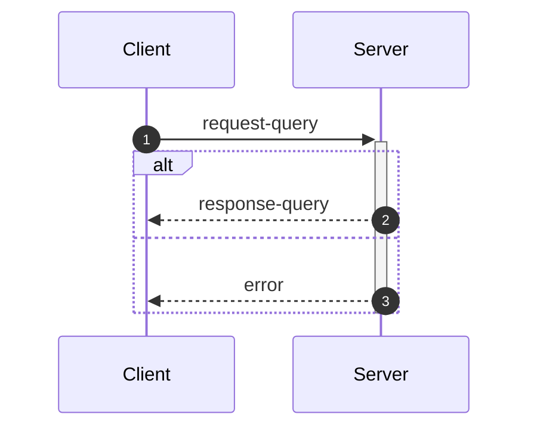

_<span title="an overview of flowR's interface">Generated</span> from '[wiki-interface.ts](https://github.com/flowr-analysis/flowr/tree/main/src/documentation/wiki-interface.ts "src/documentation/wiki-interface.ts")' on 2026-11-08, 09:49:56 UTC (v2.17.4, R v4.6.1), do not edit directly._

Although far from being as detailed as the in-depth explanation of [_flowR_](https://github.com/flowr-analysis/flowr/wiki/Core),
this wiki page explains how to interface with _flowR_ in more detail.
In general, command line arguments and other options provide short descriptions on hover over.

* [💻 Using the REPL](#using-the-repl)
* [⚙️ Configuring FlowR](#configuring-flowr)
* [⚒️ Writing Code](#writing-code)
* [💬 Communicating with the Server](#communicating-with-the-server)

<a id='using-the-repl'></a>
## 💻 Using the REPL

> [!NOTE]
> To execute arbitrary R commands with a repl request, _flowR_ has to be started explicitly with <span title="Description (Command Line Argument): Allow to access the underlying R session when using flowR (security warning: this allows the execution of arbitrary R code!)">`--r-session-access`</span>.
> Please be aware that this introduces a security risk and note that this relies on the [`r-shell` engine](https://github.com/flowr-analysis/flowr/wiki/Engines) .

Although primarily meant for users to explore,
there is nothing which forbids calling _flowR_ as a subprocess to use standard-in, -output, and -error
for communication (although you can access the REPL using the server as well,
with the [REPL Request](#message-request-repl-execution) message).

The read-eval-print loop&nbsp;(REPL) works relatively simple.
You can submit an expression (using <kbd>Enter</kbd>),
which is interpreted as an R&nbsp;expression by default but interpreted as a *command* if it starts with a colon (`:`).
The best command to get started with the REPL is <span title="Description (Repl Command): Show help information (aliases: :h, :?)">`:help`</span>.
Besides, you can leave the REPL either with the command <span title="Description (Repl Command): End the repl (aliases: :q, :exit)">`:quit`</span> or by pressing <kbd>Ctrl</kbd>+<kbd>C</kbd> twice.
When writing a *command*, you may press <kbd>Tab</kbd> to get a list of completions, if available.
Multiple commands can be entered in a single line by separating them with a semicolon (`;`), e.g. `:parse "x<-2"; :df*`.
If a command is given without R code, the REPL will re-use R code given in a previous command.
The prior example will hence return first the parsed AST of the program and then the dataflow graph for `"x <- 2"`.

> [!NOTE]
> If you develop flowR, you may want to launch the repl using the `npm run main-dev` command, this way, you get a non-minified version of flowR with debug information and hot-reloading of source files.

<details>
<summary>Available Commands</summary>

We currently offer the following commands (this with a `[*]` suffix are available with and without the star):

| Command | Description |
| ------- | ----------- |
| **<span title="Description (Repl Command): End the repl (aliases: :q, :exit)">:quit</span>** | End the repl (aliases: **:<span title="Alias of ':quit'. End the repl">q</span>**, **:<span title="Alias of ':quit'. End the repl">exit</span>**) |
| **<span title="Description (Repl Command): Execute the given code as R code. This requires the `--r-session-access` flag to be set and requires the r-shell engine. (aliases: :e, :r)">:execute</span>** | Execute the given code as R code. This requires the `--r-session-access` flag to be set and requires the r-shell engine. (aliases: **:<span title="Alias of ':execute'. Execute the given code as R code. This requires the `--r-session-access` flag to be set and requires the r-shell engine.">e</span>**, **:<span title="Alias of ':execute'. Execute the given code as R code. This requires the `--r-session-access` flag to be set and requires the r-shell engine.">r</span>**) |
| **<span title="Description (Repl Command): Get mermaid code for the control-flow graph of R code (aliases: :cfg, :cf)">:controlflow[*]</span>** | Get mermaid code for the control-flow graph of R code (star: Returns the URL to mermaid.live) (aliases: **:<span title="Alias of ':controlflow'. Get mermaid code for the control-flow graph of R code">cfg</span>**, **:<span title="Alias of ':controlflow'. Get mermaid code for the control-flow graph of R code">cf</span>**) |
| **<span title="Description (Repl Command): Get mermaid code for the control-flow graph with basic blocks (aliases: :cfgb, :cfb)">:controlflowbb[*]</span>** | Get mermaid code for the control-flow graph with basic blocks (star: Returns the URL to mermaid.live) (aliases: **:<span title="Alias of ':controlflowbb'. Get mermaid code for the control-flow graph with basic blocks">cfgb</span>**, **:<span title="Alias of ':controlflowbb'. Get mermaid code for the control-flow graph with basic blocks">cfb</span>**) |
| **<span title="Description (Repl Command): Get mermaid code for the dataflow graph (aliases: :d, :df)">:dataflow[*]</span>** | Get mermaid code for the dataflow graph (star: Returns the URL to mermaid.live) (aliases: **:<span title="Alias of ':dataflow'. Get mermaid code for the dataflow graph">d</span>**, **:<span title="Alias of ':dataflow'. Get mermaid code for the dataflow graph">df</span>**) |
| **<span title="Description (Repl Command): Get mermaid code for the normalized AST of R code (aliases: :n)">:normalize[*]</span>** | Get mermaid code for the normalized AST of R code (star: Returns the URL to mermaid.live) (alias: **:<span title="Alias of ':normalize'. Get mermaid code for the normalized AST of R code">n</span>**) |
| **<span title="Description (Repl Command): Get mermaid code for the simplified dataflow graph (aliases: :ds, :dfs)">:dataflowsimple[*]</span>** | Get mermaid code for the simplified dataflow graph (star: Returns the URL to mermaid.live) (aliases: **:<span title="Alias of ':dataflowsimple'. Get mermaid code for the simplified dataflow graph">ds</span>**, **:<span title="Alias of ':dataflowsimple'. Get mermaid code for the simplified dataflow graph">dfs</span>**) |
| **<span title="Description (Repl Command): Inspect and extend the signature database: `query` (identical to :query @signature), `info <name>` for where a function comes from (identical to :query @function-info), `add <path>` to mount another database/source, `download` to fetch the full-history database. (aliases: :sig)">:signature</span>** | Inspect and extend the signature database: `query` (identical to :query @signature), `info <name>` for where a function comes from (identical to :query @function-info), `add <path>` to mount another database/source, `download` to fetch the full-history database. (alias: **:<span title="Alias of ':signature'. Inspect and extend the signature database: `query` (identical to :query @signature), `info <name>` for where a function comes from (identical to :query @function-info), `add <path>` to mount another database/source, `download` to fetch the full-history database.">sig</span>**) |
| **<span title="Description (Repl Command): Just calculates the DFG, but only prints summary info (aliases: :d#, :df#)">:dataflowsilent</span>** | Just calculates the DFG, but only prints summary info (aliases: **:<span title="Alias of ':dataflowsilent'. Just calculates the DFG, but only prints summary info">d#</span>**, **:<span title="Alias of ':dataflowsilent'. Just calculates the DFG, but only prints summary info">df#</span>**) |
| **<span title="Description (Repl Command): Prints ASCII Art of the parsed, unmodified AST (aliases: :p)">:parse</span>** | Prints ASCII Art of the parsed, unmodified AST (alias: **:<span title="Alias of ':parse'. Prints ASCII Art of the parsed, unmodified AST">p</span>**) |
| **<span title="Description (Repl Command): Prints the version of flowR as well as the current version of R">:version</span>** | Prints the version of flowR as well as the current version of R
| **<span title="Description (Repl Command): Query the given R code (use 'help' for more information)">:query[*]</span>** | Query the given R code (use 'help' for more information) (star: Similar to query, but returns the output in json format.)
| **<span title="Description (Repl Command): Returns an ASCII representation of the dataflow graph (aliases: :df!)">:dataflowascii</span>** | Returns an ASCII representation of the dataflow graph (alias: **:<span title="Alias of ':dataflowascii'. Returns an ASCII representation of the dataflow graph">df!</span>**) |
| **<span title="Description (Repl Command): Returns summarization stats for the normalized AST (aliases: :n#)">:normalize#</span>** | Returns summarization stats for the normalized AST (alias: **:<span title="Alias of ':normalize#'. Returns summarization stats for the normalized AST">n#</span>**) |
| **<span title="Description (Repl Command): Show help information (aliases: :h, :?)">:help</span>** | Show help information (aliases: **:<span title="Alias of ':help'. Show help information">h</span>**, **:<span title="Alias of ':help'. Show help information">?</span>**) |

</details>

> [!TIP]
> 
> As indicated by the examples before, all REPL commands that operate on code keep track of the state.
> Hence, if you run a command like <span title="Description (Repl Command, starred version): Returns the URL to mermaid.live; Base Command: Get mermaid code for the dataflow graph (aliases: :d*, :df*)">`:dataflow*`</span> without providing R code,
> the REPL will re-use the R code provided in a previous command.
> Likewise, doing this will benefit from incrementality!
> If you request the dataflow graph with `:df* x <- 2 * y` and then want to see the parsed AST with `:parse`,
> the REPL will re-use previously obtained information and not re-parse the code again.
> 		

Generally, many commands offer shortcut versions in the REPL. Many queries, for example, offer a shortened format (see the example below).
Of special note, the [Config Query](https://github.com/flowr-analysis/flowr/wiki/%5BQuery%5D-Config)
can be used to also modify the currently active configuration of _flowR_ within the REPL (see the [wiki page](https://github.com/flowr-analysis/flowr/wiki/%5BQuery%5D-Config) for more information).

### Example: Retrieving the Dataflow Graph

To retrieve a URL to the [mermaid](https://mermaid.js.org/) diagram of the dataflow of a given expression,
use <span title="Description (Repl Command, starred version): Returns the URL to mermaid.live; Base Command: Get mermaid code for the dataflow graph (aliases: :d*, :df*)">`:dataflow*`</span> (or <span title="Description (Repl Command): Get mermaid code for the dataflow graph (aliases: :d, :df)">`:dataflow`</span> to get the mermaid code in the cli):

```shell
$ docker run -it --rm eagleoutice/flowr # or npm run flowr 
flowR repl v2.17.4, R grammar v14 (tree-sitter engine)
R> :dataflow* y <- 1 + x
```

<details>
<summary style='color:gray'>Output</summary>

```text
https://mermaid.live/view#base64:eyJjb2RlIjoiZmxvd2NoYXJ0IFREXG4gICAgMXt7XCJgKiM5MTtSTnVtYmVyIzkzOyogKioxKipcbiAgICAgICoxLjYqICgqKmlkOiAxKiopYFwifX1cbiAgICAyKFtcImAqIzkxO1JTeW1ib2wjOTM7KiAqKngqKlxuICAgICAgKjEuMTAqICgqKmlkOiAyKiopYFwiXSlcbiAgICAzW1tcImAqIzkxO1JCaW5hcnlPcCM5MzsqIGJhc2UjNTg7IzU4OyoqIzQzOyoqXG4gICAgICAqMS42LTEwKiAoKippZDogMyoqKVxuICAgIGFyZzogKDEsIDIpYFwiXV1cbiAgICBidWlsdC1pbjpfNDNfW1wiYEJ1aWx0LUluOlxuIzQzO2BcIl1cbiAgICBzdHlsZSBidWlsdC1pbjpfNDNfIHN0cm9rZTpncmF5LGZpbGw6Z3JheSxzdHJva2Utd2lkdGg6MnB4LG9wYWNpdHk6Ljg7XG4gICAgMFtcImAqIzkxO1JTeW1ib2wjOTM7KiAqKnkqKlxuICAgICAgKjEuMSogKCoqaWQ6IDAqKiwgdjogMylgXCJdXG4gICAgNFtbXCJgKiM5MTtSQmluYXJ5T3AjOTM7KiBiYXNlIzU4OyM1ODsqKiM2MDsjNDU7KipcbiAgICAgICoxLjEtMTAqICgqKmlkOiA0KiopXG4gICAgYXJnOiAoMCwgMylgXCJdXVxuICAgIGJ1aWx0LWluOl82MF8tW1wiYEJ1aWx0LUluOlxuIzYwOyM0NTtgXCJdXG4gICAgc3R5bGUgYnVpbHQtaW46XzYwXy0gc3Ryb2tlOmdyYXksZmlsbDpncmF5LHN0cm9rZS13aWR0aDoycHgsb3BhY2l0eTouODtcbiAgICAxIC0uLT58XCJmbG93XCJ8IDJcbiAgICBsaW5rU3R5bGUgMCBzdHJva2U6Z3JheSxjb2xvcjpncmF5O1xuICAgIDIgLS4tPnxcImZsb3dcInwgM1xuICAgIGxpbmtTdHlsZSAxIHN0cm9rZTpncmF5LGNvbG9yOmdyYXk7XG4gICAgMyAtLT58XCJyZWFkcywgYXJnXCJ8IDFcbiAgICAzIC0tPnxcInJlYWRzLCBhcmdcInwgMlxuICAgIDMgLS4tPnxcImZsb3dcInwgMFxuICAgIGxpbmtTdHlsZSA0IHN0cm9rZTpncmF5LGNvbG9yOmdyYXk7XG4gICAgMyAtLi0+fFwicmVhZHMsIGNhbGxzXCJ8IGJ1aWx0LWluOl80M19cbiAgICBsaW5rU3R5bGUgNSBzdHJva2U6Z3JheTtcbiAgICAwIC0tPnxcImRlZmluZWQtYnksIGZsb3dcInwgNFxuICAgIDAgLS0+fFwiZGVmaW5lZC1ieVwifCAzXG4gICAgNCAtLT58XCJyZWFkcywgYXJnXCJ8IDNcbiAgICA0IC0tPnxcInJldHVybnMsIGFyZ1wifCAwXG4gICAgNCAtLi0+fFwicmVhZHMsIGNhbGxzXCJ8IGJ1aWx0LWluOl82MF8tXG4gICAgbGlua1N0eWxlIDEwIHN0cm9rZTpncmF5OyIsIm1lcm1haWQiOnsiYXV0b1N5bmMiOnRydWV9fQ==
```

Retrieve the dataflow graph of the expression `y <- 1 + x`. It looks like this:


<details>

<summary style="color:gray">R Code of the Dataflow Graph</summary>

The analysis ran (parse and normalize with the [tree-sitter](https://github.com/flowr-analysis/flowr/wiki/Engines) engine) in the generation environment. No [signature database](https://github.com/flowr-analysis/flowr/wiki/Signature-Database) is mounted, so `library()` attaches no exports (base-R names are still qualified, e.g., `stats::acf`). 
We encountered no unknown side effects during the analysis.

```r
y <- 1 + x
```

</details>

</details>

For small graphs like this, <span title="Description (Repl Command): Returns an ASCII representation of the dataflow graph (aliases: :df!)">`:dataflowascii`</span> also provides an ASCII representation directly in the REPL:

```shell
$ docker run -it --rm eagleoutice/flowr # or npm run flowr 
flowR repl v2.17.4, R grammar v14 (tree-sitter engine)
R> :df! y <- 1 + x
```

<details open>
<summary style='color:gray'>Output</summary>

```text
                        v<0>v
 c<4>c──────────────────| y |
 |<- |     ┌────────────v---v
 c---c     │
    │   c<3>c   0<1>0
    └───| + |───| 1 |───u<2>u
        c---c   0---0   | x |
           └────────────u---u
Edges:
3 -> 1: reads, arg          3 -> 2: reads, arg
3 -> 0: flows-to            1 -> 2: flows-to
2 -> 3: flows-to            4 -> 3: reads, arg
4 -> 0: returns, arg        0 -> 4: defined-by, flows-to
0 -> 3: defined-by
```

Retrieve the dataflow graph of the expression `y <- 1 + x` as ASCII art.

</details>

For the slicing with <span title="Description (Repl Command): Static backwards executable slicer for R">`:slicer`</span>, you have access to the same [magic comments](#slice-magic-comments) as with the [slice request](#message-request-slice).
Pass `--inline` to splice resolvable `source()` calls into the reconstruction so the slice is a single self-contained R text (the same as the static slice query's `inlineSources` flag).
See `--help` for more flags!

### Example: Interfacing with the File System

Many commands that allow for an R-expression (like <span title="Description (Repl Command, starred version): Returns the URL to mermaid.live; Base Command: Get mermaid code for the dataflow graph (aliases: :d*, :df*)">`:dataflow*`</span>) allow for a file as well
if the argument starts with `file://`.
If you are working from the root directory of the _flowR_ repository, the following gives you the parsed AST of the example file using the <span title="Description (Repl Command): Prints ASCII Art of the parsed, unmodified AST (aliases: :p)">`:parse`</span> command:

> **Watch mode**: Replace `file://` with `watch://` to enter watch mode.
> flowR runs the command immediately and then re-runs it every time the file (or any file inside the folder) changes.
> Enter any other command to leave watch mode.
> For example: `:df watch://analysis.R`

```shell
$ docker run -it --rm eagleoutice/flowr # or npm run flowr 
flowR repl v2.17.4, R grammar v14 (tree-sitter engine)
R> :parse file://test/testfiles/example.R
```

<details>
<summary style='color:gray'>Output</summary>

```text
File: test/testfiles/example.R

program
├ binaryoperator
│ ├ identifier "sum" (1:1─4)
│ ├ <- "<-" (1:5─7)
│ ╰ float "0" (1:8─9)
├ binaryoperator
│ ├ identifier "product" (2:1─8)
│ ├ <- "<-" (2:9─11)
│ ╰ float "1" (2:12─13)
├ binaryoperator
│ ├ identifier "w" (3:1─2)
│ ├ <- "<-" (3:3─5)
│ ╰ float "7" (3:6─7)
├ binaryoperator
│ ├ identifier "N" (4:1─2)
│ ├ <- "<-" (4:3─5)
│ ╰ float "10" (4:6─8)
├ forstatement
│ ├ for "for" (6:1─4)
│ ├ ( "(" (6:5─6)
│ ├ identifier "i" (6:6─7)
│ ├ in "in" (6:8─10)
│ ├ binaryoperator
│ │ ├ float "1" (6:11─12)
│ │ ├ : ":" (6:12─13)
│ │ ╰ parenthesizedexpression
│ │   ├ ( "(" (6:13─14)
│ │   ├ binaryoperator
│ │   │ ├ identifier "N" (6:14─15)
│ │   │ ├ - "-" (6:15─16)
│ │   │ ╰ float "1" (6:16─17)
│ │   ╰ ) ")" (6:17─18)
│ ├ ) ")" (6:18─19)
│ ╰ bracedexpression
│   ├ { "{" (6:20─21)
│   ├ binaryoperator
│   │ ├ identifier "sum" (7:3─6)
│   │ ├ <- "<-" (7:7─9)
│   │ ╰ binaryoperator
│   │   ├ binaryoperator
│   │   │ ├ identifier "sum" (7:10─13)
│   │   │ ├ + "+" (7:14─15)
│   │   │ ╰ identifier "i" (7:16─17)
│   │   ├ + "+" (7:18─19)
│   │   ╰ identifier "w" (7:20─21)
│   ├ binaryoperator
│   │ ├ identifier "product" (8:3─10)
│   │ ├ <- "<-" (8:11─13)
│   │ ╰ binaryoperator
│   │   ├ identifier "product" (8:14─21)
│   │   ├  "" (8:22─23)
│   │   ╰ identifier "i" (8:24─25)
│   ╰ } "}" (9:1─2)
├ call
│ ├ identifier "cat" (11:1─4)
│ ╰ arguments
│   ├ ( "(" (11:4─5)
│   ├ argument
│   │ ╰ string
│   │   ├ stringopen "\"" (11:5─6)
│   │   ├ stringcontent "Sum:" (11:6─10)
│   │   ╰ stringclose "\"" (11:10─11)
│   ├ comma "," (11:11─12)
│   ├ argument
│   │ ╰ identifier "sum" (11:13─16)
│   ├ comma "," (11:16─17)
│   ├ argument
│   │ ╰ string
│   │   ├ stringopen "\"" (11:18─19)
│   │   ├ stringcontent
│   │   │ ╰ escapesequence "\\n" (11:19─21)
│   │   ╰ stringclose "\"" (11:21─22)
│   ╰ ) ")" (11:22─23)
╰ call
  ├ identifier "cat" (12:1─4)
  ╰ arguments
    ├ ( "(" (12:4─5)
    ├ argument
    │ ╰ string
    │   ├ stringopen "\"" (12:5─6)
    │   ├ stringcontent "Product:" (12:6─14)
    │   ╰ stringclose "\"" (12:14─15)
    ├ comma "," (12:15─16)
    ├ argument
    │ ╰ identifier "product" (12:17─24)
    ├ comma "," (12:24─25)
    ├ argument
    │ ╰ string
    │   ├ stringopen "\"" (12:26─27)
    │   ├ stringcontent
    │   │ ╰ escapesequence "\\n" (12:27─29)
    │   ╰ stringclose "\"" (12:29─30)
    ╰ ) ")" (12:30─31)
```

Retrieve the parsed AST of the example file.

<details>

<summary>File Content</summary>

```r
sum <- 0
product <- 1
w <- 7
N <- 10

for (i in 1:(N-1)) {
  sum <- sum + i + w
  product <- product * i
}

cat("Sum:", sum, "\n")
cat("Product:", product, "\n")
```

</details>

As _flowR_ directly transforms this AST the output focuses on being human-readable instead of being machine-readable.
		
</details>

### Example: Run a Query

You can run any query supported by _flowR_ using the <span title="Description (Repl Command): Query the given R code (use 'help' for more information)">`:query`</span> command.
For example, to obtain the shapes of all data frames in a given piece of code, you can run:

```shell
$ docker run -it --rm eagleoutice/flowr # or npm run flowr 
flowR repl v2.17.4, R grammar v14 (tree-sitter engine)
R> :query @absint df-shape "x <- data.frame(a = 1:10, b = 1:10)\ny <- x$a"
```

<details open>
<summary style='color:gray'>Output</summary>

```text
Query: absint (1 ms)
   ╰ $12: (colnames: [{"a", "b"}, {}], cols: [2, 2], rows: [10, 10])
   ╰ $0: (colnames: [{"a", "b"}, {}], cols: [2, 2], rows: [10, 10])
```

Retrieve the shapes of all data frames in the given code.

</details>

To run the linter on a file, you can use (in this example, we just issue the `dead-code` linter on a small piece of code):

```shell
$ docker run -it --rm eagleoutice/flowr # or npm run flowr 
flowR repl v2.17.4, R grammar v14 (tree-sitter engine)
R> :query @linter rules:dead-code "if(FALSE) x <- 2"
```

<details open>
<summary style='color:gray'>Output</summary>

```text
Query: linter (2 ms)
   ╰ Dead Code (dead-code):
       ╰ certain:
           ╰ Code at 1.11-16 (1 quick fix(es) available)
```

Run the linter on the given code, with only the `dead-code` rule enabled.

</details>

For more information on the available queries, please check out the [Query API](https://github.com/flowr-analysis/flowr/wiki/Query-API).

<a id='configuring-flowr'></a>
## ⚙️ Configuring FlowR

When running _flowR_, you may want to specify some behaviors with a dedicated configuration file.
By default, flowR looks for a file named `flowr.json` in the current working directory (or any higher directory).
You can also specify a different file with <span title="Description (Command Line Argument): The name of the configuration file to use">`--config-file`</span> or pass the configuration inline using <span title="Description (Command Line Argument): The flowR configuration to use, as a JSON string">`--config-json`</span>.
A `flowr.json` found this way belongs to the analyzed project, so flowR ignores its options that decide what flowR executes or loads
(`engines.*.wasmPath`, `engines.*.treeSitterWasmPath`, `engines.*.rPath`, `solver.sigdb.additionalPaths`, `solver.sigdb.downloadRepo`, `solver.sigdb.installedLibrary.paths`, `solver.sigdb.onDemand.enabled`, `solver.sigdb.onDemand.repositories`, `solver.sigdb.onDemand.cranMirror`, `solver.sigdb.onDemand.bioconductorMirror`, `solver.sigdb.onDemand.cacheDir`),
unless you pass <span title="Description (Command Line Argument): Keep the security-sensitive options (e.g., the R executable) of the flowr.json found in the working directory or a parent. Only use this for projects you trust.">`--trust-config`</span>.
To analyze code you do not trust, use the secure mode (<span title="Description (Command Line Argument): Run in secure mode for analyzing untrusted code: flowR does not start R (or any other process), does not access the network, does not search for project configs, and ignores security-sensitive options in every config. Cannot be disabled once enabled. Can also be enabled with the environment variable {italic FLOWR_SECURE_MODE=1}.">`--secure`</span>, see the [security policy](https://github.com/flowr-analysis/flowr/blob/main/.github/SECURITY.md)).
To inspect the current configuration, you can run flowr with the <span title="Description (Command Line Argument): Run with verbose logging (will be passed to the corresponding script)">`--verbose`</span> flag, or use the `config` [Query](https://github.com/flowr-analysis/flowr/wiki/Query-API).
Within the REPL this works by running the following:

```shell
:query @config
```

To work with the <a href="https://github.com/flowr-analysis/flowr/tree/main/src/config.ts#L119"><code><span title="The configuration file format for flowR.">FlowrConfig</span></code></a> you can use the provided helper objects alongside its methods like
<a href="https://github.com/flowr-analysis/flowr/tree/main/src/config.ts#L985"><code><span title="Creates a new flowr config that has the updated values.">FlowrConfig::<b>amend</b></span></code></a>.
The schema below documents every option; the ones you most likely want are:

- <a href="https://github.com/flowr-analysis/flowr/wiki/Interface#configuring-flowr" title="Configuration Option (boolean): Whether source calls should be ignored, causing {@link processSourceCall}&#39;s behavior to be skipped.">ignoreSourceCalls</a>: ignore source calls when analyzing the code, i.e., ignore the inclusion of other files.
- <a href="https://github.com/flowr-analysis/flowr/wiki/Interface#configuring-flowr" title="Configuration Option (boolean): Whether load calls should be ignored, causing {@link processLoadCall}&#39;s behavior to be skipped.">ignoreLoadCalls</a>: ignore load calls when analyzing the code, i.e., ignore the loading of r-data files.
- <a href="https://github.com/flowr-analysis/flowr/wiki/Interface#configuring-flowr" title="Configuration Option (object): Do you want to overwrite (parts) of the builtin definition?">semantics.environment.overwriteBuiltIns</a>: overwrite _flowR_'s handling of built-in functions, or clear the preset definitions entirely.
  See [Configure BuiltIn Semantics](#configure-builtin-semantics) for more information.
- <a href="https://github.com/flowr-analysis/flowr/wiki/Interface#configuring-flowr" title="Configuration Option (boolean): Whether calls drawing on a graphics device (e.g., `plot`) count as writing to it, which the ambient state queries then report.">semantics.ambient.drawingWritesDevice</a>: whether calls drawing on a graphics device (e.g., `plot`) count as writing the device in the ambient state queries.
- <a href="https://github.com/flowr-analysis/flowr/wiki/Interface#configuring-flowr" title="Configuration Option (string): How to resolve variables and their values. (one of &quot;disabled&quot;, &quot;alias&quot;, &quot;builtin&quot;)">solver.variables</a>: how to resolve variables and their values (`disabled`, `alias`, `builtin`).
- <a href="https://github.com/flowr-analysis/flowr/wiki/Interface#configuring-flowr" title="Configuration Option (array): The engine or set of engines to use for interacting with R code. An empty array means all available engines will be used.">engines</a> and <a href="https://github.com/flowr-analysis/flowr/wiki/Interface#configuring-flowr" title="Configuration Option (string): The default engine to use for interacting with R code. If this is undefined, an arbitrary engine from the specified list will be used. (one of &quot;tree-sitter&quot;, &quot;r-shell&quot;)">defaultEngine</a>: the engines used to interact with R code, see the [Engines wiki page](https://github.com/flowr-analysis/flowr/wiki/Engines).
- <a href="https://github.com/flowr-analysis/flowr/wiki/Interface#configuring-flowr" title="Configuration Option (array): Files a framework loads on its own, without any source() call (e.g. global.R in a shiny app), in the order they are loaded; flowR orders the matching project files accordingly and analyzes them as one program. Entries are case-insensitive globs matched against the file path, a plain name matches any file with that name, and entries matching no project file are warned about. Usually set per project kind via specializeConfig.">project.implicitSources</a>: the files a framework loads without any `source()` call, in the order in which they are
  loaded. Entries are globs (e.g. `R/*.R`) matched against the file path ignoring capitalization; one matching no file is reported.
- <a href="https://github.com/flowr-analysis/flowr/wiki/Interface#configuring-flowr" title="Configuration Option (object): Overwrite (parts of) the configuration depending on the project kind flowR detects, e.g. to give a shiny app its implicit sources.">specializeConfig</a>: overwrite (parts of) the configuration depending on the kind of project _flowR_ detects
  (e.g. `shiny-app`), which is how a shiny app gets its implicit sources by default. What you configure directly wins.
- <a href="https://github.com/flowr-analysis/flowr/wiki/Interface#configuring-flowr" title="Configuration Option (string): Overwrite the project kind flowR would otherwise infer from the analyzed files, e.g. when auto-detection guesses wrong. (one of &quot;package&quot;, &quot;script&quot;, &quot;shiny-app&quot;, &quot;notebook&quot;, &quot;project&quot;, &quot;unknown&quot;)">project.useProjectType</a>: skip that detection and force a project kind yourself, when auto-detection guesses wrong.
- <a href="https://github.com/flowr-analysis/flowr/wiki/Interface#configuring-flowr" title="Configuration Option (array): The default plugins to load when creating a new instance of FlowrAnalyzer">defaultPlugins</a> and <a href="https://github.com/flowr-analysis/flowr/wiki/Interface#configuring-flowr" title="Configuration Option (array): The plugins to load in REPL mode">repl.plugins</a>: the plugins to load for a new <a href="https://github.com/flowr-analysis/flowr/tree/main/src/project/flowr-analyzer.ts#L240"><code><span title="Central class for conducting analyses with FlowR. Use the FlowrAnalyzerBuilder to create a new instance. If you want the original pattern of creating a pipeline and running all steps, you can still do this with FlowrAnalyzer#runFull . To inspect the context of the analyzer, use FlowrAnalyzer#inspectContext (if you are a plugin and need to modify it, use FlowrAnalyzer#context instead).">FlowrAnalyzer</span></code></a> and in the REPL
  (use `flowr:default` to reference the former).

So you can configure _flowR_ by adding a file like the following:

<details>

<summary>Example Configuration File</summary>

```json
{
  "ignoreSourceCalls": true,
  "ignoreLoadCalls": true,
  "semantics": {
    "environment": {
      "overwriteBuiltIns": {
        "definitions": [
          {
            "type": "function",
            "names": [
              "foo"
            ],
            "processor": "builtin:assign",
            "config": {}
          }
        ]
      }
    }
  },
  "defaultPlugins": [
    "file:description",
    "versions:description"
  ],
  "repl": {
    "quickStats": false,
    "dfProcessorHeat": false,
    "hints": true,
    "plugins": [
      "flowr:default"
    ]
  },
  "project": {
    "resolveUnknownPathsOnDisk": true,
    "implicitSources": [
      "global.R",
      "app.R"
    ]
  },
  "linter": {
    "disabledRules": []
  },
  "specializeConfig": {
    "shiny-app": {
      "project": {
        "implicitSources": [
          "global.R",
          "ui.R",
          "server.R",
          "app.R"
        ]
      }
    }
  },
  "engines": [
    {
      "type": "r-shell"
    }
  ],
  "solver": {
    "variables": "alias",
    "evalStrings": true,
    "trackEnvironments": true,
    "sigdb": {
      "enabled": true,
      "loadProjectDependencies": true,
      "eagerlyLoad": false,
      "eagerlyLoadExports": false,
      "linkBaseR": false,
      "linkDescriptionDependencies": false
    },
    "resolveSource": {
      "dropPaths": "no",
      "ignoreCapitalization": true,
      "inferWorkingDirectory": "active-script",
      "searchPath": []
    },
    "instrument": {},
    "slicer": {
      "threshold": 50
    }
  },
  "abstractInterpretation": {
    "wideningThreshold": 4,
    "followCalls": true,
    "dataFrame": {
      "maxColNames": 20,
      "readLoadedData": {
        "readExternalFiles": true,
        "maxReadLines": 1000000
      }
    }
  },
  "incremental": {
    "alwaysIncremental": false,
    "parsing": {
      "activated": false,
      "heuristics": {
        "activated": true,
        "mtime": true,
        "linesFrom": 500,
        "bytesFrom": 50000,
        "alwaysWithEdits": false,
        "minFiles": 1
      }
    }
  },
  "gas": {
    "thresholds": {
      "memory": {
        "problematic": 0.7,
        "critical": 0.9
      },
      "timeMs": {
        "problematic": 100000,
        "critical": 120000
      }
    },
    "features": {}
  }
}
```

</details>

<details>
<a id='configure-builtin-semantics'></a>
<summary>Configure Built-In Semantics</summary>

`semantics/environment/overwriteBuiltins` accepts two keys:

- `loadDefaults` (boolean, initially `true`): If set to `true`, the default built-in definitions are loaded before applying the custom definitions. Setting this flag to `false` explicitly disables the loading of the default definitions.
- `definitions` (array, initially empty): Allows to overwrite or define new built-in elements. Each object within must have a `type` which is one of the below. Furthermore, they may define a string array of `names` which specifies the identifiers to bind the definitions to. You may use `assumePrimitive` to specify whether _flowR_ should assume that this is a primitive non-library definition (so you probably just do not want to specify the key).

  | Type            | Description                                                                                                                                                                                                                                                                                              | Example                                                                                                    |
  | --------------- | -------------------------------------------------------------------------------------------------------------------------------------------------------------------------------------------------------------------------------------------------------------------------------------------------------- | ---------------------------------------------------------------------------------------------------------- |
  | `constant`    | Additionally allows for a `value` this should resolve to.                                                                                                                                                                                                                                                | `{ type: 'constant', names: ['NULL', 'NA'],  value: null }`                                                |
  | `function`    | Is a rather flexible way to define and bind built-in functions. For the time, we do not have extensive documentation to cover all the cases, so please either consult the sources with the `default-builtin-config/` folder or open a [new issue](https://github.com/flowr-analysis/flowr/issues/new/choose). | `{ type: 'function', names: ['next'], processor: 'builtin:d', config: { cfg: ExitPointType.Next } }` |
  | `replacement` | A comfortable way to specify replacement functions like `$<-` or `names<-`. `suffixes` describes the... suffixes to attach automatically. | `{ type: 'replacement', suffixes: ['<-', '<<-'], names: ['[', '[['] }` |

</details>

<details>

<summary style='color:gray'>Full Configuration-File Schema</summary>

- _The configuration file format for flowR._ (object)
    - **logLevel** [optional] _flowR's global minimum log level, applied when the config is loaded._ (string)
        Only allows: 'silly', 'trace', 'debug', 'info', 'warn', 'error', 'fatal'
    - **ignoreSourceCalls** [optional] _Whether source calls should be ignored, causing {@link processSourceCall}'s behavior to be skipped._ (boolean)
    - **ignoreLoadCalls** [optional] _Whether load calls should be ignored, causing {@link processLoadCall}'s behavior to be skipped._ (boolean)
    - **semantics** _Configure language semantics and how flowR handles them._ (object)
        - **environment** [optional] _Semantics regarding how to handle the R environment._ (object)
            - **overwriteBuiltIns** [optional] _Do you want to overwrite (parts) of the builtin definition?_ (object)
                - **loadDefaults** [optional] _Should the default configuration still be loaded?_ (boolean)
                - **definitions** [optional] _The definitions to load/overwrite._ (array)
                Valid item types:
                    - (object)
        - **ambient** [optional] _Semantics regarding the global state (options, devices, files, ...) calls access._ (object)
            - **drawingWritesDevice** [optional] _Whether calls drawing on a graphics device (e.g., `plot`) count as writing to it, which the ambient state queries then report._ (boolean)
    - **defaultPlugins** [optional] _The default plugins to load when creating a new instance of FlowrAnalyzer_ (array)
    Valid item types:
        - (alternatives)
            - (string)
            - (array)
    - **repl** _Configuration options for the REPL._ (object)
        - **quickStats** [optional] _Whether to show quick stats in the REPL after each evaluation._ (boolean)
        - **dfProcessorHeat** [optional] _This instruments the dataflow processors to count how often each processor is called._ (boolean)
        - **hints** [optional] _Whether to show dim inline hints on the empty prompt (automatically disabled on non-interactive terminals)._ (boolean)
        - **plugins** [optional] _The plugins to load in REPL mode_ (array)
        Valid item types:
            - (alternatives)
                - (string)
                - (array)
        - **autoUseFileProtocol** [optional] _Prepend the file protocol to a repl input that looks like a path, instead of only warning about it._ (boolean)
        - **queryStats** [optional] _Whether `:query` closes with the line stating how long the queries took (`:query*` never prints it)._ (boolean)
        - **showPlugins** [optional] _Whether `:version` grays out the plugins that did not activate during the last analysis._ (boolean)
    - **project** _Project specific configuration options._ (object)
        - **resolveUnknownPathsOnDisk** [optional] _Whether to resolve unknown paths loaded by the r project disk when trying to source/analyze files._ (boolean)
        - **failOnInaccessiblePath** [optional] _Whether a directory that cannot be traversed during file discovery (e.g. due to permissions) aborts the analysis; when false (the default) such paths are logged and skipped._ (boolean)
        - **basePackages** [optional] _The packages considered part of R itself (base and recommended); if unset, flowR uses its built-in list._ (array)
        Valid item types:
            - (string)
        - **implicitSources** [optional] _Files a framework loads on its own, without any source() call (e.g. global.R in a shiny app), in the order they are loaded; flowR orders the matching project files accordingly and analyzes them as one program. Entries are case-insensitive globs matched against the file path, a plain name matches any file with that name, and entries matching no project file are warned about. Usually set per project kind via specializeConfig._ (array)
        Valid item types:
            - (string)
        - **useProjectType** [optional] _Overwrite the project kind flowR would otherwise infer from the analyzed files, e.g. when auto-detection guesses wrong._ (string)
            Only allows: 'package', 'script', 'shiny-app', 'notebook', 'project', 'unknown'
        - **assumeImplicitEcho** [optional] _Whether the top level of the analyzed code is echoed, so that every visible result printed there is collected as an output by the dependencies query (default true, false for a package)._ (boolean)
        - **discovery** [optional] _Scoping options for the default project discovery._ (object)
            - **full** [optional] _Collect every file below the project root (greedy) instead of only the files the detected project kind needs (default false)._ (boolean)
            - **perKind** [optional] _Per-kind include/exclude glob overrides layered on the default scoping._ (object)
            - **ignore** [optional] _Case-insensitive globs that drop matching files from the intelligent discovery, regardless of kind (e.g. .Renviron to ignore environment files)._ (array)
            Valid item types:
                - (string)
        - **classification** [optional] _Overrides for the signals flowR uses to classify the project kind._ (object)
            - **shinyDescriptionTypes** [optional] _DESCRIPTION Type: values that mark a shiny app._ (array)
            Valid item types:
                - (string)
            - **shinyEntryFiles** [optional] _File names a shiny app is assembled from._ (array)
            Valid item types:
                - (string)
            - **shinyUsagePattern** [optional] _Regex source evidencing shiny usage in an entry file._ (string)
            - **notebookExtensions** [optional] _File extensions marking a notebook._ (array)
            Valid item types:
                - (string)
    - **linter** _Linter configuration options._ (object)
        - **disabledRules** _Linting rule names excluded from the default rule set (a rule requested explicitly via a linter query still runs). Usually set per project kind via specializeConfig._ (array)
        Valid item types:
            - (string)
        - **disabledTags** [optional] _Linting rule tags whose rules are excluded from the default rule set (a rule requested explicitly via a linter query still runs). By default the cmd-check rules are disabled for everything but a package; a configured list replaces that default._ (array)
        Valid item types:
            - (string)
    - **inputSources** [optional] _Further frameworks the input-sources analysis should know about; entries are added to flowR's defaults._ (object)
        - **pure** [optional] _Functions that only pass the constantness of their arguments on._ (array)
        Valid item types:
            - (string)
        - **param** [optional] _Functions whose result is a 'param' input._ (array)
        Valid item types:
            - (string)
        - **file** [optional] _Functions whose result is a 'file' input._ (array)
        Valid item types:
            - (string)
        - **tempfile** [optional] _Functions whose result is a 'tempfile' input._ (array)
        Valid item types:
            - (string)
        - **glob** [optional] _Functions whose result is a 'glob' input._ (array)
        Valid item types:
            - (string)
        - **net** [optional] _Functions whose result is a 'net' input._ (array)
        Valid item types:
            - (string)
        - **rand** [optional] _Functions whose result is a 'rand' input._ (array)
        Valid item types:
            - (string)
        - **system** [optional] _Functions whose result is a 'system' input._ (array)
        Valid item types:
            - (string)
        - **ffi** [optional] _Functions whose result is a 'ffi' input._ (array)
        Valid item types:
            - (string)
        - **lang** [optional] _Functions whose result is a 'lang' input._ (array)
        Valid item types:
            - (string)
        - **options** [optional] _Functions whose result is a 'options' input._ (array)
        Valid item types:
            - (string)
        - **cmdline** [optional] _Functions whose result is a 'cmdline' input._ (array)
        Valid item types:
            - (string)
        - **user** [optional] _Functions whose result is a 'user' input._ (array)
        Valid item types:
            - (string)
        - **const** [optional] _Functions whose result is a 'const' input._ (array)
        Valid item types:
            - (string)
        - **scope** [optional] _Functions whose result is a 'scope' input._ (array)
        Valid item types:
            - (string)
        - **dconst** [optional] _Functions whose result is a 'dconst' input._ (array)
        Valid item types:
            - (string)
        - **unknown** [optional] _Functions whose result is a 'unknown' input._ (array)
        Valid item types:
            - (string)
        - **linkedObjects** [optional] _Objects a framework provides without a definition in the code, e.g. shiny's input._ (array)
        Valid item types:
            - (object)
        - **linkedEntryPoints** [optional] _Calls that hand a function to a framework, which binds its objects to the parameters by position._ (array)
        Valid item types:
            - (object)
    - **specializeConfig** [optional] _Overwrite (parts of) the configuration depending on the project kind flowR detects, e.g. to give a shiny app its implicit sources._ (object)
    - **engines** _The engine or set of engines to use for interacting with R code. An empty array means all available engines will be used._ (array)
    Valid item types:
        - (alternatives)
            - _The configuration for the tree sitter engine._ (object)
                - **type** [required] _Use the tree sitter engine._ (string)
                    Only allows: 'tree-sitter'
                - **wasmPath** [optional] _The path to the tree-sitter-r WASM binary to use. If this is undefined, this uses the default path._ (string)
                - **treeSitterWasmPath** [optional] _The path to the tree-sitter WASM binary to use. If this is undefined, this uses the default path._ (string)
                - **lax** [optional] _Whether to use the lax parser for parsing R code (allowing for syntax errors). If this is undefined, the strict parser will be used._ (boolean)
            - _The configuration for the R shell engine._ (object)
                - **type** [required] _Use the R shell engine._ (string)
                    Only allows: 'r-shell'
                - **rPath** [optional] _The path to the R executable to use. If this is undefined, this uses the default path._ (string)
                - **pipeBind** [optional] _Whether to enable R's experimental pipe-bind operator "=>" by setting _R_USE_PIPEBIND_ for the R session (default false); R itself keeps this off by default, as it is experimental and has never shipped in a release version of R._ (boolean)
    - **defaultEngine** [optional] _The default engine to use for interacting with R code. If this is undefined, an arbitrary engine from the specified list will be used._ (string)
        Only allows: 'tree-sitter', 'r-shell'
    - **solver** _How to resolve constants, constraints, cells, ..._ (object)
        - **variables** _How to resolve variables and their values._ (string)
            Only allows: 'disabled', 'alias', 'builtin'
        - **evalStrings** _Should we include eval(parse(text="...")) calls in the dataflow graph?_ (boolean)
        - **trackEnvironments** [optional] _Track user-created environments (new.env, assign/get/local with envir=, dollar-assign, attach). When false, all envir-style calls fall through conservatively._ (boolean)
        - **sigdb** _Resolving library exports from a signature database._ (object)
            - **enabled** [optional] _Resolve library()/use() exports from a signature database (default true); when false no database is consulted._ (boolean)
            - **loadProjectDependencies** [optional] _Load the project's declared dependencies from its metadata files (DESCRIPTION Imports/Depends, rproject.toml, uvr.toml, rig rproj.toml and script blocks, renv.lock, rv.lock, uvr.lock, rig lockfiles) (default true); when false these files are not read for dependencies._ (boolean)
            - **eagerlyLoad** [optional] _Parse the database up front rather than on the first package load (default false, ignored if disabled)._ (boolean)
            - **eagerlyLoadExports** [optional] _Add a vertex for every export on load rather than on demand (default false); keeps the dataflow graph small._ (boolean)
            - **assumedRVersion** [optional] _R version assumed when resolving versioned (base-R) exports: a pin like "4.5" or "auto" to detect the installed R (default "auto")._ (string)
            - **linkBaseR** [optional] _Eagerly attach base-R namespaces so bare base calls resolve without library() (default false)._ (boolean)
            - **linkBaseRCalls** [optional] _Add a lightweight Reads edge from a bare base-R call to its signature-database function vertex (default false; base-R qualification is edge-free otherwise)._ (boolean)
            - **linkPackageCalls** [optional] _Add a lightweight Reads edge from a resolved package call to its signature-database function vertex (default false)._ (boolean)
            - **linkDescriptionDependencies** [optional] _Eagerly attach the namespaces of the project's declared DESCRIPTION dependencies (Imports/Depends) so their exports resolve without an explicit library() (default false)._ (boolean)
            - **warmInBackground** [optional] _Decompress the hot shards (base + most-downloaded) in a background task on startup so the first library() lookup is warm (default false; for long-running servers/REPLs)._ (boolean)
            - **additionalPaths** [optional] _Extra directories or bundle/manifest files searched for signature databases (alongside the shipped default and $FLOWR_SIGDB_DIR); a downloaded full-history bundle placed here is mounted automatically._ (array)
            Valid item types:
                - (string)
            - **downloadRepo** [optional] _GitHub owner/repo the full-history bundle is downloaded from via ":signature download" (default "flowr-analysis/flowr"; the release tag comes from the committed sigdb.remote.json unless a version is given)._ (string)
            - **autoSync** [optional] _On startup, re-download shards whose committed sigdb.remote.json hash no longer matches the cache, in the background (default false; opt-in network sync after a git pull)._ (boolean)
            - **installedLibrary** [optional] _Recovering packages no signature database knows from the copy installed on this machine._ (object)
                - **enabled** [required] _Recover packages no signature database knows from their installed copy (default false)._ (boolean)
                - **paths** [optional] _Library directories to search; when empty they are discovered from the environment and the project._ (array)
                Valid item types:
                    - (string)
                - **useEnvironment** [optional] _Search the libraries R_LIBS_USER/R_LIBS/R_LIBS_SITE name (default true)._ (boolean)
                - **useProjectLibrary** [optional] _Search a project-local renv/packrat library (default true)._ (boolean)
                - **maxDepth** [optional] _How far to descend into the nested layout of a project-local library (default 3)._ (number)
                - **packages** [optional] _Only recover packages whose name matches one of these regular expressions; empty means any._ (array)
                Valid item types:
                    - (string)
            - **onDemand** [optional] _Recovering packages no signature database knows from their sources on CRAN, Bioconductor, or GitHub._ (object)
                - **enabled** [required] _Fetch and recover the sources of packages no signature database knows when the analyzed code uses them (default false, accesses the network)._ (boolean)
                - **sources** [optional] _Where to look, in order: github, cran, bioconductor, or a source a plugin adds (default ["github", "cran", "bioconductor"])._ (array)
                Valid item types:
                    - (string)
                - **repositories** [optional] _GitHub repositories (owner/repo[/subdir][@ref]) to fetch packages from, by package name. The analyzed project may name more (DESCRIPTION Remotes, install_github calls)._ (object)
                - **packages** [optional] _Only recover packages whose name matches one of these regular expressions, empty means any._ (array)
                Valid item types:
                    - (string)
                - **cranMirror** [optional] _The CRAN src/contrib/ to fetch from, over https (default https://cloud.r-project.org/src/contrib/). It may be on the local network._ (string)
                - **bioconductorMirror** [optional] _The Bioconductor host, over https (default https://bioconductor.org). It may be on the local network._ (string)
                - **bioconductorRelease** [optional] _The Bioconductor release to fetch from: release, devel, or a number like 3.20 (default release)._ (string)
                - **githubMirrors** [optional] _Use the GitHub mirrors of CRAN (cran/<pkg>) and Bioconductor (bioc/<pkg>) (default true)._ (boolean)
                - **maxPackages** [optional] _The most packages to fetch for one analysis (default 25)._ (number)
                - **maxArchiveMb** [optional] _The most MiB a package archive may have (default 32). It may unpack to three times that, at most 128 MiB._ (number)
                - **offline** [optional] _Only use what was fetched before, never the network (default false)._ (boolean)
                - **retryAfterHours** [optional] _How many hours to wait before asking again for a package no source had (default 24)._ (number)
                - **cacheDir** [optional] _Where to cache what was fetched (default the on-demand directory of the signature cache)._ (string)
            - **blobCacheBudgetMb** [optional] _How many MiB of decoded package blobs every open bundle may hold together (default 16)._ (number)
            - **versionSelection** [optional] _When a project constrains a dependency, resolve to the newest (default), oldest, or system-installed version satisfying it; system needs R and falls back to newest. Base-R packages always resolve against the assumed R version._ (string)
                Only allows: 'newest', 'oldest', 'system'
            - **versionOverrides** [optional] _Force an exact version for specific packages (name -> version), overriding both the project constraint and the versionSelection policy (default {})._ (object)
        - **versionManagement** _Policies for reasoning about dependency versions._ (object)
            - **linkedVersionGroups** [optional] _Groups of packages that must resolve to the same version; version guessing intersects each group so its members stay mutually compatible (default [])._ (array)
            Valid item types:
                - (array)
                Valid item types:
                    - (string)
        - **assumeAttachedPackages** [optional] _Packages to treat as attached without a `library()` call, so what the built-in configuration states about them applies to the analyzed code. The base packages R attaches on startup already resolve without it._ (array)
        Valid item types:
            - (string)
        - **transitiveSideEffectRounds** [optional] _How many rounds the transitive side-effect fixpoint may run before it is cut off (default 32); the propagation stops on its own as soon as a round adds nothing._ (number)
        - **maxOverlayDepth** [optional] _How many binding overlays may stack on one environment frame before a write flattens them (default 4); a pure performance knob, trading lookup cost against copy cost without changing any result._ (number)
        - **instrument** (object)
            - **dataflowExtractors** [optional] _These keys are only intended for use within code, allowing to instrument the dataflow analyzer!_ (any)
        - **resolveSource** [optional] _If lax source calls are active, flowR searches for sourced files much more freely, based on the configurations you give it. This option is only in effect if `ignoreSourceCalls` is set to false._ (object)
            - **dropPaths** _Allow to drop the first or all parts of the sourced path, if it is relative._ (string)
                Only allows: 'no', 'once', 'all'
            - **ignoreCapitalization** _Search for filenames matching in the lowercase._ (boolean)
            - **inferWorkingDirectory** _Try to infer the working directory from the main or any script to analyze._ (string)
                Only allows: 'no', 'main-script', 'active-script', 'any-script'
            - **searchPath** _Additionally search in these paths._ (array)
            Valid item types:
                - (string)
            - **repeatedSourceLimit** [optional] _How often the same file can be sourced within a single run? Please be aware: in case of cyclic sources this may not reach a fixpoint so give this a sensible limit._ (number)
            - **applyReplacements** _Provide name replacements for loaded files_ (array)
            Valid item types:
                - (object)
            - **assumeFilesExist** [optional] _Assume a sourced file is always there, making what it defines certain instead of conditional on the source call._ (boolean)
        - **slicer** [optional] _The configuration for the slicer._ (object)
            - **threshold** [optional] _The maximum number of iterations to perform on a single function call during slicing._ (number)
            - **autoExtend** [optional] _If set, the slicer will gain an additional post-pass._ (boolean)
    - **abstractInterpretation** _The configuration options for abstract interpretation._ (object)
        - **wideningThreshold** _The threshold for the number of visitations of a node at which widening should be performed to ensure the termination of the fixpoint iteration._ (number)
        - **followCalls** _Whether the abstract interpretation is interprocedural, i.e. whether it steps into the functions a call may dispatch to._ (boolean)
        - **dataFrame** _The configuration of the shape inference for data frames._ (object)
            - **maxColNames** _The maximum number of columns names to infer for data frames before over-approximating the column names to top._ (number)
            - **readLoadedData** _Configuration options for reading data frame shapes from loaded external data files, such as CSV files._ (object)
                - **readExternalFiles** _Whether data frame shapes should be extracted from loaded external files, such as CSV files._ (boolean)
                - **maxReadLines** _The maximum number of lines to read when extracting data frame shapes from loaded files, such as CSV files._ (number)
    - **incremental** (object)
        - **alwaysIncremental** _Always take the incremental path, regardless of heuristics._ (boolean)
        - **parsing** (object)
            - **activated** _If set, incremental parsing will be used._ (boolean)
            - **heuristics** (object)
                - **activated** [optional] _If set, the heuristics for incremental parsing will be used._ (boolean)
                - **mtime** [optional] _Skip reparsing entirely if the file's modification time is unchanged since the last parse._ (boolean)
                - **linesFrom** [optional] _Only consider incremental parsing for files with at least this many lines._ (number)
                - **bytesFrom** [optional] _Only consider incremental parsing for files with at least this many bytes._ (number)
                - **alwaysWithEdits** [optional] _Always take the incremental path whenever there is a computed edit region, regardless of the other thresholds._ (boolean)
                - **minFiles** [optional] _Only apply these heuristics once the project has at least this many files loaded._ (number)
    - **gas** [optional] _Resource-usage guard (gas) configuration. All feature factors default to 0 (disabled). See https://github.com/flowr-analysis/flowr/wiki/Core#gas-resource-guard._ (object)
        - **thresholds** [optional] _Thresholds for all gas checks (scaled by per-feature factor), boundable per feature._ (object)
            - **memory** [optional] _Heap-usage fraction thresholds (0-1), either shared or given per feature key (with `default` covering the rest)._ (object)
                - **problematic** [optional] _Heap fraction (0-1) above which Problematic is returned, for every feature without an entry of its own._ (number)
                - **critical** [optional] _Heap fraction (0-1) above which Critical is returned, for every feature without an entry of its own._ (number)
            - **timeMs** [optional] _Elapsed analysis time thresholds in milliseconds, either shared or given per feature key (with `default` covering the rest)._ (object)
                - **problematic** [optional] _Elapsed ms above which Problematic is returned, for every feature without an entry of its own._ (number)
                - **critical** [optional] _Elapsed ms above which Critical is returned, for every feature without an entry of its own._ (number)
            - **steps** [optional] _Processed-AST-node thresholds, counted rather than sampled; only a key that arms a budget (`dataflow`) reads them._ (object)
                - **problematic** [optional] _Processed AST nodes above which Problematic is returned, for every feature without an entry of its own._ (number)
                - **critical** [optional] _Processed AST nodes above which the extraction is cut short, for every feature without an entry of its own._ (number)
            - **vertices** [optional] _Created-dataflow-vertex thresholds, counted like `steps`._ (object)
                - **problematic** [optional] _Created dataflow vertices above which Problematic is returned, for every feature without an entry of its own._ (number)
                - **critical** [optional] _Created dataflow vertices above which the extraction is cut short, for every feature without an entry of its own._ (number)
        - **features** [optional] _Per-feature sensitivity factors. 0 or absent disables gas checking for that feature. A factor of 2 makes the feature twice as sensitive. Recognised keys: `source`, `side-effect-linking`, `linter`, `slicer`, `dataflow`._ (object)
        - **countedCheckEvery** [optional] _How many counted steps pass between two accountings of an armed check, be it a dataflow budget or the slicer's traversal (default 128); trades overshoot against the cost of the check._ (number)
        - **heapProvider** [optional] _Custom heap statistics source (programmatic configs only), overriding the built-in v8/performance.memory detection._ (function)

</details>

<a id='writing-code'></a>
## ⚒️ Writing Code

_flowR_ can be used as a [module](https://www.npmjs.com/package/@eagleoutice/flowr) and offers several main classes and interfaces that are interesting for extension writers 
(see the [Visual Studio Code extension](https://marketplace.visualstudio.com/items?itemName=code-inspect.vscode-flowr) or the [Core](https://github.com/flowr-analysis/flowr/wiki/Core) wiki page for more information).

### Creating Analyses with _flowR_

Nowadays, instances of the <a href="https://github.com/flowr-analysis/flowr/tree/main/src/project/flowr-analyzer.ts#L240"><code><span title="Central class for conducting analyses with FlowR. Use the FlowrAnalyzerBuilder to create a new instance. If you want the original pattern of creating a pipeline and running all steps, you can still do this with FlowrAnalyzer#runFull . To inspect the context of the analyzer, use FlowrAnalyzer#inspectContext (if you are a plugin and need to modify it, use FlowrAnalyzer#context instead).">FlowrAnalyzer</span></code></a> should be used as central frontend to get analysis results from _flowR_.
The entry points an analysis is written against are re-exported from the package root (`import { FlowrAnalyzerBuilder } from '@eagleoutice/flowr'`);
everything else stays reachable under its own path, as in `@eagleoutice/flowr/dataflow/graph/graph`.
For example, a program slice can be created like this:

```ts
const analyzer = await new FlowrAnalyzerBuilder()
    .setEngine('tree-sitter')
    .build();
analyzer.addRequest('x <- 1\ny <- x\nx');
const { slice, reconstruct } = await analyzer.query({
    type:     'static-slice',
    criteria: ['3@x']
});
```

For more information, please have a look at the [Analyzer](https://github.com/flowr-analysis/flowr/wiki/Analyzer) wiki page, which explains how to construct and use the <a href="https://github.com/flowr-analysis/flowr/tree/main/src/project/flowr-analyzer.ts#L240"><code><span title="Central class for conducting analyses with FlowR. Use the FlowrAnalyzerBuilder to create a new instance. If you want the original pattern of creating a pipeline and running all steps, you can still do this with FlowrAnalyzer#runFull . To inspect the context of the analyzer, use FlowrAnalyzer#inspectContext (if you are a plugin and need to modify it, use FlowrAnalyzer#context instead).">FlowrAnalyzer</span></code></a> in more detail.
To work with specific perspectives, you can also consult the respective pages like the [Dataflow Graph](https://github.com/flowr-analysis/flowr/wiki/Dataflow-Graph) or the [Abstract Interpretation](https://github.com/flowr-analysis/flowr/wiki/Abstract-Interpretation) wiki pages.
### The Pipeline Executor (Low-Level Interface)

Once, in the beginning, _flowR_ was meant to produce a dataflow graph merely to provide *program slices*. 
However, with continuous updates, the [Dataflow Graph](https://github.com/flowr-analysis/flowr/wiki/Dataflow-Graph) repeatedly proves to be the more interesting part.
With this, we restructured _flowR_'s originally *hardcoded* pipeline to be far more flexible. 
Now, it can be theoretically extended or replaced with arbitrary steps, optional steps, and what we call 'decorations' of these steps. 
In short, a slicing pipeline using the <a href="https://github.com/flowr-analysis/flowr/tree/main/src/core/pipeline-executor.ts#L97"><code><span title="**Please note:** The PipelineExecutor is now considered to be a rather low-level API for flowR. While it still works and is the basis for all other layers, we strongly recommend using the FlowrAnalyzer and its builder to create and use an analyzer instance that is pre-configured for your use-case. The pipeline executor allows to execute arbitrary pipelines in a step-by-step fashion. If you are not...">PipelineExecutor</span></code></a> looks like this:

```ts

const slicer = new PipelineExecutor(DEFAULT_SLICING_PIPELINE, {
  parser:    new RShell(),
  request:   requestFromInput('x <- 1\nx + 1'),
  criterion: ['2@x']
})
const slice = await slicer.allRemainingSteps()
// console.log(slice.reconstruct.code)
```

<details><summary>More Information</summary>

If you compare this, with what you would have done with the old (and removed) `SteppingSlicer`, 
this essentially just requires you to replace the `SteppingSlicer` with the <a href="https://github.com/flowr-analysis/flowr/tree/main/src/core/pipeline-executor.ts#L97"><code><span title="**Please note:** The PipelineExecutor is now considered to be a rather low-level API for flowR. While it still works and is the basis for all other layers, we strongly recommend using the FlowrAnalyzer and its builder to create and use an analyzer instance that is pre-configured for your use-case. The pipeline executor allows to execute arbitrary pipelines in a step-by-step fashion. If you are not...">PipelineExecutor</span></code></a>
and to pass the <a href="https://github.com/flowr-analysis/flowr/tree/main/src/core/steps/pipeline/default-pipelines.ts#L18"><code>DEFAULT_SLICING_PIPELINE</code></a> as the first argument.
The <a href="https://github.com/flowr-analysis/flowr/tree/main/src/core/pipeline-executor.ts#L97"><code><span title="**Please note:** The PipelineExecutor is now considered to be a rather low-level API for flowR. While it still works and is the basis for all other layers, we strongly recommend using the FlowrAnalyzer and its builder to create and use an analyzer instance that is pre-configured for your use-case. The pipeline executor allows to execute arbitrary pipelines in a step-by-step fashion. If you are not...">PipelineExecutor</span></code></a>...

1. Provides structures to investigate the results of all intermediate steps
2. Can be executed step-by-step
3. Can repeat steps (e.g., to calculate multiple slices on the same input)

See the in-code documentation for more information.

</details>

### Using the <a href="https://github.com/flowr-analysis/flowr/tree/main/src/r-bridge/shell.ts#L144"><code><span title="The RShell represents an interactive session with the R interpreter. You can configure it by RShellOptions . At the moment we are using a live R session (and not networking etc.) to communicate with R easily, which allows us to install packages etc. However, this might and probably will change in the future (leaving this as a legacy mode :D)">RShell</span></code></a> to Interact with R

The <a href="https://github.com/flowr-analysis/flowr/tree/main/src/r-bridge/shell.ts#L144"><code><span title="The RShell represents an interactive session with the R interpreter. You can configure it by RShellOptions . At the moment we are using a live R session (and not networking etc.) to communicate with R easily, which allows us to install packages etc. However, this might and probably will change in the future (leaving this as a legacy mode :D)">RShell</span></code></a> class allows interfacing with the `R`&nbsp;ecosystem installed on the host system.
Please have a look at [flowR's Engines](https://github.com/flowr-analysis/flowr/wiki/Engines) for more information on alternatives (for example, the <a href="https://github.com/flowr-analysis/flowr/tree/main/src/r-bridge/lang-4.x/tree-sitter/tree-sitter-executor.ts#L29"><code><span title="Synchronous and (way) faster alternative to the RShell using tree-sitter.">TreeSitterExecutor</span></code></a>).

> [!IMPORTANT]
> 
> Each <a href="https://github.com/flowr-analysis/flowr/tree/main/src/r-bridge/shell.ts#L144"><code><span title="The RShell represents an interactive session with the R interpreter. You can configure it by RShellOptions . At the moment we are using a live R session (and not networking etc.) to communicate with R easily, which allows us to install packages etc. However, this might and probably will change in the future (leaving this as a legacy mode :D)">RShell</span></code></a> controls a new instance of the R&nbsp;interpreter, 
> make sure to call <code><a href="https://github.com/flowr-analysis/flowr/tree/main/src/r-bridge/shell.ts#L350"><span title="Close the current R session, makes the object effectively invalid (can no longer be reopened etc.)">RShell::<i>close</i></span></a>()</code> when you are done.

You can start a new "session" by constructing a new object with <code>new <a href="https://github.com/flowr-analysis/flowr/tree/main/src/r-bridge/shell.ts#L144"><span title="The RShell represents an interactive session with the R interpreter. You can configure it by RShellOptions . At the moment we are using a live R session (and not networking etc.) to communicate with R easily, which allows us to install packages etc. However, this might and probably will change in the future (leaving this as a legacy mode :D)">RShell</span></a>()</code>.

However, there are several options that may be of interest 
(e.g., to automatically revive the shell in case of errors or to control the name location of the R process on the system).

With a shell object (let's call it `shell`), you can execute R code by using <a href="https://github.com/flowr-analysis/flowr/tree/main/src/r-bridge/shell.ts#L213"><code><span title="sends the given command directly to the current R session will not do anything to alter input markers!">RShell::<i>sendCommand</i></span></code></a>,
for example <code>shell.<a href="https://github.com/flowr-analysis/flowr/tree/main/src/r-bridge/shell.ts#L213"><span title="sends the given command directly to the current R session will not do anything to alter input markers!">sendCommand</span></a>("1 + 1")</code>.
However, this does not return anything, so if you want to collect the output of your command, use
<a href="https://github.com/flowr-analysis/flowr/tree/main/src/r-bridge/shell.ts#L296"><code><span title="Send a command and collect the output">RShell::<i>sendCommandWithOutput</i></span></code></a> instead.

<a id='communicating-with-the-server'></a>
## 💬 Communicating with the Server

As explained in the [Overview](https://github.com/flowr-analysis/flowr/wiki/Overview), you can run the [TCP](https://de.wikipedia.org/wiki/Transmission_Control_Protocol)&nbsp;server by adding the <span title="Description (Command Line Argument): Do not drop into a repl, but instead start a server on the given port (default: 1042) and listen for messages.">`--server`</span> flag (and, due to the interactive mode, exit with the conventional <kbd>CTRL</kbd>+<kbd>C</kbd>).
Currently, every connection is handled by the same underlying `RShell` - so the server is not designed to handle many clients at a time.
Additionally, the server is not well guarded against attacks (e.g., you can theoretically spawn an arbitrary number of&nbsp;RShell sessions on the target machine).

Every message has to be given in a single line (i.e., without a newline in-between) and end with a newline character. Nevertheless, we will pretty-print example given in the following segments for the ease of reading.

> [!NOTE]
> 
> The default <span title="Description (Command Line Argument): Do not drop into a repl, but instead start a server on the given port (default: 1042) and listen for messages.">`--server`</span> uses a simple [TCP](https://de.wikipedia.org/wiki/Transmission_Control_Protocol)
> connection. If you want _flowR_ to expose a [WebSocket](https://de.wikipedia.org/wiki/WebSocket) server instead, add the <span title="Description (Command Line Argument): If the server flag is set, use websocket for messaging">`--ws`</span> flag (i.e., <span title="Description (Command Line Argument): Do not drop into a repl, but instead start a server on the given port (default: 1042) and listen for messages.">`--server`</span> <span title="Description (Command Line Argument): If the server flag is set, use websocket for messaging">`--ws`</span>) when starting _flowR_ from the command line.

<ul><li>
<a id="message-hello"></a>
<b>Hello</b> Message (<code>hello</code>) 
<details>

<summary style="color:gray"> View Details. <i>The server informs the client about the successful connection and provides Meta-Information.</i> </summary>



After launching _flowR_, for example, with <code>docker run -it --rm eagleoutice/flowr <span title="Description (Command Line Argument): Do not drop into a repl, but instead start a server on the given port (default: 1042) and listen for messages.">-<span/>-server</span></code>&nbsp;(🐳️), connecting should present you with a `hello` message, that amongst others should reveal the versions of&nbsp;_flowR_ and&nbsp;R, using the [semver 2.0](https://semver.org/spec/v2.0.0.html) versioning scheme.
The message looks like this:

```json
{
  "type": "hello",
  "clientName": "client-0",
  "versions": {
    "flowr": "2.17.4",
    "r": "4.6.1",
    "engine": "r-shell"
  }
}
```

There are currently a few messages that you can send after the hello message.
If you want to _slice_ a piece of R code you first have to send an [analysis request](#message-request-file-analysis), so that you can send one or multiple slice requests afterward.
Requests for the [REPL](#message-request-repl-execution) are independent of that.
	
<hr>

<details>
<summary style="color:gray">Message schema (<code>hello</code>)</summary>

For the definition of the hello message, please see it's implementation at [`./src/cli/repl/server/messages/message-hello.ts`](https://github.com/flowr-analysis/flowr/tree/main/src/cli/repl/server/messages/message-hello.ts).

- [required] (object)
    - **type** [required] _The type of the hello message._ (string)
        Only allows: 'hello'
    - **id** [forbidden] _The id of the message is always undefined (as it is the initial message and not requested)._ (any)
    - **clientName** [required] _A unique name that is assigned to each client. It has no semantic meaning and is only used/useful for debugging._ (string)
    - **versions** [required] (object)
        - **flowr** [required] _The version of the flowr server running in semver format._ (string)
        - **r** [required] _The version of the underlying R shell running in semver format._ (string)
        - **engine** [required] _The parser backend that is used to parse the R code._ (string)

</details>

<hr>

</details>
	</li>

<li>
<a id="message-request-file-analysis"></a>
<b>Analysis</b> Message (<code>request-file-analysis</code>) 
<details>

<summary style="color:gray"> View Details. <i>The server builds the dataflow graph for a given input file (or a set of files).</i> </summary>



The request allows the server to analyze a file and prepare it for slicing.
The message can contain a `filetoken`, which is used to identify the file in later slice or query requests (if you do not add one, the request will not be stored and therefore, it is not available for subsequent requests).

> **Please note!**\
> If you want to send and process a lot of analysis requests, but do not want to slice them, please do not pass the `filetoken` field. This will save the server a lot of memory allocation.

Furthermore, the request must contain either a `content` field to directly pass the file's content or a `filepath` field which contains the path to the file (this path must be accessible for the server to be useful).
If you add the `id` field, the answer will use the same `id` so you can match requests and the corresponding answers.
See the implementation of the request-file-analysis message for more information.

You can drop one or more stored file tokens by adding the `invalidateToken` field (a single token or an array of tokens).
The server frees the corresponding analyses _after_ it has answered the request.

> **Tip!**\
> If you only want to drop tokens, you do not need a separate message: send a `request-file-analysis` that contains _just_ the `invalidateToken` field (and no `content` or `filepath`).
> Such a request behaves like an empty file analysis and the server replies with an empty `results` object.
> Because invalidation happens after the response, you may even pass the _current_ `filetoken` in `invalidateToken` to analyze a file once and have the server forget it right after you received the results.

<details>
<summary>Example of the <code>request-file-analysis</code> Message</summary>

_Note:_ even though we pretty-print these messages, they are sent as a single line, ending with a newline.

The following lists all messages that were sent and received in case you want to reproduce the scenario:

<ol>
<li> <code>hello</code> (response)
<details> 

<summary> Show Details </summary>

The first message is always a hello message.

```json
{"type":"hello","clientName":"client-0","versions":{"flowr":"2.17.4","r":"4.6.1","engine":"r-shell"}}
```

</details>
</li>

<li> <b><code>request-file-analysis</code> (request)</b>
<details open> 

<summary> Show Details </summary>

Let's suppose you simply want to analyze the following script:
 
```r
x <- 1
x + 1
```

 For this, you can send the following request:

```json
{"type":"request-file-analysis","id":"1","filetoken":"x","content":"x <- 1\nx + 1"}
```

</details>
</li>

<li> <code>response-file-analysis</code> (response)
<details> 

<summary> Show Details </summary>

The `results` field of the response effectively contains three keys of importance:

- `parse`: which contains 1:1 the parse result in CSV format that we received from the `RShell` (i.e., the AST produced by the parser of the R interpreter).
- `normalize`: which contains the normalized AST, including ids (see the `info` field and the [Normalized AST](https://github.com/flowr-analysis/flowr/wiki/Normalized-AST) wiki page).
- `dataflow`: especially important is the `graph` field which contains the dataflow graph as a set of root vertices (see the [Dataflow Graph](https://github.com/flowr-analysis/flowr/wiki/Dataflow-Graph) wiki page).
			
_As the code is pretty long, we inhibit pretty printing and syntax highlighting (JSON, hiding built-in):_

```text
{"type":"response-file-analysis","format":"json","id":"1","results":{"parse":{"files":[{"parsed":"[1,1,1,6,7,0,\"expr\",false,\"x <- 1\"],[1,1,1,1,1,3,\"SYMBOL\",true,\"x\"],[1,1,1,1,3,7,\"expr\",false,\"x\"],[1,3,1,4,2,7,\"LEFT_ASSIGN\",true,\"<-\"],[1,6,1,6,4,5,\"NUM_CONST\",true,\"1\"],[1,6,1,6,5,7,\"expr\",false,\"1\"],[2,1,2,5,16,0,\"expr\",false,\"x + 1\"],[2,1,2,1,10,12,\"SYMBOL\",true,\"x\"],[2,1,2,1,12,16,\"expr\",false,\"x\"],[2,3,2,3,11,16,\"'+'\",true,\"+\"],[2,5,2,5,13,14,\"NUM_CONST\",true,\"1\"],[2,5,2,5,14,16,\"expr\",false,\"1\"]","filePath":"/tmp/tmp-904703-HFgWCEqCkcxU-.R"}],".meta":{}},"normalize":{"ast":{"type":"RProject","files":[{"root":{"type":"RExpressionList","children":[{"type":"RBinaryOp","location":[1,3,1,4],"lhs":{"type":"RSymbol","location":[1,1,1,1],"content":"x","lexeme":"x","info":{"fullRange":[1,1,1,1],"adToks":[],"id":0,"parent":2,"role":"bin-l","index":0,"nest":0,"file":"/tmp/tmp-904703-HFgWCEqCkcxU-.R"}},"rhs":{"location":[1,6,1,6],"lexeme":"1","info":{"fullRange":[1,6,1,6],"adToks":[],"id":1,"parent":2,"role":"bin-r","index":1,"nest":0,"file":"/tmp/tmp-904703-HFgWCEqCkcxU-.R"},"type":"RNumber","content":{"num":1,"complexNumber":false,"markedAsInt":false}},"operator":"<-","lexeme":"<-","info":{"fullRange":[1,1,1,6],"adToks":[],"id":2,"parent":6,"nest":0,"file":"/tmp/tmp-904703-HFgWCEqCkcxU-.R","index":0,"role":"el-c"}},{"type":"RBinaryOp","location":[2,3,2,3],"lhs":{"type":"RSymbol","location":[2,1,2,1],"content":"x","lexeme":"x","info":{"fullRange":[2,1,2,1],"adToks":[],"id":3,"parent":5,"role":"bin-l","index":0,"nest":0,"file":"/tmp/tmp-904703-HFgWCEqCkcxU-.R"}},"rhs":{"location":[2,5,2,5],"lexeme":"1","info":{"fullRange":[2,5,2,5],"adToks":[],"id":4,"parent":5,"role":"bin-r","index":1,"nest":0,"file":"/tmp/tmp-904703-HFgWCEqCkcxU-.R"},"type":"RNumber","content":{"num":1,"complexNumber":false,"markedAsInt":false}},"operator":"+","lexeme":"+","info":{"fullRange":[2,1,2,5],"adToks":[],"id":5,"parent":6,"nest":0,"file":"/tmp/tmp-904703-HFgWCEqCkcxU-.R","index":1,"role":"el-c"}}],"info":{"adToks":[],"id":6,"nest":0,"file":"/tmp/tmp-904703-HFgWCEqCkcxU-.R","role":"root","index":0}},"filePath":"/tmp/tmp-904703-HFgWCEqCkcxU-.R"}],"info":{"id":7}},".meta":{}},"dataflow":{"unknownReferences":[],"in":[{"nodeId":2,"name":"<-","type":2},{"nodeId":5,"name":"+","type":2}],"out":[{"nodeId":0,"name":"x","type":4,"definedAt":2,"value":[1]}],"environment":{"current":{"id":2990,"parent":"<BuiltInEnvironment>","memory":[["x",[{"nodeId":0,"name":"x","type":4,"definedAt":2,"value":[1]}]]],"globalEnv":true},"level":0},"graph":{"rootVertices":[1,0,2,3,4,5],"vertexInformation":[[1,{"tag":"value","id":1}],[0,{"tag":"vdef","id":0,"source":[1]}],[2,{"tag":"fcall","id":2,"name":"<-","onlyBuiltin":true,"args":[{"nodeId":0,"type":32},{"nodeId":1,"type":32}],"origin":["builtin:assign"]}],[3,{"tag":"use","id":3}],[4,{"tag":"value","id":4}],[5,{"tag":"fcall","id":5,"name":"+","onlyBuiltin":true,"args":[{"nodeId":3,"type":32},{"nodeId":4,"type":32}],"origin":["builtin:d"]}]],"edgeInformation":[[2,[[1,{"types":65}],[0,{"types":72}],["built-in:<-",{"types":5}],[3,{"types":4096}]]],[1,[[0,{"types":4096}]]],[0,[[2,{"types":4098}],[1,{"types":2}]]],[5,[[3,{"types":65}],[4,{"types":65}],["built-in:+",{"types":5}]]],[3,[[0,{"types":1}],[4,{"types":4096}]]],[4,[[5,{"types":4096}]]]],"_unknownSideEffects":[],"_ambientAccess":[[5,{"reads":["#options"],"writes":[],"assumed":[],"local":[]}]]},"entryPoint":2,"cfgEntry":1,"exitPoints":[{"type":0,"nodeId":5}],"hooks":[],".meta":{}}}}
```

</details>
</li>
</ol>

The complete round-trip covers validating the messages as well as starting and stopping the internal mock server.

</details>

You receive an error if, for whatever reason, the analysis fails (e.g., the message or code you sent contained syntax errors).
It contains a human-readable description *why* the analysis failed (see the error message implementation for more details).

<details>
<summary>Example Error Message</summary>

_Note:_ even though we pretty-print these messages, they are sent as a single line, ending with a newline.

The following lists all messages that were sent and received in case you want to reproduce the scenario:

<ol>
<li> <code>hello</code> (response)
<details> 

<summary> Show Details </summary>

The first message is always a hello message.

```json
{"type":"hello","clientName":"client-0","versions":{"flowr":"2.17.4","r":"4.6.1","engine":"r-shell"}}
```

</details>
</li>

<li> <code>request-file-analysis</code> (request)
<details> 

<summary> Show Details </summary>

```json
{"type":"request-file-analysis","id":"1","filename":"sample.R","content":"x <-"}
```

</details>
</li>

<li> <b><code>error</code> (response)</b>
<details open> 

<summary> Show Details </summary>

```json
{"id":"1","type":"error","fatal":false,"reason":"Error while analyzing file sample.R: GuardError: unable to parse R code (see the log for more information) for request {\"request\":\"text\",\"content\":\"x <-\"}}\n Report a Bug: https://github.com/flowr-analysis/flowr/issues/new?body=%3C!%2D%2D%20Please%20describe%20your%20issue%20in%20more%20detail%20below!%20%2D%2D%3E%0A%0A%0A%3C!%2D%2D%20Automatically%20generated%20issue%20metadata%2C%20please%20do%20not%20edit%20or%20delete%20content%20below%20this%20line%20%2D%2D%3E%0A%2D%2D%2D%0A%0AflowR%20version%3A%202.17.4%0Anode%20version%3A%20v26.10.0%0Anode%20arch%3A%20x64%0Anode%20platform%3A%20linux%0Amessage%3A%20%60unable%20to%20parse%20R%20code%20%28see%20the%20log%20for%20more%20information%29%20for%20request%20%7B%22request%22%3A%22text%22%2C%22content%22%3A%22x%20%3C%2D%22%7D%7D%60%0Astack%20trace%3A%0A%60%60%60%0A%20%20%20%20at%20guard%20%28%3C%3E%2Fsrc%2Futil%2Fassert.ts%3A128%3A9%29%0A%20%20%20%20at%20guardRetrievedOutput%20%28%3C%3E%2Fsrc%2Fr%2Dbridge%2Fretriever.ts%3A155%3A7%29%0A%20%20%20%20at%20%2Fhome%2Fostwind%2Fgit%2Fphd%2Fflowr%2Dfield%2Fflowr%2Fsrc%2Fr%2Dbridge%2Fretriever.ts%3A122%3A4%0A%20%20%20%20at%20processTicksAndRejections%20%28node%3Ainternal%2Fprocess%2Ftask_queues%3A104%3A5%29%0A%20%20%20%20at%20async%20Object.parseRequests%20%5Bas%20processor%5D%20%28%3C%3E%2Fsrc%2Fr%2Dbridge%2Fparser.ts%3A108%3A19%29%0A%20%20%20%20at%20async%20PipelineExecutor.nextStep%20%28%3C%3E%2Fsrc%2Fcore%2Fpipeline%2Dexecutor.ts%3A192%3A25%29%0A%20%20%20%20at%20async%20FlowrAnalyzerCache.stepTapeUntil%20%28%3C%3E%2Fsrc%2Fproject%2Fcache%2Fflowr%2Danalyzer%2Dcache.ts%3A127%3A4%29%0A%60%60%60%0A%0A%2D%2D%2D%0A%09"}
```

</details>
</li>
</ol>

The complete round-trip covers validating the messages as well as starting and stopping the internal mock server.

</details>

&nbsp;

<a id="analysis-include-cfg"></a>
**Including the Control Flow Graph**

The control flow graph is a view on the dataflow graph: the dataflow analysis records the control flow while it walks
the program, and the graph projects those edges on demand. The server can expose that structure as well (please create
a [new issue](https://github.com/flowr-analysis/flowr/issues/new/choose) for any bug you may encounter).
For this, the analysis request may add `cfg: true` to its list of options.

<details>
<summary>Requesting a Control Flow Graph</summary>

_Note:_ even though we pretty-print these messages, they are sent as a single line, ending with a newline.

The following lists all messages that were sent and received in case you want to reproduce the scenario:

<ol>
<li> <code>hello</code> (response)
<details> 

<summary> Show Details </summary>

The first message is always a hello message.

```json
{"type":"hello","clientName":"client-0","versions":{"flowr":"2.17.4","r":"4.6.1","engine":"r-shell"}}
```

</details>
</li>

<li> <b><code>request-file-analysis</code> (request)</b>
<details open> 

<summary> Show Details </summary>

```json
{"type":"request-file-analysis","id":"1","filetoken":"x","content":"if(unknown > 0) { x <- 2 } else { x <- 5 }\nfor(i in 1:x) { print(x); print(i) }","cfg":true}
```

</details>
</li>

<li> <code>response-file-analysis</code> (response)
<details> 

<summary> Show Details </summary>

The response looks basically the same as a response sent without the `cfg` flag. However, additionally it contains a `cfg` field. 
If you are interested in a visual representation of the control flow graph, see the 
[visualization with mermaid](https://mermaid.live/view#base64:eyJjb2RlIjoiZmxvd2NoYXJ0IFREXG4gICAgbjAoW1wiYFJTeW1ib2wgKDApXG4qKnVua25vd24qKmBcIl0pXG4gICAgbjEoW1wiYFJOdW1iZXIgKDEpXG4qKjAqKmBcIl0pXG4gICAgbjIoW1wiYFJCaW5hcnlPcCAoMilcbioqdW5rbm93biAjNjI7IDAqKmBcIl0pXG4gICAgbjYoW1wiYFJOdW1iZXIgKDYpXG4qKjIqKmBcIl0pXG4gICAgbjUoW1wiYFJTeW1ib2wgKDUpXG4qKngqKmBcIl0pXG4gICAgbjdbXCJgUkJpbmFyeU9wICg3KVxuKip4ICM2MDsjNDU7IDIqKmBcIl1cbiAgICBuOChbXCJgUkV4cHJlc3Npb25MaXN0ICg4KWBcIl0pXG4gICAgbjEyKFtcImBSTnVtYmVyICgxMilcbioqNSoqYFwiXSlcbiAgICBuMTEoW1wiYFJTeW1ib2wgKDExKVxuKip4KipgXCJdKVxuICAgIG4xM1tcImBSQmluYXJ5T3AgKDEzKVxuKip4ICM2MDsjNDU7IDUqKmBcIl1cbiAgICBuMTQoW1wiYFJFeHByZXNzaW9uTGlzdCAoMTQpYFwiXSlcbiAgICBuMTVbXCJgUklmVGhlbkVsc2UgKDE1KVxuKippZih1bmtub3duICM2MjsgMCkgIzEyMzsgeCAjNjA7IzQ1OyAyICMxMjU7IGVsc2UgIzEyMzsgeCAjNjA7IzQ1OyA1ICMxMjU7KipgXCJdXG4gICAgbjE2KFtcImBSU3ltYm9sICgxNilcbioqaSoqYFwiXSlcbiAgICBuMTcoW1wiYFJOdW1iZXIgKDE3KVxuKioxKipgXCJdKVxuICAgIG4xOChbXCJgUlN5bWJvbCAoMTgpXG4qKngqKmBcIl0pXG4gICAgbjE5KFtcImBSQmluYXJ5T3AgKDE5KVxuKioxIzU4O3gqKmBcIl0pXG4gICAgbjIzKFtcImBSU3ltYm9sICgyMylcbioqeCoqYFwiXSlcbiAgICBuMjVbXCJgUkZ1bmN0aW9uQ2FsbCAoMjUpXG4qKnByaW50KHgpKipgXCJdXG4gICAgbjI3KFtcImBSU3ltYm9sICgyNylcbioqaSoqYFwiXSlcbiAgICBuMjlbXCJgUkZ1bmN0aW9uQ2FsbCAoMjkpXG4qKnByaW50KGkpKipgXCJdXG4gICAgbjMwKFtcImBSRXhwcmVzc2lvbkxpc3QgKDMwKWBcIl0pXG4gICAgbjMxW1wiYFJGb3JMb29wICgzMSlcbioqZm9yKGkgaW4gMSM1ODt4KSAjMTIzOyBwcmludCh4KTsgcHJpbnQoaSkgIzEyNTsqKmBcIl1cbiAgICBuMiAtLi0+fFwiYnJhbmNoIG9uIHVua25vd24gIzYyOyAwICgyKSBpZiBUXCJ8IG42XG4gICAgbjIgLS4tPnxcImJyYW5jaCBvbiB1bmtub3duICM2MjsgMCAoMikgaWYgRlwifCBuMTJcbiAgICBuMCAtLT58XCJmbG93cyB0b1wifCBuMVxuICAgIG4xIC0tPnxcImZsb3dzIHRvXCJ8IG4yXG4gICAgbjcgLS0+fFwiZmxvd3MgdG9cInwgbjhcbiAgICBuNiAtLT58XCJmbG93cyB0b1wifCBuNVxuICAgIG41IC0tPnxcImZsb3dzIHRvXCJ8IG43XG4gICAgbjggLS0+fFwiZmxvd3MgdG9cInwgbjE1XG4gICAgbjE1IC0tPnxcImZsb3dzIHRvXCJ8IG4xN1xuICAgIG4xMyAtLT58XCJmbG93cyB0b1wifCBuMTRcbiAgICBuMTIgLS0+fFwiZmxvd3MgdG9cInwgbjExXG4gICAgbjExIC0tPnxcImZsb3dzIHRvXCJ8IG4xM1xuICAgIG4xNCAtLT58XCJmbG93cyB0b1wifCBuMTVcbiAgICBuMTkgLS0+fFwiZmxvd3MgdG9cInwgbjE2XG4gICAgbjE4IC0tPnxcImZsb3dzIHRvXCJ8IG4xOVxuICAgIG4xNyAtLT58XCJmbG93cyB0b1wifCBuMThcbiAgICBuMjUgLS0+fFwiZmxvd3MgdG9cInwgbjI3XG4gICAgbjIzIC0tPnxcImZsb3dzIHRvXCJ8IG4yNVxuICAgIG4yOSAtLT58XCJmbG93cyB0b1wifCBuMzBcbiAgICBuMjcgLS0+fFwiZmxvd3MgdG9cInwgbjI5XG4gICAgbjMwIC0tPnxcImZsb3dzIHRvXCJ8IG4xNlxuICAgIG4xNiAtLi0+fFwiYnJhbmNoIG9uIGkgKDE2KSBpZiBUXCJ8IG4yM1xuICAgIG4xNiAtLi0+fFwiYnJhbmNoIG9uIGkgKDE2KSBpZiBGXCJ8IG4zMVxuICAgIHN0eWxlIG4wIHN0cm9rZTpjeWFuLHN0cm9rZS13aWR0aDo2LjVweDsgICAgc3R5bGUgbjMxIHN0cm9rZTpncmVlbixzdHJva2Utd2lkdGg6Ni41cHg7IiwibWVybWFpZCI6eyJhdXRvU3luYyI6dHJ1ZX19).
			
_As the code is pretty long, we inhibit pretty printing and syntax highlighting (JSON, hiding built-in):_

```text
{"type":"response-file-analysis","format":"json","id":"1","cfg":{"graph":{"roots":[0,1,2,6,5,7,8,12,11,13,14,15,16,17,18,19,23,25,27,29,30,31],"vtxInfos":[[0,[2,0]],[1,[2,1]],[2,[2,2]],[6,[2,6]],[5,[2,5]],[7,[1,7]],[8,[2,8]],[12,[2,12]],[11,[2,11]],[13,[1,13]],[14,[2,14]],[15,[1,15]],[16,[2,16]],[17,[2,17]],[18,[2,18]],[19,[2,19]],[23,[2,23]],[25,[1,25]],[27,[2,27]],[29,[1,29]],[30,[2,30]],[31,[1,31]]],"bbChildren":[],"edgeInfos":[[2,[[6,{"id":15,"when":true}],[12,{"id":15,"when":false}]]],[0,[[1,0]]],[1,[[2,0]]],[7,[[8,0]]],[6,[[5,0]]],[5,[[7,0]]],[8,[[15,0]]],[15,[[17,0]]],[13,[[14,0]]],[12,[[11,0]]],[11,[[13,0]]],[14,[[15,0]]],[19,[[16,0]]],[18,[[19,0]]],[17,[[18,0]]],[25,[[27,0]]],[23,[[25,0]]],[29,[[30,0]]],[27,[[29,0]]],[30,[[16,0]]],[16,[[23,{"id":31,"when":true}],[31,{"id":31,"when":false}]]]],"mayHaveBasicBlocks":false},"entryPoints":[0],"exitPoints":[31],"returns":[],"breaks":[],"nexts":[]},"results":{"parse":{"files":[{"parsed":"[1,1,1,42,38,0,\"expr\",false,\"if(unknown > 0) { x <- 2 } else { x <- 5 }\"],[1,1,1,2,1,38,\"IF\",true,\"if\"],[1,3,1,3,2,38,\"'('\",true,\"(\"],[1,4,1,14,9,38,\"expr\",false,\"unknown > 0\"],[1,4,1,10,3,5,\"SYMBOL\",true,\"unknown\"],[1,4,1,10,5,9,\"expr\",false,\"unknown\"],[1,12,1,12,4,9,\"GT\",true,\">\"],[1,14,1,14,6,7,\"NUM_CONST\",true,\"0\"],[1,14,1,14,7,9,\"expr\",false,\"0\"],[1,15,1,15,8,38,\"')'\",true,\")\"],[1,17,1,26,22,38,\"expr\",false,\"{ x <- 2 }\"],[1,17,1,17,12,22,\"'{'\",true,\"{\"],[1,19,1,24,19,22,\"expr\",false,\"x <- 2\"],[1,19,1,19,13,15,\"SYMBOL\",true,\"x\"],[1,19,1,19,15,19,\"expr\",false,\"x\"],[1,21,1,22,14,19,\"LEFT_ASSIGN\",true,\"<-\"],[1,24,1,24,16,17,\"NUM_CONST\",true,\"2\"],[1,24,1,24,17,19,\"expr\",false,\"2\"],[1,26,1,26,18,22,\"'}'\",true,\"}\"],[1,28,1,31,23,38,\"ELSE\",true,\"else\"],[1,33,1,42,35,38,\"expr\",false,\"{ x <- 5 }\"],[1,33,1,33,25,35,\"'{'\",true,\"{\"],[1,35,1,40,32,35,\"expr\",false,\"x <- 5\"],[1,35,1,35,26,28,\"SYMBOL\",true,\"x\"],[1,35,1,35,28,32,\"expr\",false,\"x\"],[1,37,1,38,27,32,\"LEFT_ASSIGN\",true,\"<-\"],[1,40,1,40,29,30,\"NUM_CONST\",true,\"5\"],[1,40,1,40,30,32,\"expr\",false,\"5\"],[1,42,1,42,31,35,\"'}'\",true,\"}\"],[2,1,2,36,84,0,\"expr\",false,\"for(i in 1:x) { print(x); print(i) }\"],[2,1,2,3,41,84,\"FOR\",true,\"for\"],[2,4,2,13,53,84,\"forcond\",false,\"(i in 1:x)\"],[2,4,2,4,42,53,\"'('\",true,\"(\"],[2,5,2,5,43,53,\"SYMBOL\",true,\"i\"],[2,7,2,8,44,53,\"IN\",true,\"in\"],[2,10,2,12,51,53,\"expr\",false,\"1:x\"],[2,10,2,10,45,46,\"NUM_CONST\",true,\"1\"],[2,10,2,10,46,51,\"expr\",false,\"1\"],[2,11,2,11,47,51,\"':'\",true,\":\"],[2,12,2,12,48,50,\"SYMBOL\",true,\"x\"],[2,12,2,12,50,51,\"expr\",false,\"x\"],[2,13,2,13,49,53,\"')'\",true,\")\"],[2,15,2,36,81,84,\"expr\",false,\"{ print(x); print(i) }\"],[2,15,2,15,54,81,\"'{'\",true,\"{\"],[2,17,2,24,64,81,\"expr\",false,\"print(x)\"],[2,17,2,21,55,57,\"SYMBOL_FUNCTION_CALL\",true,\"print\"],[2,17,2,21,57,64,\"expr\",false,\"print\"],[2,22,2,22,56,64,\"'('\",true,\"(\"],[2,23,2,23,58,60,\"SYMBOL\",true,\"x\"],[2,23,2,23,60,64,\"expr\",false,\"x\"],[2,24,2,24,59,64,\"')'\",true,\")\"],[2,25,2,25,65,81,\"';'\",true,\";\"],[2,27,2,34,77,81,\"expr\",false,\"print(i)\"],[2,27,2,31,68,70,\"SYMBOL_FUNCTION_CALL\",true,\"print\"],[2,27,2,31,70,77,\"expr\",false,\"print\"],[2,32,2,32,69,77,\"'('\",true,\"(\"],[2,33,2,33,71,73,\"SYMBOL\",true,\"i\"],[2,33,2,33,73,77,\"expr\",false,\"i\"],[2,34,2,34,72,77,\"')'\",true,\")\"],[2,36,2,36,78,81,\"'}'\",true,\"}\"]","filePath":"/tmp/tmp-904703-esitb5DLfIKi-.R"}],".meta":{}},"normalize":{"ast":{"type":"RProject","files":[{"root":{"type":"RExpressionList","children":[{"type":"RIfThenElse","condition":{"type":"RBinaryOp","location":[1,12,1,12],"lhs":{"type":"RSymbol","location":[1,4,1,10],"content":"unknown","lexeme":"unknown","info":{"fullRange":[1,4,1,10],"adToks":[],"id":0,"parent":2,"role":"bin-l","index":0,"nest":1,"file":"/tmp/tmp-904703-esitb5DLfIKi-.R"}},"rhs":{"location":[1,14,1,14],"lexeme":"0","info":{"fullRange":[1,14,1,14],"adToks":[],"id":1,"parent":2,"role":"bin-r","index":1,"nest":1,"file":"/tmp/tmp-904703-esitb5DLfIKi-.R"},"type":"RNumber","content":{"num":0,"complexNumber":false,"markedAsInt":false}},"operator":">","lexeme":">","info":{"fullRange":[1,4,1,14],"adToks":[],"id":2,"parent":15,"nest":1,"file":"/tmp/tmp-904703-esitb5DLfIKi-.R","role":"if-c"}},"then":{"type":"RExpressionList","children":[{"type":"RBinaryOp","location":[1,21,1,22],"lhs":{"type":"RSymbol","location":[1,19,1,19],"content":"x","lexeme":"x","info":{"fullRange":[1,19,1,19],"adToks":[],"id":5,"parent":7,"role":"bin-l","index":0,"nest":1,"file":"/tmp/tmp-904703-esitb5DLfIKi-.R"}},"rhs":{"location":[1,24,1,24],"lexeme":"2","info":{"fullRange":[1,24,1,24],"adToks":[],"id":6,"parent":7,"role":"bin-r","index":1,"nest":1,"file":"/tmp/tmp-904703-esitb5DLfIKi-.R"},"type":"RNumber","content":{"num":2,"complexNumber":false,"markedAsInt":false}},"operator":"<-","lexeme":"<-","info":{"fullRange":[1,19,1,24],"adToks":[],"id":7,"parent":8,"nest":1,"file":"/tmp/tmp-904703-esitb5DLfIKi-.R","index":0,"role":"el-c"}}],"grouping":[{"type":"RSymbol","location":[1,17,1,17],"content":"{","lexeme":"{","info":{"fullRange":[1,17,1,26],"adToks":[],"id":3,"parent":8,"role":"el-g","index":0,"nest":1,"file":"/tmp/tmp-904703-esitb5DLfIKi-.R"}},{"type":"RSymbol","location":[1,26,1,26],"content":"}","lexeme":"}","info":{"fullRange":[1,17,1,26],"adToks":[],"id":4,"parent":8,"role":"el-g","index":0,"nest":1,"file":"/tmp/tmp-904703-esitb5DLfIKi-.R"}}],"info":{"adToks":[],"id":8,"parent":15,"nest":1,"file":"/tmp/tmp-904703-esitb5DLfIKi-.R","index":1,"role":"if-then"}},"location":[1,1,1,2],"lexeme":"if","info":{"fullRange":[1,1,1,42],"adToks":[],"id":15,"parent":32,"nest":1,"file":"/tmp/tmp-904703-esitb5DLfIKi-.R","index":0,"role":"el-c"},"otherwise":{"type":"RExpressionList","children":[{"type":"RBinaryOp","location":[1,37,1,38],"lhs":{"type":"RSymbol","location":[1,35,1,35],"content":"x","lexeme":"x","info":{"fullRange":[1,35,1,35],"adToks":[],"id":11,"parent":13,"role":"bin-l","index":0,"nest":1,"file":"/tmp/tmp-904703-esitb5DLfIKi-.R"}},"rhs":{"location":[1,40,1,40],"lexeme":"5","info":{"fullRange":[1,40,1,40],"adToks":[],"id":12,"parent":13,"role":"bin-r","index":1,"nest":1,"file":"/tmp/tmp-904703-esitb5DLfIKi-.R"},"type":"RNumber","content":{"num":5,"complexNumber":false,"markedAsInt":false}},"operator":"<-","lexeme":"<-","info":{"fullRange":[1,35,1,40],"adToks":[],"id":13,"parent":14,"nest":1,"file":"/tmp/tmp-904703-esitb5DLfIKi-.R","index":0,"role":"el-c"}}],"grouping":[{"type":"RSymbol","location":[1,33,1,33],"content":"{","lexeme":"{","info":{"fullRange":[1,33,1,42],"adToks":[],"id":9,"parent":14,"role":"el-g","index":0,"nest":1,"file":"/tmp/tmp-904703-esitb5DLfIKi-.R"}},{"type":"RSymbol","location":[1,42,1,42],"content":"}","lexeme":"}","info":{"fullRange":[1,33,1,42],"adToks":[],"id":10,"parent":14,"role":"el-g","index":0,"nest":1,"file":"/tmp/tmp-904703-esitb5DLfIKi-.R"}}],"info":{"adToks":[],"id":14,"parent":15,"nest":1,"file":"/tmp/tmp-904703-esitb5DLfIKi-.R","index":2,"role":"if-other"}}},{"type":"RForLoop","variable":{"type":"RSymbol","location":[2,5,2,5],"content":"i","lexeme":"i","info":{"adToks":[],"id":16,"parent":31,"role":"for-var","index":0,"nest":1,"file":"/tmp/tmp-904703-esitb5DLfIKi-.R"}},"vector":{"type":"RBinaryOp","location":[2,11,2,11],"lhs":{"location":[2,10,2,10],"lexeme":"1","info":{"fullRange":[2,10,2,10],"adToks":[],"id":17,"parent":19,"role":"bin-l","index":0,"nest":1,"file":"/tmp/tmp-904703-esitb5DLfIKi-.R"},"type":"RNumber","content":{"num":1,"complexNumber":false,"markedAsInt":false}},"rhs":{"type":"RSymbol","location":[2,12,2,12],"content":"x","lexeme":"x","info":{"fullRange":[2,12,2,12],"adToks":[],"id":18,"parent":19,"role":"bin-r","index":1,"nest":1,"file":"/tmp/tmp-904703-esitb5DLfIKi-.R"}},"operator":":","lexeme":":","info":{"fullRange":[2,10,2,12],"adToks":[],"id":19,"parent":31,"nest":1,"file":"/tmp/tmp-904703-esitb5DLfIKi-.R","index":1,"role":"for-vec"}},"body":{"type":"RExpressionList","children":[{"type":"RFunctionCall","named":true,"location":[2,17,2,21],"lexeme":"print","functionName":{"type":"RSymbol","location":[2,17,2,21],"content":"print","lexeme":"print","info":{"fullRange":[2,17,2,24],"adToks":[],"id":22,"parent":25,"role":"call-name","index":0,"nest":1,"file":"/tmp/tmp-904703-esitb5DLfIKi-.R"}},"arguments":[{"type":"RArgument","location":[2,23,2,23],"lexeme":"x","value":{"type":"RSymbol","location":[2,23,2,23],"content":"x","lexeme":"x","info":{"fullRange":[2,23,2,23],"adToks":[],"id":23,"parent":24,"role":"arg-v","index":0,"nest":1,"file":"/tmp/tmp-904703-esitb5DLfIKi-.R"}},"info":{"fullRange":[2,23,2,23],"adToks":[],"id":24,"parent":25,"nest":1,"file":"/tmp/tmp-904703-esitb5DLfIKi-.R","index":1,"role":"call-arg"}}],"info":{"fullRange":[2,17,2,24],"adToks":[],"id":25,"parent":30,"nest":1,"file":"/tmp/tmp-904703-esitb5DLfIKi-.R","index":0,"role":"el-c"}},{"type":"RFunctionCall","named":true,"location":[2,27,2,31],"lexeme":"print","functionName":{"type":"RSymbol","location":[2,27,2,31],"content":"print","lexeme":"print","info":{"fullRange":[2,27,2,34],"adToks":[],"id":26,"parent":29,"role":"call-name","index":0,"nest":1,"file":"/tmp/tmp-904703-esitb5DLfIKi-.R"}},"arguments":[{"type":"RArgument","location":[2,33,2,33],"lexeme":"i","value":{"type":"RSymbol","location":[2,33,2,33],"content":"i","lexeme":"i","info":{"fullRange":[2,33,2,33],"adToks":[],"id":27,"parent":28,"role":"arg-v","index":0,"nest":1,"file":"/tmp/tmp-904703-esitb5DLfIKi-.R"}},"info":{"fullRange":[2,33,2,33],"adToks":[],"id":28,"parent":29,"nest":1,"file":"/tmp/tmp-904703-esitb5DLfIKi-.R","index":1,"role":"call-arg"}}],"info":{"fullRange":[2,27,2,34],"adToks":[],"id":29,"parent":30,"nest":1,"file":"/tmp/tmp-904703-esitb5DLfIKi-.R","index":1,"role":"el-c"}}],"grouping":[{"type":"RSymbol","location":[2,15,2,15],"content":"{","lexeme":"{","info":{"fullRange":[2,15,2,36],"adToks":[],"id":20,"parent":30,"role":"el-g","index":0,"nest":1,"file":"/tmp/tmp-904703-esitb5DLfIKi-.R"}},{"type":"RSymbol","location":[2,36,2,36],"content":"}","lexeme":"}","info":{"fullRange":[2,15,2,36],"adToks":[],"id":21,"parent":30,"role":"el-g","index":0,"nest":1,"file":"/tmp/tmp-904703-esitb5DLfIKi-.R"}}],"info":{"adToks":[],"id":30,"parent":31,"nest":1,"file":"/tmp/tmp-904703-esitb5DLfIKi-.R","index":2,"role":"for-b"}},"lexeme":"for","info":{"fullRange":[2,1,2,36],"adToks":[],"id":31,"parent":32,"nest":1,"file":"/tmp/tmp-904703-esitb5DLfIKi-.R","index":1,"role":"el-c"},"location":[2,1,2,3]}],"info":{"adToks":[],"id":32,"nest":0,"file":"/tmp/tmp-904703-esitb5DLfIKi-.R","role":"root","index":0}},"filePath":"/tmp/tmp-904703-esitb5DLfIKi-.R"}],"info":{"id":33}},".meta":{}},"dataflow":{"unknownReferences":[],"in":[{"nodeId":15,"name":"if","type":2},{"nodeId":0,"name":"unknown","type":1024},{"nodeId":2,"name":">","type":2},{"nodeId":7,"name":"<-","cds":[{"id":15,"when":true}],"type":2},{"nodeId":13,"name":"<-","cds":[{"id":15,"when":false}],"type":2},{"nodeId":8,"name":"{","cds":[{"id":15,"when":true}],"type":2},{"nodeId":14,"name":"{","cds":[{"id":15,"when":false}],"type":2},{"nodeId":31,"name":"for","type":2},{"nodeId":19,"name":":","type":2},{"nodeId":25,"name":"print","type":2},{"nodeId":29,"name":"print","type":2}],"out":[{"nodeId":5,"name":"x","type":4,"definedAt":7,"cds":[{"id":15,"when":true}],"value":[6]},{"nodeId":11,"name":"x","type":4,"definedAt":13,"cds":[{"id":15,"when":false}],"value":[12]},{"nodeId":16,"name":"i","type":1}],"environment":{"current":{"id":3025,"parent":"<BuiltInEnvironment>","memory":[["x",[{"nodeId":5,"name":"x","type":4,"definedAt":7,"cds":[{"id":15,"when":true}],"value":[6]},{"nodeId":11,"name":"x","type":4,"definedAt":13,"cds":[{"id":15,"when":false}],"value":[12]}]],["i",[{"nodeId":16,"name":"i","type":1,"definedAt":31,"value":[19],"iterated":true}]]],"globalEnv":true},"level":0},"graph":{"rootVertices":[0,1,2,6,5,7,8,12,11,13,14,15,16,17,18,19,23,25,27,29,30,31],"vertexInformation":[[0,{"tag":"use","id":0}],[1,{"tag":"value","id":1}],[2,{"tag":"fcall","id":2,"name":">","onlyBuiltin":true,"args":[{"nodeId":0,"type":32},{"nodeId":1,"type":32}],"origin":["builtin:d"]}],[6,{"tag":"value","id":6}],[5,{"tag":"vdef","id":5,"cds":[{"id":15,"when":true}],"source":[6]}],[7,{"tag":"fcall","id":7,"name":"<-","onlyBuiltin":true,"cds":[{"id":15,"when":true}],"args":[{"nodeId":5,"type":32},{"nodeId":6,"type":32}],"origin":["builtin:assign"]}],[8,{"tag":"fcall","id":8,"name":"{","onlyBuiltin":true,"cds":[{"id":15,"when":true}],"args":[{"nodeId":7,"type":32}],"origin":["builtin:el"]}],[12,{"tag":"value","id":12}],[11,{"tag":"vdef","id":11,"cds":[{"id":15,"when":false}],"source":[12]}],[13,{"tag":"fcall","id":13,"name":"<-","onlyBuiltin":true,"cds":[{"id":15,"when":false}],"args":[{"nodeId":11,"type":32},{"nodeId":12,"type":32}],"origin":["builtin:assign"]}],[14,{"tag":"fcall","id":14,"name":"{","onlyBuiltin":true,"cds":[{"id":15,"when":false}],"args":[{"nodeId":13,"type":32}],"origin":["builtin:el"]}],[15,{"tag":"fcall","id":15,"name":"if","onlyBuiltin":true,"args":[{"nodeId":2,"type":32},{"nodeId":8,"type":32},{"nodeId":14,"type":32}],"origin":["builtin:ite"]}],[16,{"tag":"vdef","id":16,"source":[19]}],[17,{"tag":"value","id":17}],[18,{"tag":"use","id":18}],[19,{"tag":"fcall","id":19,"name":":","onlyBuiltin":true,"args":[{"nodeId":17,"type":32},{"nodeId":18,"type":32}],"origin":["builtin:d"]}],[23,{"tag":"use","id":23,"cds":[{"id":31,"when":true}]}],[25,{"tag":"fcall","id":25,"name":"print","onlyBuiltin":true,"cds":[{"id":31,"when":true}],"args":[{"nodeId":23,"type":32}],"origin":["builtin:d"]}],[27,{"tag":"use","id":27,"cds":[{"id":31,"when":true}]}],[29,{"tag":"fcall","id":29,"name":"print","onlyBuiltin":true,"cds":[{"id":31,"when":true}],"args":[{"nodeId":27,"type":32}],"origin":["builtin:d"]}],[30,{"tag":"fcall","id":30,"name":"{","onlyBuiltin":true,"cds":[{"id":31,"when":true}],"args":[{"nodeId":25,"type":32},{"nodeId":29,"type":32}],"origin":["builtin:el"]}],[31,{"tag":"fcall","id":31,"name":"for","onlyBuiltin":true,"args":[{"nodeId":16,"type":32},{"nodeId":19,"type":32},{"nodeId":30,"type":32}],"origin":["builtin:fl"]}]],"edgeInformation":[[2,[[0,{"types":65}],[1,{"types":65}],[6,{"types":8192,"cd":{"id":15,"when":true}}],[12,{"types":8192,"cd":{"id":15,"when":false}}],["built-in:>",{"types":5}]]],[0,[[1,{"types":4096}]]],[1,[[2,{"types":4096}]]],[7,[[6,{"types":65}],[5,{"types":72}],["built-in:<-",{"types":5}],[8,{"types":4096}]]],[6,[[5,{"types":4096}]]],[5,[[7,{"types":4098}],[6,{"types":2}]]],[8,[[7,{"types":72}],["built-in:{",{"types":5}],[15,{"types":4096}]]],[15,[[8,{"types":72}],[14,{"types":72}],[2,{"types":65}],["built-in:if",{"types":5}],[17,{"types":4096}]]],[13,[[12,{"types":65}],[11,{"types":72}],["built-in:<-",{"types":5}],[14,{"types":4096}]]],[12,[[11,{"types":4096}]]],[11,[[13,{"types":4098}],[12,{"types":2}]]],[14,[[13,{"types":72}],["built-in:{",{"types":5}],[15,{"types":4096}]]],[19,[[17,{"types":65}],[18,{"types":65}],[16,{"types":4096}],["built-in::",{"types":5}]]],[18,[[5,{"types":1}],[11,{"types":1}],[19,{"types":4096}]]],[17,[[18,{"types":4096}]]],[25,[[23,{"types":73}],["built-in:print",{"types":5}],[27,{"types":4096}]]],[23,[[5,{"types":1}],[11,{"types":1}],[25,{"types":4096}]]],[29,[[27,{"types":73}],["built-in:print",{"types":5}],[30,{"types":4096}]]],[27,[[16,{"types":1}],[29,{"types":4096}]]],[30,[[25,{"types":64}],[29,{"types":72}],["built-in:{",{"types":5}],[16,{"types":4096}]]],[16,[[19,{"types":2}],[23,{"types":8192,"cd":{"id":31,"when":true}}],[31,{"types":8192,"cd":{"id":31,"when":false}}]]],[31,[[16,{"types":64}],[19,{"types":65}],[30,{"types":320}],["built-in:for",{"types":5}]]]],"_unknownSideEffects":[{"id":25,"linkTo":{"type":"link-to-last-call","callName":{}}},{"id":29,"linkTo":{"type":"link-to-last-call","callName":{}}}],"_ambientAccess":[[15,{"reads":["#options"],"writes":[],"assumed":[],"local":[]}],[25,{"reads":["#option:digits","#option:width","#option:max.print","#option:digits.secs","#option:useFancyQuotes","#option:*"],"writes":[],"assumed":[],"local":[]}],[29,{"reads":["#options"],"writes":[],"assumed":[],"local":[]}]]},"entryPoint":15,"cfgEntry":0,"exitPoints":[{"type":0,"nodeId":31}],"hooks":[],".meta":{}}}}
```

</details>
</li>
</ol>

The complete round-trip covers validating the messages as well as starting and stopping the internal mock server.

</details>

&nbsp;

<a id="analysis-format-n-quads"></a>
**Retrieve the Output as RDF N-Quads**

The default response is formatted as JSON.
However, by specifying `format: "n-quads"`, you can retrieve the individual results (e.g., the [Normalized AST](https://github.com/flowr-analysis/flowr/wiki/Normalized-AST)),
as [RDF N-Quads](https://www.w3.org/TR/n-quads/).
This works with and without the control flow graph as described [above](#analysis-include-cfg).

<details>
<summary>Requesting RDF N-Quads</summary>

_Note:_ even though we pretty-print these messages, they are sent as a single line, ending with a newline.

The following lists all messages that were sent and received in case you want to reproduce the scenario:

<ol>
<li> <code>hello</code> (response)
<details> 

<summary> Show Details </summary>

The first message is always a hello message.

```json
{"type":"hello","clientName":"client-0","versions":{"flowr":"2.17.4","r":"4.6.1","engine":"r-shell"}}
```

</details>
</li>

<li> <b><code>request-file-analysis</code> (request)</b>
<details open> 

<summary> Show Details </summary>

```json
{"type":"request-file-analysis","id":"1","filetoken":"x","content":"x <- 1\nx + 1","format":"n-quads","cfg":true}
```

</details>
</li>

<li> <code>response-file-analysis</code> (response)
<details> 

<summary> Show Details </summary>

The base message format is still JSON, only the individual results get converted.
While the context is derived from the `filename`, we currently offer no way to customize other parts of the quads 
(please open a [new issue](https://github.com/flowr-analysis/flowr/issues/new/choose) if you require this).

_As the code is pretty long, we inhibit pretty printing and syntax highlighting (JSON, hiding built-in):_

```text
{"type":"response-file-analysis","format":"n-quads","id":"1","cfg":"<https://uni-ulm.de/r-ast/unknown/0> <https://uni-ulm.de/r-ast/rootIds> \"1\"^^<http://www.w3.org/2001/XMLSchema#integer> <unknown> .\n<https://uni-ulm.de/r-ast/unknown/0> <https://uni-ulm.de/r-ast/rootIds> \"0\"^^<http://www.w3.org/2001/XMLSchema#integer> <unknown> .\n<https://uni-ulm.de/r-ast/unknown/0> <https://uni-ulm.de/r-ast/rootIds> \"2\"^^<http://www.w3.org/2001/XMLSchema#integer> <unknown> .\n<https://uni-ulm.de/r-ast/unknown/0> <https://uni-ulm.de/r-ast/rootIds> \"3\"^^<http://www.w3.org/2001/XMLSchema#integer> <unknown> .\n<https://uni-ulm.de/r-ast/unknown/0> <https://uni-ulm.de/r-ast/rootIds> \"4\"^^<http://www.w3.org/2001/XMLSchema#integer> <unknown> .\n<https://uni-ulm.de/r-ast/unknown/0> <https://uni-ulm.de/r-ast/rootIds> \"5\"^^<http://www.w3.org/2001/XMLSchema#integer> <unknown> .\n<https://uni-ulm.de/r-ast/unknown/0> <https://uni-ulm.de/r-ast/vertices> <https://uni-ulm.de/r-ast/unknown/1> <unknown> .\n<https://uni-ulm.de/r-ast/unknown/1> <https://uni-ulm.de/r-ast/next> <https://uni-ulm.de/r-ast/unknown/2> <unknown> .\n<https://uni-ulm.de/r-ast/unknown/1> <https://uni-ulm.de/r-ast/id> \"1\"^^<http://www.w3.org/2001/XMLSchema#integer> <unknown> .\n<https://uni-ulm.de/r-ast/unknown/0> <https://uni-ulm.de/r-ast/vertices> <https://uni-ulm.de/r-ast/unknown/2> <unknown> .\n<https://uni-ulm.de/r-ast/unknown/2> <https://uni-ulm.de/r-ast/next> <https://uni-ulm.de/r-ast/unknown/3> <unknown> .\n<https://uni-ulm.de/r-ast/unknown/2> <https://uni-ulm.de/r-ast/id> \"0\"^^<http://www.w3.org/2001/XMLSchema#integer> <unknown> .\n<https://uni-ulm.de/r-ast/unknown/0> <https://uni-ulm.de/r-ast/vertices> <https://uni-ulm.de/r-ast/unknown/3> <unknown> .\n<https://uni-ulm.de/r-ast/unknown/3> <https://uni-ulm.de/r-ast/next> <https://uni-ulm.de/r-ast/unknown/4> <unknown> .\n<https://uni-ulm.de/r-ast/unknown/3> <https://uni-ulm.de/r-ast/id> \"2\"^^<http://www.w3.org/2001/XMLSchema#integer> <unknown> .\n<https://uni-ulm.de/r-ast/unknown/0> <https://uni-ulm.de/r-ast/vertices> <https://uni-ulm.de/r-ast/unknown/4> <unknown> .\n<https://uni-ulm.de/r-ast/unknown/4> <https://uni-ulm.de/r-ast/next> <https://uni-ulm.de/r-ast/unknown/5> <unknown> .\n<https://uni-ulm.de/r-ast/unknown/4> <https://uni-ulm.de/r-ast/id> \"3\"^^<http://www.w3.org/2001/XMLSchema#integer> <unknown> .\n<https://uni-ulm.de/r-ast/unknown/0> <https://uni-ulm.de/r-ast/vertices> <https://uni-ulm.de/r-ast/unknown/5> <unknown> .\n<https://uni-ulm.de/r-ast/unknown/5> <https://uni-ulm.de/r-ast/next> <https://uni-ulm.de/r-ast/unknown/6> <unknown> .\n<https://uni-ulm.de/r-ast/unknown/5> <https://uni-ulm.de/r-ast/id> \"4\"^^<http://www.w3.org/2001/XMLSchema#integer> <unknown> .\n<https://uni-ulm.de/r-ast/unknown/0> <https://uni-ulm.de/r-ast/vertices> <https://uni-ulm.de/r-ast/unknown/6> <unknown> .\n<https://uni-ulm.de/r-ast/unknown/6> <https://uni-ulm.de/r-ast/id> \"5\"^^<http://www.w3.org/2001/XMLSchema#integer> <unknown> .\n<https://uni-ulm.de/r-ast/unknown/0> <https://uni-ulm.de/r-ast/edges> <https://uni-ulm.de/r-ast/unknown/7> <unknown> .\n<https://uni-ulm.de/r-ast/unknown/7> <https://uni-ulm.de/r-ast/next> <https://uni-ulm.de/r-ast/unknown/8> <unknown> .\n<https://uni-ulm.de/r-ast/unknown/7> <https://uni-ulm.de/r-ast/from> \"2\"^^<http://www.w3.org/2001/XMLSchema#integer> <unknown> .\n<https://uni-ulm.de/r-ast/unknown/7> <https://uni-ulm.de/r-ast/to> \"3\"^^<http://www.w3.org/2001/XMLSchema#integer> <unknown> .\n<https://uni-ulm.de/r-ast/unknown/7> <https://uni-ulm.de/r-ast/type> \"0\"^^<http://www.w3.org/2001/XMLSchema#integer> <unknown> .\n<https://uni-ulm.de/r-ast/unknown/0> <https://uni-ulm.de/r-ast/edges> <https://uni-ulm.de/r-ast/unknown/8> <unknown> .\n<https://uni-ulm.de/r-ast/unknown/8> <https://uni-ulm.de/r-ast/next> <https://uni-ulm.de/r-ast/unknown/9> <unknown> .\n<https://uni-ulm.de/r-ast/unknown/8> <https://uni-ulm.de/r-ast/from> \"1\"^^<http://www.w3.org/2001/XMLSchema#integer> <unknown> .\n<https://uni-ulm.de/r-ast/unknown/8> <https://uni-ulm.de/r-ast/to> \"0\"^^<http://www.w3.org/2001/XMLSchema#integer> <unknown> .\n<https://uni-ulm.de/r-ast/unknown/8> <https://uni-ulm.de/r-ast/type> \"0\"^^<http://www.w3.org/2001/XMLSchema#integer> <unknown> .\n<https://uni-ulm.de/r-ast/unknown/0> <https://uni-ulm.de/r-ast/edges> <https://uni-ulm.de/r-ast/unknown/9> <unknown> .\n<https://uni-ulm.de/r-ast/unknown/9> <https://uni-ulm.de/r-ast/next> <https://uni-ulm.de/r-ast/unknown/10> <unknown> .\n<https://uni-ulm.de/r-ast/unknown/9> <https://uni-ulm.de/r-ast/from> \"0\"^^<http://www.w3.org/2001/XMLSchema#integer> <unknown> .\n<https://uni-ulm.de/r-ast/unknown/9> <https://uni-ulm.de/r-ast/to> \"2\"^^<http://www.w3.org/2001/XMLSchema#integer> <unknown> .\n<https://uni-ulm.de/r-ast/unknown/9> <https://uni-ulm.de/r-ast/type> \"0\"^^<http://www.w3.org/2001/XMLSchema#integer> <unknown> .\n<https://uni-ulm.de/r-ast/unknown/0> <https://uni-ulm.de/r-ast/edges> <https://uni-ulm.de/r-ast/unknown/10> <unknown> .\n<https://uni-ulm.de/r-ast/unknown/10> <https://uni-ulm.de/r-ast/next> <https://uni-ulm.de/r-ast/unknown/11> <unknown> .\n<https://uni-ulm.de/r-ast/unknown/10> <https://uni-ulm.de/r-ast/from> \"3\"^^<http://www.w3.org/2001/XMLSchema#integer> <unknown> .\n<https://uni-ulm.de/r-ast/unknown/10> <https://uni-ulm.de/r-ast/to> \"4\"^^<http://www.w3.org/2001/XMLSchema#integer> <unknown> .\n<https://uni-ulm.de/r-ast/unknown/10> <https://uni-ulm.de/r-ast/type> \"0\"^^<http://www.w3.org/2001/XMLSchema#integer> <unknown> .\n<https://uni-ulm.de/r-ast/unknown/0> <https://uni-ulm.de/r-ast/edges> <https://uni-ulm.de/r-ast/unknown/11> <unknown> .\n<https://uni-ulm.de/r-ast/unknown/11> <https://uni-ulm.de/r-ast/from> \"4\"^^<http://www.w3.org/2001/XMLSchema#integer> <unknown> .\n<https://uni-ulm.de/r-ast/unknown/11> <https://uni-ulm.de/r-ast/to> \"5\"^^<http://www.w3.org/2001/XMLSchema#integer> <unknown> .\n<https://uni-ulm.de/r-ast/unknown/11> <https://uni-ulm.de/r-ast/type> \"0\"^^<http://www.w3.org/2001/XMLSchema#integer> <unknown> .\n<https://uni-ulm.de/r-ast/unknown/0> <https://uni-ulm.de/r-ast/entryPoints> \"1\"^^<http://www.w3.org/2001/XMLSchema#integer> <unknown> .\n<https://uni-ulm.de/r-ast/unknown/0> <https://uni-ulm.de/r-ast/exitPoints> \"5\"^^<http://www.w3.org/2001/XMLSchema#integer> <unknown> .\n","results":{"parse":"<https://uni-ulm.de/r-ast/unknown/0> <https://uni-ulm.de/r-ast/token> \"exprlist\" <unknown> .\n<https://uni-ulm.de/r-ast/unknown/0> <https://uni-ulm.de/r-ast/text> \"\" <unknown> .\n<https://uni-ulm.de/r-ast/unknown/0> <https://uni-ulm.de/r-ast/id> \"0\"^^<http://www.w3.org/2001/XMLSchema#integer> <unknown> .\n<https://uni-ulm.de/r-ast/unknown/0> <https://uni-ulm.de/r-ast/parent> \"0\"^^<http://www.w3.org/2001/XMLSchema#integer> <unknown> .\n<https://uni-ulm.de/r-ast/unknown/0> <https://uni-ulm.de/r-ast/line1> \"1\"^^<http://www.w3.org/2001/XMLSchema#integer> <unknown> .\n<https://uni-ulm.de/r-ast/unknown/0> <https://uni-ulm.de/r-ast/col1> \"1\"^^<http://www.w3.org/2001/XMLSchema#integer> <unknown> .\n<https://uni-ulm.de/r-ast/unknown/0> <https://uni-ulm.de/r-ast/line2> \"2\"^^<http://www.w3.org/2001/XMLSchema#integer> <unknown> .\n<https://uni-ulm.de/r-ast/unknown/0> <https://uni-ulm.de/r-ast/col2> \"5\"^^<http://www.w3.org/2001/XMLSchema#integer> <unknown> .\n<https://uni-ulm.de/r-ast/unknown/0> <https://uni-ulm.de/r-ast/children> <https://uni-ulm.de/r-ast/unknown/1> <unknown> .\n<https://uni-ulm.de/r-ast/unknown/1> <https://uni-ulm.de/r-ast/next> <https://uni-ulm.de/r-ast/unknown/2> <unknown> .\n<https://uni-ulm.de/r-ast/unknown/1> <https://uni-ulm.de/r-ast/line1> \"1\"^^<http://www.w3.org/2001/XMLSchema#integer> <unknown> .\n<https://uni-ulm.de/r-ast/unknown/1> <https://uni-ulm.de/r-ast/col1> \"1\"^^<http://www.w3.org/2001/XMLSchema#integer> <unknown> .\n<https://uni-ulm.de/r-ast/unknown/1> <https://uni-ulm.de/r-ast/line2> \"1\"^^<http://www.w3.org/2001/XMLSchema#integer> <unknown> .\n<https://uni-ulm.de/r-ast/unknown/1> <https://uni-ulm.de/r-ast/col2> \"6\"^^<http://www.w3.org/2001/XMLSchema#integer> <unknown> .\n<https://uni-ulm.de/r-ast/unknown/1> <https://uni-ulm.de/r-ast/id> \"7\"^^<http://www.w3.org/2001/XMLSchema#integer> <unknown> .\n<https://uni-ulm.de/r-ast/unknown/1> <https://uni-ulm.de/r-ast/parent> \"0\"^^<http://www.w3.org/2001/XMLSchema#integer> <unknown> .\n<https://uni-ulm.de/r-ast/unknown/1> <https://uni-ulm.de/r-ast/token> \"expr\" <unknown> .\n<https://uni-ulm.de/r-ast/unknown/1> <https://uni-ulm.de/r-ast/terminal> \"false\"^^<http://www.w3.org/2001/XMLSchema#boolean> <unknown> .\n<https://uni-ulm.de/r-ast/unknown/1> <https://uni-ulm.de/r-ast/text> \"x <- 1\" <unknown> .\n<https://uni-ulm.de/r-ast/unknown/1> <https://uni-ulm.de/r-ast/children> <https://uni-ulm.de/r-ast/unknown/3> <unknown> .\n<https://uni-ulm.de/r-ast/unknown/3> <https://uni-ulm.de/r-ast/next> <https://uni-ulm.de/r-ast/unknown/4> <unknown> .\n<https://uni-ulm.de/r-ast/unknown/3> <https://uni-ulm.de/r-ast/line1> \"1\"^^<http://www.w3.org/2001/XMLSchema#integer> <unknown> .\n<https://uni-ulm.de/r-ast/unknown/3> <https://uni-ulm.de/r-ast/col1> \"1\"^^<http://www.w3.org/2001/XMLSchema#integer> <unknown> .\n<https://uni-ulm.de/r-ast/unknown/3> <https://uni-ulm.de/r-ast/line2> \"1\"^^<http://www.w3.org/2001/XMLSchema#integer> <unknown> .\n<https://uni-ulm.de/r-ast/unknown/3> <https://uni-ulm.de/r-ast/col2> \"1\"^^<http://www.w3.org/2001/XMLSchema#integer> <unknown> .\n<https://uni-ulm.de/r-ast/unknown/3> <https://uni-ulm.de/r-ast/id> \"3\"^^<http://www.w3.org/2001/XMLSchema#integer> <unknown> .\n<https://uni-ulm.de/r-ast/unknown/3> <https://uni-ulm.de/r-ast/parent> \"7\"^^<http://www.w3.org/2001/XMLSchema#integer> <unknown> .\n<https://uni-ulm.de/r-ast/unknown/3> <https://uni-ulm.de/r-ast/token> \"expr\" <unknown> .\n<https://uni-ulm.de/r-ast/unknown/3> <https://uni-ulm.de/r-ast/terminal> \"false\"^^<http://www.w3.org/2001/XMLSchema#boolean> <unknown> .\n<https://uni-ulm.de/r-ast/unknown/3> <https://uni-ulm.de/r-ast/text> \"x\" <unknown> .\n<https://uni-ulm.de/r-ast/unknown/3> <https://uni-ulm.de/r-ast/children> <https://uni-ulm.de/r-ast/unknown/5> <unknown> .\n<https://uni-ulm.de/r-ast/unknown/5> <https://uni-ulm.de/r-ast/line1> \"1\"^^<http://www.w3.org/2001/XMLSchema#integer> <unknown> .\n<https://uni-ulm.de/r-ast/unknown/5> <https://uni-ulm.de/r-ast/col1> \"1\"^^<http://www.w3.org/2001/XMLSchema#integer> <unknown> .\n<https://uni-ulm.de/r-ast/unknown/5> <https://uni-ulm.de/r-ast/line2> \"1\"^^<http://www.w3.org/2001/XMLSchema#integer> <unknown> .\n<https://uni-ulm.de/r-ast/unknown/5> <https://uni-ulm.de/r-ast/col2> \"1\"^^<http://www.w3.org/2001/XMLSchema#integer> <unknown> .\n<https://uni-ulm.de/r-ast/unknown/5> <https://uni-ulm.de/r-ast/id> \"1\"^^<http://www.w3.org/2001/XMLSchema#integer> <unknown> .\n<https://uni-ulm.de/r-ast/unknown/5> <https://uni-ulm.de/r-ast/parent> \"3\"^^<http://www.w3.org/2001/XMLSchema#integer> <unknown> .\n<https://uni-ulm.de/r-ast/unknown/5> <https://uni-ulm.de/r-ast/token> \"SYMBOL\" <unknown> .\n<https://uni-ulm.de/r-ast/unknown/5> <https://uni-ulm.de/r-ast/terminal> \"true\"^^<http://www.w3.org/2001/XMLSchema#boolean> <unknown> .\n<https://uni-ulm.de/r-ast/unknown/5> <https://uni-ulm.de/r-ast/text> \"x\" <unknown> .\n<https://uni-ulm.de/r-ast/unknown/1> <https://uni-ulm.de/r-ast/children> <https://uni-ulm.de/r-ast/unknown/4> <unknown> .\n<https://uni-ulm.de/r-ast/unknown/4> <https://uni-ulm.de/r-ast/next> <https://uni-ulm.de/r-ast/unknown/6> <unknown> .\n<https://uni-ulm.de/r-ast/unknown/4> <https://uni-ulm.de/r-ast/line1> \"1\"^^<http://www.w3.org/2001/XMLSchema#integer> <unknown> .\n<https://uni-ulm.de/r-ast/unknown/4> <https://uni-ulm.de/r-ast/col1> \"3\"^^<http://www.w3.org/2001/XMLSchema#integer> <unknown> .\n<https://uni-ulm.de/r-ast/unknown/4> <https://uni-ulm.de/r-ast/line2> \"1\"^^<http://www.w3.org/2001/XMLSchema#integer> <unknown> .\n<https://uni-ulm.de/r-ast/unknown/4> <https://uni-ulm.de/r-ast/col2> \"4\"^^<http://www.w3.org/2001/XMLSchema#integer> <unknown> .\n<https://uni-ulm.de/r-ast/unknown/4> <https://uni-ulm.de/r-ast/id> \"2\"^^<http://www.w3.org/2001/XMLSchema#integer> <unknown> .\n<https://uni-ulm.de/r-ast/unknown/4> <https://uni-ulm.de/r-ast/parent> \"7\"^^<http://www.w3.org/2001/XMLSchema#integer> <unknown> .\n<https://uni-ulm.de/r-ast/unknown/4> <https://uni-ulm.de/r-ast/token> \"LEFT_ASSIGN\" <unknown> .\n<https://uni-ulm.de/r-ast/unknown/4> <https://uni-ulm.de/r-ast/terminal> \"true\"^^<http://www.w3.org/2001/XMLSchema#boolean> <unknown> .\n<https://uni-ulm.de/r-ast/unknown/4> <https://uni-ulm.de/r-ast/text> \"<-\" <unknown> .\n<https://uni-ulm.de/r-ast/unknown/1> <https://uni-ulm.de/r-ast/children> <https://uni-ulm.de/r-ast/unknown/6> <unknown> .\n<https://uni-ulm.de/r-ast/unknown/6> <https://uni-ulm.de/r-ast/line1> \"1\"^^<http://www.w3.org/2001/XMLSchema#integer> <unknown> .\n<https://uni-ulm.de/r-ast/unknown/6> <https://uni-ulm.de/r-ast/col1> \"6\"^^<http://www.w3.org/2001/XMLSchema#integer> <unknown> .\n<https://uni-ulm.de/r-ast/unknown/6> <https://uni-ulm.de/r-ast/line2> \"1\"^^<http://www.w3.org/2001/XMLSchema#integer> <unknown> .\n<https://uni-ulm.de/r-ast/unknown/6> <https://uni-ulm.de/r-ast/col2> \"6\"^^<http://www.w3.org/2001/XMLSchema#integer> <unknown> .\n<https://uni-ulm.de/r-ast/unknown/6> <https://uni-ulm.de/r-ast/id> \"5\"^^<http://www.w3.org/2001/XMLSchema#integer> <unknown> .\n<https://uni-ulm.de/r-ast/unknown/6> <https://uni-ulm.de/r-ast/parent> \"7\"^^<http://www.w3.org/2001/XMLSchema#integer> <unknown> .\n<https://uni-ulm.de/r-ast/unknown/6> <https://uni-ulm.de/r-ast/token> \"expr\" <unknown> .\n<https://uni-ulm.de/r-ast/unknown/6> <https://uni-ulm.de/r-ast/terminal> \"false\"^^<http://www.w3.org/2001/XMLSchema#boolean> <unknown> .\n<https://uni-ulm.de/r-ast/unknown/6> <https://uni-ulm.de/r-ast/text> \"1\" <unknown> .\n<https://uni-ulm.de/r-ast/unknown/6> <https://uni-ulm.de/r-ast/children> <https://uni-ulm.de/r-ast/unknown/7> <unknown> .\n<https://uni-ulm.de/r-ast/unknown/7> <https://uni-ulm.de/r-ast/line1> \"1\"^^<http://www.w3.org/2001/XMLSchema#integer> <unknown> .\n<https://uni-ulm.de/r-ast/unknown/7> <https://uni-ulm.de/r-ast/col1> \"6\"^^<http://www.w3.org/2001/XMLSchema#integer> <unknown> .\n<https://uni-ulm.de/r-ast/unknown/7> <https://uni-ulm.de/r-ast/line2> \"1\"^^<http://www.w3.org/2001/XMLSchema#integer> <unknown> .\n<https://uni-ulm.de/r-ast/unknown/7> <https://uni-ulm.de/r-ast/col2> \"6\"^^<http://www.w3.org/2001/XMLSchema#integer> <unknown> .\n<https://uni-ulm.de/r-ast/unknown/7> <https://uni-ulm.de/r-ast/id> \"4\"^^<http://www.w3.org/2001/XMLSchema#integer> <unknown> .\n<https://uni-ulm.de/r-ast/unknown/7> <https://uni-ulm.de/r-ast/parent> \"5\"^^<http://www.w3.org/2001/XMLSchema#integer> <unknown> .\n<https://uni-ulm.de/r-ast/unknown/7> <https://uni-ulm.de/r-ast/token> \"NUM_CONST\" <unknown> .\n<https://uni-ulm.de/r-ast/unknown/7> <https://uni-ulm.de/r-ast/terminal> \"true\"^^<http://www.w3.org/2001/XMLSchema#boolean> <unknown> .\n<https://uni-ulm.de/r-ast/unknown/7> <https://uni-ulm.de/r-ast/text> \"1\" <unknown> .\n<https://uni-ulm.de/r-ast/unknown/0> <https://uni-ulm.de/r-ast/children> <https://uni-ulm.de/r-ast/unknown/2> <unknown> .\n<https://uni-ulm.de/r-ast/unknown/2> <https://uni-ulm.de/r-ast/line1> \"2\"^^<http://www.w3.org/2001/XMLSchema#integer> <unknown> .\n<https://uni-ulm.de/r-ast/unknown/2> <https://uni-ulm.de/r-ast/col1> \"1\"^^<http://www.w3.org/2001/XMLSchema#integer> <unknown> .\n<https://uni-ulm.de/r-ast/unknown/2> <https://uni-ulm.de/r-ast/line2> \"2\"^^<http://www.w3.org/2001/XMLSchema#integer> <unknown> .\n<https://uni-ulm.de/r-ast/unknown/2> <https://uni-ulm.de/r-ast/col2> \"5\"^^<http://www.w3.org/2001/XMLSchema#integer> <unknown> .\n<https://uni-ulm.de/r-ast/unknown/2> <https://uni-ulm.de/r-ast/id> \"16\"^^<http://www.w3.org/2001/XMLSchema#integer> <unknown> .\n<https://uni-ulm.de/r-ast/unknown/2> <https://uni-ulm.de/r-ast/parent> \"0\"^^<http://www.w3.org/2001/XMLSchema#integer> <unknown> .\n<https://uni-ulm.de/r-ast/unknown/2> <https://uni-ulm.de/r-ast/token> \"expr\" <unknown> .\n<https://uni-ulm.de/r-ast/unknown/2> <https://uni-ulm.de/r-ast/terminal> \"false\"^^<http://www.w3.org/2001/XMLSchema#boolean> <unknown> .\n<https://uni-ulm.de/r-ast/unknown/2> <https://uni-ulm.de/r-ast/text> \"x + 1\" <unknown> .\n<https://uni-ulm.de/r-ast/unknown/2> <https://uni-ulm.de/r-ast/children> <https://uni-ulm.de/r-ast/unknown/8> <unknown> .\n<https://uni-ulm.de/r-ast/unknown/8> <https://uni-ulm.de/r-ast/next> <https://uni-ulm.de/r-ast/unknown/9> <unknown> .\n<https://uni-ulm.de/r-ast/unknown/8> <https://uni-ulm.de/r-ast/line1> \"2\"^^<http://www.w3.org/2001/XMLSchema#integer> <unknown> .\n<https://uni-ulm.de/r-ast/unknown/8> <https://uni-ulm.de/r-ast/col1> \"1\"^^<http://www.w3.org/2001/XMLSchema#integer> <unknown> .\n<https://uni-ulm.de/r-ast/unknown/8> <https://uni-ulm.de/r-ast/line2> \"2\"^^<http://www.w3.org/2001/XMLSchema#integer> <unknown> .\n<https://uni-ulm.de/r-ast/unknown/8> <https://uni-ulm.de/r-ast/col2> \"1\"^^<http://www.w3.org/2001/XMLSchema#integer> <unknown> .\n<https://uni-ulm.de/r-ast/unknown/8> <https://uni-ulm.de/r-ast/id> \"12\"^^<http://www.w3.org/2001/XMLSchema#integer> <unknown> .\n<https://uni-ulm.de/r-ast/unknown/8> <https://uni-ulm.de/r-ast/parent> \"16\"^^<http://www.w3.org/2001/XMLSchema#integer> <unknown> .\n<https://uni-ulm.de/r-ast/unknown/8> <https://uni-ulm.de/r-ast/token> \"expr\" <unknown> .\n<https://uni-ulm.de/r-ast/unknown/8> <https://uni-ulm.de/r-ast/terminal> \"false\"^^<http://www.w3.org/2001/XMLSchema#boolean> <unknown> .\n<https://uni-ulm.de/r-ast/unknown/8> <https://uni-ulm.de/r-ast/text> \"x\" <unknown> .\n<https://uni-ulm.de/r-ast/unknown/8> <https://uni-ulm.de/r-ast/children> <https://uni-ulm.de/r-ast/unknown/10> <unknown> .\n<https://uni-ulm.de/r-ast/unknown/10> <https://uni-ulm.de/r-ast/line1> \"2\"^^<http://www.w3.org/2001/XMLSchema#integer> <unknown> .\n<https://uni-ulm.de/r-ast/unknown/10> <https://uni-ulm.de/r-ast/col1> \"1\"^^<http://www.w3.org/2001/XMLSchema#integer> <unknown> .\n<https://uni-ulm.de/r-ast/unknown/10> <https://uni-ulm.de/r-ast/line2> \"2\"^^<http://www.w3.org/2001/XMLSchema#integer> <unknown> .\n<https://uni-ulm.de/r-ast/unknown/10> <https://uni-ulm.de/r-ast/col2> \"1\"^^<http://www.w3.org/2001/XMLSchema#integer> <unknown> .\n<https://uni-ulm.de/r-ast/unknown/10> <https://uni-ulm.de/r-ast/id> \"10\"^^<http://www.w3.org/2001/XMLSchema#integer> <unknown> .\n<https://uni-ulm.de/r-ast/unknown/10> <https://uni-ulm.de/r-ast/parent> \"12\"^^<http://www.w3.org/2001/XMLSchema#integer> <unknown> .\n<https://uni-ulm.de/r-ast/unknown/10> <https://uni-ulm.de/r-ast/token> \"SYMBOL\" <unknown> .\n<https://uni-ulm.de/r-ast/unknown/10> <https://uni-ulm.de/r-ast/terminal> \"true\"^^<http://www.w3.org/2001/XMLSchema#boolean> <unknown> .\n<https://uni-ulm.de/r-ast/unknown/10> <https://uni-ulm.de/r-ast/text> \"x\" <unknown> .\n<https://uni-ulm.de/r-ast/unknown/2> <https://uni-ulm.de/r-ast/children> <https://uni-ulm.de/r-ast/unknown/9> <unknown> .\n<https://uni-ulm.de/r-ast/unknown/9> <https://uni-ulm.de/r-ast/next> <https://uni-ulm.de/r-ast/unknown/11> <unknown> .\n<https://uni-ulm.de/r-ast/unknown/9> <https://uni-ulm.de/r-ast/line1> \"2\"^^<http://www.w3.org/2001/XMLSchema#integer> <unknown> .\n<https://uni-ulm.de/r-ast/unknown/9> <https://uni-ulm.de/r-ast/col1> \"3\"^^<http://www.w3.org/2001/XMLSchema#integer> <unknown> .\n<https://uni-ulm.de/r-ast/unknown/9> <https://uni-ulm.de/r-ast/line2> \"2\"^^<http://www.w3.org/2001/XMLSchema#integer> <unknown> .\n<https://uni-ulm.de/r-ast/unknown/9> <https://uni-ulm.de/r-ast/col2> \"3\"^^<http://www.w3.org/2001/XMLSchema#integer> <unknown> .\n<https://uni-ulm.de/r-ast/unknown/9> <https://uni-ulm.de/r-ast/id> \"11\"^^<http://www.w3.org/2001/XMLSchema#integer> <unknown> .\n<https://uni-ulm.de/r-ast/unknown/9> <https://uni-ulm.de/r-ast/parent> \"16\"^^<http://www.w3.org/2001/XMLSchema#integer> <unk
... [23500 more characters cut, run the example to see the whole response]
```

</details>
</li>
</ol>

The complete round-trip covers validating the messages as well as starting and stopping the internal mock server.

</details>

<a id="analysis-format-compact"></a>
**Retrieve the Output in a Compacted Form**

The default JSON response can get very big quickly.
By specifying `format: "compact"`, you can retrieve the results heavily compacted (using [lz-string](https://www.npmjs.com/package/lz-string)).
This works with and without the control flow graph as described [above](#analysis-include-cfg).

<details>
<summary>Requesting Compacted Results</summary>

_Note:_ even though we pretty-print these messages, they are sent as a single line, ending with a newline.

The following lists all messages that were sent and received in case you want to reproduce the scenario:

<ol>
<li> <code>hello</code> (response)
<details> 

<summary> Show Details </summary>

The first message is always a hello message.

```json
{"type":"hello","clientName":"client-0","versions":{"flowr":"2.17.4","r":"4.6.1","engine":"r-shell"}}
```

</details>
</li>

<li> <b><code>request-file-analysis</code> (request)</b>
<details open> 

<summary> Show Details </summary>

```json
{"type":"request-file-analysis","id":"1","filetoken":"x","content":"x <- 1\nx + 1","format":"compact","cfg":true}
```

</details>
</li>

<li> <code>response-file-analysis</code> (response)
<details> 

<summary> Show Details </summary>

The base message format is still JSON, only the individual results are printed as binary objects.
			
_As the code is pretty long, we inhibit pretty printing and syntax highlighting (JSON, hiding built-in):_

```text
{"type":"response-file-analysis","format":"compact","id":"1","cfg":"ᯡ࡙䂼ࢀܠ墠⹰ₛ⨢灓䤦栱䀭&℡ᤨ೨‶™堥樲Wؠ㰤䠧〬檧ᅎŢ尵礻ᬅᜲ╌⋈夥峴獊嗳䧊彬⢳ʰfጡ䊐ŌŒlဢ䲙獑җ㘱瞠傱▊祵ᄨ咸䕍ᖳ䮦嗵㢔ᤉ㛎άᜀג䀢㰠ተ噧0䨫րٔᓺ僪ö⅞ᐭ䬱怫熆㢀⃒*呋བ༲⻱拐挗笧䉬ᙇؠᗢϧ玑ᥙℋ⹌ṧܴ眱䋴  ","results":"ᯡࠣ䄬Ԁ朥ᢠ⹰ڀ■㚑䤦檲ⲐŒ≎ĸó⻀ᬵǸ吠拀ຨ㠠禥Ꮚᐰᨀ㢦瀠‣怫₱⧠ᝪ劭᫺⨡䲂ƴŔƄ¤Ȅ„Ƞ峀˙憮牲凃㮓✾㸢䉧溔㤦⫋㗈L⨠ጳ౬怪ဣࠠ吡稠䄽ຠበเβ嫹籡㉮唦㴵᱀૦ᗨˈ඲â፼仂⃎晀吮㥳䰚呕睎⽟аⱊᔁ甥⏈兕ਦᬧ䲛敔Ⲱͳ敫玱畖Դ㎿Ⲏ㔊瀍吮❔ٕ垤柺㹃㻲䒦椾†犍倅㦩嬻䛈声←厯⩔ⵖ䏁᭸崹䰸㥍憅䱩玭፿ᯄ偬ₔଠH₶\"晠ȉᘠ᛬φᥒ3䋥Ըᙆ䍃䅔Q區ʘĎT䃠ψj⠵⍀ĉ劰+癰䀪絎Ӑ⁨⠲捣榈.性᥀ᐵ╵₡䚠Ừ߇҈+悦⁠ࠬঃ橠䬰嘧㩠榉ᔣ娠⭘ᾳ瓺┌༪Ʀ皿⏿瘦撉㙆ᮀご໼㖸梏⢿晳ᢂਧ̺য়⁔ཪ䘳㨤ᒸ恂⌧㠒ᓜ竘䌤橰嵱䉲㡴滑䴈䌚․㏔ㄍ枛忭灎ഽ〇玶ᖅἳ孜ᰫ⭃㡤䧅ϖ絈ඣã┰᧝浰崊䐸䑩洠㗈箧⫰剂ۧðᮒⁱУٸದ乆䙧乖䓶ၜठǦ嬡☠⹕刬䦲憌䎲牜侴ૂ䉱䪒其⩶䛲䁃埰白䃶⺝䋇偣徔ẨР假壳ḷ䬑店哰㻬㿆㻏䐒繟倖傠㋖ᩉ启š䨮ᩒਦ焨㤔⁒┮ᜟ噔恡妶慌嶴狼垰ૢ屲䫒干⫊䛳✕坁塓丧⥖䎗䧠⏶᪎⋲禖冲惼ᗯ㨊ㄥ㴖Т㩰ḑ჉ؤ攒⤦䖴␣媡䨠刮䲥䢛宠ṡ䃋䅜㴐窷嬕弗䖗⣂⛱㺏吓恲␩媤៨ブ唪Ω∨燦㣭戆₪姤㛫ᄮⳌ榝Ⱛ乡丠恒᾵⫶彷฼⇒㙰ד㙖亪⻝圢粧።๔ⲗ♻㊑亓䆗兝传ᴓᶔ滞㞐ᶌ⡖ẅ㞬嘜⛊৯㜃⺭㱩㖝䷌⃺᙭祕Ẉീթ䄺ㄯ楝⽯↦㌬㋣⳯憶⢩姄㻨凶䰬巀ᄈ㇧∴Ⳍ⣏ㆼ㮯緈ြय庺ಂ㧌䦐〗Ґ界
楬䇰㏩Đ㴹槝⌸憣⬯掘⋬ᇶ⒫娄㇭囷㡗׳䏩ᜏ⑽Ğ㺴ՀΑ՜ú᭱㎁媑ⅎၩ╉✉⊺放㝌䕀ᮄᗥⲠޟ⋏㏵㎹̫޿Μ痈୨ļ畂篍榈㿊᧪木ᎊ粉፺窎䯦嚎楴↋ၫ▋ⵟ峍穭≯䟲瀕⠒笺⍣㭝⮃㢼歳㥳ᝨ楑䙥擙〹⹗ቴ圹ᦀҌᐊ抍ᏺ浵ߞ堒€͌櫺坵⚦䓷᫺⍎ဴ䈡‽䑵穖᣷㼖䑶᫲両‾⫗猑䨻ᕕ廰↹ပǦ䈣ᧉ⬋㯀䒕嗔㭣纟䂬Y䱣䐤䂪窅ඡ⚜¡⠷᫐ᐔ䒹撰ࡸლÁ⯐⤻†㞁ϐᗨ偨ᕹ⑍ãᣱ㕉奻ජ䁙ᅬ倮幐懨#䇴䁹䋘‫✭䊀□╸䙔刴䃨䌴媾䠽ࡱ灎 #硬ᨭ愍Ⴈ㸲$኉१㡤Ɽ搩剀㪪Ծ፠䐊î檰倴梀ैష僛ᤦࡸᄠ峨㻘˂䩕䂢ᙊ⁲桬Ѥ⢕␀Ⳋᳫী㱔၉剅徬àυ摠๲儱䀦䲉࠸䃴坰洶؀᪪኉挔Ю哿朡㿲Ւ㋢䱮⟈嫄Ұ瓱䷂㣚ῂ䑕Ⴌ⻄᪂Ϡ瞷※༠ユñᝡ℥䂄寧ᑷƑ╠倶ˈ䂷1ő℩㉶㪤㪸ㅄ䩪䁔了挵䦆ឲ㥨䢪⿓緉➴潧ℊ䰜撇榆ွ䵅⁠٠㑦歽ݩ婎䱑媲ㆆᘓᙘ㎝ቇ䙥剬瓩婹䰌ᔷ+᧓䭕㏶ㆆ兮暬极晴佩⁺㥙ẒՖ樑㬆䆒᧼敮Һ䤂Ꮏ⥀嫉慃爠઻爰㭦㩳砸焨ኦ⧩㙶׶ᄪ捂㋆⚇բ៬䛪泔⦵䱰䦛᮫݌䮾ⱥ亞♼奉⣡ⳅ砯㥵᭪櫋ᐚ⶷幪䓲㭊棟䯱湽槝ᰪ㥒檥⒆ⅸ团垬䫿ີ౲夿ᛓ狛㌵✷ቾ᜼嵨檫䱉浲î埊ᕐ劉⨇榟♺秉 ϲ嬖䧱羷㖠坪⽇ዓ◴䕴❢磋䋏ⱥ摻ᘞ庪⣈ᮖ⑔๱撄竊ይ⺭療充强ۉᬙ㿅㎚㐠⥈瞆濭曻ⱁ˼㘜墡揘泌㗶䕥㒚籎竄Ⱝ㥻瘁᰻筌᯻ザ牷㚲侉E槔㊿嗴冣ב欷⊕䝭ၮ䪡紗⇕{支劊晔㭿㦗䅧凚笈䪿্᷿ⵛ喫ख़⫻⾶⍩ᕼ䪨Ǘ瀍㯸祣怛᩹ふ婴疒洉缙浕嵴ᦲ偠比嵝∬綃㜎挽䇅ⴭᕾഽ媚凜稿У焍曾抏廒᭑繞䴠௮Ꮃ娛叛窚㬬犄䴡唾拈⻲᡾Γᷚ篚ܗ▬孱癁枎熴ᤠ╝㵴呆増稷⥯占ȱ┛璒堏曲ᥭ㌸珪㫛旝❋⺭㔍㛂溾ㆣ澣啿╨㗊់晌灬ṱ咙乪稔栠㺉ᣔ奖琒㎇絝ᝫ␬椒搙朌䆽ᱥۻᘚ㢛沘篒⮯წ㠅䘺姤婍䐮䮉㔇҆➨枴狨䴄橺㧋㟬恝⏞㱶ᯚ娸滔⫬ඥ嬸↻᪫滻揣うুឳ㷌㜚㕨ټ狜楃ǔ䮨–ւ㛴檎㓴垉挹׊屻囱଱岇ං穎族㛢侽卌Ӊ܋࿹䮝㾋㾐࿜泗⻦䵶紿巙嬀䫐嗭卷䮞㭶枯੤ᷥ囼᪽岝࢖ᵌ圚㶄ྮ翌ᵿ甄椎Ꮸ㱋䧗⃑Ⴍ▓畹၇类ή硸熳湅棛捔约㟗༧㝏羍ᶮ䧁᐀㩛᧱⟟㩚匎从穆懼朝᭘粽⚼ࡅ₼紗څ㟾羿ં强ნ妿嬷檔堉凥亚櫒攎⧢矻棹⻈㢹⚖坲加憢淪濳伾䰻浺ᦦ套殶矢灛䊌癘䇮་佛濿娅㵳睻㯾尕ↅ࿙滌㈉䷇九䠋᰻䐦倉倡籩甏猚漰۞⻠ⷽ䋨䑊䏀巾澽痮䮕睘澽圑╗䠡⃬Ǡ䱖殯卿箔୩白擫怔瀬冱䬌捤ゐज怣@นᡪ㋨玎䏰䄏ᾝ俁ᠳ摃ň⦣睾㸗佟嗏✑櫤ἼⰢ礜ໞ≮氈ᷮ姸䛵㻞䝿✛㟷㼛瘒መ㏢媇熏ؚ∪縴ၠḚ篥癯獑ఛⱭ纸焂ࣹ㿡干㟻⥳柹ἕ睏ᒠ埬㙊ㆠඣ㊩ᓏ灟ಪਫ撗䌠尠矯㻥ℶ㐦䃯暐ই⿱䉣狷痟⌣濻ૈ砏ਉご桘૙ㅢ㿴⸴ࡊ㪈搿ᛄ௏ᡘ᯽∉熠ࣀ‬Zϔ⬩徵ქ摨㐡Ұ繌૖ᬥ㟣䄰ༀ䶥㨦ƨҀ⠰姴ⅈ༰䟩т←㒟Ƙ牶−൵⺦嫿๴瑠⺥呕ᘺষᤧ㑜弊຋〤㴶䈔๩㘥ᡑð࿰憧౔憐ݐ氁ⱛ⣬ඐ栤᱓䆰਀涥硃戇煱㞤☷慊᠐娦෽แ໨岦⏳猑೙㊥仵ሟㄙ!䡆᠞犖⑹泆Ế帑㨲䔒ᮁ㠦忔偧ै䩢噅⊂䟡ᢱ烓ᲆ掾ᘥ㉆崜⇒㎩炠⍸溡悬‬„୘緅恪䐶ቾ䨒䑢琶Ẻ!稜⚂猇ᤖ堢ㆂာ壝䓺ᶃ䈩墸Ό㞂໯䑗ؼ㤃璊㤓䟓䬃ⲣ㣎䖧䣽༼磌剧䕤悹磨䜝䰳槍ᢧ㤆思溎欺⟛岌․墵䝥ᤝᨌ棹壐᷃एᖑ؂ⴽᆃ䥇䓜⒲․撸禜㠍匿磀♏劳悹ӄ⚨ԲㄏÒ壂侲ǁ䕡⚧塲澈┑⟟咳ᮊ⽉筤〲揇㒉㣙䭢>歱櫺㵜ܽ撠ˆ☢煀ϰំ湀朘䨈䒚䵒穎佄嗛䯹槯嚅⨻㠮榮矄槹ᵎ᧎䩋߅絃狞䯷㿅⑃Ǧ焬椈卜ᤤಬ䪇卶䇳䞠ಂ㑑ᥫ獑օ⭝ẖ႑Ꭸ急扐Αܰ㱹煈ᆰ㨢怸㰧຀῀‱拥ᛐḀ怬碮䊘䨐甾犢ࢸ෤㹡⣋䩼亇珼ỄĬ䎄⩘奃ྋ⼄紽ᨳ乔ᔄᴠṕ䶸揆ὴ稇䲔ᎇ‽礖ᒑ㎪層䄎ᛜ྇橿姥䔄䗃݇⢃仙ḇ❞䣓䵞̄九㥋䭼唢煀槲࿋㜅幏桙⍜堷䵆⤭產䘇䙅≺䂑ਥ⽘ॗ亨愷ƹ幠⬜ᨶ❌԰⾼䑩૮䂨⯬炆僂䕈༛অ仳䘘ⴔ⧂䴲壆䃄ㄶቁ椬䲝⤅ӎB⫼㪛⣜㨈⿜破搮㧚䊂䍚壁熣畢璷Ӕ╤䜔Հ⟢䤭矲沶೜奛獠㖇䓖姟ㆠභ޽ሚ䔼䴶烆㦊Ⲣ暷⇻╻䭝⦹᳃Ö⫢妷䯸ᗁ⽌仃礽砪仫ᶆ䕆ᖑ⫂箵ᓎ䔷䢂䚷罝✞⡄溵˙ᕤ䌿ࢠⵛ爝ᙒ汷磚粵⥪䤶ᕁ幕⩊橷Å⊾⵲窷湠煌⢟㷤˄晑劊弘勔㸦䕊瘷䯨㕵⽭▀怲䢦ଲ緄᳁廓⾺窀嫃旪⿂瞶ᣏᕡ䡊䲊囁㕦⧴▢䳂ᦇ㉚窃卢Äᑺ䊇⽒◱ේ圶峄㧍ⷂ䘶㋇㔺⯺䣇壔晏⥚䦵䫗癠潭൷᳞ᕉ璊娅⇃㘉⬚垶㫈⥨ⱏ⃵懄ᗣ暴硵仲൸瀂枡漸䀪䈲笒楈䚯⩬搉৘峄檠㥗᥅⚪⤢囷㻅ඟ⩔䇴⽶䵄歆䨴燂瘍㘆絗垽ᨸӜ綵⧑ᖨ¶檆⛩撉⻙ㆴ഻梈ࠄԚ㧀㺡⦭᳕慴瘇⨂筹旝᫆䏶絴዗皆栯ፔ糺皪椚䫕ଠ栺氨ᛖ秧ⴷ囖灕仔ഭ眖窋ഴ唴渋㓖绨ᵘڏᯇ廆䕮歶毖凍䗼渃Ҕ緐洧䲝⪗卧㻩䚦礥仧ᵎ⻀䣫曆•Ǟḓധ⃟䎠Ⱡ倹糱䔼೚奄椏䆰□洦Ѿ䟉ឃ⼤堾ᙻ〠㊥䵊჌Р䔩煢ⱐ妀Ꮫ䧋䡴Ӡ⠹䪎ࢨგjӞ⚎斀弦⁳欠ഔ瀣ᒡఊ繴═帆䯤㰠⛀崽䙜䲇▩梴⣖䱗䯰棃䶚熖紺悐Äታ戸桭đ؁㡒惩ࠆ煪矰泷䉖ᙊ䯜巗揔㸓⯁ҕ梎濕⺨ᡁ⧞㮖㯗㻾䅺ီ塚碣渾勖䟇ᐳ淾乳矝⸇⦇㴖៙㶜ൾ捰札»椅ᠰ翏ኛ桞嫲竛刟⥢榹忒䕀؁洬帳ヷ澋⢬ွ᫓䘀⸕珄য呱稕⣛㶶О䀭’呀ᬡ䍕缥⊰᩺ᘣ咶;䞡斗႖帕檬㨯ᯋ΍椎垗炗嶾ᄑ䤬⦤㶚Ⴡ攗⢏䐊䟁尵ៗ旃䆁柁境䍺ጁ伔⒕浧毘悭㧂⨊ṱ䷀ኒᷱ↱媭洩⏙潌瘓侱̾⃱琗珐秥ᣞᥬ㊖淞䎡䖖ႊ嵕浡䎭ᯓ䏮᧡宬篐䎖แ奉߇掄ᰑ礔ʚ㶲ḩ䳸ᢍ㤁ᤢᬗ⊙䋑Ỿ伮ʒ⍩ᠬ懄ߢ⧔ਂ൭‣␂᭹毖⿎ÙẨ滬䪄⣕᱉縕䩠猹ᣉ檯≞玧ᮚ砖翆ğ氡得璍糀ἡ痪䲚̶ᣆ⍬ႉύῑ掕㿓㑍满殭炗厝橁䘣㲁浔⬾攭㊊ؔㆹ塬狒ᐋ澁勭憅㍴ᢹ扯巙։Ạ⇬熔琇᡽⯯ᒝ᪅䐜叭䣁㬌婎䟘㴼ୖ᪥娬㪖፽ᱥ瞔ࢅఝ᭥惮䢃畸弹䴮染⤺䔩匬棨䮫ᤁ✯䦇଻ᷬ亴╇䭤䂅乮燝囦彭㞰㯕䉊ᬅ罫ⶄ慲掚䃏᪖掍ᦥ䘭䠬⯘ᢵ䞯節㐌∹䙏੡⬴婵崯⚍⮓ᱠ⛌㟔䮚旵燮࿚䮇Ⴔ揎涓Ꮹ媱澡ᦁ殻䊕缷㊩斖媚䌋க煎嫑卮ↅϰ岑杮寛卨岵枬ߖ⯣᾵羯䎈᎓溭慌᚞᯺幹眬箝㏉婅ᨔ㲤孹峅癯⒜殯働缴ᑦ0ݶ祭◔䖅怉⬏垟䢏ᴞ罏⮂୍ᯍ烎憏ⱞ娉殌Ά⭡宵晏㮇୳ᯥ羌埐㭄帽奎䞏⬳巩Ӆ瞃㮕ᵕ䌍ב穠㡝歏濛栬欠⦃‮敫⬮䎚愍Đ㾺吢禅䧎巍嶬⾋欼⛝䮏綕ఈ妮梏ᾛᯏ容㹏喗暑嬝昍̩ᮓ态撦㝔絛仐㨼ᄋ݆廭捎គ獜㣣房磉攦ᓽ爿㞚䴷ᬠᒽ檊宅槍娏焝召㼕厏䖝掝ᬑ䞌䎚犁妝後៖㌣嶁儎㔃䓌㢭笿࿅ᏻ᧼䊼傾䮢㭕砿攑⟗ᰩ␣桲ᶼ姽妩紖ĉ痣媼㶁寂廳濎甊Ⱊ㢝枍ᾌ㎃幵䡭䴀䬿峓匾ऎᏋᮃ绎㤟㖇潽桾枎杢㴓禎䬐綗ὣ揭㞁嘅犢∍禔ā㾕綌䖎௤㰕庿宑ឦ㽁䩼䴅⮔㦭挼抇簑ử慽ɋ㦉Ή溗痄ඵ㩖媭ᜎ綡ᆠ㽂⬱懫㰫岼ᝧ㞛㶋丼侐Ⰷ壳湾笎ឍ尭篃΂䝦㫃嬼椊⬃㣓呭ⴗ៖㰁峼俘坛䷻尣眘㱊澽溏Ԙ着笧冎濁⡈ⓞ࢕䧶❒汎扝怹ပṝ䪾侓圤㪑䱼澔䟲彃澯ച䟆㲁䲎瑸䭳㱭瀎期篢᦭ٝሀ➌㭻䚗≝佸耂眢⋅Ӆ婛罪؆既纏ݽ֚睤硥汿ᆞ砗岛搎⤄㝴笻簍硎佺廓幾包ᬢᰬ催╜⽸ᬂ栽∊垂稷粯濟䣌Ꮪ䣜旁潰ʗ暬翛⍿ᷱ濮倠掠契䐡ₜ掎槔㓝⼓殒禑䋞澌䜦㺛烿ㆃ〉㧇乴瘇睻檇䅼娝ᮮ磗箽䄝㟱඗叟卸䃩䐃刼ọ࿟㝏斢Ⰼ᜷㮕䳞␑尒祇罼Ἇ⣊禛竝弚倆㮐窜猓ὓ㻯凝㚗串䯏䎟䬏䏼箯㭸栓ݻ㤙Ꮒⰺ⟵窋漴⤬矬櫱京纞㢟Ỵ↭㡰ῡ禡塍ᰏޱ㼋嘏਄䞽繷瞝ግ⽩耏曜㌞䞊㘿䍜夋Ὓᰡ璓䪞ძ堆玷Ḿ㤷惚㠣傖淡⊄慉ǰẨⷢ㲨㮬婐@ᕨ㈢ᒥ⁑彜㵎睳嗞棛射翜⸣㣋期⾜–姽瞏⥞爿孎耙䠧篘瘳秃⥛༄堪⁅Ãㄇ璱䆞㌑仩䁽储Ԁᦀḣ槀1敀朜璱⇼帹̗煎䜞ࣙ㬇埍溪秾湯࣭ᔔ翥ὡ緕犀⅖%䠄n㹁䥈ᝳќ㧒彺ྞ䣌ਓ䐄槢砬矏汎ٶ撛㭽⨨᏶⽖緃焏岡⼛ဣ濂㺪嬖星⪝మ緤㼽ⴠရ䋡呈㰹枥⹰ԓ泫⮢㝵ڪܣ崺瓖峪沧ᐰ榯䅍祥揷␜綒х缰䋈ନ⃾屺椅垭ಟ碸ዠ籢氨燾㝎ᴔ呈␮̙⸍Ÿ⑏犖ຝ㪈枥ガ砬ƨΰ㊺ᬘᯮᡴ³ݬᓇអ‧ߨ䃒䈿畀㋁▘琵涿㻔Я榷ᆢㄮう枖䋉㞀⥚२ᘴ塤ljط溰罩㜫丹デɴ⃧宠缳倻筇戞ᄃ渀䄣丐䟳レొ௛孡礘⨊篁憱ظᳰ熣忔㏬悤䋎ౕ䑒㾤刿Ὰ↫祎悯៣焖☡⡐ᓏIࠁܐ㈂⒎紘ݸ氨䛣砓ɛエ⌃琻䅞冸栱ࡡ䇧т᪐正朩≃傧ᶭ畩䌱ҙ⤲╅庖ݻ氷ᣂ឵ቐ䣫5AȠ⯡Ⰿၼ戅炃泈櫂㒭⧷愂Ϫ઄⭡ᙦ⠴ᯛሁ٬撐倝⎡㑉ࣳВ睐ⴱך䔴⒖兹ᆂ၀乂䈯㖫⣇灵ྔ㭚ҘႪ缻䄴䔦ᶠ㘥㪯援傦⋔牔㙞㊙℻偬ᆼ䕦渟ⵝࢫ毵䃫䍚ధ䓾ᝦᔼ಄㈜Ҽ昈旅旗لᤈ嗀+佁᠋г吹⸠䗌ተ䡃ㆪᇼः⌳඄㨱Φ匶線ㆉ窆ᰗףܕ晄ºⷘ燌⏱勦ḻ䑨仳䕺斴ͼ㊖濽嘭悪෧嚱尛吳㯇ㄩ䑅檈孂稭䉋䤋⊰ה⭑凧洌䧐兮㫁⇘彣ါ乛棧椿྘㱦ᅉ塩สḫ琄Ṿ₵倧Ⅼ⎅ᷗ୰ゾ缧ᮃ墄ᅝ䝆៸旂炮牗晫执࠴❑Ⅶ⠉᲎ʿ䔡ᐘ瓂㥄ś磺六啔ᵆ岦圿籹沢⦱ᶧહ欫忣ℝ捩瑜㘞㍤伿沃↣䝤Ὧὃ笓绩椎䈴ᛂ㽆䎺ضㅐ䤥᫏拂₴㮕恏䄒∠䲑ឡ杺嘿⊎煱祡᳨瞂䞭癃䢤ዯ࣬㞱㭥娶䉸焸⒐ဧ㰙ᾭ䥂⃞А䱠٩敇磁尻ѓڧ⇈姸⹨㳹㞆拴䢢⒡¥䠻塲㈛؉ᚷ᪂儩᱇䔃ᐙ࢔㔱燥漺–ॾ⚩ᔐ妨⥫䁃牢瓯盼䅩ᰋጣ䩴ㆤё៘粃䱨偕䔃扳࿲≉硧Ⴜᲈ纑☪ᮘ昲槒奛ᔐฌ঴⃉瀻卢ᑕ۩ȷ⭸䔳疯㖿哣Ԧ䷞剚彆嬿⒃অ❟某牼慬䛠㣨劙ສ⬑卄漹妥䧌筓๔堡፮☺㓑ኒ⑚㤉律䗎墲梎⛃曘搈堣嵣m挡ଢ㽱健挸ઔॆ䙵ᯄ䗃慫ⵎ哿簺䮨㮉怦ኵ䉢䉯⛽ᝳ᧳㋱嵅瓬剴⎱䅰㯅缺᪃瓈曝ዸ偂㮯祐椏勔䦂⛁㙇⪸ڇ਋⟵ᒄ囲䵯ⅅ哝刦ᛦ⸹㓄牬晧煆䋀៞ⵐ棩⹋㽪ᎄ㈒݈棠笫景䧀☊ጸ糲䓪癄䳇帞俈⺡ᔰᠵ઎廈◳ᚄ䍓圩ٳ䲿づ俬౹炘෋べ晽◓ᑌ睓⋭౞絴ɢ䝂㾹䲇≋㙮ᦞ☘ဴ暳㋨啔䳊吀䣆␎⚧⦹媚娕ѣ᫴朣⡶㭚愃㌤ཌ㿄䤄㼽䩢䐨⋡޴促㟶␩Ჰ䣅疺Ⓣൄ甉皐−旡ዔ䍣绪煕Ⲭ糡䣶➉ͻᴽ䊂㧡ኘ伬䎓䧬፾䡃∖䕮⚺眇億⩽ᇙ晡ᾼ䈂廪᝔ᒠ㍶䳆㠹᭦䆲ᷘᦩшₘޓ䌷乁㩥玛仮仰亇ڰ皅♫媏ὄ㓳潐Ώ潃綠㠙僉⁹Іㆵ纁礇Ễ愒㈗ᕐ峰䏭౶⫱৚㾆㡿৬砩ᐯ⨴性潗洲捁犴㧙䀶欈ख़廻柊ᄔ瑤偈⥸紏䴔㐗崙Ě奅㹨ᛁ笃ἔ哓╩䭘㴇玊ඞ㒎ͅ㼄຃⥁柯ᯍƩ卬䩔洛᐀⥜䞠㕦昻Ţ瑻䎐୤䣨ὒ篩˿㶩ࠗ䣦࠸ひ࿅䚘枡ᜌ慒Ứლ僱玶伾㓙稤ζ卄滜➆᧌滳嫨䝙䊹扠⿁㸹ี⒲,䈖䁞Ⱈ剥盓ᢤ拜ᑝ甙侥搘偺㾺נ媨嶟㢪Ὧ㙞ஜિ䶱☙癄檴ٲॊ᚟ᛂ瘃⇬㍒惉ͬ⧖䛡ᤇ䫅ㅴ▘⣽⏎Ʃ↯ឨᾓ㰰ⴗ儞搴Ѻ䅰䖷晿樫⸓湍惏᳧猶䤪㹥㠆Ⴞ㲂H⑰忤䉲懬奏┴䭅牙娑Ʀ妸䀦◉ំ佨↪楍煨㋻஘⨗䇥㲵ᱰ⥥绷朴嶢擒涮䭚⊿શ侟䅥▆喎⹦榊晔吜獪ᅈ煴㋮䨾༉▙巹ٽ㩰䣥挬岍Ⲵ喡Ⅸ紌䩯䷩⡠粷倎䅱╸ᛛႈ団幌哖ӑ犊ⵁ㮩嶵⮹↏稙䛁■㗪⡳像᭓ࢁ⢙㾪͢Ⱛ圷㥮曹⯎㎂㱉擟䋗䯆⤙◥ᰄᙽ౲斘ᓌ倪亳䗨泝糁抉丮⧅獅㑺㍊ᗸ埢嚌幤壋寰ረǘɌᜅ⥋祸㺊懘哜循悪䓉ࣄ䪿䭞䤌↉⪥噽₍ᗕᘹṢ硊䳊歝ࣝᖥⷱ⓹Ѵ䉋啦礸Īઈ㌁晈䥴⾀崇Օ㳵ᱶၱ᥹禤圸樒峫彋彀䳟䭉Ⱶ⫅疷Ż⩰◳摒埒礜݉㋍伻⫭⧠䎵筄r㕴㕥壺夠ᔐᛎ⵳⣄橉ۄಅ㱶♰╠ᙓᛚ妢墪㡏ዜ勠䎢䰥㫅ሴͷ⥣┺堌峪盋⚃䛀ᡬ欕⮩㠁೵➭仛ڢ圓毺皋拍曒⪷⮩⾹㙵伶㐳ᅲ喕ݶ堲涊㏮䷺崐䯣⣝Ů紙㩺ů☋堑⥸㒀緈⺯㫎૟傕㔙ᐛ獵ᕷ日噌坔䕊䏭ⳗ欅Ⱍ⾽⵵ぶ枼嵵Է儾建妃煉撻笒斄偟ᨥ嘴ָ絜Æ䌡喲嶫໏Ể糹䪫⮑ⓕ寵䭴੬৴唢坚攓Lj幑㬄≟ⲥ⑱呈⃵ΐؚ嚒剦眀၈粨Ӥౠ澒ⶥ↥塧⎔ฃᖾ夂䘋⏎䫜㪯⭄⬕㼕⩵纳▓痸㑎尺綋⇌㛎峠㖸梾䠕៦掹䃌䷴㓈䌠ᔁ㎦ݣଃ巴殼ѵ㛙僌禝䕮嚑层嘊䢉廀㴗㈤樕㋕㽵ヶ⹵᥀枩弚䑊懊㛆ᩕᬎ䘮䔅汤ᓷ綃扚㚵ⵀ咣᥍⛁⃓墄ഫ㻵䍖惱掜ඥ囘割爻ᚊ䣚暪橐櫍㥞᫶役⹫䶺嚈弆䘉ᆍⓅ㝀ட⸛ᣍ憘曍溧䢹ɟ⾕ప悎䑧ᒏ↊濋㖭᳷೿୸瘎嚴婺䐓族⇈⛬᫒榝㺵畵狰浶嗲㘽⍶吠疏㽾⛓䭿຋⺍חƣ᪭䄆䆥刄筹㘦淚ᚸ᯸檹⓭䊵嵽㵹ᕈ㐭嚦濳廨⭞曅௖Ⱞ⸕◶峵ᎀ䦧⦍哖國杋ᢿ㜞ᕚ䫳㿄仆໶掋敃嚹庖离ញ◟䚪䪌棫⻭凖䓳䮌↳㙩嵖䟺廲࣌䚮氝刱Ⅶ粸ཿ楂䘽㔮嗶玫岍痙᜛狌澧㵍懖㋿傖⸃㓝徦寻ᤋ罔晲㮑潋⇜劕ⶂે㦕䜏᱿ლ攊᧎۪㫬橫⋭媖勿❰涗㜩儖狓䩊ۂ㛷尒淎⬽幓礮តᶞ㜝俎笓矷\\̂㫬❗⮙খ拲㮗⵴瑽屴糚焌ූ盙઱溇ⲍ偶狵坴津㓭冚㗚߮緟⊾䮣櫚⳽੣恳它൶睧卢淛䞋曁溹㭩⺗㏵䙧繰䞃ᶾ皾ዮ俚椋篃ຠ箕湉ᶞᤔ糹瑱崭灷墾窈 剻厲᎛一┣䄷擼䛼Ӡᐱⅎ哗届嬝ӺᮻȊص弛ኻ榺孰嘱忤ݿ淳畠Ρ᯵粡‰簹ᇻ欠ᏝА篲炬⡖ϠҴ⢀Ʒ޲填‡橄ᯊȕ㱌䂤惣矝嗮櫉⠏ΐ䫇笷瀂媐渉櫂ន曬媟庾㼚┱䀨纺姣感⠚ᇈ埸㹈ࢷ痤䨚犰而狌ƨĂ吮䝥夕᫰崪ࢼះ䤡刡メ䂞ቢᰏࡰ䬣戃憺℟ીπ㤌䌈吾㙆ǔ╇䰼ᅚީ㎽䉽А暠຺઩吽ு㨾ݡ楪ᢠ疋〤䨮䁜㦺ڴ⏑檱ᖺ֌斀卓䄪∬摏摊桶␨㼬䪩尹炎㺼䧝⌹⡣ᄮ孎უ໊᪲⌴⳴玣嵾႖ೆఏ㯊夯允䲺嶪ಎ◰傄簃⢛ԝࠌ伕ᵔ 䦻池၃̯தヸ䌲฿ഡ▦ᠦ墖懟憘ᚂ凣疓᱙䝄‽燘㞸凅Ḹ౤ማጢὭ ŀ䞪ᴨ硣⒰≚ヴ⏖ࣤ㜱勰स㑹䕋笄ἔ䣄璬篯綮⍶⚴㾄煦眇宷⇤¦Ὧ᝹䘗Хᄒቌ熠༘㛻䈱⢭凐䢃㑘傣ሔॆ㲬䂾ആQョ᳎ಟ冡䟟泑❄↭左竈挠ጿ澱೹匽䲐ሥ䜊⹸耖疮㙜䥖捛࿹ኑ缴校
ሏ䜔ᆻᯨ淩♩䒧擾⃠Èแ᠁凋ረ⛦¸֠ޮ᧫Ē䐕㋹◥ʤ缼狏爟䐲ᄺ⾣纱繆䣊愪㨦੨Ꭵᒥ㱃摔㦲Ʉᑂ㌢⺡撷ڇ癏彩椁ಹ㎸㡨疷ᅱ᪨䤋ᡟ綩ᐈ今䡩猒⮈⺤⧑樌敫Ṓ䛔桟楈瑲俁䜕⃆撺灢䧉䋉ᵵ೮佡穀ⰣᏲໟ埉孆ڹภ悋ॉӐ᎜寀㓷潧ፔ⏡⠲⽆᭄撂㤀巰爴禸կ╚ᔂ䷴牊㿥☁䚧歖㻣䚢燩ၓ惯繟⌵䉁⨞ⷾ⫨炿⒗़唾ᥤ泤ᐡ哄縠戱仳Љ羺㦺㴽᪖$и磓⣭晣ഓ嫁ႄ䀊⊇渂⢕㇀摓ᡁ‚㋮㥶⳸憙⌐㐞珢嶿傉凶⅜ᆻᲤ佃歝宼rѬດⶆ簤徥䈐积䛬濓碇❋嵧ʾ礤㥸₀ᒧ䭺๭ħἄ刳ⴠ嵙ٿ浭晟廙伆「庈抱⃫ݥ㑓⭷亿㳧笚㙿備䫍¾扻楃朶”䑰珬າ糾㏟ㇾ㎬f␴㺆⶟ۈ៳▆䌭ቡ᣺勺砡਱㜛奥笿ᐿ磌䯨縹ᡌ翯㺬ர⸂㏹妨䑸劭疘ᛢᱢ糣㔚僛唚୞悗⠌┥塾慗־䯨怂僃扌瞺⋮⑜ⱱ㫐唷政㼱䦴᜺䂂篝౏ᣕ䋮堪औ㼬悷屽ㆄ凵ុ愲棣⑏癌條஬୩㓥幰 ⡻冰ᘻ戂畢簈 㔽Ⴣ凱Ⳕ࣭䮖ⱙキᆼᰳ滔╲ȇῪ叺᳟⃡㋹䰅琙ㄅ窉産ᠬ恣奆✫㷌ヌ⋖ℭ綨Й඘ࢅㅻվ擴坢嵨ቋ簰た楎⁹⿥㎞૜⥸ᖛ䔾䰒怂彋撢疴ሴT伞ᔵ滻࿂喆喯ሊ夠ᗂႤ䫝⫯䣕⿕㡍㱒⵽疍嗪坲٨ᮚణ櫟ὃ⮑甄䕵䓷浼疈㶎嘶孪炋㇎囙䬒⃶意䏠ᓶ㌁䶗ᗓ࣊姺瑈䗌ዜ嬊ੇ⼥௕眡絼宽㘍嚎孚璋淎ㄍ晨欭ⴅ㝉燶捻燣痚嚩ɺ抸卐仞笔タⶵ㰖島罿Εº❢墠ᝀ泏⋜櫲᭠汅㒵䘠⥿⎟㦈㜰᤻ͩ瓰ᔭ䠧ゅႀू㒨彽⎚ᄲ㛩帰ኻ಍૝澨㊔淺๭捖磻ટ剖㙙媱ᾪաమ⤻㑮⦐⧭瓷彿抌扡㞥彩ᑻ㠂㧑櫥歀泦䍍簠⋼䀡⸞㛙帔焠㖍怡囸尜漳㑍簡拸ᶒ⸞᜕嵖盚涍ᗜ曷⯈Ⰻ㣍䃶㵎㮘減甲ڴເ墠凔欔≾洛㓭攩⬵㡴晠瞝姶翭ए磈䠿寓⹀ܽ慶⇾䁼ᷕ嚚⮮絔碢刦〮䂱汫㍭䌉姽枒ḛ㙣岄瓬挍珞伞᭵漛㖽粖䝹撾ႀ矽Î晔ᜍ⏛笫㰉僅Б畗绸⺯巶皰˦摒戍㯐潐箊࡯ぽ愗絁䠢㷒矽̾甪䘌碣⼗ᭀ卯㾝ʽ෹綇ቝ瞳徔፠ՠ⠩夵₣䷰հ⚠唡炵䡦Ź֦᧕㐢㟛图簉凤ࢰ≡ㄦ䨧₝盅姩ఛ‍習ἕ擅ⴸѨ፠䒠$⑨⦗᷹;၂†²ሳ၂†ʲሬ⡂ℂ夠à≣ᇓ㐩䁤䊲Ѩ!੤䐗Ƞ䀖㚢➄Z䂩 ൨䡩₩Ԕ䛰⳨䀠6䃴ᣳ›绽ݰ涏㐣污忺ट䕌ƌ䭋些ԏ⒚䂔榽Ⳉ䉪㔀▢ሥՎᘛ弱䢰⳷▤⑘つ䂭⨂ු㠶޼Bⅇ᫂࣪ᰳૄ۱ჸ笝Ƞ㿢⺧焂稥࿇㎞翭༾䌀ᦆ炴䁊п᪮ϸ➁⊙ဢ㨩氧ᔲ゗㰱ᄑǠళ䄯倢ስၹ暍Ƒ 䰿⾥䇵灉ᶝ厈ຠᰲሤ悝檍ר໰⪌䀣Ǵゎἑ䘳啁Ş丱᏷㠑忉扇⚼垏爂Ἐ傤瓽戠浞甐碃瞪↩翨曡抐䨍䄃ῄ素⦀⥛瀳B⁒㧩揅Ⲽ䵷䨉儛眯ࡳ堠宠䔸合懹寒㳇㯋皓㑕⠛爻ƃᠢ嵛㒄⏽㘦㩉Ԓ₯ཿ❕沠⢬滵ᙵੈ瑵ᆹ丕捬罒अ㲛笱䕸ƺʺ惧惝ᨥᬞ昹栓៦3ᓱ士㉟ẝŠ㻅Øͷⵊ悁㯱旇儼ᆱؕႅ稺б炦㛶⪉ᆯ⤱㷃㊦⬨➵ᕏ核岾㋲犕⇓ጒ㸒硉㬘簳瘘᧋穀捥䊊ŨÏ㮺牭䣄⻣߅男䶷ᦙ䘃㍢ᬙ㱲ハ糛
探⾕嵵瑷畾禘䞷㴬槈㑋硇曠礽ⶑ⻠捔⩷㩔冖᲼垫桊羞勎Ͱ庸⯳⼭㤥懜㝼ඞ㘕槤忱徔彯僚刯⚶␸᫕溷➨ᦖ䘜垡ဠ㡓粀娧ᴻ昝喵㨥圷ჾ㶞⽐㝔⏆下䩍䛟欞គ⚺ᩘ䉗摿⎟㗭®库崋䟹㲇朓扭〜沍潷㯊ຖ䁴௟㌪绻沶凵ᜁ౺⹋㶵箲壼厗ⷤ剝屘柹玏巟ʗ寜儓㼤耋ࢎ㮒⋱推̪狛帣緘㎠㻁濅㪭撗䈔ᶚ旾榉峃᳛屖癭伋毋激&潷໢䴮囘揽䲎籋琏⿜磤寝滫㲵牗孾ᦐ䂫᠃嶓↛瓑悺缗嵌滮攝滰៼愔帑ᇷ扦㼛墇ᯟʀ姛⫉㰝炗ᆻⶓᗽ埃庾瘧盔⻘㜋ߴᾓᬅ港⩝͛䴒࿑䳐僦彯Ὶ嚗㯝栟㡝曷䫼䤝ⷹ睩桡继怅睙㜊ߊ枰罏䛠ᶐ᫺͡箸㵊ኁⲾᛟ⦿㮢ἠ簃攗ŝ䤑皥ཊ徢㵇䪿㒝䣰栅Ṁ䙣痋㗽磑縘፶㻉窩㦏ߚȆ᯲ṹ瘳滯懍▫㸋窾㶎୵廏❼ℽ߇朴稫槧屝㤟䏧檤㴾籧皿₟㨟⠋䣗㺚硏ㅝ析员⾚屰民硇㦜爋溎Ṕ總繏䗨甔䰝㜦㱊w䙾矙嘜㵝⾓͔ȓ痼ㄜᘓ⾆櫞㘻䄎亝爘簒弲童綷ᓟ䅙氖ᕞ㷱烈㣾㳈粸梉⺢Ά焦ݝ笔␐࿟ᱵ籗䐾䮞揲㠖墖耂䡓節䌓ᚱ潟州㚹?▟⸝஺潫浭祏禬㜤淣歝ᖽ祵瓀☧㄄矿妒ԛ簏㡿淅㰓佺㸭瞗仚ྚ嘚牟廞綣晋翞⫒格⮣༄ү䫿䄟瘌埙ڦ籵簯䟜䀪䠙䂐罕㚯爾潋眐尒㼛Ძ畼ಝ圚理濘羱甯昏䒮獆㯷怑帵檿畁┚㹑ᅙℬ硻窴̙甐࿺㺘翇櫗Ოᶗ䟫ᾰ㵊`忘挛渋ೣẵ簷皏嚜ᴠ䉅ベ▖罷仞⿤㳗節㽅箫朏ㇾ⬙Ḙ፦縋籯瑥䋛尃祲〉ˡWಆ›䥁儎籙燉ᡟʙ楢ު⾝祓爔ᄝ旘㰄㽟㱗䨿磟ᛘ☜࿂屇㤬也喟≋砀嵏焤㿎皟֞䊹凇ܹ綷禿瓹炍᪚㼫匇笑䳵䵖䠐㈉⼃秇狸Ğ甜䊤ྭ罧睷禙Ḛ樥⛱塐ԯ炃柝ᰚ㠍῍罻爹ञ帜堟᭡罃纪因棢塧ᐋ༪㻡掀㌟ᖧ␞䌸ཀ垰旣㽩尞䚥琻綏痥ⴟ疶∼翣弘瑻漟紝唜⯬⾺㰭綯彅㡀–梋愰ナ楗䂰㟳耉倹ᯄ罴ᑡ䵐灛瓠枟䂅ᆀ仜䄹ദ摩ჱ翃伤幌ŷ刧砊住䄠尡ㄝ摲怨ἡᎠᐬ㼨呤Ѓ稙䚻Ь䀷፞㵝猚桁孩㿴⤠⢌璁䈕秕甫椲ӿ׾硼ᐦ➲倲⿦䁹稶ưКₐॽ䊈Ḡ碡搣缚檳瀻ⷮ⿀๩ǽ綘厨࠹⟪帠媡⤣䤸ᳶ晬㿨௉䱇›嵙稲灐ᯚ䠑Ξ㱅丛䠪枨㿧₈óᣠ⑏礸෶愀⣖ᇀწ氧刃㠷矰忏¬Ş⸑禠̐ᮠ㳖ឡ洈☧ࠨᝮࡌ䁪£˒Ў磇砞┰↠戠䂢樧卣射ࣣၴ䂿Ǻ̂ѣ灨᪆ୀ务盐ᤤ滆ᨭ硠濚▒䇾П㫤ఐ᤯䉲Ḁ羥䤥ᨯ煢៹⾰彪䆇ㇺڋ燿歴嬛ᕠ向甤਩䚣桅⾳䄟᪃̯¾⃩⫟偗ʾ涑壊Ⱞ堵奢〠惁䇚ϑ㡾䑸ᤀ㹌ƪ妣乨咥〳㏣ߟ၃䆞簱㪜玆䲭ߪĜ疢砉搭᠅ῼ炐₧ⴇʆ僜࢏挐㩀䛄弸彘练⌃ᦾ炐愙Ł䣀Μ๨Ḩ㸨ᆌ᫔䄺‥㗃⡑䇎ℑ望⅙搜䉌಺哐㰐ᔽ矛ֳ恉塄㞧慸⇏΢狢໮䍶䖠᱁੣ࢤࠆ穯5࢒突ۂ渋焌⇂䘈୏㘎禵簧尐н⑄䢁箊ↃԬ䇃ᎍℰ㷌ᲀᅣホᘪ⊄䑑益⌴Ĕ䊯篂ຄᖨⶰ湁䟼Ҥℐ䨼䵿த惿壺䋻⥺排ݠ❟㇁刣劥㐨璿玨Ⴧ䄯䓭߰௴ჾǾ㠴☣眑岥࠶ᑍ碧僁ƺʘՒ琙朥ཀ犞偣皦ᤥ稼⡛梘ヨ࣮⓼䎤฿朸⍠信䭢ᮛ⴪ػ㑀⁴罤憦̖Ԕ冔ኀ⣰侒眢✦䌗昸偂梟僋↡ႍڊ࿧晸✢㉡竣米央漏ቫ傛ⰶ憼䉎ٶ൬ᵸ㵐涁禝ᶤᾕ⼌ၓŚ傱慹к筃搸滨㛏ցᖢᬁ笫᧬ౝ憨悫棓䌺簒ฉ⾷减ê 䖦敒簅吶Ꮢā攅㳳ݎ࣬Ꮸ⬠缁凢㥃༮嘪◾嵙ត䛺ᶶ־ঈ擘⤟ᶡ冣⾥漮簌籜夣倶ἓ˝砼䖙拎*ᧂ羢⣳礖穠䈤༷倢ȟ簴ᮞૻ澯尨老䱂吉⧐㠎墡枧烂縷䋰䝰ໜᅉዐ╮䡣硤⇆ᨦ䀪⃍籡䛷愈䛿䚨ሓ䐊ఱ宣媛㵁ᨣ嫡篌佨瓤⎌߁ྷ擤㺨满ᆑ磺䒬傦⾮䄨⪚ဿ䣝ݤ♀ୄ㘗ᜀ丢㶚⛤ᄲ䣫羯ࢻ嚜⋐)ଜᑄ㒨䨞幑䩤泇䤰ᚩ梗᜵ᆶ⎻ؒ燵桋巐咴݂㲐⌓စɋ䑱䢵慹഍أ▒ᙋ䮐筁㕽䞢✪䰷ᡓ澵宖∁∨䗡ಔ梣ŗ↱ྰ奢榣㼌[摵烳ᇥᇂ䒋眸᮸㼻๱ᵡ⌛☯彮摙䞰⍒儼㵸䗥ൢᲄ㮰噱殱ᕦ䔑㐱ᏸ塄烼ስɜ֣✤懴㙈垱嫂㹦嵓栳ഽ䢏⣀兝⏟ै䎅䷣ࡃ໤០絧伨攰᱈欬梻⁅⧳吃㎺᩠ڀ拮䕃汋垇ḁ剝玭⢻ƣ⍯ᬭ໸႔㣊ᣴසӘ甤ⴇ屘↩烡䙺䂾䕏儒᷄୨䂁〜@欐ޮ䩀㒆⢫冕ᱨǀŜᘂ᣹NJ纽⃦抖䡃〮砸樨儶ᑐ篱ࡦᎬᔐ䧱喢畦Ḭ昺䊵ಜ䢔㄰扡兣࿦᢬㻨孞໼ᕥㄗ㐂剫䁰ὥ冠掶䒦➄Ꮿ怐䭑᪂Ƹ㦫洼硫䲔⃬ㅕ䊟Ѿ䖆ᗘ㖸攁枝䜦༪䔻㟪N弥ᆜ搚䚽ਦᗐ㞬㭁熂泧▭䬽婞紨獀䙚掰ࠓဌᡌ㞬ố⊃㻱↩款ⲢⲜ佐ሊ≴捧₆ᣌ⦸焺ᑈ㘩↩䀥噗䪿供䫶㵅䒎瞄ᾇ俰䲰玜⺙⮔श㩍䮤ྟㅾ㷵䑊ߓ楘㨯ᰎ᧢傘ᄖ缍汈ᱩ⼰㺏粨䕍੖ᶴ㥘戾㟽ᆧệ机乒㢛垓⻼拧ࠊ瑂䅼㥐䵎ഃᤚ⸔ع㱉沟䤊熆峜ᣕྎላ䱈禾⒃ᛈ旆䔷湍ᲊ漫㸬糣䕋ౄᏉ䥯ಾঢ়噥仢༻ṋ⿔礌庵掚ᆅ獫漄⺸䓎愃ℚ㼬㌻乑咒睭煑插穮঻敬㪏Ȑ▢ὤ㆕༲เ汫㣣煘䋏䓕眲᠍ᵅ᣾氃䯥嶓ቌ牑澩圲⤓䐏䘏໮᫼♔】翣၅䨑ᨦ䓯៑ᅸ਒⤣䒠䫮᷄㱘税粝崚ၯ㼵ًʍङᒶ㳌␀倎ᚺ䪏⨀氲⏥樓༺๒㱧佸煤ጀ▎ี湢㢤廎0ާⶪ宋繝璖碤绛捰➝ཡᑇ匤怩ۣ珦䴖甈籞絑倷 紦ᣨ䢟搐㵯ఞ毝揦桯搀兂v热৩ᷫᅨ᠃䛜㈂㺩ࡂ㈸笭㎮兖䂑䓌ᅶᎲ⢛癦ᨷ䡞⢎㮃哘ᜩᄿ⩘ಖ⣪撌拜▬ᄌ׹傃६檝㟧␫¼繘䠿䔏ἂጿ∤万澏ภ☠摃䐛扪惠㭸ɷ䤐ष僿䁄䩠ᑼ⫟㉩Ȣ➲氢ڂ秨剷䍔䦫≒✑䙤౲⮐畩嗁槂㰢҈楙ʚⓐ䧭᎒⠔䒉ṍį㩈⡼㵆⡨咶ख़篚ᐮ䦨嘚➔䵔Ӓࡃ㐎⦲ⵆٮऱᒦ㊅Ⴭ慫ቄ猶ᐸ戸孀浡俣ᕇ੤沺ᥔ⥄ㄦ䧜ȉL䐸樀ᔄ䵁嚲ୄ䍀岰夠犂[䥲ᰰ硰ط◴⇜೩伥㱅―䨻汗㉰ᘷ䧏লڜ䭹ᇢ⶟ᠱ狣䅄爪嘿祕⛂䄄䇭㶼䧺ϑၜ㣽㉉⮳獄䲨碽㤣㠥㽈䧥秱⓬ଥᨤ⫻ເḲ䝥କ精ㅖ੨牑ਙ⌎䛣ൊᢪヤ刱牳久焓䔳╕䪚墵Dž⎑⑵စᗒ⪴持⹳˄ṫ澨╔呹ᒪ凲劥⚒䬩᪜ິ䒱䉽૆䅪曁奄栾䞉⇰匞▤事毈㺴滖絲䣅曁栌䕋⩴ᔍ䧁኎⑞᝕‘㜴䥎ᮄ瞣啯缿婘栥唏䥑ʖ▤䭅ႊ㥴滖彳癦㕪匼ൎ⪕擌⧪挓䚦伵ᲊ✊ωŲ盅䍬抾煒᪃⤘楡␃⓽␭ዪ㭔助⭲桄ⱬ㐻䵅傀㓺绷惍䞢䫖昸᳔䃩縃⏳ⱥ奨㉆䪕㒻䩻䉻⒛ङଞጳۉ㤩ᢹ殭㢵翸↫着੢ኣ碁໠䟺ℴ䔉ᾬፇ♨∋ⵛᲓ䅛䣸搂ڦ൓ഛ怐䜉Ꮸ玢䪁笹慃㮧㪝䰸叝⓺䶅⏚㬆⑩䍳纊཭溲䕤愸Œ偏ḏ♞䩭ኚ≔唑᭸࿄澗抾慹穱塢䦦䄄樸䨃佨ࠬ糑弹⃥仁䠦䎲↭ү䢀ⴆ㣁ॱإ䮐㳖ᐩ⏆〨䩢͌ڒℌ᨝綥懔㐸恦Ɀ㛉糲勀甫㢳䙌䑨㊂ᥣ᰾⛱乾᱁䲃❡瞳峛档崊⍊䩥ವ標˷✞຃Ꭲ㎵ጹ➽矲ᾢ҆ፕ窝౷๜㉣ؙভņ∄墹弍ዲ士ᶧ⭸穴䳪᧋匄摾䝳ᗘ㵬窈̠ㆦ౪ᦻ㙎浅ᔎ⓲㉐栘ྷ檆䀐嶹瓰⾱ɒ㦹ፎ㈵䳢楁䡼摜䪓Ẻী㺀䌽م糮ᨠ୏᩵ᔗᥔ劢撥乨ᤶㄏ࿎⍽⻇穧᜶⥒橵ᒼ湺㎘攉䥮䜶䀐剹杄嶦౭㘻♂䩡㽒᧾僲擩䵼៦㍄繹޳ևṨᜲ乡ᙸ撦夺㌆⎵仓ჰ⑒ʑៜ埆绦疵磺ᲁ䒠燁㏙Ꮥ䤓᪥ᢌ牡㤃矱ക㘂ⱆⵌ洎弌勂窭䣭斺䏌嬁㍃䏥㜬ⶺず㡳ⴟ檻䉦擊挻ᳺ⤌摁巢ん㾪ҁ㹟Ⱪ法娉㎄會ਪ䶖⮐䘑瓰௙睬嚱巳皋ⳉ⢹擇᭮ㅑ䄖⋌澱柒㇂绪渻筕₂儧‪䇻㯈ටᔠḼ䵮㯒ⴃ朕⒃⥃㙵Ⳛ临䀵ǣ䡧ᗘ㶞㹙撒आ✬䎴久຅᣷ᦢጢ‣借旪㺗㔎䯳织糷㈽ݞ紶玄䄀嵗ᢐ✇ᯑڼ喁ྰ㧛燭矊݈㒊㒾⚜犙旖亷ᯑ૶ᢀ撱ầࠔ⮴犢ᢇ೬ㄼ燦暹䗻䲪⵼熹嫓⬆䐩ṫ坉⺏僡䜕碭柋䥫᧎㈌敹䳓掲䷯段㉗噮ੇ㧦琏厐ࠑ႖ㄠ៙⋓䮇䠓嚼燮湸ᴊᧈ⤝栞ࢯុ䡹㰠劼䋘揨㣧桑㪅抑㨇⍅攷ѱ梾⦤䊙練㑥Ấᢴ扇ߍ磻㧉牃䠃瑏ᓊ␘幔婃䮢ô堬ჹ碁䓊搭狿ܷ䡶᰾㓜䘩娣媠寪愳潏硬᳤᥏≉Ɂ乛ῢ⬿㊙ᇩ䚚婖ԢὝ㚀⑽ᆬ䈔䙆盧ᄎ㬄㬜刓䤤㟬㪻玻㹼ო禁叧敗ଟ提⑜䓙⨃⤤夯縹㽎㎵噬ᰧ玧篿䮿ᖒ⤜媩ⶐܦ㯮ࢿ៯䜡糺奯狏杁牺ഁḤ倥☨瞆忬泅乮䡾牵稀獽㮢㔠尤ত䈥Ⱐ䰲ߨ䔀焱ຉだ亸௠ᑗષ淩ૢ⩦勡ᯪე䐡搶Ÿ㴝Ɠ犐ᐽ勿፡⢢嚉㯡㵄緬⪲᥃⹪噍㦞࣯旇䪾ᛡⶸ奉疰੒況ਪ⢨ᆴ࡫Â୻✽䦇r᯲の䨪൤呠䡵Ⴥ溋ᴗɂ૤ᜨⲰ劀ఌ䥉෼⨶瑋綽甮ↀ␥׺犃∸⦇ᕾ㷌ᖥ研∷嵆箺卖慣䋀䦾劅ذ⵨溁⚴䪥䜫嘵↭硸差坄䊽…䁰ɸ٧搎╢桥澬ᄷ౉⤉䝇䅹㴙㻱ૢᗤ⫼᪱㙂䑶洪⊠扏ѿ渨䙨䋜䖶ˆ㢐ⶰ墱㐜変ᒪ䔵剉儌䡓ᆞ⌛ֲ௪㢡ಪႁ③䭥碫ạቊ瞸容兯䦚䔽੟ࣩ⇿б䒂懱Ē▇⌑八௡籪嚄櫈ӿ掚⑼ሒᬢπ㠠妛ᝨ̱硣摌ࢍ䗤䇵㡉࿸倡䣠Ⴠ呓Ąⱎ揈炿碘抩Ჭ䓮剪ג䌊㧢砺箫炱ṉ㾿䃚䊆ᣞü健☊䮘夑㘷ɉ䁪ἴᩮᜮ磒ய岧䪰䩝✵䨙ኢ⊜䆉仲㘣毅欉⣓ڍ撨╠䬝⓸⧆䶩ⰲ杙⊽م㝓✶॔䦌峖悠㓄௰䶈徂⌡Ԇ婪撶佨秈擓䲿㲺☌䪠䛤ㅁ᡽䋊ᖦ◓暄Ã檰ᓋ҈劻哹⁴柭䬦䥉₨䋉奪䅦敌皈琪禠⒫摷䶻ઋ垇⊴⟐㓲Ӏ䊢ㆀ㚴Ť(偿惐尬׃ᕐ汜࢔掉槜冣⚰࠮硟၁‴᲌͆ެ່র晁䩠☢笣༢䳫瑰峧ㆁዠ傊⹨ᘹ⣥ᜆ♪⒴㡁䙺ଡ଼䥼㌖▴䪹ᕎᇖԄ☂䅉瓫ࢥ䉭⼻⭄籬᳠凣狼䖔ⴊ䐔↏࿱柜帵Ԡ噿壂᾿㼾䕿猠牙လሴ㧐擱ૂᶵը⪵泜⩧㋅戸”̺୕ᡙ㢒瞅ᙫ᥅朢๾ʾ橴猁旕綒ᖮ⢏梣᪒厩Ⅺ㽇䥉⹶᳁犔坵敨剐8߼ኪ㒤笂㧡޶❁晱᳏⺹狃旓䨯᛾⡼庙ⴒ✆䐸侵坌箥ᣓ㥨偗星䏅㤞⢉ᶂ|秩䁊泇坍≦楄֟焘䧷ᐡ桲ⰸ扑⯂䋥ཀ䬶ɡⱲ䙮⅚拭䘚傰枠׸冑③บ᱋校દ湬㣞I挓䕘⩭ǽ⁑Ẵ⚴䈵ⷢࡵઆԁ奆⟇抯咰㊾ს佔৒䤪尚〜容᱃|壕ᆺ拪恸⩰ᐌ⻪ߑ⠼䇥ቋ硴呡ᱶ㣑ᮽ૝⦌⫾旑ⵖ䅹ಂ皵䐒⍒㣎䆹࣭ி઴ᔿᄤ喐☲媥㑪䘵煊嶣ナ䥷䋈䖁拲ᗒ⪴噱⵲喙㣄⎨畊ཇ㳋⤌拖ܭ油ạ⬔咑⸰攦㮪尙啕眶剖稬⒣७䲽䳡⯌Ɓ๪嬲㮎᩵䒲㼄ᭂ᥺૆䔡䫨喻ᕦ⮚☜䌸᯲ቌ䛪唵ዌ噫䫁牮⫊䚗஀ϣ⃹ᶀቊ঩烼沨૊᥷͕⛜ᨲ嗮⨴圁⪠ͅ⹗㤵敋ᇰ㳏㺱϶ܻ⫌ᇍ⫁剏玢嶵㫠Յӫṷᗁ⵼Ⓨ喆櫊☖硷爈⮈媐㾊笵糋慵㣎畻䳘當烪紉⭛❸Ď䬝䧜緵丄崵像皠䫓嚑ඇ喯⯖喁憚啞䡨⊆㱃õ劓⵵᫟࿐䩃晛䰎⧢㕖䤭⠺俙᥈⃷緫ųᑌቲ᫈㗩ɑ団⩄堭㔼灕緡䦇届㎨䳏ඇ㢿樝ሁ哴癴廟ᨧ↩䣪瓵䇉⚵ṁ䶟烶㔲䬣˖䦼ᘚ㩢狡祫ᳵ呋扼窧䵧㒯䊃ဵʿ䱑ᤪɺ䠙梢慇◌䭰祁ⵡ惒粛䤦ᡁފ呶ౄ䛕翢㫷䭄刦瓃業沣㘎䪰◫⽺嫆䓺凕㟒围࡭捽彑ᯐᪧ㘏䫾㡫矲嚕リ䍵曲䂉柬✍ےۏ嬞繎⓭Ⓝ⤜咜˺棸⦁⻦㥶ݴ屷ѯ岭悵ᴙ呧Ɱ嚽ࡺ喞઼̓㗦ṷ擌扇էम㳢⠇⬑᩶圈滖挋縘ხ㱽ᓁ帵㪳嗥ᆆᙶ猩᝽⮐嶕㻄㏰ʗ䘳睊嵨坍爐䩰Ѡ⺎函㟚老Ἂ֧濃ཹၐ㇄竰ᖁ樧喜⤮ᑝ㵺➕硲ᓵ䱡佱Ꭲ㧟ᴂ⦧⭢篠ʰⷝ㻚痨䜋㋙番潳ᝎ喙笙㥐㣗在߬ූ䎄渕໠㥄㡌ཱໟ㶒⁛留ሱ╟⿞姝⫧␕⬽啥愴⡽䕕⚤献┲㧷惽亡嬅䕤ذ⩁屓⚵㢤碠Ǖ朵ⰨᩈʈÀ֣ひઆ⑬⅊偠僇ఴ璻䡋丿䦈墀潦ᖣ✦暠絨㓆撴垶癚ʹ紷恪䑷欓䮁屠Φ尭Ϋ壈嚁帀䇚網検ෑᄨ㓶Ɠ≣㌄᤭掝婻㥂ࣷ甤ᦗ嫎൜ᯁ哈榽ᑩ☐␐⤱瑃䵳愵凖䉎䛹甾䁶㋄ۜמ䪭ᾚ৵瘻ᣃ᤬᱾㸷䒍₦⬬劵刬 ᢶ䉂S⡴ƻ其⚑嚍╺㮭娱๣ࢌᤪ⇂ᐥܖ⛷൥ܨ桞Ỉ៦ȭ㳘㞛㣭䓲೘㟙ऎ೺ᬈ⁐䘜妳ユ乭᥃ಣ䦐稾估榬†ษⷤ堮㔢³ジ署㑬㞛䪪耀凄⍣ᔧต᫗Ȗ〈嵃≆怀⢻璁᪏畻圵፶ᤝ㢻ό፯慉取Ⓠ僁㧓㻤ㄔ⓾禤㍗墕䜓⦫䎂呩偃⇧͔玫ᭋ̵淮䎦䟐䛅䘤ᰌ㝗℉圠ெ䆱ẻ摕窎䢂朿㍼ใ䵡傉♄梬帥弚⧀ᝠࡗ惎糸♉㍧樵䵯ࣶ㜰ù塬⮆䷀஺㞚Ẍ᳿佘玈䛘䢇᭘ぼ櫙堍㳸ⷭ㤺⫐憍洇ׅ玚᫟䶓捽搡၅峜㪐्焫擖碊˳ဤ୸᜞൨ᯖ㑔步涫㨆扆ㄺ䣖抁⋵ᇐ刬䜛㺴ᨾ㞀Y厫㳵㇭㕠慅䦋㳶廇ሤ嚯䷈⭉㘬㜀५✵㋭事䃗ৃ勵抢୩劽䶾䯙გ淥囫ㄶ孭玺㫖冏ӱ䗟䭬沝ⵂ嬑㑧Ⱶ奋⢶姸筻㋔㹦弭ፑ䑬䒥ᑊ嫋NJ潹嗃尶䍍䡺㫗↌૴秀歩朖ⷦ宱㚺漅守ា摭箺囖䎍䋳㗟㨭ᓗ⸟䉓㔪ข཭㰃㦮z㑳⦍勿痞䭫炉剰容㝆渵圞Ḷ羚⍺䇫媉䛽槇䮏⛬ⴢ婮烆槍宋㰺糞琠㧔ṫ盾㰢൐櫀䛌၆ថ圕嫓㵶穆浠⊠ᴡ൥姏㍵㛶ⴱ宱ᤖ梴䙛㍖䤍⁃ㅳ㔢ֲ䈭ަ擮怩⅌Ў梑侾㥶恍啺㓗➌岫ᷞ㭱ၥ淼䡉᨞◍偡䑲漍叻禠ྉ切⫘签眏渇宋擿⮗䈄ᣢ⠍ᯒṠ棏Dz㷋歵皿ⵗ嬝㗾沰儛ㄦ妍㑼⿔挣㻺ⷥ㇓ᬉ啰㫠砞滦䕋㈂Ľ⠠ゔ⩆嗂ᐬ箁皿㤴ᢈ眞桍屲ࣖ渍䶵泺⌥ᔆ䑎宎໊ᥪૠ䎯₃军⌌甽䁛ᆻ⋆䨇ⓕઊບ祆࡬✘挤湼ᖖ伽浒䥪ી䧷᫝➘亯ဧⰉᙙ⟏᷇⸮䴴՚ၡᔋ䂇奟❻Эᴦ㯤畯⹺屁壦宴࿉䚕㛧㻾䧛䝝亭ᷜ匢∸吳埃⟼侽兛ಖ嘲橴థ㎛㪆ੋ™瘶㍔⋧⤮嬽槠Ვ䫌᫼參ᙼˊ䧬ᖜ畐洅‷㣰ဍ䋭矰嚌搹曕⟄♺䷸呋㚌園әᷜὄ᫢᳕憂狼淎ᮋ㛫⸔ナ矡⇋厼⚴慽֖ⷣó䀥罳ᦑ湰㰰౞䚵椹䢳⋎睄盚㱂㬌㌿⯏ⱃ⼋䵍婍㠔殹͗⺎劭㐊Ε篩淾䡓䵦磼嵠㪗圉梏˓ㄎ幽⌓䓴㽓ᗵ抪㞇玓⫓㫊˵瀌თ⡐ዽ㑻燕溌䲀ӱ瞆滱䶉嫢➽漒গ⭎網悚冗Čү坹એጙ眉⑛΁⭀᫂䙉㛍㑬曔疧䧸䟛B໰⵻べ惭检ԝ䝘䪕沛盅䨌ோ߂瞑溼绸築痁牱ሙ䑎夠࿛߱䴱䏿7歾Ổ⺤箩疋䜼Υ⁸楝⪚℔樎嵷⟔⽸伛甇戗歷⾹娷䙾槉䠜⤕瘅㏳嘠侃滂㵀Ƀ噋淤唬㝾玲沚晔〤旳仞཮␮㵅৏ʻ浳毂ା汝⺚⚖獊᯽㟒ྒྷ猑㷐箭瓻涁屠ა⺰主㼖Ᏽ烹姁䮅⼓⩔ᮐ㗼㕨战ႊ䆤繋笶徤䂬䉎䢛炔᳎⁦啉殛劄佄ⲍ瑻㉖嬏ⷾ࿛΄㻙廱穲同⮯圞Ş凾筛守吋⟻䧡乸嚨畋ᤝ瘛⫂ጘෞ羞ᖹච伊䧳濻䍏㻣ᷥၣ矁欯嗻㥎嚝壄ᤔ圏柶寊⩛⻱ⷪᮨį涷ጘ࢞保⚠婇璎ဥ忙Ꮠ㺠涃篆盆泯唻㉦卽㴚糗栎窨忛孾ຨ㗼ᤗ砘⻜挘ਞ嬆ⴺす梑濽ᐳ羐缋䣃箨Ȩ潦ᶧ〗㢭㻡⅗ᜎ㗺寑ᮝశ䷴ᆷ生渱懿㢠∣㚢ፖ౮ီ䂒筭ਠ͠ަ㞌䊿忏᝞埽㛺㎁怾㟾巄᥆ǝ搯Ꮘ໾ㇵ嗿⡃׭䘧夤漈䷷⧘᭥絋╗㶪坣橏季⾲⋁〜湴哎✈₍⾌绋結܆⌐ᴤ濠擞砭٣⻕䛏㥲F䪓ǀ累ቔရ氊⏋㖞甕㴧Ⴧ⼉哾悜垇Ș嶩㮨ᒿ漰㓻㈡昝Ӻ㾗棧ㇵ佛楍绠㴱橎㛏櫰㢀橤恨஺瀖౯硕兑佩䆯咳㯬ྒ⚐㧧⾡䔝柠櫪ᮏ⏼₅垕纵ࡱڲ痨ᶨㅠ缞糞₧簗㰻⊆翜夫橴ͭ玪༟涀㨰朡䜣♺ᘬ尼ҩ䇘彽܅琭婭㙄ᣟ剠惞哈㒧犧⢌㑟⇏⩹⇄̈́㫷ㇽ╠㑰緾۩₉七帑┬⤦㌫㪂怱嫸ඤỈ㯓㚰搪๜䍔偅囲梚᭻⇛̽ٲణ渷᧐绁瀣㰛㲕䂊碥ᢎ喘ᨸᱏ⦃䟕啈㞕ሁ拺䠜眖䰻己ࢊ䎞Ȇ䐑ݺດ橨㴠燡峨爧ᬦ桤䗳爤Ắ爧䎒ᣐ䛢ᾋ⩫夼传枈朔Ꮢㆻӵࣿ缘ට笠༹⦩偠箮愣牸䂭栎䡞⍀䤛䇪ψ⡑ೂἔުㇶ匜稱᢯椸ڌᑅ熺ᇞ串䉙ྂᰁ始㑞睄儜⍗槫兰䗌ã䚲␍޲ྲἕш煦偨р᜷怽پ撕↶挱㇊䠖∽睴刵෰┐㦛範ㄖ䓌琯⤈僭▌璣͸↰ݛ㹈Ȑ㕉瑃᧪䴿䇆੗኎᧾䥭ᖾ⏡䖺徂絀ⶽኢ儌䵽䢂⥑函⎐ȕഅ䧴㬈౑懁᧒怡䗯⭷ಓ⵾瞅䍵۬൒淹Ύ䟊彃䘈紭縹締䢐ࣴ刀⎊䠽䞆Ფ@檱傃⨧ম痉噛傑䉡䇦঄ɞೌ᭬㥥㒄⚃䲂瀬氿汙篚⣨ᇺ㤿სབྷ⧵婝㒑綃ⷡ汗篔㙙Მ䎋㴏䥍䝳ගᧈ㗸矁䖃㢧禬ļ峺⒊⃠爀斅䙃畔Ṵ㈀杶唃㇦梹伿⚮శ攮睡䛷䚄㯇䚇凤ଶ᪰䤬䑋僇១㘪宼捜䪝就ᣱ偱ගِɆᩳ瞬瞐㲶ʟ穵泿⏛炰⒊䦢㌃㳱濚㶀⾮៷ᨮ粘䵐⡎哬⤕☺Մ″㈸䔺㱇はឫ⻣㘦ᦄ戒Ꮹ䪰䴷兢ㅣᘑ稳㍤ᾭソ᧾绐Ɏ殘攨司䶀լ徐書෹湇ʵ殠婖‵ӻ燆Ꮈ⛟బ 㜖ど漊♃厭椈⥘粄┓爚ᎈ❑璬暂㕄旞犳匋槶⧎⥓᪺዆猳Ꮽ炿࿒ႂ㧄搊㚳ⰴ單僄⿃ㅴ汹㬟᪮☿ႜ֤॔撲䪰⽆㑭㾳क़抍䣍䨆楞⚂⨱ῒ┨㻰אᧈHձቻઅ消+ጡ⟌䳱☪㹩ⅉ媕⢂ݒ㞶矼楏ҋ䆓Ꮚ❌䲉ᣢ㱼֩抅䋇乬ಿ俉䡳乨䪖犟抦癳⢊㔈թ爳⃠⥭䪼繗㊒焚㲧ࢠჺ倉Ừ㫴睰ߡḁᮺට乤⪃唈䨕ᐂ⚢乩Ḋ㋇⪢懴⧆Ⓝ⏈䕞媗㪷ね纴䅚䓷⨏比瓐㿢㟉䥯暼՛熽ᓫ㼃君⛒䳟嗚㕔㎼榀⋠U椉㵓(͹樂卽♄侵᧲㵨绠䟳※᭯憲䀬ڗ㪰䡏ጭ糁乲瘫吔按橳抱坮Ƽᵫڞ瓤⨔㍓⨖䳞䢏掬滩㟳姆橯䟂奝檂哫㼜㍱毢䶣᳆㯚傟ඪܝ瓭䱳祛扷甂樟叫❲盍ᬝ⓬汉煑᠕㳭榹✹撁⟐欁㐍➈井ᱦ㙬怹綳笢忛⚵͓楬Ⳬ瞎結⟒⍣ᯃ廌珩屓絕杬䦽ᕗ窇唓㔍㍱♑䶣ᵖ㖤磩桳卆㛬暼䭗᪀波構卫➻✺ϖ㵴等篓ᶇ㯊忧Ⅸᯐ甅機㎗䅦瘋ᡦ㔌猉嚳垇撷ι弮㚙ⴌ㦴ڼ獄璾ⲝ‚▹橝㚆⻬㦾㚴㙿䳤⧈斪➺丝垼㋩ό䣀劆䛯䦽⍕絻⎲娜㚫֗⭼捠ɂ×ᴽ朇ⷯ䞎॔⚄唓姈獙柩ᒗ ༼懙儓㼈㍲䵈怡尣ᦀ㧝媳柇䱫‒㵌櫙泓㻆句‧佔❸㓫絭珁⍪䑓⊔֜⩲糝䈂߬•὘底䴒稖㏦暛ᗟ⃞㷜绩㐠簇㦣⊿彮簡硨姏㸿枏៻᩾ㄼ椹痨ᒆ独捡网㳑紜ᥐ௯䮮✜⻨䠇㣙乨ᱠ㦠⾎ⰷळ‰獀㌑䰩Ѫ≡㜢氾籒尷㦡∋᥻ኡɥ捈捚㰛白╁㡢ӱ䅓碆㷯ӆ㭡爫厙ח⃜累ᩐ戼㗢畁嘦僈അ䔻᧴Ɔ䋳ば揯穂䲨宁㔤灄⧀磒ࡌᲲ፶⺘哱⓶ஔវ㮒⇂存Ừ沵姈箳癊唡俐⋻仴ᓒᚎ៴䴇Ნ烱桾暆ᚤх問粄挧ཅ瑹◱␤䠕σ㏨㎫ᒅ滅䶒Æি筓ᨛƮ䌹෇ᮞ㠲ݲ纀〆囸≿㯱亏⼿䚸䮌穱ቐٸ$éႫ咧嗔᤿⡶㯋ጟ੩悃㷕̤汑ၲ滲圀㮍Ӭᶸ焧營⥼壠䴵愍尊⤉䠎଩垄ܰ帋撡䠩俸ᩔᱛ්呒⻰灔噲磅䏩劶喳ʏ⚪⦑ᤑ◡䙳ᙰ€峉㘜䛅尠Ⅰ畎仄⴨榅㌓☟㤎ᇺⰿ䌉ミ䟅椀⪠ᄡ剾旀ᦎ㌙◪ᅄ㭎ⱬ忞䩲曊ᅫ涍㍍ټ㳕㦒紊ἅ䯋ᙽ䟌墉㥳䧅䘀ᶶᱢࠧ⒮ʕ縥ဵ绥ᆯɴ䒯涒ᨵ䛬庶Უ徰峚禌礳昋䭁ែၜ孥㼒犅僫⫩ݡ暊壓ᚬ㌖偢⭢♝yᬙ㛒烪ᄼ䗡壈ż唤֖⑈ᗛጀ垹ᨋ唲䚊垈ϰ愡㤂慹⢯ቛ䫲䒕⁞Pƴ䋊䇤ೠ፠㒡慻夆壺໧▣ᱞ䰉ឬ⺹䕅㚪庵悹筄᫏䥿擟䖛⠹䁡ᄐ抿儛䣵㒊泰ো੶䥯縼热▇猍ᗶ⑺嚬㦌尥㫲緼ㆴ哀㚣畋ဦ〵၎₌䂕Ų΄ߎ渢ᙆ㷋ᾈ᭏繽㫔斝櫸ፒ⧣悝⵪怕㠺硕梋畠૎ቕ禢㦌狫甴⮥ᙂ᜺官㩒惵憋䭷ஊ吨㺾姰扳偊毇❶࣫܀ʀԠ㱠橜你ㆢ悬涕嫣༾怶ᩥ䂠ިݰᢧ⤘捡瑤㵎盙ೱ⫢ᜎ偌焧⼰狈ʐࣨ䎆ᓳز幆偷ⶕ妊瘕伂棗ⰽᥞ㟶㞕䣦挀㰡㭻㛘戧⑚⑳歝堓Ȗ姼ݚ磊⤋厊瀠❽暅ᶎ孬疹墼ᷙᠮ娽㮞冕浱时絮坼Ⲹ㶅㊁疯姀㜦᮰䃽㳾ᇕ嘋䧶៍㔧䇛☶竹›残⌿⾮孝㯸୕圾࿷璁㽼Ү䎁㫯燙欪䆸㤇㈮愐ক勑恖↳⃹澬桄䝣ญ気ڀ湬ᦣ㳸中䮋汗ᛢ㭹燝㶘桊ථᄈ㙧ⶮ嫼̚緕渻ࢹ榰ᵐ粬⎟竭䃠ᭋ❐ၞ䧹䨦省䜋຋嗏㧌㇔㶓⑒ถ氟慏Ⱙ帬汆栕焋氁抏ώ燖継䍔ऋ䄽⥘䓓䔁搘暆࠳京檏᦬燒桋⛳唖ᰞ㩔涼㙝㓺瓭氋捖䢍䋽盗妃瑈䷋᭯坄湑ڳ㻴නܱ䙉㊍峻䅡王஽ඨ爺㞐枡忞䌂ค洓䟱䖏瓹ổ஑䑒࠳ᮩ㚤泥怍㷃幍嘻䅖㙔ᤇ䣷經ᜋ䍭䇙㝬掵嫼Ṷ絀糫䨷⧯≅䧿↟⛗ේ孉㠘淵当㜶猭䒻字䦎掅䧝綋ᥗ疥᭽㟷ᄕ嬓㪥᲍碫碄ޏ磁墅䤭墜䗳尀➢氹嫋䀉ⶌ↻᯶ඌ眢㗘宆朋ⷛᬺ塚洬ѳ㨔ᥭ坓啖毌㯓ࢭ絓૱㮀㯗⩴⃸㌆后⨽妹㘀↌ỻ巓挱༙䶷寶㟆沝律ㆣ㏍喵㥖㲻䵑䘮䆎燌糋礮䶖渣壝ମ耐啛瓱⒣ᅭ奯佐ㆽ᷼恡㭆汃巛㦢ᛍ瘻咖࿏凾ⷘ棫໫Პ癄㞑澞墆䪈˳ᔆῦ兯ΎᏙ玂伏ಆ㬬眍⭄੷㣧䢲䖱᜺硦㗻᭹ぃ˼摳ᖨ儳ᮞ嶞㎅Ԡ㾨⊗塍䄬㡪剛⫸ᦻ㰒␘剟ٲ᜜ᱬ䤠丝囌䞤嗑䞆圄ⷙ孯㛨ǃ填㿮痢ዢᩈ乚ၮ慘ឌ䃮Ḏ֘皫䐐嬷の橽潊唬湣炼䥳粔滨⪓㭉矩汪⚗㈎耐憛垗喈˿䣝↯✌ถ㬸眰淠ŧ〾推ႛᛗᏌ囼ᱯ䎎㉗⇤Ӽ៛渪彏梻䯥䴈睤惠呠劌䞰㼛䷺ᮛ㠌ࠅ奃奾疭澼⭪炥៻㟊޳㺳涽究ᮘ欜勯⸊䆽㟒େ擒ቹ㫐㓃䯐甒涆䬔㡺⡹昊潤ᇅ䊶❒䟧䀤瓈᧋勇氇⧝ᗯ䰔咤अ糬㍤㠍䶯爏ᒎ坽綵⇌䌖▯婄ह㎹叹⢄洐基⭴徏㢒⑗䍏⊓̶定䇞圕望㟶૎僱絍割咩慿ఠຎ磬摄㸪瓊㋔䍡㭺ཉₖᆯ徺瘰ጙ䇢啝˗㇥ᴣ墬⸓᰿ឬ埵䫞⋿η痋Ӑ᲏帏⮡箝峊⼴簍ᗲ㷮糲儑⑲ޠ䌀偰㻠䕐྄䴧Ⱑኣ‥儳䥐∊Ⓐߪ矋ϐ㵓߁璚皧ʳ石⣊ᘢ溈䬗洖幚ᮓ̹皌≁率㜚ㄮ渎᧢㾄Ē㲄眧ݖ།洔勐礁拯㓝ݡ⼏構ҙ瞅懧◫X໻澘㹐猺᪒㡧ǻᄽ㹐℠♟桏挬䟈嘋〉嚨省瞝આҮ͌毄撔掔༟⑒䟙ဘ傀瑑᝱秣嬛氯渼׿匶絙䵤刦䟩ɐ㤴悝᭕Ḳ㦧㍠兌㞔摫ƀ㈂紣炩♠4㼏⋱痢୘⏭犯Ⱄ珳宀㌈搞䝺ๆᴬ㵪埱材⛧ᴮ掲穛ಗ℉䈃嬌喔মᴐ㪸獑繨ᱧ嬨ାፒⲟ澋䦯䎽搷ယ᲼㾞䶲曉挡嶯䥂㹚य濽㇮を⃑⧿厨㑣䝡3姧礷䂿ብʞ簼ਝ拈❷࿳惼㶨睑晈ϧ㒼似忤✇箖ǻ⦂ᬏ๡Ἥ≤礩氠㑇澮滤䥟䊖┈␤Ꮜ᱈倈ῦϏቈ˔纥౜喳奘糑ᇎି䚻⏉竭Ϻᩝ⣂ц硊ᷦฬ䬺嫿ℭ儺䇠旉᛭଀ẅ孉榠㛝矲㭒枌୶癋⨞嘐⚎ⅼℤ゙㔈ϒ⽇峘繗橽㣶‭捡右❖䃤䜍Ǥ孇㜕椀失䀏員⫓ᬾ予۶䬊坾Ⲻ㤺䲰㣳懇㬒皴ᒬ㽸呾<壥䯜├㘻ὴ䟲筙燓湨冿㝆穤ᔍᨑᶵ┸5†㶪塄睓瑁࿊僉ˆ樦ഛ⧥൒柉亽氦姂呢濞棻ױ劢歞仢䆁䋵◧ตၔ侚徢༰࠵䂅㜨㧌垻⌊ℤᕯ吝勜ㆻᾄό瑇⒮唇᧯䑌呢亗䴐抒珂枑៭ᵘ漌絑矓羇睯䬣濖甤䴅䔗ስ杓珓Ḷ㶍ᝨ⃓娇垯⡱坞䡼䡁稈嬄グᄗ⼲徐✙濙㹒毘渍偿毛眻Ꮡ㏂᫼瓟ᲄ⬜獭ⵣ䑧泮匾㍽㒝ि稜䛀᠃于ऊỄ秪䱒偺簈ઠ䋆丯咘㇦༼ᝍ栐廉煃㞦䡐ׇ徶嚼㢣㣻䌆‮儉刮亥Ś㥡̉澂Ր璓紐璪ڃ㼡е磄ড䛷䱪≂瞥獕㨷筄≼䣙嵬‬儧㉃簲嘣倎归䍅狢Ჷ༰੿㽘䣉疥㛹ఌ㯿㞄営ⶈ揳䔫獑ᕏ⹃擞൦晌旺䰋怺⼋擀田⣅搓樼浠๼搎杇歶窮䰛䁊塉ᢞc؟嗂㺷唖㒚ә⧞๴娅䁗ឡ侦໙㲒犪塹ᱝԌᎰ剘䭃ݷ㣔Ȩ᧷烱㧾㋜渚敋弢琷ఢᠤ瞫⳿䋱⮲埜咃Ξ堠犾珔檧๶びჩ汭忾ἄ೜笣ᘪ怞ଊ縩㭆纀〫杄㱿疔䃆㓇䮲勱ರ㘖㭅ഡπ節䗧䣭ᾢ怨溯奏⃭䪡䲷ᆋ湫偒罆烷尗䤤盜ガȸ䷉祣प䁮庭㧇⁧ଃṌ糌آ⏒燼沵礻㊗摯ᅪ唀䕝⮲䴋庬斅㝾緗⨠含ᡂ挑䛷ဵ̝㿙ڕ溁塗翏焣¯Ⅹܕွ氐㞠澰在ݹȭ樻䷀⿏垣槃㇮䜁෿毬㟨滦ᤆ㧥䞭焻纸瞼區硠ೕ䜇噮☒磔渥夳㣘搱䀻未ᒎ巭㜳䯅㬞爔晐㝚ʽ䅞↜䫹᷒➄Ϊγ廙䗌㭱䷹ᮢ㜺䆹弣㨚羭簻琮妏惼懚懧܍⸟殥㜸ñ嵋㽆禭椞๗㭙嫾য়㎜✄淿ڍ㠛伸ų㧆篍耐字₏玣ໝ㎘曍ᗦ㵿柜溎彋㠶笴ࡻ䮄㟨ᶰ⢏சᏬ⫄嵰R渭巫㺖燭縻懗ൡ⫼揟⮛ܖᎹ尙㜶湎ᰋ㣴ƭ楛䞨⮏ቐ㏛䞙㜔䷪㮪㟱ᄍ峐ۆ益畻⍕撢ჿ৐殚㲵专㯘㜾⽎徛㾸短濻䏷䄎佾䗝ޖ笉搧氞૱澓彋㧶疽煻䔗䔎ჿ௛㞞伜帙宷㝙潡幯㩖災泛洗夏㫾௝㭣㜐ᦝ寺眷倵ɏ㿡㜍崛南樎竾姝殞惕⒤䏷❞澈琓㰎缴᡻炗㆏䏼ೲ᷉笌竒篬睎渳廧㹮珝畛曗☏恝⟝⾒ȅⷶ簌泥漗徏㽾繭盻爗൯⳻濚㮝䈘痢ߎ㲣ඉ怏㶢甝盳ྗ䒏绾ộஒ笐἟亁瀱漍殯㵡篝望尯翎恟ᢘ䄒漉ϭ篕瞙溨㳀老粣焧禗琿嗼槞ᮐ斡牠䟹峸⾤㰰稗ች挃ㄯ䵎ṉ䢝箑∝縓牀矯⹣廝㯁祍瀛夗?停域䞜⼃䐟ߋ睜ᾀ㱸翡窍瀧劯愠⩞࿞ⓑ䈃凶޻睊ỗ՘祆筃疄㙷䌲ゲ㧜炣挆怢࡚宇嘒ၼ㸢ᤳ潦⍆ตᓹ಍摩䬟▖⯨֩䱊崊ℑ㪱嘘≝╣岗羆ԓ䆐Ꮳ攂佶奵ᑇ⣴娍翙௚帖榈摘攫墅曑縏⭑堋➿墑榞械㘛Ю㚵仃婸羑榓勗笾䭕儘毸㡸愁羃楯ᐥ丽殨㲞䎈䚴捃筶ปⱰ秒䛰儃㗧ሖቜ撾ೄ䞝ࠩ᳆䭩沌䥙穞ⴉ姻ㆬڡ滆஗洕勬䠠ڧ疏஧䟰䮅ᒜ䝵ᚑㄣ嵅ሯ渤昑ඓ侚穈樢篘張◊籵曤佝Q㴐⒮ᖅ㙵窘ေ㜈䄥⥡癚ڧ嬉䲉▦槶烕䈒灝俜㄁㷭⹄䡲㸓嶧僝嘡牙㉣圸筥㡤晍䔝㚥撖涩珨᜽坚ᇄ⦚憳斖副ᖲ⾠᥮䀙淺߫指櫢橿ዎ䘥ͼⷑ䰈Œ⾞悅㵠㴱㻓䧝䋏❦⫑པलល㏥掊歸ᚬ⿒笅焼偷泛޲ᓝ֙澿͉煱縣灈᷇㛨眎冋揤ᗏ᭾匾䖛䕡截൰㺀ᇦ䶱ቪ窎䇥暌᫏⍂⌎墻欟硤戝堋悮帹㾩㾦⊓犰●㍡囝⎘Ϗ⛤潣垤潮廦ᓆ羭窈ᅗ幝⛤杮朢懥瘍⤯垶㚐䒣㼊祭ᇫ摒᧔皍䈣㎝朞ㆺᯯ╺瀄氻㲆纯ᩢАΤ捈ه揪眐䨱籏㞳ौ灹㻔殅爃抌咨滾䏜拎枰ḇ寬⬈呹⇞᯺Ů㮽⥊ଏᐠ毜ᴐƗᑍ拱州±梟ംŐ·⭜倃䉷点ᖫ䌚帇擁⩍潛廾撗⁳䷛搑੨抨㞅ᶅ▐涌Ꮴ⠌᭱ᾌፄ㺝㝘̘♍㤮䪾焾䵌⨍㘚ᤔଡ଼ሖᕾ秢唸ʳ⃵.ႺʚᏓᳬ圥⮾磤䝧㉪㼛孓琱尿ᴱ࢟楼൲䐘Ḵ䫋┸㻲䒾笸ŕ≀ㅷອᬤ㾟͑瓠䰗瞠䠘淸纷妣侪箯䷹䅟῟⯿毎਍眐㍠῎ঈ⋬ᮕ玳纵ⷽ䟻Ǖ㠧┟ᇔ䟢࿹ᘙᬷ偤̃峳瘍ℿ刧〬㔞埽䧇⟸期沜㽘縌䤳燧欨涿繞ఇᾥ砫磹柲ồ又屝ƞ㄂દ㢘⫫凡乙冈唡ħⱝ墹壞㻁ᨘ䑭济硜 ⱼ䶬䒃㨓搐䯗捅儚六凋ⱦ占猣嬛Ⓘీ功䆕ᣌ梬သṹᾜ狘嫣碪ů矄ᅧ㉶㕭磑᫝⧪㓌φバඃⳃ娓㭰㋩硊嶝兝昔ᬐ瘝≷н⫒徬㋍晷緥妿〝㖜៩磓姑埳俕瀃ӏᵋঋ猺᫢㋩彋㶟䗀ᆚ௻曔僽᠈玬徵窃竒᫏潊沏√⬜ģᇭ縩帀ᅧଂ籦䢤㶋ዦ坹替磹ミӞ㸆ୁ䓔䍳࿚刽离۱寲*叟᎞啞穠⼊矯熳ᕭ⻜⁝終唗敔䯿ᎁ䚶਩縜㓙႟濉໮桂ì娗᳧弿䕫悳™䈦⌔ཛ⟭=ࡪ抩粬彽ឯ撅灉䚞ỹ槯⁒穋î⾮ҙ㾖崴㯍嵑㣄ॿ浜᎝⬚专Ⱈቀ櫛澶ƶ纆㵸块燔勃翸殝ϳ㘒⏞䠤會䥸䚢㼪噔奥䆝ᨄ઺໹⪈犹櫍⠐怆ῥ⼜ೕ㳯㚗汿絣庢娠缹丗᠅嗢忆絸嶵缑䏄㖯撮矟缝射儐㚑帟厭̕埋矙簭硋籗猏⣿秡ᭋ僺ᖓ愰㼞朄⪮罶糰Ề勨た朋ⴟ歿䗁㝓䨫䯴ᜢ翳᱗᱘梭㵥燦泮䩡瑽䴼㋚䀹䫨ᗍ₀嘺幢廙্儳墬ᶨ⽨⿵㣒溺㠮௮恅䅙ࠃ䨮䉊涌ഴ༟஋唦委礰嚈耍殁坾橺㵖ἃ⺫䌷♰㥱ᩃ㉁氬宍㿐➂ᦐਏ䖄῟珟繝梺ࠜ偆淐ळゎ௥䥅耕㽓礟⹓䪝㴱ݧ㴅思㖖〗捳䛺䬮堄却够⎣᣷箑䭬㣦塗篚套礴奧⫗箏珗篲㦑⎗竜↣篖×ᨯ禴䢯簆ό烢塖⯠ٿ篼䋯禰ϯ禀խॏ篓像篴壱㯏禩㪏磨㇠⌘挏稠ᪿ笶夿竊୐ҡᄌ⋥⅜Ⅿ笣̑⡀٥禃அ塦䧿筻媟筅筘࡮㊨䎏熆䣥≲Ȼ㎤㣮ࡨጿ篨ڛ尉程w竏禰Ϡͷ竷竢珷笲ɗ硞獗秒嫠Ӈ⍭Ⴠ؆䀫⭡箐Ω穊ᦵ˸Ҍ⢰۴烬⪋↰ߺᐘ榑≰Ҡ˱㣗ᬈ܆珎ʒਚ⩊碘㪿䄾㢬扐ސࠐٕňאԐ޿篱䏛櫣竘塘嫺䅸ݾ競じШԑ଑㩘֯秮㐞您؉⃤ר׫㊋㎨ד䬴ӈ׎ㆨմۦ⣴ڴ֐⏇䏛熴Ԥӌ⍠∵䫔ו墿䏰ޤ׺ȏ秤ܯ祦ʞϐߤ׬䀬ܗ娨؆ᤅ恪᪮恰ܜ奰ܘҏ禄ᨕᨴ߸੨њ᫴ݣ⯴ؗ熴ݜ䣞˴ؔ䰌єԞ簉協֐⊔מ墔؄ڃ墿䎳禺ၤҬࠂᰀѬٯ墎᭬Ѱ凬ٚ夘ݮȘ۵怴ӗᩌ䨔ܰʌܢ䤢մԪ৳⎬Ф䯡ªଡ଼݃椔ՙ檐ܬЬڌ筦怬娰䂳⎬Ю棢Ьݧ䬹⍠抂р܍磫₺ЂրȲٿ砣碊恂Թ楂٤ࠀۂ߆ኴ㦾ℊ2ֿۢ硚⣽ज㪎烒Ҙ䂰ϒ֜㣢੿筐狖㯠媵嬓恀Ҫ۠ǖ㮜䮗䏓槲ْٜӳ怬姤ժ߶㭽ய䎒ۊڪܘᦅ၀ݴ炖歶楲੿砺Ԫ櫓寢⧪גᆂঐي݂墿㬑䇤ں֦槺反ঊࠊݎ氅檛ઌ䥇ఌ䥌椱≸t桓‼৞奚Īͺ秽ℹ䩶̫㨗倽㠿䅙䯩祭称җ宝ஞ夥㣵㡵碾硉碔䋭竛礠剻媔㌊㉔ਸ਼ޭॶᅧ偅˄«ᇽ⌗櫷毈ஶٶנͶ݁୊氚ئ֣ࣉ炦ѠƦӝ≦Ҵ⊙篔Ҙ䃠Ĵ⇹秞嫦ގϦ֐ǻじㇸ寱䊙口禧碊窫礉砲㯻䣨⌶ґ⍀ゴ⏶ٖޟ⧋碎ѶӼ硖ߡx㨤䍇ኖم̶ߋ⥍ƾۛǎ֓禠ē稭稓筹央ۛ姞婖፸⋖ܦݠ⊦ަנĖݦҮ٧禮ڀ⦖⌊ぢ㉮Մ㍮މञᤥ㦮㐚䍿䎡ճㅣ禡ܴ墼Ě㪤⍯慾ޜ塐⌶ደᦁ޾ڶݶईʈ͗硲を㬏⣫⁊̱ڱл䨚Ҟݟᦞ۸⅚E„爻ȗ児嫕剒竄簚׏̰Ɖ̛婺᥶—ઉᰚՔη猑։Ƿ夰ީґ㤩碚̞Ɖe夦ñލএ税筩ᄩҚ珧孌㯣磉ی㤅嬊㋃˓㍱ފƱ՛㢹ղæࠣ⭐宱梱ڹܹ䬣⣹ѹֹۅ⃖ёߖޞҎۑߚm㫋ᩈ爗叞Ѵ⏩ؑړ孓ͼ兜牋⊩ީܥ٩չᄉ۩ڞ磥ӭ嫊䈉ߚ㮏磓䎥Ԕ玞変ߧ娉ו㦆ӳ礕娹ء㌑䂑ۀፙл䥱ਙ֡槹ٹӞ㭹夤さݗ䍹壚㤂⤨㏃!Ʉ礡ԭ祊孽䉁㫊秶や㊌ॕ؃फ़尞ࡕш慕Ա䢭ם⃕՝嫢⯕ࠑҁ塕ײ䂭֕ؕ㩞֔Ѥ挐䈾㈭Ҕㆂ炭ޓ傭ߴ⡭ӡ捅⫹⏬夥⣵⡽܋嫌ᇭۘ㥱凕ҥ姭˰䃞≍ٻύ݄祠∵箉Еݒ筶㊵㩎׫堽֭ל㭽ֿ冻⡂䮽ѣݏु稔䣡玹᪙筪簓うۊ㮪竪竣⬍Ԃ㫻竊㮆ۿ硱禕䠳ќ䥾稕ႜ⨤ᦳݖၜ氏熀棄ܞㇿㄹࢡᰀ氞び֦笢⢱櫦簑⋦竹栨㥜⤸ᣒ∜ਖ਼宜爌歳ڈ˳حޞ嫜Փւ炓Ҧ↓ѿ㰃㇫ؽ熃扁ٍ獋ь嫌დ䊷ↆ刯孇æȯ嬆ǚə儵烅樲㤄䃁ǻ㊹䅃惋ވ䧋ۓ碜䋖稒孜婃⣆篋ܳ⧎棆䫵⌒{ߍ磛׻ㆃ⬛ݨ䁈掴䀳篨嬫䋛ࠗ⠰橹筅↛ٴ玓匧؛ұ榧׻ق䉒К§ުۏ዇ی墳秛һӎߵ䊛߳磦䀾̌率҂寳㦽䂷ׇ݇ݯમ֚婳䧷Նᢿ䃐.㩮秗੗ӧࢗ޲ௐ䍻ج㌋ݻ؆䨇ڧ䤲㭖倨䉊ᅓ碱気׼夃ࠅ箎%㨭㢍п䀥㨯ލ㮕ٸ͏ࠍ㧏с䂏Ꭲ゗⌗ԛ䦣硫⧺/ڱ䤯޿䦿⍂䤿Я݄ਿ؏ݯ؊ԗۭ㥲੟ћ简ᡍ㮿ϔ惍㰂䌦秗ד憯ܵழܜᐟ՟ގ䪓⯧⯨壞箧ݓ↉ᩍ㪟՟ԟԩ㢦≠䑇ٴ㦸䍀䘧Щ禁灛碌䤬奟ݗ䅟ߴ兑᫠䝍㯠䙶穀䜱匀䛟т䩰䠂䎶⃰䑖⥗䯰䘛⧝‰䟭㬨墟Ұ䛍㦰䞥㬚㢙児䒝稲燉冀䑏珿≐׮䯭ઈࣲی窶樂᫡第歐㐁礏∹窔ᮚ䄨氒㐃Ѩ䝢儢ڎ䮈䓨ܿ磪䫨ֺ㤟篴䈟穦妈ԠڶȘҿ完婠ԸݠԹ⊸ܴ䌅㨮∗秼牷樽殿ϋ∠㤑䃬⦫獘䐰՞塔ㇸB妪䅡ժ䐘䑬Ѹد委㈯寘䔬䇩ਘ嫱嬴Զ䨸䔥ୄ䓱੐мԛ䭿ʄ䜼ۈܵᢈ֘ވܠո䗔窿嫦塻̢姸䓗秨⁢姠߬㈻‪嫺˘ࠀ橆㬈ᄏˤࠐڌ叛氘嬭炔䘈犹䄄䖢؄䚆椧⌬䔌ٔۋ⫄䙾ۄ䞟秺嬟磌売堠շ碴䚠ࠈӔ婴䓒嬸Ӡ۴䙕㬿⦫灸Ү妨䖙ʀ؄ۦDŽ㤀ނઃ䃯稤䔰ڼ䙏硬磙劜݌䗘欴䙸䑱䥀䎕⇔䟪搔䔃棂تᤔ烄ѸӄԬ䑨䝽笰ּ䝽笡碕㨔䛬䚹䂋Ⰸ䔍䰔䗔ିڱ揋⫂䘉挞磽夛孍ܧ寝孠ℶɄČ⍩笕Ե熤ґ⦻磓䁤䜠ई䈯学猡㪑䌕媬ࢂ䕪捄ஷ抌⮯᯿⇴ϠȾ⧵Ԥ㎒䘞߹ף婲奃ި抉޺炑ͼ匩ӺΔᢑΔᰎ㣢䌆姬䅪䖉Ԟᦗ孃稕ᣠĒͬၪ‪䜒䓙ќ䨊䔪䗼⬳⍠̰΄Ϊ䗨墇ѵ↲䢿ëࡺ䓁Ɖݖဨ梋㥚Ű㢤ӗ֝夞ᣀÖ㋬批箊䑋容檺䟺䙺䗭⬦䞺䚦䚥㍐吊䑙ԛ䬄ͦ䜺䝬ᤈ僼ߚ䅊䕪䃊䑷ࣄ֗壄ۜࠚ䗉∦䝣灆䘒䖎௦䚐僦䓞㯦䗩ⅅ㨔牶䙁᧝∽Ꮭ҃ƥ章ᤃ姑穐è͑ټ毦奏爖煽㉹≣ұ櫶䗻⨤䂪Җ煦ᤤ㊮䝑㎮䝗䁖䝝Ֆ䙽狮嬞宝墊䔐䓠ϖ䚖䙢ᦿ猖䚹䉮䑚ͮ䑜䬎䑓∻ܳ㊦Џ>ۓ㪾䔺ξ䝷宂䛹堡͕奍専䓴㎀*⡨䇏ְ[ژ䁮礡孯嫋㉾䑓寛捨簞䞾䜳㏛ϧ㪽㦡䜳㡵媥夂䖩娂䛗孞䓄䄒⧞䙏ҝʞ䖐᪠ᯫ嬩㩡䓓㤘礁䞬㐇碒戳祵঴⫵ፎܯԄ䅔止兵୓秕઩䥦Ȱ戬㉟͑ዌጁ㰟⏈穯ቓش禂炙ㅪ抹䍑䘔慞㡑䚒䞍挀䜑婐䟱灓槝⇑䔁嫸⍿ʾ戚⮴猺Đ炙ǺϦ؞㪤π嫦̔૦慨䟐䕍㥡䪰䓊惗⬔䑦䬑䒵ӹ穩䜞歰䕹䚚ڢㄇ灎䩯Ꮁ䑫䩣䡞ᏺ䡩愬堻Ⴢᯎ箻栥勻猺ʂᢸ䧡㭧突䟺ٹ䚯稥䟹簙䙥䖄ᆄ䟨妚ʌӴ礞㮉㨴,塅䒬䞭஢߿⍿ȱ䮄䜅梱䩟㦭㢅㫅䖥䝼䄅䘅ࡷߕ䎵䒵ࢾݒᩁৡᤛ䢂᯵䚛塡秒Ꭴᣎᯬ⩲᫵੻外ᥬ稖ᬶᦂ㭤棆催棬搆Ӳ䥕䖈戠䑗䁭䚛捏ऄ䛗⊮椧⁍䑴ᩡ秖ᬊ殉炬樎勐䌆ϛ慢䗄㧇磮㌳∇嬕䞎ᤶᦲᨎᢍ犍䕦΍䗀̍䞚䠍䝽笓ₕ㯆楍䗧ᦎ௭䗧ᨂ奾煇ᄺ㤬媶ĝ䓍䗕䗌筄棰ࠔϪᢪᤞᠠ㍄˺㮷橌ソ䓯楠ᮽ䜱硲᪆熣䗳䡫砽䙉⯠ͣ䐦㭝䖤䪴尝䙵Ӽ娝䙲ĝ䛬梌⭕䔤なੳ䐿槍䖰㧡€槭≀搌㩬㬽䔲ᦿ桕櫸ᰕ䕃䘭䔣ቓ䖯壓䞌㧇笾᣷ᬑ䍳䙭䗓⬪ੳ䞳䓵瀾t獶䑉灪੶H䈡䕅䖉㯀拄竖᭎᧌ᯓ䗈ߝ榓䞺椓䝌Ԑ䑮㭨䒌⭋䟫䙫䔑᡻䚷揼夬宦Ω䓜客せ䛕増㮓㦗㣥ʼn礦梕䘋䓓栻䓼椻䠂笴䊴壛䑓椦㯻䜑士䒎ኲ窒㡋楫䖅ɲ筠䖋䝉篁殛䔋䔫夌姃䖋䌧䊍㭅ࣱ⡼槵㥫䫛愍䓻秨ᦠĪʊƒ䞢䑇䙋瀩㧣䜋䛺宿歬砭䟨檇䒬梗⎹箤將䚮᪃䖐挷䛽䚷䘪壷䑣䘐᮷䛷䓻礌䆎ᡃ䟸ᤱ笓䚢᪇䘯増䓰ȓ櫄ᮗ䙐䭽禍䝪׽䚯䑷䒯䖷䑷䗮䜻䠝塥㥄㯧䞷䕻䑳䑇䗒ᤑ᭘慳䜪৿䛳䠒᫇䗃毇䖰᧗䟪᥏䜇䛏䒙7䜗䚏䒷䘷䚭䆯䘏䔯䖯䘿䗓䐰㉈䔇榽䜎ᭃ䛈䒟䞙椇䜉禗䜟䔗䒏䝽䖏䘯䜠✏䕷䔞᭧䞯䓢䕯䝈䔼ᢌ䔐大䉏⃏䚅Ǐ䗷䙚㊀☠✗䐰⚠─☰✫䜿䚻ܐ䔫࡟䝍䞂ۿ䑍䓫䚙剟䝢ԑᨨ┐║氟楡穒槟䛠ᩀ➇䙰⛩⯫䒏ᯀ┞ᠠ␯䔠═☀┏䛐┕䑗䚎ᡪ㫠╪㧯䜛䋨◕⍀➚≈☟䒀⠗䞏䠏䙷䗸ݷ䞠ⓘ氆ٜ䚓䜖ᨻ䗠┸⑀▙ᩏ䔇䕰⑸❈◰❸➀⒈⟸⠀⓷䑠◐┧䑨⒨╮ɟ䜐⒌⪨⚝䝫欪৩Ĕ猨➻䕶5䠉匥䚛䚜ᣇ䘂ᧇ䟍䒇䖙ᯗ䜘▨ᬈ⟜ࠈ❗䔓䛗䒴⚟䖸⟿䌰␸⛯䛴␧䄘⟨♶᮰䚹䅋䚄◱䯜死䜔❏ஒ᢫⯿䔑ᫎ嫇租ݤ❟䐴⛟䔴▰ᨹL䎟䘒ᯂ䂠ᦑ玪ᡠᮓ䒘⟉禀ɌⓀ➌禀Ì╖䅔❴▌├ᮉ䅌◦ς䐘奤│᦬⒬⒊᧼␫⪢䥙㦲碀ᆨ⟖㬙η祘歜䟘歕烀ヘ♍氛䙨ᨸ➌➌ᯈ䝌篨㥬╨◬✹篨䗾㣝䧝䗵Ⱀ␵栥䞙䚄ૂ⠒兗֛䂞㈙㫚笲ˉǂ♕ʪ䙢ㅅҖ嫊䉢びÞȞʐ䂥۱䁈ⅲ⒈爚ᄊᎸ㉲➤⯻ò♉չᆿΡ᧚ጏ傅Нߔ㌒僩㮰➒☐ኹ䓆䥠ò毥㢦↙䚂⠞૪╥⌏ヶ။䖛爰ϙ磻䰔媵䔲रͿ䭊♕⡤̏䅀ࣕ⥠:☩Ɣ⮭懌㭸ʺ┎ۀ䕅₺☺⟁ᣡ慺☰婓孍⢺ⓚ╽桧Ԋ䦃ப▔⒙博➆Ȁ姭⯚☦⟊ر䙊᎒欷箚@䩠ᮨ⛼❬⛰决㐂ᬭ䘲ᥠ⒓䟓傰⚌ϐ⠇үݰ卦⛦櫱䑦➔楂ᣞધ⫆Ȅ◁棬⛖筆▆勌✻ݠ❯䘼ᦆ⓼◿娽夔兑䬃筦║䬲ؕ䭛⅊ᐙ挒ᭊ㪄慆☐ӆ♯毆⟘چ✘Ά⑱䚐✑䍑琖╖ሶ♎⠗犴孶⒴夬寎♬⟦⠄♆⟓ヶ♧⇶⒵䯌╴⚌☸⓮➿Ҧ⇎╆▎୾⠎♮ূ䛐⭎犂䚚䧤䇼ڊ⚀礔႒䗳㮒Ӗठ扮࢚┧笙䟒ਡ⒵棐ɕ㋊媞⟗ڦ⛮㫺➎ૢㆬ㧹䘪婑䕴笶狞⚉䟉Ԛ⟢ⓦ䊳扖ఞ╒䡆牿࢑䫿ਝ޼妊❯ৼ熗ࢩ䪛୭爥剿ઙ僺㍀઱☆宱⟒ࡑ✽烦䫱▙取⦮⃒䫂煑⒁◺ա⒭఑☖⨼㣭䢐∊⒀ᩩ┊␩▉䒞✟Ѿ䁁NJ╭䞒烩⟅篿ⅶŭݢ⫝妡⟞♡♉▛笉▎উ▭ۋ⣉▼䩕䟉➉䍃植щ☚╉❹⟼䧒䕙Ⓨ惰⩞⟨堧磑䛞⒗䏁ĉ䙺й⑙✃䦇笁✎ҥ⠁⚩䝞◗᫢㨝䓞⠗⤼⇰ș▲䀥▱✩⚿狥⛒䜬ᢅ⛛㪀䞞┖⛁掅╲٭䁅╅⟑Åⓑ◅␲稵╥䘅╧琑⟨䯲䝤ࢵ➉䖲䅌䉤戥Ⓕ䜦ᩕ❄ू玩♥♃戀䔀䒺爀䕕✙ⓕ⟑Ǖ┫•Ⓙ䗮➥䔑Ű䖅✭✔ଳ㋎⅍ę䑇㏯⇍╼䠨棠炽႑䕪䇽箁⚿㫍✯孨碽┸可⎵䨰竎⎵䬽䤍☍◞寃䰉ٵ◬᣽⒣䦽━㡝䣍♅૓㫎⊯燛֫ŀ欍⒋䓟㠽❝☹⛝┝┘稝⒨䑽碑烮ॱ䘋姹␸ᆀ姅䕱䓔வࡔ䭿䇝ᯨ嬤禝ᬥ欲◢㇚秲笤櫃Ґ夷Ŀ揻‰䟩⛧秂焾ふ㦉箽簃уہ∃╡⮃☳⁁܋Ք䦓▯Ծ塘פ笜捤硞䫤砡篤筨㊝ۯҫΩ㍴䚊㌀ؾ祫ĸ㰐䏐䅭㯑Í媼寞⛳⒄秄炫竺ɵ⮧䌴竼䬓⟐䏓❘箓▷愪%䜼䟋⩻☯窈䟞ઌ䍆ࠎ笚⚕╰᫻✼䛰ᯛ✈䚕篏ޖǽ⍺㇮ȗ㌧䄕笛␾Ч⒀ħ␱ॳ㤩④❼䍸⇄䆧☥剧♑⮊G␯䞧♧▝䚳⏂嬝䞢㍸Ⅰ䛃⣚᭙勝劸䙷碬富䘸ڋ烴䐠䈌䒍炮婖竲ㄟ炪ˤƇݘբ姛√硵⛧Ⓢ䇎┇⛾⚎┇▇⚾̧►夬墯☛焷❭⒐⚻䝼䊴塯␯⚙猑Ƈ❸⁉掱ڽ殷䈗⒏打⍪९⛅┗☬娇➊Ǐ⠞এⒿ⟆䍪α夊ީ䥿❪ښ♬⯉䈏➗┥✴䉿◊ۡ♵䙞䇟❿▇␺Ñ䭺䖸䊴娟ⓕ䝑⅟Ⓝ吆填⨺ˉ▽䄠敠昊㩠斊ÚІÊ╻㋠晀杀景╬䃧ⓟ◯┬嬠敀撔厧䜏ՠ搰晑䦋婕䗶䜤䦠枈ࣛ⓭⛯⚯≁᧒䕹⌏㈌䁀擀撎牄䇐暀旆䝛┽⑚ې朠板䠨无杧䦓᏶ܜほᎨ敨୰朐擖⚬㉻ሡ䕭䩨撡䔛❪N㤡⑇㍸⇈板❋榤䛨搬妈柈擼⮊Έ旿✊ܗ┬娏灕䟨媴奸撠摑戈擸૰擯⑪⋸晐朳䞢ㇸ搣匊㨸䭸ℒ㨟ᬑᅺᨪ㧺ᥑ䩚᪥窠斀柹⛛Ⓒ夘斍穨⣞㧜䐺᫜♙⁸䗢⣉䈿嫬ձ㪈ӱ㩄數䑊䓨敘昐昌䫄昗䭷窏⭷碏祗䫄晴撎㢜ք斘ۜ䛄昄昲托斁ⓖ♄擴攟⡴擰Ѣߏ╰宪௎㣦㫃殲愜❺㬄撜䓔敛☴擖⒂Ҋޭ₁㭢ࡪ⦬䋘宓⭌敬㢄攏⊬攄敔摬擏⋔摺⛑♢䈗竚գਸ⇌枘曤㤺ܘ枊˖κ߄朵᥺ᣤ室摓䀴旔搸擼敼旤曼敁⚭䉕ᬷͦе䬥ŚМ暩✏♤柩椢朳⃡˄兊ؚ䞱❻̢曛ʩ♖੢撢昕⚖䠺⨌猩竕匋ᰓҬ挿ℓ櫂敃笵㨒⎼㉫磹⡄ⓩ榫䰌⦩⩲朋犙w毎戳姵笺öᦟ煓䒪ʫ䢏惀䁥䝙椠◘ఏǚŃ竭称䌤㮀✠曩栴秆✛䝯榌枘׼姌㪂搾ť䖂旰䔂擐⣥⟊朒ᠲ斧樜朲晻磱向✋➚ω毒摹榮秽⢙毧墺ǒ攞㎋㌋␸⎵㫩⠪攺Ī攠┤㰘㤠⑪斫䫒礁桖◪撘梛㉊斊旝䥊柲Ĩ⣡掗穕䫢㥦枊旼ℓ毲Њ昨᫦杔欏䇷櫭穌⫧楒昭⧾₱ᨭ⬚ᮚКᯥĠ⒠㣪栋怦摊枱◭↸憁૦栋⦸拢㐃⮅⥦晖晈塟◐䖫⣖䇂灀毡窪ᡮ➇梘ָ䓱㩶擝❋⃖昳⫶摖摮攖反∗ߚ㌒᫥殓欕≶樺ڥ㦱硈✵歁磷歇殮▶撬柴柬ߪ攦枱☪㍿䯮攛檥儏楥処┊㌬׀楈㥝凌␬壌慥區᪄內䘙㮁⯄⒒નᏊ⠉匘惀棨Ͼ曢攁兟熿ܐ⣼ᅫ䚞杠搬攑ᢰ⫣毹௞Ȉ΀δ煳ु擁栆檪催戡朡枀杤栙ு擠ˁ旍঒ڼ撖⍁攱攮樍⬞撌⩦⑇⭡擦❐䖁撝℁柠π歯┆⚿䝵䣱晑暒ڊգ௡柠̑昅䤑撖␵䡑斩枎⛾曀槑摞杊ߢ摩旃Ҽ擧⩉摣嫥ŶøϠࢉ朒᫑擠戁旰昡掉撱树暒児䊉昡倹䔱㤱䛢㤠⭦Ź早殁撖⃩昉敤搹攎⋹晊ᅱ䝉柹Ꮰɹ暃⑯⢺à熣୞炸㐐㠠枽ሥ朥摁犥攨㰞晙旾曩撡攴杼䂚ᤥ旿⪺å搽厙擦穥柅暅暓܅撎䮳ܺDž攵敩有柑栏─杁䨵柮䬹柬柹ዅ敥晚➙梷Ԝ氙槕栜歑撙₷ۂ槩敯ጾ⚕㪕昲檟╛ጭ杏਌熠Ʃ摻䢷٩擾晭昕故摀䠁擦䉭晩朁䫭曪㮐㌑ㅉ㮷䌀ˡヒ⊉ヱネ夐䈉㄄‹ㄅ˩ゟ䇑え₈ㄔ名搱㈤䐍攍杙㨍柉㍚䞐恁㏟½施旨≑㉽改㉈⃽曊䇽栃㍝晝撜䌘䃝杄摗䅣攩㇡㊝東㎝攝ڽ晩㐉㋼㣩㈣撹㎘㊣昲燣树Ⅳ杣曧䓫∳柣昽晃暩㍟㢥䜟挝晞ۖȹパ㎃曽會朋㊳敧爗焳摱ާ⇫〽擉䄽权杳擺ዳ栝暁㍽柩ユ䇇炱毛特ㇼㄓ暓撏▽䍫朓撬䐓敳暲䑾ጫ摽暫攣枫摾䉫旡╋摣柶䧛焓旯䉕䔛犻暴桳斉テ䒋旃枽撃摓早ニㅉ⑻摐䛰᧛枀ë撜䏶⦛柫栔枧犛擠ϝ昋磞Ɲ旋旱㏻昝斋敽攋擛方ध朋⤧曉㍽፝ጧ斻柨壣Ⴈ͋朚ˋ斍׻攊㏃晼敛斫柧摠扃ဨ䜋ㆇ柇敨灷柉ㅢ燷攇撸死朽擃暋晛搣晓朣柘灷暎䩗攻曒⇍䰛晖㰔䄆煗晆×搫柋柴受朷暗杛斕䯝✢䤯搯斯术朧秏斳易景摧支拯柳柯朹㎗柮╏撱檏旔਺Ϗ朙䑲环昅控标擯敧旳暃擑㌿撒猤媭摎䃿搯擿敿柂᩿替昇曻晟昷摛旯枋擇数᪒炛柲Ç敪䤑您䋁䨟昔猀ၓ≀ᖛ斏擋攏摟晕㇁ョ斃旟晕ࡨᇀ៬婷摴рᚰល擈猰ᓗᩰᝀᑉ狀ᛰᕀᘠកᜠᜀᕩ゗摠ᕓ播ࣰៀᖰᖣ⌐ᗰᐯ曀៰ᖛ炨 ᜇ曐ᓍ寐ᔷ搿摠ᘰᝰᓅ⧄䝸Űᚚ̰៷曐⯈ᓐᖧ敃朏昐⃨ᖠᗨᛧ晠ᔴՈឪ䦈ᐯ杌㪨ᕻㅸᑨ᝗攈ᙳ攀ᗏₐហ᜸ᑈᕻΩޫ棟䋈ᕸ᝸ᒎ猘ᗸᑯ摘ᓻ杨᝘ᛨᓟ栅ΐᚄ䪘ᛵ䮷燠៥௿ɻ撲⧷炓昤ᗿ月ᕘᕟ撫旘ᜋ暵ӄៗ槯射ᓷ摎⨻擞⩄ᒓ枈ᜰϿ旐ᖤᘸᑤᔿ朄ᝃᤴ᜞⤴៤ᗨᯯ狄ᒮ⭫旄ᔠᚤᖄ᠀ᛟ晔ᔂ䧮Ћ暟旯玔᠎⪴ᘢ撔ᘛ攔ᕨᔝиᝧ暐᜸ᕤ᝾⣬᠐᝚ࢬᗫ搯晗ؘᒁ猌ᗬᜤᛗ昫敀Ɍ᝟撷朴Ϙᒗҹ●ۈᜌᘌᚥ珼ᘼᕴᒄᓴ᠔ᝌᖃ曌ᘫ篞䓼ᛁ䟩ǔᝈ⧞㡜ᓫ⋮̰Īɴ᝴់─檁▧竆ر⬁答ᣘᔸᐰᔬᘢᖢ᠞ઢអᐯ暂ᒈᚧԢᑢᛜᕢᔙ㤫夡㧢ᝓ㉛磑穂ឤᑼᒸᚡ㯂ឡ㦢ᐢᜲǁ㬢᠊࣒᝜ᙢᔝѤ͢ᕁ㨽␱⮲ᑂ᝞ł៴ᙼᛂᝒᓡ㧓⯒ᐦヒᛒ៬ცᒒᘲᖒᔒᒀ檲ᕀ‪ᑻ稁窠ᕌᛘ᚜៘ᚁ㢌ិ䐊ᕒᗋ䪓ᄷᮥ晜†㪷ᡟ▚䫠ᨬ南࠴窟壒ॼ䔮ਂࢲ傠媿牺ᖁચᘦᎩ筹枺ᔏ䌚ᑙ攜䜜⧹ࣲ䠦ᓿ䍕੯կᡦᔸ儺塢㉡⨸䧦ᝡ⠫䥩杉⒙㇉࣠㪑柇䥆ᑆᑜ䤆ᓡ⥐偮⊭ᣜ玊ą̶ᜐ槆ᑑ䒆ᓲ䦎Ķᘭ᫈炱櫶ᖶ៶ᔶ掎ʮ⃖ᕫ⧖ាᛆ៙ㅶᒞ↦ᖖᒖᕋ⨮ᙕᤪֿ祊ႚ֪܍搷⁀Ѯᛎ擪؂朦ំ᠖៫⫮᝺毫ز燤׮ᖺԜ暭ᨙ䯲១⯶᠎ᙇ䑮楎ᘖᖙ㏃⤾ᖡ㬙⥾ែᛈয়ࡂ㯟⏯ԛ䬢斕牞ᔩ͏Ӿ晶ᚦᖤ䫞ᖲ@ҏ܎ўᐡᛰ䞁㣌悴ᨰ管឴ᤖᒦᚙ㊆ᛮ╯૫䒟椬᧡╁ᓀᬟ欳ガᦏ䎴ᨰ禁ᒴᣡᝎᑾᑧ⭭爬ᥛ㨁ᒁᖻ倾ı㥾䠅➷䏨䍱ᗛ砱ើ១ឿ䡡珱ᒥ⃱ᛖ⥱ᒑᑋ碲筷⎢珍☔灲簑ᒭ㦞᜖ᔞᑧ⬩ᘹȍ㩖ᜍ©ᛅȴ䮼҈攩ᙅ㮟塶ឩᗡᓶᛉᒎᐦ䮉ᑅ㮼ٗ䡻䫉ᙗ䥑ᑩᚫ䟅⇟͖守猁䬹ᒈ橏媓ႏय़Ϗ捏塙ᒎř᝴箕暦悉᝶៫⫱秙ᓀ͙ᖎு簙᝙ᖴࡴ獚ͦ➻⋐⯺Ϳ䈖☋⊹ᚉᑊ䣥ᑥᚙ撟朞❅ᑎⒻ⊨䟲@䩊ᆃ㍬䤅ៀȅᜯᯉᛡᔙᑧ⡫⌅ᔶ焞╣ੵᔵ᝵ᕨ焅ᒪϵ᠅ᘸ䩵᝕᛹⁕ᚵᘱᓑᜐ⡡珕ᓕᒵᜳՕᘭᒩ䟻׵ᚕᛕ១⡭᜵ᗁ♎ᚂ掙ᓎᑧ⭻ⅵᛕ᜙⣭ᑕᒾ⏞ВɆ擜玍ᜍផᝑᓶ᠍ᑶ㯹ቸ½ᓂ叞j௽୦枺ួ᝽ᕽ਽ᖹ៚ᕴ䥽ᜪࣽផ㧝ᔑᢝᖍᑪ୭栙榝ᒌ⧭暙ᗙㆵᕍឹᒡ∣ᙎ⚝ᘝᖍ擻Ꮮĕ桻䡃ᚎ摅឵ᑣᗕ⍃ᓆᜁ䪃ី昚΍ᖳ次䰃ᑁ敝ᙅᙩᔳᕃ殃ᙻ橽ᙆ᫱ᖽ䎽ᓳᜒᮞᚳៃᘃᑓᛴ䯞Sᖍᓌ戍នᒳᗃᓝឮ⏞̓᜺礫ᓭࡿ✰ȭᅩ║䑫ᓉ♓ᙍᔱᓓᝪëᕩ♉䭋ᔊ✙䭪К堪آ㤤ㅔʋᜄ΋ᕑ日斾᝝ᗏᡡ爋ᖋᗤкᖽ䁻ᐻᕻ᠑⃚ρ扑曢ヅ㨩ᑉ牛ᖠ͛ᝐ刂৫ᖣᑋᐫ᝼䂛ᖛᚐ儛ᖎधᑪ஛នᏟ櫽ᝮᘍ償₤笾Ꮻ᜕ᝄ⢄樷ࢗ椅⓱⑭㉿ইᘓឣᐧᓟइᚑ▇ᝁ焇ᘶ爷ᖩᘛᝇ᜔⤋ᐅ珧ᕠ䫷ᐱ䞁㢂ػᛓ㭗ᖂѷᔕᓲ䦰塲ֿ祛㧗᠐ܳㄊࣗᚽ㤯ៗᒣᚯⅇᖗᚯᕤݨ筯᠀އ℺␿ۥ效娈⛤憥桁ǰ䊷堢⠋䗘␧䘒歽㢱箢焔炬檺⬰Æ厚ℌ⍇妟瀫ࣦ愮㤛Ⴗႇ͢☀ᨬ◌௪ᪿឿᘤ䉿ᑫ寄ᧄ棓ᖠĄ䤩⍴犏៍䝗ᇞ᯿⎦Ȧ_⤛䡠囩↺㡘每៌₨㎪㪒椢♃䠏ᚣ⛈䝩᜿ᗟប禟熟ᙫ孿ᘻ૿ᚼ妳ጛ፭Ꮥ䝨☿ᓟᖇ䓵斿៯䢜䐀唟ᐣ檡᩠吩愠喉ㅣ࣠哕杘ᄴ樸䭮̐嗬䗏ᚓ⪆㌠址囘☕䟘⑰栿᜛䆀唬炿ᜀ呿ᝡ⠰呯௠ᤅ⇿៽利憶᫬❟ᗔ㏨嗰囄㉐基ᑒ䗅欴䐐囜∠噀噁〤⤴梾∞ଡ䧸嘨嗢恀嚨嗘؛䜏ᜢ┤䚘⟦✈唀堈嘀啈啐哿ᗈ咰埿ᑈ剟ᘴ┈垀嘘ᡈ嚟ᐤ唸垮㡡瀺¹ᑸ圠哙᪢瀯䣡抰䅠团㦄嗠块⍘啀囘咑hᧀ啨咀垘啤垺稘噈啿ᓈ嚜䓱䏈哋劈呰哢╰唘坤坴囤围咳棓ᓠ̄喆提啸呱匄呴笈樭ጰƺᛧᗞኵ懺ά啺ᒬ䆶搴喏᜼▾⚘嚢⟔啴咟ᑐ嗤嘰啟ର吡ˆ喓憈埽椫嫨垌ᬘ喌嚯夌嗴哇⣬嗬嗐噸咠嘆ৼ啭旹ᖅၬ嗢࢜吤攰檐慌埨掏ᗘ周嘏ᖴ垗㫢➼垙栫棴垟ᛄ㏟៰啈欤吼啔唼哔坟ᛟᑢ埍Ⅲ坈咔噼坐埫⦜唼戬啜堃㋜噆史ᦺעୂ䦽⎲垜嘒㨋Ȝ喨嘢⟘嚴嗌喼◂堓梂喔坢喟狢埤嗆桂嚰呟᜼垜᪼圜ᯒ埁䪒喂嚌嗢圂呧⦣祲啜桜囄喊ٲ囎搫探䈸䮐ϊ噘嗲在咏ᘴ吢圴囀哯䠍⚀嚪嗕≢呪啐唒圌垞ఌ吪喤唪咕䒪垢喪吸坼垂坪唫棓ᚊ圪䀬噜嗄呗䄚垐坈⫹⋶宨⪦嘸∄圜圊噜呒唏ᔢ咘咺唎⓰呀䐘垔啪園囈嘮㢤嘼呵扚噰哨喺囆嚂啺哤吿ࡧ⡨⦦嘚啊吤⡦圍⬙憘䜥燮摣㈗⯼曏ᕘ哦哘吺囬♖ⓕ歨嚺哚垺咒垌埆困唂唤垆噂咭卂圣䞖枼ᯂ垪咮喒埚ᦶ土᠇ហɖ啘烄咐嚒偉惖嗔ௌ⊃損䯨墏ᔾ嚱㢤呹᯲
... [4213 more characters cut, run the example to see the whole response]
```

</details>
</li>
</ol>

The complete round-trip covers validating the messages as well as starting and stopping the internal mock server.

</details>

<hr>

<details>
<summary style="color:gray">Message schema (<code>request-file-analysis</code>)</summary>

For the definition of the hello message, please see it's implementation at [`./src/cli/repl/server/messages/message-analysis.ts`](https://github.com/flowr-analysis/flowr/tree/main/src/cli/repl/server/messages/message-analysis.ts).

- (object)
    - **type** [required] _The type of the message._ (string)
        Only allows: 'request-file-analysis'
    - **id** [optional] _You may pass an id to link requests with responses (they get the same id)._ (string)
    - **filetoken** [optional] _A unique token to identify the file for subsequent requests. Only use this if you plan to send more queries!_ (string)
    - **filename** [optional] _A human-readable name of the file, only for debugging purposes._ (string)
    - **content** [optional] _The content of the file or an R expression (either give this or the filepath)._ (string)
    - **filepath** [optional] _The path to the file(s) on the local machine (either give this or the content)._ (alternatives)
        - (string)
        - (array)
        Valid item types:
            - (string)
    - **cfg** [optional] _If you want to extract the control flow information of the file._ (boolean)
    - **format** [optional] _The format of the results, if missing we assume json._ (string)
        Only allows: 'json', 'n-quads', 'compact'
    - **invalidateToken** [optional] _One or more file tokens to drop from the server store after this request has been answered._ (alternatives)
        - (string)
        - (array)
        Valid item types:
            - (string)

</details>

<details>
<summary style="color:gray">Message schema (<code>response-file-analysis</code>)</summary>

For the definition of the hello message, please see it's implementation at [`./src/cli/repl/server/messages/message-analysis.ts`](https://github.com/flowr-analysis/flowr/tree/main/src/cli/repl/server/messages/message-analysis.ts).

- [required] _The response to a file analysis request (based on the `format` field)._ (alternatives)
    - _The response in JSON format._ (object)
        - **type** [required] _The type of the message._ (string)
            Only allows: 'response-file-analysis'
        - **id** [optional] _The id of the message, if you passed one in the request._ (string)
        - **format** [required] _The format of the results in json format._ (string)
            Only allows: 'json'
        - **results** [required] _The results of the analysis (one field per step)._ (object)
        - **cfg** [optional] _The control flow information of the file, only present if requested._ (object)
    - _The response as n-quads._ (object)
        - **type** [required] _The type of the message._ (string)
            Only allows: 'response-file-analysis'
        - **id** [optional] _The id of the message, if you passed one in the request._ (string)
        - **format** [required] _The format of the results in n-quads format._ (string)
            Only allows: 'n-quads'
        - **results** [required] _The results of the analysis (one field per step). Quads are presented as string._ (object)
        - **cfg** [optional] _The control flow information of the file, only present if requested._ (string)
    - (object)
        - **type** [required] _The type of the message._ (string)
            Only allows: 'response-file-analysis'
        - **id** [optional] _The id of the message, if you passed one in the request._ (string)
        - **format** [required] _The format of the results in compact format._ (string)
            Only allows: 'compact'
        - **results** [required] _The results of the analysis (one field per step)._ (string)
        - **cfg** [optional] _The control flow information of the file, only present if requested._ (string)

</details>

<hr>

</details>
	</li>

<li>
<a id="message-request-slice"></a>
<b>Slice</b> Message (<code>request-slice</code>) 
<details>

<summary style="color:gray"> View Details. <i>(<a href="https://github.com/flowr-analysis/flowr/wiki/Query%20API">deprecated</a>) The server slices a file based on the given criteria.</i> </summary>


**We deprecated the slice request in favor of the `static-slice` [Query](https://github.com/flowr-analysis/flowr/wiki/Query-API).**

To slice, you have to send a file analysis request first. The `filetoken` you assign is of use here as you can re-use it to repeatedly slice the same file.
Besides that, you only need to add an array of slicing criteria, using one of the formats described on the [terminology wiki page](https://github.com/flowr-analysis/flowr/wiki/Terminology#slicing-criterion) 
(however, instead of using `;`, you can pass separate array elements).
See the implementation of the request-slice message for more information.

Additionally, you may pass `"noMagicComments": true` to disable the automatic selection of elements based on magic comments (see below).

<details>
<summary>Example of the <code>request-slice</code> Message</summary>

_Note:_ even though we pretty-print these messages, they are sent as a single line, ending with a newline.

The following lists all messages that were sent and received in case you want to reproduce the scenario:

<ol>
<li> <code>hello</code> (response)
<details> 

<summary> Show Details </summary>

The first message is always a hello message.

```json
{"type":"hello","clientName":"client-0","versions":{"flowr":"2.17.4","r":"4.6.1","engine":"r-shell"}}
```

</details>
</li>

<li> <code>request-file-analysis</code> (request)
<details> 

<summary> Show Details </summary>

Let's assume you want to slice the following script:

```r
x <- 1
x + 1
```

For this we first request the analysis, using a `filetoken` of `x` to slice the file in the next request.

```json
{"type":"request-file-analysis","id":"1","filetoken":"x","content":"x <- 1\nx + 1"}
```

</details>
</li>

<li> <code>response-file-analysis</code> (response)
<details> 

<summary> Show Details </summary>

See [above](#message-request-file-analysis) for the general structure of the response.
			
_As the code is pretty long, we inhibit pretty printing and syntax highlighting (JSON, hiding built-in):_

```text
{"type":"response-file-analysis","format":"json","id":"1","results":{"parse":{"files":[{"parsed":"[1,1,1,6,7,0,\"expr\",false,\"x <- 1\"],[1,1,1,1,1,3,\"SYMBOL\",true,\"x\"],[1,1,1,1,3,7,\"expr\",false,\"x\"],[1,3,1,4,2,7,\"LEFT_ASSIGN\",true,\"<-\"],[1,6,1,6,4,5,\"NUM_CONST\",true,\"1\"],[1,6,1,6,5,7,\"expr\",false,\"1\"],[2,1,2,5,16,0,\"expr\",false,\"x + 1\"],[2,1,2,1,10,12,\"SYMBOL\",true,\"x\"],[2,1,2,1,12,16,\"expr\",false,\"x\"],[2,3,2,3,11,16,\"'+'\",true,\"+\"],[2,5,2,5,13,14,\"NUM_CONST\",true,\"1\"],[2,5,2,5,14,16,\"expr\",false,\"1\"]","filePath":"/tmp/tmp-904703-r8koMx56w4KY-.R"}],".meta":{}},"normalize":{"ast":{"type":"RProject","files":[{"root":{"type":"RExpressionList","children":[{"type":"RBinaryOp","location":[1,3,1,4],"lhs":{"type":"RSymbol","location":[1,1,1,1],"content":"x","lexeme":"x","info":{"fullRange":[1,1,1,1],"adToks":[],"id":0,"parent":2,"role":"bin-l","index":0,"nest":0,"file":"/tmp/tmp-904703-r8koMx56w4KY-.R"}},"rhs":{"location":[1,6,1,6],"lexeme":"1","info":{"fullRange":[1,6,1,6],"adToks":[],"id":1,"parent":2,"role":"bin-r","index":1,"nest":0,"file":"/tmp/tmp-904703-r8koMx56w4KY-.R"},"type":"RNumber","content":{"num":1,"complexNumber":false,"markedAsInt":false}},"operator":"<-","lexeme":"<-","info":{"fullRange":[1,1,1,6],"adToks":[],"id":2,"parent":6,"nest":0,"file":"/tmp/tmp-904703-r8koMx56w4KY-.R","index":0,"role":"el-c"}},{"type":"RBinaryOp","location":[2,3,2,3],"lhs":{"type":"RSymbol","location":[2,1,2,1],"content":"x","lexeme":"x","info":{"fullRange":[2,1,2,1],"adToks":[],"id":3,"parent":5,"role":"bin-l","index":0,"nest":0,"file":"/tmp/tmp-904703-r8koMx56w4KY-.R"}},"rhs":{"location":[2,5,2,5],"lexeme":"1","info":{"fullRange":[2,5,2,5],"adToks":[],"id":4,"parent":5,"role":"bin-r","index":1,"nest":0,"file":"/tmp/tmp-904703-r8koMx56w4KY-.R"},"type":"RNumber","content":{"num":1,"complexNumber":false,"markedAsInt":false}},"operator":"+","lexeme":"+","info":{"fullRange":[2,1,2,5],"adToks":[],"id":5,"parent":6,"nest":0,"file":"/tmp/tmp-904703-r8koMx56w4KY-.R","index":1,"role":"el-c"}}],"info":{"adToks":[],"id":6,"nest":0,"file":"/tmp/tmp-904703-r8koMx56w4KY-.R","role":"root","index":0}},"filePath":"/tmp/tmp-904703-r8koMx56w4KY-.R"}],"info":{"id":7}},".meta":{}},"dataflow":{"unknownReferences":[],"in":[{"nodeId":2,"name":"<-","type":2},{"nodeId":5,"name":"+","type":2}],"out":[{"nodeId":0,"name":"x","type":4,"definedAt":2,"value":[1]}],"environment":{"current":{"id":3054,"parent":"<BuiltInEnvironment>","memory":[["x",[{"nodeId":0,"name":"x","type":4,"definedAt":2,"value":[1]}]]],"globalEnv":true},"level":0},"graph":{"rootVertices":[1,0,2,3,4,5],"vertexInformation":[[1,{"tag":"value","id":1}],[0,{"tag":"vdef","id":0,"source":[1]}],[2,{"tag":"fcall","id":2,"name":"<-","onlyBuiltin":true,"args":[{"nodeId":0,"type":32},{"nodeId":1,"type":32}],"origin":["builtin:assign"]}],[3,{"tag":"use","id":3}],[4,{"tag":"value","id":4}],[5,{"tag":"fcall","id":5,"name":"+","onlyBuiltin":true,"args":[{"nodeId":3,"type":32},{"nodeId":4,"type":32}],"origin":["builtin:d"]}]],"edgeInformation":[[2,[[1,{"types":65}],[0,{"types":72}],["built-in:<-",{"types":5}],[3,{"types":4096}]]],[1,[[0,{"types":4096}]]],[0,[[2,{"types":4098}],[1,{"types":2}]]],[5,[[3,{"types":65}],[4,{"types":65}],["built-in:+",{"types":5}]]],[3,[[0,{"types":1}],[4,{"types":4096}]]],[4,[[5,{"types":4096}]]]],"_unknownSideEffects":[],"_ambientAccess":[[5,{"reads":["#options"],"writes":[],"assumed":[],"local":[]}]]},"entryPoint":2,"cfgEntry":1,"exitPoints":[{"type":0,"nodeId":5}],"hooks":[],".meta":{}}}}
```

</details>
</li>

<li> <b><code>request-slice</code> (request)</b>
<details open> 

<summary> Show Details </summary>

The second slice criterion `2:1` is redundant for the input, as they refer to the same variable. It is only for demonstration purposes.

```json
{"type":"request-slice","id":"2","filetoken":"x","criterion":["2@x","2:1"]}
```

</details>
</li>

<li> <code>response-slice</code> (response)
<details> 

<summary> Show Details </summary>

The `results` field of the response contains two keys of importance:

- `slice`: which contains the result of the slicing (e.g., the ids included in the slice in `result`).
- `reconstruct`: contains the reconstructed code, as well as additional meta information. 
                   The automatically selected lines correspond to additional filters (e.g., magic comments) which force the unconditional inclusion of certain elements.

```json
{"type":"response-slice","id":"2","results":{"slice":{"timesHitThreshold":0,"result":[3,0,2,1],"slicedFor":[3,3],"freeNames":[],".meta":{}},"reconstruct":{"code":"x <- 1\nx","files":[{"path":"/tmp/tmp-904703-r8koMx56w4KY-.R","code":"x <- 1\nx"}],"linesWithAutoSelected":0,".meta":{}}}}
```

</details>
</li>
</ol>

The complete round-trip covers validating the messages as well as starting and stopping the internal mock server.

</details>

The semantics of the error message are similar. If, for example, the slicing criterion is invalid or the `filetoken` is unknown, _flowR_ will respond with an error.

&nbsp;

<a id="slice-magic-comments"></a>
**Magic Comments**

Within a document that is to be sliced, you can use magic comments to influence the slicing process:

- `# flowr@include_next_line` will cause the next line to be included, independent of if it is important for the slice.
- `# flowr@include_this_line` will cause the current line to be included, independent of if it is important for the slice.
- `# flowr@include_start` and `# flowr@include_end` will cause the lines between them to be included, independent of if they are important for the slice. These magic comments can be nested but should appear on a separate line.

<hr>

<details>
<summary style="color:gray">Message schema (<code>request-slice</code>)</summary>

For the definition of the hello message, please see it's implementation at [`./src/cli/repl/server/messages/message-slice.ts`](https://github.com/flowr-analysis/flowr/tree/main/src/cli/repl/server/messages/message-slice.ts).

- (object)
    - **type** [required] _The type of the message._ (string)
        Only allows: 'request-slice'
    - **id** [optional] _The id of the message, if you passed one in the request._ (string)
    - **filetoken** [required] _The filetoken of the file to slice must be the same as with the analysis request._ (string)
    - **criterion** [required] _The slicing criteria to use._ (array)
    Valid item types:
        - (string)
    - **direction** _The direction to slice in. Defaults to backward slicing if unset._ (string)
        Only allows: 'backward', 'forward'

</details>

<details>
<summary style="color:gray">Message schema (<code>response-slice</code>)</summary>

For the definition of the hello message, please see it's implementation at [`./src/cli/repl/server/messages/message-slice.ts`](https://github.com/flowr-analysis/flowr/tree/main/src/cli/repl/server/messages/message-slice.ts).

- _The response to a slice request._ (object)
    - **type** [required] _The type of the message._ (string)
        Only allows: 'response-slice'
    - **id** [optional] _The id of the message, if you passed one in the request._ (string)
    - **results** [required] _The results of the slice (one field per step slicing step)._ (object)

</details>

<hr>

</details>
	</li>

<li>
<a id="message-request-repl-execution"></a>
<b>REPL</b> Message (<code>request-repl-execution</code>) 
<details>

<summary style="color:gray"> View Details. <i>Access the read evaluate print loop of flowR.</i> </summary>



> [!WARNING]
> To execute arbitrary R commands with a request, the server has to be started explicitly with <span title="Description (Command Line Argument): Allow to access the underlying R session when using flowR (security warning: this allows the execution of arbitrary R code!)">`--r-session-access`</span>.
> Please be aware that this introduces a security risk.

The REPL execution message allows to send a REPL command to receive its output. 
For more on the REPL, see the [introduction](https://github.com/flowr-analysis/flowr/wiki/Overview#the-read-eval-print-loop-repl), or the [description below](#using-the-repl).
You only have to pass the command you want to execute in the `expression` field. 
Furthermore, you can set the `ansi` field to `true` if you are interested in output formatted using [ANSI escape codes](https://en.wikipedia.org/wiki/ANSI_escape_code).
We strongly recommend you to make use of the `id` field to link answers with requests as you can theoretically request the execution of multiple scripts at the same time, which then happens in parallel.

> [!WARNING]
> There is currently no automatic sandboxing or safeguarding against such requests. They execute the respective&nbsp;R code on your machine.
> Please be very careful (and do not use <span title="Description (Command Line Argument): Allow to access the underlying R session when using flowR (security warning: this allows the execution of arbitrary R code!)">`--r-session-access`</span> if you are unsure).

The answer on such a request is different from the other messages as the `response-repl-execution` message may be sent multiple times. 
This allows to better handle requests that require more time but already output intermediate results.
You can detect the end of the execution by receiving the `end-repl-execution` message.

The semantics of the error message are similar to that of the other messages.

<details>
<summary>Example of the <code>request-slice</code> Message</summary>

_Note:_ even though we pretty-print these messages, they are sent as a single line, ending with a newline.

The following lists all messages that were sent and received in case you want to reproduce the scenario:

<ol>
<li> <code>hello</code> (response)
<details> 

<summary> Show Details </summary>

The first message is always a hello message.

```json
{"type":"hello","clientName":"client-0","versions":{"flowr":"2.17.4","r":"4.6.1","engine":"r-shell"}}
```

</details>
</li>

<li> <b><code>request-repl-execution</code> (request)</b>
<details open> 

<summary> Show Details </summary>

```json
{"type":"request-repl-execution","id":"1","expression":":help"}
```

</details>
</li>

<li> <code>response-repl-execution</code> (response)
<details> 

<summary> Show Details </summary>

The `stream` field (either `stdout` or `stderr`) informs you of the output's origin: either the standard output or the standard error channel. After this message follows the end marker.

<details>
<summary>Pretty-Printed Result</summary>

```text

If enabled ('--r-session-access' and if using the 'r-shell' engine), you can just enter R expressions which get evaluated right away:
R> 1 + 1
[1] 2

Besides that, you can use the following commands. The scripts can accept further arguments. In general, those ending with [*] may be called with and without the star. 
There are the following basic commands:
  :controlflow[*]     Get mermaid code for the control-flow graph of R code (star: Returns the URL to mermaid.live) (aliases: :cfg, :cf)
     variants: :controlflowbb[*] (:cfgb, :cfb)
  :dataflow[*]        Get mermaid code for the dataflow graph (star: Returns the URL to mermaid.live) (aliases: :d, :df)
     variants: :dataflowascii (:df!), :dataflowsilent (:d#, :df#), :dataflowsimple[*] (:ds, :dfs)
  :execute            Execute the given code as R code. This requires the `--r-session-access` flag to be set and requires the r-shell engine. (aliases: :e, :r)
  :help               Show help information (aliases: :h, :?)
  :normalize[*]       Get mermaid code for the normalized AST of R code (star: Returns the URL to mermaid.live) (alias: :n)
     variants: :normalize# (:n#)
  :parse              Prints ASCII Art of the parsed, unmodified AST (alias: :p)
  :query[*]           Query the given R code (use 'help' for more information) (star: Similar to query, but returns the output in json format.)
  :quit               End the repl (aliases: :q, :exit)
  :signature          Inspect and extend the signature database: `query` (identical to :query @signature), `info <name>` for where a function comes from (identical to :query @function-info), `add <path>` to mount another database/source, `download` to fetch the full-history database. (alias: :sig)
  :version            Prints the version of flowR as well as the current version of R

Furthermore, you can directly call the following scripts which accept arguments. If you are unsure, try to add --help after the command.
  :benchmark          Benchmark the static backwards slicer
  :slicer             Static backwards executable slicer for R
  :summarizer         Summarize the results of the benchmark

You can combine commands by separating them with a semicolon ;.

Commands that accept a file path support two path prefixes:
  file://<path>   run the command once on the given file or folder
  watch://<path>  re-run the command whenever the file (or any file in the folder) changes
                     Press Ctrl+C or enter any other command to leave watch mode.

You are running flowR v2.17.4 (use :version for details). Check for newer releases and per-install upgrade steps (Docker, npm, source) at:
  https://github.com/flowr-analysis/flowr/releases
```

</details>
				
```json
{"type":"response-repl-execution","id":"1","result":"\nIf enabled ('--r-session-access' and if using the 'r-shell' engine), you can just enter R expressions which get evaluated right away:\nR> 1 + 1\n[1] 2\n\nBesides that, you can use the following commands. The scripts can accept further arguments. In general, those ending with [*] may be called with and without the star. \nThere are the following basic commands:\n  :controlflow[*]     Get mermaid code for the control-flow graph of R code (star: Returns the URL to mermaid.live) (aliases: :cfg, :cf)\n     variants: :controlflowbb[*] (:cfgb, :cfb)\n  :dataflow[*]        Get mermaid code for the dataflow graph (star: Returns the URL to mermaid.live) (aliases: :d, :df)\n     variants: :dataflowascii (:df!), :dataflowsilent (:d#, :df#), :dataflowsimple[*] (:ds, :dfs)\n  :execute            Execute the given code as R code. This requires the `--r-session-access` flag to be set and requires the r-shell engine. (aliases: :e, :r)\n  :help               Show help information (aliases: :h, :?)\n  :normalize[*]       Get mermaid code for the normalized AST of R code (star: Returns the URL to mermaid.live) (alias: :n)\n     variants: :normalize# (:n#)\n  :parse              Prints ASCII Art of the parsed, unmodified AST (alias: :p)\n  :query[*]           Query the given R code (use 'help' for more information) (star: Similar to query, but returns the output in json format.)\n  :quit               End the repl (aliases: :q, :exit)\n  :signature          Inspect and extend the signature database: `query` (identical to :query @signature), `info <name>` for where a function comes from (identical to :query @function-info), `add <path>` to mount another database/source, `download` to fetch the full-history database. (alias: :sig)\n  :version            Prints the version of flowR as well as the current version of R\n\nFurthermore, you can directly call the following scripts which accept arguments. If you are unsure, try to add --help after the command.\n  :benchmark          Benchmark the static backwards slicer\n  :slicer             Static backwards executable slicer for R\n  :summarizer         Summarize the results of the benchmark\n\nYou can combine commands by separating them with a semicolon ;.\n\nCommands that accept a file path support two path prefixes:\n  file://<path>   run the command once on the given file or folder\n  watch://<path>  re-run the command whenever the file (or any file in the folder) changes\n                     Press Ctrl+C or enter any other command to leave watch mode.\n\nYou are running flowR v2.17.4 (use :version for details). Check for newer releases and per-install upgrade steps (Docker, npm, source) at:\n  https://github.com/flowr-analysis/flowr/releases\n","stream":"stdout"}
```

</details>
</li>

<li> <code>end-repl-execution</code> (response)
<details> 

<summary> Show Details </summary>

```json
{"type":"end-repl-execution","id":"1"}
```

</details>
</li>
</ol>

The complete round-trip covers validating the messages as well as starting and stopping the internal mock server.

</details>

<hr>

<details>
<summary style="color:gray">Message schema (<code>request-repl-execution</code>)</summary>

For the definition of the hello message, please see it's implementation at [`./src/cli/repl/server/messages/message-repl.ts`](https://github.com/flowr-analysis/flowr/tree/main/src/cli/repl/server/messages/message-repl.ts).

- (object)
    - **type** [required] _The type of the message._ (string)
        Only allows: 'request-repl-execution'
    - **id** [optional] _The id of the message, will be the same for the request._ (string)
    - **ansi** [optional] _Should ansi formatting be enabled for the response? Is `false` by default._ (boolean)
    - **expression** [required] _The expression to execute._ (string)

</details>

<details>
<summary style="color:gray">Message schema (<code>response-repl-execution</code>)</summary>

For the definition of the hello message, please see it's implementation at [`./src/cli/repl/server/messages/message-repl.ts`](https://github.com/flowr-analysis/flowr/tree/main/src/cli/repl/server/messages/message-repl.ts).

- (object)
    - **type** [required] _The type of the message._ (string)
        Only allows: 'response-repl-execution'
    - **id** [optional] _The id of the message, will be the same for the request._ (string)
    - **stream** [required] _The stream the message is from._ (string)
        Only allows: 'stdout', 'stderr'
    - **result** [required] _The output of the execution._ (string)

</details>

<details>
<summary style="color:gray">Message schema (<code>end-repl-execution</code>)</summary>

For the definition of the hello message, please see it's implementation at [`./src/cli/repl/server/messages/message-repl.ts`](https://github.com/flowr-analysis/flowr/tree/main/src/cli/repl/server/messages/message-repl.ts).

- (object)
    - **type** [required] _The type of the message._ (string)
        Only allows: 'end-repl-execution'
    - **id** [optional] _The id of the message, will be the same for the request._ (string)

</details>

<hr>

</details>
	</li>

<li>
<a id="message-request-query"></a>
<b>Query</b> Message (<code>request-query</code>) 
<details>

<summary style="color:gray"> View Details. <i>Query an analysis result for specific information.</i> </summary>



To send queries, you have to send an [analysis request](#message-request-file-analysis) first. The `filetoken` you assign is of use here as you can re-use it to repeatedly query the same file.
This message provides direct access to _flowR_'s Query API. Please consult the [Query API documentation](https://github.com/flowr-analysis/flowr/wiki/Query-API) for more information.

<details>
<summary>Example of the <code>request-query</code> Message</summary>

_Note:_ even though we pretty-print these messages, they are sent as a single line, ending with a newline.

The following lists all messages that were sent and received in case you want to reproduce the scenario:

<ol>
<li> <code>hello</code> (response)
<details> 

<summary> Show Details </summary>

The first message is always a hello message.

```json
{"type":"hello","clientName":"client-0","versions":{"flowr":"2.17.4","r":"4.6.1","engine":"r-shell"}}
```

</details>
</li>

<li> <code>request-file-analysis</code> (request)
<details> 

<summary> Show Details </summary>

Let's assume you want to query the following script:

```r
library(ggplot)
library(dplyr)
library(readr)

# read data with read_csv
data <- read_csv('data.csv')
data2 <- read_csv('data2.csv')

m <- mean(data$x) 
print(m)

data %>%
	ggplot(aes(x = x, y = y)) +
	geom_point()
	
plot(data2$x, data2$y)
points(data2$x, data2$y)
	
print(mean(data2$k))
```
.

For this we first request the analysis, using a dummy `filetoken` of `x` to slice the file in the next request.

```json
{"type":"request-file-analysis","id":"1","filetoken":"x","content":"library(ggplot)\nlibrary(dplyr)\nlibrary(readr)\n\n# read data with read_csv\ndata <- read_csv('data.csv')\ndata2 <- read_csv('data2.csv')\n\nm <- mean(data$x) \nprint(m)\n\ndata %>%\n\tggplot(aes(x = x, y = y)) +\n\tgeom_point()\n\t\nplot(data2$x, data2$y)\npoints(data2$x, data2$y)\n\t\nprint(mean(data2$k))"}
```

</details>
</li>

<li> <code>response-file-analysis</code> (response)
<details> 

<summary> Show Details </summary>

See [above](#message-request-file-analysis) for the general structure of the response.
			
_As the code is pretty long, we inhibit pretty printing and syntax highlighting (JSON, hiding built-in):_

```text
{"type":"response-file-analysis","format":"json","id":"1","results":{"parse":{"files":[{"parsed":"[1,1,1,15,10,0,\"expr\",false,\"library(ggplot)\"],[1,1,1,7,1,3,\"SYMBOL_FUNCTION_CALL\",true,\"library\"],[1,1,1,7,3,10,\"expr\",false,\"library\"],[1,8,1,8,2,10,\"'('\",true,\"(\"],[1,9,1,14,4,6,\"SYMBOL\",true,\"ggplot\"],[1,9,1,14,6,10,\"expr\",false,\"ggplot\"],[1,15,1,15,5,10,\"')'\",true,\")\"],[2,1,2,14,23,0,\"expr\",false,\"library(dplyr)\"],[2,1,2,7,14,16,\"SYMBOL_FUNCTION_CALL\",true,\"library\"],[2,1,2,7,16,23,\"expr\",false,\"library\"],[2,8,2,8,15,23,\"'('\",true,\"(\"],[2,9,2,13,17,19,\"SYMBOL\",true,\"dplyr\"],[2,9,2,13,19,23,\"expr\",false,\"dplyr\"],[2,14,2,14,18,23,\"')'\",true,\")\"],[3,1,3,14,36,0,\"expr\",false,\"library(readr)\"],[3,1,3,7,27,29,\"SYMBOL_FUNCTION_CALL\",true,\"library\"],[3,1,3,7,29,36,\"expr\",false,\"library\"],[3,8,3,8,28,36,\"'('\",true,\"(\"],[3,9,3,13,30,32,\"SYMBOL\",true,\"readr\"],[3,9,3,13,32,36,\"expr\",false,\"readr\"],[3,14,3,14,31,36,\"')'\",true,\")\"],[5,1,5,25,42,-59,\"COMMENT\",true,\"# read data with read_csv\"],[6,1,6,28,59,0,\"expr\",false,\"data <- read_csv('data.csv')\"],[6,1,6,4,45,47,\"SYMBOL\",true,\"data\"],[6,1,6,4,47,59,\"expr\",false,\"data\"],[6,6,6,7,46,59,\"LEFT_ASSIGN\",true,\"<-\"],[6,9,6,28,57,59,\"expr\",false,\"read_csv('data.csv')\"],[6,9,6,16,48,50,\"SYMBOL_FUNCTION_CALL\",true,\"read_csv\"],[6,9,6,16,50,57,\"expr\",false,\"read_csv\"],[6,17,6,17,49,57,\"'('\",true,\"(\"],[6,18,6,27,51,53,\"STR_CONST\",true,\"'data.csv'\"],[6,18,6,27,53,57,\"expr\",false,\"'data.csv'\"],[6,28,6,28,52,57,\"')'\",true,\")\"],[7,1,7,30,76,0,\"expr\",false,\"data2 <- read_csv('data2.csv')\"],[7,1,7,5,62,64,\"SYMBOL\",true,\"data2\"],[7,1,7,5,64,76,\"expr\",false,\"data2\"],[7,7,7,8,63,76,\"LEFT_ASSIGN\",true,\"<-\"],[7,10,7,30,74,76,\"expr\",false,\"read_csv('data2.csv')\"],[7,10,7,17,65,67,\"SYMBOL_FUNCTION_CALL\",true,\"read_csv\"],[7,10,7,17,67,74,\"expr\",false,\"read_csv\"],[7,18,7,18,66,74,\"'('\",true,\"(\"],[7,19,7,29,68,70,\"STR_CONST\",true,\"'data2.csv'\"],[7,19,7,29,70,74,\"expr\",false,\"'data2.csv'\"],[7,30,7,30,69,74,\"')'\",true,\")\"],[9,1,9,17,98,0,\"expr\",false,\"m <- mean(data$x)\"],[9,1,9,1,81,83,\"SYMBOL\",true,\"m\"],[9,1,9,1,83,98,\"expr\",false,\"m\"],[9,3,9,4,82,98,\"LEFT_ASSIGN\",true,\"<-\"],[9,6,9,17,96,98,\"expr\",false,\"mean(data$x)\"],[9,6,9,9,84,86,\"SYMBOL_FUNCTION_CALL\",true,\"mean\"],[9,6,9,9,86,96,\"expr\",false,\"mean\"],[9,10,9,10,85,96,\"'('\",true,\"(\"],[9,11,9,16,91,96,\"expr\",false,\"data$x\"],[9,11,9,14,87,89,\"SYMBOL\",true,\"data\"],[9,11,9,14,89,91,\"expr\",false,\"data\"],[9,15,9,15,88,91,\"'$'\",true,\"$\"],[9,16,9,16,90,91,\"SYMBOL\",true,\"x\"],[9,17,9,17,92,96,\"')'\",true,\")\"],[10,1,10,8,110,0,\"expr\",false,\"print(m)\"],[10,1,10,5,101,103,\"SYMBOL_FUNCTION_CALL\",true,\"print\"],[10,1,10,5,103,110,\"expr\",false,\"print\"],[10,6,10,6,102,110,\"'('\",true,\"(\"],[10,7,10,7,104,106,\"SYMBOL\",true,\"m\"],[10,7,10,7,106,110,\"expr\",false,\"m\"],[10,8,10,8,105,110,\"')'\",true,\")\"],[12,1,14,20,158,0,\"expr\",false,\"data %>%\\n\\tggplot(aes(x = x, y = y)) +\\n\\tgeom_point()\"],[12,1,13,33,149,158,\"expr\",false,\"data %>%\\n\\tggplot(aes(x = x, y = y))\"],[12,1,12,4,116,118,\"SYMBOL\",true,\"data\"],[12,1,12,4,118,149,\"expr\",false,\"data\"],[12,6,12,8,117,149,\"SPECIAL\",true,\"%>%\"],[13,9,13,33,147,149,\"expr\",false,\"ggplot(aes(x = x, y = y))\"],[13,9,13,14,120,122,\"SYMBOL_FUNCTION_CALL\",true,\"ggplot\"],[13,9,13,14,122,147,\"expr\",false,\"ggplot\"],[13,15,13,15,121,147,\"'('\",true,\"(\"],[13,16,13,32,142,147,\"expr\",false,\"aes(x = x, y = y)\"],[13,16,13,18,123,125,\"SYMBOL_FUNCTION_CALL\",true,\"aes\"],[13,16,13,18,125,142,\"expr\",false,\"aes\"],[13,19,13,19,124,142,\"'('\",true,\"(\"],[13,20,13,20,126,142,\"SYMBOL_SUB\",true,\"x\"],[13,22,13,22,127,142,\"EQ_SUB\",true,\"=\"],[13,24,13,24,128,130,\"SYMBOL\",true,\"x\"],[13,24,13,24,130,142,\"expr\",false,\"x\"],[13,25,13,25,129,142,\"','\",true,\",\"],[13,27,13,27,134,142,\"SYMBOL_SUB\",true,\"y\"],[13,29,13,29,135,142,\"EQ_SUB\",true,\"=\"],[13,31,13,31,136,138,\"SYMBOL\",true,\"y\"],[13,31,13,31,138,142,\"expr\",false,\"y\"],[13,32,13,32,137,142,\"')'\",true,\")\"],[13,33,13,33,143,147,\"')'\",true,\")\"],[13,35,13,35,148,158,\"'+'\",true,\"+\"],[14,9,14,20,156,158,\"expr\",false,\"geom_point()\"],[14,9,14,18,151,153,\"SYMBOL_FUNCTION_CALL\",true,\"geom_point\"],[14,9,14,18,153,156,\"expr\",false,\"geom_point\"],[14,19,14,19,152,156,\"'('\",true,\"(\"],[14,20,14,20,154,156,\"')'\",true,\")\"],[16,1,16,22,184,0,\"expr\",false,\"plot(data2$x, data2$y)\"],[16,1,16,4,163,165,\"SYMBOL_FUNCTION_CALL\",true,\"plot\"],[16,1,16,4,165,184,\"expr\",false,\"plot\"],[16,5,16,5,164,184,\"'('\",true,\"(\"],[16,6,16,12,170,184,\"expr\",false,\"data2$x\"],[16,6,16,10,166,168,\"SYMBOL\",true,\"data2\"],[16,6,16,10,168,170,\"expr\",false,\"data2\"],[16,11,16,11,167,170,\"'$'\",true,\"$\"],[16,12,16,12,169,170,\"SYMBOL\",true,\"x\"],[16,13,16,13,171,184,\"','\",true,\",\"],[16,15,16,21,179,184,\"expr\",false,\"data2$y\"],[16,15,16,19,175,177,\"SYMBOL\",true,\"data2\"],[16,15,16,19,177,179,\"expr\",false,\"data2\"],[16,20,16,20,176,179,\"'$'\",true,\"$\"],[16,21,16,21,178,179,\"SYMBOL\",true,\"y\"],[16,22,16,22,180,184,\"')'\",true,\")\"],[17,1,17,24,209,0,\"expr\",false,\"points(data2$x, data2$y)\"],[17,1,17,6,188,190,\"SYMBOL_FUNCTION_CALL\",true,\"points\"],[17,1,17,6,190,209,\"expr\",false,\"points\"],[17,7,17,7,189,209,\"'('\",true,\"(\"],[17,8,17,14,195,209,\"expr\",false,\"data2$x\"],[17,8,17,12,191,193,\"SYMBOL\",true,\"data2\"],[17,8,17,12,193,195,\"expr\",false,\"data2\"],[17,13,17,13,192,195,\"'$'\",true,\"$\"],[17,14,17,14,194,195,\"SYMBOL\",true,\"x\"],[17,15,17,15,196,209,\"','\",true,\",\"],[17,17,17,23,204,209,\"expr\",false,\"data2$y\"],[17,17,17,21,200,202,\"SYMBOL\",true,\"data2\"],[17,17,17,21,202,204,\"expr\",false,\"data2\"],[17,22,17,22,201,204,\"'$'\",true,\"$\"],[17,23,17,23,203,204,\"SYMBOL\",true,\"y\"],[17,24,17,24,205,209,\"')'\",true,\")\"],[19,1,19,20,235,0,\"expr\",false,\"print(mean(data2$k))\"],[19,1,19,5,215,217,\"SYMBOL_FUNCTION_CALL\",true,\"print\"],[19,1,19,5,217,235,\"expr\",false,\"print\"],[19,6,19,6,216,235,\"'('\",true,\"(\"],[19,7,19,19,230,235,\"expr\",false,\"mean(data2$k)\"],[19,7,19,10,218,220,\"SYMBOL_FUNCTION_CALL\",true,\"mean\"],[19,7,19,10,220,230,\"expr\",false,\"mean\"],[19,11,19,11,219,230,\"'('\",true,\"(\"],[19,12,19,18,225,230,\"expr\",false,\"data2$k\"],[19,12,19,16,221,223,\"SYMBOL\",true,\"data2\"],[19,12,19,16,223,225,\"expr\",false,\"data2\"],[19,17,19,17,222,225,\"'$'\",true,\"$\"],[19,18,19,18,224,225,\"SYMBOL\",true,\"k\"],[19,19,19,19,226,230,\"')'\",true,\")\"],[19,20,19,20,231,235,\"')'\",true,\")\"]","filePath":"/tmp/tmp-904703-6fU3vozQk5I8-.R"}],".meta":{}},"normalize":{"ast":{"type":"RProject","files":[{"root":{"type":"RExpressionList","children":[{"type":"RFunctionCall","named":true,"location":[1,1,1,7],"lexeme":"library","functionName":{"type":"RSymbol","location":[1,1,1,7],"content":"library","lexeme":"library","info":{"fullRange":[1,1,1,15],"adToks":[],"id":0,"parent":3,"role":"call-name","index":0,"nest":0,"file":"/tmp/tmp-904703-6fU3vozQk5I8-.R"}},"arguments":[{"type":"RArgument","location":[1,9,1,14],"lexeme":"ggplot","value":{"type":"RSymbol","location":[1,9,1,14],"content":"ggplot","lexeme":"ggplot","info":{"fullRange":[1,9,1,14],"adToks":[],"id":1,"parent":2,"role":"arg-v","index":0,"nest":0,"file":"/tmp/tmp-904703-6fU3vozQk5I8-.R"}},"info":{"fullRange":[1,9,1,14],"adToks":[],"id":2,"parent":3,"nest":0,"file":"/tmp/tmp-904703-6fU3vozQk5I8-.R","index":1,"role":"call-arg"}}],"info":{"fullRange":[1,1,1,15],"adToks":[],"id":3,"parent":90,"nest":0,"file":"/tmp/tmp-904703-6fU3vozQk5I8-.R","index":0,"role":"el-c"}},{"type":"RFunctionCall","named":true,"location":[2,1,2,7],"lexeme":"library","functionName":{"type":"RSymbol","location":[2,1,2,7],"content":"library","lexeme":"library","info":{"fullRange":[2,1,2,14],"adToks":[],"id":4,"parent":7,"role":"call-name","index":0,"nest":0,"file":"/tmp/tmp-904703-6fU3vozQk5I8-.R"}},"arguments":[{"type":"RArgument","location":[2,9,2,13],"lexeme":"dplyr","value":{"type":"RSymbol","location":[2,9,2,13],"content":"dplyr","lexeme":"dplyr","info":{"fullRange":[2,9,2,13],"adToks":[],"id":5,"parent":6,"role":"arg-v","index":0,"nest":0,"file":"/tmp/tmp-904703-6fU3vozQk5I8-.R"}},"info":{"fullRange":[2,9,2,13],"adToks":[],"id":6,"parent":7,"nest":0,"file":"/tmp/tmp-904703-6fU3vozQk5I8-.R","index":1,"role":"call-arg"}}],"info":{"fullRange":[2,1,2,14],"adToks":[],"id":7,"parent":90,"nest":0,"file":"/tmp/tmp-904703-6fU3vozQk5I8-.R","index":1,"role":"el-c"}},{"type":"RFunctionCall","named":true,"location":[3,1,3,7],"lexeme":"library","functionName":{"type":"RSymbol","location":[3,1,3,7],"content":"library","lexeme":"library","info":{"fullRange":[3,1,3,14],"adToks":[],"id":8,"parent":11,"role":"call-name","index":0,"nest":0,"file":"/tmp/tmp-904703-6fU3vozQk5I8-.R"}},"arguments":[{"type":"RArgument","location":[3,9,3,13],"lexeme":"readr","value":{"type":"RSymbol","location":[3,9,3,13],"content":"readr","lexeme":"readr","info":{"fullRange":[3,9,3,13],"adToks":[],"id":9,"parent":10,"role":"arg-v","index":0,"nest":0,"file":"/tmp/tmp-904703-6fU3vozQk5I8-.R"}},"info":{"fullRange":[3,9,3,13],"adToks":[],"id":10,"parent":11,"nest":0,"file":"/tmp/tmp-904703-6fU3vozQk5I8-.R","index":1,"role":"call-arg"}}],"info":{"fullRange":[3,1,3,14],"adToks":[],"id":11,"parent":90,"nest":0,"file":"/tmp/tmp-904703-6fU3vozQk5I8-.R","index":2,"role":"el-c"}},{"type":"RBinaryOp","location":[6,6,6,7],"lhs":{"type":"RSymbol","location":[6,1,6,4],"content":"data","lexeme":"data","info":{"fullRange":[6,1,6,4],"adToks":[],"id":12,"parent":17,"role":"bin-l","index":0,"nest":0,"file":"/tmp/tmp-904703-6fU3vozQk5I8-.R"}},"rhs":{"type":"RFunctionCall","named":true,"location":[6,9,6,16],"lexeme":"read_csv","functionName":{"type":"RSymbol","location":[6,9,6,16],"content":"read_csv","lexeme":"read_csv","info":{"fullRange":[6,9,6,28],"adToks":[],"id":13,"parent":16,"role":"call-name","index":0,"nest":0,"file":"/tmp/tmp-904703-6fU3vozQk5I8-.R"}},"arguments":[{"type":"RArgument","location":[6,18,6,27],"lexeme":"'data.csv'","value":{"type":"RString","location":[6,18,6,27],"content":{"str":"data.csv","quotes":"'"},"lexeme":"'data.csv'","info":{"fullRange":[6,18,6,27],"adToks":[],"id":14,"parent":15,"role":"arg-v","index":0,"nest":0,"file":"/tmp/tmp-904703-6fU3vozQk5I8-.R"}},"info":{"fullRange":[6,18,6,27],"adToks":[],"id":15,"parent":16,"nest":0,"file":"/tmp/tmp-904703-6fU3vozQk5I8-.R","index":1,"role":"call-arg"}}],"info":{"fullRange":[6,9,6,28],"adToks":[],"id":16,"parent":17,"nest":0,"file":"/tmp/tmp-904703-6fU3vozQk5I8-.R","index":1,"role":"bin-r"}},"operator":"<-","lexeme":"<-","info":{"fullRange":[6,1,6,28],"adToks":[{"type":"RComment","location":[5,1,5,25],"lexeme":"# read data with read_csv","info":{"fullRange":[6,1,6,28],"adToks":[]}}],"id":17,"parent":90,"nest":0,"file":"/tmp/tmp-904703-6fU3vozQk5I8-.R","index":3,"role":"el-c"}},{"type":"RBinaryOp","location":[7,7,7,8],"lhs":{"type":"RSymbol","location":[7,1,7,5],"content":"data2","lexeme":"data2","info":{"fullRange":[7,1,7,5],"adToks":[],"id":18,"parent":23,"role":"bin-l","index":0,"nest":0,"file":"/tmp/tmp-904703-6fU3vozQk5I8-.R"}},"rhs":{"type":"RFunctionCall","named":true,"location":[7,10,7,17],"lexeme":"read_csv","functionName":{"type":"RSymbol","location":[7,10,7,17],"content":"read_csv","lexeme":"read_csv","info":{"fullRange":[7,10,7,30],"adToks":[],"id":19,"parent":22,"role":"call-name","index":0,"nest":0,"file":"/tmp/tmp-904703-6fU3vozQk5I8-.R"}},"arguments":[{"type":"RArgument","location":[7,19,7,29],"lexeme":"'data2.csv'","value":{"type":"RString","location":[7,19,7,29],"content":{"str":"data2.csv","quotes":"'"},"lexeme":"'data2.csv'","info":{"fullRange":[7,19,7,29],"adToks":[],"id":20,"parent":21,"role":"arg-v","index":0,"nest":0,"file":"/tmp/tmp-904703-6fU3vozQk5I8-.R"}},"info":{"fullRange":[7,19,7,29],"adToks":[],"id":21,"parent":22,"nest":0,"file":"/tmp/tmp-904703-6fU3vozQk5I8-.R","index":1,"role":"call-arg"}}],"info":{"fullRange":[7,10,7,30],"adToks":[],"id":22,"parent":23,"nest":0,"file":"/tmp/tmp-904703-6fU3vozQk5I8-.R","index":1,"role":"bin-r"}},"operator":"<-","lexeme":"<-","info":{"fullRange":[7,1,7,30],"adToks":[],"id":23,"parent":90,"nest":0,"file":"/tmp/tmp-904703-6fU3vozQk5I8-.R","index":4,"role":"el-c"}},{"type":"RBinaryOp","location":[9,3,9,4],"lhs":{"type":"RSymbol","location":[9,1,9,1],"content":"m","lexeme":"m","info":{"fullRange":[9,1,9,1],"adToks":[],"id":24,"parent":32,"role":"bin-l","index":0,"nest":0,"file":"/tmp/tmp-904703-6fU3vozQk5I8-.R"}},"rhs":{"type":"RFunctionCall","named":true,"location":[9,6,9,9],"lexeme":"mean","functionName":{"type":"RSymbol","location":[9,6,9,9],"content":"mean","lexeme":"mean","info":{"fullRange":[9,6,9,17],"adToks":[],"id":25,"parent":31,"role":"call-name","index":0,"nest":0,"file":"/tmp/tmp-904703-6fU3vozQk5I8-.R"}},"arguments":[{"type":"RArgument","location":[9,11,9,16],"lexeme":"data$x","value":{"type":"RAccess","location":[9,15,9,15],"lexeme":"$","accessed":{"type":"RSymbol","location":[9,11,9,14],"content":"data","lexeme":"data","info":{"fullRange":[9,11,9,14],"adToks":[],"id":26,"parent":29,"role":"acc","index":0,"nest":0,"file":"/tmp/tmp-904703-6fU3vozQk5I8-.R"}},"operator":"$","access":[{"type":"RArgument","location":[9,16,9,16],"lexeme":"x","value":{"type":"RSymbol","location":[9,16,9,16],"content":"x","lexeme":"x","info":{"fullRange":[9,16,9,16],"adToks":[],"id":27,"parent":28,"role":"arg-v","index":0,"nest":0,"file":"/tmp/tmp-904703-6fU3vozQk5I8-.R"}},"info":{"fullRange":[9,16,9,16],"adToks":[],"id":28,"parent":29,"nest":0,"file":"/tmp/tmp-904703-6fU3vozQk5I8-.R","index":1,"role":"idx-acc"}}],"info":{"fullRange":[9,11,9,16],"adToks":[],"id":29,"parent":30,"nest":0,"file":"/tmp/tmp-904703-6fU3vozQk5I8-.R","index":0,"role":"arg-v"}},"info":{"fullRange":[9,11,9,16],"adToks":[],"id":30,"parent":31,"nest":0,"file":"/tmp/tmp-904703-6fU3vozQk5I8-.R","index":1,"role":"call-arg"}}],"info":{"fullRange":[9,6,9,17],"adToks":[],"id":31,"parent":32,"nest":0,"file":"/tmp/tmp-904703-6fU3vozQk5I8-.R","index":1,"role":"bin-r"}},"operator":"<-","lexeme":"<-","info":{"fullRange":[9,1,9,17],"adToks":[],"id":32,"parent":90,"nest":0,"file":"/tmp/tmp-904703-6fU3vozQk5I8-.R","index":5,"role":"el-c"}},{"type":"RFunctionCall","named":true,"location":[10,1,10,5],"lexeme":"print","functionName":{"type":"RSymbol","location":[10,1,10,5],"content":"print","lexeme":"print","info":{"fullRange":[10,1,10,8],"adToks":[],"id":33,"parent":36,"role":"call-name","index":0,"nest":0,"file":"/tmp/tmp-904703-6fU3vozQk5I8-.R"}},"arguments":[{"type":"RArgument","location":[10,7,10,7],"lexeme":"m","value":{"type":"RSymbol","location":[10,7,10,7],"content":"m","lexeme":"m","info":{"fullRange":[10,7,10,7],"adToks":[],"id":34,"parent":35,"role":"arg-v","index":0,"nest":0,"file":"/tmp/tmp-904703-6fU3vozQk5I8-.R"}},"info":{"fullRange":[10,7,10,7],"adToks":[],"id":35,"parent":36,"nest":0,"file":"/tmp/tmp-904703-6fU3vozQk5I8-.R","index":1,"role":"call-arg"}}],"info":{"fullRange":[10,1,10,8],"adToks":[],"id":36,"parent":90,"nest":0,"file":"/tmp/tmp-904703-6fU3vozQk5I8-.R","index":6,"role":"el-c"}},{"type":"RBinaryOp","location":[13,35,13,35],"lhs":{"type":"RFunctionCall","named":true,"infixSpecial":true,"lexeme":"data %>%\n\tggplot(aes(x = x, y = y))","location":[12,6,12,8],"functionName":{"type":"RSymbol","location":[12,6,12,8],"lexeme":"%>%","content":"%>%","info":{"id":37,"parent":52,"role":"call-name","index":0,"nest":0,"file":"/tmp/tmp-904703-6fU3vozQk5I8-.R"}},"arguments":[{"type":"RArgument","location":[12,1,12,4],"value":{"type":"RSymbol","location":[12,1,12,4],"content":"data","lexeme":"data","info":{"fullRange":[12,1,12,4],"adToks":[],"id":38,"parent":39,"role":"arg-v","index":0,"nest":0,"file":"/tmp/tmp-904703-6fU3vozQk5I8-.R"}},"lexeme":"data","info":{"id":39,"parent":52,"nest":0,"file":"/tmp/tmp-904703-6fU3vozQk5I8-.R","index":1,"role":"call-arg"}},{"type":"RArgument","location":[13,9,13,14],"value":{"type":"RFunctionCall","named":true,"location":[13,9,13,14],"lexeme":"ggplot","functionName":{"type":"RSymbol","location":[13,9,13,14],"content":"ggplot","lexeme":"ggplot","info":{"fullRange":[13,9,13,33],"adToks":[],"id":40,"parent":50,"role":"call-name","index":0,"nest":0,"file":"/tmp/tmp-904703-6fU3vozQk5I8-.R"}},"arguments":[{"type":"RArgument","location":[13,16,13,32],"lexeme":"aes(x = x, y = y)","value":{"type":"RFunctionCall","named":true,"location":[13,16,13,18],"lexeme":"aes","functionName":{"type":"RSymbol","location":[13,16,13,18],"content":"aes","lexeme":"aes","info":{"fullRange":[13,16,13,32],"adToks":[],"id":41,"parent":48,"role":"call-name","index":0,"nest":0,"file":"/tmp/tmp-904703-6fU3vozQk5I8-.R"}},"arguments":[{"type":"RArgument","location":[13,20,13,20],"lexeme":"x","name":{"type":"RSymbol","location":[13,20,13,20],"content":"x","lexeme":"x","info":{"fullRange":[13,20,13,20],"adToks":[],"id":42,"parent":44,"role":"arg-n","index":0,"nest":0,"file":"/tmp/tmp-904703-6fU3vozQk5I8-.R"}},"value":{"type":"RSymbol","location":[13,24,13,24],"content":"x","lexeme":"x","info":{"fullRange":[13,24,13,24],"adToks":[],"id":43,"parent":44,"role":"arg-v","index":1,"nest":0,"file":"/tmp/tmp-904703-6fU3vozQk5I8-.R"}},"info":{"fullRange":[13,20,13,20],"adToks":[],"id":44,"parent":48,"nest":0,"file":"/tmp/tmp-904703-6fU3vozQk5I8-.R","index":1,"role":"call-arg"}},{"type":"RArgument","location":[13,27,13,27],"lexeme":"y","name":{"type":"RSymbol","location":[13,27,13,27],"content":"y","lexeme":"y","info":{"fullRange":[13,27,13,27],"adToks":[],"id":45,"parent":47,"role":"arg-n","index":0,"nest":0,"file":"/tmp/tmp-904703-6fU3vozQk5I8-.R"}},"value":{"type":"RSymbol","location":[13,31,13,31],"content":"y","lexeme":"y","info":{"fullRange":[13,31,13,31],"adToks":[],"id":46,"parent":47,"role":"arg-v","index":1,"nest":0,"file":"/tmp/tmp-904703-6fU3vozQk5I8-.R"}},"info":{"fullRange":[13,27,13,27],"adToks":[],"id":47,"parent":48,"nest":0,"file":"/tmp/tmp-904703-6fU3vozQk5I8-.R","index":2,"role":"call-arg"}}],"info":{"fullRange":[13,16,13,32],"adToks":[],"id":48,"parent":49,"nest":0,"file":"/tmp/tmp-904703-6fU3vozQk5I8-.R","index":0,"role":"arg-v"}},"info":{"fullRange":[13,16,13,32],"adToks":[],"id":49,"parent":50,"nest":0,"file":"/tmp/tmp-904703-6fU3vozQk5I8-.R","index":1,"role":"call-arg"}}],"info":{"fullRange":[13,9,13,33],"adToks":[],"id":50,"parent":51,"nest":0,"file":"/tmp/tmp-904703-6fU3vozQk5I8-.R","index":0,"role":"arg-v"}},"lexeme":"ggplot","info":{"id":51,"parent":52,"nest":0,"file":"/tmp/tmp-904703-6fU3vozQk5I8-.R","index":2,"role":"call-arg"}}],"info":{"adToks":[],"id":52,"parent":55,"nest":0,"file":"/tmp/tmp-904703-6fU3vozQk5I8-.R","role":"bin-l"}},"rhs":{"type":"RFunctionCall","named":true,"location":[14,9,14,18],"lexeme":"geom_point","functionName":{"type":"RSymbol","location":[14,9,14,18],"content":"geom_point","lexeme":"geom_point","info":{"fullRange":[14,9,14,20],"adToks":[],"id":53,"parent":54,"role":"call-name","index":0,"nest":0,"file":"/tmp/tmp-904703-6fU3vozQk5I8-.R"}},"arguments":[],"info":{"fullRange":[14,9,14,20],"adToks":[],"id":54,"parent":55,"nest":0,"file":"/tmp/tmp-904703-6fU3vozQk5I8-.R","index":1,"role":"bin-r"}},"operator":"+","lexeme":"+","info":{"fullRange":[12,1,14,20],"adToks":[],"id":55,"parent":90,"nest":0,"file":"/tmp/tmp-904703-6fU3vozQk5I8-.R","index":7,"role":"el-c"}},{"type":"RFunctionCall","named":true,"location":[16,1,16,4],"lexeme":"plot","functionName":{"type":"RSymbol","location":[16,1,16,4],"content":"plot","lexeme":"plot","info":{"fullRange":[16,1,16,22],"adToks":[],"id":56,"parent":67,"role":"call-name","index":0,"nest":0,"file":"/tmp/tmp-904703-6fU3vozQk5I8-.R"}},"arguments":[{"type":"RArgument","location":[16,6,16,12],"lexeme":"data2$x","value":{"type":"RAccess","location":[16,11,16,11],"lexeme":"$","accessed":{"type":"RSymbol","location":[16,6,16,10],"content":"data2","
... [842632 more characters cut, run the example to see the whole response]
```

</details>
</li>

<li> <b><code>request-query</code> (request)</b>
<details open> 

<summary> Show Details </summary>

```json
{"type":"request-query","id":"2","filetoken":"x","query":[{"type":"compound","query":"call-context","commonArguments":{"kind":"visualize","subkind":"text","callTargets":"global"},"arguments":[{"callName":"^mean$"},{"callName":"^print$","callTargets":"local"}]}]}
```

</details>
</li>

<li> <code>response-query</code> (response)
<details> 

<summary> Show Details </summary>

```json
{"type":"response-query","id":"2","results":{"call-context":{".meta":{},"kinds":{"visualize":{"subkinds":{"text":[{"id":31,"name":"mean","calls":["built-in"]},{"id":87,"name":"mean","calls":["built-in"]}]}}}},".meta":{}}}
```

</details>
</li>
</ol>

The complete round-trip covers validating the messages as well as starting and stopping the internal mock server.

</details>

<hr>

<details>
<summary style="color:gray">Message schema (<code>request-query</code>)</summary>

For the definition of the hello message, please see it's implementation at [`./src/cli/repl/server/messages/message-query.ts`](https://github.com/flowr-analysis/flowr/tree/main/src/cli/repl/server/messages/message-query.ts).

- _Request a query to be run on the file analysis information._ (object)
    - **type** [required] _The type of the message._ (string)
        Only allows: 'request-query'
    - **id** [optional] _If you give the id, the response will be sent to the client with the same id._ (string)
    - **filetoken** [required] _The filetoken of the file/data retrieved from the analysis request._ (string)
    - **query** [required] _The query to run on the file analysis information._ (array)
    Valid item types:
        - _A virtual or an active query!_ (alternatives)
            - _Supported queries_ (alternatives)
                - _Call context query used to find calls in the dataflow graph_ (object)
                    - **type** [required] _The type of the query._ (string)
                        Only allows: 'call-context'
                    - **callName** [required] _Regex regarding the function name!_ (string)
                    - **callNameExact** [optional] _Should we automatically add the `^` and `$` anchors to the regex to make it an exact match?_ (boolean)
                    - **kind** [optional] _The kind of the call, this can be used to group calls together (e.g., linking `plot` to `visualize`). Defaults to `.`_ (string)
                    - **subkind** [optional] _The subkind of the call, this can be used to uniquely identify the respective call type when grouping the output (e.g., the normalized name, linking `ggplot` to `plot`). Defaults to `.`_ (string)
                    - **callTargets** [optional] _Call targets the function may have. This defaults to `any`. Request this specifically to gain all call targets we can resolve._ (string)
                        Only allows: 'global', 'must-include-global', 'local', 'must-include-local', 'any'
                    - **callTargetNamespace** [optional] _Only keep calls that resolve to (or are explicitly qualified with) this package (e.g. `bar` to find `bar::foo`)._ (string)
                    - **ignoreParameterValues** [optional] _Should we ignore default values for parameters in the results?_ (boolean)
                    - **includeAliases** [optional] _Consider a case like `f <- function_of_interest`, do you want uses of `f` to be included in the results?_ (boolean)
                    - **fileFilter** [optional] _Filter that, when set, a node's file attribute must match to be considered_ (object)
                        - **fileFilter** [required] _Regex that a node's file attribute must match to be considered_ (string)
                        - **includeUndefinedFiles** [optional] _If `fileFilter` is set, but a nodes `file` attribute is `undefined`, should we include it in the results? Defaults to `true`._ (boolean)
                    - **linkTo** [optional] _Links the current call to the last call of the given kind. This way, you can link a call like `points` to the latest graphics plot etc._ (alternatives)
                        - (alternatives)
                            - _Links the current call to the last call of the given kind. This way, you can link a call like `points` to the latest graphics plot etc._ (object)
                                - **type** [required] _The type of the linkTo sub-query._ (string)
                                    Only allows: 'link-to-last-call'
                                - **callName** [required] _Test regarding the function name of the last call. Similar to `callName`, strings are interpreted as a regular expression, and string arrays are checked for containment._ (alternatives)
                                    - (string)
                                    - (array)
                                    Valid item types:
                                        - (string)
                                - **ignoreIf** [optional] _Should we ignore this (source) call? Currently, there is no well working serialization for this._ (function)
                                - **cascadeIf** [optional] _Should we continue searching after the link was created? Currently, there is no well working serialization for this._ (function)
                                - **attachLinkInfo** [optional] _Additional information to attach to the link._ (object)
                            - _Allows to link nested calls to their parent calls. This way, you can link an `assert_equal` call to the parent `test_that` call etc._ (object)
                                - **type** [required] _The type of the linkTo sub-query._ (string)
                                    Only allows: 'link-to-nested-call'
                                - **callName** [required] _Test regarding the function name of the last call. Similar to `callName`, strings are interpreted as a regular expression, and string arrays are checked for containment._ (alternatives)
                                    - (string)
                                    - (array)
                                    Valid item types:
                                        - (string)
                                - **ignoreIf** [optional] _Should we ignore this (source) call? Currently, there is no well working serialization for this._ (function)
                                - **attachLinkInfo** [optional] _Additional information to attach to the link._ (object)
                        - (array)
                        Valid item types:
                            - (alternatives)
                                - _Links the current call to the last call of the given kind. This way, you can link a call like `points` to the latest graphics plot etc._ (object)
                                    - **type** [required] _The type of the linkTo sub-query._ (string)
                                        Only allows: 'link-to-last-call'
                                    - **callName** [required] _Test regarding the function name of the last call. Similar to `callName`, strings are interpreted as a regular expression, and string arrays are checked for containment._ (alternatives)
                                        - (string)
                                        - (array)
                                        Valid item types:
                                            - (string)
                                    - **ignoreIf** [optional] _Should we ignore this (source) call? Currently, there is no well working serialization for this._ (function)
                                    - **cascadeIf** [optional] _Should we continue searching after the link was created? Currently, there is no well working serialization for this._ (function)
                                    - **attachLinkInfo** [optional] _Additional information to attach to the link._ (object)
                                - _Allows to link nested calls to their parent calls. This way, you can link an `assert_equal` call to the parent `test_that` call etc._ (object)
                                    - **type** [required] _The type of the linkTo sub-query._ (string)
                                        Only allows: 'link-to-nested-call'
                                    - **callName** [required] _Test regarding the function name of the last call. Similar to `callName`, strings are interpreted as a regular expression, and string arrays are checked for containment._ (alternatives)
                                        - (string)
                                        - (array)
                                        Valid item types:
                                            - (string)
                                    - **ignoreIf** [optional] _Should we ignore this (source) call? Currently, there is no well working serialization for this._ (function)
                                    - **attachLinkInfo** [optional] _Additional information to attach to the link._ (object)
                - _The config query retrieves the current configuration of the flowR instance and optionally also updates it._ (object)
                    - **type** [required] _The type of the query._ (string)
                        Only allows: 'config'
                    - **update** [optional] _An optional partial configuration to update the current configuration with before returning it. Only the provided fields will be updated, all other fields will remain unchanged._ (object)
                    - **inspect** [optional] _An optional `.`-separated path (as a string array) to read a single configuration value instead of returning the whole configuration._ (array)
                    Valid item types:
                        - (string)
                    - **reset** [optional] _If true, discard every prior update and revert to the config the analyzer was created with, before returning it._ (boolean)
                - _The control flow query provides the control flow graph of the analysis, optionally simplified._ (object)
                    - **type** [required] _The type of the query._ (string)
                        Only allows: 'control-flow'
                    - **config** [optional] _Optional configuration for the control flow query._ (object)
                        - **simplificationPasses** _The simplification passes to apply to the control flow graph. If unset, the default simplification order will be used._ (array)
                        Valid item types:
                            - (string)
                                Only allows: 'unique-cf-sets', 'analyze-dead-code', 'remove-dead-code', 'to-basic-blocks'
                - _A query to compute the Call Graph of the analyzed project._ (object)
                    - **type** [required] _The type of the query._ (string)
                        Only allows: 'call-graph'
                    - **expandLibraryInternals** [optional] _Expand library/built-in leaf calls into their internal callees via the signature database (default false)._ (boolean)
                    - **reportUnreachable** [optional] _Also report the calls that top-level execution never reaches (default false)._ (boolean)
                - _The dataflow query simply returns the dataflow graph, there is no need to pass it multiple times!_ (object)
                    - **type** [required] _The type of the query._ (string)
                        Only allows: 'dataflow'
                    - **environments** [optional] _Whether to include the environments of the vertices and function definitions (default: true). They make up most of the answer, so leave them out if only the graph itself is of interest._ (boolean)
                - _Either returns all function definitions alongside whether they are recursive, or just those matching the filters._ (object)
                    - **type** [required] _The type of the query._ (string)
                        Only allows: 'does-call'
                    - **queryId** [optional] _An optional unique identifier for this query, to identify it in the output._ (string)
                    - **call** _The function from which calls are being made. This is a slicing criterion that resolves to a function definition node._ (string)
                    - **calls** [required] _The constraints on which functions are being called. This can be a combination of name-based or id-based constraints, combined with logical operators (and, or, one-of)._ (object)
                    - **expandLibraryInternals** [optional] _Expand a reached library/built-in leaf call into its internal callees via the signature database and match constraints against those too (default false)._ (boolean)
                - _The dataflow-lens query returns a simplified view on the dataflow graph_ (object)
                    - **type** [required] _The type of the query._ (string)
                        Only allows: 'dataflow-lens'
                - _The abstract interpretation query retrieves inferred abstract values_ (object)
                    - **type** [required] _The type of the query._ (string)
                        Only allows: 'absint'
                    - **inference** [required] _The type of abstract interpretation inference._ (string)
                        Only allows: 'df-shape'
                    - **criteria** [optional] _The slicing criteria of the nodes to get the inferred abstract values for._ (array)
                    Valid item types:
                        - (string)
                - _The taint query conducts taint analyses and returns their results._ (object)
                    - **type** [required] _The type of the query._ (string)
                        Only allows: 'taint'
                    - **defs** _The taint analyses to run._ (array)
                - _The file query finds files in the project based on their roles and path patterns._ (object)
                    - **type** [required] _The type of the query._ (string)
                        Only allows: 'files'
                    - **roles** [optional] _Optional roles of the files to query. If not provided, all roles are considered._ (array)
                    Valid item types:
                        - (string)
                            Only allows: 'description', 'namespace', 'news', 'vignette', 'test', 'install', 'data', 'documentation', 'license', 'virtual-env', 'manifest', 'startup', 'environment', 'source', 'other'
                    - **matchesPathRegex** [optional] _An optional regular expression to match the file paths against._ (string)
                - _The id map query retrieves the id map from the normalized AST._ (object)
                    - **type** [required] _The type of the query._ (string)
                        Only allows: 'id-map'
                - _The normalized AST query simply returns the normalized AST, there is no need to pass it multiple times!_ (object)
                    - **type** [required] _The type of the query._ (string)
                        Only allows: 'normalized-ast'
                - _The cluster query calculates and returns all clusters in the dataflow graph._ (object)
                    - **type** [required] _The type of the query._ (string)
                        Only allows: 'dataflow-cluster'
                - _Slice query used to slice the dataflow graph_ (object)
                    - **type** [required] _The type of the query._ (string)
                        Only allows: 'static-slice'
                    - **criteria** [required] _The slicing criteria to use._ (array)
                    Valid item types:
                        - (string)
                    - **direction** [optional] _The direction to slice in. Defaults to backward slicing if unset._ (string)
                        Only allows: 'backward', 'forward'
                    - **removal** [optional] _Compute the removal slice instead: the code that only exists for the criteria, which can go while the rest keeps working. The result holds the removed statements, the reconstruction the program without them._ (boolean)
                    - **name** [optional] _What to call this slice: the results are keyed by it instead of by the serialized query._ (string)
                    - **noReconstruction** [optional] _Do not reconstruct the slice into readable code._ (boolean)
                    - **noMagicComments** [optional] _Should the magic comments (force-including lines within the slice) be ignored?_ (boolean)
                    - **inlineSources** [optional] _Inline resolvable source() calls into the reconstruction so the result is a single self-contained R text; "banner" marks where each spliced file begins and ends with a banner comment naming it._ (alternatives)
                        - (boolean)
                        - (string)
                            Only allows: 'banner'
                    - **inlineFull** [optional] _Inline all files into the reconstruction, in flowR's loading order and independent of whether they are sourced explicitly; "banner" precedes every file with a banner comment naming it._ (alternatives)
                        - (boolean)
                        - (string)
                            Only allows: 'banner'
                    - **includeCallees** [optional] _If set (and slicing backward), continue the slice past a function-definition boundary, also including the definition's binding and call sites._ (boolean)
                    - **perFile** [optional] _Reconstruct the slice as the project's files, reported in `reconstruct.files` in loading order with their paths, instead of only the entry file._ (boolean)
                    - **reportPackages** [optional] _Also report the packages the slice calls into, i.e. what this selection needs installed rather than what the whole program loads._ (boolean)
                - _Provenance query definition_ (object)
                    - **type** [required] _The type of the query._ (string)
                        Only allows: 'provenance'
                    - **criterion** [required] _The slicing criterion to use._ (string)
                    - **restrictFdef** [required] _Whether to stop on fdef boundaries._ (boolean)
                - _Input Sources query definition_ (object)
                    - **type** [required] _The type of the query._ (string)
                        Only allows: 'input-sources'
                    - **criterion** [required] _The slicing criterion or array of criteria to use._ (alternatives)
                        - (string)
                        - (array)
                        Valid item types:
                            - (string)
                    - **config** [optional] (object)
                        - **pure** [optional] _Deterministic/pure functions: functions that preserve constantness of their inputs (e.g., arithmetic, parse)._ (array)
                        Valid item types:
                            - (string)
                        - **file** [optional] _Functions that read from the filesystem and produce data (e.g., read.csv, readRDS)._ (array)
                        Valid item types:
                            - (string)
                        - **tempfile** [optional] _Functions that produce a temporary file path, which on its own touches no file system (e.g., tempfile, tempdir)._ (array)
                        Valid item types:
                            - (string)
                        - **glob** [optional] _Functions that answer with the paths they match at run time (e.g., list.files, Sys.glob)._ (array)
                        Valid item types:
                            - (string)
                        - **net** [optional] _Functions that fetch data from the network (e.g., download.file, url connections)._ (array)
                        Valid item types:
                            - (string)
                        - **rand** [optional] _Functions that produce randomness (e.g., runif, rnorm)._ (array)
                        Valid item types:
                            - (string)
                        - **system** [optional] _Functions that execute system commands (e.g., system, system2, shell, pipe)._ (array)
                        Valid item types:
                            - (string)
                        - **ffi** [optional] _Functions that call native code via the R FFI (.C, .Call, .Fortran, .External, dyn.load)._ (array)
                        Valid item types:
                            - (string)
                        - **lang** [optional] _Functions that produce language objects (e.g., substitute, quote, bquote, expression)._ (array)
                        Valid item types:
                            - (string)
                        - **options** [optional] _Functions that access or set global options (e.g., options, getOption)._ (array)
                        Valid item types:
                            - (string)
                        - **cmdline** [optional] _Functions that hand back what the program was invoked with (e.g., commandArgs)._ (array)
                        Valid item types:
                            - (string)
                        - **user** [optional] _Functions that read interactive user input (e.g., file.choose, readline, menu, askYesNo)._ (array)
                        Valid item types:
                            - (string)
                        - **sanitizers** [optional] _Functions whose result counts as a derived constant whatever flows in (e.g., an escaping function)._ (array)
                        Valid item types:
                            - (string)
                        - **evaluating** [optional] _Functions that evaluate code or look up names at run time, whose result is unknown (e.g., eval, do.call, exists)._ (array)
                        Valid item types:
                            - (string)
                        - **editing** [optional] _Functions that cut or replace parts of a string, undoing what a sanitizer escaped (e.g., gsub, substr)._ (array)
                        Valid item types:
                            - (string)
                        - **linkedObjects** [optional] _Objects a framework provides without a definition in the code, e.g. shiny's input._ (array)
                        Valid item types:
                            - (object)
                                - **name** [required] _Name of the object, e.g. input._ (string)
                                - **type** [required] _How reads of the object (or of its fields) are classified._ (string)
                                    Only allows: 'param', 'file', 'tempfile', 'glob', 'net', 'rand', 'system', 'ffi', 'lang', 'options', 'cmdline', 'user', 'const', 'scope', 'dconst', 'unknown'
                                - **withParams** [optional] _Only link the object if the function binding it declares all of these parameters as well._ (array)
                                Valid item types:
                                    - (string)
                        - **linkedEntryPoints** [optional] _Calls that hand a function to a framework, which binds its objects to the parameters by position._ (array)
                        Valid item types:
                            - (object)
                                - **call** [required] _The call taking the function, e.g. shiny::shinyApp._ (string)
                                - **argName** [required] _Name of the argument holding the function._ (string)
                                - **argIdx** [required] _Index of that argument when it is passed positionally._ (number)
                                - **params** [required] _Which linkedObject the framework binds to each parameter, by position._ (array)
                                Valid item types:
                                    - (string)
                                        Only allows: 'null'
                - _The dependencies query retrieves and returns the set of all dependencies in the dataflow graph, which includes libraries, sourced files, read data, and written data._ (object)
                    - **type** [required] _The type of the query._ (string)
                        Only allows: 'dependencies'
                    - **ignoreDefaultFunctions** [optional] _Should the set of functions that are detected by default be ignored/skipped? Defaults to false._ (boolean)
                    - **libraryFunctions** [optional] _The set of library functions to search for._ (array)
                    Valid item types:
                        - (object)
                            - **name** [required] _The name of the library function._ (string)
                            - **package** [optional] _The package name of the library function_ (string)
                            - **argIdx** [optional] _The index of the argument that contains the library name._ (number)
                            - **argName** [optional] _The name of the argument that contains the library name._ (string)
                    - **remoteFunctions** [optional] _The set of remote functions to search for._ (array)
                    Valid item types:
                        - (object)
                            - **name** [required] _The name of the library function._ (string)
                            - **package** [optional] _The package name of the library function_ (string)
                            - **argIdx** [optional] _The index of the argument that contains the library name._ (number)
                            - **argName** [optional] _The name of the argument that contains the library name._ (string)
                    - **sourceFunctions** [optional] _The set of source functions to search for._ (array)
                    Valid item types:
                        - (object)
                            - **name** [required] _The name of the library function._ (string)
                            - **package** [optional] _The package name of the library function_ (string)
                            - **argIdx** [optional] _The index of the argument that contains the library name._ (number)
                            - **argName** [optional] _The name of the argument that contains the library name._ (string)
                    - **readFunctions** [optional] _The set of read functions to search for._ (array)
                    Valid item types:
                        - (object)
                            - **name** [required] _The name of the library function._ (string)
                            - **package** [optional] _The package name of the library function_ (string)
                            - **argIdx** [optional] _The index of the argument that contains the library name._ (number)
                            - **argName** [optional] _The name of the argument that contains the library name._ (string)
                    - **writeFunctions** [optional] _The set of write functions to search for._ (array)
                    Valid item types:
                        - (object)
                            - **name** [required] _The name of the library function._ (string)
                            - **package** [optional] _The package name of the library function_ (string)
                            - **argIdx** [optional] _The index of the argument that contains the library name._ (number)
                            - **argName** [optional] _The name of the argument that contains the library name._ (string)
                    - **visualizeFunctions** [optional] _The set of visualize functions to search for._ (array)
                    Valid item types:
                        - (object)
                            - **name** [required] _The name of the library function._ (string)
                            - **package** [optional] _The package name of the library function_ (string)
                            - **argIdx** [optional] _The index of the argument that contains the library name._ (number)
                            - **argName** [optional] _The name of the argument that contains the library name._ (string)
                    - **transformFunctions** [optional] _The set of transform functions to search for._ (array)
                    Valid item types:
                        - (object)
                            - **name** [required] _The name of the library function._ (string)
                            - **package** [optional] _The package name of the library function_ (string)
                            - **argIdx** [optional] _The index of the argument that contains the library name._ (number)
                            - **argName** [optional] _The name of the argument that contains the library name._ (string)
                    - **testFunctions** [optional] _The set of test functions to search for._ (array)
                    Valid item types:
                        - (object)
                            - **name** [required] _The name of the library function._ (string)
                            - **package** [optional] _The package name of the library function_ (string)
                            - **argIdx** [optional] _The index of the argument that contains the library name._ (number)
                            - **argName** [optional] _The name of the argument that contains the library name._ (string)
                    - **statisticsFunctions** [optional] _The set of statistics functions to search for._ (array)
                    Valid item types:
                        - (object)
                            - **name** [required] _The name of the library function._ (string)
                            - **package** [optional] _The package name of the library function_ (string)
                            - **argIdx** [optional] _The index of the argument that contains the library name._ (number)
                            - **argName** [optional] _The name of the argument that contains the library name._ (string)
                    - **enabledCategories** [optional] _A set of flags that determines what types of dependencies are searched for. If unset, all dependency types are searched for._ (array)
                    Valid item types:
                        - (string)
                    - **focus** [optional] _Focus on the dependencies at these slicing criteria: the result names every node taking part in them in `.meta.focus`._ (array)
                    Valid item types:
                        - (string)
                    - **assumedPackages** [optional] _Also report the base packages R attaches on startup (e.g. `stats` for a bare `sd()`) that the code uses but never asks for explicitly, as `library` entries marked `implicit`. `base` is reported too, additionally marked `alwaysAttached`. Defaults to false._ (boolean)
                    - **additionalCategories** [optional] _A set of additional, user-supplied dependency categories, whose results will be included in the query return value. Using the name of a built-in category extends it instead of replacing it._ (object)
                        Only allows: '[object Object]'
                - _The location map query retrieves the location of every id in the ast._ (object)
                    - **type** [required] _The type of the query._ (string)
                        Only allows: 'location-map'
                    - **ids** [optional] _Optional list of ids to filter the results by._ (array)
                    Valid item types:
                        - (string)
                    - **span** [optional] _How much of the source the reported range covers: the token itself (default), the whole subtree of the node, or the top-level statement it belongs to._ (string)
                        Only allows: 'token', 'full', 'statement'
                - _The search query searches the normalized AST and dataflow graph for nodes that match the given search query._ (object)
                    - **type** [required] _The type of the query._ (string)
                        Only allows: 'search'
                    - **search** [required] _The search query to execute._ (object)
                - _Happens-Before tracks whether a always happens before b._ (object)
                    - **type** [required] _The type of the query._ (string)
                        Only allows: 'happens-before'
                    - **a** [required] _The first slicing criterion._ (string)
                    - **b** [required] _The second slicing criterion._ (string)
                - _Query to inspect which functions throw exceptions._ (object)
                    - **type** [required] _The type of the query._ (string)
                        Only allows: 'inspect-exception'
                    - **filter** [optional] _If given, only function definitions that match one of the given slicing criteria are considered. Each criterion can be either `line:column`, `line@variable-name`, or `$id`, where the latter directly specifies the node id of the function definition to be considered._ (array)
                    Valid item types:
                        - [required] (string)
                - _Either returns all function definitions alongside whether they are higher-order functions, or just those matching the filters._ (object)
                    - **type** [required] _The type of the query._ (string)
                        Only allows: 'inspect-higher-order'
                    - **filter** [optional] _If given, only function definitions that match one of the given slicing criteria are considered. Each criterion can be either `line:column`, `line@variable-name`, or `$id`, where the latter directly specifies the node id of the function definition to be considered._ (array)
                    Valid item types:
                        - [required] (string)
                - _Either returns all function definitions alongside whether they are recursive, or just those matching the filters._ (object)
                    - **type** [required] _The type of the query._ (string)
                        Only allows: 'inspect-recursion'
                    - **filter** [optional] _If given, only function definitions that match one of the given slicing criteria are considered. Each criterion can be either `line:column`, `line@variable-name`, or `$id`, where the latter directly specifies the node id of the function definition to be considered._ (array)
                    Valid item types:
                        - [required] (string)
                - _Either returns all function definitions alongside what they and their formals do, or just those matching the filters._ (object)
                    - **type** [required] _The type of the query._ (string)
                        Only allows: 'inspect-fn-props'
                    - **filter** [optional] _If given, only function definitions that match one of the given slicing criteria are considered. Each criterion can be either `line:column`, `line@variable-name`, or `$id`, where the latter directly specifies the node id of the function definition to be considered._ (array)
                    Valid item types:
                        - [required] (string)
                    - **maxDepth** [optional] _How far a value is followed back through names and calls when deciding what a formal stands for (default 6)._ (number)
                    - **only** [optional] _Infer only what the formals do, or only what the function itself does; both are inferred when this is left out._ (string)
                        Only allows: 'arguments', 'function'
                    - **formals** [optional] _Keep only the formals written as one of these names._ (array)
                    Valid item types:
                        - (string)
                    - **props** [optional] _Keep only these properties, named as the ArgProp/CallProp/SemanticCallTag members they are._ (array)
                    Valid item types:
                        - (string)
                            Only allows: 'Forced', 'NoDefault', 'Alias', 'Value', 'Shape', 'Flag', 'Resource', 'Written', 'Nse', 'Callee', 'Presence', 'Bounds', 'Atomic', 'Handle', 'Lazy', 'Injectable', 'Deparsed', 'Optional', 'Pure', 'MayPure', 'Throws', 'Invisible', 'Generic', 'Method', 'Scope', 'NonDet', 'Ambient', 'Configures', 'Ffi', 'Lang', 'Strict', 'Concurrent', 'Primitive', 'Random', 'File', 'TempFile', 'Network', 'Process', 'User', 'CommandLine', 'Glob', 'Graphics', 'Console', 'Database', 'Opens', 'Closes', 'Reads', 'Writes', 'Prints', 'Narrows', 'Edits', 'Statistics', 'Transforms', 'Deprecated', 'Eval', 'Html', 'JavaScript', 'LoadsPackage', 'AttachesPackage', 'ChecksPackage', 'DetachesPackage', 'Declares', 'Frames'
                - _What code reads and writes of the global state (options, environment variables, devices, ...)._ (object)
                    - **type** [required] _The type of the query._ (string)
                        Only allows: 'ambient-access'
                    - **criteria** [optional] _The code to ask for, each slicing criterion with all the code its node spans. Without, every file and the whole project._ (array)
                    Valid item types:
                        - (string)
                    - **functions** [optional] _Also answer for every function definition the code writes._ (boolean)
                    - **includeCallees** [optional] _Whether what the called functions access counts as well (default true)._ (boolean)
                - _The resolve value query used to get definitions of an identifier_ (object)
                    - **type** [required] _The type of the query._ (string)
                        Only allows: 'resolve-value'
                    - **criteria** [required] _The slicing criteria to use._ (array)
                    Valid item types:
                        - (string)
                - _The project query provides information on the analyzed project._ (object)
                    - **type** [required] _The type of the query._ (string)
                        Only allows: 'project'
                    - **withDf** [optional] _Whether to include Dataflow information in the result._ (boolean)
                    - **showFiles** [optional] _Whether to include the list of files in the result._ (boolean)
                - _Inspects the loaded signature database(s): loaded databases, a package, a function, or wildcard matches (optionally filtered by parameter name or required-parameter count). Names no database records are answered from flowR's own built-in configuration instead and marked as such._ (object)
                    - **type** [required] _The type of the query._ (string)
                        Only allows: 'signature'
                    - **package** [optional] _The package to inspect (glob wildcards allowed); omit for a summary of the loaded databases._ (string)
                    - **function** [optional] _A function/symbol to inspect (glob wildcards allowed)._ (string)
                    - **version** [optional] _A version spec: an exact version, a glob (3.*), a semver range (>=3.0.0, 3.x), or a release-date bound (<=2026, >=2021.05 in YYYY.MM.DD)._ (string)
                    - **parameters** [optional] _Keep only functions that have a parameter matching every one of these names (glob wildcards allowed, position-independent)._ (array)
                    Valid item types:
                        - (string)
                    - **requiredParameters** [optional] _Keep only functions with exactly this many required (no-default) parameters, excluding `...`._ (number)
                    - **flowr** [optional] _A spec over flowR's own built-in view: name(arg, [role], name[role], *) [prop], e.g. p*([alias]) [invisible]._ (string)
                    - **callGraph** [optional] _For a single function, also render its transitive call graph as a mermaid.live link (`--cg`)._ (boolean)
                    - **callGraphMaxNodes** [optional] _How many nodes the rendered call graph may hold before the expansion stops (default 300, `--cg-max <n>`)._ (number)
                - _The resolve value query used to get definitions of an identifier_ (object)
                    - **type** [required] _The type of the query._ (string)
                        Only allows: 'origin'
                    - **criterion** [required] _The slicing criteria to use_ (string)
                - _The linter query lints for the given set of rules and returns the result._ (object)
                    - **type** [required] _The type of the query._ (string)
                        Only allows: 'linter'
                    - **format** [optional] _Print the findings in a machine-readable format instead of the human-readable summary._ (string)
                        Only allows: 'text', 'sarif', 'github'
                    - **rules** _The rules to lint for. If unset, all rules will be included._ (array)
                    Valid item types:
                        - (string)
                            Only allows: 'deprecated-functions', 'file-path-validity', 'seeded-randomness', 'absolute-file-paths', 'unused-definitions', 'naming-convention', 'network-functions', 'dataframe-access-validation', 'dead-code', 'useless-loop', 'problematic-inputs', 'stop-call', 'roxygen-arguments', 'software-has-license', 'software-has-tests', 'no-leaked-credentials', 'undefined-symbol', 'unused-import', 'syntactically-valid', 'unclosed-connection', 'overwritten-file', 'unescaped-arguments', 'namespace-access', 'class-string-comparison', 'description-metadata', 'documentation-mismatch', 'non-ascii-code', 'true-false-abbreviation', 'bogus-return', 'package-hooks', 'global-environment-modification', 'namespace-tampering', 's3-method-consistency', 'foreign-function-calls', 'dependency-declaration', 'call-arguments', 'package-structure', 'compiled-code', 'package-metafiles', 'rd-files', 'package-data', 'package-runtime', 'secret-exfiltration', 'process-state-in-session', 'code-clones'
                        - (object)
                            - **name** [required] (string)
                                Only allows: 'deprecated-functions', 'file-path-validity', 'seeded-randomness', 'absolute-file-paths', 'unused-definitions', 'naming-convention', 'network-functions', 'dataframe-access-validation', 'dead-code', 'useless-loop', 'problematic-inputs', 'stop-call', 'roxygen-arguments', 'software-has-license', 'software-has-tests', 'no-leaked-credentials', 'undefined-symbol', 'unused-import', 'syntactically-valid', 'unclosed-connection', 'overwritten-file', 'unescaped-arguments', 'namespace-access', 'class-string-comparison', 'description-metadata', 'documentation-mismatch', 'non-ascii-code', 'true-false-abbreviation', 'bogus-return', 'package-hooks', 'global-environment-modification', 'namespace-tampering', 's3-method-consistency', 'foreign-function-calls', 'dependency-declaration', 'call-arguments', 'package-structure', 'compiled-code', 'package-metafiles', 'rd-files', 'package-data', 'package-runtime', 'secret-exfiltration', 'process-state-in-session', 'code-clones'
                            - **config** (object)
                    - **tags** [optional] _Lint for every rule carrying one of these tags, e.g. cmd-check for the R CMD check rules._ (array)
                    Valid item types:
                        - (string)
                            Only allows: 'bug', 'deprecated', 'documentation', 'experimental', 'performance', 'robustness', 'rver3', 'rver4', 'readability', 'reproducibility', 'security', 'shiny', 'smell', 'style', 'usability', 'cmd-check', 'quickfix'
                - _Dice query: selects only paths from the given start nodes that reach the given end nodes._ (object)
                    - **type** [required] _The type of the query._ (string)
                        Only allows: 'dice'
                    - **from** [required] _Slicing criteria for the start of the dice (forward slice seeds)._ (array)
                    Valid item types:
                        - (string)
                    - **to** [required] _Slicing criteria for the end of the dice (backward slice seeds)._ (array)
                    Valid item types:
                        - (string)
                    - **name** [optional] _What to call this slice: the results are keyed by it instead of by the serialized query._ (string)
                    - **noReconstruction** [optional] _Do not reconstruct the slice into readable code._ (boolean)
                    - **noMagicComments** [optional] _Should the magic comments (force-including lines within the slice) be ignored?_ (boolean)
                    - **inlineSources** [optional] _Inline resolvable source() calls into the reconstruction so the result is a single self-contained R text; "banner" marks where each spliced file begins and ends with a banner comment naming it._ (alternatives)
                        - (boolean)
                        - (string)
                            Only allows: 'banner'
                    - **inlineFull** [optional] _Inline all files into the reconstruction, in flowR's loading order and independent of whether they are sourced explicitly; "banner" precedes every file with a banner comment naming it._ (alternatives)
                        - (boolean)
                        - (string)
                            Only allows: 'banner'
                    - **includeCallees** [optional] _If set (and slicing backward), continue the slice past a function-definition boundary, also including the definition's binding and call sites._ (boolean)
                    - **perFile** [optional] _Reconstruct the slice as the project's files, reported in `reconstruct.files` in loading order with their paths, instead of only the entry file._ (boolean)
                    - **reportPackages** [optional] _Also report the packages the slice calls into, i.e. what this selection needs installed rather than what the whole program loads._ (boolean)
                - _Guesses the possible version range of every dependency from declared constraints and signature-database usage._ (object)
                    - **type** [required] _The type of the query._ (string)
                        Only allows: 'guess-dep-versions'
                    - **packages** [optional] _Restrict the guess to these packages; omit to guess for every declared and used dependency._ (array)
                    Valid item types:
                        - (string)
                    - **date** [optional] _Only consider versions released on or before this day, written YYYY.MM.DD (also YYYY or YYYY.MM)._ (string)
                    - **maxCandidates** [optional] _Cap the number of candidate versions listed per dependency._ (number)
                    - **maxIterations** [optional] _Bound both fixpoint loops (mutual transitive refinement and arc consistency)._ (number)
                    - **clean** [optional] _Ignore the project declared constraints (DESCRIPTION/lockfile/transitive); guess purely from code usage and the date/R bounds._ (boolean)
                    - **disabled** [optional] _Exclude these evidence sources from consideration entirely (repl: --disabled followed by their one-letter codes, e.g. --disabled ds for declared+signature)._ (array)
                    Valid item types:
                        - (string)
                            Only allows: 'declared', 'transitive', 'signature', 'date', 'base-r', 'available', 'indirect'
                    - **explode** [optional] _Also explode the guessed space into concrete per-dependency version assignments._ (object)
                        - **order** [optional] _Iterate each dependency newest-first (default) or oldest-first._ (string)
                            Only allows: 'newest', 'oldest'
                        - **prefer** [optional] _A version to prefer per dependency when it survives the constraints._ (object)
                        - **limit** [optional] _Cap the number of version combinations considered. Combinations whose versions cannot be loaded together are skipped, so fewer assignments may come out._ (number)
                - _Reports which packages export a function name, its signature/details in each, and whether flowR itself carries a built-in definition for it._ (object)
                    - **type** [required] _The type of the query._ (string)
                        Only allows: 'function-info'
                    - **name** [required] _The bare function/symbol name to look up._ (string)
                    - **packages** [optional] _Restrict the package list to these names; every exporting package is considered when omitted._ (array)
                    Valid item types:
                        - (string)
                - _Finds code clones with a configurable selection of algorithms (AST, token, and fingerprint based)._ (object)
                    - **type** [required] _The type of the query._ (string)
                        Only allows: 'code-clones'
                    - **algorithms** [optional] _The clone detection algorithms to run (default: gst)._ (array)
                    Valid item types:
                        - (string)
                            Only allows: 'baxter', 'gst', 'winnowing'
                    - **perspective** [optional] _How the code is presented to the algorithms: as written (syntax), with sugar and newer R features rewritten (canonical, default), or additionally with single-use temporaries inlined along the dataflow (dataflow)._ (string)
                        Only allows: 'syntax', 'canonical', 'dataflow'
                    - **config** [optional] _Thresholds and options of the algorithms, merged into the defaults._ (object)
                        - **scope** [optional] (string)
                            Only allows: 'all', 'cross-file'
                        - **maxPairs** [optional] (number)
                        - **gst** [optional] (object)
                            - **tokens** (string)
                                Only allows: 'normalized', 'exact'
                            - **minimumMatchLength** (number)
                            - **threshold** (number)
                            - **unit** (string)
                                Only allows: 'function', 'file'
                        - **winnowing** [optional] (object)
                            - **tokens** (string)
                                Only allows: 'normalized', 'exact'
                            - **k** (number)
                            - **t** (number)
                            - **threshold** (number)
                            - **maxDocumentFrequency** (number)
                            - **unit** (string)
                                Only allows: 'function', 'file'
                        - **baxter** [optional] (object)
                            - **massThreshold** (number)
                            - **similarityThreshold** (number)
                    - **exportIndex** [optional] _Also return the clone index of the analyzed files, to search against it later._ (boolean)
                    - **against** [optional] _Previously exported clone indices to search the analyzed files against. They must use the same perspective as the query._ (array)
                    Valid item types:
                        - (object)
                            - **format** [required] (string)
                                Only allows: 'flowr-clone-index'
                            - **version** [required] (number)
                                Only allows: '1'
                            - **perspective** [required] (string)
                                Only allows: 'syntax', 'canonical', 'dataflow'
                            - **files** [required] (array)
                            Valid item types:
                                - (object)
            - _Virtual queries (used for structure)_ (alternatives)
                - _Compound query used to combine queries of the same type_ (object)
                    - **type** [required] _The type of the query._ (string)
                        Only allows: 'compound'
                    - **query** [required] _The query to run on the file analysis information._ (string)
                    - **commonArguments** [required] _Common arguments for all queries._ (object)
                    - **arguments** [required] _Arguments for each query._ (array)
                    Valid item types:
                        - (object)

</details>

<details>
<summary style="color:gray">Message schema (<code>response-query</code>)</summary>

For the definition of the hello message, please see it's implementation at [`./src/cli/repl/server/messages/message-query.ts`](https://github.com/flowr-analysis/flowr/tree/main/src/cli/repl/server/messages/message-query.ts).

- _The response to a query request._ (object)
    - **type** [required] (string)
        Only allows: 'response-query'
    - **id** [optional] _The id of the message, will be the same for the request._ (string)
    - **results** [required] _The results of the query._ (object)

</details>

<hr>

</details>
	</li>

</ul>

### 📡 Ways of Connecting

If you are interested in clients that communicate with _flowR_, please check out the [R adapter](https://github.com/flowr-analysis/flowr-r-adapter)
as well as the [Visual Studio Code extension](https://github.com/flowr-analysis/vscode-flowr).

<ol>

<li>
<a id="using-netcat-without-websocket"></a>Using Netcat

<details>

<summary>Without Websocket</summary>

Suppose, you want to launch the server using a docker container. Then, start the server by (forwarding the internal default port):

```shell
docker run -p1042:1042 -it --rm eagleoutice/flowr --server
```

Now, using a tool like [_netcat_](https://linux.die.net/man/1/nc) to connect:

```shell
nc 127.0.0.1 1042
```

Within the started session, type the following message (as a single line) and press enter to see the response:

```json
{"type":"request-file-analysis","content":"x <- 1","id":"1"}
```

</details>
</li>

<li> Using Python
<details>
<summary>Without Websocket</summary>

In Python, a similar process would look like this. After starting the server as with using [netcat](#using-netcat-without-websocket), you can use the following script to connect:

```python

import socket

with socket.socket(socket.AF_INET, socket.SOCK_STREAM) as s:
    s.connect(('127.0.0.1', 1042))
    print(s.recv(4096))  # for the hello message

    s.send(b'{"type":"request-file-analysis","content":"x <- 1","id":"1"}\n')

    print(s.recv(65536))  # for the response (please use a more sophisticated mechanism)
```

</details>
</li>

</ol>
