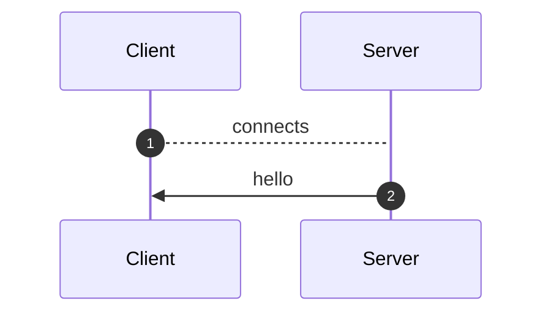
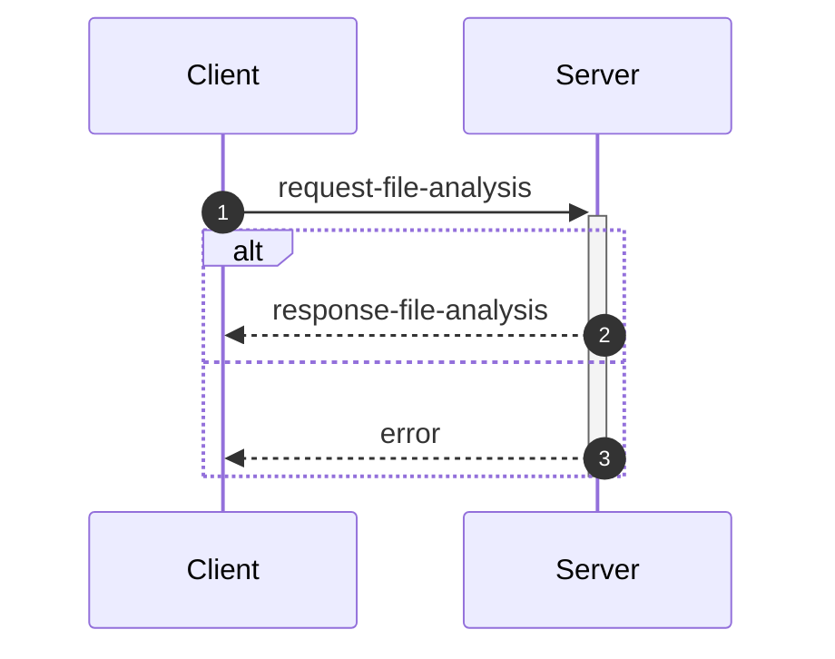
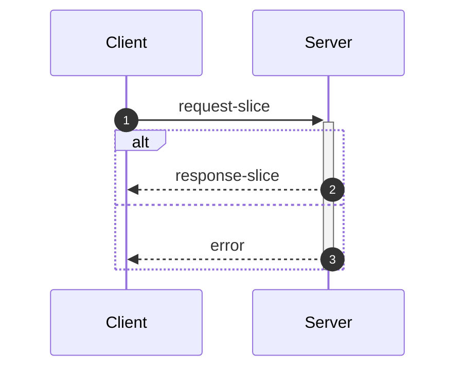
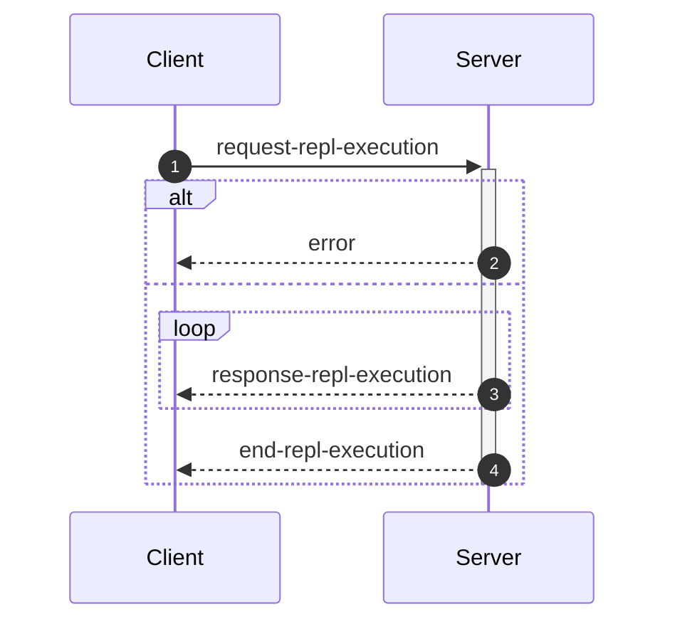

_<span title="an overview of flowR's interface">Generated</span> from '[wiki-interface.ts](https://github.com/flowr-analysis/flowr/tree/main/src/documentation/wiki-interface.ts "src/documentation/wiki-interface.ts")' on 2026-10-30, 07:17:43 UTC (v2.16.8, R v4.5.0), do not edit directly._

Although far from being as detailed as the in-depth explanation of [_flowR_](https://github.com/flowr-analysis/flowr/wiki/Core),
this wiki page explains how to interface with _flowR_ in more detail.
In general, command line arguments and other options provide short descriptions on hover over.

* [💻 Using the REPL](#using-the-repl)
* [⚙️ Configuring FlowR](#configuring-flowr)
* [⚒️ Writing Code](#writing-code)
* [💬 Communicating with the Server](#communicating-with-the-server)

<a id='using-the-repl'></a>
## 💻 Using the REPL

> [!NOTE]
> To execute arbitrary R commands with a repl request, _flowR_ has to be started explicitly with <span title="Description (Command Line Argument): Allow to access the underlying R session when using flowR (security warning: this allows the execution of arbitrary R code!)">`--r-session-access`</span>.
> Please be aware that this introduces a security risk and note that this relies on the [`r-shell` engine](https://github.com/flowr-analysis/flowr/wiki/Engines) .

Although primarily meant for users to explore,
there is nothing which forbids calling _flowR_ as a subprocess to use standard-in, -output, and -error
for communication (although you can access the REPL using the server as well,
with the [REPL Request](#message-request-repl-execution) message).

The read-eval-print loop&nbsp;(REPL) works relatively simple.
You can submit an expression (using <kbd>Enter</kbd>),
which is interpreted as an R&nbsp;expression by default but interpreted as a *command* if it starts with a colon (`:`).
The best command to get started with the REPL is <span title="Description (Repl Command): Show help information (aliases: :h, :?)">`:help`</span>.
Besides, you can leave the REPL either with the command <span title="Description (Repl Command): End the repl (aliases: :q, :exit)">`:quit`</span> or by pressing <kbd>Ctrl</kbd>+<kbd>C</kbd> twice.
When writing a *command*, you may press <kbd>Tab</kbd> to get a list of completions, if available.
Multiple commands can be entered in a single line by separating them with a semicolon (`;`), e.g. `:parse "x<-2"; :df*`.
If a command is given without R code, the REPL will re-use R code given in a previous command.
The prior example will hence return first the parsed AST of the program and then the dataflow graph for `"x <- 2"`.

> [!NOTE]
> If you develop flowR, you may want to launch the repl using the `npm run main-dev` command, this way, you get a non-minified version of flowR with debug information and hot-reloading of source files.

<details>
<summary>Available Commands</summary>

We currently offer the following commands (this with a `[*]` suffix are available with and without the star):

| Command | Description |
| ------- | ----------- |
| **<span title="Description (Repl Command): End the repl (aliases: :q, :exit)">:quit</span>** | End the repl (aliases: **:<span title="Alias of ':quit'. End the repl">q</span>**, **:<span title="Alias of ':quit'. End the repl">exit</span>**) |
| **<span title="Description (Repl Command): Execute the given code as R code. This requires the `--r-session-access` flag to be set and requires the r-shell engine. (aliases: :e, :r)">:execute</span>** | Execute the given code as R code. This requires the `--r-session-access` flag to be set and requires the r-shell engine. (aliases: **:<span title="Alias of ':execute'. Execute the given code as R code. This requires the `--r-session-access` flag to be set and requires the r-shell engine.">e</span>**, **:<span title="Alias of ':execute'. Execute the given code as R code. This requires the `--r-session-access` flag to be set and requires the r-shell engine.">r</span>**) |
| **<span title="Description (Repl Command): Get mermaid code for the control-flow graph of R code (aliases: :cfg, :cf)">:controlflow[*]</span>** | Get mermaid code for the control-flow graph of R code (star: Returns the URL to mermaid.live) (aliases: **:<span title="Alias of ':controlflow'. Get mermaid code for the control-flow graph of R code">cfg</span>**, **:<span title="Alias of ':controlflow'. Get mermaid code for the control-flow graph of R code">cf</span>**) |
| **<span title="Description (Repl Command): Get mermaid code for the control-flow graph with basic blocks (aliases: :cfgb, :cfb)">:controlflowbb[*]</span>** | Get mermaid code for the control-flow graph with basic blocks (star: Returns the URL to mermaid.live) (aliases: **:<span title="Alias of ':controlflowbb'. Get mermaid code for the control-flow graph with basic blocks">cfgb</span>**, **:<span title="Alias of ':controlflowbb'. Get mermaid code for the control-flow graph with basic blocks">cfb</span>**) |
| **<span title="Description (Repl Command): Get mermaid code for the dataflow graph (aliases: :d, :df)">:dataflow[*]</span>** | Get mermaid code for the dataflow graph (star: Returns the URL to mermaid.live) (aliases: **:<span title="Alias of ':dataflow'. Get mermaid code for the dataflow graph">d</span>**, **:<span title="Alias of ':dataflow'. Get mermaid code for the dataflow graph">df</span>**) |
| **<span title="Description (Repl Command): Get mermaid code for the normalized AST of R code (aliases: :n)">:normalize[*]</span>** | Get mermaid code for the normalized AST of R code (star: Returns the URL to mermaid.live) (alias: **:<span title="Alias of ':normalize'. Get mermaid code for the normalized AST of R code">n</span>**) |
| **<span title="Description (Repl Command): Get mermaid code for the simplified dataflow graph (aliases: :ds, :dfs)">:dataflowsimple[*]</span>** | Get mermaid code for the simplified dataflow graph (star: Returns the URL to mermaid.live) (aliases: **:<span title="Alias of ':dataflowsimple'. Get mermaid code for the simplified dataflow graph">ds</span>**, **:<span title="Alias of ':dataflowsimple'. Get mermaid code for the simplified dataflow graph">dfs</span>**) |
| **<span title="Description (Repl Command): Inspect and extend the signature database: `query` (identical to :query @signature), `info <name>` for where a function comes from (identical to :query @function-info), `add <path>` to mount another database/source, `download` to fetch the full-history database. (aliases: :sig)">:signature</span>** | Inspect and extend the signature database: `query` (identical to :query @signature), `info <name>` for where a function comes from (identical to :query @function-info), `add <path>` to mount another database/source, `download` to fetch the full-history database. (alias: **:<span title="Alias of ':signature'. Inspect and extend the signature database: `query` (identical to :query @signature), `info <name>` for where a function comes from (identical to :query @function-info), `add <path>` to mount another database/source, `download` to fetch the full-history database.">sig</span>**) |
| **<span title="Description (Repl Command): Just calculates the DFG, but only prints summary info (aliases: :d#, :df#)">:dataflowsilent</span>** | Just calculates the DFG, but only prints summary info (aliases: **:<span title="Alias of ':dataflowsilent'. Just calculates the DFG, but only prints summary info">d#</span>**, **:<span title="Alias of ':dataflowsilent'. Just calculates the DFG, but only prints summary info">df#</span>**) |
| **<span title="Description (Repl Command): Prints ASCII Art of the parsed, unmodified AST (aliases: :p)">:parse</span>** | Prints ASCII Art of the parsed, unmodified AST (alias: **:<span title="Alias of ':parse'. Prints ASCII Art of the parsed, unmodified AST">p</span>**) |
| **<span title="Description (Repl Command): Prints the version of flowR as well as the current version of R">:version</span>** | Prints the version of flowR as well as the current version of R
| **<span title="Description (Repl Command): Query the given R code (use 'help' for more information)">:query[*]</span>** | Query the given R code (use 'help' for more information) (star: Similar to query, but returns the output in json format.)
| **<span title="Description (Repl Command): Returns an ASCII representation of the dataflow graph (aliases: :df!)">:dataflowascii</span>** | Returns an ASCII representation of the dataflow graph (alias: **:<span title="Alias of ':dataflowascii'. Returns an ASCII representation of the dataflow graph">df!</span>**) |
| **<span title="Description (Repl Command): Returns summarization stats for the normalized AST (aliases: :n#)">:normalize#</span>** | Returns summarization stats for the normalized AST (alias: **:<span title="Alias of ':normalize#'. Returns summarization stats for the normalized AST">n#</span>**) |
| **<span title="Description (Repl Command): Show help information (aliases: :h, :?)">:help</span>** | Show help information (aliases: **:<span title="Alias of ':help'. Show help information">h</span>**, **:<span title="Alias of ':help'. Show help information">?</span>**) |

</details>

> [!TIP]
> 
> As indicated by the examples before, all REPL commands that operate on code keep track of the state.
> Hence, if you run a command like <span title="Description (Repl Command, starred version): Returns the URL to mermaid.live; Base Command: Get mermaid code for the dataflow graph (aliases: :d*, :df*)">`:dataflow*`</span> without providing R code,
> the REPL will re-use the R code provided in a previous command.
> Likewise, doing this will benefit from incrementality!
> If you request the dataflow graph with `:df* x <- 2 * y` and then want to see the parsed AST with `:parse`,
> the REPL will re-use previously obtained information and not re-parse the code again.
> 		

Generally, many commands offer shortcut versions in the REPL. Many queries, for example, offer a shortened format (see the example below).
Of special note, the [Config Query](https://github.com/flowr-analysis/flowr/wiki/%5BQuery%5D-Config)
can be used to also modify the currently active configuration of _flowR_ within the REPL (see the [wiki page](https://github.com/flowr-analysis/flowr/wiki/%5BQuery%5D-Config) for more information).

### Example: Retrieving the Dataflow Graph

To retrieve a URL to the [mermaid](https://mermaid.js.org/) diagram of the dataflow of a given expression,
use <span title="Description (Repl Command, starred version): Returns the URL to mermaid.live; Base Command: Get mermaid code for the dataflow graph (aliases: :d*, :df*)">`:dataflow*`</span> (or <span title="Description (Repl Command): Get mermaid code for the dataflow graph (aliases: :d, :df)">`:dataflow`</span> to get the mermaid code in the cli):

```shell
$ docker run -it --rm eagleoutice/flowr # or npm run flowr 
flowR repl v2.16.8, R grammar v14 (tree-sitter engine)
R> :dataflow* y <- 1 + x
```

<details>
<summary style='color:gray'>Output</summary>

```text
https://mermaid.live/view#base64:eyJjb2RlIjoiZmxvd2NoYXJ0IFREXG4gICAgMXt7XCJgKiM5MTtSTnVtYmVyIzkzOyogKioxKipcbiAgICAgICoxLjYqICgqKmlkOiAxKiopYFwifX1cbiAgICAyKFtcImAqIzkxO1JTeW1ib2wjOTM7KiAqKngqKlxuICAgICAgKjEuMTAqICgqKmlkOiAyKiopYFwiXSlcbiAgICAzW1tcImAqIzkxO1JCaW5hcnlPcCM5MzsqIGJhc2UjNTg7IzU4OyoqIzQzOyoqXG4gICAgICAqMS42LTEwKiAoKippZDogMyoqKVxuICAgIGFyZzogKDEsIDIpYFwiXV1cbiAgICBidWlsdC1pbjpfNDNfW1wiYEJ1aWx0LUluOlxuIzQzO2BcIl1cbiAgICBzdHlsZSBidWlsdC1pbjpfNDNfIHN0cm9rZTpncmF5LGZpbGw6Z3JheSxzdHJva2Utd2lkdGg6MnB4LG9wYWNpdHk6Ljg7XG4gICAgMFtcImAqIzkxO1JTeW1ib2wjOTM7KiAqKnkqKlxuICAgICAgKjEuMSogKCoqaWQ6IDAqKiwgdjogMylgXCJdXG4gICAgNFtbXCJgKiM5MTtSQmluYXJ5T3AjOTM7KiBiYXNlIzU4OyM1ODsqKiM2MDsjNDU7KipcbiAgICAgICoxLjEtMTAqICgqKmlkOiA0KiopXG4gICAgYXJnOiAoMCwgMylgXCJdXVxuICAgIGJ1aWx0LWluOl82MF8tW1wiYEJ1aWx0LUluOlxuIzYwOyM0NTtgXCJdXG4gICAgc3R5bGUgYnVpbHQtaW46XzYwXy0gc3Ryb2tlOmdyYXksZmlsbDpncmF5LHN0cm9rZS13aWR0aDoycHgsb3BhY2l0eTouODtcbiAgICAxIC0uLT58XCJmbG93XCJ8IDJcbiAgICBsaW5rU3R5bGUgMCBzdHJva2U6Z3JheSxjb2xvcjpncmF5O1xuICAgIDIgLS4tPnxcImZsb3dcInwgM1xuICAgIGxpbmtTdHlsZSAxIHN0cm9rZTpncmF5LGNvbG9yOmdyYXk7XG4gICAgMyAtLT58XCJyZWFkcywgYXJnXCJ8IDFcbiAgICAzIC0tPnxcInJlYWRzLCBhcmdcInwgMlxuICAgIDMgLS4tPnxcImZsb3dcInwgMFxuICAgIGxpbmtTdHlsZSA0IHN0cm9rZTpncmF5LGNvbG9yOmdyYXk7XG4gICAgMyAtLi0+fFwicmVhZHMsIGNhbGxzXCJ8IGJ1aWx0LWluOl80M19cbiAgICBsaW5rU3R5bGUgNSBzdHJva2U6Z3JheTtcbiAgICAwIC0tPnxcImRlZmluZWQtYnksIGZsb3dcInwgNFxuICAgIDAgLS0+fFwiZGVmaW5lZC1ieVwifCAzXG4gICAgNCAtLT58XCJyZWFkcywgYXJnXCJ8IDNcbiAgICA0IC0tPnxcInJldHVybnMsIGFyZ1wifCAwXG4gICAgNCAtLi0+fFwicmVhZHMsIGNhbGxzXCJ8IGJ1aWx0LWluOl82MF8tXG4gICAgbGlua1N0eWxlIDEwIHN0cm9rZTpncmF5OyIsIm1lcm1haWQiOnsiYXV0b1N5bmMiOnRydWV9fQ==
```

Retrieve the dataflow graph of the expression `y <- 1 + x`. It looks like this:


<details>

<summary style="color:gray">R Code of the Dataflow Graph</summary>

The analysis ran (parse and normalize with the [tree-sitter](https://github.com/flowr-analysis/flowr/wiki/Engines) engine) in the generation environment. No [signature database](https://github.com/flowr-analysis/flowr/wiki/Signature-Database) is mounted, so `library()` attaches no exports (base-R names are still qualified, e.g., `stats::acf`). 
We encountered no unknown side effects during the analysis.

```r
y <- 1 + x
```

</details>

</details>

For small graphs like this, <span title="Description (Repl Command): Returns an ASCII representation of the dataflow graph (aliases: :df!)">`:dataflowascii`</span> also provides an ASCII representation directly in the REPL:

```shell
$ docker run -it --rm eagleoutice/flowr # or npm run flowr 
flowR repl v2.16.8, R grammar v14 (tree-sitter engine)
R> :df! y <- 1 + x
```

<details open>
<summary style='color:gray'>Output</summary>

```text
                        v<0>v
 c<4>c──────────────────| y |
 |<- |     ┌────────────v---v
 c---c     │
    │   c<3>c   0<1>0
    └───| + |───| 1 |───u<2>u
        c---c   0---0   | x |
           └────────────u---u
Edges:
3 -> 1: reads, arg          3 -> 2: reads, arg
3 -> 0: flows-to            1 -> 2: flows-to
2 -> 3: flows-to            4 -> 3: reads, arg
4 -> 0: returns, arg        0 -> 4: defined-by, flows-to
0 -> 3: defined-by
```

Retrieve the dataflow graph of the expression `y <- 1 + x` as ASCII art.

</details>

For the slicing with <span title="Description (Repl Command): Static backwards executable slicer for R">`:slicer`</span>, you have access to the same [magic comments](#slice-magic-comments) as with the [slice request](#message-request-slice).
Pass `--inline` to splice resolvable `source()` calls into the reconstruction so the slice is a single self-contained R text (the same as the static slice query's `inlineSources` flag).
See `--help` for more flags!

### Example: Interfacing with the File System

Many commands that allow for an R-expression (like <span title="Description (Repl Command, starred version): Returns the URL to mermaid.live; Base Command: Get mermaid code for the dataflow graph (aliases: :d*, :df*)">`:dataflow*`</span>) allow for a file as well
if the argument starts with `file://`.
If you are working from the root directory of the _flowR_ repository, the following gives you the parsed AST of the example file using the <span title="Description (Repl Command): Prints ASCII Art of the parsed, unmodified AST (aliases: :p)">`:parse`</span> command:

> **Watch mode**: Replace `file://` with `watch://` to enter watch mode.
> flowR runs the command immediately and then re-runs it every time the file (or any file inside the folder) changes.
> Enter any other command to leave watch mode.
> For example: `:df watch://analysis.R`

```shell
$ docker run -it --rm eagleoutice/flowr # or npm run flowr 
flowR repl v2.16.8, R grammar v14 (tree-sitter engine)
R> :parse file://test/testfiles/example.R
```

<details>
<summary style='color:gray'>Output</summary>

```text
File: test/testfiles/example.R

program
├ binaryoperator
│ ├ identifier "sum" (1:1─4)
│ ├ <- "<-" (1:5─7)
│ ╰ float "0" (1:8─9)
├ binaryoperator
│ ├ identifier "product" (2:1─8)
│ ├ <- "<-" (2:9─11)
│ ╰ float "1" (2:12─13)
├ binaryoperator
│ ├ identifier "w" (3:1─2)
│ ├ <- "<-" (3:3─5)
│ ╰ float "7" (3:6─7)
├ binaryoperator
│ ├ identifier "N" (4:1─2)
│ ├ <- "<-" (4:3─5)
│ ╰ float "10" (4:6─8)
├ forstatement
│ ├ for "for" (6:1─4)
│ ├ ( "(" (6:5─6)
│ ├ identifier "i" (6:6─7)
│ ├ in "in" (6:8─10)
│ ├ binaryoperator
│ │ ├ float "1" (6:11─12)
│ │ ├ : ":" (6:12─13)
│ │ ╰ parenthesizedexpression
│ │   ├ ( "(" (6:13─14)
│ │   ├ binaryoperator
│ │   │ ├ identifier "N" (6:14─15)
│ │   │ ├ - "-" (6:15─16)
│ │   │ ╰ float "1" (6:16─17)
│ │   ╰ ) ")" (6:17─18)
│ ├ ) ")" (6:18─19)
│ ╰ bracedexpression
│   ├ { "{" (6:20─21)
│   ├ binaryoperator
│   │ ├ identifier "sum" (7:3─6)
│   │ ├ <- "<-" (7:7─9)
│   │ ╰ binaryoperator
│   │   ├ binaryoperator
│   │   │ ├ identifier "sum" (7:10─13)
│   │   │ ├ + "+" (7:14─15)
│   │   │ ╰ identifier "i" (7:16─17)
│   │   ├ + "+" (7:18─19)
│   │   ╰ identifier "w" (7:20─21)
│   ├ binaryoperator
│   │ ├ identifier "product" (8:3─10)
│   │ ├ <- "<-" (8:11─13)
│   │ ╰ binaryoperator
│   │   ├ identifier "product" (8:14─21)
│   │   ├  "" (8:22─23)
│   │   ╰ identifier "i" (8:24─25)
│   ╰ } "}" (9:1─2)
├ call
│ ├ identifier "cat" (11:1─4)
│ ╰ arguments
│   ├ ( "(" (11:4─5)
│   ├ argument
│   │ ╰ string
│   │   ├ stringopen "\"" (11:5─6)
│   │   ├ stringcontent "Sum:" (11:6─10)
│   │   ╰ stringclose "\"" (11:10─11)
│   ├ comma "," (11:11─12)
│   ├ argument
│   │ ╰ identifier "sum" (11:13─16)
│   ├ comma "," (11:16─17)
│   ├ argument
│   │ ╰ string
│   │   ├ stringopen "\"" (11:18─19)
│   │   ├ stringcontent
│   │   │ ╰ escapesequence "\\n" (11:19─21)
│   │   ╰ stringclose "\"" (11:21─22)
│   ╰ ) ")" (11:22─23)
╰ call
  ├ identifier "cat" (12:1─4)
  ╰ arguments
    ├ ( "(" (12:4─5)
    ├ argument
    │ ╰ string
    │   ├ stringopen "\"" (12:5─6)
    │   ├ stringcontent "Product:" (12:6─14)
    │   ╰ stringclose "\"" (12:14─15)
    ├ comma "," (12:15─16)
    ├ argument
    │ ╰ identifier "product" (12:17─24)
    ├ comma "," (12:24─25)
    ├ argument
    │ ╰ string
    │   ├ stringopen "\"" (12:26─27)
    │   ├ stringcontent
    │   │ ╰ escapesequence "\\n" (12:27─29)
    │   ╰ stringclose "\"" (12:29─30)
    ╰ ) ")" (12:30─31)
```

Retrieve the parsed AST of the example file.

<details>

<summary>File Content</summary>

```r
sum <- 0
product <- 1
w <- 7
N <- 10

for (i in 1:(N-1)) {
  sum <- sum + i + w
  product <- product * i
}

cat("Sum:", sum, "\n")
cat("Product:", product, "\n")
```

</details>

As _flowR_ directly transforms this AST the output focuses on being human-readable instead of being machine-readable.
		
</details>

### Example: Run a Query

You can run any query supported by _flowR_ using the <span title="Description (Repl Command): Query the given R code (use 'help' for more information)">`:query`</span> command.
For example, to obtain the shapes of all data frames in a given piece of code, you can run:

```shell
$ docker run -it --rm eagleoutice/flowr # or npm run flowr 
flowR repl v2.16.8, R grammar v14 (tree-sitter engine)
R> :query @absint df-shape "x <- data.frame(a = 1:10, b = 1:10)\ny <- x$a"
```

<details open>
<summary style='color:gray'>Output</summary>

```text
Query: absint (4 ms)
   ╰ $12: (colnames: [{"a", "b"}, {}], cols: [2, 2], rows: [10, 10])
   ╰ $0: (colnames: [{"a", "b"}, {}], cols: [2, 2], rows: [10, 10])
```

Retrieve the shapes of all data frames in the given code.

</details>

To run the linter on a file, you can use (in this example, we just issue the `dead-code` linter on a small piece of code):

```shell
$ docker run -it --rm eagleoutice/flowr # or npm run flowr 
flowR repl v2.16.8, R grammar v14 (tree-sitter engine)
R> :query @linter rules:dead-code "if(FALSE) x <- 2"
```

<details open>
<summary style='color:gray'>Output</summary>

```text
Query: linter (2 ms)
   ╰ Dead Code (dead-code):
       ╰ certain:
           ╰ Code at 1.11-16 (1 quick fix(es) available)
```

Run the linter on the given code, with only the `dead-code` rule enabled.

</details>

For more information on the available queries, please check out the [Query API](https://github.com/flowr-analysis/flowr/wiki/Query-API).

<a id='configuring-flowr'></a>
## ⚙️ Configuring FlowR

When running _flowR_, you may want to specify some behaviors with a dedicated configuration file.
By default, flowR looks for a file named `flowr.json` in the current working directory (or any higher directory).
You can also specify a different file with <span title="Description (Command Line Argument): The name of the configuration file to use">`--config-file`</span> or pass the configuration inline using <span title="Description (Command Line Argument): The flowR configuration to use, as a JSON string">`--config-json`</span>.
A `flowr.json` found this way belongs to the analyzed project, so flowR ignores its options that decide what flowR executes or loads
(`engines.*.wasmPath`, `engines.*.treeSitterWasmPath`, `engines.*.rPath`, `solver.sigdb.additionalPaths`, `solver.sigdb.downloadRepo`, `solver.sigdb.installedLibrary.paths`),
unless you pass <span title="Description (Command Line Argument): Keep the security-sensitive options (e.g., the R executable) of the flowr.json found in the working directory or a parent. Only use this for projects you trust.">`--trust-config`</span>.
To analyze code you do not trust, use the secure mode (<span title="Description (Command Line Argument): Run in secure mode for analyzing untrusted code: flowR does not start R (or any other process), does not access the network, does not search for project configs, and ignores security-sensitive options in every config. Cannot be disabled once enabled. Can also be enabled with the environment variable {italic FLOWR_SECURE_MODE=1}.">`--secure`</span>, see the [security policy](https://github.com/flowr-analysis/flowr/blob/main/.github/SECURITY.md)).
To inspect the current configuration, you can run flowr with the <span title="Description (Command Line Argument): Run with verbose logging (will be passed to the corresponding script)">`--verbose`</span> flag, or use the `config` [Query](https://github.com/flowr-analysis/flowr/wiki/Query-API).
Within the REPL this works by running the following:

```shell
:query @config
```

To work with the <a href="https://github.com/flowr-analysis/flowr/tree/main/src/config.ts#L119"><code><span title="The configuration file format for flowR.">FlowrConfig</span></code></a> you can use the provided helper objects alongside its methods like
<a href="https://github.com/flowr-analysis/flowr/tree/main/src/config.ts#L914"><code><span title="Creates a new flowr config that has the updated values.">FlowrConfig::<b>amend</b></span></code></a>.
The schema below documents every option; the ones you most likely want are:

- <a href="https://github.com/flowr-analysis/flowr/wiki/Interface#configuring-flowr" title="Configuration Option (boolean): Whether source calls should be ignored, causing {@link processSourceCall}&#39;s behavior to be skipped.">ignoreSourceCalls</a>: ignore source calls when analyzing the code, i.e., ignore the inclusion of other files.
- <a href="https://github.com/flowr-analysis/flowr/wiki/Interface#configuring-flowr" title="Configuration Option (boolean): Whether load calls should be ignored, causing {@link processLoadCall}&#39;s behavior to be skipped.">ignoreLoadCalls</a>: ignore load calls when analyzing the code, i.e., ignore the loading of r-data files.
- <a href="https://github.com/flowr-analysis/flowr/wiki/Interface#configuring-flowr" title="Configuration Option (object): Do you want to overwrite (parts) of the builtin definition?">semantics.environment.overwriteBuiltIns</a>: overwrite _flowR_'s handling of built-in functions, or clear the preset definitions entirely.
  See [Configure BuiltIn Semantics](#configure-builtin-semantics) for more information.
- <a href="https://github.com/flowr-analysis/flowr/wiki/Interface#configuring-flowr" title="Configuration Option (string): How to resolve variables and their values. (one of &quot;disabled&quot;, &quot;alias&quot;, &quot;builtin&quot;)">solver.variables</a>: how to resolve variables and their values (`disabled`, `alias`, `builtin`).
- <a href="https://github.com/flowr-analysis/flowr/wiki/Interface#configuring-flowr" title="Configuration Option (array): The engine or set of engines to use for interacting with R code. An empty array means all available engines will be used.">engines</a> and <a href="https://github.com/flowr-analysis/flowr/wiki/Interface#configuring-flowr" title="Configuration Option (string): The default engine to use for interacting with R code. If this is undefined, an arbitrary engine from the specified list will be used. (one of &quot;tree-sitter&quot;, &quot;r-shell&quot;)">defaultEngine</a>: the engines used to interact with R code, see the [Engines wiki page](https://github.com/flowr-analysis/flowr/wiki/Engines).
- <a href="https://github.com/flowr-analysis/flowr/wiki/Interface#configuring-flowr" title="Configuration Option (array): Files a framework loads on its own, without any source() call (e.g. global.R in a shiny app), in the order they are loaded; flowR orders the matching project files accordingly and analyzes them as one program. Entries are case-insensitive globs matched against the file path, a plain name matches any file with that name, and entries matching no project file are warned about. Usually set per project kind via specializeConfig.">project.implicitSources</a>: the files a framework loads without any `source()` call, in the order in which they are
  loaded. Entries are globs (e.g. `R/*.R`) matched against the file path ignoring capitalization; one matching no file is reported.
- <a href="https://github.com/flowr-analysis/flowr/wiki/Interface#configuring-flowr" title="Configuration Option (object): Overwrite (parts of) the configuration depending on the project kind flowR detects, e.g. to give a shiny app its implicit sources.">specializeConfig</a>: overwrite (parts of) the configuration depending on the kind of project _flowR_ detects
  (e.g. `shiny-app`), which is how a shiny app gets its implicit sources by default. What you configure directly wins.
- <a href="https://github.com/flowr-analysis/flowr/wiki/Interface#configuring-flowr" title="Configuration Option (string): Overwrite the project kind flowR would otherwise infer from the analyzed files, e.g. when auto-detection guesses wrong. (one of &quot;package&quot;, &quot;script&quot;, &quot;shiny-app&quot;, &quot;notebook&quot;, &quot;project&quot;, &quot;unknown&quot;)">project.useProjectType</a>: skip that detection and force a project kind yourself, when auto-detection guesses wrong.
- <a href="https://github.com/flowr-analysis/flowr/wiki/Interface#configuring-flowr" title="Configuration Option (array): The default plugins to load when creating a new instance of FlowrAnalyzer">defaultPlugins</a> and <a href="https://github.com/flowr-analysis/flowr/wiki/Interface#configuring-flowr" title="Configuration Option (array): The plugins to load in REPL mode">repl.plugins</a>: the plugins to load for a new <a href="https://github.com/flowr-analysis/flowr/tree/main/src/project/flowr-analyzer.ts#L205"><code><span title="Central class for conducting analyses with FlowR. Use the FlowrAnalyzerBuilder to create a new instance. If you want the original pattern of creating a pipeline and running all steps, you can still do this with FlowrAnalyzer#runFull . To inspect the context of the analyzer, use FlowrAnalyzer#inspectContext (if you are a plugin and need to modify it, use FlowrAnalyzer#context instead).">FlowrAnalyzer</span></code></a> and in the REPL
  (use `flowr:default` to reference the former).

So you can configure _flowR_ by adding a file like the following:

<details>

<summary>Example Configuration File</summary>

```json
{
  "ignoreSourceCalls": true,
  "ignoreLoadCalls": true,
  "semantics": {
    "environment": {
      "overwriteBuiltIns": {
        "definitions": [
          {
            "type": "function",
            "names": [
              "foo"
            ],
            "processor": "builtin:assign",
            "config": {}
          }
        ]
      }
    }
  },
  "defaultPlugins": [
    "file:description",
    "versions:description"
  ],
  "repl": {
    "quickStats": false,
    "dfProcessorHeat": false,
    "hints": true,
    "plugins": [
      "flowr:default"
    ]
  },
  "project": {
    "resolveUnknownPathsOnDisk": true,
    "implicitSources": [
      "global.R",
      "app.R"
    ]
  },
  "linter": {
    "disabledRules": []
  },
  "specializeConfig": {
    "shiny-app": {
      "project": {
        "implicitSources": [
          "global.R",
          "ui.R",
          "server.R",
          "app.R"
        ]
      }
    }
  },
  "engines": [
    {
      "type": "r-shell"
    }
  ],
  "solver": {
    "variables": "alias",
    "evalStrings": true,
    "trackEnvironments": true,
    "sigdb": {
      "enabled": true,
      "loadProjectDependencies": true,
      "eagerlyLoad": false,
      "eagerlyLoadExports": false,
      "linkBaseR": false,
      "linkDescriptionDependencies": false
    },
    "resolveSource": {
      "dropPaths": "no",
      "ignoreCapitalization": true,
      "inferWorkingDirectory": "active-script",
      "searchPath": []
    },
    "instrument": {},
    "slicer": {
      "threshold": 50
    }
  },
  "abstractInterpretation": {
    "wideningThreshold": 4,
    "followCalls": true,
    "dataFrame": {
      "maxColNames": 20,
      "readLoadedData": {
        "readExternalFiles": true,
        "maxReadLines": 1000000
      }
    }
  },
  "incremental": {
    "alwaysIncremental": false,
    "parsing": {
      "activated": false,
      "heuristics": {
        "activated": true,
        "mtime": true,
        "linesFrom": 500,
        "bytesFrom": 50000,
        "alwaysWithEdits": false,
        "minFiles": 1
      }
    }
  },
  "gas": {
    "thresholds": {
      "memory": {
        "problematic": 0.7,
        "critical": 0.9
      },
      "timeMs": {
        "problematic": 100000,
        "critical": 120000
      }
    },
    "features": {}
  }
}
```

</details>

<details>
<a id='configure-builtin-semantics'></a>
<summary>Configure Built-In Semantics</summary>

`semantics/environment/overwriteBuiltins` accepts two keys:

- `loadDefaults` (boolean, initially `true`): If set to `true`, the default built-in definitions are loaded before applying the custom definitions. Setting this flag to `false` explicitly disables the loading of the default definitions.
- `definitions` (array, initially empty): Allows to overwrite or define new built-in elements. Each object within must have a `type` which is one of the below. Furthermore, they may define a string array of `names` which specifies the identifiers to bind the definitions to. You may use `assumePrimitive` to specify whether _flowR_ should assume that this is a primitive non-library definition (so you probably just do not want to specify the key).

  | Type            | Description                                                                                                                                                                                                                                                                                              | Example                                                                                                    |
  | --------------- | -------------------------------------------------------------------------------------------------------------------------------------------------------------------------------------------------------------------------------------------------------------------------------------------------------- | ---------------------------------------------------------------------------------------------------------- |
  | `constant`    | Additionally allows for a `value` this should resolve to.                                                                                                                                                                                                                                                | `{ type: 'constant', names: ['NULL', 'NA'],  value: null }`                                                |
  | `function`    | Is a rather flexible way to define and bind built-in functions. For the time, we do not have extensive documentation to cover all the cases, so please either consult the sources with the `default-builtin-config.ts` or open a [new issue](https://github.com/flowr-analysis/flowr/issues/new/choose). | `{ type: 'function', names: ['next'], processor: 'builtin:d', config: { cfg: ExitPointType.Next } }` |
  | `replacement` | A comfortable way to specify replacement functions like `$<-` or `names<-`. `suffixes` describes the... suffixes to attach automatically. | `{ type: 'replacement', suffixes: ['<-', '<<-'], names: ['[', '[['] }` |

</details>

<details>

<summary style='color:gray'>Full Configuration-File Schema</summary>

- _The configuration file format for flowR._ (object)
    - **logLevel** [optional] _flowR's global minimum log level, applied when the config is loaded._ (string)
        Only allows: 'silly', 'trace', 'debug', 'info', 'warn', 'error', 'fatal'
    - **ignoreSourceCalls** [optional] _Whether source calls should be ignored, causing {@link processSourceCall}'s behavior to be skipped._ (boolean)
    - **ignoreLoadCalls** [optional] _Whether load calls should be ignored, causing {@link processLoadCall}'s behavior to be skipped._ (boolean)
    - **semantics** _Configure language semantics and how flowR handles them._ (object)
        - **environment** [optional] _Semantics regarding how to handle the R environment._ (object)
            - **overwriteBuiltIns** [optional] _Do you want to overwrite (parts) of the builtin definition?_ (object)
                - **loadDefaults** [optional] _Should the default configuration still be loaded?_ (boolean)
                - **definitions** [optional] _The definitions to load/overwrite._ (array)
                Valid item types:
                    - (object)
    - **defaultPlugins** [optional] _The default plugins to load when creating a new instance of FlowrAnalyzer_ (array)
    Valid item types:
        - (alternatives)
            - (string)
            - (array)
    - **repl** _Configuration options for the REPL._ (object)
        - **quickStats** [optional] _Whether to show quick stats in the REPL after each evaluation._ (boolean)
        - **dfProcessorHeat** [optional] _This instruments the dataflow processors to count how often each processor is called._ (boolean)
        - **hints** [optional] _Whether to show dim inline hints on the empty prompt (automatically disabled on non-interactive terminals)._ (boolean)
        - **plugins** [optional] _The plugins to load in REPL mode_ (array)
        Valid item types:
            - (alternatives)
                - (string)
                - (array)
        - **autoUseFileProtocol** [optional] _Prepend the file protocol to a repl input that looks like a path, instead of only warning about it._ (boolean)
        - **queryStats** [optional] _Whether `:query` closes with the line stating how long the queries took (`:query*` never prints it)._ (boolean)
        - **showPlugins** [optional] _Whether `:version` grays out the plugins that did not activate during the last analysis._ (boolean)
    - **project** _Project specific configuration options._ (object)
        - **resolveUnknownPathsOnDisk** [optional] _Whether to resolve unknown paths loaded by the r project disk when trying to source/analyze files._ (boolean)
        - **failOnInaccessiblePath** [optional] _Whether a directory that cannot be traversed during file discovery (e.g. due to permissions) aborts the analysis; when false (the default) such paths are logged and skipped._ (boolean)
        - **basePackages** [optional] _The packages considered part of R itself (base and recommended); if unset, flowR uses its built-in list._ (array)
        Valid item types:
            - (string)
        - **implicitSources** [optional] _Files a framework loads on its own, without any source() call (e.g. global.R in a shiny app), in the order they are loaded; flowR orders the matching project files accordingly and analyzes them as one program. Entries are case-insensitive globs matched against the file path, a plain name matches any file with that name, and entries matching no project file are warned about. Usually set per project kind via specializeConfig._ (array)
        Valid item types:
            - (string)
        - **useProjectType** [optional] _Overwrite the project kind flowR would otherwise infer from the analyzed files, e.g. when auto-detection guesses wrong._ (string)
            Only allows: 'package', 'script', 'shiny-app', 'notebook', 'project', 'unknown'
        - **assumeImplicitEcho** [optional] _Whether the top level of the analyzed code is echoed, so that every visible result printed there is collected as an output by the dependencies query (default true, false for a package)._ (boolean)
        - **discovery** [optional] _Scoping options for the default project discovery._ (object)
            - **full** [optional] _Collect every file below the project root (greedy) instead of only the files the detected project kind needs (default false)._ (boolean)
            - **perKind** [optional] _Per-kind include/exclude glob overrides layered on the default scoping._ (object)
            - **ignore** [optional] _Case-insensitive globs that drop matching files from the intelligent discovery, regardless of kind (e.g. .Renviron to ignore environment files)._ (array)
            Valid item types:
                - (string)
        - **classification** [optional] _Overrides for the signals flowR uses to classify the project kind._ (object)
            - **shinyDescriptionTypes** [optional] _DESCRIPTION Type: values that mark a shiny app._ (array)
            Valid item types:
                - (string)
            - **shinyEntryFiles** [optional] _File names a shiny app is assembled from._ (array)
            Valid item types:
                - (string)
            - **shinyUsagePattern** [optional] _Regex source evidencing shiny usage in an entry file._ (string)
            - **notebookExtensions** [optional] _File extensions marking a notebook._ (array)
            Valid item types:
                - (string)
    - **linter** _Linter configuration options._ (object)
        - **disabledRules** _Linting rule names excluded from the default rule set (a rule requested explicitly via a linter query still runs). Usually set per project kind via specializeConfig._ (array)
        Valid item types:
            - (string)
        - **disabledTags** [optional] _Linting rule tags whose rules are excluded from the default rule set (a rule requested explicitly via a linter query still runs). By default the cmd-check rules are disabled for everything but a package; a configured list replaces that default._ (array)
        Valid item types:
            - (string)
    - **inputSources** [optional] _Further frameworks the input-sources analysis should know about; entries are added to flowR's defaults._ (object)
        - **pure** [optional] _Functions that only pass the constantness of their arguments on._ (array)
        Valid item types:
            - (string)
        - **param** [optional] _Functions whose result is a 'param' input._ (array)
        Valid item types:
            - (string)
        - **file** [optional] _Functions whose result is a 'file' input._ (array)
        Valid item types:
            - (string)
        - **tempfile** [optional] _Functions whose result is a 'tempfile' input._ (array)
        Valid item types:
            - (string)
        - **glob** [optional] _Functions whose result is a 'glob' input._ (array)
        Valid item types:
            - (string)
        - **net** [optional] _Functions whose result is a 'net' input._ (array)
        Valid item types:
            - (string)
        - **rand** [optional] _Functions whose result is a 'rand' input._ (array)
        Valid item types:
            - (string)
        - **system** [optional] _Functions whose result is a 'system' input._ (array)
        Valid item types:
            - (string)
        - **ffi** [optional] _Functions whose result is a 'ffi' input._ (array)
        Valid item types:
            - (string)
        - **lang** [optional] _Functions whose result is a 'lang' input._ (array)
        Valid item types:
            - (string)
        - **options** [optional] _Functions whose result is a 'options' input._ (array)
        Valid item types:
            - (string)
        - **cmdline** [optional] _Functions whose result is a 'cmdline' input._ (array)
        Valid item types:
            - (string)
        - **user** [optional] _Functions whose result is a 'user' input._ (array)
        Valid item types:
            - (string)
        - **const** [optional] _Functions whose result is a 'const' input._ (array)
        Valid item types:
            - (string)
        - **scope** [optional] _Functions whose result is a 'scope' input._ (array)
        Valid item types:
            - (string)
        - **dconst** [optional] _Functions whose result is a 'dconst' input._ (array)
        Valid item types:
            - (string)
        - **unknown** [optional] _Functions whose result is a 'unknown' input._ (array)
        Valid item types:
            - (string)
        - **linkedObjects** [optional] _Objects a framework provides without a definition in the code, e.g. shiny's input._ (array)
        Valid item types:
            - (object)
        - **linkedEntryPoints** [optional] _Calls that hand a function to a framework, which binds its objects to the parameters by position._ (array)
        Valid item types:
            - (object)
    - **specializeConfig** [optional] _Overwrite (parts of) the configuration depending on the project kind flowR detects, e.g. to give a shiny app its implicit sources._ (object)
    - **engines** _The engine or set of engines to use for interacting with R code. An empty array means all available engines will be used._ (array)
    Valid item types:
        - (alternatives)
            - _The configuration for the tree sitter engine._ (object)
                - **type** [required] _Use the tree sitter engine._ (string)
                    Only allows: 'tree-sitter'
                - **wasmPath** [optional] _The path to the tree-sitter-r WASM binary to use. If this is undefined, this uses the default path._ (string)
                - **treeSitterWasmPath** [optional] _The path to the tree-sitter WASM binary to use. If this is undefined, this uses the default path._ (string)
                - **lax** [optional] _Whether to use the lax parser for parsing R code (allowing for syntax errors). If this is undefined, the strict parser will be used._ (boolean)
            - _The configuration for the R shell engine._ (object)
                - **type** [required] _Use the R shell engine._ (string)
                    Only allows: 'r-shell'
                - **rPath** [optional] _The path to the R executable to use. If this is undefined, this uses the default path._ (string)
                - **pipeBind** [optional] _Whether to enable R's experimental pipe-bind operator "=>" by setting _R_USE_PIPEBIND_ for the R session (default false); R itself keeps this off by default, as it is experimental and has never shipped in a release version of R._ (boolean)
    - **defaultEngine** [optional] _The default engine to use for interacting with R code. If this is undefined, an arbitrary engine from the specified list will be used._ (string)
        Only allows: 'tree-sitter', 'r-shell'
    - **solver** _How to resolve constants, constraints, cells, ..._ (object)
        - **variables** _How to resolve variables and their values._ (string)
            Only allows: 'disabled', 'alias', 'builtin'
        - **evalStrings** _Should we include eval(parse(text="...")) calls in the dataflow graph?_ (boolean)
        - **trackEnvironments** [optional] _Track user-created environments (new.env, assign/get/local with envir=, dollar-assign, attach). When false, all envir-style calls fall through conservatively._ (boolean)
        - **sigdb** _Resolving library exports from a signature database._ (object)
            - **enabled** [optional] _Resolve library()/use() exports from a signature database (default true); when false no database is consulted._ (boolean)
            - **loadProjectDependencies** [optional] _Load the project's declared dependencies from its metadata files (DESCRIPTION Imports/Depends, rproject.toml, uvr.toml, renv.lock, rv.lock, uvr.lock) (default true); when false these files are not read for dependencies._ (boolean)
            - **eagerlyLoad** [optional] _Parse the database up front rather than on the first package load (default false, ignored if disabled)._ (boolean)
            - **eagerlyLoadExports** [optional] _Add a vertex for every export on load rather than on demand (default false); keeps the dataflow graph small._ (boolean)
            - **assumedRVersion** [optional] _R version assumed when resolving versioned (base-R) exports: a pin like "4.5" or "auto" to detect the installed R (default "auto")._ (string)
            - **linkBaseR** [optional] _Eagerly attach base-R namespaces so bare base calls resolve without library() (default false)._ (boolean)
            - **linkBaseRCalls** [optional] _Add a lightweight Reads edge from a bare base-R call to its signature-database function vertex (default false; base-R qualification is edge-free otherwise)._ (boolean)
            - **linkPackageCalls** [optional] _Add a lightweight Reads edge from a resolved package call to its signature-database function vertex (default false)._ (boolean)
            - **linkDescriptionDependencies** [optional] _Eagerly attach the namespaces of the project's declared DESCRIPTION dependencies (Imports/Depends) so their exports resolve without an explicit library() (default false)._ (boolean)
            - **warmInBackground** [optional] _Decompress the hot shards (base + most-downloaded) in a background task on startup so the first library() lookup is warm (default false; for long-running servers/REPLs)._ (boolean)
            - **additionalPaths** [optional] _Extra directories or bundle/manifest files searched for signature databases (alongside the shipped default and $FLOWR_SIGDB_DIR); a downloaded full-history bundle placed here is mounted automatically._ (array)
            Valid item types:
                - (string)
            - **downloadRepo** [optional] _GitHub owner/repo the full-history bundle is downloaded from via ":signature download" (default "flowr-analysis/flowr", release tag "sigdb-v<flowR-version>")._ (string)
            - **autoSync** [optional] _On startup, re-download shards whose committed sigdb.remote.json hash no longer matches the cache, in the background (default false; opt-in network sync after a git pull)._ (boolean)
            - **installedLibrary** [optional] _Recovering packages no signature database knows from the copy installed on this machine._ (object)
                - **enabled** [required] _Recover packages no signature database knows from their installed copy (default false)._ (boolean)
                - **paths** [optional] _Library directories to search; when empty they are discovered from the environment and the project._ (array)
                Valid item types:
                    - (string)
                - **useEnvironment** [optional] _Search the libraries R_LIBS_USER/R_LIBS/R_LIBS_SITE name (default true)._ (boolean)
                - **useProjectLibrary** [optional] _Search a project-local renv/packrat library (default true)._ (boolean)
                - **maxDepth** [optional] _How far to descend into the nested layout of a project-local library (default 3)._ (number)
                - **packages** [optional] _Only recover packages whose name matches one of these regular expressions; empty means any._ (array)
                Valid item types:
                    - (string)
            - **blobCacheBudgetMb** [optional] _How many MiB of decoded package blobs every open bundle may hold together (default 16)._ (number)
            - **versionSelection** [optional] _When a project constrains a dependency, resolve to the newest (default), oldest, or system-installed version satisfying it; system needs R and falls back to newest. Base-R packages always resolve against the assumed R version._ (string)
                Only allows: 'newest', 'oldest', 'system'
            - **versionOverrides** [optional] _Force an exact version for specific packages (name -> version), overriding both the project constraint and the versionSelection policy (default {})._ (object)
        - **versionManagement** _Policies for reasoning about dependency versions._ (object)
            - **linkedVersionGroups** [optional] _Groups of packages that must resolve to the same version; version guessing intersects each group so its members stay mutually compatible (default [])._ (array)
            Valid item types:
                - (array)
                Valid item types:
                    - (string)
        - **assumeAttachedPackages** [optional] _Packages to treat as attached without a `library()` call, so what the built-in configuration states about them applies to the analyzed code. The base packages R attaches on startup already resolve without it._ (array)
        Valid item types:
            - (string)
        - **transitiveSideEffectRounds** [optional] _How many rounds the transitive side-effect fixpoint may run before it is cut off (default 32); the propagation stops on its own as soon as a round adds nothing._ (number)
        - **maxOverlayDepth** [optional] _How many binding overlays may stack on one environment frame before a write flattens them (default 4); a pure performance knob, trading lookup cost against copy cost without changing any result._ (number)
        - **instrument** (object)
            - **dataflowExtractors** [optional] _These keys are only intended for use within code, allowing to instrument the dataflow analyzer!_ (any)
        - **resolveSource** [optional] _If lax source calls are active, flowR searches for sourced files much more freely, based on the configurations you give it. This option is only in effect if `ignoreSourceCalls` is set to false._ (object)
            - **dropPaths** _Allow to drop the first or all parts of the sourced path, if it is relative._ (string)
                Only allows: 'no', 'once', 'all'
            - **ignoreCapitalization** _Search for filenames matching in the lowercase._ (boolean)
            - **inferWorkingDirectory** _Try to infer the working directory from the main or any script to analyze._ (string)
                Only allows: 'no', 'main-script', 'active-script', 'any-script'
            - **searchPath** _Additionally search in these paths._ (array)
            Valid item types:
                - (string)
            - **repeatedSourceLimit** [optional] _How often the same file can be sourced within a single run? Please be aware: in case of cyclic sources this may not reach a fixpoint so give this a sensible limit._ (number)
            - **applyReplacements** _Provide name replacements for loaded files_ (array)
            Valid item types:
                - (object)
            - **assumeFilesExist** [optional] _Assume a sourced file is always there, making what it defines certain instead of conditional on the source call._ (boolean)
        - **slicer** [optional] _The configuration for the slicer._ (object)
            - **threshold** [optional] _The maximum number of iterations to perform on a single function call during slicing._ (number)
            - **autoExtend** [optional] _If set, the slicer will gain an additional post-pass._ (boolean)
    - **abstractInterpretation** _The configuration options for abstract interpretation._ (object)
        - **wideningThreshold** _The threshold for the number of visitations of a node at which widening should be performed to ensure the termination of the fixpoint iteration._ (number)
        - **followCalls** _Whether the abstract interpretation is interprocedural, i.e. whether it steps into the functions a call may dispatch to._ (boolean)
        - **dataFrame** _The configuration of the shape inference for data frames._ (object)
            - **maxColNames** _The maximum number of columns names to infer for data frames before over-approximating the column names to top._ (number)
            - **readLoadedData** _Configuration options for reading data frame shapes from loaded external data files, such as CSV files._ (object)
                - **readExternalFiles** _Whether data frame shapes should be extracted from loaded external files, such as CSV files._ (boolean)
                - **maxReadLines** _The maximum number of lines to read when extracting data frame shapes from loaded files, such as CSV files._ (number)
    - **incremental** (object)
        - **alwaysIncremental** _Always take the incremental path, regardless of heuristics._ (boolean)
        - **parsing** (object)
            - **activated** _If set, incremental parsing will be used._ (boolean)
            - **heuristics** (object)
                - **activated** [optional] _If set, the heuristics for incremental parsing will be used._ (boolean)
                - **mtime** [optional] _Skip reparsing entirely if the file's modification time is unchanged since the last parse._ (boolean)
                - **linesFrom** [optional] _Only consider incremental parsing for files with at least this many lines._ (number)
                - **bytesFrom** [optional] _Only consider incremental parsing for files with at least this many bytes._ (number)
                - **alwaysWithEdits** [optional] _Always take the incremental path whenever there is a computed edit region, regardless of the other thresholds._ (boolean)
                - **minFiles** [optional] _Only apply these heuristics once the project has at least this many files loaded._ (number)
    - **gas** [optional] _Resource-usage guard (gas) configuration. All feature factors default to 0 (disabled). See https://github.com/flowr-analysis/flowr/wiki/Core#gas-resource-guard._ (object)
        - **thresholds** [optional] _Thresholds for all gas checks (scaled by per-feature factor), boundable per feature._ (object)
            - **memory** [optional] _Heap-usage fraction thresholds (0-1), either shared or given per feature key (with `default` covering the rest)._ (object)
                - **problematic** [optional] _Heap fraction (0-1) above which Problematic is returned, for every feature without an entry of its own._ (number)
                - **critical** [optional] _Heap fraction (0-1) above which Critical is returned, for every feature without an entry of its own._ (number)
            - **timeMs** [optional] _Elapsed analysis time thresholds in milliseconds, either shared or given per feature key (with `default` covering the rest)._ (object)
                - **problematic** [optional] _Elapsed ms above which Problematic is returned, for every feature without an entry of its own._ (number)
                - **critical** [optional] _Elapsed ms above which Critical is returned, for every feature without an entry of its own._ (number)
            - **steps** [optional] _Processed-AST-node thresholds, counted rather than sampled; only a key that arms a budget (`dataflow`) reads them._ (object)
                - **problematic** [optional] _Processed AST nodes above which Problematic is returned, for every feature without an entry of its own._ (number)
                - **critical** [optional] _Processed AST nodes above which the extraction is cut short, for every feature without an entry of its own._ (number)
            - **vertices** [optional] _Created-dataflow-vertex thresholds, counted like `steps`._ (object)
                - **problematic** [optional] _Created dataflow vertices above which Problematic is returned, for every feature without an entry of its own._ (number)
                - **critical** [optional] _Created dataflow vertices above which the extraction is cut short, for every feature without an entry of its own._ (number)
        - **features** [optional] _Per-feature sensitivity factors. 0 or absent disables gas checking for that feature. A factor of 2 makes the feature twice as sensitive. Recognised keys: `source`, `side-effect-linking`, `linter`, `slicer`, `dataflow`._ (object)
        - **countedCheckEvery** [optional] _How many counted steps pass between two accountings of an armed check, be it a dataflow budget or the slicer's traversal (default 128); trades overshoot against the cost of the check._ (number)
        - **heapProvider** [optional] _Custom heap statistics source (programmatic configs only), overriding the built-in v8/performance.memory detection._ (function)

</details>

<a id='writing-code'></a>
## ⚒️ Writing Code

_flowR_ can be used as a [module](https://www.npmjs.com/package/@eagleoutice/flowr) and offers several main classes and interfaces that are interesting for extension writers 
(see the [Visual Studio Code extension](https://marketplace.visualstudio.com/items?itemName=code-inspect.vscode-flowr) or the [Core](https://github.com/flowr-analysis/flowr/wiki/Core) wiki page for more information).

### Creating Analyses with _flowR_

Nowadays, instances of the <a href="https://github.com/flowr-analysis/flowr/tree/main/src/project/flowr-analyzer.ts#L205"><code><span title="Central class for conducting analyses with FlowR. Use the FlowrAnalyzerBuilder to create a new instance. If you want the original pattern of creating a pipeline and running all steps, you can still do this with FlowrAnalyzer#runFull . To inspect the context of the analyzer, use FlowrAnalyzer#inspectContext (if you are a plugin and need to modify it, use FlowrAnalyzer#context instead).">FlowrAnalyzer</span></code></a> should be used as central frontend to get analysis results from _flowR_.
The entry points an analysis is written against are re-exported from the package root (`import { FlowrAnalyzerBuilder } from '@eagleoutice/flowr'`);
everything else stays reachable under its own path, as in `@eagleoutice/flowr/dataflow/graph/graph`.
For example, a program slice can be created like this:

```ts
const analyzer = await new FlowrAnalyzerBuilder()
    .setEngine('tree-sitter')
    .build();
analyzer.addRequest('x <- 1\ny <- x\nx');
const result = await analyzer.query([
    {
        type:     'static-slice',
        criteria: ['3@x']
    }
]);
```

For more information, please have a look at the [Analyzer](https://github.com/flowr-analysis/flowr/wiki/Analyzer) wiki page, which explains how to construct and use the <a href="https://github.com/flowr-analysis/flowr/tree/main/src/project/flowr-analyzer.ts#L205"><code><span title="Central class for conducting analyses with FlowR. Use the FlowrAnalyzerBuilder to create a new instance. If you want the original pattern of creating a pipeline and running all steps, you can still do this with FlowrAnalyzer#runFull . To inspect the context of the analyzer, use FlowrAnalyzer#inspectContext (if you are a plugin and need to modify it, use FlowrAnalyzer#context instead).">FlowrAnalyzer</span></code></a> in more detail.
To work with specific perspectives, you can also consult the respective pages like the [Dataflow Graph](https://github.com/flowr-analysis/flowr/wiki/Dataflow-Graph) or the [Abstract Interpretation](https://github.com/flowr-analysis/flowr/wiki/Abstract-Interpretation) wiki pages.
### The Pipeline Executor (Low-Level Interface)

Once, in the beginning, _flowR_ was meant to produce a dataflow graph merely to provide *program slices*. 
However, with continuous updates, the [Dataflow Graph](https://github.com/flowr-analysis/flowr/wiki/Dataflow-Graph) repeatedly proves to be the more interesting part.
With this, we restructured _flowR_'s originally *hardcoded* pipeline to be far more flexible. 
Now, it can be theoretically extended or replaced with arbitrary steps, optional steps, and what we call 'decorations' of these steps. 
In short, a slicing pipeline using the <a href="https://github.com/flowr-analysis/flowr/tree/main/src/core/pipeline-executor.ts#L97"><code><span title="**Please note:** The PipelineExecutor is now considered to be a rather low-level API for flowR. While it still works and is the basis for all other layers, we strongly recommend using the FlowrAnalyzer and its builder to create and use an analyzer instance that is pre-configured for your use-case. The pipeline executor allows to execute arbitrary pipelines in a step-by-step fashion. If you are not...">PipelineExecutor</span></code></a> looks like this:

```ts

const slicer = new PipelineExecutor(DEFAULT_SLICING_PIPELINE, {
  parser:    new RShell(),
  request:   requestFromInput('x <- 1\nx + 1'),
  criterion: ['2@x']
})
const slice = await slicer.allRemainingSteps()
// console.log(slice.reconstruct.code)
```

<details><summary>More Information</summary>

If you compare this, with what you would have done with the old (and removed) `SteppingSlicer`, 
this essentially just requires you to replace the `SteppingSlicer` with the <a href="https://github.com/flowr-analysis/flowr/tree/main/src/core/pipeline-executor.ts#L97"><code><span title="**Please note:** The PipelineExecutor is now considered to be a rather low-level API for flowR. While it still works and is the basis for all other layers, we strongly recommend using the FlowrAnalyzer and its builder to create and use an analyzer instance that is pre-configured for your use-case. The pipeline executor allows to execute arbitrary pipelines in a step-by-step fashion. If you are not...">PipelineExecutor</span></code></a>
and to pass the <a href="https://github.com/flowr-analysis/flowr/tree/main/src/core/steps/pipeline/default-pipelines.ts#L18"><code>DEFAULT_SLICING_PIPELINE</code></a> as the first argument.
The <a href="https://github.com/flowr-analysis/flowr/tree/main/src/core/pipeline-executor.ts#L97"><code><span title="**Please note:** The PipelineExecutor is now considered to be a rather low-level API for flowR. While it still works and is the basis for all other layers, we strongly recommend using the FlowrAnalyzer and its builder to create and use an analyzer instance that is pre-configured for your use-case. The pipeline executor allows to execute arbitrary pipelines in a step-by-step fashion. If you are not...">PipelineExecutor</span></code></a>...

1. Provides structures to investigate the results of all intermediate steps
2. Can be executed step-by-step
3. Can repeat steps (e.g., to calculate multiple slices on the same input)

See the in-code documentation for more information.

</details>

### Using the <a href="https://github.com/flowr-analysis/flowr/tree/main/src/r-bridge/shell.ts#L144"><code><span title="The RShell represents an interactive session with the R interpreter. You can configure it by RShellOptions . At the moment we are using a live R session (and not networking etc.) to communicate with R easily, which allows us to install packages etc. However, this might and probably will change in the future (leaving this as a legacy mode :D)">RShell</span></code></a> to Interact with R

The <a href="https://github.com/flowr-analysis/flowr/tree/main/src/r-bridge/shell.ts#L144"><code><span title="The RShell represents an interactive session with the R interpreter. You can configure it by RShellOptions . At the moment we are using a live R session (and not networking etc.) to communicate with R easily, which allows us to install packages etc. However, this might and probably will change in the future (leaving this as a legacy mode :D)">RShell</span></code></a> class allows interfacing with the `R`&nbsp;ecosystem installed on the host system.
Please have a look at [flowR's Engines](https://github.com/flowr-analysis/flowr/wiki/Engines) for more information on alternatives (for example, the <a href="https://github.com/flowr-analysis/flowr/tree/main/src/r-bridge/lang-4.x/tree-sitter/tree-sitter-executor.ts#L29"><code><span title="Synchronous and (way) faster alternative to the RShell using tree-sitter.">TreeSitterExecutor</span></code></a>).

> [!IMPORTANT]
> 
> Each <a href="https://github.com/flowr-analysis/flowr/tree/main/src/r-bridge/shell.ts#L144"><code><span title="The RShell represents an interactive session with the R interpreter. You can configure it by RShellOptions . At the moment we are using a live R session (and not networking etc.) to communicate with R easily, which allows us to install packages etc. However, this might and probably will change in the future (leaving this as a legacy mode :D)">RShell</span></code></a> controls a new instance of the R&nbsp;interpreter, 
> make sure to call <code><a href="https://github.com/flowr-analysis/flowr/tree/main/src/r-bridge/shell.ts#L350"><span title="Close the current R session, makes the object effectively invalid (can no longer be reopened etc.)">RShell::<i>close</i></span></a>()</code> when you are done.

You can start a new "session" by constructing a new object with <code>new <a href="https://github.com/flowr-analysis/flowr/tree/main/src/r-bridge/shell.ts#L144"><span title="The RShell represents an interactive session with the R interpreter. You can configure it by RShellOptions . At the moment we are using a live R session (and not networking etc.) to communicate with R easily, which allows us to install packages etc. However, this might and probably will change in the future (leaving this as a legacy mode :D)">RShell</span></a>()</code>.

However, there are several options that may be of interest 
(e.g., to automatically revive the shell in case of errors or to control the name location of the R process on the system).

With a shell object (let's call it `shell`), you can execute R code by using <a href="https://github.com/flowr-analysis/flowr/tree/main/src/r-bridge/shell.ts#L213"><code><span title="sends the given command directly to the current R session will not do anything to alter input markers!">RShell::<i>sendCommand</i></span></code></a>,
for example <code>shell.<a href="https://github.com/flowr-analysis/flowr/tree/main/src/r-bridge/shell.ts#L213"><span title="sends the given command directly to the current R session will not do anything to alter input markers!">sendCommand</span></a>("1 + 1")</code>.
However, this does not return anything, so if you want to collect the output of your command, use
<a href="https://github.com/flowr-analysis/flowr/tree/main/src/r-bridge/shell.ts#L296"><code><span title="Send a command and collect the output">RShell::<i>sendCommandWithOutput</i></span></code></a> instead.

<a id='communicating-with-the-server'></a>
## 💬 Communicating with the Server

As explained in the [Overview](https://github.com/flowr-analysis/flowr/wiki/Overview), you can run the [TCP](https://de.wikipedia.org/wiki/Transmission_Control_Protocol)&nbsp;server by adding the <span title="Description (Command Line Argument): Do not drop into a repl, but instead start a server on the given port (default: 1042) and listen for messages.">`--server`</span> flag (and, due to the interactive mode, exit with the conventional <kbd>CTRL</kbd>+<kbd>C</kbd>).
Currently, every connection is handled by the same underlying `RShell` - so the server is not designed to handle many clients at a time.
Additionally, the server is not well guarded against attacks (e.g., you can theoretically spawn an arbitrary number of&nbsp;RShell sessions on the target machine).

Every message has to be given in a single line (i.e., without a newline in-between) and end with a newline character. Nevertheless, we will pretty-print example given in the following segments for the ease of reading.

> [!NOTE]
> 
> The default <span title="Description (Command Line Argument): Do not drop into a repl, but instead start a server on the given port (default: 1042) and listen for messages.">`--server`</span> uses a simple [TCP](https://de.wikipedia.org/wiki/Transmission_Control_Protocol)
> connection. If you want _flowR_ to expose a [WebSocket](https://de.wikipedia.org/wiki/WebSocket) server instead, add the <span title="Description (Command Line Argument): If the server flag is set, use websocket for messaging">`--ws`</span> flag (i.e., <span title="Description (Command Line Argument): Do not drop into a repl, but instead start a server on the given port (default: 1042) and listen for messages.">`--server`</span> <span title="Description (Command Line Argument): If the server flag is set, use websocket for messaging">`--ws`</span>) when starting _flowR_ from the command line.

<ul><li>
<a id="message-hello"></a>
<b>Hello</b> Message (<code>hello</code>) 
<details>

<summary style="color:gray"> View Details. <i>The server informs the client about the successful connection and provides Meta-Information.</i> </summary>



After launching _flowR_, for example, with <code>docker run -it --rm eagleoutice/flowr <span title="Description (Command Line Argument): Do not drop into a repl, but instead start a server on the given port (default: 1042) and listen for messages.">-<span/>-server</span></code>&nbsp;(🐳️), connecting should present you with a `hello` message, that amongst others should reveal the versions of&nbsp;_flowR_ and&nbsp;R, using the [semver 2.0](https://semver.org/spec/v2.0.0.html) versioning scheme.
The message looks like this:

```json
{
  "type": "hello",
  "clientName": "client-0",
  "versions": {
    "flowr": "2.16.8",
    "r": "4.5.0",
    "engine": "r-shell"
  }
}
```

There are currently a few messages that you can send after the hello message.
If you want to _slice_ a piece of R code you first have to send an [analysis request](#message-request-file-analysis), so that you can send one or multiple slice requests afterward.
Requests for the [REPL](#message-request-repl-execution) are independent of that.
	
<hr>

<details>
<summary style="color:gray">Message schema (<code>hello</code>)</summary>

For the definition of the hello message, please see it's implementation at [`./src/cli/repl/server/messages/message-hello.ts`](https://github.com/flowr-analysis/flowr/tree/main/src/cli/repl/server/messages/message-hello.ts).

- [required] (object)
    - **type** [required] _The type of the hello message._ (string)
        Only allows: 'hello'
    - **id** [forbidden] _The id of the message is always undefined (as it is the initial message and not requested)._ (any)
    - **clientName** [required] _A unique name that is assigned to each client. It has no semantic meaning and is only used/useful for debugging._ (string)
    - **versions** [required] (object)
        - **flowr** [required] _The version of the flowr server running in semver format._ (string)
        - **r** [required] _The version of the underlying R shell running in semver format._ (string)
        - **engine** [required] _The parser backend that is used to parse the R code._ (string)

</details>

<hr>

</details>
	</li>

<li>
<a id="message-request-file-analysis"></a>
<b>Analysis</b> Message (<code>request-file-analysis</code>) 
<details>

<summary style="color:gray"> View Details. <i>The server builds the dataflow graph for a given input file (or a set of files).</i> </summary>



The request allows the server to analyze a file and prepare it for slicing.
The message can contain a `filetoken`, which is used to identify the file in later slice or query requests (if you do not add one, the request will not be stored and therefore, it is not available for subsequent requests).

> **Please note!**\
> If you want to send and process a lot of analysis requests, but do not want to slice them, please do not pass the `filetoken` field. This will save the server a lot of memory allocation.

Furthermore, the request must contain either a `content` field to directly pass the file's content or a `filepath` field which contains the path to the file (this path must be accessible for the server to be useful).
If you add the `id` field, the answer will use the same `id` so you can match requests and the corresponding answers.
See the implementation of the request-file-analysis message for more information.

You can drop one or more stored file tokens by adding the `invalidateToken` field (a single token or an array of tokens).
The server frees the corresponding analyses _after_ it has answered the request.

> **Tip!**\
> If you only want to drop tokens, you do not need a separate message: send a `request-file-analysis` that contains _just_ the `invalidateToken` field (and no `content` or `filepath`).
> Such a request behaves like an empty file analysis and the server replies with an empty `results` object.
> Because invalidation happens after the response, you may even pass the _current_ `filetoken` in `invalidateToken` to analyze a file once and have the server forget it right after you received the results.

<details>
<summary>Example of the <code>request-file-analysis</code> Message</summary>

_Note:_ even though we pretty-print these messages, they are sent as a single line, ending with a newline.

The following lists all messages that were sent and received in case you want to reproduce the scenario:

<ol>
<li> <code>hello</code> (response)
<details> 

<summary> Show Details </summary>

The first message is always a hello message.

```json
{"type":"hello","clientName":"client-0","versions":{"flowr":"2.16.8","r":"4.5.0","engine":"r-shell"}}
```

</details>
</li>

<li> <b><code>request-file-analysis</code> (request)</b>
<details open> 

<summary> Show Details </summary>

Let's suppose you simply want to analyze the following script:
 
```r
x <- 1
x + 1
```

 For this, you can send the following request:

```json
{"type":"request-file-analysis","id":"1","filetoken":"x","content":"x <- 1\nx + 1"}
```

</details>
</li>

<li> <code>response-file-analysis</code> (response)
<details> 

<summary> Show Details </summary>

The `results` field of the response effectively contains three keys of importance:

- `parse`: which contains 1:1 the parse result in CSV format that we received from the `RShell` (i.e., the AST produced by the parser of the R interpreter).
- `normalize`: which contains the normalized AST, including ids (see the `info` field and the [Normalized AST](https://github.com/flowr-analysis/flowr/wiki/Normalized-AST) wiki page).
- `dataflow`: especially important is the `graph` field which contains the dataflow graph as a set of root vertices (see the [Dataflow Graph](https://github.com/flowr-analysis/flowr/wiki/Dataflow-Graph) wiki page).
			
_As the code is pretty long, we inhibit pretty printing and syntax highlighting (JSON, hiding built-in):_

```text
{"type":"response-file-analysis","format":"json","id":"1","results":{"parse":{"files":[{"parsed":"[1,1,1,6,7,0,\"expr\",false,\"x <- 1\"],[1,1,1,1,1,3,\"SYMBOL\",true,\"x\"],[1,1,1,1,3,7,\"expr\",false,\"x\"],[1,3,1,4,2,7,\"LEFT_ASSIGN\",true,\"<-\"],[1,6,1,6,4,5,\"NUM_CONST\",true,\"1\"],[1,6,1,6,5,7,\"expr\",false,\"1\"],[2,1,2,5,16,0,\"expr\",false,\"x + 1\"],[2,1,2,1,10,12,\"SYMBOL\",true,\"x\"],[2,1,2,1,12,16,\"expr\",false,\"x\"],[2,3,2,3,11,16,\"'+'\",true,\"+\"],[2,5,2,5,13,14,\"NUM_CONST\",true,\"1\"],[2,5,2,5,14,16,\"expr\",false,\"1\"]","filePath":"/tmp/tmp-7500-A2afeoBDYXil-.R"}],".meta":{}},"normalize":{"ast":{"type":"RProject","files":[{"root":{"type":"RExpressionList","children":[{"type":"RBinaryOp","location":[1,3,1,4],"lhs":{"type":"RSymbol","location":[1,1,1,1],"content":"x","lexeme":"x","info":{"fullRange":[1,1,1,1],"adToks":[],"id":0,"parent":2,"role":"bin-l","index":0,"nest":0,"file":"/tmp/tmp-7500-A2afeoBDYXil-.R"}},"rhs":{"location":[1,6,1,6],"lexeme":"1","info":{"fullRange":[1,6,1,6],"adToks":[],"id":1,"parent":2,"role":"bin-r","index":1,"nest":0,"file":"/tmp/tmp-7500-A2afeoBDYXil-.R"},"type":"RNumber","content":{"num":1,"complexNumber":false,"markedAsInt":false}},"operator":"<-","lexeme":"<-","info":{"fullRange":[1,1,1,6],"adToks":[],"id":2,"parent":6,"nest":0,"file":"/tmp/tmp-7500-A2afeoBDYXil-.R","index":0,"role":"el-c"}},{"type":"RBinaryOp","location":[2,3,2,3],"lhs":{"type":"RSymbol","location":[2,1,2,1],"content":"x","lexeme":"x","info":{"fullRange":[2,1,2,1],"adToks":[],"id":3,"parent":5,"role":"bin-l","index":0,"nest":0,"file":"/tmp/tmp-7500-A2afeoBDYXil-.R"}},"rhs":{"location":[2,5,2,5],"lexeme":"1","info":{"fullRange":[2,5,2,5],"adToks":[],"id":4,"parent":5,"role":"bin-r","index":1,"nest":0,"file":"/tmp/tmp-7500-A2afeoBDYXil-.R"},"type":"RNumber","content":{"num":1,"complexNumber":false,"markedAsInt":false}},"operator":"+","lexeme":"+","info":{"fullRange":[2,1,2,5],"adToks":[],"id":5,"parent":6,"nest":0,"file":"/tmp/tmp-7500-A2afeoBDYXil-.R","index":1,"role":"el-c"}}],"info":{"adToks":[],"id":6,"nest":0,"file":"/tmp/tmp-7500-A2afeoBDYXil-.R","role":"root","index":0}},"filePath":"/tmp/tmp-7500-A2afeoBDYXil-.R"}],"info":{"id":7}},".meta":{}},"dataflow":{"unknownReferences":[],"in":[{"nodeId":2,"name":"<-","type":2},{"nodeId":5,"name":"+","type":2}],"out":[{"nodeId":0,"name":"x","type":4,"definedAt":2,"value":[1]}],"environment":{"current":{"id":1048,"parent":"<BuiltInEnvironment>","memory":[["x",[{"nodeId":0,"name":"x","type":4,"definedAt":2,"value":[1]}]]],"globalEnv":true},"level":0},"graph":{"rootVertices":[1,0,2,3,4,5],"vertexInformation":[[1,{"tag":"value","id":1}],[0,{"tag":"vdef","id":0,"source":[1]}],[2,{"tag":"fcall","id":2,"name":"<-","onlyBuiltin":true,"args":[{"nodeId":0,"type":32},{"nodeId":1,"type":32}],"origin":["builtin:assign"]}],[3,{"tag":"use","id":3}],[4,{"tag":"value","id":4}],[5,{"tag":"fcall","id":5,"name":"+","onlyBuiltin":true,"args":[{"nodeId":3,"type":32},{"nodeId":4,"type":32}],"origin":["builtin:d"]}]],"edgeInformation":[[2,[[1,{"types":65}],[0,{"types":72}],["built-in:<-",{"types":5}],[3,{"types":4096}]]],[1,[[0,{"types":4096}]]],[0,[[2,{"types":4098}],[1,{"types":2}]]],[5,[[3,{"types":65}],[4,{"types":65}],["built-in:+",{"types":5}]]],[3,[[0,{"types":1}],[4,{"types":4096}]]],[4,[[5,{"types":4096}]]]],"_unknownSideEffects":[]},"entryPoint":2,"cfgEntry":1,"exitPoints":[{"type":0,"nodeId":5}],"hooks":[],".meta":{}}}}
```

</details>
</li>
</ol>

The complete round-trip covers validating the messages as well as starting and stopping the internal mock server.

</details>

You receive an error if, for whatever reason, the analysis fails (e.g., the message or code you sent contained syntax errors).
It contains a human-readable description *why* the analysis failed (see the error message implementation for more details).

<details>
<summary>Example Error Message</summary>

_Note:_ even though we pretty-print these messages, they are sent as a single line, ending with a newline.

The following lists all messages that were sent and received in case you want to reproduce the scenario:

<ol>
<li> <code>hello</code> (response)
<details> 

<summary> Show Details </summary>

The first message is always a hello message.

```json
{"type":"hello","clientName":"client-0","versions":{"flowr":"2.16.8","r":"4.5.0","engine":"r-shell"}}
```

</details>
</li>

<li> <code>request-file-analysis</code> (request)
<details> 

<summary> Show Details </summary>

```json
{"type":"request-file-analysis","id":"1","filename":"sample.R","content":"x <-"}
```

</details>
</li>

<li> <b><code>error</code> (response)</b>
<details open> 

<summary> Show Details </summary>

```json
{
  "id": "1",
  "type": "error",
  "fatal": false,
  "reason": "Error while analyzing file sample.R: GuardError: unable to parse R code (see the log for more information) for request {\"request\":\"text\",\"content\":\"x <-\"}}\n Report a Bug: https://github.com/flowr-analysis/flowr/issues/new?body=%3C!%2D%2D%20Please%20describe%20your%20issue%20in%20more%20detail%20below!%20%2D%2D%3E%0A%0A%0A%3C!%2D%2D%20Automatically%20generated%20issue%20metadata%2C%20please%20do%20not%20edit%20or%20delete%20content%20below%20this%20line%20%2D%2D%3E%0A%2D%2D%2D%0A%0AflowR%20version%3A%202.16.8%0Anode%20version%3A%20v25.6.1%0Anode%20arch%3A%20x64%0Anode%20platform%3A%20linux%0Amessage%3A%20%60unable%20to%20parse%20R%20code%20%28see%20the%20log%20for%20more%20information%29%20for%20request%20%7B%22request%22%3A%22text%22%2C%22content%22%3A%22x%20%3C%2D%22%7D%7D%60%0Astack%20trace%3A%0A%60%60%60%0A%20%20%20%20at%20guard%20%28%3C%3E%2Fsrc%2Futil%2Fassert.ts%3A128%3A9%29%0A%20%20%20%20at%20guardRetrievedOutput%20%28%3C%3E%2Fsrc%2Fr%2Dbridge%2Fretriever.ts%3A155%3A7%29%0A%20%20%20%20at%20%2Fhome%2Frunner%2Fwork%2Fflowr%2Fflowr%2Fsrc%2Fr%2Dbridge%2Fretriever.ts%3A122%3A4%0A%20%20%20%20at%20processTicksAndRejections%20%28node%3Ainternal%2Fprocess%2Ftask_queues%3A104%3A5%29%0A%20%20%20%20at%20async%20Object.parseRequests%20%5Bas%20processor%5D%20%28%3C%3E%2Fsrc%2Fr%2Dbridge%2Fparser.ts%3A108%3A19%29%0A%20%20%20%20at%20async%20PipelineExecutor.nextStep%20%28%3C%3E%2Fsrc%2Fcore%2Fpipeline%2Dexecutor.ts%3A192%3A25%29%0A%20%20%20%20at%20async%20FlowrAnalyzerCache.stepTapeUntil%20%28%3C%3E%2Fsrc%2Fproject%2Fcache%2Fflowr%2Danalyzer%2Dcache.ts%3A124%3A4%29%0A%60%60%60%0A%0A%2D%2D%2D%0A%09"
}
```

</details>
</li>
</ol>

The complete round-trip covers validating the messages as well as starting and stopping the internal mock server.

</details>

&nbsp;

<a id="analysis-include-cfg"></a>
**Including the Control Flow Graph**

The control flow graph is a view on the dataflow graph: the dataflow analysis records the control flow while it walks
the program, and the graph projects those edges on demand. The server can expose that structure as well (please create
a [new issue](https://github.com/flowr-analysis/flowr/issues/new/choose) for any bug you may encounter).
For this, the analysis request may add `cfg: true` to its list of options.

<details>
<summary>Requesting a Control Flow Graph</summary>

_Note:_ even though we pretty-print these messages, they are sent as a single line, ending with a newline.

The following lists all messages that were sent and received in case you want to reproduce the scenario:

<ol>
<li> <code>hello</code> (response)
<details> 

<summary> Show Details </summary>

The first message is always a hello message.

```json
{"type":"hello","clientName":"client-0","versions":{"flowr":"2.16.8","r":"4.5.0","engine":"r-shell"}}
```

</details>
</li>

<li> <b><code>request-file-analysis</code> (request)</b>
<details open> 

<summary> Show Details </summary>

```json
{
  "type": "request-file-analysis",
  "id": "1",
  "filetoken": "x",
  "content": "if(unknown > 0) { x <- 2 } else { x <- 5 }\nfor(i in 1:x) { print(x); print(i) }",
  "cfg": true
}
```

</details>
</li>

<li> <code>response-file-analysis</code> (response)
<details> 

<summary> Show Details </summary>

The response looks basically the same as a response sent without the `cfg` flag. However, additionally it contains a `cfg` field. 
If you are interested in a visual representation of the control flow graph, see the 
[visualization with mermaid](https://mermaid.live/view#base64:eyJjb2RlIjoiZmxvd2NoYXJ0IFREXG4gICAgbjAoW1wiYFJTeW1ib2wgKDApXG4qKnVua25vd24qKmBcIl0pXG4gICAgbjEoW1wiYFJOdW1iZXIgKDEpXG4qKjAqKmBcIl0pXG4gICAgbjIoW1wiYFJCaW5hcnlPcCAoMilcbioqdW5rbm93biAjNjI7IDAqKmBcIl0pXG4gICAgbjYoW1wiYFJOdW1iZXIgKDYpXG4qKjIqKmBcIl0pXG4gICAgbjUoW1wiYFJTeW1ib2wgKDUpXG4qKngqKmBcIl0pXG4gICAgbjdbXCJgUkJpbmFyeU9wICg3KVxuKip4ICM2MDsjNDU7IDIqKmBcIl1cbiAgICBuOChbXCJgUkV4cHJlc3Npb25MaXN0ICg4KWBcIl0pXG4gICAgbjEyKFtcImBSTnVtYmVyICgxMilcbioqNSoqYFwiXSlcbiAgICBuMTEoW1wiYFJTeW1ib2wgKDExKVxuKip4KipgXCJdKVxuICAgIG4xM1tcImBSQmluYXJ5T3AgKDEzKVxuKip4ICM2MDsjNDU7IDUqKmBcIl1cbiAgICBuMTQoW1wiYFJFeHByZXNzaW9uTGlzdCAoMTQpYFwiXSlcbiAgICBuMTVbXCJgUklmVGhlbkVsc2UgKDE1KVxuKippZih1bmtub3duICM2MjsgMCkgIzEyMzsgeCAjNjA7IzQ1OyAyICMxMjU7IGVsc2UgIzEyMzsgeCAjNjA7IzQ1OyA1ICMxMjU7KipgXCJdXG4gICAgbjE2KFtcImBSU3ltYm9sICgxNilcbioqaSoqYFwiXSlcbiAgICBuMTcoW1wiYFJOdW1iZXIgKDE3KVxuKioxKipgXCJdKVxuICAgIG4xOChbXCJgUlN5bWJvbCAoMTgpXG4qKngqKmBcIl0pXG4gICAgbjE5KFtcImBSQmluYXJ5T3AgKDE5KVxuKioxIzU4O3gqKmBcIl0pXG4gICAgbjIzKFtcImBSU3ltYm9sICgyMylcbioqeCoqYFwiXSlcbiAgICBuMjVbXCJgUkZ1bmN0aW9uQ2FsbCAoMjUpXG4qKnByaW50KHgpKipgXCJdXG4gICAgbjI3KFtcImBSU3ltYm9sICgyNylcbioqaSoqYFwiXSlcbiAgICBuMjlbXCJgUkZ1bmN0aW9uQ2FsbCAoMjkpXG4qKnByaW50KGkpKipgXCJdXG4gICAgbjMwKFtcImBSRXhwcmVzc2lvbkxpc3QgKDMwKWBcIl0pXG4gICAgbjMxW1wiYFJGb3JMb29wICgzMSlcbioqZm9yKGkgaW4gMSM1ODt4KSAjMTIzOyBwcmludCh4KTsgcHJpbnQoaSkgIzEyNTsqKmBcIl1cbiAgICBuMiAtLi0+fFwiYnJhbmNoIG9uIHVua25vd24gIzYyOyAwICgyKSBpZiBUXCJ8IG42XG4gICAgbjIgLS4tPnxcImJyYW5jaCBvbiB1bmtub3duICM2MjsgMCAoMikgaWYgRlwifCBuMTJcbiAgICBuMCAtLT58XCJmbG93cyB0b1wifCBuMVxuICAgIG4xIC0tPnxcImZsb3dzIHRvXCJ8IG4yXG4gICAgbjcgLS0+fFwiZmxvd3MgdG9cInwgbjhcbiAgICBuNiAtLT58XCJmbG93cyB0b1wifCBuNVxuICAgIG41IC0tPnxcImZsb3dzIHRvXCJ8IG43XG4gICAgbjggLS0+fFwiZmxvd3MgdG9cInwgbjE1XG4gICAgbjE1IC0tPnxcImZsb3dzIHRvXCJ8IG4xN1xuICAgIG4xMyAtLT58XCJmbG93cyB0b1wifCBuMTRcbiAgICBuMTIgLS0+fFwiZmxvd3MgdG9cInwgbjExXG4gICAgbjExIC0tPnxcImZsb3dzIHRvXCJ8IG4xM1xuICAgIG4xNCAtLT58XCJmbG93cyB0b1wifCBuMTVcbiAgICBuMTkgLS0+fFwiZmxvd3MgdG9cInwgbjE2XG4gICAgbjE4IC0tPnxcImZsb3dzIHRvXCJ8IG4xOVxuICAgIG4xNyAtLT58XCJmbG93cyB0b1wifCBuMThcbiAgICBuMjUgLS0+fFwiZmxvd3MgdG9cInwgbjI3XG4gICAgbjIzIC0tPnxcImZsb3dzIHRvXCJ8IG4yNVxuICAgIG4yOSAtLT58XCJmbG93cyB0b1wifCBuMzBcbiAgICBuMjcgLS0+fFwiZmxvd3MgdG9cInwgbjI5XG4gICAgbjMwIC0tPnxcImZsb3dzIHRvXCJ8IG4xNlxuICAgIG4xNiAtLi0+fFwiYnJhbmNoIG9uIGkgKDE2KSBpZiBUXCJ8IG4yM1xuICAgIG4xNiAtLi0+fFwiYnJhbmNoIG9uIGkgKDE2KSBpZiBGXCJ8IG4zMVxuICAgIHN0eWxlIG4wIHN0cm9rZTpjeWFuLHN0cm9rZS13aWR0aDo2LjVweDsgICAgc3R5bGUgbjMxIHN0cm9rZTpncmVlbixzdHJva2Utd2lkdGg6Ni41cHg7IiwibWVybWFpZCI6eyJhdXRvU3luYyI6dHJ1ZX19).
			
_As the code is pretty long, we inhibit pretty printing and syntax highlighting (JSON, hiding built-in):_

```text
{"type":"response-file-analysis","format":"json","id":"1","cfg":{"graph":{"roots":[0,1,2,6,5,7,8,12,11,13,14,15,16,17,18,19,23,25,27,29,30,31],"vtxInfos":[[0,[2,0]],[1,[2,1]],[2,[2,2]],[6,[2,6]],[5,[2,5]],[7,[1,7]],[8,[2,8]],[12,[2,12]],[11,[2,11]],[13,[1,13]],[14,[2,14]],[15,[1,15]],[16,[2,16]],[17,[2,17]],[18,[2,18]],[19,[2,19]],[23,[2,23]],[25,[1,25]],[27,[2,27]],[29,[1,29]],[30,[2,30]],[31,[1,31]]],"bbChildren":[],"edgeInfos":[[2,[[6,{"id":15,"when":true}],[12,{"id":15,"when":false}]]],[0,[[1,0]]],[1,[[2,0]]],[7,[[8,0]]],[6,[[5,0]]],[5,[[7,0]]],[8,[[15,0]]],[15,[[17,0]]],[13,[[14,0]]],[12,[[11,0]]],[11,[[13,0]]],[14,[[15,0]]],[19,[[16,0]]],[18,[[19,0]]],[17,[[18,0]]],[25,[[27,0]]],[23,[[25,0]]],[29,[[30,0]]],[27,[[29,0]]],[30,[[16,0]]],[16,[[23,{"id":31,"when":true}],[31,{"id":31,"when":false}]]]],"mayHaveBasicBlocks":false},"entryPoints":[0],"exitPoints":[31],"returns":[],"breaks":[],"nexts":[]},"results":{"parse":{"files":[{"parsed":"[1,1,1,42,38,0,\"expr\",false,\"if(unknown > 0) { x <- 2 } else { x <- 5 }\"],[1,1,1,2,1,38,\"IF\",true,\"if\"],[1,3,1,3,2,38,\"'('\",true,\"(\"],[1,4,1,14,9,38,\"expr\",false,\"unknown > 0\"],[1,4,1,10,3,5,\"SYMBOL\",true,\"unknown\"],[1,4,1,10,5,9,\"expr\",false,\"unknown\"],[1,12,1,12,4,9,\"GT\",true,\">\"],[1,14,1,14,6,7,\"NUM_CONST\",true,\"0\"],[1,14,1,14,7,9,\"expr\",false,\"0\"],[1,15,1,15,8,38,\"')'\",true,\")\"],[1,17,1,26,22,38,\"expr\",false,\"{ x <- 2 }\"],[1,17,1,17,12,22,\"'{'\",true,\"{\"],[1,19,1,24,19,22,\"expr\",false,\"x <- 2\"],[1,19,1,19,13,15,\"SYMBOL\",true,\"x\"],[1,19,1,19,15,19,\"expr\",false,\"x\"],[1,21,1,22,14,19,\"LEFT_ASSIGN\",true,\"<-\"],[1,24,1,24,16,17,\"NUM_CONST\",true,\"2\"],[1,24,1,24,17,19,\"expr\",false,\"2\"],[1,26,1,26,18,22,\"'}'\",true,\"}\"],[1,28,1,31,23,38,\"ELSE\",true,\"else\"],[1,33,1,42,35,38,\"expr\",false,\"{ x <- 5 }\"],[1,33,1,33,25,35,\"'{'\",true,\"{\"],[1,35,1,40,32,35,\"expr\",false,\"x <- 5\"],[1,35,1,35,26,28,\"SYMBOL\",true,\"x\"],[1,35,1,35,28,32,\"expr\",false,\"x\"],[1,37,1,38,27,32,\"LEFT_ASSIGN\",true,\"<-\"],[1,40,1,40,29,30,\"NUM_CONST\",true,\"5\"],[1,40,1,40,30,32,\"expr\",false,\"5\"],[1,42,1,42,31,35,\"'}'\",true,\"}\"],[2,1,2,36,84,0,\"expr\",false,\"for(i in 1:x) { print(x); print(i) }\"],[2,1,2,3,41,84,\"FOR\",true,\"for\"],[2,4,2,13,53,84,\"forcond\",false,\"(i in 1:x)\"],[2,4,2,4,42,53,\"'('\",true,\"(\"],[2,5,2,5,43,53,\"SYMBOL\",true,\"i\"],[2,7,2,8,44,53,\"IN\",true,\"in\"],[2,10,2,12,51,53,\"expr\",false,\"1:x\"],[2,10,2,10,45,46,\"NUM_CONST\",true,\"1\"],[2,10,2,10,46,51,\"expr\",false,\"1\"],[2,11,2,11,47,51,\"':'\",true,\":\"],[2,12,2,12,48,50,\"SYMBOL\",true,\"x\"],[2,12,2,12,50,51,\"expr\",false,\"x\"],[2,13,2,13,49,53,\"')'\",true,\")\"],[2,15,2,36,81,84,\"expr\",false,\"{ print(x); print(i) }\"],[2,15,2,15,54,81,\"'{'\",true,\"{\"],[2,17,2,24,64,81,\"expr\",false,\"print(x)\"],[2,17,2,21,55,57,\"SYMBOL_FUNCTION_CALL\",true,\"print\"],[2,17,2,21,57,64,\"expr\",false,\"print\"],[2,22,2,22,56,64,\"'('\",true,\"(\"],[2,23,2,23,58,60,\"SYMBOL\",true,\"x\"],[2,23,2,23,60,64,\"expr\",false,\"x\"],[2,24,2,24,59,64,\"')'\",true,\")\"],[2,25,2,25,65,81,\"';'\",true,\";\"],[2,27,2,34,77,81,\"expr\",false,\"print(i)\"],[2,27,2,31,68,70,\"SYMBOL_FUNCTION_CALL\",true,\"print\"],[2,27,2,31,70,77,\"expr\",false,\"print\"],[2,32,2,32,69,77,\"'('\",true,\"(\"],[2,33,2,33,71,73,\"SYMBOL\",true,\"i\"],[2,33,2,33,73,77,\"expr\",false,\"i\"],[2,34,2,34,72,77,\"')'\",true,\")\"],[2,36,2,36,78,81,\"'}'\",true,\"}\"]","filePath":"/tmp/tmp-7500-c6IhXGlDfx6W-.R"}],".meta":{}},"normalize":{"ast":{"type":"RProject","files":[{"root":{"type":"RExpressionList","children":[{"type":"RIfThenElse","condition":{"type":"RBinaryOp","location":[1,12,1,12],"lhs":{"type":"RSymbol","location":[1,4,1,10],"content":"unknown","lexeme":"unknown","info":{"fullRange":[1,4,1,10],"adToks":[],"id":0,"parent":2,"role":"bin-l","index":0,"nest":1,"file":"/tmp/tmp-7500-c6IhXGlDfx6W-.R"}},"rhs":{"location":[1,14,1,14],"lexeme":"0","info":{"fullRange":[1,14,1,14],"adToks":[],"id":1,"parent":2,"role":"bin-r","index":1,"nest":1,"file":"/tmp/tmp-7500-c6IhXGlDfx6W-.R"},"type":"RNumber","content":{"num":0,"complexNumber":false,"markedAsInt":false}},"operator":">","lexeme":">","info":{"fullRange":[1,4,1,14],"adToks":[],"id":2,"parent":15,"nest":1,"file":"/tmp/tmp-7500-c6IhXGlDfx6W-.R","role":"if-c"}},"then":{"type":"RExpressionList","children":[{"type":"RBinaryOp","location":[1,21,1,22],"lhs":{"type":"RSymbol","location":[1,19,1,19],"content":"x","lexeme":"x","info":{"fullRange":[1,19,1,19],"adToks":[],"id":5,"parent":7,"role":"bin-l","index":0,"nest":1,"file":"/tmp/tmp-7500-c6IhXGlDfx6W-.R"}},"rhs":{"location":[1,24,1,24],"lexeme":"2","info":{"fullRange":[1,24,1,24],"adToks":[],"id":6,"parent":7,"role":"bin-r","index":1,"nest":1,"file":"/tmp/tmp-7500-c6IhXGlDfx6W-.R"},"type":"RNumber","content":{"num":2,"complexNumber":false,"markedAsInt":false}},"operator":"<-","lexeme":"<-","info":{"fullRange":[1,19,1,24],"adToks":[],"id":7,"parent":8,"nest":1,"file":"/tmp/tmp-7500-c6IhXGlDfx6W-.R","index":0,"role":"el-c"}}],"grouping":[{"type":"RSymbol","location":[1,17,1,17],"content":"{","lexeme":"{","info":{"fullRange":[1,17,1,26],"adToks":[],"id":3,"role":"el-g","index":0,"nest":1,"file":"/tmp/tmp-7500-c6IhXGlDfx6W-.R"}},{"type":"RSymbol","location":[1,26,1,26],"content":"}","lexeme":"}","info":{"fullRange":[1,17,1,26],"adToks":[],"id":4,"role":"el-g","index":0,"nest":1,"file":"/tmp/tmp-7500-c6IhXGlDfx6W-.R"}}],"info":{"adToks":[],"id":8,"parent":15,"nest":1,"file":"/tmp/tmp-7500-c6IhXGlDfx6W-.R","index":1,"role":"if-then"}},"location":[1,1,1,2],"lexeme":"if","info":{"fullRange":[1,1,1,42],"adToks":[],"id":15,"parent":32,"nest":1,"file":"/tmp/tmp-7500-c6IhXGlDfx6W-.R","index":0,"role":"el-c"},"otherwise":{"type":"RExpressionList","children":[{"type":"RBinaryOp","location":[1,37,1,38],"lhs":{"type":"RSymbol","location":[1,35,1,35],"content":"x","lexeme":"x","info":{"fullRange":[1,35,1,35],"adToks":[],"id":11,"parent":13,"role":"bin-l","index":0,"nest":1,"file":"/tmp/tmp-7500-c6IhXGlDfx6W-.R"}},"rhs":{"location":[1,40,1,40],"lexeme":"5","info":{"fullRange":[1,40,1,40],"adToks":[],"id":12,"parent":13,"role":"bin-r","index":1,"nest":1,"file":"/tmp/tmp-7500-c6IhXGlDfx6W-.R"},"type":"RNumber","content":{"num":5,"complexNumber":false,"markedAsInt":false}},"operator":"<-","lexeme":"<-","info":{"fullRange":[1,35,1,40],"adToks":[],"id":13,"parent":14,"nest":1,"file":"/tmp/tmp-7500-c6IhXGlDfx6W-.R","index":0,"role":"el-c"}}],"grouping":[{"type":"RSymbol","location":[1,33,1,33],"content":"{","lexeme":"{","info":{"fullRange":[1,33,1,42],"adToks":[],"id":9,"role":"el-g","index":0,"nest":1,"file":"/tmp/tmp-7500-c6IhXGlDfx6W-.R"}},{"type":"RSymbol","location":[1,42,1,42],"content":"}","lexeme":"}","info":{"fullRange":[1,33,1,42],"adToks":[],"id":10,"role":"el-g","index":0,"nest":1,"file":"/tmp/tmp-7500-c6IhXGlDfx6W-.R"}}],"info":{"adToks":[],"id":14,"parent":15,"nest":1,"file":"/tmp/tmp-7500-c6IhXGlDfx6W-.R","index":2,"role":"if-other"}}},{"type":"RForLoop","variable":{"type":"RSymbol","location":[2,5,2,5],"content":"i","lexeme":"i","info":{"adToks":[],"id":16,"parent":31,"role":"for-var","index":0,"nest":1,"file":"/tmp/tmp-7500-c6IhXGlDfx6W-.R"}},"vector":{"type":"RBinaryOp","location":[2,11,2,11],"lhs":{"location":[2,10,2,10],"lexeme":"1","info":{"fullRange":[2,10,2,10],"adToks":[],"id":17,"parent":19,"role":"bin-l","index":0,"nest":1,"file":"/tmp/tmp-7500-c6IhXGlDfx6W-.R"},"type":"RNumber","content":{"num":1,"complexNumber":false,"markedAsInt":false}},"rhs":{"type":"RSymbol","location":[2,12,2,12],"content":"x","lexeme":"x","info":{"fullRange":[2,12,2,12],"adToks":[],"id":18,"parent":19,"role":"bin-r","index":1,"nest":1,"file":"/tmp/tmp-7500-c6IhXGlDfx6W-.R"}},"operator":":","lexeme":":","info":{"fullRange":[2,10,2,12],"adToks":[],"id":19,"parent":31,"nest":1,"file":"/tmp/tmp-7500-c6IhXGlDfx6W-.R","index":1,"role":"for-vec"}},"body":{"type":"RExpressionList","children":[{"type":"RFunctionCall","named":true,"location":[2,17,2,21],"lexeme":"print","functionName":{"type":"RSymbol","location":[2,17,2,21],"content":"print","lexeme":"print","info":{"fullRange":[2,17,2,24],"adToks":[],"id":22,"parent":25,"role":"call-name","index":0,"nest":1,"file":"/tmp/tmp-7500-c6IhXGlDfx6W-.R"}},"arguments":[{"type":"RArgument","location":[2,23,2,23],"lexeme":"x","value":{"type":"RSymbol","location":[2,23,2,23],"content":"x","lexeme":"x","info":{"fullRange":[2,23,2,23],"adToks":[],"id":23,"parent":24,"role":"arg-v","index":0,"nest":1,"file":"/tmp/tmp-7500-c6IhXGlDfx6W-.R"}},"info":{"fullRange":[2,23,2,23],"adToks":[],"id":24,"parent":25,"nest":1,"file":"/tmp/tmp-7500-c6IhXGlDfx6W-.R","index":1,"role":"call-arg"}}],"info":{"fullRange":[2,17,2,24],"adToks":[],"id":25,"parent":30,"nest":1,"file":"/tmp/tmp-7500-c6IhXGlDfx6W-.R","index":0,"role":"el-c"}},{"type":"RFunctionCall","named":true,"location":[2,27,2,31],"lexeme":"print","functionName":{"type":"RSymbol","location":[2,27,2,31],"content":"print","lexeme":"print","info":{"fullRange":[2,27,2,34],"adToks":[],"id":26,"parent":29,"role":"call-name","index":0,"nest":1,"file":"/tmp/tmp-7500-c6IhXGlDfx6W-.R"}},"arguments":[{"type":"RArgument","location":[2,33,2,33],"lexeme":"i","value":{"type":"RSymbol","location":[2,33,2,33],"content":"i","lexeme":"i","info":{"fullRange":[2,33,2,33],"adToks":[],"id":27,"parent":28,"role":"arg-v","index":0,"nest":1,"file":"/tmp/tmp-7500-c6IhXGlDfx6W-.R"}},"info":{"fullRange":[2,33,2,33],"adToks":[],"id":28,"parent":29,"nest":1,"file":"/tmp/tmp-7500-c6IhXGlDfx6W-.R","index":1,"role":"call-arg"}}],"info":{"fullRange":[2,27,2,34],"adToks":[],"id":29,"parent":30,"nest":1,"file":"/tmp/tmp-7500-c6IhXGlDfx6W-.R","index":1,"role":"el-c"}}],"grouping":[{"type":"RSymbol","location":[2,15,2,15],"content":"{","lexeme":"{","info":{"fullRange":[2,15,2,36],"adToks":[],"id":20,"role":"el-g","index":0,"nest":1,"file":"/tmp/tmp-7500-c6IhXGlDfx6W-.R"}},{"type":"RSymbol","location":[2,36,2,36],"content":"}","lexeme":"}","info":{"fullRange":[2,15,2,36],"adToks":[],"id":21,"role":"el-g","index":0,"nest":1,"file":"/tmp/tmp-7500-c6IhXGlDfx6W-.R"}}],"info":{"adToks":[],"id":30,"parent":31,"nest":1,"file":"/tmp/tmp-7500-c6IhXGlDfx6W-.R","index":2,"role":"for-b"}},"lexeme":"for","info":{"fullRange":[2,1,2,36],"adToks":[],"id":31,"parent":32,"nest":1,"file":"/tmp/tmp-7500-c6IhXGlDfx6W-.R","index":1,"role":"el-c"},"location":[2,1,2,3]}],"info":{"adToks":[],"id":32,"nest":0,"file":"/tmp/tmp-7500-c6IhXGlDfx6W-.R","role":"root","index":0}},"filePath":"/tmp/tmp-7500-c6IhXGlDfx6W-.R"}],"info":{"id":33}},".meta":{}},"dataflow":{"unknownReferences":[],"in":[{"nodeId":15,"name":"if","type":2},{"nodeId":0,"name":"unknown","type":1024},{"nodeId":2,"name":">","type":2},{"nodeId":7,"name":"<-","cds":[{"id":15,"when":true}],"type":2},{"nodeId":13,"name":"<-","cds":[{"id":15,"when":false}],"type":2},{"nodeId":8,"name":"{","cds":[{"id":15,"when":true}],"type":2},{"nodeId":14,"name":"{","cds":[{"id":15,"when":false}],"type":2},{"nodeId":31,"name":"for","type":2},{"nodeId":19,"name":":","type":2},{"nodeId":25,"name":"print","type":2},{"nodeId":29,"name":"print","type":2}],"out":[{"nodeId":5,"name":"x","type":4,"definedAt":7,"cds":[{"id":15,"when":true}],"value":[6]},{"nodeId":11,"name":"x","type":4,"definedAt":13,"cds":[{"id":15,"when":false}],"value":[12]},{"nodeId":16,"name":"i","type":1}],"environment":{"current":{"id":1070,"parent":"<BuiltInEnvironment>","memory":[["x",[{"nodeId":5,"name":"x","type":4,"definedAt":7,"cds":[{"id":15,"when":true}],"value":[6]},{"nodeId":11,"name":"x","type":4,"definedAt":13,"cds":[{"id":15,"when":false}],"value":[12]}]],["i",[{"nodeId":16,"name":"i","type":1,"definedAt":31,"value":[19],"iterated":true}]]],"globalEnv":true},"level":0},"graph":{"rootVertices":[0,1,2,6,5,7,8,12,11,13,14,15,16,17,18,19,23,25,27,29,30,31],"vertexInformation":[[0,{"tag":"use","id":0}],[1,{"tag":"value","id":1}],[2,{"tag":"fcall","id":2,"name":">","onlyBuiltin":true,"args":[{"nodeId":0,"type":32},{"nodeId":1,"type":32}],"origin":["builtin:d"]}],[6,{"tag":"value","id":6}],[5,{"tag":"vdef","id":5,"cds":[{"id":15,"when":true}],"source":[6]}],[7,{"tag":"fcall","id":7,"name":"<-","onlyBuiltin":true,"cds":[{"id":15,"when":true}],"args":[{"nodeId":5,"type":32},{"nodeId":6,"type":32}],"origin":["builtin:assign"]}],[8,{"tag":"fcall","id":8,"name":"{","onlyBuiltin":true,"cds":[{"id":15,"when":true}],"args":[{"nodeId":7,"type":32}],"origin":["builtin:el"]}],[12,{"tag":"value","id":12}],[11,{"tag":"vdef","id":11,"cds":[{"id":15,"when":false}],"source":[12]}],[13,{"tag":"fcall","id":13,"name":"<-","onlyBuiltin":true,"cds":[{"id":15,"when":false}],"args":[{"nodeId":11,"type":32},{"nodeId":12,"type":32}],"origin":["builtin:assign"]}],[14,{"tag":"fcall","id":14,"name":"{","onlyBuiltin":true,"cds":[{"id":15,"when":false}],"args":[{"nodeId":13,"type":32}],"origin":["builtin:el"]}],[15,{"tag":"fcall","id":15,"name":"if","onlyBuiltin":true,"args":[{"nodeId":2,"type":32},{"nodeId":8,"type":32},{"nodeId":14,"type":32}],"origin":["builtin:ite"]}],[16,{"tag":"vdef","id":16,"source":[19]}],[17,{"tag":"value","id":17}],[18,{"tag":"use","id":18}],[19,{"tag":"fcall","id":19,"name":":","onlyBuiltin":true,"args":[{"nodeId":17,"type":32},{"nodeId":18,"type":32}],"origin":["builtin:d"]}],[23,{"tag":"use","id":23,"cds":[{"id":31,"when":true}]}],[25,{"tag":"fcall","id":25,"name":"print","onlyBuiltin":true,"cds":[{"id":31,"when":true}],"args":[{"nodeId":23,"type":32}],"origin":["builtin:d"]}],[27,{"tag":"use","id":27,"cds":[{"id":31,"when":true}]}],[29,{"tag":"fcall","id":29,"name":"print","onlyBuiltin":true,"cds":[{"id":31,"when":true}],"args":[{"nodeId":27,"type":32}],"origin":["builtin:d"]}],[30,{"tag":"fcall","id":30,"name":"{","onlyBuiltin":true,"cds":[{"id":31,"when":true}],"args":[{"nodeId":25,"type":32},{"nodeId":29,"type":32}],"origin":["builtin:el"]}],[31,{"tag":"fcall","id":31,"name":"for","onlyBuiltin":true,"args":[{"nodeId":16,"type":32},{"nodeId":19,"type":32},{"nodeId":30,"type":32}],"origin":["builtin:fl"]}]],"edgeInformation":[[2,[[0,{"types":65}],[1,{"types":65}],[6,{"types":8192,"cd":{"id":15,"when":true}}],[12,{"types":8192,"cd":{"id":15,"when":false}}],["built-in:>",{"types":5}]]],[0,[[1,{"types":4096}]]],[1,[[2,{"types":4096}]]],[7,[[6,{"types":65}],[5,{"types":72}],["built-in:<-",{"types":5}],[8,{"types":4096}]]],[6,[[5,{"types":4096}]]],[5,[[7,{"types":4098}],[6,{"types":2}]]],[8,[[7,{"types":72}],["built-in:{",{"types":5}],[15,{"types":4096}]]],[15,[[8,{"types":72}],[14,{"types":72}],[2,{"types":65}],["built-in:if",{"types":5}],[17,{"types":4096}]]],[13,[[12,{"types":65}],[11,{"types":72}],["built-in:<-",{"types":5}],[14,{"types":4096}]]],[12,[[11,{"types":4096}]]],[11,[[13,{"types":4098}],[12,{"types":2}]]],[14,[[13,{"types":72}],["built-in:{",{"types":5}],[15,{"types":4096}]]],[19,[[17,{"types":65}],[18,{"types":65}],[16,{"types":4096}],["built-in::",{"types":5}]]],[18,[[5,{"types":1}],[11,{"types":1}],[19,{"types":4096}]]],[17,[[18,{"types":4096}]]],[25,[[23,{"types":73}],["built-in:print",{"types":5}],[27,{"types":4096}]]],[23,[[5,{"types":1}],[11,{"types":1}],[25,{"types":4096}]]],[29,[[27,{"types":73}],["built-in:print",{"types":5}],[30,{"types":4096}]]],[27,[[16,{"types":1}],[29,{"types":4096}]]],[30,[[25,{"types":64}],[29,{"types":72}],["built-in:{",{"types":5}],[16,{"types":4096}]]],[16,[[19,{"types":2}],[23,{"types":8192,"cd":{"id":31,"when":true}}],[31,{"types":8192,"cd":{"id":31,"when":false}}]]],[31,[[16,{"types":64}],[19,{"types":65}],[30,{"types":320}],["built-in:for",{"types":5}]]]],"_unknownSideEffects":[{"id":25,"linkTo":{"type":"link-to-last-call","callName":{}}},{"id":29,"linkTo":{"type":"link-to-last-call","callName":{}}}]},"entryPoint":15,"cfgEntry":0,"exitPoints":[{"type":0,"nodeId":31}],"hooks":[],".meta":{}}}}
```

</details>
</li>
</ol>

The complete round-trip covers validating the messages as well as starting and stopping the internal mock server.

</details>

&nbsp;

<a id="analysis-format-n-quads"></a>
**Retrieve the Output as RDF N-Quads**

The default response is formatted as JSON.
However, by specifying `format: "n-quads"`, you can retrieve the individual results (e.g., the [Normalized AST](https://github.com/flowr-analysis/flowr/wiki/Normalized-AST)),
as [RDF N-Quads](https://www.w3.org/TR/n-quads/).
This works with and without the control flow graph as described [above](#analysis-include-cfg).

<details>
<summary>Requesting RDF N-Quads</summary>

_Note:_ even though we pretty-print these messages, they are sent as a single line, ending with a newline.

The following lists all messages that were sent and received in case you want to reproduce the scenario:

<ol>
<li> <code>hello</code> (response)
<details> 

<summary> Show Details </summary>

The first message is always a hello message.

```json
{"type":"hello","clientName":"client-0","versions":{"flowr":"2.16.8","r":"4.5.0","engine":"r-shell"}}
```

</details>
</li>

<li> <b><code>request-file-analysis</code> (request)</b>
<details open> 

<summary> Show Details </summary>

```json
{"type":"request-file-analysis","id":"1","filetoken":"x","content":"x <- 1\nx + 1","format":"n-quads","cfg":true}
```

</details>
</li>

<li> <code>response-file-analysis</code> (response)
<details> 

<summary> Show Details </summary>

The base message format is still JSON, only the individual results get converted.
While the context is derived from the `filename`, we currently offer no way to customize other parts of the quads 
(please open a [new issue](https://github.com/flowr-analysis/flowr/issues/new/choose) if you require this).

_As the code is pretty long, we inhibit pretty printing and syntax highlighting (JSON, hiding built-in):_

```text
{"type":"response-file-analysis","format":"n-quads","id":"1","cfg":"<https://uni-ulm.de/r-ast/unknown/0> <https://uni-ulm.de/r-ast/rootIds> \"1\"^^<http://www.w3.org/2001/XMLSchema#integer> <unknown> .\n<https://uni-ulm.de/r-ast/unknown/0> <https://uni-ulm.de/r-ast/rootIds> \"0\"^^<http://www.w3.org/2001/XMLSchema#integer> <unknown> .\n<https://uni-ulm.de/r-ast/unknown/0> <https://uni-ulm.de/r-ast/rootIds> \"2\"^^<http://www.w3.org/2001/XMLSchema#integer> <unknown> .\n<https://uni-ulm.de/r-ast/unknown/0> <https://uni-ulm.de/r-ast/rootIds> \"3\"^^<http://www.w3.org/2001/XMLSchema#integer> <unknown> .\n<https://uni-ulm.de/r-ast/unknown/0> <https://uni-ulm.de/r-ast/rootIds> \"4\"^^<http://www.w3.org/2001/XMLSchema#integer> <unknown> .\n<https://uni-ulm.de/r-ast/unknown/0> <https://uni-ulm.de/r-ast/rootIds> \"5\"^^<http://www.w3.org/2001/XMLSchema#integer> <unknown> .\n<https://uni-ulm.de/r-ast/unknown/0> <https://uni-ulm.de/r-ast/vertices> <https://uni-ulm.de/r-ast/unknown/1> <unknown> .\n<https://uni-ulm.de/r-ast/unknown/1> <https://uni-ulm.de/r-ast/next> <https://uni-ulm.de/r-ast/unknown/2> <unknown> .\n<https://uni-ulm.de/r-ast/unknown/1> <https://uni-ulm.de/r-ast/id> \"1\"^^<http://www.w3.org/2001/XMLSchema#integer> <unknown> .\n<https://uni-ulm.de/r-ast/unknown/0> <https://uni-ulm.de/r-ast/vertices> <https://uni-ulm.de/r-ast/unknown/2> <unknown> .\n<https://uni-ulm.de/r-ast/unknown/2> <https://uni-ulm.de/r-ast/next> <https://uni-ulm.de/r-ast/unknown/3> <unknown> .\n<https://uni-ulm.de/r-ast/unknown/2> <https://uni-ulm.de/r-ast/id> \"0\"^^<http://www.w3.org/2001/XMLSchema#integer> <unknown> .\n<https://uni-ulm.de/r-ast/unknown/0> <https://uni-ulm.de/r-ast/vertices> <https://uni-ulm.de/r-ast/unknown/3> <unknown> .\n<https://uni-ulm.de/r-ast/unknown/3> <https://uni-ulm.de/r-ast/next> <https://uni-ulm.de/r-ast/unknown/4> <unknown> .\n<https://uni-ulm.de/r-ast/unknown/3> <https://uni-ulm.de/r-ast/id> \"2\"^^<http://www.w3.org/2001/XMLSchema#integer> <unknown> .\n<https://uni-ulm.de/r-ast/unknown/0> <https://uni-ulm.de/r-ast/vertices> <https://uni-ulm.de/r-ast/unknown/4> <unknown> .\n<https://uni-ulm.de/r-ast/unknown/4> <https://uni-ulm.de/r-ast/next> <https://uni-ulm.de/r-ast/unknown/5> <unknown> .\n<https://uni-ulm.de/r-ast/unknown/4> <https://uni-ulm.de/r-ast/id> \"3\"^^<http://www.w3.org/2001/XMLSchema#integer> <unknown> .\n<https://uni-ulm.de/r-ast/unknown/0> <https://uni-ulm.de/r-ast/vertices> <https://uni-ulm.de/r-ast/unknown/5> <unknown> .\n<https://uni-ulm.de/r-ast/unknown/5> <https://uni-ulm.de/r-ast/next> <https://uni-ulm.de/r-ast/unknown/6> <unknown> .\n<https://uni-ulm.de/r-ast/unknown/5> <https://uni-ulm.de/r-ast/id> \"4\"^^<http://www.w3.org/2001/XMLSchema#integer> <unknown> .\n<https://uni-ulm.de/r-ast/unknown/0> <https://uni-ulm.de/r-ast/vertices> <https://uni-ulm.de/r-ast/unknown/6> <unknown> .\n<https://uni-ulm.de/r-ast/unknown/6> <https://uni-ulm.de/r-ast/id> \"5\"^^<http://www.w3.org/2001/XMLSchema#integer> <unknown> .\n<https://uni-ulm.de/r-ast/unknown/0> <https://uni-ulm.de/r-ast/edges> <https://uni-ulm.de/r-ast/unknown/7> <unknown> .\n<https://uni-ulm.de/r-ast/unknown/7> <https://uni-ulm.de/r-ast/next> <https://uni-ulm.de/r-ast/unknown/8> <unknown> .\n<https://uni-ulm.de/r-ast/unknown/7> <https://uni-ulm.de/r-ast/from> \"2\"^^<http://www.w3.org/2001/XMLSchema#integer> <unknown> .\n<https://uni-ulm.de/r-ast/unknown/7> <https://uni-ulm.de/r-ast/to> \"3\"^^<http://www.w3.org/2001/XMLSchema#integer> <unknown> .\n<https://uni-ulm.de/r-ast/unknown/7> <https://uni-ulm.de/r-ast/type> \"0\"^^<http://www.w3.org/2001/XMLSchema#integer> <unknown> .\n<https://uni-ulm.de/r-ast/unknown/0> <https://uni-ulm.de/r-ast/edges> <https://uni-ulm.de/r-ast/unknown/8> <unknown> .\n<https://uni-ulm.de/r-ast/unknown/8> <https://uni-ulm.de/r-ast/next> <https://uni-ulm.de/r-ast/unknown/9> <unknown> .\n<https://uni-ulm.de/r-ast/unknown/8> <https://uni-ulm.de/r-ast/from> \"1\"^^<http://www.w3.org/2001/XMLSchema#integer> <unknown> .\n<https://uni-ulm.de/r-ast/unknown/8> <https://uni-ulm.de/r-ast/to> \"0\"^^<http://www.w3.org/2001/XMLSchema#integer> <unknown> .\n<https://uni-ulm.de/r-ast/unknown/8> <https://uni-ulm.de/r-ast/type> \"0\"^^<http://www.w3.org/2001/XMLSchema#integer> <unknown> .\n<https://uni-ulm.de/r-ast/unknown/0> <https://uni-ulm.de/r-ast/edges> <https://uni-ulm.de/r-ast/unknown/9> <unknown> .\n<https://uni-ulm.de/r-ast/unknown/9> <https://uni-ulm.de/r-ast/next> <https://uni-ulm.de/r-ast/unknown/10> <unknown> .\n<https://uni-ulm.de/r-ast/unknown/9> <https://uni-ulm.de/r-ast/from> \"0\"^^<http://www.w3.org/2001/XMLSchema#integer> <unknown> .\n<https://uni-ulm.de/r-ast/unknown/9> <https://uni-ulm.de/r-ast/to> \"2\"^^<http://www.w3.org/2001/XMLSchema#integer> <unknown> .\n<https://uni-ulm.de/r-ast/unknown/9> <https://uni-ulm.de/r-ast/type> \"0\"^^<http://www.w3.org/2001/XMLSchema#integer> <unknown> .\n<https://uni-ulm.de/r-ast/unknown/0> <https://uni-ulm.de/r-ast/edges> <https://uni-ulm.de/r-ast/unknown/10> <unknown> .\n<https://uni-ulm.de/r-ast/unknown/10> <https://uni-ulm.de/r-ast/next> <https://uni-ulm.de/r-ast/unknown/11> <unknown> .\n<https://uni-ulm.de/r-ast/unknown/10> <https://uni-ulm.de/r-ast/from> \"3\"^^<http://www.w3.org/2001/XMLSchema#integer> <unknown> .\n<https://uni-ulm.de/r-ast/unknown/10> <https://uni-ulm.de/r-ast/to> \"4\"^^<http://www.w3.org/2001/XMLSchema#integer> <unknown> .\n<https://uni-ulm.de/r-ast/unknown/10> <https://uni-ulm.de/r-ast/type> \"0\"^^<http://www.w3.org/2001/XMLSchema#integer> <unknown> .\n<https://uni-ulm.de/r-ast/unknown/0> <https://uni-ulm.de/r-ast/edges> <https://uni-ulm.de/r-ast/unknown/11> <unknown> .\n<https://uni-ulm.de/r-ast/unknown/11> <https://uni-ulm.de/r-ast/from> \"4\"^^<http://www.w3.org/2001/XMLSchema#integer> <unknown> .\n<https://uni-ulm.de/r-ast/unknown/11> <https://uni-ulm.de/r-ast/to> \"5\"^^<http://www.w3.org/2001/XMLSchema#integer> <unknown> .\n<https://uni-ulm.de/r-ast/unknown/11> <https://uni-ulm.de/r-ast/type> \"0\"^^<http://www.w3.org/2001/XMLSchema#integer> <unknown> .\n<https://uni-ulm.de/r-ast/unknown/0> <https://uni-ulm.de/r-ast/entryPoints> \"1\"^^<http://www.w3.org/2001/XMLSchema#integer> <unknown> .\n<https://uni-ulm.de/r-ast/unknown/0> <https://uni-ulm.de/r-ast/exitPoints> \"5\"^^<http://www.w3.org/2001/XMLSchema#integer> <unknown> .\n","results":{"parse":"<https://uni-ulm.de/r-ast/unknown/0> <https://uni-ulm.de/r-ast/token> \"exprlist\" <unknown> .\n<https://uni-ulm.de/r-ast/unknown/0> <https://uni-ulm.de/r-ast/text> \"\" <unknown> .\n<https://uni-ulm.de/r-ast/unknown/0> <https://uni-ulm.de/r-ast/id> \"0\"^^<http://www.w3.org/2001/XMLSchema#integer> <unknown> .\n<https://uni-ulm.de/r-ast/unknown/0> <https://uni-ulm.de/r-ast/parent> \"0\"^^<http://www.w3.org/2001/XMLSchema#integer> <unknown> .\n<https://uni-ulm.de/r-ast/unknown/0> <https://uni-ulm.de/r-ast/line1> \"1\"^^<http://www.w3.org/2001/XMLSchema#integer> <unknown> .\n<https://uni-ulm.de/r-ast/unknown/0> <https://uni-ulm.de/r-ast/col1> \"1\"^^<http://www.w3.org/2001/XMLSchema#integer> <unknown> .\n<https://uni-ulm.de/r-ast/unknown/0> <https://uni-ulm.de/r-ast/line2> \"2\"^^<http://www.w3.org/2001/XMLSchema#integer> <unknown> .\n<https://uni-ulm.de/r-ast/unknown/0> <https://uni-ulm.de/r-ast/col2> \"5\"^^<http://www.w3.org/2001/XMLSchema#integer> <unknown> .\n<https://uni-ulm.de/r-ast/unknown/0> <https://uni-ulm.de/r-ast/children> <https://uni-ulm.de/r-ast/unknown/1> <unknown> .\n<https://uni-ulm.de/r-ast/unknown/1> <https://uni-ulm.de/r-ast/next> <https://uni-ulm.de/r-ast/unknown/2> <unknown> .\n<https://uni-ulm.de/r-ast/unknown/1> <https://uni-ulm.de/r-ast/line1> \"1\"^^<http://www.w3.org/2001/XMLSchema#integer> <unknown> .\n<https://uni-ulm.de/r-ast/unknown/1> <https://uni-ulm.de/r-ast/col1> \"1\"^^<http://www.w3.org/2001/XMLSchema#integer> <unknown> .\n<https://uni-ulm.de/r-ast/unknown/1> <https://uni-ulm.de/r-ast/line2> \"1\"^^<http://www.w3.org/2001/XMLSchema#integer> <unknown> .\n<https://uni-ulm.de/r-ast/unknown/1> <https://uni-ulm.de/r-ast/col2> \"6\"^^<http://www.w3.org/2001/XMLSchema#integer> <unknown> .\n<https://uni-ulm.de/r-ast/unknown/1> <https://uni-ulm.de/r-ast/id> \"7\"^^<http://www.w3.org/2001/XMLSchema#integer> <unknown> .\n<https://uni-ulm.de/r-ast/unknown/1> <https://uni-ulm.de/r-ast/parent> \"0\"^^<http://www.w3.org/2001/XMLSchema#integer> <unknown> .\n<https://uni-ulm.de/r-ast/unknown/1> <https://uni-ulm.de/r-ast/token> \"expr\" <unknown> .\n<https://uni-ulm.de/r-ast/unknown/1> <https://uni-ulm.de/r-ast/terminal> \"false\"^^<http://www.w3.org/2001/XMLSchema#boolean> <unknown> .\n<https://uni-ulm.de/r-ast/unknown/1> <https://uni-ulm.de/r-ast/text> \"x <- 1\" <unknown> .\n<https://uni-ulm.de/r-ast/unknown/1> <https://uni-ulm.de/r-ast/children> <https://uni-ulm.de/r-ast/unknown/3> <unknown> .\n<https://uni-ulm.de/r-ast/unknown/3> <https://uni-ulm.de/r-ast/next> <https://uni-ulm.de/r-ast/unknown/4> <unknown> .\n<https://uni-ulm.de/r-ast/unknown/3> <https://uni-ulm.de/r-ast/line1> \"1\"^^<http://www.w3.org/2001/XMLSchema#integer> <unknown> .\n<https://uni-ulm.de/r-ast/unknown/3> <https://uni-ulm.de/r-ast/col1> \"1\"^^<http://www.w3.org/2001/XMLSchema#integer> <unknown> .\n<https://uni-ulm.de/r-ast/unknown/3> <https://uni-ulm.de/r-ast/line2> \"1\"^^<http://www.w3.org/2001/XMLSchema#integer> <unknown> .\n<https://uni-ulm.de/r-ast/unknown/3> <https://uni-ulm.de/r-ast/col2> \"1\"^^<http://www.w3.org/2001/XMLSchema#integer> <unknown> .\n<https://uni-ulm.de/r-ast/unknown/3> <https://uni-ulm.de/r-ast/id> \"3\"^^<http://www.w3.org/2001/XMLSchema#integer> <unknown> .\n<https://uni-ulm.de/r-ast/unknown/3> <https://uni-ulm.de/r-ast/parent> \"7\"^^<http://www.w3.org/2001/XMLSchema#integer> <unknown> .\n<https://uni-ulm.de/r-ast/unknown/3> <https://uni-ulm.de/r-ast/token> \"expr\" <unknown> .\n<https://uni-ulm.de/r-ast/unknown/3> <https://uni-ulm.de/r-ast/terminal> \"false\"^^<http://www.w3.org/2001/XMLSchema#boolean> <unknown> .\n<https://uni-ulm.de/r-ast/unknown/3> <https://uni-ulm.de/r-ast/text> \"x\" <unknown> .\n<https://uni-ulm.de/r-ast/unknown/3> <https://uni-ulm.de/r-ast/children> <https://uni-ulm.de/r-ast/unknown/5> <unknown> .\n<https://uni-ulm.de/r-ast/unknown/5> <https://uni-ulm.de/r-ast/line1> \"1\"^^<http://www.w3.org/2001/XMLSchema#integer> <unknown> .\n<https://uni-ulm.de/r-ast/unknown/5> <https://uni-ulm.de/r-ast/col1> \"1\"^^<http://www.w3.org/2001/XMLSchema#integer> <unknown> .\n<https://uni-ulm.de/r-ast/unknown/5> <https://uni-ulm.de/r-ast/line2> \"1\"^^<http://www.w3.org/2001/XMLSchema#integer> <unknown> .\n<https://uni-ulm.de/r-ast/unknown/5> <https://uni-ulm.de/r-ast/col2> \"1\"^^<http://www.w3.org/2001/XMLSchema#integer> <unknown> .\n<https://uni-ulm.de/r-ast/unknown/5> <https://uni-ulm.de/r-ast/id> \"1\"^^<http://www.w3.org/2001/XMLSchema#integer> <unknown> .\n<https://uni-ulm.de/r-ast/unknown/5> <https://uni-ulm.de/r-ast/parent> \"3\"^^<http://www.w3.org/2001/XMLSchema#integer> <unknown> .\n<https://uni-ulm.de/r-ast/unknown/5> <https://uni-ulm.de/r-ast/token> \"SYMBOL\" <unknown> .\n<https://uni-ulm.de/r-ast/unknown/5> <https://uni-ulm.de/r-ast/terminal> \"true\"^^<http://www.w3.org/2001/XMLSchema#boolean> <unknown> .\n<https://uni-ulm.de/r-ast/unknown/5> <https://uni-ulm.de/r-ast/text> \"x\" <unknown> .\n<https://uni-ulm.de/r-ast/unknown/1> <https://uni-ulm.de/r-ast/children> <https://uni-ulm.de/r-ast/unknown/4> <unknown> .\n<https://uni-ulm.de/r-ast/unknown/4> <https://uni-ulm.de/r-ast/next> <https://uni-ulm.de/r-ast/unknown/6> <unknown> .\n<https://uni-ulm.de/r-ast/unknown/4> <https://uni-ulm.de/r-ast/line1> \"1\"^^<http://www.w3.org/2001/XMLSchema#integer> <unknown> .\n<https://uni-ulm.de/r-ast/unknown/4> <https://uni-ulm.de/r-ast/col1> \"3\"^^<http://www.w3.org/2001/XMLSchema#integer> <unknown> .\n<https://uni-ulm.de/r-ast/unknown/4> <https://uni-ulm.de/r-ast/line2> \"1\"^^<http://www.w3.org/2001/XMLSchema#integer> <unknown> .\n<https://uni-ulm.de/r-ast/unknown/4> <https://uni-ulm.de/r-ast/col2> \"4\"^^<http://www.w3.org/2001/XMLSchema#integer> <unknown> .\n<https://uni-ulm.de/r-ast/unknown/4> <https://uni-ulm.de/r-ast/id> \"2\"^^<http://www.w3.org/2001/XMLSchema#integer> <unknown> .\n<https://uni-ulm.de/r-ast/unknown/4> <https://uni-ulm.de/r-ast/parent> \"7\"^^<http://www.w3.org/2001/XMLSchema#integer> <unknown> .\n<https://uni-ulm.de/r-ast/unknown/4> <https://uni-ulm.de/r-ast/token> \"LEFT_ASSIGN\" <unknown> .\n<https://uni-ulm.de/r-ast/unknown/4> <https://uni-ulm.de/r-ast/terminal> \"true\"^^<http://www.w3.org/2001/XMLSchema#boolean> <unknown> .\n<https://uni-ulm.de/r-ast/unknown/4> <https://uni-ulm.de/r-ast/text> \"<-\" <unknown> .\n<https://uni-ulm.de/r-ast/unknown/1> <https://uni-ulm.de/r-ast/children> <https://uni-ulm.de/r-ast/unknown/6> <unknown> .\n<https://uni-ulm.de/r-ast/unknown/6> <https://uni-ulm.de/r-ast/line1> \"1\"^^<http://www.w3.org/2001/XMLSchema#integer> <unknown> .\n<https://uni-ulm.de/r-ast/unknown/6> <https://uni-ulm.de/r-ast/col1> \"6\"^^<http://www.w3.org/2001/XMLSchema#integer> <unknown> .\n<https://uni-ulm.de/r-ast/unknown/6> <https://uni-ulm.de/r-ast/line2> \"1\"^^<http://www.w3.org/2001/XMLSchema#integer> <unknown> .\n<https://uni-ulm.de/r-ast/unknown/6> <https://uni-ulm.de/r-ast/col2> \"6\"^^<http://www.w3.org/2001/XMLSchema#integer> <unknown> .\n<https://uni-ulm.de/r-ast/unknown/6> <https://uni-ulm.de/r-ast/id> \"5\"^^<http://www.w3.org/2001/XMLSchema#integer> <unknown> .\n<https://uni-ulm.de/r-ast/unknown/6> <https://uni-ulm.de/r-ast/parent> \"7\"^^<http://www.w3.org/2001/XMLSchema#integer> <unknown> .\n<https://uni-ulm.de/r-ast/unknown/6> <https://uni-ulm.de/r-ast/token> \"expr\" <unknown> .\n<https://uni-ulm.de/r-ast/unknown/6> <https://uni-ulm.de/r-ast/terminal> \"false\"^^<http://www.w3.org/2001/XMLSchema#boolean> <unknown> .\n<https://uni-ulm.de/r-ast/unknown/6> <https://uni-ulm.de/r-ast/text> \"1\" <unknown> .\n<https://uni-ulm.de/r-ast/unknown/6> <https://uni-ulm.de/r-ast/children> <https://uni-ulm.de/r-ast/unknown/7> <unknown> .\n<https://uni-ulm.de/r-ast/unknown/7> <https://uni-ulm.de/r-ast/line1> \"1\"^^<http://www.w3.org/2001/XMLSchema#integer> <unknown> .\n<https://uni-ulm.de/r-ast/unknown/7> <https://uni-ulm.de/r-ast/col1> \"6\"^^<http://www.w3.org/2001/XMLSchema#integer> <unknown> .\n<https://uni-ulm.de/r-ast/unknown/7> <https://uni-ulm.de/r-ast/line2> \"1\"^^<http://www.w3.org/2001/XMLSchema#integer> <unknown> .\n<https://uni-ulm.de/r-ast/unknown/7> <https://uni-ulm.de/r-ast/col2> \"6\"^^<http://www.w3.org/2001/XMLSchema#integer> <unknown> .\n<https://uni-ulm.de/r-ast/unknown/7> <https://uni-ulm.de/r-ast/id> \"4\"^^<http://www.w3.org/2001/XMLSchema#integer> <unknown> .\n<https://uni-ulm.de/r-ast/unknown/7> <https://uni-ulm.de/r-ast/parent> \"5\"^^<http://www.w3.org/2001/XMLSchema#integer> <unknown> .\n<https://uni-ulm.de/r-ast/unknown/7> <https://uni-ulm.de/r-ast/token> \"NUM_CONST\" <unknown> .\n<https://uni-ulm.de/r-ast/unknown/7> <https://uni-ulm.de/r-ast/terminal> \"true\"^^<http://www.w3.org/2001/XMLSchema#boolean> <unknown> .\n<https://uni-ulm.de/r-ast/unknown/7> <https://uni-ulm.de/r-ast/text> \"1\" <unknown> .\n<https://uni-ulm.de/r-ast/unknown/0> <https://uni-ulm.de/r-ast/children> <https://uni-ulm.de/r-ast/unknown/2> <unknown> .\n<https://uni-ulm.de/r-ast/unknown/2> <https://uni-ulm.de/r-ast/line1> \"2\"^^<http://www.w3.org/2001/XMLSchema#integer> <unknown> .\n<https://uni-ulm.de/r-ast/unknown/2> <https://uni-ulm.de/r-ast/col1> \"1\"^^<http://www.w3.org/2001/XMLSchema#integer> <unknown> .\n<https://uni-ulm.de/r-ast/unknown/2> <https://uni-ulm.de/r-ast/line2> \"2\"^^<http://www.w3.org/2001/XMLSchema#integer> <unknown> .\n<https://uni-ulm.de/r-ast/unknown/2> <https://uni-ulm.de/r-ast/col2> \"5\"^^<http://www.w3.org/2001/XMLSchema#integer> <unknown> .\n<https://uni-ulm.de/r-ast/unknown/2> <https://uni-ulm.de/r-ast/id> \"16\"^^<http://www.w3.org/2001/XMLSchema#integer> <unknown> .\n<https://uni-ulm.de/r-ast/unknown/2> <https://uni-ulm.de/r-ast/parent> \"0\"^^<http://www.w3.org/2001/XMLSchema#integer> <unknown> .\n<https://uni-ulm.de/r-ast/unknown/2> <https://uni-ulm.de/r-ast/token> \"expr\" <unknown> .\n<https://uni-ulm.de/r-ast/unknown/2> <https://uni-ulm.de/r-ast/terminal> \"false\"^^<http://www.w3.org/2001/XMLSchema#boolean> <unknown> .\n<https://uni-ulm.de/r-ast/unknown/2> <https://uni-ulm.de/r-ast/text> \"x + 1\" <unknown> .\n<https://uni-ulm.de/r-ast/unknown/2> <https://uni-ulm.de/r-ast/children> <https://uni-ulm.de/r-ast/unknown/8> <unknown> .\n<https://uni-ulm.de/r-ast/unknown/8> <https://uni-ulm.de/r-ast/next> <https://uni-ulm.de/r-ast/unknown/9> <unknown> .\n<https://uni-ulm.de/r-ast/unknown/8> <https://uni-ulm.de/r-ast/line1> \"2\"^^<http://www.w3.org/2001/XMLSchema#integer> <unknown> .\n<https://uni-ulm.de/r-ast/unknown/8> <https://uni-ulm.de/r-ast/col1> \"1\"^^<http://www.w3.org/2001/XMLSchema#integer> <unknown> .\n<https://uni-ulm.de/r-ast/unknown/8> <https://uni-ulm.de/r-ast/line2> \"2\"^^<http://www.w3.org/2001/XMLSchema#integer> <unknown> .\n<https://uni-ulm.de/r-ast/unknown/8> <https://uni-ulm.de/r-ast/col2> \"1\"^^<http://www.w3.org/2001/XMLSchema#integer> <unknown> .\n<https://uni-ulm.de/r-ast/unknown/8> <https://uni-ulm.de/r-ast/id> \"12\"^^<http://www.w3.org/2001/XMLSchema#integer> <unknown> .\n<https://uni-ulm.de/r-ast/unknown/8> <https://uni-ulm.de/r-ast/parent> \"16\"^^<http://www.w3.org/2001/XMLSchema#integer> <unknown> .\n<https://uni-ulm.de/r-ast/unknown/8> <https://uni-ulm.de/r-ast/token> \"expr\" <unknown> .\n<https://uni-ulm.de/r-ast/unknown/8> <https://uni-ulm.de/r-ast/terminal> \"false\"^^<http://www.w3.org/2001/XMLSchema#boolean> <unknown> .\n<https://uni-ulm.de/r-ast/unknown/8> <https://uni-ulm.de/r-ast/text> \"x\" <unknown> .\n<https://uni-ulm.de/r-ast/unknown/8> <https://uni-ulm.de/r-ast/children> <https://uni-ulm.de/r-ast/unknown/10> <unknown> .\n<https://uni-ulm.de/r-ast/unknown/10> <https://uni-ulm.de/r-ast/line1> \"2\"^^<http://www.w3.org/2001/XMLSchema#integer> <unknown> .\n<https://uni-ulm.de/r-ast/unknown/10> <https://uni-ulm.de/r-ast/col1> \"1\"^^<http://www.w3.org/2001/XMLSchema#integer> <unknown> .\n<https://uni-ulm.de/r-ast/unknown/10> <https://uni-ulm.de/r-ast/line2> \"2\"^^<http://www.w3.org/2001/XMLSchema#integer> <unknown> .\n<https://uni-ulm.de/r-ast/unknown/10> <https://uni-ulm.de/r-ast/col2> \"1\"^^<http://www.w3.org/2001/XMLSchema#integer> <unknown> .\n<https://uni-ulm.de/r-ast/unknown/10> <https://uni-ulm.de/r-ast/id> \"10\"^^<http://www.w3.org/2001/XMLSchema#integer> <unknown> .\n<https://uni-ulm.de/r-ast/unknown/10> <https://uni-ulm.de/r-ast/parent> \"12\"^^<http://www.w3.org/2001/XMLSchema#integer> <unknown> .\n<https://uni-ulm.de/r-ast/unknown/10> <https://uni-ulm.de/r-ast/token> \"SYMBOL\" <unknown> .\n<https://uni-ulm.de/r-ast/unknown/10> <https://uni-ulm.de/r-ast/terminal> \"true\"^^<http://www.w3.org/2001/XMLSchema#boolean> <unknown> .\n<https://uni-ulm.de/r-ast/unknown/10> <https://uni-ulm.de/r-ast/text> \"x\" <unknown> .\n<https://uni-ulm.de/r-ast/unknown/2> <https://uni-ulm.de/r-ast/children> <https://uni-ulm.de/r-ast/unknown/9> <unknown> .\n<https://uni-ulm.de/r-ast/unknown/9> <https://uni-ulm.de/r-ast/next> <https://uni-ulm.de/r-ast/unknown/11> <unknown> .\n<https://uni-ulm.de/r-ast/unknown/9> <https://uni-ulm.de/r-ast/line1> \"2\"^^<http://www.w3.org/2001/XMLSchema#integer> <unknown> .\n<https://uni-ulm.de/r-ast/unknown/9> <https://uni-ulm.de/r-ast/col1> \"3\"^^<http://www.w3.org/2001/XMLSchema#integer> <unknown> .\n<https://uni-ulm.de/r-ast/unknown/9> <https://uni-ulm.de/r-ast/line2> \"2\"^^<http://www.w3.org/2001/XMLSchema#integer> <unknown> .\n<https://uni-ulm.de/r-ast/unknown/9> <https://uni-ulm.de/r-ast/col2> \"3\"^^<http://www.w3.org/2001/XMLSchema#integer> <unknown> .\n<https://uni-ulm.de/r-ast/unknown/9> <https://uni-ulm.de/r-ast/id> \"11\"^^<http://www.w3.org/2001/XMLSchema#integer> <unknown> .\n<https://uni-ulm.de/r-ast/unknown/9> <https://uni-ulm.de/r-ast/parent> \"16\"^^<http://www.w3.org/2001/XMLSchema#integer> <unk
... [23500 more characters cut, run the example to see the whole response]
```

</details>
</li>
</ol>

The complete round-trip covers validating the messages as well as starting and stopping the internal mock server.

</details>

<a id="analysis-format-compact"></a>
**Retrieve the Output in a Compacted Form**

The default JSON response can get very big quickly.
By specifying `format: "compact"`, you can retrieve the results heavily compacted (using [lz-string](https://www.npmjs.com/package/lz-string)).
This works with and without the control flow graph as described [above](#analysis-include-cfg).

<details>
<summary>Requesting Compacted Results</summary>

_Note:_ even though we pretty-print these messages, they are sent as a single line, ending with a newline.

The following lists all messages that were sent and received in case you want to reproduce the scenario:

<ol>
<li> <code>hello</code> (response)
<details> 

<summary> Show Details </summary>

The first message is always a hello message.

```json
{"type":"hello","clientName":"client-0","versions":{"flowr":"2.16.8","r":"4.5.0","engine":"r-shell"}}
```

</details>
</li>

<li> <b><code>request-file-analysis</code> (request)</b>
<details open> 

<summary> Show Details </summary>

```json
{"type":"request-file-analysis","id":"1","filetoken":"x","content":"x <- 1\nx + 1","format":"compact","cfg":true}
```

</details>
</li>

<li> <code>response-file-analysis</code> (response)
<details> 

<summary> Show Details </summary>

The base message format is still JSON, only the individual results are printed as binary objects.
			
_As the code is pretty long, we inhibit pretty printing and syntax highlighting (JSON, hiding built-in):_

```text
{"type":"response-file-analysis","format":"compact","id":"1","cfg":"ᯡ࡙䂼ࢀܠ墠⹰ₛ⨢灓䤦栱䀭&℡ᤨ೨‶™堥樲Wؠ㰤䠧〬檧ᅎŢ尵礻ᬅᜲ╌⋈夥峴獊嗳䧊彬⢳ʰfጡ䊐ŌŒlဢ䲙獑җ㘱瞠傱▊祵ᄨ咸䕍ᖳ䮦嗵㢔ᤉ㛎άᜀג䀢㰠ተ噧0䨫րٔᓺ僪ö⅞ᐭ䬱怫熆㢀⃒*呋བ༲⻱拐挗笧䉬ᙇؠᗢϧ玑ᥙℋ⹌ṧܴ眱䋴  ","results":"ᯡࠣ䄬Ԁ朥ᢠ⹰ڀ■㚑䤦檲ⲐŒ≎ĸó⻀ᬵǸ吠拀ຨ㠠禥Ꮚᐰᨀ㢦瀠‣怫₱⧠ᝪ劭᫺⨡䲂ƴŔƄ¤Ȅ„Ƞ峀˙憮牲凃㮓✾㸢䉧溔㤦⫋㗈L⨠ጳ౬怪ဣࠠ吡稠䄽ຠበเβ嫹籡㉮唦㴵᱀૦ᗨˈ඲â፼仂⃎晀吮㥳䰚呕睎⽟аⱊᔁ甥⏈兕ਦᬧ䲛敔Ⲱͳ敫玱畖Դ㎿Ⲏ㔊瀍吮❔ٕ垤柺㹃㻲䒦椾†犍倅㦩嬻䛈声←厯⩔ⵖ䏁᭸崹䰸㥍憅䱩玭፿ᯄ偬ₔଠH₶\"晠ȉᘠ᛬φᥒ〉冀塒ా䷨∠ڦ\"䯲ᠠ૳⟄搠ᴠӂ!㻪ࠪ⿅悶ЩԢⲈ㵍!氠獄ɏ៪吰཰Ϲ℔炭!㰰搨ġ䅌䵨ঀŜ恇␣ᚲ偫㑷!䜎秄仡烀႒澗᷾濌䆶抃㘦͢⶚妭Εু敓فₐỆᴔ綞䳈柷⁾䦬Ʉザ梂䫯䮨ね┩ᔸ╇ѭ⭉享濄f䭦೽㟻泾́債儖㦃ᘳ煓㏣䅵㉗ѯ橰䭧务塐బ儤᪽唫䓈䆨䓅倦娯㡅⴪≀沐ᨮ弻暰㋠摘矴㉔睕竑Ȁ䠯珵堢㈜凍ႄ䳊අ泇ᜅ㲠嘴护嚴狉吢Χ册淖垼嶥⟀緖痽ࠨÀ޾剜➹烜垡凜㒟⟝ྫ玜ᾷ盁㿉㏴঴℠䁿唢窬䊠Ⲕ࿽ࡈ侣秗璭ᠿ嚄桫ᎄᲷህ粰儵拄喴૙剭嗎⇐Ꮌѳ暪炳翓叵癲Բ⯃ዡ尽䢓ં֙瘨ה偓煁⤬Өቲī䑨ӕ㺴Å嚹ְ寗Ǽ细ⲣⲑ皕⟙瓝垢睰粙傜俋珡䉠ଲ湣Ôࢌ૳䂃ෳ㩦౓塩䯣暁ੲゆ亲县厠ᠬ䔬હ勵䏃ৌ疴Œ䷙坂珇㗠彁擰緉਽䧂洼Ꮄ熼ᑧ㏠ݜ晽⮻䳽殝క篞⮂䕧ോ屵淘䮵⠳㕷㟋ࡖ䒊熂Lj捧⤠犘ฺ⩼උ⎒ഋ⢗⡒墑䷢晡೓ॴ[…泂孤ᑸ璖⢂䱫஛⠧欂㟉ᨹ籭⨳ၷ眩⃢ウ㉨ଢ乨ʢ⍺䱦䢖䥣಺᳢䙮൓硥䩃噢瀔Ƙ璒ֽ欧‧俄库䳕㹯Ŷ欐⳹曘ⲫ䑔ⶪঢ⭔䥪⭪䅨۸奮⭀⼋汋㓩⿇形抆罫ᯊ泲§г⽕檂ྊ㪊ὣ椔怋夜宧㬄ᢺ卬浔ᾡ⤕喀丮˷皊击⹄拪ᢷ燴尊壼娻˜歀熤〶竒䶣ॴ㝄哘寲怯⣦㋠槦䑮㧆䗲ҁ४却᫂ㇵ窱圝঑Äဪƌ[䏱墚娒婻潱䪐Ԥ㦅呖䚠罈噶娬摿䩫樰ኻ斵䤉ᩴ୼嬗氐䏯犸㷛祚ূ⩫⇐ӯ䀶䐜瀡糫䀧ằჹሠ玈ᝠ硉㚲⺈-汀瘡㤴ᅳ䴹㎀娢ٝ╴䶂Á䎀值␳ᐢ㼷䣐 焞㢒僆ഺ燣ジঁㅶᄕᬥၒእ⫇劋⌔㰫䁀཰昬恆ਧႂǰ⨭ᾝ⊪෣憜ፁ窱ĄⅤ灾՚޷Ṩ熞ᯫᆕག䒼㥽ġᔽ章堆䍾࣠䬫冚促噁⌵ࡂ撊≈糲ᵵཔ㐱冸ሤ湃挔㝂ɱ䒀㸮⁛ち㰠৖ᾃ㴺Ο䩄璌☤復⠠乨給峼┡䤨Ꭰ⤢䉨Τ䘭⑍ຩ伿凉ɳ⹼半ⅅነÄ䖫ⓘ侉㊸牽ᴭᥑ技⸦ᣖ䟘䭬ೲ䮠亰咪ဃ͔妤௅ᑢ櫴絬棼䶹粼䤋ᆡ⍗̲⧲窙䑑ಫⳘùಿyᔂ单挒⯦溝昴䷫㒿ጠ㽉姡ᔈ㭝∺⧅庋❄⿯糂⍙ặ槷ᱲ僇䅦⻦Ṥ攄瓮㓣䩥温⥿᢫ᒺ@᱐䙵❈灏⃝䳥灸ᦥ䑪Ⓜ劁㣦㕜ᙸ浌ዴ傅ᑾᦱ楒⹆㊂㸄繧ᜲ嬄㌜ⷨࠫ䢄巒橒䭂㪴ປ敪协᳄Ցథ㦌勋暵਼㞴ㆋ敊纩⬜⪴沢沖ᆡɘ≴ဴ橼呤捯泡Ⱡ獹㗢΋⫎૕ⵇ嶅兺埍檾⻩朲畍​Lj⎶㿥┱䏸操⨸Ҡ䰄ൻሳ໔௣⽥换㑸犎ዘȭါԷ᫪绞ᰀᅗ〪㔶璎۔⡕ヸ嗎宺嗟ᮋ⯵䶅㗶淏⛀Ⳮ⩴㗍叻䗔婹㟵㭒劮綋೦洭ឰᔱ卛䉟ଲٱ橌⃪䚋Ұ⨽◷刋姛廉楤㊔摱疎䎏檥瀅Ⱶ熷区䕑ᇗₖ瞜坚䮉㒷漉司⤇删㿎㪏㨅澘ᓞ繏䑴䍐ᴥ㸝儋濉櫡㣵⃬ൾ䦎㊳㟤୯楳媧め牠澷㍷䠁圌䇷档㪷崪屚ⵞၯ㹊䶮ూ䌾廇乃⿷儬㾫ㅥň敦ލా垫燦ᱠ൰΂㻧棙嬈潥䔞ᓨ㒿䇡ᱣ⳵捾᳇ⱼ❄斮Ⲗ們䲺㛥濝䐨㍯卂怭$抵ჩเ㖿৭ʴਪ࠴հ3䄰琪兔ી墇乐➹ʹ䪽❜㏗儆亟ଂᅂቌ⃪ລ姁ᴝ祕熑ザ䦜⚄㹄䀱䄲።ሠIJኔᮃိ䡤䀠ቤ䦰䒰⢩#⒩ფ䀡䄲㓏ᨳɄ剤␠ࣄ⒒争䦜梠滁ठljठωिᄲẢሠ˲㳼ᦱ䳘䯃㰦Ა橤焢㜖。嘤塑⧠㭽⦊㵦Ῑݽ┍仮Ⳛⶨᙂ╀戴⑦㈠䚼槉ሩै儲㐆㙂⇶䤄ⓧ予此 ᇨ䨙崎㴱ჸొሽ睔ែrẉ皭㘱㼎ᲢḊ滻䨝忧堩㎁⫙ᒪ⡀Დ䜪⿉缋ᦩࢲ檛⠔簚楐⣏ࢳ戼“签䁂╨㸤␦Ġ处ĥ྘᫹猫䶦綰ǰ㠥ู݆ᶒ榍␣૸㌃斩㏊⇇㪘⏤窇惀滹磿煥嵪⩨帒⵫寒楖瞎ᢍ⫇㮼㳝㌓罝墏㽔熕¥䱎簳å找昜૫䘤䯴䁷ᬯ䱃㋎殰ᒩൾⰠ㗋㧅摭㧼喏晚禝⨑揶犾娍怔摽Ƨᦗ线䔠ࠀፇˣഘ⛬燝痋ী㌕“㕨⠠㑐വ挆M䲣Фࢠ⚆⽼ƱⲒ愞ᅃ偢тֆ⇰ㆠ℆ⱭƁ傧㚜૸ᦺ構◵璑IۀƮ移奖㟦壿磆ŒᲓ怤㋉玝㟔忻⠒羊仌帇庁⚠㐃篰㻣疔ᤚᢢ㹒ȁޫ倶Í恟✙㲹䂾䂠ℙ剺恷䆠ሀ洦R;㫁㉺㻲ႚପ捪⡲䂸㤦ࡽ㺧熠ణ࿷ۣ卟ᅁ䋦≟疟৚濬ۦ唀怛煫ƚ䇠痂䇽縱Ə㗻泳⚨Ȱ䢤洿缈Р徘ߨ㹐Ŀ␤崼硐ࢡಣ恑ἀÿ᜚偝⠸ઽᲦ灞䤘ీ䛁ᔤ䅽䆱௳䡈労ી唠桟㹡䓞̥ᡒ䰢喀䀸ⱔ⇼॓⼦嵨ᄪర厘⑓繮珱⮐岩ℾ䉠熧ⲽƏ䔔⩳ђ懶ཾㄧ㯴䅏┓ԥ屘凔౐紦ᡊG熍ᨘ⿭䇅疎ᅘ硁朎䛗⎱㺾渫℟ᒤ㓽ᚨմĘဳ幩౬㩦かሒૐ䄥牉⡉଒ᴢ㱒凞඲㑩橕ᐭࡥ⃦㩆绁৏ݤဿଈࡔ⦀ഢ䣣༰撦癭开噘槧乑℥ସ妤摢ᇳ৐噫晕⒫ீ瞥⩆兌଑㨘㙀ڗ౹ϧ䴭栴䇠୤摌ই୼՛፣ˆΟ㷊咦ᇝઇ㡋ᅕযఠ榤㉍燙ੀ峥ుㅫఘ䫦俨ਕࠣ⹅ᩄ᫵熰䍅ᅝ⣁䈧ᝥວ凷ଟᦹ⅃䨘䤔⅄♛řস楅桙ǿೄ创⩙䈞හ䡇瓭ሢ䴄䠠⁳P䯸䭇奈༘叾᫇≊煔㐄硊൏⥢亘兆♜⤿ୄ牱㟧焵ૄ糅籍ㅪ䳟ૅ❢槤坴曄䐴溁উ⿆՟ૅ䆠⅋ጫ䥮䈄槅手戱䪬烧⡻ᣃ૴㣧䱖槂ॄ润敇憎䵸弫噋樌າ㘣ፈ䡰䳐㛅⋦Ⅹ䢠㊁๛ȷཤ岄满昰ƌ嗄㍅熹଴亄╏᧟ழ䁆ᕑà䵌榙㭅᧵䷌獇穆㤴瑔忩煆᥾ⓤ潄ፑK䥤䉥卉燝䧔䄅灈㦡߬翤ᕃ椳䯄矄摷㦋䷸嶇穁禍୿ಪ㰪磤ʴ৥᡽㤸䥔䞄摓稍戜吡罕ᤠิ暆幛ᧇ俔䘇⥖冾䳸斨䃛租䮛ᐄ᝟㜈⬢匫໬↍䳼粄᳣À璢窄⩚⧂ℴ唋⭏᣺䔬ెა奔䧜狅䭜䕵佴අ͌䕚查ǃ㣟稍亰罧ӂ䖩౜电㟭ᆝ䢂寁倹䘇䤼䆅䝚禳䵢婪Ⓡ䗰倂䲦瓟ચ䐬梴䣈؝॒䉛ⓐſෂ䰵⟷䖬⹲䬵哒税乌䨴ê斚Ⰲ汆Ⳑᨘ儖◦扁晠ᇒ牧䥛燁ƀ⢳汖㹼ڂ╠⠥䁵ࠑᰠ∢ㄎ㕪䫪壃▾⤂唄ᅨ˭৴罤嶩⛦䴪䲤搧姒⡸䱵拉焩⮠ቷ㋍ᕥც噴勍ᘅ࡟⯇狝扅仲唊櫊庼㠈海煠t⫊扭掭⭕ᆩ䥽䭴⬵䡮㕧狺叵瓌斒⪒埵⼭๵爪嗅Rⶖ੆忖姏抭ᄆ嗙ݓ嶒殌唵斤㕦檇旕滉文⬖廵峋㥲ଡᡵᇉ䢳歎埖㍓嶞ᐠߏ㫲ᓨ⸻佹૧⑕㶊吉嫤垝⏊ᾷ窽嘽㦂汼䊰㐡䤺ჲ❓᧣㼴*⛆籔ⳟ㛔毊櫷廃඿⫦维燋䂘桚年仈㕾⯜䠡᧜㖰漥ፔ槆䢔歒怷䓑䵲溆毵囉嘌涊癖盝ⴤ栺罗㔰ⶅ仆䋖䗂丂桶䳵ᛄᘓ⭔拴⻂ᗮ䏒䟶䡍ⶼ棶珕㗘甾⠶䥕ך㔷ⵊ琇⻆瘏䤠\"禣彭㦋ᧈ㬵媭棏⎜⫞崍忌歿ᩝ寍⾋ᙴ㪭垞坲䞞ᐠࡦູ㝵㿂׽຺ᝋ⇺ั期啇㗺⧴⳯㖽⡻◵伀昈哛磀^㢕穟㛽湦巕ᗕ丑滎件毟疎潲仗ۀܝ潆皔婻帘劰ྗㅘ橋栾䄡ߎᶸ檖䶖燙ᶠ橆灕ᯌ夻澾宕㱥㵽汎䗔Ệ↽汎攴四㵊沖直绀綕橞惵叔緅璞䡧緌暠Ṿ渗ࣖⷝ歓ᒡῖ浻榮寴矕ⴿ欆坷㿅樎梎怖潌絯氖丷₌ᵔ溺瓕濁ฝໆ䤭䯉楛炦क੟扸獈綗壟紨品瓔⿁昼ᣇ㕗甴䌰Ṏ捗碚䎉柁䓣ੈ匊䜼〱⠹䍟溾廖䯯䎚䔁縭⻌晊ᯆ繊ᢨ嶶滼溯῅用ᯀ⴮⯁ᕈȬ⡛矓栰炾䬯্䎶ᑑ窭䗘檬⟮欔ᛕ檙洱沕忊嵏⟑䊮叆㷭模䄯䅷搘倠㼷䛍嬊㢼潻᯿児ࢢ吽}庳䲼供䫐㘳㋪ⓦ叕࠹罏涼➮晸ͥ眾䠏忱Ⱔᨭ⚬㊭猍㍽઄ⴜ㨴娶稐ᴠఫ墆᩾䅠䘠ͦۇ娳┻掵⚺㬃掎᪣⟊㵨籶ီ刂㷙ᖺ䥡玬㫳璏㓮೚㏳ᤣ甍㏤㍠ᆽ擰ᯧᔃ㒰泤♔㸪宿抾ふŨ灉㴹ع嚆枽婕䃰Ʈ㠿喟䠄冱人ف枮㾱皊ങ昼㊝᰽ៗ松㠓㮻㤋唱㰓緢㳬ƍ澄䝆⥺昼洓涃括榲㋭嶸㦈៚㯳唬䌁≆౓冿疆ݸ㼫Ѳጎ០婫⸹䡧ᜦᾫ䪼㔉ঊ㹣劖䴐垺㡝ጻ᣺̛ᕫ災勠曁ルᆺᒢ㴀ž⓰䱆䄖䆓搊峻ᝌ⃓⩤Ꮃᐎ㽓煹怶ᚑ㺘ɽ猖ᙕ⠃渑イᤖ㽋᩿甙䜼ዋ♺ᶘ栒㥓䬰猍坻填ݸ焥ᶾ㋹烧┨坞㸪⣻ئ㸙䀫嗉䫻埀ثཹᴀ暝㟋怈ᓢ៑㴻擹⋼曱㱻⓿╕圉⧪ㅳ嬟⎾㭻兲柄堀㹽瓼匆㟉㒓䕺竣椹㾻䔿❱㛅೻ٳᛢ笔⓻ᅰ伕噻ˆ敎ࠣ㠖洓׺⼄絳㓍任䬗㘵㨋ᒼӾ㞁る乍༚盻फ़妺价䓷㦈䗼弄㟑㪘㵧م椃ㄽӾ㻾磿㽘㉾滫垡㚲睽盡睮㡛ᏼ榁囲ⴓ៽缙ㅣ㾋⥣䈑ᢿ㕈ᑬ➧束㲊㗼ㅳ坬㠧她˾矓㝫⏻ᴏ圩偻䃹䈖ᙐ磩秴䓮༈瞧歾ၘ҄㫹䯓ॴ۟㕈癞㿌䛻㠫杽㫷㘮㩧╿勥ວㅓᇿ㌖ᘤ秧䧼徂ƾ㓇恆嫢旪⋛⾾挖佻㗛楼ᇦ㙄稧᳾⫬佀窕桚仓昬翬毽⨝乚⛌᫿欿撀䈛幞ㇸ癜砄籙漑໬焫⥟ᇤ๢〻祚ܖᚑ⋇・秡契㐽枽┺᳐琇ૺ䨺⼢犇煚朙仨炵桼刖嬄經㭞拮⼰磻⫘䀮种㦸䍥䣦⻷喷⛞४㊬燻㳝滨⼛㢛拞ἄ⽹㚛՚䨧⺤甇Ӝ丁抣埈ぽ樘ᐶ緳❺Ǵ瑠稷绹ᘌ仂煷ຼⷭ〖拗۟䷪灀䫷漹㓋目倛пⷧ♨硷ペ෵书礃存甙瀂獁ᯞ两咅ʀ㧖移⼆⠯悞ਝ媨簧⟚渀濝㜗ㆻ攈溪囪炙縟⎒ຯॱ㑁䕎炳㦵揺濁燗墘ธກ㼗㡻෻ᒩ璗㍕搱῍㑀᣺㥞ῗᬧ兵䜄὾儗綸ᗼṉ穷ᙸ緭ᾈ粧⺜㧹坱㋲亝㏺ຌᲧ哅渨Ỏ絛䕟⼲彋揯篙ᐃ瀚瘧峼␓᠝㊯傈ଦ念׏ᖙ猍〘秏䬻垪⿑㶈桅ᘻ淹炷垟ἶ௚睅㶟珯㜥璏ࣚ␅曀癏䫚䩗忽熯嗹㯴ý牠ઐ波׮樏᤭⠞㘐籝ᄜ司䀕ㄿ咙峮僳眿㍒柶垬嶿喘᏾䓫瞗ᶸԋ潣犏撝఑㽩痋窞⸖䀑⨸థ㩚㼤㿃ݐ࿰羒督㴞ఉ幛纏爘゙㿡⃟⭺ݸᘻ熿纯⿭㺕獥淞෡㿈紷㒶瀗㾍翖吞䙟㻇ǟማ唞淮烿帟篰徖皏T㿮翆獁倚埰㫽஀㢁㑂燹∾ᵡ珱!ᬡ:ⱑṃ楪౶Ṥ牑ᑢ⌹緻盇叞หᄭj㋿簔⤠瘢ᔅ㻣䩅嶭≀⡼䜘梋毐⸢箳浟ᒭ䎢⁈利秚㎩᭶㷁੩ਪ峌ֈோ㖽෴緢桺沷畀⡡殑猡殩ǎ匊á጑ᐗ濦䀶B،พ㨘íၤ䅝笺什沣磄ከ㸡祄উཡ倪怹䚽屉⥈᪠碜㚔䟦⊃Ȭୖ൰䩠羯᳙囎司ᒈ␙ṥ埻㥇祖㊢䩶✛箊炪Ŋ߀ẏᾣ䈭㪲ᄜ⠯愗伞兹䳧࡮㹨᪰∰刢愭ợª䓐嗠㾌撥䐰䏆缛㌊§㐜棶㟦⊔䐄㑟墖緙䊯吴⇮牔ᶎС潐⑞᭍˺२㋁敢⡊ࡿǸ᫸ᐡ٘礮㎻儐斝䈐⇬Ⲩ癇瞥⇡ࠔᆰ惣א⊶ゼυ睍䗄疤⧦I↦؈䟐换ᐨⱦ⭘ʶৈⷞ欧砼ᡱ憅֬Ḫᷣ㬭娽儎ᷬ団嗴㶧㨲㢗抇ڃ⵰喣ؑ塛჏䍦೸✖䝐帱✬㸧֘䌨俣⊔ⱔ兠⊯矈㸱琙䳣ѱ抚䆃䱰妸垤䮾ヿ䌨睘㤱䲥ఎ㞡ᅭ؈䕨独༖⯤Ď䗾೫䗄䖚ḃ㞱ᇝ߄ᰆᕡ℥略ズ᳇⎄↱橥ŏ⑳弞፨拷ݢἩ㒪⣎峖ㆉ䘞羥ᘳ摿ᅈ䗴၀糃⊭䡶乭Უ唬๨碥帹ǘžሺᔤར紖ቬ礷峊൴⫀幧礵➶∓示Ꮘ䗃淠厪—⏆࿌埱犥ƀྭ刖䥂ᅐ᫃亭呜圡ʝ೔㍡坲挵璌⇎䉂⠈罥ဣ㨡⢠䏻㓀⪞皈Ĵ⥜‹≼᠋ᨣ⺨ƣᣴ扑ಘ║㧛籩ⱼLˢᤆⶂ䶨≀䝜拲ࣘ㿤⋤ز瑥ᄵ䛖Ꮘ䎂䶯抪ᡉ⅀lj伱灳䜹᲏没䙂Ἧὣ䢪ᒥ~掶ဌ㠱玚朱⑜焯ܺ䏘澑縗夲ე房煜㯡פ⯄屣َ஖Ṩ圂‐幂䖝捽⇁ૢ佃༸搰ユ䚠᳨姃ࠧ㹙ᄖ掓瓓剦筥䤰ᒑ繳儡ᐘ䟃癠ᑀ椛Ⴡଡ଼ⳬ矤債㲈৲㮡᳘徂冫淠℔Ꮮ໌㣴≇ጏ煚১ݮᩤ爳䜬慕ᄒᲐ䠤∑ᮧ㈹⊝戀䛉滤䕙⺣໶㮚浰䷘噎繆ഈ咀Ⅾ䦁ᣤ爢ᮯ慝罁㖘伽䁩ቆ嵠剨䦪ℼ❷㩼㊩㉆䣭ውড়┡㯦₹岋঴䘉Ἰ䭩㱩旽儾㤤䫰⼄㊦㤺䃉晬⟾ᔤ絣⪥奙┇㠼䥯䴠ᐡ೭⊋呋ᠥᔋ㎲䜕㥘擹፴ਸ਼䑉俒强撟䨜㉟䶈ᩄ⚪ࣿ䥴勢仔⸪瞪晏ၮৰ⊦໒ڢ㫖䥄壊ᵕุ⫂ࣣٙឤŹ➦✠ᾉ婨Ŕ塍㢼䡊㳉൧⌼ᢛ⥚䠕ႉỀ栦䎿ɛ፽⏾҉㇄ᜲィ䩁䠅ႄ挢㉇樷牂⥘睛቉㱅⸴҉䤠㉭ᩔ䛣ಓ㡄ᦁ刮䥯䛠嗨⢬俘槌䑽ኩᗳ㼓ेᢴӚ䩉։ཙ嚵䀦槽ⓑᑐ癣䐣嵉㭕憒ം⇬†⺾㣉:ⓜ憫㎃㱩糭玌匶䳺♩淆儰ႜᥨ妢ᒔ絲幄捖ഈ㎥೏ࡉ䭆⸁U幹䕱➅㡲息碬୭ⷃɺ㻸抃ឃ息樎⒃ᙬ䕒㪭煈䳽懁促丹ᙘ౉檒ᨌ撹᠔妳梓懢擽Ꮕ俬ᨹ䳸⏣㩼奪昲ᔔ䢼㓮慜ⴈ叢ത嬶㖄禰㙽б猈ធ。䲭ᩍ⽏ॉݖ⤹ᝄ疶䙵⧹ۻᄘቘ╕㡗೤Ž䪦⡚畡䏢噷䔞暎懌畓⽨䅋㓲揎ಶあࠠμ⦶刦Ⱄⰼ䕙⪡⳶撲㌔⍮ⴠ⽆䖰癱⓯掅樮ᥲ䙬䝒哾叒໮⯩㧩Ꮂ⡩Y架ྪ⣲垡ᓱ䤎☟໖ㄠ朄⒦ᘢᅺ敩᩼橒凩浆᳁㗛䶎㟪侅㘷兘禂捣ዯ⦍Ǭ‷䒥珙甄㱙居޾⹡ৣӏ᥏ᇒ጗䯬㤝犷䵾╖儆稆 礵▵揜癢柩橁紈㊃盚㍙㲄ᐄ促槹䒩懜猲᳭潃粿㰯䦞㟹缲灦柋⦽枠媀浓埩畎紓㷀Ⲥ垪⨄ℽƃ簶柗ᖌ嶜幁䀫糊㍏修≙⸆澷ቹ㊘ᙯ᭼罅⁊た❷᱀⽪㒞㡩桼ᥙ秿枲澅ὼ㐬᯶̂એ䤷佹祄塸奋㘩◫ᄇ༲璗廣㭁㏰皱㈖၄⦅慰㻔ܐ姜缫㐔࣌奾቏㖆㯩㦆瑿箰㫜✲旫ⲫ♏拱⋮ைॱ➥涅恻窊憶Ⴘ姫▫穏㽇ஞⳓ䙑ㅮ๛┸憝缘䜘塇╒⿱ᣭ厜嶌⣓廥㸷恶↔狡ᝉ歌䞪᪓噖䋤嵜疘】氷㝀功乾㯱ᶂ䱜ܖ䓀㳸䬼ⰴ♤㲵ጀ㹼⻰曭歂䍪緫珳㝵ં⽱⹅ᣇ㑽䖳☎ᝏᏲ匑窯碨䭫磿䭳䇶⽪㤽㲉仼ᚴ嬗ڪ斨่ⴱ䪕ॹ㦾絢兆溌㈽攀幒爼ᭊ噊㊨䮴⿽亅Ҙᙽ๳䘂節䧒櫫俐᳍ጅ匈⧙㕑ㆴ崂禈◻ᡩᓂ䶫❊ᗼ狮䫔ⴽ儐޵湵ᐨᗣ♂ⶋ㐐䔬䃗㊱䬼䣞㱅ᾷ੻ᦟ支⁼剜嗪刑䋌ૼ⮬埔ࡡ★用░ȍ䔥檪呫棈モ匈ቚ㕅㲡㺴䥺႟绰煠ڴ癪ᥩ扭䬝旸⶞䯉婷樳/ᕚ䜪廪伲〃䍒⫋ਥ〞㭁媒䶃䚔禘晪噘䮁㇓೓㱫⃷䩥⡁ㆆհၶ嗼禨嘂ᇋ橨ᩎlƄ੾㌘⭶യ剣夦圬ᮊ䩅盎ⓐӫ⭽ⴐ⿹嬢後沒႞哪忊峋朐ۛ䬳⮄ᘕ㯥瓊砬沇䀮呥ᠪ禂䋷䛝欘殮柝侊ㆴជ嫁◒呫ᶪ䲨㧉橘媬樭Ū姑׸⭴ඃ啁吡䕺宂絈㛉঎禁⠩ㅁᱪ孷႐㔥噴园ܲ䫈䉚㹦犣唐ẰⓉ䙶ᵲ⩷䘜᭬友太仇⣥櫫⣀ඈ泷澊嶗㗕圖坪䠠嗊䎢ᬝ橻⮍㎵☵瀷≴旓型὚䑢瑨䛉圪㡷ؿ巕亥弹㑕䫚圆Ὰ滓䧋ᙩ窯⏿⣇ᵰ᏶ⶵ斑哠㖎墺下㇨໎唅⮕ऽ㿤坡⢷֎┯垲剨吺痊࣎竰㎸⦈㣥翵ូ╀സ㚖ᕄ琻牪ᇏ劲᭷牣∭扔ᣳᶆඓ垁巂区ᇏ⼱ۢ搕؛ಅ⛛朹㵫෷嗑婾»⋍燑笗欘浣Ⲟ楖⃺据瘕՞埘帻紱⧈ۋ悄榝㙱碩㓰卨䵪㖊ῆ篋䂊⳧择ᮨ漳ⲭ濵ᶱ⹹䦶㓱幆凤᪎ᇕ朆ᯨ澹⥕▷㑾率ഺ㔼⚆屒䆉姇媿檜溼䑍ᩕ˾೘Ѿ䕏ᐸἑ硋ӏ⫂ଊ✏ᔲ濆⣶Ⳃ⸑㘔家䴪ᰵ㛟攆控⥋⛕䓵੢姂皜⢰偂瀊抎ᗞᓕᯟ抋⊼׺⭿㶢㖊ᔳ䝶暪උ掫圗⩚氰䪐溹㏦ᥦ㳻抩៪熽Ẉ˛ᛦ䓦櫾ᑥᛕ䳥ᮘ渆噪Ḣᠠ⥧竇㛝孢滽㱍䟥ׁ伥榧㘔庖滺溑竇⠾丝⼢庰ߔᄷ柝㥕䦒ఓ㷊皨拟才炫دඹ⊳绹奡㒷憷ᩢ坫ല㷅盋媁毃⣄㵱淦ᥲ᷺礩彖瀀㕔拝ഁ䍱槗䉕㲖Ṿ䭴è盩妿ᤩ⼇⏟孙扁濋≍Ѱ嚂➖帱噓媲㹈⟦㙃仃孑凧࿍䖶件ⲷᶝᒓ實ᄴ㪉楔⚟Ȩ⮻㿖店ㇼ皙庹Þᛖ硈䬈厠怿熻ࣷ㥍⾶丼፵㪒瞙偎榙嬉橔漜⡬੾㋽བ旻➟⸔癸䶎䒊☯抩傌怡找ⷽ㵠㷳㝲熦癍傪៚㼈䛈Ợͼⵅ䲅ଷ㦅❲燦嬝低綻幷߇⣈笿⭲㧑䕄曽ᝯ⸸痧垎罛㭪୳ỉ㴧⬂㵝㋴摴庁䔦㕷➾彛ᝋ盚弁射⹽䨆稷ᬱᆗḌ槷傾䈪„矏助ஶ㐑⮅෨牶٨絕瑅⏾凛؋ᙵኽ∷沸⭩熕媿⮴絥垪澾䎛㯎嗿᜕笿搹㒝I䃽ࡱ結ᚰ⍞䂛ᙅ瓞笓簑⅍䍵㊗穈罻׹疞哘匙䌱ᝓ㻁⷗櫥⿕堔甴ċ↶ͧ攠ᓁ凖㙇玐᷷݀ᘍ◤ᜈ㉷漟甃奼䕁〺䂝檸ߍΠ穕璵U㍾Ϋ望嚶堚氭俔㴎䮨ṕ╽捲碲ú繊獄ó㎃▣%䇒恗減⣄㤗␁Ŋ̪琡仡朧り僜਱ݸỏ婞嵠㥺͹痧㮳ῌ␅⋫泾㓩Ⓑ࠭ѐ疑ᦷ繱䷣ط᳁殐㗫ᓬ晣ބᲝ⡐ث¶ᦑ⨏坆䜤垛浊ヲ䇢毈⋐懣䶗嵷ㄕ䎐☨␁枧ᡎ泜㺹Ռ(砩刮⫷ὀ䎩疽帱掦垏䒓⼜⧘ʟ㖝伆剖罪ⷪ䗈匁瘚楄撇⣢䛻歛ॖ༖岤‮䌫䒏ឱ梻泐咞J䙃⡹ዃ㟫籩᩿皃ᒔ㢪泺簒彚ሚ稠᷽㯃ᵤ䙘缺傑⚵兑割᠋ᓓุ䜛樶嘜䦯嵼壬揀ร噒俭č篆㋊⪞淜㘂㵧ك䉵僻࿧屒䷽ತ絑䳾簂⫸䊰ᶬ⍾㤓憯ྉ媚恫༩㲔ᛝ䜞⡘礣㐩ቷ㣴ᴨ农ᘱ檻☎䖥爞籙✘監塭幝涏掲㢏᷈惦栿信ਐ♝૤硜歺⚣䨼⡫杜恩攩㳏㿍ᲄ➾砍劈m㡎䓰䏫គ橩老滉ኋR❳䮘暼ܥ㙝擿⛤祲㰿㭔ʺ㍐填↴咆≀ᘢ䈬Ӱᔯྡྷ㏩拙伿犀惠嫏˭㨝緑㣻䵬㵃棘㑲ൊ甾㣘ۼ歘浔押偂Ⱕ幊ℑ㓃媩ෆ禋檓൫碐䤇๳ǖⱥ㔃區晢㍁㟇㚼ᗚధ♬␃໷൭甈㏼໚䀂㯇⸻益ᦲ笀梤⥓䭬ᵗ携␁仞勲㟇ᦺ撗⼂≑涬焽֯湕瓦㏔บ㿱ẇ嗒ݻ榽«Šዠ㲙㕖㌣㍭䳖㌹䁆࢐突滔䡛‒⯓睶ݜ洏䔕䱚㣹儇䎇媚槉枻ḻቃᅬ策⳨ጵ䷮㧹挆Ԍ亓㨔柍᧯๣ⰶ俻䳣匧侖ラ汦斶窌禱杯ᾬʼᎨ嗡㮻㐀剞㠒ቇᅋ粚亪⃥☌翤䎬֠㐵僅䆮榲ၚ嚄㤢п篫䛪ฌ桏善〷傋䎽䙴繦參㺊筚ݽ⃢液栠歃ᭊጏ࿨㨑弥檧㋆\"ᚺㆯ⡳㚵晗恚䑦倈㶰呅摼冂঴杴熂缫䉌⧦ⱑ4ⴑ㓜弶ɺ冓竝㫤煙┳纭⟣〠⧨塾㣑妅䉻ㆉ㬖灤当⺹ᖑ塕勵䗦䲿揅繺婿ಚຐ⪩ ⸠ፎ䩣桾䰔⡹㪅浳戻灮旋ᙲ䣠ᯒ☆ᡆ猇敪䓀⎅䜤厧㦏勯៛ቘ䕈㆗㍛卾ᦁⶥ᠅䯁兿㫑奧ᄤ刮勢੣ᬺ䬙ፒ⣟ਤ᮱梷ᙡ砹Ʋ䙆ļ䣁㴡䣕ⶹ㛃䨘፬⼨乜Ղ⟲構⟅ムᇮ嗜⁷䊦؈㽸㘧䘺ᡅ⁶きᰳጢ㬢怲扔Ⱇᘆ䎫ㅸ斑糱Ӳ媊Ⱐ筏㓘嫵䮄㛥㻡勷滈涅斣␒⫩㢫࣭彳⥺歬⿯柕䀺㕍‘೅爱侲榓刨㹄晩湝依擬礀庤᷺ת綎ᡬ瞕寏ㆱ拭㱸攑ኌ湂⾿傔෩綂屖⅋䢏、䀮䁇䒇啘≖嘲䎔疯籱婦篣ⲍ凛୶磈潞儵䓛ࠣ˰且㙮殿㓜㊏㇟䮗✄濣むβ䓸ᶇ᧝৮犆笢ઍ泸匉㰼潓〦䘡᳾ࡻ椎䶥妆椓ԭ䳦ט导漯ᆩ炦拸஋㗅㛙忥ድ湀䃹ᛩ௎傋㗡䧷ᓺ傔幝㛤ᵐ簴ᎌ὞愓㆏侐㥘瀆¸ƕ嬋⁕㎌ሄ灏䀩˥ͥᎮ伍稡ぺ箞禘İ幢恛㜀孎ᕻᦈ⳨䎍篊㛺硃亞ᮿ愜濒矗灀Œ䅟㗻㤄 䕇ゐ㽂祹᧢ㇻ⁏ᷚ˻寰ⳅԥ笢㉃箚甘ᚣ婢熹呎拓罈啩洩⫽匓Ђ➇熧ᕳ崛㻋⍢㏓紖㬠万㡺❆䳮មַ㛠壎珻徍纇⼕㬺䡗㈽撗ㅾ瞀⸨櫗婤娜&䫿引䃩沄⿽窗很潋䗚♓晌㠋ⅵ࿜䴃䯱џ㟝䰘徎綱ᷗ眧奞浄㐏忞䕺烼fΤ纥䁟碰㽤礛ṗℴ丫翚壣筚ࠟ涀⭄Ṿℕ㥬圫ᱼ⾆䀏㿟磳᥈Რ瓝尶⯼垔ᶤ᜻奢瞡಍ᙖ䇾狂困瞩␙嘢宕Ϛࠬ彧◛昼೟㵷ݭ䃢㞥墇⳼䖐Ү⦯帎敛ᖸ㻾㻰篑⻶晃彪牚淐夋S懓ᖧ唿㡐̏⵰ᵳ㌣䪮኿儝䪣຺伂ಀ济䲚ᜡ孜澶㿅䖯࿻ᮘ橳䒑Ӗ摥㌽㯔燻䜾㚏㈃斮経㺎搏⍼㾠沅༿恕爕ݙ㔤縺嘷嬪䔂丬嚪敞⺋䬢ኞਁ宎ౄ筕䷀ᒢᖴᗿℍἦ敩ᯕᵖጊ䣰漴簉恖炰唗キ磅ͤ沅␫檜㣳囑ⵔ皩彫浙㔙㍟碷亢̧Ὅ䪑ਉ㴝ṏ偁䀝ᒦ疗嗲孆㨊焅劼⠢漌柳Ọ㳓告䰸ᨼ燦㉢㱹இ࿶穟矖޲᷇䀝咗斴洍燦㌬壙簳Ⱊ盘ሖ宧Ⳕ䋘Ƈ͜ⴘ㎤⡾㳁⇧㟵ᒓᄪ灍⟄㯒䁏ⵘ紒戰⾰⿲䠇枾㗡✰ܪ坖Ἣ瓊஭䖉த㡬ᭊ後㑼碵㑎Ґ朂祒䋯㍨⥩故ᑴ卙欐䶑㵁䘐ۗ࠲玫䰡倣‾叶冨渰䦷ᙼ䖴◿Ẫ⥑⬅㩮緎恣䰄ឬᥡ⨛䭇妞ˇឍใ垥緹勞㙎抖Ⰵ㤵椹㶺禒狊䨢弎哋斠⫝㌑效⽑㾌湷㕡䁚嘕縰໊玊渧囙䵇䯲⼙㫵竧㗭剢秢垰帙ⲋ猝㛝㔭⫶欼䄕獵ᑩØ෽埊ౙ⇋祏卹ܞы⸭㧅榮坲㞠ผ㜪擅㸥ड㚣樨ᯢ乺ⓑ䴠⳽⼡瘝圡祦翫䯏犼墠寂溓㯕煗揅瑣⸑ù届羪㐁㘥ྸ⁼溡㻼䏗ԓἭ渘㟼嶶礋曎束看宬k㢍毹䧾ޝᷥ坡櫞ϻ煖i⼘㮣乾䴽緐㉼⮟ᜃᎅ䢎炻壏僛梸簔漷悠ਡ䩠揪巰䝄滺Λ帏ᯘ劕⒂⹒ᝍ秷Ͼ⽚⼳瞥䃞犛减㓚瑙篏⃻㨮䉤 澘移᭾ᅡ縙Ⰿ夾漝⯑濃㬥浄ќ枚㸗坺ފ墧忎䇶㝚иᾢṜ暙ᬠἡ喲ྸᲞ竉ᨿ篞潆揉榨练栯⽼䄚畋༰㹪ᩧ夛撚݄宨湩㷽槷㎿䶞搊׊㡩禛琈㘥ᖚ嘽Ū找ㅀ祝急瑂俪㺶窧梿揝䖕➥Ẵ缙眯坰ഞ吆伴玠埧䨚勿ʪ枺Ỿ㯃纪ٟ㾔搋坳叹祇磎穄稖➹ࣗ䓠֐渣ⴖ‡㤡㲀з傾⏙樛⡝潼粧⫗㒳䌙ఝ㝘㺑狲㉿ᚦ؉㯄ᮁ㹃⽏檬瞛௸俰氵筛簺ဥ䌟ਖ਼ሕ䄫枅淨欟␴⽻廉ċ溿梞欞僦忐縣楗Ꮽ乓揱⑦ƅ睷䡧紶ปឣ⿷䩋秪ໞ⮙瓺␳㴕燧彾穂⸇ែ䤫Ϭӫ歿慝尓⾏崴崇筿ಘ☁㞸ካص㦏⥝䠉㯮澤䀘亠⒄懝㌓⫝̸憍䭭悇煆⥙෫侇ᵝ爗痿庝᫝瞷弜稠康ᯎ⦗䗢͑㻭窗嵛偟殺ည⻲絻縯ᒝ㥚牟〰ƶ੗䂾̱㝒㑢⤑碓簏囜朗௹柹巎ί楞庛ἃဌ㹩篍戏⊳椪౜ँ␃箇嚣ᴙ渺#徰磇渿⪞拑柷ᾢ绅篷掏炟琛侭庄⛬ภ⸀◣柮孍ፋ竏砾攞㵄⿿幮羫焿崾ⱥ基忲糍筏戠朙氍俋ᤃ䪠O砡櫜䩚彯Ḽᄏ叞᫗㔊㞥仺繋潯౟䋩矾ヾ練熏䷾㈴䀬䉏㹽籺煿忠搚ဝ➎緡狸功伙䨋矝㺮糠ヿ㎿␘砒㽹缹纷䟞᨞刐㠛㹋窴ፏ䧞ㄇ丙㽥罛睿僟ᡟ簞࿃䀍橧浄䌞搚濤㿠翇糿䛌Л尜)⚜ᖇ懟廿⋩ ˳羇琜敞▚ࠊ暙翓ȧ熿䝐㠘忥᳄䊲િ炮ࠛ㠍玮绥筿搠ᐞࠝ怕考紛獟嬏ᷨ䀉㿈㵥絿珏Ĥ怚〚ᾮ㎧羟碞煀Қ‐㼀ɽ厰ó缄經稺瀯杗䠗⽖偭%磒瀂㏥剘Ąĩ絃ቖ⍁ঈटॖⰣ嚁̤䀳俼羧羙弝丈兦⇠አⳟ⸪⨢䐤ᐑω壱德䑆Ƣ㐶㢖ᆉ♯ῆⱶ㘢㪩砯抦恅獞歸ỢᲤҁᛂ標剮⼡•唀グ䛎၂グ㪑ň㖇磨ⅰᏱ儏✡ęⵈ砬态偟䂌䂵․㒛ࡹ㔰救娼㦡焽㽋␬怏2悋͵䚆˄ᰟ捐᱀᭐ࠖᘣࠣ氮␮灍櫎捉ǯ㡻姘ঌက㼕ࡡ༢䢰Ⳑ堿㙥⢴⦒ŝ綌嫣䊐ᬮᙁᯊ䚽縤Ɔ斈ⷬొ䲛ゅ䀨ፕᒴ斄ཋᜐ灈殡瑆椮䗳ഴせ㣞ㄞ歵ヘ摲᛹㞘䩠恘ᱴ䜯㈿Ṓ㹨檖¨∢拈൉侾ঀ站砰乄㙠ݡ๒࢓₅͡毂嗈᥾Ề灚䚢¸娨ᨦ桀া䍯绗؜Ҽ⇷੢ᯢᄞ〡盋煥ਫ琳恺䄞䒇̶⇵⛨ᜄཀ牰ʣ偠ฬᱥ縲瘨y䄵˃ʹ྆䃐╾ዡ罜⬥ᦳⰱ塗⇝煮䆡ₚڨ䠈ᘑႀ倀㶸⌦ງశ2で汾爿Ϫؕ㠍䠐㢂Aྡྷ䂤炱Ⱦ桜勌⮋䆪焖Դౘᷟ䲰旆䙡૙椮ⓧ㡗ၾ⭧䈒↾ܴ஺༐㐀尠䪢彩⭁吽刮偷ᨠ廤Ñ氘䉄᧐㰰䗀⺢䁊稫䀣ъᔼᄁ䆉㣦ۅŤ᧋䙘⩘䱢杋䮠㓨塘⡡ᄑ℺浡Ӄᇱ撍䄴㤀٢征‧氹ᓲᾭ㍚↢ࢆ᥏ᛴ਴冰䔀Უ၀夯攈⡅灩⃎↸䎙ռ焾䎨㱑ǁ兢䴥氶ᨼ⑃勃䐹⇑礅ъম䓈⁞≁啢ጤ㔭樲䲻䡮僰戝ǣ֪ຈᴸ㉰籡砣䲚幆㨽㑖桵ჴȑ৶ᰟ曡Ɛ⨟⻪ᠡඦ渨稿㡛桳惪⇏ͪئ༘Ῠ㠀惁絢ത⌭ⰼⱌࡹᄨ⇽˟͢࢔䵉Ր䉁ᕢ㈣ᄭ∹呆ゖ儙䇣䐞жಬሠɰ攁嗭ছ棃㘾㐢䡫愛⇿烻ࠗ悗榈᥀ᠠ戡ũ㰫㘣䁞碃焖慙ⶹߜ඄ᰈ⎰寡攰ᢦ㙲س硔䄾ボ⅂䌫զඈጸ㦩㔁奢玥╄ศ屁攺サ憊䋷ֆ૴ᝐ⠍ᠱ巣控₩ᘴ㱜矟杻憏䍞掾௔ᑟ䘐傀㉃㬫弪⽀籓瘶₮慿䈠䔞྄Ḯ厰䀱湣䁦ܭĻ湯࢒Ҁℳ䊐䡡௼ᬤ㩰摁姣ԡጨ⸴ᡕᢒ烵憹䏆ءम掤⁨坔⅃Ҥ䒭ูɖ᡻➚ᅵ䊛پ੨⼘㙁㰊᫩䕩倣(㳬䟏Ὧ䈶⊀Ź৒መ㏰䖀㙂㺤㢭瘰ైѠ焌℺⍅ࡐᛲၤ⦹ᢱ䉂ᤩ您☰䉀゜䣅懃˰䒆ॲ付㕨噁◥匦ҪԴ㑄ᒈ䣣ⅳⵏ禠Ғᴄ㗘Ա᫣㐤砓㨤牜ԫ䢴䙩ࢷ䮐׊᱇র埁濣Ṥ笯稽扟塵⃞ᅵ槲䚉೪ᑸ㭈溱煂劧㖡串ᄦ⒜烄ᇑ≰䙉ར᳄㴰亁ⷣ㉐㊮䙬੝ぬバ冧䈴家༰ôⓈ橱思畤੆嘊䒶栺畏Ŷ䳮䛙ഌዴ㯐忁⹂䫠碫礶䩀ᒝŵ兹⏶䐢㓺᪈⶜⒱㇃দ⚭ܭᩏ奊ࣅᅩ⍐䒎໢ 㦈影矂ͦ㺭Ի䩄䢅罫冭䢩Ѝ॒Ḫᔸ弮℉嚀䥡࠷㉃⿁憅ᒠ᷎䛑੶໤ⷈ䏱⏀⥦碮䌻䑖౩振兆䊦䞥ୈ䤴⨰䓱䑂䃧愩䴿ੌ౴悥冻䏴䓣పᜬ⨨䉑᳂接㚫ᨶ烯ಉᣓ慖䎬䔼ॆጤ߇㘨宐⬛ᬶ㰹噍เㄴ慭⎥ၳඊᾔ㥰网㧂瀥崖ḳᄧⲜ࡝ㄸ抧竻૶ᾪྰԠ৴带嶮仄①汫ࢦࣗ⋹ճୖᒨ⋸䉘桁瑸Ẳ砀⽼梅䑯㈈抵䑾ਿ欼╃ᯑ䑼⧤縱笹籏汧䣛冟䈴䞻౪ᨼ╼⦀ं杛㠣✴㉁Ზ罒燬ℤաۅ䳸䁏㮐笃槧撬ᬸ㨯桅ᣳ㆙掣䐷ඛѼⱐ⑒䤂㰋樴㜾掶ຣ复练搋䕗ᓃ滪垽ᣪ朄珥粀朶牝屹n燙挂䔗ུḬⱘ熑䈂杚ឬ堫杢岅ऍ繧抑拷৭櫘⇘绀えጧឭ㜻癈汭᢭熼⊣䟆৾᡼㱘䈑帢矤澬⬽ⱀ瑵彦爗扱ѳ䔡᫈ᵰ㓡ㆵ၅枡⤽癉粆㢷焽扭䚏ఆᷜ⌨弑ȃ䃩ުಂṎ籴ҭ焈䉇䛶඀ᡢ㸤崒攢矦䏣ᦅ灔ʍӷ纪䊰⛏ଌြ⯘圑倂塇箩᜷繇ᯃӘ煠ፑ䜺䂁ή䙷ನ疱徳ᣄ̌汛㥄䓑泍䌊刌慲᥂㝐毱⣢咙Ღ䆎屧ӈ椵亥☀ᨰ焭䴥䟨᥆㹅搨纯帬繋堾⭩ঔ找䚫ੌᧂ㑛ຩ缰穆匰ᢺ▨扵㬪ጚ惬┲哑ᇬⰐɰ㎽片⑯㭈乻㾸ⓥয烻Ƌ㑆Ἇ圥ᱩ┲๰呯ᭀ䜢ŞʕⲪ⁥䑓บᚻវᕰ欲礥汮㴲ీᑼドᅬ㆜ɊƎ沲㖃㉩⛄ྣ礅ؤ籒灥纓㉍ኸ䒋ᙱẨ㕤勱㲲ᴤ䔀ᇡ昭屩┓㌖Ꮺ♘佉␲㫄簠媳᠛摮ဪ楀㓇┅䧩Ⓒ᭔䥠לහ沩ᦥᵇ㙮璽繷剰亞䧙ዣԝ቉Ტ⛤篡劲嵧榨岴ᥔ㒌傰䨋Ⱞ┌䢩ᩳತ楖瞲ᭆ㓐㸢㸨∮Ę䨜㸌䛤瀥ቢᠴ恼潐紑剨㸣呆仞ル䥎䆪⛸䢹ᙲ㌺≉㱢ቧṨ☺祑㊙奠⧄ᇨ⋌䢥ᐪ⒴卩濩䶸媐◀㥃厠ᘳ䥉䣮⑜䩥ᑒⲄ婉ˌᣅܮ䲻ౖ㉶ಙ䧁ጉ⓲䦠᱂⅑჉教䭐Ⴖ欵ᕜ䪬ᒠ籊⌶䔝吶⓬埈牉癲㹥㸯岻སⲱ䓡䥓ጞ䓜䳸Ò㮀翲ᥲ絈ƴ㨲䫷岻潁ᰬ刼勒࿠䡪ᷘႼ㡳籹カ⤿涺х⤋ᇈ㢱☣ไ⩒㔴䛉Ṣ峄Ỗ怤⩝筝⃪䨟␑Ⓔ仼⺨≕㈰ⅉ皠恪砰㐥᪚მ⦝䠽ⓨʕᱠ״彩璳滆助ཥ畂᩿癈槼戣╼䵾ឰ⨈囉勳懅⪭窹ⵀ橾ᓃ⦇ᷳⓉ৾憺⢅≚廳䠊䌕泎ᰠ㩪┌標ᴽ▞⁍᪒⣔摑ི䮩䭮㚹ൗ唵㔇ⲡ収◶䴊៨㏴厉έ䯆纭抳桖ᩢ₳㸣䵧⒮㔽኱崔壪渡柇ԃ泣䵏᪔瓆⧓割䔊౽៚⋔䬉憲㰃坭嚷汗摣㓬㐿劌䠎亭ᢊ⛄榑㯲ᇊ潪⚴ຯ㱜磏Ĩ㋧⒄⒝ᕚ╒⯉ґૄ睮窺͋窞⒠Ჟ劎䒕ణᷚ↔漉㱒࢒孬Ẽृ媌⮄ᨎ喰斮᠒℮ฏᬰ撸࿄❭暾䍍࡬甘⧥叿⑱䦍Ḛ⃄儹犂㓧歫ᆸ浗ڐ䲣樑䊯◱䳟溠ᶬ彪敓䞠ൂ䀬糽剹䱺ࡁ斮⟺䬃ᔚ╒㰰歭嚣商㊾⍆♸೵楃ᐈ暉䴸澆╉݄㕠弋悧䇪⭵塄⠴仹䃼朚保ႆⳐ┉杳䚅唢漦㍎ั㒿嫮Գ拖䴳ዽ召䮹ὒ䧓徂ր䭛晾偿ᦷ⇦ᥠܮ揀ൌ哦᳓๡狮㦴忳䚀ⴎ᧡㋸እ伫ᠤቌ羌棒ᆢ括ᆼࡐ噴‚奾㍥⩙׫ᾶ㦝⮹擓ᴹ㰫◧歝晧ಠ姢ࡊ栆䧝ɝୣᥦࣂ㿆矧ⶏ⮸㙿䲨橣㊲柙䰰䏠ᵌ晹Ǔ媇䅤č孟嚆䃌囶ዸⓨ[ᵔᶌ樼㮀文䛪ᦾ䕦㙮䎖㈓㌗承灛᳖╌䒊矒垅㋨ᩂ氭淍䎟姾ⷩ祈ᇍ᮵塔漱ᯒ๰ࠇ㻍䀢㚐࠿婎⇈ၰīऌ䳐箾羼䄄㴲掿澨๿丬奧㉓樃䦒ϖ㤌昮匸狅宨ƹ問䡴᳞摐琀ĥ䲻Ẫ䤼箤ᒒ⯹Ү䆅塄窔㣗⻤犞昞恱濮₼䛹ᓍू⍇▎᝝䁫⽰㥈収❳䤭ᗴ⻸औ嚒ⱃ姫很㕪⺃祍㧘玁曄ݜȖ㭐ӖҲ樘᧫䀯坃A岱㙟Մሌ捗ᓮℼ沮ₒᜅⷬ⫅⧽⛓岣㤢牥婲䷬ໄ᭫Ѐ㾒坙㍨摩䍅亞ಢ爠䱿ʧ㕷扮呛ؐ 囈炵ྭ㉎搯䔟⦋勡枩䰔ޒ⩬晔嚒碤珒Ⰹ撺׌㲤ᳰⰳ擌掕Ⲿ㨐⪙㦑ᇹ祮Ế䝚沞⮂a狽支璱ỾぇЀ嫠⃄洒ጸ䲼沿㲴ᦉუ晃俣ᆾ⒄嚙曂f珮ؿ佒㺃㳥ᦑ厤ᬯ䷣⵹䏄澙ጣ㧻䶲㐦╧㎣炝禬呣斯䱍ῦ⊜唹ᅓ҄柯㤴嘾㹨࣊琥珟⓱䮹Ὀぴ则㉵ٺ㿪ன╆⡑ⱱ墧玨П任ઞ⪔㤙ᙲ䶇ഃ঻὞纚ᓀ᧼匒➡侍ᤦ⸄䁉+ⓇH恼妻䑍䣰⦣片ጀⴿḡ㴜寉玲细濩岷὞ž㳤ԷᎰᑉ䵠妟墠ᄥ睴ⰷ䚓緉䑛干禎⇼ઇ⧪䲅၆⢰〈ᵢބŖ㾺ざ綺噕癭涕㉰⳽ᩦ↜答ㄪ抸⏨灣勧әޕ盈⶷敐⵿ᑍអ䚨༓Ꮵ㡊ᡱœࡨ精Զ੏⢐೰A㕄僑⢃ᨻ䜦梃ూⅵ䒭椪獆⚃⒛ᜁ⦜安䘪ˆ砮塺㛻犗Ⴑ禢͑ܿ䢙抎Ⱡ呥〓់汋癠啘ⲟ㙿؂జ៊䥃፮⥢椤璫⨵⿫䦵⥟䪛紀䖻ᗂ᠐ྨ尞䀞ഄါ▊橈恻ᕊ⑀䋙楅劜ᓘⶻᯊ㺢粥⼫⇅⯇摵棂䅠⋺ᦚઙ旘㒅拹ໂ櫦ګ䦂ῢ⹡狾㆟̆䔮ત玁䩼⁸䣕້䟜ᕄ穈䎷棁ᔦ拝橻୷ऌ⸸圞㣴壥㻴ጶື㮽缩㤼抶攀喍ʔ⠃⍙ਂ稤悒笚淩ⱽ䱕ᅣ䓄כ௒ᙋ䷀忤㑸䌥ᆪ䄵氫㱳吣熈喈◯઩槖ǒᰠ徣■〠ȸ浴㙩〥ঘє┸䰜杄Ⲑ彚㒱F啲䰨檗㮉杅㶪ܽ֒琟☌⡠嗸䖑ඖ甲煻犖ᄆᙛ绕ጔิ෡ូ⭙撩㬲䠶屫梶宠٪ᕙ玶ኼ┰ᅥ៤盲Ոޠ⌴掓砶ቮԯᓑ⥥⤂Ռ䬘新⬬⑑㑬恅㠫᳆᥊坭摥纜䲨◅઴柊⼀Ӊ㈙ළ㭫䲅〥ᦎ捆橦噣怰瀩ᚧ䵀又Ⳳ䄹栫ڴ榨㾽橀煣兂䕑剷晼ⷽ⹘䏲緅杫ㆵᵈ櫩䰱桚⮙◩䭞៪䨔庪俲䞥穫吷൉ɺ㓌᥿ኲ䔷஻朱૬ᅗǰ෥∝掫卋䩼瓞䡖倵㲎䩵͖⣬勱㗜濅拫ƴ珩偻䣈奻䊊ᤶ䰙᝭㞴哹❰අ渝推❏獄ຸ䁌勞享䪶ᛢ䩄喓䑢畊剫✵㉌㴵嵀㦄殍┠䫮ᚶ⭙惙㼲䭚奫ᄶ湲塽㳐ᣗ拢○ୗߏ䕉ψ‫⫉峫䒆睌⡸罀祤ᤁ日઻敻࣌巨㋂淪⯪殡㩨㜹䑒խ峵斯䪼ᗅ垜对ⲠⒹ緪È之ɻ僒ঞ䋒擼䊀嘔叢廒㳢曪暼䥊恮䅿╔叝猏☐⮩ᕤ㐜嗭ᇒ㭅儍湅㥌䡺ࡹփࡴᕟ䯰嘾ⲙᕲ䊲琶噊⹄㑏ٱ͛մ㊱焴⮥➪⨿枥㭱㠵ឍ੄潈䅾ॖֆ㋺ᖍ૴⥁⯄娙≬弅Ṋ㰹磊౺罄祹⋵ᗪ⨳䦜䭊ឥ㱄抵Գ塂㕓液ᅚ֔䓽♴⬀圜⡢彥❪伅絋徴䍍煰拌╪ʩᘅ䩈࠙疒嫸㝕ⲵጪ⑵峉瞸䏦䩰˲ᗖ劚├⢫ᆞ㈢砉㽊綴ୋⅼૄ妀૓帱⭻曅⥬䬵㰄粩Ջᭇ㽆⾪妶䪓┚啲璄劖⣓ᕒ⤒湵朁綶೉楺㋘喑彾㥳傶♭Š喅≲庨ᇊ⢳዗粵ᅚᕠ㳙單⫕ᑣଌ偒㯂溵洓嵷狍畺㣟善㌐喩Ʉ⚔䡪庈ዊ奱梲䭶⥯燪᫞䠳䫝䨕䣶⓽⾒忆−䰉ⳋ缷囊畸戸ᦖ⪰喡્ᔁ⻆椕㪊䱵྅ḇlj権䪸㺱砶恻Ꮝ▘ାኅደ᱕㓊⶛⣎ǭ⭂ᑏ೏ᖔ⯹匉倂嵦෰᥅ᤰ假ᰳ㶫兗䉏➈ᜄ೥ᬲ䗖⊀׌㯖ⷒ₳㒬梽穭䩰㓀◾଑培䶅ᎌℨㅕダ丩㱐卸ⷢᡕ᪸ंଉ嗠†弾⠧୕⍢泵妫絹㓌奰૲喨殁啲佤ᚕ㠟⛕撋嫵筩䢪ᐵठ䥑䩆歮憇兛὎㸀扁Հ✥稂摮控ⰾݵ磋䑯䡏䊀⅂྘Ҁؐ杘ⷊ⥁ൠᶍ派扚䃯b⠃☽ゞ㳮瀄唆淋◯㛓惃嫏攚慞ᅋ↎攽∲ࣉ∝ᦣ椧ݾ姧墫硯᲻⵾ᐻӺ棴㔌粕站৵Ⲡߤ盕ᵴ糿楍沫埦⢊澚䗚篅㣀猴ට味滝桭媠ᆖ橩楇⯎劽◺玕㼊䅸㯎穉᩷㊈î狞嗪桷⠾哌࢚䏕刊䷧䟌ⲻệ羵彥疟᎓嬡㜪潝㞅ग़悩緶塪坵带嵽Წ䔕櫗嘣⭸⒝㞚埒㐋ᄱ堄㘆想絥笐㦣樳圯ⷎ埓Ἒ帩֌䋲ጵ❹痢㖂㉯瘁䠪䘆΀朣㾇ᔴ㤊翷⯈û㻄缸窰ට巉婀榞弦䨠ḭ⛅㇊楩ჼ廒綊܋瘈᮳嚏⻡尛䶁⪊洊兇即⿦㢾䡍偖ڌᩘ㔟⫁ॣ✚䴭枊瑔ာ墠ἥ籗ۆ൵⫘㒊ܬ䫌ࢢɺ夻Ӛ揌坷懚䍦竡ශሴ㠀梤␈亘㟂㛠㟙䇖㥰䱿⎁ゕ㉪᩷哳୾剝⠦嘭傲♖⤤䮮⯻⎝䛉ँ䣖笪厀漃㥀礭怋⯷翏⽳㇖䍽䛛幺᭴焧䄩帹ᮨЭႼ兔嫌b䇏捺ڠ䴮⦠㚤䶩娳⚁㩭烨๖໱ԃ䧊涜✅ඩ᫈㝄氌䪳㶋㹭碐椙矌哽瑣S窤嬕ᯯ唘渁屳㾦媭܋歹᪈⡩Ǔ店⚹嗙混㍊⠿᫉㍬璪␻围⢋㓺凐᎚䛎七ᩒ㟶∹师佚䃔梻Ά嚍歡Dž卶㤉䷅ᬏ囸潺槓㽰㛭✺慗຋᲍瑯⡗窰价ᩮ㗤毮ѳ㋦羭欺⥖ຌⲷ㧒玏⛈䦿᭳垦☽▱Ꮂ࡮z垣商ㄱ㇏栵䛠ඏ᪢㟍ㄥ応ᆆ圜硻窱堃恲᧍ᾤ㬽䵈የŢ棡展㸆搕ᄻ⋘昕㽾ᅚ␼竱ń泀ļ乡唓㈶䯭桺敔ঌ䥳౳瘹暹䈧橄Ⓧ占Ϣі࡮湻㳕瓭勱ׇୣᛜⴲᎹ㐽ⵝ᱕⁶䒌澺啶斍嫮ಮ徻̵ⵜᮖ㝜橩嬓⦶汍䖲櫔⒏ᵲ嗈焳涒㋙欁䢺櫌儓㧰ɭ䵺╗㖈᳻嗐䭺⑆⻖䅍㙂滴憋⳶箎佅圅䙶㸣痂㎁⚱ⶬ↑㐨洉妟忶狖ͻ䀚⎋⮊ᵽᠬ䅽娗Ⱊᄂìʶ㎱⼘䴠剠䥍〡坘ナ㛤淁૪䐶泬མӧ㻪栀⢲ᴡ䑲哃ஂ搪涖䇋㖳ࣵ培㆖⚂⠡ᔦ⮎噾剦䦣ᙧ庝媪⍋痔幍⹢䯹睅朒乀㛵ⷕ㛆紉㜕寰≖椮呲ðҚ㓳刈㖱嫳住㱇㛥渄熵暃✮楘᳛ଖࣨ哴埖ᔮ但晳㫅ᬆ硷㔊Ꮭ帹ᤚ敍㛄囔琕⢡䦯⦇嫭䖩烟㑯睛ఛ㈴厰忻㲉熅嗇益ү⛐෪疇㑨〹哏劬热⇳宱ૐ瘨ෑ玐㛉碊䄪塁淎嵬妀ကᳺᐡ濗ᯢ䏈湮兲ᵞ犣劮ڊ曘Ổᣪ橚᎑唡Ⴌ淛ஃࡷ硒Ū孽ᆠᅔᚔ⥶䇡⠡ⲇྠἷତ䠹…礲䈈Ꮘ࿜ᄘỀᴡᾡୠՄ䶰㠹璁䦾ゅᨊ⩃塊峾̽堑䲗嵱槴揚ᩞᐦ᷂䬔矱歊慘䈤ẽⱺ毥夊懹揋Օ㈾ᵺ焘璾г唡ᡮ奆ㅚ縑涤䧽Ꮫ卌伙᷑Ĵ瞦ٳ怚و䄽㢢緕㔈Ƣ㏊枌琨檑㮈盎䋃冇ヲ↽ᤲ⟷㝀ㇾ䯙ᝫ໻ᶸ㩜⁙渒䴇〼㪾繛䒣崋डㄩⓐ甪⃠Ъᨋ䃨俘Ⴄ⾽坠劔ྠ׷Ꮪѐ⻓烁㯦䖔ճ廇㶂勢䵛揖挋◼Ⴃᝮ儼嵳㬒眹棓嬞Έ㾪擻简ഋ欋ᰵඐ囉䵔揸眵洕栈ᦎ䪄坚䕡⬌ဣ⯕嬽⻁☀差်ұດᡠ࠸洘な漏巴吧怦[ࢢ䤸䆸ʈڰۤҽ盛纕ྦ痰叏坿ਖ਼⅖㋴璓у屧⊎䴽⏚㎖ᜋ⨨䟁㝭໓|ⅈ磜⬐ỗ⌾懀Ⲛᦵ㻌ᗱ揝➷໇ᶄı瞺ś假㕚挰ᝀ傰᫕ᖆ‬恊⁼䃹Ċ˄ۨ๦᪸忀㷛┖ᴍ煪⯊侙⻗ᷔ筀偓涎ӯ⠎歝皛ᴗ㨊⨧珓坨Ề嵁㩁瓉涤ὄ㘾䱽↉㤖㈍䉿叙ཫ㍝㵿ⅺ଍冯ഡ䦪秝撹ˣ㠡ᠢ䀾ု癴᳃‰⇻梗嬛ᢸ⠤ᅚᮣ戣吥欣⤾偶ᖎ篼晣澻᳴Қ࿝⻐唠並䥁炧㪳ଓ㲇⌞≫䅴暏㗦傔䈙⨖⭴寶㇊䔭廷㶮筎䁳熗徏⃞皀供Ჺᢠ䟴䜠ὼ杘a窽矋栣䘿㌺˸眩繁Ⰺభ࿐㳌㼍⼑簋⮇楍 ∝ĝ★㡂㐎対渧䁞㼗㶥竴䁸䚿弧᳞緰༛编Ѝ៹氱徑了縌楻睘↱ǿ⩞寕縛㼕┤䶭̸稣怸緟ⴛ甫⌿咿㠣ᄝ᪫搖幏࿼ᎯὩ㺹絴ℇ益刏㏮猝徛嘕堌翱応᝷抌浍篈Ꮧ氠㧿⤞朒Ἒ冴瀏ჂῊ㶆㻜乶竦⣀ᠥ伟㻞憝⠁琔䀌⿿翌న5綛憠༧泿嵉ᦂ径甭㘳箅㟷ი໘緛㕉૟洃⚠濹झ䧔堬㖱恞忁呑㻼΅箨ྛ榠㫟㛞䢣倧Η䀹敂㲯ᒦ䌱璬߄䣐ḏ因癙ܣᢼ窉㠿碮᜼瑱䚶䤚܊倨ᤠ㼢¡璣☚␮㻧ၕ႐⃨㻙Ή≆ȿ櫟孪䤡䧚㒃滋ి披䓂㚷䃿Ϗᶽʸḯ徠栞愣䀚ڡ㸋ဦ₆徏⮉̣㭢䉘Ṱ㔠棄ዸ㜚䕀ည矼Ⅱô囔甎ر․ὃ喇〇⤣㸰縮ా熦⢐ᄃѩ緖篢ื殢ƀ綞喣෠㘮戻ⸯࢁ惴⨨ϟμ඄ᭀ䶟⍡僔碠唬由౞焩㮞绘抃ᑦ಴眞ⰰ槾捣ェᘭ䐻ဦ梂䃣㻐Ͻߑؔᮠ㔁ູࡱ⳻繁乔⊆濍惰懒擓݊㤯狘㿟帕⩄矸捊䤧屗獛č⇿紭ەₜᴰ㤰拞煀…瘭䰺瑓ວ儈ࣽ䐟䱲౨䱘㜠攁癆㎦偫爼墬碓ᠪ洍;ᆱ౜᭍員䈹⯪䇒侹ư晴䢌悠ᎇ༉ڪ欙ࠒ▮ँ盝䢼㢭❊啿䒊璥ᰳ瀠旡楏ᆄ㔠䍒䋣侧窃㸻樢梍ムᇘ䐖ۈฮԤ㏴㰱秣⢑̈䠤牓呣䤇ࣕ籜ܦ昐Ᾰ㼐绁堝⾦᪯礽ⱘ戽㄀ᇪͻۗ痄⤈叁両冸㠦Ⱂᦵ绶䄽戤恿淮ӱ挞満㡐穱畖ᐧ⮆‏噆ᅙ墠䔄䲼ӠÔᥐA䑞拝ᥛ№笊⧺揈熞碓妶䇠䃆ᚺŞÐԘ᪩㵁涤滵嫜縥າ噂窥ࢅ嗋⾨㩸䣢㫍⭺᫔旈揜౻⬮噽ⶋ盶›楘僐ヶ伀嗆旫泡峏η᪎㧙آᄫ␔㧳䟱悡校䍫刯傼Ლ櫐丠捡䙣೉欬㗷╾硝૚f嵶㸧ಁ᣻偄捁姈⋆ຸᷣ欖剥ನᶭ界䙉ዜ漹㲩挪ϧ಼ಣ憸὾囦實猨㖲乖႘ᣢべ捠窵瘥樋嫏⦑勐ᗦ殬ₐ碩㶳㬮熦ႛ䜡㏃⼫ق㯒室Ꮶ㶭ŀ⟰粞䣹⣄梬屭瓅戥ᦸಪ垡絡⑁ズ淳ኹ礏戕惏䘲ဎᤦઓษ竕叉朒炻昣旊㜺ᇕᲸ☸䴳嗠䛨獵㗀㙧Ꭽ怡⮭᲍磱凞䚴✁甫➂㲤砟ᢳ䣹偠箶稡潺┖偹ᐞ䞘並ᦜ㍘灩书楘呬䫉兟潾┊ኄ絬⠄瓩᭯怂Ọጒ㍆㱭碽⥐ኖ℁Ռᩗ嫄愊់؀垍҄ੌ垬぀禁㭭擬氯ᎈ㮽ıᬗ婤摞䤔剦峱ⴿᶣ䢚䔃㨨䋾♓̙᥇ⓜᣢ矩⠑⹯抻祗廭ᓣɆ㘬࡞ᙁ濋愆ᕉ紶泆䡯粽(ઌ䧐⦵᷁⛼㮥ᢡ森⨡䵃ㅔ煬䪽敝戹ᓹ⣂厎⚒䷁ᯙ揸䗉䰠牠Ჰ㹉栦⋻ॸ>厙✯妅᰺㠉҉壳௅፯媻啡⪄䓺䧡嵕❌㧵ᨿ䣬䩉皳ᣇ環ں൘᷻䑈槜ᚫ❪䷗ㆺ㲔纉秳েᝮ戱㘦䗉ޔⱇ厕⤇ཋ漜㣘穑考഑殭¾♜爴ӹ㒑ⶕᆆ䜗ਛ⺰卮殃ᠫ冭汨଻ᨡ擿㇗同ㄑϠۿ栒ἓᏬѪḈ熸熾夲恔⢘䂚䂺͆ᩊࡺዠ㉠䱈楂ࠅ⬮㰭ⱙ∯卿䛡畦ᡋ尔繑怳䷦伣♘䨳䉢⣏燹䭦砚⻀㬬惎籓ᄃ࣮㬕兗䚚梏㣔㎐Ǘ磢⽢㜹䭏♓柆կ絓⭒䚞穡ᧂ㍄曩什Æ㕬簪᠀⋵㔂⚢怣䥍坬.币䘷໓ᯪ滬耉坓ᓦ㳮眻獑䅋䊘眭ᵂ曥ණᤅẞĹ扰另‚✥瀣嚁ೢ娍缁柵丏㖂ൖ傦䩓䔌৮㛳䝜䦩䳤ㆿ损⠕ˎᰚ㧬砩寓డ㳮䆽̹ᚒഐ娟⧒獓ྜྷ⢹᰼粎勦㸀嫈囲❟㳱Ⲝ妰僻粿拇ᦎ㜼竏㐠甆⤈޹歐敏ⳬ‚㏄枍㎳᳞६窹唈媇᛬ᦹ字㚞㣷槧㐏ν䰷ᰦ㷘緹堳來⃧䆼୑⺍慔᧠⳵有㖆ᠶ㪨⑙簳৩朑ᖗ❗ᚐⴔ㨏䤯曾伈ᆶ♒匏ጞ䴆໯笋㍛亀Ԃ㇢獠林䲣ᤞᖜ柹䣽ᐆ绯ഠݛ㥎崄妻珱✟去朞㜼⏙曠渝桏　䤮Ħ定ᜁ๎⇮歴ῼመ绹嬓耆仮杜ƛ㴐ল猰ᘱ伿ẫ匬犢悓䠶⩳ၿ浚䆓඾׺࠸ឿ亗Ἑᱢ缥滢ʐخ圊⑁ᆝ甙׵獌曈ⲏᧁ㇬溥圃ضỮ䮼὚䑅䋲灊琐᠓ᔧᩡー泒ੰ擱ɍ圮ࣖ⩔拮ᣥ礏唃䪦о㘀≤⍎敉࿬ƅ罙ↂྕ׸揔ᙗಠ姾㱼捥匫猇㻭瑿バ䆀嗝㧄㎅䦼⿸岞㔼狥瀞墷⹏徺℅⩎⏉⵿䲀Rⲇ᮱㨔慥垫┶㹌呻磟↘೫ᑭఙ抯交宁㇕◖易⢷勯楂擓䦉糥䗌୉♺⺨牤䶆Ḩ⎫ધ㡊空㺆溘✧䖢䯟䚉䚏ᵱ㷬灅弓䪷ᡅ⁺毻⦆崋㳮୶妬ⶩ刹㼲特䰓仆孎剿噀矿ᓸ澜䉧ង⻻ḧ峬牑披旧䩌嶿磞冎㌐▨㍕ᛯ倈婔墂矘眫䇋㶬䱻᳞溈⋧○இ᙮䠔媱㖬㫨䤓඄捏⹼ᓛ㦘匝旒䮀ᙊ⽜廉㴢疥寫炶ٍ噺䭚ຈⵈࡧ獕斖⼟灅を烑ㅲ敇䧭㰬唹▄㌛䗜䭷៓䰠塥㗜浥祫撱獏㶿ጊ禜ě旀斨ᛞⲌ妡慪碅煍嫕्⸑勚ᖗコ槽㇞䞅ⷻཙ㋜罅汋ষޕ湽㋓ᦑ䌗㣎⭐♑⶜⒰䋒批惋梷☃喻䫐֝匏䀬㌪垽䔧✀னੜᵱ䝶ᦴ慺㋝熏ᳩ■㎌垱Ⲓ嵥㷂枵呴䍶៮殼䓔㆔櫢ᐧ⯋䢽ⷔ壴ᅊ毹ᒋ坵ࢶ桧㦋ュ᫧㋑猳札伲ٖ㝜糹嵓⮆嫙嵾絜斓欂ᖿ⯓០ⴊ姥㏂甙䇋ⱶὌ煾糝濠瓱㶔氆ᜃⴢ帟换჌䪜磠㥍䙷㇮ӯֲ嗫䭹晫Ⲛ娡㩲拕盋纇䱎͹䝬ඃޑ嗡㏭囃䜜夹濺篅旋价囏㹪໑䦔Ƹᗌ嵠泱ᕢ幙ᦺ惹唓⎆㏬䶺炯䶑㴕妿堬埧⿏ᾥ㙺獵冓姶廬歸⻝ᒩ㫮滜喿᝷⴪幧暚撅䉫⻶團纃睟羪޵ွ4⃭坲徣㥨ᄭ䤖刷䗍彻繑喚㋷痀䯵堇⿂己㕺‭澭繶懌䵺㓔壵ܚ෫㘜慀渎崊㭦椭擣ᢑ儃ཾ㻹湺วณ歴⣐泼姣㋪漭栫䫶⣎ࣹӜ⎎嫰㖦欴㞠潿ᴣ㚲ޭ態ㅽ䓍⸖⧖▆≘瀲ൈ瓨㟲壙㨘瘕悻䦷㢏❺櫐⎎㬄䷅䬰➄洡媍㣆檔㚻⢑ಏ冽㽛ൣⓃȧ୴嘦〔唓㜂稵䰋䀆烍Ӹ绒ᎀ጗疣獵ᘣ⵩嶡㢠ಭ歭㥗皌⍾㣃炫曤ල䰑噊竅嶣㤗弥刀ఠஷ㳿ː㱯ᛴ灢宔嘢氹壁㹒杙炻㍗碍Ṹ䧒禆ᜟ唘尕ᝣ⿩峵曚碘眂勖֏㙼惔掂⓿⸒宄寭⾐ё屶琁ⳋৗ⏎೺ז喂侉丏Ⰶ㜺湹庋㶆绕嵫㢆ˌ䃾◛濦㜄尷᮪柞➭奒㑲ᳵ斤焋狏挦⇪Ⴚ眎◊尒᝵⻵崫㽶瑭䑻狌婎ᙺ䗲⎆朖渑㏛㘴瀍弫୊欍愜໶䥦㋸䉉㮞盤ᷧ受㛰⍾珔ヤ㙵剛㏠㿮˼磘宑䐴昗封㙌洞婃㧖晭䁛ื്煹ᣖ䞔籒Ḃ儹㛀涛᝕㺮滱䉛〬廅㭵⏘䞛'ᷱ䭸皊溶媽㋖懍喋痖棌䧼⻛㎁匘㘊᭴盙漮咧㺖ᨽ檼⚗崍Õ憎✵ϔR厄ᚾ泊徕㑲渍僛࿗Ԏ⋸ⳝ斅圉෩㬽㚲泫嬳♥䄼ㇻ⼇眍⓴燛ࣄ䶪炟᯿搤漥奓㝶棽䅛㗖䔍⳽緝ᎂ⻹ᶨ䮽㛘ⱙ怙沴቙絛⇖團㷼槕第焩奒偽浳洌ᒛ㳊熵䔋Η̎嶾ᯘྔ漎嗁㍐᝺浻嵹ㅮ眙嘴バ⨍ᖷ⟖⩀框㷿ぢ⠭˧ᩋ㊚烪㮛涆ᖍ㷻珒简⼏䘟㮯ᙥ洧壻㈾癍孻ᷗᒍ盽寙☹廧㶱䯟紷漗孅峾槨䘻殍Ђ壼懐ᾟ⼛疢笯៹⾡ᴷ㴶籽耋䬖⯏ǿ俗琣㼎緖Ѷ縏涏峕櫼捹䧫㑅嚡忻䷝⮐㼄瘁箥瘣涯奏㰚拽翻⍶䄍㫸㧚䲮䉃税歿皒汽媚㞚桃ⶍ愽櫬偙翜简绨ⷃ筨囤渚媋㙎犝䖛焗壏⯹⃑嶒䰦Њ㏇㞰έᲨ壹ἐ右掶ԙ䨪ゞ嚛⼗嶼㭑䜭渠㴿㹆洝俻糥ᗮⷻ႘涂䇯׊ޞ䇸Ა㔀礞毹ⲧ是熠ᇴ濂沣K巔݄泐ψ㴗㿦羝庛䐖?࿽竚㾜㼑αࠅ盤ᱠ㶿㎞犽猤ᴯ፡恚專焃−㸅㏾絛涑徥₩⊑Ἳ᥉尾廻悓ᶄ滷淈寢ູ᠊嵇㎁牝竫႖ˢ籞㢕癣懿䏌㌸⛥⊪䄌઱縝䅞ᚭ᤾㠓梐ऀ或෿㮜๬ᰰ㭐爡碽䤧欮⇍⯾䯟ㄞ冦␘᳹཈⧉幨煱彃缩攖拂粣㝙᭩ᗁ⏠ҡວ涚怀犞羙塧㎖竍绺淓आ漃⏫ࣝ๴瀉➈缦妃犛మ怉㓪䷖䁙Ȗ揌ޚ眬ἀ㹐羡琍䷬濗朌⿼อᾐ།䏈ࠑ໖᳠䒿ట䨃猘幍汗ⲫ䛉礊๞䶼筦㚝濊尗㹑瓣擧ய愽⹙咞Ď刕綧䟗盨Ď״ൈ櫿≇⾯晤彍穑ᓢ⑖帋—ᄩ侯᫝㵘᪙嫀䰯珬⶿協綇⼟接孡཮Ფ㹏㕑瓝涋壗柯᝼䂕྄༚缬❛囁汓徣✣㬳筺㌪嘋՝歗䔟ⴄ秂❗噩Ḇ寽⹩烕捓抯䚍śᒖ㤔መᐉ䞅盂Ტᰅ㞆牣俫ч痊䕜㯝祉ᬊ䏯⁻㐝⩺㿦㹉悳擇Ꮱ㧎䶹卟ᔉ㴓痽㯙癪᳊㸨竖砣捇倯圽恺忞攎ሜᐓӶ侃⼒㡯㘌䱢厒梐ൔឫ䚜槔㴍双毷嚓⻾嶴烜抳冋╯½᛾ʞ⤜燰八䝓ལ溫ᨬ羑掳梇ᤰ㲌᪎杶夂࣍㐀䑧ࢄよ䊵Ⓔ楤昋筯䒾枺㪖─嬋及➃嚉Ậ㽍㐉灣禧琖傽晙䊜ഗ૭㷪⋍亃Ⲻ㭊ៈ䷓痘ᔪ嬸呋ઑ␢⨖㖶㱒伛ᱞ廬磉緳䁇Ḯ礌䟸䲙斟樔琈䟓佋Ღ㱸禧宓䬇Ⓐㆿ吉ࣀ⧧曶m㙚疥ᆖ㿼礉缕峇ǯᒼ䙟翖ᤐ娚吂朰佫ᵯ壌笱纓攧䍮䋲罛熀垅瀿Ꭸ⌈⺳ਛᕤ䋗⯝犒Ɏ᧌卜ነ甃᧱珰ឯ嚓ᶾ㤼礥沓烛৮唿ϼ墝唒缘䏤尚乻⼐孛≥猫䎇楝籽ๅ婺愌੭ᅱួ仨徖㺴篹搫嚇կ䯯ݞ換┊׺厦✺亹Ḟ姘碥憃䌇偩ቼ祜⯝䌕✻↘ฆ⊃懽瀏ጔ機ᔀ⽠噽ⓝ溗㔈؅ఙᝎ俠弆㣜糖搳䕧はま㕞㊚℞㈗క毈⹬ⷹ㢒璅欫咇繮ᅽㄿ噇㌑ઃ❤埛䔼怂㵬畉絓戇㝎恾棞劒匔㨇痂篞佔廾㮂筑缓孇䟯䡽⑛֖㖅ᗳ♗杶簪䓧䇇⬰僗⿃໎㚽᳘斑⌛ᗹ娊ᝇ亴忭塊烥棋倧晎线⩟ᖖⴇ☇௝✭န帖ᬊ焹磫䱷ᢖᵽ᪱梃姪凒㎾堄⺛Ẳ㹜磅淳繷纖捽䋸࢘℈∄Ꮉ在〆嵫嫃㴙碊泹嗏兾峿ᵶ⣼㇆枕悂⸨០Ț硉篋穷Ϗ㉽ໜඒ㬈㧨氓堙眉ᾮ㻚祙扃愅癎獿˜ⶒ䌎紝ች仟⸤嵋届㶭灳燍⳹曗৞Η崍᧡珙ᜣ⸴帮㢢笭浫絇ዏ繽㓛“ᴊ嗲ఎ尘ፉࡩ旦犅珒བྷ䠐探✥᥯捨ⷴ瀼➠⹉弡㻆缅潋犷ᢎ䘼᧟䎙⤊㘋௨䜵⻣淃㪚瓕粥ᣗ午潾Ӝᕗ圜槯ථ杫敭巖㭆紅橻殷ᦏ㥾佛ᶗ羞七ం垳⽪彭㽶筕椠ⷧ犗棾櫜掖Ṻู尚枘溄ၻ㪯ॐ巖勚㯦⪭⏝䭗嬄෬䯌坴澽Ώ㸺簞朣楧潮䱼ᇙ㆑ᾎ痰⮧朼濃潩׌┠ᩛ令⛏⿵䯘垔❶怳ヂ᜷砵懅㽆禵犻硗᪎ṽ棝ග眜㗵段㠎滵彃㣶燥死崛柎ቇᯚ䖘㜞奓㯁ᑮ俼㡡竽濋䪗绮㑼ᷟ䮔眑ⷫ宩埙潵怇㴖羕沛嶧ᶏ☂桘ᮚ༂┳吊幹㴵㧿㫖篵焋暇妏᯿⇞澒㤉ⷮ㮡矬滪崿㱎续潫䙗嬗☃䎽玞嬕✸߼㥿ຍ⣂☘珲㉻宗榏⧼㟟➝䄘燶㯘㟿漜峻ौ痉撛橗⌎䁟緙ę秮Иޯ埽埨㴾嫤筶侳ᩅ娾ዿⓙ㦟欅ϰ毳坻潓嶚㫡笍羛愗䐏䏽㷛䗛匄ᗯⷕȴ䀥Ḷᫎ缦䘭振⹬竛՟儖㔅帕寄࿖滸㹣㯆珝濛瘇罶䣾䍊墝ԐЈ䟎㠂Ḵ䀛亾疝擁Հ政櫦䃖≳o叓⦛࿷㬊僂✼౬沩呗എᡟ㢚羛戇縎ߘ᠘Ủ皒㻃njひ䍽䀳䫧㠑欹ਆ½䟫₎䌧⽘穩獫㡿∝痀㳖㲙߲妌溏焗燾῰㺚㿬竉熻寗怎凯⡢ΰ睃ٺ猘᝭☹櫄箔᪜㓈廕暿᳖回䟬䨍ᩨ㤎倉Ἣᣆྑ玳敮幯ₒ՜千፝у䐛篎࿅ΐ尤秡瘬硇现ᪿ焅檜楰樄巠夞侢ኂ㾜䧹皳敞㎯穬⥜㖯劏噞瀱抯དྷݢ䃌妠7尳ӯ䙺߼ⱝၧ恗⋩㮽ㄷὨ▵༙燡⫍㎯础䁛㖪̞ഛ汵栁俗Ὃ汜絤䡸ᨇ万ྎ嗰㺝ԝⴜᐆ墰⿱Ὃ䠎嬥爫滧紶䳛帿嚆㤐☙㲄᠌俰帾巑沙缫毨䯯績潟ᆝ䠽ோ珩᠞剸廯䔂磶ᩫ缴 આ挜庴䵹Ṃㅄૉ窳煍爩㒸᪐༎开埒刜忦᭺㕠硢缠桹翯囕機ㇶୂᐲ砢҄჋ネף嬕ᆠ㸽佲摁ࢬ楡࡭Ⰷⳅ⼴炒盺Կ೸廷䐤糚祻夏Ᏸ㯌䀠‚㶰᝿暠ັ⴦拷५⇐嶝ˁ眭椾䍭㙸嵷ѱ仞ᶘ᯽䖷氃埥⾬㭿䭲孴઻絷栠箾墖咍⵭ߌ᭫嬞洐ǎ䤁ᗏἶ唃ᳶ槽旟䧌᝶⻆寥垽፫౓㲶绘㗼旗漳⃬㊡娈㜞撇导ㄻᶎ従䀘্缰ᷮ棶᭓ƃ᪥䳰滟孏㟪濹᷋㷦ᙯᇽ⩰㴏ᅇ̋箛旁ൻ尖…濗澨ɭ岎绹䠘ຝ⊯巿秽੕爳ᮘ冫౒燖䙘柞㪛東─䏿煙⮛続哕ᗞ察䞼ṫ⵾絲Λ笰縏棾㋞䯦缑檘㜂砓❸ࡘ䶘ඣ笊珫垯氼权具緆䫬䤟㉫灺ቂɐҀ঳Ꮚㄍ浹㢟焟凉Ґ慊歃䍜㒠寵沑矟␀䟾憩璟延ሑ帚ແ㐽∨㾘宲们ढ़劕༿਱Ⲻ秸弘ᾅ➊䓑濘ぴ矒ኔत椊朐╚稰䔱愿㸍⺊᳦甫㋢㸡渃瑇払ᚿ䅞巵ς䨯㔉㲱倚வ㜽嵒廊䀐乄Ơ⯱侄呃n傢įℒ瀨ࢰ≀礔ઇ檙啢᭞寁ᔢ䨦䰷秒癉桲䆜綄䉓砊౏羿碡⥩㉄䘚䠶栘⿠忹涤ʅÅ男糰ឿ槼࣯匘☗琓᠒⿆㫹㽅伅籫灭᲋౴ᘰ◽㌙橃Ⰼ橁⿪淭䐢素煫瑋㴗䖿翿憕怳ؗᭁ柺䈭ю㽠㯙纁皹曏楿糟䪠ᬞؓ琏᠘⿂夃㿢糥羅✷憏羿⧞ᠡ匙世Ⱃ᠄叐ৈ䍶簵禋瑷澏曎嗞捻ౄ嘝Ⱍ㠍》徆儲㦬傫綾瀗歓⭟禨笟娜´ş〇὎Ⴆ罹ē紈ಏ囿য়䶝̚ኜࠎ㠜」忪䂶紨⊧爯綏替敠ᦟᔥ渓䰂࿺濃徵婮糉⍛竚ㆠ◿タྜྷ穰䘖㔶࿼⾳ 羓䮹纛耜瘏婢矟㽥笟jἰ㟹УӘ倖嵇㨧粯皏晟ゟ焞∘ḓࠖ៯ᲁ㿀罺絃紫矯枏䔘Პᤳ☞䐑᠘砚῾㾅㿮糀⑇皫橰ᕟ⋻䀘瘝ఝ捪僂ῆ彆纾绬紋燔端泿廟ᾞ呁㐙傯砆∱徹⺙繋硧疯窏嫟႟玜㈜昛堐〟Ῡ㾡羅羾޷爿犏柟拟㷥爜歅堂㸄㿐㾆䲸佋糍唭ワ婟ᶶྞ㐟䭜ᐃ埫濎忶缲绻碪ؗ懿孟㝟羜帜稝洏瀂㿶弱繂羫砯繏擿磟ᴟˮ尚䠞ဖ―ᦘ羇渱ↅ缯缊䢟炓䍟殟࠘㸑 吏瞫㼥绍緝秗爗瓟緟❟ⴞ缟㐚渳倂㰌殎繱织笗缏桿嶟Ο䮝䘙‖瀄翧䀝強翛绋穟繷挏欨⯞砜癹ᐝ ̈畴ὢ⷟緟涝䢲ᨨᩡ寓嫉䌍ᕉࠠⲹ䑈᡾䕼۴ᠴ䋞䕮䔯妖ࠍᒱ䭖伯啶ВᲴ䒱怟咭ᨌ乌䞕ᧉཥ५᠟坯唯䜐䝃屫峱̯佟嚿体圽寫娫凍䢾令䝑䳎䳋Ӟোોᣑ囋ῑ䋋ےዑ嗋Ḡ᷋ᘖᛑ埋ᗪែ䓲䃧䮒匪夒䑄徑䚡䚪䜺嶒娩弧傂䩔䓛䊨ϱẋ„ڷ䢫ࢷ僉孠㜀䊁䦽᭰גఏ䲗嚾周ᵶᩈၐႺᶪᘷ丱庌䌽ᙀྰᒰᢌᐯ咧䜝ὠ㖃ὠ⧉ࡲ嫫卹䮞൰ᚤ಼䏰ᗄ妘ᑨᖉ呷嶉呈ዠら墙ᶪᓐ០㡢䀮̽߻੷䞫婣寊兀↱兀⦧᥈ፅ佀㥆ـ㫠㗲ᛠ✛ÐԠᦘθÄ剢୾䓛䷰À⡋ೀぢჷ䗰䗀㡮٦Ꮼ䄳叧࣬岼᥄ڳ෧ܠ㧌䞕᫠ቼ೒Ҁ㎯僷姀⯰ᒹ丱劍ֈڀ➃6π㰎咀៧߀⋎凨ࡐ৸ᎀ㮾Ɩ崐੤ཱ仐ᾀ㛚厉䧨Թס䔂勖䫾孆ᙍ䶔䨩ᲀあẀ㔁丽᪀ㄳᛘ䪰ታ䦘ᫌᴬ䍽嘤傫᐀ヰᰀ㡌䍽巀㲨࠼ᆨᒱ䗰ነᲫผ娕堰㾮徖啺€㩩ס嵯嘌孷Ȁ⃢怀⊜ఀ⠀㈯䐤嬰㴐ᜰ㸰㉖ࡤؐภԘଛᢳರ㉈ኰⲉ今Қഀ㤴圠ⴷ圩岰⺰⒕䶳ڰ⊰ℨҕ址㫬Ԡ૰ಠ䀋䜛Ῡࡰ⧶᜗墥.䲀ᴌม䜰Ӡᓱ䉐ม妎廱堋Ề⁰㱰㧅奈౰⒅䞧᭰ばⵃ乓ᶄ࠶䌈声⻊ࣀ⹀㢺Ა೰㧨ˀ⇈ְ㨋娸۰Ⳉ嫰⼄Զ夁嫳剝᰷䍹ᑀ⤠иǰ₟俰ᠷ嗘᠟ᡐ⊼ᐠঙɐ㼋ᢛ奡਩ᚳኔР੐㠟ᐠՉᚤฯ䟭冢൐⮱怟䛠ဠ㶞堠㱎䱩䙏崐ᖎӂ噠㏪半䷴墤ᔯ岢䭖䖤ᨫհ⦺屳ᑛᆤ䅲尟䪯䐒ٰ㢯伯䝆Ꭺ喅徂壪仐⇐㎎幜姐㷻ᗐ㼠⨫๰⯐⭠ү埐㩠㾊䌻卐⡜ᣬ䱭ἥ宩引ᶐ⢽ؠᆎ䮐㓍ថ⭐㄃䏳亿屷塧䍪上䫐⮠ې▴䢐▛ီ䆶ɀᨌ冠⟊偊䈸圐㵊̠⚠ሐ╺咒䱇䞐⟅ྐ㖃Đ▐⊼٤ঙన➓徤ᷘ໰婈ᒉ尛೐㢄剩᠒嵁ྉ婷墴᮶ໝ䈨㠟٤ἴŊᰨ∨⅛噈ֆᯢᘨ䀛Ĩ≒Kໞ僗Í䯧䎥᠙ঁᔨ㵀⼹ᑐ̨㦢༨Ⳉ䅊ἴ ҹ墧䑘෨䑆ц.і₤ὢ䑋斤ヲ㐺⑶擹ષ傠֮渦灍惥䑄㔤/䑌呧䑟ਠ ⳸䗄ῤᴤቤᑄᙤᙇ涠।ᅄ፤ᰨ掾䇜佄ᆳඟⓄႸᏄᙴ◄Ꮓ௃ْ䢠ࢃܐ恏悤ቝؠഘถ̨楾૞ڨᔤ乖⺤ᆸೄᬄჁ漦临ᔄᴄᘀ⬄ᜄῠ慱䣷戴榪␄ᚳಐ瀄ᮐᮆ⏚䰴ዤᨴႸ᜴ᄴᄨ䁴ᔓū✎怤䓝‫ˎⶸܖ̵ਆΤ佯⃉✃䜠汀ء䩨栍▛⇇淋䮙❾擝Ⱏ䉶䉴ᥔ.⎤暜ఀஐ⭫ഈ̄̂ދ䘈֜ম֓䖈٠Ôᇏ慯䉝උ䜠捔ᭈᲐ愮4ᔤ䷴Ⴋɔᜍ䡞䂔ᑮ䫡♒䫡‰⊽䶘ᣔ䊠ឧ悵报䝈ᨘᎤ䍭ⴥ䈧⹰⥣䰕五ᙹດᏝ䀫洽䛈۸䚔—ᐝ䕚क़᧙⭘᪠መᱪ
䴔ዝ䬔᥵伍䏈ᦀҘҶ䣻樍ਔẝ搬ᬽ䐬Ზਛ暿䐛懠⦳梡䥾Τ䁴⾔᤬ẋ擬䝏惿Ǹ᦮侍䦧捴䝽䏔ហᑂখ⬄Э暥澨ᘌ䠵нఁ⮬᱃䯬ᾧ࡬ቝގɬᩦ䍬ᾘᥬᘿ浬ᜠ施䜾⽬᪴䣬ᰕ䉢૬᭧⡸晹LἊ䁌Ზࣥİڇ☀⽧ௌ᭚Ғ䨰Ͱὥ⅌᳾క䂌ᶇ◥όᶇ⢚䮌ᒇ⤧䪔ᔂ溔᥀⦔ᢠὀ䎔ᚠᗠऔᮂ洤਽䢬Წᅻ榑䈗伬᳽䏚京ᗑดᓤ潨ѡ⻍䩅杣昀⇉⡸怫°ᐰጠॖদठᄀ᜖䖔᪓،᠖䣧櫧槵ఌ᫘䉈䭘᠌ᛥ✔䟈਼᭶丼᷋䤼ᚥ¼᧬ἦ䲼ẉ溑䲧ྛ潣桸ৼᰰᔠ⮼ሌᓘ䇿⊠ᛎ。ٺ↥慼᭪䣼ᦧ䷩䌛ψ䇼᝜᷌ᶈ‎ය䏫⪴۰ḫ⠦晠߯⍔၏ℑއⴠ༫梪∠൯⥷♏⺗┢⦗⫺䭧概ʺʔ抹஌䇁汁⩦䶓杂䴾䛄䴿ʅՂɾ׋ి䱔昔ӈ૥⌂౾䨜ẏⲢ浉࣠݀፬悍⾡ޜ῏⌈ખ്⬢᝔怢ḙ倜᱑Ӡ擐䛀改⼃溏༃滜ႄ挧⽓ۜḎӴ䩔俋淅乢ᤃ桛漐⏜ᙯ⡏ⷜធำ⍀ಜ᪜ᦃຜᑪজἮගᬃ栜ᾜᑨजᔮ੬᳸ϫ✜ၸȜᶸຏ␜ᖜྏ亢ᖲТᙠȢ᥂ᬃⳔ᜕ț‿׍Ⲣᝂᕴࢢᡸܮ✢ᝐ䮌䇩ׂῢᱝ䷂ᦢᜁජᮜ殢ᛞ╢Ṅ柝ↅ䯢³沂䯂ᥨൺخ䡚　᷉䬂ἂ᭺ଋ止ᾇ⿯≷⣢ᢜᥨˢ᪵汏⫠᪗⇢შ䭷⏢ჷ⇗®ూᯚ໩₮Ϡ_ஸኹ˔䀠ᇋೂᓷⰧ˥ތ౾䱕亏⺄ᅄ仂៓ূḲ᷂Ⴂứ஌䊂ᬩ␖䶎⍌ᩦ䎈拎౅䫈ᡧ憲‌ᤰ঑䷲᮲ᘜᚴ᭪䎂ὄ䐂ᇺǧ悵䙒ᒺࠂᙢᔂᜠంᅒᏓ䞂გᷤ怫ڿ୺ɲ႐዇ⱲᡒᙲჵŲᄅղႂᗷ҂ᬘ൲᪂ᚢῢ᯲ᡜ䖂ᆭ扒ᤳ䳒Ṓᇘᓤ橸ऒᵒᇧ憺䄘˒ᨂሞ渪׍⸒᝵໒᡺৒ᘃ插ᩲဧ朕ʌ៯Ғኢᕖ⦪⬪ᚴ᎒ᦌᏫ➢ႍ‪᳾䘒ᔒᛤ攤Ř䂪᪜䎪Გ᠃ඳ߯߂ᲂẒᣲᨲ扽溢นࡪἊ䵪᮪ᝂ᛾䔩ཬ捪ᬪ៬ቭ俈೪ᖠ૪Ả᷎渠悒Ὦ⪒ჲ᪢ዶ扽槪Ỉ˪ცᾜ᫵䘭Ⓦ汁Ŋᷪᕊᕔ沸亢ᥖnऐ昀Ⲓᛊᬠົ⩳䱪ဿ੪ᚒᡪᠵ扽旊Ịᡎ⯍⳵欪᷊᩻⒏氘ຢᏎֆⒻⲛ捸䄊ᑆ⯊ፎ⁊ᆱࢊ᱊ᜪၽ檊ᬪᤊṺ♰䦊ᣮ栺Ἂἵ流␒ၯ介ݵ฼杰ऒߒᢠढᴪጢṪᏑЙ䒢Ẻ᠊ᩡ୪ᜠ液ᦲᨢᖮӬ᷋侒᩾଺ᣦ⤒ೝْٕ䜜+ܲ⒀Ϩ᠒ŝ䜄ĪἛ⷟ⵇܠ損便ࢠ捀䛎悸᜜ట䦴ྪรІ欣Јᖘࣺኜ೺ၽ䘬ۺ៨䇺ṧ׺ᳪӠඟ⟺ᙰ䝾攝ట䑣Ђ低斆䟚 ⑑ঀ়ḥ˳䈿⮈LJ䍙ǎ䩸ؗ昃柇晩䊀䄨ᨘᢤỂ᪓ཧ損佧沲Ṍᨘᆌᵼ᭼ᙬᜀ滚ᚄ䂚᧦䐦ᣋ榼ኩृ䒛毀ዩۈĦᨘ࿄法⑴䡟Ĺֲџૺ䅿↹ҚኚᎼ䳇ບᅎฐዹකẎ⹔዇⾚Ộचᐌᔬᑲὴ桾঵瀘ኾොᨰથचᣢౠ༬¸ᓰུ歽⩸ഽ⡿✎¦᭄泔ኺᓘ䗦ᅟඒቭⱍ✖ܠ瀖亜ૈ᭪䋟Ä॔৔֋沚ឈԦሮՆᔣ⸀✦Ệᢦᣋ榰໪ဤ䬞ࢆᒦᘸʦ᪴⋟ݦለæᏘӦዦႀ䐰滦Ẁ楬˟ͼ⧾ဌ䱁૦ᑼ˄ฟ⠈˟ԭ⭶⟦ᕤƏҋ挽Ɇዎ⽴撵ঈ潴柕ܠ涋䰛⋘ऄۨ氛⹝䊶᜹佞ࡼᝆᮻ⧗䭦᪜৲᧸᭧⮊჈ᬁ⁶ᝲঈ܎䂌સ䮒‍棆᯦዆ᖭ濢®੭⌀䎽⛈આᣋ擭䕨؁亅䦀׶᙭⠃େ浦๟દᾘ໚ᙩ䮸ऴഥඦᓫ䚚᷒ᥚᓺ᾽䡩䎌೦٥䑡┆ᇦḉတ泎⟘ᇖᑀ泡ིন棼䚌̢๜消γ懡೦ṱ্䉫ฆᨘ৖᝾沴䫓摟ச᎒⾖ᚼݾ斗⃷⿰∸⢪ᑶ䍧欃掶῭⌒伛͆ᑼᐮᜎހنᣟĮἠग✖Ͷᵋ杶᳆᠆⹢䛈࿶ᘁ䑍ⷶᯉ⧴溮ᕆᔰ⦀൚ᓖᆮ᳋掅枠䛈Ѯ᡺ɮᡖ᱐⺆᠘୹຦ᐥ䅖ᚠՖᙑ͖᪚ឦὖៈ՚ᔙ䋺ᘬ඼ᛖᛈࢭ䝅䋄౰ٕڡҚለ༖ᴏⳡԖᕞ௖ᛦዄਰ椫∪Җ᭽☞䚖ᔠƖᕞ֖ឌΖᗫޖᴆፎᥬݎ῎᳅౎᠍䆴๎ዟଖᔢൎ᠆ᷜἲᴂᏐ慆Ὼ䎜ᙶᢖᰊ☮ᶶᰛ⩺മ‛⪀⼮὆ᔤ䲮ᰶᇚᙆ䅮ᯮᦜ൮ᤀ䶮᷆ᬞ८ᴾᾮ᫰䤴રܛ˹߾╾⃽挦῱ஈાẾᜠাᅘ枊⻮ᮦᇴˇ↚ᡦᜠ౦ᬖὖẘфᯖᙦ၇愚ᤆᕦᒰḲ䬚᦭Ϙᨮཧ杜ᬠ椬ᄘᣤᨵ氆揮挲愠྾ᲀ᡾ᔤƘ挼ṞẎ⁾ᑾᶘ晜᳆ᯜᴴߚኳ桟૞ᐦᑋ映̠Ṣܠḷ⫥➶⢘ሿ⡎ᛆᇮṾḷ⥾ᖚᴍ䭾ḷ⹦ᅄ०ᣮᎻ䶇⋭৾ᦇ೚ᛊर6ີڒÉ⽺Τ䴞„ᮊʐਧ洞ẏೞŎԴෞẊ⋞ᴡ὎泝޴୺᝺ᇌ䪴椄۞ᆦ᫺ḷ⃺ᣖ៮ᎄ械摝༞᧺ᘢ䋚ᏺᮜ渡ၚᡚᖏ䕀ౚᐽ̀࿽ْ佡შ᫏䘠ಞዘᠹ䢰߳ࠞȿ⎡ᢾ᳖᭤ᔵĶႛ⩡ᄨ毲ᠦႚ᝾擡Ḓⓡᓆ৽áᘀ⽡᝝ॴᆔ亡Ṗᖡᇔ拡ᛡᦜǡᗡᾡᐬ淮ᮡ᭚េᠫсử෺ᩁቺ᯺ᅁ᳡ࣁᡴ᫇஁ᝨ䝃⡚梠䠸䄶዁ᔠơᓮềᨴλⰛⳊ⨚ឪ᠁ᩂṤٶᢛ⬮♶ᅌᰛ⮾ए䦨ⰾᓆ䟚ਧġጁᨺἦ䈑ྪ ٮ䢼汩䢶爁/㐥夿㼶㤣ᐠᰣᬫ㙩☀⥁䝤ঢ性⨸憥䪭⢴ἳ彯䂩ᰦ璀䔣䢾畣䢿䔠#甈二✈䷨俨䯝ੈ䥈䭈䶤৮౺◊ৢ⋧׊࢈䨸抈䢈ୌ䐈侕␈䣨仨倈䡘໮ூ੼⏾䅪䜖ୡ䛪䍀䩼ঠ䞸䵏˨侈䣇Ȉ䩾⃘丳䐿䀸䡢೸䴪ㄞ䗸䨆䁘倖玸䦈䳑˘䢭∈䬈侰䨓㔈䩰䴮⛒ᎠՄɻຐ⁋㒒$䔹ڟ୐Zۮ୮े↤䰼ۮा䠌Ҫ㏆☵䖬৽⛓ڬ䋻ဘ䯐䢓Ϥ䧆䏮䔎䀱䈓㛆䙄䴁䕭䈤䤤䱍̤䮗䀤䎐䆔ݽ౤䴸侤䧬֤亃ߦݰ䚢ᒍग़ض猑煤丵䟃猄䫪䘚曤䵼ೆ݄䥄俤䦰䊴仱䅪搰㕞⑴丳䄾䐉䙵ᇘృ瓑杩䇀䄊ཤબ兠шᔛқ๴䢲㐰㟥ހ0̹⃔䢄ঔ怿ݴ仒೴䪒۴业恔䭡ٲ໔伙ᛔ䦾ᅹ恾ᗏ及䖂儭玂扂ऺȜ,㏿໳玽൜ࣀȣ狸䪊໒ළ☲倣Ѭ䰉☲囋摬䥧♬䠥䀬䬰㝲昬䳻ැ㚹暹٬䬬亏༐䶌ㆴ敖੤૴侬䪢♬䫜晬䡇╬借䉞敤䋓呞掞斌䦮勂䛬䤵眂拄Ϭ䭎ŁԠ䀼䣇慌久Ⴌ乐䯒䆬䵘୩䂔你෕Ƹ䩟䏌亊ㄌ令勌⟝↌䭼䩇⒌ཽⁱ⒊᜺ഠڃ劝દแ͑悤୑摤ಖ䗊㝆઒Ö़ู࿍ₜ䪍ℼ྘ৰ୊ଫ搲慴丣ᑠ⃀Ӱڴ૴䵰㓪ઢ⒙瞼◢唜䡰ሂ斜䵰ᗸ珱Ģ䧐冚噜䛨䐼䔬⁽ሜ䰜䦭•䩥િᘢ䴜䬢䫄ÿᗘ卓΢䯕௖ᘠ二╂仓哊೦䏰☛؝儁ؖ售公嗭吪໪໖൏Â䡫劂㄂䥫啐ᑇ൞ࠗસ搂䥠2佲偤Ꮗ഻ປࢀ䛓ດד৶ܚ喂൴ї࢛຀䀲䩉ർή⌓ಓ౷࿻ඓི䴅ཷ௯ݠ伺ௗ੗ࢗౘಲࡧǒʲྴ᎘ᚷഫڀ䆋೜ಒ䴭瀦儾䄲佔㛂ૌ౫௲仗ᘝ嚒䭋ඳ಑瘣凎ണ凚㔈䚔㋡บ摳೶敳फ़ز伃ද୆垯ಯྪ䢿䈲䄕‰䑅瞜䷹☲䀭қ剖ැ唊બ却䆰΂䡥ת䫕ϖંナ俪䨂䶵慍珃僚៑ӂ䱊䯴䷞ㅊ䭊䬔暊䴂䩁ඕϵڃ坶撄ܔ϶ਓㇼǒᆺࡊ䦋揘৽ℊ䶽ɲ戺䢺䫷׳灺䠺䨑☠䶠඄擠㚄敌䢊扙℄Ŏ瘂₟࢒替摚䧺䬻㐜²͂䢂ლ䶊಺䫰ᛝ卥矂䫚䴉懚䭂佶捚䥟Ȳ愚䭧▊䥎牚䴚䰉⠚䢴⃛㞝⟉无ᄺ䦢䬑Նଦ亚䨳⎊両睗䚦䣯ښ䢭≦伦䲖ౙ㟁܆⛚䫦亳発啌޳甫味砉Ƃ䲚䶚䯦侕⊚䯦䴻⟩拪䫰瀢⇞憊䡢俲摆䤛⏦䵆䡯璆䨊䱂俻ᖄᏊ䤀䃓僆䴶皝䝎ำ䏦䭜ਡ啞ˠɆ來䷴䯈శ䴶保⁶並䠶䤶䧏䘶䣆⛷㜶䨻ࡆ亶䮆䩳玶䰜๶䭟䉶䭶䰟䜡恖唋⎖™⌕ୟᇴ危ᙺᙰ␌ਚ儚堈ʖ䡼സ囑ೖ䲜他亜䮖❪䯪䣠ǣ๘打എ⇊䨮䶻ེ≜ཛྷ瀰䬯㌲䤻૲啀䂏䆶న䩣♀gஃ睊䣪丮䪮䵚喵࡙目䲮䷇ᆑ௉ห╎併嚬㏁௾౤䁞ກඁ௬㇇厲介匁఼᚞؁ဓ摅Ѡ䆞඗͏៧ᅭ栋嚱ใ䇗䝣瞔Сා囒伡ཉ౽ࡪ䄾䰛ఝ卋ௗ؝嘎䱨䟚⌣囟喑ೄ⃾䲹ൎ䨉李䥩睎䧁ࠢዎ丩෎䩞ࢩफ़ࢎ䭞઎䣞ઃ圁ࠧࡩಛ䇗䙩ဗ勶圱࿅̵ɍछ̂㊛嘞ಞ䧝qே傱హಾ䡸䁍牆ॷ䏂䶉ྈ扦囖䧆ੱహ࣎ർ✞䶃璉瓑ࠉ揆匹懾䥪括憕ो㕁㍭䎵ᄾ䉡⚔䱌⚨ደâ䪔䦔䦘疷༇䊣琩昔ã燹悁䪁ᚵ䑁䷾䎑拁曵昆勻ྀ揤熴䠨ກ䢡ቌт燯࿻ħ⁂㝇Ꮠ咴ಢ䇊່䧢╄㓐䷞㋾ہ䳆ܱ乓ᄡᘱ䩇➃䔢搅偦嗠႙な๲Є㍎L䤈ㄴ㜫召Ѩז⁌າ਋䚽琎揮೦䖾䨀₰䉃劀◅䂝瘦䑤㇙䟱仾ㆇ☑䩵刮䁭໏࿧੾☩䦯࿼䭐䔠͗঺҂Ʃ伧Ѵཾᑩ䵱୺䒫垆䞩䶗࿨呱䩼೰@䞘䭩ܩ䴩䰉⑉仧ࣇר˻ᆯହ❉䨡悩䫨ၜ䬛͌Ņ䍀é䩪ѩ䲂ݨ取ќҒ͐࿄̃ྜྷ⁩྽ऄࠍ䃩䪨䱩䢧ঔ㗅↠ש䡼块䛉䰋੉䢭⎹仇౵盨҉䭑ℒ捴չ䮭掑⌠堆偮䢇࿉䯏㖗ξ௴ㆷϖɔ→倍䞲๿੓؝兘䇻┨乑IJ䩾伧ூ䵮仃玎䪩瘝冨৷Ȱç㍋঩侨㖧৴ԓ䖪׎ऊ憶偡侊ูኢ↠Ҁ̳具慼፹䮑⍧೐˹䪉䱪䶋ྍ獥乥俠愉䋶ᙅ⁅丳䇗๒仲乗ఔղ䨛➒䰢䲹䴨ưÍਸ਼䑵㓥䧧ബ௕㠑נ儲䰦३恪久俊㗗୅䩸ヅ伃୶喘䯅䢅䬚ওህ倒仿愅丵䨮䖵䨿䘙他撵䱵俫๩䅅䦘䀵䴃வ䶥䬵䱚ࢵ伅䵵䴛ڵ䡙煵䪲俫ਲ䈷ঀ癵䳐ǰە併䰅䵅䨓ওਵ䭪䷅俅俵䣦෕俕䫧੪䨿无叕䥰牤䊚㞑ോℭ䧿䟍ಕ䳵井佅䭀Ӆ䷵䤕䢴䧟✭䭟䅕䴊ㅭ䰊㎚⃮ୁۤ嘰ԅ䧢㛭侅Ⓝ擗ህ䲭䦛ક亷వ䮭䧵䦺䯵䩭䷃䒻ǭ乍䤲丕䫥伙Ꮼҍ䩍䯭䮵䳲悱ƌ䟭䨓㕌Ѝ䮠ƍ䭍䢀䠅䦭䫍䲂ޭ䷍䱭䢽凼ׯƍ䭭丟戽䱽䨍䷿ᖟ=䲦䨙ᓽ䵍䨔ભ䮜˵䫻ঽ仵憠ύ侽䷽伳ඍ䦅䢑ೝ䱿䓕䭳ಣౣ଎旳ઝ䱲㘅位亭䳍仵䮕䡭伵䬕侣ࣳ຅仳෠吣俳਑∶⏊䃵䱝䦭䭒䤠Ӆ䥔㕋඗໅乱挅䂂䱃炂侕倝䡥֔ӳயਿ旣䫥䄏⛷㚣䣌ߗ࡬ࠫ๹ѣ䶻ᆫਿ䎫୴ཝ倏⚋૳ਿ杒疐៤琲亪LJ൬ᜲ䳓࡝䭃䩗ઽ䫞䫃余撂䁇ɲ䤛຀䃯Řৈᐳ喗ຳ䶗ஔ䶗୫ุ䆙䨗ࢃ䮽䲋ଃ丣䮋ः侮ੴ哉䩮ຎ෉䣶↩䢳䶭䯴㗎啃䮛൒䡬ଛທઐ㖗࿓䵳䧅䰝䴕䡥Ύࢩ乽䥤癓乯ਮ䏰⑓䨓〫䩉䠥䍓䫲䲽䡬ஷ໓䥒专௓䪗஻䆗஠㚓䭋ࢹ䮓俍䪽ث䵉䧳仡㖔ٹ侵䯧૫䬅䥓伞⌫䰠䜝䫻ફ倃䧓䶫䫻๫䨛ৈᎾ乫伹䲪䫣侓䳑נ匓䦃䦵䡋䠻༸揶䰫份侠ࠋ䤫䵓䷥体䨳䳋䴝䦣佃䷋侫䤳丛ઓ䮻事䳑ࣳ代䧟⁄本ԋ俣侍瘻䵉䪊☽䠻䷡䬵ၛ䤻䥋䬻伫佋䲛૓䫋䦫䲳䳆ϋ䧢ᒋ䩻䢪䥻䶋佫䩚兛䫫仝仳ൽ䩃ఓ丂䫽䩛䦉ϝ䰅േ㞮䣓෌䝀柂䋛ಲ䦠ڲ䴠ֲ俓૵ܻ䨝保䤓ࣲ俰␠䏏㙁ョ䡒䰪½䦻䯏㞀敝傲‹ม¾䮘ᔛਕ䫒䡨㉬ჯǒݓ乷ୀ_߇丼ѪΒ䡪䮠㙇仠ݼ‹ூ䨬և京䜒䵇俲䢧୙г೫઀◪ধ୳䨪䬡❕ࡣ䘝厧༅ୋළฝ凰´ƃ䶧࿕仩䶘侥䯯਄ះ勠⅀敥䩽䬋䥪㍕佔焧䪳僵࣬೗䧗䰷ቄ∻๣࿇૩ʧ䳛૩˓ན৓୊撃ஃ嚃๧䣛䰳䡬இ╚嘺∘㊷ී䫻༱߯Ĭ瘶࣪྇摒䣷㖷䦓䲹俷䮿ආ࿠⅗䢯ౕ䢀䂗䭈✓䬖⛗伯䯕ཉ䡤䚭ཀ࿱ܤ䌌䦲䖰焼侁ϒ㘈㠏୯䦰W䳯乗䷁䵏͏䫮呹仏䩇⍵ඇ䛌嚌‿乭䈿乩䏏䷈㍎ʧ䜯冠㕤ඥ佯䲪ޏ䰠⛯䡥Ŀ仔̿䰉⍿伢䅬单ЬѾҿઋ珿䶰捠Ъ掘㉑仴ㅑ侈㏏坑䰻匲ঌ䀱͚争䣪侏਋䞦倖眑䤫牟䢘㐪悭⊴̟䡟䭕ۖ煓爠⩋煐㝴㔈㈜Ց仟䨤㉒ส斡ϴܬ俳烼ܮ䦟䳀⎟䭢ࣘ㕏ʴԠⲋ焿痠ⶏ❯唞㟶শ⚬ࢰྤㇽ♵።畀⿖༧慞ġ㌹⟀⭓眞⊥瀴丛㚥䠬ࣦ矾ዼㆴ㠑ㇽ瀾ᐩ䨌␶䱴䣶䥣䄕ૂ䖀⤯叾Ԝ㘺懯ϴٻҒӔҝࢥব伶俵ಶ䶆俠䖶䩼ℙ瑧ંਙ᠑㗶眝䍐㈢๐ⴷჂ⃯✋❶瑼丽䑀扏℔⁇ഭ䣹䳐ʐⱋ暻ጹ䵘攧ΐ൳ඐ⾅喣ঐⰏ䠟䃓哿摴嘴൴堜ഞಊ॰懇玿煜ෑ你⾶䦗䆟੃畐Ⲩ⴨ⲱ❥ૺ佥ીඨ⭷冲ጩ疔ۨⴣࠥ਺╇∓㏾Ӈ↨⨑瞿燒䭥烈⺇⊂㟈⮼匾ୁ̽䁆ハ䡀咇⎈⯤瑣焳瓓犬䣇ኡी哹獣ആ匜凨偧Ϻ唖䡦䠣̈⣅㈏䪂㎸⾈⯕烓呌ɿʕ畸Ⳅݸ⽗盈⮨⡀䶁䨸⹒厝ᔸⴐ傄千ኸ⬪冸⧷哸⻸Ⰹ₃卸⹨枣ᅒ䗮㚌⏾ż㚮䤼玍઱䣌ඈ傇ସ〒傸⮀䄼卒匩玘⦘ⲃᚘ⡥呬囫䁽䵭㌐᜼☛丈⿯珸⨘⹘⭤ఌ༂判⠢呼ु瞭ᚔ呤⮬僵䁄⺤⼲ن➤⾴啄⤄⋈⹉煤⽜ਰ坤⠧ば吤⫢倦偯灤⭌ˆ⸊俭惄⤄⺈⣢冖晪ڣ໪仼䜼℗㍝瘸牣畟࣪嘘⭮倬咄⬰མ⸤⠺埰⾐௖䠴⬠сਆ䡜➴匴⢌僵䞘⿥ດ偔⧨ⷸ⯨ⰻ唌卸偔垴⭘⾺ੴ⧤⺵畴⸸⿴⼤⵳឴垘⺤⪂傾ඌ唔⮸㟰琈ⳗ甪ÔⰘ勔⩇哤⦄⤵䢔⯤⣵䈔⮍眙᜼↬⥸⻥䔴İ⧧僓噬⥐⥔⧄⭔Ⱜ⺴⭤⣤⡒勤⢬嚸ⷤ⾧労ݬ⤻Ꮨ⭬⭔借䜤Ⲯ健僎䫀剶ޕ炁ക璂̕犋䟴䠜᜸⸤偊坪ព䣘⾟ᝌ௄⦴⽀啱Ӯ䧟↔⯟⊤ⷦᝀ⒉慟ᕉ慾ᝃ㘇勣勉瀭炌ϴʳ偡ـز౔ә䦧ϐźЗᖜʜղ痾砎瑪΁ો吉䌗圓卟䊖憠⃻䗠ᒱᏩඋ叱痚睶瘝勔Ƥ⢜ϩຂ䠭ࢃ㒳㖘盈圡悷פ勯匔̢⦎ሜǭ焑خ㎜⫹猩瓿ಢ⮚盿扢⠰斩ᕌ߶栃ℵ㐎௷摼⡫㙼ⶢ⩡㞢⤩眼⵴䇢Ⳣ猎ヂⷷᚗ抵㐐นൂ⏧ᏂⲞᚢ⳵煼⹂⩀犼砕଩獗Ⴛ䃂⪪盿昂⺂ⲟݡ搂Ⳣ⿂⡇悄䌲⸂㗢⠸ዙ熢⪍ㅂ⥕జല⺂⠲⥪㕲⻂⦼⿧ؔ㒛哖冂⦥狣咠Dzⱥ爾灪䈖敥灯癒⭕慬䘙爢⥒⩀⹾ॺࠃ䌔!Ӎ⅁ຒⱝ玒⧸⫬⯼Ⲱ⠣瓌䵀䑌ۙ䣛㏥๴ศ䶌ξ䬨䮖昝圼⛔熛䮨䭥矡࿌ƒ⼒⪍ℒ⼣挒⦞Մଅੵ๺㛄෪⹙଀璴⥳堒ⵜ਻॓ᛵ睴䅨劐唬⡌⼬ⵡ䦣䞵ஷ牊ⴙᛳ༵ঊ⮅຤♨⭼䌹ℨ⥨⥼埼ᛵ✤ไ޲ݨ⫊߉云揻࣓䵸਍冔ݮ䲯䧋䯏゜ˢ䚇ㅻ৉ዊڌ晖ͅ䪇䪠䋺〆ͺ⷇䳜䫎䎊୮䣮䪀⟺ⱪ⪬儍嚐⚯ဣࠊⲜ䂭ₚ⽚䩀ײ⶚⪐搱獂ⸯ枚⦚䶚⪁抠¨п䔼レ໐Ц⬂܀抦㌚Ⳡ…⨦⹴抂〠⌦⩿ൣ䷶࡭嗕೩〦⥍地⸷摼◈జദ⳦ⰷሁ惦ⵦ⸛ᜡ撂䟹⛽ᕾஔÆⸯᝪ喚哌ࢗ㓕ݥ⋥ᛟᎴ⺜໺呌⼲善Ⱜ৆㝆⺚ᗀ⬠怼ᙹ䃆ఽテଔ却⢆⽦ኆ⸾應䊠喟亖䦜ࢊ⬙猶⦇❕盶ໆⲇ┮䷹⟃䠃䞇発匯፜ᚶ⼜斶ⶆ⾶⻔⻥㚚ြ⢬⥴⯡ཆ⳶⥍⏖⯶⭧刜䊆⩾₃僊俶⫬呖⠭چⷼ❛ζ⽠⡶⤆⩶⬩瞖ⶖⳌ⻥䄖⺦₀⬐ၲ⚀ⱛ旿ʥവࡈⶫ䐑䪂㎮ⰰ⽩⁆⢲ⳏ䱚䥆ⲗ䯵ঀ׉צ⭥珮⹊㍦⡪暄柮⯕ম⨓け䪺亼䥀獰୮⬄⾆晬㚦⍈⻽䥑√䢎⴨˭哅८⢆⁞⎇⍺伏င䩀挾ⷛ䁼⒎⼂ⵎ⨉⏶灞Ⓘ⩑≣ℑ䳠ㄑ亾Ⰾ⺱䲦Ⲋ⪽¥䖦惠䈉摀Ⱥਓ㌮ዷ㑄㖚䆾〞疅牞⿑ଖ╞Ⱊⴽ⋟䮭⊞⨘⚴扮⥎⡯獌Œ䪂㌞Ⱄ䱞⭞⾖ᅞ⥷!⩅࣌䠾⭥矞⾠ڽↇ☡⩀ǎᒣ朄旎⻽䤎࿎⡮⣩䉢Ĵ①ߵञ⨆⪽š⦎⫴⪰②⾎⨨⵮ⷱ䣬൸⾮⻦⦕䏀áⷣۡ⪎⩖䭁Ⳣ斎ⷡⓁⳮ⵶䧱䤶盅㞁⿦ࢎ⽡Ⲭӡ⢁ⶾ⡯炨⸢ㆎ਽☁⽔甉䔒㒯⏾⺾⠱ⳋ嗣Ð↧咁⭥熱⢱⵳䃱⩤䃓喂ݎࣶ䯱⨎⭡ⷁⰱ⹱Ɒ╱⤱ⷡⴁⱑ⿧➦ⷱ⻆乑♵ᓠ㋀⩄⎞Ⱚ⸾灲࡚䫀ⴃ␶❶捙٨ᒽ⠑】ࠢᒼೃ惈ၱ൱ব䡠ຼɠँ䰜䳐ⅎड़伐⠣Ҽ༑噀ะըጟ眍柂䮭␟৩⢿堉༠ાㄠ෻⌠࿬ࢠ຃̼䣺倇຃Ǟ䬵ԭ䤦഑杌θ䇚䢳炂#玑⠾঩〈೑恎ಯᔑ似䔦३⯩⧚䩽ℹ⿁ů䖒⮱⛖䰽㊹⶞䰎➓ھ乁ⓒ⫑⯉ι⼖何᝹〖俫䠨ⲿఄ䪼Ѓփ፭፴ҵϹ⯶瑙⬪Ⓥ眡⡯痠啙⥟䮠߹⣠Ù⫦෹⿙ⲙ⣙⺖ⷠ傦䨧䯱ޖ⺻垌⍺䛙⵹Ⱉ⯫偭爜䚻嚖ⶬ厖⣓劥⫝̸␥⹮⭥炃喥Ⱬ冥ⷮԙ⭴ۓՇ଑୓ĥ⳥⿣䞥⧡⫘⭌䗥⢢䅥Ⲯ⣥⡂䈮䆴՟偷䴇⇅⧵ࡎ⪺䯀E⭱⡯盅⧕ഛኂ㞅ⷅ⺖⾌僸⻥䐅⠥⦪䈥⩅ⵏƒ吵⢮⿉撼呬⪵⵴ߔٷ栅ⶵ⮠޵⦭㊹ↅⳑⴵⶭ烓垌兵ⷞ⾣✵Ⲽ嗵⥯䂮偦勮卵⸵⡥⡯瑀䏵⢤⛕ⷉ斌ɵ⸔㌐䒕⨵⭩䫞⬩砊䆕⠼ゕⰅ⥈撒Ө玤⨓㏨灏࿥⣕ⱅ⥌⹹┈焭⬄ຈ瀠⧹⦴ܮ惎⬅䡭ⷅ⶞⩀䴚⧾Ⱊే౭ⴅⶁⱠנ六⢅⯕ࢃ偠◤㈓ㅍ⭕⯵཭⽀⥹⳵ⳑÍ⽼䪂ろ⥚໕熝䷕炌⯪无冰ˊⷵ璇⁕疑凓᝵⾕⭥痠勾֬⪏㛕炝䲌ؕጅ亽⫦⨭勾ன䫣僃匫ཎ䈽⣭⻹獴νⱆ⻊䫽ⳃኳ➁匜䗝৕摝⾎ٝ⮥
... [2180 more characters cut, run the example to see the whole response]
```

</details>
</li>
</ol>

The complete round-trip covers validating the messages as well as starting and stopping the internal mock server.

</details>

<hr>

<details>
<summary style="color:gray">Message schema (<code>request-file-analysis</code>)</summary>

For the definition of the hello message, please see it's implementation at [`./src/cli/repl/server/messages/message-analysis.ts`](https://github.com/flowr-analysis/flowr/tree/main/src/cli/repl/server/messages/message-analysis.ts).

- (object)
    - **type** [required] _The type of the message._ (string)
        Only allows: 'request-file-analysis'
    - **id** [optional] _You may pass an id to link requests with responses (they get the same id)._ (string)
    - **filetoken** [optional] _A unique token to identify the file for subsequent requests. Only use this if you plan to send more queries!_ (string)
    - **filename** [optional] _A human-readable name of the file, only for debugging purposes._ (string)
    - **content** [optional] _The content of the file or an R expression (either give this or the filepath)._ (string)
    - **filepath** [optional] _The path to the file(s) on the local machine (either give this or the content)._ (alternatives)
        - (string)
        - (array)
        Valid item types:
            - (string)
    - **cfg** [optional] _If you want to extract the control flow information of the file._ (boolean)
    - **format** [optional] _The format of the results, if missing we assume json._ (string)
        Only allows: 'json', 'n-quads', 'compact'
    - **invalidateToken** [optional] _One or more file tokens to drop from the server store after this request has been answered._ (alternatives)
        - (string)
        - (array)
        Valid item types:
            - (string)

</details>

<details>
<summary style="color:gray">Message schema (<code>response-file-analysis</code>)</summary>

For the definition of the hello message, please see it's implementation at [`./src/cli/repl/server/messages/message-analysis.ts`](https://github.com/flowr-analysis/flowr/tree/main/src/cli/repl/server/messages/message-analysis.ts).

- [required] _The response to a file analysis request (based on the `format` field)._ (alternatives)
    - _The response in JSON format._ (object)
        - **type** [required] _The type of the message._ (string)
            Only allows: 'response-file-analysis'
        - **id** [optional] _The id of the message, if you passed one in the request._ (string)
        - **format** [required] _The format of the results in json format._ (string)
            Only allows: 'json'
        - **results** [required] _The results of the analysis (one field per step)._ (object)
        - **cfg** [optional] _The control flow information of the file, only present if requested._ (object)
    - _The response as n-quads._ (object)
        - **type** [required] _The type of the message._ (string)
            Only allows: 'response-file-analysis'
        - **id** [optional] _The id of the message, if you passed one in the request._ (string)
        - **format** [required] _The format of the results in n-quads format._ (string)
            Only allows: 'n-quads'
        - **results** [required] _The results of the analysis (one field per step). Quads are presented as string._ (object)
        - **cfg** [optional] _The control flow information of the file, only present if requested._ (string)
    - (object)
        - **type** [required] _The type of the message._ (string)
            Only allows: 'response-file-analysis'
        - **id** [optional] _The id of the message, if you passed one in the request._ (string)
        - **format** [required] _The format of the results in compact format._ (string)
            Only allows: 'compact'
        - **results** [required] _The results of the analysis (one field per step)._ (string)
        - **cfg** [optional] _The control flow information of the file, only present if requested._ (string)

</details>

<hr>

</details>
	</li>

<li>
<a id="message-request-slice"></a>
<b>Slice</b> Message (<code>request-slice</code>) 
<details>

<summary style="color:gray"> View Details. <i>(<a href="https://github.com/flowr-analysis/flowr/wiki/Query%20API">deprecated</a>) The server slices a file based on the given criteria.</i> </summary>



**We deprecated the slice request in favor of the `static-slice` [Query](https://github.com/flowr-analysis/flowr/wiki/Query-API).**

To slice, you have to send a file analysis request first. The `filetoken` you assign is of use here as you can re-use it to repeatedly slice the same file.
Besides that, you only need to add an array of slicing criteria, using one of the formats described on the [terminology wiki page](https://github.com/flowr-analysis/flowr/wiki/Terminology#slicing-criterion) 
(however, instead of using `;`, you can pass separate array elements).
See the implementation of the request-slice message for more information.

Additionally, you may pass `"noMagicComments": true` to disable the automatic selection of elements based on magic comments (see below).

<details>
<summary>Example of the <code>request-slice</code> Message</summary>

_Note:_ even though we pretty-print these messages, they are sent as a single line, ending with a newline.

The following lists all messages that were sent and received in case you want to reproduce the scenario:

<ol>
<li> <code>hello</code> (response)
<details> 

<summary> Show Details </summary>

The first message is always a hello message.

```json
{"type":"hello","clientName":"client-0","versions":{"flowr":"2.16.8","r":"4.5.0","engine":"r-shell"}}
```

</details>
</li>

<li> <code>request-file-analysis</code> (request)
<details> 

<summary> Show Details </summary>

Let's assume you want to slice the following script:

```r
x <- 1
x + 1
```

For this we first request the analysis, using a `filetoken` of `x` to slice the file in the next request.

```json
{"type":"request-file-analysis","id":"1","filetoken":"x","content":"x <- 1\nx + 1"}
```

</details>
</li>

<li> <code>response-file-analysis</code> (response)
<details> 

<summary> Show Details </summary>

See [above](#message-request-file-analysis) for the general structure of the response.
			
_As the code is pretty long, we inhibit pretty printing and syntax highlighting (JSON, hiding built-in):_

```text
{"type":"response-file-analysis","format":"json","id":"1","results":{"parse":{"files":[{"parsed":"[1,1,1,6,7,0,\"expr\",false,\"x <- 1\"],[1,1,1,1,1,3,\"SYMBOL\",true,\"x\"],[1,1,1,1,3,7,\"expr\",false,\"x\"],[1,3,1,4,2,7,\"LEFT_ASSIGN\",true,\"<-\"],[1,6,1,6,4,5,\"NUM_CONST\",true,\"1\"],[1,6,1,6,5,7,\"expr\",false,\"1\"],[2,1,2,5,16,0,\"expr\",false,\"x + 1\"],[2,1,2,1,10,12,\"SYMBOL\",true,\"x\"],[2,1,2,1,12,16,\"expr\",false,\"x\"],[2,3,2,3,11,16,\"'+'\",true,\"+\"],[2,5,2,5,13,14,\"NUM_CONST\",true,\"1\"],[2,5,2,5,14,16,\"expr\",false,\"1\"]","filePath":"/tmp/tmp-7500-ilT1BEnEs7Mi-.R"}],".meta":{}},"normalize":{"ast":{"type":"RProject","files":[{"root":{"type":"RExpressionList","children":[{"type":"RBinaryOp","location":[1,3,1,4],"lhs":{"type":"RSymbol","location":[1,1,1,1],"content":"x","lexeme":"x","info":{"fullRange":[1,1,1,1],"adToks":[],"id":0,"parent":2,"role":"bin-l","index":0,"nest":0,"file":"/tmp/tmp-7500-ilT1BEnEs7Mi-.R"}},"rhs":{"location":[1,6,1,6],"lexeme":"1","info":{"fullRange":[1,6,1,6],"adToks":[],"id":1,"parent":2,"role":"bin-r","index":1,"nest":0,"file":"/tmp/tmp-7500-ilT1BEnEs7Mi-.R"},"type":"RNumber","content":{"num":1,"complexNumber":false,"markedAsInt":false}},"operator":"<-","lexeme":"<-","info":{"fullRange":[1,1,1,6],"adToks":[],"id":2,"parent":6,"nest":0,"file":"/tmp/tmp-7500-ilT1BEnEs7Mi-.R","index":0,"role":"el-c"}},{"type":"RBinaryOp","location":[2,3,2,3],"lhs":{"type":"RSymbol","location":[2,1,2,1],"content":"x","lexeme":"x","info":{"fullRange":[2,1,2,1],"adToks":[],"id":3,"parent":5,"role":"bin-l","index":0,"nest":0,"file":"/tmp/tmp-7500-ilT1BEnEs7Mi-.R"}},"rhs":{"location":[2,5,2,5],"lexeme":"1","info":{"fullRange":[2,5,2,5],"adToks":[],"id":4,"parent":5,"role":"bin-r","index":1,"nest":0,"file":"/tmp/tmp-7500-ilT1BEnEs7Mi-.R"},"type":"RNumber","content":{"num":1,"complexNumber":false,"markedAsInt":false}},"operator":"+","lexeme":"+","info":{"fullRange":[2,1,2,5],"adToks":[],"id":5,"parent":6,"nest":0,"file":"/tmp/tmp-7500-ilT1BEnEs7Mi-.R","index":1,"role":"el-c"}}],"info":{"adToks":[],"id":6,"nest":0,"file":"/tmp/tmp-7500-ilT1BEnEs7Mi-.R","role":"root","index":0}},"filePath":"/tmp/tmp-7500-ilT1BEnEs7Mi-.R"}],"info":{"id":7}},".meta":{}},"dataflow":{"unknownReferences":[],"in":[{"nodeId":2,"name":"<-","type":2},{"nodeId":5,"name":"+","type":2}],"out":[{"nodeId":0,"name":"x","type":4,"definedAt":2,"value":[1]}],"environment":{"current":{"id":1084,"parent":"<BuiltInEnvironment>","memory":[["x",[{"nodeId":0,"name":"x","type":4,"definedAt":2,"value":[1]}]]],"globalEnv":true},"level":0},"graph":{"rootVertices":[1,0,2,3,4,5],"vertexInformation":[[1,{"tag":"value","id":1}],[0,{"tag":"vdef","id":0,"source":[1]}],[2,{"tag":"fcall","id":2,"name":"<-","onlyBuiltin":true,"args":[{"nodeId":0,"type":32},{"nodeId":1,"type":32}],"origin":["builtin:assign"]}],[3,{"tag":"use","id":3}],[4,{"tag":"value","id":4}],[5,{"tag":"fcall","id":5,"name":"+","onlyBuiltin":true,"args":[{"nodeId":3,"type":32},{"nodeId":4,"type":32}],"origin":["builtin:d"]}]],"edgeInformation":[[2,[[1,{"types":65}],[0,{"types":72}],["built-in:<-",{"types":5}],[3,{"types":4096}]]],[1,[[0,{"types":4096}]]],[0,[[2,{"types":4098}],[1,{"types":2}]]],[5,[[3,{"types":65}],[4,{"types":65}],["built-in:+",{"types":5}]]],[3,[[0,{"types":1}],[4,{"types":4096}]]],[4,[[5,{"types":4096}]]]],"_unknownSideEffects":[]},"entryPoint":2,"cfgEntry":1,"exitPoints":[{"type":0,"nodeId":5}],"hooks":[],".meta":{}}}}
```

</details>
</li>

<li> <b><code>request-slice</code> (request)</b>
<details open> 

<summary> Show Details </summary>

The second slice criterion `2:1` is redundant for the input, as they refer to the same variable. It is only for demonstration purposes.

```json
{"type":"request-slice","id":"2","filetoken":"x","criterion":["2@x","2:1"]}
```

</details>
</li>

<li> <code>response-slice</code> (response)
<details> 

<summary> Show Details </summary>

The `results` field of the response contains two keys of importance:

- `slice`: which contains the result of the slicing (e.g., the ids included in the slice in `result`).
- `reconstruct`: contains the reconstructed code, as well as additional meta information. 
                   The automatically selected lines correspond to additional filters (e.g., magic comments) which force the unconditional inclusion of certain elements.

```json
{"type":"response-slice","id":"2","results":{}}
```

</details>
</li>
</ol>

The complete round-trip covers validating the messages as well as starting and stopping the internal mock server.

</details>

The semantics of the error message are similar. If, for example, the slicing criterion is invalid or the `filetoken` is unknown, _flowR_ will respond with an error.

&nbsp;

<a id="slice-magic-comments"></a>
**Magic Comments**

Within a document that is to be sliced, you can use magic comments to influence the slicing process:

- `# flowr@include_next_line` will cause the next line to be included, independent of if it is important for the slice.
- `# flowr@include_this_line` will cause the current line to be included, independent of if it is important for the slice.
- `# flowr@include_start` and `# flowr@include_end` will cause the lines between them to be included, independent of if they are important for the slice. These magic comments can be nested but should appear on a separate line.

<hr>

<details>
<summary style="color:gray">Message schema (<code>request-slice</code>)</summary>

For the definition of the hello message, please see it's implementation at [`./src/cli/repl/server/messages/message-slice.ts`](https://github.com/flowr-analysis/flowr/tree/main/src/cli/repl/server/messages/message-slice.ts).

- (object)
    - **type** [required] _The type of the message._ (string)
        Only allows: 'request-slice'
    - **id** [optional] _The id of the message, if you passed one in the request._ (string)
    - **filetoken** [required] _The filetoken of the file to slice must be the same as with the analysis request._ (string)
    - **criterion** [required] _The slicing criteria to use._ (array)
    Valid item types:
        - (string)
    - **direction** _The direction to slice in. Defaults to backward slicing if unset._ (string)
        Only allows: 'backward', 'forward'

</details>

<details>
<summary style="color:gray">Message schema (<code>response-slice</code>)</summary>

For the definition of the hello message, please see it's implementation at [`./src/cli/repl/server/messages/message-slice.ts`](https://github.com/flowr-analysis/flowr/tree/main/src/cli/repl/server/messages/message-slice.ts).

- _The response to a slice request._ (object)
    - **type** [required] _The type of the message._ (string)
        Only allows: 'response-slice'
    - **id** [optional] _The id of the message, if you passed one in the request._ (string)
    - **results** [required] _The results of the slice (one field per step slicing step)._ (object)

</details>

<hr>

</details>
	</li>

<li>
<a id="message-request-repl-execution"></a>
<b>REPL</b> Message (<code>request-repl-execution</code>) 
<details>

<summary style="color:gray"> View Details. <i>Access the read evaluate print loop of flowR.</i> </summary>



> [!WARNING]
> To execute arbitrary R commands with a request, the server has to be started explicitly with <span title="Description (Command Line Argument): Allow to access the underlying R session when using flowR (security warning: this allows the execution of arbitrary R code!)">`--r-session-access`</span>.
> Please be aware that this introduces a security risk.

The REPL execution message allows to send a REPL command to receive its output. 
For more on the REPL, see the [introduction](https://github.com/flowr-analysis/flowr/wiki/Overview#the-read-eval-print-loop-repl), or the [description below](#using-the-repl).
You only have to pass the command you want to execute in the `expression` field. 
Furthermore, you can set the `ansi` field to `true` if you are interested in output formatted using [ANSI escape codes](https://en.wikipedia.org/wiki/ANSI_escape_code).
We strongly recommend you to make use of the `id` field to link answers with requests as you can theoretically request the execution of multiple scripts at the same time, which then happens in parallel.

> [!WARNING]
> There is currently no automatic sandboxing or safeguarding against such requests. They execute the respective&nbsp;R code on your machine.
> Please be very careful (and do not use <span title="Description (Command Line Argument): Allow to access the underlying R session when using flowR (security warning: this allows the execution of arbitrary R code!)">`--r-session-access`</span> if you are unsure).

The answer on such a request is different from the other messages as the `response-repl-execution` message may be sent multiple times. 
This allows to better handle requests that require more time but already output intermediate results.
You can detect the end of the execution by receiving the `end-repl-execution` message.

The semantics of the error message are similar to that of the other messages.

<details>
<summary>Example of the <code>request-slice</code> Message</summary>

_Note:_ even though we pretty-print these messages, they are sent as a single line, ending with a newline.

The following lists all messages that were sent and received in case you want to reproduce the scenario:

<ol>
<li> <code>hello</code> (response)
<details> 

<summary> Show Details </summary>

The first message is always a hello message.

```json
{"type":"hello","clientName":"client-0","versions":{"flowr":"2.16.8","r":"4.5.0","engine":"r-shell"}}
```

</details>
</li>

<li> <b><code>request-repl-execution</code> (request)</b>
<details open> 

<summary> Show Details </summary>

```json
{"type":"request-repl-execution","id":"1","expression":":help"}
```

</details>
</li>

<li> <code>response-repl-execution</code> (response)
<details> 

<summary> Show Details </summary>

The `stream` field (either `stdout` or `stderr`) informs you of the output's origin: either the standard output or the standard error channel. After this message follows the end marker.

<details>
<summary>Pretty-Printed Result</summary>

```text

If enabled ('--r-session-access' and if using the 'r-shell' engine), you can just enter R expressions which get evaluated right away:
R> 1 + 1
[1] 2

Besides that, you can use the following commands. The scripts can accept further arguments. In general, those ending with [*] may be called with and without the star. 
There are the following basic commands:
  :controlflow[*]     Get mermaid code for the control-flow graph of R code (star: Returns the URL to mermaid.live) (aliases: :cfg, :cf)
     variants: :controlflowbb[*] (:cfgb, :cfb)
  :dataflow[*]        Get mermaid code for the dataflow graph (star: Returns the URL to mermaid.live) (aliases: :d, :df)
     variants: :dataflowascii (:df!), :dataflowsilent (:d#, :df#), :dataflowsimple[*] (:ds, :dfs)
  :execute            Execute the given code as R code. This requires the `--r-session-access` flag to be set and requires the r-shell engine. (aliases: :e, :r)
  :help               Show help information (aliases: :h, :?)
  :normalize[*]       Get mermaid code for the normalized AST of R code (star: Returns the URL to mermaid.live) (alias: :n)
     variants: :normalize# (:n#)
  :parse              Prints ASCII Art of the parsed, unmodified AST (alias: :p)
  :query[*]           Query the given R code (use 'help' for more information) (star: Similar to query, but returns the output in json format.)
  :quit               End the repl (aliases: :q, :exit)
  :signature          Inspect and extend the signature database: `query` (identical to :query @signature), `info <name>` for where a function comes from (identical to :query @function-info), `add <path>` to mount another database/source, `download` to fetch the full-history database. (alias: :sig)
  :version            Prints the version of flowR as well as the current version of R

Furthermore, you can directly call the following scripts which accept arguments. If you are unsure, try to add --help after the command.
  :benchmark          Benchmark the static backwards slicer
  :slicer             Static backwards executable slicer for R
  :summarizer         Summarize the results of the benchmark

You can combine commands by separating them with a semicolon ;.

Commands that accept a file path support two path prefixes:
  file://<path>   run the command once on the given file or folder
  watch://<path>  re-run the command whenever the file (or any file in the folder) changes
                     Press Ctrl+C or enter any other command to leave watch mode.

You are running flowR v2.16.8 (use :version for details). Check for newer releases and per-install upgrade steps (Docker, npm, source) at:
  https://github.com/flowr-analysis/flowr/releases
```

</details>
				
```json
{
  "type": "response-repl-execution",
  "id": "1",
  "result": "\nIf enabled ('--r-session-access' and if using the 'r-shell' engine), you can just enter R expressions which get evaluated right away:\nR> 1 + 1\n[1] 2\n\nBesides that, you can use the following commands. The scripts can accept further arguments. In general, those ending with [*] may be called with and without the star. \nThere are the following basic commands:\n  :controlflow[*]     Get mermaid code for the control-flow graph of R code (star: Returns the URL to mermaid.live) (aliases: :cfg, :cf)\n     variants: :controlflowbb[*] (:cfgb, :cfb)\n  :dataflow[*]        Get mermaid code for the dataflow graph (star: Returns the URL to mermaid.live) (aliases: :d, :df)\n     variants: :dataflowascii (:df!), :dataflowsilent (:d#, :df#), :dataflowsimple[*] (:ds, :dfs)\n  :execute            Execute the given code as R code. This requires the `--r-session-access` flag to be set and requires the r-shell engine. (aliases: :e, :r)\n  :help               Show help information (aliases: :h, :?)\n  :normalize[*]       Get mermaid code for the normalized AST of R code (star: Returns the URL to mermaid.live) (alias: :n)\n     variants: :normalize# (:n#)\n  :parse              Prints ASCII Art of the parsed, unmodified AST (alias: :p)\n  :query[*]           Query the given R code (use 'help' for more information) (star: Similar to query, but returns the output in json format.)\n  :quit               End the repl (aliases: :q, :exit)\n  :signature          Inspect and extend the signature database: `query` (identical to :query @signature), `info <name>` for where a function comes from (identical to :query @function-info), `add <path>` to mount another database/source, `download` to fetch the full-history database. (alias: :sig)\n  :version            Prints the version of flowR as well as the current version of R\n\nFurthermore, you can directly call the following scripts which accept arguments. If you are unsure, try to add --help after the command.\n  :benchmark          Benchmark the static backwards slicer\n  :slicer             Static backwards executable slicer for R\n  :summarizer         Summarize the results of the benchmark\n\nYou can combine commands by separating them with a semicolon ;.\n\nCommands that accept a file path support two path prefixes:\n  file://<path>   run the command once on the given file or folder\n  watch://<path>  re-run the command whenever the file (or any file in the folder) changes\n                     Press Ctrl+C or enter any other command to leave watch mode.\n\nYou are running flowR v2.16.8 (use :version for details). Check for newer releases and per-install upgrade steps (Docker, npm, source) at:\n  https://github.com/flowr-analysis/flowr/releases\n",
  "stream": "stdout"
}
```

</details>
</li>

<li> <code>end-repl-execution</code> (response)
<details> 

<summary> Show Details </summary>

```json
{"type":"end-repl-execution","id":"1"}
```

</details>
</li>
</ol>

The complete round-trip covers validating the messages as well as starting and stopping the internal mock server.

</details>

<hr>

<details>
<summary style="color:gray">Message schema (<code>request-repl-execution</code>)</summary>

For the definition of the hello message, please see it's implementation at [`./src/cli/repl/server/messages/message-repl.ts`](https://github.com/flowr-analysis/flowr/tree/main/src/cli/repl/server/messages/message-repl.ts).

- (object)
    - **type** [required] _The type of the message._ (string)
        Only allows: 'request-repl-execution'
    - **id** [optional] _The id of the message, will be the same for the request._ (string)
    - **ansi** [optional] _Should ansi formatting be enabled for the response? Is `false` by default._ (boolean)
    - **expression** [required] _The expression to execute._ (string)

</details>

<details>
<summary style="color:gray">Message schema (<code>response-repl-execution</code>)</summary>

For the definition of the hello message, please see it's implementation at [`./src/cli/repl/server/messages/message-repl.ts`](https://github.com/flowr-analysis/flowr/tree/main/src/cli/repl/server/messages/message-repl.ts).

- (object)
    - **type** [required] _The type of the message._ (string)
        Only allows: 'response-repl-execution'
    - **id** [optional] _The id of the message, will be the same for the request._ (string)
    - **stream** [required] _The stream the message is from._ (string)
        Only allows: 'stdout', 'stderr'
    - **result** [required] _The output of the execution._ (string)

</details>

<details>
<summary style="color:gray">Message schema (<code>end-repl-execution</code>)</summary>

For the definition of the hello message, please see it's implementation at [`./src/cli/repl/server/messages/message-repl.ts`](https://github.com/flowr-analysis/flowr/tree/main/src/cli/repl/server/messages/message-repl.ts).

- (object)
    - **type** [required] _The type of the message._ (string)
        Only allows: 'end-repl-execution'
    - **id** [optional] _The id of the message, will be the same for the request._ (string)

</details>

<hr>

</details>
	</li>

<li>
<a id="message-request-query"></a>
<b>Query</b> Message (<code>request-query</code>) 
<details>

<summary style="color:gray"> View Details. <i>Query an analysis result for specific information.</i> </summary>


To send queries, you have to send an [analysis request](#message-request-file-analysis) first. The `filetoken` you assign is of use here as you can re-use it to repeatedly query the same file.
This message provides direct access to _flowR_'s Query API. Please consult the [Query API documentation](https://github.com/flowr-analysis/flowr/wiki/Query-API) for more information.

<details>
<summary>Example of the <code>request-query</code> Message</summary>

_Note:_ even though we pretty-print these messages, they are sent as a single line, ending with a newline.

The following lists all messages that were sent and received in case you want to reproduce the scenario:

<ol>
<li> <code>hello</code> (response)
<details> 

<summary> Show Details </summary>

The first message is always a hello message.

```json
{"type":"hello","clientName":"client-0","versions":{"flowr":"2.16.8","r":"4.5.0","engine":"r-shell"}}
```

</details>
</li>

<li> <code>request-file-analysis</code> (request)
<details> 

<summary> Show Details </summary>

Let's assume you want to query the following script:

```r
library(ggplot)
library(dplyr)
library(readr)

# read data with read_csv
data <- read_csv('data.csv')
data2 <- read_csv('data2.csv')

m <- mean(data$x) 
print(m)

data %>%
	ggplot(aes(x = x, y = y)) +
	geom_point()
	
plot(data2$x, data2$y)
points(data2$x, data2$y)
	
print(mean(data2$k))
```
.

For this we first request the analysis, using a dummy `filetoken` of `x` to slice the file in the next request.

```json
{
  "type": "request-file-analysis",
  "id": "1",
  "filetoken": "x",
  "content": "library(ggplot)\nlibrary(dplyr)\nlibrary(readr)\n\n# read data with read_csv\ndata <- read_csv('data.csv')\ndata2 <- read_csv('data2.csv')\n\nm <- mean(data$x) \nprint(m)\n\ndata %>%\n\tggplot(aes(x = x, y = y)) +\n\tgeom_point()\n\t\nplot(data2$x, data2$y)\npoints(data2$x, data2$y)\n\t\nprint(mean(data2$k))"
}
```

</details>
</li>

<li> <code>response-file-analysis</code> (response)
<details> 

<summary> Show Details </summary>

See [above](#message-request-file-analysis) for the general structure of the response.
			
_As the code is pretty long, we inhibit pretty printing and syntax highlighting (JSON, hiding built-in):_

```text
{"type":"response-file-analysis","format":"json","id":"1","results":{"parse":{"files":[{"parsed":"[1,1,1,15,10,0,\"expr\",false,\"library(ggplot)\"],[1,1,1,7,1,3,\"SYMBOL_FUNCTION_CALL\",true,\"library\"],[1,1,1,7,3,10,\"expr\",false,\"library\"],[1,8,1,8,2,10,\"'('\",true,\"(\"],[1,9,1,14,4,6,\"SYMBOL\",true,\"ggplot\"],[1,9,1,14,6,10,\"expr\",false,\"ggplot\"],[1,15,1,15,5,10,\"')'\",true,\")\"],[2,1,2,14,23,0,\"expr\",false,\"library(dplyr)\"],[2,1,2,7,14,16,\"SYMBOL_FUNCTION_CALL\",true,\"library\"],[2,1,2,7,16,23,\"expr\",false,\"library\"],[2,8,2,8,15,23,\"'('\",true,\"(\"],[2,9,2,13,17,19,\"SYMBOL\",true,\"dplyr\"],[2,9,2,13,19,23,\"expr\",false,\"dplyr\"],[2,14,2,14,18,23,\"')'\",true,\")\"],[3,1,3,14,36,0,\"expr\",false,\"library(readr)\"],[3,1,3,7,27,29,\"SYMBOL_FUNCTION_CALL\",true,\"library\"],[3,1,3,7,29,36,\"expr\",false,\"library\"],[3,8,3,8,28,36,\"'('\",true,\"(\"],[3,9,3,13,30,32,\"SYMBOL\",true,\"readr\"],[3,9,3,13,32,36,\"expr\",false,\"readr\"],[3,14,3,14,31,36,\"')'\",true,\")\"],[5,1,5,25,42,-59,\"COMMENT\",true,\"# read data with read_csv\"],[6,1,6,28,59,0,\"expr\",false,\"data <- read_csv('data.csv')\"],[6,1,6,4,45,47,\"SYMBOL\",true,\"data\"],[6,1,6,4,47,59,\"expr\",false,\"data\"],[6,6,6,7,46,59,\"LEFT_ASSIGN\",true,\"<-\"],[6,9,6,28,57,59,\"expr\",false,\"read_csv('data.csv')\"],[6,9,6,16,48,50,\"SYMBOL_FUNCTION_CALL\",true,\"read_csv\"],[6,9,6,16,50,57,\"expr\",false,\"read_csv\"],[6,17,6,17,49,57,\"'('\",true,\"(\"],[6,18,6,27,51,53,\"STR_CONST\",true,\"'data.csv'\"],[6,18,6,27,53,57,\"expr\",false,\"'data.csv'\"],[6,28,6,28,52,57,\"')'\",true,\")\"],[7,1,7,30,76,0,\"expr\",false,\"data2 <- read_csv('data2.csv')\"],[7,1,7,5,62,64,\"SYMBOL\",true,\"data2\"],[7,1,7,5,64,76,\"expr\",false,\"data2\"],[7,7,7,8,63,76,\"LEFT_ASSIGN\",true,\"<-\"],[7,10,7,30,74,76,\"expr\",false,\"read_csv('data2.csv')\"],[7,10,7,17,65,67,\"SYMBOL_FUNCTION_CALL\",true,\"read_csv\"],[7,10,7,17,67,74,\"expr\",false,\"read_csv\"],[7,18,7,18,66,74,\"'('\",true,\"(\"],[7,19,7,29,68,70,\"STR_CONST\",true,\"'data2.csv'\"],[7,19,7,29,70,74,\"expr\",false,\"'data2.csv'\"],[7,30,7,30,69,74,\"')'\",true,\")\"],[9,1,9,17,98,0,\"expr\",false,\"m <- mean(data$x)\"],[9,1,9,1,81,83,\"SYMBOL\",true,\"m\"],[9,1,9,1,83,98,\"expr\",false,\"m\"],[9,3,9,4,82,98,\"LEFT_ASSIGN\",true,\"<-\"],[9,6,9,17,96,98,\"expr\",false,\"mean(data$x)\"],[9,6,9,9,84,86,\"SYMBOL_FUNCTION_CALL\",true,\"mean\"],[9,6,9,9,86,96,\"expr\",false,\"mean\"],[9,10,9,10,85,96,\"'('\",true,\"(\"],[9,11,9,16,91,96,\"expr\",false,\"data$x\"],[9,11,9,14,87,89,\"SYMBOL\",true,\"data\"],[9,11,9,14,89,91,\"expr\",false,\"data\"],[9,15,9,15,88,91,\"'$'\",true,\"$\"],[9,16,9,16,90,91,\"SYMBOL\",true,\"x\"],[9,17,9,17,92,96,\"')'\",true,\")\"],[10,1,10,8,110,0,\"expr\",false,\"print(m)\"],[10,1,10,5,101,103,\"SYMBOL_FUNCTION_CALL\",true,\"print\"],[10,1,10,5,103,110,\"expr\",false,\"print\"],[10,6,10,6,102,110,\"'('\",true,\"(\"],[10,7,10,7,104,106,\"SYMBOL\",true,\"m\"],[10,7,10,7,106,110,\"expr\",false,\"m\"],[10,8,10,8,105,110,\"')'\",true,\")\"],[12,1,14,20,158,0,\"expr\",false,\"data %>%\\n\\tggplot(aes(x = x, y = y)) +\\n\\tgeom_point()\"],[12,1,13,33,149,158,\"expr\",false,\"data %>%\\n\\tggplot(aes(x = x, y = y))\"],[12,1,12,4,116,118,\"SYMBOL\",true,\"data\"],[12,1,12,4,118,149,\"expr\",false,\"data\"],[12,6,12,8,117,149,\"SPECIAL\",true,\"%>%\"],[13,9,13,33,147,149,\"expr\",false,\"ggplot(aes(x = x, y = y))\"],[13,9,13,14,120,122,\"SYMBOL_FUNCTION_CALL\",true,\"ggplot\"],[13,9,13,14,122,147,\"expr\",false,\"ggplot\"],[13,15,13,15,121,147,\"'('\",true,\"(\"],[13,16,13,32,142,147,\"expr\",false,\"aes(x = x, y = y)\"],[13,16,13,18,123,125,\"SYMBOL_FUNCTION_CALL\",true,\"aes\"],[13,16,13,18,125,142,\"expr\",false,\"aes\"],[13,19,13,19,124,142,\"'('\",true,\"(\"],[13,20,13,20,126,142,\"SYMBOL_SUB\",true,\"x\"],[13,22,13,22,127,142,\"EQ_SUB\",true,\"=\"],[13,24,13,24,128,130,\"SYMBOL\",true,\"x\"],[13,24,13,24,130,142,\"expr\",false,\"x\"],[13,25,13,25,129,142,\"','\",true,\",\"],[13,27,13,27,134,142,\"SYMBOL_SUB\",true,\"y\"],[13,29,13,29,135,142,\"EQ_SUB\",true,\"=\"],[13,31,13,31,136,138,\"SYMBOL\",true,\"y\"],[13,31,13,31,138,142,\"expr\",false,\"y\"],[13,32,13,32,137,142,\"')'\",true,\")\"],[13,33,13,33,143,147,\"')'\",true,\")\"],[13,35,13,35,148,158,\"'+'\",true,\"+\"],[14,9,14,20,156,158,\"expr\",false,\"geom_point()\"],[14,9,14,18,151,153,\"SYMBOL_FUNCTION_CALL\",true,\"geom_point\"],[14,9,14,18,153,156,\"expr\",false,\"geom_point\"],[14,19,14,19,152,156,\"'('\",true,\"(\"],[14,20,14,20,154,156,\"')'\",true,\")\"],[16,1,16,22,184,0,\"expr\",false,\"plot(data2$x, data2$y)\"],[16,1,16,4,163,165,\"SYMBOL_FUNCTION_CALL\",true,\"plot\"],[16,1,16,4,165,184,\"expr\",false,\"plot\"],[16,5,16,5,164,184,\"'('\",true,\"(\"],[16,6,16,12,170,184,\"expr\",false,\"data2$x\"],[16,6,16,10,166,168,\"SYMBOL\",true,\"data2\"],[16,6,16,10,168,170,\"expr\",false,\"data2\"],[16,11,16,11,167,170,\"'$'\",true,\"$\"],[16,12,16,12,169,170,\"SYMBOL\",true,\"x\"],[16,13,16,13,171,184,\"','\",true,\",\"],[16,15,16,21,179,184,\"expr\",false,\"data2$y\"],[16,15,16,19,175,177,\"SYMBOL\",true,\"data2\"],[16,15,16,19,177,179,\"expr\",false,\"data2\"],[16,20,16,20,176,179,\"'$'\",true,\"$\"],[16,21,16,21,178,179,\"SYMBOL\",true,\"y\"],[16,22,16,22,180,184,\"')'\",true,\")\"],[17,1,17,24,209,0,\"expr\",false,\"points(data2$x, data2$y)\"],[17,1,17,6,188,190,\"SYMBOL_FUNCTION_CALL\",true,\"points\"],[17,1,17,6,190,209,\"expr\",false,\"points\"],[17,7,17,7,189,209,\"'('\",true,\"(\"],[17,8,17,14,195,209,\"expr\",false,\"data2$x\"],[17,8,17,12,191,193,\"SYMBOL\",true,\"data2\"],[17,8,17,12,193,195,\"expr\",false,\"data2\"],[17,13,17,13,192,195,\"'$'\",true,\"$\"],[17,14,17,14,194,195,\"SYMBOL\",true,\"x\"],[17,15,17,15,196,209,\"','\",true,\",\"],[17,17,17,23,204,209,\"expr\",false,\"data2$y\"],[17,17,17,21,200,202,\"SYMBOL\",true,\"data2\"],[17,17,17,21,202,204,\"expr\",false,\"data2\"],[17,22,17,22,201,204,\"'$'\",true,\"$\"],[17,23,17,23,203,204,\"SYMBOL\",true,\"y\"],[17,24,17,24,205,209,\"')'\",true,\")\"],[19,1,19,20,235,0,\"expr\",false,\"print(mean(data2$k))\"],[19,1,19,5,215,217,\"SYMBOL_FUNCTION_CALL\",true,\"print\"],[19,1,19,5,217,235,\"expr\",false,\"print\"],[19,6,19,6,216,235,\"'('\",true,\"(\"],[19,7,19,19,230,235,\"expr\",false,\"mean(data2$k)\"],[19,7,19,10,218,220,\"SYMBOL_FUNCTION_CALL\",true,\"mean\"],[19,7,19,10,220,230,\"expr\",false,\"mean\"],[19,11,19,11,219,230,\"'('\",true,\"(\"],[19,12,19,18,225,230,\"expr\",false,\"data2$k\"],[19,12,19,16,221,223,\"SYMBOL\",true,\"data2\"],[19,12,19,16,223,225,\"expr\",false,\"data2\"],[19,17,19,17,222,225,\"'$'\",true,\"$\"],[19,18,19,18,224,225,\"SYMBOL\",true,\"k\"],[19,19,19,19,226,230,\"')'\",true,\")\"],[19,20,19,20,231,235,\"')'\",true,\")\"]","filePath":"/tmp/tmp-7500-k6ZISJDzRjom-.R"}],".meta":{}},"normalize":{"ast":{"type":"RProject","files":[{"root":{"type":"RExpressionList","children":[{"type":"RFunctionCall","named":true,"location":[1,1,1,7],"lexeme":"library","functionName":{"type":"RSymbol","location":[1,1,1,7],"content":"library","lexeme":"library","info":{"fullRange":[1,1,1,15],"adToks":[],"id":0,"parent":3,"role":"call-name","index":0,"nest":0,"file":"/tmp/tmp-7500-k6ZISJDzRjom-.R"}},"arguments":[{"type":"RArgument","location":[1,9,1,14],"lexeme":"ggplot","value":{"type":"RSymbol","location":[1,9,1,14],"content":"ggplot","lexeme":"ggplot","info":{"fullRange":[1,9,1,14],"adToks":[],"id":1,"parent":2,"role":"arg-v","index":0,"nest":0,"file":"/tmp/tmp-7500-k6ZISJDzRjom-.R"}},"info":{"fullRange":[1,9,1,14],"adToks":[],"id":2,"parent":3,"nest":0,"file":"/tmp/tmp-7500-k6ZISJDzRjom-.R","index":1,"role":"call-arg"}}],"info":{"fullRange":[1,1,1,15],"adToks":[],"id":3,"parent":90,"nest":0,"file":"/tmp/tmp-7500-k6ZISJDzRjom-.R","index":0,"role":"el-c"}},{"type":"RFunctionCall","named":true,"location":[2,1,2,7],"lexeme":"library","functionName":{"type":"RSymbol","location":[2,1,2,7],"content":"library","lexeme":"library","info":{"fullRange":[2,1,2,14],"adToks":[],"id":4,"parent":7,"role":"call-name","index":0,"nest":0,"file":"/tmp/tmp-7500-k6ZISJDzRjom-.R"}},"arguments":[{"type":"RArgument","location":[2,9,2,13],"lexeme":"dplyr","value":{"type":"RSymbol","location":[2,9,2,13],"content":"dplyr","lexeme":"dplyr","info":{"fullRange":[2,9,2,13],"adToks":[],"id":5,"parent":6,"role":"arg-v","index":0,"nest":0,"file":"/tmp/tmp-7500-k6ZISJDzRjom-.R"}},"info":{"fullRange":[2,9,2,13],"adToks":[],"id":6,"parent":7,"nest":0,"file":"/tmp/tmp-7500-k6ZISJDzRjom-.R","index":1,"role":"call-arg"}}],"info":{"fullRange":[2,1,2,14],"adToks":[],"id":7,"parent":90,"nest":0,"file":"/tmp/tmp-7500-k6ZISJDzRjom-.R","index":1,"role":"el-c"}},{"type":"RFunctionCall","named":true,"location":[3,1,3,7],"lexeme":"library","functionName":{"type":"RSymbol","location":[3,1,3,7],"content":"library","lexeme":"library","info":{"fullRange":[3,1,3,14],"adToks":[],"id":8,"parent":11,"role":"call-name","index":0,"nest":0,"file":"/tmp/tmp-7500-k6ZISJDzRjom-.R"}},"arguments":[{"type":"RArgument","location":[3,9,3,13],"lexeme":"readr","value":{"type":"RSymbol","location":[3,9,3,13],"content":"readr","lexeme":"readr","info":{"fullRange":[3,9,3,13],"adToks":[],"id":9,"parent":10,"role":"arg-v","index":0,"nest":0,"file":"/tmp/tmp-7500-k6ZISJDzRjom-.R"}},"info":{"fullRange":[3,9,3,13],"adToks":[],"id":10,"parent":11,"nest":0,"file":"/tmp/tmp-7500-k6ZISJDzRjom-.R","index":1,"role":"call-arg"}}],"info":{"fullRange":[3,1,3,14],"adToks":[],"id":11,"parent":90,"nest":0,"file":"/tmp/tmp-7500-k6ZISJDzRjom-.R","index":2,"role":"el-c"}},{"type":"RBinaryOp","location":[6,6,6,7],"lhs":{"type":"RSymbol","location":[6,1,6,4],"content":"data","lexeme":"data","info":{"fullRange":[6,1,6,4],"adToks":[],"id":12,"parent":17,"role":"bin-l","index":0,"nest":0,"file":"/tmp/tmp-7500-k6ZISJDzRjom-.R"}},"rhs":{"type":"RFunctionCall","named":true,"location":[6,9,6,16],"lexeme":"read_csv","functionName":{"type":"RSymbol","location":[6,9,6,16],"content":"read_csv","lexeme":"read_csv","info":{"fullRange":[6,9,6,28],"adToks":[],"id":13,"parent":16,"role":"call-name","index":0,"nest":0,"file":"/tmp/tmp-7500-k6ZISJDzRjom-.R"}},"arguments":[{"type":"RArgument","location":[6,18,6,27],"lexeme":"'data.csv'","value":{"type":"RString","location":[6,18,6,27],"content":{"str":"data.csv","quotes":"'"},"lexeme":"'data.csv'","info":{"fullRange":[6,18,6,27],"adToks":[],"id":14,"parent":15,"role":"arg-v","index":0,"nest":0,"file":"/tmp/tmp-7500-k6ZISJDzRjom-.R"}},"info":{"fullRange":[6,18,6,27],"adToks":[],"id":15,"parent":16,"nest":0,"file":"/tmp/tmp-7500-k6ZISJDzRjom-.R","index":1,"role":"call-arg"}}],"info":{"fullRange":[6,9,6,28],"adToks":[],"id":16,"parent":17,"nest":0,"file":"/tmp/tmp-7500-k6ZISJDzRjom-.R","index":1,"role":"bin-r"}},"operator":"<-","lexeme":"<-","info":{"fullRange":[6,1,6,28],"adToks":[{"type":"RComment","location":[5,1,5,25],"lexeme":"# read data with read_csv","info":{"fullRange":[6,1,6,28],"adToks":[]}}],"id":17,"parent":90,"nest":0,"file":"/tmp/tmp-7500-k6ZISJDzRjom-.R","index":3,"role":"el-c"}},{"type":"RBinaryOp","location":[7,7,7,8],"lhs":{"type":"RSymbol","location":[7,1,7,5],"content":"data2","lexeme":"data2","info":{"fullRange":[7,1,7,5],"adToks":[],"id":18,"parent":23,"role":"bin-l","index":0,"nest":0,"file":"/tmp/tmp-7500-k6ZISJDzRjom-.R"}},"rhs":{"type":"RFunctionCall","named":true,"location":[7,10,7,17],"lexeme":"read_csv","functionName":{"type":"RSymbol","location":[7,10,7,17],"content":"read_csv","lexeme":"read_csv","info":{"fullRange":[7,10,7,30],"adToks":[],"id":19,"parent":22,"role":"call-name","index":0,"nest":0,"file":"/tmp/tmp-7500-k6ZISJDzRjom-.R"}},"arguments":[{"type":"RArgument","location":[7,19,7,29],"lexeme":"'data2.csv'","value":{"type":"RString","location":[7,19,7,29],"content":{"str":"data2.csv","quotes":"'"},"lexeme":"'data2.csv'","info":{"fullRange":[7,19,7,29],"adToks":[],"id":20,"parent":21,"role":"arg-v","index":0,"nest":0,"file":"/tmp/tmp-7500-k6ZISJDzRjom-.R"}},"info":{"fullRange":[7,19,7,29],"adToks":[],"id":21,"parent":22,"nest":0,"file":"/tmp/tmp-7500-k6ZISJDzRjom-.R","index":1,"role":"call-arg"}}],"info":{"fullRange":[7,10,7,30],"adToks":[],"id":22,"parent":23,"nest":0,"file":"/tmp/tmp-7500-k6ZISJDzRjom-.R","index":1,"role":"bin-r"}},"operator":"<-","lexeme":"<-","info":{"fullRange":[7,1,7,30],"adToks":[],"id":23,"parent":90,"nest":0,"file":"/tmp/tmp-7500-k6ZISJDzRjom-.R","index":4,"role":"el-c"}},{"type":"RBinaryOp","location":[9,3,9,4],"lhs":{"type":"RSymbol","location":[9,1,9,1],"content":"m","lexeme":"m","info":{"fullRange":[9,1,9,1],"adToks":[],"id":24,"parent":32,"role":"bin-l","index":0,"nest":0,"file":"/tmp/tmp-7500-k6ZISJDzRjom-.R"}},"rhs":{"type":"RFunctionCall","named":true,"location":[9,6,9,9],"lexeme":"mean","functionName":{"type":"RSymbol","location":[9,6,9,9],"content":"mean","lexeme":"mean","info":{"fullRange":[9,6,9,17],"adToks":[],"id":25,"parent":31,"role":"call-name","index":0,"nest":0,"file":"/tmp/tmp-7500-k6ZISJDzRjom-.R"}},"arguments":[{"type":"RArgument","location":[9,11,9,16],"lexeme":"data$x","value":{"type":"RAccess","location":[9,15,9,15],"lexeme":"$","accessed":{"type":"RSymbol","location":[9,11,9,14],"content":"data","lexeme":"data","info":{"fullRange":[9,11,9,14],"adToks":[],"id":26,"parent":29,"role":"acc","index":0,"nest":0,"file":"/tmp/tmp-7500-k6ZISJDzRjom-.R"}},"operator":"$","access":[{"type":"RArgument","location":[9,16,9,16],"lexeme":"x","value":{"type":"RSymbol","location":[9,16,9,16],"content":"x","lexeme":"x","info":{"fullRange":[9,16,9,16],"adToks":[],"id":27,"parent":28,"role":"arg-v","index":0,"nest":0,"file":"/tmp/tmp-7500-k6ZISJDzRjom-.R"}},"info":{"fullRange":[9,16,9,16],"adToks":[],"id":28,"parent":29,"nest":0,"file":"/tmp/tmp-7500-k6ZISJDzRjom-.R","index":1,"role":"idx-acc"}}],"info":{"fullRange":[9,11,9,16],"adToks":[],"id":29,"parent":30,"nest":0,"file":"/tmp/tmp-7500-k6ZISJDzRjom-.R","index":0,"role":"arg-v"}},"info":{"fullRange":[9,11,9,16],"adToks":[],"id":30,"parent":31,"nest":0,"file":"/tmp/tmp-7500-k6ZISJDzRjom-.R","index":1,"role":"call-arg"}}],"info":{"fullRange":[9,6,9,17],"adToks":[],"id":31,"parent":32,"nest":0,"file":"/tmp/tmp-7500-k6ZISJDzRjom-.R","index":1,"role":"bin-r"}},"operator":"<-","lexeme":"<-","info":{"fullRange":[9,1,9,17],"adToks":[],"id":32,"parent":90,"nest":0,"file":"/tmp/tmp-7500-k6ZISJDzRjom-.R","index":5,"role":"el-c"}},{"type":"RFunctionCall","named":true,"location":[10,1,10,5],"lexeme":"print","functionName":{"type":"RSymbol","location":[10,1,10,5],"content":"print","lexeme":"print","info":{"fullRange":[10,1,10,8],"adToks":[],"id":33,"parent":36,"role":"call-name","index":0,"nest":0,"file":"/tmp/tmp-7500-k6ZISJDzRjom-.R"}},"arguments":[{"type":"RArgument","location":[10,7,10,7],"lexeme":"m","value":{"type":"RSymbol","location":[10,7,10,7],"content":"m","lexeme":"m","info":{"fullRange":[10,7,10,7],"adToks":[],"id":34,"parent":35,"role":"arg-v","index":0,"nest":0,"file":"/tmp/tmp-7500-k6ZISJDzRjom-.R"}},"info":{"fullRange":[10,7,10,7],"adToks":[],"id":35,"parent":36,"nest":0,"file":"/tmp/tmp-7500-k6ZISJDzRjom-.R","index":1,"role":"call-arg"}}],"info":{"fullRange":[10,1,10,8],"adToks":[],"id":36,"parent":90,"nest":0,"file":"/tmp/tmp-7500-k6ZISJDzRjom-.R","index":6,"role":"el-c"}},{"type":"RBinaryOp","location":[13,35,13,35],"lhs":{"type":"RFunctionCall","named":true,"infixSpecial":true,"lexeme":"data %>%\n\tggplot(aes(x = x, y = y))","location":[12,6,12,8],"functionName":{"type":"RSymbol","location":[12,6,12,8],"lexeme":"%>%","content":"%>%","info":{"id":37,"parent":52,"role":"call-name","index":0,"nest":0,"file":"/tmp/tmp-7500-k6ZISJDzRjom-.R"}},"arguments":[{"type":"RArgument","location":[12,1,12,4],"value":{"type":"RSymbol","location":[12,1,12,4],"content":"data","lexeme":"data","info":{"fullRange":[12,1,12,4],"adToks":[],"id":38,"parent":39,"role":"arg-v","index":0,"nest":0,"file":"/tmp/tmp-7500-k6ZISJDzRjom-.R"}},"lexeme":"data","info":{"id":39,"parent":52,"nest":0,"file":"/tmp/tmp-7500-k6ZISJDzRjom-.R","index":1,"role":"call-arg"}},{"type":"RArgument","location":[13,9,13,14],"value":{"type":"RFunctionCall","named":true,"location":[13,9,13,14],"lexeme":"ggplot","functionName":{"type":"RSymbol","location":[13,9,13,14],"content":"ggplot","lexeme":"ggplot","info":{"fullRange":[13,9,13,33],"adToks":[],"id":40,"parent":50,"role":"call-name","index":0,"nest":0,"file":"/tmp/tmp-7500-k6ZISJDzRjom-.R"}},"arguments":[{"type":"RArgument","location":[13,16,13,32],"lexeme":"aes(x = x, y = y)","value":{"type":"RFunctionCall","named":true,"location":[13,16,13,18],"lexeme":"aes","functionName":{"type":"RSymbol","location":[13,16,13,18],"content":"aes","lexeme":"aes","info":{"fullRange":[13,16,13,32],"adToks":[],"id":41,"parent":48,"role":"call-name","index":0,"nest":0,"file":"/tmp/tmp-7500-k6ZISJDzRjom-.R"}},"arguments":[{"type":"RArgument","location":[13,20,13,20],"lexeme":"x","name":{"type":"RSymbol","location":[13,20,13,20],"content":"x","lexeme":"x","info":{"fullRange":[13,20,13,20],"adToks":[],"id":42,"parent":44,"role":"arg-n","index":0,"nest":0,"file":"/tmp/tmp-7500-k6ZISJDzRjom-.R"}},"value":{"type":"RSymbol","location":[13,24,13,24],"content":"x","lexeme":"x","info":{"fullRange":[13,24,13,24],"adToks":[],"id":43,"parent":44,"role":"arg-v","index":1,"nest":0,"file":"/tmp/tmp-7500-k6ZISJDzRjom-.R"}},"info":{"fullRange":[13,20,13,20],"adToks":[],"id":44,"parent":48,"nest":0,"file":"/tmp/tmp-7500-k6ZISJDzRjom-.R","index":1,"role":"call-arg"}},{"type":"RArgument","location":[13,27,13,27],"lexeme":"y","name":{"type":"RSymbol","location":[13,27,13,27],"content":"y","lexeme":"y","info":{"fullRange":[13,27,13,27],"adToks":[],"id":45,"parent":47,"role":"arg-n","index":0,"nest":0,"file":"/tmp/tmp-7500-k6ZISJDzRjom-.R"}},"value":{"type":"RSymbol","location":[13,31,13,31],"content":"y","lexeme":"y","info":{"fullRange":[13,31,13,31],"adToks":[],"id":46,"parent":47,"role":"arg-v","index":1,"nest":0,"file":"/tmp/tmp-7500-k6ZISJDzRjom-.R"}},"info":{"fullRange":[13,27,13,27],"adToks":[],"id":47,"parent":48,"nest":0,"file":"/tmp/tmp-7500-k6ZISJDzRjom-.R","index":2,"role":"call-arg"}}],"info":{"fullRange":[13,16,13,32],"adToks":[],"id":48,"parent":49,"nest":0,"file":"/tmp/tmp-7500-k6ZISJDzRjom-.R","index":0,"role":"arg-v"}},"info":{"fullRange":[13,16,13,32],"adToks":[],"id":49,"parent":50,"nest":0,"file":"/tmp/tmp-7500-k6ZISJDzRjom-.R","index":1,"role":"call-arg"}}],"info":{"fullRange":[13,9,13,33],"adToks":[],"id":50,"parent":51,"nest":0,"file":"/tmp/tmp-7500-k6ZISJDzRjom-.R","index":0,"role":"arg-v"}},"lexeme":"ggplot","info":{"id":51,"parent":52,"nest":0,"file":"/tmp/tmp-7500-k6ZISJDzRjom-.R","index":2,"role":"call-arg"}}],"info":{"adToks":[],"id":52,"parent":55,"nest":0,"file":"/tmp/tmp-7500-k6ZISJDzRjom-.R","role":"bin-l"}},"rhs":{"type":"RFunctionCall","named":true,"location":[14,9,14,18],"lexeme":"geom_point","functionName":{"type":"RSymbol","location":[14,9,14,18],"content":"geom_point","lexeme":"geom_point","info":{"fullRange":[14,9,14,20],"adToks":[],"id":53,"parent":54,"role":"call-name","index":0,"nest":0,"file":"/tmp/tmp-7500-k6ZISJDzRjom-.R"}},"arguments":[],"info":{"fullRange":[14,9,14,20],"adToks":[],"id":54,"parent":55,"nest":0,"file":"/tmp/tmp-7500-k6ZISJDzRjom-.R","index":1,"role":"bin-r"}},"operator":"+","lexeme":"+","info":{"fullRange":[12,1,14,20],"adToks":[],"id":55,"parent":90,"nest":0,"file":"/tmp/tmp-7500-k6ZISJDzRjom-.R","index":7,"role":"el-c"}},{"type":"RFunctionCall","named":true,"location":[16,1,16,4],"lexeme":"plot","functionName":{"type":"RSymbol","location":[16,1,16,4],"content":"plot","lexeme":"plot","info":{"fullRange":[16,1,16,22],"adToks":[],"id":56,"parent":67,"role":"call-name","index":0,"nest":0,"file":"/tmp/tmp-7500-k6ZISJDzRjom-.R"}},"arguments":[{"type":"RArgument","location":[16,6,16,12],"lexeme":"data2$x","value":{"type":"RAccess","location":[16,11,16,11],"lexeme":"$","accessed":{"type":"RSymbol","location":[16,6,16,10],"content":"data2","lexeme":"data2","info":{"fullRange":[16,6,16,10],"adToks":[],"id":57,"parent":60,"role":"acc","index":0,"nest":0,"fi
... [769331 more characters cut, run the example to see the whole response]
```

</details>
</li>

<li> <b><code>request-query</code> (request)</b>
<details open> 

<summary> Show Details </summary>

```json
{
  "type": "request-query",
  "id": "2",
  "filetoken": "x",
  "query": [
    {
      "type": "compound",
      "query": "call-context",
      "commonArguments": {"kind":"visualize","subkind":"text","callTargets":"global"},
      "arguments": [{"callName":"^mean$"},{"callName":"^print$","callTargets":"local"}]
    }
  ]
}
```

</details>
</li>

<li> <code>response-query</code> (response)
<details> 

<summary> Show Details </summary>

```json
{
  "type": "response-query",
  "id": "2",
  "results": {
    "call-context": {".meta":{},"kinds":{"visualize":{"subkinds":{"text":[{"id":31,"name":"mean","calls":["built-in"]},{"id":87,"name":"mean","calls":["built-in"]}]}}}},
    ".meta": {}
  }
}
```

</details>
</li>
</ol>

The complete round-trip covers validating the messages as well as starting and stopping the internal mock server.

</details>

<hr>

<details>
<summary style="color:gray">Message schema (<code>request-query</code>)</summary>

For the definition of the hello message, please see it's implementation at [`./src/cli/repl/server/messages/message-query.ts`](https://github.com/flowr-analysis/flowr/tree/main/src/cli/repl/server/messages/message-query.ts).

- _Request a query to be run on the file analysis information._ (object)
    - **type** [required] _The type of the message._ (string)
        Only allows: 'request-query'
    - **id** [optional] _If you give the id, the response will be sent to the client with the same id._ (string)
    - **filetoken** [required] _The filetoken of the file/data retrieved from the analysis request._ (string)
    - **query** [required] _The query to run on the file analysis information._ (array)
    Valid item types:
        - _A virtual or an active query!_ (alternatives)
            - _Supported queries_ (alternatives)
                - _Call context query used to find calls in the dataflow graph_ (object)
                    - **type** [required] _The type of the query._ (string)
                        Only allows: 'call-context'
                    - **callName** [required] _Regex regarding the function name!_ (string)
                    - **callNameExact** [optional] _Should we automatically add the `^` and `$` anchors to the regex to make it an exact match?_ (boolean)
                    - **kind** [optional] _The kind of the call, this can be used to group calls together (e.g., linking `plot` to `visualize`). Defaults to `.`_ (string)
                    - **subkind** [optional] _The subkind of the call, this can be used to uniquely identify the respective call type when grouping the output (e.g., the normalized name, linking `ggplot` to `plot`). Defaults to `.`_ (string)
                    - **callTargets** [optional] _Call targets the function may have. This defaults to `any`. Request this specifically to gain all call targets we can resolve._ (string)
                        Only allows: 'global', 'must-include-global', 'local', 'must-include-local', 'any'
                    - **callTargetNamespace** [optional] _Only keep calls that resolve to (or are explicitly qualified with) this package (e.g. `bar` to find `bar::foo`)._ (string)
                    - **ignoreParameterValues** [optional] _Should we ignore default values for parameters in the results?_ (boolean)
                    - **includeAliases** [optional] _Consider a case like `f <- function_of_interest`, do you want uses of `f` to be included in the results?_ (boolean)
                    - **fileFilter** [optional] _Filter that, when set, a node's file attribute must match to be considered_ (object)
                        - **fileFilter** [required] _Regex that a node's file attribute must match to be considered_ (string)
                        - **includeUndefinedFiles** [optional] _If `fileFilter` is set, but a nodes `file` attribute is `undefined`, should we include it in the results? Defaults to `true`._ (boolean)
                    - **linkTo** [optional] _Links the current call to the last call of the given kind. This way, you can link a call like `points` to the latest graphics plot etc._ (alternatives)
                        - (alternatives)
                            - _Links the current call to the last call of the given kind. This way, you can link a call like `points` to the latest graphics plot etc._ (object)
                                - **type** [required] _The type of the linkTo sub-query._ (string)
                                    Only allows: 'link-to-last-call'
                                - **callName** [required] _Test regarding the function name of the last call. Similar to `callName`, strings are interpreted as a regular expression, and string arrays are checked for containment._ (alternatives)
                                    - (string)
                                    - (array)
                                    Valid item types:
                                        - (string)
                                - **ignoreIf** [optional] _Should we ignore this (source) call? Currently, there is no well working serialization for this._ (function)
                                - **cascadeIf** [optional] _Should we continue searching after the link was created? Currently, there is no well working serialization for this._ (function)
                                - **attachLinkInfo** [optional] _Additional information to attach to the link._ (object)
                            - _Allows to link nested calls to their parent calls. This way, you can link an `assert_equal` call to the parent `test_that` call etc._ (object)
                                - **type** [required] _The type of the linkTo sub-query._ (string)
                                    Only allows: 'link-to-nested-call'
                                - **callName** [required] _Test regarding the function name of the last call. Similar to `callName`, strings are interpreted as a regular expression, and string arrays are checked for containment._ (alternatives)
                                    - (string)
                                    - (array)
                                    Valid item types:
                                        - (string)
                                - **ignoreIf** [optional] _Should we ignore this (source) call? Currently, there is no well working serialization for this._ (function)
                                - **attachLinkInfo** [optional] _Additional information to attach to the link._ (object)
                        - (array)
                        Valid item types:
                            - (alternatives)
                                - _Links the current call to the last call of the given kind. This way, you can link a call like `points` to the latest graphics plot etc._ (object)
                                    - **type** [required] _The type of the linkTo sub-query._ (string)
                                        Only allows: 'link-to-last-call'
                                    - **callName** [required] _Test regarding the function name of the last call. Similar to `callName`, strings are interpreted as a regular expression, and string arrays are checked for containment._ (alternatives)
                                        - (string)
                                        - (array)
                                        Valid item types:
                                            - (string)
                                    - **ignoreIf** [optional] _Should we ignore this (source) call? Currently, there is no well working serialization for this._ (function)
                                    - **cascadeIf** [optional] _Should we continue searching after the link was created? Currently, there is no well working serialization for this._ (function)
                                    - **attachLinkInfo** [optional] _Additional information to attach to the link._ (object)
                                - _Allows to link nested calls to their parent calls. This way, you can link an `assert_equal` call to the parent `test_that` call etc._ (object)
                                    - **type** [required] _The type of the linkTo sub-query._ (string)
                                        Only allows: 'link-to-nested-call'
                                    - **callName** [required] _Test regarding the function name of the last call. Similar to `callName`, strings are interpreted as a regular expression, and string arrays are checked for containment._ (alternatives)
                                        - (string)
                                        - (array)
                                        Valid item types:
                                            - (string)
                                    - **ignoreIf** [optional] _Should we ignore this (source) call? Currently, there is no well working serialization for this._ (function)
                                    - **attachLinkInfo** [optional] _Additional information to attach to the link._ (object)
                - _The config query retrieves the current configuration of the flowR instance and optionally also updates it._ (object)
                    - **type** [required] _The type of the query._ (string)
                        Only allows: 'config'
                    - **update** [optional] _An optional partial configuration to update the current configuration with before returning it. Only the provided fields will be updated, all other fields will remain unchanged._ (object)
                    - **inspect** [optional] _An optional `.`-separated path (as a string array) to read a single configuration value instead of returning the whole configuration._ (array)
                    Valid item types:
                        - (string)
                    - **reset** [optional] _If true, discard every prior update and revert to the config the analyzer was created with, before returning it._ (boolean)
                - _The control flow query provides the control flow graph of the analysis, optionally simplified._ (object)
                    - **type** [required] _The type of the query._ (string)
                        Only allows: 'control-flow'
                    - **config** [optional] _Optional configuration for the control flow query._ (object)
                        - **simplificationPasses** _The simplification passes to apply to the control flow graph. If unset, the default simplification order will be used._ (array)
                        Valid item types:
                            - (string)
                                Only allows: 'unique-cf-sets', 'analyze-dead-code', 'remove-dead-code', 'to-basic-blocks'
                - _A query to compute the Call Graph of the analyzed project._ (object)
                    - **type** [required] _The type of the query._ (string)
                        Only allows: 'call-graph'
                    - **expandLibraryInternals** [optional] _Expand library/built-in leaf calls into their internal callees via the signature database (default false)._ (boolean)
                    - **reportUnreachable** [optional] _Also report the calls that top-level execution never reaches (default false)._ (boolean)
                - _The dataflow query simply returns the dataflow graph, there is no need to pass it multiple times!_ (object)
                    - **type** [required] _The type of the query._ (string)
                        Only allows: 'dataflow'
                    - **environments** [optional] _Whether to include the environments of the vertices and function definitions (default: true). They make up most of the answer, so leave them out if only the graph itself is of interest._ (boolean)
                - _Either returns all function definitions alongside whether they are recursive, or just those matching the filters._ (object)
                    - **type** [required] _The type of the query._ (string)
                        Only allows: 'does-call'
                    - **queryId** [optional] _An optional unique identifier for this query, to identify it in the output._ (string)
                    - **call** _The function from which calls are being made. This is a slicing criterion that resolves to a function definition node._ (string)
                    - **calls** [required] _The constraints on which functions are being called. This can be a combination of name-based or id-based constraints, combined with logical operators (and, or, one-of)._ (object)
                    - **expandLibraryInternals** [optional] _Expand a reached library/built-in leaf call into its internal callees via the signature database and match constraints against those too (default false)._ (boolean)
                - _The dataflow-lens query returns a simplified view on the dataflow graph_ (object)
                    - **type** [required] _The type of the query._ (string)
                        Only allows: 'dataflow-lens'
                - _The abstract interpretation query retrieves inferred abstract values_ (object)
                    - **type** [required] _The type of the query._ (string)
                        Only allows: 'absint'
                    - **inference** [required] _The type of abstract interpretation inference._ (string)
                        Only allows: 'df-shape'
                    - **criteria** [optional] _The slicing criteria of the nodes to get the inferred abstract values for._ (array)
                    Valid item types:
                        - (string)
                - _The file query finds files in the project based on their roles and path patterns._ (object)
                    - **type** [required] _The type of the query._ (string)
                        Only allows: 'files'
                    - **roles** [optional] _Optional roles of the files to query. If not provided, all roles are considered._ (array)
                    Valid item types:
                        - (string)
                            Only allows: 'description', 'namespace', 'news', 'vignette', 'test', 'install', 'data', 'documentation', 'license', 'virtual-env', 'manifest', 'startup', 'environment', 'source', 'other'
                    - **matchesPathRegex** [optional] _An optional regular expression to match the file paths against._ (string)
                - _The id map query retrieves the id map from the normalized AST._ (object)
                    - **type** [required] _The type of the query._ (string)
                        Only allows: 'id-map'
                - _The normalized AST query simply returns the normalized AST, there is no need to pass it multiple times!_ (object)
                    - **type** [required] _The type of the query._ (string)
                        Only allows: 'normalized-ast'
                - _The cluster query calculates and returns all clusters in the dataflow graph._ (object)
                    - **type** [required] _The type of the query._ (string)
                        Only allows: 'dataflow-cluster'
                - _Slice query used to slice the dataflow graph_ (object)
                    - **type** [required] _The type of the query._ (string)
                        Only allows: 'static-slice'
                    - **criteria** [required] _The slicing criteria to use._ (array)
                    Valid item types:
                        - (string)
                    - **direction** [optional] _The direction to slice in. Defaults to backward slicing if unset._ (string)
                        Only allows: 'backward', 'forward'
                    - **removal** [optional] _Compute the removal slice instead: the code that only exists for the criteria, which can go while the rest keeps working. The result holds the removed statements, the reconstruction the program without them._ (boolean)
                    - **name** [optional] _What to call this slice: the results are keyed by it instead of by the serialized query._ (string)
                    - **noReconstruction** [optional] _Do not reconstruct the slice into readable code._ (boolean)
                    - **noMagicComments** [optional] _Should the magic comments (force-including lines within the slice) be ignored?_ (boolean)
                    - **inlineSources** [optional] _Inline resolvable source() calls into the reconstruction so the result is a single self-contained R text; "banner" marks where each spliced file begins and ends with a banner comment naming it._ (alternatives)
                        - (boolean)
                        - (string)
                            Only allows: 'banner'
                    - **inlineFull** [optional] _Inline all files into the reconstruction, in flowR's loading order and independent of whether they are sourced explicitly; "banner" precedes every file with a banner comment naming it._ (alternatives)
                        - (boolean)
                        - (string)
                            Only allows: 'banner'
                    - **includeCallees** [optional] _If set (and slicing backward), continue the slice past a function-definition boundary, also including the definition's binding and call sites._ (boolean)
                    - **perFile** [optional] _Reconstruct the slice as the project's files, reported in `reconstruct.files` in loading order with their paths, instead of only the entry file._ (boolean)
                    - **reportPackages** [optional] _Also report the packages the slice calls into, i.e. what this selection needs installed rather than what the whole program loads._ (boolean)
                - _Provenance query definition_ (object)
                    - **type** [required] _The type of the query._ (string)
                        Only allows: 'provenance'
                    - **criterion** [required] _The slicing criterion to use._ (string)
                    - **restrictFdef** [required] _Whether to stop on fdef boundaries._ (boolean)
                - _Input Sources query definition_ (object)
                    - **type** [required] _The type of the query._ (string)
                        Only allows: 'input-sources'
                    - **criterion** [required] _The slicing criterion or array of criteria to use._ (alternatives)
                        - (string)
                        - (array)
                        Valid item types:
                            - (string)
                    - **config** [optional] (object)
                        - **pure** [optional] _Deterministic/pure functions: functions that preserve constantness of their inputs (e.g., arithmetic, parse)._ (array)
                        Valid item types:
                            - (string)
                        - **file** [optional] _Functions that read from the filesystem and produce data (e.g., read.csv, readRDS)._ (array)
                        Valid item types:
                            - (string)
                        - **tempfile** [optional] _Functions that produce a temporary file path, which on its own touches no file system (e.g., tempfile, tempdir)._ (array)
                        Valid item types:
                            - (string)
                        - **glob** [optional] _Functions that answer with the paths they match at run time (e.g., list.files, Sys.glob)._ (array)
                        Valid item types:
                            - (string)
                        - **net** [optional] _Functions that fetch data from the network (e.g., download.file, url connections)._ (array)
                        Valid item types:
                            - (string)
                        - **rand** [optional] _Functions that produce randomness (e.g., runif, rnorm)._ (array)
                        Valid item types:
                            - (string)
                        - **system** [optional] _Functions that execute system commands (e.g., system, system2, shell, pipe)._ (array)
                        Valid item types:
                            - (string)
                        - **ffi** [optional] _Functions that call native code via the R FFI (.C, .Call, .Fortran, .External, dyn.load)._ (array)
                        Valid item types:
                            - (string)
                        - **lang** [optional] _Functions that produce language objects (e.g., substitute, quote, bquote, expression)._ (array)
                        Valid item types:
                            - (string)
                        - **options** [optional] _Functions that access or set global options (e.g., options, getOption)._ (array)
                        Valid item types:
                            - (string)
                        - **cmdline** [optional] _Functions that hand back what the program was invoked with (e.g., commandArgs)._ (array)
                        Valid item types:
                            - (string)
                        - **user** [optional] _Functions that read interactive user input (e.g., file.choose, readline, menu, askYesNo)._ (array)
                        Valid item types:
                            - (string)
                        - **sanitizers** [optional] _Functions whose result counts as a derived constant whatever flows in (e.g., an escaping function)._ (array)
                        Valid item types:
                            - (string)
                        - **evaluating** [optional] _Functions that evaluate code or look up names at run time, whose result is unknown (e.g., eval, do.call, exists)._ (array)
                        Valid item types:
                            - (string)
                        - **editing** [optional] _Functions that cut or replace parts of a string, undoing what a sanitizer escaped (e.g., gsub, substr)._ (array)
                        Valid item types:
                            - (string)
                        - **linkedObjects** [optional] _Objects a framework provides without a definition in the code, e.g. shiny's input._ (array)
                        Valid item types:
                            - (object)
                                - **name** [required] _Name of the object, e.g. input._ (string)
                                - **type** [required] _How reads of the object (or of its fields) are classified._ (string)
                                    Only allows: 'param', 'file', 'tempfile', 'glob', 'net', 'rand', 'system', 'ffi', 'lang', 'options', 'cmdline', 'user', 'const', 'scope', 'dconst', 'unknown'
                                - **withParams** [optional] _Only link the object if the function binding it declares all of these parameters as well._ (array)
                                Valid item types:
                                    - (string)
                        - **linkedEntryPoints** [optional] _Calls that hand a function to a framework, which binds its objects to the parameters by position._ (array)
                        Valid item types:
                            - (object)
                                - **call** [required] _The call taking the function, e.g. shiny::shinyApp._ (string)
                                - **argName** [required] _Name of the argument holding the function._ (string)
                                - **argIdx** [required] _Index of that argument when it is passed positionally._ (number)
                                - **params** [required] _Which linkedObject the framework binds to each parameter, by position._ (array)
                                Valid item types:
                                    - (string)
                                        Only allows: 'null'
                - _The dependencies query retrieves and returns the set of all dependencies in the dataflow graph, which includes libraries, sourced files, read data, and written data._ (object)
                    - **type** [required] _The type of the query._ (string)
                        Only allows: 'dependencies'
                    - **ignoreDefaultFunctions** [optional] _Should the set of functions that are detected by default be ignored/skipped? Defaults to false._ (boolean)
                    - **libraryFunctions** [optional] _The set of library functions to search for._ (array)
                    Valid item types:
                        - (object)
                            - **name** [required] _The name of the library function._ (string)
                            - **package** [optional] _The package name of the library function_ (string)
                            - **argIdx** [optional] _The index of the argument that contains the library name._ (number)
                            - **argName** [optional] _The name of the argument that contains the library name._ (string)
                    - **remoteFunctions** [optional] _The set of remote functions to search for._ (array)
                    Valid item types:
                        - (object)
                            - **name** [required] _The name of the library function._ (string)
                            - **package** [optional] _The package name of the library function_ (string)
                            - **argIdx** [optional] _The index of the argument that contains the library name._ (number)
                            - **argName** [optional] _The name of the argument that contains the library name._ (string)
                    - **sourceFunctions** [optional] _The set of source functions to search for._ (array)
                    Valid item types:
                        - (object)
                            - **name** [required] _The name of the library function._ (string)
                            - **package** [optional] _The package name of the library function_ (string)
                            - **argIdx** [optional] _The index of the argument that contains the library name._ (number)
                            - **argName** [optional] _The name of the argument that contains the library name._ (string)
                    - **readFunctions** [optional] _The set of read functions to search for._ (array)
                    Valid item types:
                        - (object)
                            - **name** [required] _The name of the library function._ (string)
                            - **package** [optional] _The package name of the library function_ (string)
                            - **argIdx** [optional] _The index of the argument that contains the library name._ (number)
                            - **argName** [optional] _The name of the argument that contains the library name._ (string)
                    - **writeFunctions** [optional] _The set of write functions to search for._ (array)
                    Valid item types:
                        - (object)
                            - **name** [required] _The name of the library function._ (string)
                            - **package** [optional] _The package name of the library function_ (string)
                            - **argIdx** [optional] _The index of the argument that contains the library name._ (number)
                            - **argName** [optional] _The name of the argument that contains the library name._ (string)
                    - **visualizeFunctions** [optional] _The set of visualize functions to search for._ (array)
                    Valid item types:
                        - (object)
                            - **name** [required] _The name of the library function._ (string)
                            - **package** [optional] _The package name of the library function_ (string)
                            - **argIdx** [optional] _The index of the argument that contains the library name._ (number)
                            - **argName** [optional] _The name of the argument that contains the library name._ (string)
                    - **transformFunctions** [optional] _The set of transform functions to search for._ (array)
                    Valid item types:
                        - (object)
                            - **name** [required] _The name of the library function._ (string)
                            - **package** [optional] _The package name of the library function_ (string)
                            - **argIdx** [optional] _The index of the argument that contains the library name._ (number)
                            - **argName** [optional] _The name of the argument that contains the library name._ (string)
                    - **testFunctions** [optional] _The set of test functions to search for._ (array)
                    Valid item types:
                        - (object)
                            - **name** [required] _The name of the library function._ (string)
                            - **package** [optional] _The package name of the library function_ (string)
                            - **argIdx** [optional] _The index of the argument that contains the library name._ (number)
                            - **argName** [optional] _The name of the argument that contains the library name._ (string)
                    - **statisticsFunctions** [optional] _The set of statistics functions to search for._ (array)
                    Valid item types:
                        - (object)
                            - **name** [required] _The name of the library function._ (string)
                            - **package** [optional] _The package name of the library function_ (string)
                            - **argIdx** [optional] _The index of the argument that contains the library name._ (number)
                            - **argName** [optional] _The name of the argument that contains the library name._ (string)
                    - **enabledCategories** [optional] _A set of flags that determines what types of dependencies are searched for. If unset, all dependency types are searched for._ (array)
                    Valid item types:
                        - (string)
                    - **focus** [optional] _Focus on the dependencies at these slicing criteria: the result names every node taking part in them in `.meta.focus`._ (array)
                    Valid item types:
                        - (string)
                    - **assumedPackages** [optional] _Also report the base packages R attaches on startup (e.g. `stats` for a bare `sd()`) that the code uses but never asks for explicitly, as `library` entries marked `implicit`. `base` is reported too, additionally marked `alwaysAttached`. Defaults to false._ (boolean)
                    - **additionalCategories** [optional] _A set of additional, user-supplied dependency categories, whose results will be included in the query return value. Using the name of a built-in category extends it instead of replacing it._ (object)
                        Only allows: '[object Object]'
                - _The location map query retrieves the location of every id in the ast._ (object)
                    - **type** [required] _The type of the query._ (string)
                        Only allows: 'location-map'
                    - **ids** [optional] _Optional list of ids to filter the results by._ (array)
                    Valid item types:
                        - (string)
                    - **span** [optional] _How much of the source the reported range covers: the token itself (default), the whole subtree of the node, or the top-level statement it belongs to._ (string)
                        Only allows: 'token', 'full', 'statement'
                - _The search query searches the normalized AST and dataflow graph for nodes that match the given search query._ (object)
                    - **type** [required] _The type of the query._ (string)
                        Only allows: 'search'
                    - **search** [required] _The search query to execute._ (object)
                - _Happens-Before tracks whether a always happens before b._ (object)
                    - **type** [required] _The type of the query._ (string)
                        Only allows: 'happens-before'
                    - **a** [required] _The first slicing criterion._ (string)
                    - **b** [required] _The second slicing criterion._ (string)
                - _Query to inspect which functions throw exceptions._ (object)
                    - **type** [required] _The type of the query._ (string)
                        Only allows: 'inspect-exception'
                    - **filter** [optional] _If given, only function definitions that match one of the given slicing criteria are considered. Each criterion can be either `line:column`, `line@variable-name`, or `$id`, where the latter directly specifies the node id of the function definition to be considered._ (array)
                    Valid item types:
                        - [required] (string)
                - _Either returns all function definitions alongside whether they are higher-order functions, or just those matching the filters._ (object)
                    - **type** [required] _The type of the query._ (string)
                        Only allows: 'inspect-higher-order'
                    - **filter** [optional] _If given, only function definitions that match one of the given slicing criteria are considered. Each criterion can be either `line:column`, `line@variable-name`, or `$id`, where the latter directly specifies the node id of the function definition to be considered._ (array)
                    Valid item types:
                        - [required] (string)
                - _Either returns all function definitions alongside whether they are recursive, or just those matching the filters._ (object)
                    - **type** [required] _The type of the query._ (string)
                        Only allows: 'inspect-recursion'
                    - **filter** [optional] _If given, only function definitions that match one of the given slicing criteria are considered. Each criterion can be either `line:column`, `line@variable-name`, or `$id`, where the latter directly specifies the node id of the function definition to be considered._ (array)
                    Valid item types:
                        - [required] (string)
                - _Either returns all function definitions alongside what they and their formals do, or just those matching the filters._ (object)
                    - **type** [required] _The type of the query._ (string)
                        Only allows: 'inspect-fn-props'
                    - **filter** [optional] _If given, only function definitions that match one of the given slicing criteria are considered. Each criterion can be either `line:column`, `line@variable-name`, or `$id`, where the latter directly specifies the node id of the function definition to be considered._ (array)
                    Valid item types:
                        - [required] (string)
                    - **maxDepth** [optional] _How far a value is followed back through names and calls when deciding what a formal stands for (default 6)._ (number)
                    - **only** [optional] _Infer only what the formals do, or only what the function itself does; both are inferred when this is left out._ (string)
                        Only allows: 'arguments', 'function'
                    - **formals** [optional] _Keep only the formals written as one of these names._ (array)
                    Valid item types:
                        - (string)
                    - **props** [optional] _Keep only these properties, named as the ArgProp/CallProp/SemanticCallTag members they are._ (array)
                    Valid item types:
                        - (string)
                            Only allows: 'Forced', 'NoDefault', 'Alias', 'Value', 'Shape', 'Flag', 'Resource', 'Written', 'Nse', 'Callee', 'Presence', 'Bounds', 'Atomic', 'Handle', 'Lazy', 'Injectable', 'Deparsed', 'Pure', 'MayPure', 'Throws', 'Invisible', 'Generic', 'Method', 'Scope', 'NonDet', 'Ambient', 'Configures', 'Ffi', 'Lang', 'Strict', 'Concurrent', 'Primitive', 'Random', 'File', 'TempFile', 'Network', 'Process', 'User', 'CommandLine', 'Glob', 'Graphics', 'Database', 'Opens', 'Closes', 'Reads', 'Writes', 'Prints', 'Narrows', 'Edits', 'Statistics', 'Transforms', 'Deprecated', 'Eval', 'Html', 'JavaScript', 'LoadsPackage', 'AttachesPackage', 'ChecksPackage', 'Declares', 'Frames'
                - _The resolve value query used to get definitions of an identifier_ (object)
                    - **type** [required] _The type of the query._ (string)
                        Only allows: 'resolve-value'
                    - **criteria** [required] _The slicing criteria to use._ (array)
                    Valid item types:
                        - (string)
                - _The project query provides information on the analyzed project._ (object)
                    - **type** [required] _The type of the query._ (string)
                        Only allows: 'project'
                    - **withDf** [optional] _Whether to include Dataflow information in the result._ (boolean)
                    - **showFiles** [optional] _Whether to include the list of files in the result._ (boolean)
                - _Inspects the loaded signature database(s): loaded databases, a package, a function, or wildcard matches (optionally filtered by parameter name or required-parameter count). Names no database records are answered from flowR's own built-in configuration instead and marked as such._ (object)
                    - **type** [required] _The type of the query._ (string)
                        Only allows: 'signature'
                    - **package** [optional] _The package to inspect (glob wildcards allowed); omit for a summary of the loaded databases._ (string)
                    - **function** [optional] _A function/symbol to inspect (glob wildcards allowed)._ (string)
                    - **version** [optional] _A version spec: an exact version, a glob (3.*), a semver range (>=3.0.0, 3.x), or a release-date bound (<=2026, >=2021.05 in YYYY.MM.DD)._ (string)
                    - **parameters** [optional] _Keep only functions that have a parameter matching every one of these names (glob wildcards allowed, position-independent)._ (array)
                    Valid item types:
                        - (string)
                    - **requiredParameters** [optional] _Keep only functions with exactly this many required (no-default) parameters, excluding `...`._ (number)
                    - **flowr** [optional] _A spec over flowR's own built-in view: name(arg, [role], name[role], *) [prop], e.g. p*([alias]) [invisible]._ (string)
                    - **callGraph** [optional] _For a single function, also render its transitive call graph as a mermaid.live link (`--cg`)._ (boolean)
                    - **callGraphMaxNodes** [optional] _How many nodes the rendered call graph may hold before the expansion stops (default 300, `--cg-max <n>`)._ (number)
                - _The resolve value query used to get definitions of an identifier_ (object)
                    - **type** [required] _The type of the query._ (string)
                        Only allows: 'origin'
                    - **criterion** [required] _The slicing criteria to use_ (string)
                - _The linter query lints for the given set of rules and returns the result._ (object)
                    - **type** [required] _The type of the query._ (string)
                        Only allows: 'linter'
                    - **format** [optional] _Print the findings in a machine-readable format instead of the human-readable summary._ (string)
                        Only allows: 'text', 'sarif', 'github'
                    - **rules** _The rules to lint for. If unset, all rules will be included._ (array)
                    Valid item types:
                        - (string)
                            Only allows: 'deprecated-functions', 'file-path-validity', 'seeded-randomness', 'absolute-file-paths', 'unused-definitions', 'naming-convention', 'network-functions', 'dataframe-access-validation', 'dead-code', 'useless-loop', 'problematic-inputs', 'stop-call', 'roxygen-arguments', 'software-has-license', 'software-has-tests', 'no-leaked-credentials', 'undefined-symbol', 'unused-import', 'syntactically-valid', 'unclosed-connection', 'overwritten-file', 'unescaped-arguments', 'namespace-access', 'class-string-comparison', 'description-metadata', 'documentation-mismatch', 'non-ascii-code', 'true-false-abbreviation', 'bogus-return', 'package-hooks', 'global-environment-modification', 'namespace-tampering', 's3-method-consistency', 'foreign-function-calls', 'dependency-declaration', 'call-arguments', 'package-structure', 'compiled-code', 'package-metafiles', 'rd-files', 'package-data', 'package-runtime'
                        - (object)
                            - **name** [required] (string)
                                Only allows: 'deprecated-functions', 'file-path-validity', 'seeded-randomness', 'absolute-file-paths', 'unused-definitions', 'naming-convention', 'network-functions', 'dataframe-access-validation', 'dead-code', 'useless-loop', 'problematic-inputs', 'stop-call', 'roxygen-arguments', 'software-has-license', 'software-has-tests', 'no-leaked-credentials', 'undefined-symbol', 'unused-import', 'syntactically-valid', 'unclosed-connection', 'overwritten-file', 'unescaped-arguments', 'namespace-access', 'class-string-comparison', 'description-metadata', 'documentation-mismatch', 'non-ascii-code', 'true-false-abbreviation', 'bogus-return', 'package-hooks', 'global-environment-modification', 'namespace-tampering', 's3-method-consistency', 'foreign-function-calls', 'dependency-declaration', 'call-arguments', 'package-structure', 'compiled-code', 'package-metafiles', 'rd-files', 'package-data', 'package-runtime'
                            - **config** (object)
                    - **tags** [optional] _Lint for every rule carrying one of these tags, e.g. cmd-check for the R CMD check rules._ (array)
                    Valid item types:
                        - (string)
                            Only allows: 'bug', 'deprecated', 'documentation', 'experimental', 'performance', 'robustness', 'rver3', 'rver4', 'readability', 'reproducibility', 'security', 'shiny', 'smell', 'style', 'usability', 'cmd-check', 'quickfix'
                - _Dice query: selects only paths from the given start nodes that reach the given end nodes._ (object)
                    - **type** [required] _The type of the query._ (string)
                        Only allows: 'dice'
                    - **from** [required] _Slicing criteria for the start of the dice (forward slice seeds)._ (array)
                    Valid item types:
                        - (string)
                    - **to** [required] _Slicing criteria for the end of the dice (backward slice seeds)._ (array)
                    Valid item types:
                        - (string)
                    - **name** [optional] _What to call this slice: the results are keyed by it instead of by the serialized query._ (string)
                    - **noReconstruction** [optional] _Do not reconstruct the slice into readable code._ (boolean)
                    - **noMagicComments** [optional] _Should the magic comments (force-including lines within the slice) be ignored?_ (boolean)
                    - **inlineSources** [optional] _Inline resolvable source() calls into the reconstruction so the result is a single self-contained R text; "banner" marks where each spliced file begins and ends with a banner comment naming it._ (alternatives)
                        - (boolean)
                        - (string)
                            Only allows: 'banner'
                    - **inlineFull** [optional] _Inline all files into the reconstruction, in flowR's loading order and independent of whether they are sourced explicitly; "banner" precedes every file with a banner comment naming it._ (alternatives)
                        - (boolean)
                        - (string)
                            Only allows: 'banner'
                    - **includeCallees** [optional] _If set (and slicing backward), continue the slice past a function-definition boundary, also including the definition's binding and call sites._ (boolean)
                    - **perFile** [optional] _Reconstruct the slice as the project's files, reported in `reconstruct.files` in loading order with their paths, instead of only the entry file._ (boolean)
                    - **reportPackages** [optional] _Also report the packages the slice calls into, i.e. what this selection needs installed rather than what the whole program loads._ (boolean)
                - _Guesses the possible version range of every dependency from declared constraints and signature-database usage._ (object)
                    - **type** [required] _The type of the query._ (string)
                        Only allows: 'guess-dep-versions'
                    - **packages** [optional] _Restrict the guess to these packages; omit to guess for every declared and used dependency._ (array)
                    Valid item types:
                        - (string)
                    - **date** [optional] _Only consider versions released on or before this day, written YYYY.MM.DD (also YYYY or YYYY.MM)._ (string)
                    - **maxCandidates** [optional] _Cap the number of candidate versions listed per dependency._ (number)
                    - **maxIterations** [optional] _Bound both fixpoint loops (mutual transitive refinement and arc consistency)._ (number)
                    - **clean** [optional] _Ignore the project declared constraints (DESCRIPTION/lockfile/transitive); guess purely from code usage and the date/R bounds._ (boolean)
                    - **disabled** [optional] _Exclude these evidence sources from consideration entirely (repl: --disabled followed by their one-letter codes, e.g. --disabled ds for declared+signature)._ (array)
                    Valid item types:
                        - (string)
                            Only allows: 'declared', 'transitive', 'signature', 'date', 'base-r', 'available', 'indirect'
                    - **explode** [optional] _Also explode the guessed space into concrete per-dependency version assignments._ (object)
                        - **order** [optional] _Iterate each dependency newest-first (default) or oldest-first._ (string)
                            Only allows: 'newest', 'oldest'
                        - **prefer** [optional] _A version to prefer per dependency when it survives the constraints._ (object)
                        - **limit** [optional] _Cap the number of version combinations considered. Combinations whose versions cannot be loaded together are skipped, so fewer assignments may come out._ (number)
                - _Reports which packages export a function name, its signature/details in each, and whether flowR itself carries a built-in definition for it._ (object)
                    - **type** [required] _The type of the query._ (string)
                        Only allows: 'function-info'
                    - **name** [required] _The bare function/symbol name to look up._ (string)
                    - **packages** [optional] _Restrict the package list to these names; every exporting package is considered when omitted._ (array)
                    Valid item types:
                        - (string)
            - _Virtual queries (used for structure)_ (alternatives)
                - _Compound query used to combine queries of the same type_ (object)
                    - **type** [required] _The type of the query._ (string)
                        Only allows: 'compound'
                    - **query** [required] _The query to run on the file analysis information._ (string)
                    - **commonArguments** [required] _Common arguments for all queries._ (object)
                    - **arguments** [required] _Arguments for each query._ (array)
                    Valid item types:
                        - (object)

</details>

<details>
<summary style="color:gray">Message schema (<code>response-query</code>)</summary>

For the definition of the hello message, please see it's implementation at [`./src/cli/repl/server/messages/message-query.ts`](https://github.com/flowr-analysis/flowr/tree/main/src/cli/repl/server/messages/message-query.ts).

- _The response to a query request._ (object)
    - **type** [required] (string)
        Only allows: 'response-query'
    - **id** [optional] _The id of the message, will be the same for the request._ (string)
    - **results** [required] _The results of the query._ (object)

</details>

<hr>

</details>
	</li>

</ul>

### 📡 Ways of Connecting

If you are interested in clients that communicate with _flowR_, please check out the [R adapter](https://github.com/flowr-analysis/flowr-r-adapter)
as well as the [Visual Studio Code extension](https://github.com/flowr-analysis/vscode-flowr).

<ol>

<li>
<a id="using-netcat-without-websocket"></a>Using Netcat

<details>

<summary>Without Websocket</summary>

Suppose, you want to launch the server using a docker container. Then, start the server by (forwarding the internal default port):

```shell
docker run -p1042:1042 -it --rm eagleoutice/flowr --server
```

Now, using a tool like [_netcat_](https://linux.die.net/man/1/nc) to connect:

```shell
nc 127.0.0.1 1042
```

Within the started session, type the following message (as a single line) and press enter to see the response:

```json
{"type":"request-file-analysis","content":"x <- 1","id":"1"}
```

</details>
</li>

<li> Using Python
<details>
<summary>Without Websocket</summary>

In Python, a similar process would look like this. After starting the server as with using [netcat](#using-netcat-without-websocket), you can use the following script to connect:

```python

import socket

with socket.socket(socket.AF_INET, socket.SOCK_STREAM) as s:
    s.connect(('127.0.0.1', 1042))
    print(s.recv(4096))  # for the hello message

    s.send(b'{"type":"request-file-analysis","content":"x <- 1","id":"1"}\n')

    print(s.recv(65536))  # for the response (please use a more sophisticated mechanism)
```

</details>
</li>

</ol>
