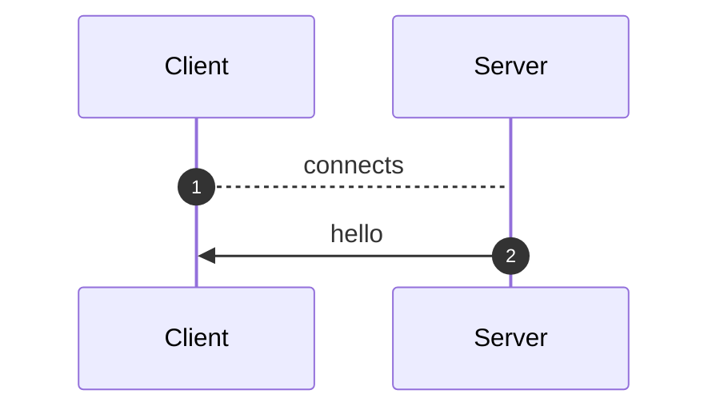
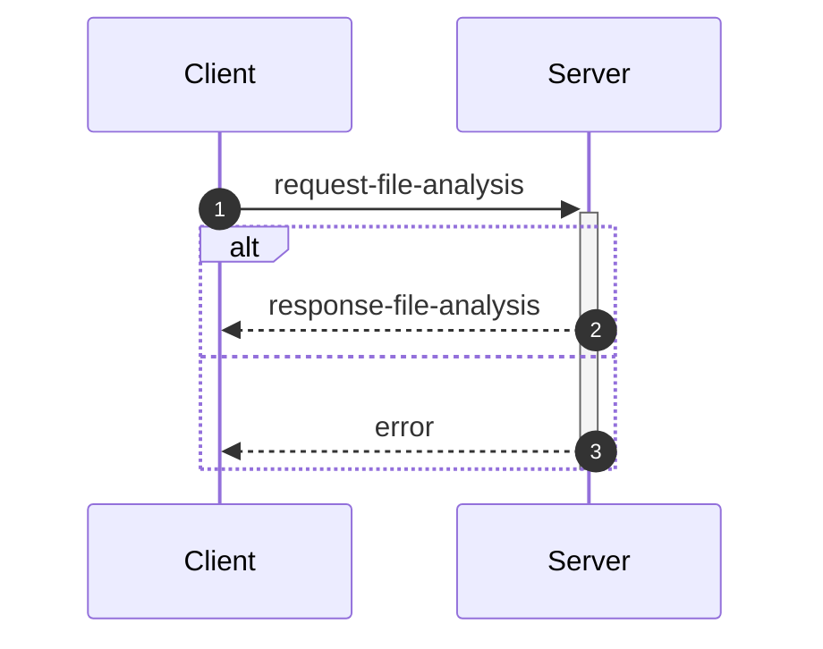
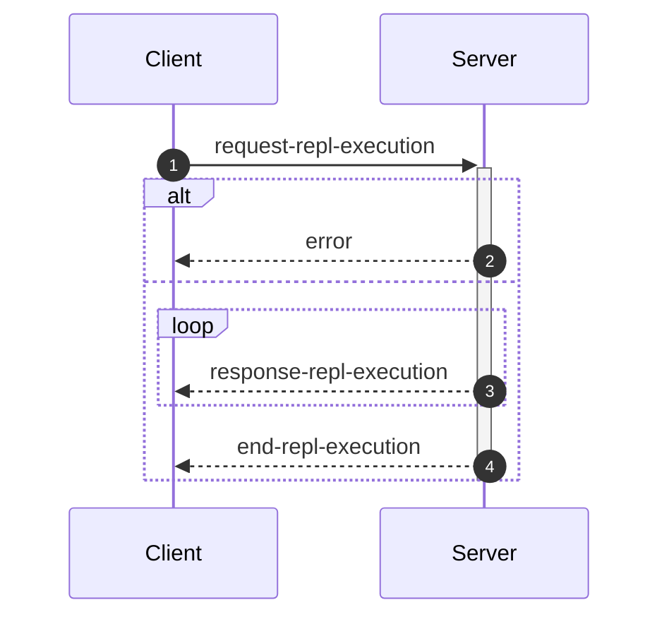
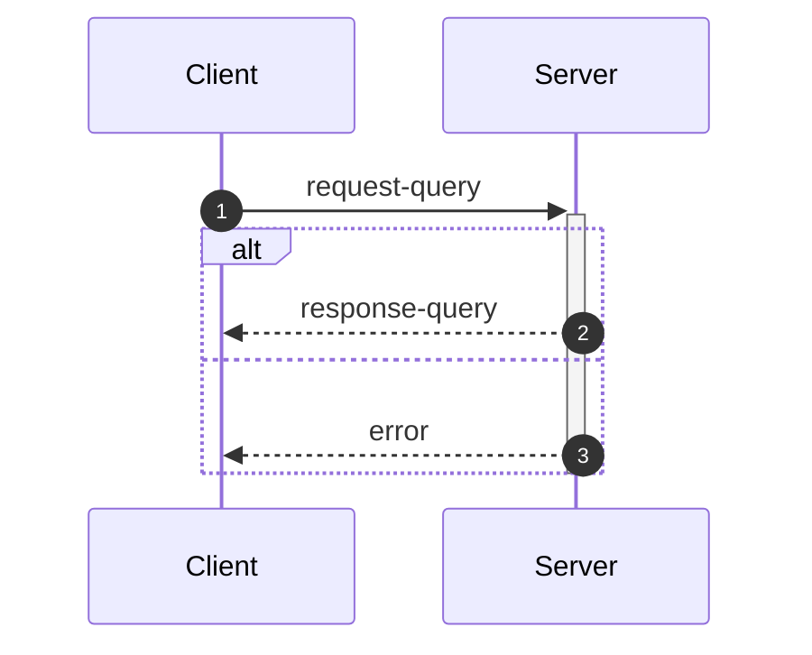

_<span title="an overview of flowR's interface">Generated</span> from '[wiki-interface.ts](https://github.com/flowr-analysis/flowr/tree/main/src/documentation/wiki-interface.ts "src/documentation/wiki-interface.ts")' on 2026-11-21, 21:00:40 UTC (v2.17.9, R v4.6.1), do not edit directly._

Although far from being as detailed as the in-depth explanation of [_flowR_](https://github.com/flowr-analysis/flowr/wiki/Core),
this wiki page explains how to interface with _flowR_ in more detail.
In general, command line arguments and other options provide short descriptions on hover over.

* [💻 Using the REPL](#using-the-repl)
* [⚙️ Configuring FlowR](#configuring-flowr)
* [⚒️ Writing Code](#writing-code)
* [💬 Communicating with the Server](#communicating-with-the-server)

<a id='using-the-repl'></a>
## 💻 Using the REPL

> [!NOTE]
> To execute arbitrary R commands with a repl request, _flowR_ has to be started explicitly with <span title="Description (Command Line Argument): Allow to access the underlying R session when using flowR (security warning: this allows the execution of arbitrary R code!)">`--r-session-access`</span>.
> Please be aware that this introduces a security risk and note that this relies on the [`r-shell` engine](https://github.com/flowr-analysis/flowr/wiki/Engines) .

Although primarily meant for users to explore,
there is nothing which forbids calling _flowR_ as a subprocess to use standard-in, -output, and -error
for communication (although you can access the REPL using the server as well,
with the [REPL Request](#message-request-repl-execution) message).

The read-eval-print loop&nbsp;(REPL) works relatively simple.
You can submit an expression (using <kbd>Enter</kbd>),
which is interpreted as an R&nbsp;expression by default but interpreted as a *command* if it starts with a colon (`:`).
The best command to get started with the REPL is <span title="Description (Repl Command): Show help information (aliases: :h, :?)">`:help`</span>.
Besides, you can leave the REPL either with the command <span title="Description (Repl Command): End the repl (aliases: :q, :exit)">`:quit`</span> or by pressing <kbd>Ctrl</kbd>+<kbd>C</kbd> twice.
When writing a *command*, you may press <kbd>Tab</kbd> to get a list of completions, if available.
Multiple commands can be entered in a single line by separating them with a semicolon (`;`), e.g. `:parse "x<-2"; :df*`.
If a command is given without R code, the REPL will re-use R code given in a previous command.
The prior example will hence return first the parsed AST of the program and then the dataflow graph for `"x <- 2"`.

> [!NOTE]
> If you develop flowR, you may want to launch the repl using the `npm run main-dev` command, this way, you get a non-minified version of flowR with debug information and hot-reloading of source files.

<details>
<summary>Available Commands</summary>

We currently offer the following commands (this with a `[*]` suffix are available with and without the star):

| Command | Description |
| ------- | ----------- |
| **<span title="Description (Repl Command): End the repl (aliases: :q, :exit)">:quit</span>** | End the repl (aliases: **:<span title="Alias of ':quit'. End the repl">q</span>**, **:<span title="Alias of ':quit'. End the repl">exit</span>**) |
| **<span title="Description (Repl Command): Execute the given code as R code. This requires the `--r-session-access` flag to be set and requires the r-shell engine. (aliases: :e, :r)">:execute</span>** | Execute the given code as R code. This requires the `--r-session-access` flag to be set and requires the r-shell engine. (aliases: **:<span title="Alias of ':execute'. Execute the given code as R code. This requires the `--r-session-access` flag to be set and requires the r-shell engine.">e</span>**, **:<span title="Alias of ':execute'. Execute the given code as R code. This requires the `--r-session-access` flag to be set and requires the r-shell engine.">r</span>**) |
| **<span title="Description (Repl Command): Get mermaid code for the control-flow graph of R code (aliases: :cfg, :cf)">:controlflow[*]</span>** | Get mermaid code for the control-flow graph of R code (star: Returns the URL to mermaid.live) (aliases: **:<span title="Alias of ':controlflow'. Get mermaid code for the control-flow graph of R code">cfg</span>**, **:<span title="Alias of ':controlflow'. Get mermaid code for the control-flow graph of R code">cf</span>**) |
| **<span title="Description (Repl Command): Get mermaid code for the control-flow graph with basic blocks (aliases: :cfgb, :cfb)">:controlflowbb[*]</span>** | Get mermaid code for the control-flow graph with basic blocks (star: Returns the URL to mermaid.live) (aliases: **:<span title="Alias of ':controlflowbb'. Get mermaid code for the control-flow graph with basic blocks">cfgb</span>**, **:<span title="Alias of ':controlflowbb'. Get mermaid code for the control-flow graph with basic blocks">cfb</span>**) |
| **<span title="Description (Repl Command): Get mermaid code for the dataflow graph (aliases: :d, :df)">:dataflow[*]</span>** | Get mermaid code for the dataflow graph (star: Returns the URL to mermaid.live) (aliases: **:<span title="Alias of ':dataflow'. Get mermaid code for the dataflow graph">d</span>**, **:<span title="Alias of ':dataflow'. Get mermaid code for the dataflow graph">df</span>**) |
| **<span title="Description (Repl Command): Get mermaid code for the normalized AST of R code (aliases: :n)">:normalize[*]</span>** | Get mermaid code for the normalized AST of R code (star: Returns the URL to mermaid.live) (alias: **:<span title="Alias of ':normalize'. Get mermaid code for the normalized AST of R code">n</span>**) |
| **<span title="Description (Repl Command): Get mermaid code for the simplified dataflow graph (aliases: :ds, :dfs)">:dataflowsimple[*]</span>** | Get mermaid code for the simplified dataflow graph (star: Returns the URL to mermaid.live) (aliases: **:<span title="Alias of ':dataflowsimple'. Get mermaid code for the simplified dataflow graph">ds</span>**, **:<span title="Alias of ':dataflowsimple'. Get mermaid code for the simplified dataflow graph">dfs</span>**) |
| **<span title="Description (Repl Command): Inspect and extend the signature database: `query` (identical to :query @signature), `info <name>` for where a function comes from (identical to :query @function-info), `add <path>` to mount another database/source, `download` to fetch the full-history database. (aliases: :sig)">:signature</span>** | Inspect and extend the signature database: `query` (identical to :query @signature), `info <name>` for where a function comes from (identical to :query @function-info), `add <path>` to mount another database/source, `download` to fetch the full-history database. (alias: **:<span title="Alias of ':signature'. Inspect and extend the signature database: `query` (identical to :query @signature), `info <name>` for where a function comes from (identical to :query @function-info), `add <path>` to mount another database/source, `download` to fetch the full-history database.">sig</span>**) |
| **<span title="Description (Repl Command): Just calculates the DFG, but only prints summary info (aliases: :d#, :df#)">:dataflowsilent</span>** | Just calculates the DFG, but only prints summary info (aliases: **:<span title="Alias of ':dataflowsilent'. Just calculates the DFG, but only prints summary info">d#</span>**, **:<span title="Alias of ':dataflowsilent'. Just calculates the DFG, but only prints summary info">df#</span>**) |
| **<span title="Description (Repl Command): Prints ASCII Art of the parsed, unmodified AST (aliases: :p)">:parse</span>** | Prints ASCII Art of the parsed, unmodified AST (alias: **:<span title="Alias of ':parse'. Prints ASCII Art of the parsed, unmodified AST">p</span>**) |
| **<span title="Description (Repl Command): Prints the version of flowR as well as the current version of R">:version</span>** | Prints the version of flowR as well as the current version of R
| **<span title="Description (Repl Command): Query the given R code (use 'help' for more information)">:query[*]</span>** | Query the given R code (use 'help' for more information) (star: Similar to query, but returns the output in json format.)
| **<span title="Description (Repl Command): Returns an ASCII representation of the dataflow graph (aliases: :df!)">:dataflowascii</span>** | Returns an ASCII representation of the dataflow graph (alias: **:<span title="Alias of ':dataflowascii'. Returns an ASCII representation of the dataflow graph">df!</span>**) |
| **<span title="Description (Repl Command): Returns summarization stats for the normalized AST (aliases: :n#)">:normalize#</span>** | Returns summarization stats for the normalized AST (alias: **:<span title="Alias of ':normalize#'. Returns summarization stats for the normalized AST">n#</span>**) |
| **<span title="Description (Repl Command): Show help information (aliases: :h, :?)">:help</span>** | Show help information (aliases: **:<span title="Alias of ':help'. Show help information">h</span>**, **:<span title="Alias of ':help'. Show help information">?</span>**) |

</details>

> [!TIP]
> 
> As indicated by the examples before, all REPL commands that operate on code keep track of the state.
> Hence, if you run a command like <span title="Description (Repl Command, starred version): Returns the URL to mermaid.live; Base Command: Get mermaid code for the dataflow graph (aliases: :d*, :df*)">`:dataflow*`</span> without providing R code,
> the REPL will re-use the R code provided in a previous command.
> Likewise, doing this will benefit from incrementality!
> If you request the dataflow graph with `:df* x <- 2 * y` and then want to see the parsed AST with `:parse`,
> the REPL will re-use previously obtained information and not re-parse the code again.
> 		

Generally, many commands offer shortcut versions in the REPL. Many queries, for example, offer a shortened format (see the example below).
Of special note, the [Config Query](https://github.com/flowr-analysis/flowr/wiki/%5BQuery%5D-Config)
can be used to also modify the currently active configuration of _flowR_ within the REPL (see the [wiki page](https://github.com/flowr-analysis/flowr/wiki/%5BQuery%5D-Config) for more information).

### Example: Retrieving the Dataflow Graph

To retrieve a URL to the [mermaid](https://mermaid.js.org/) diagram of the dataflow of a given expression,
use <span title="Description (Repl Command, starred version): Returns the URL to mermaid.live; Base Command: Get mermaid code for the dataflow graph (aliases: :d*, :df*)">`:dataflow*`</span> (or <span title="Description (Repl Command): Get mermaid code for the dataflow graph (aliases: :d, :df)">`:dataflow`</span> to get the mermaid code in the cli):

```shell
$ docker run -it --rm eagleoutice/flowr # or npm run flowr 
flowR repl v2.17.9, R grammar v14 (tree-sitter engine)
R> :dataflow* y <- 1 + x
```

<details>
<summary style='color:gray'>Output</summary>

```text
https://mermaid.live/view#base64:eyJjb2RlIjoiZmxvd2NoYXJ0IFREXG4gICAgMXt7XCJgKiM5MTtSTnVtYmVyIzkzOyogKioxKipcbiAgICAgICoxLjYqICgqKmlkOiAxKiopYFwifX1cbiAgICAyKFtcImAqIzkxO1JTeW1ib2wjOTM7KiAqKngqKlxuICAgICAgKjEuMTAqICgqKmlkOiAyKiopYFwiXSlcbiAgICAzW1tcImAqIzkxO1JCaW5hcnlPcCM5MzsqIGJhc2UjNTg7IzU4OyoqIzQzOyoqXG4gICAgICAqMS42LTEwKiAoKippZDogMyoqKVxuICAgIGFyZzogKDEsIDIpYFwiXV1cbiAgICBidWlsdC1pbjpfNDNfW1wiYEJ1aWx0LUluOlxuIzQzO2BcIl1cbiAgICBzdHlsZSBidWlsdC1pbjpfNDNfIHN0cm9rZTpncmF5LGZpbGw6Z3JheSxzdHJva2Utd2lkdGg6MnB4LG9wYWNpdHk6Ljg7XG4gICAgMFtcImAqIzkxO1JTeW1ib2wjOTM7KiAqKnkqKlxuICAgICAgKjEuMSogKCoqaWQ6IDAqKiwgdjogMylgXCJdXG4gICAgNFtbXCJgKiM5MTtSQmluYXJ5T3AjOTM7KiBiYXNlIzU4OyM1ODsqKiM2MDsjNDU7KipcbiAgICAgICoxLjEtMTAqICgqKmlkOiA0KiopXG4gICAgYXJnOiAoMCwgMylgXCJdXVxuICAgIGJ1aWx0LWluOl82MF8tW1wiYEJ1aWx0LUluOlxuIzYwOyM0NTtgXCJdXG4gICAgc3R5bGUgYnVpbHQtaW46XzYwXy0gc3Ryb2tlOmdyYXksZmlsbDpncmF5LHN0cm9rZS13aWR0aDoycHgsb3BhY2l0eTouODtcbiAgICAxIC0uLT58XCJmbG93XCJ8IDJcbiAgICBsaW5rU3R5bGUgMCBzdHJva2U6Z3JheSxjb2xvcjpncmF5O1xuICAgIDIgLS4tPnxcImZsb3dcInwgM1xuICAgIGxpbmtTdHlsZSAxIHN0cm9rZTpncmF5LGNvbG9yOmdyYXk7XG4gICAgMyAtLT58XCJyZWFkcywgYXJnXCJ8IDFcbiAgICAzIC0tPnxcInJlYWRzLCBhcmdcInwgMlxuICAgIDMgLS4tPnxcImZsb3dcInwgMFxuICAgIGxpbmtTdHlsZSA0IHN0cm9rZTpncmF5LGNvbG9yOmdyYXk7XG4gICAgMyAtLi0+fFwicmVhZHMsIGNhbGxzXCJ8IGJ1aWx0LWluOl80M19cbiAgICBsaW5rU3R5bGUgNSBzdHJva2U6Z3JheTtcbiAgICAwIC0tPnxcImRlZmluZWQtYnksIGZsb3dcInwgNFxuICAgIDAgLS0+fFwiZGVmaW5lZC1ieVwifCAzXG4gICAgNCAtLT58XCJyZWFkcywgYXJnXCJ8IDNcbiAgICA0IC0tPnxcInJldHVybnMsIGFyZ1wifCAwXG4gICAgNCAtLi0+fFwicmVhZHMsIGNhbGxzXCJ8IGJ1aWx0LWluOl82MF8tXG4gICAgbGlua1N0eWxlIDEwIHN0cm9rZTpncmF5OyIsIm1lcm1haWQiOnsiYXV0b1N5bmMiOnRydWV9fQ==
```

Retrieve the dataflow graph of the expression `y <- 1 + x`. It looks like this:


<details>

<summary style="color:gray">R Code of the Dataflow Graph</summary>

The analysis ran (parse and normalize with the [tree-sitter](https://github.com/flowr-analysis/flowr/wiki/Engines) engine) in the generation environment. No [signature database](https://github.com/flowr-analysis/flowr/wiki/Signature-Database) is mounted, so `library()` attaches no exports (base-R names are still qualified, e.g., `stats::acf`). 
We encountered no unknown side effects during the analysis.

```r
y <- 1 + x
```

</details>

</details>

For small graphs like this, <span title="Description (Repl Command): Returns an ASCII representation of the dataflow graph (aliases: :df!)">`:dataflowascii`</span> also provides an ASCII representation directly in the REPL:

```shell
$ docker run -it --rm eagleoutice/flowr # or npm run flowr 
flowR repl v2.17.9, R grammar v14 (tree-sitter engine)
R> :df! y <- 1 + x
```

<details open>
<summary style='color:gray'>Output</summary>

```text
                        v<0>v
 c<4>c──────────────────| y |
 |<- |     ┌────────────v---v
 c---c     │
    │   c<3>c   0<1>0
    └───| + |───| 1 |───u<2>u
        c---c   0---0   | x |
           └────────────u---u
Edges:
3 -> 1: reads, arg          3 -> 2: reads, arg
3 -> 0: flows-to            1 -> 2: flows-to
2 -> 3: flows-to            4 -> 3: reads, arg
4 -> 0: returns, arg        0 -> 4: defined-by, flows-to
0 -> 3: defined-by
```

Retrieve the dataflow graph of the expression `y <- 1 + x` as ASCII art.

</details>

For the slicing with <span title="Description (Repl Command): Static backwards executable slicer for R">`:slicer`</span>, you have access to the same [magic comments](#slice-magic-comments) as with the [slice request](#message-request-slice).
Pass `--inline` to splice resolvable `source()` calls into the reconstruction so the slice is a single self-contained R text (the same as the static slice query's `inlineSources` flag).
See `--help` for more flags!

### Example: Interfacing with the File System

Many commands that allow for an R-expression (like <span title="Description (Repl Command, starred version): Returns the URL to mermaid.live; Base Command: Get mermaid code for the dataflow graph (aliases: :d*, :df*)">`:dataflow*`</span>) allow for a file as well
if the argument starts with `file://`.
If you are working from the root directory of the _flowR_ repository, the following gives you the parsed AST of the example file using the <span title="Description (Repl Command): Prints ASCII Art of the parsed, unmodified AST (aliases: :p)">`:parse`</span> command:

> **Watch mode**: Replace `file://` with `watch://` to enter watch mode.
> flowR runs the command immediately and then re-runs it every time the file (or any file inside the folder) changes.
> Enter any other command to leave watch mode.
> For example: `:df watch://analysis.R`

```shell
$ docker run -it --rm eagleoutice/flowr # or npm run flowr 
flowR repl v2.17.9, R grammar v14 (tree-sitter engine)
R> :parse file://test/testfiles/example.R
```

<details>
<summary style='color:gray'>Output</summary>

```text
File: test/testfiles/example.R

program
├ binaryoperator
│ ├ identifier "sum" (1:1─4)
│ ├ <- "<-" (1:5─7)
│ ╰ float "0" (1:8─9)
├ binaryoperator
│ ├ identifier "product" (2:1─8)
│ ├ <- "<-" (2:9─11)
│ ╰ float "1" (2:12─13)
├ binaryoperator
│ ├ identifier "w" (3:1─2)
│ ├ <- "<-" (3:3─5)
│ ╰ float "7" (3:6─7)
├ binaryoperator
│ ├ identifier "N" (4:1─2)
│ ├ <- "<-" (4:3─5)
│ ╰ float "10" (4:6─8)
├ forstatement
│ ├ for "for" (6:1─4)
│ ├ ( "(" (6:5─6)
│ ├ identifier "i" (6:6─7)
│ ├ in "in" (6:8─10)
│ ├ binaryoperator
│ │ ├ float "1" (6:11─12)
│ │ ├ : ":" (6:12─13)
│ │ ╰ parenthesizedexpression
│ │   ├ ( "(" (6:13─14)
│ │   ├ binaryoperator
│ │   │ ├ identifier "N" (6:14─15)
│ │   │ ├ - "-" (6:15─16)
│ │   │ ╰ float "1" (6:16─17)
│ │   ╰ ) ")" (6:17─18)
│ ├ ) ")" (6:18─19)
│ ╰ bracedexpression
│   ├ { "{" (6:20─21)
│   ├ binaryoperator
│   │ ├ identifier "sum" (7:3─6)
│   │ ├ <- "<-" (7:7─9)
│   │ ╰ binaryoperator
│   │   ├ binaryoperator
│   │   │ ├ identifier "sum" (7:10─13)
│   │   │ ├ + "+" (7:14─15)
│   │   │ ╰ identifier "i" (7:16─17)
│   │   ├ + "+" (7:18─19)
│   │   ╰ identifier "w" (7:20─21)
│   ├ binaryoperator
│   │ ├ identifier "product" (8:3─10)
│   │ ├ <- "<-" (8:11─13)
│   │ ╰ binaryoperator
│   │   ├ identifier "product" (8:14─21)
│   │   ├  "" (8:22─23)
│   │   ╰ identifier "i" (8:24─25)
│   ╰ } "}" (9:1─2)
├ call
│ ├ identifier "cat" (11:1─4)
│ ╰ arguments
│   ├ ( "(" (11:4─5)
│   ├ argument
│   │ ╰ string
│   │   ├ stringopen "\"" (11:5─6)
│   │   ├ stringcontent "Sum:" (11:6─10)
│   │   ╰ stringclose "\"" (11:10─11)
│   ├ comma "," (11:11─12)
│   ├ argument
│   │ ╰ identifier "sum" (11:13─16)
│   ├ comma "," (11:16─17)
│   ├ argument
│   │ ╰ string
│   │   ├ stringopen "\"" (11:18─19)
│   │   ├ stringcontent
│   │   │ ╰ escapesequence "\\n" (11:19─21)
│   │   ╰ stringclose "\"" (11:21─22)
│   ╰ ) ")" (11:22─23)
╰ call
  ├ identifier "cat" (12:1─4)
  ╰ arguments
    ├ ( "(" (12:4─5)
    ├ argument
    │ ╰ string
    │   ├ stringopen "\"" (12:5─6)
    │   ├ stringcontent "Product:" (12:6─14)
    │   ╰ stringclose "\"" (12:14─15)
    ├ comma "," (12:15─16)
    ├ argument
    │ ╰ identifier "product" (12:17─24)
    ├ comma "," (12:24─25)
    ├ argument
    │ ╰ string
    │   ├ stringopen "\"" (12:26─27)
    │   ├ stringcontent
    │   │ ╰ escapesequence "\\n" (12:27─29)
    │   ╰ stringclose "\"" (12:29─30)
    ╰ ) ")" (12:30─31)
```

Retrieve the parsed AST of the example file.

<details>

<summary>File Content</summary>

```r
sum <- 0
product <- 1
w <- 7
N <- 10

for (i in 1:(N-1)) {
  sum <- sum + i + w
  product <- product * i
}

cat("Sum:", sum, "\n")
cat("Product:", product, "\n")
```

</details>

As _flowR_ directly transforms this AST the output focuses on being human-readable instead of being machine-readable.
		
</details>

### Example: Run a Query

You can run any query supported by _flowR_ using the <span title="Description (Repl Command): Query the given R code (use 'help' for more information)">`:query`</span> command.
For example, to obtain the shapes of all data frames in a given piece of code, you can run:

```shell
$ docker run -it --rm eagleoutice/flowr # or npm run flowr 
flowR repl v2.17.9, R grammar v14 (tree-sitter engine)
R> :query @absint df-shape "x <- data.frame(a = 1:10, b = 1:10)\ny <- x$a"
```

<details open>
<summary style='color:gray'>Output</summary>

```text
Query: absint (5 ms)
   ╰ $12: (colnames: [{"a", "b"}, {}], cols: [2, 2], rows: [10, 10])
   ╰ $0: (colnames: [{"a", "b"}, {}], cols: [2, 2], rows: [10, 10])
```

Retrieve the shapes of all data frames in the given code.

</details>

To run the linter on a file, you can use (in this example, we just issue the `dead-code` linter on a small piece of code):

```shell
$ docker run -it --rm eagleoutice/flowr # or npm run flowr 
flowR repl v2.17.9, R grammar v14 (tree-sitter engine)
R> :query @linter rules:dead-code "if(FALSE) x <- 2"
```

<details open>
<summary style='color:gray'>Output</summary>

```text
Query: linter (8 ms)
   ╰ Dead Code (dead-code):
       ╰ certain:
           ╰ Code at 1.11-16 (1 quick fix(es) available)
```

Run the linter on the given code, with only the `dead-code` rule enabled.

</details>

For more information on the available queries, please check out the [Query API](https://github.com/flowr-analysis/flowr/wiki/Query-API).

<a id='configuring-flowr'></a>
## ⚙️ Configuring FlowR

When running _flowR_, you may want to specify some behaviors with a dedicated configuration file.
By default, flowR looks for a file named `flowr.json` in the current working directory (or any higher directory).
You can also specify a different file with <span title="Description (Command Line Argument): The name of the configuration file to use">`--config-file`</span> or pass the configuration inline using <span title="Description (Command Line Argument): The flowR configuration to use, as a JSON string">`--config-json`</span>.
A `flowr.json` found this way belongs to the analyzed project, so flowR ignores its options that decide what flowR executes or loads
(`defaultPlugins.*.1`, `repl.plugins.*.1`, `engines.*.wasmPath`, `engines.*.treeSitterWasmPath`, `engines.*.rPath`, `solver.sigdb.additionalPaths`, `solver.sigdb.downloadRepo`, `solver.sigdb.autoSync`, `solver.sigdb.installedLibrary.paths`, `solver.sigdb.onDemand.enabled`, `solver.sigdb.onDemand.repositories`, `solver.sigdb.onDemand.cranMirror`, `solver.sigdb.onDemand.bioconductorMirror`, `solver.sigdb.onDemand.cacheDir`, `solver.instrument.dataflowExtractors`),
unless you pass <span title="Description (Command Line Argument): Keep the security-sensitive options (e.g., the R executable) of the flowr.json found in the working directory or a parent. Only use this for projects you trust.">`--trust-config`</span>.
To analyze code you do not trust, use the secure mode (<span title="Description (Command Line Argument): Run in secure mode for analyzing untrusted code: flowR does not start R (or any other process), does not access the network, does not search for project configs, and ignores security-sensitive options in every config. Cannot be disabled once enabled. Can also be enabled with the environment variable {italic FLOWR_SECURE_MODE=1}.">`--secure`</span>, see the [security policy](https://github.com/flowr-analysis/flowr/blob/main/.github/SECURITY.md)).
To inspect the current configuration, you can run flowr with the <span title="Description (Command Line Argument): Run with verbose logging (will be passed to the corresponding script)">`--verbose`</span> flag, or use the `config` [Query](https://github.com/flowr-analysis/flowr/wiki/Query-API).
Within the REPL this works by running the following:

```shell
:query @config
```

To work with the <a href="https://github.com/flowr-analysis/flowr/tree/main/src/config.ts#L131"><code><span title="The configuration file format for flowR.">FlowrConfig</span></code></a> you can use the provided helper objects alongside its methods like
<a href="https://github.com/flowr-analysis/flowr/tree/main/src/config.ts#L980"><code><span title="Creates a new flowr config that has the updated values.">FlowrConfig::<b>amend</b></span></code></a>.
The schema below documents every option; the ones you most likely want are:

- <a href="https://github.com/flowr-analysis/flowr/wiki/Interface#configuring-flowr" title="Configuration Option (boolean): Whether source calls should be ignored, causing {@link processSourceCall}&#39;s behavior to be skipped.">ignoreSourceCalls</a>: ignore source calls when analyzing the code, i.e., ignore the inclusion of other files.
- <a href="https://github.com/flowr-analysis/flowr/wiki/Interface#configuring-flowr" title="Configuration Option (boolean): Whether load calls should be ignored, causing {@link processLoadCall}&#39;s behavior to be skipped.">ignoreLoadCalls</a>: ignore load calls when analyzing the code, i.e., ignore the loading of r-data files.
- <a href="https://github.com/flowr-analysis/flowr/wiki/Interface#configuring-flowr" title="Configuration Option (object): Do you want to overwrite (parts) of the builtin definition?">semantics.environment.overwriteBuiltIns</a>: overwrite _flowR_'s handling of built-in functions, or clear the preset definitions entirely.
  See [Configure BuiltIn Semantics](#configure-builtin-semantics) for more information.
- <a href="https://github.com/flowr-analysis/flowr/wiki/Interface#configuring-flowr" title="Configuration Option (boolean): Whether calls drawing on a graphics device (e.g., `plot`) count as writing to it, which the ambient state queries then report.">semantics.ambient.drawingWritesDevice</a>: whether calls drawing on a graphics device (e.g., `plot`) count as writing the device in the ambient state queries.
- <a href="https://github.com/flowr-analysis/flowr/wiki/Interface#configuring-flowr" title="Configuration Option (string): How to resolve variables and their values. (one of &quot;disabled&quot;, &quot;alias&quot;, &quot;builtin&quot;)">solver.variables</a>: how to resolve variables and their values (`disabled`, `alias`, `builtin`).
- <a href="https://github.com/flowr-analysis/flowr/wiki/Interface#configuring-flowr" title="Configuration Option (array): The engine or set of engines to use for interacting with R code. An empty array means all available engines will be used.">engines</a> and <a href="https://github.com/flowr-analysis/flowr/wiki/Interface#configuring-flowr" title="Configuration Option (string): The default engine to use for interacting with R code. If this is undefined, an arbitrary engine from the specified list will be used. (one of &quot;tree-sitter&quot;, &quot;r-shell&quot;)">defaultEngine</a>: the engines used to interact with R code, see the [Engines wiki page](https://github.com/flowr-analysis/flowr/wiki/Engines).
- <a href="https://github.com/flowr-analysis/flowr/wiki/Interface#configuring-flowr" title="Configuration Option (array): Files a framework loads on its own, without any source() call (e.g. global.R in a shiny app), in the order they are loaded; flowR orders the matching project files accordingly and analyzes them as one program. Entries are case-insensitive globs matched against the file path, a plain name matches any file with that name, and entries matching no project file are warned about. Usually set per project kind via specializeConfig.">project.implicitSources</a>: the files a framework loads without any `source()` call, in the order in which they are
  loaded. Entries are globs (e.g. `R/*.R`) matched against the file path ignoring capitalization; one matching no file is reported.
- <a href="https://github.com/flowr-analysis/flowr/wiki/Interface#configuring-flowr" title="Configuration Option (object): Overwrite (parts of) the configuration depending on the project kind flowR detects, e.g. to give a shiny app its implicit sources.">specializeConfig</a>: overwrite (parts of) the configuration depending on the kind of project _flowR_ detects
  (e.g. `shiny-app`), which is how a shiny app gets its implicit sources by default. What you configure directly wins.
- <a href="https://github.com/flowr-analysis/flowr/wiki/Interface#configuring-flowr" title="Configuration Option (string): Overwrite the project kind flowR would otherwise infer from the analyzed files, e.g. when auto-detection guesses wrong. (one of &quot;package&quot;, &quot;script&quot;, &quot;shiny-app&quot;, &quot;notebook&quot;, &quot;project&quot;, &quot;unknown&quot;)">project.useProjectType</a>: skip that detection and force a project kind yourself, when auto-detection guesses wrong.
- <a href="https://github.com/flowr-analysis/flowr/wiki/Interface#configuring-flowr" title="Configuration Option (array): The default plugins to load when creating a new instance of FlowrAnalyzer">defaultPlugins</a> and <a href="https://github.com/flowr-analysis/flowr/wiki/Interface#configuring-flowr" title="Configuration Option (array): The plugins to load in REPL mode">repl.plugins</a>: the plugins to load for a new <a href="https://github.com/flowr-analysis/flowr/tree/main/src/project/flowr-analyzer.ts#L237"><code><span title="Central class for conducting analyses with FlowR. Use the FlowrAnalyzerBuilder to create a new instance. If you want the original pattern of creating a pipeline and running all steps, you can still do this with FlowrAnalyzer#runFull . To inspect the context of the analyzer, use FlowrAnalyzer#inspectContext (if you are a plugin and need to modify it, use FlowrAnalyzer#context instead).">FlowrAnalyzer</span></code></a> and in the REPL
  (use `flowr:default` to reference the former).

So you can configure _flowR_ by adding a file like the following:

<details>

<summary>Example Configuration File</summary>

```json
{
  "ignoreSourceCalls": true,
  "ignoreLoadCalls": true,
  "semantics": {
    "environment": {
      "overwriteBuiltIns": {
        "definitions": [
          {
            "type": "function",
            "names": [
              "foo"
            ],
            "processor": "builtin:assign",
            "config": {}
          }
        ]
      }
    }
  },
  "defaultPlugins": [
    "file:description",
    "versions:description"
  ],
  "repl": {
    "quickStats": false,
    "dfProcessorHeat": false,
    "hints": true,
    "plugins": [
      "flowr:default"
    ]
  },
  "project": {
    "resolveUnknownPathsOnDisk": true,
    "implicitSources": [
      "global.R",
      "app.R"
    ]
  },
  "linter": {
    "disabledRules": []
  },
  "specializeConfig": {
    "shiny-app": {
      "project": {
        "implicitSources": [
          "global.R",
          "ui.R",
          "server.R",
          "app.R"
        ]
      }
    }
  },
  "engines": [
    {
      "type": "r-shell"
    }
  ],
  "solver": {
    "variables": "alias",
    "evalStrings": true,
    "trackEnvironments": true,
    "sigdb": {
      "enabled": true,
      "loadProjectDependencies": true,
      "eagerlyLoad": false,
      "eagerlyLoadExports": false,
      "linkBaseR": false,
      "linkDescriptionDependencies": false
    },
    "resolveSource": {
      "dropPaths": "no",
      "ignoreCapitalization": true,
      "inferWorkingDirectory": "active-script",
      "searchPath": []
    },
    "instrument": {},
    "slicer": {
      "threshold": 50
    }
  },
  "abstractInterpretation": {
    "wideningThreshold": 4,
    "followCalls": true,
    "dataFrame": {
      "maxColNames": 20,
      "readLoadedData": {
        "readExternalFiles": true,
        "maxReadLines": 1000000
      }
    }
  },
  "incremental": {
    "alwaysIncremental": false,
    "parsing": {
      "activated": false,
      "heuristics": {
        "activated": true,
        "mtime": true,
        "linesFrom": 500,
        "bytesFrom": 50000,
        "alwaysWithEdits": false,
        "minFiles": 1
      }
    },
    "dataflow": {
      "reuse": true,
      "activated": false,
      "checkpoints": 2,
      "minStatements": 0
    }
  },
  "gas": {
    "thresholds": {
      "memory": {
        "problematic": 0.7,
        "critical": 0.9
      },
      "timeMs": {
        "problematic": 100000,
        "critical": 120000
      }
    },
    "features": {}
  }
}
```

</details>

<details>
<a id='configure-builtin-semantics'></a>
<summary>Configure Built-In Semantics</summary>

`semantics/environment/overwriteBuiltins` accepts two keys:

- `loadDefaults` (boolean, initially `true`): If set to `true`, the default built-in definitions are loaded before applying the custom definitions. Setting this flag to `false` explicitly disables the loading of the default definitions.
- `definitions` (array, initially empty): Allows to overwrite or define new built-in elements. Each object within must have a `type` which is one of the below. Furthermore, they may define a string array of `names` which specifies the identifiers to bind the definitions to. You may use `assumePrimitive` to specify whether _flowR_ should assume that this is a primitive non-library definition (so you probably just do not want to specify the key).

  | Type            | Description                                                                                                                                                                                                                                                                                              | Example                                                                                                    |
  | --------------- | -------------------------------------------------------------------------------------------------------------------------------------------------------------------------------------------------------------------------------------------------------------------------------------------------------- | ---------------------------------------------------------------------------------------------------------- |
  | `constant`    | Additionally allows for a `value` this should resolve to.                                                                                                                                                                                                                                                | `{ type: 'constant', names: ['NULL', 'NA'],  value: null }`                                                |
  | `function`    | Is a rather flexible way to define and bind built-in functions. For the time, we do not have extensive documentation to cover all the cases, so please either consult the sources with the `default-builtin-config/` folder or open a [new issue](https://github.com/flowr-analysis/flowr/issues/new/choose). | `{ type: 'function', names: ['next'], processor: 'builtin:d', config: { cfg: ExitPointType.Next } }` |
  | `replacement` | A comfortable way to specify replacement functions like `$<-` or `names<-`. `suffixes` describes the... suffixes to attach automatically. | `{ type: 'replacement', suffixes: ['<-', '<<-'], names: ['[', '[['] }` |

</details>

<details>

<summary style='color:gray'>Full Configuration-File Schema</summary>

- _The configuration file format for flowR._ (object)
    - **logLevel** [optional] _flowR's global minimum log level, applied when the config is loaded._ (string)
        Only allows: 'silly', 'trace', 'debug', 'info', 'warn', 'error', 'fatal'
    - **ignoreSourceCalls** [optional] _Whether source calls should be ignored, causing {@link processSourceCall}'s behavior to be skipped._ (boolean)
    - **ignoreLoadCalls** [optional] _Whether load calls should be ignored, causing {@link processLoadCall}'s behavior to be skipped._ (boolean)
    - **semantics** _Configure language semantics and how flowR handles them._ (object)
        - **environment** [optional] _Semantics regarding how to handle the R environment._ (object)
            - **overwriteBuiltIns** [optional] _Do you want to overwrite (parts) of the builtin definition?_ (object)
                - **loadDefaults** [optional] _Should the default configuration still be loaded?_ (boolean)
                - **definitions** [optional] _The definitions to load/overwrite._ (array)
                Valid item types:
                    - (object)
        - **ambient** [optional] _Semantics regarding the global state (options, devices, files, ...) calls access._ (object)
            - **drawingWritesDevice** [optional] _Whether calls drawing on a graphics device (e.g., `plot`) count as writing to it, which the ambient state queries then report._ (boolean)
    - **defaultPlugins** [optional] _The default plugins to load when creating a new instance of FlowrAnalyzer_ (array)
    Valid item types:
        - (alternatives)
            - (string)
            - (array)
    - **repl** _Configuration options for the REPL._ (object)
        - **quickStats** [optional] _Whether to show quick stats in the REPL after each evaluation._ (boolean)
        - **dfProcessorHeat** [optional] _This instruments the dataflow processors to count how often each processor is called._ (boolean)
        - **hints** [optional] _Whether to show dim inline hints on the empty prompt (automatically disabled on non-interactive terminals)._ (boolean)
        - **plugins** [optional] _The plugins to load in REPL mode_ (array)
        Valid item types:
            - (alternatives)
                - (string)
                - (array)
        - **autoUseFileProtocol** [optional] _Prepend the file protocol to a repl input that looks like a path, instead of only warning about it._ (boolean)
        - **queryStats** [optional] _Whether `:query` closes with the line stating how long the queries took (`:query*` never prints it)._ (boolean)
        - **showPlugins** [optional] _Whether `:version` grays out the plugins that did not activate during the last analysis._ (boolean)
    - **project** _Project specific configuration options._ (object)
        - **resolveUnknownPathsOnDisk** [optional] _Whether to resolve unknown paths loaded by the r project disk when trying to source/analyze files._ (boolean)
        - **failOnInaccessiblePath** [optional] _Whether a directory that cannot be traversed during file discovery (e.g. due to permissions) aborts the analysis; when false (the default) such paths are logged and skipped._ (boolean)
        - **basePackages** [optional] _The packages considered part of R itself (base and recommended); if unset, flowR uses its built-in list._ (array)
        Valid item types:
            - (string)
        - **implicitSources** [optional] _Files a framework loads on its own, without any source() call (e.g. global.R in a shiny app), in the order they are loaded; flowR orders the matching project files accordingly and analyzes them as one program. Entries are case-insensitive globs matched against the file path, a plain name matches any file with that name, and entries matching no project file are warned about. Usually set per project kind via specializeConfig._ (array)
        Valid item types:
            - (string)
        - **useProjectType** [optional] _Overwrite the project kind flowR would otherwise infer from the analyzed files, e.g. when auto-detection guesses wrong._ (string)
            Only allows: 'package', 'script', 'shiny-app', 'notebook', 'project', 'unknown'
        - **assumeImplicitEcho** [optional] _Whether the top level of the analyzed code is echoed, so that every visible result printed there is collected as an output by the dependencies query (default true, false for a package)._ (boolean)
        - **discovery** [optional] _Scoping options for the default project discovery._ (object)
            - **full** [optional] _Collect every file below the project root (greedy) instead of only the files the detected project kind needs (default false)._ (boolean)
            - **perKind** [optional] _Per-kind include/exclude glob overrides layered on the default scoping._ (object)
            - **ignore** [optional] _Case-insensitive globs that drop matching files from the intelligent discovery, regardless of kind (e.g. .Renviron to ignore environment files)._ (array)
            Valid item types:
                - (string)
        - **classification** [optional] _Overrides for the signals flowR uses to classify the project kind._ (object)
            - **shinyDescriptionTypes** [optional] _DESCRIPTION Type: values that mark a shiny app._ (array)
            Valid item types:
                - (string)
            - **shinyEntryFiles** [optional] _File names a shiny app is assembled from._ (array)
            Valid item types:
                - (string)
            - **shinyUsagePattern** [optional] _Regex source evidencing shiny usage in an entry file._ (string)
            - **notebookExtensions** [optional] _File extensions marking a notebook._ (array)
            Valid item types:
                - (string)
    - **linter** _Linter configuration options._ (object)
        - **disabledRules** _Linting rule names excluded from the default rule set (a rule requested explicitly via a linter query still runs). Usually set per project kind via specializeConfig._ (array)
        Valid item types:
            - (string)
        - **disabledTags** [optional] _Linting rule tags whose rules are excluded from the default rule set (a rule requested explicitly via a linter query still runs). By default the cmd-check rules are disabled for everything but a package; a configured list replaces that default._ (array)
        Valid item types:
            - (string)
    - **inputSources** [optional] _Further frameworks the input-sources analysis should know about; entries are added to flowR's defaults._ (object)
        - **pure** [optional] _Functions that only pass the constantness of their arguments on._ (array)
        Valid item types:
            - (string)
        - **param** [optional] _Functions whose result is a 'param' input._ (array)
        Valid item types:
            - (string)
        - **file** [optional] _Functions whose result is a 'file' input._ (array)
        Valid item types:
            - (string)
        - **tempfile** [optional] _Functions whose result is a 'tempfile' input._ (array)
        Valid item types:
            - (string)
        - **glob** [optional] _Functions whose result is a 'glob' input._ (array)
        Valid item types:
            - (string)
        - **net** [optional] _Functions whose result is a 'net' input._ (array)
        Valid item types:
            - (string)
        - **rand** [optional] _Functions whose result is a 'rand' input._ (array)
        Valid item types:
            - (string)
        - **system** [optional] _Functions whose result is a 'system' input._ (array)
        Valid item types:
            - (string)
        - **ffi** [optional] _Functions whose result is a 'ffi' input._ (array)
        Valid item types:
            - (string)
        - **lang** [optional] _Functions whose result is a 'lang' input._ (array)
        Valid item types:
            - (string)
        - **options** [optional] _Functions whose result is a 'options' input._ (array)
        Valid item types:
            - (string)
        - **cmdline** [optional] _Functions whose result is a 'cmdline' input._ (array)
        Valid item types:
            - (string)
        - **user** [optional] _Functions whose result is a 'user' input._ (array)
        Valid item types:
            - (string)
        - **const** [optional] _Functions whose result is a 'const' input._ (array)
        Valid item types:
            - (string)
        - **scope** [optional] _Functions whose result is a 'scope' input._ (array)
        Valid item types:
            - (string)
        - **dconst** [optional] _Functions whose result is a 'dconst' input._ (array)
        Valid item types:
            - (string)
        - **unknown** [optional] _Functions whose result is a 'unknown' input._ (array)
        Valid item types:
            - (string)
        - **linkedObjects** [optional] _Objects a framework provides without a definition in the code, e.g. shiny's input._ (array)
        Valid item types:
            - (object)
        - **linkedEntryPoints** [optional] _Calls that hand a function to a framework, which binds its objects to the parameters by position._ (array)
        Valid item types:
            - (object)
    - **specializeConfig** [optional] _Overwrite (parts of) the configuration depending on the project kind flowR detects, e.g. to give a shiny app its implicit sources._ (object)
    - **engines** _The engine or set of engines to use for interacting with R code. An empty array means all available engines will be used._ (array)
    Valid item types:
        - (alternatives)
            - _The configuration for the tree sitter engine._ (object)
                - **type** [required] _Use the tree sitter engine._ (string)
                    Only allows: 'tree-sitter'
                - **wasmPath** [optional] _The path to the tree-sitter-r WASM binary to use. If this is undefined, this uses the default path._ (string)
                - **treeSitterWasmPath** [optional] _The path to the tree-sitter WASM binary to use. If this is undefined, this uses the default path._ (string)
                - **lax** [optional] _Whether to use the lax parser for parsing R code (allowing for syntax errors). If this is undefined, the strict parser will be used._ (boolean)
            - _The configuration for the R shell engine._ (object)
                - **type** [required] _Use the R shell engine._ (string)
                    Only allows: 'r-shell'
                - **rPath** [optional] _The path to the R executable to use. If this is undefined, this uses the default path._ (string)
                - **pipeBind** [optional] _Whether to enable R's experimental pipe-bind operator "=>" by setting _R_USE_PIPEBIND_ for the R session (default false); R itself keeps this off by default, as it is experimental and has never shipped in a release version of R._ (boolean)
    - **defaultEngine** [optional] _The default engine to use for interacting with R code. If this is undefined, an arbitrary engine from the specified list will be used._ (string)
        Only allows: 'tree-sitter', 'r-shell'
    - **solver** _How to resolve constants, constraints, cells, ..._ (object)
        - **variables** _How to resolve variables and their values._ (string)
            Only allows: 'disabled', 'alias', 'builtin'
        - **evalStrings** _Should we include eval(parse(text="...")) calls in the dataflow graph?_ (boolean)
        - **trackEnvironments** [optional] _Track user-created environments (new.env, assign/get/local with envir=, dollar-assign, attach). When false, all envir-style calls fall through conservatively._ (boolean)
        - **sigdb** _Resolving library exports from a signature database._ (object)
            - **enabled** [optional] _Resolve library()/use() exports from a signature database (default true); when false no database is consulted._ (boolean)
            - **loadProjectDependencies** [optional] _Load the project's declared dependencies from its metadata files (DESCRIPTION Imports/Depends, rproject.toml, uvr.toml, rig rproj.toml and script blocks, renv.lock, rv.lock, uvr.lock, rig lockfiles) (default true); when false these files are not read for dependencies._ (boolean)
            - **eagerlyLoad** [optional] _Parse the database up front rather than on the first package load (default false, ignored if disabled)._ (boolean)
            - **eagerlyLoadExports** [optional] _Add a vertex for every export on load rather than on demand (default false); keeps the dataflow graph small._ (boolean)
            - **assumedRVersion** [optional] _R version assumed when resolving versioned (base-R) exports: a pin like "4.5" or "auto" to detect the installed R (default "auto")._ (string)
            - **linkBaseR** [optional] _Eagerly attach base-R namespaces so bare base calls resolve without library() (default false)._ (boolean)
            - **linkBaseRCalls** [optional] _Add a lightweight Reads edge from a bare base-R call to its signature-database function vertex (default false; base-R qualification is edge-free otherwise)._ (boolean)
            - **linkPackageCalls** [optional] _Add a lightweight Reads edge from a resolved package call to its signature-database function vertex (default false)._ (boolean)
            - **linkDescriptionDependencies** [optional] _Eagerly attach the namespaces of the project's declared DESCRIPTION dependencies (Imports/Depends) so their exports resolve without an explicit library() (default false)._ (boolean)
            - **warmInBackground** [optional] _Decompress the hot shards (base + most-downloaded) in a background task on startup so the first library() lookup is warm (default false; for long-running servers/REPLs)._ (boolean)
            - **additionalPaths** [optional] _Extra directories or bundle/manifest files searched for signature databases (alongside the shipped default and $FLOWR_SIGDB_DIR); a downloaded full-history bundle placed here is mounted automatically._ (array)
            Valid item types:
                - (string)
            - **downloadRepo** [optional] _GitHub owner/repo the full-history bundle is downloaded from via ":signature download" (default "flowr-analysis/flowr"; the release tag comes from the committed sigdb.remote.json unless a version is given)._ (string)
            - **autoSync** [optional] _On startup, re-download shards whose committed sigdb.remote.json hash no longer matches the cache, in the background (default false; opt-in network sync after a git pull)._ (boolean)
            - **installedLibrary** [optional] _Recovering packages no signature database knows from the copy installed on this machine._ (object)
                - **enabled** [required] _Recover packages no signature database knows from their installed copy (default false)._ (boolean)
                - **paths** [optional] _Library directories to search; when empty they are discovered from the environment and the project._ (array)
                Valid item types:
                    - (string)
                - **useEnvironment** [optional] _Search the libraries R_LIBS_USER/R_LIBS/R_LIBS_SITE name (default true)._ (boolean)
                - **useProjectLibrary** [optional] _Search a project-local renv/packrat library (default true)._ (boolean)
                - **maxDepth** [optional] _How far to descend into the nested layout of a project-local library (default 3)._ (number)
                - **packages** [optional] _Only recover packages whose name matches one of these regular expressions; empty means any._ (array)
                Valid item types:
                    - (string)
            - **onDemand** [optional] _Recovering packages no signature database knows from their sources on CRAN, Bioconductor, or GitHub._ (object)
                - **enabled** [required] _Fetch and recover the sources of packages no signature database knows when the analyzed code uses them (default false, accesses the network)._ (boolean)
                - **sources** [optional] _Where to look, in order: github, cran, bioconductor, or a source a plugin adds (default ["github", "cran", "bioconductor"])._ (array)
                Valid item types:
                    - (string)
                - **repositories** [optional] _GitHub repositories (owner/repo[/subdir][@ref]) to fetch packages from, by package name. The analyzed project may name more (DESCRIPTION Remotes, install_github calls)._ (object)
                - **packages** [optional] _Only recover packages whose name matches one of these regular expressions, empty means any._ (array)
                Valid item types:
                    - (string)
                - **cranMirror** [optional] _The CRAN src/contrib/ to fetch from, over https (default https://cloud.r-project.org/src/contrib/). It may be on the local network._ (string)
                - **bioconductorMirror** [optional] _The Bioconductor host, over https (default https://bioconductor.org). It may be on the local network._ (string)
                - **bioconductorRelease** [optional] _The Bioconductor release to fetch from: release, devel, or a number like 3.20 (default release)._ (string)
                - **githubMirrors** [optional] _Use the GitHub mirrors of CRAN (cran/<pkg>) and Bioconductor (bioc/<pkg>) (default true)._ (boolean)
                - **maxPackages** [optional] _The most packages to fetch for one analysis (default 25)._ (number)
                - **maxArchiveMb** [optional] _The most MiB a package archive may have (default 32). It may unpack to three times that, at most 128 MiB._ (number)
                - **offline** [optional] _Only use what was fetched before, never the network (default false)._ (boolean)
                - **retryAfterHours** [optional] _How many hours to wait before asking again for a package no source had (default 24)._ (number)
                - **cacheDir** [optional] _Where to cache what was fetched (default the on-demand directory of the signature cache)._ (string)
            - **blobCacheBudgetMb** [optional] _How many MiB of decoded package blobs every open bundle may hold together (default 16)._ (number)
            - **versionSelection** [optional] _When a project constrains a dependency, resolve to the newest (default), oldest, or system-installed version satisfying it; system needs R and falls back to newest. Base-R packages always resolve against the assumed R version._ (string)
                Only allows: 'newest', 'oldest', 'system'
            - **versionOverrides** [optional] _Force an exact version for specific packages (name -> version), overriding both the project constraint and the versionSelection policy (default {})._ (object)
        - **versionManagement** _Policies for reasoning about dependency versions._ (object)
            - **linkedVersionGroups** [optional] _Groups of packages that must resolve to the same version; version guessing intersects each group so its members stay mutually compatible (default [])._ (array)
            Valid item types:
                - (array)
                Valid item types:
                    - (string)
        - **assumeAttachedPackages** [optional] _Packages to treat as attached without a `library()` call, so what the built-in configuration states about them applies to the analyzed code. The base packages R attaches on startup already resolve without it._ (array)
        Valid item types:
            - (string)
        - **transitiveSideEffectRounds** [optional] _How many rounds the transitive side-effect fixpoint may run before it is cut off (default 32); the propagation stops on its own as soon as a round adds nothing._ (number)
        - **maxOverlayDepth** [optional] _How many binding overlays may stack on one environment frame before a write flattens them (default 4); a pure performance knob, trading lookup cost against copy cost without changing any result._ (number)
        - **instrument** (object)
            - **dataflowExtractors** [optional] _These keys are only intended for use within code, allowing to instrument the dataflow analyzer!_ (any)
        - **resolveSource** [optional] _If lax source calls are active, flowR searches for sourced files much more freely, based on the configurations you give it. This option is only in effect if `ignoreSourceCalls` is set to false._ (object)
            - **dropPaths** _Allow to drop the first or all parts of the sourced path, if it is relative._ (string)
                Only allows: 'no', 'once', 'all'
            - **ignoreCapitalization** _Search for filenames matching in the lowercase._ (boolean)
            - **inferWorkingDirectory** _Try to infer the working directory from the main or any script to analyze._ (string)
                Only allows: 'no', 'main-script', 'active-script', 'any-script'
            - **searchPath** _Additionally search in these paths._ (array)
            Valid item types:
                - (string)
            - **repeatedSourceLimit** [optional] _How often the same file can be sourced within a single run? Please be aware: in case of cyclic sources this may not reach a fixpoint so give this a sensible limit._ (number)
            - **applyReplacements** _Provide name replacements for loaded files_ (array)
            Valid item types:
                - (object)
            - **assumeFilesExist** [optional] _Assume a sourced file is always there, making what it defines certain instead of conditional on the source call._ (boolean)
        - **slicer** [optional] _The configuration for the slicer._ (object)
            - **threshold** [optional] _The maximum number of iterations to perform on a single function call during slicing._ (number)
            - **autoExtend** [optional] _If set, the slicer will gain an additional post-pass._ (boolean)
    - **abstractInterpretation** _The configuration options for abstract interpretation._ (object)
        - **wideningThreshold** _The threshold for the number of visitations of a node at which widening should be performed to ensure the termination of the fixpoint iteration._ (number)
        - **followCalls** _Whether the abstract interpretation is interprocedural, i.e. whether it steps into the functions a call may dispatch to._ (boolean)
        - **dataFrame** _The configuration of the shape inference for data frames._ (object)
            - **maxColNames** _The maximum number of columns names to infer for data frames before over-approximating the column names to top._ (number)
            - **readLoadedData** _Configuration options for reading data frame shapes from loaded external data files, such as CSV files._ (object)
                - **readExternalFiles** _Whether data frame shapes should be extracted from loaded external files, such as CSV files._ (boolean)
                - **maxReadLines** _The maximum number of lines to read when extracting data frame shapes from loaded files, such as CSV files._ (number)
    - **incremental** (object)
        - **alwaysIncremental** _Always take the incremental path, regardless of heuristics._ (boolean)
        - **parsing** (object)
            - **activated** _If set, incremental parsing will be used._ (boolean)
            - **heuristics** (object)
                - **activated** [optional] _If set, the heuristics for incremental parsing will be used._ (boolean)
                - **mtime** [optional] _Skip reparsing entirely if the file's modification time is unchanged since the last parse._ (boolean)
                - **linesFrom** [optional] _Only consider incremental parsing for files with at least this many lines._ (number)
                - **bytesFrom** [optional] _Only consider incremental parsing for files with at least this many bytes._ (number)
                - **alwaysWithEdits** [optional] _Always take the incremental path whenever there is a computed edit region, regardless of the other thresholds._ (boolean)
                - **minFiles** [optional] _Only apply these heuristics once the project has at least this many files loaded._ (number)
        - **dataflow** (object)
            - **reuse** [optional] _Hand out the last dataflow analysis again if the files did not change besides their comments._ (boolean)
            - **activated** _Resume the analysis of a file after its last unchanged top-level statement, from checkpoints the analysis before kept._ (boolean)
            - **checkpoints** [optional] _After how many of the last top-level statements to keep a checkpoint to resume from (each copies the graph)._ (number)
            - **minStatements** [optional] _Keep checkpoints only for files with at least this many top-level statements._ (number)
    - **gas** [optional] _Resource-usage guard (gas) configuration. All feature factors default to 0 (disabled). See https://github.com/flowr-analysis/flowr/wiki/Core#gas-resource-guard._ (object)
        - **thresholds** [optional] _Thresholds for all gas checks (scaled by per-feature factor), boundable per feature._ (object)
            - **memory** [optional] _Heap-usage fraction thresholds (0-1), either shared or given per feature key (with `default` covering the rest)._ (object)
                - **problematic** [optional] _Heap fraction (0-1) above which Problematic is returned, for every feature without an entry of its own._ (number)
                - **critical** [optional] _Heap fraction (0-1) above which Critical is returned, for every feature without an entry of its own._ (number)
            - **timeMs** [optional] _Elapsed analysis time thresholds in milliseconds, either shared or given per feature key (with `default` covering the rest)._ (object)
                - **problematic** [optional] _Elapsed ms above which Problematic is returned, for every feature without an entry of its own._ (number)
                - **critical** [optional] _Elapsed ms above which Critical is returned, for every feature without an entry of its own._ (number)
            - **steps** [optional] _Processed-AST-node thresholds, counted rather than sampled; only a key that arms a budget (`dataflow`) reads them._ (object)
                - **problematic** [optional] _Processed AST nodes above which Problematic is returned, for every feature without an entry of its own._ (number)
                - **critical** [optional] _Processed AST nodes above which the extraction is cut short, for every feature without an entry of its own._ (number)
            - **vertices** [optional] _Created-dataflow-vertex thresholds, counted like `steps`._ (object)
                - **problematic** [optional] _Created dataflow vertices above which Problematic is returned, for every feature without an entry of its own._ (number)
                - **critical** [optional] _Created dataflow vertices above which the extraction is cut short, for every feature without an entry of its own._ (number)
        - **features** [optional] _Per-feature sensitivity factors. 0 or absent disables gas checking for that feature. A factor of 2 makes the feature twice as sensitive. Recognised keys: `source`, `side-effect-linking`, `linter`, `slicer`, `dataflow`._ (object)
        - **countedCheckEvery** [optional] _How many counted steps pass between two accountings of an armed check, be it a dataflow budget or the slicer's traversal (default 128); trades overshoot against the cost of the check._ (number)
        - **heapProvider** [optional] _Custom heap statistics source (programmatic configs only), overriding the built-in v8/performance.memory detection._ (function)

</details>

<a id='writing-code'></a>
## ⚒️ Writing Code

_flowR_ can be used as a [module](https://www.npmjs.com/package/@eagleoutice/flowr) and offers several main classes and interfaces that are interesting for extension writers 
(see the [Visual Studio Code extension](https://marketplace.visualstudio.com/items?itemName=code-inspect.vscode-flowr) or the [Core](https://github.com/flowr-analysis/flowr/wiki/Core) wiki page for more information).

### Creating Analyses with _flowR_

Nowadays, instances of the <a href="https://github.com/flowr-analysis/flowr/tree/main/src/project/flowr-analyzer.ts#L237"><code><span title="Central class for conducting analyses with FlowR. Use the FlowrAnalyzerBuilder to create a new instance. If you want the original pattern of creating a pipeline and running all steps, you can still do this with FlowrAnalyzer#runFull . To inspect the context of the analyzer, use FlowrAnalyzer#inspectContext (if you are a plugin and need to modify it, use FlowrAnalyzer#context instead).">FlowrAnalyzer</span></code></a> should be used as central frontend to get analysis results from _flowR_.
The entry points an analysis is written against are re-exported from the package root (`import { FlowrAnalyzerBuilder } from '@eagleoutice/flowr'`);
everything else stays reachable under its own path, as in `@eagleoutice/flowr/dataflow/graph/graph`.
For example, a program slice can be created like this:

```ts
const analyzer = await new FlowrAnalyzerBuilder()
    .setEngine('tree-sitter')
    .build();
analyzer.addRequest('x <- 1\ny <- x\nx');
const { slice, reconstruct } = await analyzer.query({ type: 'static-slice', criteria: ['3@x'] });
```

For more information, please have a look at the [Analyzer](https://github.com/flowr-analysis/flowr/wiki/Analyzer) wiki page, which explains how to construct and use the <a href="https://github.com/flowr-analysis/flowr/tree/main/src/project/flowr-analyzer.ts#L237"><code><span title="Central class for conducting analyses with FlowR. Use the FlowrAnalyzerBuilder to create a new instance. If you want the original pattern of creating a pipeline and running all steps, you can still do this with FlowrAnalyzer#runFull . To inspect the context of the analyzer, use FlowrAnalyzer#inspectContext (if you are a plugin and need to modify it, use FlowrAnalyzer#context instead).">FlowrAnalyzer</span></code></a> in more detail.
To work with specific perspectives, you can also consult the respective pages like the [Dataflow Graph](https://github.com/flowr-analysis/flowr/wiki/Dataflow-Graph) or the [Abstract Interpretation](https://github.com/flowr-analysis/flowr/wiki/Abstract-Interpretation) wiki pages.
### The Pipeline Executor (Low-Level Interface)

Once, in the beginning, _flowR_ was meant to produce a dataflow graph merely to provide *program slices*. 
However, with continuous updates, the [Dataflow Graph](https://github.com/flowr-analysis/flowr/wiki/Dataflow-Graph) repeatedly proves to be the more interesting part.
With this, we restructured _flowR_'s originally *hardcoded* pipeline to be far more flexible. 
Now, it can be theoretically extended or replaced with arbitrary steps, optional steps, and what we call 'decorations' of these steps. 
In short, a slicing pipeline using the <a href="https://github.com/flowr-analysis/flowr/tree/main/src/core/pipeline-executor.ts#L97"><code><span title="**Please note:** The PipelineExecutor is now considered to be a rather low-level API for flowR. While it still works and is the basis for all other layers, we strongly recommend using the FlowrAnalyzer and its builder to create and use an analyzer instance that is pre-configured for your use-case. The pipeline executor allows to execute arbitrary pipelines in a step-by-step fashion. If you are not...">PipelineExecutor</span></code></a> looks like this:

```ts

const slicer = new PipelineExecutor(DEFAULT_SLICING_PIPELINE, {
  parser:    new RShell(),
  request:   requestFromInput('x <- 1\nx + 1'),
  criterion: ['2@x']
})
const slice = await slicer.allRemainingSteps()
// console.log(slice.reconstruct.code)
```

<details><summary>More Information</summary>

If you compare this, with what you would have done with the old (and removed) `SteppingSlicer`, 
this essentially just requires you to replace the `SteppingSlicer` with the <a href="https://github.com/flowr-analysis/flowr/tree/main/src/core/pipeline-executor.ts#L97"><code><span title="**Please note:** The PipelineExecutor is now considered to be a rather low-level API for flowR. While it still works and is the basis for all other layers, we strongly recommend using the FlowrAnalyzer and its builder to create and use an analyzer instance that is pre-configured for your use-case. The pipeline executor allows to execute arbitrary pipelines in a step-by-step fashion. If you are not...">PipelineExecutor</span></code></a>
and to pass the <a href="https://github.com/flowr-analysis/flowr/tree/main/src/core/steps/pipeline/default-pipelines.ts#L15"><code>DEFAULT_SLICING_PIPELINE</code></a> as the first argument.
The <a href="https://github.com/flowr-analysis/flowr/tree/main/src/core/pipeline-executor.ts#L97"><code><span title="**Please note:** The PipelineExecutor is now considered to be a rather low-level API for flowR. While it still works and is the basis for all other layers, we strongly recommend using the FlowrAnalyzer and its builder to create and use an analyzer instance that is pre-configured for your use-case. The pipeline executor allows to execute arbitrary pipelines in a step-by-step fashion. If you are not...">PipelineExecutor</span></code></a>...

1. Provides structures to investigate the results of all intermediate steps
2. Can be executed step-by-step
3. Can repeat steps (e.g., to calculate multiple slices on the same input)

See the in-code documentation for more information.

</details>

### Using the <a href="https://github.com/flowr-analysis/flowr/tree/main/src/r-bridge/shell.ts#L133"><code><span title="The RShell represents an interactive session with the R interpreter. You can configure it by RShellOptions . At the moment we are using a live R session (and not networking etc.) to communicate with R easily, which allows us to install packages etc. However, this might and probably will change in the future (leaving this as a legacy mode :D)">RShell</span></code></a> to Interact with R

The <a href="https://github.com/flowr-analysis/flowr/tree/main/src/r-bridge/shell.ts#L133"><code><span title="The RShell represents an interactive session with the R interpreter. You can configure it by RShellOptions . At the moment we are using a live R session (and not networking etc.) to communicate with R easily, which allows us to install packages etc. However, this might and probably will change in the future (leaving this as a legacy mode :D)">RShell</span></code></a> class allows interfacing with the `R`&nbsp;ecosystem installed on the host system.
Please have a look at [flowR's Engines](https://github.com/flowr-analysis/flowr/wiki/Engines) for more information on alternatives (for example, the <a href="https://github.com/flowr-analysis/flowr/tree/main/src/r-bridge/lang-4.x/tree-sitter/tree-sitter-executor.ts#L26"><code><span title="Synchronous and (way) faster alternative to the RShell using tree-sitter.">TreeSitterExecutor</span></code></a>).

> [!IMPORTANT]
> 
> Each <a href="https://github.com/flowr-analysis/flowr/tree/main/src/r-bridge/shell.ts#L133"><code><span title="The RShell represents an interactive session with the R interpreter. You can configure it by RShellOptions . At the moment we are using a live R session (and not networking etc.) to communicate with R easily, which allows us to install packages etc. However, this might and probably will change in the future (leaving this as a legacy mode :D)">RShell</span></code></a> controls a new instance of the R&nbsp;interpreter, 
> make sure to call <code><a href="https://github.com/flowr-analysis/flowr/tree/main/src/r-bridge/shell.ts#L328"><span title="Close the current R session, makes the object effectively invalid (can no longer be reopened etc.)">RShell::<i>close</i></span></a>()</code> when you are done.

You can start a new "session" by constructing a new object with <code>new <a href="https://github.com/flowr-analysis/flowr/tree/main/src/r-bridge/shell.ts#L133"><span title="The RShell represents an interactive session with the R interpreter. You can configure it by RShellOptions . At the moment we are using a live R session (and not networking etc.) to communicate with R easily, which allows us to install packages etc. However, this might and probably will change in the future (leaving this as a legacy mode :D)">RShell</span></a>()</code>.

However, there are several options that may be of interest 
(e.g., to automatically revive the shell in case of errors or to control the name location of the R process on the system).

With a shell object (let's call it `shell`), you can execute R code by using <a href="https://github.com/flowr-analysis/flowr/tree/main/src/r-bridge/shell.ts#L199"><code><span title="sends the given command directly to the current R session will not do anything to alter input markers!">RShell::<i>sendCommand</i></span></code></a>,
for example <code>shell.<a href="https://github.com/flowr-analysis/flowr/tree/main/src/r-bridge/shell.ts#L199"><span title="sends the given command directly to the current R session will not do anything to alter input markers!">sendCommand</span></a>("1 + 1")</code>.
However, this does not return anything, so if you want to collect the output of your command, use
<a href="https://github.com/flowr-analysis/flowr/tree/main/src/r-bridge/shell.ts#L279"><code><span title="Send a command and collect the output">RShell::<i>sendCommandWithOutput</i></span></code></a> instead.

<a id='communicating-with-the-server'></a>
## 💬 Communicating with the Server

As explained in the [Overview](https://github.com/flowr-analysis/flowr/wiki/Overview), you can run the [TCP](https://de.wikipedia.org/wiki/Transmission_Control_Protocol)&nbsp;server by adding the <span title="Description (Command Line Argument): Do not drop into a repl, but instead start a server on the given port (default: 1042) and listen for messages.">`--server`</span> flag (and, due to the interactive mode, exit with the conventional <kbd>CTRL</kbd>+<kbd>C</kbd>).
Currently, every connection is handled by the same underlying `RShell` - so the server is not designed to handle many clients at a time.
Additionally, the server is not well guarded against attacks (e.g., you can theoretically spawn an arbitrary number of&nbsp;RShell sessions on the target machine).

Every message has to be given in a single line (i.e., without a newline in-between) and end with a newline character. Nevertheless, we will pretty-print example given in the following segments for the ease of reading.

> [!NOTE]
> 
> The default <span title="Description (Command Line Argument): Do not drop into a repl, but instead start a server on the given port (default: 1042) and listen for messages.">`--server`</span> uses a simple [TCP](https://de.wikipedia.org/wiki/Transmission_Control_Protocol)
> connection. If you want _flowR_ to expose a [WebSocket](https://de.wikipedia.org/wiki/WebSocket) server instead, add the <span title="Description (Command Line Argument): If the server flag is set, use websocket for messaging">`--ws`</span> flag (i.e., <span title="Description (Command Line Argument): Do not drop into a repl, but instead start a server on the given port (default: 1042) and listen for messages.">`--server`</span> <span title="Description (Command Line Argument): If the server flag is set, use websocket for messaging">`--ws`</span>) when starting _flowR_ from the command line.

<ul><li>
<a id="message-hello"></a>
<b>Hello</b> Message (<code>hello</code>) 
<details>

<summary style="color:gray"> View Details. <i>The server informs the client about the successful connection and provides Meta-Information.</i> </summary>



After launching _flowR_, for example, with <code>docker run -it --rm eagleoutice/flowr <span title="Description (Command Line Argument): Do not drop into a repl, but instead start a server on the given port (default: 1042) and listen for messages.">-<span/>-server</span></code>&nbsp;(🐳️), connecting should present you with a `hello` message, that amongst others should reveal the versions of&nbsp;_flowR_ and&nbsp;R, using the [semver 2.0](https://semver.org/spec/v2.0.0.html) versioning scheme.
The message looks like this:

```json
{
  "type": "hello",
  "clientName": "client-0",
  "versions": {
    "flowr": "2.17.9",
    "r": "4.6.1",
    "engine": "r-shell"
  }
}
```

There are currently a few messages that you can send after the hello message.
If you want to _slice_ a piece of R code you first have to send an [analysis request](#message-request-file-analysis), so that you can send one or multiple slice requests afterward.
Requests for the [REPL](#message-request-repl-execution) are independent of that.
	
<hr>

<details>
<summary style="color:gray">Message schema (<code>hello</code>)</summary>

For the definition of the hello message, please see it's implementation at [`./src/cli/repl/server/messages/message-hello.ts`](https://github.com/flowr-analysis/flowr/tree/main/src/cli/repl/server/messages/message-hello.ts).

- [required] (object)
    - **type** [required] _The type of the hello message._ (string)
        Only allows: 'hello'
    - **id** [forbidden] _The id of the message is always undefined (as it is the initial message and not requested)._ (any)
    - **clientName** [required] _A unique name that is assigned to each client. It has no semantic meaning and is only used/useful for debugging._ (string)
    - **versions** [required] (object)
        - **flowr** [required] _The version of the flowr server running in semver format._ (string)
        - **r** [required] _The version of the underlying R shell running in semver format._ (string)
        - **engine** [required] _The parser backend that is used to parse the R code._ (string)

</details>

<hr>

</details>
	</li>

<li>
<a id="message-request-file-analysis"></a>
<b>Analysis</b> Message (<code>request-file-analysis</code>) 
<details>

<summary style="color:gray"> View Details. <i>The server builds the dataflow graph for a given input file (or a set of files).</i> </summary>



The request allows the server to analyze a file and prepare it for slicing.
The message can contain a `filetoken`, which is used to identify the file in later slice or query requests (if you do not add one, the request will not be stored and therefore, it is not available for subsequent requests).

> **Please note!**\
> If you want to send and process a lot of analysis requests, but do not want to slice them, please do not pass the `filetoken` field. This will save the server a lot of memory allocation.

Furthermore, the request must contain either a `content` field to directly pass the file's content or a `filepath` field which contains the path to the file (this path must be accessible for the server to be useful).
If you add the `id` field, the answer will use the same `id` so you can match requests and the corresponding answers.
See the implementation of the request-file-analysis message for more information.

You can drop one or more stored file tokens by adding the `invalidateToken` field (a single token or an array of tokens).
The server frees the corresponding analyses _after_ it has answered the request.

> **Tip!**\
> If you only want to drop tokens, you do not need a separate message: send a `request-file-analysis` that contains _just_ the `invalidateToken` field (and no `content` or `filepath`).
> Such a request behaves like an empty file analysis and the server replies with an empty `results` object.
> Because invalidation happens after the response, you may even pass the _current_ `filetoken` in `invalidateToken` to analyze a file once and have the server forget it right after you received the results.

<details>
<summary>Example of the <code>request-file-analysis</code> Message</summary>

_Note:_ even though we pretty-print these messages, they are sent as a single line, ending with a newline.

The following lists all messages that were sent and received in case you want to reproduce the scenario:

<ol>
<li> <code>hello</code> (response)
<details> 

<summary> Show Details </summary>

The first message is always a hello message.

```json
{"type":"hello","clientName":"client-0","versions":{"flowr":"2.17.9","r":"4.6.1","engine":"r-shell"}}
```

</details>
</li>

<li> <b><code>request-file-analysis</code> (request)</b>
<details open> 

<summary> Show Details </summary>

Let's suppose you simply want to analyze the following script:
 
```r
x <- 1
x + 1
```

 For this, you can send the following request:

```json
{"type":"request-file-analysis","id":"1","filetoken":"x","content":"x <- 1\nx + 1"}
```

</details>
</li>

<li> <code>response-file-analysis</code> (response)
<details> 

<summary> Show Details </summary>

The `results` field of the response effectively contains three keys of importance:

- `parse`: which contains 1:1 the parse result in CSV format that we received from the `RShell` (i.e., the AST produced by the parser of the R interpreter).
- `normalize`: which contains the normalized AST, including ids (see the `info` field and the [Normalized AST](https://github.com/flowr-analysis/flowr/wiki/Normalized-AST) wiki page).
- `dataflow`: especially important is the `graph` field which contains the dataflow graph as a set of root vertices (see the [Dataflow Graph](https://github.com/flowr-analysis/flowr/wiki/Dataflow-Graph) wiki page).
			
_As the code is pretty long, we inhibit pretty printing and syntax highlighting (JSON, hiding built-in):_

```text
{"type":"response-file-analysis","format":"json","id":"1","results":{"parse":{"files":[{"parsed":"[1,1,1,6,7,0,\"expr\",false,\"x <- 1\"],[1,1,1,1,1,3,\"SYMBOL\",true,\"x\"],[1,1,1,1,3,7,\"expr\",false,\"x\"],[1,3,1,4,2,7,\"LEFT_ASSIGN\",true,\"<-\"],[1,6,1,6,4,5,\"NUM_CONST\",true,\"1\"],[1,6,1,6,5,7,\"expr\",false,\"1\"],[2,1,2,5,16,0,\"expr\",false,\"x + 1\"],[2,1,2,1,10,12,\"SYMBOL\",true,\"x\"],[2,1,2,1,12,16,\"expr\",false,\"x\"],[2,3,2,3,11,16,\"'+'\",true,\"+\"],[2,5,2,5,13,14,\"NUM_CONST\",true,\"1\"],[2,5,2,5,14,16,\"expr\",false,\"1\"]","filePath":"/tmp/tmp-100636-pCkGjlDvrgK6-.R"}],".meta":{}},"normalize":{"ast":{"type":"RProject","files":[{"root":{"type":"RExpressionList","children":[{"type":"RBinaryOp","location":[1,3,1,4],"lhs":{"type":"RSymbol","location":[1,1,1,1],"content":"x","lexeme":"x","info":{"fullRange":[1,1,1,1],"adToks":[],"id":0,"parent":2,"role":"bin-l","index":0,"nest":0,"file":"/tmp/tmp-100636-pCkGjlDvrgK6-.R"}},"rhs":{"location":[1,6,1,6],"lexeme":"1","info":{"fullRange":[1,6,1,6],"adToks":[],"id":1,"parent":2,"role":"bin-r","index":1,"nest":0,"file":"/tmp/tmp-100636-pCkGjlDvrgK6-.R"},"type":"RNumber","content":{"num":1,"complexNumber":false,"markedAsInt":false}},"operator":"<-","lexeme":"<-","info":{"fullRange":[1,1,1,6],"adToks":[],"id":2,"parent":6,"nest":0,"file":"/tmp/tmp-100636-pCkGjlDvrgK6-.R","index":0,"role":"el-c"}},{"type":"RBinaryOp","location":[2,3,2,3],"lhs":{"type":"RSymbol","location":[2,1,2,1],"content":"x","lexeme":"x","info":{"fullRange":[2,1,2,1],"adToks":[],"id":3,"parent":5,"role":"bin-l","index":0,"nest":0,"file":"/tmp/tmp-100636-pCkGjlDvrgK6-.R"}},"rhs":{"location":[2,5,2,5],"lexeme":"1","info":{"fullRange":[2,5,2,5],"adToks":[],"id":4,"parent":5,"role":"bin-r","index":1,"nest":0,"file":"/tmp/tmp-100636-pCkGjlDvrgK6-.R"},"type":"RNumber","content":{"num":1,"complexNumber":false,"markedAsInt":false}},"operator":"+","lexeme":"+","info":{"fullRange":[2,1,2,5],"adToks":[],"id":5,"parent":6,"nest":0,"file":"/tmp/tmp-100636-pCkGjlDvrgK6-.R","index":1,"role":"el-c"}}],"info":{"adToks":[],"id":6,"nest":0,"file":"/tmp/tmp-100636-pCkGjlDvrgK6-.R","role":"root","index":0}},"filePath":"/tmp/tmp-100636-pCkGjlDvrgK6-.R"}],"info":{"id":7}},".meta":{}},"dataflow":{"unknownReferences":[],"in":[{"nodeId":2,"name":"<-","type":2},{"nodeId":5,"name":"+","type":2}],"out":[{"nodeId":0,"name":"x","type":4,"definedAt":2,"value":[1]}],"environment":{"level":0,"current":{"id":25,"parent":"<BuiltInEnvironment>","memory":[["x",[{"nodeId":0,"name":"x","type":4,"definedAt":2,"value":[1]}]],["#sink:output",[{"nodeId":5,"name":"#sink:output","type":4,"definedAt":5,"cds":[]}]]],"globalEnv":true}},"graph":{"rootVertices":[1,0,2,3,4,5],"vertexInformation":[[1,{"tag":"value","id":1}],[0,{"tag":"vdef","id":0,"source":[1]}],[2,{"tag":"fcall","id":2,"name":"<-","onlyBuiltin":true,"args":[{"nodeId":0,"type":32},{"nodeId":1,"type":32}],"origin":["builtin:assign"]}],[3,{"tag":"use","id":3}],[4,{"tag":"value","id":4}],[5,{"tag":"fcall","id":5,"name":"+","onlyBuiltin":true,"args":[{"nodeId":3,"type":32},{"nodeId":4,"type":32}],"origin":["builtin:d"]}]],"edgeInformation":[[2,[[1,{"types":65}],[0,{"types":72}],["built-in:<-",{"types":5}],[3,{"types":4096}]]],[1,[[0,{"types":4096}]]],[0,[[2,{"types":4098}],[1,{"types":2}]]],[5,[[3,{"types":65}],[4,{"types":65}],["built-in:+",{"types":5}]]],[3,[[0,{"types":1}],[4,{"types":4096}]]],[4,[[5,{"types":4096}]]]],"_unknownSideEffects":[],"_ambientAccess":[[5,{"reads":["#options","#sink"],"writes":["#sink:output"],"assumed":[],"local":[],"kills":[]}]]},"entryPoint":2,"cfgEntry":1,"exitPoints":[{"type":0,"nodeId":5}],"hooks":[],".meta":{}}}}
```

</details>
</li>
</ol>

The complete round-trip covers validating the messages as well as starting and stopping the internal mock server.

</details>

You receive an error if, for whatever reason, the analysis fails (e.g., the message or code you sent contained syntax errors).
It contains a human-readable description *why* the analysis failed (see the error message implementation for more details).

<details>
<summary>Example Error Message</summary>

_Note:_ even though we pretty-print these messages, they are sent as a single line, ending with a newline.

The following lists all messages that were sent and received in case you want to reproduce the scenario:

<ol>
<li> <code>hello</code> (response)
<details> 

<summary> Show Details </summary>

The first message is always a hello message.

```json
{"type":"hello","clientName":"client-0","versions":{"flowr":"2.17.9","r":"4.6.1","engine":"r-shell"}}
```

</details>
</li>

<li> <code>request-file-analysis</code> (request)
<details> 

<summary> Show Details </summary>

```json
{"type":"request-file-analysis","id":"1","filename":"sample.R","content":"x <-"}
```

</details>
</li>

<li> <b><code>error</code> (response)</b>
<details open> 

<summary> Show Details </summary>

```json
{"id":"1","type":"error","fatal":false,"reason":"Error while analyzing file sample.R: GuardError: unable to parse R code (see the log for more information) for request {\"request\":\"text\",\"content\":\"x <-\"}}\n Report a Bug: https://github.com/flowr-analysis/flowr/issues/new?body=%3C!%2D%2D%20Please%20describe%20your%20issue%20in%20more%20detail%20below!%20%2D%2D%3E%0A%0A%0A%3C!%2D%2D%20Automatically%20generated%20issue%20metadata%2C%20please%20do%20not%20edit%20or%20delete%20content%20below%20this%20line%20%2D%2D%3E%0A%2D%2D%2D%0A%0AflowR%20version%3A%202.17.9%0Anode%20version%3A%20v26.10.0%0Anode%20arch%3A%20x64%0Anode%20platform%3A%20linux%0Amessage%3A%20%60unable%20to%20parse%20R%20code%20%28see%20the%20log%20for%20more%20information%29%20for%20request%20%7B%22request%22%3A%22text%22%2C%22content%22%3A%22x%20%3C%2D%22%7D%7D%60%0Astack%20trace%3A%0A%60%60%60%0A%20%20%20%20at%20guard%20%28%3C%3E%2Fsrc%2Futil%2Fassert.ts%3A125%3A9%29%0A%20%20%20%20at%20guardRetrievedOutput%20%28%3C%3E%2Fsrc%2Fr%2Dbridge%2Fretriever.ts%3A137%3A7%29%0A%20%20%20%20at%20%2Fhome%2Fostwind%2Fgit%2Fphd%2Fflowr%2Dfield%2Fflowr%2Fsrc%2Fr%2Dbridge%2Fretriever.ts%3A106%3A4%0A%20%20%20%20at%20processTicksAndRejections%20%28node%3Ainternal%2Fprocess%2Ftask_queues%3A104%3A5%29%0A%20%20%20%20at%20async%20Object.parseRequests%20%5Bas%20processor%5D%20%28%3C%3E%2Fsrc%2Fr%2Dbridge%2Fparser.ts%3A110%3A19%29%0A%20%20%20%20at%20async%20PipelineExecutor.nextStep%20%28%3C%3E%2Fsrc%2Fcore%2Fpipeline%2Dexecutor.ts%3A189%3A25%29%0A%20%20%20%20at%20async%20FlowrAnalyzerCache.stepTapeUntil%20%28%3C%3E%2Fsrc%2Fproject%2Fcache%2Fflowr%2Danalyzer%2Dcache.ts%3A124%3A4%29%0A%60%60%60%0A%0A%2D%2D%2D%0A%09"}
```

</details>
</li>
</ol>

The complete round-trip covers validating the messages as well as starting and stopping the internal mock server.

</details>

&nbsp;

<a id="analysis-include-cfg"></a>
**Including the Control Flow Graph**

The control flow graph is a view on the dataflow graph: the dataflow analysis records the control flow while it walks
the program, and the graph projects those edges on demand. The server can expose that structure as well (please create
a [new issue](https://github.com/flowr-analysis/flowr/issues/new/choose) for any bug you may encounter).
For this, the analysis request may add `cfg: true` to its list of options.

<details>
<summary>Requesting a Control Flow Graph</summary>

_Note:_ even though we pretty-print these messages, they are sent as a single line, ending with a newline.

The following lists all messages that were sent and received in case you want to reproduce the scenario:

<ol>
<li> <code>hello</code> (response)
<details> 

<summary> Show Details </summary>

The first message is always a hello message.

```json
{"type":"hello","clientName":"client-0","versions":{"flowr":"2.17.9","r":"4.6.1","engine":"r-shell"}}
```

</details>
</li>

<li> <b><code>request-file-analysis</code> (request)</b>
<details open> 

<summary> Show Details </summary>

```json
{"type":"request-file-analysis","id":"1","filetoken":"x","content":"if(unknown > 0) { x <- 2 } else { x <- 5 }\nfor(i in 1:x) { print(x); print(i) }","cfg":true}
```

</details>
</li>

<li> <code>response-file-analysis</code> (response)
<details> 

<summary> Show Details </summary>

The response looks basically the same as a response sent without the `cfg` flag. However, additionally it contains a `cfg` field. 
If you are interested in a visual representation of the control flow graph, see the 
[visualization with mermaid](https://mermaid.live/view#base64:eyJjb2RlIjoiZmxvd2NoYXJ0IFREXG4gICAgbjAoW1wiYFJTeW1ib2wgKDApXG4qKnVua25vd24qKmBcIl0pXG4gICAgbjEoW1wiYFJOdW1iZXIgKDEpXG4qKjAqKmBcIl0pXG4gICAgbjIoW1wiYFJCaW5hcnlPcCAoMilcbioqdW5rbm93biAjNjI7IDAqKmBcIl0pXG4gICAgbjYoW1wiYFJOdW1iZXIgKDYpXG4qKjIqKmBcIl0pXG4gICAgbjUoW1wiYFJTeW1ib2wgKDUpXG4qKngqKmBcIl0pXG4gICAgbjdbXCJgUkJpbmFyeU9wICg3KVxuKip4ICM2MDsjNDU7IDIqKmBcIl1cbiAgICBuOChbXCJgUkV4cHJlc3Npb25MaXN0ICg4KWBcIl0pXG4gICAgbjEyKFtcImBSTnVtYmVyICgxMilcbioqNSoqYFwiXSlcbiAgICBuMTEoW1wiYFJTeW1ib2wgKDExKVxuKip4KipgXCJdKVxuICAgIG4xM1tcImBSQmluYXJ5T3AgKDEzKVxuKip4ICM2MDsjNDU7IDUqKmBcIl1cbiAgICBuMTQoW1wiYFJFeHByZXNzaW9uTGlzdCAoMTQpYFwiXSlcbiAgICBuMTVbXCJgUklmVGhlbkVsc2UgKDE1KVxuKippZih1bmtub3duICM2MjsgMCkgIzEyMzsgeCAjNjA7IzQ1OyAyICMxMjU7IGVsc2UgIzEyMzsgeCAjNjA7IzQ1OyA1ICMxMjU7KipgXCJdXG4gICAgbjE2KFtcImBSU3ltYm9sICgxNilcbioqaSoqYFwiXSlcbiAgICBuMTcoW1wiYFJOdW1iZXIgKDE3KVxuKioxKipgXCJdKVxuICAgIG4xOChbXCJgUlN5bWJvbCAoMTgpXG4qKngqKmBcIl0pXG4gICAgbjE5KFtcImBSQmluYXJ5T3AgKDE5KVxuKioxIzU4O3gqKmBcIl0pXG4gICAgbjIzKFtcImBSU3ltYm9sICgyMylcbioqeCoqYFwiXSlcbiAgICBuMjVbXCJgUkZ1bmN0aW9uQ2FsbCAoMjUpXG4qKnByaW50KHgpKipgXCJdXG4gICAgbjI3KFtcImBSU3ltYm9sICgyNylcbioqaSoqYFwiXSlcbiAgICBuMjlbXCJgUkZ1bmN0aW9uQ2FsbCAoMjkpXG4qKnByaW50KGkpKipgXCJdXG4gICAgbjMwKFtcImBSRXhwcmVzc2lvbkxpc3QgKDMwKWBcIl0pXG4gICAgbjMxW1wiYFJGb3JMb29wICgzMSlcbioqZm9yKGkgaW4gMSM1ODt4KSAjMTIzOyBwcmludCh4KTsgcHJpbnQoaSkgIzEyNTsqKmBcIl1cbiAgICBuMiAtLi0+fFwiYnJhbmNoIG9uIHVua25vd24gIzYyOyAwICgyKSBpZiBUXCJ8IG42XG4gICAgbjIgLS4tPnxcImJyYW5jaCBvbiB1bmtub3duICM2MjsgMCAoMikgaWYgRlwifCBuMTJcbiAgICBuMCAtLT58XCJmbG93cyB0b1wifCBuMVxuICAgIG4xIC0tPnxcImZsb3dzIHRvXCJ8IG4yXG4gICAgbjcgLS0+fFwiZmxvd3MgdG9cInwgbjhcbiAgICBuNiAtLT58XCJmbG93cyB0b1wifCBuNVxuICAgIG41IC0tPnxcImZsb3dzIHRvXCJ8IG43XG4gICAgbjggLS0+fFwiZmxvd3MgdG9cInwgbjE1XG4gICAgbjE1IC0tPnxcImZsb3dzIHRvXCJ8IG4xN1xuICAgIG4xMyAtLT58XCJmbG93cyB0b1wifCBuMTRcbiAgICBuMTIgLS0+fFwiZmxvd3MgdG9cInwgbjExXG4gICAgbjExIC0tPnxcImZsb3dzIHRvXCJ8IG4xM1xuICAgIG4xNCAtLT58XCJmbG93cyB0b1wifCBuMTVcbiAgICBuMTkgLS0+fFwiZmxvd3MgdG9cInwgbjE2XG4gICAgbjE4IC0tPnxcImZsb3dzIHRvXCJ8IG4xOVxuICAgIG4xNyAtLT58XCJmbG93cyB0b1wifCBuMThcbiAgICBuMjUgLS0+fFwiZmxvd3MgdG9cInwgbjI3XG4gICAgbjIzIC0tPnxcImZsb3dzIHRvXCJ8IG4yNVxuICAgIG4yOSAtLT58XCJmbG93cyB0b1wifCBuMzBcbiAgICBuMjcgLS0+fFwiZmxvd3MgdG9cInwgbjI5XG4gICAgbjMwIC0tPnxcImZsb3dzIHRvXCJ8IG4xNlxuICAgIG4xNiAtLi0+fFwiYnJhbmNoIG9uIGkgKDE2KSBpZiBUXCJ8IG4yM1xuICAgIG4xNiAtLi0+fFwiYnJhbmNoIG9uIGkgKDE2KSBpZiBGXCJ8IG4zMVxuICAgIHN0eWxlIG4wIHN0cm9rZTpjeWFuLHN0cm9rZS13aWR0aDo2LjVweDsgICAgc3R5bGUgbjMxIHN0cm9rZTpncmVlbixzdHJva2Utd2lkdGg6Ni41cHg7IiwibWVybWFpZCI6eyJhdXRvU3luYyI6dHJ1ZX19).
			
_As the code is pretty long, we inhibit pretty printing and syntax highlighting (JSON, hiding built-in):_

```text
{"type":"response-file-analysis","format":"json","id":"1","cfg":{"graph":{"roots":[0,1,2,6,5,7,8,12,11,13,14,15,16,17,18,19,23,25,27,29,30,31],"vtxInfos":[[0,[2,0]],[1,[2,1]],[2,[2,2]],[6,[2,6]],[5,[2,5]],[7,[1,7]],[8,[2,8]],[12,[2,12]],[11,[2,11]],[13,[1,13]],[14,[2,14]],[15,[1,15]],[16,[2,16]],[17,[2,17]],[18,[2,18]],[19,[2,19]],[23,[2,23]],[25,[1,25]],[27,[2,27]],[29,[1,29]],[30,[2,30]],[31,[1,31]]],"bbChildren":[],"edgeInfos":[[2,[[6,{"id":15,"when":true}],[12,{"id":15,"when":false}]]],[0,[[1,0]]],[1,[[2,0]]],[7,[[8,0]]],[6,[[5,0]]],[5,[[7,0]]],[8,[[15,0]]],[15,[[17,0]]],[13,[[14,0]]],[12,[[11,0]]],[11,[[13,0]]],[14,[[15,0]]],[19,[[16,0]]],[18,[[19,0]]],[17,[[18,0]]],[25,[[27,0]]],[23,[[25,0]]],[29,[[30,0]]],[27,[[29,0]]],[30,[[16,0]]],[16,[[23,{"id":31,"when":true}],[31,{"id":31,"when":false}]]]],"mayHaveBasicBlocks":false},"entryPoints":[0],"exitPoints":[31],"returns":[],"breaks":[],"nexts":[]},"results":{"parse":{"files":[{"parsed":"[1,1,1,42,38,0,\"expr\",false,\"if(unknown > 0) { x <- 2 } else { x <- 5 }\"],[1,1,1,2,1,38,\"IF\",true,\"if\"],[1,3,1,3,2,38,\"'('\",true,\"(\"],[1,4,1,14,9,38,\"expr\",false,\"unknown > 0\"],[1,4,1,10,3,5,\"SYMBOL\",true,\"unknown\"],[1,4,1,10,5,9,\"expr\",false,\"unknown\"],[1,12,1,12,4,9,\"GT\",true,\">\"],[1,14,1,14,6,7,\"NUM_CONST\",true,\"0\"],[1,14,1,14,7,9,\"expr\",false,\"0\"],[1,15,1,15,8,38,\"')'\",true,\")\"],[1,17,1,26,22,38,\"expr\",false,\"{ x <- 2 }\"],[1,17,1,17,12,22,\"'{'\",true,\"{\"],[1,19,1,24,19,22,\"expr\",false,\"x <- 2\"],[1,19,1,19,13,15,\"SYMBOL\",true,\"x\"],[1,19,1,19,15,19,\"expr\",false,\"x\"],[1,21,1,22,14,19,\"LEFT_ASSIGN\",true,\"<-\"],[1,24,1,24,16,17,\"NUM_CONST\",true,\"2\"],[1,24,1,24,17,19,\"expr\",false,\"2\"],[1,26,1,26,18,22,\"'}'\",true,\"}\"],[1,28,1,31,23,38,\"ELSE\",true,\"else\"],[1,33,1,42,35,38,\"expr\",false,\"{ x <- 5 }\"],[1,33,1,33,25,35,\"'{'\",true,\"{\"],[1,35,1,40,32,35,\"expr\",false,\"x <- 5\"],[1,35,1,35,26,28,\"SYMBOL\",true,\"x\"],[1,35,1,35,28,32,\"expr\",false,\"x\"],[1,37,1,38,27,32,\"LEFT_ASSIGN\",true,\"<-\"],[1,40,1,40,29,30,\"NUM_CONST\",true,\"5\"],[1,40,1,40,30,32,\"expr\",false,\"5\"],[1,42,1,42,31,35,\"'}'\",true,\"}\"],[2,1,2,36,84,0,\"expr\",false,\"for(i in 1:x) { print(x); print(i) }\"],[2,1,2,3,41,84,\"FOR\",true,\"for\"],[2,4,2,13,53,84,\"forcond\",false,\"(i in 1:x)\"],[2,4,2,4,42,53,\"'('\",true,\"(\"],[2,5,2,5,43,53,\"SYMBOL\",true,\"i\"],[2,7,2,8,44,53,\"IN\",true,\"in\"],[2,10,2,12,51,53,\"expr\",false,\"1:x\"],[2,10,2,10,45,46,\"NUM_CONST\",true,\"1\"],[2,10,2,10,46,51,\"expr\",false,\"1\"],[2,11,2,11,47,51,\"':'\",true,\":\"],[2,12,2,12,48,50,\"SYMBOL\",true,\"x\"],[2,12,2,12,50,51,\"expr\",false,\"x\"],[2,13,2,13,49,53,\"')'\",true,\")\"],[2,15,2,36,81,84,\"expr\",false,\"{ print(x); print(i) }\"],[2,15,2,15,54,81,\"'{'\",true,\"{\"],[2,17,2,24,64,81,\"expr\",false,\"print(x)\"],[2,17,2,21,55,57,\"SYMBOL_FUNCTION_CALL\",true,\"print\"],[2,17,2,21,57,64,\"expr\",false,\"print\"],[2,22,2,22,56,64,\"'('\",true,\"(\"],[2,23,2,23,58,60,\"SYMBOL\",true,\"x\"],[2,23,2,23,60,64,\"expr\",false,\"x\"],[2,24,2,24,59,64,\"')'\",true,\")\"],[2,25,2,25,65,81,\"';'\",true,\";\"],[2,27,2,34,77,81,\"expr\",false,\"print(i)\"],[2,27,2,31,68,70,\"SYMBOL_FUNCTION_CALL\",true,\"print\"],[2,27,2,31,70,77,\"expr\",false,\"print\"],[2,32,2,32,69,77,\"'('\",true,\"(\"],[2,33,2,33,71,73,\"SYMBOL\",true,\"i\"],[2,33,2,33,73,77,\"expr\",false,\"i\"],[2,34,2,34,72,77,\"')'\",true,\")\"],[2,36,2,36,78,81,\"'}'\",true,\"}\"]","filePath":"/tmp/tmp-100636-znojWaJ1bmJS-.R"}],".meta":{}},"normalize":{"ast":{"type":"RProject","files":[{"root":{"type":"RExpressionList","children":[{"type":"RIfThenElse","condition":{"type":"RBinaryOp","location":[1,12,1,12],"lhs":{"type":"RSymbol","location":[1,4,1,10],"content":"unknown","lexeme":"unknown","info":{"fullRange":[1,4,1,10],"adToks":[],"id":0,"parent":2,"role":"bin-l","index":0,"nest":1,"file":"/tmp/tmp-100636-znojWaJ1bmJS-.R"}},"rhs":{"location":[1,14,1,14],"lexeme":"0","info":{"fullRange":[1,14,1,14],"adToks":[],"id":1,"parent":2,"role":"bin-r","index":1,"nest":1,"file":"/tmp/tmp-100636-znojWaJ1bmJS-.R"},"type":"RNumber","content":{"num":0,"complexNumber":false,"markedAsInt":false}},"operator":">","lexeme":">","info":{"fullRange":[1,4,1,14],"adToks":[],"id":2,"parent":15,"nest":1,"file":"/tmp/tmp-100636-znojWaJ1bmJS-.R","role":"if-c"}},"then":{"type":"RExpressionList","children":[{"type":"RBinaryOp","location":[1,21,1,22],"lhs":{"type":"RSymbol","location":[1,19,1,19],"content":"x","lexeme":"x","info":{"fullRange":[1,19,1,19],"adToks":[],"id":5,"parent":7,"role":"bin-l","index":0,"nest":1,"file":"/tmp/tmp-100636-znojWaJ1bmJS-.R"}},"rhs":{"location":[1,24,1,24],"lexeme":"2","info":{"fullRange":[1,24,1,24],"adToks":[],"id":6,"parent":7,"role":"bin-r","index":1,"nest":1,"file":"/tmp/tmp-100636-znojWaJ1bmJS-.R"},"type":"RNumber","content":{"num":2,"complexNumber":false,"markedAsInt":false}},"operator":"<-","lexeme":"<-","info":{"fullRange":[1,19,1,24],"adToks":[],"id":7,"parent":8,"nest":1,"file":"/tmp/tmp-100636-znojWaJ1bmJS-.R","index":0,"role":"el-c"}}],"grouping":[{"type":"RSymbol","location":[1,17,1,17],"content":"{","lexeme":"{","info":{"fullRange":[1,17,1,26],"adToks":[],"id":3,"parent":8,"role":"el-g","index":0,"nest":1,"file":"/tmp/tmp-100636-znojWaJ1bmJS-.R"}},{"type":"RSymbol","location":[1,26,1,26],"content":"}","lexeme":"}","info":{"fullRange":[1,17,1,26],"adToks":[],"id":4,"parent":8,"role":"el-g","index":0,"nest":1,"file":"/tmp/tmp-100636-znojWaJ1bmJS-.R"}}],"info":{"adToks":[],"id":8,"parent":15,"nest":1,"file":"/tmp/tmp-100636-znojWaJ1bmJS-.R","index":1,"role":"if-then"}},"location":[1,1,1,2],"lexeme":"if","info":{"fullRange":[1,1,1,42],"adToks":[],"id":15,"parent":32,"nest":1,"file":"/tmp/tmp-100636-znojWaJ1bmJS-.R","index":0,"role":"el-c"},"otherwise":{"type":"RExpressionList","children":[{"type":"RBinaryOp","location":[1,37,1,38],"lhs":{"type":"RSymbol","location":[1,35,1,35],"content":"x","lexeme":"x","info":{"fullRange":[1,35,1,35],"adToks":[],"id":11,"parent":13,"role":"bin-l","index":0,"nest":1,"file":"/tmp/tmp-100636-znojWaJ1bmJS-.R"}},"rhs":{"location":[1,40,1,40],"lexeme":"5","info":{"fullRange":[1,40,1,40],"adToks":[],"id":12,"parent":13,"role":"bin-r","index":1,"nest":1,"file":"/tmp/tmp-100636-znojWaJ1bmJS-.R"},"type":"RNumber","content":{"num":5,"complexNumber":false,"markedAsInt":false}},"operator":"<-","lexeme":"<-","info":{"fullRange":[1,35,1,40],"adToks":[],"id":13,"parent":14,"nest":1,"file":"/tmp/tmp-100636-znojWaJ1bmJS-.R","index":0,"role":"el-c"}}],"grouping":[{"type":"RSymbol","location":[1,33,1,33],"content":"{","lexeme":"{","info":{"fullRange":[1,33,1,42],"adToks":[],"id":9,"parent":14,"role":"el-g","index":0,"nest":1,"file":"/tmp/tmp-100636-znojWaJ1bmJS-.R"}},{"type":"RSymbol","location":[1,42,1,42],"content":"}","lexeme":"}","info":{"fullRange":[1,33,1,42],"adToks":[],"id":10,"parent":14,"role":"el-g","index":0,"nest":1,"file":"/tmp/tmp-100636-znojWaJ1bmJS-.R"}}],"info":{"adToks":[],"id":14,"parent":15,"nest":1,"file":"/tmp/tmp-100636-znojWaJ1bmJS-.R","index":2,"role":"if-other"}}},{"type":"RForLoop","variable":{"type":"RSymbol","location":[2,5,2,5],"content":"i","lexeme":"i","info":{"adToks":[],"id":16,"parent":31,"role":"for-var","index":0,"nest":1,"file":"/tmp/tmp-100636-znojWaJ1bmJS-.R"}},"vector":{"type":"RBinaryOp","location":[2,11,2,11],"lhs":{"location":[2,10,2,10],"lexeme":"1","info":{"fullRange":[2,10,2,10],"adToks":[],"id":17,"parent":19,"role":"bin-l","index":0,"nest":1,"file":"/tmp/tmp-100636-znojWaJ1bmJS-.R"},"type":"RNumber","content":{"num":1,"complexNumber":false,"markedAsInt":false}},"rhs":{"type":"RSymbol","location":[2,12,2,12],"content":"x","lexeme":"x","info":{"fullRange":[2,12,2,12],"adToks":[],"id":18,"parent":19,"role":"bin-r","index":1,"nest":1,"file":"/tmp/tmp-100636-znojWaJ1bmJS-.R"}},"operator":":","lexeme":":","info":{"fullRange":[2,10,2,12],"adToks":[],"id":19,"parent":31,"nest":1,"file":"/tmp/tmp-100636-znojWaJ1bmJS-.R","index":1,"role":"for-vec"}},"body":{"type":"RExpressionList","children":[{"type":"RFunctionCall","named":true,"location":[2,17,2,21],"lexeme":"print","functionName":{"type":"RSymbol","location":[2,17,2,21],"content":"print","lexeme":"print","info":{"fullRange":[2,17,2,24],"adToks":[],"id":22,"parent":25,"role":"call-name","index":0,"nest":1,"file":"/tmp/tmp-100636-znojWaJ1bmJS-.R"}},"arguments":[{"type":"RArgument","location":[2,23,2,23],"lexeme":"x","value":{"type":"RSymbol","location":[2,23,2,23],"content":"x","lexeme":"x","info":{"fullRange":[2,23,2,23],"adToks":[],"id":23,"parent":24,"role":"arg-v","index":0,"nest":1,"file":"/tmp/tmp-100636-znojWaJ1bmJS-.R"}},"info":{"fullRange":[2,23,2,23],"adToks":[],"id":24,"parent":25,"nest":1,"file":"/tmp/tmp-100636-znojWaJ1bmJS-.R","index":1,"role":"call-arg"}}],"info":{"fullRange":[2,17,2,24],"adToks":[],"id":25,"parent":30,"nest":1,"file":"/tmp/tmp-100636-znojWaJ1bmJS-.R","index":0,"role":"el-c"}},{"type":"RFunctionCall","named":true,"location":[2,27,2,31],"lexeme":"print","functionName":{"type":"RSymbol","location":[2,27,2,31],"content":"print","lexeme":"print","info":{"fullRange":[2,27,2,34],"adToks":[],"id":26,"parent":29,"role":"call-name","index":0,"nest":1,"file":"/tmp/tmp-100636-znojWaJ1bmJS-.R"}},"arguments":[{"type":"RArgument","location":[2,33,2,33],"lexeme":"i","value":{"type":"RSymbol","location":[2,33,2,33],"content":"i","lexeme":"i","info":{"fullRange":[2,33,2,33],"adToks":[],"id":27,"parent":28,"role":"arg-v","index":0,"nest":1,"file":"/tmp/tmp-100636-znojWaJ1bmJS-.R"}},"info":{"fullRange":[2,33,2,33],"adToks":[],"id":28,"parent":29,"nest":1,"file":"/tmp/tmp-100636-znojWaJ1bmJS-.R","index":1,"role":"call-arg"}}],"info":{"fullRange":[2,27,2,34],"adToks":[],"id":29,"parent":30,"nest":1,"file":"/tmp/tmp-100636-znojWaJ1bmJS-.R","index":1,"role":"el-c"}}],"grouping":[{"type":"RSymbol","location":[2,15,2,15],"content":"{","lexeme":"{","info":{"fullRange":[2,15,2,36],"adToks":[],"id":20,"parent":30,"role":"el-g","index":0,"nest":1,"file":"/tmp/tmp-100636-znojWaJ1bmJS-.R"}},{"type":"RSymbol","location":[2,36,2,36],"content":"}","lexeme":"}","info":{"fullRange":[2,15,2,36],"adToks":[],"id":21,"parent":30,"role":"el-g","index":0,"nest":1,"file":"/tmp/tmp-100636-znojWaJ1bmJS-.R"}}],"info":{"adToks":[],"id":30,"parent":31,"nest":1,"file":"/tmp/tmp-100636-znojWaJ1bmJS-.R","index":2,"role":"for-b"}},"lexeme":"for","info":{"fullRange":[2,1,2,36],"adToks":[],"id":31,"parent":32,"nest":1,"file":"/tmp/tmp-100636-znojWaJ1bmJS-.R","index":1,"role":"el-c"},"location":[2,1,2,3]}],"info":{"adToks":[],"id":32,"nest":0,"file":"/tmp/tmp-100636-znojWaJ1bmJS-.R","role":"root","index":0}},"filePath":"/tmp/tmp-100636-znojWaJ1bmJS-.R"}],"info":{"id":33}},".meta":{}},"dataflow":{"unknownReferences":[],"in":[{"nodeId":15,"name":"if","type":2},{"nodeId":0,"name":"unknown","type":1024},{"nodeId":2,"name":">","type":2},{"nodeId":7,"name":"<-","cds":[{"id":15,"when":true}],"type":2},{"nodeId":13,"name":"<-","cds":[{"id":15,"when":false}],"type":2},{"nodeId":8,"name":"{","cds":[{"id":15,"when":true}],"type":2},{"nodeId":14,"name":"{","cds":[{"id":15,"when":false}],"type":2},{"nodeId":31,"name":"for","type":2},{"nodeId":19,"name":":","type":2},{"nodeId":25,"name":"print","type":2},{"nodeId":29,"name":"print","type":2}],"out":[{"nodeId":5,"name":"x","type":4,"definedAt":7,"cds":[{"id":15,"when":true}],"value":[6]},{"nodeId":11,"name":"x","type":4,"definedAt":13,"cds":[{"id":15,"when":false}],"value":[12]},{"nodeId":16,"name":"i","type":1}],"environment":{"level":0,"current":{"id":53,"parent":"<BuiltInEnvironment>","memory":[["x",[{"nodeId":5,"name":"x","type":4,"definedAt":7,"cds":[{"id":15,"when":true}],"value":[6]},{"nodeId":11,"name":"x","type":4,"definedAt":13,"cds":[{"id":15,"when":false}],"value":[12]}]],["#sink:output",[{"nodeId":15,"name":"#sink:output","type":4,"definedAt":15,"cds":[]},{"nodeId":25,"name":"#sink:output","type":4,"definedAt":25,"cds":[]},{"nodeId":29,"name":"#sink:output","type":4,"definedAt":29,"cds":[]}]],["i",[{"nodeId":16,"name":"i","type":1,"definedAt":31,"value":[19],"iterated":true}]]],"globalEnv":true}},"graph":{"rootVertices":[0,1,2,6,5,7,8,12,11,13,14,15,16,17,18,19,23,25,27,29,30,31],"vertexInformation":[[0,{"tag":"use","id":0}],[1,{"tag":"value","id":1}],[2,{"tag":"fcall","id":2,"name":">","onlyBuiltin":true,"args":[{"nodeId":0,"type":32},{"nodeId":1,"type":32}],"origin":["builtin:d"]}],[6,{"tag":"value","id":6}],[5,{"tag":"vdef","id":5,"cds":[{"id":15,"when":true}],"source":[6]}],[7,{"tag":"fcall","id":7,"name":"<-","onlyBuiltin":true,"cds":[{"id":15,"when":true}],"args":[{"nodeId":5,"type":32},{"nodeId":6,"type":32}],"origin":["builtin:assign"]}],[8,{"tag":"fcall","id":8,"name":"{","onlyBuiltin":true,"cds":[{"id":15,"when":true}],"args":[{"nodeId":7,"type":32}],"origin":["builtin:el"]}],[12,{"tag":"value","id":12}],[11,{"tag":"vdef","id":11,"cds":[{"id":15,"when":false}],"source":[12]}],[13,{"tag":"fcall","id":13,"name":"<-","onlyBuiltin":true,"cds":[{"id":15,"when":false}],"args":[{"nodeId":11,"type":32},{"nodeId":12,"type":32}],"origin":["builtin:assign"]}],[14,{"tag":"fcall","id":14,"name":"{","onlyBuiltin":true,"cds":[{"id":15,"when":false}],"args":[{"nodeId":13,"type":32}],"origin":["builtin:el"]}],[15,{"tag":"fcall","id":15,"name":"if","onlyBuiltin":true,"args":[{"nodeId":2,"type":32},{"nodeId":8,"type":32},{"nodeId":14,"type":32}],"origin":["builtin:ite"]}],[16,{"tag":"vdef","id":16,"source":[19]}],[17,{"tag":"value","id":17}],[18,{"tag":"use","id":18}],[19,{"tag":"fcall","id":19,"name":":","onlyBuiltin":true,"args":[{"nodeId":17,"type":32},{"nodeId":18,"type":32}],"origin":["builtin:d"]}],[23,{"tag":"use","id":23,"cds":[{"id":31,"when":true}]}],[25,{"tag":"fcall","id":25,"name":"print","onlyBuiltin":true,"cds":[{"id":31,"when":true}],"args":[{"nodeId":23,"type":32}],"origin":["builtin:d"]}],[27,{"tag":"use","id":27,"cds":[{"id":31,"when":true}]}],[29,{"tag":"fcall","id":29,"name":"print","onlyBuiltin":true,"cds":[{"id":31,"when":true}],"args":[{"nodeId":27,"type":32}],"origin":["builtin:d"]}],[30,{"tag":"fcall","id":30,"name":"{","onlyBuiltin":true,"cds":[{"id":31,"when":true}],"args":[{"nodeId":25,"type":32},{"nodeId":29,"type":32}],"origin":["builtin:el"]}],[31,{"tag":"fcall","id":31,"name":"for","onlyBuiltin":true,"args":[{"nodeId":16,"type":32},{"nodeId":19,"type":32},{"nodeId":30,"type":32}],"origin":["builtin:fl"]}]],"edgeInformation":[[2,[[0,{"types":65}],[1,{"types":65}],[6,{"types":8192,"cd":{"id":15,"when":true}}],[12,{"types":8192,"cd":{"id":15,"when":false}}],["built-in:>",{"types":5}]]],[0,[[1,{"types":4096}]]],[1,[[2,{"types":4096}]]],[7,[[6,{"types":65}],[5,{"types":72}],["built-in:<-",{"types":5}],[8,{"types":4096}]]],[6,[[5,{"types":4096}]]],[5,[[7,{"types":4098}],[6,{"types":2}]]],[8,[[7,{"types":72}],["built-in:{",{"types":5}],[15,{"types":4096}]]],[15,[[8,{"types":72}],[14,{"types":72}],[2,{"types":65}],["built-in:if",{"types":5}],[17,{"types":4096}]]],[13,[[12,{"types":65}],[11,{"types":72}],["built-in:<-",{"types":5}],[14,{"types":4096}]]],[12,[[11,{"types":4096}]]],[11,[[13,{"types":4098}],[12,{"types":2}]]],[14,[[13,{"types":72}],["built-in:{",{"types":5}],[15,{"types":4096}]]],[19,[[17,{"types":65}],[18,{"types":65}],[16,{"types":4096}],["built-in::",{"types":5}]]],[18,[[5,{"types":1}],[11,{"types":1}],[19,{"types":4096}]]],[17,[[18,{"types":4096}]]],[25,[[23,{"types":73}],["built-in:print",{"types":5}],[27,{"types":4096}]]],[23,[[5,{"types":1}],[11,{"types":1}],[25,{"types":4096}]]],[29,[[27,{"types":73}],["built-in:print",{"types":5}],[30,{"types":4096}]]],[27,[[16,{"types":1}],[29,{"types":4096}]]],[30,[[25,{"types":64}],[29,{"types":72}],["built-in:{",{"types":5}],[16,{"types":4096}]]],[16,[[19,{"types":2}],[23,{"types":8192,"cd":{"id":31,"when":true}}],[31,{"types":8192,"cd":{"id":31,"when":false}}]]],[31,[[16,{"types":64}],[19,{"types":65}],[30,{"types":320}],["built-in:for",{"types":5}]]]],"_unknownSideEffects":[],"_ambientAccess":[[15,{"reads":["#options","#sink"],"writes":["#sink:output"],"assumed":[],"local":[],"kills":[]}],[25,{"reads":["#option:digits","#option:width","#option:max.print","#option:digits.secs","#option:useFancyQuotes","#option:scipen","#option:OutDec","#option:*","#sink"],"writes":["#sink:output"],"assumed":[],"local":[],"kills":[]}],[29,{"reads":["#options","#sink"],"writes":["#sink:output"],"assumed":[],"local":[],"kills":[]}]]},"entryPoint":15,"cfgEntry":0,"exitPoints":[{"type":0,"nodeId":31}],"hooks":[],".meta":{}}}}
```

</details>
</li>
</ol>

The complete round-trip covers validating the messages as well as starting and stopping the internal mock server.

</details>

&nbsp;

<a id="analysis-format-n-quads"></a>
**Retrieve the Output as RDF N-Quads**

The default response is formatted as JSON.
However, by specifying `format: "n-quads"`, you can retrieve the individual results (e.g., the [Normalized AST](https://github.com/flowr-analysis/flowr/wiki/Normalized-AST)),
as [RDF N-Quads](https://www.w3.org/TR/n-quads/).
This works with and without the control flow graph as described [above](#analysis-include-cfg).

<details>
<summary>Requesting RDF N-Quads</summary>

_Note:_ even though we pretty-print these messages, they are sent as a single line, ending with a newline.

The following lists all messages that were sent and received in case you want to reproduce the scenario:

<ol>
<li> <code>hello</code> (response)
<details> 

<summary> Show Details </summary>

The first message is always a hello message.

```json
{"type":"hello","clientName":"client-0","versions":{"flowr":"2.17.9","r":"4.6.1","engine":"r-shell"}}
```

</details>
</li>

<li> <b><code>request-file-analysis</code> (request)</b>
<details open> 

<summary> Show Details </summary>

```json
{"type":"request-file-analysis","id":"1","filetoken":"x","content":"x <- 1\nx + 1","format":"n-quads","cfg":true}
```

</details>
</li>

<li> <code>response-file-analysis</code> (response)
<details> 

<summary> Show Details </summary>

The base message format is still JSON, only the individual results get converted.
While the context is derived from the `filename`, we currently offer no way to customize other parts of the quads 
(please open a [new issue](https://github.com/flowr-analysis/flowr/issues/new/choose) if you require this).

_As the code is pretty long, we inhibit pretty printing and syntax highlighting (JSON, hiding built-in):_

```text
{"type":"response-file-analysis","format":"n-quads","id":"1","cfg":"<https://uni-ulm.de/r-ast/unknown/0> <https://uni-ulm.de/r-ast/rootIds> \"1\"^^<http://www.w3.org/2001/XMLSchema#integer> <unknown> .\n<https://uni-ulm.de/r-ast/unknown/0> <https://uni-ulm.de/r-ast/rootIds> \"0\"^^<http://www.w3.org/2001/XMLSchema#integer> <unknown> .\n<https://uni-ulm.de/r-ast/unknown/0> <https://uni-ulm.de/r-ast/rootIds> \"2\"^^<http://www.w3.org/2001/XMLSchema#integer> <unknown> .\n<https://uni-ulm.de/r-ast/unknown/0> <https://uni-ulm.de/r-ast/rootIds> \"3\"^^<http://www.w3.org/2001/XMLSchema#integer> <unknown> .\n<https://uni-ulm.de/r-ast/unknown/0> <https://uni-ulm.de/r-ast/rootIds> \"4\"^^<http://www.w3.org/2001/XMLSchema#integer> <unknown> .\n<https://uni-ulm.de/r-ast/unknown/0> <https://uni-ulm.de/r-ast/rootIds> \"5\"^^<http://www.w3.org/2001/XMLSchema#integer> <unknown> .\n<https://uni-ulm.de/r-ast/unknown/0> <https://uni-ulm.de/r-ast/vertices> <https://uni-ulm.de/r-ast/unknown/1> <unknown> .\n<https://uni-ulm.de/r-ast/unknown/1> <https://uni-ulm.de/r-ast/next> <https://uni-ulm.de/r-ast/unknown/2> <unknown> .\n<https://uni-ulm.de/r-ast/unknown/1> <https://uni-ulm.de/r-ast/id> \"1\"^^<http://www.w3.org/2001/XMLSchema#integer> <unknown> .\n<https://uni-ulm.de/r-ast/unknown/0> <https://uni-ulm.de/r-ast/vertices> <https://uni-ulm.de/r-ast/unknown/2> <unknown> .\n<https://uni-ulm.de/r-ast/unknown/2> <https://uni-ulm.de/r-ast/next> <https://uni-ulm.de/r-ast/unknown/3> <unknown> .\n<https://uni-ulm.de/r-ast/unknown/2> <https://uni-ulm.de/r-ast/id> \"0\"^^<http://www.w3.org/2001/XMLSchema#integer> <unknown> .\n<https://uni-ulm.de/r-ast/unknown/0> <https://uni-ulm.de/r-ast/vertices> <https://uni-ulm.de/r-ast/unknown/3> <unknown> .\n<https://uni-ulm.de/r-ast/unknown/3> <https://uni-ulm.de/r-ast/next> <https://uni-ulm.de/r-ast/unknown/4> <unknown> .\n<https://uni-ulm.de/r-ast/unknown/3> <https://uni-ulm.de/r-ast/id> \"2\"^^<http://www.w3.org/2001/XMLSchema#integer> <unknown> .\n<https://uni-ulm.de/r-ast/unknown/0> <https://uni-ulm.de/r-ast/vertices> <https://uni-ulm.de/r-ast/unknown/4> <unknown> .\n<https://uni-ulm.de/r-ast/unknown/4> <https://uni-ulm.de/r-ast/next> <https://uni-ulm.de/r-ast/unknown/5> <unknown> .\n<https://uni-ulm.de/r-ast/unknown/4> <https://uni-ulm.de/r-ast/id> \"3\"^^<http://www.w3.org/2001/XMLSchema#integer> <unknown> .\n<https://uni-ulm.de/r-ast/unknown/0> <https://uni-ulm.de/r-ast/vertices> <https://uni-ulm.de/r-ast/unknown/5> <unknown> .\n<https://uni-ulm.de/r-ast/unknown/5> <https://uni-ulm.de/r-ast/next> <https://uni-ulm.de/r-ast/unknown/6> <unknown> .\n<https://uni-ulm.de/r-ast/unknown/5> <https://uni-ulm.de/r-ast/id> \"4\"^^<http://www.w3.org/2001/XMLSchema#integer> <unknown> .\n<https://uni-ulm.de/r-ast/unknown/0> <https://uni-ulm.de/r-ast/vertices> <https://uni-ulm.de/r-ast/unknown/6> <unknown> .\n<https://uni-ulm.de/r-ast/unknown/6> <https://uni-ulm.de/r-ast/id> \"5\"^^<http://www.w3.org/2001/XMLSchema#integer> <unknown> .\n<https://uni-ulm.de/r-ast/unknown/0> <https://uni-ulm.de/r-ast/edges> <https://uni-ulm.de/r-ast/unknown/7> <unknown> .\n<https://uni-ulm.de/r-ast/unknown/7> <https://uni-ulm.de/r-ast/next> <https://uni-ulm.de/r-ast/unknown/8> <unknown> .\n<https://uni-ulm.de/r-ast/unknown/7> <https://uni-ulm.de/r-ast/from> \"2\"^^<http://www.w3.org/2001/XMLSchema#integer> <unknown> .\n<https://uni-ulm.de/r-ast/unknown/7> <https://uni-ulm.de/r-ast/to> \"3\"^^<http://www.w3.org/2001/XMLSchema#integer> <unknown> .\n<https://uni-ulm.de/r-ast/unknown/7> <https://uni-ulm.de/r-ast/type> \"0\"^^<http://www.w3.org/2001/XMLSchema#integer> <unknown> .\n<https://uni-ulm.de/r-ast/unknown/0> <https://uni-ulm.de/r-ast/edges> <https://uni-ulm.de/r-ast/unknown/8> <unknown> .\n<https://uni-ulm.de/r-ast/unknown/8> <https://uni-ulm.de/r-ast/next> <https://uni-ulm.de/r-ast/unknown/9> <unknown> .\n<https://uni-ulm.de/r-ast/unknown/8> <https://uni-ulm.de/r-ast/from> \"1\"^^<http://www.w3.org/2001/XMLSchema#integer> <unknown> .\n<https://uni-ulm.de/r-ast/unknown/8> <https://uni-ulm.de/r-ast/to> \"0\"^^<http://www.w3.org/2001/XMLSchema#integer> <unknown> .\n<https://uni-ulm.de/r-ast/unknown/8> <https://uni-ulm.de/r-ast/type> \"0\"^^<http://www.w3.org/2001/XMLSchema#integer> <unknown> .\n<https://uni-ulm.de/r-ast/unknown/0> <https://uni-ulm.de/r-ast/edges> <https://uni-ulm.de/r-ast/unknown/9> <unknown> .\n<https://uni-ulm.de/r-ast/unknown/9> <https://uni-ulm.de/r-ast/next> <https://uni-ulm.de/r-ast/unknown/10> <unknown> .\n<https://uni-ulm.de/r-ast/unknown/9> <https://uni-ulm.de/r-ast/from> \"0\"^^<http://www.w3.org/2001/XMLSchema#integer> <unknown> .\n<https://uni-ulm.de/r-ast/unknown/9> <https://uni-ulm.de/r-ast/to> \"2\"^^<http://www.w3.org/2001/XMLSchema#integer> <unknown> .\n<https://uni-ulm.de/r-ast/unknown/9> <https://uni-ulm.de/r-ast/type> \"0\"^^<http://www.w3.org/2001/XMLSchema#integer> <unknown> .\n<https://uni-ulm.de/r-ast/unknown/0> <https://uni-ulm.de/r-ast/edges> <https://uni-ulm.de/r-ast/unknown/10> <unknown> .\n<https://uni-ulm.de/r-ast/unknown/10> <https://uni-ulm.de/r-ast/next> <https://uni-ulm.de/r-ast/unknown/11> <unknown> .\n<https://uni-ulm.de/r-ast/unknown/10> <https://uni-ulm.de/r-ast/from> \"3\"^^<http://www.w3.org/2001/XMLSchema#integer> <unknown> .\n<https://uni-ulm.de/r-ast/unknown/10> <https://uni-ulm.de/r-ast/to> \"4\"^^<http://www.w3.org/2001/XMLSchema#integer> <unknown> .\n<https://uni-ulm.de/r-ast/unknown/10> <https://uni-ulm.de/r-ast/type> \"0\"^^<http://www.w3.org/2001/XMLSchema#integer> <unknown> .\n<https://uni-ulm.de/r-ast/unknown/0> <https://uni-ulm.de/r-ast/edges> <https://uni-ulm.de/r-ast/unknown/11> <unknown> .\n<https://uni-ulm.de/r-ast/unknown/11> <https://uni-ulm.de/r-ast/from> \"4\"^^<http://www.w3.org/2001/XMLSchema#integer> <unknown> .\n<https://uni-ulm.de/r-ast/unknown/11> <https://uni-ulm.de/r-ast/to> \"5\"^^<http://www.w3.org/2001/XMLSchema#integer> <unknown> .\n<https://uni-ulm.de/r-ast/unknown/11> <https://uni-ulm.de/r-ast/type> \"0\"^^<http://www.w3.org/2001/XMLSchema#integer> <unknown> .\n<https://uni-ulm.de/r-ast/unknown/0> <https://uni-ulm.de/r-ast/entryPoints> \"1\"^^<http://www.w3.org/2001/XMLSchema#integer> <unknown> .\n<https://uni-ulm.de/r-ast/unknown/0> <https://uni-ulm.de/r-ast/exitPoints> \"5\"^^<http://www.w3.org/2001/XMLSchema#integer> <unknown> .\n","results":{"parse":"<https://uni-ulm.de/r-ast/unknown/0> <https://uni-ulm.de/r-ast/token> \"exprlist\" <unknown> .\n<https://uni-ulm.de/r-ast/unknown/0> <https://uni-ulm.de/r-ast/text> \"\" <unknown> .\n<https://uni-ulm.de/r-ast/unknown/0> <https://uni-ulm.de/r-ast/id> \"0\"^^<http://www.w3.org/2001/XMLSchema#integer> <unknown> .\n<https://uni-ulm.de/r-ast/unknown/0> <https://uni-ulm.de/r-ast/parent> \"0\"^^<http://www.w3.org/2001/XMLSchema#integer> <unknown> .\n<https://uni-ulm.de/r-ast/unknown/0> <https://uni-ulm.de/r-ast/line1> \"1\"^^<http://www.w3.org/2001/XMLSchema#integer> <unknown> .\n<https://uni-ulm.de/r-ast/unknown/0> <https://uni-ulm.de/r-ast/col1> \"1\"^^<http://www.w3.org/2001/XMLSchema#integer> <unknown> .\n<https://uni-ulm.de/r-ast/unknown/0> <https://uni-ulm.de/r-ast/line2> \"2\"^^<http://www.w3.org/2001/XMLSchema#integer> <unknown> .\n<https://uni-ulm.de/r-ast/unknown/0> <https://uni-ulm.de/r-ast/col2> \"5\"^^<http://www.w3.org/2001/XMLSchema#integer> <unknown> .\n<https://uni-ulm.de/r-ast/unknown/0> <https://uni-ulm.de/r-ast/children> <https://uni-ulm.de/r-ast/unknown/1> <unknown> .\n<https://uni-ulm.de/r-ast/unknown/1> <https://uni-ulm.de/r-ast/next> <https://uni-ulm.de/r-ast/unknown/2> <unknown> .\n<https://uni-ulm.de/r-ast/unknown/1> <https://uni-ulm.de/r-ast/line1> \"1\"^^<http://www.w3.org/2001/XMLSchema#integer> <unknown> .\n<https://uni-ulm.de/r-ast/unknown/1> <https://uni-ulm.de/r-ast/col1> \"1\"^^<http://www.w3.org/2001/XMLSchema#integer> <unknown> .\n<https://uni-ulm.de/r-ast/unknown/1> <https://uni-ulm.de/r-ast/line2> \"1\"^^<http://www.w3.org/2001/XMLSchema#integer> <unknown> .\n<https://uni-ulm.de/r-ast/unknown/1> <https://uni-ulm.de/r-ast/col2> \"6\"^^<http://www.w3.org/2001/XMLSchema#integer> <unknown> .\n<https://uni-ulm.de/r-ast/unknown/1> <https://uni-ulm.de/r-ast/id> \"7\"^^<http://www.w3.org/2001/XMLSchema#integer> <unknown> .\n<https://uni-ulm.de/r-ast/unknown/1> <https://uni-ulm.de/r-ast/parent> \"0\"^^<http://www.w3.org/2001/XMLSchema#integer> <unknown> .\n<https://uni-ulm.de/r-ast/unknown/1> <https://uni-ulm.de/r-ast/token> \"expr\" <unknown> .\n<https://uni-ulm.de/r-ast/unknown/1> <https://uni-ulm.de/r-ast/terminal> \"false\"^^<http://www.w3.org/2001/XMLSchema#boolean> <unknown> .\n<https://uni-ulm.de/r-ast/unknown/1> <https://uni-ulm.de/r-ast/text> \"x <- 1\" <unknown> .\n<https://uni-ulm.de/r-ast/unknown/1> <https://uni-ulm.de/r-ast/children> <https://uni-ulm.de/r-ast/unknown/3> <unknown> .\n<https://uni-ulm.de/r-ast/unknown/3> <https://uni-ulm.de/r-ast/next> <https://uni-ulm.de/r-ast/unknown/4> <unknown> .\n<https://uni-ulm.de/r-ast/unknown/3> <https://uni-ulm.de/r-ast/line1> \"1\"^^<http://www.w3.org/2001/XMLSchema#integer> <unknown> .\n<https://uni-ulm.de/r-ast/unknown/3> <https://uni-ulm.de/r-ast/col1> \"1\"^^<http://www.w3.org/2001/XMLSchema#integer> <unknown> .\n<https://uni-ulm.de/r-ast/unknown/3> <https://uni-ulm.de/r-ast/line2> \"1\"^^<http://www.w3.org/2001/XMLSchema#integer> <unknown> .\n<https://uni-ulm.de/r-ast/unknown/3> <https://uni-ulm.de/r-ast/col2> \"1\"^^<http://www.w3.org/2001/XMLSchema#integer> <unknown> .\n<https://uni-ulm.de/r-ast/unknown/3> <https://uni-ulm.de/r-ast/id> \"3\"^^<http://www.w3.org/2001/XMLSchema#integer> <unknown> .\n<https://uni-ulm.de/r-ast/unknown/3> <https://uni-ulm.de/r-ast/parent> \"7\"^^<http://www.w3.org/2001/XMLSchema#integer> <unknown> .\n<https://uni-ulm.de/r-ast/unknown/3> <https://uni-ulm.de/r-ast/token> \"expr\" <unknown> .\n<https://uni-ulm.de/r-ast/unknown/3> <https://uni-ulm.de/r-ast/terminal> \"false\"^^<http://www.w3.org/2001/XMLSchema#boolean> <unknown> .\n<https://uni-ulm.de/r-ast/unknown/3> <https://uni-ulm.de/r-ast/text> \"x\" <unknown> .\n<https://uni-ulm.de/r-ast/unknown/3> <https://uni-ulm.de/r-ast/children> <https://uni-ulm.de/r-ast/unknown/5> <unknown> .\n<https://uni-ulm.de/r-ast/unknown/5> <https://uni-ulm.de/r-ast/line1> \"1\"^^<http://www.w3.org/2001/XMLSchema#integer> <unknown> .\n<https://uni-ulm.de/r-ast/unknown/5> <https://uni-ulm.de/r-ast/col1> \"1\"^^<http://www.w3.org/2001/XMLSchema#integer> <unknown> .\n<https://uni-ulm.de/r-ast/unknown/5> <https://uni-ulm.de/r-ast/line2> \"1\"^^<http://www.w3.org/2001/XMLSchema#integer> <unknown> .\n<https://uni-ulm.de/r-ast/unknown/5> <https://uni-ulm.de/r-ast/col2> \"1\"^^<http://www.w3.org/2001/XMLSchema#integer> <unknown> .\n<https://uni-ulm.de/r-ast/unknown/5> <https://uni-ulm.de/r-ast/id> \"1\"^^<http://www.w3.org/2001/XMLSchema#integer> <unknown> .\n<https://uni-ulm.de/r-ast/unknown/5> <https://uni-ulm.de/r-ast/parent> \"3\"^^<http://www.w3.org/2001/XMLSchema#integer> <unknown> .\n<https://uni-ulm.de/r-ast/unknown/5> <https://uni-ulm.de/r-ast/token> \"SYMBOL\" <unknown> .\n<https://uni-ulm.de/r-ast/unknown/5> <https://uni-ulm.de/r-ast/terminal> \"true\"^^<http://www.w3.org/2001/XMLSchema#boolean> <unknown> .\n<https://uni-ulm.de/r-ast/unknown/5> <https://uni-ulm.de/r-ast/text> \"x\" <unknown> .\n<https://uni-ulm.de/r-ast/unknown/1> <https://uni-ulm.de/r-ast/children> <https://uni-ulm.de/r-ast/unknown/4> <unknown> .\n<https://uni-ulm.de/r-ast/unknown/4> <https://uni-ulm.de/r-ast/next> <https://uni-ulm.de/r-ast/unknown/6> <unknown> .\n<https://uni-ulm.de/r-ast/unknown/4> <https://uni-ulm.de/r-ast/line1> \"1\"^^<http://www.w3.org/2001/XMLSchema#integer> <unknown> .\n<https://uni-ulm.de/r-ast/unknown/4> <https://uni-ulm.de/r-ast/col1> \"3\"^^<http://www.w3.org/2001/XMLSchema#integer> <unknown> .\n<https://uni-ulm.de/r-ast/unknown/4> <https://uni-ulm.de/r-ast/line2> \"1\"^^<http://www.w3.org/2001/XMLSchema#integer> <unknown> .\n<https://uni-ulm.de/r-ast/unknown/4> <https://uni-ulm.de/r-ast/col2> \"4\"^^<http://www.w3.org/2001/XMLSchema#integer> <unknown> .\n<https://uni-ulm.de/r-ast/unknown/4> <https://uni-ulm.de/r-ast/id> \"2\"^^<http://www.w3.org/2001/XMLSchema#integer> <unknown> .\n<https://uni-ulm.de/r-ast/unknown/4> <https://uni-ulm.de/r-ast/parent> \"7\"^^<http://www.w3.org/2001/XMLSchema#integer> <unknown> .\n<https://uni-ulm.de/r-ast/unknown/4> <https://uni-ulm.de/r-ast/token> \"LEFT_ASSIGN\" <unknown> .\n<https://uni-ulm.de/r-ast/unknown/4> <https://uni-ulm.de/r-ast/terminal> \"true\"^^<http://www.w3.org/2001/XMLSchema#boolean> <unknown> .\n<https://uni-ulm.de/r-ast/unknown/4> <https://uni-ulm.de/r-ast/text> \"<-\" <unknown> .\n<https://uni-ulm.de/r-ast/unknown/1> <https://uni-ulm.de/r-ast/children> <https://uni-ulm.de/r-ast/unknown/6> <unknown> .\n<https://uni-ulm.de/r-ast/unknown/6> <https://uni-ulm.de/r-ast/line1> \"1\"^^<http://www.w3.org/2001/XMLSchema#integer> <unknown> .\n<https://uni-ulm.de/r-ast/unknown/6> <https://uni-ulm.de/r-ast/col1> \"6\"^^<http://www.w3.org/2001/XMLSchema#integer> <unknown> .\n<https://uni-ulm.de/r-ast/unknown/6> <https://uni-ulm.de/r-ast/line2> \"1\"^^<http://www.w3.org/2001/XMLSchema#integer> <unknown> .\n<https://uni-ulm.de/r-ast/unknown/6> <https://uni-ulm.de/r-ast/col2> \"6\"^^<http://www.w3.org/2001/XMLSchema#integer> <unknown> .\n<https://uni-ulm.de/r-ast/unknown/6> <https://uni-ulm.de/r-ast/id> \"5\"^^<http://www.w3.org/2001/XMLSchema#integer> <unknown> .\n<https://uni-ulm.de/r-ast/unknown/6> <https://uni-ulm.de/r-ast/parent> \"7\"^^<http://www.w3.org/2001/XMLSchema#integer> <unknown> .\n<https://uni-ulm.de/r-ast/unknown/6> <https://uni-ulm.de/r-ast/token> \"expr\" <unknown> .\n<https://uni-ulm.de/r-ast/unknown/6> <https://uni-ulm.de/r-ast/terminal> \"false\"^^<http://www.w3.org/2001/XMLSchema#boolean> <unknown> .\n<https://uni-ulm.de/r-ast/unknown/6> <https://uni-ulm.de/r-ast/text> \"1\" <unknown> .\n<https://uni-ulm.de/r-ast/unknown/6> <https://uni-ulm.de/r-ast/children> <https://uni-ulm.de/r-ast/unknown/7> <unknown> .\n<https://uni-ulm.de/r-ast/unknown/7> <https://uni-ulm.de/r-ast/line1> \"1\"^^<http://www.w3.org/2001/XMLSchema#integer> <unknown> .\n<https://uni-ulm.de/r-ast/unknown/7> <https://uni-ulm.de/r-ast/col1> \"6\"^^<http://www.w3.org/2001/XMLSchema#integer> <unknown> .\n<https://uni-ulm.de/r-ast/unknown/7> <https://uni-ulm.de/r-ast/line2> \"1\"^^<http://www.w3.org/2001/XMLSchema#integer> <unknown> .\n<https://uni-ulm.de/r-ast/unknown/7> <https://uni-ulm.de/r-ast/col2> \"6\"^^<http://www.w3.org/2001/XMLSchema#integer> <unknown> .\n<https://uni-ulm.de/r-ast/unknown/7> <https://uni-ulm.de/r-ast/id> \"4\"^^<http://www.w3.org/2001/XMLSchema#integer> <unknown> .\n<https://uni-ulm.de/r-ast/unknown/7> <https://uni-ulm.de/r-ast/parent> \"5\"^^<http://www.w3.org/2001/XMLSchema#integer> <unknown> .\n<https://uni-ulm.de/r-ast/unknown/7> <https://uni-ulm.de/r-ast/token> \"NUM_CONST\" <unknown> .\n<https://uni-ulm.de/r-ast/unknown/7> <https://uni-ulm.de/r-ast/terminal> \"true\"^^<http://www.w3.org/2001/XMLSchema#boolean> <unknown> .\n<https://uni-ulm.de/r-ast/unknown/7> <https://uni-ulm.de/r-ast/text> \"1\" <unknown> .\n<https://uni-ulm.de/r-ast/unknown/0> <https://uni-ulm.de/r-ast/children> <https://uni-ulm.de/r-ast/unknown/2> <unknown> .\n<https://uni-ulm.de/r-ast/unknown/2> <https://uni-ulm.de/r-ast/line1> \"2\"^^<http://www.w3.org/2001/XMLSchema#integer> <unknown> .\n<https://uni-ulm.de/r-ast/unknown/2> <https://uni-ulm.de/r-ast/col1> \"1\"^^<http://www.w3.org/2001/XMLSchema#integer> <unknown> .\n<https://uni-ulm.de/r-ast/unknown/2> <https://uni-ulm.de/r-ast/line2> \"2\"^^<http://www.w3.org/2001/XMLSchema#integer> <unknown> .\n<https://uni-ulm.de/r-ast/unknown/2> <https://uni-ulm.de/r-ast/col2> \"5\"^^<http://www.w3.org/2001/XMLSchema#integer> <unknown> .\n<https://uni-ulm.de/r-ast/unknown/2> <https://uni-ulm.de/r-ast/id> \"16\"^^<http://www.w3.org/2001/XMLSchema#integer> <unknown> .\n<https://uni-ulm.de/r-ast/unknown/2> <https://uni-ulm.de/r-ast/parent> \"0\"^^<http://www.w3.org/2001/XMLSchema#integer> <unknown> .\n<https://uni-ulm.de/r-ast/unknown/2> <https://uni-ulm.de/r-ast/token> \"expr\" <unknown> .\n<https://uni-ulm.de/r-ast/unknown/2> <https://uni-ulm.de/r-ast/terminal> \"false\"^^<http://www.w3.org/2001/XMLSchema#boolean> <unknown> .\n<https://uni-ulm.de/r-ast/unknown/2> <https://uni-ulm.de/r-ast/text> \"x + 1\" <unknown> .\n<https://uni-ulm.de/r-ast/unknown/2> <https://uni-ulm.de/r-ast/children> <https://uni-ulm.de/r-ast/unknown/8> <unknown> .\n<https://uni-ulm.de/r-ast/unknown/8> <https://uni-ulm.de/r-ast/next> <https://uni-ulm.de/r-ast/unknown/9> <unknown> .\n<https://uni-ulm.de/r-ast/unknown/8> <https://uni-ulm.de/r-ast/line1> \"2\"^^<http://www.w3.org/2001/XMLSchema#integer> <unknown> .\n<https://uni-ulm.de/r-ast/unknown/8> <https://uni-ulm.de/r-ast/col1> \"1\"^^<http://www.w3.org/2001/XMLSchema#integer> <unknown> .\n<https://uni-ulm.de/r-ast/unknown/8> <https://uni-ulm.de/r-ast/line2> \"2\"^^<http://www.w3.org/2001/XMLSchema#integer> <unknown> .\n<https://uni-ulm.de/r-ast/unknown/8> <https://uni-ulm.de/r-ast/col2> \"1\"^^<http://www.w3.org/2001/XMLSchema#integer> <unknown> .\n<https://uni-ulm.de/r-ast/unknown/8> <https://uni-ulm.de/r-ast/id> \"12\"^^<http://www.w3.org/2001/XMLSchema#integer> <unknown> .\n<https://uni-ulm.de/r-ast/unknown/8> <https://uni-ulm.de/r-ast/parent> \"16\"^^<http://www.w3.org/2001/XMLSchema#integer> <unknown> .\n<https://uni-ulm.de/r-ast/unknown/8> <https://uni-ulm.de/r-ast/token> \"expr\" <unknown> .\n<https://uni-ulm.de/r-ast/unknown/8> <https://uni-ulm.de/r-ast/terminal> \"false\"^^<http://www.w3.org/2001/XMLSchema#boolean> <unknown> .\n<https://uni-ulm.de/r-ast/unknown/8> <https://uni-ulm.de/r-ast/text> \"x\" <unknown> .\n<https://uni-ulm.de/r-ast/unknown/8> <https://uni-ulm.de/r-ast/children> <https://uni-ulm.de/r-ast/unknown/10> <unknown> .\n<https://uni-ulm.de/r-ast/unknown/10> <https://uni-ulm.de/r-ast/line1> \"2\"^^<http://www.w3.org/2001/XMLSchema#integer> <unknown> .\n<https://uni-ulm.de/r-ast/unknown/10> <https://uni-ulm.de/r-ast/col1> \"1\"^^<http://www.w3.org/2001/XMLSchema#integer> <unknown> .\n<https://uni-ulm.de/r-ast/unknown/10> <https://uni-ulm.de/r-ast/line2> \"2\"^^<http://www.w3.org/2001/XMLSchema#integer> <unknown> .\n<https://uni-ulm.de/r-ast/unknown/10> <https://uni-ulm.de/r-ast/col2> \"1\"^^<http://www.w3.org/2001/XMLSchema#integer> <unknown> .\n<https://uni-ulm.de/r-ast/unknown/10> <https://uni-ulm.de/r-ast/id> \"10\"^^<http://www.w3.org/2001/XMLSchema#integer> <unknown> .\n<https://uni-ulm.de/r-ast/unknown/10> <https://uni-ulm.de/r-ast/parent> \"12\"^^<http://www.w3.org/2001/XMLSchema#integer> <unknown> .\n<https://uni-ulm.de/r-ast/unknown/10> <https://uni-ulm.de/r-ast/token> \"SYMBOL\" <unknown> .\n<https://uni-ulm.de/r-ast/unknown/10> <https://uni-ulm.de/r-ast/terminal> \"true\"^^<http://www.w3.org/2001/XMLSchema#boolean> <unknown> .\n<https://uni-ulm.de/r-ast/unknown/10> <https://uni-ulm.de/r-ast/text> \"x\" <unknown> .\n<https://uni-ulm.de/r-ast/unknown/2> <https://uni-ulm.de/r-ast/children> <https://uni-ulm.de/r-ast/unknown/9> <unknown> .\n<https://uni-ulm.de/r-ast/unknown/9> <https://uni-ulm.de/r-ast/next> <https://uni-ulm.de/r-ast/unknown/11> <unknown> .\n<https://uni-ulm.de/r-ast/unknown/9> <https://uni-ulm.de/r-ast/line1> \"2\"^^<http://www.w3.org/2001/XMLSchema#integer> <unknown> .\n<https://uni-ulm.de/r-ast/unknown/9> <https://uni-ulm.de/r-ast/col1> \"3\"^^<http://www.w3.org/2001/XMLSchema#integer> <unknown> .\n<https://uni-ulm.de/r-ast/unknown/9> <https://uni-ulm.de/r-ast/line2> \"2\"^^<http://www.w3.org/2001/XMLSchema#integer> <unknown> .\n<https://uni-ulm.de/r-ast/unknown/9> <https://uni-ulm.de/r-ast/col2> \"3\"^^<http://www.w3.org/2001/XMLSchema#integer> <unknown> .\n<https://uni-ulm.de/r-ast/unknown/9> <https://uni-ulm.de/r-ast/id> \"11\"^^<http://www.w3.org/2001/XMLSchema#integer> <unknown> .\n<https://uni-ulm.de/r-ast/unknown/9> <https://uni-ulm.de/r-ast/parent> \"16\"^^<http://www.w3.org/2001/XMLSchema#integer> <unk
... [23500 more characters cut, run the example to see the whole response]
```

</details>
</li>
</ol>

The complete round-trip covers validating the messages as well as starting and stopping the internal mock server.

</details>

<a id="analysis-format-compact"></a>
**Retrieve the Output in a Compacted Form**

The default JSON response can get very big quickly.
By specifying `format: "compact"`, you can retrieve the results heavily compacted (using [lz-string](https://www.npmjs.com/package/lz-string)).
This works with and without the control flow graph as described [above](#analysis-include-cfg).

<details>
<summary>Requesting Compacted Results</summary>

_Note:_ even though we pretty-print these messages, they are sent as a single line, ending with a newline.

The following lists all messages that were sent and received in case you want to reproduce the scenario:

<ol>
<li> <code>hello</code> (response)
<details> 

<summary> Show Details </summary>

The first message is always a hello message.

```json
{"type":"hello","clientName":"client-0","versions":{"flowr":"2.17.9","r":"4.6.1","engine":"r-shell"}}
```

</details>
</li>

<li> <b><code>request-file-analysis</code> (request)</b>
<details open> 

<summary> Show Details </summary>

```json
{"type":"request-file-analysis","id":"1","filetoken":"x","content":"x <- 1\nx + 1","format":"compact","cfg":true}
```

</details>
</li>

<li> <code>response-file-analysis</code> (response)
<details> 

<summary> Show Details </summary>

The base message format is still JSON, only the individual results are printed as binary objects.
			
_As the code is pretty long, we inhibit pretty printing and syntax highlighting (JSON, hiding built-in):_

```text
{"type":"response-file-analysis","format":"compact","id":"1","cfg":"ᯡ࡙䂼ࢀܠ墠⹰ₛ⨢灓䤦栱䀭&℡ᤨ೨‶™堥樲Wؠ㰤䠧〬檧ᅎŢ尵礻ᬅᜲ╌⋈夥峴獊嗳䧊彬⢳ʰfጡ䊐ŌŒlဢ䲙獑җ㘱瞠傱▊祵ᄨ咸䕍ᖳ䮦嗵㢔ᤉ㛎άᜀג䀢㰠ተ噧0䨫րٔᓺ僪ö⅞ᐭ䬱怫熆㢀⃒*呋བ༲⻱拐挗笧䉬ᙇؠᗢϧ玑ᥙℋ⹌ṧܴ眱䋴  ","results":"ᯡࠣ䄬Ԁ朥ᢠ⹰ڀ■㚑䤦檲ⲐŒ≎ĸó⻀ᬵǸ吠拀ຨ㠠禥Ꮚᐰᨀ㢦瀠‣怫₱⧠ᝪ劭᫺⨡䲂ƴŔƄ¤Ȅ„Ƞ峀˙憮牲凃㮓✾㸢䉧溔㤦⫋㗈L⨠ጳ౬怪ဣࠠ吡稠䄽ຠበเβ嫹籡㉮唦㴵᱀૦ᗨˈ඲â፼仂⃎晀吮㥳䰚呕睎⽟аⱊᔁ甥⏈兕ਦᬧ䲛敔Ⲱͳ敫玱畖Դ㎿Ⲏ㔊瀍吮❔ٕ垤柺㹃㻲䒦椾†犍倅㦩嬻䛈声←厯⩔ⵖ䏁᭸崹䰸㥍憅䱩玭፿ᯄ偬ₔଠH₶\"晠ȉᘠ᛬φᥒԥ䆁梺ᴦ•ᰠ申ᆫ࣑ㅤ庲䃸昹'‡ᑠO奢ͫ瓘ዡŁയ◀[<撤〵յȧ樠筈ẼᇀOȹĠ⁐▫⤢Ⱐ➸ഉƅ剴ֈÌ瀠ᣣ棔䧸Ḵحⴾ䯇氕䣒汬㛠悈ᗟ⭑儎兜᳆ヤᐮߵ捾濟涵ద琻楑䁤䘪漬⥙斑ة品㋃ӄ烩䶍᧳㸔䀨斈慻眇㮻恼ᩒ帽杌૲㹅㚘㠺噦炩ͪ֌穅దୈ䂭枊䌆⩀扂█Ǎ䏼᥶䊱ࡖᰭʎ䠴℡䆶́Ꭱ冱㎥偕䐯ɡ㿞因䧏熭㒣ኅ梋ច᳗᠅ː唵拄况犹僔倰甔涧ㇵயド琠痽篂Ġᐱ矴➹燐឵燜䯀撂ᛃ皜澾ԝ忕Н旞剬䁨ပ悞冰倧ඣ߂ʳࢁ㈝准ࠕ䲦঄沧ጅ㲠刴⊸傴劼呴ᚪ㗍㤭䊼灊䣔毌䠢⻞冒䠴䭽ಶ܁事䵳ࡋ某‽加⾩ըう▲䡄⭂‵吔倥ᇔ摌䇽尾研禔ഃ➫坝៕瑕㟒珀ླ疝澤䰢ᛁܒ౅剣灾䴣ⲁ䱒墉䷢ᙡ໓䑽䥋檗⸢㏟厠ᠬ䜭૙囵⏋ௌපʌⶥ囂ௗ㗠彁擰υऽ⧚漼厬玼㑷㏠ݜ敽毗份㮓ပީ⬃敯ೋ籯㒚⯐䢊扯㚋ࡖ䚳幭↻㵨ɳၺ䮣㪇⧲⢞䭣ಠ楒㢙俢噱ී⒙嘢枈ϻ㑡梥ଳࡊⱻं㾊К粕⢚䍚់≳⺣忘⚧䦂֦੸ࢣ湨Ƣ⣶䬋⤊ఋ桮Ợ晾೓ѭ䥃皕ペLjⲼ湱㆚䌈ؓ瓟䤒嚰⨀竡墫ᬥ冪熑j䥲㕫ⓦ⮓妘⤡孞ⱊ搿弚敫Ḃ喍爦啗᲋承ᩡ・⨶ᶖ乢㵡䱷ᢎ᥶⎁᣶ᎄ忴历佃㍹޻ஒ洝▇儲㈘ᮯࡒ㶶ᤜ​ᨒ帺Ԛ弻犩㾦঴ぎ䗫ͪ㇙ዄ壱䬡;ᵷ⍱ᳶ䫐㴔復卫⫚哵䧎偕䚯獫䐥Ⴀ⠻〡溾䛧橏嫵‚噳䁈෨圁噗圥櫖嫐㍆繠㽰䀬磋㗓偤૴婋⌞濫ڟ惬䇨̠䦛劭䅆㸣¨຺根穤䤄䠠ⶀ崢დ姩׀Wィ塅摰бⳤᚡ䆿⣵᣸䀶̰糶䶐懐⠣ቩ䨡⯱尳怒ᢏܞ━塬ӐⓋच䱢䠹ࣂ䵳椭厚ḥ怰 㼩䅡氹刱 ᰶ䞢ھᓗѥ䑬䀺∧⢫㔂㐧廀ऍ⤪ĭؠኡ䇚Ꮣႁʢိ䲛殠⩉⍸ࡃ⋘ې摤⢅␀ೌᳫী㩀ⴭۣ⁑̮⠧⢷❌䬡戚䊲䁘㥢֠Gມ䴺⩤䰑䀸ǔ岯纪⩂ᠧ⨕ᄣࠪ䪊׀惜ͱ≩᲎䂡䪳紀ᰙ䂽♸᦬㔕ੴ₴຺ᛔ✯≠äࢊ⌸热೤֡低䃖ḡ䆬ǂ⺣牴䤘犪炖ᓈ㙥๊נᄢㅢᴇ䉥偄剩擟㆔㜳䦐໤㶾ᤀ޲䒙㄄瘂⣏䲶懢ײ䪌湭¶吤ହ6㓃㙣⊥愯㉜ᨫ烐ᓠᡊ全ᗢ䰧˟呴䨰癹䄡泵䗍ᥨⅴŢ䒦䀤䢁䬡Ⴖֈሩ┻ɢ㶶⣒䓖ဢ撠䬬ⳏ歃⁜妞㚦忈Ȣ喅䋶ឥ彁㱤䖈⠬䄙⳺䁽ॼ兄刹晩ᘎ䘘僊幙⭵㝳ᚵʠ♏繒 帻⩵ᕳ汬ᅹڢ㶵ֶ㵆嗠㗨娳⪕Ⱔ㒎嚉䓚ᕩ㲵䂒䢌䷃婩拠㩹愰จ㠿␙⊱֐炪䗎Ŀ䰙䥺甚䐪⡚様㜵斁嘲濌㬙䭕㉆䖘嵈ᶱ⩕㯑㕥儊䘣檷▵ぴ㔮媋櫙嫫䟴䁛㚖䕑㪩疂⤯㔮♴ᐶ婠૷䭎⣮穴㪵࠭坽┎刽楥寝⿗絤瞎炍ፕ⃉㉿璊匠ሸ䅹㣔␽刪敆㋪⎠ऩ嵴䧪⠳䭇౒⌱ሒ䰠ଔ榱䊥⇷ᰪ拗ᨡ⃔敡吲嫁匈⫭滿֨岫㎦ਰ猷㆖࿶澊⩓欭罩╒൫㓞䩼厓ᦋ្围独圖䁚䷯屋悋ᯀ扶愁㗶妈ዥⳍ绳䕾媒⏗⪒⴯䮀䷎炸⻅瀔㭸㴻岛㴫榗㑯ᔓ嘦䨊ᆲ⣝烶⍱守ံ᯿㨡㊲㓑瀻⛗棭๝稂怒㗮ޡ㣗畡౶沽ㅕ⽕㹖֭喦姓⛻≬㴟༖傹禺氽噁秺嘶⺳築ખ坧嚉㲼孖兽ⵜ䮊㺷․ៜ敬甀⊾纹䁫瀍᯷㴲Ě俘奿㸗጗眞而ཀᤣ㭖Ζ߇ோᚰ㶮童僨එ䁐㔠磕͙左⺗䝫⟗⤒ം咸⋋≥䛲存㖶碕ذ炬䎙癵憽暒᩻䩘燴㭅㒍䭖寲᣷夒疺痁宠关ᯮ㬓⺅Ͷ牏㴕㟊灿漁洽䥟孾㠊ď栚熳ⶋॉ呹ᗍ濫൜ߙ㫇ᑏ嚮櫌⦉漹䲋䚫ᱭ擽ⵖ㛧皘㜼昭曧穆㡼ⶹᲧ彐巋㠶⊍ར揕䈇乓喎㏸嶍煕杴⫇⦋̇㍎戒疫扞樄㧽佱查㝎䇋๨竎澝癆␍姆夝揺歶䠚ᆣ坸琮ဨ坊Ȏ䷇ᯭ楼ן㺖⢟柰綎ヶ濶渻䆜᢫䉶圦㩧➂䟣Ṕᥭ೒添缦ᬅ晒䶄纏᧊來氏會弓岺ϒ猳傟⠒儮紆ᛓⅮ涊瘚剛㫹汷ⴞ䟅㦯ޝ⾑牖猩点妿䛫᥇仛㏏㼗㜇䞉擕向吷䄋淯㴑皝⾼癚ஏῳ穎䠁『皜☑测ᦞ吞⥏妃㻫敿㞅㳚ᅻ濜寏扐༺筷疗⻉᧌ฒ嗕䧞㸎磇㟒ම塗〔䰠બ㙆攅⬫䚿㊵㟸巼婨㊥ߛ磣ڻ㈗x盻溃瘗ᎋ毢纭獛Ф䏪䚬凛㴻滦ṯ㎯௹㿳䘿㏗⠦柺⛣烯ጙݡᛢ猍㡛柪໻玧ࠠᇹ⻇瑟ⴥ拸㩇烧㥺䍭ı呺㎛⍴暤灭ᖹࡅ繝㎛⤥篦于㏇⌤秺䄫皧⭘⟠⸧嚿㝛ၝ⅌ৰ䡚埿㹙㑟㴊䁸廛睽ᦤᗨ繪砀涚ћ༁囝⛙櫻⸭㆝⸛痧⚦癗8摜互ࢣ‥䡟帮眧☥⁌੐॥ᰤㅡƧ䑨唥ॼ继㐯ᕉᷴṷ㊅ҙ灁盼凪つᏡ曹呰䪛惭↧冀暙拥㸬ଠ䂺౟乥狫ᬤ㡉戒眀弉⟳䄢ဗ♥䠨暂ඏ⒤㯹繁ࣗ㥥\\䈓㞓⪤ౖ再ຈ存瑑兓爿૦௧䄠௰䣛埸傉シᖤ㩚⻧৏ས㟡戝༈櫚偘ㄫ燋ᛙ᥻憚熋Й෽噳ୈ潻忠㘻䅀䠠椯缏ᔙ਩晒ᅟ㚨摋ᷲ䆋・ɥၞŶ慨䩅柫گ১ࢧϷᅘࡈ巹੖Ễ癀桤ᑚ乵ન䵥⋮军෰僙㙉䇍෸䱘矽䇅痐圤湞䦜଄惧ㅄ癭畊㣧䳪↽獗㝸晒丵ೄ䠤ᙅ⇭ఛፚ奋Ⅽ埈惘珩ㄬ熄挙穗䈔িṸ㟽ᚶྈ哙ળ䤽ᜄ䅻畐⼗ෳ⃅⽷⡏ഐ寤濭窞૽d織兲䳗׃ⷲऱੰ䱆㳦ᇉ౤篚⍋漈䩴忙ᵄㅡ燨瘧䏮䙤䡀䥦䥖⇲侰力_᫉的仦Ǿ䦻࿰仄䭚໶ऄ嗤⯧䦖侫Ⳛ俥愭焰繘⑌⦳ఔ侘⥙ἒ䠿⺙剖䧋ࡤ竤㕉妬䣌晅⭁㩥㋴嬛ᇤ槇པ筇❮大炌爛祙慣৤箥⿫愾䯟㾥㹐ᇆ瞯㿇䃠ব䔟㥄䀠šぬ稴涣ᥱǮ劏屃ᆩ籷䑰⳶Ჱ墩乾犥ᆡ㡯扺㍃懪䳭狄厛Ᾱ禮咒执፺৩ᡳ∱᳉ሖ嚙挴斉⏵埏⋝⟩歨੦⊑ᩑᅨᎷ㎩民⯩䩴፣ኌ䕬憞㴄挹洫ↁ叇᱙翕ຑ௘墑◬履䍸ᆑ痮㙦Შ夁ᷯ䯋㎤႙垩毓瑞ᾞῶ米粛ᘞ⮔䆻猅᡹⑌⷗玺᠙⁏拌㋬勱璨喥ளᦡࡎ巁ዃ澡♔႖㏆ᢾ奯癡䭟᥹ᑍᚃ㏫ᑙ⭏祮੍ቾ෩⎵㰺ᤵ㐑妈ਜ਼᛾⊖䢛䬞ឹ⽈᚝岫⋥涭իᲐ槥㋬খ劇឵ථᖂ獇≅᮫᪅喐庁Ƭᅶ玷欵祊㱠ᵽᶞᕍ碇援庙㩉瞭狠ޙ峭ጠŨ捼粷⋞Å傿ഃᑂ㓪ㆸ˨搽岫⁷䓴晙㵓乼ⓗᖗ䏫㌲ೊ▦㤪籺䋾⑵㖫䰺Ჺ斔㙫疻㒡ᙩ㞓া䃤呬㚪婾⓹啑ⰥЌⳒ唞⇕ո洔ᕒ⚳杷唇啮⡪啱ኺ喩㋳ㅽዚӝ⹪⁼甚⊕⤓嵹瓾噟䡃⥿⋗稦㝫㽲㬙嗢㋪䭼ګᛍ⅓歵䣐ᝁ䇫礳嬈ᛙ⭒ݶ䫾簉⭋熳㪫嘥⬋㥵ې埒㼋⑴櫇哕㴺༴曄未◝呾潏圳㸪᥸䌅У㈺⪷哕⠞⑺ܲ⫾᠋㨽玺㄃❵㓲䣰檧╥㜂ㅿᛧ♋㨂ḵ櫦夕⵫ӱ㳒⚭⢊⍹䴰ƭ⚱፺禑客㱃澳狳唹㪻ᆻ⚠ᗂ㋪歿ଆ㚍㌌ұ月禓㘫ឹ囦ᙳ㬋㪹ἣⒻほ◷㜘㰁㳝ᮻᛔ㙕⌺潾泑䛋㥊ኰ⺲ѳ␓奻囓垻㽋搎哫呷ⓛ㎼ニ坻℻㛶㤐哸㩻地漒畗ⅻ槹㽅ៜ㯻➷櫿⒋㭪擽༞㑰ㇼ୺孄疮▋䃶仁ߕⲭ᧶ྍ啡㝛ྍ曘ភ⭺獾Ờ呮⡋⛲଑㝷㛒⻸盂咠湋㟻㌅㞨⥋抰᪯男㟛䱿滟ᘠ措⏼㛸㠟⬫汻绉皫䛺⮷⬙睵⇻瘶ǵ盛㶛滸㴗☃┓庶㳝甓Ⓔ綁罀⚤㓅䆮⥪䥠᫄ೢ㆚䮸姄奤⒖䥚嘥嵏Uᰔ傅ⱨᆱ䮸俸ፉ㥱壈ᖈᝫᦝ࡟ქфᥳஸ䵧綍ㅍ䩤垅繯夶ȼ䛥䝄泻䣐̄⩋儛൧ᥱཅ9磜䩵ᇲ粨┗㙚哼孤痛嘢瓵㻪睹㈦᭲䳌癡ヂみƿ嚟《拸Ỏᖯ㕇塴lj㐱⦛⤈滒෕⨧∵⋮旋╊ⱘ⼃啀耋䅳䆭ԯ㾭掺Ọ౤栺ⵐ峓ݎ⮜珶峺痸㔺⯸⧬㒏ⷳ䩵眜㔛⍪䓹⦣疊䛽䟴ⴐ摇㠺៺析侯⒇栰络䜀⍒秸䧱嘖㍊⟸۠฀捆杘Ỿ五㿆㚿䨇㙰泌孚滲仠篓篴䧤త盇塖抦俀棻ᛱ䋬伀抧ᵝẳ䔔疒氰䛒ฬ羂佑Ƿփ✺瑑ᦦඞ䦧᩹禠皳ᶧ㶲q塧䀜㍼䨂皿▆♲਄❇⬵࠱ষ俿♇࿾朇瓙㘛秿盯វ恻忾㦮亸㐶Ó֫䔄滛⁖۶啒漼淶⦮瘼枷啓秥䗔洦瓺ڸ㚔硶䘾䧶䶔炧僜⇞䳃㧊Ր竊൤甶ỻ䚬⶚⬷㯳䗹交❪䟽狞⹲桇⭓◃㟌敚ೲ䃗㜂▷㭔狮㚒煶䝳ຯ⵼歆᝟喽⻽㻊㗺㘅療碆ⷹ⊵㟪渧彴㨟ฒ畷糝㦭Ⲁ砶ჰỌ侵ⲛპᝃⷒ㘶睕ዓ⹜捖䇘勑䶏㊆㯻盨瀜㼷¸◿碲橚୞痳佌毷哔䓿⾍忷埸朊༦绪孶昘䰼潖䫝ඩ湶暢務㧝㕶瑶硺䶧俺⋷余䷹ⷜ琊ᕞ经佊烖㥻ැⶮ㍶䬍喷沪灶᡻ⷱᓼ籪䷓ᛓ汒ⷖ䯑淯㔘㯗ౘ疹俾恛߶ᶳ䵌氒哘媿⹹㺺௘ළ潒斗ㅔ缕汦玖凘姣ᚵ⁷ᡙ緣滞漊䂗䨈埆挗䣖泌泠眗᷽旲ᾮ慲⡑⎲淌㸗紽⏽澞檮困↹田懗š㷦ṮⰮ囚᧨ỉ⟗南皼晻䂗㞱懃䲢⪋ᎇ爒⳴珷ြহ溁掇嬳ᘌ䠁疶筛媤䲱憫࿓巴හ栖ᗞ珃漺眆犔眓湏⶚䪞站⿜絻仟七᳊稖㒖Ꮳ㖷㍲䋕緽⺙杄翘䚠ὃ㰦ࣚІᴴ淢⺳㘔ⵡ猶⿍䗘ᶗ◷ࢗ劾ᾱ簢梞㺬Ὅ㺗ೕ㷻ᾡ㖖ພข䖒獯岜䐚尠揯抒ִ嵆撧拐ᦶ浑桏ᛒ䗅㒴筗憗㷊嵥瞶ᐴⷤ滊⃊旗ᚤ澭疳旞䯩ᵢ捌妟㜆ἅ汭ઐ宺ຏ㤓盞⯸Ᲊ焋緑㘽Ḳ樒⏛燗⸭矪稆㺤᧌溗瓗೭俕斺ត㏐泟㟎緞䪭峁篮篕嘄工畎㊒㶼峭潎玙㷀淑瑳教搞峙算㲗⨟亃慏Ᏸ㷱ẃ洿㿚㯚澽礗ស䠒ဎ椶֝㗺ྫྷ瓎侓瓇⿡恓獛Ⱏ巧〿ගࠆ嶤痎ᄘ⟛ᚕ悮毟娂ἂ殖撐ߓ㗦簷椐枩幫㺯ིλ怅曮䮞掺ᛍ殯攝埞畳桺ۻ寀」摮⤖ᐃ巣╍ۖ柿ứ朾槐厫㳗∯㛘អ㟉愾汘Ḁ⑭⃮4䐍㕫懎叞䎫᳕氿⧸嶰彎敾ㄓ亮⿣积च琄䀑潿崑矪绱祗䁔䗼岱㝇䆗㯷位掮㈜㦴罀槾嗸פ屒⛟㬚緆㴺▿翞枥瓗绚ₜ澩ⳑ慪䖟柎涵硿ᖗ㟲㞫惖溝᠔絕獟猝侠涂⥾ᶚ曎廣磞Ⓓ்㷵板䎕』㸜秾ዷ珀綻穷ᄑ窻㺳渎昑⟀牏簗橻ᯝ䊐᯳潦㷽炳䤂⥛殃Ⲽᙷ㬃溏❝㴖⧢ήᲀ瘍哞多㼏ྸ㪩禲撯ჽ䈁卮⽚ⶖ掋䴞⢙お埗⺐磿橏ü㸖ᛩ缯汀ා䱮㩛紂槍滌㭾懿〜帑濲侀ɇ唠ゞ炈磈翈缌ݓ欠姽㕲揣伹絅ㆦ価☛㇌⮠庸њ涠曝垱嗤₲ʽ捀ㄞਤᦈ城໪硿杠嘜筳㽭㝛絅獵䒎栚尳珒䅉墟潇ਣ⨬⿮紡ύ煇塡棙ᾇ推缑㫛桟—ḭ䡜ęΤ厠㿾⼦䢄䂐㺞я暠緽ᷔ㷪ᾞ咐మ坮ᅱ㢎氶ふჴ促Ⴍുࣵ剫⅊કࣦ⤺穦椨⒒ᡃ˒↬䓂ҷ纕ഀ⛱ຄֱ౥⢂䚭ጔᲃ⛩ảᣯ㈣䡍əߐ✺乢熰⓮᧼䜃≨Ṗ㲰䃃ᶨ࢟咡獛⍄㿅Ŷ؇枧Ɲ⇒១惞帟理弞唘搰榾団硜᦯㜢㸨ׯྟϒྏ塁ո瀽澷穻㨽挏ㄔ怩⽹焚䳀ಎ䈶ਚ㌅Ὰ↼祗星㮍䰐㷾䍁㱊疛垺坻ᐅ绉伐䠿梐䖣愖姲༽䷓垅䬁傦瘿㢄ᇬ珦愨畜䜗㿱径α໐㨦抙縰ゝ店ܗ晀筬濓淡჏ᵘત㈆ᡤᐺ枲䄨һ歟⾣沫柼ἲ嶔ປ彡尛⽍叐櫥ґ䑫㛢羑た࣓ʩೞ䅾剧⠾⑼✊碷揨䀢༓䑑烔崛眰⁞沚夼࿜纖ஜᑯ㮕㧕婖炷Ξゔ⚾梥樀㮦Ἔ⧨ṟᓃᐕ㩅₥粱༡封敤琽庶DZ稴ᒀ塣㰓⟬枏ⷬൔ㤞汚倁摭ƌ毰ᶟ㻴䰭牐ᤍ尢垐㖡㬚✇ᑺ䈛㢈ᠰ权㺨糣⢺扸ਤ≑ᷚ䄳࢈嫠䑻ⴠ扣烴⡈̱ͤ஄⥑ី区徦ᅏ㣧摰儍窭扅፸☗疷䃑㽹ଵ₉ㆶ䘱消挢丮くࣱ拣಄㘞沸嬵柚䇁筰ᐟࡣ缮ᡇⶇ⌥෇䨁ฦ∾ᑲ⸳䜛沰䳃瘑也惤抙灼㔱岧儿䢓۵䖏搹㰃㒭ᡀ烰䶩৯䜮厤氽ޥ憴䕙瀈䁂宨๞夑捥జ㦱ㅻ漽㯂再礚Ꮋ㞂ࡨُ壸崭琼⧆⅘┻籫憱䒪ኗಂ炫䙚㼤指ಢⱞ桄唆䱾䄹䠚ᛘ灅₱緺㔽䏫煐⠾竰䈉眵以䩻沘嫝ຐ滰䔄Ꭳ࿄⧱ŧ善ባ㼐嬃樈䮅ᜑ㹛䢾挍ఄ⡑䛥∴Ვ燼◲ᒗᒃ籪⑊㢫嶤亻䏱婅孈屾ⅳᠴ᭄嚂㒬ӯᤉ汭࿼㤁獥༲ඥᅤ㣺ᤄ猳ឩᅘ㤚㵀ೂⷱ⭄㈲ઐ䌔Ⓧ栟⽔䑮᝿壖ቡं㡱⹅䜃䩼犄✙ᥘ瓃厮兔┖搗Ⴒ⌡⥅唳ኆ⦒⟾⸗㞭ⓖ⥐Ý䍰俬ⅉ備ኽ剹ᇉ╺ῄ䛝ᥪ啄杋抟ઊ㛉㠙⢳悗ṝ⑅☷➜澮晔℃ᏸ䠫ᎩG䢳抗䧰䓠᠄䝲Ũ≜ԋቪ侊䱉塄⊿ʙ爟୥ዄ瓲橮䁼䃢戶䧈䝩旄伺婦⥬⒍ᐓᶃ㥯ٗ㓛戮仼唡㭄亴ၹ楑ⓙᒬ捭坨㕑଻扠࿷倩ۊ柏Ѹू✵὘碲娩⿼ᓕᵂ为⭱ℊ田係䦦㠺ᶴ樼㮯⥌೤卌๪㬩琚炶䪉煵䠝ᔄ涂孭ᥒ瓝⓾ྔ⺞俇એ㉿刋┹ᾬ嘂А祇㔜刾伤⨉盆挺䡭ᥡ⛋Ὤ䩃೫≎歘ብ熶ⱂ䷤⦍屼⤹秭ᧄ姃୨婚ೝኚ獜㎞ⳇࢺ䙣ᆾ╒᫩㋒䕬翺泲払䲂⧹҇䈹粙䥢䖢ቬ碓㞮囿⬬峉䣒⋹箸ᔻ๲冝Ⓤၔ笜墭ヤ㓝ᵣ圮岉凸☈㑻夤䜎ᨌ卬婬䍉㓛ᴐ佪す㊚斴溓⧻◽ᘄ勓瘒䷰岯䊌䭂乙沆弸㊙楠ًᧁ⢃䏮䡔㳑挾䣆㯆ᒦ放䙬䪸摓ᚫ⪃傖䥕䳆ኑಎ⾹礈ֺپ爓⒫ᐌ䩳巬䭖ೞ犎੮❑篆䢷扪㤢㫄ᅜ玌瓫ख़磙爼侦㭹᫆භ⩱ᨉ普⩬䯃⎖䙙瓓㌗侘⊦⏅稇㚄㻟♛ᐼ疒┭ጬ劒䌘よ⏁ㄳ҂椸䘭ӈ乐獢㉓㑛碒ఊ╹᠜ᔸ呪ҿⅺᆈ潒ອ୆Ⲡ捦䥘⢸⛦ᝣ☱㇌懾ከ堂㻥䬬岵ェฎ℠ᷦ伸㜵㹨㥗柛ᡨ稳惬㽓峿㉿䥺⁙榅ι繥㸴✫♟㬒ᇫཙ夝班㑞㐥᯸熰幾ᥰᖪᩙ㠂૭㥟磁籭䨢㿩檅㪼ઑ㦍箝ᾌ渪ᰗ睙洕୽䲽䭥圄瑼ᙩᅯ斫ᙸ昝ᜨᅋ⳥珆䷜ⱙ΄㱹ຘ秡ᓧሢ洓乏佛዗୸亡▙睇牲ṭ䖻晕Ტ槓ɯ᭄勂狪⥎㛹ᡄ≲晿樘៓Ꮘ烸窮獉ὸ䭖侩◙䆇澵癡煇ױᎤ洣ؗ慀擊䪡䥢⽅漴঺窀נ㯩浜毴乌ࡒ动઒ⲗ䳩者㱽⿆㦄曼巜応⁩რ峀્伉ⱅ匄侶忆ᇋ䘣ᕔ䨲⃫䑨ⲧ牲⿱㨙玦徼ㆃ䇆ឋၬ䍫噊杞झ䨸焘㍁⽥ㆱ⦘֩晠卲慪え抦甘଎ⱡ⇑崇┆䅪好 庠妓⟬൜糇㈨ⷴ㢖笆缂癴昜摄孒宓⢰Ⳕⳅ䯥䥹⟙⦄慽ॹ䕆ތ儒捪䣈奅૳㴮⭶㤉ⱶ㖾㦕┱ޟᝲ絲灊䡏糯ˌ⨗効੶䂹楴祪喀埲个͋惚ያ猁⺎㣱Ⓐ䅹䉩ㆉᜉᅸ啃㣬泙㴌爰ⰴ⩙璦䩳█⹊呇ᬪ䗫粩竏Ⲥ⬕⾨◅㛄ɲ穰☖ᛖ攘砼彊⹁泈䪎຅㒅Յ奴劏᤺ᘏ淪帓㳊⑻洐⫽Ⱆ⏵ⲵ啽畯䕆❪墪緪Ǎ乄ኯ䰘ഌ↩ࣛ歰ք㖭啽ᡪ煒繈ᓂ挈㒜䱕➙枴䶎䆁榉唔岜暋ᅌ坐㖟䰍ං䠵垑晾溅㗫ॣᢂ䱓僎屒唛⪧但♵囷ੲ䶌湿ڂ媒癋懏⫖᫗Ꮥ⹦⿵唅䥻Ѿ㤽ᓾ刿⎫槍瓒┚⩋䵼㢅⿙呶㵷ᕓᖶ唊糪ჯ滋峨⪬⢀ⓥ煵⃻⦞妷噀固篲᷎ۇ烎⍵⧥≕ᶇ᪽൮旚族ᕚ叫ᵫ终猆璍䩽㦹瓦᥿䆚痮┺ᚤ浍㩋ˑڣர橝㔭ㅴ㾱䎞ᘏ咲怊瘊珈捎笏糠⹃⨕۷屾ᵶ嗐ᑩ噚曊⵭罉ᚏ殭⦙㓵ఴ᝹祰ฝ⒡尒慣悏䟮峷ₜ㑍⎵䒄ᵽ掌眐㘈忦䑋㘭ⳗ峔᭤浃㸵䩗䣼䖁专吡嚲粓㷉ᇙ立䭜৙⃵棕捻㩢㕦埠ኊ紻曍勛猅揵ࣞ⎭㦇♸畯෩ᓚ夳⃋楋塓ጕ䬛⣽㿭␴孳䎔䵴嗂庶䢊࿌⧝۲ᩴ櫳⊭嫔彻熌Ω嬡ᝦ䲺涮᧔ᒬ橸歞ゅ孵⳿㳍㦰㘙唆泲炍滟䫴䭪澕㻡㫶⋰浭ⶑ㕦吶婻⅊益潂᫣⾋⩍緖Ԃᶎ嘑㖛楚溺ɩ绒䬈猵⩛㍡晔纽㖖㗸䜅塜琺։㧅㚤ᭋၝね羇Ӳ㶋ز圄啽ಋ㞍㱁嚷媺殛⏑Ꮥ㬱୲丝喱媬睺ත泎໪唳ⵡ㕍懕湊ᮛ淺ݎ嘖欋婱䷔㕲䊘ト⁦憲⡺ᆻ⑔᠉憈㴪組ツヵ䥡ខ㈒ര㒌琯գ؈潃❣ൂ㹪扩䋤⧹ځ⬹昽ᆂ慗ᇼ佂俉䬯ⱉ牯⃜㗓⊉⋵承箓䶶㨎刮刻ẉ્粿᭯⡻㴕曶竰⩤⫄甬湮橛憍导眅ᬑ⵳ス懴畲ᲀⷾឲ劶䆻ތ盂仆㍞涃⪍ᳶ绽㹩㕐㜢叚彋䄎Ţ溩㉰泌⑭宕熻宋⦮甴垂䯛㟊摞竿䋺渓⌍䇴ॾ㊱ᘝ㠃冚剻及ෑ囃᭢楓␍纴揳㕮㖔眧ⱫƊ㳨㧆ᮜ婭櫯䵝㒪䇹㝴ᔰ睲Ꮦ糒༏䏉漏˻椫⹭Ꮄ⯶㭵㷾璊凜忚瘎巐Ẽ㯈梛┥皷Ỹඋ洱疝Ṗ璛ᎍ矇眍納湗⦍䋗ᵲ㾩ⷧ㒍其嫲喌燑㻜㫈段㡍奕䯿ᎈ㔸疛單杻簍揀弅窭䣮㈅䇖庺祡旨瓿寴榺瓉糅㣫ᩞ直㶑熵࠰彸綏瘣媾宻月৆㻌筝ⶑⲣ億˲㽨Ё琱噴槳హ䂇滎婄ૣ⻍䅥盰ᮀ☙暠゜䜛Š矊檾篞櫎㹝拶猴侖瘅垹⇼箻嗌Ờ༌筁櫉䬽純瓹㭠؂ඳ凾燺Ἀ啊໼⬗檉ℝႈ䝰澐͝㖿囲叺┋⿌Ƭ⪯䳇⊍ٶ揽䒟㷚䠆忎䎒把⢀໳㭶櫍㶍᫶㛹⮖渚ภ㾖冧㢍卝犮ڢ൛⨣Ḕ硓ㄌ喉晨Პ昺ȹ凕Ȅ橫洘㰣♔籟㽿䎯矨㴞庛ஏ䕙㛊ܘ槀揭䴕ӳ儜綩࿻吡傛䘻绝ૻቀᶋ㮝崖矸⾍㸖෠夁惦忌㷟⛹橜᤻ⳣ䤗ぺ咈തි⇬棪捩ҝ䫩䬼潀旃砖峾椚㷔ඔ㷁䌦ᭋ璙䇅穲ᱧ⬝㍴凾噢䴳൸ㇶ漦瀿炔练ޤ᤯㞙眭ᇻ恻巸ཨ㗑䖺公㒉䇭ழḜ䐵ய૽Ὥ揕埤㦮畺䤼ᢆ廝匪䶘緝䤭䋹礖⎳༄㵑媻缈槛ہذ᱇㥍ၭ䏱⣨捓晎危瞚ဋ䢐㕠䝦⬆⢝঵䉘䌬幜囔ㅺ呦ᨹ䒋↬✟桨笳纯቗䓺ᤵ౑嫿㦧Ⓖ篇ᆭ殀᷐縣⸆楙綂叠䳮壻㬦ႼᗧǬ嫓⧇㫎㡬Ṑ䓤⌳睰㖑杧䋍俇减Ⰽἳ㟵䥖厺䤅姴垺㳭֧㴾檗燽⠞᪏㊳浗捺⤈䏟哒㳶䝴Ჹ䢋䦻✑㑀澃礨䏀⁩γ⟪㬞姧ᐿ઒㻋ᓱᮔ纣ⷕㅐâ吚丨㠉䯧淏⒈᧥屣ᴔ汓㲯湻ஂ厭畜㉁劊戻᪝ㇻ筍᫇㙣瓭䘄䉫紮侯咐珆合柂娎䜎‟⽍䞬ٚ惰掩俜㳊磦撾粚廾柛ᷤ矓䖯俶焓Ꮛຸ㱩枚⦾䊟ǹ᎙ᮛƽሷ碋⤥Օհ廮䬰⩁䯁ా䠸⭡ች䄶ဤ糀崩禐卒⺩婗悸㄀ᙸ⽑ȫᄶ䲀坤䕪畨専⫚杄⣃⻕㬴⻷㎁嶗更椉挾斪㛁姚⺼梌ູ✁䮴曓痬答焟厳枢㱙䟧ြ檜䦮柃᯴磹䵕繜ཾ䷁瓌㘩笚唺䢎稒犁ḺⅣ⎔村℄⏅䳿╉䴶焽䪚姕材桇⥳㶴䱚䶛௛䶏忙度㱼₆㈆䶼ᰤ纳绯৹㳸䮾ຬ㵱咛᲻咛䧺㭓᤹㭓䈖๟㎑揃瘶㙥秦䄏二姥柫ི溫䵍绽勫ϥఽ勉劇᰹㣞燓ᚬṜ羫ͯ羴Ԑ䭬亩㡩碶帾㦓㈉ᘿᶲ滳ˬᓔⳲ䯁ⳉ㸞汧䀊䖚Ǫ埝᧲矓ᙍ幸ഁ䯡䲊㦁榷乩檟ᆬ垰᫪罵᭏൚潣䮋೾㙖椇㸾沑积ឨᠴ璣⽯䉛᳦ি瞶ㄵ捷濮熁䗸圛ᾊ燓㱗᭝欋㏝⺦さ碆䍽⽎ᘏ♪ᦐ梽ఖ䅐⬃爇ⴄᰦ帧妊㋎◮⫊娪磓ੌ║椕ஔཎ㕹獶ݽ㖊ᨓ᠑ẗ⬓͌曚⪆␈疑゙哦烻墒断栂嶦憳᜕偟匉㵥⹩㌅檆湸亓⣅堄乂縳䔖ᵗᴅ挫佼㓙淧ჺ檚෿㨡ᷲ態䒎̌䜛嶷⿖㶕枇ࡎඔ㫱嘲沶秝婕৔ᴀ宰䵩㺆奶㦈喋丁➏乯㕣۳呚܊䰀濓㦩呖婹䎊旾㛸Ỽ欣⍍㉞䜟⮡䘭㗹巷曽ẜ㗼噭ᰯ徻翶ᗑ㓴Ꮕⴝ㑒䵗⍫厍㗭㝫⻶粫嶎⣒朋卛ⷌ凅䧖ㅻᮘ∃垫欖畳秛啙拿⬨᪃㺵珖⧺㢇ᗅ䙤嵔煋ᷬ⵵競ⵣ○㕙䤷ž棘ᗖ䝱Ἢ捅礍᫙有导瀃ㆍ圆廽㊘猒䬗ᯖ睛੭㇗拨氕侅㜍䦖祻ស巄柢⣆憋㚅ϓ⹭䶏ᄼ㑉绣੺㪙䷐坹宮篭ᴔ㇚༞絜滇㲏˖ቹኛ᷋嘽姚槻窷滛瞃欤淫㹱窗௻忕斵瞋彆媓ڌ㛛捫㮧淗㲝溧⏹㖛嶷㞸奚浃⻌緓櫽筂江㙍堂׹妕淼♆徶櫻ɕ៟㳠㯳㗏㰽ᳺ禼ᯟ痀ྗ媆琧夏䂚ᖄܯ妿㮁䘖灛➊㖧ર㣚攧渭勛滤字㝹㝹岆θ⚋綪癒欼浓㾷嗕滸㮨䵦⤽嘽ޫΝ২圖嵞稧ⵕ嫞懵簘᳖㋶熶⏾ㄟ䏃材㥜棛ᨏ作夜箼ᵃ㎝渇擺ᄆ巆⪿᥉ᗈ渺彖Ⅲ䛌痴ṃન䡾珕僀ីⴸㄠԛ䃐₄஺᭡㯢氶ጋԕ㉙宅洱₠呎㒩㇕䚸⻨廎厭ᬋⱁ爭䍴⣁撝〄矝⫾箔᷈盭洷᩟安ᶸ༫尸揋భ壝懱䟖洇㪃棗㱼䚈痋๤㪚熳ྏ㌁ሕ宵涹帕殯沋䤑厥༹峺磑〔凔ᕱ箬῿㽓稖㷼待䤛๩媒梛挿㪞宾㬢ᱸ笹礖㩽愓縝保岑皋㾌嗜⇿㷄Ἂᐅ朖繾澆㓪侈㫺痛狗察⧴ܺ澌灓䭯灘ڍ熩亘㸾攇朤墾䈊㦢ᴴㄕ佖㝜ຜ嶸⽞媹竛㙖海竩挭湄哽䦇㕽柠渕ྖ姗⭧偾墓姾䞛ᷝ㵕䏯⭛⏇媳཮㬾罛栎悐夕䟎໸稍差ϼ㇌䶲垾㦹撧嶭㳓缨㯺ᱴ砭䵷篻喍䮿窡㧅懇ԕ᪔拤᜼ὒ痣歎䋽焕ᗾ从㫛⁝㳅冔ጌ篃ῦᔫ筮䛚⮙搟㛅㮯⺇浼᚜DZ⸟ᶠ砫䐯᭜笌௼㟍㰎摷Ⓨ凑昜᜷䘝⤍磖᝜侏厾癑㼱籗䤼熛䃾᠞൷ἃ䗁䄼紘㼟៪㨙楷⪾綟∟圻Ề痓絏惜溕叴⬽㵆眛㡾Λฃ簑弒糳朇䗹夔币⸭㶗␋擬嶙ᘞ᠎巷㽭競㑚ⴕ⏪⾊㣱獷ၿ撜෶ެ怍ႃ焏䥻᳞䗔ຳ㡈柳Ō⍜丛害⸮炓孆乘䬚㐑渢ᮙ羃祽榕嵲ፉ疲狋䕏畾䪑㮳盕㱰杧᠍硙㜘朹ྖ年宏啨眃ώ澕㨍棳叽炜Ё䝃彾疻給毈笏篥⼻娦橛ႍ⣟Ḛ柶甞糛䶎勉ܕ緞㛳㻥炭㒏⎛沀ᆰ㽂炻煊䟟撌秡〛㬹檯ȼ翜廬䬷朆爽ܖ皌᜛琇溴㵅砻敌㾖嗣⬺弱珳䬏㗞眏ැ濯㳈秗動字懹坜州圝澗㷘爎㶡溻ở➯㧎橗缏欸㿩㵣濯㏜ⳓ篕៉㡳殷տᔖ巾堚ᱏ㺻䴾凟Ȇ単滀翳睧繼炟Ѝ栊㺪盉䛧ᛉ㤖箼瀏㻬粧ᗏ獔編叐㙩箧璾塨ሁ䏂Ẹ㾓溷㉜愚口㜪坢爧筎悞圁䟄⿎⺃桧䍝愛㗹瞆㵵璧愯⻜☝ߩ湸㼳捩჏得䰓侦淴瓛抿⒝䏁䰏ẹ㤋梳❼淛␀⽑㡕猶猿猽䈂៖帰缃每幜ጝ䷯Ꮹ㲘緒ᥢᕂ㏝稊䊺⌜绁Ῥ獙᪷ᴠⴓ娳䊭䥘ၐ⼏禚ູᙇ䆥硷˲⠆᎝碌ব匨攂䂆P巑䦁㲾孥坱վṽ穢獚᾽帍伛徏Ġп柟⒊篠摬៝簯嬫睁⢡๿彥殩籽▱秾ㄧȻᇄ纗禭ᥜ䣞スଌ㎧慥圹ઓ坫偪㊴者拈ᾯ罢⢝⅃ߚƔ仗⡫ⅎガ剷лገ֥昢†H盀2䅀ƀሣ*株䣰Ώᝐణ滢漽ᑌ刊֡←῀ᘿᄺ愈砾⡗佝ڜ礞圫㸵㢓䮏䝝⸙ᴓⸯ㮁籏䳎旖⤆ឨ㼮緷夏䞛䳿堞㒥糙㧂冟䘘屄応ཫ睢᳟弬Ⱂ劝ⅵ磷歿᯲瘟堁怚䌻煀⧟奠導䩋㹐Ǘ禴㮟㸜⸉⾶ᷭ燛澿咞漑竤砊翽扻ⷞ唞搓欷倅㜏掷ៜ㴙ⶻ潃禕偯\"਍‷惖夜ݺ嬢㽴捣䕏咨㌟傠Ь翮ቷ筟ᖞ栙堖弥羆ѿ䦞星ᰒ䙊纋粒ỿ愅洓嘓忝汵罈松寜䜖垽἗㸗攷⭼⤓㗿㜳Ṽ㷴碇ぇ之幏ཾ䨜࢒洒䪨忻ຸᐵ縲絠⏏燁ڿ実௬䴝䬘ထ媤㿿ι彳纑傭碻燔ڏ勸ᘞ戡圛崥堇琮翔ᵍ䩓㴙㯶璥櫥匦㕾浝⛛䀓樎印箴孛婛㴠׺琪⋠⒟№癭⏘⠓∁狦⯁ᘠœ䟽ᥱ怬痈䁉ῒ´縻糰݅ǿ敎ྟ⫞ᤣ㠤瘗怰㟰䂑㾂ŰŨѷ盜Š㫟ᔡ尜ऐⴤ弣吶㡋ࡰ䃲䁼Ӑǥ௫ᅠ漦攣ᖣᐐ櫊俶⿚Ì梽㒀nڼ֦ᕠ䛊疨ᠦ砒栋偟⁩罃ȏ储ڷ煀ṿ岠攡宜㐥氪䣆៿栫䃗ľˇ㰞珍湷妠杶㠜ᵛ純老恑ௗ㽆廈帟稖ㅭ榞墟Ҧ◝ፚ㎖媋ᇺΊ噏ĺ咜׏獰᪠぀暡ᢣ娥戩Ⰷ偏ᾡ䃢绦ϯ秄೟榏䫠丞㬝☓氭䤩䀬䀡℉ℎЏ章ઐ᜿䄲⃡㼣䅰Ȫ瀆ᡘႏͰ䇷⁂ռન᷁ᲀ愠ᴢ匤ሬᠶ㿴悙䂬䇶˒ۦݸ᮰☘㛡圣㬥਩ㄈ濲玫弿Ἓ㷿窡猀歰⯟သ䷝ദėᮂ桕疻ℋ昽˄㯭㠃會唏׀ᤢ琙匔儊琿傐⨳䆱ˮ߈സለୠ珡䦣ҥ師䰼䡄悊⃓ȉζڄເ᠐㛱ۡ䜢䂦ਯ氺⑐灲缤ᠴ䐎ղसᆐ㚰敁耈㜧䈪ర硉娳愈O̹Ӭ౨ሐⶰ埡乢㼧㤯尌坯ၠ傰Ⅲ䈢娽ㅳ樻䘟⮂䍽᪙㏕㜇⯽寚潷泟籱䨗疋恀㷏⧶獜ޚⴕ羋䑖㏏₥ł䐀ߢ䜴ᩈ㻔㧡甜⪤楠㈳䁃⢛愙䆿əٷ煸ᎀⶀ潁ဠล㘮㠼яひ㥒⅂絏䉇瘐ᭈ㧂⒁₣憧磧䨳㨴炟窈䅍楐ࠏ睴Ჟ䅐䭁֣沥ᘩ☵摖悟愌恦䊓تீᐊ䱏ጡ垜度こ〼᛫羽⃤⇰㲻箍炤ᮅ䘋㶶棝忺紫爊囯࢔䄀⑲Ȅ׻䁌Ἷ䣐欞嫢斧⤮䨿៩㭃ヵ㹲¹а஌ᒸ㏐斡滣榦Ჳ爽䱄.惜愫綣Ոੜᒠ≰耔狣ᜦ⬫ʭⱎ灨ऊ⚔䍵٬ড়Ἰ㦰杈噢᠙䠭樺塛ႏィ₠䈧Һ਼ᓉ忿⤁⡢․⎕䈲䫵㦬烎ư⌐䗚ટ暨▐䙁⇼唧䐐䠾狶槀ㄝ慟䏜؞॰ဤ㔐品⣢ඦ截总Ʌ墜ࢴ䅨≌ݿ獬ᚤ⍐嚁✢ᾦ猭ȳ࿽䑠惮ᅅ䏘䑂∢ፈ⵨櫸ぃધˇ嘰埠⒞罁ᆘɤ䙁౸Ფ⯐廁Ợᦥ第愷ቐ㢗析↩嶝祺࢜⋫困孎瘣⑤ᄯᄸ㽮㇒სᛈ䍂碧皤ფㄏ␡䤢君焬屯ῬႡ焃䅊⎔䘡ଡ଼៤⃨䓡䅂熧ҫ帰䉝塮僫ᇈ⊙۞೬᧐㙨栁Ղ紥ᒯሸ䩄碚䢴儵䉣ࠂ䇲፴㚾㒁ឣ参漪␳䩁硥䣇慶≿сᑔងⳈ槁ܜత⴪㐺牂ӄ炳⻾⌽ߴ஼ᠿ得ᆾȜ䋛+儰᛫ࡦ㝋♋咚Р甐ᥴバ壞揣▦檭焾䁟䒚⣃ᆹ≬䞅ലẄ㱨檁徢ڧય爵䉋硼⢣冧䊮䠞ࢢᾪͨ剱暨䵤亩㔱㩞䡦⢮兺䋤䞜ࡊᴔ㛨繡祂⍧䱱ᐾ⏥ࢄ椎剨㷻穷基槠㴇˱权䉚ᜩ儴ῼ㢂漯ᅃ䲾㥑૆漗ᮐ本䒜រ碃㺂ᡯ揕ԧ帼ঢ㫀䁇歯凄ኸ䆕㐛׷瑆ᝠ࿂❂㺭ᄙ䛄煢攲ഫ㙮ᢜ硺ᲇ䐈⧹⋑✼䤜綩ү垪᳟嫈灑ё罥₩䘵䁗ᾶ⣮冗≛ԕࢲᔔ㻟ቑ嗼倚皑㠇㧴`℮᜖䏇ԙ෦ᨷ䀯ⁱ旂⍚㴨℉⡓㒒༨ı終䝠ංဪᵸ壁䶂婧㖫唶ᡔಔझㇷ⎆۽୒ኌ∈琁⥃炦ㄒ㰈屆污᎕列ᳩ䙛ଗ愈∯Ꮑ埵尤䜪儸♘ᒊ㝵憞㴸䛁皂ᆹ䚸庼㺃ㅧ皪⽀䩛瑷ࣿ凲䂕䛕ಸᢟ丨劑峃䦦窩䌱㙒⪸棒庶䏪ה瞗機叨唁ം◧暫㬺⡔ᯇ壢㙱㴓䟻๬⸴じ掑䧬筦ᾃܿ⴬ᡣ⣾燱抅ۧ௶῟傘懑䢃睧↬䤸⩖㑣羄ㅾ㸐䟭煆᫠⌸䠞㡢濥̔㈈毯౫ཾƝ㘐㌍盾ᐜ①壎ㄢ⢛㨩沀▸़䃖煇捞䚗์ာ㔈朞哃ឦಯ䐴Ṉ沒㣜冃承䝝লᲈ㸈箑憜彥の㔵์璐ࢫ煠捃䟙᠎ᖠ㪀䐑䓣媦䞫ᬿ呇ၼᣊਅ⊴祙শ濛䴸縺䀃䑤瞖䖂癜揈Ԇ廸ᴶ䜬狾ሴエ嶑縃ᓦ皩ሱἶ䊆ԃ册ᐘ戗৞ᛈ∸伩⢂⡧䡩搹⅍瑨䓖ᄽ払䖗൲ᏼ⿘冩偂愤欪款慔扣ᄓਗ䎘♞ခᶄ⣈傩㬳ࣦ➭乡⹆㱸炿㇄扝禉牾ᠢⶏ⬑猃㎘ᜯ挴屐㾽䝺燴㸋䙀䱺泼㡚⅁㷣⇤な㢿⅛抑䓋焷䌓煾સႼ㍰䖩⠂噇䶯簻ㅞ撖ए憮Ꮳ䝘仡᫖෤侑嘲㷧璯悹㩗₃⓶慽⌢⚻ಚ၂㴨羁亳呇ਪ嬲兒ࢗ磘䨓捤ل䦺ᯛ䲨毑㒳毥ᨬ漱绽≮磕愴戻䕳ౢⲜ㩖⨑繑柤倭悾㩍ᑸᣆ憳፬䒯਩ᝒ⑄䃱ៃ澧گ显⥗劅┗ਐ儦ⓐ䴑Ḥ⌘棩㪲фᩯ碽ᥒ択⤋फኦ䑃ৢႁ存笎崂ぇ岨Ⓑ㑈岓壙凓䋷䓃ख။䖈朾筽䈧煨⼾♜㾵擐᫱⎗׀䯙ᰪⴘ䒑圲㕆疫㔸䕘沉Ԁ䨝⊅䧞ൊᆪ㯄纩ળه㥪ス剈㉴ᔞ䧁䑘┹စቢ⾤俩慳ᰒگ䌰牐σ罕䧯綇䙖狹ᜢ➄发昂䁆䮩و兀ᒑ瞆䇵捺؂䧔ၪ⹏ᖖʳ數䎩圯㥁wᒫ煆፾◧ॵᑢ㈘䪑栂浇⒩ᔼᅔ梗哰懞劾⒈வᤪ㜀拉ἲdž澮帺啋犌擔燏扥␢৵ᗲ⽴䠑秢攦扨㬋繆࡭⼠ছᐄ╘㈏殊⶯╉⾂箚牨娉㥝橠伶⥤䎜媩焚Ᏺ㎴彩زᆤ祮⪽㱃犐礎凉挚䟇ఙᇲ〴䓉⎢勄纫窲ᵌઃ⢥⥣吔窮䥷滴㡔獩僳ⵇ晩失䉀媒擐ⅳ揍䔂䡦枌⢨喉ቂ㗄䥭礻ᣰ冿缴ⅇᎣ磷ཙᧂ㶐凾ℂ䟦瑩䚿䔱犐愇䥑拳◕༽ᱢ⭔唉爃浆⍯Ҵ՟婣擘楀㈳Ⓠ䫌ᇚ⫄眡淳㯇㡨Ҽ䕌䊘㓰䥇勃⚂䧤涪㧟⹉䶳う挖ᬎ㕙ቯ彇楘浟䙷೩ᑬ❄庑ᣝ᧺嵭持测㢒Ӻㆾḉ䕽犆ᨙ䌿nဠ拧罓搂৳䲜ஐ亜挥槨঩楯怏ɮ᪝犆噦⦼䋼࿄墶㼈⳹禁㎱⾳噸努ᔵ䫧㭨ᜈᓯ媄咰⧲剷⛪䷉᛿Ễ䇑ᯂ傆❫ڴ㵂橱ន⇳扆䔺䳋擻䗴崹≳庆ᣨᲱ≝汽唗樑䴽❱侈ၼ㟻⍉㹒Ʀ湬⤴䍇檀瓌ᨀ剧✘侮ᦺ⏬戉徲࿇徭ⲹ䥇Ვ瓶槲ጏ⛨䴏椚≌徱ᩬ叹䛗瀼㏰⁻榘妸䌲暔໺ᵮ妴兩嵥ⷦ喬ఁ教ٶⳕ榷挼朒䠾ᤦ⑔惉൲㏄䫪儏啑ᚤ䒠姏粢柲䱎ᗳ䊘涹䆬⺤㽶侍≁檚Ⴧ⨔⌝䠄䧺ᦸ䘠烁೓㇇䛩䪺͚粘ಹ夥㊆ⓡ䵥ᱪ㓌嚑狒埆埵Է癓౷捿湋捩☼佅ᴶ⧔媩俲构⾖沶ῼ⁳ᓄ঑稏ዀ主ლ⟘瀹缣㦄廬炶筀䙰哥奺吞▪䷵።㆔嶹旳燄椯↱煙᪆甌ᦙ㊻ࠃ䦉ኪ⢬忩ゲ䭇汬㰆ᅉ≿泫ሺዻ簟࿝ᝂ㻌䊩㉲纅彯㨶歛沙㔗嚁⊟⑥౞ᢀ䜌庩઒φ䅬㶶䍚㙾᳝樘㍹昱䬓᭚㸬坙棳⎆㋬殰獉皍ᴘ⣣ኁ♜ઇᡢ⼬剉ΓԆ獮Ꮉ杞㩱㓒妀Ꮊ敖၂᧦㜔垱◒⥅䇬䖸恕䚏峱ຖⶩ䚕䢑淶㬰喾罣勘ӫ槢⥍䪚ⳝ妃㍍杳作Ꮞ㸄䭙ϲ洅෫暷ᵜ⩭䴕㧹琌朇䪬ᅖ⻼杺塳亇慮㘶獎㚚咼槐扨摁䲒ᆚ⃴䕹翓̇⚯冲ཛྷᚘ崐㦲牉✽䪡ᚒ㘼䚾惓付ၪ嶻ӳ檋摠᧲䃑晪໗ι⊄憙秒Ḅ汩᮵睜了Ჴ᧸狆枅佽Ὦ⌜琉渒ࣅ痩㮴⽐溑ⲯ㥽獭斱䷌慦Ⱈ淑⫓ᗇϭ஺݉䚝㴦樗ᘛ策亡᜾⸼槉ғఅ竮⎷䁾祋ᔔ㤵牯摝䫗᷎✬漙眓叇巯睊ᕔ䙦Ძ焻玲䞿䯏ᦦ⊌掙㛩畇ಬ✾獝皇䴇秘ఓ⠀⼗ᐖ㱤䮱痓嚧仨➹槥㟑㣫⧉Ꮳ枭ષᕞ⏰䮉⿲祅㑪⎼彍ᙥ⣛奠㍯暏你夎➔春澳簅惭㴶罀䆏烴Օ琊䒤ୀ剒⇼湙⃳伄ժ恻͘窂擃祋፸᜗熩ှ㚜圹〣Ἐ盫灺ཐţ䎀ׄ品暼䦧ᄡ㽘紙ⓓऄ勩➲䝏❚爬秒૓摻仏᪦⚼渙屓⸇睫澽䃂䊁紒秧猨ᑈ⹀嗞㬜継帬ᐷт偻ᭅᅥ䋯姤㏌ᚄⷐ寮㯢咺㋳㓇ᵪ涼寠៛䋱禕刺۞䲿ႊ㶬榾娓㯥₴⮰㹚牬▍Լ⎔៤⯯Ꭶ㓂给䠒漇剌桳ポ䩼䌕祙ઘ䘄ⵀ喞㲢熥ㆲ潅䝭⡽䵍ᆀ䓷祫ੜ禨俐怆⇂䕡碳䴷႖྿罟䅸㳦奜̝昐૎ᵞ㿢峙㩳焄磪琴录㶠泾塏䶱穓ླᳬ㰓ᙞ浓泦撄ᐅ᝱<䃅ᥓ偉簙ˇ摌⍬偞䚰╇䖭榼柹かἵ㫙Ა墹仢淯典潞倠⫤筮妵䣇Ⅾ㳩䖘ጁ➬䭷捑∜橥䬪憆䚪䒵ୟᇄ䓓噵ʡ撹ㅃ歺㾌来坢ᯧ◪労F䪕抳⧔㈷搧໱ᶖ▜䇡ᖪ䐷噊⡲デᾫጓ֊મᗔⴄ吝ᵄ榉䜪ķ᱈㬲棆偣೭峠ቖ窠䣘屁㸂梥瀪張㫪ѳ歚⏅ᮞ姉玣儭䫄嫕卜料墪唇楉㲻壐᪊徛燩ஆᗒ⣈喉㋸欥㺓ᒆ⫯ࡴὔᙼ㊵䖡∮朚㉛Ᏹ┌洱纪ᝇዯ籿绠ڙ崛妔䫯昄⹰夹⚢宙嵫沷卉䏅擂ṣ䊭䥎䰃旚ⶥ暹⒜病⭳ṉᄪ瑹ݕ嚄化娈ත⓱伃ც⑂熅繓愷੭ᒵ界妜䊩䖵䩕ᖦ⽭ᬐ㼜仅䎪බ䯨摶❝ʊ動䕘Ᏸᚌ⡴ხ㈨眉⸲冶奏ᑾ杏᪇崊䘇去ᔨⰪᯩ㯰瀙⒲㶴⺰㖳㽒䒘励Ւ狤ᐶ⼝Ỻ⚒橹勪䞴坌⡰䣊祡抯娗䮩斷䡜峑♂禅㢫⮶惋ṵ煛㆒儅׷䮋ᖴ⿌嬹−䧥⟪朶篭綴䳀㺀㳟Ḣ䭙㡂瘴姙廔愅䛳䎵䁉侺㓐妔狸֥Ꮭᜊᝯᒡ⚲磥૪ふ♏慽响⪑૤ᖬர嘶串峄㨪湥叫狅㙊ᡷ䋓⥽糓ղ⪗ᒱ⦟ᕱ┪䔵៪ᐅ浯㹻癛䆕ℊ椯ੜ᜞⺃ᦚ ⫹唲縵拯㙱婂斅泾ᔾ劄ᔦઢ婅㥪氵ो灷桌檻ዟ㦜䫣斈⮷ᘙ⽴喥㕪稅氒䔷嫇咲潐䖔㋛故琔埂䱒剷努咙瘪圵枨乲烌檗㌋ᘍ੥ᗺ⯈墉嶪瑙ᝋഴ㭍屸住梆烠皠䯓ᩀⰔ康䟪摵喪䩴拏ॹ勚䅳ⓔ嗲⩒嚥ⱸ幥㩂悅瑋䆶ナ䱽䋚੣㲽䖬䬖ᓈ⫼叅K壵耙嫇ᡏ型獞敷糊᧎⬇晕⨀嫱Ⰼ揥伫ᛙ䕎Ჱᓃ䖇挚喎⭛ᖍऔ嶇䈪嫑◫㵷⋉Ṱૐ㕰⫂奁⯖咳䷺儵㪊呵ొ扶毫䕳䋝╤℅գ⫆➎⳺僡⠺搅泋≆狏婶糃䅻䣷◇⭌咫䯋အ㛪倥噊‶籈纷⫆⥱⬓☎䪑ӕ⬨弡≂方ᅝ咶䇉⁽竀㉮ᴕ攰㐞圷䥦嚵༢瞙搫夵竉絿᫚ං櫢䗫⪻敒⩨媵㜒棵Ɗ⓰盎୷嫙ᶩ䪾╘櫆䝵䰟ᑭ㌊䥕␔擴籌Ų᳖⺃檳啟ેᓠ⼼揂␊澵ࢋ繴ۉ獳ɒ▔ഀ啤珦吢䲺巵ⰺ埵䞋絵⇊⚿૗ռ᫡喎欪栓Ⱖ塍⦢嫕᪫ᣵ⫏罆㋆煵嬍姜੎哹⬿ᡁ▬䀵䝪䁷ᵈ孶㓏㱰拥▜⬇ឡ䘤僬⟧୚ㅓ繘㧲扽ፅ傧ᤖ䉂搁៺䐷⯘╬䩅㕓㩓免㝹滇⚜嵝ᦘ䨬搲⤇摩㹸縶ẝѹ稑㍰㝾浯⫕☂樹᛫⵺嬆ⅺ剕ྊ㠶㯖丌㋀疑勖收樦ᖬ㕊忍㍚䝥᭳䛵楕᭿㫊䶁⪤姯Ⱍ䗚伢偫啼嬙☊峷修⡾廘㖂嫽ᕒ⪗唓䡮喝⇓ŵ燫張⁌⼻奌喏㊡ׯூ⛽⧊崅㔌圵偊䖶㳌皶櫔䱏勋᨞䫆咓⠮峝㑒䫵烫堥秊㾽໖䮦᫝疝琙柪僻ᭉ㊒媕珊Ჴ罊板Ǜ䦙᪻痕⩰㜽⹞屵䅲咥⽋ၶ៎ṹ绊妆䪺旟歗吣ⴖ堣㍘秥䔋ḫᏈ嚿擘⺍ⴙ෤毸㘞⩔宽ⶬ庅夓䝵ௌ౶˃Ό狆㘓䫂᜛⡁孕㈺焭嘋⑔࣎䣱嫋㵢挏㘈樼⚨欶幃╪炕ᢋ眄㓉㭻坛▛嫹෻檃嗃⼪崙ヲ凩咃嫴㺳兾凃忆䚣㗺ᬌ困梒囡㸛╕帺䟷㣉孳ᇩ⦗䫯ඞ機噐䢱吳㦼竵傺凵撉䝷ዌ穠㊻෽拰ᛥⰑ啍⥰墕䪺伄潉䣻⧜፪嫸畺੸ᙈ椡咽㹆瀪哪渴㏏ᕼ拀㥭檧☚ᩞᗿ⼡垭㕚灥ʻẵ恊ႂ䅎㶈⌱㗔䬨㔘渚巳⭪潭᜺慕岍Ꮅ৉厈嫮㘅ᮜ㐸⭲倳⯆䤭෪⥷Ᲊ哱⇎厀曨䶭᪒哰沒廒㰜䪅嶊徴悋ヱ㻂⺞竝൹᫒⛍ິ徝⧂竭㪊䨄ᧈ伌⧌剣嫻൮橷噰⺏ᄽ⺢旭В፴㲊拵燞玐璲ֲ檍杜⫝̸填₼䋹ƻ⾂嗎೾囅㙾⬀ⵧ⬫唧伥嚝㚆檾ᙊୗ㩊⳴瓓䕱䜜䶢᭢ᛜ狡冈ϊ渭⻊╗᪉㢺槙浻曞⧵ᭃ垜溅嬞ࡺ孍皊睕ຈ㳶槉獨㫸㕮㐑㗫⽁彑㤂䆵ᮺÔ抍㹺㋂㍿ዠ㥩᫑䕰濹ᚳ⢵⊅ಲ烖穋ⴲ˂Ⅹ㫁൅䨷嚴欱岋⵶䎭෪ࣶ㹪櫳㗃↛䜛ⷶᬭ㔂氮忁㬀憥ឺᛗ੏䊷ෂ㩱᜞䶽猍㠜滁夋❚日፪ዖ኉䢼䧛౷囈⸃牫⛢瀋※ㄶ櫭ۊ⣕᫈渲秮篌嚸兢⨭㘼潭呣Ⱜ槭禋ὔᎊ㋵㧄ඊન淾᫃㔧ⵕ怃⦊恭畻⻷ⶉ任㗋ᕪ㛽电媁㕶汞嵭√繕穋㐧ⱓ䃳凖፨土⴦ᩘ攦殍ả㛺六ᄺ௖⦎咵络ᵶ眕Ա卩㘎潅弛⣶啍ඪ㓔⽋勿ہ䮋崍消卯➓䡱尣㡶珍〻Ɔ咋㫷ⷃ歨᳴䵭寓哖污垽⳺瀵吻䇖䲉㻶⻂捥㫚ㆬ瑱筽炉ຯ仚䏾ȋ傶秴榾ㄷ㡧㫄╂痛員㘎偂䄫⍨҈ഘ▭扵䧹⺮➑疒拙禹䩶ᨈኲ䋍㟻䫖榌䶱⧃㮞Ⳮⵥ寕㑾椹宵㟶䈕ၻ࿕䆎䃿旖ͳ挋浮嫸圆⹹害┖牍䠻囵▉㽱䗁❺㚶䶚௧㛉濿搝ㄺ䗭拻㮇栬˹旐橪຦ൔ毝௚渧ᑉⱼ丽ฺ⶷焍૿仜⭯ᛔ൜⫨琢。婒䜦歕㰻⧔䞍㧲ೝ杬㚷䅲ᯜ疜汭卓⃲攼獚埋̌灴竌箘⻡╳㲸嘪洴墖◌施ㅺུ洊灸练斊⻐浃㏑㘅殺垫⽖卅招燔㔋ᗺ懒ቡ盯禚㯙㞕沠坉⋲喵捛ე⫎䋿ᯕ宄Ӯ嵋᭰皥楑崛テ礽ᶻ⤄ᝍ⾹竌卨໕放㪚㒏⨓姇Ⓐ犍㋺䫔崉⫶珑ᩪ皮䶚⊅噺浺唃Ⓨ甍忻ᔶ瞍㷴ǀណ件昚㨢᠐橙浓⚎併䳫⶗㍏㗴מகᓁū㭍嗹澴崝⳦篵䇚ᓗČ绲叐坿䔕ᶬ婡眻倝帯㆒僽࿛禕㼊曼种㮋朒㷡ᯮ㚵榣喁ⰾ簽濓⍕ᄊ歳⯗൷㛼㷋㬩哄潞姗㧖盽㣛Ɨ宊援䗌⽪滴ⷭ⬛㕅瀽塅㏊玽峛ഔ䜏壿篑捴໙䕜窪䑔瀇勉㢾植掺ዷ媊⧸䫇॒⪳㵑䨠㑤歂噫℮摝┻缇ྎ⯷⯛孹櫫◿䩓ᗺ䫬嫧䮦䝽Ӛ嶗縉揺埇宏甅㤠擿啽沭厗┆巽㎺ྗ㨎号峖侅廻姶箦痸溁ḗ⇾忽㇚Ĕ帏╼囅䭰曳䔮孊癶殩剏⚩ⶍ᫓痖㶎㗺෨⭻⼉㚍小㘔⹃唛╎䧽㓛时䙷䫵䯑⮀໥Ḁ㮴盽椇媁⮾灝㵪翔弈៶坎㾕粨⦅簇癛漭ա⠖嬝傚炔≪㙷ᯝྟ㲡㧀孟ᔹ檷偋⟞䩝च⛵␌ᇰ⻛ོἘम㨩盟⹴塿⠮䷝◻ܖⰍჰⷖ䅵ẳ絔穗疻䢇哇㞞䭝㍺㧖቎Ώ峓ᕹ缗禬ⴐ瓗滍咷⡼䘽ࣚ䶕⌉䯻䏎⾂暥㶣笣㜯樔ᩧⲞ昭瓛浵皊澀㧄╩Ố⤞則㝷橶奣⻞䗝堦䘗瘉៼柃⪡⋮䷙媲堆欀䀝⮊篝勻ᰔ⬋㡉囚垎ǯ緜小瑖漏哰㱞砩幄瀖濎姻࿋罵眿縝㪌簟櫿弗㸡睕䴛ᏕȊ䷶㟚ĕ曚㶷㬀࿯桠㉀策孝焦伖␽⁗勑䅿朙Б䬥瘗欀⌋ㄧ㨽༛ᢖ⌊棽ௌ枓㻻洣竌砆⻀㘿剢瓍绺భ伖ჂӚ嵺ὺ䉌拑硃⚃圗串笄灍态἖≰ᡧ䞟Վㄱᵊຣ玷⺳墚梽梜଩庠ᒤठሷ↢ᙓ烦剔Ἱ⇄ࣗ㲅䇝䢻ܑⴎ檪ऽⱇ㡔䆃ፉ⇅෠ڰନ䣠椦嘂槸㳡س瑥䏭ᑠ$䟵䧶宁娠ᒩ䪻ᗣః㨴⽾懍ᤚ䆣ο׆嗹⢭⭌㰝䪣曧㋵痦㮨ܷ䳳ޣ懬Ṩ䃐礁狣᎐欭ḿ疷ᢻ砪䑏偷޾䁱樤啧㯧⩞ᯜԬⅈ璠ᢉ矃㫠ᚒ㉑ᑔᲺ严䃰ᕣ⹚㔯投燿⢌㔾ᇆ䎬緤⬷ވ㍂䰈ᝣ䮰᪡䳠䰫梚㶟⇒⍎䀸ྱݴֲ݄ⶡ䐡㿢ጥ搪䠶䱼ᇼ䌨䜈畂᳧抨沱湞✊ゴ䤻ቘ᝵䐷㫢⏴紘瞤牴㡝◁䢽墱モ೮ሬబ氩ዀ䠾傭ด᧩૤ᲅਠͦ⒧ⷀ㝻㚩㬷⸧硍ㆼཌྷ侘ㄇ吁嵔䩡倠․䘠㘲ᥔ㸷䲢䚉ʹ䗨ۭࢴ∘掭㚭✰㩗⁩棡尷⍞㐌窶琙樈篱濃啁纯竄ٚ䠸ᣤp揋奂をửলਠ㙨佡㲬両ᒢᒊ嵸刐▲䚽₊᥈㦨痚欰広糧㡵≾卍⤊撉缄䞤癋嚶ᇰ氈ᛚᙦ㥂笺౛兂䄹僄揸㶵㩹⋪ຜཬ㰖ษ榀䞡㝠㐴䉕㼪Ʒ祧Ό櫬槨擑妃珁⿡栠甫ᦤ怫㐳䎵橤斢ⷎ塰揄⾃ᥦ᢬寋䉻沐⺠ž㮃⡌㷵樽ㇸ椳礖኷ₚ䚻ၤˈݴᜫ①ぇ慃⬹幖৮壤䲠Ꮉ䌼Ԁߧ挘搫⠃༊橓⨼ଵ沞儀сᶾ䁛ЊɐܠἘᙈὧա֥䢤ፄ➈⁐ᎂ㮮↝¨в᎑礨☡偭Ӯ出ӎԃ⑗⁞ᅋ᪽͂҃๱怃䐠祢״燰ᙓ夑ᇱᏋ倨俒Ờɤ沩䘠੆猚獁兓᡾䔕ᆨ⌳Ƹ乼䖂゠ᶩ䢈Ღ㖮椏ᢧ抆戠䨚搌ࣤパ櫤㻽㒿ㅠ拁塯Ⓗ繕䒊⁞ਆ碬粀øӪ´ᾩ媳橇ூᒽᅗ<䓫硠厥T䱨勲㟈榩䬳㈱ٮᠠ煞㯫䓾↻帶✭Źἱ䔄硩嶳缋扮Ჹ䠬卅擯燠㻍殪世ᴔ̠ᔘР〠㨡ⴠ炢縵၁㡤䄔凵Ǩℒȴ祩檳潀䅮⤼〤ȯ⣡䦩䃩❎⏥Ṓ㒯哩梹䐡᥯㊻჉⪖♺ਞᶨŊ丫噊㉴悱丳᥆墬㚺啔ʗ擻䢟Ꮆ❂䶔ܑ୴绉捳⠡䵮媿㕔䰨ᓱ৅ᎁ♴䱥ᰊ㔴榿㄀䇆౬㨹൞抜㔎䦴卆➀优瘂㿏䭉縃噀筭ᚽ䉲˯㔀崠„碆徭缕呞⪎ং᨝匴恀Zȥд渠✃奠䎡礣㺭氿哤Ὦ⁚ᆕల⸼㡲ັ羨᮱Հ瑦䧾Ⓞ&ᧀᏛ惐ϿȒ㽲Ꮙ熃湧断氓牗ᡱ婔›摶㎦പ㈻怭䟷ごç殭⑧娡⁏灗_䃼䋕箇癶ㅀᄹ䒠潠缠ఈ䶄嶯瀫ⰻ⢕ㅵ䰺°ۘ෨㢀⻠㞁ඹ竢埢䁚彝㏌婼ڈŔጐ犑剑⦆㎬㿵䭕䲞ⴆ燏怲Ğ̋᭶㺌獹盓嶆䒢価ፙ甪婄ሁ粩ƅǴ֨೔ࡰ䇓㴘䛬෡᭟听洖㽫㏷⚍䱧䏖㍛ǹ叓≡ྵ嶿㠱㐦᳥じ猧䄺Շ᥮㚼猼㘃ᩚ㍬怡䠭ᰧ㑝ㆵ࠸暿ແᦦ㋔挹惚 㻃枱仉䵦㱌⸲礓䲆䱃ㆽ捞窟ഐ䁢㍐Ʃ䷷ᯖྨЉ䖬ᵧ彬椸㍐⤮䳵懪䂬枹䳯ⴠݜ綹净亇堠碧嵞窃቟ᨃ揣䂦䲫Ἢఽᱹ染⇙廯➔㨊嬮⳰㘭措枣䳋ᬮ㇌牠㤓ᶆ端厽Ἀ㚘洉娕㌶曍Żᩎ㫪ә昸㌇仯氎䨥⺜ᣵ懒乾柦ཫḖ㳱ဥ匌怶宯νݘ爩̆姈ୱ暋仧᩟༼燀籠咠映琥❑燿挦㧖籹栜ᄇᯮ㲢甥狞挆羱へ坖⋏˳׭玥ㅸ⸟瞁㧢箥樈沦卯ƹ坸䀳崗㦨㍊ᄇ䰯Ầ㽰溙䉓䨇岕ऻ㥚滉ഀৌ㍘晲䏻Ǿ㿆ゑ筞墜Ⱑ䚾ቿㆹᓹ凯⁨曌㓶猸㬛䩯⡶ק啙尀ၥ氦穟炌綿Σ慰ĝЋᎴᦡ禧㘔戽㩓睊ཱ皸㶜᫴࿼⽻娿㜋☕↛ሗ刌⯱歋ጒ⻭䶏⬟皂泮 杻મѩ䅏䮓柦গᠤ☒恱៕Ӥ宩㍛Ņ爫㑨㈭㰊篹㿐ផ缚෕㬢៵桀㣷㣏๑潺帵䚋⏱ₙᄁ䛜̓穊⽇䦵喰拰ԓ強༚橾⤇图੃★乏᡺⾄䞭༚ખ杫➑ㅍ罅瓔䦇䃪◤挼寲ⴀᰗ姻⁞磝㮫⟴ ᧵㫅突◷緥ᝈಖ桛媛ぞ吕幓ຕῷᡜⷿ㌖⾚䯋ㆮⷮ玌䚒淅旫㬧✙㩻峒⁁狯曌ᷯឫ▰Ủ嫿㴸帝Ჷ㽌㜋䳹⫁㌟㻽己簖璥梡弿☊絕ක➙る㝝抄೶䗎猹↔⻓ᬉ̗僥梳⒆揮䱹⩖䓛夙䐩珶ᘷ仸嫾㩀ǥ䤕✶䚅夣㣙ồ挈爏ଷ㭲Ⲷ疼㙻堺㉋❝䈱典峑榋૭明䮸㈎⸜ṩ㑠恾亽ᾚ愮䥺䢾▇狦䈂ϴ囖畿氹柀枦䩣㊶⒗༊泽მ紐ᥬ帱氱⸼忥ಊ恵⩋坉慏䵺峙㖓ō昘䯘圍⹜墕㟊摁橝徛᥎噼᧱▓欌↲͑㩁摹澫弟ㅎ癝挻帺䠍۞ῆख㌽䭣娦穦奰悒穛㓀㣶殈፼㶤䶒ዪ㖲Ǹ噓⹄嫭㾪樅甃ិ仌ᇵ㫚痂料盟ᵝ掱琴崨㰂姏५㇪惎洉㋙֏熏织ᶤ᝴䪖妝杲晕澋ࠡ஬乹㝦㖘㬆ᗱ歶嚑Ɱ怉㾊暅缍✛堬䥹⡛࿞嬆紤㶭䬝嗎娕㉒濵疋紧Ǎ୻⑒සᄆ廌䍼埲䷱滱㿪灩庫ⅶ㊇ᯊཞৢ㴘ୋ℘䛄䶵ᦾ㈥䲊㸻稇ᒮ啹 #ⓨ桄Ạ婗፯ӯ㝛㲞䝠嗲ᮈ䚻ཌྷἩ滦篁◨㇉尠ࣸ癔⎏嵼ጞᮈ䠄䶊ẩ࿜敤഻⨡䟯棻䧘ڝ⌓඾Ꮜ㛰沧″ㆦ癱繳兗᪎ױ祙᰾4ひ右晤没こ㒆纙綨䜱乀急㢮ᬤ䀧䐫恽暰⃨ݠଠ႘Ի⢜᪡ᱠ璭〺砬5㒽术䂊ͳܴ技ፓ䮱劣⋸䗔厉䜗ᗭ௄Ǵ汹夊も欭絣ᓗ㒦Ჿ秝䤥ⴤ嘍匶ᜁᔅ尫㴺૭琠០แᱡ㢦焱朋࡯ࡎ㙦⏙屌ഴ獨㞻㉱澡㴢攫䮚ᩐⷃ炁㘩ᝄī㫲ቍ䪨棗劢拼㇖䪖壭℡⯥㜒淅夲㖨溍楻䆔䢃妦⩐⮍೨୕宦❕කދ㠆母䥻孡㶎䋸䒮⚚⛻栶ýنͽ媫㌶灄⓻硦晭漿⧓宋✓爌ᯋᇾ渫卅࢈᳐⇀੡٬䳿ᣕ宅㓿涠㭠砇䴙夋㳖攍䲠⇖檀⣸甮ஐቝ渑宯㚀䳉娅ㅈ扬䑛㠡Č㜠坑吲怪঱⭸䠑渳塠࿆捰㢀១禎岻Ϟ৽栯刚㮒嚁渽堫㐶愽彻珗⴮⻺紧㮔㛣渋孯㝥ೝ孳㯼篤ⵛ㚖䡮〣Ꮮ䮔⓫ᷚ㯜㙴≿ٷ㛮搽櫃窧欌旾䏐㮉樼Ḍ㑜目法嫤හ欍偨㇗㞍拺䷑ភ໧ᵽ㯌皩ŀ䞷㨖杽癨㶗窍ㅣ‬㎋㔃Ḃᭋ➠捷琾ņ羍澻䎖䞏㧼⏗构❠嶻㮷ၵ⇃奱ٸᔭ僛ᕠ⌎淾㷓᪁滣澀篞癞港ᣫ㐎歍偨羰庮匠淐ྌ曪樒箕➖涧备㤾殽佻᎗᪣ᔣ橘䞙Ứrࡻ↗䁇奱ౢᰴ൨擱樌産⨫澀㼄墂³矛涞Կ㲈睰ῡ甗⨌皡⿑ᔫʗ㷤Ⴧ憛⵺ǿㆢƝ旨砠氍ɧ柕ఴ⻶ᶤ尙܎硩䯏㥾穽䕀֗எ寋忝➑擤6ࠬ瞤潪市㨞綽䇛ᔰ䜎仿㟟ྛ引帎簑Ċ̄Ǘ㙎窉䬻崖夘㿽淒枔伛己፨ཱུ漵ୟ㘞瓭倛䐡欌䯿毑ྐǴ㷶筑睎漝Ὧ㒾斝仨ᠯ᠍ჿ䅘瞛ቁΥ孚㙠堰㤯㦡珠□楡美垢埝羞儗Ϣ烜ຉⅅ寻㓾撣䮛碗搼ⷿž侀T噀Ⱡ剡加䰣吨䠺⡊⁤䁩暔ů徔ࣰͪⶻ碠㺬祠⿛ă⌕縑᤼疤ἰ԰翡紱军兇㘿汝ဨᝣA凍㭲堊ಘ㽃ㄯ䇨'ࠖ㪣崢䊠垏⣪娾Ⴭၷ渕式㦶檝樐㠠㙂⤥ₕ徂T偳ࠗ⇛淊˄ยઝ䊨塀偣叼௓㮛廯႗ᄉ眛ф䅲㔠ᩰⰀ⨗ṣ糿㨨㾅≒吴¶㛠ẇ壐綮煍丛ຕ㸽昱Ꮤ羍䇪槿ޢ甭Д㬐箤瑩磧䍦箌⣸Ҝ℈ᇭ彰䠝㚒㡤㥲㕞桠Ề掜名㯿⟐䤉ᇪ⎪䝖Ĭ滅彯㠜ᵃ望મ᪡‧ῒ塣⠫᷻䞙ຌɜ㯘禒ᗃ筧甖഼䂣撒र凰⒌䝚傲洴㪿〲˃漐䢮㔽橞矝礍栱揋㮽ဈὭ岷ㅆ⚃煛䠖栽ㄻ⊘᝸忒㑩䝛❻圂㰐籝Ↄ䝻ᐯ䬿䌣Ґⓝㇴ⏀䢛཯泼㮘狂ᰃ䷰漗䈢ഡ娫瞒䡁凑筹℡ۤ㥘稑桄ǧ䍡䤿᩟呉㤕㾶⏟䝳盯䀻܏㰄獈ᔛ礮娏䗹柛椁瞱Ꭱ䜸亼ᶂᩄ硎䬴ᵘį㠿樼᪚ྋ擶撟焀⇜䃀䋸禠࠴㠠㛡Ϡ紹烦‿牚值Àᄍᴌ㶂ࡠࢰேⳠ溽怤㸩甋ᩗ厧➰Ðɸɇ㱄᱐⯇噁斠䍟惙ᄞ㈢燮琟㜊䲶ӄ竑熩䓠ਠ┿獟⏗䴉⋅ᆨ䃁±Ώ堵㚉損幀砡㪾寎嚘᝼ᡑŠ柦佡渧弩泹痓廻⭮栠浝 績槹Ž朡乊Ω㩓㨹悓盧࣯⋮损䚝䴩᧷叡杞伟Ŧ㦬笈๓悇ӯ䆽畠₢䴌塕瘔杹⃠Ɔ㫄玳䰈ↇ憖ᤏ獝䟚纜娇਌簐ลⶖ㪔瑨͓䨇ᖯ㖽性嚗Ӆ秽ᱡ㫚䃊懖㻷㩄瀫竻यাⰠ┯࠿⠳⁝ण乿䉸٨ߡ簱䌓綀ហඡګ洟娑ႅ朱使ᷮ㫼笈ᢠỈ夷嶢倡⥗常䗻䏅柳侧ᰱ㣼罙緳䩧拂堡䝟ᔩ⌃戩ఈ㤁侧Ữ㲂瑥煓漇ヮ硽磛⺛宔㨈ᑁើ俽∤㡜窜ओ暇ᖮḏ⦾ᚔⴅ㡍珠ᄗ佲乞㵳㹁扬堷巗澾余㰩堧秨ୣី࿇̐B義烍䠶歏嶾᯼䆝̖؜௼ឨ⾰嶨㻔䪆Ẉᘠ啀塽✣皔ᘶ樈䯿✬⽄嶑㵂爠ᛙ礷扡ᱽ櫾熐崷䘘⯃✢⿸徆䂼猎磟ᜇ੎擁⋙熖ଚ⑟叭朹⿄崂䅪站絰㬇䣏宾᝝䦘夞☂䮯柹乴徾㭲疙磓暷㹧婽ƾ璟䢀⬃䮦៦⽟ṥݒ狔梋耇䝆㹮㢣䪕5姽䯆㯋ႆ岿Ͽ㜄৫䗇ᬀ䅼烜喒ᴔ嗴䰌>乊崵㰔硥泋伇䧯㡽棝窜်嗤䰝坡倊庲㤉ӵ晠ࣷ囏‾⽘柝㴄姦❒朵亓氪奺睕篓篷擰捿䧽㝼܍㘜毷枢瑫͕屺燹疄ɗ獮愚幦涒ଊ㧰珴埮举徎㫪筥朻煷㏎ݾ᝙ঝ㬊嘔㐛坬⹎彆㮲皹渋爇ፎ浾獞̩欃◫⸟圯仵ᵞ㽳㪭渓獗凎晾⇛䉰ᜉ娚灋単࿻᳷崌祍掤㴓汎壽⻞᎗嬖丁᮪㟊瀘廵㡼籅笻䬇䣮睼䫝厔笜ủⷷ垀溓ᴮᤊ縕毋块廏䪍⿼≜紞ⷤ填㝿俦巫㶲Ս想宰恑勼䃚扙䨿淼嗅㟨ሕ态㭪珍禫旷巏嫿燝殛༄瘍氊㟦漤巳㯼热焓南╎ὼⷸ庐䔇瘗Ⰾ㝚⾙帉㫌砍柙篗࢏଍Ϝ垙䄁≅ⱈ⠫〝渨㴲㣽戠㎗َ戍䏚嘫嬂ᗢ㮸矧⽉庽㽪癭潻䫗Ύ⧼櫜ྑ企嘙實㞶潹彻㾆箍玻䎫ጎ絽ᷟ੐ᖃ巷㯔埵湥廷㶎埝籐⎇槏嘡倣,ⰺ?巢ᭆ亵湿㻞瘈樃梗䲏懾⟜䞗䜝ⷱ毂㝳湅䍧㣮种檛碷㔏松䷟溘弈ⷾ㯴㭿⿠᳾㿖瀭澻哛̮埼濝㾜兺Иᯃ矯省ᛀ纞箝猣瀸䌰ⷿ濙䮗䄘䐂࠭堈滅⏟㰎犕悛倗吮翼杘ěἜ䷤㯑ᝦ潩幝㷼罝昋启崎枽姛䄐箁Ϧ箧㠑㘸᳭幫㘠ҧ烷ⰿ♾簤箜嬎⏵ߘ㞮❀˰䏤竽戛傗伏〢ᗛ儜Կ巴㯹眺潘㳽㮁犍抛岗倾㱝櫛焜笉樥寥࿫港仏㾡簕潬朗䞏剝ᩢ嚐㈄乁簅࿂湠妈籑硎尨⤯⅖穞寎䔝漓㗦ᰋ⟪潬㾟㽮熃琛強欿槼㢚攓㬞揸篾དྷ⾼㳇就狵硧䬗儾䗾႙玗Ĝ帚䶤侉⹰ᾀ紩粝渲卯化䠏䌧ᘬ窈槲᯹㟫⺚㷠Љ皭私毀挿ⅼ䟜ㄑ䨗縐߶ྀῧ嵇㤾絝暻湯✾曼Ҟ枔弓瘁㯛㜲Ằ㱔祡籓璇穇ᒮ㗾炟᧒㨜緰⒎䣐瀚㼈罁罰漇甯熿嘣͚䆓&׼ு㸨⿵ƙ㸁ǚ៫䘷Ïⓢ篙ᤐ戌搜珧惱⾂嶾j絥烋瓯⡿㍜壜弦指ሩ碜垩⺈忬绩磓磇焗ⶏ՞˜䄕企◮㮪佶溄⧞䑘玍毧熗䤾眎ǜ㔝4ข䞯㞁Ṇ巒磱琲ೳ硈㠡柣Þ碚ኟ䰖緃ཉṟ巄硅灭溇斯኎䕞Პⴜ☛䐂埤研漺徴禆翜篋亨䎾㤍⭚㪐ᘈⰆ߁ཪἋᶒ缩晋灷昧በ堡汘㒕᜘⯴揌⎖幨̋㜖烍減擏稿䣟功ᶙ䨎ᷮ⠐࿖ᾳ岲羁燓爧盯㜿㭞⹠ҥ笁栭導õ紭ඝ㼔ʻ曻䏀೿⯿ᡧ䴬䴫痮⮶ࡂ巎Όͱ烻檗嘏◜淟猓吲恈ࡵ砜幀5߭琲่㟀楠痜ᮚ綞渝ᇫ㞻㟝忇˜枴瘕淰໰⿏尣ᮝ㜗ช㯭宵Ᏻ年⍖簘ᘕ櫱䵨楡⶿⪟洙⒏⯽⟫߮濴淚碕笍灻姏乿浜䃔ἑ瘅䨢寡㫼ȓ湁.牋欱帏ᾖ࿟㶞֕ᘒట垣垡徳弦穹瑫搧櫏剿ᇟ䦞㖝嘟ᷭ尘濇癋渹ᬚ稌i執狠怢⑥ᆕ笞◭寁濐⇼䆝㻍稃汧瞯暜㯞䯟唐㘝⛫砊纏彭㵲筝禓斉䔿䌱ᠿ禙劘縅毣㏃⽌㿿㴍㬝獋獋峏精૜䄞⬔В寺堒垹潕㽦筕缃掻碯淿竞ዼᬘ䰽㺔㑨䝇庈籼縸疋掯檿ථ䶼㡣翐ᨏțшŸ癀岜綒琓槠忯⑎⡼糟↟猌噐䡩倒廵崱㦥牮ื䜷汿ࣟዙ爐爏䟺ូ堌⼒嵱㦥璫死耏䉾ⱝ㢝ਔᐃ⯢築ὴ庄纬Ѐ΍櫱旐ᮎ⚬ங实క㸖ѵ矼Ǻ∵祲㥘ਯ楿㧿殁᎞朙帝㸜俽瀝〗㵫奓皇摇䗏現⭬嬛㿗┑ᡚߛ矑Ế㺩ᯝചႧ圿咿纝䔜ᶜ戏௵䟾 㺆絳㦾玃擇曯᜾嫟ᓝ䜔؝ע矬ྭ⟬㋏㱔׾縯䨠㚯⦎䞟樨䐈ቄ砎q䁷㶅ʹ໛悫執䑰◝悤㜙〡娻濏埯溍帺ț竝犐㇀⫾㎠䩂綘㐴專῀䠸A紁竛獷怳林䯟捬⬝⾞且晝អῚ帴簭㽳㱗濏窿ፏ㒝㔝ⲧ䠅緷➵࡯傂㾞ᮩ眩㊿扯ᨿᶌⴚ紖猗珧䰟侖䀝⌢粓砵柷䑏㽿㲜㴞䝜憔១⯟“縢累㣸ᆫ縷便烞挞⌛且ȕ栊查㾄彄籲秹礧甿噿巧侜紣会㸩ᜓ澪恦缙㼶ō竩眯埿宾䄜➙␖丞濼ΐ⣈老繼䆛羧栋旨㳞彼塢䀭᰺⌽⾬令㻗怘翲燮亿䈗๿᪞䨾淑␦珱綥ࢩ䅉Ĉǂǘᷨᆿ೗ਝ⤡⠑␭ῤ垯濞彵峬砭翧桗櫟僾⭟䎞⸐䰋㏦徸潺绳㳻㿴ӄጯ斡吀徠➦Б䀾砘矀䡗ޕ砺Ũ璧絰㓀砠堢㟾縞㠊尕快䢘㻞崻忺ͻ潿■剠亼 䥺ڤ瞏紿䯟Ḟ真Ḙ㰐䀊砌矴㽇羊緩稯綯槏䒹ᠠ娟ᐝ⠟ᔚ䠁 翭䜐㷿积絭捑掳Ṡ㲡⨙⍘ᰋࣧ翵珱侼௪㏨忥௤忺㟹⿪៩⯰ߦ㧪忽㏥㟪ᯮ忺⟳㟤系矨毠廤埯㿻僱濽◷߹帡ਿ೴ሠ䁓䐽ᇦ曫㯲翡埻㷸⌠⫨A䗥叼毻秲毵㈾䁊㗶珷䀵䟠䧣右䁌㟳篼⿲㟷篥㏦]⯦០司ߢᯩL߲䯢߯⣱᯵㷸娪㿫痽忸䀳忧濺%⁍⁈ሱ哾寱䟡⁗埲䠽㹯䧲埶濶珦栻ߦ寺'㟵㯡矣㯨ሧ⨦䨡栽㠥ਵ㷺砩࿱㯻䗵恖矦߯㻸㻼稲恑У=㹻⏻恒爲0၁ਮৣ࿦叡拸`揹৬ῡ瞲㠷䁉翸ⷭ叮䟼Ꮉ၅堷盲瞬緶旱珰᷵嵯䓽堸R槥柠⟭柲X⟡㏢⿩⿢偅⿶偍⿱៥Y៭N㿴绲?䧫痮栠栺埧Nᯱ濫࿺䁔ῠ⫸偏ၒῴ篥翫䛵㈬ぞῥ∤砣䈤砣娯翪㳠U嵡お)ぅ姾俼㏴U柸忧篴忯篼忺偖៩㟱F忭㟩៶⁕◫忲࿶㿰䁗ᯪЫ痽栴濲爦ᐩ਽恛戳偎ߡ࿷偕㷼⠶烦淼⠽偈い䟯㯧㷠篪瓫そ䯲ぇϸ俼戣うࡗ䯬၈毻䀠ሣῴ⯭࡟ョ巼做⯶偈⁁⿱偂忥⯮៲⁒灌叺灃㟿᷺߾䣷⿬濺䠧᯿⿫忳ߴ恖㿦㿣㨰濺ၒ䁏♮၊⏡၉⟣矽ࡀ俭ၝ埣ၕ㈿䯸⡀槨毯Ȣ>糫䁞日㓿䯶⡞⡏䁐忠淠灜㧨灘⁄灎L灍㏤ᯪ⁝⿼ߺ䡖Ϡ姸棾䡙࿨翠ず桃㨪埧᯷⠧樻偑࿦淠曯偌執㿣桜矫灉㯺恞矮1矨槻矺砾㐸၃曠ၔᡞ㯴ၑ㯤ᷢ㯰໬/寶ਵ࿾ᡑᡇ㟡䯥囯䡙䯹Ϣ♹⡁簮⡇䳡爪῾ࡆῩ⡆⡏ᡞ⡚⡙⟶п䓡⡉㗼户ᡆ塍⡏俼[篫⡊^偄⁞㟹⿡P桂䡕᧪䡆϶灑念㷴⾦淨矯㏥濶桜 _戦㡚ᐥ桕恜㘩᯹寺ᡕ栿寰埧⠥⻰ῷ䡊翲ࡊ⻡塒擤⡛᧨俤塛⟪塛0硆仪恖塙෼戱燤丷ࡗ俬C⡂P灝塌忸䡔灜⁌䡚忢⟹偄桐㡝嗤㡂娥灑娷灒爫ᐯ䨥燮㯸௧㟲䰼ዩ忨ࡁ⁝偍濮峵㷷寺䐠㯮#寴埯ᯫу寷䀭灂ࣵ濶㡊㡄簪緲ၛ㟬㡁㣴㿠仱䨧㟴寶䑐栾䑂濨ၞ硕䑁ਰ戧㟷桝៿桐ᡕ㡇偋灍桛K桗_偙䧣䡉䈫䡉䡖䡂࣬(䑞㡖࿫濳恃Hᡂ㡂翧㡘぀⡙ᛦ燸Ꮸ塝၁ࡑ刽䑂ⷥが拰偗秣ᐧいOࡂ㟰ϰ䡟緷⡌⁑㟠桀߯硖忠ђ另⊳䟽ߦᇬ࿭%䈿⠺⠠擧㟼၄䁌廯㻡䑆㠥搬壵㷦'⨧㻩ਠᑕ䑆審⁖珺:⠰࿽桜埼⑛戰⧧只編㿨ሹ寷ј寡⁅搿Ⱙ⑅凷濥⓷忪桕᯷J㡝ᡖၗ㡖䁝⛭㠶ࡃ⟸塕翤ֽ呅ࡅ∰㿫永塿䑆硐㏼戠㑏䧪䰸㑉塙硋緱⿾摆偒㟯Ꮾ揢⁗硟䏪灅偆灜秽㹴懾灊⇥簻㑕ヲ呓ᗷ⾻ሼўげ簧⿲廸濺吰尫៯䧠ᡄ呝៸烱曤⑛ᑔ⑆桞呍濹䡀䁙灁䡉᯾⑎㯠代ᑍ䡅☰栣ᑛ瑊石㡍仢㯥㡗៽㡜翰䟸㠳ᡗ◬䟪⻼㑃ᇷᠪ㑈ᇵ召⡐摑=ై㑎か栭搨ᐡ珬䏼摄֭ῴ䱌㏺摉硟さ硍塋硐⟼䡉摂导灗塍摝㑃摚䯢俦⧵㷼㡞⊽⁲恖燭8‷嫢硁⑖怤ౘ䱄盵桌瑚㡔昧㟭࿰書ࡁ㡇瑓寤䱀濮懪䱃䑀`⿣寯ⱊ࿰濶䑃䑙昺㿠巬ၕᑁ灍䑞䠫⁋瑀汖汑䡅灜ၔ㿱汗៩㡕㷥燠ᡈ‰瑈䁈寧㟶翳㿮汔䑓瑅∮恞䣴䇶栺⠢汖⟱౉9ౌ巵ూ♪䱛姱䁄硛呅㓥ᱏ呜*栰㿧⏼䱉篡姷᱖␡硉ᏻ⠥旹俪柬砢䓶査旳信柳׬௦摀⁇ⷰ⿵䱞᷷硁㟭䱅摚៭㑒䡃㑔案㡝⑎᱇嗥呆⏿㡘居䗭培䁃埪毲㱆◪࿫䑄㑏Dz䟧䡹早俻珽旧汝修屋㟯旱屙柮䱂偓⡇௩䱔㷾៽屇塕摏屟塀㱐ф⏸㱑䯬㱀ᏽ⛵㱏⑎ࡀ摔硕㈭籓ǣ㠦矹㱞僯籆䱋㈽珢䠲柫㱆局௵פ呛俩屈籟ࡍ⯭屋屃层灒籅㑕Ɇ籕揵A忱籖叼ࡑ埯㡙᱇䀰㰺㱅⏼戨ɓǧ翺栶栠ɔ⓪䉔国仢屓㱕俻㱖屐௭׿㱔௰籀忹塅硕塔籏⡖㟳硐≙摑摓ɝ㟾籃僶⑍㷣⑙侷揿䡒姽⛾䉆䉛⧼珫呚ぜ戹≝⨳⏨毽忰尯㻶䉈᷷≆Р扑䉃㱅俺柭俭䉚ɋ俠籂㏾ɖ摁ᷩɚQ摙Ɋ籗屔叶籛䱅៹ᯪ㡝ᯪ㡝濴㯶ᡗə呋⑑≟㡘扟≄毴䉅䁞塒቎稱㣽绶ᨯ⁓ࡂ仹ቊ䟽㱌ɒ层ɓ旣俯㱄௩柾扇䉆㑞䗡䱀≝屓塎偙㑇硃ɓ手ɕ偂滵别痽瑅∩汅䓦淠໢濡簦淡恩ỡౌࡄΏ⑊⻢ℯ⁕ၘ硊か盼擽ቛ埽灂䉙毻䁛㛮㉜柫቙䉒払䉊ɞ柳䉐剏じ籌剚䗬籅Ƀ䱍扝Ƀ䱜≀㡓摐Ǹ䉕桋砾ⱕ㱆淧⁄㯨呕㡑砤ᠲ恘䀵牜汙ᑄ㡝㠻䡛㡈䟹籑။ྶ汊牐塃籗ో籜戸੟籝懠令濰払嵫&瑜⇳ቓ珵㉚屗቗㱃䉀則俸剞䱟䉟㉄≜籅䱘牆剔牎剂≂牍琸㡚瑎੄㡓7瑚汓߼恑牞汋ⱅᑍ剋濦糾ⱖлሷ滺≒㠢౒爳ᑀ࿪栻䀡਺⑙剔⩁ਰ⩅∺旷ⶡ䩌᱃矸⩊濦ᱜ#知簵⩌#矣\"⩊矤ᠥ燵㡛栿⩙团㯺⠼㑘቎ᯬ橋搶6呃恃牞㿸䉚⠳⁃䩒牆矾⩋៱橄砹ᐠࡍ搽㛾㿾瑆審矯忥ѕ剓䧾⁞㿷滻寨ሠ栽凢㯠౟៲ᩀᡄᩋ栱ᩝᇽ牋៵ᩃ⩃ᩞ寻汇牖ᑈీᨧ䡟牌ቅ䯪⻱੖䩌㉇ె㱜⡜戼婖瑐⺫寸໠偐屈囱ᩚ໩䉂扝ੇ㱝䉆Ɏ扇㉁ɕ屄䗠牒剉㑌ᯤ牚籜䩜片䱞㡟灅灄燫ᑓ桎㯯⁞߰㘨瑉呞埿Ɇ䁜㱙ᱍ婔੓呓籃ᱜᎱ婓ǹ審ᡕቈ偛䀩ᡙ㉕੓婜吲ɏቋ੖ɛ䉛䟥屉扈㩐䩐牕摄䩝䱂㩕㟿屛扒盻ᠶз៵㡄呇㟪౉㩍篻矯⾾牕㩝៯᩟ⱍ䩇᯸汊౒ᑁ⩟嘨ၕن淫棽ᩑ寥牗矮哵ᡗ牖≉ీ੔げ穝籟㩜੐穆あ䙉䟦㠻栣䧠⓼穎ॷ⾸澩䙝婜扊屎穃ੇ婖手䉈剅穅塀⿽穂剕扛塜㩃扏穋扆⁐㱈њ䩎䧢堻ᠦ⩟ᨼㇾⱋߥ䩙䧲濪࿥♋揱Ỿ䩄怤䗶ဩᑏ牔䙄婛ᡃ亭䙑䙑㠯㩙翽≒㉑刪晃䙀槡䙀⨱䡅䙜Ᏽ時䠱䡚穜Ʌ䉞穓੗婀♟婑扚௴♙Ʉ㩄䡄⟧穊♙@هɎᯩ䩘㯨瑙ᩞ刺≖怪᩟D㱁᱔䟱⟽⛪晍晈硊婌䉑晋時㰠槯姾੕䙒噌扅㉖穆柣㉞屋㉇ੈ♏䉄♊ᙁ㑂籛穇屖S䱟穖♒≃揹矶ц淤䀺吧㟲э:ъ寺䐥砽忰汒爠样滽ᇫ䩌㡉♏䩗៵㙅䡄⩙ᙎ㯥♐⑘䙛ᙌ䙟ᙆ噒婉䁄噑.⏦㉅∼堨ᄣ晖廧ଥ੏晍㉀ᙏ䙁屘ᙙ屘♀៹扃塜♞偝扗噌牎籒䩙ᯡ簰橚㠺᧳៰埦䨴⧰橅䨶橗䊷䩅♊吳ᙋ♝ك♈瑍ᙉٟ剃ᡘ癊⻶癄䉟⑚䙃≑删么䏮䑓㠿᱀㟢䱈Ợ乄屓䙎噛䙁噁穈ᙛ㉓癍噛癜ᙅ托≍ɔ䩗穎ᙀ㙄๚峭᯸⹊矴爭᯼⹈ስᙅ♇⩁⑝㩊䁓㩄すᛮ乊㱈乚婏౞9䑒乄穓䈢ᑊ噄֢是⹖噆穉乊扑噟቉穐♜㟵穌ᙃ噟௧乛噌≒㩘๚㩛䀴⹎᯽湂ࣲ⹎᯻湂⬵恋㙀䁘ٛ㙑َٙ⹓࿷๜晈珯໷⹁◨噜癖቗䓦ṁ㱈绪੪乚俭くϵṁ乄湇ቛ婆扝癍乁扆湝柫乗癁湂♏乖ᙚ⁓⿬桑ᙊ寶䈼ᠭ䗵桗爿砢㙄渥๙㯡䧺硟៭稶栲氽⠯淩䩆旱ᠧ㟣ѻ嘵恅⑈ሥ:ⱙ⩎࿧ᑙⱕⱖ㩉濴ᱏヤ䑆≈癒ṉ᱃京Ѳ䙎晀穄之⋫Ṑ⺧翮牞㉑⡜Ꭴ織㉉癛቟晗䙟ṙ噎ɗ੗㉟ੇ癃硑㑎湛硆ᙐ๙湞ᙏ⣺≈㛵⩈ز緤∪⧻矸ᠥⱕ㷧䠠埧๔ቑ⹈㉂♲繊䟭᱂㉞僱Ś癘Ю৭搳ီ栽㛾癜Ꭻᐽ栫ŇŁ廬屑俱乗Ṛ打㉛ੑ繕噖㑓乃繙䱓层幋織⁈๗繀䥲旤埬๊ߢ๜澩᯦๙ᇪ߾๓㙍♆淼㑍䙊໣濨婌晎Ŝቖ绳Ŋ;ň׬癝᱀繀䅍Ῡ⅝䰰⺪ⱟ⹖廦怨࿷晆繅癎繊䅒湄ᙘ幃ᗵ繘灜幟癒♛繚♞剓㑁籞䣪ਭ砱栾ⱈٖ牗⩑䩒Ŕ∬矤ቃ㩐㉎⅃产⅖晔⡝⹂੔也⅓Ǯ柬繎塑制ᅐ慍ੇ䙏Ṕ慏婝乎䅑ɔ幍繋噙䅇噕䅇繐⹚㩟⠵⩎ظṇ♚≖⹔㙜⨱ਧ㟿⠰㿬怾桄䙞ᱏ๕৻旬ᅜ㉞晞僮柪Ᏼ⩗⅓၏兘湙癋婒䅉噚䅙穚湋癋ᅁ䅈䩉䅖慒幞慀⹆幀䥦ᳪਥ橉䈷♜Ṗňᅔ婂♺旮ṕ⅁晑?ㅉ姺徧㐯ŕ㈱幊緻Ṙㅅᅔㅂ湝ᅈ幊ㅐ㩆ㅓ穚៱湇乍䅈兇扗湜
桛僷煛栿煀㉞ၘᅁ瞪煊巭⹂療ु差῾㱟兛目ॏ᱆煈慄ㅜ湑穑煉繀㩍穕煒ᙀ牀เ允慂䩕湊߲瑖牆⹛慌᱊汍๐癄ु≗ㅜῩफ़乃兘噁ṑ2俾ॕ㛢䠧籎ᅖ硑利稧䥉ᅞ噌湅也䙐幋॔ᙄ幗ॏ癚剅䅜⟫煙ㅞ♜桎䡊瑂兛๏瑜克ᙎ䥋ᡊṑ䥗⁛␠煅ŝ巻䥉㱐⺥⾡ड़戼楎⫮ᐬᓲ囯ᄤ怩ȷ䳹໯㳫⿴䥼晳格楂㣼఩禠磹糵栵⼭ᳳ㹏ᙚ擪楖㱕㈼楛⅋䣴壢楔乊᥊擬Ỽᠺ㹜氤&楌.楑䨡楁糬瓫汁ᐨᠩ䛦㓩糺᥌滢䳪䳧Ꮇ瓵挵兌䊰奛ᓯౚ奊旱᧳⻹婍䟣叡奞㳧᥆/ᥚ䝦㓲㠵奃搩᥈⳹⫢䳩䯥ౘ᥇ᓧ奘᧶⻦婑刼㥂>仧৤ੂ煜戱п籎⫱᥏㰪హ楎ሲ奁䰹㥐㰪㥑7㥓Ǵ7䥔㑑券祎ㇼ䳥楏⣼ǿ堫凫㩑4ሺ擼祟㥔0⺥∤祏ǽ祚穉ᐯ䨼刡ᐧ′編栮拻㳹໿२ј糼ǩ䳫拥栥∫楈佰ø彷୳᭣惪繮竼礵嘶䋬㛦ち稳ᛡ䣡寴睫᦭⋾䥅䛥槢೼䀶擲ᅉ樭祝祑㥑刦⊸湇祊਻?祐Տ㰲ᐳ䣲刣%䈾ု姣娩楜䳬Ս䷢Ձ盪՛⫦ՖՀ⦢⳥䃱╣筮乾ᕭ՝嘣Ն堢‫՛⾧Ր⧺嗳夫楢㽹禹籔䕐⓼䀫祟㥆⊰⺠$䌹ᢠ຅ქ᡼ӥᮆ急ᢁ柜д瀒͘෥ᯥḘ٬櫰桅ዝ沜汷樤杴ഥᨠ຅ᜥ᏾⎪ƀ撪愸Ǣමਞ涞Ⅸ⥢˽અᖐ䍐⥢搼沪⋐暁淅ዺ摥ᏉᏪ濅ᶄ斅ᘹẂ຅ᡎ䀠A㊺⪽㊻粼抳/㊿澎劉䬂犷#抿ᨮ犾窉岺Ⲵ኷瀉⡩ʏ状ኺ*⪾撃劵䪲Ჶ䟫䪳䪎⪰⪸椪⪸咄咋⊸䀧ᪿẎᨷ縤灎抱㞆\"簤ࠇ劂儫犲ḳथ岴ಶ䟭䤣ဩ଀㊿᪶撿᪽᪳᪴沰夲媇᪱咆ྈ媲䔧⪷咆媱媹檿尦भ欋媼Ჸ丹冈㪼㪽㊋㪱⊳⌾ㄨڰ̄例᪶䀤侇宇咉爤䮏䤤㺅᜺榋湆ᠠڅ砏⤬䚶䰈箌ⲻयणᏅ洨甠ᓫڳ㒀↧㒁ᜣಏ㎭埧ಏ炤琬య嚇Ƈ侫炫ڻ瞃㚅璃㴢欣၏ဥᆅ⣁ࠠω琫é否䨦澧启埤㐡ဠ㊁ါ⺎榄溋ࠣ␤内憇⬢ᨋȮᄈ糃暰䲇斥ಊ枢ġᭇ縭炎ബᚹ⤆ᚸ䪁ᚻ漾紭ᚻᚱ憏ᚸ䈢•稼ۃ䱊嚾䢤᪳窶䟫瞋它䪉ڴڰ㼾皶ẉ媀⸼沲˪ẍ卆྇ሇ琪态⊊ᴦ爭抌䠯甆ڇ䰦㨢媽Ⲷ〧຿ㆇ咈ᰬ䴢ᮆ☬䴫㲻檲 ຸ⊈᪸䎌䔌຺皶Ⅻ亶撻亸ᝨᡁ粿⢉⺽ڰⓏ┣硋劅ʏᅢ䚹ʊኸᲳ䚼縲䀠䞍椰㊳⺿岲㡈犎怠ါ᪴ếẇ咏⺳㟨溾ʄ熢溺ʅʹ溽溵ڳ䪊Ặ撺ằ⺲⢫᪲漬┍咀⤤᪀ⓋᾇẺ㾃礡ᠢ㨬溹䚼技઼␣䨮ᥩᾆ縯#搫埊悄Ž俇㟇忀䫁⿎檬䪱⁂漢埩埦氡䨡ု㺷〤㑄⌨皻䬶䟢㸦⊵庶撵庹ಷ琡␡㊼䐁稍康天倫庹㮃䐢㺺唎Ƴ㯥%焣䪄䆰䆶撸↾⠃ଂⰠ渋᪺墿䊴ູ㲾䆱㞄⚺㺀䚶㺾爡㺽亵↼琨⚻䰮ҋ憂⚽ಇ侥殩⚳索欣⚺㰫Ɔ毤嶨暵憼暼埪暴ឡ暶ጢ嚻暳爫磠ᚴද嚻帨㚱䀧〬㚴縡ဦ㚷ᚻࠠ嚽㚼嚶⋏㚾㿂䄡嚸㼥嚺嶊冲溮冺ᚾᚹᚺ㚼亃ᚰㆴㆴ嚽䬁᫆ㆺ溌縺㸯䆶Ⅾ憱皴㢸শ㊼犅㪾㼺太㊹犀栄ገ抾⤬ʴ喍帋簮璲琥঱秪曅ኰ勅⩈巏ⴤـ劲㜤劷琢劽஍䊽圫䊵効㍦䨧᪁䲰㦤ኅ嘣䪏䪿岶䦹䄅শ঻皽㪾৪榴ㆦྋ঳㊿স喅ਤ䦽亼榼ઽኽ䦻ኻ㝉䍏䦹న⦾紪劳㴮劺㤍ഁ⦸糥⦳ຳ⦱ඥᴮኀ㊸榷䘵榹䄌⪶榽✲洲˨㦽榺₻榹⪼ᰢ媴ᦶⓁ㺂\"ᦹኸ纳኶悉ᦺ䊴ථ厫ᦼ⦽ᐪ⦴攮⦸撉⦶؎妹尬氩妼⠪ᬪ☦᪴ি⢆㦰㦱犅䊎িࢸ䀨㦽াᨉ㦻㊰䦸ᦴဌ䦷䚸ષ䨪ᦵ䦸㩁ᦹ㽏኱禾䊰缩䊲⦶劶⦱劼妰ֺ妴ְંֻ⦻䪏⦶Ⅾᪿ岲䖱ָ犀 ㌺䙊䬺䈅䣒䰅䠵䨵借㒊猪㗛ਧ㕀Ϝ䴯烴研ĵ䰵亥䴲㑵䨵䰷⟈͐͐µ㟹LJ焢惵䫵䥁Ѫ㉠ɕݳ㟵䱏㎄䭕併䨴㙴ㇵ䣯௵仕䨏㉕习ҥ䤇␴㝕䢺䱠Ε䫕乨:໊ʠʮ䧕䷡ř䥺㐴㈕䬒Е䠭䲕䫱䤁䦕䢛攭丕䮒ҭ䴃㉘侭伭䱭䳠甭䱬烠-仈㗕䧇༩擭丬盭䩄ĺ㚕䵕䵨٨˭䩭丵ㄕ䱍丰ʮ伕䶬䇭䡄㏭中䡍䣍䪍䥍䪕丠֭䫧攭䴍䶀瓂倍乨䂍䲒㠍䦞畐睭䰭䷵䤭䤍䢽佬㒭䵍䨍位乨ݡ璽倕侕俼伽䭬㍯甽䨩Ĭ㛵䨭䰖䤭䯬㌍亭乕䰚Օ䵝䰽並䲉]䰷⚴ۨΌ܉àұڱڽ䯕䥺㒝亝丰Ν䭝佁͍䪷㜝䩗؝䪱ӽ䯦ร䦝䰝䢝䩐ȉΜ懓ƞН䤝俭䵹ڴ֣侠ޣ䨘੣䪭䠣乽䨣佣䮠ӣ䣂㛣乭俈㍣䮣䤿㋣䬣䦣䨉ɣ䷭䩝䤉䵣䡃代䩽不䤉݃侠Ń䧍俼䤃䮠ڣ䲒㚶䱝䦽伩搳䱕佝䯊䢳ᔳ䲐玄䰳䰷⑨ȳ䴝䤳倝五Ȫ㒳伣䳂侳䰷⁑䡳䥣佑۳䬳䠣䥺䢳៳亳䤕仳䫳䧳䮍䵹ިٳ䳥佳㇓䧝䡟৓䰷≪ܦ䦍䢃䢩佑֓䷓䡜䳝䪷㜓䲓䩘伓佺〫促丳䵹ư+䧣五ŕ䪷㒫䴂ݳ䷝䵺㘫䳱獠ӓ九䫕獫䡓五Ζダיˈ׾䯀ˈӰˈDZIҀIʦǬ૫䵓俼䮱瓠玨ǰ疨ִϰ癣䫓佑ҋ䱨ڋ䶋享䤉•䩐ɄʈɄ IJሥ❐娠㧩&搢ሣ〒ሤ搢ሠ\"䤲H㤲:撠8IJ͠㡺¸IJʲIJ ɉढ箠䀠笇攄ⴡ模ठ!咩ę©Ƅ池4池 Ô㉐ᴉᶓ嶓঒ࠃ澒ⶓᠽ扽ٜ涒ᦓ忢睽羓㶒什用ảு€䒡㮌僲ز㺂㖒ὂ⦳ⶠ䒡㌼噭➡ⵠ䒠࿳摠ᗬ塀⼌◓凬䒡Ⴍ笭ড়絀紽䄒━⒓≬羓䨃㳣㉡أ⚀Ả憓ઓ徍殡甓Ꭰᄓ◒⩀ஓ垠䒡焠瀠ᄓ⹀ዡ⤡ᣳ殓ুஒᝢᚠஒ㱠䒡⤡儲ᚠ㨠慬䒠☠䓱㤠嚡濒‡䎒ᆡ⾒྘ੀ甓椽洓ᾒ䜳㬒咡笒斝⮍ⴒ縢䷃紩ⷓēჂᜓ䖝ℒ崓垠ᬩ第紒㶲⼒䒡̒吜‡䌒㓀幁⹁第匒咜匒㬼ᚡ㌒ु䶌➒慬ᮠ慠䬓⬬ᕣᮒ欒箠਒ᚡᬒᅬਓ┒㬓眒嵳㖒磣䜓أ浀ෂᙳ䁂㢵兀涍଼䀼渌⒳ઍ㋒ण狒纍ܓCᠼ㜭♃㍲⸒⛜㑒Ⓗ劂刁㜭ᷭ瓀ℂ禼嫍㣐⨍伝厐⥒⛠䂢⺠檠溠᱁⿡ᚠ罠婳დ嗜吓䆼㹭ᾁ琒ឡఒᚡ㤡㊠☡㞒Ⱂ㐓氓ᔽ⁡ⓡ㤠ⴠ嫒ࠒ氒琓䠓唌׳眍瘒仁渓ณ≬倒㢼碜渒碜ឲ帒⦼㸒ᅢ䝲ᐢ㹃В䩉ᆐ␓㌽岱搓ᚡᐒ癁Ⱃ㐓⃀䛀尓ᚡ䰓倫ࠒ琓瀫ಭ⠓㰓簓䠪堓⃀㠒嫠栓昡ạ吒㠪搠砪恒Ⴃఽ᪽–ᔒ窽嗝櫓ᠪᙲ㰒簒⡓䦲䀓܂ᓝ縓嘓ᄙ䀫炑‪㮠䵰ဪ倓᠓〪⌰ఓ株浀䠫⇀⠪瀪截⠓尒ఫ䈪䠒᳭唍尓栒䐪〪䨫⮃搪уᐪ緒ఫƓ甬䰫㞓櫒横嗳≬Ъ殓ḓ㢵ṃ䀒ᰪ+ὼ䐒‪儁潠ȫ㣓ဪكਫ⠫㈪⨫ࠪ㝡Ḫ㈫ᰓ截†䘫樫别␫䨫砪樫縫愪娪砓檽嘼燓☫㨒䏒横ッ▀昪墬禀狍⁳桸氪䨃耓㺍*㐠䐒ါ䚱堪∫Ⱡ搪⧀曠Ͳⷍ㺳▬㲭ˬ偀ʬ䊬畲殠ล㳭枭ឭ曀惀䜬ᩡ楘␡䣀䔌⺡庡⿠煁℠ᵡข籬␡侠敡ᨠᄡఠ琡⚡Ჭ㜁⡽ޠ⇀೹猉̪㑠᱒笭⿡眡ຼ⺢洫珝瀠ൠ猪ପ䬫ⓠ悬ᵁ欫娫瞲࠽礐ت唓⪁̉㺀ᤫⷴ漪怓㑭㤫Ľ㘪縓瘪ผ┪渪攪刪␫ᔪᄫⓡ㺁㔪枔畳喳ഫ夥䋡⴩ᘠ滒洫൬呭潬崪෬楡烀紫愙嬪儌〉挫℠ጪṠ✪㌫ᰜ䠡猫ଫ䬪嫰欫Ճᬪ̫㾲ҫ‡⌫兀䁡摭㴣䜫匪末ᒪᜪ㒫圪仁㜪焫瀼ဒ簪伪墭䴁๬㢪ᒠ㬭漪炵劫៽Ⴌ嘪ά㘫氫缫Ԫห柭ⵈ⦁攫ᨫ∳Ⴊ曁傫箬糬പˬࢫ䴫䢫⴪ཬ梪妲兡᢫Ⱡ✭偡磁㢪嬪䲫䌪Ⲫ䒪⒫ீ撪㲫რ粪圪搰璪ᬫ愹⺪䌫㬫Ⲫ⢵ⵠ⩭Ცཬ㺫㌫㲫咪ƫ⬪㜫佐Ã⊫㴪㊫䜭倒墬પ㬬}愸犪ᙼ֪弪⪫帒檪ԪГ䔪媫三㪫堒Ⴋ唪秲甪⚪䞬⌉䎠ᚪ⢫嚪ᴪ畳皫审墫享ᦫ紫孁碫溪笪䣣䒫ጪ熪ᒪ纫প⬫㧀䆫ⓠಪ䎪溫憫笫沫冫⓭潬匪ᕁ撫未㎫㒪⦫ⷭ筳ࢭ榪೹披ⷴ䁙๭䦀樃耝㪓ീ垪Ⱛํ⪫礫ᰪ䔫尫ᝀ廣ᜓ䧁ᨠ❡㘓砒प夙瞪枪炵瞫禪ⅰჳ㱱䪫㯭ᓬ侫㸒ᖪ尪䂪ⳬ㎱↪㬫Ạᆪ咬㰡☽瞰ʪ㩭䆪䅢䂭慡ಪ憫⡫ẪᵠᲪ᮪䂴亪ශ珒稝䡫䲫⎫㲫ƱᏜ€窑填审㡫♱㑪⎪桪䁠ᡫ䱫䇱Ⱬ㜫ᑫ̥ᱪ⮪涪ܫ㱫㚪嵭ī㵡籫ƪު஫㾱Ᏺ≫䑫䎠㣳౫ᡪⱪ牫ʫ璫磀矀✽㵡Ѫ⡫Ҫ䣣橪籫㪨ɪ㩪囂ᮠ绒碫䮪⩪㡁♪宠䖤㺪嫠ᙫ㡪ᙱ䩫䙪ᙑ๪塪婪㡪੪埍柡Ṫẫ䎡㛒ቫ㹫䦫婫㡪砪ӓᭈⷱ㑍ᰠ㠓ᰠሡ១㪡瓑ೀ␠䡍①⇀湪眪狓羪ᵀᒐ㐫枪ஹ凃晱呫犽恪呪㯓ဝၫᥘ⺲礫な⾫᪫៲䡫٪瑪桪剡慫ᩫᅫ繫ᑪ楳埳浪屪⑪冪䜪┩ᑪ毓榭㙪䑪幪纪㹪㵪玫牫ᑪᱪ䍫≪ⵡ⌠ᩫ㉫㵪汪ū䉫⭫癫䋡扪䱫ቫ䅭剪⪓晪繪㭫䭪䩫筫㍪橪᭪晫⍉㥫ᑪ穫ಭ䅫瑫ࠠ獁嵪孫୪兪Ū৒Ѫ䮪㍪Ⅺ๪ཪ乪挘⹪䦫㽪絫䷹潫ᵪᵡ彪ᝫ孫ɪ惁䅌烪➬ˡ࣪佫ᝪ⣫㜄ᄫㅪÉ煫䩳५䨫䥫⥪因ᥪᐥ曭奪僪዁玫䊪穼➫敪㕪ዡ䕫犫䳪።纬劫柍ᮁ֪⭬巌⸢▪偫メ൪耓䵫«喫竀噱棪劌惪ᅫ僪坪惀ͫê簡䎪歫Ὣ掫⍪ㆪᗴ፪ᕪ⫫斠癪睪㱫䝫狪瓪䭪凍ᙃ⫫⃪۪β士妹佪䆴瑡㝪㛪唠䝫᮫᭫Ṁ婲୪曪罫坪㩡仪Ὣ睪盫㓪۫曫烁⽪٪䃪䙪㛪彪⛫廫⇫㻪惀ë卫凪Ὣᣪ燫䕤宫✫⹪㣫ᙪṪǫ烫獪㽪㻪リ䝍埌⧪ᵪᣪ䗪䣪૫㣫൥磪佒⟍庲ቓ䓫㤤檂擫甲ᓫᮡᥫ哫ᅑ㥪೪㤌䳪ኘ幀泪䖫䏫ᠼ㍴㚂啪㗲畫㭲⋫㼫斫拫ぜ࡫睒浪凫ᗫ㋫䇫㎪◫૫烁䫪ᗫ䍪措庪摫᱑㫪⳪߫櫫猫嗫士䣫ᙪ⭫毫߫歪寫箫৫Ꮺ煼囫䃪Ὣ⻫䛫滪杭ƀ廫䗪৫◫੫绪࿫៪煁埫盫㧫㡪ᇫ㬪Ύ⧪桫㇫㿪偋㟫㡫䧪㋫⃫嵫᧫ძ寪䁋㯫ōΫ灊ᯫ幪狫燫㖍䁋Ū៪ݪ慪燫K摋硋␜෪咵ᥒ煪䇐४淪堠ᷪ楪堡ᓪ奪緫偊祪瘒ժ什濫妪╫维ጙ峫ᱣ࣒ࣽ粳磢⁊☒䏵媭偪斫侪«䯫ያఱ勪׫笫၊⇫瑊痪硫ݢ呋㍫挫⑫殫⟪ƀ竪♊㛪埫⑊瑋玫䭪ᢐᡋ㛫㑊㗪㯫ي筪恊ݫ快၊剫▜㉫湊硋يෲ⹊䇪湊㟫㗫ᙫお㙊Ὢ䡋ཪ⡊兊桊槓竪櫪ݫ槪ᩫ塋岪㧫⡊ū秫幋㍫服俪໪旪䅪㩋Ⅺ᥊ो穋๋⁤䱊忬䷪ᾠ汋ⷪ䥪†⥫ᷫ楫巪哫娘㓫㡊ً⦪䞫抬䏪ෲ䁪揪ෳㅊ糫慙懫൭瓓㏪▲な拫橊䎢⯪䲱婊Պ㛪嵪ᅋॊṋᙫ篪⹊晊嫫摫侸柫ᳫ⥋囫Ǫ㿪啋㵊㕊˫ᛪ۫Ύ屪穋坊懫惵睠⹋㹋癊Ừ杫⛫䅊矪㝫歋Ǫ။Ὃᅊ㭊お㍋ᇪ䑋࿫Ὢ佊⿪ᑋ桋敋ᡊ᧫乫奋啊⽊㦘⣠࣋ᥘナ╋㇍旪⹊㑋䡋⣋⿫痫⮂Ӫ༐䓪䕒⓪峂届巪幠嵊ሠ㵋ナ㭪Ϫ㴽䉋絣㩫惋㮍⏫糪᳋穫栳烁䧫ፋ⭀ˊ⥊ྪ珪୊瘪᪪ያ⵪椰⹋ᭋӋ佋䓊䙊侁筋᫫ܫ嫪ᑪ噋柪態ᝋ㚪䓊ᑋ矫჋櫫㫊㽊絋㡪幊䛊㹊滪ो繊J䅊曊ū⅋ᣋ慊૊䳋يㅋ筋壊ɋᑫ烊Ê桫ᕋ惪姫ຍ竊ో祋ᛋՊ࣪孊⇋ي棫ᣊӊ坊滋ᙪㅫ෪⌭扠䵋ᓊ᱊瀠㓊ᵊ瓊籊綁緪榪泊䧫⋊⍊㳊噫ヂ怜敫棊彠啪ᙱ夫ឲ⩋⋫ዋᖫ尪㋊歋懊ᭊ廋㥋絫硫ㅋࡊ櫊⟫甈❋毒緋⿠癋䕋廊᛫⏋⿬巊䥋㭫॥潋囊❫翪潪๊棊今绊揊䃊Ꮛ巊惀ịᣋ煊立૊烋⋊⹊NJ
... [47458 more characters cut, run the example to see the whole response]
```

</details>
</li>
</ol>

The complete round-trip covers validating the messages as well as starting and stopping the internal mock server.

</details>

<hr>

<details>
<summary style="color:gray">Message schema (<code>request-file-analysis</code>)</summary>

For the definition of the hello message, please see it's implementation at [`./src/cli/repl/server/messages/message-analysis.ts`](https://github.com/flowr-analysis/flowr/tree/main/src/cli/repl/server/messages/message-analysis.ts).

- (object)
    - **type** [required] _The type of the message._ (string)
        Only allows: 'request-file-analysis'
    - **id** [optional] _You may pass an id to link requests with responses (they get the same id)._ (string)
    - **filetoken** [optional] _A unique token to identify the file for subsequent requests. Only use this if you plan to send more queries!_ (string)
    - **filename** [optional] _A human-readable name of the file, only for debugging purposes._ (string)
    - **content** [optional] _The content of the file or an R expression (either give this or the filepath)._ (string)
    - **filepath** [optional] _The path to the file(s) on the local machine (either give this or the content)._ (alternatives)
        - (string)
        - (array)
        Valid item types:
            - (string)
    - **cfg** [optional] _If you want to extract the control flow information of the file._ (boolean)
    - **format** [optional] _The format of the results, if missing we assume json._ (string)
        Only allows: 'json', 'n-quads', 'compact'
    - **invalidateToken** [optional] _One or more file tokens to drop from the server store after this request has been answered._ (alternatives)
        - (string)
        - (array)
        Valid item types:
            - (string)

</details>

<details>
<summary style="color:gray">Message schema (<code>response-file-analysis</code>)</summary>

For the definition of the hello message, please see it's implementation at [`./src/cli/repl/server/messages/message-analysis.ts`](https://github.com/flowr-analysis/flowr/tree/main/src/cli/repl/server/messages/message-analysis.ts).

- [required] _The response to a file analysis request (based on the `format` field)._ (alternatives)
    - _The response in JSON format._ (object)
        - **type** [required] _The type of the message._ (string)
            Only allows: 'response-file-analysis'
        - **id** [optional] _The id of the message, if you passed one in the request._ (string)
        - **format** [required] _The format of the results in json format._ (string)
            Only allows: 'json'
        - **results** [required] _The results of the analysis (one field per step)._ (object)
        - **cfg** [optional] _The control flow information of the file, only present if requested._ (object)
    - _The response as n-quads._ (object)
        - **type** [required] _The type of the message._ (string)
            Only allows: 'response-file-analysis'
        - **id** [optional] _The id of the message, if you passed one in the request._ (string)
        - **format** [required] _The format of the results in n-quads format._ (string)
            Only allows: 'n-quads'
        - **results** [required] _The results of the analysis (one field per step). Quads are presented as string._ (object)
        - **cfg** [optional] _The control flow information of the file, only present if requested._ (string)
    - (object)
        - **type** [required] _The type of the message._ (string)
            Only allows: 'response-file-analysis'
        - **id** [optional] _The id of the message, if you passed one in the request._ (string)
        - **format** [required] _The format of the results in compact format._ (string)
            Only allows: 'compact'
        - **results** [required] _The results of the analysis (one field per step)._ (string)
        - **cfg** [optional] _The control flow information of the file, only present if requested._ (string)

</details>

<hr>

</details>
	</li>

<li>
<a id="message-request-slice"></a>
<b>Slice</b> Message (<code>request-slice</code>) 
<details>

<summary style="color:gray"> View Details. <i>(<a href="https://github.com/flowr-analysis/flowr/wiki/Query%20API">deprecated</a>) The server slices a file based on the given criteria.</i> </summary>


**We deprecated the slice request in favor of the `static-slice` [Query](https://github.com/flowr-analysis/flowr/wiki/Query-API).**

To slice, you have to send a file analysis request first. The `filetoken` you assign is of use here as you can re-use it to repeatedly slice the same file.
Besides that, you only need to add an array of slicing criteria, using one of the formats described on the [terminology wiki page](https://github.com/flowr-analysis/flowr/wiki/Terminology#slicing-criterion) 
(however, instead of using `;`, you can pass separate array elements).
See the implementation of the request-slice message for more information.

Additionally, you may pass `"noMagicComments": true` to disable the automatic selection of elements based on magic comments (see below).

<details>
<summary>Example of the <code>request-slice</code> Message</summary>

_Note:_ even though we pretty-print these messages, they are sent as a single line, ending with a newline.

The following lists all messages that were sent and received in case you want to reproduce the scenario:

<ol>
<li> <code>hello</code> (response)
<details> 

<summary> Show Details </summary>

The first message is always a hello message.

```json
{"type":"hello","clientName":"client-0","versions":{"flowr":"2.17.9","r":"4.6.1","engine":"r-shell"}}
```

</details>
</li>

<li> <code>request-file-analysis</code> (request)
<details> 

<summary> Show Details </summary>

Let's assume you want to slice the following script:

```r
x <- 1
x + 1
```

For this we first request the analysis, using a `filetoken` of `x` to slice the file in the next request.

```json
{"type":"request-file-analysis","id":"1","filetoken":"x","content":"x <- 1\nx + 1"}
```

</details>
</li>

<li> <code>response-file-analysis</code> (response)
<details> 

<summary> Show Details </summary>

See [above](#message-request-file-analysis) for the general structure of the response.
			
_As the code is pretty long, we inhibit pretty printing and syntax highlighting (JSON, hiding built-in):_

```text
{"type":"response-file-analysis","format":"json","id":"1","results":{"parse":{"files":[{"parsed":"[1,1,1,6,7,0,\"expr\",false,\"x <- 1\"],[1,1,1,1,1,3,\"SYMBOL\",true,\"x\"],[1,1,1,1,3,7,\"expr\",false,\"x\"],[1,3,1,4,2,7,\"LEFT_ASSIGN\",true,\"<-\"],[1,6,1,6,4,5,\"NUM_CONST\",true,\"1\"],[1,6,1,6,5,7,\"expr\",false,\"1\"],[2,1,2,5,16,0,\"expr\",false,\"x + 1\"],[2,1,2,1,10,12,\"SYMBOL\",true,\"x\"],[2,1,2,1,12,16,\"expr\",false,\"x\"],[2,3,2,3,11,16,\"'+'\",true,\"+\"],[2,5,2,5,13,14,\"NUM_CONST\",true,\"1\"],[2,5,2,5,14,16,\"expr\",false,\"1\"]","filePath":"/tmp/tmp-100636-OSgo20N5QUEh-.R"}],".meta":{}},"normalize":{"ast":{"type":"RProject","files":[{"root":{"type":"RExpressionList","children":[{"type":"RBinaryOp","location":[1,3,1,4],"lhs":{"type":"RSymbol","location":[1,1,1,1],"content":"x","lexeme":"x","info":{"fullRange":[1,1,1,1],"adToks":[],"id":0,"parent":2,"role":"bin-l","index":0,"nest":0,"file":"/tmp/tmp-100636-OSgo20N5QUEh-.R"}},"rhs":{"location":[1,6,1,6],"lexeme":"1","info":{"fullRange":[1,6,1,6],"adToks":[],"id":1,"parent":2,"role":"bin-r","index":1,"nest":0,"file":"/tmp/tmp-100636-OSgo20N5QUEh-.R"},"type":"RNumber","content":{"num":1,"complexNumber":false,"markedAsInt":false}},"operator":"<-","lexeme":"<-","info":{"fullRange":[1,1,1,6],"adToks":[],"id":2,"parent":6,"nest":0,"file":"/tmp/tmp-100636-OSgo20N5QUEh-.R","index":0,"role":"el-c"}},{"type":"RBinaryOp","location":[2,3,2,3],"lhs":{"type":"RSymbol","location":[2,1,2,1],"content":"x","lexeme":"x","info":{"fullRange":[2,1,2,1],"adToks":[],"id":3,"parent":5,"role":"bin-l","index":0,"nest":0,"file":"/tmp/tmp-100636-OSgo20N5QUEh-.R"}},"rhs":{"location":[2,5,2,5],"lexeme":"1","info":{"fullRange":[2,5,2,5],"adToks":[],"id":4,"parent":5,"role":"bin-r","index":1,"nest":0,"file":"/tmp/tmp-100636-OSgo20N5QUEh-.R"},"type":"RNumber","content":{"num":1,"complexNumber":false,"markedAsInt":false}},"operator":"+","lexeme":"+","info":{"fullRange":[2,1,2,5],"adToks":[],"id":5,"parent":6,"nest":0,"file":"/tmp/tmp-100636-OSgo20N5QUEh-.R","index":1,"role":"el-c"}}],"info":{"adToks":[],"id":6,"nest":0,"file":"/tmp/tmp-100636-OSgo20N5QUEh-.R","role":"root","index":0}},"filePath":"/tmp/tmp-100636-OSgo20N5QUEh-.R"}],"info":{"id":7}},".meta":{}},"dataflow":{"unknownReferences":[],"in":[{"nodeId":2,"name":"<-","type":2},{"nodeId":5,"name":"+","type":2}],"out":[{"nodeId":0,"name":"x","type":4,"definedAt":2,"value":[1]}],"environment":{"level":0,"current":{"id":70,"parent":"<BuiltInEnvironment>","memory":[["x",[{"nodeId":0,"name":"x","type":4,"definedAt":2,"value":[1]}]],["#sink:output",[{"nodeId":5,"name":"#sink:output","type":4,"definedAt":5,"cds":[]}]]],"globalEnv":true}},"graph":{"rootVertices":[1,0,2,3,4,5],"vertexInformation":[[1,{"tag":"value","id":1}],[0,{"tag":"vdef","id":0,"source":[1]}],[2,{"tag":"fcall","id":2,"name":"<-","onlyBuiltin":true,"args":[{"nodeId":0,"type":32},{"nodeId":1,"type":32}],"origin":["builtin:assign"]}],[3,{"tag":"use","id":3}],[4,{"tag":"value","id":4}],[5,{"tag":"fcall","id":5,"name":"+","onlyBuiltin":true,"args":[{"nodeId":3,"type":32},{"nodeId":4,"type":32}],"origin":["builtin:d"]}]],"edgeInformation":[[2,[[1,{"types":65}],[0,{"types":72}],["built-in:<-",{"types":5}],[3,{"types":4096}]]],[1,[[0,{"types":4096}]]],[0,[[2,{"types":4098}],[1,{"types":2}]]],[5,[[3,{"types":65}],[4,{"types":65}],["built-in:+",{"types":5}]]],[3,[[0,{"types":1}],[4,{"types":4096}]]],[4,[[5,{"types":4096}]]]],"_unknownSideEffects":[],"_ambientAccess":[[5,{"reads":["#options","#sink"],"writes":["#sink:output"],"assumed":[],"local":[],"kills":[]}]]},"entryPoint":2,"cfgEntry":1,"exitPoints":[{"type":0,"nodeId":5}],"hooks":[],".meta":{}}}}
```

</details>
</li>

<li> <b><code>request-slice</code> (request)</b>
<details open> 

<summary> Show Details </summary>

The second slice criterion `2:1` is redundant for the input, as they refer to the same variable. It is only for demonstration purposes.

```json
{"type":"request-slice","id":"2","filetoken":"x","criterion":["2@x","2:1"]}
```

</details>
</li>

<li> <code>response-slice</code> (response)
<details> 

<summary> Show Details </summary>

The `results` field of the response contains two keys of importance:

- `slice`: which contains the result of the slicing (e.g., the ids included in the slice in `result`).
- `reconstruct`: contains the reconstructed code, as well as additional meta information. 
                   The automatically selected lines correspond to additional filters (e.g., magic comments) which force the unconditional inclusion of certain elements.

```json
{"type":"response-slice","id":"2","results":{"slice":{"timesHitThreshold":0,"result":[3,0,2,1],"slicedFor":[3,3],"freeNames":[],".meta":{}},"reconstruct":{"code":"x <- 1\nx","files":[{"path":"/tmp/tmp-100636-OSgo20N5QUEh-.R","code":"x <- 1\nx"}],"linesWithAutoSelected":0,".meta":{}}}}
```

</details>
</li>
</ol>

The complete round-trip covers validating the messages as well as starting and stopping the internal mock server.

</details>

The semantics of the error message are similar. If, for example, the slicing criterion is invalid or the `filetoken` is unknown, _flowR_ will respond with an error.

&nbsp;

<a id="slice-magic-comments"></a>
**Magic Comments**

Within a document that is to be sliced, you can use magic comments to influence the slicing process:

- `# flowr@include_next_line` will cause the next line to be included, independent of if it is important for the slice.
- `# flowr@include_this_line` will cause the current line to be included, independent of if it is important for the slice.
- `# flowr@include_start` and `# flowr@include_end` will cause the lines between them to be included, independent of if they are important for the slice. These magic comments can be nested but should appear on a separate line.

<hr>

<details>
<summary style="color:gray">Message schema (<code>request-slice</code>)</summary>

For the definition of the hello message, please see it's implementation at [`./src/cli/repl/server/messages/message-slice.ts`](https://github.com/flowr-analysis/flowr/tree/main/src/cli/repl/server/messages/message-slice.ts).

- (object)
    - **type** [required] _The type of the message._ (string)
        Only allows: 'request-slice'
    - **id** [optional] _The id of the message, if you passed one in the request._ (string)
    - **filetoken** [required] _The filetoken of the file to slice must be the same as with the analysis request._ (string)
    - **criterion** [required] _The slicing criteria to use._ (array)
    Valid item types:
        - (string)
    - **direction** _The direction to slice in. Defaults to backward slicing if unset._ (string)
        Only allows: 'backward', 'forward'

</details>

<details>
<summary style="color:gray">Message schema (<code>response-slice</code>)</summary>

For the definition of the hello message, please see it's implementation at [`./src/cli/repl/server/messages/message-slice.ts`](https://github.com/flowr-analysis/flowr/tree/main/src/cli/repl/server/messages/message-slice.ts).

- _The response to a slice request._ (object)
    - **type** [required] _The type of the message._ (string)
        Only allows: 'response-slice'
    - **id** [optional] _The id of the message, if you passed one in the request._ (string)
    - **results** [required] _The results of the slice (one field per step slicing step)._ (object)

</details>

<hr>

</details>
	</li>

<li>
<a id="message-request-repl-execution"></a>
<b>REPL</b> Message (<code>request-repl-execution</code>) 
<details>

<summary style="color:gray"> View Details. <i>Access the read evaluate print loop of flowR.</i> </summary>



> [!WARNING]
> To execute arbitrary R commands with a request, the server has to be started explicitly with <span title="Description (Command Line Argument): Allow to access the underlying R session when using flowR (security warning: this allows the execution of arbitrary R code!)">`--r-session-access`</span>.
> Please be aware that this introduces a security risk.

The REPL execution message allows to send a REPL command to receive its output. 
For more on the REPL, see the [introduction](https://github.com/flowr-analysis/flowr/wiki/Overview#the-read-eval-print-loop-repl), or the [description below](#using-the-repl).
You only have to pass the command you want to execute in the `expression` field. 
Furthermore, you can set the `ansi` field to `true` if you are interested in output formatted using [ANSI escape codes](https://en.wikipedia.org/wiki/ANSI_escape_code).
We strongly recommend you to make use of the `id` field to link answers with requests as you can theoretically request the execution of multiple scripts at the same time, which then happens in parallel.

> [!WARNING]
> There is currently no automatic sandboxing or safeguarding against such requests. They execute the respective&nbsp;R code on your machine.
> Please be very careful (and do not use <span title="Description (Command Line Argument): Allow to access the underlying R session when using flowR (security warning: this allows the execution of arbitrary R code!)">`--r-session-access`</span> if you are unsure).

The answer on such a request is different from the other messages as the `response-repl-execution` message may be sent multiple times. 
This allows to better handle requests that require more time but already output intermediate results.
You can detect the end of the execution by receiving the `end-repl-execution` message.

The semantics of the error message are similar to that of the other messages.

<details>
<summary>Example of the <code>request-slice</code> Message</summary>

_Note:_ even though we pretty-print these messages, they are sent as a single line, ending with a newline.

The following lists all messages that were sent and received in case you want to reproduce the scenario:

<ol>
<li> <code>hello</code> (response)
<details> 

<summary> Show Details </summary>

The first message is always a hello message.

```json
{"type":"hello","clientName":"client-0","versions":{"flowr":"2.17.9","r":"4.6.1","engine":"r-shell"}}
```

</details>
</li>

<li> <b><code>request-repl-execution</code> (request)</b>
<details open> 

<summary> Show Details </summary>

```json
{"type":"request-repl-execution","id":"1","expression":":help"}
```

</details>
</li>

<li> <code>response-repl-execution</code> (response)
<details> 

<summary> Show Details </summary>

The `stream` field (either `stdout` or `stderr`) informs you of the output's origin: either the standard output or the standard error channel. After this message follows the end marker.

<details>
<summary>Pretty-Printed Result</summary>

```text

If enabled ('--r-session-access' and if using the 'r-shell' engine), you can just enter R expressions which get evaluated right away:
R> 1 + 1
[1] 2

Besides that, you can use the following commands. The scripts can accept further arguments. In general, those ending with [*] may be called with and without the star. 
There are the following basic commands:
  :controlflow[*]     Get mermaid code for the control-flow graph of R code (star: Returns the URL to mermaid.live) (aliases: :cfg, :cf)
     variants: :controlflowbb[*] (:cfgb, :cfb)
  :dataflow[*]        Get mermaid code for the dataflow graph (star: Returns the URL to mermaid.live) (aliases: :d, :df)
     variants: :dataflowascii (:df!), :dataflowsilent (:d#, :df#), :dataflowsimple[*] (:ds, :dfs)
  :execute            Execute the given code as R code. This requires the `--r-session-access` flag to be set and requires the r-shell engine. (aliases: :e, :r)
  :help               Show help information (aliases: :h, :?)
  :normalize[*]       Get mermaid code for the normalized AST of R code (star: Returns the URL to mermaid.live) (alias: :n)
     variants: :normalize# (:n#)
  :parse              Prints ASCII Art of the parsed, unmodified AST (alias: :p)
  :query[*]           Query the given R code (use 'help' for more information) (star: Similar to query, but returns the output in json format.)
  :quit               End the repl (aliases: :q, :exit)
  :signature          Inspect and extend the signature database: `query` (identical to :query @signature), `info <name>` for where a function comes from (identical to :query @function-info), `add <path>` to mount another database/source, `download` to fetch the full-history database. (alias: :sig)
  :version            Prints the version of flowR as well as the current version of R

Furthermore, you can directly call the following scripts which accept arguments. If you are unsure, try to add --help after the command.
  :benchmark          Benchmark the static backwards slicer
  :slicer             Static backwards executable slicer for R
  :summarizer         Summarize the results of the benchmark

You can combine commands by separating them with a semicolon ;.

Commands that accept a file path support two path prefixes:
  file://<path>   run the command once on the given file or folder
  watch://<path>  re-run the command whenever the file (or any file in the folder) changes
                     Press Ctrl+C or enter any other command to leave watch mode.

You are running flowR v2.17.9 (use :version for details). Check for newer releases and per-install upgrade steps (Docker, npm, source) at:
  https://github.com/flowr-analysis/flowr/releases
```

</details>
				
```json
{"type":"response-repl-execution","id":"1","result":"\nIf enabled ('--r-session-access' and if using the 'r-shell' engine), you can just enter R expressions which get evaluated right away:\nR> 1 + 1\n[1] 2\n\nBesides that, you can use the following commands. The scripts can accept further arguments. In general, those ending with [*] may be called with and without the star. \nThere are the following basic commands:\n  :controlflow[*]     Get mermaid code for the control-flow graph of R code (star: Returns the URL to mermaid.live) (aliases: :cfg, :cf)\n     variants: :controlflowbb[*] (:cfgb, :cfb)\n  :dataflow[*]        Get mermaid code for the dataflow graph (star: Returns the URL to mermaid.live) (aliases: :d, :df)\n     variants: :dataflowascii (:df!), :dataflowsilent (:d#, :df#), :dataflowsimple[*] (:ds, :dfs)\n  :execute            Execute the given code as R code. This requires the `--r-session-access` flag to be set and requires the r-shell engine. (aliases: :e, :r)\n  :help               Show help information (aliases: :h, :?)\n  :normalize[*]       Get mermaid code for the normalized AST of R code (star: Returns the URL to mermaid.live) (alias: :n)\n     variants: :normalize# (:n#)\n  :parse              Prints ASCII Art of the parsed, unmodified AST (alias: :p)\n  :query[*]           Query the given R code (use 'help' for more information) (star: Similar to query, but returns the output in json format.)\n  :quit               End the repl (aliases: :q, :exit)\n  :signature          Inspect and extend the signature database: `query` (identical to :query @signature), `info <name>` for where a function comes from (identical to :query @function-info), `add <path>` to mount another database/source, `download` to fetch the full-history database. (alias: :sig)\n  :version            Prints the version of flowR as well as the current version of R\n\nFurthermore, you can directly call the following scripts which accept arguments. If you are unsure, try to add --help after the command.\n  :benchmark          Benchmark the static backwards slicer\n  :slicer             Static backwards executable slicer for R\n  :summarizer         Summarize the results of the benchmark\n\nYou can combine commands by separating them with a semicolon ;.\n\nCommands that accept a file path support two path prefixes:\n  file://<path>   run the command once on the given file or folder\n  watch://<path>  re-run the command whenever the file (or any file in the folder) changes\n                     Press Ctrl+C or enter any other command to leave watch mode.\n\nYou are running flowR v2.17.9 (use :version for details). Check for newer releases and per-install upgrade steps (Docker, npm, source) at:\n  https://github.com/flowr-analysis/flowr/releases\n","stream":"stdout"}
```

</details>
</li>

<li> <code>end-repl-execution</code> (response)
<details> 

<summary> Show Details </summary>

```json
{"type":"end-repl-execution","id":"1"}
```

</details>
</li>
</ol>

The complete round-trip covers validating the messages as well as starting and stopping the internal mock server.

</details>

<hr>

<details>
<summary style="color:gray">Message schema (<code>request-repl-execution</code>)</summary>

For the definition of the hello message, please see it's implementation at [`./src/cli/repl/server/messages/message-repl.ts`](https://github.com/flowr-analysis/flowr/tree/main/src/cli/repl/server/messages/message-repl.ts).

- (object)
    - **type** [required] _The type of the message._ (string)
        Only allows: 'request-repl-execution'
    - **id** [optional] _The id of the message, will be the same for the request._ (string)
    - **ansi** [optional] _Should ansi formatting be enabled for the response? Is `false` by default._ (boolean)
    - **expression** [required] _The expression to execute._ (string)

</details>

<details>
<summary style="color:gray">Message schema (<code>response-repl-execution</code>)</summary>

For the definition of the hello message, please see it's implementation at [`./src/cli/repl/server/messages/message-repl.ts`](https://github.com/flowr-analysis/flowr/tree/main/src/cli/repl/server/messages/message-repl.ts).

- (object)
    - **type** [required] _The type of the message._ (string)
        Only allows: 'response-repl-execution'
    - **id** [optional] _The id of the message, will be the same for the request._ (string)
    - **stream** [required] _The stream the message is from._ (string)
        Only allows: 'stdout', 'stderr'
    - **result** [required] _The output of the execution._ (string)

</details>

<details>
<summary style="color:gray">Message schema (<code>end-repl-execution</code>)</summary>

For the definition of the hello message, please see it's implementation at [`./src/cli/repl/server/messages/message-repl.ts`](https://github.com/flowr-analysis/flowr/tree/main/src/cli/repl/server/messages/message-repl.ts).

- (object)
    - **type** [required] _The type of the message._ (string)
        Only allows: 'end-repl-execution'
    - **id** [optional] _The id of the message, will be the same for the request._ (string)

</details>

<hr>

</details>
	</li>

<li>
<a id="message-request-query"></a>
<b>Query</b> Message (<code>request-query</code>) 
<details>

<summary style="color:gray"> View Details. <i>Query an analysis result for specific information.</i> </summary>



To send queries, you have to send an [analysis request](#message-request-file-analysis) first. The `filetoken` you assign is of use here as you can re-use it to repeatedly query the same file.
This message provides direct access to _flowR_'s Query API. Please consult the [Query API documentation](https://github.com/flowr-analysis/flowr/wiki/Query-API) for more information.

<details>
<summary>Example of the <code>request-query</code> Message</summary>

_Note:_ even though we pretty-print these messages, they are sent as a single line, ending with a newline.

The following lists all messages that were sent and received in case you want to reproduce the scenario:

<ol>
<li> <code>hello</code> (response)
<details> 

<summary> Show Details </summary>

The first message is always a hello message.

```json
{"type":"hello","clientName":"client-0","versions":{"flowr":"2.17.9","r":"4.6.1","engine":"r-shell"}}
```

</details>
</li>

<li> <code>request-file-analysis</code> (request)
<details> 

<summary> Show Details </summary>

Let's assume you want to query the following script:

```r
library(ggplot)
library(dplyr)
library(readr)

# read data with read_csv
data <- read_csv('data.csv')
data2 <- read_csv('data2.csv')

m <- mean(data$x) 
print(m)

data %>%
	ggplot(aes(x = x, y = y)) +
	geom_point()
	
plot(data2$x, data2$y)
points(data2$x, data2$y)
	
print(mean(data2$k))
```
.

For this we first request the analysis, using a dummy `filetoken` of `x` to slice the file in the next request.

```json
{"type":"request-file-analysis","id":"1","filetoken":"x","content":"library(ggplot)\nlibrary(dplyr)\nlibrary(readr)\n\n# read data with read_csv\ndata <- read_csv('data.csv')\ndata2 <- read_csv('data2.csv')\n\nm <- mean(data$x) \nprint(m)\n\ndata %>%\n\tggplot(aes(x = x, y = y)) +\n\tgeom_point()\n\t\nplot(data2$x, data2$y)\npoints(data2$x, data2$y)\n\t\nprint(mean(data2$k))"}
```

</details>
</li>

<li> <code>response-file-analysis</code> (response)
<details> 

<summary> Show Details </summary>

See [above](#message-request-file-analysis) for the general structure of the response.
			
_As the code is pretty long, we inhibit pretty printing and syntax highlighting (JSON, hiding built-in):_

```text
{"type":"response-file-analysis","format":"json","id":"1","results":{"parse":{"files":[{"parsed":"[1,1,1,15,10,0,\"expr\",false,\"library(ggplot)\"],[1,1,1,7,1,3,\"SYMBOL_FUNCTION_CALL\",true,\"library\"],[1,1,1,7,3,10,\"expr\",false,\"library\"],[1,8,1,8,2,10,\"'('\",true,\"(\"],[1,9,1,14,4,6,\"SYMBOL\",true,\"ggplot\"],[1,9,1,14,6,10,\"expr\",false,\"ggplot\"],[1,15,1,15,5,10,\"')'\",true,\")\"],[2,1,2,14,23,0,\"expr\",false,\"library(dplyr)\"],[2,1,2,7,14,16,\"SYMBOL_FUNCTION_CALL\",true,\"library\"],[2,1,2,7,16,23,\"expr\",false,\"library\"],[2,8,2,8,15,23,\"'('\",true,\"(\"],[2,9,2,13,17,19,\"SYMBOL\",true,\"dplyr\"],[2,9,2,13,19,23,\"expr\",false,\"dplyr\"],[2,14,2,14,18,23,\"')'\",true,\")\"],[3,1,3,14,36,0,\"expr\",false,\"library(readr)\"],[3,1,3,7,27,29,\"SYMBOL_FUNCTION_CALL\",true,\"library\"],[3,1,3,7,29,36,\"expr\",false,\"library\"],[3,8,3,8,28,36,\"'('\",true,\"(\"],[3,9,3,13,30,32,\"SYMBOL\",true,\"readr\"],[3,9,3,13,32,36,\"expr\",false,\"readr\"],[3,14,3,14,31,36,\"')'\",true,\")\"],[5,1,5,25,42,-59,\"COMMENT\",true,\"# read data with read_csv\"],[6,1,6,28,59,0,\"expr\",false,\"data <- read_csv('data.csv')\"],[6,1,6,4,45,47,\"SYMBOL\",true,\"data\"],[6,1,6,4,47,59,\"expr\",false,\"data\"],[6,6,6,7,46,59,\"LEFT_ASSIGN\",true,\"<-\"],[6,9,6,28,57,59,\"expr\",false,\"read_csv('data.csv')\"],[6,9,6,16,48,50,\"SYMBOL_FUNCTION_CALL\",true,\"read_csv\"],[6,9,6,16,50,57,\"expr\",false,\"read_csv\"],[6,17,6,17,49,57,\"'('\",true,\"(\"],[6,18,6,27,51,53,\"STR_CONST\",true,\"'data.csv'\"],[6,18,6,27,53,57,\"expr\",false,\"'data.csv'\"],[6,28,6,28,52,57,\"')'\",true,\")\"],[7,1,7,30,76,0,\"expr\",false,\"data2 <- read_csv('data2.csv')\"],[7,1,7,5,62,64,\"SYMBOL\",true,\"data2\"],[7,1,7,5,64,76,\"expr\",false,\"data2\"],[7,7,7,8,63,76,\"LEFT_ASSIGN\",true,\"<-\"],[7,10,7,30,74,76,\"expr\",false,\"read_csv('data2.csv')\"],[7,10,7,17,65,67,\"SYMBOL_FUNCTION_CALL\",true,\"read_csv\"],[7,10,7,17,67,74,\"expr\",false,\"read_csv\"],[7,18,7,18,66,74,\"'('\",true,\"(\"],[7,19,7,29,68,70,\"STR_CONST\",true,\"'data2.csv'\"],[7,19,7,29,70,74,\"expr\",false,\"'data2.csv'\"],[7,30,7,30,69,74,\"')'\",true,\")\"],[9,1,9,17,98,0,\"expr\",false,\"m <- mean(data$x)\"],[9,1,9,1,81,83,\"SYMBOL\",true,\"m\"],[9,1,9,1,83,98,\"expr\",false,\"m\"],[9,3,9,4,82,98,\"LEFT_ASSIGN\",true,\"<-\"],[9,6,9,17,96,98,\"expr\",false,\"mean(data$x)\"],[9,6,9,9,84,86,\"SYMBOL_FUNCTION_CALL\",true,\"mean\"],[9,6,9,9,86,96,\"expr\",false,\"mean\"],[9,10,9,10,85,96,\"'('\",true,\"(\"],[9,11,9,16,91,96,\"expr\",false,\"data$x\"],[9,11,9,14,87,89,\"SYMBOL\",true,\"data\"],[9,11,9,14,89,91,\"expr\",false,\"data\"],[9,15,9,15,88,91,\"'$'\",true,\"$\"],[9,16,9,16,90,91,\"SYMBOL\",true,\"x\"],[9,17,9,17,92,96,\"')'\",true,\")\"],[10,1,10,8,110,0,\"expr\",false,\"print(m)\"],[10,1,10,5,101,103,\"SYMBOL_FUNCTION_CALL\",true,\"print\"],[10,1,10,5,103,110,\"expr\",false,\"print\"],[10,6,10,6,102,110,\"'('\",true,\"(\"],[10,7,10,7,104,106,\"SYMBOL\",true,\"m\"],[10,7,10,7,106,110,\"expr\",false,\"m\"],[10,8,10,8,105,110,\"')'\",true,\")\"],[12,1,14,20,158,0,\"expr\",false,\"data %>%\\n\\tggplot(aes(x = x, y = y)) +\\n\\tgeom_point()\"],[12,1,13,33,149,158,\"expr\",false,\"data %>%\\n\\tggplot(aes(x = x, y = y))\"],[12,1,12,4,116,118,\"SYMBOL\",true,\"data\"],[12,1,12,4,118,149,\"expr\",false,\"data\"],[12,6,12,8,117,149,\"SPECIAL\",true,\"%>%\"],[13,9,13,33,147,149,\"expr\",false,\"ggplot(aes(x = x, y = y))\"],[13,9,13,14,120,122,\"SYMBOL_FUNCTION_CALL\",true,\"ggplot\"],[13,9,13,14,122,147,\"expr\",false,\"ggplot\"],[13,15,13,15,121,147,\"'('\",true,\"(\"],[13,16,13,32,142,147,\"expr\",false,\"aes(x = x, y = y)\"],[13,16,13,18,123,125,\"SYMBOL_FUNCTION_CALL\",true,\"aes\"],[13,16,13,18,125,142,\"expr\",false,\"aes\"],[13,19,13,19,124,142,\"'('\",true,\"(\"],[13,20,13,20,126,142,\"SYMBOL_SUB\",true,\"x\"],[13,22,13,22,127,142,\"EQ_SUB\",true,\"=\"],[13,24,13,24,128,130,\"SYMBOL\",true,\"x\"],[13,24,13,24,130,142,\"expr\",false,\"x\"],[13,25,13,25,129,142,\"','\",true,\",\"],[13,27,13,27,134,142,\"SYMBOL_SUB\",true,\"y\"],[13,29,13,29,135,142,\"EQ_SUB\",true,\"=\"],[13,31,13,31,136,138,\"SYMBOL\",true,\"y\"],[13,31,13,31,138,142,\"expr\",false,\"y\"],[13,32,13,32,137,142,\"')'\",true,\")\"],[13,33,13,33,143,147,\"')'\",true,\")\"],[13,35,13,35,148,158,\"'+'\",true,\"+\"],[14,9,14,20,156,158,\"expr\",false,\"geom_point()\"],[14,9,14,18,151,153,\"SYMBOL_FUNCTION_CALL\",true,\"geom_point\"],[14,9,14,18,153,156,\"expr\",false,\"geom_point\"],[14,19,14,19,152,156,\"'('\",true,\"(\"],[14,20,14,20,154,156,\"')'\",true,\")\"],[16,1,16,22,184,0,\"expr\",false,\"plot(data2$x, data2$y)\"],[16,1,16,4,163,165,\"SYMBOL_FUNCTION_CALL\",true,\"plot\"],[16,1,16,4,165,184,\"expr\",false,\"plot\"],[16,5,16,5,164,184,\"'('\",true,\"(\"],[16,6,16,12,170,184,\"expr\",false,\"data2$x\"],[16,6,16,10,166,168,\"SYMBOL\",true,\"data2\"],[16,6,16,10,168,170,\"expr\",false,\"data2\"],[16,11,16,11,167,170,\"'$'\",true,\"$\"],[16,12,16,12,169,170,\"SYMBOL\",true,\"x\"],[16,13,16,13,171,184,\"','\",true,\",\"],[16,15,16,21,179,184,\"expr\",false,\"data2$y\"],[16,15,16,19,175,177,\"SYMBOL\",true,\"data2\"],[16,15,16,19,177,179,\"expr\",false,\"data2\"],[16,20,16,20,176,179,\"'$'\",true,\"$\"],[16,21,16,21,178,179,\"SYMBOL\",true,\"y\"],[16,22,16,22,180,184,\"')'\",true,\")\"],[17,1,17,24,209,0,\"expr\",false,\"points(data2$x, data2$y)\"],[17,1,17,6,188,190,\"SYMBOL_FUNCTION_CALL\",true,\"points\"],[17,1,17,6,190,209,\"expr\",false,\"points\"],[17,7,17,7,189,209,\"'('\",true,\"(\"],[17,8,17,14,195,209,\"expr\",false,\"data2$x\"],[17,8,17,12,191,193,\"SYMBOL\",true,\"data2\"],[17,8,17,12,193,195,\"expr\",false,\"data2\"],[17,13,17,13,192,195,\"'$'\",true,\"$\"],[17,14,17,14,194,195,\"SYMBOL\",true,\"x\"],[17,15,17,15,196,209,\"','\",true,\",\"],[17,17,17,23,204,209,\"expr\",false,\"data2$y\"],[17,17,17,21,200,202,\"SYMBOL\",true,\"data2\"],[17,17,17,21,202,204,\"expr\",false,\"data2\"],[17,22,17,22,201,204,\"'$'\",true,\"$\"],[17,23,17,23,203,204,\"SYMBOL\",true,\"y\"],[17,24,17,24,205,209,\"')'\",true,\")\"],[19,1,19,20,235,0,\"expr\",false,\"print(mean(data2$k))\"],[19,1,19,5,215,217,\"SYMBOL_FUNCTION_CALL\",true,\"print\"],[19,1,19,5,217,235,\"expr\",false,\"print\"],[19,6,19,6,216,235,\"'('\",true,\"(\"],[19,7,19,19,230,235,\"expr\",false,\"mean(data2$k)\"],[19,7,19,10,218,220,\"SYMBOL_FUNCTION_CALL\",true,\"mean\"],[19,7,19,10,220,230,\"expr\",false,\"mean\"],[19,11,19,11,219,230,\"'('\",true,\"(\"],[19,12,19,18,225,230,\"expr\",false,\"data2$k\"],[19,12,19,16,221,223,\"SYMBOL\",true,\"data2\"],[19,12,19,16,223,225,\"expr\",false,\"data2\"],[19,17,19,17,222,225,\"'$'\",true,\"$\"],[19,18,19,18,224,225,\"SYMBOL\",true,\"k\"],[19,19,19,19,226,230,\"')'\",true,\")\"],[19,20,19,20,231,235,\"')'\",true,\")\"]","filePath":"/tmp/tmp-100636-cceOC3iPs658-.R"}],".meta":{}},"normalize":{"ast":{"type":"RProject","files":[{"root":{"type":"RExpressionList","children":[{"type":"RFunctionCall","named":true,"location":[1,1,1,7],"lexeme":"library","functionName":{"type":"RSymbol","location":[1,1,1,7],"content":"library","lexeme":"library","info":{"fullRange":[1,1,1,15],"adToks":[],"id":0,"parent":3,"role":"call-name","index":0,"nest":0,"file":"/tmp/tmp-100636-cceOC3iPs658-.R"}},"arguments":[{"type":"RArgument","location":[1,9,1,14],"lexeme":"ggplot","value":{"type":"RSymbol","location":[1,9,1,14],"content":"ggplot","lexeme":"ggplot","info":{"fullRange":[1,9,1,14],"adToks":[],"id":1,"parent":2,"role":"arg-v","index":0,"nest":0,"file":"/tmp/tmp-100636-cceOC3iPs658-.R"}},"info":{"fullRange":[1,9,1,14],"adToks":[],"id":2,"parent":3,"nest":0,"file":"/tmp/tmp-100636-cceOC3iPs658-.R","index":1,"role":"call-arg"}}],"info":{"fullRange":[1,1,1,15],"adToks":[],"id":3,"parent":90,"nest":0,"file":"/tmp/tmp-100636-cceOC3iPs658-.R","index":0,"role":"el-c"}},{"type":"RFunctionCall","named":true,"location":[2,1,2,7],"lexeme":"library","functionName":{"type":"RSymbol","location":[2,1,2,7],"content":"library","lexeme":"library","info":{"fullRange":[2,1,2,14],"adToks":[],"id":4,"parent":7,"role":"call-name","index":0,"nest":0,"file":"/tmp/tmp-100636-cceOC3iPs658-.R"}},"arguments":[{"type":"RArgument","location":[2,9,2,13],"lexeme":"dplyr","value":{"type":"RSymbol","location":[2,9,2,13],"content":"dplyr","lexeme":"dplyr","info":{"fullRange":[2,9,2,13],"adToks":[],"id":5,"parent":6,"role":"arg-v","index":0,"nest":0,"file":"/tmp/tmp-100636-cceOC3iPs658-.R"}},"info":{"fullRange":[2,9,2,13],"adToks":[],"id":6,"parent":7,"nest":0,"file":"/tmp/tmp-100636-cceOC3iPs658-.R","index":1,"role":"call-arg"}}],"info":{"fullRange":[2,1,2,14],"adToks":[],"id":7,"parent":90,"nest":0,"file":"/tmp/tmp-100636-cceOC3iPs658-.R","index":1,"role":"el-c"}},{"type":"RFunctionCall","named":true,"location":[3,1,3,7],"lexeme":"library","functionName":{"type":"RSymbol","location":[3,1,3,7],"content":"library","lexeme":"library","info":{"fullRange":[3,1,3,14],"adToks":[],"id":8,"parent":11,"role":"call-name","index":0,"nest":0,"file":"/tmp/tmp-100636-cceOC3iPs658-.R"}},"arguments":[{"type":"RArgument","location":[3,9,3,13],"lexeme":"readr","value":{"type":"RSymbol","location":[3,9,3,13],"content":"readr","lexeme":"readr","info":{"fullRange":[3,9,3,13],"adToks":[],"id":9,"parent":10,"role":"arg-v","index":0,"nest":0,"file":"/tmp/tmp-100636-cceOC3iPs658-.R"}},"info":{"fullRange":[3,9,3,13],"adToks":[],"id":10,"parent":11,"nest":0,"file":"/tmp/tmp-100636-cceOC3iPs658-.R","index":1,"role":"call-arg"}}],"info":{"fullRange":[3,1,3,14],"adToks":[],"id":11,"parent":90,"nest":0,"file":"/tmp/tmp-100636-cceOC3iPs658-.R","index":2,"role":"el-c"}},{"type":"RBinaryOp","location":[6,6,6,7],"lhs":{"type":"RSymbol","location":[6,1,6,4],"content":"data","lexeme":"data","info":{"fullRange":[6,1,6,4],"adToks":[],"id":12,"parent":17,"role":"bin-l","index":0,"nest":0,"file":"/tmp/tmp-100636-cceOC3iPs658-.R"}},"rhs":{"type":"RFunctionCall","named":true,"location":[6,9,6,16],"lexeme":"read_csv","functionName":{"type":"RSymbol","location":[6,9,6,16],"content":"read_csv","lexeme":"read_csv","info":{"fullRange":[6,9,6,28],"adToks":[],"id":13,"parent":16,"role":"call-name","index":0,"nest":0,"file":"/tmp/tmp-100636-cceOC3iPs658-.R"}},"arguments":[{"type":"RArgument","location":[6,18,6,27],"lexeme":"'data.csv'","value":{"type":"RString","location":[6,18,6,27],"content":{"str":"data.csv","quotes":"'"},"lexeme":"'data.csv'","info":{"fullRange":[6,18,6,27],"adToks":[],"id":14,"parent":15,"role":"arg-v","index":0,"nest":0,"file":"/tmp/tmp-100636-cceOC3iPs658-.R"}},"info":{"fullRange":[6,18,6,27],"adToks":[],"id":15,"parent":16,"nest":0,"file":"/tmp/tmp-100636-cceOC3iPs658-.R","index":1,"role":"call-arg"}}],"info":{"fullRange":[6,9,6,28],"adToks":[],"id":16,"parent":17,"nest":0,"file":"/tmp/tmp-100636-cceOC3iPs658-.R","index":1,"role":"bin-r"}},"operator":"<-","lexeme":"<-","info":{"fullRange":[6,1,6,28],"adToks":[{"type":"RComment","location":[5,1,5,25],"lexeme":"# read data with read_csv","info":{"fullRange":[6,1,6,28],"adToks":[]}}],"id":17,"parent":90,"nest":0,"file":"/tmp/tmp-100636-cceOC3iPs658-.R","index":3,"role":"el-c"}},{"type":"RBinaryOp","location":[7,7,7,8],"lhs":{"type":"RSymbol","location":[7,1,7,5],"content":"data2","lexeme":"data2","info":{"fullRange":[7,1,7,5],"adToks":[],"id":18,"parent":23,"role":"bin-l","index":0,"nest":0,"file":"/tmp/tmp-100636-cceOC3iPs658-.R"}},"rhs":{"type":"RFunctionCall","named":true,"location":[7,10,7,17],"lexeme":"read_csv","functionName":{"type":"RSymbol","location":[7,10,7,17],"content":"read_csv","lexeme":"read_csv","info":{"fullRange":[7,10,7,30],"adToks":[],"id":19,"parent":22,"role":"call-name","index":0,"nest":0,"file":"/tmp/tmp-100636-cceOC3iPs658-.R"}},"arguments":[{"type":"RArgument","location":[7,19,7,29],"lexeme":"'data2.csv'","value":{"type":"RString","location":[7,19,7,29],"content":{"str":"data2.csv","quotes":"'"},"lexeme":"'data2.csv'","info":{"fullRange":[7,19,7,29],"adToks":[],"id":20,"parent":21,"role":"arg-v","index":0,"nest":0,"file":"/tmp/tmp-100636-cceOC3iPs658-.R"}},"info":{"fullRange":[7,19,7,29],"adToks":[],"id":21,"parent":22,"nest":0,"file":"/tmp/tmp-100636-cceOC3iPs658-.R","index":1,"role":"call-arg"}}],"info":{"fullRange":[7,10,7,30],"adToks":[],"id":22,"parent":23,"nest":0,"file":"/tmp/tmp-100636-cceOC3iPs658-.R","index":1,"role":"bin-r"}},"operator":"<-","lexeme":"<-","info":{"fullRange":[7,1,7,30],"adToks":[],"id":23,"parent":90,"nest":0,"file":"/tmp/tmp-100636-cceOC3iPs658-.R","index":4,"role":"el-c"}},{"type":"RBinaryOp","location":[9,3,9,4],"lhs":{"type":"RSymbol","location":[9,1,9,1],"content":"m","lexeme":"m","info":{"fullRange":[9,1,9,1],"adToks":[],"id":24,"parent":32,"role":"bin-l","index":0,"nest":0,"file":"/tmp/tmp-100636-cceOC3iPs658-.R"}},"rhs":{"type":"RFunctionCall","named":true,"location":[9,6,9,9],"lexeme":"mean","functionName":{"type":"RSymbol","location":[9,6,9,9],"content":"mean","lexeme":"mean","info":{"fullRange":[9,6,9,17],"adToks":[],"id":25,"parent":31,"role":"call-name","index":0,"nest":0,"file":"/tmp/tmp-100636-cceOC3iPs658-.R"}},"arguments":[{"type":"RArgument","location":[9,11,9,16],"lexeme":"data$x","value":{"type":"RAccess","location":[9,15,9,15],"lexeme":"$","accessed":{"type":"RSymbol","location":[9,11,9,14],"content":"data","lexeme":"data","info":{"fullRange":[9,11,9,14],"adToks":[],"id":26,"parent":29,"role":"acc","index":0,"nest":0,"file":"/tmp/tmp-100636-cceOC3iPs658-.R"}},"operator":"$","access":[{"type":"RArgument","location":[9,16,9,16],"lexeme":"x","value":{"type":"RSymbol","location":[9,16,9,16],"content":"x","lexeme":"x","info":{"fullRange":[9,16,9,16],"adToks":[],"id":27,"parent":28,"role":"arg-v","index":0,"nest":0,"file":"/tmp/tmp-100636-cceOC3iPs658-.R"}},"info":{"fullRange":[9,16,9,16],"adToks":[],"id":28,"parent":29,"nest":0,"file":"/tmp/tmp-100636-cceOC3iPs658-.R","index":1,"role":"idx-acc"}}],"info":{"fullRange":[9,11,9,16],"adToks":[],"id":29,"parent":30,"nest":0,"file":"/tmp/tmp-100636-cceOC3iPs658-.R","index":0,"role":"arg-v"}},"info":{"fullRange":[9,11,9,16],"adToks":[],"id":30,"parent":31,"nest":0,"file":"/tmp/tmp-100636-cceOC3iPs658-.R","index":1,"role":"call-arg"}}],"info":{"fullRange":[9,6,9,17],"adToks":[],"id":31,"parent":32,"nest":0,"file":"/tmp/tmp-100636-cceOC3iPs658-.R","index":1,"role":"bin-r"}},"operator":"<-","lexeme":"<-","info":{"fullRange":[9,1,9,17],"adToks":[],"id":32,"parent":90,"nest":0,"file":"/tmp/tmp-100636-cceOC3iPs658-.R","index":5,"role":"el-c"}},{"type":"RFunctionCall","named":true,"location":[10,1,10,5],"lexeme":"print","functionName":{"type":"RSymbol","location":[10,1,10,5],"content":"print","lexeme":"print","info":{"fullRange":[10,1,10,8],"adToks":[],"id":33,"parent":36,"role":"call-name","index":0,"nest":0,"file":"/tmp/tmp-100636-cceOC3iPs658-.R"}},"arguments":[{"type":"RArgument","location":[10,7,10,7],"lexeme":"m","value":{"type":"RSymbol","location":[10,7,10,7],"content":"m","lexeme":"m","info":{"fullRange":[10,7,10,7],"adToks":[],"id":34,"parent":35,"role":"arg-v","index":0,"nest":0,"file":"/tmp/tmp-100636-cceOC3iPs658-.R"}},"info":{"fullRange":[10,7,10,7],"adToks":[],"id":35,"parent":36,"nest":0,"file":"/tmp/tmp-100636-cceOC3iPs658-.R","index":1,"role":"call-arg"}}],"info":{"fullRange":[10,1,10,8],"adToks":[],"id":36,"parent":90,"nest":0,"file":"/tmp/tmp-100636-cceOC3iPs658-.R","index":6,"role":"el-c"}},{"type":"RBinaryOp","location":[13,35,13,35],"lhs":{"type":"RFunctionCall","named":true,"infixSpecial":true,"lexeme":"data %>%\n\tggplot(aes(x = x, y = y))","location":[12,6,12,8],"functionName":{"type":"RSymbol","location":[12,6,12,8],"lexeme":"%>%","content":"%>%","info":{"id":37,"parent":52,"role":"call-name","index":0,"nest":0,"file":"/tmp/tmp-100636-cceOC3iPs658-.R"}},"arguments":[{"type":"RArgument","location":[12,1,12,4],"value":{"type":"RSymbol","location":[12,1,12,4],"content":"data","lexeme":"data","info":{"fullRange":[12,1,12,4],"adToks":[],"id":38,"parent":39,"role":"arg-v","index":0,"nest":0,"file":"/tmp/tmp-100636-cceOC3iPs658-.R"}},"lexeme":"data","info":{"id":39,"parent":52,"nest":0,"file":"/tmp/tmp-100636-cceOC3iPs658-.R","index":1,"role":"call-arg"}},{"type":"RArgument","location":[13,9,13,14],"value":{"type":"RFunctionCall","named":true,"location":[13,9,13,14],"lexeme":"ggplot","functionName":{"type":"RSymbol","location":[13,9,13,14],"content":"ggplot","lexeme":"ggplot","info":{"fullRange":[13,9,13,33],"adToks":[],"id":40,"parent":50,"role":"call-name","index":0,"nest":0,"file":"/tmp/tmp-100636-cceOC3iPs658-.R"}},"arguments":[{"type":"RArgument","location":[13,16,13,32],"lexeme":"aes(x = x, y = y)","value":{"type":"RFunctionCall","named":true,"location":[13,16,13,18],"lexeme":"aes","functionName":{"type":"RSymbol","location":[13,16,13,18],"content":"aes","lexeme":"aes","info":{"fullRange":[13,16,13,32],"adToks":[],"id":41,"parent":48,"role":"call-name","index":0,"nest":0,"file":"/tmp/tmp-100636-cceOC3iPs658-.R"}},"arguments":[{"type":"RArgument","location":[13,20,13,20],"lexeme":"x","name":{"type":"RSymbol","location":[13,20,13,20],"content":"x","lexeme":"x","info":{"fullRange":[13,20,13,20],"adToks":[],"id":42,"parent":44,"role":"arg-n","index":0,"nest":0,"file":"/tmp/tmp-100636-cceOC3iPs658-.R"}},"value":{"type":"RSymbol","location":[13,24,13,24],"content":"x","lexeme":"x","info":{"fullRange":[13,24,13,24],"adToks":[],"id":43,"parent":44,"role":"arg-v","index":1,"nest":0,"file":"/tmp/tmp-100636-cceOC3iPs658-.R"}},"info":{"fullRange":[13,20,13,20],"adToks":[],"id":44,"parent":48,"nest":0,"file":"/tmp/tmp-100636-cceOC3iPs658-.R","index":1,"role":"call-arg"}},{"type":"RArgument","location":[13,27,13,27],"lexeme":"y","name":{"type":"RSymbol","location":[13,27,13,27],"content":"y","lexeme":"y","info":{"fullRange":[13,27,13,27],"adToks":[],"id":45,"parent":47,"role":"arg-n","index":0,"nest":0,"file":"/tmp/tmp-100636-cceOC3iPs658-.R"}},"value":{"type":"RSymbol","location":[13,31,13,31],"content":"y","lexeme":"y","info":{"fullRange":[13,31,13,31],"adToks":[],"id":46,"parent":47,"role":"arg-v","index":1,"nest":0,"file":"/tmp/tmp-100636-cceOC3iPs658-.R"}},"info":{"fullRange":[13,27,13,27],"adToks":[],"id":47,"parent":48,"nest":0,"file":"/tmp/tmp-100636-cceOC3iPs658-.R","index":2,"role":"call-arg"}}],"info":{"fullRange":[13,16,13,32],"adToks":[],"id":48,"parent":49,"nest":0,"file":"/tmp/tmp-100636-cceOC3iPs658-.R","index":0,"role":"arg-v"}},"info":{"fullRange":[13,16,13,32],"adToks":[],"id":49,"parent":50,"nest":0,"file":"/tmp/tmp-100636-cceOC3iPs658-.R","index":1,"role":"call-arg"}}],"info":{"fullRange":[13,9,13,33],"adToks":[],"id":50,"parent":51,"nest":0,"file":"/tmp/tmp-100636-cceOC3iPs658-.R","index":0,"role":"arg-v"}},"lexeme":"ggplot","info":{"id":51,"parent":52,"nest":0,"file":"/tmp/tmp-100636-cceOC3iPs658-.R","index":2,"role":"call-arg"}}],"info":{"adToks":[],"id":52,"parent":55,"nest":0,"file":"/tmp/tmp-100636-cceOC3iPs658-.R","role":"bin-l"}},"rhs":{"type":"RFunctionCall","named":true,"location":[14,9,14,18],"lexeme":"geom_point","functionName":{"type":"RSymbol","location":[14,9,14,18],"content":"geom_point","lexeme":"geom_point","info":{"fullRange":[14,9,14,20],"adToks":[],"id":53,"parent":54,"role":"call-name","index":0,"nest":0,"file":"/tmp/tmp-100636-cceOC3iPs658-.R"}},"arguments":[],"info":{"fullRange":[14,9,14,20],"adToks":[],"id":54,"parent":55,"nest":0,"file":"/tmp/tmp-100636-cceOC3iPs658-.R","index":1,"role":"bin-r"}},"operator":"+","lexeme":"+","info":{"fullRange":[12,1,14,20],"adToks":[],"id":55,"parent":90,"nest":0,"file":"/tmp/tmp-100636-cceOC3iPs658-.R","index":7,"role":"el-c"}},{"type":"RFunctionCall","named":true,"location":[16,1,16,4],"lexeme":"plot","functionName":{"type":"RSymbol","location":[16,1,16,4],"content":"plot","lexeme":"plot","info":{"fullRange":[16,1,16,22],"adToks":[],"id":56,"parent":67,"role":"call-name","index":0,"nest":0,"file":"/tmp/tmp-100636-cceOC3iPs658-.R"}},"arguments":[{"type":"RArgument","location":[16,6,16,12],"lexeme":"data2$x","value":{"type":"RAccess","location":[16,11,16,11],"lexeme":"$","accessed":{"type":"RSymbol","location":[16,6,16,10],"content":"data2","
... [1010491 more characters cut, run the example to see the whole response]
```

</details>
</li>

<li> <b><code>request-query</code> (request)</b>
<details open> 

<summary> Show Details </summary>

```json
{"type":"request-query","id":"2","filetoken":"x","query":[{"type":"compound","query":"call-context","commonArguments":{"kind":"visualize","subkind":"text","callTargets":"global"},"arguments":[{"callName":"^mean$"},{"callName":"^print$","callTargets":"local"}]}]}
```

</details>
</li>

<li> <code>response-query</code> (response)
<details> 

<summary> Show Details </summary>

```json
{"type":"response-query","id":"2","results":{"call-context":{".meta":{},"kinds":{"visualize":{"subkinds":{"text":[{"id":31,"name":"mean","calls":["built-in"]},{"id":87,"name":"mean","calls":["built-in"]}]}}}},".meta":{}}}
```

</details>
</li>
</ol>

The complete round-trip covers validating the messages as well as starting and stopping the internal mock server.

</details>

<hr>

<details>
<summary style="color:gray">Message schema (<code>request-query</code>)</summary>

For the definition of the hello message, please see it's implementation at [`./src/cli/repl/server/messages/message-query.ts`](https://github.com/flowr-analysis/flowr/tree/main/src/cli/repl/server/messages/message-query.ts).

- _Request a query to be run on the file analysis information._ (object)
    - **type** [required] _The type of the message._ (string)
        Only allows: 'request-query'
    - **id** [optional] _If you give the id, the response will be sent to the client with the same id._ (string)
    - **filetoken** [required] _The filetoken of the file/data retrieved from the analysis request._ (string)
    - **query** [required] _The query to run on the file analysis information._ (array)
    Valid item types:
        - _A virtual or an active query!_ (alternatives)
            - _Supported queries_ (alternatives)
                - _Call context query used to find calls in the dataflow graph_ (object)
                    - **type** [required] _The type of the query._ (string)
                        Only allows: 'call-context'
                    - **callName** [required] _Regex regarding the function name!_ (string)
                    - **callNameExact** [optional] _Should we automatically add the `^` and `$` anchors to the regex to make it an exact match?_ (boolean)
                    - **kind** [optional] _The kind of the call, this can be used to group calls together (e.g., linking `plot` to `visualize`). Defaults to `.`_ (string)
                    - **subkind** [optional] _The subkind of the call, this can be used to uniquely identify the respective call type when grouping the output (e.g., the normalized name, linking `ggplot` to `plot`). Defaults to `.`_ (string)
                    - **callTargets** [optional] _Call targets the function may have. This defaults to `any`. Request this specifically to gain all call targets we can resolve._ (string)
                        Only allows: 'global', 'must-include-global', 'local', 'must-include-local', 'any'
                    - **callTargetNamespace** [optional] _Only keep calls that resolve to (or are explicitly qualified with) this package (e.g. `bar` to find `bar::foo`)._ (string)
                    - **ignoreParameterValues** [optional] _Should we ignore default values for parameters in the results?_ (boolean)
                    - **includeAliases** [optional] _Consider a case like `f <- function_of_interest`, do you want uses of `f` to be included in the results?_ (boolean)
                    - **fileFilter** [optional] _Filter that, when set, a node's file attribute must match to be considered_ (object)
                        - **fileFilter** [required] _Regex that a node's file attribute must match to be considered_ (string)
                        - **includeUndefinedFiles** [optional] _If `fileFilter` is set, but a nodes `file` attribute is `undefined`, should we include it in the results? Defaults to `true`._ (boolean)
                    - **linkTo** [optional] _Links the current call to the last call of the given kind. This way, you can link a call like `points` to the latest graphics plot etc._ (alternatives)
                        - (alternatives)
                            - _Links the current call to the last call of the given kind. This way, you can link a call like `points` to the latest graphics plot etc._ (object)
                                - **type** [required] _The type of the linkTo sub-query._ (string)
                                    Only allows: 'link-to-last-call'
                                - **callName** [required] _Test regarding the function name of the last call. Similar to `callName`, strings are interpreted as a regular expression, and string arrays are checked for containment._ (alternatives)
                                    - (string)
                                    - (array)
                                    Valid item types:
                                        - (string)
                                - **ignoreIf** [optional] _Should we ignore this (source) call? Currently, there is no well working serialization for this._ (function)
                                - **cascadeIf** [optional] _Should we continue searching after the link was created? Currently, there is no well working serialization for this._ (function)
                                - **attachLinkInfo** [optional] _Additional information to attach to the link._ (object)
                            - _Allows to link nested calls to their parent calls. This way, you can link an `assert_equal` call to the parent `test_that` call etc._ (object)
                                - **type** [required] _The type of the linkTo sub-query._ (string)
                                    Only allows: 'link-to-nested-call'
                                - **callName** [required] _Test regarding the function name of the last call. Similar to `callName`, strings are interpreted as a regular expression, and string arrays are checked for containment._ (alternatives)
                                    - (string)
                                    - (array)
                                    Valid item types:
                                        - (string)
                                - **ignoreIf** [optional] _Should we ignore this (source) call? Currently, there is no well working serialization for this._ (function)
                                - **attachLinkInfo** [optional] _Additional information to attach to the link._ (object)
                        - (array)
                        Valid item types:
                            - (alternatives)
                                - _Links the current call to the last call of the given kind. This way, you can link a call like `points` to the latest graphics plot etc._ (object)
                                    - **type** [required] _The type of the linkTo sub-query._ (string)
                                        Only allows: 'link-to-last-call'
                                    - **callName** [required] _Test regarding the function name of the last call. Similar to `callName`, strings are interpreted as a regular expression, and string arrays are checked for containment._ (alternatives)
                                        - (string)
                                        - (array)
                                        Valid item types:
                                            - (string)
                                    - **ignoreIf** [optional] _Should we ignore this (source) call? Currently, there is no well working serialization for this._ (function)
                                    - **cascadeIf** [optional] _Should we continue searching after the link was created? Currently, there is no well working serialization for this._ (function)
                                    - **attachLinkInfo** [optional] _Additional information to attach to the link._ (object)
                                - _Allows to link nested calls to their parent calls. This way, you can link an `assert_equal` call to the parent `test_that` call etc._ (object)
                                    - **type** [required] _The type of the linkTo sub-query._ (string)
                                        Only allows: 'link-to-nested-call'
                                    - **callName** [required] _Test regarding the function name of the last call. Similar to `callName`, strings are interpreted as a regular expression, and string arrays are checked for containment._ (alternatives)
                                        - (string)
                                        - (array)
                                        Valid item types:
                                            - (string)
                                    - **ignoreIf** [optional] _Should we ignore this (source) call? Currently, there is no well working serialization for this._ (function)
                                    - **attachLinkInfo** [optional] _Additional information to attach to the link._ (object)
                - _The config query retrieves the current configuration of the flowR instance and optionally also updates it._ (object)
                    - **type** [required] _The type of the query._ (string)
                        Only allows: 'config'
                    - **update** [optional] _An optional partial configuration to update the current configuration with before returning it. Only the provided fields will be updated, all other fields will remain unchanged._ (object)
                    - **inspect** [optional] _An optional `.`-separated path (as a string array) to read a single configuration value instead of returning the whole configuration._ (array)
                    Valid item types:
                        - (string)
                    - **reset** [optional] _If true, discard every prior update and revert to the config the analyzer was created with, before returning it._ (boolean)
                - _The control flow query provides the control flow graph of the analysis, optionally simplified._ (object)
                    - **type** [required] _The type of the query._ (string)
                        Only allows: 'control-flow'
                    - **config** [optional] _Optional configuration for the control flow query._ (object)
                        - **simplificationPasses** _The simplification passes to apply to the control flow graph. If unset, the default simplification order will be used._ (array)
                        Valid item types:
                            - (string)
                                Only allows: 'unique-cf-sets', 'analyze-dead-code', 'remove-dead-code', 'to-basic-blocks'
                - _A query to compute the Call Graph of the analyzed project._ (object)
                    - **type** [required] _The type of the query._ (string)
                        Only allows: 'call-graph'
                    - **expandLibraryInternals** [optional] _Expand library/built-in leaf calls into their internal callees via the signature database (default false)._ (boolean)
                    - **reportUnreachable** [optional] _Also report the calls that top-level execution never reaches (default false)._ (boolean)
                - _The dataflow query simply returns the dataflow graph, there is no need to pass it multiple times!_ (object)
                    - **type** [required] _The type of the query._ (string)
                        Only allows: 'dataflow'
                    - **environments** [optional] _Whether to include the environments of the vertices and function definitions (default: true). They make up most of the answer, so leave them out if only the graph itself is of interest._ (boolean)
                - _Either returns all function definitions alongside whether they are recursive, or just those matching the filters._ (object)
                    - **type** [required] _The type of the query._ (string)
                        Only allows: 'does-call'
                    - **queryId** [optional] _An optional unique identifier for this query, to identify it in the output._ (string)
                    - **call** _The function from which calls are being made. This is a slicing criterion that resolves to a function definition node._ (string)
                    - **calls** [required] _The constraints on which functions are being called. This can be a combination of name-based or id-based constraints, combined with logical operators (and, or, one-of)._ (object)
                    - **expandLibraryInternals** [optional] _Expand a reached library/built-in leaf call into its internal callees via the signature database and match constraints against those too (default false)._ (boolean)
                - _The dataflow-lens query returns a simplified view on the dataflow graph_ (object)
                    - **type** [required] _The type of the query._ (string)
                        Only allows: 'dataflow-lens'
                - _The abstract interpretation query retrieves inferred abstract values_ (object)
                    - **type** [required] _The type of the query._ (string)
                        Only allows: 'absint'
                    - **inference** [required] _The type of abstract interpretation inference._ (string)
                        Only allows: 'df-shape'
                    - **criteria** [optional] _The slicing criteria of the nodes to get the inferred abstract values for._ (array)
                    Valid item types:
                        - (string)
                - _The taint query conducts taint analyses and returns their results._ (object)
                    - **type** [required] _The type of the query._ (string)
                        Only allows: 'taint'
                    - **defs** _The taint analyses to run._ (array)
                - _The file query finds files in the project based on their roles and path patterns._ (object)
                    - **type** [required] _The type of the query._ (string)
                        Only allows: 'files'
                    - **roles** [optional] _Optional roles of the files to query. If not provided, all roles are considered._ (array)
                    Valid item types:
                        - (string)
                            Only allows: 'description', 'namespace', 'news', 'vignette', 'test', 'install', 'data', 'documentation', 'license', 'virtual-env', 'manifest', 'startup', 'environment', 'source', 'other'
                    - **matchesPathRegex** [optional] _An optional regular expression to match the file paths against._ (string)
                - _The id map query retrieves the id map from the normalized AST._ (object)
                    - **type** [required] _The type of the query._ (string)
                        Only allows: 'id-map'
                - _The normalized AST query simply returns the normalized AST, there is no need to pass it multiple times!_ (object)
                    - **type** [required] _The type of the query._ (string)
                        Only allows: 'normalized-ast'
                - _The cluster query calculates and returns all clusters in the dataflow graph._ (object)
                    - **type** [required] _The type of the query._ (string)
                        Only allows: 'dataflow-cluster'
                - _Slice query used to slice the dataflow graph_ (object)
                    - **type** [required] _The type of the query._ (string)
                        Only allows: 'static-slice'
                    - **criteria** [required] _The slicing criteria to use._ (array)
                    Valid item types:
                        - (string)
                    - **direction** [optional] _The direction to slice in. Defaults to backward slicing if unset._ (string)
                        Only allows: 'backward', 'forward'
                    - **removal** [optional] _Compute the removal slice instead: the code that only exists for the criteria, which can go while the rest keeps working. The result holds the removed statements, the reconstruction the program without them._ (boolean)
                    - **name** [optional] _What to call this slice: the results are keyed by it instead of by the serialized query._ (string)
                    - **noReconstruction** [optional] _Do not reconstruct the slice into readable code._ (boolean)
                    - **noMagicComments** [optional] _Should the magic comments (force-including lines within the slice) be ignored?_ (boolean)
                    - **inlineSources** [optional] _Inline resolvable source() calls into the reconstruction so the result is a single self-contained R text; "banner" marks where each spliced file begins and ends with a banner comment naming it._ (alternatives)
                        - (boolean)
                        - (string)
                            Only allows: 'banner'
                    - **inlineFull** [optional] _Inline all files into the reconstruction, in flowR's loading order and independent of whether they are sourced explicitly; "banner" precedes every file with a banner comment naming it._ (alternatives)
                        - (boolean)
                        - (string)
                            Only allows: 'banner'
                    - **includeCallees** [optional] _If set (and slicing backward), continue the slice past a function-definition boundary, also including the definition's binding and call sites._ (boolean)
                    - **perFile** [optional] _Reconstruct the slice as the project's files, reported in `reconstruct.files` in loading order with their paths, instead of only the entry file._ (boolean)
                    - **reportPackages** [optional] _Also report the packages the slice calls into, i.e. what this selection needs installed rather than what the whole program loads._ (boolean)
                - _Provenance query definition_ (object)
                    - **type** [required] _The type of the query._ (string)
                        Only allows: 'provenance'
                    - **criterion** [required] _The slicing criterion to use._ (string)
                    - **restrictFdef** [required] _Whether to stop on fdef boundaries._ (boolean)
                - _Input Sources query definition_ (object)
                    - **type** [required] _The type of the query._ (string)
                        Only allows: 'input-sources'
                    - **criterion** [required] _The slicing criterion or array of criteria to use._ (alternatives)
                        - (string)
                        - (array)
                        Valid item types:
                            - (string)
                    - **config** [optional] (object)
                        - **pure** [optional] _Deterministic/pure functions: functions that preserve constantness of their inputs (e.g., arithmetic, parse)._ (array)
                        Valid item types:
                            - (string)
                        - **file** [optional] _Functions that read from the filesystem and produce data (e.g., read.csv, readRDS)._ (array)
                        Valid item types:
                            - (string)
                        - **tempfile** [optional] _Functions that produce a temporary file path, which on its own touches no file system (e.g., tempfile, tempdir)._ (array)
                        Valid item types:
                            - (string)
                        - **glob** [optional] _Functions that answer with the paths they match at run time (e.g., list.files, Sys.glob)._ (array)
                        Valid item types:
                            - (string)
                        - **net** [optional] _Functions that fetch data from the network (e.g., download.file, url connections)._ (array)
                        Valid item types:
                            - (string)
                        - **rand** [optional] _Functions that produce randomness (e.g., runif, rnorm)._ (array)
                        Valid item types:
                            - (string)
                        - **system** [optional] _Functions that execute system commands (e.g., system, system2, shell, pipe)._ (array)
                        Valid item types:
                            - (string)
                        - **ffi** [optional] _Functions that call native code via the R FFI (.C, .Call, .Fortran, .External, dyn.load)._ (array)
                        Valid item types:
                            - (string)
                        - **lang** [optional] _Functions that produce language objects (e.g., substitute, quote, bquote, expression)._ (array)
                        Valid item types:
                            - (string)
                        - **options** [optional] _Functions that access or set global options (e.g., options, getOption)._ (array)
                        Valid item types:
                            - (string)
                        - **cmdline** [optional] _Functions that hand back what the program was invoked with (e.g., commandArgs)._ (array)
                        Valid item types:
                            - (string)
                        - **user** [optional] _Functions that read interactive user input (e.g., file.choose, readline, menu, askYesNo)._ (array)
                        Valid item types:
                            - (string)
                        - **sanitizers** [optional] _Functions whose result counts as a derived constant whatever flows in (e.g., an escaping function)._ (array)
                        Valid item types:
                            - (string)
                        - **evaluating** [optional] _Functions that evaluate code or look up names at run time, whose result is unknown (e.g., eval, do.call, exists)._ (array)
                        Valid item types:
                            - (string)
                        - **editing** [optional] _Functions that cut or replace parts of a string, undoing what a sanitizer escaped (e.g., gsub, substr)._ (array)
                        Valid item types:
                            - (string)
                        - **linkedObjects** [optional] _Objects a framework provides without a definition in the code, e.g. shiny's input._ (array)
                        Valid item types:
                            - (object)
                                - **name** [required] _Name of the object, e.g. input._ (string)
                                - **type** [required] _How reads of the object (or of its fields) are classified._ (string)
                                    Only allows: 'param', 'file', 'tempfile', 'glob', 'net', 'rand', 'system', 'ffi', 'lang', 'options', 'cmdline', 'user', 'const', 'scope', 'dconst', 'unknown'
                                - **withParams** [optional] _Only link the object if the function binding it declares all of these parameters as well._ (array)
                                Valid item types:
                                    - (string)
                        - **linkedEntryPoints** [optional] _Calls that hand a function to a framework, which binds its objects to the parameters by position._ (array)
                        Valid item types:
                            - (object)
                                - **call** [required] _The call taking the function, e.g. shiny::shinyApp._ (string)
                                - **argName** [required] _Name of the argument holding the function._ (string)
                                - **argIdx** [required] _Index of that argument when it is passed positionally._ (number)
                                - **params** [required] _Which linkedObject the framework binds to each parameter, by position._ (array)
                                Valid item types:
                                    - (string)
                                        Only allows: 'null'
                - _The dependencies query retrieves and returns the set of all dependencies in the dataflow graph, which includes libraries, sourced files, read data, and written data._ (object)
                    - **type** [required] _The type of the query._ (string)
                        Only allows: 'dependencies'
                    - **ignoreDefaultFunctions** [optional] _Should the set of functions that are detected by default be ignored/skipped? Defaults to false._ (boolean)
                    - **libraryFunctions** [optional] _The set of library functions to search for._ (array)
                    Valid item types:
                        - (object)
                            - **name** [required] _The name of the library function._ (string)
                            - **package** [optional] _The package name of the library function_ (string)
                            - **argIdx** [optional] _The index of the argument that contains the library name._ (number)
                            - **argName** [optional] _The name of the argument that contains the library name._ (string)
                    - **remoteFunctions** [optional] _The set of remote functions to search for._ (array)
                    Valid item types:
                        - (object)
                            - **name** [required] _The name of the library function._ (string)
                            - **package** [optional] _The package name of the library function_ (string)
                            - **argIdx** [optional] _The index of the argument that contains the library name._ (number)
                            - **argName** [optional] _The name of the argument that contains the library name._ (string)
                    - **sourceFunctions** [optional] _The set of source functions to search for._ (array)
                    Valid item types:
                        - (object)
                            - **name** [required] _The name of the library function._ (string)
                            - **package** [optional] _The package name of the library function_ (string)
                            - **argIdx** [optional] _The index of the argument that contains the library name._ (number)
                            - **argName** [optional] _The name of the argument that contains the library name._ (string)
                    - **readFunctions** [optional] _The set of read functions to search for._ (array)
                    Valid item types:
                        - (object)
                            - **name** [required] _The name of the library function._ (string)
                            - **package** [optional] _The package name of the library function_ (string)
                            - **argIdx** [optional] _The index of the argument that contains the library name._ (number)
                            - **argName** [optional] _The name of the argument that contains the library name._ (string)
                    - **writeFunctions** [optional] _The set of write functions to search for._ (array)
                    Valid item types:
                        - (object)
                            - **name** [required] _The name of the library function._ (string)
                            - **package** [optional] _The package name of the library function_ (string)
                            - **argIdx** [optional] _The index of the argument that contains the library name._ (number)
                            - **argName** [optional] _The name of the argument that contains the library name._ (string)
                    - **visualizeFunctions** [optional] _The set of visualize functions to search for._ (array)
                    Valid item types:
                        - (object)
                            - **name** [required] _The name of the library function._ (string)
                            - **package** [optional] _The package name of the library function_ (string)
                            - **argIdx** [optional] _The index of the argument that contains the library name._ (number)
                            - **argName** [optional] _The name of the argument that contains the library name._ (string)
                    - **transformFunctions** [optional] _The set of transform functions to search for._ (array)
                    Valid item types:
                        - (object)
                            - **name** [required] _The name of the library function._ (string)
                            - **package** [optional] _The package name of the library function_ (string)
                            - **argIdx** [optional] _The index of the argument that contains the library name._ (number)
                            - **argName** [optional] _The name of the argument that contains the library name._ (string)
                    - **testFunctions** [optional] _The set of test functions to search for._ (array)
                    Valid item types:
                        - (object)
                            - **name** [required] _The name of the library function._ (string)
                            - **package** [optional] _The package name of the library function_ (string)
                            - **argIdx** [optional] _The index of the argument that contains the library name._ (number)
                            - **argName** [optional] _The name of the argument that contains the library name._ (string)
                    - **statisticsFunctions** [optional] _The set of statistics functions to search for._ (array)
                    Valid item types:
                        - (object)
                            - **name** [required] _The name of the library function._ (string)
                            - **package** [optional] _The package name of the library function_ (string)
                            - **argIdx** [optional] _The index of the argument that contains the library name._ (number)
                            - **argName** [optional] _The name of the argument that contains the library name._ (string)
                    - **interactiveFunctions** [optional] _The set of interactive functions to search for._ (array)
                    Valid item types:
                        - (object)
                            - **name** [required] _The name of the library function._ (string)
                            - **package** [optional] _The package name of the library function_ (string)
                            - **argIdx** [optional] _The index of the argument that contains the library name._ (number)
                            - **argName** [optional] _The name of the argument that contains the library name._ (string)
                    - **enabledCategories** [optional] _A set of flags that determines what types of dependencies are searched for. If unset, all dependency types are searched for._ (array)
                    Valid item types:
                        - (string)
                    - **focus** [optional] _Focus on the dependencies at these slicing criteria: the result names every node taking part in them in `.meta.focus`._ (array)
                    Valid item types:
                        - (string)
                    - **assumedPackages** [optional] _Also report the base packages R attaches on startup (e.g. `stats` for a bare `sd()`) that the code uses but never asks for explicitly, as `library` entries marked `implicit`. `base` is reported too, additionally marked `alwaysAttached`. Defaults to false._ (boolean)
                    - **additionalCategories** [optional] _A set of additional, user-supplied dependency categories, whose results will be included in the query return value. Using the name of a built-in category extends it instead of replacing it._ (object)
                        Only allows: '[object Object]'
                - _The location map query retrieves the location of every id in the ast._ (object)
                    - **type** [required] _The type of the query._ (string)
                        Only allows: 'location-map'
                    - **ids** [optional] _Optional list of ids to filter the results by._ (array)
                    Valid item types:
                        - (string)
                    - **span** [optional] _How much of the source the reported range covers: the token itself (default), the whole subtree of the node, or the top-level statement it belongs to._ (string)
                        Only allows: 'token', 'full', 'statement'
                - _The search query searches the normalized AST and dataflow graph for nodes that match the given search query._ (object)
                    - **type** [required] _The type of the query._ (string)
                        Only allows: 'search'
                    - **search** [required] _The search query to execute._ (object)
                - _Happens-Before tracks whether a always happens before b._ (object)
                    - **type** [required] _The type of the query._ (string)
                        Only allows: 'happens-before'
                    - **a** [required] _The first slicing criterion._ (string)
                    - **b** [required] _The second slicing criterion._ (string)
                - _Query to inspect which functions throw exceptions._ (object)
                    - **type** [required] _The type of the query._ (string)
                        Only allows: 'inspect-exception'
                    - **filter** [optional] _If given, only function definitions that match one of the given slicing criteria are considered. Each criterion can be either `line:column`, `line@variable-name`, or `$id`, where the latter directly specifies the node id of the function definition to be considered._ (array)
                    Valid item types:
                        - [required] (string)
                - _Either returns all function definitions alongside whether they are higher-order functions, or just those matching the filters._ (object)
                    - **type** [required] _The type of the query._ (string)
                        Only allows: 'inspect-higher-order'
                    - **filter** [optional] _If given, only function definitions that match one of the given slicing criteria are considered. Each criterion can be either `line:column`, `line@variable-name`, or `$id`, where the latter directly specifies the node id of the function definition to be considered._ (array)
                    Valid item types:
                        - [required] (string)
                - _Either returns all function definitions alongside whether they are recursive, or just those matching the filters._ (object)
                    - **type** [required] _The type of the query._ (string)
                        Only allows: 'inspect-recursion'
                    - **filter** [optional] _If given, only function definitions that match one of the given slicing criteria are considered. Each criterion can be either `line:column`, `line@variable-name`, or `$id`, where the latter directly specifies the node id of the function definition to be considered._ (array)
                    Valid item types:
                        - [required] (string)
                - _Either returns all function definitions alongside what they and their formals do, or just those matching the filters._ (object)
                    - **type** [required] _The type of the query._ (string)
                        Only allows: 'inspect-fn-props'
                    - **filter** [optional] _If given, only function definitions that match one of the given slicing criteria are considered. Each criterion can be either `line:column`, `line@variable-name`, or `$id`, where the latter directly specifies the node id of the function definition to be considered._ (array)
                    Valid item types:
                        - [required] (string)
                    - **natives** [optional] _The native routines of the analyzed package (as the signature database records them), whose purity and concurrency the calls to them inherit._ (array)
                    Valid item types:
                        - (object)
                    - **maxDepth** [optional] _How far a value is followed back through names and calls when deciding what a formal stands for (default 6)._ (number)
                    - **only** [optional] _Infer only what the formals do, or only what the function itself does; both are inferred when this is left out._ (string)
                        Only allows: 'arguments', 'function'
                    - **formals** [optional] _Keep only the formals written as one of these names._ (array)
                    Valid item types:
                        - (string)
                    - **props** [optional] _Keep only these properties, named as the ArgProp/CallProp/SemanticCallTag members they are._ (array)
                    Valid item types:
                        - (string)
                            Only allows: 'Forced', 'NoDefault', 'Alias', 'Value', 'Shape', 'Flag', 'Resource', 'Written', 'Nse', 'Callee', 'Presence', 'Bounds', 'Atomic', 'Handle', 'Lazy', 'Injectable', 'Deparsed', 'Optional', 'Required', 'Guarded', 'Pure', 'MayPure', 'Throws', 'Invisible', 'Generic', 'Method', 'Scope', 'NonDet', 'Ambient', 'Configures', 'Ffi', 'Lang', 'Strict', 'Concurrent', 'Primitive', 'Random', 'File', 'TempFile', 'Network', 'Process', 'User', 'Interactive', 'CommandLine', 'Glob', 'Graphics', 'Console', 'Database', 'Opens', 'Closes', 'Reads', 'Writes', 'Prints', 'Narrows', 'Edits', 'Statistics', 'Transforms', 'Deprecated', 'Eval', 'Html', 'JavaScript', 'LoadsPackage', 'AttachesPackage', 'ChecksPackage', 'DetachesPackage', 'Declares', 'Frames'
                - _Returns what function definitions ask of the calls they return from, for all of them or just those matching the filter._ (object)
                    - **type** [required] _The type of the query._ (string)
                        Only allows: 'inspect-fn-guards'
                    - **filter** [optional] _If given, only function definitions that match one of the given slicing criteria are considered. Each criterion can be either `line:column`, `line@variable-name`, or `$id`, where the latter directly specifies the node id of the function definition to be considered._ (array)
                    Valid item types:
                        - [required] (string)
                    - **kind** [optional] _Keep only the conditions the function checks itself, or only those R checks for it._ (string)
                        Only allows: 'explicit', 'implicit'
                    - **onlyPure** [optional] _Keep only the conditions failing before any side effect._ (boolean)
                    - **formals** [optional] _Keep only what is said about the formals written as one of these names._ (array)
                    Valid item types:
                        - (string)
                    - **builtIns** [optional] _Also state what these functions of R ask for, written `name` or `pkg::name`._ (array)
                    Valid item types:
                        - (string)
                    - **natives** [optional] _The native routines of the analyzed package (as the signature database records them), whose contracts the calls to them inherit._ (array)
                    Valid item types:
                        - (object)
                - _What code reads and writes of the global state (options, environment variables, devices, ...)._ (object)
                    - **type** [required] _The type of the query._ (string)
                        Only allows: 'ambient-access'
                    - **criteria** [optional] _The code to ask for, each slicing criterion with all the code its node spans. Without, every file and the whole project._ (array)
                    Valid item types:
                        - (string)
                    - **functions** [optional] _Also answer for every function definition the code writes._ (boolean)
                    - **includeCallees** [optional] _Whether what the called functions access counts as well (default true)._ (boolean)
                - _The resolve value query used to get definitions of an identifier_ (object)
                    - **type** [required] _The type of the query._ (string)
                        Only allows: 'resolve-value'
                    - **criteria** [required] _The slicing criteria to use._ (array)
                    Valid item types:
                        - (string)
                - _The project query provides information on the analyzed project._ (object)
                    - **type** [required] _The type of the query._ (string)
                        Only allows: 'project'
                    - **withDf** [optional] _Whether to include Dataflow information in the result._ (boolean)
                    - **showFiles** [optional] _Whether to include the list of files in the result._ (boolean)
                - _Inspects the loaded signature database(s): loaded databases, a package, a function, or wildcard matches (optionally filtered by parameter name or required-parameter count). Names no database records are answered from flowR's own built-in configuration instead and marked as such._ (object)
                    - **type** [required] _The type of the query._ (string)
                        Only allows: 'signature'
                    - **package** [optional] _The package to inspect (glob wildcards allowed); omit for a summary of the loaded databases._ (string)
                    - **function** [optional] _A function/symbol to inspect (glob wildcards allowed)._ (string)
                    - **version** [optional] _A version spec: an exact version, a glob (3.*), a semver range (>=3.0.0, 3.x), or a release-date bound (<=2026, >=2021.05 in YYYY.MM.DD)._ (string)
                    - **parameters** [optional] _Keep only functions that have a parameter matching every one of these names (glob wildcards allowed, position-independent)._ (array)
                    Valid item types:
                        - (string)
                    - **requiredParameters** [optional] _Keep only functions with exactly this many required (no-default) parameters, excluding `...`._ (number)
                    - **flowr** [optional] _A spec over flowR's own built-in view: name(arg, [role], name[role], *) [prop], e.g. p*([alias]) [invisible]._ (string)
                    - **callGraph** [optional] _For a single function, also render its transitive call graph as a mermaid.live link (`--cg`)._ (boolean)
                    - **callGraphMaxNodes** [optional] _How many nodes the rendered call graph may hold before the expansion stops (default 300, `--cg-max <n>`)._ (number)
                - _The resolve value query used to get definitions of an identifier_ (object)
                    - **type** [required] _The type of the query._ (string)
                        Only allows: 'origin'
                    - **criterion** [required] _The slicing criteria to use_ (string)
                - _The linter query lints for the given set of rules and returns the result._ (object)
                    - **type** [required] _The type of the query._ (string)
                        Only allows: 'linter'
                    - **format** [optional] _Print the findings in a machine-readable format instead of the human-readable summary._ (string)
                        Only allows: 'text', 'sarif', 'github'
                    - **rules** _The rules to lint for. If unset, all rules will be included._ (array)
                    Valid item types:
                        - (string)
                            Only allows: 'deprecated-functions', 'file-path-validity', 'seeded-randomness', 'absolute-file-paths', 'unused-definitions', 'naming-convention', 'network-functions', 'dataframe-access-validation', 'dead-code', 'useless-loop', 'problematic-inputs', 'stop-call', 'roxygen-arguments', 'software-has-license', 'software-has-tests', 'no-leaked-credentials', 'undefined-symbol', 'unused-import', 'syntactically-valid', 'unclosed-connection', 'overwritten-file', 'unescaped-arguments', 'namespace-access', 'class-string-comparison', 'description-metadata', 'documentation-mismatch', 'non-ascii-code', 'true-false-abbreviation', 'bogus-return', 'package-hooks', 'global-environment-modification', 'namespace-tampering', 's3-method-consistency', 'foreign-function-calls', 'dependency-declaration', 'call-arguments', 'package-structure', 'compiled-code', 'package-metafiles', 'rd-files', 'package-data', 'package-runtime', 'secret-exfiltration', 'process-state-in-session', 'code-clones', 'call-contracts', 'interactive-functions', 'autoload-files'
                        - (object)
                            - **name** [required] (string)
                                Only allows: 'deprecated-functions', 'file-path-validity', 'seeded-randomness', 'absolute-file-paths', 'unused-definitions', 'naming-convention', 'network-functions', 'dataframe-access-validation', 'dead-code', 'useless-loop', 'problematic-inputs', 'stop-call', 'roxygen-arguments', 'software-has-license', 'software-has-tests', 'no-leaked-credentials', 'undefined-symbol', 'unused-import', 'syntactically-valid', 'unclosed-connection', 'overwritten-file', 'unescaped-arguments', 'namespace-access', 'class-string-comparison', 'description-metadata', 'documentation-mismatch', 'non-ascii-code', 'true-false-abbreviation', 'bogus-return', 'package-hooks', 'global-environment-modification', 'namespace-tampering', 's3-method-consistency', 'foreign-function-calls', 'dependency-declaration', 'call-arguments', 'package-structure', 'compiled-code', 'package-metafiles', 'rd-files', 'package-data', 'package-runtime', 'secret-exfiltration', 'process-state-in-session', 'code-clones', 'call-contracts', 'interactive-functions', 'autoload-files'
                            - **config** (object)
                    - **tags** [optional] _Lint for every rule carrying one of these tags, e.g. cmd-check for the R CMD check rules._ (array)
                    Valid item types:
                        - (string)
                            Only allows: 'bug', 'deprecated', 'documentation', 'experimental', 'performance', 'robustness', 'rver3', 'rver4', 'readability', 'reproducibility', 'security', 'shiny', 'smell', 'style', 'usability', 'cmd-check', 'quickfix'
                - _Dice query: selects only paths from the given start nodes that reach the given end nodes._ (object)
                    - **type** [required] _The type of the query._ (string)
                        Only allows: 'dice'
                    - **from** [required] _Slicing criteria for the start of the dice (forward slice seeds)._ (array)
                    Valid item types:
                        - (string)
                    - **to** [required] _Slicing criteria for the end of the dice (backward slice seeds)._ (array)
                    Valid item types:
                        - (string)
                    - **name** [optional] _What to call this slice: the results are keyed by it instead of by the serialized query._ (string)
                    - **noReconstruction** [optional] _Do not reconstruct the slice into readable code._ (boolean)
                    - **noMagicComments** [optional] _Should the magic comments (force-including lines within the slice) be ignored?_ (boolean)
                    - **inlineSources** [optional] _Inline resolvable source() calls into the reconstruction so the result is a single self-contained R text; "banner" marks where each spliced file begins and ends with a banner comment naming it._ (alternatives)
                        - (boolean)
                        - (string)
                            Only allows: 'banner'
                    - **inlineFull** [optional] _Inline all files into the reconstruction, in flowR's loading order and independent of whether they are sourced explicitly; "banner" precedes every file with a banner comment naming it._ (alternatives)
                        - (boolean)
                        - (string)
                            Only allows: 'banner'
                    - **includeCallees** [optional] _If set (and slicing backward), continue the slice past a function-definition boundary, also including the definition's binding and call sites._ (boolean)
                    - **perFile** [optional] _Reconstruct the slice as the project's files, reported in `reconstruct.files` in loading order with their paths, instead of only the entry file._ (boolean)
                    - **reportPackages** [optional] _Also report the packages the slice calls into, i.e. what this selection needs installed rather than what the whole program loads._ (boolean)
                - _Guesses the possible version range of every dependency from declared constraints and signature-database usage._ (object)
                    - **type** [required] _The type of the query._ (string)
                        Only allows: 'guess-dep-versions'
                    - **packages** [optional] _Restrict the guess to these packages; omit to guess for every declared and used dependency._ (array)
                    Valid item types:
                        - (string)
                    - **date** [optional] _Only consider versions released on or before this day, written YYYY.MM.DD (also YYYY or YYYY.MM)._ (string)
                    - **maxCandidates** [optional] _Cap the number of candidate versions listed per dependency._ (number)
                    - **maxIterations** [optional] _Bound both fixpoint loops (mutual transitive refinement and arc consistency)._ (number)
                    - **clean** [optional] _Ignore the project declared constraints (DESCRIPTION/lockfile/transitive); guess purely from code usage and the date/R bounds._ (boolean)
                    - **disabled** [optional] _Exclude these evidence sources from consideration entirely (repl: --disabled followed by their one-letter codes, e.g. --disabled ds for declared+signature)._ (array)
                    Valid item types:
                        - (string)
                            Only allows: 'declared', 'transitive', 'signature', 'date', 'base-r', 'available', 'indirect'
                    - **explode** [optional] _Also explode the guessed space into concrete per-dependency version assignments._ (object)
                        - **order** [optional] _Iterate each dependency newest-first (default) or oldest-first._ (string)
                            Only allows: 'newest', 'oldest'
                        - **prefer** [optional] _A version to prefer per dependency when it survives the constraints._ (object)
                        - **limit** [optional] _Cap the number of version combinations considered. Combinations whose versions cannot be loaded together are skipped, so fewer assignments may come out._ (number)
                - _Reports which packages export a function name, its signature/details in each, and whether flowR itself carries a built-in definition for it._ (object)
                    - **type** [required] _The type of the query._ (string)
                        Only allows: 'function-info'
                    - **name** [required] _The bare function/symbol name to look up._ (string)
                    - **packages** [optional] _Restrict the package list to these names; every exporting package is considered when omitted._ (array)
                    Valid item types:
                        - (string)
                - _Finds code clones with a configurable selection of algorithms (AST, token, and fingerprint based)._ (object)
                    - **type** [required] _The type of the query._ (string)
                        Only allows: 'code-clones'
                    - **algorithms** [optional] _The clone detection algorithms to run (default: gst)._ (array)
                    Valid item types:
                        - (string)
                            Only allows: 'baxter', 'gst', 'winnowing'
                    - **perspective** [optional] _How the code is presented to the algorithms: as written (syntax), with sugar and newer R features rewritten (canonical, default), or additionally with single-use temporaries inlined along the dataflow (dataflow)._ (string)
                        Only allows: 'syntax', 'canonical', 'dataflow'
                    - **config** [optional] _Thresholds and options of the algorithms, merged into the defaults._ (object)
                        - **scope** [optional] (string)
                            Only allows: 'all', 'cross-file'
                        - **maxPairs** [optional] (number)
                        - **gst** [optional] (object)
                            - **tokens** (string)
                                Only allows: 'normalized', 'exact'
                            - **minimumMatchLength** (number)
                            - **threshold** (number)
                            - **unit** (string)
                                Only allows: 'function', 'file'
                        - **winnowing** [optional] (object)
                            - **tokens** (string)
                                Only allows: 'normalized', 'exact'
                            - **k** (number)
                            - **t** (number)
                            - **threshold** (number)
                            - **maxDocumentFrequency** (number)
                            - **unit** (string)
                                Only allows: 'function', 'file'
                        - **baxter** [optional] (object)
                            - **massThreshold** (number)
                            - **similarityThreshold** (number)
                    - **exportIndex** [optional] _Also return the clone index of the analyzed files, to search against it later._ (boolean)
                    - **against** [optional] _Previously exported clone indices to search the analyzed files against. They must use the same perspective as the query._ (array)
                    Valid item types:
                        - (object)
                            - **format** [required] (string)
                                Only allows: 'flowr-clone-index'
                            - **version** [required] (number)
                                Only allows: '1'
                            - **perspective** [required] (string)
                                Only allows: 'syntax', 'canonical', 'dataflow'
                            - **files** [required] (array)
                            Valid item types:
                                - (object)
                - _The data columns query returns the columns of a data frame that can be written at a position, after `df$` or within the arguments a call evaluates within its data._ (object)
                    - **type** [required] _The type of the query._ (string)
                        Only allows: 'data-columns'
                    - **positions** [required] _The positions to ask about, as `line:column` of the cursor._ (array)
                    Valid item types:
                        - (string)
                    - **file** [optional] _The file the positions are in, if the analysis holds more than one._ (string)
            - _Virtual queries (used for structure)_ (alternatives)
                - _Compound query used to combine queries of the same type_ (object)
                    - **type** [required] _The type of the query._ (string)
                        Only allows: 'compound'
                    - **query** [required] _The query to run on the file analysis information._ (string)
                    - **commonArguments** [required] _Common arguments for all queries._ (object)
                    - **arguments** [required] _Arguments for each query._ (array)
                    Valid item types:
                        - (object)

</details>

<details>
<summary style="color:gray">Message schema (<code>response-query</code>)</summary>

For the definition of the hello message, please see it's implementation at [`./src/cli/repl/server/messages/message-query.ts`](https://github.com/flowr-analysis/flowr/tree/main/src/cli/repl/server/messages/message-query.ts).

- _The response to a query request._ (object)
    - **type** [required] (string)
        Only allows: 'response-query'
    - **id** [optional] _The id of the message, will be the same for the request._ (string)
    - **results** [required] _The results of the query._ (object)

</details>

<hr>

</details>
	</li>

</ul>

### 📡 Ways of Connecting

If you are interested in clients that communicate with _flowR_, please check out the [R adapter](https://github.com/flowr-analysis/flowr-r-adapter)
as well as the [Visual Studio Code extension](https://github.com/flowr-analysis/vscode-flowr).

<ol>

<li>
<a id="using-netcat-without-websocket"></a>Using Netcat

<details>

<summary>Without Websocket</summary>

Suppose, you want to launch the server using a docker container. Then, start the server by (forwarding the internal default port):

```shell
docker run -p1042:1042 -it --rm eagleoutice/flowr --server
```

Now, using a tool like [_netcat_](https://linux.die.net/man/1/nc) to connect:

```shell
nc 127.0.0.1 1042
```

Within the started session, type the following message (as a single line) and press enter to see the response:

```json
{"type":"request-file-analysis","content":"x <- 1","id":"1"}
```

</details>
</li>

<li> Using Python
<details>
<summary>Without Websocket</summary>

In Python, a similar process would look like this. After starting the server as with using [netcat](#using-netcat-without-websocket), you can use the following script to connect:

```python

import socket

with socket.socket(socket.AF_INET, socket.SOCK_STREAM) as s:
    s.connect(('127.0.0.1', 1042))
    print(s.recv(4096))  # for the hello message

    s.send(b'{"type":"request-file-analysis","content":"x <- 1","id":"1"}\n')

    print(s.recv(65536))  # for the response (please use a more sophisticated mechanism)
```

</details>
</li>

</ol>
