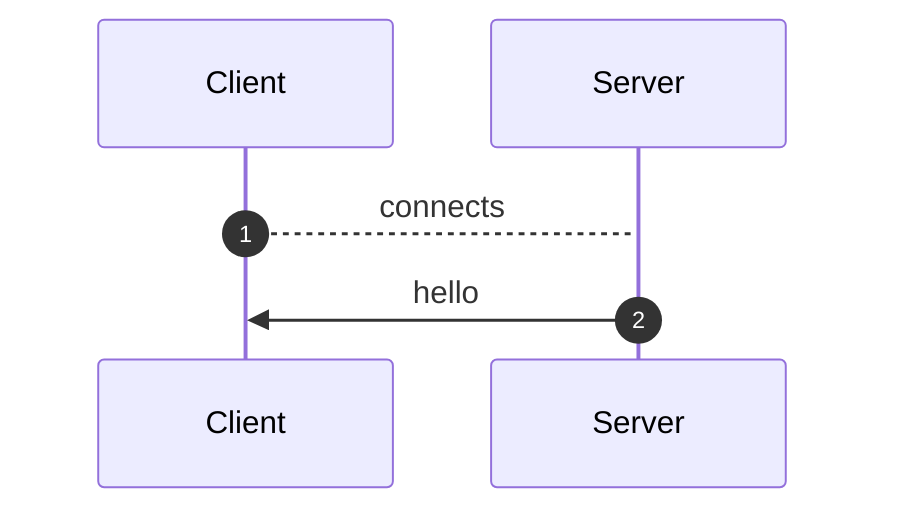
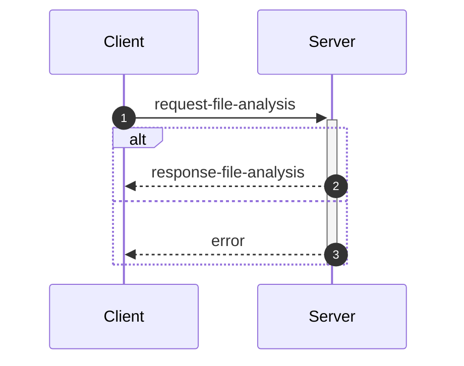
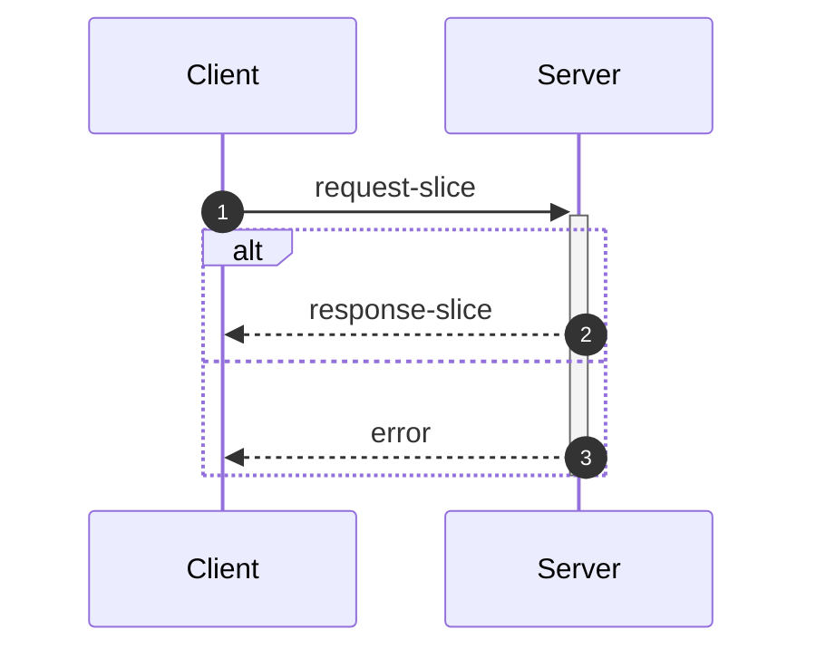
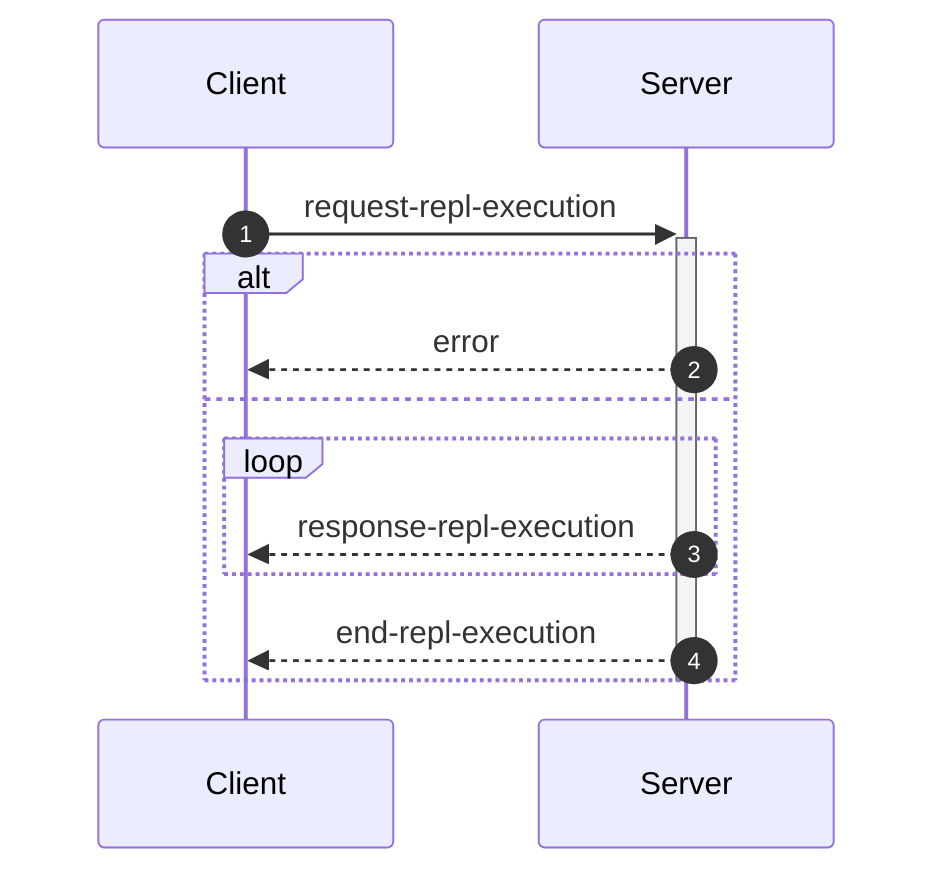

_<span title="an overview of flowR's interface">Generated</span> from '[wiki-interface.ts](https://github.com/flowr-analysis/flowr/tree/main/src/documentation/wiki-interface.ts "src/documentation/wiki-interface.ts")' on 2026-10-27, 15:03:10 UTC (v2.16.6, R v4.6.1), do not edit directly._

Although far from being as detailed as the in-depth explanation of [_flowR_](https://github.com/flowr-analysis/flowr/wiki/Core),
this wiki page explains how to interface with _flowR_ in more detail.
In general, command line arguments and other options provide short descriptions on hover over.

* [💻 Using the REPL](#using-the-repl)
* [⚙️ Configuring FlowR](#configuring-flowr)
* [⚒️ Writing Code](#writing-code)
* [💬 Communicating with the Server](#communicating-with-the-server)

<a id='using-the-repl'></a>
## 💻 Using the REPL

> [!NOTE]
> To execute arbitrary R commands with a repl request, _flowR_ has to be started explicitly with <span title="Description (Command Line Argument): Allow to access the underlying R session when using flowR (security warning: this allows the execution of arbitrary R code!)">`--r-session-access`</span>.
> Please be aware that this introduces a security risk and note that this relies on the [`r-shell` engine](https://github.com/flowr-analysis/flowr/wiki/Engines) .

Although primarily meant for users to explore,
there is nothing which forbids calling _flowR_ as a subprocess to use standard-in, -output, and -error
for communication (although you can access the REPL using the server as well,
with the [REPL Request](#message-request-repl-execution) message).

The read-eval-print loop&nbsp;(REPL) works relatively simple.
You can submit an expression (using <kbd>Enter</kbd>),
which is interpreted as an R&nbsp;expression by default but interpreted as a *command* if it starts with a colon (`:`).
The best command to get started with the REPL is <span title="Description (Repl Command): Show help information (aliases: :h, :?)">`:help`</span>.
Besides, you can leave the REPL either with the command <span title="Description (Repl Command): End the repl (aliases: :q, :exit)">`:quit`</span> or by pressing <kbd>Ctrl</kbd>+<kbd>C</kbd> twice.
When writing a *command*, you may press <kbd>Tab</kbd> to get a list of completions, if available.
Multiple commands can be entered in a single line by separating them with a semicolon (`;`), e.g. `:parse "x<-2"; :df*`.
If a command is given without R code, the REPL will re-use R code given in a previous command.
The prior example will hence return first the parsed AST of the program and then the dataflow graph for `"x <- 2"`.

> [!NOTE]
> If you develop flowR, you may want to launch the repl using the `npm run main-dev` command, this way, you get a non-minified version of flowR with debug information and hot-reloading of source files.

<details>
<summary>Available Commands</summary>

We currently offer the following commands (this with a `[*]` suffix are available with and without the star):

| Command | Description |
| ------- | ----------- |
| **<span title="Description (Repl Command): End the repl (aliases: :q, :exit)">:quit</span>** | End the repl (aliases: **:<span title="Alias of ':quit'. End the repl">q</span>**, **:<span title="Alias of ':quit'. End the repl">exit</span>**) |
| **<span title="Description (Repl Command): Execute the given code as R code. This requires the `--r-session-access` flag to be set and requires the r-shell engine. (aliases: :e, :r)">:execute</span>** | Execute the given code as R code. This requires the `--r-session-access` flag to be set and requires the r-shell engine. (aliases: **:<span title="Alias of ':execute'. Execute the given code as R code. This requires the `--r-session-access` flag to be set and requires the r-shell engine.">e</span>**, **:<span title="Alias of ':execute'. Execute the given code as R code. This requires the `--r-session-access` flag to be set and requires the r-shell engine.">r</span>**) |
| **<span title="Description (Repl Command): Get mermaid code for the control-flow graph of R code (aliases: :cfg, :cf)">:controlflow[*]</span>** | Get mermaid code for the control-flow graph of R code (star: Returns the URL to mermaid.live) (aliases: **:<span title="Alias of ':controlflow'. Get mermaid code for the control-flow graph of R code">cfg</span>**, **:<span title="Alias of ':controlflow'. Get mermaid code for the control-flow graph of R code">cf</span>**) |
| **<span title="Description (Repl Command): Get mermaid code for the control-flow graph with basic blocks (aliases: :cfgb, :cfb)">:controlflowbb[*]</span>** | Get mermaid code for the control-flow graph with basic blocks (star: Returns the URL to mermaid.live) (aliases: **:<span title="Alias of ':controlflowbb'. Get mermaid code for the control-flow graph with basic blocks">cfgb</span>**, **:<span title="Alias of ':controlflowbb'. Get mermaid code for the control-flow graph with basic blocks">cfb</span>**) |
| **<span title="Description (Repl Command): Get mermaid code for the dataflow graph (aliases: :d, :df)">:dataflow[*]</span>** | Get mermaid code for the dataflow graph (star: Returns the URL to mermaid.live) (aliases: **:<span title="Alias of ':dataflow'. Get mermaid code for the dataflow graph">d</span>**, **:<span title="Alias of ':dataflow'. Get mermaid code for the dataflow graph">df</span>**) |
| **<span title="Description (Repl Command): Get mermaid code for the normalized AST of R code (aliases: :n)">:normalize[*]</span>** | Get mermaid code for the normalized AST of R code (star: Returns the URL to mermaid.live) (alias: **:<span title="Alias of ':normalize'. Get mermaid code for the normalized AST of R code">n</span>**) |
| **<span title="Description (Repl Command): Get mermaid code for the simplified dataflow graph (aliases: :ds, :dfs)">:dataflowsimple[*]</span>** | Get mermaid code for the simplified dataflow graph (star: Returns the URL to mermaid.live) (aliases: **:<span title="Alias of ':dataflowsimple'. Get mermaid code for the simplified dataflow graph">ds</span>**, **:<span title="Alias of ':dataflowsimple'. Get mermaid code for the simplified dataflow graph">dfs</span>**) |
| **<span title="Description (Repl Command): Inspect and extend the signature database: `query` (identical to :query @signature), `info <name>` for where a function comes from (identical to :query @function-info), `add <path>` to mount another database/source, `download` to fetch the full-history database. (aliases: :sig)">:signature</span>** | Inspect and extend the signature database: `query` (identical to :query @signature), `info <name>` for where a function comes from (identical to :query @function-info), `add <path>` to mount another database/source, `download` to fetch the full-history database. (alias: **:<span title="Alias of ':signature'. Inspect and extend the signature database: `query` (identical to :query @signature), `info <name>` for where a function comes from (identical to :query @function-info), `add <path>` to mount another database/source, `download` to fetch the full-history database.">sig</span>**) |
| **<span title="Description (Repl Command): Just calculates the DFG, but only prints summary info (aliases: :d#, :df#)">:dataflowsilent</span>** | Just calculates the DFG, but only prints summary info (aliases: **:<span title="Alias of ':dataflowsilent'. Just calculates the DFG, but only prints summary info">d#</span>**, **:<span title="Alias of ':dataflowsilent'. Just calculates the DFG, but only prints summary info">df#</span>**) |
| **<span title="Description (Repl Command): Prints ASCII Art of the parsed, unmodified AST (aliases: :p)">:parse</span>** | Prints ASCII Art of the parsed, unmodified AST (alias: **:<span title="Alias of ':parse'. Prints ASCII Art of the parsed, unmodified AST">p</span>**) |
| **<span title="Description (Repl Command): Prints the version of flowR as well as the current version of R">:version</span>** | Prints the version of flowR as well as the current version of R
| **<span title="Description (Repl Command): Query the given R code (use 'help' for more information)">:query[*]</span>** | Query the given R code (use 'help' for more information) (star: Similar to query, but returns the output in json format.)
| **<span title="Description (Repl Command): Returns an ASCII representation of the dataflow graph (aliases: :df!)">:dataflowascii</span>** | Returns an ASCII representation of the dataflow graph (alias: **:<span title="Alias of ':dataflowascii'. Returns an ASCII representation of the dataflow graph">df!</span>**) |
| **<span title="Description (Repl Command): Returns summarization stats for the normalized AST (aliases: :n#)">:normalize#</span>** | Returns summarization stats for the normalized AST (alias: **:<span title="Alias of ':normalize#'. Returns summarization stats for the normalized AST">n#</span>**) |
| **<span title="Description (Repl Command): Show help information (aliases: :h, :?)">:help</span>** | Show help information (aliases: **:<span title="Alias of ':help'. Show help information">h</span>**, **:<span title="Alias of ':help'. Show help information">?</span>**) |

</details>

> [!TIP]
> 
> As indicated by the examples before, all REPL commands that operate on code keep track of the state.
> Hence, if you run a command like <span title="Description (Repl Command, starred version): Returns the URL to mermaid.live; Base Command: Get mermaid code for the dataflow graph (aliases: :d*, :df*)">`:dataflow*`</span> without providing R code,
> the REPL will re-use the R code provided in a previous command.
> Likewise, doing this will benefit from incrementality!
> If you request the dataflow graph with `:df* x <- 2 * y` and then want to see the parsed AST with `:parse`,
> the REPL will re-use previously obtained information and not re-parse the code again.
> 		

Generally, many commands offer shortcut versions in the REPL. Many queries, for example, offer a shortened format (see the example below).
Of special note, the [Config Query](https://github.com/flowr-analysis/flowr/wiki/%5BQuery%5D-Config)
can be used to also modify the currently active configuration of _flowR_ within the REPL (see the [wiki page](https://github.com/flowr-analysis/flowr/wiki/%5BQuery%5D-Config) for more information).

### Example: Retrieving the Dataflow Graph

To retrieve a URL to the [mermaid](https://mermaid.js.org/) diagram of the dataflow of a given expression,
use <span title="Description (Repl Command, starred version): Returns the URL to mermaid.live; Base Command: Get mermaid code for the dataflow graph (aliases: :d*, :df*)">`:dataflow*`</span> (or <span title="Description (Repl Command): Get mermaid code for the dataflow graph (aliases: :d, :df)">`:dataflow`</span> to get the mermaid code in the cli):

```shell
$ docker run -it --rm eagleoutice/flowr # or npm run flowr 
flowR repl v2.16.6, R grammar v14 (tree-sitter engine)
R> :dataflow* y <- 1 + x
```

<details>
<summary style='color:gray'>Output</summary>

```text
https://mermaid.live/view#base64:eyJjb2RlIjoiZmxvd2NoYXJ0IFREXG4gICAgMXt7XCJgKiM5MTtSTnVtYmVyIzkzOyogKioxKipcbiAgICAgICoxLjYqICgqKmlkOiAxKiopYFwifX1cbiAgICAyKFtcImAqIzkxO1JTeW1ib2wjOTM7KiAqKngqKlxuICAgICAgKjEuMTAqICgqKmlkOiAyKiopYFwiXSlcbiAgICAzW1tcImAqIzkxO1JCaW5hcnlPcCM5MzsqIGJhc2UjNTg7IzU4OyoqIzQzOyoqXG4gICAgICAqMS42LTEwKiAoKippZDogMyoqKVxuICAgIGFyZzogKDEsIDIpYFwiXV1cbiAgICBidWlsdC1pbjpfNDNfW1wiYEJ1aWx0LUluOlxuIzQzO2BcIl1cbiAgICBzdHlsZSBidWlsdC1pbjpfNDNfIHN0cm9rZTpncmF5LGZpbGw6Z3JheSxzdHJva2Utd2lkdGg6MnB4LG9wYWNpdHk6Ljg7XG4gICAgMFtcImAqIzkxO1JTeW1ib2wjOTM7KiAqKnkqKlxuICAgICAgKjEuMSogKCoqaWQ6IDAqKiwgdjogMylgXCJdXG4gICAgNFtbXCJgKiM5MTtSQmluYXJ5T3AjOTM7KiBiYXNlIzU4OyM1ODsqKiM2MDsjNDU7KipcbiAgICAgICoxLjEtMTAqICgqKmlkOiA0KiopXG4gICAgYXJnOiAoMCwgMylgXCJdXVxuICAgIGJ1aWx0LWluOl82MF8tW1wiYEJ1aWx0LUluOlxuIzYwOyM0NTtgXCJdXG4gICAgc3R5bGUgYnVpbHQtaW46XzYwXy0gc3Ryb2tlOmdyYXksZmlsbDpncmF5LHN0cm9rZS13aWR0aDoycHgsb3BhY2l0eTouODtcbiAgICAxIC0uLT58XCJmbG93XCJ8IDJcbiAgICBsaW5rU3R5bGUgMCBzdHJva2U6Z3JheSxjb2xvcjpncmF5O1xuICAgIDIgLS4tPnxcImZsb3dcInwgM1xuICAgIGxpbmtTdHlsZSAxIHN0cm9rZTpncmF5LGNvbG9yOmdyYXk7XG4gICAgMyAtLT58XCJyZWFkcywgYXJnXCJ8IDFcbiAgICAzIC0tPnxcInJlYWRzLCBhcmdcInwgMlxuICAgIDMgLS4tPnxcImZsb3dcInwgMFxuICAgIGxpbmtTdHlsZSA0IHN0cm9rZTpncmF5LGNvbG9yOmdyYXk7XG4gICAgMyAtLi0+fFwicmVhZHMsIGNhbGxzXCJ8IGJ1aWx0LWluOl80M19cbiAgICBsaW5rU3R5bGUgNSBzdHJva2U6Z3JheTtcbiAgICAwIC0tPnxcImRlZmluZWQtYnksIGZsb3dcInwgNFxuICAgIDAgLS0+fFwiZGVmaW5lZC1ieVwifCAzXG4gICAgNCAtLT58XCJyZWFkcywgYXJnXCJ8IDNcbiAgICA0IC0tPnxcInJldHVybnMsIGFyZ1wifCAwXG4gICAgNCAtLi0+fFwicmVhZHMsIGNhbGxzXCJ8IGJ1aWx0LWluOl82MF8tXG4gICAgbGlua1N0eWxlIDEwIHN0cm9rZTpncmF5OyIsIm1lcm1haWQiOnsiYXV0b1N5bmMiOnRydWV9fQ==
```

Retrieve the dataflow graph of the expression `y <- 1 + x`. It looks like this:


<details>

<summary style="color:gray">R Code of the Dataflow Graph</summary>

The analysis ran (parse and normalize with the [tree-sitter](https://github.com/flowr-analysis/flowr/wiki/Engines) engine) in the generation environment. No [signature database](https://github.com/flowr-analysis/flowr/wiki/Signature-Database) is mounted, so `library()` attaches no exports (base-R names are still qualified, e.g., `stats::acf`). 
We encountered no unknown side effects during the analysis.

```r
y <- 1 + x
```

</details>

</details>

For small graphs like this, <span title="Description (Repl Command): Returns an ASCII representation of the dataflow graph (aliases: :df!)">`:dataflowascii`</span> also provides an ASCII representation directly in the REPL:

```shell
$ docker run -it --rm eagleoutice/flowr # or npm run flowr 
flowR repl v2.16.6, R grammar v14 (tree-sitter engine)
R> :df! y <- 1 + x
```

<details open>
<summary style='color:gray'>Output</summary>

```text
                        v<0>v
 c<4>c──────────────────| y |
 |<- |     ┌────────────v---v
 c---c     │
    │   c<3>c   0<1>0
    └───| + |───| 1 |───u<2>u
        c---c   0---0   | x |
           └────────────u---u
Edges:
3 -> 1: reads, arg          3 -> 2: reads, arg
3 -> 0: flows-to            1 -> 2: flows-to
2 -> 3: flows-to            4 -> 3: reads, arg
4 -> 0: returns, arg        0 -> 4: defined-by, flows-to
0 -> 3: defined-by
```

Retrieve the dataflow graph of the expression `y <- 1 + x` as ASCII art.

</details>

For the slicing with <span title="Description (Repl Command): Static backwards executable slicer for R">`:slicer`</span>, you have access to the same [magic comments](#slice-magic-comments) as with the [slice request](#message-request-slice).
Pass `--inline` to splice resolvable `source()` calls into the reconstruction so the slice is a single self-contained R text (the same as the static slice query's `inlineSources` flag).
See `--help` for more flags!

### Example: Interfacing with the File System

Many commands that allow for an R-expression (like <span title="Description (Repl Command, starred version): Returns the URL to mermaid.live; Base Command: Get mermaid code for the dataflow graph (aliases: :d*, :df*)">`:dataflow*`</span>) allow for a file as well
if the argument starts with `file://`.
If you are working from the root directory of the _flowR_ repository, the following gives you the parsed AST of the example file using the <span title="Description (Repl Command): Prints ASCII Art of the parsed, unmodified AST (aliases: :p)">`:parse`</span> command:

> **Watch mode**: Replace `file://` with `watch://` to enter watch mode.
> flowR runs the command immediately and then re-runs it every time the file (or any file inside the folder) changes.
> Enter any other command to leave watch mode.
> For example: `:df watch://analysis.R`

```shell
$ docker run -it --rm eagleoutice/flowr # or npm run flowr 
flowR repl v2.16.6, R grammar v14 (tree-sitter engine)
R> :parse file://test/testfiles/example.R
```

<details>
<summary style='color:gray'>Output</summary>

```text
File: test/testfiles/example.R

program
├ binaryoperator
│ ├ identifier "sum" (1:1─4)
│ ├ <- "<-" (1:5─7)
│ ╰ float "0" (1:8─9)
├ binaryoperator
│ ├ identifier "product" (2:1─8)
│ ├ <- "<-" (2:9─11)
│ ╰ float "1" (2:12─13)
├ binaryoperator
│ ├ identifier "w" (3:1─2)
│ ├ <- "<-" (3:3─5)
│ ╰ float "7" (3:6─7)
├ binaryoperator
│ ├ identifier "N" (4:1─2)
│ ├ <- "<-" (4:3─5)
│ ╰ float "10" (4:6─8)
├ forstatement
│ ├ for "for" (6:1─4)
│ ├ ( "(" (6:5─6)
│ ├ identifier "i" (6:6─7)
│ ├ in "in" (6:8─10)
│ ├ binaryoperator
│ │ ├ float "1" (6:11─12)
│ │ ├ : ":" (6:12─13)
│ │ ╰ parenthesizedexpression
│ │   ├ ( "(" (6:13─14)
│ │   ├ binaryoperator
│ │   │ ├ identifier "N" (6:14─15)
│ │   │ ├ - "-" (6:15─16)
│ │   │ ╰ float "1" (6:16─17)
│ │   ╰ ) ")" (6:17─18)
│ ├ ) ")" (6:18─19)
│ ╰ bracedexpression
│   ├ { "{" (6:20─21)
│   ├ binaryoperator
│   │ ├ identifier "sum" (7:3─6)
│   │ ├ <- "<-" (7:7─9)
│   │ ╰ binaryoperator
│   │   ├ binaryoperator
│   │   │ ├ identifier "sum" (7:10─13)
│   │   │ ├ + "+" (7:14─15)
│   │   │ ╰ identifier "i" (7:16─17)
│   │   ├ + "+" (7:18─19)
│   │   ╰ identifier "w" (7:20─21)
│   ├ binaryoperator
│   │ ├ identifier "product" (8:3─10)
│   │ ├ <- "<-" (8:11─13)
│   │ ╰ binaryoperator
│   │   ├ identifier "product" (8:14─21)
│   │   ├  "" (8:22─23)
│   │   ╰ identifier "i" (8:24─25)
│   ╰ } "}" (9:1─2)
├ call
│ ├ identifier "cat" (11:1─4)
│ ╰ arguments
│   ├ ( "(" (11:4─5)
│   ├ argument
│   │ ╰ string
│   │   ├ stringopen "\"" (11:5─6)
│   │   ├ stringcontent "Sum:" (11:6─10)
│   │   ╰ stringclose "\"" (11:10─11)
│   ├ comma "," (11:11─12)
│   ├ argument
│   │ ╰ identifier "sum" (11:13─16)
│   ├ comma "," (11:16─17)
│   ├ argument
│   │ ╰ string
│   │   ├ stringopen "\"" (11:18─19)
│   │   ├ stringcontent
│   │   │ ╰ escapesequence "\\n" (11:19─21)
│   │   ╰ stringclose "\"" (11:21─22)
│   ╰ ) ")" (11:22─23)
╰ call
  ├ identifier "cat" (12:1─4)
  ╰ arguments
    ├ ( "(" (12:4─5)
    ├ argument
    │ ╰ string
    │   ├ stringopen "\"" (12:5─6)
    │   ├ stringcontent "Product:" (12:6─14)
    │   ╰ stringclose "\"" (12:14─15)
    ├ comma "," (12:15─16)
    ├ argument
    │ ╰ identifier "product" (12:17─24)
    ├ comma "," (12:24─25)
    ├ argument
    │ ╰ string
    │   ├ stringopen "\"" (12:26─27)
    │   ├ stringcontent
    │   │ ╰ escapesequence "\\n" (12:27─29)
    │   ╰ stringclose "\"" (12:29─30)
    ╰ ) ")" (12:30─31)
```

Retrieve the parsed AST of the example file.

<details>

<summary>File Content</summary>

```r
sum <- 0
product <- 1
w <- 7
N <- 10

for (i in 1:(N-1)) {
  sum <- sum + i + w
  product <- product * i
}

cat("Sum:", sum, "\n")
cat("Product:", product, "\n")
```

</details>

As _flowR_ directly transforms this AST the output focuses on being human-readable instead of being machine-readable.
		
</details>

### Example: Run a Query

You can run any query supported by _flowR_ using the <span title="Description (Repl Command): Query the given R code (use 'help' for more information)">`:query`</span> command.
For example, to obtain the shapes of all data frames in a given piece of code, you can run:

```shell
$ docker run -it --rm eagleoutice/flowr # or npm run flowr 
flowR repl v2.16.6, R grammar v14 (tree-sitter engine)
R> :query @absint df-shape "x <- data.frame(a = 1:10, b = 1:10)\ny <- x$a"
```

<details open>
<summary style='color:gray'>Output</summary>

```text
Query: absint (1 ms)
   ╰ $12: (colnames: [{"a", "b"}, {}], cols: [2, 2], rows: [10, 10])
   ╰ $0: (colnames: [{"a", "b"}, {}], cols: [2, 2], rows: [10, 10])
```

Retrieve the shapes of all data frames in the given code.

</details>

To run the linter on a file, you can use (in this example, we just issue the `dead-code` linter on a small piece of code):

```shell
$ docker run -it --rm eagleoutice/flowr # or npm run flowr 
flowR repl v2.16.6, R grammar v14 (tree-sitter engine)
R> :query @linter rules:dead-code "if(FALSE) x <- 2"
```

<details open>
<summary style='color:gray'>Output</summary>

```text
Query: linter (2 ms)
   ╰ Dead Code (dead-code):
       ╰ certain:
           ╰ Code at 1.11-16 (1 quick fix(es) available)
```

Run the linter on the given code, with only the `dead-code` rule enabled.

</details>

For more information on the available queries, please check out the [Query API](https://github.com/flowr-analysis/flowr/wiki/Query-API).

<a id='configuring-flowr'></a>
## ⚙️ Configuring FlowR

When running _flowR_, you may want to specify some behaviors with a dedicated configuration file.
By default, flowR looks for a file named `flowr.json` in the current working directory (or any higher directory).
You can also specify a different file with <span title="Description (Command Line Argument): The name of the configuration file to use">`--config-file`</span> or pass the configuration inline using <span title="Description (Command Line Argument): The flowR configuration to use, as a JSON string">`--config-json`</span>.
A `flowr.json` found this way belongs to the analyzed project, so flowR ignores its options that decide what flowR executes or loads
(`engines.*.wasmPath`, `engines.*.treeSitterWasmPath`, `engines.*.rPath`, `solver.sigdb.additionalPaths`, `solver.sigdb.downloadRepo`, `solver.sigdb.installedLibrary.paths`),
unless you pass <span title="Description (Command Line Argument): Keep the security-sensitive options (e.g., the R executable) of the flowr.json found in the working directory or a parent. Only use this for projects you trust.">`--trust-config`</span>.
To analyze code you do not trust, use the secure mode (<span title="Description (Command Line Argument): Run in secure mode for analyzing untrusted code: flowR does not start R (or any other process), does not access the network, does not search for project configs, and ignores security-sensitive options in every config. Cannot be disabled once enabled. Can also be enabled with the environment variable {italic FLOWR_SECURE_MODE=1}.">`--secure`</span>, see the [security policy](https://github.com/flowr-analysis/flowr/blob/main/.github/SECURITY.md)).
To inspect the current configuration, you can run flowr with the <span title="Description (Command Line Argument): Run with verbose logging (will be passed to the corresponding script)">`--verbose`</span> flag, or use the `config` [Query](https://github.com/flowr-analysis/flowr/wiki/Query-API).
Within the REPL this works by running the following:

```shell
:query @config
```

To work with the <a href="https://github.com/flowr-analysis/flowr/tree/main/src/config.ts#L119"><code><span title="The configuration file format for flowR.">FlowrConfig</span></code></a> you can use the provided helper objects alongside its methods like
<a href="https://github.com/flowr-analysis/flowr/tree/main/src/config.ts#L914"><code><span title="Creates a new flowr config that has the updated values.">FlowrConfig::<b>amend</b></span></code></a>.
The schema below documents every option; the ones you most likely want are:

- <a href="https://github.com/flowr-analysis/flowr/wiki/Interface#configuring-flowr" title="Configuration Option (boolean): Whether source calls should be ignored, causing {@link processSourceCall}&#39;s behavior to be skipped.">ignoreSourceCalls</a>: ignore source calls when analyzing the code, i.e., ignore the inclusion of other files.
- <a href="https://github.com/flowr-analysis/flowr/wiki/Interface#configuring-flowr" title="Configuration Option (boolean): Whether load calls should be ignored, causing {@link processLoadCall}&#39;s behavior to be skipped.">ignoreLoadCalls</a>: ignore load calls when analyzing the code, i.e., ignore the loading of r-data files.
- <a href="https://github.com/flowr-analysis/flowr/wiki/Interface#configuring-flowr" title="Configuration Option (object): Do you want to overwrite (parts) of the builtin definition?">semantics.environment.overwriteBuiltIns</a>: overwrite _flowR_'s handling of built-in functions, or clear the preset definitions entirely.
  See [Configure BuiltIn Semantics](#configure-builtin-semantics) for more information.
- <a href="https://github.com/flowr-analysis/flowr/wiki/Interface#configuring-flowr" title="Configuration Option (string): How to resolve variables and their values. (one of &quot;disabled&quot;, &quot;alias&quot;, &quot;builtin&quot;)">solver.variables</a>: how to resolve variables and their values (`disabled`, `alias`, `builtin`).
- <a href="https://github.com/flowr-analysis/flowr/wiki/Interface#configuring-flowr" title="Configuration Option (array): The engine or set of engines to use for interacting with R code. An empty array means all available engines will be used.">engines</a> and <a href="https://github.com/flowr-analysis/flowr/wiki/Interface#configuring-flowr" title="Configuration Option (string): The default engine to use for interacting with R code. If this is undefined, an arbitrary engine from the specified list will be used. (one of &quot;tree-sitter&quot;, &quot;r-shell&quot;)">defaultEngine</a>: the engines used to interact with R code, see the [Engines wiki page](https://github.com/flowr-analysis/flowr/wiki/Engines).
- <a href="https://github.com/flowr-analysis/flowr/wiki/Interface#configuring-flowr" title="Configuration Option (array): Files a framework loads on its own, without any source() call (e.g. global.R in a shiny app), in the order they are loaded; flowR orders the matching project files accordingly and analyzes them as one program. Entries are case-insensitive globs matched against the file path, a plain name matches any file with that name, and entries matching no project file are warned about. Usually set per project kind via specializeConfig.">project.implicitSources</a>: the files a framework loads without any `source()` call, in the order in which they are
  loaded. Entries are globs (e.g. `R/*.R`) matched against the file path ignoring capitalization; one matching no file is reported.
- <a href="https://github.com/flowr-analysis/flowr/wiki/Interface#configuring-flowr" title="Configuration Option (object): Overwrite (parts of) the configuration depending on the project kind flowR detects, e.g. to give a shiny app its implicit sources.">specializeConfig</a>: overwrite (parts of) the configuration depending on the kind of project _flowR_ detects
  (e.g. `shiny-app`), which is how a shiny app gets its implicit sources by default. What you configure directly wins.
- <a href="https://github.com/flowr-analysis/flowr/wiki/Interface#configuring-flowr" title="Configuration Option (string): Overwrite the project kind flowR would otherwise infer from the analyzed files, e.g. when auto-detection guesses wrong. (one of &quot;package&quot;, &quot;script&quot;, &quot;shiny-app&quot;, &quot;notebook&quot;, &quot;project&quot;, &quot;unknown&quot;)">project.useProjectType</a>: skip that detection and force a project kind yourself, when auto-detection guesses wrong.
- <a href="https://github.com/flowr-analysis/flowr/wiki/Interface#configuring-flowr" title="Configuration Option (array): The default plugins to load when creating a new instance of FlowrAnalyzer">defaultPlugins</a> and <a href="https://github.com/flowr-analysis/flowr/wiki/Interface#configuring-flowr" title="Configuration Option (array): The plugins to load in REPL mode">repl.plugins</a>: the plugins to load for a new <a href="https://github.com/flowr-analysis/flowr/tree/main/src/project/flowr-analyzer.ts#L205"><code><span title="Central class for conducting analyses with FlowR. Use the FlowrAnalyzerBuilder to create a new instance. If you want the original pattern of creating a pipeline and running all steps, you can still do this with FlowrAnalyzer#runFull . To inspect the context of the analyzer, use FlowrAnalyzer#inspectContext (if you are a plugin and need to modify it, use FlowrAnalyzer#context instead).">FlowrAnalyzer</span></code></a> and in the REPL
  (use `flowr:default` to reference the former).

So you can configure _flowR_ by adding a file like the following:

<details>

<summary>Example Configuration File</summary>

```json
{
  "ignoreSourceCalls": true,
  "ignoreLoadCalls": true,
  "semantics": {
    "environment": {
      "overwriteBuiltIns": {
        "definitions": [
          {
            "type": "function",
            "names": [
              "foo"
            ],
            "processor": "builtin:assign",
            "config": {}
          }
        ]
      }
    }
  },
  "defaultPlugins": [
    "file:description",
    "versions:description"
  ],
  "repl": {
    "quickStats": false,
    "dfProcessorHeat": false,
    "hints": true,
    "plugins": [
      "flowr:default"
    ]
  },
  "project": {
    "resolveUnknownPathsOnDisk": true,
    "implicitSources": [
      "global.R",
      "app.R"
    ]
  },
  "linter": {
    "disabledRules": []
  },
  "specializeConfig": {
    "shiny-app": {
      "project": {
        "implicitSources": [
          "global.R",
          "ui.R",
          "server.R",
          "app.R"
        ]
      }
    }
  },
  "engines": [
    {
      "type": "r-shell"
    }
  ],
  "solver": {
    "variables": "alias",
    "evalStrings": true,
    "trackEnvironments": true,
    "sigdb": {
      "enabled": true,
      "loadProjectDependencies": true,
      "eagerlyLoad": false,
      "eagerlyLoadExports": false,
      "linkBaseR": false,
      "linkDescriptionDependencies": false
    },
    "resolveSource": {
      "dropPaths": "no",
      "ignoreCapitalization": true,
      "inferWorkingDirectory": "active-script",
      "searchPath": []
    },
    "instrument": {},
    "slicer": {
      "threshold": 50
    }
  },
  "abstractInterpretation": {
    "wideningThreshold": 4,
    "followCalls": true,
    "dataFrame": {
      "maxColNames": 20,
      "readLoadedData": {
        "readExternalFiles": true,
        "maxReadLines": 1000000
      }
    }
  },
  "incremental": {
    "alwaysIncremental": false,
    "parsing": {
      "activated": false,
      "heuristics": {
        "activated": true,
        "mtime": true,
        "linesFrom": 500,
        "bytesFrom": 50000,
        "alwaysWithEdits": false,
        "minFiles": 1
      }
    }
  },
  "gas": {
    "thresholds": {
      "memory": {
        "problematic": 0.7,
        "critical": 0.9
      },
      "timeMs": {
        "problematic": 100000,
        "critical": 120000
      }
    },
    "features": {}
  }
}
```

</details>

<details>
<a id='configure-builtin-semantics'></a>
<summary>Configure Built-In Semantics</summary>

`semantics/environment/overwriteBuiltins` accepts two keys:

- `loadDefaults` (boolean, initially `true`): If set to `true`, the default built-in definitions are loaded before applying the custom definitions. Setting this flag to `false` explicitly disables the loading of the default definitions.
- `definitions` (array, initially empty): Allows to overwrite or define new built-in elements. Each object within must have a `type` which is one of the below. Furthermore, they may define a string array of `names` which specifies the identifiers to bind the definitions to. You may use `assumePrimitive` to specify whether _flowR_ should assume that this is a primitive non-library definition (so you probably just do not want to specify the key).

  | Type            | Description                                                                                                                                                                                                                                                                                              | Example                                                                                                    |
  | --------------- | -------------------------------------------------------------------------------------------------------------------------------------------------------------------------------------------------------------------------------------------------------------------------------------------------------- | ---------------------------------------------------------------------------------------------------------- |
  | `constant`    | Additionally allows for a `value` this should resolve to.                                                                                                                                                                                                                                                | `{ type: 'constant', names: ['NULL', 'NA'],  value: null }`                                                |
  | `function`    | Is a rather flexible way to define and bind built-in functions. For the time, we do not have extensive documentation to cover all the cases, so please either consult the sources with the `default-builtin-config.ts` or open a [new issue](https://github.com/flowr-analysis/flowr/issues/new/choose). | `{ type: 'function', names: ['next'], processor: 'builtin:d', config: { cfg: ExitPointType.Next } }` |
  | `replacement` | A comfortable way to specify replacement functions like `$<-` or `names<-`. `suffixes` describes the... suffixes to attach automatically. | `{ type: 'replacement', suffixes: ['<-', '<<-'], names: ['[', '[['] }` |

</details>

<details>

<summary style='color:gray'>Full Configuration-File Schema</summary>

- _The configuration file format for flowR._ (object)
    - **logLevel** [optional] _flowR's global minimum log level, applied when the config is loaded._ (string)
        Only allows: 'silly', 'trace', 'debug', 'info', 'warn', 'error', 'fatal'
    - **ignoreSourceCalls** [optional] _Whether source calls should be ignored, causing {@link processSourceCall}'s behavior to be skipped._ (boolean)
    - **ignoreLoadCalls** [optional] _Whether load calls should be ignored, causing {@link processLoadCall}'s behavior to be skipped._ (boolean)
    - **semantics** _Configure language semantics and how flowR handles them._ (object)
        - **environment** [optional] _Semantics regarding how to handle the R environment._ (object)
            - **overwriteBuiltIns** [optional] _Do you want to overwrite (parts) of the builtin definition?_ (object)
                - **loadDefaults** [optional] _Should the default configuration still be loaded?_ (boolean)
                - **definitions** [optional] _The definitions to load/overwrite._ (array)
                Valid item types:
                    - (object)
    - **defaultPlugins** [optional] _The default plugins to load when creating a new instance of FlowrAnalyzer_ (array)
    Valid item types:
        - (alternatives)
            - (string)
            - (array)
    - **repl** _Configuration options for the REPL._ (object)
        - **quickStats** [optional] _Whether to show quick stats in the REPL after each evaluation._ (boolean)
        - **dfProcessorHeat** [optional] _This instruments the dataflow processors to count how often each processor is called._ (boolean)
        - **hints** [optional] _Whether to show dim inline hints on the empty prompt (automatically disabled on non-interactive terminals)._ (boolean)
        - **plugins** [optional] _The plugins to load in REPL mode_ (array)
        Valid item types:
            - (alternatives)
                - (string)
                - (array)
        - **autoUseFileProtocol** [optional] _Prepend the file protocol to a repl input that looks like a path, instead of only warning about it._ (boolean)
        - **queryStats** [optional] _Whether `:query` closes with the line stating how long the queries took (`:query*` never prints it)._ (boolean)
        - **showPlugins** [optional] _Whether `:version` grays out the plugins that did not activate during the last analysis._ (boolean)
    - **project** _Project specific configuration options._ (object)
        - **resolveUnknownPathsOnDisk** [optional] _Whether to resolve unknown paths loaded by the r project disk when trying to source/analyze files._ (boolean)
        - **failOnInaccessiblePath** [optional] _Whether a directory that cannot be traversed during file discovery (e.g. due to permissions) aborts the analysis; when false (the default) such paths are logged and skipped._ (boolean)
        - **basePackages** [optional] _The packages considered part of R itself (base and recommended); if unset, flowR uses its built-in list._ (array)
        Valid item types:
            - (string)
        - **implicitSources** [optional] _Files a framework loads on its own, without any source() call (e.g. global.R in a shiny app), in the order they are loaded; flowR orders the matching project files accordingly and analyzes them as one program. Entries are case-insensitive globs matched against the file path, a plain name matches any file with that name, and entries matching no project file are warned about. Usually set per project kind via specializeConfig._ (array)
        Valid item types:
            - (string)
        - **useProjectType** [optional] _Overwrite the project kind flowR would otherwise infer from the analyzed files, e.g. when auto-detection guesses wrong._ (string)
            Only allows: 'package', 'script', 'shiny-app', 'notebook', 'project', 'unknown'
        - **assumeImplicitEcho** [optional] _Whether the top level of the analyzed code is echoed, so that every visible result printed there is collected as an output by the dependencies query (default true, false for a package)._ (boolean)
        - **discovery** [optional] _Scoping options for the default project discovery._ (object)
            - **full** [optional] _Collect every file below the project root (greedy) instead of only the files the detected project kind needs (default false)._ (boolean)
            - **perKind** [optional] _Per-kind include/exclude glob overrides layered on the default scoping._ (object)
            - **ignore** [optional] _Case-insensitive globs that drop matching files from the intelligent discovery, regardless of kind (e.g. .Renviron to ignore environment files)._ (array)
            Valid item types:
                - (string)
        - **classification** [optional] _Overrides for the signals flowR uses to classify the project kind._ (object)
            - **shinyDescriptionTypes** [optional] _DESCRIPTION Type: values that mark a shiny app._ (array)
            Valid item types:
                - (string)
            - **shinyEntryFiles** [optional] _File names a shiny app is assembled from._ (array)
            Valid item types:
                - (string)
            - **shinyUsagePattern** [optional] _Regex source evidencing shiny usage in an entry file._ (string)
            - **notebookExtensions** [optional] _File extensions marking a notebook._ (array)
            Valid item types:
                - (string)
    - **linter** _Linter configuration options._ (object)
        - **disabledRules** _Linting rule names excluded from the default rule set (a rule requested explicitly via a linter query still runs). Usually set per project kind via specializeConfig._ (array)
        Valid item types:
            - (string)
        - **disabledTags** [optional] _Linting rule tags whose rules are excluded from the default rule set (a rule requested explicitly via a linter query still runs). By default the cmd-check rules are disabled for everything but a package; a configured list replaces that default._ (array)
        Valid item types:
            - (string)
    - **inputSources** [optional] _Further frameworks the input-sources analysis should know about; entries are added to flowR's defaults._ (object)
        - **pure** [optional] _Functions that only pass the constantness of their arguments on._ (array)
        Valid item types:
            - (string)
        - **param** [optional] _Functions whose result is a 'param' input._ (array)
        Valid item types:
            - (string)
        - **file** [optional] _Functions whose result is a 'file' input._ (array)
        Valid item types:
            - (string)
        - **tempfile** [optional] _Functions whose result is a 'tempfile' input._ (array)
        Valid item types:
            - (string)
        - **glob** [optional] _Functions whose result is a 'glob' input._ (array)
        Valid item types:
            - (string)
        - **net** [optional] _Functions whose result is a 'net' input._ (array)
        Valid item types:
            - (string)
        - **rand** [optional] _Functions whose result is a 'rand' input._ (array)
        Valid item types:
            - (string)
        - **system** [optional] _Functions whose result is a 'system' input._ (array)
        Valid item types:
            - (string)
        - **ffi** [optional] _Functions whose result is a 'ffi' input._ (array)
        Valid item types:
            - (string)
        - **lang** [optional] _Functions whose result is a 'lang' input._ (array)
        Valid item types:
            - (string)
        - **options** [optional] _Functions whose result is a 'options' input._ (array)
        Valid item types:
            - (string)
        - **cmdline** [optional] _Functions whose result is a 'cmdline' input._ (array)
        Valid item types:
            - (string)
        - **user** [optional] _Functions whose result is a 'user' input._ (array)
        Valid item types:
            - (string)
        - **const** [optional] _Functions whose result is a 'const' input._ (array)
        Valid item types:
            - (string)
        - **scope** [optional] _Functions whose result is a 'scope' input._ (array)
        Valid item types:
            - (string)
        - **dconst** [optional] _Functions whose result is a 'dconst' input._ (array)
        Valid item types:
            - (string)
        - **unknown** [optional] _Functions whose result is a 'unknown' input._ (array)
        Valid item types:
            - (string)
        - **linkedObjects** [optional] _Objects a framework provides without a definition in the code, e.g. shiny's input._ (array)
        Valid item types:
            - (object)
        - **linkedEntryPoints** [optional] _Calls that hand a function to a framework, which binds its objects to the parameters by position._ (array)
        Valid item types:
            - (object)
    - **specializeConfig** [optional] _Overwrite (parts of) the configuration depending on the project kind flowR detects, e.g. to give a shiny app its implicit sources._ (object)
    - **engines** _The engine or set of engines to use for interacting with R code. An empty array means all available engines will be used._ (array)
    Valid item types:
        - (alternatives)
            - _The configuration for the tree sitter engine._ (object)
                - **type** [required] _Use the tree sitter engine._ (string)
                    Only allows: 'tree-sitter'
                - **wasmPath** [optional] _The path to the tree-sitter-r WASM binary to use. If this is undefined, this uses the default path._ (string)
                - **treeSitterWasmPath** [optional] _The path to the tree-sitter WASM binary to use. If this is undefined, this uses the default path._ (string)
                - **lax** [optional] _Whether to use the lax parser for parsing R code (allowing for syntax errors). If this is undefined, the strict parser will be used._ (boolean)
            - _The configuration for the R shell engine._ (object)
                - **type** [required] _Use the R shell engine._ (string)
                    Only allows: 'r-shell'
                - **rPath** [optional] _The path to the R executable to use. If this is undefined, this uses the default path._ (string)
                - **pipeBind** [optional] _Whether to enable R's experimental pipe-bind operator "=>" by setting _R_USE_PIPEBIND_ for the R session (default false); R itself keeps this off by default, as it is experimental and has never shipped in a release version of R._ (boolean)
    - **defaultEngine** [optional] _The default engine to use for interacting with R code. If this is undefined, an arbitrary engine from the specified list will be used._ (string)
        Only allows: 'tree-sitter', 'r-shell'
    - **solver** _How to resolve constants, constraints, cells, ..._ (object)
        - **variables** _How to resolve variables and their values._ (string)
            Only allows: 'disabled', 'alias', 'builtin'
        - **evalStrings** _Should we include eval(parse(text="...")) calls in the dataflow graph?_ (boolean)
        - **trackEnvironments** [optional] _Track user-created environments (new.env, assign/get/local with envir=, dollar-assign, attach). When false, all envir-style calls fall through conservatively._ (boolean)
        - **sigdb** _Resolving library exports from a signature database._ (object)
            - **enabled** [optional] _Resolve library()/use() exports from a signature database (default true); when false no database is consulted._ (boolean)
            - **loadProjectDependencies** [optional] _Load the project's declared dependencies from its metadata files (DESCRIPTION Imports/Depends, rproject.toml, uvr.toml, renv.lock, rv.lock, uvr.lock) (default true); when false these files are not read for dependencies._ (boolean)
            - **eagerlyLoad** [optional] _Parse the database up front rather than on the first package load (default false, ignored if disabled)._ (boolean)
            - **eagerlyLoadExports** [optional] _Add a vertex for every export on load rather than on demand (default false); keeps the dataflow graph small._ (boolean)
            - **assumedRVersion** [optional] _R version assumed when resolving versioned (base-R) exports: a pin like "4.5" or "auto" to detect the installed R (default "auto")._ (string)
            - **linkBaseR** [optional] _Eagerly attach base-R namespaces so bare base calls resolve without library() (default false)._ (boolean)
            - **linkBaseRCalls** [optional] _Add a lightweight Reads edge from a bare base-R call to its signature-database function vertex (default false; base-R qualification is edge-free otherwise)._ (boolean)
            - **linkPackageCalls** [optional] _Add a lightweight Reads edge from a resolved package call to its signature-database function vertex (default false)._ (boolean)
            - **linkDescriptionDependencies** [optional] _Eagerly attach the namespaces of the project's declared DESCRIPTION dependencies (Imports/Depends) so their exports resolve without an explicit library() (default false)._ (boolean)
            - **warmInBackground** [optional] _Decompress the hot shards (base + most-downloaded) in a background task on startup so the first library() lookup is warm (default false; for long-running servers/REPLs)._ (boolean)
            - **additionalPaths** [optional] _Extra directories or bundle/manifest files searched for signature databases (alongside the shipped default and $FLOWR_SIGDB_DIR); a downloaded full-history bundle placed here is mounted automatically._ (array)
            Valid item types:
                - (string)
            - **downloadRepo** [optional] _GitHub owner/repo the full-history bundle is downloaded from via ":signature download" (default "flowr-analysis/flowr", release tag "sigdb-v<flowR-version>")._ (string)
            - **autoSync** [optional] _On startup, re-download shards whose committed sigdb.remote.json hash no longer matches the cache, in the background (default false; opt-in network sync after a git pull)._ (boolean)
            - **installedLibrary** [optional] _Recovering packages no signature database knows from the copy installed on this machine._ (object)
                - **enabled** [required] _Recover packages no signature database knows from their installed copy (default false)._ (boolean)
                - **paths** [optional] _Library directories to search; when empty they are discovered from the environment and the project._ (array)
                Valid item types:
                    - (string)
                - **useEnvironment** [optional] _Search the libraries R_LIBS_USER/R_LIBS/R_LIBS_SITE name (default true)._ (boolean)
                - **useProjectLibrary** [optional] _Search a project-local renv/packrat library (default true)._ (boolean)
                - **maxDepth** [optional] _How far to descend into the nested layout of a project-local library (default 3)._ (number)
                - **packages** [optional] _Only recover packages whose name matches one of these regular expressions; empty means any._ (array)
                Valid item types:
                    - (string)
            - **blobCacheBudgetMb** [optional] _How many MiB of decoded package blobs every open bundle may hold together (default 16)._ (number)
            - **versionSelection** [optional] _When a project constrains a dependency, resolve to the newest (default), oldest, or system-installed version satisfying it; system needs R and falls back to newest. Base-R packages always resolve against the assumed R version._ (string)
                Only allows: 'newest', 'oldest', 'system'
            - **versionOverrides** [optional] _Force an exact version for specific packages (name -> version), overriding both the project constraint and the versionSelection policy (default {})._ (object)
        - **versionManagement** _Policies for reasoning about dependency versions._ (object)
            - **linkedVersionGroups** [optional] _Groups of packages that must resolve to the same version; version guessing intersects each group so its members stay mutually compatible (default [])._ (array)
            Valid item types:
                - (array)
                Valid item types:
                    - (string)
        - **assumeAttachedPackages** [optional] _Packages to treat as attached without a `library()` call, so what the built-in configuration states about them applies to the analyzed code. The base packages R attaches on startup already resolve without it._ (array)
        Valid item types:
            - (string)
        - **transitiveSideEffectRounds** [optional] _How many rounds the transitive side-effect fixpoint may run before it is cut off (default 32); the propagation stops on its own as soon as a round adds nothing._ (number)
        - **maxOverlayDepth** [optional] _How many binding overlays may stack on one environment frame before a write flattens them (default 4); a pure performance knob, trading lookup cost against copy cost without changing any result._ (number)
        - **instrument** (object)
            - **dataflowExtractors** [optional] _These keys are only intended for use within code, allowing to instrument the dataflow analyzer!_ (any)
        - **resolveSource** [optional] _If lax source calls are active, flowR searches for sourced files much more freely, based on the configurations you give it. This option is only in effect if `ignoreSourceCalls` is set to false._ (object)
            - **dropPaths** _Allow to drop the first or all parts of the sourced path, if it is relative._ (string)
                Only allows: 'no', 'once', 'all'
            - **ignoreCapitalization** _Search for filenames matching in the lowercase._ (boolean)
            - **inferWorkingDirectory** _Try to infer the working directory from the main or any script to analyze._ (string)
                Only allows: 'no', 'main-script', 'active-script', 'any-script'
            - **searchPath** _Additionally search in these paths._ (array)
            Valid item types:
                - (string)
            - **repeatedSourceLimit** [optional] _How often the same file can be sourced within a single run? Please be aware: in case of cyclic sources this may not reach a fixpoint so give this a sensible limit._ (number)
            - **applyReplacements** _Provide name replacements for loaded files_ (array)
            Valid item types:
                - (object)
            - **assumeFilesExist** [optional] _Assume a sourced file is always there, making what it defines certain instead of conditional on the source call._ (boolean)
        - **slicer** [optional] _The configuration for the slicer._ (object)
            - **threshold** [optional] _The maximum number of iterations to perform on a single function call during slicing._ (number)
            - **autoExtend** [optional] _If set, the slicer will gain an additional post-pass._ (boolean)
    - **abstractInterpretation** _The configuration options for abstract interpretation._ (object)
        - **wideningThreshold** _The threshold for the number of visitations of a node at which widening should be performed to ensure the termination of the fixpoint iteration._ (number)
        - **followCalls** _Whether the abstract interpretation is interprocedural, i.e. whether it steps into the functions a call may dispatch to._ (boolean)
        - **dataFrame** _The configuration of the shape inference for data frames._ (object)
            - **maxColNames** _The maximum number of columns names to infer for data frames before over-approximating the column names to top._ (number)
            - **readLoadedData** _Configuration options for reading data frame shapes from loaded external data files, such as CSV files._ (object)
                - **readExternalFiles** _Whether data frame shapes should be extracted from loaded external files, such as CSV files._ (boolean)
                - **maxReadLines** _The maximum number of lines to read when extracting data frame shapes from loaded files, such as CSV files._ (number)
    - **incremental** (object)
        - **alwaysIncremental** _Always take the incremental path, regardless of heuristics._ (boolean)
        - **parsing** (object)
            - **activated** _If set, incremental parsing will be used._ (boolean)
            - **heuristics** (object)
                - **activated** [optional] _If set, the heuristics for incremental parsing will be used._ (boolean)
                - **mtime** [optional] _Skip reparsing entirely if the file's modification time is unchanged since the last parse._ (boolean)
                - **linesFrom** [optional] _Only consider incremental parsing for files with at least this many lines._ (number)
                - **bytesFrom** [optional] _Only consider incremental parsing for files with at least this many bytes._ (number)
                - **alwaysWithEdits** [optional] _Always take the incremental path whenever there is a computed edit region, regardless of the other thresholds._ (boolean)
                - **minFiles** [optional] _Only apply these heuristics once the project has at least this many files loaded._ (number)
    - **gas** [optional] _Resource-usage guard (gas) configuration. All feature factors default to 0 (disabled). See https://github.com/flowr-analysis/flowr/wiki/Core#gas-resource-guard._ (object)
        - **thresholds** [optional] _Thresholds for all gas checks (scaled by per-feature factor), boundable per feature._ (object)
            - **memory** [optional] _Heap-usage fraction thresholds (0-1), either shared or given per feature key (with `default` covering the rest)._ (object)
                - **problematic** [optional] _Heap fraction (0-1) above which Problematic is returned, for every feature without an entry of its own._ (number)
                - **critical** [optional] _Heap fraction (0-1) above which Critical is returned, for every feature without an entry of its own._ (number)
            - **timeMs** [optional] _Elapsed analysis time thresholds in milliseconds, either shared or given per feature key (with `default` covering the rest)._ (object)
                - **problematic** [optional] _Elapsed ms above which Problematic is returned, for every feature without an entry of its own._ (number)
                - **critical** [optional] _Elapsed ms above which Critical is returned, for every feature without an entry of its own._ (number)
            - **steps** [optional] _Processed-AST-node thresholds, counted rather than sampled; only a key that arms a budget (`dataflow`) reads them._ (object)
                - **problematic** [optional] _Processed AST nodes above which Problematic is returned, for every feature without an entry of its own._ (number)
                - **critical** [optional] _Processed AST nodes above which the extraction is cut short, for every feature without an entry of its own._ (number)
            - **vertices** [optional] _Created-dataflow-vertex thresholds, counted like `steps`._ (object)
                - **problematic** [optional] _Created dataflow vertices above which Problematic is returned, for every feature without an entry of its own._ (number)
                - **critical** [optional] _Created dataflow vertices above which the extraction is cut short, for every feature without an entry of its own._ (number)
        - **features** [optional] _Per-feature sensitivity factors. 0 or absent disables gas checking for that feature. A factor of 2 makes the feature twice as sensitive. Recognised keys: `source`, `side-effect-linking`, `linter`, `slicer`, `dataflow`._ (object)
        - **countedCheckEvery** [optional] _How many counted steps pass between two accountings of an armed check, be it a dataflow budget or the slicer's traversal (default 128); trades overshoot against the cost of the check._ (number)
        - **heapProvider** [optional] _Custom heap statistics source (programmatic configs only), overriding the built-in v8/performance.memory detection._ (function)

</details>

<a id='writing-code'></a>
## ⚒️ Writing Code

_flowR_ can be used as a [module](https://www.npmjs.com/package/@eagleoutice/flowr) and offers several main classes and interfaces that are interesting for extension writers 
(see the [Visual Studio Code extension](https://marketplace.visualstudio.com/items?itemName=code-inspect.vscode-flowr) or the [Core](https://github.com/flowr-analysis/flowr/wiki/Core) wiki page for more information).

### Creating Analyses with _flowR_

Nowadays, instances of the <a href="https://github.com/flowr-analysis/flowr/tree/main/src/project/flowr-analyzer.ts#L205"><code><span title="Central class for conducting analyses with FlowR. Use the FlowrAnalyzerBuilder to create a new instance. If you want the original pattern of creating a pipeline and running all steps, you can still do this with FlowrAnalyzer#runFull . To inspect the context of the analyzer, use FlowrAnalyzer#inspectContext (if you are a plugin and need to modify it, use FlowrAnalyzer#context instead).">FlowrAnalyzer</span></code></a> should be used as central frontend to get analysis results from _flowR_.
The entry points an analysis is written against are re-exported from the package root (`import { FlowrAnalyzerBuilder } from '@eagleoutice/flowr'`);
everything else stays reachable under its own path, as in `@eagleoutice/flowr/dataflow/graph/graph`.
For example, a program slice can be created like this:

```ts
const analyzer = await new FlowrAnalyzerBuilder()
    .setEngine('tree-sitter')
    .build();
analyzer.addRequest('x <- 1\ny <- x\nx');
const result = await analyzer.query([
    {
        type:     'static-slice',
        criteria: ['3@x']
    }
]);
```

For more information, please have a look at the [Analyzer](https://github.com/flowr-analysis/flowr/wiki/Analyzer) wiki page, which explains how to construct and use the <a href="https://github.com/flowr-analysis/flowr/tree/main/src/project/flowr-analyzer.ts#L205"><code><span title="Central class for conducting analyses with FlowR. Use the FlowrAnalyzerBuilder to create a new instance. If you want the original pattern of creating a pipeline and running all steps, you can still do this with FlowrAnalyzer#runFull . To inspect the context of the analyzer, use FlowrAnalyzer#inspectContext (if you are a plugin and need to modify it, use FlowrAnalyzer#context instead).">FlowrAnalyzer</span></code></a> in more detail.
To work with specific perspectives, you can also consult the respective pages like the [Dataflow Graph](https://github.com/flowr-analysis/flowr/wiki/Dataflow-Graph) or the [Abstract Interpretation](https://github.com/flowr-analysis/flowr/wiki/Abstract-Interpretation) wiki pages.
### The Pipeline Executor (Low-Level Interface)

Once, in the beginning, _flowR_ was meant to produce a dataflow graph merely to provide *program slices*. 
However, with continuous updates, the [Dataflow Graph](https://github.com/flowr-analysis/flowr/wiki/Dataflow-Graph) repeatedly proves to be the more interesting part.
With this, we restructured _flowR_'s originally *hardcoded* pipeline to be far more flexible. 
Now, it can be theoretically extended or replaced with arbitrary steps, optional steps, and what we call 'decorations' of these steps. 
In short, a slicing pipeline using the <a href="https://github.com/flowr-analysis/flowr/tree/main/src/core/pipeline-executor.ts#L97"><code><span title="**Please note:** The PipelineExecutor is now considered to be a rather low-level API for flowR. While it still works and is the basis for all other layers, we strongly recommend using the FlowrAnalyzer and its builder to create and use an analyzer instance that is pre-configured for your use-case. The pipeline executor allows to execute arbitrary pipelines in a step-by-step fashion. If you are not...">PipelineExecutor</span></code></a> looks like this:

```ts

const slicer = new PipelineExecutor(DEFAULT_SLICING_PIPELINE, {
  parser:    new RShell(),
  request:   requestFromInput('x <- 1\nx + 1'),
  criterion: ['2@x']
})
const slice = await slicer.allRemainingSteps()
// console.log(slice.reconstruct.code)
```

<details><summary>More Information</summary>

If you compare this, with what you would have done with the old (and removed) `SteppingSlicer`, 
this essentially just requires you to replace the `SteppingSlicer` with the <a href="https://github.com/flowr-analysis/flowr/tree/main/src/core/pipeline-executor.ts#L97"><code><span title="**Please note:** The PipelineExecutor is now considered to be a rather low-level API for flowR. While it still works and is the basis for all other layers, we strongly recommend using the FlowrAnalyzer and its builder to create and use an analyzer instance that is pre-configured for your use-case. The pipeline executor allows to execute arbitrary pipelines in a step-by-step fashion. If you are not...">PipelineExecutor</span></code></a>
and to pass the <a href="https://github.com/flowr-analysis/flowr/tree/main/src/core/steps/pipeline/default-pipelines.ts#L18"><code>DEFAULT_SLICING_PIPELINE</code></a> as the first argument.
The <a href="https://github.com/flowr-analysis/flowr/tree/main/src/core/pipeline-executor.ts#L97"><code><span title="**Please note:** The PipelineExecutor is now considered to be a rather low-level API for flowR. While it still works and is the basis for all other layers, we strongly recommend using the FlowrAnalyzer and its builder to create and use an analyzer instance that is pre-configured for your use-case. The pipeline executor allows to execute arbitrary pipelines in a step-by-step fashion. If you are not...">PipelineExecutor</span></code></a>...

1. Provides structures to investigate the results of all intermediate steps
2. Can be executed step-by-step
3. Can repeat steps (e.g., to calculate multiple slices on the same input)

See the in-code documentation for more information.

</details>

### Using the <a href="https://github.com/flowr-analysis/flowr/tree/main/src/r-bridge/shell.ts#L144"><code><span title="The RShell represents an interactive session with the R interpreter. You can configure it by RShellOptions . At the moment we are using a live R session (and not networking etc.) to communicate with R easily, which allows us to install packages etc. However, this might and probably will change in the future (leaving this as a legacy mode :D)">RShell</span></code></a> to Interact with R

The <a href="https://github.com/flowr-analysis/flowr/tree/main/src/r-bridge/shell.ts#L144"><code><span title="The RShell represents an interactive session with the R interpreter. You can configure it by RShellOptions . At the moment we are using a live R session (and not networking etc.) to communicate with R easily, which allows us to install packages etc. However, this might and probably will change in the future (leaving this as a legacy mode :D)">RShell</span></code></a> class allows interfacing with the `R`&nbsp;ecosystem installed on the host system.
Please have a look at [flowR's Engines](https://github.com/flowr-analysis/flowr/wiki/Engines) for more information on alternatives (for example, the <a href="https://github.com/flowr-analysis/flowr/tree/main/src/r-bridge/lang-4.x/tree-sitter/tree-sitter-executor.ts#L29"><code><span title="Synchronous and (way) faster alternative to the RShell using tree-sitter.">TreeSitterExecutor</span></code></a>).

> [!IMPORTANT]
> 
> Each <a href="https://github.com/flowr-analysis/flowr/tree/main/src/r-bridge/shell.ts#L144"><code><span title="The RShell represents an interactive session with the R interpreter. You can configure it by RShellOptions . At the moment we are using a live R session (and not networking etc.) to communicate with R easily, which allows us to install packages etc. However, this might and probably will change in the future (leaving this as a legacy mode :D)">RShell</span></code></a> controls a new instance of the R&nbsp;interpreter, 
> make sure to call <code><a href="https://github.com/flowr-analysis/flowr/tree/main/src/r-bridge/shell.ts#L350"><span title="Close the current R session, makes the object effectively invalid (can no longer be reopened etc.)">RShell::<i>close</i></span></a>()</code> when you are done.

You can start a new "session" by constructing a new object with <code>new <a href="https://github.com/flowr-analysis/flowr/tree/main/src/r-bridge/shell.ts#L144"><span title="The RShell represents an interactive session with the R interpreter. You can configure it by RShellOptions . At the moment we are using a live R session (and not networking etc.) to communicate with R easily, which allows us to install packages etc. However, this might and probably will change in the future (leaving this as a legacy mode :D)">RShell</span></a>()</code>.

However, there are several options that may be of interest 
(e.g., to automatically revive the shell in case of errors or to control the name location of the R process on the system).

With a shell object (let's call it `shell`), you can execute R code by using <a href="https://github.com/flowr-analysis/flowr/tree/main/src/r-bridge/shell.ts#L213"><code><span title="sends the given command directly to the current R session will not do anything to alter input markers!">RShell::<i>sendCommand</i></span></code></a>,
for example <code>shell.<a href="https://github.com/flowr-analysis/flowr/tree/main/src/r-bridge/shell.ts#L213"><span title="sends the given command directly to the current R session will not do anything to alter input markers!">sendCommand</span></a>("1 + 1")</code>.
However, this does not return anything, so if you want to collect the output of your command, use
<a href="https://github.com/flowr-analysis/flowr/tree/main/src/r-bridge/shell.ts#L296"><code><span title="Send a command and collect the output">RShell::<i>sendCommandWithOutput</i></span></code></a> instead.

<a id='communicating-with-the-server'></a>
## 💬 Communicating with the Server

As explained in the [Overview](https://github.com/flowr-analysis/flowr/wiki/Overview), you can run the [TCP](https://de.wikipedia.org/wiki/Transmission_Control_Protocol)&nbsp;server by adding the <span title="Description (Command Line Argument): Do not drop into a repl, but instead start a server on the given port (default: 1042) and listen for messages.">`--server`</span> flag (and, due to the interactive mode, exit with the conventional <kbd>CTRL</kbd>+<kbd>C</kbd>).
Currently, every connection is handled by the same underlying `RShell` - so the server is not designed to handle many clients at a time.
Additionally, the server is not well guarded against attacks (e.g., you can theoretically spawn an arbitrary number of&nbsp;RShell sessions on the target machine).

Every message has to be given in a single line (i.e., without a newline in-between) and end with a newline character. Nevertheless, we will pretty-print example given in the following segments for the ease of reading.

> [!NOTE]
> 
> The default <span title="Description (Command Line Argument): Do not drop into a repl, but instead start a server on the given port (default: 1042) and listen for messages.">`--server`</span> uses a simple [TCP](https://de.wikipedia.org/wiki/Transmission_Control_Protocol)
> connection. If you want _flowR_ to expose a [WebSocket](https://de.wikipedia.org/wiki/WebSocket) server instead, add the <span title="Description (Command Line Argument): If the server flag is set, use websocket for messaging">`--ws`</span> flag (i.e., <span title="Description (Command Line Argument): Do not drop into a repl, but instead start a server on the given port (default: 1042) and listen for messages.">`--server`</span> <span title="Description (Command Line Argument): If the server flag is set, use websocket for messaging">`--ws`</span>) when starting _flowR_ from the command line.

<ul><li>
<a id="message-hello"></a>
<b>Hello</b> Message (<code>hello</code>) 
<details>

<summary style="color:gray"> View Details. <i>The server informs the client about the successful connection and provides Meta-Information.</i> </summary>



After launching _flowR_, for example, with <code>docker run -it --rm eagleoutice/flowr <span title="Description (Command Line Argument): Do not drop into a repl, but instead start a server on the given port (default: 1042) and listen for messages.">-<span/>-server</span></code>&nbsp;(🐳️), connecting should present you with a `hello` message, that amongst others should reveal the versions of&nbsp;_flowR_ and&nbsp;R, using the [semver 2.0](https://semver.org/spec/v2.0.0.html) versioning scheme.
The message looks like this:

```json
{
  "type": "hello",
  "clientName": "client-0",
  "versions": {
    "flowr": "2.16.6",
    "r": "4.6.1",
    "engine": "r-shell"
  }
}
```

There are currently a few messages that you can send after the hello message.
If you want to _slice_ a piece of R code you first have to send an [analysis request](#message-request-file-analysis), so that you can send one or multiple slice requests afterward.
Requests for the [REPL](#message-request-repl-execution) are independent of that.
	
<hr>

<details>
<summary style="color:gray">Message schema (<code>hello</code>)</summary>

For the definition of the hello message, please see it's implementation at [`./src/cli/repl/server/messages/message-hello.ts`](https://github.com/flowr-analysis/flowr/tree/main/src/cli/repl/server/messages/message-hello.ts).

- [required] (object)
    - **type** [required] _The type of the hello message._ (string)
        Only allows: 'hello'
    - **id** [forbidden] _The id of the message is always undefined (as it is the initial message and not requested)._ (any)
    - **clientName** [required] _A unique name that is assigned to each client. It has no semantic meaning and is only used/useful for debugging._ (string)
    - **versions** [required] (object)
        - **flowr** [required] _The version of the flowr server running in semver format._ (string)
        - **r** [required] _The version of the underlying R shell running in semver format._ (string)
        - **engine** [required] _The parser backend that is used to parse the R code._ (string)

</details>

<hr>

</details>
	</li>

<li>
<a id="message-request-file-analysis"></a>
<b>Analysis</b> Message (<code>request-file-analysis</code>) 
<details>

<summary style="color:gray"> View Details. <i>The server builds the dataflow graph for a given input file (or a set of files).</i> </summary>



The request allows the server to analyze a file and prepare it for slicing.
The message can contain a `filetoken`, which is used to identify the file in later slice or query requests (if you do not add one, the request will not be stored and therefore, it is not available for subsequent requests).

> **Please note!**\
> If you want to send and process a lot of analysis requests, but do not want to slice them, please do not pass the `filetoken` field. This will save the server a lot of memory allocation.

Furthermore, the request must contain either a `content` field to directly pass the file's content or a `filepath` field which contains the path to the file (this path must be accessible for the server to be useful).
If you add the `id` field, the answer will use the same `id` so you can match requests and the corresponding answers.
See the implementation of the request-file-analysis message for more information.

You can drop one or more stored file tokens by adding the `invalidateToken` field (a single token or an array of tokens).
The server frees the corresponding analyses _after_ it has answered the request.

> **Tip!**\
> If you only want to drop tokens, you do not need a separate message: send a `request-file-analysis` that contains _just_ the `invalidateToken` field (and no `content` or `filepath`).
> Such a request behaves like an empty file analysis and the server replies with an empty `results` object.
> Because invalidation happens after the response, you may even pass the _current_ `filetoken` in `invalidateToken` to analyze a file once and have the server forget it right after you received the results.

<details>
<summary>Example of the <code>request-file-analysis</code> Message</summary>

_Note:_ even though we pretty-print these messages, they are sent as a single line, ending with a newline.

The following lists all messages that were sent and received in case you want to reproduce the scenario:

<ol>
<li> <code>hello</code> (response)
<details> 

<summary> Show Details </summary>

The first message is always a hello message.

```json
{"type":"hello","clientName":"client-0","versions":{"flowr":"2.16.6","r":"4.6.1","engine":"r-shell"}}
```

</details>
</li>

<li> <b><code>request-file-analysis</code> (request)</b>
<details open> 

<summary> Show Details </summary>

Let's suppose you simply want to analyze the following script:
 
```r
x <- 1
x + 1
```

 For this, you can send the following request:

```json
{"type":"request-file-analysis","id":"1","filetoken":"x","content":"x <- 1\nx + 1"}
```

</details>
</li>

<li> <code>response-file-analysis</code> (response)
<details> 

<summary> Show Details </summary>

The `results` field of the response effectively contains three keys of importance:

- `parse`: which contains 1:1 the parse result in CSV format that we received from the `RShell` (i.e., the AST produced by the parser of the R interpreter).
- `normalize`: which contains the normalized AST, including ids (see the `info` field and the [Normalized AST](https://github.com/flowr-analysis/flowr/wiki/Normalized-AST) wiki page).
- `dataflow`: especially important is the `graph` field which contains the dataflow graph as a set of root vertices (see the [Dataflow Graph](https://github.com/flowr-analysis/flowr/wiki/Dataflow-Graph) wiki page).
			
_As the code is pretty long, we inhibit pretty printing and syntax highlighting (JSON, hiding built-in):_

```text
{"type":"response-file-analysis","format":"json","id":"1","results":{"parse":{"files":[{"parsed":"[1,1,1,6,7,0,\"expr\",false,\"x <- 1\"],[1,1,1,1,1,3,\"SYMBOL\",true,\"x\"],[1,1,1,1,3,7,\"expr\",false,\"x\"],[1,3,1,4,2,7,\"LEFT_ASSIGN\",true,\"<-\"],[1,6,1,6,4,5,\"NUM_CONST\",true,\"1\"],[1,6,1,6,5,7,\"expr\",false,\"1\"],[2,1,2,5,16,0,\"expr\",false,\"x + 1\"],[2,1,2,1,10,12,\"SYMBOL\",true,\"x\"],[2,1,2,1,12,16,\"expr\",false,\"x\"],[2,3,2,3,11,16,\"'+'\",true,\"+\"],[2,5,2,5,13,14,\"NUM_CONST\",true,\"1\"],[2,5,2,5,14,16,\"expr\",false,\"1\"]","filePath":"/tmp/tmp-1524633-ZCG24pNEIWqU-.R"}],".meta":{}},"normalize":{"ast":{"type":"RProject","files":[{"root":{"type":"RExpressionList","children":[{"type":"RBinaryOp","location":[1,3,1,4],"lhs":{"type":"RSymbol","location":[1,1,1,1],"content":"x","lexeme":"x","info":{"fullRange":[1,1,1,1],"adToks":[],"id":0,"parent":2,"role":"bin-l","index":0,"nest":0,"file":"/tmp/tmp-1524633-ZCG24pNEIWqU-.R"}},"rhs":{"location":[1,6,1,6],"lexeme":"1","info":{"fullRange":[1,6,1,6],"adToks":[],"id":1,"parent":2,"role":"bin-r","index":1,"nest":0,"file":"/tmp/tmp-1524633-ZCG24pNEIWqU-.R"},"type":"RNumber","content":{"num":1,"complexNumber":false,"markedAsInt":false}},"operator":"<-","lexeme":"<-","info":{"fullRange":[1,1,1,6],"adToks":[],"id":2,"parent":6,"nest":0,"file":"/tmp/tmp-1524633-ZCG24pNEIWqU-.R","index":0,"role":"el-c"}},{"type":"RBinaryOp","location":[2,3,2,3],"lhs":{"type":"RSymbol","location":[2,1,2,1],"content":"x","lexeme":"x","info":{"fullRange":[2,1,2,1],"adToks":[],"id":3,"parent":5,"role":"bin-l","index":0,"nest":0,"file":"/tmp/tmp-1524633-ZCG24pNEIWqU-.R"}},"rhs":{"location":[2,5,2,5],"lexeme":"1","info":{"fullRange":[2,5,2,5],"adToks":[],"id":4,"parent":5,"role":"bin-r","index":1,"nest":0,"file":"/tmp/tmp-1524633-ZCG24pNEIWqU-.R"},"type":"RNumber","content":{"num":1,"complexNumber":false,"markedAsInt":false}},"operator":"+","lexeme":"+","info":{"fullRange":[2,1,2,5],"adToks":[],"id":5,"parent":6,"nest":0,"file":"/tmp/tmp-1524633-ZCG24pNEIWqU-.R","index":1,"role":"el-c"}}],"info":{"adToks":[],"id":6,"nest":0,"file":"/tmp/tmp-1524633-ZCG24pNEIWqU-.R","role":"root","index":0}},"filePath":"/tmp/tmp-1524633-ZCG24pNEIWqU-.R"}],"info":{"id":7}},".meta":{}},"dataflow":{"unknownReferences":[],"in":[{"nodeId":2,"name":"<-","type":2},{"nodeId":5,"name":"+","type":2}],"out":[{"nodeId":0,"name":"x","type":4,"definedAt":2,"value":[1]}],"environment":{"current":{"id":1022,"parent":"<BuiltInEnvironment>","memory":[["x",[{"nodeId":0,"name":"x","type":4,"definedAt":2,"value":[1]}]]],"globalEnv":true},"level":0},"graph":{"rootVertices":[1,0,2,3,4,5],"vertexInformation":[[1,{"tag":"value","id":1}],[0,{"tag":"vdef","id":0,"source":[1]}],[2,{"tag":"fcall","id":2,"name":"<-","onlyBuiltin":true,"args":[{"nodeId":0,"type":32},{"nodeId":1,"type":32}],"origin":["builtin:assign"]}],[3,{"tag":"use","id":3}],[4,{"tag":"value","id":4}],[5,{"tag":"fcall","id":5,"name":"+","onlyBuiltin":true,"args":[{"nodeId":3,"type":32},{"nodeId":4,"type":32}],"origin":["builtin:d"]}]],"edgeInformation":[[2,[[1,{"types":65}],[0,{"types":72}],["built-in:<-",{"types":5}],[3,{"types":4096}]]],[1,[[0,{"types":4096}]]],[0,[[2,{"types":4098}],[1,{"types":2}]]],[5,[[3,{"types":65}],[4,{"types":65}],["built-in:+",{"types":5}]]],[3,[[0,{"types":1}],[4,{"types":4096}]]],[4,[[5,{"types":4096}]]]],"_unknownSideEffects":[]},"entryPoint":2,"cfgEntry":1,"exitPoints":[{"type":0,"nodeId":5}],"hooks":[],".meta":{}}}}
```

</details>
</li>
</ol>

The complete round-trip covers validating the messages as well as starting and stopping the internal mock server.

</details>

You receive an error if, for whatever reason, the analysis fails (e.g., the message or code you sent contained syntax errors).
It contains a human-readable description *why* the analysis failed (see the error message implementation for more details).

<details>
<summary>Example Error Message</summary>

_Note:_ even though we pretty-print these messages, they are sent as a single line, ending with a newline.

The following lists all messages that were sent and received in case you want to reproduce the scenario:

<ol>
<li> <code>hello</code> (response)
<details> 

<summary> Show Details </summary>

The first message is always a hello message.

```json
{"type":"hello","clientName":"client-0","versions":{"flowr":"2.16.6","r":"4.6.1","engine":"r-shell"}}
```

</details>
</li>

<li> <code>request-file-analysis</code> (request)
<details> 

<summary> Show Details </summary>

```json
{"type":"request-file-analysis","id":"1","filename":"sample.R","content":"x <-"}
```

</details>
</li>

<li> <b><code>error</code> (response)</b>
<details open> 

<summary> Show Details </summary>

```json
{
  "id": "1",
  "type": "error",
  "fatal": false,
  "reason": "Error while analyzing file sample.R: GuardError: unable to parse R code (see the log for more information) for request {\"request\":\"text\",\"content\":\"x <-\"}}\n Report a Bug: https://github.com/flowr-analysis/flowr/issues/new?body=%3C!%2D%2D%20Please%20describe%20your%20issue%20in%20more%20detail%20below!%20%2D%2D%3E%0A%0A%0A%3C!%2D%2D%20Automatically%20generated%20issue%20metadata%2C%20please%20do%20not%20edit%20or%20delete%20content%20below%20this%20line%20%2D%2D%3E%0A%2D%2D%2D%0A%0AflowR%20version%3A%202.16.6%0Anode%20version%3A%20v26.8.1%0Anode%20arch%3A%20x64%0Anode%20platform%3A%20linux%0Amessage%3A%20%60unable%20to%20parse%20R%20code%20%28see%20the%20log%20for%20more%20information%29%20for%20request%20%7B%22request%22%3A%22text%22%2C%22content%22%3A%22x%20%3C%2D%22%7D%7D%60%0Astack%20trace%3A%0A%60%60%60%0A%20%20%20%20at%20guard%20%28%3C%3E%2Fsrc%2Futil%2Fassert.ts%3A128%3A9%29%0A%20%20%20%20at%20guardRetrievedOutput%20%28%3C%3E%2Fsrc%2Fr%2Dbridge%2Fretriever.ts%3A155%3A7%29%0A%20%20%20%20at%20%2Fhome%2Fostwind%2Fgit%2Fphd%2Fflowr%2Dfield%2Fflowr%2Fsrc%2Fr%2Dbridge%2Fretriever.ts%3A122%3A4%0A%20%20%20%20at%20processTicksAndRejections%20%28node%3Ainternal%2Fprocess%2Ftask_queues%3A104%3A5%29%0A%20%20%20%20at%20async%20Object.parseRequests%20%5Bas%20processor%5D%20%28%3C%3E%2Fsrc%2Fr%2Dbridge%2Fparser.ts%3A108%3A19%29%0A%20%20%20%20at%20async%20PipelineExecutor.nextStep%20%28%3C%3E%2Fsrc%2Fcore%2Fpipeline%2Dexecutor.ts%3A192%3A25%29%0A%20%20%20%20at%20async%20FlowrAnalyzerCache.stepTapeUntil%20%28%3C%3E%2Fsrc%2Fproject%2Fcache%2Fflowr%2Danalyzer%2Dcache.ts%3A124%3A4%29%0A%60%60%60%0A%0A%2D%2D%2D%0A%09"
}
```

</details>
</li>
</ol>

The complete round-trip covers validating the messages as well as starting and stopping the internal mock server.

</details>

&nbsp;

<a id="analysis-include-cfg"></a>
**Including the Control Flow Graph**

The control flow graph is a view on the dataflow graph: the dataflow analysis records the control flow while it walks
the program, and the graph projects those edges on demand. The server can expose that structure as well (please create
a [new issue](https://github.com/flowr-analysis/flowr/issues/new/choose) for any bug you may encounter).
For this, the analysis request may add `cfg: true` to its list of options.

<details>
<summary>Requesting a Control Flow Graph</summary>

_Note:_ even though we pretty-print these messages, they are sent as a single line, ending with a newline.

The following lists all messages that were sent and received in case you want to reproduce the scenario:

<ol>
<li> <code>hello</code> (response)
<details> 

<summary> Show Details </summary>

The first message is always a hello message.

```json
{"type":"hello","clientName":"client-0","versions":{"flowr":"2.16.6","r":"4.6.1","engine":"r-shell"}}
```

</details>
</li>

<li> <b><code>request-file-analysis</code> (request)</b>
<details open> 

<summary> Show Details </summary>

```json
{
  "type": "request-file-analysis",
  "id": "1",
  "filetoken": "x",
  "content": "if(unknown > 0) { x <- 2 } else { x <- 5 }\nfor(i in 1:x) { print(x); print(i) }",
  "cfg": true
}
```

</details>
</li>

<li> <code>response-file-analysis</code> (response)
<details> 

<summary> Show Details </summary>

The response looks basically the same as a response sent without the `cfg` flag. However, additionally it contains a `cfg` field. 
If you are interested in a visual representation of the control flow graph, see the 
[visualization with mermaid](https://mermaid.live/view#base64:eyJjb2RlIjoiZmxvd2NoYXJ0IFREXG4gICAgbjAoW1wiYFJTeW1ib2wgKDApXG4qKnVua25vd24qKmBcIl0pXG4gICAgbjEoW1wiYFJOdW1iZXIgKDEpXG4qKjAqKmBcIl0pXG4gICAgbjIoW1wiYFJCaW5hcnlPcCAoMilcbioqdW5rbm93biAjNjI7IDAqKmBcIl0pXG4gICAgbjYoW1wiYFJOdW1iZXIgKDYpXG4qKjIqKmBcIl0pXG4gICAgbjUoW1wiYFJTeW1ib2wgKDUpXG4qKngqKmBcIl0pXG4gICAgbjdbXCJgUkJpbmFyeU9wICg3KVxuKip4ICM2MDsjNDU7IDIqKmBcIl1cbiAgICBuOChbXCJgUkV4cHJlc3Npb25MaXN0ICg4KWBcIl0pXG4gICAgbjEyKFtcImBSTnVtYmVyICgxMilcbioqNSoqYFwiXSlcbiAgICBuMTEoW1wiYFJTeW1ib2wgKDExKVxuKip4KipgXCJdKVxuICAgIG4xM1tcImBSQmluYXJ5T3AgKDEzKVxuKip4ICM2MDsjNDU7IDUqKmBcIl1cbiAgICBuMTQoW1wiYFJFeHByZXNzaW9uTGlzdCAoMTQpYFwiXSlcbiAgICBuMTVbXCJgUklmVGhlbkVsc2UgKDE1KVxuKippZih1bmtub3duICM2MjsgMCkgIzEyMzsgeCAjNjA7IzQ1OyAyICMxMjU7IGVsc2UgIzEyMzsgeCAjNjA7IzQ1OyA1ICMxMjU7KipgXCJdXG4gICAgbjE2KFtcImBSU3ltYm9sICgxNilcbioqaSoqYFwiXSlcbiAgICBuMTcoW1wiYFJOdW1iZXIgKDE3KVxuKioxKipgXCJdKVxuICAgIG4xOChbXCJgUlN5bWJvbCAoMTgpXG4qKngqKmBcIl0pXG4gICAgbjE5KFtcImBSQmluYXJ5T3AgKDE5KVxuKioxIzU4O3gqKmBcIl0pXG4gICAgbjIzKFtcImBSU3ltYm9sICgyMylcbioqeCoqYFwiXSlcbiAgICBuMjVbXCJgUkZ1bmN0aW9uQ2FsbCAoMjUpXG4qKnByaW50KHgpKipgXCJdXG4gICAgbjI3KFtcImBSU3ltYm9sICgyNylcbioqaSoqYFwiXSlcbiAgICBuMjlbXCJgUkZ1bmN0aW9uQ2FsbCAoMjkpXG4qKnByaW50KGkpKipgXCJdXG4gICAgbjMwKFtcImBSRXhwcmVzc2lvbkxpc3QgKDMwKWBcIl0pXG4gICAgbjMxW1wiYFJGb3JMb29wICgzMSlcbioqZm9yKGkgaW4gMSM1ODt4KSAjMTIzOyBwcmludCh4KTsgcHJpbnQoaSkgIzEyNTsqKmBcIl1cbiAgICBuMiAtLi0+fFwiYnJhbmNoIG9uIHVua25vd24gIzYyOyAwICgyKSBpZiBUXCJ8IG42XG4gICAgbjIgLS4tPnxcImJyYW5jaCBvbiB1bmtub3duICM2MjsgMCAoMikgaWYgRlwifCBuMTJcbiAgICBuMCAtLT58XCJmbG93cyB0b1wifCBuMVxuICAgIG4xIC0tPnxcImZsb3dzIHRvXCJ8IG4yXG4gICAgbjcgLS0+fFwiZmxvd3MgdG9cInwgbjhcbiAgICBuNiAtLT58XCJmbG93cyB0b1wifCBuNVxuICAgIG41IC0tPnxcImZsb3dzIHRvXCJ8IG43XG4gICAgbjggLS0+fFwiZmxvd3MgdG9cInwgbjE1XG4gICAgbjE1IC0tPnxcImZsb3dzIHRvXCJ8IG4xN1xuICAgIG4xMyAtLT58XCJmbG93cyB0b1wifCBuMTRcbiAgICBuMTIgLS0+fFwiZmxvd3MgdG9cInwgbjExXG4gICAgbjExIC0tPnxcImZsb3dzIHRvXCJ8IG4xM1xuICAgIG4xNCAtLT58XCJmbG93cyB0b1wifCBuMTVcbiAgICBuMTkgLS0+fFwiZmxvd3MgdG9cInwgbjE2XG4gICAgbjE4IC0tPnxcImZsb3dzIHRvXCJ8IG4xOVxuICAgIG4xNyAtLT58XCJmbG93cyB0b1wifCBuMThcbiAgICBuMjUgLS0+fFwiZmxvd3MgdG9cInwgbjI3XG4gICAgbjIzIC0tPnxcImZsb3dzIHRvXCJ8IG4yNVxuICAgIG4yOSAtLT58XCJmbG93cyB0b1wifCBuMzBcbiAgICBuMjcgLS0+fFwiZmxvd3MgdG9cInwgbjI5XG4gICAgbjMwIC0tPnxcImZsb3dzIHRvXCJ8IG4xNlxuICAgIG4xNiAtLi0+fFwiYnJhbmNoIG9uIGkgKDE2KSBpZiBUXCJ8IG4yM1xuICAgIG4xNiAtLi0+fFwiYnJhbmNoIG9uIGkgKDE2KSBpZiBGXCJ8IG4zMVxuICAgIHN0eWxlIG4wIHN0cm9rZTpjeWFuLHN0cm9rZS13aWR0aDo2LjVweDsgICAgc3R5bGUgbjMxIHN0cm9rZTpncmVlbixzdHJva2Utd2lkdGg6Ni41cHg7IiwibWVybWFpZCI6eyJhdXRvU3luYyI6dHJ1ZX19).
			
_As the code is pretty long, we inhibit pretty printing and syntax highlighting (JSON, hiding built-in):_

```text
{"type":"response-file-analysis","format":"json","id":"1","cfg":{"graph":{"roots":[0,1,2,6,5,7,8,12,11,13,14,15,16,17,18,19,23,25,27,29,30,31],"vtxInfos":[[0,[2,0]],[1,[2,1]],[2,[2,2]],[6,[2,6]],[5,[2,5]],[7,[1,7]],[8,[2,8]],[12,[2,12]],[11,[2,11]],[13,[1,13]],[14,[2,14]],[15,[1,15]],[16,[2,16]],[17,[2,17]],[18,[2,18]],[19,[2,19]],[23,[2,23]],[25,[1,25]],[27,[2,27]],[29,[1,29]],[30,[2,30]],[31,[1,31]]],"bbChildren":[],"edgeInfos":[[2,[[6,{"id":15,"when":true}],[12,{"id":15,"when":false}]]],[0,[[1,0]]],[1,[[2,0]]],[7,[[8,0]]],[6,[[5,0]]],[5,[[7,0]]],[8,[[15,0]]],[15,[[17,0]]],[13,[[14,0]]],[12,[[11,0]]],[11,[[13,0]]],[14,[[15,0]]],[19,[[16,0]]],[18,[[19,0]]],[17,[[18,0]]],[25,[[27,0]]],[23,[[25,0]]],[29,[[30,0]]],[27,[[29,0]]],[30,[[16,0]]],[16,[[23,{"id":31,"when":true}],[31,{"id":31,"when":false}]]]],"mayHaveBasicBlocks":false},"entryPoints":[0],"exitPoints":[31],"returns":[],"breaks":[],"nexts":[]},"results":{"parse":{"files":[{"parsed":"[1,1,1,42,38,0,\"expr\",false,\"if(unknown > 0) { x <- 2 } else { x <- 5 }\"],[1,1,1,2,1,38,\"IF\",true,\"if\"],[1,3,1,3,2,38,\"'('\",true,\"(\"],[1,4,1,14,9,38,\"expr\",false,\"unknown > 0\"],[1,4,1,10,3,5,\"SYMBOL\",true,\"unknown\"],[1,4,1,10,5,9,\"expr\",false,\"unknown\"],[1,12,1,12,4,9,\"GT\",true,\">\"],[1,14,1,14,6,7,\"NUM_CONST\",true,\"0\"],[1,14,1,14,7,9,\"expr\",false,\"0\"],[1,15,1,15,8,38,\"')'\",true,\")\"],[1,17,1,26,22,38,\"expr\",false,\"{ x <- 2 }\"],[1,17,1,17,12,22,\"'{'\",true,\"{\"],[1,19,1,24,19,22,\"expr\",false,\"x <- 2\"],[1,19,1,19,13,15,\"SYMBOL\",true,\"x\"],[1,19,1,19,15,19,\"expr\",false,\"x\"],[1,21,1,22,14,19,\"LEFT_ASSIGN\",true,\"<-\"],[1,24,1,24,16,17,\"NUM_CONST\",true,\"2\"],[1,24,1,24,17,19,\"expr\",false,\"2\"],[1,26,1,26,18,22,\"'}'\",true,\"}\"],[1,28,1,31,23,38,\"ELSE\",true,\"else\"],[1,33,1,42,35,38,\"expr\",false,\"{ x <- 5 }\"],[1,33,1,33,25,35,\"'{'\",true,\"{\"],[1,35,1,40,32,35,\"expr\",false,\"x <- 5\"],[1,35,1,35,26,28,\"SYMBOL\",true,\"x\"],[1,35,1,35,28,32,\"expr\",false,\"x\"],[1,37,1,38,27,32,\"LEFT_ASSIGN\",true,\"<-\"],[1,40,1,40,29,30,\"NUM_CONST\",true,\"5\"],[1,40,1,40,30,32,\"expr\",false,\"5\"],[1,42,1,42,31,35,\"'}'\",true,\"}\"],[2,1,2,36,84,0,\"expr\",false,\"for(i in 1:x) { print(x); print(i) }\"],[2,1,2,3,41,84,\"FOR\",true,\"for\"],[2,4,2,13,53,84,\"forcond\",false,\"(i in 1:x)\"],[2,4,2,4,42,53,\"'('\",true,\"(\"],[2,5,2,5,43,53,\"SYMBOL\",true,\"i\"],[2,7,2,8,44,53,\"IN\",true,\"in\"],[2,10,2,12,51,53,\"expr\",false,\"1:x\"],[2,10,2,10,45,46,\"NUM_CONST\",true,\"1\"],[2,10,2,10,46,51,\"expr\",false,\"1\"],[2,11,2,11,47,51,\"':'\",true,\":\"],[2,12,2,12,48,50,\"SYMBOL\",true,\"x\"],[2,12,2,12,50,51,\"expr\",false,\"x\"],[2,13,2,13,49,53,\"')'\",true,\")\"],[2,15,2,36,81,84,\"expr\",false,\"{ print(x); print(i) }\"],[2,15,2,15,54,81,\"'{'\",true,\"{\"],[2,17,2,24,64,81,\"expr\",false,\"print(x)\"],[2,17,2,21,55,57,\"SYMBOL_FUNCTION_CALL\",true,\"print\"],[2,17,2,21,57,64,\"expr\",false,\"print\"],[2,22,2,22,56,64,\"'('\",true,\"(\"],[2,23,2,23,58,60,\"SYMBOL\",true,\"x\"],[2,23,2,23,60,64,\"expr\",false,\"x\"],[2,24,2,24,59,64,\"')'\",true,\")\"],[2,25,2,25,65,81,\"';'\",true,\";\"],[2,27,2,34,77,81,\"expr\",false,\"print(i)\"],[2,27,2,31,68,70,\"SYMBOL_FUNCTION_CALL\",true,\"print\"],[2,27,2,31,70,77,\"expr\",false,\"print\"],[2,32,2,32,69,77,\"'('\",true,\"(\"],[2,33,2,33,71,73,\"SYMBOL\",true,\"i\"],[2,33,2,33,73,77,\"expr\",false,\"i\"],[2,34,2,34,72,77,\"')'\",true,\")\"],[2,36,2,36,78,81,\"'}'\",true,\"}\"]","filePath":"/tmp/tmp-1524633-2M4VHpIRkxTR-.R"}],".meta":{}},"normalize":{"ast":{"type":"RProject","files":[{"root":{"type":"RExpressionList","children":[{"type":"RIfThenElse","condition":{"type":"RBinaryOp","location":[1,12,1,12],"lhs":{"type":"RSymbol","location":[1,4,1,10],"content":"unknown","lexeme":"unknown","info":{"fullRange":[1,4,1,10],"adToks":[],"id":0,"parent":2,"role":"bin-l","index":0,"nest":1,"file":"/tmp/tmp-1524633-2M4VHpIRkxTR-.R"}},"rhs":{"location":[1,14,1,14],"lexeme":"0","info":{"fullRange":[1,14,1,14],"adToks":[],"id":1,"parent":2,"role":"bin-r","index":1,"nest":1,"file":"/tmp/tmp-1524633-2M4VHpIRkxTR-.R"},"type":"RNumber","content":{"num":0,"complexNumber":false,"markedAsInt":false}},"operator":">","lexeme":">","info":{"fullRange":[1,4,1,14],"adToks":[],"id":2,"parent":15,"nest":1,"file":"/tmp/tmp-1524633-2M4VHpIRkxTR-.R","role":"if-c"}},"then":{"type":"RExpressionList","children":[{"type":"RBinaryOp","location":[1,21,1,22],"lhs":{"type":"RSymbol","location":[1,19,1,19],"content":"x","lexeme":"x","info":{"fullRange":[1,19,1,19],"adToks":[],"id":5,"parent":7,"role":"bin-l","index":0,"nest":1,"file":"/tmp/tmp-1524633-2M4VHpIRkxTR-.R"}},"rhs":{"location":[1,24,1,24],"lexeme":"2","info":{"fullRange":[1,24,1,24],"adToks":[],"id":6,"parent":7,"role":"bin-r","index":1,"nest":1,"file":"/tmp/tmp-1524633-2M4VHpIRkxTR-.R"},"type":"RNumber","content":{"num":2,"complexNumber":false,"markedAsInt":false}},"operator":"<-","lexeme":"<-","info":{"fullRange":[1,19,1,24],"adToks":[],"id":7,"parent":8,"nest":1,"file":"/tmp/tmp-1524633-2M4VHpIRkxTR-.R","index":0,"role":"el-c"}}],"grouping":[{"type":"RSymbol","location":[1,17,1,17],"content":"{","lexeme":"{","info":{"fullRange":[1,17,1,26],"adToks":[],"id":3,"role":"el-g","index":0,"nest":1,"file":"/tmp/tmp-1524633-2M4VHpIRkxTR-.R"}},{"type":"RSymbol","location":[1,26,1,26],"content":"}","lexeme":"}","info":{"fullRange":[1,17,1,26],"adToks":[],"id":4,"role":"el-g","index":0,"nest":1,"file":"/tmp/tmp-1524633-2M4VHpIRkxTR-.R"}}],"info":{"adToks":[],"id":8,"parent":15,"nest":1,"file":"/tmp/tmp-1524633-2M4VHpIRkxTR-.R","index":1,"role":"if-then"}},"location":[1,1,1,2],"lexeme":"if","info":{"fullRange":[1,1,1,42],"adToks":[],"id":15,"parent":32,"nest":1,"file":"/tmp/tmp-1524633-2M4VHpIRkxTR-.R","index":0,"role":"el-c"},"otherwise":{"type":"RExpressionList","children":[{"type":"RBinaryOp","location":[1,37,1,38],"lhs":{"type":"RSymbol","location":[1,35,1,35],"content":"x","lexeme":"x","info":{"fullRange":[1,35,1,35],"adToks":[],"id":11,"parent":13,"role":"bin-l","index":0,"nest":1,"file":"/tmp/tmp-1524633-2M4VHpIRkxTR-.R"}},"rhs":{"location":[1,40,1,40],"lexeme":"5","info":{"fullRange":[1,40,1,40],"adToks":[],"id":12,"parent":13,"role":"bin-r","index":1,"nest":1,"file":"/tmp/tmp-1524633-2M4VHpIRkxTR-.R"},"type":"RNumber","content":{"num":5,"complexNumber":false,"markedAsInt":false}},"operator":"<-","lexeme":"<-","info":{"fullRange":[1,35,1,40],"adToks":[],"id":13,"parent":14,"nest":1,"file":"/tmp/tmp-1524633-2M4VHpIRkxTR-.R","index":0,"role":"el-c"}}],"grouping":[{"type":"RSymbol","location":[1,33,1,33],"content":"{","lexeme":"{","info":{"fullRange":[1,33,1,42],"adToks":[],"id":9,"role":"el-g","index":0,"nest":1,"file":"/tmp/tmp-1524633-2M4VHpIRkxTR-.R"}},{"type":"RSymbol","location":[1,42,1,42],"content":"}","lexeme":"}","info":{"fullRange":[1,33,1,42],"adToks":[],"id":10,"role":"el-g","index":0,"nest":1,"file":"/tmp/tmp-1524633-2M4VHpIRkxTR-.R"}}],"info":{"adToks":[],"id":14,"parent":15,"nest":1,"file":"/tmp/tmp-1524633-2M4VHpIRkxTR-.R","index":2,"role":"if-other"}}},{"type":"RForLoop","variable":{"type":"RSymbol","location":[2,5,2,5],"content":"i","lexeme":"i","info":{"adToks":[],"id":16,"parent":31,"role":"for-var","index":0,"nest":1,"file":"/tmp/tmp-1524633-2M4VHpIRkxTR-.R"}},"vector":{"type":"RBinaryOp","location":[2,11,2,11],"lhs":{"location":[2,10,2,10],"lexeme":"1","info":{"fullRange":[2,10,2,10],"adToks":[],"id":17,"parent":19,"role":"bin-l","index":0,"nest":1,"file":"/tmp/tmp-1524633-2M4VHpIRkxTR-.R"},"type":"RNumber","content":{"num":1,"complexNumber":false,"markedAsInt":false}},"rhs":{"type":"RSymbol","location":[2,12,2,12],"content":"x","lexeme":"x","info":{"fullRange":[2,12,2,12],"adToks":[],"id":18,"parent":19,"role":"bin-r","index":1,"nest":1,"file":"/tmp/tmp-1524633-2M4VHpIRkxTR-.R"}},"operator":":","lexeme":":","info":{"fullRange":[2,10,2,12],"adToks":[],"id":19,"parent":31,"nest":1,"file":"/tmp/tmp-1524633-2M4VHpIRkxTR-.R","index":1,"role":"for-vec"}},"body":{"type":"RExpressionList","children":[{"type":"RFunctionCall","named":true,"location":[2,17,2,21],"lexeme":"print","functionName":{"type":"RSymbol","location":[2,17,2,21],"content":"print","lexeme":"print","info":{"fullRange":[2,17,2,24],"adToks":[],"id":22,"parent":25,"role":"call-name","index":0,"nest":1,"file":"/tmp/tmp-1524633-2M4VHpIRkxTR-.R"}},"arguments":[{"type":"RArgument","location":[2,23,2,23],"lexeme":"x","value":{"type":"RSymbol","location":[2,23,2,23],"content":"x","lexeme":"x","info":{"fullRange":[2,23,2,23],"adToks":[],"id":23,"parent":24,"role":"arg-v","index":0,"nest":1,"file":"/tmp/tmp-1524633-2M4VHpIRkxTR-.R"}},"info":{"fullRange":[2,23,2,23],"adToks":[],"id":24,"parent":25,"nest":1,"file":"/tmp/tmp-1524633-2M4VHpIRkxTR-.R","index":1,"role":"call-arg"}}],"info":{"fullRange":[2,17,2,24],"adToks":[],"id":25,"parent":30,"nest":1,"file":"/tmp/tmp-1524633-2M4VHpIRkxTR-.R","index":0,"role":"el-c"}},{"type":"RFunctionCall","named":true,"location":[2,27,2,31],"lexeme":"print","functionName":{"type":"RSymbol","location":[2,27,2,31],"content":"print","lexeme":"print","info":{"fullRange":[2,27,2,34],"adToks":[],"id":26,"parent":29,"role":"call-name","index":0,"nest":1,"file":"/tmp/tmp-1524633-2M4VHpIRkxTR-.R"}},"arguments":[{"type":"RArgument","location":[2,33,2,33],"lexeme":"i","value":{"type":"RSymbol","location":[2,33,2,33],"content":"i","lexeme":"i","info":{"fullRange":[2,33,2,33],"adToks":[],"id":27,"parent":28,"role":"arg-v","index":0,"nest":1,"file":"/tmp/tmp-1524633-2M4VHpIRkxTR-.R"}},"info":{"fullRange":[2,33,2,33],"adToks":[],"id":28,"parent":29,"nest":1,"file":"/tmp/tmp-1524633-2M4VHpIRkxTR-.R","index":1,"role":"call-arg"}}],"info":{"fullRange":[2,27,2,34],"adToks":[],"id":29,"parent":30,"nest":1,"file":"/tmp/tmp-1524633-2M4VHpIRkxTR-.R","index":1,"role":"el-c"}}],"grouping":[{"type":"RSymbol","location":[2,15,2,15],"content":"{","lexeme":"{","info":{"fullRange":[2,15,2,36],"adToks":[],"id":20,"role":"el-g","index":0,"nest":1,"file":"/tmp/tmp-1524633-2M4VHpIRkxTR-.R"}},{"type":"RSymbol","location":[2,36,2,36],"content":"}","lexeme":"}","info":{"fullRange":[2,15,2,36],"adToks":[],"id":21,"role":"el-g","index":0,"nest":1,"file":"/tmp/tmp-1524633-2M4VHpIRkxTR-.R"}}],"info":{"adToks":[],"id":30,"parent":31,"nest":1,"file":"/tmp/tmp-1524633-2M4VHpIRkxTR-.R","index":2,"role":"for-b"}},"lexeme":"for","info":{"fullRange":[2,1,2,36],"adToks":[],"id":31,"parent":32,"nest":1,"file":"/tmp/tmp-1524633-2M4VHpIRkxTR-.R","index":1,"role":"el-c"},"location":[2,1,2,3]}],"info":{"adToks":[],"id":32,"nest":0,"file":"/tmp/tmp-1524633-2M4VHpIRkxTR-.R","role":"root","index":0}},"filePath":"/tmp/tmp-1524633-2M4VHpIRkxTR-.R"}],"info":{"id":33}},".meta":{}},"dataflow":{"unknownReferences":[],"in":[{"nodeId":15,"name":"if","type":2},{"nodeId":0,"name":"unknown","type":1024},{"nodeId":2,"name":">","type":2},{"nodeId":7,"name":"<-","cds":[{"id":15,"when":true}],"type":2},{"nodeId":13,"name":"<-","cds":[{"id":15,"when":false}],"type":2},{"nodeId":8,"name":"{","cds":[{"id":15,"when":true}],"type":2},{"nodeId":14,"name":"{","cds":[{"id":15,"when":false}],"type":2},{"nodeId":31,"name":"for","type":2},{"nodeId":19,"name":":","type":2},{"nodeId":25,"name":"print","type":2},{"nodeId":29,"name":"print","type":2}],"out":[{"nodeId":5,"name":"x","type":4,"definedAt":7,"cds":[{"id":15,"when":true}],"value":[6]},{"nodeId":11,"name":"x","type":4,"definedAt":13,"cds":[{"id":15,"when":false}],"value":[12]},{"nodeId":16,"name":"i","type":1}],"environment":{"current":{"id":1044,"parent":"<BuiltInEnvironment>","memory":[["x",[{"nodeId":5,"name":"x","type":4,"definedAt":7,"cds":[{"id":15,"when":true}],"value":[6]},{"nodeId":11,"name":"x","type":4,"definedAt":13,"cds":[{"id":15,"when":false}],"value":[12]}]],["i",[{"nodeId":16,"name":"i","type":1,"definedAt":31,"value":[19],"iterated":true}]]],"globalEnv":true},"level":0},"graph":{"rootVertices":[0,1,2,6,5,7,8,12,11,13,14,15,16,17,18,19,23,25,27,29,30,31],"vertexInformation":[[0,{"tag":"use","id":0}],[1,{"tag":"value","id":1}],[2,{"tag":"fcall","id":2,"name":">","onlyBuiltin":true,"args":[{"nodeId":0,"type":32},{"nodeId":1,"type":32}],"origin":["builtin:d"]}],[6,{"tag":"value","id":6}],[5,{"tag":"vdef","id":5,"cds":[{"id":15,"when":true}],"source":[6]}],[7,{"tag":"fcall","id":7,"name":"<-","onlyBuiltin":true,"cds":[{"id":15,"when":true}],"args":[{"nodeId":5,"type":32},{"nodeId":6,"type":32}],"origin":["builtin:assign"]}],[8,{"tag":"fcall","id":8,"name":"{","onlyBuiltin":true,"cds":[{"id":15,"when":true}],"args":[{"nodeId":7,"type":32}],"origin":["builtin:el"]}],[12,{"tag":"value","id":12}],[11,{"tag":"vdef","id":11,"cds":[{"id":15,"when":false}],"source":[12]}],[13,{"tag":"fcall","id":13,"name":"<-","onlyBuiltin":true,"cds":[{"id":15,"when":false}],"args":[{"nodeId":11,"type":32},{"nodeId":12,"type":32}],"origin":["builtin:assign"]}],[14,{"tag":"fcall","id":14,"name":"{","onlyBuiltin":true,"cds":[{"id":15,"when":false}],"args":[{"nodeId":13,"type":32}],"origin":["builtin:el"]}],[15,{"tag":"fcall","id":15,"name":"if","onlyBuiltin":true,"args":[{"nodeId":2,"type":32},{"nodeId":8,"type":32},{"nodeId":14,"type":32}],"origin":["builtin:ite"]}],[16,{"tag":"vdef","id":16,"source":[19]}],[17,{"tag":"value","id":17}],[18,{"tag":"use","id":18}],[19,{"tag":"fcall","id":19,"name":":","onlyBuiltin":true,"args":[{"nodeId":17,"type":32},{"nodeId":18,"type":32}],"origin":["builtin:d"]}],[23,{"tag":"use","id":23,"cds":[{"id":31,"when":true}]}],[25,{"tag":"fcall","id":25,"name":"print","onlyBuiltin":true,"cds":[{"id":31,"when":true}],"args":[{"nodeId":23,"type":32}],"origin":["builtin:d"]}],[27,{"tag":"use","id":27,"cds":[{"id":31,"when":true}]}],[29,{"tag":"fcall","id":29,"name":"print","onlyBuiltin":true,"cds":[{"id":31,"when":true}],"args":[{"nodeId":27,"type":32}],"origin":["builtin:d"]}],[30,{"tag":"fcall","id":30,"name":"{","onlyBuiltin":true,"cds":[{"id":31,"when":true}],"args":[{"nodeId":25,"type":32},{"nodeId":29,"type":32}],"origin":["builtin:el"]}],[31,{"tag":"fcall","id":31,"name":"for","onlyBuiltin":true,"args":[{"nodeId":16,"type":32},{"nodeId":19,"type":32},{"nodeId":30,"type":32}],"origin":["builtin:fl"]}]],"edgeInformation":[[2,[[0,{"types":65}],[1,{"types":65}],[6,{"types":8192,"cd":{"id":15,"when":true}}],[12,{"types":8192,"cd":{"id":15,"when":false}}],["built-in:>",{"types":5}]]],[0,[[1,{"types":4096}]]],[1,[[2,{"types":4096}]]],[7,[[6,{"types":65}],[5,{"types":72}],["built-in:<-",{"types":5}],[8,{"types":4096}]]],[6,[[5,{"types":4096}]]],[5,[[7,{"types":4098}],[6,{"types":2}]]],[8,[[7,{"types":72}],["built-in:{",{"types":5}],[15,{"types":4096}]]],[15,[[8,{"types":72}],[14,{"types":72}],[2,{"types":65}],["built-in:if",{"types":5}],[17,{"types":4096}]]],[13,[[12,{"types":65}],[11,{"types":72}],["built-in:<-",{"types":5}],[14,{"types":4096}]]],[12,[[11,{"types":4096}]]],[11,[[13,{"types":4098}],[12,{"types":2}]]],[14,[[13,{"types":72}],["built-in:{",{"types":5}],[15,{"types":4096}]]],[19,[[17,{"types":65}],[18,{"types":65}],[16,{"types":4096}],["built-in::",{"types":5}]]],[18,[[5,{"types":1}],[11,{"types":1}],[19,{"types":4096}]]],[17,[[18,{"types":4096}]]],[25,[[23,{"types":73}],["built-in:print",{"types":5}],[27,{"types":4096}]]],[23,[[5,{"types":1}],[11,{"types":1}],[25,{"types":4096}]]],[29,[[27,{"types":73}],["built-in:print",{"types":5}],[30,{"types":4096}]]],[27,[[16,{"types":1}],[29,{"types":4096}]]],[30,[[25,{"types":64}],[29,{"types":72}],["built-in:{",{"types":5}],[16,{"types":4096}]]],[16,[[19,{"types":2}],[23,{"types":8192,"cd":{"id":31,"when":true}}],[31,{"types":8192,"cd":{"id":31,"when":false}}]]],[31,[[16,{"types":64}],[19,{"types":65}],[30,{"types":320}],["built-in:for",{"types":5}]]]],"_unknownSideEffects":[{"id":25,"linkTo":{"type":"link-to-last-call","callName":{}}},{"id":29,"linkTo":{"type":"link-to-last-call","callName":{}}}]},"entryPoint":15,"cfgEntry":0,"exitPoints":[{"type":0,"nodeId":31}],"hooks":[],".meta":{}}}}
```

</details>
</li>
</ol>

The complete round-trip covers validating the messages as well as starting and stopping the internal mock server.

</details>

&nbsp;

<a id="analysis-format-n-quads"></a>
**Retrieve the Output as RDF N-Quads**

The default response is formatted as JSON.
However, by specifying `format: "n-quads"`, you can retrieve the individual results (e.g., the [Normalized AST](https://github.com/flowr-analysis/flowr/wiki/Normalized-AST)),
as [RDF N-Quads](https://www.w3.org/TR/n-quads/).
This works with and without the control flow graph as described [above](#analysis-include-cfg).

<details>
<summary>Requesting RDF N-Quads</summary>

_Note:_ even though we pretty-print these messages, they are sent as a single line, ending with a newline.

The following lists all messages that were sent and received in case you want to reproduce the scenario:

<ol>
<li> <code>hello</code> (response)
<details> 

<summary> Show Details </summary>

The first message is always a hello message.

```json
{"type":"hello","clientName":"client-0","versions":{"flowr":"2.16.6","r":"4.6.1","engine":"r-shell"}}
```

</details>
</li>

<li> <b><code>request-file-analysis</code> (request)</b>
<details open> 

<summary> Show Details </summary>

```json
{"type":"request-file-analysis","id":"1","filetoken":"x","content":"x <- 1\nx + 1","format":"n-quads","cfg":true}
```

</details>
</li>

<li> <code>response-file-analysis</code> (response)
<details> 

<summary> Show Details </summary>

The base message format is still JSON, only the individual results get converted.
While the context is derived from the `filename`, we currently offer no way to customize other parts of the quads 
(please open a [new issue](https://github.com/flowr-analysis/flowr/issues/new/choose) if you require this).

_As the code is pretty long, we inhibit pretty printing and syntax highlighting (JSON, hiding built-in):_

```text
{"type":"response-file-analysis","format":"n-quads","id":"1","cfg":"<https://uni-ulm.de/r-ast/unknown/0> <https://uni-ulm.de/r-ast/rootIds> \"1\"^^<http://www.w3.org/2001/XMLSchema#integer> <unknown> .\n<https://uni-ulm.de/r-ast/unknown/0> <https://uni-ulm.de/r-ast/rootIds> \"0\"^^<http://www.w3.org/2001/XMLSchema#integer> <unknown> .\n<https://uni-ulm.de/r-ast/unknown/0> <https://uni-ulm.de/r-ast/rootIds> \"2\"^^<http://www.w3.org/2001/XMLSchema#integer> <unknown> .\n<https://uni-ulm.de/r-ast/unknown/0> <https://uni-ulm.de/r-ast/rootIds> \"3\"^^<http://www.w3.org/2001/XMLSchema#integer> <unknown> .\n<https://uni-ulm.de/r-ast/unknown/0> <https://uni-ulm.de/r-ast/rootIds> \"4\"^^<http://www.w3.org/2001/XMLSchema#integer> <unknown> .\n<https://uni-ulm.de/r-ast/unknown/0> <https://uni-ulm.de/r-ast/rootIds> \"5\"^^<http://www.w3.org/2001/XMLSchema#integer> <unknown> .\n<https://uni-ulm.de/r-ast/unknown/0> <https://uni-ulm.de/r-ast/vertices> <https://uni-ulm.de/r-ast/unknown/1> <unknown> .\n<https://uni-ulm.de/r-ast/unknown/1> <https://uni-ulm.de/r-ast/next> <https://uni-ulm.de/r-ast/unknown/2> <unknown> .\n<https://uni-ulm.de/r-ast/unknown/1> <https://uni-ulm.de/r-ast/id> \"1\"^^<http://www.w3.org/2001/XMLSchema#integer> <unknown> .\n<https://uni-ulm.de/r-ast/unknown/0> <https://uni-ulm.de/r-ast/vertices> <https://uni-ulm.de/r-ast/unknown/2> <unknown> .\n<https://uni-ulm.de/r-ast/unknown/2> <https://uni-ulm.de/r-ast/next> <https://uni-ulm.de/r-ast/unknown/3> <unknown> .\n<https://uni-ulm.de/r-ast/unknown/2> <https://uni-ulm.de/r-ast/id> \"0\"^^<http://www.w3.org/2001/XMLSchema#integer> <unknown> .\n<https://uni-ulm.de/r-ast/unknown/0> <https://uni-ulm.de/r-ast/vertices> <https://uni-ulm.de/r-ast/unknown/3> <unknown> .\n<https://uni-ulm.de/r-ast/unknown/3> <https://uni-ulm.de/r-ast/next> <https://uni-ulm.de/r-ast/unknown/4> <unknown> .\n<https://uni-ulm.de/r-ast/unknown/3> <https://uni-ulm.de/r-ast/id> \"2\"^^<http://www.w3.org/2001/XMLSchema#integer> <unknown> .\n<https://uni-ulm.de/r-ast/unknown/0> <https://uni-ulm.de/r-ast/vertices> <https://uni-ulm.de/r-ast/unknown/4> <unknown> .\n<https://uni-ulm.de/r-ast/unknown/4> <https://uni-ulm.de/r-ast/next> <https://uni-ulm.de/r-ast/unknown/5> <unknown> .\n<https://uni-ulm.de/r-ast/unknown/4> <https://uni-ulm.de/r-ast/id> \"3\"^^<http://www.w3.org/2001/XMLSchema#integer> <unknown> .\n<https://uni-ulm.de/r-ast/unknown/0> <https://uni-ulm.de/r-ast/vertices> <https://uni-ulm.de/r-ast/unknown/5> <unknown> .\n<https://uni-ulm.de/r-ast/unknown/5> <https://uni-ulm.de/r-ast/next> <https://uni-ulm.de/r-ast/unknown/6> <unknown> .\n<https://uni-ulm.de/r-ast/unknown/5> <https://uni-ulm.de/r-ast/id> \"4\"^^<http://www.w3.org/2001/XMLSchema#integer> <unknown> .\n<https://uni-ulm.de/r-ast/unknown/0> <https://uni-ulm.de/r-ast/vertices> <https://uni-ulm.de/r-ast/unknown/6> <unknown> .\n<https://uni-ulm.de/r-ast/unknown/6> <https://uni-ulm.de/r-ast/id> \"5\"^^<http://www.w3.org/2001/XMLSchema#integer> <unknown> .\n<https://uni-ulm.de/r-ast/unknown/0> <https://uni-ulm.de/r-ast/edges> <https://uni-ulm.de/r-ast/unknown/7> <unknown> .\n<https://uni-ulm.de/r-ast/unknown/7> <https://uni-ulm.de/r-ast/next> <https://uni-ulm.de/r-ast/unknown/8> <unknown> .\n<https://uni-ulm.de/r-ast/unknown/7> <https://uni-ulm.de/r-ast/from> \"2\"^^<http://www.w3.org/2001/XMLSchema#integer> <unknown> .\n<https://uni-ulm.de/r-ast/unknown/7> <https://uni-ulm.de/r-ast/to> \"3\"^^<http://www.w3.org/2001/XMLSchema#integer> <unknown> .\n<https://uni-ulm.de/r-ast/unknown/7> <https://uni-ulm.de/r-ast/type> \"0\"^^<http://www.w3.org/2001/XMLSchema#integer> <unknown> .\n<https://uni-ulm.de/r-ast/unknown/0> <https://uni-ulm.de/r-ast/edges> <https://uni-ulm.de/r-ast/unknown/8> <unknown> .\n<https://uni-ulm.de/r-ast/unknown/8> <https://uni-ulm.de/r-ast/next> <https://uni-ulm.de/r-ast/unknown/9> <unknown> .\n<https://uni-ulm.de/r-ast/unknown/8> <https://uni-ulm.de/r-ast/from> \"1\"^^<http://www.w3.org/2001/XMLSchema#integer> <unknown> .\n<https://uni-ulm.de/r-ast/unknown/8> <https://uni-ulm.de/r-ast/to> \"0\"^^<http://www.w3.org/2001/XMLSchema#integer> <unknown> .\n<https://uni-ulm.de/r-ast/unknown/8> <https://uni-ulm.de/r-ast/type> \"0\"^^<http://www.w3.org/2001/XMLSchema#integer> <unknown> .\n<https://uni-ulm.de/r-ast/unknown/0> <https://uni-ulm.de/r-ast/edges> <https://uni-ulm.de/r-ast/unknown/9> <unknown> .\n<https://uni-ulm.de/r-ast/unknown/9> <https://uni-ulm.de/r-ast/next> <https://uni-ulm.de/r-ast/unknown/10> <unknown> .\n<https://uni-ulm.de/r-ast/unknown/9> <https://uni-ulm.de/r-ast/from> \"0\"^^<http://www.w3.org/2001/XMLSchema#integer> <unknown> .\n<https://uni-ulm.de/r-ast/unknown/9> <https://uni-ulm.de/r-ast/to> \"2\"^^<http://www.w3.org/2001/XMLSchema#integer> <unknown> .\n<https://uni-ulm.de/r-ast/unknown/9> <https://uni-ulm.de/r-ast/type> \"0\"^^<http://www.w3.org/2001/XMLSchema#integer> <unknown> .\n<https://uni-ulm.de/r-ast/unknown/0> <https://uni-ulm.de/r-ast/edges> <https://uni-ulm.de/r-ast/unknown/10> <unknown> .\n<https://uni-ulm.de/r-ast/unknown/10> <https://uni-ulm.de/r-ast/next> <https://uni-ulm.de/r-ast/unknown/11> <unknown> .\n<https://uni-ulm.de/r-ast/unknown/10> <https://uni-ulm.de/r-ast/from> \"3\"^^<http://www.w3.org/2001/XMLSchema#integer> <unknown> .\n<https://uni-ulm.de/r-ast/unknown/10> <https://uni-ulm.de/r-ast/to> \"4\"^^<http://www.w3.org/2001/XMLSchema#integer> <unknown> .\n<https://uni-ulm.de/r-ast/unknown/10> <https://uni-ulm.de/r-ast/type> \"0\"^^<http://www.w3.org/2001/XMLSchema#integer> <unknown> .\n<https://uni-ulm.de/r-ast/unknown/0> <https://uni-ulm.de/r-ast/edges> <https://uni-ulm.de/r-ast/unknown/11> <unknown> .\n<https://uni-ulm.de/r-ast/unknown/11> <https://uni-ulm.de/r-ast/from> \"4\"^^<http://www.w3.org/2001/XMLSchema#integer> <unknown> .\n<https://uni-ulm.de/r-ast/unknown/11> <https://uni-ulm.de/r-ast/to> \"5\"^^<http://www.w3.org/2001/XMLSchema#integer> <unknown> .\n<https://uni-ulm.de/r-ast/unknown/11> <https://uni-ulm.de/r-ast/type> \"0\"^^<http://www.w3.org/2001/XMLSchema#integer> <unknown> .\n<https://uni-ulm.de/r-ast/unknown/0> <https://uni-ulm.de/r-ast/entryPoints> \"1\"^^<http://www.w3.org/2001/XMLSchema#integer> <unknown> .\n<https://uni-ulm.de/r-ast/unknown/0> <https://uni-ulm.de/r-ast/exitPoints> \"5\"^^<http://www.w3.org/2001/XMLSchema#integer> <unknown> .\n","results":{"parse":"<https://uni-ulm.de/r-ast/unknown/0> <https://uni-ulm.de/r-ast/token> \"exprlist\" <unknown> .\n<https://uni-ulm.de/r-ast/unknown/0> <https://uni-ulm.de/r-ast/text> \"\" <unknown> .\n<https://uni-ulm.de/r-ast/unknown/0> <https://uni-ulm.de/r-ast/id> \"0\"^^<http://www.w3.org/2001/XMLSchema#integer> <unknown> .\n<https://uni-ulm.de/r-ast/unknown/0> <https://uni-ulm.de/r-ast/parent> \"0\"^^<http://www.w3.org/2001/XMLSchema#integer> <unknown> .\n<https://uni-ulm.de/r-ast/unknown/0> <https://uni-ulm.de/r-ast/line1> \"1\"^^<http://www.w3.org/2001/XMLSchema#integer> <unknown> .\n<https://uni-ulm.de/r-ast/unknown/0> <https://uni-ulm.de/r-ast/col1> \"1\"^^<http://www.w3.org/2001/XMLSchema#integer> <unknown> .\n<https://uni-ulm.de/r-ast/unknown/0> <https://uni-ulm.de/r-ast/line2> \"2\"^^<http://www.w3.org/2001/XMLSchema#integer> <unknown> .\n<https://uni-ulm.de/r-ast/unknown/0> <https://uni-ulm.de/r-ast/col2> \"5\"^^<http://www.w3.org/2001/XMLSchema#integer> <unknown> .\n<https://uni-ulm.de/r-ast/unknown/0> <https://uni-ulm.de/r-ast/children> <https://uni-ulm.de/r-ast/unknown/1> <unknown> .\n<https://uni-ulm.de/r-ast/unknown/1> <https://uni-ulm.de/r-ast/next> <https://uni-ulm.de/r-ast/unknown/2> <unknown> .\n<https://uni-ulm.de/r-ast/unknown/1> <https://uni-ulm.de/r-ast/line1> \"1\"^^<http://www.w3.org/2001/XMLSchema#integer> <unknown> .\n<https://uni-ulm.de/r-ast/unknown/1> <https://uni-ulm.de/r-ast/col1> \"1\"^^<http://www.w3.org/2001/XMLSchema#integer> <unknown> .\n<https://uni-ulm.de/r-ast/unknown/1> <https://uni-ulm.de/r-ast/line2> \"1\"^^<http://www.w3.org/2001/XMLSchema#integer> <unknown> .\n<https://uni-ulm.de/r-ast/unknown/1> <https://uni-ulm.de/r-ast/col2> \"6\"^^<http://www.w3.org/2001/XMLSchema#integer> <unknown> .\n<https://uni-ulm.de/r-ast/unknown/1> <https://uni-ulm.de/r-ast/id> \"7\"^^<http://www.w3.org/2001/XMLSchema#integer> <unknown> .\n<https://uni-ulm.de/r-ast/unknown/1> <https://uni-ulm.de/r-ast/parent> \"0\"^^<http://www.w3.org/2001/XMLSchema#integer> <unknown> .\n<https://uni-ulm.de/r-ast/unknown/1> <https://uni-ulm.de/r-ast/token> \"expr\" <unknown> .\n<https://uni-ulm.de/r-ast/unknown/1> <https://uni-ulm.de/r-ast/terminal> \"false\"^^<http://www.w3.org/2001/XMLSchema#boolean> <unknown> .\n<https://uni-ulm.de/r-ast/unknown/1> <https://uni-ulm.de/r-ast/text> \"x <- 1\" <unknown> .\n<https://uni-ulm.de/r-ast/unknown/1> <https://uni-ulm.de/r-ast/children> <https://uni-ulm.de/r-ast/unknown/3> <unknown> .\n<https://uni-ulm.de/r-ast/unknown/3> <https://uni-ulm.de/r-ast/next> <https://uni-ulm.de/r-ast/unknown/4> <unknown> .\n<https://uni-ulm.de/r-ast/unknown/3> <https://uni-ulm.de/r-ast/line1> \"1\"^^<http://www.w3.org/2001/XMLSchema#integer> <unknown> .\n<https://uni-ulm.de/r-ast/unknown/3> <https://uni-ulm.de/r-ast/col1> \"1\"^^<http://www.w3.org/2001/XMLSchema#integer> <unknown> .\n<https://uni-ulm.de/r-ast/unknown/3> <https://uni-ulm.de/r-ast/line2> \"1\"^^<http://www.w3.org/2001/XMLSchema#integer> <unknown> .\n<https://uni-ulm.de/r-ast/unknown/3> <https://uni-ulm.de/r-ast/col2> \"1\"^^<http://www.w3.org/2001/XMLSchema#integer> <unknown> .\n<https://uni-ulm.de/r-ast/unknown/3> <https://uni-ulm.de/r-ast/id> \"3\"^^<http://www.w3.org/2001/XMLSchema#integer> <unknown> .\n<https://uni-ulm.de/r-ast/unknown/3> <https://uni-ulm.de/r-ast/parent> \"7\"^^<http://www.w3.org/2001/XMLSchema#integer> <unknown> .\n<https://uni-ulm.de/r-ast/unknown/3> <https://uni-ulm.de/r-ast/token> \"expr\" <unknown> .\n<https://uni-ulm.de/r-ast/unknown/3> <https://uni-ulm.de/r-ast/terminal> \"false\"^^<http://www.w3.org/2001/XMLSchema#boolean> <unknown> .\n<https://uni-ulm.de/r-ast/unknown/3> <https://uni-ulm.de/r-ast/text> \"x\" <unknown> .\n<https://uni-ulm.de/r-ast/unknown/3> <https://uni-ulm.de/r-ast/children> <https://uni-ulm.de/r-ast/unknown/5> <unknown> .\n<https://uni-ulm.de/r-ast/unknown/5> <https://uni-ulm.de/r-ast/line1> \"1\"^^<http://www.w3.org/2001/XMLSchema#integer> <unknown> .\n<https://uni-ulm.de/r-ast/unknown/5> <https://uni-ulm.de/r-ast/col1> \"1\"^^<http://www.w3.org/2001/XMLSchema#integer> <unknown> .\n<https://uni-ulm.de/r-ast/unknown/5> <https://uni-ulm.de/r-ast/line2> \"1\"^^<http://www.w3.org/2001/XMLSchema#integer> <unknown> .\n<https://uni-ulm.de/r-ast/unknown/5> <https://uni-ulm.de/r-ast/col2> \"1\"^^<http://www.w3.org/2001/XMLSchema#integer> <unknown> .\n<https://uni-ulm.de/r-ast/unknown/5> <https://uni-ulm.de/r-ast/id> \"1\"^^<http://www.w3.org/2001/XMLSchema#integer> <unknown> .\n<https://uni-ulm.de/r-ast/unknown/5> <https://uni-ulm.de/r-ast/parent> \"3\"^^<http://www.w3.org/2001/XMLSchema#integer> <unknown> .\n<https://uni-ulm.de/r-ast/unknown/5> <https://uni-ulm.de/r-ast/token> \"SYMBOL\" <unknown> .\n<https://uni-ulm.de/r-ast/unknown/5> <https://uni-ulm.de/r-ast/terminal> \"true\"^^<http://www.w3.org/2001/XMLSchema#boolean> <unknown> .\n<https://uni-ulm.de/r-ast/unknown/5> <https://uni-ulm.de/r-ast/text> \"x\" <unknown> .\n<https://uni-ulm.de/r-ast/unknown/1> <https://uni-ulm.de/r-ast/children> <https://uni-ulm.de/r-ast/unknown/4> <unknown> .\n<https://uni-ulm.de/r-ast/unknown/4> <https://uni-ulm.de/r-ast/next> <https://uni-ulm.de/r-ast/unknown/6> <unknown> .\n<https://uni-ulm.de/r-ast/unknown/4> <https://uni-ulm.de/r-ast/line1> \"1\"^^<http://www.w3.org/2001/XMLSchema#integer> <unknown> .\n<https://uni-ulm.de/r-ast/unknown/4> <https://uni-ulm.de/r-ast/col1> \"3\"^^<http://www.w3.org/2001/XMLSchema#integer> <unknown> .\n<https://uni-ulm.de/r-ast/unknown/4> <https://uni-ulm.de/r-ast/line2> \"1\"^^<http://www.w3.org/2001/XMLSchema#integer> <unknown> .\n<https://uni-ulm.de/r-ast/unknown/4> <https://uni-ulm.de/r-ast/col2> \"4\"^^<http://www.w3.org/2001/XMLSchema#integer> <unknown> .\n<https://uni-ulm.de/r-ast/unknown/4> <https://uni-ulm.de/r-ast/id> \"2\"^^<http://www.w3.org/2001/XMLSchema#integer> <unknown> .\n<https://uni-ulm.de/r-ast/unknown/4> <https://uni-ulm.de/r-ast/parent> \"7\"^^<http://www.w3.org/2001/XMLSchema#integer> <unknown> .\n<https://uni-ulm.de/r-ast/unknown/4> <https://uni-ulm.de/r-ast/token> \"LEFT_ASSIGN\" <unknown> .\n<https://uni-ulm.de/r-ast/unknown/4> <https://uni-ulm.de/r-ast/terminal> \"true\"^^<http://www.w3.org/2001/XMLSchema#boolean> <unknown> .\n<https://uni-ulm.de/r-ast/unknown/4> <https://uni-ulm.de/r-ast/text> \"<-\" <unknown> .\n<https://uni-ulm.de/r-ast/unknown/1> <https://uni-ulm.de/r-ast/children> <https://uni-ulm.de/r-ast/unknown/6> <unknown> .\n<https://uni-ulm.de/r-ast/unknown/6> <https://uni-ulm.de/r-ast/line1> \"1\"^^<http://www.w3.org/2001/XMLSchema#integer> <unknown> .\n<https://uni-ulm.de/r-ast/unknown/6> <https://uni-ulm.de/r-ast/col1> \"6\"^^<http://www.w3.org/2001/XMLSchema#integer> <unknown> .\n<https://uni-ulm.de/r-ast/unknown/6> <https://uni-ulm.de/r-ast/line2> \"1\"^^<http://www.w3.org/2001/XMLSchema#integer> <unknown> .\n<https://uni-ulm.de/r-ast/unknown/6> <https://uni-ulm.de/r-ast/col2> \"6\"^^<http://www.w3.org/2001/XMLSchema#integer> <unknown> .\n<https://uni-ulm.de/r-ast/unknown/6> <https://uni-ulm.de/r-ast/id> \"5\"^^<http://www.w3.org/2001/XMLSchema#integer> <unknown> .\n<https://uni-ulm.de/r-ast/unknown/6> <https://uni-ulm.de/r-ast/parent> \"7\"^^<http://www.w3.org/2001/XMLSchema#integer> <unknown> .\n<https://uni-ulm.de/r-ast/unknown/6> <https://uni-ulm.de/r-ast/token> \"expr\" <unknown> .\n<https://uni-ulm.de/r-ast/unknown/6> <https://uni-ulm.de/r-ast/terminal> \"false\"^^<http://www.w3.org/2001/XMLSchema#boolean> <unknown> .\n<https://uni-ulm.de/r-ast/unknown/6> <https://uni-ulm.de/r-ast/text> \"1\" <unknown> .\n<https://uni-ulm.de/r-ast/unknown/6> <https://uni-ulm.de/r-ast/children> <https://uni-ulm.de/r-ast/unknown/7> <unknown> .\n<https://uni-ulm.de/r-ast/unknown/7> <https://uni-ulm.de/r-ast/line1> \"1\"^^<http://www.w3.org/2001/XMLSchema#integer> <unknown> .\n<https://uni-ulm.de/r-ast/unknown/7> <https://uni-ulm.de/r-ast/col1> \"6\"^^<http://www.w3.org/2001/XMLSchema#integer> <unknown> .\n<https://uni-ulm.de/r-ast/unknown/7> <https://uni-ulm.de/r-ast/line2> \"1\"^^<http://www.w3.org/2001/XMLSchema#integer> <unknown> .\n<https://uni-ulm.de/r-ast/unknown/7> <https://uni-ulm.de/r-ast/col2> \"6\"^^<http://www.w3.org/2001/XMLSchema#integer> <unknown> .\n<https://uni-ulm.de/r-ast/unknown/7> <https://uni-ulm.de/r-ast/id> \"4\"^^<http://www.w3.org/2001/XMLSchema#integer> <unknown> .\n<https://uni-ulm.de/r-ast/unknown/7> <https://uni-ulm.de/r-ast/parent> \"5\"^^<http://www.w3.org/2001/XMLSchema#integer> <unknown> .\n<https://uni-ulm.de/r-ast/unknown/7> <https://uni-ulm.de/r-ast/token> \"NUM_CONST\" <unknown> .\n<https://uni-ulm.de/r-ast/unknown/7> <https://uni-ulm.de/r-ast/terminal> \"true\"^^<http://www.w3.org/2001/XMLSchema#boolean> <unknown> .\n<https://uni-ulm.de/r-ast/unknown/7> <https://uni-ulm.de/r-ast/text> \"1\" <unknown> .\n<https://uni-ulm.de/r-ast/unknown/0> <https://uni-ulm.de/r-ast/children> <https://uni-ulm.de/r-ast/unknown/2> <unknown> .\n<https://uni-ulm.de/r-ast/unknown/2> <https://uni-ulm.de/r-ast/line1> \"2\"^^<http://www.w3.org/2001/XMLSchema#integer> <unknown> .\n<https://uni-ulm.de/r-ast/unknown/2> <https://uni-ulm.de/r-ast/col1> \"1\"^^<http://www.w3.org/2001/XMLSchema#integer> <unknown> .\n<https://uni-ulm.de/r-ast/unknown/2> <https://uni-ulm.de/r-ast/line2> \"2\"^^<http://www.w3.org/2001/XMLSchema#integer> <unknown> .\n<https://uni-ulm.de/r-ast/unknown/2> <https://uni-ulm.de/r-ast/col2> \"5\"^^<http://www.w3.org/2001/XMLSchema#integer> <unknown> .\n<https://uni-ulm.de/r-ast/unknown/2> <https://uni-ulm.de/r-ast/id> \"16\"^^<http://www.w3.org/2001/XMLSchema#integer> <unknown> .\n<https://uni-ulm.de/r-ast/unknown/2> <https://uni-ulm.de/r-ast/parent> \"0\"^^<http://www.w3.org/2001/XMLSchema#integer> <unknown> .\n<https://uni-ulm.de/r-ast/unknown/2> <https://uni-ulm.de/r-ast/token> \"expr\" <unknown> .\n<https://uni-ulm.de/r-ast/unknown/2> <https://uni-ulm.de/r-ast/terminal> \"false\"^^<http://www.w3.org/2001/XMLSchema#boolean> <unknown> .\n<https://uni-ulm.de/r-ast/unknown/2> <https://uni-ulm.de/r-ast/text> \"x + 1\" <unknown> .\n<https://uni-ulm.de/r-ast/unknown/2> <https://uni-ulm.de/r-ast/children> <https://uni-ulm.de/r-ast/unknown/8> <unknown> .\n<https://uni-ulm.de/r-ast/unknown/8> <https://uni-ulm.de/r-ast/next> <https://uni-ulm.de/r-ast/unknown/9> <unknown> .\n<https://uni-ulm.de/r-ast/unknown/8> <https://uni-ulm.de/r-ast/line1> \"2\"^^<http://www.w3.org/2001/XMLSchema#integer> <unknown> .\n<https://uni-ulm.de/r-ast/unknown/8> <https://uni-ulm.de/r-ast/col1> \"1\"^^<http://www.w3.org/2001/XMLSchema#integer> <unknown> .\n<https://uni-ulm.de/r-ast/unknown/8> <https://uni-ulm.de/r-ast/line2> \"2\"^^<http://www.w3.org/2001/XMLSchema#integer> <unknown> .\n<https://uni-ulm.de/r-ast/unknown/8> <https://uni-ulm.de/r-ast/col2> \"1\"^^<http://www.w3.org/2001/XMLSchema#integer> <unknown> .\n<https://uni-ulm.de/r-ast/unknown/8> <https://uni-ulm.de/r-ast/id> \"12\"^^<http://www.w3.org/2001/XMLSchema#integer> <unknown> .\n<https://uni-ulm.de/r-ast/unknown/8> <https://uni-ulm.de/r-ast/parent> \"16\"^^<http://www.w3.org/2001/XMLSchema#integer> <unknown> .\n<https://uni-ulm.de/r-ast/unknown/8> <https://uni-ulm.de/r-ast/token> \"expr\" <unknown> .\n<https://uni-ulm.de/r-ast/unknown/8> <https://uni-ulm.de/r-ast/terminal> \"false\"^^<http://www.w3.org/2001/XMLSchema#boolean> <unknown> .\n<https://uni-ulm.de/r-ast/unknown/8> <https://uni-ulm.de/r-ast/text> \"x\" <unknown> .\n<https://uni-ulm.de/r-ast/unknown/8> <https://uni-ulm.de/r-ast/children> <https://uni-ulm.de/r-ast/unknown/10> <unknown> .\n<https://uni-ulm.de/r-ast/unknown/10> <https://uni-ulm.de/r-ast/line1> \"2\"^^<http://www.w3.org/2001/XMLSchema#integer> <unknown> .\n<https://uni-ulm.de/r-ast/unknown/10> <https://uni-ulm.de/r-ast/col1> \"1\"^^<http://www.w3.org/2001/XMLSchema#integer> <unknown> .\n<https://uni-ulm.de/r-ast/unknown/10> <https://uni-ulm.de/r-ast/line2> \"2\"^^<http://www.w3.org/2001/XMLSchema#integer> <unknown> .\n<https://uni-ulm.de/r-ast/unknown/10> <https://uni-ulm.de/r-ast/col2> \"1\"^^<http://www.w3.org/2001/XMLSchema#integer> <unknown> .\n<https://uni-ulm.de/r-ast/unknown/10> <https://uni-ulm.de/r-ast/id> \"10\"^^<http://www.w3.org/2001/XMLSchema#integer> <unknown> .\n<https://uni-ulm.de/r-ast/unknown/10> <https://uni-ulm.de/r-ast/parent> \"12\"^^<http://www.w3.org/2001/XMLSchema#integer> <unknown> .\n<https://uni-ulm.de/r-ast/unknown/10> <https://uni-ulm.de/r-ast/token> \"SYMBOL\" <unknown> .\n<https://uni-ulm.de/r-ast/unknown/10> <https://uni-ulm.de/r-ast/terminal> \"true\"^^<http://www.w3.org/2001/XMLSchema#boolean> <unknown> .\n<https://uni-ulm.de/r-ast/unknown/10> <https://uni-ulm.de/r-ast/text> \"x\" <unknown> .\n<https://uni-ulm.de/r-ast/unknown/2> <https://uni-ulm.de/r-ast/children> <https://uni-ulm.de/r-ast/unknown/9> <unknown> .\n<https://uni-ulm.de/r-ast/unknown/9> <https://uni-ulm.de/r-ast/next> <https://uni-ulm.de/r-ast/unknown/11> <unknown> .\n<https://uni-ulm.de/r-ast/unknown/9> <https://uni-ulm.de/r-ast/line1> \"2\"^^<http://www.w3.org/2001/XMLSchema#integer> <unknown> .\n<https://uni-ulm.de/r-ast/unknown/9> <https://uni-ulm.de/r-ast/col1> \"3\"^^<http://www.w3.org/2001/XMLSchema#integer> <unknown> .\n<https://uni-ulm.de/r-ast/unknown/9> <https://uni-ulm.de/r-ast/line2> \"2\"^^<http://www.w3.org/2001/XMLSchema#integer> <unknown> .\n<https://uni-ulm.de/r-ast/unknown/9> <https://uni-ulm.de/r-ast/col2> \"3\"^^<http://www.w3.org/2001/XMLSchema#integer> <unknown> .\n<https://uni-ulm.de/r-ast/unknown/9> <https://uni-ulm.de/r-ast/id> \"11\"^^<http://www.w3.org/2001/XMLSchema#integer> <unknown> .\n<https://uni-ulm.de/r-ast/unknown/9> <https://uni-ulm.de/r-ast/parent> \"16\"^^<http://www.w3.org/2001/XMLSchema#integer> <unk
... [23500 more characters cut, run the example to see the whole response]
```

</details>
</li>
</ol>

The complete round-trip covers validating the messages as well as starting and stopping the internal mock server.

</details>

<a id="analysis-format-compact"></a>
**Retrieve the Output in a Compacted Form**

The default JSON response can get very big quickly.
By specifying `format: "compact"`, you can retrieve the results heavily compacted (using [lz-string](https://www.npmjs.com/package/lz-string)).
This works with and without the control flow graph as described [above](#analysis-include-cfg).

<details>
<summary>Requesting Compacted Results</summary>

_Note:_ even though we pretty-print these messages, they are sent as a single line, ending with a newline.

The following lists all messages that were sent and received in case you want to reproduce the scenario:

<ol>
<li> <code>hello</code> (response)
<details> 

<summary> Show Details </summary>

The first message is always a hello message.

```json
{"type":"hello","clientName":"client-0","versions":{"flowr":"2.16.6","r":"4.6.1","engine":"r-shell"}}
```

</details>
</li>

<li> <b><code>request-file-analysis</code> (request)</b>
<details open> 

<summary> Show Details </summary>

```json
{"type":"request-file-analysis","id":"1","filetoken":"x","content":"x <- 1\nx + 1","format":"compact","cfg":true}
```

</details>
</li>

<li> <code>response-file-analysis</code> (response)
<details> 

<summary> Show Details </summary>

The base message format is still JSON, only the individual results are printed as binary objects.
			
_As the code is pretty long, we inhibit pretty printing and syntax highlighting (JSON, hiding built-in):_

```text
{"type":"response-file-analysis","format":"compact","id":"1","cfg":"ᯡ࡙䂼ࢀܠ墠⹰ₛ⨢灓䤦栱䀭&℡ᤨ೨‶™堥樲Wؠ㰤䠧〬檧ᅎŢ尵礻ᬅᜲ╌⋈夥峴獊嗳䧊彬⢳ʰfጡ䊐ŌŒlဢ䲙獑җ㘱瞠傱▊祵ᄨ咸䕍ᖳ䮦嗵㢔ᤉ㛎άᜀג䀢㰠ተ噧0䨫րٔᓺ僪ö⅞ᐭ䬱怫熆㢀⃒*呋བ༲⻱拐挗笧䉬ᙇؠᗢϧ玑ᥙℋ⹌ṧܴ眱䋴  ","results":"ᯡࠣ䄬Ԁ朥ᢠ⹰ڀ■㚑䤦檲ⲐŒ≎ĸó⻀ᬵǸ吠拀ຨ㠠禥Ꮚᐰᨀ㢦瀠‣怫₱⧠ᝪ劭᫺⨡䲂ƴŔƄ¤Ȅ„Ƞ峀˙憮牲凃㮓✾㸢䉧溔㤦⫋㗈L⨠ጳ౬怪ဣࠠ吡稠䄽ຠበเβ嫹籡㉮唦㴵᱀૦ᗨˈ඲â፼仂⃎晀吮㥳䰚呕睎⽟аⱊᔁ甥⏈兕ਦᬧ䲛敔Ⲱͳ敫玱畖Դ㎿Ⲏ㔊瀍吮❔ٕ垤柺㹃㻲䒦椾†犍倅㦩嬻䛈声←厯⩔ⵖ䏁᭸崹䰸㥍憅䱩玭፿ᯄ偬ₔଠH₶\"晠ȉᘠ᛬φᥒԪ傪䊔⚳↰:T䀨冀₺ᕷ䠡೰庅ፀĈEࠠؖ⡠㦝ᜤ塀⑈ঃ∉㐠ހιဴ㋙⫀䁦䀾攧厤㐠؀䍀
ة㌊)猡嵀˔䪢洠ᖼ&ᮛ嚲㬧䊠懻㯾砛ǒŻভ堸ഫ㔺晔௴╧ᓬᢥǠ䛤矰ദૃ᣽Ț♐ࢱ䋺冪㽓⹁䅕ᑆ咁ᒼൟ⺆㩟㺱᛺ᠮ毓氶砷ڦ啦׫᫚侨ᶾษ喱层㣲䋺㺴ۡ䂀નᓶ盈⹕∬≅㚠᫬㷡喈⤱΃䂈ෙ၈䈡䍌١╃⍃枋ⲋ࠾ҠÃⶢ匠Ἲ椦ⓩヶ⻪㦎⟩Ա♊▉⭊ᔵ▉䃱搊㮎濋ឞ慳梁濚ཤȠ⠳撉伫斘潛抈ᾆῳί戙㼿栛⡠ᕹ൴樧䃀攤摈෤ᄃ梠撴ቻ罘榡Άⶤ奖⇩㤾⁋ձ⹉┹⽉ᕊẸ᭼䎀杘ۇⴭ潇ė⒊崓⨆浦▣㠷ᜅ哤ଓ氰उₗ扢券঳擄Զⶋ⮊͈ū浒ୁ瞎™Μ圤礓漊⾋殛漵滂䔋⌙彯枡⒰ᶊ࠿რ浴ᒧ璨ᇥೃᮥ䲢ᦇࢻᙧ洕ᢥ瓐᝙͘Ơ摈楥⡝⅘㣦泹⁶滻ⵚᓙ筼ؒ๭ౘ椑憺㛉捙朥潦筜“暕様糽濕壀沚䫾ᅷ礊呅ỻ䛘ᬑ᳷筶墣㑹ᐄ橙忴䀵ᬤ䂘ፗႾ孔ァ喥۳ᾤⳂᶆ䣛ᅧ匊ᙚ䀣僥ຨ⣒壢廦㤎᠖倠㡄὚㑑䓆奅惟渲憴墣懅ᤧ൵ᵖ㔍᦯傣ᦦᥜ㞧䳢ᖄ䣻Ṥᴋ┆㍐克峲朗װࠇ椠删㞀叡疣㤶㚋⬷挂ࢷዴ暵⣬弄犨刣㘢呵䡟㰗䫖㕴㨀ビ㧐㯬嬞㒣憮屍㪽ᚥ竣ᮬ焜㋍䜂㇍⛲凇䷑㇦ᜅ奤罒吊᪩ᬾ凟沾旔烏೐౔৵㹔䧭㑫௙効◄ṯ排╫ᯅ㉖৕ㅖ䦧ᅾ姚璢ᢒ㇉㔽⚸ඃ⚋羒㱠⤨ʢ㬠༃璌ᇎ納∔㐵ᰢ䇼疅ళ⑚⮋᷀䍒 ʭФ晪嶅㩂ᗁ᭻⎞㿯ٿ擬䇯糽%啍僸⪇总☡㠮绝⎉忻璩ݺ၀塁㨡ↇひ歠Ž愧か䣁⪺構ᢥ倸ㄺ⛆ᬫ㇐⠧ዉ䨡㾼桸ૂׂ㯐䌕䴩⇐䰩ラ⬰䚸䊰ᤳ⋆史㷃穜נု⢆ڀጱϐ⺢灭笺ɱ湁ऱ᤬㒨˂橄䋨ⷱ糕獺㠨㺅ை唴␲䨈࠭⥿䔥缲ᬨ䘤塃੔ጰ熊᫈䄹⍲ᵧ嚵榈痃惽ు䡍燞ᲃ㤬Ꮼ⌣䢒űⶫ恰䪑᜻桨ሣ煐抲ⱇɪ䊤牦ᩍ戲⠬䤁ᔢ䠪በلࢊ␈䉫碳൨䪽牕ᝳ⥝Ꭰፄゖ❄佮唗᠉⒇䦎Უ⡃䐬⟦㩸整尣璵⑰Ⴖ᥵䱁絃≖䧄婾䔴勩ᔄ䇹థᧄᚲ溨㊌⒇笥⑼哮㤘ߩ眿᥾ᱳ繛㌀ង㙶枔旓0叹ࢶ璧Ꮓⵝ叞⯇ቐᚢ兆峡丹癄冃Ⴊ㰥犆⛥暇䙌扩糀⨪ၵ䔠干ᣒ䧀Ƞ捄柴暮検๙ֱ榇ᙹ哖䮊⤴Ⲏ勂嶬劮⫼⹽㓏ᬃ㣐剹㘴֖⪒嵫ᔔ⢠岯┧ᣫㅍ剮ゴ䲂垒䷪⁋࣠箶䗪᷊⋇ਪ⏤㖒枊糏⪌䔌朱䄂᥂⨼଺㕷ↅ圸峃嫻ₕ❳啈墊癛氍㡣綉嗜注䫏䵙缲ෞ嘺ቜ䪴⹱ఫ䜄ة䁨ž烿妱Ἃ䳆᭕㕗历㞆尧ڰ٥宷旹ቻ瀣᭕୔楥㕆䒋ଓⴙɹ樕圡ෛǫ㿴涏㜆毌⁨⪅㢹ᗑ墠⏍嫋➴㉰㗶媏䁪洵瞷䖾圻⯕孄⛶ሢ凴ⱦ⬜溩⡸ⷽ岃ߘ稣ⷳ⒒癜三἖泽棵㸞ᴛ䧄IJᔔⅡ㕮册瓿根篸⢯哂ₚ㍃㱴ⶔ皊瀉嬘䕨㌣偏垻翜筇㵷愇❁樹㺥淵㮏䔈ᒋ碍ޒ☮㮞ᛒ羨决橣㿶畸㛊テ㰂༖勝妱嶬燷檭㡔Ϧ᧦㛙ᑰ᦯䝠ഁ炿礑ᬃ䐯唰㈡犀➀毕椂ϩ䷉䡵ᣣᙜ椷堦ῑƔ枨ᓲ休癫ᦩ᭳ᩝ巆㷇᭜勠ഢⓤ痑䎽㦥ᳰ㥡⃁ۨ3䄰琪僥 㤢熢ˬᦄ揮秛ᤙ婛׾㎊焱ᄲᙀᔮ䏙璿㇭⽫䳝䬪㓂⥄¬ࢱᨱဠࢱሱ缹Œ䉄!ቄ䲤␠Մ├䑨晄,ࢱᖕ傸ᅅቂ␴≤哶䎷嚪܊ࢰ:䢰Z䢲礱ለᅀM㯨㳅ోⳓᯰㇺ䦁昮磌浶ɸ჉怷⢉⥚挾宧䙊皎擌㴳䚶ᅅႊ੄孒†䶉咮ҩ᱑ज़炖ᅃᬻ੄珮橤䀡๝摩㞗梩ۡᅱጿ㗁細q歬瓛㒋⾝敱掖Ӧ仢䥝䂏殱祉⒒䄠ኢ⦒爎⾆䷳啄㐆㾛໗㱤估瀥俍ã‱ዄἢቱ㿧အ毇槶垼⺌ြ䀮䇠ự3Ƭ䇛㓮刡喚ᢩ滦㧣ᵓ烞ᷗ樳ፒ㟼狮㛆滒⼌᥻Ἱ䝜渦㲗≞䥪៮繥堥桾江岫琣ᚑ㰀䰥ᜰ͎猅е挠昊⍋䶡ᚉ彷ⷮ੤䗏ᘷ樭嫲牎尾㻐禝㺬⌐㚎៖ㅽ漅᏿䨚佅䴈㮱䧕'璳Ꭾ୎獆⚝弢䞩倶窠⏕⑈Ŕᠨ䫂猠们䆤Թ猶笀ኯ掶ĩ㤰䋐ℱ亜ãడ䝒抈㡽ъ᐀⻫䴖俺᫘推ᕨ畒丗䗘另糵眓㕐΀ኾƃὭ㒤↗憾懞ⵚ⼞倒橁堧摞ᣆ䁛照湞䨔稬籘䝞ᤢ࣏䗰ଠ壡濆⨗泠彠䁘緒ⶀ㯡䀹瀽̠ᤥ潖划⃞䔰絘Ɫ❈䘨䱝͈⻴ム㼬€ƞ޲ᛕ粩ܶ┱w糈抖ⷶ㷟䒤ᘡ᭲ၱ偨ᾈ梑翇㷛搡挱䡼䈽ม琤䁨糧慞ᠢ係ɝ඘ᐯ䂬䇰᪾Ⱛ濙冐᷈Ȭ㲺䍨Ὠ爬偮僵͡绢⢯樈Ṳ䘫䩓͖⊞瘯ᾴŏ漦㸮⦣䐄ቁ䮔厬畂ᇁ椨瞿綴ᄆ䰪礶䊝ઞ⬪椭䐐ᘘ彦敌䌼ᴁ㸆傀綈ᐔ䃐びˈձ嘪恧˘ሱḨዕ綏濡⬔悝㸌湁䐦穝巼䐬➐洲䈠ᨆ庬樸簰࿾ಫ☾⌨ᡱ甪㡥ͪᛈⲯ澽Ģ᚞丮灳᥺ ᰖ攧⊭⥑↬㾣㰼檑С嫞ɭո፠剔挴Ჱㆪ㷌䴰஑箬㲆䏪ᝑ㬪⣜⎶ጁ粷ⲙ兖ᛡ涪㒈⎘႑皮⧇拶⸑止稥႐Ԟݐ≣拗บ⳰怺ǟ晚冪᳋嶁⮩籩粄Όᾱ䁩ᑵ˶ᯞඪ沃⎖᳄ҳ㑱掴晩⺫᫉涚ᗩᱮ樴ぁ汑⯂ቱ䲛槆ᑪ੥ኝթ֮႑≶ᝩ࡮撒悹ᰱ桯沂Įឞ⭔㲴厥ሠ破怺቎៩䅨䎭啯䂉⒯翑ቅᬪ歨婬匞ᵩ䖬⪐ᐉᶡは⩮掺៑㙭䉧ጕᓂ❩勁厭ቀ᢮㿇ⓣᵉ᭲嘬É↸ᅫ㨸匠ᄆ䓮⚔才䁸妫橜搌Ἁ礭劋䎝ᔩᚬږ匁ሹう恖㉱淈䬥ᩯ⏾ᖹࠠ昭推┑䉩㲝剴 ࠦ癫别‑ʨ⩩㊵ᙹ࡮㊟卹ቂ癭橠䉝ౙ摪㙫㎙ἑ⇮岓䵣ᭁၷኊ㏭߹煨ຂǍ႙㒫暏捧ᜉ৫ၴ猢๹ᙪ徰㊷ᕾ௫抗Ꮘ槙ፔ纙ኍ⨀㯦ြ儎᧢⏭羽卯ᄆ⁊ᨨૠ吖峨䂌匫ဩ拨㺇县᝙埮嚐㎷ᬥ硊䁘௮᫹ፐᆈન婠䯐⢏㋀冹庨恔Ჰ徹䬯濖奰删ᑯ樷僰Ը㑪憆勋Ꮙ掫壃଻᪩棨㦸䪍⊈ㅈ䆚㏦ἑ奊㆚⊏᫥玃䪞劻ᱸ絣煳犇ᇉ䫨⹻牤嶲敏ও㍄寱獉媱僃ὅᏯ军挌媮啌䂈ዔ以㇪煮䮘忥͋窀䮬宥矪᪫䩌凙ㄮ㥴㊍␼枫冂䩬椢㝌摣ዡᨰᘡ䥛䊷无⹄吥ǘ∲㠠䐤怢桵窭ῌ犢吂䗭ᦃ敀ⷱ忬榿墔殉ᒭ瑬䁧ễⵂ棆⮱ᰑ᳋䀾⫪啰⋉ᖞ⯪偅⍉啩䮴槵䓒䕩䵚厊\"凕㘃洋Օ哬⵪Ṽ堬喅₊䩄᫲吵㒋敌⫳噭⁊ᖰഀ圩㥭孲⋆喍㰔㒮嬞摙帊㭾狔唕ℋ絸徃圭ⴊ捵㫱呵⡃Žᬝ⋭㛓彼童嚉帊㛀]߷⃗刈樚橷㵟疝ⴂ凶狜඀梺䑕⛎畓⤪嵵ᑻඨ澝⚻准樠Ն㍦᪼劆嚊畾殚墕₎፹᭩剕©嵫狢ᜭ旪獢樹嬪⺉㍭ჹ儅Ӌ㲇ᨵ巭㿏浡ᯒ尭ኈ嶘殥夭䡫୬Ꮙ峆暋⮔嫍槆王㎊毖張盏㱪檾劵督涀ᮈን䆋歩ᬭ啵ᢍ喃檾壵⒊浺檍†帨矓ㅋ᪅༕㘃㍺糹皰㘵⟻˷監ᙳ㘻⛻ⴘ登㙃᫏ົ⠠Ⴚᵪ沖䦹䯁᷊丆䟔㱀ⷢ潮䇔⧞㥴梚涇⯀嵑乑㖔浠œᤉ⮆䴧厭㞈歽㬩忭⾊㞑氕娭䴎䎖㬣孹刏卵宁⡝᭲䠰策博ḋཡG倭⨉➎嬇對圉慧㮷ႝ瘌ជ⒗偝猈㭦橩ፚ缏ន஖岝ⶊ፬筡峽؊徘宓峙倎䒚᎚ᄣ渉㾍ୋ姆⤢羋媯墽䨎殃㬠㆝ഉé媏啾␼䃹叾ᡣᚉⶂ孿娕庮㎙ڋ凑䐗䌦݊ሲ粓咎ەᾣ⍱儂小叽缶焗疹岈ਿ䃻稽ፚ℺ᨯٰ㷵攈㞓ߪⷈॠ䅍≥僱ⴋ㝮㭘㞂䤹烨㪅元愾级ࡋ噃㏩ᤗ箞嚣ؿ坮⩰ظ梕侏儁拽冎憈ߔ㶲ି棦窇⇤匍澛筕≽㨿╿簙吔圿⣲答㋝早ԗ㨼戳᭰_၇扙啔丿㔚෵皨䅴ມ⓿䧢乏㜋ㅑᛊ禄棳窥ೈ࿜ⵇឍⰳ⊯ᓦ呞磌ʺׇᙛ䛺璿㍪䩅繶ૺᄙ搽\"ט⢺㽡⁦Lj狊ᩝ㺺李⏇䵜ݾ൩⧇⏣㖂:ᵆ枽妵᝾⫧㵐✞俀䢆⍓ၑ䳖⦦ጭ᧹䵣Ⳇୗ䋊簌梧⑹卷䳺壐᪡⑂ᔝኧ᣾礏乚᫠栫䜹ഓ⿆ᱸ᧐恼欆攱৻䳬瓇䛱懥䵷堷㽖ח䳝⚕ᣚ؃憜昡㘊犗጑㞆ຍ秳ㆲ斉奙ֳ佢稡ペ᧽т拂䣟㧃㟘漧棔㕊⺲梫㓖姾䠒犃擘槮䳱ᗇÒ㎅䵲ᗫݓ樚ྥ帹❓؁䳒粇㙙炮⾴䕜瀫⽬桬᮱᳟眅瑴碼᭕ᘁ⿔櫶㠤▲⽾ʶ⋜☝⪤柊㙗䃑柊渷ⳑ᧤⳰ᤷ汔ዾⷸ徶付䦷⹚纐ໝ沸挅᩶᳹厏䷦杜☁֩皚浶䳑嗫业筶ὧ㦴⾒洷佗昂⻆慖㛒㌴潦ൗ忍稖⣪䡵仔؂ⵖ暴⷗◬泊毫礳痭⽼犆᳜⸊喈瑗奈淊⭖潝嗜世潮珖۠痮悺ឫ䈪涺漲疗毒䘬潸矖廟涼漚歶㥓䫉䴦淦揗ব⾎盰毝水ㄘ戛䙍禽浞懗䓙㱃⃦ሉ৛໸⮜栖翜岎氾畷ೞ㧡淒繦⏜ป呮爅䂚㹰ᳶቖ淗ᐰᳳఖ犧䓴砢楖䂝嶽៚愝ߝ丈Ḇ洖㝘ෳ⿬揦䢔冗溱挮寗䏲ᱚ碠灌冾柽䅫䏼⏙⎑搜⩝樑瑡濗奀Ḋᴮ恖䗐䐖畑甹䓒᏾ᴂ瑚磚厾ᱡǷ⭃⥭濮湱窛ḝ滷⭖傜旹ỡ挗炝㶠瑺汗䓒㎲磞澧࠭禷ἁ猵罚ᇖ俑柮撕搪ṹ睗烟瘖ⷱ璖ຖǛ淪၎沔㏠屚等夈⏠ᶉ湱⦔஫ᾚ攖ゑ௘ᵥ煯揖⷇ᶅ戡备᷁ᾅ懶禪㐵࿅灯ᦟ⯹ᔆ⳯䫙Ϝ嵱籎י㸚᳤樇ⅾ⯶嶩淯ᓜ◱崎⑄䚫ףỢ嚏䍖⏉Ṝ䙯㶞㶽⼵绯曛ௐ嗭煎஗᯻ᒎᘨ䶗廭⬞漉悚咵尬罏嚘⯻ᶍ穇མ插彩攎᪐ㆫ庝曵㤠吳ˍ䀯䶙喟帣禎䟝ᐛ忍皮ઝ尒伍羴Ĕࠊ峮䰿⮇箶䆸䴎䅜奌㱣犮嚓ࠁ潝溇Ζ簁庬弾ޖ䠜㱚桡燑爼㲄珅䂙淊沕捫↚㷙ṥ渾⾚䖰濝礯忞柷ᴒ㍯᫆柦㼁既墝䩣挣紏ⴚ叝珫撅垖拨㻍稿科寢浾恾◔៪㲫确欟ㆭ㻃橿⬝咕㸾Ƿ皠䉊愝妾枽秇㷿ᄫᴙ猍㷽柎笛ߣ㶳瘎㳜᠆ἲ現⼕篿೻湰划₏氌盥㞆瞧ᭇ棷ᬖ৙൝羾∘៤ᾧ秄ڢ侸绞愂☔㗻ᚇ浟㴺⿌考❟ᮗ侧䰷楮䘟》㺔哞㛅బʚᕞ纓ᗭᨗ悞㦘㷀簭瑟◚㟅ય玢昞琙翺瞒獩㸺累梮㏋׮紛槞ܕῖ纵皞氙瀑弔➞嘚徳忷盟漳㿬義甦㞟堞彥枏Ṙ礧絖冞ຍ群懟䲨ಀⱃ燻ȡᶵ癑௰嬣5ⰤḸ᧪൶⥥⩑硦兖ก爻䚺义9〨ǟ箺ⴠ丣᷺〮㮙岇☝䒡ܛ䤅毑瘡磱扯ᷭ੐丹Åइ昹奄捹亮⥜⤊珐ᗀ᧱瀐⏳缡䲻㏠㧪ᄧ淬ⱋ⻄ڊ䢈✥ᯧ࿱䎚ɸĄᄞ掚ం㿌䅲ӳ捀撣爩媪䨩磧暰㏄̦恇q᪮瀵⋀䂢ᠮ⦴惃Ƚ䋴ኰ怲⋍箩䆾䆸᜞㾰䬕揲ďʿ疱崦⊊籁ᠺŦ磾椇㙩瀂ㅼ羗䗂༝ᔜ垚㠁䯆咩ԥ抝㰣⠭⡂ფ㷒⍨㭡亱刱ႚທ筻䲈㩣慕偤ჵಌࣇ匡䍣儅濑䐭۳䄠⾽粔㥥ხ䤽ܥ其ज़ຏ忕ↁࠇ曀箜ᨫ㑔ℋ㡆࡬屘ἤ娌ㅁ⊇ਏ搰罔䌮摆ᝁˠ䖸⧁缲ᘽ᮫䱍׬ᚙᠡܨч䵯ⵒఐ䛁ዚ澄㔩戅дᲂ㷢㖡媤炩䊮ଓ߁Ԥஆ墍ↁ碿朐湙ㄩᦰए棃癐㣤灦⠼ூ䇋ք᠐䴝ᠪ䉇ヤǡ৘䣰粒䨹匽灒獌ᆐ灣炩屒ყ䢑ಸ㬱౥ᐁ㞢廀Ҭ⧰䡝ᵃ䯲潥㳮ࣶ䠁᪪䋣慙ᬈ״᳆⍃咫ቖਫ਼≻敿䥦䛛ሿ⒊䉬熩柟ᭂ在牔၎⏢ࣸ㥮兤獌҆䳊䞞䔸ᐰ䤨瑙⴨М⛴㸨ત撪㦭ኯ䩝抺㭂唤牝ク綴牔⸪Ť杨瑵ો祠ψ䑃㬬穚ࣈ⳧᝔㏲奤☯ᒂ元Ԅ᧐䟃䚬㱛椃⍾ഔᬲྦ穉7儍㨔ᴟ❼䆮こ䖕㥢௔ち敛ጰ䱪ᆥ䠌ᓂংⰢ穑’揞࿷䶁犳性婐懍窬Ჟ☣單䙊夘挀Ì⛴磡攩+♸䛢䟸䄃⭓扂㼢⋎ૈ峄ᐠᬻ䱢ᅆ窀ቘ䕁⭗⩘㢣ማॼ⭱坃戸䲝繛䠘᳐䙢┖乊棉挓ැ㛒⣠༳ࡤ庎ܸ䶘厥繥矵撜䊧ঔ㘑ャ㸆䲀⇧䐦檘竁Ү牟烬̿࿨┱ぅ㼽岝ၿ؎ኆ␃ど㉍͟捂瀢㠁≦爵翋䢨◎መ䰳匮忻ҧ䏿೵ĩޥႰ᡿⻙䓀ẘ䌃樭ň䓦䎐䵂ㆩ濲㴯ூ皼剶Ụ䞌屭穒僂峰䨢⥱筥ః抇ॽ壂Ṅ惉䯕⿽䔌崀令㢶Մ⢱墪ঢ❴⭤䘳ᬯ䥒垇⍕◲㤘ƫ秨劌ᒺ䂹᫄疤呪晝Ԁጱ๳ᳩ♅漻࿗↟ნ᫟㛬⠥妤䒦⋰̒Ⲯ尪椄ቶ䦖♎ᯨ徳羆ㅗ攟ዿ柔²㵤ႊⒼ⤡⛽湙ᅥᎴٕ羊ኴ⁢੐ᶱ㐲㖭ਓ䞉᳇፥徵ࡾ碩ֲ䡬丠杰粰墍⥉▅ᎄ炲憮⩈彊愕抪⇉緲堊㸺(现䪄䴉絬ൕᤄᘚৠ啉æ噍㉠০䌢䵪⼽㞆՘哰合乳ᒉ⇄儵媉㇭ჸ™㴱ਖ൓⪂.䯤䤉濤⚾䱵䧭⟭ᦗ⍀䭪急㓭ዶ䤲㽑⌙亸㪃抨⮕႑㧳毒渭械䧸䤥倆湇আږᚴإኘ毳圯ⵌレ͡䫥䠱杇䰁磄ᧈ旑ᮏС眑剔⥚∭೦㳾㮙᤾ᩫછ⫣‘䡩ピ᫧罌捒䇆Ζ㸧憴汷ᜁ䝉滤僃䲫組䲾㌖侂㼮磅䀴⚏䆣䢱憁Ἕ哭⅍䲫抙෌䡹噙Ⓓ᚟⊒✲擫㒘წ㎵䉍㊁䮺⹹㩅ᆿҦ姚擫䟬笳᫨⢿⃟䦕ശ㽱熆ဩ⑍奭┥ᢌ䥲䘖㭅碔㢊㖐◩挱㶼ڂ䘰ɧ䊔杩媥ݒ撼䐭䩊ℹ矆⼼岤㥈扦⠌䙒䧭厤䁔l俊㿤䵣㚁㊔契旽斷㑙իṍ瓖卤䣰㍙୅㣊些亙文ἄ䡩ͫ带匢㋳ጶ㺁缲宿ቜ多旽Ἄ打ⶮ⦷崖牂勒市㈇斣㣈幒禧ᲂ㬲ഗ囲䃂猠䤪㹙ևᝄ幸弚⚔䏜䳝㶭潁㴟ষ䤇䠑瞊޻ປᦆ墝ኟᨓ挑繲⽮䠿䧦㹞⠣Ḍ㩮㥄摇斔敓Ⲫ彜峘獋䯞㤹䤘㾵瞾禫枠娜傒䩅Ⴉ侑⎩䡡㳡᪇⾿ᙨ৪ダ囙Ҵ畑ᦥ˗礍䷄⇹漆ဣ?祟橇⛜涳ᯬ惖妒ੇ䯡㉲㠴㴬珏⒙玟Ụ垽籭ᩛ伢巈ⶊ㧑亅䒶慤撯摵‌䓓䚗ネ⑹猐炝垖涄㾂晴㥩櫅ᛗₜ烯⃈沱猵保刖ᔴ⶿冂䖒ᝲ桋㛒晏ዧ䌕க珀ⴥ‴澰掽׻曚恋ᖪ⫩ዬ⬵億⭳䱱Ӆ䲁䓖仂㡳ᥢ攲缓᳨佭ఌ⽾⋙ℷ媲㿗ᥚ㧊Ậ箽ॎӍ粤嵘⾍䒴Ⴠ䴳ㆍǜ碉᷂䟒ॎ擊汔㊿䳊Ⓓ擛喷ᐴ滺柴停慜憒䓖ⴂ䮧䷘⻤癆ᩱ熝┮妟ॸ啍㪲ṁ䮎嵂⯑㙹ᴶ㩹᷋囚䨓ᑒ渽硇扣崃摨⾗尖捣ᙷ䦘┺ᑬ凄哫䒨䟫ݭ䪫ྐྵ⎅⍡㙷厠簷ᑆḜ枽坊泚抽䮌ⱉ⨎䜷䨌煼⻇䂼岲敫ቈ秭䋅䯑᠉㭙␶ᶴᦃ⅃ᜐ噒䭪筋㳃̛ᎋႥ⨥缳ᅻ㋓偂ҿᣆيᐭ⣆ज䯦⶙㎎瞷⠆ઍ㉦䄂噎ނᓏࡕ㼸1抠ѹ戶ኳᵝᖬ垌圌䇫ᡬࡡ䬒升䥓ඵ㖄䆹罗ू啜姪䥫䣫૊⒱⮛ഌŖ瀄ྫ㑙秷✞၄籊峌汉⫊洙仵㙥氙怩䁜䅸呟Ҋ槀᳋䍓⪧⌭⯤峵໦䵻㕹僲૸ఛ▃䢥㫜⫫⭅⢨䗵ⅹ禾疗䗋窘ॸ炋ỉ半櫂絣⥤㡕䯐ᾎ᫗秋宭➪窲ᫎ竖奤橱Ⱡ͕壴䴠⫅㇋娆嘺擪槊ⳡ筢橱ࡍ⟑㩶ߢ⡸ᗄᑏ䤪䘒㷕䉘媮䬮⪾䧩㾴ㆰ涗璾ϲ޵㠒緋敯ଜ⏣⥍⫝̸⇶㍹ᵮ㔴ȍº妊ᬇๅ嬝䯧⹇ƕ䳴୾氻糤◶嚙㵼㖨䫍嬎⬩唍≥滷䨻濍傣簘怇ज埈ị櫃歖಼ࣼᒵ耏㶔䋀哾屟ⱉ媤㛕⬓䉇ଽ⨕ᕤⲿ疟᳓攎帚圜ٯ滚ࣱ死ⷁㄵ᜷䢴ㅥ疒ⓞ巤昻炊Ǒڰਲ਼䫏ڴ篴㬴⍪繀昞巤䔺㢎⻕᪰᫤䫃⩩੗㝴㑐᳿柵晘压ኔག᪳緸泭⾭䯵ፉⱫ甼㐡峺䇒㲍Ŋ竵拿⸈䑭濱罺掎痉৾੆耒岌ỉے⬳䵳㍕䕔熼㐲䷰㖔ᴢ憺࿎Nj⚭匔⭓⒭Ŕヽ፶മ㝱兆權嵏䧄䜙᪎៳⬵㸀壾㍾එᕷᲬ瞻಍槁ᥘࢽ૥ⱐ吀⡴㦺䨊圲刲㛬比奸ˠ孠⹳ᩍ䣔儵䭫ԭ嘙᥸繻羂䋍㴄少ᆚ㉭乨歰⭧ㅥ㞞䫛㺊࿐嫚ክ棲椆㹅䰤᫱汣ⷲ৮౓ܫ䪍瑧ṃ煬甃㳮屔坷⍩绣㠕幂罊᪫痐籹ቢ⇯ĉⳁ嵷ĸċ㝙左殻д淛㚴⍶櫻㦍䔹࣏␨暎垽妖欓慌杙夹Àྰ㋱࿀¸㹙め狓Ṳ㯻䭎㚡籸䯺樫⟵͠滴㮕涄㞴䩊⏙忪䏊潅樫㔼‽射ࣴ㕌ᷜ曩弑ᩚ筮泪ˆ㬦澘䜽侓懿埂ᶍ㝃嗜䯬瑃垣ຳᤩ渴⑄氂⬸杮洸ᨳ䙮厫䢊垹亴⌹欳ڪ捔┷ጡ暂㒉呭᭚ⓊῺ㋧䥒ל⯕睘旽紡䃠ቶᓎ決䫓ɡڦ痥桥㭭⬒嗹䶞嵖冸ᖪ燚⏈䷇ᖍ㭊淌哽㺆㰺徳‥䆣䖪䏚䚢㯌溺᪴ⓗ⾍䞰巶睿᧞瞞䦂浍忪ߟ暦甅㘧ɽᛥ◰ᦻ䖞哳姆⢛㸐䥀㚡㮩丂㉩抔めིᴼ看咊ڛ㏓獐弝⩢♱㔎粖斀冇癌申⎾筚Ὄ珍㪣ிは⪼欔㞅禬䖣ភ孾罕瘊䟘⊳緘⥤⯮ⶹቹⲏ䕁ᗥ凎秚䩀࿇⻋᮷኿㍕ᘔ昶䯅㶺ドᖾ嶚囕柑弜笌ⅲ⾹嫛⭰殪新⣒姊ཪ㊯毡㻋㮷ሉ⾹㺶堉ⷂ։癛᜞墚㥷⾺ㅒ牠ߟ㯽砵殃啻㵓冟徎Ձ濫䨮᭪扡㚠瘣寔るᯖ⥖䋲桞䝺๪䂞核ܭ愌㸣ᰮ恗ᅷ絞㑶戡窌授晐̊砰䄀㆝掅瑻䄜社ᑠ㼈站䤠瓲壊惠Ā竐瀖ዾ⤤㸑篠俞楊䰊垻䇾ݯ⾻㘴䤮㡝⿜㺦䅒塬嫪ຂ缱⇣整ⷨ忱瑉ŋ᪞廞剦෎୲ᯯ懂仐唑䨪፣㬄摖₅䍪ඊᘸ✤澬濖ੜ勏⫭਩㼕婼彈䎲矖弁玦常䅉懯޵溰偃キࡲ僵縁晤㸤伛免ヾ䇽ଳ侨硃罷剞ऊ综J嬁䴉㤸傄⺷糽佉᥃ࠕ⯨⤆㕵඗厖ᶌ㸋咘懵૷佈栣咃㲤″␓ᒔ㼠㛘嚰峌ޏ琚䬣姃樮婕ᮆǣཨ㓢揄̾㝞壍⅜伒㽃氖ᙑઊ՞ฃ䠁璛淊義㈞᫶ᦪ㖞ၺ㻽繩掊㚤啡獪㴑姠↠Ⓟຸ䀩㭣乚䃢楄兝ႸΚ戸゙㤷䠐ᣄ౜垥繝繻憶ʝ弎䅋ナዕ皵娾Ỹ條㛥繜Ⱬ揩睠఩䫧ᵂ㛩ਂ㯎 㪣䵥㹟焑畸䰢㍆峚耖以৵緞㑺ࣈᓁㅳ⓶¬ᅾⱱ囝㢸㷠孥兰Ḱ傳ᶯླྀ擽᎜哬㦷ⵇ䲽㑌৳㠼୘璳ᶄ嗫㾛Ꮴ簓♓⨦斥娷䕯䙂ƀᑀభǻⳙ插了忉狆庋帾᪬✷䰝⥕䒮桌䤙⓬ᡴ㒊⾺䧈孒樏棅Ӑᄘ咢⋳ޞኾ侅嶉䎔砀Ř⸽♒淌巳㽮纶Ć吱䶚㋢䒆☧㿞泸䞬棃畗䛱睧汹䒦㊱䲚䣥窑᧬櫳ᮔ石幡牑羉Ա侶㺹旧㐊暈ᦰ䦓ᢔ滤櫮䁞┏⊍亷央濆㨧ᘥkǑ睔翤࣭筗犀琜྆㔑籇ᠿڗ娞晇ᤌ㒓׭ɪ忒球䵭䐉䟆掸ຊ㘨⠕璌糄瑚䍒䞋㐓䲎㱹稇㮽ᚃ榢禴ᴎ㕣仮絗㴄玭䳖㶲҆⾺⺙稞炄圀拝䫭佇㣚岛婰㽹摆㜹㷀㣁⦯ᤩŦ晘䴧㐵ㄑ㨄䘖妃湥䄿缔Ī䈛”絹ధ琶烗ズ漙揩䁹ʳᬒᚃ㏅㭰䙴怬孞ቦ㝆〲秅倦㙡䗎䲑ᰁ⎳樭砣兝厍ೂ❥䜶撻ờ杁៸岂矕㡋棕ዶᗵ䌰୅朶恸竤᜸⭀孾㸜⽇↲㴙䎖၉㓅梷㘼檠斱៟✀殣᳤硶棥䬽䑹㜞ᰠआ䣞秵䩳ᢰ凫杌䴸ዧ䭵ြ㔅澷ㅨ怵㥖ᬇռ䭣䅎䋛祸䬮㆐␵惒奧珙䗻殁ℌ巨憔㍓䂻⏉Ⲉ≦䉷忄㡢䡪截妄斪瀁┣爸璕䣞̀ፓ㶥⎾ᑟ−ፋ㕍ဢྫ簷♝ࠖᑥ㵇䘑◒㞈慱柵幀㯡⌧瑀偖Ƹ᫁孖㚢⦳ěƀஂ啨斴⥣䖙俖屵暋᭹啌oᛂ潷ྋ瞔泐㬏䮖ⲽ㊴☋敎েዤᇈ殈慎ࡄ滘◑揸斂唬潣ⲿƟ⾀ⓓ౻嬼➮㼃䳿儛㰟冿͓㩼糄煷噱ྚ涩㎇㢿۽欳࿢⢭咳烼廃=—໚猻沍ᇙ㍯捵炽断厥᧎᎛ฐ嬯䅆笕Ⓦ罽忐更汈ᎅ䍖磹旅䷲㙑塐෩᪏ᥲ挝纓䆓㱡ፗ䣺幀⸎㛩嬶桻䪎כႷϣᣫニ⟷⩺吹䷣瀵峭㘶疎ÈἿВⴋ䀚䙷疻㒐櫁ᇆṁ䲪綏㽮⌅ㇶ澘ヽ㐷湥䆎槷䜰忔ö满幦䌘8ⷰ㹲㖉㻺⢻؃匐徠«≌Ϟ椗㌌囓ᩥ助㛹≚淏Υ掃␜᫦亏㮙ɯ㞺唥䕀ぽ₟禶棥᫬㸫咂巜䋧実皐ấ吡᡺垘䡐ⶣ寎缫䉎㹒⌀䯉滵媽䲴‱宇嶽寳廹䈍ⴍ䴣伕沮瀇㈥憗䁦ច淄៽嵢耝Ⳃ毒र㯘ⵗ㨽䮗䑿灍刑硛塮柛┍‸⭧籧瀗㇥ڗྍ˻ᷭឈ嶬)⽢㊣ᴎ厯璿㶀㼻⿾皐ℯ瞭⥮琜Ⰽ敒勵lj⑿㱝淧㺡瀮綵眈╯)缘悞嬑畢ట㼝怗嵺㫆䗸ŏᑋ㫠繩俖Შߨ᳝剽渮m⾂᷅癃庎籛ᤎӓ䇶ߕ㗰瘙Åⱂ妍䜋ƌ婚摻䠗墕㋪ᅰ߹㶟㔌濹᫈⏺暇湶砧䈎㏘∝毂ᶳ㝃怣ೋ⪛υ໼揖縵䢖僑۳㶖ᅠᎾ᪮籞堿␓ᛶ⇤ያ⅁䘬ᛡᯉ౨㪃斮杸夒⹟朌㲷ଵ恎Ზሚ巪洏㾑᦮ᶯ㤌掺剌㯠簙弾તᖲ痧⼤缾䞆涳夐湾搄Ⴤૌⱷ૒䨇߶ 㚳囶䥜堪嘻䑮演碓ྪખ垄樆䆅㩳暊ᶴة棷䎗掴³ၬ᪐┊䖍඄⣳屆ᶨ甓⣍䳠ዥℨው歕刻⎣ỏ啁ᵋᒧඒ㗢嫆㢺棑㸚ӗ᧬柕㝌簪嬦⚧Დ燰件⋹煻䎎縀Ἑ⶷淀翅♯淏屯㎭㞖㵄怡氘⭛⛬ම䳊傓䗀屚ᎊ嬻ޥᵂ㝈䯵檼⧦炚牌缓䆛㬄ボ淛殚䮢楦Ẍ扗曩䳼â癧᭧ࣚ㎵๏乁㶥ᔷ奵撷㑉Ӽ☂籒怯娿摧放ᔔ單揰䉿䆞禪⯴忂ጠ㐠栤㔇吿ᮄኅ斷⦇চ䩹៚Ⱉ⺓爋䐰猈䗬ё㷅暔ⅽࣉ旰喺Ṓ嬖㓏ᖮ㢮⯍⅌u槅๊禗犹枆๣㫹嬷狙ଆ䯼ⲃ῵敷վ⽵:埿撎ঋ懏櫞祻▒〙㧵杧沰涖嗶ǘᚂ猈丧ۛ䫆嬗Ⴭ㹉愘þ涚时䍜幚矫盏榍ẛሰ漰尭滷佾ⳍ秫禘䩆瘻䦁㶪ᅤ䁧₭ȭ瀫ݓ沆䀾㞗䂚硼硫᫘匍冲滫㡍祗ㅿඒ纎㟤І纋欝澥堺㺁ī㲙擭缱㮒佛烝彆祻槭嗞㬖ᯝ្∽柗ఠ㶔渓秦ᇮ牛䌎络眘䭛⿟䴜˗湽⮕෶垴弎磻笅䙼璤箾兀᧐೐ԑ箛朒⭭灠Λ敀矛༟㮩漯㧍搷掓ᾛ㷿傫嶾皻獢翝㼀ޭ滷晵␪淿ગᅐқ嵋㵓⒎㶢㬆ᯠ㫣Ḙ樯䁝㶞ᗬ䅸㱡繲⮒ࡧ弎௧潕≃惶矾ᄒ◴ⅿ嵮级岏ཀ创ߴ濝㽃曠២⤕㷨兄㱞㜅彤࢝㴆䟍ᑰ纭犷啾侓䐓㟊࢖爲≠㘠㖙嘽Ɗ拥㹯䕟ᔔ檇矂㴾盱媾瀣稩➵ṳ㿎⇬㵜഑叭吨ᜑ笅籏᪂娊䟁ᾰ缂䱯㚯洞ෲ睵ᗙ綻欜浸怣㢎nj糟㛯塲紟琀俣ᵁ炛皿忘ଓヰ徍+牯噞焙楜⾩㾑爬塎㺊昔㇍ᾼ秳栗沰‣䯧借᜵甫侇似؜ç㋀䈪ᱏ焿ⅺ◽ྈ㾳寋䠇䚧嘉ឳế᫋悯┱ఠ䰕⽽斾⡗穾峜∉柿ᒂ禕焝沱䜒揯』ࡍ翷䗑斧勘㟧栏睻槫ݜ⌕ᰊྴ嶶౸⻿溚ȍ䟬⚖綳暑拣ᶵ䷫䭡㶱猜淾䧟ܞ⦭⹺糅素⓪弑ド⼸枝瞗痾䩇朗⹛秅ễ眍㳟✟⏻⿎幜䨯繎㡎☚⟼猏̧痁潀䜡Uセ䀑羻圁夝搏㟦帮禓烏ҝ宸娵ᓤ綽畇猎椚搆侦湒罉Ằ⣠傫ਾῡ㵗䇯䈁倠㘋揆很纫瘿㴗䑒㢿ὼ羕纛獢匘క㞢愀ўᩜ溝ἙѪࡊ羡眗怮攘ᘖ᠅Ჵ竷熏妟籤㠊忋㹠ݢ᭷瀢疓ᑕ㼉嵨⑙⠠渐㖯❚繭男繾㎞伝堘妽綗滿巌昜П䑶糛籸ᯞⵝ㐌墠罃粉懿➽ḷဍ弲㲛笓廞㼘㈆㰟㿍羯浟㿟伒䰒㾙织簯怱☘᫭៤縧㴌㋟㥣Ⱂ⟰徹綫炞䓞癇ࠐῦ缉祧憿㬜␛㠗㿾㲤䘠᫆㬱㐀䞂佧粰⃐䆟䪘㧧濂绕繏慖眫ဋ䄩罥㩏甿⫧堛 濄䊲Ϳ惛ࠤ‎㾻刷碕榟䩽倒࿥濦ዿ猿斥䠞፝澩幓笗昿昝尚忧㿱縷罯䫅ᰞ᥼斨媓䤭ϵ䯓➛㻶4宿疱䋿尟㟦ᬼ眩䀭䀷㿸徸㽴Ɛ⧫祆ℌ䝢ᛰఞ䞅㠦峣اR糔ὣ幫ᴐڰའᏟ墠縡猜㾊乖ᔄ恂燃⾜⫯ᐪ⩀੄朷䐍ᆶ儝ࠢ堮纪恇獛↞湇籤فጂ滅䃎᭦䤣漨儷䠼竤ቄ䃈ᬂΩ䫈ࡖ愷䎠䋆㽸爥砨横䍺᧊⼣ōм塃䊰桶凫□㰼㐪ॶ瀷擳ボ+Ƽඊ歸ྰ杪嫠炠ˡā売砹氮櫞獽ȃ᧜塸༐ᠰ㨝㾡ἢ㢲᳒場䜠㳅慇瘸㳋捘ఒ悰仵ࡆ䂢㉑䫕ᜌᘧ縨oヰ‰䋰䠛⠢Ἄ⭶≈审䱀᤮䗨䵜で㣁ぴߕ㒯∲᧹℘䩡ၛ㑱墪爸幂㹞䒥È⎕➄$ᔆ▀䫙搱湀癡筵ฦࢋ₧慊խき佰⍾⍡濕䴦偓㐲㐣傊̺૓㷻稄ᐨទüॡ䖢ᠥ⬷᫃㔼ᡀみǥ᳎׌䌊䎰⟨㹡䊢ᐲ檷⪂吭㑙ℙ䇫ᗊݝᅧݰ⃨͡珈䩁嫖ဢ榠ӆ愍䅆งஔ༪߰㩤⃡ཉ䌦劳ఱ㦲へ‰䆟㈛䡴ป☣妀拜喢₧嘪晉ѓ偺歪⺗ɵ愼஘ᇡᓿ∠䩢溺ᤤ⬄摛ፃ惜䆵Ȿܴ྘ᙰ㬤แ⪣熢樯獯䑚ㅁჶ囤䉁һ㊤᫔䛁ⱁ庢羠ᄪ穭䢹࢘╴ℳϒ䂂૵擼຀䋡桭䊧̶ȶᑌ࡫ℒ䣄䊖ب囯栏䥤Ӏᙢā…᰾哩㞩䲋ⅻ呥ௌ㋥⿈Ῡ⭁᧡㤤ၠ爻⧵灩悯䆵ⷞࠒৈ‐⡰恁ᖢڦ䄯Ⱥ桒⡹Ⴘ䩒䊍Ĕಡ⿰⻠≁㿉䪦䘭◦告ゆ儚皂㡣ڼ࣡䟈㿀㒁煢熧娨☻塗濜ἠ⒎䎍ߺහ၀⏰䒸㠑䑀渪ᜇ撣塣意Ⅿ̝ݶ,ᷨ㐀潁⋣㼦㹗毪ⱔ⡬㄃Ⅺᅭݢ੬᪌๰咨ƣથ䜢昱抵⡬䂔↸䋕ؒ์ဨ⏆ᒁ⚢䚤㘯䘶㑔懍ベ弚䢛ݺۄነㇰ擄ợ㸓ḕ娬䠬Q…䙽䐏狞ྜᨘ㟐祶癣攦㤩刽㢤㡦條戃䌥۰⊼Ṹ㔐䥁珢஥橅䨺䱁⡪劕憺䱱Ԇ໼Ỉ㞐䆁᳨䖦甬䘰⑎Ҍコ↨⏅ވ盜᝟᠐䠁翑瞤ᴫ刽氿烖懋礈䙶ᄂᘈ〨濁恃纥㤭ᐾɊ瑄ࢡ∁䊀䠗ᔴᏌĨ喁听㎤⼩䈼䱎࢜僵戈␃䊁ॴᶤ➐纁妣箥ࢩ⣩቉䂤傹ᅹ䔄䕁ࡡ槐䮨掁偃ྤ勧縺硪竓㉜劈à]燋橢咟ៀᠠ乤岨ij瑖塏Ⴐᆡ䊙ѡ଼ᩄ⦀䒱͢剥ಪ氰䱔撅ऍ硫䍰䓉ਸỄ㭐磡᱂禥瓃游≏ࡤ⢵媦⍋ӥ඲ᅸ㷅Ǟ⌘ṦᲪᅣ牎硽儋ᆔ䉊䖙૊ሠ㱠٤Ⱶ尢媨ц摗䑠⤞ᇀ⊣֜ࡸᔤⱨ䎔妢٤卆䔵ᑄ硹ऒⅈ⏃燆஠Ƹ⼺܁㇨宥㒪政䉋ฮ僼刚⍂䐵གᲄ⸍ॱ牢⣘㪨ㄼ汞翟䒖刅ࢍ⏚㒔ݚ壇ⷱ໩㹧笫焸᱀⑸ऀ憣⋢䙮௪ᣠ岈慱䧂欧悯䔶焥᡼棔ᅉ≦ڎೲᮤ㭨癁᳂⾊䚭洿穟㑱⢳ᅧ⌳ձ࿸ᤒለ䛘㏃✤砕挰䡷䔶灑į崽稴ᅆᮕ又征⁂㵥庫甼੘⒈⣐戁⊖䠅०᝘⊨哱姣ᣤካ̿љᑲჴ凰揲䗍সἬ⮈扑忂±皪猰㩇䲜䣾☨䶴拙䗅மἸ䶱᧰櫦䦪⟫⩶幒彩笚捕篚晴ᗴ㙲б䃃䎤㒫଻ًᾼᾊᆦㆨ※ો䧌⺰煡ឃ忂礠倠ᵸ受夁橞磭䛳ခཬ⣀捑ⱃ㛦㊭⎠䈯䗅椧Ŋ掋ᐛ੄܌⁠劑᭱尠綬噁乀ᱪ䭀煜≍䜩૖ᡄ⛸婁㮃凧嗢嘧๒䯖㤄燕∿ײৎᎊ෋ᰴ൹ᖫᮮ燪ݰᲚ䤓ㆷ₣ķଢቼ㝐䛁痂㇦⮩絏๖㧒犖燍把䕖ࡆ៿媘旺᭱ⷪᥳ㏍繥㲅䁖㩱攓䘙ฎᙠῘ䟡䈂ᥧޯ᜻๜㲅ᜭ煻扳䑽ౠজ㡠燀ੈ匥宨㼳屔沗㤀焥挛䜕ਪᄼ㓘咑濐ᗧ⌧ἷ၅粎ࣺ熓拕䚊䚎ᤜ⌰縑˽᪣㔥䰽繺ɢԝ烸䋛䐡Ȏၘⱘ們␃拤kἴ٢㲓筊硈፷䄉ໞᚐⲤ戩ᨄ㺘ᾨ䞯⓹ʝԎ噣ᷤ㤏࣊欔✤痑㓂翤侨ႶṈ䊅ឈबፐተ䧿求▤䦮១熐性納籄昮搰ᒜ⢡㤞ᕙ䏄ㅤ庱ᅢڦγ枯置㢶ㅡ剋ᰠ䬅ᕠ扨ᦛ㥨䮁䲸㢲勂ف吧礞悵ⴴ┭ஆᗂ⹐朾ཀ穅Ⳑňㅁᣑ䓜ۄᵐθ䮿䐴૤晊嬳੧ᜩᆯ5⡑殉৪ኝ䢺⏄ᣂ♤䕾䄩嶢歷䢹ᒽቷ⩕৸䉔┲`乡ὶ᪰榃泥圭俈ᘧ岞⃇৿≫؅ദᓄ㮬⾠ᢲᔙ剫njげÖⒺ勲ᎨŦ̜Ềㇹ㉩庳䖊周煮兖泆䔝↦整䛉㓉ᾂ㫄淒朲㽧妪琱ॕ᡺⡪⹣ጚ❼爉᷒㯄䠴ᐡߣ穯ጴ俷ネ奌ᱧኒ▬䯩ᅒ㮈殩喲商ᱬⲻ⥐碝撹冋ጆ䒌䶩႒㌄痀ᔄ䥇乬Ჶ扖䳍妋瀲ሐ҄䠹ᩢ兤塉娱瑀猆֪䩼㉫炈⛄略ܜᏑᾼ⇤祡᪳ⳤ䧲湆ⱚ㉧擞䅿፺╵㙀ପ∴仩ੲ㑁⥯沵䎩发➄䤣䳚㠤ᗩᙇὄ楩㞲糧ἧ䲴祚喫撨態᏾♅ങ᧐ׄ奱ᐙ䳆媗縎玺⩼ፍ䳏䕇楊侣⢪㱅ັ҂דֵᢳᙇ䪆ᓽ爙ɹ䘜૵᫧D烉㵳䓅缥ኹᕓ¹椻↜攍ⓚડ栂䨴娄ᵂ㉒亄ᐾ₪䨼ੑ᳨匴媍෤጖䄨⍱杂㢒९ᒻᥟ⩫棱慿⌑⒀愭Ḅ㱔捡ڳᅇ⵫氻翾ᯖჽ⫔ቢ₺ڔҢ㣇㺉睳⍅䝂窳ဧ檑_⥗ቱ☦伮氺㬠኉翸⧄景ᇧ᥋ઁ哘槦叞婖䪊ᳺ∺⳱ታ拆⦖ᚽ䵃功䑱槚㣷ᠶ倎⌮䚔瓂勳礳䭬嚽ⵃ䪍攍Ⅱ别㉆䰍ᘧה恢䐑淄൬紳硐⪍ʍ榁君⠓ಉᔲↈ敎ॡ珅⋓刿㵃њ㢧楹拿➄攕᭳寴瀴嗲㦳牨溿ⵋ㪏㒫槛刧⠎䩟ഺ⺸䡱⻲Ꭴ፩Ʋ牒窊㔕䧣剱㢞䥤ⷠด罦㘃䕚侢漱畃䕒瓿楙䨝⛃䓵ᏺ㑔戹こ専ôẳെ٩甘楤槯╱佣䟚㑴儉暳ᓙ烬曃捗墿䥘㢪吤敼䭍Ḛ⋔焹Ɫ毆歬ư㱟䴫ഄ樀㎈敡伊ღ㑐瞉硓ᒄᓪ庶䵕ٹᔔÜ⁛ఉ作։ۛ▂ᘱ⁺啲纽Ⱗ窏咼摈⁝᯺є䧪㠬暹⑓⷇̆ᾦ╜暏ೳ᧑⒥ᆊƗ⊤മⅺ⻡煡犐ᘤଡ଼᩻ᓢᦂ㉷◹䫴࢜ᇬ侐宲⾋ᰵ➧嵖䙤⮟ᨁ㊭ɥ倝䟣呌䁹࣒痒Ạ㦅*ᶮ䁢姎≦磥㞒Ŷ⫌䢹◳ㆄⓩ墠䭉ᚕ傇ᨚ磲曦ëᏻᏬ䷉乨疇岤喽䭀燙ⴁ夭㏷樥䥋ᡑ䦴敼槓䆆㽩䖽㍜⚍䳐຦ช᥆೫ᙪ㕎˹⣒⠋曮ᖼ୚ℤݝ娟姟䪳৫ា⒃㙡笳塄搤嶼娨癮๧ძ㎄ው䫍ᇺ̦۹挭䡤⃯疱䵙}䑫妇㉦ᰚ啛ᴖ㓌瘜仡ỻⶑ䎽Ὣ控ႅᦿ拨ĺ䠠⪴俞ᘊ氠ᾄ₡㷅爹䄥8塣搦敾ឧ᙭䲼澜碓熒⇭䶹䥍憵᳏ჷ㋔ߐ೰ۊ⬤䃱䙒缦廫๩䝞-䳯妀ḑ数ܫ࡮⻛ᒱ耔㖤⴫嘱㘡乭᳓㚇Ι柛㎷᾵䵄Ⴚ咽⬅堬⎷⍉䉌㓮㨈琕焫䤷ᑮⰏۙⷍ✆⧪掺䠺硈᳹㙆嘁敻䣠Ύ㾇ヮ耑❒ᗯ玻䝞痝崋㦒獿⫤瞢⸎ㇼ濙⤳䐡ଡ椩㋥砸㲩愤㋧኱䰷ᵦ⤓⨦࿠ᇸ嘕揁໾籐҃⬗淿͙঒ೝ剔安撓壆礭抾午䴰峱Ⅾ沴⍇䬖檾㴮䀚ഓ孑浶枻佑⸬㭡楶厔撳乼䣂⩜忙棌᠒涳瞲ཉ塄ᒳ䧕紴⚯䲋ᖺ⩬䂉㲓咄௨禴⽁㉠哆᨜桋枡䤃᧾⮬矩⨒杸弢便奉倥Ľ乏䆯敲嚫ᬾ⛔崙˸ᰄ棫疼彟䩭米椭椏杁䬵Ꮮ➌淒琒玈Ь⢳罄Ṣ傊塓ㅯ摲丠嵞㈄Კ⹲卆៨Ẹ罇ઓ擕稂⋪⒗䪉ᴲ㎄桉瀫簅䁉斥妨⑕ⳍ廔瘐ᑠⰮ涞㊄䒉砪☆။឴ᕕ抛糮ᨈ୦㬰⤌Ⱡᢢ厑֣䐅ㅲᘹ惄㪺唖⤤⋖䗐⋉ഩ匌䫆ԓȱ㱩ҥ⇵巟Ū׊㌀Ō䣡䩁⭑ḙ֭ඩ⑈澍⇤䗊ʻ椲匡栆㜀寂῜嵁䌫戇塎ⳇ彙ɢ惝秜ୠ䐐⯍ᭆ㚢࿹Ӣ瀅摎㌻͚ѣ㪇ւ૸暏䠶ᷞㆢ奉⋢㘵禶Ѿ䍥⁢悠ռୂᜂ古⟡㬄憁⦂ד㱉⡰彍慰ご㦾઒僄⠢⬁㋴娥寲爤扈徺ࣘ冇筮ᓻ䢠ᒠ⹉棫寒ᕥѲ瘴ቈࡹ嵀憤偃ة䊱䞏䒙ᇮ⵬尹⊈㤷ᵫ偳僝᩵焌ㆢॊᖀⰁ慑㜢嵊淩։晍⪸棊纂⊶䖩˓ஊ䫬⧱㞴䞉揳㴵㉋ⶈჴ檀抸ף૛栈ⷸ惑⪂焄㠑害ഄ㨤᢭䛍抣℘࠱柯疗ᓱ⇢礥㷳崶痫汼ᩎ捝⓳䖿珛擄ઘ徑㈔䂡媪ۓṊ̢籅摨Ɓڶà¨ㅕ⇹Ⴁnj㠰䢴兌徿䢣⩲⋺批Ҏ箺䧉情䉛㣙㬍㡛㑈稧敇兢䊷祙⤋ર⹄啳䯻㥅Ⴑᒶ摏摻僈瞺ኤ▸䮱 ⠙၀㯐㱅摍粴䑗熵䀮⠯=ᓐ崘礓瓵߸䙲枱ሪ᭤㫩▹䱷噡皍㥊㎤䚷䰈在乱ᾥ毲⌵◬㬴哛䁌勍嘻䖵ᙹ⒴崩㋘⩮෥➡懡扳Ὗ穦劢╦䰏枊⽨噠ὲ绥䓣沇籈ᑷ僔ㆆ㓨׮䬽ᓂᐌ⌉㽋܂㳡⺡ૐ♲琵熍犗◩㎋ⓝ囈⸑⚲唥嘒㐵⨶婍卅ڐጓ䗧唛੆⢤厜㋒檅磪劷椧樨垨♣㋆斉䯵▰⬡掹㰬俥ࡂƷ繊Ìೄ楹挐敠珽ᒊΌ嶉㗒䇀沔ʶ⟳乸壉઄壼Ⅲఄ䍢ㅎ旑⿲䜰䲪δ慒ቴᣋ䦉劧ㆃ஺⁎⥤Ⱡຒ禥宴Ⱔᘯ㫮磙㆓⌊๛熤ᖠ烼堩㪲以婫ਵ㑲㉰㳋㺈㋁ৗ䩛शะა㡮㛩梫䭋䃉಴图禎ጅ敠㏈᪎⤜咚Ⱂ絅㮬檵݉榶Ⳕ㥡䋐ᗣፓ⤶ຢ娥⨪捉㪒㏁࣍㔃瞮զ㊹ᨋ䪕❒ⷉ曝䗙㳮䬍沶⑎決䋗煽ዄ׋ⵐ吺ॄ夶思ྩ㙊樴ᒯ繽擈冉૶⥢䪏䙱⡵ᐇ䰪籩䡊宠剫年峅ㆂ૲䛟䩮ᓁ⿃ἁ⽼悅㟪⠶ཉ๶㓄祱ଅᗵᤲ␨೒孂⒪檵攲暻䣊䂴勖≵匵ᙔ⭃ᚉⲐ埥㤪澅͊缵垶ⅱወ祪网斯ᄌ地䉭⭅⪤宵棊∆㪗⧯嫺≵૥槔⯩▜⨌垹⿒甥ͫ䠵罉ٹዋ纊⪹ᗞ搡⚵⽳佪⎜໬ᓊ⁰櫏▆劾憚勌敎᎔吥⨬࿹ⷊ䔥半㡷䳈䙴儨㊂桺嗶⮊ヿ਺垩೸㵉❊ህᑯ㥺哊Ɨ⫼斿䰓᝟丂倩⓪桵㍋䞴ۏኲ䥆ᖙ⫟稇ኆ坵⸺彨᧪毉䳩杄᫈祹㍃煫⪻秫ሯᒕ〔垵げ䡵⋊慴耐䕸᫚畹檣啖⯦嘝Ⲻ創Ო☐仡剆୩㥰摸㌽䩻₰毰⚙⽱⛶⹈Ⓓ䟫㹴狆禸╜刨㓫½ૹ祘ᙷ₂㡤㽮耕䀈啑劬癤怯ⱏ㘰᱙ၪྑጔ䈄乵䃊㱶ୈ㝥䛔⢎ᬜ㕀紩唝䜑ቭ㙐ᥕ搰ᓵ䬣䀭⛝Ẃរ㖎Ꮍ煓⤵ᨕ㮊硵糬ᷥ懈⍶Ꮆᕮ缵㔰樮✆佉ุἲឌ瀅竵䟔礎琽亏ჴ⇊⁎ۅᑈ䷧೸ᄮঠ尀朶Ὂ弼剗砨嫑䅷恲ࡖ呾岔絁ᾋ攵猧別㰩ऻണ⁁樶㤞᝖儤㋺湚❴㛷ÂԢҢ㵀䮐瘝碫૪䦪暽㰂෥⮀筺ṋ杺㫦䱶ᓪ囑母垤嗖咽㘢刘䅍忢䥤ᶌ置嵴加囓્䏬⮎巤㞘榕哘囷揈坸仞涍㪮畳ૻ呆⠊Ⲓ㒯Ց֥揷ẩ殳໇嵼㫣燇᥋嘯⧻፝㤿␩亰⻈૰♤䋱ᗘ粳绘瓂ኗ⤁ᆍ↚禕昊Ϸ࡮␴㔨絮⮃ṩ጗垹㏋濝㊚槩䐡ᆫṕ佲๞㶅⹾畫橘像⻞壧傊䰕⍼縚㿊❰䲺㾼劻Ἂ綖࣠漞劮⎨ᦕ㼋៴宭⽲Ӗ綂ڭ畩ጰ㓵ᘀঅ傦䨕㨋䉦傈öᲨͦ̂യ檮嘰桬䄑Ἡᜦ䘻ມႋ漲䇜絺۠൷歖ⓐ淴䦽⌞Ἥ栋⯡㡗欥₤䍯竒඼ᩈ㠄⋁厅䱦缭渜ၔᒏᦍ氥篆ᅆ⦊᫫̂ኮ垖㳀礭溓㉔碉妅凒䠬尡ඍ䥬㝻បⲗ庵ᜦ嬻焧ொ睿凚⎁䜌䢒᪖摘漡啲䨠ឭغ瀡Ꮚ䗄ሰ፳䛳痟欯䐟⮑夒Ϧ嘭␕䅕ᣀ声兞᎙䭓෻㕢㫄活⫊婚咭䀋௵⊌ർ㇇㙦⚲碩᫗欴潒憠ਚ呺䪻䟶䊍ჴఠ换㪬෠᪓稭⧉徝㓆沦皺卷崱滫Ǒ瞴竽䊝᫸㞗ⷩ冝㮦獭䶳䍖炋羼ᧁᥐ㪹咡᭢㡌润䈳㜌䦕᜺捕㢌僸⧖᎛䚵䶽㰲㕈樑傓Ⱊ漕〺冉ഠ峷⧒⍣⛷൭ᬍ哔泔ᘤଆ懭漻罊燳ð䲡嫁⊁ⓁᲞ㗾є仓㧦娕ⶺ㉗岍泾Ⳃᢠᛓ焏ᩑ䫠ǍⰓ㳫ĥ繝凸溎⃼椾玟㫩䵖ⳗ稠ङ峴⨠ԕ祫灔㿉䅺⫯⎈ᚨ䶙ᨾ㕷⧒瀖Ꮖ眜恳敀帔᫄ᄢᭈ❅媈ǹ㑹䣅凓⪶摭婻ᡕ↎⧪旛䮟ࡘⶒ務㔒潒暷䮣᳍ऺᣖ᪎拸秓㉢固ฃ⬅㓼❛➬䡚䉖枪畈䛎˶ে᎕ᜑ䵛᪑㖲䪅椈ჶ凭籺ᣫⶍ櫳妦橛灧ጝ᫼䖾▕幍其笭䱺惗犊汉㗏㎃摏ⵢ沆㓿ഭ孍倪຀㤥㔆⻍瑣䐷ᡞⳝ籧煔ʡ͸嘍㣻಍㳠愅緌⛻ෞ㇏檳⃧ᓟ䈂▔ҹ䄚煒箨◕ᴧᛲᧁź瘴扰NJڶ浬孂厳ⷬᘍᷗ䩢Ⰹ㓈ⶇግ姑㵐୶濡୻㟺翙⸔歀残᛺㭮᷐㵂椱ᶔ㠒氌媜ז复᪐呠も䞋ᰳ淟絤擄欋婵߯ἆ℔皲䰤⚠抐ྴ劰ᫍ᥷畄嬦㒟Ⲋ廠ⅱᝰ೺昊夅㭶ⱸ䛇盎Ā剜䄞汓♫ᕍ⚍⏵矴篭䯅㷁≯⚰䣕ⰫϚ構ᯱᘮ淙瑻㻕㿡喊捞歋㓦ë 䇌⣀ຄ⤱ؽ䳴䢔⇲⢥᰿営灖棿旨痴勴͢Ỗ潁㑚ൻັ✀娾㨣⭪ヤ䀼㋯䌿੫ṨಠἘ呠ళ否㸢簱倽ß䁋↙Ꮝ䙘Ȕ⁢䃐媺㌷懹啳­໏礔㩛৉毃咺۴ഽŪ᪗⤌㖏汾Ȧ亴ᶵⲸ砉熃嗥ථ廘๚ឣ㤊揙䦠今籢㭝©潞ଭ≮䈰墡劔挥䧾̲౲亢ᷪㄔ璹澽߬䱎攽咳⬁എ婭収⊜㜗䑔㰂睥梃儤⋮忀⭚䶰洏ί右䞝䙄甼ℨ€䒲⃺䊰⸢䞱䞢⯡翥⯉礻亸>㫤瞙檳宜΅䬁⺡犖ᔊ穹淅➈⻘巒࠲皆八塗ⵎ溽⍚怀ມ㪹ⷑ沶仫s㯻ង樬ষ㭎矤เக猌㖏㏈垌䡲巓姪矂⮕椑Ӱ㲨篁䈠仢᫥羸瞉滕⁞P͘䚴䇤ೠ፠㒡ใ䦦৺Ꮛ构仿ᶍ㭌叭ྒྷჇへḽმ㖱月淹参㝶倭布㩈疸вǧ䈂煮㧚焖䴠⏸寅䶒滍⁒Ƹ癁⛓噠᰾䠠㭚ᕠᴊⅢ䒧喣⭒†Ų̄ۨݰᕀ㙠䙐䳦㈍碣䟂敎⼋⁤筰³欒ٯ㌢՝⟛唖樏司柍⠧滯ᶷ恺甝榳凷㩈パ屛Ꭺ笋ỿ毖ྜặ䗣㭁瘮㕷嬩☋᛺Ԑ瀸檓毽䦭౗3HȂˁ懣䭔ᛤ⧝玛㿐榥䁧揇㡜⁚䁣キᄺIJ宏㡌翽ࡓ⿕৆㯴ᬪ倩悘㉌ࡐ䣴矈₏㳹῕㯂⃃ⲋេ࿟᫜㻃㶐⢘û棗夔៾㗝㎚樔ଠ㯶ᓣ䑟弔㤎筸嚛泗均〭⿝纉殃שҠ⿈〰㻸牁窯⦧湳࿿᝾撝৺唃搌娈俛糉і絽⦭盇毗庿㭨ب√梒琏㴫⿍潧弌綝䃫甖惏孡૞瞤┱㘖Њ㭶必潼倥塈㆏⁜د傣姞涄㼚㈖㍵ῷ埆熟㻌⪬巏琤ᐿ喿㢞挰创᪣䠏寴珊㽫廢緓窿矯氫刅ᵖ兔ᘚ㘕䀋培忑ᢃ㺡⻧笿橇檸忿⃇᨝ὔ研撀㿲⿝ᾇ硑綯穇璟渶Ƞ᪞樐‚弔᠋捤壎祚⤬ᔚ౐ㅷ漠㵰䐮吣ⷕ䣩瀈孏„⢯㼂仺䆰ഞᕠ㝟ⷈ⼸㠛㶢⠍恟䂈径歔ά↨྄╀㽉Ს度敩笓⠿䍇ₜ妔Ǯ䓐ߠ棐ᤩ੎Ἀ瑕挰娬ࠎ⟲㟋ą弄Ⴘۤഺа㏘‌ģ挚㰯㸈T塂〦绣絼呴ഺ䏰ㇸ佡䷈䱫⨉ጉ᦭炔浧УМܸ䂀ᶟ咀恡丣➛‬栉塛翆⽬擠ε簜Ꮄ䓻ൿ㳄㬝笚䁊‾⡐悙♟䈂ᵆ㯪៤ıЀ暎椪抦㹂㊉ㅭ悎ჵ廳Γ穌ධː㉀殐ᦣ碧嵲ሹ䄸炓ჽɃ緙ދၴᲲ⟬傁洍㰦冫㾶ᑟ瓫䃰∐䎬ඤ᭐㣰推㍣䈧☗耋絩梄㒗∐;উ䬹୭南ࡈ⥆缨ⸯ稾⹩ᢊᦧ㺮ᣑ䕷犲˝⾩ᴌ煮㮦禡⋩⁓ᢍ僽↥䌭݂ൔ἟嬰梡竣ሦอ䀻䆌䢐㖞成ϯථཷ浘㇎ᦒ㏣ާ㧕⸼檠䒅登Ώ勷䪔඼䣤㻹㻡络⬓⌢岕⿸⚸ᐿ䦜㠧ܚ盶⠜栬嫒姡橦䝫㽦弦㩿皶ᕆ⍗巻ᓴᬗ彐籺泣猦㼯ᘻ籚႖惤䇑悻܌㎌ᰈ㜨殽ठ癧ᧉ夽ᐾ瑭䃶ᆯ痐۾ಉب㟸؞佃䖧粯तਗ਼梘⤀ሑ婫竜ᗔ⳻Ḡ盬㠣昙Ἰ羋患焢〯眇˸炟㛰Ჴ㱛ⵡ忕畢栗檕ᶌ槨嵬䚎ʀLಸİ渏Ȿ獽濚纕缌喋㕽砣泻⁐∃୍ο੸ຜ⡤↰呡ᜍ㵽⫤䞆滆嚣燪榃䙄ᔡOࢩ濐֯ᭅ凾婈㖨歑囌⩻ჭ〼♸ẋℐҧˢ亁ࢿ⋊᱑棇檍䕄➔璱ᓼ㨠תಢⰧܾᫀࡰᤐㇰ排㯣ඝ樓唸玮潁壧熮ጺ稬䲂ᬥ塔振ၓಾ澨噙Ꮡ垅᪩↪烈ᱩ䁮幤燰䘃䙎ܼ㗬ۏ⸋ḃ▤㾩✼䑒ಕᡌ爗ᶿ㩅癦ḛ哘戨䬃ᴐ殮籢㻧嶻㤛ࡽ揽⣜嚠জ嶹㤑䡝徭ྮ椹瀄洱䯖庰䣦䆈∆٪垒尴嘳׳⫈弹ᨨ矍礛∓䉑㇌䢾 嗃ጡس拡峕䜃筻⊏Ӿ楲ь䜵⯺Ƅ㥘渠㫘槧澭ഺ毫⎲䓮權Ꮺㅸ䵁ᰏ晄懖Ȱ㼅红ٶ䥟吶┖♢Ꮴ⚇ထὖࡄ縩䙌祇碳尌䇼䶻┌䧑ᢵ䗺慉ἂ㐸瘑檳仛៪㓲䋹䁤擪ᆖ塾Ӗ橆⟂涘悢ฝ㗔⹯ᛣ㥜睒Œ䨆♄⟝璀搑悈㫱淸沧➯㕄恎缹攎わᏘ畗䌸Ⲥ娄湉侳ᱨ⥮㡂玉悥熜໢ֲ䡒倈③㰄柰㾳淡ŭ攎՟ㇴᓼݞ㥇ڵ矰偊㖴甩䔁栕൭િ╛ઓ䅙၁⑏ઔ˿ず⓴杉爖仆〣㪹༄ሯ哻ଡ名❬䴑ᣒ㟤珎敳圽啬ࠄ粁ઊ䔘∦千⛦伕 㘠ႉ傰Ⓠ㟤抻熅檜᥎槉君⟺仜ᔌʫⅲ慢密嵱朾繐岗磦ᚠጩ䜀㬡ᥬ㨄఩䶈û⭥䮪ṕ㡹❻㇂祯环䚂ཆ஄畸揳埰碣怠࠲Է秕᎐▣ᓱ亞䧹ঀᅈ㱠⍠䴠匸唢洲恒․ᓹማ琋ۜžǎ卽秧⶗☍竱窈Ӧ燰᏷䇳ླȁᑜ㌰氳ႆ㺶␹橱䗉択Ԉ㎱✰华↤厹ἤ䉓㠠ȧ䖻㪀䯹೽槲ⷓ䆘ǣᮅᖬ朹幓ʇ⠡হፙ⊬䳳ᱥ偸j❳ᬜ㹇⠑絓ᣧ䚡挼ŕ窙䴊ㇶ㍛䟹享กᗬ硎撉⒒穷檎晓㼨ⴝ⨅擪昵价သᕌ恠䂓䟆帨碡ළ0᳧䧨珓㒃䰤ᚚ㚌瘉䗓犣೮涹ş㚃;ᦠ㍐搟䞓ḋ嘬珹淭澇ჭ㖖୑媌礇ታ灪咶歧ᵶ㥌橈㉳㤆痮ι崽&ᳬᴮ珊晝⟋ᦠ஬缹双䊆࿣ঽፘ礼䴁姊㍠煟ྫ湮㝬緎䍓⮇⮬㎹絕岁洘ে㍋⌓丐䡎㛘᷹罓彻˭Ƹ坜ና㔟娎琝悊䜧᪎㎜⥷ᮓ嘙殚ᖸ㻸纉瓬禨捉昷乻᭞೜楑暓忇毯纽缹暈箻姂獹䙘䄿„ኜ楺喓嫨⿭⾻炲ຆ籫秫欒℀⁶殞孿䯨⫺¦‡Ꮌ䯸岝瓲离㏟杷䲡᧮㐢泙䕎倶ᴬྸ䍛皗夒䲌ఈᚣ乀姞ノ㎐ଫ垥┃㐽硙匫ᐶ㑷玭㭭䰰定㣜簙䤫痦翭垾杘皗ᴄ㢽獔ᘠ෰塠嵵䆥儍喂㱎塽渾憇㾠䗇⦌糏⢧ኬৼ瘯ᆫ幈৬撇惞㚓糺㨂ி❨⺎ὁ㝂犥縩帇⃮桿͚冇洑租㍵焄≒烑ー根别㎢ŏ౿彞擔ସF汯柿啝冩㑃䡥䵓ះ珯⌻壑ᆁ拴䗒ட➙⏨妖㈢柎弓〷ᓖ狋⣛熑䌝ֈ䯑។⺊෱㟿䅅䵫㠑⺀傥ᣜ咋ᩎ䑫ୟ䗌ⲟὩ㳘绥卓椷乌㞿擜ƚ䋱▯௪ᛜ⻍⫁㾋࿥凈ືⵏɾ彙堲५▰ᙈ晧筛痪㿧屟ㅳ睠㵍剻繜ቝᴃ䖶㏒ᙦ⻘娦㼂瞹棃ᔶ㍏呹䍛ⲯ㌍◌刕ᚠތ嵌曲澥汈⥠嵎啴᳕៖挟◬䮣ᚒⰠ審㖒罙劫ට睍䩹磕ƞ㋹猤獖ൢ⸳ຒḼ溵Ṳ㍆热壶拑妕䉯偠⮤៤⽻᫩㸔槥湫ಱ⍎晾͘⺓挑㦡㎫ጾⲫẪ㾪攵娎㑶൏奼拒ῶ甇壌⨪春⹇ᮞ㭬栵彫翦͌垼勑֚䫴ᗥଳណⵀࠟย粴测样彵侺垤ᖄ汢ֽோᚏ䔊屖ẼⲲᲘ㛃⛏孎ዖᆋ糹ᗐ⭒噎⸠寡ᶒ昵幔ᕷ╍畎㋑⦃⌍㊎6坾⻽䞙䀒埵䈄㤐⾫䛮ূ愬ᗏ㧟䣸栛事ᨾ㷌撙滓丱揬඼卜㚚㴐䗹珂ᝳ䲢巕㵊紅䔫❷僎ᕼ䚶疙㭧嘒䮨坊⽎⛜⸺潵嵫Ͷଆ⍾揂䰦勠杖歩្ㅺ巭㥊琵䆋ⴆ䗌㦽勓㦌嬔昘Ⰺ嚱⾄䜃䅉䶫㿋ហ䷎㗌盗ᶒƲዼ⯐㱉М如䌠⊰ۓ䈇玣޺樬䶏硜絔武曮㤖帥㟺罕姫䇶⹏୸⫝̸ߌ㬃ᗣ玾埋⾚帘槚禅嬫䗶縘䆄䓟Ɱ޵ွĔℭ哴⨣㥨Э準⪦橲⽸䫒㦊⬍瘟献坁ⱞ嶖㩺暄禋ၺᏌ奼坕ઓ䤤෈ᭆ氇ⶒ嫉⌠Ⴍ栻冦ऀᇦ糖⢌祕෍毐㝥⻄張㲒桐⧫沷盍ݾ㭖ᦚ৕Ⅹ䮟⣐沺洊圚澤䛋␢嫍ൠ㇚嚕଀㖬㋲㝖⹣噁匮䚦喫晖珮壺ჟ涉۬䘎᭻昴⿁媝㦦粕斋Ѷ抍❹挳⇑崏痊䨲䈈㟋ጀ䊂綕狃Ș嶢᣼䁧΍䜞Ụᮼ㜫⿾帽㜂旵癤⅖廬⁽৕ڂ曫Ľ䑮㝏仺ॹ㰀`殻ᣗ䵥伡ウ㰣%猇᭟ᚇ⋅婅坘ፍ汻㕖姏徺᳕历笏䷛殷ᛰ渴婓㤤擭䢻⫷暌歺垫䮝ᛡⷱुᜄ濙斋㾶怭如繷尠㒎⩔ᖐ㜒▱ୖ᠀濑娓ㅪ濭啻×仌・嗒綞䋷嗇䯫䡦泫䛓ザ烵䃻多⺃祼㡢໓䑡渙ѧ㟛⿉姭㖚愭皻૗䢍瓺㖍庐曢异䭫㝵⹠媋㈚筵䧻ݠ枍拹绝完灰嗣尝砲ఒ寡ഛ廱惋ゖ㟠⇼ዐ㦂盤淏ᰋ㯆添ᯛ䀆枭䤋⃖掠䋹᝖஑囤⸆宗ׁ洨˜Ƕ繍打ᷖ⦣ԁ䏚➔໵ᶰ楕單濳廠࣮納煻ㅶⓌ浹罛㮗✚ḝᬥ៦⻵夒䎮榵繛猇ᆏ䀦䏓浡嫻斻ᰟᒥⱓ屢恉ᨠ໫篇ဪ棗泚3曹⸎㭓㝊湚徻㉺桽悻竗◮烽Ὓƛ䎪嶲᭽㚂墋嫴⦴୍崻矵溍ॸ⏛榉໠̴㭣ᛉⱡ᱗㤚稍䂻坷✍燻᧐➓眈ᜤ獻㙉沐尋〮Ȃ⻒ᫀ湘ᏻ汆ᮛᬂᶽ㮲᜕淃宻ㆮ灍拻憖∍啿ᯓƟ۾劘箺撳涼॔ʾ籘಴፠懮⾾罃⾑廼᷍㰎睪溲巷㪮瞽溛纗㲍楹㷘⾙㜗䗩殤皣×徶㫌枟┛ᖇઍ揗ྩ⎃̝眗畕盜䝡巡㷎毝嚛἗䍌෻某官漐㶱笯᝶滒岝༾綝焻ᰂ氍៸㯚愶䜆ֳ繖帋丵弉ㇾ獭眛牷㰎緼潐简曭ⷠ筪地«嶝㙎潪㢻Ḣ畲獀㿝ᾏ徫緘笪枯ⵓ崾㟌涽䩫ൗᴌ㉿ᗝ侗弞縞箸瘫治奟㎦洝帻円㰱ၝፙ➕ȇҖԽ䧿۽ᵷ㩫㺀䌧ևᬍ灸翕䄏ᬗ㶿㯒圝氿婗㐡稕寻烗挏䟽⎾呑䇪ぴ㤂ዄῐ㿋⭴冈␛ᘗ㘙〦癡䀵漜Ḗ㭌㟘὾帀縪攭峋櫗̏ў᧒℔書綨簌㚴Ẉ㮠畲嵣犧幷敃䖿癄瞉缑᥷ݺ࿻洈㳠綊笣䆧⹖紏翸ௗ掆儰㸀孥矾澧孻㏡௣綧羵焿柿㒄ᔳ孏しݭ瞪㫌䚍亱篣朧弯ណ⛾秓㮗Ǿ練ᰞ皾渺⿅㱞瑣砧㦶ሿᄀ璆䤖㾧ᖩᓄ㜲ᵔ㭣䆱秈僈惁᤿ᔽ璗䤋㻷ᶽ箜ຬᰨ㡀羾椝摧ମඍ䏿࢝ㄐ䄺⭶䟉㖍洭噸紁翍䪀撡䀈Ö旚䡶瓮搄ࣜ媸水㣯㘞滵泻簮ℼ߽ໞㄖ刜推ܶ㝅澌㷸翡࿟ሧ㞯p悶㤲൧爂疗箇๝溇弟㙑缍甋䟗=⩚࿜℁燵䏸䝬怯ȺΤ㟿䤳濧筂⾶ջ⪆峇ቿ㦡獺枩ċᬾ㪚抹程窩䌼ɝಘㄜਃ摠㍢࿁ᱤ㯙㔱汣叧ڮ忖ㅛ緟喀໾䘌➖䭷狺囹汳䁳䜧᷷㇏煘⛘┉ᬑᎠڇ囇倄㣠硱珽䜻劯䀌楺䲖㄁䫼Ꮂ箺坍海䘴玎湽䙒絮➆ᆓ㫁Ƿ৬㗝欤丹焾庴煜絕䘋ⸯ縼硚劔ए廭揢ູ߳Ử㭗㙡拽妛䔅暼旸ۘ㔝杈䌅焨烊㟏ಬ筳㩕漋㣷篌⼢ኗ嚕ᬉᏙ✴乽Ả㻄簱戳䀧匮ಿX筕唏樉㶪ݲ㚃Ე洅㛑檙և桚滷ᒅ梪ᕠ⧥吘栂丯⹆巔犹撳攓೷犿䛾ʑ㤀㫮㸋䟙佢ḯ岄糊禳嵧嗁଼䤰㚖㖓䨃㘎➝糅੖㿗ುⴃ㊥㖇ᚼ፞媜䴅ᬗ㎧⠄亽἖廛㎡栝缧䀗⎾湚揙ᴇ樈㸘⠇眕ᦎ㺯㵌朘掅獯൒䷖䒊億羶杍以ῦ後祉珓䈇᥮榾筘暟儕槵搒䞢ร氶㤰缊溃搇爯ᶊ䲖旊紀₟珲◲਑፭椐礌䅩縳淶碿Ú⚕ᔋ姤ா枮亡ẗ夸疹淳䤇婯Ⴟ獚ᙳ暙ץ㗴៺乄漊㩕ɥ批杻僯⤰ࣜ୉㓙䇣盖䋥䄠嵺㢴玉皣䨋ᩎ䞼䶿⟐ᴑ䘅搝㰐⽆ḿ壴獱攫濇矶ࢽ㩰䦐㔙㧵▉ោ㯠ǮДʗⲜ儷睂㙽泝䦛崞☞珅᠖仩ỉ㥋㨞捫儇㰯婼㵟⪔䌞燡䮧柜⻀ị઒牑嬫懋棏חⳘ➪❤ভ䯲㫻佻ᱱ㱝㣅罹搷㩎િ乛禓厌刑䎪䝰乘彴㶤瘵磝䦇ᵮƿ㕽▐║㨌帓᠒瘺庌枂᩻厨杷䲆㮽孜冖̃昌又ᝇ从浭奈熙粃嘇噎禽䉜熚ଛ䘁䮯實⼒க㪊爹旋䙒坐筪⮫䓑ὓ㚚⯀ឩ仒彀㵬筥礓紷彏ᒽᣛ䆒⬁؅␒坐侯漶㩒甙柜绷壎璯橐㦉姻㡄䰘䯛ᶞ峙㰊粕滳僷㳏綼ᣚ嶙匘㨀Ⰻ枾伔幵㡺縵曋強㫎ୌǙ抜ഁ㫦民ᘸ漙Უᚣ䂭妶ၗ䳎ᶿ㋝ᶒ匓ᬞⰕᝰ瀜張㢸琵睫䡷埖啿≘Ⲝ嬄䣁ᯌ㠍฽㘳㮟൘ᚐ㶴㙔˽朡ઞ⌈痹᮳垧仜嵳㢦禕獓瑗Ï㝼瓟劐笂㧨ω枯ညỮ㰰䉍绪᫷沎㈍栫殕㌚䜓㏌⪆漻ᴕ㣪煍琫祗榏榼䛚ᒜ䞜㗸Ꮌ柳⻧᷼㦆璭立䯷瑏⏨ᇧᮐ织丛乫㟁圵ൖ榷⾘瑇គ⠠函Ἴ妾ᜏ㧵ఐើ⼽屽㯰皙灃䷷ڎ烿˛⮜ĔǪ淟㠞仫ᴿ單缽桫祛㟮璬⯛⍖ồ增揍痪灩廻㡲畍祫䳗㻮橾⇘⮗✕⨜嘛圭樘渷㳶皥瓛焍ᜏ峿⭘⢲漏秘આ箈ฮ巩㤢绽琻湷珏哾篙䆝㬋☒實㟊澧徤㴾羙矻勷城嘃⡘ᮒ༁晉ᦻ儩㴵㡟㻖碕祛䃷᳎板㳘珜甇㸂尚㝳⺒䧑㶺煵樋歗ᙯ嫼㧚娴缚緬篭ᣪ曕ਂ☁㴎湭ȯ圏⿿淜瞞伋㸜宿砝潏᷊㪆災殫瘻䬮ᅾᰭł䈚㷨䰄ဈ乾奂⸄砕盟䀋稿⡝峙➘ᬃ㸇篽߿滓廡㯾箽揻万∮⁜緛㎚攇ⷴɚ༼乞彁᳽㳣疕织㟌ᒠᒞ⾚猕㸛䰗瞴濛崙㳮癕紓寗睮秼࢚ᾗᬛ渑޾ᝈ潂帊㉱璁Ⳬ凗㿷噝䱈祏噄⦁溡仮ᾙᛠᛩ䞩ɰ⹓皧偼碝澓ܟ㸁䟣眬䮯干ṿ⼃瑲傷࠳滥⊜᷷槹沍偯⇿摝䝄罅屓䎞绰湻㹟㸍⫘坈㢑㤟࿚ΐ帐耞砋ⲓ枰碒ἄ䣨ⅱ䛈˒亩㮉Ὕչ࿎၀㧇獍㤌旧搁└ⵛ吚⟗焠⇜㼄箳徳縼慯᳨Ӭᄭ䮓漛Ϡ⟿眣湬ộ⛉玮㛇侵‾篬◿ଳ樞䑽㣦ᄢϖ㰬籩筧㞋䨞ྂ㲻㞯尥瞇揿绮巊嚀Ǖゴ慓簶䂯碏糱Ь洖攉汩栐ক⏺䀋ะ䲓攨⧇㜿仧ƛ㟔ᡊ琐査俱∎㹜筌ഓ缧桯ၢ簦ᘊ紑癜ఏ柖佗扑㺞㪑紌⾫≽␾ԋ疬ጚ㙊௮➸⽥瘾䀂⁥缔☇䀯᧎恘㺜㔞䘔䰇⥌〛ẑ㿒粊⎊ Յㄡ⿓⟬䴱ᠪ㦄百確曄䉮䭞䂔ᘌ灠垧ᘾ䲟ᷠ條嘞ᄘ᥮倡睝㈌▷ਲ਼㰥ɚऄ෍䦁槣嗚⺤ቡ氉公ዬ屗劔䤵堏桉㬽ͯ䓌ℋ愢㩽慂梕爎␄ఠQᗨ⯏歠捨皡উ䓂惠⼔愠篚璀杆峌⎁⪽㣛ໞൄ䗿ต氂基ᵿ撊ᖊͭ燋甛娽᩺嶗嬸䳺嗀孜ƒ删⒓晥劘撳䆗㦏纋沵ᯈ᫣⸜毧䙫⿊屫㽺範ᘞୗ捃᪛ෞ夹眕౬枙⃼澡ʋ㿤“壕巬摸⻁桕ட毫渒寣偾漓弋㸇⹽焳殽㾏泔糨ᔤ漟೸Ȱ淆矉丗㷇廱療摱秀哺抮ϗ䮣ฃ罆Ź惤Ɣ䵞九碳冗僗惼嗜㡚濞㸋⑅矅䅗廑䟗≼⨛杇ᰏ⭎䐱墿こᔲ櫳寐濱⇳孼䚅番ᙐㅃ࡟㩄∤〨怰匥橞淦塐綁罃☨稒絆Χ疨歰嗹爘䤛浛灤䀎樁糲ぅ稯庺♟q羈ᘤ⻰㪻ྦࣳ汥ⲇ㭝砷⍤夏ް犗䦳府廆簶Ÿᶆਙ੃ঢ়璎ₖ役গ㓇桢ឍ൫䟸厁梩仑⧪˳篧欧䥋ે䄫በᠢ累癮䉘Ԛ࠰ሔ࿎憡ତኗ८㪜হ⚬㐄稺偙⃹䂀墎撙݈ׯ繨ᵞ痂紛㨟࠮ᓁ∠忉l縙礓礍塠ॴ潟Ɵⴤ㨝㰦ʆი态㽼籅窫箮埗㸩哞ᆞෆⶁ䪼ᘤ巤忍疱ഖ䑬籚ፏ榍䫥溞ᆖ䘒㤃朌ဖ䐐֜絆ན矁â㖿猩ᠲ䕙⾓琤埸⿜弹㼊綅硝㴇浏徿⫑㦟匟⨬఑䫈〉徱㹦纶涫繗梏竀緷䦝㖔⸖琊堖⿀㍛㺶夀⑋籷澏楿᭾㏂欜稝⋡䄪➏猞㿰ᷫ㡓砷●䓿㛟倲恀瘕㐓扗⿛῝⽩岍窓终ṏ竀㏟Μ期稓封៼澹Ԁ纶罽絻簯抏宿䷞㦝團䐖㰋㟾䩣彸㩮綜碛犨忯焈ᢟ↟㔙ᐐ⹰ਞ倞ᾫ⚬緝筓爗睢㰤樐嶟ₑ瘟㐄נ濈㿀羶継罧祗渿偿ჟ紁㨚帟Ⱁ࿯倄㼩㽱簽簇篗枿䌎㒞䤝猚ḝクဘ䟙℄者攏烷瑏態棟凞᝷ঙ᦯堅㟩矏研本绌ᖋ罯湈⟿⚟ز缞欮栟埱毹㿣㿎簫窷稏皏滟澞✜挛簝᠟籨忬㾪繅罋緧狠࣏繟㏟亹総簑䀴ඊ縲彸縸㲿煯祌潯叿檟兢弘䘞簖瀃ΎῬ纞结簛玍悳束㞟崜㸙కᰚ忮怙忢縻继簯睞ᕟ忟儞㌝ᘝ㨒堇ᄺ徨ྠ纲纇簆↿礙犟⼟䇯漜倘䆋‌标彔绍緳绿໷绿䭟孞伟缝宕〇怜‚御缝纋紏罏籿䡟㈟䈜尟䰑瀇ဌ䙦#繏崺䁯燿揑ᐟↆ䇊ᄟ䦁耞羏癔䠨⃬ഽ㣊㍻⎪⠟灆㊪ć卒㊕¥Ꮿ厳偣烽䆛␑捭哣熹䃚䐝啠柞Ƨၲᐽ坌嗊ⅱ⟢䌟理⇠৛烑ᑊ敤傥癉癈珱盬狋㆚傜痬㜠ૻ嗄烌㍃ᙌ㔊捌㚩ʀૌ㐺枠غ昝䏌㒺栒䗸历埪噑炂告嘼匃ᏼ㊰㜒坦啧ќ㗾㍕Ꮐ傷㟂͆摊掟ޥ犂扗璴䝰࢘ᓈ㋫矴܌䔛猽牋冲ߵ䑪Ԭ̅䇢䇅炴扄У⋬斨؄ՄʻУ焲㟁⛰෋⛰৊⑀⟒瘜狍勴ƁڇሔЉዾƲՊ㞲݊㐫啐ഺ㚌⇢䋌̐৐ವ狽刅܆ݽ犆֨တ྘爑吐୯ᐠ⒞懟凯$畵⒨ཐ඼䓐࿨ൌŠ˾؁ȍ䠟ʝシゞ惷ڟ⍈ຕ⁝瓰ฝ⇺̊䙱䔫ፀБ攀痓ᇇɽ߷䐑搛ዠಪ㛐ƷѮ➈ऌ⌸ࡳ⇺ߦ㛐ྔᖸ຤〨┈ಛ呄ㅏΫ᠈ഠޒ̬Ȗ۸્䔽囜qٸ㚌ј౞ቺㄒڴነ㇛敍呗噉䘠玍ტ⚸ਕ␔θ༤栕⑸໐઎ᒂ柽㓾ڋكᇇ̀團ிؘဘऀ煸ࢧŎߑ愔ּς恈嚾㐈ೆӽ堞䟑擘ਯ囎倧ᔸಸ෌䒙瓄ȘൔИࡤూ判ໜĤౄଏ♁ĜΠ۞²戏⃄ྪۄෞ挊䃡䃘੅ᄸဖ牥₱ӄࢄ஽ㄌ⃢㌄ൢŽ㇂擪В⏔ՙ癆⟈ऴட㑣拝瑬ም凤כܠ㇤Ő͔㙐朠㊻傔ち悴ॠԴສ㟨಴਴晚㏴໴๨炴ǹЙ傚ፔଊ䉈ຨഡ䕔ఙȥ僈฀㎄ࢾ烟㏔ࢠє䑆ᓔි䈬焯∬瀨∨੠Ʀڔ঵烟㓥燞ᓥ燕Ԡ˥⊬࿼捸刼̅⌄惟ㆬ৿攠֪ↁң瞉㝡㔂㎘㐏䇐П玿倠ఫ匲㘫盜ɻ䇝ᒰࣲ儔嚳ጀѣ皠勰Пࠟ❴ෆ啴杁憁ᚴ償畃癚䌸ق柣煉䋼卵㝢却卭圫Ҍ౼ȩጀƌଖ愱ឌআ┌୸਌ೣ琌ช吨倵挀䝬௓ᅨዬ༲㍃㋼৤䂻嗼য়埼ོୗ猁烗獲ヶ焌喿ᕧр௙Ꮳ焼௎晳痙䂨Лᇀ࠼ེ凲埌࿜੊䕠ীڜौ償ᅼి熠ɜฑ囼မ☢಻䗼৕ɱ˥↢࡚癪۹䄀䑪Њ㕙杌୵⟿䅎曈❺㠔燅ȵ䎫݀èမ≱ڢঢ༞⇪䚞灢࢔ᙢ๡换౬䒪晈㑺ٲዒ㘞䃢੶ᛢ൏㗢ຠ睂୘ᇪ䇕 ń噀न儫䅢儩䀡ℯ䡆篳儫䖀ㄨ旕ᅑㄫ⽄㮣尩㡒䘣愩灢फᰰऩ媠 ੶ᄉܩفހͱہש楩ޖ⃩ՑѪ窫卤剉д愿棉ݠ㨉ּउӺ䉀¸掟ዙࠈ᫷禠ҳ叞ȣ䉢ᢋ憏䏂ҁᏝ䬁܆͠㢙ӿ࢙әѥߙѥޟ竷穻竰↠̙ٛ⣭急߼ҙ䬥ڬ惉֥ѿ嫙Ѹ意琅і挲棊篟⣵値ႀ憙ĝ䂅∥䌄⧡歪⯸玠ᬨˊ爘熛⢾棷⤾剜厷宵ԏ焏⭲㋿̘Ȭ倭ڛ㊕૒揚ŵְ͆熅榮ȃ䁮৺ưϭؗ簏懺玠᭭ۅԾ㇣䈥ҁᆕ֫ᬭ֡҃ሙቍǜ䃩␔獗尔焤ி㋶ݹቀځ碯猱凮ٞֆ፦簟刡橴এ぀獐⫶⊝ؓᇐ⫏搀⡶ᇘ熊#ѽࠀ煽ݕჽ݀ܽ℞С፝׷㋝ضᦛ㐊ۅ塶碝޽ݎ␝ٱㄣߵ凇笳ᐋ㭌ᆄ簂ᢋ怡႙௱磀ע䫀㏗篷懮ћ㇇䧄ᨨ⇥ጧㆍԾ僰䅝䮙ʃ㯆儽ᦼࣥ⋏捘⤃ٛጓԥ怳݀ㄳ׽Ԗޞ޳ֆታڇ捳ҏ寁挲ᦵቓр烓ހ娣㨄ᣊӕ㈓ါٽ䄉⁤9椪㤋ڹ椾ኤôԞ⬞桫ڗ䁀猫ጋ߮䅌总ѥ樛⥻߱毻䍐⦼㊝ݨఄ⃾ћ⯶Հޫֺ祝ҫ⩃ܺ؃⡥勶磘㣑儡毝֒劝ܜ㎝է欝Ե⁩㫅刮則Ґ㧄܃僠M䉎䎙۸ܠ熣۱恣ӈ৽爟削ݣӏ㐒᏶١狰㉃ާםװㅧ׃Ѯ僇ծ兗ێ妶Ɓ惾筪な㏗Ф߯猫牜䊛ж拷样ԃ⩖䪲⡷߷ڀ⊞妗Ԟ戺リワދںܧ䁆厒殅Ƃܺ檥宆დ橹欃椅榰Ϡʧ䋪Dž㪓榑植梵桀䰍殱稽氛焕ᦼ⍛ኈ㣸ܱ卼篨偤烇剺瀶ȋ棵機˧烿Җ䂩⪘䂷叧懹⍻ሗ穐Ũ߯口⩉ヨΆ䎭ᩬ筽䉳⮃䭠䗋椇ㄟߍԠ先ᩥᮘ窕像ܧ䁶厀䟔ӵር်穹㈰䚘種穑榃櫓榚稏؜䌘樿ٕ㬿ص榻̵歲䎿Ҵ橿ٵ殟Ӡ䔲ǿҋ䂳ބ硪͟ڶ˟ؠ䒟Ԧ䐄≀䔣NJȟְ 䟟ܠ䟙䣞櫅ᎋ⮰⁨䛠䘪⍛჈䞽᥌፛ᄪ⊈䓀䝀䖐䙤Ɉ᩻ޒ欮橙㌨䊰䒿厸䔰䖙又䠖䈝偿傚梂⇠䖶ϸ䞶䇚筓殃殏ד歰䐿ՠ䟰䠅殍楐䜍櫐䞦টſЬ拨ٟӧ࠹ㄲĐ̆շߔい䒂⤠䔻䐖搑ⅱ·叭㈋槸ᬿ‴慈䑠䘈䘸䒚Ø䒈䠘䠈䐶拻䮠ᨐ䛺ᯋ䋤䛐G݄䛀䕄䜟磄䛼Ҹ䞻䎏ኴ䗘䓖䍴玔䖶䌔䐰䑸䘖䀬䒆ؾ禼䢰䒬䕖䏘䞄惇掶䎄䔼ש榄䛄䜄䝁ᐄ䞤午䞴䜴䖫⬈䖌䕀䑃冈䝬⃰ᣴ⏀䘁媀䚅卸䕶Ĕ䚑᥸䙬䝼䘍ᎋ⯼䙕僞Ŝ䛬䚬䞫⣌䕌䛟ь䗩݁ጻд䓂䨌䙨䐼䓀䔸䛧ኼ䠚㮼䟆偠䛜䑶僢䟜䟦⮀ૈ䝆⥂䘼䟚挴悃䤈䚞Ģ䖝䬨㡫尀䂡⍂䘹䯡ʎჀ䖗僂≳ᨲ䘼䘓ڰ区r䖀Ų䔟Ґ㠠ᯌ䗛䦂䔴䠌䚶填姲䞊ɲ䚲䓠䘭㈽⣿ऒ䗯䂰В䔭᧦ᄟэ䊳䉜ᬭ娼䝪䑂棽䣉も䞤儌䞂䝂䚮填嫈䑊䔆橔ႋ⢜㯪䓪䝎ɪ䓠䐻䋙䧦櫔ދ਼䖺䕖䥊䕋ナ䗒䝦ϊ䗂䚊䖜竈䓺䔎䨊䔪䘣孺䑁䧂ᢈ⩘䑁毜␊悔х燴ǜ䋌䞄⊠䐢䙠䔲䒴䟈䑀䓚䒢䘸䞠ᡍዔ䒨䠃䅓Ъ煢䝎₦䒖Ⴆ䞏⏭⎟ጟè揄䤸Ųٯた͠޾ࠍ⏌䛱掠ᰛㅐĿ槨ᅋ塿嬟ď琅ɧ≶ፀ愞ᆶ䑶䒢䅯㌫Ğ競䒺ᥝ恖䕄ܧ扥ᠯ拓宷妟ℏ獧⋯፫妄卫孥䥬≸ʇԱ⇢㎛橚9玎⅋其ʝ篔ᭉ篑箎ƸႷĞܞᇶ䒳挲ᩖ䜲ᨐ䑝Ԟѻ֧׽灃Ѳᪧ棖䙔ი僎䔸儖削窇؂∯ピљ㨎冊О䜞ĉ᫊⬅ᐗ扆␄䍮䙁㈇栶⇎䒎䖇Ꮙ掎䝧䈜ޖ␎䗠Ⱦ䞛款䞑篩ƾ䖻ֺ窄䓵ᠻ䈗愚a҇䈏ڤ©↾䒐䌰ʉΒᦰŔõᨿॶχ⯇椱䎡䘹ᣬ䭦䠋惑䖯憢䜓⥲ij⮠᭱窘硢䚷孏拉ɍȽÖ禡䘡䕣䈓⪏⩠ኡ䕚ɉ䙊窄ò䒡䚨䂪㪎୦͡䚼୏憱䒡㩱䐾ͱ䛱䔸Ꮪ̞ɑ䑿孏憑ʄ䚎§የ⇱䗷ͫǹ䓵᪣⯊⢑䙑É房࢙∑䙵ӵᨅⅺ᪙䝔䗺焞梎ϙÒᤞ样ュ䕖ハ䈷ӱ硔䑸䪱䓿Šԁ穱權䝊ߔ⢅䔅ዺ[养Fቩ䛵㭩䟑䗩䘭䬉䕉䒩䙝⧰ঊƉ䓤੸Ɠヵ䕸ॕ䘓⯉⣊࠹䔡Ö⇡䠁䘮㇀ϥÁ⅁䕒熎䕌䗾ζ䝿.䕶䔙Ι۱㌰⭹䑑䗀䐁זୂ⌎э䚉ʤᡔ楢䉂ᣜၛ̀䐗᯺̄稨⃱䟴⊻ヲ拙䓹䕍䔐⃍䓫䠯愁䙀䉽䒇椐‽欀ሬࢶ୔䓝䑩䕅厍䞦䦩䔷؅䖛䇠)䑏情䑨⮽椝䂵䛃㦵䛩䕥䩟冊͕䝘ቁ⁀䩃䓉䟙㇕䓕䙊穭䠗恟C䔳⨘੸ƃ䓖䌃䞆笯媬ক䓡䝞ž䝒ㄶȭ䗬⌭䚎䛁䖭䔺m䙶䘪㇢؀⇎䖃㎉㊉̴ϭₓ䟭䟱䛹䞷壽䗎ڡԚɝ䚍䖰Ô䄍䘿ଟ倽䕠Ľ䚑₽䕱ƽ䘪恽䙍䚜ᤦý䛋䜑↓䞁㈅ȓ䝏揽䘫䞻Ёڝ䔎⌢ᮠᮻ䐣䝫䜝䕅䖝䘛へ䌣䛽䄞氏ђ䒊֒卣䔙䚞䓄ঊȳ䔃䟕䙘ჵ䛃䖰创䛓䜳䛔Ꮵ˄Ȟ掖⊯䥗䩗㩺䓨Ꮪށ䓧䗠ǧ䑮ᠱ䯳䓁䠕ǩ椎䒁䗠Ɓ䔁䖭䝾Ʃ׍䗩樁䝒㈱䚹橢慾䠓⌡ݣ䌲ᣯҢᦳ՞ߑ۵㬕䞧楧䛇䟇䑤१歇䝧䠈ׇ䟡Ȉᅘ簗憅歛ž䔻য䑅ɯ䜪穠Ӊ礙ǩ梩⩵䬾ޛ槭䗉䑓䔇䘥樇䘎䗛ㄷ䘥桷䚾䕹䛐偖卪⯮䃷䚮䚍掮䜊䉤Ŵ̲ᨰֿ䝚䀡ጕ䙟䕞ݘݠ僎䙤筯䑯䞞䘛⢏䍧䃯䜞䛏慨µ̶䒶䔞ქᯙɅV卶䚕樖䠛䗓䙦䗉ዷ䙥捿䔭ቮ䘁増䗖䟖䘗炠❍⋏惨ʯ⎟ሰ╒Ӌ熠Ï䚡צ㉄Ƭ憠⎛毠⛓䛠♹զ䓪ٖ䙣ҝƆ䝈᫯䞷墰⓿ࢰ┉䐗ℰ✴爰●⃨扠╠͠⓶剐❂↰⑰⑟Ű⓰⑍᭥ϰ╭䙀┞稥䔳⋐⚢ᤸ䓘ᦐ⠁ܨ☱҃ᐈ▌慀ዄ祀ᅧሥ䐽ᅠ╳䙏䓝筝夞梌⧾䗂䚣䕟ױ#䞎榃䠣䙝Ԟ樷䃛無⩣䔐ࡾ䍱拺䦸⠊䕴匢⃺䀠ư≆⬱≅㫃簃ᴢᙤ࿧⹠ᔢ䜣ᛣᶱ⦘⃩㍒⊀堢檤墂䫀牅實凛䡂朡┹ൢ扄㬲扄浠 糊ፋࢊጂቀ2ኯ⎲፲Ᏺᏹ抓䎺䢊䈠䨑悊䌪ኩᦪ᎒΋ሊቛਊፂኂሺኺደ䐉㈗瀠へøፎ偆偐ᐝᰦ፪ጌ⇂ቊᏟ↊ዑ⣖ሢਂኮϓ䐄䌦ͳ分ᐇ儆ፕɰᄦᎷ႖ጙ䦊ᏊጤᎵೊቤ቏䦼䔀ũǑ挀Ƽࡒ淼䇁჆↚括N䇜䋳䌫!ኘ懓棅ㆩೀÅ㈃ɐ䥼恳ᇫ派ሬᏼ瀱ቹ偫创偤ㆵඹ共Ꮔㆾጣþቻ⅞Ꮍ燁჎࡯抋⨞ዧġዒΡᏩኘ慁ᐔ჋׫⊎䄥嶺紋槡ᎉ䣁ሰ㦁቗ʹ䅑ዱጱሼ悙ᎍ具燐熅⏦⍂䂘ිぐユざᔎʐ絼㨒へᇺ䉑̐汰ž؞憶揥ዮ֥Ꭽ⍷燸$ǟ䦕ኹʩ僅፸炅ዛ̅ጏ戰㡵ጐ⇀ᰭ኏䐭Ꮇ䕸啋ࡤ哚偤啣㱤堰䏱䇠ϵ戇扯⊧⊋⌟㴦̺䎌䋙⦽፧䤽ቛঽ኎䕣ኁ楣ሢॽፂബ塝እ揌ಆ㠶Ↄጣಝጚ掞⍄ೕᡭ䏇傣ቪぐ䦃ᐝ䶃ጙ䡅Ńጉ⥿娑ၬ疯够始ፃ啵⨃፥㶞巽ሬ೰₈ↀႳᏭ䁓Ᏼ粌Ꮈ䌳倣Ꮾ̽喌䉻抁ಫᏣሺ䴋ነ८⤝咰㨋ሾ⋧̺梋楦䌌ზʳ⇯≅䋶Ϛ͌㢱ГᎶ䶝䉜䁍䋙⢻ρ⎷ጙ䧵˞̧ࡸԄ塊䎸撰ࡈŔą̺䎬⌷摐䢑ϯಏ።ᓄ奏Ꮻǜͪ䎋碑Ϩ䢃擨ಶᅫრ㢞堿኿ጅቿᏼ擿኏዇䔸墬Ӫ綬℠刲嵕祿拑⧰匭䉀ኩ倬ড悟㔘‡拋ᑝ挵Ꭲ䍬疷ა名䎰吜ⅈ劂瓟懏䁰ƽ捺戸劸刻烀䴬慧灉拊㰧灬扈挺壈所⵴䍕ǵ报搐䊸匼搄䆼挬ी၅挌押按⎅揫懤ዦ䈾払拕಺൫㡒浱悼䁌䋪Ծ掂悘ᆱ扼৊扱抅瑅⑐ㅸ前ൔ刣▼ᏐⳄ刡抬劌功㗤揆ဠ璋䐑႖䲦ၽ౮∰㧄捭塻㱸卸抣捬十ᓣ挸卸抄兣⁚ォ㶠掏峂叐匰祒䊯⠭ႄǨ协市勈剎絕ↄ倳⇂勽᡼ℕ䎵൥′卾㢲卷ɍᅲ劍䋋憪卒势␪劔璣⤹ȝĪ卥ሯ|䓒瘇⇧ࢵᎶቊ勲劭⃺厺厊判Ц剚劂痸䤯挸▪㧦厛ኚ塦⡇㷤㷆匁▝ርˮԶ勀Π䄃ࣸ⁐剡ᢠ䈄䁐勭槚剣ξⶖ剺䊦匭Ɱ卿捸粶匚捏戄墆卌Ǝ刮労縎匾刨ɾ吉桼惏⤺㠨Ѻ匳挪ࣞ劓或勚動∡办勮匡浡华司䑎卤紥ⲁ叫䋽ᗂ㑄粄痄籦₢䋽␁勍焙䤘∑䠴椪҂劜Ψ帑卵ᓋ/䁱卤緱古㸒ͬ瘝⦩吙巟㇫䎥尹匁梟।籏Ϥ糩勄籉卨勞㱀䎑厊梬畤縉向䧔抂夥叉ࡘ᳹司卩卄簾槙吞攊ϥ匿熿梵功熃⧝䣑⧕嗲ॹ␎啒喏КȃЛ˚咾喣भ厷̪ᒯ⣕剻瑀≗⢍卂厒厰戾ᥥ双僂匽厶䡯̜ᳯЛኆᳩ捘吊㶘怵˖ⵡ⊟㑿A戸紌ₒ刽⃽叛╢ᐞ⥃厤ǃ匎㧨槴⍈桳劝㗬瑈⏜⋈≘䈗䎈␜⋚〸≩瓯䌈瓸⌰塈紌⇾桨ό嶄᳍焋旉敃䱩䑗ᅎ甎熹ो叝Ä⍸喔劶䋔⁰ሻ僻厺⊊⋲䌵熼厧ซ剣㧺琺≼൪⎢棳匸桳匚㣳卲㵷䇡᧷䎑浗䋜⏧抜⊓劈∱㲯䌢⎩畯䉸≫勢⏫勁熹घ⋽瓍勶碄䣿䍲⌃X䱎疊瑻原䍛劄⎤⌄⊇Კ儡畊≕瀨叟㓄ᕵ喐壍෿匏匇̈́䷧䊺㶷吘י㸇劥ሾ㤞厬Ⅸ်ᐫ㇐⨅ᏸ嘂пοዙ⠯䇀Ჰ㊋ᖞ㧱ಃⵌ夣Ë匂ᒅȰȰ㥬摏淘ᢨ㊡周㎺䒞椨崩卨⤸㎑൓ヵ╊䈫NJ䊒ሠ䤜㡘ፂ䴯䁱䈐䍸㌙᎚ၤ㏧桰塙㖪㧘煄㈺緥揾ඌఠ䁳ርඊഄ疫IJƽ䤫ϝ厵㇇㵎䌀ȫ㈛匘ट成瓽啹㆏㰱煼ഌ₄㏄ⰽ␨Փ䲍⇣∫挣揟䤼㉃捹Ӧ䍠•扶䁘䃜㎁懵䐗䘜㏛剒刅瘙农㊤截؜㏔ቐ䢀™Oᕐॼ㌣扱࠲㉑捷熒@㣼㏟䣲㌱㣼㉷ፘ疜㊜㏋‰ㄜ㎒托䇜ᓈ䅯Ǽ䂬Љx拏⥊疧⎚偢㎈ტ㏜ፂ㏜勎ਜጙᢂ㉈ᅶ፦⇲㌲㌙䣒㏱挱挺插Ī㏬⢏瓕Ŧ㉰䇦㌱劒䧩据؁㆜䂘ᅝ悇䎶ฅ惈䂕ऀ粟匵燠෍Ꮌጎᅖ棼ኽ抢厼吞掼ኩ⍽揸∽捣ሀIJ䀭恩流沟㓜㋺඼ኣ啩↲䁿⌟⠿䂞⍇厀厲匸$疵秗Ӧ㏼⤁捌Æ㊪㎢厬卢叡㉡㊏㒯᤭䕐匱㐝ʊ䶭拼拎抹䇤剾楌剿Ꮒ㍢„ē⏩⦱㌼剣扭䑮䌒㢢勮䉉㌤扱㌎扴剭捕掸扂務⢀ȑ㌩㏱䈢撢劂䆴按ؐᓑ㌓╙㊘史挡䏉㍘ሎ㋚傭搉㏱㌹㉘䃑㌑㈩㉦䉙㍥㊀ǥ㋁㎊挛礙㋲捚㰡惕”¸᲍妕㐕㏒ㅅ㐞္㊸掅㎹㐅㏹㍏崭㊄ᱬ叁㊏涍㐑帋঎丌〉楽㌿煫⍱㋅㌾揭㉠ą㎲勹㌵㉲ѝ㈹䧙㎣扛㵣㊳剼᱓䌈ₐতŸ匎⦃㌹⡘礽擙㋝㌉㍭㏅㌝㈣㍷ʣ㋙ኼ瀶愃㍳㍸口㉢厥⎳㐃㋳㋧炊䤄⇛ᄳ㊹␯ī慫㉓㍘ჱ㎝㉏涓㏫ᕹ㈵㈫㏼㒻㐋㋙㉩㈡┋㊡掹㉡ⓟ总㎵ท㖵㉅㏝㋓㉛㏫泛㍂䲛㏍㎏嗐ĥ㉡拫㈽㍞嵇㏧㏪∐ᐴ所扥㊯㌴䶉㋻㊝㉕抓㍍㌣㎛㏯㓴戠掯㏗㏵㋊⤯㏴所掇䡁䤇㍓㋟9㏴前㊋㉾桲ᗠ಑㐋ॡㆬᢿ፝啕Г㋠⨍㉿㋪磌岄尹ᡘᱭ㎟㏅㐟㎎捘Ⴓ網ᕂ㍢戧燦刘㌐海㎣㏫㄀牣抄崵㴲䅺拈狸剱؆㉻ᅰ王ķ㎶揘甦؎႔兩恤卭折႓惮̊ט痢㎘珢㌖㏠ം捼名揤特㊀獊抈玿㉣拟惈珃㖅ᑒ㎪㦍ᔪ䱺插ボ㋘犅㌕౨抟㊸狴剏淍拾挊ў拎㏤珡⏀猏㎴惴犒㎧㎦剳䉃搔ढ़t玵బ࢒㊄ピ狌拭㉏沎挸珑┾扐玬猱䓬狫卼㳺㉝拍㉨猌⇼猲㐌现ⱼ珺揩㍼獥ᐐᑜ犟ࣜ犄勏㎜猯䘜獴叼揫涢獍揹ᗬ爡捽ೄ珌狞䐁挂犙㈮㷊牲㏸喅割爰㏼墺猲㍜猁㏔猝㌜琇㋰猢犬獪牬犥բ珢⎐়Ꮺ狂猛㐕ᆉᢃČ玊玮䲆犦㏒ᡡ╧㎺玂匧敶珺牒獚珜珓㊒猔牏㈷㌬猪猦牢珢㏍揦犜削狷㊯栧㊼㉔猄牧㌫悼獜և㉆㋾狃䧸勀揚搒⇩嘕ၮ揘勥㈬挘剳ঢ⍹㍌拒獤劘ᇤ君恃䡼掖琐䌌刴勈䆄↫懻㎮琐䏘ᨗ㕄勂撔勬卞ӭ抭㋀↔勝႓悼䇔獅措瓣é片ǩ䁌劢卤猠☀‘琟〨叉牳¸ू搄厍撟㗎⇘挲拽咒䉡据㎲掙犭⏰煽挞⇽揮㊼ኟ㒔ŔƧ㍾㊭㌨玶ሡ㌽Ȃ䅹䋀࢏㡷䨈⥗㍱戂狮ԗ㌠珸喵㉤瑥ቺ獣捭猆ᡚ掝匬扻ᄞ玮搒↬採珽ì拡犈抣⃚獣ɻ愞┆᧔牐獱獩悇ᶥ䊖㋷悴剽扄獂琞㊄ǵ爴ᒙ痐࣋メ㎽拭牦ᠭ猊拍狁擖ℱᅑ൥ዲ㋑ᇻᕸ᳠Ûᎆ䇌䵬牡౹㋵玳捕爳牫憷ᄓ犱ၱ਋珶㡢⇅⌹焋ᓑ⥻狳ㇻ爢फ玫爠䅫琙偒౵獫沀ŋ牕球爨ळ狋慛琍Ǜ猙䢇犨傳ᖧⅣW䄧把籷犴ᣰÃⷆ෵඙೰↴㌀^౬䏐ł壤∎勨ȃ剱䆣ϻ拮ೋ愅W爾ೢ奧簿狷玧ⅽ䈗緔緿獦縔඗牞಴㉺യ猭൚畬䉰₭œጓ琡惂吂ϕᕣ疏猿糟珊籿簰୛標ᵸ熷䏿秔Օ棢㳎चጙᡖᗳ⦵䧯ፘ煷燏䄟䷟䥨૨ⲟু㶹Ꮑᳺ䈵占璠╗භ၈ୗ෗㴸નΕ巟㇥ኹ叛䌶斖ፉ㷺൯䆇丆堫悭Ö懼䆍ï⎧∣ዹ刽⌠㖱務劄簬㍱㵇剐䣧䒸ੲԥ剕ት勘ଂඛ熤榺栾嶐઒ࡨᣏࣩ夺拽㏾獌୦᧞敂㊾ᧁ懿搘嶔㣕njହ㕶ᠾ勏燹ᒬ疇碅ᓥʨלਫ㦜੝匵ᷓᎵㄮ厊峫峂ࠢ਺䍔ᢔଠ⊂஺䕝ž⋒⦁⊪泉糝制䓞㲲਱⎌梾␚ᤑ榵൯䂩楉緓籒੅沪૑匝告਽灜䤈∂烑䴣⌒䴥ऊ௑ⰻ狲୪਷上㍹擠⋵ᖔ䖀扑畄ᴬ嘘ဵ唚命΋႑樊ઃ⸖䏼灆୺஻珪₈瓫Ƿ憽㲬璶઩唇絯㱒ੋ͏ʄК੶嘄ᒶⓖ啦મ厷ᄶ୉ƶੁ琷ㆶచᦃ೬攌働䶢௮᳚గ฀嗶㴖૘吮௞䒮ଠ䈿紌Ⅿ䆎ఓ␎஁㘍ᓒ焎玳ᓅᓋŧ㌾ਧᲀΕ叨撴摿ⵛ⒦ડᒞ௹ηᄛुଫ惇ᐭㅑ௎ᒥ቗ऄ䁕灻ᒑோy刡Ⲻ糷持఑ᐱ୿ʗᑱ੍古㱑୩௱槈卂䀩ஹ੸䱗ࡗà 掸㋽ⓙ୒䂔㗩ଘ糖ખ୞ᖳ喝ᔱତ̮੦ୱ૦௱ਥઙ௑௉撵੡ਡன੘熁㔾縇粓絋ϥ௱Л̉௭勣ᓱ੺汗ࠡઃᗭਾ੡ତ喵㰦㗿唛঍ு୛涁ਿᘕଵጭੜᖦ௤̅੮૭ૅᒽன∣૊㢁甅ǣǘ઱璬痣ଂ෕ୖ୚ଢ疺唚୘嘔呒ᓝఉ੭అો悈痃ଘળ㶩んఝ⋨糕ૣ哕ੰ瘒ѝ㶗䏓剠ǝ㸊煍Ⴄ䕳ற੭刭吟ȸᖏ◖ଳ௨攊☔䗁᎙刾ஊ槍ு厷渟ቯ礨Ħ㷉㳑畓紣㵻­d疌↨Ǥ䍭Ö㉠Çૣ敟ÿaᰶ㴐㸈Ȫ瑩瓦ㄽ瑼瓣㊋⣽姄瀨Դ⑟午₱㴰尾岟㔍š੿_却ੑ剫戓洔⳥慎懃慑ᐳ甝ş਻燸⑗䋰璥䴧峪層͞㷤㳧抟ਭ岐屟੅ᓑⳋƕ夑ⴀ䪛䉏礟૷删䮯䲠䯸屠䭹㷤㴺䗘䴺ࡿ௙ⴰ䰀㳑攊⨑ⴟᐍૐⳉ斐䮕姗䗿䒝峰䫀ⱐ䩖㷐䬧紵敨䪨䫑嶥ᓈ䫨䪑ᅏᇸ䬐䬪椘䯈䪰䭁㵠䃕㶜℠䪶㷧ᷣ勂ࢤ䪘䭘䮮䴄䪨䬃ࡩ慘䗮瓧壧ઓ㳑畀Ŵ䭏ધ岒儻≸䮞଒৴䪫ࣤ␭⎔䭰ଷ䊖䆤焝Ǡ∓⤐∠礿㸌䮃௭縃୚痈રጏᵊ䍉Ĵ䊣剳⏿㐤⍼Ꮲ㏼፝墟㑍ᓀ獌牲ͤ儼䮌䩼䮐⏌䪼䬌䯟䀻ㆄᆙ∷㥴⎽务ヲ䯻絒䮽ୟ洄畜䪟㷸同撕㴭ᄑᑺᖉ૳஭ூ䭇を䪲紒䬞◝⎚䐊䩒䯉⋡ढஐ糑⢜૚䮌ᒡ憵⡁Ωǀ䂢਺䁜㋗᏶扑㈶䂗ዡ䄟ğ㉏浣删␾㋽䇥␺䀧ᦍ䀹㍉牝ö䩫懡涉渆䔉玱ͼ㡣厨ã勽嗖䫃爥㦻㖼ࢋ斋ႚ䮂ଝ唎䮺䔨Ɓ擇硵泸㋌䌨㳕⋾䭓⦾䬖䣀ࡂț照෺ⷌ!䬤䅇ᡧ嶊䫔僀š䮛捹ఞ䬡䯰㣂ⷁ䰓㖕≴㦕䏓㖳㔠㡘֊Ι剡䩱䰒攺α䩑䯕᏿㓝Ʈ⦭◰୵㧞䖠剒吠敀஝⃠㣱┴搿擅୧泞அਹଧ綥䧩䩺䰽䊔備䫌岑楇椝䎆㎚ଉ䭃匹䨩ⓕᗦ栯䱷擶嗛◞୙䮬䬸Ο撑㶨捰૩䪑棒䮅㈙䫕䨶啛ᔏ؍ⅅ䩺㇅䫢ભ勾嗝ௐ喝ੂૐ⍕䯀㡗⦕䰍䭣੅䫑⢈瑽䭥䬃攭䨹䭧壅ㅭ䩊◭䨫ᔆ䉙䩓ଝભ⃽䪭䭎ୠ傭䬄⣨૆叻ㅈର碯戞⋙⋒ః䭸ଝ咘䡳ഄ⨑䩍⏶狗ᆩん䩤䨠౸ºₑ䨶别䮩䫕籷᱋䭮䵱䩿ӄ㎵ದⴠ㤧጑⋞㲌㌝嘌㎊⠪୥ᏸ䦪ଳ䭢ó㓽䱅涛䭊୹੧䪊੡䥆焕尺⧇䭈ࡻ䪰嶧䫇䮎䇮紉ך⧇䯕㗼䵘⣬㍴⨇䭞䫒ௗ䩍䥹ㄚ㦞䪭䑯䬇䨧䪅Ɂ䭀㋯䯯ᗵ懞䭸緃፴爠௱⎓ኧ䫞㷋ūጓ㖿䮯䫾䮝䖵ಃ䖟䩿䮳䫫䬧簠⪨Ƨ⠽┏䯠⯥᣻䎃䮵ตᢻ䬳䨪ㇰ䈙रu≠⮵䩡碅᧻䭹ਰ⫓䬉⥶ઞ䲘ର⭾㡵ㄈp⨾⇰⭻䪐䬨⯳䬁䮈⩘୘倸⯕䭅ᆸ⫨烨⩈⯸䃈⨷䮙勸⨥勳䯙䋲䋬㉣樁ㄇ䮰⬃Ű⫌ࢡ痈⬧紦ㇼ䱱ऄ⫌崙劘䄹劊ᒬ瑴⫩୨⯤⫘琾⃄⫿䪈⭽ㆁ匘㧴⪥匄䡖ᕘ⨐ઝ煕ᦠ⮾沴䎧䰐੍䧕┠凎∂ԧ⡼⩜⏚αℾႄDŽ⊶䈣ᎀЇȀЌ㧙ƴࢧé䌝䌼૱帔姼⩛नʱ憼⮛㤨卟紲⩮吔඲≠ʧ䴠˖榠ȫ͠ʘ悛Ꮞ匓痓䊯劥⃽㐛䋁ʋöၮ劤緸䂟㷌⯸刧䌣፼㦧䈦セ㱭傏ʌ珎⅗ࣸ⃇⣚⬨勖ㄌ䰄⡕卲㴦⫏叅䠢慏挳Ҭ䭭ભ↼䪦⯻㷺㵦⬍匞䉼છǛᄹጇǤ愤撫╶⬧扖⩐Ö⨢䤪縔⬧縐ᑓ№⬕崮Ⱌ㦖⫗猀Ȗ⬮⮽䪦畽䪬瘐ᑪ叔֚偮⭐⮂疩ㅾ⯡劗磽䪦畣ଃᖾ⬡⥽ᖶ࡞⩳䯤㲈疡⩱ু⭋䄾⪱ᐷ嵃ઞ⫕ż恩扇偁⩐⪆⬌‡⬱⨶⪏䖑⫱⬹ಗ痥犹桩⬵⊫䩑⩒兞⯑⯒‵ǩ⭱䩛ਉ⪕⍓父બ畇ᑡ⬺㢇ᒢ煑⪄⫞⪈瑙⮁⯹⯙⭣ૻᖽµ硶૗㢇ᗥ⨷ᷡ⯉⭁⬧簥⯅⩅⭃䫥⩅⮬ና牍獈ᇾ䮋写⪘⯤㷕⭷梓嗸䗸კ⮻ᓇ祭⬥⬅⬺㋐䪄䰂慍⯙⨧೛í⬖䧒ᳲᶢ壒ᵚ᳷珁क⬗䯤㳽⭳捓⠣⭿牶⨩拃夹⫉㈵ǣ⭑䰍⎛叐૱㷤㸐ᓃ⭩⯎⫣⭩⭣ରॕ⬓䩬悈畓⪕⭥ഃ⨺㴍⫨璬甓⯵疩ル⯩㏵㰭㊵㱜⨪㎜⃪䬕㲑椭㸜拉⪍Ⰳ⭠䭮⬍㵳⯋⯩㋻ǣⓉ㐛⪃⬙㓬㱏狑環畻⫰㆝⮍⭁䬃壕§⪱೒博∐ᐷ⨲嵌■儯≭⡢⑗⯗䯍⩑旗⬀傀䄻ᵽ⏤㷷⬀兗⬾
... [2170 more characters cut, run the example to see the whole response]
```

</details>
</li>
</ol>

The complete round-trip covers validating the messages as well as starting and stopping the internal mock server.

</details>

<hr>

<details>
<summary style="color:gray">Message schema (<code>request-file-analysis</code>)</summary>

For the definition of the hello message, please see it's implementation at [`./src/cli/repl/server/messages/message-analysis.ts`](https://github.com/flowr-analysis/flowr/tree/main/src/cli/repl/server/messages/message-analysis.ts).

- (object)
    - **type** [required] _The type of the message._ (string)
        Only allows: 'request-file-analysis'
    - **id** [optional] _You may pass an id to link requests with responses (they get the same id)._ (string)
    - **filetoken** [optional] _A unique token to identify the file for subsequent requests. Only use this if you plan to send more queries!_ (string)
    - **filename** [optional] _A human-readable name of the file, only for debugging purposes._ (string)
    - **content** [optional] _The content of the file or an R expression (either give this or the filepath)._ (string)
    - **filepath** [optional] _The path to the file(s) on the local machine (either give this or the content)._ (alternatives)
        - (string)
        - (array)
        Valid item types:
            - (string)
    - **cfg** [optional] _If you want to extract the control flow information of the file._ (boolean)
    - **format** [optional] _The format of the results, if missing we assume json._ (string)
        Only allows: 'json', 'n-quads', 'compact'
    - **invalidateToken** [optional] _One or more file tokens to drop from the server store after this request has been answered._ (alternatives)
        - (string)
        - (array)
        Valid item types:
            - (string)

</details>

<details>
<summary style="color:gray">Message schema (<code>response-file-analysis</code>)</summary>

For the definition of the hello message, please see it's implementation at [`./src/cli/repl/server/messages/message-analysis.ts`](https://github.com/flowr-analysis/flowr/tree/main/src/cli/repl/server/messages/message-analysis.ts).

- [required] _The response to a file analysis request (based on the `format` field)._ (alternatives)
    - _The response in JSON format._ (object)
        - **type** [required] _The type of the message._ (string)
            Only allows: 'response-file-analysis'
        - **id** [optional] _The id of the message, if you passed one in the request._ (string)
        - **format** [required] _The format of the results in json format._ (string)
            Only allows: 'json'
        - **results** [required] _The results of the analysis (one field per step)._ (object)
        - **cfg** [optional] _The control flow information of the file, only present if requested._ (object)
    - _The response as n-quads._ (object)
        - **type** [required] _The type of the message._ (string)
            Only allows: 'response-file-analysis'
        - **id** [optional] _The id of the message, if you passed one in the request._ (string)
        - **format** [required] _The format of the results in n-quads format._ (string)
            Only allows: 'n-quads'
        - **results** [required] _The results of the analysis (one field per step). Quads are presented as string._ (object)
        - **cfg** [optional] _The control flow information of the file, only present if requested._ (string)
    - (object)
        - **type** [required] _The type of the message._ (string)
            Only allows: 'response-file-analysis'
        - **id** [optional] _The id of the message, if you passed one in the request._ (string)
        - **format** [required] _The format of the results in compact format._ (string)
            Only allows: 'compact'
        - **results** [required] _The results of the analysis (one field per step)._ (string)
        - **cfg** [optional] _The control flow information of the file, only present if requested._ (string)

</details>

<hr>

</details>
	</li>

<li>
<a id="message-request-slice"></a>
<b>Slice</b> Message (<code>request-slice</code>) 
<details>

<summary style="color:gray"> View Details. <i>(<a href="https://github.com/flowr-analysis/flowr/wiki/Query%20API">deprecated</a>) The server slices a file based on the given criteria.</i> </summary>



**We deprecated the slice request in favor of the `static-slice` [Query](https://github.com/flowr-analysis/flowr/wiki/Query-API).**

To slice, you have to send a file analysis request first. The `filetoken` you assign is of use here as you can re-use it to repeatedly slice the same file.
Besides that, you only need to add an array of slicing criteria, using one of the formats described on the [terminology wiki page](https://github.com/flowr-analysis/flowr/wiki/Terminology#slicing-criterion) 
(however, instead of using `;`, you can pass separate array elements).
See the implementation of the request-slice message for more information.

Additionally, you may pass `"noMagicComments": true` to disable the automatic selection of elements based on magic comments (see below).

<details>
<summary>Example of the <code>request-slice</code> Message</summary>

_Note:_ even though we pretty-print these messages, they are sent as a single line, ending with a newline.

The following lists all messages that were sent and received in case you want to reproduce the scenario:

<ol>
<li> <code>hello</code> (response)
<details> 

<summary> Show Details </summary>

The first message is always a hello message.

```json
{"type":"hello","clientName":"client-0","versions":{"flowr":"2.16.6","r":"4.6.1","engine":"r-shell"}}
```

</details>
</li>

<li> <code>request-file-analysis</code> (request)
<details> 

<summary> Show Details </summary>

Let's assume you want to slice the following script:

```r
x <- 1
x + 1
```

For this we first request the analysis, using a `filetoken` of `x` to slice the file in the next request.

```json
{"type":"request-file-analysis","id":"1","filetoken":"x","content":"x <- 1\nx + 1"}
```

</details>
</li>

<li> <code>response-file-analysis</code> (response)
<details> 

<summary> Show Details </summary>

See [above](#message-request-file-analysis) for the general structure of the response.
			
_As the code is pretty long, we inhibit pretty printing and syntax highlighting (JSON, hiding built-in):_

```text
{"type":"response-file-analysis","format":"json","id":"1","results":{"parse":{"files":[{"parsed":"[1,1,1,6,7,0,\"expr\",false,\"x <- 1\"],[1,1,1,1,1,3,\"SYMBOL\",true,\"x\"],[1,1,1,1,3,7,\"expr\",false,\"x\"],[1,3,1,4,2,7,\"LEFT_ASSIGN\",true,\"<-\"],[1,6,1,6,4,5,\"NUM_CONST\",true,\"1\"],[1,6,1,6,5,7,\"expr\",false,\"1\"],[2,1,2,5,16,0,\"expr\",false,\"x + 1\"],[2,1,2,1,10,12,\"SYMBOL\",true,\"x\"],[2,1,2,1,12,16,\"expr\",false,\"x\"],[2,3,2,3,11,16,\"'+'\",true,\"+\"],[2,5,2,5,13,14,\"NUM_CONST\",true,\"1\"],[2,5,2,5,14,16,\"expr\",false,\"1\"]","filePath":"/tmp/tmp-1524633-Qr6CrWE4hQO3-.R"}],".meta":{}},"normalize":{"ast":{"type":"RProject","files":[{"root":{"type":"RExpressionList","children":[{"type":"RBinaryOp","location":[1,3,1,4],"lhs":{"type":"RSymbol","location":[1,1,1,1],"content":"x","lexeme":"x","info":{"fullRange":[1,1,1,1],"adToks":[],"id":0,"parent":2,"role":"bin-l","index":0,"nest":0,"file":"/tmp/tmp-1524633-Qr6CrWE4hQO3-.R"}},"rhs":{"location":[1,6,1,6],"lexeme":"1","info":{"fullRange":[1,6,1,6],"adToks":[],"id":1,"parent":2,"role":"bin-r","index":1,"nest":0,"file":"/tmp/tmp-1524633-Qr6CrWE4hQO3-.R"},"type":"RNumber","content":{"num":1,"complexNumber":false,"markedAsInt":false}},"operator":"<-","lexeme":"<-","info":{"fullRange":[1,1,1,6],"adToks":[],"id":2,"parent":6,"nest":0,"file":"/tmp/tmp-1524633-Qr6CrWE4hQO3-.R","index":0,"role":"el-c"}},{"type":"RBinaryOp","location":[2,3,2,3],"lhs":{"type":"RSymbol","location":[2,1,2,1],"content":"x","lexeme":"x","info":{"fullRange":[2,1,2,1],"adToks":[],"id":3,"parent":5,"role":"bin-l","index":0,"nest":0,"file":"/tmp/tmp-1524633-Qr6CrWE4hQO3-.R"}},"rhs":{"location":[2,5,2,5],"lexeme":"1","info":{"fullRange":[2,5,2,5],"adToks":[],"id":4,"parent":5,"role":"bin-r","index":1,"nest":0,"file":"/tmp/tmp-1524633-Qr6CrWE4hQO3-.R"},"type":"RNumber","content":{"num":1,"complexNumber":false,"markedAsInt":false}},"operator":"+","lexeme":"+","info":{"fullRange":[2,1,2,5],"adToks":[],"id":5,"parent":6,"nest":0,"file":"/tmp/tmp-1524633-Qr6CrWE4hQO3-.R","index":1,"role":"el-c"}}],"info":{"adToks":[],"id":6,"nest":0,"file":"/tmp/tmp-1524633-Qr6CrWE4hQO3-.R","role":"root","index":0}},"filePath":"/tmp/tmp-1524633-Qr6CrWE4hQO3-.R"}],"info":{"id":7}},".meta":{}},"dataflow":{"unknownReferences":[],"in":[{"nodeId":2,"name":"<-","type":2},{"nodeId":5,"name":"+","type":2}],"out":[{"nodeId":0,"name":"x","type":4,"definedAt":2,"value":[1]}],"environment":{"current":{"id":1058,"parent":"<BuiltInEnvironment>","memory":[["x",[{"nodeId":0,"name":"x","type":4,"definedAt":2,"value":[1]}]]],"globalEnv":true},"level":0},"graph":{"rootVertices":[1,0,2,3,4,5],"vertexInformation":[[1,{"tag":"value","id":1}],[0,{"tag":"vdef","id":0,"source":[1]}],[2,{"tag":"fcall","id":2,"name":"<-","onlyBuiltin":true,"args":[{"nodeId":0,"type":32},{"nodeId":1,"type":32}],"origin":["builtin:assign"]}],[3,{"tag":"use","id":3}],[4,{"tag":"value","id":4}],[5,{"tag":"fcall","id":5,"name":"+","onlyBuiltin":true,"args":[{"nodeId":3,"type":32},{"nodeId":4,"type":32}],"origin":["builtin:d"]}]],"edgeInformation":[[2,[[1,{"types":65}],[0,{"types":72}],["built-in:<-",{"types":5}],[3,{"types":4096}]]],[1,[[0,{"types":4096}]]],[0,[[2,{"types":4098}],[1,{"types":2}]]],[5,[[3,{"types":65}],[4,{"types":65}],["built-in:+",{"types":5}]]],[3,[[0,{"types":1}],[4,{"types":4096}]]],[4,[[5,{"types":4096}]]]],"_unknownSideEffects":[]},"entryPoint":2,"cfgEntry":1,"exitPoints":[{"type":0,"nodeId":5}],"hooks":[],".meta":{}}}}
```

</details>
</li>

<li> <b><code>request-slice</code> (request)</b>
<details open> 

<summary> Show Details </summary>

The second slice criterion `2:1` is redundant for the input, as they refer to the same variable. It is only for demonstration purposes.

```json
{"type":"request-slice","id":"2","filetoken":"x","criterion":["2@x","2:1"]}
```

</details>
</li>

<li> <code>response-slice</code> (response)
<details> 

<summary> Show Details </summary>

The `results` field of the response contains two keys of importance:

- `slice`: which contains the result of the slicing (e.g., the ids included in the slice in `result`).
- `reconstruct`: contains the reconstructed code, as well as additional meta information. 
                   The automatically selected lines correspond to additional filters (e.g., magic comments) which force the unconditional inclusion of certain elements.

```json
{"type":"response-slice","id":"2","results":{}}
```

</details>
</li>
</ol>

The complete round-trip covers validating the messages as well as starting and stopping the internal mock server.

</details>

The semantics of the error message are similar. If, for example, the slicing criterion is invalid or the `filetoken` is unknown, _flowR_ will respond with an error.

&nbsp;

<a id="slice-magic-comments"></a>
**Magic Comments**

Within a document that is to be sliced, you can use magic comments to influence the slicing process:

- `# flowr@include_next_line` will cause the next line to be included, independent of if it is important for the slice.
- `# flowr@include_this_line` will cause the current line to be included, independent of if it is important for the slice.
- `# flowr@include_start` and `# flowr@include_end` will cause the lines between them to be included, independent of if they are important for the slice. These magic comments can be nested but should appear on a separate line.

<hr>

<details>
<summary style="color:gray">Message schema (<code>request-slice</code>)</summary>

For the definition of the hello message, please see it's implementation at [`./src/cli/repl/server/messages/message-slice.ts`](https://github.com/flowr-analysis/flowr/tree/main/src/cli/repl/server/messages/message-slice.ts).

- (object)
    - **type** [required] _The type of the message._ (string)
        Only allows: 'request-slice'
    - **id** [optional] _The id of the message, if you passed one in the request._ (string)
    - **filetoken** [required] _The filetoken of the file to slice must be the same as with the analysis request._ (string)
    - **criterion** [required] _The slicing criteria to use._ (array)
    Valid item types:
        - (string)
    - **direction** _The direction to slice in. Defaults to backward slicing if unset._ (string)
        Only allows: 'backward', 'forward'

</details>

<details>
<summary style="color:gray">Message schema (<code>response-slice</code>)</summary>

For the definition of the hello message, please see it's implementation at [`./src/cli/repl/server/messages/message-slice.ts`](https://github.com/flowr-analysis/flowr/tree/main/src/cli/repl/server/messages/message-slice.ts).

- _The response to a slice request._ (object)
    - **type** [required] _The type of the message._ (string)
        Only allows: 'response-slice'
    - **id** [optional] _The id of the message, if you passed one in the request._ (string)
    - **results** [required] _The results of the slice (one field per step slicing step)._ (object)

</details>

<hr>

</details>
	</li>

<li>
<a id="message-request-repl-execution"></a>
<b>REPL</b> Message (<code>request-repl-execution</code>) 
<details>

<summary style="color:gray"> View Details. <i>Access the read evaluate print loop of flowR.</i> </summary>



> [!WARNING]
> To execute arbitrary R commands with a request, the server has to be started explicitly with <span title="Description (Command Line Argument): Allow to access the underlying R session when using flowR (security warning: this allows the execution of arbitrary R code!)">`--r-session-access`</span>.
> Please be aware that this introduces a security risk.

The REPL execution message allows to send a REPL command to receive its output. 
For more on the REPL, see the [introduction](https://github.com/flowr-analysis/flowr/wiki/Overview#the-read-eval-print-loop-repl), or the [description below](#using-the-repl).
You only have to pass the command you want to execute in the `expression` field. 
Furthermore, you can set the `ansi` field to `true` if you are interested in output formatted using [ANSI escape codes](https://en.wikipedia.org/wiki/ANSI_escape_code).
We strongly recommend you to make use of the `id` field to link answers with requests as you can theoretically request the execution of multiple scripts at the same time, which then happens in parallel.

> [!WARNING]
> There is currently no automatic sandboxing or safeguarding against such requests. They execute the respective&nbsp;R code on your machine.
> Please be very careful (and do not use <span title="Description (Command Line Argument): Allow to access the underlying R session when using flowR (security warning: this allows the execution of arbitrary R code!)">`--r-session-access`</span> if you are unsure).

The answer on such a request is different from the other messages as the `response-repl-execution` message may be sent multiple times. 
This allows to better handle requests that require more time but already output intermediate results.
You can detect the end of the execution by receiving the `end-repl-execution` message.

The semantics of the error message are similar to that of the other messages.

<details>
<summary>Example of the <code>request-slice</code> Message</summary>

_Note:_ even though we pretty-print these messages, they are sent as a single line, ending with a newline.

The following lists all messages that were sent and received in case you want to reproduce the scenario:

<ol>
<li> <code>hello</code> (response)
<details> 

<summary> Show Details </summary>

The first message is always a hello message.

```json
{"type":"hello","clientName":"client-0","versions":{"flowr":"2.16.6","r":"4.6.1","engine":"r-shell"}}
```

</details>
</li>

<li> <b><code>request-repl-execution</code> (request)</b>
<details open> 

<summary> Show Details </summary>

```json
{"type":"request-repl-execution","id":"1","expression":":help"}
```

</details>
</li>

<li> <code>response-repl-execution</code> (response)
<details> 

<summary> Show Details </summary>

The `stream` field (either `stdout` or `stderr`) informs you of the output's origin: either the standard output or the standard error channel. After this message follows the end marker.

<details>
<summary>Pretty-Printed Result</summary>

```text

If enabled ('--r-session-access' and if using the 'r-shell' engine), you can just enter R expressions which get evaluated right away:
R> 1 + 1
[1] 2

Besides that, you can use the following commands. The scripts can accept further arguments. In general, those ending with [*] may be called with and without the star. 
There are the following basic commands:
  :controlflow[*]     Get mermaid code for the control-flow graph of R code (star: Returns the URL to mermaid.live) (aliases: :cfg, :cf)
     variants: :controlflowbb[*] (:cfgb, :cfb)
  :dataflow[*]        Get mermaid code for the dataflow graph (star: Returns the URL to mermaid.live) (aliases: :d, :df)
     variants: :dataflowascii (:df!), :dataflowsilent (:d#, :df#), :dataflowsimple[*] (:ds, :dfs)
  :execute            Execute the given code as R code. This requires the `--r-session-access` flag to be set and requires the r-shell engine. (aliases: :e, :r)
  :help               Show help information (aliases: :h, :?)
  :normalize[*]       Get mermaid code for the normalized AST of R code (star: Returns the URL to mermaid.live) (alias: :n)
     variants: :normalize# (:n#)
  :parse              Prints ASCII Art of the parsed, unmodified AST (alias: :p)
  :query[*]           Query the given R code (use 'help' for more information) (star: Similar to query, but returns the output in json format.)
  :quit               End the repl (aliases: :q, :exit)
  :signature          Inspect and extend the signature database: `query` (identical to :query @signature), `info <name>` for where a function comes from (identical to :query @function-info), `add <path>` to mount another database/source, `download` to fetch the full-history database. (alias: :sig)
  :version            Prints the version of flowR as well as the current version of R

Furthermore, you can directly call the following scripts which accept arguments. If you are unsure, try to add --help after the command.
  :benchmark          Benchmark the static backwards slicer
  :slicer             Static backwards executable slicer for R
  :summarizer         Summarize the results of the benchmark

You can combine commands by separating them with a semicolon ;.

Commands that accept a file path support two path prefixes:
  file://<path>   run the command once on the given file or folder
  watch://<path>  re-run the command whenever the file (or any file in the folder) changes
                     Press Ctrl+C or enter any other command to leave watch mode.

You are running flowR v2.16.6 (use :version for details). Check for newer releases and per-install upgrade steps (Docker, npm, source) at:
  https://github.com/flowr-analysis/flowr/releases
```

</details>
				
```json
{
  "type": "response-repl-execution",
  "id": "1",
  "result": "\nIf enabled ('--r-session-access' and if using the 'r-shell' engine), you can just enter R expressions which get evaluated right away:\nR> 1 + 1\n[1] 2\n\nBesides that, you can use the following commands. The scripts can accept further arguments. In general, those ending with [*] may be called with and without the star. \nThere are the following basic commands:\n  :controlflow[*]     Get mermaid code for the control-flow graph of R code (star: Returns the URL to mermaid.live) (aliases: :cfg, :cf)\n     variants: :controlflowbb[*] (:cfgb, :cfb)\n  :dataflow[*]        Get mermaid code for the dataflow graph (star: Returns the URL to mermaid.live) (aliases: :d, :df)\n     variants: :dataflowascii (:df!), :dataflowsilent (:d#, :df#), :dataflowsimple[*] (:ds, :dfs)\n  :execute            Execute the given code as R code. This requires the `--r-session-access` flag to be set and requires the r-shell engine. (aliases: :e, :r)\n  :help               Show help information (aliases: :h, :?)\n  :normalize[*]       Get mermaid code for the normalized AST of R code (star: Returns the URL to mermaid.live) (alias: :n)\n     variants: :normalize# (:n#)\n  :parse              Prints ASCII Art of the parsed, unmodified AST (alias: :p)\n  :query[*]           Query the given R code (use 'help' for more information) (star: Similar to query, but returns the output in json format.)\n  :quit               End the repl (aliases: :q, :exit)\n  :signature          Inspect and extend the signature database: `query` (identical to :query @signature), `info <name>` for where a function comes from (identical to :query @function-info), `add <path>` to mount another database/source, `download` to fetch the full-history database. (alias: :sig)\n  :version            Prints the version of flowR as well as the current version of R\n\nFurthermore, you can directly call the following scripts which accept arguments. If you are unsure, try to add --help after the command.\n  :benchmark          Benchmark the static backwards slicer\n  :slicer             Static backwards executable slicer for R\n  :summarizer         Summarize the results of the benchmark\n\nYou can combine commands by separating them with a semicolon ;.\n\nCommands that accept a file path support two path prefixes:\n  file://<path>   run the command once on the given file or folder\n  watch://<path>  re-run the command whenever the file (or any file in the folder) changes\n                     Press Ctrl+C or enter any other command to leave watch mode.\n\nYou are running flowR v2.16.6 (use :version for details). Check for newer releases and per-install upgrade steps (Docker, npm, source) at:\n  https://github.com/flowr-analysis/flowr/releases\n",
  "stream": "stdout"
}
```

</details>
</li>

<li> <code>end-repl-execution</code> (response)
<details> 

<summary> Show Details </summary>

```json
{"type":"end-repl-execution","id":"1"}
```

</details>
</li>
</ol>

The complete round-trip covers validating the messages as well as starting and stopping the internal mock server.

</details>

<hr>

<details>
<summary style="color:gray">Message schema (<code>request-repl-execution</code>)</summary>

For the definition of the hello message, please see it's implementation at [`./src/cli/repl/server/messages/message-repl.ts`](https://github.com/flowr-analysis/flowr/tree/main/src/cli/repl/server/messages/message-repl.ts).

- (object)
    - **type** [required] _The type of the message._ (string)
        Only allows: 'request-repl-execution'
    - **id** [optional] _The id of the message, will be the same for the request._ (string)
    - **ansi** [optional] _Should ansi formatting be enabled for the response? Is `false` by default._ (boolean)
    - **expression** [required] _The expression to execute._ (string)

</details>

<details>
<summary style="color:gray">Message schema (<code>response-repl-execution</code>)</summary>

For the definition of the hello message, please see it's implementation at [`./src/cli/repl/server/messages/message-repl.ts`](https://github.com/flowr-analysis/flowr/tree/main/src/cli/repl/server/messages/message-repl.ts).

- (object)
    - **type** [required] _The type of the message._ (string)
        Only allows: 'response-repl-execution'
    - **id** [optional] _The id of the message, will be the same for the request._ (string)
    - **stream** [required] _The stream the message is from._ (string)
        Only allows: 'stdout', 'stderr'
    - **result** [required] _The output of the execution._ (string)

</details>

<details>
<summary style="color:gray">Message schema (<code>end-repl-execution</code>)</summary>

For the definition of the hello message, please see it's implementation at [`./src/cli/repl/server/messages/message-repl.ts`](https://github.com/flowr-analysis/flowr/tree/main/src/cli/repl/server/messages/message-repl.ts).

- (object)
    - **type** [required] _The type of the message._ (string)
        Only allows: 'end-repl-execution'
    - **id** [optional] _The id of the message, will be the same for the request._ (string)

</details>

<hr>

</details>
	</li>

<li>
<a id="message-request-query"></a>
<b>Query</b> Message (<code>request-query</code>) 
<details>

<summary style="color:gray"> View Details. <i>Query an analysis result for specific information.</i> </summary>


To send queries, you have to send an [analysis request](#message-request-file-analysis) first. The `filetoken` you assign is of use here as you can re-use it to repeatedly query the same file.
This message provides direct access to _flowR_'s Query API. Please consult the [Query API documentation](https://github.com/flowr-analysis/flowr/wiki/Query-API) for more information.

<details>
<summary>Example of the <code>request-query</code> Message</summary>

_Note:_ even though we pretty-print these messages, they are sent as a single line, ending with a newline.

The following lists all messages that were sent and received in case you want to reproduce the scenario:

<ol>
<li> <code>hello</code> (response)
<details> 

<summary> Show Details </summary>

The first message is always a hello message.

```json
{"type":"hello","clientName":"client-0","versions":{"flowr":"2.16.6","r":"4.6.1","engine":"r-shell"}}
```

</details>
</li>

<li> <code>request-file-analysis</code> (request)
<details> 

<summary> Show Details </summary>

Let's assume you want to query the following script:

```r
library(ggplot)
library(dplyr)
library(readr)

# read data with read_csv
data <- read_csv('data.csv')
data2 <- read_csv('data2.csv')

m <- mean(data$x) 
print(m)

data %>%
	ggplot(aes(x = x, y = y)) +
	geom_point()
	
plot(data2$x, data2$y)
points(data2$x, data2$y)
	
print(mean(data2$k))
```
.

For this we first request the analysis, using a dummy `filetoken` of `x` to slice the file in the next request.

```json
{
  "type": "request-file-analysis",
  "id": "1",
  "filetoken": "x",
  "content": "library(ggplot)\nlibrary(dplyr)\nlibrary(readr)\n\n# read data with read_csv\ndata <- read_csv('data.csv')\ndata2 <- read_csv('data2.csv')\n\nm <- mean(data$x) \nprint(m)\n\ndata %>%\n\tggplot(aes(x = x, y = y)) +\n\tgeom_point()\n\t\nplot(data2$x, data2$y)\npoints(data2$x, data2$y)\n\t\nprint(mean(data2$k))"
}
```

</details>
</li>

<li> <code>response-file-analysis</code> (response)
<details> 

<summary> Show Details </summary>

See [above](#message-request-file-analysis) for the general structure of the response.
			
_As the code is pretty long, we inhibit pretty printing and syntax highlighting (JSON, hiding built-in):_

```text
{"type":"response-file-analysis","format":"json","id":"1","results":{"parse":{"files":[{"parsed":"[1,1,1,15,10,0,\"expr\",false,\"library(ggplot)\"],[1,1,1,7,1,3,\"SYMBOL_FUNCTION_CALL\",true,\"library\"],[1,1,1,7,3,10,\"expr\",false,\"library\"],[1,8,1,8,2,10,\"'('\",true,\"(\"],[1,9,1,14,4,6,\"SYMBOL\",true,\"ggplot\"],[1,9,1,14,6,10,\"expr\",false,\"ggplot\"],[1,15,1,15,5,10,\"')'\",true,\")\"],[2,1,2,14,23,0,\"expr\",false,\"library(dplyr)\"],[2,1,2,7,14,16,\"SYMBOL_FUNCTION_CALL\",true,\"library\"],[2,1,2,7,16,23,\"expr\",false,\"library\"],[2,8,2,8,15,23,\"'('\",true,\"(\"],[2,9,2,13,17,19,\"SYMBOL\",true,\"dplyr\"],[2,9,2,13,19,23,\"expr\",false,\"dplyr\"],[2,14,2,14,18,23,\"')'\",true,\")\"],[3,1,3,14,36,0,\"expr\",false,\"library(readr)\"],[3,1,3,7,27,29,\"SYMBOL_FUNCTION_CALL\",true,\"library\"],[3,1,3,7,29,36,\"expr\",false,\"library\"],[3,8,3,8,28,36,\"'('\",true,\"(\"],[3,9,3,13,30,32,\"SYMBOL\",true,\"readr\"],[3,9,3,13,32,36,\"expr\",false,\"readr\"],[3,14,3,14,31,36,\"')'\",true,\")\"],[5,1,5,25,42,-59,\"COMMENT\",true,\"# read data with read_csv\"],[6,1,6,28,59,0,\"expr\",false,\"data <- read_csv('data.csv')\"],[6,1,6,4,45,47,\"SYMBOL\",true,\"data\"],[6,1,6,4,47,59,\"expr\",false,\"data\"],[6,6,6,7,46,59,\"LEFT_ASSIGN\",true,\"<-\"],[6,9,6,28,57,59,\"expr\",false,\"read_csv('data.csv')\"],[6,9,6,16,48,50,\"SYMBOL_FUNCTION_CALL\",true,\"read_csv\"],[6,9,6,16,50,57,\"expr\",false,\"read_csv\"],[6,17,6,17,49,57,\"'('\",true,\"(\"],[6,18,6,27,51,53,\"STR_CONST\",true,\"'data.csv'\"],[6,18,6,27,53,57,\"expr\",false,\"'data.csv'\"],[6,28,6,28,52,57,\"')'\",true,\")\"],[7,1,7,30,76,0,\"expr\",false,\"data2 <- read_csv('data2.csv')\"],[7,1,7,5,62,64,\"SYMBOL\",true,\"data2\"],[7,1,7,5,64,76,\"expr\",false,\"data2\"],[7,7,7,8,63,76,\"LEFT_ASSIGN\",true,\"<-\"],[7,10,7,30,74,76,\"expr\",false,\"read_csv('data2.csv')\"],[7,10,7,17,65,67,\"SYMBOL_FUNCTION_CALL\",true,\"read_csv\"],[7,10,7,17,67,74,\"expr\",false,\"read_csv\"],[7,18,7,18,66,74,\"'('\",true,\"(\"],[7,19,7,29,68,70,\"STR_CONST\",true,\"'data2.csv'\"],[7,19,7,29,70,74,\"expr\",false,\"'data2.csv'\"],[7,30,7,30,69,74,\"')'\",true,\")\"],[9,1,9,17,98,0,\"expr\",false,\"m <- mean(data$x)\"],[9,1,9,1,81,83,\"SYMBOL\",true,\"m\"],[9,1,9,1,83,98,\"expr\",false,\"m\"],[9,3,9,4,82,98,\"LEFT_ASSIGN\",true,\"<-\"],[9,6,9,17,96,98,\"expr\",false,\"mean(data$x)\"],[9,6,9,9,84,86,\"SYMBOL_FUNCTION_CALL\",true,\"mean\"],[9,6,9,9,86,96,\"expr\",false,\"mean\"],[9,10,9,10,85,96,\"'('\",true,\"(\"],[9,11,9,16,91,96,\"expr\",false,\"data$x\"],[9,11,9,14,87,89,\"SYMBOL\",true,\"data\"],[9,11,9,14,89,91,\"expr\",false,\"data\"],[9,15,9,15,88,91,\"'$'\",true,\"$\"],[9,16,9,16,90,91,\"SYMBOL\",true,\"x\"],[9,17,9,17,92,96,\"')'\",true,\")\"],[10,1,10,8,110,0,\"expr\",false,\"print(m)\"],[10,1,10,5,101,103,\"SYMBOL_FUNCTION_CALL\",true,\"print\"],[10,1,10,5,103,110,\"expr\",false,\"print\"],[10,6,10,6,102,110,\"'('\",true,\"(\"],[10,7,10,7,104,106,\"SYMBOL\",true,\"m\"],[10,7,10,7,106,110,\"expr\",false,\"m\"],[10,8,10,8,105,110,\"')'\",true,\")\"],[12,1,14,20,158,0,\"expr\",false,\"data %>%\\n\\tggplot(aes(x = x, y = y)) +\\n\\tgeom_point()\"],[12,1,13,33,149,158,\"expr\",false,\"data %>%\\n\\tggplot(aes(x = x, y = y))\"],[12,1,12,4,116,118,\"SYMBOL\",true,\"data\"],[12,1,12,4,118,149,\"expr\",false,\"data\"],[12,6,12,8,117,149,\"SPECIAL\",true,\"%>%\"],[13,9,13,33,147,149,\"expr\",false,\"ggplot(aes(x = x, y = y))\"],[13,9,13,14,120,122,\"SYMBOL_FUNCTION_CALL\",true,\"ggplot\"],[13,9,13,14,122,147,\"expr\",false,\"ggplot\"],[13,15,13,15,121,147,\"'('\",true,\"(\"],[13,16,13,32,142,147,\"expr\",false,\"aes(x = x, y = y)\"],[13,16,13,18,123,125,\"SYMBOL_FUNCTION_CALL\",true,\"aes\"],[13,16,13,18,125,142,\"expr\",false,\"aes\"],[13,19,13,19,124,142,\"'('\",true,\"(\"],[13,20,13,20,126,142,\"SYMBOL_SUB\",true,\"x\"],[13,22,13,22,127,142,\"EQ_SUB\",true,\"=\"],[13,24,13,24,128,130,\"SYMBOL\",true,\"x\"],[13,24,13,24,130,142,\"expr\",false,\"x\"],[13,25,13,25,129,142,\"','\",true,\",\"],[13,27,13,27,134,142,\"SYMBOL_SUB\",true,\"y\"],[13,29,13,29,135,142,\"EQ_SUB\",true,\"=\"],[13,31,13,31,136,138,\"SYMBOL\",true,\"y\"],[13,31,13,31,138,142,\"expr\",false,\"y\"],[13,32,13,32,137,142,\"')'\",true,\")\"],[13,33,13,33,143,147,\"')'\",true,\")\"],[13,35,13,35,148,158,\"'+'\",true,\"+\"],[14,9,14,20,156,158,\"expr\",false,\"geom_point()\"],[14,9,14,18,151,153,\"SYMBOL_FUNCTION_CALL\",true,\"geom_point\"],[14,9,14,18,153,156,\"expr\",false,\"geom_point\"],[14,19,14,19,152,156,\"'('\",true,\"(\"],[14,20,14,20,154,156,\"')'\",true,\")\"],[16,1,16,22,184,0,\"expr\",false,\"plot(data2$x, data2$y)\"],[16,1,16,4,163,165,\"SYMBOL_FUNCTION_CALL\",true,\"plot\"],[16,1,16,4,165,184,\"expr\",false,\"plot\"],[16,5,16,5,164,184,\"'('\",true,\"(\"],[16,6,16,12,170,184,\"expr\",false,\"data2$x\"],[16,6,16,10,166,168,\"SYMBOL\",true,\"data2\"],[16,6,16,10,168,170,\"expr\",false,\"data2\"],[16,11,16,11,167,170,\"'$'\",true,\"$\"],[16,12,16,12,169,170,\"SYMBOL\",true,\"x\"],[16,13,16,13,171,184,\"','\",true,\",\"],[16,15,16,21,179,184,\"expr\",false,\"data2$y\"],[16,15,16,19,175,177,\"SYMBOL\",true,\"data2\"],[16,15,16,19,177,179,\"expr\",false,\"data2\"],[16,20,16,20,176,179,\"'$'\",true,\"$\"],[16,21,16,21,178,179,\"SYMBOL\",true,\"y\"],[16,22,16,22,180,184,\"')'\",true,\")\"],[17,1,17,24,209,0,\"expr\",false,\"points(data2$x, data2$y)\"],[17,1,17,6,188,190,\"SYMBOL_FUNCTION_CALL\",true,\"points\"],[17,1,17,6,190,209,\"expr\",false,\"points\"],[17,7,17,7,189,209,\"'('\",true,\"(\"],[17,8,17,14,195,209,\"expr\",false,\"data2$x\"],[17,8,17,12,191,193,\"SYMBOL\",true,\"data2\"],[17,8,17,12,193,195,\"expr\",false,\"data2\"],[17,13,17,13,192,195,\"'$'\",true,\"$\"],[17,14,17,14,194,195,\"SYMBOL\",true,\"x\"],[17,15,17,15,196,209,\"','\",true,\",\"],[17,17,17,23,204,209,\"expr\",false,\"data2$y\"],[17,17,17,21,200,202,\"SYMBOL\",true,\"data2\"],[17,17,17,21,202,204,\"expr\",false,\"data2\"],[17,22,17,22,201,204,\"'$'\",true,\"$\"],[17,23,17,23,203,204,\"SYMBOL\",true,\"y\"],[17,24,17,24,205,209,\"')'\",true,\")\"],[19,1,19,20,235,0,\"expr\",false,\"print(mean(data2$k))\"],[19,1,19,5,215,217,\"SYMBOL_FUNCTION_CALL\",true,\"print\"],[19,1,19,5,217,235,\"expr\",false,\"print\"],[19,6,19,6,216,235,\"'('\",true,\"(\"],[19,7,19,19,230,235,\"expr\",false,\"mean(data2$k)\"],[19,7,19,10,218,220,\"SYMBOL_FUNCTION_CALL\",true,\"mean\"],[19,7,19,10,220,230,\"expr\",false,\"mean\"],[19,11,19,11,219,230,\"'('\",true,\"(\"],[19,12,19,18,225,230,\"expr\",false,\"data2$k\"],[19,12,19,16,221,223,\"SYMBOL\",true,\"data2\"],[19,12,19,16,223,225,\"expr\",false,\"data2\"],[19,17,19,17,222,225,\"'$'\",true,\"$\"],[19,18,19,18,224,225,\"SYMBOL\",true,\"k\"],[19,19,19,19,226,230,\"')'\",true,\")\"],[19,20,19,20,231,235,\"')'\",true,\")\"]","filePath":"/tmp/tmp-1524633-Mm1rBVnzrSu8-.R"}],".meta":{}},"normalize":{"ast":{"type":"RProject","files":[{"root":{"type":"RExpressionList","children":[{"type":"RFunctionCall","named":true,"location":[1,1,1,7],"lexeme":"library","functionName":{"type":"RSymbol","location":[1,1,1,7],"content":"library","lexeme":"library","info":{"fullRange":[1,1,1,15],"adToks":[],"id":0,"parent":3,"role":"call-name","index":0,"nest":0,"file":"/tmp/tmp-1524633-Mm1rBVnzrSu8-.R"}},"arguments":[{"type":"RArgument","location":[1,9,1,14],"lexeme":"ggplot","value":{"type":"RSymbol","location":[1,9,1,14],"content":"ggplot","lexeme":"ggplot","info":{"fullRange":[1,9,1,14],"adToks":[],"id":1,"parent":2,"role":"arg-v","index":0,"nest":0,"file":"/tmp/tmp-1524633-Mm1rBVnzrSu8-.R"}},"info":{"fullRange":[1,9,1,14],"adToks":[],"id":2,"parent":3,"nest":0,"file":"/tmp/tmp-1524633-Mm1rBVnzrSu8-.R","index":1,"role":"call-arg"}}],"info":{"fullRange":[1,1,1,15],"adToks":[],"id":3,"parent":90,"nest":0,"file":"/tmp/tmp-1524633-Mm1rBVnzrSu8-.R","index":0,"role":"el-c"}},{"type":"RFunctionCall","named":true,"location":[2,1,2,7],"lexeme":"library","functionName":{"type":"RSymbol","location":[2,1,2,7],"content":"library","lexeme":"library","info":{"fullRange":[2,1,2,14],"adToks":[],"id":4,"parent":7,"role":"call-name","index":0,"nest":0,"file":"/tmp/tmp-1524633-Mm1rBVnzrSu8-.R"}},"arguments":[{"type":"RArgument","location":[2,9,2,13],"lexeme":"dplyr","value":{"type":"RSymbol","location":[2,9,2,13],"content":"dplyr","lexeme":"dplyr","info":{"fullRange":[2,9,2,13],"adToks":[],"id":5,"parent":6,"role":"arg-v","index":0,"nest":0,"file":"/tmp/tmp-1524633-Mm1rBVnzrSu8-.R"}},"info":{"fullRange":[2,9,2,13],"adToks":[],"id":6,"parent":7,"nest":0,"file":"/tmp/tmp-1524633-Mm1rBVnzrSu8-.R","index":1,"role":"call-arg"}}],"info":{"fullRange":[2,1,2,14],"adToks":[],"id":7,"parent":90,"nest":0,"file":"/tmp/tmp-1524633-Mm1rBVnzrSu8-.R","index":1,"role":"el-c"}},{"type":"RFunctionCall","named":true,"location":[3,1,3,7],"lexeme":"library","functionName":{"type":"RSymbol","location":[3,1,3,7],"content":"library","lexeme":"library","info":{"fullRange":[3,1,3,14],"adToks":[],"id":8,"parent":11,"role":"call-name","index":0,"nest":0,"file":"/tmp/tmp-1524633-Mm1rBVnzrSu8-.R"}},"arguments":[{"type":"RArgument","location":[3,9,3,13],"lexeme":"readr","value":{"type":"RSymbol","location":[3,9,3,13],"content":"readr","lexeme":"readr","info":{"fullRange":[3,9,3,13],"adToks":[],"id":9,"parent":10,"role":"arg-v","index":0,"nest":0,"file":"/tmp/tmp-1524633-Mm1rBVnzrSu8-.R"}},"info":{"fullRange":[3,9,3,13],"adToks":[],"id":10,"parent":11,"nest":0,"file":"/tmp/tmp-1524633-Mm1rBVnzrSu8-.R","index":1,"role":"call-arg"}}],"info":{"fullRange":[3,1,3,14],"adToks":[],"id":11,"parent":90,"nest":0,"file":"/tmp/tmp-1524633-Mm1rBVnzrSu8-.R","index":2,"role":"el-c"}},{"type":"RBinaryOp","location":[6,6,6,7],"lhs":{"type":"RSymbol","location":[6,1,6,4],"content":"data","lexeme":"data","info":{"fullRange":[6,1,6,4],"adToks":[],"id":12,"parent":17,"role":"bin-l","index":0,"nest":0,"file":"/tmp/tmp-1524633-Mm1rBVnzrSu8-.R"}},"rhs":{"type":"RFunctionCall","named":true,"location":[6,9,6,16],"lexeme":"read_csv","functionName":{"type":"RSymbol","location":[6,9,6,16],"content":"read_csv","lexeme":"read_csv","info":{"fullRange":[6,9,6,28],"adToks":[],"id":13,"parent":16,"role":"call-name","index":0,"nest":0,"file":"/tmp/tmp-1524633-Mm1rBVnzrSu8-.R"}},"arguments":[{"type":"RArgument","location":[6,18,6,27],"lexeme":"'data.csv'","value":{"type":"RString","location":[6,18,6,27],"content":{"str":"data.csv","quotes":"'"},"lexeme":"'data.csv'","info":{"fullRange":[6,18,6,27],"adToks":[],"id":14,"parent":15,"role":"arg-v","index":0,"nest":0,"file":"/tmp/tmp-1524633-Mm1rBVnzrSu8-.R"}},"info":{"fullRange":[6,18,6,27],"adToks":[],"id":15,"parent":16,"nest":0,"file":"/tmp/tmp-1524633-Mm1rBVnzrSu8-.R","index":1,"role":"call-arg"}}],"info":{"fullRange":[6,9,6,28],"adToks":[],"id":16,"parent":17,"nest":0,"file":"/tmp/tmp-1524633-Mm1rBVnzrSu8-.R","index":1,"role":"bin-r"}},"operator":"<-","lexeme":"<-","info":{"fullRange":[6,1,6,28],"adToks":[{"type":"RComment","location":[5,1,5,25],"lexeme":"# read data with read_csv","info":{"fullRange":[6,1,6,28],"adToks":[]}}],"id":17,"parent":90,"nest":0,"file":"/tmp/tmp-1524633-Mm1rBVnzrSu8-.R","index":3,"role":"el-c"}},{"type":"RBinaryOp","location":[7,7,7,8],"lhs":{"type":"RSymbol","location":[7,1,7,5],"content":"data2","lexeme":"data2","info":{"fullRange":[7,1,7,5],"adToks":[],"id":18,"parent":23,"role":"bin-l","index":0,"nest":0,"file":"/tmp/tmp-1524633-Mm1rBVnzrSu8-.R"}},"rhs":{"type":"RFunctionCall","named":true,"location":[7,10,7,17],"lexeme":"read_csv","functionName":{"type":"RSymbol","location":[7,10,7,17],"content":"read_csv","lexeme":"read_csv","info":{"fullRange":[7,10,7,30],"adToks":[],"id":19,"parent":22,"role":"call-name","index":0,"nest":0,"file":"/tmp/tmp-1524633-Mm1rBVnzrSu8-.R"}},"arguments":[{"type":"RArgument","location":[7,19,7,29],"lexeme":"'data2.csv'","value":{"type":"RString","location":[7,19,7,29],"content":{"str":"data2.csv","quotes":"'"},"lexeme":"'data2.csv'","info":{"fullRange":[7,19,7,29],"adToks":[],"id":20,"parent":21,"role":"arg-v","index":0,"nest":0,"file":"/tmp/tmp-1524633-Mm1rBVnzrSu8-.R"}},"info":{"fullRange":[7,19,7,29],"adToks":[],"id":21,"parent":22,"nest":0,"file":"/tmp/tmp-1524633-Mm1rBVnzrSu8-.R","index":1,"role":"call-arg"}}],"info":{"fullRange":[7,10,7,30],"adToks":[],"id":22,"parent":23,"nest":0,"file":"/tmp/tmp-1524633-Mm1rBVnzrSu8-.R","index":1,"role":"bin-r"}},"operator":"<-","lexeme":"<-","info":{"fullRange":[7,1,7,30],"adToks":[],"id":23,"parent":90,"nest":0,"file":"/tmp/tmp-1524633-Mm1rBVnzrSu8-.R","index":4,"role":"el-c"}},{"type":"RBinaryOp","location":[9,3,9,4],"lhs":{"type":"RSymbol","location":[9,1,9,1],"content":"m","lexeme":"m","info":{"fullRange":[9,1,9,1],"adToks":[],"id":24,"parent":32,"role":"bin-l","index":0,"nest":0,"file":"/tmp/tmp-1524633-Mm1rBVnzrSu8-.R"}},"rhs":{"type":"RFunctionCall","named":true,"location":[9,6,9,9],"lexeme":"mean","functionName":{"type":"RSymbol","location":[9,6,9,9],"content":"mean","lexeme":"mean","info":{"fullRange":[9,6,9,17],"adToks":[],"id":25,"parent":31,"role":"call-name","index":0,"nest":0,"file":"/tmp/tmp-1524633-Mm1rBVnzrSu8-.R"}},"arguments":[{"type":"RArgument","location":[9,11,9,16],"lexeme":"data$x","value":{"type":"RAccess","location":[9,15,9,15],"lexeme":"$","accessed":{"type":"RSymbol","location":[9,11,9,14],"content":"data","lexeme":"data","info":{"fullRange":[9,11,9,14],"adToks":[],"id":26,"parent":29,"role":"acc","index":0,"nest":0,"file":"/tmp/tmp-1524633-Mm1rBVnzrSu8-.R"}},"operator":"$","access":[{"type":"RArgument","location":[9,16,9,16],"lexeme":"x","value":{"type":"RSymbol","location":[9,16,9,16],"content":"x","lexeme":"x","info":{"fullRange":[9,16,9,16],"adToks":[],"id":27,"parent":28,"role":"arg-v","index":0,"nest":0,"file":"/tmp/tmp-1524633-Mm1rBVnzrSu8-.R"}},"info":{"fullRange":[9,16,9,16],"adToks":[],"id":28,"parent":29,"nest":0,"file":"/tmp/tmp-1524633-Mm1rBVnzrSu8-.R","index":1,"role":"idx-acc"}}],"info":{"fullRange":[9,11,9,16],"adToks":[],"id":29,"parent":30,"nest":0,"file":"/tmp/tmp-1524633-Mm1rBVnzrSu8-.R","index":0,"role":"arg-v"}},"info":{"fullRange":[9,11,9,16],"adToks":[],"id":30,"parent":31,"nest":0,"file":"/tmp/tmp-1524633-Mm1rBVnzrSu8-.R","index":1,"role":"call-arg"}}],"info":{"fullRange":[9,6,9,17],"adToks":[],"id":31,"parent":32,"nest":0,"file":"/tmp/tmp-1524633-Mm1rBVnzrSu8-.R","index":1,"role":"bin-r"}},"operator":"<-","lexeme":"<-","info":{"fullRange":[9,1,9,17],"adToks":[],"id":32,"parent":90,"nest":0,"file":"/tmp/tmp-1524633-Mm1rBVnzrSu8-.R","index":5,"role":"el-c"}},{"type":"RFunctionCall","named":true,"location":[10,1,10,5],"lexeme":"print","functionName":{"type":"RSymbol","location":[10,1,10,5],"content":"print","lexeme":"print","info":{"fullRange":[10,1,10,8],"adToks":[],"id":33,"parent":36,"role":"call-name","index":0,"nest":0,"file":"/tmp/tmp-1524633-Mm1rBVnzrSu8-.R"}},"arguments":[{"type":"RArgument","location":[10,7,10,7],"lexeme":"m","value":{"type":"RSymbol","location":[10,7,10,7],"content":"m","lexeme":"m","info":{"fullRange":[10,7,10,7],"adToks":[],"id":34,"parent":35,"role":"arg-v","index":0,"nest":0,"file":"/tmp/tmp-1524633-Mm1rBVnzrSu8-.R"}},"info":{"fullRange":[10,7,10,7],"adToks":[],"id":35,"parent":36,"nest":0,"file":"/tmp/tmp-1524633-Mm1rBVnzrSu8-.R","index":1,"role":"call-arg"}}],"info":{"fullRange":[10,1,10,8],"adToks":[],"id":36,"parent":90,"nest":0,"file":"/tmp/tmp-1524633-Mm1rBVnzrSu8-.R","index":6,"role":"el-c"}},{"type":"RBinaryOp","location":[13,35,13,35],"lhs":{"type":"RFunctionCall","named":true,"infixSpecial":true,"lexeme":"data %>%\n\tggplot(aes(x = x, y = y))","location":[12,6,12,8],"functionName":{"type":"RSymbol","location":[12,6,12,8],"lexeme":"%>%","content":"%>%","info":{"id":37,"parent":52,"role":"call-name","index":0,"nest":0,"file":"/tmp/tmp-1524633-Mm1rBVnzrSu8-.R"}},"arguments":[{"type":"RArgument","location":[12,1,12,4],"value":{"type":"RSymbol","location":[12,1,12,4],"content":"data","lexeme":"data","info":{"fullRange":[12,1,12,4],"adToks":[],"id":38,"parent":39,"role":"arg-v","index":0,"nest":0,"file":"/tmp/tmp-1524633-Mm1rBVnzrSu8-.R"}},"lexeme":"data","info":{"id":39,"parent":52,"nest":0,"file":"/tmp/tmp-1524633-Mm1rBVnzrSu8-.R","index":1,"role":"call-arg"}},{"type":"RArgument","location":[13,9,13,14],"value":{"type":"RFunctionCall","named":true,"location":[13,9,13,14],"lexeme":"ggplot","functionName":{"type":"RSymbol","location":[13,9,13,14],"content":"ggplot","lexeme":"ggplot","info":{"fullRange":[13,9,13,33],"adToks":[],"id":40,"parent":50,"role":"call-name","index":0,"nest":0,"file":"/tmp/tmp-1524633-Mm1rBVnzrSu8-.R"}},"arguments":[{"type":"RArgument","location":[13,16,13,32],"lexeme":"aes(x = x, y = y)","value":{"type":"RFunctionCall","named":true,"location":[13,16,13,18],"lexeme":"aes","functionName":{"type":"RSymbol","location":[13,16,13,18],"content":"aes","lexeme":"aes","info":{"fullRange":[13,16,13,32],"adToks":[],"id":41,"parent":48,"role":"call-name","index":0,"nest":0,"file":"/tmp/tmp-1524633-Mm1rBVnzrSu8-.R"}},"arguments":[{"type":"RArgument","location":[13,20,13,20],"lexeme":"x","name":{"type":"RSymbol","location":[13,20,13,20],"content":"x","lexeme":"x","info":{"fullRange":[13,20,13,20],"adToks":[],"id":42,"parent":44,"role":"arg-n","index":0,"nest":0,"file":"/tmp/tmp-1524633-Mm1rBVnzrSu8-.R"}},"value":{"type":"RSymbol","location":[13,24,13,24],"content":"x","lexeme":"x","info":{"fullRange":[13,24,13,24],"adToks":[],"id":43,"parent":44,"role":"arg-v","index":1,"nest":0,"file":"/tmp/tmp-1524633-Mm1rBVnzrSu8-.R"}},"info":{"fullRange":[13,20,13,20],"adToks":[],"id":44,"parent":48,"nest":0,"file":"/tmp/tmp-1524633-Mm1rBVnzrSu8-.R","index":1,"role":"call-arg"}},{"type":"RArgument","location":[13,27,13,27],"lexeme":"y","name":{"type":"RSymbol","location":[13,27,13,27],"content":"y","lexeme":"y","info":{"fullRange":[13,27,13,27],"adToks":[],"id":45,"parent":47,"role":"arg-n","index":0,"nest":0,"file":"/tmp/tmp-1524633-Mm1rBVnzrSu8-.R"}},"value":{"type":"RSymbol","location":[13,31,13,31],"content":"y","lexeme":"y","info":{"fullRange":[13,31,13,31],"adToks":[],"id":46,"parent":47,"role":"arg-v","index":1,"nest":0,"file":"/tmp/tmp-1524633-Mm1rBVnzrSu8-.R"}},"info":{"fullRange":[13,27,13,27],"adToks":[],"id":47,"parent":48,"nest":0,"file":"/tmp/tmp-1524633-Mm1rBVnzrSu8-.R","index":2,"role":"call-arg"}}],"info":{"fullRange":[13,16,13,32],"adToks":[],"id":48,"parent":49,"nest":0,"file":"/tmp/tmp-1524633-Mm1rBVnzrSu8-.R","index":0,"role":"arg-v"}},"info":{"fullRange":[13,16,13,32],"adToks":[],"id":49,"parent":50,"nest":0,"file":"/tmp/tmp-1524633-Mm1rBVnzrSu8-.R","index":1,"role":"call-arg"}}],"info":{"fullRange":[13,9,13,33],"adToks":[],"id":50,"parent":51,"nest":0,"file":"/tmp/tmp-1524633-Mm1rBVnzrSu8-.R","index":0,"role":"arg-v"}},"lexeme":"ggplot","info":{"id":51,"parent":52,"nest":0,"file":"/tmp/tmp-1524633-Mm1rBVnzrSu8-.R","index":2,"role":"call-arg"}}],"info":{"adToks":[],"id":52,"parent":55,"nest":0,"file":"/tmp/tmp-1524633-Mm1rBVnzrSu8-.R","role":"bin-l"}},"rhs":{"type":"RFunctionCall","named":true,"location":[14,9,14,18],"lexeme":"geom_point","functionName":{"type":"RSymbol","location":[14,9,14,18],"content":"geom_point","lexeme":"geom_point","info":{"fullRange":[14,9,14,20],"adToks":[],"id":53,"parent":54,"role":"call-name","index":0,"nest":0,"file":"/tmp/tmp-1524633-Mm1rBVnzrSu8-.R"}},"arguments":[],"info":{"fullRange":[14,9,14,20],"adToks":[],"id":54,"parent":55,"nest":0,"file":"/tmp/tmp-1524633-Mm1rBVnzrSu8-.R","index":1,"role":"bin-r"}},"operator":"+","lexeme":"+","info":{"fullRange":[12,1,14,20],"adToks":[],"id":55,"parent":90,"nest":0,"file":"/tmp/tmp-1524633-Mm1rBVnzrSu8-.R","index":7,"role":"el-c"}},{"type":"RFunctionCall","named":true,"location":[16,1,16,4],"lexeme":"plot","functionName":{"type":"RSymbol","location":[16,1,16,4],"content":"plot","lexeme":"plot","info":{"fullRange":[16,1,16,22],"adToks":[],"id":56,"parent":67,"role":"call-name","index":0,"nest":0,"file":"/tmp/tmp-1524633-Mm1rBVnzrSu8-.R"}},"arguments":[{"type":"RArgument","location":[16,6,16,12],"lexeme":"data2$x","value":{"type":"RAccess","location":[16,11,16,11],"lexeme":"$","accessed":{"t
... [769610 more characters cut, run the example to see the whole response]
```

</details>
</li>

<li> <b><code>request-query</code> (request)</b>
<details open> 

<summary> Show Details </summary>

```json
{
  "type": "request-query",
  "id": "2",
  "filetoken": "x",
  "query": [
    {
      "type": "compound",
      "query": "call-context",
      "commonArguments": {"kind":"visualize","subkind":"text","callTargets":"global"},
      "arguments": [{"callName":"^mean$"},{"callName":"^print$","callTargets":"local"}]
    }
  ]
}
```

</details>
</li>

<li> <code>response-query</code> (response)
<details> 

<summary> Show Details </summary>

```json
{
  "type": "response-query",
  "id": "2",
  "results": {
    "call-context": {".meta":{},"kinds":{"visualize":{"subkinds":{"text":[{"id":31,"name":"mean","calls":["built-in"]},{"id":87,"name":"mean","calls":["built-in"]}]}}}},
    ".meta": {}
  }
}
```

</details>
</li>
</ol>

The complete round-trip covers validating the messages as well as starting and stopping the internal mock server.

</details>

<hr>

<details>
<summary style="color:gray">Message schema (<code>request-query</code>)</summary>

For the definition of the hello message, please see it's implementation at [`./src/cli/repl/server/messages/message-query.ts`](https://github.com/flowr-analysis/flowr/tree/main/src/cli/repl/server/messages/message-query.ts).

- _Request a query to be run on the file analysis information._ (object)
    - **type** [required] _The type of the message._ (string)
        Only allows: 'request-query'
    - **id** [optional] _If you give the id, the response will be sent to the client with the same id._ (string)
    - **filetoken** [required] _The filetoken of the file/data retrieved from the analysis request._ (string)
    - **query** [required] _The query to run on the file analysis information._ (array)
    Valid item types:
        - _A virtual or an active query!_ (alternatives)
            - _Supported queries_ (alternatives)
                - _Call context query used to find calls in the dataflow graph_ (object)
                    - **type** [required] _The type of the query._ (string)
                        Only allows: 'call-context'
                    - **callName** [required] _Regex regarding the function name!_ (string)
                    - **callNameExact** [optional] _Should we automatically add the `^` and `$` anchors to the regex to make it an exact match?_ (boolean)
                    - **kind** [optional] _The kind of the call, this can be used to group calls together (e.g., linking `plot` to `visualize`). Defaults to `.`_ (string)
                    - **subkind** [optional] _The subkind of the call, this can be used to uniquely identify the respective call type when grouping the output (e.g., the normalized name, linking `ggplot` to `plot`). Defaults to `.`_ (string)
                    - **callTargets** [optional] _Call targets the function may have. This defaults to `any`. Request this specifically to gain all call targets we can resolve._ (string)
                        Only allows: 'global', 'must-include-global', 'local', 'must-include-local', 'any'
                    - **callTargetNamespace** [optional] _Only keep calls that resolve to (or are explicitly qualified with) this package (e.g. `bar` to find `bar::foo`)._ (string)
                    - **ignoreParameterValues** [optional] _Should we ignore default values for parameters in the results?_ (boolean)
                    - **includeAliases** [optional] _Consider a case like `f <- function_of_interest`, do you want uses of `f` to be included in the results?_ (boolean)
                    - **fileFilter** [optional] _Filter that, when set, a node's file attribute must match to be considered_ (object)
                        - **fileFilter** [required] _Regex that a node's file attribute must match to be considered_ (string)
                        - **includeUndefinedFiles** [optional] _If `fileFilter` is set, but a nodes `file` attribute is `undefined`, should we include it in the results? Defaults to `true`._ (boolean)
                    - **linkTo** [optional] _Links the current call to the last call of the given kind. This way, you can link a call like `points` to the latest graphics plot etc._ (alternatives)
                        - (alternatives)
                            - _Links the current call to the last call of the given kind. This way, you can link a call like `points` to the latest graphics plot etc._ (object)
                                - **type** [required] _The type of the linkTo sub-query._ (string)
                                    Only allows: 'link-to-last-call'
                                - **callName** [required] _Test regarding the function name of the last call. Similar to `callName`, strings are interpreted as a regular expression, and string arrays are checked for containment._ (alternatives)
                                    - (string)
                                    - (array)
                                    Valid item types:
                                        - (string)
                                - **ignoreIf** [optional] _Should we ignore this (source) call? Currently, there is no well working serialization for this._ (function)
                                - **cascadeIf** [optional] _Should we continue searching after the link was created? Currently, there is no well working serialization for this._ (function)
                                - **attachLinkInfo** [optional] _Additional information to attach to the link._ (object)
                            - _Allows to link nested calls to their parent calls. This way, you can link an `assert_equal` call to the parent `test_that` call etc._ (object)
                                - **type** [required] _The type of the linkTo sub-query._ (string)
                                    Only allows: 'link-to-nested-call'
                                - **callName** [required] _Test regarding the function name of the last call. Similar to `callName`, strings are interpreted as a regular expression, and string arrays are checked for containment._ (alternatives)
                                    - (string)
                                    - (array)
                                    Valid item types:
                                        - (string)
                                - **ignoreIf** [optional] _Should we ignore this (source) call? Currently, there is no well working serialization for this._ (function)
                                - **attachLinkInfo** [optional] _Additional information to attach to the link._ (object)
                        - (array)
                        Valid item types:
                            - (alternatives)
                                - _Links the current call to the last call of the given kind. This way, you can link a call like `points` to the latest graphics plot etc._ (object)
                                    - **type** [required] _The type of the linkTo sub-query._ (string)
                                        Only allows: 'link-to-last-call'
                                    - **callName** [required] _Test regarding the function name of the last call. Similar to `callName`, strings are interpreted as a regular expression, and string arrays are checked for containment._ (alternatives)
                                        - (string)
                                        - (array)
                                        Valid item types:
                                            - (string)
                                    - **ignoreIf** [optional] _Should we ignore this (source) call? Currently, there is no well working serialization for this._ (function)
                                    - **cascadeIf** [optional] _Should we continue searching after the link was created? Currently, there is no well working serialization for this._ (function)
                                    - **attachLinkInfo** [optional] _Additional information to attach to the link._ (object)
                                - _Allows to link nested calls to their parent calls. This way, you can link an `assert_equal` call to the parent `test_that` call etc._ (object)
                                    - **type** [required] _The type of the linkTo sub-query._ (string)
                                        Only allows: 'link-to-nested-call'
                                    - **callName** [required] _Test regarding the function name of the last call. Similar to `callName`, strings are interpreted as a regular expression, and string arrays are checked for containment._ (alternatives)
                                        - (string)
                                        - (array)
                                        Valid item types:
                                            - (string)
                                    - **ignoreIf** [optional] _Should we ignore this (source) call? Currently, there is no well working serialization for this._ (function)
                                    - **attachLinkInfo** [optional] _Additional information to attach to the link._ (object)
                - _The config query retrieves the current configuration of the flowR instance and optionally also updates it._ (object)
                    - **type** [required] _The type of the query._ (string)
                        Only allows: 'config'
                    - **update** [optional] _An optional partial configuration to update the current configuration with before returning it. Only the provided fields will be updated, all other fields will remain unchanged._ (object)
                    - **inspect** [optional] _An optional `.`-separated path (as a string array) to read a single configuration value instead of returning the whole configuration._ (array)
                    Valid item types:
                        - (string)
                    - **reset** [optional] _If true, discard every prior update and revert to the config the analyzer was created with, before returning it._ (boolean)
                - _The control flow query provides the control flow graph of the analysis, optionally simplified._ (object)
                    - **type** [required] _The type of the query._ (string)
                        Only allows: 'control-flow'
                    - **config** [optional] _Optional configuration for the control flow query._ (object)
                        - **simplificationPasses** _The simplification passes to apply to the control flow graph. If unset, the default simplification order will be used._ (array)
                        Valid item types:
                            - (string)
                                Only allows: 'unique-cf-sets', 'analyze-dead-code', 'remove-dead-code', 'to-basic-blocks'
                - _A query to compute the Call Graph of the analyzed project._ (object)
                    - **type** [required] _The type of the query._ (string)
                        Only allows: 'call-graph'
                    - **expandLibraryInternals** [optional] _Expand library/built-in leaf calls into their internal callees via the signature database (default false)._ (boolean)
                    - **reportUnreachable** [optional] _Also report the calls that top-level execution never reaches (default false)._ (boolean)
                - _The dataflow query simply returns the dataflow graph, there is no need to pass it multiple times!_ (object)
                    - **type** [required] _The type of the query._ (string)
                        Only allows: 'dataflow'
                    - **environments** [optional] _Whether to include the environments of the vertices and function definitions (default: true). They make up most of the answer, so leave them out if only the graph itself is of interest._ (boolean)
                - _Either returns all function definitions alongside whether they are recursive, or just those matching the filters._ (object)
                    - **type** [required] _The type of the query._ (string)
                        Only allows: 'does-call'
                    - **queryId** [optional] _An optional unique identifier for this query, to identify it in the output._ (string)
                    - **call** _The function from which calls are being made. This is a slicing criterion that resolves to a function definition node._ (string)
                    - **calls** [required] _The constraints on which functions are being called. This can be a combination of name-based or id-based constraints, combined with logical operators (and, or, one-of)._ (object)
                    - **expandLibraryInternals** [optional] _Expand a reached library/built-in leaf call into its internal callees via the signature database and match constraints against those too (default false)._ (boolean)
                - _The dataflow-lens query returns a simplified view on the dataflow graph_ (object)
                    - **type** [required] _The type of the query._ (string)
                        Only allows: 'dataflow-lens'
                - _The abstract interpretation query retrieves inferred abstract values_ (object)
                    - **type** [required] _The type of the query._ (string)
                        Only allows: 'absint'
                    - **inference** [required] _The type of abstract interpretation inference._ (string)
                        Only allows: 'df-shape'
                    - **criteria** [optional] _The slicing criteria of the nodes to get the inferred abstract values for._ (array)
                    Valid item types:
                        - (string)
                - _The file query finds files in the project based on their roles and path patterns._ (object)
                    - **type** [required] _The type of the query._ (string)
                        Only allows: 'files'
                    - **roles** [optional] _Optional roles of the files to query. If not provided, all roles are considered._ (array)
                    Valid item types:
                        - (string)
                            Only allows: 'description', 'namespace', 'news', 'vignette', 'test', 'install', 'data', 'documentation', 'license', 'virtual-env', 'manifest', 'startup', 'environment', 'source', 'other'
                    - **matchesPathRegex** [optional] _An optional regular expression to match the file paths against._ (string)
                - _The id map query retrieves the id map from the normalized AST._ (object)
                    - **type** [required] _The type of the query._ (string)
                        Only allows: 'id-map'
                - _The normalized AST query simply returns the normalized AST, there is no need to pass it multiple times!_ (object)
                    - **type** [required] _The type of the query._ (string)
                        Only allows: 'normalized-ast'
                - _The cluster query calculates and returns all clusters in the dataflow graph._ (object)
                    - **type** [required] _The type of the query._ (string)
                        Only allows: 'dataflow-cluster'
                - _Slice query used to slice the dataflow graph_ (object)
                    - **type** [required] _The type of the query._ (string)
                        Only allows: 'static-slice'
                    - **criteria** [required] _The slicing criteria to use._ (array)
                    Valid item types:
                        - (string)
                    - **direction** [optional] _The direction to slice in. Defaults to backward slicing if unset._ (string)
                        Only allows: 'backward', 'forward'
                    - **removal** [optional] _Compute the removal slice instead: the code that only exists for the criteria, which can go while the rest keeps working. The result holds the removed statements, the reconstruction the program without them._ (boolean)
                    - **name** [optional] _What to call this slice: the results are keyed by it instead of by the serialized query._ (string)
                    - **noReconstruction** [optional] _Do not reconstruct the slice into readable code._ (boolean)
                    - **noMagicComments** [optional] _Should the magic comments (force-including lines within the slice) be ignored?_ (boolean)
                    - **inlineSources** [optional] _Inline resolvable source() calls into the reconstruction so the result is a single self-contained R text; "banner" marks where each spliced file begins and ends with a banner comment naming it._ (alternatives)
                        - (boolean)
                        - (string)
                            Only allows: 'banner'
                    - **inlineFull** [optional] _Inline all files into the reconstruction, in flowR's loading order and independent of whether they are sourced explicitly; "banner" precedes every file with a banner comment naming it._ (alternatives)
                        - (boolean)
                        - (string)
                            Only allows: 'banner'
                    - **includeCallees** [optional] _If set (and slicing backward), continue the slice past a function-definition boundary, also including the definition's binding and call sites._ (boolean)
                    - **perFile** [optional] _Reconstruct the slice as the project's files, reported in `reconstruct.files` in loading order with their paths, instead of only the entry file._ (boolean)
                    - **reportPackages** [optional] _Also report the packages the slice calls into, i.e. what this selection needs installed rather than what the whole program loads._ (boolean)
                - _Provenance query definition_ (object)
                    - **type** [required] _The type of the query._ (string)
                        Only allows: 'provenance'
                    - **criterion** [required] _The slicing criterion to use._ (string)
                    - **restrictFdef** [required] _Whether to stop on fdef boundaries._ (boolean)
                - _Input Sources query definition_ (object)
                    - **type** [required] _The type of the query._ (string)
                        Only allows: 'input-sources'
                    - **criterion** [required] _The slicing criterion or array of criteria to use._ (alternatives)
                        - (string)
                        - (array)
                        Valid item types:
                            - (string)
                    - **config** [optional] (object)
                        - **pure** [optional] _Deterministic/pure functions: functions that preserve constantness of their inputs (e.g., arithmetic, parse)._ (array)
                        Valid item types:
                            - (string)
                        - **file** [optional] _Functions that read from the filesystem and produce data (e.g., read.csv, readRDS)._ (array)
                        Valid item types:
                            - (string)
                        - **tempfile** [optional] _Functions that produce a temporary file path, which on its own touches no file system (e.g., tempfile, tempdir)._ (array)
                        Valid item types:
                            - (string)
                        - **glob** [optional] _Functions that answer with the paths they match at run time (e.g., list.files, Sys.glob)._ (array)
                        Valid item types:
                            - (string)
                        - **net** [optional] _Functions that fetch data from the network (e.g., download.file, url connections)._ (array)
                        Valid item types:
                            - (string)
                        - **rand** [optional] _Functions that produce randomness (e.g., runif, rnorm)._ (array)
                        Valid item types:
                            - (string)
                        - **system** [optional] _Functions that execute system commands (e.g., system, system2, shell, pipe)._ (array)
                        Valid item types:
                            - (string)
                        - **ffi** [optional] _Functions that call native code via the R FFI (.C, .Call, .Fortran, .External, dyn.load)._ (array)
                        Valid item types:
                            - (string)
                        - **lang** [optional] _Functions that produce language objects (e.g., substitute, quote, bquote, expression)._ (array)
                        Valid item types:
                            - (string)
                        - **options** [optional] _Functions that access or set global options (e.g., options, getOption)._ (array)
                        Valid item types:
                            - (string)
                        - **cmdline** [optional] _Functions that hand back what the program was invoked with (e.g., commandArgs)._ (array)
                        Valid item types:
                            - (string)
                        - **user** [optional] _Functions that read interactive user input (e.g., file.choose, readline, menu, askYesNo)._ (array)
                        Valid item types:
                            - (string)
                        - **sanitizers** [optional] _Functions whose result counts as a derived constant whatever flows in (e.g., an escaping function)._ (array)
                        Valid item types:
                            - (string)
                        - **evaluating** [optional] _Functions that evaluate code or look up names at run time, whose result is unknown (e.g., eval, do.call, exists)._ (array)
                        Valid item types:
                            - (string)
                        - **editing** [optional] _Functions that cut or replace parts of a string, undoing what a sanitizer escaped (e.g., gsub, substr)._ (array)
                        Valid item types:
                            - (string)
                        - **linkedObjects** [optional] _Objects a framework provides without a definition in the code, e.g. shiny's input._ (array)
                        Valid item types:
                            - (object)
                                - **name** [required] _Name of the object, e.g. input._ (string)
                                - **type** [required] _How reads of the object (or of its fields) are classified._ (string)
                                    Only allows: 'param', 'file', 'tempfile', 'glob', 'net', 'rand', 'system', 'ffi', 'lang', 'options', 'cmdline', 'user', 'const', 'scope', 'dconst', 'unknown'
                                - **withParams** [optional] _Only link the object if the function binding it declares all of these parameters as well._ (array)
                                Valid item types:
                                    - (string)
                        - **linkedEntryPoints** [optional] _Calls that hand a function to a framework, which binds its objects to the parameters by position._ (array)
                        Valid item types:
                            - (object)
                                - **call** [required] _The call taking the function, e.g. shiny::shinyApp._ (string)
                                - **argName** [required] _Name of the argument holding the function._ (string)
                                - **argIdx** [required] _Index of that argument when it is passed positionally._ (number)
                                - **params** [required] _Which linkedObject the framework binds to each parameter, by position._ (array)
                                Valid item types:
                                    - (string)
                                        Only allows: 'null'
                - _The dependencies query retrieves and returns the set of all dependencies in the dataflow graph, which includes libraries, sourced files, read data, and written data._ (object)
                    - **type** [required] _The type of the query._ (string)
                        Only allows: 'dependencies'
                    - **ignoreDefaultFunctions** [optional] _Should the set of functions that are detected by default be ignored/skipped? Defaults to false._ (boolean)
                    - **libraryFunctions** [optional] _The set of library functions to search for._ (array)
                    Valid item types:
                        - (object)
                            - **name** [required] _The name of the library function._ (string)
                            - **package** [optional] _The package name of the library function_ (string)
                            - **argIdx** [optional] _The index of the argument that contains the library name._ (number)
                            - **argName** [optional] _The name of the argument that contains the library name._ (string)
                    - **remoteFunctions** [optional] _The set of remote functions to search for._ (array)
                    Valid item types:
                        - (object)
                            - **name** [required] _The name of the library function._ (string)
                            - **package** [optional] _The package name of the library function_ (string)
                            - **argIdx** [optional] _The index of the argument that contains the library name._ (number)
                            - **argName** [optional] _The name of the argument that contains the library name._ (string)
                    - **sourceFunctions** [optional] _The set of source functions to search for._ (array)
                    Valid item types:
                        - (object)
                            - **name** [required] _The name of the library function._ (string)
                            - **package** [optional] _The package name of the library function_ (string)
                            - **argIdx** [optional] _The index of the argument that contains the library name._ (number)
                            - **argName** [optional] _The name of the argument that contains the library name._ (string)
                    - **readFunctions** [optional] _The set of read functions to search for._ (array)
                    Valid item types:
                        - (object)
                            - **name** [required] _The name of the library function._ (string)
                            - **package** [optional] _The package name of the library function_ (string)
                            - **argIdx** [optional] _The index of the argument that contains the library name._ (number)
                            - **argName** [optional] _The name of the argument that contains the library name._ (string)
                    - **writeFunctions** [optional] _The set of write functions to search for._ (array)
                    Valid item types:
                        - (object)
                            - **name** [required] _The name of the library function._ (string)
                            - **package** [optional] _The package name of the library function_ (string)
                            - **argIdx** [optional] _The index of the argument that contains the library name._ (number)
                            - **argName** [optional] _The name of the argument that contains the library name._ (string)
                    - **visualizeFunctions** [optional] _The set of visualize functions to search for._ (array)
                    Valid item types:
                        - (object)
                            - **name** [required] _The name of the library function._ (string)
                            - **package** [optional] _The package name of the library function_ (string)
                            - **argIdx** [optional] _The index of the argument that contains the library name._ (number)
                            - **argName** [optional] _The name of the argument that contains the library name._ (string)
                    - **transformFunctions** [optional] _The set of transform functions to search for._ (array)
                    Valid item types:
                        - (object)
                            - **name** [required] _The name of the library function._ (string)
                            - **package** [optional] _The package name of the library function_ (string)
                            - **argIdx** [optional] _The index of the argument that contains the library name._ (number)
                            - **argName** [optional] _The name of the argument that contains the library name._ (string)
                    - **testFunctions** [optional] _The set of test functions to search for._ (array)
                    Valid item types:
                        - (object)
                            - **name** [required] _The name of the library function._ (string)
                            - **package** [optional] _The package name of the library function_ (string)
                            - **argIdx** [optional] _The index of the argument that contains the library name._ (number)
                            - **argName** [optional] _The name of the argument that contains the library name._ (string)
                    - **statisticsFunctions** [optional] _The set of statistics functions to search for._ (array)
                    Valid item types:
                        - (object)
                            - **name** [required] _The name of the library function._ (string)
                            - **package** [optional] _The package name of the library function_ (string)
                            - **argIdx** [optional] _The index of the argument that contains the library name._ (number)
                            - **argName** [optional] _The name of the argument that contains the library name._ (string)
                    - **enabledCategories** [optional] _A set of flags that determines what types of dependencies are searched for. If unset, all dependency types are searched for._ (array)
                    Valid item types:
                        - (string)
                    - **focus** [optional] _Focus on the dependencies at these slicing criteria: the result names every node taking part in them in `.meta.focus`._ (array)
                    Valid item types:
                        - (string)
                    - **assumedPackages** [optional] _Also report the base packages R attaches on startup (e.g. `stats` for a bare `sd()`) that the code uses but never asks for explicitly, as `library` entries marked `implicit`. `base` is reported too, additionally marked `alwaysAttached`. Defaults to false._ (boolean)
                    - **additionalCategories** [optional] _A set of additional, user-supplied dependency categories, whose results will be included in the query return value. Using the name of a built-in category extends it instead of replacing it._ (object)
                        Only allows: '[object Object]'
                - _The location map query retrieves the location of every id in the ast._ (object)
                    - **type** [required] _The type of the query._ (string)
                        Only allows: 'location-map'
                    - **ids** [optional] _Optional list of ids to filter the results by._ (array)
                    Valid item types:
                        - (string)
                    - **span** [optional] _How much of the source the reported range covers: the token itself (default), the whole subtree of the node, or the top-level statement it belongs to._ (string)
                        Only allows: 'token', 'full', 'statement'
                - _The search query searches the normalized AST and dataflow graph for nodes that match the given search query._ (object)
                    - **type** [required] _The type of the query._ (string)
                        Only allows: 'search'
                    - **search** [required] _The search query to execute._ (object)
                - _Happens-Before tracks whether a always happens before b._ (object)
                    - **type** [required] _The type of the query._ (string)
                        Only allows: 'happens-before'
                    - **a** [required] _The first slicing criterion._ (string)
                    - **b** [required] _The second slicing criterion._ (string)
                - _Query to inspect which functions throw exceptions._ (object)
                    - **type** [required] _The type of the query._ (string)
                        Only allows: 'inspect-exception'
                    - **filter** [optional] _If given, only function definitions that match one of the given slicing criteria are considered. Each criterion can be either `line:column`, `line@variable-name`, or `$id`, where the latter directly specifies the node id of the function definition to be considered._ (array)
                    Valid item types:
                        - [required] (string)
                - _Either returns all function definitions alongside whether they are higher-order functions, or just those matching the filters._ (object)
                    - **type** [required] _The type of the query._ (string)
                        Only allows: 'inspect-higher-order'
                    - **filter** [optional] _If given, only function definitions that match one of the given slicing criteria are considered. Each criterion can be either `line:column`, `line@variable-name`, or `$id`, where the latter directly specifies the node id of the function definition to be considered._ (array)
                    Valid item types:
                        - [required] (string)
                - _Either returns all function definitions alongside whether they are recursive, or just those matching the filters._ (object)
                    - **type** [required] _The type of the query._ (string)
                        Only allows: 'inspect-recursion'
                    - **filter** [optional] _If given, only function definitions that match one of the given slicing criteria are considered. Each criterion can be either `line:column`, `line@variable-name`, or `$id`, where the latter directly specifies the node id of the function definition to be considered._ (array)
                    Valid item types:
                        - [required] (string)
                - _Either returns all function definitions alongside what they and their formals do, or just those matching the filters._ (object)
                    - **type** [required] _The type of the query._ (string)
                        Only allows: 'inspect-fn-props'
                    - **filter** [optional] _If given, only function definitions that match one of the given slicing criteria are considered. Each criterion can be either `line:column`, `line@variable-name`, or `$id`, where the latter directly specifies the node id of the function definition to be considered._ (array)
                    Valid item types:
                        - [required] (string)
                    - **maxDepth** [optional] _How far a value is followed back through names and calls when deciding what a formal stands for (default 6)._ (number)
                    - **only** [optional] _Infer only what the formals do, or only what the function itself does; both are inferred when this is left out._ (string)
                        Only allows: 'arguments', 'function'
                    - **formals** [optional] _Keep only the formals written as one of these names._ (array)
                    Valid item types:
                        - (string)
                    - **props** [optional] _Keep only these properties, named as the ArgProp/CallProp/SemanticCallTag members they are._ (array)
                    Valid item types:
                        - (string)
                            Only allows: 'Forced', 'NoDefault', 'Alias', 'Value', 'Shape', 'Flag', 'Resource', 'Written', 'Nse', 'Callee', 'Presence', 'Bounds', 'Atomic', 'Handle', 'Lazy', 'Injectable', 'Deparsed', 'Pure', 'MayPure', 'Throws', 'Invisible', 'Generic', 'Method', 'Scope', 'NonDet', 'Ambient', 'Configures', 'Ffi', 'Lang', 'Strict', 'Concurrent', 'Primitive', 'Random', 'File', 'TempFile', 'Network', 'Process', 'User', 'CommandLine', 'Glob', 'Graphics', 'Database', 'Opens', 'Closes', 'Reads', 'Writes', 'Prints', 'Narrows', 'Edits', 'Statistics', 'Transforms', 'Deprecated', 'Eval', 'Html', 'JavaScript', 'LoadsPackage', 'AttachesPackage', 'ChecksPackage', 'Declares', 'Frames'
                - _The resolve value query used to get definitions of an identifier_ (object)
                    - **type** [required] _The type of the query._ (string)
                        Only allows: 'resolve-value'
                    - **criteria** [required] _The slicing criteria to use._ (array)
                    Valid item types:
                        - (string)
                - _The project query provides information on the analyzed project._ (object)
                    - **type** [required] _The type of the query._ (string)
                        Only allows: 'project'
                    - **withDf** [optional] _Whether to include Dataflow information in the result._ (boolean)
                - _Inspects the loaded signature database(s): loaded databases, a package, a function, or wildcard matches (optionally filtered by parameter name or required-parameter count). Names no database records are answered from flowR's own built-in configuration instead and marked as such._ (object)
                    - **type** [required] _The type of the query._ (string)
                        Only allows: 'signature'
                    - **package** [optional] _The package to inspect (glob wildcards allowed); omit for a summary of the loaded databases._ (string)
                    - **function** [optional] _A function/symbol to inspect (glob wildcards allowed)._ (string)
                    - **version** [optional] _A version spec: an exact version, a glob (3.*), a semver range (>=3.0.0, 3.x), or a release-date bound (<=2026, >=2021.05 in YYYY.MM.DD)._ (string)
                    - **parameters** [optional] _Keep only functions that have a parameter matching every one of these names (glob wildcards allowed, position-independent)._ (array)
                    Valid item types:
                        - (string)
                    - **requiredParameters** [optional] _Keep only functions with exactly this many required (no-default) parameters, excluding `...`._ (number)
                    - **flowr** [optional] _A spec over flowR's own built-in view: name(arg, [role], name[role], *) [prop], e.g. p*([alias]) [invisible]._ (string)
                    - **callGraph** [optional] _For a single function, also render its transitive call graph as a mermaid.live link (`--cg`)._ (boolean)
                    - **callGraphMaxNodes** [optional] _How many nodes the rendered call graph may hold before the expansion stops (default 300, `--cg-max <n>`)._ (number)
                - _The resolve value query used to get definitions of an identifier_ (object)
                    - **type** [required] _The type of the query._ (string)
                        Only allows: 'origin'
                    - **criterion** [required] _The slicing criteria to use_ (string)
                - _The linter query lints for the given set of rules and returns the result._ (object)
                    - **type** [required] _The type of the query._ (string)
                        Only allows: 'linter'
                    - **format** [optional] _Print the findings in a machine-readable format instead of the human-readable summary._ (string)
                        Only allows: 'text', 'sarif', 'github'
                    - **rules** _The rules to lint for. If unset, all rules will be included._ (array)
                    Valid item types:
                        - (string)
                            Only allows: 'deprecated-functions', 'file-path-validity', 'seeded-randomness', 'absolute-file-paths', 'unused-definitions', 'naming-convention', 'network-functions', 'dataframe-access-validation', 'dead-code', 'useless-loop', 'problematic-inputs', 'stop-call', 'roxygen-arguments', 'software-has-license', 'software-has-tests', 'no-leaked-credentials', 'undefined-symbol', 'unused-import', 'syntactically-valid', 'unclosed-connection', 'overwritten-file', 'unescaped-arguments', 'namespace-access', 'class-string-comparison', 'description-metadata', 'documentation-mismatch', 'non-ascii-code', 'true-false-abbreviation', 'bogus-return', 'package-hooks', 'global-environment-modification', 'namespace-tampering', 's3-method-consistency', 'foreign-function-calls', 'dependency-declaration', 'call-arguments', 'package-structure', 'compiled-code', 'package-metafiles', 'rd-files', 'package-data', 'package-runtime'
                        - (object)
                            - **name** [required] (string)
                                Only allows: 'deprecated-functions', 'file-path-validity', 'seeded-randomness', 'absolute-file-paths', 'unused-definitions', 'naming-convention', 'network-functions', 'dataframe-access-validation', 'dead-code', 'useless-loop', 'problematic-inputs', 'stop-call', 'roxygen-arguments', 'software-has-license', 'software-has-tests', 'no-leaked-credentials', 'undefined-symbol', 'unused-import', 'syntactically-valid', 'unclosed-connection', 'overwritten-file', 'unescaped-arguments', 'namespace-access', 'class-string-comparison', 'description-metadata', 'documentation-mismatch', 'non-ascii-code', 'true-false-abbreviation', 'bogus-return', 'package-hooks', 'global-environment-modification', 'namespace-tampering', 's3-method-consistency', 'foreign-function-calls', 'dependency-declaration', 'call-arguments', 'package-structure', 'compiled-code', 'package-metafiles', 'rd-files', 'package-data', 'package-runtime'
                            - **config** (object)
                    - **tags** [optional] _Lint for every rule carrying one of these tags, e.g. cmd-check for the R CMD check rules._ (array)
                    Valid item types:
                        - (string)
                            Only allows: 'bug', 'deprecated', 'documentation', 'experimental', 'performance', 'robustness', 'rver3', 'rver4', 'readability', 'reproducibility', 'security', 'shiny', 'smell', 'style', 'usability', 'cmd-check', 'quickfix'
                - _Dice query: selects only paths from the given start nodes that reach the given end nodes._ (object)
                    - **type** [required] _The type of the query._ (string)
                        Only allows: 'dice'
                    - **from** [required] _Slicing criteria for the start of the dice (forward slice seeds)._ (array)
                    Valid item types:
                        - (string)
                    - **to** [required] _Slicing criteria for the end of the dice (backward slice seeds)._ (array)
                    Valid item types:
                        - (string)
                    - **name** [optional] _What to call this slice: the results are keyed by it instead of by the serialized query._ (string)
                    - **noReconstruction** [optional] _Do not reconstruct the slice into readable code._ (boolean)
                    - **noMagicComments** [optional] _Should the magic comments (force-including lines within the slice) be ignored?_ (boolean)
                    - **inlineSources** [optional] _Inline resolvable source() calls into the reconstruction so the result is a single self-contained R text; "banner" marks where each spliced file begins and ends with a banner comment naming it._ (alternatives)
                        - (boolean)
                        - (string)
                            Only allows: 'banner'
                    - **inlineFull** [optional] _Inline all files into the reconstruction, in flowR's loading order and independent of whether they are sourced explicitly; "banner" precedes every file with a banner comment naming it._ (alternatives)
                        - (boolean)
                        - (string)
                            Only allows: 'banner'
                    - **includeCallees** [optional] _If set (and slicing backward), continue the slice past a function-definition boundary, also including the definition's binding and call sites._ (boolean)
                    - **perFile** [optional] _Reconstruct the slice as the project's files, reported in `reconstruct.files` in loading order with their paths, instead of only the entry file._ (boolean)
                    - **reportPackages** [optional] _Also report the packages the slice calls into, i.e. what this selection needs installed rather than what the whole program loads._ (boolean)
                - _Guesses the possible version range of every dependency from declared constraints and signature-database usage._ (object)
                    - **type** [required] _The type of the query._ (string)
                        Only allows: 'guess-dep-versions'
                    - **packages** [optional] _Restrict the guess to these packages; omit to guess for every declared and used dependency._ (array)
                    Valid item types:
                        - (string)
                    - **date** [optional] _Only consider versions released on or before this day, written YYYY.MM.DD (also YYYY or YYYY.MM)._ (string)
                    - **maxCandidates** [optional] _Cap the number of candidate versions listed per dependency._ (number)
                    - **maxIterations** [optional] _Bound both fixpoint loops (mutual transitive refinement and arc consistency)._ (number)
                    - **clean** [optional] _Ignore the project declared constraints (DESCRIPTION/lockfile/transitive); guess purely from code usage and the date/R bounds._ (boolean)
                    - **disabled** [optional] _Exclude these evidence sources from consideration entirely (repl: --disabled followed by their one-letter codes, e.g. --disabled ds for declared+signature)._ (array)
                    Valid item types:
                        - (string)
                            Only allows: 'declared', 'transitive', 'signature', 'date', 'base-r', 'available', 'indirect'
                    - **explode** [optional] _Also explode the guessed space into concrete per-dependency version assignments._ (object)
                        - **order** [optional] _Iterate each dependency newest-first (default) or oldest-first._ (string)
                            Only allows: 'newest', 'oldest'
                        - **prefer** [optional] _A version to prefer per dependency when it survives the constraints._ (object)
                        - **limit** [optional] _Cap the number of version combinations considered. Combinations whose versions cannot be loaded together are skipped, so fewer assignments may come out._ (number)
                - _Reports which packages export a function name, its signature/details in each, and whether flowR itself carries a built-in definition for it._ (object)
                    - **type** [required] _The type of the query._ (string)
                        Only allows: 'function-info'
                    - **name** [required] _The bare function/symbol name to look up._ (string)
                    - **packages** [optional] _Restrict the package list to these names; every exporting package is considered when omitted._ (array)
                    Valid item types:
                        - (string)
            - _Virtual queries (used for structure)_ (alternatives)
                - _Compound query used to combine queries of the same type_ (object)
                    - **type** [required] _The type of the query._ (string)
                        Only allows: 'compound'
                    - **query** [required] _The query to run on the file analysis information._ (string)
                    - **commonArguments** [required] _Common arguments for all queries._ (object)
                    - **arguments** [required] _Arguments for each query._ (array)
                    Valid item types:
                        - (object)

</details>

<details>
<summary style="color:gray">Message schema (<code>response-query</code>)</summary>

For the definition of the hello message, please see it's implementation at [`./src/cli/repl/server/messages/message-query.ts`](https://github.com/flowr-analysis/flowr/tree/main/src/cli/repl/server/messages/message-query.ts).

- _The response to a query request._ (object)
    - **type** [required] (string)
        Only allows: 'response-query'
    - **id** [optional] _The id of the message, will be the same for the request._ (string)
    - **results** [required] _The results of the query._ (object)

</details>

<hr>

</details>
	</li>

</ul>

### 📡 Ways of Connecting

If you are interested in clients that communicate with _flowR_, please check out the [R adapter](https://github.com/flowr-analysis/flowr-r-adapter)
as well as the [Visual Studio Code extension](https://github.com/flowr-analysis/vscode-flowr).

<ol>

<li>
<a id="using-netcat-without-websocket"></a>Using Netcat

<details>

<summary>Without Websocket</summary>

Suppose, you want to launch the server using a docker container. Then, start the server by (forwarding the internal default port):

```shell
docker run -p1042:1042 -it --rm eagleoutice/flowr --server
```

Now, using a tool like [_netcat_](https://linux.die.net/man/1/nc) to connect:

```shell
nc 127.0.0.1 1042
```

Within the started session, type the following message (as a single line) and press enter to see the response:

```json
{"type":"request-file-analysis","content":"x <- 1","id":"1"}
```

</details>
</li>

<li> Using Python
<details>
<summary>Without Websocket</summary>

In Python, a similar process would look like this. After starting the server as with using [netcat](#using-netcat-without-websocket), you can use the following script to connect:

```python

import socket

with socket.socket(socket.AF_INET, socket.SOCK_STREAM) as s:
    s.connect(('127.0.0.1', 1042))
    print(s.recv(4096))  # for the hello message

    s.send(b'{"type":"request-file-analysis","content":"x <- 1","id":"1"}\n')

    print(s.recv(65536))  # for the response (please use a more sophisticated mechanism)
```

</details>
</li>

</ol>
