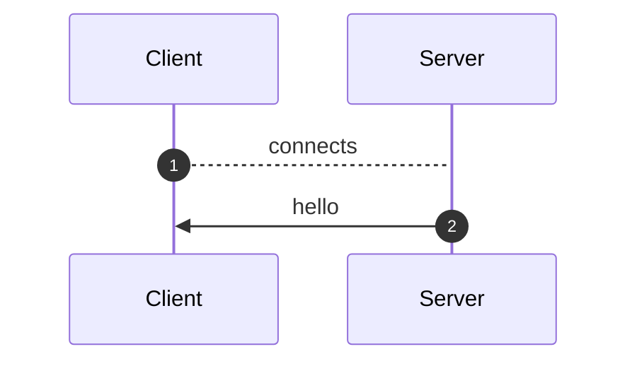
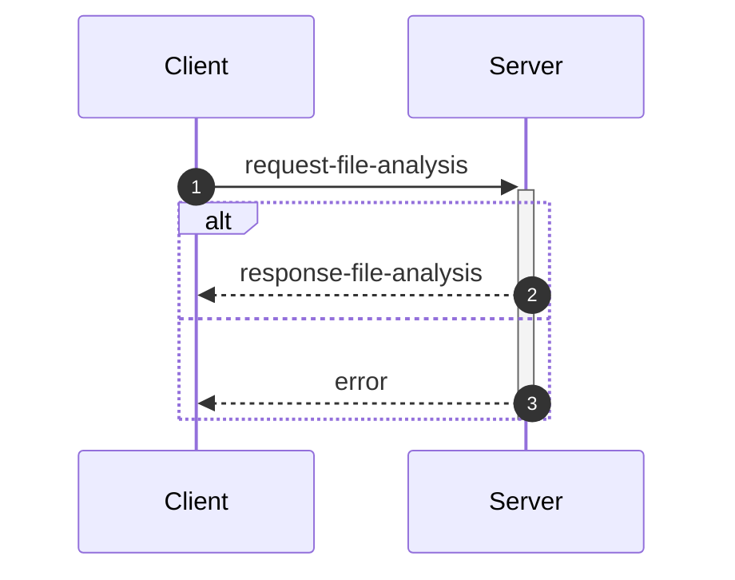
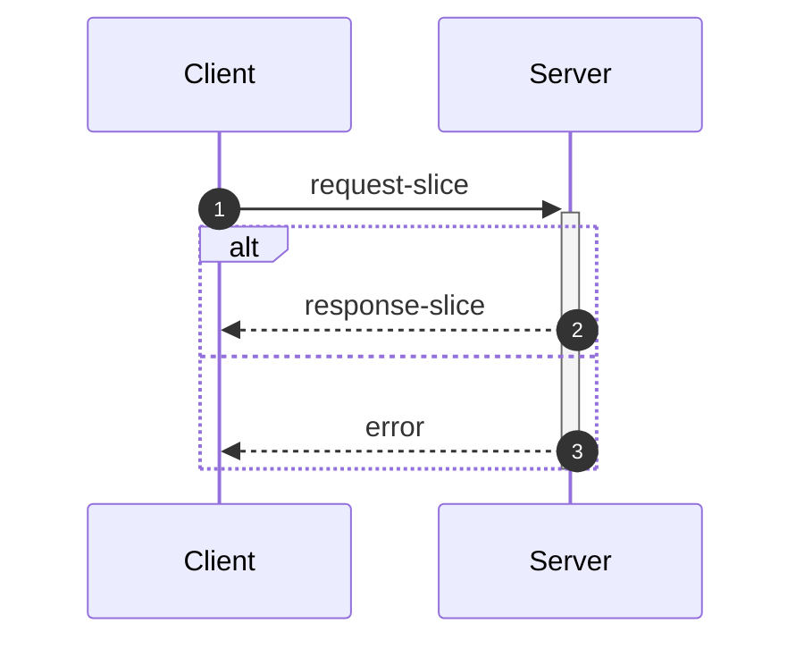
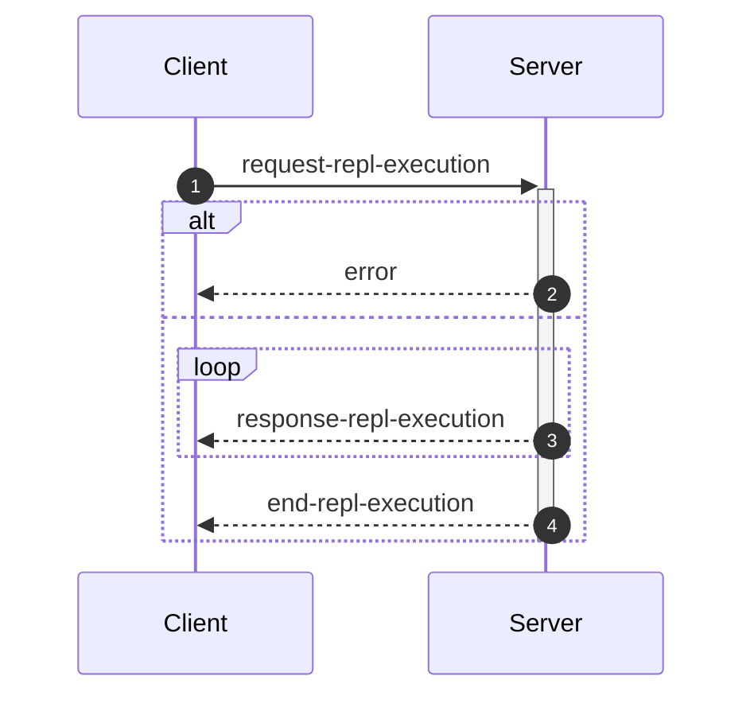

_<span title="an overview of flowR's interface">Generated</span> from '[wiki-interface.ts](https://github.com/flowr-analysis/flowr/tree/main/src/documentation/wiki-interface.ts "src/documentation/wiki-interface.ts")' on 2026-10-16, 18:40:42 UTC (v2.16.2, R v4.6.1), do not edit directly._

Although far from being as detailed as the in-depth explanation of [_flowR_](https://github.com/flowr-analysis/flowr/wiki/Core),
this wiki page explains how to interface with _flowR_ in more detail.
In general, command line arguments and other options provide short descriptions on hover over.

* [💻 Using the REPL](#using-the-repl)
* [⚙️ Configuring FlowR](#configuring-flowr)
* [⚒️ Writing Code](#writing-code)
* [💬 Communicating with the Server](#communicating-with-the-server)

<a id='using-the-repl'></a>
## 💻 Using the REPL

> [!NOTE]
> To execute arbitrary R commands with a repl request, _flowR_ has to be started explicitly with <span title="Description (Command Line Argument): Allow to access the underlying R session when using flowR (security warning: this allows the execution of arbitrary R code!)">`--r-session-access`</span>.
> Please be aware that this introduces a security risk and note that this relies on the [`r-shell` engine](https://github.com/flowr-analysis/flowr/wiki/Engines) .

Although primarily meant for users to explore,
there is nothing which forbids calling _flowR_ as a subprocess to use standard-in, -output, and -error
for communication (although you can access the REPL using the server as well,
with the [REPL Request](#message-request-repl-execution) message).

The read-eval-print loop&nbsp;(REPL) works relatively simple.
You can submit an expression (using <kbd>Enter</kbd>),
which is interpreted as an R&nbsp;expression by default but interpreted as a *command* if it starts with a colon (`:`).
The best command to get started with the REPL is <span title="Description (Repl Command): Show help information (aliases: :h, :?)">`:help`</span>.
Besides, you can leave the REPL either with the command <span title="Description (Repl Command): End the repl (aliases: :q, :exit)">`:quit`</span> or by pressing <kbd>Ctrl</kbd>+<kbd>C</kbd> twice.
When writing a *command*, you may press <kbd>Tab</kbd> to get a list of completions, if available.
Multiple commands can be entered in a single line by separating them with a semicolon (`;`), e.g. `:parse "x<-2"; :df*`.
If a command is given without R code, the REPL will re-use R code given in a previous command.
The prior example will hence return first the parsed AST of the program and then the dataflow graph for `"x <- 2"`.

> [!NOTE]
> If you develop flowR, you may want to launch the repl using the `npm run main-dev` command, this way, you get a non-minified version of flowR with debug information and hot-reloading of source files.

<details>
<summary>Available Commands</summary>

We currently offer the following commands (this with a `[*]` suffix are available with and without the star):

| Command | Description |
| ------- | ----------- |
| **<span title="Description (Repl Command): End the repl (aliases: :q, :exit)">:quit</span>** | End the repl (aliases: **:<span title="Alias of ':quit'. End the repl">q</span>**, **:<span title="Alias of ':quit'. End the repl">exit</span>**) |
| **<span title="Description (Repl Command): Execute the given code as R code. This requires the `--r-session-access` flag to be set and requires the r-shell engine. (aliases: :e, :r)">:execute</span>** | Execute the given code as R code. This requires the `--r-session-access` flag to be set and requires the r-shell engine. (aliases: **:<span title="Alias of ':execute'. Execute the given code as R code. This requires the `--r-session-access` flag to be set and requires the r-shell engine.">e</span>**, **:<span title="Alias of ':execute'. Execute the given code as R code. This requires the `--r-session-access` flag to be set and requires the r-shell engine.">r</span>**) |
| **<span title="Description (Repl Command): Get mermaid code for the control-flow graph of R code (aliases: :cfg, :cf)">:controlflow[*]</span>** | Get mermaid code for the control-flow graph of R code (star: Returns the URL to mermaid.live) (aliases: **:<span title="Alias of ':controlflow'. Get mermaid code for the control-flow graph of R code">cfg</span>**, **:<span title="Alias of ':controlflow'. Get mermaid code for the control-flow graph of R code">cf</span>**) |
| **<span title="Description (Repl Command): Get mermaid code for the control-flow graph with basic blocks (aliases: :cfgb, :cfb)">:controlflowbb[*]</span>** | Get mermaid code for the control-flow graph with basic blocks (star: Returns the URL to mermaid.live) (aliases: **:<span title="Alias of ':controlflowbb'. Get mermaid code for the control-flow graph with basic blocks">cfgb</span>**, **:<span title="Alias of ':controlflowbb'. Get mermaid code for the control-flow graph with basic blocks">cfb</span>**) |
| **<span title="Description (Repl Command): Get mermaid code for the dataflow graph (aliases: :d, :df)">:dataflow[*]</span>** | Get mermaid code for the dataflow graph (star: Returns the URL to mermaid.live) (aliases: **:<span title="Alias of ':dataflow'. Get mermaid code for the dataflow graph">d</span>**, **:<span title="Alias of ':dataflow'. Get mermaid code for the dataflow graph">df</span>**) |
| **<span title="Description (Repl Command): Get mermaid code for the normalized AST of R code (aliases: :n)">:normalize[*]</span>** | Get mermaid code for the normalized AST of R code (star: Returns the URL to mermaid.live) (alias: **:<span title="Alias of ':normalize'. Get mermaid code for the normalized AST of R code">n</span>**) |
| **<span title="Description (Repl Command): Get mermaid code for the simplified dataflow graph (aliases: :ds, :dfs)">:dataflowsimple[*]</span>** | Get mermaid code for the simplified dataflow graph (star: Returns the URL to mermaid.live) (aliases: **:<span title="Alias of ':dataflowsimple'. Get mermaid code for the simplified dataflow graph">ds</span>**, **:<span title="Alias of ':dataflowsimple'. Get mermaid code for the simplified dataflow graph">dfs</span>**) |
| **<span title="Description (Repl Command): Inspect and extend the signature database: `query` (identical to :query @signature), `info <name>` for where a function comes from (identical to :query @function-info), `add <path>` to mount another database/source, `download` to fetch the full-history database. (aliases: :sig)">:signature</span>** | Inspect and extend the signature database: `query` (identical to :query @signature), `info <name>` for where a function comes from (identical to :query @function-info), `add <path>` to mount another database/source, `download` to fetch the full-history database. (alias: **:<span title="Alias of ':signature'. Inspect and extend the signature database: `query` (identical to :query @signature), `info <name>` for where a function comes from (identical to :query @function-info), `add <path>` to mount another database/source, `download` to fetch the full-history database.">sig</span>**) |
| **<span title="Description (Repl Command): Just calculates the DFG, but only prints summary info (aliases: :d#, :df#)">:dataflowsilent</span>** | Just calculates the DFG, but only prints summary info (aliases: **:<span title="Alias of ':dataflowsilent'. Just calculates the DFG, but only prints summary info">d#</span>**, **:<span title="Alias of ':dataflowsilent'. Just calculates the DFG, but only prints summary info">df#</span>**) |
| **<span title="Description (Repl Command): Prints ASCII Art of the parsed, unmodified AST (aliases: :p)">:parse</span>** | Prints ASCII Art of the parsed, unmodified AST (alias: **:<span title="Alias of ':parse'. Prints ASCII Art of the parsed, unmodified AST">p</span>**) |
| **<span title="Description (Repl Command): Prints the version of flowR as well as the current version of R">:version</span>** | Prints the version of flowR as well as the current version of R
| **<span title="Description (Repl Command): Query the given R code (use 'help' for more information)">:query[*]</span>** | Query the given R code (use 'help' for more information) (star: Similar to query, but returns the output in json format.)
| **<span title="Description (Repl Command): Returns an ASCII representation of the dataflow graph (aliases: :df!)">:dataflowascii</span>** | Returns an ASCII representation of the dataflow graph (alias: **:<span title="Alias of ':dataflowascii'. Returns an ASCII representation of the dataflow graph">df!</span>**) |
| **<span title="Description (Repl Command): Returns summarization stats for the normalized AST (aliases: :n#)">:normalize#</span>** | Returns summarization stats for the normalized AST (alias: **:<span title="Alias of ':normalize#'. Returns summarization stats for the normalized AST">n#</span>**) |
| **<span title="Description (Repl Command): Show help information (aliases: :h, :?)">:help</span>** | Show help information (aliases: **:<span title="Alias of ':help'. Show help information">h</span>**, **:<span title="Alias of ':help'. Show help information">?</span>**) |

</details>

> [!TIP]
> 
> As indicated by the examples before, all REPL commands that operate on code keep track of the state.
> Hence, if you run a command like <span title="Description (Repl Command, starred version): Returns the URL to mermaid.live; Base Command: Get mermaid code for the dataflow graph (aliases: :d*, :df*)">`:dataflow*`</span> without providing R code,
> the REPL will re-use the R code provided in a previous command.
> Likewise, doing this will benefit from incrementality!
> If you request the dataflow graph with `:df* x <- 2 * y` and then want to see the parsed AST with `:parse`,
> the REPL will re-use previously obtained information and not re-parse the code again.
> 		

Generally, many commands offer shortcut versions in the REPL. Many queries, for example, offer a shortened format (see the example below).
Of special note, the [Config Query](https://github.com/flowr-analysis/flowr/wiki/%5BQuery%5D-Config)
can be used to also modify the currently active configuration of _flowR_ within the REPL (see the [wiki page](https://github.com/flowr-analysis/flowr/wiki/%5BQuery%5D-Config) for more information).

### Example: Retrieving the Dataflow Graph

To retrieve a URL to the [mermaid](https://mermaid.js.org/) diagram of the dataflow of a given expression,
use <span title="Description (Repl Command, starred version): Returns the URL to mermaid.live; Base Command: Get mermaid code for the dataflow graph (aliases: :d*, :df*)">`:dataflow*`</span> (or <span title="Description (Repl Command): Get mermaid code for the dataflow graph (aliases: :d, :df)">`:dataflow`</span> to get the mermaid code in the cli):

```shell
$ docker run -it --rm eagleoutice/flowr # or npm run flowr 
flowR repl v2.16.2, R grammar v14 (tree-sitter engine)
R> :dataflow* y <- 1 + x
```

<details>
<summary style='color:gray'>Output</summary>

```text
https://mermaid.live/view#base64:eyJjb2RlIjoiZmxvd2NoYXJ0IFREXG4gICAgMXt7XCJgKiM5MTtSTnVtYmVyIzkzOyogKioxKipcbiAgICAgICoxLjYqICgqKmlkOiAxKiopYFwifX1cbiAgICAyKFtcImAqIzkxO1JTeW1ib2wjOTM7KiAqKngqKlxuICAgICAgKjEuMTAqICgqKmlkOiAyKiopYFwiXSlcbiAgICAzW1tcImAqIzkxO1JCaW5hcnlPcCM5MzsqIGJhc2UjNTg7IzU4OyoqIzQzOyoqXG4gICAgICAqMS42LTEwKiAoKippZDogMyoqKVxuICAgIGFyZzogKDEsIDIpYFwiXV1cbiAgICBidWlsdC1pbjpfNDNfW1wiYEJ1aWx0LUluOlxuIzQzO2BcIl1cbiAgICBzdHlsZSBidWlsdC1pbjpfNDNfIHN0cm9rZTpncmF5LGZpbGw6Z3JheSxzdHJva2Utd2lkdGg6MnB4LG9wYWNpdHk6Ljg7XG4gICAgMFtcImAqIzkxO1JTeW1ib2wjOTM7KiAqKnkqKlxuICAgICAgKjEuMSogKCoqaWQ6IDAqKiwgdjogMylgXCJdXG4gICAgNFtbXCJgKiM5MTtSQmluYXJ5T3AjOTM7KiBiYXNlIzU4OyM1ODsqKiM2MDsjNDU7KipcbiAgICAgICoxLjEtMTAqICgqKmlkOiA0KiopXG4gICAgYXJnOiAoMCwgMylgXCJdXVxuICAgIGJ1aWx0LWluOl82MF8tW1wiYEJ1aWx0LUluOlxuIzYwOyM0NTtgXCJdXG4gICAgc3R5bGUgYnVpbHQtaW46XzYwXy0gc3Ryb2tlOmdyYXksZmlsbDpncmF5LHN0cm9rZS13aWR0aDoycHgsb3BhY2l0eTouODtcbiAgICAxIC0uLT58XCJmbG93XCJ8IDJcbiAgICBsaW5rU3R5bGUgMCBzdHJva2U6Z3JheSxjb2xvcjpncmF5O1xuICAgIDIgLS4tPnxcImZsb3dcInwgM1xuICAgIGxpbmtTdHlsZSAxIHN0cm9rZTpncmF5LGNvbG9yOmdyYXk7XG4gICAgMyAtLT58XCJyZWFkcywgYXJnXCJ8IDFcbiAgICAzIC0tPnxcInJlYWRzLCBhcmdcInwgMlxuICAgIDMgLS4tPnxcImZsb3dcInwgMFxuICAgIGxpbmtTdHlsZSA0IHN0cm9rZTpncmF5LGNvbG9yOmdyYXk7XG4gICAgMyAtLi0+fFwicmVhZHMsIGNhbGxzXCJ8IGJ1aWx0LWluOl80M19cbiAgICBsaW5rU3R5bGUgNSBzdHJva2U6Z3JheTtcbiAgICAwIC0tPnxcImRlZmluZWQtYnksIGZsb3dcInwgNFxuICAgIDAgLS0+fFwiZGVmaW5lZC1ieVwifCAzXG4gICAgNCAtLT58XCJyZWFkcywgYXJnXCJ8IDNcbiAgICA0IC0tPnxcInJldHVybnMsIGFyZ1wifCAwXG4gICAgNCAtLi0+fFwicmVhZHMsIGNhbGxzXCJ8IGJ1aWx0LWluOl82MF8tXG4gICAgbGlua1N0eWxlIDEwIHN0cm9rZTpncmF5OyIsIm1lcm1haWQiOnsiYXV0b1N5bmMiOnRydWV9fQ==
```

Retrieve the dataflow graph of the expression `y <- 1 + x`. It looks like this:


<details>

<summary style="color:gray">R Code of the Dataflow Graph</summary>

The analysis ran (including parse and normalize, using the [tree-sitter](https://github.com/flowr-analysis/flowr/wiki/Engines) engine) within the generation environment. No [signature database](https://github.com/flowr-analysis/flowr/wiki/Signature-Database) is mounted for these generated graphs, so `library()` calls attach no package exports; base-R names are still qualified via the generated base-package store (e.g. `acf` as `stats::acf`). 
We encountered no unknown side effects during the analysis.

```r
y <- 1 + x
```

</details>

</details>

For small graphs like this, <span title="Description (Repl Command): Returns an ASCII representation of the dataflow graph (aliases: :df!)">`:dataflowascii`</span> also provides an ASCII representation directly in the REPL:

```shell
$ docker run -it --rm eagleoutice/flowr # or npm run flowr 
flowR repl v2.16.2, R grammar v14 (tree-sitter engine)
R> :df! y <- 1 + x
```

<details open>
<summary style='color:gray'>Output</summary>

```text
                        v<0>v
 c<4>c──────────────────| y |
 |<- |     ┌────────────v---v
 c---c     │
    │   c<3>c   0<1>0
    └───| + |───| 1 |───u<2>u
        c---c   0---0   | x |
           └────────────u---u
Edges:
3 -> 1: reads, arg          3 -> 2: reads, arg
3 -> 0: flows-to            1 -> 2: flows-to
2 -> 3: flows-to            4 -> 3: reads, arg
4 -> 0: returns, arg        0 -> 4: defined-by, flows-to
0 -> 3: defined-by
```

Retrieve the dataflow graph of the expression `y <- 1 + x` as ASCII art.

</details>

For the slicing with <span title="Description (Repl Command): Static backwards executable slicer for R">`:slicer`</span>, you have access to the same [magic comments](#slice-magic-comments) as with the [slice request](#message-request-slice).
Pass `--inline` to splice resolvable `source()` calls into the reconstruction so the slice is a single self-contained R text (the same as the static slice query's `inlineSources` flag).
See `--help` for more flags!

### Example: Interfacing with the File System

Many commands that allow for an R-expression (like <span title="Description (Repl Command, starred version): Returns the URL to mermaid.live; Base Command: Get mermaid code for the dataflow graph (aliases: :d*, :df*)">`:dataflow*`</span>) allow for a file as well
if the argument starts with `file://`.
If you are working from the root directory of the _flowR_ repository, the following gives you the parsed AST of the example file using the <span title="Description (Repl Command): Prints ASCII Art of the parsed, unmodified AST (aliases: :p)">`:parse`</span> command:

> **Watch mode**: Replace `file://` with `watch://` to enter watch mode.
> flowR runs the command immediately and then re-runs it every time the file (or any file inside the folder) changes.
> Enter any other command to leave watch mode.
> For example: `:df watch://analysis.R`

```shell
$ docker run -it --rm eagleoutice/flowr # or npm run flowr 
flowR repl v2.16.2, R grammar v14 (tree-sitter engine)
R> :parse file://test/testfiles/example.R
```

<details>
<summary style='color:gray'>Output</summary>

```text
File: test/testfiles/example.R

program
├ binaryoperator
│ ├ identifier "sum" (1:1─4)
│ ├ <- "<-" (1:5─7)
│ ╰ float "0" (1:8─9)
├ binaryoperator
│ ├ identifier "product" (2:1─8)
│ ├ <- "<-" (2:9─11)
│ ╰ float "1" (2:12─13)
├ binaryoperator
│ ├ identifier "w" (3:1─2)
│ ├ <- "<-" (3:3─5)
│ ╰ float "7" (3:6─7)
├ binaryoperator
│ ├ identifier "N" (4:1─2)
│ ├ <- "<-" (4:3─5)
│ ╰ float "10" (4:6─8)
├ forstatement
│ ├ for "for" (6:1─4)
│ ├ ( "(" (6:5─6)
│ ├ identifier "i" (6:6─7)
│ ├ in "in" (6:8─10)
│ ├ binaryoperator
│ │ ├ float "1" (6:11─12)
│ │ ├ : ":" (6:12─13)
│ │ ╰ parenthesizedexpression
│ │   ├ ( "(" (6:13─14)
│ │   ├ binaryoperator
│ │   │ ├ identifier "N" (6:14─15)
│ │   │ ├ - "-" (6:15─16)
│ │   │ ╰ float "1" (6:16─17)
│ │   ╰ ) ")" (6:17─18)
│ ├ ) ")" (6:18─19)
│ ╰ bracedexpression
│   ├ { "{" (6:20─21)
│   ├ binaryoperator
│   │ ├ identifier "sum" (7:3─6)
│   │ ├ <- "<-" (7:7─9)
│   │ ╰ binaryoperator
│   │   ├ binaryoperator
│   │   │ ├ identifier "sum" (7:10─13)
│   │   │ ├ + "+" (7:14─15)
│   │   │ ╰ identifier "i" (7:16─17)
│   │   ├ + "+" (7:18─19)
│   │   ╰ identifier "w" (7:20─21)
│   ├ binaryoperator
│   │ ├ identifier "product" (8:3─10)
│   │ ├ <- "<-" (8:11─13)
│   │ ╰ binaryoperator
│   │   ├ identifier "product" (8:14─21)
│   │   ├  "" (8:22─23)
│   │   ╰ identifier "i" (8:24─25)
│   ╰ } "}" (9:1─2)
├ call
│ ├ identifier "cat" (11:1─4)
│ ╰ arguments
│   ├ ( "(" (11:4─5)
│   ├ argument
│   │ ╰ string
│   │   ├ " "\"" (11:5─6)
│   │   ├ stringcontent "Sum:" (11:6─10)
│   │   ╰ " "\"" (11:10─11)
│   ├ comma "," (11:11─12)
│   ├ argument
│   │ ╰ identifier "sum" (11:13─16)
│   ├ comma "," (11:16─17)
│   ├ argument
│   │ ╰ string
│   │   ├ " "\"" (11:18─19)
│   │   ├ stringcontent
│   │   │ ╰ escapesequence "\\n" (11:19─21)
│   │   ╰ " "\"" (11:21─22)
│   ╰ ) ")" (11:22─23)
╰ call
  ├ identifier "cat" (12:1─4)
  ╰ arguments
    ├ ( "(" (12:4─5)
    ├ argument
    │ ╰ string
    │   ├ " "\"" (12:5─6)
    │   ├ stringcontent "Product:" (12:6─14)
    │   ╰ " "\"" (12:14─15)
    ├ comma "," (12:15─16)
    ├ argument
    │ ╰ identifier "product" (12:17─24)
    ├ comma "," (12:24─25)
    ├ argument
    │ ╰ string
    │   ├ " "\"" (12:26─27)
    │   ├ stringcontent
    │   │ ╰ escapesequence "\\n" (12:27─29)
    │   ╰ " "\"" (12:29─30)
    ╰ ) ")" (12:30─31)
```

Retrieve the parsed AST of the example file.

<details>

<summary>File Content</summary>

```r
sum <- 0
product <- 1
w <- 7
N <- 10

for (i in 1:(N-1)) {
  sum <- sum + i + w
  product <- product * i
}

cat("Sum:", sum, "\n")
cat("Product:", product, "\n")
```

</details>

As _flowR_ directly transforms this AST the output focuses on being human-readable instead of being machine-readable.
		
</details>

### Example: Run a Query

You can run any query supported by _flowR_ using the <span title="Description (Repl Command): Query the given R code (use 'help' for more information)">`:query`</span> command.
For example, to obtain the shapes of all data frames in a given piece of code, you can run:

```shell
$ docker run -it --rm eagleoutice/flowr # or npm run flowr 
flowR repl v2.16.2, R grammar v14 (tree-sitter engine)
R> :query @absint df-shape "x <- data.frame(a = 1:10, b = 1:10)\ny <- x$a"
```

<details open>
<summary style='color:gray'>Output</summary>

```text
Query: absint (1 ms)
```

Retrieve the shapes of all data frames in the given code.

</details>

To run the linter on a file, you can use (in this example, we just issue the `dead-code` linter on a small piece of code):

```shell
$ docker run -it --rm eagleoutice/flowr # or npm run flowr 
flowR repl v2.16.2, R grammar v14 (tree-sitter engine)
R> :query @linter rules:dead-code "if(FALSE) x <- 2"
```

<details open>
<summary style='color:gray'>Output</summary>

```text
Query: linter (2 ms)
   ╰ Dead Code (dead-code):
       ╰ certain:
           ╰ Code at 1.11-16
```

Run the linter on the given code, with only the `dead-code` rule enabled.

</details>

For more information on the available queries, please check out the [Query API](https://github.com/flowr-analysis/flowr/wiki/Query-API).

<a id='configuring-flowr'></a>
## ⚙️ Configuring FlowR

When running _flowR_, you may want to specify some behaviors with a dedicated configuration file.
By default, flowR looks for a file named `flowr.json` in the current working directory (or any higher directory).
You can also specify a different file with <span title="Description (Command Line Argument): The name of the configuration file to use">`--config-file`</span> or pass the configuration inline using <span title="Description (Command Line Argument): The flowR configuration to use, as a JSON string">`--config-json`</span>.
A `flowr.json` found this way belongs to the analyzed project, so flowR ignores its options that decide what flowR executes or loads
(`engines.*.wasmPath`, `engines.*.treeSitterWasmPath`, `engines.*.rPath`, `solver.sigdb.additionalPaths`, `solver.sigdb.downloadRepo`, `solver.sigdb.installedLibrary.paths`),
unless you pass <span title="Description (Command Line Argument): Keep the security-sensitive options (e.g., the R executable) of the flowr.json found in the working directory or a parent. Only use this for projects you trust.">`--trust-config`</span>.
To analyze code you do not trust, use the secure mode (<span title="Description (Command Line Argument): Run in secure mode for analyzing untrusted code: flowR does not start R (or any other process), does not access the network, does not search for project configs, and ignores security-sensitive options in every config. Cannot be disabled once enabled. Can also be enabled with the environment variable {italic FLOWR_SECURE_MODE=1}.">`--secure`</span>, see the [security policy](https://github.com/flowr-analysis/flowr/blob/main/.github/SECURITY.md)).
To inspect the current configuration, you can run flowr with the <span title="Description (Command Line Argument): Run with verbose logging (will be passed to the corresponding script)">`--verbose`</span> flag, or use the `config` [Query](https://github.com/flowr-analysis/flowr/wiki/Query-API).
Within the REPL this works by running the following:

```shell
:query @config
```

To work with the <a href="https://github.com/flowr-analysis/flowr/tree/main/src/config.ts#L119"><code><span title="The configuration file format for flowR.">FlowrConfig</span></code></a> you can use the provided helper objects alongside its methods like
<a href="https://github.com/flowr-analysis/flowr/tree/main/src/config.ts#L905"><code><span title="Creates a new flowr config that has the updated values.">FlowrConfig::<b>amend</b></span></code></a>.
The schema below documents every option; the ones you most likely want are:

- <a href="https://github.com/flowr-analysis/flowr/wiki/Interface#configuring-flowr" title="Configuration Option (boolean): Whether source calls should be ignored, causing {@link processSourceCall}&#39;s behavior to be skipped.">ignoreSourceCalls</a>: ignore source calls when analyzing the code, i.e., ignore the inclusion of other files.
- <a href="https://github.com/flowr-analysis/flowr/wiki/Interface#configuring-flowr" title="Configuration Option (boolean): Whether load calls should be ignored, causing {@link processLoadCall}&#39;s behavior to be skipped.">ignoreLoadCalls</a>: ignore load calls when analyzing the code, i.e., ignore the loading of r-data files.
- <a href="https://github.com/flowr-analysis/flowr/wiki/Interface#configuring-flowr" title="Configuration Option (object): Do you want to overwrite (parts) of the builtin definition?">semantics.environment.overwriteBuiltIns</a>: overwrite _flowR_'s handling of built-in functions, or clear the preset definitions entirely.
  See [Configure BuiltIn Semantics](#configure-builtin-semantics) for more information.
- <a href="https://github.com/flowr-analysis/flowr/wiki/Interface#configuring-flowr" title="Configuration Option (string): How to resolve variables and their values. (one of &quot;disabled&quot;, &quot;alias&quot;, &quot;builtin&quot;)">solver.variables</a>: how to resolve variables and their values (`disabled`, `alias`, `builtin`).
- <a href="https://github.com/flowr-analysis/flowr/wiki/Interface#configuring-flowr" title="Configuration Option (array): The engine or set of engines to use for interacting with R code. An empty array means all available engines will be used.">engines</a> and <a href="https://github.com/flowr-analysis/flowr/wiki/Interface#configuring-flowr" title="Configuration Option (string): The default engine to use for interacting with R code. If this is undefined, an arbitrary engine from the specified list will be used. (one of &quot;tree-sitter&quot;, &quot;r-shell&quot;)">defaultEngine</a>: the engines used to interact with R code, see the [Engines wiki page](https://github.com/flowr-analysis/flowr/wiki/Engines).
- <a href="https://github.com/flowr-analysis/flowr/wiki/Interface#configuring-flowr" title="Configuration Option (array): Files a framework loads on its own, without any source() call (e.g. global.R in a shiny app), in the order they are loaded; flowR orders the matching project files accordingly and analyzes them as one program. Entries are case-insensitive globs matched against the file path, a plain name matches any file with that name, and entries matching no project file are warned about. Usually set per project kind via specializeConfig.">project.implicitSources</a>: the files a framework loads without any `source()` call, in the order in which they are
  loaded. Entries are globs (e.g. `R/*.R`) matched against the file path ignoring capitalization; one matching no file is reported.
- <a href="https://github.com/flowr-analysis/flowr/wiki/Interface#configuring-flowr" title="Configuration Option (object): Overwrite (parts of) the configuration depending on the project kind flowR detects, e.g. to give a shiny app its implicit sources.">specializeConfig</a>: overwrite (parts of) the configuration depending on the kind of project _flowR_ detects
  (e.g. `shiny-app`), which is how a shiny app gets its implicit sources by default. What you configure directly wins.
- <a href="https://github.com/flowr-analysis/flowr/wiki/Interface#configuring-flowr" title="Configuration Option (string): Overwrite the project kind flowR would otherwise infer from the analyzed files, e.g. when auto-detection guesses wrong. (one of &quot;package&quot;, &quot;script&quot;, &quot;shiny-app&quot;, &quot;notebook&quot;, &quot;project&quot;, &quot;unknown&quot;)">project.useProjectType</a>: skip that detection and force a project kind yourself, when auto-detection guesses wrong.
- <a href="https://github.com/flowr-analysis/flowr/wiki/Interface#configuring-flowr" title="Configuration Option (array): The default plugins to load when creating a new instance of FlowrAnalyzer">defaultPlugins</a> and <a href="https://github.com/flowr-analysis/flowr/wiki/Interface#configuring-flowr" title="Configuration Option (array): The plugins to load in REPL mode">repl.plugins</a>: the plugins to load for a new <a href="https://github.com/flowr-analysis/flowr/tree/main/src/project/flowr-analyzer.ts#L205"><code><span title="Central class for conducting analyses with FlowR. Use the FlowrAnalyzerBuilder to create a new instance. If you want the original pattern of creating a pipeline and running all steps, you can still do this with FlowrAnalyzer#runFull . To inspect the context of the analyzer, use FlowrAnalyzer#inspectContext (if you are a plugin and need to modify it, use FlowrAnalyzer#context instead).">FlowrAnalyzer</span></code></a> and in the REPL
  (use `flowr:default` to reference the former).

So you can configure _flowR_ by adding a file like the following:

<details>

<summary>Example Configuration File</summary>

```json
{
  "ignoreSourceCalls": true,
  "ignoreLoadCalls": true,
  "semantics": {
    "environment": {
      "overwriteBuiltIns": {
        "definitions": [
          {
            "type": "function",
            "names": [
              "foo"
            ],
            "processor": "builtin:assign",
            "config": {}
          }
        ]
      }
    }
  },
  "defaultPlugins": [
    "file:description",
    "versions:description"
  ],
  "repl": {
    "quickStats": false,
    "dfProcessorHeat": false,
    "hints": true,
    "plugins": [
      "flowr:default"
    ]
  },
  "project": {
    "resolveUnknownPathsOnDisk": true,
    "implicitSources": [
      "global.R",
      "app.R"
    ]
  },
  "linter": {
    "disabledRules": []
  },
  "specializeConfig": {
    "shiny-app": {
      "project": {
        "implicitSources": [
          "global.R",
          "ui.R",
          "server.R",
          "app.R"
        ]
      }
    }
  },
  "engines": [
    {
      "type": "r-shell"
    }
  ],
  "solver": {
    "variables": "alias",
    "evalStrings": true,
    "trackEnvironments": true,
    "sigdb": {
      "enabled": true,
      "loadProjectDependencies": true,
      "eagerlyLoad": false,
      "eagerlyLoadExports": false,
      "linkBaseR": false,
      "linkDescriptionDependencies": false
    },
    "resolveSource": {
      "dropPaths": "no",
      "ignoreCapitalization": true,
      "inferWorkingDirectory": "active-script",
      "searchPath": []
    },
    "instrument": {},
    "slicer": {
      "threshold": 50
    }
  },
  "abstractInterpretation": {
    "wideningThreshold": 4,
    "followCalls": true,
    "dataFrame": {
      "maxColNames": 20,
      "readLoadedData": {
        "readExternalFiles": true,
        "maxReadLines": 1000000
      }
    }
  },
  "incremental": {
    "alwaysIncremental": false,
    "parsing": {
      "activated": false,
      "heuristics": {
        "activated": true,
        "mtime": true,
        "linesFrom": 500,
        "bytesFrom": 50000,
        "alwaysWithEdits": false,
        "minFiles": 1
      }
    }
  },
  "gas": {
    "thresholds": {
      "memory": {
        "problematic": 0.7,
        "critical": 0.9
      },
      "timeMs": {
        "problematic": 100000,
        "critical": 120000
      }
    },
    "features": {}
  }
}
```

</details>

<details>
<a id='configure-builtin-semantics'></a>
<summary>Configure Built-In Semantics</summary>

`semantics/environment/overwriteBuiltins` accepts two keys:

- `loadDefaults` (boolean, initially `true`): If set to `true`, the default built-in definitions are loaded before applying the custom definitions. Setting this flag to `false` explicitly disables the loading of the default definitions.
- `definitions` (array, initially empty): Allows to overwrite or define new built-in elements. Each object within must have a `type` which is one of the below. Furthermore, they may define a string array of `names` which specifies the identifiers to bind the definitions to. You may use `assumePrimitive` to specify whether _flowR_ should assume that this is a primitive non-library definition (so you probably just do not want to specify the key).

  | Type            | Description                                                                                                                                                                                                                                                                                              | Example                                                                                                    |
  | --------------- | -------------------------------------------------------------------------------------------------------------------------------------------------------------------------------------------------------------------------------------------------------------------------------------------------------- | ---------------------------------------------------------------------------------------------------------- |
  | `constant`    | Additionally allows for a `value` this should resolve to.                                                                                                                                                                                                                                                | `{ type: 'constant', names: ['NULL', 'NA'],  value: null }`                                                |
  | `function`    | Is a rather flexible way to define and bind built-in functions. For the time, we do not have extensive documentation to cover all the cases, so please either consult the sources with the `default-builtin-config.ts` or open a [new issue](https://github.com/flowr-analysis/flowr/issues/new/choose). | `{ type: 'function', names: ['next'], processor: 'builtin:d', config: { cfg: ExitPointType.Next } }` |
  | `replacement` | A comfortable way to specify replacement functions like `$<-` or `names<-`. `suffixes` describes the... suffixes to attach automatically. | `{ type: 'replacement', suffixes: ['<-', '<<-'], names: ['[', '[['] }` |

</details>

<details>

<summary style='color:gray'>Full Configuration-File Schema</summary>

- _The configuration file format for flowR._ (object)
    - **logLevel** [optional] _flowR's global minimum log level, applied when the config is loaded._ (string)
        Only allows: 'silly', 'trace', 'debug', 'info', 'warn', 'error', 'fatal'
    - **ignoreSourceCalls** [optional] _Whether source calls should be ignored, causing {@link processSourceCall}'s behavior to be skipped._ (boolean)
    - **ignoreLoadCalls** [optional] _Whether load calls should be ignored, causing {@link processLoadCall}'s behavior to be skipped._ (boolean)
    - **semantics** _Configure language semantics and how flowR handles them._ (object)
        - **environment** [optional] _Semantics regarding how to handle the R environment._ (object)
            - **overwriteBuiltIns** [optional] _Do you want to overwrite (parts) of the builtin definition?_ (object)
                - **loadDefaults** [optional] _Should the default configuration still be loaded?_ (boolean)
                - **definitions** [optional] _The definitions to load/overwrite._ (array)
                Valid item types:
                    - (object)
    - **defaultPlugins** [optional] _The default plugins to load when creating a new instance of FlowrAnalyzer_ (array)
    Valid item types:
        - (alternatives)
            - (string)
            - (array)
    - **repl** _Configuration options for the REPL._ (object)
        - **quickStats** [optional] _Whether to show quick stats in the REPL after each evaluation._ (boolean)
        - **dfProcessorHeat** [optional] _This instruments the dataflow processors to count how often each processor is called._ (boolean)
        - **hints** [optional] _Whether to show dim inline hints on the empty prompt (automatically disabled on non-interactive terminals)._ (boolean)
        - **plugins** [optional] _The plugins to load in REPL mode_ (array)
        Valid item types:
            - (alternatives)
                - (string)
                - (array)
        - **autoUseFileProtocol** [optional] _Prepend the file protocol to a repl input that looks like a path, instead of only warning about it._ (boolean)
        - **queryStats** [optional] _Whether `:query` closes with the line stating how long the queries took (`:query*` never prints it)._ (boolean)
        - **showPlugins** [optional] _Whether `:version` grays out the plugins that did not activate during the last analysis._ (boolean)
    - **project** _Project specific configuration options._ (object)
        - **resolveUnknownPathsOnDisk** [optional] _Whether to resolve unknown paths loaded by the r project disk when trying to source/analyze files._ (boolean)
        - **failOnInaccessiblePath** [optional] _Whether a directory that cannot be traversed during file discovery (e.g. due to permissions) aborts the analysis; when false (the default) such paths are logged and skipped._ (boolean)
        - **basePackages** [optional] _The packages considered part of R itself (base and recommended); if unset, flowR uses its built-in list._ (array)
        Valid item types:
            - (string)
        - **implicitSources** [optional] _Files a framework loads on its own, without any source() call (e.g. global.R in a shiny app), in the order they are loaded; flowR orders the matching project files accordingly and analyzes them as one program. Entries are case-insensitive globs matched against the file path, a plain name matches any file with that name, and entries matching no project file are warned about. Usually set per project kind via specializeConfig._ (array)
        Valid item types:
            - (string)
        - **useProjectType** [optional] _Overwrite the project kind flowR would otherwise infer from the analyzed files, e.g. when auto-detection guesses wrong._ (string)
            Only allows: 'package', 'script', 'shiny-app', 'notebook', 'project', 'unknown'
        - **assumeImplicitEcho** [optional] _Whether the top level of the analyzed code is echoed, so that every visible result printed there is collected as an output by the dependencies query (default true, false for a package)._ (boolean)
        - **discovery** [optional] _Scoping options for the default project discovery._ (object)
            - **full** [optional] _Collect every file below the project root (greedy) instead of only the files the detected project kind needs (default false)._ (boolean)
            - **perKind** [optional] _Per-kind include/exclude glob overrides layered on the default scoping._ (object)
            - **ignore** [optional] _Case-insensitive globs that drop matching files from the intelligent discovery, regardless of kind (e.g. .Renviron to ignore environment files)._ (array)
            Valid item types:
                - (string)
        - **classification** [optional] _Overrides for the signals flowR uses to classify the project kind._ (object)
            - **shinyDescriptionTypes** [optional] _DESCRIPTION Type: values that mark a shiny app._ (array)
            Valid item types:
                - (string)
            - **shinyEntryFiles** [optional] _File names a shiny app is assembled from._ (array)
            Valid item types:
                - (string)
            - **shinyUsagePattern** [optional] _Regex source evidencing shiny usage in an entry file._ (string)
            - **notebookExtensions** [optional] _File extensions marking a notebook._ (array)
            Valid item types:
                - (string)
    - **linter** _Linter configuration options._ (object)
        - **disabledRules** _Linting rule names excluded from the default rule set (a rule requested explicitly via a linter query still runs). Usually set per project kind via specializeConfig._ (array)
        Valid item types:
            - (string)
    - **inputSources** [optional] _Further frameworks the input-sources analysis should know about; entries are added to flowR's defaults._ (object)
        - **pure** [optional] _Functions that only pass the constantness of their arguments on._ (array)
        Valid item types:
            - (string)
        - **param** [optional] _Functions whose result is a 'param' input._ (array)
        Valid item types:
            - (string)
        - **file** [optional] _Functions whose result is a 'file' input._ (array)
        Valid item types:
            - (string)
        - **tempfile** [optional] _Functions whose result is a 'tempfile' input._ (array)
        Valid item types:
            - (string)
        - **glob** [optional] _Functions whose result is a 'glob' input._ (array)
        Valid item types:
            - (string)
        - **net** [optional] _Functions whose result is a 'net' input._ (array)
        Valid item types:
            - (string)
        - **rand** [optional] _Functions whose result is a 'rand' input._ (array)
        Valid item types:
            - (string)
        - **system** [optional] _Functions whose result is a 'system' input._ (array)
        Valid item types:
            - (string)
        - **ffi** [optional] _Functions whose result is a 'ffi' input._ (array)
        Valid item types:
            - (string)
        - **lang** [optional] _Functions whose result is a 'lang' input._ (array)
        Valid item types:
            - (string)
        - **options** [optional] _Functions whose result is a 'options' input._ (array)
        Valid item types:
            - (string)
        - **cmdline** [optional] _Functions whose result is a 'cmdline' input._ (array)
        Valid item types:
            - (string)
        - **user** [optional] _Functions whose result is a 'user' input._ (array)
        Valid item types:
            - (string)
        - **const** [optional] _Functions whose result is a 'const' input._ (array)
        Valid item types:
            - (string)
        - **scope** [optional] _Functions whose result is a 'scope' input._ (array)
        Valid item types:
            - (string)
        - **dconst** [optional] _Functions whose result is a 'dconst' input._ (array)
        Valid item types:
            - (string)
        - **unknown** [optional] _Functions whose result is a 'unknown' input._ (array)
        Valid item types:
            - (string)
        - **linkedObjects** [optional] _Objects a framework provides without a definition in the code, e.g. shiny's input._ (array)
        Valid item types:
            - (object)
        - **linkedEntryPoints** [optional] _Calls that hand a function to a framework, which binds its objects to the parameters by position._ (array)
        Valid item types:
            - (object)
    - **specializeConfig** [optional] _Overwrite (parts of) the configuration depending on the project kind flowR detects, e.g. to give a shiny app its implicit sources._ (object)
    - **engines** _The engine or set of engines to use for interacting with R code. An empty array means all available engines will be used._ (array)
    Valid item types:
        - (alternatives)
            - _The configuration for the tree sitter engine._ (object)
                - **type** [required] _Use the tree sitter engine._ (string)
                    Only allows: 'tree-sitter'
                - **wasmPath** [optional] _The path to the tree-sitter-r WASM binary to use. If this is undefined, this uses the default path._ (string)
                - **treeSitterWasmPath** [optional] _The path to the tree-sitter WASM binary to use. If this is undefined, this uses the default path._ (string)
                - **lax** [optional] _Whether to use the lax parser for parsing R code (allowing for syntax errors). If this is undefined, the strict parser will be used._ (boolean)
            - _The configuration for the R shell engine._ (object)
                - **type** [required] _Use the R shell engine._ (string)
                    Only allows: 'r-shell'
                - **rPath** [optional] _The path to the R executable to use. If this is undefined, this uses the default path._ (string)
                - **pipeBind** [optional] _Whether to enable R's experimental pipe-bind operator "=>" by setting _R_USE_PIPEBIND_ for the R session (default false); R itself keeps this off by default, as it is experimental and has never shipped in a release version of R._ (boolean)
    - **defaultEngine** [optional] _The default engine to use for interacting with R code. If this is undefined, an arbitrary engine from the specified list will be used._ (string)
        Only allows: 'tree-sitter', 'r-shell'
    - **solver** _How to resolve constants, constraints, cells, ..._ (object)
        - **variables** _How to resolve variables and their values._ (string)
            Only allows: 'disabled', 'alias', 'builtin'
        - **evalStrings** _Should we include eval(parse(text="...")) calls in the dataflow graph?_ (boolean)
        - **trackEnvironments** [optional] _Track user-created environments (new.env, assign/get/local with envir=, dollar-assign, attach). When false, all envir-style calls fall through conservatively._ (boolean)
        - **sigdb** _Resolving library exports from a signature database._ (object)
            - **enabled** [optional] _Resolve library()/use() exports from a signature database (default true); when false no database is consulted._ (boolean)
            - **loadProjectDependencies** [optional] _Load the project's declared dependencies from its metadata files (DESCRIPTION Imports/Depends, rproject.toml, uvr.toml, renv.lock, rv.lock, uvr.lock) (default true); when false these files are not read for dependencies._ (boolean)
            - **eagerlyLoad** [optional] _Parse the database up front rather than on the first package load (default false, ignored if disabled)._ (boolean)
            - **eagerlyLoadExports** [optional] _Add a vertex for every export on load rather than on demand (default false); keeps the dataflow graph small._ (boolean)
            - **assumedRVersion** [optional] _R version assumed when resolving versioned (base-R) exports: a pin like "4.5" or "auto" to detect the installed R (default "auto")._ (string)
            - **linkBaseR** [optional] _Eagerly attach base-R namespaces so bare base calls resolve without library() (default false)._ (boolean)
            - **linkBaseRCalls** [optional] _Add a lightweight Reads edge from a bare base-R call to its signature-database function vertex (default false; base-R qualification is edge-free otherwise)._ (boolean)
            - **linkPackageCalls** [optional] _Add a lightweight Reads edge from a resolved package call to its signature-database function vertex (default false)._ (boolean)
            - **linkDescriptionDependencies** [optional] _Eagerly attach the namespaces of the project's declared DESCRIPTION dependencies (Imports/Depends) so their exports resolve without an explicit library() (default false)._ (boolean)
            - **warmInBackground** [optional] _Decompress the hot shards (base + most-downloaded) in a background task on startup so the first library() lookup is warm (default false; for long-running servers/REPLs)._ (boolean)
            - **additionalPaths** [optional] _Extra directories or bundle/manifest files searched for signature databases (alongside the shipped default and $FLOWR_SIGDB_DIR); a downloaded full-history bundle placed here is mounted automatically._ (array)
            Valid item types:
                - (string)
            - **downloadRepo** [optional] _GitHub owner/repo the full-history bundle is downloaded from via ":signature download" (default "flowr-analysis/flowr", release tag "sigdb-v<flowR-version>")._ (string)
            - **autoSync** [optional] _On startup, re-download shards whose committed sigdb.remote.json hash no longer matches the cache, in the background (default false; opt-in network sync after a git pull)._ (boolean)
            - **installedLibrary** [optional] _Recovering packages no signature database knows from the copy installed on this machine._ (object)
                - **enabled** [required] _Recover packages no signature database knows from their installed copy (default false)._ (boolean)
                - **paths** [optional] _Library directories to search; when empty they are discovered from the environment and the project._ (array)
                Valid item types:
                    - (string)
                - **useEnvironment** [optional] _Search the libraries R_LIBS_USER/R_LIBS/R_LIBS_SITE name (default true)._ (boolean)
                - **useProjectLibrary** [optional] _Search a project-local renv/packrat library (default true)._ (boolean)
                - **maxDepth** [optional] _How far to descend into the nested layout of a project-local library (default 3)._ (number)
                - **packages** [optional] _Only recover packages whose name matches one of these regular expressions; empty means any._ (array)
                Valid item types:
                    - (string)
            - **blobCacheBudgetMb** [optional] _How many MiB of decoded package blobs every open bundle may hold together (default 16)._ (number)
            - **versionSelection** [optional] _When a project constrains a dependency, resolve to the newest (default), oldest, or system-installed version satisfying it; system needs R and falls back to newest. Base-R packages always resolve against the assumed R version._ (string)
                Only allows: 'newest', 'oldest', 'system'
            - **versionOverrides** [optional] _Force an exact version for specific packages (name -> version), overriding both the project constraint and the versionSelection policy (default {})._ (object)
        - **versionManagement** _Policies for reasoning about dependency versions._ (object)
            - **linkedVersionGroups** [optional] _Groups of packages that must resolve to the same version; version guessing intersects each group so its members stay mutually compatible (default [])._ (array)
            Valid item types:
                - (array)
                Valid item types:
                    - (string)
        - **assumeAttachedPackages** [optional] _Packages to treat as attached without a `library()` call, so what the built-in configuration states about them applies to the analyzed code. The base packages R attaches on startup already resolve without it._ (array)
        Valid item types:
            - (string)
        - **transitiveSideEffectRounds** [optional] _How many rounds the transitive side-effect fixpoint may run before it is cut off (default 32); the propagation stops on its own as soon as a round adds nothing._ (number)
        - **maxOverlayDepth** [optional] _How many binding overlays may stack on one environment frame before a write flattens them (default 4); a pure performance knob, trading lookup cost against copy cost without changing any result._ (number)
        - **instrument** (object)
            - **dataflowExtractors** [optional] _These keys are only intended for use within code, allowing to instrument the dataflow analyzer!_ (any)
        - **resolveSource** [optional] _If lax source calls are active, flowR searches for sourced files much more freely, based on the configurations you give it. This option is only in effect if `ignoreSourceCalls` is set to false._ (object)
            - **dropPaths** _Allow to drop the first or all parts of the sourced path, if it is relative._ (string)
                Only allows: 'no', 'once', 'all'
            - **ignoreCapitalization** _Search for filenames matching in the lowercase._ (boolean)
            - **inferWorkingDirectory** _Try to infer the working directory from the main or any script to analyze._ (string)
                Only allows: 'no', 'main-script', 'active-script', 'any-script'
            - **searchPath** _Additionally search in these paths._ (array)
            Valid item types:
                - (string)
            - **repeatedSourceLimit** [optional] _How often the same file can be sourced within a single run? Please be aware: in case of cyclic sources this may not reach a fixpoint so give this a sensible limit._ (number)
            - **applyReplacements** _Provide name replacements for loaded files_ (array)
            Valid item types:
                - (object)
            - **assumeFilesExist** [optional] _Assume a sourced file is always there, making what it defines certain instead of conditional on the source call._ (boolean)
        - **slicer** [optional] _The configuration for the slicer._ (object)
            - **threshold** [optional] _The maximum number of iterations to perform on a single function call during slicing._ (number)
            - **autoExtend** [optional] _If set, the slicer will gain an additional post-pass._ (boolean)
    - **abstractInterpretation** _The configuration options for abstract interpretation._ (object)
        - **wideningThreshold** _The threshold for the number of visitations of a node at which widening should be performed to ensure the termination of the fixpoint iteration._ (number)
        - **followCalls** _Whether the abstract interpretation is interprocedural, i.e. whether it steps into the functions a call may dispatch to._ (boolean)
        - **dataFrame** _The configuration of the shape inference for data frames._ (object)
            - **maxColNames** _The maximum number of columns names to infer for data frames before over-approximating the column names to top._ (number)
            - **readLoadedData** _Configuration options for reading data frame shapes from loaded external data files, such as CSV files._ (object)
                - **readExternalFiles** _Whether data frame shapes should be extracted from loaded external files, such as CSV files._ (boolean)
                - **maxReadLines** _The maximum number of lines to read when extracting data frame shapes from loaded files, such as CSV files._ (number)
    - **incremental** (object)
        - **alwaysIncremental** _Always take the incremental path, regardless of heuristics._ (boolean)
        - **parsing** (object)
            - **activated** _If set, incremental parsing will be used._ (boolean)
            - **heuristics** (object)
                - **activated** [optional] _If set, the heuristics for incremental parsing will be used._ (boolean)
                - **mtime** [optional] _Skip reparsing entirely if the file's modification time is unchanged since the last parse._ (boolean)
                - **linesFrom** [optional] _Only consider incremental parsing for files with at least this many lines._ (number)
                - **bytesFrom** [optional] _Only consider incremental parsing for files with at least this many bytes._ (number)
                - **alwaysWithEdits** [optional] _Always take the incremental path whenever there is a computed edit region, regardless of the other thresholds._ (boolean)
                - **minFiles** [optional] _Only apply these heuristics once the project has at least this many files loaded._ (number)
    - **gas** [optional] _Resource-usage guard (gas) configuration. All feature factors default to 0 (disabled). See https://github.com/flowr-analysis/flowr/wiki/Core#gas-resource-guard._ (object)
        - **thresholds** [optional] _Thresholds for all gas checks (scaled by per-feature factor), boundable per feature._ (object)
            - **memory** [optional] _Heap-usage fraction thresholds (0-1), either shared or given per feature key (with `default` covering the rest)._ (object)
                - **problematic** [optional] _Heap fraction (0-1) above which Problematic is returned, for every feature without an entry of its own._ (number)
                - **critical** [optional] _Heap fraction (0-1) above which Critical is returned, for every feature without an entry of its own._ (number)
            - **timeMs** [optional] _Elapsed analysis time thresholds in milliseconds, either shared or given per feature key (with `default` covering the rest)._ (object)
                - **problematic** [optional] _Elapsed ms above which Problematic is returned, for every feature without an entry of its own._ (number)
                - **critical** [optional] _Elapsed ms above which Critical is returned, for every feature without an entry of its own._ (number)
            - **steps** [optional] _Processed-AST-node thresholds, counted rather than sampled; only a key that arms a budget (`dataflow`) reads them._ (object)
                - **problematic** [optional] _Processed AST nodes above which Problematic is returned, for every feature without an entry of its own._ (number)
                - **critical** [optional] _Processed AST nodes above which the extraction is cut short, for every feature without an entry of its own._ (number)
            - **vertices** [optional] _Created-dataflow-vertex thresholds, counted like `steps`._ (object)
                - **problematic** [optional] _Created dataflow vertices above which Problematic is returned, for every feature without an entry of its own._ (number)
                - **critical** [optional] _Created dataflow vertices above which the extraction is cut short, for every feature without an entry of its own._ (number)
        - **features** [optional] _Per-feature sensitivity factors. 0 or absent disables gas checking for that feature. A factor of 2 makes the feature twice as sensitive. Recognised keys: `source`, `side-effect-linking`, `linter`, `slicer`, `dataflow`._ (object)
        - **countedCheckEvery** [optional] _How many counted steps pass between two accountings of an armed check, be it a dataflow budget or the slicer's traversal (default 128); trades overshoot against the cost of the check._ (number)
        - **heapProvider** [optional] _Custom heap statistics source (programmatic configs only), overriding the built-in v8/performance.memory detection._ (function)

</details>

<a id='writing-code'></a>
## ⚒️ Writing Code

_flowR_ can be used as a [module](https://www.npmjs.com/package/@eagleoutice/flowr) and offers several main classes and interfaces that are interesting for extension writers 
(see the [Visual Studio Code extension](https://marketplace.visualstudio.com/items?itemName=code-inspect.vscode-flowr) or the [Core](https://github.com/flowr-analysis/flowr/wiki/Core) wiki page for more information).

### Creating Analyses with _flowR_

Nowadays, instances of the <a href="https://github.com/flowr-analysis/flowr/tree/main/src/project/flowr-analyzer.ts#L205"><code><span title="Central class for conducting analyses with FlowR. Use the FlowrAnalyzerBuilder to create a new instance. If you want the original pattern of creating a pipeline and running all steps, you can still do this with FlowrAnalyzer#runFull . To inspect the context of the analyzer, use FlowrAnalyzer#inspectContext (if you are a plugin and need to modify it, use FlowrAnalyzer#context instead).">FlowrAnalyzer</span></code></a> should be used as central frontend to get analysis results from _flowR_.
The entry points an analysis is written against are re-exported from the package root (`import { FlowrAnalyzerBuilder } from '@eagleoutice/flowr'`);
everything else stays reachable under its own path, as in `@eagleoutice/flowr/dataflow/graph/graph`.
For example, a program slice can be created like this:

```ts
const analyzer = await new FlowrAnalyzerBuilder()
    .setEngine('tree-sitter')
    .build();
analyzer.addRequest('x <- 1\ny <- x\nx');
const result = await analyzer.query([
    {
        type:     'static-slice',
        criteria: ['3@x']
    }
]);
```

For more information, please have a look at the [Analyzer](https://github.com/flowr-analysis/flowr/wiki/Analyzer) wiki page, which explains how to construct and use the <a href="https://github.com/flowr-analysis/flowr/tree/main/src/project/flowr-analyzer.ts#L205"><code><span title="Central class for conducting analyses with FlowR. Use the FlowrAnalyzerBuilder to create a new instance. If you want the original pattern of creating a pipeline and running all steps, you can still do this with FlowrAnalyzer#runFull . To inspect the context of the analyzer, use FlowrAnalyzer#inspectContext (if you are a plugin and need to modify it, use FlowrAnalyzer#context instead).">FlowrAnalyzer</span></code></a> in more detail.
To work with specific perspectives, you can also consult the respective pages like the [Dataflow Graph](https://github.com/flowr-analysis/flowr/wiki/Dataflow-Graph) or the [Abstract Interpretation](https://github.com/flowr-analysis/flowr/wiki/Abstract-Interpretation) wiki pages.
### The Pipeline Executor (Low-Level Interface)

Once, in the beginning, _flowR_ was meant to produce a dataflow graph merely to provide *program slices*. 
However, with continuous updates, the [Dataflow Graph](https://github.com/flowr-analysis/flowr/wiki/Dataflow-Graph) repeatedly proves to be the more interesting part.
With this, we restructured _flowR_'s originally *hardcoded* pipeline to be far more flexible. 
Now, it can be theoretically extended or replaced with arbitrary steps, optional steps, and what we call 'decorations' of these steps. 
In short, a slicing pipeline using the <a href="https://github.com/flowr-analysis/flowr/tree/main/src/core/pipeline-executor.ts#L97"><code><span title="**Please note:** The PipelineExecutor is now considered to be a rather low-level API for flowR. While it still works and is the basis for all other layers, we strongly recommend using the FlowrAnalyzer and its builder to create and use an analyzer instance that is pre-configured for your use-case. The pipeline executor allows to execute arbitrary pipelines in a step-by-step fashion. If you are not...">PipelineExecutor</span></code></a> looks like this:

```ts

const slicer = new PipelineExecutor(DEFAULT_SLICING_PIPELINE, {
  parser:    new RShell(),
  request:   requestFromInput('x <- 1\nx + 1'),
  criterion: ['2@x']
})
const slice = await slicer.allRemainingSteps()
// console.log(slice.reconstruct.code)
```

<details><summary>More Information</summary>

If you compare this, with what you would have done with the old (and removed) `SteppingSlicer`, 
this essentially just requires you to replace the `SteppingSlicer` with the <a href="https://github.com/flowr-analysis/flowr/tree/main/src/core/pipeline-executor.ts#L97"><code><span title="**Please note:** The PipelineExecutor is now considered to be a rather low-level API for flowR. While it still works and is the basis for all other layers, we strongly recommend using the FlowrAnalyzer and its builder to create and use an analyzer instance that is pre-configured for your use-case. The pipeline executor allows to execute arbitrary pipelines in a step-by-step fashion. If you are not...">PipelineExecutor</span></code></a>
and to pass the <a href="https://github.com/flowr-analysis/flowr/tree/main/src/core/steps/pipeline/default-pipelines.ts#L18"><code>DEFAULT_SLICING_PIPELINE</code></a> as the first argument.
The <a href="https://github.com/flowr-analysis/flowr/tree/main/src/core/pipeline-executor.ts#L97"><code><span title="**Please note:** The PipelineExecutor is now considered to be a rather low-level API for flowR. While it still works and is the basis for all other layers, we strongly recommend using the FlowrAnalyzer and its builder to create and use an analyzer instance that is pre-configured for your use-case. The pipeline executor allows to execute arbitrary pipelines in a step-by-step fashion. If you are not...">PipelineExecutor</span></code></a>...

1. Provides structures to investigate the results of all intermediate steps
2. Can be executed step-by-step
3. Can repeat steps (e.g., to calculate multiple slices on the same input)

See the in-code documentation for more information.

</details>

### Using the <a href="https://github.com/flowr-analysis/flowr/tree/main/src/r-bridge/shell.ts#L144"><code><span title="The RShell represents an interactive session with the R interpreter. You can configure it by RShellOptions . At the moment we are using a live R session (and not networking etc.) to communicate with R easily, which allows us to install packages etc. However, this might and probably will change in the future (leaving this as a legacy mode :D)">RShell</span></code></a> to Interact with R

The <a href="https://github.com/flowr-analysis/flowr/tree/main/src/r-bridge/shell.ts#L144"><code><span title="The RShell represents an interactive session with the R interpreter. You can configure it by RShellOptions . At the moment we are using a live R session (and not networking etc.) to communicate with R easily, which allows us to install packages etc. However, this might and probably will change in the future (leaving this as a legacy mode :D)">RShell</span></code></a> class allows interfacing with the `R`&nbsp;ecosystem installed on the host system.
Please have a look at [flowR's Engines](https://github.com/flowr-analysis/flowr/wiki/Engines) for more information on alternatives (for example, the <a href="https://github.com/flowr-analysis/flowr/tree/main/src/r-bridge/lang-4.x/tree-sitter/tree-sitter-executor.ts#L29"><code><span title="Synchronous and (way) faster alternative to the RShell using tree-sitter.">TreeSitterExecutor</span></code></a>).

> [!IMPORTANT]
> 
> Each <a href="https://github.com/flowr-analysis/flowr/tree/main/src/r-bridge/shell.ts#L144"><code><span title="The RShell represents an interactive session with the R interpreter. You can configure it by RShellOptions . At the moment we are using a live R session (and not networking etc.) to communicate with R easily, which allows us to install packages etc. However, this might and probably will change in the future (leaving this as a legacy mode :D)">RShell</span></code></a> controls a new instance of the R&nbsp;interpreter, 
> make sure to call <code><a href="https://github.com/flowr-analysis/flowr/tree/main/src/r-bridge/shell.ts#L354"><span title="Close the current R session, makes the object effectively invalid (can no longer be reopened etc.)">RShell::<i>close</i></span></a>()</code> when you are done.

You can start a new "session" by constructing a new object with <code>new <a href="https://github.com/flowr-analysis/flowr/tree/main/src/r-bridge/shell.ts#L144"><span title="The RShell represents an interactive session with the R interpreter. You can configure it by RShellOptions . At the moment we are using a live R session (and not networking etc.) to communicate with R easily, which allows us to install packages etc. However, this might and probably will change in the future (leaving this as a legacy mode :D)">RShell</span></a>()</code>.

However, there are several options that may be of interest 
(e.g., to automatically revive the shell in case of errors or to control the name location of the R process on the system).

With a shell object (let's call it `shell`), you can execute R code by using <a href="https://github.com/flowr-analysis/flowr/tree/main/src/r-bridge/shell.ts#L213"><code><span title="sends the given command directly to the current R session will not do anything to alter input markers!">RShell::<i>sendCommand</i></span></code></a>,
for example <code>shell.<a href="https://github.com/flowr-analysis/flowr/tree/main/src/r-bridge/shell.ts#L213"><span title="sends the given command directly to the current R session will not do anything to alter input markers!">sendCommand</span></a>("1 + 1")</code>.
However, this does not return anything, so if you want to collect the output of your command, use
<a href="https://github.com/flowr-analysis/flowr/tree/main/src/r-bridge/shell.ts#L296"><code><span title="Send a command and collect the output">RShell::<i>sendCommandWithOutput</i></span></code></a> instead.

<a id='communicating-with-the-server'></a>
## 💬 Communicating with the Server

As explained in the [Overview](https://github.com/flowr-analysis/flowr/wiki/Overview), you can run the [TCP](https://de.wikipedia.org/wiki/Transmission_Control_Protocol)&nbsp;server by adding the <span title="Description (Command Line Argument): Do not drop into a repl, but instead start a server on the given port (default: 1042) and listen for messages.">`--server`</span> flag (and, due to the interactive mode, exit with the conventional <kbd>CTRL</kbd>+<kbd>C</kbd>).
Currently, every connection is handled by the same underlying `RShell` - so the server is not designed to handle many clients at a time.
Additionally, the server is not well guarded against attacks (e.g., you can theoretically spawn an arbitrary number of&nbsp;RShell sessions on the target machine).

Every message has to be given in a single line (i.e., without a newline in-between) and end with a newline character. Nevertheless, we will pretty-print example given in the following segments for the ease of reading.

> [!NOTE]
> 
> The default <span title="Description (Command Line Argument): Do not drop into a repl, but instead start a server on the given port (default: 1042) and listen for messages.">`--server`</span> uses a simple [TCP](https://de.wikipedia.org/wiki/Transmission_Control_Protocol)
> connection. If you want _flowR_ to expose a [WebSocket](https://de.wikipedia.org/wiki/WebSocket) server instead, add the <span title="Description (Command Line Argument): If the server flag is set, use websocket for messaging">`--ws`</span> flag (i.e., <span title="Description (Command Line Argument): Do not drop into a repl, but instead start a server on the given port (default: 1042) and listen for messages.">`--server`</span> <span title="Description (Command Line Argument): If the server flag is set, use websocket for messaging">`--ws`</span>) when starting _flowR_ from the command line.

<ul><li>
<a id="message-hello"></a>
<b>Hello</b> Message (<code>hello</code>) 
<details>

<summary style="color:gray"> View Details. <i>The server informs the client about the successful connection and provides Meta-Information.</i> </summary>



After launching _flowR_, for example, with <code>docker run -it --rm eagleoutice/flowr <span title="Description (Command Line Argument): Do not drop into a repl, but instead start a server on the given port (default: 1042) and listen for messages.">-<span/>-server</span></code>&nbsp;(🐳️), connecting should present you with a `hello` message, that amongst others should reveal the versions of&nbsp;_flowR_ and&nbsp;R, using the [semver 2.0](https://semver.org/spec/v2.0.0.html) versioning scheme.
The message looks like this:

```json
{
  "type": "hello",
  "clientName": "client-0",
  "versions": {
    "flowr": "2.16.2",
    "r": "4.6.1",
    "engine": "r-shell"
  }
}
```

There are currently a few messages that you can send after the hello message.
If you want to _slice_ a piece of R code you first have to send an [analysis request](#message-request-file-analysis), so that you can send one or multiple slice requests afterward.
Requests for the [REPL](#message-request-repl-execution) are independent of that.
	
<hr>

<details>
<summary style="color:gray">Message schema (<code>hello</code>)</summary>

For the definition of the hello message, please see it's implementation at [`./src/cli/repl/server/messages/message-hello.ts`](https://github.com/flowr-analysis/flowr/tree/main/src/cli/repl/server/messages/message-hello.ts).

- [required] (object)
    - **type** [required] _The type of the hello message._ (string)
        Only allows: 'hello'
    - **id** [forbidden] _The id of the message is always undefined (as it is the initial message and not requested)._ (any)
    - **clientName** [required] _A unique name that is assigned to each client. It has no semantic meaning and is only used/useful for debugging._ (string)
    - **versions** [required] (object)
        - **flowr** [required] _The version of the flowr server running in semver format._ (string)
        - **r** [required] _The version of the underlying R shell running in semver format._ (string)
        - **engine** [required] _The parser backend that is used to parse the R code._ (string)

</details>

<hr>

</details>
	</li>

<li>
<a id="message-request-file-analysis"></a>
<b>Analysis</b> Message (<code>request-file-analysis</code>) 
<details>

<summary style="color:gray"> View Details. <i>The server builds the dataflow graph for a given input file (or a set of files).</i> </summary>



The request allows the server to analyze a file and prepare it for slicing.
The message can contain a `filetoken`, which is used to identify the file in later slice or query requests (if you do not add one, the request will not be stored and therefore, it is not available for subsequent requests).

> **Please note!**\
> If you want to send and process a lot of analysis requests, but do not want to slice them, please do not pass the `filetoken` field. This will save the server a lot of memory allocation.

Furthermore, the request must contain either a `content` field to directly pass the file's content or a `filepath` field which contains the path to the file (this path must be accessible for the server to be useful).
If you add the `id` field, the answer will use the same `id` so you can match requests and the corresponding answers.
See the implementation of the request-file-analysis message for more information.

You can drop one or more stored file tokens by adding the `invalidateToken` field (a single token or an array of tokens).
The server frees the corresponding analyses _after_ it has answered the request.

> **Tip!**\
> If you only want to drop tokens, you do not need a separate message: send a `request-file-analysis` that contains _just_ the `invalidateToken` field (and no `content` or `filepath`).
> Such a request behaves like an empty file analysis and the server replies with an empty `results` object.
> Because invalidation happens after the response, you may even pass the _current_ `filetoken` in `invalidateToken` to analyze a file once and have the server forget it right after you received the results.

<details>
<summary>Example of the <code>request-file-analysis</code> Message</summary>

_Note:_ even though we pretty-print these messages, they are sent as a single line, ending with a newline.

The following lists all messages that were sent and received in case you want to reproduce the scenario:

<ol>
<li> <code>hello</code> (response)
<details> 

<summary> Show Details </summary>

The first message is always a hello message.

```json
{"type":"hello","clientName":"client-0","versions":{"flowr":"2.16.2","r":"4.6.1","engine":"r-shell"}}
```

</details>
</li>

<li> <b><code>request-file-analysis</code> (request)</b>
<details open> 

<summary> Show Details </summary>

Let's suppose you simply want to analyze the following script:
 
```r
x <- 1
x + 1
```

 For this, you can send the following request:

```json
{"type":"request-file-analysis","id":"1","filetoken":"x","content":"x <- 1\nx + 1"}
```

</details>
</li>

<li> <code>response-file-analysis</code> (response)
<details> 

<summary> Show Details </summary>

The `results` field of the response effectively contains three keys of importance:

- `parse`: which contains 1:1 the parse result in CSV format that we received from the `RShell` (i.e., the AST produced by the parser of the R interpreter).
- `normalize`: which contains the normalized AST, including ids (see the `info` field and the [Normalized AST](https://github.com/flowr-analysis/flowr/wiki/Normalized-AST) wiki page).
- `dataflow`: especially important is the `graph` field which contains the dataflow graph as a set of root vertices (see the [Dataflow Graph](https://github.com/flowr-analysis/flowr/wiki/Dataflow-Graph) wiki page).
			
_As the code is pretty long, we inhibit pretty printing and syntax highlighting (JSON, hiding built-in):_

```text
{"type":"response-file-analysis","format":"json","id":"1","results":{"parse":{"files":[{"parsed":"[1,1,1,6,7,0,\"expr\",false,\"x <- 1\"],[1,1,1,1,1,3,\"SYMBOL\",true,\"x\"],[1,1,1,1,3,7,\"expr\",false,\"x\"],[1,3,1,4,2,7,\"LEFT_ASSIGN\",true,\"<-\"],[1,6,1,6,4,5,\"NUM_CONST\",true,\"1\"],[1,6,1,6,5,7,\"expr\",false,\"1\"],[2,1,2,5,16,0,\"expr\",false,\"x + 1\"],[2,1,2,1,10,12,\"SYMBOL\",true,\"x\"],[2,1,2,1,12,16,\"expr\",false,\"x\"],[2,3,2,3,11,16,\"'+'\",true,\"+\"],[2,5,2,5,13,14,\"NUM_CONST\",true,\"1\"],[2,5,2,5,14,16,\"expr\",false,\"1\"]","filePath":"/tmp/tmp-1131861-0MBxEb33A36K-.R"}],".meta":{}},"normalize":{"ast":{"type":"RProject","files":[{"root":{"type":"RExpressionList","children":[{"type":"RBinaryOp","location":[1,3,1,4],"lhs":{"type":"RSymbol","location":[1,1,1,1],"content":"x","lexeme":"x","info":{"fullRange":[1,1,1,1],"adToks":[],"id":0,"parent":2,"role":"bin-l","index":0,"nest":0,"file":"/tmp/tmp-1131861-0MBxEb33A36K-.R"}},"rhs":{"location":[1,6,1,6],"lexeme":"1","info":{"fullRange":[1,6,1,6],"adToks":[],"id":1,"parent":2,"role":"bin-r","index":1,"nest":0,"file":"/tmp/tmp-1131861-0MBxEb33A36K-.R"},"type":"RNumber","content":{"num":1,"complexNumber":false,"markedAsInt":false}},"operator":"<-","lexeme":"<-","info":{"fullRange":[1,1,1,6],"adToks":[],"id":2,"parent":6,"nest":0,"file":"/tmp/tmp-1131861-0MBxEb33A36K-.R","index":0,"role":"el-c"}},{"type":"RBinaryOp","location":[2,3,2,3],"lhs":{"type":"RSymbol","location":[2,1,2,1],"content":"x","lexeme":"x","info":{"fullRange":[2,1,2,1],"adToks":[],"id":3,"parent":5,"role":"bin-l","index":0,"nest":0,"file":"/tmp/tmp-1131861-0MBxEb33A36K-.R"}},"rhs":{"location":[2,5,2,5],"lexeme":"1","info":{"fullRange":[2,5,2,5],"adToks":[],"id":4,"parent":5,"role":"bin-r","index":1,"nest":0,"file":"/tmp/tmp-1131861-0MBxEb33A36K-.R"},"type":"RNumber","content":{"num":1,"complexNumber":false,"markedAsInt":false}},"operator":"+","lexeme":"+","info":{"fullRange":[2,1,2,5],"adToks":[],"id":5,"parent":6,"nest":0,"file":"/tmp/tmp-1131861-0MBxEb33A36K-.R","index":1,"role":"el-c"}}],"info":{"adToks":[],"id":6,"nest":0,"file":"/tmp/tmp-1131861-0MBxEb33A36K-.R","role":"root","index":0}},"filePath":"/tmp/tmp-1131861-0MBxEb33A36K-.R"}],"info":{"id":7}},".meta":{}},"dataflow":{"unknownReferences":[],"in":[{"nodeId":2,"name":"<-","type":2},{"nodeId":5,"name":"+","type":2}],"out":[{"nodeId":0,"name":"x","type":4,"definedAt":2,"value":[1]}],"environment":{"current":{"id":976,"parent":"<BuiltInEnvironment>","memory":[["x",[{"nodeId":0,"name":"x","type":4,"definedAt":2,"value":[1]}]]],"globalEnv":true},"level":0},"graph":{"rootVertices":[1,0,2,3,4,5],"vertexInformation":[[1,{"tag":"value","id":1}],[0,{"tag":"vdef","id":0,"source":[1]}],[2,{"tag":"fcall","id":2,"name":"<-","onlyBuiltin":true,"args":[{"nodeId":0,"type":32},{"nodeId":1,"type":32}],"origin":["builtin:assign"]}],[3,{"tag":"use","id":3}],[4,{"tag":"value","id":4}],[5,{"tag":"fcall","id":5,"name":"+","onlyBuiltin":true,"args":[{"nodeId":3,"type":32},{"nodeId":4,"type":32}],"origin":["builtin:d"]}]],"edgeInformation":[[2,[[1,{"types":65}],[0,{"types":72}],["built-in:<-",{"types":5}],[3,{"types":4096}]]],[1,[[0,{"types":4096}]]],[0,[[2,{"types":4098}],[1,{"types":2}]]],[5,[[3,{"types":65}],[4,{"types":65}],["built-in:+",{"types":5}]]],[3,[[0,{"types":1}],[4,{"types":4096}]]],[4,[[5,{"types":4096}]]]],"_unknownSideEffects":[]},"entryPoint":2,"cfgEntry":1,"exitPoints":[{"type":0,"nodeId":5}],"hooks":[],".meta":{}}}}
```

</details>
</li>
</ol>

The complete round-trip covers validating the messages as well as starting and stopping the internal mock server.

</details>

You receive an error if, for whatever reason, the analysis fails (e.g., the message or code you sent contained syntax errors).
It contains a human-readable description *why* the analysis failed (see the error message implementation for more details).

<details>
<summary>Example Error Message</summary>

_Note:_ even though we pretty-print these messages, they are sent as a single line, ending with a newline.

The following lists all messages that were sent and received in case you want to reproduce the scenario:

<ol>
<li> <code>hello</code> (response)
<details> 

<summary> Show Details </summary>

The first message is always a hello message.

```json
{"type":"hello","clientName":"client-0","versions":{"flowr":"2.16.2","r":"4.6.1","engine":"r-shell"}}
```

</details>
</li>

<li> <code>request-file-analysis</code> (request)
<details> 

<summary> Show Details </summary>

```json
{"type":"request-file-analysis","id":"1","filename":"sample.R","content":"x <-"}
```

</details>
</li>

<li> <b><code>error</code> (response)</b>
<details open> 

<summary> Show Details </summary>

```json
{
  "id": "1",
  "type": "error",
  "fatal": false,
  "reason": "Error while analyzing file sample.R: GuardError: unable to parse R code (see the log for more information) for request {\"request\":\"text\",\"content\":\"x <-\"}}\n Report a Bug: https://github.com/flowr-analysis/flowr/issues/new?body=%3C!%2D%2D%20Please%20describe%20your%20issue%20in%20more%20detail%20below!%20%2D%2D%3E%0A%0A%0A%3C!%2D%2D%20Automatically%20generated%20issue%20metadata%2C%20please%20do%20not%20edit%20or%20delete%20content%20below%20this%20line%20%2D%2D%3E%0A%2D%2D%2D%0A%0AflowR%20version%3A%202.16.2%0Anode%20version%3A%20v26.8.1%0Anode%20arch%3A%20x64%0Anode%20platform%3A%20linux%0Amessage%3A%20%60unable%20to%20parse%20R%20code%20%28see%20the%20log%20for%20more%20information%29%20for%20request%20%7B%22request%22%3A%22text%22%2C%22content%22%3A%22x%20%3C%2D%22%7D%7D%60%0Astack%20trace%3A%0A%60%60%60%0A%20%20%20%20at%20guard%20%28%3C%3E%2Fsrc%2Futil%2Fassert.ts%3A128%3A9%29%0A%20%20%20%20at%20guardRetrievedOutput%20%28%3C%3E%2Fsrc%2Fr%2Dbridge%2Fretriever.ts%3A155%3A7%29%0A%20%20%20%20at%20%2Fhome%2Fostwind%2Fgit%2Fphd%2Fflowr%2Dfield%2Fflowr%2Fsrc%2Fr%2Dbridge%2Fretriever.ts%3A122%3A4%0A%20%20%20%20at%20processTicksAndRejections%20%28node%3Ainternal%2Fprocess%2Ftask_queues%3A104%3A5%29%0A%20%20%20%20at%20async%20Object.parseRequests%20%5Bas%20processor%5D%20%28%3C%3E%2Fsrc%2Fr%2Dbridge%2Fparser.ts%3A108%3A19%29%0A%20%20%20%20at%20async%20PipelineExecutor.nextStep%20%28%3C%3E%2Fsrc%2Fcore%2Fpipeline%2Dexecutor.ts%3A192%3A25%29%0A%20%20%20%20at%20async%20FlowrAnalyzerCache.stepTapeUntil%20%28%3C%3E%2Fsrc%2Fproject%2Fcache%2Fflowr%2Danalyzer%2Dcache.ts%3A117%3A4%29%0A%20%20%20%20at%20async%20FlowRServerConnection.sendFileAnalysisResponse%20%28%3C%3E%2Fsrc%2Fcli%2Frepl%2Fserver%2Fconnection.ts%3A216%3A53%29%0A%60%60%60%0A%0A%2D%2D%2D%0A%09"
}
```

</details>
</li>
</ol>

The complete round-trip covers validating the messages as well as starting and stopping the internal mock server.

</details>

&nbsp;

<a id="analysis-include-cfg"></a>
**Including the Control Flow Graph**

The control flow graph is a view on the dataflow graph: the dataflow analysis records the control flow while it walks
the program, and the graph projects those edges on demand. The server can expose that structure as well (please create
a [new issue](https://github.com/flowr-analysis/flowr/issues/new/choose) for any bug you may encounter).
For this, the analysis request may add `cfg: true` to its list of options.

<details>
<summary>Requesting a Control Flow Graph</summary>

_Note:_ even though we pretty-print these messages, they are sent as a single line, ending with a newline.

The following lists all messages that were sent and received in case you want to reproduce the scenario:

<ol>
<li> <code>hello</code> (response)
<details> 

<summary> Show Details </summary>

The first message is always a hello message.

```json
{"type":"hello","clientName":"client-0","versions":{"flowr":"2.16.2","r":"4.6.1","engine":"r-shell"}}
```

</details>
</li>

<li> <b><code>request-file-analysis</code> (request)</b>
<details open> 

<summary> Show Details </summary>

```json
{
  "type": "request-file-analysis",
  "id": "1",
  "filetoken": "x",
  "content": "if(unknown > 0) { x <- 2 } else { x <- 5 }\nfor(i in 1:x) { print(x); print(i) }",
  "cfg": true
}
```

</details>
</li>

<li> <code>response-file-analysis</code> (response)
<details> 

<summary> Show Details </summary>

The response looks basically the same as a response sent without the `cfg` flag. However, additionally it contains a `cfg` field. 
If you are interested in a visual representation of the control flow graph, see the 
[visualization with mermaid](https://mermaid.live/view#base64:eyJjb2RlIjoiZmxvd2NoYXJ0IFREXG4gICAgbjAoW1wiYFJTeW1ib2wgKDApXG4qKnVua25vd24qKmBcIl0pXG4gICAgbjEoW1wiYFJOdW1iZXIgKDEpXG4qKjAqKmBcIl0pXG4gICAgbjIoW1wiYFJCaW5hcnlPcCAoMilcbioqdW5rbm93biAjNjI7IDAqKmBcIl0pXG4gICAgbjYoW1wiYFJOdW1iZXIgKDYpXG4qKjIqKmBcIl0pXG4gICAgbjUoW1wiYFJTeW1ib2wgKDUpXG4qKngqKmBcIl0pXG4gICAgbjdbXCJgUkJpbmFyeU9wICg3KVxuKip4ICM2MDsjNDU7IDIqKmBcIl1cbiAgICBuOChbXCJgUkV4cHJlc3Npb25MaXN0ICg4KWBcIl0pXG4gICAgbjEyKFtcImBSTnVtYmVyICgxMilcbioqNSoqYFwiXSlcbiAgICBuMTEoW1wiYFJTeW1ib2wgKDExKVxuKip4KipgXCJdKVxuICAgIG4xM1tcImBSQmluYXJ5T3AgKDEzKVxuKip4ICM2MDsjNDU7IDUqKmBcIl1cbiAgICBuMTQoW1wiYFJFeHByZXNzaW9uTGlzdCAoMTQpYFwiXSlcbiAgICBuMTVbXCJgUklmVGhlbkVsc2UgKDE1KVxuKippZih1bmtub3duICM2MjsgMCkgIzEyMzsgeCAjNjA7IzQ1OyAyICMxMjU7IGVsc2UgIzEyMzsgeCAjNjA7IzQ1OyA1ICMxMjU7KipgXCJdXG4gICAgbjE2KFtcImBSU3ltYm9sICgxNilcbioqaSoqYFwiXSlcbiAgICBuMTcoW1wiYFJOdW1iZXIgKDE3KVxuKioxKipgXCJdKVxuICAgIG4xOChbXCJgUlN5bWJvbCAoMTgpXG4qKngqKmBcIl0pXG4gICAgbjE5KFtcImBSQmluYXJ5T3AgKDE5KVxuKioxIzU4O3gqKmBcIl0pXG4gICAgbjIzKFtcImBSU3ltYm9sICgyMylcbioqeCoqYFwiXSlcbiAgICBuMjVbXCJgUkZ1bmN0aW9uQ2FsbCAoMjUpXG4qKnByaW50KHgpKipgXCJdXG4gICAgbjI3KFtcImBSU3ltYm9sICgyNylcbioqaSoqYFwiXSlcbiAgICBuMjlbXCJgUkZ1bmN0aW9uQ2FsbCAoMjkpXG4qKnByaW50KGkpKipgXCJdXG4gICAgbjMwKFtcImBSRXhwcmVzc2lvbkxpc3QgKDMwKWBcIl0pXG4gICAgbjMxW1wiYFJGb3JMb29wICgzMSlcbioqZm9yKGkgaW4gMSM1ODt4KSAjMTIzOyBwcmludCh4KTsgcHJpbnQoaSkgIzEyNTsqKmBcIl1cbiAgICBuMiAtLi0+fFwiYnJhbmNoIG9uIHVua25vd24gIzYyOyAwICgyKSBpZiBUXCJ8IG42XG4gICAgbjIgLS4tPnxcImJyYW5jaCBvbiB1bmtub3duICM2MjsgMCAoMikgaWYgRlwifCBuMTJcbiAgICBuMCAtLT58XCJmbG93cyB0b1wifCBuMVxuICAgIG4xIC0tPnxcImZsb3dzIHRvXCJ8IG4yXG4gICAgbjcgLS0+fFwiZmxvd3MgdG9cInwgbjhcbiAgICBuNiAtLT58XCJmbG93cyB0b1wifCBuNVxuICAgIG41IC0tPnxcImZsb3dzIHRvXCJ8IG43XG4gICAgbjggLS0+fFwiZmxvd3MgdG9cInwgbjE1XG4gICAgbjE1IC0tPnxcImZsb3dzIHRvXCJ8IG4xN1xuICAgIG4xMyAtLT58XCJmbG93cyB0b1wifCBuMTRcbiAgICBuMTIgLS0+fFwiZmxvd3MgdG9cInwgbjExXG4gICAgbjExIC0tPnxcImZsb3dzIHRvXCJ8IG4xM1xuICAgIG4xNCAtLT58XCJmbG93cyB0b1wifCBuMTVcbiAgICBuMTkgLS0+fFwiZmxvd3MgdG9cInwgbjE2XG4gICAgbjE4IC0tPnxcImZsb3dzIHRvXCJ8IG4xOVxuICAgIG4xNyAtLT58XCJmbG93cyB0b1wifCBuMThcbiAgICBuMjUgLS0+fFwiZmxvd3MgdG9cInwgbjI3XG4gICAgbjIzIC0tPnxcImZsb3dzIHRvXCJ8IG4yNVxuICAgIG4yOSAtLT58XCJmbG93cyB0b1wifCBuMzBcbiAgICBuMjcgLS0+fFwiZmxvd3MgdG9cInwgbjI5XG4gICAgbjMwIC0tPnxcImZsb3dzIHRvXCJ8IG4xNlxuICAgIG4xNiAtLi0+fFwiYnJhbmNoIG9uIGkgKDE2KSBpZiBUXCJ8IG4yM1xuICAgIG4xNiAtLi0+fFwiYnJhbmNoIG9uIGkgKDE2KSBpZiBGXCJ8IG4zMVxuICAgIHN0eWxlIG4wIHN0cm9rZTpjeWFuLHN0cm9rZS13aWR0aDo2LjVweDsgICAgc3R5bGUgbjMxIHN0cm9rZTpncmVlbixzdHJva2Utd2lkdGg6Ni41cHg7IiwibWVybWFpZCI6eyJhdXRvU3luYyI6dHJ1ZX19).
			
_As the code is pretty long, we inhibit pretty printing and syntax highlighting (JSON, hiding built-in):_

```text
{"type":"response-file-analysis","format":"json","id":"1","cfg":{"graph":{"roots":[0,1,2,6,5,7,8,12,11,13,14,15,16,17,18,19,23,25,27,29,30,31],"vtxInfos":[[0,[2,0]],[1,[2,1]],[2,[2,2]],[6,[2,6]],[5,[2,5]],[7,[1,7]],[8,[2,8]],[12,[2,12]],[11,[2,11]],[13,[1,13]],[14,[2,14]],[15,[1,15]],[16,[2,16]],[17,[2,17]],[18,[2,18]],[19,[2,19]],[23,[2,23]],[25,[1,25]],[27,[2,27]],[29,[1,29]],[30,[2,30]],[31,[1,31]]],"bbChildren":[],"edgeInfos":[[2,[[6,{"id":15,"when":true}],[12,{"id":15,"when":false}]]],[0,[[1,0]]],[1,[[2,0]]],[7,[[8,0]]],[6,[[5,0]]],[5,[[7,0]]],[8,[[15,0]]],[15,[[17,0]]],[13,[[14,0]]],[12,[[11,0]]],[11,[[13,0]]],[14,[[15,0]]],[19,[[16,0]]],[18,[[19,0]]],[17,[[18,0]]],[25,[[27,0]]],[23,[[25,0]]],[29,[[30,0]]],[27,[[29,0]]],[30,[[16,0]]],[16,[[23,{"id":31,"when":true}],[31,{"id":31,"when":false}]]]],"mayHaveBasicBlocks":false},"entryPoints":[0],"exitPoints":[31],"returns":[],"breaks":[],"nexts":[]},"results":{"parse":{"files":[{"parsed":"[1,1,1,42,38,0,\"expr\",false,\"if(unknown > 0) { x <- 2 } else { x <- 5 }\"],[1,1,1,2,1,38,\"IF\",true,\"if\"],[1,3,1,3,2,38,\"'('\",true,\"(\"],[1,4,1,14,9,38,\"expr\",false,\"unknown > 0\"],[1,4,1,10,3,5,\"SYMBOL\",true,\"unknown\"],[1,4,1,10,5,9,\"expr\",false,\"unknown\"],[1,12,1,12,4,9,\"GT\",true,\">\"],[1,14,1,14,6,7,\"NUM_CONST\",true,\"0\"],[1,14,1,14,7,9,\"expr\",false,\"0\"],[1,15,1,15,8,38,\"')'\",true,\")\"],[1,17,1,26,22,38,\"expr\",false,\"{ x <- 2 }\"],[1,17,1,17,12,22,\"'{'\",true,\"{\"],[1,19,1,24,19,22,\"expr\",false,\"x <- 2\"],[1,19,1,19,13,15,\"SYMBOL\",true,\"x\"],[1,19,1,19,15,19,\"expr\",false,\"x\"],[1,21,1,22,14,19,\"LEFT_ASSIGN\",true,\"<-\"],[1,24,1,24,16,17,\"NUM_CONST\",true,\"2\"],[1,24,1,24,17,19,\"expr\",false,\"2\"],[1,26,1,26,18,22,\"'}'\",true,\"}\"],[1,28,1,31,23,38,\"ELSE\",true,\"else\"],[1,33,1,42,35,38,\"expr\",false,\"{ x <- 5 }\"],[1,33,1,33,25,35,\"'{'\",true,\"{\"],[1,35,1,40,32,35,\"expr\",false,\"x <- 5\"],[1,35,1,35,26,28,\"SYMBOL\",true,\"x\"],[1,35,1,35,28,32,\"expr\",false,\"x\"],[1,37,1,38,27,32,\"LEFT_ASSIGN\",true,\"<-\"],[1,40,1,40,29,30,\"NUM_CONST\",true,\"5\"],[1,40,1,40,30,32,\"expr\",false,\"5\"],[1,42,1,42,31,35,\"'}'\",true,\"}\"],[2,1,2,36,84,0,\"expr\",false,\"for(i in 1:x) { print(x); print(i) }\"],[2,1,2,3,41,84,\"FOR\",true,\"for\"],[2,4,2,13,53,84,\"forcond\",false,\"(i in 1:x)\"],[2,4,2,4,42,53,\"'('\",true,\"(\"],[2,5,2,5,43,53,\"SYMBOL\",true,\"i\"],[2,7,2,8,44,53,\"IN\",true,\"in\"],[2,10,2,12,51,53,\"expr\",false,\"1:x\"],[2,10,2,10,45,46,\"NUM_CONST\",true,\"1\"],[2,10,2,10,46,51,\"expr\",false,\"1\"],[2,11,2,11,47,51,\"':'\",true,\":\"],[2,12,2,12,48,50,\"SYMBOL\",true,\"x\"],[2,12,2,12,50,51,\"expr\",false,\"x\"],[2,13,2,13,49,53,\"')'\",true,\")\"],[2,15,2,36,81,84,\"expr\",false,\"{ print(x); print(i) }\"],[2,15,2,15,54,81,\"'{'\",true,\"{\"],[2,17,2,24,64,81,\"expr\",false,\"print(x)\"],[2,17,2,21,55,57,\"SYMBOL_FUNCTION_CALL\",true,\"print\"],[2,17,2,21,57,64,\"expr\",false,\"print\"],[2,22,2,22,56,64,\"'('\",true,\"(\"],[2,23,2,23,58,60,\"SYMBOL\",true,\"x\"],[2,23,2,23,60,64,\"expr\",false,\"x\"],[2,24,2,24,59,64,\"')'\",true,\")\"],[2,25,2,25,65,81,\"';'\",true,\";\"],[2,27,2,34,77,81,\"expr\",false,\"print(i)\"],[2,27,2,31,68,70,\"SYMBOL_FUNCTION_CALL\",true,\"print\"],[2,27,2,31,70,77,\"expr\",false,\"print\"],[2,32,2,32,69,77,\"'('\",true,\"(\"],[2,33,2,33,71,73,\"SYMBOL\",true,\"i\"],[2,33,2,33,73,77,\"expr\",false,\"i\"],[2,34,2,34,72,77,\"')'\",true,\")\"],[2,36,2,36,78,81,\"'}'\",true,\"}\"]","filePath":"/tmp/tmp-1131861-mgYxIe3waCqT-.R"}],".meta":{}},"normalize":{"ast":{"type":"RProject","files":[{"root":{"type":"RExpressionList","children":[{"type":"RIfThenElse","condition":{"type":"RBinaryOp","location":[1,12,1,12],"lhs":{"type":"RSymbol","location":[1,4,1,10],"content":"unknown","lexeme":"unknown","info":{"fullRange":[1,4,1,10],"adToks":[],"id":0,"parent":2,"role":"bin-l","index":0,"nest":1,"file":"/tmp/tmp-1131861-mgYxIe3waCqT-.R"}},"rhs":{"location":[1,14,1,14],"lexeme":"0","info":{"fullRange":[1,14,1,14],"adToks":[],"id":1,"parent":2,"role":"bin-r","index":1,"nest":1,"file":"/tmp/tmp-1131861-mgYxIe3waCqT-.R"},"type":"RNumber","content":{"num":0,"complexNumber":false,"markedAsInt":false}},"operator":">","lexeme":">","info":{"fullRange":[1,4,1,14],"adToks":[],"id":2,"parent":15,"nest":1,"file":"/tmp/tmp-1131861-mgYxIe3waCqT-.R","role":"if-c"}},"then":{"type":"RExpressionList","children":[{"type":"RBinaryOp","location":[1,21,1,22],"lhs":{"type":"RSymbol","location":[1,19,1,19],"content":"x","lexeme":"x","info":{"fullRange":[1,19,1,19],"adToks":[],"id":5,"parent":7,"role":"bin-l","index":0,"nest":1,"file":"/tmp/tmp-1131861-mgYxIe3waCqT-.R"}},"rhs":{"location":[1,24,1,24],"lexeme":"2","info":{"fullRange":[1,24,1,24],"adToks":[],"id":6,"parent":7,"role":"bin-r","index":1,"nest":1,"file":"/tmp/tmp-1131861-mgYxIe3waCqT-.R"},"type":"RNumber","content":{"num":2,"complexNumber":false,"markedAsInt":false}},"operator":"<-","lexeme":"<-","info":{"fullRange":[1,19,1,24],"adToks":[],"id":7,"parent":8,"nest":1,"file":"/tmp/tmp-1131861-mgYxIe3waCqT-.R","index":0,"role":"el-c"}}],"grouping":[{"type":"RSymbol","location":[1,17,1,17],"content":"{","lexeme":"{","info":{"fullRange":[1,17,1,26],"adToks":[],"id":3,"role":"el-g","index":0,"nest":1,"file":"/tmp/tmp-1131861-mgYxIe3waCqT-.R"}},{"type":"RSymbol","location":[1,26,1,26],"content":"}","lexeme":"}","info":{"fullRange":[1,17,1,26],"adToks":[],"id":4,"role":"el-g","index":0,"nest":1,"file":"/tmp/tmp-1131861-mgYxIe3waCqT-.R"}}],"info":{"adToks":[],"id":8,"parent":15,"nest":1,"file":"/tmp/tmp-1131861-mgYxIe3waCqT-.R","index":1,"role":"if-then"}},"location":[1,1,1,2],"lexeme":"if","info":{"fullRange":[1,1,1,42],"adToks":[],"id":15,"parent":32,"nest":1,"file":"/tmp/tmp-1131861-mgYxIe3waCqT-.R","index":0,"role":"el-c"},"otherwise":{"type":"RExpressionList","children":[{"type":"RBinaryOp","location":[1,37,1,38],"lhs":{"type":"RSymbol","location":[1,35,1,35],"content":"x","lexeme":"x","info":{"fullRange":[1,35,1,35],"adToks":[],"id":11,"parent":13,"role":"bin-l","index":0,"nest":1,"file":"/tmp/tmp-1131861-mgYxIe3waCqT-.R"}},"rhs":{"location":[1,40,1,40],"lexeme":"5","info":{"fullRange":[1,40,1,40],"adToks":[],"id":12,"parent":13,"role":"bin-r","index":1,"nest":1,"file":"/tmp/tmp-1131861-mgYxIe3waCqT-.R"},"type":"RNumber","content":{"num":5,"complexNumber":false,"markedAsInt":false}},"operator":"<-","lexeme":"<-","info":{"fullRange":[1,35,1,40],"adToks":[],"id":13,"parent":14,"nest":1,"file":"/tmp/tmp-1131861-mgYxIe3waCqT-.R","index":0,"role":"el-c"}}],"grouping":[{"type":"RSymbol","location":[1,33,1,33],"content":"{","lexeme":"{","info":{"fullRange":[1,33,1,42],"adToks":[],"id":9,"role":"el-g","index":0,"nest":1,"file":"/tmp/tmp-1131861-mgYxIe3waCqT-.R"}},{"type":"RSymbol","location":[1,42,1,42],"content":"}","lexeme":"}","info":{"fullRange":[1,33,1,42],"adToks":[],"id":10,"role":"el-g","index":0,"nest":1,"file":"/tmp/tmp-1131861-mgYxIe3waCqT-.R"}}],"info":{"adToks":[],"id":14,"parent":15,"nest":1,"file":"/tmp/tmp-1131861-mgYxIe3waCqT-.R","index":2,"role":"if-other"}}},{"type":"RForLoop","variable":{"type":"RSymbol","location":[2,5,2,5],"content":"i","lexeme":"i","info":{"adToks":[],"id":16,"parent":31,"role":"for-var","index":0,"nest":1,"file":"/tmp/tmp-1131861-mgYxIe3waCqT-.R"}},"vector":{"type":"RBinaryOp","location":[2,11,2,11],"lhs":{"location":[2,10,2,10],"lexeme":"1","info":{"fullRange":[2,10,2,10],"adToks":[],"id":17,"parent":19,"role":"bin-l","index":0,"nest":1,"file":"/tmp/tmp-1131861-mgYxIe3waCqT-.R"},"type":"RNumber","content":{"num":1,"complexNumber":false,"markedAsInt":false}},"rhs":{"type":"RSymbol","location":[2,12,2,12],"content":"x","lexeme":"x","info":{"fullRange":[2,12,2,12],"adToks":[],"id":18,"parent":19,"role":"bin-r","index":1,"nest":1,"file":"/tmp/tmp-1131861-mgYxIe3waCqT-.R"}},"operator":":","lexeme":":","info":{"fullRange":[2,10,2,12],"adToks":[],"id":19,"parent":31,"nest":1,"file":"/tmp/tmp-1131861-mgYxIe3waCqT-.R","index":1,"role":"for-vec"}},"body":{"type":"RExpressionList","children":[{"type":"RFunctionCall","named":true,"location":[2,17,2,21],"lexeme":"print","functionName":{"type":"RSymbol","location":[2,17,2,21],"content":"print","lexeme":"print","info":{"fullRange":[2,17,2,24],"adToks":[],"id":22,"parent":25,"role":"call-name","index":0,"nest":1,"file":"/tmp/tmp-1131861-mgYxIe3waCqT-.R"}},"arguments":[{"type":"RArgument","location":[2,23,2,23],"lexeme":"x","value":{"type":"RSymbol","location":[2,23,2,23],"content":"x","lexeme":"x","info":{"fullRange":[2,23,2,23],"adToks":[],"id":23,"parent":24,"role":"arg-v","index":0,"nest":1,"file":"/tmp/tmp-1131861-mgYxIe3waCqT-.R"}},"info":{"fullRange":[2,23,2,23],"adToks":[],"id":24,"parent":25,"nest":1,"file":"/tmp/tmp-1131861-mgYxIe3waCqT-.R","index":1,"role":"call-arg"}}],"info":{"fullRange":[2,17,2,24],"adToks":[],"id":25,"parent":30,"nest":1,"file":"/tmp/tmp-1131861-mgYxIe3waCqT-.R","index":0,"role":"el-c"}},{"type":"RFunctionCall","named":true,"location":[2,27,2,31],"lexeme":"print","functionName":{"type":"RSymbol","location":[2,27,2,31],"content":"print","lexeme":"print","info":{"fullRange":[2,27,2,34],"adToks":[],"id":26,"parent":29,"role":"call-name","index":0,"nest":1,"file":"/tmp/tmp-1131861-mgYxIe3waCqT-.R"}},"arguments":[{"type":"RArgument","location":[2,33,2,33],"lexeme":"i","value":{"type":"RSymbol","location":[2,33,2,33],"content":"i","lexeme":"i","info":{"fullRange":[2,33,2,33],"adToks":[],"id":27,"parent":28,"role":"arg-v","index":0,"nest":1,"file":"/tmp/tmp-1131861-mgYxIe3waCqT-.R"}},"info":{"fullRange":[2,33,2,33],"adToks":[],"id":28,"parent":29,"nest":1,"file":"/tmp/tmp-1131861-mgYxIe3waCqT-.R","index":1,"role":"call-arg"}}],"info":{"fullRange":[2,27,2,34],"adToks":[],"id":29,"parent":30,"nest":1,"file":"/tmp/tmp-1131861-mgYxIe3waCqT-.R","index":1,"role":"el-c"}}],"grouping":[{"type":"RSymbol","location":[2,15,2,15],"content":"{","lexeme":"{","info":{"fullRange":[2,15,2,36],"adToks":[],"id":20,"role":"el-g","index":0,"nest":1,"file":"/tmp/tmp-1131861-mgYxIe3waCqT-.R"}},{"type":"RSymbol","location":[2,36,2,36],"content":"}","lexeme":"}","info":{"fullRange":[2,15,2,36],"adToks":[],"id":21,"role":"el-g","index":0,"nest":1,"file":"/tmp/tmp-1131861-mgYxIe3waCqT-.R"}}],"info":{"adToks":[],"id":30,"parent":31,"nest":1,"file":"/tmp/tmp-1131861-mgYxIe3waCqT-.R","index":2,"role":"for-b"}},"lexeme":"for","info":{"fullRange":[2,1,2,36],"adToks":[],"id":31,"parent":32,"nest":1,"file":"/tmp/tmp-1131861-mgYxIe3waCqT-.R","index":1,"role":"el-c"},"location":[2,1,2,3]}],"info":{"adToks":[],"id":32,"nest":0,"file":"/tmp/tmp-1131861-mgYxIe3waCqT-.R","role":"root","index":0}},"filePath":"/tmp/tmp-1131861-mgYxIe3waCqT-.R"}],"info":{"id":33}},".meta":{}},"dataflow":{"unknownReferences":[],"in":[{"nodeId":15,"name":"if","type":2},{"nodeId":0,"name":"unknown","type":1024},{"nodeId":2,"name":">","type":2},{"nodeId":7,"name":"<-","cds":[{"id":15,"when":true}],"type":2},{"nodeId":13,"name":"<-","cds":[{"id":15,"when":false}],"type":2},{"nodeId":8,"name":"{","cds":[{"id":15,"when":true}],"type":2},{"nodeId":14,"name":"{","cds":[{"id":15,"when":false}],"type":2},{"nodeId":31,"name":"for","type":2},{"nodeId":19,"name":":","type":2},{"nodeId":25,"name":"print","type":2},{"nodeId":29,"name":"print","type":2}],"out":[{"nodeId":5,"name":"x","type":4,"definedAt":7,"cds":[{"id":15,"when":true}],"value":[6]},{"nodeId":11,"name":"x","type":4,"definedAt":13,"cds":[{"id":15,"when":false}],"value":[12]},{"nodeId":16,"name":"i","type":1}],"environment":{"current":{"id":998,"parent":"<BuiltInEnvironment>","memory":[["x",[{"nodeId":5,"name":"x","type":4,"definedAt":7,"cds":[{"id":15,"when":true}],"value":[6]},{"nodeId":11,"name":"x","type":4,"definedAt":13,"cds":[{"id":15,"when":false}],"value":[12]}]],["i",[{"nodeId":16,"name":"i","type":1,"definedAt":31,"value":[19],"iterated":true}]]],"globalEnv":true},"level":0},"graph":{"rootVertices":[0,1,2,6,5,7,8,12,11,13,14,15,16,17,18,19,23,25,27,29,30,31],"vertexInformation":[[0,{"tag":"use","id":0}],[1,{"tag":"value","id":1}],[2,{"tag":"fcall","id":2,"name":">","onlyBuiltin":true,"args":[{"nodeId":0,"type":32},{"nodeId":1,"type":32}],"origin":["builtin:d"]}],[6,{"tag":"value","id":6}],[5,{"tag":"vdef","id":5,"cds":[{"id":15,"when":true}],"source":[6]}],[7,{"tag":"fcall","id":7,"name":"<-","onlyBuiltin":true,"cds":[{"id":15,"when":true}],"args":[{"nodeId":5,"type":32},{"nodeId":6,"type":32}],"origin":["builtin:assign"]}],[8,{"tag":"fcall","id":8,"name":"{","onlyBuiltin":true,"cds":[{"id":15,"when":true}],"args":[{"nodeId":7,"type":32}],"origin":["builtin:el"]}],[12,{"tag":"value","id":12}],[11,{"tag":"vdef","id":11,"cds":[{"id":15,"when":false}],"source":[12]}],[13,{"tag":"fcall","id":13,"name":"<-","onlyBuiltin":true,"cds":[{"id":15,"when":false}],"args":[{"nodeId":11,"type":32},{"nodeId":12,"type":32}],"origin":["builtin:assign"]}],[14,{"tag":"fcall","id":14,"name":"{","onlyBuiltin":true,"cds":[{"id":15,"when":false}],"args":[{"nodeId":13,"type":32}],"origin":["builtin:el"]}],[15,{"tag":"fcall","id":15,"name":"if","onlyBuiltin":true,"args":[{"nodeId":2,"type":32},{"nodeId":8,"type":32},{"nodeId":14,"type":32}],"origin":["builtin:ite"]}],[16,{"tag":"vdef","id":16,"source":[19]}],[17,{"tag":"value","id":17}],[18,{"tag":"use","id":18}],[19,{"tag":"fcall","id":19,"name":":","onlyBuiltin":true,"args":[{"nodeId":17,"type":32},{"nodeId":18,"type":32}],"origin":["builtin:d"]}],[23,{"tag":"use","id":23,"cds":[{"id":31,"when":true}]}],[25,{"tag":"fcall","id":25,"name":"print","onlyBuiltin":true,"cds":[{"id":31,"when":true}],"args":[{"nodeId":23,"type":32}],"origin":["builtin:d"]}],[27,{"tag":"use","id":27,"cds":[{"id":31,"when":true}]}],[29,{"tag":"fcall","id":29,"name":"print","onlyBuiltin":true,"cds":[{"id":31,"when":true}],"args":[{"nodeId":27,"type":32}],"origin":["builtin:d"]}],[30,{"tag":"fcall","id":30,"name":"{","onlyBuiltin":true,"cds":[{"id":31,"when":true}],"args":[{"nodeId":25,"type":32},{"nodeId":29,"type":32}],"origin":["builtin:el"]}],[31,{"tag":"fcall","id":31,"name":"for","onlyBuiltin":true,"args":[{"nodeId":16,"type":32},{"nodeId":19,"type":32},{"nodeId":30,"type":32}],"origin":["builtin:fl"]}]],"edgeInformation":[[2,[[0,{"types":65}],[1,{"types":65}],[6,{"types":8192,"cd":{"id":15,"when":true}}],[12,{"types":8192,"cd":{"id":15,"when":false}}],["built-in:>",{"types":5}]]],[0,[[1,{"types":4096}]]],[1,[[2,{"types":4096}]]],[7,[[6,{"types":65}],[5,{"types":72}],["built-in:<-",{"types":5}],[8,{"types":4096}]]],[6,[[5,{"types":4096}]]],[5,[[7,{"types":4098}],[6,{"types":2}]]],[8,[[7,{"types":72}],["built-in:{",{"types":5}],[15,{"types":4096}]]],[15,[[8,{"types":72}],[14,{"types":72}],[2,{"types":65}],["built-in:if",{"types":5}],[17,{"types":4096}]]],[13,[[12,{"types":65}],[11,{"types":72}],["built-in:<-",{"types":5}],[14,{"types":4096}]]],[12,[[11,{"types":4096}]]],[11,[[13,{"types":4098}],[12,{"types":2}]]],[14,[[13,{"types":72}],["built-in:{",{"types":5}],[15,{"types":4096}]]],[19,[[17,{"types":65}],[18,{"types":65}],[16,{"types":4096}],["built-in::",{"types":5}]]],[18,[[5,{"types":1}],[11,{"types":1}],[19,{"types":4096}]]],[17,[[18,{"types":4096}]]],[25,[[23,{"types":73}],["built-in:print",{"types":5}],[27,{"types":4096}]]],[23,[[5,{"types":1}],[11,{"types":1}],[25,{"types":4096}]]],[29,[[27,{"types":73}],["built-in:print",{"types":5}],[30,{"types":4096}]]],[27,[[16,{"types":1}],[29,{"types":4096}]]],[30,[[25,{"types":64}],[29,{"types":72}],["built-in:{",{"types":5}],[16,{"types":4096}]]],[16,[[19,{"types":2}],[23,{"types":8192,"cd":{"id":31,"when":true}}],[31,{"types":8192,"cd":{"id":31,"when":false}}]]],[31,[[16,{"types":64}],[19,{"types":65}],[30,{"types":320}],["built-in:for",{"types":5}]]]],"_unknownSideEffects":[{"id":25,"linkTo":{"type":"link-to-last-call","callName":{}}},{"id":29,"linkTo":{"type":"link-to-last-call","callName":{}}}]},"entryPoint":15,"cfgEntry":0,"exitPoints":[{"type":0,"nodeId":31}],"hooks":[],".meta":{}}}}
```

</details>
</li>
</ol>

The complete round-trip covers validating the messages as well as starting and stopping the internal mock server.

</details>

&nbsp;

<a id="analysis-format-n-quads"></a>
**Retrieve the Output as RDF N-Quads**

The default response is formatted as JSON.
However, by specifying `format: "n-quads"`, you can retrieve the individual results (e.g., the [Normalized AST](https://github.com/flowr-analysis/flowr/wiki/Normalized-AST)),
as [RDF N-Quads](https://www.w3.org/TR/n-quads/).
This works with and without the control flow graph as described [above](#analysis-include-cfg).

<details>
<summary>Requesting RDF N-Quads</summary>

_Note:_ even though we pretty-print these messages, they are sent as a single line, ending with a newline.

The following lists all messages that were sent and received in case you want to reproduce the scenario:

<ol>
<li> <code>hello</code> (response)
<details> 

<summary> Show Details </summary>

The first message is always a hello message.

```json
{"type":"hello","clientName":"client-0","versions":{"flowr":"2.16.2","r":"4.6.1","engine":"r-shell"}}
```

</details>
</li>

<li> <b><code>request-file-analysis</code> (request)</b>
<details open> 

<summary> Show Details </summary>

```json
{"type":"request-file-analysis","id":"1","filetoken":"x","content":"x <- 1\nx + 1","format":"n-quads","cfg":true}
```

</details>
</li>

<li> <code>response-file-analysis</code> (response)
<details> 

<summary> Show Details </summary>

The base message format is still JSON, only the individual results get converted.
While the context is derived from the `filename`, we currently offer no way to customize other parts of the quads 
(please open a [new issue](https://github.com/flowr-analysis/flowr/issues/new/choose) if you require this).

_As the code is pretty long, we inhibit pretty printing and syntax highlighting (JSON, hiding built-in):_

```text
{"type":"response-file-analysis","format":"n-quads","id":"1","cfg":"<https://uni-ulm.de/r-ast/unknown/0> <https://uni-ulm.de/r-ast/rootIds> \"1\"^^<http://www.w3.org/2001/XMLSchema#integer> <unknown> .\n<https://uni-ulm.de/r-ast/unknown/0> <https://uni-ulm.de/r-ast/rootIds> \"0\"^^<http://www.w3.org/2001/XMLSchema#integer> <unknown> .\n<https://uni-ulm.de/r-ast/unknown/0> <https://uni-ulm.de/r-ast/rootIds> \"2\"^^<http://www.w3.org/2001/XMLSchema#integer> <unknown> .\n<https://uni-ulm.de/r-ast/unknown/0> <https://uni-ulm.de/r-ast/rootIds> \"3\"^^<http://www.w3.org/2001/XMLSchema#integer> <unknown> .\n<https://uni-ulm.de/r-ast/unknown/0> <https://uni-ulm.de/r-ast/rootIds> \"4\"^^<http://www.w3.org/2001/XMLSchema#integer> <unknown> .\n<https://uni-ulm.de/r-ast/unknown/0> <https://uni-ulm.de/r-ast/rootIds> \"5\"^^<http://www.w3.org/2001/XMLSchema#integer> <unknown> .\n<https://uni-ulm.de/r-ast/unknown/0> <https://uni-ulm.de/r-ast/vertices> <https://uni-ulm.de/r-ast/unknown/1> <unknown> .\n<https://uni-ulm.de/r-ast/unknown/1> <https://uni-ulm.de/r-ast/next> <https://uni-ulm.de/r-ast/unknown/2> <unknown> .\n<https://uni-ulm.de/r-ast/unknown/1> <https://uni-ulm.de/r-ast/id> \"1\"^^<http://www.w3.org/2001/XMLSchema#integer> <unknown> .\n<https://uni-ulm.de/r-ast/unknown/0> <https://uni-ulm.de/r-ast/vertices> <https://uni-ulm.de/r-ast/unknown/2> <unknown> .\n<https://uni-ulm.de/r-ast/unknown/2> <https://uni-ulm.de/r-ast/next> <https://uni-ulm.de/r-ast/unknown/3> <unknown> .\n<https://uni-ulm.de/r-ast/unknown/2> <https://uni-ulm.de/r-ast/id> \"0\"^^<http://www.w3.org/2001/XMLSchema#integer> <unknown> .\n<https://uni-ulm.de/r-ast/unknown/0> <https://uni-ulm.de/r-ast/vertices> <https://uni-ulm.de/r-ast/unknown/3> <unknown> .\n<https://uni-ulm.de/r-ast/unknown/3> <https://uni-ulm.de/r-ast/next> <https://uni-ulm.de/r-ast/unknown/4> <unknown> .\n<https://uni-ulm.de/r-ast/unknown/3> <https://uni-ulm.de/r-ast/id> \"2\"^^<http://www.w3.org/2001/XMLSchema#integer> <unknown> .\n<https://uni-ulm.de/r-ast/unknown/0> <https://uni-ulm.de/r-ast/vertices> <https://uni-ulm.de/r-ast/unknown/4> <unknown> .\n<https://uni-ulm.de/r-ast/unknown/4> <https://uni-ulm.de/r-ast/next> <https://uni-ulm.de/r-ast/unknown/5> <unknown> .\n<https://uni-ulm.de/r-ast/unknown/4> <https://uni-ulm.de/r-ast/id> \"3\"^^<http://www.w3.org/2001/XMLSchema#integer> <unknown> .\n<https://uni-ulm.de/r-ast/unknown/0> <https://uni-ulm.de/r-ast/vertices> <https://uni-ulm.de/r-ast/unknown/5> <unknown> .\n<https://uni-ulm.de/r-ast/unknown/5> <https://uni-ulm.de/r-ast/next> <https://uni-ulm.de/r-ast/unknown/6> <unknown> .\n<https://uni-ulm.de/r-ast/unknown/5> <https://uni-ulm.de/r-ast/id> \"4\"^^<http://www.w3.org/2001/XMLSchema#integer> <unknown> .\n<https://uni-ulm.de/r-ast/unknown/0> <https://uni-ulm.de/r-ast/vertices> <https://uni-ulm.de/r-ast/unknown/6> <unknown> .\n<https://uni-ulm.de/r-ast/unknown/6> <https://uni-ulm.de/r-ast/id> \"5\"^^<http://www.w3.org/2001/XMLSchema#integer> <unknown> .\n<https://uni-ulm.de/r-ast/unknown/0> <https://uni-ulm.de/r-ast/edges> <https://uni-ulm.de/r-ast/unknown/7> <unknown> .\n<https://uni-ulm.de/r-ast/unknown/7> <https://uni-ulm.de/r-ast/next> <https://uni-ulm.de/r-ast/unknown/8> <unknown> .\n<https://uni-ulm.de/r-ast/unknown/7> <https://uni-ulm.de/r-ast/from> \"2\"^^<http://www.w3.org/2001/XMLSchema#integer> <unknown> .\n<https://uni-ulm.de/r-ast/unknown/7> <https://uni-ulm.de/r-ast/to> \"3\"^^<http://www.w3.org/2001/XMLSchema#integer> <unknown> .\n<https://uni-ulm.de/r-ast/unknown/7> <https://uni-ulm.de/r-ast/type> \"0\"^^<http://www.w3.org/2001/XMLSchema#integer> <unknown> .\n<https://uni-ulm.de/r-ast/unknown/0> <https://uni-ulm.de/r-ast/edges> <https://uni-ulm.de/r-ast/unknown/8> <unknown> .\n<https://uni-ulm.de/r-ast/unknown/8> <https://uni-ulm.de/r-ast/next> <https://uni-ulm.de/r-ast/unknown/9> <unknown> .\n<https://uni-ulm.de/r-ast/unknown/8> <https://uni-ulm.de/r-ast/from> \"1\"^^<http://www.w3.org/2001/XMLSchema#integer> <unknown> .\n<https://uni-ulm.de/r-ast/unknown/8> <https://uni-ulm.de/r-ast/to> \"0\"^^<http://www.w3.org/2001/XMLSchema#integer> <unknown> .\n<https://uni-ulm.de/r-ast/unknown/8> <https://uni-ulm.de/r-ast/type> \"0\"^^<http://www.w3.org/2001/XMLSchema#integer> <unknown> .\n<https://uni-ulm.de/r-ast/unknown/0> <https://uni-ulm.de/r-ast/edges> <https://uni-ulm.de/r-ast/unknown/9> <unknown> .\n<https://uni-ulm.de/r-ast/unknown/9> <https://uni-ulm.de/r-ast/next> <https://uni-ulm.de/r-ast/unknown/10> <unknown> .\n<https://uni-ulm.de/r-ast/unknown/9> <https://uni-ulm.de/r-ast/from> \"0\"^^<http://www.w3.org/2001/XMLSchema#integer> <unknown> .\n<https://uni-ulm.de/r-ast/unknown/9> <https://uni-ulm.de/r-ast/to> \"2\"^^<http://www.w3.org/2001/XMLSchema#integer> <unknown> .\n<https://uni-ulm.de/r-ast/unknown/9> <https://uni-ulm.de/r-ast/type> \"0\"^^<http://www.w3.org/2001/XMLSchema#integer> <unknown> .\n<https://uni-ulm.de/r-ast/unknown/0> <https://uni-ulm.de/r-ast/edges> <https://uni-ulm.de/r-ast/unknown/10> <unknown> .\n<https://uni-ulm.de/r-ast/unknown/10> <https://uni-ulm.de/r-ast/next> <https://uni-ulm.de/r-ast/unknown/11> <unknown> .\n<https://uni-ulm.de/r-ast/unknown/10> <https://uni-ulm.de/r-ast/from> \"3\"^^<http://www.w3.org/2001/XMLSchema#integer> <unknown> .\n<https://uni-ulm.de/r-ast/unknown/10> <https://uni-ulm.de/r-ast/to> \"4\"^^<http://www.w3.org/2001/XMLSchema#integer> <unknown> .\n<https://uni-ulm.de/r-ast/unknown/10> <https://uni-ulm.de/r-ast/type> \"0\"^^<http://www.w3.org/2001/XMLSchema#integer> <unknown> .\n<https://uni-ulm.de/r-ast/unknown/0> <https://uni-ulm.de/r-ast/edges> <https://uni-ulm.de/r-ast/unknown/11> <unknown> .\n<https://uni-ulm.de/r-ast/unknown/11> <https://uni-ulm.de/r-ast/from> \"4\"^^<http://www.w3.org/2001/XMLSchema#integer> <unknown> .\n<https://uni-ulm.de/r-ast/unknown/11> <https://uni-ulm.de/r-ast/to> \"5\"^^<http://www.w3.org/2001/XMLSchema#integer> <unknown> .\n<https://uni-ulm.de/r-ast/unknown/11> <https://uni-ulm.de/r-ast/type> \"0\"^^<http://www.w3.org/2001/XMLSchema#integer> <unknown> .\n<https://uni-ulm.de/r-ast/unknown/0> <https://uni-ulm.de/r-ast/entryPoints> \"1\"^^<http://www.w3.org/2001/XMLSchema#integer> <unknown> .\n<https://uni-ulm.de/r-ast/unknown/0> <https://uni-ulm.de/r-ast/exitPoints> \"5\"^^<http://www.w3.org/2001/XMLSchema#integer> <unknown> .\n","results":{"parse":"<https://uni-ulm.de/r-ast/unknown/0> <https://uni-ulm.de/r-ast/token> \"exprlist\" <unknown> .\n<https://uni-ulm.de/r-ast/unknown/0> <https://uni-ulm.de/r-ast/text> \"\" <unknown> .\n<https://uni-ulm.de/r-ast/unknown/0> <https://uni-ulm.de/r-ast/id> \"0\"^^<http://www.w3.org/2001/XMLSchema#integer> <unknown> .\n<https://uni-ulm.de/r-ast/unknown/0> <https://uni-ulm.de/r-ast/parent> \"0\"^^<http://www.w3.org/2001/XMLSchema#integer> <unknown> .\n<https://uni-ulm.de/r-ast/unknown/0> <https://uni-ulm.de/r-ast/line1> \"1\"^^<http://www.w3.org/2001/XMLSchema#integer> <unknown> .\n<https://uni-ulm.de/r-ast/unknown/0> <https://uni-ulm.de/r-ast/col1> \"1\"^^<http://www.w3.org/2001/XMLSchema#integer> <unknown> .\n<https://uni-ulm.de/r-ast/unknown/0> <https://uni-ulm.de/r-ast/line2> \"2\"^^<http://www.w3.org/2001/XMLSchema#integer> <unknown> .\n<https://uni-ulm.de/r-ast/unknown/0> <https://uni-ulm.de/r-ast/col2> \"5\"^^<http://www.w3.org/2001/XMLSchema#integer> <unknown> .\n<https://uni-ulm.de/r-ast/unknown/0> <https://uni-ulm.de/r-ast/children> <https://uni-ulm.de/r-ast/unknown/1> <unknown> .\n<https://uni-ulm.de/r-ast/unknown/1> <https://uni-ulm.de/r-ast/next> <https://uni-ulm.de/r-ast/unknown/2> <unknown> .\n<https://uni-ulm.de/r-ast/unknown/1> <https://uni-ulm.de/r-ast/line1> \"1\"^^<http://www.w3.org/2001/XMLSchema#integer> <unknown> .\n<https://uni-ulm.de/r-ast/unknown/1> <https://uni-ulm.de/r-ast/col1> \"1\"^^<http://www.w3.org/2001/XMLSchema#integer> <unknown> .\n<https://uni-ulm.de/r-ast/unknown/1> <https://uni-ulm.de/r-ast/line2> \"1\"^^<http://www.w3.org/2001/XMLSchema#integer> <unknown> .\n<https://uni-ulm.de/r-ast/unknown/1> <https://uni-ulm.de/r-ast/col2> \"6\"^^<http://www.w3.org/2001/XMLSchema#integer> <unknown> .\n<https://uni-ulm.de/r-ast/unknown/1> <https://uni-ulm.de/r-ast/id> \"7\"^^<http://www.w3.org/2001/XMLSchema#integer> <unknown> .\n<https://uni-ulm.de/r-ast/unknown/1> <https://uni-ulm.de/r-ast/parent> \"0\"^^<http://www.w3.org/2001/XMLSchema#integer> <unknown> .\n<https://uni-ulm.de/r-ast/unknown/1> <https://uni-ulm.de/r-ast/token> \"expr\" <unknown> .\n<https://uni-ulm.de/r-ast/unknown/1> <https://uni-ulm.de/r-ast/terminal> \"false\"^^<http://www.w3.org/2001/XMLSchema#boolean> <unknown> .\n<https://uni-ulm.de/r-ast/unknown/1> <https://uni-ulm.de/r-ast/text> \"x <- 1\" <unknown> .\n<https://uni-ulm.de/r-ast/unknown/1> <https://uni-ulm.de/r-ast/children> <https://uni-ulm.de/r-ast/unknown/3> <unknown> .\n<https://uni-ulm.de/r-ast/unknown/3> <https://uni-ulm.de/r-ast/next> <https://uni-ulm.de/r-ast/unknown/4> <unknown> .\n<https://uni-ulm.de/r-ast/unknown/3> <https://uni-ulm.de/r-ast/line1> \"1\"^^<http://www.w3.org/2001/XMLSchema#integer> <unknown> .\n<https://uni-ulm.de/r-ast/unknown/3> <https://uni-ulm.de/r-ast/col1> \"1\"^^<http://www.w3.org/2001/XMLSchema#integer> <unknown> .\n<https://uni-ulm.de/r-ast/unknown/3> <https://uni-ulm.de/r-ast/line2> \"1\"^^<http://www.w3.org/2001/XMLSchema#integer> <unknown> .\n<https://uni-ulm.de/r-ast/unknown/3> <https://uni-ulm.de/r-ast/col2> \"1\"^^<http://www.w3.org/2001/XMLSchema#integer> <unknown> .\n<https://uni-ulm.de/r-ast/unknown/3> <https://uni-ulm.de/r-ast/id> \"3\"^^<http://www.w3.org/2001/XMLSchema#integer> <unknown> .\n<https://uni-ulm.de/r-ast/unknown/3> <https://uni-ulm.de/r-ast/parent> \"7\"^^<http://www.w3.org/2001/XMLSchema#integer> <unknown> .\n<https://uni-ulm.de/r-ast/unknown/3> <https://uni-ulm.de/r-ast/token> \"expr\" <unknown> .\n<https://uni-ulm.de/r-ast/unknown/3> <https://uni-ulm.de/r-ast/terminal> \"false\"^^<http://www.w3.org/2001/XMLSchema#boolean> <unknown> .\n<https://uni-ulm.de/r-ast/unknown/3> <https://uni-ulm.de/r-ast/text> \"x\" <unknown> .\n<https://uni-ulm.de/r-ast/unknown/3> <https://uni-ulm.de/r-ast/children> <https://uni-ulm.de/r-ast/unknown/5> <unknown> .\n<https://uni-ulm.de/r-ast/unknown/5> <https://uni-ulm.de/r-ast/line1> \"1\"^^<http://www.w3.org/2001/XMLSchema#integer> <unknown> .\n<https://uni-ulm.de/r-ast/unknown/5> <https://uni-ulm.de/r-ast/col1> \"1\"^^<http://www.w3.org/2001/XMLSchema#integer> <unknown> .\n<https://uni-ulm.de/r-ast/unknown/5> <https://uni-ulm.de/r-ast/line2> \"1\"^^<http://www.w3.org/2001/XMLSchema#integer> <unknown> .\n<https://uni-ulm.de/r-ast/unknown/5> <https://uni-ulm.de/r-ast/col2> \"1\"^^<http://www.w3.org/2001/XMLSchema#integer> <unknown> .\n<https://uni-ulm.de/r-ast/unknown/5> <https://uni-ulm.de/r-ast/id> \"1\"^^<http://www.w3.org/2001/XMLSchema#integer> <unknown> .\n<https://uni-ulm.de/r-ast/unknown/5> <https://uni-ulm.de/r-ast/parent> \"3\"^^<http://www.w3.org/2001/XMLSchema#integer> <unknown> .\n<https://uni-ulm.de/r-ast/unknown/5> <https://uni-ulm.de/r-ast/token> \"SYMBOL\" <unknown> .\n<https://uni-ulm.de/r-ast/unknown/5> <https://uni-ulm.de/r-ast/terminal> \"true\"^^<http://www.w3.org/2001/XMLSchema#boolean> <unknown> .\n<https://uni-ulm.de/r-ast/unknown/5> <https://uni-ulm.de/r-ast/text> \"x\" <unknown> .\n<https://uni-ulm.de/r-ast/unknown/1> <https://uni-ulm.de/r-ast/children> <https://uni-ulm.de/r-ast/unknown/4> <unknown> .\n<https://uni-ulm.de/r-ast/unknown/4> <https://uni-ulm.de/r-ast/next> <https://uni-ulm.de/r-ast/unknown/6> <unknown> .\n<https://uni-ulm.de/r-ast/unknown/4> <https://uni-ulm.de/r-ast/line1> \"1\"^^<http://www.w3.org/2001/XMLSchema#integer> <unknown> .\n<https://uni-ulm.de/r-ast/unknown/4> <https://uni-ulm.de/r-ast/col1> \"3\"^^<http://www.w3.org/2001/XMLSchema#integer> <unknown> .\n<https://uni-ulm.de/r-ast/unknown/4> <https://uni-ulm.de/r-ast/line2> \"1\"^^<http://www.w3.org/2001/XMLSchema#integer> <unknown> .\n<https://uni-ulm.de/r-ast/unknown/4> <https://uni-ulm.de/r-ast/col2> \"4\"^^<http://www.w3.org/2001/XMLSchema#integer> <unknown> .\n<https://uni-ulm.de/r-ast/unknown/4> <https://uni-ulm.de/r-ast/id> \"2\"^^<http://www.w3.org/2001/XMLSchema#integer> <unknown> .\n<https://uni-ulm.de/r-ast/unknown/4> <https://uni-ulm.de/r-ast/parent> \"7\"^^<http://www.w3.org/2001/XMLSchema#integer> <unknown> .\n<https://uni-ulm.de/r-ast/unknown/4> <https://uni-ulm.de/r-ast/token> \"LEFT_ASSIGN\" <unknown> .\n<https://uni-ulm.de/r-ast/unknown/4> <https://uni-ulm.de/r-ast/terminal> \"true\"^^<http://www.w3.org/2001/XMLSchema#boolean> <unknown> .\n<https://uni-ulm.de/r-ast/unknown/4> <https://uni-ulm.de/r-ast/text> \"<-\" <unknown> .\n<https://uni-ulm.de/r-ast/unknown/1> <https://uni-ulm.de/r-ast/children> <https://uni-ulm.de/r-ast/unknown/6> <unknown> .\n<https://uni-ulm.de/r-ast/unknown/6> <https://uni-ulm.de/r-ast/line1> \"1\"^^<http://www.w3.org/2001/XMLSchema#integer> <unknown> .\n<https://uni-ulm.de/r-ast/unknown/6> <https://uni-ulm.de/r-ast/col1> \"6\"^^<http://www.w3.org/2001/XMLSchema#integer> <unknown> .\n<https://uni-ulm.de/r-ast/unknown/6> <https://uni-ulm.de/r-ast/line2> \"1\"^^<http://www.w3.org/2001/XMLSchema#integer> <unknown> .\n<https://uni-ulm.de/r-ast/unknown/6> <https://uni-ulm.de/r-ast/col2> \"6\"^^<http://www.w3.org/2001/XMLSchema#integer> <unknown> .\n<https://uni-ulm.de/r-ast/unknown/6> <https://uni-ulm.de/r-ast/id> \"5\"^^<http://www.w3.org/2001/XMLSchema#integer> <unknown> .\n<https://uni-ulm.de/r-ast/unknown/6> <https://uni-ulm.de/r-ast/parent> \"7\"^^<http://www.w3.org/2001/XMLSchema#integer> <unknown> .\n<https://uni-ulm.de/r-ast/unknown/6> <https://uni-ulm.de/r-ast/token> \"expr\" <unknown> .\n<https://uni-ulm.de/r-ast/unknown/6> <https://uni-ulm.de/r-ast/terminal> \"false\"^^<http://www.w3.org/2001/XMLSchema#boolean> <unknown> .\n<https://uni-ulm.de/r-ast/unknown/6> <https://uni-ulm.de/r-ast/text> \"1\" <unknown> .\n<https://uni-ulm.de/r-ast/unknown/6> <https://uni-ulm.de/r-ast/children> <https://uni-ulm.de/r-ast/unknown/7> <unknown> .\n<https://uni-ulm.de/r-ast/unknown/7> <https://uni-ulm.de/r-ast/line1> \"1\"^^<http://www.w3.org/2001/XMLSchema#integer> <unknown> .\n<https://uni-ulm.de/r-ast/unknown/7> <https://uni-ulm.de/r-ast/col1> \"6\"^^<http://www.w3.org/2001/XMLSchema#integer> <unknown> .\n<https://uni-ulm.de/r-ast/unknown/7> <https://uni-ulm.de/r-ast/line2> \"1\"^^<http://www.w3.org/2001/XMLSchema#integer> <unknown> .\n<https://uni-ulm.de/r-ast/unknown/7> <https://uni-ulm.de/r-ast/col2> \"6\"^^<http://www.w3.org/2001/XMLSchema#integer> <unknown> .\n<https://uni-ulm.de/r-ast/unknown/7> <https://uni-ulm.de/r-ast/id> \"4\"^^<http://www.w3.org/2001/XMLSchema#integer> <unknown> .\n<https://uni-ulm.de/r-ast/unknown/7> <https://uni-ulm.de/r-ast/parent> \"5\"^^<http://www.w3.org/2001/XMLSchema#integer> <unknown> .\n<https://uni-ulm.de/r-ast/unknown/7> <https://uni-ulm.de/r-ast/token> \"NUM_CONST\" <unknown> .\n<https://uni-ulm.de/r-ast/unknown/7> <https://uni-ulm.de/r-ast/terminal> \"true\"^^<http://www.w3.org/2001/XMLSchema#boolean> <unknown> .\n<https://uni-ulm.de/r-ast/unknown/7> <https://uni-ulm.de/r-ast/text> \"1\" <unknown> .\n<https://uni-ulm.de/r-ast/unknown/0> <https://uni-ulm.de/r-ast/children> <https://uni-ulm.de/r-ast/unknown/2> <unknown> .\n<https://uni-ulm.de/r-ast/unknown/2> <https://uni-ulm.de/r-ast/line1> \"2\"^^<http://www.w3.org/2001/XMLSchema#integer> <unknown> .\n<https://uni-ulm.de/r-ast/unknown/2> <https://uni-ulm.de/r-ast/col1> \"1\"^^<http://www.w3.org/2001/XMLSchema#integer> <unknown> .\n<https://uni-ulm.de/r-ast/unknown/2> <https://uni-ulm.de/r-ast/line2> \"2\"^^<http://www.w3.org/2001/XMLSchema#integer> <unknown> .\n<https://uni-ulm.de/r-ast/unknown/2> <https://uni-ulm.de/r-ast/col2> \"5\"^^<http://www.w3.org/2001/XMLSchema#integer> <unknown> .\n<https://uni-ulm.de/r-ast/unknown/2> <https://uni-ulm.de/r-ast/id> \"16\"^^<http://www.w3.org/2001/XMLSchema#integer> <unknown> .\n<https://uni-ulm.de/r-ast/unknown/2> <https://uni-ulm.de/r-ast/parent> \"0\"^^<http://www.w3.org/2001/XMLSchema#integer> <unknown> .\n<https://uni-ulm.de/r-ast/unknown/2> <https://uni-ulm.de/r-ast/token> \"expr\" <unknown> .\n<https://uni-ulm.de/r-ast/unknown/2> <https://uni-ulm.de/r-ast/terminal> \"false\"^^<http://www.w3.org/2001/XMLSchema#boolean> <unknown> .\n<https://uni-ulm.de/r-ast/unknown/2> <https://uni-ulm.de/r-ast/text> \"x + 1\" <unknown> .\n<https://uni-ulm.de/r-ast/unknown/2> <https://uni-ulm.de/r-ast/children> <https://uni-ulm.de/r-ast/unknown/8> <unknown> .\n<https://uni-ulm.de/r-ast/unknown/8> <https://uni-ulm.de/r-ast/next> <https://uni-ulm.de/r-ast/unknown/9> <unknown> .\n<https://uni-ulm.de/r-ast/unknown/8> <https://uni-ulm.de/r-ast/line1> \"2\"^^<http://www.w3.org/2001/XMLSchema#integer> <unknown> .\n<https://uni-ulm.de/r-ast/unknown/8> <https://uni-ulm.de/r-ast/col1> \"1\"^^<http://www.w3.org/2001/XMLSchema#integer> <unknown> .\n<https://uni-ulm.de/r-ast/unknown/8> <https://uni-ulm.de/r-ast/line2> \"2\"^^<http://www.w3.org/2001/XMLSchema#integer> <unknown> .\n<https://uni-ulm.de/r-ast/unknown/8> <https://uni-ulm.de/r-ast/col2> \"1\"^^<http://www.w3.org/2001/XMLSchema#integer> <unknown> .\n<https://uni-ulm.de/r-ast/unknown/8> <https://uni-ulm.de/r-ast/id> \"12\"^^<http://www.w3.org/2001/XMLSchema#integer> <unknown> .\n<https://uni-ulm.de/r-ast/unknown/8> <https://uni-ulm.de/r-ast/parent> \"16\"^^<http://www.w3.org/2001/XMLSchema#integer> <unknown> .\n<https://uni-ulm.de/r-ast/unknown/8> <https://uni-ulm.de/r-ast/token> \"expr\" <unknown> .\n<https://uni-ulm.de/r-ast/unknown/8> <https://uni-ulm.de/r-ast/terminal> \"false\"^^<http://www.w3.org/2001/XMLSchema#boolean> <unknown> .\n<https://uni-ulm.de/r-ast/unknown/8> <https://uni-ulm.de/r-ast/text> \"x\" <unknown> .\n<https://uni-ulm.de/r-ast/unknown/8> <https://uni-ulm.de/r-ast/children> <https://uni-ulm.de/r-ast/unknown/10> <unknown> .\n<https://uni-ulm.de/r-ast/unknown/10> <https://uni-ulm.de/r-ast/line1> \"2\"^^<http://www.w3.org/2001/XMLSchema#integer> <unknown> .\n<https://uni-ulm.de/r-ast/unknown/10> <https://uni-ulm.de/r-ast/col1> \"1\"^^<http://www.w3.org/2001/XMLSchema#integer> <unknown> .\n<https://uni-ulm.de/r-ast/unknown/10> <https://uni-ulm.de/r-ast/line2> \"2\"^^<http://www.w3.org/2001/XMLSchema#integer> <unknown> .\n<https://uni-ulm.de/r-ast/unknown/10> <https://uni-ulm.de/r-ast/col2> \"1\"^^<http://www.w3.org/2001/XMLSchema#integer> <unknown> .\n<https://uni-ulm.de/r-ast/unknown/10> <https://uni-ulm.de/r-ast/id> \"10\"^^<http://www.w3.org/2001/XMLSchema#integer> <unknown> .\n<https://uni-ulm.de/r-ast/unknown/10> <https://uni-ulm.de/r-ast/parent> \"12\"^^<http://www.w3.org/2001/XMLSchema#integer> <unknown> .\n<https://uni-ulm.de/r-ast/unknown/10> <https://uni-ulm.de/r-ast/token> \"SYMBOL\" <unknown> .\n<https://uni-ulm.de/r-ast/unknown/10> <https://uni-ulm.de/r-ast/terminal> \"true\"^^<http://www.w3.org/2001/XMLSchema#boolean> <unknown> .\n<https://uni-ulm.de/r-ast/unknown/10> <https://uni-ulm.de/r-ast/text> \"x\" <unknown> .\n<https://uni-ulm.de/r-ast/unknown/2> <https://uni-ulm.de/r-ast/children> <https://uni-ulm.de/r-ast/unknown/9> <unknown> .\n<https://uni-ulm.de/r-ast/unknown/9> <https://uni-ulm.de/r-ast/next> <https://uni-ulm.de/r-ast/unknown/11> <unknown> .\n<https://uni-ulm.de/r-ast/unknown/9> <https://uni-ulm.de/r-ast/line1> \"2\"^^<http://www.w3.org/2001/XMLSchema#integer> <unknown> .\n<https://uni-ulm.de/r-ast/unknown/9> <https://uni-ulm.de/r-ast/col1> \"3\"^^<http://www.w3.org/2001/XMLSchema#integer> <unknown> .\n<https://uni-ulm.de/r-ast/unknown/9> <https://uni-ulm.de/r-ast/line2> \"2\"^^<http://www.w3.org/2001/XMLSchema#integer> <unknown> .\n<https://uni-ulm.de/r-ast/unknown/9> <https://uni-ulm.de/r-ast/col2> \"3\"^^<http://www.w3.org/2001/XMLSchema#integer> <unknown> .\n<https://uni-ulm.de/r-ast/unknown/9> <https://uni-ulm.de/r-ast/id> \"11\"^^<http://www.w3.org/2001/XMLSchema#integer> <unknown> .\n<https://uni-ulm.de/r-ast/unknown/9> <https://uni-ulm.de/r-ast/parent> \"16\"^^<http://www.w3.org/2001/XMLSchema#integer> <unk
... [23500 more characters cut, run the example to see the whole response]
```

</details>
</li>
</ol>

The complete round-trip covers validating the messages as well as starting and stopping the internal mock server.

</details>

<a id="analysis-format-compact"></a>
**Retrieve the Output in a Compacted Form**

The default JSON response can get very big quickly.
By specifying `format: "compact"`, you can retrieve the results heavily compacted (using [lz-string](https://www.npmjs.com/package/lz-string)).
This works with and without the control flow graph as described [above](#analysis-include-cfg).

<details>
<summary>Requesting Compacted Results</summary>

_Note:_ even though we pretty-print these messages, they are sent as a single line, ending with a newline.

The following lists all messages that were sent and received in case you want to reproduce the scenario:

<ol>
<li> <code>hello</code> (response)
<details> 

<summary> Show Details </summary>

The first message is always a hello message.

```json
{"type":"hello","clientName":"client-0","versions":{"flowr":"2.16.2","r":"4.6.1","engine":"r-shell"}}
```

</details>
</li>

<li> <b><code>request-file-analysis</code> (request)</b>
<details open> 

<summary> Show Details </summary>

```json
{"type":"request-file-analysis","id":"1","filetoken":"x","content":"x <- 1\nx + 1","format":"compact","cfg":true}
```

</details>
</li>

<li> <code>response-file-analysis</code> (response)
<details> 

<summary> Show Details </summary>

The base message format is still JSON, only the individual results are printed as binary objects.
			
_As the code is pretty long, we inhibit pretty printing and syntax highlighting (JSON, hiding built-in):_

```text
{"type":"response-file-analysis","format":"compact","id":"1","cfg":"ᯡ࡙䂼ࢀܠ墠⹰ₛ⨢灓䤦栱䀭&℡ᤨ೨‶™堥樲Wؠ㰤䠧〬檧ᅎŢ尵礻ᬅᜲ╌⋈夥峴獊嗳䧊彬⢳ʰfጡ䊐ŌŒlဢ䲙獑җ㘱瞠傱▊祵ᄨ咸䕍ᖳ䮦嗵㢔ᤉ㛎άᜀג䀢㰠ተ噧0䨫րٔᓺ僪ö⅞ᐭ䬱怫熆㢀⃒*呋བ༲⻱拐挗笧䉬ᙇؠᗢϧ玑ᥙℋ⹌ṧܴ眱䋴  ","results":"ᯡࠣ䄬Ԁ朥ᢠ⹰ڀ■㚑䤦檲ⲐŒ≎ĸó⻀ᬵǸ吠拀ຨ㠠禥Ꮚᐰᨀ㢦瀠‣怫₱⧠ᝪ劭᫺⨡䲂ƴŔƄ¤Ȅ„Ƞ峀˙憮牲凃㮓✾㸢䉧溔㤦⫋㗈L⨠ጳ౬怪ဣࠠ吡稠䄽ຠበเβ嫹籡㉮唦㴵᱀૦ᗨˈ඲â፼仂⃎晀吮㥳䰚呕睎⽟аⱊᔁ甥⏈兕ਦᬧ䲛敔Ⲱͳ敫玱畖Դ㎿Ⲏ㔊瀍吮❔ٕ垤柺㹃㻲䒦椾†犍倅㦩嬻䛈声←厯⩔ⵖ䏁᭸崹䰸㥍憅䱩玭፿ᯄ偬ₔଠH₶\"晠ȉᘠ᛬φᥒԢ䓰⠠ܽš䢺ۗ&奠M-杠䑐䩬䀣倠䩀7況ƅ穼ঀ䂰偅䚧勰=䀮㉠⡪勊䄢ഠ㶴཮ࣰ7䄬䂠းዣ咡ᘠᏬ֔䄒楊ǔv㠠ಅ畺┌༪ʦ㛏ⷷ琦撙㙆ᮀご۸㖸桯⢹๳ᢂਧȺি㿸࿪䙃㨫璸恂⌣㙦ᓜ竘䌤橰啽ᔁ⧚捓匛璠ࣦ棣宽瞟ᯠ屔⫒΅Ⱶ䪜➌碐ی䜁०䨦演偖أ޴⁆毕→唰ㄱᇖՃ渵⭢䢨ᬼڡ㝄԰䁰斡䡉撈摙斉ංϡၟ梋〴栙捺⃩᤬᫫奎⏩礡ⱋ䕩ⵉ敥↉ⵈ२䝰ǹ㭝ⓙ笪佡ݝ悚ူţལ⪛佫涚澃⾙ᤞ䔘彗戙㼿浣罪梈厀ᨦ̨ᢈ摈ץ惃梣Ⓞᱺ罸榢Ά⦤奖⇫㥾⿨ు⩈╉⍈ᖅ▉厚殰沉朡哋⻙擠ᜊൗᚉ㲻⣩ゎଇ峕ᢢ庛Ƞᵈࡈ䡴䌢㉙ᒣ⌒ሠ洠攠⥛♢摽淣睠恴愎ᚙ崫斘潛泛吱ᖋί漙灩ᐥⵢఄᢋⲤᄝᘧ壃ᒇビឦⴋᑥ泲ệ惝ሦ杠朠〹ऻᕫ⯉䞖ჹᭈ˹孋⭦᝾殡㹣䧁݊ḋᴑ楘枈ሢ༚Ეນ䛘㝿Ꮨ໶ᠹདྷ另⫞፶Ӝ̖坦噄嫞曶ႍ͆粺佔ڰ೅₹姆ჾ坕僡冧۳ᮤⲢᎇछᙦⴰᦕ嵧司䇁亨壂囤㣎‖偠ぇ漨⣒䔆兄悿渱懴墠ᇥḦ⃯ሢ惹巆ㇴႇ僦➬焓ᾥⳢᮄ䢧ṯ⻍帵✯ቻ弁㨣級⠴䂕戴碝㢍⋭䖉护屡ኴ劻匒㖴㳼头䂍䡷૒ဍ纪囯⪮㭬ᙁ䏯䓶忭ဤ㧷؎叄儞墆燌ᾮ嘑凌䨉噴㒫㙏壅動囏湷㵆嬽∘碠叙㺾ᘃᘠ䚢㛌⛭㩭ल罗ፔイ㋘湩⤶糎䛢㻏৉巎⯶㕌罦Ʒ啭ⷊ厝⒊䵿憷ࠪ℠倮怣川ඨ㔥ⷄ㼭㳇p޵ⵃ㲇⻅燺㚍᰹䢟〸㑀ፚ⮋㪄
䝺歮纐ਜ৪梟䦻Π〭ۚ⨻⇐ᓯ䃀ሜ㾱֟䠉ॎ娫᰷⁄ᆖ祅㒂䱀瘹㤴ձⴵㆪᨥ٣⃴ᎉ㙖ԡ㉥ᥠᰑ䴫Ð❀甠ኁ丷ᩳ䎁ᠲ恲噂സ兀㉁䔭⟄㭫璘஠‾僬ೠ♊܋ᴣ惻牔䓍峢ᩂ㈨椰ᕧ呩ְ毇祋抡ⰷ䁊ᝰ橈䣇ϰ၊勺㨯ı࣠䬬ㆦ䪃๝≵ࡀ咊₈䛴č૔簷兤ᘂ䙄排ౄⱦΰ爧ᎈ࿜傼燎ᯰ桜ʟ᤻㲏䙄塮ҵԩ撤㒻䡄倹ᇢ⸥ဴ⒠౬ჴ䁑抷燆᪰啇斊㻄剺✠٫壞擉檷ĝᎳ瀯ቜ⃇扯䖔剭璺䤒窾⧪᳓ᖸ…㍦㛓⛔纨Ⲳ們⶷[ᑩ⑕፽ᢆ汻ઌ佮沬9撋䨎ᘢၝ䔬ㆆ䪒⅜竬⠰乹⮆Á⯒ᅕ栮㝥婧⑄槩環⬥䮹ㅚ䉓睒匱➠幫䓬篬磏䴉徹䗼*䃁୉ᨠ⁔㇌䍪梽ࡁ⎰▐巳䤴奉㪵檒᝼橋峌严ੳ䨼嶪潊ɞデ㹩擒孌૭攅඲儰ற㓟㐉㙇媑敌拊狔仑ఫ昖᮰嫊梑ⷦ䖞ᔴ獌᫅⾵奭䠽䌂ᠢ⋄╠ⅳ⛊䱈檳෕筼ၮ巊㝍૒㯴洣嘚燉ଜ䴙୳稞᰻⇒⎵ဴ⪌儸⮬᪭↠䠨纁埓ᅝ欹㩖╪㗆嘬曊⮠ヲwᑓǞ掫㸣厖Ɔ䖈✐淥㍿ᥬ医࠾嬀ᇕ䮖㑆䷍✘ǭ坰漙圲巈婧◗ᵵ㓂穯櫑不䫲㗓ᙋỖᮇ⿷斂⏪ᵥ䒅⯭梽ԥ兊嵟㬯㿷⒁⍎犪廃殍卹ข填繑笳⑆ቑ癢攏⬉泝᯸䁒ᾚ‧箿⎗䵥璸倏䬘䕨㌣偯宺翔稹⪖୷⑁刺㺥漅箏䓶䩓䩇ް窄彼敦䰿磒ᩝ硛綎度櫖௛㹃Ĕ⦡笼䇜ⴍⱒ㈌㽊⥥ĸ抗ᣧ嘡䦮਀᷵そ፜ㇻ咝笰ᩯ敬䏩樺ㆶ䭝䱓⎨໇屦✘䰬೨䱉氊漝ᵳ⓼冀ڡ⊊੐怯礟䗹瀼桹⃀傡⁵!ᰱݠ唳⃊Ꮂ紃̙汔攛ஓ獕⎏峪溞⬂ᅂቌ⏪ຠ㨟涃䥼䯉㺷䂙⎲␡ఱᅔᅀ1ᅃ戎ᤠ沤␠ńⒹѨ*⑨:⑩晄,ࢱᕵ傸ᅅቂ†䕂⑴⭡䭶䄦‮傩!咩#咩 㒩ཡन勬䤹|孫⧚稍冇ኟ搖罏敶ɸⳉ怷ⲉㅝ卮㶶嵊皎惏嵓䒶ᅅႊ੄㍒Æ䖉咦ҩ౑ी取ᅇᭈ੄㏡橤䀡ໝ摩㞇梩ۢ⹱Ⴟᗅ細ѱ⭤瑛㺫⾃敱綖磲佒䥝䁏棉礷ኴ䭈ဪ㣇ፏ䔙睉絚剆㦇矒毗䑩焮Ź櫰౔IJ⩣灂⌷粒M㚝ⶒ硅曢ǨĈᰧ洰Ő棧歖佛斊ᢩ歅㨃ὓ䣚ᷪ᳽变䁆珯ⴞ⮍橍滽៓溼玭撇➟䎉᳃紟斻ၿ؍䀧棞䁲悷㸩䃲無㌞⺰兼が廄૙墂撻඙就⑩嬒恣ヹⵎ∋缀᭩し䠅倎ᯗ༎掂櫼峭岛泂䘙⠠㽱ᥘ常筌㦆済ᗘ䴣㟈ś⩢䂃↠Ⓠᝐഌ搸∎坓㟎͈繘䑊䏀ႿᆐⴤⰓ䢳㰢䌸®㋤桮┨嫶᧝熎傏䜔淟敬øᔇ䀸擳ⵁࢽ碒漙䰏爞㔱尗愝䕔ĥɞ㈐侧凇滤娑䡐䖜⺠堡䘾糒䢞昡\\粴⨔Ḗ⛌内ŐḔ傸ෟ攞੒必ᷛ⡡怗䫕䆏̠叧婛㳿欎杓榵̭͡㭦䏅娓ຠ.࿈緧挠䨐䂛像ഡ搱䠼˳梡Гᨪ˰៸攵絆δⶡᰪ倾˯泂ᘫぽ΋洦敒梍ϭ佊愁㾧㴸ᴖጵ䃗䧘Ḉ㸢⁹凔⋠楃䢂糘৤䪠倫ÊȲ㠠䐤懜昁䁰桿妨ᅮ磖盟壴潡砑榳δ捀䀑塻儌ᵁⵄ㢓䈧溡㠧㡠⏜ᅲ弯碇䏜ᾡ扗⊢⎔ᶞ碭叒䐠խओٹ仂縄䢢Џ儝椵㐷݈孃Ըज䘘⏣IJ⣈妬䧃᠆ࣦ䝴␠㒯⣎硩廜㌼棬䝄ⷂฺࡇڔ㦃⸳棡䘄㯂̻䣀䖡冃挸厐䙪䚃狀]ⳤ㿮ᇬ凘勤Eልླྀ䙤៻兙ੈ侤๛燣෻⏦乄眕燘糈4䘩宭䑥䐜℩䒮ⲋ␌ᚱ㞬汧拼ᯱ㶪灏抦ᰱ㡨咉ͅ✩灩剄Ꮍ槔㌫䱧ᶹ☩ቯ䊓捶Ჩත⁶捞ᆩᾫ㊟揱⍩剪ɼⵌ淩⦩味⍬ს䩬翗㒥ᝩ嬨㊛拒ᘑ㺯汧Ꭲ᥉籯ᱷ╅Ὂ%犊⨲侉㎍╪▂䢼場❒ⴲ㬸㤞䕊Ⱜں唝┊㹴(⇴奆b䦗ত戣ᵐ榨䵨䧅᥋刈䷸筇͓䥹᜔巇ⷻ樒倠὎叛涎㣪㲔厭ᇱ㍫䩻ውᨹ悪⚏ጋ柆㣯䪴䈃ὑ㵖ᚒ㊭᠉㓬٥叞ᖹ䎫ڝ䗫ឹ㴮㋑㎃ጉᅩ䑾匳ጉ丯羪㋋᪉᫯䪆ሪᶹけ䙿㏩暑䭒乴拄৹燷㪔ፌ棙Ὢ䢋戣ዩ⃬媂則ᩱⲷ⺄㐋滙灩咉ዛჱ殓ɥ牗጑ܮᾢᤣᰔ彑Ӟ᳿᣹ㆵ幯ኇᰩ㵑繴拡ᒈ䯮⺈剝Ῡ၏幬危ạ埩Ҷ僇ؤ⨤纎ዀ劙J䆜嗸䬉坡⹯㐋接绩㒆猿᧨柩湪ţമ㷩稼᰻ᰱ≋繿Ꮝ滤❩ᙵᏛ⤉桍⚐犗ᰔًǗ੐峆湏䪠Ș᱾ᓩ⩩⋓•Ჩ䃏䶜妴勃䘾㻥㉲„઀ܠጽ㝩ᙽ䫑䚦Ṽᖺᰫ⮽㝌ºӫ䑰䓲ᙒ㩨媦ᾛटᖤ㚤㸸èᨡ乺吷摬ʡద励䝈䫫䙼ܶ晴⪼䙶ẙ⬰ὰ剿㤎槥⎣嘷㊧摙⧨ာ狑䫙㑐ṵ狞؄俪㐨૏杈奋℻ᴋ㡵㹴䖮吪Ⅰഡ㽥㳑♅㉴異璋ŕ➪䎴擇ᒞ᢬湿䬏ᜉ㘫爹稠唥㞌ᵰ欎咩㦴㍵櫃拵☠丆爯ᇀᖉ♺美摆㻜當㘭喍㛫璻拞喅₋㥾狯ᒭ⣋籿狲圤ℋ歸欃坑㽓䪌窭⋝⪃ⅵ⑻壕∫ᙽ૫凩㻪䠎⋬垅㥤坼᫢圙㼊╲ॴ秠ঢ়◁ᡭνೊརے㡦䖫瘇竫働ⶊ垠䫯❝Ⲻ惾䪨㑃Ὴ⹽\\哽㸺捺烿剭㬻ᓿ㪗囖㯔峵ᣚ喪ੑ㨉牠㑹㾋⭴ᜈ戅᪺㊷⁇散㌋೽㪢唙㖺ਰ竉埂偻䋳ᚨ吲⯄㫽ᛕႳ㩴哋ᖒ㙹今曱放埔ⅺ㺡㪦㔭㦺櫾䴑埓㈊悍㚡⮻㽝競咳छ㶴ᛲ⚮挺ᎋ䈩㜋㧵㱛ᇿ㩴嚽⫒໿⚼坋⸺滼⪮㕝㖊燵沎㠃␊୻亻⁧㽚˺媫戺ᩐ㓭嬜ᘍ⽬畵⺺畎ᙻ⦲仇㗇◻⫺ᬗ㗓㍻᳹⻓烗㫑獷曁睷⨈ᗻᐬĶ᨜恻嫲暝㝚珷㛒ᗳ㏚ヾ价㜗⭚廾勑䫧㖚揾檵眶һ䐤䅄ᑀ໛晰⋦盍㌚ဌ䊳嘮㻻ჸ眈㘭⦺㷷㫔⚛⭺奇⫇睿㋋羼廹₠氨⓱᥺䭧≻㊫ȟ㙇⸛毸圇㔟㜊ࣿ纡甇ㄦ絏皾㙥㲛硚夳㓹䩹⭼▘౟㙱呖漄璟㕚寽滌࿋⊋篼૪෰硉⃏ȳ瘻⪧㱚ઉ甅ᬼ拿㺨ඨ涚椱滏監➚翷˼ྛ㖋剐ᇀ痈戠⟢⛼悺ᤪቐ溨จ磰⿲䇪柟⎛牝廿瞀祦䣸ỹ₸昚䑐㛭൘殙偑⇣∅⚧䪃爗ᓨ燫᯽纵㗐濚᫰爀䐤笼ǹ㌸䵬㫛㎧爆⥄慚尶䪸᚟⥻ⱒ暨䲐瀦⹾尢眽䂺窆䧉䜄Ṱ☢孻癏㎫ዅ⦺䴤紦巹䇜丏テ捄槺䷤竼㵙⦶䎸僦䯹㕁䳔筆ᡖম乃㭚悋䢑䲈甅捒⛁̻╆⑖妱㑬禧⅑份盬玧卹⼓㘋㗧ǿ煆皼粦⅌ȝ狪પ㘂ᦦ丨爧睘禣恐焝ⵒ或亇ㄆ嵜兛䶊Ȇ㥩秞䱀澘⃑禤³⻰灩ⰿ孜穫⽟؛焝嘚ᙑ㙽䱈盧汐ǧෂ然恖⦨ല撠匼䫬䠣↛垿⽊⿃Ⰶ欽岼൤氬೑䴲ⴷ⥋窭◤乒礶浵楞ⵒ捋祐☈乒户敞䜙⩦̠ả☛寷㒇巏ᗥⴤ繺Ό樌㟊映磺⨎⹪佶㠯ᕜ咪灷Ế㗉⾸石彞ᖵి㥥囙旅乀׷熧ᗹ恺皷⵹甂䲪猶监㘽⼤⁖勞㧫ᮦ玶砌䒈惐䜛ᛙ㍯⋸ṗᖡ᧠曪᳍篡ᡗ斀㕣⡰⃘湸Ŗ峛曩⣆曠槛؏ཪ䎇ው⺡⪊湦㥗禣仒犊ᕍ㨴ᒤ嚝湴䤬㞽˄ॡ圡消଻兗⷗⹖籼༄ⰳ࿶毄گ嗍獖筷㍒怨䈮ᬻ䯐巗⼎疗狁░窯冖♌㶰҆枒伉烍渢搠៚㷧㊊኱濫滲⽒列⚧㼠凴溶窏㼴咄楚宻ᔑ哈㝗矘ϒ漰拖ůᕛՂ矶䃿⽤Ẋ澪梱ξ澃⴮滖䏙溯⥗圀㑱甦簻喳峌Ḷ槷ㅤ㐸ᷘ翤⒕ᢧ⍕㤯拷匶῁斷栵␛溑羖ာ媪അᛈ翗痫ᢩ砹⋟瓐Ộ㞯壹Ꮋ睪祭કᣨ捉य䫗㻃དྷ嵯づ揹Ὀ㬣ႛ喭῱指ࠧ口⊰೶暖Ꮄḉ䨠皖⎺㑱猯䚝䐀䕙置滝琋ᵬⰠ䲟㐖Ὁ偎璝Ꮝⱱ㷮ן㷐庱牗圇஠怑梯⢟掷ᷫ⇻᧑琊ᶐ灏ʞ㏫ᰅ桮⅄◓瀘䳎ᆕ䯪ᴅ缗ᖜ吆⦵繵㞯䝴帉䗎毕ாỵ笺ᶖ疮廥㸆惘䷖Ṩ禴僑p⳷䍏䚾戙ἤ⊎厞֤忲梎癀䎯⊎᳏ࠩoⅉ盷撝Ⰸ幡担瀯婼弍垎宗䏭島摄垗6΍戎侕Ⱅ漽柗➑圳ἤ☏֘䯻嵝繴熫ᑨ¹⷏䪂ߐ㾥ℏ⺔㰎峥拄⠦㮿嶡䨾ᒮવ帉崾ㅱ⇨懙ᨯ䆖ᯕⰳ砖㎛櫣ẝབ䚓௽⺳探夜厜㿲ᨮ狖牼ᱣ睯洚బ⻣湺ᢟ㈊㷊ߎ懝栗琝绝䴟䏜㷙Տ⎓厲㿲ᵎ紖㫪㿡㽗⤓␆㿅熾崔垢巓楿憙查㴥粿₟䖳峳獾屝堐展瓾璜毊༛㛺䔐埩⢚ວ⼑㚨尫揺圜៺㼤⯾㛻瞧㺛旾⇸㚇㻪ᵦ✙࿘羈惯᜙簋㺙氬弞冨綔䭟䨐瞓䨱繿⫙ᔭ‫婯㈸䛁㿭氬星௢瞶榗ؙ◔À೬ਕ楘嗗桇ᘚ昊粫綷⸟筽㴒篞砇㒙疉细⣒ㄸo柟⨔៘ቦᮄ篙䚰䣷暮琕$ү拗琖㗘͚䏞♉ⲙ棋濳㸘ឭ簯暮树៧ᴿ檂柦䀤㮰巾☕椷緟羏䂚䇍ᅿ怿᪜⿡ʲ䪋疎栏塞こ䀎羮㹆რភթ䐡場੨畗ӳ坸ᕸ庂ㅒLjױū֝క峩፦⃠ૠȡᰙ″⏎Ǔ氀ᆫἝḑ⁖䂪⁉㓀宎Ш「䂱ĺ碇捧⼜ต䇫剏Ↄ甊凊噙⠏緒䱾窨᝕㧜㈶灝Ἣ己⚰㚊岐ᠲㄪ䅫⥬☏⋼ブ淧⃕巡㔀㹡ݻ7䪺ᫎ夫斴Ᏸ凷໲䂻㶖恐㨶懘 ႃ窦ـ᳂៝㏳➤羟ড়๞乡$ᐴྣ䇪ֿ⿠懍ฐ桂ᄍͶ咆䙜紧戺慂↤ڸᤠ塢奂篡ჹ㧴တ㥁᳂ᑤ㷙搸޲⷇⠝柑ᑁ㾔䐌฀⮦䩡⨵㑖䩂°ↇͣ侢䱫⡈硟盠㿤⺧劀ᲶᛡӴᏠ劢奇瑝๝⁺௲廜তఇ૙㺞ӻ䉠ᨡ昒рᔰ䊟䎯娼瘚䘷措憋ښŨ㰌䛒㟡ㄊ戅⎟圐⦤䜁႘件煼ᝄː椮ᕣლ䎖撘✁ᒑ㔩〩懱࠘䨐䋑㈒泦ⵅ䋝焤㉸挥㒢ࢆ繼ᮢᶓ⮣䳇䉝㎀㰱ਈ⚞缰ℵ㶿㻕֬ᾂᙂ滒扖ᾒ⵪ஔ峁度ဥ瞩ᇸ䝿某潽⭶剟圦⋀e喡਺䡪ᛑ㸴䒒፨倢漫扌㈾⍚መ、䄤䱣摽糄䘁⹨䙃ࠡ䀷佟粦୷偞塦盯ᒗ懧۔᲻඼ᑒ篩ͮ⌎࢓䷡刺♬䇂凡妪掫ත慕㱗छ洕ࡁ剸㲦⤺嫞冑ӯ⩽㲔䤨穌嵻϶୬䫱岻纃䑽ᅁ碷Ⰸ䥭ᜇ籅梿⋝ද儊Ή儴ᖬ↋⮝⧕ઝፓ㓺㎀掉౰㻱嗈ጾ䱳ᇉ䔽⼈吭㜬恆⤄搒ಡ䬚㌻䴾⏉务䗖擃ὂ皯剖备璴皔❡㫦㰾琰䛶推᥸甝喩䙞䎟⊻ऩ圶᭥Ⰾ汸ㅜ᤮ᢨ瞉∖ࣾѸ綼ヌⳁ処㵅矆燵ݖᶸ箍㦭ѝ焐䉜㟱寑Ĥᤃಞ煄椟෗ǵ媣篼疋ಣ๜ⷑ䜸ἶ疳燳栰䚠㗼䬪㝨栠᎟琸⋱ᥘ纇姂䚖᪞ឣ䀃垓䁒獪瑠䫻䘦缒പʃ燎䒁ᖤ䰃䅓㹅壸ᐛ卜⠦᱄Ⴕ㱴ↂ䝁ᾣԳ叱缨彣≢癎䴺剙ℹʆ㇟᤾᫸䤲ʪˠ壕䎽જ⌁漹ᴥᶲ憦䆩ᓻ᯼噕㛻䔂ፂ㐂㫰⥇䗭ᶪ䥗᪽悮༝宑䀫⒮Ȼඓ忾幅ℇ劒焵媹᳷␙稪奟ӂΚ燒⤩䩥Ⲽާダ䖒ᭈ成㚣歽䓗᷏盦叩㎻⼱㎠⤺❈䤜☡⯒♟歘B䥔͑学疃ઌ窑◚渴牳忐價ࢊ痸ැᭉ孄樽䚶⦏⤥ᦆᅲ匴砻㜪吒䡪㡂⫆Ჱ⪅泅栬ⓐ碔̴乛䝘ዠ斊⳩៑᪻竉㪾஍渽⃳啫乛ඁ卾璒⊉⦫柨扨熲֟䁞ᬲ٬旽睟Ꭲᖺ⟉娙ᚾ⪏Ĕ䏘ⓐ枡筬痮擺化侐廉珇窼㐥ě⃕ၔ曘㹯䏳咺ᶦ䳷᧱㟄暼㟛䦃䘈抔䅲᭯对棟勝㉵庉箦☃㑊ᱯ◍ጔ淜僪浟投慭㓪ㆁῆ㵅呒樀☽欬熳լॄ唋㥑䮨㰉♇ਉ࿝幐斕本探罪㉉潽⎱俰⦹᥆亹侫᦮╲䂬獽䓪䕒暝烑䥂举岆ᒿ㒏ᦼ朳ឞᇁ䄂ⱏ⌸㱶侎䑹⪙ℍᚂᦒ䛋ᨬ䳓棪䛪ങ㏑丶㪹㲅䎋噺姨杲ॡ⸀嫫ፃ潁͍倚⛉げㆹ䟁᧓׻ᴏ⫒糮宣栯㐝ບ⣹䴙斶嚗妦䎻ᣬ䧓ữ垫䲸ĕ䨶㖉䎆䖻殹奡敇Ꮼ巒ᇯ㗩洛㋦䤯卙绚㎶㖲Ԟ㯇዇→ય歟伮厬䩠ₜD⠰叉㦊暦ڜໂⅅ䵕弽኶侎㒉ყ䫃⺏憹߸䛼焜⻨dz岱᤺䰧Ἁ喐粴㊈夵Ꮞ䩤綩懳⭙㳪ևޒ彜▦珬㸹刅晋Ἴ狓կ⽈籢౧俰夙ᤚ㊴䄸ù⏐ᶜ渓⳨͑洛獯䫂✑崐倻㺅ʭ⯲ȅ๳窣罚❈ቶธ♠ᓺ垀劒夵ᄿٸ㢘瘮䃌塭性⇞䥩⻊羰㖴ㇴ⒡䐜怓狁᪩湅䐐⺻䪹瘻∀Ṹ摤ᝍ暜獉ᑏ癎ᕈ(⻶㫊㨱㷢↞⚄ᙏᙒ㴪弆㩛䌕屈㇞ᮎ䄶Ᾰು᲼ᝈ䱂掳Ɋ঺ๅ䍒ȣ侙䘸ྶᅲ䨒ᗋᛂ糈ا௸崆⣔⭎㙙縇墂冝皚ᗋ᪂糉៑棛婫஝䩶㣥沈汼璅眒兔ྸᡘ噌䪵拣⇼ⷑ㥥爷ᑥ煯䗮䘤墳௴䖨䥌ጃ哸Ⱜ䢺缷⴩ॺ妥䛍݋࿝ᯪヒ⽴䭁ࡶ⥥瘺找ᆅ墹ᚻᡲ䔒庨磗咨拓䭤佅╅珇瑧榾䞷⭵⏃ྮ㓄⊽旊⿝䷱ῧ᩻િㇻ㮶ᥲ稤ᵎ捠㋗Ⱖ⭕奞㊶倉ᦏ䗙ᒣ✲皝亮䣪Ⳬ扛䵹⠥粻ٸښ斮◾Ứ滔گ͈椆⣅囹䷅㑨㟣㻎慁⯬徲槫ū㽂枛䭢䰠勠奡洫ᐴ嫻㪕⼒吡Ὄᮣ㋠撜㐯佉╄繱祷攢㧜優懙㈖㳛椘⯮⥜㌅䇻猿禚曥䟢墟ᠡ䤢奻㝪悑⯥⤵㛤⩤⛛旨၌凎⹊喤㝊䫜Ⰵ⋸㡈G㜈敡儚♈嗠繬⇀䘧⺀͵ཥᖵ晷Թ呬慒寜囪媽↧櫣侔䬔慿䨹䳰稈ᥩᕫ燤彊瓊䫍╊⫥⯥瓀嵵ᵵ┶㊮燅⠊宧⳪⌭⫟ያŭ⳵㇩歷㕽ឨ⓼Ǚᶌ䕣繆㫋ኮ⩣㎼⋄࿫澁畺夡啔厖ピⵉۗ䬕䉢క㎺ὁࠡ൰䧑埠ώ㳈〕㝩ヴ欥䳩嚎୵燧०㖊栆垞⛀帗㟶⬅ᢿ慍㞱⬆⵴剥㕣秋᝺夜ᑔ畮˅䉻⦮⭕Ჶ㢽ɾᙙ噁ⲥო㚧㛐ὃⅠ৪ᰡ㢷ݵ֘㰨㥮哐繽囈盄ݔෛ⦼⚆ἆ᷊Ǟ┫嗠处伋⇩Һ⩙櫫ⷳ䁴⧷䵸㲞晜◯ᧁ㍘Ϗ廨窪↗⺔㈕䗷⟄婑⣉Ⅼ卤䠋ే㋀拟Ⓚ䭽❑燉ᚨྱ̙ᗵⰚ怰㾭⵺۴倽抝㓼⟹孴䍳ᱯ婦嫚痃每⁻敠絫ǔᎊ磢∢恈₀嗁垦甋䢈敗孬㎺䥝░㩗ᕺ炿唵Ꮱ⯷ጺ秭帯慜ਠ䩞ᕀ⌆ࡷ捠业ᚖ妃㬭侪௤⹅ቀ䓐ᾭ⌆᲻᎜䵍柯៦䦡ݎ湁㔎梴潳㦭⼦Ѝ᎝癚㕚ᵢ皺檉㳉⛵塽⩙㦩㍕擵㎇唠㞩徳Ⓔ⅄᧛൫ᨾⳡ✑佔⳷据䂅䃀ঀレಌ䪩⚠孻瘫⽭࿓:Ậ丞㘥唶寍憌◈ሪ౲沫⊌⅕擱୰ⴳ㎺堹⮺ᕃ䗈暤孒歶⍍㳕♄厁㲳磹幬坨㖈༸䫷ռ椓⾭嫔⫱歠礒区j琰䬫痃⸡䊼楽㌕ᡆ䡱⑌呅㗑剚燁㚤嘮䍼䨀ⷓϨ桃⹼␳⨤ҍ劭ᆡ㺢⃕ଌ㒦津൹揕末ුßՍ䀤嗓疉孖㽍ₗ熠ᬍᭉ塾ᮏ㗖䑴䟠⺩沈浑盋媎梍䀍柖ǿᔵヤ£帯⡺嵇ϒ໅氟痆䠭汔䃽ⶊɖǗ杕ኳㄉ㷙泧䭌曧㐽慛㼍綛囤矕ẈᠸӍ勍塂樱敁䝩㠡槽⤡主♓彮寍瀢㏁ڪഇ烠ࡺᵆ术来㸻☫奤瞺ᚕ珟伆巒䖱㨽ത旳澨㸪砕惎灝氰刻㝣ѕ欦堘ࡂ粮ᴨࡅӨ඀侁⤀┷校唂傮忙⭡ྭ簭䩌㪣棵᠊ⵃ睕㕄歱慦幀寢⌫琨汖͆༸⫀煳ᚱ㪳ƛƀᲸ᪊:䞟ᕹᆋ夰磛 ⟊ㄢ⯹橸ⵝ暔撵玦崌癙ᦾ睛ߋ⹘㣭ᩁ䮵㣝仛ප岊⤵癁嗀䥚㈭掺ኽ摆焥㟦壗઀㎏儍璍凫ㄻ撏埑擦篔२㗎㦗簺ᾅ㶹穯忷┚廐性•㷖癉冝ᚙ⟵埌烋璀嗈痘Ⰺ⿀峃烗濥㷪␗㏹❩絫眙憞嬛琈ᠰ彐㍫湙⵶姡濽⃚縐撀ଞ欥⛩㿞维篼匟∝㉧ൽ㜾⪠࿟寖ᠦ耊忈粐ۡ栿ڵኔ抸ቆ㗫囨湥⵲࠿埯་㦰ᧅ㟍⪔䧼㮔ⶀ筭堿㫜䃗䷎桴㓛ƹ֍瀡固䕥⓵兼呛㊩栢ᔧ瘽尀ϻℍ稭തᛖ䦖Խ塡掳䐹绤⹹㈿栚㞆ံ㳎ż⦰ᚰ㈄೻他ො婟毨ᮻ↍ᨯᛱ宖⤋㗐㧖朦䰾⢷㜝宨潿嬺瀐᭽ᄏⵖര㄁䘊⅓䢌ˎ唴᲻㬌ᔮЏ武䍐㔫慡哐吼ⷖ䇶ࠎ璀纣ฯ㛴ㄙ䎜൸㰱ᤙ刻㫱ማ㢙梟Ֆᵇ剝〬䍎෥⨢䊧⚤䃐ᇃ䊤ᨷ台ⳁ扸⃖⌼疄㌒啧伌作㻙⎊Ც㧣《屐⤕畞䄐̸ნስ璄ሥⳳ旍◃ᓆ発ᣭ෇㭸঺ⴔ疌㿖暪淆ᵠ䀕ㅕ䛻䤍㦎౔㗱照䬼ߪᇎڬᡐ瓣ⵈ硑ㄍ洑ശ欠⻦ᴊⲖㆹ双р癹ޭ䧵♿淌ᆳ尬珦㔋揠⪊䚶ີ᫃㚬ہ椛䎥ඦ民䦺㠸擒盚䟌ׯỬኔ厏Ԕⶡ౏᭺屇Ҋχ㽬✯琲ಀ籶䴿䓹綗稲㕎⾽Ⓓ㳈㛜⛩᰻㋐橮ᳺ多͵D㝩乁➍㊟ৼ✗˺䍝䉬Ż煮㶘倒㓒彇䥉珒ṙᅫⶕ⊱䕷⩯筓㶈䣀ཨç↨ၢ⧫Ƨ䪤怮畯䞱↢㶅コ忉䐧棂᪐䤕㭌͋᩽âӴ棤W枣吳ዛ嚿偔曯㸍–䋹ⷵ㞷㵸ৃ㖉ఱ㾊按濕泰ర矿ᙰ䃯Ἆഄ㏲㬝洹俆櫩③ᦤ枂嘟ҽ㡀噖䃥ᷴ׆㤄䚆㍬刿滠窔䱌恝䑇墱媉㏥䲓啹娲䔎ᨽ嬂ᮙᢌ椭扖・ჾ␒ຢ㠰⃇඾濔⪵ᵆ␌浮歗晐歩䔋䁒㖹燓ዢᱟ岡枔珪௶搙ᩞ屙绹ᘿ䲌紈玽੆磕曆ᜀᄪ ┲ĝ㲧体䴬䜆暦Ѽ禧ኗḬ潬寬冻淍僄ᐈᬙ球欩⁷㍙朇哺坪ᄘ㽑咜獵⩧ᐥ獽ⰶ䀭(枚䅇㪢⡌惙მ৿䲤氙柁羹皓Ὠ᜺呢愢篬ᝒ岖௰ⵀ局穻ឍ㶷؍屼⇿䊫ቌ༺䋯憟书%堹呼堶䗸ᝰᄴ∓救壑挙窘碜坥䥛Ꮌ再Ⴟ朸形禫䱌㟷禐䭼Ⲫ娥禚牽甥擅剜䌲榁䐃哒勲୷伬ᅅ瞀剹ㆆ䞍᠆棲繫籍ᓙߌ笆⼉㩥䡨味․䀧ℭӲ槃❌峛㰸䭿䵡ᚥ廁剿祑問᛼峒箫Ɏ╩猑Î⹱㽊チ⨄ਸₗៅᶴ㹋⨑ዟጒஞ⹩〵䦶屓░ᖬœ嫒簦晰૑䬊䬴ᯞವ巺滌›嗬堔壸㯕罌ポ䚣⮼ⲵ㈛㞈ᵸঝ㸨Ë㓄ᅜᫍ䝟㮃ร⺶ౕ捶廈ᦁ䗃ធ妲殦ݢەᬇⰁ⽹㳪㋷፽稶ᘆ櫜乀ҋ怭㓺⿞歞ⶅ㋵乶浾Ѿ⊗熪彺瓋滰滐㫽ஷӸഘ⩕䉺ⱊ烘ხ媊攫《嫘ଐ⋿ⲝ㛕抶ོ䪤෽嘰呚攓揍л竬毭⸹㟈ㆷ୽涭狐埡弊牴䲎⫝紭䄆矵䏀╸┌␰䷘Ɲن璻彌⻟᫵殀㎳㑭䥗䁽溂杆㝉廆檂๦懔㖜ᰂ䝠ࢭ忇䣻䶕ඥ埑分欻၌⇕楄尘潠妠㬁尥率㖞㠜⏗⌠▍ט擨嬠湽㐭堸᫺殊ⷖ㝌扖曰斌廛呾崚ӻ㇒䩖䱻斑惛㘴庶朻崘淛捰畊涀ᭈ犱䅦残ᨌ堉塖暮羏椧㬖ᯇҸ丽瑖ᕂᠢ涿㛋ഔ䅛䮎㣞抐㮂汓㍧⪗ᇻ㮚ḟও嫖焕㋢璴伉玒嚷㝮瓷䋼枑渔㟱╌࣐欍䇟伔ㅭ涷㱽剜䖠㑞旭㪛壒絛⛍毖䜟䤣渗㱊宖塏›᳡眚寇ᜐ㶓Ἲ䍰ఖ溫㽽伍௻㺒㷳㞨狾筰䑔粭ᐤu䎷㛍䷙圪ⴢ䩳皋姶撛熏⻙㼑筗滗㯝継⹼渹緰堅幱Ằ䣡Ⴇਹ箅皓倝缁˽很ᷚ㛓崮榋倾’㛯஻ⷠ縣倗ᥢℨ簸碠㪟㉴糡怡䇮欰᱃徝皖展感Ϝ盿寳ಧ䰽㯛㌤”ᇻ张Ꮪ奢愁㇎䥀棐咉ፘ⇲凤᳠禗㴮値ㄛ䐈板屡篔฿ҕ戓ހǧ㝣朮䱛掗惆䛄㤱打䄍࢕Ǧ篟㤨练犮硿嶝涳ࣴ㦱惧Ù璓ሙ安泈犵夃♚ㄚ揭༘㻱璛崾ᒚ䚳䜨ᱥ㻣斯๜⮑᷺࿠у㽶糢增ᴋ䱁ᷯ渝庶䣿焉渔⣠ʩ汇漼㛙ሒ❑᱙ㅲ⥁⒧Ԍ㗤’㺑戩碼ᯕ䥁⟉ᳫ㊂㥯⡙焖ؙ櫤㶩盛圼ῖ͍➲কぽ仼൚攖暈构䚚滇唽窞ݱ⠀梴玧ワ嚐儂⏩⢘䀉繧吨⥧㍈゙᷵㴼巆瑁娴㎺㗦㳌掇ᖼ⪜㈟䔋Ὄ痓偮が浶盱圊壙瞕㟗✼䝢❹ዼ箮力圁㴊ㄷ倊兏⤋怿ᥥ稒幭⹥撮簃╟墠஢峽ゥ擎ж⺞呉᧕Ⱳါ敒䃙㛪㍋毑噥笣㞿毥䗬榬睲坔痮㊸ገ䫀⟱㦢㖽Ғঐ涉᠘ഓ偫炡禤㒎揯╙湨ষㆯ溘⊜䥴岒燸ᣧ䃬㌀⯩䞴┇↽⒐帳⮵ż᮪燮捚Ƒ╞㫎⸻෷㧫憀忩䩕卒ǡୢ␑๠ᯈ籦啗ܰ䃨咒͇ళ岡イ䞎焠♲௡傡祉Ŵ潑䨲售䪵‱Ȟ௓ց婔祯四➀ⵧന宗ඔྛڶ峷䶋䋖盞Ρ氄޽㥴㜞㳙䙗歡岚徦祳殸煯䪬ᠠ恹㱥癱㳾♡岺埞⊊瘌઱㫚ᇀ氛塠ɕ琩卿䠲䝅ਦⅺ禩⷏盙ұ氃ℳ㰅⑾睼᥉瘗坁ᬚ羵Ž怢܏皇䐋㬭搑圪⎙秔㟪ኖ眻瞎৙㬔磅Ꭻ㵷ൗ␙ࣹ−䱛彵壨ᔷ⟙毚㢕⹰⁗㋗ᵿ瞟嗨Ӛ拮磻岁曝㜊效湛㿗⶗ર算渟ᅡਮ璩ㄎ偫༟殼兇㣢秘僾䂿ḛ΍庞王砏ȓ缓㯘簌⊼ᴗ‘‮䷡睓ṕ媛攥痉Ꮟ⢎籏㯷⍷᯿㖝ⷣ睴Ⱥ瘻厎涸嬁߅滟㶭支෽᎜ྰ࿉ࢡ緺堾㈠伊㰈᾿㡛㈥䗼濌帝㟨㼠ᪧ圾煍ሟ癝湓㱝禴䕜暶ᐡ㟤廪ጠ⚿◜弜寊ịϝ捗嫽ᾐ淩埏峖磉䬿ኛ㈋寿潘耍箯ແޕ瘈ྂᮡ砻吿ᮉ㽢柬澸礝疯⑟夛Ᏻ传㽸㟇嗁䪛戇揹純箵䡧᭣ሦQr丶癘垁᭙☍᠝Ṉ绝滗导椛ֽྕ怙磧導㚚؎枰帼繱๯杜缃揨炜㴚稇悾႞ਗ柅Ḝ箣篏盾欓縝、㿮ᘦᙿ↡昉➼‏㳭椇䭙ጙᯠ⻙㲳媷糇⫘ᨒ䟢忈离泯䷂䔗%⿶㿀∻咿巗䜉毭潷㾳珮曜Ꭾ琟ဍ㴩琇䢏箛瘄矬⓮罽挏䄙⼘氖痫㾁箧搑⪜䤗ឤ᳁丘▞㐡䀧ᤏ柸ῐ焯䰠儙䐏់溋ʝ棏ᷞᾗ尙⽶㱦紐槾掣؛砀Ξ碫檤筊嬚ḃ澽㽝獛潾崿㸁Ղ㿮縍猏ᥟ䨚樂Ῠ籀⌷灟碙ᤛ俦呱羵ᮠᬨ䧶᠆⌄㷃矸ᆾ嗚搔堓Ḹ篧罆⚝㮂柷澌紝燯紃㞙ା矖弝㤋篯楌䔐栘伤粝燏掾┚௬俱庈璷瞗槜唐᠛啖଑僨᷆呸Ł桧叶翫紿㷞㈚㐖ᾠᐍ碗繟䡴ᐝᢂ㻕絇板僥瘕⟷稢㵝窏睾夃休俫㾹綯疿翾ܝ㰜⵾纋䟯泿ᵝ䧏澠嵖哼ࠇ㢍纙ል䀜ᦱ晻曾ᤞ渔ῥ㺑繷泷⏟䛆堆䋶缭箏冞羝ⅹᾣ㿉穗絟惿樝俥忱絻羿曟ؙ䜎埍澂皏眼猜䈛ᨖ罳્䛨㛼䠘嵊࣊䈎ޔΏ瘱㜜㐑⾮⁝獟浞ɟ⊴翂↗算焠㠟敧㞕价⮍氟匚‪₤᠛£㠃㿣徽缥㺯緧㭟犙渫嘨䀞棜⼚挓┉ᔰŸ罷嚷㓤⦝㎚揟౥ࠡ䰝急⺦ࠉ濦宮墉绐ɭ篠ହ֐张簞ᐣ紙挐ɇ䁒恁ᱴ暂䂻戀砉⒟஠汬琜䐧】ှ࿤Ῑ¯ṯ緈֢猁⯠㴧̡ₜᘛ⌵欇恕ẩ⅚೚㰩᭞Ͱộ嬹⻬៝孀⇱栄忽㯛歯ျ㑱猠᎟䵹䦞J㺭ᠢ౒ោ垫㡗幵ሱ㴺䄨භ杻彠撞喝㨚ᴑᠼ㣼恰幫Ƿ㧌֍◐ᕭ΍ᗐ㿵並㲧᐀厵ₓங棭ԗ禔䟰ᗀ⚉ក≼焙墕俩䡃㥎䂹漚ͱ掠┒䊭൨⌞᫜笘⇄ବ⁃恳睏Ŋ索穴ॴǔ佀䝚㲣ࠒ㐮ဩఽ៖佑抉Ϛ׍燰ሳའ䥢㟝㸦嶕㨈噦傛䃭⸭̛祧燋撿䝝ᝡả㓊嘭檂भၪC烝ϒѤ畇⧀➀僡ቈԤ忂ᐸぉや惋纡紊؍瞸᳻冀䓠⥝玓截᰻塒ギ䩯绻ɞڔเΜቤ⛮Ⲣป戕ῢ⡠ࢍҚङɦشସᗱ䎥௡Ộ匦ᢁ䰻㡎ぱ嵦䅛䠱ڂ▘ዐ䀀䴨⁣欧焬ȵя灣昸曜䲮Ӧ㍃䚐⥮סણ伤焪∳㡆⿚ᄇ惾ʺْ෷枨㲰䊆ḍ弦吪ׂ䳢䍒Ɠ湫եࠛ瘸ᘝ؏㧞岵䟳䈪尹忪偶噴⇌䐈磞灸᧒幰掶ঢ䪤娯㋮枭Ⲥ僉䑁峔壮灛䯓዗➴ੱ嚐必఼簵์儜䲐₱笫犾俰ᣂ㉁砉⪦ഓᘋ濱炓儌\\綋卺玕氱؏㏂㑁㶉ᴥᨴ棸栬ㄓℭ䕍ݺ㛔ᮘᢠ᷁塢ລ㐕䈅棥梐ヶ瓁䋝ֱ∔ỿ䟟ہãƱ猫㨲ౘ兞傺ᴑ䉃ۚ㌉ø⠱㩺Ӣّᩒ丮汗榽䪄慵䅳ۺੳ侈⃠䰾ㅝ汑⬮䐎瑐塮ᤲ愥㲵箶ઃ拾䡐疁ˣ㖤㳶瘱⭣㢈弭愲粗Ӳऩ䖈♠ශ瓢䎦㌩ฺ篷ᢒ烩慕䎗挫ᖼᐿ屟⹞䵣ᖥ⼩䐃㱌ᡸಎ›䎽ঞબᅣഘม⚬gK罨㱘硦ㄓ䆐䍧Х牼ᬈ㬐欁寣⭫漫尸籟梂烔␳䋿сज፧ᠨ富恃䄒尃䎦㑇䐸ᩞ懌ࢯ׆ࢢᝨ⨨䘁䠵ᡥ✬稳ᱍ恺ᄕ↶㶿ۡ࿬ᩝᑐ嶁⸹栢䢬㥏扌砪㕈#㒠䚩ढၕన唱╘䡡擳娡ܢ䐼ᄚᇏ䌸䙁ຸᰱ֤⒂倜婤暴瘠䨢槞い၃栥橦Rᘂ壨篁緣⁤匬儸᱈䠼䣃瀪⎛䍉ཱྀ䬛൜㔁㯢⌉䲬模㉘ⵍ㩽䬚⎜䔹ဒᓘࣕᐠ䄬㨡ʭ䐂ч႑术Ⴑ⏂䙩࿑ൄ㻨吨䵠乧抡㤵䱒˛䢸悾⊰䛓傪ሄੈ侱䔕‛怦ᔵ4呡䣴竺ᤜ䒹े♃Lj喱ୢަ沯IJ細ᥗᕰ櫸㢫߀㕟८廈䡱䛃程ڬᨩ㉆䱅Ⱦ䙍⎋冏ᆺቔ㗈䂞ᦜ猘搣堋焻摄棐兰╲䒾ଈ援㞵⠄练唤͐ⴱᩔᒖᝯ缋⎆䖥௧䇸ຣ㿦篂㶥偒滢扅㑿傥懆壀䯪抦ⶠ໨廱䠵幢灀倡ଡ濍幇准摁䗪抚Ꮳᴈ捱䟃㽦憪洺䃡ໜ媟ᢏ␕條ྂ᳻䊠堔ῃ瀠ܨ̾憨౺䈰ㅦෛろ坣晒Ἰ䴦䗂Ť影䌹婂瑩僴䣱敕櫓ྦྷ⑐嘈䭁䲃玧ㆬ竬♕嵇ၒ㈗夯䋇䖙樟䱸孑梃㽦刢帣㩛纨䭇冒扐K೜捕叜⻬᪃ӥ䂥櫬噞ⱽᤜ愝䳰֔䇆ዌ⵸䪡柡֠璠格›汻㍖凲䋯ؕ煆ᕇ啣♰䕂ᮈゐヌ㣡籛硨劅ഥͣ疒ྀ㥰爘摂沧ࠠ爳岵沆ኗ㆏䆮ᮛാ䇖俸屴ᓅǧΪ⮬ჷ䒄̲䌖掭䖆瑘ឌ⽤㐆઱稦ᬦȷ曱忄咒煈峅Э☼ጌ㬨燱ᕢᣦ䬯ࠀ硝Қɸ熠㴑ѷ੄ῼ　占楅ᒧࠦ༺剺摣㤇ㅽಛ䖧य़ۼ⺐緡ౢᱥ充伳九ਫ਼䄑熰䲑㩟暜ל㋸翡狐厂䞯䨤㹙ᑸ摦熷˙ׯࢮႎ变敾揝㨘炪烯偔粁氱⛯䃿䙲搲̴⫘桁缱䐠羯ἿϲѮ⣇䄾䎗拴ಮᴼ⫏㍡ᆴ䁅䙲³翬ᯞ㢠ňቫ䝖杦᷺䙰皞坝啁笗ⴿ䍡ѷ溓峨楮᧤㋦䃜∐悀⟢ᖤ睄Ⴜg屩Ӡ糑ൌᡮ擥溢⛸呎丳Ố⢇稏湄仟Ӛ燢泱䜡ׄᶸⲐ坊⧠㳊㞕伵ⅅѭӔᄯ揦倽නᶤ㶘珮ーɆᲲࢲቦ殸㞝熢ሬ❩ᘖ▢㱤琱㻝⩅࡮焴扊ɻࢣ庸䋱ᅸ䲁Ể⎤栲䌲㩇౭代杢0婏熨䶜◠ࠑ᪂Ɽ䱁㽜ఛ墆㢰呚粜䓭⻔ዛ䓈亱᯴㩄䐩栂檪ɮҼ٣ቹ磛碡ኔ䨄䫋䚂ⱄ佾ࢳ祒礅ው呛嶱䃇惓Ќⓠ䡧䠿ߡ✎⚜楇兡䀠⥗㊾⓼䥢椰ずʳ䭌偄潩ⳉ佧耄欼⥂≬ࣸ॑ኙ䟗౱ᨔ㿟̎⠂ᩆ޴ಿ吸㉣㕵䦝ᐛখƧ悻Ჵ■〠ᓈ䓓媂ⶱ㚲У䥧ፇ䠂ឿ掸㈥㥩ဳથ浖㪌㣢䱱䌹䙢哌᫤䯉ᤂ⇄瀢䈝溣嵐ᲇ俬ᇉ溋䜑ඕゼ䯹Ẓ㄄䈤撣‘癭Ჺ䚺੥ᕢᅸƅĐξ䲙倘山⣀٣兮瀩䕘ʆ㽅ᆀዪ⒙恊ᵐⰄ枡昂瑄㼁然ử੦ᓯ‥挆碣抅ῼ唴橔Ꮱ䑤㳓抽效䪅磛䨄劸䗾ૅὰ⚴䉩㥙䋆箫⏧敊屁ᅙ⥜⅙⒘憔࿽䴴満啲摧䙩ኰえ⪊䊉憖Ꮙ⟒ਙḧᩴ歩礔磄㕪ڌ恗ચ唇ℝ䑡獊㟴ט往繮䝲窡ల☽啐滉ᔌ崚厌⛴䩕ᔼ⓴哉署㋆䳓抴畊䊶卨㲱剝◰冥ῲ兔慩傲仧䉩昷䅎␿⽠䙍ዥ▶ဆ᳂㔽୩斲屋፫暈䵙ɾॅ䌞㲄ㆬ䭭ቲ⍔弘簳嬹癒㼷䵕Ҝ撰䋥勼♁ᚔ⍺㋔最䠸欥౭ńᵄ炃ፚ楳揳♨䴛ℒ㪄應㺂ไ垩ṍ浘ᅟ佑榊旷☬ങ昻奓ំ⚭毇⤪䉉ᵚ犔瓩䥋厕՜䢔潡塀䡉ㅽ䔉ຩ䲸幃婡㒥䥗喩╩狝ᑼ䎍⸉¢࿇䍪烨㵏䡶䩉䉉ɬ℡䴬柢㞔扡㐳⏄惭ૢ㵂籭撹楞唇⛄侍ᝒ㘔垉▲㷄桗⠴桴ڇ羕楐㈧☁䬴ས喷᧖桓㪙媶ẵɧʍ攌᧵ቐ新ީ᡺㸔欉䎍咇䣬簽ᡤ沘എᥜ㒩檈ࣄᓱ䵀刉⽳症㊭檾ŀ檀㔑⧦厷␯燣Ꮸ㪰屉᭳抇Ԫ氺偓㹜⩆党㊶䈉䫙ᒦ㐤䲹ἣ䲅Ὦ傶‾类璯榋䊙܉䤀仆㾬羨ƣڅెর㫱ၥಬ并堲ӱ䠵ᵜ↰稹䭒ੇ⳨䪾捎晠೼熺Ϝ朑䬣ᬆ㿬伹㉣ຄ糫琷獋傛䳺ᦲ㋇⓱ตἛ勀䬹癀㚆擯妹❠暌窚₍▼昷ஓ᥶⡬䡨‣ڠ㬢᰼硼⢛䪆奖䅺柶៎ጅ͈玱㎝╆ͅ椱ʼnÒ࢟䤺䃉Έ刨ቂ൓ۺᑵ౅⥠㑂〳噝̾䙙⁘碸ࣀ❨䣌䒞ჲ昸⒭඾⪼㚎僩姏增惭互挸Ẍ堨籔䮅怡ⶻ癐禦泐幻㎫筥佥Ӷ◌䇶ៜ㖅朒綵歇皋グ䢁䀠䬛扸⨮⯣ᔆ欁渤ෳ༊刧᮴ऱᲷ槭䄴㑲䤅䴱ଠ廹牁価䘥䝛ൄᴐ糮䔩晿ᖎ⿈ጐଢ༅璠⧯ᚌ婗䱾澘㤬ᗟㅃ䭬ᰴང⮼䂅唄ᖄ⅁槺ᣎぎ㦴玒❻ݯ⓱巄烙ⴕ⸚懫圈村ທ㖄㦌犏䒍ᘞߣཝᙩ熓؊伆⮱汒䚕屑㦜ᥱ篳伯捎㦼峙嚓⤅ᗮ嬡奒湹嘷粛΂䐼෪◼剼淡㢒扐ᇩᮻ妾⺙峪㫖獹宜ทᚋƍⳚᶓ瘀ᡷだ㝉䈳瞃㤯絝斻䪰ᴋ࡜忙൓ਆ洂ᨦ杉咘㬨礰ȹ旛䪇ጾ⑆៙礒⁢㏯爱卓ṹ噄乥䈑⩷佶ብᛀ毙洹漇珪罨⽁✭㳄祎㏽㏗䱟䯠³⾙榝܆̦䞻䙀㕋㲼笝獽塅䵇⯾⳶㇀怀ຣ煳便垫Ẑ䃁秙玅曧䰟渎⼞ጙؓ☆㯭ྯὀ緐丣ぺ䈑⪿䴜悗Ờ瓙瘒ἄ௫䞰厢繧㳺奯狭㆖к晞䑜掼砓▢既徵ᝊẍ紆秃爿料戟ᥨᙼ⽙ⰴ倣䁊ᑌᎣ巄圬稨੷暮ɗᐡ⒜綨㈓ᔋ၏澻⭙ƌ糘ĉ牓権ݯᴎ㸈急䜒稄かಥ䃇㺁ʮѰએય䟀媾䈢䐒ഔ氶瞳垰Çẅʭ稗狗攷䳂ݸᚓᆮ亽䈵㾶ৡ䀱ṳ⤉؁爧晧一咜ড়甥杹‶⧳䡳傲㺗惭Ծ㋖ק⋥ᫍ嫘橡̪⠴ᯮ⡵⃅亀䊥᳆ஐᗭ甲ᨈ哘珌⺒窡ݷ拂烍Ṣ䖎Վ犏昐⯟ዾ㵢帜༪渵汏ࡼ࣍亀㲲礹甭·䭀塞Ⲡㄙ⬪⤅щ䑹烙纝䋴䖎૭㋭ᄳ䣄⍝๥寡੥扌⡶䃏憐ˬ֡੿䐴⽞ັ㱢略࢐曒羪᡿繝歆㌸㥞ੈᑸ　倱㫢垼䌼击⌶楆㖮準ᒧ㨃删፿䴈勁⥂䋙⽙羂ᡈ姥3べ㢳犈Ƥⅳ⃯⫑㶂䣺㭉ጵᑎ䱺㝗内ᵍ䖜↊ᘬ⥘噭೶㖮籵圴ᑎ枺⣋冟䊰էଏ狼⻰准㬂獼 ᎓积桍磃挷䋽䕜ਾᐼ⳿Ჱ㟎㿥徫ℷ⌲䆀琠ॴ扡ₕ礬᜛㌼⢩㨣ㅥ箪氅䩍⡲Ȳ冎汔▏痁ᖀ偄帞䰽㚀ᗸ槉ᩑ戣䰠ᒛळ確Ơ䈚䢸ྮⴉ㟺੫ᝤ浮剾擅ₑ倧䱭䆇僚ó⬊⻋ᵆ㹪㿠Պ灴Ӄ兲碨璛㣀ʺ眴徊⓺㬬ᰈᐢ᳗祪⮩Сᔋ妴ኇت㌴夈ၲ浊幪т്Ꮁ⤸栯ፘ慱ᔉ撴Ⱜழ䅲姅᪑擢̈́ࢃᰮ䆦浪怰㑖極Ԯዼ㱘䉦拄㇇ᥤ婺佸ẏ䲩Რ䫓ᮈ䕿ݗϮᙙલ樀ፍ妠䙵䀯䈲⇬䮨ଗ㗎⦹Ⅾ͜⛣⠑瑈咢㝨沖渲斪扑ᛏ䭀Ԟ᣽ᘱ剫䝦ᠦⰧ簩䦊炌㔅䩹⚔瞌啑ʐ㯚䵠㑃㜁癴熯妋㑒᳧夊οӞ࢈ݠ㠀૰渓ׁส̼䝏䱲᪑䭴ᇊ⻦䡙⨜㾅㝹᮷݊䢯ᔰ㥹硍旍傶ਾⶀ䟙⎒ᤅ৪ᶇ❋䄫࠮㦔〥斗傷ᓎ⭅ᛙ㼖ᨅ揫珃ᴴ繱㳀祥嵁昌ⰷ΋䢬嶎ធ倵紈⍅崢幱㸦祬猛斗愿᛾䌈̙へஅ痫䄳䃌ᴢ熠妟䑌ᗠⰛਮ⦥ᷙ㔒䀵扊⎴༁䅹᳖禌狤ᘝ旐⣁⤕澗崪䠅㉋䡃㝌㥄⋝䕰琪ഀ⫬)Κ濲⧃ἵŋ歅䇂具ˎ祣猚ᖫ䪸坖⺵應⎒䀵⠑籴䴤ॽ㕓幨䫕ᘋጰ棿ᑯฒ䨄纵ら勣㠡ᠢ䀾ၐ穉璓⅒↹⣒奝ߐࠤ痉䋠䀧䐧⠿嘶䩣⃗匌咹ࢂ匴᡹㝰䃩⹷童;⡽⅍㹣ᗙ֐呿㏲圡ゃѵ⇅煷೎姣怶斅䪺ヰ䔯ዅ⿒徸ᇪ暦癀䅷凤祶ⳮW䫋ᗒ⭶䠥⧼他ൢࡨˊ䌠严տ㶡⬬⪵猑Ⰵ⊰䆊剮䏊案䀒ඨ䳊敳狛␶С啯→咝ϊ刅⯪婵ف敶ᖴ啶䒺啲䈷ᖎ⩆¥⣉е㙰㳸䑑埀Ḥ㕱ᛱᖃ䦎嘚⮒⚕⠹᧵Ⲯ㽵獋卶笢൱吤㕣䫱确⯗m⭞Օ㭊澀始⤲᥊啻䂶啪欚唱Ė啋佚喲◊嗆⍊悫仈ᷩ㫔喚⬏烣⫎埝⬺崅☊兵䄕ヴ曎㹾䪻畢欔㥜ѹᚇ愦唵ⷊ橒及䴹㔢䍷櫙ᖉ䫤㕞Ⰱ嗽ⷆ婕㈊幵旋湶廎ᕱ䛃當᪦⑘毰፵Ⱖ徭㼖ՕỊ櫫׎ᵱ↬⸽楆䚲橗უ⻚埴ፊ捕ߋ䚡ịု笽䶚ᬙ㗞Ⱊ䜓⠿櫕⇊伢ナ㒐旋㫣ᛞ⩙擔䩿玴恻⺧ᜈ๺篵盁૶㧎⍼竟疄檮㕺歞咮׶嬁ᆊ䡨䷐㕷囏絶嫝ἱ嫲༌⯗䚟燖啑Ṁ⢨䮋⁷毥䝳焲⥠ʛ㕞⭐⁓⺖峭␈㫕㒋ᮢ㧎ⅷ狇䵤㞝㔢歂ㆧⷻҽ⢼呵⬋暶䣡秤塶ᵢ䶈㗴氎呑î儖⥺乵洋乶珋㵳狋涃媫⻅檽⬝⭎ቯ䆲䡨⇴䢊绎捤滅槐㋖ᤚ㨅⊲ʦ․予卦嘋㦡ᚮ捆今敧㫖疦䁽嗋ⱊ忽Ⳋ睕⑨㻷塑ཻ᭰ᶓ嘩疅歠Ⅾ僎庪ச笕圉๩忊佭䕹䃀॑᧣㓰ॡ⣔▝㫰ₜ㙬矷᥁Ԫ澿ไ笘䆘Չ枲㞡坹䑄ฐ搥竘䧵⃵ⶨͫ砭Ⴇ樵哹⬎咝⟚眀㼊Ỵ᷎歿㊤͹䰰嗸楐㟀檱≠ଦ嵱㊊囷ᥠ䈂ᛉᖎۢശ怨㖇⥶勭㒦曕爻Ϸ偗䵾䂹抃竓᢯橭㌱噬外ߤ⚅忽ő卌୰厠畲攲㘗㦽楔⥤娉ᵳ܄ᇸ怠巉ᠡ╢䍤䫋灔⨰埮⫌廤᥉⃀㗂㚡₤淢娶㸩べ碭共⎳ϸ凼⣽ច⭡朊ⷳ㯅䜦⟀ʅ㜚ᯂ⇛刼冿䯽࿚㾕䕶篁߆޴塘㵁灚欥䌌杴涺㖊塑䯙婖ፓ擳翺Fॅ⸧努㛔せ䢃㣦榭䗫晕❏䅽ዚ䐽㝛മ᪼㚚Ƒ啭ዸ㮭冱䍁⏴旤⥋絆⛎䙸㦋ػ㍉塋䩊劑䏹䷈猣ॶ浦㍴乒Ჵᮨ㒸楬ͳ⏰㤅塊ᙗ檋典槉篓⛼磍ᩖ䛘欒׳ⶨ཭练ࢆ窖㚷啛፮皙䴺⬫䒆䞉ᰬ৅⴨峡篆墋獨ѝ獯Ⲳᑫᰘ㖎Ź塽㿲䑸唘⍔椀ࢄⰭㅮ૥瘍⧞㝢梕ឈᴦ嚶⑻塗纊㵴ׂ䍮杳̀嬘䛂歶⭡ȗԬ᧪伩紤㹇ȴ䮏⬌㌈嬟⪂椱峈婘❔੺窡䦉繌旀ӌ⫏娽䂔㝇㉋䷫㌒竭毪孕Ⓣ泳㇁琱傛ധ᪦᤼椉徽̠ޭ環㢵吓䀴ᧃ杚猙গ抭櫯炟懮㗇㽍䡐碣怡媺ԧ囑ᛍ䦯䗭㖱໹ঀै㱠䍠䴢岌售ⴲ恒⁞媢ၢ卓䉺֠᳀祐媻ᙔ᪋૿姑掔圖䴩楮㐦䉵卯剠䷭囪᫕ͮᰉϺ●⛴摯⥍㞁環ᢋ⸠෉㖲⽗勰宂㗇䭥㭾᜙尕㓲໕宋㻶揍吡他嶌㕣簣歡塋悦恪ሚ滹嶃㔢悀⃻ݖ䎋㣵㰡⮙暸ž㴳㘕狣介㑌曍癣嫗ᎊ噬ࢦ㡏r淺孓㓺䮽偻⚉ᨐ佄⟩‥⻸䓽㭮祍淅孈嘪泹坳⑶箍Δ巔䎋䫻淞⮗⚬傦糈ܮ浵弙⛄瓅ἻᏔ喎仾梣㓎皭猛宺毆沝哛㏜縘湀篖型惍;㮁ըᴧ媳޶榠ދ⇶奔❻࿠嶋㫿ⷁ瑇囆浞媡愾滂囻⤪䞍㈠ៗᲊ廲㧏宍盨洲̿㓦欽布㻲囍࿺ⷦ枉䇿緑㮔⢅淌㪚㡞晞䓐哛᭥桊碖Ⓧ其㷉卤嚶䶷宮㚔棃嚓⼖攡⇺叚椌䂼Ӂ䞛盩ƿ娼ጤ⠃僠⍖䜽伓媖单ち旇䁱件ⷃ䪤眪椳塧㴖碽⥻⒕┋䫿淎➊㽈浔㭷ᙉ⮭僆⩘唍晛泓笮᧿摈ށ㢪ⷻ歙㖥ჼҢࡲ緙粽幠㾵孺5安看ᶂ㯯䁩濓孋㱖枭焢࿖ᔏ㧻ො㮜㚿Ḅ㦭䧩ҫ叇〮庽䌃㆕䬈⇪✪ⶇ曹井㨥㓠ù徧⥎紵᭛⦕洋㓶⏚❭盹ᵴ㪒痕㏫坧╮硹㕛࿔㔋⑫箩垒ýᶻƭ㕕梗Ԭ座⒀⡚䴻摧㒹媻㮙亶嵢婯㕹椋劷㉶炍瓚懔攈䛽䯁➐滗放㨪疙桭啛䪎狠毌⮗㜈⻲嗈᝼潭巋㯠甓匊䘠3າš䄗䓈姰㯊排⻝䷖㭮甕梓妷ㅶ嗽䟚㞔壉㻾⃉㱤滇州㫗炣渘湷㡯╽㧝恊ȋ揷㼮昲࢕崭㫚⊆䏱ϗㄖ廽揻绖䖊ᇻ㇆ྗ㛾嶮㭈畃滵哇ⴾ籥拓ಗ唎揻ᗼ侐浖ᶿ㬩皔燇兯㾶䛼㨱䢶禈ϯ៙型⼁ᶰ窮督欋嬯♶秽绛ពގ⏸૤㞒价淊㯜畑湋嫳䡧⩘癚஖㯪䤄烜Wᜅŋ㶽盨ଧ僯ⷎ懽嶺箘䤋䏱䯂睶⺣㵜箭瘓比幗㳾窽忘漗㠫䷱⯎澁㢢淪ͥ篜侯ŏ啞瘭䓛弖΋㏹Ꮐ὾廀縗寎画淛德㺮䒝䎛⛐潐柿䟊߄弈拼‹痓晊᳞䖤ლ㋻杀消⇹ⷙޕ㛴ᷕ寽㚁沍帋♫᚝疚㼗䐓篳埚筳仡工穧㗊楗庯⸖撝䧛⌐尋䟰⟁ὼ澜㱍箚⩎哛⿲奐⡝巛⬖ⴏ࿳俋⾛Ἐ㶡笱眧極寯㏮䙝嘚侔ᜆῷ䟓㽽㼍綽ᵏ倿樸峺䊰╝ԊᲒ=䇳偞ނ໊淤䂋㟁橾▧⒞䮍炚䴖䔌毲㯚羞㻹緼稿皧檟募㋞嫰烊݄㼏䷻瀦檇⩟巍敓挣濼ˏ㾎爣⢛㼖琋ᷳΉ依缈浘ࠎ睟濠ㆴᙷᔣ倛✛氊惇宨奸圻噴䂔DZܧᩎⱡ敀द厈収稦῀᭫ἑ⵷笓看泠㛠淮榝凛✔Ⰺ仱婦⃼䇈㧕稤ྟ氇ᒀ牡嶕ဠऀᇢ^䭒晍䇚㴭䒴ན洋嚠絡䬣ǚ堯堹桔忟佯咷紸ⲘಜᏐ㩻㼓៽亼丮昏●潐䊤級㶇穁睈ᾐ㚷㿾䚣嘦䘗瀼㿹悏á䇶ᘳ玍皰ᴏᕘڜ滂傼殗疋Ɂ⢙愖᥷͈ܸ෈Ẁ㹧⃞帝Ⲧ∕簻߹䓟⃧盐抓祊ྫ楀㒋㏜拌仠ᐭሄ䗺㰣Q›Ϣ䩉ાƁՐ暁堣቉甬ᠼ俴悝ჷ䈝㸍ߐດᷠ㚏㮡碁䦧㎣ᘼ౟࿘儁㢥䍫୮ྫྷᷓഏ㮠⠙性←Ḻ勺墉áອ㶭ٜཔᰋ姀瞁澣咚ܬ稺䟷嗙ᡌ偧䏆ގ戨᧜Ⓙ㈱䈼枛ذ⧮㷨䒝䅒ᆯ㵩ࠈග᣸㓰殁䭣羧犗㈸灞⿀⾆ἀ䏱篡ൂᡵ䔨昀㦣ⰴ䨕⤾᾿㮹澞С嘪᭽瞢ᶄ㦘n䉽ྦྷ涔⠌盹墚㾞ᇬ䎤䙚ഢᷨ㢐罁䴼┚岯夸ǵ忒烼潹⏗惹ྑ楴㧔䎱寪ᝢ㭨ㄻ偙碀⤑ແ⍝婥྘᫰㮷㾁擃ၦ氕䄾橝䀷⣢减絪䝚㢊᧺↖䚼≆䟕㘅泃ⱝ䒐⤎ሁ⎟ݥ೙滃冈扱䥃䂦䜭ஆ䀣㟂⽽ᆻ扅ഽ矎ָ㴷⻋㊃ᖦ㺭社柲傊㽩净掆䘡ྈἬ㙗㒱偣⓻䛨眊ᑜᢊ坶⠸䐗㤨榆些䃸曽ޝ੠ᗕᄋ丢䏓⠠纬ᴪ妧睖渕喸挞亃捦ᴔለ໸Ⲍᣢ䫒絅䝃വ淵午科沃↦姗渊⹛窣ɩᶄ刮挀皗澌㔠涆㞃堦捁笺竰Თއ廕㵉ޮ痄ᰬ㧯⃑壃㶧䖭琽ᙝ悘⾎沍揫䙎ྲྀᮻ樘珁ས瘤mⶋ湝濃夙瀸Ε嬀ဖ᧣儛࢑瘃吧㞭猿幓墑礀ሉ揚޷番ᣗ僘殦̩䝦是ᴾ䙈⅒炢᰹տ⵨俨ⶌ㗿㈡澝栧縗༸㛶㲆ԏ凣⏌稣ുἼ㴇㋽⮽⧦ᾐジѕ灞㣼媀㘴⛔ᑤᦤㆇᛡ䪙嵤䡱瑦奍岟ၤƾ綽䜛甾Ტ㊘縡稃塇ឯ倏䅝碑Ӹ燻紳䝰䴶ὢ䀀籞氃楦炪撻⟿䊚जㆫᲗ唄䱛䂁᛺伩䗁╆恭㬻⇾劑䔖໱綐⛼೾Ἃ垘玩崝≧ᚬ⌼ज़梖弾৊揋䜾㜱ᣁ䖠ԣ⇊暪㣄劾庵⊟㤍ৣ捞✧皾‒㢠杩牣⃆࡬䊸煔㊋䔝䒅ⶈ✘侹Ἀ㦄晉毲卤ઋ抹媹䪃槆⤠ቀ⨼ളሊ㶣㫠࠳ᩆ⩭梻⥐⪓┓ৠ匭ڑജᯤ㾸攩䢃⇚☗Ἴ慝㒕羃夡協䝂റ᫺㳷´䋝⋺䢨ຼ⥜᪙┘ਚᏞ⚧畑ᠪ㉴欱欳唦獮䊺啞જ⣹䧎䎂寂亢ᧃ䡇૜缣筇ѭふ絘矉Ꮒ㲃₴䫉瘫猦㈝⏩姳⽇⩯犽癙᪖甆ᆣ⎷窾乵ᶈ㲄榉紝⟺瞕⊼௳㒑㤔᧲ᴍ⛷ಳᠫ䭘῰ٜ⛧਀㡶敚ʀ磤঩台♱倊 㺬惩丝ⲇ啭㡱煒䟝甐ᇆ叿✒煳ῆ㙬煞壓᪆࢓᳖㷫ᚘӻ㇦㏙➹䵃ᶆ㱴甹䝓ᇧ汮ಹ獚窉礀始⏢暩丅架㞄皱恓塧㋮စ狋擢ᫌ᧥㍃♎侭ᵶ㎔絹筓泧⤬⪹歐⒇೤⧵匢✩䲍᥄愺䉹綥僴䗈᭒渨㪜緜h玭䘵佱὚㸄柑吳垇έ溻⍕嚃ഗ娀揼❣ఫῊ㈔敡埳掆檩ݒ䝝媂┒㚒玭䛞ᕓ␘彼慙乳准祬厸楖嚝᳦妯㏡⟕皃ᨖ㞼禉䌝柺䋭朾㕗ѥ浅㦧ᐜ摇䷿䗚୘ᩙ熥娘珬娲㝔嚅峪姴獥❛俛Ḽ㨌矙亓ߧ㻭庼ᝒẄ峰㧹⻫曟๊᨜㕏㌙哤嬦੬䧰㽗ን㴃娄猬⟎䶏ᣜ㗼瞙侓琦᤮ྸཛ䚇ს᧒␅䛠损᷒㹄檙䏢Ґ੬♳䩿ᅶ㍸䳻屰°ⱌ濖㢼縹壳䒇ᯬှ潘染᳾稟珻ܫ璹Ḃ㰒㾩䖳分⋮⁕⃞䆉❈㨑ؔ៭㓻䫳材癱ⶠ樅㮬ᶺ❐䚍峿䨜௿暗三ᶺ㗬挡溓᫇糬嚸᭚ƌ壵㺿㧮籷ಉ䥷Ցᘡ儦䡇⿭硹惐ᆓ糰䘍፟杤〚Ữ㷬翙咫紆㉌侼᭓↔崚ᒕஆ暖䶀喠㞢䋻ᔶ圶婏ぽ㝑纐唞䖶Ꮌ曝亸岱㟬拥儓粇㎭便ቚ拽拣䗊珶焇㗉斾佷㨁溼䒷❮硼磑庝峺㨁த᝕估崐㪈熉倫㾇㉏䉼ݙঋ⽊☟吆暏俗㕩㝾勜粓呔݇圸磔暒瓫ᨌ䬦ᙤⶵῲ〲扥怫猷ϭ熹乒粆挙秊碠ݺⳤ妡㼝䪅玉㬔羬ᯰ判妁䳻稞௾ឱ䷛ᷩ㷼糉缓䂷͏ɾ೒ƌ勸֥୔㥚勌媁㴸包䘩ย䮊癯⛮䳷䁢ᓲ沀榇兮ϕ尫㯅仫怆筌䡼ᓖↈ紞姢猫㡾⹢䪙㠯䚏ᔙ┣⽏厇峓㐬䟘僾ƨ埦᠟攠႔ං埫਺௅眑匲㏬ₗ擅ᧁ匴味琑㖼籥䀫⊶䍎熺礤穇ⲉ烓槁᝻ᖢ崀᪪湠瑋倜䨧奸ႍ⁝犲ᗘ憐Йⷂ娸↪籶柫⺊⡶煿ࠏ䖞翃⢄ᵒუ突䩽᭪㊥怾Ჶ引繻瓟妀㌕ᗃ䯔坍䏲怚ᵤ⊄獋ొ悂栖૑斕澭哫⭜噥ܐࢣⲪ玠䐺䈣䁠㹾拘峂ᣬ[㪫吩⻱睔ぼ索߮ᙶ纔嵽暁翦橲䃂ԗᛕᘶ潞擀⹕䲬ㅶỎ╹䔭疗欉ゟ⭅㴣⹸席㬢堼㧋᳭ᰥ፾‿၆૬䂠ᐗ៞棎㒦〢㞠䶋擷᠚卾糑䶀Ҷ㘛纚朊倆峙橪汕叚⠘旎㥺䛐涞罜吠4淙Ꮝ䇁勸ך卥竎櫥⦑㚬䄠൚烘攋⋴犉劽棽⺋㬍ǿ䯪ࠉ㙖⯀ཅ⌨崨䪬ᥤ៉漾⵲笞᝗䬐(૫ᓴљ₡▅ᔦ㖶ⱍⅳᣕປا欷㉢℧੎⡚嵽ᅶ䁗翎㗮ஶ΂笝痘Ï嚥㣡宄⊣㝀㙠⡖ᡗჽ⇖綀溧痑䚀㠂ͱ╩幧ᑌ㝰なଇ墅⇜Ξ栲⮒ᯍ擕曃⛃㭣㴭侼⤵಍㪻㧎縩烿⨚硓䆨ǜᳬㆼ獹絍穪呔ᗧ操排ᖌᛦ嬌㙭ҡ塾㋱⭽ଓ吚㵏完৚ࠡ䥤㜱᭪☄沖⺬◆珁⃈ᝳ⦬⤲偯⇑ჲ䷢ᶫ䮄᥼䌈挢孽ድ捗稀᥌〨怹╗⊍┸桂ř妓㼈ِድ炻᏶伂ⵁ␭狲檸ଗ惧垔⏨漆桺纻冊ㆍ䇱ሿ䰳↲̤嬬ႀ橉塝㳯㆒庢䐡Ḁⶑড়ᙔಂ峐ᠤ䐈ⅅ忊⊶獣෈う┊攦嗞䮓⬁瘇方墲‸ʝच㞢⠤ĩ怰⦇ㄯ棧ɇ䧈ϕ㜽㝈↋㒚ᕰⳀⳡ厉⏁⺪ᮏቍⷚ棓㟦濤¿䉇ƍ橠囖㉻⏷Ⱪ搸ᄰ涮䷮䔖澽僁䅖焓દ嬤䬨仺䷓壀řᗥ旭㟶淕巿Ƕ羢₤ỗᮋ恇痗ڐ㛷䦱嬯㜆湭孛㧸砍䛻燖斀曻緔宅㛠岐㭀瞾癐ۻ㯖怽䌪㪴其⻼ϕᢾ㛭ⶣ✕㛏຅媋㥧ᚍ影䀩煠䁁㷝殐刿⷇ဣ㞈丽孻㈮櫰ᩛ撖䄍唤ⷐ枌༐᷑嬬瞶洏敻㌮沍屛Җ悂ㇼ㥏ᮆ橗ᶶӻ㦅Ϋ嵻㟈捍犻粗ᢒ৿㗔´仸ɉ碏㝉洚ۇ㩔皽彛翗➍᧻叙枍⡛ᶶ㬰盙浣幚ڎ瘽䎅䆖㒑◼寖噡滯ᶡ㢀瓌浀㞗㆕㫚⩨㡁ᳵ㲻巙繢㼿巧ⶼだȸ檕Ш⽊䖻ᜬ嚎⁷ø玉朚㋨ↀᯝ滆ⲝᘄ㣍柛杤䠑⏄☏එ㳲ᦍ㩘瞔伔嬱㿲檵傝楷ܭ粋ߙ⛰᎕嵧⅁ᬽ殤涗⃾橆柚砡弋⯃䓸ཥ䖱ᗵ⯆匱燁俅ራ㕔湹卶䒢ډ䛲䥇䑸潂筏呕槿䓭㖓䎥濲昗◛Ꮞ⏗吨ⵉᷜᮌ牒哃≪ȸᏐ຀㳁参标⿟瓉Ⳍ⁵壄䁆拶哟㯒嶝戜厳ᗧ劸㮹吥䈪ᣗ⁝ϗ䍩ֽ㝄ຶ琅䐖〣࿾Ѝ徸爸ჷ箳眃䯐憀殓ⴜ⇚栮ࠆ㿹笻ජ凇冬ބ㡠ᶠ㵟㰌ɴϺⰯ䀍ဤବᙷ᜛槟婸ཞᡴ㜞⇦疝䙒巀᮱Ⴧ椶‼Όৡ慔炷␄朡庾烈插䘮滓Ⱓ׵垗栣囗橄㶖䆨㯙惸妣妱嘮䒻塙ḹ愔'䡰惞慴ḋ╔喘ᅤ⽻繫䝴啊ኆ硤ᶆ涑╦⭴儵尀⥁暚悧⬮濈耑巁沋㱝ⰹᄾ䟋⑘㶿ԁ旣矃)㈼⇥ᜠ儙两縱惁睚䝈㦔叙ޣ浢ᨺ堎ک凫疒䡃䎳⃮๘ᾉ嫡⼱煃燀撮䨾Ḉࢆ簨ኒࡣ組疒᱅Ǟɱ䞱繬墣涨扚㵩ᄯሉ␟媊斪 㭈羑䭈⮜孡稌婏ᒇ㌥'⏀䱀᫐燨槤஖ሚ乀ጠ䥆祴㽽䋗ᦅξ䞝ຎ᧔㸈窋ⷭ㛨㲫ᶦ噘湣䄔ᡘϓ箥傃墌㬒ʠᮘ〰ഖ߳ᆠᲘ⹊㠦掦⩠♄䤡ᭃ䱡昸㕧旰㵢ཐ㤹槩ᬜ呰D痞ᰵ嚼ねⴃ濧㧝‣䠁ガ䗔⺄⺳᭴氅ヸؗ㶕㿽琅䉺╶朦ἦ䨡汁溞七皕⛃䇯㝘ᡌ䍅习ᮋ♛ⶰ⍸燚厔⨎砜滙尀ຑ䏭玻ۆ嚆弿涼╀䧱᐀ᗞ捩῰㝄箩橍繤ㆡ㒾㳸綵䤮㼸Ꭷ䵤筁‖ᆠ೅≳亲楯⊿睸㗗䞑䕣ቫ䷤匢ം㶯㸢㖳冦዗繰∤㺵⾂従Ꮀ滺亳澾姀࿉桳愒㥮〵䕝彞睦⨜咅ࡄ疽ᵱᥪܵᠿተᴡ嶺ࣥࠨ汲峛瓌ᱏ欣˚㮻泂৳珇▥⸰Ꮏ㪐㷫槯台签䭥櫧⩺ИẶ澲ᕵ➫͛ိഐ岋䊙⠠i宑୙䚝㎮᧬❻ై㕆㰇≵㧫㓣澷٨͚䃅庳獙䏤݅伫䔶㾵 {㜿㏲朾俐Ϧ㫌磙⛓僔ᓮලㆍ䂓䵩湛㎷䜣伫䘖㻢䎥ঁ∠≈ⷵ⻻⊔⌰ᤸa₠焿嗮㽲ከㄣ笇瞯冩余⺚崉凚玭杴櫗ᱰ淼翙漺殇ᰉôⱙ౤䀬稇㳻朢桦៟忩攎ℎ₄潀㾃噅禤ុ搼ൂ⚯殤ǜ圡微㨃姧➒玛宵啧㸷恃焬បൻ稵∟㾸Ⴤ㲶彠信燣㚋㐬䁙ఇ希ᦤ婟⹂牑檚屘矮佳ホ媝౵弲根䣝㓳ᨭ嗬淫堳⛇匤਎˂緊䳊䧷,无ж撍嚶⇕۽צ竣㦻ᴲ₱↧粋渾ាņ䨑㿑ϩ洼嚠㩯䉿㩀䦔ឪ◱䌹៦差᪹㩸燉䇙㹪問➊㔢Ϭ䪖⛦⨏߈拥ⴢ减яेⵇ㍯ᔼ⩥価ひ懃笅ٞ所㞏杠┶粉⩧ᯤ⴫䷈䲓㝩ナ䓷ᝪ䔢承焒稓௫梷冮䙾箂帨ଇ旷涙ρ⺶垥㻻ⓥ氬ቷ㖅ᕾ⻣佡ࠤ䕳⍆䦕⹈唢用ਰᲣ䜊嵮ᚿ㍙ṛ⬃䕧楾坜⯷恀䮍₢㲷ᣨᵏ⨑ӝ禘ྤ昍晋ᜫڠ涆ⶲ熅澮⣷来璣ᓙ硠㪁ᗵግ埩⼳ˀ㶀佖ᆔ⢛΅䁈Ӟᕥᬁʸⷝ៳⼞ⓘᗚ睮ᜌ缦ᄅ䭾໳ᵈ╍歛ᓧ㸍吾ォ庉㩸ဋ砛抽巈⛟擧⫊瘑泄㻷厀㙟㑽␭浹⿷⬈ᮭ⹙ޢ橭ㅮ⠡ݡԸƯ婾⠮㏪ᚈ䓌୕⛷嶰✊䨱ᯎ典䏩嶩Ⲟ塑槊䙗ᄐ卨᧜゘㾭缽Уᯃఒ㩶Ά礪暙ⲅ滵待䧛ᤶዛ曶偲悟〈岫㼶的⡻䕗硣哽┅原ೞ筗᮱ࢰ噥ᤓ䀌≭瓐㾈曱稫⻢ⶻ圜娦牐簾⇣氉⺼篥Ά滬䆎㈢◞᎐㜜⸌尕䦰ᔵ䜥㵬坃⸨㏆寐䌿㠡䊗ȥ秨Ŀ㭨厺杏䌶♍犰ᇗ稺㶪ᷜ䞚⴯⸋ᯕ㞝刃弻㿳᧍橛瘭橹䷃䷙梘峔淴<瞭候獻㤩䮍绻综ڤ㋽淘⮙✍ख़㯠瞔瀂߇㥮紽橊櫗皎᧿窶㸩漋㤀Ჾ瞄㣓徶䑎煣㽛焗瓯⵾啛ន⼞⸐寥㟕Сᶐ望´绅㞗ᜎໆ悥ϭἐ榦簚矂墴厝೎缘᫛洗嬎櫍䟒䴋弐⑮簉睭ᒮॖ桚湽秫䇡⍠矽〠㾓⼟㘅ڲ瞘振彛㸦௯⛃気ሡ᯼俜篈⍛ᮋɍ℗湠㱳㤦㍽續⥘ช痌眇䄘䈆ഞ䮝矽嗅崿㿎瀣櫾䨗п〠ʫ網璕ϱ߻列㢋尻䎢᝹㨎ᔯ啃㒴ゞ羐᪻Ͽ篳瞣眛⳪῁獣櫨䤯棥旿⢚焼羡瑰ࢼᜧ㤇㗴ƹ঍畂㍨ᮏ磿࿛䮘樶ᷤ尉睪೗幟ⴽⰽ縅⢗璓声净ᛉ挂䍉⡅䌟怮犄੐ྱ琴ᾦ憁揿秞ᕨ绞dzN䳥Ǫሷࡊ׉ᮎᾄ㌿㞠ⲙ弥㈜幏䡻ྂ᪠ࡘ祥ԃ氒ࠠ㻨玘ᵇᑙ咚儆初懬ୌ̽㲊䂹䊦䏀⪍Ņ㑴嘪➛狩ⷤ孻䅏㊷²磸仧扔○๞糺斗㬃帲氓ឱ⼚ౚᨌ⋛ẍḋ描㏱牓傘㎇⟆傖俿䀢盗熉窶牜瞴庾偹劜⹱䨙懰媌侐ƒ㱰濩籓曶樌抿䨏䦡᫦⼴㓴吁ϵ䭢Yૡѳ掤ㄠ璀⼽ᨢಅ穐滗ᴔ嘘㈚㶲檻厭綦᧯൹ᄣ埡㻭共綈⷇䬫滫佄粔৳樼ᯯ㍒䔕䚘甜㏓㬆⁇砙Ჿ恢祖纓率矀涾启墡䀧娗䩁查灇ỮᲺ攂໓掐㴮嘩棟㼤椫㫐ᠩ嘾ᩪ⋎㱑Ӂ䏋↲ϯ粹壞ϛጘ༘▼䜕怾⇰㗨渐懫淭㹘㤻὜濅㌗ؖ籂䛷ᮻ䂬砆ܸ獂⑷䭨᭡⹋ⶦ巭稍劆倸⿯壆攢窷峋燾吘㰔櫜᧴堣嘜皉㝁侟唫E˚੓砇橯倸⏼粜夐喠ᐐ塰箯㒠◻⹙羣▕礒亨㊾嶜椯⛈㺔ᒗ男Խ䆠䁣垈ᬵ壎㶾┰偒ᵨ☍氕䪯⼯籭㏬絡ѫ枦䬋姄䆏慿ਈ༃ᰂᔉ⿍ᄣ㸧䀅絋斣Ꮿ絹募怦ࠠⁱⰐ叭…忔⫥Х畞㭷恏㯶繟涛䀯⸛㬂弚硯燻㾶䌍璋皉৏㐠曞匠嬒䨕フ埜矖怛㱚羖ຩ秷曀䘔ᤊ㒡㤓䄢気側瀑庹䊚絠下椇濏ឮן㿎ܒ瑛优㟴ұ忩䍦続䬻猷标㷿㟞㛁⼑惿ᑋ䟄澘⹳㷦祅絹き序ઝ䏴庘ן᭳ᯠ埦夡忽Ҝ縎渧禣▨㋾㻾宷Ღ缆㇡ɭₓ彛㻖絵纖㧗稿甭࿢ޜ⇀䨵ိ㩁㐵拳䟐弉癘䇰ㄿ剞瀣䤟ᓵ畉ᐄ瞩俯䫆㶄绀潓暗嘀૯廞ᝌⴗ絨吘䰙梦⓪㷂⊴紮ঊ牗Š䨍畞疛绢Mဍ簔㾀䋔㝺磇溇崿ٞ㧘ᵸ⫬⌅氰枾ƚ㼲䈹禽㬦氠қ勗şὍ庵ਫ਼⧥ۅ澶廇㰭ҹ猾᪇枏乞硿礘嗘⨅㏠煹匈剧ᚩ縩牤呇睈䢠ↀ籂岨ఙ樰幥Ⱬ⒂縊㩲⧞ٜিҿ㱉ᚥ☐㐓㒱㊃཭ೄʸ碌⾞ᭈተ懿嚜像ᤗ㘚搊暥每ࣤ翸挫缟आ‐耀玘ଘ⑦匩ᤲ愹Ù䦠岀猠އ盳䢺䒡ᯜ涜ᨫ爟ࠇ町忪亱ᇲ綔嘳惫柰狎朼笟ẕ䅵㠇⿎彭ಚ缕穋犠䏨⥿◄刍᫿瘘ᰑ籐濱当忦絵羽瑽皏䠭䜿ஞ约⸙紇㟺澻抏㼦熿佬掻఺ㅿϟ䛟䬙䔢泎⍳┐尟䁯彪礙㈈䮊Ჭ㝫㽧▜疗ᇈ幐䝐滈㿈ଝ礣ᘐ⩕二祰!䤑羍恇燙ŶᏀ崏侶煟䨥∩㘣⅔歷瘯䠩ↀĥ縒㾤⚟犜䀦ᐖ疸倜吠^ẟ宑稙ᐑ,俾⟋䡴羾櫳综砉洋榢灎䌓燧ƞ栐⿻噡䀘纩紫礷簉棚櫜ᕫ犲ᜟ๠ࢹ埶③㽼细ᐓ祇⺏沮⥟ᴯ❼⮴叫ⲥ䁞怌⑦而≻纔⿯瞿囿搾㴞真歍߮Iီ濏姆ಙu删؄㱿秔昢⦤⚘㬚‐␔❑ᕡ免Ⳃ஖ᮖ∧ᾟ澜ⴄ栞ұ椬㉰ᓨỡሇ稄䬯῿悟狱䈜ᆃࠚ傿柲榘署纂䉶֟㽿歿䔰⩀ؠ⼐夑᰺㡒♧栍ᖳ綌ദ亿昃冟紞娟祆᠒㑞ⶁ厉羄㤪檯䌧焷毭砭渑䞿㴬ₜ溪撋ᔙ㘒凸(ɸ⟟排㴟匹䟲哃犖⓵㿤⟣羽猯绝㛌殠㫓᤼寲⻵懷㪛ᨯ硘㶿ὖᾊ綺ȳめ挟欘㸌〉ᯌ〉Ḫ〠愪〠吟ㅵట๚ᰟ♏ە᛼៨␠栟⑁ů㠟೿៵⤺㭷ᙤష†䞺␠珂ᔀ⠠婦␘୍㬵♦⤠䀲㤠塔㐟ㄭⰟ㕕˕നࠤᰠ䗐ਠ撛ၟㇱ‟㜧⸠猟⮈㭟ᕦᔠ澉ᑵ 䦌㈭⥊㭇⾗㦔໚ḷધʈ⫯㧇⣠ᓘ㾧ᓘ㡧㧄ᅆᤄҷⵯ㣲Ҡ哲㭇㶧ᑚ㈯㱧ሟச⿿㭀⿗؟㴗ᬟ⚽⇖⁚ᑎ⅚ሾᕀɎ✻Ẹ㱧ォᶴ▁⦠暠㦠枰዗⪤∷◝ᱧ෺ၒӭၠ庩ㅺḮ≿ग़㨮①崟༄㈌じᲭነṙᥙ⛉㾠槧ᜬ㑠彷ᑵ♠惷៼■ฐਠȿỏŠ兠塔ۯᒀᛯך቏࠰ㇴ♨㸏㯏ፐᅠ湏Ჰ㹏਌⪕᲏῏ᤠⱽ⭠䐞Შঘ㊏∏᪏⼏㶇㨁㎰᪇Ⅰࠨ㜏⑸ଋ᧹ᰌO᫏ᐅᶠᶁ₄⥠播࣠房ը㝠䰗㓏Ⳡ䤁὏ి㓏ᦷ2㥀⑟ભ㪜ඏℒḿⅠ积㳠丿ձᗠ占䪷࿈ᖴⶋ㉫㞈⦬࢈ᖏ㍷ቖુɦ㏠噠䒻নߠ䏈㾅нЋਅ➁⮨ܵ౒Ⱨᜬৈ@瘋പᑀ湠睤⍀῀㵷㈯㼀౞ㄷ㟠䢩…ㅻᩀ乀砅ᑵᙀ穀䩀䄂౿㬠堊㕣╀喿௚ഒ㜨̂¿᩻㍯ⵀ娠竃㼨㰷р爯በ䱠䱀溮ᬨౠ珂⽀桀䔬⽀庢૾❀勼㘭㩠悮⃀䓀弊ᓀ庢㱻⨠勯ޭ㉻⫀怊㫀涪ⱀ滸㍀岰㛀皛᠟■ޭ㡞⫴⺘①紊ᑒ҆ᛮ㑀橎ਘ⿼㗀䗀䉀栞㞷ව承ᬒ㗆⯠玠稒ៀ嬌⻀穈⺘῀悧▎㼅ཚ5Ӏ泒Ҁ䏷᤼㙻➘Ⳁ孩㒀瓼げኀ䈀ⴓ▔ー⑏᫮⪀伃㙒ᲀ刷ؓڀ䒌゠亀揝㟹ჲ⁙㨼㌯⨉ṹᦹ❁㽠㜌⻹ॹ㦹Ⓘ㪟㚠䝢ᯌ㦀佒җ㻗ྀ忿༄රಀ㯗۠氇㓏ኑⱑ㚶ስ᪅ࠇ⎢ⲗ႒ᴀ嫚ᑽ❗ᵶⴤㆠ婄Ⴢ⬟៼Ⓨ໇షᖠ䃱ܟỔ⭉ጆᅚ€㛚⽆⨀祧඄ᅆ⻅ʀ䌽؀礟⠦ۘ➝⟮ᦀ⽳㴧᧖Ⰰ瘭࠷ķ⭟㍟㨟ྠ开䧱௧׮ఔ᳾࠰崪ᛮ᤽㭹ዺⳍᕕᜭƕᳰȠ䥵⟕ဟ⢭㧷ᒔ␪℀愌ᰘ᫅㾷ⅴ㹪☔ర皱ᒋ␰殭㳈⒯☿⻏ग़԰意㒠癴⠠㐏⫰㬰⌰汘㱷ᤠᖩ㏽⎤⨋㨤ର瀿㊨ҭ㸌ര嘿⎲Ⴐ滏㳈⹠སⴰ勢Ұ戆ⴰ渷㴰䁘ᖀ⦂㌰劰抂♰ᬰ笰ܰ忰ްἛ㵀᧯ᑒ⦌㒯ᜄ㜰磴⼰牟ᬰ姠樂נ睬⒰炰珂ರ经⮏✋㙠⪰硪⣙⛀ர到᪰嘙ಠ姧៘㉗⽻˘㥐ڼ⋠灟㘌඘␕㸨㓏ὺ㘒এ㰿෠新熏▰漗Ჭ⺏ᯫᲭࠧǘႠ㝃㑰殰撀ƕ▰罙Ἤੰ㚅♒␐↗㔀簃ዏ■➰概㘿᳠䷉ᐘ⵰俴෧㢬፦㯝ϧ㧯à䙏͠悀⏠揯ɰ澠穟٠沝⎏ˠ栞ⲡ᜷׆ɰ窷⥠杰拌㝰眏ޕᤠ⏠䉦⾱ɰ声巠淋㫰䛌ᓰ䈿ᙰ盼ထ㻰烏ᥠ坰堏⃠伏ὰ䷠䦉㊨ᇰ像㿸⻠唙ᷰ拌ǰ哰亠㝍 䕂ထ㯰犀⠗⠏㑔װ狰笰⫰䗋㌏߰淠䍰枙㟰硐帘㝍㾈າ᱐䷌΂㿰䠀⁐槯㗰疦≐毌⛰摐憑ఠᙐ漩ⷬఠ㳸ᴨঌ゠⥠倲ㅐ楐寶⫑۰妯᧰䁐佰旰䫰䙐五ॐ伜൐峰揰栞ᆀ㭐奐浐滰党㲨ეՐ耕バ尠ᳰ結䋰称卐偐䠠ࡐ䥆㣐坐厏Áዐ䙐皹ᐘ⣐爯ៅ໰福⧰瓐捐勰穐惐亚⛐䛰睐䚹㘠⻐揝ထὯ㿯ᄦࡏⷯ⼻$੐䶀ᇐ姧ː圬ⷐ忯ïא呐提翯㏜ቢⱏǐ橐卐瀏ぐ䙐摩ְ搕⫠攣⯴㉠彇㉠終ѐ竏౅๧⟰泂ῳ㳰绌⋰倏௧ፏ‿༄°曠积ä௿㇬⪐唙ᖙ✋ተỏᶐ绐源䳐篐搏㸻՞ᵆᴔ⥘㵠䙵⠇⺘О׎㸻ἰ崴ₗᑰ儐坏ⰿ଎Ǡ甀歚ឝᖐ締洐奅♉ᒰ滷ጐ炰䇼⌰瞐峐式⯐䞡㜏Ґ姄တ?㚏ᄐ婰埯■癔㟷Ჰ忐憑☐厰䔬㈌㌐爯А嬐䎂ܐ䫯ᩐ姧㜐䍐墐弐䯧⨐䶌কਐ耏㩰稐嚽߀ᘐ䫐䷉㐐墰䪷ᶏᘿ㪷Ჰ笐幰朐䯧᠐梐寐纐姧䀐抈
搕㘨新掗᫰掰唰乐媐厫ᰨ䰨刿ᘠ㒀␐寠䖌ࠊന䰐癒ᰐ筠䐏ʏ㫯㠐䘨煏‐瀨嚏⸨奙⠿ẏĨ狗㖦̨焨懏㵰夨䊃ᢨ愿ა冘⴨俀嬭㼀㲨匨䤴ନ圏᲏ᜐ抏✨漐昨标㘨冐拆ຏ⼨䔐喰䫗㊨䳯グ瘐墓㣐沨刿㓰珯ᐋΨ廐夼੊ᣨ੏Ṩ㥠糌ɏᕠ䴣㉏⩏∄ਨ䟐痰徘ᝢŏ㰐噏ṏ㛠祐ὠ䇿㎐庨䬋Ŋ໐䭠喱ᣠ憕ࠨ㺨硐厰ᶀ㣠勠倾⺘㎰㞐杠笰ᶤŨ夀ٰૠ惰皹ᭅᜀᇰ㓏⥨犀ᅞ⭏ᑨ拑ᱟ࿐歍Ჭᕈ㠧ᤀ唐屟ᨯ⤔⩰爿㖏┯⧠岭ຠ⚠㝐慰器䖐異狐磰捰痐帋ȿ㤅ሯᴨ畝㗐䫨稯㙒ᮨ䒏➨像㞨寀≏ᾨ嘏㻯ۀၨ标㎘።☲㞕⬨僠悀ⱨ珅⪠稤ሇᵘ㆘⥘ཨ䷷㖰縉㎨廽q㖨䛏࿨曨塠曨ⓨȭ㒰案浙㙒ᇎ᷆ଠ峰㙍ဿഭつҰ崙Ⴀ恀槨ш羂ȯ㇔㷉㛼ᙈ䣔่塔㑈堠ⱈ怀㱈伄ᵵ≈堸Ṉ巀ň掲㕈捴⫉෈ࢀ✐㊿ⓛ㍈孊ᨠ㮝க㰰囕 ሰ䈰备㘠⣚㢨㇀夠぀忂⸀嶈㭈笕㮝ǻ㓈歈䷈ᯐ㩛ൻወ懛✭ੵ㜭∰底㈰炭㐅㤇㠨⇀▿㭀壈珠䰧ڱმ⫈磅Ꮫ◈溛㉳⼽ͷ⁢ˆ⿩㭟⌟ፗ㴖Ҫᒀ㇭ዢฐݝ΂஋ᾟ߼᩠弧഼࿈咽㏂⢈日㢀䔔㱑⣙Ҁ洟Ǽ㿈挅ᨐ㈍㢚↘⇀ࣀްවᅯ઻᪻ㅀ஢ဨ㵿㣴ࢋ៨樤ᲈ䏕ݚᦈ䦱᳌㌚㱲㔃㭟ႅ≀嫌ḋ㱐扆⛀ஈ昺㝱ְ愊㑘ⶊᮈ哌˥⼋㱐窀皯㹉჊ᒀ䍂᮶ى㥧ⷻ⨰倰圜5ᡮᔈ䎊̈攈宻㏜ྗ㕣㾗⦻᳛㦻Ӡ䂒㌗ㅕఠ➗ઊӱᏬေ⨈柉ᵣ㓳⼈勠琢؈欷ᘪᨐ㎘ࣁᴨᴬ㗍ݗ7ᵶ㴪ᰈ枝⚝㘈䲵㐅㦩ᴱ౧⻹ᬹ⊈˼Ⰸ䬜〈凁␸簈瞅5⦀ܘąȸ敀ሸ泛⋇㳛ਵး叁⣉⡹ᱩኩ㠸堸℅∸䎏စਸ券䨈嶭㛼ᨐᔸ稸湛☸䱰㘸楩⸸懇㬰ᠸ䷰䞵ⴸ掲സ䓍ুṉ▀㣐嫉⩔¸冘ˇ㴸丈挸矉ุ刱⠸䄸䜸䡜ࢸ泈呵ʸ䖨笗ᩉⲰᨈ爯સ欪ண䀈桰紹㈹⚎ସ粹㺉ો⼩㢁㼸喀㊀犸斸琈仁ᩉ㊃ᝯ㌀糣ṉ⎸墸䦛̸䆸卋㭙ಸ常羛㦸泉θ噰㢻⎈摶⮸灸弸婉ⴸ姁ᑸ漸崸䞸䒸垸䎉⒩ㆸ欱ᙑᦸ䩒ָ汸䵥ˉ㙸䍥Ệṉ᠉㞏ᇳ㞈࡜ᅸ箸楳➸瘩↸澔⩸嫁㩸懾㲸慸恉ō㍸珩䀅⫴ᢀ㔟⤵❸粈溸缻㚃㒛ᒹ֩Ṩ⬸廹ᾞܸ愅᝸禈朵5㓸喈佚ᱸ泒ᱸ熛╸扸䙇⹗হ㉸稉㊹㒞⎀徸䍸燇Şᮀ盪ᅥげ⼸䛼ጀ栈䕂℠ᎋᠡⴃඅ⌍ඣᶠ⻰㢚㤅♨ㄠ▇ᜐ㺸珸䞰⿀㗑㰀Ⰰ㾫໋֛⋍ឋ⦳₈䌷Ნॢ㺀ᆵঈ淸畫㇍㞩ᱵ⿀㧩ɵ⩘早¡㷸士⏸䗝┃ႋܯ⢋⯲ಘᩘ托枙ếᩘ奝⳦Ꭼᐸ戦Ⳓ㋦൘斀∦ᯋओ⹘僝⺋᧋ᐼ͘毁ⰻ⥓ợᅝ㝘浘灈樤ი亲⣘棌ᣋ㟋⛀ᰃݘ䣫ᆋⳎ㣘姓⍰棘䳑ጮམ嵘欆౑㫘灗╞₡๘瓘兽㹘庋⅘糘滸൑⍘潘䵃෉㧘盘䖮क़ᴯ㷘䓘廘嫳㉏㓘搠㷘硘䔫㣴⎯⧘扮ᖏឦ㗋⨡⊝㿘墠䡴㍗໶༻㐨ჲ㢘搬⿀ᒘ籸嫸䀸䨵⊈䋛㞑╀௨崮⧠哧᫥౟ₗ㱟ᴦᲭᭉᯧエ徠絗⩗⻰Ⲙ粘南㦘䒘岘瀐Ô␯w␗୪Ⱇయラ⠗ഈ犘噋ᵟ㶴⫇⎱ù᫇Ꮑ᣸笸䲊⮘玘䄹㙟➙గᐯᅶ㎘秕⬈夈卦⌈宻㢵ឲᾧㅀરገ捰⾰孆࿏⽰粧ઠ硐ကװ缐琀ٌ᳃̏⾠ឭၺ᷐װ煨節ธ擐ؘ穨叨栺ᅆ❨焠࿸❨搘溅ƀ滸㌘僊⎲$䝀儠ᴯ⠤䭺㪜⿘器℠ืダ䲃Ⓡ㖠ᓀ°そᐠሤ䫎࿠忒␤吼∤䋌㣭ᩈ峂ฤ爤沌⨤坅⺀ѓ᫨䏺त祅ᤤ付䳟⩝᯦ᵷ㔤絑゠戤椤哱᷈柀ὅ⏡㩗✤䫞⏑ᙇ㫇㰞㷈㳗঴Չੁᎀ䑹ℸ毲ᴔᜤ宆㽷⼤䓸䰈嗸伋㌪㱽㕸榹ෝイ媯⢤䣉⾸壸䶹ܸ紪స䯪፩␬㋝ᜃತ紪⠗း䗡㑾ᚤ枦じᢤ矁Ҥ抹๑㣲▤禤寈盃㋝ݸ泀぀爸櫴㾤囉ヸ悤嶤䢈ࢤ桔Ꭴ熁த炉⊤昵5ၤ泸恤炤沜ᐰ淆ᔬν፶ਘ᭷⢝̂⽽⭀嘍Ⲝᬤ礤抨䬂㐷ᭅത䲬៎㍨㴤䂒㹉դ猤縤埜ㅤ烘婤爯⿈剖ᜠ浤囜ᢈ呵Ⅴ祣⁷㟂ຸ杤檻ç⌝ނ༪∈惤䜂㌓㟂ҿᷰၬᝤ䔧ᵤ糤牬ㆂ⫤击⾌㸰塂㸰竢ዤ桋㔚㎴ⴚ㎴⪆త䠈䪤経ۘ㰤拤棤湤徽᧤凁ᗤ栤类㠠啅㛈啤嘠巤䴼ᖀĠ䥀篤槤簤䇲፦ៗ⁄䟤乤杣ᡋ᧤䗲ٿᑄ猼ᨺ᭤䔤磶㱗ݤ烖㤴਋Ⲁ㺈是㝤勶㱄潤縤濷㽤殒ȸ埈沈䙤氰杤欘⨰♄憈䥋ᅘ憀儰猈奄曤槼ㅄ伿ⳇፄ栗ൔᩄ啄棨ᙄ狤紈䝄捄儰揝⮴ᇤ䒲ⷴ㒼㝄䙄棨⸌ᨵ㽄䙠䓄掲⣄囏5㜰Ϸ㤈厘ˀ嵅╄瓄嬰Ⳅ埤組嫄疸縤盯⛄䮢㍼⌟ᡂ⯈呂៎㡄䮅㴇࿳⯈侂ᡟᯛ゠∥ᕅᗨⓎ☻ᶎ⹇᯶ৎ⸉඼✠淤桗׷ѧ㘀垠希㹤๷ؐ柄嫒⹇ቘ⯄洘杀敲㑿በ法㟛ⱇ່䤔ɇਵㅿቮ༜゛㈽⢛ᬠ嵀昘瓟╈⓹⢟㩔㣷ʧ㖀㯎❀帻⣨ࢭⷄ櫇ᡗᘀ奆⑗⠭㹪⹇✗ᬨᲄ檄犄汴Ი䟂ހ磁㄄禀䖜㛻DŽ滸⒘䤄嘋ᝋ㤄斀哰懈㊿㞟ᷰジཉ㈯ထ଄杈尠ᬄ洀܄侜ᔄ䑄桐䧀瞀ე㼄䘠∄牦ᾈ欄猓∄澤們ـ扄戠℅ᐄ湀他ᴠ⎤㔄穈ᰄ䘅༅ɤ怅⼵5㽉ग़℅⠴翂㠄䨄䴼㠴糉ቤ洲ケ〴恤曀ᶸㅸ稖 䇩✨Ѽᐴ癄滸ش樴嫒㸴木ᓰ刐ᨴ䆛∠ထ⤴曌ิ糄滸┴約盰弋㳈㳀⛵㽨傪⬴礯ⴤ峔ഴ䇤䢈䜴敤富଴愯╤澤粉d䒆㏉㔴竤င器℅ᢴ䀴秀撴梴珉Ꮐ⸮㢴粉⪴涳ྲ༴娗㱤抴䛀⚴䐈丂Ჴ䪴媴埿㧤侏Ẹᑌೀ眴璴琴圬㖴凁⃙ᣀ盧Ҵ柬㵮➀᮴䶴檄ິ䧘汼⮴粴弊t労煍Ⲋ㧔⼄墊㟐ᴿᒴ䦰浄吤綨ӨೈѴ睪Ⳉ㡴哚Ⱘ繠悦´窷㳀ᙴ振೶ὄ漴埐稿Ṵ䠕኷ॴ嬴澤皌―㈯℅㕴瞴埵ൄ嘤劵⫴㵴愴䀵᭴哰殀㯁㪷㝴繴瞥௘抰澨㦅൏ྴ嶴渴嶫⛀ὴ奴呵ထ㓴此灰⮶ௐ㛤欆⋴媁⹯㘴嶴囑᫴疼ᐰᲳḯܚ㻜㖼۴掲ᑡ㫴慴㪀弣㤈弣ㆹ⽮ਛ㦏⁑໴圦㺷ㄢᤦ㼦て⩔⟀ᐔ໅ⷬߴ厬■Ɍ⦡ᆦخߩ⦷⇀㊉ᥦⰌሐ㻩౉ई吷˰⽇〖࠲ǀீ㏴焢ᯭɍ≔俀㏉⥘漧㧈䃄䷴䪀仯◴缀᩹㰀滙⾨啹ᅉᶤ㝨援凴珴去⋿ӄ构埴湔攣⁔砺T硼ድᇀє沿ặ⍔䷎㴮࿴嵘㉔緉ᩔ䕨⑍࿭ᗪ␕㲉᭔䴀技炣᭲ᅔ暘͹⧼͢ۥ⣙۔痻㧏í㛧຀഑㵀͔抛㫔埍Ủˌ⁘ნ≴犑ご烔䯩ࢼ㹐䈭㳹⪘■ዸùᢷᕑᣎ㛔䎊㟔帘㛔繉JⳒ㿔睆㕔绔䏴囇ᰘ㲷Ⳏゔ兰Έ䕱ಔ汊ᣀ翟᳓Ⲟⷴ囎㾁㇋ኼൔ䇔䪱༯ⶔ⧇ㆅ㗆⿑ቬԿ়‘扮㊔帼㊔忡␓⤑␓᪔䥡ಠᥡ᳘怰濠祹㐀㶔䠑㪁㎳Ÿ䎸氌ɟ㜗ᾔ垲᢯๹㶨⎔玔乣Ⓢ囸矜ㄔ冴灲⮸羔憯⾌ᔘẠ㘠↘ቢ⃀⬔刈屘Δ唘⥡╱ஔ終✔嬔伔弯ၓଔ䨔媼⌔橔Ṟ㿦㘔沤疤䡬㤔䈔䇴淜㸔䫞ᨔ弆㰔护䦖ⴔ妤犤斴卜㸔冤灤䃴㐔玍಴綨ĺ≑ࠬ噟Ἱᕽ〬程Ɯ㾰㟪ᖀ٘⠬夔弔厔䰔搬壨⌨㨬尬唙㸬繎㔨寪◄箰椬䴔⏈椔壨㠬祡⸬縉┬毈栔䓚ᢨ唬篈璾⇀㥸⫢㢔៸䥭↠净㜬华㇀Ἤ眫⽹⴬嘬䔔䌬本催漬瞆Ԙ簬堰悬伬榔⢬柮㊬炬䀡ڬ猒ج䒬列ᒬ綴滸〞Ⲭ榔㱹ᄹ㚬榬瓱⍀ⲁ㈯⚘ᠠ௾㼤綨ᶬ挾∔禔磢ᙀ掁㸤嶬态ȴᙀ䠬糱⍀Ⱜ掬壨㎬娰└炈渳ᾬ䊠珂ᶬ冤叇ṿ㈯⸠ⅿ㙒㺡ⲇ㽞ᆰ嚸⒟ዯ⮀㟐㛬㬰䀐ി➏ಘǐ㩨䯧⢇❮ቬ䝿Ԭቬ䉬䰄䵬䠏΂⩬妇㩬䢭㍨ᙬ浍㙰࿐㹰Ŭ䚿೘६澵∧㥬璂㵬哤⌘⵬楤擈ᣬ䍬䩬䥢ᩬ吐⭬䵡 ‧❬幬笏⏐⽬煬毀⋋ᥬ僬嘪ᓬ棬䣬䯇⇬夼፬儇࿸穴᭬勬斠๬买⫬筿ᑘ۬激㽬盬姧⺇ᢇ࣬䍊⦈㣬祔綘㕌㉬䤴⧬帾٬䏸㭬恍૬滧ཬ䉰Ὤ囬弈䴼₌㏂Ῥ啬唕៬矬唿⟄Ῥ翬嶴⁌䭬樰旬奿㋬湬䑌摌公召䱌済屌熀縤䙌剌疒㵀≌罪⽌៬瓬䁌泬獬糬湌括繌痬硌濐ㅌ瑌楬產⍌癐漪჌瘠㮯ఈ嵌䩌祤㣁⣌䰠㷬塔㙌筌䘠䤀Ṍ凿ᡌ慌潌彌曬䃌䎴泌䰸擌䚈㷬瞀捴తᣌ瓌淆㗸ৌ笵᳌獌噌歌姬巿ಯ❌嫌䅌淬䑌殯Ⅼ罌䃬暜◌嫥㗌紀坴⧌䷌皢⿌傌糌塂⢌痌糌䧬緌偌䋬捰ᗬ䷬坬繬囌楌仌洀悌翌庒⚌刪ᇌ滂◌橌玸泂ᓺᐠ♌䀤⋌秬䍄⫌糺ݬ䛌簏Ϭ呌盌矌俳◌䂌榌䵌垢ƌ憌痸熌垌淌禌沌乌狌晬抌佌睬䟌揬珬汌层⮌皌榌磌戊㧯㞌䗤峊ጌ羌矀֌揌䫌珌䶌竌富潌䔌掌媌玌硑㏯⧴嬌䉫⋌㢌曘嘌妌䜌愌勌盟Ꮜ䊌坌劌巬檌唌祌樌䮨䍑⸌䞌乔ეࢠ㌌怬呴‼炌䋌䐌斌剄㖌癬夌繬戌䥌栌尠つᘠᠼ䬒ሜܷ̌楊ؼ值瀼䥸擈⨼昼希寀✌灌䰼涌缌礌䎌戼奌爼坲฼瑷ּℼ渼而䟌㠼䚚ݹፌ䜄⤼粌涟⼌毌犌嫬怤ሌ刼垼✼烌宗㢼姌耚ᘐᓌ爚Ⲽ懌焼䇷㐀ᳬ吼琌弼氼嶌䪌䈼埌䯬䰑ᒼ挼䒼Ƽ庌冚㒥᜼䢶㟌㦼䲌䪼孌媼県䰌䯌睌嚼傼柌厌庼姘於䒼縤璌㒼級㕌猚➼壌劼恣⪼圌䤌氌尼煠ࠌ洼燒ᦼ垼桸槑⁼峌嘼憷⛀圀Ḽ稖㻀斠ぼ似䝌䎼缼厼攼簼甼溼甌廀棈執㇀䩼炿ᕀ發䙼礴噼璌䇼⹼焌䡌椌玼璌殼爌箼穈ᙼ岄啼畼兔㵼䭥ჼ笌䤼搼塼孼䑼䝼亼宼奼煘ⷪᓲࡔ⃼狼烼䙳⫼壼犼焠⡼夼伌暼兼呼泼睼糼器Ṫዼ疴╀়浌嫼䇡㉴๼䓼滼繼综悼瑼窌柹ᆹ࣌絀㕼巼䷼繮࿼曼䡼涼擼礼弌䯼毼䨌䴄䟼呵㿼畺㬻⿼嵶ᢻ㷼䶼䏌灌䑠ᭀセ⤔կᡯʛᬘ᐀㭼䇼硜佼器ᢻպᱜ而扜籜䕂՜䁜䭼同矕㩜窻♜䡨⎯๜搩㹜塜凼梼呫༻⥜伻ᗼ符಻╜䞲⃜䵜䏼玄䍜櫞㹻㍜癜嵇⹜叼䔼䯼杜䱼婜಻ōࣜ璻┻଼曚⃜剜盼停橜䓜幻፜尿㡿⭜幜瓼䅜慜䧼繂⫝̸姆⛜牼而䆇ნ夂Ꮬ棜牜偌淟㐼廼䋜巬勜导悀➇᳾⯜哤Ꮬ珜柄⢜寜廜䩜柜窼桌䂼簌応䑜卐ₜ杮Ҝ哤྇ᢜ斸ڜ撜仼䲜綼䚼俜篌䥼峼堌䬋⌇᳾㚜窜瘌爯ڜ滜溜穇׬矜桜䊜熜燼榜卐㦜杮⶜而䥀ᒣᚸ岕᪤奈䜊⾜纘ㆷᘿᦡഅ㛹ᡲᴨ㹜ˌၔ焢჊⚻Ĝ姥㔖㌜沌ㅚᏦ௦ബ嗭⎃␪ᑩ⮒㊃ਪȜ喏ₜ㴪㍑㴦㶻a✀㒤〢⊱㩆ᥚĈ滙㘜哤 Ƹሯ㎸ራ纖渻繧繷纎䚑泗洽Ĵ䂨/纇繣炝㱈ŷ纐␩∼䐢䑝䙊Ы਼墎ᱎѕ牐࡜σ࠻坎籘咃吼䁫暓๡ධ伦癷䥒➧䠠⬳硊䀻I桕⁊偀䌽㼦犅ඵ䫂籕N倶⨹C䟂硕猰※+Ɩ砵㑈硧ż栨反厥еЩ桂彋Ə⷏⻀䑝粟硌᲏倱䁑␽ฮᖬ墂Ɩ⒀Уኦ⑵屃䩆栦䆂у⨤㨵嶡Ϟⅆ椻圪䁖䀯Ź^䟝㡆䁈䆘‥䆛࡛ƀ䑉簰‭⁝䆑ဴ䅯瀢ᡇ珌м䅢䆈䐲䅷喪䅵屌ᡎ堦䆉⼫ਗ਼⚮䅢е倭ᑡ䅦ག䅠ү㍎簩@䡝Ƈ⩚⫂簴″Ɨ㼠〪嚓ጷŮⅳ砮ᯈ䆉牙∤ᐫ⽈䆙䅼Ш灘஽Tſ⁂籗ƕⅩγ᾽ↀᐡↆↁⅭⅻῈ䆓Ɠⅰѝ↎-⁂簵↓䠾↍䅷ⅳ⑞↜祒䱐㡙Ⅲ㡀憖䁃ↄ憟匰‽䆟↍ↀ憘⁂籋䅦憋↔Ɗ偒⁒㑦ಁ໇灙ᠶ灎桊竓ᴰс揑値䐰䎥場瑵憃ㆸⳕ䪵屔慣瘺籿ᠺ偄泚硎偆砼⥟匥倰  "}
```

</details>
</li>
</ol>

The complete round-trip covers validating the messages as well as starting and stopping the internal mock server.

</details>

<hr>

<details>
<summary style="color:gray">Message schema (<code>request-file-analysis</code>)</summary>

For the definition of the hello message, please see it's implementation at [`./src/cli/repl/server/messages/message-analysis.ts`](https://github.com/flowr-analysis/flowr/tree/main/src/cli/repl/server/messages/message-analysis.ts).

- (object)
    - **type** [required] _The type of the message._ (string)
        Only allows: 'request-file-analysis'
    - **id** [optional] _You may pass an id to link requests with responses (they get the same id)._ (string)
    - **filetoken** [optional] _A unique token to identify the file for subsequent requests. Only use this if you plan to send more queries!_ (string)
    - **filename** [optional] _A human-readable name of the file, only for debugging purposes._ (string)
    - **content** [optional] _The content of the file or an R expression (either give this or the filepath)._ (string)
    - **filepath** [optional] _The path to the file(s) on the local machine (either give this or the content)._ (alternatives)
        - (string)
        - (array)
        Valid item types:
            - (string)
    - **cfg** [optional] _If you want to extract the control flow information of the file._ (boolean)
    - **format** [optional] _The format of the results, if missing we assume json._ (string)
        Only allows: 'json', 'n-quads', 'compact'
    - **invalidateToken** [optional] _One or more file tokens to drop from the server store after this request has been answered._ (alternatives)
        - (string)
        - (array)
        Valid item types:
            - (string)

</details>

<details>
<summary style="color:gray">Message schema (<code>response-file-analysis</code>)</summary>

For the definition of the hello message, please see it's implementation at [`./src/cli/repl/server/messages/message-analysis.ts`](https://github.com/flowr-analysis/flowr/tree/main/src/cli/repl/server/messages/message-analysis.ts).

- [required] _The response to a file analysis request (based on the `format` field)._ (alternatives)
    - _The response in JSON format._ (object)
        - **type** [required] _The type of the message._ (string)
            Only allows: 'response-file-analysis'
        - **id** [optional] _The id of the message, if you passed one in the request._ (string)
        - **format** [required] _The format of the results in json format._ (string)
            Only allows: 'json'
        - **results** [required] _The results of the analysis (one field per step)._ (object)
        - **cfg** [optional] _The control flow information of the file, only present if requested._ (object)
    - _The response as n-quads._ (object)
        - **type** [required] _The type of the message._ (string)
            Only allows: 'response-file-analysis'
        - **id** [optional] _The id of the message, if you passed one in the request._ (string)
        - **format** [required] _The format of the results in n-quads format._ (string)
            Only allows: 'n-quads'
        - **results** [required] _The results of the analysis (one field per step). Quads are presented as string._ (object)
        - **cfg** [optional] _The control flow information of the file, only present if requested._ (string)
    - (object)
        - **type** [required] _The type of the message._ (string)
            Only allows: 'response-file-analysis'
        - **id** [optional] _The id of the message, if you passed one in the request._ (string)
        - **format** [required] _The format of the results in bson format._ (string)
            Only allows: 'bson'
        - **results** [required] _The results of the analysis (one field per step)._ (string)
        - **cfg** [optional] _The control flow information of the file, only present if requested._ (string)

</details>

<hr>

</details>
	</li>

<li>
<a id="message-request-slice"></a>
<b>Slice</b> Message (<code>request-slice</code>) 
<details>

<summary style="color:gray"> View Details. <i>(<a href="https://github.com/flowr-analysis/flowr/wiki/Query%20API">deprecated</a>) The server slices a file based on the given criteria.</i> </summary>



**We deprecated the slice request in favor of the `static-slice` [Query](https://github.com/flowr-analysis/flowr/wiki/Query-API).**

To slice, you have to send a file analysis request first. The `filetoken` you assign is of use here as you can re-use it to repeatedly slice the same file.
Besides that, you only need to add an array of slicing criteria, using one of the formats described on the [terminology wiki page](https://github.com/flowr-analysis/flowr/wiki/Terminology#slicing-criterion) 
(however, instead of using `;`, you can pass separate array elements).
See the implementation of the request-slice message for more information.

Additionally, you may pass `"noMagicComments": true` to disable the automatic selection of elements based on magic comments (see below).

<details>
<summary>Example of the <code>request-slice</code> Message</summary>

_Note:_ even though we pretty-print these messages, they are sent as a single line, ending with a newline.

The following lists all messages that were sent and received in case you want to reproduce the scenario:

<ol>
<li> <code>hello</code> (response)
<details> 

<summary> Show Details </summary>

The first message is always a hello message.

```json
{"type":"hello","clientName":"client-0","versions":{"flowr":"2.16.2","r":"4.6.1","engine":"r-shell"}}
```

</details>
</li>

<li> <code>request-file-analysis</code> (request)
<details> 

<summary> Show Details </summary>

Let's assume you want to slice the following script:

```r
x <- 1
x + 1
```

For this we first request the analysis, using a `filetoken` of `x` to slice the file in the next request.

```json
{"type":"request-file-analysis","id":"1","filetoken":"x","content":"x <- 1\nx + 1"}
```

</details>
</li>

<li> <code>response-file-analysis</code> (response)
<details> 

<summary> Show Details </summary>

See [above](#message-request-file-analysis) for the general structure of the response.
			
_As the code is pretty long, we inhibit pretty printing and syntax highlighting (JSON, hiding built-in):_

```text
{"type":"response-file-analysis","format":"json","id":"1","results":{"parse":{"files":[{"parsed":"[1,1,1,6,7,0,\"expr\",false,\"x <- 1\"],[1,1,1,1,1,3,\"SYMBOL\",true,\"x\"],[1,1,1,1,3,7,\"expr\",false,\"x\"],[1,3,1,4,2,7,\"LEFT_ASSIGN\",true,\"<-\"],[1,6,1,6,4,5,\"NUM_CONST\",true,\"1\"],[1,6,1,6,5,7,\"expr\",false,\"1\"],[2,1,2,5,16,0,\"expr\",false,\"x + 1\"],[2,1,2,1,10,12,\"SYMBOL\",true,\"x\"],[2,1,2,1,12,16,\"expr\",false,\"x\"],[2,3,2,3,11,16,\"'+'\",true,\"+\"],[2,5,2,5,13,14,\"NUM_CONST\",true,\"1\"],[2,5,2,5,14,16,\"expr\",false,\"1\"]","filePath":"/tmp/tmp-1131861-t1qdeQQ1ea6W-.R"}],".meta":{}},"normalize":{"ast":{"type":"RProject","files":[{"root":{"type":"RExpressionList","children":[{"type":"RBinaryOp","location":[1,3,1,4],"lhs":{"type":"RSymbol","location":[1,1,1,1],"content":"x","lexeme":"x","info":{"fullRange":[1,1,1,1],"adToks":[],"id":0,"parent":2,"role":"bin-l","index":0,"nest":0,"file":"/tmp/tmp-1131861-t1qdeQQ1ea6W-.R"}},"rhs":{"location":[1,6,1,6],"lexeme":"1","info":{"fullRange":[1,6,1,6],"adToks":[],"id":1,"parent":2,"role":"bin-r","index":1,"nest":0,"file":"/tmp/tmp-1131861-t1qdeQQ1ea6W-.R"},"type":"RNumber","content":{"num":1,"complexNumber":false,"markedAsInt":false}},"operator":"<-","lexeme":"<-","info":{"fullRange":[1,1,1,6],"adToks":[],"id":2,"parent":6,"nest":0,"file":"/tmp/tmp-1131861-t1qdeQQ1ea6W-.R","index":0,"role":"el-c"}},{"type":"RBinaryOp","location":[2,3,2,3],"lhs":{"type":"RSymbol","location":[2,1,2,1],"content":"x","lexeme":"x","info":{"fullRange":[2,1,2,1],"adToks":[],"id":3,"parent":5,"role":"bin-l","index":0,"nest":0,"file":"/tmp/tmp-1131861-t1qdeQQ1ea6W-.R"}},"rhs":{"location":[2,5,2,5],"lexeme":"1","info":{"fullRange":[2,5,2,5],"adToks":[],"id":4,"parent":5,"role":"bin-r","index":1,"nest":0,"file":"/tmp/tmp-1131861-t1qdeQQ1ea6W-.R"},"type":"RNumber","content":{"num":1,"complexNumber":false,"markedAsInt":false}},"operator":"+","lexeme":"+","info":{"fullRange":[2,1,2,5],"adToks":[],"id":5,"parent":6,"nest":0,"file":"/tmp/tmp-1131861-t1qdeQQ1ea6W-.R","index":1,"role":"el-c"}}],"info":{"adToks":[],"id":6,"nest":0,"file":"/tmp/tmp-1131861-t1qdeQQ1ea6W-.R","role":"root","index":0}},"filePath":"/tmp/tmp-1131861-t1qdeQQ1ea6W-.R"}],"info":{"id":7}},".meta":{}},"dataflow":{"unknownReferences":[],"in":[{"nodeId":2,"name":"<-","type":2},{"nodeId":5,"name":"+","type":2}],"out":[{"nodeId":0,"name":"x","type":4,"definedAt":2,"value":[1]}],"environment":{"current":{"id":1012,"parent":"<BuiltInEnvironment>","memory":[["x",[{"nodeId":0,"name":"x","type":4,"definedAt":2,"value":[1]}]]],"globalEnv":true},"level":0},"graph":{"rootVertices":[1,0,2,3,4,5],"vertexInformation":[[1,{"tag":"value","id":1}],[0,{"tag":"vdef","id":0,"source":[1]}],[2,{"tag":"fcall","id":2,"name":"<-","onlyBuiltin":true,"args":[{"nodeId":0,"type":32},{"nodeId":1,"type":32}],"origin":["builtin:assign"]}],[3,{"tag":"use","id":3}],[4,{"tag":"value","id":4}],[5,{"tag":"fcall","id":5,"name":"+","onlyBuiltin":true,"args":[{"nodeId":3,"type":32},{"nodeId":4,"type":32}],"origin":["builtin:d"]}]],"edgeInformation":[[2,[[1,{"types":65}],[0,{"types":72}],["built-in:<-",{"types":5}],[3,{"types":4096}]]],[1,[[0,{"types":4096}]]],[0,[[2,{"types":4098}],[1,{"types":2}]]],[5,[[3,{"types":65}],[4,{"types":65}],["built-in:+",{"types":5}]]],[3,[[0,{"types":1}],[4,{"types":4096}]]],[4,[[5,{"types":4096}]]]],"_unknownSideEffects":[]},"entryPoint":2,"cfgEntry":1,"exitPoints":[{"type":0,"nodeId":5}],"hooks":[],".meta":{}}}}
```

</details>
</li>

<li> <b><code>request-slice</code> (request)</b>
<details open> 

<summary> Show Details </summary>

The second slice criterion `2:1` is redundant for the input, as they refer to the same variable. It is only for demonstration purposes.

```json
{"type":"request-slice","id":"2","filetoken":"x","criterion":["2@x","2:1"]}
```

</details>
</li>

<li> <code>response-slice</code> (response)
<details> 

<summary> Show Details </summary>

The `results` field of the response contains two keys of importance:

- `slice`: which contains the result of the slicing (e.g., the ids included in the slice in `result`).
- `reconstruct`: contains the reconstructed code, as well as additional meta information. 
                   The automatically selected lines correspond to additional filters (e.g., magic comments) which force the unconditional inclusion of certain elements.

```json
{"type":"response-slice","id":"2","results":{}}
```

</details>
</li>
</ol>

The complete round-trip covers validating the messages as well as starting and stopping the internal mock server.

</details>

The semantics of the error message are similar. If, for example, the slicing criterion is invalid or the `filetoken` is unknown, _flowR_ will respond with an error.

&nbsp;

<a id="slice-magic-comments"></a>
**Magic Comments**

Within a document that is to be sliced, you can use magic comments to influence the slicing process:

- `# flowr@include_next_line` will cause the next line to be included, independent of if it is important for the slice.
- `# flowr@include_this_line` will cause the current line to be included, independent of if it is important for the slice.
- `# flowr@include_start` and `# flowr@include_end` will cause the lines between them to be included, independent of if they are important for the slice. These magic comments can be nested but should appear on a separate line.

<hr>

<details>
<summary style="color:gray">Message schema (<code>request-slice</code>)</summary>

For the definition of the hello message, please see it's implementation at [`./src/cli/repl/server/messages/message-slice.ts`](https://github.com/flowr-analysis/flowr/tree/main/src/cli/repl/server/messages/message-slice.ts).

- (object)
    - **type** [required] _The type of the message._ (string)
        Only allows: 'request-slice'
    - **id** [optional] _The id of the message, if you passed one in the request._ (string)
    - **filetoken** [required] _The filetoken of the file to slice must be the same as with the analysis request._ (string)
    - **criterion** [required] _The slicing criteria to use._ (array)
    Valid item types:
        - (string)
    - **direction** _The direction to slice in. Defaults to backward slicing if unset._ (string)
        Only allows: 'backward', 'forward'

</details>

<details>
<summary style="color:gray">Message schema (<code>response-slice</code>)</summary>

For the definition of the hello message, please see it's implementation at [`./src/cli/repl/server/messages/message-slice.ts`](https://github.com/flowr-analysis/flowr/tree/main/src/cli/repl/server/messages/message-slice.ts).

- _The response to a slice request._ (object)
    - **type** [required] _The type of the message._ (string)
        Only allows: 'response-slice'
    - **id** [optional] _The id of the message, if you passed one in the request._ (string)
    - **results** [required] _The results of the slice (one field per step slicing step)._ (object)

</details>

<hr>

</details>
	</li>

<li>
<a id="message-request-repl-execution"></a>
<b>REPL</b> Message (<code>request-repl-execution</code>) 
<details>

<summary style="color:gray"> View Details. <i>Access the read evaluate print loop of flowR.</i> </summary>



> [!WARNING]
> To execute arbitrary R commands with a request, the server has to be started explicitly with <span title="Description (Command Line Argument): Allow to access the underlying R session when using flowR (security warning: this allows the execution of arbitrary R code!)">`--r-session-access`</span>.
> Please be aware that this introduces a security risk.

The REPL execution message allows to send a REPL command to receive its output. 
For more on the REPL, see the [introduction](https://github.com/flowr-analysis/flowr/wiki/Overview#the-read-eval-print-loop-repl), or the [description below](#using-the-repl).
You only have to pass the command you want to execute in the `expression` field. 
Furthermore, you can set the `ansi` field to `true` if you are interested in output formatted using [ANSI escape codes](https://en.wikipedia.org/wiki/ANSI_escape_code).
We strongly recommend you to make use of the `id` field to link answers with requests as you can theoretically request the execution of multiple scripts at the same time, which then happens in parallel.

> [!WARNING]
> There is currently no automatic sandboxing or safeguarding against such requests. They execute the respective&nbsp;R code on your machine.
> Please be very careful (and do not use <span title="Description (Command Line Argument): Allow to access the underlying R session when using flowR (security warning: this allows the execution of arbitrary R code!)">`--r-session-access`</span> if you are unsure).

The answer on such a request is different from the other messages as the `response-repl-execution` message may be sent multiple times. 
This allows to better handle requests that require more time but already output intermediate results.
You can detect the end of the execution by receiving the `end-repl-execution` message.

The semantics of the error message are similar to that of the other messages.

<details>
<summary>Example of the <code>request-slice</code> Message</summary>

_Note:_ even though we pretty-print these messages, they are sent as a single line, ending with a newline.

The following lists all messages that were sent and received in case you want to reproduce the scenario:

<ol>
<li> <code>hello</code> (response)
<details> 

<summary> Show Details </summary>

The first message is always a hello message.

```json
{"type":"hello","clientName":"client-0","versions":{"flowr":"2.16.2","r":"4.6.1","engine":"r-shell"}}
```

</details>
</li>

<li> <b><code>request-repl-execution</code> (request)</b>
<details open> 

<summary> Show Details </summary>

```json
{"type":"request-repl-execution","id":"1","expression":":help"}
```

</details>
</li>

<li> <code>response-repl-execution</code> (response)
<details> 

<summary> Show Details </summary>

The `stream` field (either `stdout` or `stderr`) informs you of the output's origin: either the standard output or the standard error channel. After this message follows the end marker.

<details>
<summary>Pretty-Printed Result</summary>

```text

If enabled ('--r-session-access' and if using the 'r-shell' engine), you can just enter R expressions which get evaluated right away:
R> 1 + 1
[1] 2

Besides that, you can use the following commands. The scripts can accept further arguments. In general, those ending with [*] may be called with and without the star. 
There are the following basic commands:
  :controlflow[*]     Get mermaid code for the control-flow graph of R code (star: Returns the URL to mermaid.live) (aliases: :cfg, :cf)
     variants: :controlflowbb[*] (:cfgb, :cfb)
  :dataflow[*]        Get mermaid code for the dataflow graph (star: Returns the URL to mermaid.live) (aliases: :d, :df)
     variants: :dataflowascii (:df!), :dataflowsilent (:d#, :df#), :dataflowsimple[*] (:ds, :dfs)
  :execute            Execute the given code as R code. This requires the `--r-session-access` flag to be set and requires the r-shell engine. (aliases: :e, :r)
  :help               Show help information (aliases: :h, :?)
  :normalize[*]       Get mermaid code for the normalized AST of R code (star: Returns the URL to mermaid.live) (alias: :n)
     variants: :normalize# (:n#)
  :parse              Prints ASCII Art of the parsed, unmodified AST (alias: :p)
  :query[*]           Query the given R code (use 'help' for more information) (star: Similar to query, but returns the output in json format.)
  :quit               End the repl (aliases: :q, :exit)
  :signature          Inspect and extend the signature database: `query` (identical to :query @signature), `info <name>` for where a function comes from (identical to :query @function-info), `add <path>` to mount another database/source, `download` to fetch the full-history database. (alias: :sig)
  :version            Prints the version of flowR as well as the current version of R

Furthermore, you can directly call the following scripts which accept arguments. If you are unsure, try to add --help after the command.
  :benchmark          Benchmark the static backwards slicer
  :slicer             Static backwards executable slicer for R
  :summarizer         Summarize the results of the benchmark

You can combine commands by separating them with a semicolon ;.

Commands that accept a file path support two path prefixes:
  file://<path>   run the command once on the given file or folder
  watch://<path>  re-run the command whenever the file (or any file in the folder) changes
                     Press Ctrl+C or enter any other command to leave watch mode.

You are running flowR v2.16.2 (use :version for details). Check for newer releases and per-install upgrade steps (Docker, npm, source) at:
  https://github.com/flowr-analysis/flowr/releases
```

</details>
				
```json
{
  "type": "response-repl-execution",
  "id": "1",
  "result": "\nIf enabled ('--r-session-access' and if using the 'r-shell' engine), you can just enter R expressions which get evaluated right away:\nR> 1 + 1\n[1] 2\n\nBesides that, you can use the following commands. The scripts can accept further arguments. In general, those ending with [*] may be called with and without the star. \nThere are the following basic commands:\n  :controlflow[*]     Get mermaid code for the control-flow graph of R code (star: Returns the URL to mermaid.live) (aliases: :cfg, :cf)\n     variants: :controlflowbb[*] (:cfgb, :cfb)\n  :dataflow[*]        Get mermaid code for the dataflow graph (star: Returns the URL to mermaid.live) (aliases: :d, :df)\n     variants: :dataflowascii (:df!), :dataflowsilent (:d#, :df#), :dataflowsimple[*] (:ds, :dfs)\n  :execute            Execute the given code as R code. This requires the `--r-session-access` flag to be set and requires the r-shell engine. (aliases: :e, :r)\n  :help               Show help information (aliases: :h, :?)\n  :normalize[*]       Get mermaid code for the normalized AST of R code (star: Returns the URL to mermaid.live) (alias: :n)\n     variants: :normalize# (:n#)\n  :parse              Prints ASCII Art of the parsed, unmodified AST (alias: :p)\n  :query[*]           Query the given R code (use 'help' for more information) (star: Similar to query, but returns the output in json format.)\n  :quit               End the repl (aliases: :q, :exit)\n  :signature          Inspect and extend the signature database: `query` (identical to :query @signature), `info <name>` for where a function comes from (identical to :query @function-info), `add <path>` to mount another database/source, `download` to fetch the full-history database. (alias: :sig)\n  :version            Prints the version of flowR as well as the current version of R\n\nFurthermore, you can directly call the following scripts which accept arguments. If you are unsure, try to add --help after the command.\n  :benchmark          Benchmark the static backwards slicer\n  :slicer             Static backwards executable slicer for R\n  :summarizer         Summarize the results of the benchmark\n\nYou can combine commands by separating them with a semicolon ;.\n\nCommands that accept a file path support two path prefixes:\n  file://<path>   run the command once on the given file or folder\n  watch://<path>  re-run the command whenever the file (or any file in the folder) changes\n                     Press Ctrl+C or enter any other command to leave watch mode.\n\nYou are running flowR v2.16.2 (use :version for details). Check for newer releases and per-install upgrade steps (Docker, npm, source) at:\n  https://github.com/flowr-analysis/flowr/releases\n",
  "stream": "stdout"
}
```

</details>
</li>

<li> <code>end-repl-execution</code> (response)
<details> 

<summary> Show Details </summary>

```json
{"type":"end-repl-execution","id":"1"}
```

</details>
</li>
</ol>

The complete round-trip covers validating the messages as well as starting and stopping the internal mock server.

</details>

<hr>

<details>
<summary style="color:gray">Message schema (<code>request-repl-execution</code>)</summary>

For the definition of the hello message, please see it's implementation at [`./src/cli/repl/server/messages/message-repl.ts`](https://github.com/flowr-analysis/flowr/tree/main/src/cli/repl/server/messages/message-repl.ts).

- (object)
    - **type** [required] _The type of the message._ (string)
        Only allows: 'request-repl-execution'
    - **id** [optional] _The id of the message, will be the same for the request._ (string)
    - **ansi** [optional] _Should ansi formatting be enabled for the response? Is `false` by default._ (boolean)
    - **expression** [required] _The expression to execute._ (string)

</details>

<details>
<summary style="color:gray">Message schema (<code>response-repl-execution</code>)</summary>

For the definition of the hello message, please see it's implementation at [`./src/cli/repl/server/messages/message-repl.ts`](https://github.com/flowr-analysis/flowr/tree/main/src/cli/repl/server/messages/message-repl.ts).

- (object)
    - **type** [required] _The type of the message._ (string)
        Only allows: 'response-repl-execution'
    - **id** [optional] _The id of the message, will be the same for the request._ (string)
    - **stream** [required] _The stream the message is from._ (string)
        Only allows: 'stdout', 'stderr'
    - **result** [required] _The output of the execution._ (string)

</details>

<details>
<summary style="color:gray">Message schema (<code>end-repl-execution</code>)</summary>

For the definition of the hello message, please see it's implementation at [`./src/cli/repl/server/messages/message-repl.ts`](https://github.com/flowr-analysis/flowr/tree/main/src/cli/repl/server/messages/message-repl.ts).

- (object)
    - **type** [required] _The type of the message._ (string)
        Only allows: 'end-repl-execution'
    - **id** [optional] _The id of the message, will be the same for the request._ (string)

</details>

<hr>

</details>
	</li>

<li>
<a id="message-request-query"></a>
<b>Query</b> Message (<code>request-query</code>) 
<details>

<summary style="color:gray"> View Details. <i>Query an analysis result for specific information.</i> </summary>


To send queries, you have to send an [analysis request](#message-request-file-analysis) first. The `filetoken` you assign is of use here as you can re-use it to repeatedly query the same file.
This message provides direct access to _flowR_'s Query API. Please consult the [Query API documentation](https://github.com/flowr-analysis/flowr/wiki/Query-API) for more information.

<details>
<summary>Example of the <code>request-query</code> Message</summary>

_Note:_ even though we pretty-print these messages, they are sent as a single line, ending with a newline.

The following lists all messages that were sent and received in case you want to reproduce the scenario:

<ol>
<li> <code>hello</code> (response)
<details> 

<summary> Show Details </summary>

The first message is always a hello message.

```json
{"type":"hello","clientName":"client-0","versions":{"flowr":"2.16.2","r":"4.6.1","engine":"r-shell"}}
```

</details>
</li>

<li> <code>request-file-analysis</code> (request)
<details> 

<summary> Show Details </summary>

Let's assume you want to query the following script:

```r
library(ggplot)
library(dplyr)
library(readr)

# read data with read_csv
data <- read_csv('data.csv')
data2 <- read_csv('data2.csv')

m <- mean(data$x) 
print(m)

data %>%
	ggplot(aes(x = x, y = y)) +
	geom_point()
	
plot(data2$x, data2$y)
points(data2$x, data2$y)
	
print(mean(data2$k))
```
.

For this we first request the analysis, using a dummy `filetoken` of `x` to slice the file in the next request.

```json
{
  "type": "request-file-analysis",
  "id": "1",
  "filetoken": "x",
  "content": "library(ggplot)\nlibrary(dplyr)\nlibrary(readr)\n\n# read data with read_csv\ndata <- read_csv('data.csv')\ndata2 <- read_csv('data2.csv')\n\nm <- mean(data$x) \nprint(m)\n\ndata %>%\n\tggplot(aes(x = x, y = y)) +\n\tgeom_point()\n\t\nplot(data2$x, data2$y)\npoints(data2$x, data2$y)\n\t\nprint(mean(data2$k))"
}
```

</details>
</li>

<li> <code>response-file-analysis</code> (response)
<details> 

<summary> Show Details </summary>

See [above](#message-request-file-analysis) for the general structure of the response.
			
_As the code is pretty long, we inhibit pretty printing and syntax highlighting (JSON, hiding built-in):_

```text
{"type":"response-file-analysis","format":"json","id":"1","results":{"parse":{"files":[{"parsed":"[1,1,1,15,10,0,\"expr\",false,\"library(ggplot)\"],[1,1,1,7,1,3,\"SYMBOL_FUNCTION_CALL\",true,\"library\"],[1,1,1,7,3,10,\"expr\",false,\"library\"],[1,8,1,8,2,10,\"'('\",true,\"(\"],[1,9,1,14,4,6,\"SYMBOL\",true,\"ggplot\"],[1,9,1,14,6,10,\"expr\",false,\"ggplot\"],[1,15,1,15,5,10,\"')'\",true,\")\"],[2,1,2,14,23,0,\"expr\",false,\"library(dplyr)\"],[2,1,2,7,14,16,\"SYMBOL_FUNCTION_CALL\",true,\"library\"],[2,1,2,7,16,23,\"expr\",false,\"library\"],[2,8,2,8,15,23,\"'('\",true,\"(\"],[2,9,2,13,17,19,\"SYMBOL\",true,\"dplyr\"],[2,9,2,13,19,23,\"expr\",false,\"dplyr\"],[2,14,2,14,18,23,\"')'\",true,\")\"],[3,1,3,14,36,0,\"expr\",false,\"library(readr)\"],[3,1,3,7,27,29,\"SYMBOL_FUNCTION_CALL\",true,\"library\"],[3,1,3,7,29,36,\"expr\",false,\"library\"],[3,8,3,8,28,36,\"'('\",true,\"(\"],[3,9,3,13,30,32,\"SYMBOL\",true,\"readr\"],[3,9,3,13,32,36,\"expr\",false,\"readr\"],[3,14,3,14,31,36,\"')'\",true,\")\"],[5,1,5,25,42,-59,\"COMMENT\",true,\"# read data with read_csv\"],[6,1,6,28,59,0,\"expr\",false,\"data <- read_csv('data.csv')\"],[6,1,6,4,45,47,\"SYMBOL\",true,\"data\"],[6,1,6,4,47,59,\"expr\",false,\"data\"],[6,6,6,7,46,59,\"LEFT_ASSIGN\",true,\"<-\"],[6,9,6,28,57,59,\"expr\",false,\"read_csv('data.csv')\"],[6,9,6,16,48,50,\"SYMBOL_FUNCTION_CALL\",true,\"read_csv\"],[6,9,6,16,50,57,\"expr\",false,\"read_csv\"],[6,17,6,17,49,57,\"'('\",true,\"(\"],[6,18,6,27,51,53,\"STR_CONST\",true,\"'data.csv'\"],[6,18,6,27,53,57,\"expr\",false,\"'data.csv'\"],[6,28,6,28,52,57,\"')'\",true,\")\"],[7,1,7,30,76,0,\"expr\",false,\"data2 <- read_csv('data2.csv')\"],[7,1,7,5,62,64,\"SYMBOL\",true,\"data2\"],[7,1,7,5,64,76,\"expr\",false,\"data2\"],[7,7,7,8,63,76,\"LEFT_ASSIGN\",true,\"<-\"],[7,10,7,30,74,76,\"expr\",false,\"read_csv('data2.csv')\"],[7,10,7,17,65,67,\"SYMBOL_FUNCTION_CALL\",true,\"read_csv\"],[7,10,7,17,67,74,\"expr\",false,\"read_csv\"],[7,18,7,18,66,74,\"'('\",true,\"(\"],[7,19,7,29,68,70,\"STR_CONST\",true,\"'data2.csv'\"],[7,19,7,29,70,74,\"expr\",false,\"'data2.csv'\"],[7,30,7,30,69,74,\"')'\",true,\")\"],[9,1,9,17,98,0,\"expr\",false,\"m <- mean(data$x)\"],[9,1,9,1,81,83,\"SYMBOL\",true,\"m\"],[9,1,9,1,83,98,\"expr\",false,\"m\"],[9,3,9,4,82,98,\"LEFT_ASSIGN\",true,\"<-\"],[9,6,9,17,96,98,\"expr\",false,\"mean(data$x)\"],[9,6,9,9,84,86,\"SYMBOL_FUNCTION_CALL\",true,\"mean\"],[9,6,9,9,86,96,\"expr\",false,\"mean\"],[9,10,9,10,85,96,\"'('\",true,\"(\"],[9,11,9,16,91,96,\"expr\",false,\"data$x\"],[9,11,9,14,87,89,\"SYMBOL\",true,\"data\"],[9,11,9,14,89,91,\"expr\",false,\"data\"],[9,15,9,15,88,91,\"'$'\",true,\"$\"],[9,16,9,16,90,91,\"SYMBOL\",true,\"x\"],[9,17,9,17,92,96,\"')'\",true,\")\"],[10,1,10,8,110,0,\"expr\",false,\"print(m)\"],[10,1,10,5,101,103,\"SYMBOL_FUNCTION_CALL\",true,\"print\"],[10,1,10,5,103,110,\"expr\",false,\"print\"],[10,6,10,6,102,110,\"'('\",true,\"(\"],[10,7,10,7,104,106,\"SYMBOL\",true,\"m\"],[10,7,10,7,106,110,\"expr\",false,\"m\"],[10,8,10,8,105,110,\"')'\",true,\")\"],[12,1,14,20,158,0,\"expr\",false,\"data %>%\\n\\tggplot(aes(x = x, y = y)) +\\n\\tgeom_point()\"],[12,1,13,33,149,158,\"expr\",false,\"data %>%\\n\\tggplot(aes(x = x, y = y))\"],[12,1,12,4,116,118,\"SYMBOL\",true,\"data\"],[12,1,12,4,118,149,\"expr\",false,\"data\"],[12,6,12,8,117,149,\"SPECIAL\",true,\"%>%\"],[13,9,13,33,147,149,\"expr\",false,\"ggplot(aes(x = x, y = y))\"],[13,9,13,14,120,122,\"SYMBOL_FUNCTION_CALL\",true,\"ggplot\"],[13,9,13,14,122,147,\"expr\",false,\"ggplot\"],[13,15,13,15,121,147,\"'('\",true,\"(\"],[13,16,13,32,142,147,\"expr\",false,\"aes(x = x, y = y)\"],[13,16,13,18,123,125,\"SYMBOL_FUNCTION_CALL\",true,\"aes\"],[13,16,13,18,125,142,\"expr\",false,\"aes\"],[13,19,13,19,124,142,\"'('\",true,\"(\"],[13,20,13,20,126,142,\"SYMBOL_SUB\",true,\"x\"],[13,22,13,22,127,142,\"EQ_SUB\",true,\"=\"],[13,24,13,24,128,130,\"SYMBOL\",true,\"x\"],[13,24,13,24,130,142,\"expr\",false,\"x\"],[13,25,13,25,129,142,\"','\",true,\",\"],[13,27,13,27,134,142,\"SYMBOL_SUB\",true,\"y\"],[13,29,13,29,135,142,\"EQ_SUB\",true,\"=\"],[13,31,13,31,136,138,\"SYMBOL\",true,\"y\"],[13,31,13,31,138,142,\"expr\",false,\"y\"],[13,32,13,32,137,142,\"')'\",true,\")\"],[13,33,13,33,143,147,\"')'\",true,\")\"],[13,35,13,35,148,158,\"'+'\",true,\"+\"],[14,9,14,20,156,158,\"expr\",false,\"geom_point()\"],[14,9,14,18,151,153,\"SYMBOL_FUNCTION_CALL\",true,\"geom_point\"],[14,9,14,18,153,156,\"expr\",false,\"geom_point\"],[14,19,14,19,152,156,\"'('\",true,\"(\"],[14,20,14,20,154,156,\"')'\",true,\")\"],[16,1,16,22,184,0,\"expr\",false,\"plot(data2$x, data2$y)\"],[16,1,16,4,163,165,\"SYMBOL_FUNCTION_CALL\",true,\"plot\"],[16,1,16,4,165,184,\"expr\",false,\"plot\"],[16,5,16,5,164,184,\"'('\",true,\"(\"],[16,6,16,12,170,184,\"expr\",false,\"data2$x\"],[16,6,16,10,166,168,\"SYMBOL\",true,\"data2\"],[16,6,16,10,168,170,\"expr\",false,\"data2\"],[16,11,16,11,167,170,\"'$'\",true,\"$\"],[16,12,16,12,169,170,\"SYMBOL\",true,\"x\"],[16,13,16,13,171,184,\"','\",true,\",\"],[16,15,16,21,179,184,\"expr\",false,\"data2$y\"],[16,15,16,19,175,177,\"SYMBOL\",true,\"data2\"],[16,15,16,19,177,179,\"expr\",false,\"data2\"],[16,20,16,20,176,179,\"'$'\",true,\"$\"],[16,21,16,21,178,179,\"SYMBOL\",true,\"y\"],[16,22,16,22,180,184,\"')'\",true,\")\"],[17,1,17,24,209,0,\"expr\",false,\"points(data2$x, data2$y)\"],[17,1,17,6,188,190,\"SYMBOL_FUNCTION_CALL\",true,\"points\"],[17,1,17,6,190,209,\"expr\",false,\"points\"],[17,7,17,7,189,209,\"'('\",true,\"(\"],[17,8,17,14,195,209,\"expr\",false,\"data2$x\"],[17,8,17,12,191,193,\"SYMBOL\",true,\"data2\"],[17,8,17,12,193,195,\"expr\",false,\"data2\"],[17,13,17,13,192,195,\"'$'\",true,\"$\"],[17,14,17,14,194,195,\"SYMBOL\",true,\"x\"],[17,15,17,15,196,209,\"','\",true,\",\"],[17,17,17,23,204,209,\"expr\",false,\"data2$y\"],[17,17,17,21,200,202,\"SYMBOL\",true,\"data2\"],[17,17,17,21,202,204,\"expr\",false,\"data2\"],[17,22,17,22,201,204,\"'$'\",true,\"$\"],[17,23,17,23,203,204,\"SYMBOL\",true,\"y\"],[17,24,17,24,205,209,\"')'\",true,\")\"],[19,1,19,20,235,0,\"expr\",false,\"print(mean(data2$k))\"],[19,1,19,5,215,217,\"SYMBOL_FUNCTION_CALL\",true,\"print\"],[19,1,19,5,217,235,\"expr\",false,\"print\"],[19,6,19,6,216,235,\"'('\",true,\"(\"],[19,7,19,19,230,235,\"expr\",false,\"mean(data2$k)\"],[19,7,19,10,218,220,\"SYMBOL_FUNCTION_CALL\",true,\"mean\"],[19,7,19,10,220,230,\"expr\",false,\"mean\"],[19,11,19,11,219,230,\"'('\",true,\"(\"],[19,12,19,18,225,230,\"expr\",false,\"data2$k\"],[19,12,19,16,221,223,\"SYMBOL\",true,\"data2\"],[19,12,19,16,223,225,\"expr\",false,\"data2\"],[19,17,19,17,222,225,\"'$'\",true,\"$\"],[19,18,19,18,224,225,\"SYMBOL\",true,\"k\"],[19,19,19,19,226,230,\"')'\",true,\")\"],[19,20,19,20,231,235,\"')'\",true,\")\"]","filePath":"/tmp/tmp-1131861-KOn3goHkRuoH-.R"}],".meta":{}},"normalize":{"ast":{"type":"RProject","files":[{"root":{"type":"RExpressionList","children":[{"type":"RFunctionCall","named":true,"location":[1,1,1,7],"lexeme":"library","functionName":{"type":"RSymbol","location":[1,1,1,7],"content":"library","lexeme":"library","info":{"fullRange":[1,1,1,15],"adToks":[],"id":0,"parent":3,"role":"call-name","index":0,"nest":0,"file":"/tmp/tmp-1131861-KOn3goHkRuoH-.R"}},"arguments":[{"type":"RArgument","location":[1,9,1,14],"lexeme":"ggplot","value":{"type":"RSymbol","location":[1,9,1,14],"content":"ggplot","lexeme":"ggplot","info":{"fullRange":[1,9,1,14],"adToks":[],"id":1,"parent":2,"role":"arg-v","index":0,"nest":0,"file":"/tmp/tmp-1131861-KOn3goHkRuoH-.R"}},"info":{"fullRange":[1,9,1,14],"adToks":[],"id":2,"parent":3,"nest":0,"file":"/tmp/tmp-1131861-KOn3goHkRuoH-.R","index":1,"role":"call-arg"}}],"info":{"fullRange":[1,1,1,15],"adToks":[],"id":3,"parent":90,"nest":0,"file":"/tmp/tmp-1131861-KOn3goHkRuoH-.R","index":0,"role":"el-c"}},{"type":"RFunctionCall","named":true,"location":[2,1,2,7],"lexeme":"library","functionName":{"type":"RSymbol","location":[2,1,2,7],"content":"library","lexeme":"library","info":{"fullRange":[2,1,2,14],"adToks":[],"id":4,"parent":7,"role":"call-name","index":0,"nest":0,"file":"/tmp/tmp-1131861-KOn3goHkRuoH-.R"}},"arguments":[{"type":"RArgument","location":[2,9,2,13],"lexeme":"dplyr","value":{"type":"RSymbol","location":[2,9,2,13],"content":"dplyr","lexeme":"dplyr","info":{"fullRange":[2,9,2,13],"adToks":[],"id":5,"parent":6,"role":"arg-v","index":0,"nest":0,"file":"/tmp/tmp-1131861-KOn3goHkRuoH-.R"}},"info":{"fullRange":[2,9,2,13],"adToks":[],"id":6,"parent":7,"nest":0,"file":"/tmp/tmp-1131861-KOn3goHkRuoH-.R","index":1,"role":"call-arg"}}],"info":{"fullRange":[2,1,2,14],"adToks":[],"id":7,"parent":90,"nest":0,"file":"/tmp/tmp-1131861-KOn3goHkRuoH-.R","index":1,"role":"el-c"}},{"type":"RFunctionCall","named":true,"location":[3,1,3,7],"lexeme":"library","functionName":{"type":"RSymbol","location":[3,1,3,7],"content":"library","lexeme":"library","info":{"fullRange":[3,1,3,14],"adToks":[],"id":8,"parent":11,"role":"call-name","index":0,"nest":0,"file":"/tmp/tmp-1131861-KOn3goHkRuoH-.R"}},"arguments":[{"type":"RArgument","location":[3,9,3,13],"lexeme":"readr","value":{"type":"RSymbol","location":[3,9,3,13],"content":"readr","lexeme":"readr","info":{"fullRange":[3,9,3,13],"adToks":[],"id":9,"parent":10,"role":"arg-v","index":0,"nest":0,"file":"/tmp/tmp-1131861-KOn3goHkRuoH-.R"}},"info":{"fullRange":[3,9,3,13],"adToks":[],"id":10,"parent":11,"nest":0,"file":"/tmp/tmp-1131861-KOn3goHkRuoH-.R","index":1,"role":"call-arg"}}],"info":{"fullRange":[3,1,3,14],"adToks":[],"id":11,"parent":90,"nest":0,"file":"/tmp/tmp-1131861-KOn3goHkRuoH-.R","index":2,"role":"el-c"}},{"type":"RBinaryOp","location":[6,6,6,7],"lhs":{"type":"RSymbol","location":[6,1,6,4],"content":"data","lexeme":"data","info":{"fullRange":[6,1,6,4],"adToks":[],"id":12,"parent":17,"role":"bin-l","index":0,"nest":0,"file":"/tmp/tmp-1131861-KOn3goHkRuoH-.R"}},"rhs":{"type":"RFunctionCall","named":true,"location":[6,9,6,16],"lexeme":"read_csv","functionName":{"type":"RSymbol","location":[6,9,6,16],"content":"read_csv","lexeme":"read_csv","info":{"fullRange":[6,9,6,28],"adToks":[],"id":13,"parent":16,"role":"call-name","index":0,"nest":0,"file":"/tmp/tmp-1131861-KOn3goHkRuoH-.R"}},"arguments":[{"type":"RArgument","location":[6,18,6,27],"lexeme":"'data.csv'","value":{"type":"RString","location":[6,18,6,27],"content":{"str":"data.csv","quotes":"'"},"lexeme":"'data.csv'","info":{"fullRange":[6,18,6,27],"adToks":[],"id":14,"parent":15,"role":"arg-v","index":0,"nest":0,"file":"/tmp/tmp-1131861-KOn3goHkRuoH-.R"}},"info":{"fullRange":[6,18,6,27],"adToks":[],"id":15,"parent":16,"nest":0,"file":"/tmp/tmp-1131861-KOn3goHkRuoH-.R","index":1,"role":"call-arg"}}],"info":{"fullRange":[6,9,6,28],"adToks":[],"id":16,"parent":17,"nest":0,"file":"/tmp/tmp-1131861-KOn3goHkRuoH-.R","index":1,"role":"bin-r"}},"operator":"<-","lexeme":"<-","info":{"fullRange":[6,1,6,28],"adToks":[{"type":"RComment","location":[5,1,5,25],"lexeme":"# read data with read_csv","info":{"fullRange":[6,1,6,28],"adToks":[]}}],"id":17,"parent":90,"nest":0,"file":"/tmp/tmp-1131861-KOn3goHkRuoH-.R","index":3,"role":"el-c"}},{"type":"RBinaryOp","location":[7,7,7,8],"lhs":{"type":"RSymbol","location":[7,1,7,5],"content":"data2","lexeme":"data2","info":{"fullRange":[7,1,7,5],"adToks":[],"id":18,"parent":23,"role":"bin-l","index":0,"nest":0,"file":"/tmp/tmp-1131861-KOn3goHkRuoH-.R"}},"rhs":{"type":"RFunctionCall","named":true,"location":[7,10,7,17],"lexeme":"read_csv","functionName":{"type":"RSymbol","location":[7,10,7,17],"content":"read_csv","lexeme":"read_csv","info":{"fullRange":[7,10,7,30],"adToks":[],"id":19,"parent":22,"role":"call-name","index":0,"nest":0,"file":"/tmp/tmp-1131861-KOn3goHkRuoH-.R"}},"arguments":[{"type":"RArgument","location":[7,19,7,29],"lexeme":"'data2.csv'","value":{"type":"RString","location":[7,19,7,29],"content":{"str":"data2.csv","quotes":"'"},"lexeme":"'data2.csv'","info":{"fullRange":[7,19,7,29],"adToks":[],"id":20,"parent":21,"role":"arg-v","index":0,"nest":0,"file":"/tmp/tmp-1131861-KOn3goHkRuoH-.R"}},"info":{"fullRange":[7,19,7,29],"adToks":[],"id":21,"parent":22,"nest":0,"file":"/tmp/tmp-1131861-KOn3goHkRuoH-.R","index":1,"role":"call-arg"}}],"info":{"fullRange":[7,10,7,30],"adToks":[],"id":22,"parent":23,"nest":0,"file":"/tmp/tmp-1131861-KOn3goHkRuoH-.R","index":1,"role":"bin-r"}},"operator":"<-","lexeme":"<-","info":{"fullRange":[7,1,7,30],"adToks":[],"id":23,"parent":90,"nest":0,"file":"/tmp/tmp-1131861-KOn3goHkRuoH-.R","index":4,"role":"el-c"}},{"type":"RBinaryOp","location":[9,3,9,4],"lhs":{"type":"RSymbol","location":[9,1,9,1],"content":"m","lexeme":"m","info":{"fullRange":[9,1,9,1],"adToks":[],"id":24,"parent":32,"role":"bin-l","index":0,"nest":0,"file":"/tmp/tmp-1131861-KOn3goHkRuoH-.R"}},"rhs":{"type":"RFunctionCall","named":true,"location":[9,6,9,9],"lexeme":"mean","functionName":{"type":"RSymbol","location":[9,6,9,9],"content":"mean","lexeme":"mean","info":{"fullRange":[9,6,9,17],"adToks":[],"id":25,"parent":31,"role":"call-name","index":0,"nest":0,"file":"/tmp/tmp-1131861-KOn3goHkRuoH-.R"}},"arguments":[{"type":"RArgument","location":[9,11,9,16],"lexeme":"data$x","value":{"type":"RAccess","location":[9,15,9,15],"lexeme":"$","accessed":{"type":"RSymbol","location":[9,11,9,14],"content":"data","lexeme":"data","info":{"fullRange":[9,11,9,14],"adToks":[],"id":26,"parent":29,"role":"acc","index":0,"nest":0,"file":"/tmp/tmp-1131861-KOn3goHkRuoH-.R"}},"operator":"$","access":[{"type":"RArgument","location":[9,16,9,16],"lexeme":"x","value":{"type":"RSymbol","location":[9,16,9,16],"content":"x","lexeme":"x","info":{"fullRange":[9,16,9,16],"adToks":[],"id":27,"parent":28,"role":"arg-v","index":0,"nest":0,"file":"/tmp/tmp-1131861-KOn3goHkRuoH-.R"}},"info":{"fullRange":[9,16,9,16],"adToks":[],"id":28,"parent":29,"nest":0,"file":"/tmp/tmp-1131861-KOn3goHkRuoH-.R","index":1,"role":"idx-acc"}}],"info":{"fullRange":[9,11,9,16],"adToks":[],"id":29,"parent":30,"nest":0,"file":"/tmp/tmp-1131861-KOn3goHkRuoH-.R","index":0,"role":"arg-v"}},"info":{"fullRange":[9,11,9,16],"adToks":[],"id":30,"parent":31,"nest":0,"file":"/tmp/tmp-1131861-KOn3goHkRuoH-.R","index":1,"role":"call-arg"}}],"info":{"fullRange":[9,6,9,17],"adToks":[],"id":31,"parent":32,"nest":0,"file":"/tmp/tmp-1131861-KOn3goHkRuoH-.R","index":1,"role":"bin-r"}},"operator":"<-","lexeme":"<-","info":{"fullRange":[9,1,9,17],"adToks":[],"id":32,"parent":90,"nest":0,"file":"/tmp/tmp-1131861-KOn3goHkRuoH-.R","index":5,"role":"el-c"}},{"type":"RFunctionCall","named":true,"location":[10,1,10,5],"lexeme":"print","functionName":{"type":"RSymbol","location":[10,1,10,5],"content":"print","lexeme":"print","info":{"fullRange":[10,1,10,8],"adToks":[],"id":33,"parent":36,"role":"call-name","index":0,"nest":0,"file":"/tmp/tmp-1131861-KOn3goHkRuoH-.R"}},"arguments":[{"type":"RArgument","location":[10,7,10,7],"lexeme":"m","value":{"type":"RSymbol","location":[10,7,10,7],"content":"m","lexeme":"m","info":{"fullRange":[10,7,10,7],"adToks":[],"id":34,"parent":35,"role":"arg-v","index":0,"nest":0,"file":"/tmp/tmp-1131861-KOn3goHkRuoH-.R"}},"info":{"fullRange":[10,7,10,7],"adToks":[],"id":35,"parent":36,"nest":0,"file":"/tmp/tmp-1131861-KOn3goHkRuoH-.R","index":1,"role":"call-arg"}}],"info":{"fullRange":[10,1,10,8],"adToks":[],"id":36,"parent":90,"nest":0,"file":"/tmp/tmp-1131861-KOn3goHkRuoH-.R","index":6,"role":"el-c"}},{"type":"RBinaryOp","location":[13,35,13,35],"lhs":{"type":"RFunctionCall","named":true,"infixSpecial":true,"lexeme":"data %>%\n\tggplot(aes(x = x, y = y))","location":[12,6,12,8],"functionName":{"type":"RSymbol","location":[12,6,12,8],"lexeme":"%>%","content":"%>%","info":{"id":37,"parent":52,"role":"call-name","index":0,"nest":0,"file":"/tmp/tmp-1131861-KOn3goHkRuoH-.R"}},"arguments":[{"type":"RArgument","location":[12,1,12,4],"value":{"type":"RSymbol","location":[12,1,12,4],"content":"data","lexeme":"data","info":{"fullRange":[12,1,12,4],"adToks":[],"id":38,"parent":39,"role":"arg-v","index":0,"nest":0,"file":"/tmp/tmp-1131861-KOn3goHkRuoH-.R"}},"lexeme":"data","info":{"id":39,"parent":52,"nest":0,"file":"/tmp/tmp-1131861-KOn3goHkRuoH-.R","index":1,"role":"call-arg"}},{"type":"RArgument","location":[13,9,13,14],"value":{"type":"RFunctionCall","named":true,"location":[13,9,13,14],"lexeme":"ggplot","functionName":{"type":"RSymbol","location":[13,9,13,14],"content":"ggplot","lexeme":"ggplot","info":{"fullRange":[13,9,13,33],"adToks":[],"id":40,"parent":50,"role":"call-name","index":0,"nest":0,"file":"/tmp/tmp-1131861-KOn3goHkRuoH-.R"}},"arguments":[{"type":"RArgument","location":[13,16,13,32],"lexeme":"aes(x = x, y = y)","value":{"type":"RFunctionCall","named":true,"location":[13,16,13,18],"lexeme":"aes","functionName":{"type":"RSymbol","location":[13,16,13,18],"content":"aes","lexeme":"aes","info":{"fullRange":[13,16,13,32],"adToks":[],"id":41,"parent":48,"role":"call-name","index":0,"nest":0,"file":"/tmp/tmp-1131861-KOn3goHkRuoH-.R"}},"arguments":[{"type":"RArgument","location":[13,20,13,20],"lexeme":"x","name":{"type":"RSymbol","location":[13,20,13,20],"content":"x","lexeme":"x","info":{"fullRange":[13,20,13,20],"adToks":[],"id":42,"parent":44,"role":"arg-n","index":0,"nest":0,"file":"/tmp/tmp-1131861-KOn3goHkRuoH-.R"}},"value":{"type":"RSymbol","location":[13,24,13,24],"content":"x","lexeme":"x","info":{"fullRange":[13,24,13,24],"adToks":[],"id":43,"parent":44,"role":"arg-v","index":1,"nest":0,"file":"/tmp/tmp-1131861-KOn3goHkRuoH-.R"}},"info":{"fullRange":[13,20,13,20],"adToks":[],"id":44,"parent":48,"nest":0,"file":"/tmp/tmp-1131861-KOn3goHkRuoH-.R","index":1,"role":"call-arg"}},{"type":"RArgument","location":[13,27,13,27],"lexeme":"y","name":{"type":"RSymbol","location":[13,27,13,27],"content":"y","lexeme":"y","info":{"fullRange":[13,27,13,27],"adToks":[],"id":45,"parent":47,"role":"arg-n","index":0,"nest":0,"file":"/tmp/tmp-1131861-KOn3goHkRuoH-.R"}},"value":{"type":"RSymbol","location":[13,31,13,31],"content":"y","lexeme":"y","info":{"fullRange":[13,31,13,31],"adToks":[],"id":46,"parent":47,"role":"arg-v","index":1,"nest":0,"file":"/tmp/tmp-1131861-KOn3goHkRuoH-.R"}},"info":{"fullRange":[13,27,13,27],"adToks":[],"id":47,"parent":48,"nest":0,"file":"/tmp/tmp-1131861-KOn3goHkRuoH-.R","index":2,"role":"call-arg"}}],"info":{"fullRange":[13,16,13,32],"adToks":[],"id":48,"parent":49,"nest":0,"file":"/tmp/tmp-1131861-KOn3goHkRuoH-.R","index":0,"role":"arg-v"}},"info":{"fullRange":[13,16,13,32],"adToks":[],"id":49,"parent":50,"nest":0,"file":"/tmp/tmp-1131861-KOn3goHkRuoH-.R","index":1,"role":"call-arg"}}],"info":{"fullRange":[13,9,13,33],"adToks":[],"id":50,"parent":51,"nest":0,"file":"/tmp/tmp-1131861-KOn3goHkRuoH-.R","index":0,"role":"arg-v"}},"lexeme":"ggplot","info":{"id":51,"parent":52,"nest":0,"file":"/tmp/tmp-1131861-KOn3goHkRuoH-.R","index":2,"role":"call-arg"}}],"info":{"adToks":[],"id":52,"parent":55,"nest":0,"file":"/tmp/tmp-1131861-KOn3goHkRuoH-.R","role":"bin-l"}},"rhs":{"type":"RFunctionCall","named":true,"location":[14,9,14,18],"lexeme":"geom_point","functionName":{"type":"RSymbol","location":[14,9,14,18],"content":"geom_point","lexeme":"geom_point","info":{"fullRange":[14,9,14,20],"adToks":[],"id":53,"parent":54,"role":"call-name","index":0,"nest":0,"file":"/tmp/tmp-1131861-KOn3goHkRuoH-.R"}},"arguments":[],"info":{"fullRange":[14,9,14,20],"adToks":[],"id":54,"parent":55,"nest":0,"file":"/tmp/tmp-1131861-KOn3goHkRuoH-.R","index":1,"role":"bin-r"}},"operator":"+","lexeme":"+","info":{"fullRange":[12,1,14,20],"adToks":[],"id":55,"parent":90,"nest":0,"file":"/tmp/tmp-1131861-KOn3goHkRuoH-.R","index":7,"role":"el-c"}},{"type":"RFunctionCall","named":true,"location":[16,1,16,4],"lexeme":"plot","functionName":{"type":"RSymbol","location":[16,1,16,4],"content":"plot","lexeme":"plot","info":{"fullRange":[16,1,16,22],"adToks":[],"id":56,"parent":67,"role":"call-name","index":0,"nest":0,"file":"/tmp/tmp-1131861-KOn3goHkRuoH-.R"}},"arguments":[{"type":"RArgument","location":[16,6,16,12],"lexeme":"data2$x","value":{"type":"RAccess","location":[16,11,16,11],"lexeme":"$","accessed":{"t
... [740119 more characters cut, run the example to see the whole response]
```

</details>
</li>

<li> <b><code>request-query</code> (request)</b>
<details open> 

<summary> Show Details </summary>

```json
{
  "type": "request-query",
  "id": "2",
  "filetoken": "x",
  "query": [
    {
      "type": "compound",
      "query": "call-context",
      "commonArguments": {"kind":"visualize","subkind":"text","callTargets":"global"},
      "arguments": [{"callName":"^mean$"},{"callName":"^print$","callTargets":"local"}]
    }
  ]
}
```

</details>
</li>

<li> <code>response-query</code> (response)
<details> 

<summary> Show Details </summary>

```json
{
  "type": "response-query",
  "id": "2",
  "results": {
    "call-context": {".meta":{},"kinds":{"visualize":{"subkinds":{"text":[{"id":31,"name":"mean","calls":["built-in"]},{"id":87,"name":"mean","calls":["built-in"]}]}}}},
    ".meta": {}
  }
}
```

</details>
</li>
</ol>

The complete round-trip covers validating the messages as well as starting and stopping the internal mock server.

</details>

<hr>

<details>
<summary style="color:gray">Message schema (<code>request-query</code>)</summary>

For the definition of the hello message, please see it's implementation at [`./src/cli/repl/server/messages/message-query.ts`](https://github.com/flowr-analysis/flowr/tree/main/src/cli/repl/server/messages/message-query.ts).

- _Request a query to be run on the file analysis information._ (object)
    - **type** [required] _The type of the message._ (string)
        Only allows: 'request-query'
    - **id** [optional] _If you give the id, the response will be sent to the client with the same id._ (string)
    - **filetoken** [required] _The filetoken of the file/data retrieved from the analysis request._ (string)
    - **query** [required] _The query to run on the file analysis information._ (array)
    Valid item types:
        - _A virtual or an active query!_ (alternatives)
            - _Supported queries_ (alternatives)
                - _Call context query used to find calls in the dataflow graph_ (object)
                    - **type** [required] _The type of the query._ (string)
                        Only allows: 'call-context'
                    - **callName** [required] _Regex regarding the function name!_ (string)
                    - **callNameExact** [optional] _Should we automatically add the `^` and `$` anchors to the regex to make it an exact match?_ (boolean)
                    - **kind** [optional] _The kind of the call, this can be used to group calls together (e.g., linking `plot` to `visualize`). Defaults to `.`_ (string)
                    - **subkind** [optional] _The subkind of the call, this can be used to uniquely identify the respective call type when grouping the output (e.g., the normalized name, linking `ggplot` to `plot`). Defaults to `.`_ (string)
                    - **callTargets** [optional] _Call targets the function may have. This defaults to `any`. Request this specifically to gain all call targets we can resolve._ (string)
                        Only allows: 'global', 'must-include-global', 'local', 'must-include-local', 'any'
                    - **callTargetNamespace** [optional] _Only keep calls that resolve to (or are explicitly qualified with) this package (e.g. `bar` to find `bar::foo`)._ (string)
                    - **ignoreParameterValues** [optional] _Should we ignore default values for parameters in the results?_ (boolean)
                    - **includeAliases** [optional] _Consider a case like `f <- function_of_interest`, do you want uses of `f` to be included in the results?_ (boolean)
                    - **fileFilter** [optional] _Filter that, when set, a node's file attribute must match to be considered_ (object)
                        - **fileFilter** [required] _Regex that a node's file attribute must match to be considered_ (string)
                        - **includeUndefinedFiles** [optional] _If `fileFilter` is set, but a nodes `file` attribute is `undefined`, should we include it in the results? Defaults to `true`._ (boolean)
                    - **linkTo** [optional] _Links the current call to the last call of the given kind. This way, you can link a call like `points` to the latest graphics plot etc._ (alternatives)
                        - (alternatives)
                            - _Links the current call to the last call of the given kind. This way, you can link a call like `points` to the latest graphics plot etc._ (object)
                                - **type** [required] _The type of the linkTo sub-query._ (string)
                                    Only allows: 'link-to-last-call'
                                - **callName** [required] _Test regarding the function name of the last call. Similar to `callName`, strings are interpreted as a regular expression, and string arrays are checked for containment._ (alternatives)
                                    - (string)
                                    - (array)
                                    Valid item types:
                                        - (string)
                                - **ignoreIf** [optional] _Should we ignore this (source) call? Currently, there is no well working serialization for this._ (function)
                                - **cascadeIf** [optional] _Should we continue searching after the link was created? Currently, there is no well working serialization for this._ (function)
                                - **attachLinkInfo** [optional] _Additional information to attach to the link._ (object)
                            - _Allows to link nested calls to their parent calls. This way, you can link an `assert_equal` call to the parent `test_that` call etc._ (object)
                                - **type** [required] _The type of the linkTo sub-query._ (string)
                                    Only allows: 'link-to-nested-call'
                                - **callName** [required] _Test regarding the function name of the last call. Similar to `callName`, strings are interpreted as a regular expression, and string arrays are checked for containment._ (alternatives)
                                    - (string)
                                    - (array)
                                    Valid item types:
                                        - (string)
                                - **ignoreIf** [optional] _Should we ignore this (source) call? Currently, there is no well working serialization for this._ (function)
                                - **attachLinkInfo** [optional] _Additional information to attach to the link._ (object)
                        - (array)
                        Valid item types:
                            - (alternatives)
                                - _Links the current call to the last call of the given kind. This way, you can link a call like `points` to the latest graphics plot etc._ (object)
                                    - **type** [required] _The type of the linkTo sub-query._ (string)
                                        Only allows: 'link-to-last-call'
                                    - **callName** [required] _Test regarding the function name of the last call. Similar to `callName`, strings are interpreted as a regular expression, and string arrays are checked for containment._ (alternatives)
                                        - (string)
                                        - (array)
                                        Valid item types:
                                            - (string)
                                    - **ignoreIf** [optional] _Should we ignore this (source) call? Currently, there is no well working serialization for this._ (function)
                                    - **cascadeIf** [optional] _Should we continue searching after the link was created? Currently, there is no well working serialization for this._ (function)
                                    - **attachLinkInfo** [optional] _Additional information to attach to the link._ (object)
                                - _Allows to link nested calls to their parent calls. This way, you can link an `assert_equal` call to the parent `test_that` call etc._ (object)
                                    - **type** [required] _The type of the linkTo sub-query._ (string)
                                        Only allows: 'link-to-nested-call'
                                    - **callName** [required] _Test regarding the function name of the last call. Similar to `callName`, strings are interpreted as a regular expression, and string arrays are checked for containment._ (alternatives)
                                        - (string)
                                        - (array)
                                        Valid item types:
                                            - (string)
                                    - **ignoreIf** [optional] _Should we ignore this (source) call? Currently, there is no well working serialization for this._ (function)
                                    - **attachLinkInfo** [optional] _Additional information to attach to the link._ (object)
                - _The config query retrieves the current configuration of the flowR instance and optionally also updates it._ (object)
                    - **type** [required] _The type of the query._ (string)
                        Only allows: 'config'
                    - **update** [optional] _An optional partial configuration to update the current configuration with before returning it. Only the provided fields will be updated, all other fields will remain unchanged._ (object)
                    - **inspect** [optional] _An optional `.`-separated path (as a string array) to read a single configuration value instead of returning the whole configuration._ (array)
                    Valid item types:
                        - (string)
                    - **reset** [optional] _If true, discard every prior update and revert to the config the analyzer was created with, before returning it._ (boolean)
                - _The control flow query provides the control flow graph of the analysis, optionally simplified._ (object)
                    - **type** [required] _The type of the query._ (string)
                        Only allows: 'control-flow'
                    - **config** [optional] _Optional configuration for the control flow query._ (object)
                        - **simplificationPasses** _The simplification passes to apply to the control flow graph. If unset, the default simplification order will be used._ (array)
                        Valid item types:
                            - (string)
                                Only allows: 'unique-cf-sets', 'analyze-dead-code', 'remove-dead-code', 'to-basic-blocks'
                - _A query to compute the Call Graph of the analyzed project._ (object)
                    - **type** [required] _The type of the query._ (string)
                        Only allows: 'call-graph'
                    - **expandLibraryInternals** [optional] _Expand library/built-in leaf calls into their internal callees via the signature database (default false)._ (boolean)
                    - **reportUnreachable** [optional] _Also report the calls that top-level execution never reaches (default false)._ (boolean)
                - _The dataflow query simply returns the dataflow graph, there is no need to pass it multiple times!_ (object)
                    - **type** [required] _The type of the query._ (string)
                        Only allows: 'dataflow'
                    - **environments** [optional] _Whether to include the environments of the vertices and function definitions (default: true). They make up most of the answer, so leave them out if only the graph itself is of interest._ (boolean)
                - _Either returns all function definitions alongside whether they are recursive, or just those matching the filters._ (object)
                    - **type** [required] _The type of the query._ (string)
                        Only allows: 'does-call'
                    - **queryId** [optional] _An optional unique identifier for this query, to identify it in the output._ (string)
                    - **call** _The function from which calls are being made. This is a slicing criterion that resolves to a function definition node._ (string)
                    - **calls** [required] _The constraints on which functions are being called. This can be a combination of name-based or id-based constraints, combined with logical operators (and, or, one-of)._ (object)
                    - **expandLibraryInternals** [optional] _Expand a reached library/built-in leaf call into its internal callees via the signature database and match constraints against those too (default false)._ (boolean)
                - _The dataflow-lens query returns a simplified view on the dataflow graph_ (object)
                    - **type** [required] _The type of the query._ (string)
                        Only allows: 'dataflow-lens'
                - _The abstract interpretation query retrieves inferred abstract values_ (object)
                    - **type** [required] _The type of the query._ (string)
                        Only allows: 'absint'
                    - **inference** [required] _The type of abstract interpretation inference._ (string)
                        Only allows: 'df-shape'
                    - **criteria** [optional] _The slicing criteria of the nodes to get the inferred abstract values for._ (array)
                    Valid item types:
                        - (string)
                - _The file query finds files in the project based on their roles and path patterns._ (object)
                    - **type** [required] _The type of the query._ (string)
                        Only allows: 'files'
                    - **roles** [optional] _Optional roles of the files to query. If not provided, all roles are considered._ (array)
                    Valid item types:
                        - (string)
                            Only allows: 'description', 'namespace', 'news', 'vignette', 'test', 'install', 'data', 'documentation', 'license', 'virtual-env', 'manifest', 'startup', 'environment', 'source', 'other'
                    - **matchesPathRegex** [optional] _An optional regular expression to match the file paths against._ (string)
                - _The id map query retrieves the id map from the normalized AST._ (object)
                    - **type** [required] _The type of the query._ (string)
                        Only allows: 'id-map'
                - _The normalized AST query simply returns the normalized AST, there is no need to pass it multiple times!_ (object)
                    - **type** [required] _The type of the query._ (string)
                        Only allows: 'normalized-ast'
                - _The cluster query calculates and returns all clusters in the dataflow graph._ (object)
                    - **type** [required] _The type of the query._ (string)
                        Only allows: 'dataflow-cluster'
                - _Slice query used to slice the dataflow graph_ (object)
                    - **type** [required] _The type of the query._ (string)
                        Only allows: 'static-slice'
                    - **criteria** [required] _The slicing criteria to use._ (array)
                    Valid item types:
                        - (string)
                    - **direction** [optional] _The direction to slice in. Defaults to backward slicing if unset._ (string)
                        Only allows: 'backward', 'forward'
                    - **name** [optional] _What to call this slice: the results are keyed by it instead of by the serialized query._ (string)
                    - **noReconstruction** [optional] _Do not reconstruct the slice into readable code._ (boolean)
                    - **noMagicComments** [optional] _Should the magic comments (force-including lines within the slice) be ignored?_ (boolean)
                    - **inlineSources** [optional] _Inline resolvable source() calls into the reconstruction so the result is a single self-contained R text._ (boolean)
                    - **inlineFull** [optional] _Inline all files into the reconstruction, in flowR's loading order and independent of whether they are sourced explicitly; "banner" precedes every file with a banner comment naming it._ (alternatives)
                        - (boolean)
                        - (string)
                            Only allows: 'banner'
                    - **includeCallees** [optional] _If set (and slicing backward), continue the slice past a function-definition boundary, also including the definition's binding and call sites._ (boolean)
                    - **perFile** [optional] _Reconstruct the slice as the project's files, reported in `reconstruct.files` in loading order with their paths, instead of only the entry file._ (boolean)
                    - **reportPackages** [optional] _Also report the packages the slice calls into, i.e. what this selection needs installed rather than what the whole program loads._ (boolean)
                - _Provenance query definition_ (object)
                    - **type** [required] _The type of the query._ (string)
                        Only allows: 'provenance'
                    - **criterion** [required] _The slicing criterion to use._ (string)
                    - **restrictFdef** [required] _Whether to stop on fdef boundaries._ (boolean)
                - _Input Sources query definition_ (object)
                    - **type** [required] _The type of the query._ (string)
                        Only allows: 'input-sources'
                    - **criterion** [required] _The slicing criterion or array of criteria to use._ (alternatives)
                        - (string)
                        - (array)
                        Valid item types:
                            - (string)
                    - **config** [optional] (object)
                        - **pure** [optional] _Deterministic/pure functions: functions that preserve constantness of their inputs (e.g., arithmetic, parse)._ (array)
                        Valid item types:
                            - (string)
                        - **file** [optional] _Functions that read from the filesystem and produce data (e.g., read.csv, readRDS)._ (array)
                        Valid item types:
                            - (string)
                        - **tempfile** [optional] _Functions that produce a temporary file path, which on its own touches no file system (e.g., tempfile, tempdir)._ (array)
                        Valid item types:
                            - (string)
                        - **glob** [optional] _Functions that answer with the paths they match at run time (e.g., list.files, Sys.glob)._ (array)
                        Valid item types:
                            - (string)
                        - **net** [optional] _Functions that fetch data from the network (e.g., download.file, url connections)._ (array)
                        Valid item types:
                            - (string)
                        - **rand** [optional] _Functions that produce randomness (e.g., runif, rnorm)._ (array)
                        Valid item types:
                            - (string)
                        - **system** [optional] _Functions that execute system commands (e.g., system, system2, shell, pipe)._ (array)
                        Valid item types:
                            - (string)
                        - **ffi** [optional] _Functions that call native code via the R FFI (.C, .Call, .Fortran, .External, dyn.load)._ (array)
                        Valid item types:
                            - (string)
                        - **lang** [optional] _Functions that produce language objects (e.g., substitute, quote, bquote, expression)._ (array)
                        Valid item types:
                            - (string)
                        - **options** [optional] _Functions that access or set global options (e.g., options, getOption)._ (array)
                        Valid item types:
                            - (string)
                        - **cmdline** [optional] _Functions that hand back what the program was invoked with (e.g., commandArgs)._ (array)
                        Valid item types:
                            - (string)
                        - **user** [optional] _Functions that read interactive user input (e.g., file.choose, readline, menu, askYesNo)._ (array)
                        Valid item types:
                            - (string)
                        - **sanitizers** [optional] _Functions whose result counts as a derived constant whatever flows in (e.g., an escaping function)._ (array)
                        Valid item types:
                            - (string)
                        - **evaluating** [optional] _Functions that evaluate code or look up names at run time, whose result is unknown (e.g., eval, do.call, exists)._ (array)
                        Valid item types:
                            - (string)
                        - **editing** [optional] _Functions that cut or replace parts of a string, undoing what a sanitizer escaped (e.g., gsub, substr)._ (array)
                        Valid item types:
                            - (string)
                        - **linkedObjects** [optional] _Objects a framework provides without a definition in the code, e.g. shiny's input._ (array)
                        Valid item types:
                            - (object)
                                - **name** [required] _Name of the object, e.g. input._ (string)
                                - **type** [required] _How reads of the object (or of its fields) are classified._ (string)
                                    Only allows: 'param', 'file', 'tempfile', 'glob', 'net', 'rand', 'system', 'ffi', 'lang', 'options', 'cmdline', 'user', 'const', 'scope', 'dconst', 'unknown'
                                - **withParams** [optional] _Only link the object if the function binding it declares all of these parameters as well._ (array)
                                Valid item types:
                                    - (string)
                        - **linkedEntryPoints** [optional] _Calls that hand a function to a framework, which binds its objects to the parameters by position._ (array)
                        Valid item types:
                            - (object)
                                - **call** [required] _The call taking the function, e.g. shiny::shinyApp._ (string)
                                - **argName** [required] _Name of the argument holding the function._ (string)
                                - **argIdx** [required] _Index of that argument when it is passed positionally._ (number)
                                - **params** [required] _Which linkedObject the framework binds to each parameter, by position._ (array)
                                Valid item types:
                                    - (string)
                                        Only allows: 'null'
                - _The dependencies query retrieves and returns the set of all dependencies in the dataflow graph, which includes libraries, sourced files, read data, and written data._ (object)
                    - **type** [required] _The type of the query._ (string)
                        Only allows: 'dependencies'
                    - **ignoreDefaultFunctions** [optional] _Should the set of functions that are detected by default be ignored/skipped? Defaults to false._ (boolean)
                    - **libraryFunctions** [optional] _The set of library functions to search for._ (array)
                    Valid item types:
                        - (object)
                            - **name** [required] _The name of the library function._ (string)
                            - **package** [optional] _The package name of the library function_ (string)
                            - **argIdx** [optional] _The index of the argument that contains the library name._ (number)
                            - **argName** [optional] _The name of the argument that contains the library name._ (string)
                    - **remoteFunctions** [optional] _The set of remote functions to search for._ (array)
                    Valid item types:
                        - (object)
                            - **name** [required] _The name of the library function._ (string)
                            - **package** [optional] _The package name of the library function_ (string)
                            - **argIdx** [optional] _The index of the argument that contains the library name._ (number)
                            - **argName** [optional] _The name of the argument that contains the library name._ (string)
                    - **sourceFunctions** [optional] _The set of source functions to search for._ (array)
                    Valid item types:
                        - (object)
                            - **name** [required] _The name of the library function._ (string)
                            - **package** [optional] _The package name of the library function_ (string)
                            - **argIdx** [optional] _The index of the argument that contains the library name._ (number)
                            - **argName** [optional] _The name of the argument that contains the library name._ (string)
                    - **readFunctions** [optional] _The set of read functions to search for._ (array)
                    Valid item types:
                        - (object)
                            - **name** [required] _The name of the library function._ (string)
                            - **package** [optional] _The package name of the library function_ (string)
                            - **argIdx** [optional] _The index of the argument that contains the library name._ (number)
                            - **argName** [optional] _The name of the argument that contains the library name._ (string)
                    - **writeFunctions** [optional] _The set of write functions to search for._ (array)
                    Valid item types:
                        - (object)
                            - **name** [required] _The name of the library function._ (string)
                            - **package** [optional] _The package name of the library function_ (string)
                            - **argIdx** [optional] _The index of the argument that contains the library name._ (number)
                            - **argName** [optional] _The name of the argument that contains the library name._ (string)
                    - **visualizeFunctions** [optional] _The set of visualize functions to search for._ (array)
                    Valid item types:
                        - (object)
                            - **name** [required] _The name of the library function._ (string)
                            - **package** [optional] _The package name of the library function_ (string)
                            - **argIdx** [optional] _The index of the argument that contains the library name._ (number)
                            - **argName** [optional] _The name of the argument that contains the library name._ (string)
                    - **testFunctions** [optional] _The set of test functions to search for._ (array)
                    Valid item types:
                        - (object)
                            - **name** [required] _The name of the library function._ (string)
                            - **package** [optional] _The package name of the library function_ (string)
                            - **argIdx** [optional] _The index of the argument that contains the library name._ (number)
                            - **argName** [optional] _The name of the argument that contains the library name._ (string)
                    - **statisticsFunctions** [optional] _The set of statistics functions to search for._ (array)
                    Valid item types:
                        - (object)
                            - **name** [required] _The name of the library function._ (string)
                            - **package** [optional] _The package name of the library function_ (string)
                            - **argIdx** [optional] _The index of the argument that contains the library name._ (number)
                            - **argName** [optional] _The name of the argument that contains the library name._ (string)
                    - **enabledCategories** [optional] _A set of flags that determines what types of dependencies are searched for. If unset, all dependency types are searched for._ (array)
                    Valid item types:
                        - (string)
                    - **assumedPackages** [optional] _Also report the base packages R attaches on startup (e.g. `stats` for a bare `sd()`) that the code uses but never asks for explicitly, as `library` entries marked `implicit`. `base` is reported too, additionally marked `alwaysAttached`. Defaults to false._ (boolean)
                    - **additionalCategories** [optional] _A set of additional, user-supplied dependency categories, whose results will be included in the query return value. Using the name of a built-in category extends it instead of replacing it._ (object)
                        Only allows: '[object Object]'
                - _The location map query retrieves the location of every id in the ast._ (object)
                    - **type** [required] _The type of the query._ (string)
                        Only allows: 'location-map'
                    - **ids** [optional] _Optional list of ids to filter the results by._ (array)
                    Valid item types:
                        - (string)
                    - **span** [optional] _How much of the source the reported range covers: the token itself (default), the whole subtree of the node, or the top-level statement it belongs to._ (string)
                        Only allows: 'token', 'full', 'statement'
                - _The search query searches the normalized AST and dataflow graph for nodes that match the given search query._ (object)
                    - **type** [required] _The type of the query._ (string)
                        Only allows: 'search'
                    - **search** [required] _The search query to execute._ (object)
                - _Happens-Before tracks whether a always happens before b._ (object)
                    - **type** [required] _The type of the query._ (string)
                        Only allows: 'happens-before'
                    - **a** [required] _The first slicing criterion._ (string)
                    - **b** [required] _The second slicing criterion._ (string)
                - _Query to inspect which functions throw exceptions._ (object)
                    - **type** [required] _The type of the query._ (string)
                        Only allows: 'inspect-exception'
                    - **filter** [optional] _If given, only function definitions that match one of the given slicing criteria are considered. Each criterion can be either `line:column`, `line@variable-name`, or `$id`, where the latter directly specifies the node id of the function definition to be considered._ (array)
                    Valid item types:
                        - [required] (string)
                - _Either returns all function definitions alongside whether they are higher-order functions, or just those matching the filters._ (object)
                    - **type** [required] _The type of the query._ (string)
                        Only allows: 'inspect-higher-order'
                    - **filter** [optional] _If given, only function definitions that match one of the given slicing criteria are considered. Each criterion can be either `line:column`, `line@variable-name`, or `$id`, where the latter directly specifies the node id of the function definition to be considered._ (array)
                    Valid item types:
                        - [required] (string)
                - _Either returns all function definitions alongside whether they are recursive, or just those matching the filters._ (object)
                    - **type** [required] _The type of the query._ (string)
                        Only allows: 'inspect-recursion'
                    - **filter** [optional] _If given, only function definitions that match one of the given slicing criteria are considered. Each criterion can be either `line:column`, `line@variable-name`, or `$id`, where the latter directly specifies the node id of the function definition to be considered._ (array)
                    Valid item types:
                        - [required] (string)
                - _Either returns all function definitions alongside what they and their formals do, or just those matching the filters._ (object)
                    - **type** [required] _The type of the query._ (string)
                        Only allows: 'inspect-fn-props'
                    - **filter** [optional] _If given, only function definitions that match one of the given slicing criteria are considered. Each criterion can be either `line:column`, `line@variable-name`, or `$id`, where the latter directly specifies the node id of the function definition to be considered._ (array)
                    Valid item types:
                        - [required] (string)
                    - **maxDepth** [optional] _How far a value is followed back through names and calls when deciding what a formal stands for (default 6)._ (number)
                    - **only** [optional] _Infer only what the formals do, or only what the function itself does; both are inferred when this is left out._ (string)
                        Only allows: 'arguments', 'function'
                    - **formals** [optional] _Keep only the formals written as one of these names._ (array)
                    Valid item types:
                        - (string)
                    - **props** [optional] _Keep only these properties, named as the ArgProp/CallProp/SemanticCallTag members they are._ (array)
                    Valid item types:
                        - (string)
                            Only allows: 'Forced', 'NoDefault', 'Alias', 'Value', 'Shape', 'Flag', 'Resource', 'Written', 'Nse', 'Callee', 'Presence', 'Bounds', 'Atomic', 'Handle', 'Lazy', 'Injectable', 'Pure', 'MayPure', 'Throws', 'Invisible', 'Generic', 'Method', 'Scope', 'NonDet', 'Ambient', 'Configures', 'Ffi', 'Lang', 'Strict', 'Concurrent', 'Primitive', 'Random', 'File', 'TempFile', 'Network', 'Process', 'User', 'CommandLine', 'Glob', 'Graphics', 'Database', 'Opens', 'Closes', 'Reads', 'Writes', 'Prints', 'Narrows', 'Edits', 'Statistics', 'Deprecated', 'Eval', 'Html', 'JavaScript', 'LoadsPackage', 'AttachesPackage', 'ChecksPackage'
                - _The resolve value query used to get definitions of an identifier_ (object)
                    - **type** [required] _The type of the query._ (string)
                        Only allows: 'resolve-value'
                    - **criteria** [required] _The slicing criteria to use._ (array)
                    Valid item types:
                        - (string)
                - _The project query provides information on the analyzed project._ (object)
                    - **type** [required] _The type of the query._ (string)
                        Only allows: 'project'
                    - **withDf** [optional] _Whether to include Dataflow information in the result._ (boolean)
                - _Inspects the loaded signature database(s): loaded databases, a package, a function, or wildcard matches (optionally filtered by parameter name or required-parameter count). Names no database records are answered from flowR's own built-in configuration instead and marked as such._ (object)
                    - **type** [required] _The type of the query._ (string)
                        Only allows: 'signature'
                    - **package** [optional] _The package to inspect (glob wildcards allowed); omit for a summary of the loaded databases._ (string)
                    - **function** [optional] _A function/symbol to inspect (glob wildcards allowed)._ (string)
                    - **version** [optional] _A version spec: an exact version, a glob (3.*), a semver range (>=3.0.0, 3.x), or a release-date bound (<=2026, >=2021.05 in YYYY.MM.DD)._ (string)
                    - **parameters** [optional] _Keep only functions that have a parameter matching every one of these names (glob wildcards allowed, position-independent)._ (array)
                    Valid item types:
                        - (string)
                    - **requiredParameters** [optional] _Keep only functions with exactly this many required (no-default) parameters, excluding `...`._ (number)
                    - **callGraph** [optional] _For a single function, also render its transitive call graph as a mermaid.live link (`--cg`)._ (boolean)
                    - **callGraphMaxNodes** [optional] _How many nodes the rendered call graph may hold before the expansion stops (default 300, `--cg-max <n>`)._ (number)
                - _The resolve value query used to get definitions of an identifier_ (object)
                    - **type** [required] _The type of the query._ (string)
                        Only allows: 'origin'
                    - **criterion** [required] _The slicing criteria to use_ (string)
                - _The linter query lints for the given set of rules and returns the result._ (object)
                    - **type** [required] _The type of the query._ (string)
                        Only allows: 'linter'
                    - **format** [optional] _Print the findings in a machine-readable format instead of the human-readable summary._ (string)
                        Only allows: 'text', 'sarif', 'github'
                    - **rules** _The rules to lint for. If unset, all rules will be included._ (array)
                    Valid item types:
                        - (string)
                            Only allows: 'deprecated-functions', 'file-path-validity', 'seeded-randomness', 'absolute-file-paths', 'unused-definitions', 'naming-convention', 'network-functions', 'dataframe-access-validation', 'dead-code', 'useless-loop', 'problematic-inputs', 'stop-call', 'roxygen-arguments', 'software-has-license', 'software-has-tests', 'no-leaked-credentials', 'undefined-symbol', 'unused-import', 'syntactically-valid', 'unclosed-connection', 'unescaped-arguments', 'namespace-access'
                        - (object)
                            - **name** [required] (string)
                                Only allows: 'deprecated-functions', 'file-path-validity', 'seeded-randomness', 'absolute-file-paths', 'unused-definitions', 'naming-convention', 'network-functions', 'dataframe-access-validation', 'dead-code', 'useless-loop', 'problematic-inputs', 'stop-call', 'roxygen-arguments', 'software-has-license', 'software-has-tests', 'no-leaked-credentials', 'undefined-symbol', 'unused-import', 'syntactically-valid', 'unclosed-connection', 'unescaped-arguments', 'namespace-access'
                            - **config** (object)
                - _Dice query: selects only paths from the given start nodes that reach the given end nodes._ (object)
                    - **type** [required] _The type of the query._ (string)
                        Only allows: 'dice'
                    - **from** [required] _Slicing criteria for the start of the dice (forward slice seeds)._ (array)
                    Valid item types:
                        - (string)
                    - **to** [required] _Slicing criteria for the end of the dice (backward slice seeds)._ (array)
                    Valid item types:
                        - (string)
                    - **name** [optional] _What to call this slice: the results are keyed by it instead of by the serialized query._ (string)
                    - **noReconstruction** [optional] _Do not reconstruct the slice into readable code._ (boolean)
                    - **noMagicComments** [optional] _Should the magic comments (force-including lines within the slice) be ignored?_ (boolean)
                    - **inlineSources** [optional] _Inline resolvable source() calls into the reconstruction so the result is a single self-contained R text._ (boolean)
                    - **inlineFull** [optional] _Inline all files into the reconstruction, in flowR's loading order and independent of whether they are sourced explicitly; "banner" precedes every file with a banner comment naming it._ (alternatives)
                        - (boolean)
                        - (string)
                            Only allows: 'banner'
                    - **includeCallees** [optional] _If set (and slicing backward), continue the slice past a function-definition boundary, also including the definition's binding and call sites._ (boolean)
                    - **perFile** [optional] _Reconstruct the slice as the project's files, reported in `reconstruct.files` in loading order with their paths, instead of only the entry file._ (boolean)
                    - **reportPackages** [optional] _Also report the packages the slice calls into, i.e. what this selection needs installed rather than what the whole program loads._ (boolean)
                - _Guesses the possible version range of every dependency from declared constraints and signature-database usage._ (object)
                    - **type** [required] _The type of the query._ (string)
                        Only allows: 'guess-dep-versions'
                    - **packages** [optional] _Restrict the guess to these packages; omit to guess for every declared and used dependency._ (array)
                    Valid item types:
                        - (string)
                    - **date** [optional] _Only consider versions released on or before this day, written YYYY.MM.DD (also YYYY or YYYY.MM)._ (string)
                    - **maxCandidates** [optional] _Cap the number of candidate versions listed per dependency._ (number)
                    - **maxIterations** [optional] _Bound both fixpoint loops (mutual transitive refinement and arc consistency)._ (number)
                    - **clean** [optional] _Ignore the project declared constraints (DESCRIPTION/lockfile/transitive); guess purely from code usage and the date/R bounds._ (boolean)
                    - **disabled** [optional] _Exclude these evidence sources from consideration entirely (repl: --disabled followed by their one-letter codes, e.g. --disabled ds for declared+signature)._ (array)
                    Valid item types:
                        - (string)
                            Only allows: 'declared', 'transitive', 'signature', 'date', 'base-r', 'available', 'indirect'
                    - **explode** [optional] _Also explode the guessed space into concrete per-dependency version assignments._ (object)
                        - **order** [optional] _Iterate each dependency newest-first (default) or oldest-first._ (string)
                            Only allows: 'newest', 'oldest'
                        - **prefer** [optional] _A version to prefer per dependency when it survives the constraints._ (object)
                        - **limit** [optional] _Cap the number of version combinations considered. Combinations whose versions cannot be loaded together are skipped, so fewer assignments may come out._ (number)
                - _Reports which packages export a function name, its signature/details in each, and whether flowR itself carries a built-in definition for it._ (object)
                    - **type** [required] _The type of the query._ (string)
                        Only allows: 'function-info'
                    - **name** [required] _The bare function/symbol name to look up._ (string)
                    - **packages** [optional] _Restrict the package list to these names; every exporting package is considered when omitted._ (array)
                    Valid item types:
                        - (string)
            - _Virtual queries (used for structure)_ (alternatives)
                - _Compound query used to combine queries of the same type_ (object)
                    - **type** [required] _The type of the query._ (string)
                        Only allows: 'compound'
                    - **query** [required] _The query to run on the file analysis information._ (string)
                    - **commonArguments** [required] _Common arguments for all queries._ (object)
                    - **arguments** [required] _Arguments for each query._ (array)
                    Valid item types:
                        - (object)

</details>

<details>
<summary style="color:gray">Message schema (<code>response-query</code>)</summary>

For the definition of the hello message, please see it's implementation at [`./src/cli/repl/server/messages/message-query.ts`](https://github.com/flowr-analysis/flowr/tree/main/src/cli/repl/server/messages/message-query.ts).

- _The response to a query request._ (object)
    - **type** [required] (string)
        Only allows: 'response-query'
    - **id** [optional] _The id of the message, will be the same for the request._ (string)
    - **results** [required] _The results of the query._ (object)

</details>

<hr>

</details>
	</li>

</ul>

### 📡 Ways of Connecting

If you are interested in clients that communicate with _flowR_, please check out the [R adapter](https://github.com/flowr-analysis/flowr-r-adapter)
as well as the [Visual Studio Code extension](https://github.com/flowr-analysis/vscode-flowr).

<ol>

<li>
<a id="using-netcat-without-websocket"></a>Using Netcat

<details>

<summary>Without Websocket</summary>

Suppose, you want to launch the server using a docker container. Then, start the server by (forwarding the internal default port):

```shell
docker run -p1042:1042 -it --rm eagleoutice/flowr --server
```

Now, using a tool like [_netcat_](https://linux.die.net/man/1/nc) to connect:

```shell
nc 127.0.0.1 1042
```

Within the started session, type the following message (as a single line) and press enter to see the response:

```json
{"type":"request-file-analysis","content":"x <- 1","id":"1"}
```

</details>
</li>

<li> Using Python
<details>
<summary>Without Websocket</summary>

In Python, a similar process would look like this. After starting the server as with using [netcat](#using-netcat-without-websocket), you can use the following script to connect:

```python

import socket

with socket.socket(socket.AF_INET, socket.SOCK_STREAM) as s:
    s.connect(('127.0.0.1', 1042))
    print(s.recv(4096))  # for the hello message

    s.send(b'{"type":"request-file-analysis","content":"x <- 1","id":"1"}\n')

    print(s.recv(65536))  # for the response (please use a more sophisticated mechanism)
```

</details>
</li>

</ol>
