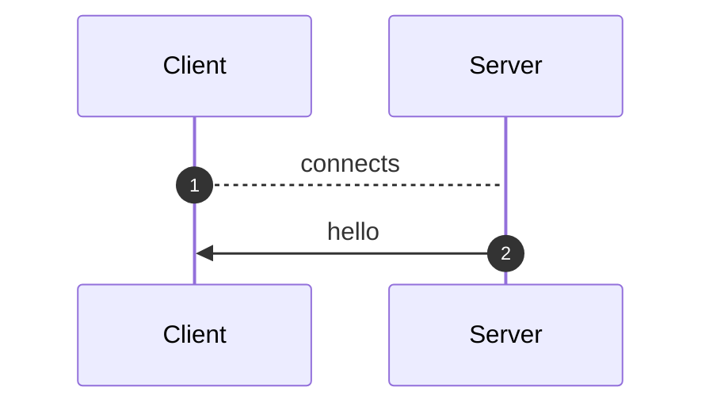
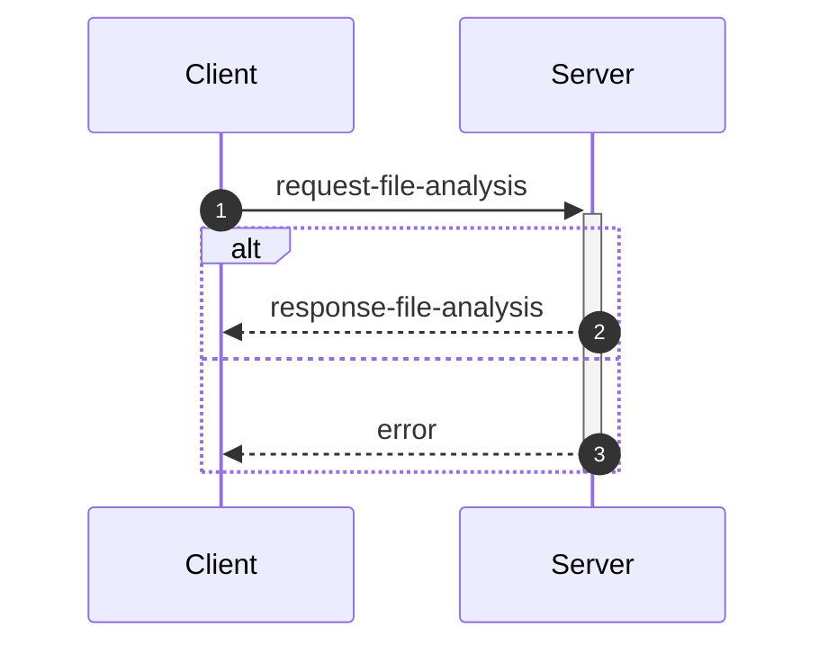
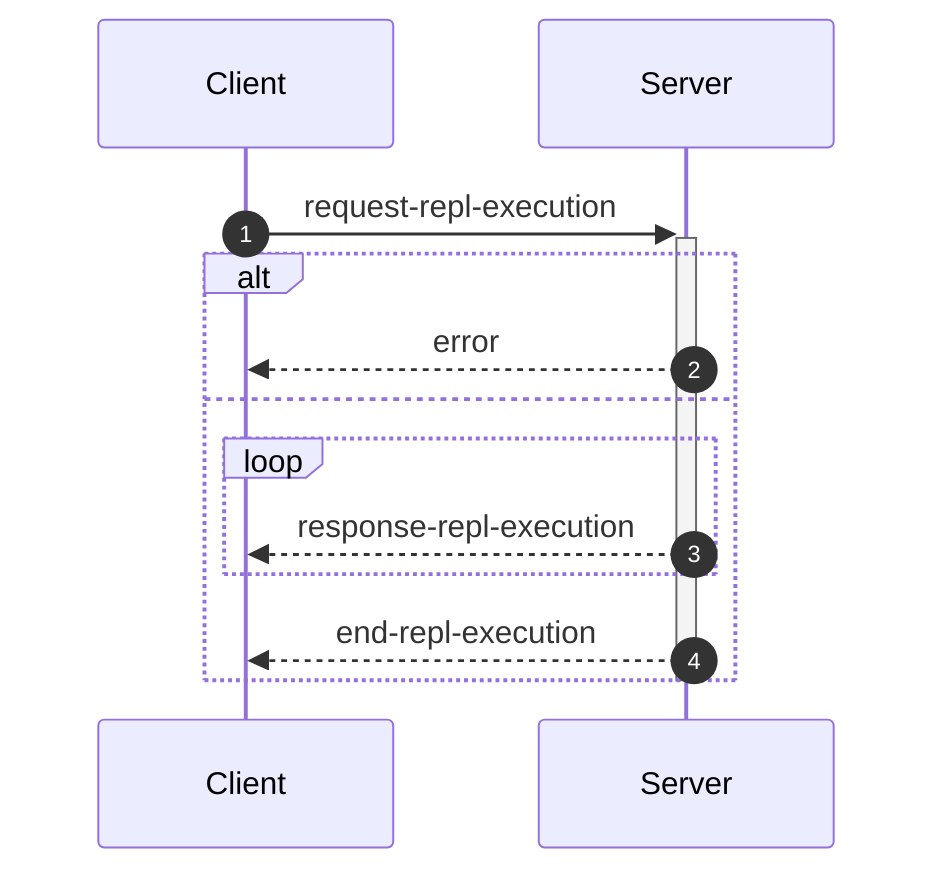
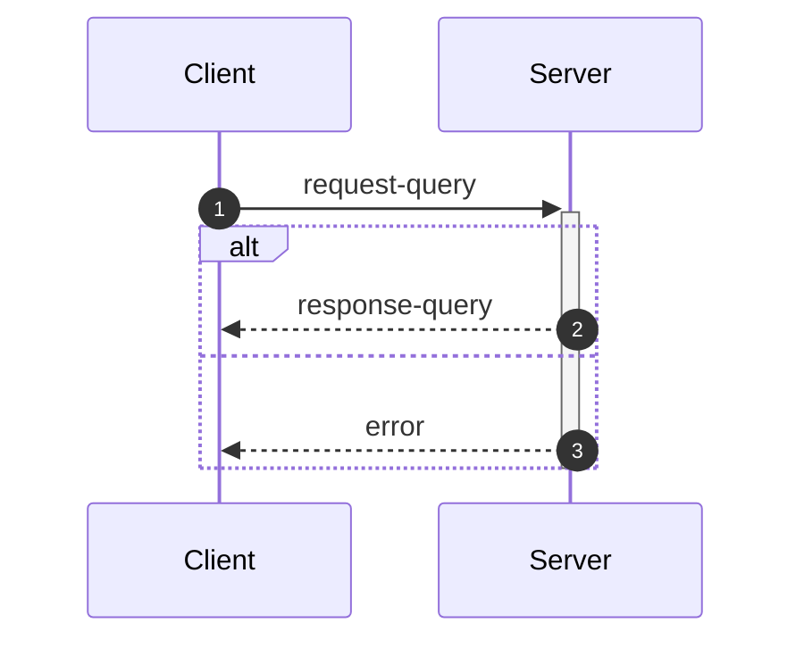

_<span title="an overview of flowR's interface">Generated</span> from '[wiki-interface.ts](https://github.com/flowr-analysis/flowr/tree/main/src/documentation/wiki-interface.ts "src/documentation/wiki-interface.ts")' on 2026-11-01, 14:29:20 UTC (v2.16.8, R v4.6.1), do not edit directly._

Although far from being as detailed as the in-depth explanation of [_flowR_](https://github.com/flowr-analysis/flowr/wiki/Core),
this wiki page explains how to interface with _flowR_ in more detail.
In general, command line arguments and other options provide short descriptions on hover over.

* [💻 Using the REPL](#using-the-repl)
* [⚙️ Configuring FlowR](#configuring-flowr)
* [⚒️ Writing Code](#writing-code)
* [💬 Communicating with the Server](#communicating-with-the-server)

<a id='using-the-repl'></a>
## 💻 Using the REPL

> [!NOTE]
> To execute arbitrary R commands with a repl request, _flowR_ has to be started explicitly with <span title="Description (Command Line Argument): Allow to access the underlying R session when using flowR (security warning: this allows the execution of arbitrary R code!)">`--r-session-access`</span>.
> Please be aware that this introduces a security risk and note that this relies on the [`r-shell` engine](https://github.com/flowr-analysis/flowr/wiki/Engines) .

Although primarily meant for users to explore,
there is nothing which forbids calling _flowR_ as a subprocess to use standard-in, -output, and -error
for communication (although you can access the REPL using the server as well,
with the [REPL Request](#message-request-repl-execution) message).

The read-eval-print loop&nbsp;(REPL) works relatively simple.
You can submit an expression (using <kbd>Enter</kbd>),
which is interpreted as an R&nbsp;expression by default but interpreted as a *command* if it starts with a colon (`:`).
The best command to get started with the REPL is <span title="Description (Repl Command): Show help information (aliases: :h, :?)">`:help`</span>.
Besides, you can leave the REPL either with the command <span title="Description (Repl Command): End the repl (aliases: :q, :exit)">`:quit`</span> or by pressing <kbd>Ctrl</kbd>+<kbd>C</kbd> twice.
When writing a *command*, you may press <kbd>Tab</kbd> to get a list of completions, if available.
Multiple commands can be entered in a single line by separating them with a semicolon (`;`), e.g. `:parse "x<-2"; :df*`.
If a command is given without R code, the REPL will re-use R code given in a previous command.
The prior example will hence return first the parsed AST of the program and then the dataflow graph for `"x <- 2"`.

> [!NOTE]
> If you develop flowR, you may want to launch the repl using the `npm run main-dev` command, this way, you get a non-minified version of flowR with debug information and hot-reloading of source files.

<details>
<summary>Available Commands</summary>

We currently offer the following commands (this with a `[*]` suffix are available with and without the star):

| Command | Description |
| ------- | ----------- |
| **<span title="Description (Repl Command): End the repl (aliases: :q, :exit)">:quit</span>** | End the repl (aliases: **:<span title="Alias of ':quit'. End the repl">q</span>**, **:<span title="Alias of ':quit'. End the repl">exit</span>**) |
| **<span title="Description (Repl Command): Execute the given code as R code. This requires the `--r-session-access` flag to be set and requires the r-shell engine. (aliases: :e, :r)">:execute</span>** | Execute the given code as R code. This requires the `--r-session-access` flag to be set and requires the r-shell engine. (aliases: **:<span title="Alias of ':execute'. Execute the given code as R code. This requires the `--r-session-access` flag to be set and requires the r-shell engine.">e</span>**, **:<span title="Alias of ':execute'. Execute the given code as R code. This requires the `--r-session-access` flag to be set and requires the r-shell engine.">r</span>**) |
| **<span title="Description (Repl Command): Get mermaid code for the control-flow graph of R code (aliases: :cfg, :cf)">:controlflow[*]</span>** | Get mermaid code for the control-flow graph of R code (star: Returns the URL to mermaid.live) (aliases: **:<span title="Alias of ':controlflow'. Get mermaid code for the control-flow graph of R code">cfg</span>**, **:<span title="Alias of ':controlflow'. Get mermaid code for the control-flow graph of R code">cf</span>**) |
| **<span title="Description (Repl Command): Get mermaid code for the control-flow graph with basic blocks (aliases: :cfgb, :cfb)">:controlflowbb[*]</span>** | Get mermaid code for the control-flow graph with basic blocks (star: Returns the URL to mermaid.live) (aliases: **:<span title="Alias of ':controlflowbb'. Get mermaid code for the control-flow graph with basic blocks">cfgb</span>**, **:<span title="Alias of ':controlflowbb'. Get mermaid code for the control-flow graph with basic blocks">cfb</span>**) |
| **<span title="Description (Repl Command): Get mermaid code for the dataflow graph (aliases: :d, :df)">:dataflow[*]</span>** | Get mermaid code for the dataflow graph (star: Returns the URL to mermaid.live) (aliases: **:<span title="Alias of ':dataflow'. Get mermaid code for the dataflow graph">d</span>**, **:<span title="Alias of ':dataflow'. Get mermaid code for the dataflow graph">df</span>**) |
| **<span title="Description (Repl Command): Get mermaid code for the normalized AST of R code (aliases: :n)">:normalize[*]</span>** | Get mermaid code for the normalized AST of R code (star: Returns the URL to mermaid.live) (alias: **:<span title="Alias of ':normalize'. Get mermaid code for the normalized AST of R code">n</span>**) |
| **<span title="Description (Repl Command): Get mermaid code for the simplified dataflow graph (aliases: :ds, :dfs)">:dataflowsimple[*]</span>** | Get mermaid code for the simplified dataflow graph (star: Returns the URL to mermaid.live) (aliases: **:<span title="Alias of ':dataflowsimple'. Get mermaid code for the simplified dataflow graph">ds</span>**, **:<span title="Alias of ':dataflowsimple'. Get mermaid code for the simplified dataflow graph">dfs</span>**) |
| **<span title="Description (Repl Command): Inspect and extend the signature database: `query` (identical to :query @signature), `info <name>` for where a function comes from (identical to :query @function-info), `add <path>` to mount another database/source, `download` to fetch the full-history database. (aliases: :sig)">:signature</span>** | Inspect and extend the signature database: `query` (identical to :query @signature), `info <name>` for where a function comes from (identical to :query @function-info), `add <path>` to mount another database/source, `download` to fetch the full-history database. (alias: **:<span title="Alias of ':signature'. Inspect and extend the signature database: `query` (identical to :query @signature), `info <name>` for where a function comes from (identical to :query @function-info), `add <path>` to mount another database/source, `download` to fetch the full-history database.">sig</span>**) |
| **<span title="Description (Repl Command): Just calculates the DFG, but only prints summary info (aliases: :d#, :df#)">:dataflowsilent</span>** | Just calculates the DFG, but only prints summary info (aliases: **:<span title="Alias of ':dataflowsilent'. Just calculates the DFG, but only prints summary info">d#</span>**, **:<span title="Alias of ':dataflowsilent'. Just calculates the DFG, but only prints summary info">df#</span>**) |
| **<span title="Description (Repl Command): Prints ASCII Art of the parsed, unmodified AST (aliases: :p)">:parse</span>** | Prints ASCII Art of the parsed, unmodified AST (alias: **:<span title="Alias of ':parse'. Prints ASCII Art of the parsed, unmodified AST">p</span>**) |
| **<span title="Description (Repl Command): Prints the version of flowR as well as the current version of R">:version</span>** | Prints the version of flowR as well as the current version of R
| **<span title="Description (Repl Command): Query the given R code (use 'help' for more information)">:query[*]</span>** | Query the given R code (use 'help' for more information) (star: Similar to query, but returns the output in json format.)
| **<span title="Description (Repl Command): Returns an ASCII representation of the dataflow graph (aliases: :df!)">:dataflowascii</span>** | Returns an ASCII representation of the dataflow graph (alias: **:<span title="Alias of ':dataflowascii'. Returns an ASCII representation of the dataflow graph">df!</span>**) |
| **<span title="Description (Repl Command): Returns summarization stats for the normalized AST (aliases: :n#)">:normalize#</span>** | Returns summarization stats for the normalized AST (alias: **:<span title="Alias of ':normalize#'. Returns summarization stats for the normalized AST">n#</span>**) |
| **<span title="Description (Repl Command): Show help information (aliases: :h, :?)">:help</span>** | Show help information (aliases: **:<span title="Alias of ':help'. Show help information">h</span>**, **:<span title="Alias of ':help'. Show help information">?</span>**) |

</details>

> [!TIP]
> 
> As indicated by the examples before, all REPL commands that operate on code keep track of the state.
> Hence, if you run a command like <span title="Description (Repl Command, starred version): Returns the URL to mermaid.live; Base Command: Get mermaid code for the dataflow graph (aliases: :d*, :df*)">`:dataflow*`</span> without providing R code,
> the REPL will re-use the R code provided in a previous command.
> Likewise, doing this will benefit from incrementality!
> If you request the dataflow graph with `:df* x <- 2 * y` and then want to see the parsed AST with `:parse`,
> the REPL will re-use previously obtained information and not re-parse the code again.
> 		

Generally, many commands offer shortcut versions in the REPL. Many queries, for example, offer a shortened format (see the example below).
Of special note, the [Config Query](https://github.com/flowr-analysis/flowr/wiki/%5BQuery%5D-Config)
can be used to also modify the currently active configuration of _flowR_ within the REPL (see the [wiki page](https://github.com/flowr-analysis/flowr/wiki/%5BQuery%5D-Config) for more information).

### Example: Retrieving the Dataflow Graph

To retrieve a URL to the [mermaid](https://mermaid.js.org/) diagram of the dataflow of a given expression,
use <span title="Description (Repl Command, starred version): Returns the URL to mermaid.live; Base Command: Get mermaid code for the dataflow graph (aliases: :d*, :df*)">`:dataflow*`</span> (or <span title="Description (Repl Command): Get mermaid code for the dataflow graph (aliases: :d, :df)">`:dataflow`</span> to get the mermaid code in the cli):

```shell
$ docker run -it --rm eagleoutice/flowr # or npm run flowr 
flowR repl v2.16.8, R grammar v14 (tree-sitter engine)
R> :dataflow* y <- 1 + x
```

<details>
<summary style='color:gray'>Output</summary>

```text
https://mermaid.live/view#base64:eyJjb2RlIjoiZmxvd2NoYXJ0IFREXG4gICAgMXt7XCJgKiM5MTtSTnVtYmVyIzkzOyogKioxKipcbiAgICAgICoxLjYqICgqKmlkOiAxKiopYFwifX1cbiAgICAyKFtcImAqIzkxO1JTeW1ib2wjOTM7KiAqKngqKlxuICAgICAgKjEuMTAqICgqKmlkOiAyKiopYFwiXSlcbiAgICAzW1tcImAqIzkxO1JCaW5hcnlPcCM5MzsqIGJhc2UjNTg7IzU4OyoqIzQzOyoqXG4gICAgICAqMS42LTEwKiAoKippZDogMyoqKVxuICAgIGFyZzogKDEsIDIpYFwiXV1cbiAgICBidWlsdC1pbjpfNDNfW1wiYEJ1aWx0LUluOlxuIzQzO2BcIl1cbiAgICBzdHlsZSBidWlsdC1pbjpfNDNfIHN0cm9rZTpncmF5LGZpbGw6Z3JheSxzdHJva2Utd2lkdGg6MnB4LG9wYWNpdHk6Ljg7XG4gICAgMFtcImAqIzkxO1JTeW1ib2wjOTM7KiAqKnkqKlxuICAgICAgKjEuMSogKCoqaWQ6IDAqKiwgdjogMylgXCJdXG4gICAgNFtbXCJgKiM5MTtSQmluYXJ5T3AjOTM7KiBiYXNlIzU4OyM1ODsqKiM2MDsjNDU7KipcbiAgICAgICoxLjEtMTAqICgqKmlkOiA0KiopXG4gICAgYXJnOiAoMCwgMylgXCJdXVxuICAgIGJ1aWx0LWluOl82MF8tW1wiYEJ1aWx0LUluOlxuIzYwOyM0NTtgXCJdXG4gICAgc3R5bGUgYnVpbHQtaW46XzYwXy0gc3Ryb2tlOmdyYXksZmlsbDpncmF5LHN0cm9rZS13aWR0aDoycHgsb3BhY2l0eTouODtcbiAgICAxIC0uLT58XCJmbG93XCJ8IDJcbiAgICBsaW5rU3R5bGUgMCBzdHJva2U6Z3JheSxjb2xvcjpncmF5O1xuICAgIDIgLS4tPnxcImZsb3dcInwgM1xuICAgIGxpbmtTdHlsZSAxIHN0cm9rZTpncmF5LGNvbG9yOmdyYXk7XG4gICAgMyAtLT58XCJyZWFkcywgYXJnXCJ8IDFcbiAgICAzIC0tPnxcInJlYWRzLCBhcmdcInwgMlxuICAgIDMgLS4tPnxcImZsb3dcInwgMFxuICAgIGxpbmtTdHlsZSA0IHN0cm9rZTpncmF5LGNvbG9yOmdyYXk7XG4gICAgMyAtLi0+fFwicmVhZHMsIGNhbGxzXCJ8IGJ1aWx0LWluOl80M19cbiAgICBsaW5rU3R5bGUgNSBzdHJva2U6Z3JheTtcbiAgICAwIC0tPnxcImRlZmluZWQtYnksIGZsb3dcInwgNFxuICAgIDAgLS0+fFwiZGVmaW5lZC1ieVwifCAzXG4gICAgNCAtLT58XCJyZWFkcywgYXJnXCJ8IDNcbiAgICA0IC0tPnxcInJldHVybnMsIGFyZ1wifCAwXG4gICAgNCAtLi0+fFwicmVhZHMsIGNhbGxzXCJ8IGJ1aWx0LWluOl82MF8tXG4gICAgbGlua1N0eWxlIDEwIHN0cm9rZTpncmF5OyIsIm1lcm1haWQiOnsiYXV0b1N5bmMiOnRydWV9fQ==
```

Retrieve the dataflow graph of the expression `y <- 1 + x`. It looks like this:


<details>

<summary style="color:gray">R Code of the Dataflow Graph</summary>

The analysis ran (parse and normalize with the [tree-sitter](https://github.com/flowr-analysis/flowr/wiki/Engines) engine) in the generation environment. No [signature database](https://github.com/flowr-analysis/flowr/wiki/Signature-Database) is mounted, so `library()` attaches no exports (base-R names are still qualified, e.g., `stats::acf`). 
We encountered no unknown side effects during the analysis.

```r
y <- 1 + x
```

</details>

</details>

For small graphs like this, <span title="Description (Repl Command): Returns an ASCII representation of the dataflow graph (aliases: :df!)">`:dataflowascii`</span> also provides an ASCII representation directly in the REPL:

```shell
$ docker run -it --rm eagleoutice/flowr # or npm run flowr 
flowR repl v2.16.8, R grammar v14 (tree-sitter engine)
R> :df! y <- 1 + x
```

<details open>
<summary style='color:gray'>Output</summary>

```text
                        v<0>v
 c<4>c──────────────────| y |
 |<- |     ┌────────────v---v
 c---c     │
    │   c<3>c   0<1>0
    └───| + |───| 1 |───u<2>u
        c---c   0---0   | x |
           └────────────u---u
Edges:
3 -> 1: reads, arg          3 -> 2: reads, arg
3 -> 0: flows-to            1 -> 2: flows-to
2 -> 3: flows-to            4 -> 3: reads, arg
4 -> 0: returns, arg        0 -> 4: defined-by, flows-to
0 -> 3: defined-by
```

Retrieve the dataflow graph of the expression `y <- 1 + x` as ASCII art.

</details>

For the slicing with <span title="Description (Repl Command): Static backwards executable slicer for R">`:slicer`</span>, you have access to the same [magic comments](#slice-magic-comments) as with the [slice request](#message-request-slice).
Pass `--inline` to splice resolvable `source()` calls into the reconstruction so the slice is a single self-contained R text (the same as the static slice query's `inlineSources` flag).
See `--help` for more flags!

### Example: Interfacing with the File System

Many commands that allow for an R-expression (like <span title="Description (Repl Command, starred version): Returns the URL to mermaid.live; Base Command: Get mermaid code for the dataflow graph (aliases: :d*, :df*)">`:dataflow*`</span>) allow for a file as well
if the argument starts with `file://`.
If you are working from the root directory of the _flowR_ repository, the following gives you the parsed AST of the example file using the <span title="Description (Repl Command): Prints ASCII Art of the parsed, unmodified AST (aliases: :p)">`:parse`</span> command:

> **Watch mode**: Replace `file://` with `watch://` to enter watch mode.
> flowR runs the command immediately and then re-runs it every time the file (or any file inside the folder) changes.
> Enter any other command to leave watch mode.
> For example: `:df watch://analysis.R`

```shell
$ docker run -it --rm eagleoutice/flowr # or npm run flowr 
flowR repl v2.16.8, R grammar v14 (tree-sitter engine)
R> :parse file://test/testfiles/example.R
```

<details>
<summary style='color:gray'>Output</summary>

```text
File: test/testfiles/example.R

program
├ binaryoperator
│ ├ identifier "sum" (1:1─4)
│ ├ <- "<-" (1:5─7)
│ ╰ float "0" (1:8─9)
├ binaryoperator
│ ├ identifier "product" (2:1─8)
│ ├ <- "<-" (2:9─11)
│ ╰ float "1" (2:12─13)
├ binaryoperator
│ ├ identifier "w" (3:1─2)
│ ├ <- "<-" (3:3─5)
│ ╰ float "7" (3:6─7)
├ binaryoperator
│ ├ identifier "N" (4:1─2)
│ ├ <- "<-" (4:3─5)
│ ╰ float "10" (4:6─8)
├ forstatement
│ ├ for "for" (6:1─4)
│ ├ ( "(" (6:5─6)
│ ├ identifier "i" (6:6─7)
│ ├ in "in" (6:8─10)
│ ├ binaryoperator
│ │ ├ float "1" (6:11─12)
│ │ ├ : ":" (6:12─13)
│ │ ╰ parenthesizedexpression
│ │   ├ ( "(" (6:13─14)
│ │   ├ binaryoperator
│ │   │ ├ identifier "N" (6:14─15)
│ │   │ ├ - "-" (6:15─16)
│ │   │ ╰ float "1" (6:16─17)
│ │   ╰ ) ")" (6:17─18)
│ ├ ) ")" (6:18─19)
│ ╰ bracedexpression
│   ├ { "{" (6:20─21)
│   ├ binaryoperator
│   │ ├ identifier "sum" (7:3─6)
│   │ ├ <- "<-" (7:7─9)
│   │ ╰ binaryoperator
│   │   ├ binaryoperator
│   │   │ ├ identifier "sum" (7:10─13)
│   │   │ ├ + "+" (7:14─15)
│   │   │ ╰ identifier "i" (7:16─17)
│   │   ├ + "+" (7:18─19)
│   │   ╰ identifier "w" (7:20─21)
│   ├ binaryoperator
│   │ ├ identifier "product" (8:3─10)
│   │ ├ <- "<-" (8:11─13)
│   │ ╰ binaryoperator
│   │   ├ identifier "product" (8:14─21)
│   │   ├  "" (8:22─23)
│   │   ╰ identifier "i" (8:24─25)
│   ╰ } "}" (9:1─2)
├ call
│ ├ identifier "cat" (11:1─4)
│ ╰ arguments
│   ├ ( "(" (11:4─5)
│   ├ argument
│   │ ╰ string
│   │   ├ stringopen "\"" (11:5─6)
│   │   ├ stringcontent "Sum:" (11:6─10)
│   │   ╰ stringclose "\"" (11:10─11)
│   ├ comma "," (11:11─12)
│   ├ argument
│   │ ╰ identifier "sum" (11:13─16)
│   ├ comma "," (11:16─17)
│   ├ argument
│   │ ╰ string
│   │   ├ stringopen "\"" (11:18─19)
│   │   ├ stringcontent
│   │   │ ╰ escapesequence "\\n" (11:19─21)
│   │   ╰ stringclose "\"" (11:21─22)
│   ╰ ) ")" (11:22─23)
╰ call
  ├ identifier "cat" (12:1─4)
  ╰ arguments
    ├ ( "(" (12:4─5)
    ├ argument
    │ ╰ string
    │   ├ stringopen "\"" (12:5─6)
    │   ├ stringcontent "Product:" (12:6─14)
    │   ╰ stringclose "\"" (12:14─15)
    ├ comma "," (12:15─16)
    ├ argument
    │ ╰ identifier "product" (12:17─24)
    ├ comma "," (12:24─25)
    ├ argument
    │ ╰ string
    │   ├ stringopen "\"" (12:26─27)
    │   ├ stringcontent
    │   │ ╰ escapesequence "\\n" (12:27─29)
    │   ╰ stringclose "\"" (12:29─30)
    ╰ ) ")" (12:30─31)
```

Retrieve the parsed AST of the example file.

<details>

<summary>File Content</summary>

```r
sum <- 0
product <- 1
w <- 7
N <- 10

for (i in 1:(N-1)) {
  sum <- sum + i + w
  product <- product * i
}

cat("Sum:", sum, "\n")
cat("Product:", product, "\n")
```

</details>

As _flowR_ directly transforms this AST the output focuses on being human-readable instead of being machine-readable.
		
</details>

### Example: Run a Query

You can run any query supported by _flowR_ using the <span title="Description (Repl Command): Query the given R code (use 'help' for more information)">`:query`</span> command.
For example, to obtain the shapes of all data frames in a given piece of code, you can run:

```shell
$ docker run -it --rm eagleoutice/flowr # or npm run flowr 
flowR repl v2.16.8, R grammar v14 (tree-sitter engine)
R> :query @absint df-shape "x <- data.frame(a = 1:10, b = 1:10)\ny <- x$a"
```

<details open>
<summary style='color:gray'>Output</summary>

```text
Query: absint (3 ms)
   ╰ $12: (colnames: [{"a", "b"}, {}], cols: [2, 2], rows: [10, 10])
   ╰ $0: (colnames: [{"a", "b"}, {}], cols: [2, 2], rows: [10, 10])
```

Retrieve the shapes of all data frames in the given code.

</details>

To run the linter on a file, you can use (in this example, we just issue the `dead-code` linter on a small piece of code):

```shell
$ docker run -it --rm eagleoutice/flowr # or npm run flowr 
flowR repl v2.16.8, R grammar v14 (tree-sitter engine)
R> :query @linter rules:dead-code "if(FALSE) x <- 2"
```

<details open>
<summary style='color:gray'>Output</summary>

```text
Query: linter (3 ms)
   ╰ Dead Code (dead-code):
       ╰ certain:
           ╰ Code at 1.11-16 (1 quick fix(es) available)
```

Run the linter on the given code, with only the `dead-code` rule enabled.

</details>

For more information on the available queries, please check out the [Query API](https://github.com/flowr-analysis/flowr/wiki/Query-API).

<a id='configuring-flowr'></a>
## ⚙️ Configuring FlowR

When running _flowR_, you may want to specify some behaviors with a dedicated configuration file.
By default, flowR looks for a file named `flowr.json` in the current working directory (or any higher directory).
You can also specify a different file with <span title="Description (Command Line Argument): The name of the configuration file to use">`--config-file`</span> or pass the configuration inline using <span title="Description (Command Line Argument): The flowR configuration to use, as a JSON string">`--config-json`</span>.
A `flowr.json` found this way belongs to the analyzed project, so flowR ignores its options that decide what flowR executes or loads
(`engines.*.wasmPath`, `engines.*.treeSitterWasmPath`, `engines.*.rPath`, `solver.sigdb.additionalPaths`, `solver.sigdb.downloadRepo`, `solver.sigdb.installedLibrary.paths`),
unless you pass <span title="Description (Command Line Argument): Keep the security-sensitive options (e.g., the R executable) of the flowr.json found in the working directory or a parent. Only use this for projects you trust.">`--trust-config`</span>.
To analyze code you do not trust, use the secure mode (<span title="Description (Command Line Argument): Run in secure mode for analyzing untrusted code: flowR does not start R (or any other process), does not access the network, does not search for project configs, and ignores security-sensitive options in every config. Cannot be disabled once enabled. Can also be enabled with the environment variable {italic FLOWR_SECURE_MODE=1}.">`--secure`</span>, see the [security policy](https://github.com/flowr-analysis/flowr/blob/main/.github/SECURITY.md)).
To inspect the current configuration, you can run flowr with the <span title="Description (Command Line Argument): Run with verbose logging (will be passed to the corresponding script)">`--verbose`</span> flag, or use the `config` [Query](https://github.com/flowr-analysis/flowr/wiki/Query-API).
Within the REPL this works by running the following:

```shell
:query @config
```

To work with the <a href="https://github.com/flowr-analysis/flowr/tree/main/src/config.ts#L119"><code><span title="The configuration file format for flowR.">FlowrConfig</span></code></a> you can use the provided helper objects alongside its methods like
<a href="https://github.com/flowr-analysis/flowr/tree/main/src/config.ts#L914"><code><span title="Creates a new flowr config that has the updated values.">FlowrConfig::<b>amend</b></span></code></a>.
The schema below documents every option; the ones you most likely want are:

- <a href="https://github.com/flowr-analysis/flowr/wiki/Interface#configuring-flowr" title="Configuration Option (boolean): Whether source calls should be ignored, causing {@link processSourceCall}&#39;s behavior to be skipped.">ignoreSourceCalls</a>: ignore source calls when analyzing the code, i.e., ignore the inclusion of other files.
- <a href="https://github.com/flowr-analysis/flowr/wiki/Interface#configuring-flowr" title="Configuration Option (boolean): Whether load calls should be ignored, causing {@link processLoadCall}&#39;s behavior to be skipped.">ignoreLoadCalls</a>: ignore load calls when analyzing the code, i.e., ignore the loading of r-data files.
- <a href="https://github.com/flowr-analysis/flowr/wiki/Interface#configuring-flowr" title="Configuration Option (object): Do you want to overwrite (parts) of the builtin definition?">semantics.environment.overwriteBuiltIns</a>: overwrite _flowR_'s handling of built-in functions, or clear the preset definitions entirely.
  See [Configure BuiltIn Semantics](#configure-builtin-semantics) for more information.
- <a href="https://github.com/flowr-analysis/flowr/wiki/Interface#configuring-flowr" title="Configuration Option (string): How to resolve variables and their values. (one of &quot;disabled&quot;, &quot;alias&quot;, &quot;builtin&quot;)">solver.variables</a>: how to resolve variables and their values (`disabled`, `alias`, `builtin`).
- <a href="https://github.com/flowr-analysis/flowr/wiki/Interface#configuring-flowr" title="Configuration Option (array): The engine or set of engines to use for interacting with R code. An empty array means all available engines will be used.">engines</a> and <a href="https://github.com/flowr-analysis/flowr/wiki/Interface#configuring-flowr" title="Configuration Option (string): The default engine to use for interacting with R code. If this is undefined, an arbitrary engine from the specified list will be used. (one of &quot;tree-sitter&quot;, &quot;r-shell&quot;)">defaultEngine</a>: the engines used to interact with R code, see the [Engines wiki page](https://github.com/flowr-analysis/flowr/wiki/Engines).
- <a href="https://github.com/flowr-analysis/flowr/wiki/Interface#configuring-flowr" title="Configuration Option (array): Files a framework loads on its own, without any source() call (e.g. global.R in a shiny app), in the order they are loaded; flowR orders the matching project files accordingly and analyzes them as one program. Entries are case-insensitive globs matched against the file path, a plain name matches any file with that name, and entries matching no project file are warned about. Usually set per project kind via specializeConfig.">project.implicitSources</a>: the files a framework loads without any `source()` call, in the order in which they are
  loaded. Entries are globs (e.g. `R/*.R`) matched against the file path ignoring capitalization; one matching no file is reported.
- <a href="https://github.com/flowr-analysis/flowr/wiki/Interface#configuring-flowr" title="Configuration Option (object): Overwrite (parts of) the configuration depending on the project kind flowR detects, e.g. to give a shiny app its implicit sources.">specializeConfig</a>: overwrite (parts of) the configuration depending on the kind of project _flowR_ detects
  (e.g. `shiny-app`), which is how a shiny app gets its implicit sources by default. What you configure directly wins.
- <a href="https://github.com/flowr-analysis/flowr/wiki/Interface#configuring-flowr" title="Configuration Option (string): Overwrite the project kind flowR would otherwise infer from the analyzed files, e.g. when auto-detection guesses wrong. (one of &quot;package&quot;, &quot;script&quot;, &quot;shiny-app&quot;, &quot;notebook&quot;, &quot;project&quot;, &quot;unknown&quot;)">project.useProjectType</a>: skip that detection and force a project kind yourself, when auto-detection guesses wrong.
- <a href="https://github.com/flowr-analysis/flowr/wiki/Interface#configuring-flowr" title="Configuration Option (array): The default plugins to load when creating a new instance of FlowrAnalyzer">defaultPlugins</a> and <a href="https://github.com/flowr-analysis/flowr/wiki/Interface#configuring-flowr" title="Configuration Option (array): The plugins to load in REPL mode">repl.plugins</a>: the plugins to load for a new <a href="https://github.com/flowr-analysis/flowr/tree/main/src/project/flowr-analyzer.ts#L210"><code><span title="Central class for conducting analyses with FlowR. Use the FlowrAnalyzerBuilder to create a new instance. If you want the original pattern of creating a pipeline and running all steps, you can still do this with FlowrAnalyzer#runFull . To inspect the context of the analyzer, use FlowrAnalyzer#inspectContext (if you are a plugin and need to modify it, use FlowrAnalyzer#context instead).">FlowrAnalyzer</span></code></a> and in the REPL
  (use `flowr:default` to reference the former).

So you can configure _flowR_ by adding a file like the following:

<details>

<summary>Example Configuration File</summary>

```json
{
  "ignoreSourceCalls": true,
  "ignoreLoadCalls": true,
  "semantics": {
    "environment": {
      "overwriteBuiltIns": {
        "definitions": [
          {
            "type": "function",
            "names": [
              "foo"
            ],
            "processor": "builtin:assign",
            "config": {}
          }
        ]
      }
    }
  },
  "defaultPlugins": [
    "file:description",
    "versions:description"
  ],
  "repl": {
    "quickStats": false,
    "dfProcessorHeat": false,
    "hints": true,
    "plugins": [
      "flowr:default"
    ]
  },
  "project": {
    "resolveUnknownPathsOnDisk": true,
    "implicitSources": [
      "global.R",
      "app.R"
    ]
  },
  "linter": {
    "disabledRules": []
  },
  "specializeConfig": {
    "shiny-app": {
      "project": {
        "implicitSources": [
          "global.R",
          "ui.R",
          "server.R",
          "app.R"
        ]
      }
    }
  },
  "engines": [
    {
      "type": "r-shell"
    }
  ],
  "solver": {
    "variables": "alias",
    "evalStrings": true,
    "trackEnvironments": true,
    "sigdb": {
      "enabled": true,
      "loadProjectDependencies": true,
      "eagerlyLoad": false,
      "eagerlyLoadExports": false,
      "linkBaseR": false,
      "linkDescriptionDependencies": false
    },
    "resolveSource": {
      "dropPaths": "no",
      "ignoreCapitalization": true,
      "inferWorkingDirectory": "active-script",
      "searchPath": []
    },
    "instrument": {},
    "slicer": {
      "threshold": 50
    }
  },
  "abstractInterpretation": {
    "wideningThreshold": 4,
    "followCalls": true,
    "dataFrame": {
      "maxColNames": 20,
      "readLoadedData": {
        "readExternalFiles": true,
        "maxReadLines": 1000000
      }
    }
  },
  "incremental": {
    "alwaysIncremental": false,
    "parsing": {
      "activated": false,
      "heuristics": {
        "activated": true,
        "mtime": true,
        "linesFrom": 500,
        "bytesFrom": 50000,
        "alwaysWithEdits": false,
        "minFiles": 1
      }
    }
  },
  "gas": {
    "thresholds": {
      "memory": {
        "problematic": 0.7,
        "critical": 0.9
      },
      "timeMs": {
        "problematic": 100000,
        "critical": 120000
      }
    },
    "features": {}
  }
}
```

</details>

<details>
<a id='configure-builtin-semantics'></a>
<summary>Configure Built-In Semantics</summary>

`semantics/environment/overwriteBuiltins` accepts two keys:

- `loadDefaults` (boolean, initially `true`): If set to `true`, the default built-in definitions are loaded before applying the custom definitions. Setting this flag to `false` explicitly disables the loading of the default definitions.
- `definitions` (array, initially empty): Allows to overwrite or define new built-in elements. Each object within must have a `type` which is one of the below. Furthermore, they may define a string array of `names` which specifies the identifiers to bind the definitions to. You may use `assumePrimitive` to specify whether _flowR_ should assume that this is a primitive non-library definition (so you probably just do not want to specify the key).

  | Type            | Description                                                                                                                                                                                                                                                                                              | Example                                                                                                    |
  | --------------- | -------------------------------------------------------------------------------------------------------------------------------------------------------------------------------------------------------------------------------------------------------------------------------------------------------- | ---------------------------------------------------------------------------------------------------------- |
  | `constant`    | Additionally allows for a `value` this should resolve to.                                                                                                                                                                                                                                                | `{ type: 'constant', names: ['NULL', 'NA'],  value: null }`                                                |
  | `function`    | Is a rather flexible way to define and bind built-in functions. For the time, we do not have extensive documentation to cover all the cases, so please either consult the sources with the `default-builtin-config.ts` or open a [new issue](https://github.com/flowr-analysis/flowr/issues/new/choose). | `{ type: 'function', names: ['next'], processor: 'builtin:d', config: { cfg: ExitPointType.Next } }` |
  | `replacement` | A comfortable way to specify replacement functions like `$<-` or `names<-`. `suffixes` describes the... suffixes to attach automatically. | `{ type: 'replacement', suffixes: ['<-', '<<-'], names: ['[', '[['] }` |

</details>

<details>

<summary style='color:gray'>Full Configuration-File Schema</summary>

- _The configuration file format for flowR._ (object)
    - **logLevel** [optional] _flowR's global minimum log level, applied when the config is loaded._ (string)
        Only allows: 'silly', 'trace', 'debug', 'info', 'warn', 'error', 'fatal'
    - **ignoreSourceCalls** [optional] _Whether source calls should be ignored, causing {@link processSourceCall}'s behavior to be skipped._ (boolean)
    - **ignoreLoadCalls** [optional] _Whether load calls should be ignored, causing {@link processLoadCall}'s behavior to be skipped._ (boolean)
    - **semantics** _Configure language semantics and how flowR handles them._ (object)
        - **environment** [optional] _Semantics regarding how to handle the R environment._ (object)
            - **overwriteBuiltIns** [optional] _Do you want to overwrite (parts) of the builtin definition?_ (object)
                - **loadDefaults** [optional] _Should the default configuration still be loaded?_ (boolean)
                - **definitions** [optional] _The definitions to load/overwrite._ (array)
                Valid item types:
                    - (object)
    - **defaultPlugins** [optional] _The default plugins to load when creating a new instance of FlowrAnalyzer_ (array)
    Valid item types:
        - (alternatives)
            - (string)
            - (array)
    - **repl** _Configuration options for the REPL._ (object)
        - **quickStats** [optional] _Whether to show quick stats in the REPL after each evaluation._ (boolean)
        - **dfProcessorHeat** [optional] _This instruments the dataflow processors to count how often each processor is called._ (boolean)
        - **hints** [optional] _Whether to show dim inline hints on the empty prompt (automatically disabled on non-interactive terminals)._ (boolean)
        - **plugins** [optional] _The plugins to load in REPL mode_ (array)
        Valid item types:
            - (alternatives)
                - (string)
                - (array)
        - **autoUseFileProtocol** [optional] _Prepend the file protocol to a repl input that looks like a path, instead of only warning about it._ (boolean)
        - **queryStats** [optional] _Whether `:query` closes with the line stating how long the queries took (`:query*` never prints it)._ (boolean)
        - **showPlugins** [optional] _Whether `:version` grays out the plugins that did not activate during the last analysis._ (boolean)
    - **project** _Project specific configuration options._ (object)
        - **resolveUnknownPathsOnDisk** [optional] _Whether to resolve unknown paths loaded by the r project disk when trying to source/analyze files._ (boolean)
        - **failOnInaccessiblePath** [optional] _Whether a directory that cannot be traversed during file discovery (e.g. due to permissions) aborts the analysis; when false (the default) such paths are logged and skipped._ (boolean)
        - **basePackages** [optional] _The packages considered part of R itself (base and recommended); if unset, flowR uses its built-in list._ (array)
        Valid item types:
            - (string)
        - **implicitSources** [optional] _Files a framework loads on its own, without any source() call (e.g. global.R in a shiny app), in the order they are loaded; flowR orders the matching project files accordingly and analyzes them as one program. Entries are case-insensitive globs matched against the file path, a plain name matches any file with that name, and entries matching no project file are warned about. Usually set per project kind via specializeConfig._ (array)
        Valid item types:
            - (string)
        - **useProjectType** [optional] _Overwrite the project kind flowR would otherwise infer from the analyzed files, e.g. when auto-detection guesses wrong._ (string)
            Only allows: 'package', 'script', 'shiny-app', 'notebook', 'project', 'unknown'
        - **assumeImplicitEcho** [optional] _Whether the top level of the analyzed code is echoed, so that every visible result printed there is collected as an output by the dependencies query (default true, false for a package)._ (boolean)
        - **discovery** [optional] _Scoping options for the default project discovery._ (object)
            - **full** [optional] _Collect every file below the project root (greedy) instead of only the files the detected project kind needs (default false)._ (boolean)
            - **perKind** [optional] _Per-kind include/exclude glob overrides layered on the default scoping._ (object)
            - **ignore** [optional] _Case-insensitive globs that drop matching files from the intelligent discovery, regardless of kind (e.g. .Renviron to ignore environment files)._ (array)
            Valid item types:
                - (string)
        - **classification** [optional] _Overrides for the signals flowR uses to classify the project kind._ (object)
            - **shinyDescriptionTypes** [optional] _DESCRIPTION Type: values that mark a shiny app._ (array)
            Valid item types:
                - (string)
            - **shinyEntryFiles** [optional] _File names a shiny app is assembled from._ (array)
            Valid item types:
                - (string)
            - **shinyUsagePattern** [optional] _Regex source evidencing shiny usage in an entry file._ (string)
            - **notebookExtensions** [optional] _File extensions marking a notebook._ (array)
            Valid item types:
                - (string)
    - **linter** _Linter configuration options._ (object)
        - **disabledRules** _Linting rule names excluded from the default rule set (a rule requested explicitly via a linter query still runs). Usually set per project kind via specializeConfig._ (array)
        Valid item types:
            - (string)
        - **disabledTags** [optional] _Linting rule tags whose rules are excluded from the default rule set (a rule requested explicitly via a linter query still runs). By default the cmd-check rules are disabled for everything but a package; a configured list replaces that default._ (array)
        Valid item types:
            - (string)
    - **inputSources** [optional] _Further frameworks the input-sources analysis should know about; entries are added to flowR's defaults._ (object)
        - **pure** [optional] _Functions that only pass the constantness of their arguments on._ (array)
        Valid item types:
            - (string)
        - **param** [optional] _Functions whose result is a 'param' input._ (array)
        Valid item types:
            - (string)
        - **file** [optional] _Functions whose result is a 'file' input._ (array)
        Valid item types:
            - (string)
        - **tempfile** [optional] _Functions whose result is a 'tempfile' input._ (array)
        Valid item types:
            - (string)
        - **glob** [optional] _Functions whose result is a 'glob' input._ (array)
        Valid item types:
            - (string)
        - **net** [optional] _Functions whose result is a 'net' input._ (array)
        Valid item types:
            - (string)
        - **rand** [optional] _Functions whose result is a 'rand' input._ (array)
        Valid item types:
            - (string)
        - **system** [optional] _Functions whose result is a 'system' input._ (array)
        Valid item types:
            - (string)
        - **ffi** [optional] _Functions whose result is a 'ffi' input._ (array)
        Valid item types:
            - (string)
        - **lang** [optional] _Functions whose result is a 'lang' input._ (array)
        Valid item types:
            - (string)
        - **options** [optional] _Functions whose result is a 'options' input._ (array)
        Valid item types:
            - (string)
        - **cmdline** [optional] _Functions whose result is a 'cmdline' input._ (array)
        Valid item types:
            - (string)
        - **user** [optional] _Functions whose result is a 'user' input._ (array)
        Valid item types:
            - (string)
        - **const** [optional] _Functions whose result is a 'const' input._ (array)
        Valid item types:
            - (string)
        - **scope** [optional] _Functions whose result is a 'scope' input._ (array)
        Valid item types:
            - (string)
        - **dconst** [optional] _Functions whose result is a 'dconst' input._ (array)
        Valid item types:
            - (string)
        - **unknown** [optional] _Functions whose result is a 'unknown' input._ (array)
        Valid item types:
            - (string)
        - **linkedObjects** [optional] _Objects a framework provides without a definition in the code, e.g. shiny's input._ (array)
        Valid item types:
            - (object)
        - **linkedEntryPoints** [optional] _Calls that hand a function to a framework, which binds its objects to the parameters by position._ (array)
        Valid item types:
            - (object)
    - **specializeConfig** [optional] _Overwrite (parts of) the configuration depending on the project kind flowR detects, e.g. to give a shiny app its implicit sources._ (object)
    - **engines** _The engine or set of engines to use for interacting with R code. An empty array means all available engines will be used._ (array)
    Valid item types:
        - (alternatives)
            - _The configuration for the tree sitter engine._ (object)
                - **type** [required] _Use the tree sitter engine._ (string)
                    Only allows: 'tree-sitter'
                - **wasmPath** [optional] _The path to the tree-sitter-r WASM binary to use. If this is undefined, this uses the default path._ (string)
                - **treeSitterWasmPath** [optional] _The path to the tree-sitter WASM binary to use. If this is undefined, this uses the default path._ (string)
                - **lax** [optional] _Whether to use the lax parser for parsing R code (allowing for syntax errors). If this is undefined, the strict parser will be used._ (boolean)
            - _The configuration for the R shell engine._ (object)
                - **type** [required] _Use the R shell engine._ (string)
                    Only allows: 'r-shell'
                - **rPath** [optional] _The path to the R executable to use. If this is undefined, this uses the default path._ (string)
                - **pipeBind** [optional] _Whether to enable R's experimental pipe-bind operator "=>" by setting _R_USE_PIPEBIND_ for the R session (default false); R itself keeps this off by default, as it is experimental and has never shipped in a release version of R._ (boolean)
    - **defaultEngine** [optional] _The default engine to use for interacting with R code. If this is undefined, an arbitrary engine from the specified list will be used._ (string)
        Only allows: 'tree-sitter', 'r-shell'
    - **solver** _How to resolve constants, constraints, cells, ..._ (object)
        - **variables** _How to resolve variables and their values._ (string)
            Only allows: 'disabled', 'alias', 'builtin'
        - **evalStrings** _Should we include eval(parse(text="...")) calls in the dataflow graph?_ (boolean)
        - **trackEnvironments** [optional] _Track user-created environments (new.env, assign/get/local with envir=, dollar-assign, attach). When false, all envir-style calls fall through conservatively._ (boolean)
        - **sigdb** _Resolving library exports from a signature database._ (object)
            - **enabled** [optional] _Resolve library()/use() exports from a signature database (default true); when false no database is consulted._ (boolean)
            - **loadProjectDependencies** [optional] _Load the project's declared dependencies from its metadata files (DESCRIPTION Imports/Depends, rproject.toml, uvr.toml, renv.lock, rv.lock, uvr.lock) (default true); when false these files are not read for dependencies._ (boolean)
            - **eagerlyLoad** [optional] _Parse the database up front rather than on the first package load (default false, ignored if disabled)._ (boolean)
            - **eagerlyLoadExports** [optional] _Add a vertex for every export on load rather than on demand (default false); keeps the dataflow graph small._ (boolean)
            - **assumedRVersion** [optional] _R version assumed when resolving versioned (base-R) exports: a pin like "4.5" or "auto" to detect the installed R (default "auto")._ (string)
            - **linkBaseR** [optional] _Eagerly attach base-R namespaces so bare base calls resolve without library() (default false)._ (boolean)
            - **linkBaseRCalls** [optional] _Add a lightweight Reads edge from a bare base-R call to its signature-database function vertex (default false; base-R qualification is edge-free otherwise)._ (boolean)
            - **linkPackageCalls** [optional] _Add a lightweight Reads edge from a resolved package call to its signature-database function vertex (default false)._ (boolean)
            - **linkDescriptionDependencies** [optional] _Eagerly attach the namespaces of the project's declared DESCRIPTION dependencies (Imports/Depends) so their exports resolve without an explicit library() (default false)._ (boolean)
            - **warmInBackground** [optional] _Decompress the hot shards (base + most-downloaded) in a background task on startup so the first library() lookup is warm (default false; for long-running servers/REPLs)._ (boolean)
            - **additionalPaths** [optional] _Extra directories or bundle/manifest files searched for signature databases (alongside the shipped default and $FLOWR_SIGDB_DIR); a downloaded full-history bundle placed here is mounted automatically._ (array)
            Valid item types:
                - (string)
            - **downloadRepo** [optional] _GitHub owner/repo the full-history bundle is downloaded from via ":signature download" (default "flowr-analysis/flowr", release tag "sigdb-v<flowR-version>")._ (string)
            - **autoSync** [optional] _On startup, re-download shards whose committed sigdb.remote.json hash no longer matches the cache, in the background (default false; opt-in network sync after a git pull)._ (boolean)
            - **installedLibrary** [optional] _Recovering packages no signature database knows from the copy installed on this machine._ (object)
                - **enabled** [required] _Recover packages no signature database knows from their installed copy (default false)._ (boolean)
                - **paths** [optional] _Library directories to search; when empty they are discovered from the environment and the project._ (array)
                Valid item types:
                    - (string)
                - **useEnvironment** [optional] _Search the libraries R_LIBS_USER/R_LIBS/R_LIBS_SITE name (default true)._ (boolean)
                - **useProjectLibrary** [optional] _Search a project-local renv/packrat library (default true)._ (boolean)
                - **maxDepth** [optional] _How far to descend into the nested layout of a project-local library (default 3)._ (number)
                - **packages** [optional] _Only recover packages whose name matches one of these regular expressions; empty means any._ (array)
                Valid item types:
                    - (string)
            - **blobCacheBudgetMb** [optional] _How many MiB of decoded package blobs every open bundle may hold together (default 16)._ (number)
            - **versionSelection** [optional] _When a project constrains a dependency, resolve to the newest (default), oldest, or system-installed version satisfying it; system needs R and falls back to newest. Base-R packages always resolve against the assumed R version._ (string)
                Only allows: 'newest', 'oldest', 'system'
            - **versionOverrides** [optional] _Force an exact version for specific packages (name -> version), overriding both the project constraint and the versionSelection policy (default {})._ (object)
        - **versionManagement** _Policies for reasoning about dependency versions._ (object)
            - **linkedVersionGroups** [optional] _Groups of packages that must resolve to the same version; version guessing intersects each group so its members stay mutually compatible (default [])._ (array)
            Valid item types:
                - (array)
                Valid item types:
                    - (string)
        - **assumeAttachedPackages** [optional] _Packages to treat as attached without a `library()` call, so what the built-in configuration states about them applies to the analyzed code. The base packages R attaches on startup already resolve without it._ (array)
        Valid item types:
            - (string)
        - **transitiveSideEffectRounds** [optional] _How many rounds the transitive side-effect fixpoint may run before it is cut off (default 32); the propagation stops on its own as soon as a round adds nothing._ (number)
        - **maxOverlayDepth** [optional] _How many binding overlays may stack on one environment frame before a write flattens them (default 4); a pure performance knob, trading lookup cost against copy cost without changing any result._ (number)
        - **instrument** (object)
            - **dataflowExtractors** [optional] _These keys are only intended for use within code, allowing to instrument the dataflow analyzer!_ (any)
        - **resolveSource** [optional] _If lax source calls are active, flowR searches for sourced files much more freely, based on the configurations you give it. This option is only in effect if `ignoreSourceCalls` is set to false._ (object)
            - **dropPaths** _Allow to drop the first or all parts of the sourced path, if it is relative._ (string)
                Only allows: 'no', 'once', 'all'
            - **ignoreCapitalization** _Search for filenames matching in the lowercase._ (boolean)
            - **inferWorkingDirectory** _Try to infer the working directory from the main or any script to analyze._ (string)
                Only allows: 'no', 'main-script', 'active-script', 'any-script'
            - **searchPath** _Additionally search in these paths._ (array)
            Valid item types:
                - (string)
            - **repeatedSourceLimit** [optional] _How often the same file can be sourced within a single run? Please be aware: in case of cyclic sources this may not reach a fixpoint so give this a sensible limit._ (number)
            - **applyReplacements** _Provide name replacements for loaded files_ (array)
            Valid item types:
                - (object)
            - **assumeFilesExist** [optional] _Assume a sourced file is always there, making what it defines certain instead of conditional on the source call._ (boolean)
        - **slicer** [optional] _The configuration for the slicer._ (object)
            - **threshold** [optional] _The maximum number of iterations to perform on a single function call during slicing._ (number)
            - **autoExtend** [optional] _If set, the slicer will gain an additional post-pass._ (boolean)
    - **abstractInterpretation** _The configuration options for abstract interpretation._ (object)
        - **wideningThreshold** _The threshold for the number of visitations of a node at which widening should be performed to ensure the termination of the fixpoint iteration._ (number)
        - **followCalls** _Whether the abstract interpretation is interprocedural, i.e. whether it steps into the functions a call may dispatch to._ (boolean)
        - **dataFrame** _The configuration of the shape inference for data frames._ (object)
            - **maxColNames** _The maximum number of columns names to infer for data frames before over-approximating the column names to top._ (number)
            - **readLoadedData** _Configuration options for reading data frame shapes from loaded external data files, such as CSV files._ (object)
                - **readExternalFiles** _Whether data frame shapes should be extracted from loaded external files, such as CSV files._ (boolean)
                - **maxReadLines** _The maximum number of lines to read when extracting data frame shapes from loaded files, such as CSV files._ (number)
    - **incremental** (object)
        - **alwaysIncremental** _Always take the incremental path, regardless of heuristics._ (boolean)
        - **parsing** (object)
            - **activated** _If set, incremental parsing will be used._ (boolean)
            - **heuristics** (object)
                - **activated** [optional] _If set, the heuristics for incremental parsing will be used._ (boolean)
                - **mtime** [optional] _Skip reparsing entirely if the file's modification time is unchanged since the last parse._ (boolean)
                - **linesFrom** [optional] _Only consider incremental parsing for files with at least this many lines._ (number)
                - **bytesFrom** [optional] _Only consider incremental parsing for files with at least this many bytes._ (number)
                - **alwaysWithEdits** [optional] _Always take the incremental path whenever there is a computed edit region, regardless of the other thresholds._ (boolean)
                - **minFiles** [optional] _Only apply these heuristics once the project has at least this many files loaded._ (number)
    - **gas** [optional] _Resource-usage guard (gas) configuration. All feature factors default to 0 (disabled). See https://github.com/flowr-analysis/flowr/wiki/Core#gas-resource-guard._ (object)
        - **thresholds** [optional] _Thresholds for all gas checks (scaled by per-feature factor), boundable per feature._ (object)
            - **memory** [optional] _Heap-usage fraction thresholds (0-1), either shared or given per feature key (with `default` covering the rest)._ (object)
                - **problematic** [optional] _Heap fraction (0-1) above which Problematic is returned, for every feature without an entry of its own._ (number)
                - **critical** [optional] _Heap fraction (0-1) above which Critical is returned, for every feature without an entry of its own._ (number)
            - **timeMs** [optional] _Elapsed analysis time thresholds in milliseconds, either shared or given per feature key (with `default` covering the rest)._ (object)
                - **problematic** [optional] _Elapsed ms above which Problematic is returned, for every feature without an entry of its own._ (number)
                - **critical** [optional] _Elapsed ms above which Critical is returned, for every feature without an entry of its own._ (number)
            - **steps** [optional] _Processed-AST-node thresholds, counted rather than sampled; only a key that arms a budget (`dataflow`) reads them._ (object)
                - **problematic** [optional] _Processed AST nodes above which Problematic is returned, for every feature without an entry of its own._ (number)
                - **critical** [optional] _Processed AST nodes above which the extraction is cut short, for every feature without an entry of its own._ (number)
            - **vertices** [optional] _Created-dataflow-vertex thresholds, counted like `steps`._ (object)
                - **problematic** [optional] _Created dataflow vertices above which Problematic is returned, for every feature without an entry of its own._ (number)
                - **critical** [optional] _Created dataflow vertices above which the extraction is cut short, for every feature without an entry of its own._ (number)
        - **features** [optional] _Per-feature sensitivity factors. 0 or absent disables gas checking for that feature. A factor of 2 makes the feature twice as sensitive. Recognised keys: `source`, `side-effect-linking`, `linter`, `slicer`, `dataflow`._ (object)
        - **countedCheckEvery** [optional] _How many counted steps pass between two accountings of an armed check, be it a dataflow budget or the slicer's traversal (default 128); trades overshoot against the cost of the check._ (number)
        - **heapProvider** [optional] _Custom heap statistics source (programmatic configs only), overriding the built-in v8/performance.memory detection._ (function)

</details>

<a id='writing-code'></a>
## ⚒️ Writing Code

_flowR_ can be used as a [module](https://www.npmjs.com/package/@eagleoutice/flowr) and offers several main classes and interfaces that are interesting for extension writers 
(see the [Visual Studio Code extension](https://marketplace.visualstudio.com/items?itemName=code-inspect.vscode-flowr) or the [Core](https://github.com/flowr-analysis/flowr/wiki/Core) wiki page for more information).

### Creating Analyses with _flowR_

Nowadays, instances of the <a href="https://github.com/flowr-analysis/flowr/tree/main/src/project/flowr-analyzer.ts#L210"><code><span title="Central class for conducting analyses with FlowR. Use the FlowrAnalyzerBuilder to create a new instance. If you want the original pattern of creating a pipeline and running all steps, you can still do this with FlowrAnalyzer#runFull . To inspect the context of the analyzer, use FlowrAnalyzer#inspectContext (if you are a plugin and need to modify it, use FlowrAnalyzer#context instead).">FlowrAnalyzer</span></code></a> should be used as central frontend to get analysis results from _flowR_.
The entry points an analysis is written against are re-exported from the package root (`import { FlowrAnalyzerBuilder } from '@eagleoutice/flowr'`);
everything else stays reachable under its own path, as in `@eagleoutice/flowr/dataflow/graph/graph`.
For example, a program slice can be created like this:

```ts
const analyzer = await new FlowrAnalyzerBuilder()
    .setEngine('tree-sitter')
    .build();
analyzer.addRequest('x <- 1\ny <- x\nx');
const result = await analyzer.query([
    {
        type:     'static-slice',
        criteria: ['3@x']
    }
]);
```

For more information, please have a look at the [Analyzer](https://github.com/flowr-analysis/flowr/wiki/Analyzer) wiki page, which explains how to construct and use the <a href="https://github.com/flowr-analysis/flowr/tree/main/src/project/flowr-analyzer.ts#L210"><code><span title="Central class for conducting analyses with FlowR. Use the FlowrAnalyzerBuilder to create a new instance. If you want the original pattern of creating a pipeline and running all steps, you can still do this with FlowrAnalyzer#runFull . To inspect the context of the analyzer, use FlowrAnalyzer#inspectContext (if you are a plugin and need to modify it, use FlowrAnalyzer#context instead).">FlowrAnalyzer</span></code></a> in more detail.
To work with specific perspectives, you can also consult the respective pages like the [Dataflow Graph](https://github.com/flowr-analysis/flowr/wiki/Dataflow-Graph) or the [Abstract Interpretation](https://github.com/flowr-analysis/flowr/wiki/Abstract-Interpretation) wiki pages.
### The Pipeline Executor (Low-Level Interface)

Once, in the beginning, _flowR_ was meant to produce a dataflow graph merely to provide *program slices*. 
However, with continuous updates, the [Dataflow Graph](https://github.com/flowr-analysis/flowr/wiki/Dataflow-Graph) repeatedly proves to be the more interesting part.
With this, we restructured _flowR_'s originally *hardcoded* pipeline to be far more flexible. 
Now, it can be theoretically extended or replaced with arbitrary steps, optional steps, and what we call 'decorations' of these steps. 
In short, a slicing pipeline using the <a href="https://github.com/flowr-analysis/flowr/tree/main/src/core/pipeline-executor.ts#L97"><code><span title="**Please note:** The PipelineExecutor is now considered to be a rather low-level API for flowR. While it still works and is the basis for all other layers, we strongly recommend using the FlowrAnalyzer and its builder to create and use an analyzer instance that is pre-configured for your use-case. The pipeline executor allows to execute arbitrary pipelines in a step-by-step fashion. If you are not...">PipelineExecutor</span></code></a> looks like this:

```ts

const slicer = new PipelineExecutor(DEFAULT_SLICING_PIPELINE, {
  parser:    new RShell(),
  request:   requestFromInput('x <- 1\nx + 1'),
  criterion: ['2@x']
})
const slice = await slicer.allRemainingSteps()
// console.log(slice.reconstruct.code)
```

<details><summary>More Information</summary>

If you compare this, with what you would have done with the old (and removed) `SteppingSlicer`, 
this essentially just requires you to replace the `SteppingSlicer` with the <a href="https://github.com/flowr-analysis/flowr/tree/main/src/core/pipeline-executor.ts#L97"><code><span title="**Please note:** The PipelineExecutor is now considered to be a rather low-level API for flowR. While it still works and is the basis for all other layers, we strongly recommend using the FlowrAnalyzer and its builder to create and use an analyzer instance that is pre-configured for your use-case. The pipeline executor allows to execute arbitrary pipelines in a step-by-step fashion. If you are not...">PipelineExecutor</span></code></a>
and to pass the <a href="https://github.com/flowr-analysis/flowr/tree/main/src/core/steps/pipeline/default-pipelines.ts#L18"><code>DEFAULT_SLICING_PIPELINE</code></a> as the first argument.
The <a href="https://github.com/flowr-analysis/flowr/tree/main/src/core/pipeline-executor.ts#L97"><code><span title="**Please note:** The PipelineExecutor is now considered to be a rather low-level API for flowR. While it still works and is the basis for all other layers, we strongly recommend using the FlowrAnalyzer and its builder to create and use an analyzer instance that is pre-configured for your use-case. The pipeline executor allows to execute arbitrary pipelines in a step-by-step fashion. If you are not...">PipelineExecutor</span></code></a>...

1. Provides structures to investigate the results of all intermediate steps
2. Can be executed step-by-step
3. Can repeat steps (e.g., to calculate multiple slices on the same input)

See the in-code documentation for more information.

</details>

### Using the <a href="https://github.com/flowr-analysis/flowr/tree/main/src/r-bridge/shell.ts#L144"><code><span title="The RShell represents an interactive session with the R interpreter. You can configure it by RShellOptions . At the moment we are using a live R session (and not networking etc.) to communicate with R easily, which allows us to install packages etc. However, this might and probably will change in the future (leaving this as a legacy mode :D)">RShell</span></code></a> to Interact with R

The <a href="https://github.com/flowr-analysis/flowr/tree/main/src/r-bridge/shell.ts#L144"><code><span title="The RShell represents an interactive session with the R interpreter. You can configure it by RShellOptions . At the moment we are using a live R session (and not networking etc.) to communicate with R easily, which allows us to install packages etc. However, this might and probably will change in the future (leaving this as a legacy mode :D)">RShell</span></code></a> class allows interfacing with the `R`&nbsp;ecosystem installed on the host system.
Please have a look at [flowR's Engines](https://github.com/flowr-analysis/flowr/wiki/Engines) for more information on alternatives (for example, the <a href="https://github.com/flowr-analysis/flowr/tree/main/src/r-bridge/lang-4.x/tree-sitter/tree-sitter-executor.ts#L29"><code><span title="Synchronous and (way) faster alternative to the RShell using tree-sitter.">TreeSitterExecutor</span></code></a>).

> [!IMPORTANT]
> 
> Each <a href="https://github.com/flowr-analysis/flowr/tree/main/src/r-bridge/shell.ts#L144"><code><span title="The RShell represents an interactive session with the R interpreter. You can configure it by RShellOptions . At the moment we are using a live R session (and not networking etc.) to communicate with R easily, which allows us to install packages etc. However, this might and probably will change in the future (leaving this as a legacy mode :D)">RShell</span></code></a> controls a new instance of the R&nbsp;interpreter, 
> make sure to call <code><a href="https://github.com/flowr-analysis/flowr/tree/main/src/r-bridge/shell.ts#L350"><span title="Close the current R session, makes the object effectively invalid (can no longer be reopened etc.)">RShell::<i>close</i></span></a>()</code> when you are done.

You can start a new "session" by constructing a new object with <code>new <a href="https://github.com/flowr-analysis/flowr/tree/main/src/r-bridge/shell.ts#L144"><span title="The RShell represents an interactive session with the R interpreter. You can configure it by RShellOptions . At the moment we are using a live R session (and not networking etc.) to communicate with R easily, which allows us to install packages etc. However, this might and probably will change in the future (leaving this as a legacy mode :D)">RShell</span></a>()</code>.

However, there are several options that may be of interest 
(e.g., to automatically revive the shell in case of errors or to control the name location of the R process on the system).

With a shell object (let's call it `shell`), you can execute R code by using <a href="https://github.com/flowr-analysis/flowr/tree/main/src/r-bridge/shell.ts#L213"><code><span title="sends the given command directly to the current R session will not do anything to alter input markers!">RShell::<i>sendCommand</i></span></code></a>,
for example <code>shell.<a href="https://github.com/flowr-analysis/flowr/tree/main/src/r-bridge/shell.ts#L213"><span title="sends the given command directly to the current R session will not do anything to alter input markers!">sendCommand</span></a>("1 + 1")</code>.
However, this does not return anything, so if you want to collect the output of your command, use
<a href="https://github.com/flowr-analysis/flowr/tree/main/src/r-bridge/shell.ts#L296"><code><span title="Send a command and collect the output">RShell::<i>sendCommandWithOutput</i></span></code></a> instead.

<a id='communicating-with-the-server'></a>
## 💬 Communicating with the Server

As explained in the [Overview](https://github.com/flowr-analysis/flowr/wiki/Overview), you can run the [TCP](https://de.wikipedia.org/wiki/Transmission_Control_Protocol)&nbsp;server by adding the <span title="Description (Command Line Argument): Do not drop into a repl, but instead start a server on the given port (default: 1042) and listen for messages.">`--server`</span> flag (and, due to the interactive mode, exit with the conventional <kbd>CTRL</kbd>+<kbd>C</kbd>).
Currently, every connection is handled by the same underlying `RShell` - so the server is not designed to handle many clients at a time.
Additionally, the server is not well guarded against attacks (e.g., you can theoretically spawn an arbitrary number of&nbsp;RShell sessions on the target machine).

Every message has to be given in a single line (i.e., without a newline in-between) and end with a newline character. Nevertheless, we will pretty-print example given in the following segments for the ease of reading.

> [!NOTE]
> 
> The default <span title="Description (Command Line Argument): Do not drop into a repl, but instead start a server on the given port (default: 1042) and listen for messages.">`--server`</span> uses a simple [TCP](https://de.wikipedia.org/wiki/Transmission_Control_Protocol)
> connection. If you want _flowR_ to expose a [WebSocket](https://de.wikipedia.org/wiki/WebSocket) server instead, add the <span title="Description (Command Line Argument): If the server flag is set, use websocket for messaging">`--ws`</span> flag (i.e., <span title="Description (Command Line Argument): Do not drop into a repl, but instead start a server on the given port (default: 1042) and listen for messages.">`--server`</span> <span title="Description (Command Line Argument): If the server flag is set, use websocket for messaging">`--ws`</span>) when starting _flowR_ from the command line.

<ul><li>
<a id="message-hello"></a>
<b>Hello</b> Message (<code>hello</code>) 
<details>

<summary style="color:gray"> View Details. <i>The server informs the client about the successful connection and provides Meta-Information.</i> </summary>



After launching _flowR_, for example, with <code>docker run -it --rm eagleoutice/flowr <span title="Description (Command Line Argument): Do not drop into a repl, but instead start a server on the given port (default: 1042) and listen for messages.">-<span/>-server</span></code>&nbsp;(🐳️), connecting should present you with a `hello` message, that amongst others should reveal the versions of&nbsp;_flowR_ and&nbsp;R, using the [semver 2.0](https://semver.org/spec/v2.0.0.html) versioning scheme.
The message looks like this:

```json
{
  "type": "hello",
  "clientName": "client-0",
  "versions": {
    "flowr": "2.16.8",
    "r": "4.6.1",
    "engine": "r-shell"
  }
}
```

There are currently a few messages that you can send after the hello message.
If you want to _slice_ a piece of R code you first have to send an [analysis request](#message-request-file-analysis), so that you can send one or multiple slice requests afterward.
Requests for the [REPL](#message-request-repl-execution) are independent of that.
	
<hr>

<details>
<summary style="color:gray">Message schema (<code>hello</code>)</summary>

For the definition of the hello message, please see it's implementation at [`./src/cli/repl/server/messages/message-hello.ts`](https://github.com/flowr-analysis/flowr/tree/main/src/cli/repl/server/messages/message-hello.ts).

- [required] (object)
    - **type** [required] _The type of the hello message._ (string)
        Only allows: 'hello'
    - **id** [forbidden] _The id of the message is always undefined (as it is the initial message and not requested)._ (any)
    - **clientName** [required] _A unique name that is assigned to each client. It has no semantic meaning and is only used/useful for debugging._ (string)
    - **versions** [required] (object)
        - **flowr** [required] _The version of the flowr server running in semver format._ (string)
        - **r** [required] _The version of the underlying R shell running in semver format._ (string)
        - **engine** [required] _The parser backend that is used to parse the R code._ (string)

</details>

<hr>

</details>
	</li>

<li>
<a id="message-request-file-analysis"></a>
<b>Analysis</b> Message (<code>request-file-analysis</code>) 
<details>

<summary style="color:gray"> View Details. <i>The server builds the dataflow graph for a given input file (or a set of files).</i> </summary>



The request allows the server to analyze a file and prepare it for slicing.
The message can contain a `filetoken`, which is used to identify the file in later slice or query requests (if you do not add one, the request will not be stored and therefore, it is not available for subsequent requests).

> **Please note!**\
> If you want to send and process a lot of analysis requests, but do not want to slice them, please do not pass the `filetoken` field. This will save the server a lot of memory allocation.

Furthermore, the request must contain either a `content` field to directly pass the file's content or a `filepath` field which contains the path to the file (this path must be accessible for the server to be useful).
If you add the `id` field, the answer will use the same `id` so you can match requests and the corresponding answers.
See the implementation of the request-file-analysis message for more information.

You can drop one or more stored file tokens by adding the `invalidateToken` field (a single token or an array of tokens).
The server frees the corresponding analyses _after_ it has answered the request.

> **Tip!**\
> If you only want to drop tokens, you do not need a separate message: send a `request-file-analysis` that contains _just_ the `invalidateToken` field (and no `content` or `filepath`).
> Such a request behaves like an empty file analysis and the server replies with an empty `results` object.
> Because invalidation happens after the response, you may even pass the _current_ `filetoken` in `invalidateToken` to analyze a file once and have the server forget it right after you received the results.

<details>
<summary>Example of the <code>request-file-analysis</code> Message</summary>

_Note:_ even though we pretty-print these messages, they are sent as a single line, ending with a newline.

The following lists all messages that were sent and received in case you want to reproduce the scenario:

<ol>
<li> <code>hello</code> (response)
<details> 

<summary> Show Details </summary>

The first message is always a hello message.

```json
{"type":"hello","clientName":"client-0","versions":{"flowr":"2.16.8","r":"4.6.1","engine":"r-shell"}}
```

</details>
</li>

<li> <b><code>request-file-analysis</code> (request)</b>
<details open> 

<summary> Show Details </summary>

Let's suppose you simply want to analyze the following script:
 
```r
x <- 1
x + 1
```

 For this, you can send the following request:

```json
{"type":"request-file-analysis","id":"1","filetoken":"x","content":"x <- 1\nx + 1"}
```

</details>
</li>

<li> <code>response-file-analysis</code> (response)
<details> 

<summary> Show Details </summary>

The `results` field of the response effectively contains three keys of importance:

- `parse`: which contains 1:1 the parse result in CSV format that we received from the `RShell` (i.e., the AST produced by the parser of the R interpreter).
- `normalize`: which contains the normalized AST, including ids (see the `info` field and the [Normalized AST](https://github.com/flowr-analysis/flowr/wiki/Normalized-AST) wiki page).
- `dataflow`: especially important is the `graph` field which contains the dataflow graph as a set of root vertices (see the [Dataflow Graph](https://github.com/flowr-analysis/flowr/wiki/Dataflow-Graph) wiki page).
			
_As the code is pretty long, we inhibit pretty printing and syntax highlighting (JSON, hiding built-in):_

```text
{"type":"response-file-analysis","format":"json","id":"1","results":{"parse":{"files":[{"parsed":"[1,1,1,6,7,0,\"expr\",false,\"x <- 1\"],[1,1,1,1,1,3,\"SYMBOL\",true,\"x\"],[1,1,1,1,3,7,\"expr\",false,\"x\"],[1,3,1,4,2,7,\"LEFT_ASSIGN\",true,\"<-\"],[1,6,1,6,4,5,\"NUM_CONST\",true,\"1\"],[1,6,1,6,5,7,\"expr\",false,\"1\"],[2,1,2,5,16,0,\"expr\",false,\"x + 1\"],[2,1,2,1,10,12,\"SYMBOL\",true,\"x\"],[2,1,2,1,12,16,\"expr\",false,\"x\"],[2,3,2,3,11,16,\"'+'\",true,\"+\"],[2,5,2,5,13,14,\"NUM_CONST\",true,\"1\"],[2,5,2,5,14,16,\"expr\",false,\"1\"]","filePath":"/tmp/tmp-2427033-Vz7e3DAuWmAM-.R"}],".meta":{}},"normalize":{"ast":{"type":"RProject","files":[{"root":{"type":"RExpressionList","children":[{"type":"RBinaryOp","location":[1,3,1,4],"lhs":{"type":"RSymbol","location":[1,1,1,1],"content":"x","lexeme":"x","info":{"fullRange":[1,1,1,1],"adToks":[],"id":0,"parent":2,"role":"bin-l","index":0,"nest":0,"file":"/tmp/tmp-2427033-Vz7e3DAuWmAM-.R"}},"rhs":{"location":[1,6,1,6],"lexeme":"1","info":{"fullRange":[1,6,1,6],"adToks":[],"id":1,"parent":2,"role":"bin-r","index":1,"nest":0,"file":"/tmp/tmp-2427033-Vz7e3DAuWmAM-.R"},"type":"RNumber","content":{"num":1,"complexNumber":false,"markedAsInt":false}},"operator":"<-","lexeme":"<-","info":{"fullRange":[1,1,1,6],"adToks":[],"id":2,"parent":6,"nest":0,"file":"/tmp/tmp-2427033-Vz7e3DAuWmAM-.R","index":0,"role":"el-c"}},{"type":"RBinaryOp","location":[2,3,2,3],"lhs":{"type":"RSymbol","location":[2,1,2,1],"content":"x","lexeme":"x","info":{"fullRange":[2,1,2,1],"adToks":[],"id":3,"parent":5,"role":"bin-l","index":0,"nest":0,"file":"/tmp/tmp-2427033-Vz7e3DAuWmAM-.R"}},"rhs":{"location":[2,5,2,5],"lexeme":"1","info":{"fullRange":[2,5,2,5],"adToks":[],"id":4,"parent":5,"role":"bin-r","index":1,"nest":0,"file":"/tmp/tmp-2427033-Vz7e3DAuWmAM-.R"},"type":"RNumber","content":{"num":1,"complexNumber":false,"markedAsInt":false}},"operator":"+","lexeme":"+","info":{"fullRange":[2,1,2,5],"adToks":[],"id":5,"parent":6,"nest":0,"file":"/tmp/tmp-2427033-Vz7e3DAuWmAM-.R","index":1,"role":"el-c"}}],"info":{"adToks":[],"id":6,"nest":0,"file":"/tmp/tmp-2427033-Vz7e3DAuWmAM-.R","role":"root","index":0}},"filePath":"/tmp/tmp-2427033-Vz7e3DAuWmAM-.R"}],"info":{"id":7}},".meta":{}},"dataflow":{"unknownReferences":[],"in":[{"nodeId":2,"name":"<-","type":2},{"nodeId":5,"name":"+","type":2}],"out":[{"nodeId":0,"name":"x","type":4,"definedAt":2,"value":[1]}],"environment":{"current":{"id":1064,"parent":"<BuiltInEnvironment>","memory":[["x",[{"nodeId":0,"name":"x","type":4,"definedAt":2,"value":[1]}]]],"globalEnv":true},"level":0},"graph":{"rootVertices":[1,0,2,3,4,5],"vertexInformation":[[1,{"tag":"value","id":1}],[0,{"tag":"vdef","id":0,"source":[1]}],[2,{"tag":"fcall","id":2,"name":"<-","onlyBuiltin":true,"args":[{"nodeId":0,"type":32},{"nodeId":1,"type":32}],"origin":["builtin:assign"]}],[3,{"tag":"use","id":3}],[4,{"tag":"value","id":4}],[5,{"tag":"fcall","id":5,"name":"+","onlyBuiltin":true,"args":[{"nodeId":3,"type":32},{"nodeId":4,"type":32}],"origin":["builtin:d"]}]],"edgeInformation":[[2,[[1,{"types":65}],[0,{"types":72}],["built-in:<-",{"types":5}],[3,{"types":4096}]]],[1,[[0,{"types":4096}]]],[0,[[2,{"types":4098}],[1,{"types":2}]]],[5,[[3,{"types":65}],[4,{"types":65}],["built-in:+",{"types":5}]]],[3,[[0,{"types":1}],[4,{"types":4096}]]],[4,[[5,{"types":4096}]]]],"_unknownSideEffects":[]},"entryPoint":2,"cfgEntry":1,"exitPoints":[{"type":0,"nodeId":5}],"hooks":[],".meta":{}}}}
```

</details>
</li>
</ol>

The complete round-trip covers validating the messages as well as starting and stopping the internal mock server.

</details>

You receive an error if, for whatever reason, the analysis fails (e.g., the message or code you sent contained syntax errors).
It contains a human-readable description *why* the analysis failed (see the error message implementation for more details).

<details>
<summary>Example Error Message</summary>

_Note:_ even though we pretty-print these messages, they are sent as a single line, ending with a newline.

The following lists all messages that were sent and received in case you want to reproduce the scenario:

<ol>
<li> <code>hello</code> (response)
<details> 

<summary> Show Details </summary>

The first message is always a hello message.

```json
{"type":"hello","clientName":"client-0","versions":{"flowr":"2.16.8","r":"4.6.1","engine":"r-shell"}}
```

</details>
</li>

<li> <code>request-file-analysis</code> (request)
<details> 

<summary> Show Details </summary>

```json
{"type":"request-file-analysis","id":"1","filename":"sample.R","content":"x <-"}
```

</details>
</li>

<li> <b><code>error</code> (response)</b>
<details open> 

<summary> Show Details </summary>

```json
{
  "id": "1",
  "type": "error",
  "fatal": false,
  "reason": "Error while analyzing file sample.R: GuardError: unable to parse R code (see the log for more information) for request {\"request\":\"text\",\"content\":\"x <-\"}}\n Report a Bug: https://github.com/flowr-analysis/flowr/issues/new?body=%3C!%2D%2D%20Please%20describe%20your%20issue%20in%20more%20detail%20below!%20%2D%2D%3E%0A%0A%0A%3C!%2D%2D%20Automatically%20generated%20issue%20metadata%2C%20please%20do%20not%20edit%20or%20delete%20content%20below%20this%20line%20%2D%2D%3E%0A%2D%2D%2D%0A%0AflowR%20version%3A%202.16.8%0Anode%20version%3A%20v26.10.0%0Anode%20arch%3A%20x64%0Anode%20platform%3A%20linux%0Amessage%3A%20%60unable%20to%20parse%20R%20code%20%28see%20the%20log%20for%20more%20information%29%20for%20request%20%7B%22request%22%3A%22text%22%2C%22content%22%3A%22x%20%3C%2D%22%7D%7D%60%0Astack%20trace%3A%0A%60%60%60%0A%20%20%20%20at%20guard%20%28%3C%3E%2Fsrc%2Futil%2Fassert.ts%3A128%3A9%29%0A%20%20%20%20at%20guardRetrievedOutput%20%28%3C%3E%2Fsrc%2Fr%2Dbridge%2Fretriever.ts%3A155%3A7%29%0A%20%20%20%20at%20%2Fhome%2Fostwind%2Fgit%2Fphd%2Fflowr%2Dfield%2Fflowr%2Fsrc%2Fr%2Dbridge%2Fretriever.ts%3A122%3A4%0A%20%20%20%20at%20processTicksAndRejections%20%28node%3Ainternal%2Fprocess%2Ftask_queues%3A104%3A5%29%0A%20%20%20%20at%20async%20Object.parseRequests%20%5Bas%20processor%5D%20%28%3C%3E%2Fsrc%2Fr%2Dbridge%2Fparser.ts%3A108%3A19%29%0A%20%20%20%20at%20async%20PipelineExecutor.nextStep%20%28%3C%3E%2Fsrc%2Fcore%2Fpipeline%2Dexecutor.ts%3A192%3A25%29%0A%20%20%20%20at%20async%20FlowrAnalyzerCache.stepTapeUntil%20%28%3C%3E%2Fsrc%2Fproject%2Fcache%2Fflowr%2Danalyzer%2Dcache.ts%3A124%3A4%29%0A%60%60%60%0A%0A%2D%2D%2D%0A%09"
}
```

</details>
</li>
</ol>

The complete round-trip covers validating the messages as well as starting and stopping the internal mock server.

</details>

&nbsp;

<a id="analysis-include-cfg"></a>
**Including the Control Flow Graph**

The control flow graph is a view on the dataflow graph: the dataflow analysis records the control flow while it walks
the program, and the graph projects those edges on demand. The server can expose that structure as well (please create
a [new issue](https://github.com/flowr-analysis/flowr/issues/new/choose) for any bug you may encounter).
For this, the analysis request may add `cfg: true` to its list of options.

<details>
<summary>Requesting a Control Flow Graph</summary>

_Note:_ even though we pretty-print these messages, they are sent as a single line, ending with a newline.

The following lists all messages that were sent and received in case you want to reproduce the scenario:

<ol>
<li> <code>hello</code> (response)
<details> 

<summary> Show Details </summary>

The first message is always a hello message.

```json
{"type":"hello","clientName":"client-0","versions":{"flowr":"2.16.8","r":"4.6.1","engine":"r-shell"}}
```

</details>
</li>

<li> <b><code>request-file-analysis</code> (request)</b>
<details open> 

<summary> Show Details </summary>

```json
{
  "type": "request-file-analysis",
  "id": "1",
  "filetoken": "x",
  "content": "if(unknown > 0) { x <- 2 } else { x <- 5 }\nfor(i in 1:x) { print(x); print(i) }",
  "cfg": true
}
```

</details>
</li>

<li> <code>response-file-analysis</code> (response)
<details> 

<summary> Show Details </summary>

The response looks basically the same as a response sent without the `cfg` flag. However, additionally it contains a `cfg` field. 
If you are interested in a visual representation of the control flow graph, see the 
[visualization with mermaid](https://mermaid.live/view#base64:eyJjb2RlIjoiZmxvd2NoYXJ0IFREXG4gICAgbjAoW1wiYFJTeW1ib2wgKDApXG4qKnVua25vd24qKmBcIl0pXG4gICAgbjEoW1wiYFJOdW1iZXIgKDEpXG4qKjAqKmBcIl0pXG4gICAgbjIoW1wiYFJCaW5hcnlPcCAoMilcbioqdW5rbm93biAjNjI7IDAqKmBcIl0pXG4gICAgbjYoW1wiYFJOdW1iZXIgKDYpXG4qKjIqKmBcIl0pXG4gICAgbjUoW1wiYFJTeW1ib2wgKDUpXG4qKngqKmBcIl0pXG4gICAgbjdbXCJgUkJpbmFyeU9wICg3KVxuKip4ICM2MDsjNDU7IDIqKmBcIl1cbiAgICBuOChbXCJgUkV4cHJlc3Npb25MaXN0ICg4KWBcIl0pXG4gICAgbjEyKFtcImBSTnVtYmVyICgxMilcbioqNSoqYFwiXSlcbiAgICBuMTEoW1wiYFJTeW1ib2wgKDExKVxuKip4KipgXCJdKVxuICAgIG4xM1tcImBSQmluYXJ5T3AgKDEzKVxuKip4ICM2MDsjNDU7IDUqKmBcIl1cbiAgICBuMTQoW1wiYFJFeHByZXNzaW9uTGlzdCAoMTQpYFwiXSlcbiAgICBuMTVbXCJgUklmVGhlbkVsc2UgKDE1KVxuKippZih1bmtub3duICM2MjsgMCkgIzEyMzsgeCAjNjA7IzQ1OyAyICMxMjU7IGVsc2UgIzEyMzsgeCAjNjA7IzQ1OyA1ICMxMjU7KipgXCJdXG4gICAgbjE2KFtcImBSU3ltYm9sICgxNilcbioqaSoqYFwiXSlcbiAgICBuMTcoW1wiYFJOdW1iZXIgKDE3KVxuKioxKipgXCJdKVxuICAgIG4xOChbXCJgUlN5bWJvbCAoMTgpXG4qKngqKmBcIl0pXG4gICAgbjE5KFtcImBSQmluYXJ5T3AgKDE5KVxuKioxIzU4O3gqKmBcIl0pXG4gICAgbjIzKFtcImBSU3ltYm9sICgyMylcbioqeCoqYFwiXSlcbiAgICBuMjVbXCJgUkZ1bmN0aW9uQ2FsbCAoMjUpXG4qKnByaW50KHgpKipgXCJdXG4gICAgbjI3KFtcImBSU3ltYm9sICgyNylcbioqaSoqYFwiXSlcbiAgICBuMjlbXCJgUkZ1bmN0aW9uQ2FsbCAoMjkpXG4qKnByaW50KGkpKipgXCJdXG4gICAgbjMwKFtcImBSRXhwcmVzc2lvbkxpc3QgKDMwKWBcIl0pXG4gICAgbjMxW1wiYFJGb3JMb29wICgzMSlcbioqZm9yKGkgaW4gMSM1ODt4KSAjMTIzOyBwcmludCh4KTsgcHJpbnQoaSkgIzEyNTsqKmBcIl1cbiAgICBuMiAtLi0+fFwiYnJhbmNoIG9uIHVua25vd24gIzYyOyAwICgyKSBpZiBUXCJ8IG42XG4gICAgbjIgLS4tPnxcImJyYW5jaCBvbiB1bmtub3duICM2MjsgMCAoMikgaWYgRlwifCBuMTJcbiAgICBuMCAtLT58XCJmbG93cyB0b1wifCBuMVxuICAgIG4xIC0tPnxcImZsb3dzIHRvXCJ8IG4yXG4gICAgbjcgLS0+fFwiZmxvd3MgdG9cInwgbjhcbiAgICBuNiAtLT58XCJmbG93cyB0b1wifCBuNVxuICAgIG41IC0tPnxcImZsb3dzIHRvXCJ8IG43XG4gICAgbjggLS0+fFwiZmxvd3MgdG9cInwgbjE1XG4gICAgbjE1IC0tPnxcImZsb3dzIHRvXCJ8IG4xN1xuICAgIG4xMyAtLT58XCJmbG93cyB0b1wifCBuMTRcbiAgICBuMTIgLS0+fFwiZmxvd3MgdG9cInwgbjExXG4gICAgbjExIC0tPnxcImZsb3dzIHRvXCJ8IG4xM1xuICAgIG4xNCAtLT58XCJmbG93cyB0b1wifCBuMTVcbiAgICBuMTkgLS0+fFwiZmxvd3MgdG9cInwgbjE2XG4gICAgbjE4IC0tPnxcImZsb3dzIHRvXCJ8IG4xOVxuICAgIG4xNyAtLT58XCJmbG93cyB0b1wifCBuMThcbiAgICBuMjUgLS0+fFwiZmxvd3MgdG9cInwgbjI3XG4gICAgbjIzIC0tPnxcImZsb3dzIHRvXCJ8IG4yNVxuICAgIG4yOSAtLT58XCJmbG93cyB0b1wifCBuMzBcbiAgICBuMjcgLS0+fFwiZmxvd3MgdG9cInwgbjI5XG4gICAgbjMwIC0tPnxcImZsb3dzIHRvXCJ8IG4xNlxuICAgIG4xNiAtLi0+fFwiYnJhbmNoIG9uIGkgKDE2KSBpZiBUXCJ8IG4yM1xuICAgIG4xNiAtLi0+fFwiYnJhbmNoIG9uIGkgKDE2KSBpZiBGXCJ8IG4zMVxuICAgIHN0eWxlIG4wIHN0cm9rZTpjeWFuLHN0cm9rZS13aWR0aDo2LjVweDsgICAgc3R5bGUgbjMxIHN0cm9rZTpncmVlbixzdHJva2Utd2lkdGg6Ni41cHg7IiwibWVybWFpZCI6eyJhdXRvU3luYyI6dHJ1ZX19).
			
_As the code is pretty long, we inhibit pretty printing and syntax highlighting (JSON, hiding built-in):_

```text
{"type":"response-file-analysis","format":"json","id":"1","cfg":{"graph":{"roots":[0,1,2,6,5,7,8,12,11,13,14,15,16,17,18,19,23,25,27,29,30,31],"vtxInfos":[[0,[2,0]],[1,[2,1]],[2,[2,2]],[6,[2,6]],[5,[2,5]],[7,[1,7]],[8,[2,8]],[12,[2,12]],[11,[2,11]],[13,[1,13]],[14,[2,14]],[15,[1,15]],[16,[2,16]],[17,[2,17]],[18,[2,18]],[19,[2,19]],[23,[2,23]],[25,[1,25]],[27,[2,27]],[29,[1,29]],[30,[2,30]],[31,[1,31]]],"bbChildren":[],"edgeInfos":[[2,[[6,{"id":15,"when":true}],[12,{"id":15,"when":false}]]],[0,[[1,0]]],[1,[[2,0]]],[7,[[8,0]]],[6,[[5,0]]],[5,[[7,0]]],[8,[[15,0]]],[15,[[17,0]]],[13,[[14,0]]],[12,[[11,0]]],[11,[[13,0]]],[14,[[15,0]]],[19,[[16,0]]],[18,[[19,0]]],[17,[[18,0]]],[25,[[27,0]]],[23,[[25,0]]],[29,[[30,0]]],[27,[[29,0]]],[30,[[16,0]]],[16,[[23,{"id":31,"when":true}],[31,{"id":31,"when":false}]]]],"mayHaveBasicBlocks":false},"entryPoints":[0],"exitPoints":[31],"returns":[],"breaks":[],"nexts":[]},"results":{"parse":{"files":[{"parsed":"[1,1,1,42,38,0,\"expr\",false,\"if(unknown > 0) { x <- 2 } else { x <- 5 }\"],[1,1,1,2,1,38,\"IF\",true,\"if\"],[1,3,1,3,2,38,\"'('\",true,\"(\"],[1,4,1,14,9,38,\"expr\",false,\"unknown > 0\"],[1,4,1,10,3,5,\"SYMBOL\",true,\"unknown\"],[1,4,1,10,5,9,\"expr\",false,\"unknown\"],[1,12,1,12,4,9,\"GT\",true,\">\"],[1,14,1,14,6,7,\"NUM_CONST\",true,\"0\"],[1,14,1,14,7,9,\"expr\",false,\"0\"],[1,15,1,15,8,38,\"')'\",true,\")\"],[1,17,1,26,22,38,\"expr\",false,\"{ x <- 2 }\"],[1,17,1,17,12,22,\"'{'\",true,\"{\"],[1,19,1,24,19,22,\"expr\",false,\"x <- 2\"],[1,19,1,19,13,15,\"SYMBOL\",true,\"x\"],[1,19,1,19,15,19,\"expr\",false,\"x\"],[1,21,1,22,14,19,\"LEFT_ASSIGN\",true,\"<-\"],[1,24,1,24,16,17,\"NUM_CONST\",true,\"2\"],[1,24,1,24,17,19,\"expr\",false,\"2\"],[1,26,1,26,18,22,\"'}'\",true,\"}\"],[1,28,1,31,23,38,\"ELSE\",true,\"else\"],[1,33,1,42,35,38,\"expr\",false,\"{ x <- 5 }\"],[1,33,1,33,25,35,\"'{'\",true,\"{\"],[1,35,1,40,32,35,\"expr\",false,\"x <- 5\"],[1,35,1,35,26,28,\"SYMBOL\",true,\"x\"],[1,35,1,35,28,32,\"expr\",false,\"x\"],[1,37,1,38,27,32,\"LEFT_ASSIGN\",true,\"<-\"],[1,40,1,40,29,30,\"NUM_CONST\",true,\"5\"],[1,40,1,40,30,32,\"expr\",false,\"5\"],[1,42,1,42,31,35,\"'}'\",true,\"}\"],[2,1,2,36,84,0,\"expr\",false,\"for(i in 1:x) { print(x); print(i) }\"],[2,1,2,3,41,84,\"FOR\",true,\"for\"],[2,4,2,13,53,84,\"forcond\",false,\"(i in 1:x)\"],[2,4,2,4,42,53,\"'('\",true,\"(\"],[2,5,2,5,43,53,\"SYMBOL\",true,\"i\"],[2,7,2,8,44,53,\"IN\",true,\"in\"],[2,10,2,12,51,53,\"expr\",false,\"1:x\"],[2,10,2,10,45,46,\"NUM_CONST\",true,\"1\"],[2,10,2,10,46,51,\"expr\",false,\"1\"],[2,11,2,11,47,51,\"':'\",true,\":\"],[2,12,2,12,48,50,\"SYMBOL\",true,\"x\"],[2,12,2,12,50,51,\"expr\",false,\"x\"],[2,13,2,13,49,53,\"')'\",true,\")\"],[2,15,2,36,81,84,\"expr\",false,\"{ print(x); print(i) }\"],[2,15,2,15,54,81,\"'{'\",true,\"{\"],[2,17,2,24,64,81,\"expr\",false,\"print(x)\"],[2,17,2,21,55,57,\"SYMBOL_FUNCTION_CALL\",true,\"print\"],[2,17,2,21,57,64,\"expr\",false,\"print\"],[2,22,2,22,56,64,\"'('\",true,\"(\"],[2,23,2,23,58,60,\"SYMBOL\",true,\"x\"],[2,23,2,23,60,64,\"expr\",false,\"x\"],[2,24,2,24,59,64,\"')'\",true,\")\"],[2,25,2,25,65,81,\"';'\",true,\";\"],[2,27,2,34,77,81,\"expr\",false,\"print(i)\"],[2,27,2,31,68,70,\"SYMBOL_FUNCTION_CALL\",true,\"print\"],[2,27,2,31,70,77,\"expr\",false,\"print\"],[2,32,2,32,69,77,\"'('\",true,\"(\"],[2,33,2,33,71,73,\"SYMBOL\",true,\"i\"],[2,33,2,33,73,77,\"expr\",false,\"i\"],[2,34,2,34,72,77,\"')'\",true,\")\"],[2,36,2,36,78,81,\"'}'\",true,\"}\"]","filePath":"/tmp/tmp-2427033-rF7prO0cUJId-.R"}],".meta":{}},"normalize":{"ast":{"type":"RProject","files":[{"root":{"type":"RExpressionList","children":[{"type":"RIfThenElse","condition":{"type":"RBinaryOp","location":[1,12,1,12],"lhs":{"type":"RSymbol","location":[1,4,1,10],"content":"unknown","lexeme":"unknown","info":{"fullRange":[1,4,1,10],"adToks":[],"id":0,"parent":2,"role":"bin-l","index":0,"nest":1,"file":"/tmp/tmp-2427033-rF7prO0cUJId-.R"}},"rhs":{"location":[1,14,1,14],"lexeme":"0","info":{"fullRange":[1,14,1,14],"adToks":[],"id":1,"parent":2,"role":"bin-r","index":1,"nest":1,"file":"/tmp/tmp-2427033-rF7prO0cUJId-.R"},"type":"RNumber","content":{"num":0,"complexNumber":false,"markedAsInt":false}},"operator":">","lexeme":">","info":{"fullRange":[1,4,1,14],"adToks":[],"id":2,"parent":15,"nest":1,"file":"/tmp/tmp-2427033-rF7prO0cUJId-.R","role":"if-c"}},"then":{"type":"RExpressionList","children":[{"type":"RBinaryOp","location":[1,21,1,22],"lhs":{"type":"RSymbol","location":[1,19,1,19],"content":"x","lexeme":"x","info":{"fullRange":[1,19,1,19],"adToks":[],"id":5,"parent":7,"role":"bin-l","index":0,"nest":1,"file":"/tmp/tmp-2427033-rF7prO0cUJId-.R"}},"rhs":{"location":[1,24,1,24],"lexeme":"2","info":{"fullRange":[1,24,1,24],"adToks":[],"id":6,"parent":7,"role":"bin-r","index":1,"nest":1,"file":"/tmp/tmp-2427033-rF7prO0cUJId-.R"},"type":"RNumber","content":{"num":2,"complexNumber":false,"markedAsInt":false}},"operator":"<-","lexeme":"<-","info":{"fullRange":[1,19,1,24],"adToks":[],"id":7,"parent":8,"nest":1,"file":"/tmp/tmp-2427033-rF7prO0cUJId-.R","index":0,"role":"el-c"}}],"grouping":[{"type":"RSymbol","location":[1,17,1,17],"content":"{","lexeme":"{","info":{"fullRange":[1,17,1,26],"adToks":[],"id":3,"role":"el-g","index":0,"nest":1,"file":"/tmp/tmp-2427033-rF7prO0cUJId-.R"}},{"type":"RSymbol","location":[1,26,1,26],"content":"}","lexeme":"}","info":{"fullRange":[1,17,1,26],"adToks":[],"id":4,"role":"el-g","index":0,"nest":1,"file":"/tmp/tmp-2427033-rF7prO0cUJId-.R"}}],"info":{"adToks":[],"id":8,"parent":15,"nest":1,"file":"/tmp/tmp-2427033-rF7prO0cUJId-.R","index":1,"role":"if-then"}},"location":[1,1,1,2],"lexeme":"if","info":{"fullRange":[1,1,1,42],"adToks":[],"id":15,"parent":32,"nest":1,"file":"/tmp/tmp-2427033-rF7prO0cUJId-.R","index":0,"role":"el-c"},"otherwise":{"type":"RExpressionList","children":[{"type":"RBinaryOp","location":[1,37,1,38],"lhs":{"type":"RSymbol","location":[1,35,1,35],"content":"x","lexeme":"x","info":{"fullRange":[1,35,1,35],"adToks":[],"id":11,"parent":13,"role":"bin-l","index":0,"nest":1,"file":"/tmp/tmp-2427033-rF7prO0cUJId-.R"}},"rhs":{"location":[1,40,1,40],"lexeme":"5","info":{"fullRange":[1,40,1,40],"adToks":[],"id":12,"parent":13,"role":"bin-r","index":1,"nest":1,"file":"/tmp/tmp-2427033-rF7prO0cUJId-.R"},"type":"RNumber","content":{"num":5,"complexNumber":false,"markedAsInt":false}},"operator":"<-","lexeme":"<-","info":{"fullRange":[1,35,1,40],"adToks":[],"id":13,"parent":14,"nest":1,"file":"/tmp/tmp-2427033-rF7prO0cUJId-.R","index":0,"role":"el-c"}}],"grouping":[{"type":"RSymbol","location":[1,33,1,33],"content":"{","lexeme":"{","info":{"fullRange":[1,33,1,42],"adToks":[],"id":9,"role":"el-g","index":0,"nest":1,"file":"/tmp/tmp-2427033-rF7prO0cUJId-.R"}},{"type":"RSymbol","location":[1,42,1,42],"content":"}","lexeme":"}","info":{"fullRange":[1,33,1,42],"adToks":[],"id":10,"role":"el-g","index":0,"nest":1,"file":"/tmp/tmp-2427033-rF7prO0cUJId-.R"}}],"info":{"adToks":[],"id":14,"parent":15,"nest":1,"file":"/tmp/tmp-2427033-rF7prO0cUJId-.R","index":2,"role":"if-other"}}},{"type":"RForLoop","variable":{"type":"RSymbol","location":[2,5,2,5],"content":"i","lexeme":"i","info":{"adToks":[],"id":16,"parent":31,"role":"for-var","index":0,"nest":1,"file":"/tmp/tmp-2427033-rF7prO0cUJId-.R"}},"vector":{"type":"RBinaryOp","location":[2,11,2,11],"lhs":{"location":[2,10,2,10],"lexeme":"1","info":{"fullRange":[2,10,2,10],"adToks":[],"id":17,"parent":19,"role":"bin-l","index":0,"nest":1,"file":"/tmp/tmp-2427033-rF7prO0cUJId-.R"},"type":"RNumber","content":{"num":1,"complexNumber":false,"markedAsInt":false}},"rhs":{"type":"RSymbol","location":[2,12,2,12],"content":"x","lexeme":"x","info":{"fullRange":[2,12,2,12],"adToks":[],"id":18,"parent":19,"role":"bin-r","index":1,"nest":1,"file":"/tmp/tmp-2427033-rF7prO0cUJId-.R"}},"operator":":","lexeme":":","info":{"fullRange":[2,10,2,12],"adToks":[],"id":19,"parent":31,"nest":1,"file":"/tmp/tmp-2427033-rF7prO0cUJId-.R","index":1,"role":"for-vec"}},"body":{"type":"RExpressionList","children":[{"type":"RFunctionCall","named":true,"location":[2,17,2,21],"lexeme":"print","functionName":{"type":"RSymbol","location":[2,17,2,21],"content":"print","lexeme":"print","info":{"fullRange":[2,17,2,24],"adToks":[],"id":22,"parent":25,"role":"call-name","index":0,"nest":1,"file":"/tmp/tmp-2427033-rF7prO0cUJId-.R"}},"arguments":[{"type":"RArgument","location":[2,23,2,23],"lexeme":"x","value":{"type":"RSymbol","location":[2,23,2,23],"content":"x","lexeme":"x","info":{"fullRange":[2,23,2,23],"adToks":[],"id":23,"parent":24,"role":"arg-v","index":0,"nest":1,"file":"/tmp/tmp-2427033-rF7prO0cUJId-.R"}},"info":{"fullRange":[2,23,2,23],"adToks":[],"id":24,"parent":25,"nest":1,"file":"/tmp/tmp-2427033-rF7prO0cUJId-.R","index":1,"role":"call-arg"}}],"info":{"fullRange":[2,17,2,24],"adToks":[],"id":25,"parent":30,"nest":1,"file":"/tmp/tmp-2427033-rF7prO0cUJId-.R","index":0,"role":"el-c"}},{"type":"RFunctionCall","named":true,"location":[2,27,2,31],"lexeme":"print","functionName":{"type":"RSymbol","location":[2,27,2,31],"content":"print","lexeme":"print","info":{"fullRange":[2,27,2,34],"adToks":[],"id":26,"parent":29,"role":"call-name","index":0,"nest":1,"file":"/tmp/tmp-2427033-rF7prO0cUJId-.R"}},"arguments":[{"type":"RArgument","location":[2,33,2,33],"lexeme":"i","value":{"type":"RSymbol","location":[2,33,2,33],"content":"i","lexeme":"i","info":{"fullRange":[2,33,2,33],"adToks":[],"id":27,"parent":28,"role":"arg-v","index":0,"nest":1,"file":"/tmp/tmp-2427033-rF7prO0cUJId-.R"}},"info":{"fullRange":[2,33,2,33],"adToks":[],"id":28,"parent":29,"nest":1,"file":"/tmp/tmp-2427033-rF7prO0cUJId-.R","index":1,"role":"call-arg"}}],"info":{"fullRange":[2,27,2,34],"adToks":[],"id":29,"parent":30,"nest":1,"file":"/tmp/tmp-2427033-rF7prO0cUJId-.R","index":1,"role":"el-c"}}],"grouping":[{"type":"RSymbol","location":[2,15,2,15],"content":"{","lexeme":"{","info":{"fullRange":[2,15,2,36],"adToks":[],"id":20,"role":"el-g","index":0,"nest":1,"file":"/tmp/tmp-2427033-rF7prO0cUJId-.R"}},{"type":"RSymbol","location":[2,36,2,36],"content":"}","lexeme":"}","info":{"fullRange":[2,15,2,36],"adToks":[],"id":21,"role":"el-g","index":0,"nest":1,"file":"/tmp/tmp-2427033-rF7prO0cUJId-.R"}}],"info":{"adToks":[],"id":30,"parent":31,"nest":1,"file":"/tmp/tmp-2427033-rF7prO0cUJId-.R","index":2,"role":"for-b"}},"lexeme":"for","info":{"fullRange":[2,1,2,36],"adToks":[],"id":31,"parent":32,"nest":1,"file":"/tmp/tmp-2427033-rF7prO0cUJId-.R","index":1,"role":"el-c"},"location":[2,1,2,3]}],"info":{"adToks":[],"id":32,"nest":0,"file":"/tmp/tmp-2427033-rF7prO0cUJId-.R","role":"root","index":0}},"filePath":"/tmp/tmp-2427033-rF7prO0cUJId-.R"}],"info":{"id":33}},".meta":{}},"dataflow":{"unknownReferences":[],"in":[{"nodeId":15,"name":"if","type":2},{"nodeId":0,"name":"unknown","type":1024},{"nodeId":2,"name":">","type":2},{"nodeId":7,"name":"<-","cds":[{"id":15,"when":true}],"type":2},{"nodeId":13,"name":"<-","cds":[{"id":15,"when":false}],"type":2},{"nodeId":8,"name":"{","cds":[{"id":15,"when":true}],"type":2},{"nodeId":14,"name":"{","cds":[{"id":15,"when":false}],"type":2},{"nodeId":31,"name":"for","type":2},{"nodeId":19,"name":":","type":2},{"nodeId":25,"name":"print","type":2},{"nodeId":29,"name":"print","type":2}],"out":[{"nodeId":5,"name":"x","type":4,"definedAt":7,"cds":[{"id":15,"when":true}],"value":[6]},{"nodeId":11,"name":"x","type":4,"definedAt":13,"cds":[{"id":15,"when":false}],"value":[12]},{"nodeId":16,"name":"i","type":1}],"environment":{"current":{"id":1086,"parent":"<BuiltInEnvironment>","memory":[["x",[{"nodeId":5,"name":"x","type":4,"definedAt":7,"cds":[{"id":15,"when":true}],"value":[6]},{"nodeId":11,"name":"x","type":4,"definedAt":13,"cds":[{"id":15,"when":false}],"value":[12]}]],["i",[{"nodeId":16,"name":"i","type":1,"definedAt":31,"value":[19],"iterated":true}]]],"globalEnv":true},"level":0},"graph":{"rootVertices":[0,1,2,6,5,7,8,12,11,13,14,15,16,17,18,19,23,25,27,29,30,31],"vertexInformation":[[0,{"tag":"use","id":0}],[1,{"tag":"value","id":1}],[2,{"tag":"fcall","id":2,"name":">","onlyBuiltin":true,"args":[{"nodeId":0,"type":32},{"nodeId":1,"type":32}],"origin":["builtin:d"]}],[6,{"tag":"value","id":6}],[5,{"tag":"vdef","id":5,"cds":[{"id":15,"when":true}],"source":[6]}],[7,{"tag":"fcall","id":7,"name":"<-","onlyBuiltin":true,"cds":[{"id":15,"when":true}],"args":[{"nodeId":5,"type":32},{"nodeId":6,"type":32}],"origin":["builtin:assign"]}],[8,{"tag":"fcall","id":8,"name":"{","onlyBuiltin":true,"cds":[{"id":15,"when":true}],"args":[{"nodeId":7,"type":32}],"origin":["builtin:el"]}],[12,{"tag":"value","id":12}],[11,{"tag":"vdef","id":11,"cds":[{"id":15,"when":false}],"source":[12]}],[13,{"tag":"fcall","id":13,"name":"<-","onlyBuiltin":true,"cds":[{"id":15,"when":false}],"args":[{"nodeId":11,"type":32},{"nodeId":12,"type":32}],"origin":["builtin:assign"]}],[14,{"tag":"fcall","id":14,"name":"{","onlyBuiltin":true,"cds":[{"id":15,"when":false}],"args":[{"nodeId":13,"type":32}],"origin":["builtin:el"]}],[15,{"tag":"fcall","id":15,"name":"if","onlyBuiltin":true,"args":[{"nodeId":2,"type":32},{"nodeId":8,"type":32},{"nodeId":14,"type":32}],"origin":["builtin:ite"]}],[16,{"tag":"vdef","id":16,"source":[19]}],[17,{"tag":"value","id":17}],[18,{"tag":"use","id":18}],[19,{"tag":"fcall","id":19,"name":":","onlyBuiltin":true,"args":[{"nodeId":17,"type":32},{"nodeId":18,"type":32}],"origin":["builtin:d"]}],[23,{"tag":"use","id":23,"cds":[{"id":31,"when":true}]}],[25,{"tag":"fcall","id":25,"name":"print","onlyBuiltin":true,"cds":[{"id":31,"when":true}],"args":[{"nodeId":23,"type":32}],"origin":["builtin:d"]}],[27,{"tag":"use","id":27,"cds":[{"id":31,"when":true}]}],[29,{"tag":"fcall","id":29,"name":"print","onlyBuiltin":true,"cds":[{"id":31,"when":true}],"args":[{"nodeId":27,"type":32}],"origin":["builtin:d"]}],[30,{"tag":"fcall","id":30,"name":"{","onlyBuiltin":true,"cds":[{"id":31,"when":true}],"args":[{"nodeId":25,"type":32},{"nodeId":29,"type":32}],"origin":["builtin:el"]}],[31,{"tag":"fcall","id":31,"name":"for","onlyBuiltin":true,"args":[{"nodeId":16,"type":32},{"nodeId":19,"type":32},{"nodeId":30,"type":32}],"origin":["builtin:fl"]}]],"edgeInformation":[[2,[[0,{"types":65}],[1,{"types":65}],[6,{"types":8192,"cd":{"id":15,"when":true}}],[12,{"types":8192,"cd":{"id":15,"when":false}}],["built-in:>",{"types":5}]]],[0,[[1,{"types":4096}]]],[1,[[2,{"types":4096}]]],[7,[[6,{"types":65}],[5,{"types":72}],["built-in:<-",{"types":5}],[8,{"types":4096}]]],[6,[[5,{"types":4096}]]],[5,[[7,{"types":4098}],[6,{"types":2}]]],[8,[[7,{"types":72}],["built-in:{",{"types":5}],[15,{"types":4096}]]],[15,[[8,{"types":72}],[14,{"types":72}],[2,{"types":65}],["built-in:if",{"types":5}],[17,{"types":4096}]]],[13,[[12,{"types":65}],[11,{"types":72}],["built-in:<-",{"types":5}],[14,{"types":4096}]]],[12,[[11,{"types":4096}]]],[11,[[13,{"types":4098}],[12,{"types":2}]]],[14,[[13,{"types":72}],["built-in:{",{"types":5}],[15,{"types":4096}]]],[19,[[17,{"types":65}],[18,{"types":65}],[16,{"types":4096}],["built-in::",{"types":5}]]],[18,[[5,{"types":1}],[11,{"types":1}],[19,{"types":4096}]]],[17,[[18,{"types":4096}]]],[25,[[23,{"types":73}],["built-in:print",{"types":5}],[27,{"types":4096}]]],[23,[[5,{"types":1}],[11,{"types":1}],[25,{"types":4096}]]],[29,[[27,{"types":73}],["built-in:print",{"types":5}],[30,{"types":4096}]]],[27,[[16,{"types":1}],[29,{"types":4096}]]],[30,[[25,{"types":64}],[29,{"types":72}],["built-in:{",{"types":5}],[16,{"types":4096}]]],[16,[[19,{"types":2}],[23,{"types":8192,"cd":{"id":31,"when":true}}],[31,{"types":8192,"cd":{"id":31,"when":false}}]]],[31,[[16,{"types":64}],[19,{"types":65}],[30,{"types":320}],["built-in:for",{"types":5}]]]],"_unknownSideEffects":[{"id":25,"linkTo":{"type":"link-to-last-call","callName":{}}},{"id":29,"linkTo":{"type":"link-to-last-call","callName":{}}}]},"entryPoint":15,"cfgEntry":0,"exitPoints":[{"type":0,"nodeId":31}],"hooks":[],".meta":{}}}}
```

</details>
</li>
</ol>

The complete round-trip covers validating the messages as well as starting and stopping the internal mock server.

</details>

&nbsp;

<a id="analysis-format-n-quads"></a>
**Retrieve the Output as RDF N-Quads**

The default response is formatted as JSON.
However, by specifying `format: "n-quads"`, you can retrieve the individual results (e.g., the [Normalized AST](https://github.com/flowr-analysis/flowr/wiki/Normalized-AST)),
as [RDF N-Quads](https://www.w3.org/TR/n-quads/).
This works with and without the control flow graph as described [above](#analysis-include-cfg).

<details>
<summary>Requesting RDF N-Quads</summary>

_Note:_ even though we pretty-print these messages, they are sent as a single line, ending with a newline.

The following lists all messages that were sent and received in case you want to reproduce the scenario:

<ol>
<li> <code>hello</code> (response)
<details> 

<summary> Show Details </summary>

The first message is always a hello message.

```json
{"type":"hello","clientName":"client-0","versions":{"flowr":"2.16.8","r":"4.6.1","engine":"r-shell"}}
```

</details>
</li>

<li> <b><code>request-file-analysis</code> (request)</b>
<details open> 

<summary> Show Details </summary>

```json
{"type":"request-file-analysis","id":"1","filetoken":"x","content":"x <- 1\nx + 1","format":"n-quads","cfg":true}
```

</details>
</li>

<li> <code>response-file-analysis</code> (response)
<details> 

<summary> Show Details </summary>

The base message format is still JSON, only the individual results get converted.
While the context is derived from the `filename`, we currently offer no way to customize other parts of the quads 
(please open a [new issue](https://github.com/flowr-analysis/flowr/issues/new/choose) if you require this).

_As the code is pretty long, we inhibit pretty printing and syntax highlighting (JSON, hiding built-in):_

```text
{"type":"response-file-analysis","format":"n-quads","id":"1","cfg":"<https://uni-ulm.de/r-ast/unknown/0> <https://uni-ulm.de/r-ast/rootIds> \"1\"^^<http://www.w3.org/2001/XMLSchema#integer> <unknown> .\n<https://uni-ulm.de/r-ast/unknown/0> <https://uni-ulm.de/r-ast/rootIds> \"0\"^^<http://www.w3.org/2001/XMLSchema#integer> <unknown> .\n<https://uni-ulm.de/r-ast/unknown/0> <https://uni-ulm.de/r-ast/rootIds> \"2\"^^<http://www.w3.org/2001/XMLSchema#integer> <unknown> .\n<https://uni-ulm.de/r-ast/unknown/0> <https://uni-ulm.de/r-ast/rootIds> \"3\"^^<http://www.w3.org/2001/XMLSchema#integer> <unknown> .\n<https://uni-ulm.de/r-ast/unknown/0> <https://uni-ulm.de/r-ast/rootIds> \"4\"^^<http://www.w3.org/2001/XMLSchema#integer> <unknown> .\n<https://uni-ulm.de/r-ast/unknown/0> <https://uni-ulm.de/r-ast/rootIds> \"5\"^^<http://www.w3.org/2001/XMLSchema#integer> <unknown> .\n<https://uni-ulm.de/r-ast/unknown/0> <https://uni-ulm.de/r-ast/vertices> <https://uni-ulm.de/r-ast/unknown/1> <unknown> .\n<https://uni-ulm.de/r-ast/unknown/1> <https://uni-ulm.de/r-ast/next> <https://uni-ulm.de/r-ast/unknown/2> <unknown> .\n<https://uni-ulm.de/r-ast/unknown/1> <https://uni-ulm.de/r-ast/id> \"1\"^^<http://www.w3.org/2001/XMLSchema#integer> <unknown> .\n<https://uni-ulm.de/r-ast/unknown/0> <https://uni-ulm.de/r-ast/vertices> <https://uni-ulm.de/r-ast/unknown/2> <unknown> .\n<https://uni-ulm.de/r-ast/unknown/2> <https://uni-ulm.de/r-ast/next> <https://uni-ulm.de/r-ast/unknown/3> <unknown> .\n<https://uni-ulm.de/r-ast/unknown/2> <https://uni-ulm.de/r-ast/id> \"0\"^^<http://www.w3.org/2001/XMLSchema#integer> <unknown> .\n<https://uni-ulm.de/r-ast/unknown/0> <https://uni-ulm.de/r-ast/vertices> <https://uni-ulm.de/r-ast/unknown/3> <unknown> .\n<https://uni-ulm.de/r-ast/unknown/3> <https://uni-ulm.de/r-ast/next> <https://uni-ulm.de/r-ast/unknown/4> <unknown> .\n<https://uni-ulm.de/r-ast/unknown/3> <https://uni-ulm.de/r-ast/id> \"2\"^^<http://www.w3.org/2001/XMLSchema#integer> <unknown> .\n<https://uni-ulm.de/r-ast/unknown/0> <https://uni-ulm.de/r-ast/vertices> <https://uni-ulm.de/r-ast/unknown/4> <unknown> .\n<https://uni-ulm.de/r-ast/unknown/4> <https://uni-ulm.de/r-ast/next> <https://uni-ulm.de/r-ast/unknown/5> <unknown> .\n<https://uni-ulm.de/r-ast/unknown/4> <https://uni-ulm.de/r-ast/id> \"3\"^^<http://www.w3.org/2001/XMLSchema#integer> <unknown> .\n<https://uni-ulm.de/r-ast/unknown/0> <https://uni-ulm.de/r-ast/vertices> <https://uni-ulm.de/r-ast/unknown/5> <unknown> .\n<https://uni-ulm.de/r-ast/unknown/5> <https://uni-ulm.de/r-ast/next> <https://uni-ulm.de/r-ast/unknown/6> <unknown> .\n<https://uni-ulm.de/r-ast/unknown/5> <https://uni-ulm.de/r-ast/id> \"4\"^^<http://www.w3.org/2001/XMLSchema#integer> <unknown> .\n<https://uni-ulm.de/r-ast/unknown/0> <https://uni-ulm.de/r-ast/vertices> <https://uni-ulm.de/r-ast/unknown/6> <unknown> .\n<https://uni-ulm.de/r-ast/unknown/6> <https://uni-ulm.de/r-ast/id> \"5\"^^<http://www.w3.org/2001/XMLSchema#integer> <unknown> .\n<https://uni-ulm.de/r-ast/unknown/0> <https://uni-ulm.de/r-ast/edges> <https://uni-ulm.de/r-ast/unknown/7> <unknown> .\n<https://uni-ulm.de/r-ast/unknown/7> <https://uni-ulm.de/r-ast/next> <https://uni-ulm.de/r-ast/unknown/8> <unknown> .\n<https://uni-ulm.de/r-ast/unknown/7> <https://uni-ulm.de/r-ast/from> \"2\"^^<http://www.w3.org/2001/XMLSchema#integer> <unknown> .\n<https://uni-ulm.de/r-ast/unknown/7> <https://uni-ulm.de/r-ast/to> \"3\"^^<http://www.w3.org/2001/XMLSchema#integer> <unknown> .\n<https://uni-ulm.de/r-ast/unknown/7> <https://uni-ulm.de/r-ast/type> \"0\"^^<http://www.w3.org/2001/XMLSchema#integer> <unknown> .\n<https://uni-ulm.de/r-ast/unknown/0> <https://uni-ulm.de/r-ast/edges> <https://uni-ulm.de/r-ast/unknown/8> <unknown> .\n<https://uni-ulm.de/r-ast/unknown/8> <https://uni-ulm.de/r-ast/next> <https://uni-ulm.de/r-ast/unknown/9> <unknown> .\n<https://uni-ulm.de/r-ast/unknown/8> <https://uni-ulm.de/r-ast/from> \"1\"^^<http://www.w3.org/2001/XMLSchema#integer> <unknown> .\n<https://uni-ulm.de/r-ast/unknown/8> <https://uni-ulm.de/r-ast/to> \"0\"^^<http://www.w3.org/2001/XMLSchema#integer> <unknown> .\n<https://uni-ulm.de/r-ast/unknown/8> <https://uni-ulm.de/r-ast/type> \"0\"^^<http://www.w3.org/2001/XMLSchema#integer> <unknown> .\n<https://uni-ulm.de/r-ast/unknown/0> <https://uni-ulm.de/r-ast/edges> <https://uni-ulm.de/r-ast/unknown/9> <unknown> .\n<https://uni-ulm.de/r-ast/unknown/9> <https://uni-ulm.de/r-ast/next> <https://uni-ulm.de/r-ast/unknown/10> <unknown> .\n<https://uni-ulm.de/r-ast/unknown/9> <https://uni-ulm.de/r-ast/from> \"0\"^^<http://www.w3.org/2001/XMLSchema#integer> <unknown> .\n<https://uni-ulm.de/r-ast/unknown/9> <https://uni-ulm.de/r-ast/to> \"2\"^^<http://www.w3.org/2001/XMLSchema#integer> <unknown> .\n<https://uni-ulm.de/r-ast/unknown/9> <https://uni-ulm.de/r-ast/type> \"0\"^^<http://www.w3.org/2001/XMLSchema#integer> <unknown> .\n<https://uni-ulm.de/r-ast/unknown/0> <https://uni-ulm.de/r-ast/edges> <https://uni-ulm.de/r-ast/unknown/10> <unknown> .\n<https://uni-ulm.de/r-ast/unknown/10> <https://uni-ulm.de/r-ast/next> <https://uni-ulm.de/r-ast/unknown/11> <unknown> .\n<https://uni-ulm.de/r-ast/unknown/10> <https://uni-ulm.de/r-ast/from> \"3\"^^<http://www.w3.org/2001/XMLSchema#integer> <unknown> .\n<https://uni-ulm.de/r-ast/unknown/10> <https://uni-ulm.de/r-ast/to> \"4\"^^<http://www.w3.org/2001/XMLSchema#integer> <unknown> .\n<https://uni-ulm.de/r-ast/unknown/10> <https://uni-ulm.de/r-ast/type> \"0\"^^<http://www.w3.org/2001/XMLSchema#integer> <unknown> .\n<https://uni-ulm.de/r-ast/unknown/0> <https://uni-ulm.de/r-ast/edges> <https://uni-ulm.de/r-ast/unknown/11> <unknown> .\n<https://uni-ulm.de/r-ast/unknown/11> <https://uni-ulm.de/r-ast/from> \"4\"^^<http://www.w3.org/2001/XMLSchema#integer> <unknown> .\n<https://uni-ulm.de/r-ast/unknown/11> <https://uni-ulm.de/r-ast/to> \"5\"^^<http://www.w3.org/2001/XMLSchema#integer> <unknown> .\n<https://uni-ulm.de/r-ast/unknown/11> <https://uni-ulm.de/r-ast/type> \"0\"^^<http://www.w3.org/2001/XMLSchema#integer> <unknown> .\n<https://uni-ulm.de/r-ast/unknown/0> <https://uni-ulm.de/r-ast/entryPoints> \"1\"^^<http://www.w3.org/2001/XMLSchema#integer> <unknown> .\n<https://uni-ulm.de/r-ast/unknown/0> <https://uni-ulm.de/r-ast/exitPoints> \"5\"^^<http://www.w3.org/2001/XMLSchema#integer> <unknown> .\n","results":{"parse":"<https://uni-ulm.de/r-ast/unknown/0> <https://uni-ulm.de/r-ast/token> \"exprlist\" <unknown> .\n<https://uni-ulm.de/r-ast/unknown/0> <https://uni-ulm.de/r-ast/text> \"\" <unknown> .\n<https://uni-ulm.de/r-ast/unknown/0> <https://uni-ulm.de/r-ast/id> \"0\"^^<http://www.w3.org/2001/XMLSchema#integer> <unknown> .\n<https://uni-ulm.de/r-ast/unknown/0> <https://uni-ulm.de/r-ast/parent> \"0\"^^<http://www.w3.org/2001/XMLSchema#integer> <unknown> .\n<https://uni-ulm.de/r-ast/unknown/0> <https://uni-ulm.de/r-ast/line1> \"1\"^^<http://www.w3.org/2001/XMLSchema#integer> <unknown> .\n<https://uni-ulm.de/r-ast/unknown/0> <https://uni-ulm.de/r-ast/col1> \"1\"^^<http://www.w3.org/2001/XMLSchema#integer> <unknown> .\n<https://uni-ulm.de/r-ast/unknown/0> <https://uni-ulm.de/r-ast/line2> \"2\"^^<http://www.w3.org/2001/XMLSchema#integer> <unknown> .\n<https://uni-ulm.de/r-ast/unknown/0> <https://uni-ulm.de/r-ast/col2> \"5\"^^<http://www.w3.org/2001/XMLSchema#integer> <unknown> .\n<https://uni-ulm.de/r-ast/unknown/0> <https://uni-ulm.de/r-ast/children> <https://uni-ulm.de/r-ast/unknown/1> <unknown> .\n<https://uni-ulm.de/r-ast/unknown/1> <https://uni-ulm.de/r-ast/next> <https://uni-ulm.de/r-ast/unknown/2> <unknown> .\n<https://uni-ulm.de/r-ast/unknown/1> <https://uni-ulm.de/r-ast/line1> \"1\"^^<http://www.w3.org/2001/XMLSchema#integer> <unknown> .\n<https://uni-ulm.de/r-ast/unknown/1> <https://uni-ulm.de/r-ast/col1> \"1\"^^<http://www.w3.org/2001/XMLSchema#integer> <unknown> .\n<https://uni-ulm.de/r-ast/unknown/1> <https://uni-ulm.de/r-ast/line2> \"1\"^^<http://www.w3.org/2001/XMLSchema#integer> <unknown> .\n<https://uni-ulm.de/r-ast/unknown/1> <https://uni-ulm.de/r-ast/col2> \"6\"^^<http://www.w3.org/2001/XMLSchema#integer> <unknown> .\n<https://uni-ulm.de/r-ast/unknown/1> <https://uni-ulm.de/r-ast/id> \"7\"^^<http://www.w3.org/2001/XMLSchema#integer> <unknown> .\n<https://uni-ulm.de/r-ast/unknown/1> <https://uni-ulm.de/r-ast/parent> \"0\"^^<http://www.w3.org/2001/XMLSchema#integer> <unknown> .\n<https://uni-ulm.de/r-ast/unknown/1> <https://uni-ulm.de/r-ast/token> \"expr\" <unknown> .\n<https://uni-ulm.de/r-ast/unknown/1> <https://uni-ulm.de/r-ast/terminal> \"false\"^^<http://www.w3.org/2001/XMLSchema#boolean> <unknown> .\n<https://uni-ulm.de/r-ast/unknown/1> <https://uni-ulm.de/r-ast/text> \"x <- 1\" <unknown> .\n<https://uni-ulm.de/r-ast/unknown/1> <https://uni-ulm.de/r-ast/children> <https://uni-ulm.de/r-ast/unknown/3> <unknown> .\n<https://uni-ulm.de/r-ast/unknown/3> <https://uni-ulm.de/r-ast/next> <https://uni-ulm.de/r-ast/unknown/4> <unknown> .\n<https://uni-ulm.de/r-ast/unknown/3> <https://uni-ulm.de/r-ast/line1> \"1\"^^<http://www.w3.org/2001/XMLSchema#integer> <unknown> .\n<https://uni-ulm.de/r-ast/unknown/3> <https://uni-ulm.de/r-ast/col1> \"1\"^^<http://www.w3.org/2001/XMLSchema#integer> <unknown> .\n<https://uni-ulm.de/r-ast/unknown/3> <https://uni-ulm.de/r-ast/line2> \"1\"^^<http://www.w3.org/2001/XMLSchema#integer> <unknown> .\n<https://uni-ulm.de/r-ast/unknown/3> <https://uni-ulm.de/r-ast/col2> \"1\"^^<http://www.w3.org/2001/XMLSchema#integer> <unknown> .\n<https://uni-ulm.de/r-ast/unknown/3> <https://uni-ulm.de/r-ast/id> \"3\"^^<http://www.w3.org/2001/XMLSchema#integer> <unknown> .\n<https://uni-ulm.de/r-ast/unknown/3> <https://uni-ulm.de/r-ast/parent> \"7\"^^<http://www.w3.org/2001/XMLSchema#integer> <unknown> .\n<https://uni-ulm.de/r-ast/unknown/3> <https://uni-ulm.de/r-ast/token> \"expr\" <unknown> .\n<https://uni-ulm.de/r-ast/unknown/3> <https://uni-ulm.de/r-ast/terminal> \"false\"^^<http://www.w3.org/2001/XMLSchema#boolean> <unknown> .\n<https://uni-ulm.de/r-ast/unknown/3> <https://uni-ulm.de/r-ast/text> \"x\" <unknown> .\n<https://uni-ulm.de/r-ast/unknown/3> <https://uni-ulm.de/r-ast/children> <https://uni-ulm.de/r-ast/unknown/5> <unknown> .\n<https://uni-ulm.de/r-ast/unknown/5> <https://uni-ulm.de/r-ast/line1> \"1\"^^<http://www.w3.org/2001/XMLSchema#integer> <unknown> .\n<https://uni-ulm.de/r-ast/unknown/5> <https://uni-ulm.de/r-ast/col1> \"1\"^^<http://www.w3.org/2001/XMLSchema#integer> <unknown> .\n<https://uni-ulm.de/r-ast/unknown/5> <https://uni-ulm.de/r-ast/line2> \"1\"^^<http://www.w3.org/2001/XMLSchema#integer> <unknown> .\n<https://uni-ulm.de/r-ast/unknown/5> <https://uni-ulm.de/r-ast/col2> \"1\"^^<http://www.w3.org/2001/XMLSchema#integer> <unknown> .\n<https://uni-ulm.de/r-ast/unknown/5> <https://uni-ulm.de/r-ast/id> \"1\"^^<http://www.w3.org/2001/XMLSchema#integer> <unknown> .\n<https://uni-ulm.de/r-ast/unknown/5> <https://uni-ulm.de/r-ast/parent> \"3\"^^<http://www.w3.org/2001/XMLSchema#integer> <unknown> .\n<https://uni-ulm.de/r-ast/unknown/5> <https://uni-ulm.de/r-ast/token> \"SYMBOL\" <unknown> .\n<https://uni-ulm.de/r-ast/unknown/5> <https://uni-ulm.de/r-ast/terminal> \"true\"^^<http://www.w3.org/2001/XMLSchema#boolean> <unknown> .\n<https://uni-ulm.de/r-ast/unknown/5> <https://uni-ulm.de/r-ast/text> \"x\" <unknown> .\n<https://uni-ulm.de/r-ast/unknown/1> <https://uni-ulm.de/r-ast/children> <https://uni-ulm.de/r-ast/unknown/4> <unknown> .\n<https://uni-ulm.de/r-ast/unknown/4> <https://uni-ulm.de/r-ast/next> <https://uni-ulm.de/r-ast/unknown/6> <unknown> .\n<https://uni-ulm.de/r-ast/unknown/4> <https://uni-ulm.de/r-ast/line1> \"1\"^^<http://www.w3.org/2001/XMLSchema#integer> <unknown> .\n<https://uni-ulm.de/r-ast/unknown/4> <https://uni-ulm.de/r-ast/col1> \"3\"^^<http://www.w3.org/2001/XMLSchema#integer> <unknown> .\n<https://uni-ulm.de/r-ast/unknown/4> <https://uni-ulm.de/r-ast/line2> \"1\"^^<http://www.w3.org/2001/XMLSchema#integer> <unknown> .\n<https://uni-ulm.de/r-ast/unknown/4> <https://uni-ulm.de/r-ast/col2> \"4\"^^<http://www.w3.org/2001/XMLSchema#integer> <unknown> .\n<https://uni-ulm.de/r-ast/unknown/4> <https://uni-ulm.de/r-ast/id> \"2\"^^<http://www.w3.org/2001/XMLSchema#integer> <unknown> .\n<https://uni-ulm.de/r-ast/unknown/4> <https://uni-ulm.de/r-ast/parent> \"7\"^^<http://www.w3.org/2001/XMLSchema#integer> <unknown> .\n<https://uni-ulm.de/r-ast/unknown/4> <https://uni-ulm.de/r-ast/token> \"LEFT_ASSIGN\" <unknown> .\n<https://uni-ulm.de/r-ast/unknown/4> <https://uni-ulm.de/r-ast/terminal> \"true\"^^<http://www.w3.org/2001/XMLSchema#boolean> <unknown> .\n<https://uni-ulm.de/r-ast/unknown/4> <https://uni-ulm.de/r-ast/text> \"<-\" <unknown> .\n<https://uni-ulm.de/r-ast/unknown/1> <https://uni-ulm.de/r-ast/children> <https://uni-ulm.de/r-ast/unknown/6> <unknown> .\n<https://uni-ulm.de/r-ast/unknown/6> <https://uni-ulm.de/r-ast/line1> \"1\"^^<http://www.w3.org/2001/XMLSchema#integer> <unknown> .\n<https://uni-ulm.de/r-ast/unknown/6> <https://uni-ulm.de/r-ast/col1> \"6\"^^<http://www.w3.org/2001/XMLSchema#integer> <unknown> .\n<https://uni-ulm.de/r-ast/unknown/6> <https://uni-ulm.de/r-ast/line2> \"1\"^^<http://www.w3.org/2001/XMLSchema#integer> <unknown> .\n<https://uni-ulm.de/r-ast/unknown/6> <https://uni-ulm.de/r-ast/col2> \"6\"^^<http://www.w3.org/2001/XMLSchema#integer> <unknown> .\n<https://uni-ulm.de/r-ast/unknown/6> <https://uni-ulm.de/r-ast/id> \"5\"^^<http://www.w3.org/2001/XMLSchema#integer> <unknown> .\n<https://uni-ulm.de/r-ast/unknown/6> <https://uni-ulm.de/r-ast/parent> \"7\"^^<http://www.w3.org/2001/XMLSchema#integer> <unknown> .\n<https://uni-ulm.de/r-ast/unknown/6> <https://uni-ulm.de/r-ast/token> \"expr\" <unknown> .\n<https://uni-ulm.de/r-ast/unknown/6> <https://uni-ulm.de/r-ast/terminal> \"false\"^^<http://www.w3.org/2001/XMLSchema#boolean> <unknown> .\n<https://uni-ulm.de/r-ast/unknown/6> <https://uni-ulm.de/r-ast/text> \"1\" <unknown> .\n<https://uni-ulm.de/r-ast/unknown/6> <https://uni-ulm.de/r-ast/children> <https://uni-ulm.de/r-ast/unknown/7> <unknown> .\n<https://uni-ulm.de/r-ast/unknown/7> <https://uni-ulm.de/r-ast/line1> \"1\"^^<http://www.w3.org/2001/XMLSchema#integer> <unknown> .\n<https://uni-ulm.de/r-ast/unknown/7> <https://uni-ulm.de/r-ast/col1> \"6\"^^<http://www.w3.org/2001/XMLSchema#integer> <unknown> .\n<https://uni-ulm.de/r-ast/unknown/7> <https://uni-ulm.de/r-ast/line2> \"1\"^^<http://www.w3.org/2001/XMLSchema#integer> <unknown> .\n<https://uni-ulm.de/r-ast/unknown/7> <https://uni-ulm.de/r-ast/col2> \"6\"^^<http://www.w3.org/2001/XMLSchema#integer> <unknown> .\n<https://uni-ulm.de/r-ast/unknown/7> <https://uni-ulm.de/r-ast/id> \"4\"^^<http://www.w3.org/2001/XMLSchema#integer> <unknown> .\n<https://uni-ulm.de/r-ast/unknown/7> <https://uni-ulm.de/r-ast/parent> \"5\"^^<http://www.w3.org/2001/XMLSchema#integer> <unknown> .\n<https://uni-ulm.de/r-ast/unknown/7> <https://uni-ulm.de/r-ast/token> \"NUM_CONST\" <unknown> .\n<https://uni-ulm.de/r-ast/unknown/7> <https://uni-ulm.de/r-ast/terminal> \"true\"^^<http://www.w3.org/2001/XMLSchema#boolean> <unknown> .\n<https://uni-ulm.de/r-ast/unknown/7> <https://uni-ulm.de/r-ast/text> \"1\" <unknown> .\n<https://uni-ulm.de/r-ast/unknown/0> <https://uni-ulm.de/r-ast/children> <https://uni-ulm.de/r-ast/unknown/2> <unknown> .\n<https://uni-ulm.de/r-ast/unknown/2> <https://uni-ulm.de/r-ast/line1> \"2\"^^<http://www.w3.org/2001/XMLSchema#integer> <unknown> .\n<https://uni-ulm.de/r-ast/unknown/2> <https://uni-ulm.de/r-ast/col1> \"1\"^^<http://www.w3.org/2001/XMLSchema#integer> <unknown> .\n<https://uni-ulm.de/r-ast/unknown/2> <https://uni-ulm.de/r-ast/line2> \"2\"^^<http://www.w3.org/2001/XMLSchema#integer> <unknown> .\n<https://uni-ulm.de/r-ast/unknown/2> <https://uni-ulm.de/r-ast/col2> \"5\"^^<http://www.w3.org/2001/XMLSchema#integer> <unknown> .\n<https://uni-ulm.de/r-ast/unknown/2> <https://uni-ulm.de/r-ast/id> \"16\"^^<http://www.w3.org/2001/XMLSchema#integer> <unknown> .\n<https://uni-ulm.de/r-ast/unknown/2> <https://uni-ulm.de/r-ast/parent> \"0\"^^<http://www.w3.org/2001/XMLSchema#integer> <unknown> .\n<https://uni-ulm.de/r-ast/unknown/2> <https://uni-ulm.de/r-ast/token> \"expr\" <unknown> .\n<https://uni-ulm.de/r-ast/unknown/2> <https://uni-ulm.de/r-ast/terminal> \"false\"^^<http://www.w3.org/2001/XMLSchema#boolean> <unknown> .\n<https://uni-ulm.de/r-ast/unknown/2> <https://uni-ulm.de/r-ast/text> \"x + 1\" <unknown> .\n<https://uni-ulm.de/r-ast/unknown/2> <https://uni-ulm.de/r-ast/children> <https://uni-ulm.de/r-ast/unknown/8> <unknown> .\n<https://uni-ulm.de/r-ast/unknown/8> <https://uni-ulm.de/r-ast/next> <https://uni-ulm.de/r-ast/unknown/9> <unknown> .\n<https://uni-ulm.de/r-ast/unknown/8> <https://uni-ulm.de/r-ast/line1> \"2\"^^<http://www.w3.org/2001/XMLSchema#integer> <unknown> .\n<https://uni-ulm.de/r-ast/unknown/8> <https://uni-ulm.de/r-ast/col1> \"1\"^^<http://www.w3.org/2001/XMLSchema#integer> <unknown> .\n<https://uni-ulm.de/r-ast/unknown/8> <https://uni-ulm.de/r-ast/line2> \"2\"^^<http://www.w3.org/2001/XMLSchema#integer> <unknown> .\n<https://uni-ulm.de/r-ast/unknown/8> <https://uni-ulm.de/r-ast/col2> \"1\"^^<http://www.w3.org/2001/XMLSchema#integer> <unknown> .\n<https://uni-ulm.de/r-ast/unknown/8> <https://uni-ulm.de/r-ast/id> \"12\"^^<http://www.w3.org/2001/XMLSchema#integer> <unknown> .\n<https://uni-ulm.de/r-ast/unknown/8> <https://uni-ulm.de/r-ast/parent> \"16\"^^<http://www.w3.org/2001/XMLSchema#integer> <unknown> .\n<https://uni-ulm.de/r-ast/unknown/8> <https://uni-ulm.de/r-ast/token> \"expr\" <unknown> .\n<https://uni-ulm.de/r-ast/unknown/8> <https://uni-ulm.de/r-ast/terminal> \"false\"^^<http://www.w3.org/2001/XMLSchema#boolean> <unknown> .\n<https://uni-ulm.de/r-ast/unknown/8> <https://uni-ulm.de/r-ast/text> \"x\" <unknown> .\n<https://uni-ulm.de/r-ast/unknown/8> <https://uni-ulm.de/r-ast/children> <https://uni-ulm.de/r-ast/unknown/10> <unknown> .\n<https://uni-ulm.de/r-ast/unknown/10> <https://uni-ulm.de/r-ast/line1> \"2\"^^<http://www.w3.org/2001/XMLSchema#integer> <unknown> .\n<https://uni-ulm.de/r-ast/unknown/10> <https://uni-ulm.de/r-ast/col1> \"1\"^^<http://www.w3.org/2001/XMLSchema#integer> <unknown> .\n<https://uni-ulm.de/r-ast/unknown/10> <https://uni-ulm.de/r-ast/line2> \"2\"^^<http://www.w3.org/2001/XMLSchema#integer> <unknown> .\n<https://uni-ulm.de/r-ast/unknown/10> <https://uni-ulm.de/r-ast/col2> \"1\"^^<http://www.w3.org/2001/XMLSchema#integer> <unknown> .\n<https://uni-ulm.de/r-ast/unknown/10> <https://uni-ulm.de/r-ast/id> \"10\"^^<http://www.w3.org/2001/XMLSchema#integer> <unknown> .\n<https://uni-ulm.de/r-ast/unknown/10> <https://uni-ulm.de/r-ast/parent> \"12\"^^<http://www.w3.org/2001/XMLSchema#integer> <unknown> .\n<https://uni-ulm.de/r-ast/unknown/10> <https://uni-ulm.de/r-ast/token> \"SYMBOL\" <unknown> .\n<https://uni-ulm.de/r-ast/unknown/10> <https://uni-ulm.de/r-ast/terminal> \"true\"^^<http://www.w3.org/2001/XMLSchema#boolean> <unknown> .\n<https://uni-ulm.de/r-ast/unknown/10> <https://uni-ulm.de/r-ast/text> \"x\" <unknown> .\n<https://uni-ulm.de/r-ast/unknown/2> <https://uni-ulm.de/r-ast/children> <https://uni-ulm.de/r-ast/unknown/9> <unknown> .\n<https://uni-ulm.de/r-ast/unknown/9> <https://uni-ulm.de/r-ast/next> <https://uni-ulm.de/r-ast/unknown/11> <unknown> .\n<https://uni-ulm.de/r-ast/unknown/9> <https://uni-ulm.de/r-ast/line1> \"2\"^^<http://www.w3.org/2001/XMLSchema#integer> <unknown> .\n<https://uni-ulm.de/r-ast/unknown/9> <https://uni-ulm.de/r-ast/col1> \"3\"^^<http://www.w3.org/2001/XMLSchema#integer> <unknown> .\n<https://uni-ulm.de/r-ast/unknown/9> <https://uni-ulm.de/r-ast/line2> \"2\"^^<http://www.w3.org/2001/XMLSchema#integer> <unknown> .\n<https://uni-ulm.de/r-ast/unknown/9> <https://uni-ulm.de/r-ast/col2> \"3\"^^<http://www.w3.org/2001/XMLSchema#integer> <unknown> .\n<https://uni-ulm.de/r-ast/unknown/9> <https://uni-ulm.de/r-ast/id> \"11\"^^<http://www.w3.org/2001/XMLSchema#integer> <unknown> .\n<https://uni-ulm.de/r-ast/unknown/9> <https://uni-ulm.de/r-ast/parent> \"16\"^^<http://www.w3.org/2001/XMLSchema#integer> <unk
... [23500 more characters cut, run the example to see the whole response]
```

</details>
</li>
</ol>

The complete round-trip covers validating the messages as well as starting and stopping the internal mock server.

</details>

<a id="analysis-format-compact"></a>
**Retrieve the Output in a Compacted Form**

The default JSON response can get very big quickly.
By specifying `format: "compact"`, you can retrieve the results heavily compacted (using [lz-string](https://www.npmjs.com/package/lz-string)).
This works with and without the control flow graph as described [above](#analysis-include-cfg).

<details>
<summary>Requesting Compacted Results</summary>

_Note:_ even though we pretty-print these messages, they are sent as a single line, ending with a newline.

The following lists all messages that were sent and received in case you want to reproduce the scenario:

<ol>
<li> <code>hello</code> (response)
<details> 

<summary> Show Details </summary>

The first message is always a hello message.

```json
{"type":"hello","clientName":"client-0","versions":{"flowr":"2.16.8","r":"4.6.1","engine":"r-shell"}}
```

</details>
</li>

<li> <b><code>request-file-analysis</code> (request)</b>
<details open> 

<summary> Show Details </summary>

```json
{"type":"request-file-analysis","id":"1","filetoken":"x","content":"x <- 1\nx + 1","format":"compact","cfg":true}
```

</details>
</li>

<li> <code>response-file-analysis</code> (response)
<details> 

<summary> Show Details </summary>

The base message format is still JSON, only the individual results are printed as binary objects.
			
_As the code is pretty long, we inhibit pretty printing and syntax highlighting (JSON, hiding built-in):_

```text
{"type":"response-file-analysis","format":"compact","id":"1","cfg":"ᯡ࡙䂼ࢀܠ墠⹰ₛ⨢灓䤦栱䀭&℡ᤨ೨‶™堥樲Wؠ㰤䠧〬檧ᅎŢ尵礻ᬅᜲ╌⋈夥峴獊嗳䧊彬⢳ʰfጡ䊐ŌŒlဢ䲙獑җ㘱瞠傱▊祵ᄨ咸䕍ᖳ䮦嗵㢔ᤉ㛎άᜀג䀢㰠ተ噧0䨫րٔᓺ僪ö⅞ᐭ䬱怫熆㢀⃒*呋བ༲⻱拐挗笧䉬ᙇؠᗢϧ玑ᥙℋ⹌ṧܴ眱䋴  ","results":"ᯡࠣ䄬Ԁ朥ᢠ⹰ڀ■㚑䤦檲ⲐŒ≎ĸó⻀ᬵǸ吠拀ຨ㠠禥Ꮚᐰᨀ㢦瀠‣怫₱⧠ᝪ劭᫺⨡䲂ƴŔƄ¤Ȅ„Ƞ峀˙憮牲凃㮓✾㸢䉧溔㤦⫋㗈L⨠ጳ౬怪ဣࠠ吡稠䄽ຠበเβ嫹籡㉮唦㴵᱀૦ᗨˈ඲â፼仂⃎晀吮㥳䰚呕睎⽟аⱊᔁ甥⏈兕ਦᬧ䲛敔Ⲱͳ敫玱畖Դ㎿Ⲏ㔊瀍吮❔ٕ垤柺㹃㻲䒦椾†犍倅㦩嬻䛈声←厯⩔ⵖ䏁᭸崹䰸㥍憅䱩玭፿ᯄ偬ₔଠH₶\"晠ȉᘠ᛬φᥒѴႪᡌ⚳↰z:䳦㉐稠ɪ刃戠ᮬ䀣倠䩀7況ƅ穼ঀ䂰偅䚧勰=䀮㉠≪勊䄢ഠ㶴཮ࣰ7䄬䂠းዣ咡ᘠᏬ֔䄒楊ǔv㠠ಅ畺┌༪ʦ㛏ⷷ琦撙㙆ᮀご۸㖸桯⢹๳ᢂਧȺি㿸࿪䙃㨫璸恂⌣㙦ᓜ竘䌤橰啱䉲㡴滑䴉㼚․㇔ㄍ枛忭灎വⲯ玶ᖅἳ孜ᰣ⭃㡤凅Ǘ㵈ඣã攰৕浰峊䐸䑨洠㗈箥⫰剂ۧðᮓ᩶呒悄᪒ᩒẒ婦墡灨,᫸ՐƑ嚰㉬匭㌌厶犜偶ં䉶烲乴⨶吩໾䏒皚妓瘵Ả༛儔⁀ʡẦ䴐幷䜓廦䈒㈝ᨕ㸿䰑纟媤Ƶ僱♱Уơ刬ᩒਢ爐㤔⃲㤮ᜟ噔悡妲慌䶰牼䞰੢䑷લ䙰⫪䫳✕坁塓丧⥶䎓䧠ⷴ᪎⤦䤻冲惼ᗯ㨊ㄥ㴖Р㩰ḑ჉ؤ撒⤦䖴␡娡䨠劖䲥䢛宠ạ䃍䇼㴓㪷嬕弗䖗⡂⫱㺏吓悲␩䧞↦婈ㄨᨀ㶮᧦✯ᨘ⫪ᇖ㒯妪䳌槝ㅫ亡丠恒ቖ⪶坷༌⇒㙰ד㙶嚪⻝圢粧።໴ⲗ♻㊑亓䆓兝传ᴓᶔ滞㞐᷌ざẅ➬喜⛌৯㜃⺭Ⱪ㖝䷌⃺ύ▨ۇ丝␡⧰⍨√㯋榈ヨ憬䢋ᦘ㋬ᅖ⒫ᄮ⍊䂷㐤Ḕ㤈䊫֪ᖌ⎪爟㔤̢∐㍣ᑮ㔲㘫缁ู⚨楨䅰㏩⌹楝㌿℣㌨Ꮨ⋨ᇶ㢫娄㇭囷⡗׳䏩ᜏ㸽Ğ㺴վ⛱՜ú᭱㎂媑ⅎၩ╉✉㋴旹㝌䕀ᮄᗥⲠޟ⋈珵⮹̫ឿМ痌୨ᄼႽ⫵槈⿊᧪第ᎊ沍፺懩䷒琨ⶄউⶋ⠗ᗾ䧏਑穻繽ⵛ䶪搤෹畽ൄ獼䷺擞⍩䙖䮦嚏縹⹗ቴ伹ᦀᢊᐊ粋፳㥲堌懚€͏⪺孵✚䣵᪃毾ဴ䈡‽䀧㮚ᬰ毞孢縺祮Àཊ婦磪ඵ᫶毡䲯硉䍡L橵㫵槭ડ䶭匟 ⍠আᄊƆ䋈嚦梌Փ灕兠尣罙厡ῄ⓮⒡䋾װᤪ巜䥺ᓆ࡛ż䔬䅼࢈劭ţჰ㕉墠⒁塈ֲᓪß䠴ⰠŘ嵹᷸㾦㇔烸☤場喨䘴䃨䌴᪾䤍៱灎 㵢਩䃡䈸䂔ౣ俨椲䞒⒔䓨ᇄ⁍୐≥ℸͣ࠿族ᕙc犈嵦棋⚼འ䃊䐝塏硱䩤ぅ䁸懂墯৑ᕤࢺ᪰㩃㗎䃥⴩ܸ礨䆀䴩䬻䢑ᥣ呕榠௹灾ˤ兆礘؈䰽ȉẂ奎Ꮒ╢抒℺ᜄै٨碸䈚ᢃ⑄揊⑅䉵䛄፩祶侉岿㈙ᡳ⹘叒㢄婧䦬䩑碪們᰾抆ῳ㕎㌀ᒄ垬⛬斆ࡑ䷱䷄䥀ʲ摕ᅬ⍄١无ᇭ壜䧴⦶戺ធཋ掶⿥ぺ攤䵯ԗ䣠皿⦏ᑓ䅬Ţ处ኋ冼䗭甕䧙ⶾְ夒ፙ牼㘆᪒ᔐ⋫ᓿ൮ᾸऻᦲÌ்䈴煾摔泭ᚈ 棠夽ៃト捎㬇纀杄ⵉ攦⮉呰焥ᆪ湆䭉ຶ禎ᖜ䅊咤⤅ᅶᕻ䟪⃓≀ᝁᦉ枔橪峞䥅⬲嘜嬈乃¥⚅疇枴矮䫟䳹w啪孉夣姜⌡摴凊扨櫖⻵ƿ㖮局⻟⯱㫳♿㇊ω婇〕㍿䖵ဲ廒抝㱕綜䗺冡磼䖑ᠩď椺❝殲㖷慵唊泅✘ݭ൩且圡ᇄČ⁴幻䒶媈曌滍礵ോᡪ燜ኻⳔ孵㠚䪉碼溥␢敝ᚲ㋚欰៕宋垬綎᪰涽᫷䖽妋䓛歫⺕⥦䙄㳃呸䎕ᡱ疥姛ᙟ㬯⁖၂䕎弈ể植୻൳友ៈ窵ㅃླྀ皾攊ᚡ䬝׺瓗吻ᣐڶ㳵╫砞䘍溰ި咦ずछ㧄簓⊕㖋琬䈺⇧淍➰眘䨦湇ް瓆╬㜜稏Ӳᤝ䔣਑บ嵝ݕ㶷➃ഡ婴㮂ṉ๑ϱ嫒䓑ઈ測努ő礍㈎池ㅝ㶦垚‶⚿⨭⤐䳩眳䆹ɳ呓経㨊墒拔据㤃䘑ʺᨑṳ䩔ጼ円炌ðɮ羆ೡ硨㨋泰奡⃁Š唰≂ມ⩆䅴 爨挤ࣸ㉉ჾ獶㡇劝暵⹂ቂ⋤㳁桇᯳㏶叩㪷榚穔❄䀱䄲።ሠIJቜᰃ沤Ⓜ䑩ᤨ䠠੨䠠ᩨ䢌⫰ఱዊ嗁ᡂ╄≠ª≭ᩀƶ嚼܊ࢳ礱ဠ㪱ဠڱለᅅ爵中഻䮉ㅗ粝㯀窮ၖ瀅勊恫uᰢ僃峧杀嬟ㄍ以氵篅ᒲ扄別㐨ସ䒴棍᪲悱ᆦᅇ㺖扄ஊ乤亘嚿㑠\"Ჩ੺⻯儲ඥ壂⋞⭫穀ۂ嚩桖猶ủ䥃嬎㻵ᤅ䊛㋂牲䦅ȣ❔犅淸懖᧵檕⒔烯侉圏ࢳ戼ɓ坾䁂╨㸤␦Ġ㤄º望᫵炫䶥縑宠ᢒヱ䏶㚾㩠᳍⍞ᷘ筝吚㰷㷚❖㵚ܓ伹楴ⷱ╽杬䨝ᶓ䐣㟳ኆᩇ倜姑秠廸៚ைՌᆗ悸๏ጎ⾰乼〴廄⋙墂拔ᴢ坻䄴䒭⽌᱕ඵ匄⛘ṣ㊶ᶞ繉砃ᮖᕗᚾ淩峉姛㏒綴⊴唠ࠄ捇ȶ妞直槝⷗ী∕‡㕨⠬㑐Ҵጆ}䲣Ьࢠ⺄ὼñᲒ恑ዃ灦тắ∈ㆠ⤆Ɑī傥皜৸㦮槫㥨㊅䜰᪶樥ᴏ䬝㏲㓾䫆Œ᪓怬ㄉ皰䑶纇⥐㐁ᴟ〉咃㎗埝ㅭ—怯䢜␁璑篑ኜ㈩ᅰ䯀ᘠ䏨㽍稥ᦠ㺡A笴嫠瞣S揺ؠ㈢㹍⁴䚝橉稰壤噱㐱ᢊװ䎜䠃8¿塔䗁㽂⍥䍤6羒ᩡ弜耈䁾Ԡ⥴砸㐢׺᰼ 潖磙儍戹ᄛ⌠㴡‿潡笯䘡␋ė⍾Ģ桃ႄߧ尡ᰍ彬֊ܢ⇈僢߲ᢣ␽呵⁰⿐ᩋ窊є嚣㊯ℚᠿ呑濢惖ӓᢵᰰ压ը㾢ʅ流ڤ㥢戼潏秨㖼̈́ẏወ㯰栶デᎀⰐ㺣䨩Ӹ⻣⟮₾穰㠉Ƀ⃚հೃలㄆې⨡⠍唫祿䮢☄Ḳ㥷婬庭㜯ጣ໼穋Ⴟ穛儌᪨὏墐彑⤺䱌䜀㝂䨻ゲش㕱椸ਗ਼Ę㛂Ķ㾉॔❈ⴹ䔱䜔⼝熄ᄝ䑀ॵ堼㑪挺ʰ徃ᄘ䘬㭌᳎㣫䝼╣䔵ᣫ҈婃猿オ䭌㭩⬴惟״⇃⿍夋礑䑔伳夷䕺Ᏸᒣ䁳㭩䨲圵屘᪆䌠栮羋堬⸵渁斔⚂㘃‱ㄌ䖜⃂搴壳ӌⶂ䂱壦䞤匜㬰匢◔⊬䜴眶◂⭱ᆢݞ䚍ܲ瞏ვ᧢➲䒽琲⓬㼣礰墪═㴣缳┃篴㶢䄰攆䝒㮳㲲T઀IJᴴႱ⒣䥴㟨㓘䞟圲䊱攳⚊ⱳ漺⓹䝪⠃ᒵ䪍砢⛃㒼哠䞿䵲䲱ҭ୺㺴媳咱Ѝ䲽叀ೱ╊勐〪ᖔ戒㬈ʲ枉᭦㙒挲䣗䜊᪂嘰瓉޲⇣િ烯⚌⑄悻壗ࣆ∠熽Ὅ≸ཱིȴ眪柆ം劣㤌◼⋳हㄨÖ㛳ᦱ碼䕪㝒㊿䳠╊␲ᰳ甐➐㷰㶻Һ时㶳ލ泳䟏忲ሱբ⟦㗱঻罇㢺⎓䤱᢬斀㿒撼᳠䀶㠲⪽瓤ɒ⪒☏岬⛒⁣ஶ卧昲⥵ḧ㲂˪̃籅峠取びᶾॏ撯᠒倯紑䒠㱲妹碼攰㴓唸㼯➮㕳㞾哟⚬ሡ恷粯娼㉂伆ʿ昁⸬ᠭზ枺㠫劎⋾擴㹳剡ᒰ槢⽱Ầ䁨恂㌒璺ө斶㣅㑷ᴘ⚦㫜͋⋅⬺k㜵⋄攨≫愍˩䐰ળ婩䤞擑⣐窡披暮ヒ桳㳛昑⑔牴␶ᑎカތ㋅⨺ђy羉ᜎㄍ噴䞔暠〃౷̊枖ඪ婼䋿֮㬒嬻报ᥙ⓫玼ጉᢥ⥴⇥ኤ䝩䄤⹶䤅ᝌᑀⰭቇׯ䮡ᱩ⠪Ðીㅇ(䁬߭㥽炽ᕾ⯳ű䋿❮℥洿ⳣ堧ॴ㈦㓸唨㧊师匚ᛚ╊楶碬嗠ୋ䕷䪦䠵⣊㥷䫿៌⣓璵⬛暂巊ѱ嵕᭕⥴%↊緥煚㬋⤊爅峀拉ⶤ彴㑠㖃⥊䣶૛ᕅⲺ樴˄奡⫢件ᛀ皊㝺勈椣㔽亳߶盕敩⡚潶柤疣⼺繶⻈㗅⾔羴⫞痓ⱒ䚨给疁䧵ߵᕠš俎兰䉑尕䓉㩪抚咕₌敹殦劕炍ͭ毁屹㵠㶔犑咭ᅌ墦᪵†剶㚃♪伎曚᠍セ同㪲㕽Ⲻ尡✋喑㪊㱷ڥᤓ⹍晶匾㗓⚰᳻㊽攬ⅻ䫻期堓㵋䃺⛐㠋⪻㩷㫺㝫⬫⳹囙㕍⎴ᛱ曕唍♋᭹㔍啝⅊溦狂㙰㔋䋰㚿㔻㳊㓺ⲥᫍ⨊畺粮⢧⸬+抮杔᳍♑櫶繗繇ⶢ漖䑔⻐洲毲整ು⚩櫖䯴㥱ᵪ倠⅌㭵吥⺌ᷙ㪳僥Œ箓䊥冽犊杹⯘兙㎎亍㬫岭Ƶ坲吠ߧ༕㒒墛㣾眍㘽⁻䓾仰㚇⿻姲㛀疁㲛೽ᎁ畊䩠⏰礉殏⊚䩼伄坯㝻䷿Ỷ癏㷛ዹ滜疁㾛毴ᄍ甯⋛໵竁د⋚੷嫉瘣⯺⃾㪫瑣㿺᷾䋻睮␛愾ଗ盧⮚⿹⋶啛䩡ῶ監矷㕛㏿纱㚭㌚僼㚸㚻Ⱖ☄䇨โ㈚ず岰˓㖊⫺绌㞓㪦痺瓽穃ᔛ┳़㥴⦛硒弉数敺࿿⇛㑰疺䚣∘൛␫ࠢᇣ␐攦嵹㘹璴⊀攰楍⍮ᰩᔹڴᝳ⚋љ䖉တ汛狳㛱෡嶩ᗿ㋱睮峦忷竃痰ᦧ෱䪴ʦ᰼ⷳ瑈㤠殧Ƿ⚲磸棧国㇘᪷➚孳唰䰿㹦⧲㻡㜝௦埳仸㘈淤ᅐᆺ痡䀡糁ẖ仉㊒Ꮗ漖䑡⨮䃞橉䥯š緀᳢甅犛⦚䄬椭ᷫᏇ㋌㇁➢挨ᢛ⭯媖掘歡甕ᣃ⊠ᜁව⾸䇰Ǡ掦抂〴Ҁᚭ糏͞ᬎ䦙〤桝ᠩ冗❵㎍Ễዋ࠿⣹Ჱ绯擎⎜根䞷ڔᢃᦰӭ歕䍓᮹䕮ኀ䏵᥏㇬䢟⥮瞙勉ଽ⠴䒢濲梚嶊㘙䏃Ⱝx留倖哛ᆷᴹ磬㑈凤渚⳯暊㗯ᨁ䦚䆟猰夙絴䆆Ÿἥ爀纐䰆愒㬶ບ⛟ὅ搶嚲ᎇᾒ羅憚珗ᩥ劬栱現ᷱ毮ㅦ䮎⃅絍劀䮕瀵嵍䣛叴℉䒬棒⯮⩜嶯毑捇䶥琡⺁ள᪑䮤Ẇኑ玠ᶘ㍢ー䍥混㢗挤玵幏䏋㎶嵅棏⼪䭢စ䏌ᦟ痪尹傈䚕䮨媹牌疉珫潕宫ᶊ㸻ᰎ斨䎎۟ᦌ璁犺⮏檗㒍⌽Ṳ报綯嶂玊徥䷬綋⮿╥䂍䶙㎜居䲌厊毦ẽ኎掝⒖弅㵈ᕱ殩居綎祱䍋࣭獍㎛殺山厔冋䬩ᰭ熏΅寂刅⎎築丁ᘙ殎ᮎ欽䙔㬷Щ宧㘙挏ដ㺉婵䡺ᆣ歌壵巯⚓䭆姱哗ኘ匋委ግ㬴ᮌ䳍仉⾆筋寕昂ഺᡯ➭崭垐䮏夝猂嶝ᯛ妥煨྇ᯝ忙䨎உ㌷夭⿭美䰵尩搎羆紟廌̌㓕㭂壤熧㞉䏠㥵栿㮐簌怍翏㦜篜崽泂焙礱๣䃫型ޖ幀⨫咕妽፶演儖⢌㦟ڮ窒㵠㯽暍㶔䟞夅䆎⤆練㳝慏礃䝨㳹漾ᔜҖ庉໪㏨఑椅⿮㔕匍怘枎喜⠀㩝忍℆❵Ị噎ঀ枹瘵庿洄㉦揍祊䊻߮㶴㙊ↁ⮝ᡃ梽㮌枌岳礽ⴈ㭥嶣䚪枃木⊽界宎ᝄ壁濬犣๚㫑漿匈杛瑃缌䤜构㣪䄎侑㍜巓䦎攧ᜩ㪕慌猎毙䅔ڮ㌇䝬㱅卼Ⓧ᨞㸳伍̔栊婋塼䬂䞱㦣岽愃圧搳墏➑ßᴋ窼⢐桷ᬓ甈圔㏙㤣䢉䄔យ嵋琼⬎㖎჻䙙ᴝ㟋㫒䜀悵垁ᠹ㰏溰ܬ⻻僮ଏ㞝夻䑾炀ᵧ㾦痃⼙⠁弩Ͽ朩⫙޴ঠ᛫篠嶵ѝ∈⟈ỿ௾㶐㠏㲣璽䜗眪㜧摞Ȏ㝘硻ᡜ娳囗㧩淫਋㝤㧻対玃矺嬛皯䬊䞵㸵՞欉滙Ç氌ᮎᯄ粱簼稕᭝㱧䊬଄។罧意㼄К⢻䱾羐⾘籫況Ц孱塳樐嘇ᒧ䚧溽⮃⽺䋷毘ሊ፬堻皍刘笸纷敮昅倒㰃曜岘濓㹷綥ฐ碖寔㰲⬣皜繷矞徿ؘ㴷墾刂⽶窷捜缙俧㢗悞縉⾕㶴ʜ䠮ۧᯡ◻縈ℹ籕叿㫆Ꮆ㻗璜昗ᶒ罙㻂㐉὿᳏懍ⳏΌ窗ᖟ琀䶥窳咜ᚆῒ㿗畜⭺微⯏䔮⌣>䋯碬᎐監紿湼Ა䞲筋垜洎ὁ势䬧簍⛋秠ᒆ䚙徭籛ᗯᰄ漾毇續㰝௣庫糰ᾯ 㧵Ȟࠆዷ㷿礟㾃㾓䑟䢜哄缧㻓巟᠃≯磿欏Ⴅ+矩纄⇃́Ꭾ纩⯇垮咾䋸ठ斁ᔕὶ⢒太ᓱ巢પ㢉䟌㺟㡀ᎀሢ挶C䤨͌ʠ⸬矻䞆宮呴ܫ䋿ㆽ禓ߢ漨粫玹啦燢〱兄糃ᮄ䒋㧰ീ┥⹞˔ݚᄎ㰧ˍ敚縼凰᭻Ԭڡだ簺Ȧ⁰㏎ᨛᖎ䞫Œ䁏橿ቭ昕⡉№㶦ቌൡ╲䕬ὀ糪ٸ亀搤⠬୶渼嗔༰㯞耘䀣ゅ䅮把२ᐨ晴ㇺ悯↌ટH嶙㌀ᥓ籇ᬫ檏Δ⠐硹⌽΍獏䟞ḫȻ㾸℡⅊䢞῜】䏺㩬䊇睡劢墦㒌灲纟㨄ᒀ媸礮宨桋Ϣ⁔᫐ا࿋纳㩥Ԁᎏٌ䇖ᒾ儉ϭ懈㫼ࠢƍ䡼ŊЬᾰ宜⴮恞Ⴎ䉧㌈㒁ત㥠琪⹑ጄ⯱Ἔ檁ⱛ圸ᖚ灏姁ೊ娵ᡥ缅碌Ᏸ帝ᇠ摛傰䋺瓑ఠ஥ဆ疼红氌ተ怜攭屄䃣墎ఈ⊦ᮥ昶塧ᑟؙ旐䣝఩ヱ烩䎾౨㗡d丰ᥔᅪ假歰戠ࢬ㑖㽰⎩劘㠞䡥缌䒊↶၂ᚑ⇀㤃籚㩛情攟低㑦ਾ҆ᆚՄἈ⅂オ癡䣝䲽盷娡繪怺ࡥ糌䜻湨庌䔬֪偰䁆凄☆㩧希瞮廘䑒⏨柜ᑓ⣥坁䋙༩ű䶦㫌㿊ĵਪ᱈䇢冗៵⣦≵࿇঎䠘咥䡷ຼ䕼Ḳ⒀暫ౌ潩┒ሼ䧲繥㔵⠰兂䜀ጀ忼㚫䄰棤ाฬ⠢洹㡽溶ጦᰈ䩃糰竬禇⊂ඔ㷱嵧䜇⑤ㆡ䟬ᵚ⪃␠摃桴╣େ嬁᳥唽纨乎䚘◠甘⬃䑂ࣺ⋁ౌ⿱䠢㴢岬␭䖎ˠ≂ⶫ䀭墴≔ତⳑᔸ硉ⲑ⇂䚂榪ނ嶮䩑Q挀掬ᙰ䠣媌⑮呓䗮‖ᷢ▯䙏墸䡰ޠᾈ㚤䰀䡭㆟㥎ᅨଃ漫⦨磉炵━ᛢ悤ᜰᤵ爁׺ῗᱢ堨湚壑⍼࿜╁古㥩籥墷䗙๰渃ᙂ幜僵搚㗸㺾绥唭⒇凅щ䈤梁硶繚㨤ዀ⎣଑䖦ᄱ䉼憀┌ᔘ禂᢭䅅焘ዼ䓢㵑ᵳゴ塣␸⓴ី撬㑨㑗Ӷ籀䴚਩䉇娸㡽ᄬ☚ᷤ姤揗䪻❅⋍ౠϰὛ䞀淃伄䝤ᤧᬲと煏⣚⍤䮽凮摄畤劘䦍娑ᵷРᦒौᤐ䥤䧋䦩梸墶憫煵䜮᧰摅疑楏棣ᎌ伈垼㩇ⓡ吳䧦⛬澤河⾬奆グ楼䲂㕩ᔧ湡䎥ܛᣀআဲಳ‼ᓼ嵐ᆲ㳂潅ࢵ䑢䲁♹䅘橲梳娫फ⍌㘲⻂䏩ĺ㟙䈾⫦ᣑ➲ㅇ䄲ᡣ䣴രⅉ୅ኰ㲓ቹ☚ᾴ傂瀧亲ᓤŋ˷Ჱ㣇྅犝⨒❆ᬀ睲纭൘楣֧⃰ڤ杅у㸴楓⟙ᱴ樄ࡶ籬唏綿ফ䈎䙡楡揅氣┮ჴ簂羗䵚㔂Џ㐐㱄叄桧妭䀻䧱ڿⳲ当嵃ध厣璨ⷪ㻆ⴅɱ儀匍ᖠ㻲畬ᵈ㓌㳐噀؉旹㜤䉥楊㠬丬緳圲時䍱ዡ〥儱ᒄ熈Қ兩⦝ᇫdz㮬矷℃刴惦㢶㭆ঊ䚎ᙺ⑪ᛨ穒ܐ䀣潂挵ヨ䎉狥⺀㖿㼅䖅ݬ଍㕯ᥘೝ揆೟呩᪄布ٰṂ⟳ᣬ尹≫凮䳺᳐璈㜹烛熴䲈᧳䫫ᣌ䔃᫮ᘫⓕⳣ抚⦒䉻疶⑧楘枵Ῥ䅓栐⥕惱ቭ但⺼渱䏦ゝ攆䓠᮴纳ࠤ刵泸前䣱ᶩ䆆㢺炗奏䃃佳⾣ヮ塇泑рįჹ㕑㔧๲榞条ᢴ䡒ሪ慱᳉禣Ⴎ≹ⴅ⧢›n⚕ᇈ㻬湭畅᳠৊眧᣶䮅喱五狅攷ᣤ榴偒㮩峾㢵⚺⼐窻夰䳅冾林ᝄ⹐䫩❀᳢㐗ๆ⬪∆箺ર䪭ᨽ䍜湐婭⯼官猾ၷ䵾䚥䞷ኀ㥖昝橄欒燖歓㴒沵≞㏨仄⾷゗楠敻᪋ンެ⯼䒡䧏䫲㕞㞄㤱皞ㄦ☲戜丒磫彞峏≩䰞⨠ᾚẲ㹪㼀ᔧ朦ᔩ៫楇糤Ȁ⠡╹‵弲ᱻ䑈ᘩ⭹ᮓށ⃉繯琛伞㉦ᠣ庸⩦初⟀各昜摋佗ʥ玥ቦ♄兄ᴀ䅮⦽ᧉ䫢殼䌐僚୊㵾眷䈮⨵殱䅵䧼ә潒ᓑŪ癲⋍ᴄঁザ෺澏ᚒ䗜柙ᴰ壝或ࣖ糱ઈ⽏噹毺㞀発䗀筃ᙫᣍᓗ⽄䢫੦ዑ⍥棧ᠳ涥亠ᘈ咔昫䕅ॖ䮛઄⸞㑶㬶嚭⚛ສ䒐卋Ⴄ⋮Ӊ䲠嶸乧垎嘦屿皎礳攫ႂ䊽ᅈ㭍❆戺≲㥎禆紈籠䕈磐Ꮒ䉫⧬൏㳧獠⨓坅᠆摽⥭塴⑨孈⋼緮湠㳄୤䦉㟹䊵扲⥺֎ះሢ嘵ᵎ䷼璷搿〹҅曙㉿ឡ嚨䓲温ᒳ๎׻⊷૰⬱㟩妶g瑢昊磋撈♅ⵌŤ䌅㵨⑙⃅ⴷ੶妇漗斾摒甅炐᳗ᢩ挾Ⲻ㔲൛㯦祱斖⪐帇⨀佊䓛ジ䪚⧇俅᮷wɶଚ㪜庒浪㏑㧬猗䭲獅壙䐷稂䖃५ូ拒嗫䖔䅂ଂ዁⣥➅扵Ⳅ琴䇶ᛰṪ産嶪ぇଇ଑ⶂ₵擅ト㑕ᘔѮᛪ咢倅䎪Œ叽丙㪔ᠢ祰⪖ᨖᠴỒ纪璮૏䪶剥⦶㘜璆ᕵಘ戀和屌狋嫬⫝̸粮憙獥㩬琀洬㹶ᗆ➴岲傓ޭ櫚⌑㌆瑕⽈䯥怩䁁䆽⟟Ԋ䧀Տ䕝⬒絽⣤巵㡷紸疏嗆䆨⮀㰍ࢮ∬᪵⭭⠶㳵縄䉊൰回ᓾ䂺尹Ḥ≍᫈毪䬕⺱೴✶䶉泷婽⧴挍ᝰ㣕⬜⯓ⶐⓕ㽧⭰ⶑ偙⩂ᣛ΋᧍㍖狆㸎⥹嬖更✴浻ㅯ焗䃰杲㐄拌法捝⪵㗡懴媰ᶊ㗜ϲֵ❳ḧ仝₧䎏䳍『◵㋇䵼疼⇶兠㻱䗊盆้ኛ୽⊕㿙᭳ܲ㖷嗂⭤儋㑨棔章௷⺄䈕⓵ᬎ䉭傃窤兟ᰝ狓烌㫊੿⫢䎐抐浽ፈඐㆊ࡚绊儷᝔㫞峓⽝⑂㝅፽ͬ夿噲奒昻࿍⻙笄ᮦ⧣⥕ཡ㸲憄൸㖖⹦渻ᒬ䫝挑௽˃㢭䡕乎䍥ദ⛑嵦刺璌泝栮ᮨ潣㿕䍣绯㵰䵋哱囊䄻厲㗤礐ᨭቔឆ∙㽼ᎌ൮犡勘䨊碍凐㋨⯇፳➩╕⃷㱒䵟囟懪㐻檈⇐ᝎᯔ汅㪒獕紿㍿਒㗳ᴆ测抈囒⚲硨洳㿵潔ᓶ⍡䶌㒩ំ宻嚈哝ⳏᩢ滶⽭ᙕ೾䚝䷁㛖峪捳䍈◛⳧ᩈ㔬ܘ∵婲㥰䉹㗆ᙺ璊偯泩㭼ઃ⻖㋅ⱈ૽ژ斷▕᪢₃緎ᨲ㒨剴汛ᢕ棄㵲ᅦ䓅㚂⠬瀺劈໋土⭚漳໕䛷⾍殎䔺ᇎ䅶䐒ᆈᎪ㜟⬷㊣⺐冺Ҳ㍮⅚叇䦜⒳ᚈ盳⚩ᯘ泟垍෗⵷⮄㥊䟍农ᮽ犭€Œ凣⢛⨍䓗䝲㮞兏㓉ᭆ叙樃嵉皰氕̹展䡋椬ޖ禥ᘷ᭹ಠࠪ⡘㞜⨺⃞೐䄑禱儲ᶧᙶ伜᧋ᖌⷍ抐ⳡ欣㌍㴆䇼ݲ咘勻䧴祛㲨᷄ࣜ涷໧↍܄䯥❴兩哓卒䖜倠叝囕ᨖ㌇㪽Vჲ㿝ḓ㗼叆寭䱀垩᫞㰋惁䨘䑧时简媘犫建磛ᣄ⯂㤙㪵ⓨʪ⷗عㅎ嶂㘆拎宋క姄幃㰝⩗⥴̡傴୽帄ᖪ呎樕✎◊㴉攽气⯽╲水୿嶼㒿朎惺☀߉᫠䉈㊈ὐₑ˵ཱྀ偑瘧嬎䍚挈寓੘稳橭㵝䨦Ɀ◇⧾ᔪ懆箺…泽卓㪩䤑➎ᴕ紿侚ऺ♮挊嶛箌ொ暳籫瀛ೝ䨄⯰ƒ㴷㑑斖翂㸋ᅨ抵ઢ浑㣽圖▌佺巉痘䙞䫻䐉㻵᜾ఆ⹿⥽抉寵ᾙ嵌呜嫞䯫䰋泽ዀ孒⼿㔚ถ嗵彪ⷳ䬿怊爚况奈ᛃጫ毭䴝༔割䲝紳䑕慣ᝪ䆉翝攇筇潟㳝穕翾綈斐ᝆ柊绛䪮⃒Ǿ஽榏㔚昑㻫⹦䑏矛嗾消瀻穌宛Ⰴࣄᨥ奠授䑸ᚤ༰ㄮ樔⮔浟睭箠ᨃ㒣㭡࡛坟唬ൠӡ恫晏ろ㳮卤䷠縣拤巳殉㴐␐ᆡ紻㰾悗曲淐᪬䕼撢嚈䒅むϨ㕸ਚ䈻㟅ὔঈᴏ㺭┬呐੯減秨チ綜⨐ᨿ䫏猥ⷀ↹殂㝌亁◅⛪⊟㢈ᆧ⮠䓄䪑檇㌴⬆汔ṋ㦬ᓨᎁ禧桭إ䅠ኙ樜㑃䳲Ⴖ僬淸玈㜞䠂儽ʼn᫊募⺨洩ㄩ剖࣬⍡㙸න䙦伈࢑ǁ٘㌰枭粯ቛ䣤熵࿄㕰䔭尢䂀⫐䪽撈羣暄ᒏ੣⒅ಧ妪᭦纯璇猿Ⴈΐ珉䵘䙚ᖑ⎽ິケ䗊ઇಞWܗ棛ᥖ㡓暰χ⨋ಮ峾瓦焹璓曬⣖ᰔ⤃⠒㔡䪏綇ཥᚴ彂䦎璖㇘櫐原ᴃ৥ṕ㣵ᰴ䃃剼䟦ᚉ沖亰⪤⻙ℽ侫വ笴৖䆢抮俳孬ဤড娮ῷᰃ㽤⅟獣⑟ࠄ㲆獧㿏籙਑筎⢅㸽♶咂ԝ捵㝮⚩䩚Ꭿኅ਎節Ǥ桍湱楘ཾጲ㣇ႈ倦㨹燁䧤⠝⬄紳㶵ᚬ⩊⡡㜜恉嬩ጸ璋羆⚦班䦈樭硎攂⎟㢪㖠ᣆⓍ䨴⨀ሚཤ燹忑㹝哤暴祪㦏ㅔڿᙔ堻⇸垬ቀᘢ䈪罼捸⭂㏉則强㪖ᛣ₫⢨撱桖䭴罩纅౔䛣⽦湅Ἵ槛Ꮭᮣረ䬠⾪䠺ㆴ皂ⴹ慻㺽ὺ繈ጥ揔戃槪⍐䴍⶝瑫ᖹ䲇䱈㒫ᦳǸⳤ瓭槳୞椔▟ཆ㵡媇攼忲姟⊻ᭇ㹓䗑ᩙル⎧ㆆ㻹喆䃉嚐ⴴ暂⟌桓抰筜㹻ᶍ一㱙粆㨣ᘥki甔杴Ⳮ杝ં珑๰⑙䍨യ⚔䨆㮇ᾼ掓罶坔㳴␴᪾㻙瓰熺䚍㦥曦扬炓樮睐洙㺷俾㳹戆垸䚞ᨌ硌ṁ⫣Ʊ㍗紆獭椮㩙䢉䁾☳秈晠弲䥣ᯛᝐᤥ扊熎据䕃ㅍːৠᇮ愒ؓï⡐ᵽ儚妖๲⩛怠礦Ѵީ¥刉橍疄く偻䉽䲋жᩁↂ੟≘孑♄㡩祳<沸䢂㧹噆䋊樿䗡ᚚ㘔棳碷穱儿fሦ㼩煨籽噲▹᪩殻啫ōӚ䵨硚⿮ᒥ斨喦ဠ斿䘰ᱛ㿎托Ř敹䧩ޥ᮫ˇ皾乤旓᜝ඒ絫㛄ུ㌘⑪෺᳅䢈繿竏旳䞁斴ᧄ䑧怦૤⭱吥じ瑶䊹㲎$囚ᜟ⺐姩ݾ䬀ᗠ䛬朵甘她㕀嗓䗒䏷ⳓ淖♲⬌⦙⹶∄㲵䒌喜糉щѤ⛢曎⊄ńࣞ⍽䣄⯒㈦獇塄㠲䘔ᭂ㻗䫲%磟䄔棐洃ၴ▔㖮峃ɧྲྀ碡漩౏偣ヸಸ㲁⪧泲媔♬،֠㖨ᣌ嚘ᔣឥ嘁宩⵿凯˓抺嵪禁ᖓ䋔ᔇ⥪ཝ㹉疆ᒫ斍疸坟檚手䯤橲畭◴㘅㾲佇㥊檍ೀ孉䫦⪃ǯৃ磙㇇㭞〯㦃厥稵㞒ន甆⾓岖昶♫θ擫ᔌ兂㹹॔䷑ᯊ峆短䪎Ǒ䀮䂎⎞噵䇛嚫丱䷻Ӊ夛⮩皍᧟卣ᮜ澏憜ݗ䳹জ姛給ㄶ殻᭗㟲⼵晲漥㥍惗ઈ怠悀卥堢毓㠚嗞圔嬷Ⲗ妪㗼櫿恿七㙄ሬ㒆㎌㗛䮀ఁ䙻㯍宻彿宄淥㙏䋖畕ἒ呔ஃ喢⎌ㆅ䡂祹箋淜歝太♄๎ᄱ໺綴৮჊㸶䂾䬥圂᚜癹Ძ況⣐ၦ䒕僀㦽䴶䕠綾䘘ĸ庂瑣ڱഢ泌嗕◑㈠ᒖᎨ䞈ს㢧⦟ᜳཉ⇼⃌Ḏ吲㬽帷吸↊婵⟫௒煛孢⬢仹௴⿇㩽䚩栧枊㸍⒫媂櫳噍狐«⧭澩⫝偺䐆㞑ᚯ⳻妧㰶伍槱␼㯝滁㿽瀱ϼᆉᷱ睨姮科䩍染ỽ௙汑㣝䬶戫斛㸃㢳⼞洲᠐္ૠ߶×㿹㼖᷽ᨠ䧁睴宴絜ᷦ彝ᖐߝ盽㾩ሯ翽㾰緽⟩帀匧倿㉎Ȏܤ䶎෠ಀ偪ᡴ䎸䡧瞯༻䯌哔䈁䅏࿰缊砣〠Ṳᘋřᗾ痛綻⇱ȍ䮒䷐繸琖׽枒㸒᛿奎櫛ᘌ㢘ᇫ捒ᵞ◩㜩Ϊ໚恀坡弆犕唾ܷᇲ䞍䉾ṛ࠯璸ᤏ妼坱๧䂧姎ₖܑ䝜⓸狣窙຅翚性འ孚皍唌梐㛻䐨Ә穖玮ᚻ㕐⑑䄴᫳塇䞌㒗篅托䆭ᨳ壙災䔔姑㟪峑ԫ₽䗮৬宷璷䪳瑯绉攘ᏹڢ㺀瘋傿ᡞ分✾痫㩳抋ؿⱚ吉搎孋ࡍ母᪞⨞尊畽㣳忂ⵙ䭑皳៱䰉煓瑏⫘᧮㍈Ჲᩓ綹ᰅ䨭䧮勰ᆹ碳䚥狟᧻Ꮄ佬炈廬䀲Ή㐗ጒ徢܋¯❯姺ኴ䂍㗕摷❜涙猒≷峙紇凕溔䖃毦䍂㖉䥮⽞粊樟筁樁緛䈿㻓奋枤眆㝗◤䃜绑Ꮽ㝤壂㣵憼⊟ʑ稞ຜ楟㔇呬殫Ԕ⺶㾥搭䱾㳀憒ត竚䓊य甆官狻㟢ⅅ獵ᮿ㆝Ჵᝨ煂羫݉瓙䭖桊ৱ䮅熅瑏ᚽ䣚䫾⪑⭫垻᳟僗᳙崏ӷ᭰ɤ怭:Sᴕж縤㋛䬏ގ⾱琅獪ż⪙䄂垰⭊码塵ݛ⥂ⅅ⾸墚棓栢Ⱘ笾垨䞘䟪嗏⛞瓃殕⿸哵緇ᨕ䝑㘝堒市穋璹㛜嬓⡫Ǎ㰦涣ݿ楘惸㠖൚獹ڴ⻞楫Ⱊᩗԭ篷䙿ⶃؒ㟚摰溜ĊṦ嬙厬⑺淭牗ଆ੼痯䪙⾆硻䚏竟佀䮮⥋㹢᫗槦⃂‣傦䈆疜䮏䐣㜏ᯈ湜卍痷壷睙䔫䚈˖瞘⾏⧘䳒扱濧㾍懷╳弫〸糢–繭匎爇㸵㰂潵㵍晗繿掖瘌宸傎狛䘡Ꮨᬎ尉楯㫽紗׼⢉簺矰༩ᤛ伏㼸祏㯏ᑕ㱝梗粌䍪緪㞷嵒綛慍矚⾢b͉ʯਗᚌ恐瑄࿰㷞耍䠏凚缎ᰊ砀経ᄯ䁞殜ϻᰰ㶁簈わ爪᫇祐湫䵃矗ዾ儚拗眸㹱礻唏疉⢪ʂẂ✎㸨ᡝኚ朂<䀊撧籖⢟真㯚ἒ尃挗屝厐ᥘ侀㻈旧呏拺⑪䟽溈維糗䅾ㅤฃའ㵩禂ᚾ㵤约恁坥ǰዌ⃖ሤ㏼Þ䂹皇徎橱ਝߜ噌繓瓯ᅿ䚖絅俶㻙瓊㰫犙宋ⶮ⦜砳扳⅟洖䐚伩崑吷丿磛戀㊈当㦩ʋఠ㜭怿倄尥絚㉿⦞⨝箾⹴墓扏⏽㊙䕖⽖䇅緇撿叟Ҭ垪帬繦㌷Ḯ熓㤊伧彷ㄠ⹎䲟矃埂⹏ᩔ᫸瓜繹䯪琝㿲ஷ爾櫜ᘐ㯯ۜ㬼璏फ़挛吘⑊‭筇䚨䘧ᘐ㠎ᵝ䣻滏ᕿ徙ᰘ⿳㹓字䢉㮘⸗毁׮筻掤㋣յ尛☔◽瘵灿ὼḖ䟧Ṕ箑ᓐ⋠弓అ濊㝝盧䍩校䙨尙⻏䩌᯹⛼⇺氈使㼴䨯瑞ស㨕糈㿡籫懄㛼▒℘堌廣籇凾㿙七叹䎥㧡‿憩爙ᘞ͞⌮Ġᖀྛ旝岾状䔵ᆿ域筟㒓ੳ㼳犗楞繭㐞侮䀞絧狤㛽㜬᠜砕㵏䤸㈰煢㐂䰇㤅硜ᨠ燞Ԟ篺俧㳇岛绘⬘Ⱂ埥忊繷繿㖜漟䰼7扫䣏烾̀尊濂Ὑ秪獿㛝狟㠕徦繳盆㯟༙䰕৸狀º縠᧍㊣㠔័䐧琿绌⭞笅埢㹞穋砗娼择࿱ヱ翌穏懎ሞオᾰ绠ا繫唟П吜㲓ᴷ翧竞↙㰞࿨彏璠ݟ㔜暒䟶㼥䑗籿䆟c㠟⭺廣米痟䄞ᰓ濳忆筷稗涟昗堀䀀级糯欗ᵲ⠛俬羸翩ㆉ羥匝᠜䷐ŷ綀嶟࿍㨚 㽄翚猶㜟禦㠎㿸⍯緿測剢䤫瀒⠁ዿ祿寿Ῐ⠛〉箕繉ਟ依䘘翽罗㳧烿洛叹‡㸝会怒氇柧⾩⽗ࣀ˼磗玓ƿ妟㴴ᦽ㉡䤐䐉忽㎺ć缛籀ۛ灧挶ଠ䦶琜熛⸲ှʦ瞬㉪擬ႍϿ爃敠⇬⢀ᰣ急戓ဌ⯲叆ᐦŔɨՍ瘰䬹ᮠ䷾璕Ἳ䧒࠾㋰➹䞟䛋ᓀҟ熠ᱲᑠ忂礢䫂䐫糨ᡸrօƄⒹᥘ傳䞵䍠串⓴稦᩷ඌ䝶严慮刺ȿ⭩㛰ᑗᝠ䦡畠濊檐犡がᶣ⑈圚ൂ孅㞐ᗣ庵ມȣ煹㰪▋ܽ悈⮄䃢ȓƀ獰ᩢ叠塡㽴娤簩堷灂墰₸䅪燿⭤ऌೣ尝㉶༣焂䞷⹂⓯篜⬶勹ɒਚ厹欰⹦ݶㇽ烠㿦笥Ⱔ䅛⥫⚮⇚塿Ң䗘ტ↰ٽ˱挥宨଩ោ殖穑ᇝ䤗䓄ţ呥⪐㝀稁吆⛇〾䈿扊䀱 䂚惌τ墢פ䫩䤉ᇧ℥㐵偦ᵦ⩝ͽ戔౧⁐㪣メ捡⌧⡗ང㿳羬ⱸ䄷࢕慐䐐䰟劑♡ᢰ憠̠䐻ϸⓛ悽䢔⣊ܙ׈ᖴỀ簰䞣✰⁤璮᫭偼.䄠摬厔౒௰⑺Ӷ戡☉ة箁㡝懋焩䄱⇆و䎸᳅ƀ勡཈⬧⺇ⰶ3ぱႍ䆰䌖вじᏏऀ婚Ꭳ斩丨戺噺嶯情㤗̺՜ࡠᢠΰ䒆䙠㛚ԯ㖃᰺傚Ҏ噠䍴䂢ઈỔȰ满皢熡㨮፧⑋瘣ᄑ噬䋀䣒ସᢲ䬰痀䦣え昫䀯䑙ᵁᄄ㱄䋶ԅ݄᜻䍘㩘⡣塸唨䰦呙ࢊႦ䡺䍎Ҙ㠇沟嚍チᬌ倠Ḭ媅矣䩔灡ↂࣾᨄ㌬኏ 䵡ॢơ┮父х側Ⴘⅿᵯ做ဈҨ⍰婁ᆣ媥䩶ᑍ䑊み灜⇮䨅ኺ౉⺈♠᥁੢㚤瘫娿塁ࢁ悬慈䌦ۚཤᎸ⬀柁ᮣἰ〉爺ѐᢔ瑝⁑Ⓙ慪Ԙᷧ䘣ఠ懢缦䔨ȳౘ࢜ㄆ䆒䊳يத᳈㻐絁䛢⺤㑣㨹䑊壞ィⅥ䌅ኮՌ᳐㵎ׁඣ嚤棔৯ᑛ㖾㙔慮䍓Ӗ໬Ἀⵙ㬡䰭掦㤫稿౏墜ĩ憷䐣磺٨ؠᢠ᭺䢢ႉ缨Ĵɒ㢇⮈愰䍅єത὘⽤㕁գᴧᜬ偫㱝㢓ロ懍䊿Ԏ௴Ꭸバ慠换▦ᘫᨲ㱂墅僊愷䋦ᅾ࿔᫘㕰䘱厣塧㜪㦁䳤帷〺Ȁ⋲䤖ࠬᴐ㶨梀乃皀₪׈ɚ燄ⅈ戂䊀䛦஢ፈ㰰戱⯣䦥ᔫℲṭ⢁҆Ⅼ⋀䭚ೢ᮸⫂⼁䔙ڥࢬḲ≌塹࣪戇䋉ӱௌᇃը朢䵣橧稪㘳䉅䒐睸Ţ⎝ࠚ਄ᆟ嬁бತ忊歂商䀬_玟ἁ緎ଙঠငえ搱ㅢ㖢Ⴍ䄽ᑋ໌僙ᆫ䉰䓾๲ቍᕨ涱䟣斪㒬㤳剏ѡゥࢤ⎫ع੄Ό᳐榱ⵉ喥Ⴎ帲㾻ゕ䣘撹⏮Ԇ৪᳤㏧Þᘝả䊬䅩੊桗ࢯᇄ˼憥ࢪᚋ䗢⩤⃕尡䚬䘵ᱚҌ⣉ሑ∳юౙ⃄㔨厔㫃楤沪昴橚䆫⣖⇚⎑Ե࡜ᢼࣨ爁喣摥伬唵≖桭ჴ其⏶䑕೺᫨㻨䜁浂࡚尰䴼⢷呧烾懯Ͼ䜦吋惨ዒ෎䱨ຣཱིऽᩂ⒌棹成⌲䚍ۊ᳔✈紱ᢰᥤẮ㔿㱇⢎ओ〥␔䜵ਗ਼ᩴ⒋঱ੂ晤䞶唻≖瑲᢭儯䋖䞅୦ጔ㫛⒆ႂ㾁㺩焻摞䲀᢬䌌⦨㯖ᄆἷઈ吱ࢃュ披丳ُⱜ䣅愨挽׽ത抬㮈䵑➤筤ࢭ䰳䙁౑椂ℤ揮䖌ๆᆄ㚰婱犃睦⦬㴼㡁撋⣷内י䖃䐊፴㞠䎸ٰ䘤䄫垩㟱ࢽ处ႇ㥟状༲ṉx峱Ↄ⑦亨唾翢级×࡮戽䚝ྒᦌ㣿ゑⰀ䫂ᛠ倠嵼䶬㣍櫎抬䟛૚࠸ၸ瑑ᾃ⒦ন崿ȡ▻榉ġ捐ᡇಆᘼⰐ䃨挃䓚掬≍怪屣ŗ㈀扝䘋ݮፄ㣨濑洂䤂玬嘯乚嶭㣍樶拫䙸䘎ᜦʋऐ硹ࢨ䞫㇮ݸ擝㣞ㆭ拳䖛࣮᫼⭘竑矐⬁㮬⍀⹎䇅縩熃捣䚞ຘᏜ㒽Ԭ漄糈嗴畂㹒怪嶉燩戻䛇ୀ೼ⅈ暑叢嚤玫⼵ణ㲕㬫煷搛䝜ଞᱜ⣰дඣ揤l嘴㎦㲔⣛爌‿䖢੾ᴜ㊨枑砂僪㞨犍幄ɥࢲ爛掙үడṨ䀘箎ൠ媣㘯ᠰŀ䉹碂ㅩ戠䃇়᜸㆘䧱昂⿤㮫㼽湗⁩ҽ灴䊟䖀䶁ᡢ㦙Ԭ氳䈀廑࠰ş䉸È䴀ዚ婩દዼ⺤尩珢ࡇᡬ␷慖㖰砮া⊊礨䩱ᛴ䘐ྼ燢⅙㑨煣橲Ⴇ噊↧ᅬ婹౦ዸ☐⚘橍宫⡖䵏㧤囓ຸ͒S婟曖ى䱩㴢巃溢澭吲ㅞ಍⢽ㄶኝ燯㇑Ṹ令溂ܳ瓑ᱩ㫭⋸ᑛ䒪⩾ፑ䐺ཪൽ䓤皩ⶐ㧫ḫⒿ免ष〸ᩀ∭ሄ䯂䒂㢸䦩⒐〳ࡃ櫮刻ⱹᣅ㆙㦥䃇ฑ᯵䱸䁩媳狥㣥砢吥㶱⓱婥ᎄᦈ乀सᠨ埡侄楆٭स⩤劀乒䦆ቅ䟀呚ᣠ䇄侩滌繄婭☸ढ़౾ㄜ凩ፖƔ䱨ᙒ⢄䱮Ƴ݇穩繢䀢籐擱懢⓲➼䢹᧵઄壤ᦲ㕇䱬沷䩑剪攆䥉⍺ⓜ䷆Ỳガ㰠㶳搘匵㭂垢牸㥽⑹ቡ⛼䳱ᱠਘ⌨ᨣ祄䙪⃂ㅎੳжऊ؜捃晑ᬌ嬫ࣚ㕢狧㱭伷氣牫炟ে椑⒫⁅ᒲ⽨䩩|⾢全⊴㥖ੵご⧫䅮Ⓥ方湭䜄櫮㤸ངᇡ抻ᥝᢜ擢⤰ኺ⚲䭹ἨⲸ磡液㓆癭⒵Օ㎷⼩㋼厩᫽ᘴ᧴尹࿁Ᏽᣆ੷᤻ⱀ䦼奁฻᎞⒪亼ᣔ㤨汁栕૫≩粵╟⢌哮䧵浕╾咐ᒓ䀩㔂ህᄚԅ犱犲⢑ɱ⡃愤玂䦜Ү୸庌础嵤ʬ⇤ᕎ劌繅䥤厊ګଙ᪝ɔ烱俸紥籧媽ᡖ䪂⃊Ⅹ嗰䎩⊔Ѣ㲻㇀⋳摆౭窻౟檗牀槅ሥ⓶໚ኟᕔ睱棲ᧄᙯ咸樹㊙唈Ⅎ匱宀ͭဧු䳉泲狅㿓ᚳ᮵橮呲椥剏ᮮ伙⷗䤥㔀㧳䕆⭪嘭ⵐ᩸技槆ሻⒷい泺⩔窉৉淅捬皰䵑ᡲ棾榴ਗ☥ౝỞᢔ怀ᳲ䃆尲⺷䵒㩰அ槤嶷➭ଝ኏϶ΈᤠLJࠥ嚽ᥞ婩ᣦ⫷卻┾䪨⯞Ṕ棉珲ᛄ匬ୡ͖窆㔜ᄽሡ┗ਝᒺ宠ࠉਸ㟡侯ᎏ䍅㪟㊟榠㎠晜䴣ᘺ⧔羉ᛲ⢇ཀྵ䆺㵎ڗ㓒⥨㊈搾䰽ᔦ㪴䤉䝲祹࣯竄⍜糔⥈㢰粘䉤搝ᕺ‬䶉䷲痄䍪崻嵜᩻಻椼㌏⠍₃᪊⚈汑⓳ᛇ⣬䚴十傰瓎᤯卧✆䨳ᷳ哬燄⠡ࡸ੫湩㍘䚖≲ᥲ㋘ኊÞވ୲ᏩՓ㪆⃩⦿㡿㹂⃎ࢗ奔孩䠓ᦴ䞲⛀㤕䡣億䖉氡ᑅ䂐姩奟㌞䵽ᅁቬ䜉❒冺峯犻ፀ䧗䆘硣却昏䅾洶ⱌ纀࣓凄幒ᖻୄ嚜Ⳗ⥹ˀwㇰŶ⏠嵹ཀආ䋩ࢾፍ㩪Ⳁᦃর䏅侪শ㓤癹彂獆捩䆲廣摝⳦姃㑆擕䲋ឞ䌘ᱹ䣒ဈ璴ⶶ⭇橩಩ᦄ㏃⊿←櫑䮄繹归俆⊑ⶵ⭉㚇紳妦䅪敝̰䏠ዌ旹櫓ࣅ⹬筌⇮癵沠᳜所❰䦰̖█⧹䑘廠㫮▵孑䫎泗ڙ∮昅㆛᫖⅌娺寓億櫬㿡氬䖫啄㧹Ⳃ㇒҃Ṃ⥈䘉ᑂĄ㳆࿥絻7ⴐဤ䷜䏰⃀श᪥≡ʒ摸✱厱松井▛奫㉱昳䪇᜖⿻㢡䴠㫅⡮ㆴ屏ຟ㊚㨋叚晒升ᕠьՙ崍⩧⣗㘽PᲑ⑦㧾⁙攑ᕧỮ∌甂笰ㆰ嫔殶၂⦦ᴕ᧜ᄙ會䯭䙎≼教欍柡揠概נ檮崔ወ獲;ާẍ庳ϙ➒羄ے᧭缣欰崂㧞ს姛䣠എ㠷⼱䄓䈄慬ᘫ刷⊑h祿᷶构⋽ᶥ䱼嫁礍ᥢ祆内㟫亼筗灰ᄬॡጿ4㗨ன凒簂㇨榷嘵㊒㓡㓩牥勇䤜ݝ卜䍢橌㨇皃竏佝硁㴙㡵洞♞䦜ᯁ嗹ⲙᄓ㲤䱬ླՑ塃沥ḯ糚䫛᜿ឆㄿಹ䇒✇ᓩុ͌檂࣪秺㍯僷䯝ᢆ㴬凁祲⾢柮փὔ䚣␳७‰⢴熜ƞ⎵㲙稒₅㋪⾿半١泒稜手暜䳿ᵾ㦜侙捒䞄ᓧᾳ╯痕紊ˇᐅε䂻֞㘴䐥㨒⇂Ꮼષ䭇晻粸凐扗晁䥼ᛲ㼔弙䁲縄磱⊳Ø纝ᒸ֛ᤤ䄥࣫戴↲⤥堫司៭ጸ䙙砷㔕禿珰ᕉೠ寞䀄缙㶼吴濲側偊࢈糀婷䈤ᙞ凵៪➔埮愳塸廮傍录悀煈ሲᲷ妨ᙠ屪⣼堙抉刵䵖⦷პΣ⑥Կ沗斆䩓ᏦⅤ缥挰䐆呬․ნ憐磈Ⅷ珬׸Ⳑấ䇦⢥཈竆᭩涽ᰵ憮ㄍ礬૯◈⦀哽ᐼ侥‒場㡉恴俴瞺ᵧԦഢ攨⋜᭞⾢懪ᰓმʫ砃⯪ࡪ⊬⤪⃤ᖡ䡄氱♢桥瞲Ķᒪѵ烏㙴ॿן牬᠟䫢䖘⭂翊窫‷㿶⹮ÒƖݶ䔤੤ᔄ⮐姌㽴庌ʪ䛆ぎᑽ䝁ډ⊬咣ઍ⒭仈冦▛❥巑濋晋≬岲ᖪ挎拎ఛᏘ⾳ᾰ㳑⇉⦪㇄呌⚼䩝ⅵᄭ戭ᄖᚎᇶ᪦⬸澙䢫浧⟣Ⱳ磥ㅳ粅攁ⰽˌᄈ勹ข瘤㒒缳㷭瑹㱟冗攉䔦牰ᒫ๘報㧦ᗥᦫᰶሮ䬅磟⠯抶勏଱ᜣ؜ᠴ⨡⚦䬠怡㑗劉Ⲽ䃈筴ࣸ䮑ᙅ䳸埱⏢澂樬此塴䴎⋺⺎㭮໌⴮១䨍ᕾ㴱ⓢႝ䛆⭅䘲ᇷⲝ筷ƢᲹᖤⷘ嶐㙠䬜籫ᢵॉ扴ḳ኏჎怸䬩ᗀ䚴刊⬠㫆渠ᩱ䦒ก⃊ᑁ䡕┺䯈ᙽഢJ₳Â᠒䠶䅍⡴惜⩻ዳ䕀䯸ᒪ⤌ᙉ⚢櫅ḡ窷統乊瓓呪匝ⳇ䆤枳ㆼⰉ⃲簥፫⺫㳪Ǫ彜庀ご؃ୖ␹䩐嶡⋼滅䃫溵ፎ在ፕ⦎〷⁍ⶕᚆ⭧᮱㷬以⇲⌶偎び೗᡼㋔ᨁଳᒆ⺔ْ䛼傤᧥㦷㵏⨧吧⼷唝ⴔ䅻ᘆ⠤兦㈜憅⡓䖴㿮婲㣂スㄪ敗ଟ最ⳟ䍘叒绀㫫伤杊百侹⥱紵旽૑➲ⲱ抁ᧄ㘶∍咵籊ㆺᣕ䥨狗຦䯧ᔌ䧈啙㳞ㄠ㗫匋ᕊ⑻䱡憌ᖃጟ૩ᘢ⯸ᇞޒ缮↫琷᥉ᑲ婔禞犸┱୥៫䤭֘Ⅰ呁嬫݉礄Ჸ჊ࢌ૛䨐浿ᑇ䳼却⯃㏅忪ᚵ้掲㳁ᶰଁ△䬎ᖚ໊ᢥ㈪䰵熳偵㜠ⴄ厾լા⥔瑰埿仂ᐩ〉娅ᆉ岷窗ᆎय़䥠熘ว䫷暉䢤噹⾒坅婫呸磉ҿა憅㊧▒獐᥾ূ塇ᙲ斥䕊᭚硨ⅳ䥎䖕્ᕏ䩗៞⻸囥₪愅䃠媆⅏慽Ӑ䖅猂ᖽ䍨圉⥲偔⫢暵ᴲྴ䣗ั瓺暁汥ᘚኝᩑ⿲勥⊲屦捋వӍ慾㋐䧆૛☑䫋ᜈຒ啈ᓕε帣幷峉䊴勞㪃澄摀券噬䨌偖⺢䡅ፊ搣⍈Źી煵䫹䘛ዒ噌珉䄪㢜啵╙泄埠᳠罤ੳ⪨䉙⫿᜖ⱿᰩⳊ慵癁䕷䖫ᕿ㓈䖈૬ڃ኶䍕⧊僳ዢ磵౨羪㋱ʳ狚ẚ⓿ᔽ⭰呟伊廒㢂䡵⇫᠂⽭ⴹ㋘㖕䫱嘝猔Ⓟ⫔ࢵ㣿㙩ᓋ൴⛏刡狉઄䙹嘚䅶埼䷪咉⿒囵ⱊ絴竖๾ી䕱檪嗕ே፝⿚帪㪊掵傋հ࿰㼡氫⊑㓯ᗜ璗燣⭙Ṻ㠃ጵᷙ亄㋪唵⍔結ⳁ⤭၃♸ۄ喯䯡㷚⡅卩䞑䘭⋹Ƭ䌚⣾摬ϕ䝂殖⦲ⶱ䬳ᔃඨॹೌ䀹䫒昘櫵Գ⥆凂¤瞢࿐ᓵ③洃⛋Ƚ᫲悐Ĺ垇䥁櫭ⴰ筕䂅勆Ǎ䉼ۍ獒᪻ℐ殩䙽⿋⥜㫪໕咊⚨ᩣة䒾廙ᮓ㗘ⱬ㡺⼊扨⵨㌮撙㤱夀嬥Ǣ〺簰㻯攷掄共Μِ⌘癢ᛷ㻳䑴眺涜皏笚䃏â⟝⽨ᩚ痮も䓇淏◨盘᫓嬏擶憞ᐝⅾ攽⒞㏪╲婺珉㱢磆汛歵䗅殞婴ෞᲽ❩⪕ᶀỐ巌杲彎ㅥ㫤嚫୻咭࢘厌᳚䕈⣂夆憨㭵杭ᶁ╦疎橻圗ⴻ␢៚咄秅ᝆ⟩爊൤㚧洞疚愧啛⤾冽Ⲛ绩娋瀤曉潵ತ㷉⭇姨匯嘗⾁ࢤ⶚焕܋᯷ၬ⪀Ô絥Ὄ䧇櫃Ⴭ牞彝☣⪂䴊⊥Ꮘ䈹㻞嵧䩱痗殼姫㖞寝㈺栭⣨尙ତ⢅ǟ竇⩾㤷橳唯〞忹ဦ橩堺恖砪䀡䇖⇏0亘ᯟ嚝丞咣㶚瘕刂寶㗌抩Ⱐ䍯坨⦘᫃ᅼ⟄Ĉᅣ⌭昻є埌ا绀⺖≔෿⵸㞢⁎岹ᾦ傂䎀搰῵ࣵ旰咢ڡ畄᫏吠槞媲≦昭⯊䩕⍂瘩Ϭ䷂᪮⠡瀨穲Ֆ╃㫚焭嬋䡗㢎ᒫ懟㊚䛲恲焤㠅哑埃⡑࿾慵਺᲍搼廜絬䜃හᰄ㞰模嫤⪦䮭攻疈Ϧ㸄౰␷竷嚁᯺埠汑墣㏦岭吺੕碋䀥绖䎐糨䵡䔔㛝喚榳⧝㑭​ㅔ⾣坺㇐ᗂ✝䥙ᬱ愉狚平⡑ؠࠋ⽺檋Ѯ懝掊竹ൈ᪘㚴況幹dž犤䠋䐇㪏䵼塣㭆劥楯⪦㖿ⱗၳ⣆窕Ἳ⥅䚍瓳ᫌ㍴㉘瘗⧢㖒乹孭Ն喕粺Ṗઉ᣽᧕涏䜇ᆆ᯶㚭琩忾廰ᘀය͕俬ᨪǁ绍曳䵭ᩆ㔌檹凝⚆矶޻悹于⪹秓ᵴ㊁櫙ঙዝ〥垘୲᛭∻ፕ皋㳰㧕ቨ᛻烿᭡㧢橔䦶䲢囅璪嵨䑮䣲槎፻⛓ഽ᫏ᓆᇍ撏䡆枕⠠珵削侶◜㍼磒|ᰖ㕗⼚暴䛦䎄燕ᦊ滳
ᄥ歋殖ⶼ嫰堸滹嶫㞆垭һ潗癩狷戡ஒ㊑⴮壃ድ瑰杋⨆䵍癀瓗ↈ㋶ᗓJ⽩⸙㔅㖼┧⃬坐ᰕ੺㲘斐㨬楲㖘ᚮු孺㜴棱຃㏆枪㵺曗擆㋴岱歡囘ᤏ䈜䬬棪呁᏶䏖㜻佖֍㳶⇆୾⭟ⵎ浲㙸⼭庍吒㚀䔤ᬻ䧑戣䰡ᚙᅝ確4䊊ፌ⠽せ᲍峡澅፲⛿ළ悍嚽䤛ᔠ₂↔઱㲢積䮨旖ᴤ国◒ɯ⭅沭䓀”ཌྷ孹㛖ೆᦹᮨ箈㒡㟽⦕ᬅװ㈪撽咩橻㒤㶍ᄋ疴ᭀ仴氢孽涐盙瑫␷呮儫㔢丐盺取⧢笪㺢巌炑盙淃ቫⷮ整ᣜ紹击㘙缆ᨣ⧴ᵥ䨮۫ԭ㝶泅唳㱠烂⻁᧔☡筶䃱ⳗ眐哟㠅➥ᨄဖ粺੹斋㎎燃槚嚽⭗樁䗎㒈䠊澸᯶獞䏐䢔巨۴嗂壈⒔ᵻ移♐ٸ$ᐖ嬀畵墩瓨塸狗ݼ౩怫ⳗϖ䔊⍧㧅⛀ᙳ෗㫓㾣ဨ㗄Զᒫ⇻₠Ⱥ橘ᔠ⮬਑Ѐփ䤣ဪ弦⢓ʕƏ䏿єπ᠐㖈烅䧒䜡Ư媰∭卲扝孨瑉䒃圞֮翊嵛䲗፠僨揚⦞亦ᷣⶇী䟳妧⧖笽乛硳㤋ᜫ揟䝥灁ᶐࡤ疪㜳坿௸ᒽᥚ㰓攏䄫ࠩ➔〵ᶥ6⚶ใ兠Ǔῼ卛嚖礊⛇௎䞏⼸䢬㩭ᄹ椊⹭䵎䒤೛Ⲕℯ姵㏫䝭㈾ᵺ煼癵ޓ卄ᗤ┌ᨉ@ो㢬㰸帿㸰栭㭄璚ڳ垜N䊽惚⿢䌌ᔵ株ლ企ぱ㪂甉泓康㥎忂泚窗഍◹㏍繁栰䪯⯄戹法棘᯴嬍䭻池଍稤⯅煛ࠥ嶃࣪瘩泮廤سĩ䝙䏈⤠偎ᓅ削䐧僢$戺懛叒༎櫀ἠᠣ㱥੮戬怳⁔䃺ᅺ瓠ދ孇ぎ抽ớ㡊മẸᯓ❩຺૑㬆皊[套㸾櫽寸ᴈ國ᠠሦ怲ዀ嬈筑瞃淓孰㮎滽呩箕圌᷵㏠➑ဪ巾℁ቅ㈺晠ೠ⩠岡夡樥␭䠣穐壠恤笼眵溓婷⊾宽Ꮫ偲樊༯⟛睳Ặ㶌穙益Г凷∘࡝滛䪕笉䔯ᡈ撐漍ᵸ⦑璺˧傑ᅎ牝ಛ嬕ᅏ瑈筪Ṏἳ㸚᭚僫܀ʀԠ㱠㑙࢒ㆣ患㟎澛癚グ।甎ިݰ៌㛄䍠㱴希䖱߄㭧盡㑾箚慴ŘЬ䆢ྲ湪羐䆨䊥ᜩ᫜㻳㷇㇙ᚻ洿⚿⋾爄⮛众渊㴥義澍廜縙䇽益㞂ؿ┼῝⮼瀠Ј㯺叞炨㼂㓫㇥摑䜗児ɞ柕䶳列㣵䟰匤㽙庺檹笀⤯樫╢ž摬ᴚ䘖帏柳刵扎㼉絅筜璝Ï冕⫞囶嬛稗氊Ǩ濒䅓㻗кၷ璗涏宰ᙰ㽀䑐埀Ḣ䟾⣷彶ੑ紩窐᤯榘幟⢕झ᎙ᐔ㠈ㄫῃ⡜缔᳅箷痗浿怏㣞澀⸛犰㎌୧忘羛㻨縜旛癥營商嘞拥ț䕻瀈⬎῍罨砾_稽琠䎿啟㠞匝碁炀=篴㽨Ȑ师玱牘ゐ䞻᧞枝峣႗怼㷀㹣ĝ⮛絑斿瞳㋴Ơ湦㰝性浢ఈ翸㐯羑Ƶ綄ߋ璨ṷ僒⟂䫲䇩ࡱ挵ὠ悈೓ǼԨݺᅀᮣ咈䔡䔬঑幹㒎亯傎䔠䆪Ϙሐನᬰ㏘൉ฐ爧Ȗ䀽ฮ™⢔ǦͥԀ࿈ᶀテᣡ翊挧炫ⴊ囶䗊㹱ዼ䷹竐ཻ桀㮠桴รỠ嘭䠠䡛り℀䇀綟ࢼ༏欐䃲ᖌ஝ڱࠔ怺矽㿓惶઀䏨ᶙԴᮣ༰ᩤ⛺◚䈳䨹Ң࢔ʼn䇠絨⁌༠ᶨ㻤ۡ嬝ⷡ刯ሾ⥪䢕㑫䆸䣎਒ೣ䚼䍰竎劊冧ௗ㈼䙉橼僰杢刭ؽ畔἟儰晁儣欧ᘕ氻埵₅ჭ焞䌤Ⳓ໺櫪ẻ♄㡆湭測泍䍡傓ੌ懑仜䊎೿猝⦩ᐖ❲剡༭囬䑀墟ὲ懙㕋ܷ眺ė噠᷁曣丛嬬稽汔ᠷჵʅ䉧ܸຼᰄ拿⎅ᗣ㜱⼮猣ᖴ䵥ࣳ憤㦇獰婣ᝪ媧⻇ɒԋ㼺稸敪佗Ꮮ纡㑁⇂䤃䙘㇏␺乃߄ㅚस珄縼ಶᵀ嫌䜨ৃ䴘ヤᰁ瑣㾦­娸汘䢌愗∄瑄䟇尔ᱤば窒❃癦嬈䠢牔౤㾋歷縜ۢဒḌ؟⠁斣㖧¯Կ⿴䢁愁洽綅௜ᒛ⸍夰ᄼ検⭬翔䡡Ҩϕ梆湶Êڦ༽侀㷀毉␝澤ᩇҭ穒㞨₸K͆Ôᤧ涷尯⯎䡽炛嵺絷㸭筆桔࠼手ⅇ悶ҿȩÄ័ⱺ冶竒凵㐬垏ⴾ礝㗱慒ଠ䚷塤篸䋧㖱ᤈ崼嫵㗚殊綕䦖姮ᕌ•儨ㇶ䜧䋠㶄䡽糒䩧儙ᔬ䣪చᩭ⹸楠琠䧄攤䐫๐懮⍀㈀揁䙠掦ᴋ吷⩑敝䑃ㆯ挼♙琹ᣫ嘮ࢉ䞣₆ῃᇑ㭂㞃ც斨㴲廰匱幣ܣų䝾ڳ⦀䶯ⓙ຀粚㎭怡⮧ᲅᠢ燖帞㰅癦ᬧ嫘瘸笃甑ᮮ䉥廥嶯㣻ࠣ捱ᡑ埩㉱ᶥ䣁㨃⧪爗Ἵ毹璂婔坔╫璸⌆ׂ噑帴丳痛ժ朻ⱒಓ礈ሔ沱㈐䩁ᣘっॳ㸳๺Ꮕ澉˯⊁啶㝛ℌ䛏䯑᭧ᱤ老壆剆㈬䠕㍍⊄疍牣扼⟚㮩ᨙ伤ᢙ῀禵剭甥䥙ধ䓧弞ᎂ䞾焩᤻唪幩晄䔛Ậᔉ䥖儧⻂ᅦ塪⛿ദ᥂㽘粩窳矔ឭチᥑᱱ嘰Ⅷ嫱䠤嫾᧠䰞怍ள㧐湭悎Ṭ劏䔅䨞崥ᣢ㢫⓿䖉崁䢳籈劊㲹昭犋亡砪ᷜο捙ᶪ㐄耛ੳᘨ櫸Ἴढ䏉⿒⦥ᚹ♰䷧䲨〄箐⪳ၑ䅯劕Օ⇾E氨厮䮈佒↪㡴等埮矵䵭㑂ᕕ徻级⨒⁜䢞ᔈܲ湠䰠ᙳె潛ゕ畘ಠ㓰槛勃⚞᜙ᴠ䩴湨㥳⨧ᕮ㲦啓㒎唆䨈匹⚀ȕ᫽桄ႉ䗎姆嵭埕浟媚㔑榱叇♒࢖ե剓⅌ᷳ㩉ம缾⹟粋ݰত捴ᵠ䳆ᬒĤ犄෍现櫤ᡬ㋄⡺ᝲ夝㥹䚪圕㐖ᛔಖ䊸ࡱ偸㭣戯7䢂᧮痈䬑ോ瓦㱲㄄■Ⓛ焢ഢ㐢䲒吵㑫éŨ傦䄿䢌ᬐᇐ檨⽭攋織埉宇榰ᏻ䟠佾ݬㆴᩤ姱ႇ➭㔍䡑೐ᮖㇲ⧐晒䅁Ᾰ漑Ⲃⱓᒆ瀢礩捖❼埚ᦻ⹪暾䶩䯦ぬ梹䥓吠擬⦼䅧簭ǝ᱅偸NJ✙漜㝏ㆹ寳暆ㆭണ䙜ʛ甛᧴掼栗ྒྷᵶ᛼▘罓ቛˬ呉ኹ㼬ⴌấᣓ䆘NjḔዜ㙹䭑喇偹ȶ焧孻ͺ姆癑柮歋Ჩ䃬慾䬃࿇㛬㜸㭖ʉ泦N㎠柪䟗ദㅱ᰹矓㮊Ⴅ籯筟ڑ熭硣⫗㔃䵃ᴮ㈬籙斥树৯殾⭖❺R㧪㫽晣伒䣶㌠Ⴙ煓ݹ⓯徧ፙ⚐泭ᦳ㐑嵳䵓ḋ勬獙緓ⓦ㧭纾㭙ʕ泹⤀㌴䍝亷ὧᑌ欮斓⌇括梾ѥ䊶毒㧆獵䏂䃓ఎ㔼抦᷾篆㻕ᷤ㽜窜泤㇋㌫暍仿ˮ㋜砉漃瘆íᾭ獓庚ཾ禴䌧暻㔿᥾ኜ牉忼堇ὥ䎹彙フ紀᭙჈ဢౝᤠ⧘̥尓䂚㾮ⶽϽ㚂ࢋᨌ琟曠倇ḡ㬬瞙墅〧၎綹×෶ˣ⧓珚㒐ⶐ䒆ᒢ玀᳅瘶੊兒Ꭰり僳岌傹儐ⴣ橼㑢氙䤫☆彭羹湑ↅ泡㨍琈㳠⻰夌㐌拙䱓搆ǭチ࣓ܦⴒקᖚᛉ憞單⤸ߙ祖ᔱ勛壄彗ᆮ㴇稈揲᚟住᫼㫜急库䔶呍ஹ僑ڞ䌆䗱㏺់乗ᕑ㎂摙䆫渷ᘵⱻᣙ溛绘ᙐü傿倂ῤ䜲慅墫ȶ槯庼⽜熖⌋䘒ట➾ⅈ徖㟬略澫ശ嚵綼ӛ㊊⚪▣ຼុ丸婪㍲拷ᩄݑ䡠ⱼᡟu匊୦玖៿䱨屷啂涑䲫㚆湌ᑸ潘⦞䊈ֽ䘀ᚚธ彉㣢歪㌫继≯᥂瓙㺜ጏ䁾↹冬⃤庌‿坉淞缜୯㴧壙ᆑ拰昌䭃ᜒ⸠塉㘂揹䥫㌆僯竊棓Ƈ⋹᎝䮕៏䱤婑㈒痓㭫ℷ嶸ʯ睙ࡴ狠易䮠➦ⶰ徱㾲礠✓粂䕍♿⯸禆፩㊠䯏ᚢⰾ㓞㫼䗙掵䡁㭎尪商㊞ᴖݢ⯽ᙤ⚢彮㖲滹乫ῇ僌湽䋑ᦆ≯䨧䰛曪⻂壉㺪櫅䦘⻂䓎ᮾ拐榘澯ᗒⰖㄎ俻ෲ⇲瘱⣋枂楌ⶸ擜ↂ猕ᗋ䮔噜⾬寙㱲窅媫␡态ṽ統斄ೲ方ƭ➔⵪央ᖜ竰䃋竕棭䕻䆭怠䤤㲑冖囱摲峩㸜煵呋ຆ⫍}䂰妞ө㧭⮨ǕⳂ巺吊渹坋㺭໎㹿᫝禗䂍喭搱爟୕䫢◢ᚒ〉䈇䏯㖾ራ嚒㴑㵃㏔杭丝䐉㬔洅䀳㶁⑍摸站↛欕ֶ⮟ૹ⼦嫎㘺簏㊋榆䗬煽瀹愱᫡綔⛭ᚯ歆թ㊼烕愫ぶ◎̣ᛛ䦙⬅㖾㏵噕ⵋభか⑹廋੢ێந๒䩯嬍◤కៃⱧཽ㳲歳㿫搋ቑ䆅壘ㅍ᫶姱獚柧下ἱ՜磹嵓㎇硎敿佞֔嬄ᘒ毙杇ⷛᲹ㋂暕䋩㧷毗歼哑ᚁ榥႕䯍噍〗噝㔔樜ା⩠㨡梤孱ᖒ戬x᮴䈀沿㏈㊒炕峋䆶჎⹿㫑經拵㘏୕垴吞峻寊摕猋⸃砪僿⇓㛒ᬅ⢨ᬲ摰洺厣ウ犁䚨墑㄀ཿ㽼ቻ䛩痢勮堅⸁宕㼚涙柋宷䒏湽绝ʎ嫢痊ᮏᙫ怩央㿪箕絺ᕗ矯ݐჹ❦䎏◧欿枫ⲇΰ㹆緥栋⸆࣌罺⋗᎜崜斦毠㝓ᣰ棹㪬狢甀稻晊塇ᣜ▉܏祯ᮢ㝚匩巣㬚擭礋૶䒍❹ᇛ᎖嬍世⮪㙑⺂䔿䧸భ圫䶷ᘶዺ秕厄ྦד怸យ堥㞕䮤๻㳖㵌䅾懜綄㫹Q比团滊庳㻊竭瑻ᵷ偏畺⧒᷻᛼瀲寪Ꮰ濉怏⚘࣍杻籷牺䕾瀩净土愱孹筠ሥ妝㩚渕桻䉖疌⋹䧘殌䜜丈㎈坺濥嶠ᥖ熭旸晖玑⵽ිᖙᠪ幉ӱ毻પ姐䆖悕䆻纷ᓎ嵽罐宂✙丘⯿垹ⵥ孻㌶瀭杋ݖ☁⵾巒ᾯ㛫恾嬲搡澽娧㮔甍䤨࡜ຯҭ૓ޒ獬嗣ᯣ垬涩庛㚆籍堋♷㻍䬱䳜亼䜓⚥ᰖ㝯从幕㴮稘ⱛ滖⦌峺ᣐ䞒仲᷈㭡屃⓮垧ㅮ檕ⷻ然䗎出勔箆圂淏⯫㘺湲⬖㎆种䯫⷗ා੢嫒枅囐ᷖ毦粅澀ƽ⸠娠ǫ浪类๻㨣ᮒ圞漙尜百涃壓㼖眽䃓㆖䇏৺ǚ➅㌃掑ᙨ熼淫ᶎ㞎琕⼻⍺〸㜧秜㲧⻺ᷞ㮮札浍廧㈺查怋痗低㛺⻖殛瞶⡐䭝㝲湙⤗㴦抦㇀⮨仪檢澂侘烇Ḕ䬵㚝泘塗㦮恝燛Თ䗭燿竘➘⳦淥歬ᝃ涰ٯ㿌䵝掵㬗⨎タތ㐨ᴋ帇浜㶳濗帥㑆糍䎫嶗䘋痻篐⾐⼀㸉毋㘩溧峃㉮渥匈ᬌ渎⎺༫恛廲緘ᣩ矢䒁峡㴜拪ᄘ๗㛷㷽珗侄㻸旑筥皣溱媿㸖狽濻殖兯塀濟律䅑彧筻癁㡗ᱩ㓏䥗ࠛ撗瞌嵺㣞䞟Ἁ緉᭢眱ⲫ忧㽉᳝戓খሏ㛻ိ羒紛㗛 皹潾姫⧾昣㩓㐯䀏㧸㷐ė漈斸⭰❠ᵹ张百窝䭻堮匎伋嵝䄒慶ϲᒜୋအ௚㻎紶歡是棭㗽(㾑眑緢ࠔ垨ᾯ岫㥞爣䔧ᠯ嘍恟ㄡ愙↷Ї簕㒄᳐㹬෴犧㭲◀Ḏȹ爅䀥夦o㯳㠛洹婟㍪攝儧㡷䕂ஹⷖ№㬘䐐箲࿈ἷ印篁摙漡洯樾ᏹ䒩䚖㣞ⷣ毴壅䶘㵋㟾漍渧耖ૌ࡞峙ᎁ䫺嗐ࠌ䭫潸㻟㥾湍綧伯࠿ถ⒞焌巐挦汝䈜ẟ屙㍛ፃ稼Ხ㠽ݻ悚ट䈘⏷将ྴⲝ崰穘ਣ含यୌ毻䇠⤎䰱⏧甪砊殬㋨皟䢍俀嫌ᨽぽ緀ᤗ廠ⶣݜ眘Ἰ㠰焱档稛ਖ嘼䏿䒖ྊ廳⏉޿ࡦḒ嬪䧱翝ˈჁᦏ۾☬䠹Ƶ䴑寙ֈἼ㹈玦皍啻戗匾⩙ڡㄘ⻬⏓㭭㙍汄㶿㋢沽瑸瀡朽ぢ侥㙗燪籴橬ᨢ䟆儤稬ぃ坛ኮℾ䓻ґᶈ滻渂篡短濮徘疎溝䑄⸡悿摟矀㰠栾䞏䈶䴄䇐㪿ᔣ㢳湓箱磭޿ởᰬ㴆傌ݴ枓⳯ῆ㹑瓃汇犯炾௼⊑㾓眘凙䯑㙞Ὄ忟㩘䢳壶ޖ森䕙⢞㣆憈紹⟉坉ẋ᤾㭩猕絇泷哭潿曖灵䧬᐀宠๬Ḩ㭐焑竃槛冖၌汙ⲕ徹凯盈离回ⷧ妐玁✌䤮烵㞄⥘刨唃ᬊ幵⠚栘兒㿝ぺ桃瑇ᅗ㪽慝嗖㾛䨜搇䟆來⾺㱨砖獯⯇孮减浞ᰍ჋峌ᱚ丄淘江⾴缉窳勇௠姌絜㊝ẟ槶叠杷༧潵忴獑烳潺据☌幙䚔夆㼚Ꮿ䝖矇ᎆ㲉季㮃䓒⻮ㄳᆷ⣬ㄩ⫏啜文嘫ᷲ㢾㱹眕庋娇媿͛䷒ஈȉ䏦⭜侊ᶊ嶬硉烵欫⽔䎿浻᫔掔໸坝朼畛ᙆ㥎⧁㝓啇瓶៎㍺廖唏樆叾࠘๙ᶦ㤠籁狣咇࠮甾㝛㚔ᔎᾅ琑➱ᛳᱰ拠఍崣暧ᠬ恽㣊庑甖秷叉杗嚓⺶㪜罙桍指㵮眼ᅚ咙㎆凢掴✠㚏湫徬筞䭮ⅺ⁏๷⃚㗏ᑳू溿ݱঈ嶮㡴羹珳冇⑏檾杙㊑ⴇự䏅⮏佂῵庨箉㩓嘛熗㘾噞傕汀ᯜ嶣宽स峫᝴剩磶抷㝯垼楜᚟㴚㨒஭➓俘尯巯㕑拃瘷⍯㡼䵞纑崅娅ϛ݄⽜⣉㩬碙敓絺ƥ偔粪䞬㐡᭯䷩抓䆝ϙ㴇ᱩᲓ欷䵏汾Ὕ榕Ԓ姡䯞ᜢ矿ᷬ㤰羥瘃橇斮熽濻ᑍ猗旬䯃朩ㅲ嶂᥿放ѽᳮ潎⌊惙㆟̍䗡娍ូ⸿ⶥ㨂祑牋翛烮㡼䷼㚒ጌ∅䯦䞶件„淪粘嵋掷缔尙㫘幍硬㮷ᣆយ亏Ὂ㯜縉硋䨷像娏瓝熐⎎嘔⮨柑⻟ᾰ㶊繅緋撷瀡䍿泟淑䬈℣䰮㩽排ᾊ⥚竅渫䓷ю಼杞㊙⬎㘁䎺垫⽧潍㢊璩猝䭷ㅎᚾ䍹妘૯㙡琝埝⾵⛌㕘挓宐኷㇣Û䇘嶜⬊瘉⯿❓⻘嵵㾺甕瓭瀧Ŏ␽烛⶗ऋ痲⮬❲㓁徲㯺爮栻嚶䊏㡊疏⫮䙼✬ᰑ场⻆嶵㤂瞕恓牗䟎⾾೜犟⬄昃Ⰴ⠑⼨巂㷟㾭毭ൗ抏㶽䖑厔缪㡌瀻ᑣ哅差܀玱ᦫ嵗䧮㝿䫞㎞ⴕ䷤搖㟕⹾岃㤜甑硫禷÷㾾ן㚜ᔛ掼宻ᐠ湩廳婪㦍橳圻墑⎾ᄶ燜眝Ⳳ尕ᝊ渿ṃ㿚甚攻盗柏棾晙⶙紐渚毼㝻乷Ⲗ㹳㔍碓䝧奎䈲州ທ㽵宎嵧捼匫ॠͮ炑™䟗৮⪾ნ㎒ଉ෣母㞅๙怑㸮眕涓屷⿖ᇽ罞溕礎ⷆ㰌睍嚉湛岦勽橹傂䖑਺篟㮖ᬓ淡㯵㝬滫὞㽎珍桛嶇₇♽᫚ᮟ⤁䌄㮺ᬠఛ彻㬶粹៛簶翩ᵪ䣀ྖ匟Ḅ毢眨溔岷㰖盭抛悗ᗮ儾䡞掘夞帉尟未㆗巏㡮甎ᆣ䘆狜⫭懗禗伐ᗣᰃ眵⹹康㮄爹瘓呷㶎ㅾ䏝๴洔◻揤坫湰☝戮㏵盻燞搿ឨㅄࣟ⌕⛆ߺ㝣漯岯㹎簍攽䠯౏↿䂚垝朝瘏Ꮿ垐ύᱟ㲎紽烻ⸯ冏⿾⠅感嶒⨎ᾌ╼἗幽㿆璝擓䨗戾而᝙岔崆娝搚染澙巷㯁疅扫濷憋₎碙㾐㬅侯ߏ敺䵧ᱣ㸲☫ݧ帯Џ坿㷞औȌ緹㰖✵湈㽯㲘瑅稧獷΅᭿㻞凘䈁♞䟙✴⾘ߘ窯᧓䩰ખժ壭牝幮橿揽⻚ᐸ䧇ȳᠲ㹝狧攗Ⰿɼ濛ޗ⒍猨⠙▁἗䞝คឌⵇ䔢弾⨐抶洇爆校⠉爗§湤糀㿷❵絙楃࿤㗞ē唌䏸߅地ṣ彗ᤁમ㡼礹㥓桵ⱚ媛㬨叩➵ম⬍䜴綅帽巘繯牺ᠿҳ笵ᨌɱ䢨佱ả睴絧᭳沂॓㱢晜䢜㔞ሓױ䯎⟵溅䲔籇ᗳ穬䆵庿壿窛䴖ᨃʆ⟫՗ἧڥᄩ罉䍴䯯ᶽ⻥䪚ⴙ⨆ᐮ喸3ⷱᯌ緥啣曛煔礢ㄔ㫛嬿ᓭ撆ӫհ彤፜簑粤᧳慯箂⣞䪘⤭稀⓿枠⿅䂡㻎㲬祡᰷硓线䇧冞ഛ恌䰇㫛ㄪⵒ皙㧅穔付埯๻䭜䃡挙䒯జ椀⿲ẙ帆晅緔敇徯婾睟ᦫ䌒ਘ⯲吠4䑥勞䲿㹑㊌䔟⼜奥疞䌩᭖碅Рⳏ䝋勞乒䚁̈㇧ⶇᥥൠሜ糴̀׬籰Ѐ␳ᡣ䂈㊟ށ༐槬ဪ޾柠⒋磀廏橚掔ᴣྨ䑭ភ埐ⴻ㪩涰ރ唇✥₀!䒎₀ᄲ͚⯔ᵫᅅ⬦憖昬䏱叄罍᫇ᇚᤁ瘲抭琋惮埏棿㫝ᤌ㵄ᵳ⠱㠃⽕愈㿑檥囇㕗䢍✊秓怤㵅ɣ幺ㅐ♭ⷯ㣖笶寥䪚櫅仿仜濅㬔෱對懶珅徧㷡䞴೯⿗䝃⧿ᆪ洋ㇶ㘙;㇘ᄑǼ甽㙝ᘶைᶏ㞊秓➛㜟㐵㮾砎濅檯㽄磷⭛烍ኊ䧿夡箜⭜‬㜖ࠎ晰჆涁寲碁磱皰㓺ኯथ䮡丅氀㨇濭䴠繕そ獍翲箏֏ࠌ㾘倥縆碏矖刚⣤亡籪㲏嗋ࢄჴ嗀䇴戕侜搅ᖰᢛ洌≒剧⛵䊱帤码ṣ厌〨怤匨橡浦塙ͱ禁⌸ʱ禃ⴡమ⼏┑⒉໋碔䍇⢘㯱砵秇䞴㴅幢撜㧱㊰䕀㷂疀ḙ䀧墻抣畠泄欏惰₂┵㨣ʇ嗙碅ᶦউ䫲ฝ皎㢖䑙໎ኜ塣䨐ⷆ⠋ѭ☴ᦅ6㨫⎇粥奻㟾㴌⪼㱍䤠恃瑜刊ࣀᆈ↠䵐⚫ਤȰž潟娚ẟ治促棊䆅Ɔή招ᦔ㡿ર㚟੥䨯ఒ᠜⁌務ࢲ糅竔Է撧Ḷ愡ձ挝␮琁៲厼ऴ䌪缵粫紷潏税墆ᖜ⌟㙑䂥ᔨⲞ佁㸢擮汛۷測๿ᣞ✾ᾛ⦣氆堅掾ᝎ㿱௥竹ᘇ獢㚤㽟摚̝羜ం㧸⿂弱㿒罵耇⭩榏敿泞斃欘☖䰏䪦⿽彵㾒翍硋秗斏嫀勞疟优☖尜孹⿘湧㼺羉Ҁ೷痏巿甴䧊ܟ⸝氉叇⥤彘㺖㽓ᴻ硰岏枿瀩ေ✝稘श㟳䡀弳⻚紽絻犗糖晿旞▝刚渖吿㠘䉬㼷㿞羶歛盈୏旿䨐ྜྷ㓂␖吣砍⿂獯䀐痝礊瀯抑≿㭰㤜㌛娖栞ۄᎦ俠罶仙罧煗房䚤栨搀朞ガズ恜澤㾫㾩翃繛篷漿䙟䪟㊢㨞ᴫ᠋࿡“循罂絽緇玗繿䵿犟夳ጛ䰜簖㌣‍坊翲绁唔㖏意枒歟唜ỏ瘑攳⿦w啾盰徣椧狰䰿帉䧞⌜瑅䐘圐㷡篤䀚羱籋繷珗扟癟殞欜丘气砛〖濒㿷㿵考织璏筿姟埞Ⱐ嬜㐜借檻怈㗶㾕綧‛繿緇纻䶎碝稛ฐ᠜လ⡨㾡绥簥箧畏篰㢟ട㞜初䘛ထ᠒念㽉绉縗羗牟淏皟斞娟吜⠐氞倞㿶彵罈䖝繿瓢燿够洞皜栝㛟ᐋ濲㞸僈ԝ绊/琇瑿䱟熞䏢☝ࠑ䶛忼翾罱縧糧稏窷繟䔟攟初君氒耒 忹罉㾓籍粴㵧続糗綹粗粀ⱈㇺ䦙䤷⤨籇痿㈌∀䁤ే᱊丞棒䦰ɩ䷂䄓೬䱽⅄綜䈐絻夨簩ᦒ㥈糈粠瓱◈᣿䂱斐䒬終秀Оᱫ戈ϼ夨綟ծ己㔈䆦縝屏峱市㲞唜▓ഘ琥琾ᵋൣ⑫ෆ奸籋烪栶墋฀v姿㈋ೖ堥㡹ᑸ擃Ḗᗯᐽ⑐支ഄ෶吢哗ᑯශ瓴˵㴿屠棺変斺墿憑㶤夘浝䨞㱙㶕撋䆊น椕{ᅁ絷㱮痄䄕ゲ䁣Æ傆册Ё౧㒫概Ķ慩dž䀰經刐ौɺ䥂΄ᠩᑇ擽淎╕Øℜ川¦┯䇄䂶䵌v业畜̖䱇䢆克ƂʩƵ㴓㇓姻甤緓പʆ唲˓无࣒䇸㤊͂をϜɝᆜ̀㡫pį䆥䈒旟懵瘚㵝:̄㤊ɣ⠿㷌ʰ⧌㳽Ǵ㇂擫䃢㣕᱗╉憁ⲅᣢ㧡撜撜䧦̞燶Н⧶ΦΩ丁൚䧦Ζɉᤄテ˞痐僅䃖搶͠\\䅣ĝ䇎ί䥇㗏ô⃺ง㑳璶ϲ㠮䢯留ᗫ㗳瓪㈝⸊⓶Ζ䁖Ζ䄮ύ斾Ю̱ᢴҤ墵ᰯ䅥Ä摙喨ⓉǁɭƁІȵ屮ɡ懸䆒㧽ƇȘ夗搫⵱̣⃶䴼䒯疻嗘楖̊ᓁ͇悁́ɰ簴ᵉϏljȩʦᣅ_Ā¿䂀㦥ᤸⅹϹʦ䴈兯兜䃜█Πϫ姙ɰ䂛ⴗ桹Ȳ䂙̗ⶂⳒ䇂䦍øˇ昚ȼ恰5Β營㲪ट㒑Ŏ愸಑lǪᓼᤸశ甠瑖⦵Ѕ̻䷊ⴅ͵̻䷿⤀㧭͛嗇Į₡㗩夽Ў‣㴪䢺̒˅兽ɀá㑚Ϻ䂥β帇沝˕ᆘѣ͈৯ᷩ妱㱤╲ʰƁ䄣ʥ屹䇃ʑ᱅䦳ʵⅠ¢桓̳桥洧V⦅ᨇ泓Θՠ¿恐ⱘ䷐㥫ϙరʌ°Π౰ˈനᇿ䃲総Ŗ灘ᓔМ唒咩¸ξ☈籢懈妭ι嗭ᤇ妤◵ᤀήඈ紘x堸緪ㄟᘆ⸖品ᑔㇳ㖛Γ娛λ攧˳墴⑧Ι䣧ɮ僦Ňˈ緇Ϫ呕喐ᕸი∅ೄ桋̪奯ə梀Ć瑏Ο榏ˏ͘Ͽ㳌䴼㸓ᕠ擛̦唷λ斠璆あþ⒖吴洇ͪ哟Γ塬綟̒䗵呠嗵㶹ဿȣ恤絻䶀䈲䑈ご₢桰䋏ᱲ䈖ㄜႲ䄦䵌㤑˂ࡅ⥯ᓼා畃¥㇞ᳰ䎘є₵⁒兰䋰䎓屉P䈣א䎐㥻ʚ奸ၐ{ᇪಶ䀵䑵瘘⣸咨䌱౨䉕㷈䌼呒債†iࢨቢ篼ౢ塢〠㡢䨨䈕冰她ᱣ㦌ɭ೑ᗩ⼁㼢ɣ④氰剣๴ቢ䫀 ʨ䓦⇲⅃悬→⇬⅀な∌⅕窃峊↊♅಑ೖ灺⅑窢∓盆↮⫦Ⅺ储Ćᢽⓞⅆۣೈ繌∄匏䃟バ䚺↟Ƒ剞ⓩ㌔偠䠺帡↶ਡ⅞↩∞↩↸ٱ繞縹⢀ℶ䙛䲱⇄䆱㳑⅄⅙䀩∉⇜˞∌ ᣳẰ⻢⑫檒᡻猙䀿ぉ⢢Ⴕ૨㪊䬉Წۢa峙Ს樷媧㋘૯䫿๫櫜ɽ㓵Ⅻ⃨猄泱␳ↈ犌墎䃾₡Ⴑ屛㫃䃸灿᳖䂄ċↆ纙墁岬۫↙Ⅳᡰ炋瀻ᑣⅸ塏惞[ᒇ∅ᄂ⡻ᱛ渿Ữ੆㣥ဿ䇌擄Ȍн∢㹃⡟䈅䔉廴Ⲁ㪍Ȧ਻ᓼ੸⢠懟氨弁沺䁽䓗↶ă䑶ʀᱤȘ⑏∄Ů广⇲欄ⳟⅥ䛈懶䇤檭㑽帠慛ᳳ䣄ଃ䑀慰憄⣚Ế摶湲␽窙壖灰⑻粳䆨愢䅌ᓷ䀼摫沬۽汹爧ܙⲜ咔Ⱨ⅞⑌募㉞⁤湸⡶滷吮溹…䈅㒽ⓡਪ漛⢴慇磴懭䐠㪌㼔懴಄续磻䅘ⳇ氼戙⓼戅ಜ懾ₔ㪃ⳳ䡲憞䓦懇〺⠱Ć㬄沔㠶懜㩫ᓁ]Ţಀ⅔焅೶慖㫳䢎愩㪾䚾慉㩸糼੅撠慐战Ა懯ℬ㻏ℬဴǨ慂స愪䈝㛍帾๢㔀㬟⅞⒠憭擠憈⛜ੰƪ⸲憩嫹愪渥ũŐĜ䀤へġȆ᱁憰㠨憨瓰籈೚䆿ↄ᳔摪慸籈慟↩憟⇂೘懫皬ƙ戎ⱝ慺䳅䁊磟庚䰣憏墦䲤ŋ堤䱋窴㸲爵┝剼⫔䙉憘慅炮䳃慤泺䳃憆憮䆞烥吼婙₠䆪媖㪆帮㬔ᑼ笗სᩒ¥⹧㩴穢窇㫬㪨瀣呷㫨щ紝☧ࣾ據๥ƪ戅Ổ㢽䁅䁝瑉磶⢊Ⴍ㨿悥籏懱停⪡ც⒌ങ䁉端㺬úȜ⣦櫤ࡹ倧☻ἇㄔ橤狨ᅨ䩽汳⛝࣎صࢊ۶瘱ḷ哛憞灝呄ᆠ䇒಴櫨э⩴ᇓ↵幧憥㩜窛㨵䓰˜康慢ǧ㨶惇㪔儇㬗慍㒯懐ɘᆃ࢏慐烔戍䀼嫿愥璟懰ᆠᅢ僧䙢ᄵᄀሐ໲ᄠᅟ⻺棥ᣨ硈橨ᄪᆭ₈ᇒ櫺ᇀᇟ慱䂿䀷愪ᇸᆦᅶ䜜搤ᅂ♤ᄠ૩ⱲჴᆟⳔᅒ撚ᆴ䃇炸璡Ỻ䩇洔欎ᇍ備㪨⋼穇懡庇憌ᇽ⻸ǣⲢ穼ᆵ㫜ᇫ䋕㫷㩣ᡨ炂ሙ停䩨灜ã磵䆃ࣟ⒨Ț塒ᆚ烐墼⡾悰ᄧⳆ窮ℤ栺ᆥᑺᇆᄶᇜ㓼䣾搦ᅈᆬ呎狌憪憖䙊烎Ⲯ䙛䈉ᇱ憬ٹᄹሟ慟ǎ愼娧擎ᇞᇸ㼉㓕ᇃᅨ↯Ⳕᆳᆾᅕ嬖ᅖ廓ᆔ⢹磍僥ᅯŀづᇊᇅᅉ椅ᄾ墵ᆸᅙ滾摜䤕ᅸᇧ氶ᆘᅹ媣ᇦ焔䙓ም儒䙩咵䃗ᄵ傞ᄥ呏䁫ᇃ瓦欏ᅆ硋ᅵ傋ᄢ⚻ᅅᇰ㸦ᄖ憺ᆨᅵᄭሆᄭᆶᆻዶል他ᅢ憿ᆗሐ↴⺨凯ᆸ㺢㌀⠧ᆓᅳ狄ၟ䡸兦㢅ᣨ磒櫧ሀ凇ᅓ圝Ộ凓䑚ᄳ䒴刘兣ಐ䣔暘兢ᇄ慨ᑦ䀬典l净ᇲ慝ۛመ牧ᅆመ兞᜝Ẍ兺䂬兴兼刀樣挙༌兄Ă先ᇂ慸刜䁤烯ڻ籢ᅪ凐I婔璤冥ᓤ儢円ᅅ᜝Ẫ凪刏㌚檝⺊処凥媠⃀ᅚ炾㉊冾⹸兖儣勩ȝ䳺兞猜兇ᇠ恢儽⸮冪㊅㋆冀癢ᆮ凔㋹⼓泸兜㲚墔⡡暕ą჻ᆐᇀ允勄儧ࣾሚᆩ击㊢椘凰凣恽ᅙᇊᅶ䘻ᔐ凳䠱刜㉷ℴᣅ₽⑀႒ᢙቦŒ䈇沥焘ŏ䆅ᇆ䚿㢬ۅŬ÷窪Ғ眓癀ნȥ傐ᢾ⻨ᢱѵ兕儰倷洐恠刏嬘⑍兯ႍ冨䘽冬⓿຿棜̄ᢪᐼ癜ഓ克勃ࢶå憰⣤䱡種䃶㳫䢖璵䂰縢♆㻒㻻䃖Ҹ䆿∘∅ᆰ㠴䛍兌㺪戊慮慍瀩懰紈愫慝稻净ᐼ癇摳哚廥愸䡜᱃ȑŖƺ䁠㇟䁚☦䪵⑃磱䠵Ⴣ砣咅窹䡻兛入摪㤛冲烐䅍䣧冐Ç兡笇冶㺒⁷儱慮庥ᅕ☥瀳⹗䆭䑱ᅐÁ…䡷农ფz⃿ڄmU♚悵䂙欙笘ムㇰ㇐ᇿ弌ㇳ碹兂欖璬ۼ㻴ᇐ凫ᚻ碊⁧₣庰ㅀㆀ炄櫽⩩☰ㆮ䁪㇚庹L共ɒဪ滫ɱ䂐ㅕ⊻碴ㇾ䃴㇩烡弔ㅢ催ㄭ恌㈓皻磛命炩搲ࡖ㇟䁺⃺䜐๕⛰橦䫼ㄬ⃲悘㩱ᢑ兇砮㈛ℽể碷⢬ځ岟娻䀾ℌ䚟媝沑㇣䰫灩㱕愽ᆁㅌ࡚炶ぺ䇙㸲࡝䄚䈆䙎䚤橖䁱瑖惙䑲ㆬṒㅼ㈒㇬䢺䃺㇪ㅴ䁞ӯʏ炕㇚床氭㈚幛盢䢺䂍㇂橾犆䊦ㅠₕ䢨ㅍ㒂䲥䀩⃐⣈ㅒ岛儻ᆗ䃵兯惃冕刐情戂ⱴ઎䂎㈆ٌ愃㓐䠷䆋㇬ㅢ܌࠷Ⴘ䘸㡮恸ၣ暖䃫Ṝऔㇵࣞ沢壎㆛ㆮ笌ࡻ㈉ㄶп࡬㈎㈓瘼㻙Ổ䋁ㆿㆲ㇓憨咿夂㇉ㆥㅹ沙ၢㆋ础煌ᄼ兆䅞⒵㆒ㆅ㈤溶]㈖瓑⁊ㅲ凢ࣽㅊㆈ䢺䄓ㅃ礏惨焽ㅩᙢ员燕冐$熝ㆅ䈣㈐㇯䄓凃ㆈăㅳࢳ㇛儸ㅓㆦ䂓㇄熅竫ㄳᢺ䂬氮ⱺ⃥+⡋ㅠࣛ㆖ㆸ乯ㅇ䆐⇾䄋ㆨ˜ٌ悧㈟㉇ㄱ匛㸷ㇳ灷ㅾ恗㆔増㇂燿๯ㄺ爌⣜煓洙‫⢻礘ㄸჲ焾ㅻ㨯憁ἔ჉䉟ㅶ焴Ұ爒熠煉ㅜ㺰燹洀熷ゟ嬐/㨿ㄅㅱ源燞ㄫ凼噄焫ㆄ煸熾ԍ㈈熏烘煵億爝Щ⃉?塍䤃狍牃䋃ŧ回䆘ㅩ熐I燳䘵剬爈㈝⁀〧凸ㆄ燤ⴘㅓㇷ䂒⅛ㅀイㆂ䱄ㅖ㪜梗冢桗䈀瀴䛋憿Ň⤍傏冓冟冭撹熩燮ř熐⃷䚈☣燹燙熗䛝㒒ㅛ㫎恟冏ṃ磓煩₟减䙊烘dž㼕初㩜⨭㊯䅡穢燻关ㅌ煴م照刅熨堤ㄶ㼕熶Ґओ刊䳜㩭煭刔磳冈傱Áㄙ⢖႗爓偰ⓣ㈍崚㩇Ʒٟ冀摓熩⁠৲瑀ও焠㇅内刄汲5冱ө☾⃫煨ㆻ煑⃣兑熫ㆪ幜∂哭熶㣯煓⒇礍也焺庐फ⡝凝儴ᡒă梽⑴জ䅶粀[熐℥䲩ü煸ট⚌煃冘熢䲌ডㇿ廍刁懟⁜懿冝爌ࣔশ૔७⢣棴਄汴ঋ栭↗⑨৔燈৐䤔বਏ惬ৌਟᇓㆼঃ兜টࡡ㆛婓儢श䛝燌皸仒ॉ䆓㠶ौ䒂ᨺ券Ӧ␦प॰èृ㇪ज़ટ媦剌㹚ᄾलᇔ₉㈛媤犉ㅮ憟婙炡籰⩎䜊吥儀㢟㡨汳⬈煟ࡪ倠„䒩䑤撩炾ࠠ❠疱⨦稡祠ᇠ㧐澄ι௺ᕾ⋈ℰ⡄Აᛁ竆斶戨姠憦ጐ㒩罴㒩╰ ὆䓤∶䔔䓬䓓棛ࡼ䒡ᘢ䓜ᄂ䃶㈶僒䒲䓡ࡪ䓦ྊ䒡䄉撖䔟⪖䓄䓴䒮䓇䃲焕Ⴓ籙琶焌ಂ呢ӊ䒤ѩ䓚䓟∴䔆䓖䒥䔞䓾ე璟璕䓑㑍䔑䒽䓺䓬⡶䒹䓘ᡆ䔉ӯᝇ䓾㐠兘r⁎ԏɼ嬯႑摥䠿磓k偲炢烎㩠⓱恲烳穉Ⱚ⍊に塼悿ሧᡊ撏䝷䓫շ䓖㑲瑡瑑౯᝶㒔⓹య劗䓯䓊梏䒿㲑摒抗ₙ棐ⓜႰ⒢恀┎ᠸ⒣Œ憊棻傉㜡፨Ⓧ卓祉ⱘ┎ᨤⒾ妖Ҍ⒬⓫ԉᡞⓁ౭扡Ά乱⒳㲄晡硣⥿䄑惯၂䰦Ҟ傿ሴ&䅔刽㤑⓾Ĥ᲋太ಖ!n刽ⓞ⃡晉ⓥ㈹Ⓗ惮僗碭䪅⒲࠭⾝⓫֝Ⓨ犊紷㜧ⓨ䰾ᕤ澕ᘬႬ〠ၠ掕碫椑梦棯潰䂔浗䃙│䲒䙩ᔥᡐ撩扩ᕒ㩐擪㨨擙షⓕ䍓ᚗ⓱㢤䎓井䠨擏⓫磗Ҵ䌻☧ヹ瑐乷ᄎᨨ擬昨擖㩈撾匬๬⒋ᵀ๪攒ɂ⍮吤擾᎐㝗ⓐ䍙倶⥨҄撥౬擶⥂ᣝӄ呸ἵ䒢撰撯儙桑䓈瞂攎⮀๊攇䪖卺攊撢樱穣樱穨憓磋䄙ࢋ棨烓䂹䃘乀擒䂱擄ゾ碿ኞ悤⤅攋橕嶟煣ᙯᜠ⾛×‴椬ȪmŒ壮僷⍸椿ኋ擟岗擦䕽ᙨ⃊⁛橡ॿ攇⣞撛␥͕則ٛ擑ധ擇擙Ⓑ攃楗擽ᙫ捁ᘧņፇŤᓫ⤇ㅯ磤⊔ᒻᴦ僡㒓ʟ塟浱ࠠ畾ᙺ攳⃥┎᪄ၾᶉ摌ᓏ㄄ᔕ屫㸬ᓽ⽇瀴/㢯ūFᒶᒦȭὸᣡ墪䠳ᣣᣓᤁ嘫ᤞ唽Ⴍ⁍㢭壠怶ᓢ䣭恸爷ᤋ磗夝墶ゝスᒠ夅࡜硳㤙ᒢ絧夛ᄍ楰ࢎჹ↉㣈墖ѱᢽᔃᒣ罠⥳琮ᓦΔNჯ㣷ख़ႅᓔ壳ᓔ墩ᣏ塰ᵖ烬␫卾䑟浭ℒ䘹᣿㙡澖ᒮᢨ磱㕈碲㤆ᒮᤑᑿ⡵䱚⽳䝉楈唌ᔛ僫涃惭␹—ㄌ亘咺ᒮ录ᠩᑤ梈咨昿࡫ワ᝜⠤唗溈儎ᩣ⑴哪ᔆ㨢哬唇䆂咹崱呦 ⁢哸咡䠣恠儽嵻ヤ咡儋㬪哔哬⢖唆哺哾Ⅱ哮哿テ䩚磫皕棯磜ä噌⪕澍坱ቩ哖畯⍅哌擴傌戾ࠬᔁᅀၙႍ哼ᨾ哤惡࣍咻ᶁ捽咾傦哎碾擑☦䒏㚕哫{咣唞侅咧哑㉺ᒽ⠷咦䐿ᅰṺĶ咷㽼䉏樹乿哎哲哑妏⣠㔔碝唁挨㔀㔑咱ら㈽响哕ἣ╪恍ὰ崽ᾉ䡢儀âᒤ㓪⚓唉㉑ѩℸ唟咽婂㒴㔇灌”㔄㓌㓀惬牒㓍䃒㓩㝿汦烹㞆㒡㩮咄㔃㜱甪㔍ᾊ㓒ᔍ垊᣼㔗橫ᶄ㓆㓦㈽ᤉᡡ㓕ἥ㝮㒭ὴ㓪㔈㩞㒱浣唈ყ䘱㓖≺℞穉㒭㓁穰爯䣝㒧੾⣮售愎愞䁼悹惸孀დ斓㓣惈ᄅ䬴㔫檃㔺橇㓨哼哔᣸♨癈唗㓝則愇ὟⓎᓊ㣫佪҆籶ㄏҶં㤒䄂䠼哇⢏㔍ᦟ⣙尸甁X甘怶᩺䤘媔璣炥潰䢃烐澀䣶࣪⁳ࢾ䱋炷఻炾ࣛ烸䢡ࣙű⡴ѯ炪硦祆㦌湾嵀ࣵⱉ⊂὏⁵⁅झᅓ㼣ࡼӂ⼺瓰壄䣟浻㡟洦璴䑷刨ᶋ絷ँ䣬甑䤚㖔簽炁ƚ⽥璻擰s⼼瓦ࣀ䣍崰䣢甖ࢨ䤒嵒瓖⊊嵿墳岃㱄䣿㴧㓏ဵऔ綂ₑጶ甂ᱣ恮甊紨ऋ瓣ጾ瓈㵙ヷ㠢ᒶ䣽ⱃ㕝㔕ヨञ䢺⍋ᔑፅビ潀焵瓟⊝亙環ἶ噸⹰㒽⥣Ԁ撪⍈噃Ⲝ吢攒䚓瀭⽢С⒦整⸲洠恖嘲乢ಱॵᥤ೔瑐乯癈ᴦ¶ぅ٪❼೹洲ഁ煒恚ប礉ᢔ㩢ᎄḷ֏漥傱䓈ቼ乁Ө師瀺ೳᔶಾ妃㸮ಮ㩖ᰴ癎ⶒ㚉ೱ䬯䌭⍿䍣噠̱⎛͊͂恤䂏㉚情⼦綒炩烞⼡瓱ɏ碈嶌䩤ⱟ潮瑄⎓ݺŗஉ㨻಴捅⢈棐礖壤≇ഒ㤖噵撺癊恡ⱺ箏഑ⰴ࢑ㄛ煠䲾璴呂ᵡ㑝㤚ⱦ͡䕡ഃ悾※敟屗ഐ碩扤䲷೐㱻妗೮剼䂔䳄䳪䅯ನ䳿೦溛ਢ䕈ঀ䳟倯ၗĚₖᣏ檋崩梶P䴂㒜䳨㣡䖏ᔜऒ䘸X䳻䔁⢌䲷ട⩌䲲๘磌䅫Œ䁟ೋਲ潁䲱䳵浕喓ݠ瓁壯ഏ䜪硱烖䍹㡏こ∣罊ヨ僢㖇灔墫䐧媟Ӑ㣀哱甀㢢ᓐ瓷ƛ㣟壝֘D偬壊㮍䲩䴉ͨ㢣⴪⠴倯椈᪗灟䢨䓸ᔒ哦‘ᵫ㸪愩䳡澁䳢䳁ⱇᓍ䭭⁠ⲿೋᐰ煜穳⭪梺厕ᓻᤑᓖᢨ咢♫ᒷ撿ቚᢹB棶⩳⬰Ⳬ։⮋僸奀哨ギᒳ㰳㤓磓㤛壶ᤖၩᓳ⃰䁬⳺㦜バ奀哴㣨礇䅲ԺⳐモ⳱籬壨癆ⴎⳍ䳨䱒⳷墤ⲧ墶〺ⴔⳚⳌ⳦ⳎⲬ墡ⲶⲰ哖Ⳟ⳹ⴑ伦䡲ԽvݾⳫ•ⴅݚᑁⳏ怭ᓊⲰ‘ⴒ哩Ⲧⴌ举㢭ⴀ哦壾⅕ⲭⳇ硛厗ࣨ嘧ⲻ籸⳱粘ⴉ㣣ⴃ⳨帬ⳉⴎ⮇ⳮ㊙ⴋ⳶玟⳴甄⪞₆࢒ʁ.ᓑ䙂炨泌㵀禆⳷Ⲷҗ⳪ⴙ筏ⴃ想Ⲿ⒲沐泞⪘沲⳼⳧ᕂ怼注沤洉籹ص࠶撈泎⤣怼砲Ⳅ沷夝ⲱ⳯ⴄⲩⴚⳌ洒携泪洆Ⲣ泌൮泘.ⴌ⍗硊泯ឃ洹ⲥ㝝Ⲻ怯Ⳕ沶河Ⳗ洑流洎泔㣨⤥泒泄箕ᣞᣥ፨ュᤈᣡⳘⴒⲣⴉ泵泶泿ⳬ⡲֍泥፠泵ᢷ箕泈᣹፞ቚ㉽ⳝ洁ⴓ㣣法簻㣡㒈䲸䡴⳷Ɛⱗڌ壂ᓺⳙ泰ચ墥⳾ℯₕ㲙䪑泇泦沷泬❭籲缡䕠䳬椘Ჳԃ泓Ⲳ氰᳀波泱プ硄偶ᓜᳮᔞ壉粊㣏ႈᳩ泴泑㣁ᶚ࡫䐭ᑂ㡑ᓭᒶゔ砽ぴ慁ᵬ棆ᳬ棋⓬梤壷ᒷ㣟壠Ჳ洏๭•ᳫ泰哊❹樭┬䳼炩᲼䳨䈨䴚᳣ⳇ墩泵ոᴏ䜳璵炐⎖ὓ䲾᳋ࣖ䳬沭橜焗ಱᴇ䅯╺搡䳁䄯⁩ᳯនɣ᳙ౙ᳙ᓆ洙筥᳒ᴅᴛ墫㢺嵊甗洇ͬ棕᳨㢿ᔞᴔ᳗ࢋ᳄䲾洃㹀峴䳕泄㤐磨セ᳹Ჩ䴙᳧ᲽぅᲪⴗ壬❕ᳯ᳔ᅛ㤞औ伶䳫䤟ᴖ洈瓬㢾䳃᲻Ⳣ峾壳䘥㓫ᳶ唄ᬡ⚈怸峢剛ᴚ䌪Ჽ㣤崇ᴄ岥౵᳍ᴕᳺ公峘䤓䲸⣽᳀᳧䘺峨峂岰崚媘*峌㤒沼硪岲㒡䡪怪洇೾壨䰦峉㣆峧墶峗ⴝ沱ⳗ᳔崏夏ᳮ峿ᳶ䳜崑浥峣᳑崓䵞泓᳙Ց泶ᓚ泟ᕪ㤂Ჺ兺㖆ᑋ売ᴞⴁ簡ᒺᣫᢦᤛ᳉泬❩ᓇᤅᒻᤏ䝅ᓖ⢽ふᓄԍ岵ᴖхڃ涛ᓒ妇ၝᔐⅵᳫ⳽ᔅ㶃↔碇ႚ᳹㣠恣硌㴑怬倫ᓀ哦͘㴌悊墢ᓰ怢㳘撈変ᔐ㳗㢭ᢽ泟浘僲僨㢷ᔟҫ⣔夏㤈㣨㢬棟洽mGᒧ䳫Ⲹ䳾唏䲧․傞アɍ牁峻峋ⳋ洑峅Ⲽᴅ㴉ᵛ⣊崟硵㳩劗奯簠瓇峚搷峫壾ᒪᤞᓻ擡ᒣ怿崋ᣟ崕峄愉䡏き䚚᳨᳗㲽浽涛ȭ䴁㕼硂㢇ᓃ䳖䲩㳬礉㳒ʃ牤㢯㣕㴗夫岶᭍㳍┝䢈⑧斒㙌䲴⑔㤹ݮ擬な੏Ჲ℔ⳟ㳉㲺㵠糉ら撘粸␩抜糇並䡅⢺氲ᓀ婲粴沒粳㱄糶撴糄呜氼䍑㲱ጸl紈↌糤ɕ牌ᑪ糛₊糄樾糨ᑌ敛⠰悝灁磤≹‱紓ٔ4殕⍭ၭ⍙側擮䍃⍥ᾌL噹࢛哺筈哂䃵䂾紹⌲砩糰㩇䌴歏彩糃粮㩹ₗぁ彛Ὣ粿徘Ù紅ಥ粮䌺綅紞崻Ⴖ撕紋咯偄瓉砤惂ӝ糬⠫糀僯彻㼻糴㽓ダĭ㳤c⦌惈村據ڈʯネ㊋樶᱙㪗煹೯ᝇ瀥ೢ剌⽀綂ᵞ儅㒿ን焽捹⍔̖徇䅬ʧഏ稱㓱⓶㓡烓ͨ䰼ʰᠻ瀫㌣嚌硣⁾ ျ⁋椈ἡ擮㓷⢠ാ㓊㓽ὣഖᒜᔒ䙂ʱವᚊ̚ʷ䚉˨奫扌኉媁᝘ʮ♞ڏ∾ኌ㣷哮㉑䳧Ⲫد泄᳐⚐㠠Ӄ⭤㣽˨浧ᕗ硧ⳑ㓓繷╥ℚūᴻ˚ὠ㽱༥獀⣐㒡㒧˿磇˹˟牏ʯ撓ગ䤕棏䢺缾㽷ˢᄮ圯⁏䤂ᨸE䢩劎㩯᜻瀪砰䋼Ὤ䭍侍坤䋗哌哋⑫奛㳰劆࠿ᱜ㍐梸ٞ㨢䋪❇⮝罕თⱃ掆ᔾ佁墠Ⴞ㖁ᕎ҈啙ᕦྒྷ㞓ޜ䋢⬢紉㨮䋢䋯⽑沅硿⽫ᵲ怡䌇̀䝾㽽ಪ᎘ࣘՔᕚ䌟Ճ斟२ᄐം䡦ᶁ䊴㣝㶞䋬䙜ᦋᑻ㍤∻灸捿㓚缩䋅Ⲋ䌉䊫佹䋣数啑䕆䋹ᔱ啵㓢植䌘⶞ᤧ䌄⵫䕵┥岼碌敗䋞沣䋴䋊ͼ䕊᥷禌ᖅ¶䥥䊪⣽▗䌃糯⌹戨⊮㪈⋊恷㢖斊岘⋉⊄䋀㽐䌞嶟䋀╠⊿啾㖋䊩斃啛䊲硘⋉㩈⌐⌄⋸⋽┯㭰ᢹ佯㈹扊⊿䌑䊸偬⋦榌⌚䌉ݦ䌀ᕅ䋳䊲ᙌ偽᎗哔㹵▚⌔斝ⲝ䌆乽╱⋝罇ὣ䋆⌗啜䖞傫㔐═啄㡰⊮圹戩⌜榑⊽䌁⋚㡺╤⋮ᕙ䍑䝉⋿䊬⋹⊠⌓┼⊮⋻㓎⋬ᔽ⊾╓᥵▝⋢昭ࡦᵐ怺ˌ嵫ᵷ⊹˴⊷̏㽟䋳⋀┫⋅⋜⊫敀㖀·⌑┕䋹⌙˨畧䊱᪗⃜䴫䋝〰潾㵜甖႐潆屃⑹ᅫ䌃斟喅ᄻ㓥䋖惽⤹䊤ծ⒡㒽䋱婍⌏䊚ɒ繻㕵㵪চࣰ䢃佸漶恣₉ᵜࢂ™Ⴓ⁕䳘㡛}偨祯恗怨坫眣❏〲璪崩䰯㶏ᴠ泂ᙇ炣僄⊷恼䣚ࠢ⽵垁ខ瓺ijॼ䢨䓣⢮⪉歋ㆁ㡴絿⁂╦橩㢃拚焻焤垌ᵊᮋ睌㝄侞佥磓挋㝾℧拍ه硲⭘䂺⋄ੁ⭠ᓱफ挞㞍瓆挃猻拓ᝈ甆ᒗ挀㭍䮐ኬབ㦏拌ት㥸ጓ抦拫挖ᵑ㎀ዙ睰አʘጐጂ㝙╌ዪ恵ه砣撆䪌዁橂ኤኬ⾉笴ዀኤ佻挛༲⼮圶⒂ጜዦቝ拡⭒ወጊ拢㢖戧嵼ᘥ佄ጟ拋拨Nኵ拈༬呶椚ግ坁ዠ渶歲熇䅉ዾይ烝烂ẛ潘ࡦ檒अዿ⁵ዱ䋀枔⊸偦̟㒳㥪‷ო䮓䣪๿ҿ烬梠䓒ᙟ洯┴⼼岸㢮在佅ዞᱭዀ࠺檕኷ድጚ⣱⤓湌⢩㓇Ⱙпዙ⤙匦⋽ኣ倶⽢䒻ᮝ汌㖞夼㔠拖⋘㄰⌆䋻䌃½窖⤀劼卩⤇䄱⣒㽟ዘᡧ˭摩ミ˲ೊ䊥ႏʚ祖䍵ၻ˂⁙僋䄀丱㣤ⳬ₢亐た怭ᓗᲷ悜ᑤ㬧⎐䕦倥暛〭ᓼ㲩硞勉ぎ勌ӂ㲪ഔ丶㲨瓔壓灩江㣚ٖ涒勰悲砢劣乫յ匛ᡕ㭂䌁ቢz㥧晋侏⣍匚扃劶ศ䀱簩捯ᜤɓ务ၷ๭䤩ጀË匓勴䅯⍧劻勳勢浜洯拺傻ċ+ー浭⣰㓃婛劬ጊ摈_劢卯劶剿劯勈紉❯₝䩫⤽焘㊶䥛禎⊮惾內⡦⨪⥈僕ᥞò斀抭Ã惺㓤̄㋏䦄˲㋸⅝䱄キ⥄ヲ┽Ĕ㊺癬㌌ख䱤֐攥⋠჏䤵⌍坞㩈೒ᣰᜭᑞᲑ㽕ጘ㋞㪝᣹⊹䤬㌐桌㋐䣶㊽汨୑⥝啮㌄劢⋴劵䰡㋱㌗኱㋁㋅⡦ᴸ瓡䋢ⱝ㋑ᦑ㋰ᥝ㌆㋉ⱹ㊢Კ㊦ୄ劻䊵㋶䋌潿摬㋜漣㋬㋍ት玉哌̄ṝ砰⤒⢨䊶沟玈䊹ಾᚌ䩢ⰸ㊯ᝨ˅唟劽㳍⢶S䡾䃟㊮傷ጸ㥵哰狈狫⤗㌒㙯㋡ḡ攘猍坻೯⌼獍ኘ䊨犴⨴⌔ᘼ狞伤犲⌞⋚䩹㩥આ䩫㞙㉶礆ⓦ䈪犣勥咮屦狉ئ狛傀猎ʓಾړഗቖ狛抨䋁猂ᩤⱭ乽匍勯㉼煃勶犠播⃟⮋⋻墉狈ವ㠳勈Ç純檍犦ɥ䄿㋼猀Ê恲擯⎃犧Ⓣ狍勘熅甉狤焸犣狪猎㊭狂M檐һ猗䚍☬狯ᝧ♌犰幽汚Tၺ㈹㣞瓚ኰ㌏犠狑碯狪˾ᙁ䋿卺ʿ狯噟犠଀梍⣣猂㌎⬸ઽ掁㔟㊹ⵊ̌ૐὫ劬଒ㄒ猂䱄૖ဴધ犧勢૭㒶ᭊ૪ɖⱀ媁䲗ᎁ犲૸恠૧Ɂ崪૔ଏښ૮⩖ⱑ㔎ံ㔌๫ᴡଖ㔌状૊㶀梖ણ⢦ጁ଄㓱婹ૺ㉓䑣⤾ڈ˯粝狜攁ᝢ擥唈̂ᩙ㉯摛ࡼ䅸āwഫⵀ潬⃚梋䐹E࣓㼡撢ἣೡ攔于⁍ɡ悝撦サ猚÷ഢ洣૴樯磢ᔔ橿ଓ哠儌梬ñ獴ç媔ú惬Ďᢎ擹咯ゎ᡻炥⡧Ⲱ桌ℊ恅䒓唅ὖု澕ଝങ悂ê೐炳䎞澔ᑆ¥ᢚÊ⢾ࢆõ湟૝䱭ጏ烝㒭⥺䫫瓅刿ᡧ磼憛勎ી煦䫇㒻穎䫰爢ⴔ桁磆ⓙ恑ᡟ╯ᝲԡ䬉糘A䪬1䫸劆徉଍垑䬎怶撉䫹䫜乭
䪵䫫㝹䪽㋫ᵲ՟哖ುѽ㋼崴∣吥䫐拝䪳䪩抃䪩嵽䪤⩱䫨˦ᶄ攭੓䫿㌍均䬊炇㌇嘾ၛ䫿摭‧ᡢ㣅㸻䪠⪹籷䫴ૃ唅䋫䬌╈ᑨ拲԰⫅⢙⁳絎㲮⍄⪭⤈狲哐⫮ન⪰桤⬕⣨㌟⩼⫎㳿䫅攼㵫ᴲ⪷䪴咓䪮䫨⫰ṙ敄㵺⫙≹崦⫘G‫㺝㊹乙敶⬝杉ቬ⬖犫䬆⫎⬄⣾Ŧᵎ敡⬔簸留ಢ精⫪⫗䬀òс⪨熂甿⍮怮⫖敬ĵ⬒⬉⬚䳱狩ዿѵ⪥⫫⭝⫅敁䘥⡌䜬噉僶䝩䫰⪹⬐⫢⋞Ⱬ⫨⊺猜䝳⬌礕笼㢪皜⫨ㄙ ⪠㌟㚒૞⬊⫃ᒗ⬄⫚皀櫔⫫⣦ᶔɸ糯ᝨ櫉⫍⤀૝䊅猞佸檹擯⌴檮㩲ԫ灠⫀佬欒潗‽⭲֓⽷᥋⽞㩻⼽ゝ呾⪽⬀ü櫎ᙗ⼢⳶悈楨ウ櫿⬃搢櫓⾔ᶒ欟呪檰વ狲ֆ欜浯⍞櫝᥯橆ඏ摳椐湱檱炑檪⫝̸ㄥ㥗এ撈ႁ杏⣜猙櫉欑犢狵櫷ど狼ફᤛ意峃㌞撈籱㥭欚Ὂᾐ焑䙆
... [2157 more characters cut, run the example to see the whole response]
```

</details>
</li>
</ol>

The complete round-trip covers validating the messages as well as starting and stopping the internal mock server.

</details>

<hr>

<details>
<summary style="color:gray">Message schema (<code>request-file-analysis</code>)</summary>

For the definition of the hello message, please see it's implementation at [`./src/cli/repl/server/messages/message-analysis.ts`](https://github.com/flowr-analysis/flowr/tree/main/src/cli/repl/server/messages/message-analysis.ts).

- (object)
    - **type** [required] _The type of the message._ (string)
        Only allows: 'request-file-analysis'
    - **id** [optional] _You may pass an id to link requests with responses (they get the same id)._ (string)
    - **filetoken** [optional] _A unique token to identify the file for subsequent requests. Only use this if you plan to send more queries!_ (string)
    - **filename** [optional] _A human-readable name of the file, only for debugging purposes._ (string)
    - **content** [optional] _The content of the file or an R expression (either give this or the filepath)._ (string)
    - **filepath** [optional] _The path to the file(s) on the local machine (either give this or the content)._ (alternatives)
        - (string)
        - (array)
        Valid item types:
            - (string)
    - **cfg** [optional] _If you want to extract the control flow information of the file._ (boolean)
    - **format** [optional] _The format of the results, if missing we assume json._ (string)
        Only allows: 'json', 'n-quads', 'compact'
    - **invalidateToken** [optional] _One or more file tokens to drop from the server store after this request has been answered._ (alternatives)
        - (string)
        - (array)
        Valid item types:
            - (string)

</details>

<details>
<summary style="color:gray">Message schema (<code>response-file-analysis</code>)</summary>

For the definition of the hello message, please see it's implementation at [`./src/cli/repl/server/messages/message-analysis.ts`](https://github.com/flowr-analysis/flowr/tree/main/src/cli/repl/server/messages/message-analysis.ts).

- [required] _The response to a file analysis request (based on the `format` field)._ (alternatives)
    - _The response in JSON format._ (object)
        - **type** [required] _The type of the message._ (string)
            Only allows: 'response-file-analysis'
        - **id** [optional] _The id of the message, if you passed one in the request._ (string)
        - **format** [required] _The format of the results in json format._ (string)
            Only allows: 'json'
        - **results** [required] _The results of the analysis (one field per step)._ (object)
        - **cfg** [optional] _The control flow information of the file, only present if requested._ (object)
    - _The response as n-quads._ (object)
        - **type** [required] _The type of the message._ (string)
            Only allows: 'response-file-analysis'
        - **id** [optional] _The id of the message, if you passed one in the request._ (string)
        - **format** [required] _The format of the results in n-quads format._ (string)
            Only allows: 'n-quads'
        - **results** [required] _The results of the analysis (one field per step). Quads are presented as string._ (object)
        - **cfg** [optional] _The control flow information of the file, only present if requested._ (string)
    - (object)
        - **type** [required] _The type of the message._ (string)
            Only allows: 'response-file-analysis'
        - **id** [optional] _The id of the message, if you passed one in the request._ (string)
        - **format** [required] _The format of the results in compact format._ (string)
            Only allows: 'compact'
        - **results** [required] _The results of the analysis (one field per step)._ (string)
        - **cfg** [optional] _The control flow information of the file, only present if requested._ (string)

</details>

<hr>

</details>
	</li>

<li>
<a id="message-request-slice"></a>
<b>Slice</b> Message (<code>request-slice</code>) 
<details>

<summary style="color:gray"> View Details. <i>(<a href="https://github.com/flowr-analysis/flowr/wiki/Query%20API">deprecated</a>) The server slices a file based on the given criteria.</i> </summary>


**We deprecated the slice request in favor of the `static-slice` [Query](https://github.com/flowr-analysis/flowr/wiki/Query-API).**

To slice, you have to send a file analysis request first. The `filetoken` you assign is of use here as you can re-use it to repeatedly slice the same file.
Besides that, you only need to add an array of slicing criteria, using one of the formats described on the [terminology wiki page](https://github.com/flowr-analysis/flowr/wiki/Terminology#slicing-criterion) 
(however, instead of using `;`, you can pass separate array elements).
See the implementation of the request-slice message for more information.

Additionally, you may pass `"noMagicComments": true` to disable the automatic selection of elements based on magic comments (see below).

<details>
<summary>Example of the <code>request-slice</code> Message</summary>

_Note:_ even though we pretty-print these messages, they are sent as a single line, ending with a newline.

The following lists all messages that were sent and received in case you want to reproduce the scenario:

<ol>
<li> <code>hello</code> (response)
<details> 

<summary> Show Details </summary>

The first message is always a hello message.

```json
{"type":"hello","clientName":"client-0","versions":{"flowr":"2.16.8","r":"4.6.1","engine":"r-shell"}}
```

</details>
</li>

<li> <code>request-file-analysis</code> (request)
<details> 

<summary> Show Details </summary>

Let's assume you want to slice the following script:

```r
x <- 1
x + 1
```

For this we first request the analysis, using a `filetoken` of `x` to slice the file in the next request.

```json
{"type":"request-file-analysis","id":"1","filetoken":"x","content":"x <- 1\nx + 1"}
```

</details>
</li>

<li> <code>response-file-analysis</code> (response)
<details> 

<summary> Show Details </summary>

See [above](#message-request-file-analysis) for the general structure of the response.
			
_As the code is pretty long, we inhibit pretty printing and syntax highlighting (JSON, hiding built-in):_

```text
{"type":"response-file-analysis","format":"json","id":"1","results":{"parse":{"files":[{"parsed":"[1,1,1,6,7,0,\"expr\",false,\"x <- 1\"],[1,1,1,1,1,3,\"SYMBOL\",true,\"x\"],[1,1,1,1,3,7,\"expr\",false,\"x\"],[1,3,1,4,2,7,\"LEFT_ASSIGN\",true,\"<-\"],[1,6,1,6,4,5,\"NUM_CONST\",true,\"1\"],[1,6,1,6,5,7,\"expr\",false,\"1\"],[2,1,2,5,16,0,\"expr\",false,\"x + 1\"],[2,1,2,1,10,12,\"SYMBOL\",true,\"x\"],[2,1,2,1,12,16,\"expr\",false,\"x\"],[2,3,2,3,11,16,\"'+'\",true,\"+\"],[2,5,2,5,13,14,\"NUM_CONST\",true,\"1\"],[2,5,2,5,14,16,\"expr\",false,\"1\"]","filePath":"/tmp/tmp-2427033-44dA1gOQ2Z7d-.R"}],".meta":{}},"normalize":{"ast":{"type":"RProject","files":[{"root":{"type":"RExpressionList","children":[{"type":"RBinaryOp","location":[1,3,1,4],"lhs":{"type":"RSymbol","location":[1,1,1,1],"content":"x","lexeme":"x","info":{"fullRange":[1,1,1,1],"adToks":[],"id":0,"parent":2,"role":"bin-l","index":0,"nest":0,"file":"/tmp/tmp-2427033-44dA1gOQ2Z7d-.R"}},"rhs":{"location":[1,6,1,6],"lexeme":"1","info":{"fullRange":[1,6,1,6],"adToks":[],"id":1,"parent":2,"role":"bin-r","index":1,"nest":0,"file":"/tmp/tmp-2427033-44dA1gOQ2Z7d-.R"},"type":"RNumber","content":{"num":1,"complexNumber":false,"markedAsInt":false}},"operator":"<-","lexeme":"<-","info":{"fullRange":[1,1,1,6],"adToks":[],"id":2,"parent":6,"nest":0,"file":"/tmp/tmp-2427033-44dA1gOQ2Z7d-.R","index":0,"role":"el-c"}},{"type":"RBinaryOp","location":[2,3,2,3],"lhs":{"type":"RSymbol","location":[2,1,2,1],"content":"x","lexeme":"x","info":{"fullRange":[2,1,2,1],"adToks":[],"id":3,"parent":5,"role":"bin-l","index":0,"nest":0,"file":"/tmp/tmp-2427033-44dA1gOQ2Z7d-.R"}},"rhs":{"location":[2,5,2,5],"lexeme":"1","info":{"fullRange":[2,5,2,5],"adToks":[],"id":4,"parent":5,"role":"bin-r","index":1,"nest":0,"file":"/tmp/tmp-2427033-44dA1gOQ2Z7d-.R"},"type":"RNumber","content":{"num":1,"complexNumber":false,"markedAsInt":false}},"operator":"+","lexeme":"+","info":{"fullRange":[2,1,2,5],"adToks":[],"id":5,"parent":6,"nest":0,"file":"/tmp/tmp-2427033-44dA1gOQ2Z7d-.R","index":1,"role":"el-c"}}],"info":{"adToks":[],"id":6,"nest":0,"file":"/tmp/tmp-2427033-44dA1gOQ2Z7d-.R","role":"root","index":0}},"filePath":"/tmp/tmp-2427033-44dA1gOQ2Z7d-.R"}],"info":{"id":7}},".meta":{}},"dataflow":{"unknownReferences":[],"in":[{"nodeId":2,"name":"<-","type":2},{"nodeId":5,"name":"+","type":2}],"out":[{"nodeId":0,"name":"x","type":4,"definedAt":2,"value":[1]}],"environment":{"current":{"id":1100,"parent":"<BuiltInEnvironment>","memory":[["x",[{"nodeId":0,"name":"x","type":4,"definedAt":2,"value":[1]}]]],"globalEnv":true},"level":0},"graph":{"rootVertices":[1,0,2,3,4,5],"vertexInformation":[[1,{"tag":"value","id":1}],[0,{"tag":"vdef","id":0,"source":[1]}],[2,{"tag":"fcall","id":2,"name":"<-","onlyBuiltin":true,"args":[{"nodeId":0,"type":32},{"nodeId":1,"type":32}],"origin":["builtin:assign"]}],[3,{"tag":"use","id":3}],[4,{"tag":"value","id":4}],[5,{"tag":"fcall","id":5,"name":"+","onlyBuiltin":true,"args":[{"nodeId":3,"type":32},{"nodeId":4,"type":32}],"origin":["builtin:d"]}]],"edgeInformation":[[2,[[1,{"types":65}],[0,{"types":72}],["built-in:<-",{"types":5}],[3,{"types":4096}]]],[1,[[0,{"types":4096}]]],[0,[[2,{"types":4098}],[1,{"types":2}]]],[5,[[3,{"types":65}],[4,{"types":65}],["built-in:+",{"types":5}]]],[3,[[0,{"types":1}],[4,{"types":4096}]]],[4,[[5,{"types":4096}]]]],"_unknownSideEffects":[]},"entryPoint":2,"cfgEntry":1,"exitPoints":[{"type":0,"nodeId":5}],"hooks":[],".meta":{}}}}
```

</details>
</li>

<li> <b><code>request-slice</code> (request)</b>
<details open> 

<summary> Show Details </summary>

The second slice criterion `2:1` is redundant for the input, as they refer to the same variable. It is only for demonstration purposes.

```json
{"type":"request-slice","id":"2","filetoken":"x","criterion":["2@x","2:1"]}
```

</details>
</li>

<li> <code>response-slice</code> (response)
<details> 

<summary> Show Details </summary>

The `results` field of the response contains two keys of importance:

- `slice`: which contains the result of the slicing (e.g., the ids included in the slice in `result`).
- `reconstruct`: contains the reconstructed code, as well as additional meta information. 
                   The automatically selected lines correspond to additional filters (e.g., magic comments) which force the unconditional inclusion of certain elements.

```json
{"type":"response-slice","id":"2","results":{}}
```

</details>
</li>
</ol>

The complete round-trip covers validating the messages as well as starting and stopping the internal mock server.

</details>

The semantics of the error message are similar. If, for example, the slicing criterion is invalid or the `filetoken` is unknown, _flowR_ will respond with an error.

&nbsp;

<a id="slice-magic-comments"></a>
**Magic Comments**

Within a document that is to be sliced, you can use magic comments to influence the slicing process:

- `# flowr@include_next_line` will cause the next line to be included, independent of if it is important for the slice.
- `# flowr@include_this_line` will cause the current line to be included, independent of if it is important for the slice.
- `# flowr@include_start` and `# flowr@include_end` will cause the lines between them to be included, independent of if they are important for the slice. These magic comments can be nested but should appear on a separate line.

<hr>

<details>
<summary style="color:gray">Message schema (<code>request-slice</code>)</summary>

For the definition of the hello message, please see it's implementation at [`./src/cli/repl/server/messages/message-slice.ts`](https://github.com/flowr-analysis/flowr/tree/main/src/cli/repl/server/messages/message-slice.ts).

- (object)
    - **type** [required] _The type of the message._ (string)
        Only allows: 'request-slice'
    - **id** [optional] _The id of the message, if you passed one in the request._ (string)
    - **filetoken** [required] _The filetoken of the file to slice must be the same as with the analysis request._ (string)
    - **criterion** [required] _The slicing criteria to use._ (array)
    Valid item types:
        - (string)
    - **direction** _The direction to slice in. Defaults to backward slicing if unset._ (string)
        Only allows: 'backward', 'forward'

</details>

<details>
<summary style="color:gray">Message schema (<code>response-slice</code>)</summary>

For the definition of the hello message, please see it's implementation at [`./src/cli/repl/server/messages/message-slice.ts`](https://github.com/flowr-analysis/flowr/tree/main/src/cli/repl/server/messages/message-slice.ts).

- _The response to a slice request._ (object)
    - **type** [required] _The type of the message._ (string)
        Only allows: 'response-slice'
    - **id** [optional] _The id of the message, if you passed one in the request._ (string)
    - **results** [required] _The results of the slice (one field per step slicing step)._ (object)

</details>

<hr>

</details>
	</li>

<li>
<a id="message-request-repl-execution"></a>
<b>REPL</b> Message (<code>request-repl-execution</code>) 
<details>

<summary style="color:gray"> View Details. <i>Access the read evaluate print loop of flowR.</i> </summary>



> [!WARNING]
> To execute arbitrary R commands with a request, the server has to be started explicitly with <span title="Description (Command Line Argument): Allow to access the underlying R session when using flowR (security warning: this allows the execution of arbitrary R code!)">`--r-session-access`</span>.
> Please be aware that this introduces a security risk.

The REPL execution message allows to send a REPL command to receive its output. 
For more on the REPL, see the [introduction](https://github.com/flowr-analysis/flowr/wiki/Overview#the-read-eval-print-loop-repl), or the [description below](#using-the-repl).
You only have to pass the command you want to execute in the `expression` field. 
Furthermore, you can set the `ansi` field to `true` if you are interested in output formatted using [ANSI escape codes](https://en.wikipedia.org/wiki/ANSI_escape_code).
We strongly recommend you to make use of the `id` field to link answers with requests as you can theoretically request the execution of multiple scripts at the same time, which then happens in parallel.

> [!WARNING]
> There is currently no automatic sandboxing or safeguarding against such requests. They execute the respective&nbsp;R code on your machine.
> Please be very careful (and do not use <span title="Description (Command Line Argument): Allow to access the underlying R session when using flowR (security warning: this allows the execution of arbitrary R code!)">`--r-session-access`</span> if you are unsure).

The answer on such a request is different from the other messages as the `response-repl-execution` message may be sent multiple times. 
This allows to better handle requests that require more time but already output intermediate results.
You can detect the end of the execution by receiving the `end-repl-execution` message.

The semantics of the error message are similar to that of the other messages.

<details>
<summary>Example of the <code>request-slice</code> Message</summary>

_Note:_ even though we pretty-print these messages, they are sent as a single line, ending with a newline.

The following lists all messages that were sent and received in case you want to reproduce the scenario:

<ol>
<li> <code>hello</code> (response)
<details> 

<summary> Show Details </summary>

The first message is always a hello message.

```json
{"type":"hello","clientName":"client-0","versions":{"flowr":"2.16.8","r":"4.6.1","engine":"r-shell"}}
```

</details>
</li>

<li> <b><code>request-repl-execution</code> (request)</b>
<details open> 

<summary> Show Details </summary>

```json
{"type":"request-repl-execution","id":"1","expression":":help"}
```

</details>
</li>

<li> <code>response-repl-execution</code> (response)
<details> 

<summary> Show Details </summary>

The `stream` field (either `stdout` or `stderr`) informs you of the output's origin: either the standard output or the standard error channel. After this message follows the end marker.

<details>
<summary>Pretty-Printed Result</summary>

```text

If enabled ('--r-session-access' and if using the 'r-shell' engine), you can just enter R expressions which get evaluated right away:
R> 1 + 1
[1] 2

Besides that, you can use the following commands. The scripts can accept further arguments. In general, those ending with [*] may be called with and without the star. 
There are the following basic commands:
  :controlflow[*]     Get mermaid code for the control-flow graph of R code (star: Returns the URL to mermaid.live) (aliases: :cfg, :cf)
     variants: :controlflowbb[*] (:cfgb, :cfb)
  :dataflow[*]        Get mermaid code for the dataflow graph (star: Returns the URL to mermaid.live) (aliases: :d, :df)
     variants: :dataflowascii (:df!), :dataflowsilent (:d#, :df#), :dataflowsimple[*] (:ds, :dfs)
  :execute            Execute the given code as R code. This requires the `--r-session-access` flag to be set and requires the r-shell engine. (aliases: :e, :r)
  :help               Show help information (aliases: :h, :?)
  :normalize[*]       Get mermaid code for the normalized AST of R code (star: Returns the URL to mermaid.live) (alias: :n)
     variants: :normalize# (:n#)
  :parse              Prints ASCII Art of the parsed, unmodified AST (alias: :p)
  :query[*]           Query the given R code (use 'help' for more information) (star: Similar to query, but returns the output in json format.)
  :quit               End the repl (aliases: :q, :exit)
  :signature          Inspect and extend the signature database: `query` (identical to :query @signature), `info <name>` for where a function comes from (identical to :query @function-info), `add <path>` to mount another database/source, `download` to fetch the full-history database. (alias: :sig)
  :version            Prints the version of flowR as well as the current version of R

Furthermore, you can directly call the following scripts which accept arguments. If you are unsure, try to add --help after the command.
  :benchmark          Benchmark the static backwards slicer
  :slicer             Static backwards executable slicer for R
  :summarizer         Summarize the results of the benchmark

You can combine commands by separating them with a semicolon ;.

Commands that accept a file path support two path prefixes:
  file://<path>   run the command once on the given file or folder
  watch://<path>  re-run the command whenever the file (or any file in the folder) changes
                     Press Ctrl+C or enter any other command to leave watch mode.

You are running flowR v2.16.8 (use :version for details). Check for newer releases and per-install upgrade steps (Docker, npm, source) at:
  https://github.com/flowr-analysis/flowr/releases
```

</details>
				
```json
{
  "type": "response-repl-execution",
  "id": "1",
  "result": "\nIf enabled ('--r-session-access' and if using the 'r-shell' engine), you can just enter R expressions which get evaluated right away:\nR> 1 + 1\n[1] 2\n\nBesides that, you can use the following commands. The scripts can accept further arguments. In general, those ending with [*] may be called with and without the star. \nThere are the following basic commands:\n  :controlflow[*]     Get mermaid code for the control-flow graph of R code (star: Returns the URL to mermaid.live) (aliases: :cfg, :cf)\n     variants: :controlflowbb[*] (:cfgb, :cfb)\n  :dataflow[*]        Get mermaid code for the dataflow graph (star: Returns the URL to mermaid.live) (aliases: :d, :df)\n     variants: :dataflowascii (:df!), :dataflowsilent (:d#, :df#), :dataflowsimple[*] (:ds, :dfs)\n  :execute            Execute the given code as R code. This requires the `--r-session-access` flag to be set and requires the r-shell engine. (aliases: :e, :r)\n  :help               Show help information (aliases: :h, :?)\n  :normalize[*]       Get mermaid code for the normalized AST of R code (star: Returns the URL to mermaid.live) (alias: :n)\n     variants: :normalize# (:n#)\n  :parse              Prints ASCII Art of the parsed, unmodified AST (alias: :p)\n  :query[*]           Query the given R code (use 'help' for more information) (star: Similar to query, but returns the output in json format.)\n  :quit               End the repl (aliases: :q, :exit)\n  :signature          Inspect and extend the signature database: `query` (identical to :query @signature), `info <name>` for where a function comes from (identical to :query @function-info), `add <path>` to mount another database/source, `download` to fetch the full-history database. (alias: :sig)\n  :version            Prints the version of flowR as well as the current version of R\n\nFurthermore, you can directly call the following scripts which accept arguments. If you are unsure, try to add --help after the command.\n  :benchmark          Benchmark the static backwards slicer\n  :slicer             Static backwards executable slicer for R\n  :summarizer         Summarize the results of the benchmark\n\nYou can combine commands by separating them with a semicolon ;.\n\nCommands that accept a file path support two path prefixes:\n  file://<path>   run the command once on the given file or folder\n  watch://<path>  re-run the command whenever the file (or any file in the folder) changes\n                     Press Ctrl+C or enter any other command to leave watch mode.\n\nYou are running flowR v2.16.8 (use :version for details). Check for newer releases and per-install upgrade steps (Docker, npm, source) at:\n  https://github.com/flowr-analysis/flowr/releases\n",
  "stream": "stdout"
}
```

</details>
</li>

<li> <code>end-repl-execution</code> (response)
<details> 

<summary> Show Details </summary>

```json
{"type":"end-repl-execution","id":"1"}
```

</details>
</li>
</ol>

The complete round-trip covers validating the messages as well as starting and stopping the internal mock server.

</details>

<hr>

<details>
<summary style="color:gray">Message schema (<code>request-repl-execution</code>)</summary>

For the definition of the hello message, please see it's implementation at [`./src/cli/repl/server/messages/message-repl.ts`](https://github.com/flowr-analysis/flowr/tree/main/src/cli/repl/server/messages/message-repl.ts).

- (object)
    - **type** [required] _The type of the message._ (string)
        Only allows: 'request-repl-execution'
    - **id** [optional] _The id of the message, will be the same for the request._ (string)
    - **ansi** [optional] _Should ansi formatting be enabled for the response? Is `false` by default._ (boolean)
    - **expression** [required] _The expression to execute._ (string)

</details>

<details>
<summary style="color:gray">Message schema (<code>response-repl-execution</code>)</summary>

For the definition of the hello message, please see it's implementation at [`./src/cli/repl/server/messages/message-repl.ts`](https://github.com/flowr-analysis/flowr/tree/main/src/cli/repl/server/messages/message-repl.ts).

- (object)
    - **type** [required] _The type of the message._ (string)
        Only allows: 'response-repl-execution'
    - **id** [optional] _The id of the message, will be the same for the request._ (string)
    - **stream** [required] _The stream the message is from._ (string)
        Only allows: 'stdout', 'stderr'
    - **result** [required] _The output of the execution._ (string)

</details>

<details>
<summary style="color:gray">Message schema (<code>end-repl-execution</code>)</summary>

For the definition of the hello message, please see it's implementation at [`./src/cli/repl/server/messages/message-repl.ts`](https://github.com/flowr-analysis/flowr/tree/main/src/cli/repl/server/messages/message-repl.ts).

- (object)
    - **type** [required] _The type of the message._ (string)
        Only allows: 'end-repl-execution'
    - **id** [optional] _The id of the message, will be the same for the request._ (string)

</details>

<hr>

</details>
	</li>

<li>
<a id="message-request-query"></a>
<b>Query</b> Message (<code>request-query</code>) 
<details>

<summary style="color:gray"> View Details. <i>Query an analysis result for specific information.</i> </summary>



To send queries, you have to send an [analysis request](#message-request-file-analysis) first. The `filetoken` you assign is of use here as you can re-use it to repeatedly query the same file.
This message provides direct access to _flowR_'s Query API. Please consult the [Query API documentation](https://github.com/flowr-analysis/flowr/wiki/Query-API) for more information.

<details>
<summary>Example of the <code>request-query</code> Message</summary>

_Note:_ even though we pretty-print these messages, they are sent as a single line, ending with a newline.

The following lists all messages that were sent and received in case you want to reproduce the scenario:

<ol>
<li> <code>hello</code> (response)
<details> 

<summary> Show Details </summary>

The first message is always a hello message.

```json
{"type":"hello","clientName":"client-0","versions":{"flowr":"2.16.8","r":"4.6.1","engine":"r-shell"}}
```

</details>
</li>

<li> <code>request-file-analysis</code> (request)
<details> 

<summary> Show Details </summary>

Let's assume you want to query the following script:

```r
library(ggplot)
library(dplyr)
library(readr)

# read data with read_csv
data <- read_csv('data.csv')
data2 <- read_csv('data2.csv')

m <- mean(data$x) 
print(m)

data %>%
	ggplot(aes(x = x, y = y)) +
	geom_point()
	
plot(data2$x, data2$y)
points(data2$x, data2$y)
	
print(mean(data2$k))
```
.

For this we first request the analysis, using a dummy `filetoken` of `x` to slice the file in the next request.

```json
{
  "type": "request-file-analysis",
  "id": "1",
  "filetoken": "x",
  "content": "library(ggplot)\nlibrary(dplyr)\nlibrary(readr)\n\n# read data with read_csv\ndata <- read_csv('data.csv')\ndata2 <- read_csv('data2.csv')\n\nm <- mean(data$x) \nprint(m)\n\ndata %>%\n\tggplot(aes(x = x, y = y)) +\n\tgeom_point()\n\t\nplot(data2$x, data2$y)\npoints(data2$x, data2$y)\n\t\nprint(mean(data2$k))"
}
```

</details>
</li>

<li> <code>response-file-analysis</code> (response)
<details> 

<summary> Show Details </summary>

See [above](#message-request-file-analysis) for the general structure of the response.
			
_As the code is pretty long, we inhibit pretty printing and syntax highlighting (JSON, hiding built-in):_

```text
{"type":"response-file-analysis","format":"json","id":"1","results":{"parse":{"files":[{"parsed":"[1,1,1,15,10,0,\"expr\",false,\"library(ggplot)\"],[1,1,1,7,1,3,\"SYMBOL_FUNCTION_CALL\",true,\"library\"],[1,1,1,7,3,10,\"expr\",false,\"library\"],[1,8,1,8,2,10,\"'('\",true,\"(\"],[1,9,1,14,4,6,\"SYMBOL\",true,\"ggplot\"],[1,9,1,14,6,10,\"expr\",false,\"ggplot\"],[1,15,1,15,5,10,\"')'\",true,\")\"],[2,1,2,14,23,0,\"expr\",false,\"library(dplyr)\"],[2,1,2,7,14,16,\"SYMBOL_FUNCTION_CALL\",true,\"library\"],[2,1,2,7,16,23,\"expr\",false,\"library\"],[2,8,2,8,15,23,\"'('\",true,\"(\"],[2,9,2,13,17,19,\"SYMBOL\",true,\"dplyr\"],[2,9,2,13,19,23,\"expr\",false,\"dplyr\"],[2,14,2,14,18,23,\"')'\",true,\")\"],[3,1,3,14,36,0,\"expr\",false,\"library(readr)\"],[3,1,3,7,27,29,\"SYMBOL_FUNCTION_CALL\",true,\"library\"],[3,1,3,7,29,36,\"expr\",false,\"library\"],[3,8,3,8,28,36,\"'('\",true,\"(\"],[3,9,3,13,30,32,\"SYMBOL\",true,\"readr\"],[3,9,3,13,32,36,\"expr\",false,\"readr\"],[3,14,3,14,31,36,\"')'\",true,\")\"],[5,1,5,25,42,-59,\"COMMENT\",true,\"# read data with read_csv\"],[6,1,6,28,59,0,\"expr\",false,\"data <- read_csv('data.csv')\"],[6,1,6,4,45,47,\"SYMBOL\",true,\"data\"],[6,1,6,4,47,59,\"expr\",false,\"data\"],[6,6,6,7,46,59,\"LEFT_ASSIGN\",true,\"<-\"],[6,9,6,28,57,59,\"expr\",false,\"read_csv('data.csv')\"],[6,9,6,16,48,50,\"SYMBOL_FUNCTION_CALL\",true,\"read_csv\"],[6,9,6,16,50,57,\"expr\",false,\"read_csv\"],[6,17,6,17,49,57,\"'('\",true,\"(\"],[6,18,6,27,51,53,\"STR_CONST\",true,\"'data.csv'\"],[6,18,6,27,53,57,\"expr\",false,\"'data.csv'\"],[6,28,6,28,52,57,\"')'\",true,\")\"],[7,1,7,30,76,0,\"expr\",false,\"data2 <- read_csv('data2.csv')\"],[7,1,7,5,62,64,\"SYMBOL\",true,\"data2\"],[7,1,7,5,64,76,\"expr\",false,\"data2\"],[7,7,7,8,63,76,\"LEFT_ASSIGN\",true,\"<-\"],[7,10,7,30,74,76,\"expr\",false,\"read_csv('data2.csv')\"],[7,10,7,17,65,67,\"SYMBOL_FUNCTION_CALL\",true,\"read_csv\"],[7,10,7,17,67,74,\"expr\",false,\"read_csv\"],[7,18,7,18,66,74,\"'('\",true,\"(\"],[7,19,7,29,68,70,\"STR_CONST\",true,\"'data2.csv'\"],[7,19,7,29,70,74,\"expr\",false,\"'data2.csv'\"],[7,30,7,30,69,74,\"')'\",true,\")\"],[9,1,9,17,98,0,\"expr\",false,\"m <- mean(data$x)\"],[9,1,9,1,81,83,\"SYMBOL\",true,\"m\"],[9,1,9,1,83,98,\"expr\",false,\"m\"],[9,3,9,4,82,98,\"LEFT_ASSIGN\",true,\"<-\"],[9,6,9,17,96,98,\"expr\",false,\"mean(data$x)\"],[9,6,9,9,84,86,\"SYMBOL_FUNCTION_CALL\",true,\"mean\"],[9,6,9,9,86,96,\"expr\",false,\"mean\"],[9,10,9,10,85,96,\"'('\",true,\"(\"],[9,11,9,16,91,96,\"expr\",false,\"data$x\"],[9,11,9,14,87,89,\"SYMBOL\",true,\"data\"],[9,11,9,14,89,91,\"expr\",false,\"data\"],[9,15,9,15,88,91,\"'$'\",true,\"$\"],[9,16,9,16,90,91,\"SYMBOL\",true,\"x\"],[9,17,9,17,92,96,\"')'\",true,\")\"],[10,1,10,8,110,0,\"expr\",false,\"print(m)\"],[10,1,10,5,101,103,\"SYMBOL_FUNCTION_CALL\",true,\"print\"],[10,1,10,5,103,110,\"expr\",false,\"print\"],[10,6,10,6,102,110,\"'('\",true,\"(\"],[10,7,10,7,104,106,\"SYMBOL\",true,\"m\"],[10,7,10,7,106,110,\"expr\",false,\"m\"],[10,8,10,8,105,110,\"')'\",true,\")\"],[12,1,14,20,158,0,\"expr\",false,\"data %>%\\n\\tggplot(aes(x = x, y = y)) +\\n\\tgeom_point()\"],[12,1,13,33,149,158,\"expr\",false,\"data %>%\\n\\tggplot(aes(x = x, y = y))\"],[12,1,12,4,116,118,\"SYMBOL\",true,\"data\"],[12,1,12,4,118,149,\"expr\",false,\"data\"],[12,6,12,8,117,149,\"SPECIAL\",true,\"%>%\"],[13,9,13,33,147,149,\"expr\",false,\"ggplot(aes(x = x, y = y))\"],[13,9,13,14,120,122,\"SYMBOL_FUNCTION_CALL\",true,\"ggplot\"],[13,9,13,14,122,147,\"expr\",false,\"ggplot\"],[13,15,13,15,121,147,\"'('\",true,\"(\"],[13,16,13,32,142,147,\"expr\",false,\"aes(x = x, y = y)\"],[13,16,13,18,123,125,\"SYMBOL_FUNCTION_CALL\",true,\"aes\"],[13,16,13,18,125,142,\"expr\",false,\"aes\"],[13,19,13,19,124,142,\"'('\",true,\"(\"],[13,20,13,20,126,142,\"SYMBOL_SUB\",true,\"x\"],[13,22,13,22,127,142,\"EQ_SUB\",true,\"=\"],[13,24,13,24,128,130,\"SYMBOL\",true,\"x\"],[13,24,13,24,130,142,\"expr\",false,\"x\"],[13,25,13,25,129,142,\"','\",true,\",\"],[13,27,13,27,134,142,\"SYMBOL_SUB\",true,\"y\"],[13,29,13,29,135,142,\"EQ_SUB\",true,\"=\"],[13,31,13,31,136,138,\"SYMBOL\",true,\"y\"],[13,31,13,31,138,142,\"expr\",false,\"y\"],[13,32,13,32,137,142,\"')'\",true,\")\"],[13,33,13,33,143,147,\"')'\",true,\")\"],[13,35,13,35,148,158,\"'+'\",true,\"+\"],[14,9,14,20,156,158,\"expr\",false,\"geom_point()\"],[14,9,14,18,151,153,\"SYMBOL_FUNCTION_CALL\",true,\"geom_point\"],[14,9,14,18,153,156,\"expr\",false,\"geom_point\"],[14,19,14,19,152,156,\"'('\",true,\"(\"],[14,20,14,20,154,156,\"')'\",true,\")\"],[16,1,16,22,184,0,\"expr\",false,\"plot(data2$x, data2$y)\"],[16,1,16,4,163,165,\"SYMBOL_FUNCTION_CALL\",true,\"plot\"],[16,1,16,4,165,184,\"expr\",false,\"plot\"],[16,5,16,5,164,184,\"'('\",true,\"(\"],[16,6,16,12,170,184,\"expr\",false,\"data2$x\"],[16,6,16,10,166,168,\"SYMBOL\",true,\"data2\"],[16,6,16,10,168,170,\"expr\",false,\"data2\"],[16,11,16,11,167,170,\"'$'\",true,\"$\"],[16,12,16,12,169,170,\"SYMBOL\",true,\"x\"],[16,13,16,13,171,184,\"','\",true,\",\"],[16,15,16,21,179,184,\"expr\",false,\"data2$y\"],[16,15,16,19,175,177,\"SYMBOL\",true,\"data2\"],[16,15,16,19,177,179,\"expr\",false,\"data2\"],[16,20,16,20,176,179,\"'$'\",true,\"$\"],[16,21,16,21,178,179,\"SYMBOL\",true,\"y\"],[16,22,16,22,180,184,\"')'\",true,\")\"],[17,1,17,24,209,0,\"expr\",false,\"points(data2$x, data2$y)\"],[17,1,17,6,188,190,\"SYMBOL_FUNCTION_CALL\",true,\"points\"],[17,1,17,6,190,209,\"expr\",false,\"points\"],[17,7,17,7,189,209,\"'('\",true,\"(\"],[17,8,17,14,195,209,\"expr\",false,\"data2$x\"],[17,8,17,12,191,193,\"SYMBOL\",true,\"data2\"],[17,8,17,12,193,195,\"expr\",false,\"data2\"],[17,13,17,13,192,195,\"'$'\",true,\"$\"],[17,14,17,14,194,195,\"SYMBOL\",true,\"x\"],[17,15,17,15,196,209,\"','\",true,\",\"],[17,17,17,23,204,209,\"expr\",false,\"data2$y\"],[17,17,17,21,200,202,\"SYMBOL\",true,\"data2\"],[17,17,17,21,202,204,\"expr\",false,\"data2\"],[17,22,17,22,201,204,\"'$'\",true,\"$\"],[17,23,17,23,203,204,\"SYMBOL\",true,\"y\"],[17,24,17,24,205,209,\"')'\",true,\")\"],[19,1,19,20,235,0,\"expr\",false,\"print(mean(data2$k))\"],[19,1,19,5,215,217,\"SYMBOL_FUNCTION_CALL\",true,\"print\"],[19,1,19,5,217,235,\"expr\",false,\"print\"],[19,6,19,6,216,235,\"'('\",true,\"(\"],[19,7,19,19,230,235,\"expr\",false,\"mean(data2$k)\"],[19,7,19,10,218,220,\"SYMBOL_FUNCTION_CALL\",true,\"mean\"],[19,7,19,10,220,230,\"expr\",false,\"mean\"],[19,11,19,11,219,230,\"'('\",true,\"(\"],[19,12,19,18,225,230,\"expr\",false,\"data2$k\"],[19,12,19,16,221,223,\"SYMBOL\",true,\"data2\"],[19,12,19,16,223,225,\"expr\",false,\"data2\"],[19,17,19,17,222,225,\"'$'\",true,\"$\"],[19,18,19,18,224,225,\"SYMBOL\",true,\"k\"],[19,19,19,19,226,230,\"')'\",true,\")\"],[19,20,19,20,231,235,\"')'\",true,\")\"]","filePath":"/tmp/tmp-2427033-0w8T9JoXsMAV-.R"}],".meta":{}},"normalize":{"ast":{"type":"RProject","files":[{"root":{"type":"RExpressionList","children":[{"type":"RFunctionCall","named":true,"location":[1,1,1,7],"lexeme":"library","functionName":{"type":"RSymbol","location":[1,1,1,7],"content":"library","lexeme":"library","info":{"fullRange":[1,1,1,15],"adToks":[],"id":0,"parent":3,"role":"call-name","index":0,"nest":0,"file":"/tmp/tmp-2427033-0w8T9JoXsMAV-.R"}},"arguments":[{"type":"RArgument","location":[1,9,1,14],"lexeme":"ggplot","value":{"type":"RSymbol","location":[1,9,1,14],"content":"ggplot","lexeme":"ggplot","info":{"fullRange":[1,9,1,14],"adToks":[],"id":1,"parent":2,"role":"arg-v","index":0,"nest":0,"file":"/tmp/tmp-2427033-0w8T9JoXsMAV-.R"}},"info":{"fullRange":[1,9,1,14],"adToks":[],"id":2,"parent":3,"nest":0,"file":"/tmp/tmp-2427033-0w8T9JoXsMAV-.R","index":1,"role":"call-arg"}}],"info":{"fullRange":[1,1,1,15],"adToks":[],"id":3,"parent":90,"nest":0,"file":"/tmp/tmp-2427033-0w8T9JoXsMAV-.R","index":0,"role":"el-c"}},{"type":"RFunctionCall","named":true,"location":[2,1,2,7],"lexeme":"library","functionName":{"type":"RSymbol","location":[2,1,2,7],"content":"library","lexeme":"library","info":{"fullRange":[2,1,2,14],"adToks":[],"id":4,"parent":7,"role":"call-name","index":0,"nest":0,"file":"/tmp/tmp-2427033-0w8T9JoXsMAV-.R"}},"arguments":[{"type":"RArgument","location":[2,9,2,13],"lexeme":"dplyr","value":{"type":"RSymbol","location":[2,9,2,13],"content":"dplyr","lexeme":"dplyr","info":{"fullRange":[2,9,2,13],"adToks":[],"id":5,"parent":6,"role":"arg-v","index":0,"nest":0,"file":"/tmp/tmp-2427033-0w8T9JoXsMAV-.R"}},"info":{"fullRange":[2,9,2,13],"adToks":[],"id":6,"parent":7,"nest":0,"file":"/tmp/tmp-2427033-0w8T9JoXsMAV-.R","index":1,"role":"call-arg"}}],"info":{"fullRange":[2,1,2,14],"adToks":[],"id":7,"parent":90,"nest":0,"file":"/tmp/tmp-2427033-0w8T9JoXsMAV-.R","index":1,"role":"el-c"}},{"type":"RFunctionCall","named":true,"location":[3,1,3,7],"lexeme":"library","functionName":{"type":"RSymbol","location":[3,1,3,7],"content":"library","lexeme":"library","info":{"fullRange":[3,1,3,14],"adToks":[],"id":8,"parent":11,"role":"call-name","index":0,"nest":0,"file":"/tmp/tmp-2427033-0w8T9JoXsMAV-.R"}},"arguments":[{"type":"RArgument","location":[3,9,3,13],"lexeme":"readr","value":{"type":"RSymbol","location":[3,9,3,13],"content":"readr","lexeme":"readr","info":{"fullRange":[3,9,3,13],"adToks":[],"id":9,"parent":10,"role":"arg-v","index":0,"nest":0,"file":"/tmp/tmp-2427033-0w8T9JoXsMAV-.R"}},"info":{"fullRange":[3,9,3,13],"adToks":[],"id":10,"parent":11,"nest":0,"file":"/tmp/tmp-2427033-0w8T9JoXsMAV-.R","index":1,"role":"call-arg"}}],"info":{"fullRange":[3,1,3,14],"adToks":[],"id":11,"parent":90,"nest":0,"file":"/tmp/tmp-2427033-0w8T9JoXsMAV-.R","index":2,"role":"el-c"}},{"type":"RBinaryOp","location":[6,6,6,7],"lhs":{"type":"RSymbol","location":[6,1,6,4],"content":"data","lexeme":"data","info":{"fullRange":[6,1,6,4],"adToks":[],"id":12,"parent":17,"role":"bin-l","index":0,"nest":0,"file":"/tmp/tmp-2427033-0w8T9JoXsMAV-.R"}},"rhs":{"type":"RFunctionCall","named":true,"location":[6,9,6,16],"lexeme":"read_csv","functionName":{"type":"RSymbol","location":[6,9,6,16],"content":"read_csv","lexeme":"read_csv","info":{"fullRange":[6,9,6,28],"adToks":[],"id":13,"parent":16,"role":"call-name","index":0,"nest":0,"file":"/tmp/tmp-2427033-0w8T9JoXsMAV-.R"}},"arguments":[{"type":"RArgument","location":[6,18,6,27],"lexeme":"'data.csv'","value":{"type":"RString","location":[6,18,6,27],"content":{"str":"data.csv","quotes":"'"},"lexeme":"'data.csv'","info":{"fullRange":[6,18,6,27],"adToks":[],"id":14,"parent":15,"role":"arg-v","index":0,"nest":0,"file":"/tmp/tmp-2427033-0w8T9JoXsMAV-.R"}},"info":{"fullRange":[6,18,6,27],"adToks":[],"id":15,"parent":16,"nest":0,"file":"/tmp/tmp-2427033-0w8T9JoXsMAV-.R","index":1,"role":"call-arg"}}],"info":{"fullRange":[6,9,6,28],"adToks":[],"id":16,"parent":17,"nest":0,"file":"/tmp/tmp-2427033-0w8T9JoXsMAV-.R","index":1,"role":"bin-r"}},"operator":"<-","lexeme":"<-","info":{"fullRange":[6,1,6,28],"adToks":[{"type":"RComment","location":[5,1,5,25],"lexeme":"# read data with read_csv","info":{"fullRange":[6,1,6,28],"adToks":[]}}],"id":17,"parent":90,"nest":0,"file":"/tmp/tmp-2427033-0w8T9JoXsMAV-.R","index":3,"role":"el-c"}},{"type":"RBinaryOp","location":[7,7,7,8],"lhs":{"type":"RSymbol","location":[7,1,7,5],"content":"data2","lexeme":"data2","info":{"fullRange":[7,1,7,5],"adToks":[],"id":18,"parent":23,"role":"bin-l","index":0,"nest":0,"file":"/tmp/tmp-2427033-0w8T9JoXsMAV-.R"}},"rhs":{"type":"RFunctionCall","named":true,"location":[7,10,7,17],"lexeme":"read_csv","functionName":{"type":"RSymbol","location":[7,10,7,17],"content":"read_csv","lexeme":"read_csv","info":{"fullRange":[7,10,7,30],"adToks":[],"id":19,"parent":22,"role":"call-name","index":0,"nest":0,"file":"/tmp/tmp-2427033-0w8T9JoXsMAV-.R"}},"arguments":[{"type":"RArgument","location":[7,19,7,29],"lexeme":"'data2.csv'","value":{"type":"RString","location":[7,19,7,29],"content":{"str":"data2.csv","quotes":"'"},"lexeme":"'data2.csv'","info":{"fullRange":[7,19,7,29],"adToks":[],"id":20,"parent":21,"role":"arg-v","index":0,"nest":0,"file":"/tmp/tmp-2427033-0w8T9JoXsMAV-.R"}},"info":{"fullRange":[7,19,7,29],"adToks":[],"id":21,"parent":22,"nest":0,"file":"/tmp/tmp-2427033-0w8T9JoXsMAV-.R","index":1,"role":"call-arg"}}],"info":{"fullRange":[7,10,7,30],"adToks":[],"id":22,"parent":23,"nest":0,"file":"/tmp/tmp-2427033-0w8T9JoXsMAV-.R","index":1,"role":"bin-r"}},"operator":"<-","lexeme":"<-","info":{"fullRange":[7,1,7,30],"adToks":[],"id":23,"parent":90,"nest":0,"file":"/tmp/tmp-2427033-0w8T9JoXsMAV-.R","index":4,"role":"el-c"}},{"type":"RBinaryOp","location":[9,3,9,4],"lhs":{"type":"RSymbol","location":[9,1,9,1],"content":"m","lexeme":"m","info":{"fullRange":[9,1,9,1],"adToks":[],"id":24,"parent":32,"role":"bin-l","index":0,"nest":0,"file":"/tmp/tmp-2427033-0w8T9JoXsMAV-.R"}},"rhs":{"type":"RFunctionCall","named":true,"location":[9,6,9,9],"lexeme":"mean","functionName":{"type":"RSymbol","location":[9,6,9,9],"content":"mean","lexeme":"mean","info":{"fullRange":[9,6,9,17],"adToks":[],"id":25,"parent":31,"role":"call-name","index":0,"nest":0,"file":"/tmp/tmp-2427033-0w8T9JoXsMAV-.R"}},"arguments":[{"type":"RArgument","location":[9,11,9,16],"lexeme":"data$x","value":{"type":"RAccess","location":[9,15,9,15],"lexeme":"$","accessed":{"type":"RSymbol","location":[9,11,9,14],"content":"data","lexeme":"data","info":{"fullRange":[9,11,9,14],"adToks":[],"id":26,"parent":29,"role":"acc","index":0,"nest":0,"file":"/tmp/tmp-2427033-0w8T9JoXsMAV-.R"}},"operator":"$","access":[{"type":"RArgument","location":[9,16,9,16],"lexeme":"x","value":{"type":"RSymbol","location":[9,16,9,16],"content":"x","lexeme":"x","info":{"fullRange":[9,16,9,16],"adToks":[],"id":27,"parent":28,"role":"arg-v","index":0,"nest":0,"file":"/tmp/tmp-2427033-0w8T9JoXsMAV-.R"}},"info":{"fullRange":[9,16,9,16],"adToks":[],"id":28,"parent":29,"nest":0,"file":"/tmp/tmp-2427033-0w8T9JoXsMAV-.R","index":1,"role":"idx-acc"}}],"info":{"fullRange":[9,11,9,16],"adToks":[],"id":29,"parent":30,"nest":0,"file":"/tmp/tmp-2427033-0w8T9JoXsMAV-.R","index":0,"role":"arg-v"}},"info":{"fullRange":[9,11,9,16],"adToks":[],"id":30,"parent":31,"nest":0,"file":"/tmp/tmp-2427033-0w8T9JoXsMAV-.R","index":1,"role":"call-arg"}}],"info":{"fullRange":[9,6,9,17],"adToks":[],"id":31,"parent":32,"nest":0,"file":"/tmp/tmp-2427033-0w8T9JoXsMAV-.R","index":1,"role":"bin-r"}},"operator":"<-","lexeme":"<-","info":{"fullRange":[9,1,9,17],"adToks":[],"id":32,"parent":90,"nest":0,"file":"/tmp/tmp-2427033-0w8T9JoXsMAV-.R","index":5,"role":"el-c"}},{"type":"RFunctionCall","named":true,"location":[10,1,10,5],"lexeme":"print","functionName":{"type":"RSymbol","location":[10,1,10,5],"content":"print","lexeme":"print","info":{"fullRange":[10,1,10,8],"adToks":[],"id":33,"parent":36,"role":"call-name","index":0,"nest":0,"file":"/tmp/tmp-2427033-0w8T9JoXsMAV-.R"}},"arguments":[{"type":"RArgument","location":[10,7,10,7],"lexeme":"m","value":{"type":"RSymbol","location":[10,7,10,7],"content":"m","lexeme":"m","info":{"fullRange":[10,7,10,7],"adToks":[],"id":34,"parent":35,"role":"arg-v","index":0,"nest":0,"file":"/tmp/tmp-2427033-0w8T9JoXsMAV-.R"}},"info":{"fullRange":[10,7,10,7],"adToks":[],"id":35,"parent":36,"nest":0,"file":"/tmp/tmp-2427033-0w8T9JoXsMAV-.R","index":1,"role":"call-arg"}}],"info":{"fullRange":[10,1,10,8],"adToks":[],"id":36,"parent":90,"nest":0,"file":"/tmp/tmp-2427033-0w8T9JoXsMAV-.R","index":6,"role":"el-c"}},{"type":"RBinaryOp","location":[13,35,13,35],"lhs":{"type":"RFunctionCall","named":true,"infixSpecial":true,"lexeme":"data %>%\n\tggplot(aes(x = x, y = y))","location":[12,6,12,8],"functionName":{"type":"RSymbol","location":[12,6,12,8],"lexeme":"%>%","content":"%>%","info":{"id":37,"parent":52,"role":"call-name","index":0,"nest":0,"file":"/tmp/tmp-2427033-0w8T9JoXsMAV-.R"}},"arguments":[{"type":"RArgument","location":[12,1,12,4],"value":{"type":"RSymbol","location":[12,1,12,4],"content":"data","lexeme":"data","info":{"fullRange":[12,1,12,4],"adToks":[],"id":38,"parent":39,"role":"arg-v","index":0,"nest":0,"file":"/tmp/tmp-2427033-0w8T9JoXsMAV-.R"}},"lexeme":"data","info":{"id":39,"parent":52,"nest":0,"file":"/tmp/tmp-2427033-0w8T9JoXsMAV-.R","index":1,"role":"call-arg"}},{"type":"RArgument","location":[13,9,13,14],"value":{"type":"RFunctionCall","named":true,"location":[13,9,13,14],"lexeme":"ggplot","functionName":{"type":"RSymbol","location":[13,9,13,14],"content":"ggplot","lexeme":"ggplot","info":{"fullRange":[13,9,13,33],"adToks":[],"id":40,"parent":50,"role":"call-name","index":0,"nest":0,"file":"/tmp/tmp-2427033-0w8T9JoXsMAV-.R"}},"arguments":[{"type":"RArgument","location":[13,16,13,32],"lexeme":"aes(x = x, y = y)","value":{"type":"RFunctionCall","named":true,"location":[13,16,13,18],"lexeme":"aes","functionName":{"type":"RSymbol","location":[13,16,13,18],"content":"aes","lexeme":"aes","info":{"fullRange":[13,16,13,32],"adToks":[],"id":41,"parent":48,"role":"call-name","index":0,"nest":0,"file":"/tmp/tmp-2427033-0w8T9JoXsMAV-.R"}},"arguments":[{"type":"RArgument","location":[13,20,13,20],"lexeme":"x","name":{"type":"RSymbol","location":[13,20,13,20],"content":"x","lexeme":"x","info":{"fullRange":[13,20,13,20],"adToks":[],"id":42,"parent":44,"role":"arg-n","index":0,"nest":0,"file":"/tmp/tmp-2427033-0w8T9JoXsMAV-.R"}},"value":{"type":"RSymbol","location":[13,24,13,24],"content":"x","lexeme":"x","info":{"fullRange":[13,24,13,24],"adToks":[],"id":43,"parent":44,"role":"arg-v","index":1,"nest":0,"file":"/tmp/tmp-2427033-0w8T9JoXsMAV-.R"}},"info":{"fullRange":[13,20,13,20],"adToks":[],"id":44,"parent":48,"nest":0,"file":"/tmp/tmp-2427033-0w8T9JoXsMAV-.R","index":1,"role":"call-arg"}},{"type":"RArgument","location":[13,27,13,27],"lexeme":"y","name":{"type":"RSymbol","location":[13,27,13,27],"content":"y","lexeme":"y","info":{"fullRange":[13,27,13,27],"adToks":[],"id":45,"parent":47,"role":"arg-n","index":0,"nest":0,"file":"/tmp/tmp-2427033-0w8T9JoXsMAV-.R"}},"value":{"type":"RSymbol","location":[13,31,13,31],"content":"y","lexeme":"y","info":{"fullRange":[13,31,13,31],"adToks":[],"id":46,"parent":47,"role":"arg-v","index":1,"nest":0,"file":"/tmp/tmp-2427033-0w8T9JoXsMAV-.R"}},"info":{"fullRange":[13,27,13,27],"adToks":[],"id":47,"parent":48,"nest":0,"file":"/tmp/tmp-2427033-0w8T9JoXsMAV-.R","index":2,"role":"call-arg"}}],"info":{"fullRange":[13,16,13,32],"adToks":[],"id":48,"parent":49,"nest":0,"file":"/tmp/tmp-2427033-0w8T9JoXsMAV-.R","index":0,"role":"arg-v"}},"info":{"fullRange":[13,16,13,32],"adToks":[],"id":49,"parent":50,"nest":0,"file":"/tmp/tmp-2427033-0w8T9JoXsMAV-.R","index":1,"role":"call-arg"}}],"info":{"fullRange":[13,9,13,33],"adToks":[],"id":50,"parent":51,"nest":0,"file":"/tmp/tmp-2427033-0w8T9JoXsMAV-.R","index":0,"role":"arg-v"}},"lexeme":"ggplot","info":{"id":51,"parent":52,"nest":0,"file":"/tmp/tmp-2427033-0w8T9JoXsMAV-.R","index":2,"role":"call-arg"}}],"info":{"adToks":[],"id":52,"parent":55,"nest":0,"file":"/tmp/tmp-2427033-0w8T9JoXsMAV-.R","role":"bin-l"}},"rhs":{"type":"RFunctionCall","named":true,"location":[14,9,14,18],"lexeme":"geom_point","functionName":{"type":"RSymbol","location":[14,9,14,18],"content":"geom_point","lexeme":"geom_point","info":{"fullRange":[14,9,14,20],"adToks":[],"id":53,"parent":54,"role":"call-name","index":0,"nest":0,"file":"/tmp/tmp-2427033-0w8T9JoXsMAV-.R"}},"arguments":[],"info":{"fullRange":[14,9,14,20],"adToks":[],"id":54,"parent":55,"nest":0,"file":"/tmp/tmp-2427033-0w8T9JoXsMAV-.R","index":1,"role":"bin-r"}},"operator":"+","lexeme":"+","info":{"fullRange":[12,1,14,20],"adToks":[],"id":55,"parent":90,"nest":0,"file":"/tmp/tmp-2427033-0w8T9JoXsMAV-.R","index":7,"role":"el-c"}},{"type":"RFunctionCall","named":true,"location":[16,1,16,4],"lexeme":"plot","functionName":{"type":"RSymbol","location":[16,1,16,4],"content":"plot","lexeme":"plot","info":{"fullRange":[16,1,16,22],"adToks":[],"id":56,"parent":67,"role":"call-name","index":0,"nest":0,"file":"/tmp/tmp-2427033-0w8T9JoXsMAV-.R"}},"arguments":[{"type":"RArgument","location":[16,6,16,12],"lexeme":"data2$x","value":{"type":"RAccess","location":[16,11,16,11],"lexeme":"$","accessed":{"t
... [769610 more characters cut, run the example to see the whole response]
```

</details>
</li>

<li> <b><code>request-query</code> (request)</b>
<details open> 

<summary> Show Details </summary>

```json
{
  "type": "request-query",
  "id": "2",
  "filetoken": "x",
  "query": [
    {
      "type": "compound",
      "query": "call-context",
      "commonArguments": {"kind":"visualize","subkind":"text","callTargets":"global"},
      "arguments": [{"callName":"^mean$"},{"callName":"^print$","callTargets":"local"}]
    }
  ]
}
```

</details>
</li>

<li> <code>response-query</code> (response)
<details> 

<summary> Show Details </summary>

```json
{
  "type": "response-query",
  "id": "2",
  "results": {
    "call-context": {".meta":{},"kinds":{"visualize":{"subkinds":{"text":[{"id":31,"name":"mean","calls":["built-in"]},{"id":87,"name":"mean","calls":["built-in"]}]}}}},
    ".meta": {}
  }
}
```

</details>
</li>
</ol>

The complete round-trip covers validating the messages as well as starting and stopping the internal mock server.

</details>

<hr>

<details>
<summary style="color:gray">Message schema (<code>request-query</code>)</summary>

For the definition of the hello message, please see it's implementation at [`./src/cli/repl/server/messages/message-query.ts`](https://github.com/flowr-analysis/flowr/tree/main/src/cli/repl/server/messages/message-query.ts).

- _Request a query to be run on the file analysis information._ (object)
    - **type** [required] _The type of the message._ (string)
        Only allows: 'request-query'
    - **id** [optional] _If you give the id, the response will be sent to the client with the same id._ (string)
    - **filetoken** [required] _The filetoken of the file/data retrieved from the analysis request._ (string)
    - **query** [required] _The query to run on the file analysis information._ (array)
    Valid item types:
        - _A virtual or an active query!_ (alternatives)
            - _Supported queries_ (alternatives)
                - _Call context query used to find calls in the dataflow graph_ (object)
                    - **type** [required] _The type of the query._ (string)
                        Only allows: 'call-context'
                    - **callName** [required] _Regex regarding the function name!_ (string)
                    - **callNameExact** [optional] _Should we automatically add the `^` and `$` anchors to the regex to make it an exact match?_ (boolean)
                    - **kind** [optional] _The kind of the call, this can be used to group calls together (e.g., linking `plot` to `visualize`). Defaults to `.`_ (string)
                    - **subkind** [optional] _The subkind of the call, this can be used to uniquely identify the respective call type when grouping the output (e.g., the normalized name, linking `ggplot` to `plot`). Defaults to `.`_ (string)
                    - **callTargets** [optional] _Call targets the function may have. This defaults to `any`. Request this specifically to gain all call targets we can resolve._ (string)
                        Only allows: 'global', 'must-include-global', 'local', 'must-include-local', 'any'
                    - **callTargetNamespace** [optional] _Only keep calls that resolve to (or are explicitly qualified with) this package (e.g. `bar` to find `bar::foo`)._ (string)
                    - **ignoreParameterValues** [optional] _Should we ignore default values for parameters in the results?_ (boolean)
                    - **includeAliases** [optional] _Consider a case like `f <- function_of_interest`, do you want uses of `f` to be included in the results?_ (boolean)
                    - **fileFilter** [optional] _Filter that, when set, a node's file attribute must match to be considered_ (object)
                        - **fileFilter** [required] _Regex that a node's file attribute must match to be considered_ (string)
                        - **includeUndefinedFiles** [optional] _If `fileFilter` is set, but a nodes `file` attribute is `undefined`, should we include it in the results? Defaults to `true`._ (boolean)
                    - **linkTo** [optional] _Links the current call to the last call of the given kind. This way, you can link a call like `points` to the latest graphics plot etc._ (alternatives)
                        - (alternatives)
                            - _Links the current call to the last call of the given kind. This way, you can link a call like `points` to the latest graphics plot etc._ (object)
                                - **type** [required] _The type of the linkTo sub-query._ (string)
                                    Only allows: 'link-to-last-call'
                                - **callName** [required] _Test regarding the function name of the last call. Similar to `callName`, strings are interpreted as a regular expression, and string arrays are checked for containment._ (alternatives)
                                    - (string)
                                    - (array)
                                    Valid item types:
                                        - (string)
                                - **ignoreIf** [optional] _Should we ignore this (source) call? Currently, there is no well working serialization for this._ (function)
                                - **cascadeIf** [optional] _Should we continue searching after the link was created? Currently, there is no well working serialization for this._ (function)
                                - **attachLinkInfo** [optional] _Additional information to attach to the link._ (object)
                            - _Allows to link nested calls to their parent calls. This way, you can link an `assert_equal` call to the parent `test_that` call etc._ (object)
                                - **type** [required] _The type of the linkTo sub-query._ (string)
                                    Only allows: 'link-to-nested-call'
                                - **callName** [required] _Test regarding the function name of the last call. Similar to `callName`, strings are interpreted as a regular expression, and string arrays are checked for containment._ (alternatives)
                                    - (string)
                                    - (array)
                                    Valid item types:
                                        - (string)
                                - **ignoreIf** [optional] _Should we ignore this (source) call? Currently, there is no well working serialization for this._ (function)
                                - **attachLinkInfo** [optional] _Additional information to attach to the link._ (object)
                        - (array)
                        Valid item types:
                            - (alternatives)
                                - _Links the current call to the last call of the given kind. This way, you can link a call like `points` to the latest graphics plot etc._ (object)
                                    - **type** [required] _The type of the linkTo sub-query._ (string)
                                        Only allows: 'link-to-last-call'
                                    - **callName** [required] _Test regarding the function name of the last call. Similar to `callName`, strings are interpreted as a regular expression, and string arrays are checked for containment._ (alternatives)
                                        - (string)
                                        - (array)
                                        Valid item types:
                                            - (string)
                                    - **ignoreIf** [optional] _Should we ignore this (source) call? Currently, there is no well working serialization for this._ (function)
                                    - **cascadeIf** [optional] _Should we continue searching after the link was created? Currently, there is no well working serialization for this._ (function)
                                    - **attachLinkInfo** [optional] _Additional information to attach to the link._ (object)
                                - _Allows to link nested calls to their parent calls. This way, you can link an `assert_equal` call to the parent `test_that` call etc._ (object)
                                    - **type** [required] _The type of the linkTo sub-query._ (string)
                                        Only allows: 'link-to-nested-call'
                                    - **callName** [required] _Test regarding the function name of the last call. Similar to `callName`, strings are interpreted as a regular expression, and string arrays are checked for containment._ (alternatives)
                                        - (string)
                                        - (array)
                                        Valid item types:
                                            - (string)
                                    - **ignoreIf** [optional] _Should we ignore this (source) call? Currently, there is no well working serialization for this._ (function)
                                    - **attachLinkInfo** [optional] _Additional information to attach to the link._ (object)
                - _The config query retrieves the current configuration of the flowR instance and optionally also updates it._ (object)
                    - **type** [required] _The type of the query._ (string)
                        Only allows: 'config'
                    - **update** [optional] _An optional partial configuration to update the current configuration with before returning it. Only the provided fields will be updated, all other fields will remain unchanged._ (object)
                    - **inspect** [optional] _An optional `.`-separated path (as a string array) to read a single configuration value instead of returning the whole configuration._ (array)
                    Valid item types:
                        - (string)
                    - **reset** [optional] _If true, discard every prior update and revert to the config the analyzer was created with, before returning it._ (boolean)
                - _The control flow query provides the control flow graph of the analysis, optionally simplified._ (object)
                    - **type** [required] _The type of the query._ (string)
                        Only allows: 'control-flow'
                    - **config** [optional] _Optional configuration for the control flow query._ (object)
                        - **simplificationPasses** _The simplification passes to apply to the control flow graph. If unset, the default simplification order will be used._ (array)
                        Valid item types:
                            - (string)
                                Only allows: 'unique-cf-sets', 'analyze-dead-code', 'remove-dead-code', 'to-basic-blocks'
                - _A query to compute the Call Graph of the analyzed project._ (object)
                    - **type** [required] _The type of the query._ (string)
                        Only allows: 'call-graph'
                    - **expandLibraryInternals** [optional] _Expand library/built-in leaf calls into their internal callees via the signature database (default false)._ (boolean)
                    - **reportUnreachable** [optional] _Also report the calls that top-level execution never reaches (default false)._ (boolean)
                - _The dataflow query simply returns the dataflow graph, there is no need to pass it multiple times!_ (object)
                    - **type** [required] _The type of the query._ (string)
                        Only allows: 'dataflow'
                    - **environments** [optional] _Whether to include the environments of the vertices and function definitions (default: true). They make up most of the answer, so leave them out if only the graph itself is of interest._ (boolean)
                - _Either returns all function definitions alongside whether they are recursive, or just those matching the filters._ (object)
                    - **type** [required] _The type of the query._ (string)
                        Only allows: 'does-call'
                    - **queryId** [optional] _An optional unique identifier for this query, to identify it in the output._ (string)
                    - **call** _The function from which calls are being made. This is a slicing criterion that resolves to a function definition node._ (string)
                    - **calls** [required] _The constraints on which functions are being called. This can be a combination of name-based or id-based constraints, combined with logical operators (and, or, one-of)._ (object)
                    - **expandLibraryInternals** [optional] _Expand a reached library/built-in leaf call into its internal callees via the signature database and match constraints against those too (default false)._ (boolean)
                - _The dataflow-lens query returns a simplified view on the dataflow graph_ (object)
                    - **type** [required] _The type of the query._ (string)
                        Only allows: 'dataflow-lens'
                - _The abstract interpretation query retrieves inferred abstract values_ (object)
                    - **type** [required] _The type of the query._ (string)
                        Only allows: 'absint'
                    - **inference** [required] _The type of abstract interpretation inference._ (string)
                        Only allows: 'df-shape'
                    - **criteria** [optional] _The slicing criteria of the nodes to get the inferred abstract values for._ (array)
                    Valid item types:
                        - (string)
                - _The taint query conducts taint analyses and returns their results._ (object)
                    - **type** [required] _The type of the query._ (string)
                        Only allows: 'taint'
                    - **defs** _The taint analyses to run._ (array)
                - _The file query finds files in the project based on their roles and path patterns._ (object)
                    - **type** [required] _The type of the query._ (string)
                        Only allows: 'files'
                    - **roles** [optional] _Optional roles of the files to query. If not provided, all roles are considered._ (array)
                    Valid item types:
                        - (string)
                            Only allows: 'description', 'namespace', 'news', 'vignette', 'test', 'install', 'data', 'documentation', 'license', 'virtual-env', 'manifest', 'startup', 'environment', 'source', 'other'
                    - **matchesPathRegex** [optional] _An optional regular expression to match the file paths against._ (string)
                - _The id map query retrieves the id map from the normalized AST._ (object)
                    - **type** [required] _The type of the query._ (string)
                        Only allows: 'id-map'
                - _The normalized AST query simply returns the normalized AST, there is no need to pass it multiple times!_ (object)
                    - **type** [required] _The type of the query._ (string)
                        Only allows: 'normalized-ast'
                - _The cluster query calculates and returns all clusters in the dataflow graph._ (object)
                    - **type** [required] _The type of the query._ (string)
                        Only allows: 'dataflow-cluster'
                - _Slice query used to slice the dataflow graph_ (object)
                    - **type** [required] _The type of the query._ (string)
                        Only allows: 'static-slice'
                    - **criteria** [required] _The slicing criteria to use._ (array)
                    Valid item types:
                        - (string)
                    - **direction** [optional] _The direction to slice in. Defaults to backward slicing if unset._ (string)
                        Only allows: 'backward', 'forward'
                    - **removal** [optional] _Compute the removal slice instead: the code that only exists for the criteria, which can go while the rest keeps working. The result holds the removed statements, the reconstruction the program without them._ (boolean)
                    - **name** [optional] _What to call this slice: the results are keyed by it instead of by the serialized query._ (string)
                    - **noReconstruction** [optional] _Do not reconstruct the slice into readable code._ (boolean)
                    - **noMagicComments** [optional] _Should the magic comments (force-including lines within the slice) be ignored?_ (boolean)
                    - **inlineSources** [optional] _Inline resolvable source() calls into the reconstruction so the result is a single self-contained R text; "banner" marks where each spliced file begins and ends with a banner comment naming it._ (alternatives)
                        - (boolean)
                        - (string)
                            Only allows: 'banner'
                    - **inlineFull** [optional] _Inline all files into the reconstruction, in flowR's loading order and independent of whether they are sourced explicitly; "banner" precedes every file with a banner comment naming it._ (alternatives)
                        - (boolean)
                        - (string)
                            Only allows: 'banner'
                    - **includeCallees** [optional] _If set (and slicing backward), continue the slice past a function-definition boundary, also including the definition's binding and call sites._ (boolean)
                    - **perFile** [optional] _Reconstruct the slice as the project's files, reported in `reconstruct.files` in loading order with their paths, instead of only the entry file._ (boolean)
                    - **reportPackages** [optional] _Also report the packages the slice calls into, i.e. what this selection needs installed rather than what the whole program loads._ (boolean)
                - _Provenance query definition_ (object)
                    - **type** [required] _The type of the query._ (string)
                        Only allows: 'provenance'
                    - **criterion** [required] _The slicing criterion to use._ (string)
                    - **restrictFdef** [required] _Whether to stop on fdef boundaries._ (boolean)
                - _Input Sources query definition_ (object)
                    - **type** [required] _The type of the query._ (string)
                        Only allows: 'input-sources'
                    - **criterion** [required] _The slicing criterion or array of criteria to use._ (alternatives)
                        - (string)
                        - (array)
                        Valid item types:
                            - (string)
                    - **config** [optional] (object)
                        - **pure** [optional] _Deterministic/pure functions: functions that preserve constantness of their inputs (e.g., arithmetic, parse)._ (array)
                        Valid item types:
                            - (string)
                        - **file** [optional] _Functions that read from the filesystem and produce data (e.g., read.csv, readRDS)._ (array)
                        Valid item types:
                            - (string)
                        - **tempfile** [optional] _Functions that produce a temporary file path, which on its own touches no file system (e.g., tempfile, tempdir)._ (array)
                        Valid item types:
                            - (string)
                        - **glob** [optional] _Functions that answer with the paths they match at run time (e.g., list.files, Sys.glob)._ (array)
                        Valid item types:
                            - (string)
                        - **net** [optional] _Functions that fetch data from the network (e.g., download.file, url connections)._ (array)
                        Valid item types:
                            - (string)
                        - **rand** [optional] _Functions that produce randomness (e.g., runif, rnorm)._ (array)
                        Valid item types:
                            - (string)
                        - **system** [optional] _Functions that execute system commands (e.g., system, system2, shell, pipe)._ (array)
                        Valid item types:
                            - (string)
                        - **ffi** [optional] _Functions that call native code via the R FFI (.C, .Call, .Fortran, .External, dyn.load)._ (array)
                        Valid item types:
                            - (string)
                        - **lang** [optional] _Functions that produce language objects (e.g., substitute, quote, bquote, expression)._ (array)
                        Valid item types:
                            - (string)
                        - **options** [optional] _Functions that access or set global options (e.g., options, getOption)._ (array)
                        Valid item types:
                            - (string)
                        - **cmdline** [optional] _Functions that hand back what the program was invoked with (e.g., commandArgs)._ (array)
                        Valid item types:
                            - (string)
                        - **user** [optional] _Functions that read interactive user input (e.g., file.choose, readline, menu, askYesNo)._ (array)
                        Valid item types:
                            - (string)
                        - **sanitizers** [optional] _Functions whose result counts as a derived constant whatever flows in (e.g., an escaping function)._ (array)
                        Valid item types:
                            - (string)
                        - **evaluating** [optional] _Functions that evaluate code or look up names at run time, whose result is unknown (e.g., eval, do.call, exists)._ (array)
                        Valid item types:
                            - (string)
                        - **editing** [optional] _Functions that cut or replace parts of a string, undoing what a sanitizer escaped (e.g., gsub, substr)._ (array)
                        Valid item types:
                            - (string)
                        - **linkedObjects** [optional] _Objects a framework provides without a definition in the code, e.g. shiny's input._ (array)
                        Valid item types:
                            - (object)
                                - **name** [required] _Name of the object, e.g. input._ (string)
                                - **type** [required] _How reads of the object (or of its fields) are classified._ (string)
                                    Only allows: 'param', 'file', 'tempfile', 'glob', 'net', 'rand', 'system', 'ffi', 'lang', 'options', 'cmdline', 'user', 'const', 'scope', 'dconst', 'unknown'
                                - **withParams** [optional] _Only link the object if the function binding it declares all of these parameters as well._ (array)
                                Valid item types:
                                    - (string)
                        - **linkedEntryPoints** [optional] _Calls that hand a function to a framework, which binds its objects to the parameters by position._ (array)
                        Valid item types:
                            - (object)
                                - **call** [required] _The call taking the function, e.g. shiny::shinyApp._ (string)
                                - **argName** [required] _Name of the argument holding the function._ (string)
                                - **argIdx** [required] _Index of that argument when it is passed positionally._ (number)
                                - **params** [required] _Which linkedObject the framework binds to each parameter, by position._ (array)
                                Valid item types:
                                    - (string)
                                        Only allows: 'null'
                - _The dependencies query retrieves and returns the set of all dependencies in the dataflow graph, which includes libraries, sourced files, read data, and written data._ (object)
                    - **type** [required] _The type of the query._ (string)
                        Only allows: 'dependencies'
                    - **ignoreDefaultFunctions** [optional] _Should the set of functions that are detected by default be ignored/skipped? Defaults to false._ (boolean)
                    - **libraryFunctions** [optional] _The set of library functions to search for._ (array)
                    Valid item types:
                        - (object)
                            - **name** [required] _The name of the library function._ (string)
                            - **package** [optional] _The package name of the library function_ (string)
                            - **argIdx** [optional] _The index of the argument that contains the library name._ (number)
                            - **argName** [optional] _The name of the argument that contains the library name._ (string)
                    - **remoteFunctions** [optional] _The set of remote functions to search for._ (array)
                    Valid item types:
                        - (object)
                            - **name** [required] _The name of the library function._ (string)
                            - **package** [optional] _The package name of the library function_ (string)
                            - **argIdx** [optional] _The index of the argument that contains the library name._ (number)
                            - **argName** [optional] _The name of the argument that contains the library name._ (string)
                    - **sourceFunctions** [optional] _The set of source functions to search for._ (array)
                    Valid item types:
                        - (object)
                            - **name** [required] _The name of the library function._ (string)
                            - **package** [optional] _The package name of the library function_ (string)
                            - **argIdx** [optional] _The index of the argument that contains the library name._ (number)
                            - **argName** [optional] _The name of the argument that contains the library name._ (string)
                    - **readFunctions** [optional] _The set of read functions to search for._ (array)
                    Valid item types:
                        - (object)
                            - **name** [required] _The name of the library function._ (string)
                            - **package** [optional] _The package name of the library function_ (string)
                            - **argIdx** [optional] _The index of the argument that contains the library name._ (number)
                            - **argName** [optional] _The name of the argument that contains the library name._ (string)
                    - **writeFunctions** [optional] _The set of write functions to search for._ (array)
                    Valid item types:
                        - (object)
                            - **name** [required] _The name of the library function._ (string)
                            - **package** [optional] _The package name of the library function_ (string)
                            - **argIdx** [optional] _The index of the argument that contains the library name._ (number)
                            - **argName** [optional] _The name of the argument that contains the library name._ (string)
                    - **visualizeFunctions** [optional] _The set of visualize functions to search for._ (array)
                    Valid item types:
                        - (object)
                            - **name** [required] _The name of the library function._ (string)
                            - **package** [optional] _The package name of the library function_ (string)
                            - **argIdx** [optional] _The index of the argument that contains the library name._ (number)
                            - **argName** [optional] _The name of the argument that contains the library name._ (string)
                    - **transformFunctions** [optional] _The set of transform functions to search for._ (array)
                    Valid item types:
                        - (object)
                            - **name** [required] _The name of the library function._ (string)
                            - **package** [optional] _The package name of the library function_ (string)
                            - **argIdx** [optional] _The index of the argument that contains the library name._ (number)
                            - **argName** [optional] _The name of the argument that contains the library name._ (string)
                    - **testFunctions** [optional] _The set of test functions to search for._ (array)
                    Valid item types:
                        - (object)
                            - **name** [required] _The name of the library function._ (string)
                            - **package** [optional] _The package name of the library function_ (string)
                            - **argIdx** [optional] _The index of the argument that contains the library name._ (number)
                            - **argName** [optional] _The name of the argument that contains the library name._ (string)
                    - **statisticsFunctions** [optional] _The set of statistics functions to search for._ (array)
                    Valid item types:
                        - (object)
                            - **name** [required] _The name of the library function._ (string)
                            - **package** [optional] _The package name of the library function_ (string)
                            - **argIdx** [optional] _The index of the argument that contains the library name._ (number)
                            - **argName** [optional] _The name of the argument that contains the library name._ (string)
                    - **enabledCategories** [optional] _A set of flags that determines what types of dependencies are searched for. If unset, all dependency types are searched for._ (array)
                    Valid item types:
                        - (string)
                    - **focus** [optional] _Focus on the dependencies at these slicing criteria: the result names every node taking part in them in `.meta.focus`._ (array)
                    Valid item types:
                        - (string)
                    - **assumedPackages** [optional] _Also report the base packages R attaches on startup (e.g. `stats` for a bare `sd()`) that the code uses but never asks for explicitly, as `library` entries marked `implicit`. `base` is reported too, additionally marked `alwaysAttached`. Defaults to false._ (boolean)
                    - **additionalCategories** [optional] _A set of additional, user-supplied dependency categories, whose results will be included in the query return value. Using the name of a built-in category extends it instead of replacing it._ (object)
                        Only allows: '[object Object]'
                - _The location map query retrieves the location of every id in the ast._ (object)
                    - **type** [required] _The type of the query._ (string)
                        Only allows: 'location-map'
                    - **ids** [optional] _Optional list of ids to filter the results by._ (array)
                    Valid item types:
                        - (string)
                    - **span** [optional] _How much of the source the reported range covers: the token itself (default), the whole subtree of the node, or the top-level statement it belongs to._ (string)
                        Only allows: 'token', 'full', 'statement'
                - _The search query searches the normalized AST and dataflow graph for nodes that match the given search query._ (object)
                    - **type** [required] _The type of the query._ (string)
                        Only allows: 'search'
                    - **search** [required] _The search query to execute._ (object)
                - _Happens-Before tracks whether a always happens before b._ (object)
                    - **type** [required] _The type of the query._ (string)
                        Only allows: 'happens-before'
                    - **a** [required] _The first slicing criterion._ (string)
                    - **b** [required] _The second slicing criterion._ (string)
                - _Query to inspect which functions throw exceptions._ (object)
                    - **type** [required] _The type of the query._ (string)
                        Only allows: 'inspect-exception'
                    - **filter** [optional] _If given, only function definitions that match one of the given slicing criteria are considered. Each criterion can be either `line:column`, `line@variable-name`, or `$id`, where the latter directly specifies the node id of the function definition to be considered._ (array)
                    Valid item types:
                        - [required] (string)
                - _Either returns all function definitions alongside whether they are higher-order functions, or just those matching the filters._ (object)
                    - **type** [required] _The type of the query._ (string)
                        Only allows: 'inspect-higher-order'
                    - **filter** [optional] _If given, only function definitions that match one of the given slicing criteria are considered. Each criterion can be either `line:column`, `line@variable-name`, or `$id`, where the latter directly specifies the node id of the function definition to be considered._ (array)
                    Valid item types:
                        - [required] (string)
                - _Either returns all function definitions alongside whether they are recursive, or just those matching the filters._ (object)
                    - **type** [required] _The type of the query._ (string)
                        Only allows: 'inspect-recursion'
                    - **filter** [optional] _If given, only function definitions that match one of the given slicing criteria are considered. Each criterion can be either `line:column`, `line@variable-name`, or `$id`, where the latter directly specifies the node id of the function definition to be considered._ (array)
                    Valid item types:
                        - [required] (string)
                - _Either returns all function definitions alongside what they and their formals do, or just those matching the filters._ (object)
                    - **type** [required] _The type of the query._ (string)
                        Only allows: 'inspect-fn-props'
                    - **filter** [optional] _If given, only function definitions that match one of the given slicing criteria are considered. Each criterion can be either `line:column`, `line@variable-name`, or `$id`, where the latter directly specifies the node id of the function definition to be considered._ (array)
                    Valid item types:
                        - [required] (string)
                    - **maxDepth** [optional] _How far a value is followed back through names and calls when deciding what a formal stands for (default 6)._ (number)
                    - **only** [optional] _Infer only what the formals do, or only what the function itself does; both are inferred when this is left out._ (string)
                        Only allows: 'arguments', 'function'
                    - **formals** [optional] _Keep only the formals written as one of these names._ (array)
                    Valid item types:
                        - (string)
                    - **props** [optional] _Keep only these properties, named as the ArgProp/CallProp/SemanticCallTag members they are._ (array)
                    Valid item types:
                        - (string)
                            Only allows: 'Forced', 'NoDefault', 'Alias', 'Value', 'Shape', 'Flag', 'Resource', 'Written', 'Nse', 'Callee', 'Presence', 'Bounds', 'Atomic', 'Handle', 'Lazy', 'Injectable', 'Deparsed', 'Pure', 'MayPure', 'Throws', 'Invisible', 'Generic', 'Method', 'Scope', 'NonDet', 'Ambient', 'Configures', 'Ffi', 'Lang', 'Strict', 'Concurrent', 'Primitive', 'Random', 'File', 'TempFile', 'Network', 'Process', 'User', 'CommandLine', 'Glob', 'Graphics', 'Database', 'Opens', 'Closes', 'Reads', 'Writes', 'Prints', 'Narrows', 'Edits', 'Statistics', 'Transforms', 'Deprecated', 'Eval', 'Html', 'JavaScript', 'LoadsPackage', 'AttachesPackage', 'ChecksPackage', 'Declares', 'Frames'
                - _The resolve value query used to get definitions of an identifier_ (object)
                    - **type** [required] _The type of the query._ (string)
                        Only allows: 'resolve-value'
                    - **criteria** [required] _The slicing criteria to use._ (array)
                    Valid item types:
                        - (string)
                - _The project query provides information on the analyzed project._ (object)
                    - **type** [required] _The type of the query._ (string)
                        Only allows: 'project'
                    - **withDf** [optional] _Whether to include Dataflow information in the result._ (boolean)
                    - **showFiles** [optional] _Whether to include the list of files in the result._ (boolean)
                - _Inspects the loaded signature database(s): loaded databases, a package, a function, or wildcard matches (optionally filtered by parameter name or required-parameter count). Names no database records are answered from flowR's own built-in configuration instead and marked as such._ (object)
                    - **type** [required] _The type of the query._ (string)
                        Only allows: 'signature'
                    - **package** [optional] _The package to inspect (glob wildcards allowed); omit for a summary of the loaded databases._ (string)
                    - **function** [optional] _A function/symbol to inspect (glob wildcards allowed)._ (string)
                    - **version** [optional] _A version spec: an exact version, a glob (3.*), a semver range (>=3.0.0, 3.x), or a release-date bound (<=2026, >=2021.05 in YYYY.MM.DD)._ (string)
                    - **parameters** [optional] _Keep only functions that have a parameter matching every one of these names (glob wildcards allowed, position-independent)._ (array)
                    Valid item types:
                        - (string)
                    - **requiredParameters** [optional] _Keep only functions with exactly this many required (no-default) parameters, excluding `...`._ (number)
                    - **flowr** [optional] _A spec over flowR's own built-in view: name(arg, [role], name[role], *) [prop], e.g. p*([alias]) [invisible]._ (string)
                    - **callGraph** [optional] _For a single function, also render its transitive call graph as a mermaid.live link (`--cg`)._ (boolean)
                    - **callGraphMaxNodes** [optional] _How many nodes the rendered call graph may hold before the expansion stops (default 300, `--cg-max <n>`)._ (number)
                - _The resolve value query used to get definitions of an identifier_ (object)
                    - **type** [required] _The type of the query._ (string)
                        Only allows: 'origin'
                    - **criterion** [required] _The slicing criteria to use_ (string)
                - _The linter query lints for the given set of rules and returns the result._ (object)
                    - **type** [required] _The type of the query._ (string)
                        Only allows: 'linter'
                    - **format** [optional] _Print the findings in a machine-readable format instead of the human-readable summary._ (string)
                        Only allows: 'text', 'sarif', 'github'
                    - **rules** _The rules to lint for. If unset, all rules will be included._ (array)
                    Valid item types:
                        - (string)
                            Only allows: 'deprecated-functions', 'file-path-validity', 'seeded-randomness', 'absolute-file-paths', 'unused-definitions', 'naming-convention', 'network-functions', 'dataframe-access-validation', 'dead-code', 'useless-loop', 'problematic-inputs', 'stop-call', 'roxygen-arguments', 'software-has-license', 'software-has-tests', 'no-leaked-credentials', 'undefined-symbol', 'unused-import', 'syntactically-valid', 'unclosed-connection', 'overwritten-file', 'unescaped-arguments', 'namespace-access', 'class-string-comparison', 'description-metadata', 'documentation-mismatch', 'non-ascii-code', 'true-false-abbreviation', 'bogus-return', 'package-hooks', 'global-environment-modification', 'namespace-tampering', 's3-method-consistency', 'foreign-function-calls', 'dependency-declaration', 'call-arguments', 'package-structure', 'compiled-code', 'package-metafiles', 'rd-files', 'package-data', 'package-runtime'
                        - (object)
                            - **name** [required] (string)
                                Only allows: 'deprecated-functions', 'file-path-validity', 'seeded-randomness', 'absolute-file-paths', 'unused-definitions', 'naming-convention', 'network-functions', 'dataframe-access-validation', 'dead-code', 'useless-loop', 'problematic-inputs', 'stop-call', 'roxygen-arguments', 'software-has-license', 'software-has-tests', 'no-leaked-credentials', 'undefined-symbol', 'unused-import', 'syntactically-valid', 'unclosed-connection', 'overwritten-file', 'unescaped-arguments', 'namespace-access', 'class-string-comparison', 'description-metadata', 'documentation-mismatch', 'non-ascii-code', 'true-false-abbreviation', 'bogus-return', 'package-hooks', 'global-environment-modification', 'namespace-tampering', 's3-method-consistency', 'foreign-function-calls', 'dependency-declaration', 'call-arguments', 'package-structure', 'compiled-code', 'package-metafiles', 'rd-files', 'package-data', 'package-runtime'
                            - **config** (object)
                    - **tags** [optional] _Lint for every rule carrying one of these tags, e.g. cmd-check for the R CMD check rules._ (array)
                    Valid item types:
                        - (string)
                            Only allows: 'bug', 'deprecated', 'documentation', 'experimental', 'performance', 'robustness', 'rver3', 'rver4', 'readability', 'reproducibility', 'security', 'shiny', 'smell', 'style', 'usability', 'cmd-check', 'quickfix'
                - _Dice query: selects only paths from the given start nodes that reach the given end nodes._ (object)
                    - **type** [required] _The type of the query._ (string)
                        Only allows: 'dice'
                    - **from** [required] _Slicing criteria for the start of the dice (forward slice seeds)._ (array)
                    Valid item types:
                        - (string)
                    - **to** [required] _Slicing criteria for the end of the dice (backward slice seeds)._ (array)
                    Valid item types:
                        - (string)
                    - **name** [optional] _What to call this slice: the results are keyed by it instead of by the serialized query._ (string)
                    - **noReconstruction** [optional] _Do not reconstruct the slice into readable code._ (boolean)
                    - **noMagicComments** [optional] _Should the magic comments (force-including lines within the slice) be ignored?_ (boolean)
                    - **inlineSources** [optional] _Inline resolvable source() calls into the reconstruction so the result is a single self-contained R text; "banner" marks where each spliced file begins and ends with a banner comment naming it._ (alternatives)
                        - (boolean)
                        - (string)
                            Only allows: 'banner'
                    - **inlineFull** [optional] _Inline all files into the reconstruction, in flowR's loading order and independent of whether they are sourced explicitly; "banner" precedes every file with a banner comment naming it._ (alternatives)
                        - (boolean)
                        - (string)
                            Only allows: 'banner'
                    - **includeCallees** [optional] _If set (and slicing backward), continue the slice past a function-definition boundary, also including the definition's binding and call sites._ (boolean)
                    - **perFile** [optional] _Reconstruct the slice as the project's files, reported in `reconstruct.files` in loading order with their paths, instead of only the entry file._ (boolean)
                    - **reportPackages** [optional] _Also report the packages the slice calls into, i.e. what this selection needs installed rather than what the whole program loads._ (boolean)
                - _Guesses the possible version range of every dependency from declared constraints and signature-database usage._ (object)
                    - **type** [required] _The type of the query._ (string)
                        Only allows: 'guess-dep-versions'
                    - **packages** [optional] _Restrict the guess to these packages; omit to guess for every declared and used dependency._ (array)
                    Valid item types:
                        - (string)
                    - **date** [optional] _Only consider versions released on or before this day, written YYYY.MM.DD (also YYYY or YYYY.MM)._ (string)
                    - **maxCandidates** [optional] _Cap the number of candidate versions listed per dependency._ (number)
                    - **maxIterations** [optional] _Bound both fixpoint loops (mutual transitive refinement and arc consistency)._ (number)
                    - **clean** [optional] _Ignore the project declared constraints (DESCRIPTION/lockfile/transitive); guess purely from code usage and the date/R bounds._ (boolean)
                    - **disabled** [optional] _Exclude these evidence sources from consideration entirely (repl: --disabled followed by their one-letter codes, e.g. --disabled ds for declared+signature)._ (array)
                    Valid item types:
                        - (string)
                            Only allows: 'declared', 'transitive', 'signature', 'date', 'base-r', 'available', 'indirect'
                    - **explode** [optional] _Also explode the guessed space into concrete per-dependency version assignments._ (object)
                        - **order** [optional] _Iterate each dependency newest-first (default) or oldest-first._ (string)
                            Only allows: 'newest', 'oldest'
                        - **prefer** [optional] _A version to prefer per dependency when it survives the constraints._ (object)
                        - **limit** [optional] _Cap the number of version combinations considered. Combinations whose versions cannot be loaded together are skipped, so fewer assignments may come out._ (number)
                - _Reports which packages export a function name, its signature/details in each, and whether flowR itself carries a built-in definition for it._ (object)
                    - **type** [required] _The type of the query._ (string)
                        Only allows: 'function-info'
                    - **name** [required] _The bare function/symbol name to look up._ (string)
                    - **packages** [optional] _Restrict the package list to these names; every exporting package is considered when omitted._ (array)
                    Valid item types:
                        - (string)
            - _Virtual queries (used for structure)_ (alternatives)
                - _Compound query used to combine queries of the same type_ (object)
                    - **type** [required] _The type of the query._ (string)
                        Only allows: 'compound'
                    - **query** [required] _The query to run on the file analysis information._ (string)
                    - **commonArguments** [required] _Common arguments for all queries._ (object)
                    - **arguments** [required] _Arguments for each query._ (array)
                    Valid item types:
                        - (object)

</details>

<details>
<summary style="color:gray">Message schema (<code>response-query</code>)</summary>

For the definition of the hello message, please see it's implementation at [`./src/cli/repl/server/messages/message-query.ts`](https://github.com/flowr-analysis/flowr/tree/main/src/cli/repl/server/messages/message-query.ts).

- _The response to a query request._ (object)
    - **type** [required] (string)
        Only allows: 'response-query'
    - **id** [optional] _The id of the message, will be the same for the request._ (string)
    - **results** [required] _The results of the query._ (object)

</details>

<hr>

</details>
	</li>

</ul>

### 📡 Ways of Connecting

If you are interested in clients that communicate with _flowR_, please check out the [R adapter](https://github.com/flowr-analysis/flowr-r-adapter)
as well as the [Visual Studio Code extension](https://github.com/flowr-analysis/vscode-flowr).

<ol>

<li>
<a id="using-netcat-without-websocket"></a>Using Netcat

<details>

<summary>Without Websocket</summary>

Suppose, you want to launch the server using a docker container. Then, start the server by (forwarding the internal default port):

```shell
docker run -p1042:1042 -it --rm eagleoutice/flowr --server
```

Now, using a tool like [_netcat_](https://linux.die.net/man/1/nc) to connect:

```shell
nc 127.0.0.1 1042
```

Within the started session, type the following message (as a single line) and press enter to see the response:

```json
{"type":"request-file-analysis","content":"x <- 1","id":"1"}
```

</details>
</li>

<li> Using Python
<details>
<summary>Without Websocket</summary>

In Python, a similar process would look like this. After starting the server as with using [netcat](#using-netcat-without-websocket), you can use the following script to connect:

```python

import socket

with socket.socket(socket.AF_INET, socket.SOCK_STREAM) as s:
    s.connect(('127.0.0.1', 1042))
    print(s.recv(4096))  # for the hello message

    s.send(b'{"type":"request-file-analysis","content":"x <- 1","id":"1"}\n')

    print(s.recv(65536))  # for the response (please use a more sophisticated mechanism)
```

</details>
</li>

</ol>
