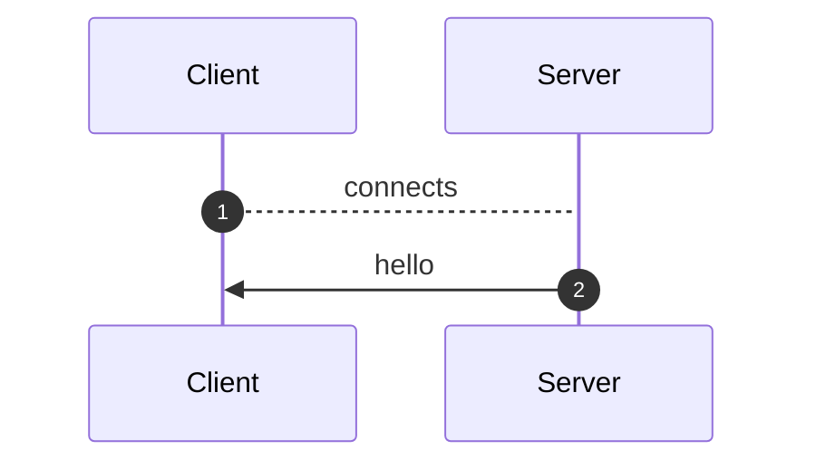
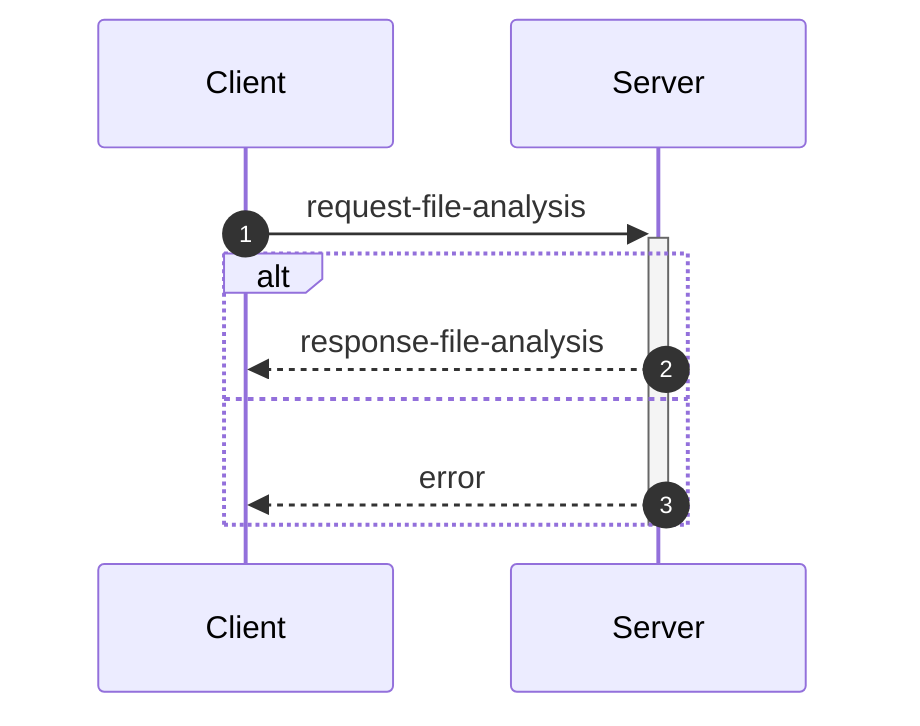
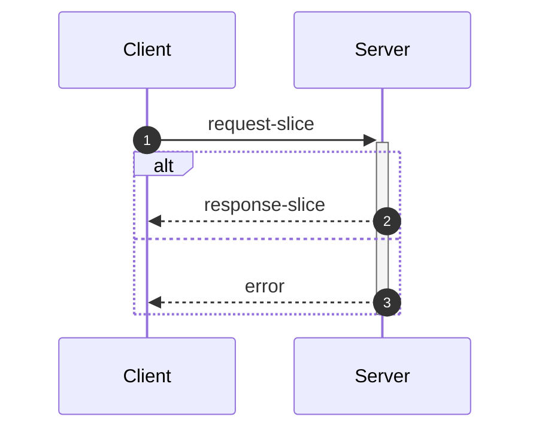
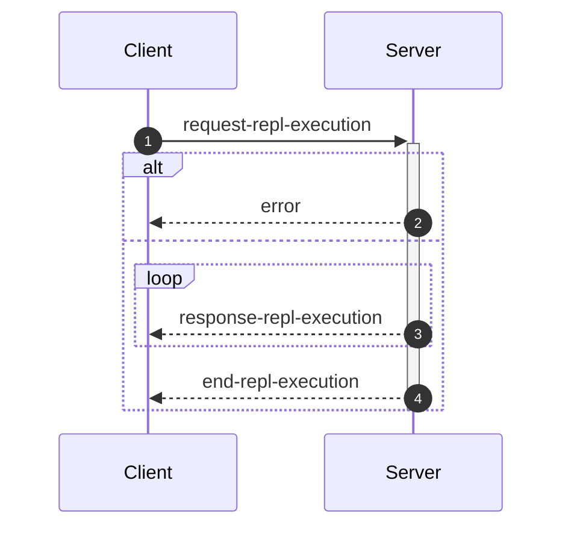

_<span title="an overview of flowR's interface">Generated</span> from '[wiki-interface.ts](https://github.com/flowr-analysis/flowr/tree/main/src/documentation/wiki-interface.ts "src/documentation/wiki-interface.ts")' on 2026-10-27, 21:18:48 UTC (v2.16.7, R v4.6.1), do not edit directly._

Although far from being as detailed as the in-depth explanation of [_flowR_](https://github.com/flowr-analysis/flowr/wiki/Core),
this wiki page explains how to interface with _flowR_ in more detail.
In general, command line arguments and other options provide short descriptions on hover over.

* [💻 Using the REPL](#using-the-repl)
* [⚙️ Configuring FlowR](#configuring-flowr)
* [⚒️ Writing Code](#writing-code)
* [💬 Communicating with the Server](#communicating-with-the-server)

<a id='using-the-repl'></a>
## 💻 Using the REPL

> [!NOTE]
> To execute arbitrary R commands with a repl request, _flowR_ has to be started explicitly with <span title="Description (Command Line Argument): Allow to access the underlying R session when using flowR (security warning: this allows the execution of arbitrary R code!)">`--r-session-access`</span>.
> Please be aware that this introduces a security risk and note that this relies on the [`r-shell` engine](https://github.com/flowr-analysis/flowr/wiki/Engines) .

Although primarily meant for users to explore,
there is nothing which forbids calling _flowR_ as a subprocess to use standard-in, -output, and -error
for communication (although you can access the REPL using the server as well,
with the [REPL Request](#message-request-repl-execution) message).

The read-eval-print loop&nbsp;(REPL) works relatively simple.
You can submit an expression (using <kbd>Enter</kbd>),
which is interpreted as an R&nbsp;expression by default but interpreted as a *command* if it starts with a colon (`:`).
The best command to get started with the REPL is <span title="Description (Repl Command): Show help information (aliases: :h, :?)">`:help`</span>.
Besides, you can leave the REPL either with the command <span title="Description (Repl Command): End the repl (aliases: :q, :exit)">`:quit`</span> or by pressing <kbd>Ctrl</kbd>+<kbd>C</kbd> twice.
When writing a *command*, you may press <kbd>Tab</kbd> to get a list of completions, if available.
Multiple commands can be entered in a single line by separating them with a semicolon (`;`), e.g. `:parse "x<-2"; :df*`.
If a command is given without R code, the REPL will re-use R code given in a previous command.
The prior example will hence return first the parsed AST of the program and then the dataflow graph for `"x <- 2"`.

> [!NOTE]
> If you develop flowR, you may want to launch the repl using the `npm run main-dev` command, this way, you get a non-minified version of flowR with debug information and hot-reloading of source files.

<details>
<summary>Available Commands</summary>

We currently offer the following commands (this with a `[*]` suffix are available with and without the star):

| Command | Description |
| ------- | ----------- |
| **<span title="Description (Repl Command): End the repl (aliases: :q, :exit)">:quit</span>** | End the repl (aliases: **:<span title="Alias of ':quit'. End the repl">q</span>**, **:<span title="Alias of ':quit'. End the repl">exit</span>**) |
| **<span title="Description (Repl Command): Execute the given code as R code. This requires the `--r-session-access` flag to be set and requires the r-shell engine. (aliases: :e, :r)">:execute</span>** | Execute the given code as R code. This requires the `--r-session-access` flag to be set and requires the r-shell engine. (aliases: **:<span title="Alias of ':execute'. Execute the given code as R code. This requires the `--r-session-access` flag to be set and requires the r-shell engine.">e</span>**, **:<span title="Alias of ':execute'. Execute the given code as R code. This requires the `--r-session-access` flag to be set and requires the r-shell engine.">r</span>**) |
| **<span title="Description (Repl Command): Get mermaid code for the control-flow graph of R code (aliases: :cfg, :cf)">:controlflow[*]</span>** | Get mermaid code for the control-flow graph of R code (star: Returns the URL to mermaid.live) (aliases: **:<span title="Alias of ':controlflow'. Get mermaid code for the control-flow graph of R code">cfg</span>**, **:<span title="Alias of ':controlflow'. Get mermaid code for the control-flow graph of R code">cf</span>**) |
| **<span title="Description (Repl Command): Get mermaid code for the control-flow graph with basic blocks (aliases: :cfgb, :cfb)">:controlflowbb[*]</span>** | Get mermaid code for the control-flow graph with basic blocks (star: Returns the URL to mermaid.live) (aliases: **:<span title="Alias of ':controlflowbb'. Get mermaid code for the control-flow graph with basic blocks">cfgb</span>**, **:<span title="Alias of ':controlflowbb'. Get mermaid code for the control-flow graph with basic blocks">cfb</span>**) |
| **<span title="Description (Repl Command): Get mermaid code for the dataflow graph (aliases: :d, :df)">:dataflow[*]</span>** | Get mermaid code for the dataflow graph (star: Returns the URL to mermaid.live) (aliases: **:<span title="Alias of ':dataflow'. Get mermaid code for the dataflow graph">d</span>**, **:<span title="Alias of ':dataflow'. Get mermaid code for the dataflow graph">df</span>**) |
| **<span title="Description (Repl Command): Get mermaid code for the normalized AST of R code (aliases: :n)">:normalize[*]</span>** | Get mermaid code for the normalized AST of R code (star: Returns the URL to mermaid.live) (alias: **:<span title="Alias of ':normalize'. Get mermaid code for the normalized AST of R code">n</span>**) |
| **<span title="Description (Repl Command): Get mermaid code for the simplified dataflow graph (aliases: :ds, :dfs)">:dataflowsimple[*]</span>** | Get mermaid code for the simplified dataflow graph (star: Returns the URL to mermaid.live) (aliases: **:<span title="Alias of ':dataflowsimple'. Get mermaid code for the simplified dataflow graph">ds</span>**, **:<span title="Alias of ':dataflowsimple'. Get mermaid code for the simplified dataflow graph">dfs</span>**) |
| **<span title="Description (Repl Command): Inspect and extend the signature database: `query` (identical to :query @signature), `info <name>` for where a function comes from (identical to :query @function-info), `add <path>` to mount another database/source, `download` to fetch the full-history database. (aliases: :sig)">:signature</span>** | Inspect and extend the signature database: `query` (identical to :query @signature), `info <name>` for where a function comes from (identical to :query @function-info), `add <path>` to mount another database/source, `download` to fetch the full-history database. (alias: **:<span title="Alias of ':signature'. Inspect and extend the signature database: `query` (identical to :query @signature), `info <name>` for where a function comes from (identical to :query @function-info), `add <path>` to mount another database/source, `download` to fetch the full-history database.">sig</span>**) |
| **<span title="Description (Repl Command): Just calculates the DFG, but only prints summary info (aliases: :d#, :df#)">:dataflowsilent</span>** | Just calculates the DFG, but only prints summary info (aliases: **:<span title="Alias of ':dataflowsilent'. Just calculates the DFG, but only prints summary info">d#</span>**, **:<span title="Alias of ':dataflowsilent'. Just calculates the DFG, but only prints summary info">df#</span>**) |
| **<span title="Description (Repl Command): Prints ASCII Art of the parsed, unmodified AST (aliases: :p)">:parse</span>** | Prints ASCII Art of the parsed, unmodified AST (alias: **:<span title="Alias of ':parse'. Prints ASCII Art of the parsed, unmodified AST">p</span>**) |
| **<span title="Description (Repl Command): Prints the version of flowR as well as the current version of R">:version</span>** | Prints the version of flowR as well as the current version of R
| **<span title="Description (Repl Command): Query the given R code (use 'help' for more information)">:query[*]</span>** | Query the given R code (use 'help' for more information) (star: Similar to query, but returns the output in json format.)
| **<span title="Description (Repl Command): Returns an ASCII representation of the dataflow graph (aliases: :df!)">:dataflowascii</span>** | Returns an ASCII representation of the dataflow graph (alias: **:<span title="Alias of ':dataflowascii'. Returns an ASCII representation of the dataflow graph">df!</span>**) |
| **<span title="Description (Repl Command): Returns summarization stats for the normalized AST (aliases: :n#)">:normalize#</span>** | Returns summarization stats for the normalized AST (alias: **:<span title="Alias of ':normalize#'. Returns summarization stats for the normalized AST">n#</span>**) |
| **<span title="Description (Repl Command): Show help information (aliases: :h, :?)">:help</span>** | Show help information (aliases: **:<span title="Alias of ':help'. Show help information">h</span>**, **:<span title="Alias of ':help'. Show help information">?</span>**) |

</details>

> [!TIP]
> 
> As indicated by the examples before, all REPL commands that operate on code keep track of the state.
> Hence, if you run a command like <span title="Description (Repl Command, starred version): Returns the URL to mermaid.live; Base Command: Get mermaid code for the dataflow graph (aliases: :d*, :df*)">`:dataflow*`</span> without providing R code,
> the REPL will re-use the R code provided in a previous command.
> Likewise, doing this will benefit from incrementality!
> If you request the dataflow graph with `:df* x <- 2 * y` and then want to see the parsed AST with `:parse`,
> the REPL will re-use previously obtained information and not re-parse the code again.
> 		

Generally, many commands offer shortcut versions in the REPL. Many queries, for example, offer a shortened format (see the example below).
Of special note, the [Config Query](https://github.com/flowr-analysis/flowr/wiki/%5BQuery%5D-Config)
can be used to also modify the currently active configuration of _flowR_ within the REPL (see the [wiki page](https://github.com/flowr-analysis/flowr/wiki/%5BQuery%5D-Config) for more information).

### Example: Retrieving the Dataflow Graph

To retrieve a URL to the [mermaid](https://mermaid.js.org/) diagram of the dataflow of a given expression,
use <span title="Description (Repl Command, starred version): Returns the URL to mermaid.live; Base Command: Get mermaid code for the dataflow graph (aliases: :d*, :df*)">`:dataflow*`</span> (or <span title="Description (Repl Command): Get mermaid code for the dataflow graph (aliases: :d, :df)">`:dataflow`</span> to get the mermaid code in the cli):

```shell
$ docker run -it --rm eagleoutice/flowr # or npm run flowr 
flowR repl v2.16.7, R grammar v14 (tree-sitter engine)
R> :dataflow* y <- 1 + x
```

<details>
<summary style='color:gray'>Output</summary>

```text
https://mermaid.live/view#base64:eyJjb2RlIjoiZmxvd2NoYXJ0IFREXG4gICAgMXt7XCJgKiM5MTtSTnVtYmVyIzkzOyogKioxKipcbiAgICAgICoxLjYqICgqKmlkOiAxKiopYFwifX1cbiAgICAyKFtcImAqIzkxO1JTeW1ib2wjOTM7KiAqKngqKlxuICAgICAgKjEuMTAqICgqKmlkOiAyKiopYFwiXSlcbiAgICAzW1tcImAqIzkxO1JCaW5hcnlPcCM5MzsqIGJhc2UjNTg7IzU4OyoqIzQzOyoqXG4gICAgICAqMS42LTEwKiAoKippZDogMyoqKVxuICAgIGFyZzogKDEsIDIpYFwiXV1cbiAgICBidWlsdC1pbjpfNDNfW1wiYEJ1aWx0LUluOlxuIzQzO2BcIl1cbiAgICBzdHlsZSBidWlsdC1pbjpfNDNfIHN0cm9rZTpncmF5LGZpbGw6Z3JheSxzdHJva2Utd2lkdGg6MnB4LG9wYWNpdHk6Ljg7XG4gICAgMFtcImAqIzkxO1JTeW1ib2wjOTM7KiAqKnkqKlxuICAgICAgKjEuMSogKCoqaWQ6IDAqKiwgdjogMylgXCJdXG4gICAgNFtbXCJgKiM5MTtSQmluYXJ5T3AjOTM7KiBiYXNlIzU4OyM1ODsqKiM2MDsjNDU7KipcbiAgICAgICoxLjEtMTAqICgqKmlkOiA0KiopXG4gICAgYXJnOiAoMCwgMylgXCJdXVxuICAgIGJ1aWx0LWluOl82MF8tW1wiYEJ1aWx0LUluOlxuIzYwOyM0NTtgXCJdXG4gICAgc3R5bGUgYnVpbHQtaW46XzYwXy0gc3Ryb2tlOmdyYXksZmlsbDpncmF5LHN0cm9rZS13aWR0aDoycHgsb3BhY2l0eTouODtcbiAgICAxIC0uLT58XCJmbG93XCJ8IDJcbiAgICBsaW5rU3R5bGUgMCBzdHJva2U6Z3JheSxjb2xvcjpncmF5O1xuICAgIDIgLS4tPnxcImZsb3dcInwgM1xuICAgIGxpbmtTdHlsZSAxIHN0cm9rZTpncmF5LGNvbG9yOmdyYXk7XG4gICAgMyAtLT58XCJyZWFkcywgYXJnXCJ8IDFcbiAgICAzIC0tPnxcInJlYWRzLCBhcmdcInwgMlxuICAgIDMgLS4tPnxcImZsb3dcInwgMFxuICAgIGxpbmtTdHlsZSA0IHN0cm9rZTpncmF5LGNvbG9yOmdyYXk7XG4gICAgMyAtLi0+fFwicmVhZHMsIGNhbGxzXCJ8IGJ1aWx0LWluOl80M19cbiAgICBsaW5rU3R5bGUgNSBzdHJva2U6Z3JheTtcbiAgICAwIC0tPnxcImRlZmluZWQtYnksIGZsb3dcInwgNFxuICAgIDAgLS0+fFwiZGVmaW5lZC1ieVwifCAzXG4gICAgNCAtLT58XCJyZWFkcywgYXJnXCJ8IDNcbiAgICA0IC0tPnxcInJldHVybnMsIGFyZ1wifCAwXG4gICAgNCAtLi0+fFwicmVhZHMsIGNhbGxzXCJ8IGJ1aWx0LWluOl82MF8tXG4gICAgbGlua1N0eWxlIDEwIHN0cm9rZTpncmF5OyIsIm1lcm1haWQiOnsiYXV0b1N5bmMiOnRydWV9fQ==
```

Retrieve the dataflow graph of the expression `y <- 1 + x`. It looks like this:


<details>

<summary style="color:gray">R Code of the Dataflow Graph</summary>

The analysis ran (parse and normalize with the [tree-sitter](https://github.com/flowr-analysis/flowr/wiki/Engines) engine) in the generation environment. No [signature database](https://github.com/flowr-analysis/flowr/wiki/Signature-Database) is mounted, so `library()` attaches no exports (base-R names are still qualified, e.g., `stats::acf`). 
We encountered no unknown side effects during the analysis.

```r
y <- 1 + x
```

</details>

</details>

For small graphs like this, <span title="Description (Repl Command): Returns an ASCII representation of the dataflow graph (aliases: :df!)">`:dataflowascii`</span> also provides an ASCII representation directly in the REPL:

```shell
$ docker run -it --rm eagleoutice/flowr # or npm run flowr 
flowR repl v2.16.7, R grammar v14 (tree-sitter engine)
R> :df! y <- 1 + x
```

<details open>
<summary style='color:gray'>Output</summary>

```text
                        v<0>v
 c<4>c──────────────────| y |
 |<- |     ┌────────────v---v
 c---c     │
    │   c<3>c   0<1>0
    └───| + |───| 1 |───u<2>u
        c---c   0---0   | x |
           └────────────u---u
Edges:
3 -> 1: reads, arg          3 -> 2: reads, arg
3 -> 0: flows-to            1 -> 2: flows-to
2 -> 3: flows-to            4 -> 3: reads, arg
4 -> 0: returns, arg        0 -> 4: defined-by, flows-to
0 -> 3: defined-by
```

Retrieve the dataflow graph of the expression `y <- 1 + x` as ASCII art.

</details>

For the slicing with <span title="Description (Repl Command): Static backwards executable slicer for R">`:slicer`</span>, you have access to the same [magic comments](#slice-magic-comments) as with the [slice request](#message-request-slice).
Pass `--inline` to splice resolvable `source()` calls into the reconstruction so the slice is a single self-contained R text (the same as the static slice query's `inlineSources` flag).
See `--help` for more flags!

### Example: Interfacing with the File System

Many commands that allow for an R-expression (like <span title="Description (Repl Command, starred version): Returns the URL to mermaid.live; Base Command: Get mermaid code for the dataflow graph (aliases: :d*, :df*)">`:dataflow*`</span>) allow for a file as well
if the argument starts with `file://`.
If you are working from the root directory of the _flowR_ repository, the following gives you the parsed AST of the example file using the <span title="Description (Repl Command): Prints ASCII Art of the parsed, unmodified AST (aliases: :p)">`:parse`</span> command:

> **Watch mode**: Replace `file://` with `watch://` to enter watch mode.
> flowR runs the command immediately and then re-runs it every time the file (or any file inside the folder) changes.
> Enter any other command to leave watch mode.
> For example: `:df watch://analysis.R`

```shell
$ docker run -it --rm eagleoutice/flowr # or npm run flowr 
flowR repl v2.16.7, R grammar v14 (tree-sitter engine)
R> :parse file://test/testfiles/example.R
```

<details>
<summary style='color:gray'>Output</summary>

```text
File: test/testfiles/example.R

program
├ binaryoperator
│ ├ identifier "sum" (1:1─4)
│ ├ <- "<-" (1:5─7)
│ ╰ float "0" (1:8─9)
├ binaryoperator
│ ├ identifier "product" (2:1─8)
│ ├ <- "<-" (2:9─11)
│ ╰ float "1" (2:12─13)
├ binaryoperator
│ ├ identifier "w" (3:1─2)
│ ├ <- "<-" (3:3─5)
│ ╰ float "7" (3:6─7)
├ binaryoperator
│ ├ identifier "N" (4:1─2)
│ ├ <- "<-" (4:3─5)
│ ╰ float "10" (4:6─8)
├ forstatement
│ ├ for "for" (6:1─4)
│ ├ ( "(" (6:5─6)
│ ├ identifier "i" (6:6─7)
│ ├ in "in" (6:8─10)
│ ├ binaryoperator
│ │ ├ float "1" (6:11─12)
│ │ ├ : ":" (6:12─13)
│ │ ╰ parenthesizedexpression
│ │   ├ ( "(" (6:13─14)
│ │   ├ binaryoperator
│ │   │ ├ identifier "N" (6:14─15)
│ │   │ ├ - "-" (6:15─16)
│ │   │ ╰ float "1" (6:16─17)
│ │   ╰ ) ")" (6:17─18)
│ ├ ) ")" (6:18─19)
│ ╰ bracedexpression
│   ├ { "{" (6:20─21)
│   ├ binaryoperator
│   │ ├ identifier "sum" (7:3─6)
│   │ ├ <- "<-" (7:7─9)
│   │ ╰ binaryoperator
│   │   ├ binaryoperator
│   │   │ ├ identifier "sum" (7:10─13)
│   │   │ ├ + "+" (7:14─15)
│   │   │ ╰ identifier "i" (7:16─17)
│   │   ├ + "+" (7:18─19)
│   │   ╰ identifier "w" (7:20─21)
│   ├ binaryoperator
│   │ ├ identifier "product" (8:3─10)
│   │ ├ <- "<-" (8:11─13)
│   │ ╰ binaryoperator
│   │   ├ identifier "product" (8:14─21)
│   │   ├  "" (8:22─23)
│   │   ╰ identifier "i" (8:24─25)
│   ╰ } "}" (9:1─2)
├ call
│ ├ identifier "cat" (11:1─4)
│ ╰ arguments
│   ├ ( "(" (11:4─5)
│   ├ argument
│   │ ╰ string
│   │   ├ stringopen "\"" (11:5─6)
│   │   ├ stringcontent "Sum:" (11:6─10)
│   │   ╰ stringclose "\"" (11:10─11)
│   ├ comma "," (11:11─12)
│   ├ argument
│   │ ╰ identifier "sum" (11:13─16)
│   ├ comma "," (11:16─17)
│   ├ argument
│   │ ╰ string
│   │   ├ stringopen "\"" (11:18─19)
│   │   ├ stringcontent
│   │   │ ╰ escapesequence "\\n" (11:19─21)
│   │   ╰ stringclose "\"" (11:21─22)
│   ╰ ) ")" (11:22─23)
╰ call
  ├ identifier "cat" (12:1─4)
  ╰ arguments
    ├ ( "(" (12:4─5)
    ├ argument
    │ ╰ string
    │   ├ stringopen "\"" (12:5─6)
    │   ├ stringcontent "Product:" (12:6─14)
    │   ╰ stringclose "\"" (12:14─15)
    ├ comma "," (12:15─16)
    ├ argument
    │ ╰ identifier "product" (12:17─24)
    ├ comma "," (12:24─25)
    ├ argument
    │ ╰ string
    │   ├ stringopen "\"" (12:26─27)
    │   ├ stringcontent
    │   │ ╰ escapesequence "\\n" (12:27─29)
    │   ╰ stringclose "\"" (12:29─30)
    ╰ ) ")" (12:30─31)
```

Retrieve the parsed AST of the example file.

<details>

<summary>File Content</summary>

```r
sum <- 0
product <- 1
w <- 7
N <- 10

for (i in 1:(N-1)) {
  sum <- sum + i + w
  product <- product * i
}

cat("Sum:", sum, "\n")
cat("Product:", product, "\n")
```

</details>

As _flowR_ directly transforms this AST the output focuses on being human-readable instead of being machine-readable.
		
</details>

### Example: Run a Query

You can run any query supported by _flowR_ using the <span title="Description (Repl Command): Query the given R code (use 'help' for more information)">`:query`</span> command.
For example, to obtain the shapes of all data frames in a given piece of code, you can run:

```shell
$ docker run -it --rm eagleoutice/flowr # or npm run flowr 
flowR repl v2.16.7, R grammar v14 (tree-sitter engine)
R> :query @absint df-shape "x <- data.frame(a = 1:10, b = 1:10)\ny <- x$a"
```

<details open>
<summary style='color:gray'>Output</summary>

```text
Query: absint (2 ms)
   ╰ $12: (colnames: [{"a", "b"}, {}], cols: [2, 2], rows: [10, 10])
   ╰ $0: (colnames: [{"a", "b"}, {}], cols: [2, 2], rows: [10, 10])
```

Retrieve the shapes of all data frames in the given code.

</details>

To run the linter on a file, you can use (in this example, we just issue the `dead-code` linter on a small piece of code):

```shell
$ docker run -it --rm eagleoutice/flowr # or npm run flowr 
flowR repl v2.16.7, R grammar v14 (tree-sitter engine)
R> :query @linter rules:dead-code "if(FALSE) x <- 2"
```

<details open>
<summary style='color:gray'>Output</summary>

```text
Query: linter (1 ms)
   ╰ Dead Code (dead-code):
       ╰ certain:
           ╰ Code at 1.11-16 (1 quick fix(es) available)
```

Run the linter on the given code, with only the `dead-code` rule enabled.

</details>

For more information on the available queries, please check out the [Query API](https://github.com/flowr-analysis/flowr/wiki/Query-API).

<a id='configuring-flowr'></a>
## ⚙️ Configuring FlowR

When running _flowR_, you may want to specify some behaviors with a dedicated configuration file.
By default, flowR looks for a file named `flowr.json` in the current working directory (or any higher directory).
You can also specify a different file with <span title="Description (Command Line Argument): The name of the configuration file to use">`--config-file`</span> or pass the configuration inline using <span title="Description (Command Line Argument): The flowR configuration to use, as a JSON string">`--config-json`</span>.
A `flowr.json` found this way belongs to the analyzed project, so flowR ignores its options that decide what flowR executes or loads
(`engines.*.wasmPath`, `engines.*.treeSitterWasmPath`, `engines.*.rPath`, `solver.sigdb.additionalPaths`, `solver.sigdb.downloadRepo`, `solver.sigdb.installedLibrary.paths`),
unless you pass <span title="Description (Command Line Argument): Keep the security-sensitive options (e.g., the R executable) of the flowr.json found in the working directory or a parent. Only use this for projects you trust.">`--trust-config`</span>.
To analyze code you do not trust, use the secure mode (<span title="Description (Command Line Argument): Run in secure mode for analyzing untrusted code: flowR does not start R (or any other process), does not access the network, does not search for project configs, and ignores security-sensitive options in every config. Cannot be disabled once enabled. Can also be enabled with the environment variable {italic FLOWR_SECURE_MODE=1}.">`--secure`</span>, see the [security policy](https://github.com/flowr-analysis/flowr/blob/main/.github/SECURITY.md)).
To inspect the current configuration, you can run flowr with the <span title="Description (Command Line Argument): Run with verbose logging (will be passed to the corresponding script)">`--verbose`</span> flag, or use the `config` [Query](https://github.com/flowr-analysis/flowr/wiki/Query-API).
Within the REPL this works by running the following:

```shell
:query @config
```

To work with the <a href="https://github.com/flowr-analysis/flowr/tree/main/src/config.ts#L119"><code><span title="The configuration file format for flowR.">FlowrConfig</span></code></a> you can use the provided helper objects alongside its methods like
<a href="https://github.com/flowr-analysis/flowr/tree/main/src/config.ts#L914"><code><span title="Creates a new flowr config that has the updated values.">FlowrConfig::<b>amend</b></span></code></a>.
The schema below documents every option; the ones you most likely want are:

- <a href="https://github.com/flowr-analysis/flowr/wiki/Interface#configuring-flowr" title="Configuration Option (boolean): Whether source calls should be ignored, causing {@link processSourceCall}&#39;s behavior to be skipped.">ignoreSourceCalls</a>: ignore source calls when analyzing the code, i.e., ignore the inclusion of other files.
- <a href="https://github.com/flowr-analysis/flowr/wiki/Interface#configuring-flowr" title="Configuration Option (boolean): Whether load calls should be ignored, causing {@link processLoadCall}&#39;s behavior to be skipped.">ignoreLoadCalls</a>: ignore load calls when analyzing the code, i.e., ignore the loading of r-data files.
- <a href="https://github.com/flowr-analysis/flowr/wiki/Interface#configuring-flowr" title="Configuration Option (object): Do you want to overwrite (parts) of the builtin definition?">semantics.environment.overwriteBuiltIns</a>: overwrite _flowR_'s handling of built-in functions, or clear the preset definitions entirely.
  See [Configure BuiltIn Semantics](#configure-builtin-semantics) for more information.
- <a href="https://github.com/flowr-analysis/flowr/wiki/Interface#configuring-flowr" title="Configuration Option (string): How to resolve variables and their values. (one of &quot;disabled&quot;, &quot;alias&quot;, &quot;builtin&quot;)">solver.variables</a>: how to resolve variables and their values (`disabled`, `alias`, `builtin`).
- <a href="https://github.com/flowr-analysis/flowr/wiki/Interface#configuring-flowr" title="Configuration Option (array): The engine or set of engines to use for interacting with R code. An empty array means all available engines will be used.">engines</a> and <a href="https://github.com/flowr-analysis/flowr/wiki/Interface#configuring-flowr" title="Configuration Option (string): The default engine to use for interacting with R code. If this is undefined, an arbitrary engine from the specified list will be used. (one of &quot;tree-sitter&quot;, &quot;r-shell&quot;)">defaultEngine</a>: the engines used to interact with R code, see the [Engines wiki page](https://github.com/flowr-analysis/flowr/wiki/Engines).
- <a href="https://github.com/flowr-analysis/flowr/wiki/Interface#configuring-flowr" title="Configuration Option (array): Files a framework loads on its own, without any source() call (e.g. global.R in a shiny app), in the order they are loaded; flowR orders the matching project files accordingly and analyzes them as one program. Entries are case-insensitive globs matched against the file path, a plain name matches any file with that name, and entries matching no project file are warned about. Usually set per project kind via specializeConfig.">project.implicitSources</a>: the files a framework loads without any `source()` call, in the order in which they are
  loaded. Entries are globs (e.g. `R/*.R`) matched against the file path ignoring capitalization; one matching no file is reported.
- <a href="https://github.com/flowr-analysis/flowr/wiki/Interface#configuring-flowr" title="Configuration Option (object): Overwrite (parts of) the configuration depending on the project kind flowR detects, e.g. to give a shiny app its implicit sources.">specializeConfig</a>: overwrite (parts of) the configuration depending on the kind of project _flowR_ detects
  (e.g. `shiny-app`), which is how a shiny app gets its implicit sources by default. What you configure directly wins.
- <a href="https://github.com/flowr-analysis/flowr/wiki/Interface#configuring-flowr" title="Configuration Option (string): Overwrite the project kind flowR would otherwise infer from the analyzed files, e.g. when auto-detection guesses wrong. (one of &quot;package&quot;, &quot;script&quot;, &quot;shiny-app&quot;, &quot;notebook&quot;, &quot;project&quot;, &quot;unknown&quot;)">project.useProjectType</a>: skip that detection and force a project kind yourself, when auto-detection guesses wrong.
- <a href="https://github.com/flowr-analysis/flowr/wiki/Interface#configuring-flowr" title="Configuration Option (array): The default plugins to load when creating a new instance of FlowrAnalyzer">defaultPlugins</a> and <a href="https://github.com/flowr-analysis/flowr/wiki/Interface#configuring-flowr" title="Configuration Option (array): The plugins to load in REPL mode">repl.plugins</a>: the plugins to load for a new <a href="https://github.com/flowr-analysis/flowr/tree/main/src/project/flowr-analyzer.ts#L205"><code><span title="Central class for conducting analyses with FlowR. Use the FlowrAnalyzerBuilder to create a new instance. If you want the original pattern of creating a pipeline and running all steps, you can still do this with FlowrAnalyzer#runFull . To inspect the context of the analyzer, use FlowrAnalyzer#inspectContext (if you are a plugin and need to modify it, use FlowrAnalyzer#context instead).">FlowrAnalyzer</span></code></a> and in the REPL
  (use `flowr:default` to reference the former).

So you can configure _flowR_ by adding a file like the following:

<details>

<summary>Example Configuration File</summary>

```json
{
  "ignoreSourceCalls": true,
  "ignoreLoadCalls": true,
  "semantics": {
    "environment": {
      "overwriteBuiltIns": {
        "definitions": [
          {
            "type": "function",
            "names": [
              "foo"
            ],
            "processor": "builtin:assign",
            "config": {}
          }
        ]
      }
    }
  },
  "defaultPlugins": [
    "file:description",
    "versions:description"
  ],
  "repl": {
    "quickStats": false,
    "dfProcessorHeat": false,
    "hints": true,
    "plugins": [
      "flowr:default"
    ]
  },
  "project": {
    "resolveUnknownPathsOnDisk": true,
    "implicitSources": [
      "global.R",
      "app.R"
    ]
  },
  "linter": {
    "disabledRules": []
  },
  "specializeConfig": {
    "shiny-app": {
      "project": {
        "implicitSources": [
          "global.R",
          "ui.R",
          "server.R",
          "app.R"
        ]
      }
    }
  },
  "engines": [
    {
      "type": "r-shell"
    }
  ],
  "solver": {
    "variables": "alias",
    "evalStrings": true,
    "trackEnvironments": true,
    "sigdb": {
      "enabled": true,
      "loadProjectDependencies": true,
      "eagerlyLoad": false,
      "eagerlyLoadExports": false,
      "linkBaseR": false,
      "linkDescriptionDependencies": false
    },
    "resolveSource": {
      "dropPaths": "no",
      "ignoreCapitalization": true,
      "inferWorkingDirectory": "active-script",
      "searchPath": []
    },
    "instrument": {},
    "slicer": {
      "threshold": 50
    }
  },
  "abstractInterpretation": {
    "wideningThreshold": 4,
    "followCalls": true,
    "dataFrame": {
      "maxColNames": 20,
      "readLoadedData": {
        "readExternalFiles": true,
        "maxReadLines": 1000000
      }
    }
  },
  "incremental": {
    "alwaysIncremental": false,
    "parsing": {
      "activated": false,
      "heuristics": {
        "activated": true,
        "mtime": true,
        "linesFrom": 500,
        "bytesFrom": 50000,
        "alwaysWithEdits": false,
        "minFiles": 1
      }
    }
  },
  "gas": {
    "thresholds": {
      "memory": {
        "problematic": 0.7,
        "critical": 0.9
      },
      "timeMs": {
        "problematic": 100000,
        "critical": 120000
      }
    },
    "features": {}
  }
}
```

</details>

<details>
<a id='configure-builtin-semantics'></a>
<summary>Configure Built-In Semantics</summary>

`semantics/environment/overwriteBuiltins` accepts two keys:

- `loadDefaults` (boolean, initially `true`): If set to `true`, the default built-in definitions are loaded before applying the custom definitions. Setting this flag to `false` explicitly disables the loading of the default definitions.
- `definitions` (array, initially empty): Allows to overwrite or define new built-in elements. Each object within must have a `type` which is one of the below. Furthermore, they may define a string array of `names` which specifies the identifiers to bind the definitions to. You may use `assumePrimitive` to specify whether _flowR_ should assume that this is a primitive non-library definition (so you probably just do not want to specify the key).

  | Type            | Description                                                                                                                                                                                                                                                                                              | Example                                                                                                    |
  | --------------- | -------------------------------------------------------------------------------------------------------------------------------------------------------------------------------------------------------------------------------------------------------------------------------------------------------- | ---------------------------------------------------------------------------------------------------------- |
  | `constant`    | Additionally allows for a `value` this should resolve to.                                                                                                                                                                                                                                                | `{ type: 'constant', names: ['NULL', 'NA'],  value: null }`                                                |
  | `function`    | Is a rather flexible way to define and bind built-in functions. For the time, we do not have extensive documentation to cover all the cases, so please either consult the sources with the `default-builtin-config.ts` or open a [new issue](https://github.com/flowr-analysis/flowr/issues/new/choose). | `{ type: 'function', names: ['next'], processor: 'builtin:d', config: { cfg: ExitPointType.Next } }` |
  | `replacement` | A comfortable way to specify replacement functions like `$<-` or `names<-`. `suffixes` describes the... suffixes to attach automatically. | `{ type: 'replacement', suffixes: ['<-', '<<-'], names: ['[', '[['] }` |

</details>

<details>

<summary style='color:gray'>Full Configuration-File Schema</summary>

- _The configuration file format for flowR._ (object)
    - **logLevel** [optional] _flowR's global minimum log level, applied when the config is loaded._ (string)
        Only allows: 'silly', 'trace', 'debug', 'info', 'warn', 'error', 'fatal'
    - **ignoreSourceCalls** [optional] _Whether source calls should be ignored, causing {@link processSourceCall}'s behavior to be skipped._ (boolean)
    - **ignoreLoadCalls** [optional] _Whether load calls should be ignored, causing {@link processLoadCall}'s behavior to be skipped._ (boolean)
    - **semantics** _Configure language semantics and how flowR handles them._ (object)
        - **environment** [optional] _Semantics regarding how to handle the R environment._ (object)
            - **overwriteBuiltIns** [optional] _Do you want to overwrite (parts) of the builtin definition?_ (object)
                - **loadDefaults** [optional] _Should the default configuration still be loaded?_ (boolean)
                - **definitions** [optional] _The definitions to load/overwrite._ (array)
                Valid item types:
                    - (object)
    - **defaultPlugins** [optional] _The default plugins to load when creating a new instance of FlowrAnalyzer_ (array)
    Valid item types:
        - (alternatives)
            - (string)
            - (array)
    - **repl** _Configuration options for the REPL._ (object)
        - **quickStats** [optional] _Whether to show quick stats in the REPL after each evaluation._ (boolean)
        - **dfProcessorHeat** [optional] _This instruments the dataflow processors to count how often each processor is called._ (boolean)
        - **hints** [optional] _Whether to show dim inline hints on the empty prompt (automatically disabled on non-interactive terminals)._ (boolean)
        - **plugins** [optional] _The plugins to load in REPL mode_ (array)
        Valid item types:
            - (alternatives)
                - (string)
                - (array)
        - **autoUseFileProtocol** [optional] _Prepend the file protocol to a repl input that looks like a path, instead of only warning about it._ (boolean)
        - **queryStats** [optional] _Whether `:query` closes with the line stating how long the queries took (`:query*` never prints it)._ (boolean)
        - **showPlugins** [optional] _Whether `:version` grays out the plugins that did not activate during the last analysis._ (boolean)
    - **project** _Project specific configuration options._ (object)
        - **resolveUnknownPathsOnDisk** [optional] _Whether to resolve unknown paths loaded by the r project disk when trying to source/analyze files._ (boolean)
        - **failOnInaccessiblePath** [optional] _Whether a directory that cannot be traversed during file discovery (e.g. due to permissions) aborts the analysis; when false (the default) such paths are logged and skipped._ (boolean)
        - **basePackages** [optional] _The packages considered part of R itself (base and recommended); if unset, flowR uses its built-in list._ (array)
        Valid item types:
            - (string)
        - **implicitSources** [optional] _Files a framework loads on its own, without any source() call (e.g. global.R in a shiny app), in the order they are loaded; flowR orders the matching project files accordingly and analyzes them as one program. Entries are case-insensitive globs matched against the file path, a plain name matches any file with that name, and entries matching no project file are warned about. Usually set per project kind via specializeConfig._ (array)
        Valid item types:
            - (string)
        - **useProjectType** [optional] _Overwrite the project kind flowR would otherwise infer from the analyzed files, e.g. when auto-detection guesses wrong._ (string)
            Only allows: 'package', 'script', 'shiny-app', 'notebook', 'project', 'unknown'
        - **assumeImplicitEcho** [optional] _Whether the top level of the analyzed code is echoed, so that every visible result printed there is collected as an output by the dependencies query (default true, false for a package)._ (boolean)
        - **discovery** [optional] _Scoping options for the default project discovery._ (object)
            - **full** [optional] _Collect every file below the project root (greedy) instead of only the files the detected project kind needs (default false)._ (boolean)
            - **perKind** [optional] _Per-kind include/exclude glob overrides layered on the default scoping._ (object)
            - **ignore** [optional] _Case-insensitive globs that drop matching files from the intelligent discovery, regardless of kind (e.g. .Renviron to ignore environment files)._ (array)
            Valid item types:
                - (string)
        - **classification** [optional] _Overrides for the signals flowR uses to classify the project kind._ (object)
            - **shinyDescriptionTypes** [optional] _DESCRIPTION Type: values that mark a shiny app._ (array)
            Valid item types:
                - (string)
            - **shinyEntryFiles** [optional] _File names a shiny app is assembled from._ (array)
            Valid item types:
                - (string)
            - **shinyUsagePattern** [optional] _Regex source evidencing shiny usage in an entry file._ (string)
            - **notebookExtensions** [optional] _File extensions marking a notebook._ (array)
            Valid item types:
                - (string)
    - **linter** _Linter configuration options._ (object)
        - **disabledRules** _Linting rule names excluded from the default rule set (a rule requested explicitly via a linter query still runs). Usually set per project kind via specializeConfig._ (array)
        Valid item types:
            - (string)
        - **disabledTags** [optional] _Linting rule tags whose rules are excluded from the default rule set (a rule requested explicitly via a linter query still runs). By default the cmd-check rules are disabled for everything but a package; a configured list replaces that default._ (array)
        Valid item types:
            - (string)
    - **inputSources** [optional] _Further frameworks the input-sources analysis should know about; entries are added to flowR's defaults._ (object)
        - **pure** [optional] _Functions that only pass the constantness of their arguments on._ (array)
        Valid item types:
            - (string)
        - **param** [optional] _Functions whose result is a 'param' input._ (array)
        Valid item types:
            - (string)
        - **file** [optional] _Functions whose result is a 'file' input._ (array)
        Valid item types:
            - (string)
        - **tempfile** [optional] _Functions whose result is a 'tempfile' input._ (array)
        Valid item types:
            - (string)
        - **glob** [optional] _Functions whose result is a 'glob' input._ (array)
        Valid item types:
            - (string)
        - **net** [optional] _Functions whose result is a 'net' input._ (array)
        Valid item types:
            - (string)
        - **rand** [optional] _Functions whose result is a 'rand' input._ (array)
        Valid item types:
            - (string)
        - **system** [optional] _Functions whose result is a 'system' input._ (array)
        Valid item types:
            - (string)
        - **ffi** [optional] _Functions whose result is a 'ffi' input._ (array)
        Valid item types:
            - (string)
        - **lang** [optional] _Functions whose result is a 'lang' input._ (array)
        Valid item types:
            - (string)
        - **options** [optional] _Functions whose result is a 'options' input._ (array)
        Valid item types:
            - (string)
        - **cmdline** [optional] _Functions whose result is a 'cmdline' input._ (array)
        Valid item types:
            - (string)
        - **user** [optional] _Functions whose result is a 'user' input._ (array)
        Valid item types:
            - (string)
        - **const** [optional] _Functions whose result is a 'const' input._ (array)
        Valid item types:
            - (string)
        - **scope** [optional] _Functions whose result is a 'scope' input._ (array)
        Valid item types:
            - (string)
        - **dconst** [optional] _Functions whose result is a 'dconst' input._ (array)
        Valid item types:
            - (string)
        - **unknown** [optional] _Functions whose result is a 'unknown' input._ (array)
        Valid item types:
            - (string)
        - **linkedObjects** [optional] _Objects a framework provides without a definition in the code, e.g. shiny's input._ (array)
        Valid item types:
            - (object)
        - **linkedEntryPoints** [optional] _Calls that hand a function to a framework, which binds its objects to the parameters by position._ (array)
        Valid item types:
            - (object)
    - **specializeConfig** [optional] _Overwrite (parts of) the configuration depending on the project kind flowR detects, e.g. to give a shiny app its implicit sources._ (object)
    - **engines** _The engine or set of engines to use for interacting with R code. An empty array means all available engines will be used._ (array)
    Valid item types:
        - (alternatives)
            - _The configuration for the tree sitter engine._ (object)
                - **type** [required] _Use the tree sitter engine._ (string)
                    Only allows: 'tree-sitter'
                - **wasmPath** [optional] _The path to the tree-sitter-r WASM binary to use. If this is undefined, this uses the default path._ (string)
                - **treeSitterWasmPath** [optional] _The path to the tree-sitter WASM binary to use. If this is undefined, this uses the default path._ (string)
                - **lax** [optional] _Whether to use the lax parser for parsing R code (allowing for syntax errors). If this is undefined, the strict parser will be used._ (boolean)
            - _The configuration for the R shell engine._ (object)
                - **type** [required] _Use the R shell engine._ (string)
                    Only allows: 'r-shell'
                - **rPath** [optional] _The path to the R executable to use. If this is undefined, this uses the default path._ (string)
                - **pipeBind** [optional] _Whether to enable R's experimental pipe-bind operator "=>" by setting _R_USE_PIPEBIND_ for the R session (default false); R itself keeps this off by default, as it is experimental and has never shipped in a release version of R._ (boolean)
    - **defaultEngine** [optional] _The default engine to use for interacting with R code. If this is undefined, an arbitrary engine from the specified list will be used._ (string)
        Only allows: 'tree-sitter', 'r-shell'
    - **solver** _How to resolve constants, constraints, cells, ..._ (object)
        - **variables** _How to resolve variables and their values._ (string)
            Only allows: 'disabled', 'alias', 'builtin'
        - **evalStrings** _Should we include eval(parse(text="...")) calls in the dataflow graph?_ (boolean)
        - **trackEnvironments** [optional] _Track user-created environments (new.env, assign/get/local with envir=, dollar-assign, attach). When false, all envir-style calls fall through conservatively._ (boolean)
        - **sigdb** _Resolving library exports from a signature database._ (object)
            - **enabled** [optional] _Resolve library()/use() exports from a signature database (default true); when false no database is consulted._ (boolean)
            - **loadProjectDependencies** [optional] _Load the project's declared dependencies from its metadata files (DESCRIPTION Imports/Depends, rproject.toml, uvr.toml, renv.lock, rv.lock, uvr.lock) (default true); when false these files are not read for dependencies._ (boolean)
            - **eagerlyLoad** [optional] _Parse the database up front rather than on the first package load (default false, ignored if disabled)._ (boolean)
            - **eagerlyLoadExports** [optional] _Add a vertex for every export on load rather than on demand (default false); keeps the dataflow graph small._ (boolean)
            - **assumedRVersion** [optional] _R version assumed when resolving versioned (base-R) exports: a pin like "4.5" or "auto" to detect the installed R (default "auto")._ (string)
            - **linkBaseR** [optional] _Eagerly attach base-R namespaces so bare base calls resolve without library() (default false)._ (boolean)
            - **linkBaseRCalls** [optional] _Add a lightweight Reads edge from a bare base-R call to its signature-database function vertex (default false; base-R qualification is edge-free otherwise)._ (boolean)
            - **linkPackageCalls** [optional] _Add a lightweight Reads edge from a resolved package call to its signature-database function vertex (default false)._ (boolean)
            - **linkDescriptionDependencies** [optional] _Eagerly attach the namespaces of the project's declared DESCRIPTION dependencies (Imports/Depends) so their exports resolve without an explicit library() (default false)._ (boolean)
            - **warmInBackground** [optional] _Decompress the hot shards (base + most-downloaded) in a background task on startup so the first library() lookup is warm (default false; for long-running servers/REPLs)._ (boolean)
            - **additionalPaths** [optional] _Extra directories or bundle/manifest files searched for signature databases (alongside the shipped default and $FLOWR_SIGDB_DIR); a downloaded full-history bundle placed here is mounted automatically._ (array)
            Valid item types:
                - (string)
            - **downloadRepo** [optional] _GitHub owner/repo the full-history bundle is downloaded from via ":signature download" (default "flowr-analysis/flowr", release tag "sigdb-v<flowR-version>")._ (string)
            - **autoSync** [optional] _On startup, re-download shards whose committed sigdb.remote.json hash no longer matches the cache, in the background (default false; opt-in network sync after a git pull)._ (boolean)
            - **installedLibrary** [optional] _Recovering packages no signature database knows from the copy installed on this machine._ (object)
                - **enabled** [required] _Recover packages no signature database knows from their installed copy (default false)._ (boolean)
                - **paths** [optional] _Library directories to search; when empty they are discovered from the environment and the project._ (array)
                Valid item types:
                    - (string)
                - **useEnvironment** [optional] _Search the libraries R_LIBS_USER/R_LIBS/R_LIBS_SITE name (default true)._ (boolean)
                - **useProjectLibrary** [optional] _Search a project-local renv/packrat library (default true)._ (boolean)
                - **maxDepth** [optional] _How far to descend into the nested layout of a project-local library (default 3)._ (number)
                - **packages** [optional] _Only recover packages whose name matches one of these regular expressions; empty means any._ (array)
                Valid item types:
                    - (string)
            - **blobCacheBudgetMb** [optional] _How many MiB of decoded package blobs every open bundle may hold together (default 16)._ (number)
            - **versionSelection** [optional] _When a project constrains a dependency, resolve to the newest (default), oldest, or system-installed version satisfying it; system needs R and falls back to newest. Base-R packages always resolve against the assumed R version._ (string)
                Only allows: 'newest', 'oldest', 'system'
            - **versionOverrides** [optional] _Force an exact version for specific packages (name -> version), overriding both the project constraint and the versionSelection policy (default {})._ (object)
        - **versionManagement** _Policies for reasoning about dependency versions._ (object)
            - **linkedVersionGroups** [optional] _Groups of packages that must resolve to the same version; version guessing intersects each group so its members stay mutually compatible (default [])._ (array)
            Valid item types:
                - (array)
                Valid item types:
                    - (string)
        - **assumeAttachedPackages** [optional] _Packages to treat as attached without a `library()` call, so what the built-in configuration states about them applies to the analyzed code. The base packages R attaches on startup already resolve without it._ (array)
        Valid item types:
            - (string)
        - **transitiveSideEffectRounds** [optional] _How many rounds the transitive side-effect fixpoint may run before it is cut off (default 32); the propagation stops on its own as soon as a round adds nothing._ (number)
        - **maxOverlayDepth** [optional] _How many binding overlays may stack on one environment frame before a write flattens them (default 4); a pure performance knob, trading lookup cost against copy cost without changing any result._ (number)
        - **instrument** (object)
            - **dataflowExtractors** [optional] _These keys are only intended for use within code, allowing to instrument the dataflow analyzer!_ (any)
        - **resolveSource** [optional] _If lax source calls are active, flowR searches for sourced files much more freely, based on the configurations you give it. This option is only in effect if `ignoreSourceCalls` is set to false._ (object)
            - **dropPaths** _Allow to drop the first or all parts of the sourced path, if it is relative._ (string)
                Only allows: 'no', 'once', 'all'
            - **ignoreCapitalization** _Search for filenames matching in the lowercase._ (boolean)
            - **inferWorkingDirectory** _Try to infer the working directory from the main or any script to analyze._ (string)
                Only allows: 'no', 'main-script', 'active-script', 'any-script'
            - **searchPath** _Additionally search in these paths._ (array)
            Valid item types:
                - (string)
            - **repeatedSourceLimit** [optional] _How often the same file can be sourced within a single run? Please be aware: in case of cyclic sources this may not reach a fixpoint so give this a sensible limit._ (number)
            - **applyReplacements** _Provide name replacements for loaded files_ (array)
            Valid item types:
                - (object)
            - **assumeFilesExist** [optional] _Assume a sourced file is always there, making what it defines certain instead of conditional on the source call._ (boolean)
        - **slicer** [optional] _The configuration for the slicer._ (object)
            - **threshold** [optional] _The maximum number of iterations to perform on a single function call during slicing._ (number)
            - **autoExtend** [optional] _If set, the slicer will gain an additional post-pass._ (boolean)
    - **abstractInterpretation** _The configuration options for abstract interpretation._ (object)
        - **wideningThreshold** _The threshold for the number of visitations of a node at which widening should be performed to ensure the termination of the fixpoint iteration._ (number)
        - **followCalls** _Whether the abstract interpretation is interprocedural, i.e. whether it steps into the functions a call may dispatch to._ (boolean)
        - **dataFrame** _The configuration of the shape inference for data frames._ (object)
            - **maxColNames** _The maximum number of columns names to infer for data frames before over-approximating the column names to top._ (number)
            - **readLoadedData** _Configuration options for reading data frame shapes from loaded external data files, such as CSV files._ (object)
                - **readExternalFiles** _Whether data frame shapes should be extracted from loaded external files, such as CSV files._ (boolean)
                - **maxReadLines** _The maximum number of lines to read when extracting data frame shapes from loaded files, such as CSV files._ (number)
    - **incremental** (object)
        - **alwaysIncremental** _Always take the incremental path, regardless of heuristics._ (boolean)
        - **parsing** (object)
            - **activated** _If set, incremental parsing will be used._ (boolean)
            - **heuristics** (object)
                - **activated** [optional] _If set, the heuristics for incremental parsing will be used._ (boolean)
                - **mtime** [optional] _Skip reparsing entirely if the file's modification time is unchanged since the last parse._ (boolean)
                - **linesFrom** [optional] _Only consider incremental parsing for files with at least this many lines._ (number)
                - **bytesFrom** [optional] _Only consider incremental parsing for files with at least this many bytes._ (number)
                - **alwaysWithEdits** [optional] _Always take the incremental path whenever there is a computed edit region, regardless of the other thresholds._ (boolean)
                - **minFiles** [optional] _Only apply these heuristics once the project has at least this many files loaded._ (number)
    - **gas** [optional] _Resource-usage guard (gas) configuration. All feature factors default to 0 (disabled). See https://github.com/flowr-analysis/flowr/wiki/Core#gas-resource-guard._ (object)
        - **thresholds** [optional] _Thresholds for all gas checks (scaled by per-feature factor), boundable per feature._ (object)
            - **memory** [optional] _Heap-usage fraction thresholds (0-1), either shared or given per feature key (with `default` covering the rest)._ (object)
                - **problematic** [optional] _Heap fraction (0-1) above which Problematic is returned, for every feature without an entry of its own._ (number)
                - **critical** [optional] _Heap fraction (0-1) above which Critical is returned, for every feature without an entry of its own._ (number)
            - **timeMs** [optional] _Elapsed analysis time thresholds in milliseconds, either shared or given per feature key (with `default` covering the rest)._ (object)
                - **problematic** [optional] _Elapsed ms above which Problematic is returned, for every feature without an entry of its own._ (number)
                - **critical** [optional] _Elapsed ms above which Critical is returned, for every feature without an entry of its own._ (number)
            - **steps** [optional] _Processed-AST-node thresholds, counted rather than sampled; only a key that arms a budget (`dataflow`) reads them._ (object)
                - **problematic** [optional] _Processed AST nodes above which Problematic is returned, for every feature without an entry of its own._ (number)
                - **critical** [optional] _Processed AST nodes above which the extraction is cut short, for every feature without an entry of its own._ (number)
            - **vertices** [optional] _Created-dataflow-vertex thresholds, counted like `steps`._ (object)
                - **problematic** [optional] _Created dataflow vertices above which Problematic is returned, for every feature without an entry of its own._ (number)
                - **critical** [optional] _Created dataflow vertices above which the extraction is cut short, for every feature without an entry of its own._ (number)
        - **features** [optional] _Per-feature sensitivity factors. 0 or absent disables gas checking for that feature. A factor of 2 makes the feature twice as sensitive. Recognised keys: `source`, `side-effect-linking`, `linter`, `slicer`, `dataflow`._ (object)
        - **countedCheckEvery** [optional] _How many counted steps pass between two accountings of an armed check, be it a dataflow budget or the slicer's traversal (default 128); trades overshoot against the cost of the check._ (number)
        - **heapProvider** [optional] _Custom heap statistics source (programmatic configs only), overriding the built-in v8/performance.memory detection._ (function)

</details>

<a id='writing-code'></a>
## ⚒️ Writing Code

_flowR_ can be used as a [module](https://www.npmjs.com/package/@eagleoutice/flowr) and offers several main classes and interfaces that are interesting for extension writers 
(see the [Visual Studio Code extension](https://marketplace.visualstudio.com/items?itemName=code-inspect.vscode-flowr) or the [Core](https://github.com/flowr-analysis/flowr/wiki/Core) wiki page for more information).

### Creating Analyses with _flowR_

Nowadays, instances of the <a href="https://github.com/flowr-analysis/flowr/tree/main/src/project/flowr-analyzer.ts#L205"><code><span title="Central class for conducting analyses with FlowR. Use the FlowrAnalyzerBuilder to create a new instance. If you want the original pattern of creating a pipeline and running all steps, you can still do this with FlowrAnalyzer#runFull . To inspect the context of the analyzer, use FlowrAnalyzer#inspectContext (if you are a plugin and need to modify it, use FlowrAnalyzer#context instead).">FlowrAnalyzer</span></code></a> should be used as central frontend to get analysis results from _flowR_.
The entry points an analysis is written against are re-exported from the package root (`import { FlowrAnalyzerBuilder } from '@eagleoutice/flowr'`);
everything else stays reachable under its own path, as in `@eagleoutice/flowr/dataflow/graph/graph`.
For example, a program slice can be created like this:

```ts
const analyzer = await new FlowrAnalyzerBuilder()
    .setEngine('tree-sitter')
    .build();
analyzer.addRequest('x <- 1\ny <- x\nx');
const result = await analyzer.query([
    {
        type:     'static-slice',
        criteria: ['3@x']
    }
]);
```

For more information, please have a look at the [Analyzer](https://github.com/flowr-analysis/flowr/wiki/Analyzer) wiki page, which explains how to construct and use the <a href="https://github.com/flowr-analysis/flowr/tree/main/src/project/flowr-analyzer.ts#L205"><code><span title="Central class for conducting analyses with FlowR. Use the FlowrAnalyzerBuilder to create a new instance. If you want the original pattern of creating a pipeline and running all steps, you can still do this with FlowrAnalyzer#runFull . To inspect the context of the analyzer, use FlowrAnalyzer#inspectContext (if you are a plugin and need to modify it, use FlowrAnalyzer#context instead).">FlowrAnalyzer</span></code></a> in more detail.
To work with specific perspectives, you can also consult the respective pages like the [Dataflow Graph](https://github.com/flowr-analysis/flowr/wiki/Dataflow-Graph) or the [Abstract Interpretation](https://github.com/flowr-analysis/flowr/wiki/Abstract-Interpretation) wiki pages.
### The Pipeline Executor (Low-Level Interface)

Once, in the beginning, _flowR_ was meant to produce a dataflow graph merely to provide *program slices*. 
However, with continuous updates, the [Dataflow Graph](https://github.com/flowr-analysis/flowr/wiki/Dataflow-Graph) repeatedly proves to be the more interesting part.
With this, we restructured _flowR_'s originally *hardcoded* pipeline to be far more flexible. 
Now, it can be theoretically extended or replaced with arbitrary steps, optional steps, and what we call 'decorations' of these steps. 
In short, a slicing pipeline using the <a href="https://github.com/flowr-analysis/flowr/tree/main/src/core/pipeline-executor.ts#L97"><code><span title="**Please note:** The PipelineExecutor is now considered to be a rather low-level API for flowR. While it still works and is the basis for all other layers, we strongly recommend using the FlowrAnalyzer and its builder to create and use an analyzer instance that is pre-configured for your use-case. The pipeline executor allows to execute arbitrary pipelines in a step-by-step fashion. If you are not...">PipelineExecutor</span></code></a> looks like this:

```ts

const slicer = new PipelineExecutor(DEFAULT_SLICING_PIPELINE, {
  parser:    new RShell(),
  request:   requestFromInput('x <- 1\nx + 1'),
  criterion: ['2@x']
})
const slice = await slicer.allRemainingSteps()
// console.log(slice.reconstruct.code)
```

<details><summary>More Information</summary>

If you compare this, with what you would have done with the old (and removed) `SteppingSlicer`, 
this essentially just requires you to replace the `SteppingSlicer` with the <a href="https://github.com/flowr-analysis/flowr/tree/main/src/core/pipeline-executor.ts#L97"><code><span title="**Please note:** The PipelineExecutor is now considered to be a rather low-level API for flowR. While it still works and is the basis for all other layers, we strongly recommend using the FlowrAnalyzer and its builder to create and use an analyzer instance that is pre-configured for your use-case. The pipeline executor allows to execute arbitrary pipelines in a step-by-step fashion. If you are not...">PipelineExecutor</span></code></a>
and to pass the <a href="https://github.com/flowr-analysis/flowr/tree/main/src/core/steps/pipeline/default-pipelines.ts#L18"><code>DEFAULT_SLICING_PIPELINE</code></a> as the first argument.
The <a href="https://github.com/flowr-analysis/flowr/tree/main/src/core/pipeline-executor.ts#L97"><code><span title="**Please note:** The PipelineExecutor is now considered to be a rather low-level API for flowR. While it still works and is the basis for all other layers, we strongly recommend using the FlowrAnalyzer and its builder to create and use an analyzer instance that is pre-configured for your use-case. The pipeline executor allows to execute arbitrary pipelines in a step-by-step fashion. If you are not...">PipelineExecutor</span></code></a>...

1. Provides structures to investigate the results of all intermediate steps
2. Can be executed step-by-step
3. Can repeat steps (e.g., to calculate multiple slices on the same input)

See the in-code documentation for more information.

</details>

### Using the <a href="https://github.com/flowr-analysis/flowr/tree/main/src/r-bridge/shell.ts#L144"><code><span title="The RShell represents an interactive session with the R interpreter. You can configure it by RShellOptions . At the moment we are using a live R session (and not networking etc.) to communicate with R easily, which allows us to install packages etc. However, this might and probably will change in the future (leaving this as a legacy mode :D)">RShell</span></code></a> to Interact with R

The <a href="https://github.com/flowr-analysis/flowr/tree/main/src/r-bridge/shell.ts#L144"><code><span title="The RShell represents an interactive session with the R interpreter. You can configure it by RShellOptions . At the moment we are using a live R session (and not networking etc.) to communicate with R easily, which allows us to install packages etc. However, this might and probably will change in the future (leaving this as a legacy mode :D)">RShell</span></code></a> class allows interfacing with the `R`&nbsp;ecosystem installed on the host system.
Please have a look at [flowR's Engines](https://github.com/flowr-analysis/flowr/wiki/Engines) for more information on alternatives (for example, the <a href="https://github.com/flowr-analysis/flowr/tree/main/src/r-bridge/lang-4.x/tree-sitter/tree-sitter-executor.ts#L29"><code><span title="Synchronous and (way) faster alternative to the RShell using tree-sitter.">TreeSitterExecutor</span></code></a>).

> [!IMPORTANT]
> 
> Each <a href="https://github.com/flowr-analysis/flowr/tree/main/src/r-bridge/shell.ts#L144"><code><span title="The RShell represents an interactive session with the R interpreter. You can configure it by RShellOptions . At the moment we are using a live R session (and not networking etc.) to communicate with R easily, which allows us to install packages etc. However, this might and probably will change in the future (leaving this as a legacy mode :D)">RShell</span></code></a> controls a new instance of the R&nbsp;interpreter, 
> make sure to call <code><a href="https://github.com/flowr-analysis/flowr/tree/main/src/r-bridge/shell.ts#L350"><span title="Close the current R session, makes the object effectively invalid (can no longer be reopened etc.)">RShell::<i>close</i></span></a>()</code> when you are done.

You can start a new "session" by constructing a new object with <code>new <a href="https://github.com/flowr-analysis/flowr/tree/main/src/r-bridge/shell.ts#L144"><span title="The RShell represents an interactive session with the R interpreter. You can configure it by RShellOptions . At the moment we are using a live R session (and not networking etc.) to communicate with R easily, which allows us to install packages etc. However, this might and probably will change in the future (leaving this as a legacy mode :D)">RShell</span></a>()</code>.

However, there are several options that may be of interest 
(e.g., to automatically revive the shell in case of errors or to control the name location of the R process on the system).

With a shell object (let's call it `shell`), you can execute R code by using <a href="https://github.com/flowr-analysis/flowr/tree/main/src/r-bridge/shell.ts#L213"><code><span title="sends the given command directly to the current R session will not do anything to alter input markers!">RShell::<i>sendCommand</i></span></code></a>,
for example <code>shell.<a href="https://github.com/flowr-analysis/flowr/tree/main/src/r-bridge/shell.ts#L213"><span title="sends the given command directly to the current R session will not do anything to alter input markers!">sendCommand</span></a>("1 + 1")</code>.
However, this does not return anything, so if you want to collect the output of your command, use
<a href="https://github.com/flowr-analysis/flowr/tree/main/src/r-bridge/shell.ts#L296"><code><span title="Send a command and collect the output">RShell::<i>sendCommandWithOutput</i></span></code></a> instead.

<a id='communicating-with-the-server'></a>
## 💬 Communicating with the Server

As explained in the [Overview](https://github.com/flowr-analysis/flowr/wiki/Overview), you can run the [TCP](https://de.wikipedia.org/wiki/Transmission_Control_Protocol)&nbsp;server by adding the <span title="Description (Command Line Argument): Do not drop into a repl, but instead start a server on the given port (default: 1042) and listen for messages.">`--server`</span> flag (and, due to the interactive mode, exit with the conventional <kbd>CTRL</kbd>+<kbd>C</kbd>).
Currently, every connection is handled by the same underlying `RShell` - so the server is not designed to handle many clients at a time.
Additionally, the server is not well guarded against attacks (e.g., you can theoretically spawn an arbitrary number of&nbsp;RShell sessions on the target machine).

Every message has to be given in a single line (i.e., without a newline in-between) and end with a newline character. Nevertheless, we will pretty-print example given in the following segments for the ease of reading.

> [!NOTE]
> 
> The default <span title="Description (Command Line Argument): Do not drop into a repl, but instead start a server on the given port (default: 1042) and listen for messages.">`--server`</span> uses a simple [TCP](https://de.wikipedia.org/wiki/Transmission_Control_Protocol)
> connection. If you want _flowR_ to expose a [WebSocket](https://de.wikipedia.org/wiki/WebSocket) server instead, add the <span title="Description (Command Line Argument): If the server flag is set, use websocket for messaging">`--ws`</span> flag (i.e., <span title="Description (Command Line Argument): Do not drop into a repl, but instead start a server on the given port (default: 1042) and listen for messages.">`--server`</span> <span title="Description (Command Line Argument): If the server flag is set, use websocket for messaging">`--ws`</span>) when starting _flowR_ from the command line.

<ul><li>
<a id="message-hello"></a>
<b>Hello</b> Message (<code>hello</code>) 
<details>

<summary style="color:gray"> View Details. <i>The server informs the client about the successful connection and provides Meta-Information.</i> </summary>



After launching _flowR_, for example, with <code>docker run -it --rm eagleoutice/flowr <span title="Description (Command Line Argument): Do not drop into a repl, but instead start a server on the given port (default: 1042) and listen for messages.">-<span/>-server</span></code>&nbsp;(🐳️), connecting should present you with a `hello` message, that amongst others should reveal the versions of&nbsp;_flowR_ and&nbsp;R, using the [semver 2.0](https://semver.org/spec/v2.0.0.html) versioning scheme.
The message looks like this:

```json
{
  "type": "hello",
  "clientName": "client-0",
  "versions": {
    "flowr": "2.16.7",
    "r": "4.6.1",
    "engine": "r-shell"
  }
}
```

There are currently a few messages that you can send after the hello message.
If you want to _slice_ a piece of R code you first have to send an [analysis request](#message-request-file-analysis), so that you can send one or multiple slice requests afterward.
Requests for the [REPL](#message-request-repl-execution) are independent of that.
	
<hr>

<details>
<summary style="color:gray">Message schema (<code>hello</code>)</summary>

For the definition of the hello message, please see it's implementation at [`./src/cli/repl/server/messages/message-hello.ts`](https://github.com/flowr-analysis/flowr/tree/main/src/cli/repl/server/messages/message-hello.ts).

- [required] (object)
    - **type** [required] _The type of the hello message._ (string)
        Only allows: 'hello'
    - **id** [forbidden] _The id of the message is always undefined (as it is the initial message and not requested)._ (any)
    - **clientName** [required] _A unique name that is assigned to each client. It has no semantic meaning and is only used/useful for debugging._ (string)
    - **versions** [required] (object)
        - **flowr** [required] _The version of the flowr server running in semver format._ (string)
        - **r** [required] _The version of the underlying R shell running in semver format._ (string)
        - **engine** [required] _The parser backend that is used to parse the R code._ (string)

</details>

<hr>

</details>
	</li>

<li>
<a id="message-request-file-analysis"></a>
<b>Analysis</b> Message (<code>request-file-analysis</code>) 
<details>

<summary style="color:gray"> View Details. <i>The server builds the dataflow graph for a given input file (or a set of files).</i> </summary>



The request allows the server to analyze a file and prepare it for slicing.
The message can contain a `filetoken`, which is used to identify the file in later slice or query requests (if you do not add one, the request will not be stored and therefore, it is not available for subsequent requests).

> **Please note!**\
> If you want to send and process a lot of analysis requests, but do not want to slice them, please do not pass the `filetoken` field. This will save the server a lot of memory allocation.

Furthermore, the request must contain either a `content` field to directly pass the file's content or a `filepath` field which contains the path to the file (this path must be accessible for the server to be useful).
If you add the `id` field, the answer will use the same `id` so you can match requests and the corresponding answers.
See the implementation of the request-file-analysis message for more information.

You can drop one or more stored file tokens by adding the `invalidateToken` field (a single token or an array of tokens).
The server frees the corresponding analyses _after_ it has answered the request.

> **Tip!**\
> If you only want to drop tokens, you do not need a separate message: send a `request-file-analysis` that contains _just_ the `invalidateToken` field (and no `content` or `filepath`).
> Such a request behaves like an empty file analysis and the server replies with an empty `results` object.
> Because invalidation happens after the response, you may even pass the _current_ `filetoken` in `invalidateToken` to analyze a file once and have the server forget it right after you received the results.

<details>
<summary>Example of the <code>request-file-analysis</code> Message</summary>

_Note:_ even though we pretty-print these messages, they are sent as a single line, ending with a newline.

The following lists all messages that were sent and received in case you want to reproduce the scenario:

<ol>
<li> <code>hello</code> (response)
<details> 

<summary> Show Details </summary>

The first message is always a hello message.

```json
{"type":"hello","clientName":"client-0","versions":{"flowr":"2.16.7","r":"4.6.1","engine":"r-shell"}}
```

</details>
</li>

<li> <b><code>request-file-analysis</code> (request)</b>
<details open> 

<summary> Show Details </summary>

Let's suppose you simply want to analyze the following script:
 
```r
x <- 1
x + 1
```

 For this, you can send the following request:

```json
{"type":"request-file-analysis","id":"1","filetoken":"x","content":"x <- 1\nx + 1"}
```

</details>
</li>

<li> <code>response-file-analysis</code> (response)
<details> 

<summary> Show Details </summary>

The `results` field of the response effectively contains three keys of importance:

- `parse`: which contains 1:1 the parse result in CSV format that we received from the `RShell` (i.e., the AST produced by the parser of the R interpreter).
- `normalize`: which contains the normalized AST, including ids (see the `info` field and the [Normalized AST](https://github.com/flowr-analysis/flowr/wiki/Normalized-AST) wiki page).
- `dataflow`: especially important is the `graph` field which contains the dataflow graph as a set of root vertices (see the [Dataflow Graph](https://github.com/flowr-analysis/flowr/wiki/Dataflow-Graph) wiki page).
			
_As the code is pretty long, we inhibit pretty printing and syntax highlighting (JSON, hiding built-in):_

```text
{"type":"response-file-analysis","format":"json","id":"1","results":{"parse":{"files":[{"parsed":"[1,1,1,6,7,0,\"expr\",false,\"x <- 1\"],[1,1,1,1,1,3,\"SYMBOL\",true,\"x\"],[1,1,1,1,3,7,\"expr\",false,\"x\"],[1,3,1,4,2,7,\"LEFT_ASSIGN\",true,\"<-\"],[1,6,1,6,4,5,\"NUM_CONST\",true,\"1\"],[1,6,1,6,5,7,\"expr\",false,\"1\"],[2,1,2,5,16,0,\"expr\",false,\"x + 1\"],[2,1,2,1,10,12,\"SYMBOL\",true,\"x\"],[2,1,2,1,12,16,\"expr\",false,\"x\"],[2,3,2,3,11,16,\"'+'\",true,\"+\"],[2,5,2,5,13,14,\"NUM_CONST\",true,\"1\"],[2,5,2,5,14,16,\"expr\",false,\"1\"]","filePath":"/tmp/tmp-446058-Y05DdBAvvpMf-.R"}],".meta":{}},"normalize":{"ast":{"type":"RProject","files":[{"root":{"type":"RExpressionList","children":[{"type":"RBinaryOp","location":[1,3,1,4],"lhs":{"type":"RSymbol","location":[1,1,1,1],"content":"x","lexeme":"x","info":{"fullRange":[1,1,1,1],"adToks":[],"id":0,"parent":2,"role":"bin-l","index":0,"nest":0,"file":"/tmp/tmp-446058-Y05DdBAvvpMf-.R"}},"rhs":{"location":[1,6,1,6],"lexeme":"1","info":{"fullRange":[1,6,1,6],"adToks":[],"id":1,"parent":2,"role":"bin-r","index":1,"nest":0,"file":"/tmp/tmp-446058-Y05DdBAvvpMf-.R"},"type":"RNumber","content":{"num":1,"complexNumber":false,"markedAsInt":false}},"operator":"<-","lexeme":"<-","info":{"fullRange":[1,1,1,6],"adToks":[],"id":2,"parent":6,"nest":0,"file":"/tmp/tmp-446058-Y05DdBAvvpMf-.R","index":0,"role":"el-c"}},{"type":"RBinaryOp","location":[2,3,2,3],"lhs":{"type":"RSymbol","location":[2,1,2,1],"content":"x","lexeme":"x","info":{"fullRange":[2,1,2,1],"adToks":[],"id":3,"parent":5,"role":"bin-l","index":0,"nest":0,"file":"/tmp/tmp-446058-Y05DdBAvvpMf-.R"}},"rhs":{"location":[2,5,2,5],"lexeme":"1","info":{"fullRange":[2,5,2,5],"adToks":[],"id":4,"parent":5,"role":"bin-r","index":1,"nest":0,"file":"/tmp/tmp-446058-Y05DdBAvvpMf-.R"},"type":"RNumber","content":{"num":1,"complexNumber":false,"markedAsInt":false}},"operator":"+","lexeme":"+","info":{"fullRange":[2,1,2,5],"adToks":[],"id":5,"parent":6,"nest":0,"file":"/tmp/tmp-446058-Y05DdBAvvpMf-.R","index":1,"role":"el-c"}}],"info":{"adToks":[],"id":6,"nest":0,"file":"/tmp/tmp-446058-Y05DdBAvvpMf-.R","role":"root","index":0}},"filePath":"/tmp/tmp-446058-Y05DdBAvvpMf-.R"}],"info":{"id":7}},".meta":{}},"dataflow":{"unknownReferences":[],"in":[{"nodeId":2,"name":"<-","type":2},{"nodeId":5,"name":"+","type":2}],"out":[{"nodeId":0,"name":"x","type":4,"definedAt":2,"value":[1]}],"environment":{"current":{"id":1627,"parent":"<BuiltInEnvironment>","memory":[["x",[{"nodeId":0,"name":"x","type":4,"definedAt":2,"value":[1]}]]],"globalEnv":true},"level":0},"graph":{"rootVertices":[1,0,2,3,4,5],"vertexInformation":[[1,{"tag":"value","id":1}],[0,{"tag":"vdef","id":0,"source":[1]}],[2,{"tag":"fcall","id":2,"name":"<-","onlyBuiltin":true,"args":[{"nodeId":0,"type":32},{"nodeId":1,"type":32}],"origin":["builtin:assign"]}],[3,{"tag":"use","id":3}],[4,{"tag":"value","id":4}],[5,{"tag":"fcall","id":5,"name":"+","onlyBuiltin":true,"args":[{"nodeId":3,"type":32},{"nodeId":4,"type":32}],"origin":["builtin:d"]}]],"edgeInformation":[[2,[[1,{"types":65}],[0,{"types":72}],["built-in:<-",{"types":5}],[3,{"types":4096}]]],[1,[[0,{"types":4096}]]],[0,[[2,{"types":4098}],[1,{"types":2}]]],[5,[[3,{"types":65}],[4,{"types":65}],["built-in:+",{"types":5}]]],[3,[[0,{"types":1}],[4,{"types":4096}]]],[4,[[5,{"types":4096}]]]],"_unknownSideEffects":[]},"entryPoint":2,"cfgEntry":1,"exitPoints":[{"type":0,"nodeId":5}],"hooks":[],".meta":{}}}}
```

</details>
</li>
</ol>

The complete round-trip covers validating the messages as well as starting and stopping the internal mock server.

</details>

You receive an error if, for whatever reason, the analysis fails (e.g., the message or code you sent contained syntax errors).
It contains a human-readable description *why* the analysis failed (see the error message implementation for more details).

<details>
<summary>Example Error Message</summary>

_Note:_ even though we pretty-print these messages, they are sent as a single line, ending with a newline.

The following lists all messages that were sent and received in case you want to reproduce the scenario:

<ol>
<li> <code>hello</code> (response)
<details> 

<summary> Show Details </summary>

The first message is always a hello message.

```json
{"type":"hello","clientName":"client-0","versions":{"flowr":"2.16.7","r":"4.6.1","engine":"r-shell"}}
```

</details>
</li>

<li> <code>request-file-analysis</code> (request)
<details> 

<summary> Show Details </summary>

```json
{"type":"request-file-analysis","id":"1","filename":"sample.R","content":"x <-"}
```

</details>
</li>

<li> <b><code>error</code> (response)</b>
<details open> 

<summary> Show Details </summary>

```json
{
  "id": "1",
  "type": "error",
  "fatal": false,
  "reason": "Error while analyzing file sample.R: GuardError: unable to parse R code (see the log for more information) for request {\"request\":\"text\",\"content\":\"x <-\"}}\n Report a Bug: https://github.com/flowr-analysis/flowr/issues/new?body=%3C!%2D%2D%20Please%20describe%20your%20issue%20in%20more%20detail%20below!%20%2D%2D%3E%0A%0A%0A%3C!%2D%2D%20Automatically%20generated%20issue%20metadata%2C%20please%20do%20not%20edit%20or%20delete%20content%20below%20this%20line%20%2D%2D%3E%0A%2D%2D%2D%0A%0AflowR%20version%3A%202.16.7%0Anode%20version%3A%20v26.10.0%0Anode%20arch%3A%20x64%0Anode%20platform%3A%20linux%0Amessage%3A%20%60unable%20to%20parse%20R%20code%20%28see%20the%20log%20for%20more%20information%29%20for%20request%20%7B%22request%22%3A%22text%22%2C%22content%22%3A%22x%20%3C%2D%22%7D%7D%60%0Astack%20trace%3A%0A%60%60%60%0A%20%20%20%20at%20guard%20%28%3C%3E%2Fsrc%2Futil%2Fassert.ts%3A128%3A9%29%0A%20%20%20%20at%20guardRetrievedOutput%20%28%3C%3E%2Fsrc%2Fr%2Dbridge%2Fretriever.ts%3A155%3A7%29%0A%20%20%20%20at%20%2Fhome%2Fostwind%2Fgit%2Fphd%2Fflowr%2Dfield%2Fflowr%2Fsrc%2Fr%2Dbridge%2Fretriever.ts%3A122%3A4%0A%20%20%20%20at%20processTicksAndRejections%20%28node%3Ainternal%2Fprocess%2Ftask_queues%3A104%3A5%29%0A%20%20%20%20at%20async%20Object.parseRequests%20%5Bas%20processor%5D%20%28%3C%3E%2Fsrc%2Fr%2Dbridge%2Fparser.ts%3A108%3A19%29%0A%20%20%20%20at%20async%20PipelineExecutor.nextStep%20%28%3C%3E%2Fsrc%2Fcore%2Fpipeline%2Dexecutor.ts%3A192%3A25%29%0A%20%20%20%20at%20async%20FlowrAnalyzerCache.stepTapeUntil%20%28%3C%3E%2Fsrc%2Fproject%2Fcache%2Fflowr%2Danalyzer%2Dcache.ts%3A124%3A4%29%0A%60%60%60%0A%0A%2D%2D%2D%0A%09"
}
```

</details>
</li>
</ol>

The complete round-trip covers validating the messages as well as starting and stopping the internal mock server.

</details>

&nbsp;

<a id="analysis-include-cfg"></a>
**Including the Control Flow Graph**

The control flow graph is a view on the dataflow graph: the dataflow analysis records the control flow while it walks
the program, and the graph projects those edges on demand. The server can expose that structure as well (please create
a [new issue](https://github.com/flowr-analysis/flowr/issues/new/choose) for any bug you may encounter).
For this, the analysis request may add `cfg: true` to its list of options.

<details>
<summary>Requesting a Control Flow Graph</summary>

_Note:_ even though we pretty-print these messages, they are sent as a single line, ending with a newline.

The following lists all messages that were sent and received in case you want to reproduce the scenario:

<ol>
<li> <code>hello</code> (response)
<details> 

<summary> Show Details </summary>

The first message is always a hello message.

```json
{"type":"hello","clientName":"client-0","versions":{"flowr":"2.16.7","r":"4.6.1","engine":"r-shell"}}
```

</details>
</li>

<li> <b><code>request-file-analysis</code> (request)</b>
<details open> 

<summary> Show Details </summary>

```json
{
  "type": "request-file-analysis",
  "id": "1",
  "filetoken": "x",
  "content": "if(unknown > 0) { x <- 2 } else { x <- 5 }\nfor(i in 1:x) { print(x); print(i) }",
  "cfg": true
}
```

</details>
</li>

<li> <code>response-file-analysis</code> (response)
<details> 

<summary> Show Details </summary>

The response looks basically the same as a response sent without the `cfg` flag. However, additionally it contains a `cfg` field. 
If you are interested in a visual representation of the control flow graph, see the 
[visualization with mermaid](https://mermaid.live/view#base64:eyJjb2RlIjoiZmxvd2NoYXJ0IFREXG4gICAgbjAoW1wiYFJTeW1ib2wgKDApXG4qKnVua25vd24qKmBcIl0pXG4gICAgbjEoW1wiYFJOdW1iZXIgKDEpXG4qKjAqKmBcIl0pXG4gICAgbjIoW1wiYFJCaW5hcnlPcCAoMilcbioqdW5rbm93biAjNjI7IDAqKmBcIl0pXG4gICAgbjYoW1wiYFJOdW1iZXIgKDYpXG4qKjIqKmBcIl0pXG4gICAgbjUoW1wiYFJTeW1ib2wgKDUpXG4qKngqKmBcIl0pXG4gICAgbjdbXCJgUkJpbmFyeU9wICg3KVxuKip4ICM2MDsjNDU7IDIqKmBcIl1cbiAgICBuOChbXCJgUkV4cHJlc3Npb25MaXN0ICg4KWBcIl0pXG4gICAgbjEyKFtcImBSTnVtYmVyICgxMilcbioqNSoqYFwiXSlcbiAgICBuMTEoW1wiYFJTeW1ib2wgKDExKVxuKip4KipgXCJdKVxuICAgIG4xM1tcImBSQmluYXJ5T3AgKDEzKVxuKip4ICM2MDsjNDU7IDUqKmBcIl1cbiAgICBuMTQoW1wiYFJFeHByZXNzaW9uTGlzdCAoMTQpYFwiXSlcbiAgICBuMTVbXCJgUklmVGhlbkVsc2UgKDE1KVxuKippZih1bmtub3duICM2MjsgMCkgIzEyMzsgeCAjNjA7IzQ1OyAyICMxMjU7IGVsc2UgIzEyMzsgeCAjNjA7IzQ1OyA1ICMxMjU7KipgXCJdXG4gICAgbjE2KFtcImBSU3ltYm9sICgxNilcbioqaSoqYFwiXSlcbiAgICBuMTcoW1wiYFJOdW1iZXIgKDE3KVxuKioxKipgXCJdKVxuICAgIG4xOChbXCJgUlN5bWJvbCAoMTgpXG4qKngqKmBcIl0pXG4gICAgbjE5KFtcImBSQmluYXJ5T3AgKDE5KVxuKioxIzU4O3gqKmBcIl0pXG4gICAgbjIzKFtcImBSU3ltYm9sICgyMylcbioqeCoqYFwiXSlcbiAgICBuMjVbXCJgUkZ1bmN0aW9uQ2FsbCAoMjUpXG4qKnByaW50KHgpKipgXCJdXG4gICAgbjI3KFtcImBSU3ltYm9sICgyNylcbioqaSoqYFwiXSlcbiAgICBuMjlbXCJgUkZ1bmN0aW9uQ2FsbCAoMjkpXG4qKnByaW50KGkpKipgXCJdXG4gICAgbjMwKFtcImBSRXhwcmVzc2lvbkxpc3QgKDMwKWBcIl0pXG4gICAgbjMxW1wiYFJGb3JMb29wICgzMSlcbioqZm9yKGkgaW4gMSM1ODt4KSAjMTIzOyBwcmludCh4KTsgcHJpbnQoaSkgIzEyNTsqKmBcIl1cbiAgICBuMiAtLi0+fFwiYnJhbmNoIG9uIHVua25vd24gIzYyOyAwICgyKSBpZiBUXCJ8IG42XG4gICAgbjIgLS4tPnxcImJyYW5jaCBvbiB1bmtub3duICM2MjsgMCAoMikgaWYgRlwifCBuMTJcbiAgICBuMCAtLT58XCJmbG93cyB0b1wifCBuMVxuICAgIG4xIC0tPnxcImZsb3dzIHRvXCJ8IG4yXG4gICAgbjcgLS0+fFwiZmxvd3MgdG9cInwgbjhcbiAgICBuNiAtLT58XCJmbG93cyB0b1wifCBuNVxuICAgIG41IC0tPnxcImZsb3dzIHRvXCJ8IG43XG4gICAgbjggLS0+fFwiZmxvd3MgdG9cInwgbjE1XG4gICAgbjE1IC0tPnxcImZsb3dzIHRvXCJ8IG4xN1xuICAgIG4xMyAtLT58XCJmbG93cyB0b1wifCBuMTRcbiAgICBuMTIgLS0+fFwiZmxvd3MgdG9cInwgbjExXG4gICAgbjExIC0tPnxcImZsb3dzIHRvXCJ8IG4xM1xuICAgIG4xNCAtLT58XCJmbG93cyB0b1wifCBuMTVcbiAgICBuMTkgLS0+fFwiZmxvd3MgdG9cInwgbjE2XG4gICAgbjE4IC0tPnxcImZsb3dzIHRvXCJ8IG4xOVxuICAgIG4xNyAtLT58XCJmbG93cyB0b1wifCBuMThcbiAgICBuMjUgLS0+fFwiZmxvd3MgdG9cInwgbjI3XG4gICAgbjIzIC0tPnxcImZsb3dzIHRvXCJ8IG4yNVxuICAgIG4yOSAtLT58XCJmbG93cyB0b1wifCBuMzBcbiAgICBuMjcgLS0+fFwiZmxvd3MgdG9cInwgbjI5XG4gICAgbjMwIC0tPnxcImZsb3dzIHRvXCJ8IG4xNlxuICAgIG4xNiAtLi0+fFwiYnJhbmNoIG9uIGkgKDE2KSBpZiBUXCJ8IG4yM1xuICAgIG4xNiAtLi0+fFwiYnJhbmNoIG9uIGkgKDE2KSBpZiBGXCJ8IG4zMVxuICAgIHN0eWxlIG4wIHN0cm9rZTpjeWFuLHN0cm9rZS13aWR0aDo2LjVweDsgICAgc3R5bGUgbjMxIHN0cm9rZTpncmVlbixzdHJva2Utd2lkdGg6Ni41cHg7IiwibWVybWFpZCI6eyJhdXRvU3luYyI6dHJ1ZX19).
			
_As the code is pretty long, we inhibit pretty printing and syntax highlighting (JSON, hiding built-in):_

```text
{"type":"response-file-analysis","format":"json","id":"1","cfg":{"graph":{"roots":[0,1,2,6,5,7,8,12,11,13,14,15,16,17,18,19,23,25,27,29,30,31],"vtxInfos":[[0,[2,0]],[1,[2,1]],[2,[2,2]],[6,[2,6]],[5,[2,5]],[7,[1,7]],[8,[2,8]],[12,[2,12]],[11,[2,11]],[13,[1,13]],[14,[2,14]],[15,[1,15]],[16,[2,16]],[17,[2,17]],[18,[2,18]],[19,[2,19]],[23,[2,23]],[25,[1,25]],[27,[2,27]],[29,[1,29]],[30,[2,30]],[31,[1,31]]],"bbChildren":[],"edgeInfos":[[2,[[6,{"id":15,"when":true}],[12,{"id":15,"when":false}]]],[0,[[1,0]]],[1,[[2,0]]],[7,[[8,0]]],[6,[[5,0]]],[5,[[7,0]]],[8,[[15,0]]],[15,[[17,0]]],[13,[[14,0]]],[12,[[11,0]]],[11,[[13,0]]],[14,[[15,0]]],[19,[[16,0]]],[18,[[19,0]]],[17,[[18,0]]],[25,[[27,0]]],[23,[[25,0]]],[29,[[30,0]]],[27,[[29,0]]],[30,[[16,0]]],[16,[[23,{"id":31,"when":true}],[31,{"id":31,"when":false}]]]],"mayHaveBasicBlocks":false},"entryPoints":[0],"exitPoints":[31],"returns":[],"breaks":[],"nexts":[]},"results":{"parse":{"files":[{"parsed":"[1,1,1,42,38,0,\"expr\",false,\"if(unknown > 0) { x <- 2 } else { x <- 5 }\"],[1,1,1,2,1,38,\"IF\",true,\"if\"],[1,3,1,3,2,38,\"'('\",true,\"(\"],[1,4,1,14,9,38,\"expr\",false,\"unknown > 0\"],[1,4,1,10,3,5,\"SYMBOL\",true,\"unknown\"],[1,4,1,10,5,9,\"expr\",false,\"unknown\"],[1,12,1,12,4,9,\"GT\",true,\">\"],[1,14,1,14,6,7,\"NUM_CONST\",true,\"0\"],[1,14,1,14,7,9,\"expr\",false,\"0\"],[1,15,1,15,8,38,\"')'\",true,\")\"],[1,17,1,26,22,38,\"expr\",false,\"{ x <- 2 }\"],[1,17,1,17,12,22,\"'{'\",true,\"{\"],[1,19,1,24,19,22,\"expr\",false,\"x <- 2\"],[1,19,1,19,13,15,\"SYMBOL\",true,\"x\"],[1,19,1,19,15,19,\"expr\",false,\"x\"],[1,21,1,22,14,19,\"LEFT_ASSIGN\",true,\"<-\"],[1,24,1,24,16,17,\"NUM_CONST\",true,\"2\"],[1,24,1,24,17,19,\"expr\",false,\"2\"],[1,26,1,26,18,22,\"'}'\",true,\"}\"],[1,28,1,31,23,38,\"ELSE\",true,\"else\"],[1,33,1,42,35,38,\"expr\",false,\"{ x <- 5 }\"],[1,33,1,33,25,35,\"'{'\",true,\"{\"],[1,35,1,40,32,35,\"expr\",false,\"x <- 5\"],[1,35,1,35,26,28,\"SYMBOL\",true,\"x\"],[1,35,1,35,28,32,\"expr\",false,\"x\"],[1,37,1,38,27,32,\"LEFT_ASSIGN\",true,\"<-\"],[1,40,1,40,29,30,\"NUM_CONST\",true,\"5\"],[1,40,1,40,30,32,\"expr\",false,\"5\"],[1,42,1,42,31,35,\"'}'\",true,\"}\"],[2,1,2,36,84,0,\"expr\",false,\"for(i in 1:x) { print(x); print(i) }\"],[2,1,2,3,41,84,\"FOR\",true,\"for\"],[2,4,2,13,53,84,\"forcond\",false,\"(i in 1:x)\"],[2,4,2,4,42,53,\"'('\",true,\"(\"],[2,5,2,5,43,53,\"SYMBOL\",true,\"i\"],[2,7,2,8,44,53,\"IN\",true,\"in\"],[2,10,2,12,51,53,\"expr\",false,\"1:x\"],[2,10,2,10,45,46,\"NUM_CONST\",true,\"1\"],[2,10,2,10,46,51,\"expr\",false,\"1\"],[2,11,2,11,47,51,\"':'\",true,\":\"],[2,12,2,12,48,50,\"SYMBOL\",true,\"x\"],[2,12,2,12,50,51,\"expr\",false,\"x\"],[2,13,2,13,49,53,\"')'\",true,\")\"],[2,15,2,36,81,84,\"expr\",false,\"{ print(x); print(i) }\"],[2,15,2,15,54,81,\"'{'\",true,\"{\"],[2,17,2,24,64,81,\"expr\",false,\"print(x)\"],[2,17,2,21,55,57,\"SYMBOL_FUNCTION_CALL\",true,\"print\"],[2,17,2,21,57,64,\"expr\",false,\"print\"],[2,22,2,22,56,64,\"'('\",true,\"(\"],[2,23,2,23,58,60,\"SYMBOL\",true,\"x\"],[2,23,2,23,60,64,\"expr\",false,\"x\"],[2,24,2,24,59,64,\"')'\",true,\")\"],[2,25,2,25,65,81,\"';'\",true,\";\"],[2,27,2,34,77,81,\"expr\",false,\"print(i)\"],[2,27,2,31,68,70,\"SYMBOL_FUNCTION_CALL\",true,\"print\"],[2,27,2,31,70,77,\"expr\",false,\"print\"],[2,32,2,32,69,77,\"'('\",true,\"(\"],[2,33,2,33,71,73,\"SYMBOL\",true,\"i\"],[2,33,2,33,73,77,\"expr\",false,\"i\"],[2,34,2,34,72,77,\"')'\",true,\")\"],[2,36,2,36,78,81,\"'}'\",true,\"}\"]","filePath":"/tmp/tmp-446058-e96UPvuXIEU0-.R"}],".meta":{}},"normalize":{"ast":{"type":"RProject","files":[{"root":{"type":"RExpressionList","children":[{"type":"RIfThenElse","condition":{"type":"RBinaryOp","location":[1,12,1,12],"lhs":{"type":"RSymbol","location":[1,4,1,10],"content":"unknown","lexeme":"unknown","info":{"fullRange":[1,4,1,10],"adToks":[],"id":0,"parent":2,"role":"bin-l","index":0,"nest":1,"file":"/tmp/tmp-446058-e96UPvuXIEU0-.R"}},"rhs":{"location":[1,14,1,14],"lexeme":"0","info":{"fullRange":[1,14,1,14],"adToks":[],"id":1,"parent":2,"role":"bin-r","index":1,"nest":1,"file":"/tmp/tmp-446058-e96UPvuXIEU0-.R"},"type":"RNumber","content":{"num":0,"complexNumber":false,"markedAsInt":false}},"operator":">","lexeme":">","info":{"fullRange":[1,4,1,14],"adToks":[],"id":2,"parent":15,"nest":1,"file":"/tmp/tmp-446058-e96UPvuXIEU0-.R","role":"if-c"}},"then":{"type":"RExpressionList","children":[{"type":"RBinaryOp","location":[1,21,1,22],"lhs":{"type":"RSymbol","location":[1,19,1,19],"content":"x","lexeme":"x","info":{"fullRange":[1,19,1,19],"adToks":[],"id":5,"parent":7,"role":"bin-l","index":0,"nest":1,"file":"/tmp/tmp-446058-e96UPvuXIEU0-.R"}},"rhs":{"location":[1,24,1,24],"lexeme":"2","info":{"fullRange":[1,24,1,24],"adToks":[],"id":6,"parent":7,"role":"bin-r","index":1,"nest":1,"file":"/tmp/tmp-446058-e96UPvuXIEU0-.R"},"type":"RNumber","content":{"num":2,"complexNumber":false,"markedAsInt":false}},"operator":"<-","lexeme":"<-","info":{"fullRange":[1,19,1,24],"adToks":[],"id":7,"parent":8,"nest":1,"file":"/tmp/tmp-446058-e96UPvuXIEU0-.R","index":0,"role":"el-c"}}],"grouping":[{"type":"RSymbol","location":[1,17,1,17],"content":"{","lexeme":"{","info":{"fullRange":[1,17,1,26],"adToks":[],"id":3,"role":"el-g","index":0,"nest":1,"file":"/tmp/tmp-446058-e96UPvuXIEU0-.R"}},{"type":"RSymbol","location":[1,26,1,26],"content":"}","lexeme":"}","info":{"fullRange":[1,17,1,26],"adToks":[],"id":4,"role":"el-g","index":0,"nest":1,"file":"/tmp/tmp-446058-e96UPvuXIEU0-.R"}}],"info":{"adToks":[],"id":8,"parent":15,"nest":1,"file":"/tmp/tmp-446058-e96UPvuXIEU0-.R","index":1,"role":"if-then"}},"location":[1,1,1,2],"lexeme":"if","info":{"fullRange":[1,1,1,42],"adToks":[],"id":15,"parent":32,"nest":1,"file":"/tmp/tmp-446058-e96UPvuXIEU0-.R","index":0,"role":"el-c"},"otherwise":{"type":"RExpressionList","children":[{"type":"RBinaryOp","location":[1,37,1,38],"lhs":{"type":"RSymbol","location":[1,35,1,35],"content":"x","lexeme":"x","info":{"fullRange":[1,35,1,35],"adToks":[],"id":11,"parent":13,"role":"bin-l","index":0,"nest":1,"file":"/tmp/tmp-446058-e96UPvuXIEU0-.R"}},"rhs":{"location":[1,40,1,40],"lexeme":"5","info":{"fullRange":[1,40,1,40],"adToks":[],"id":12,"parent":13,"role":"bin-r","index":1,"nest":1,"file":"/tmp/tmp-446058-e96UPvuXIEU0-.R"},"type":"RNumber","content":{"num":5,"complexNumber":false,"markedAsInt":false}},"operator":"<-","lexeme":"<-","info":{"fullRange":[1,35,1,40],"adToks":[],"id":13,"parent":14,"nest":1,"file":"/tmp/tmp-446058-e96UPvuXIEU0-.R","index":0,"role":"el-c"}}],"grouping":[{"type":"RSymbol","location":[1,33,1,33],"content":"{","lexeme":"{","info":{"fullRange":[1,33,1,42],"adToks":[],"id":9,"role":"el-g","index":0,"nest":1,"file":"/tmp/tmp-446058-e96UPvuXIEU0-.R"}},{"type":"RSymbol","location":[1,42,1,42],"content":"}","lexeme":"}","info":{"fullRange":[1,33,1,42],"adToks":[],"id":10,"role":"el-g","index":0,"nest":1,"file":"/tmp/tmp-446058-e96UPvuXIEU0-.R"}}],"info":{"adToks":[],"id":14,"parent":15,"nest":1,"file":"/tmp/tmp-446058-e96UPvuXIEU0-.R","index":2,"role":"if-other"}}},{"type":"RForLoop","variable":{"type":"RSymbol","location":[2,5,2,5],"content":"i","lexeme":"i","info":{"adToks":[],"id":16,"parent":31,"role":"for-var","index":0,"nest":1,"file":"/tmp/tmp-446058-e96UPvuXIEU0-.R"}},"vector":{"type":"RBinaryOp","location":[2,11,2,11],"lhs":{"location":[2,10,2,10],"lexeme":"1","info":{"fullRange":[2,10,2,10],"adToks":[],"id":17,"parent":19,"role":"bin-l","index":0,"nest":1,"file":"/tmp/tmp-446058-e96UPvuXIEU0-.R"},"type":"RNumber","content":{"num":1,"complexNumber":false,"markedAsInt":false}},"rhs":{"type":"RSymbol","location":[2,12,2,12],"content":"x","lexeme":"x","info":{"fullRange":[2,12,2,12],"adToks":[],"id":18,"parent":19,"role":"bin-r","index":1,"nest":1,"file":"/tmp/tmp-446058-e96UPvuXIEU0-.R"}},"operator":":","lexeme":":","info":{"fullRange":[2,10,2,12],"adToks":[],"id":19,"parent":31,"nest":1,"file":"/tmp/tmp-446058-e96UPvuXIEU0-.R","index":1,"role":"for-vec"}},"body":{"type":"RExpressionList","children":[{"type":"RFunctionCall","named":true,"location":[2,17,2,21],"lexeme":"print","functionName":{"type":"RSymbol","location":[2,17,2,21],"content":"print","lexeme":"print","info":{"fullRange":[2,17,2,24],"adToks":[],"id":22,"parent":25,"role":"call-name","index":0,"nest":1,"file":"/tmp/tmp-446058-e96UPvuXIEU0-.R"}},"arguments":[{"type":"RArgument","location":[2,23,2,23],"lexeme":"x","value":{"type":"RSymbol","location":[2,23,2,23],"content":"x","lexeme":"x","info":{"fullRange":[2,23,2,23],"adToks":[],"id":23,"parent":24,"role":"arg-v","index":0,"nest":1,"file":"/tmp/tmp-446058-e96UPvuXIEU0-.R"}},"info":{"fullRange":[2,23,2,23],"adToks":[],"id":24,"parent":25,"nest":1,"file":"/tmp/tmp-446058-e96UPvuXIEU0-.R","index":1,"role":"call-arg"}}],"info":{"fullRange":[2,17,2,24],"adToks":[],"id":25,"parent":30,"nest":1,"file":"/tmp/tmp-446058-e96UPvuXIEU0-.R","index":0,"role":"el-c"}},{"type":"RFunctionCall","named":true,"location":[2,27,2,31],"lexeme":"print","functionName":{"type":"RSymbol","location":[2,27,2,31],"content":"print","lexeme":"print","info":{"fullRange":[2,27,2,34],"adToks":[],"id":26,"parent":29,"role":"call-name","index":0,"nest":1,"file":"/tmp/tmp-446058-e96UPvuXIEU0-.R"}},"arguments":[{"type":"RArgument","location":[2,33,2,33],"lexeme":"i","value":{"type":"RSymbol","location":[2,33,2,33],"content":"i","lexeme":"i","info":{"fullRange":[2,33,2,33],"adToks":[],"id":27,"parent":28,"role":"arg-v","index":0,"nest":1,"file":"/tmp/tmp-446058-e96UPvuXIEU0-.R"}},"info":{"fullRange":[2,33,2,33],"adToks":[],"id":28,"parent":29,"nest":1,"file":"/tmp/tmp-446058-e96UPvuXIEU0-.R","index":1,"role":"call-arg"}}],"info":{"fullRange":[2,27,2,34],"adToks":[],"id":29,"parent":30,"nest":1,"file":"/tmp/tmp-446058-e96UPvuXIEU0-.R","index":1,"role":"el-c"}}],"grouping":[{"type":"RSymbol","location":[2,15,2,15],"content":"{","lexeme":"{","info":{"fullRange":[2,15,2,36],"adToks":[],"id":20,"role":"el-g","index":0,"nest":1,"file":"/tmp/tmp-446058-e96UPvuXIEU0-.R"}},{"type":"RSymbol","location":[2,36,2,36],"content":"}","lexeme":"}","info":{"fullRange":[2,15,2,36],"adToks":[],"id":21,"role":"el-g","index":0,"nest":1,"file":"/tmp/tmp-446058-e96UPvuXIEU0-.R"}}],"info":{"adToks":[],"id":30,"parent":31,"nest":1,"file":"/tmp/tmp-446058-e96UPvuXIEU0-.R","index":2,"role":"for-b"}},"lexeme":"for","info":{"fullRange":[2,1,2,36],"adToks":[],"id":31,"parent":32,"nest":1,"file":"/tmp/tmp-446058-e96UPvuXIEU0-.R","index":1,"role":"el-c"},"location":[2,1,2,3]}],"info":{"adToks":[],"id":32,"nest":0,"file":"/tmp/tmp-446058-e96UPvuXIEU0-.R","role":"root","index":0}},"filePath":"/tmp/tmp-446058-e96UPvuXIEU0-.R"}],"info":{"id":33}},".meta":{}},"dataflow":{"unknownReferences":[],"in":[{"nodeId":15,"name":"if","type":2},{"nodeId":0,"name":"unknown","type":1024},{"nodeId":2,"name":">","type":2},{"nodeId":7,"name":"<-","cds":[{"id":15,"when":true}],"type":2},{"nodeId":13,"name":"<-","cds":[{"id":15,"when":false}],"type":2},{"nodeId":8,"name":"{","cds":[{"id":15,"when":true}],"type":2},{"nodeId":14,"name":"{","cds":[{"id":15,"when":false}],"type":2},{"nodeId":31,"name":"for","type":2},{"nodeId":19,"name":":","type":2},{"nodeId":25,"name":"print","type":2},{"nodeId":29,"name":"print","type":2}],"out":[{"nodeId":5,"name":"x","type":4,"definedAt":7,"cds":[{"id":15,"when":true}],"value":[6]},{"nodeId":11,"name":"x","type":4,"definedAt":13,"cds":[{"id":15,"when":false}],"value":[12]},{"nodeId":16,"name":"i","type":1}],"environment":{"current":{"id":1649,"parent":"<BuiltInEnvironment>","memory":[["x",[{"nodeId":5,"name":"x","type":4,"definedAt":7,"cds":[{"id":15,"when":true}],"value":[6]},{"nodeId":11,"name":"x","type":4,"definedAt":13,"cds":[{"id":15,"when":false}],"value":[12]}]],["i",[{"nodeId":16,"name":"i","type":1,"definedAt":31,"value":[19],"iterated":true}]]],"globalEnv":true},"level":0},"graph":{"rootVertices":[0,1,2,6,5,7,8,12,11,13,14,15,16,17,18,19,23,25,27,29,30,31],"vertexInformation":[[0,{"tag":"use","id":0}],[1,{"tag":"value","id":1}],[2,{"tag":"fcall","id":2,"name":">","onlyBuiltin":true,"args":[{"nodeId":0,"type":32},{"nodeId":1,"type":32}],"origin":["builtin:d"]}],[6,{"tag":"value","id":6}],[5,{"tag":"vdef","id":5,"cds":[{"id":15,"when":true}],"source":[6]}],[7,{"tag":"fcall","id":7,"name":"<-","onlyBuiltin":true,"cds":[{"id":15,"when":true}],"args":[{"nodeId":5,"type":32},{"nodeId":6,"type":32}],"origin":["builtin:assign"]}],[8,{"tag":"fcall","id":8,"name":"{","onlyBuiltin":true,"cds":[{"id":15,"when":true}],"args":[{"nodeId":7,"type":32}],"origin":["builtin:el"]}],[12,{"tag":"value","id":12}],[11,{"tag":"vdef","id":11,"cds":[{"id":15,"when":false}],"source":[12]}],[13,{"tag":"fcall","id":13,"name":"<-","onlyBuiltin":true,"cds":[{"id":15,"when":false}],"args":[{"nodeId":11,"type":32},{"nodeId":12,"type":32}],"origin":["builtin:assign"]}],[14,{"tag":"fcall","id":14,"name":"{","onlyBuiltin":true,"cds":[{"id":15,"when":false}],"args":[{"nodeId":13,"type":32}],"origin":["builtin:el"]}],[15,{"tag":"fcall","id":15,"name":"if","onlyBuiltin":true,"args":[{"nodeId":2,"type":32},{"nodeId":8,"type":32},{"nodeId":14,"type":32}],"origin":["builtin:ite"]}],[16,{"tag":"vdef","id":16,"source":[19]}],[17,{"tag":"value","id":17}],[18,{"tag":"use","id":18}],[19,{"tag":"fcall","id":19,"name":":","onlyBuiltin":true,"args":[{"nodeId":17,"type":32},{"nodeId":18,"type":32}],"origin":["builtin:d"]}],[23,{"tag":"use","id":23,"cds":[{"id":31,"when":true}]}],[25,{"tag":"fcall","id":25,"name":"print","onlyBuiltin":true,"cds":[{"id":31,"when":true}],"args":[{"nodeId":23,"type":32}],"origin":["builtin:d"]}],[27,{"tag":"use","id":27,"cds":[{"id":31,"when":true}]}],[29,{"tag":"fcall","id":29,"name":"print","onlyBuiltin":true,"cds":[{"id":31,"when":true}],"args":[{"nodeId":27,"type":32}],"origin":["builtin:d"]}],[30,{"tag":"fcall","id":30,"name":"{","onlyBuiltin":true,"cds":[{"id":31,"when":true}],"args":[{"nodeId":25,"type":32},{"nodeId":29,"type":32}],"origin":["builtin:el"]}],[31,{"tag":"fcall","id":31,"name":"for","onlyBuiltin":true,"args":[{"nodeId":16,"type":32},{"nodeId":19,"type":32},{"nodeId":30,"type":32}],"origin":["builtin:fl"]}]],"edgeInformation":[[2,[[0,{"types":65}],[1,{"types":65}],[6,{"types":8192,"cd":{"id":15,"when":true}}],[12,{"types":8192,"cd":{"id":15,"when":false}}],["built-in:>",{"types":5}]]],[0,[[1,{"types":4096}]]],[1,[[2,{"types":4096}]]],[7,[[6,{"types":65}],[5,{"types":72}],["built-in:<-",{"types":5}],[8,{"types":4096}]]],[6,[[5,{"types":4096}]]],[5,[[7,{"types":4098}],[6,{"types":2}]]],[8,[[7,{"types":72}],["built-in:{",{"types":5}],[15,{"types":4096}]]],[15,[[8,{"types":72}],[14,{"types":72}],[2,{"types":65}],["built-in:if",{"types":5}],[17,{"types":4096}]]],[13,[[12,{"types":65}],[11,{"types":72}],["built-in:<-",{"types":5}],[14,{"types":4096}]]],[12,[[11,{"types":4096}]]],[11,[[13,{"types":4098}],[12,{"types":2}]]],[14,[[13,{"types":72}],["built-in:{",{"types":5}],[15,{"types":4096}]]],[19,[[17,{"types":65}],[18,{"types":65}],[16,{"types":4096}],["built-in::",{"types":5}]]],[18,[[5,{"types":1}],[11,{"types":1}],[19,{"types":4096}]]],[17,[[18,{"types":4096}]]],[25,[[23,{"types":73}],["built-in:print",{"types":5}],[27,{"types":4096}]]],[23,[[5,{"types":1}],[11,{"types":1}],[25,{"types":4096}]]],[29,[[27,{"types":73}],["built-in:print",{"types":5}],[30,{"types":4096}]]],[27,[[16,{"types":1}],[29,{"types":4096}]]],[30,[[25,{"types":64}],[29,{"types":72}],["built-in:{",{"types":5}],[16,{"types":4096}]]],[16,[[19,{"types":2}],[23,{"types":8192,"cd":{"id":31,"when":true}}],[31,{"types":8192,"cd":{"id":31,"when":false}}]]],[31,[[16,{"types":64}],[19,{"types":65}],[30,{"types":320}],["built-in:for",{"types":5}]]]],"_unknownSideEffects":[{"id":25,"linkTo":{"type":"link-to-last-call","callName":{}}},{"id":29,"linkTo":{"type":"link-to-last-call","callName":{}}}]},"entryPoint":15,"cfgEntry":0,"exitPoints":[{"type":0,"nodeId":31}],"hooks":[],".meta":{}}}}
```

</details>
</li>
</ol>

The complete round-trip covers validating the messages as well as starting and stopping the internal mock server.

</details>

&nbsp;

<a id="analysis-format-n-quads"></a>
**Retrieve the Output as RDF N-Quads**

The default response is formatted as JSON.
However, by specifying `format: "n-quads"`, you can retrieve the individual results (e.g., the [Normalized AST](https://github.com/flowr-analysis/flowr/wiki/Normalized-AST)),
as [RDF N-Quads](https://www.w3.org/TR/n-quads/).
This works with and without the control flow graph as described [above](#analysis-include-cfg).

<details>
<summary>Requesting RDF N-Quads</summary>

_Note:_ even though we pretty-print these messages, they are sent as a single line, ending with a newline.

The following lists all messages that were sent and received in case you want to reproduce the scenario:

<ol>
<li> <code>hello</code> (response)
<details> 

<summary> Show Details </summary>

The first message is always a hello message.

```json
{"type":"hello","clientName":"client-0","versions":{"flowr":"2.16.7","r":"4.6.1","engine":"r-shell"}}
```

</details>
</li>

<li> <b><code>request-file-analysis</code> (request)</b>
<details open> 

<summary> Show Details </summary>

```json
{"type":"request-file-analysis","id":"1","filetoken":"x","content":"x <- 1\nx + 1","format":"n-quads","cfg":true}
```

</details>
</li>

<li> <code>response-file-analysis</code> (response)
<details> 

<summary> Show Details </summary>

The base message format is still JSON, only the individual results get converted.
While the context is derived from the `filename`, we currently offer no way to customize other parts of the quads 
(please open a [new issue](https://github.com/flowr-analysis/flowr/issues/new/choose) if you require this).

_As the code is pretty long, we inhibit pretty printing and syntax highlighting (JSON, hiding built-in):_

```text
{"type":"response-file-analysis","format":"n-quads","id":"1","cfg":"<https://uni-ulm.de/r-ast/unknown/0> <https://uni-ulm.de/r-ast/rootIds> \"1\"^^<http://www.w3.org/2001/XMLSchema#integer> <unknown> .\n<https://uni-ulm.de/r-ast/unknown/0> <https://uni-ulm.de/r-ast/rootIds> \"0\"^^<http://www.w3.org/2001/XMLSchema#integer> <unknown> .\n<https://uni-ulm.de/r-ast/unknown/0> <https://uni-ulm.de/r-ast/rootIds> \"2\"^^<http://www.w3.org/2001/XMLSchema#integer> <unknown> .\n<https://uni-ulm.de/r-ast/unknown/0> <https://uni-ulm.de/r-ast/rootIds> \"3\"^^<http://www.w3.org/2001/XMLSchema#integer> <unknown> .\n<https://uni-ulm.de/r-ast/unknown/0> <https://uni-ulm.de/r-ast/rootIds> \"4\"^^<http://www.w3.org/2001/XMLSchema#integer> <unknown> .\n<https://uni-ulm.de/r-ast/unknown/0> <https://uni-ulm.de/r-ast/rootIds> \"5\"^^<http://www.w3.org/2001/XMLSchema#integer> <unknown> .\n<https://uni-ulm.de/r-ast/unknown/0> <https://uni-ulm.de/r-ast/vertices> <https://uni-ulm.de/r-ast/unknown/1> <unknown> .\n<https://uni-ulm.de/r-ast/unknown/1> <https://uni-ulm.de/r-ast/next> <https://uni-ulm.de/r-ast/unknown/2> <unknown> .\n<https://uni-ulm.de/r-ast/unknown/1> <https://uni-ulm.de/r-ast/id> \"1\"^^<http://www.w3.org/2001/XMLSchema#integer> <unknown> .\n<https://uni-ulm.de/r-ast/unknown/0> <https://uni-ulm.de/r-ast/vertices> <https://uni-ulm.de/r-ast/unknown/2> <unknown> .\n<https://uni-ulm.de/r-ast/unknown/2> <https://uni-ulm.de/r-ast/next> <https://uni-ulm.de/r-ast/unknown/3> <unknown> .\n<https://uni-ulm.de/r-ast/unknown/2> <https://uni-ulm.de/r-ast/id> \"0\"^^<http://www.w3.org/2001/XMLSchema#integer> <unknown> .\n<https://uni-ulm.de/r-ast/unknown/0> <https://uni-ulm.de/r-ast/vertices> <https://uni-ulm.de/r-ast/unknown/3> <unknown> .\n<https://uni-ulm.de/r-ast/unknown/3> <https://uni-ulm.de/r-ast/next> <https://uni-ulm.de/r-ast/unknown/4> <unknown> .\n<https://uni-ulm.de/r-ast/unknown/3> <https://uni-ulm.de/r-ast/id> \"2\"^^<http://www.w3.org/2001/XMLSchema#integer> <unknown> .\n<https://uni-ulm.de/r-ast/unknown/0> <https://uni-ulm.de/r-ast/vertices> <https://uni-ulm.de/r-ast/unknown/4> <unknown> .\n<https://uni-ulm.de/r-ast/unknown/4> <https://uni-ulm.de/r-ast/next> <https://uni-ulm.de/r-ast/unknown/5> <unknown> .\n<https://uni-ulm.de/r-ast/unknown/4> <https://uni-ulm.de/r-ast/id> \"3\"^^<http://www.w3.org/2001/XMLSchema#integer> <unknown> .\n<https://uni-ulm.de/r-ast/unknown/0> <https://uni-ulm.de/r-ast/vertices> <https://uni-ulm.de/r-ast/unknown/5> <unknown> .\n<https://uni-ulm.de/r-ast/unknown/5> <https://uni-ulm.de/r-ast/next> <https://uni-ulm.de/r-ast/unknown/6> <unknown> .\n<https://uni-ulm.de/r-ast/unknown/5> <https://uni-ulm.de/r-ast/id> \"4\"^^<http://www.w3.org/2001/XMLSchema#integer> <unknown> .\n<https://uni-ulm.de/r-ast/unknown/0> <https://uni-ulm.de/r-ast/vertices> <https://uni-ulm.de/r-ast/unknown/6> <unknown> .\n<https://uni-ulm.de/r-ast/unknown/6> <https://uni-ulm.de/r-ast/id> \"5\"^^<http://www.w3.org/2001/XMLSchema#integer> <unknown> .\n<https://uni-ulm.de/r-ast/unknown/0> <https://uni-ulm.de/r-ast/edges> <https://uni-ulm.de/r-ast/unknown/7> <unknown> .\n<https://uni-ulm.de/r-ast/unknown/7> <https://uni-ulm.de/r-ast/next> <https://uni-ulm.de/r-ast/unknown/8> <unknown> .\n<https://uni-ulm.de/r-ast/unknown/7> <https://uni-ulm.de/r-ast/from> \"2\"^^<http://www.w3.org/2001/XMLSchema#integer> <unknown> .\n<https://uni-ulm.de/r-ast/unknown/7> <https://uni-ulm.de/r-ast/to> \"3\"^^<http://www.w3.org/2001/XMLSchema#integer> <unknown> .\n<https://uni-ulm.de/r-ast/unknown/7> <https://uni-ulm.de/r-ast/type> \"0\"^^<http://www.w3.org/2001/XMLSchema#integer> <unknown> .\n<https://uni-ulm.de/r-ast/unknown/0> <https://uni-ulm.de/r-ast/edges> <https://uni-ulm.de/r-ast/unknown/8> <unknown> .\n<https://uni-ulm.de/r-ast/unknown/8> <https://uni-ulm.de/r-ast/next> <https://uni-ulm.de/r-ast/unknown/9> <unknown> .\n<https://uni-ulm.de/r-ast/unknown/8> <https://uni-ulm.de/r-ast/from> \"1\"^^<http://www.w3.org/2001/XMLSchema#integer> <unknown> .\n<https://uni-ulm.de/r-ast/unknown/8> <https://uni-ulm.de/r-ast/to> \"0\"^^<http://www.w3.org/2001/XMLSchema#integer> <unknown> .\n<https://uni-ulm.de/r-ast/unknown/8> <https://uni-ulm.de/r-ast/type> \"0\"^^<http://www.w3.org/2001/XMLSchema#integer> <unknown> .\n<https://uni-ulm.de/r-ast/unknown/0> <https://uni-ulm.de/r-ast/edges> <https://uni-ulm.de/r-ast/unknown/9> <unknown> .\n<https://uni-ulm.de/r-ast/unknown/9> <https://uni-ulm.de/r-ast/next> <https://uni-ulm.de/r-ast/unknown/10> <unknown> .\n<https://uni-ulm.de/r-ast/unknown/9> <https://uni-ulm.de/r-ast/from> \"0\"^^<http://www.w3.org/2001/XMLSchema#integer> <unknown> .\n<https://uni-ulm.de/r-ast/unknown/9> <https://uni-ulm.de/r-ast/to> \"2\"^^<http://www.w3.org/2001/XMLSchema#integer> <unknown> .\n<https://uni-ulm.de/r-ast/unknown/9> <https://uni-ulm.de/r-ast/type> \"0\"^^<http://www.w3.org/2001/XMLSchema#integer> <unknown> .\n<https://uni-ulm.de/r-ast/unknown/0> <https://uni-ulm.de/r-ast/edges> <https://uni-ulm.de/r-ast/unknown/10> <unknown> .\n<https://uni-ulm.de/r-ast/unknown/10> <https://uni-ulm.de/r-ast/next> <https://uni-ulm.de/r-ast/unknown/11> <unknown> .\n<https://uni-ulm.de/r-ast/unknown/10> <https://uni-ulm.de/r-ast/from> \"3\"^^<http://www.w3.org/2001/XMLSchema#integer> <unknown> .\n<https://uni-ulm.de/r-ast/unknown/10> <https://uni-ulm.de/r-ast/to> \"4\"^^<http://www.w3.org/2001/XMLSchema#integer> <unknown> .\n<https://uni-ulm.de/r-ast/unknown/10> <https://uni-ulm.de/r-ast/type> \"0\"^^<http://www.w3.org/2001/XMLSchema#integer> <unknown> .\n<https://uni-ulm.de/r-ast/unknown/0> <https://uni-ulm.de/r-ast/edges> <https://uni-ulm.de/r-ast/unknown/11> <unknown> .\n<https://uni-ulm.de/r-ast/unknown/11> <https://uni-ulm.de/r-ast/from> \"4\"^^<http://www.w3.org/2001/XMLSchema#integer> <unknown> .\n<https://uni-ulm.de/r-ast/unknown/11> <https://uni-ulm.de/r-ast/to> \"5\"^^<http://www.w3.org/2001/XMLSchema#integer> <unknown> .\n<https://uni-ulm.de/r-ast/unknown/11> <https://uni-ulm.de/r-ast/type> \"0\"^^<http://www.w3.org/2001/XMLSchema#integer> <unknown> .\n<https://uni-ulm.de/r-ast/unknown/0> <https://uni-ulm.de/r-ast/entryPoints> \"1\"^^<http://www.w3.org/2001/XMLSchema#integer> <unknown> .\n<https://uni-ulm.de/r-ast/unknown/0> <https://uni-ulm.de/r-ast/exitPoints> \"5\"^^<http://www.w3.org/2001/XMLSchema#integer> <unknown> .\n","results":{"parse":"<https://uni-ulm.de/r-ast/unknown/0> <https://uni-ulm.de/r-ast/token> \"exprlist\" <unknown> .\n<https://uni-ulm.de/r-ast/unknown/0> <https://uni-ulm.de/r-ast/text> \"\" <unknown> .\n<https://uni-ulm.de/r-ast/unknown/0> <https://uni-ulm.de/r-ast/id> \"0\"^^<http://www.w3.org/2001/XMLSchema#integer> <unknown> .\n<https://uni-ulm.de/r-ast/unknown/0> <https://uni-ulm.de/r-ast/parent> \"0\"^^<http://www.w3.org/2001/XMLSchema#integer> <unknown> .\n<https://uni-ulm.de/r-ast/unknown/0> <https://uni-ulm.de/r-ast/line1> \"1\"^^<http://www.w3.org/2001/XMLSchema#integer> <unknown> .\n<https://uni-ulm.de/r-ast/unknown/0> <https://uni-ulm.de/r-ast/col1> \"1\"^^<http://www.w3.org/2001/XMLSchema#integer> <unknown> .\n<https://uni-ulm.de/r-ast/unknown/0> <https://uni-ulm.de/r-ast/line2> \"2\"^^<http://www.w3.org/2001/XMLSchema#integer> <unknown> .\n<https://uni-ulm.de/r-ast/unknown/0> <https://uni-ulm.de/r-ast/col2> \"5\"^^<http://www.w3.org/2001/XMLSchema#integer> <unknown> .\n<https://uni-ulm.de/r-ast/unknown/0> <https://uni-ulm.de/r-ast/children> <https://uni-ulm.de/r-ast/unknown/1> <unknown> .\n<https://uni-ulm.de/r-ast/unknown/1> <https://uni-ulm.de/r-ast/next> <https://uni-ulm.de/r-ast/unknown/2> <unknown> .\n<https://uni-ulm.de/r-ast/unknown/1> <https://uni-ulm.de/r-ast/line1> \"1\"^^<http://www.w3.org/2001/XMLSchema#integer> <unknown> .\n<https://uni-ulm.de/r-ast/unknown/1> <https://uni-ulm.de/r-ast/col1> \"1\"^^<http://www.w3.org/2001/XMLSchema#integer> <unknown> .\n<https://uni-ulm.de/r-ast/unknown/1> <https://uni-ulm.de/r-ast/line2> \"1\"^^<http://www.w3.org/2001/XMLSchema#integer> <unknown> .\n<https://uni-ulm.de/r-ast/unknown/1> <https://uni-ulm.de/r-ast/col2> \"6\"^^<http://www.w3.org/2001/XMLSchema#integer> <unknown> .\n<https://uni-ulm.de/r-ast/unknown/1> <https://uni-ulm.de/r-ast/id> \"7\"^^<http://www.w3.org/2001/XMLSchema#integer> <unknown> .\n<https://uni-ulm.de/r-ast/unknown/1> <https://uni-ulm.de/r-ast/parent> \"0\"^^<http://www.w3.org/2001/XMLSchema#integer> <unknown> .\n<https://uni-ulm.de/r-ast/unknown/1> <https://uni-ulm.de/r-ast/token> \"expr\" <unknown> .\n<https://uni-ulm.de/r-ast/unknown/1> <https://uni-ulm.de/r-ast/terminal> \"false\"^^<http://www.w3.org/2001/XMLSchema#boolean> <unknown> .\n<https://uni-ulm.de/r-ast/unknown/1> <https://uni-ulm.de/r-ast/text> \"x <- 1\" <unknown> .\n<https://uni-ulm.de/r-ast/unknown/1> <https://uni-ulm.de/r-ast/children> <https://uni-ulm.de/r-ast/unknown/3> <unknown> .\n<https://uni-ulm.de/r-ast/unknown/3> <https://uni-ulm.de/r-ast/next> <https://uni-ulm.de/r-ast/unknown/4> <unknown> .\n<https://uni-ulm.de/r-ast/unknown/3> <https://uni-ulm.de/r-ast/line1> \"1\"^^<http://www.w3.org/2001/XMLSchema#integer> <unknown> .\n<https://uni-ulm.de/r-ast/unknown/3> <https://uni-ulm.de/r-ast/col1> \"1\"^^<http://www.w3.org/2001/XMLSchema#integer> <unknown> .\n<https://uni-ulm.de/r-ast/unknown/3> <https://uni-ulm.de/r-ast/line2> \"1\"^^<http://www.w3.org/2001/XMLSchema#integer> <unknown> .\n<https://uni-ulm.de/r-ast/unknown/3> <https://uni-ulm.de/r-ast/col2> \"1\"^^<http://www.w3.org/2001/XMLSchema#integer> <unknown> .\n<https://uni-ulm.de/r-ast/unknown/3> <https://uni-ulm.de/r-ast/id> \"3\"^^<http://www.w3.org/2001/XMLSchema#integer> <unknown> .\n<https://uni-ulm.de/r-ast/unknown/3> <https://uni-ulm.de/r-ast/parent> \"7\"^^<http://www.w3.org/2001/XMLSchema#integer> <unknown> .\n<https://uni-ulm.de/r-ast/unknown/3> <https://uni-ulm.de/r-ast/token> \"expr\" <unknown> .\n<https://uni-ulm.de/r-ast/unknown/3> <https://uni-ulm.de/r-ast/terminal> \"false\"^^<http://www.w3.org/2001/XMLSchema#boolean> <unknown> .\n<https://uni-ulm.de/r-ast/unknown/3> <https://uni-ulm.de/r-ast/text> \"x\" <unknown> .\n<https://uni-ulm.de/r-ast/unknown/3> <https://uni-ulm.de/r-ast/children> <https://uni-ulm.de/r-ast/unknown/5> <unknown> .\n<https://uni-ulm.de/r-ast/unknown/5> <https://uni-ulm.de/r-ast/line1> \"1\"^^<http://www.w3.org/2001/XMLSchema#integer> <unknown> .\n<https://uni-ulm.de/r-ast/unknown/5> <https://uni-ulm.de/r-ast/col1> \"1\"^^<http://www.w3.org/2001/XMLSchema#integer> <unknown> .\n<https://uni-ulm.de/r-ast/unknown/5> <https://uni-ulm.de/r-ast/line2> \"1\"^^<http://www.w3.org/2001/XMLSchema#integer> <unknown> .\n<https://uni-ulm.de/r-ast/unknown/5> <https://uni-ulm.de/r-ast/col2> \"1\"^^<http://www.w3.org/2001/XMLSchema#integer> <unknown> .\n<https://uni-ulm.de/r-ast/unknown/5> <https://uni-ulm.de/r-ast/id> \"1\"^^<http://www.w3.org/2001/XMLSchema#integer> <unknown> .\n<https://uni-ulm.de/r-ast/unknown/5> <https://uni-ulm.de/r-ast/parent> \"3\"^^<http://www.w3.org/2001/XMLSchema#integer> <unknown> .\n<https://uni-ulm.de/r-ast/unknown/5> <https://uni-ulm.de/r-ast/token> \"SYMBOL\" <unknown> .\n<https://uni-ulm.de/r-ast/unknown/5> <https://uni-ulm.de/r-ast/terminal> \"true\"^^<http://www.w3.org/2001/XMLSchema#boolean> <unknown> .\n<https://uni-ulm.de/r-ast/unknown/5> <https://uni-ulm.de/r-ast/text> \"x\" <unknown> .\n<https://uni-ulm.de/r-ast/unknown/1> <https://uni-ulm.de/r-ast/children> <https://uni-ulm.de/r-ast/unknown/4> <unknown> .\n<https://uni-ulm.de/r-ast/unknown/4> <https://uni-ulm.de/r-ast/next> <https://uni-ulm.de/r-ast/unknown/6> <unknown> .\n<https://uni-ulm.de/r-ast/unknown/4> <https://uni-ulm.de/r-ast/line1> \"1\"^^<http://www.w3.org/2001/XMLSchema#integer> <unknown> .\n<https://uni-ulm.de/r-ast/unknown/4> <https://uni-ulm.de/r-ast/col1> \"3\"^^<http://www.w3.org/2001/XMLSchema#integer> <unknown> .\n<https://uni-ulm.de/r-ast/unknown/4> <https://uni-ulm.de/r-ast/line2> \"1\"^^<http://www.w3.org/2001/XMLSchema#integer> <unknown> .\n<https://uni-ulm.de/r-ast/unknown/4> <https://uni-ulm.de/r-ast/col2> \"4\"^^<http://www.w3.org/2001/XMLSchema#integer> <unknown> .\n<https://uni-ulm.de/r-ast/unknown/4> <https://uni-ulm.de/r-ast/id> \"2\"^^<http://www.w3.org/2001/XMLSchema#integer> <unknown> .\n<https://uni-ulm.de/r-ast/unknown/4> <https://uni-ulm.de/r-ast/parent> \"7\"^^<http://www.w3.org/2001/XMLSchema#integer> <unknown> .\n<https://uni-ulm.de/r-ast/unknown/4> <https://uni-ulm.de/r-ast/token> \"LEFT_ASSIGN\" <unknown> .\n<https://uni-ulm.de/r-ast/unknown/4> <https://uni-ulm.de/r-ast/terminal> \"true\"^^<http://www.w3.org/2001/XMLSchema#boolean> <unknown> .\n<https://uni-ulm.de/r-ast/unknown/4> <https://uni-ulm.de/r-ast/text> \"<-\" <unknown> .\n<https://uni-ulm.de/r-ast/unknown/1> <https://uni-ulm.de/r-ast/children> <https://uni-ulm.de/r-ast/unknown/6> <unknown> .\n<https://uni-ulm.de/r-ast/unknown/6> <https://uni-ulm.de/r-ast/line1> \"1\"^^<http://www.w3.org/2001/XMLSchema#integer> <unknown> .\n<https://uni-ulm.de/r-ast/unknown/6> <https://uni-ulm.de/r-ast/col1> \"6\"^^<http://www.w3.org/2001/XMLSchema#integer> <unknown> .\n<https://uni-ulm.de/r-ast/unknown/6> <https://uni-ulm.de/r-ast/line2> \"1\"^^<http://www.w3.org/2001/XMLSchema#integer> <unknown> .\n<https://uni-ulm.de/r-ast/unknown/6> <https://uni-ulm.de/r-ast/col2> \"6\"^^<http://www.w3.org/2001/XMLSchema#integer> <unknown> .\n<https://uni-ulm.de/r-ast/unknown/6> <https://uni-ulm.de/r-ast/id> \"5\"^^<http://www.w3.org/2001/XMLSchema#integer> <unknown> .\n<https://uni-ulm.de/r-ast/unknown/6> <https://uni-ulm.de/r-ast/parent> \"7\"^^<http://www.w3.org/2001/XMLSchema#integer> <unknown> .\n<https://uni-ulm.de/r-ast/unknown/6> <https://uni-ulm.de/r-ast/token> \"expr\" <unknown> .\n<https://uni-ulm.de/r-ast/unknown/6> <https://uni-ulm.de/r-ast/terminal> \"false\"^^<http://www.w3.org/2001/XMLSchema#boolean> <unknown> .\n<https://uni-ulm.de/r-ast/unknown/6> <https://uni-ulm.de/r-ast/text> \"1\" <unknown> .\n<https://uni-ulm.de/r-ast/unknown/6> <https://uni-ulm.de/r-ast/children> <https://uni-ulm.de/r-ast/unknown/7> <unknown> .\n<https://uni-ulm.de/r-ast/unknown/7> <https://uni-ulm.de/r-ast/line1> \"1\"^^<http://www.w3.org/2001/XMLSchema#integer> <unknown> .\n<https://uni-ulm.de/r-ast/unknown/7> <https://uni-ulm.de/r-ast/col1> \"6\"^^<http://www.w3.org/2001/XMLSchema#integer> <unknown> .\n<https://uni-ulm.de/r-ast/unknown/7> <https://uni-ulm.de/r-ast/line2> \"1\"^^<http://www.w3.org/2001/XMLSchema#integer> <unknown> .\n<https://uni-ulm.de/r-ast/unknown/7> <https://uni-ulm.de/r-ast/col2> \"6\"^^<http://www.w3.org/2001/XMLSchema#integer> <unknown> .\n<https://uni-ulm.de/r-ast/unknown/7> <https://uni-ulm.de/r-ast/id> \"4\"^^<http://www.w3.org/2001/XMLSchema#integer> <unknown> .\n<https://uni-ulm.de/r-ast/unknown/7> <https://uni-ulm.de/r-ast/parent> \"5\"^^<http://www.w3.org/2001/XMLSchema#integer> <unknown> .\n<https://uni-ulm.de/r-ast/unknown/7> <https://uni-ulm.de/r-ast/token> \"NUM_CONST\" <unknown> .\n<https://uni-ulm.de/r-ast/unknown/7> <https://uni-ulm.de/r-ast/terminal> \"true\"^^<http://www.w3.org/2001/XMLSchema#boolean> <unknown> .\n<https://uni-ulm.de/r-ast/unknown/7> <https://uni-ulm.de/r-ast/text> \"1\" <unknown> .\n<https://uni-ulm.de/r-ast/unknown/0> <https://uni-ulm.de/r-ast/children> <https://uni-ulm.de/r-ast/unknown/2> <unknown> .\n<https://uni-ulm.de/r-ast/unknown/2> <https://uni-ulm.de/r-ast/line1> \"2\"^^<http://www.w3.org/2001/XMLSchema#integer> <unknown> .\n<https://uni-ulm.de/r-ast/unknown/2> <https://uni-ulm.de/r-ast/col1> \"1\"^^<http://www.w3.org/2001/XMLSchema#integer> <unknown> .\n<https://uni-ulm.de/r-ast/unknown/2> <https://uni-ulm.de/r-ast/line2> \"2\"^^<http://www.w3.org/2001/XMLSchema#integer> <unknown> .\n<https://uni-ulm.de/r-ast/unknown/2> <https://uni-ulm.de/r-ast/col2> \"5\"^^<http://www.w3.org/2001/XMLSchema#integer> <unknown> .\n<https://uni-ulm.de/r-ast/unknown/2> <https://uni-ulm.de/r-ast/id> \"16\"^^<http://www.w3.org/2001/XMLSchema#integer> <unknown> .\n<https://uni-ulm.de/r-ast/unknown/2> <https://uni-ulm.de/r-ast/parent> \"0\"^^<http://www.w3.org/2001/XMLSchema#integer> <unknown> .\n<https://uni-ulm.de/r-ast/unknown/2> <https://uni-ulm.de/r-ast/token> \"expr\" <unknown> .\n<https://uni-ulm.de/r-ast/unknown/2> <https://uni-ulm.de/r-ast/terminal> \"false\"^^<http://www.w3.org/2001/XMLSchema#boolean> <unknown> .\n<https://uni-ulm.de/r-ast/unknown/2> <https://uni-ulm.de/r-ast/text> \"x + 1\" <unknown> .\n<https://uni-ulm.de/r-ast/unknown/2> <https://uni-ulm.de/r-ast/children> <https://uni-ulm.de/r-ast/unknown/8> <unknown> .\n<https://uni-ulm.de/r-ast/unknown/8> <https://uni-ulm.de/r-ast/next> <https://uni-ulm.de/r-ast/unknown/9> <unknown> .\n<https://uni-ulm.de/r-ast/unknown/8> <https://uni-ulm.de/r-ast/line1> \"2\"^^<http://www.w3.org/2001/XMLSchema#integer> <unknown> .\n<https://uni-ulm.de/r-ast/unknown/8> <https://uni-ulm.de/r-ast/col1> \"1\"^^<http://www.w3.org/2001/XMLSchema#integer> <unknown> .\n<https://uni-ulm.de/r-ast/unknown/8> <https://uni-ulm.de/r-ast/line2> \"2\"^^<http://www.w3.org/2001/XMLSchema#integer> <unknown> .\n<https://uni-ulm.de/r-ast/unknown/8> <https://uni-ulm.de/r-ast/col2> \"1\"^^<http://www.w3.org/2001/XMLSchema#integer> <unknown> .\n<https://uni-ulm.de/r-ast/unknown/8> <https://uni-ulm.de/r-ast/id> \"12\"^^<http://www.w3.org/2001/XMLSchema#integer> <unknown> .\n<https://uni-ulm.de/r-ast/unknown/8> <https://uni-ulm.de/r-ast/parent> \"16\"^^<http://www.w3.org/2001/XMLSchema#integer> <unknown> .\n<https://uni-ulm.de/r-ast/unknown/8> <https://uni-ulm.de/r-ast/token> \"expr\" <unknown> .\n<https://uni-ulm.de/r-ast/unknown/8> <https://uni-ulm.de/r-ast/terminal> \"false\"^^<http://www.w3.org/2001/XMLSchema#boolean> <unknown> .\n<https://uni-ulm.de/r-ast/unknown/8> <https://uni-ulm.de/r-ast/text> \"x\" <unknown> .\n<https://uni-ulm.de/r-ast/unknown/8> <https://uni-ulm.de/r-ast/children> <https://uni-ulm.de/r-ast/unknown/10> <unknown> .\n<https://uni-ulm.de/r-ast/unknown/10> <https://uni-ulm.de/r-ast/line1> \"2\"^^<http://www.w3.org/2001/XMLSchema#integer> <unknown> .\n<https://uni-ulm.de/r-ast/unknown/10> <https://uni-ulm.de/r-ast/col1> \"1\"^^<http://www.w3.org/2001/XMLSchema#integer> <unknown> .\n<https://uni-ulm.de/r-ast/unknown/10> <https://uni-ulm.de/r-ast/line2> \"2\"^^<http://www.w3.org/2001/XMLSchema#integer> <unknown> .\n<https://uni-ulm.de/r-ast/unknown/10> <https://uni-ulm.de/r-ast/col2> \"1\"^^<http://www.w3.org/2001/XMLSchema#integer> <unknown> .\n<https://uni-ulm.de/r-ast/unknown/10> <https://uni-ulm.de/r-ast/id> \"10\"^^<http://www.w3.org/2001/XMLSchema#integer> <unknown> .\n<https://uni-ulm.de/r-ast/unknown/10> <https://uni-ulm.de/r-ast/parent> \"12\"^^<http://www.w3.org/2001/XMLSchema#integer> <unknown> .\n<https://uni-ulm.de/r-ast/unknown/10> <https://uni-ulm.de/r-ast/token> \"SYMBOL\" <unknown> .\n<https://uni-ulm.de/r-ast/unknown/10> <https://uni-ulm.de/r-ast/terminal> \"true\"^^<http://www.w3.org/2001/XMLSchema#boolean> <unknown> .\n<https://uni-ulm.de/r-ast/unknown/10> <https://uni-ulm.de/r-ast/text> \"x\" <unknown> .\n<https://uni-ulm.de/r-ast/unknown/2> <https://uni-ulm.de/r-ast/children> <https://uni-ulm.de/r-ast/unknown/9> <unknown> .\n<https://uni-ulm.de/r-ast/unknown/9> <https://uni-ulm.de/r-ast/next> <https://uni-ulm.de/r-ast/unknown/11> <unknown> .\n<https://uni-ulm.de/r-ast/unknown/9> <https://uni-ulm.de/r-ast/line1> \"2\"^^<http://www.w3.org/2001/XMLSchema#integer> <unknown> .\n<https://uni-ulm.de/r-ast/unknown/9> <https://uni-ulm.de/r-ast/col1> \"3\"^^<http://www.w3.org/2001/XMLSchema#integer> <unknown> .\n<https://uni-ulm.de/r-ast/unknown/9> <https://uni-ulm.de/r-ast/line2> \"2\"^^<http://www.w3.org/2001/XMLSchema#integer> <unknown> .\n<https://uni-ulm.de/r-ast/unknown/9> <https://uni-ulm.de/r-ast/col2> \"3\"^^<http://www.w3.org/2001/XMLSchema#integer> <unknown> .\n<https://uni-ulm.de/r-ast/unknown/9> <https://uni-ulm.de/r-ast/id> \"11\"^^<http://www.w3.org/2001/XMLSchema#integer> <unknown> .\n<https://uni-ulm.de/r-ast/unknown/9> <https://uni-ulm.de/r-ast/parent> \"16\"^^<http://www.w3.org/2001/XMLSchema#integer> <unk
... [23500 more characters cut, run the example to see the whole response]
```

</details>
</li>
</ol>

The complete round-trip covers validating the messages as well as starting and stopping the internal mock server.

</details>

<a id="analysis-format-compact"></a>
**Retrieve the Output in a Compacted Form**

The default JSON response can get very big quickly.
By specifying `format: "compact"`, you can retrieve the results heavily compacted (using [lz-string](https://www.npmjs.com/package/lz-string)).
This works with and without the control flow graph as described [above](#analysis-include-cfg).

<details>
<summary>Requesting Compacted Results</summary>

_Note:_ even though we pretty-print these messages, they are sent as a single line, ending with a newline.

The following lists all messages that were sent and received in case you want to reproduce the scenario:

<ol>
<li> <code>hello</code> (response)
<details> 

<summary> Show Details </summary>

The first message is always a hello message.

```json
{"type":"hello","clientName":"client-0","versions":{"flowr":"2.16.7","r":"4.6.1","engine":"r-shell"}}
```

</details>
</li>

<li> <b><code>request-file-analysis</code> (request)</b>
<details open> 

<summary> Show Details </summary>

```json
{"type":"request-file-analysis","id":"1","filetoken":"x","content":"x <- 1\nx + 1","format":"compact","cfg":true}
```

</details>
</li>

<li> <code>response-file-analysis</code> (response)
<details> 

<summary> Show Details </summary>

The base message format is still JSON, only the individual results are printed as binary objects.
			
_As the code is pretty long, we inhibit pretty printing and syntax highlighting (JSON, hiding built-in):_

```text
{"type":"response-file-analysis","format":"compact","id":"1","cfg":"ᯡ࡙䂼ࢀܠ墠⹰ₛ⨢灓䤦栱䀭&℡ᤨ೨‶™堥樲Wؠ㰤䠧〬檧ᅎŢ尵礻ᬅᜲ╌⋈夥峴獊嗳䧊彬⢳ʰfጡ䊐ŌŒlဢ䲙獑җ㘱瞠傱▊祵ᄨ咸䕍ᖳ䮦嗵㢔ᤉ㛎άᜀג䀢㰠ተ噧0䨫րٔᓺ僪ö⅞ᐭ䬱怫熆㢀⃒*呋བ༲⻱拐挗笧䉬ᙇؠᗢϧ玑ᥙℋ⹌ṧܴ眱䋴  ","results":"ᯡࠣ䄬Ԁ朥ᢠ⹰ڀ■㚑䤦檲ⲐŒ≎ĸó⻀ᬵǸ吠拀ຨ㠠禥Ꮚᐰᨀ㢦瀠‣怫₱⧠ᝪ劭᫺⨡䲂ƴŔƄ¤Ȅ„Ƞ峀˙憮牲凃㮓✾㸢䉧溔㤦⫋㗈L⨠ጳ౬怪ဣࠠ吡稠䄽ຠበเβ嫹籡㉮唦㴵᱀૦ᗨˈ඲â፼仂⃎晀吮㥳䰚呕睎⽟аⱊᔁ甥⏈兕ਦᬧ䲛敔Ⲱͳ敫玱畖Դ㎿Ⲏ㔊瀍吮❔ٕ垤柺㹃㻲䒦椾†犍倅㦩嬻䛈声←厯⩔ⵖ䏁᭸崹䰸㥍憅䱩玭፿ᯄ偬ₔଠH₶\"晠ȉᘠ᛬φᥒ⡴Ꮐ塵#䍁梺⠡䧀ļM#ℵ䐠举‧‡ᑠO奢˫瓘ዡŁയ◀[<撠債╵Ȥᨠ筈ẼᇀOȹĠ⁐▧⤢Ⱐ➸ଉȅ剴ΈÌ瀠ᣫ櫔䧸ḴԬ浾寏栭䤒汬㛠悈ැ歑傾兒᳆ヤᐮє፞翐᾵౦琷楑䁤䘦沬⦙疑ة品⫃ӄ烉嶃᧲縔䀨授懻众㾻恼ᩊ夿杌⫪㹇㚘㠦噦炩⍪Ύ穰ᬦƧ䩀ᎋ嫁㥵ࡑࢱ娠歱眪嗁⑤ථǀ㜄䃂ࠪ೐᤭Ჭಯ᳍ᇌₘሠ̭㘢䰠岋␹ፅ䍹㭉撙ὀᖥ㣉ᒅಠ喵◆ɧ㟁泛Ọ崛կ₧㼈㴰ࠡ⇆㱏ᘃ㴏㇀綸罬絿ࠅ粟‍℠斈㑳⠾̣ᐸ㒄ᐭ戰爈䂄䨼⸟ⲉ䄣㍍䉹ᭁ旙⽏攥⣁ᗅ᳈哈媏ⶒඣᴀ㪵㑗㲼˽⇊狭➳㔹ᘭ恼宾匰⯯だυǿप䢀♯ኰᑱ㓍වೀՇ㓨ⲧ巘Ȉฒ尳揯ᯉ㷏⸏㱷㪪ውఆ絟ḥበ嗈ₜ䌭㕰到㉀䜼㎬渾㈨喼⎌失⍪暻櫠崈ഀأᅃ┵↕㤁戻ᎅ{ᮅ㔈匋涐៨㥔ᄃ⋧㪉孇ഇ᰷㴳洐ǯ᧷✃玗㻶挣㈊⮘䕿揊傴箎ᬀ毤獷浺戭冄侳⤆署t䰱匰纽欔稸㍐捄᫬縹㊨䶺␌櫽⍧⠠㨸凱Զ⬸⯸朽挞樠ܤ䐋⚦ᢴ歄尷緢ⱒ䬰㱔區琱牠㰶䚔佾䙐䃵䌑帱㌨疲⌌礰狍Ꮁ䳢甎牫᯴ᝠ᾿␢䠡嶢伧嘭摹壍Ɀந≼䩳᩵⍒箳䩂䠭堪其ℝ濾⭹啾枡䋥曡佒欙刯ٚ僕殔娷檬拓䐑䫖ᮩ䛕ᭅ懃ᯔ嗊ᙘ拼孈倆⯝⍱ᎃ擗綳法䜱惹侵棴⟵擸呫糶₳ಀ⺫䬮䮩↾Ⓣ๒㋠ヰ❵磲❕狅⹹䎔䄸ᤞ啕㛊丕ᇊ㗔夜⁉Т䁛.眔㙁垝㚥籕犼š湵㒭燄ᵊ㗍偣᤿産ڢĹ䓊欵桤◁ᬻ☞㿯ڠᣬ䇴ͽᰦ唭僸ઇ悋⊡㠧结✣彨䢕儠֢ீਸ਼㬥ዔ&瘰㬢岪ˈ嚪奈ⴢ䍁傊㇐嬻ʠ㥂䳀ఘ暮䃊ੳ媰࢐缯⎉懐䰩ラ⬱ڲ䊰ᤳ⊦史᷅穜נု⢆ڀጣ̨⺣࢓示ɱ湩ັᤤ㒨ස㩊䊈㗱糕煺ḫ恍ைᴴ⓳䈈࠵⢟嬥缲ᥨ䘤填౔款燚ወ䄫⍲ཧ嚵樸嗁Ⴓཁ䡄ुᖃ㤶ጌ⌢梒ű஫瘸䴑漻梸ᴢ楂捒㙅≪䃤牢ᩍ戲⠬䢑ᢢ䠱በ᥅䢊↸穭ԋ൨ڽ狭᫲㥏ᎠÅc珴捫䁱䥉砦⦞Ꭲᱼ探₅㊐敔箵㓺䳱ⶹⳢٓ穃㕚㯆䲅⒌畮⑃䣠ㆲô᮳⺲㎼㪆岁无㇬ⲿຑⰺ妡ᕲ慓珞㾇檅妠ࡱᴘ䶔玼ㅝ៲䃐㎲ȵⅱᅜ䓪䴖ၙ↺䕜Ē幉㎜䀄ʚ撄灍拀咥籲廱ᗓ►@ᩒ登␸冭ძ䭹纳㤬嶵䳅叱㻤甶ᓬ経剦々ɺ⧤兲峉૥≵㜠喢湠䁼䖅㎾敉᯲坜䯌⵶֓敀⎨恗以ⴰ㕶䡫㽜吜㝶㙡喢泆搮挑ధᄪዀッ動ℷ浵䝚毎࠯ⱕ䱶㕓ᠺ㚭橣⫷╿曪恎峐䲭棿ᇔ坳㊨懜㕴㔬ɠ㰑䛳䡩役斩埋᧛ᯆ⽕᥼æ揪ଜ伭圱⸐λ堿ᮋⵖ捱៦巋䫄池ᛷ嵺׍᪽⭗恁㞚戣䊮⵩绾ⶳ姻Ở媭㇗ⵛ攴儋國⹹ቿ痩峚⇌ଲṱ橌₊熊┘ⵍ㉰ᦇ军⇕梴⧕ઃ百瞉媵䵅湶ि庻ᩑ჏㘴䭢疶䐎㻥ై㟴͟Ὶ৞竌㠭䆜⋄ᦡ桯橍偓㸓友ீ㋰挮㽺瘄呵䆰Ƀ䱟͒基ႊ拈猖僨ച渾櫤⠽碥Ζ澩ᯜ櫘气ჽു塪燐⹪ᐢ揓嘧碞䛢≯㣩呱䊼৺ᠥᅘ䀪㘪㈥⟐疭㪍瞡䚹榾ᑳ繁⍆㥇⪗寴瀖၅両砣⁉ᮽ癘㶨ء亜㍽።攥ʤԢࢨ䐱䴭摲䣠劦പ㍦㳭೹瀊⋸嬥㢨䢩଱犧⁼晬㣾哅婸明ᳱ沲fѨ䴨䠠Ѩ䡨恬䁖Ⅎ 䤲♢ሠʲሠڲቻठ̤┊喈☨䥩ࢰB䢲箨ʅ嗆Nj⏈≠Š≠Ċ≦ᑤ䟀䒤⦶⮖㑾⿅瓺⍘淕孔䘛ぶ惋Ōॴ瀷埔璻㇟⡃⬵㭗㡷溳扫ࢲ䡃Բᖹs⋔橧ɤ䘸䒽移ࢱ䷓䔲㨇㕂∴≡ᛗ㐈䒦懱⢱⾵儝ࠧ⣋⊔ᷞ㗏㼄⤏㫴慌ޑỠ⎽⤙ᓄ奡ó䵘妑眏⻮槵ၓ卟㷶寜≯࢐೮嚠懀ࢲ刿IJࣛ掰֋ᰆ歷䙎㘰ໆ渡皨¸㒇疻╽૕ತ獒ᴞ伹桽໯㒽䕛櫣㬇暖ն猂瞍䭹棯娆珳緝ᆹ万㽌洜硏㘧澥稢䬸帐☤䮨ڷ妒䌒熡匕Ⴕ曣ଵ儈⫚源剄඙ぱ傌嚷ᇕ愓疤嬋簗⟿෻ᣊ矒伎攞៼滿幸ᐠᾴ䲼ᝂ㯹ᣳ朘ੜ⚡ߴĽ啁⁑僠≱ஸʖ㈬ა∡㦰綐፥燫ͤ檨ⅸႨ䔪咜঵⎹ㅔல䈵এ簑䀸ϔ㛻啶ᱠ橻⡈毞丗琾珻Ԇ笥ᠣン传ㆯ⟔䉁寡丁乸٭縿瓴⇐篯幑⚠㰂߸㻃焔Ԙ㢪㹒ұ࡫倶c拿ᠠ矹䁞䂠ㄚ屺悗䆠ᨃ洦RŞᛁ䩶㸺ᄚᝃ≶⠬ࢸᴧ桽品䙟⨙‼纫哟ᅃ⋦㼏生ᱻ䷽曠ర塊ࡐ棤௔㑛㿵弍琠喨⑊∖䌠稠⁀㹣焿డ䟡Ȏ䛜㈥偦₈੯㠢䌫Ɔ䇠囃灈剪ी絁䡂䇺䕴㔥笳≟⏀䚊ᡊ䃬౟ᬤ猬繻卍༤⣶懲ਰ個峴ᅊ༰䮚翾↱൰澛㴳Ǹ໶ḥ㼧棹⒰嶤᱔籴੨殤㺪⤔ଐ煤塔憽䠐朦Ɍ䪷盟⼧䯨㱕瘰吚ါ棖瞒ၐᷣ㒒ဟᮺ婃⡣灠㞙呛桶ࣨ呧汜䆙೿ᦤ矮䃞ೈ䨘ɑ䳕଩ᘛ㊡分吸坧濨⛇〽໤ာઘ๔▃ഢ䣣ධ履穉皒㑠⧧乒熩ࢠ磤ࡋᇪસ接䩥ᄢᑸ笤噙┉Ꮘ曤⣱爓ᚘ嗂㴢䡘݇㮻䅂煻䒓Ẉ〭熽⽤⹹湨兤婄幌㈉྘儤牚ㆴම眙繕䅫ऀ圥ɝ㈕ࣃ⹅ᩘ瘱ඈ升ᅋ⢱䂧㝥⺳দㄏᶻ⅋䨘䵬⅄汃煄优祇䱛␫ૄ䁇⩕㇠俄桅磦㉢伄䠡偳Ð䷏ᭆ㥂຀凞ۆ扏繸䠴剋ീ楂䷴ᣆ㑲㇙ୄ啄教ㄟૈ浅噑;য়᫆屪楬哴盄䐿ㄶ瀹㿇Ռવ䆠㣋匧䧎䐄䀧峪ᥑ丸䗓猴㇂仐緄╚↮䪐寇ᙑ⥠亱ࡄ絏䇩䢠Ⲅ柫⢶״䭧湂娉䅘攩⹃ॗཔ䊥䉢M䧔渥㍓ᇤ䷬楇獞⨎䧈狅㵁䧞䩉㞆博৕䤬籄筈榲ಥṅ捌植倄枆း榋䨾ឰ㍖樝䢔焆Ƞ奔似䦄啌娅珼橇᥌滌俘縅煌ાϜㄢ攬爜ჼ候䵛㨎ㄜ憓㽊ß䭬砤ॄ祙䵀娇䩈纃䩴瘆❕⦜ย堄罇皛த歧僔؜ᓛಥ孀֩䶈䘣⇢է䣈䯅剟娓䩌Ể⌶ष䰤䘘潋ㅓᝂ元李姯䣳᜵䅸桼Ⱌ䊇穞煢⣂戄ੀ䂓བᯥ੾䖾䍠ጷ佔㦥䤔䔇㵃䗎Ⴒ眴歗䖯眲䂴㟮劦䘬䢵㝔䘗୒䩙Ⓜǟ๎ᾄ㉑▬⺂媶⽉סᕌ皵੦斚⦤挆婏斀刮㗤䣌┺ちᶷቖ◒䴨ଠ撥戓猀ᜲ⨢䂼䚩ᰠ∢〡リ簵籝╷䬒笴⣡˭ం嶹綻⛆侨此搷央⹸㱶ዀ凩⮠⩶狊傹⻪婵狅䕥䮂䨶潜欕⻓㶇ೱ映ˁ喍拹撪槉ಔ䯈彑曊䊋⭔⻵᳏╷⬊▵ⷋ疛䭸巡ዎ了䐶嶥㵯岔櫡⍨ᧈ皛䶎壕筍䕳⨲囕㨐浧⯖巵緊疞⯉ᒕ㩪൯䭔⤕௏ൽ䶎嘪#槽〫ⴻۇ哥⊲煶窹篍╋㽳竾嘝㿊᩼䋍ᑱ儻惱⫄⫣ⰴ*⃆展ⳃ♴梊䯶౭൩ⴚ噖盇喽⣿ṕ૏⡇Ⰰ絕䛔䴣埆敔椺䴶⼪工槌⴬楦毴嫃疸槦癖㧟甪俦煷ǂ䘴榶惖೚ⷴ欥⓴ᛌᗕ⫚秷⋍梭⾚䴦㛙⸌櫦嫖ი妺汆槴䀸渁࿶嶺㷌ਠ؃筭ᩂ垆č䭫効働宊給⨽峍➌ᖇ䮙嗍瞍ݾ嬰戽䄋ʠĩDZᛓ㒉䝚懲嬆㒃⻻᳻໵㞓ㅛ幱⍢症㡬皈⻐⠠ྨᵲ毓⮕ᇊ涬浺穖ᗌ巿⣎矷揃敎橮寕硓嵄漖削富ੲΎ峴ݡ㵽榲峔⏆涥࠾䲔㛃䷣櫎夔毝测溾窕ᅡ㵍淮槖曛ण嚎準⣉㖭⣾徕⏍䷛沖䈖ۂ㸅矞埕俎綹楒暩␪緤⿮嶺䂈崢ᘎ䭕ᗜ崿殮堗໙ᶜડ綔๏⩰᳆擷䗚縗ⶈ䕖炚ϒ䯿㱑悇瓥௉ṙ䩙͠樞秉࢜⷇梎剉ᢑ昴橔ḯ䂆紶丶圬䢒ᶥು瑩㔺㠰⋀⴮ເ㕈ᢁ䳪㢐棬Ὂ䴗碑⎮㄂ẖ碇㤺Პ珷埌䎻湪䨢䌺ศᨔᱚ⯚⌺漾唅硇⏪ᠡ廈㢻ᶫ淞廉㏐⍏棁栕ⲇ䵧氀䞬ゔ᥶ᄑ塈?䬃㸻檤❷嬝⸍╤⃊ݠ沌┒♧堭佫䤋䒂㗉㵦ٮఎᄳ䯒噑僇䧃ȿ屶mٳ崾⎘㮛彅䴴×ҍƜ㈮䁞μᆭ῀偃Ù尃欋玙㳊㩳悑ㄆئ≓⨃ˑȕळᷭ䴄䯳ᔝἋ⎃❗⋳㚹䠧✋ḃᨣ甚⚄㽣嬿ែ栟嫣dz᳸ᒫ່੣ů樐㼭箩峣凌ڠᲔ孺簊㛓㭨洈ブ㏓粬⭯☮㝣䲹ᴙ呾㞓瞿᳤曌┫㞾ṕ暀վ均㥒䰆㼆ᮽ᭚ᙶ䬳栈㔏枺䀓皼桰ᚈራ纸咚嬜㑓䡹⋮ᛠ垫熾Ӹ◑㚫♼㦴暈乳➿煩⛉அ斻椘㨬㔅圶ጋ❩㧳䌻㡤憚㴲䔓䀵㳋⅐䴣ᵁ柌䀃憸૯ᙹ㼆湹恒᝱㶘䱽㒛᝭㾫䚋ଚ杅〫㉺甐᠅㨫Ƽώᚆ↋樐㣥朕⨋䝑峫㏃ழ幽卽䰣㔸ⴐ䭇架偂᭺ጔi㷓ݽ䫧栵㧋婽ℙ㷣㐻আ竼᛹㊫䃼䜟噱㯪♲⪹垾㩻煳犥㛍㿃⹧䍍嘳㕋⓹䫼➲奫瓼ആ㠉㭈㋿狌᝹㢠᮸໥㞭ㇸ捦⦐䅋㇆ᮼ伔矇活栋䜟㌍㵋嶾甓囉ゥԋ㬏㙝㊫׺瘷噹ዃ彺ử僇㊛ዽ䩅焭സ䟁ܐ㪱⎓篼㼒爋㩋䛽兦⏷㛻䷺㬞暗ふ刎罤ᜯ㞛ᰀ缕ア㖫ᑿ㼕ᦏ㪩└㴈㝿㒛ٌ礊真㋻筿㛾曳㘫䵈䈋䘇㖧㡟ᬆྫಋ戥⃘䝻ᾖ兏㝦྅ݧ砐䤍⟛僻⛿䜆晗㹫愾漗㠗㖳⊱崛ุ瑛硛㈝เ䲋㦶㓌監㊫䕙枷ໞ㽑᱘䫾ฤ礋੾਑ษ婧煝⧨旴瞻懹峺俴䲋㱰㳯ي㝛勺动⧐琛煽禎丠硇仼ᨋ埠窥⳹㧵墑榇ᥟ娍矒䖮㑙㻠璎㴷睝燺矜砫絚ਐ๤砷懌䈂⽈畻奤☑垓ʈऽ䗫ဂ犫ዚঊ㎷㶋ཞ㜟ຜ纷㽜旱佽劇䴱崕⽘縷⩝䨯⾮ᰣ歧紒亱⢈凚绮綟㏇⛛◪㛛㻷ᬺؙ呆竳楚ֈ满ℛ㯆㻥⼕⏗◾૽⟆稇⚽☒㙛㝋㛘،䝚綈෥ỳ珯げ䏜㧎∅ʀ嗓淲笕∗⿜࣬滜睗䯜ᇫ埉㴍泙Ͷ䕞縗絽㒟潶拊ᚥ壙⾞秒ᒜϹ漞㫻秚帊㟡篛せ巪潥⦯糘槎⅑粋℡書潊瞛狾ۦ亃㤅䛜⛾ỡ爧Šᴘᝩ癧њ㐎㛯㤃Ƴ㻰徏㤁㯾敁炞眃㆙⋴徬㼒⧛䥿๙稯ⷹ巤἗㔯੐䨉秅狏碘ᗲ庅瑗梱峽倰䥸ΐ␜态㊫殝㼶ଊ睍₟ᷨḨ痏≝帑栙窇奦㰍幖灷愙၃䴶㞢寗寴☦┿啽Ⰺ᪤㫷徙民”玷地⠎㕣燆ᴟ䙖漳笿ᷮ䠇䞀㐏䊝Ǧ♨瀿珝查Ἄ晿ぴ䘦]̿䝛狽䵻绿ⓘ⸟俳獿捛埥壻犞㴞矸纭㱗羻៼弃疂娜⟫῍徯䗛篿ồ瑲☘㟩幔揟䌞ฃ漇牿睖‒绽獥㘘࿱ầ燷ሟ‎缚羑䠜—╝஀棢烃༨⳧璚墧繖Ɵ楸ᙜ灕䨢噜䕄ㅈ噰ড⒈῏ổ福槂‣䀭♹缭ᡰ೐ᰞ䝐ᾃⷝḧ㬒䟿㙝翔珲影෧ʠ⻄⨒媅䤺嚇⇴伴⫙㐪栣⭅巕㕻傡䜛䜈₍履䍵澠䃨ڡᾠ籂̨熀ɀ䇡㌂➲ő∐ቀ圣ܳ䡄桧᧥ℿ࢜ĥⱪ偬ˀ҃⾎㩴ሮ珦䬾泤瓱ୡ甤ᶩ呅ၰ္⩏⚢Ầ桕纟ሇ燼东►⃍揗晉窈䃡ఢ倪䡓ᾈ㵼ࢿ䜲罁䅥弽庽篁恚㡣昑᝱ⴿ΀౐㈾椧∃ࡢ䆚僤ᯠ氽⠐౨桸䋜୴ᓂ⒦瘂䡥ద䋡柟㭘礭客'Ჸ瓒乎䮒樿䡪㘩ؘᛠ篍⹀㨬ᜱ㲝㐰㧁䣫䎬灲㉣ӏ櫓Ţ洫䁖缤Χ熰⭂嶫倷㍜愶秴䘠㥢ᨫҭボ䊳痿Ϯ〥ਿ炆绉ߌẰ䃨嬮嘬ᄎ䉖ओଁᶥ栦ᗞ懞լᵿೣ砑䡍ㄆ䍮૑Ё⑻܌࿕戟׼ᄐ䙕ጮᑃὃ䉈搤㋁⑳縲㣁傘焄ᾑḁ匄快❝䉡ࡘ⏁Ϻ屬䒐℣匂ፓ⇝䬕䯱ज粩བྷ䝡碥㱈ᄵ⃁̃⇟∣儓᯸潥䊱⚄ㄐ焪᧦⯄↭Ь䙃✽⢯ᬱ炩䂉௄ⰱ㰛ᜃ႟ᆈܔΆ᭤岩ⱓ≨恴䂨㻁䦋耆॒刐⃔ᶯ⨄劵㑚䣊䆉࿄㸡⵺㨴⤶冥戂៊◃␤䙥⤋䋀”⼁䉻⃈᳌ଚ䠃曰棂⚮䱌椌⏗皔㨱DZᴽ呸ℾ䅂ⱐ步ဤ稶垃屜୤㲦౥Ḿ翊岩ؼᣨ䔸ㆬ䙘᢬䉃౴〨壤堭㢖㆐̶ᐨ穂咩♎劘Ė䚘➾罤䰸ⱶ焅䜆ᚐ纃䖫ʮ᡹⅀͉咱㭓㬻汸暢䚰楸䴥₫咥z揳૤⧑䇤⤦᧋ᄣ叮ᵓም⹢ъᢷ緷ઐⲁ瘈Ⰴε۾ڂშ泣儔䘻㢪ᒷ৔⌑䝓伸摈ナ䜟惰综̓幍ჽ捜ဏ务⏤匱䲉焴㇞ᄘ痃⾭㤳ვ搉ט㿑⑱漻㡧燥栴ቃ➥㾭乞眸፞஌⫤㑆總ब৻աၚ⸲ᔩ๞ⵏ振ై㤩Ꮵ帶㲋䡇ҁᧈ䴳售෣梞沋㝍䝜籅畬扸眊㬱ᘃᛜ摭ɏ磊ዡᛍ兴୚攼ᶷৌ☮抑ੌ禐煀㊆ጒ玢☦㢤഍粙॓䙱᥈瑜䩨䀫๚ሾᎲ㽩᪑㹭䡯ᅏ䕸䇈὘㬩息㌡Ꭿൔ⍖⛧ⲱ⡵熢ֹ᤿ᨠ⠢妡⓫秜倛ᢩ㭇碽v䥮✸ᾗⳬ㹮ş攈卿揔ᴲ㕤₃䒢⦢᩸ⰓỂ㌵ᅚሤᅃəᾡᘦ䊾梖䨌ߊ⪴埢慀災儹紀ԕ࿩ゲ⬪崰⧹╁ᘴ心乯己咸刺䷊㇬ᰁ値ᑍһ䒉俴惲熯㡓✫ѝ瀼孂⇪㴿㊅幛㩒࣪̽㞀㥂䔐卤矛咉⇆ಳ婡㇤øۙ㴰ሖൎ晣厮䳘嗾磦⚽剐⤧䙍ᄪ૲堣ⵈ唚抬ૺ⒞ெ兂㩶଎♿䒔俲坬㦹䓷与㛘㐹桸㺃㪋ờᣕᐘ孲⼬㙞睨㌱㜊⣩容冻ቻ༄䓋潴䙓沯ൊ䕦嘎佲ⲩ羸喀澹হ⍳͛ⅳ⵮ᕓ㓝㷽嚂ス璆妻䙧ᅬ❱梴吃檨㯫夾㋲侦㍩䚇媱੨绬Ⓛ椙Й㘬ୖ⢉㉡䥥䅖ऐ↼嚗ӊ曹ቌ悲⡬䭝ⴌ凅栚㹹ᖇ呦Յၿ቞Ᏹ㐂᪬‼沷憥仟䍩ᶄ䪾㒉䄶旃䞳ජ紬桝泮⋣捚⤴ⵣ網剽槺晙Ṍ柲动䀸᳀擝䮴⡙秠㩋᦭䨘撊಼儲ラፄⳠप皧ᵶ㟇䔺确䦅Ұڠඳ喰ՠ匭ᣳ䭎⌁懚ڷ㰾♟祻Ῥ䌜慀㝞⒌フ䲖㶉䒄ᬱ橨總敗 ̄嗫妨㴌㇑䷇壖ć焸ួṛ֧ᇔ䒓䳫灹䔉玹牖⌹ฆ洌ᮮ秷ࠏᣜ侒תक़崗㔯䱒㾙沇䐉㚏ዶ搫ᆬ专ᒫፄ糽㊄ຂ⨙૆᾵-帱禢䵢ޱ磨Ù粬嶛䬶⤹Ȅ搼Ŵጚ⨥⾑〫々彞ᦛ狻䱠ؠ毄⚻ٲ禝撝᫜禙桉ཎᴁ氨⻦⛮㖆攦Ⅻ兟ᣅ昏‼⿨㍝甄䈢ल⊥獛،箼夸新嶬爌瓯捊ⳋ洷ㇴ㶾岚㘀穣֥权៌䋓ɉ廫粡௏ㆽ嬹䙸ㆋẇब墒櫂䢒⑮၂瞏㷤⡦㰥缄▾繦䖣ঈ嗜猲⩉ⴻ೩ᷙ੪⭦硪ᘇᎱ᥋ᨎᵢ渽㑍秺睐ସ⥈㦥ᚇᱱ掬儼លὌ嶪֪煕杤ჴⱲ⑎橳↹䅡ᘾ᛭懏㺫瑌ᣏ挐⍓఩㿖梴稺ॼ共ᚥ擌䃼ߧ壏䴄匇䭉㓎圴䖊䣎䕾ᓕ搂氒⻨ٓ⊆ጦ瞆⫎犴ଽ䖭紘栔层竝≏ⓔ˩ୀ⺧䢅々ٳ➱傈䭗វ殒㮳㻾㊼掘䶔㏥㒵桾ᦉ秅␫枛᫪⅍䭌኱氰牙㜖叠⹻ঃ廌ᚰ䃒烪㑎泛拂䑆⥑⪅㍛湳䱶秶㤗䢈ϫ䛔¼撧઼煳䕶അቾᢔ楄֨匜廫⻬䬡䮒犞⩥⻙梲ത瑇Ș撂姠皫眨㗤㌜Ზⶋ䭅१登狆ᖘ֟Ꭺ帣。ਪ~㉻䫉⽴ᠣ楰㳆㥰圿Ἢ筪㐃㋝೶⨹⤦␜ࢇյⅢक़ᕐ儨䭓⋌ᥑ争緂❞۰惻熸喓ḻᗉᯒ尓儕⫝䊳䬅৵㜑㠢〯႞ᨏ挺峀壋奮狉壓⭱ვラ孴䐾Ⴭ䀯孼Შ⯋ᛊ狋⪰䑽⺅䮙睴汼ᯇ䃷ܦ娊䋳囏巴᫣Ꭳⳛଖị熹ᶯ⪘堎ᜪ矋滴⛝ಬ殃⹔ᵊ殦➋䵸㕁⑦剟㺋ⶪ潔嬄▛春㋅䜵奅ⶈ䅥嗆埡ⴘ湨䥄↚毿ᘀẰ哋熹灗㔭呝ᱺ䲢緍╺ᫎ櫘䛭⊠㷀፵㶴産囆囲厃秋⮼嫹櫻֟༩ୄ液⯜疺噎得༊忩滅弻⁛焥⯞框佻嵩ᖏᙧᚘ嘊忨渾⫚䣕ۍ⦵嫷湊綕畍ᔮ崯᠊忪绖⓭毯⪨㵥涥煼Ҁ畭垷䈈㠻ᙎỉ䓇橁䩣⋑ⓥ⃿嶄奈㛪咦䧥翏烟窨᫧௽⦹劤妰⎅䖠㜭扷す磮凛竷䮟Ⲅ䣰䗥孷ⶁ僴䂾崹㗢俎ใ䪾᳍⺣㳴ṗ冼ᎇሌ㗚垘⼻჏燋檬᫃伳‭䥕ᖼ捺奊㛁偆岻㩫凞⋚ᩮᘳ✅⻫瓸⍺ഫ咱倲嬒䚌壔⛆፿⧃⮕ࠆ侠厑䴺㖹啊嬓㚏㍃曨数⋔⃭䐢䌣㸦פ暒僔嵩㍒仡㥃ஐⵃ㳒ὕ纺捣㊑㙶岈㿫㹯姕ʶ毜䧴㑍䴳䋶䓋榬㟛⦶翸寮ᗋ䭋洓⣋フ̵癅஄啙ᘐ⥛⚊ᖏ࡮㡶䷸佫➒ⴒ⾣承෿墹屦䬒ㆌ㑭嚫燤䱉㢖滗嫻庈䛈ᆠִᯊ玈ⷝ⛹᭼梋⒍⏇ᛸ㉶㲻㐻ഊ绀浓㫌֚℮橞㶆匆歃ဧ繂ݔ嬒嵨៣ᘸẚ㍔ₛↅ凳ي╱㨄垆ₖ楘ঈ榭猳宿⳱᫴箓熺ޑ廜♡卡ᄂዏ磍朒硁涷僩⒔າ愸ᶽ㟙䭓ᐡ漂䏈䜄喁毋㸽痗䵭䞕㴟㞽Ắ䎙䎒㼺烺㩶殡䂼⊗㉿粛嬔瘹᭮碸䑱Ǘ䣋॒ΐ㡍ᥖ᧷ݫᷢ⟛⿮穒ጋʠ恈ৎষ⡍㜷竲䶳ᶿ㕨區糛棨毌ઍ̜槷㧭粘嗻㵾؆刋嗜䎣䎒㐿ᡐ㤜泗ヰ殗痼នᶄ呂宎線寭㯇í଑㛥⯽穗㦂ន嵜坸庬炚⸖䥎孳⯣渋㩭▗爏睳嵿㑂巤滊灈榹ἒ嬴ⶢڕ䴕緻喠㶩甒寢叼竎໨弟⳸⻘㊥ޔ㇏ྊ嶳᠋慾䳪ᘉ䳥挋䉂ⷯ㫆悑毾祥഍疟Ỿ惢㆔揕内጑栻㥊嬕෼ᮙ哪▏ᑷᔻ㵎屋勃猀㒿ネ曶៴㶂縟摦泊焛灍濊᭞嬳७䖜憫玷⤺綢㓬䑻✒ᔊ⊶纹嬊▙䡞⠢攨෕慏痺༞廘Ⰽ桃摒ቝ⼏⼕㊤⤪罯綞埿墑ᠧ怈翛೧篨⡠憽Ⴧ῵䄽ų瞹匦憍ࠎ瓂Ȃ浃ᕷ᥀⪺ᴸℑϨ೵巫ႜ桇柍⼈㵋̠ࢣ⫣冿℃Έ嚹℠ႜڤ㋉㌆⭾焀案痫㑾䩻凓⒚ᖴ繜净䘳⹇㏣䢡⟝瞈现ჰ硜⫇哿㼦尽幔ᠳ磲ൕ⭣㳱¾⃦◘烰㽾篔祭ở⇹㬿⯰氩儻䱝僡䐘晸ཱྀ斦ଏ哖ᮜ㩺⻁䓣礭硌热䌦ྍ匁润畆瀯㺾㭌䬩ృ␔揺㮮ⷦే孡䔹儿⍅ላ䷜䉀ᩣ䆴㉟T䏺ᒫ፣ئऌ䋧ᆨ深䮹ፃ櫆ᖏ禇眘栕ᨛ㹧䟮碑ᇳܘៈ痕ৗ峮椒ኺ䅥ᚶ䑧寍璀ᒰએ⺈砣掗啄ᤔ⥧啬㥆ൣ主姀ㆧ獾㊛㽽ᄵॲ禂ਖ䡊ᢰ榴䅠利盒ክʚ㭈嗄籒ě婋೑姱䃤ܸ燘㜯䈶᥌⬃∧噗厨姲䞼ㅑ殩༽ⲋ㳿䠎᧢⛖ឭ系攨ᎋา弑卧嬺䧥凿߫挤漃ᅗŔ䔑嚫ℵʴᾺ㝗⊝䊖⮂᭷䨅冷ॱ嫌ࢄ☨✩䗦簶抋|⟪ᥥ䜳恃晚Ⱓᴆۇទ䭇䬆ᅚ૝னᾔ᳡㉆䬣㑒䬑䉤ˠ⡡挾俀準♚㝦⬃๬䆺綜㘛璉䤆劊搉⛰凰䛞Ჴ朱䕮㳷㱖⪀兡ঀؑ⤥秜໔╭ḓ㫝䖈濦≰尲亀㺊㇆嚿䗆爛䑽᭔滱懘嵒぀ת䷹䰉䱧̍䟎͛⟂ₔ棃ኔ晤ച᧑䴺㦉壁愹囔ૄ⡽ᩬ硓䖔俿䟘㎕ቦ㻞扛঻忝榭᧳ᷪœ፬琦Ⱚ¶˃怹媇ᚺ嚛擺栈淬槆浭ᵓഃ㏵䳖㘜䯆䶹嚒ሿ⟛Ẍ矘୮⭓洄洊䴆㯑箆ᒾ粈办杇ᮬ撓᫬Წᳩ厙玐㲢狫溁㪋㧶晛Ṉ毓䷯ጢ崉獵෴䚑⫘娏嚀㪋杁▘爳曘压汲哐㦱ᗑ擐⦋娹⭎悶⚛㰠睂悡㾆䔈ȵЖ⠶媷䀨恿⃗כὙ˯䵠紑㷊ൂ䊥䝅倥噹㙔┶ᥬ挕dz⅀敬X⳴浙實⾾䊔憃ࡤ㉢絲ⵣࣚ⌕捅璨⃥瘷㡼㦪墂h夂濭⹌磖⌑紾ཅ旒兇ᬽ亟䄿ኁ㞼杳⊳磔挚ᨒⲑち甊瞻檾䈜䏏涑ͫ〄㓚缼b䋐巙朅㮻㉠旃᝔峳ㆲ獎ᩯ敭䭉⏥ᆠ྄纍ᾩ旚䩮烐䭫Չ本猁䧎⽎ⓤ噱崏憔ۥኢ孪⯫ື䋟ᆘ⭽䝨Ⅸȓ煻把䕀ࣀ䈒ڔ぀ⶳိᥝ䃃伴⿀ᤳ旒ᚰO䘜ۆ溤笶ˆ፽጗侶䃼冡⎩⮘䄏Ҭ៰凐氬䱜ナ䋬浺˦☥瘴㲇␺⾨秹㗖姷悽䈩⶟ᥕ昇ᩇ傂旟ᰆ巒甭䣎㋖\"殦╍ㄅ初祎燗㖵囌子羋ݶ盟ᤘᦞ㖣ᵅ䷆㐶籣ⓕ峑搠爎ॏ✫瑄湰ⰷ恶櫷᝸ᓅ䗻䛑䪂⍹ѥ哘劀᭩㫍㊌筓⃹ể=Ƿ௺昻㢌໖᫸嶜੝欭綤⊋丽฀㬆䃞ᬻ䝦媏䛲᭣㚖㷅慗ࣼ涜䶬㟁塐೩㏴䋛枆冓䋳㑡ᡗݽ⎙䷚㝑壠ֻ䤪ᳯ秏ᰔ濞媹䢃ⵔ஍丄㛯䶫⌘熎瓖ᛷᰏ䬗䓡弶䫸䋄᧤捶婕⡨ຮ统㢶孬ษ⏅繒྿凍稗ၟẩఓ⫶罟淉⒠ⶅȥ紣ᩀ押织㟧䂢紣㪱ᖋ̜ா涕潂㮰ㆤ↕㖳㛟䥖燡→棾缳琝䡽噡㗻䨭巌涼㩄忀淞ጓ¡創孟乶஍䀶偸㮏渗㝮䪢篻㡌䕜༛ᰘᝧ㒚璗ɶz焁碋墤癛妺⻰伉偩汲༙檖㞹嚶䧌癄廖睛翮川ु㮠⾡㉽寖旽箐哚ᚔ傎汛܌⏑羲索୸̽䙤燺巍獤癥䩂晐㉭㏧ⱴ㐃⽷㈞✗㗼徉缄ɗ嫊瀼⤌濟ၫ㯻淗㼽弗᷹⛫㢎¯塵▤┑䢶᾿笫汉⾝䰗▏ę⃷秌ބ䗫堿睅弋䑛沗㹅䚲灛ᅊ㷨᛽墾瓛ᡏ䯐䌋ŵ澺䈟ᰮ繸℁礮◘⍬㸧樽嗦ᾊ欿礉㹣崯㞩囪編竐峬緣凤䓜䈛篛江㫅ⓗ很嬽䎴竧亢㱧⨽㏥獍෶˨罦堆篁䦔䶥ᐴ㨴羵ി᳠⃰䢃°㟃䓙䓻䢒䨒秮ᇤᦣ禰Ⲙ㛵䠚ḙ嶙憯屘禗䎰矬㯑烩ܿⲓ⩾䟟砃ᜃ瀛䚍⶟揨٫᩸㛧㶑拟㐥ᄅ㈙单䱯Şᄆ㉘俱乩攂秕㣑ښ⟶伱ḭ噮溽殅⧜似擠噰侭糲⧹⟺ᛍㅳ仦忩唊✹䵠ᐓℨ操㍖㑊歍ῃ᧳氙ᒧ㖓嗅箚㤊綅⅍ྨ䨋䓱䨔縒否Ⳍട叽໎ᤴ濧禰ᚔᗞᎌ笜抣栗䉙᎘稍ា㯘摳䷏皐壻纕ႎဉ勧⡏ᴐ⍵城㦡㋙䯉叾ⳮ殕✣㦤盘㝛ം梯倎㴾㈇漘㺖Տ箒坼ᰫ䳊㥚納慑౱慰牧DZ䆓䛽烺瀬圓垅㚦傡洕䱼噲䷪ᄼᅴ䗦៟ᴰ弩㩏媣䉆ˆðՉ柈㽕ࡉ☕ᝆ୕ᶯ㙎⩵ă勩؉㾢祣堵憙执ក⡒筕凸್㶰Ⰻ䋜ℵ獰䬡䖝湶᝕䡑⎫目♘⺄໌ᝥ㬅炥㑌ݡᘅ䄊崕ʚ尚᫝ʛ练⺤Ẻ▷屼皝ഋ䔇ᳪ煼忮ჴ廐氝⼗䵤䕍着斒啻坈⍚磫䣮烮㌞⯅ᕹ㵺紘⫴㶚㘌᠟ᵂ䘻篏㻚ଘ捔h”ჰ佾写ਸ૩巾ދ华狞瘸ᯫ⾵㶲氫䳿ࠢ䷽坱幚糘榏旘欌ગ憌ܿᡠ㓾⺓岣㞩珞೻槏㧝糢毅⾬ⵑ糴盽ᮑ䀥㝜彦灚ㄏᷝ༎封嵟ƍ憻䢮ုḗ㠞弨㴅ႏ⹷眚ᛕཔⅽ暷筿চ棞睔㬭愈ဣᒥ䞡㰁㘨媈⌗⯾垖姠㞙帊{眏疏ᾛㄨȏ㸔ಗ޽⮗㸉〯峚糞ዊ徲ᬕ᳐ẓ㭽糷䷾ᖖ日㱰ሞ焋僕ᜂ䈖㰈䠻䡢ᬗḬ㽱匶࿪婞绍哳ǟ朋㮤Ḩ繣椗箪⤑䏫畘㴎㯡报傚㼝㰑伀礭爷ὡ⤕嗾哲己琦ඡ祸㖧⁊夜汨࡯㠢索ᏸ來庱笛礿⭸䨘⟱ὕ㸅戔䥟┚吟称Q犅匾慀Å䠂ὣ侳慷九熓敱侱微瀧䃩嚙Ȟ盬W܀཯翨ഘ䁉⬸Ù粇孯⚙㼜柢渧㥵擋杜洪班借廁灒ើ㺘ਝ栿倘⨙燃Ý徐䏤é㹶紷喨ᦘ⢡᧻∉Γ瀞ࠄ咤੏作ᳩષ抾岝ᘐ埨幰禛䫤嫝䖖Ա䄁㴵犢伄涘䘀篎⛬筫疋滜礞叵䑣㿥穸ᆁٸ䈝ᮩ役⽋秧䫞箑揰⽛弌熈妀玟嘚䟔穖窻燯きମ㚜㜧昽焻潿绝䈌䠘ὣ㵛礏≾礐ᥚñ䦽窛猘ә⌕寚秾竧䫏毝㤒丒ដ㱮瓰楎㔄㝑㒑⣋ċ瓫箨厕屐瀰ţ瑧徿஛兹㠗澩洝橳潀ሔ䟡睹㹕瘲ᱞᄜ␕ᰘ怉ҬԨ壃∑珥ὴ缉粯䕿ម⨏矫Ṽ䳇愐ڟ爛㐖⽤粓絯籿禣䀢簨碉篣滬↜䘛縃Ἣ㽓砷䙟⌊䮜幩㽥竻戏⬰嘝᠞澠⃐䩵簡ᕼ攬⾱㜓෷棐數⪞㯳瞒簭痧搡✟氂澳Щ紁⻿⠡瘞㟹䉍㱜㴼寞朝ᔈ濻濻࿗炯秜ጰⓦ睷㱹疋噞㼹簝瀟㻵礻玁㤝縟搖忎翧笷筿厜縚ᢴ耕端柏㽽⸟氕⾌翽憿忟؞ธ࿀羝硏汏⌝֖0叫঳獫繒⸛灟ᡰ美䵧扟᚝␔⸎砀˗窞㮞伙琐侯ᣧ稏繏剢䤠ဈ⭶၏篿嘫☝㐚ᾴ㟫敿煟嬜堘怜⾮缹㼇磟঄簆⿐翶㭧牟ᗜ㾝怙哧紣瞇矢᠟⠂翙ᇠ礏絗ા䀖怊统㲧笥癍浥ᓇ„㸜〚㘰者拫濛縸摌ႍŏ璆暢帠梀耜⽳⸓᠅忩⾩ݴƨɀܓ煠᥹Ġ氡篕ྉ烑弌忬ቋ浵䜄⶿ᧅ敺捠㦫㫞樣搦᳢〻㦮僂眻㈼΀䧰ౄ懑䄯⼡瑄寫Ю慆⁙╝ᰳ䌘斘ޡ堀ᩅ偠挡爣檡惶䴃௹ₚ憝ᙢ䅸᥏偒揀▍Զآ岛怦栶⃯斾䄂ٺβ̨߬झ嵗ড欢ᶣ海䠺䥬▢༧ŖЍ⪵台ᨀ㓰ᚡ崣ः㮶੊凭㟒ģᚖⴱ憤ვ⧿姠䱒哌䧙֦羢3汊䠤წᇿ䍊ͺྖӋᠴⷠ䘲ಡ䌁䚮ᡝ屡ࣱᅪ嬰͉䙤峹⾘䩠翸⑵碪爰帤㹖䒥8⋓拈İ(㫬ૡ穩䡃ᱩⲱ皪ᰬၶ䁏䌄ଊ抻ᣀ䫜劢亘⨪矍ऺ傑偺䄲ⵦ宀റ映ỵ᧤嶑椧䘬䀱猺ϐ湐怡䄌܇矘䢐㺄⾄碢㹡ሩ␾₶哐卬䄹ⵦь埨ጔ宪ᅡ䍀┤盁㷆⫮ぽ␥䅫ʄᬞᚑࣰ◾㐸㬠洤᳀琵桗猯⃍䴝ˠȬఛ׼䝀寺឵ጦ昆䰽硖つ䮟䆕͒⦿ゟ捒ഀ狘䶢眧࿡〸䀸䢃䲉悬䇥㫲ඩ䦐ㅀ䙶ᮢ椧渨䂭䡉灾⃘悥̵参ุ䦨㑏㙁൅㢧ᘨ᱌ќᑓ⃅࠰䎂兢຺⬨⿀癰ѣ૙厤掦ᡗ䦿Ⴑ≿̥ٴྸᗍ䀰澪ɢ㠤捗到ܪ6愁⛻㴣᫲༰䱑俭Ề榬ⴒ᤯€摀ᡊ⃒⇧࣒ذ䅤ᗨ⃀寡幢ἥ☪樾⡇⡿惝↘䍥䦴✴ᓰ【ᓁ楩⎢攮揯ᑆ⁜ფ⅊䉦׊୤း⌰傁ᾢ㢥䌭਼幸㿈₿⃖䍭޺ངᒿ䷂ユ堑ᑃฮ瀰繦Mカ䅓䀲ݚ໨የ㷰䏡๢挤帬ᴇƣ⢟‼慢䋊ࠆతẸ䩐桁ᚣ悥振䜩桎⢔⸥℣εޯԃ䧨➀羁ⳣ粥ܩض癦傘サ䅥䏍㡉⊌ᖈᒰ盡䭢㢱ᬩ㟣矦桒⁐äȚ᯶૙掘⼐䐁曢楹᤯㘺瑖炖惎慾䋷ܖ਄፡䃁惣㼦眬ⰿ屌⢕倰⅁磇נڴክŐ睡ף䦦ᔭ☲展᤺焕↻䍕ִ෬᱈㒐䇁ќ嶠ိ㸿第硥傪⇄⍣α้朘㳇̱䝢ⶥ⸩㨵Ⱗ硻ჯ℻⇝נТ᠈㠨垒Ţ㫢ࢫ渱ዬѡㄑ慐≅Ӧඈፘ㡸ᴁ䓣⡤匮⸼ᡇ䑮ࢩౢ≈ࢮലᇄ屨夁Ⴂ䞤拢ㄹ≂增罭䊏䋢ા嗌䞴䴠ᠠᐝ䖚偱㠉琦-䣛ሏ䍻Ӷ̔ᇸ㠐筁翢㶧㤯焸⢸ゆ䣸擺⍀䖩ࡂᱤ⊐就壢䍺朮䈿沩ᢒ䢵ᒉ䋴䚆ࣲᗈ㡨塱絣硧ܭ㓎⿤㼳䤋ᆀ⣼䚾୔Ἀ⌐瑢⭂⹤䪪଍怴ㄿ䶚兩࠹ӑജᘄ㰐歁ಣ㹧㢨İੂむ䣬兺⎕ԉୂ⟄⩈咱棢悤Ⴋ䤼䉆ࡲ䤔ᅊ⎱ށཪᗘ㲡⡱懃慦璬䔿䩕ぢᕆ兄䏪䞾ࣄ῔㪰婄ݡ⩸中ᚆ㩒奛䣶ᅿ䏸䚕औᤐ㿨濁绂ᥥ嚨緁婇ᑬ悽愱䉬偭಼᬴㷀䊱ᑃ㴥傪⸲䩓Ҋ僴⇗㖢䘭ེᨸ⒈湱忂ާ)ဌ㓼瑱ဳᅛ̨҃৚ᘰ奪ဖዥӤ扶ㄱ籍墛⢧冽䏚䕽Ȃ៤⸈櫱៴䍦ᆬ洺ᩛ㒝℈冲䎄䗥ྲႴニ㳱ࢂ䌥ᚨ昻ـ㑧棜慨択䞡చႧ召㍈Ბ壦⪨摂♜₎⵺創熥秗坶ኤéंӢ亥䙆焽牓䒂䣐㇩⌏窃瑄ᶿ᭸曑㋃斤熮倆䡃Ⱶ硐⢂䁈Ė坭朌㒕ốՂۦ⺤ج㙋咜烓ㄫ⍁䑁ЀԸᠹȾ⾂壦ສ儹ⱆᱰភ㇀嶳䕇柶᫴㞤㷱㝢㹧Ϋ䈺ๅ๘㣪惟␵稧劌ⷠᕘ妁ૃ䝧Ꭻʪ⫰尴嚋䊕挈犽儮⺼㲸懑媃Ǥ㴭ᬷ乐ⲗ汵㡥拃䙐ྡྷü⻸喑䫢䷤᮫ʠ湡䪳ᶜ㉓捌œ喎ᰌ⍘䞑Ăᵧ⦭朸屉⡸㢡熱拗ʰÃ掀ଫ጑䖂ᒤឨᎫ⹈案ਡ䆭描䓆ु䛼⏨翑㈠左㈩眽幃ҁ㤝焱碤߿རᬼ㻸勑ᣝ翦澪强䷣⠶傁䅒Ϗ䙠䭞ನ⟸䀰㾂汧㎩ᬺٗ屮碢熛掫䘟ࢡᏜᕨ娑ਃぇ灬佌ᮮ岅⮅噐፳㪧䛊梢⇈⬑᠂ᱡ徬㤧ᩄ᱿㢻栱抐✯ແᕵ䢘℩㍃ẛ⾩傴ᗨ爷牆ᓏᵎ䖤熜࿻ᇐ澄疹⩦䑯⤸晍沫瀼硰⷇ࢉᐺ⿳䍩⹲ौ⒢᷑慄਷ফॱ㤚⍃ߚᒰ㑤絑粘烦甭⢱爽≭ݒቺፃ঱ᗱᇄ彤冖䮁䙆㠷ഺ㘲㑯ಘJ䂢㡻ᆱ᫚ᙙՁ儳慇ᅂ瘦絷ߑ彀ґጄ✜恱ᆌ䔼㰤㈨䫓咥ା穎⒎愡ゞ拌▅㐊ᮂⱸ䍡楃⥢㘡Ҽすቱ疄䤤හ✰Ҭघ㊠爡梳䵆ʱ䍏ᅙࢂ䒵冘≙䛣៥⡲㋤䙶欳╄㜯㴸᥀ኄ烔倨㱚ⓔ䳑擲ㆄ捩⿨⠠⾥㒰䥐ῂ繐䨋ዚ⚀刉᧧࿄湩攲㋧桯㜷氬㉩⓷内዆⠂ࣉᠲ⺄桩椲筄㶱橥ॗ㉦攞㘶撿䏨䁠ἲㆯ᨞ფ㽅ᡧ粽䎪⡈ࡣ䧉䦮⛞ぼ⁒㼄秩栃䕄弡墷ư亠僡ኼ挟Ŝ䬃橂㠄猨嘰䭇ࠧ抶Օ㉽癒乫᱾♴皭䔪⤼㩩纳Τ侴⊷㩋梘撻䦳፮⚂䠦ᜤ✴䅱㦥㭆⪖㰊㥺ቭ㌽䙓ᥠ䧗債ᐨ䈴瓲啃䭦滴⭉煌Ⲁ擂䧯⎾Ѭ䧏Ⅷጧ㋉ѳ峇ᨭ犻婇䫁椳ⅻ断⟎叾◼䕵ȩ溳㽐别ၮᔰ屇๔䥏䁱揪䥭䂤ۈ涱⑙ೇ牮಼敍呯⢷减Ͻ➀֒Ḋ㓀䏩妳啄ᄕ⤵幣р䩇⃰Ᏻ㬺ѭᶊ℄淉坣盆㽂㪻楞䪚ジㅁ卝◹ઝ䄺➸䅩署ᓦͯ⪾敃ധ哐楅匞冂䫉ᰀۄ彉梘⧆捫⠵ㄣ媉Ҩ曉削⧔䩽浘῔箶䳨ᤱ浩䠠畘䀮㓃䦙勲䛽反᭴⇔翱ᗹ簀⭬礵ⵇ梐㔜㲫勝❎䲭Ꮺ㩔櫶懳᷆䊓⚂ᵑ晗+榭⏏ⓓ杹䅚⪔䴉桲珅嵩溺൉㪇癲楣጗悬䣙ᒰ㟈䶉䖉㯇୬纸浏⪖ᓃ楼㳏⚾䡉枆ᨬ澉⾌ᣋ⸱弤幆䩦㓊恹匽⛆⚕ᷥ娸濖׳濅睭Ʋ嵞坏瓄⦊勗☖෍ᡦ␬氼⿲㍆ཀྵ㚰䏥ښᤶ᥽䗜䧣䋕ᯤᙆ㸉䳳Ꮗ㍮憻䵅橾ക懴㊫➦䬣᫚Ⲭ䭉䷳㱤㕪Ƴ⍂⚟梦ᨚ區旖䣃ຠᮬ昒๒絩‥庉ᅒ椾䲴䨝䠿␩一䧈̘᷀䵨ヅ彯ি嵌媐擵噼ᅰ婶ຓᲩᏐ㱰䬡㜈傡䇤彣暆傏ᤱ墿ㇾ佣᥁ᾬ嘹獒⚹Ⳬ劼ፖ皵䅄硿勄晐砓ᘆ㽐ྐྵ潲繸勬ֻ獟▴6摰”Å䷰ា㷨ⅹ⹨䵘䋩ᦷ捑窊㈴ၱ㌂䃥䷣᜶⫨帱彲㿆ᢗ㤯䭌嚇䳛ᙅ㈪攵䰿ⶶ㯴微組䎇˫↵⭃ژⴉ楖儀㉨㍈栀䇬筹屳⎅勪ְ森㻊泣℉㌾䎨∀શ㮌竹s窙ū爏孌㙣⎈注ዓ䓨Ȟ戲௨໹无ⱆ⛫ֳ⭅狜洉܆ኲ斑珛ᆖ❻Ձ忒殄狪ῡ氠׉啰㧃厎䡨᝽ᣢ⺸䁱柒ᤲ尅ọ䀺㙤ࡻ婾₸ၰҫϔㄐ䲞୤ᄄ䓰Ꮂ澢๾╣姞㍡ᢳ䢛ᒖ㰴栰毒繧⭭㰰䝆殤ᳬᥓ㉾⢃伐䖮ⷻケ⡍⣦圔᤺Ᾱຉ᳧娟㍋Ճ俷敮㠼䋊岰岊抑䮵፤柔Ძषቈ早且ᕤฦݙ⹠崆ഭऎ㸱ṓê戚狘欳乧᪰ᬐΌ↌孅⠬‮ᝎY岬¶牨㈟䝹䞎㖼婙宼ᄄᷪ㮸絫湥峀㧴悑媨䱌௄ңఀᄓݘ⛨摣䍗䦧Სℶ洊₞Ɏ扏䕛‶㠀偃搳኎簶摫䠣঍㋷❋佃ᶰⶴ眉䶓䒆䳀䦄佐֪㳸ᱰⷳ曬惕▾❜䋘稌䷅ɮ䴼祘䀤㳟媇厡➧䥑о⋹⎀揓⠚ቩ沲簸㺑䴈祢㊺擆掯᥆㒬䱙摲堃擩偯Ὑ⚌ࣵᥬ㍛景䷲摞ㆩ㑨儲䴡⥴劼‸纉䓪姳率⛥䮿ᱦ㽜璹ó㓤䯪冸嚽㹡瓍秡ᐆ⑻᝟ᅃ䁤则婴㕨弧䨡⬺㙉紀֧ッ曘䆯ცㅌ挙䌒㊅΅岺⽝灾ⓖ礦厑敻໿䐒␢光瀫ሑҧ夹毫ມˉ祰ઇ效䶋ᓞ⬄䩉嘒䅧䩫⁶卐橳ㆂDఛ械ⷎᙐ㯜掑个Є槭䪼ᙕࢋɦ䣜䴎摩㝿፸姤拌簼珺გ偽汁乫粺ӂ੔䮨⬨᪝䯻㒥ଌ᫐ᡎ澵揭㡷ˏ猚஘ᒐ⡹⯞♠壡帒ႈ敮揧ᕄⱪ㘯威䋿旨⿇ᥦ⠨慤ܪ戵濩桹网䁥䋵ǝ猕⇎ಿኁ⮐မ渪୉䉎䪹Օበ䌜ᨖேŨ㒐嘁㸢搙䃠‡၌⭡烅→⊵ᤰ㎔៉侖䛘㉂憲⊪7怅乧䃅斥⊼ձఘᛎௐ允䅂䋹浳⠴剌嚻♝ᆂ䌗խ୞栟㖈宱㧔侥挣唶໥ᗂᣙौ牅窳ஊᓸⶨ婆⫑Ҷ䕲ⴶ嚮㸪ᥞ↋䋠凩⡇ઈ䉸埱▂瞥༓䌶糓౰ૼ八㈪ਮ䃚ዱ喼䆑⼢⑙嚘⼄扏呰ⵖ犞拖䔻剚ᔦ䬈咃Ả砹䆫ܴ੎㛃㣟⠽挞⫠䭎ᐶጌބ㰞ᔦ䬠怣⡕ʉⲫÎ㭴࢐䨱ᙿ䭀崑⹂埂⊥Ꭸ畯㨤⧰᳗֯㚐ᶄៜⳙố⵼䙥燥㢴༓岰ⓕ梖ޑㆠ⵩ឈⰘ廾㗔匥呄䢴慍≿ӈ㱄ⓑ㥜䩱ᗀ䠄夆ᯑ༠و圆ūྶढ⦗I◄પ⍠ⷛ⸈䆜䎌ࠓ洶̦㾶烋ㆁ儭禵቙ᓦ䱒ୈቲ玱ᒼ⚵䵈⹮捋=敮ᨉ巛ાΧƩ㥲礥឴檴䣨橼烛䑮勭䖦ᘈ暏䯨呑〲禘䝫嗣⛑ᩴ瓜⥩勼恎䁮竺ⶬ徑㚴䦐穳⪷畍ⱷ絚䅪糠ᥔ䮜ࠦⱔ庡ⴸ熁滥঴ⵈ♼琠壗㆚ₚ䁩࡚⥔嵹㽰ኅ➫俄濩扷䳌ڊ唂票௞᠚⬣ၑ⣲䷾孪භᇳ䚿Ⳇ奡楑◭ᵇᕸ⺨忹ᛢ悥匩䈵傖ⱹ⃜䦟瓏䗚䫜᧲⮘忹ヒ罙㲓㦋❍᪶ᓄᆂ改◻Ꮘ֬ທ᝱⬨䚁Å牢祒纇ㅃᥱ㲷մ䪛ᗽ囼嫙㞒挥ప䚦屣⸾䙰։狖Ძጜ槎ഢ忒⓯⏥㧪猶Ὃ梻磓奻狴⥈೟ᔚ䡘姩〒梮ࡋᵅËహ˝䂞પ⨉局坲䤹挥⬜清ឫ焹汪偈Ⓤ׋䓑瘲୯壞⡠嚱⎒必俪僦ᥫ典擈巃ૂ瘺Ꮼ┞⿨嗩⒞⤵媽㥓幨伴⋌⩹ԜᘂᏢᖎƩᒿʪ晅⩋墴棌ⅶ壙֍˱䚈Ⱃᙜ东呹⁼䐵䕊嚢Ոࢶ㋖≨଑४䰬搮䛒奢൳㤵ᯪ⊇惊⪺棉֌䲴ᕕ㖿ᒁ⨰Ⴥ㇐劊䭋㬥᳌᪈Üߍ❳秅ᵄ噠ⶔ嶞㚜毥嗫并၉偳䳎䆟⋠星୐咹⡜妵婤敮僋Ч≬粆╕㸼晥嚁ቊ含剺䲹⃊創๲⥴瓉穽泓㦗ૣᕱ卤喁⡥⇲ㆈ╵⥋祑翮啿櫌氹ᓛᖁ狤✥⩴嚥⇊䔥瑊段㍍祰ቋᕡ㌃ᘛ䭐ᗭ㌩ᅕ⋪柒ླ剄⛏ᕺ᫞敳炽撝⭱Ᏺƒ庺㘪扵秊忆勎橶櫓䖟䬖▛䰏簞⫠哲㤊審⇋㬧仏模ેᓋ♓ᑖ䁾♺佭泼␺塕ť⹷࠰妽୕ᒋ瓘ಎ㊘嗋ഔ୥㍤␩⬤㾀屪䢤槪ֹ絑լ凭䢸̋ھ㠛⡄ᇢๆ庱⪲櫓煢䌖啈樥Қ䳐ƭ♈▢⬭㣵᎒ކ盰䵪䌂㖐ũ唷㟻ᥭ㻤䷜᪋㫄䓎ٶ዆⃄᪮惰歳ጵⲖᰭ㹺嫩ѓᩁ䌣≡ཽᯆ嬋壱瑲塐䣪欨⵨㐮槄失椃ᬫ㭧瑚籩戲祸ͤ䈡І䙐ጘѝ㫵殄᥆盏㚢続⁷䅁ዱ埴఍㢇☪㪓屧෉揇灌涇牀偟ह剐瀮囿ݑ჉㥥㦠緈❰Ɫ䮵堥囷୓坍㍆ᴜ⣺瑼ᎊᇷ㈇᭽ໞ纃݀ࣴ偖妬⧮巕峂嗐⦪෴媩⮽䡌ᶉ媲畱歍呷⪎堅勚粼ᨙ絪㙯ṳ㝅檶ⶆ瘙死嘷⼮弜㶆⦕⼋㣆ߎ䀂⫑㶄㉻⁊श姏ⷊ儡њ浑㜋䗶柌睲⹀庳ㄼ㪁਎究൞崱ڞ⵾䝤㟷䟏▉ở⒱㪹痟ᤇ唿⩨漍ᑑž☋吙㿎䝹ಫ忔劳姒䰜樠淚ᇢ௰引᠋綱忏䲶ǜ絿糐ത඘°ㅡ徝∦梕⨋淴࿏圿Ễᥬ絈橩殧㉶š夹̂в࿝❵ፇჰ琼Ά㣨൸ᰗ囟ⱞ归⚦俄∻呕e僿㑧㱍竾จᰈ㚀檞嵝⦼眜ᘺ䅛疤偠䇏疄䛒⹓磛~爦愅㵫ʭ勠⢩戬᭸绂籓竱ඓⷤ㜂䵱奨᩼ܭሕٖ䶷䣻寱棌潠䆙樿呐渱嶣㦦渭砋ⴹ䲖壳结䊴—඄ᬀͧⱺ摄࿦涭఻㯶ᢎ䃱䢶Ͱ✠䴴⡬㑖⊩忭䣦狺㼼ॗ痊ⵣ廐ᠴ۽඀∔㠀榹Ԡ᥆牘⨝ṗ犏玁䀳㶃兲䶇檢㘨椩儃⦦䰭沺㋵桐哾廐箴┆䶃⪇灎戡婞⌒羺⺺瑕垫အ䧒ᶓ䜙䨝ᯄ㒵〉夹ᕚ潔㼺繘暊ᨨ৊皆䜛෺ᩤ㒬棖匃㸳ചֻ忴⚍罻姟絬繣ₗ欜㢼汹嗝⛘૭℺歖᲏哺ᧈᏙ曝䷍ᩏ啜橙增◕ᙤ湨繚㺋帩咹㍫㫵䵚ᩖ㖷⨩氓㜘ޭ慳惖ു俨⃆࿞繶任毎㓴淙坳㱆䍭Ị㳊շ泹燄≰笀ෝᫀš⵩岫㵆桭䲺ᅖ煯綣য়㼼挹粃㓰ɨ䓕䠃䆶卍⏙䇶䦊೾◄୾ۦ䴴ヽ示厅夫⹱Í䙻籣秔᠈瑲⭠䛡䴼↦㒗⢙宪㩶䯭䀓ዔ乆᷁惥ᵤ᤭ⶅᕎ㗚ͩ嗫㛆塭浌ᣕ狌海擤঎圁ⶲ⒕㖊濍欄密䎱㛼໔ڍ䎿ᗇΆ暤Ἇ䁽㔂浙⸋ⅻႊ泡䈪橗✃䐧ᡘ洟⼛煔ʡبግ㍻ႍ峠ᮅ㭫Ҧෘ᭻͍嗦䄮⨠䕤䌈̇ᔭሕ獁㎌㨫䷕歵擉泑䓀Є໭兹㛮ઌ憨ᐠᕷ䫭न⾢劾㖾䯟〿䑽❡僖椨拻掊惪⊮㢨孮㛏㗱ᆭΛ噭ᳫ6䔕噲㟡⮋盽✣⹦᪜姓䈓姛㊬侭ⷻ╰㴒䮇知乎浄Ꭰ眛暡唯朥㐽ᎌ䗆䛪Ⓒڪ簲⾩㽢䜽皸堯唿㖐Йሄؖ猺瑹ᆉ掋㓂槜奅熄渞㑚㝖淃ᤋ⢢此᳍禢嚐᭸כ䒇粌囀㯿䒳ᙸ$ᡀ䎍歵儒ℋ玅繫ݮ᭩恵㥕Ő䛘⾧㻋ᜀ⻰啖斉侩否⁞⭳化尶䎱濪慬ᢰব䨐䐁冇䤣္張ࡵʕƏ䏿єπ᠐ⶈὄᇒ䜥㺤᥊⠸医浭婐瑱䅃娞ࢮ堒՛җ䝦෢⏟䥲伜㈺㫰ⅉ棃嬮㸮洽ⱉ现ᤍ⺤揂硋໤Ԍ㮑ᦑ浵䙜ឮ缽悊䊔Ⴅ䐪Ꮪᡘ亸ᣠ捰睆ᖳ忛㹮䅶ụ㪗䤊潃双䝾⾕ᴡ㮭ዉ梱Ά㼂ऽ⣚憖䮎搸㏊➽ຳᶄĔ瞹棊ই㙨㓨瞊ⷈ⤦恄⤸砹㱼糥㯯ᄑ椔ߧ⼘Ꮍ慛⺔徧㧵ᩁ晴亡よ㮕柌⚧伷㉢㑽璄嶖ᔋ⧽थ➎坥怣反杀਻傔غ䝍塛㓤匍稦䯆奀ど巉䣒盀ǫ塠ཎ窼˛䢴晡ᵌ㐭≝梁ÿ兵ぺᓘ俗➈ᥨἠᠡ㱦੡戬怳⁔䀾ሌ畵沓儜᧮䢽ۚள悮㗽Ꮝ妏从渞㨨眭楝䲒䊰䓽ᇚ֩܋ᠨሸ籵挔湰突皢⦵兩⯰峽כ估㢦ⷾܪ⟓༃ೱ橘䆙ڤ䵵彋ᤠ㌡⤢爦搧⠵ၖ⁆ᡔ挣ǃ湓壗⍎挽Ლᚗ爈䅤⟈㰩ớ帄等睳淇嫈Ǯ䵽㟚疕崊緱Ꮢࡢ䣖嶒㯽偃楔ଯ㐾斁㦛䚠ᘋЏ᭶ṇ絪撰凴㚀劶෠Ӡਠ碡傑ᄇ⌧䄠潱座泴悀႑槼༰ເø⵩ڢᣈ寻獛瞗瓎⁽℀ㇻ栻հԀᅲἨ浉㘎䏮㩛⾌卍㴺筎控橱嬷㾪ᒝ廨笗与᯸稱改廣㵩簓ͻ淄懤᯾婘➚䍙怡㯲㟂⾝⹯㴸槶掘⚩ο⢀῝ڄȖⴒ߱⌭彚廣㊠㪻皧槳泿㬁㔨伛ㅐᐋ⟹㟙Ὦ䢉䢩稧璇滓弔૞揝枛樖符៰涴徂媒紾॔ⅷ渗厍▞緝奠ஃ僢㺠砿澛⺧䔓㗁玗洯嘜䔞䒝⩔爕⩉矲枯征㻡縁偧瓡擯兟㻾溝樛␖栌称犦᭹㻆ҵ竿睷潿婌仞應ܚ䖉」睹濍Ꮙ缞੗篃ㇿ榿围൲ᐝ⮛搕֤冨Š㾞㼛綬ℇ瓪▼兑ت៤焬灓䰎V桧箝㻃綀䢏癸嚠㱗୰ྜྷ✭ာြᜣ怵Ē㺠ࣣ簛睟潠㮏⬡丐ရ⼗瀽ศ₈䥈䌲ͮ䨑现ᩊ╠氡䴣瞈䰮倎淇࿚⺭棟ᩂ爈㣣ᑠ㨟㜤༣尧ڠ怈恟笨⃮DŽΎ窟瑬ࢸ۟㾞睊瀦簱㐼每䙏烎仜渇娿䫂⥩儡ᝡ毝渦᪢㠻࿲埋ᾆƧ㶆ݚ娸᪋嫯᠞挝耚畂㛠執⤵㽭㻣ીݑ㑘ṷ最紹ឣ對ᒃ①痌凐䙞⇇ຎ䆜಻湢€暞熣ᷡ☭琈䑑ゔℒȞ慖ٲ໰ 冰羬ㅣ璅無㨽↭呯暯∌乚߸ဋ渀㹰爞壣ỡ唭䠥呜ႈ得绸呑ޠ䓔Ḡ㼁ᄜ亱棻棋癒㲁⿞愂䇞ңࠒ㡲ౘ㤆ᒰ⨊㑨俓熳ᱛ䰣ᙻǭႡئ塬᱐㵐推ⳣ猦種ⰼⱝよą存䎓ⱖ༠ᡋ撩垁噂຦㍃⸸屔䷀ᅠ搨⍨㡴夣ᒬⓓ匉႕䖒⧐Ꮸ浧ㇹ㾚᪀僾┑抌ᦷ幹ܓ㔌⦽催癮≐Ⱪ籁椬䆞㕉ഠ៘噰神䕣§ጭȹ寳ᢝ羛憱̫ٱ兌ᨪዐ緁绣猑㒯⤸珂‮䤟ᭋ絃㐀༬Ῐ㋨矐ᄝ晧伯砿㉑㋎僶灨䎿ࠇ矤ⱨ児ᠡ喸怦㸐信ં緄䉐␩䁏嫌ঃ䆝奠恱嫘狩ီ㛨ぞỷ䉩ㄷ⏑ᤸঠۈ㊀᪣ᯝ↚ʗ式嗶Ꮢ䝽喗惗㊍á¬Ⳕજঀ⨐尲♢儠㗃䑕䓼᷸稪宇旊汵佨搤坝䉇㻠晐⏒౳⬶嚍⸓痶∊毸哐㽶⑁ର࠸ମ妸≧䫍↜現圤➖䮸滇௃嬃倣繶䐲⋛士箈氾䛝ചᢳ堈盎䮽㆛䲕㴩ٖಂᤇ偈掶塍䋦᫽༸榌疥竧㱆祓㑋瑳୶ਫ਼ѕ牀㨡桜㿐㦜຀⒛⧩伽汨᲎J岁捉䅧ೝ渷塇㑾柽⧧層机枧Პ皔㇯ძ䟸䋎ᢘ嵔䇑篅⼨㮭䶏ཬ࿒礂庡৙偉㤣ݨ波ᝐⱆ沭࡮ᦊ䷵⊨㤟ȏ␗䟙ສ撫ؘ䰩䛵ࡆช傽䊈㉨桉ਞ甪唍Ͳ᥵⍤缂昳悧宣ズ䑚徯㍁শ挽㩔柱ᥩ揤笆Ȱ伄红⯰ॗ吨┛冻掾䛐䲮ᷢ㜱䭾ܳ䮃䑯巆৸ኅ徉ᇖⱂ⛱Ꮈ溩˶࿭ຳᚙ౬渉ㅙ咊罘㕟Ḃ畅歂⓻┹ҫ㾃፠悗憌੥㊇ᡒ汻ᐘ৤仾᪲㎤毀㹜଼凡ᔲ俢ᓭᄘ৶揭咼䲿䆒㎮䄘ྙ⏺ⳉ䊹奙઎攅䨙嫶➉墿䏘径揯ᰘ擆㦢劻䅙ཆಡ䧼♦♄痠昒㗈ヱ簠寐䅭ࢹ՝⻻ᓩ籼吉⠙⧥ᲊ㑄ܻᙳं⠃䤢牧㣇※ୃ勍✶㯸ப㷴珗Ⴐ㻆塸ں䅝ω㕁⨆Ᏺ⟜亵ᯑ湴恉啳К箭檼畓4㔏⨞厀Ħ佥ᣄᇴ竩仳燆筬຾ᔁ氮୧佨⢇䶂ㆮᤷ兘瘑炃⍡↮㼾Ā岉㬿熷䢃懰⚟ྣ捇ⶐᲱ▓ব᫏̹䅌䰳˴䉷⠀戂ޠॸ㜉僎ၪ焖ਿ䋡ӎ≱摫©∂Ⱥʈസ拈ඈ䬡䤢ヅ㢦澿ⱕ瀣ㄅ࠾佞᪚㐸瘼䠃烦Ὤ侂絝㰮ᤏ槶सጱ׆⸐⺧➸䡓乺䦭㋗ᬹڗ㣴斔㎅⏸╥ӌᲬ惑ⴀ帠ロ糳䭘䚃೷摌㍐‘七ᵕ䁬縘ᅓኆ䕁䦼ⴥ䀧ኅ⺸õ㰝ೞᯆㆵ䆹堃俆ㆮ妹⹞暑ᑠ墨㏼构瘓᳴奧㫤烓㈀僬⣢⭐嚔梄姭䂵䐝䶾㒐⏤ߍᐠ斆⹸澤⫆᭪᳠㨈泴昣๮ᦚ㮜ᚑ卓ῦ䮯涿繘皟䱻ҷ㎠枙佤ᤖ㬮⯹纑ᆇ䅭㢺ᗋຒᴔ㧠猰朁䷠ӌ᜞ə瓺斆䚻…䝞ݫ崂㨎䦸柑伃ῦ㪠Ⴙ煓え羠癌㎨㚒䳩姓㐃䙞登Ứᶌ獙挃暆泮㊊┱⺕泰ᨗ㍐状垛᭒㟡ɷ㶓憆䷬䎽睖ຘ㜦澋叇㈦⍿Ḍ䲼拹捽窇⽬㎼䙜暎泦•獻握䶓ᩎ㻻ⱡ榓縆ᗬ綽୑⌾糤姦獲昤⟿ᥝ⽄ᔤ㮣㇚䯙㲡淂⢔C秺㏯曍仟ᾚ㼜歙嬓ކᯯᶻ罗篇㳩㧝獽䩱␿ᠧ咕帥在夂䇮簣ஹ尡̑✲㠷⊃痹䋪޺ș搃率ᡍ㼎惞亗̜熯珟䚓䴝ᩁぼ撥瓝帇撷{眺Ɗ峷剴䌌ᘸⵠ帮あ㮥秉停ᓛᓆ睞䷵∾䗨愕暳丐徾㠸欥匓᰷೭災⽝窘⨴䗮㌠杨⼷᨟吢犥嘘樶洛Ѝọ๤拠㧳珰ពԸ怑ㇼ檭ᯬ〡㳀澹ý㭪ጛݾெ松瓳᡾㖂窑䶫ᮆ扏㎺罘ↇ紐娍玎᜶ಘ嶅ᑌ搥戓簵ᅏ≿⣚䱘ጁØ䭵᝿抙䅢‚甹敲⚶㞹溹㏡䆕ጀ䘋௢ឌ⺨忡㄂罄Ꭻ翇ⳛ羾͜⦕啵ג䭔ុ⯔奞ㅼ洙䂩㳰♃䉿ྃ矣ᔍ稏䊻ᜲⷯᲚ㏲渑浑昆癌妹擛五㌏禷௒៨⿨崑㖒敪ካ᫇嗭硅㰂䜨ጆ䗽䆏ᝮ䓔崁ヹ哥䱒溷ᙎ穿ⓟ榓ደ斩மᜒⶏᢹ㝂琹禓䔷敏ᵕ夰຅⇒旽䅰⇶⳶Ꮺ⅄慹洺ᱶᵎᆎ稤֕ᳫ秐⭋曮⾟ᤞᄒ殑垤䊶㲭♻╵熖㋯䗦␤堋䷂巉㵟䛈湋䰇揹⺾㬲Ⱡ⫮壝䯩ᙳ佝ᭅ㜔悅砃笷჌䙾䋗湀勠ׄŸ爁⺴履㝒糜≓䅷၌橼糘⁛⫨嗀⻘䧃払ॕ㾑⒵䓋ℶ勏䅽䫞㦒⋢嗢珎឵⹀յが氹瞫徇滳㠧᫝⦙⡷ᗮਫ਼囷፧䆏䗢᧫⧊ヶ䦴޿⭔ẋ⳨禽㎃柤≯὆㒌硧○䘇⃌浸務纊䫿榺⭀⚙䳚宕㍗㈊䳫൷ⳍ䱔䛗疅ᑠ㗳䬇䑪晧晬ղ秇ᎋҷ睯䱸᳜ֈ狲溬䯹埤⿺媥㵪罅汋䁆睌䩻ᛑډ猇঵௝畻ⶁ㛍㮖ᛕ峂㩘଻板䲋禃愊շ䰠嘮❦壶㱜碰⤓㶇䧏➾᭔ܣ嫪◎殉曓⺼姭㮲梕䱋杶牧୹份ᦙ䬙㗏⮜ৗ⸤婹㓚碖㠋㹶㖪呦☩␧⁝ࢍ㗍ᛰ⬡嫄ئ篛㞣扶៏䕸曞粗嬍瘞毙噙䶬巅㡺稕䔫燷濎❺⋞咺܈ฐᰊ㡞ⵐ她㉦瘭廕岦䊡Ԡ滔䆆泝ල歴⧳ⷄ奣㹪洭癫ౖ仯⑾峓珌䋣䨷殖᫿〆媽ツ盉秈ᙗ⣎恷⋘⁆✀ධ㪈ᯡ槀欉㢦標䡋乖㟎ٻ嫛掟ᴓ䘑䭯嚙䒩帩婺悭扁ॗଙ⓹䚆厂䜜ᦡ৳䅨㞓ᕟ2漉缪斨溍ॻ㨮掋✑旴ᯚ㝉⿾寭㱚磭椋㕶Ꮞ⳺ᇓ䑳朂旦ମ㞖ߗ攌֪氫ȫ㏠ᠣࠤ㇜ộy灎उ㝒渗᳡Ⰶ篕夠Ꮇƍ潸峘疆⌀业⭒䥬潴潓㹆積狅㓖玠ૼ瓟㎙峠䓼孤嫺泅张J箠㒝䷶㮳㕺ේᖉ磲ථᰞ㛘澵彣㰶猭纋╷㢍䝻৙疌˻㇡寲煚汃᫻㦔祐Ḍ椩㻵ոᷗジ眛㗄䮳㝔沵峧倶晵偻䫖࿎ᕹໜᎏۺ涶⮿囕Ⱚ孛㛿ƕ䯠絷君㕹緗ᇟ䫡液ࣿ峭ྴ瀵㸮欐㞻琶᪌ѹ巒,圝涪嬮嚾浚姙㬖疍卋⛗ᫎ‖䏜縢໿ӿ欠白稳娰ମ羍瓎ཱི痉⇻ϝ䀮会䷫尜ᜮ⽾实㝖枭䋻㹗ڏ・㭞஝櫢ᗢᰘ皆⎊巇㊶倍粻䂗Ԍ孴憍✾ϔ9匰প濓失㪮纍揻თ࿍ㇽ䕯⮓洚嘁㬵垻⡑㞙㩮犭满≌㣸㜢旐◆溕巢完㘱淓岵㇮絽坛䶗எ䋹毒䚯⻹㦣㭱㙥泺瓪К繍坻嶣眍ᓸΡ㢣ⲭ⢛໱瞶࡭嶇㖚旽嫛宆ᬏ出毜箌᜖ᶨ嬶㜵㥹嵎ᐅ੝䫒夗㬧ധ䟞ะ║偰獑រ㞷姏㢾拥楋歷⼍叿㯑侓漖嶺孥图漃彻㳂掉捐笗憛殼ြᾞⴄ㸒筎⌀湀廫㓛䪝夻㐶†嗹⟝ᖍ廡֯㭜盐氶怇㎾災翛紗䶍⏾俛⎗䅔缥筓瞏৺n㼆暏㘛噖䭰培㟚例ዦ綮筻皶泝巷㯾燍羛架㏏❃♭愴㼔羓乗瞻祽ᱭ㒢国爡䒆倾᯼盜澏勮䷗㮏眧⺇峧㷾斍溛㲖䜎Ƀ䂒⚋⌄β㌼ୋᇾ૚㗒搦棡㈯࣭ᗸ⇒枉廵嘄ߍ睿漬堢ㆡ竍䋥⅗怌燽翑箃㜁␼䅔่ᶿ崁ⵡ憣ⴧ⹹㕪ᚡ寓槆湶6搸?潋媗㲾稝嬛嘮狏塜矕供滽⶿笣怯湜婟チ晣䂓䈣☽ᑙ䍝㦢९ㅜⰉ岅䷸㴉㚂憣戧☯᧌塘䋐ᶞ⫦ᷮߙ䮗洐㧠砞窕愛䃡฼䁜烎च成渪䜅墛Ř㷏㎎㙃䰼Ү࠾⽺ₑ焅绷䐝᯹禨Ⱙ嬀筶璐⿛Է܎㻹ᒄ售ᇯ㼮⮒㜟ⶂ惨楱窤瑧儹湣ʥ忙Ή⩋⏘㯫睴ᲄ㻳㨁潭睛͗小᛹᧐ㄐⴄⷣ管皌ე㻈瀵੽未ຯ綍恛῏协猔Ⅸ݋໲ᵭ尓㏺皍樧㘮秮牟燔㎏⇱⏑䜾堘ᰯ婏㳑欤㔘Ͷᬾ湜熁ɶ摨㖇䟺ڪ洔㾐矱歃䃧世䌾㿾柘ट㻤搃ݳ໘ǜ㴰窒䄐ǀᴷ⬩Ր㹲Ȿ਑⬺⦛垃⿮۶㧈ḣ结⨆ᓭ佾璚焝ᇷ掹孈࿷氼㳙㘎欣屋恮税䅛悘翩ਉ巰笨昹ᶒ昀堆仵㹳巷⫮޼歞䔞ᬆᐃ毨皑Ệ嫆㨑礭煇纮ྏ忿粑─凫嘞㍅圬Ტ㩕䳶枂孇܆竏䷸墜パ䄞泗⪚亘曂㸄熘क礓劇䊼枿Ố┛ㇲᶴ㯄仔Ḽ㩉ড়督敇家䄾⹟翚ऀ䄡厭⠞囩溼唰嵜⡰ᥭ㽕璌䍛庴㔀笍ḡ➆俑᳆峔義羅慇煯㬼䥜條焛⇧緹⠞࿘᱒彘瑎恝嵇ᦰ憾⪌狟甎⢩㏋甮毤ジ䄵⇩敹䕀Ṯ冾䵚⛔ᔞ᧾Ꮗ篬ພᵪ㽠珁猣峇氯咾灛ᒓᤫ䣍㏽⮞仕Ὧ猼爺洗㊥唅䨴⍞犓඘槦ᏽ㏑乯⼂㭭㙉窍檇䥮椎筚暕澀㨈揾ݪ争᳊㪸禭㆓任ᡇƿ܂怭固Ǽ䐄Ư乒㨺㹼翚湕戋ӷʼය溚ᔚ樕淵㬺࿒Ḭ㩘篮枝溇紮枿䙘庙⺓樔ṗ柶䶏Ἄ๢縉呦ᩄ凚琌涵फ़䊎善㐏柱俷Ỗ䀜牉皙壋恏Ⰾ浹皓焃䈞⎼枥๵〆㩐禙棓䄤ⱏ⦲僜့䌒ኢ勪ߝᮊशŒ盌氓彇΅ㆾ䣘媑洇㧮揲宗㠍ᲆ㲔箶佃䧧坮簎ᕛ䆜ᴀ⇬ඞឲ瞊Ổ∲玭䗟Ⲙ線␅ᶏ㦢㌗根䮱᝭亨峖㢾㛹甕眇⁏ऌ䃙冐㴎䗿㏟ޥࣺ॑㶕㋥祳䈷Ⴏ⤩朦妐棻䘀᷐坖⽌䛧䑇⧿䱋慚◯඼坞㚛紃㧳䮠᜴⻎淙㻂矺緝戇᥯䞾ᣙ矛̂燧疽᠔伂巢䢼獺糓焌⭏ㄈফṳĉ㯇䱈殿仱Ჺ㽪畅緓䮷⓮㚿峟斖䄋旱玷❇严溉㽊穱狋棛⓽穿櫜妟ᬀ䆶⎔湥拚ὸԊ站羳䤷䝎摼፜皙䤔؏搉✰⾦ᶟ娗㠵縫䆛搋巕牔䖙燌凞䮃⃘䰤峻侠̕箐ᴧ員ѿ䓞ᆕ䔓㨙ோ✣⻈忈㤒纾烋姷o✿ᣛᖐⴒ㈛஥ᓫ᳞屍㪼秢䐋毷ႅ粓㖉ያ㌕ᘝ䮾垛⿄怕㳂箵氻烷㉮喌ᣝ禗▔嘛厪坷໡ᎃ㷊磚熋憷沏、✥丮㊶䚷ᯙ惿⾕̝㼊祅梻彷䁎⃽䧚皜㬖䘆㏂堃⹪帮㪺缭皳䤇熼糿䳅窗⬍ฉ攸Ċ溑寱忌稹桰⇗擏≽㫛⺐ܓᗰᯤ柄澽澳㼃㉕登呗泮㓼烽ẟ✆㘃ᰗ㐦濧Ổ澸窒䟻洇䐓禩‧珎㲍㗨㯐睷䠛䶍㭪牍糳壗泎䨎穘䪝洓旳寇⟊⼙潡㭘眭疫灷䥖⽍䲔䞞ᚓ⸋ᰍ㝂婫庢Ⲭ䓎ᇱ⶗࿮⥽䓞஛嬁ḓ䰑㟖滴ᵫ㼦灵璋峗绮૿巚ຜऐ巠В攕滫思壎籣㛛懖忩䛹䵘㞖㜛㗤䮶瞑任嵇㲀犹繫廧䕎㤾㏞Ო伟昑␛䯣濌洷㹢惝抛翗㥤␼絗؎ᗾ縂篛ស⸼廗㫪簭換䪗㷮槼⇝瞜眘嘋宠䞷⼓崥㧚磸娾᳓咎঎熯徜❅燥ᴘ࿆澿彗㳖翕晫殷㮎巼⧘㪞─Ͼ勗㞳⽿⸗夔爵怩⩄㖐ཽ歿ᄖ߮५Ꭻ嘴䃛硂㪞羭昛慗㠏图ໞ粝᜝Ḓ䯎䡹滀崿㫚緅毻堋ؾ瑝⿘ᦛ߬⏲猙䘼仾彀඙䝃漻厗எ羿য়㞓䬓ϱ氎瞮澘㽚䀎砣杛汗ྏ־嗚ᒨ初⨅ߙ∶ὣ晔瓁஍娲䠢暽櫥ⅉ添沵॔瀼㍱ݘ㻇㼁簝捛䪷Ўɟ嚺㉂爘⥷௘燆⎖՛එ綠仧傜榭磩ᶩ娠瑏ⲝ悄㮬嫜㷛洦㞎⎨傑ᮏᩞ㯞椝䈉☎ࠖঢ獊仃䰳ᖩ㺂䋗啮ڃ沙┑≒Ꮳ壮૩ἂ䬭杖Ⴓ缶䰇稗秧㪜㼰剃揶➩ᵙṁ昄絬侬橰䠗䊾忿㟛⚖̏爟簒侎狊㵂৉碝摇䔸⺾䵞o༰ᅇ㏧➼匊揩᥄祙煶ⵇ栰憾怗㲽͓4喢挩俦尗幡㷛ⓠ䀎扗㖃癟䥔圴㩒塳壑ӣ㢽䓁؞旌㻧䡏⺯Ⴇ办崕ࢎ珣柲息Ừ㰸繪伓根絯恾㺿确䔓㙔జ➨煑㩦涃坶ᾫ爘瑏䲾㝟⊣䌖䒡ః椇価὾㳆敥级㴷煏⻄揥纘ࢴ癄䯸ᐠ4殤糟岼䥔択⑑⦹ᏢⰨ䶌簠灋瞀彏経⚻὘妖㋾⯲⻴㷴㭌日^๡֤√厄旆ᠡ⇾畅䈱獭ᒡь攼ᦎ㚋燬㱽ݡ搃ऌ䗳㘟獦䛉堐㯲眜琬 ᢵ摜Ȥ㢖–䅑㕤嵰揮硁Ίⶔ㇃獸瓳ፇ⼛⿾徴睦緕睋绋⧲婕᪢᎛㢅㧙氕༕䶲㮞璚歎劻Ḡ⧲㉅娆糴૴㯑㞼㘕櫋呶繕灭ᓷ瓎˿曜噹✘渑晜倪㵕庉ಖ耈㿇⍋㰽樊嚠⮟䐩㏐㖰擎⁲䃚䌆糖劻Ꮧ榏⢽旟稻ኇ滙⭌矩⾜৻㾄ԍ燮寗嗂⍬偃ۺ㇒⯿㯶揊ឭߔ䅦渄㒃๼Ʊ㫾绯ྛ皌㸒Ꭳ倾㜮䫫㰫㡉粽扵娏ਠៜ☮弑ค気ਙ澧⚭旞粓ࡡᚩ窎࡞ᛎ據ܝ਼皳搷䨯㓆如ả礂≀⌠䘡䥒盅㛶喣߶ྦྷ㕑䃑࿖᳸㍸䫕ⅽ✾墬ỵ㼧碋䀻㭜ᾋ强ሒ䚢㯐㨯朶㟻禠ߕ盁損䉆㮆㬲澽汩汱ᱛ殔ҽ扥⺡哊恾㸬❱䈪⋐描㾋仧ṽ⬓氍ɳᲝ礚潊Օ䉍ፇ⣦伜櫪ϳ翧琛堏佚怩㉠ᠩ紼扦䉸Ӻ਀ፔ༾ມ¤თ㝠ڟ熾硎㐒穊偹⁹䇿ᣮ曽ȇ泄ƿ曰Ɲ㴟䐠䩫ᅐ⿴䀶㼢紙罖汀ᭊ㾿⣟ẝⴥ㨝㰦籤᧤忱㻜绥秧⳻塹晿佞㖯ぇ䕥搾吊⾷ᤢᏪ繙䜓簝乏櫧䉿ⴰ欝稞旑滦ࠄ筅♡ࠥ类ᤡ่త⴨㨳洞ᡤḳ㘃㰓㟀Ê簵禫筷睏穇睞䦞̟ᖩᰔ᠘⿞㡫㹲紅续傷溏噿ᓟ㲿匜∶對⠦濜張暶紵磐䉷泏燿૟㬥ᬛ嘝ⰆᏞ᥀強㘤翕絓秷纏睿歟綝洘Ҥᰉ栌㰏朳㿖罅穛絗策摿ᷞ檢᜙Иఌ៣ᔨ徧㼎糭竻盈я滿⨑箞ᖒ␝㰋࿪䩓徚彎糉纛碄䡏又碞ሳ⸵䨡⠂៫瀃ᾔ晚翤ጋ疇樢὿㠩搂ܘČᰙ栘濵某習羣簓翯瞏摟傟唜圚ᴦ䠞㟠怆忈羅σ级禯罏烟ゟ䶝爘摯᠚〙濛剤罞㷊LJ粪倮磟Ҟ紁ᵦ帒㫁堝抄㾻㹯㼅㲇繘妿翱濟洞瑇縝嘧倂忍㍊翍紫窷甯桏剟Οጞ㘟簞㠔⿢濅㿇㿝缃繷砏烏慟ᘡ▟ਛࠕ繧濦`㔹儖线᪛疿榅冿妾⚞ᚸ縝ఋ砋῭ю罙繙羗砯籫灟㤞原ᬟࠕ理ဝ䀅彆羣籋筯睏珟溟㼂㤞؝་င“㿸㊬ƕ綸缐⯿燙楟⨟ᚏ܃⠞堊俬㿜罎ཾ纲志簅燿櫀枟㚜㨛縕栀ဈ瀅瞕羧籗翛璯旟樟㜟ᔟ簝䰔瀃࿺⿁羽羷縗耇総矆㤟姏䷀怞倕幡䀗姀橤὞ᙀû紧汼䠤ၣ͵朲卭娤剨Ĝ㎒ᠰ/⌯⢟䥌紩ᴤἹ汻婿ᎈ浬὞䱽呗洩ᙗ灰㥩ᆏ奫Ṻ剚㊗㑒»形Ūû扉噳⩉嚜罯潍睻嬽瞔杊⬧喓朤ᵠ祴换嚜捬㠢ᆌ挪ঊ噂嘢捦嚘†嘧氲据噗ᑵ㦅啣༵攥啉㖉兕掑̤唭ᕣ亀ᎍ猥¨榚侚ေᨤ噷碘⼪ţ漬婃«䆀䡘彝‶摞征澜㴹၅Ɽ倰怾㱡咛侊⽑䱵榑穭ࡸ䁑⁲⁾瀠ύ潂婓Ã橓¢ڄ▓ថᴦ摭⁎ࡕ㙅吶䥣瀹ၙ匱⼥厈倧č匷䉡呪恐䃂 ´氷㘻ͦὦぬ䄈䃨✱ⵈ䂴瘸๬偅稳百摴䃇¥␷Ċ䃯ဴc瀡ふ楟碉㶚佯䃃檊䄇⨣漼ᜧ犋=㵊ᒑయ᤬嶗ฺ妊㠭桅千๏奲᥌≁䃟樫崠ᨫ嵞䃜㌽䍇ؽ傕䃺ĸ㉱䃻嵱䁃ຎ䝌᥉䃰—ၰ怿こ䄆㱾涋悕ࡷ䍆总䄗焹䂠ق剻͜▌洭㵨䁄䰷⬢䤥䄅䃅͍䄀⎍娠⃇䙋煊⁾✣瀦堡ᦙ㬸ॐ⃉砨⃈℗潝䂨㡒炗๦㠤剱怤é䂪ぅ涞瑛๐੻΅Ὣṥ䂪ᠧ佪ₐ₳⁨℃䂰Ὃᕼᚒ℃₹奥洸䞙࠯恘G灣癪稶℘傖⃖ᙾ摘ಇ䃡䤲©缢灪ࡶ₾ℙ歆穱ℎ⃴ၕ欨䭬傏ቻ⁤䞄Ŏ䃯ᠴe⃡౫潣਷洼⁻墀̼″>䔸悀ͩ嶓⌣紵₥⃮䮃㮙⃮⃕䭲娳瘫⃁⺉恃䢏䶔湇⃏䡧⽬੺䄔䂴౗₨Ÿ䶆䄄́⃏罕䢇₲䄁汿₸ⶔ⨣➌⨿➈汘䃄8぀悱འ䐨⽐愗ᡴ惐⡰_ᩌ愋噣ཀྵɌ≥偂笼惢ۘ剎ࡨὨ᭳碒愚⍐»(¹絈ïᴲҗ灐律悕岖礵×ᔴ斁ᥦࡤἳ䥜὎⁈ᘳ⃔祡♂皁ॳ╀òἬ⍞$᚜ὔ䲏╼㭝ᕔᖈ浡惗㚁惚祱愛㙾ऩ惚㉉患䄙㮌¢ᾗ祀攠╣⥊惏ൺ妜ਤ଱⍲媋愔甠嶓悪惕䜶⨧惛惻㽡ὑ⼠坹䕻啂›Ğ惍硚禜º(䂓मÍᝅ愎ᔵ惀Ⴂ⦙ⱰႣ╃ᖎ善悲๷愊愞⩴Ⴋ惧ᡭ࡟᪌ჳ㞄偹䲃硤偞十ฮ惁䤴檑䩺綖䍨悆ⱡݼტŭࡐ⢄吼ჼႴ❵㎜Ⴋ⅂Ⴭ乲჈搿ᘢ組測孶ጰ婴ᔰ͊Ⴚრ䑆ჽ䆄呐⠠2㗢Ⲱ挗㬰愰䰠㄰䢢ᯝ༰家ལ⋰ಱ㞳㉪㣊᷶૜⩬⢰军㲰满Ⲱ塈 Õ慅䡢䢁㠧࢒䡷ࡰ俖Oࢆ䡠䢑䧖㍜⍝屁䢝䇕ࡱ㷕䢎情䡸ᑂ&䙞ᤰ⢜㺦⌤Έࡺᓛ灀᱀ᆡ䢗悃䲻┸ⲳᑛȱ㷈⡠䓈⢀⡺⡨⡺⢈ƒ㾻庴⡬⢚ᔼ⢁ႁ咲⢕࡮お⡮⢁°⢓䘬⎯⟂埓晑ᚤȹ㳏䵜⨴倠匴້劽䝐ǐ䁔坏䦫嫎盇㛅伣攻瑄塟汁¶ⵕ昫硏䁅㵔桠ୃ傹ᘻ倷䠠⑉坜滈灎᱁杍倹6梛翗笭ᝐƺ梎冶憱梗ᔨ桲䦼桫ྤ桥梃䱋ˑ嬥柟坞ᔿܼ䬿ぷ煁炎s盌炆⩐ࡹि᪴େ盎⃁ܡ绋˛婐ᡶ祛ˇ⟆偙ㄽ梅䁋ㄫ䃓桦‹梞࿛梊侱垦䥏桻孟梞ⴱ㬣傎ⶩ㞰ᡥⲿȡʹ㕀ັᡷᙜ䞲眦寏ऺ纺ᆪ帹ळ䢣྾Œࡦ䥆ᾼ績炒㭌ึᆵ⤩㭚籗ᔳђ栱塑⭃ⵕၺமᬣ䋙ᡭ夸墇䙕ᢞṝ尽ᡣ甾灶侤䬫ᢂ㸻ᡬ綧ᢛ縢⥗ᡡ线ᡪ֪ᯄᅁ傐墁Ä墅氣ਤ‶仚㝔夹墙຦效⁛ₐ䢂塨࢕⧔病塾仃ⵉ塾仙㕛塠滓絍梁䗐᡼ᡦ樫梃夻桷桳ᡯ桺̀ମᡲ⴦䥆ᢄⵅ㭅佐ᡷ痈ᢀໝၘᢆ⩟௄ⵏ㔦㢛瞱ᴬ\"氣㐢nₖḿ炂ᡮy₱潙紾傗桢唥ᄠ࢈༢ࡖᢛഷ盀ᢗᕂ㢙㰵勁墔罇㡭ߓ፝癆庢挴ฬ⁳Ἡ㡰㡷廀ǖ–峑枫䣛珞ᆶᅛ㡷着碟㡷礼卟㡩塳偠㰢㕃ᛖ⠿悔盈䷌滕ັ亨祝ặ搷䛅ာ䀲⯊溫໛Ầ滄Ҷ滙ྻ䞱⑞㐸槊㉙夲䏖⁣甦⟔瀬䔴皴㴻絞〦廉⺧砬Ⱐ㉈ዊ偃ઠ⑒㴰㸹䩉奖心J䁮拈᫗ଥ碈Ҏ扗㬠媹ɓ硸Ҍᒯ⦷∥Ʒ䉜䇆ᚧ䞲௖硠㱁䤧䞮硶䦽⑅぀楖垩͍ѳ䟏㟒⻁碊⻃Ầẵະ㱙碅碋Ỗ⺭碃ᐽ碒ᰣ硱⺨Ҏҋ硬䎧硪ᰧ䞯硩〿碔ҀҘ㐦∶ѰᡘҞ㻄Ҍ䑠Ҍѣ䲽ᅄ矏晊嫆Ҋ҄柕氦Ѫ҈䑬䑴ぇ瀩䑫硫攲䒐扞ҍ皡绑ҟᚡ䬴䑃Ѽ絓䑽Ҏേቅဨ琧㐤ᤱ䒉〯䑭㐪垼ຫҜ溻Ѳሧ࡜GѪѭ☵硾ẹ堧ࡍ碁ເ䑪ⴥྫྷ摖່缶ӃኪᰯK㸽り㉑捘’嘦䒞尿癓ਵࡒ㵟⬦庻䡬ٕ盖Ḿ䒅䑲ớ偟䒙奞䒉䒍浖໐ǝᢝ媸ⵊ屟୉偮྾⒃㢄⁃椱⑼䑾ᰯᡶᅃ䑹ഷ䒀⑭炀໚Ѡ⑵㑏䑡̣Ґ瑒摰⑵⪺摼撝拔㸧㐵⒍恤仅⑬Ҁ䡾焽⒚昣⑭䑹䑷ሻ⑵䑷㭉䑨摣᥁Ғ䗔撁ᇖ摦撜摺䧟䵛䒅〮撙⴫瀿撛ᎲҀᑫḾ摭㐡摴⇑撕⒗矁䑍墔楅摡䒕䒂ᒃ摶偣䒃ᚲௐᑧ撅梔罊媿撛ನਵ撌❜࠯ㅒᑨ㥊♔楉す䒍撖ѳ痝⟉з牁ᒖ䲡ᒂᒚ⍔ሥᦣᑡ䒘塣礱倻ᑶ'ᒈ䒛瞯给撏晅ᑭ撃⒒䑤旝➯ᑶ偛ᑩᑠ呯櫐Ӝᙄ䈬呿ᑼ呫碑䮡䑢氩᱅憯罆咖咅沨杙ᒖṈ呥䑵撒淝➭䑶和PⲲ媫弾咕味泗彈䒎尽䲨㛄ත䑫咝㒡呺朱咋峙夸呹咄呪侧咂䲭呾檢ᦡ䒇呧瓚㛔ଫ⯏➭夲噏㈼妽′搭⒂\\Ҝᑲҕᑺѫ⑪᳀㒞ṁᒐǁ⒞⒘摩桴撚ᑥూ㑷祂㒜穈橞ᤨмぽ瀱䀻ၿ㬦㬰堬ᒖ䑷煐ƾ⁳[⇐䄤巈桨сÞ⡟婕愣穃㒁偓㑳硄ᑟ㬯䠧㑽⑾晗㑰呏㒝䇟㑥⅀䎣穁°أ媺瑺奌嶯ಧ♆倡㡸ਮ挻庣偔佌爬嵅〿⾴↶俚俜䡖䄹㡐ࡹࡢ瑶帶ᆯ㒑࿜墕㡳ᢋ㱂椱漶ᢝ㢊璞璀═ಜൌ嶼垡㢊ሻ㭟₋⯀捅䁄ಏ灆䦬檡䰯㸴㈹⑛㸵㔶㻍到扜ಅᝉ瑤仙璄ၫ㈵璝峂桤亽璏ྣ璚䄳璌ࡥ⑴繑㱘䯎富ㄢ⑬籈‧੃瑿ё6䠳ᇀ〳‴繛磅〢㫒㺺瑂౰䦼҆偨?ಏ㸪ᒛ᪵ဵ䍐Ǖླ䟓撟綥⦺䡂桁桝㞢ಔ౴ᰧ᪲⪽▱璃偖䱼埆‷ᑦⵆ倩䲒ಎ⤻㸺ಚ灝౴ぃౡ⬺㰹,;ಘ㐧ౣ㡗ಈ桥⦤畗㰰㥄䉛䲏瀶䠢净〥⧁匪㊰䲃ࡂᔲ໌⨦㒞ṗ䱱桹朴縯⩐Ʊ圫皦灛䡕ᆫ皺㭆摫皫欠摫浅㢞Ⲉ繛㹎尵䱖傍⿄䈯〡偮冯⒎ⴭ偅崵塄ㅒ䲔痊䲀䱦䲕䬬䐪ᰶ᫕䄱槙䲛⧆偍ᬼ䱢垤⁦Ġ沎䲕狂ポ䱰࠽㈦౪ⵎፁぜ⠡ሮ಑瑹㤴主庼⒴璋㑦ጻ塝塎Ȯಗ偀Ⲟ䇃ᠼ挴ሻ炉↷ಒǀ䏗⑄ᆥ愣堶њ妽倶⟒Ļಙ≖孎ᘠⱥ沉廀∩沑Ⱪ簭瑥዁汪㻀≖溼⟌ᢢⲒİ䑲䲑枷攳瘢䲁ⲍⱧ尴䲘縢ᱴ⑿ᒉ傗ᕋⲚ䱦ⳓ㔸汰汮䱰沂咅⥎Ზ᪯⍅䁔璚㬼@汩ᱫ䭆偙ᱭ㐵ᱵ䌨㥄侺壊౮惌沅಍㌺B沈剒汾౺汱摳㑫㑬瑻㑮沏ణଡˌ᬴䬶䡑⁈樾汩˙沇䲀ί沃火搧䲅沀≕汼ᆽ汧哜ᾳ沋ಐ䜻汳ᘧ沂岀䎯沁岒䩄岘ା⡌履⧟汦рᲐⲓ䲄ᱰ湗懐ƨᱴ᲏⑬ᲇ瘼ᱭྡྷᱫ嬲᲍氫益Ᲊ楓ⱨ篆ᱤⲚ璞Սᱶ汣ᱶ੗Ȿ䲗ᗔ㲐岅Ი汭⅜⡊⁃瘫㉐粣㲽ヅ忕㤿傝峆㱼V㱠熭哏ᱩ璟ᲇ仁ಅ璏獟池岕灒䡹沙౯࿎ፃ璊俖㩋璂婎寔ᰶᇒ碋恦樷㑏瑰౳᷈䟚㱱㱩㱷䂪㡡㱦㱵䂑㲜࠳唰៚䱸⒂⡞瑹枻㸪粎璀埒–侼璇仃ુⲺࡻ廘屡䱥㲟⠡౤㰱ಅ᲍㱹ಇ亥ಋ㲕ಛ债璉務ມᘷ㲚䤲瑱呇恶ᇅk粇吹ज़᱿籼࢟䂆婛ᲈ➦籢⠶粁䥊簤㱄ʘಐ渴䀩⡝㑣㑬ᤶ⧛䡊粆౾粗䦦汰履ᲊ‡灳⩛籦⹇籰椵㹒䖸ʀ瑰璔罂ʝ⩖䱇㩞᤬䀴穔㙝柅㉁籥灷卂⁁瑷䧔⠮ɽᱨ岉摬剌ⱼد㒒ᢕ媿㒐ಀ䏃ɺぽ⨼穐湃ʝʚ㝜䉿ၱ楚ɺ璞ʂ榨弸;ʛ砧ɷʄᒀ屿ʖ池䊈瀰䊒盒璈䉹㒀㺴ʄ䊓㨴穁²䊁ᄴ䚲⟄Ĩ㤰䉪䉴&ɼ汶ʔ⡌㛔⑂哑࿒ᑫ皴䑽࠱ⱪ盒ᲱⱣ填盞㰻張狝嫕啍琻㘳ᄫ䊍咉敗戸ᐠ9ᵂ㬁ፂ㷧䈠ৰᄄ⼜⨄ṰҐᦌ᳹ʷ垖叠␈෈ⲩ༼෈⧸⒛䲢ᚐ໱峜݂Ⱉ݂ⰴ ߣ党炫兗ᅟᅖ穈兄兌兟煢克確党ሶ充䀦⠬桙Ļ偝洷克粷元ᅛᅏ兖灈屈⑟崺ᴹ౏㔷唬䅟绱兎ㅏ䄫ᅍ兑昻兏暬煅伭弿兔䑗⑎孫ㅅⴽᔯㅚ㫠煙兜樢煋㲻兓允⅒ۣ光䅓Ჶ摮4䠢乊患᛽搶䤡爽乌怢琡W᱀堺ॗ㙕㺧䬫࣯፶瘿ᡍ劳昪夰⇷煚⅞焻॒䴫ᴹ崻䌲ۢ䴠䥙䌹㬠ैॆ娤ॆ漶䤷悩繅媪ृࡗ㙖॑䥄ㅜ䰠怯㡹婆琻䷪ჱ्㓺䉇䬭॒枣॒硑䰤䥐䥇ॎ䴴䥜⥩öᎶ⥅伬ᦨ㸱⩰摇ߨ掱ጹ䄰㑋ࢥ6灼㑛癞⥐䁱ܷ㙸㜽䀠‿ತ楏䡃ണ匹⥋灕⥃搽⥀罻⥄䈨廼楀≼楚㱿ὺ炠╶ጱ䕰ᯩ䖿эఠЩE幛慌婷篧擻呋灛䪫楛淣楋粠╨榫楜຺ᥚᬧ楟䃠▲䠿楑⹜ტ቉఺᥈᥍⟣乘慄Ь⦮汗ࡍ⥒᥋ࢺ᥈糺᥋㲺㠾᥊䚣㶭ष❽㶲綩奅ࣩ㔵ᥘ⯽䖪䠳ᥖ㐩䈦ķ契政᥅Dᥖಬ᥉灗⣦楐㹓樾兌緱*奂綩┫¤䣦ᓨı奙㥀墸㡆㪮⊡㑚愴灍ᨦ䙕౟㡜あ⸧ࡖ洹㓴᱕ౘ㹊㉄㝣ੇ㥕㪦笴ࡘ恀さʴ䡂楈ٲ¢䀳‼噍⥎⃾ᑋࢭ祄䡗䖤兹▬䉷ָڹ硄ɪ䠮⁦橤↳焯ᤥ状疫祇祎楏祗橠՘՟㣼Ք⹦䡚Նᩇⱨŏ暠䕏❹䅃വ₸ล筱᰹浽缢好๓⥑ᑕ汜常䕘ᝰݹ䕜᝵᢬乙簠ṗ⁳䕅;䕕╮⡪㙆晓搮晕弻栩䙉晉ᣬ⑃⠸湈癗䙟䙂剓㠺Ჿ晚䙓䙋␿惤ᙉ╇䩝籥∰帮湍╜水湟䑗ٻⰮ堻⑁ѫၰ๊ᘰᄾṋ噗♎ߵ婮̿䕏⣸敐Ṑ找␹╍教纾效噑♘ㄣ筹屗ၴ瓿敍Ջࢵ♛ⶾ審簯䕟䙂悠乗噗䕛䕐┨ᨪ匠䯤恇㤨┪ᨨ睺汁瑙㙲枣⤦‱䕙ֹᕃ汄䱘啛汕⮠寫娧峲啉咧ᕏ㭭势ᕐ商ᦻ戤啋牚樨䝽礱䠯格汒۠砮摾㝻ᕉ管ᑏᕀ椠啜䝭ԫ啀㕕㨳⟲㕃啛䲯繄㥓ণ曡㕗㹖䉡瑞ᔴ㯸⡙䒾繃⟡㉞䦸᥎嵵ゴ∯告啗⩇䈰䕐䚨㑘⡊䕂畟熸畈ŝ礠畒怼縯䖩畅畒畞叧㕞␽畓⟭畚亼㶴窴厱g啒՛炰ോḢ畏ສ畘ᡃ瑈ൖ畐ݩ摮ൎ㕃㋼畜⟤墾畍ീ穆͹簫=杶⟽爤呆൐ⰺ⮳൐撦畍ൕ嚵桵ᕅ祋嚥ၶ啚畼፧െ⟭൐䵙ц㈤綵啕㥑℮䵙ठᝳൗ䷡ܮ居伭ോ硖㵩䵏൅䵞䕏⿩䙈漤㥰ݦⵂ䵊䚯䵜漴晅悹ⵂ缦ತⵙ乓ᖺ⟢ⵎ⟪ⵘ⡁ⵅⵝѐⵎ条秩ɒ嚾沥梸⩆略奱啥ſ䡲₡㡑囲јᑩ浕畽㕹求浑彻浜䉂浉ᕓᕃ%㙁⢵ⵝ昣ᕍ樸ᵌ熮俠忡俳硛ⵊ晚㙅犮㼫剐ᅁ浸䀧瘴Ṏ㥋槨刼ᵘ′ᵛ㩥ᅆ緹ᕟᵔ玣劥剏手托ቀ籄ረ籍毹晔籁௻䉍᣷䉅䙉቟᝹湀ռ⨣ij籝渦年乬᮱坨ɗູܹ߫栥≓喼敉⋾匨䅅௫嵜๓ቈ噞渥筯嵐礧璻筽僼嵌ळ㵖⪼嵑厲嵙揿㵉䉕⯦嵕䉘籞嵚቉嵗ཽ㝿䉙቏桰ȱ籞張᤻剑潵ⵦ≌Ⓙ籄牖ᠧ䓨㵇✰砼㵀籬䀪Ʉ削㵞ㄥ坦䱖⼲䕙筺况絞屌玽≓絏㡙塊局偆㈥厸䵫厧㰸ḲᎱᖩ㻥㬺慸⅔找楂ⅰၭ涷擲㉍劼簨廤䄲⥀㢹现繯剎䁍㗡䍒௺欿͔崮推䎲枨晴㑞䆵⳦䍐㭹䍝䁬堻׶ف粵皿ע垾炭䍕繿ᠧ瘼ㅖ楒慒枢簮燰ᄼ⍖噺㾭⍑嫶涹䭢൱u绦⣣䃮⣶㐻᥀彡僳杨報ြ沱塇⑄彺㒴屟༴㵎䂷縡孪䂬䬦篴Ő⣴亯⍋᳴橻捔欬ਥᩅṏ๏暰ፖṂ灱㑔<湅㐣䐪ፖะ桕籾፝翩䴻東ⴶፆ♋ᅼ䍏ᕓ‼䄵煆㈴፜㙋粿ፏๅ⨿㙬ፏ暷ဴ區南㥙䝶ፆፊ堷ମፇ⣩䉱ፗ琽搶恞䠯䙔窨坣婅䀥ፆ䄭ፊᅞፁๆ棻䪦;ፓ᛺༢南綬卐撪㍒怬ፎ⯻ှ卓䬦乒怩㍇殫⊾ᕥ乚晍乂ፐǽ渿展烮⸪䐥⢮߼͖扚่噌焮㚴ᅞ房䕙㵞๒䕕ᵌ䟵ቍ握๕ၔ噘仪獙㍙┲ქ๟⠺䨹ᐿ穕窽簢੎ᅁ晫ࢦ1䀫䝸⾹ᡧ獚╒ㆭ㍞ୟ๛൰乍ʳ⠽㍁卛㜶汦ᡗⱦಶ湑㑞湓癇䙌䀱ᕖ皹敔ᕁ啔ဦ‪婁↶汶♕ୂ䡨櫢ో晦ᕚ౟䕅传䭋ᤠ敋癑䰬䭒୚䭖䭐䱀ᙦᕁ䭇噒塠䅬䭌㭤⭄噙簱嶦⭄縴噗夫䭋砧䭄䭃䐿䭊䭆䭞㑘⭕䭖⭟瘶敂䡲⭎晎䭺⭒性․⇾掳⠢歙ᠽ篥⭆堰๝⭒♁╔㍐⭇⭜帢⹒歌⭁ṓ䊳歖歙प瓤㨩㺰ᭃⵓʾ歀๘䭔㑓⭏ᕍ歔⥝⤤᭗㼰歅峡᭔嵑ડ㘥䈫¸‿䕐㊿᱃᭘籱湴⭎ᡊ㼿╍⹗䭞╗強ᕿㅖᭃ犽ᭁ䪿ᭃ䭉ᭀ≨堶孓ᭀ孂孆咵∥夻ᭉ䍓孎#䭈孝弤孑歊ᭅ歀⭛⭎᭏㎷孁孇敂絠砿Ḫ⭚䉛!⭔ᵀ孳縿孟୘子䭍⭄㭝孌㭈⭌掩㭏⭙๛歍ୃ㭨筇ච䅫♉ي歗يٚ筓䭓㭛䭔孉歚ᭌ硚孛㏠晎筌ⓤ筈歓答♊䉃劥㭉ࢮ歑筕⭔孑湃⭅歛⣡㙸â䭆墭猺↼噚䕕歜㭋⚥ଡ଼⭀≣栤嬲庤ݐ㭋㭜݋晉ᙅ㰺ݚ↠棨䝄㉅ݟ㭞䬽݇歔犸◮⯱ᐧ䕑䝀╒㙕乎夼ᭈ䭄湛癕䝭偼無䔤丶╈๑䰫ḱ灈偵䝦♄❆♉楆♛ᙓᙂ屗湓ᵐấ晕݃噙䝇筂毭ⳳ䖻᱌卋᱊⥦㍚ᬪፐ❉歇癃䝇䭂ݏ崾絔๕湆䕕獛¸㍀䉌桝筂䁛❊卑字び屁㍊糣栧❝᮵₿❆ರ杕╙答㑄杔݁歓癜杝湅湖找㵊ᝈ噄㍏㭝歜樯杕杆㭆˻杕ṅ䭇杒۠䅿杓ʰᝇ惲ᭉ⹝籴杀䝐Ǯᝍ偹僦♎᝞杞扒䝉ᝆ㈷᝕ᝎᕂ⭘乖⺿▷൞㍀卙᯳坏ᝊ䔠址癈坔湄坌ᝂᭈᙔ㑂坌๚坃嵖坝๑ᝂ㭉෷坙坑䭂毩㝘千孟ḻ᝔േ咷孏坉㔠㝁⹎╝䣮䙏݉筁湂㝃嵒坈偶ᝆ㝚棡杞坁㝋㕷㝙㝃ݏ畮㭘䙓ᝃ䕛孒塙㭂㙛偨╇ば䵡┥癄╖⭌╍栢╀砹晕晍⤨杇㭜㼱╃敇䩝晐⇥˳敇╀帽şݜ睐Ǿ䆣㭣敃ᙩ搲㵋ၰ⇦+歈佊㑱ѫḩ搰❃╌䀫㸺作㠬㰩敆ᕘïཉ㭀佉笲䕔ᠱ佖᤭ᙋ╛ݥ筩爿筈噙ᑂ呁๏敔ᅟ⩖ܨṋ爭แ๐䩅筧″‰歅๒歓ፌ硚ୁ栾ᐿ䱙⩓缦㲨嚷睖ᕅ㝙导答乀ṏ䝧⩇睜筒潛橚հ╍䝌刨ཙ癌刢員䙜║晊དྷቆཏȮཟ㍁帵⣪ヨᝇཐ⇷╄丬䰮̳摔磼ᐫ敀噁❌桋⽀幗⽓¹伧ๆ潆冢傭束♝Ὀ楎䨢ऱࣽᮢ卑ा煼⇰㥀Э䓺睇烴㍑὇⽐佹ࠡ㲽洨归श㍟ὀ墫⩇ᬶ䕏暽归ᬳ彅伴彄ヶ㐢彑ⴹუ⽓୪୆※⽗䑮彟⽕὜帻彎样彋㲾㽌Ԯᥩ樤ᠿ㰮㹊俽㽋䆭7斮烰捃⣠Ф捃⣱摟斻Ȱ栧㹞穇㠷ᵚ㸩ᡟ绬ࣹ娻㽂烸煨濩罓㽉樵氾矿⟳罆㟬ᑖ⣰罕⣮ヹὴ罗䑖∩界䀦罃幃⥴ࣳ捂ᨧ罂࿵῾É⊡秢䜫㱘徤枷ゲ免傶㥐ằ⩽᪢䜼䉋ܬ਩簬⋿ತ䃟˦ದ௿ᑐ⛠㑝潺൙⋰㱱㣽㯲ᱱ㣫㲼䃟捉ⵁܶ⥀ⵈ㱜乲煜䯪ღ簩磿喯Ḱ栤⠽搦栱穛篬᥄ⵗ橕絼ⵒ皲ⵁ捍䁮ᅋࢱ䃅⍅ы䃏⃨窯䵉å弻䚻ᚰ⛧À庩Ƭ憤⚴么᭕㍒惑冮㙨㍐ƺฤő⓭὚惆䭰⤳⠨᭓䷩漵᮲⥩⡉㮦ⵇ徧惝硍矦捚Å⟿惛惗ߧ⃋惋呍礻䲰੃曤੕㿾俹糺㏯⿣栤ਫ਼گ੘㜦簣າۧგະ૶߲佅⟿჎ⵋ牔働ອ级૯浢൥䈿嬳೦߭埽㿠䅊⍁ɛ䕾㩹浌䀳入ษ⁒孔䏽活຾僕⳻੍叮僚僉बਤ䝴堥㸮毺嬦ペᵉ䁅Ⴥ僓‽㣹好敽َ䵽䕡䵷䄻ᕠ㥥⟪ヒ䠾バ撠烆ヅ㤤᣹٬攵瓨კ僄჏ӭ僞㥻ॼю๦牷僀䣮礲烂୺婃烒ᡏॶ楲堷孞᥹⬿烟Ḻ烐忾߭ミ᩻४♳僃䐻僇ネ㕩ёף♤楸ࣅ罋牛墵࣒奥࣊堯ಮ奯烇ࣙຩ჆ᵉホ擾啵空࣑㕲䥦扵烎䩛ࣜ亽࣎䣟畗烏禳ᐦٞᩁ粻墺滸け绨僘繂ࣃ僎䃆ࣙ烛㩦䣅⟳䣕䣌奥䣌 ݓѡⲪ烈䩖楼烁ビ㷤䣜ࣖ浝マ繨⣎ࣀᕶ䣑⣞⣛♯⣂୦楹⬫⽽秪橶楴棈ャ燩僌࣋塀⣂䣉烛⣃浑ࣟ僂㖤楲棉寷ほ墣棊毠ᝬᠻ䃞཯棞⥈䣑ボ⽳杬䣁共棃䕧⣟トᣛ⃘烎ᣊ⹬䟳烟浳烟❩ၥ毩佮嵃䐽毤地椫䑾䵣ㅡ䱤⢽浕烓塛硝⁎畨⥐浟⣔嚪烜ᢶ㻴⍑摢繮䉬嗾ݴ糤,㒧㐿喯䝯ȸ䀥⑑ᓭ潫壗栤ṳ砭砨㗡淲䷱G䉍㝽佣匦潶杷㼸㶽ቑt≤剞䈩௧旿ϱ㵕㣂沤剕⃘ᩂ繴ᛠ櫴⸲ί栵९᪢Ḣ磍ᱥ㱣ᯤሻ泪䷭◠㧾口㹚磂㷲塵磚䆵縠䫼၁擧ध磐㏩ɽ櫽壄˱磓㏭烄䎠Ӆ䷨瓠Ӕ湿⾧䫹ⶼ๨⹡Ә㱙掩籿㱄籞磔ӗ懺䷻㣍௥⟮湠㜪ӝ磀≰䓅әि㤨䓒報Ӟ恲䓜䓍ᱽᏮ珺䝡磇Ӊ磎召჎䓘䓘磛䫳䓚䓆ᩒ8丽൐Ⓠ磈ӎ磅ɐⓓ㣗ә涹㩙䯰磘ⓗ現ᱫ⋨睯⵵䧣㱇㐭䜷栮ȯ᪴䉝ⓘ䀳Ⓢȴࣖᵛ擪䃌篴奍㹲䠪Ὀ畁牘桑䭺≆♌ᅀ֥签⥺䕉牅͔䳧ⓗ箯ⓋⓋ粢䉙堣Ⓥⓕ䩅⩍⩉哫হ⩓࿦扝篥㻢❤擎ᵚાൡ噱൲ᣓニ僚ᣙ棚⵨䵚⩜ᓓ䩁⩂䡳ᓍ២ᓑ映გჟನ哐↪຺慪悩ṵ烵␰Ⴡ启㍂掰睌孄祖孽栽ᵐ㝜㝐ǥ砫Ԧ໬棣䥡否妶氧䭎佑Ġ㓂Ⱗ哛䅙佝䍈接筫哔⽔㓎㝗筲㩩⪳⤯䄴哆Ⲣ䡭㓘厱⻮ᩁ呃☰䀾㑚㦣偐磈䀽ಿ㓝ᵺ怢ိ強売塂瓊瓓䦮啋Ö䷢Ӟ䖪2瓐␫⎵瓎瓊䎬汁᭪潛㝍ʢ瓕᭱᭵ӊ羳Èᩚⵐ೗瓊࣫䵒咲ೋ㓷὞筳栰犸ᩭÄ䵆牫㍝像剴硵権ੌ匶ū楲䣟ۺ䣗ネ畤㷻ᵍ⧩೔剳汒䳝⹨௵౉Ꮸ祃೚Żೊᨷ೘฿ೃ孨⣗楦ᣏ⿻ຫ厨毤汉೛ຨݟ䔡䔭䜠ιٙ䳀วೋ嶯ೝ⥳䳐䳌⛴剴⣏⿺ⲼⳞ⻰䃈ⳂⳒダ᝼ᵖホ礧ೋ൒䕱噽狦Ⳗੰ⬵㥡棙ᓂх烄䳓浌䳊ᯥଯⳖᯩ泇೛಴䃝᮫䒢䃉箿㸮੖䩅⟫法䃏㕛⍑Ჾ㕈೏瓏Ṏ昻㕊ೄೊ๥䀳刨瓍პ䦦᳗Ƽ᳑橇ҧ磾䁕㳲᭴်᭼೘⡋ያ㲣糹⊷࣒۪抠僇泗᳂♏旭擆㤩બ僆ೃಥ戻ಧ幇䥖䮪圽ⷰ⌼㥋Ǿ右劳峇⚠㜳峝⭭擿䊭捛⊻峙磀᳌㳒抬䬱厬瓋Ȿ㳇ア㳝䓗䳕⸻㓃͞㳑畑ᥔ᭭⣾照罤奟᳈䵊堦奐ݸ糃楎㳛㓃汲ۼᱲ糄䌳偯泑᳘⡆糈䀴㪴橭㳅糗属丣泒ۮ⦿⍇泉ጽТ䢱(橑糈䵗糇捚㹐㱘峓䃄᳉㺠ᝯ糃Ñ嬣䠶ᠨ˄ˇ峌პ˂ˋ牆ⵚ˝缳ˁ幎˔嬪㸰⩅甩ːˋ㨭˒㳚ⵟ˃ⷴ嚦䋇ඹ匤㳝᮱䋄䋎⴬䋅ˋ㨿₴ᯪ䋘⡅䋄Ằଳ惊帿䵞恠ᝧ䐨ⵘ䒽䋅䝳䋜₻䋅㳐浔⋔䵎䋁䬱ⵁ浱⩿䊯Ä㢾糌擐揫摗峏Ò抱ⲽ礩爰ၷ媸拊嵁㐣ਲ焦•ɚᙍ䋊峎捌㱊㓑扻祀悱䱕౑惆曹ά拋粲䁒ၰY宪䕄᪩爤䩇䈬ᑈ㉔捓罺捇慆A䪮KⳡX㥕㕔⹔‷ᝠ≈᭎▽掺堳㸸畄⟽䐬篫⋁拁౜᥈掤᱂幽捉ᴦ䁂䘷繐዇拘ዐ዆㌳Ⓠ⊪浉Ᏹ勆͈↠ᘡ㽮⋈䵋擉勓棐䁧動結┽惛堥夻䥎㠢☾楧᝘㋎㹌㋃\"㋍ᒤ埰糍䵇┺㋗㽎6㋞㋌ᶵ㋔㋝ⷾ㋇ⳉ泇坯暤䝠䅤䕁瑉䴩㋉ࣖ⽷Ⳑ狁ᣀ狑᝿㋎楿Ⳋ᥮炼狟泏⿤䝹狖狑狁狀䅳昸㙏磀㨸狓⠯狓挵狔˙㋈刨૎ॼԤ᝺狚ૃ׮刾⠫㽺⽎亹ુ橖᳈㉬૝ˏ⿩૊橘ೝಷૅુ狜㥿Ⳅ䫅狞ᔢ狕棜帤䝬䫋狄䫘䫑奩栨⾴䫑䫙䫜䫏卐揶ⓝ狀᝼㥩䫔櫮䫕䫈ᷬᚦ僚糙彗䒫ે䋛務彔橹焬Ⴍ䄴厱奵棳堡⫐䣌狂䫍狚畞⫖䫟熫⫑⫝ᆢ凨幓䡀櫓㽝䫒䫁況庸櫍㋜冾凰櫈㋌也ᙿ૆筞⠡櫂᭧橆㵐披䫘⡀䅹櫅ો㋞櫈䫂ᝥଢ 归ۤ䝸᫏㳑ヽ櫔ⲳ櫈䵌᫚⫐ݮ᫂ヅ䭂簿狃枠䅥᫜拂Í⯪晳⯻ວ⯶拜ᴢ⫋勂૓∽᫏勜绲毮櫕堸㙹ᩳ⠺嫕櫆ݨ䏰ᠠ䅫䁗㙡晨嫓䫖峔嫎嫖䙽ಠ䅾嫝᳌玨扳礦穘殢䍰尴㫏વ狕湸㫐尦ж姼橀䓖㫙氺㳐ݧ扤㫖㳓䃉晅斳潏⭸礱≔ܽ乹㫏߼屎刢
... [2159 more characters cut, run the example to see the whole response]
```

</details>
</li>
</ol>

The complete round-trip covers validating the messages as well as starting and stopping the internal mock server.

</details>

<hr>

<details>
<summary style="color:gray">Message schema (<code>request-file-analysis</code>)</summary>

For the definition of the hello message, please see it's implementation at [`./src/cli/repl/server/messages/message-analysis.ts`](https://github.com/flowr-analysis/flowr/tree/main/src/cli/repl/server/messages/message-analysis.ts).

- (object)
    - **type** [required] _The type of the message._ (string)
        Only allows: 'request-file-analysis'
    - **id** [optional] _You may pass an id to link requests with responses (they get the same id)._ (string)
    - **filetoken** [optional] _A unique token to identify the file for subsequent requests. Only use this if you plan to send more queries!_ (string)
    - **filename** [optional] _A human-readable name of the file, only for debugging purposes._ (string)
    - **content** [optional] _The content of the file or an R expression (either give this or the filepath)._ (string)
    - **filepath** [optional] _The path to the file(s) on the local machine (either give this or the content)._ (alternatives)
        - (string)
        - (array)
        Valid item types:
            - (string)
    - **cfg** [optional] _If you want to extract the control flow information of the file._ (boolean)
    - **format** [optional] _The format of the results, if missing we assume json._ (string)
        Only allows: 'json', 'n-quads', 'compact'
    - **invalidateToken** [optional] _One or more file tokens to drop from the server store after this request has been answered._ (alternatives)
        - (string)
        - (array)
        Valid item types:
            - (string)

</details>

<details>
<summary style="color:gray">Message schema (<code>response-file-analysis</code>)</summary>

For the definition of the hello message, please see it's implementation at [`./src/cli/repl/server/messages/message-analysis.ts`](https://github.com/flowr-analysis/flowr/tree/main/src/cli/repl/server/messages/message-analysis.ts).

- [required] _The response to a file analysis request (based on the `format` field)._ (alternatives)
    - _The response in JSON format._ (object)
        - **type** [required] _The type of the message._ (string)
            Only allows: 'response-file-analysis'
        - **id** [optional] _The id of the message, if you passed one in the request._ (string)
        - **format** [required] _The format of the results in json format._ (string)
            Only allows: 'json'
        - **results** [required] _The results of the analysis (one field per step)._ (object)
        - **cfg** [optional] _The control flow information of the file, only present if requested._ (object)
    - _The response as n-quads._ (object)
        - **type** [required] _The type of the message._ (string)
            Only allows: 'response-file-analysis'
        - **id** [optional] _The id of the message, if you passed one in the request._ (string)
        - **format** [required] _The format of the results in n-quads format._ (string)
            Only allows: 'n-quads'
        - **results** [required] _The results of the analysis (one field per step). Quads are presented as string._ (object)
        - **cfg** [optional] _The control flow information of the file, only present if requested._ (string)
    - (object)
        - **type** [required] _The type of the message._ (string)
            Only allows: 'response-file-analysis'
        - **id** [optional] _The id of the message, if you passed one in the request._ (string)
        - **format** [required] _The format of the results in compact format._ (string)
            Only allows: 'compact'
        - **results** [required] _The results of the analysis (one field per step)._ (string)
        - **cfg** [optional] _The control flow information of the file, only present if requested._ (string)

</details>

<hr>

</details>
	</li>

<li>
<a id="message-request-slice"></a>
<b>Slice</b> Message (<code>request-slice</code>) 
<details>

<summary style="color:gray"> View Details. <i>(<a href="https://github.com/flowr-analysis/flowr/wiki/Query%20API">deprecated</a>) The server slices a file based on the given criteria.</i> </summary>



**We deprecated the slice request in favor of the `static-slice` [Query](https://github.com/flowr-analysis/flowr/wiki/Query-API).**

To slice, you have to send a file analysis request first. The `filetoken` you assign is of use here as you can re-use it to repeatedly slice the same file.
Besides that, you only need to add an array of slicing criteria, using one of the formats described on the [terminology wiki page](https://github.com/flowr-analysis/flowr/wiki/Terminology#slicing-criterion) 
(however, instead of using `;`, you can pass separate array elements).
See the implementation of the request-slice message for more information.

Additionally, you may pass `"noMagicComments": true` to disable the automatic selection of elements based on magic comments (see below).

<details>
<summary>Example of the <code>request-slice</code> Message</summary>

_Note:_ even though we pretty-print these messages, they are sent as a single line, ending with a newline.

The following lists all messages that were sent and received in case you want to reproduce the scenario:

<ol>
<li> <code>hello</code> (response)
<details> 

<summary> Show Details </summary>

The first message is always a hello message.

```json
{"type":"hello","clientName":"client-0","versions":{"flowr":"2.16.7","r":"4.6.1","engine":"r-shell"}}
```

</details>
</li>

<li> <code>request-file-analysis</code> (request)
<details> 

<summary> Show Details </summary>

Let's assume you want to slice the following script:

```r
x <- 1
x + 1
```

For this we first request the analysis, using a `filetoken` of `x` to slice the file in the next request.

```json
{"type":"request-file-analysis","id":"1","filetoken":"x","content":"x <- 1\nx + 1"}
```

</details>
</li>

<li> <code>response-file-analysis</code> (response)
<details> 

<summary> Show Details </summary>

See [above](#message-request-file-analysis) for the general structure of the response.
			
_As the code is pretty long, we inhibit pretty printing and syntax highlighting (JSON, hiding built-in):_

```text
{"type":"response-file-analysis","format":"json","id":"1","results":{"parse":{"files":[{"parsed":"[1,1,1,6,7,0,\"expr\",false,\"x <- 1\"],[1,1,1,1,1,3,\"SYMBOL\",true,\"x\"],[1,1,1,1,3,7,\"expr\",false,\"x\"],[1,3,1,4,2,7,\"LEFT_ASSIGN\",true,\"<-\"],[1,6,1,6,4,5,\"NUM_CONST\",true,\"1\"],[1,6,1,6,5,7,\"expr\",false,\"1\"],[2,1,2,5,16,0,\"expr\",false,\"x + 1\"],[2,1,2,1,10,12,\"SYMBOL\",true,\"x\"],[2,1,2,1,12,16,\"expr\",false,\"x\"],[2,3,2,3,11,16,\"'+'\",true,\"+\"],[2,5,2,5,13,14,\"NUM_CONST\",true,\"1\"],[2,5,2,5,14,16,\"expr\",false,\"1\"]","filePath":"/tmp/tmp-446058-Yxgrvs7tR8p5-.R"}],".meta":{}},"normalize":{"ast":{"type":"RProject","files":[{"root":{"type":"RExpressionList","children":[{"type":"RBinaryOp","location":[1,3,1,4],"lhs":{"type":"RSymbol","location":[1,1,1,1],"content":"x","lexeme":"x","info":{"fullRange":[1,1,1,1],"adToks":[],"id":0,"parent":2,"role":"bin-l","index":0,"nest":0,"file":"/tmp/tmp-446058-Yxgrvs7tR8p5-.R"}},"rhs":{"location":[1,6,1,6],"lexeme":"1","info":{"fullRange":[1,6,1,6],"adToks":[],"id":1,"parent":2,"role":"bin-r","index":1,"nest":0,"file":"/tmp/tmp-446058-Yxgrvs7tR8p5-.R"},"type":"RNumber","content":{"num":1,"complexNumber":false,"markedAsInt":false}},"operator":"<-","lexeme":"<-","info":{"fullRange":[1,1,1,6],"adToks":[],"id":2,"parent":6,"nest":0,"file":"/tmp/tmp-446058-Yxgrvs7tR8p5-.R","index":0,"role":"el-c"}},{"type":"RBinaryOp","location":[2,3,2,3],"lhs":{"type":"RSymbol","location":[2,1,2,1],"content":"x","lexeme":"x","info":{"fullRange":[2,1,2,1],"adToks":[],"id":3,"parent":5,"role":"bin-l","index":0,"nest":0,"file":"/tmp/tmp-446058-Yxgrvs7tR8p5-.R"}},"rhs":{"location":[2,5,2,5],"lexeme":"1","info":{"fullRange":[2,5,2,5],"adToks":[],"id":4,"parent":5,"role":"bin-r","index":1,"nest":0,"file":"/tmp/tmp-446058-Yxgrvs7tR8p5-.R"},"type":"RNumber","content":{"num":1,"complexNumber":false,"markedAsInt":false}},"operator":"+","lexeme":"+","info":{"fullRange":[2,1,2,5],"adToks":[],"id":5,"parent":6,"nest":0,"file":"/tmp/tmp-446058-Yxgrvs7tR8p5-.R","index":1,"role":"el-c"}}],"info":{"adToks":[],"id":6,"nest":0,"file":"/tmp/tmp-446058-Yxgrvs7tR8p5-.R","role":"root","index":0}},"filePath":"/tmp/tmp-446058-Yxgrvs7tR8p5-.R"}],"info":{"id":7}},".meta":{}},"dataflow":{"unknownReferences":[],"in":[{"nodeId":2,"name":"<-","type":2},{"nodeId":5,"name":"+","type":2}],"out":[{"nodeId":0,"name":"x","type":4,"definedAt":2,"value":[1]}],"environment":{"current":{"id":1663,"parent":"<BuiltInEnvironment>","memory":[["x",[{"nodeId":0,"name":"x","type":4,"definedAt":2,"value":[1]}]]],"globalEnv":true},"level":0},"graph":{"rootVertices":[1,0,2,3,4,5],"vertexInformation":[[1,{"tag":"value","id":1}],[0,{"tag":"vdef","id":0,"source":[1]}],[2,{"tag":"fcall","id":2,"name":"<-","onlyBuiltin":true,"args":[{"nodeId":0,"type":32},{"nodeId":1,"type":32}],"origin":["builtin:assign"]}],[3,{"tag":"use","id":3}],[4,{"tag":"value","id":4}],[5,{"tag":"fcall","id":5,"name":"+","onlyBuiltin":true,"args":[{"nodeId":3,"type":32},{"nodeId":4,"type":32}],"origin":["builtin:d"]}]],"edgeInformation":[[2,[[1,{"types":65}],[0,{"types":72}],["built-in:<-",{"types":5}],[3,{"types":4096}]]],[1,[[0,{"types":4096}]]],[0,[[2,{"types":4098}],[1,{"types":2}]]],[5,[[3,{"types":65}],[4,{"types":65}],["built-in:+",{"types":5}]]],[3,[[0,{"types":1}],[4,{"types":4096}]]],[4,[[5,{"types":4096}]]]],"_unknownSideEffects":[]},"entryPoint":2,"cfgEntry":1,"exitPoints":[{"type":0,"nodeId":5}],"hooks":[],".meta":{}}}}
```

</details>
</li>

<li> <b><code>request-slice</code> (request)</b>
<details open> 

<summary> Show Details </summary>

The second slice criterion `2:1` is redundant for the input, as they refer to the same variable. It is only for demonstration purposes.

```json
{"type":"request-slice","id":"2","filetoken":"x","criterion":["2@x","2:1"]}
```

</details>
</li>

<li> <code>response-slice</code> (response)
<details> 

<summary> Show Details </summary>

The `results` field of the response contains two keys of importance:

- `slice`: which contains the result of the slicing (e.g., the ids included in the slice in `result`).
- `reconstruct`: contains the reconstructed code, as well as additional meta information. 
                   The automatically selected lines correspond to additional filters (e.g., magic comments) which force the unconditional inclusion of certain elements.

```json
{"type":"response-slice","id":"2","results":{}}
```

</details>
</li>
</ol>

The complete round-trip covers validating the messages as well as starting and stopping the internal mock server.

</details>

The semantics of the error message are similar. If, for example, the slicing criterion is invalid or the `filetoken` is unknown, _flowR_ will respond with an error.

&nbsp;

<a id="slice-magic-comments"></a>
**Magic Comments**

Within a document that is to be sliced, you can use magic comments to influence the slicing process:

- `# flowr@include_next_line` will cause the next line to be included, independent of if it is important for the slice.
- `# flowr@include_this_line` will cause the current line to be included, independent of if it is important for the slice.
- `# flowr@include_start` and `# flowr@include_end` will cause the lines between them to be included, independent of if they are important for the slice. These magic comments can be nested but should appear on a separate line.

<hr>

<details>
<summary style="color:gray">Message schema (<code>request-slice</code>)</summary>

For the definition of the hello message, please see it's implementation at [`./src/cli/repl/server/messages/message-slice.ts`](https://github.com/flowr-analysis/flowr/tree/main/src/cli/repl/server/messages/message-slice.ts).

- (object)
    - **type** [required] _The type of the message._ (string)
        Only allows: 'request-slice'
    - **id** [optional] _The id of the message, if you passed one in the request._ (string)
    - **filetoken** [required] _The filetoken of the file to slice must be the same as with the analysis request._ (string)
    - **criterion** [required] _The slicing criteria to use._ (array)
    Valid item types:
        - (string)
    - **direction** _The direction to slice in. Defaults to backward slicing if unset._ (string)
        Only allows: 'backward', 'forward'

</details>

<details>
<summary style="color:gray">Message schema (<code>response-slice</code>)</summary>

For the definition of the hello message, please see it's implementation at [`./src/cli/repl/server/messages/message-slice.ts`](https://github.com/flowr-analysis/flowr/tree/main/src/cli/repl/server/messages/message-slice.ts).

- _The response to a slice request._ (object)
    - **type** [required] _The type of the message._ (string)
        Only allows: 'response-slice'
    - **id** [optional] _The id of the message, if you passed one in the request._ (string)
    - **results** [required] _The results of the slice (one field per step slicing step)._ (object)

</details>

<hr>

</details>
	</li>

<li>
<a id="message-request-repl-execution"></a>
<b>REPL</b> Message (<code>request-repl-execution</code>) 
<details>

<summary style="color:gray"> View Details. <i>Access the read evaluate print loop of flowR.</i> </summary>



> [!WARNING]
> To execute arbitrary R commands with a request, the server has to be started explicitly with <span title="Description (Command Line Argument): Allow to access the underlying R session when using flowR (security warning: this allows the execution of arbitrary R code!)">`--r-session-access`</span>.
> Please be aware that this introduces a security risk.

The REPL execution message allows to send a REPL command to receive its output. 
For more on the REPL, see the [introduction](https://github.com/flowr-analysis/flowr/wiki/Overview#the-read-eval-print-loop-repl), or the [description below](#using-the-repl).
You only have to pass the command you want to execute in the `expression` field. 
Furthermore, you can set the `ansi` field to `true` if you are interested in output formatted using [ANSI escape codes](https://en.wikipedia.org/wiki/ANSI_escape_code).
We strongly recommend you to make use of the `id` field to link answers with requests as you can theoretically request the execution of multiple scripts at the same time, which then happens in parallel.

> [!WARNING]
> There is currently no automatic sandboxing or safeguarding against such requests. They execute the respective&nbsp;R code on your machine.
> Please be very careful (and do not use <span title="Description (Command Line Argument): Allow to access the underlying R session when using flowR (security warning: this allows the execution of arbitrary R code!)">`--r-session-access`</span> if you are unsure).

The answer on such a request is different from the other messages as the `response-repl-execution` message may be sent multiple times. 
This allows to better handle requests that require more time but already output intermediate results.
You can detect the end of the execution by receiving the `end-repl-execution` message.

The semantics of the error message are similar to that of the other messages.

<details>
<summary>Example of the <code>request-slice</code> Message</summary>

_Note:_ even though we pretty-print these messages, they are sent as a single line, ending with a newline.

The following lists all messages that were sent and received in case you want to reproduce the scenario:

<ol>
<li> <code>hello</code> (response)
<details> 

<summary> Show Details </summary>

The first message is always a hello message.

```json
{"type":"hello","clientName":"client-0","versions":{"flowr":"2.16.7","r":"4.6.1","engine":"r-shell"}}
```

</details>
</li>

<li> <b><code>request-repl-execution</code> (request)</b>
<details open> 

<summary> Show Details </summary>

```json
{"type":"request-repl-execution","id":"1","expression":":help"}
```

</details>
</li>

<li> <code>response-repl-execution</code> (response)
<details> 

<summary> Show Details </summary>

The `stream` field (either `stdout` or `stderr`) informs you of the output's origin: either the standard output or the standard error channel. After this message follows the end marker.

<details>
<summary>Pretty-Printed Result</summary>

```text

If enabled ('--r-session-access' and if using the 'r-shell' engine), you can just enter R expressions which get evaluated right away:
R> 1 + 1
[1] 2

Besides that, you can use the following commands. The scripts can accept further arguments. In general, those ending with [*] may be called with and without the star. 
There are the following basic commands:
  :controlflow[*]     Get mermaid code for the control-flow graph of R code (star: Returns the URL to mermaid.live) (aliases: :cfg, :cf)
     variants: :controlflowbb[*] (:cfgb, :cfb)
  :dataflow[*]        Get mermaid code for the dataflow graph (star: Returns the URL to mermaid.live) (aliases: :d, :df)
     variants: :dataflowascii (:df!), :dataflowsilent (:d#, :df#), :dataflowsimple[*] (:ds, :dfs)
  :execute            Execute the given code as R code. This requires the `--r-session-access` flag to be set and requires the r-shell engine. (aliases: :e, :r)
  :help               Show help information (aliases: :h, :?)
  :normalize[*]       Get mermaid code for the normalized AST of R code (star: Returns the URL to mermaid.live) (alias: :n)
     variants: :normalize# (:n#)
  :parse              Prints ASCII Art of the parsed, unmodified AST (alias: :p)
  :query[*]           Query the given R code (use 'help' for more information) (star: Similar to query, but returns the output in json format.)
  :quit               End the repl (aliases: :q, :exit)
  :signature          Inspect and extend the signature database: `query` (identical to :query @signature), `info <name>` for where a function comes from (identical to :query @function-info), `add <path>` to mount another database/source, `download` to fetch the full-history database. (alias: :sig)
  :version            Prints the version of flowR as well as the current version of R

Furthermore, you can directly call the following scripts which accept arguments. If you are unsure, try to add --help after the command.
  :benchmark          Benchmark the static backwards slicer
  :slicer             Static backwards executable slicer for R
  :summarizer         Summarize the results of the benchmark

You can combine commands by separating them with a semicolon ;.

Commands that accept a file path support two path prefixes:
  file://<path>   run the command once on the given file or folder
  watch://<path>  re-run the command whenever the file (or any file in the folder) changes
                     Press Ctrl+C or enter any other command to leave watch mode.

You are running flowR v2.16.7 (use :version for details). Check for newer releases and per-install upgrade steps (Docker, npm, source) at:
  https://github.com/flowr-analysis/flowr/releases
```

</details>
				
```json
{
  "type": "response-repl-execution",
  "id": "1",
  "result": "\nIf enabled ('--r-session-access' and if using the 'r-shell' engine), you can just enter R expressions which get evaluated right away:\nR> 1 + 1\n[1] 2\n\nBesides that, you can use the following commands. The scripts can accept further arguments. In general, those ending with [*] may be called with and without the star. \nThere are the following basic commands:\n  :controlflow[*]     Get mermaid code for the control-flow graph of R code (star: Returns the URL to mermaid.live) (aliases: :cfg, :cf)\n     variants: :controlflowbb[*] (:cfgb, :cfb)\n  :dataflow[*]        Get mermaid code for the dataflow graph (star: Returns the URL to mermaid.live) (aliases: :d, :df)\n     variants: :dataflowascii (:df!), :dataflowsilent (:d#, :df#), :dataflowsimple[*] (:ds, :dfs)\n  :execute            Execute the given code as R code. This requires the `--r-session-access` flag to be set and requires the r-shell engine. (aliases: :e, :r)\n  :help               Show help information (aliases: :h, :?)\n  :normalize[*]       Get mermaid code for the normalized AST of R code (star: Returns the URL to mermaid.live) (alias: :n)\n     variants: :normalize# (:n#)\n  :parse              Prints ASCII Art of the parsed, unmodified AST (alias: :p)\n  :query[*]           Query the given R code (use 'help' for more information) (star: Similar to query, but returns the output in json format.)\n  :quit               End the repl (aliases: :q, :exit)\n  :signature          Inspect and extend the signature database: `query` (identical to :query @signature), `info <name>` for where a function comes from (identical to :query @function-info), `add <path>` to mount another database/source, `download` to fetch the full-history database. (alias: :sig)\n  :version            Prints the version of flowR as well as the current version of R\n\nFurthermore, you can directly call the following scripts which accept arguments. If you are unsure, try to add --help after the command.\n  :benchmark          Benchmark the static backwards slicer\n  :slicer             Static backwards executable slicer for R\n  :summarizer         Summarize the results of the benchmark\n\nYou can combine commands by separating them with a semicolon ;.\n\nCommands that accept a file path support two path prefixes:\n  file://<path>   run the command once on the given file or folder\n  watch://<path>  re-run the command whenever the file (or any file in the folder) changes\n                     Press Ctrl+C or enter any other command to leave watch mode.\n\nYou are running flowR v2.16.7 (use :version for details). Check for newer releases and per-install upgrade steps (Docker, npm, source) at:\n  https://github.com/flowr-analysis/flowr/releases\n",
  "stream": "stdout"
}
```

</details>
</li>

<li> <code>end-repl-execution</code> (response)
<details> 

<summary> Show Details </summary>

```json
{"type":"end-repl-execution","id":"1"}
```

</details>
</li>
</ol>

The complete round-trip covers validating the messages as well as starting and stopping the internal mock server.

</details>

<hr>

<details>
<summary style="color:gray">Message schema (<code>request-repl-execution</code>)</summary>

For the definition of the hello message, please see it's implementation at [`./src/cli/repl/server/messages/message-repl.ts`](https://github.com/flowr-analysis/flowr/tree/main/src/cli/repl/server/messages/message-repl.ts).

- (object)
    - **type** [required] _The type of the message._ (string)
        Only allows: 'request-repl-execution'
    - **id** [optional] _The id of the message, will be the same for the request._ (string)
    - **ansi** [optional] _Should ansi formatting be enabled for the response? Is `false` by default._ (boolean)
    - **expression** [required] _The expression to execute._ (string)

</details>

<details>
<summary style="color:gray">Message schema (<code>response-repl-execution</code>)</summary>

For the definition of the hello message, please see it's implementation at [`./src/cli/repl/server/messages/message-repl.ts`](https://github.com/flowr-analysis/flowr/tree/main/src/cli/repl/server/messages/message-repl.ts).

- (object)
    - **type** [required] _The type of the message._ (string)
        Only allows: 'response-repl-execution'
    - **id** [optional] _The id of the message, will be the same for the request._ (string)
    - **stream** [required] _The stream the message is from._ (string)
        Only allows: 'stdout', 'stderr'
    - **result** [required] _The output of the execution._ (string)

</details>

<details>
<summary style="color:gray">Message schema (<code>end-repl-execution</code>)</summary>

For the definition of the hello message, please see it's implementation at [`./src/cli/repl/server/messages/message-repl.ts`](https://github.com/flowr-analysis/flowr/tree/main/src/cli/repl/server/messages/message-repl.ts).

- (object)
    - **type** [required] _The type of the message._ (string)
        Only allows: 'end-repl-execution'
    - **id** [optional] _The id of the message, will be the same for the request._ (string)

</details>

<hr>

</details>
	</li>

<li>
<a id="message-request-query"></a>
<b>Query</b> Message (<code>request-query</code>) 
<details>

<summary style="color:gray"> View Details. <i>Query an analysis result for specific information.</i> </summary>


To send queries, you have to send an [analysis request](#message-request-file-analysis) first. The `filetoken` you assign is of use here as you can re-use it to repeatedly query the same file.
This message provides direct access to _flowR_'s Query API. Please consult the [Query API documentation](https://github.com/flowr-analysis/flowr/wiki/Query-API) for more information.

<details>
<summary>Example of the <code>request-query</code> Message</summary>

_Note:_ even though we pretty-print these messages, they are sent as a single line, ending with a newline.

The following lists all messages that were sent and received in case you want to reproduce the scenario:

<ol>
<li> <code>hello</code> (response)
<details> 

<summary> Show Details </summary>

The first message is always a hello message.

```json
{"type":"hello","clientName":"client-0","versions":{"flowr":"2.16.7","r":"4.6.1","engine":"r-shell"}}
```

</details>
</li>

<li> <code>request-file-analysis</code> (request)
<details> 

<summary> Show Details </summary>

Let's assume you want to query the following script:

```r
library(ggplot)
library(dplyr)
library(readr)

# read data with read_csv
data <- read_csv('data.csv')
data2 <- read_csv('data2.csv')

m <- mean(data$x) 
print(m)

data %>%
	ggplot(aes(x = x, y = y)) +
	geom_point()
	
plot(data2$x, data2$y)
points(data2$x, data2$y)
	
print(mean(data2$k))
```
.

For this we first request the analysis, using a dummy `filetoken` of `x` to slice the file in the next request.

```json
{
  "type": "request-file-analysis",
  "id": "1",
  "filetoken": "x",
  "content": "library(ggplot)\nlibrary(dplyr)\nlibrary(readr)\n\n# read data with read_csv\ndata <- read_csv('data.csv')\ndata2 <- read_csv('data2.csv')\n\nm <- mean(data$x) \nprint(m)\n\ndata %>%\n\tggplot(aes(x = x, y = y)) +\n\tgeom_point()\n\t\nplot(data2$x, data2$y)\npoints(data2$x, data2$y)\n\t\nprint(mean(data2$k))"
}
```

</details>
</li>

<li> <code>response-file-analysis</code> (response)
<details> 

<summary> Show Details </summary>

See [above](#message-request-file-analysis) for the general structure of the response.
			
_As the code is pretty long, we inhibit pretty printing and syntax highlighting (JSON, hiding built-in):_

```text
{"type":"response-file-analysis","format":"json","id":"1","results":{"parse":{"files":[{"parsed":"[1,1,1,15,10,0,\"expr\",false,\"library(ggplot)\"],[1,1,1,7,1,3,\"SYMBOL_FUNCTION_CALL\",true,\"library\"],[1,1,1,7,3,10,\"expr\",false,\"library\"],[1,8,1,8,2,10,\"'('\",true,\"(\"],[1,9,1,14,4,6,\"SYMBOL\",true,\"ggplot\"],[1,9,1,14,6,10,\"expr\",false,\"ggplot\"],[1,15,1,15,5,10,\"')'\",true,\")\"],[2,1,2,14,23,0,\"expr\",false,\"library(dplyr)\"],[2,1,2,7,14,16,\"SYMBOL_FUNCTION_CALL\",true,\"library\"],[2,1,2,7,16,23,\"expr\",false,\"library\"],[2,8,2,8,15,23,\"'('\",true,\"(\"],[2,9,2,13,17,19,\"SYMBOL\",true,\"dplyr\"],[2,9,2,13,19,23,\"expr\",false,\"dplyr\"],[2,14,2,14,18,23,\"')'\",true,\")\"],[3,1,3,14,36,0,\"expr\",false,\"library(readr)\"],[3,1,3,7,27,29,\"SYMBOL_FUNCTION_CALL\",true,\"library\"],[3,1,3,7,29,36,\"expr\",false,\"library\"],[3,8,3,8,28,36,\"'('\",true,\"(\"],[3,9,3,13,30,32,\"SYMBOL\",true,\"readr\"],[3,9,3,13,32,36,\"expr\",false,\"readr\"],[3,14,3,14,31,36,\"')'\",true,\")\"],[5,1,5,25,42,-59,\"COMMENT\",true,\"# read data with read_csv\"],[6,1,6,28,59,0,\"expr\",false,\"data <- read_csv('data.csv')\"],[6,1,6,4,45,47,\"SYMBOL\",true,\"data\"],[6,1,6,4,47,59,\"expr\",false,\"data\"],[6,6,6,7,46,59,\"LEFT_ASSIGN\",true,\"<-\"],[6,9,6,28,57,59,\"expr\",false,\"read_csv('data.csv')\"],[6,9,6,16,48,50,\"SYMBOL_FUNCTION_CALL\",true,\"read_csv\"],[6,9,6,16,50,57,\"expr\",false,\"read_csv\"],[6,17,6,17,49,57,\"'('\",true,\"(\"],[6,18,6,27,51,53,\"STR_CONST\",true,\"'data.csv'\"],[6,18,6,27,53,57,\"expr\",false,\"'data.csv'\"],[6,28,6,28,52,57,\"')'\",true,\")\"],[7,1,7,30,76,0,\"expr\",false,\"data2 <- read_csv('data2.csv')\"],[7,1,7,5,62,64,\"SYMBOL\",true,\"data2\"],[7,1,7,5,64,76,\"expr\",false,\"data2\"],[7,7,7,8,63,76,\"LEFT_ASSIGN\",true,\"<-\"],[7,10,7,30,74,76,\"expr\",false,\"read_csv('data2.csv')\"],[7,10,7,17,65,67,\"SYMBOL_FUNCTION_CALL\",true,\"read_csv\"],[7,10,7,17,67,74,\"expr\",false,\"read_csv\"],[7,18,7,18,66,74,\"'('\",true,\"(\"],[7,19,7,29,68,70,\"STR_CONST\",true,\"'data2.csv'\"],[7,19,7,29,70,74,\"expr\",false,\"'data2.csv'\"],[7,30,7,30,69,74,\"')'\",true,\")\"],[9,1,9,17,98,0,\"expr\",false,\"m <- mean(data$x)\"],[9,1,9,1,81,83,\"SYMBOL\",true,\"m\"],[9,1,9,1,83,98,\"expr\",false,\"m\"],[9,3,9,4,82,98,\"LEFT_ASSIGN\",true,\"<-\"],[9,6,9,17,96,98,\"expr\",false,\"mean(data$x)\"],[9,6,9,9,84,86,\"SYMBOL_FUNCTION_CALL\",true,\"mean\"],[9,6,9,9,86,96,\"expr\",false,\"mean\"],[9,10,9,10,85,96,\"'('\",true,\"(\"],[9,11,9,16,91,96,\"expr\",false,\"data$x\"],[9,11,9,14,87,89,\"SYMBOL\",true,\"data\"],[9,11,9,14,89,91,\"expr\",false,\"data\"],[9,15,9,15,88,91,\"'$'\",true,\"$\"],[9,16,9,16,90,91,\"SYMBOL\",true,\"x\"],[9,17,9,17,92,96,\"')'\",true,\")\"],[10,1,10,8,110,0,\"expr\",false,\"print(m)\"],[10,1,10,5,101,103,\"SYMBOL_FUNCTION_CALL\",true,\"print\"],[10,1,10,5,103,110,\"expr\",false,\"print\"],[10,6,10,6,102,110,\"'('\",true,\"(\"],[10,7,10,7,104,106,\"SYMBOL\",true,\"m\"],[10,7,10,7,106,110,\"expr\",false,\"m\"],[10,8,10,8,105,110,\"')'\",true,\")\"],[12,1,14,20,158,0,\"expr\",false,\"data %>%\\n\\tggplot(aes(x = x, y = y)) +\\n\\tgeom_point()\"],[12,1,13,33,149,158,\"expr\",false,\"data %>%\\n\\tggplot(aes(x = x, y = y))\"],[12,1,12,4,116,118,\"SYMBOL\",true,\"data\"],[12,1,12,4,118,149,\"expr\",false,\"data\"],[12,6,12,8,117,149,\"SPECIAL\",true,\"%>%\"],[13,9,13,33,147,149,\"expr\",false,\"ggplot(aes(x = x, y = y))\"],[13,9,13,14,120,122,\"SYMBOL_FUNCTION_CALL\",true,\"ggplot\"],[13,9,13,14,122,147,\"expr\",false,\"ggplot\"],[13,15,13,15,121,147,\"'('\",true,\"(\"],[13,16,13,32,142,147,\"expr\",false,\"aes(x = x, y = y)\"],[13,16,13,18,123,125,\"SYMBOL_FUNCTION_CALL\",true,\"aes\"],[13,16,13,18,125,142,\"expr\",false,\"aes\"],[13,19,13,19,124,142,\"'('\",true,\"(\"],[13,20,13,20,126,142,\"SYMBOL_SUB\",true,\"x\"],[13,22,13,22,127,142,\"EQ_SUB\",true,\"=\"],[13,24,13,24,128,130,\"SYMBOL\",true,\"x\"],[13,24,13,24,130,142,\"expr\",false,\"x\"],[13,25,13,25,129,142,\"','\",true,\",\"],[13,27,13,27,134,142,\"SYMBOL_SUB\",true,\"y\"],[13,29,13,29,135,142,\"EQ_SUB\",true,\"=\"],[13,31,13,31,136,138,\"SYMBOL\",true,\"y\"],[13,31,13,31,138,142,\"expr\",false,\"y\"],[13,32,13,32,137,142,\"')'\",true,\")\"],[13,33,13,33,143,147,\"')'\",true,\")\"],[13,35,13,35,148,158,\"'+'\",true,\"+\"],[14,9,14,20,156,158,\"expr\",false,\"geom_point()\"],[14,9,14,18,151,153,\"SYMBOL_FUNCTION_CALL\",true,\"geom_point\"],[14,9,14,18,153,156,\"expr\",false,\"geom_point\"],[14,19,14,19,152,156,\"'('\",true,\"(\"],[14,20,14,20,154,156,\"')'\",true,\")\"],[16,1,16,22,184,0,\"expr\",false,\"plot(data2$x, data2$y)\"],[16,1,16,4,163,165,\"SYMBOL_FUNCTION_CALL\",true,\"plot\"],[16,1,16,4,165,184,\"expr\",false,\"plot\"],[16,5,16,5,164,184,\"'('\",true,\"(\"],[16,6,16,12,170,184,\"expr\",false,\"data2$x\"],[16,6,16,10,166,168,\"SYMBOL\",true,\"data2\"],[16,6,16,10,168,170,\"expr\",false,\"data2\"],[16,11,16,11,167,170,\"'$'\",true,\"$\"],[16,12,16,12,169,170,\"SYMBOL\",true,\"x\"],[16,13,16,13,171,184,\"','\",true,\",\"],[16,15,16,21,179,184,\"expr\",false,\"data2$y\"],[16,15,16,19,175,177,\"SYMBOL\",true,\"data2\"],[16,15,16,19,177,179,\"expr\",false,\"data2\"],[16,20,16,20,176,179,\"'$'\",true,\"$\"],[16,21,16,21,178,179,\"SYMBOL\",true,\"y\"],[16,22,16,22,180,184,\"')'\",true,\")\"],[17,1,17,24,209,0,\"expr\",false,\"points(data2$x, data2$y)\"],[17,1,17,6,188,190,\"SYMBOL_FUNCTION_CALL\",true,\"points\"],[17,1,17,6,190,209,\"expr\",false,\"points\"],[17,7,17,7,189,209,\"'('\",true,\"(\"],[17,8,17,14,195,209,\"expr\",false,\"data2$x\"],[17,8,17,12,191,193,\"SYMBOL\",true,\"data2\"],[17,8,17,12,193,195,\"expr\",false,\"data2\"],[17,13,17,13,192,195,\"'$'\",true,\"$\"],[17,14,17,14,194,195,\"SYMBOL\",true,\"x\"],[17,15,17,15,196,209,\"','\",true,\",\"],[17,17,17,23,204,209,\"expr\",false,\"data2$y\"],[17,17,17,21,200,202,\"SYMBOL\",true,\"data2\"],[17,17,17,21,202,204,\"expr\",false,\"data2\"],[17,22,17,22,201,204,\"'$'\",true,\"$\"],[17,23,17,23,203,204,\"SYMBOL\",true,\"y\"],[17,24,17,24,205,209,\"')'\",true,\")\"],[19,1,19,20,235,0,\"expr\",false,\"print(mean(data2$k))\"],[19,1,19,5,215,217,\"SYMBOL_FUNCTION_CALL\",true,\"print\"],[19,1,19,5,217,235,\"expr\",false,\"print\"],[19,6,19,6,216,235,\"'('\",true,\"(\"],[19,7,19,19,230,235,\"expr\",false,\"mean(data2$k)\"],[19,7,19,10,218,220,\"SYMBOL_FUNCTION_CALL\",true,\"mean\"],[19,7,19,10,220,230,\"expr\",false,\"mean\"],[19,11,19,11,219,230,\"'('\",true,\"(\"],[19,12,19,18,225,230,\"expr\",false,\"data2$k\"],[19,12,19,16,221,223,\"SYMBOL\",true,\"data2\"],[19,12,19,16,223,225,\"expr\",false,\"data2\"],[19,17,19,17,222,225,\"'$'\",true,\"$\"],[19,18,19,18,224,225,\"SYMBOL\",true,\"k\"],[19,19,19,19,226,230,\"')'\",true,\")\"],[19,20,19,20,231,235,\"')'\",true,\")\"]","filePath":"/tmp/tmp-446058-Jepkz6PV0ePp-.R"}],".meta":{}},"normalize":{"ast":{"type":"RProject","files":[{"root":{"type":"RExpressionList","children":[{"type":"RFunctionCall","named":true,"location":[1,1,1,7],"lexeme":"library","functionName":{"type":"RSymbol","location":[1,1,1,7],"content":"library","lexeme":"library","info":{"fullRange":[1,1,1,15],"adToks":[],"id":0,"parent":3,"role":"call-name","index":0,"nest":0,"file":"/tmp/tmp-446058-Jepkz6PV0ePp-.R"}},"arguments":[{"type":"RArgument","location":[1,9,1,14],"lexeme":"ggplot","value":{"type":"RSymbol","location":[1,9,1,14],"content":"ggplot","lexeme":"ggplot","info":{"fullRange":[1,9,1,14],"adToks":[],"id":1,"parent":2,"role":"arg-v","index":0,"nest":0,"file":"/tmp/tmp-446058-Jepkz6PV0ePp-.R"}},"info":{"fullRange":[1,9,1,14],"adToks":[],"id":2,"parent":3,"nest":0,"file":"/tmp/tmp-446058-Jepkz6PV0ePp-.R","index":1,"role":"call-arg"}}],"info":{"fullRange":[1,1,1,15],"adToks":[],"id":3,"parent":90,"nest":0,"file":"/tmp/tmp-446058-Jepkz6PV0ePp-.R","index":0,"role":"el-c"}},{"type":"RFunctionCall","named":true,"location":[2,1,2,7],"lexeme":"library","functionName":{"type":"RSymbol","location":[2,1,2,7],"content":"library","lexeme":"library","info":{"fullRange":[2,1,2,14],"adToks":[],"id":4,"parent":7,"role":"call-name","index":0,"nest":0,"file":"/tmp/tmp-446058-Jepkz6PV0ePp-.R"}},"arguments":[{"type":"RArgument","location":[2,9,2,13],"lexeme":"dplyr","value":{"type":"RSymbol","location":[2,9,2,13],"content":"dplyr","lexeme":"dplyr","info":{"fullRange":[2,9,2,13],"adToks":[],"id":5,"parent":6,"role":"arg-v","index":0,"nest":0,"file":"/tmp/tmp-446058-Jepkz6PV0ePp-.R"}},"info":{"fullRange":[2,9,2,13],"adToks":[],"id":6,"parent":7,"nest":0,"file":"/tmp/tmp-446058-Jepkz6PV0ePp-.R","index":1,"role":"call-arg"}}],"info":{"fullRange":[2,1,2,14],"adToks":[],"id":7,"parent":90,"nest":0,"file":"/tmp/tmp-446058-Jepkz6PV0ePp-.R","index":1,"role":"el-c"}},{"type":"RFunctionCall","named":true,"location":[3,1,3,7],"lexeme":"library","functionName":{"type":"RSymbol","location":[3,1,3,7],"content":"library","lexeme":"library","info":{"fullRange":[3,1,3,14],"adToks":[],"id":8,"parent":11,"role":"call-name","index":0,"nest":0,"file":"/tmp/tmp-446058-Jepkz6PV0ePp-.R"}},"arguments":[{"type":"RArgument","location":[3,9,3,13],"lexeme":"readr","value":{"type":"RSymbol","location":[3,9,3,13],"content":"readr","lexeme":"readr","info":{"fullRange":[3,9,3,13],"adToks":[],"id":9,"parent":10,"role":"arg-v","index":0,"nest":0,"file":"/tmp/tmp-446058-Jepkz6PV0ePp-.R"}},"info":{"fullRange":[3,9,3,13],"adToks":[],"id":10,"parent":11,"nest":0,"file":"/tmp/tmp-446058-Jepkz6PV0ePp-.R","index":1,"role":"call-arg"}}],"info":{"fullRange":[3,1,3,14],"adToks":[],"id":11,"parent":90,"nest":0,"file":"/tmp/tmp-446058-Jepkz6PV0ePp-.R","index":2,"role":"el-c"}},{"type":"RBinaryOp","location":[6,6,6,7],"lhs":{"type":"RSymbol","location":[6,1,6,4],"content":"data","lexeme":"data","info":{"fullRange":[6,1,6,4],"adToks":[],"id":12,"parent":17,"role":"bin-l","index":0,"nest":0,"file":"/tmp/tmp-446058-Jepkz6PV0ePp-.R"}},"rhs":{"type":"RFunctionCall","named":true,"location":[6,9,6,16],"lexeme":"read_csv","functionName":{"type":"RSymbol","location":[6,9,6,16],"content":"read_csv","lexeme":"read_csv","info":{"fullRange":[6,9,6,28],"adToks":[],"id":13,"parent":16,"role":"call-name","index":0,"nest":0,"file":"/tmp/tmp-446058-Jepkz6PV0ePp-.R"}},"arguments":[{"type":"RArgument","location":[6,18,6,27],"lexeme":"'data.csv'","value":{"type":"RString","location":[6,18,6,27],"content":{"str":"data.csv","quotes":"'"},"lexeme":"'data.csv'","info":{"fullRange":[6,18,6,27],"adToks":[],"id":14,"parent":15,"role":"arg-v","index":0,"nest":0,"file":"/tmp/tmp-446058-Jepkz6PV0ePp-.R"}},"info":{"fullRange":[6,18,6,27],"adToks":[],"id":15,"parent":16,"nest":0,"file":"/tmp/tmp-446058-Jepkz6PV0ePp-.R","index":1,"role":"call-arg"}}],"info":{"fullRange":[6,9,6,28],"adToks":[],"id":16,"parent":17,"nest":0,"file":"/tmp/tmp-446058-Jepkz6PV0ePp-.R","index":1,"role":"bin-r"}},"operator":"<-","lexeme":"<-","info":{"fullRange":[6,1,6,28],"adToks":[{"type":"RComment","location":[5,1,5,25],"lexeme":"# read data with read_csv","info":{"fullRange":[6,1,6,28],"adToks":[]}}],"id":17,"parent":90,"nest":0,"file":"/tmp/tmp-446058-Jepkz6PV0ePp-.R","index":3,"role":"el-c"}},{"type":"RBinaryOp","location":[7,7,7,8],"lhs":{"type":"RSymbol","location":[7,1,7,5],"content":"data2","lexeme":"data2","info":{"fullRange":[7,1,7,5],"adToks":[],"id":18,"parent":23,"role":"bin-l","index":0,"nest":0,"file":"/tmp/tmp-446058-Jepkz6PV0ePp-.R"}},"rhs":{"type":"RFunctionCall","named":true,"location":[7,10,7,17],"lexeme":"read_csv","functionName":{"type":"RSymbol","location":[7,10,7,17],"content":"read_csv","lexeme":"read_csv","info":{"fullRange":[7,10,7,30],"adToks":[],"id":19,"parent":22,"role":"call-name","index":0,"nest":0,"file":"/tmp/tmp-446058-Jepkz6PV0ePp-.R"}},"arguments":[{"type":"RArgument","location":[7,19,7,29],"lexeme":"'data2.csv'","value":{"type":"RString","location":[7,19,7,29],"content":{"str":"data2.csv","quotes":"'"},"lexeme":"'data2.csv'","info":{"fullRange":[7,19,7,29],"adToks":[],"id":20,"parent":21,"role":"arg-v","index":0,"nest":0,"file":"/tmp/tmp-446058-Jepkz6PV0ePp-.R"}},"info":{"fullRange":[7,19,7,29],"adToks":[],"id":21,"parent":22,"nest":0,"file":"/tmp/tmp-446058-Jepkz6PV0ePp-.R","index":1,"role":"call-arg"}}],"info":{"fullRange":[7,10,7,30],"adToks":[],"id":22,"parent":23,"nest":0,"file":"/tmp/tmp-446058-Jepkz6PV0ePp-.R","index":1,"role":"bin-r"}},"operator":"<-","lexeme":"<-","info":{"fullRange":[7,1,7,30],"adToks":[],"id":23,"parent":90,"nest":0,"file":"/tmp/tmp-446058-Jepkz6PV0ePp-.R","index":4,"role":"el-c"}},{"type":"RBinaryOp","location":[9,3,9,4],"lhs":{"type":"RSymbol","location":[9,1,9,1],"content":"m","lexeme":"m","info":{"fullRange":[9,1,9,1],"adToks":[],"id":24,"parent":32,"role":"bin-l","index":0,"nest":0,"file":"/tmp/tmp-446058-Jepkz6PV0ePp-.R"}},"rhs":{"type":"RFunctionCall","named":true,"location":[9,6,9,9],"lexeme":"mean","functionName":{"type":"RSymbol","location":[9,6,9,9],"content":"mean","lexeme":"mean","info":{"fullRange":[9,6,9,17],"adToks":[],"id":25,"parent":31,"role":"call-name","index":0,"nest":0,"file":"/tmp/tmp-446058-Jepkz6PV0ePp-.R"}},"arguments":[{"type":"RArgument","location":[9,11,9,16],"lexeme":"data$x","value":{"type":"RAccess","location":[9,15,9,15],"lexeme":"$","accessed":{"type":"RSymbol","location":[9,11,9,14],"content":"data","lexeme":"data","info":{"fullRange":[9,11,9,14],"adToks":[],"id":26,"parent":29,"role":"acc","index":0,"nest":0,"file":"/tmp/tmp-446058-Jepkz6PV0ePp-.R"}},"operator":"$","access":[{"type":"RArgument","location":[9,16,9,16],"lexeme":"x","value":{"type":"RSymbol","location":[9,16,9,16],"content":"x","lexeme":"x","info":{"fullRange":[9,16,9,16],"adToks":[],"id":27,"parent":28,"role":"arg-v","index":0,"nest":0,"file":"/tmp/tmp-446058-Jepkz6PV0ePp-.R"}},"info":{"fullRange":[9,16,9,16],"adToks":[],"id":28,"parent":29,"nest":0,"file":"/tmp/tmp-446058-Jepkz6PV0ePp-.R","index":1,"role":"idx-acc"}}],"info":{"fullRange":[9,11,9,16],"adToks":[],"id":29,"parent":30,"nest":0,"file":"/tmp/tmp-446058-Jepkz6PV0ePp-.R","index":0,"role":"arg-v"}},"info":{"fullRange":[9,11,9,16],"adToks":[],"id":30,"parent":31,"nest":0,"file":"/tmp/tmp-446058-Jepkz6PV0ePp-.R","index":1,"role":"call-arg"}}],"info":{"fullRange":[9,6,9,17],"adToks":[],"id":31,"parent":32,"nest":0,"file":"/tmp/tmp-446058-Jepkz6PV0ePp-.R","index":1,"role":"bin-r"}},"operator":"<-","lexeme":"<-","info":{"fullRange":[9,1,9,17],"adToks":[],"id":32,"parent":90,"nest":0,"file":"/tmp/tmp-446058-Jepkz6PV0ePp-.R","index":5,"role":"el-c"}},{"type":"RFunctionCall","named":true,"location":[10,1,10,5],"lexeme":"print","functionName":{"type":"RSymbol","location":[10,1,10,5],"content":"print","lexeme":"print","info":{"fullRange":[10,1,10,8],"adToks":[],"id":33,"parent":36,"role":"call-name","index":0,"nest":0,"file":"/tmp/tmp-446058-Jepkz6PV0ePp-.R"}},"arguments":[{"type":"RArgument","location":[10,7,10,7],"lexeme":"m","value":{"type":"RSymbol","location":[10,7,10,7],"content":"m","lexeme":"m","info":{"fullRange":[10,7,10,7],"adToks":[],"id":34,"parent":35,"role":"arg-v","index":0,"nest":0,"file":"/tmp/tmp-446058-Jepkz6PV0ePp-.R"}},"info":{"fullRange":[10,7,10,7],"adToks":[],"id":35,"parent":36,"nest":0,"file":"/tmp/tmp-446058-Jepkz6PV0ePp-.R","index":1,"role":"call-arg"}}],"info":{"fullRange":[10,1,10,8],"adToks":[],"id":36,"parent":90,"nest":0,"file":"/tmp/tmp-446058-Jepkz6PV0ePp-.R","index":6,"role":"el-c"}},{"type":"RBinaryOp","location":[13,35,13,35],"lhs":{"type":"RFunctionCall","named":true,"infixSpecial":true,"lexeme":"data %>%\n\tggplot(aes(x = x, y = y))","location":[12,6,12,8],"functionName":{"type":"RSymbol","location":[12,6,12,8],"lexeme":"%>%","content":"%>%","info":{"id":37,"parent":52,"role":"call-name","index":0,"nest":0,"file":"/tmp/tmp-446058-Jepkz6PV0ePp-.R"}},"arguments":[{"type":"RArgument","location":[12,1,12,4],"value":{"type":"RSymbol","location":[12,1,12,4],"content":"data","lexeme":"data","info":{"fullRange":[12,1,12,4],"adToks":[],"id":38,"parent":39,"role":"arg-v","index":0,"nest":0,"file":"/tmp/tmp-446058-Jepkz6PV0ePp-.R"}},"lexeme":"data","info":{"id":39,"parent":52,"nest":0,"file":"/tmp/tmp-446058-Jepkz6PV0ePp-.R","index":1,"role":"call-arg"}},{"type":"RArgument","location":[13,9,13,14],"value":{"type":"RFunctionCall","named":true,"location":[13,9,13,14],"lexeme":"ggplot","functionName":{"type":"RSymbol","location":[13,9,13,14],"content":"ggplot","lexeme":"ggplot","info":{"fullRange":[13,9,13,33],"adToks":[],"id":40,"parent":50,"role":"call-name","index":0,"nest":0,"file":"/tmp/tmp-446058-Jepkz6PV0ePp-.R"}},"arguments":[{"type":"RArgument","location":[13,16,13,32],"lexeme":"aes(x = x, y = y)","value":{"type":"RFunctionCall","named":true,"location":[13,16,13,18],"lexeme":"aes","functionName":{"type":"RSymbol","location":[13,16,13,18],"content":"aes","lexeme":"aes","info":{"fullRange":[13,16,13,32],"adToks":[],"id":41,"parent":48,"role":"call-name","index":0,"nest":0,"file":"/tmp/tmp-446058-Jepkz6PV0ePp-.R"}},"arguments":[{"type":"RArgument","location":[13,20,13,20],"lexeme":"x","name":{"type":"RSymbol","location":[13,20,13,20],"content":"x","lexeme":"x","info":{"fullRange":[13,20,13,20],"adToks":[],"id":42,"parent":44,"role":"arg-n","index":0,"nest":0,"file":"/tmp/tmp-446058-Jepkz6PV0ePp-.R"}},"value":{"type":"RSymbol","location":[13,24,13,24],"content":"x","lexeme":"x","info":{"fullRange":[13,24,13,24],"adToks":[],"id":43,"parent":44,"role":"arg-v","index":1,"nest":0,"file":"/tmp/tmp-446058-Jepkz6PV0ePp-.R"}},"info":{"fullRange":[13,20,13,20],"adToks":[],"id":44,"parent":48,"nest":0,"file":"/tmp/tmp-446058-Jepkz6PV0ePp-.R","index":1,"role":"call-arg"}},{"type":"RArgument","location":[13,27,13,27],"lexeme":"y","name":{"type":"RSymbol","location":[13,27,13,27],"content":"y","lexeme":"y","info":{"fullRange":[13,27,13,27],"adToks":[],"id":45,"parent":47,"role":"arg-n","index":0,"nest":0,"file":"/tmp/tmp-446058-Jepkz6PV0ePp-.R"}},"value":{"type":"RSymbol","location":[13,31,13,31],"content":"y","lexeme":"y","info":{"fullRange":[13,31,13,31],"adToks":[],"id":46,"parent":47,"role":"arg-v","index":1,"nest":0,"file":"/tmp/tmp-446058-Jepkz6PV0ePp-.R"}},"info":{"fullRange":[13,27,13,27],"adToks":[],"id":47,"parent":48,"nest":0,"file":"/tmp/tmp-446058-Jepkz6PV0ePp-.R","index":2,"role":"call-arg"}}],"info":{"fullRange":[13,16,13,32],"adToks":[],"id":48,"parent":49,"nest":0,"file":"/tmp/tmp-446058-Jepkz6PV0ePp-.R","index":0,"role":"arg-v"}},"info":{"fullRange":[13,16,13,32],"adToks":[],"id":49,"parent":50,"nest":0,"file":"/tmp/tmp-446058-Jepkz6PV0ePp-.R","index":1,"role":"call-arg"}}],"info":{"fullRange":[13,9,13,33],"adToks":[],"id":50,"parent":51,"nest":0,"file":"/tmp/tmp-446058-Jepkz6PV0ePp-.R","index":0,"role":"arg-v"}},"lexeme":"ggplot","info":{"id":51,"parent":52,"nest":0,"file":"/tmp/tmp-446058-Jepkz6PV0ePp-.R","index":2,"role":"call-arg"}}],"info":{"adToks":[],"id":52,"parent":55,"nest":0,"file":"/tmp/tmp-446058-Jepkz6PV0ePp-.R","role":"bin-l"}},"rhs":{"type":"RFunctionCall","named":true,"location":[14,9,14,18],"lexeme":"geom_point","functionName":{"type":"RSymbol","location":[14,9,14,18],"content":"geom_point","lexeme":"geom_point","info":{"fullRange":[14,9,14,20],"adToks":[],"id":53,"parent":54,"role":"call-name","index":0,"nest":0,"file":"/tmp/tmp-446058-Jepkz6PV0ePp-.R"}},"arguments":[],"info":{"fullRange":[14,9,14,20],"adToks":[],"id":54,"parent":55,"nest":0,"file":"/tmp/tmp-446058-Jepkz6PV0ePp-.R","index":1,"role":"bin-r"}},"operator":"+","lexeme":"+","info":{"fullRange":[12,1,14,20],"adToks":[],"id":55,"parent":90,"nest":0,"file":"/tmp/tmp-446058-Jepkz6PV0ePp-.R","index":7,"role":"el-c"}},{"type":"RFunctionCall","named":true,"location":[16,1,16,4],"lexeme":"plot","functionName":{"type":"RSymbol","location":[16,1,16,4],"content":"plot","lexeme":"plot","info":{"fullRange":[16,1,16,22],"adToks":[],"id":56,"parent":67,"role":"call-name","index":0,"nest":0,"file":"/tmp/tmp-446058-Jepkz6PV0ePp-.R"}},"arguments":[{"type":"RArgument","location":[16,6,16,12],"lexeme":"data2$x","value":{"type":"RAccess","location":[16,11,16,11],"lexeme":"$","accessed":{"type":"RSymbol","location":[16,6,16,10],"content":"data2","
... [769517 more characters cut, run the example to see the whole response]
```

</details>
</li>

<li> <b><code>request-query</code> (request)</b>
<details open> 

<summary> Show Details </summary>

```json
{
  "type": "request-query",
  "id": "2",
  "filetoken": "x",
  "query": [
    {
      "type": "compound",
      "query": "call-context",
      "commonArguments": {"kind":"visualize","subkind":"text","callTargets":"global"},
      "arguments": [{"callName":"^mean$"},{"callName":"^print$","callTargets":"local"}]
    }
  ]
}
```

</details>
</li>

<li> <code>response-query</code> (response)
<details> 

<summary> Show Details </summary>

```json
{
  "type": "response-query",
  "id": "2",
  "results": {
    "call-context": {".meta":{},"kinds":{"visualize":{"subkinds":{"text":[{"id":31,"name":"mean","calls":["built-in"]},{"id":87,"name":"mean","calls":["built-in"]}]}}}},
    ".meta": {}
  }
}
```

</details>
</li>
</ol>

The complete round-trip covers validating the messages as well as starting and stopping the internal mock server.

</details>

<hr>

<details>
<summary style="color:gray">Message schema (<code>request-query</code>)</summary>

For the definition of the hello message, please see it's implementation at [`./src/cli/repl/server/messages/message-query.ts`](https://github.com/flowr-analysis/flowr/tree/main/src/cli/repl/server/messages/message-query.ts).

- _Request a query to be run on the file analysis information._ (object)
    - **type** [required] _The type of the message._ (string)
        Only allows: 'request-query'
    - **id** [optional] _If you give the id, the response will be sent to the client with the same id._ (string)
    - **filetoken** [required] _The filetoken of the file/data retrieved from the analysis request._ (string)
    - **query** [required] _The query to run on the file analysis information._ (array)
    Valid item types:
        - _A virtual or an active query!_ (alternatives)
            - _Supported queries_ (alternatives)
                - _Call context query used to find calls in the dataflow graph_ (object)
                    - **type** [required] _The type of the query._ (string)
                        Only allows: 'call-context'
                    - **callName** [required] _Regex regarding the function name!_ (string)
                    - **callNameExact** [optional] _Should we automatically add the `^` and `$` anchors to the regex to make it an exact match?_ (boolean)
                    - **kind** [optional] _The kind of the call, this can be used to group calls together (e.g., linking `plot` to `visualize`). Defaults to `.`_ (string)
                    - **subkind** [optional] _The subkind of the call, this can be used to uniquely identify the respective call type when grouping the output (e.g., the normalized name, linking `ggplot` to `plot`). Defaults to `.`_ (string)
                    - **callTargets** [optional] _Call targets the function may have. This defaults to `any`. Request this specifically to gain all call targets we can resolve._ (string)
                        Only allows: 'global', 'must-include-global', 'local', 'must-include-local', 'any'
                    - **callTargetNamespace** [optional] _Only keep calls that resolve to (or are explicitly qualified with) this package (e.g. `bar` to find `bar::foo`)._ (string)
                    - **ignoreParameterValues** [optional] _Should we ignore default values for parameters in the results?_ (boolean)
                    - **includeAliases** [optional] _Consider a case like `f <- function_of_interest`, do you want uses of `f` to be included in the results?_ (boolean)
                    - **fileFilter** [optional] _Filter that, when set, a node's file attribute must match to be considered_ (object)
                        - **fileFilter** [required] _Regex that a node's file attribute must match to be considered_ (string)
                        - **includeUndefinedFiles** [optional] _If `fileFilter` is set, but a nodes `file` attribute is `undefined`, should we include it in the results? Defaults to `true`._ (boolean)
                    - **linkTo** [optional] _Links the current call to the last call of the given kind. This way, you can link a call like `points` to the latest graphics plot etc._ (alternatives)
                        - (alternatives)
                            - _Links the current call to the last call of the given kind. This way, you can link a call like `points` to the latest graphics plot etc._ (object)
                                - **type** [required] _The type of the linkTo sub-query._ (string)
                                    Only allows: 'link-to-last-call'
                                - **callName** [required] _Test regarding the function name of the last call. Similar to `callName`, strings are interpreted as a regular expression, and string arrays are checked for containment._ (alternatives)
                                    - (string)
                                    - (array)
                                    Valid item types:
                                        - (string)
                                - **ignoreIf** [optional] _Should we ignore this (source) call? Currently, there is no well working serialization for this._ (function)
                                - **cascadeIf** [optional] _Should we continue searching after the link was created? Currently, there is no well working serialization for this._ (function)
                                - **attachLinkInfo** [optional] _Additional information to attach to the link._ (object)
                            - _Allows to link nested calls to their parent calls. This way, you can link an `assert_equal` call to the parent `test_that` call etc._ (object)
                                - **type** [required] _The type of the linkTo sub-query._ (string)
                                    Only allows: 'link-to-nested-call'
                                - **callName** [required] _Test regarding the function name of the last call. Similar to `callName`, strings are interpreted as a regular expression, and string arrays are checked for containment._ (alternatives)
                                    - (string)
                                    - (array)
                                    Valid item types:
                                        - (string)
                                - **ignoreIf** [optional] _Should we ignore this (source) call? Currently, there is no well working serialization for this._ (function)
                                - **attachLinkInfo** [optional] _Additional information to attach to the link._ (object)
                        - (array)
                        Valid item types:
                            - (alternatives)
                                - _Links the current call to the last call of the given kind. This way, you can link a call like `points` to the latest graphics plot etc._ (object)
                                    - **type** [required] _The type of the linkTo sub-query._ (string)
                                        Only allows: 'link-to-last-call'
                                    - **callName** [required] _Test regarding the function name of the last call. Similar to `callName`, strings are interpreted as a regular expression, and string arrays are checked for containment._ (alternatives)
                                        - (string)
                                        - (array)
                                        Valid item types:
                                            - (string)
                                    - **ignoreIf** [optional] _Should we ignore this (source) call? Currently, there is no well working serialization for this._ (function)
                                    - **cascadeIf** [optional] _Should we continue searching after the link was created? Currently, there is no well working serialization for this._ (function)
                                    - **attachLinkInfo** [optional] _Additional information to attach to the link._ (object)
                                - _Allows to link nested calls to their parent calls. This way, you can link an `assert_equal` call to the parent `test_that` call etc._ (object)
                                    - **type** [required] _The type of the linkTo sub-query._ (string)
                                        Only allows: 'link-to-nested-call'
                                    - **callName** [required] _Test regarding the function name of the last call. Similar to `callName`, strings are interpreted as a regular expression, and string arrays are checked for containment._ (alternatives)
                                        - (string)
                                        - (array)
                                        Valid item types:
                                            - (string)
                                    - **ignoreIf** [optional] _Should we ignore this (source) call? Currently, there is no well working serialization for this._ (function)
                                    - **attachLinkInfo** [optional] _Additional information to attach to the link._ (object)
                - _The config query retrieves the current configuration of the flowR instance and optionally also updates it._ (object)
                    - **type** [required] _The type of the query._ (string)
                        Only allows: 'config'
                    - **update** [optional] _An optional partial configuration to update the current configuration with before returning it. Only the provided fields will be updated, all other fields will remain unchanged._ (object)
                    - **inspect** [optional] _An optional `.`-separated path (as a string array) to read a single configuration value instead of returning the whole configuration._ (array)
                    Valid item types:
                        - (string)
                    - **reset** [optional] _If true, discard every prior update and revert to the config the analyzer was created with, before returning it._ (boolean)
                - _The control flow query provides the control flow graph of the analysis, optionally simplified._ (object)
                    - **type** [required] _The type of the query._ (string)
                        Only allows: 'control-flow'
                    - **config** [optional] _Optional configuration for the control flow query._ (object)
                        - **simplificationPasses** _The simplification passes to apply to the control flow graph. If unset, the default simplification order will be used._ (array)
                        Valid item types:
                            - (string)
                                Only allows: 'unique-cf-sets', 'analyze-dead-code', 'remove-dead-code', 'to-basic-blocks'
                - _A query to compute the Call Graph of the analyzed project._ (object)
                    - **type** [required] _The type of the query._ (string)
                        Only allows: 'call-graph'
                    - **expandLibraryInternals** [optional] _Expand library/built-in leaf calls into their internal callees via the signature database (default false)._ (boolean)
                    - **reportUnreachable** [optional] _Also report the calls that top-level execution never reaches (default false)._ (boolean)
                - _The dataflow query simply returns the dataflow graph, there is no need to pass it multiple times!_ (object)
                    - **type** [required] _The type of the query._ (string)
                        Only allows: 'dataflow'
                    - **environments** [optional] _Whether to include the environments of the vertices and function definitions (default: true). They make up most of the answer, so leave them out if only the graph itself is of interest._ (boolean)
                - _Either returns all function definitions alongside whether they are recursive, or just those matching the filters._ (object)
                    - **type** [required] _The type of the query._ (string)
                        Only allows: 'does-call'
                    - **queryId** [optional] _An optional unique identifier for this query, to identify it in the output._ (string)
                    - **call** _The function from which calls are being made. This is a slicing criterion that resolves to a function definition node._ (string)
                    - **calls** [required] _The constraints on which functions are being called. This can be a combination of name-based or id-based constraints, combined with logical operators (and, or, one-of)._ (object)
                    - **expandLibraryInternals** [optional] _Expand a reached library/built-in leaf call into its internal callees via the signature database and match constraints against those too (default false)._ (boolean)
                - _The dataflow-lens query returns a simplified view on the dataflow graph_ (object)
                    - **type** [required] _The type of the query._ (string)
                        Only allows: 'dataflow-lens'
                - _The abstract interpretation query retrieves inferred abstract values_ (object)
                    - **type** [required] _The type of the query._ (string)
                        Only allows: 'absint'
                    - **inference** [required] _The type of abstract interpretation inference._ (string)
                        Only allows: 'df-shape'
                    - **criteria** [optional] _The slicing criteria of the nodes to get the inferred abstract values for._ (array)
                    Valid item types:
                        - (string)
                - _The file query finds files in the project based on their roles and path patterns._ (object)
                    - **type** [required] _The type of the query._ (string)
                        Only allows: 'files'
                    - **roles** [optional] _Optional roles of the files to query. If not provided, all roles are considered._ (array)
                    Valid item types:
                        - (string)
                            Only allows: 'description', 'namespace', 'news', 'vignette', 'test', 'install', 'data', 'documentation', 'license', 'virtual-env', 'manifest', 'startup', 'environment', 'source', 'other'
                    - **matchesPathRegex** [optional] _An optional regular expression to match the file paths against._ (string)
                - _The id map query retrieves the id map from the normalized AST._ (object)
                    - **type** [required] _The type of the query._ (string)
                        Only allows: 'id-map'
                - _The normalized AST query simply returns the normalized AST, there is no need to pass it multiple times!_ (object)
                    - **type** [required] _The type of the query._ (string)
                        Only allows: 'normalized-ast'
                - _The cluster query calculates and returns all clusters in the dataflow graph._ (object)
                    - **type** [required] _The type of the query._ (string)
                        Only allows: 'dataflow-cluster'
                - _Slice query used to slice the dataflow graph_ (object)
                    - **type** [required] _The type of the query._ (string)
                        Only allows: 'static-slice'
                    - **criteria** [required] _The slicing criteria to use._ (array)
                    Valid item types:
                        - (string)
                    - **direction** [optional] _The direction to slice in. Defaults to backward slicing if unset._ (string)
                        Only allows: 'backward', 'forward'
                    - **removal** [optional] _Compute the removal slice instead: the code that only exists for the criteria, which can go while the rest keeps working. The result holds the removed statements, the reconstruction the program without them._ (boolean)
                    - **name** [optional] _What to call this slice: the results are keyed by it instead of by the serialized query._ (string)
                    - **noReconstruction** [optional] _Do not reconstruct the slice into readable code._ (boolean)
                    - **noMagicComments** [optional] _Should the magic comments (force-including lines within the slice) be ignored?_ (boolean)
                    - **inlineSources** [optional] _Inline resolvable source() calls into the reconstruction so the result is a single self-contained R text; "banner" marks where each spliced file begins and ends with a banner comment naming it._ (alternatives)
                        - (boolean)
                        - (string)
                            Only allows: 'banner'
                    - **inlineFull** [optional] _Inline all files into the reconstruction, in flowR's loading order and independent of whether they are sourced explicitly; "banner" precedes every file with a banner comment naming it._ (alternatives)
                        - (boolean)
                        - (string)
                            Only allows: 'banner'
                    - **includeCallees** [optional] _If set (and slicing backward), continue the slice past a function-definition boundary, also including the definition's binding and call sites._ (boolean)
                    - **perFile** [optional] _Reconstruct the slice as the project's files, reported in `reconstruct.files` in loading order with their paths, instead of only the entry file._ (boolean)
                    - **reportPackages** [optional] _Also report the packages the slice calls into, i.e. what this selection needs installed rather than what the whole program loads._ (boolean)
                - _Provenance query definition_ (object)
                    - **type** [required] _The type of the query._ (string)
                        Only allows: 'provenance'
                    - **criterion** [required] _The slicing criterion to use._ (string)
                    - **restrictFdef** [required] _Whether to stop on fdef boundaries._ (boolean)
                - _Input Sources query definition_ (object)
                    - **type** [required] _The type of the query._ (string)
                        Only allows: 'input-sources'
                    - **criterion** [required] _The slicing criterion or array of criteria to use._ (alternatives)
                        - (string)
                        - (array)
                        Valid item types:
                            - (string)
                    - **config** [optional] (object)
                        - **pure** [optional] _Deterministic/pure functions: functions that preserve constantness of their inputs (e.g., arithmetic, parse)._ (array)
                        Valid item types:
                            - (string)
                        - **file** [optional] _Functions that read from the filesystem and produce data (e.g., read.csv, readRDS)._ (array)
                        Valid item types:
                            - (string)
                        - **tempfile** [optional] _Functions that produce a temporary file path, which on its own touches no file system (e.g., tempfile, tempdir)._ (array)
                        Valid item types:
                            - (string)
                        - **glob** [optional] _Functions that answer with the paths they match at run time (e.g., list.files, Sys.glob)._ (array)
                        Valid item types:
                            - (string)
                        - **net** [optional] _Functions that fetch data from the network (e.g., download.file, url connections)._ (array)
                        Valid item types:
                            - (string)
                        - **rand** [optional] _Functions that produce randomness (e.g., runif, rnorm)._ (array)
                        Valid item types:
                            - (string)
                        - **system** [optional] _Functions that execute system commands (e.g., system, system2, shell, pipe)._ (array)
                        Valid item types:
                            - (string)
                        - **ffi** [optional] _Functions that call native code via the R FFI (.C, .Call, .Fortran, .External, dyn.load)._ (array)
                        Valid item types:
                            - (string)
                        - **lang** [optional] _Functions that produce language objects (e.g., substitute, quote, bquote, expression)._ (array)
                        Valid item types:
                            - (string)
                        - **options** [optional] _Functions that access or set global options (e.g., options, getOption)._ (array)
                        Valid item types:
                            - (string)
                        - **cmdline** [optional] _Functions that hand back what the program was invoked with (e.g., commandArgs)._ (array)
                        Valid item types:
                            - (string)
                        - **user** [optional] _Functions that read interactive user input (e.g., file.choose, readline, menu, askYesNo)._ (array)
                        Valid item types:
                            - (string)
                        - **sanitizers** [optional] _Functions whose result counts as a derived constant whatever flows in (e.g., an escaping function)._ (array)
                        Valid item types:
                            - (string)
                        - **evaluating** [optional] _Functions that evaluate code or look up names at run time, whose result is unknown (e.g., eval, do.call, exists)._ (array)
                        Valid item types:
                            - (string)
                        - **editing** [optional] _Functions that cut or replace parts of a string, undoing what a sanitizer escaped (e.g., gsub, substr)._ (array)
                        Valid item types:
                            - (string)
                        - **linkedObjects** [optional] _Objects a framework provides without a definition in the code, e.g. shiny's input._ (array)
                        Valid item types:
                            - (object)
                                - **name** [required] _Name of the object, e.g. input._ (string)
                                - **type** [required] _How reads of the object (or of its fields) are classified._ (string)
                                    Only allows: 'param', 'file', 'tempfile', 'glob', 'net', 'rand', 'system', 'ffi', 'lang', 'options', 'cmdline', 'user', 'const', 'scope', 'dconst', 'unknown'
                                - **withParams** [optional] _Only link the object if the function binding it declares all of these parameters as well._ (array)
                                Valid item types:
                                    - (string)
                        - **linkedEntryPoints** [optional] _Calls that hand a function to a framework, which binds its objects to the parameters by position._ (array)
                        Valid item types:
                            - (object)
                                - **call** [required] _The call taking the function, e.g. shiny::shinyApp._ (string)
                                - **argName** [required] _Name of the argument holding the function._ (string)
                                - **argIdx** [required] _Index of that argument when it is passed positionally._ (number)
                                - **params** [required] _Which linkedObject the framework binds to each parameter, by position._ (array)
                                Valid item types:
                                    - (string)
                                        Only allows: 'null'
                - _The dependencies query retrieves and returns the set of all dependencies in the dataflow graph, which includes libraries, sourced files, read data, and written data._ (object)
                    - **type** [required] _The type of the query._ (string)
                        Only allows: 'dependencies'
                    - **ignoreDefaultFunctions** [optional] _Should the set of functions that are detected by default be ignored/skipped? Defaults to false._ (boolean)
                    - **libraryFunctions** [optional] _The set of library functions to search for._ (array)
                    Valid item types:
                        - (object)
                            - **name** [required] _The name of the library function._ (string)
                            - **package** [optional] _The package name of the library function_ (string)
                            - **argIdx** [optional] _The index of the argument that contains the library name._ (number)
                            - **argName** [optional] _The name of the argument that contains the library name._ (string)
                    - **remoteFunctions** [optional] _The set of remote functions to search for._ (array)
                    Valid item types:
                        - (object)
                            - **name** [required] _The name of the library function._ (string)
                            - **package** [optional] _The package name of the library function_ (string)
                            - **argIdx** [optional] _The index of the argument that contains the library name._ (number)
                            - **argName** [optional] _The name of the argument that contains the library name._ (string)
                    - **sourceFunctions** [optional] _The set of source functions to search for._ (array)
                    Valid item types:
                        - (object)
                            - **name** [required] _The name of the library function._ (string)
                            - **package** [optional] _The package name of the library function_ (string)
                            - **argIdx** [optional] _The index of the argument that contains the library name._ (number)
                            - **argName** [optional] _The name of the argument that contains the library name._ (string)
                    - **readFunctions** [optional] _The set of read functions to search for._ (array)
                    Valid item types:
                        - (object)
                            - **name** [required] _The name of the library function._ (string)
                            - **package** [optional] _The package name of the library function_ (string)
                            - **argIdx** [optional] _The index of the argument that contains the library name._ (number)
                            - **argName** [optional] _The name of the argument that contains the library name._ (string)
                    - **writeFunctions** [optional] _The set of write functions to search for._ (array)
                    Valid item types:
                        - (object)
                            - **name** [required] _The name of the library function._ (string)
                            - **package** [optional] _The package name of the library function_ (string)
                            - **argIdx** [optional] _The index of the argument that contains the library name._ (number)
                            - **argName** [optional] _The name of the argument that contains the library name._ (string)
                    - **visualizeFunctions** [optional] _The set of visualize functions to search for._ (array)
                    Valid item types:
                        - (object)
                            - **name** [required] _The name of the library function._ (string)
                            - **package** [optional] _The package name of the library function_ (string)
                            - **argIdx** [optional] _The index of the argument that contains the library name._ (number)
                            - **argName** [optional] _The name of the argument that contains the library name._ (string)
                    - **transformFunctions** [optional] _The set of transform functions to search for._ (array)
                    Valid item types:
                        - (object)
                            - **name** [required] _The name of the library function._ (string)
                            - **package** [optional] _The package name of the library function_ (string)
                            - **argIdx** [optional] _The index of the argument that contains the library name._ (number)
                            - **argName** [optional] _The name of the argument that contains the library name._ (string)
                    - **testFunctions** [optional] _The set of test functions to search for._ (array)
                    Valid item types:
                        - (object)
                            - **name** [required] _The name of the library function._ (string)
                            - **package** [optional] _The package name of the library function_ (string)
                            - **argIdx** [optional] _The index of the argument that contains the library name._ (number)
                            - **argName** [optional] _The name of the argument that contains the library name._ (string)
                    - **statisticsFunctions** [optional] _The set of statistics functions to search for._ (array)
                    Valid item types:
                        - (object)
                            - **name** [required] _The name of the library function._ (string)
                            - **package** [optional] _The package name of the library function_ (string)
                            - **argIdx** [optional] _The index of the argument that contains the library name._ (number)
                            - **argName** [optional] _The name of the argument that contains the library name._ (string)
                    - **enabledCategories** [optional] _A set of flags that determines what types of dependencies are searched for. If unset, all dependency types are searched for._ (array)
                    Valid item types:
                        - (string)
                    - **focus** [optional] _Focus on the dependencies at these slicing criteria: the result names every node taking part in them in `.meta.focus`._ (array)
                    Valid item types:
                        - (string)
                    - **assumedPackages** [optional] _Also report the base packages R attaches on startup (e.g. `stats` for a bare `sd()`) that the code uses but never asks for explicitly, as `library` entries marked `implicit`. `base` is reported too, additionally marked `alwaysAttached`. Defaults to false._ (boolean)
                    - **additionalCategories** [optional] _A set of additional, user-supplied dependency categories, whose results will be included in the query return value. Using the name of a built-in category extends it instead of replacing it._ (object)
                        Only allows: '[object Object]'
                - _The location map query retrieves the location of every id in the ast._ (object)
                    - **type** [required] _The type of the query._ (string)
                        Only allows: 'location-map'
                    - **ids** [optional] _Optional list of ids to filter the results by._ (array)
                    Valid item types:
                        - (string)
                    - **span** [optional] _How much of the source the reported range covers: the token itself (default), the whole subtree of the node, or the top-level statement it belongs to._ (string)
                        Only allows: 'token', 'full', 'statement'
                - _The search query searches the normalized AST and dataflow graph for nodes that match the given search query._ (object)
                    - **type** [required] _The type of the query._ (string)
                        Only allows: 'search'
                    - **search** [required] _The search query to execute._ (object)
                - _Happens-Before tracks whether a always happens before b._ (object)
                    - **type** [required] _The type of the query._ (string)
                        Only allows: 'happens-before'
                    - **a** [required] _The first slicing criterion._ (string)
                    - **b** [required] _The second slicing criterion._ (string)
                - _Query to inspect which functions throw exceptions._ (object)
                    - **type** [required] _The type of the query._ (string)
                        Only allows: 'inspect-exception'
                    - **filter** [optional] _If given, only function definitions that match one of the given slicing criteria are considered. Each criterion can be either `line:column`, `line@variable-name`, or `$id`, where the latter directly specifies the node id of the function definition to be considered._ (array)
                    Valid item types:
                        - [required] (string)
                - _Either returns all function definitions alongside whether they are higher-order functions, or just those matching the filters._ (object)
                    - **type** [required] _The type of the query._ (string)
                        Only allows: 'inspect-higher-order'
                    - **filter** [optional] _If given, only function definitions that match one of the given slicing criteria are considered. Each criterion can be either `line:column`, `line@variable-name`, or `$id`, where the latter directly specifies the node id of the function definition to be considered._ (array)
                    Valid item types:
                        - [required] (string)
                - _Either returns all function definitions alongside whether they are recursive, or just those matching the filters._ (object)
                    - **type** [required] _The type of the query._ (string)
                        Only allows: 'inspect-recursion'
                    - **filter** [optional] _If given, only function definitions that match one of the given slicing criteria are considered. Each criterion can be either `line:column`, `line@variable-name`, or `$id`, where the latter directly specifies the node id of the function definition to be considered._ (array)
                    Valid item types:
                        - [required] (string)
                - _Either returns all function definitions alongside what they and their formals do, or just those matching the filters._ (object)
                    - **type** [required] _The type of the query._ (string)
                        Only allows: 'inspect-fn-props'
                    - **filter** [optional] _If given, only function definitions that match one of the given slicing criteria are considered. Each criterion can be either `line:column`, `line@variable-name`, or `$id`, where the latter directly specifies the node id of the function definition to be considered._ (array)
                    Valid item types:
                        - [required] (string)
                    - **maxDepth** [optional] _How far a value is followed back through names and calls when deciding what a formal stands for (default 6)._ (number)
                    - **only** [optional] _Infer only what the formals do, or only what the function itself does; both are inferred when this is left out._ (string)
                        Only allows: 'arguments', 'function'
                    - **formals** [optional] _Keep only the formals written as one of these names._ (array)
                    Valid item types:
                        - (string)
                    - **props** [optional] _Keep only these properties, named as the ArgProp/CallProp/SemanticCallTag members they are._ (array)
                    Valid item types:
                        - (string)
                            Only allows: 'Forced', 'NoDefault', 'Alias', 'Value', 'Shape', 'Flag', 'Resource', 'Written', 'Nse', 'Callee', 'Presence', 'Bounds', 'Atomic', 'Handle', 'Lazy', 'Injectable', 'Deparsed', 'Pure', 'MayPure', 'Throws', 'Invisible', 'Generic', 'Method', 'Scope', 'NonDet', 'Ambient', 'Configures', 'Ffi', 'Lang', 'Strict', 'Concurrent', 'Primitive', 'Random', 'File', 'TempFile', 'Network', 'Process', 'User', 'CommandLine', 'Glob', 'Graphics', 'Database', 'Opens', 'Closes', 'Reads', 'Writes', 'Prints', 'Narrows', 'Edits', 'Statistics', 'Transforms', 'Deprecated', 'Eval', 'Html', 'JavaScript', 'LoadsPackage', 'AttachesPackage', 'ChecksPackage', 'Declares', 'Frames'
                - _The resolve value query used to get definitions of an identifier_ (object)
                    - **type** [required] _The type of the query._ (string)
                        Only allows: 'resolve-value'
                    - **criteria** [required] _The slicing criteria to use._ (array)
                    Valid item types:
                        - (string)
                - _The project query provides information on the analyzed project._ (object)
                    - **type** [required] _The type of the query._ (string)
                        Only allows: 'project'
                    - **withDf** [optional] _Whether to include Dataflow information in the result._ (boolean)
                    - **showFiles** [optional] _Whether to include the list of files in the result._ (boolean)
                - _Inspects the loaded signature database(s): loaded databases, a package, a function, or wildcard matches (optionally filtered by parameter name or required-parameter count). Names no database records are answered from flowR's own built-in configuration instead and marked as such._ (object)
                    - **type** [required] _The type of the query._ (string)
                        Only allows: 'signature'
                    - **package** [optional] _The package to inspect (glob wildcards allowed); omit for a summary of the loaded databases._ (string)
                    - **function** [optional] _A function/symbol to inspect (glob wildcards allowed)._ (string)
                    - **version** [optional] _A version spec: an exact version, a glob (3.*), a semver range (>=3.0.0, 3.x), or a release-date bound (<=2026, >=2021.05 in YYYY.MM.DD)._ (string)
                    - **parameters** [optional] _Keep only functions that have a parameter matching every one of these names (glob wildcards allowed, position-independent)._ (array)
                    Valid item types:
                        - (string)
                    - **requiredParameters** [optional] _Keep only functions with exactly this many required (no-default) parameters, excluding `...`._ (number)
                    - **flowr** [optional] _A spec over flowR's own built-in view: name(arg, [role], name[role], *) [prop], e.g. p*([alias]) [invisible]._ (string)
                    - **callGraph** [optional] _For a single function, also render its transitive call graph as a mermaid.live link (`--cg`)._ (boolean)
                    - **callGraphMaxNodes** [optional] _How many nodes the rendered call graph may hold before the expansion stops (default 300, `--cg-max <n>`)._ (number)
                - _The resolve value query used to get definitions of an identifier_ (object)
                    - **type** [required] _The type of the query._ (string)
                        Only allows: 'origin'
                    - **criterion** [required] _The slicing criteria to use_ (string)
                - _The linter query lints for the given set of rules and returns the result._ (object)
                    - **type** [required] _The type of the query._ (string)
                        Only allows: 'linter'
                    - **format** [optional] _Print the findings in a machine-readable format instead of the human-readable summary._ (string)
                        Only allows: 'text', 'sarif', 'github'
                    - **rules** _The rules to lint for. If unset, all rules will be included._ (array)
                    Valid item types:
                        - (string)
                            Only allows: 'deprecated-functions', 'file-path-validity', 'seeded-randomness', 'absolute-file-paths', 'unused-definitions', 'naming-convention', 'network-functions', 'dataframe-access-validation', 'dead-code', 'useless-loop', 'problematic-inputs', 'stop-call', 'roxygen-arguments', 'software-has-license', 'software-has-tests', 'no-leaked-credentials', 'undefined-symbol', 'unused-import', 'syntactically-valid', 'unclosed-connection', 'overwritten-file', 'unescaped-arguments', 'namespace-access', 'class-string-comparison', 'description-metadata', 'documentation-mismatch', 'non-ascii-code', 'true-false-abbreviation', 'bogus-return', 'package-hooks', 'global-environment-modification', 'namespace-tampering', 's3-method-consistency', 'foreign-function-calls', 'dependency-declaration', 'call-arguments', 'package-structure', 'compiled-code', 'package-metafiles', 'rd-files', 'package-data', 'package-runtime'
                        - (object)
                            - **name** [required] (string)
                                Only allows: 'deprecated-functions', 'file-path-validity', 'seeded-randomness', 'absolute-file-paths', 'unused-definitions', 'naming-convention', 'network-functions', 'dataframe-access-validation', 'dead-code', 'useless-loop', 'problematic-inputs', 'stop-call', 'roxygen-arguments', 'software-has-license', 'software-has-tests', 'no-leaked-credentials', 'undefined-symbol', 'unused-import', 'syntactically-valid', 'unclosed-connection', 'overwritten-file', 'unescaped-arguments', 'namespace-access', 'class-string-comparison', 'description-metadata', 'documentation-mismatch', 'non-ascii-code', 'true-false-abbreviation', 'bogus-return', 'package-hooks', 'global-environment-modification', 'namespace-tampering', 's3-method-consistency', 'foreign-function-calls', 'dependency-declaration', 'call-arguments', 'package-structure', 'compiled-code', 'package-metafiles', 'rd-files', 'package-data', 'package-runtime'
                            - **config** (object)
                    - **tags** [optional] _Lint for every rule carrying one of these tags, e.g. cmd-check for the R CMD check rules._ (array)
                    Valid item types:
                        - (string)
                            Only allows: 'bug', 'deprecated', 'documentation', 'experimental', 'performance', 'robustness', 'rver3', 'rver4', 'readability', 'reproducibility', 'security', 'shiny', 'smell', 'style', 'usability', 'cmd-check', 'quickfix'
                - _Dice query: selects only paths from the given start nodes that reach the given end nodes._ (object)
                    - **type** [required] _The type of the query._ (string)
                        Only allows: 'dice'
                    - **from** [required] _Slicing criteria for the start of the dice (forward slice seeds)._ (array)
                    Valid item types:
                        - (string)
                    - **to** [required] _Slicing criteria for the end of the dice (backward slice seeds)._ (array)
                    Valid item types:
                        - (string)
                    - **name** [optional] _What to call this slice: the results are keyed by it instead of by the serialized query._ (string)
                    - **noReconstruction** [optional] _Do not reconstruct the slice into readable code._ (boolean)
                    - **noMagicComments** [optional] _Should the magic comments (force-including lines within the slice) be ignored?_ (boolean)
                    - **inlineSources** [optional] _Inline resolvable source() calls into the reconstruction so the result is a single self-contained R text; "banner" marks where each spliced file begins and ends with a banner comment naming it._ (alternatives)
                        - (boolean)
                        - (string)
                            Only allows: 'banner'
                    - **inlineFull** [optional] _Inline all files into the reconstruction, in flowR's loading order and independent of whether they are sourced explicitly; "banner" precedes every file with a banner comment naming it._ (alternatives)
                        - (boolean)
                        - (string)
                            Only allows: 'banner'
                    - **includeCallees** [optional] _If set (and slicing backward), continue the slice past a function-definition boundary, also including the definition's binding and call sites._ (boolean)
                    - **perFile** [optional] _Reconstruct the slice as the project's files, reported in `reconstruct.files` in loading order with their paths, instead of only the entry file._ (boolean)
                    - **reportPackages** [optional] _Also report the packages the slice calls into, i.e. what this selection needs installed rather than what the whole program loads._ (boolean)
                - _Guesses the possible version range of every dependency from declared constraints and signature-database usage._ (object)
                    - **type** [required] _The type of the query._ (string)
                        Only allows: 'guess-dep-versions'
                    - **packages** [optional] _Restrict the guess to these packages; omit to guess for every declared and used dependency._ (array)
                    Valid item types:
                        - (string)
                    - **date** [optional] _Only consider versions released on or before this day, written YYYY.MM.DD (also YYYY or YYYY.MM)._ (string)
                    - **maxCandidates** [optional] _Cap the number of candidate versions listed per dependency._ (number)
                    - **maxIterations** [optional] _Bound both fixpoint loops (mutual transitive refinement and arc consistency)._ (number)
                    - **clean** [optional] _Ignore the project declared constraints (DESCRIPTION/lockfile/transitive); guess purely from code usage and the date/R bounds._ (boolean)
                    - **disabled** [optional] _Exclude these evidence sources from consideration entirely (repl: --disabled followed by their one-letter codes, e.g. --disabled ds for declared+signature)._ (array)
                    Valid item types:
                        - (string)
                            Only allows: 'declared', 'transitive', 'signature', 'date', 'base-r', 'available', 'indirect'
                    - **explode** [optional] _Also explode the guessed space into concrete per-dependency version assignments._ (object)
                        - **order** [optional] _Iterate each dependency newest-first (default) or oldest-first._ (string)
                            Only allows: 'newest', 'oldest'
                        - **prefer** [optional] _A version to prefer per dependency when it survives the constraints._ (object)
                        - **limit** [optional] _Cap the number of version combinations considered. Combinations whose versions cannot be loaded together are skipped, so fewer assignments may come out._ (number)
                - _Reports which packages export a function name, its signature/details in each, and whether flowR itself carries a built-in definition for it._ (object)
                    - **type** [required] _The type of the query._ (string)
                        Only allows: 'function-info'
                    - **name** [required] _The bare function/symbol name to look up._ (string)
                    - **packages** [optional] _Restrict the package list to these names; every exporting package is considered when omitted._ (array)
                    Valid item types:
                        - (string)
            - _Virtual queries (used for structure)_ (alternatives)
                - _Compound query used to combine queries of the same type_ (object)
                    - **type** [required] _The type of the query._ (string)
                        Only allows: 'compound'
                    - **query** [required] _The query to run on the file analysis information._ (string)
                    - **commonArguments** [required] _Common arguments for all queries._ (object)
                    - **arguments** [required] _Arguments for each query._ (array)
                    Valid item types:
                        - (object)

</details>

<details>
<summary style="color:gray">Message schema (<code>response-query</code>)</summary>

For the definition of the hello message, please see it's implementation at [`./src/cli/repl/server/messages/message-query.ts`](https://github.com/flowr-analysis/flowr/tree/main/src/cli/repl/server/messages/message-query.ts).

- _The response to a query request._ (object)
    - **type** [required] (string)
        Only allows: 'response-query'
    - **id** [optional] _The id of the message, will be the same for the request._ (string)
    - **results** [required] _The results of the query._ (object)

</details>

<hr>

</details>
	</li>

</ul>

### 📡 Ways of Connecting

If you are interested in clients that communicate with _flowR_, please check out the [R adapter](https://github.com/flowr-analysis/flowr-r-adapter)
as well as the [Visual Studio Code extension](https://github.com/flowr-analysis/vscode-flowr).

<ol>

<li>
<a id="using-netcat-without-websocket"></a>Using Netcat

<details>

<summary>Without Websocket</summary>

Suppose, you want to launch the server using a docker container. Then, start the server by (forwarding the internal default port):

```shell
docker run -p1042:1042 -it --rm eagleoutice/flowr --server
```

Now, using a tool like [_netcat_](https://linux.die.net/man/1/nc) to connect:

```shell
nc 127.0.0.1 1042
```

Within the started session, type the following message (as a single line) and press enter to see the response:

```json
{"type":"request-file-analysis","content":"x <- 1","id":"1"}
```

</details>
</li>

<li> Using Python
<details>
<summary>Without Websocket</summary>

In Python, a similar process would look like this. After starting the server as with using [netcat](#using-netcat-without-websocket), you can use the following script to connect:

```python

import socket

with socket.socket(socket.AF_INET, socket.SOCK_STREAM) as s:
    s.connect(('127.0.0.1', 1042))
    print(s.recv(4096))  # for the hello message

    s.send(b'{"type":"request-file-analysis","content":"x <- 1","id":"1"}\n')

    print(s.recv(65536))  # for the response (please use a more sophisticated mechanism)
```

</details>
</li>

</ol>
