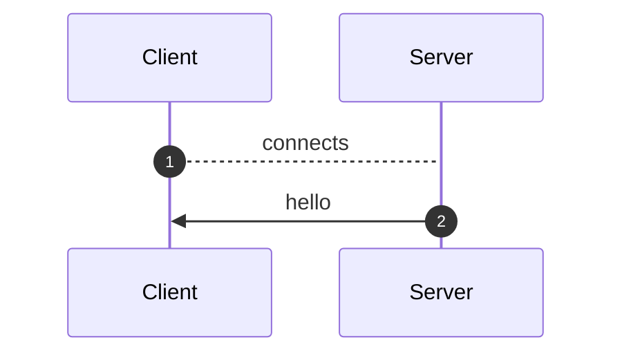
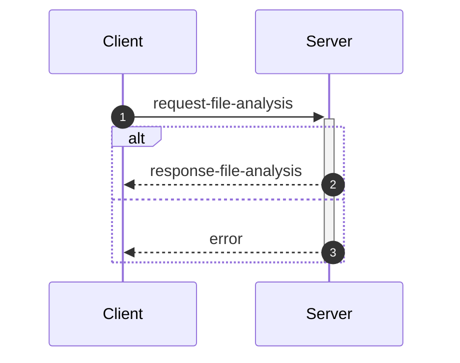
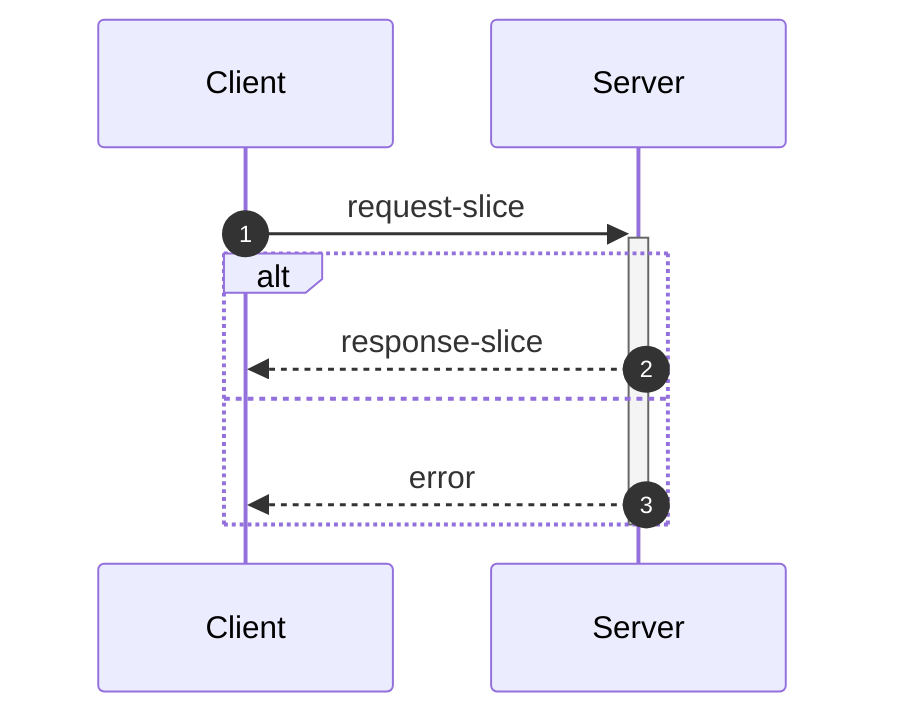
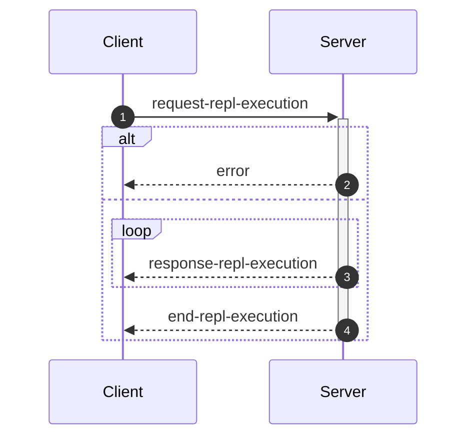

_<span title="an overview of flowR's interface">Generated</span> from '[wiki-interface.ts](https://github.com/flowr-analysis/flowr/tree/main/src/documentation/wiki-interface.ts "src/documentation/wiki-interface.ts")' on 2026-10-14, 06:41:15 UTC (v2.15.10, R v4.6.1), do not edit directly._

Although far from being as detailed as the in-depth explanation of [_flowR_](https://github.com/flowr-analysis/flowr/wiki/Core),
this wiki page explains how to interface with _flowR_ in more detail.
In general, command line arguments and other options provide short descriptions on hover over.

* [💻 Using the REPL](#using-the-repl)
* [⚙️ Configuring FlowR](#configuring-flowr)
* [⚒️ Writing Code](#writing-code)
* [💬 Communicating with the Server](#communicating-with-the-server)

<a id='using-the-repl'></a>
## 💻 Using the REPL

> [!NOTE]
> To execute arbitrary R commands with a repl request, _flowR_ has to be started explicitly with <span title="Description (Command Line Argument): Allow to access the underlying R session when using flowR (security warning: this allows the execution of arbitrary R code!)">`--r-session-access`</span>.
> Please be aware that this introduces a security risk and note that this relies on the [`r-shell` engine](https://github.com/flowr-analysis/flowr/wiki/Engines) .

Although primarily meant for users to explore,
there is nothing which forbids calling _flowR_ as a subprocess to use standard-in, -output, and -error
for communication (although you can access the REPL using the server as well,
with the [REPL Request](#message-request-repl-execution) message).

The read-eval-print loop&nbsp;(REPL) works relatively simple.
You can submit an expression (using <kbd>Enter</kbd>),
which is interpreted as an R&nbsp;expression by default but interpreted as a *command* if it starts with a colon (`:`).
The best command to get started with the REPL is <span title="Description (Repl Command): Show help information (aliases: :h, :?)">`:help`</span>.
Besides, you can leave the REPL either with the command <span title="Description (Repl Command): End the repl (aliases: :q, :exit)">`:quit`</span> or by pressing <kbd>Ctrl</kbd>+<kbd>C</kbd> twice.
When writing a *command*, you may press <kbd>Tab</kbd> to get a list of completions, if available.
Multiple commands can be entered in a single line by separating them with a semicolon (`;`), e.g. `:parse "x<-2"; :df*`.
If a command is given without R code, the REPL will re-use R code given in a previous command.
The prior example will hence return first the parsed AST of the program and then the dataflow graph for `"x <- 2"`.

> [!NOTE]
> If you develop flowR, you may want to launch the repl using the `npm run main-dev` command, this way, you get a non-minified version of flowR with debug information and hot-reloading of source files.

<details>
<summary>Available Commands</summary>

We currently offer the following commands (this with a `[*]` suffix are available with and without the star):

| Command | Description |
| ------- | ----------- |
| **<span title="Description (Repl Command): End the repl (aliases: :q, :exit)">:quit</span>** | End the repl (aliases: **:<span title="Alias of ':quit'. End the repl">q</span>**, **:<span title="Alias of ':quit'. End the repl">exit</span>**) |
| **<span title="Description (Repl Command): Execute the given code as R code. This requires the `--r-session-access` flag to be set and requires the r-shell engine. (aliases: :e, :r)">:execute</span>** | Execute the given code as R code. This requires the `--r-session-access` flag to be set and requires the r-shell engine. (aliases: **:<span title="Alias of ':execute'. Execute the given code as R code. This requires the `--r-session-access` flag to be set and requires the r-shell engine.">e</span>**, **:<span title="Alias of ':execute'. Execute the given code as R code. This requires the `--r-session-access` flag to be set and requires the r-shell engine.">r</span>**) |
| **<span title="Description (Repl Command): Get mermaid code for the control-flow graph of R code (aliases: :cfg, :cf)">:controlflow[*]</span>** | Get mermaid code for the control-flow graph of R code (star: Returns the URL to mermaid.live) (aliases: **:<span title="Alias of ':controlflow'. Get mermaid code for the control-flow graph of R code">cfg</span>**, **:<span title="Alias of ':controlflow'. Get mermaid code for the control-flow graph of R code">cf</span>**) |
| **<span title="Description (Repl Command): Get mermaid code for the control-flow graph with basic blocks (aliases: :cfgb, :cfb)">:controlflowbb[*]</span>** | Get mermaid code for the control-flow graph with basic blocks (star: Returns the URL to mermaid.live) (aliases: **:<span title="Alias of ':controlflowbb'. Get mermaid code for the control-flow graph with basic blocks">cfgb</span>**, **:<span title="Alias of ':controlflowbb'. Get mermaid code for the control-flow graph with basic blocks">cfb</span>**) |
| **<span title="Description (Repl Command): Get mermaid code for the dataflow graph (aliases: :d, :df)">:dataflow[*]</span>** | Get mermaid code for the dataflow graph (star: Returns the URL to mermaid.live) (aliases: **:<span title="Alias of ':dataflow'. Get mermaid code for the dataflow graph">d</span>**, **:<span title="Alias of ':dataflow'. Get mermaid code for the dataflow graph">df</span>**) |
| **<span title="Description (Repl Command): Get mermaid code for the normalized AST of R code (aliases: :n)">:normalize[*]</span>** | Get mermaid code for the normalized AST of R code (star: Returns the URL to mermaid.live) (alias: **:<span title="Alias of ':normalize'. Get mermaid code for the normalized AST of R code">n</span>**) |
| **<span title="Description (Repl Command): Get mermaid code for the simplified dataflow graph (aliases: :ds, :dfs)">:dataflowsimple[*]</span>** | Get mermaid code for the simplified dataflow graph (star: Returns the URL to mermaid.live) (aliases: **:<span title="Alias of ':dataflowsimple'. Get mermaid code for the simplified dataflow graph">ds</span>**, **:<span title="Alias of ':dataflowsimple'. Get mermaid code for the simplified dataflow graph">dfs</span>**) |
| **<span title="Description (Repl Command): Inspect and extend the signature database: `query` (identical to :query @signature), `info <name>` for where a function comes from (identical to :query @function-info), `add <path>` to mount another database/source, `download` to fetch the full-history database. (aliases: :sig)">:signature</span>** | Inspect and extend the signature database: `query` (identical to :query @signature), `info <name>` for where a function comes from (identical to :query @function-info), `add <path>` to mount another database/source, `download` to fetch the full-history database. (alias: **:<span title="Alias of ':signature'. Inspect and extend the signature database: `query` (identical to :query @signature), `info <name>` for where a function comes from (identical to :query @function-info), `add <path>` to mount another database/source, `download` to fetch the full-history database.">sig</span>**) |
| **<span title="Description (Repl Command): Just calculates the DFG, but only prints summary info (aliases: :d#, :df#)">:dataflowsilent</span>** | Just calculates the DFG, but only prints summary info (aliases: **:<span title="Alias of ':dataflowsilent'. Just calculates the DFG, but only prints summary info">d#</span>**, **:<span title="Alias of ':dataflowsilent'. Just calculates the DFG, but only prints summary info">df#</span>**) |
| **<span title="Description (Repl Command): Prints ASCII Art of the parsed, unmodified AST (aliases: :p)">:parse</span>** | Prints ASCII Art of the parsed, unmodified AST (alias: **:<span title="Alias of ':parse'. Prints ASCII Art of the parsed, unmodified AST">p</span>**) |
| **<span title="Description (Repl Command): Prints the version of flowR as well as the current version of R">:version</span>** | Prints the version of flowR as well as the current version of R
| **<span title="Description (Repl Command): Query the given R code (use 'help' for more information)">:query[*]</span>** | Query the given R code (use 'help' for more information) (star: Similar to query, but returns the output in json format.)
| **<span title="Description (Repl Command): Returns an ASCII representation of the dataflow graph (aliases: :df!)">:dataflowascii</span>** | Returns an ASCII representation of the dataflow graph (alias: **:<span title="Alias of ':dataflowascii'. Returns an ASCII representation of the dataflow graph">df!</span>**) |
| **<span title="Description (Repl Command): Returns summarization stats for the normalized AST (aliases: :n#)">:normalize#</span>** | Returns summarization stats for the normalized AST (alias: **:<span title="Alias of ':normalize#'. Returns summarization stats for the normalized AST">n#</span>**) |
| **<span title="Description (Repl Command): Show help information (aliases: :h, :?)">:help</span>** | Show help information (aliases: **:<span title="Alias of ':help'. Show help information">h</span>**, **:<span title="Alias of ':help'. Show help information">?</span>**) |

</details>

> [!TIP]
> 
> As indicated by the examples before, all REPL commands that operate on code keep track of the state.
> Hence, if you run a command like <span title="Description (Repl Command, starred version): Returns the URL to mermaid.live; Base Command: Get mermaid code for the dataflow graph (aliases: :d*, :df*)">`:dataflow*`</span> without providing R code,
> the REPL will re-use the R code provided in a previous command.
> Likewise, doing this will benefit from incrementality!
> If you request the dataflow graph with `:df* x <- 2 * y` and then want to see the parsed AST with `:parse`,
> the REPL will re-use previously obtained information and not re-parse the code again.
> 		

Generally, many commands offer shortcut versions in the REPL. Many queries, for example, offer a shortened format (see the example below).
Of special note, the [Config Query](https://github.com/flowr-analysis/flowr/wiki/%5BQuery%5D-Config)
can be used to also modify the currently active configuration of _flowR_ within the REPL (see the [wiki page](https://github.com/flowr-analysis/flowr/wiki/%5BQuery%5D-Config) for more information).

### Example: Retrieving the Dataflow Graph

To retrieve a URL to the [mermaid](https://mermaid.js.org/) diagram of the dataflow of a given expression,
use <span title="Description (Repl Command, starred version): Returns the URL to mermaid.live; Base Command: Get mermaid code for the dataflow graph (aliases: :d*, :df*)">`:dataflow*`</span> (or <span title="Description (Repl Command): Get mermaid code for the dataflow graph (aliases: :d, :df)">`:dataflow`</span> to get the mermaid code in the cli):

```shell
$ docker run -it --rm eagleoutice/flowr # or npm run flowr 
flowR repl v2.15.10, R grammar v14 (tree-sitter engine)
R> :dataflow* y <- 1 + x
```

<details>
<summary style='color:gray'>Output</summary>

```text
https://mermaid.live/view#base64:eyJjb2RlIjoiZmxvd2NoYXJ0IFREXG4gICAgMXt7XCJgKiM5MTtSTnVtYmVyIzkzOyogKioxKipcbiAgICAgICoxLjYqICgqKmlkOiAxKiopYFwifX1cbiAgICAyKFtcImAqIzkxO1JTeW1ib2wjOTM7KiAqKngqKlxuICAgICAgKjEuMTAqICgqKmlkOiAyKiopYFwiXSlcbiAgICAzW1tcImAqIzkxO1JCaW5hcnlPcCM5MzsqIGJhc2UjNTg7IzU4OyoqIzQzOyoqXG4gICAgICAqMS42LTEwKiAoKippZDogMyoqKVxuICAgIGFyZzogKDEsIDIpYFwiXV1cbiAgICBidWlsdC1pbjpfNDNfW1wiYEJ1aWx0LUluOlxuIzQzO2BcIl1cbiAgICBzdHlsZSBidWlsdC1pbjpfNDNfIHN0cm9rZTpncmF5LGZpbGw6Z3JheSxzdHJva2Utd2lkdGg6MnB4LG9wYWNpdHk6Ljg7XG4gICAgMFtcImAqIzkxO1JTeW1ib2wjOTM7KiAqKnkqKlxuICAgICAgKjEuMSogKCoqaWQ6IDAqKiwgdjogMylgXCJdXG4gICAgNFtbXCJgKiM5MTtSQmluYXJ5T3AjOTM7KiBiYXNlIzU4OyM1ODsqKiM2MDsjNDU7KipcbiAgICAgICoxLjEtMTAqICgqKmlkOiA0KiopXG4gICAgYXJnOiAoMCwgMylgXCJdXVxuICAgIGJ1aWx0LWluOl82MF8tW1wiYEJ1aWx0LUluOlxuIzYwOyM0NTtgXCJdXG4gICAgc3R5bGUgYnVpbHQtaW46XzYwXy0gc3Ryb2tlOmdyYXksZmlsbDpncmF5LHN0cm9rZS13aWR0aDoycHgsb3BhY2l0eTouODtcbiAgICAxIC0uLT58XCJmbG93XCJ8IDJcbiAgICBsaW5rU3R5bGUgMCBzdHJva2U6Z3JheSxjb2xvcjpncmF5O1xuICAgIDIgLS4tPnxcImZsb3dcInwgM1xuICAgIGxpbmtTdHlsZSAxIHN0cm9rZTpncmF5LGNvbG9yOmdyYXk7XG4gICAgMyAtLT58XCJyZWFkcywgYXJnXCJ8IDFcbiAgICAzIC0tPnxcInJlYWRzLCBhcmdcInwgMlxuICAgIDMgLS4tPnxcImZsb3dcInwgMFxuICAgIGxpbmtTdHlsZSA0IHN0cm9rZTpncmF5LGNvbG9yOmdyYXk7XG4gICAgMyAtLi0+fFwicmVhZHMsIGNhbGxzXCJ8IGJ1aWx0LWluOl80M19cbiAgICBsaW5rU3R5bGUgNSBzdHJva2U6Z3JheTtcbiAgICAwIC0tPnxcImRlZmluZWQtYnksIGZsb3dcInwgNFxuICAgIDAgLS0+fFwiZGVmaW5lZC1ieVwifCAzXG4gICAgNCAtLT58XCJyZWFkcywgYXJnXCJ8IDNcbiAgICA0IC0tPnxcInJldHVybnMsIGFyZ1wifCAwXG4gICAgNCAtLi0+fFwicmVhZHMsIGNhbGxzXCJ8IGJ1aWx0LWluOl82MF8tXG4gICAgbGlua1N0eWxlIDEwIHN0cm9rZTpncmF5OyIsIm1lcm1haWQiOnsiYXV0b1N5bmMiOnRydWV9fQ==
```

Retrieve the dataflow graph of the expression `y <- 1 + x`. It looks like this:


<details>

<summary style="color:gray">R Code of the Dataflow Graph</summary>

The analysis ran (including parse and normalize, using the [tree-sitter](https://github.com/flowr-analysis/flowr/wiki/Engines) engine) within the generation environment. No [signature database](https://github.com/flowr-analysis/flowr/wiki/Signature-Database) is mounted for these generated graphs, so `library()` calls attach no package exports; base-R names are still qualified via the generated base-package store (e.g. `acf` as `stats::acf`). 
We encountered no unknown side effects during the analysis.

```r
y <- 1 + x
```

</details>

</details>

For small graphs like this, <span title="Description (Repl Command): Returns an ASCII representation of the dataflow graph (aliases: :df!)">`:dataflowascii`</span> also provides an ASCII representation directly in the REPL:

```shell
$ docker run -it --rm eagleoutice/flowr # or npm run flowr 
flowR repl v2.15.10, R grammar v14 (tree-sitter engine)
R> :df! y <- 1 + x
```

<details open>
<summary style='color:gray'>Output</summary>

```text
                        v<0>v
 c<4>c──────────────────| y |
 |<- |     ┌────────────v---v
 c---c     │
    │   c<3>c   0<1>0
    └───| + |───| 1 |───u<2>u
        c---c   0---0   | x |
           └────────────u---u
Edges:
3 -> 1: reads, arg          3 -> 2: reads, arg
3 -> 0: flows-to            1 -> 2: flows-to
2 -> 3: flows-to            4 -> 3: reads, arg
4 -> 0: returns, arg        0 -> 4: defined-by, flows-to
0 -> 3: defined-by
```

Retrieve the dataflow graph of the expression `y <- 1 + x` as ASCII art.

</details>

For the slicing with <span title="Description (Repl Command): Static backwards executable slicer for R">`:slicer`</span>, you have access to the same [magic comments](#slice-magic-comments) as with the [slice request](#message-request-slice).
Pass `--inline` to splice resolvable `source()` calls into the reconstruction so the slice is a single self-contained R text (the same as the static slice query's `inlineSources` flag).
See `--help` for more flags!

### Example: Interfacing with the File System

Many commands that allow for an R-expression (like <span title="Description (Repl Command, starred version): Returns the URL to mermaid.live; Base Command: Get mermaid code for the dataflow graph (aliases: :d*, :df*)">`:dataflow*`</span>) allow for a file as well
if the argument starts with `file://`.
If you are working from the root directory of the _flowR_ repository, the following gives you the parsed AST of the example file using the <span title="Description (Repl Command): Prints ASCII Art of the parsed, unmodified AST (aliases: :p)">`:parse`</span> command:

> **Watch mode**: Replace `file://` with `watch://` to enter watch mode.
> flowR runs the command immediately and then re-runs it every time the file (or any file inside the folder) changes.
> Enter any other command to leave watch mode.
> For example: `:df watch://analysis.R`

```shell
$ docker run -it --rm eagleoutice/flowr # or npm run flowr 
flowR repl v2.15.10, R grammar v14 (tree-sitter engine)
R> :parse file://test/testfiles/example.R
```

<details>
<summary style='color:gray'>Output</summary>

```text
File: test/testfiles/example.R

program
├ binaryoperator
│ ├ identifier "sum" (1:1─4)
│ ├ <- "<-" (1:5─7)
│ ╰ float "0" (1:8─9)
├ binaryoperator
│ ├ identifier "product" (2:1─8)
│ ├ <- "<-" (2:9─11)
│ ╰ float "1" (2:12─13)
├ binaryoperator
│ ├ identifier "w" (3:1─2)
│ ├ <- "<-" (3:3─5)
│ ╰ float "7" (3:6─7)
├ binaryoperator
│ ├ identifier "N" (4:1─2)
│ ├ <- "<-" (4:3─5)
│ ╰ float "10" (4:6─8)
├ forstatement
│ ├ for "for" (6:1─4)
│ ├ ( "(" (6:5─6)
│ ├ identifier "i" (6:6─7)
│ ├ in "in" (6:8─10)
│ ├ binaryoperator
│ │ ├ float "1" (6:11─12)
│ │ ├ : ":" (6:12─13)
│ │ ╰ parenthesizedexpression
│ │   ├ ( "(" (6:13─14)
│ │   ├ binaryoperator
│ │   │ ├ identifier "N" (6:14─15)
│ │   │ ├ - "-" (6:15─16)
│ │   │ ╰ float "1" (6:16─17)
│ │   ╰ ) ")" (6:17─18)
│ ├ ) ")" (6:18─19)
│ ╰ bracedexpression
│   ├ { "{" (6:20─21)
│   ├ binaryoperator
│   │ ├ identifier "sum" (7:3─6)
│   │ ├ <- "<-" (7:7─9)
│   │ ╰ binaryoperator
│   │   ├ binaryoperator
│   │   │ ├ identifier "sum" (7:10─13)
│   │   │ ├ + "+" (7:14─15)
│   │   │ ╰ identifier "i" (7:16─17)
│   │   ├ + "+" (7:18─19)
│   │   ╰ identifier "w" (7:20─21)
│   ├ binaryoperator
│   │ ├ identifier "product" (8:3─10)
│   │ ├ <- "<-" (8:11─13)
│   │ ╰ binaryoperator
│   │   ├ identifier "product" (8:14─21)
│   │   ├  "" (8:22─23)
│   │   ╰ identifier "i" (8:24─25)
│   ╰ } "}" (9:1─2)
├ call
│ ├ identifier "cat" (11:1─4)
│ ╰ arguments
│   ├ ( "(" (11:4─5)
│   ├ argument
│   │ ╰ string
│   │   ├ " "\"" (11:5─6)
│   │   ├ stringcontent "Sum:" (11:6─10)
│   │   ╰ " "\"" (11:10─11)
│   ├ comma "," (11:11─12)
│   ├ argument
│   │ ╰ identifier "sum" (11:13─16)
│   ├ comma "," (11:16─17)
│   ├ argument
│   │ ╰ string
│   │   ├ " "\"" (11:18─19)
│   │   ├ stringcontent
│   │   │ ╰ escapesequence "\\n" (11:19─21)
│   │   ╰ " "\"" (11:21─22)
│   ╰ ) ")" (11:22─23)
╰ call
  ├ identifier "cat" (12:1─4)
  ╰ arguments
    ├ ( "(" (12:4─5)
    ├ argument
    │ ╰ string
    │   ├ " "\"" (12:5─6)
    │   ├ stringcontent "Product:" (12:6─14)
    │   ╰ " "\"" (12:14─15)
    ├ comma "," (12:15─16)
    ├ argument
    │ ╰ identifier "product" (12:17─24)
    ├ comma "," (12:24─25)
    ├ argument
    │ ╰ string
    │   ├ " "\"" (12:26─27)
    │   ├ stringcontent
    │   │ ╰ escapesequence "\\n" (12:27─29)
    │   ╰ " "\"" (12:29─30)
    ╰ ) ")" (12:30─31)
```

Retrieve the parsed AST of the example file.

<details>

<summary>File Content</summary>

```r
sum <- 0
product <- 1
w <- 7
N <- 10

for (i in 1:(N-1)) {
  sum <- sum + i + w
  product <- product * i
}

cat("Sum:", sum, "\n")
cat("Product:", product, "\n")
```

</details>

As _flowR_ directly transforms this AST the output focuses on being human-readable instead of being machine-readable.
		
</details>

### Example: Run a Query

You can run any query supported by _flowR_ using the <span title="Description (Repl Command): Query the given R code (use 'help' for more information)">`:query`</span> command.
For example, to obtain the shapes of all data frames in a given piece of code, you can run:

```shell
$ docker run -it --rm eagleoutice/flowr # or npm run flowr 
flowR repl v2.15.10, R grammar v14 (tree-sitter engine)
R> :query @absint df-shape "x <- data.frame(a = 1:10, b = 1:10)\ny <- x$a"
```

<details open>
<summary style='color:gray'>Output</summary>

```text
Query: absint (1 ms)
```

Retrieve the shapes of all data frames in the given code.

</details>

To run the linter on a file, you can use (in this example, we just issue the `dead-code` linter on a small piece of code):

```shell
$ docker run -it --rm eagleoutice/flowr # or npm run flowr 
flowR repl v2.15.10, R grammar v14 (tree-sitter engine)
R> :query @linter rules:dead-code "if(FALSE) x <- 2"
```

<details open>
<summary style='color:gray'>Output</summary>

```text
Query: linter (7 ms)
   ╰ Dead Code (dead-code):
       ╰ certain:
           ╰ Code at 1.11-16
```

Run the linter on the given code, with only the `dead-code` rule enabled.

</details>

For more information on the available queries, please check out the [Query API](https://github.com/flowr-analysis/flowr/wiki/Query-API).

<a id='configuring-flowr'></a>
## ⚙️ Configuring FlowR

When running _flowR_, you may want to specify some behaviors with a dedicated configuration file.
By default, flowR looks for a file named `flowr.json` in the current working directory (or any higher directory).
You can also specify a different file with <span title="Description (Command Line Argument): The name of the configuration file to use">`--config-file`</span> or pass the configuration inline using <span title="Description (Command Line Argument): The flowR configuration to use, as a JSON string">`--config-json`</span>.
To inspect the current configuration, you can run flowr with the <span title="Description (Command Line Argument): Run with verbose logging (will be passed to the corresponding script)">`--verbose`</span> flag, or use the `config` [Query](https://github.com/flowr-analysis/flowr/wiki/Query-API).
Within the REPL this works by running the following:

```shell
:query @config
```

To work with the <a href="https://github.com/flowr-analysis/flowr/tree/main/src/config.ts#L108"><code><span title="The configuration file format for flowR.">FlowrConfig</span></code></a> you can use the provided helper objects alongside its methods like
<a href="https://github.com/flowr-analysis/flowr/tree/main/src/config.ts#L871"><code><span title="Creates a new flowr config that has the updated values.">FlowrConfig::<b>amend</b></span></code></a>.
The schema below documents every option; the ones you most likely want are:

- <a href="https://github.com/flowr-analysis/flowr/wiki/Interface#configuring-flowr" title="Configuration Option (boolean): Whether source calls should be ignored, causing {@link processSourceCall}&#39;s behavior to be skipped.">ignoreSourceCalls</a>: ignore source calls when analyzing the code, i.e., ignore the inclusion of other files.
- <a href="https://github.com/flowr-analysis/flowr/wiki/Interface#configuring-flowr" title="Configuration Option (boolean): Whether load calls should be ignored, causing {@link processLoadCall}&#39;s behavior to be skipped.">ignoreLoadCalls</a>: ignore load calls when analyzing the code, i.e., ignore the loading of r-data files.
- <a href="https://github.com/flowr-analysis/flowr/wiki/Interface#configuring-flowr" title="Configuration Option (object): Do you want to overwrite (parts) of the builtin definition?">semantics.environment.overwriteBuiltIns</a>: overwrite _flowR_'s handling of built-in functions, or clear the preset definitions entirely.
  See [Configure BuiltIn Semantics](#configure-builtin-semantics) for more information.
- <a href="https://github.com/flowr-analysis/flowr/wiki/Interface#configuring-flowr" title="Configuration Option (string): How to resolve variables and their values. (one of &quot;disabled&quot;, &quot;alias&quot;, &quot;builtin&quot;)">solver.variables</a>: how to resolve variables and their values (`disabled`, `alias`, `builtin`).
- <a href="https://github.com/flowr-analysis/flowr/wiki/Interface#configuring-flowr" title="Configuration Option (array): The engine or set of engines to use for interacting with R code. An empty array means all available engines will be used.">engines</a> and <a href="https://github.com/flowr-analysis/flowr/wiki/Interface#configuring-flowr" title="Configuration Option (string): The default engine to use for interacting with R code. If this is undefined, an arbitrary engine from the specified list will be used. (one of &quot;tree-sitter&quot;, &quot;r-shell&quot;)">defaultEngine</a>: the engines used to interact with R code, see the [Engines wiki page](https://github.com/flowr-analysis/flowr/wiki/Engines).
- <a href="https://github.com/flowr-analysis/flowr/wiki/Interface#configuring-flowr" title="Configuration Option (array): Files a framework loads on its own, without any source() call (e.g. global.R in a shiny app), in the order they are loaded; flowR orders the matching project files accordingly and analyzes them as one program. Entries are case-insensitive globs matched against the file path, a plain name matches any file with that name, and entries matching no project file are warned about. Usually set per project kind via specializeConfig.">project.implicitSources</a>: the files a framework loads without any `source()` call, in the order in which they are
  loaded. Entries are globs (e.g. `R/*.R`) matched against the file path ignoring capitalization; one matching no file is reported.
- <a href="https://github.com/flowr-analysis/flowr/wiki/Interface#configuring-flowr" title="Configuration Option (object): Overwrite (parts of) the configuration depending on the project kind flowR detects, e.g. to give a shiny app its implicit sources.">specializeConfig</a>: overwrite (parts of) the configuration depending on the kind of project _flowR_ detects
  (e.g. `shiny-app`), which is how a shiny app gets its implicit sources by default. What you configure directly wins.
- <a href="https://github.com/flowr-analysis/flowr/wiki/Interface#configuring-flowr" title="Configuration Option (string): Overwrite the project kind flowR would otherwise infer from the analyzed files, e.g. when auto-detection guesses wrong. (one of &quot;package&quot;, &quot;script&quot;, &quot;shiny-app&quot;, &quot;notebook&quot;, &quot;project&quot;, &quot;unknown&quot;)">project.useProjectType</a>: skip that detection and force a project kind yourself, when auto-detection guesses wrong.
- <a href="https://github.com/flowr-analysis/flowr/wiki/Interface#configuring-flowr" title="Configuration Option (array): The default plugins to load when creating a new instance of FlowrAnalyzer">defaultPlugins</a> and <a href="https://github.com/flowr-analysis/flowr/wiki/Interface#configuring-flowr" title="Configuration Option (array): The plugins to load in REPL mode">repl.plugins</a>: the plugins to load for a new <a href="https://github.com/flowr-analysis/flowr/tree/main/src/project/flowr-analyzer.ts#L205"><code><span title="Central class for conducting analyses with FlowR. Use the FlowrAnalyzerBuilder to create a new instance. If you want the original pattern of creating a pipeline and running all steps, you can still do this with FlowrAnalyzer#runFull . To inspect the context of the analyzer, use FlowrAnalyzer#inspectContext (if you are a plugin and need to modify it, use FlowrAnalyzer#context instead).">FlowrAnalyzer</span></code></a> and in the REPL
  (use `flowr:default` to reference the former).

So you can configure _flowR_ by adding a file like the following:

<details>

<summary>Example Configuration File</summary>

```json
{
  "ignoreSourceCalls": true,
  "ignoreLoadCalls": true,
  "semantics": {
    "environment": {
      "overwriteBuiltIns": {
        "definitions": [
          {
            "type": "function",
            "names": [
              "foo"
            ],
            "processor": "builtin:assign",
            "config": {}
          }
        ]
      }
    }
  },
  "defaultPlugins": [
    "file:description",
    "versions:description"
  ],
  "repl": {
    "quickStats": false,
    "dfProcessorHeat": false,
    "hints": true,
    "plugins": [
      "flowr:default"
    ]
  },
  "project": {
    "resolveUnknownPathsOnDisk": true,
    "implicitSources": [
      "global.R",
      "app.R"
    ]
  },
  "linter": {
    "disabledRules": []
  },
  "specializeConfig": {
    "shiny-app": {
      "project": {
        "implicitSources": [
          "global.R",
          "ui.R",
          "server.R",
          "app.R"
        ]
      }
    }
  },
  "engines": [
    {
      "type": "r-shell"
    }
  ],
  "solver": {
    "variables": "alias",
    "evalStrings": true,
    "trackEnvironments": true,
    "sigdb": {
      "enabled": true,
      "loadProjectDependencies": true,
      "eagerlyLoad": false,
      "eagerlyLoadExports": false,
      "linkBaseR": false,
      "linkDescriptionDependencies": false
    },
    "resolveSource": {
      "dropPaths": "no",
      "ignoreCapitalization": true,
      "inferWorkingDirectory": "active-script",
      "searchPath": []
    },
    "instrument": {},
    "slicer": {
      "threshold": 50
    }
  },
  "abstractInterpretation": {
    "wideningThreshold": 4,
    "followCalls": true,
    "dataFrame": {
      "maxColNames": 20,
      "readLoadedData": {
        "readExternalFiles": true,
        "maxReadLines": 1000000
      }
    }
  },
  "incremental": {
    "alwaysIncremental": false,
    "parsing": {
      "activated": false,
      "heuristics": {
        "activated": true,
        "mtime": true,
        "linesFrom": 500,
        "bytesFrom": 50000,
        "alwaysWithEdits": false,
        "minFiles": 1
      }
    }
  },
  "gas": {
    "thresholds": {
      "memory": {
        "problematic": 0.7,
        "critical": 0.9
      },
      "timeMs": {
        "problematic": 100000,
        "critical": 120000
      }
    },
    "features": {}
  }
}
```

</details>

<details>
<a id='configure-builtin-semantics'></a>
<summary>Configure Built-In Semantics</summary>

`semantics/environment/overwriteBuiltins` accepts two keys:

- `loadDefaults` (boolean, initially `true`): If set to `true`, the default built-in definitions are loaded before applying the custom definitions. Setting this flag to `false` explicitly disables the loading of the default definitions.
- `definitions` (array, initially empty): Allows to overwrite or define new built-in elements. Each object within must have a `type` which is one of the below. Furthermore, they may define a string array of `names` which specifies the identifiers to bind the definitions to. You may use `assumePrimitive` to specify whether _flowR_ should assume that this is a primitive non-library definition (so you probably just do not want to specify the key).

  | Type            | Description                                                                                                                                                                                                                                                                                              | Example                                                                                                    |
  | --------------- | -------------------------------------------------------------------------------------------------------------------------------------------------------------------------------------------------------------------------------------------------------------------------------------------------------- | ---------------------------------------------------------------------------------------------------------- |
  | `constant`    | Additionally allows for a `value` this should resolve to.                                                                                                                                                                                                                                                | `{ type: 'constant', names: ['NULL', 'NA'],  value: null }`                                                |
  | `function`    | Is a rather flexible way to define and bind built-in functions. For the time, we do not have extensive documentation to cover all the cases, so please either consult the sources with the `default-builtin-config.ts` or open a [new issue](https://github.com/flowr-analysis/flowr/issues/new/choose). | `{ type: 'function', names: ['next'], processor: 'builtin:d', config: { cfg: ExitPointType.Next } }` |
  | `replacement` | A comfortable way to specify replacement functions like `$<-` or `names<-`. `suffixes` describes the... suffixes to attach automatically. | `{ type: 'replacement', suffixes: ['<-', '<<-'], names: ['[', '[['] }` |

</details>

<details>

<summary style='color:gray'>Full Configuration-File Schema</summary>

- _The configuration file format for flowR._ (object)
    - **logLevel** [optional] _flowR's global minimum log level, applied when the config is loaded._ (string)
        Only allows: 'silly', 'trace', 'debug', 'info', 'warn', 'error', 'fatal'
    - **ignoreSourceCalls** [optional] _Whether source calls should be ignored, causing {@link processSourceCall}'s behavior to be skipped._ (boolean)
    - **ignoreLoadCalls** [optional] _Whether load calls should be ignored, causing {@link processLoadCall}'s behavior to be skipped._ (boolean)
    - **semantics** _Configure language semantics and how flowR handles them._ (object)
        - **environment** [optional] _Semantics regarding how to handle the R environment._ (object)
            - **overwriteBuiltIns** [optional] _Do you want to overwrite (parts) of the builtin definition?_ (object)
                - **loadDefaults** [optional] _Should the default configuration still be loaded?_ (boolean)
                - **definitions** [optional] _The definitions to load/overwrite._ (array)
                Valid item types:
                    - (object)
    - **defaultPlugins** [optional] _The default plugins to load when creating a new instance of FlowrAnalyzer_ (array)
    Valid item types:
        - (alternatives)
            - (string)
            - (array)
    - **repl** _Configuration options for the REPL._ (object)
        - **quickStats** [optional] _Whether to show quick stats in the REPL after each evaluation._ (boolean)
        - **dfProcessorHeat** [optional] _This instruments the dataflow processors to count how often each processor is called._ (boolean)
        - **hints** [optional] _Whether to show dim inline hints on the empty prompt (automatically disabled on non-interactive terminals)._ (boolean)
        - **plugins** [optional] _The plugins to load in REPL mode_ (array)
        Valid item types:
            - (alternatives)
                - (string)
                - (array)
        - **autoUseFileProtocol** [optional] _Prepend the file protocol to a repl input that looks like a path, instead of only warning about it._ (boolean)
        - **queryStats** [optional] _Whether `:query` closes with the line stating how long the queries took (`:query*` never prints it)._ (boolean)
        - **showPlugins** [optional] _Whether `:version` grays out the plugins that did not activate during the last analysis._ (boolean)
    - **project** _Project specific configuration options._ (object)
        - **resolveUnknownPathsOnDisk** [optional] _Whether to resolve unknown paths loaded by the r project disk when trying to source/analyze files._ (boolean)
        - **failOnInaccessiblePath** [optional] _Whether a directory that cannot be traversed during file discovery (e.g. due to permissions) aborts the analysis; when false (the default) such paths are logged and skipped._ (boolean)
        - **basePackages** [optional] _The packages considered part of R itself (base and recommended); if unset, flowR uses its built-in list._ (array)
        Valid item types:
            - (string)
        - **implicitSources** [optional] _Files a framework loads on its own, without any source() call (e.g. global.R in a shiny app), in the order they are loaded; flowR orders the matching project files accordingly and analyzes them as one program. Entries are case-insensitive globs matched against the file path, a plain name matches any file with that name, and entries matching no project file are warned about. Usually set per project kind via specializeConfig._ (array)
        Valid item types:
            - (string)
        - **useProjectType** [optional] _Overwrite the project kind flowR would otherwise infer from the analyzed files, e.g. when auto-detection guesses wrong._ (string)
            Only allows: 'package', 'script', 'shiny-app', 'notebook', 'project', 'unknown'
        - **assumeImplicitEcho** [optional] _Whether the top level of the analyzed code is echoed, so that every visible result printed there is collected as an output by the dependencies query (default true, false for a package)._ (boolean)
        - **discovery** [optional] _Scoping options for the default project discovery._ (object)
            - **full** [optional] _Collect every file below the project root (greedy) instead of only the files the detected project kind needs (default false)._ (boolean)
            - **perKind** [optional] _Per-kind include/exclude glob overrides layered on the default scoping._ (object)
            - **ignore** [optional] _Case-insensitive globs that drop matching files from the intelligent discovery, regardless of kind (e.g. .Renviron to ignore environment files)._ (array)
            Valid item types:
                - (string)
        - **classification** [optional] _Overrides for the signals flowR uses to classify the project kind._ (object)
            - **shinyDescriptionTypes** [optional] _DESCRIPTION Type: values that mark a shiny app._ (array)
            Valid item types:
                - (string)
            - **shinyEntryFiles** [optional] _File names a shiny app is assembled from._ (array)
            Valid item types:
                - (string)
            - **shinyUsagePattern** [optional] _Regex source evidencing shiny usage in an entry file._ (string)
            - **notebookExtensions** [optional] _File extensions marking a notebook._ (array)
            Valid item types:
                - (string)
    - **linter** _Linter configuration options._ (object)
        - **disabledRules** _Linting rule names excluded from the default rule set (a rule requested explicitly via a linter query still runs). Usually set per project kind via specializeConfig._ (array)
        Valid item types:
            - (string)
    - **inputSources** [optional] _Further frameworks the input-sources analysis should know about; entries are added to flowR's defaults._ (object)
        - **pure** [optional] _Functions that only pass the constantness of their arguments on._ (array)
        Valid item types:
            - (string)
        - **param** [optional] _Functions whose result is a 'param' input._ (array)
        Valid item types:
            - (string)
        - **file** [optional] _Functions whose result is a 'file' input._ (array)
        Valid item types:
            - (string)
        - **tempfile** [optional] _Functions whose result is a 'tempfile' input._ (array)
        Valid item types:
            - (string)
        - **glob** [optional] _Functions whose result is a 'glob' input._ (array)
        Valid item types:
            - (string)
        - **net** [optional] _Functions whose result is a 'net' input._ (array)
        Valid item types:
            - (string)
        - **rand** [optional] _Functions whose result is a 'rand' input._ (array)
        Valid item types:
            - (string)
        - **system** [optional] _Functions whose result is a 'system' input._ (array)
        Valid item types:
            - (string)
        - **ffi** [optional] _Functions whose result is a 'ffi' input._ (array)
        Valid item types:
            - (string)
        - **lang** [optional] _Functions whose result is a 'lang' input._ (array)
        Valid item types:
            - (string)
        - **options** [optional] _Functions whose result is a 'options' input._ (array)
        Valid item types:
            - (string)
        - **cmdline** [optional] _Functions whose result is a 'cmdline' input._ (array)
        Valid item types:
            - (string)
        - **user** [optional] _Functions whose result is a 'user' input._ (array)
        Valid item types:
            - (string)
        - **const** [optional] _Functions whose result is a 'const' input._ (array)
        Valid item types:
            - (string)
        - **scope** [optional] _Functions whose result is a 'scope' input._ (array)
        Valid item types:
            - (string)
        - **dconst** [optional] _Functions whose result is a 'dconst' input._ (array)
        Valid item types:
            - (string)
        - **unknown** [optional] _Functions whose result is a 'unknown' input._ (array)
        Valid item types:
            - (string)
        - **linkedObjects** [optional] _Objects a framework provides without a definition in the code, e.g. shiny's input._ (array)
        Valid item types:
            - (object)
        - **linkedEntryPoints** [optional] _Calls that hand a function to a framework, which binds its objects to the parameters by position._ (array)
        Valid item types:
            - (object)
    - **specializeConfig** [optional] _Overwrite (parts of) the configuration depending on the project kind flowR detects, e.g. to give a shiny app its implicit sources._ (object)
    - **engines** _The engine or set of engines to use for interacting with R code. An empty array means all available engines will be used._ (array)
    Valid item types:
        - (alternatives)
            - _The configuration for the tree sitter engine._ (object)
                - **type** [required] _Use the tree sitter engine._ (string)
                    Only allows: 'tree-sitter'
                - **wasmPath** [optional] _The path to the tree-sitter-r WASM binary to use. If this is undefined, this uses the default path._ (string)
                - **treeSitterWasmPath** [optional] _The path to the tree-sitter WASM binary to use. If this is undefined, this uses the default path._ (string)
                - **lax** [optional] _Whether to use the lax parser for parsing R code (allowing for syntax errors). If this is undefined, the strict parser will be used._ (boolean)
            - _The configuration for the R shell engine._ (object)
                - **type** [required] _Use the R shell engine._ (string)
                    Only allows: 'r-shell'
                - **rPath** [optional] _The path to the R executable to use. If this is undefined, this uses the default path._ (string)
                - **pipeBind** [optional] _Whether to enable R's experimental pipe-bind operator "=>" by setting _R_USE_PIPEBIND_ for the R session (default false); R itself keeps this off by default, as it is experimental and has never shipped in a release version of R._ (boolean)
    - **defaultEngine** [optional] _The default engine to use for interacting with R code. If this is undefined, an arbitrary engine from the specified list will be used._ (string)
        Only allows: 'tree-sitter', 'r-shell'
    - **solver** _How to resolve constants, constraints, cells, ..._ (object)
        - **variables** _How to resolve variables and their values._ (string)
            Only allows: 'disabled', 'alias', 'builtin'
        - **evalStrings** _Should we include eval(parse(text="...")) calls in the dataflow graph?_ (boolean)
        - **trackEnvironments** [optional] _Track user-created environments (new.env, assign/get/local with envir=, dollar-assign, attach). When false, all envir-style calls fall through conservatively._ (boolean)
        - **sigdb** _Resolving library exports from a signature database._ (object)
            - **enabled** [optional] _Resolve library()/use() exports from a signature database (default true); when false no database is consulted._ (boolean)
            - **loadProjectDependencies** [optional] _Load the project's declared dependencies from its metadata files (DESCRIPTION Imports/Depends, rproject.toml, uvr.toml, renv.lock, rv.lock, uvr.lock) (default true); when false these files are not read for dependencies._ (boolean)
            - **eagerlyLoad** [optional] _Parse the database up front rather than on the first package load (default false, ignored if disabled)._ (boolean)
            - **eagerlyLoadExports** [optional] _Add a vertex for every export on load rather than on demand (default false); keeps the dataflow graph small._ (boolean)
            - **assumedRVersion** [optional] _R version assumed when resolving versioned (base-R) exports: a pin like "4.5" or "auto" to detect the installed R (default "auto")._ (string)
            - **linkBaseR** [optional] _Eagerly attach base-R namespaces so bare base calls resolve without library() (default false)._ (boolean)
            - **linkBaseRCalls** [optional] _Add a lightweight Reads edge from a bare base-R call to its signature-database function vertex (default false; base-R qualification is edge-free otherwise)._ (boolean)
            - **linkPackageCalls** [optional] _Add a lightweight Reads edge from a resolved package call to its signature-database function vertex (default false)._ (boolean)
            - **linkDescriptionDependencies** [optional] _Eagerly attach the namespaces of the project's declared DESCRIPTION dependencies (Imports/Depends) so their exports resolve without an explicit library() (default false)._ (boolean)
            - **warmInBackground** [optional] _Decompress the hot shards (base + most-downloaded) in a background task on startup so the first library() lookup is warm (default false; for long-running servers/REPLs)._ (boolean)
            - **additionalPaths** [optional] _Extra directories or bundle/manifest files searched for signature databases (alongside the shipped default and $FLOWR_SIGDB_DIR); a downloaded full-history bundle placed here is mounted automatically._ (array)
            Valid item types:
                - (string)
            - **downloadRepo** [optional] _GitHub owner/repo the full-history bundle is downloaded from via ":signature download" (default "flowr-analysis/flowr", release tag "sigdb-v<flowR-version>")._ (string)
            - **autoSync** [optional] _On startup, re-download shards whose committed sigdb.remote.json hash no longer matches the cache, in the background (default false; opt-in network sync after a git pull)._ (boolean)
            - **installedLibrary** [optional] _Recovering packages no signature database knows from the copy installed on this machine._ (object)
                - **enabled** [required] _Recover packages no signature database knows from their installed copy (default false)._ (boolean)
                - **paths** [optional] _Library directories to search; when empty they are discovered from the environment and the project._ (array)
                Valid item types:
                    - (string)
                - **useEnvironment** [optional] _Search the libraries R_LIBS_USER/R_LIBS/R_LIBS_SITE name (default true)._ (boolean)
                - **useProjectLibrary** [optional] _Search a project-local renv/packrat library (default true)._ (boolean)
                - **maxDepth** [optional] _How far to descend into the nested layout of a project-local library (default 3)._ (number)
                - **packages** [optional] _Only recover packages whose name matches one of these regular expressions; empty means any._ (array)
                Valid item types:
                    - (string)
            - **blobCacheBudgetMb** [optional] _How many MiB of decoded package blobs every open bundle may hold together (default 16)._ (number)
            - **versionSelection** [optional] _When a project constrains a dependency, resolve to the newest (default), oldest, or system-installed version satisfying it; system needs R and falls back to newest. Base-R packages always resolve against the assumed R version._ (string)
                Only allows: 'newest', 'oldest', 'system'
            - **versionOverrides** [optional] _Force an exact version for specific packages (name -> version), overriding both the project constraint and the versionSelection policy (default {})._ (object)
        - **versionManagement** _Policies for reasoning about dependency versions._ (object)
            - **linkedVersionGroups** [optional] _Groups of packages that must resolve to the same version; version guessing intersects each group so its members stay mutually compatible (default [])._ (array)
            Valid item types:
                - (array)
                Valid item types:
                    - (string)
        - **assumeAttachedPackages** [optional] _Packages to treat as attached without a `library()` call, so what the built-in configuration states about them applies to the analyzed code. The base packages R attaches on startup already resolve without it._ (array)
        Valid item types:
            - (string)
        - **transitiveSideEffectRounds** [optional] _How many rounds the transitive side-effect fixpoint may run before it is cut off (default 32); the propagation stops on its own as soon as a round adds nothing._ (number)
        - **maxOverlayDepth** [optional] _How many binding overlays may stack on one environment frame before a write flattens them (default 4); a pure performance knob, trading lookup cost against copy cost without changing any result._ (number)
        - **instrument** (object)
            - **dataflowExtractors** [optional] _These keys are only intended for use within code, allowing to instrument the dataflow analyzer!_ (any)
        - **resolveSource** [optional] _If lax source calls are active, flowR searches for sourced files much more freely, based on the configurations you give it. This option is only in effect if `ignoreSourceCalls` is set to false._ (object)
            - **dropPaths** _Allow to drop the first or all parts of the sourced path, if it is relative._ (string)
                Only allows: 'no', 'once', 'all'
            - **ignoreCapitalization** _Search for filenames matching in the lowercase._ (boolean)
            - **inferWorkingDirectory** _Try to infer the working directory from the main or any script to analyze._ (string)
                Only allows: 'no', 'main-script', 'active-script', 'any-script'
            - **searchPath** _Additionally search in these paths._ (array)
            Valid item types:
                - (string)
            - **repeatedSourceLimit** [optional] _How often the same file can be sourced within a single run? Please be aware: in case of cyclic sources this may not reach a fixpoint so give this a sensible limit._ (number)
            - **applyReplacements** _Provide name replacements for loaded files_ (array)
            Valid item types:
                - (object)
            - **assumeFilesExist** [optional] _Assume a sourced file is always there, making what it defines certain instead of conditional on the source call._ (boolean)
        - **slicer** [optional] _The configuration for the slicer._ (object)
            - **threshold** [optional] _The maximum number of iterations to perform on a single function call during slicing._ (number)
            - **autoExtend** [optional] _If set, the slicer will gain an additional post-pass._ (boolean)
    - **abstractInterpretation** _The configuration options for abstract interpretation._ (object)
        - **wideningThreshold** _The threshold for the number of visitations of a node at which widening should be performed to ensure the termination of the fixpoint iteration._ (number)
        - **followCalls** _Whether the abstract interpretation is interprocedural, i.e. whether it steps into the functions a call may dispatch to._ (boolean)
        - **dataFrame** _The configuration of the shape inference for data frames._ (object)
            - **maxColNames** _The maximum number of columns names to infer for data frames before over-approximating the column names to top._ (number)
            - **readLoadedData** _Configuration options for reading data frame shapes from loaded external data files, such as CSV files._ (object)
                - **readExternalFiles** _Whether data frame shapes should be extracted from loaded external files, such as CSV files._ (boolean)
                - **maxReadLines** _The maximum number of lines to read when extracting data frame shapes from loaded files, such as CSV files._ (number)
    - **incremental** (object)
        - **alwaysIncremental** _Always take the incremental path, regardless of heuristics._ (boolean)
        - **parsing** (object)
            - **activated** _If set, incremental parsing will be used._ (boolean)
            - **heuristics** (object)
                - **activated** [optional] _If set, the heuristics for incremental parsing will be used._ (boolean)
                - **mtime** [optional] _Skip reparsing entirely if the file's modification time is unchanged since the last parse._ (boolean)
                - **linesFrom** [optional] _Only consider incremental parsing for files with at least this many lines._ (number)
                - **bytesFrom** [optional] _Only consider incremental parsing for files with at least this many bytes._ (number)
                - **alwaysWithEdits** [optional] _Always take the incremental path whenever there is a computed edit region, regardless of the other thresholds._ (boolean)
                - **minFiles** [optional] _Only apply these heuristics once the project has at least this many files loaded._ (number)
    - **gas** [optional] _Resource-usage guard (gas) configuration. All feature factors default to 0 (disabled). See https://github.com/flowr-analysis/flowr/wiki/Core#gas-resource-guard._ (object)
        - **thresholds** [optional] _Thresholds for all gas checks (scaled by per-feature factor), boundable per feature._ (object)
            - **memory** [optional] _Heap-usage fraction thresholds (0-1), either shared or given per feature key (with `default` covering the rest)._ (object)
                - **problematic** [optional] _Heap fraction (0-1) above which Problematic is returned, for every feature without an entry of its own._ (number)
                - **critical** [optional] _Heap fraction (0-1) above which Critical is returned, for every feature without an entry of its own._ (number)
            - **timeMs** [optional] _Elapsed analysis time thresholds in milliseconds, either shared or given per feature key (with `default` covering the rest)._ (object)
                - **problematic** [optional] _Elapsed ms above which Problematic is returned, for every feature without an entry of its own._ (number)
                - **critical** [optional] _Elapsed ms above which Critical is returned, for every feature without an entry of its own._ (number)
            - **steps** [optional] _Processed-AST-node thresholds, counted rather than sampled; only a key that arms a budget (`dataflow`) reads them._ (object)
                - **problematic** [optional] _Processed AST nodes above which Problematic is returned, for every feature without an entry of its own._ (number)
                - **critical** [optional] _Processed AST nodes above which the extraction is cut short, for every feature without an entry of its own._ (number)
            - **vertices** [optional] _Created-dataflow-vertex thresholds, counted like `steps`._ (object)
                - **problematic** [optional] _Created dataflow vertices above which Problematic is returned, for every feature without an entry of its own._ (number)
                - **critical** [optional] _Created dataflow vertices above which the extraction is cut short, for every feature without an entry of its own._ (number)
        - **features** [optional] _Per-feature sensitivity factors. 0 or absent disables gas checking for that feature. A factor of 2 makes the feature twice as sensitive. Recognised keys: `source`, `side-effect-linking`, `linter`, `slicer`, `dataflow`._ (object)
        - **countedCheckEvery** [optional] _How many counted steps pass between two accountings of an armed check, be it a dataflow budget or the slicer's traversal (default 128); trades overshoot against the cost of the check._ (number)
        - **heapProvider** [optional] _Custom heap statistics source (programmatic configs only), overriding the built-in v8/performance.memory detection._ (function)

</details>

<a id='writing-code'></a>
## ⚒️ Writing Code

_flowR_ can be used as a [module](https://www.npmjs.com/package/@eagleoutice/flowr) and offers several main classes and interfaces that are interesting for extension writers 
(see the [Visual Studio Code extension](https://marketplace.visualstudio.com/items?itemName=code-inspect.vscode-flowr) or the [Core](https://github.com/flowr-analysis/flowr/wiki/Core) wiki page for more information).

### Creating Analyses with _flowR_

Nowadays, instances of the <a href="https://github.com/flowr-analysis/flowr/tree/main/src/project/flowr-analyzer.ts#L205"><code><span title="Central class for conducting analyses with FlowR. Use the FlowrAnalyzerBuilder to create a new instance. If you want the original pattern of creating a pipeline and running all steps, you can still do this with FlowrAnalyzer#runFull . To inspect the context of the analyzer, use FlowrAnalyzer#inspectContext (if you are a plugin and need to modify it, use FlowrAnalyzer#context instead).">FlowrAnalyzer</span></code></a> should be used as central frontend to get analysis results from _flowR_.
The entry points an analysis is written against are re-exported from the package root (`import { FlowrAnalyzerBuilder } from '@eagleoutice/flowr'`);
everything else stays reachable under its own path, as in `@eagleoutice/flowr/dataflow/graph/graph`.
For example, a program slice can be created like this:

```ts
const analyzer = await new FlowrAnalyzerBuilder()
    .setEngine('tree-sitter')
    .build();
analyzer.addRequest('x <- 1\ny <- x\nx');
const result = await analyzer.query([
    {
        type:     'static-slice',
        criteria: ['3@x']
    }
]);
```

For more information, please have a look at the [Analyzer](https://github.com/flowr-analysis/flowr/wiki/Analyzer) wiki page, which explains how to construct and use the <a href="https://github.com/flowr-analysis/flowr/tree/main/src/project/flowr-analyzer.ts#L205"><code><span title="Central class for conducting analyses with FlowR. Use the FlowrAnalyzerBuilder to create a new instance. If you want the original pattern of creating a pipeline and running all steps, you can still do this with FlowrAnalyzer#runFull . To inspect the context of the analyzer, use FlowrAnalyzer#inspectContext (if you are a plugin and need to modify it, use FlowrAnalyzer#context instead).">FlowrAnalyzer</span></code></a> in more detail.
To work with specific perspectives, you can also consult the respective pages like the [Dataflow Graph](https://github.com/flowr-analysis/flowr/wiki/Dataflow-Graph) or the [Abstract Interpretation](https://github.com/flowr-analysis/flowr/wiki/Abstract-Interpretation) wiki pages.
### The Pipeline Executor (Low-Level Interface)

Once, in the beginning, _flowR_ was meant to produce a dataflow graph merely to provide *program slices*. 
However, with continuous updates, the [Dataflow Graph](https://github.com/flowr-analysis/flowr/wiki/Dataflow-Graph) repeatedly proves to be the more interesting part.
With this, we restructured _flowR_'s originally *hardcoded* pipeline to be far more flexible. 
Now, it can be theoretically extended or replaced with arbitrary steps, optional steps, and what we call 'decorations' of these steps. 
In short, a slicing pipeline using the <a href="https://github.com/flowr-analysis/flowr/tree/main/src/core/pipeline-executor.ts#L97"><code><span title="**Please note:** The PipelineExecutor is now considered to be a rather low-level API for flowR. While it still works and is the basis for all other layers, we strongly recommend using the FlowrAnalyzer and its builder to create and use an analyzer instance that is pre-configured for your use-case. The pipeline executor allows to execute arbitrary pipelines in a step-by-step fashion. If you are not...">PipelineExecutor</span></code></a> looks like this:

```ts

const slicer = new PipelineExecutor(DEFAULT_SLICING_PIPELINE, {
  parser:    new RShell(),
  request:   requestFromInput('x <- 1\nx + 1'),
  criterion: ['2@x']
})
const slice = await slicer.allRemainingSteps()
// console.log(slice.reconstruct.code)
```

<details><summary>More Information</summary>

If you compare this, with what you would have done with the old (and removed) `SteppingSlicer`, 
this essentially just requires you to replace the `SteppingSlicer` with the <a href="https://github.com/flowr-analysis/flowr/tree/main/src/core/pipeline-executor.ts#L97"><code><span title="**Please note:** The PipelineExecutor is now considered to be a rather low-level API for flowR. While it still works and is the basis for all other layers, we strongly recommend using the FlowrAnalyzer and its builder to create and use an analyzer instance that is pre-configured for your use-case. The pipeline executor allows to execute arbitrary pipelines in a step-by-step fashion. If you are not...">PipelineExecutor</span></code></a>
and to pass the <a href="https://github.com/flowr-analysis/flowr/tree/main/src/core/steps/pipeline/default-pipelines.ts#L18"><code>DEFAULT_SLICING_PIPELINE</code></a> as the first argument.
The <a href="https://github.com/flowr-analysis/flowr/tree/main/src/core/pipeline-executor.ts#L97"><code><span title="**Please note:** The PipelineExecutor is now considered to be a rather low-level API for flowR. While it still works and is the basis for all other layers, we strongly recommend using the FlowrAnalyzer and its builder to create and use an analyzer instance that is pre-configured for your use-case. The pipeline executor allows to execute arbitrary pipelines in a step-by-step fashion. If you are not...">PipelineExecutor</span></code></a>...

1. Provides structures to investigate the results of all intermediate steps
2. Can be executed step-by-step
3. Can repeat steps (e.g., to calculate multiple slices on the same input)

See the in-code documentation for more information.

</details>

### Using the <a href="https://github.com/flowr-analysis/flowr/tree/main/src/r-bridge/shell.ts#L143"><code><span title="The RShell represents an interactive session with the R interpreter. You can configure it by RShellOptions . At the moment we are using a live R session (and not networking etc.) to communicate with R easily, which allows us to install packages etc. However, this might and probably will change in the future (leaving this as a legacy mode :D)">RShell</span></code></a> to Interact with R

The <a href="https://github.com/flowr-analysis/flowr/tree/main/src/r-bridge/shell.ts#L143"><code><span title="The RShell represents an interactive session with the R interpreter. You can configure it by RShellOptions . At the moment we are using a live R session (and not networking etc.) to communicate with R easily, which allows us to install packages etc. However, this might and probably will change in the future (leaving this as a legacy mode :D)">RShell</span></code></a> class allows interfacing with the `R`&nbsp;ecosystem installed on the host system.
Please have a look at [flowR's Engines](https://github.com/flowr-analysis/flowr/wiki/Engines) for more information on alternatives (for example, the <a href="https://github.com/flowr-analysis/flowr/tree/main/src/r-bridge/lang-4.x/tree-sitter/tree-sitter-executor.ts#L29"><code><span title="Synchronous and (way) faster alternative to the RShell using tree-sitter.">TreeSitterExecutor</span></code></a>).

> [!IMPORTANT]
> 
> Each <a href="https://github.com/flowr-analysis/flowr/tree/main/src/r-bridge/shell.ts#L143"><code><span title="The RShell represents an interactive session with the R interpreter. You can configure it by RShellOptions . At the moment we are using a live R session (and not networking etc.) to communicate with R easily, which allows us to install packages etc. However, this might and probably will change in the future (leaving this as a legacy mode :D)">RShell</span></code></a> controls a new instance of the R&nbsp;interpreter, 
> make sure to call <code><a href="https://github.com/flowr-analysis/flowr/tree/main/src/r-bridge/shell.ts#L353"><span title="Close the current R session, makes the object effectively invalid (can no longer be reopened etc.)">RShell::<i>close</i></span></a>()</code> when you are done.

You can start a new "session" by constructing a new object with <code>new <a href="https://github.com/flowr-analysis/flowr/tree/main/src/r-bridge/shell.ts#L143"><span title="The RShell represents an interactive session with the R interpreter. You can configure it by RShellOptions . At the moment we are using a live R session (and not networking etc.) to communicate with R easily, which allows us to install packages etc. However, this might and probably will change in the future (leaving this as a legacy mode :D)">RShell</span></a>()</code>.

However, there are several options that may be of interest 
(e.g., to automatically revive the shell in case of errors or to control the name location of the R process on the system).

With a shell object (let's call it `shell`), you can execute R code by using <a href="https://github.com/flowr-analysis/flowr/tree/main/src/r-bridge/shell.ts#L212"><code><span title="sends the given command directly to the current R session will not do anything to alter input markers!">RShell::<i>sendCommand</i></span></code></a>,
for example <code>shell.<a href="https://github.com/flowr-analysis/flowr/tree/main/src/r-bridge/shell.ts#L212"><span title="sends the given command directly to the current R session will not do anything to alter input markers!">sendCommand</span></a>("1 + 1")</code>.
However, this does not return anything, so if you want to collect the output of your command, use
<a href="https://github.com/flowr-analysis/flowr/tree/main/src/r-bridge/shell.ts#L295"><code><span title="Send a command and collect the output">RShell::<i>sendCommandWithOutput</i></span></code></a> instead.

<a id='communicating-with-the-server'></a>
## 💬 Communicating with the Server

As explained in the [Overview](https://github.com/flowr-analysis/flowr/wiki/Overview), you can run the [TCP](https://de.wikipedia.org/wiki/Transmission_Control_Protocol)&nbsp;server by adding the <span title="Description (Command Line Argument): Do not drop into a repl, but instead start a server on the given port (default: 1042) and listen for messages.">`--server`</span> flag (and, due to the interactive mode, exit with the conventional <kbd>CTRL</kbd>+<kbd>C</kbd>).
Currently, every connection is handled by the same underlying `RShell` - so the server is not designed to handle many clients at a time.
Additionally, the server is not well guarded against attacks (e.g., you can theoretically spawn an arbitrary number of&nbsp;RShell sessions on the target machine).

Every message has to be given in a single line (i.e., without a newline in-between) and end with a newline character. Nevertheless, we will pretty-print example given in the following segments for the ease of reading.

> [!NOTE]
> 
> The default <span title="Description (Command Line Argument): Do not drop into a repl, but instead start a server on the given port (default: 1042) and listen for messages.">`--server`</span> uses a simple [TCP](https://de.wikipedia.org/wiki/Transmission_Control_Protocol)
> connection. If you want _flowR_ to expose a [WebSocket](https://de.wikipedia.org/wiki/WebSocket) server instead, add the <span title="Description (Command Line Argument): If the server flag is set, use websocket for messaging">`--ws`</span> flag (i.e., <span title="Description (Command Line Argument): Do not drop into a repl, but instead start a server on the given port (default: 1042) and listen for messages.">`--server`</span> <span title="Description (Command Line Argument): If the server flag is set, use websocket for messaging">`--ws`</span>) when starting _flowR_ from the command line.

<ul><li>
<a id="message-hello"></a>
<b>Hello</b> Message (<code>hello</code>) 
<details>

<summary style="color:gray"> View Details. <i>The server informs the client about the successful connection and provides Meta-Information.</i> </summary>



After launching _flowR_, for example, with <code>docker run -it --rm eagleoutice/flowr <span title="Description (Command Line Argument): Do not drop into a repl, but instead start a server on the given port (default: 1042) and listen for messages.">-<span/>-server</span></code>&nbsp;(🐳️), connecting should present you with a `hello` message, that amongst others should reveal the versions of&nbsp;_flowR_ and&nbsp;R, using the [semver 2.0](https://semver.org/spec/v2.0.0.html) versioning scheme.
The message looks like this:

```json
{
  "type": "hello",
  "clientName": "client-0",
  "versions": {
    "flowr": "2.15.10",
    "r": "4.6.1",
    "engine": "r-shell"
  }
}
```

There are currently a few messages that you can send after the hello message.
If you want to _slice_ a piece of R code you first have to send an [analysis request](#message-request-file-analysis), so that you can send one or multiple slice requests afterward.
Requests for the [REPL](#message-request-repl-execution) are independent of that.
	
<hr>

<details>
<summary style="color:gray">Message schema (<code>hello</code>)</summary>

For the definition of the hello message, please see it's implementation at [`./src/cli/repl/server/messages/message-hello.ts`](https://github.com/flowr-analysis/flowr/tree/main/src/cli/repl/server/messages/message-hello.ts).

- [required] (object)
    - **type** [required] _The type of the hello message._ (string)
        Only allows: 'hello'
    - **id** [forbidden] _The id of the message is always undefined (as it is the initial message and not requested)._ (any)
    - **clientName** [required] _A unique name that is assigned to each client. It has no semantic meaning and is only used/useful for debugging._ (string)
    - **versions** [required] (object)
        - **flowr** [required] _The version of the flowr server running in semver format._ (string)
        - **r** [required] _The version of the underlying R shell running in semver format._ (string)
        - **engine** [required] _The parser backend that is used to parse the R code._ (string)

</details>

<hr>

</details>
	</li>

<li>
<a id="message-request-file-analysis"></a>
<b>Analysis</b> Message (<code>request-file-analysis</code>) 
<details>

<summary style="color:gray"> View Details. <i>The server builds the dataflow graph for a given input file (or a set of files).</i> </summary>



The request allows the server to analyze a file and prepare it for slicing.
The message can contain a `filetoken`, which is used to identify the file in later slice or query requests (if you do not add one, the request will not be stored and therefore, it is not available for subsequent requests).

> **Please note!**\
> If you want to send and process a lot of analysis requests, but do not want to slice them, please do not pass the `filetoken` field. This will save the server a lot of memory allocation.

Furthermore, the request must contain either a `content` field to directly pass the file's content or a `filepath` field which contains the path to the file (this path must be accessible for the server to be useful).
If you add the `id` field, the answer will use the same `id` so you can match requests and the corresponding answers.
See the implementation of the request-file-analysis message for more information.

You can drop one or more stored file tokens by adding the `invalidateToken` field (a single token or an array of tokens).
The server frees the corresponding analyses _after_ it has answered the request.

> **Tip!**\
> If you only want to drop tokens, you do not need a separate message: send a `request-file-analysis` that contains _just_ the `invalidateToken` field (and no `content` or `filepath`).
> Such a request behaves like an empty file analysis and the server replies with an empty `results` object.
> Because invalidation happens after the response, you may even pass the _current_ `filetoken` in `invalidateToken` to analyze a file once and have the server forget it right after you received the results.

<details>
<summary>Example of the <code>request-file-analysis</code> Message</summary>

_Note:_ even though we pretty-print these messages, they are sent as a single line, ending with a newline.

The following lists all messages that were sent and received in case you want to reproduce the scenario:

<ol>
<li> <code>hello</code> (response)
<details> 

<summary> Show Details </summary>

The first message is always a hello message.

```json
{"type":"hello","clientName":"client-0","versions":{"flowr":"2.15.10","r":"4.6.1","engine":"r-shell"}}
```

</details>
</li>

<li> <b><code>request-file-analysis</code> (request)</b>
<details open> 

<summary> Show Details </summary>

Let's suppose you simply want to analyze the following script:
 
```r
x <- 1
x + 1
```

 For this, you can send the following request:

```json
{"type":"request-file-analysis","id":"1","filetoken":"x","content":"x <- 1\nx + 1"}
```

</details>
</li>

<li> <code>response-file-analysis</code> (response)
<details> 

<summary> Show Details </summary>

The `results` field of the response effectively contains three keys of importance:

- `parse`: which contains 1:1 the parse result in CSV format that we received from the `RShell` (i.e., the AST produced by the parser of the R interpreter).
- `normalize`: which contains the normalized AST, including ids (see the `info` field and the [Normalized AST](https://github.com/flowr-analysis/flowr/wiki/Normalized-AST) wiki page).
- `dataflow`: especially important is the `graph` field which contains the dataflow graph as a set of root vertices (see the [Dataflow Graph](https://github.com/flowr-analysis/flowr/wiki/Dataflow-Graph) wiki page).
			
_As the code is pretty long, we inhibit pretty printing and syntax highlighting (JSON, hiding built-in):_

```text
{"type":"response-file-analysis","format":"json","id":"1","results":{"parse":{"files":[{"parsed":"[1,1,1,6,7,0,\"expr\",false,\"x <- 1\"],[1,1,1,1,1,3,\"SYMBOL\",true,\"x\"],[1,1,1,1,3,7,\"expr\",false,\"x\"],[1,3,1,4,2,7,\"LEFT_ASSIGN\",true,\"<-\"],[1,6,1,6,4,5,\"NUM_CONST\",true,\"1\"],[1,6,1,6,5,7,\"expr\",false,\"1\"],[2,1,2,5,16,0,\"expr\",false,\"x + 1\"],[2,1,2,1,10,12,\"SYMBOL\",true,\"x\"],[2,1,2,1,12,16,\"expr\",false,\"x\"],[2,3,2,3,11,16,\"'+'\",true,\"+\"],[2,5,2,5,13,14,\"NUM_CONST\",true,\"1\"],[2,5,2,5,14,16,\"expr\",false,\"1\"]","filePath":"/tmp/tmp-442608-YWRHH8e35QOy-.R"}],".meta":{}},"normalize":{"ast":{"type":"RProject","files":[{"root":{"type":"RExpressionList","children":[{"type":"RBinaryOp","location":[1,3,1,4],"lhs":{"type":"RSymbol","location":[1,1,1,1],"content":"x","lexeme":"x","info":{"fullRange":[1,1,1,1],"adToks":[],"id":0,"parent":2,"role":"bin-l","index":0,"nest":0,"file":"/tmp/tmp-442608-YWRHH8e35QOy-.R"}},"rhs":{"location":[1,6,1,6],"lexeme":"1","info":{"fullRange":[1,6,1,6],"adToks":[],"id":1,"parent":2,"role":"bin-r","index":1,"nest":0,"file":"/tmp/tmp-442608-YWRHH8e35QOy-.R"},"type":"RNumber","content":{"num":1,"complexNumber":false,"markedAsInt":false}},"operator":"<-","lexeme":"<-","info":{"fullRange":[1,1,1,6],"adToks":[],"id":2,"parent":6,"nest":0,"file":"/tmp/tmp-442608-YWRHH8e35QOy-.R","index":0,"role":"el-c"}},{"type":"RBinaryOp","location":[2,3,2,3],"lhs":{"type":"RSymbol","location":[2,1,2,1],"content":"x","lexeme":"x","info":{"fullRange":[2,1,2,1],"adToks":[],"id":3,"parent":5,"role":"bin-l","index":0,"nest":0,"file":"/tmp/tmp-442608-YWRHH8e35QOy-.R"}},"rhs":{"location":[2,5,2,5],"lexeme":"1","info":{"fullRange":[2,5,2,5],"adToks":[],"id":4,"parent":5,"role":"bin-r","index":1,"nest":0,"file":"/tmp/tmp-442608-YWRHH8e35QOy-.R"},"type":"RNumber","content":{"num":1,"complexNumber":false,"markedAsInt":false}},"operator":"+","lexeme":"+","info":{"fullRange":[2,1,2,5],"adToks":[],"id":5,"parent":6,"nest":0,"file":"/tmp/tmp-442608-YWRHH8e35QOy-.R","index":1,"role":"el-c"}}],"info":{"adToks":[],"id":6,"nest":0,"file":"/tmp/tmp-442608-YWRHH8e35QOy-.R","role":"root","index":0}},"filePath":"/tmp/tmp-442608-YWRHH8e35QOy-.R"}],"info":{"id":7}},".meta":{}},"dataflow":{"unknownReferences":[],"in":[{"nodeId":2,"name":"<-","type":2},{"nodeId":5,"name":"+","type":2}],"out":[{"nodeId":0,"name":"x","type":4,"definedAt":2,"value":[1]}],"environment":{"current":{"id":1130,"parent":"<BuiltInEnvironment>","memory":[["x",[{"nodeId":0,"name":"x","type":4,"definedAt":2,"value":[1]}]]],"globalEnv":true},"level":0},"graph":{"rootVertices":[1,0,2,3,4,5],"vertexInformation":[[1,{"tag":"value","id":1}],[0,{"tag":"vdef","id":0,"source":[1]}],[2,{"tag":"fcall","id":2,"name":"<-","onlyBuiltin":true,"args":[{"nodeId":0,"type":32},{"nodeId":1,"type":32}],"origin":["builtin:assign"]}],[3,{"tag":"use","id":3}],[4,{"tag":"value","id":4}],[5,{"tag":"fcall","id":5,"name":"+","onlyBuiltin":true,"args":[{"nodeId":3,"type":32},{"nodeId":4,"type":32}],"origin":["builtin:d"]}]],"edgeInformation":[[2,[[1,{"types":65}],[0,{"types":72}],["built-in:<-",{"types":5}],[3,{"types":4096}]]],[1,[[0,{"types":4096}]]],[0,[[2,{"types":4098}],[1,{"types":2}]]],[5,[[3,{"types":65}],[4,{"types":65}],["built-in:+",{"types":5}]]],[3,[[0,{"types":1}],[4,{"types":4096}]]],[4,[[5,{"types":4096}]]]],"_unknownSideEffects":[]},"entryPoint":2,"cfgEntry":1,"exitPoints":[{"type":0,"nodeId":5}],"hooks":[],".meta":{}}}}
```

</details>
</li>
</ol>

The complete round-trip covers validating the messages as well as starting and stopping the internal mock server.

</details>

You receive an error if, for whatever reason, the analysis fails (e.g., the message or code you sent contained syntax errors).
It contains a human-readable description *why* the analysis failed (see the error message implementation for more details).

<details>
<summary>Example Error Message</summary>

_Note:_ even though we pretty-print these messages, they are sent as a single line, ending with a newline.

The following lists all messages that were sent and received in case you want to reproduce the scenario:

<ol>
<li> <code>hello</code> (response)
<details> 

<summary> Show Details </summary>

The first message is always a hello message.

```json
{"type":"hello","clientName":"client-0","versions":{"flowr":"2.15.10","r":"4.6.1","engine":"r-shell"}}
```

</details>
</li>

<li> <code>request-file-analysis</code> (request)
<details> 

<summary> Show Details </summary>

```json
{"type":"request-file-analysis","id":"1","filename":"sample.R","content":"x <-"}
```

</details>
</li>

<li> <b><code>error</code> (response)</b>
<details open> 

<summary> Show Details </summary>

```json
{
  "id": "1",
  "type": "error",
  "fatal": false,
  "reason": "Error while analyzing file sample.R: GuardError: unable to parse R code (see the log for more information) for request {\"request\":\"text\",\"content\":\"x <-\"}}\n Report a Bug: https://github.com/flowr-analysis/flowr/issues/new?body=%3C!%2D%2D%20Please%20describe%20your%20issue%20in%20more%20detail%20below!%20%2D%2D%3E%0A%0A%0A%3C!%2D%2D%20Automatically%20generated%20issue%20metadata%2C%20please%20do%20not%20edit%20or%20delete%20content%20below%20this%20line%20%2D%2D%3E%0A%2D%2D%2D%0A%0AflowR%20version%3A%202.15.10%0Anode%20version%3A%20v22.13.1%0Anode%20arch%3A%20x64%0Anode%20platform%3A%20linux%0Amessage%3A%20%60unable%20to%20parse%20R%20code%20%28see%20the%20log%20for%20more%20information%29%20for%20request%20%7B%22request%22%3A%22text%22%2C%22content%22%3A%22x%20%3C%2D%22%7D%7D%60%0Astack%20trace%3A%0A%60%60%60%0A%20%20%20%20at%20guard%20%28%3C%3E%2Fsrc%2Futil%2Fassert.ts%3A128%3A9%29%0A%20%20%20%20at%20guardRetrievedOutput%20%28%3C%3E%2Fsrc%2Fr%2Dbridge%2Fretriever.ts%3A167%3A7%29%0A%20%20%20%20at%20%2Fhome%2Fhappy%2Dfeet%2Fgit%2Fphd%2Fflowr%2Dfield%2Fflowr%2Fsrc%2Fr%2Dbridge%2Fretriever.ts%3A123%3A4%0A%20%20%20%20at%20processTicksAndRejections%20%28node%3Ainternal%2Fprocess%2Ftask_queues%3A105%3A5%29%0A%20%20%20%20at%20async%20Object.parseRequests%20%5Bas%20processor%5D%20%28%3C%3E%2Fsrc%2Fr%2Dbridge%2Fparser.ts%3A108%3A19%29%0A%20%20%20%20at%20async%20PipelineExecutor.nextStep%20%28%3C%3E%2Fsrc%2Fcore%2Fpipeline%2Dexecutor.ts%3A192%3A25%29%0A%20%20%20%20at%20async%20FlowrAnalyzerCache.stepTapeUntil%20%28%3C%3E%2Fsrc%2Fproject%2Fcache%2Fflowr%2Danalyzer%2Dcache.ts%3A117%3A4%29%0A%20%20%20%20at%20async%20FlowRServerConnection.sendFileAnalysisResponse%20%28%3C%3E%2Fsrc%2Fcli%2Frepl%2Fserver%2Fconnection.ts%3A216%3A53%29%0A%60%60%60%0A%0A%2D%2D%2D%0A%09"
}
```

</details>
</li>
</ol>

The complete round-trip covers validating the messages as well as starting and stopping the internal mock server.

</details>

&nbsp;

<a id="analysis-include-cfg"></a>
**Including the Control Flow Graph**

The control flow graph is a view on the dataflow graph: the dataflow analysis records the control flow while it walks
the program, and the graph projects those edges on demand. The server can expose that structure as well (please create
a [new issue](https://github.com/flowr-analysis/flowr/issues/new/choose) for any bug you may encounter).
For this, the analysis request may add `cfg: true` to its list of options.

<details>
<summary>Requesting a Control Flow Graph</summary>

_Note:_ even though we pretty-print these messages, they are sent as a single line, ending with a newline.

The following lists all messages that were sent and received in case you want to reproduce the scenario:

<ol>
<li> <code>hello</code> (response)
<details> 

<summary> Show Details </summary>

The first message is always a hello message.

```json
{"type":"hello","clientName":"client-0","versions":{"flowr":"2.15.10","r":"4.6.1","engine":"r-shell"}}
```

</details>
</li>

<li> <b><code>request-file-analysis</code> (request)</b>
<details open> 

<summary> Show Details </summary>

```json
{
  "type": "request-file-analysis",
  "id": "1",
  "filetoken": "x",
  "content": "if(unknown > 0) { x <- 2 } else { x <- 5 }\nfor(i in 1:x) { print(x); print(i) }",
  "cfg": true
}
```

</details>
</li>

<li> <code>response-file-analysis</code> (response)
<details> 

<summary> Show Details </summary>

The response looks basically the same as a response sent without the `cfg` flag. However, additionally it contains a `cfg` field. 
If you are interested in a visual representation of the control flow graph, see the 
[visualization with mermaid](https://mermaid.live/view#base64:eyJjb2RlIjoiZmxvd2NoYXJ0IFREXG4gICAgbjAoW1wiYFJTeW1ib2wgKDApXG4qKnVua25vd24qKmBcIl0pXG4gICAgbjEoW1wiYFJOdW1iZXIgKDEpXG4qKjAqKmBcIl0pXG4gICAgbjIoW1wiYFJCaW5hcnlPcCAoMilcbioqdW5rbm93biAjNjI7IDAqKmBcIl0pXG4gICAgbjYoW1wiYFJOdW1iZXIgKDYpXG4qKjIqKmBcIl0pXG4gICAgbjUoW1wiYFJTeW1ib2wgKDUpXG4qKngqKmBcIl0pXG4gICAgbjdbXCJgUkJpbmFyeU9wICg3KVxuKip4ICM2MDsjNDU7IDIqKmBcIl1cbiAgICBuOChbXCJgUkV4cHJlc3Npb25MaXN0ICg4KWBcIl0pXG4gICAgbjEyKFtcImBSTnVtYmVyICgxMilcbioqNSoqYFwiXSlcbiAgICBuMTEoW1wiYFJTeW1ib2wgKDExKVxuKip4KipgXCJdKVxuICAgIG4xM1tcImBSQmluYXJ5T3AgKDEzKVxuKip4ICM2MDsjNDU7IDUqKmBcIl1cbiAgICBuMTQoW1wiYFJFeHByZXNzaW9uTGlzdCAoMTQpYFwiXSlcbiAgICBuMTVbXCJgUklmVGhlbkVsc2UgKDE1KVxuKippZih1bmtub3duICM2MjsgMCkgIzEyMzsgeCAjNjA7IzQ1OyAyICMxMjU7IGVsc2UgIzEyMzsgeCAjNjA7IzQ1OyA1ICMxMjU7KipgXCJdXG4gICAgbjE2KFtcImBSU3ltYm9sICgxNilcbioqaSoqYFwiXSlcbiAgICBuMTcoW1wiYFJOdW1iZXIgKDE3KVxuKioxKipgXCJdKVxuICAgIG4xOChbXCJgUlN5bWJvbCAoMTgpXG4qKngqKmBcIl0pXG4gICAgbjE5KFtcImBSQmluYXJ5T3AgKDE5KVxuKioxIzU4O3gqKmBcIl0pXG4gICAgbjIzKFtcImBSU3ltYm9sICgyMylcbioqeCoqYFwiXSlcbiAgICBuMjVbXCJgUkZ1bmN0aW9uQ2FsbCAoMjUpXG4qKnByaW50KHgpKipgXCJdXG4gICAgbjI3KFtcImBSU3ltYm9sICgyNylcbioqaSoqYFwiXSlcbiAgICBuMjlbXCJgUkZ1bmN0aW9uQ2FsbCAoMjkpXG4qKnByaW50KGkpKipgXCJdXG4gICAgbjMwKFtcImBSRXhwcmVzc2lvbkxpc3QgKDMwKWBcIl0pXG4gICAgbjMxW1wiYFJGb3JMb29wICgzMSlcbioqZm9yKGkgaW4gMSM1ODt4KSAjMTIzOyBwcmludCh4KTsgcHJpbnQoaSkgIzEyNTsqKmBcIl1cbiAgICBuMiAtLi0+fFwiYnJhbmNoIG9uIHVua25vd24gIzYyOyAwICgyKSBpZiBUXCJ8IG42XG4gICAgbjIgLS4tPnxcImJyYW5jaCBvbiB1bmtub3duICM2MjsgMCAoMikgaWYgRlwifCBuMTJcbiAgICBuMCAtLT58XCJmbG93cyB0b1wifCBuMVxuICAgIG4xIC0tPnxcImZsb3dzIHRvXCJ8IG4yXG4gICAgbjcgLS0+fFwiZmxvd3MgdG9cInwgbjhcbiAgICBuNiAtLT58XCJmbG93cyB0b1wifCBuNVxuICAgIG41IC0tPnxcImZsb3dzIHRvXCJ8IG43XG4gICAgbjggLS0+fFwiZmxvd3MgdG9cInwgbjE1XG4gICAgbjE1IC0tPnxcImZsb3dzIHRvXCJ8IG4xN1xuICAgIG4xMyAtLT58XCJmbG93cyB0b1wifCBuMTRcbiAgICBuMTIgLS0+fFwiZmxvd3MgdG9cInwgbjExXG4gICAgbjExIC0tPnxcImZsb3dzIHRvXCJ8IG4xM1xuICAgIG4xNCAtLT58XCJmbG93cyB0b1wifCBuMTVcbiAgICBuMTkgLS0+fFwiZmxvd3MgdG9cInwgbjE2XG4gICAgbjE4IC0tPnxcImZsb3dzIHRvXCJ8IG4xOVxuICAgIG4xNyAtLT58XCJmbG93cyB0b1wifCBuMThcbiAgICBuMjUgLS0+fFwiZmxvd3MgdG9cInwgbjI3XG4gICAgbjIzIC0tPnxcImZsb3dzIHRvXCJ8IG4yNVxuICAgIG4yOSAtLT58XCJmbG93cyB0b1wifCBuMzBcbiAgICBuMjcgLS0+fFwiZmxvd3MgdG9cInwgbjI5XG4gICAgbjMwIC0tPnxcImZsb3dzIHRvXCJ8IG4xNlxuICAgIG4xNiAtLi0+fFwiYnJhbmNoIG9uIGkgKDE2KSBpZiBUXCJ8IG4yM1xuICAgIG4xNiAtLi0+fFwiYnJhbmNoIG9uIGkgKDE2KSBpZiBGXCJ8IG4zMVxuICAgIHN0eWxlIG4wIHN0cm9rZTpjeWFuLHN0cm9rZS13aWR0aDo2LjVweDsgICAgc3R5bGUgbjMxIHN0cm9rZTpncmVlbixzdHJva2Utd2lkdGg6Ni41cHg7IiwibWVybWFpZCI6eyJhdXRvU3luYyI6dHJ1ZX19).
			
_As the code is pretty long, we inhibit pretty printing and syntax highlighting (JSON, hiding built-in):_

```text
{"type":"response-file-analysis","format":"json","id":"1","cfg":{"graph":{"roots":[0,1,2,6,5,7,8,12,11,13,14,15,16,17,18,19,23,25,27,29,30,31],"vtxInfos":[[0,[2,0]],[1,[2,1]],[2,[2,2]],[6,[2,6]],[5,[2,5]],[7,[1,7]],[8,[2,8]],[12,[2,12]],[11,[2,11]],[13,[1,13]],[14,[2,14]],[15,[1,15]],[16,[2,16]],[17,[2,17]],[18,[2,18]],[19,[2,19]],[23,[2,23]],[25,[1,25]],[27,[2,27]],[29,[1,29]],[30,[2,30]],[31,[1,31]]],"bbChildren":[],"edgeInfos":[[2,[[6,{"id":15,"when":true}],[12,{"id":15,"when":false}]]],[0,[[1,0]]],[1,[[2,0]]],[7,[[8,0]]],[6,[[5,0]]],[5,[[7,0]]],[8,[[15,0]]],[15,[[17,0]]],[13,[[14,0]]],[12,[[11,0]]],[11,[[13,0]]],[14,[[15,0]]],[19,[[16,0]]],[18,[[19,0]]],[17,[[18,0]]],[25,[[27,0]]],[23,[[25,0]]],[29,[[30,0]]],[27,[[29,0]]],[30,[[16,0]]],[16,[[23,{"id":31,"when":true}],[31,{"id":31,"when":false}]]]],"mayHaveBasicBlocks":false},"entryPoints":[0],"exitPoints":[31],"returns":[],"breaks":[],"nexts":[]},"results":{"parse":{"files":[{"parsed":"[1,1,1,42,38,0,\"expr\",false,\"if(unknown > 0) { x <- 2 } else { x <- 5 }\"],[1,1,1,2,1,38,\"IF\",true,\"if\"],[1,3,1,3,2,38,\"'('\",true,\"(\"],[1,4,1,14,9,38,\"expr\",false,\"unknown > 0\"],[1,4,1,10,3,5,\"SYMBOL\",true,\"unknown\"],[1,4,1,10,5,9,\"expr\",false,\"unknown\"],[1,12,1,12,4,9,\"GT\",true,\">\"],[1,14,1,14,6,7,\"NUM_CONST\",true,\"0\"],[1,14,1,14,7,9,\"expr\",false,\"0\"],[1,15,1,15,8,38,\"')'\",true,\")\"],[1,17,1,26,22,38,\"expr\",false,\"{ x <- 2 }\"],[1,17,1,17,12,22,\"'{'\",true,\"{\"],[1,19,1,24,19,22,\"expr\",false,\"x <- 2\"],[1,19,1,19,13,15,\"SYMBOL\",true,\"x\"],[1,19,1,19,15,19,\"expr\",false,\"x\"],[1,21,1,22,14,19,\"LEFT_ASSIGN\",true,\"<-\"],[1,24,1,24,16,17,\"NUM_CONST\",true,\"2\"],[1,24,1,24,17,19,\"expr\",false,\"2\"],[1,26,1,26,18,22,\"'}'\",true,\"}\"],[1,28,1,31,23,38,\"ELSE\",true,\"else\"],[1,33,1,42,35,38,\"expr\",false,\"{ x <- 5 }\"],[1,33,1,33,25,35,\"'{'\",true,\"{\"],[1,35,1,40,32,35,\"expr\",false,\"x <- 5\"],[1,35,1,35,26,28,\"SYMBOL\",true,\"x\"],[1,35,1,35,28,32,\"expr\",false,\"x\"],[1,37,1,38,27,32,\"LEFT_ASSIGN\",true,\"<-\"],[1,40,1,40,29,30,\"NUM_CONST\",true,\"5\"],[1,40,1,40,30,32,\"expr\",false,\"5\"],[1,42,1,42,31,35,\"'}'\",true,\"}\"],[2,1,2,36,84,0,\"expr\",false,\"for(i in 1:x) { print(x); print(i) }\"],[2,1,2,3,41,84,\"FOR\",true,\"for\"],[2,4,2,13,53,84,\"forcond\",false,\"(i in 1:x)\"],[2,4,2,4,42,53,\"'('\",true,\"(\"],[2,5,2,5,43,53,\"SYMBOL\",true,\"i\"],[2,7,2,8,44,53,\"IN\",true,\"in\"],[2,10,2,12,51,53,\"expr\",false,\"1:x\"],[2,10,2,10,45,46,\"NUM_CONST\",true,\"1\"],[2,10,2,10,46,51,\"expr\",false,\"1\"],[2,11,2,11,47,51,\"':'\",true,\":\"],[2,12,2,12,48,50,\"SYMBOL\",true,\"x\"],[2,12,2,12,50,51,\"expr\",false,\"x\"],[2,13,2,13,49,53,\"')'\",true,\")\"],[2,15,2,36,81,84,\"expr\",false,\"{ print(x); print(i) }\"],[2,15,2,15,54,81,\"'{'\",true,\"{\"],[2,17,2,24,64,81,\"expr\",false,\"print(x)\"],[2,17,2,21,55,57,\"SYMBOL_FUNCTION_CALL\",true,\"print\"],[2,17,2,21,57,64,\"expr\",false,\"print\"],[2,22,2,22,56,64,\"'('\",true,\"(\"],[2,23,2,23,58,60,\"SYMBOL\",true,\"x\"],[2,23,2,23,60,64,\"expr\",false,\"x\"],[2,24,2,24,59,64,\"')'\",true,\")\"],[2,25,2,25,65,81,\"';'\",true,\";\"],[2,27,2,34,77,81,\"expr\",false,\"print(i)\"],[2,27,2,31,68,70,\"SYMBOL_FUNCTION_CALL\",true,\"print\"],[2,27,2,31,70,77,\"expr\",false,\"print\"],[2,32,2,32,69,77,\"'('\",true,\"(\"],[2,33,2,33,71,73,\"SYMBOL\",true,\"i\"],[2,33,2,33,73,77,\"expr\",false,\"i\"],[2,34,2,34,72,77,\"')'\",true,\")\"],[2,36,2,36,78,81,\"'}'\",true,\"}\"]","filePath":"/tmp/tmp-442608-mGeL8eXiW0DS-.R"}],".meta":{}},"normalize":{"ast":{"type":"RProject","files":[{"root":{"type":"RExpressionList","children":[{"type":"RIfThenElse","condition":{"type":"RBinaryOp","location":[1,12,1,12],"lhs":{"type":"RSymbol","location":[1,4,1,10],"content":"unknown","lexeme":"unknown","info":{"fullRange":[1,4,1,10],"adToks":[],"id":0,"parent":2,"role":"bin-l","index":0,"nest":1,"file":"/tmp/tmp-442608-mGeL8eXiW0DS-.R"}},"rhs":{"location":[1,14,1,14],"lexeme":"0","info":{"fullRange":[1,14,1,14],"adToks":[],"id":1,"parent":2,"role":"bin-r","index":1,"nest":1,"file":"/tmp/tmp-442608-mGeL8eXiW0DS-.R"},"type":"RNumber","content":{"num":0,"complexNumber":false,"markedAsInt":false}},"operator":">","lexeme":">","info":{"fullRange":[1,4,1,14],"adToks":[],"id":2,"parent":15,"nest":1,"file":"/tmp/tmp-442608-mGeL8eXiW0DS-.R","role":"if-c"}},"then":{"type":"RExpressionList","children":[{"type":"RBinaryOp","location":[1,21,1,22],"lhs":{"type":"RSymbol","location":[1,19,1,19],"content":"x","lexeme":"x","info":{"fullRange":[1,19,1,19],"adToks":[],"id":5,"parent":7,"role":"bin-l","index":0,"nest":1,"file":"/tmp/tmp-442608-mGeL8eXiW0DS-.R"}},"rhs":{"location":[1,24,1,24],"lexeme":"2","info":{"fullRange":[1,24,1,24],"adToks":[],"id":6,"parent":7,"role":"bin-r","index":1,"nest":1,"file":"/tmp/tmp-442608-mGeL8eXiW0DS-.R"},"type":"RNumber","content":{"num":2,"complexNumber":false,"markedAsInt":false}},"operator":"<-","lexeme":"<-","info":{"fullRange":[1,19,1,24],"adToks":[],"id":7,"parent":8,"nest":1,"file":"/tmp/tmp-442608-mGeL8eXiW0DS-.R","index":0,"role":"el-c"}}],"grouping":[{"type":"RSymbol","location":[1,17,1,17],"content":"{","lexeme":"{","info":{"fullRange":[1,17,1,26],"adToks":[],"id":3,"role":"el-g","index":0,"nest":1,"file":"/tmp/tmp-442608-mGeL8eXiW0DS-.R"}},{"type":"RSymbol","location":[1,26,1,26],"content":"}","lexeme":"}","info":{"fullRange":[1,17,1,26],"adToks":[],"id":4,"role":"el-g","index":0,"nest":1,"file":"/tmp/tmp-442608-mGeL8eXiW0DS-.R"}}],"info":{"adToks":[],"id":8,"parent":15,"nest":1,"file":"/tmp/tmp-442608-mGeL8eXiW0DS-.R","index":1,"role":"if-then"}},"location":[1,1,1,2],"lexeme":"if","info":{"fullRange":[1,1,1,42],"adToks":[],"id":15,"parent":32,"nest":1,"file":"/tmp/tmp-442608-mGeL8eXiW0DS-.R","index":0,"role":"el-c"},"otherwise":{"type":"RExpressionList","children":[{"type":"RBinaryOp","location":[1,37,1,38],"lhs":{"type":"RSymbol","location":[1,35,1,35],"content":"x","lexeme":"x","info":{"fullRange":[1,35,1,35],"adToks":[],"id":11,"parent":13,"role":"bin-l","index":0,"nest":1,"file":"/tmp/tmp-442608-mGeL8eXiW0DS-.R"}},"rhs":{"location":[1,40,1,40],"lexeme":"5","info":{"fullRange":[1,40,1,40],"adToks":[],"id":12,"parent":13,"role":"bin-r","index":1,"nest":1,"file":"/tmp/tmp-442608-mGeL8eXiW0DS-.R"},"type":"RNumber","content":{"num":5,"complexNumber":false,"markedAsInt":false}},"operator":"<-","lexeme":"<-","info":{"fullRange":[1,35,1,40],"adToks":[],"id":13,"parent":14,"nest":1,"file":"/tmp/tmp-442608-mGeL8eXiW0DS-.R","index":0,"role":"el-c"}}],"grouping":[{"type":"RSymbol","location":[1,33,1,33],"content":"{","lexeme":"{","info":{"fullRange":[1,33,1,42],"adToks":[],"id":9,"role":"el-g","index":0,"nest":1,"file":"/tmp/tmp-442608-mGeL8eXiW0DS-.R"}},{"type":"RSymbol","location":[1,42,1,42],"content":"}","lexeme":"}","info":{"fullRange":[1,33,1,42],"adToks":[],"id":10,"role":"el-g","index":0,"nest":1,"file":"/tmp/tmp-442608-mGeL8eXiW0DS-.R"}}],"info":{"adToks":[],"id":14,"parent":15,"nest":1,"file":"/tmp/tmp-442608-mGeL8eXiW0DS-.R","index":2,"role":"if-other"}}},{"type":"RForLoop","variable":{"type":"RSymbol","location":[2,5,2,5],"content":"i","lexeme":"i","info":{"adToks":[],"id":16,"parent":31,"role":"for-var","index":0,"nest":1,"file":"/tmp/tmp-442608-mGeL8eXiW0DS-.R"}},"vector":{"type":"RBinaryOp","location":[2,11,2,11],"lhs":{"location":[2,10,2,10],"lexeme":"1","info":{"fullRange":[2,10,2,10],"adToks":[],"id":17,"parent":19,"role":"bin-l","index":0,"nest":1,"file":"/tmp/tmp-442608-mGeL8eXiW0DS-.R"},"type":"RNumber","content":{"num":1,"complexNumber":false,"markedAsInt":false}},"rhs":{"type":"RSymbol","location":[2,12,2,12],"content":"x","lexeme":"x","info":{"fullRange":[2,12,2,12],"adToks":[],"id":18,"parent":19,"role":"bin-r","index":1,"nest":1,"file":"/tmp/tmp-442608-mGeL8eXiW0DS-.R"}},"operator":":","lexeme":":","info":{"fullRange":[2,10,2,12],"adToks":[],"id":19,"parent":31,"nest":1,"file":"/tmp/tmp-442608-mGeL8eXiW0DS-.R","index":1,"role":"for-vec"}},"body":{"type":"RExpressionList","children":[{"type":"RFunctionCall","named":true,"location":[2,17,2,21],"lexeme":"print","functionName":{"type":"RSymbol","location":[2,17,2,21],"content":"print","lexeme":"print","info":{"fullRange":[2,17,2,24],"adToks":[],"id":22,"parent":25,"role":"call-name","index":0,"nest":1,"file":"/tmp/tmp-442608-mGeL8eXiW0DS-.R"}},"arguments":[{"type":"RArgument","location":[2,23,2,23],"lexeme":"x","value":{"type":"RSymbol","location":[2,23,2,23],"content":"x","lexeme":"x","info":{"fullRange":[2,23,2,23],"adToks":[],"id":23,"parent":24,"role":"arg-v","index":0,"nest":1,"file":"/tmp/tmp-442608-mGeL8eXiW0DS-.R"}},"info":{"fullRange":[2,23,2,23],"adToks":[],"id":24,"parent":25,"nest":1,"file":"/tmp/tmp-442608-mGeL8eXiW0DS-.R","index":1,"role":"call-arg"}}],"info":{"fullRange":[2,17,2,24],"adToks":[],"id":25,"parent":30,"nest":1,"file":"/tmp/tmp-442608-mGeL8eXiW0DS-.R","index":0,"role":"el-c"}},{"type":"RFunctionCall","named":true,"location":[2,27,2,31],"lexeme":"print","functionName":{"type":"RSymbol","location":[2,27,2,31],"content":"print","lexeme":"print","info":{"fullRange":[2,27,2,34],"adToks":[],"id":26,"parent":29,"role":"call-name","index":0,"nest":1,"file":"/tmp/tmp-442608-mGeL8eXiW0DS-.R"}},"arguments":[{"type":"RArgument","location":[2,33,2,33],"lexeme":"i","value":{"type":"RSymbol","location":[2,33,2,33],"content":"i","lexeme":"i","info":{"fullRange":[2,33,2,33],"adToks":[],"id":27,"parent":28,"role":"arg-v","index":0,"nest":1,"file":"/tmp/tmp-442608-mGeL8eXiW0DS-.R"}},"info":{"fullRange":[2,33,2,33],"adToks":[],"id":28,"parent":29,"nest":1,"file":"/tmp/tmp-442608-mGeL8eXiW0DS-.R","index":1,"role":"call-arg"}}],"info":{"fullRange":[2,27,2,34],"adToks":[],"id":29,"parent":30,"nest":1,"file":"/tmp/tmp-442608-mGeL8eXiW0DS-.R","index":1,"role":"el-c"}}],"grouping":[{"type":"RSymbol","location":[2,15,2,15],"content":"{","lexeme":"{","info":{"fullRange":[2,15,2,36],"adToks":[],"id":20,"role":"el-g","index":0,"nest":1,"file":"/tmp/tmp-442608-mGeL8eXiW0DS-.R"}},{"type":"RSymbol","location":[2,36,2,36],"content":"}","lexeme":"}","info":{"fullRange":[2,15,2,36],"adToks":[],"id":21,"role":"el-g","index":0,"nest":1,"file":"/tmp/tmp-442608-mGeL8eXiW0DS-.R"}}],"info":{"adToks":[],"id":30,"parent":31,"nest":1,"file":"/tmp/tmp-442608-mGeL8eXiW0DS-.R","index":2,"role":"for-b"}},"lexeme":"for","info":{"fullRange":[2,1,2,36],"adToks":[],"id":31,"parent":32,"nest":1,"file":"/tmp/tmp-442608-mGeL8eXiW0DS-.R","index":1,"role":"el-c"},"location":[2,1,2,3]}],"info":{"adToks":[],"id":32,"nest":0,"file":"/tmp/tmp-442608-mGeL8eXiW0DS-.R","role":"root","index":0}},"filePath":"/tmp/tmp-442608-mGeL8eXiW0DS-.R"}],"info":{"id":33}},".meta":{}},"dataflow":{"unknownReferences":[],"in":[{"nodeId":15,"name":"if","type":2},{"nodeId":0,"name":"unknown","type":1024},{"nodeId":2,"name":">","type":2},{"nodeId":7,"name":"<-","cds":[{"id":15,"when":true}],"type":2},{"nodeId":13,"name":"<-","cds":[{"id":15,"when":false}],"type":2},{"nodeId":8,"name":"{","cds":[{"id":15,"when":true}],"type":2},{"nodeId":14,"name":"{","cds":[{"id":15,"when":false}],"type":2},{"nodeId":31,"name":"for","type":2},{"nodeId":19,"name":":","type":2},{"nodeId":25,"name":"print","type":2},{"nodeId":29,"name":"print","type":2}],"out":[{"nodeId":5,"name":"x","type":4,"definedAt":7,"cds":[{"id":15,"when":true}],"value":[6]},{"nodeId":11,"name":"x","type":4,"definedAt":13,"cds":[{"id":15,"when":false}],"value":[12]},{"nodeId":16,"name":"i","type":1}],"environment":{"current":{"id":1152,"parent":"<BuiltInEnvironment>","memory":[["x",[{"nodeId":5,"name":"x","type":4,"definedAt":7,"cds":[{"id":15,"when":true}],"value":[6]},{"nodeId":11,"name":"x","type":4,"definedAt":13,"cds":[{"id":15,"when":false}],"value":[12]}]],["i",[{"nodeId":16,"name":"i","type":1,"definedAt":31,"value":[19],"iterated":true}]]],"globalEnv":true},"level":0},"graph":{"rootVertices":[0,1,2,6,5,7,8,12,11,13,14,15,16,17,18,19,23,25,27,29,30,31],"vertexInformation":[[0,{"tag":"use","id":0}],[1,{"tag":"value","id":1}],[2,{"tag":"fcall","id":2,"name":">","onlyBuiltin":true,"args":[{"nodeId":0,"type":32},{"nodeId":1,"type":32}],"origin":["builtin:d"]}],[6,{"tag":"value","id":6}],[5,{"tag":"vdef","id":5,"cds":[{"id":15,"when":true}],"source":[6]}],[7,{"tag":"fcall","id":7,"name":"<-","onlyBuiltin":true,"cds":[{"id":15,"when":true}],"args":[{"nodeId":5,"type":32},{"nodeId":6,"type":32}],"origin":["builtin:assign"]}],[8,{"tag":"fcall","id":8,"name":"{","onlyBuiltin":true,"cds":[{"id":15,"when":true}],"args":[{"nodeId":7,"type":32}],"origin":["builtin:el"]}],[12,{"tag":"value","id":12}],[11,{"tag":"vdef","id":11,"cds":[{"id":15,"when":false}],"source":[12]}],[13,{"tag":"fcall","id":13,"name":"<-","onlyBuiltin":true,"cds":[{"id":15,"when":false}],"args":[{"nodeId":11,"type":32},{"nodeId":12,"type":32}],"origin":["builtin:assign"]}],[14,{"tag":"fcall","id":14,"name":"{","onlyBuiltin":true,"cds":[{"id":15,"when":false}],"args":[{"nodeId":13,"type":32}],"origin":["builtin:el"]}],[15,{"tag":"fcall","id":15,"name":"if","onlyBuiltin":true,"args":[{"nodeId":2,"type":32},{"nodeId":8,"type":32},{"nodeId":14,"type":32}],"origin":["builtin:ite"]}],[16,{"tag":"vdef","id":16,"source":[19]}],[17,{"tag":"value","id":17}],[18,{"tag":"use","id":18}],[19,{"tag":"fcall","id":19,"name":":","onlyBuiltin":true,"args":[{"nodeId":17,"type":32},{"nodeId":18,"type":32}],"origin":["builtin:d"]}],[23,{"tag":"use","id":23,"cds":[{"id":31,"when":true}]}],[25,{"tag":"fcall","id":25,"name":"print","onlyBuiltin":true,"cds":[{"id":31,"when":true}],"args":[{"nodeId":23,"type":32}],"origin":["builtin:d"]}],[27,{"tag":"use","id":27,"cds":[{"id":31,"when":true}]}],[29,{"tag":"fcall","id":29,"name":"print","onlyBuiltin":true,"cds":[{"id":31,"when":true}],"args":[{"nodeId":27,"type":32}],"origin":["builtin:d"]}],[30,{"tag":"fcall","id":30,"name":"{","onlyBuiltin":true,"cds":[{"id":31,"when":true}],"args":[{"nodeId":25,"type":32},{"nodeId":29,"type":32}],"origin":["builtin:el"]}],[31,{"tag":"fcall","id":31,"name":"for","onlyBuiltin":true,"args":[{"nodeId":16,"type":32},{"nodeId":19,"type":32},{"nodeId":30,"type":32}],"origin":["builtin:fl"]}]],"edgeInformation":[[2,[[0,{"types":65}],[1,{"types":65}],[6,{"types":8192,"cd":{"id":15,"when":true}}],[12,{"types":8192,"cd":{"id":15,"when":false}}],["built-in:>",{"types":5}]]],[0,[[1,{"types":4096}]]],[1,[[2,{"types":4096}]]],[7,[[6,{"types":65}],[5,{"types":72}],["built-in:<-",{"types":5}],[8,{"types":4096}]]],[6,[[5,{"types":4096}]]],[5,[[7,{"types":4098}],[6,{"types":2}]]],[8,[[7,{"types":72}],["built-in:{",{"types":5}],[15,{"types":4096}]]],[15,[[8,{"types":72}],[14,{"types":72}],[2,{"types":65}],["built-in:if",{"types":5}],[17,{"types":4096}]]],[13,[[12,{"types":65}],[11,{"types":72}],["built-in:<-",{"types":5}],[14,{"types":4096}]]],[12,[[11,{"types":4096}]]],[11,[[13,{"types":4098}],[12,{"types":2}]]],[14,[[13,{"types":72}],["built-in:{",{"types":5}],[15,{"types":4096}]]],[19,[[17,{"types":65}],[18,{"types":65}],[16,{"types":4096}],["built-in::",{"types":5}]]],[18,[[5,{"types":1}],[11,{"types":1}],[19,{"types":4096}]]],[17,[[18,{"types":4096}]]],[25,[[23,{"types":73}],["built-in:print",{"types":5}],[27,{"types":4096}]]],[23,[[5,{"types":1}],[11,{"types":1}],[25,{"types":4096}]]],[29,[[27,{"types":73}],["built-in:print",{"types":5}],[30,{"types":4096}]]],[27,[[16,{"types":1}],[29,{"types":4096}]]],[30,[[25,{"types":64}],[29,{"types":72}],["built-in:{",{"types":5}],[16,{"types":4096}]]],[16,[[19,{"types":2}],[23,{"types":8192,"cd":{"id":31,"when":true}}],[31,{"types":8192,"cd":{"id":31,"when":false}}]]],[31,[[16,{"types":64}],[19,{"types":65}],[30,{"types":320}],["built-in:for",{"types":5}]]]],"_unknownSideEffects":[{"id":25,"linkTo":{"type":"link-to-last-call","callName":{}}},{"id":29,"linkTo":{"type":"link-to-last-call","callName":{}}}]},"entryPoint":15,"cfgEntry":0,"exitPoints":[{"type":0,"nodeId":31}],"hooks":[],".meta":{}}}}
```

</details>
</li>
</ol>

The complete round-trip covers validating the messages as well as starting and stopping the internal mock server.

</details>

&nbsp;

<a id="analysis-format-n-quads"></a>
**Retrieve the Output as RDF N-Quads**

The default response is formatted as JSON.
However, by specifying `format: "n-quads"`, you can retrieve the individual results (e.g., the [Normalized AST](https://github.com/flowr-analysis/flowr/wiki/Normalized-AST)),
as [RDF N-Quads](https://www.w3.org/TR/n-quads/).
This works with and without the control flow graph as described [above](#analysis-include-cfg).

<details>
<summary>Requesting RDF N-Quads</summary>

_Note:_ even though we pretty-print these messages, they are sent as a single line, ending with a newline.

The following lists all messages that were sent and received in case you want to reproduce the scenario:

<ol>
<li> <code>hello</code> (response)
<details> 

<summary> Show Details </summary>

The first message is always a hello message.

```json
{"type":"hello","clientName":"client-0","versions":{"flowr":"2.15.10","r":"4.6.1","engine":"r-shell"}}
```

</details>
</li>

<li> <b><code>request-file-analysis</code> (request)</b>
<details open> 

<summary> Show Details </summary>

```json
{"type":"request-file-analysis","id":"1","filetoken":"x","content":"x <- 1\nx + 1","format":"n-quads","cfg":true}
```

</details>
</li>

<li> <code>response-file-analysis</code> (response)
<details> 

<summary> Show Details </summary>

The base message format is still JSON, only the individual results get converted.
While the context is derived from the `filename`, we currently offer no way to customize other parts of the quads 
(please open a [new issue](https://github.com/flowr-analysis/flowr/issues/new/choose) if you require this).

_As the code is pretty long, we inhibit pretty printing and syntax highlighting (JSON, hiding built-in):_

```text
{"type":"response-file-analysis","format":"n-quads","id":"1","cfg":"<https://uni-ulm.de/r-ast/unknown/0> <https://uni-ulm.de/r-ast/rootIds> \"1\"^^<http://www.w3.org/2001/XMLSchema#integer> <unknown> .\n<https://uni-ulm.de/r-ast/unknown/0> <https://uni-ulm.de/r-ast/rootIds> \"0\"^^<http://www.w3.org/2001/XMLSchema#integer> <unknown> .\n<https://uni-ulm.de/r-ast/unknown/0> <https://uni-ulm.de/r-ast/rootIds> \"2\"^^<http://www.w3.org/2001/XMLSchema#integer> <unknown> .\n<https://uni-ulm.de/r-ast/unknown/0> <https://uni-ulm.de/r-ast/rootIds> \"3\"^^<http://www.w3.org/2001/XMLSchema#integer> <unknown> .\n<https://uni-ulm.de/r-ast/unknown/0> <https://uni-ulm.de/r-ast/rootIds> \"4\"^^<http://www.w3.org/2001/XMLSchema#integer> <unknown> .\n<https://uni-ulm.de/r-ast/unknown/0> <https://uni-ulm.de/r-ast/rootIds> \"5\"^^<http://www.w3.org/2001/XMLSchema#integer> <unknown> .\n<https://uni-ulm.de/r-ast/unknown/0> <https://uni-ulm.de/r-ast/vertices> <https://uni-ulm.de/r-ast/unknown/1> <unknown> .\n<https://uni-ulm.de/r-ast/unknown/1> <https://uni-ulm.de/r-ast/next> <https://uni-ulm.de/r-ast/unknown/2> <unknown> .\n<https://uni-ulm.de/r-ast/unknown/1> <https://uni-ulm.de/r-ast/id> \"1\"^^<http://www.w3.org/2001/XMLSchema#integer> <unknown> .\n<https://uni-ulm.de/r-ast/unknown/0> <https://uni-ulm.de/r-ast/vertices> <https://uni-ulm.de/r-ast/unknown/2> <unknown> .\n<https://uni-ulm.de/r-ast/unknown/2> <https://uni-ulm.de/r-ast/next> <https://uni-ulm.de/r-ast/unknown/3> <unknown> .\n<https://uni-ulm.de/r-ast/unknown/2> <https://uni-ulm.de/r-ast/id> \"0\"^^<http://www.w3.org/2001/XMLSchema#integer> <unknown> .\n<https://uni-ulm.de/r-ast/unknown/0> <https://uni-ulm.de/r-ast/vertices> <https://uni-ulm.de/r-ast/unknown/3> <unknown> .\n<https://uni-ulm.de/r-ast/unknown/3> <https://uni-ulm.de/r-ast/next> <https://uni-ulm.de/r-ast/unknown/4> <unknown> .\n<https://uni-ulm.de/r-ast/unknown/3> <https://uni-ulm.de/r-ast/id> \"2\"^^<http://www.w3.org/2001/XMLSchema#integer> <unknown> .\n<https://uni-ulm.de/r-ast/unknown/0> <https://uni-ulm.de/r-ast/vertices> <https://uni-ulm.de/r-ast/unknown/4> <unknown> .\n<https://uni-ulm.de/r-ast/unknown/4> <https://uni-ulm.de/r-ast/next> <https://uni-ulm.de/r-ast/unknown/5> <unknown> .\n<https://uni-ulm.de/r-ast/unknown/4> <https://uni-ulm.de/r-ast/id> \"3\"^^<http://www.w3.org/2001/XMLSchema#integer> <unknown> .\n<https://uni-ulm.de/r-ast/unknown/0> <https://uni-ulm.de/r-ast/vertices> <https://uni-ulm.de/r-ast/unknown/5> <unknown> .\n<https://uni-ulm.de/r-ast/unknown/5> <https://uni-ulm.de/r-ast/next> <https://uni-ulm.de/r-ast/unknown/6> <unknown> .\n<https://uni-ulm.de/r-ast/unknown/5> <https://uni-ulm.de/r-ast/id> \"4\"^^<http://www.w3.org/2001/XMLSchema#integer> <unknown> .\n<https://uni-ulm.de/r-ast/unknown/0> <https://uni-ulm.de/r-ast/vertices> <https://uni-ulm.de/r-ast/unknown/6> <unknown> .\n<https://uni-ulm.de/r-ast/unknown/6> <https://uni-ulm.de/r-ast/id> \"5\"^^<http://www.w3.org/2001/XMLSchema#integer> <unknown> .\n<https://uni-ulm.de/r-ast/unknown/0> <https://uni-ulm.de/r-ast/edges> <https://uni-ulm.de/r-ast/unknown/7> <unknown> .\n<https://uni-ulm.de/r-ast/unknown/7> <https://uni-ulm.de/r-ast/next> <https://uni-ulm.de/r-ast/unknown/8> <unknown> .\n<https://uni-ulm.de/r-ast/unknown/7> <https://uni-ulm.de/r-ast/from> \"2\"^^<http://www.w3.org/2001/XMLSchema#integer> <unknown> .\n<https://uni-ulm.de/r-ast/unknown/7> <https://uni-ulm.de/r-ast/to> \"3\"^^<http://www.w3.org/2001/XMLSchema#integer> <unknown> .\n<https://uni-ulm.de/r-ast/unknown/7> <https://uni-ulm.de/r-ast/type> \"0\"^^<http://www.w3.org/2001/XMLSchema#integer> <unknown> .\n<https://uni-ulm.de/r-ast/unknown/0> <https://uni-ulm.de/r-ast/edges> <https://uni-ulm.de/r-ast/unknown/8> <unknown> .\n<https://uni-ulm.de/r-ast/unknown/8> <https://uni-ulm.de/r-ast/next> <https://uni-ulm.de/r-ast/unknown/9> <unknown> .\n<https://uni-ulm.de/r-ast/unknown/8> <https://uni-ulm.de/r-ast/from> \"1\"^^<http://www.w3.org/2001/XMLSchema#integer> <unknown> .\n<https://uni-ulm.de/r-ast/unknown/8> <https://uni-ulm.de/r-ast/to> \"0\"^^<http://www.w3.org/2001/XMLSchema#integer> <unknown> .\n<https://uni-ulm.de/r-ast/unknown/8> <https://uni-ulm.de/r-ast/type> \"0\"^^<http://www.w3.org/2001/XMLSchema#integer> <unknown> .\n<https://uni-ulm.de/r-ast/unknown/0> <https://uni-ulm.de/r-ast/edges> <https://uni-ulm.de/r-ast/unknown/9> <unknown> .\n<https://uni-ulm.de/r-ast/unknown/9> <https://uni-ulm.de/r-ast/next> <https://uni-ulm.de/r-ast/unknown/10> <unknown> .\n<https://uni-ulm.de/r-ast/unknown/9> <https://uni-ulm.de/r-ast/from> \"0\"^^<http://www.w3.org/2001/XMLSchema#integer> <unknown> .\n<https://uni-ulm.de/r-ast/unknown/9> <https://uni-ulm.de/r-ast/to> \"2\"^^<http://www.w3.org/2001/XMLSchema#integer> <unknown> .\n<https://uni-ulm.de/r-ast/unknown/9> <https://uni-ulm.de/r-ast/type> \"0\"^^<http://www.w3.org/2001/XMLSchema#integer> <unknown> .\n<https://uni-ulm.de/r-ast/unknown/0> <https://uni-ulm.de/r-ast/edges> <https://uni-ulm.de/r-ast/unknown/10> <unknown> .\n<https://uni-ulm.de/r-ast/unknown/10> <https://uni-ulm.de/r-ast/next> <https://uni-ulm.de/r-ast/unknown/11> <unknown> .\n<https://uni-ulm.de/r-ast/unknown/10> <https://uni-ulm.de/r-ast/from> \"3\"^^<http://www.w3.org/2001/XMLSchema#integer> <unknown> .\n<https://uni-ulm.de/r-ast/unknown/10> <https://uni-ulm.de/r-ast/to> \"4\"^^<http://www.w3.org/2001/XMLSchema#integer> <unknown> .\n<https://uni-ulm.de/r-ast/unknown/10> <https://uni-ulm.de/r-ast/type> \"0\"^^<http://www.w3.org/2001/XMLSchema#integer> <unknown> .\n<https://uni-ulm.de/r-ast/unknown/0> <https://uni-ulm.de/r-ast/edges> <https://uni-ulm.de/r-ast/unknown/11> <unknown> .\n<https://uni-ulm.de/r-ast/unknown/11> <https://uni-ulm.de/r-ast/from> \"4\"^^<http://www.w3.org/2001/XMLSchema#integer> <unknown> .\n<https://uni-ulm.de/r-ast/unknown/11> <https://uni-ulm.de/r-ast/to> \"5\"^^<http://www.w3.org/2001/XMLSchema#integer> <unknown> .\n<https://uni-ulm.de/r-ast/unknown/11> <https://uni-ulm.de/r-ast/type> \"0\"^^<http://www.w3.org/2001/XMLSchema#integer> <unknown> .\n<https://uni-ulm.de/r-ast/unknown/0> <https://uni-ulm.de/r-ast/entryPoints> \"1\"^^<http://www.w3.org/2001/XMLSchema#integer> <unknown> .\n<https://uni-ulm.de/r-ast/unknown/0> <https://uni-ulm.de/r-ast/exitPoints> \"5\"^^<http://www.w3.org/2001/XMLSchema#integer> <unknown> .\n","results":{"parse":"<https://uni-ulm.de/r-ast/unknown/0> <https://uni-ulm.de/r-ast/token> \"exprlist\" <unknown> .\n<https://uni-ulm.de/r-ast/unknown/0> <https://uni-ulm.de/r-ast/text> \"\" <unknown> .\n<https://uni-ulm.de/r-ast/unknown/0> <https://uni-ulm.de/r-ast/id> \"0\"^^<http://www.w3.org/2001/XMLSchema#integer> <unknown> .\n<https://uni-ulm.de/r-ast/unknown/0> <https://uni-ulm.de/r-ast/parent> \"0\"^^<http://www.w3.org/2001/XMLSchema#integer> <unknown> .\n<https://uni-ulm.de/r-ast/unknown/0> <https://uni-ulm.de/r-ast/line1> \"1\"^^<http://www.w3.org/2001/XMLSchema#integer> <unknown> .\n<https://uni-ulm.de/r-ast/unknown/0> <https://uni-ulm.de/r-ast/col1> \"1\"^^<http://www.w3.org/2001/XMLSchema#integer> <unknown> .\n<https://uni-ulm.de/r-ast/unknown/0> <https://uni-ulm.de/r-ast/line2> \"2\"^^<http://www.w3.org/2001/XMLSchema#integer> <unknown> .\n<https://uni-ulm.de/r-ast/unknown/0> <https://uni-ulm.de/r-ast/col2> \"5\"^^<http://www.w3.org/2001/XMLSchema#integer> <unknown> .\n<https://uni-ulm.de/r-ast/unknown/0> <https://uni-ulm.de/r-ast/children> <https://uni-ulm.de/r-ast/unknown/1> <unknown> .\n<https://uni-ulm.de/r-ast/unknown/1> <https://uni-ulm.de/r-ast/next> <https://uni-ulm.de/r-ast/unknown/2> <unknown> .\n<https://uni-ulm.de/r-ast/unknown/1> <https://uni-ulm.de/r-ast/line1> \"1\"^^<http://www.w3.org/2001/XMLSchema#integer> <unknown> .\n<https://uni-ulm.de/r-ast/unknown/1> <https://uni-ulm.de/r-ast/col1> \"1\"^^<http://www.w3.org/2001/XMLSchema#integer> <unknown> .\n<https://uni-ulm.de/r-ast/unknown/1> <https://uni-ulm.de/r-ast/line2> \"1\"^^<http://www.w3.org/2001/XMLSchema#integer> <unknown> .\n<https://uni-ulm.de/r-ast/unknown/1> <https://uni-ulm.de/r-ast/col2> \"6\"^^<http://www.w3.org/2001/XMLSchema#integer> <unknown> .\n<https://uni-ulm.de/r-ast/unknown/1> <https://uni-ulm.de/r-ast/id> \"7\"^^<http://www.w3.org/2001/XMLSchema#integer> <unknown> .\n<https://uni-ulm.de/r-ast/unknown/1> <https://uni-ulm.de/r-ast/parent> \"0\"^^<http://www.w3.org/2001/XMLSchema#integer> <unknown> .\n<https://uni-ulm.de/r-ast/unknown/1> <https://uni-ulm.de/r-ast/token> \"expr\" <unknown> .\n<https://uni-ulm.de/r-ast/unknown/1> <https://uni-ulm.de/r-ast/terminal> \"false\"^^<http://www.w3.org/2001/XMLSchema#boolean> <unknown> .\n<https://uni-ulm.de/r-ast/unknown/1> <https://uni-ulm.de/r-ast/text> \"x <- 1\" <unknown> .\n<https://uni-ulm.de/r-ast/unknown/1> <https://uni-ulm.de/r-ast/children> <https://uni-ulm.de/r-ast/unknown/3> <unknown> .\n<https://uni-ulm.de/r-ast/unknown/3> <https://uni-ulm.de/r-ast/next> <https://uni-ulm.de/r-ast/unknown/4> <unknown> .\n<https://uni-ulm.de/r-ast/unknown/3> <https://uni-ulm.de/r-ast/line1> \"1\"^^<http://www.w3.org/2001/XMLSchema#integer> <unknown> .\n<https://uni-ulm.de/r-ast/unknown/3> <https://uni-ulm.de/r-ast/col1> \"1\"^^<http://www.w3.org/2001/XMLSchema#integer> <unknown> .\n<https://uni-ulm.de/r-ast/unknown/3> <https://uni-ulm.de/r-ast/line2> \"1\"^^<http://www.w3.org/2001/XMLSchema#integer> <unknown> .\n<https://uni-ulm.de/r-ast/unknown/3> <https://uni-ulm.de/r-ast/col2> \"1\"^^<http://www.w3.org/2001/XMLSchema#integer> <unknown> .\n<https://uni-ulm.de/r-ast/unknown/3> <https://uni-ulm.de/r-ast/id> \"3\"^^<http://www.w3.org/2001/XMLSchema#integer> <unknown> .\n<https://uni-ulm.de/r-ast/unknown/3> <https://uni-ulm.de/r-ast/parent> \"7\"^^<http://www.w3.org/2001/XMLSchema#integer> <unknown> .\n<https://uni-ulm.de/r-ast/unknown/3> <https://uni-ulm.de/r-ast/token> \"expr\" <unknown> .\n<https://uni-ulm.de/r-ast/unknown/3> <https://uni-ulm.de/r-ast/terminal> \"false\"^^<http://www.w3.org/2001/XMLSchema#boolean> <unknown> .\n<https://uni-ulm.de/r-ast/unknown/3> <https://uni-ulm.de/r-ast/text> \"x\" <unknown> .\n<https://uni-ulm.de/r-ast/unknown/3> <https://uni-ulm.de/r-ast/children> <https://uni-ulm.de/r-ast/unknown/5> <unknown> .\n<https://uni-ulm.de/r-ast/unknown/5> <https://uni-ulm.de/r-ast/line1> \"1\"^^<http://www.w3.org/2001/XMLSchema#integer> <unknown> .\n<https://uni-ulm.de/r-ast/unknown/5> <https://uni-ulm.de/r-ast/col1> \"1\"^^<http://www.w3.org/2001/XMLSchema#integer> <unknown> .\n<https://uni-ulm.de/r-ast/unknown/5> <https://uni-ulm.de/r-ast/line2> \"1\"^^<http://www.w3.org/2001/XMLSchema#integer> <unknown> .\n<https://uni-ulm.de/r-ast/unknown/5> <https://uni-ulm.de/r-ast/col2> \"1\"^^<http://www.w3.org/2001/XMLSchema#integer> <unknown> .\n<https://uni-ulm.de/r-ast/unknown/5> <https://uni-ulm.de/r-ast/id> \"1\"^^<http://www.w3.org/2001/XMLSchema#integer> <unknown> .\n<https://uni-ulm.de/r-ast/unknown/5> <https://uni-ulm.de/r-ast/parent> \"3\"^^<http://www.w3.org/2001/XMLSchema#integer> <unknown> .\n<https://uni-ulm.de/r-ast/unknown/5> <https://uni-ulm.de/r-ast/token> \"SYMBOL\" <unknown> .\n<https://uni-ulm.de/r-ast/unknown/5> <https://uni-ulm.de/r-ast/terminal> \"true\"^^<http://www.w3.org/2001/XMLSchema#boolean> <unknown> .\n<https://uni-ulm.de/r-ast/unknown/5> <https://uni-ulm.de/r-ast/text> \"x\" <unknown> .\n<https://uni-ulm.de/r-ast/unknown/1> <https://uni-ulm.de/r-ast/children> <https://uni-ulm.de/r-ast/unknown/4> <unknown> .\n<https://uni-ulm.de/r-ast/unknown/4> <https://uni-ulm.de/r-ast/next> <https://uni-ulm.de/r-ast/unknown/6> <unknown> .\n<https://uni-ulm.de/r-ast/unknown/4> <https://uni-ulm.de/r-ast/line1> \"1\"^^<http://www.w3.org/2001/XMLSchema#integer> <unknown> .\n<https://uni-ulm.de/r-ast/unknown/4> <https://uni-ulm.de/r-ast/col1> \"3\"^^<http://www.w3.org/2001/XMLSchema#integer> <unknown> .\n<https://uni-ulm.de/r-ast/unknown/4> <https://uni-ulm.de/r-ast/line2> \"1\"^^<http://www.w3.org/2001/XMLSchema#integer> <unknown> .\n<https://uni-ulm.de/r-ast/unknown/4> <https://uni-ulm.de/r-ast/col2> \"4\"^^<http://www.w3.org/2001/XMLSchema#integer> <unknown> .\n<https://uni-ulm.de/r-ast/unknown/4> <https://uni-ulm.de/r-ast/id> \"2\"^^<http://www.w3.org/2001/XMLSchema#integer> <unknown> .\n<https://uni-ulm.de/r-ast/unknown/4> <https://uni-ulm.de/r-ast/parent> \"7\"^^<http://www.w3.org/2001/XMLSchema#integer> <unknown> .\n<https://uni-ulm.de/r-ast/unknown/4> <https://uni-ulm.de/r-ast/token> \"LEFT_ASSIGN\" <unknown> .\n<https://uni-ulm.de/r-ast/unknown/4> <https://uni-ulm.de/r-ast/terminal> \"true\"^^<http://www.w3.org/2001/XMLSchema#boolean> <unknown> .\n<https://uni-ulm.de/r-ast/unknown/4> <https://uni-ulm.de/r-ast/text> \"<-\" <unknown> .\n<https://uni-ulm.de/r-ast/unknown/1> <https://uni-ulm.de/r-ast/children> <https://uni-ulm.de/r-ast/unknown/6> <unknown> .\n<https://uni-ulm.de/r-ast/unknown/6> <https://uni-ulm.de/r-ast/line1> \"1\"^^<http://www.w3.org/2001/XMLSchema#integer> <unknown> .\n<https://uni-ulm.de/r-ast/unknown/6> <https://uni-ulm.de/r-ast/col1> \"6\"^^<http://www.w3.org/2001/XMLSchema#integer> <unknown> .\n<https://uni-ulm.de/r-ast/unknown/6> <https://uni-ulm.de/r-ast/line2> \"1\"^^<http://www.w3.org/2001/XMLSchema#integer> <unknown> .\n<https://uni-ulm.de/r-ast/unknown/6> <https://uni-ulm.de/r-ast/col2> \"6\"^^<http://www.w3.org/2001/XMLSchema#integer> <unknown> .\n<https://uni-ulm.de/r-ast/unknown/6> <https://uni-ulm.de/r-ast/id> \"5\"^^<http://www.w3.org/2001/XMLSchema#integer> <unknown> .\n<https://uni-ulm.de/r-ast/unknown/6> <https://uni-ulm.de/r-ast/parent> \"7\"^^<http://www.w3.org/2001/XMLSchema#integer> <unknown> .\n<https://uni-ulm.de/r-ast/unknown/6> <https://uni-ulm.de/r-ast/token> \"expr\" <unknown> .\n<https://uni-ulm.de/r-ast/unknown/6> <https://uni-ulm.de/r-ast/terminal> \"false\"^^<http://www.w3.org/2001/XMLSchema#boolean> <unknown> .\n<https://uni-ulm.de/r-ast/unknown/6> <https://uni-ulm.de/r-ast/text> \"1\" <unknown> .\n<https://uni-ulm.de/r-ast/unknown/6> <https://uni-ulm.de/r-ast/children> <https://uni-ulm.de/r-ast/unknown/7> <unknown> .\n<https://uni-ulm.de/r-ast/unknown/7> <https://uni-ulm.de/r-ast/line1> \"1\"^^<http://www.w3.org/2001/XMLSchema#integer> <unknown> .\n<https://uni-ulm.de/r-ast/unknown/7> <https://uni-ulm.de/r-ast/col1> \"6\"^^<http://www.w3.org/2001/XMLSchema#integer> <unknown> .\n<https://uni-ulm.de/r-ast/unknown/7> <https://uni-ulm.de/r-ast/line2> \"1\"^^<http://www.w3.org/2001/XMLSchema#integer> <unknown> .\n<https://uni-ulm.de/r-ast/unknown/7> <https://uni-ulm.de/r-ast/col2> \"6\"^^<http://www.w3.org/2001/XMLSchema#integer> <unknown> .\n<https://uni-ulm.de/r-ast/unknown/7> <https://uni-ulm.de/r-ast/id> \"4\"^^<http://www.w3.org/2001/XMLSchema#integer> <unknown> .\n<https://uni-ulm.de/r-ast/unknown/7> <https://uni-ulm.de/r-ast/parent> \"5\"^^<http://www.w3.org/2001/XMLSchema#integer> <unknown> .\n<https://uni-ulm.de/r-ast/unknown/7> <https://uni-ulm.de/r-ast/token> \"NUM_CONST\" <unknown> .\n<https://uni-ulm.de/r-ast/unknown/7> <https://uni-ulm.de/r-ast/terminal> \"true\"^^<http://www.w3.org/2001/XMLSchema#boolean> <unknown> .\n<https://uni-ulm.de/r-ast/unknown/7> <https://uni-ulm.de/r-ast/text> \"1\" <unknown> .\n<https://uni-ulm.de/r-ast/unknown/0> <https://uni-ulm.de/r-ast/children> <https://uni-ulm.de/r-ast/unknown/2> <unknown> .\n<https://uni-ulm.de/r-ast/unknown/2> <https://uni-ulm.de/r-ast/line1> \"2\"^^<http://www.w3.org/2001/XMLSchema#integer> <unknown> .\n<https://uni-ulm.de/r-ast/unknown/2> <https://uni-ulm.de/r-ast/col1> \"1\"^^<http://www.w3.org/2001/XMLSchema#integer> <unknown> .\n<https://uni-ulm.de/r-ast/unknown/2> <https://uni-ulm.de/r-ast/line2> \"2\"^^<http://www.w3.org/2001/XMLSchema#integer> <unknown> .\n<https://uni-ulm.de/r-ast/unknown/2> <https://uni-ulm.de/r-ast/col2> \"5\"^^<http://www.w3.org/2001/XMLSchema#integer> <unknown> .\n<https://uni-ulm.de/r-ast/unknown/2> <https://uni-ulm.de/r-ast/id> \"16\"^^<http://www.w3.org/2001/XMLSchema#integer> <unknown> .\n<https://uni-ulm.de/r-ast/unknown/2> <https://uni-ulm.de/r-ast/parent> \"0\"^^<http://www.w3.org/2001/XMLSchema#integer> <unknown> .\n<https://uni-ulm.de/r-ast/unknown/2> <https://uni-ulm.de/r-ast/token> \"expr\" <unknown> .\n<https://uni-ulm.de/r-ast/unknown/2> <https://uni-ulm.de/r-ast/terminal> \"false\"^^<http://www.w3.org/2001/XMLSchema#boolean> <unknown> .\n<https://uni-ulm.de/r-ast/unknown/2> <https://uni-ulm.de/r-ast/text> \"x + 1\" <unknown> .\n<https://uni-ulm.de/r-ast/unknown/2> <https://uni-ulm.de/r-ast/children> <https://uni-ulm.de/r-ast/unknown/8> <unknown> .\n<https://uni-ulm.de/r-ast/unknown/8> <https://uni-ulm.de/r-ast/next> <https://uni-ulm.de/r-ast/unknown/9> <unknown> .\n<https://uni-ulm.de/r-ast/unknown/8> <https://uni-ulm.de/r-ast/line1> \"2\"^^<http://www.w3.org/2001/XMLSchema#integer> <unknown> .\n<https://uni-ulm.de/r-ast/unknown/8> <https://uni-ulm.de/r-ast/col1> \"1\"^^<http://www.w3.org/2001/XMLSchema#integer> <unknown> .\n<https://uni-ulm.de/r-ast/unknown/8> <https://uni-ulm.de/r-ast/line2> \"2\"^^<http://www.w3.org/2001/XMLSchema#integer> <unknown> .\n<https://uni-ulm.de/r-ast/unknown/8> <https://uni-ulm.de/r-ast/col2> \"1\"^^<http://www.w3.org/2001/XMLSchema#integer> <unknown> .\n<https://uni-ulm.de/r-ast/unknown/8> <https://uni-ulm.de/r-ast/id> \"12\"^^<http://www.w3.org/2001/XMLSchema#integer> <unknown> .\n<https://uni-ulm.de/r-ast/unknown/8> <https://uni-ulm.de/r-ast/parent> \"16\"^^<http://www.w3.org/2001/XMLSchema#integer> <unknown> .\n<https://uni-ulm.de/r-ast/unknown/8> <https://uni-ulm.de/r-ast/token> \"expr\" <unknown> .\n<https://uni-ulm.de/r-ast/unknown/8> <https://uni-ulm.de/r-ast/terminal> \"false\"^^<http://www.w3.org/2001/XMLSchema#boolean> <unknown> .\n<https://uni-ulm.de/r-ast/unknown/8> <https://uni-ulm.de/r-ast/text> \"x\" <unknown> .\n<https://uni-ulm.de/r-ast/unknown/8> <https://uni-ulm.de/r-ast/children> <https://uni-ulm.de/r-ast/unknown/10> <unknown> .\n<https://uni-ulm.de/r-ast/unknown/10> <https://uni-ulm.de/r-ast/line1> \"2\"^^<http://www.w3.org/2001/XMLSchema#integer> <unknown> .\n<https://uni-ulm.de/r-ast/unknown/10> <https://uni-ulm.de/r-ast/col1> \"1\"^^<http://www.w3.org/2001/XMLSchema#integer> <unknown> .\n<https://uni-ulm.de/r-ast/unknown/10> <https://uni-ulm.de/r-ast/line2> \"2\"^^<http://www.w3.org/2001/XMLSchema#integer> <unknown> .\n<https://uni-ulm.de/r-ast/unknown/10> <https://uni-ulm.de/r-ast/col2> \"1\"^^<http://www.w3.org/2001/XMLSchema#integer> <unknown> .\n<https://uni-ulm.de/r-ast/unknown/10> <https://uni-ulm.de/r-ast/id> \"10\"^^<http://www.w3.org/2001/XMLSchema#integer> <unknown> .\n<https://uni-ulm.de/r-ast/unknown/10> <https://uni-ulm.de/r-ast/parent> \"12\"^^<http://www.w3.org/2001/XMLSchema#integer> <unknown> .\n<https://uni-ulm.de/r-ast/unknown/10> <https://uni-ulm.de/r-ast/token> \"SYMBOL\" <unknown> .\n<https://uni-ulm.de/r-ast/unknown/10> <https://uni-ulm.de/r-ast/terminal> \"true\"^^<http://www.w3.org/2001/XMLSchema#boolean> <unknown> .\n<https://uni-ulm.de/r-ast/unknown/10> <https://uni-ulm.de/r-ast/text> \"x\" <unknown> .\n<https://uni-ulm.de/r-ast/unknown/2> <https://uni-ulm.de/r-ast/children> <https://uni-ulm.de/r-ast/unknown/9> <unknown> .\n<https://uni-ulm.de/r-ast/unknown/9> <https://uni-ulm.de/r-ast/next> <https://uni-ulm.de/r-ast/unknown/11> <unknown> .\n<https://uni-ulm.de/r-ast/unknown/9> <https://uni-ulm.de/r-ast/line1> \"2\"^^<http://www.w3.org/2001/XMLSchema#integer> <unknown> .\n<https://uni-ulm.de/r-ast/unknown/9> <https://uni-ulm.de/r-ast/col1> \"3\"^^<http://www.w3.org/2001/XMLSchema#integer> <unknown> .\n<https://uni-ulm.de/r-ast/unknown/9> <https://uni-ulm.de/r-ast/line2> \"2\"^^<http://www.w3.org/2001/XMLSchema#integer> <unknown> .\n<https://uni-ulm.de/r-ast/unknown/9> <https://uni-ulm.de/r-ast/col2> \"3\"^^<http://www.w3.org/2001/XMLSchema#integer> <unknown> .\n<https://uni-ulm.de/r-ast/unknown/9> <https://uni-ulm.de/r-ast/id> \"11\"^^<http://www.w3.org/2001/XMLSchema#integer> <unknown> .\n<https://uni-ulm.de/r-ast/unknown/9> <https://uni-ulm.de/r-ast/parent> \"16\"^^<http://www.w3.org/2001/XMLSchema#integer> <unk
... [23500 more characters cut, run the example to see the whole response]
```

</details>
</li>
</ol>

The complete round-trip covers validating the messages as well as starting and stopping the internal mock server.

</details>

<a id="analysis-format-compact"></a>
**Retrieve the Output in a Compacted Form**

The default JSON response can get very big quickly.
By specifying `format: "compact"`, you can retrieve the results heavily compacted (using [lz-string](https://www.npmjs.com/package/lz-string)).
This works with and without the control flow graph as described [above](#analysis-include-cfg).

<details>
<summary>Requesting Compacted Results</summary>

_Note:_ even though we pretty-print these messages, they are sent as a single line, ending with a newline.

The following lists all messages that were sent and received in case you want to reproduce the scenario:

<ol>
<li> <code>hello</code> (response)
<details> 

<summary> Show Details </summary>

The first message is always a hello message.

```json
{"type":"hello","clientName":"client-0","versions":{"flowr":"2.15.10","r":"4.6.1","engine":"r-shell"}}
```

</details>
</li>

<li> <b><code>request-file-analysis</code> (request)</b>
<details open> 

<summary> Show Details </summary>

```json
{"type":"request-file-analysis","id":"1","filetoken":"x","content":"x <- 1\nx + 1","format":"compact","cfg":true}
```

</details>
</li>

<li> <code>response-file-analysis</code> (response)
<details> 

<summary> Show Details </summary>

The base message format is still JSON, only the individual results are printed as binary objects.
			
_As the code is pretty long, we inhibit pretty printing and syntax highlighting (JSON, hiding built-in):_

```text
{"type":"response-file-analysis","format":"compact","id":"1","cfg":"ᯡ࡙䂼ࢀܠ墠⹰ₛ⨢灓䤦栱䀭&℡ᤨ೨‶™堥樲Wؠ㰤䠧〬檧ᅎŢ尵礻ᬅᜲ╌⋈夥峴獊嗳䧊彬⢳ʰfጡ䊐ŌŒlဢ䲙獑җ㘱瞠傱▊祵ᄨ咸䕍ᖳ䮦嗵㢔ᤉ㛎άᜀג䀢㰠ተ噧0䨫րٔᓺ僪ö⅞ᐭ䬱怫熆㢀⃒*呋བ༲⻱拐挗笧䉬ᙇؠᗢϧ玑ᥙℋ⹌ṧܴ眱䋴  ","results":"ᯡࠣ䄬Ԁ朥ᢠ⹰ڀ■㚑䤦檲ⲐŒ≎ĸó⻀ᬵǸ吠拀ຨ㠠禥Ꮚᐰᨀ㢦瀠‣怫₱⧠ᝪ劭᫺⨡䲂ƴŔƄ¤Ȅ„Ƞ峀˙憮牲凃㮓✾㸢䉧溔㤦⫋㗈L⨠ጳ౬怪ဣࠠ吡稠䄽ຠበเβ嫹籡㉮唦㴵᱀૦ᗨˈ඲â፼仂⃎晀吮㥳䰚呕睎⽟аⱊᔁ甥⏈兕ਦᬧ䲛敔Ⲱͳ敫玱畖Դ㎿Ⲏ㔊瀍吮❔ٕ垤柺㹃㻲䒦椾†犍倅㦩嬻䛈声←厯⩔ⵖ䏁᭸崹䰸㥍憅䱩玭፿ᯄ偬ₔଠH₶\"晠ȉᘠ᛬φᥒ⡴Ⴉ桌#䍀DžㄠỠɒਠ㝚ೡॴ‹)⍀ĉ㊰+癰䀪絎Ӑ⁨⠲捣榈.性᥁ℵ╵₡䚡⨯✨栠௡٠䀰ల援䂶3昣㩠妉ᔠਠ⭘,㜔浄瘯ԡ䌢矝瀖΄Ⳗጻぐᨠ⹕䲈ៈ䪮⦸ㄪΣඩ激ᨮ敦৚Д䲀ᅃ5⌴纆屣ʊ⡽⣢⥘᪞峬璞絈⠴〽垇塍灎ഽ⪬ஶ㖕ἰ㭜ᰫ⭃㡤䧅4絈ඣâ攰᧍浰崊䐸䑨ײ夗ݵ僄∭䜣₍撡∰عげш䴹མ洳Ⱡ硄ရඌ઻羘歨᥆⦦妖⧨禞ⱉ䔩╉敥ⳉⴻ┢䜿⧻㬣ⳛ笪佣ޝ梚ူŠ侃⚘⽋掙潳ℙᤞ䴚得樛㽿浠Ê沊匰ᘥͨᲈ摈ק愃梣┄ቹ罘榡Ά▤奖⇫㥞⡈䖑⥈料Ⓤ唻⺸᭼䎀杘ۄ洭杅ėⲊ峄ൄ㝦▣㠷ᜅ哤ଓ氰उ₉≢券঱擄Դ⢰J͈ū浒ୁ瞎™Μ嬧㤓漊⾋殛漵滀䒻⌙弯枢─ᎊ࠿ტ洴ᢧ甐ụೃᎥ䴜ᦅࢻᩧ泲准竰᝙͘Ơ摈櫋⶝⅛壦泹⁶滸浺ᓙ筼ؒ๭౛⤑憺㛉捙朥杦筜“暕様糽濖壀沚䪾ᅵ礊塅ỻ䛘᫑᳷筶墣㐹ᐄ橙忴䂅ᴧ咤ះ㫽ᚤಬᣩ۳ឤⳢᶄ䣛ṧ⵰ᆖ䀣彥ຨ⣐壢囤㣎᠖倠い὚㑒䓆兆惿渲憴墣懥ᄥ₯ሡ惔㷄笔㺤۬ឮ焓ၥⴂᮅ䢧᝹⼀昵֗᩹弁㨡級‶㲡ⰴ碝㢎⋭䎊挘屢ጄ媹匒㦷岼儴䂍䁵૒ဎ缒园⪮㰬ᚎ㘮禶忭႘ㇷ׎叆僞墅ᘌᾮ嗑屮㗉問ഹ嗆⤙噢ᜅ嫗㽒吊ᬑ᜽◿抽旌㢮ی狎䛂㇎✅⩾ሄ欺ం狣匘湩⤼㲅䂁偭嘑剭㗕∼紿撢ᢔ始㕽⚺ള⺉羔屠⤨ʢ㬠༃璌㇍ᔍ㨜㖅ᰢ䇼疅ళ⑚⮋᷏͒。έТ㌲凶㝡ࢋ⮈ʧ綟Ḹsᬧ࠮ƅ烪ᬪ䴘Ģ偖㖀㰉ळ䡺෇䆔٢តቖ䩉䈮恷ᅡ႕㊪ᨣڃ⋴ᎂq䎀倶╳ᐡ垶䭌࠲✮ಎ姄ᑖডᘹᖂᣲ䔲͂㑲檚⟔㽧䃘ȡ甬惬ʁ傎ـᴤଢ॔Ӄ屢ቂ㈤椰ե咉ް寃禋懔ⰷ䃪᝱⩈䢥Ᏸၚ原ᰥ缨ᘱ఩ユᲉ♑拴⵱ɒ䛄㪯ⵋ囱簴纚ᱣ幈扬㝃䉥䒀Ԯₒ㏑绦৮ᬃ㴽͜㠑ᆯ䘘副Ұ䥰ゼ䡆䗙ɪƲɄၶ䔈汪ჴ䁑኿燆᪱啛攊⇆劚✠♬§拉᪷ĝ᮳瀿ቜ⯧壁䜘坮⓾䷉着椵ᓂ⭊妤„㑦此䠥棖䤉䒰৻ᜡ㭈䣨ⵅ嵐書棯墫䫙᭢煓ἃၐ刲⦅䪒ℌ䘠泥ԩᖴ઀ȴ筒ዽᄇພ䞜楯Ჾ䴥災㦶ៈ⍍䓖ㄵⶸᔐê⍜䤙ర妽ᰒ䣗୵࠶⩨ᙲ㐠䀸杹䚹凰嫳ヘ䫮㯇ሹ㋲絏咴ⷙ㑰礸啲峛ᒙ⼵幻䛸柯䴂侅橽敻䯫᭙≀ᝂᥡ擔愭㋹⨙玺喜庳噃ĥⲆ牞囜䅊䫂⧵硺㈚峊઻ᅛפじ䙨䪤䋄څ⵿ঌ寋࠱殽㡡嵡嗼穋ೠ渴惱ᇳ᥊Ն⬶㛶⍫咦䏊ᡷ୕ⵣ°ܜ⇃檺㯵抛◢坨⪔澠䳽䁙圠秄Ž⢇䎝䖶䚍ഌ毅᫳ശ弒囋猝⥗䭼ɶ宍暸歭圷丛ᔳ᫈孮㿷ᮜ˶綋ڳ⪍ǻⴲ孓勈匳㓕垈癲劬⑹⏈墮啳匲㻘嬛⯅ཀྵ皦咬ᐵ滩寺㵽场獛㩩⁄彥ᚤ扣Ỉ⺽Ꮂⵆ‛͍槄⨖ྌ㚎痉滰ḝ䪿ࣉڀ㨵筇〬⽬璡䁮⇴ᶝ㫺䘖澩㚱珒⼭僬า澉嫎䣃叼嘑&廈ߕ㸮焝眱梥ᇁ⪃㟻͔㻧ࠩ䞵㥈偓པ嘾ȋ楑ㅙ捦唦‮⠘窬፷癀Ჾ⪹ٳ౒捲㛧檛⟘幭磂䴹碹⦾歳百㎨㓂怭D烗┍ಸ䎼燭tਪ࠴հ3䇨唳⃊ற紃ș䱒攛Დ䭟඿廫溙⬂ᅂቌ⋪ຢ㧶ḕ坐৩㪷榓䚴╄䀱䄲።ሠIJሢᰃိ䡤䀠ቤ䦰䒠Ä䒷䢩᳤䀡䄲᫉娳Ʉ剤␠ࣄ⒝戠ᦆ棠搡樱ဠ᪱ဠ㪱ဠڱለᅀMⳫᇅ௫㓕ᰘ巺熇ܰČ଒喀▤⪼߭♵䭷厷࠺瞎烌㵓䚶ᅅျ⁠㣤┆䎉咶ҩ᱑॔傖ᅇ᭻੄珮橤䀡๤䥌瞗梩ۣ⹱ቿශ細q᭬瓛㑋⾝敱掖唜〚䥝䁛ᦪ䷩␪䄠⊳᠔筍Ӽ䗩͚㏁➛囗㱤估瀧亍ã‱ዄἢቱ㿧ဪ毷曶垼⺌ှ⛼ȍࠡᠸ搋Ů畀ŷ冨仦⎽⥃ὓ汸结幗⺜柪喎મ搎捶姳濓絟寧伣笷枞⋸̈⾌៼䘔ƶ㣛灬ʷࠣធ粤ଃ…畃ᗭ䂶ශ桕㫼烄Ⓔ禁䊰沍ᝀ痡瀻ⓗ毗烯眷宔积漐秭殖ⷻ巸狈_ҹᱎ⚗姻㕍禍屭/吡᷊Ⅰ⧁䁤唷ᠬ的ీつēĚ瀲䠃哃偰䮱硃ɲ䗩ᓜãడ䝒抈ᝄ婥Ἇ揞綕獆Ņ徵☠氰叠ⲅ槍Ⴈ眔㥌囯檖耏筱ා䀗䱶䁔傧扞㈔穄緸䵞ᤢࢿ䗰ଠ∃灆⨗泠娓矂䑞䗞䪰⨶Ɇמ⨴⦷簿敦⭔反吨ᐞ敶堽炀ژݥ㞫籛暖䨮ᩕЍമ昰ᙚȟ桞戕ྫྷǧ渡ས帴ɰ⍀堮➮細ဴ搫侺ʞ䆡┲恢傐ᐪ䛶撳ɸ᭡嬓䇚䷴፡玆⫐㢿曾ج忂Ȁ☄丩稢̗怴洱ご䢄Ὸ┳䁇ॊŠᘢ呈─İড禧䉴ᣆ砷Ꮡˮ瀌ⵓ傋粁∞᭕翅䏽ඁ縓塣䍰ᔁ⸥㡿䍜ᥲ漭碛䍜ឡṓಬ䂨᪖匪ᒒ吠աࢳݝ勂㸇ࢢ̏元ℯセ≘↜椳䤟ք⟢渿焜䕥䐡㔶㼡᭹念ᔼ唺ⅴ⸝៉潎䩬⻂⤰棩։ृⴲ䤖䓘㏃᤼炾䒄⁂Կ㆙䜬⊼枉ᤅ⠠ཪㅱগ㪺⹁㈟灨涧ᩙሓ皐穦牋懛घ罤⯮燧न榦⹙⨠Նɵ揿掑癵ʌ⌶ᅁᬩⲓ拶ᬑອ璖拘ؑ㺭⡲䗁ᗁ䅗⧔ቡ፨ぬ㮵榬ᵑ汕ᢐኩጩެ㑳扺ኡ摬沊፞ᗑ綨౵Ꭹ‑ኮ㷇ᎉ湱媪ᢝϩጆ⅐੭ዌᝩጄ㉺ι៑溫㉯报⹉屭಍嗥᳊%犊㰲㌶㮍⑪㹂劼塤⓪㕂犱碥ⓒ⥲捀㓵⒰⯄ڼ唠Ȱ畄䦎䍄痦晄拎䱔勧慄椬䮈寥奊榛৔綪絞榇㘔狈/䯉੮㶢㐎᥉斬٫掅ἑ⺩沂勑ሠᓮ牥嵬Ⴙ敲䡂㍥Ệ狭♱右᫑㍨沖㋱ᶱ歯暕㊫ᆞ柗᚜㋽ᑉ䢨䊗刢✹㝯み糳္竮٪ᐅ᮹囬⧐玪ᱹ擩橹㎛ᨊ栗百卬ᕀᇨ墌ጾႩ⃯ⱨ㉹ᘹ澫㙨玢Ꮹ⅑溍ᶡṱ扫皕⊤澙⹫溍ጋᢞ碂乯検樲粓繤㏒⬙䗬癫爿យ፤㺚獝ၙ㏖ɴଝᜩ縒⊌䉆࠙䪱樰几䕠䁏晢஭ש⯪⹫猰峊癇㩠⦥ᘉ㏐冈琊Ქ嬪纊୲አユ䎬玝ܮ烯晽ந嘥畗ㄫ剋ႆ癶㩲ਯᆹᙏ㑯梘壆煎䚉䏤峊'炩㩃细劺暠ઓ䲼彶♤ીⰄ˅উ␠⡉䀼¼㓢橵㮊抺ኙᑱ崇柉䬠暨猚᠎㣳疳吱篸䀤汀ᒓ烠١倧猕℞⊀ᐨ悖⑷䷪๼ܮ枈㶵煹ẅ⬰ჱ橹ԟ⢅ⶣ澾᳆䑒㟫ᾪ⍠圥㑊㰿䥨哰ي♴㥬噉㨍㥻➂把ʰ倦䀿兞⑳≿當噚᫡ᵱጏᚺ㣋繽P掵ⱊ噽ዅझᩋㅴᖞ埕⢋൴ᎅ嘭㤑䫊櫓㏙ഠ⭤狸ᖎ㨌㭺牝吽㏪ᾱᳱ呠࿫奀૩咥㪊啼㲯偍⻋❵吮命㾫䥷檸ϻ䴋彻❴坱ᄋ呷˳ڣ㔽祻ⲩ村㟱㝲⪧唥⨋ᕱ૷埭♋ᕄ佘ͷ䅐娦㩚坣㐪罻㔲㞍›䛅䫡晀ᔋ垬᫯斒Ḹ捿㪩囃⋋慻᫗囵㽓瓳὿嘂㶵糲檠㚪ᩑ威犎哱㓣⵾ᚸ挅᭫౲墤㛓⥤⣵ᬔ㞓⬻୶ᥙ㑫ㅺ䥴ᜟ告ṻዺᚥ₪亵ૃ⛓嫕⫺㳈朘㝓㇨䣾᫒嗃⮺භ᫈圓ㅭ盳╱⣻ⶋ檀ລ⨻ኺ઩汳␍㡡㛻ᚠ㝧㙚㐋ܟ♄㕺滶暯㚓⚋廳曽㟸嗊䧽氡㙺嬓⇸亡⃧ⓚ᛹㲃⃦ሉ惹峄柍›痰漅態㉪琡仛埋㶻᫵眊埝⾺淽㸮瓶ћ䋶Ἒ瓳˺ᠬⱧ磡∻䝺滈癏⧻槲盤㘗㓋ཱི亷坂❺ὸ亭畯⓺௲ⱨ眰p砃䌉㙣┊ó㻛瘝匊մ挍痋⾚᳼窬㔿㟺׽䥶哟㬪濸ᛕ▔䐧㟶ƫ㑬仅燴纥⏠睝濷ۍ瓓㍛緽仟瞋〦⟼䇞䫀戦າㅶ哀浩ᇶ╎坏㧛ᖽừ㞂䑉᯹绬༏⍻ỻ企瘛℃䁐܊ຳ㣻㛏㛆ుቛ奭䜧盏⋚ડᆶೋⰚ塓绡疐猻硚ỹౠᬼ䛹ǒణ⹧ᇷ䱓⏿㚦⹰懃຺ܪ桖件໛㶦Ϲ懣痁⛊䁔其呸櫦⑗㚠㒘愡䫌㑩噀桬Ŕଙཀྵᰚ᱐㼟睘撛ં਍඘瓣煛➚痽৚晟畴䳇⎢幾䳛གྷ⇦兗䆷෵⭇ɛ冠䦴祵㤫ᐳÍ嵆㵱勻⣴滆慟䨗㠏㜦秼㼜擔细㩚∓䫴斍啒梓२旛檋䡑䷔枚Փ䇍㞔絧ઍᨓδ炇♃᧨用ź勺㇦侅㡦淽㛣㛇㥻慔凨䶔箧⹕ᚃ伌綇幐吽侻㬚⟬稌僷䊇瑒㜃焊ІἍ㈓俔歛ᵘ妻䰰瀆ဠֺ砬樆僓ןా伆ય㒘ᅶࠍ彛櫃仂模棒⁹䱤烇坖冲䲈洶⿣筘ⱇ㜷磚ₔ嘺ତ瞅䗆䶔坊䳖৩暲癇㱔冖⻖切☿旌棄恶൓ᜇ墒毚⍴㲠඲湆拝◩Ⱚ祴冡䁯⍒羆ዔፕⲊ玶ࣱ؜朊映攆⺲៉壶㠬啩啪斷ݕ椻⹊洇ቼ⦾Ⱜㇶ⋞㻻⢚慑⫗ᱻⶊ爚㫟症ⴄ權⡴娙⼒綢ᠥᗅ⼦癖⫝̸䗏⋸ّⱇ筛⻳╖㘦䷊括檒ડ⬳珁㑅ਲⷚ垆睗恖㖡្勗ᘮ䶴䲪䡇檏⻠砊照癐姁瞒笺䩋䅼ᚤ媜䅼䤩䊈ഉᕏ੕㪮炻㝖淑㦚毅珙∄ⴺӷ篢渖⧎拦ᷝ紎Ⳑɀ䎧⬍沎熖♂㷓⋳䚵␌Ὥ瀚嬗䀿䷷呛巣ߛ㦧滾燹媩⑨ଇ㳷況縓⃿忩拔෯碡样巺㒢澀ゖᗑϤ佝圝稼䖤ڂ灗剐䭐慲秶㋙䳴䖶港禶䏡⽝䒯㜂㑛滺䣱ᏹϜᾓギ硸区ằ綽ᒛ㜨ð槄䝹᧍溑玷傚竦Ỽ燱㤈䐖㰑競ᇪϬ‚孈㕭ᗚ昩礳䊗⬙ᴣഖŎ叄⺤䩑䩮䐎᳏㞯织变ဩ癶栺參〉疮ᛓ㐋⳹景䚝痧ᷱ楮ᚐ⏸ᵑ穖倪琑Έ埮暜啐Ñ槮㽛㔰幱煯价嶵ᶙ眇ᆛ␟᱅䖯䆚Ꮚᶔ䑏粝஬౑繎畵䯑ᳶ治ᦞ䰅⡲澇ڗ∌ⶔ䋏㯗䯅Ա煬疙古ǵ祴瞯䝬涽叏疗介ṉ埏⶛气埜涪Ἅ毁ⶭ理濻䏜倕罏禰䘑廢祎㥽ᯧ䬥珰审䯗ᮍ皎懑纥໥狯熙⦘ȍᯮ̹O⍶攍翟画崍殏㞒恽尤䨎瀦箼廸憏එ䋅ࡽ糗䒟小忦絭ᾖ簅⯦űဨ狩彝䘾焘䫙峥懎◙⤴ģ槏凔䞪≅ⶏ㛇䟔坂斥璬䐗幀ಾᔓ篣栁晪ᤐ僥幉媾࢜⯁ඔ喾⢛号Ⴑ汎㖒ㅒ㸓淯坱玦㸮猣䴝ශ㾁盯泃៨૳䲿榟柶⸫痨⬒២埳柺ጔ栟廼祿妞࠙㲋牯┑埈屃杷᜛⏴㾋磆đ呉㰬㥾冒㞳ỻ皽ẩ㛠睻㝝圞匿㱛㡚嬟Ⓗ㲝৾Ν฀縛燻䎟懘系⏎ñ⇪㴛浟㔕የ浧旾ᘁ係๫Ⴞ嵀⿕䣎梗ᗽ⻘盋绶♃砂睷汞甘矲渇桵瘕⼄痫翴ḕ〙惇瀺彿嬔絳⠻䐕俎ⷪ睞ܗ⪿㼍㠺ਘ–垛罦婒῭ྈ绿戒濩㳯罒㼗ᇥ簸礶㼚Ƴ൵捇㛊㾸൸殟专俶縏炏俳㿛徿䓎瘒翷瓏熧囥揭ऑ渷ঝ籕ࣷ๛緓益媞悛​羮ᑥ㯽死ྜ‫翶乍∙懏嚺㐥済㯚ٲए濏㐣凒恛徊ᵎ⇌ƶᐠ⳨࿛ᐹ⩰ᘳ㒥ⓒ䁇༡䖈࣓Ͼ孲堻✬Ė䅏↟Ǭ姑灞䄜˿抬ބ᷺枋忁ģஐᔠᄑ䘑ᢦℏ⇍㎠ᷴ樥攂偰䄯穨᳠䖘喥殾⃍᱔๵ᬘ㐠ᇡΩƇジ 䇼掵恋␦ˇ甩Ӱ偲楦ƽ汬ս慾ᖣ是か劏ʔ瓉ᢠᬡ䅫ຶ瀦㠠ᒇဢ♂фლဩ㋯䇡朹Ḍ炖ᓎրༀ搜刨垦Ⴅ甂ૅ䃡䐠爺ࡡᘴੳ摜㠣भ⑷祬䊔ਵ๡皘⪈䀲䅇砣⁕ݵ耐洰¡㰢∗䷁嗉ᰍૐ䇱砬⯰䫵瀯㿣佯糺哺䠞旘朎徼憠塴᱀擵磰摒剬傉䛏岖᪦㰾濓稻㫍惰䛭⠔᱀Ⴥ਋獞䵡Ⱊ俎გ慺а᭰壩ᜯࡠ傷䎺࣏冼㘲⏮徤機фᑐ宝伨ͯ点㣾त㰁԰ࠋ燚繐䐢ᄐ珜們䟧掝煜㙘⟎ᑧಎ㡨´䉼丰杣ᄮ瑑|≿Ӱ㈡嶧徇䒚ᰦ䂨ɑ۬⒯勹ଽ⇣惐㓢晧㊋ね䜖آᒨ䃥沮剒敚⌸Ⴀᱜ宐䠦䁚Ƿ֔䗈ٵ栨౒儑㲽瀡ᙦ梐瘽偾慦玪ᝈ埀ᒣ绱ò΅ཀ㤶㌥漣⑦㘸㭙旲ূ牦挾ऒ⏵ෙ嫱㍥ण咅䂚䒟怲Ꮓ壠࿥獥㓅સ㟱䦃䀳摶∛ݜ抓ᆝ梭ᡧ潠掉斬㖱䒘⌴緃䄮䗵⼸澢♅䙀㼪市န⟁ˆ猳䎮ż䑧浰檃簐ᙏ୪ⱨภ㚶櫧ᕦⅅ⸱ݵ曏iථ♉Ⴊ⌊垌㗂ᵡ崴ᒉ䌍䓿侨楅ҭ㙑8«ഄ㠶ѧر⽄煎䘖Ἀ擢ŀ⹒ᴠॉ燺坰ਘ滅涸ᙝ婘ၣ܃ⶒ湖崳⃰ǻ䅑㘊ࡡ㱭䄬⥡摵◭䓗˱䃻䵺凜㌑೤ɮ粙燯㭂湣⾙䚥幓㣴素丢➑䟥眻纫熧䒈檘。瀐้Θአ䰜⧡⪊┱㑴⇿䒁ᶠ甂ྨ峪ҵ಼㋈㑑㶊炳Ȿ䜎焺ᨲ㇁亦㛪磶済侍䊞弋暏岊䛐◤泤䌌徬‮䔆沏恧ᙡ䪘怬ኙ⇥䞼楟➂ᗗ॒䓵挄䤋弜甛ᒱʉㆄ⟸䓮⧌ࠨ穑Mጃഌ࿱ⱅश㸠僇ᩩၤ䮜榬ᥒᢽቷಪ۩▙怩䁉皙䕳洄䌕៓⥊擃ⱜ䵝侩㠀岹㶥˖Ϸ♰桲᝷Z⓲ኾ࿑ᤰテ嬏੪棪劘९⩳幨㿮喔匘䵪⬌⬈穆犔㩝ࠬᴴ拃㝒ᕞⒷ娒䤦䫚眪⨍ຽ⤹➲ᱭ⵲愐ᑁ哈㶳㐏ኚ㝅柧䊝燾⠺欘䖍嵬問哺㥜߄ᗢ㝆⚺炩⥣░ᴻⳳᕮⵏᓳ⁈Ϻ჉嫇嗥੢楒⠆⃴站浮测䃋㶬似⣦㻛ᪿ䳅槍㩽᠋⛌簮櫢次₁僒ら渋⺲柋榵⒎֋ፃᡪ㵌ޖ⢕ࠊ㝆㒚㊿䳈ᦵ❣኿᧲䃭䧦焗㶖䴚㢉૧帎қ็稝ế๓Ɑ⍑㒱䌑䰂⺴ῄ㬍ڃ਌傿ج碍㾒絆Ἢ㉩䶦⯉捣ǫ橩偈篝ᓭৼㅨ橞扃఩犬⤮຅ᘊ穻ᨇ⛷怲ῳᳯ慃璾㋪䯊婹必䖻❈ᨂ摃ᦈ䦨櫪嵍೥᧕䱪⼐橡憺晨繂栃Ὄ滜糮撳桓㉩䠶㯾▆⦳濃娓␳῔惼⻫㱉ⴒ㌭佯役垄ⶹ࿍更昫ង换⇭厬ᢋ灧औ䲑䦆ဥ๱㤆㯉៏㵴ㇷ癖ᔌ䤳俨⡹⅓㎺㪉偠╰ᅌ嚍嵫‭䃈厴甌ぁ㼐⼱䡨榥枷ᙔ妓抃ⵞ哊疳丰⎔䴅ᑭ໅⦝摰❘ၴȑᝑ䅁珯䕡䔹䄇⨷⫖㰷挰殼亥揨䝩䣻瓠˪ು㘄㞾㙯䦚斏ნ墒᭖枸Ⴍ牢䱔ᡊ烇侶窌娓㯺ᓂ㨑斡ޢℛ珫˼ᢔ㿑⶿涧⬔䁿ᢴ砒៮⪢⨧㣼䨡⦁⺄↵᳒Ḻ➄䨢凣߫ᶶ̌≒加ᠥ刅և℣尡枓┢侓畱⃐ଢ䎰ⲏᤶ䠂⨊Ⅾ禙樳䮢礪籭ე⚈㣼䳨ཊ瀶猉↔ժᅐ奴末䫀ᠱ⽇㎍☁⪑LJ㦽暵ֿ攕䟢弳ɍ厱箞૚▱⬥㘶灰兡↯孊䓰ƀ愃䣄戭஭˱ㅥ⧩䑻㧎䘚ᐴኂ䩬搐ᵭ攙緧灑㘊傋塻㑅䖵⓸岴楜䨑གྷⴌዉ焑⡑ᘵ榿㆝䪮⮨刿Ȓጬ㑔ጒ絊₏䘨ⷅ簃嚒ሮᜀ匲羓ḑ坻㕢絗೩⊥⧩ቾᆆ㺜◇溵Ⱍᔓ΅礐㍸ⷩ⡅悓䑶⦅⦕ᕩ楃ᨫ侄΅拤䯊ⲑ㗅ʧည़ሌ斂ᇸ橤祍峮ࣞኁࢌ⃺⛤ल沜㦆殹᎜䐫⽳⾯癕⎛䤉㜥㦶沾०暻ᛀᅨ⹍⛰ᮻ⊠䠦偙㹺䆷婀ৃỖ䀽⹂槫皤᳇略猘瓐അΐࠋ妑斚▫⥒䉫嗪⢹㋑沩僌㈅玊᠋妒䆀̈́܅╜喢䋆઼䭿ຩ㫅呸偩楺峰坶ॴ屋ᣉ兒劅⋍䃜㊾ɵഡቢ敨ஓⱈ⒀嬅❎㣁⡩⩅㟑嵥Ⴜ৔ᚤ咜ᥲ⢣⽮暶⽏䫙⥕塾⨇аˁ庁䀪寪䁲拉狑⼪ؙ⺵♙⩈晻⛅䂒嘪怂燽䋌㣅⫉⮥灈㭵湷䤌䗗f▘周燊繏ዂ氤≥⯊峵䫅浱䦍氲榄唊䵊̬櫗ʩ䢨Ε⃁⽷急坑䅠⚗✄䦣᷷㫚櫧ୣ⩫娅罱⍵悖傼֜儞⊋懋彏๧ள⽎ⶡʦ㍷⁧๊埋᳸昝动利糥઩㜍厩羶ᇋNJ㦖䀭├牣⥔㈭Ⴂ㔎ⵍ㑙涶ⷡ涍ᱹ㠶奯ᾊ旊૎㌮䷀䡜㫕ⱈ烎ᆀ疽哒儯Ί䛯㣚%歉焵֕਴⭱扩অ⚁⓮ᔋܔݽ㪠匯⨍㉚䗁ઢ䨷旍⮾壢᥋䉈٤஌೗⺩峲ᡁḈ⃇唠棾吤ਂ忊怶竝䨫⬘〼㝄᝼΁ᙯ䙶巚䗣ῒ㯬堡∖偆䉀ᘢ䈮浰ඁ⩵ᘦ䘺㻮ᨠ唆䪤曆㣉懵❂ᖅ⑓栏樬煲漬凖乨ᅌݞᕀ┅㹷⍣൬㗔嚡㜂伖஼⊶ᬸ槮㸥匪磴亀Է䞿ʀᓫ⎪⫁˱ᯤ氙㕂乖䉭掍晌㛩嫷઺兊⢥䛵塭⩍㾡楗棽卥嘗噴嬕ʻᕂ⧎啍ᬭ偈⫭ൕᆪ፮䄅䃀ঀ㣭碏⦥䛧ᯫ䦓⹭皩䳾囃䔾㕙帆媺ຊטኄⴢ欓⿘ံ䋵୯䴷ݼ奝༻ㆎ㧂㘻ᩲ泐Შࣖ䓿住ǚ㝝Ừ଻㦏䗃發પ楬ዉ狔㥴光傐囤圆等㖋⮣䤃ᮞ瓽ⲕ⫶則߂呩㚤䙸宭ׯ娯ඎ悆⚞㰠着悪妑Ⴝ⯤ᕖ湔䘣稭糀⮎㊋ⰴ䫆囿濒㙚䋨ጠዸឬᛚ㌂樴໻ⷱ㷔㳌ᶛⷤⓞ叚綸喧‼䜜Ѯ添㾍㇅Ỷ㮂畾षഖ籜ඏ窺墂Ǟ榶㗍൴䝺֧ⷰ㔧ẗඡᐭ⵼⌟嬡楺Ⰽ矖⎶坌ᗈ痉Ᾱ᱋壍⏆繘1摁位䏕瓺ボĘ瓴䲼䷲礈Ꮜ㓊㯩槟ຐ熊䒰枙◔柸᎔獚捨珃坌倸⸛⬞ẗ栿徠巣㠫崯⬤ᒤ可℩㪵吡ረὃ坊Ⱦᅒʌ᯸⩙煣稤唬嗳䵧ᴘῠ㳊Ꮜḽ⩾嚼嶒ધ竕๼㘂Ϝ੐㽠䛣〪〩䏊Ƶᮈ׉ᠯ塱燺䙔䅱䮅㬿䲴帕Щ墯㣛喌⯌Š㫞⮥㱝Ćㇶ圴㷽ᛧ坮楝‭⻙ἓ㊭㕯⁉攗獾梅ẝ֠Ị䈘滭⑪୤嬢㏍⎐㟶ᓷ琹㵳㜪曺䢼挬懑庮嵁཯嗝㔖܎潩᧍瘚憠ມ⹤㵟ᜀ㉬玼῝犚瞎使㴣睋ᕞ礛囒լ㻡窩桋⹮ؗ⟱潯事瞯嫷⓵఍ୃ#è੿㉭⏕▷᱁絴࡯帔䈚䠉係缆Ճ䨪弝搖掵ᎉ䊳⭟喞望柤翇㻇箏楪⿜Ⱶ㹼犀䡔攽桾啡禵˜Ƽ加ᯥ⛍ⲕ㹺孩ⷽ㟙௶夻坎畈㛫㔒⌻⭈䧔➄儲瓫㚃捖俸玏䀡㛅嫦楔ᱺᅆ枇⪪ύ㣀㰧ベ㵫徵ƪₚ滙⻍盰ú亟⵲戭啸⸧⎊䷀䇲ڴ⟛㚍∯䳅ℂ洤椌ἧヘ捌炙⨱祘Ṡ氜⸬滮䄏ϭ㠐㐚叜䈾悔↱婶⮰牣㇔摑⃼䐓㙈㞖㊧禴梕↢䍼ᬀ⼜ᓺ䒵焕䁅㔨㏈䌧濎枲眱䮜᫹⺕㫻䉙焝粣⦙ᇡ汦䜉⮸䛷哗܀ᙐ➙䑁䤈┊孇乂䄤焹⮧ᬐ䙗㇟᫠泰ៈ❩緤畁湱䡢矈哀ኴ挡矈笅嬭⑞᭴¤຤䄁䴧丼㷖v䜎䯈狃⸧Ⱔ䄏⨃࿃崾䃦䠻ೊ㈖慵㐮俣㹷ᙔ㎃⏧㤺曑濳嬻ᒖ₤᭤仐᭜ᣓ壻暂䶘င㒑䇧䌿沑暅̤䌸ഽޮ◡徛嚳ᄂථ珦皊㗋燪㲞ᤘ瘃ଓ繘磫͵䌜㾑缀噋珁殗䜪䒪⃝Ἃᧃལ捧ᘑᘩ摆尫ޮ⒂獭⣚⬳䬠⮰䓾槌⯲න禃砷抛᪸歨ᓄ湑愗䫥禟崬䳬㮯㵇ᕪ㊛澕琞潯䮳㙗䀴កれ㗜ᯩ捃⅄仜棼⠃伴汆⢅睸䊕䫯㍪㰷⼘દ䪋猋յ᮴晳䕐㕖哿৚䶊㺵ဘ彏䄡凶㩈ɻ壳㹆䵒䞉倫吳✄塇皾彘ຫ✴抔揕ʉ兙ᥓ参摩嬞樚唗䳕樔穱扼㉃ሕ泱届䇰丫揎㛇北䚉䬞戵ḭ剤敳剟剷方仉ၐ纄㦽⎵椅挺ࡌ篾㭡䡮俙㏻䟪ᤚ洘綬⽿㕋ᘗ狌熑晶協ྫ㌽㭐ⴠᨡ⪹甫狊қᰌ漁̗၍绋儭䵦ӹ惽嶸畸㧁炫᢬欞姮策繨㵎የᬖ㴇ᔐ溒恍曷ᳰ㲓竭㴨洀ℙ䬎㿙羆疻㚀ই塏Ỵᘅϭ綅V玜呜備籂䞹瘤秉曯Ἒ☓࿯⽒䴍珡堡㏴㑜௴᝝摷曼䭞ᯉ桎ß㡷猦䄞㵙湝ၾℬؑԷᾌ綴㡍⃕䋨㶌⧀ɠ⏁䚡䆖ᦠ䦨嵂漐埬歚ހủ䰺ఙ媂ᵱ农䗠ᚐ夢絬橏ࠦ⌖珪卪஀ԙ䈠冒⧺㒤婯ᩰ兎ლᴍ㌳仁㠙璍ቹঃZᛘ彎嶴ᕏⓖ勳珨增م儛࣪璠旹ᝍ⼄↫⁎❖䋠拆⵾㇅䏽㛃妊絵汀ǭ劰㤒೜徐練㧙㙸➶晽㪌㧅ఴ庂曫଒ᴮ狠Ⱆ⾦㮥翉ᅿ福校᝷㍒㢠⽏⩒徕້ⷱ㒥䡶䱽ẘ箌坘嶪箫ⷹ૞̑兖Þޭࠆ湩ᩞм圄峒瑋ˏ獏⫭⭑⳾㧅翉浾▌⨔嘣ᧈ桬䟭⽛䬎積ⳑ㔬窶╾疖樱噼尝۠疔᫣倵Ɀᙄӕ尠纡ⶍ㘚ឰ廒楫ƨ㛜嬊母伡㭕三᭾涔疦揀:煵䃮ᬸ欙䮣ݕ㾵擷ં㶘嗎圼嬉ఋ૎䉫坦;䎐ྕ玴䍿⦨ධ㞾娪繫矏䋔ᔴᬢ䊣㸕秷㽹ᢩප㘡峉Ƞ⓭岻䜎峡䗝㸙塷ݿ柩ᧀឫᥘ㹓ᅗ歶۷∃䝉֌ౖᬼᅄ唩嘱嬹঻穣⛓笞兽᎓㟵敨䘦⎞䷘玉儶欻ᇬ廗۩ᯍ⹉䥍潖棿玄扥㜔巳峐ㅅ䗖羓沅䌶ྮ恷⳽䮅ײ㜵䳶惻仏ᗛ剾孺濋㙡䰡㢬ᆒ⼂愽妆糳掌໖䱫嬨⹻㕭姹栠㮇涥坊⍂杼淦䃷㰸㬰㞭㼭奖䋅ނ娄朝嵐䅛嵠㤍爨瀰Ͷ෍悆摺渳Ḍ眭徖碻ᎏ旔₉冫⃲䡽濖䮹ᛃ᷊癘廦怵⣣Ⴋਮ㬰涎拽䈀睺គƯ㜴幝䯛㜎凜伓洔䄯㏽厖ᥦℼ籨移峪盎ᨍ柛滽䆌瀓ᬽ嵴֣䀶㷄噧巎擤⸌矔᜝䱂䕠௎簡܌放㶿ᝒ畞紛㲊畚᫡㸝溻㈯ᴩ矼後ờ眂墫伛拠ῒ哽孇濟䀝櫇埾ᦏ㜰๏徺泳㼌䯙盻箇溠猣姷⏺লHຊ幞怨䰼ᔩ䜘޺撝栝䘗硙⾄墷盫廛墧㲊䢓⻯篗漀筣炗皀⇄欢怨㼑Ⱐ嘿㠸演寎䱰爕璌属ᘧ䏅㛰㢧宧瘽’IჄ䂐瑨沮滻䄟㖡砓ᑱ簛勏絮凴箯潇䜄溯そ⾀⏮㠌⁑甧縌㼈Ǯ䞠ứڵ海ᑼ‷⧻ິ㩑縧唼畓㈟涂ᱸ礃枮䗦愁涨<挬ṧ௄楬ৠ偎ᾰ眃気砷Ԏ䉨乔㣚慡碼䊝ᇣ稛⠽况世᣼㽈໶㜱ᮁ嶩炕櫁䧹㔥ִ爖敩ᕛ㕣儌乀㠩ۇ䶘⻹Γ瘙䥔粏ծ祝唖乆倁䩒炧䐡窞Ċ箥Ỷ㖓㩕浞甔᝞Ꭶ㾭ℼ屶䒷䞂朻囔牳敚୘⋌㌅亁ⷧↇ愠ଢͣ䟄睄“垳旋ⴊ皭佮㴌ᴇ᳷ᚖ㧰໩娃哓剘皪২ञ㉾㯚☇惛扐燸ćᶼ歎䤷䋢㾣ᑡ⚄ޢᚤ㠀Რ垙砽⦎ੁƱֽ㵾ᠧ㤈ͤ坽戣ɺॎᆝ牲٩揢硷⨠祊䆰淌狐ⴸ䋋⭰➯曃交වࣝ幓圖䗱㤗ጷ䂍痳⥾ៀา綒嵊捄̅⹺尕憥燽䴼⌌઒ᜁ䈦ғ碶枅䬒㉄ᑡ㨒᰷⾀咭؂ඐ嵔䈠㍎䣟䘵ఄ◹㧏Ꮇ檿㦝㦞ំ䐒筪拽ⓚ䩼䰟懟勅糊婽䀯◱Ⴌ帊碫䓎秱ᬏ癓』䣕留⭼涑炍晪岪甠ᣏ࢏झ䩨澈沄ޓ⓼旳᱈ៈ။凋呎⨮欜ɭঢ়㷜㤷璤崶䗡䠸嶂簻叝⇚጑ऀ㸍㹸凷䩼⒃☖⤎庾㺼ᙘ㻝㌚⇒湙㣍朷Ṿ⩭ⷠ垿᳠劻䠡⋙服籘瀝∴ॗ਩㍶⢂矉巫嘫暏ლ欖௜湖䁍惷ᑼ䮜㘏㟆怖箫儎糙圊枚瀁ᒍ狫᝼宗☛㟳㕸濋濎厷笂だ漕㳍瞷ɼ⾚ḟ㛫屮紻唏㻟⎀ሣℓ⹭呰祼ڝ煬ð㳊皻嫏毞嘻ᰑ⺕㿭昗⋽㵖緱眡岾硛助䏝嬏㽋滧ǝ秷曼搦痧圽嵒痻䑛濟琠䟫⿯㤽瞱秤ᄓ㑄砂峮穡ȿ⫕ᾀ⢄䃠ـܳ塝ऽ氢❂㶩碧欎᧝欋ᯭ漜㋀ḷ὿ㄔ㗺ɬ㺞綫樎䒛㈄䟚潝梍抷寽⤓␃睾峞緻吏喣看䮡潸縝綯䜵┖బ侌ԑ笻侮溞ਔ⟶獰疳絳⃝Ɗ嗺瞪㲎爧䘾㯚成殣滔緔㐗ǹ⮐㏳廚㸱筻儼撘✴柪Έ㻃痗婞洙淫ឬ㹅皩㉾㿞嬆尔幼緡㿯“ě揯䜭㼥欔寃∫‬J䜦塾淬盜怩気⾒㿆筸㺎䪚䘛㯽ㆂ翽箺䙽጑ᰨ㟉㱙矇晾ⓞᨚ篼庴㏝惏߾罗␎矏庶玥˾ᦢ⸙柴玊籓经ǝܔḷ俳峕算䝵䎘暒憌柾紫椯烟䜙చཱི㴦͗熎玟ᘌ⧥干磛浏濿䬽䯨塻㼏⏗䖿箞ᘞ䟲忎樍攏૟䈕⯸㝋㲅硋綩尤縁矰ṵ堩ࢿ吨䓰搰❛䱾ᤈ໳ቫ؁⟿彰繳穏槟唗௨Ᾰ綣皗䑟喞峊砐滈▧抯淟䴘Ⰵ俖䘽率糾夛琇ྺ忁繅祭㪜樝揳⿾㿰犂ᴻ甝盟㕔䘧⡗愨ᗾ䜟氪ྺ幭竇滎䄙战砜ᾙ礞ㅿ䆟ᘖ寪䋂翣秎䓞箘㌚》Ừ稇猪沝侙߾ᾕ㽮岏湘┛爓ᝨ羉敻ʠ槄Ა俼榗祴ྐ߁徟炥俫䀞窍罏⒜䲝䤪㾭㳦礗盞Ł᠙⩽㪫䕦劾ᬜ濋繳㼉粡ӯ俀㨛∗ᰜ罽㲷灧ƨᰗ⿦待纳範䄞L喚kÈ⯊櫋夥⡼濦㾍繽иӾ稛ᨀ忾纫穱ӱ㨞䰒Ϭ㽆ᄏ畟浙僟宻㷲䩴ୟ玞畴尐樶䀍紎竟垟氙砇濘盦╟暛㸟ᬑ、↷綟糀䘐◔硜椉*予⛲ⓗ穏⹛အ栧炗暛嫋ް⧕夑ḃᡀ睺狜ࡻ䫁ၩΔ㔅▌᜕⿜׹䌙瀗䨆ᯧ㮬­ἑ㵸劣灠ẫσਡ傰栦⼲㯩䁍准|ŪႢ䀰ࢂⱏ䵰ಚ〢․洠奫⑷羬Āȉ䶳㎖Ȋⲓ䩠刴⠣匘怭⎦¤ᕎᩕᄈ籱窒疧桾偸ጞ灼ᐥ㨓笊ߤ⾭楹Ɨ▄ؠ୪池੐㢾潌൘Ꮃ所吪悁ᎉ挒ˌ㉈஠ማ䴲⪼ො寰琯怎㟷⯞䃹度̣磋癐Ἁ䇠厡沔䀥∨堼禼簭䄚亣᳤Ӏhᝀ⥦㐡㱥㌘栫в⁌澾䃅㨦ΐ窤஗渰⟮Ρ咢氫Ш と…₴㩏䄿䁨䁩浀ⅷ㰚㱤䴦桧傮䡗㵆₷恖㲐⪞眐ᕄ儜ᾡ刢ħ玒м߯ᵀ惏Ɩ帘ܰԈደ㩀拡ᨱ䬥戮㧅哢ấ⃝⚇᥼ן➐Ề⹿គ㲣䢚Ȭᐼࡘ傜Ð䆜ɂ״௴愅䲿㶡箣ڻᆂт䷭擛悦㹎ɒ؛炃滀㌚ඎ掣⦨簬罦ᡟၺ佢湥Ќ⦿ⓨ掰㓀淡棸弧橵珧౶棌உ㺛ʴり焪䍪ࣘᖬ㺣〦划ⷎ偞р漷库榸箏䜎䩐㔀俾ᣝᴚ⸭㵦⑎矃㩭ƨ䈦ᆚ灈⺤ͣ㏀䙼湪䴣爹䑒–ს⛘䌏̰DჀ⭀䥾ባ峰夨制摏ᅈႥഀ䋮ځ璄ᵐ⪒ˁ⻝ᒧ太やᑍࣀ㵁ᢢ䊙ѥ呔ᅉ䉯⍖ୢ㴤䫁戳ုࢄ僗璤䊕氜ྴᶠᖰ枔䴢⪧㐫刼柡䡴჆⇨䢕ޕ牴Ἇ崓ශ㕔㚤㍔䘶牻䁄ダ⳿樍ٚ઴ᜀ♰煁⏝䆤㴬⨵瑙⡨惃碞䋨ғ琬ᗈ㦰皁嵢憥䨨౯ో䢕ፎ䡕䏝ୂ曞ൟ䇧㎁季癃ጨ䨺䱀炚ス㸰瑣؊௬፨⃐暞熣惚渔樌⽼墈ー戁䌴懖උ䛸㨾㦒㢐ᢤ碢⭤䱌⡣僎懮䏅ࠔපᦸⴢā䫢㺦ᅓ⨿⑘塾睲慹䏩Ѷ඼ᕸ⋜㨠痢籩ἯḬに凅Ṷࡍ㖁኎໌่㼰尔摁璋洠䎩∦⢉ᄉ憣䏉ҝᙟ഻ఐ敲硃甉⌧䔩〷⋒ࠩ瑬疰䞊͢ᅍᇚ⊁兢羧㜨Ĵ␨ҙ砰ᇨ燠䞓∝䲾ᯰ纁塃利㬡ℳ䉃ѽ楦ᇸ∫ρா䮮䨠㴦ᴠ汤笐㶁滿橜>ሎ℘䖁౑濈¨猤≂交䢮樦≎ᐥझ戊ψ䛦ׂ᱘㺨紂睁㱧碩及ቊX䢴ᆱ擔㍑ೄᤉ哨䜱层應ㄭ潩汘䒚䃊⫮唀犾സ᦮勨燀乂硧㩰礵牙㠥ȾÈ⋌䓑ஒ⚱䡈枱歂⍚䀢、㟦‸⤅僡⋘䛶㟒ᝄ㇨僀橵夹㐫ḵٰᑹ䤏ᆕ䋕䬅౪ᤔᕶ➀凔湩喅㵂杨睁癢懫糨n໶ฝወ簠翣⥧㧂礣䂢䀤Ɀ㩌磪䟪㒵槯Ὲ勜练౐⊩԰燥咐涂兖⊩ᠥ䏊ᤨ⬐濌嫬卥媯Į偓呵N⃽⌄ᠮ抻孄ᓱ㇂繧⍶ᨱ㖴㑷䠳儦⒳憄瘋掳䪫ᩨލ牒檭ึ㟱㑼jȄ惇ኍ໺Ᏼ㫩෱癭ཥ⪔瀿橕ၕ灜儥䁿権ఋ敌吸硑ᧂည樅㾬機呺棗ࡦ夁䒀¦᢬⁉♑沃罪䉡䀴Ⱗ⑈Ăä拝᫹ॊ䌈∽⛱俼ᠹᑧ㸡棶㶪Ԯ䛏慀⊾枝ⵈ௏ர溬奦椭㴾呜䁥愋憈উ䗂⟆ᆴᐨ哺暃Ᏹ⛳㌱䪫擇ᤎㆪ焸ᢒ෰➨岸皲⻵洤弤欰桘䀳ぶ䅶䐃䣠ౖỸ㭄㕑ස瞦岩฻偁⺴惛㻨䣥䗮཈ጘ೸会㱤曤Ⱚ㐢扱榾ᄿ㇜╉䟸䓖ᇴ㫸崱㫂Ԥ弤债๒㵞傥䄡扂᪨ဖỻˠ泀ૐ厁綬㐾乜汦Ἶ慊⏙硛理ᮌ㿠撑戡凤䈬᜶噈⨬Ô照㈃榇࣫ີၨ±炌ユਸ਼㜳久࿂嶜焵捜ޏ䏖Ẑ⩘瑁䏼㴘Ἢબ‣岋⸩爄঱マ珶ᘒ亘庨ᝬ՚㐧䴹㋪枣཯㩕ႌ禥໙ⴌ㴎㩚➙㴹ᑒ፡๝璙㣉擛捳䰏ధ䢜⟃ʦ㺭䃊䪑笏Ṗ㎫磅燝Ო㯛ஒ⌛巸糲㘃笤༩娄牆䪼൐焣払ҶಖᚡФ䶎枂揥䙥缱䙠咃❏煸攡多灮὿匤䬲耂⁢h昼ŝᒓ䣐৑挓Ѡ䠬ᓔ㊐筤堲篧漪圸䅇ʏप乬ጌ棠 ํᛘ梲า瀡㡭ㅀŗ炓睗↙榈⛇ᙘᴘӘ稑戂ぇ࡭½䁈恣Ԟ㉜ጘ▬噱ᶼ✜༩渳ഋ硯悸ᅍ絟徕Ǣ㧂⫢ྱᩜⴘ䷞䵣偆㴀ᯬㅏᇉ䓪焵奔◽ᓱᇂ㱺㈬䝠᪒窱炾煖畕⣛˨挔┠䤐ᕨ≤夁⤲䆤ጕ༸兛ቛӗদ䆜▭ᜑἲ⠸₾滝槒兴堦-િᕀ中奤᫿ⓩᶲ㼨潡㾢椛刃ࢿшᏀ卛ڮ縈Ԭ㙰溂㈤唩⨣洱౭朷湇ඨ匮䚛⌄ᡴ㒅ⴁ兹⹩璲Յ㉪༭⡇枰攜䥈ᅦ◂ૠÈޠ⌔⢃ⷧ溬䔠㈾㊗e䦽扣䘝搎ᑼ㴐翁嶀໧⡬㱇๑☬ḥ䥾䃕䔘睙ᇒ㌄泩㲉➢在㤃ޱ牶擝懐̬⛡惲ጤ㇄僑∂ᅇⱭ沽ॗᲁڇ懼䋶⛜乼ᝒ⽐⯀枍僄崣碵ቄ剺ゾ煐㤺狱ࣁᢒ㡸喩嚲彅牆ʻ㏬溢ᔖ⚋ኁ➂ᆧ䩩僰◁嬣͘⥨ᨫ֨ᱥ夗䥖㴨炂䲱ᡜⳘ璩䁲⅄५劵╄䩼擪⦧䇲僬䥔橊⼤涆ฃ▙㞫䤣㏨⇘䓿䦷䉞䖒䧛⇀㼴嵴戡拆ࡱ䲽⿧毖Ԑቭ砢❂俱᧜➜㜑࢕狅బ⪸߲抑擨㬍ኙ❟ࡕዢ㠩⻉寥วⰯ檵尣檓䄀㩦勉䚴䮴Ⴈ䅴䃑௢㛅媹㕊ታ唏⥱ͺ烞爕᨜㷴嫆 㻚㕕囈㕒⪀㓣憇೨ᢴૉᷩ䲍ጡ䬭㵉澭ұт扤㒶䥞甓❼औײ⣔線䯥䠥䭨ኰ䵏⧘擿缍卾Ҁ侕Ḡ⯴烺䄣ᧇ垮暷ᕍ䁹䓰椧Ꮳ❔丰⹂ⷔ媉绲䈤椱吴᧡㩨×⧾叠؁厈ᴖŔ圉礹织έັ㕜㪁㤋⤭⎍❶俕ᛊ◸羞㗳⊣઴皸ᩃෝ璿ґɳ⑘猰ᯐ⑰燉敂ὄ஭沾㵝䐱擋榓勴灘ऍ᳚⟧᠉ỳᕁ䐯⾠檳ᲅ䃥倭⦪␦䥥‚㟘䡩⁓左㥨ʶ旡⊘ಸ䅈㋸ᅞ乩歰㤬䌔溘炄ᰯ溽塀⁣瓗䤸㏒Ѯ䳥ᐸЬ䀹䝲ଧ䐬㺵͉ᱣ೗槨娀撱份᲌㚺ス⩒䒈罯↷乓ٵ惠ᦳ劫ߑ以ដⰬ眹ѓ璢磬੏捒䚁偡ᧁᄻ笺Ԍݰ㴰䎮䍓䚅勒笈敝ⴢ䤒ᄧ㰬➓➢ᕨぁਰ恢Ë㾃烊䁘≑卉媠嗏䗲䗤⊀Ꮜ᣺䃃奢夔‾塷ႂ䲩䆴Ꮅ⠁䩱Ԇ㐗᥁ɭ炥㔢利獑䂗䳸惞㍞∏ࠫᜠࡌ歑璬憅ᜐ䖾࿶窖⅀呦㈥¹䫑䙦ⰯⅢ⫒ᚇẄ㘺़ᠥ熀璎◺昈㝸瀞و滎᝽⩣ʵ嚏Ꭶ絙墕ş⁂΀੬⫠࢖Შ氁ㆠ堠䜁歌ኯ䞎姩磚䯲˜Ũ᪴剡㡝ڣ㛬繌׿恢嵡奈ᒠ炭䢴ᖌὄ㞔ᯄއ善繈硗Ⓘき夯㏑ௐ他฾䯤柹犕✛旰නᆨ㙥泫ᛃ㏎昌䧚⠢ܴᲚᐲᎪ⇫䲸佷劼᳽妗⌌ҝ䧥ɗ怌纎㏓䎄䇪嶾ᭂຕ塤䦤珍ジᑨኮ㥀楙ಒ䱁㇬ξ㭉呲䙰㨘珽ᩳ䩮洦㊼痌㭡ᨲᵔ玼慺㣟Ⲻ㥺ᢡ柳䷾䣮㸟㶨ᐵⰳ䲕࠳杒᳗᭸⪒猞杳䧽涮㠼研冒檐ᗬ厍͎⺕嚁๫ሹ墻௷ᕮ㭟㋙媒㤅嗫掶ᝋᲱ島㧂ʭ杈ᘀڮ凼拙᎓㫠嗮ல⪽⹬㶇㥺犳䙛仕䪈ဤ⏀塵ȇ椦޲睁羻峓㧊爹晻䭳䨾㱜濙柲媐Ꮻ➄ፀ氮備㧻憭晧䨬༎㲸י嬜䴄紀枽⳩皝䥿᳹珍㎖ޒ旷ᐔ䶙㋠㌃໯఺㭚ṧ崑㦑獑桗䳄͎᳜换⠡帅Ⅎ঳㛭珃匱祙琊䟑߯ᦖ⣜嗙┰Ї䷒䮼佁᳘粠禐ǎ摧吲ǞⰏங“̅槨ុབ㺜㴕禌छ撌昿ઞ㉙ྙ清ຸ濬佈柤百紓灢猯撫䴏Ἁ弜墆㺍㩩⢧嘧㍫冬岨竑奅摧䲿ᒒො尙侒 紁y傩ẙತ犐ை柯䩮俎㱻᧸⺭ḓឫ疴罀⹫粣祓狦旯䴢ڡ⦜戥Ⱚㇰফ䆺筀桝㕸⫔੭Ώ亏᜔㨜氙∪愆ㇴみ⃖溒粧⁷䄈᝽䤇჎㮼曙ᘫᤆ䷯澾㝈纑˕᳦䅕枿䳠彁⦢䨥偀絫攅ĸ瓽ⅽ灰ᅛ獸᠀⾀宮㤜晚洪㟣䡈㖻;咦䋨牍戭枩䲲ᴶ㗜咥ᤓ瀇౏㪀峦㖥䊰穰é杣ॹᐁ⊜厥ȫ制屍䡹䝭䃂䌗稡㴩䑯፠тƺҚ墫焷㼭恻彀憁˃ց௽᥄Ⰲກ⨀娖杅䤶⎴掋դ典ˀ䖦ଫ斄⨓䙱™䖥ኪ⸋扪ኻ杧㩡ඏ狰塾昤⮀冱⫂朥伔䴶㩍灸䃇姃傆䗔燅ƀᝠ反䡬ӥ尕攷㩉ѽÍ憒䭩䖙ஔ䫬ⳟ⊴䝐㬌惴๘焥昧䉜±籭@⃱⑬ɻᖴ宂庀ヴԫ癉汰䃱⻉倶夠့勚ࠔ栁⻠塆枪亡幊瑹ᡒ㉂窗შ屾ᑂ䳁䷭ဌԠ氢兲䉢澁奛ᚉ磚ᇨ䷞ᛜ⵻ᒼ⨂愨ᾪ⯪䉥ᨥӵ冚䰼▟௨ݿؤ妩⚼៱埉琺朧ࢇც堧畉媵↙䓻૲ᑊ²䬦㜵Ӥ婋হ䃗事厍ࡦ⧪╍䷑ᣖ㑄ᜮ㯑ʷ᱆㐱爼⦁㡧㚕旮᛼枠已啢䫚䢃ᔐ啉挾჉⺎堧磪璇џ坆ॅᆠ㋠翠朵圤澇哊犏羕◴઴Ⅾȑ䷈ڤ╜㭪月ᵌ皤ֺ笽※炗憭ĈȜͺኡӔ㇡ႁ⒳禢䍼劄ዚ哮䨿扚ⶋ䔹㗲䒡傱亷⾦䙹洭撲㌆ԑ䪰傚⬔啶㟲簰墠ƴ挢ٸ紤᥸㊽䦆䰓Ꮖ⥬忀䘼喅䳫䫁捋溈尼缷ዳҭ䨮䋿撲ⶹ㜘⺅㽪ַᾢᙰ紫偉㋡テ䩃ᙶ⣷⌉⧒䦔ǃ࠷孎㙽䑹榈撸斉䭇ᝎ⮔嚓ᯒ矅㳫纴ݏ癄桤她ᝳẃ䮎ㅎ⥡̹⾩ᨅⷡ篂ፌ买缬怠䡊嚾ሼ㩖⢜嚈਒扉ᱥẢ㵉癿㸧㦟㋠散䯂䄾⥔刓凎㤅䕑⾶ὈⒻ೎禖偗旆䁟ᘌ坾✾᝝ᕩ告䫳▦瀢〥\\ₑ璓槱䆀䇢垥㚚⾀怨杳֡/࠮偟ⲓᓦ䆫⒱⣢႙㢒焁⻀厳⣏疢濦僎ʜ攔糡↢ᆧ៥㔪嗸瑊瘅煉╪ዉԶଂᘘ⬾䍪≂宥㙪䆀牊‹墠煾䜾䕳㓘¬⨨圦ⶂ巭ᶌᛱ傱橵ءᰭ拜哄䫶崊塰唯䴩٢۪敜筋籵Ⓤᜣ怦▉દჺⅦ⏙⢾䋅㸈঵㩊౵ᓋ瘧勃璻૷咦Ⰴᅱ⧂児ப券ᩊણ曡↧㴡灙䬎抶⬘䥙⸲岻ዪ垩݋ᡶ峎慸勃敿くᕺ䂜哳В奥⁊瘐⃊╵É⨺㣂ᖒ䊘喼⫬垈ሂ御͊亊䥋崋᳈ຏ䫈୔䬂啬Ⱏ䎙⤺奵㢜Եᷠ㕶㓈㯃勎█⬅䑭⮱ሹ⪻᷀䌂䃆ొⓨ᳈偫䫁掮偡喇ᦦ呍⢂ٕ㳊䓵㉊卶哎䕻⋖啶䫳啁⬯ᕪⅺ嚡ඊ䵢䷊竫㫉䎸㫙敯֕㺎╥掜ࢂ䊕㡊昨燋ཱུ⫉渥⡎㕶灧唭⮵勝ⶂ䬵㷊揢介凑nj啉䛑䘨䑯્䮾揤צ寶㖘ⅵ૊牵Ⴀ䍼૊൹8㖕⪸啍⾤䒭⶷੕痋㬓凈౨⛗扊ጅ禼橖朹⭓䘒傺彆䥅⃷櫌ᅹ⛄喕ᬖე樾喣⺂尥☊峾ᚊ綈嫏侱㯤熍ोそ咬嗵∶忦學䅕⃙䣒䤥㵁㱱崻䤳㖙䅉ԭⵆ妕↨Օோჷ⻏㴣ᛞ㕼媦㖃䂹坨㙶妡䣪尹疋⳴⁧⻎曂幅嫓㕗ઁ斧⬂ቢ䒠ຌ撒ἶڔ㼤ࡶ஡⪭ႄ氍咺䝮岈੺煀ൊ瓶瓎㵼嫉ⶉ䫉妕⢳嗧Ⳋ⹽⮗Ⴙ緋扵攀敼㫖涜ᬙᔲ殜坛Ⳃ嬍⸺篕䌋仳䋎≪ᅐᵥ䱠疶堩卪⡁ంṲ儎傹㎄㛈⩽竌璛ᑶ溟⭰焻嗐冡㓢㹆⑈发䀢䍲〭૜嫀㣿䪓ᘞⰌ塹㾒䋚佅务抨ਭȻ㝒梉磅䇇扶䍥๬ᾼ忩㌃嚷䇢涉坶岦㥏溮㴽䊑摗Ⱆ⓽ᯂᝫ䤚ⷶ寋㝫▎㪇㪐磫Ǜ呢‰☊惐瀉碹䝮䜣㡃推ڢ䊻毋筠Ȣ〓仚淈ᦃ繩了潻廟㶐㋍旝䰓ᖿ⬼Ɲ⓰ᘕ洑㟵㴧彰䣙䈳竒ᣣᆰ㚞‱ᯝᴦ䑚䉙磆ᓥჷ㧦๸䛇介熓áⴣ⍃⍮၌਻淶Ⱓ潺䰺䍱竿敞䭯嘎⢁寋匚瘕嘺繀䯁❥懍䐯ڵ↧叒∨洙᣷Ѧ儢礻㎴᫪暮慅ኟ熆䆙䆋⧙Ꮐ汸โ枅槤䩖Ⴭ廊凁൭Ⴈ壥ᤌ㐬✑刃⣰䇕痉湖粏኿㐥ᶌୄ䶿䨢㝭⸩傝⚑㕴ࢻྦ劏㊏䧛㕜࠻⌞䅗଴桔ੳ⥺㩭₺呔篈䛣䧍磙⚫戢⨷嘕⊉婳㡎➀㘋匴∂瓵䳃⎖猍ච⯠᠈榁宱䣦䐕佁♕䍢䁿ㄱ࿆罁ැ㡃ᑍअᯗ䷗〆帺Ꮃः瓿振࡜纀偊殍ℑἽ㦄嶡撳ᾷⰤ岩〱ᑜ₃?呵ލঀ᥀⵺⸱㷩᧤ⴥ䀭ₙᠺേ欈㔈淯ᙠᒆ丕熻汔䲎帬练ቌ朌䤓᫿磸溤幺≢噉⤃؛㖥嶿皤玃⽗纛ᬀ̟烙学夻⇭溻ƺ朥瀣姑ᡮ搻䵐Ď㑜梆䔓⸘௭㞻㾠㺈ᬭ㰰汞≟䵺ᨡ㜬沁厜æ塍挻࿶↎烾䨯់羕䵌劶㠗௠弝ⶆ䟎䶻ळ佒ዱ◍எ᛿纄宩㚘㜂ཛྷ䨠ᛍ⓵埢䲰佇嗂䮆犡䷔ᮗᜒ毱哣⁶帕ⅺ協䖋᣶ᗜ⾦羘⸁䪅㗄⮵嚫ㅶ涤ᯅۖ疏櫴ϧ୴⡿绗炕㜯ᅕ咓≍㐠絺⁈掍᫹J䮍望䶯᭰͜涙凵ֶ䠠畸泗㺊⦅旟禝ۀ⸌⁡㘸漥屋⌠ᑍ猺〛澔䫸姜է圝վ娶㔚楸亙幖䕺ඝ䇖㘠櫱淄Ệ嬲ⵢ⎍‮瀉匠ࠒ惭ṻδ䚉嫶᧎殄曮ථ媆㞗痍刋䄶姅ᖻ缶冉㛺㱟ᤨ盎涕寵㝏䤽咉妢㍭ఝ⟖⪏㩾㗟玅囉涜宸㚢殽凣㣦喍杺छ㸓囶巙㎃䋵䷾媗㙉䙉喍㟜碆䏻࠶ċỷ疮⑍窗䖇ᬦ㦙ٞⱭ㷰ƍ↺矗ⶏ狻᷍䎝嚥涵孥㓢氅䈛㖖篍⑺媷ᓪ滶翵宒悔穰㭸⎂桝刻㦜簽桛㷊䧤浀ץ䞈眑洶娠囁濭橻ぶ納៻㢗ត䫰⫨䝦眆渄㰟㔨瞃忛㚯㴽䐪奣㍥⁊穤⢴へ洮ᴄ⏐俺䠻⳶复搋峖澏ὶ䏁筹㛌ᶢ㪽㘁梠嬋㐖墽Ώᯕ䮫绵ቷ䕪伍᷊娶㚡檑匇⵮彭㶬嶘䕤໶湅ᬿ伅䘼㰔瘶氥嵛㴮損䱚ʗ⚉㽼Ꮝ୷盦淨孨瑙滽唇₃ぽ䨝㒕攉盼彈᝸Ÿᶸ䴔⏉湁嗲᭔ॽӻ厫ᄌ仴㏗䝬眈崳ᮿ㗥溥傷ↆ剽扛⼆匉ৱ姊➔䄧ᣨ℣㗊澳僶⋎惽Ὓ⢒俒䱸ೣέ᱅㑕㬬眈濋唷㓮汽䗻熔殉痵ᗁ宇⼂淘㋖矂漒䢣唼ヽ㳚ક✍盅槊羠畋嵿縆睾桓巧⻎伎㹚俔↉懱㏍坻園旿嫿哂歫幧㮆䪀毛㊗宑෴硘䮕溬暝ኃ掆ㆧ娙↎叽◚⾔ᬍⷼ毝㞋⻭嶩㮌瘝漋帋㽓㱝᳚愕伈㖽怰侊噶ࣺቊ䙳泙咻⚶䪍空槖ᦈ曾秛ᮇ朖ⵟᬯ嘉泱帷⫶狽፛粗刈練巋ྛ⺼㷒尞琽潪ଏھ兝緝愗ⷕ䯼⥠嫖⺳♉䂪矽漇兛ㆎ廽埚㆕؍㻹㏎୭亿巩㩨疰Àᾯ‮竝მ℗昉Ᏼ硆紪庱ጙ啪砃⢳䦲⫎䌴⮺ᒣᎋ勿ᰡ䮖倶㵹媓㖜椅尓∎潝Ṛ⤔圌௾篐潷溳㵇䮖瞠ⳗ勻㞪䕀⇛溔ᘏ奀᪫⭹⌣悧ഫ皋洃厛⤾滝咚爔⮈⟺៛瞒㼑ᶲ竍睦旛䛡ᔎ澠僻樁㠳䢢䰲䠮䁚Ⴝ㎮㮗櫄߿㮣Й櫛ሔ儎㷻嘯⽳⼘絢㮋畇欢墫⇞幝甛砱ࠍ矿濕̻㼝丙㩗璯樋᭮ļɘ㞚㓇㱶ῳ友奤绺巨篇癷殛嵿㺞磍ᗻ⊖三⟿㙉⺳㺡䐷穉㙎ㄓ唐⠞咍䕕伄䁱箻叔徃滂涱㨥瑟梕屏⎎琝Ϛᶔ堈对翍㾔㙁⁞犗瘂湿ᦠ熃ୢ渥庖㮏掆懨䃣䋤㵰ࠏ㛺濷坟㐎䌝䉚瀔倾ƶ䂐ྒྷ繢͹篛㟗湿ᇋௐ㺝摸枢塣ḡ䀳⩮暴䶢܇¨ᴍ喛⭾圽䨧䚗⠽俸翎䄂Ȍ㶬܌瑩母嵏⽆碣愦ᰭ椈㯻剠⃯䊩Μ٥ᕽ漀م㷾潭悚ᘮ䌉珹ῖ罰〹縅嬀೷楰㙏ⵡ湝否撖㐺Ϻ祶惽廛塙笺੣淐㧳㠾庤淒㞔∽づࢄ彸⺧̵箃盠ợ圀时䓍ا瘗吼㟾䂚眵滨䐊夅甤ᡐ㾄刾䅣㔒是ȈႦ狢㶚卋巵ؤᗸỷ广㨡䊣ᜧ⤭‏⑒翅䗘廯ⵙݸന矈㔜ہ緾洚┬䈺౔ေ儘⇷䪄䍦䧴᫈㶠ẁ璣ࠦ刕⠊㡟㿆䃲䆱㸎܋畏潽嶰疞䃣㲧ଯ䚴ђ砼ユ晨㶓ܫ䦬㚠ൗ⢖祽淔㠴素偑ொ䃦໥ώݚ࿞滓妰羁濽চ䜮簼㷏㢈僥懎Ψଢ᣺⾀䪟⾌撾䳀弖慃㱗柆ὬǍ䏿޴ඔ᩠㯰槖罣ၧহ琽旹ҁ噦灳εᆤ㫪䠽₦䪱䜁㪛㓖厎ሮ䷙䮝䑰紼簓㝿槷嫰琁筣獚㬯ㄽ⡕䢋愓ƿ̪嬚瑷䓄㠝㬡䇭ᩧ綩⻠缵祳撥ᣤ混ᬝ癒᧹䐿▱癨㙦秖㦌牒梃焃⻾⍍㯋㜌᱿圷ގ匣緛ດㆎ䛤咄睸憲⍯Ѝ໋ᐪᙰ䷱嵃啧甗縈帬撓ᮋሖ㷚䙃瓨᭏址羾季㍚⚭徊簇碕罰净⏾ء皈ἴ㝰䏱傍紦亮璵漼唸罰˚嘨炠ᙲ欔ヨ熾千暚媮妋߹柋票㇨ЏࠄഒᲬㆯ㓱䃃༧熭稾ɖᒃប㙼揀૕栟淲⯸皢ኲ╦⩪䜼穛矛椚凟⏌窕ྦྷ欇嫐煁睃⍦䶯怼揶㒟烥刅綧ܳ൫濿䶥ཤ㡃ǧ癩睴ṛ㜪粈ോ煥䝇ಶᠯ哯㍱翃浧Ư朹噘岆署∔⍿ٚංḘㆰ湑䁃㎚嶖眺翱૪礔刅秄䳽෹⌠惊嘮瞪Ⱐね搯剐柎磹ㆧ揓䞿ྲྀᥤ㴿⼞牣౧徯礽繝梛㞖爁⏶䞒෥➘曦尩戥ч岸ន溊㧎憃ȫ択ᯝ睁ᨔ㠿⦶搃䫧沭甽噖墑愐᛭䍿䜙ీᶌ㟐殑䇣㉆樗ุ垡⧊挭দ太⟑ઑ晌຿ᜄ刳拦⡮紿ᙓ抍侎㚷揸⟶༩ᯢ㩄橑凝ɛ羭Ⓖɑ沘ӥਖ粺⟮༾Ἦ⧄淏Ი卡㬵䬏瘁犖㑫䂮Ᏻ䜔䲁᱒㖤罱境㑦ᆭ國⹒沈䓮ᇯ̩䙥െᡵ屧ຐ῀佇㒑ᒸ䏺䪝ᔏ㕴単ᘔ㨅ῧ䗄朑亳⹇䈔̹Ց撀⓲燣⎈箈ั᦬㠘柁米㭇७眹檈⪃敆⧽ቼᴃ慠嘫䉥䣿ⵝ浇ᱯ漾煜ઊ壵⧗捼䞊䵷泤ヴ溆喳曇涭焼癚㳫⃰吧ᢏ槚亴᰺㳀䚵ῑ㝴笤ʽᙑ咜㓨㻬፳☲࿞Ṽ㝴箁碳壇ʬ¿㿻緁擸摊悎咖倗井⮮仳㜀ާƔ絗絜⪚䮍燽ᐈ♎乵 㵔惱䎃ᗦ六刼㵖沙瓵凹ጤ䟄ण᷄㺸碱漝⡧ᣭ改ῡ皭廃樰㎊䝮䳮Ღ㥔稹痳ᧆ热溿䵐窑唑ਚ淄☲侱᮲㻿ࢹ玳悦✩হ徭ᰶ㡍ᅄ樢朇Ü᭬ʔ甩姳狆侭↾ٓڜᔎ৯揦䞻སᱺ㬸禉䩓ᷦ浬䂺ણ$⳰娌㏤筓࿹᏶㮔ᚱ຃ґ掯猿๝㲔ഉ⧑史枘䴦᡼㍬瘹碃䛦࣬縺㍗અ㓪⼛ጼ曦⌿槖㠟➹姸℆枬母工)䋌䛯樛㧃䶂梼㞌璉娳珆ᕭ⦻䭚皁⳦懓Ꮺ柂介ᶥ哔撩璳㚆棯኿㪏ຆ᳢䛏匷獋䶂楇ጧ䴞兂嬡䤸唹ᕒ亊⳥ㆣጹ晽俸᧚㭔敁墳痦ቯ䴽ᷩ㒋ⴛᨔ㏚ֵ愾ᴮ㼞䚙䚦罧䠹ួ孖⚒⳥ᨔ玜❓丗᷆㼌縹䇝⾆櫭᪾᝛㊕㔟姉獌䩷䳷᭛˨瀥㉖ᷭ短Ꮋ⽞ڍᳬ妾珏䛓俶᯾㽬悩捓␇䳯း佖⺝㔒囈纮䞑䱕䭅剔⯏⬊؉䃴缨䭒纑洗㧍珝枺྇ᵒ㓌疑打澆佬沼ŗ寘˦暬ㅐ៙乼᭛ۋإ毝奦ì噫柳↔䳴爒㍡❉什夞㏜淹䑳྆߬缽惜䚟˫樛ḍ⟫媄䢁㙢磹换稷曇獱㩕祠㕌䗵獬៷䳐峾㴌綥稫〆屏瞿啗纐崚妳猤ᝳ瓐ᣞ㒎ʰʫ氆⧹䱸缴㓴⡎͔䦙塭᩿県ྂ琒䌔Ⅰ睔ᇎᥔኄ孨䧜獘᠟䴛ẚ㦉囥玫㲳孮㘗᠌彔翈◦汖᝱ㇰᒑ㮂恰ɫ؜⁡屸磕䧍䙹I冽糗㭻犉᜶⑸睉燫檡㱸繙ઇ䋢槝௧杫˃඲᷸⡄䝽悷煎㴐䓒῾擉羄䯱୊∷熉㠑原Ὣ媙㠛㎋䑱䦘᥶☖ၙ᛹硕߅嵂?؉⫲䒕ၣᓛ㪎㔏稁獨暑㝐䏉㊸㞐傩㊲瀔屐ೕ榛羶待秝᙮ⷤ夝⨐㌟ࠊ咷筢䙺㵼᳌䓬}㨥喒ⳉ矀㶄洢╮䑻䵍湾䠃燴翁ɘ䯨⇲᡿痑㘪懢奎ഝ楍Ṿ䔢禍狹〯䰍珊Ⱐ弆䰒拒䀽耜榮Ž耉翪ӻ惫纜T੄屗⩪缅䣫眷烍ⴽ㳑㱹ૻὫᐚᙁ檂墢咨㢵庢厷ᅍ䄈狔べଠ*╜䅶啕怣⮩⇍⍽⛆䛮ᦒ㕓ص㢡ふ湚穕はᢹᏀ剈⋒ᇐ匱㩝啨♔彈⺤ڊ㕶㔉ᕿ䛊祾Nㆃ仺䁽៤Ᏸ堌綨໅ಫ已䍍⃳჌ທᩓ⭟ソ熓ઃⓈ屽᪶⽶Ỏᇬ綿疀欉嗱Ⱊ檜㡟䋕㩉勄Ⳁ岡夣ͺ糋ඞ᫠媻Ⰶ笍⾊ȷᎈ῵籠癈䡖伭֥樷冘洎㐩嚝ⱚԲ橺灕呙䫶旵捸⛛Ⅾ嫱嫥᪰ᅌൗᲆ拺槁沣⵷ው㒦ᱵ盘䡜屒娽围梖嬷⹺桹䩭燶拮䀡ⳝ喗嬈″䖓㴧⾨劷₌箰濋ᡦ欧桠ࢃᩲ⥡〡ًݟ伬測勗෰Ⱈ㟽ώ纨≹剚ƾ疦࡟咒䧾堣ℊ߱埪ա⿎ླྀ烕˜ᥡ㚄䠦ſ∡␡圴ᠢ⼤縨ӓ○傮Ⴇ澒㧦␏圾㑈␝㪚ᵰˀ泠㶉揆撠吱ܞ⒗歭僐潁徨Ϡ幮⸻咡翍ᓔ᩼梫䡞㉘ᬼᨪୱ峻⩻ᔭ稦欘湨僿⒄掅ᆋ懭⯧噫᜞奃〦箜㜤ဨ簱䁇ǝ᭮ĮѤఎ䄈漱嵃㲦熭縪Ěࢍ磾懞⬣۾ර‪䀨滨ቃ㛆祭繤牗岡⣿䧒磒哋ුᰔ㝐ၒㆃ㳩尡刋⧺㿍Ԃ懒牀Ő඾Ӏࡇ抩嫨慆撉氻乆䪎擸槜㎝ܟ䷄ᬺ㝴沥廣㗆榢಻⑖ᒖᠠ凕⎙䧍ฒ堮僂洱宝㚶湱ⶻ⿷巏ݍ燚⎙最䷰ᭂ㚪↙岒ॆ琠㒻嵖ƌ㔢ט厃⡚䶭℁㘺渉壳㦶椈୻奖熌ዼ⦩厐䛼兺ᰍ㙆䣼䍪≖惊嫌ᬡ灢Ọ煓綄粯Ɖ宯᫂䆆崵㘠෴ୡ啋䆷㿁⡇ຽ⁠ጳ䖬.溝匈ᶒ嘘ᥱ狸䲷⁓ී䩤㜀传嵋ገ䊖崬㧂煹䕫ᴷᤔ♿淹给㛦嵙䷟檕欦瀠䨭厚縨㿗恔ⷷ䀥㝾嵔ڧ㫳䷢┴工ᎂ⇴绁坃籔擪ҳᕜ痉勘ⅱቹ獫倪ⅎ䜜ቋ寂৵愒Ꮢ嗫䶞ԣℂ桠洆廛ᵉ᜺≰僠嶢猥攧洡₹ᶻㆡ斂ˍ䕄߼ὃݛㆴ攏ᐳ撴㙍嫩复⃌Ⴢ䝐䅠œᩨ㕭淡ᥗ͈㏓)伔眹ʐ偬ⅶķ㑨ᢐ悒ር峡Ä⯍垏䅤嶶ㆅ൒䈼プ㓍᥽櫛ᚗ㻢፦᷅㞚⻡硡ャ䏯ⴤ岛┎杕ࡦ善㭣䊲㞹ቻՃऒ灀䳟ᐡেƲᰲ䡆䁗ࢵ疳篗繶斆਽倯ᰛ⦜囐ࠈ՝儊䄗㑠⇧ㄠӬỳ储節Ǽ䆦ؖɾ烺م毠ੀ⃹㱼ዊừ捆ʑ⪛㫷婿҅ᨨ協晪捃叼柛ᵷ翗㷳櫓搖氛濾öސ峽 䐏⟡࿖ᾚ㫲ᠼ筁百ᢚּϖ啈ϐ̗彔ᢏቴ撺ửⅎᘀ獤㙯廜൞籝旅昒潎⤦࿖㐴㻩綶吲ᇿ̐䥢૏⯦帛磁࿢ɐ㡵Უ摑ø篱夈᯿実㊖勉‛堗ဌ帊淉䨼岽偛寈牢᩠㪰㸠忕愼楪㢡滤ݳ䐤恌䓸悡橛៪⣍䬡攠ᐧ埔ြ࡚^㍧㉆䊧๢䇨ᵁ⇗㘸ൽ歛᭰㬛⡜礣ឍ启緌䡨憸Ṁ⫀禒ȼ㾬ཧ噉医᳭぀簬ᠻ歯凚䎢广ᔪ皼⠠⾴爾乐⏛䄕ℨ%ܭ㍠ϳ喁ಳ㤇㐽ᔊ㛴⛺䷜૆㛩㊺ҏ怨潾ԩ䗦ź弭崳㿅䂭⊿㟣劏㦆旌搀歍兯婼⌘控杓丼毁ֶ焕ⱥ㙽ޮ᪾ސደ编⼒灧充ᄿ䉜㷗ⲛ䛫ૉⒶᨽ✁䦃᝺⮕呴ࢠ㈌㻸熵䍓箦⎺y๊朋ᦨ灞⑃珹劯嗶䉢⢥祦刍娄倹⧇㩅ǰࡱ喝䤸䭅㎪愁ݴ昮凣ⳅ࣪出ዴ㯈粔笆䍧壽䴾婚墖ɛ䂦‘㒤欶䌞νㄠ䤵ᩕ‹搢穚㰾梹⨠2╜嶮䧭䙚㒓%凲⌤㗔䮹毬㸰㈳㺮ɂޑ穲෿沘䃗㈒吠\"䪘漼๚ᜮᤘ爄搀昇྆ᾉ⥂斑歆滛愤眽导ᯑ礑Ż搒ᐴ⣼䩀ς䣽㳭孧湑။┤Ψ໎爛㸇㒽盨B㥂ᔐ㼳汇㡮๘ᅜ⊒ᛛ搢䶤㖈乑ựᄗ੽⌍䒧㉮Ҿ璶㊝媷慼ূ≭撵厝ࡌЖᧂᾸ刲忈䅔ݼဵ犠ጫ䖬侘ㅫ΀⃶⧙㭇䗁敤Თᝈ唓禓檗⁾₪∡㐔༜༼ំ㭠搠൘函暣秀㪽⟈ཕ呬Վ埭ᨘ⾠ 㚼晠梌㓠⡵匶仛槖濮»ᙛɀǻ㻹怠纲栦䄒⦕敟ᥳ㑙䨍⃮⿱婖┑㹄ᷥᵜ堭箥槢㏞屻㙦涚㰬簉植绋唅↽摗ژ䗩憾㎲ܤ䶏厚奻ⷈ෉ౙ會ᵨ牕僗぀泪⎄␮炽犪⼔疹氝儌毠欩存剚῅䱿嫠㱜ֆ歺㱳ۚ昼秓摹ぅ歜അᴄ囓㎱┡乕善☬窼媜㞇䃮⊵筜佥૑⃐珻䳓佺狮㾴㘈ɀଅܽ¦佘湰䓭䡛帆䙼wᷗ䝊⣝ጓ䶅嚻擳὜㩻㜲㲈സ枎乪傚㥝ᆹ焍猇揖㦾狭傌ⴀ⃹㏪䤙伅ᛋ຃䌹惁㵀㣯䣐⹨权᩶牿竓䱺睅泠޻Ѧ঍纁⊽癀ß⚟官׫礷灝久ᚡ㳨潐䎓䢖灎憾妰䚘ⴖ猺௳箨੘帡卌ഓ႕䒖⁔痳⏗纖䴛䴩䬒ឞ乹ض䣶岛ϕἷ參ㅗ哣DŽጞ⣵Ϡ碥│ចޯ㓿ᆠ⶧ወᚄ䋁暭ዡ⎗Μ妦⼉⌹㮭ढ䋫䰵䄊䠽Ὓ⦝匝哆䯿㣪Ӭৰ䊂㻝◅Ṛ愰์䪵Я擒斡䮹f⺀咚Ǜڅ摋䶷Ժ斣⌠縥ଙѢ┕ǁ⹔燹㶣䨕㳀箷㽏爉㋝⥑ଌ堰璊梞撕5㶍ѵ楺⑪㞕⡴䅙൨ଛ結⮴垏楬廥㽒碵核㪡䒃Ƕ孙佷断⹜ᵩ痮৘8㰛࠽㧡ᩨی֠ドຐ晤嘅ၢ堍兊䭕㮺癵憋宷彏π回條犐惎Ⱉ垚໮ㅒ曍յ竝炅䫎䚄仙盒㒮嗲䘦埱⾆猂ᙢ᫵狫䑚䛎嚼㻈⩳猃旾氒䜵獞嵶ܚ獴䘐W䕦㖇ࠦΔְ瘛㒃在櫮彵㩸緂ᑀ㉧泻⃽Ớ▝䅮痻毹畍⒡庍㨚磰䋬䁗旣繚廜㊇ȶ༦᯺㳫灶䑝㾪笕槅姩㊎⓼弬㎑䜃ኮ冖ⶉⴺ彮㼑⊈ᶻ嘠于睾柸ṥ✒旌⯧圩⾾忳㸟㳡ݰݗ犎浽㵗喴硗丌尞㠒潌峢ᲊ罖ᒼ㧕|睿㗜塷犘ຨ将兔潱忕㩹㏉彻仗ヴ䫼窾官㜁熃Ⱍ㣗䌕ᐮ叚猍珰哛憏坾矃஛✃෴寊ส潝崆ස䞍瓁䟗䡂╥ᬪ⪝嬑Nᩄᒄ嬊ì䇊糑ᄄ㵷ᒎዽ䋚⶝䀻ᷥ容䄴潦忷✺瞭ኋ匘容৾ᜬ㪜䖤吻䦀࣢༏ĸŸ㘪ࣣバ碎Ž篎㣨ໟ⻯خߠ်栅˴䥯ធ⒲⤣䷾ᾥ㞚⼧搧㯠埵⢛廂䊀ۑ撒͹ᗨЯ昹ၖ㢟҅糫Ę⹚冊㋩夈ᮋ༩帴喠䃸⍵嶟㬖灧沙癷ᵩᔎ米੊绛⣋嵽᝙冝䴑秬ஶᜥ任ữ杽䮐慞㣲䕷硼ៀ敩⧗哖倰ཟ䃯㓫堞羚窼塴䠾㶸࿞ٴ㼔㼘婳瞐ǯ嶄泞缣朆渌小䞏䦤嫢⼵Ӿ妶綄€ʤłᩒܛ木戡᩠᷊ؤ样ᆵ噐ᄯ㌄嘱䔡焧╰溷溈ⱝ疄䐭ᇝᙯ池甯擈廭䣍䒣箧昍㓒㿒ロ෽ሚϧ✇仂ᇙ崲႟র᚝䤯棠摜㗴矷㖚䏩呚ྭ愸㱨㳕䧤ᢧ最ᅥ䰰䲙縩刬啰にⲏ司㸽̀ໄ痖弯㴈ᙞ㇙̱喧兀㪯曲䩗ϙŮ嵉⾣ᡯ⬔ͽ疔㮇笸ᐋࠝ㠶ㆰ᷑嵝偸̣䙱梾㟰㑶嬩㱣ᗦ᧕཰灜摈紨緈୧䧋䐔≝ᚔ堡⨞⏪坘࿗咫ϥޏ梣瞛爯堸套䟙㞞喺㸐塢៻㑛䟚ߑ縭⦸⮒嚨儾ژㄖ愃䈑撐瘄Խ䊜䇅很ͅ恜樿礱䁗ᵧ㈒㐘媱俺慍㎀筡ѓ旚卐㻄ᒢ扺᰻爑䤠ѐ䮹ὺ⋬磙繃懥瓅◰ɜ䶆䔟8⁜⅜俺⏊㴴籉牃斔䐘᪾㋊咜依樎0᠅⭾⺤恟䔥绺ȷ嵯㻄൝倢㔖䰥叾箩⌍Ὦ嵗㬉盽緸ᬛ线媣篱䏉券倱≷㑛潷䆌突獭㭸ᡧ㊯ᓞ㒧ᵷ佖珲⣚㢄䋔潌綿૓粸㫯濉᭝䲞䪚ᨂ㯕ん呤怎樅ͅ緒捶㻯稾๜⑙ᴝ㨉Ȼ眫伪弻ㄕ㤴䞓桧畮墿兟ẝㄖ稒牟ᰅ࠘৕ˢ箞༫氖㿯ࣷ⛞౗ᬛ稃䝜⡴䀭槥刻ࡶ᣼縱礂䝡ໟᶛ䀪瘌䍨傽砈幰㲶⭡犝梍㘯Ɀ垣๟ജ೗Ѝ画砗侕慡掾笕ᓹ櫕ǷᏱ᯼✙䤛刉䘏⽴瞝㷡ࠒ⒥戠㺏㐠⻝ஞ䬀㍑㑄㰤傐ṏ篊懴猌ỗ䣋㖐殏㝹侒Ⳙ婿ࣸ䝹ᨩ㻔翾禫摗撘琿惟䎜啣䈉笕箢༾䄀㿬䮔岻毛䱲؏糂ೂ䕱甞㰛呇㰺姚䪎糨筲䛗厏䓀対ࡴ἗⸈Ѝ㯚眮᳄W㲲⮞ୈ㈏滄ᮌ䭌甖㘂窤嗤䝪㡳㷪慽纀俛夸抠Ͻḩ弖⢹ବ䀴撎◠絁▙㐳䟗奧㹕ठ媙䎝䘍簓矯瀐䣜㵮☎狍⡧懛⡟䰅ℚ榧ಢߣ䞐ᾥ䣮㏾羒छ烙ᨿ检ゝ䀣䈖縡߲ྮ佈㾍㿞绘糑ጯ䕅䘎纾⛫Ⲗ␅䨝䥡ῃ㥓撺㙍䏩硁ᔿ窿ᷝ狿汝ᓐ࢚㞲㜪㼂ᕧ⌌ோ編ᕅ㢿涿⊘ឦ㻯⪄䟅尲㿬刑䪩㱻ᥴ ㈫ᾴ磌絁❵䴈̋焅཯㊢䜢ⶫ䑦䫱ం䰢亽球䀴箻绤⶿囙㚟ᕠ#焫祯౏嶿ࠠຜ⿙岢琗㛛侴⟶༶⧪朓耙២ଠ㽑纟㉤䘚殲᠅侻ά㺂絬㿞癏Ԓᾤ㽮ⶰ⬝峭㐈᠍Ა彿ᐺ索染絾炫䝧嵉妲⬘扯縈⨳⾢䌁㽢粱羮爷粯䖲⻜瀢䤣̓綸ℛ䡈ⵀđℎ籎⚀̈ℷᱎ⡋᜛ศ⌗ኸᩈ啴ℎ愾慰牗桯换⏞₳ᵃ䙭ʾḐና徏䣦縦һ绺᪏穌㧟ඒ枛畁尉៸ࢱ㬿㹪縍硐ఛ姛䷰䆇咿汱渘♌ഡ澩߷㹎缽磹䴯氲㑜るಹሚ˥Წᕂ俣ᑋ烒Ⴊ㤫ඩ矠䪧眉围᫬ᐓ༔ቛ!Ž◩罡絓ⱞ̿纴沞⼺㟣ⲕ⠙㹵ᾼ捺⭉猶䩢䱺⨺恚ڮ棣缦潾渊縛㯫垝堋沙ߘ盵䎿歼⺟I㨞㇀堈ଯ ග缪园ߚ庠ↄዟ↞叞䘟∙盅ۍ珹⑘羬厾㉷玆乿犌弬ឫ佉碋ࣶ濱泩ቊ缢㠝ᾛ⿯恷䴨怨Ἕ⵵氕桄⿧砄怛燥縇․潯暫犤ᔬ➸ᮄ繌⣡濬䀌≘๡帘㴫慛磝䲈䈿妾䘤䮧侑熶綳㽏රၞ㦟๴䗣喵ᜯ嘘廰⼵〕ဓႩἴŔ̈́粇缕歈筮ᬞᕘ廴堕␿厸巺㔇瞱䧾篏癇懟原䦞⸜匼₿孹ɻ珎䤝績ᓯ㏽瘒䆟䘅੟⽳⾆έᓏ䈻栂⦲ễᰬ♿眉⃁ȟӪߦ㋲㼢稝⏥椻⽈O絁⇱盋߰㤯̿⁠⻂悯昘㐓ࠝ⽶ἄ䃸秝倞ᄇ协㙫㖯⽗㛐Ⲩᆘ೏⦯ᗊܧ㨠˧⩘Ꮀ⋧Ⅰ㠨⇯⑸?Ჯ「`㲯ㆅᶠ≁ᔄ⸟ᛏྎⰠ瑯㰽〟㑯ᨠ允㓅ϯ㚿᠗ⳅ■㥀˗㑯㶷ᒯ᨟ฟ㻏●☠痏㌠渟ڦႈ᮴ಆ㲗▬ᒈ⼠䞌⹇㙨 䯈؅㮦༠标㒍᧋⪅┧⮨ଟᅆመ㮍Ⲡ氇⊷ⅺʠ丅ᙤ⍀㿀ᨇ㲗Ȁ㝾໇ᘇ௶㙱⊸Ơ溠戟ౙ㦠冠䨟ע᠊ở㐧⃮࿜᲏Ћ▒ଠߚ㉂✏㫻Ћ㡂ហ䞏ੰ᛼㬨⌟㺮‰Ჰ⌟⯒ࢠ䨖ၠ䒠䱙ἨἏ⁠眀≌㯗ၠ樋゠䡜੠紷㻆⡠毪⩠䩲Π琕ࠦ㹠堪ঠ宱ᦠ兠尪㪠忺㥠療⣅⫆⑮Ạ喣ɸ⯲ᵠ硠䩒①翇T㚘㡠渭㍠坠璠壆ێἠ捠翈ࡦ⊠䥠犠弒⃆᪠侮⣠嚠恜┅⩠烓ᮔ♠姬⩠戠Ⱈ㢧㎝ˠ晠亊㛠曼㊌Ỡ柌⽲⇠狃㔂᫠䛠䰱ෲৠ朷⣽㗠恗⑏཭ੴ⡗¼⿗ᩛ㶧Ჹ㞧㚨↫➧ૉቛǿ㙗㢋〞ֹ㟜㹷ㅛ❇㤂ዷ㕟㉄В㓚᝷‡㓅ϘԠ䄭ᣱᰶ℅⼟㬧㺜⡀拷ᙀ夋ⓚゆⱄᘿ̌፟ȑᯮᲦᢟṟᡁş⇔ㅟ⹰⑊㗭ᩚ₀ṛ⬟㜛௦㘋◠䒧᱊㵀䧛⍀䢚ٮஅ⾟᧸ὀ栅⽇ጺ᩿͟᤟㼛㓇Ⴠ江⃀禀㠰ㅪ⸦ɥ⟡⑮ᦽՇ᪕ᷕ㯚Ⴁⱕ㚵㞕ǟ⠔↋ኬ⤷ًൈ㱅ఘ⑅๖╴⸪ด⋀榔ട㑢ી䐕㋈ગ㡏⿯៪㏀䗏⪟ᷴ⠠⽏ㄜ㬰࿀䗴⴩㬰⴩Խᶤ⠵㉄㿀䗯ĕⷬ㯀毀弲ಀ敯㕬ⁱ׏᮲⹠ኀ沀灎᪟ハ☶⿀嚀猜ව₀䙰☧㛐⨀㮰ⵛ㵀ଯ⯲⎌᪗⣜ᢀ娤Ҁ竏⢩㓅⌠潬᪀敯⭼⪀穦㱏⋋㙠࣏̜Я■ྀ皀籆Ὑ⚀䜧☪Ⴗ㓕㳘㥐㺼ᘠ崿㐌㵇㖏ቯ㙅ᒒỰᏯ▨Ḡ䔠仏㫏㊿⽪㝲⧯⏯㸑ᘯఠ≯ࣣ㑯㿀籕㫏௹่㉰ഠ痚Ź㧷⸧ԟ៮Ā澀涪ᤠ䁏㛀℀猜㼧፪㲗᷽၌ữԏǯᕏҧᜠ窡Ḡ婷⍼៯㵊㨞ᬠ稠瀞!㉌㎑Ḡ劇Ḡ䀰欯Р懯㕏㬰ᠰ䮦㘱⬠䱰ᅯଉ㈰堟ሰ縰䛌≯ῦ㤰䧌┰䕷ذ倰泏ࠟᤠ⸰抸र䔰吐ؠ簰秫㔰爀䜰粇ຠ᝭☟㲒㎑°䪀㚯㴰徔⌰盯⠟Ọʼnࢰ悰朰煯⺲㲰墰圢᝭ᄈ⢲㪰梌㔂‰撰搠環猰椰䷲ᚰ柌ℰ嗏⢍র濌䀂ḷᴨΌ゠ਰ狇ධ沢ᕶᙑİ炧Ұ栀ᒰ瘰䠠ର瀛Ꮀ嶰殰悯ᦰ笠繍㾰䮰堰慑ȀƘΰ粗ᖀᲨ㣔ᨰ箰瓏̰纰瞰澰實㱰尠ᨰ簀琹ᑰ䉰椰摰䐘౰烠矌㘠༰帟ް涀ᘰ栰冰䑡ᅰ䄰买劑㵰沰夰歯ಯ⮋ߏグ劯ᠯ›ະ数䁡㕰瓇㩰偆㝰䰯ば地戥㎑ᐯ཰䬜जհ牰庰懯⎯↰䭰敊ᆀ縠侰欠悕ၽൊ㉯ヅ‗⊰䬉⟀⣔࠲㳰䧌☰囯㋰擫⬯₹᫰䙯۰环᯷ਔ⇰侮ޯ⪯≰ᕯ߰崰䋰枰橰䒧᬴Ⴅ㫀ᡆ⁅Ⱐ㰟ᇯႀ㚘ⵏᩎ⺋۰摐䛰䄨ׯѯᔠ攷Ȁ匠埰磰劰䧓㛀߰囥⋩㊀廥☷ἤ㪀撲㿀塐瞰像⺰濰勰糏ἀ拏㧯۰櫏Ȁ噗㐦⅐䟀捰猙ܷក牌㘌㹐粗ཐ煐甂⥐䄯ឰ翰滯㽰瀰峏㓇⍐剌㆕㛰浐嫏ᎀ穷㰌⟀᭐儰侮㽐䊀歰潐䥰坨㎑߀姬ა耟࠰惏ᣐ俰啰旰䵐憒㼀䳐忎૏㳐卐揢㐰壨Ố沀筐擰盀ᝐ榉ᘠಀ㛐䃀櫋㟐俯ᮀ偌⇐䍏ጰ瓕⧐称䩰畐哐緐䷐狏͐沐䌠勐咯櫐禰繽㨊࿐総ႹṰ䯀宀忑♰绐䥐氀咀ᥐ棐焯㣐咰嗰旯㗐䕈Ⳑ漀嗐痯㫏㎀䑡←毐嫐劑ᮐ曐榉⨱⬠羀扰撲⁊౩⫯➰ɯ⺯␟㺯↝↯യᛀᦐ僰堟྘㍂⶯バ瓇ㄠ䠠祐ᠠ唿ᒐ䗐瓇᱊ⵅ㜀ᮯ⎰㶀Ƞ瘠痞ܧఠʰ刐悀ਐ尠ረȤ㚘Ꮀᡐ怠笰㸐䪀Ԁ㩰⸠困摰䥋㰠ဟ╁✟ᢀА拾は〠扑ᬀ筰瑯ᵈ᫛㑯┠䚿⏗Ǐ߯࿸✟՗㓅ຠ⚠๰昀昐瓷㹯㙰䞐䚐澐䭰侐䘟⟅⻗㲗㍰䧌न凗ⱄᄐ䫯㹨㸟ắԯ㔐熯ଐ惰夀曼ᛀ嗵ᇐ擐䜧✐奅㺟⩤ᙇ࢖↘⥘న圀叐琀焨傊ⴼᯐ抯Ĩ䔨咨浘⪀悙☂઀擨໹ሴɎၮ࿟㩐ௌⷐ䦕ⷬከ窨简媨娲╨㛗⻬༟᮲㦨擔༟၌⚨堠㚨耀⺨笵౵㺨嵴㖨緀ⶨ䅢ި䝴ⱉψ⢀ἐƏ╜ˀh楊㦏⠅⣕ጵ䀀⛟ផᣕῧ㘠㍚ᢨΠ夠ᢠ掜⛠䃤ࡨ砒᧕㚩ἲ♨恨硨浘ˀᯐ㬻と煨啇⪕᮵ۀ䛟㛀玕㱨䳧㣔ቨ翟ḯ੨传仛㭀璌ᅨ敇঻⭼❨片㈇⎠簳ᨔ⊧⫧ㅔშ玷㌮む㒀⓭᮲␐⫀甂᱋࡟ᒳⓇـ僈⳨納Ţ᫨䍔㽓ഔӱᤨ䋠䩟᧬˨噭㘐⚭ᯚ㺘㇀ᛸ㮰Àทዧ࢟᫠䣗ᔄ♋㢨䱩㻨絵ᷲ⯨䘱⫌⬊➒㦅㙿✡⿲োڰ劊㛀၈檊⯴⢩ዂ㑘㹦ࡈ拌⑥ሼై䣌㛨橌㤶˩è䚯┅㬮⩈屧₳✿็ᗠ䆂ੈ居ᣲو慈兊જしण㡗㙻ګɧ⸐琜㡗㡂⅗ᎁ➱Ӽ⮁ୈ䍉ᘝ㕳ෳᳫ㴁㭈幗۬㘐ㄪƹᴨ◔ᕍ➷⏠乴ࣈ梢㗭ɝ᜻㶻অĩᾁứู⍱ʼn㈪⣈䳈絪ᓈ壈浘㏅ᦀᬘᏅ┅㻈撪㕈型ⵈ嚉㻫ႉ⚱ૈ昉ʼnỈ敀Lj氵⊜Lj悊☕⠁ᆹጭ㙈匃⛻⁩℩෹࿩㑹㤁ⷈ嵴㘐ᯈ持߈妥ᑉṔᱰ䆘᱉㒈源埈睈䋈濈勈卅෈喉⽉᫩ಈ乨硉ᳩ㚈祉ᚈ嶾៬㏩ↈ昪⧈叻㧈䤉◈濎㗈悈屛ᖰ忚⦈䄪ౙ౜Ⲱ㻠綩⌬ᠠݰ祙㞪౜᥃⽰䌴ⴋ㊈嶧⪈碑ᶈ斉㍩⚈峩㾈䃉㓱ឈ緩㬔ᦥ⥗ᳩᢈ栋ൈ糈焅⋈䎹ᤈ䟻⫈埖ଈ柈歼౜ᯈ咈捘ΉفᳩƉフ㤝ᝈ坃࿈䤈眈消漈炈授昈䎉㍗ᰈ畩⻈攅㢀቟⬅T〈寨嬈姈䜈瑰ᜈ炩㐈䚈撅ဈ䩟Ţ㏅‸柨䭒ԧᤨ戈瀸䖈核䩛ặሉ㖈婧ࠎሌ㪈䴉ṧ㿠巹ገ壪⟈恠牠粬ル௫ڋᫍࠠ㖢໰ᯚ⟅ᘨㄠ১㼐ⴀ䷀̸忀ㅑࠀᰀ㥫㜫᯻༭ፋ൫ᬍɀ摮డ㦗㇏Ⴎ⼲⪣͹℠ࡔ⒘ũ㵲⊸兩᪞⌞᭓໅⎽܃㟫ㅫֵ῀ኸ秣၀䪸䢚Ὡ⧋㓈瀦⽲㵦᧚㦸矗ώ㪸歳ⴘⴸ穽㚸䛓«ෲᖸ祁⣋ٳޣ⣽޸䶸圢㾸劊⁸敋സ徨ᚸ䤓✃ᤓΎ㸤へ沸桧㾸楱ᕱ㖸喀ָ擱⣱➸氦᪸殞ڸ厸撽៫⮸呸噋㓜㩸汸侸叡ᇱٸ受߯Ầ㯗क़ᔸ綸娓㪋ᾨ␠ᵸ炸穋Ẕ㻛ᭋᔮᵸ儞㼞୾㕸榨澒ஷ໰⎡῀Ⱘ㵲ヸ剶ㄠ᣸怨⊈师䦅ᇨ䎻Ꮡ╀₨䨖㴠䛰宫ᪿǴྗ⚿ᕱ㑯෩ヅ㍐椇⓸棸磸喵৸瓸磸字⫗㫗⾩Ⴐ浔૗ᬇ᝗᳸䭣ゅ⋸例቗⤱ᶹទ㜈搸攈䟴೗ᏸ惗Âࢡ㌙⏸垇㏸祼⥈婈礂♈先糽ᦲ⺛ㅀરᙈ䍰⚀䟦ӯÏܧߦⰕㄠ　ᖐ䒧ఀᕌͣԕᖧⰕ㎺᷐ᒰ琐䟀՘擐क़悟ࠐ毴ӇᄌṘ搨浘搀䫨壨᱘捊ἲ㝘䢚℠Თ໐廼ᄠॺℼ᝸䓃㷣㽈姸Ø抟⌔୹ぞڷៀ㳘槠矝ઈ管㜾㏈௷ᅳ㘹༈等Ⴋ᱾ʼn⁁㋘䷠珃᳘䇘寡㚇⟡᚟㖹ទ㫘䔎⛘牷㛘矩ޛู࠹᫈嚟K㻋㽨採␻Ӹ勘爪ⴛ⋈巘墠囘掴㏘乇⯘䪹ՈDz᳘䂘羒Ⲙ濘䎅┅࢘埪㏅ઘ娹㘸油৽Ϙ穗ᕀ᷸㢘澡⒘翩ㆎ᷈犘曘又䋀࢘䄜㷍णව塬መ≗◗➠嘽⾠働Ĝᷥ㗥⣛❰浔㎠嗥⇥㫊㈺⇨㊝ࡊޘ繱᷀纂㫩တ枘勜㓨擱½ƚ࢟ㄘ湛഻ౙᮘ䭢㹔㬜ᦈ䌘䌋∧㓍‗ܘ挜჈乖ྫྷ㻓ⱂ⨘嚜⌘䟛➠槓た⌜ธ巰சᾴĆ◀䃢☘宸枚ᐘ瞚ᾴᇆ೘䘞〘䘘优厘䬢᫘ⓘ絪ࠤ䣘幠䋟⼋ዟḜ㈺⎘懫ᥠ䗟ᖠ盀䨞㠤簠ኞ㲗㰰೘檞Ę凟ဤ癢ᨤ獄㗆ℤ斯⮶်඘䚽Ჷ᳨毆ᷨ糢∠Ϩ嘘䃤ᠺ஘悵ᔤ揀䇠缬ⴘ廨朤琍㜘挋ㅀᴤ䌤簘因伤淀敠椤ᇈ笤潪⒤咏㑧⢤僗㇄ⴤ夸Ⴄ慸磘䥧㲤煈䚤羬㏴ጟ຤氘怤䂤夸Ⰼ⤅⌤䖘t⠘刟㏴ቈ眰㴷㇠啔⋠纤缤嫠熤縤窤緘Τ滠綤糢ݼٟ㹖ٟ᎜ᰤ營㝉ᓟ⃼㾤寢⊿ੲ෨⤙ụᑤ慅⻐߇ᕶ቎ㆉ㵌࿁࢟⪇໻ӟ၊Ȍᄀ࠷㚇ᱚⱤ歼߇ቘ⑤梶ᜟࠦ෨㥗㬨வヷ˻Ⳬ༻᳻Ⲣⵤ䂝ℷ῟㞠潯ᬛ℠⣨⋈ڰ癨㺛඀⥎㙠事ᤸᴋ⁤涆ᇀ梟ࡆҷⴲ⎪܏ᥤ痻⥤癠䨞᣸媿⥂৆㋤灀䉢Ի⮤䠞㫤珠唑⻤楂㲇ᧈƏၟᴀᢸᏩ㼠䱈䧤结㧤索ᛤ䈤璇ᗤ硨槤䘠ⷤ䬦Ꮴ磔௤淤劘䁔㎑͠忐珸᪘暅Ԝᶤ㛤綨၄瘅㓠瀞ф罠敨㏅⯩⪘攅Ʉ䥲⡄䏤䃤㱄䶐֘摉㉌ф䎸Ϡ悆⹄嬐ࡄ獤ᡄ癨⅄恀猙㥄浘㎑㨐㹄揣নൄ立㧆ᴠ⩄匘揤燋㯤燋㋈Ⳁ≵෗ម侈兂ང䇗㔘煄涀溸妕⽄簨歼Ⴤ彄砈杠罉≄糄䝈䦠歄榤僈㏅㵉ᓘ宅┅⛄峄櫆ᕉ㏀᜖⇈勄尠⇄汝੄䥄婄䖘ۄ䇄凄䖘曄姄刪ᆨ柡ᆨ䗄壄劧ᅸ䬢⯄愪㪨狆ក㻄熈粗Ȥᒀ„栅㞔⫄炤痼ᴧ⢄敲や䲄揊㟐࿏ொ⊄偨棄楄宬╇㗔Ũ䨂⚄劄粇Ⳁ㴦ࣄ劇Ƅ泄敗㠏⪤禇♺ↄ夘碤滐槏㖄羱ไ攅ᆌન䰅㎄毄氤禄磄䔅T஄囄恄箄惸烏ભᯗ㈦㛀ᮀ㗕⛅ဳ῀䚋㫅⇽ᶄ҄䖄匦㤄椄沇଄璕⺼㸡Ӂ㨗ᰆᢙ㜄䰘呲⩄獱ᜄ冐㐰∃႗֘ᜡ㼄䖤欘䨄䯐╴㛨枝ዠ各䚘喭ᴧ⺀൑Ḅ矇⚇᠗༦⴦ࢦṔៀఔ㱅Ꭲ4姚■㩌ሡᲦⴖ㽩ẇ㇀⣉㰊ဌ㨐٩⣩㉈壱೧૪ₕ഼ἐ⯀Ԧ㆗⴨㑭☴壆ᕉƸ䲛㩨紂┐嬤➤枝␄䈀⢹D瑏┴咹࿡­㰄毯ᗑἄ区ᓤ䗀吘眴挶〴痪ဴ䦛₴䐴呼ᑵীȴ击⃞ࣂ࠴䢖㨂ᇀ⸴男←Ĵ䉭ኴ曄椴䕀櫁㹈窘ᔺౙᐟᴴ圢⹂ዀ燮ᆴ䜻⩏⬴獛㬴䝱㵀Ḵ倄恜⦴学㫌⁘ᎊ 瓑಴睩㲼ؐ冨澹ኘ■ዸᶹᰗɁᱮ៭ᣲδ丘⦴竩ᇪ⽲Ѵ䙆܁ኬや䠄凡ⷂ৥ᝀᒇ㒢౴屆⡴埭⑴筅Ճ㣿ᇞ᧾Ⰴ䍑ᜁ⻫᭨斴䶾㈁➔ੴ哺ێ⭑⩬ᯏ㧻❘榮㹴歼θڀ֡ᗓ⠉Ṃීෘ犡ಠ⪡୓ǣ㤴疑㝴戃ߑఀ⤃⨈簺Ỹ猈烺ဌ೴兴洏㱷ô怫ヴ壨ᾈ糴棺ࠈ峴妲඗֜㓀Ạ㘠㺘जǴ凴屘⋴彴䫴窄勴懴䰠ㇴ匉㚹㜣Ԙⷴ燴勦⻴幔᝞ձ⛴䟴灡⽴䔘ડࢱ⃴媤壨㓴䘖ơҗѪ㟴燘勜ᑔ爪⬊ⱔ痘璹⚲㿴罴恔䘄僈⡔幔᱔䏴桘戥♔俘嶺⌨٘Ძ㖀ㅔ䗴䩔嗴嗄粖⥔䡘䬉ᅔ粊笔Ắ׋⍔群忴狴婔痴簠⭔僨䑔䛬㝔䓔ፔ潀䧀ոӂ㒔ᬸ儭ი据ࣔ壔喔Ӕ殓଴䥴◴杔啔攟㇀⣔䇮⧀㳔浔侮ඞ۔磔歧▟㫔泔篏Ä礂Ổ䧔枑㋔䝍㗴䗔曔仔垉೔緔䁱⍀㽁ǵƠ喹ቔ媤Ơ瘾ၔ暴皡๱⯔瓞Ịߔ歹☴Ơ癔桱Ҕ扔拔屲࿔稰⫴筨彂㒔抑㌙㪘⢾៘牌⸠ᘏ㲗㚔擏㘷Ṃ⇧㰐ᴋ⇨⋿ḯᮀ㟐㧔㬰〨៏㡏⒘ǐဵધۧ⺲Ẕ浘㚔五哔羀࠿ሴడᆔ䜸狔⦔䲿Ჰ֔癰ᖔ怿Ⓩⶔ瓘Δ糕᎔䳀榤㮔栿㕧⮔僧⸏㔂⾔埧⏾㖀夀℔扏˛ᙰ࿐ӏᑘ⦏ᶔ忀㔔佈瓇⃧∥̘ᄗᚔ䌔敜㘔欔䌴㬔捧㆔例༔吏ἔ斔䌧㞔怭㱰ᔔ䐸∠䒧☔彧Ḕ皤嚈ޔ䌴殌⮈␔汄㐔瞾᜔庸᯿ࠔ焔缔夔䶔爔耔掔䋌⦰斤砬挔繊㐬䐬瞘姸ፌန偌ᰬ朔䦔亡ᄔ䤄堔濐᤬攔綔䀬樐璌᲌⸬瘠㞔䍌㵀⤬奏ᗘ眬琬纔撲Ԭ气廀撸ሬ䴿⠔椔研䔔䘬匬嘬剁⍌⋌⟘缬帬䨞⊬砬儬委粒ᶚఠ᤬䆔䰀ᾔ湈眔甬演䨬崬幰㨬怔岬䴔䀽㪬埆㊬椬且儌෸ݴ㐤ܬ漬䎮㜦⮬稅⺬悬嬔憔䜔䢬傟∬妔偭⨬璬刔喬樔猬嵈䳷㞬䴦ፒ⃴ᮬ澬䡀剬侬倔繖஬履㩬䰬耘ガ羔䈄㰔䒬妬咬紬斬䨔娔怬屬癬䉬町ᩬ尒✬䨜஬暬䥛ᅂឬ湬俀㹬冬䡬䴬䤔䈔疔䲬呬敬䬬䣢஬癀疠Ꭼ乖㍬䭬础粒㭬䝬節ᝬ䈬墬桬撬罬礔摬䕬䱬䔺૦≬吠⍬溼⬯೬䫋⻖ᇬ徬吔䁬䰔䅬哄ᅬ禔硬紬惬囬粬毜İ䅢◌⓬徯ৌ٬婸䛌Ậ催旬簬唬䍰⽬緬䖬揬昬䶬煸偰寬凬䟬皍ઢ⋇㇬呏⮴Ɍ䢠ˬ劀L攬尔䦬爬洬楬戔瀔召摌䃤ᘠ㣔ᤇ㤘䯸⩌䩬嶴᥌溬剌䓈祔ᕌ忬羬䆬恬痬窗์煬幌竬䌬沬瑬珬攳ⵌ羒ፌ屌俌੬䒚ᕹ¬侔晌偬䫁ⷬ塬禬䃬曬䑌稔篌Ⓦ丬䱙ᣌ棌竌䜬経悆ᛌ穌渹↬独糌嫬娬祬䫌啬嫌縐ኬ曌仌嵌縬朡ࢌ⪬将⊌ௌ礬䳌筌籄⧌䥬佌硌疬櫌昄珌綬渄富箬缚⎬䞬粗֚⒌瓌歌嗬睬䫬䡌拌䛬慌旌䣬傌墌䧘痖れ䏌䓲Π廌組䁨஠岰⇌勬偌碬巬䪌䗌䂌嗌䖘ঌ䂚ⶄ䦨Ό屌䮌憌宑ᮌ秬氬柌抌俌睌秌翌罌煌綌牨慤䆌屌桔㮌䫩┌垌幬侌䧌杌喌繌勌媌涌䚌煘㫪ἲഌ䡔㕪㟬粗┌妌紌䖌櫬濌䄌狌嬌汬䥌朌筲⼌屌湴ᔌ嶡㸌洌杬刌癌灌榬羌䑬欌儌悌礑⨹㊬希懀Ἄ枔縌戌粌恌尌斌䋌猌檌䀤წ盬涬唴䱙⠼揌剐஋Ќ惮ⴀ㓸堼焠㇌䣤択⮞㊌䰼䶌倌嶌僈ᘼ䭭ᎌ䁨Լ屌䴼䘼瞪ᴼ琌括氌梬䑠ļ簌湌彬娌砌烬昌䖘Լ敺㨼屌欋㣌攋⏀ᩌ匼䙌砼噌欼笼吼姌堌尼兌瀌竴䜋ŭᔋゼ䜋〼搬帶ᚼ丼帼例ᬼ挞ᄼ佌䤼漼忚᪼刈庼樼盧㴼兂ⶼ撼凌孌柿Ĕ挌琼忌稌椼笌傀⏧͹μ浘ⶼ嶼礂⁼掼勬孿෬宼䊼奬愌禼䒧⾼叡ࡼ浘௧ၼ粒㉼桼紌硼䝌䜼坌圼押挬垼弼卐ᑇ͹᩼剼皼焬榤㉼纼玼䥿Ⅼ摼樌研妼䈼瓇ㅼ叡ᕼ樼䥀ĝ㲗❼夝㼮らᅕࢇ⯀爡῅⑹㌨ᴨନ㫌ᐴ厢⨲⎪ོ砙ᗖ㶲᳼壦㩚ⓦ㓦ෘ疭ᷰ䤩⽪᥃Ꮮ㧼അء޷଱ᓺ┤ક㈡ᜀඤ⪒⠱◦㓦᱈瑏㧼浘 ǐራ提ሣ溅ḳ湫湻湼⩢Ἲ尧榮泉A嶧溋湼窓氰ṻ湨⑞≌䑜䑓䘺ё㉗䢎᱆䑃氩зߚ⑅(彖籊⒋否㿙窉ᚂ栾㗖ᧇ♹䥎篛䡓୛硊䀻)桕⁚偝̺⍙抙㖡ઢ籕2ᒹ^嶠䐶䡒硎;Sẛࡈ倢ᢜ㡚ᠽ៌ᝃࠨ弪䀴⁗ẑံືѕᲐљ㮱䀩⑅ๆ▪⡼ṵ硻倩拘ё㉘☦栺庚假䑬㨧ⶣ州ㅘ椨庎V䁘幵㮻Ẇ䀧ẘ⁘庋ṷх倰‭⁘幪D应Ф䏜ь府幧俚双ṥ簬ᡆ䐺幹硥籊ڶ幸Ю幧⨾庝䐡庁ℹ獖簩@䠽Ṡ樼䪢簴⁃ẞ◝ざ穴̰‷Ṩи灎䮧ṷ㈹ោᑙ༧ẉ幮㹥偆⾽$ṿ•籖㹳䠸瀠叅㹰ᐶ㹪䁑栺㺀そ㺆⿅ධ″ṹ㺝ɵ㺎-•籉㹽㹷呆㹪䁕序㺆᝞㹰䱐㠱㹢㡟㺖䀭㹻㺛砥匰․繨纂#㺟㺘•籃序㹶繳㺚偒
撚璞犷灙ᡖ瀮栩嫙ᵝɫω偘䑚㶵啊ᒕ繵ᆬⲵ栲ࠥ簸繮ᅂ᱿ᠦ债Ⲯ硞倾硅瘿㹵倰  "}
```

</details>
</li>
</ol>

The complete round-trip covers validating the messages as well as starting and stopping the internal mock server.

</details>

<hr>

<details>
<summary style="color:gray">Message schema (<code>request-file-analysis</code>)</summary>

For the definition of the hello message, please see it's implementation at [`./src/cli/repl/server/messages/message-analysis.ts`](https://github.com/flowr-analysis/flowr/tree/main/src/cli/repl/server/messages/message-analysis.ts).

- (object)
    - **type** [required] _The type of the message._ (string)
        Only allows: 'request-file-analysis'
    - **id** [optional] _You may pass an id to link requests with responses (they get the same id)._ (string)
    - **filetoken** [optional] _A unique token to identify the file for subsequent requests. Only use this if you plan to send more queries!_ (string)
    - **filename** [optional] _A human-readable name of the file, only for debugging purposes._ (string)
    - **content** [optional] _The content of the file or an R expression (either give this or the filepath)._ (string)
    - **filepath** [optional] _The path to the file(s) on the local machine (either give this or the content)._ (alternatives)
        - (string)
        - (array)
        Valid item types:
            - (string)
    - **cfg** [optional] _If you want to extract the control flow information of the file._ (boolean)
    - **format** [optional] _The format of the results, if missing we assume json._ (string)
        Only allows: 'json', 'n-quads', 'compact'
    - **invalidateToken** [optional] _One or more file tokens to drop from the server store after this request has been answered._ (alternatives)
        - (string)
        - (array)
        Valid item types:
            - (string)

</details>

<details>
<summary style="color:gray">Message schema (<code>response-file-analysis</code>)</summary>

For the definition of the hello message, please see it's implementation at [`./src/cli/repl/server/messages/message-analysis.ts`](https://github.com/flowr-analysis/flowr/tree/main/src/cli/repl/server/messages/message-analysis.ts).

- [required] _The response to a file analysis request (based on the `format` field)._ (alternatives)
    - _The response in JSON format._ (object)
        - **type** [required] _The type of the message._ (string)
            Only allows: 'response-file-analysis'
        - **id** [optional] _The id of the message, if you passed one in the request._ (string)
        - **format** [required] _The format of the results in json format._ (string)
            Only allows: 'json'
        - **results** [required] _The results of the analysis (one field per step)._ (object)
        - **cfg** [optional] _The control flow information of the file, only present if requested._ (object)
    - _The response as n-quads._ (object)
        - **type** [required] _The type of the message._ (string)
            Only allows: 'response-file-analysis'
        - **id** [optional] _The id of the message, if you passed one in the request._ (string)
        - **format** [required] _The format of the results in n-quads format._ (string)
            Only allows: 'n-quads'
        - **results** [required] _The results of the analysis (one field per step). Quads are presented as string._ (object)
        - **cfg** [optional] _The control flow information of the file, only present if requested._ (string)
    - (object)
        - **type** [required] _The type of the message._ (string)
            Only allows: 'response-file-analysis'
        - **id** [optional] _The id of the message, if you passed one in the request._ (string)
        - **format** [required] _The format of the results in bson format._ (string)
            Only allows: 'bson'
        - **results** [required] _The results of the analysis (one field per step)._ (string)
        - **cfg** [optional] _The control flow information of the file, only present if requested._ (string)

</details>

<hr>

</details>
	</li>

<li>
<a id="message-request-slice"></a>
<b>Slice</b> Message (<code>request-slice</code>) 
<details>

<summary style="color:gray"> View Details. <i>(<a href="https://github.com/flowr-analysis/flowr/wiki/Query%20API">deprecated</a>) The server slices a file based on the given criteria.</i> </summary>



**We deprecated the slice request in favor of the `static-slice` [Query](https://github.com/flowr-analysis/flowr/wiki/Query-API).**

To slice, you have to send a file analysis request first. The `filetoken` you assign is of use here as you can re-use it to repeatedly slice the same file.
Besides that, you only need to add an array of slicing criteria, using one of the formats described on the [terminology wiki page](https://github.com/flowr-analysis/flowr/wiki/Terminology#slicing-criterion) 
(however, instead of using `;`, you can pass separate array elements).
See the implementation of the request-slice message for more information.

Additionally, you may pass `"noMagicComments": true` to disable the automatic selection of elements based on magic comments (see below).

<details>
<summary>Example of the <code>request-slice</code> Message</summary>

_Note:_ even though we pretty-print these messages, they are sent as a single line, ending with a newline.

The following lists all messages that were sent and received in case you want to reproduce the scenario:

<ol>
<li> <code>hello</code> (response)
<details> 

<summary> Show Details </summary>

The first message is always a hello message.

```json
{"type":"hello","clientName":"client-0","versions":{"flowr":"2.15.10","r":"4.6.1","engine":"r-shell"}}
```

</details>
</li>

<li> <code>request-file-analysis</code> (request)
<details> 

<summary> Show Details </summary>

Let's assume you want to slice the following script:

```r
x <- 1
x + 1
```

For this we first request the analysis, using a `filetoken` of `x` to slice the file in the next request.

```json
{"type":"request-file-analysis","id":"1","filetoken":"x","content":"x <- 1\nx + 1"}
```

</details>
</li>

<li> <code>response-file-analysis</code> (response)
<details> 

<summary> Show Details </summary>

See [above](#message-request-file-analysis) for the general structure of the response.
			
_As the code is pretty long, we inhibit pretty printing and syntax highlighting (JSON, hiding built-in):_

```text
{"type":"response-file-analysis","format":"json","id":"1","results":{"parse":{"files":[{"parsed":"[1,1,1,6,7,0,\"expr\",false,\"x <- 1\"],[1,1,1,1,1,3,\"SYMBOL\",true,\"x\"],[1,1,1,1,3,7,\"expr\",false,\"x\"],[1,3,1,4,2,7,\"LEFT_ASSIGN\",true,\"<-\"],[1,6,1,6,4,5,\"NUM_CONST\",true,\"1\"],[1,6,1,6,5,7,\"expr\",false,\"1\"],[2,1,2,5,16,0,\"expr\",false,\"x + 1\"],[2,1,2,1,10,12,\"SYMBOL\",true,\"x\"],[2,1,2,1,12,16,\"expr\",false,\"x\"],[2,3,2,3,11,16,\"'+'\",true,\"+\"],[2,5,2,5,13,14,\"NUM_CONST\",true,\"1\"],[2,5,2,5,14,16,\"expr\",false,\"1\"]","filePath":"/tmp/tmp-442608-DlRPBSpc6UjI-.R"}],".meta":{}},"normalize":{"ast":{"type":"RProject","files":[{"root":{"type":"RExpressionList","children":[{"type":"RBinaryOp","location":[1,3,1,4],"lhs":{"type":"RSymbol","location":[1,1,1,1],"content":"x","lexeme":"x","info":{"fullRange":[1,1,1,1],"adToks":[],"id":0,"parent":2,"role":"bin-l","index":0,"nest":0,"file":"/tmp/tmp-442608-DlRPBSpc6UjI-.R"}},"rhs":{"location":[1,6,1,6],"lexeme":"1","info":{"fullRange":[1,6,1,6],"adToks":[],"id":1,"parent":2,"role":"bin-r","index":1,"nest":0,"file":"/tmp/tmp-442608-DlRPBSpc6UjI-.R"},"type":"RNumber","content":{"num":1,"complexNumber":false,"markedAsInt":false}},"operator":"<-","lexeme":"<-","info":{"fullRange":[1,1,1,6],"adToks":[],"id":2,"parent":6,"nest":0,"file":"/tmp/tmp-442608-DlRPBSpc6UjI-.R","index":0,"role":"el-c"}},{"type":"RBinaryOp","location":[2,3,2,3],"lhs":{"type":"RSymbol","location":[2,1,2,1],"content":"x","lexeme":"x","info":{"fullRange":[2,1,2,1],"adToks":[],"id":3,"parent":5,"role":"bin-l","index":0,"nest":0,"file":"/tmp/tmp-442608-DlRPBSpc6UjI-.R"}},"rhs":{"location":[2,5,2,5],"lexeme":"1","info":{"fullRange":[2,5,2,5],"adToks":[],"id":4,"parent":5,"role":"bin-r","index":1,"nest":0,"file":"/tmp/tmp-442608-DlRPBSpc6UjI-.R"},"type":"RNumber","content":{"num":1,"complexNumber":false,"markedAsInt":false}},"operator":"+","lexeme":"+","info":{"fullRange":[2,1,2,5],"adToks":[],"id":5,"parent":6,"nest":0,"file":"/tmp/tmp-442608-DlRPBSpc6UjI-.R","index":1,"role":"el-c"}}],"info":{"adToks":[],"id":6,"nest":0,"file":"/tmp/tmp-442608-DlRPBSpc6UjI-.R","role":"root","index":0}},"filePath":"/tmp/tmp-442608-DlRPBSpc6UjI-.R"}],"info":{"id":7}},".meta":{}},"dataflow":{"unknownReferences":[],"in":[{"nodeId":2,"name":"<-","type":2},{"nodeId":5,"name":"+","type":2}],"out":[{"nodeId":0,"name":"x","type":4,"definedAt":2,"value":[1]}],"environment":{"current":{"id":1166,"parent":"<BuiltInEnvironment>","memory":[["x",[{"nodeId":0,"name":"x","type":4,"definedAt":2,"value":[1]}]]],"globalEnv":true},"level":0},"graph":{"rootVertices":[1,0,2,3,4,5],"vertexInformation":[[1,{"tag":"value","id":1}],[0,{"tag":"vdef","id":0,"source":[1]}],[2,{"tag":"fcall","id":2,"name":"<-","onlyBuiltin":true,"args":[{"nodeId":0,"type":32},{"nodeId":1,"type":32}],"origin":["builtin:assign"]}],[3,{"tag":"use","id":3}],[4,{"tag":"value","id":4}],[5,{"tag":"fcall","id":5,"name":"+","onlyBuiltin":true,"args":[{"nodeId":3,"type":32},{"nodeId":4,"type":32}],"origin":["builtin:d"]}]],"edgeInformation":[[2,[[1,{"types":65}],[0,{"types":72}],["built-in:<-",{"types":5}],[3,{"types":4096}]]],[1,[[0,{"types":4096}]]],[0,[[2,{"types":4098}],[1,{"types":2}]]],[5,[[3,{"types":65}],[4,{"types":65}],["built-in:+",{"types":5}]]],[3,[[0,{"types":1}],[4,{"types":4096}]]],[4,[[5,{"types":4096}]]]],"_unknownSideEffects":[]},"entryPoint":2,"cfgEntry":1,"exitPoints":[{"type":0,"nodeId":5}],"hooks":[],".meta":{}}}}
```

</details>
</li>

<li> <b><code>request-slice</code> (request)</b>
<details open> 

<summary> Show Details </summary>

The second slice criterion `2:1` is redundant for the input, as they refer to the same variable. It is only for demonstration purposes.

```json
{"type":"request-slice","id":"2","filetoken":"x","criterion":["2@x","2:1"]}
```

</details>
</li>

<li> <code>response-slice</code> (response)
<details> 

<summary> Show Details </summary>

The `results` field of the response contains two keys of importance:

- `slice`: which contains the result of the slicing (e.g., the ids included in the slice in `result`).
- `reconstruct`: contains the reconstructed code, as well as additional meta information. 
                   The automatically selected lines correspond to additional filters (e.g., magic comments) which force the unconditional inclusion of certain elements.

```json
{"type":"response-slice","id":"2","results":{}}
```

</details>
</li>
</ol>

The complete round-trip covers validating the messages as well as starting and stopping the internal mock server.

</details>

The semantics of the error message are similar. If, for example, the slicing criterion is invalid or the `filetoken` is unknown, _flowR_ will respond with an error.

&nbsp;

<a id="slice-magic-comments"></a>
**Magic Comments**

Within a document that is to be sliced, you can use magic comments to influence the slicing process:

- `# flowr@include_next_line` will cause the next line to be included, independent of if it is important for the slice.
- `# flowr@include_this_line` will cause the current line to be included, independent of if it is important for the slice.
- `# flowr@include_start` and `# flowr@include_end` will cause the lines between them to be included, independent of if they are important for the slice. These magic comments can be nested but should appear on a separate line.

<hr>

<details>
<summary style="color:gray">Message schema (<code>request-slice</code>)</summary>

For the definition of the hello message, please see it's implementation at [`./src/cli/repl/server/messages/message-slice.ts`](https://github.com/flowr-analysis/flowr/tree/main/src/cli/repl/server/messages/message-slice.ts).

- (object)
    - **type** [required] _The type of the message._ (string)
        Only allows: 'request-slice'
    - **id** [optional] _The id of the message, if you passed one in the request._ (string)
    - **filetoken** [required] _The filetoken of the file to slice must be the same as with the analysis request._ (string)
    - **criterion** [required] _The slicing criteria to use._ (array)
    Valid item types:
        - (string)
    - **direction** _The direction to slice in. Defaults to backward slicing if unset._ (string)
        Only allows: 'backward', 'forward'

</details>

<details>
<summary style="color:gray">Message schema (<code>response-slice</code>)</summary>

For the definition of the hello message, please see it's implementation at [`./src/cli/repl/server/messages/message-slice.ts`](https://github.com/flowr-analysis/flowr/tree/main/src/cli/repl/server/messages/message-slice.ts).

- _The response to a slice request._ (object)
    - **type** [required] _The type of the message._ (string)
        Only allows: 'response-slice'
    - **id** [optional] _The id of the message, if you passed one in the request._ (string)
    - **results** [required] _The results of the slice (one field per step slicing step)._ (object)

</details>

<hr>

</details>
	</li>

<li>
<a id="message-request-repl-execution"></a>
<b>REPL</b> Message (<code>request-repl-execution</code>) 
<details>

<summary style="color:gray"> View Details. <i>Access the read evaluate print loop of flowR.</i> </summary>



> [!WARNING]
> To execute arbitrary R commands with a request, the server has to be started explicitly with <span title="Description (Command Line Argument): Allow to access the underlying R session when using flowR (security warning: this allows the execution of arbitrary R code!)">`--r-session-access`</span>.
> Please be aware that this introduces a security risk.

The REPL execution message allows to send a REPL command to receive its output. 
For more on the REPL, see the [introduction](https://github.com/flowr-analysis/flowr/wiki/Overview#the-read-eval-print-loop-repl), or the [description below](#using-the-repl).
You only have to pass the command you want to execute in the `expression` field. 
Furthermore, you can set the `ansi` field to `true` if you are interested in output formatted using [ANSI escape codes](https://en.wikipedia.org/wiki/ANSI_escape_code).
We strongly recommend you to make use of the `id` field to link answers with requests as you can theoretically request the execution of multiple scripts at the same time, which then happens in parallel.

> [!WARNING]
> There is currently no automatic sandboxing or safeguarding against such requests. They execute the respective&nbsp;R code on your machine.
> Please be very careful (and do not use <span title="Description (Command Line Argument): Allow to access the underlying R session when using flowR (security warning: this allows the execution of arbitrary R code!)">`--r-session-access`</span> if you are unsure).

The answer on such a request is different from the other messages as the `response-repl-execution` message may be sent multiple times. 
This allows to better handle requests that require more time but already output intermediate results.
You can detect the end of the execution by receiving the `end-repl-execution` message.

The semantics of the error message are similar to that of the other messages.

<details>
<summary>Example of the <code>request-slice</code> Message</summary>

_Note:_ even though we pretty-print these messages, they are sent as a single line, ending with a newline.

The following lists all messages that were sent and received in case you want to reproduce the scenario:

<ol>
<li> <code>hello</code> (response)
<details> 

<summary> Show Details </summary>

The first message is always a hello message.

```json
{"type":"hello","clientName":"client-0","versions":{"flowr":"2.15.10","r":"4.6.1","engine":"r-shell"}}
```

</details>
</li>

<li> <b><code>request-repl-execution</code> (request)</b>
<details open> 

<summary> Show Details </summary>

```json
{"type":"request-repl-execution","id":"1","expression":":help"}
```

</details>
</li>

<li> <code>response-repl-execution</code> (response)
<details> 

<summary> Show Details </summary>

The `stream` field (either `stdout` or `stderr`) informs you of the output's origin: either the standard output or the standard error channel. After this message follows the end marker.

<details>
<summary>Pretty-Printed Result</summary>

```text

If enabled ('--r-session-access' and if using the 'r-shell' engine), you can just enter R expressions which get evaluated right away:
R> 1 + 1
[1] 2

Besides that, you can use the following commands. The scripts can accept further arguments. In general, those ending with [*] may be called with and without the star. 
There are the following basic commands:
  :controlflow[*]     Get mermaid code for the control-flow graph of R code (star: Returns the URL to mermaid.live) (aliases: :cfg, :cf)
     variants: :controlflowbb[*] (:cfgb, :cfb)
  :dataflow[*]        Get mermaid code for the dataflow graph (star: Returns the URL to mermaid.live) (aliases: :d, :df)
     variants: :dataflowascii (:df!), :dataflowsilent (:d#, :df#), :dataflowsimple[*] (:ds, :dfs)
  :execute            Execute the given code as R code. This requires the `--r-session-access` flag to be set and requires the r-shell engine. (aliases: :e, :r)
  :help               Show help information (aliases: :h, :?)
  :normalize[*]       Get mermaid code for the normalized AST of R code (star: Returns the URL to mermaid.live) (alias: :n)
     variants: :normalize# (:n#)
  :parse              Prints ASCII Art of the parsed, unmodified AST (alias: :p)
  :query[*]           Query the given R code (use 'help' for more information) (star: Similar to query, but returns the output in json format.)
  :quit               End the repl (aliases: :q, :exit)
  :signature          Inspect and extend the signature database: `query` (identical to :query @signature), `info <name>` for where a function comes from (identical to :query @function-info), `add <path>` to mount another database/source, `download` to fetch the full-history database. (alias: :sig)
  :version            Prints the version of flowR as well as the current version of R

Furthermore, you can directly call the following scripts which accept arguments. If you are unsure, try to add --help after the command.
  :benchmark          Benchmark the static backwards slicer
  :slicer             Static backwards executable slicer for R
  :summarizer         Summarize the results of the benchmark

You can combine commands by separating them with a semicolon ;.

Commands that accept a file path support two path prefixes:
  file://<path>   run the command once on the given file or folder
  watch://<path>  re-run the command whenever the file (or any file in the folder) changes
                     Press Ctrl+C or enter any other command to leave watch mode.

You are running flowR v2.15.10 (use :version for details). Check for newer releases and per-install upgrade steps (Docker, npm, source) at:
  https://github.com/flowr-analysis/flowr/releases
```

</details>
				
```json
{
  "type": "response-repl-execution",
  "id": "1",
  "result": "\nIf enabled ('--r-session-access' and if using the 'r-shell' engine), you can just enter R expressions which get evaluated right away:\nR> 1 + 1\n[1] 2\n\nBesides that, you can use the following commands. The scripts can accept further arguments. In general, those ending with [*] may be called with and without the star. \nThere are the following basic commands:\n  :controlflow[*]     Get mermaid code for the control-flow graph of R code (star: Returns the URL to mermaid.live) (aliases: :cfg, :cf)\n     variants: :controlflowbb[*] (:cfgb, :cfb)\n  :dataflow[*]        Get mermaid code for the dataflow graph (star: Returns the URL to mermaid.live) (aliases: :d, :df)\n     variants: :dataflowascii (:df!), :dataflowsilent (:d#, :df#), :dataflowsimple[*] (:ds, :dfs)\n  :execute            Execute the given code as R code. This requires the `--r-session-access` flag to be set and requires the r-shell engine. (aliases: :e, :r)\n  :help               Show help information (aliases: :h, :?)\n  :normalize[*]       Get mermaid code for the normalized AST of R code (star: Returns the URL to mermaid.live) (alias: :n)\n     variants: :normalize# (:n#)\n  :parse              Prints ASCII Art of the parsed, unmodified AST (alias: :p)\n  :query[*]           Query the given R code (use 'help' for more information) (star: Similar to query, but returns the output in json format.)\n  :quit               End the repl (aliases: :q, :exit)\n  :signature          Inspect and extend the signature database: `query` (identical to :query @signature), `info <name>` for where a function comes from (identical to :query @function-info), `add <path>` to mount another database/source, `download` to fetch the full-history database. (alias: :sig)\n  :version            Prints the version of flowR as well as the current version of R\n\nFurthermore, you can directly call the following scripts which accept arguments. If you are unsure, try to add --help after the command.\n  :benchmark          Benchmark the static backwards slicer\n  :slicer             Static backwards executable slicer for R\n  :summarizer         Summarize the results of the benchmark\n\nYou can combine commands by separating them with a semicolon ;.\n\nCommands that accept a file path support two path prefixes:\n  file://<path>   run the command once on the given file or folder\n  watch://<path>  re-run the command whenever the file (or any file in the folder) changes\n                     Press Ctrl+C or enter any other command to leave watch mode.\n\nYou are running flowR v2.15.10 (use :version for details). Check for newer releases and per-install upgrade steps (Docker, npm, source) at:\n  https://github.com/flowr-analysis/flowr/releases\n",
  "stream": "stdout"
}
```

</details>
</li>

<li> <code>end-repl-execution</code> (response)
<details> 

<summary> Show Details </summary>

```json
{"type":"end-repl-execution","id":"1"}
```

</details>
</li>
</ol>

The complete round-trip covers validating the messages as well as starting and stopping the internal mock server.

</details>

<hr>

<details>
<summary style="color:gray">Message schema (<code>request-repl-execution</code>)</summary>

For the definition of the hello message, please see it's implementation at [`./src/cli/repl/server/messages/message-repl.ts`](https://github.com/flowr-analysis/flowr/tree/main/src/cli/repl/server/messages/message-repl.ts).

- (object)
    - **type** [required] _The type of the message._ (string)
        Only allows: 'request-repl-execution'
    - **id** [optional] _The id of the message, will be the same for the request._ (string)
    - **ansi** [optional] _Should ansi formatting be enabled for the response? Is `false` by default._ (boolean)
    - **expression** [required] _The expression to execute._ (string)

</details>

<details>
<summary style="color:gray">Message schema (<code>response-repl-execution</code>)</summary>

For the definition of the hello message, please see it's implementation at [`./src/cli/repl/server/messages/message-repl.ts`](https://github.com/flowr-analysis/flowr/tree/main/src/cli/repl/server/messages/message-repl.ts).

- (object)
    - **type** [required] _The type of the message._ (string)
        Only allows: 'response-repl-execution'
    - **id** [optional] _The id of the message, will be the same for the request._ (string)
    - **stream** [required] _The stream the message is from._ (string)
        Only allows: 'stdout', 'stderr'
    - **result** [required] _The output of the execution._ (string)

</details>

<details>
<summary style="color:gray">Message schema (<code>end-repl-execution</code>)</summary>

For the definition of the hello message, please see it's implementation at [`./src/cli/repl/server/messages/message-repl.ts`](https://github.com/flowr-analysis/flowr/tree/main/src/cli/repl/server/messages/message-repl.ts).

- (object)
    - **type** [required] _The type of the message._ (string)
        Only allows: 'end-repl-execution'
    - **id** [optional] _The id of the message, will be the same for the request._ (string)

</details>

<hr>

</details>
	</li>

<li>
<a id="message-request-query"></a>
<b>Query</b> Message (<code>request-query</code>) 
<details>

<summary style="color:gray"> View Details. <i>Query an analysis result for specific information.</i> </summary>


To send queries, you have to send an [analysis request](#message-request-file-analysis) first. The `filetoken` you assign is of use here as you can re-use it to repeatedly query the same file.
This message provides direct access to _flowR_'s Query API. Please consult the [Query API documentation](https://github.com/flowr-analysis/flowr/wiki/Query-API) for more information.

<details>
<summary>Example of the <code>request-query</code> Message</summary>

_Note:_ even though we pretty-print these messages, they are sent as a single line, ending with a newline.

The following lists all messages that were sent and received in case you want to reproduce the scenario:

<ol>
<li> <code>hello</code> (response)
<details> 

<summary> Show Details </summary>

The first message is always a hello message.

```json
{"type":"hello","clientName":"client-0","versions":{"flowr":"2.15.10","r":"4.6.1","engine":"r-shell"}}
```

</details>
</li>

<li> <code>request-file-analysis</code> (request)
<details> 

<summary> Show Details </summary>

Let's assume you want to query the following script:

```r
library(ggplot)
library(dplyr)
library(readr)

# read data with read_csv
data <- read_csv('data.csv')
data2 <- read_csv('data2.csv')

m <- mean(data$x) 
print(m)

data %>%
	ggplot(aes(x = x, y = y)) +
	geom_point()
	
plot(data2$x, data2$y)
points(data2$x, data2$y)
	
print(mean(data2$k))
```
.

For this we first request the analysis, using a dummy `filetoken` of `x` to slice the file in the next request.

```json
{
  "type": "request-file-analysis",
  "id": "1",
  "filetoken": "x",
  "content": "library(ggplot)\nlibrary(dplyr)\nlibrary(readr)\n\n# read data with read_csv\ndata <- read_csv('data.csv')\ndata2 <- read_csv('data2.csv')\n\nm <- mean(data$x) \nprint(m)\n\ndata %>%\n\tggplot(aes(x = x, y = y)) +\n\tgeom_point()\n\t\nplot(data2$x, data2$y)\npoints(data2$x, data2$y)\n\t\nprint(mean(data2$k))"
}
```

</details>
</li>

<li> <code>response-file-analysis</code> (response)
<details> 

<summary> Show Details </summary>

See [above](#message-request-file-analysis) for the general structure of the response.
			
_As the code is pretty long, we inhibit pretty printing and syntax highlighting (JSON, hiding built-in):_

```text
{"type":"response-file-analysis","format":"json","id":"1","results":{"parse":{"files":[{"parsed":"[1,1,1,15,10,0,\"expr\",false,\"library(ggplot)\"],[1,1,1,7,1,3,\"SYMBOL_FUNCTION_CALL\",true,\"library\"],[1,1,1,7,3,10,\"expr\",false,\"library\"],[1,8,1,8,2,10,\"'('\",true,\"(\"],[1,9,1,14,4,6,\"SYMBOL\",true,\"ggplot\"],[1,9,1,14,6,10,\"expr\",false,\"ggplot\"],[1,15,1,15,5,10,\"')'\",true,\")\"],[2,1,2,14,23,0,\"expr\",false,\"library(dplyr)\"],[2,1,2,7,14,16,\"SYMBOL_FUNCTION_CALL\",true,\"library\"],[2,1,2,7,16,23,\"expr\",false,\"library\"],[2,8,2,8,15,23,\"'('\",true,\"(\"],[2,9,2,13,17,19,\"SYMBOL\",true,\"dplyr\"],[2,9,2,13,19,23,\"expr\",false,\"dplyr\"],[2,14,2,14,18,23,\"')'\",true,\")\"],[3,1,3,14,36,0,\"expr\",false,\"library(readr)\"],[3,1,3,7,27,29,\"SYMBOL_FUNCTION_CALL\",true,\"library\"],[3,1,3,7,29,36,\"expr\",false,\"library\"],[3,8,3,8,28,36,\"'('\",true,\"(\"],[3,9,3,13,30,32,\"SYMBOL\",true,\"readr\"],[3,9,3,13,32,36,\"expr\",false,\"readr\"],[3,14,3,14,31,36,\"')'\",true,\")\"],[5,1,5,25,42,-59,\"COMMENT\",true,\"# read data with read_csv\"],[6,1,6,28,59,0,\"expr\",false,\"data <- read_csv('data.csv')\"],[6,1,6,4,45,47,\"SYMBOL\",true,\"data\"],[6,1,6,4,47,59,\"expr\",false,\"data\"],[6,6,6,7,46,59,\"LEFT_ASSIGN\",true,\"<-\"],[6,9,6,28,57,59,\"expr\",false,\"read_csv('data.csv')\"],[6,9,6,16,48,50,\"SYMBOL_FUNCTION_CALL\",true,\"read_csv\"],[6,9,6,16,50,57,\"expr\",false,\"read_csv\"],[6,17,6,17,49,57,\"'('\",true,\"(\"],[6,18,6,27,51,53,\"STR_CONST\",true,\"'data.csv'\"],[6,18,6,27,53,57,\"expr\",false,\"'data.csv'\"],[6,28,6,28,52,57,\"')'\",true,\")\"],[7,1,7,30,76,0,\"expr\",false,\"data2 <- read_csv('data2.csv')\"],[7,1,7,5,62,64,\"SYMBOL\",true,\"data2\"],[7,1,7,5,64,76,\"expr\",false,\"data2\"],[7,7,7,8,63,76,\"LEFT_ASSIGN\",true,\"<-\"],[7,10,7,30,74,76,\"expr\",false,\"read_csv('data2.csv')\"],[7,10,7,17,65,67,\"SYMBOL_FUNCTION_CALL\",true,\"read_csv\"],[7,10,7,17,67,74,\"expr\",false,\"read_csv\"],[7,18,7,18,66,74,\"'('\",true,\"(\"],[7,19,7,29,68,70,\"STR_CONST\",true,\"'data2.csv'\"],[7,19,7,29,70,74,\"expr\",false,\"'data2.csv'\"],[7,30,7,30,69,74,\"')'\",true,\")\"],[9,1,9,17,98,0,\"expr\",false,\"m <- mean(data$x)\"],[9,1,9,1,81,83,\"SYMBOL\",true,\"m\"],[9,1,9,1,83,98,\"expr\",false,\"m\"],[9,3,9,4,82,98,\"LEFT_ASSIGN\",true,\"<-\"],[9,6,9,17,96,98,\"expr\",false,\"mean(data$x)\"],[9,6,9,9,84,86,\"SYMBOL_FUNCTION_CALL\",true,\"mean\"],[9,6,9,9,86,96,\"expr\",false,\"mean\"],[9,10,9,10,85,96,\"'('\",true,\"(\"],[9,11,9,16,91,96,\"expr\",false,\"data$x\"],[9,11,9,14,87,89,\"SYMBOL\",true,\"data\"],[9,11,9,14,89,91,\"expr\",false,\"data\"],[9,15,9,15,88,91,\"'$'\",true,\"$\"],[9,16,9,16,90,91,\"SYMBOL\",true,\"x\"],[9,17,9,17,92,96,\"')'\",true,\")\"],[10,1,10,8,110,0,\"expr\",false,\"print(m)\"],[10,1,10,5,101,103,\"SYMBOL_FUNCTION_CALL\",true,\"print\"],[10,1,10,5,103,110,\"expr\",false,\"print\"],[10,6,10,6,102,110,\"'('\",true,\"(\"],[10,7,10,7,104,106,\"SYMBOL\",true,\"m\"],[10,7,10,7,106,110,\"expr\",false,\"m\"],[10,8,10,8,105,110,\"')'\",true,\")\"],[12,1,14,20,158,0,\"expr\",false,\"data %>%\\n\\tggplot(aes(x = x, y = y)) +\\n\\tgeom_point()\"],[12,1,13,33,149,158,\"expr\",false,\"data %>%\\n\\tggplot(aes(x = x, y = y))\"],[12,1,12,4,116,118,\"SYMBOL\",true,\"data\"],[12,1,12,4,118,149,\"expr\",false,\"data\"],[12,6,12,8,117,149,\"SPECIAL\",true,\"%>%\"],[13,9,13,33,147,149,\"expr\",false,\"ggplot(aes(x = x, y = y))\"],[13,9,13,14,120,122,\"SYMBOL_FUNCTION_CALL\",true,\"ggplot\"],[13,9,13,14,122,147,\"expr\",false,\"ggplot\"],[13,15,13,15,121,147,\"'('\",true,\"(\"],[13,16,13,32,142,147,\"expr\",false,\"aes(x = x, y = y)\"],[13,16,13,18,123,125,\"SYMBOL_FUNCTION_CALL\",true,\"aes\"],[13,16,13,18,125,142,\"expr\",false,\"aes\"],[13,19,13,19,124,142,\"'('\",true,\"(\"],[13,20,13,20,126,142,\"SYMBOL_SUB\",true,\"x\"],[13,22,13,22,127,142,\"EQ_SUB\",true,\"=\"],[13,24,13,24,128,130,\"SYMBOL\",true,\"x\"],[13,24,13,24,130,142,\"expr\",false,\"x\"],[13,25,13,25,129,142,\"','\",true,\",\"],[13,27,13,27,134,142,\"SYMBOL_SUB\",true,\"y\"],[13,29,13,29,135,142,\"EQ_SUB\",true,\"=\"],[13,31,13,31,136,138,\"SYMBOL\",true,\"y\"],[13,31,13,31,138,142,\"expr\",false,\"y\"],[13,32,13,32,137,142,\"')'\",true,\")\"],[13,33,13,33,143,147,\"')'\",true,\")\"],[13,35,13,35,148,158,\"'+'\",true,\"+\"],[14,9,14,20,156,158,\"expr\",false,\"geom_point()\"],[14,9,14,18,151,153,\"SYMBOL_FUNCTION_CALL\",true,\"geom_point\"],[14,9,14,18,153,156,\"expr\",false,\"geom_point\"],[14,19,14,19,152,156,\"'('\",true,\"(\"],[14,20,14,20,154,156,\"')'\",true,\")\"],[16,1,16,22,184,0,\"expr\",false,\"plot(data2$x, data2$y)\"],[16,1,16,4,163,165,\"SYMBOL_FUNCTION_CALL\",true,\"plot\"],[16,1,16,4,165,184,\"expr\",false,\"plot\"],[16,5,16,5,164,184,\"'('\",true,\"(\"],[16,6,16,12,170,184,\"expr\",false,\"data2$x\"],[16,6,16,10,166,168,\"SYMBOL\",true,\"data2\"],[16,6,16,10,168,170,\"expr\",false,\"data2\"],[16,11,16,11,167,170,\"'$'\",true,\"$\"],[16,12,16,12,169,170,\"SYMBOL\",true,\"x\"],[16,13,16,13,171,184,\"','\",true,\",\"],[16,15,16,21,179,184,\"expr\",false,\"data2$y\"],[16,15,16,19,175,177,\"SYMBOL\",true,\"data2\"],[16,15,16,19,177,179,\"expr\",false,\"data2\"],[16,20,16,20,176,179,\"'$'\",true,\"$\"],[16,21,16,21,178,179,\"SYMBOL\",true,\"y\"],[16,22,16,22,180,184,\"')'\",true,\")\"],[17,1,17,24,209,0,\"expr\",false,\"points(data2$x, data2$y)\"],[17,1,17,6,188,190,\"SYMBOL_FUNCTION_CALL\",true,\"points\"],[17,1,17,6,190,209,\"expr\",false,\"points\"],[17,7,17,7,189,209,\"'('\",true,\"(\"],[17,8,17,14,195,209,\"expr\",false,\"data2$x\"],[17,8,17,12,191,193,\"SYMBOL\",true,\"data2\"],[17,8,17,12,193,195,\"expr\",false,\"data2\"],[17,13,17,13,192,195,\"'$'\",true,\"$\"],[17,14,17,14,194,195,\"SYMBOL\",true,\"x\"],[17,15,17,15,196,209,\"','\",true,\",\"],[17,17,17,23,204,209,\"expr\",false,\"data2$y\"],[17,17,17,21,200,202,\"SYMBOL\",true,\"data2\"],[17,17,17,21,202,204,\"expr\",false,\"data2\"],[17,22,17,22,201,204,\"'$'\",true,\"$\"],[17,23,17,23,203,204,\"SYMBOL\",true,\"y\"],[17,24,17,24,205,209,\"')'\",true,\")\"],[19,1,19,20,235,0,\"expr\",false,\"print(mean(data2$k))\"],[19,1,19,5,215,217,\"SYMBOL_FUNCTION_CALL\",true,\"print\"],[19,1,19,5,217,235,\"expr\",false,\"print\"],[19,6,19,6,216,235,\"'('\",true,\"(\"],[19,7,19,19,230,235,\"expr\",false,\"mean(data2$k)\"],[19,7,19,10,218,220,\"SYMBOL_FUNCTION_CALL\",true,\"mean\"],[19,7,19,10,220,230,\"expr\",false,\"mean\"],[19,11,19,11,219,230,\"'('\",true,\"(\"],[19,12,19,18,225,230,\"expr\",false,\"data2$k\"],[19,12,19,16,221,223,\"SYMBOL\",true,\"data2\"],[19,12,19,16,223,225,\"expr\",false,\"data2\"],[19,17,19,17,222,225,\"'$'\",true,\"$\"],[19,18,19,18,224,225,\"SYMBOL\",true,\"k\"],[19,19,19,19,226,230,\"')'\",true,\")\"],[19,20,19,20,231,235,\"')'\",true,\")\"]","filePath":"/tmp/tmp-442608-a3pBdOrTAO2N-.R"}],".meta":{}},"normalize":{"ast":{"type":"RProject","files":[{"root":{"type":"RExpressionList","children":[{"type":"RFunctionCall","named":true,"location":[1,1,1,7],"lexeme":"library","functionName":{"type":"RSymbol","location":[1,1,1,7],"content":"library","lexeme":"library","info":{"fullRange":[1,1,1,15],"adToks":[],"id":0,"parent":3,"role":"call-name","index":0,"nest":0,"file":"/tmp/tmp-442608-a3pBdOrTAO2N-.R"}},"arguments":[{"type":"RArgument","location":[1,9,1,14],"lexeme":"ggplot","value":{"type":"RSymbol","location":[1,9,1,14],"content":"ggplot","lexeme":"ggplot","info":{"fullRange":[1,9,1,14],"adToks":[],"id":1,"parent":2,"role":"arg-v","index":0,"nest":0,"file":"/tmp/tmp-442608-a3pBdOrTAO2N-.R"}},"info":{"fullRange":[1,9,1,14],"adToks":[],"id":2,"parent":3,"nest":0,"file":"/tmp/tmp-442608-a3pBdOrTAO2N-.R","index":1,"role":"call-arg"}}],"info":{"fullRange":[1,1,1,15],"adToks":[],"id":3,"parent":90,"nest":0,"file":"/tmp/tmp-442608-a3pBdOrTAO2N-.R","index":0,"role":"el-c"}},{"type":"RFunctionCall","named":true,"location":[2,1,2,7],"lexeme":"library","functionName":{"type":"RSymbol","location":[2,1,2,7],"content":"library","lexeme":"library","info":{"fullRange":[2,1,2,14],"adToks":[],"id":4,"parent":7,"role":"call-name","index":0,"nest":0,"file":"/tmp/tmp-442608-a3pBdOrTAO2N-.R"}},"arguments":[{"type":"RArgument","location":[2,9,2,13],"lexeme":"dplyr","value":{"type":"RSymbol","location":[2,9,2,13],"content":"dplyr","lexeme":"dplyr","info":{"fullRange":[2,9,2,13],"adToks":[],"id":5,"parent":6,"role":"arg-v","index":0,"nest":0,"file":"/tmp/tmp-442608-a3pBdOrTAO2N-.R"}},"info":{"fullRange":[2,9,2,13],"adToks":[],"id":6,"parent":7,"nest":0,"file":"/tmp/tmp-442608-a3pBdOrTAO2N-.R","index":1,"role":"call-arg"}}],"info":{"fullRange":[2,1,2,14],"adToks":[],"id":7,"parent":90,"nest":0,"file":"/tmp/tmp-442608-a3pBdOrTAO2N-.R","index":1,"role":"el-c"}},{"type":"RFunctionCall","named":true,"location":[3,1,3,7],"lexeme":"library","functionName":{"type":"RSymbol","location":[3,1,3,7],"content":"library","lexeme":"library","info":{"fullRange":[3,1,3,14],"adToks":[],"id":8,"parent":11,"role":"call-name","index":0,"nest":0,"file":"/tmp/tmp-442608-a3pBdOrTAO2N-.R"}},"arguments":[{"type":"RArgument","location":[3,9,3,13],"lexeme":"readr","value":{"type":"RSymbol","location":[3,9,3,13],"content":"readr","lexeme":"readr","info":{"fullRange":[3,9,3,13],"adToks":[],"id":9,"parent":10,"role":"arg-v","index":0,"nest":0,"file":"/tmp/tmp-442608-a3pBdOrTAO2N-.R"}},"info":{"fullRange":[3,9,3,13],"adToks":[],"id":10,"parent":11,"nest":0,"file":"/tmp/tmp-442608-a3pBdOrTAO2N-.R","index":1,"role":"call-arg"}}],"info":{"fullRange":[3,1,3,14],"adToks":[],"id":11,"parent":90,"nest":0,"file":"/tmp/tmp-442608-a3pBdOrTAO2N-.R","index":2,"role":"el-c"}},{"type":"RBinaryOp","location":[6,6,6,7],"lhs":{"type":"RSymbol","location":[6,1,6,4],"content":"data","lexeme":"data","info":{"fullRange":[6,1,6,4],"adToks":[],"id":12,"parent":17,"role":"bin-l","index":0,"nest":0,"file":"/tmp/tmp-442608-a3pBdOrTAO2N-.R"}},"rhs":{"type":"RFunctionCall","named":true,"location":[6,9,6,16],"lexeme":"read_csv","functionName":{"type":"RSymbol","location":[6,9,6,16],"content":"read_csv","lexeme":"read_csv","info":{"fullRange":[6,9,6,28],"adToks":[],"id":13,"parent":16,"role":"call-name","index":0,"nest":0,"file":"/tmp/tmp-442608-a3pBdOrTAO2N-.R"}},"arguments":[{"type":"RArgument","location":[6,18,6,27],"lexeme":"'data.csv'","value":{"type":"RString","location":[6,18,6,27],"content":{"str":"data.csv","quotes":"'"},"lexeme":"'data.csv'","info":{"fullRange":[6,18,6,27],"adToks":[],"id":14,"parent":15,"role":"arg-v","index":0,"nest":0,"file":"/tmp/tmp-442608-a3pBdOrTAO2N-.R"}},"info":{"fullRange":[6,18,6,27],"adToks":[],"id":15,"parent":16,"nest":0,"file":"/tmp/tmp-442608-a3pBdOrTAO2N-.R","index":1,"role":"call-arg"}}],"info":{"fullRange":[6,9,6,28],"adToks":[],"id":16,"parent":17,"nest":0,"file":"/tmp/tmp-442608-a3pBdOrTAO2N-.R","index":1,"role":"bin-r"}},"operator":"<-","lexeme":"<-","info":{"fullRange":[6,1,6,28],"adToks":[{"type":"RComment","location":[5,1,5,25],"lexeme":"# read data with read_csv","info":{"fullRange":[6,1,6,28],"adToks":[]}}],"id":17,"parent":90,"nest":0,"file":"/tmp/tmp-442608-a3pBdOrTAO2N-.R","index":3,"role":"el-c"}},{"type":"RBinaryOp","location":[7,7,7,8],"lhs":{"type":"RSymbol","location":[7,1,7,5],"content":"data2","lexeme":"data2","info":{"fullRange":[7,1,7,5],"adToks":[],"id":18,"parent":23,"role":"bin-l","index":0,"nest":0,"file":"/tmp/tmp-442608-a3pBdOrTAO2N-.R"}},"rhs":{"type":"RFunctionCall","named":true,"location":[7,10,7,17],"lexeme":"read_csv","functionName":{"type":"RSymbol","location":[7,10,7,17],"content":"read_csv","lexeme":"read_csv","info":{"fullRange":[7,10,7,30],"adToks":[],"id":19,"parent":22,"role":"call-name","index":0,"nest":0,"file":"/tmp/tmp-442608-a3pBdOrTAO2N-.R"}},"arguments":[{"type":"RArgument","location":[7,19,7,29],"lexeme":"'data2.csv'","value":{"type":"RString","location":[7,19,7,29],"content":{"str":"data2.csv","quotes":"'"},"lexeme":"'data2.csv'","info":{"fullRange":[7,19,7,29],"adToks":[],"id":20,"parent":21,"role":"arg-v","index":0,"nest":0,"file":"/tmp/tmp-442608-a3pBdOrTAO2N-.R"}},"info":{"fullRange":[7,19,7,29],"adToks":[],"id":21,"parent":22,"nest":0,"file":"/tmp/tmp-442608-a3pBdOrTAO2N-.R","index":1,"role":"call-arg"}}],"info":{"fullRange":[7,10,7,30],"adToks":[],"id":22,"parent":23,"nest":0,"file":"/tmp/tmp-442608-a3pBdOrTAO2N-.R","index":1,"role":"bin-r"}},"operator":"<-","lexeme":"<-","info":{"fullRange":[7,1,7,30],"adToks":[],"id":23,"parent":90,"nest":0,"file":"/tmp/tmp-442608-a3pBdOrTAO2N-.R","index":4,"role":"el-c"}},{"type":"RBinaryOp","location":[9,3,9,4],"lhs":{"type":"RSymbol","location":[9,1,9,1],"content":"m","lexeme":"m","info":{"fullRange":[9,1,9,1],"adToks":[],"id":24,"parent":32,"role":"bin-l","index":0,"nest":0,"file":"/tmp/tmp-442608-a3pBdOrTAO2N-.R"}},"rhs":{"type":"RFunctionCall","named":true,"location":[9,6,9,9],"lexeme":"mean","functionName":{"type":"RSymbol","location":[9,6,9,9],"content":"mean","lexeme":"mean","info":{"fullRange":[9,6,9,17],"adToks":[],"id":25,"parent":31,"role":"call-name","index":0,"nest":0,"file":"/tmp/tmp-442608-a3pBdOrTAO2N-.R"}},"arguments":[{"type":"RArgument","location":[9,11,9,16],"lexeme":"data$x","value":{"type":"RAccess","location":[9,15,9,15],"lexeme":"$","accessed":{"type":"RSymbol","location":[9,11,9,14],"content":"data","lexeme":"data","info":{"fullRange":[9,11,9,14],"adToks":[],"id":26,"parent":29,"role":"acc","index":0,"nest":0,"file":"/tmp/tmp-442608-a3pBdOrTAO2N-.R"}},"operator":"$","access":[{"type":"RArgument","location":[9,16,9,16],"lexeme":"x","value":{"type":"RSymbol","location":[9,16,9,16],"content":"x","lexeme":"x","info":{"fullRange":[9,16,9,16],"adToks":[],"id":27,"parent":28,"role":"arg-v","index":0,"nest":0,"file":"/tmp/tmp-442608-a3pBdOrTAO2N-.R"}},"info":{"fullRange":[9,16,9,16],"adToks":[],"id":28,"parent":29,"nest":0,"file":"/tmp/tmp-442608-a3pBdOrTAO2N-.R","index":1,"role":"idx-acc"}}],"info":{"fullRange":[9,11,9,16],"adToks":[],"id":29,"parent":30,"nest":0,"file":"/tmp/tmp-442608-a3pBdOrTAO2N-.R","index":0,"role":"arg-v"}},"info":{"fullRange":[9,11,9,16],"adToks":[],"id":30,"parent":31,"nest":0,"file":"/tmp/tmp-442608-a3pBdOrTAO2N-.R","index":1,"role":"call-arg"}}],"info":{"fullRange":[9,6,9,17],"adToks":[],"id":31,"parent":32,"nest":0,"file":"/tmp/tmp-442608-a3pBdOrTAO2N-.R","index":1,"role":"bin-r"}},"operator":"<-","lexeme":"<-","info":{"fullRange":[9,1,9,17],"adToks":[],"id":32,"parent":90,"nest":0,"file":"/tmp/tmp-442608-a3pBdOrTAO2N-.R","index":5,"role":"el-c"}},{"type":"RFunctionCall","named":true,"location":[10,1,10,5],"lexeme":"print","functionName":{"type":"RSymbol","location":[10,1,10,5],"content":"print","lexeme":"print","info":{"fullRange":[10,1,10,8],"adToks":[],"id":33,"parent":36,"role":"call-name","index":0,"nest":0,"file":"/tmp/tmp-442608-a3pBdOrTAO2N-.R"}},"arguments":[{"type":"RArgument","location":[10,7,10,7],"lexeme":"m","value":{"type":"RSymbol","location":[10,7,10,7],"content":"m","lexeme":"m","info":{"fullRange":[10,7,10,7],"adToks":[],"id":34,"parent":35,"role":"arg-v","index":0,"nest":0,"file":"/tmp/tmp-442608-a3pBdOrTAO2N-.R"}},"info":{"fullRange":[10,7,10,7],"adToks":[],"id":35,"parent":36,"nest":0,"file":"/tmp/tmp-442608-a3pBdOrTAO2N-.R","index":1,"role":"call-arg"}}],"info":{"fullRange":[10,1,10,8],"adToks":[],"id":36,"parent":90,"nest":0,"file":"/tmp/tmp-442608-a3pBdOrTAO2N-.R","index":6,"role":"el-c"}},{"type":"RBinaryOp","location":[13,35,13,35],"lhs":{"type":"RFunctionCall","named":true,"infixSpecial":true,"lexeme":"data %>%\n\tggplot(aes(x = x, y = y))","location":[12,6,12,8],"functionName":{"type":"RSymbol","location":[12,6,12,8],"lexeme":"%>%","content":"%>%","info":{"id":37,"parent":52,"role":"call-name","index":0,"nest":0,"file":"/tmp/tmp-442608-a3pBdOrTAO2N-.R"}},"arguments":[{"type":"RArgument","location":[12,1,12,4],"value":{"type":"RSymbol","location":[12,1,12,4],"content":"data","lexeme":"data","info":{"fullRange":[12,1,12,4],"adToks":[],"id":38,"parent":39,"role":"arg-v","index":0,"nest":0,"file":"/tmp/tmp-442608-a3pBdOrTAO2N-.R"}},"lexeme":"data","info":{"id":39,"parent":52,"nest":0,"file":"/tmp/tmp-442608-a3pBdOrTAO2N-.R","index":1,"role":"call-arg"}},{"type":"RArgument","location":[13,9,13,14],"value":{"type":"RFunctionCall","named":true,"location":[13,9,13,14],"lexeme":"ggplot","functionName":{"type":"RSymbol","location":[13,9,13,14],"content":"ggplot","lexeme":"ggplot","info":{"fullRange":[13,9,13,33],"adToks":[],"id":40,"parent":50,"role":"call-name","index":0,"nest":0,"file":"/tmp/tmp-442608-a3pBdOrTAO2N-.R"}},"arguments":[{"type":"RArgument","location":[13,16,13,32],"lexeme":"aes(x = x, y = y)","value":{"type":"RFunctionCall","named":true,"location":[13,16,13,18],"lexeme":"aes","functionName":{"type":"RSymbol","location":[13,16,13,18],"content":"aes","lexeme":"aes","info":{"fullRange":[13,16,13,32],"adToks":[],"id":41,"parent":48,"role":"call-name","index":0,"nest":0,"file":"/tmp/tmp-442608-a3pBdOrTAO2N-.R"}},"arguments":[{"type":"RArgument","location":[13,20,13,20],"lexeme":"x","name":{"type":"RSymbol","location":[13,20,13,20],"content":"x","lexeme":"x","info":{"fullRange":[13,20,13,20],"adToks":[],"id":42,"parent":44,"role":"arg-n","index":0,"nest":0,"file":"/tmp/tmp-442608-a3pBdOrTAO2N-.R"}},"value":{"type":"RSymbol","location":[13,24,13,24],"content":"x","lexeme":"x","info":{"fullRange":[13,24,13,24],"adToks":[],"id":43,"parent":44,"role":"arg-v","index":1,"nest":0,"file":"/tmp/tmp-442608-a3pBdOrTAO2N-.R"}},"info":{"fullRange":[13,20,13,20],"adToks":[],"id":44,"parent":48,"nest":0,"file":"/tmp/tmp-442608-a3pBdOrTAO2N-.R","index":1,"role":"call-arg"}},{"type":"RArgument","location":[13,27,13,27],"lexeme":"y","name":{"type":"RSymbol","location":[13,27,13,27],"content":"y","lexeme":"y","info":{"fullRange":[13,27,13,27],"adToks":[],"id":45,"parent":47,"role":"arg-n","index":0,"nest":0,"file":"/tmp/tmp-442608-a3pBdOrTAO2N-.R"}},"value":{"type":"RSymbol","location":[13,31,13,31],"content":"y","lexeme":"y","info":{"fullRange":[13,31,13,31],"adToks":[],"id":46,"parent":47,"role":"arg-v","index":1,"nest":0,"file":"/tmp/tmp-442608-a3pBdOrTAO2N-.R"}},"info":{"fullRange":[13,27,13,27],"adToks":[],"id":47,"parent":48,"nest":0,"file":"/tmp/tmp-442608-a3pBdOrTAO2N-.R","index":2,"role":"call-arg"}}],"info":{"fullRange":[13,16,13,32],"adToks":[],"id":48,"parent":49,"nest":0,"file":"/tmp/tmp-442608-a3pBdOrTAO2N-.R","index":0,"role":"arg-v"}},"info":{"fullRange":[13,16,13,32],"adToks":[],"id":49,"parent":50,"nest":0,"file":"/tmp/tmp-442608-a3pBdOrTAO2N-.R","index":1,"role":"call-arg"}}],"info":{"fullRange":[13,9,13,33],"adToks":[],"id":50,"parent":51,"nest":0,"file":"/tmp/tmp-442608-a3pBdOrTAO2N-.R","index":0,"role":"arg-v"}},"lexeme":"ggplot","info":{"id":51,"parent":52,"nest":0,"file":"/tmp/tmp-442608-a3pBdOrTAO2N-.R","index":2,"role":"call-arg"}}],"info":{"adToks":[],"id":52,"parent":55,"nest":0,"file":"/tmp/tmp-442608-a3pBdOrTAO2N-.R","role":"bin-l"}},"rhs":{"type":"RFunctionCall","named":true,"location":[14,9,14,18],"lexeme":"geom_point","functionName":{"type":"RSymbol","location":[14,9,14,18],"content":"geom_point","lexeme":"geom_point","info":{"fullRange":[14,9,14,20],"adToks":[],"id":53,"parent":54,"role":"call-name","index":0,"nest":0,"file":"/tmp/tmp-442608-a3pBdOrTAO2N-.R"}},"arguments":[],"info":{"fullRange":[14,9,14,20],"adToks":[],"id":54,"parent":55,"nest":0,"file":"/tmp/tmp-442608-a3pBdOrTAO2N-.R","index":1,"role":"bin-r"}},"operator":"+","lexeme":"+","info":{"fullRange":[12,1,14,20],"adToks":[],"id":55,"parent":90,"nest":0,"file":"/tmp/tmp-442608-a3pBdOrTAO2N-.R","index":7,"role":"el-c"}},{"type":"RFunctionCall","named":true,"location":[16,1,16,4],"lexeme":"plot","functionName":{"type":"RSymbol","location":[16,1,16,4],"content":"plot","lexeme":"plot","info":{"fullRange":[16,1,16,22],"adToks":[],"id":56,"parent":67,"role":"call-name","index":0,"nest":0,"file":"/tmp/tmp-442608-a3pBdOrTAO2N-.R"}},"arguments":[{"type":"RArgument","location":[16,6,16,12],"lexeme":"data2$x","value":{"type":"RAccess","location":[16,11,16,11],"lexeme":"$","accessed":{"type":"RSymbol","location":[16,6,16,10],"content":"data2","
... [740043 more characters cut, run the example to see the whole response]
```

</details>
</li>

<li> <b><code>request-query</code> (request)</b>
<details open> 

<summary> Show Details </summary>

```json
{
  "type": "request-query",
  "id": "2",
  "filetoken": "x",
  "query": [
    {
      "type": "compound",
      "query": "call-context",
      "commonArguments": {"kind":"visualize","subkind":"text","callTargets":"global"},
      "arguments": [{"callName":"^mean$"},{"callName":"^print$","callTargets":"local"}]
    }
  ]
}
```

</details>
</li>

<li> <code>response-query</code> (response)
<details> 

<summary> Show Details </summary>

```json
{
  "type": "response-query",
  "id": "2",
  "results": {
    "call-context": {".meta":{},"kinds":{"visualize":{"subkinds":{"text":[{"id":31,"name":"mean","calls":["built-in"]},{"id":87,"name":"mean","calls":["built-in"]}]}}}},
    ".meta": {}
  }
}
```

</details>
</li>
</ol>

The complete round-trip covers validating the messages as well as starting and stopping the internal mock server.

</details>

<hr>

<details>
<summary style="color:gray">Message schema (<code>request-query</code>)</summary>

For the definition of the hello message, please see it's implementation at [`./src/cli/repl/server/messages/message-query.ts`](https://github.com/flowr-analysis/flowr/tree/main/src/cli/repl/server/messages/message-query.ts).

- _Request a query to be run on the file analysis information._ (object)
    - **type** [required] _The type of the message._ (string)
        Only allows: 'request-query'
    - **id** [optional] _If you give the id, the response will be sent to the client with the same id._ (string)
    - **filetoken** [required] _The filetoken of the file/data retrieved from the analysis request._ (string)
    - **query** [required] _The query to run on the file analysis information._ (array)
    Valid item types:
        - _A virtual or an active query!_ (alternatives)
            - _Supported queries_ (alternatives)
                - _Call context query used to find calls in the dataflow graph_ (object)
                    - **type** [required] _The type of the query._ (string)
                        Only allows: 'call-context'
                    - **callName** [required] _Regex regarding the function name!_ (string)
                    - **callNameExact** [optional] _Should we automatically add the `^` and `$` anchors to the regex to make it an exact match?_ (boolean)
                    - **kind** [optional] _The kind of the call, this can be used to group calls together (e.g., linking `plot` to `visualize`). Defaults to `.`_ (string)
                    - **subkind** [optional] _The subkind of the call, this can be used to uniquely identify the respective call type when grouping the output (e.g., the normalized name, linking `ggplot` to `plot`). Defaults to `.`_ (string)
                    - **callTargets** [optional] _Call targets the function may have. This defaults to `any`. Request this specifically to gain all call targets we can resolve._ (string)
                        Only allows: 'global', 'must-include-global', 'local', 'must-include-local', 'any'
                    - **callTargetNamespace** [optional] _Only keep calls that resolve to (or are explicitly qualified with) this package (e.g. `bar` to find `bar::foo`)._ (string)
                    - **ignoreParameterValues** [optional] _Should we ignore default values for parameters in the results?_ (boolean)
                    - **includeAliases** [optional] _Consider a case like `f <- function_of_interest`, do you want uses of `f` to be included in the results?_ (boolean)
                    - **fileFilter** [optional] _Filter that, when set, a node's file attribute must match to be considered_ (object)
                        - **fileFilter** [required] _Regex that a node's file attribute must match to be considered_ (string)
                        - **includeUndefinedFiles** [optional] _If `fileFilter` is set, but a nodes `file` attribute is `undefined`, should we include it in the results? Defaults to `true`._ (boolean)
                    - **linkTo** [optional] _Links the current call to the last call of the given kind. This way, you can link a call like `points` to the latest graphics plot etc._ (alternatives)
                        - (alternatives)
                            - _Links the current call to the last call of the given kind. This way, you can link a call like `points` to the latest graphics plot etc._ (object)
                                - **type** [required] _The type of the linkTo sub-query._ (string)
                                    Only allows: 'link-to-last-call'
                                - **callName** [required] _Test regarding the function name of the last call. Similar to `callName`, strings are interpreted as a regular expression, and string arrays are checked for containment._ (alternatives)
                                    - (string)
                                    - (array)
                                    Valid item types:
                                        - (string)
                                - **ignoreIf** [optional] _Should we ignore this (source) call? Currently, there is no well working serialization for this._ (function)
                                - **cascadeIf** [optional] _Should we continue searching after the link was created? Currently, there is no well working serialization for this._ (function)
                                - **attachLinkInfo** [optional] _Additional information to attach to the link._ (object)
                            - _Allows to link nested calls to their parent calls. This way, you can link an `assert_equal` call to the parent `test_that` call etc._ (object)
                                - **type** [required] _The type of the linkTo sub-query._ (string)
                                    Only allows: 'link-to-nested-call'
                                - **callName** [required] _Test regarding the function name of the last call. Similar to `callName`, strings are interpreted as a regular expression, and string arrays are checked for containment._ (alternatives)
                                    - (string)
                                    - (array)
                                    Valid item types:
                                        - (string)
                                - **ignoreIf** [optional] _Should we ignore this (source) call? Currently, there is no well working serialization for this._ (function)
                                - **attachLinkInfo** [optional] _Additional information to attach to the link._ (object)
                        - (array)
                        Valid item types:
                            - (alternatives)
                                - _Links the current call to the last call of the given kind. This way, you can link a call like `points` to the latest graphics plot etc._ (object)
                                    - **type** [required] _The type of the linkTo sub-query._ (string)
                                        Only allows: 'link-to-last-call'
                                    - **callName** [required] _Test regarding the function name of the last call. Similar to `callName`, strings are interpreted as a regular expression, and string arrays are checked for containment._ (alternatives)
                                        - (string)
                                        - (array)
                                        Valid item types:
                                            - (string)
                                    - **ignoreIf** [optional] _Should we ignore this (source) call? Currently, there is no well working serialization for this._ (function)
                                    - **cascadeIf** [optional] _Should we continue searching after the link was created? Currently, there is no well working serialization for this._ (function)
                                    - **attachLinkInfo** [optional] _Additional information to attach to the link._ (object)
                                - _Allows to link nested calls to their parent calls. This way, you can link an `assert_equal` call to the parent `test_that` call etc._ (object)
                                    - **type** [required] _The type of the linkTo sub-query._ (string)
                                        Only allows: 'link-to-nested-call'
                                    - **callName** [required] _Test regarding the function name of the last call. Similar to `callName`, strings are interpreted as a regular expression, and string arrays are checked for containment._ (alternatives)
                                        - (string)
                                        - (array)
                                        Valid item types:
                                            - (string)
                                    - **ignoreIf** [optional] _Should we ignore this (source) call? Currently, there is no well working serialization for this._ (function)
                                    - **attachLinkInfo** [optional] _Additional information to attach to the link._ (object)
                - _The config query retrieves the current configuration of the flowR instance and optionally also updates it._ (object)
                    - **type** [required] _The type of the query._ (string)
                        Only allows: 'config'
                    - **update** [optional] _An optional partial configuration to update the current configuration with before returning it. Only the provided fields will be updated, all other fields will remain unchanged._ (object)
                    - **inspect** [optional] _An optional `.`-separated path (as a string array) to read a single configuration value instead of returning the whole configuration._ (array)
                    Valid item types:
                        - (string)
                    - **reset** [optional] _If true, discard every prior update and revert to the config the analyzer was created with, before returning it._ (boolean)
                - _The control flow query provides the control flow graph of the analysis, optionally simplified._ (object)
                    - **type** [required] _The type of the query._ (string)
                        Only allows: 'control-flow'
                    - **config** [optional] _Optional configuration for the control flow query._ (object)
                        - **simplificationPasses** _The simplification passes to apply to the control flow graph. If unset, the default simplification order will be used._ (array)
                        Valid item types:
                            - (string)
                                Only allows: 'unique-cf-sets', 'analyze-dead-code', 'remove-dead-code', 'to-basic-blocks'
                - _A query to compute the Call Graph of the analyzed project._ (object)
                    - **type** [required] _The type of the query._ (string)
                        Only allows: 'call-graph'
                    - **expandLibraryInternals** [optional] _Expand library/built-in leaf calls into their internal callees via the signature database (default false)._ (boolean)
                    - **reportUnreachable** [optional] _Also report the calls that top-level execution never reaches (default false)._ (boolean)
                - _The dataflow query simply returns the dataflow graph, there is no need to pass it multiple times!_ (object)
                    - **type** [required] _The type of the query._ (string)
                        Only allows: 'dataflow'
                    - **environments** [optional] _Whether to include the environments of the vertices and function definitions (default: true). They make up most of the answer, so leave them out if only the graph itself is of interest._ (boolean)
                - _Either returns all function definitions alongside whether they are recursive, or just those matching the filters._ (object)
                    - **type** [required] _The type of the query._ (string)
                        Only allows: 'does-call'
                    - **queryId** [optional] _An optional unique identifier for this query, to identify it in the output._ (string)
                    - **call** _The function from which calls are being made. This is a slicing criterion that resolves to a function definition node._ (string)
                    - **calls** [required] _The constraints on which functions are being called. This can be a combination of name-based or id-based constraints, combined with logical operators (and, or, one-of)._ (object)
                    - **expandLibraryInternals** [optional] _Expand a reached library/built-in leaf call into its internal callees via the signature database and match constraints against those too (default false)._ (boolean)
                - _The dataflow-lens query returns a simplified view on the dataflow graph_ (object)
                    - **type** [required] _The type of the query._ (string)
                        Only allows: 'dataflow-lens'
                - _The abstract interpretation query retrieves inferred abstract values_ (object)
                    - **type** [required] _The type of the query._ (string)
                        Only allows: 'absint'
                    - **inference** [required] _The type of abstract interpretation inference._ (string)
                        Only allows: 'df-shape'
                    - **criteria** [optional] _The slicing criteria of the nodes to get the inferred abstract values for._ (array)
                    Valid item types:
                        - (string)
                - _The file query finds files in the project based on their roles and path patterns._ (object)
                    - **type** [required] _The type of the query._ (string)
                        Only allows: 'files'
                    - **roles** [optional] _Optional roles of the files to query. If not provided, all roles are considered._ (array)
                    Valid item types:
                        - (string)
                            Only allows: 'description', 'namespace', 'news', 'vignette', 'test', 'install', 'data', 'documentation', 'license', 'virtual-env', 'manifest', 'startup', 'environment', 'source', 'other'
                    - **matchesPathRegex** [optional] _An optional regular expression to match the file paths against._ (string)
                - _The id map query retrieves the id map from the normalized AST._ (object)
                    - **type** [required] _The type of the query._ (string)
                        Only allows: 'id-map'
                - _The normalized AST query simply returns the normalized AST, there is no need to pass it multiple times!_ (object)
                    - **type** [required] _The type of the query._ (string)
                        Only allows: 'normalized-ast'
                - _The cluster query calculates and returns all clusters in the dataflow graph._ (object)
                    - **type** [required] _The type of the query._ (string)
                        Only allows: 'dataflow-cluster'
                - _Slice query used to slice the dataflow graph_ (object)
                    - **type** [required] _The type of the query._ (string)
                        Only allows: 'static-slice'
                    - **criteria** [required] _The slicing criteria to use._ (array)
                    Valid item types:
                        - (string)
                    - **direction** [optional] _The direction to slice in. Defaults to backward slicing if unset._ (string)
                        Only allows: 'backward', 'forward'
                    - **name** [optional] _What to call this slice: the results are keyed by it instead of by the serialized query._ (string)
                    - **noReconstruction** [optional] _Do not reconstruct the slice into readable code._ (boolean)
                    - **noMagicComments** [optional] _Should the magic comments (force-including lines within the slice) be ignored?_ (boolean)
                    - **inlineSources** [optional] _Inline resolvable source() calls into the reconstruction so the result is a single self-contained R text._ (boolean)
                    - **inlineFull** [optional] _Inline all files into the reconstruction, in flowR's loading order and independent of whether they are sourced explicitly; "banner" precedes every file with a banner comment naming it._ (alternatives)
                        - (boolean)
                        - (string)
                            Only allows: 'banner'
                    - **includeCallees** [optional] _If set (and slicing backward), continue the slice past a function-definition boundary, also including the definition's binding and call sites._ (boolean)
                    - **perFile** [optional] _Reconstruct the slice as the project's files, reported in `reconstruct.files` in loading order with their paths, instead of only the entry file._ (boolean)
                    - **reportPackages** [optional] _Also report the packages the slice calls into, i.e. what this selection needs installed rather than what the whole program loads._ (boolean)
                - _Provenance query definition_ (object)
                    - **type** [required] _The type of the query._ (string)
                        Only allows: 'provenance'
                    - **criterion** [required] _The slicing criterion to use._ (string)
                    - **restrictFdef** [required] _Whether to stop on fdef boundaries._ (boolean)
                - _Input Sources query definition_ (object)
                    - **type** [required] _The type of the query._ (string)
                        Only allows: 'input-sources'
                    - **criterion** [required] _The slicing criterion or array of criteria to use._ (alternatives)
                        - (string)
                        - (array)
                        Valid item types:
                            - (string)
                    - **config** [optional] (object)
                        - **pure** [optional] _Deterministic/pure functions: functions that preserve constantness of their inputs (e.g., arithmetic, parse)._ (array)
                        Valid item types:
                            - (string)
                        - **file** [optional] _Functions that read from the filesystem and produce data (e.g., read.csv, readRDS)._ (array)
                        Valid item types:
                            - (string)
                        - **tempfile** [optional] _Functions that produce a temporary file path, which on its own touches no file system (e.g., tempfile, tempdir)._ (array)
                        Valid item types:
                            - (string)
                        - **glob** [optional] _Functions that answer with the paths they match at run time (e.g., list.files, Sys.glob)._ (array)
                        Valid item types:
                            - (string)
                        - **net** [optional] _Functions that fetch data from the network (e.g., download.file, url connections)._ (array)
                        Valid item types:
                            - (string)
                        - **rand** [optional] _Functions that produce randomness (e.g., runif, rnorm)._ (array)
                        Valid item types:
                            - (string)
                        - **system** [optional] _Functions that execute system commands (e.g., system, system2, shell, pipe)._ (array)
                        Valid item types:
                            - (string)
                        - **ffi** [optional] _Functions that call native code via the R FFI (.C, .Call, .Fortran, .External, dyn.load)._ (array)
                        Valid item types:
                            - (string)
                        - **lang** [optional] _Functions that produce language objects (e.g., substitute, quote, bquote, expression)._ (array)
                        Valid item types:
                            - (string)
                        - **options** [optional] _Functions that access or set global options (e.g., options, getOption)._ (array)
                        Valid item types:
                            - (string)
                        - **cmdline** [optional] _Functions that hand back what the program was invoked with (e.g., commandArgs)._ (array)
                        Valid item types:
                            - (string)
                        - **user** [optional] _Functions that read interactive user input (e.g., file.choose, readline, menu, askYesNo)._ (array)
                        Valid item types:
                            - (string)
                        - **linkedObjects** [optional] _Objects a framework provides without a definition in the code, e.g. shiny's input._ (array)
                        Valid item types:
                            - (object)
                                - **name** [required] _Name of the object, e.g. input._ (string)
                                - **type** [required] _How reads of the object (or of its fields) are classified._ (string)
                                    Only allows: 'param', 'file', 'tempfile', 'glob', 'net', 'rand', 'system', 'ffi', 'lang', 'options', 'cmdline', 'user', 'const', 'scope', 'dconst', 'unknown'
                                - **withParams** [optional] _Only link the object if the function binding it declares all of these parameters as well._ (array)
                                Valid item types:
                                    - (string)
                        - **linkedEntryPoints** [optional] _Calls that hand a function to a framework, which binds its objects to the parameters by position._ (array)
                        Valid item types:
                            - (object)
                                - **call** [required] _The call taking the function, e.g. shiny::shinyApp._ (string)
                                - **argName** [required] _Name of the argument holding the function._ (string)
                                - **argIdx** [required] _Index of that argument when it is passed positionally._ (number)
                                - **params** [required] _Which linkedObject the framework binds to each parameter, by position._ (array)
                                Valid item types:
                                    - (string)
                                        Only allows: 'null'
                - _The dependencies query retrieves and returns the set of all dependencies in the dataflow graph, which includes libraries, sourced files, read data, and written data._ (object)
                    - **type** [required] _The type of the query._ (string)
                        Only allows: 'dependencies'
                    - **ignoreDefaultFunctions** [optional] _Should the set of functions that are detected by default be ignored/skipped? Defaults to false._ (boolean)
                    - **libraryFunctions** [optional] _The set of library functions to search for._ (array)
                    Valid item types:
                        - (object)
                            - **name** [required] _The name of the library function._ (string)
                            - **package** [optional] _The package name of the library function_ (string)
                            - **argIdx** [optional] _The index of the argument that contains the library name._ (number)
                            - **argName** [optional] _The name of the argument that contains the library name._ (string)
                    - **remoteFunctions** [optional] _The set of remote functions to search for._ (array)
                    Valid item types:
                        - (object)
                            - **name** [required] _The name of the library function._ (string)
                            - **package** [optional] _The package name of the library function_ (string)
                            - **argIdx** [optional] _The index of the argument that contains the library name._ (number)
                            - **argName** [optional] _The name of the argument that contains the library name._ (string)
                    - **sourceFunctions** [optional] _The set of source functions to search for._ (array)
                    Valid item types:
                        - (object)
                            - **name** [required] _The name of the library function._ (string)
                            - **package** [optional] _The package name of the library function_ (string)
                            - **argIdx** [optional] _The index of the argument that contains the library name._ (number)
                            - **argName** [optional] _The name of the argument that contains the library name._ (string)
                    - **readFunctions** [optional] _The set of read functions to search for._ (array)
                    Valid item types:
                        - (object)
                            - **name** [required] _The name of the library function._ (string)
                            - **package** [optional] _The package name of the library function_ (string)
                            - **argIdx** [optional] _The index of the argument that contains the library name._ (number)
                            - **argName** [optional] _The name of the argument that contains the library name._ (string)
                    - **writeFunctions** [optional] _The set of write functions to search for._ (array)
                    Valid item types:
                        - (object)
                            - **name** [required] _The name of the library function._ (string)
                            - **package** [optional] _The package name of the library function_ (string)
                            - **argIdx** [optional] _The index of the argument that contains the library name._ (number)
                            - **argName** [optional] _The name of the argument that contains the library name._ (string)
                    - **visualizeFunctions** [optional] _The set of visualize functions to search for._ (array)
                    Valid item types:
                        - (object)
                            - **name** [required] _The name of the library function._ (string)
                            - **package** [optional] _The package name of the library function_ (string)
                            - **argIdx** [optional] _The index of the argument that contains the library name._ (number)
                            - **argName** [optional] _The name of the argument that contains the library name._ (string)
                    - **testFunctions** [optional] _The set of test functions to search for._ (array)
                    Valid item types:
                        - (object)
                            - **name** [required] _The name of the library function._ (string)
                            - **package** [optional] _The package name of the library function_ (string)
                            - **argIdx** [optional] _The index of the argument that contains the library name._ (number)
                            - **argName** [optional] _The name of the argument that contains the library name._ (string)
                    - **statisticsFunctions** [optional] _The set of statistics functions to search for._ (array)
                    Valid item types:
                        - (object)
                            - **name** [required] _The name of the library function._ (string)
                            - **package** [optional] _The package name of the library function_ (string)
                            - **argIdx** [optional] _The index of the argument that contains the library name._ (number)
                            - **argName** [optional] _The name of the argument that contains the library name._ (string)
                    - **enabledCategories** [optional] _A set of flags that determines what types of dependencies are searched for. If unset, all dependency types are searched for._ (array)
                    Valid item types:
                        - (string)
                    - **assumedPackages** [optional] _Also report the base packages R attaches on startup (e.g. `stats` for a bare `sd()`) that the code uses but never asks for explicitly, as `library` entries marked `implicit`. `base` is reported too, additionally marked `alwaysAttached`. Defaults to false._ (boolean)
                    - **additionalCategories** [optional] _A set of additional, user-supplied dependency categories, whose results will be included in the query return value. Using the name of a built-in category extends it instead of replacing it._ (object)
                        Only allows: '[object Object]'
                - _The location map query retrieves the location of every id in the ast._ (object)
                    - **type** [required] _The type of the query._ (string)
                        Only allows: 'location-map'
                    - **ids** [optional] _Optional list of ids to filter the results by._ (array)
                    Valid item types:
                        - (string)
                    - **span** [optional] _How much of the source the reported range covers: the token itself (default), the whole subtree of the node, or the top-level statement it belongs to._ (string)
                        Only allows: 'token', 'full', 'statement'
                - _The search query searches the normalized AST and dataflow graph for nodes that match the given search query._ (object)
                    - **type** [required] _The type of the query._ (string)
                        Only allows: 'search'
                    - **search** [required] _The search query to execute._ (object)
                - _Happens-Before tracks whether a always happens before b._ (object)
                    - **type** [required] _The type of the query._ (string)
                        Only allows: 'happens-before'
                    - **a** [required] _The first slicing criterion._ (string)
                    - **b** [required] _The second slicing criterion._ (string)
                - _Query to inspect which functions throw exceptions._ (object)
                    - **type** [required] _The type of the query._ (string)
                        Only allows: 'inspect-exception'
                    - **filter** [optional] _If given, only function definitions that match one of the given slicing criteria are considered. Each criterion can be either `line:column`, `line@variable-name`, or `$id`, where the latter directly specifies the node id of the function definition to be considered._ (array)
                    Valid item types:
                        - [required] (string)
                - _Either returns all function definitions alongside whether they are higher-order functions, or just those matching the filters._ (object)
                    - **type** [required] _The type of the query._ (string)
                        Only allows: 'inspect-higher-order'
                    - **filter** [optional] _If given, only function definitions that match one of the given slicing criteria are considered. Each criterion can be either `line:column`, `line@variable-name`, or `$id`, where the latter directly specifies the node id of the function definition to be considered._ (array)
                    Valid item types:
                        - [required] (string)
                - _Either returns all function definitions alongside whether they are recursive, or just those matching the filters._ (object)
                    - **type** [required] _The type of the query._ (string)
                        Only allows: 'inspect-recursion'
                    - **filter** [optional] _If given, only function definitions that match one of the given slicing criteria are considered. Each criterion can be either `line:column`, `line@variable-name`, or `$id`, where the latter directly specifies the node id of the function definition to be considered._ (array)
                    Valid item types:
                        - [required] (string)
                - _Either returns all function definitions alongside what they and their formals do, or just those matching the filters._ (object)
                    - **type** [required] _The type of the query._ (string)
                        Only allows: 'inspect-fn-props'
                    - **filter** [optional] _If given, only function definitions that match one of the given slicing criteria are considered. Each criterion can be either `line:column`, `line@variable-name`, or `$id`, where the latter directly specifies the node id of the function definition to be considered._ (array)
                    Valid item types:
                        - [required] (string)
                    - **maxDepth** [optional] _How far a value is followed back through names and calls when deciding what a formal stands for (default 6)._ (number)
                    - **only** [optional] _Infer only what the formals do, or only what the function itself does; both are inferred when this is left out._ (string)
                        Only allows: 'arguments', 'function'
                    - **formals** [optional] _Keep only the formals written as one of these names._ (array)
                    Valid item types:
                        - (string)
                    - **props** [optional] _Keep only these properties, named as the ArgProp/CallProp/SemanticCallTag members they are._ (array)
                    Valid item types:
                        - (string)
                            Only allows: 'Forced', 'NoDefault', 'Alias', 'Value', 'Shape', 'Flag', 'Resource', 'Written', 'Nse', 'Callee', 'Presence', 'Bounds', 'Atomic', 'Handle', 'Lazy', 'Injectable', 'Pure', 'MayPure', 'Throws', 'Invisible', 'Generic', 'Method', 'Scope', 'NonDet', 'Ambient', 'Configures', 'Ffi', 'Lang', 'Strict', 'Concurrent', 'Primitive', 'Random', 'File', 'TempFile', 'Network', 'Process', 'User', 'CommandLine', 'Glob', 'Graphics', 'Database', 'Opens', 'Closes', 'Reads', 'Writes', 'Prints', 'Narrows', 'Statistics', 'Deprecated', 'Eval', 'Html', 'JavaScript', 'LoadsPackage', 'AttachesPackage', 'ChecksPackage'
                - _The resolve value query used to get definitions of an identifier_ (object)
                    - **type** [required] _The type of the query._ (string)
                        Only allows: 'resolve-value'
                    - **criteria** [required] _The slicing criteria to use._ (array)
                    Valid item types:
                        - (string)
                - _The project query provides information on the analyzed project._ (object)
                    - **type** [required] _The type of the query._ (string)
                        Only allows: 'project'
                    - **withDf** [optional] _Whether to include Dataflow information in the result._ (boolean)
                - _Inspects the loaded signature database(s): loaded databases, a package, a function, or wildcard matches (optionally filtered by parameter name or required-parameter count). Names no database records are answered from flowR's own built-in configuration instead and marked as such._ (object)
                    - **type** [required] _The type of the query._ (string)
                        Only allows: 'signature'
                    - **package** [optional] _The package to inspect (glob wildcards allowed); omit for a summary of the loaded databases._ (string)
                    - **function** [optional] _A function/symbol to inspect (glob wildcards allowed)._ (string)
                    - **version** [optional] _A version spec: an exact version, a glob (3.*), a semver range (>=3.0.0, 3.x), or a release-date bound (<=2026, >=2021.05 in YYYY.MM.DD)._ (string)
                    - **parameters** [optional] _Keep only functions that have a parameter matching every one of these names (glob wildcards allowed, position-independent)._ (array)
                    Valid item types:
                        - (string)
                    - **requiredParameters** [optional] _Keep only functions with exactly this many required (no-default) parameters, excluding `...`._ (number)
                    - **callGraph** [optional] _For a single function, also render its transitive call graph as a mermaid.live link (`--cg`)._ (boolean)
                    - **callGraphMaxNodes** [optional] _How many nodes the rendered call graph may hold before the expansion stops (default 300, `--cg-max <n>`)._ (number)
                - _The resolve value query used to get definitions of an identifier_ (object)
                    - **type** [required] _The type of the query._ (string)
                        Only allows: 'origin'
                    - **criterion** [required] _The slicing criteria to use_ (string)
                - _The linter query lints for the given set of rules and returns the result._ (object)
                    - **type** [required] _The type of the query._ (string)
                        Only allows: 'linter'
                    - **format** [optional] _Print the findings in a machine-readable format instead of the human-readable summary._ (string)
                        Only allows: 'text', 'sarif', 'github'
                    - **rules** _The rules to lint for. If unset, all rules will be included._ (array)
                    Valid item types:
                        - (string)
                            Only allows: 'deprecated-functions', 'file-path-validity', 'seeded-randomness', 'absolute-file-paths', 'unused-definitions', 'naming-convention', 'network-functions', 'dataframe-access-validation', 'dead-code', 'useless-loop', 'problematic-inputs', 'stop-call', 'roxygen-arguments', 'software-has-license', 'software-has-tests', 'no-leaked-credentials', 'undefined-symbol', 'unused-import', 'syntactically-valid', 'unclosed-connection', 'unescaped-arguments', 'namespace-access'
                        - (object)
                            - **name** [required] (string)
                                Only allows: 'deprecated-functions', 'file-path-validity', 'seeded-randomness', 'absolute-file-paths', 'unused-definitions', 'naming-convention', 'network-functions', 'dataframe-access-validation', 'dead-code', 'useless-loop', 'problematic-inputs', 'stop-call', 'roxygen-arguments', 'software-has-license', 'software-has-tests', 'no-leaked-credentials', 'undefined-symbol', 'unused-import', 'syntactically-valid', 'unclosed-connection', 'unescaped-arguments', 'namespace-access'
                            - **config** (object)
                - _Dice query: selects only paths from the given start nodes that reach the given end nodes._ (object)
                    - **type** [required] _The type of the query._ (string)
                        Only allows: 'dice'
                    - **from** [required] _Slicing criteria for the start of the dice (forward slice seeds)._ (array)
                    Valid item types:
                        - (string)
                    - **to** [required] _Slicing criteria for the end of the dice (backward slice seeds)._ (array)
                    Valid item types:
                        - (string)
                    - **name** [optional] _What to call this slice: the results are keyed by it instead of by the serialized query._ (string)
                    - **noReconstruction** [optional] _Do not reconstruct the slice into readable code._ (boolean)
                    - **noMagicComments** [optional] _Should the magic comments (force-including lines within the slice) be ignored?_ (boolean)
                    - **inlineSources** [optional] _Inline resolvable source() calls into the reconstruction so the result is a single self-contained R text._ (boolean)
                    - **inlineFull** [optional] _Inline all files into the reconstruction, in flowR's loading order and independent of whether they are sourced explicitly; "banner" precedes every file with a banner comment naming it._ (alternatives)
                        - (boolean)
                        - (string)
                            Only allows: 'banner'
                    - **includeCallees** [optional] _If set (and slicing backward), continue the slice past a function-definition boundary, also including the definition's binding and call sites._ (boolean)
                    - **perFile** [optional] _Reconstruct the slice as the project's files, reported in `reconstruct.files` in loading order with their paths, instead of only the entry file._ (boolean)
                    - **reportPackages** [optional] _Also report the packages the slice calls into, i.e. what this selection needs installed rather than what the whole program loads._ (boolean)
                - _Guesses the possible version range of every dependency from declared constraints and signature-database usage._ (object)
                    - **type** [required] _The type of the query._ (string)
                        Only allows: 'guess-dep-versions'
                    - **packages** [optional] _Restrict the guess to these packages; omit to guess for every declared and used dependency._ (array)
                    Valid item types:
                        - (string)
                    - **date** [optional] _Only consider versions released on or before this day, written YYYY.MM.DD (also YYYY or YYYY.MM)._ (string)
                    - **maxCandidates** [optional] _Cap the number of candidate versions listed per dependency._ (number)
                    - **maxIterations** [optional] _Bound both fixpoint loops (mutual transitive refinement and arc consistency)._ (number)
                    - **clean** [optional] _Ignore the project declared constraints (DESCRIPTION/lockfile/transitive); guess purely from code usage and the date/R bounds._ (boolean)
                    - **disabled** [optional] _Exclude these evidence sources from consideration entirely (repl: --disabled followed by their one-letter codes, e.g. --disabled ds for declared+signature)._ (array)
                    Valid item types:
                        - (string)
                            Only allows: 'declared', 'transitive', 'signature', 'date', 'base-r', 'available', 'indirect'
                    - **explode** [optional] _Also explode the guessed space into concrete per-dependency version assignments._ (object)
                        - **order** [optional] _Iterate each dependency newest-first (default) or oldest-first._ (string)
                            Only allows: 'newest', 'oldest'
                        - **prefer** [optional] _A version to prefer per dependency when it survives the constraints._ (object)
                        - **limit** [optional] _Cap the number of version combinations considered. Combinations whose versions cannot be loaded together are skipped, so fewer assignments may come out._ (number)
                - _Reports which packages export a function name, its signature/details in each, and whether flowR itself carries a built-in definition for it._ (object)
                    - **type** [required] _The type of the query._ (string)
                        Only allows: 'function-info'
                    - **name** [required] _The bare function/symbol name to look up._ (string)
                    - **packages** [optional] _Restrict the package list to these names; every exporting package is considered when omitted._ (array)
                    Valid item types:
                        - (string)
            - _Virtual queries (used for structure)_ (alternatives)
                - _Compound query used to combine queries of the same type_ (object)
                    - **type** [required] _The type of the query._ (string)
                        Only allows: 'compound'
                    - **query** [required] _The query to run on the file analysis information._ (string)
                    - **commonArguments** [required] _Common arguments for all queries._ (object)
                    - **arguments** [required] _Arguments for each query._ (array)
                    Valid item types:
                        - (object)

</details>

<details>
<summary style="color:gray">Message schema (<code>response-query</code>)</summary>

For the definition of the hello message, please see it's implementation at [`./src/cli/repl/server/messages/message-query.ts`](https://github.com/flowr-analysis/flowr/tree/main/src/cli/repl/server/messages/message-query.ts).

- _The response to a query request._ (object)
    - **type** [required] (string)
        Only allows: 'response-query'
    - **id** [optional] _The id of the message, will be the same for the request._ (string)
    - **results** [required] _The results of the query._ (object)

</details>

<hr>

</details>
	</li>

</ul>

### 📡 Ways of Connecting

If you are interested in clients that communicate with _flowR_, please check out the [R adapter](https://github.com/flowr-analysis/flowr-r-adapter)
as well as the [Visual Studio Code extension](https://github.com/flowr-analysis/vscode-flowr).

<ol>

<li>
<a id="using-netcat-without-websocket"></a>Using Netcat

<details>

<summary>Without Websocket</summary>

Suppose, you want to launch the server using a docker container. Then, start the server by (forwarding the internal default port):

```shell
docker run -p1042:1042 -it --rm eagleoutice/flowr --server
```

Now, using a tool like [_netcat_](https://linux.die.net/man/1/nc) to connect:

```shell
nc 127.0.0.1 1042
```

Within the started session, type the following message (as a single line) and press enter to see the response:

```json
{"type":"request-file-analysis","content":"x <- 1","id":"1"}
```

</details>
</li>

<li> Using Python
<details>
<summary>Without Websocket</summary>

In Python, a similar process would look like this. After starting the server as with using [netcat](#using-netcat-without-websocket), you can use the following script to connect:

```python

import socket

with socket.socket(socket.AF_INET, socket.SOCK_STREAM) as s:
    s.connect(('127.0.0.1', 1042))
    print(s.recv(4096))  # for the hello message

    s.send(b'{"type":"request-file-analysis","content":"x <- 1","id":"1"}\n')

    print(s.recv(65536))  # for the response (please use a more sophisticated mechanism)
```

</details>
</li>

</ol>
