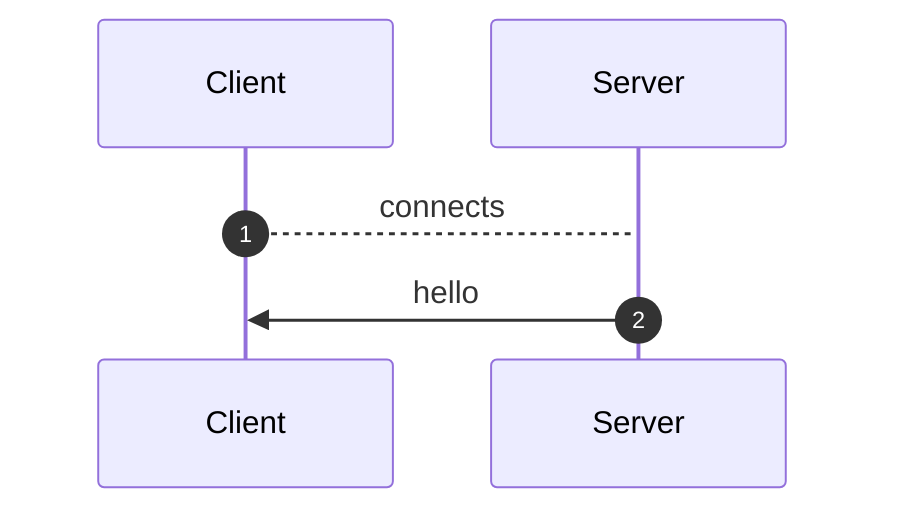
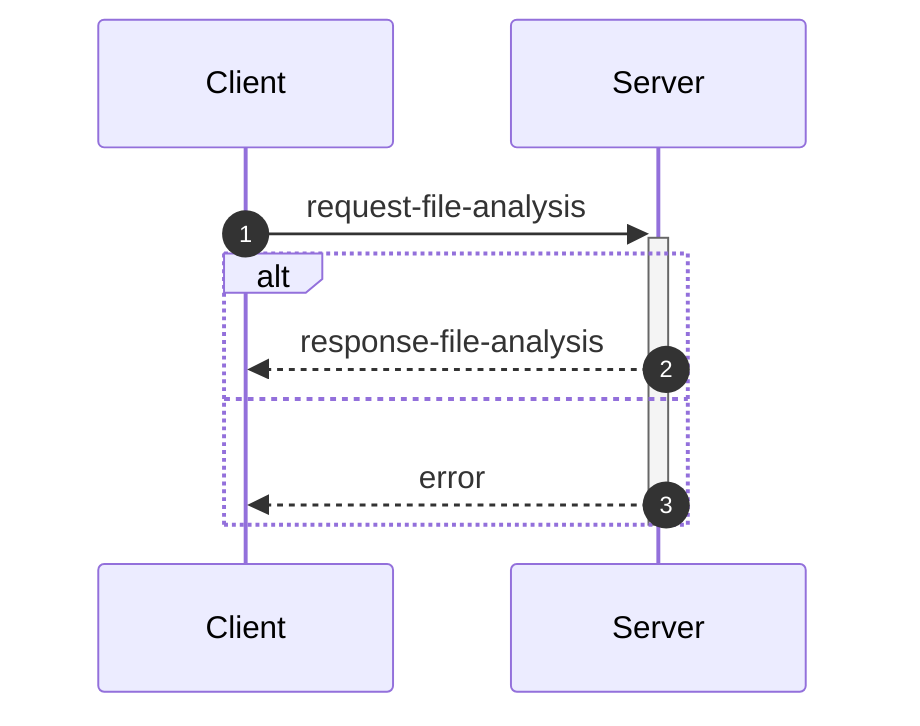
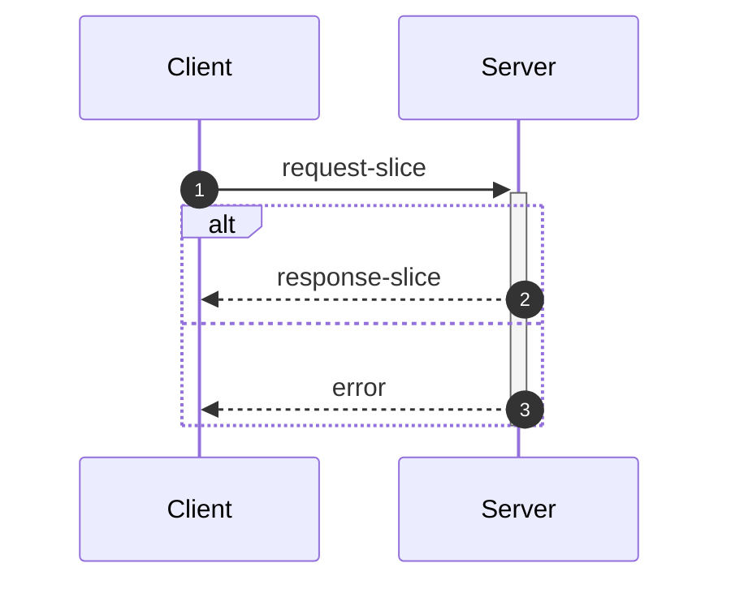
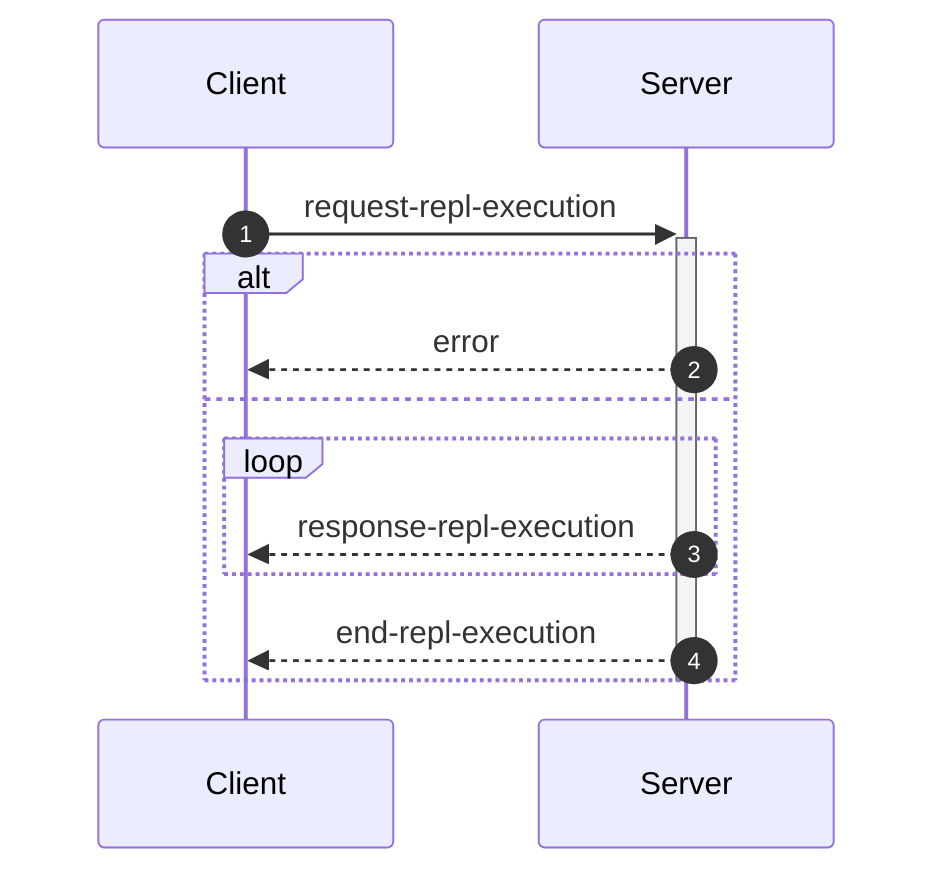

_<span title="an overview of flowR's interface">Generated</span> from '[wiki-interface.ts](https://github.com/flowr-analysis/flowr/tree/main/src/documentation/wiki-interface.ts "src/documentation/wiki-interface.ts")' on 2026-10-18, 19:24:09 UTC (v2.16.2, R v4.6.1), do not edit directly._

Although far from being as detailed as the in-depth explanation of [_flowR_](https://github.com/flowr-analysis/flowr/wiki/Core),
this wiki page explains how to interface with _flowR_ in more detail.
In general, command line arguments and other options provide short descriptions on hover over.

* [💻 Using the REPL](#using-the-repl)
* [⚙️ Configuring FlowR](#configuring-flowr)
* [⚒️ Writing Code](#writing-code)
* [💬 Communicating with the Server](#communicating-with-the-server)

<a id='using-the-repl'></a>
## 💻 Using the REPL

> [!NOTE]
> To execute arbitrary R commands with a repl request, _flowR_ has to be started explicitly with <span title="Description (Command Line Argument): Allow to access the underlying R session when using flowR (security warning: this allows the execution of arbitrary R code!)">`--r-session-access`</span>.
> Please be aware that this introduces a security risk and note that this relies on the [`r-shell` engine](https://github.com/flowr-analysis/flowr/wiki/Engines) .

Although primarily meant for users to explore,
there is nothing which forbids calling _flowR_ as a subprocess to use standard-in, -output, and -error
for communication (although you can access the REPL using the server as well,
with the [REPL Request](#message-request-repl-execution) message).

The read-eval-print loop&nbsp;(REPL) works relatively simple.
You can submit an expression (using <kbd>Enter</kbd>),
which is interpreted as an R&nbsp;expression by default but interpreted as a *command* if it starts with a colon (`:`).
The best command to get started with the REPL is <span title="Description (Repl Command): Show help information (aliases: :h, :?)">`:help`</span>.
Besides, you can leave the REPL either with the command <span title="Description (Repl Command): End the repl (aliases: :q, :exit)">`:quit`</span> or by pressing <kbd>Ctrl</kbd>+<kbd>C</kbd> twice.
When writing a *command*, you may press <kbd>Tab</kbd> to get a list of completions, if available.
Multiple commands can be entered in a single line by separating them with a semicolon (`;`), e.g. `:parse "x<-2"; :df*`.
If a command is given without R code, the REPL will re-use R code given in a previous command.
The prior example will hence return first the parsed AST of the program and then the dataflow graph for `"x <- 2"`.

> [!NOTE]
> If you develop flowR, you may want to launch the repl using the `npm run main-dev` command, this way, you get a non-minified version of flowR with debug information and hot-reloading of source files.

<details>
<summary>Available Commands</summary>

We currently offer the following commands (this with a `[*]` suffix are available with and without the star):

| Command | Description |
| ------- | ----------- |
| **<span title="Description (Repl Command): End the repl (aliases: :q, :exit)">:quit</span>** | End the repl (aliases: **:<span title="Alias of ':quit'. End the repl">q</span>**, **:<span title="Alias of ':quit'. End the repl">exit</span>**) |
| **<span title="Description (Repl Command): Execute the given code as R code. This requires the `--r-session-access` flag to be set and requires the r-shell engine. (aliases: :e, :r)">:execute</span>** | Execute the given code as R code. This requires the `--r-session-access` flag to be set and requires the r-shell engine. (aliases: **:<span title="Alias of ':execute'. Execute the given code as R code. This requires the `--r-session-access` flag to be set and requires the r-shell engine.">e</span>**, **:<span title="Alias of ':execute'. Execute the given code as R code. This requires the `--r-session-access` flag to be set and requires the r-shell engine.">r</span>**) |
| **<span title="Description (Repl Command): Get mermaid code for the control-flow graph of R code (aliases: :cfg, :cf)">:controlflow[*]</span>** | Get mermaid code for the control-flow graph of R code (star: Returns the URL to mermaid.live) (aliases: **:<span title="Alias of ':controlflow'. Get mermaid code for the control-flow graph of R code">cfg</span>**, **:<span title="Alias of ':controlflow'. Get mermaid code for the control-flow graph of R code">cf</span>**) |
| **<span title="Description (Repl Command): Get mermaid code for the control-flow graph with basic blocks (aliases: :cfgb, :cfb)">:controlflowbb[*]</span>** | Get mermaid code for the control-flow graph with basic blocks (star: Returns the URL to mermaid.live) (aliases: **:<span title="Alias of ':controlflowbb'. Get mermaid code for the control-flow graph with basic blocks">cfgb</span>**, **:<span title="Alias of ':controlflowbb'. Get mermaid code for the control-flow graph with basic blocks">cfb</span>**) |
| **<span title="Description (Repl Command): Get mermaid code for the dataflow graph (aliases: :d, :df)">:dataflow[*]</span>** | Get mermaid code for the dataflow graph (star: Returns the URL to mermaid.live) (aliases: **:<span title="Alias of ':dataflow'. Get mermaid code for the dataflow graph">d</span>**, **:<span title="Alias of ':dataflow'. Get mermaid code for the dataflow graph">df</span>**) |
| **<span title="Description (Repl Command): Get mermaid code for the normalized AST of R code (aliases: :n)">:normalize[*]</span>** | Get mermaid code for the normalized AST of R code (star: Returns the URL to mermaid.live) (alias: **:<span title="Alias of ':normalize'. Get mermaid code for the normalized AST of R code">n</span>**) |
| **<span title="Description (Repl Command): Get mermaid code for the simplified dataflow graph (aliases: :ds, :dfs)">:dataflowsimple[*]</span>** | Get mermaid code for the simplified dataflow graph (star: Returns the URL to mermaid.live) (aliases: **:<span title="Alias of ':dataflowsimple'. Get mermaid code for the simplified dataflow graph">ds</span>**, **:<span title="Alias of ':dataflowsimple'. Get mermaid code for the simplified dataflow graph">dfs</span>**) |
| **<span title="Description (Repl Command): Inspect and extend the signature database: `query` (identical to :query @signature), `info <name>` for where a function comes from (identical to :query @function-info), `add <path>` to mount another database/source, `download` to fetch the full-history database. (aliases: :sig)">:signature</span>** | Inspect and extend the signature database: `query` (identical to :query @signature), `info <name>` for where a function comes from (identical to :query @function-info), `add <path>` to mount another database/source, `download` to fetch the full-history database. (alias: **:<span title="Alias of ':signature'. Inspect and extend the signature database: `query` (identical to :query @signature), `info <name>` for where a function comes from (identical to :query @function-info), `add <path>` to mount another database/source, `download` to fetch the full-history database.">sig</span>**) |
| **<span title="Description (Repl Command): Just calculates the DFG, but only prints summary info (aliases: :d#, :df#)">:dataflowsilent</span>** | Just calculates the DFG, but only prints summary info (aliases: **:<span title="Alias of ':dataflowsilent'. Just calculates the DFG, but only prints summary info">d#</span>**, **:<span title="Alias of ':dataflowsilent'. Just calculates the DFG, but only prints summary info">df#</span>**) |
| **<span title="Description (Repl Command): Prints ASCII Art of the parsed, unmodified AST (aliases: :p)">:parse</span>** | Prints ASCII Art of the parsed, unmodified AST (alias: **:<span title="Alias of ':parse'. Prints ASCII Art of the parsed, unmodified AST">p</span>**) |
| **<span title="Description (Repl Command): Prints the version of flowR as well as the current version of R">:version</span>** | Prints the version of flowR as well as the current version of R
| **<span title="Description (Repl Command): Query the given R code (use 'help' for more information)">:query[*]</span>** | Query the given R code (use 'help' for more information) (star: Similar to query, but returns the output in json format.)
| **<span title="Description (Repl Command): Returns an ASCII representation of the dataflow graph (aliases: :df!)">:dataflowascii</span>** | Returns an ASCII representation of the dataflow graph (alias: **:<span title="Alias of ':dataflowascii'. Returns an ASCII representation of the dataflow graph">df!</span>**) |
| **<span title="Description (Repl Command): Returns summarization stats for the normalized AST (aliases: :n#)">:normalize#</span>** | Returns summarization stats for the normalized AST (alias: **:<span title="Alias of ':normalize#'. Returns summarization stats for the normalized AST">n#</span>**) |
| **<span title="Description (Repl Command): Show help information (aliases: :h, :?)">:help</span>** | Show help information (aliases: **:<span title="Alias of ':help'. Show help information">h</span>**, **:<span title="Alias of ':help'. Show help information">?</span>**) |

</details>

> [!TIP]
> 
> As indicated by the examples before, all REPL commands that operate on code keep track of the state.
> Hence, if you run a command like <span title="Description (Repl Command, starred version): Returns the URL to mermaid.live; Base Command: Get mermaid code for the dataflow graph (aliases: :d*, :df*)">`:dataflow*`</span> without providing R code,
> the REPL will re-use the R code provided in a previous command.
> Likewise, doing this will benefit from incrementality!
> If you request the dataflow graph with `:df* x <- 2 * y` and then want to see the parsed AST with `:parse`,
> the REPL will re-use previously obtained information and not re-parse the code again.
> 		

Generally, many commands offer shortcut versions in the REPL. Many queries, for example, offer a shortened format (see the example below).
Of special note, the [Config Query](https://github.com/flowr-analysis/flowr/wiki/%5BQuery%5D-Config)
can be used to also modify the currently active configuration of _flowR_ within the REPL (see the [wiki page](https://github.com/flowr-analysis/flowr/wiki/%5BQuery%5D-Config) for more information).

### Example: Retrieving the Dataflow Graph

To retrieve a URL to the [mermaid](https://mermaid.js.org/) diagram of the dataflow of a given expression,
use <span title="Description (Repl Command, starred version): Returns the URL to mermaid.live; Base Command: Get mermaid code for the dataflow graph (aliases: :d*, :df*)">`:dataflow*`</span> (or <span title="Description (Repl Command): Get mermaid code for the dataflow graph (aliases: :d, :df)">`:dataflow`</span> to get the mermaid code in the cli):

```shell
$ docker run -it --rm eagleoutice/flowr # or npm run flowr 
flowR repl v2.16.2, R grammar v14 (tree-sitter engine)
R> :dataflow* y <- 1 + x
```

<details>
<summary style='color:gray'>Output</summary>

```text
https://mermaid.live/view#base64:eyJjb2RlIjoiZmxvd2NoYXJ0IFREXG4gICAgMXt7XCJgKiM5MTtSTnVtYmVyIzkzOyogKioxKipcbiAgICAgICoxLjYqICgqKmlkOiAxKiopYFwifX1cbiAgICAyKFtcImAqIzkxO1JTeW1ib2wjOTM7KiAqKngqKlxuICAgICAgKjEuMTAqICgqKmlkOiAyKiopYFwiXSlcbiAgICAzW1tcImAqIzkxO1JCaW5hcnlPcCM5MzsqIGJhc2UjNTg7IzU4OyoqIzQzOyoqXG4gICAgICAqMS42LTEwKiAoKippZDogMyoqKVxuICAgIGFyZzogKDEsIDIpYFwiXV1cbiAgICBidWlsdC1pbjpfNDNfW1wiYEJ1aWx0LUluOlxuIzQzO2BcIl1cbiAgICBzdHlsZSBidWlsdC1pbjpfNDNfIHN0cm9rZTpncmF5LGZpbGw6Z3JheSxzdHJva2Utd2lkdGg6MnB4LG9wYWNpdHk6Ljg7XG4gICAgMFtcImAqIzkxO1JTeW1ib2wjOTM7KiAqKnkqKlxuICAgICAgKjEuMSogKCoqaWQ6IDAqKiwgdjogMylgXCJdXG4gICAgNFtbXCJgKiM5MTtSQmluYXJ5T3AjOTM7KiBiYXNlIzU4OyM1ODsqKiM2MDsjNDU7KipcbiAgICAgICoxLjEtMTAqICgqKmlkOiA0KiopXG4gICAgYXJnOiAoMCwgMylgXCJdXVxuICAgIGJ1aWx0LWluOl82MF8tW1wiYEJ1aWx0LUluOlxuIzYwOyM0NTtgXCJdXG4gICAgc3R5bGUgYnVpbHQtaW46XzYwXy0gc3Ryb2tlOmdyYXksZmlsbDpncmF5LHN0cm9rZS13aWR0aDoycHgsb3BhY2l0eTouODtcbiAgICAxIC0uLT58XCJmbG93XCJ8IDJcbiAgICBsaW5rU3R5bGUgMCBzdHJva2U6Z3JheSxjb2xvcjpncmF5O1xuICAgIDIgLS4tPnxcImZsb3dcInwgM1xuICAgIGxpbmtTdHlsZSAxIHN0cm9rZTpncmF5LGNvbG9yOmdyYXk7XG4gICAgMyAtLT58XCJyZWFkcywgYXJnXCJ8IDFcbiAgICAzIC0tPnxcInJlYWRzLCBhcmdcInwgMlxuICAgIDMgLS4tPnxcImZsb3dcInwgMFxuICAgIGxpbmtTdHlsZSA0IHN0cm9rZTpncmF5LGNvbG9yOmdyYXk7XG4gICAgMyAtLi0+fFwicmVhZHMsIGNhbGxzXCJ8IGJ1aWx0LWluOl80M19cbiAgICBsaW5rU3R5bGUgNSBzdHJva2U6Z3JheTtcbiAgICAwIC0tPnxcImRlZmluZWQtYnksIGZsb3dcInwgNFxuICAgIDAgLS0+fFwiZGVmaW5lZC1ieVwifCAzXG4gICAgNCAtLT58XCJyZWFkcywgYXJnXCJ8IDNcbiAgICA0IC0tPnxcInJldHVybnMsIGFyZ1wifCAwXG4gICAgNCAtLi0+fFwicmVhZHMsIGNhbGxzXCJ8IGJ1aWx0LWluOl82MF8tXG4gICAgbGlua1N0eWxlIDEwIHN0cm9rZTpncmF5OyIsIm1lcm1haWQiOnsiYXV0b1N5bmMiOnRydWV9fQ==
```

Retrieve the dataflow graph of the expression `y <- 1 + x`. It looks like this:


<details>

<summary style="color:gray">R Code of the Dataflow Graph</summary>

The analysis ran (including parse and normalize, using the [tree-sitter](https://github.com/flowr-analysis/flowr/wiki/Engines) engine) within the generation environment. No [signature database](https://github.com/flowr-analysis/flowr/wiki/Signature-Database) is mounted for these generated graphs, so `library()` calls attach no package exports; base-R names are still qualified via the generated base-package store (e.g. `acf` as `stats::acf`). 
We encountered no unknown side effects during the analysis.

```r
y <- 1 + x
```

</details>

</details>

For small graphs like this, <span title="Description (Repl Command): Returns an ASCII representation of the dataflow graph (aliases: :df!)">`:dataflowascii`</span> also provides an ASCII representation directly in the REPL:

```shell
$ docker run -it --rm eagleoutice/flowr # or npm run flowr 
flowR repl v2.16.2, R grammar v14 (tree-sitter engine)
R> :df! y <- 1 + x
```

<details open>
<summary style='color:gray'>Output</summary>

```text
                        v<0>v
 c<4>c──────────────────| y |
 |<- |     ┌────────────v---v
 c---c     │
    │   c<3>c   0<1>0
    └───| + |───| 1 |───u<2>u
        c---c   0---0   | x |
           └────────────u---u
Edges:
3 -> 1: reads, arg          3 -> 2: reads, arg
3 -> 0: flows-to            1 -> 2: flows-to
2 -> 3: flows-to            4 -> 3: reads, arg
4 -> 0: returns, arg        0 -> 4: defined-by, flows-to
0 -> 3: defined-by
```

Retrieve the dataflow graph of the expression `y <- 1 + x` as ASCII art.

</details>

For the slicing with <span title="Description (Repl Command): Static backwards executable slicer for R">`:slicer`</span>, you have access to the same [magic comments](#slice-magic-comments) as with the [slice request](#message-request-slice).
Pass `--inline` to splice resolvable `source()` calls into the reconstruction so the slice is a single self-contained R text (the same as the static slice query's `inlineSources` flag).
See `--help` for more flags!

### Example: Interfacing with the File System

Many commands that allow for an R-expression (like <span title="Description (Repl Command, starred version): Returns the URL to mermaid.live; Base Command: Get mermaid code for the dataflow graph (aliases: :d*, :df*)">`:dataflow*`</span>) allow for a file as well
if the argument starts with `file://`.
If you are working from the root directory of the _flowR_ repository, the following gives you the parsed AST of the example file using the <span title="Description (Repl Command): Prints ASCII Art of the parsed, unmodified AST (aliases: :p)">`:parse`</span> command:

> **Watch mode**: Replace `file://` with `watch://` to enter watch mode.
> flowR runs the command immediately and then re-runs it every time the file (or any file inside the folder) changes.
> Enter any other command to leave watch mode.
> For example: `:df watch://analysis.R`

```shell
$ docker run -it --rm eagleoutice/flowr # or npm run flowr 
flowR repl v2.16.2, R grammar v14 (tree-sitter engine)
R> :parse file://test/testfiles/example.R
```

<details>
<summary style='color:gray'>Output</summary>

```text
File: test/testfiles/example.R

program
├ binaryoperator
│ ├ identifier "sum" (1:1─4)
│ ├ <- "<-" (1:5─7)
│ ╰ float "0" (1:8─9)
├ binaryoperator
│ ├ identifier "product" (2:1─8)
│ ├ <- "<-" (2:9─11)
│ ╰ float "1" (2:12─13)
├ binaryoperator
│ ├ identifier "w" (3:1─2)
│ ├ <- "<-" (3:3─5)
│ ╰ float "7" (3:6─7)
├ binaryoperator
│ ├ identifier "N" (4:1─2)
│ ├ <- "<-" (4:3─5)
│ ╰ float "10" (4:6─8)
├ forstatement
│ ├ for "for" (6:1─4)
│ ├ ( "(" (6:5─6)
│ ├ identifier "i" (6:6─7)
│ ├ in "in" (6:8─10)
│ ├ binaryoperator
│ │ ├ float "1" (6:11─12)
│ │ ├ : ":" (6:12─13)
│ │ ╰ parenthesizedexpression
│ │   ├ ( "(" (6:13─14)
│ │   ├ binaryoperator
│ │   │ ├ identifier "N" (6:14─15)
│ │   │ ├ - "-" (6:15─16)
│ │   │ ╰ float "1" (6:16─17)
│ │   ╰ ) ")" (6:17─18)
│ ├ ) ")" (6:18─19)
│ ╰ bracedexpression
│   ├ { "{" (6:20─21)
│   ├ binaryoperator
│   │ ├ identifier "sum" (7:3─6)
│   │ ├ <- "<-" (7:7─9)
│   │ ╰ binaryoperator
│   │   ├ binaryoperator
│   │   │ ├ identifier "sum" (7:10─13)
│   │   │ ├ + "+" (7:14─15)
│   │   │ ╰ identifier "i" (7:16─17)
│   │   ├ + "+" (7:18─19)
│   │   ╰ identifier "w" (7:20─21)
│   ├ binaryoperator
│   │ ├ identifier "product" (8:3─10)
│   │ ├ <- "<-" (8:11─13)
│   │ ╰ binaryoperator
│   │   ├ identifier "product" (8:14─21)
│   │   ├  "" (8:22─23)
│   │   ╰ identifier "i" (8:24─25)
│   ╰ } "}" (9:1─2)
├ call
│ ├ identifier "cat" (11:1─4)
│ ╰ arguments
│   ├ ( "(" (11:4─5)
│   ├ argument
│   │ ╰ string
│   │   ├ " "\"" (11:5─6)
│   │   ├ stringcontent "Sum:" (11:6─10)
│   │   ╰ " "\"" (11:10─11)
│   ├ comma "," (11:11─12)
│   ├ argument
│   │ ╰ identifier "sum" (11:13─16)
│   ├ comma "," (11:16─17)
│   ├ argument
│   │ ╰ string
│   │   ├ " "\"" (11:18─19)
│   │   ├ stringcontent
│   │   │ ╰ escapesequence "\\n" (11:19─21)
│   │   ╰ " "\"" (11:21─22)
│   ╰ ) ")" (11:22─23)
╰ call
  ├ identifier "cat" (12:1─4)
  ╰ arguments
    ├ ( "(" (12:4─5)
    ├ argument
    │ ╰ string
    │   ├ " "\"" (12:5─6)
    │   ├ stringcontent "Product:" (12:6─14)
    │   ╰ " "\"" (12:14─15)
    ├ comma "," (12:15─16)
    ├ argument
    │ ╰ identifier "product" (12:17─24)
    ├ comma "," (12:24─25)
    ├ argument
    │ ╰ string
    │   ├ " "\"" (12:26─27)
    │   ├ stringcontent
    │   │ ╰ escapesequence "\\n" (12:27─29)
    │   ╰ " "\"" (12:29─30)
    ╰ ) ")" (12:30─31)
```

Retrieve the parsed AST of the example file.

<details>

<summary>File Content</summary>

```r
sum <- 0
product <- 1
w <- 7
N <- 10

for (i in 1:(N-1)) {
  sum <- sum + i + w
  product <- product * i
}

cat("Sum:", sum, "\n")
cat("Product:", product, "\n")
```

</details>

As _flowR_ directly transforms this AST the output focuses on being human-readable instead of being machine-readable.
		
</details>

### Example: Run a Query

You can run any query supported by _flowR_ using the <span title="Description (Repl Command): Query the given R code (use 'help' for more information)">`:query`</span> command.
For example, to obtain the shapes of all data frames in a given piece of code, you can run:

```shell
$ docker run -it --rm eagleoutice/flowr # or npm run flowr 
flowR repl v2.16.2, R grammar v14 (tree-sitter engine)
R> :query @absint df-shape "x <- data.frame(a = 1:10, b = 1:10)\ny <- x$a"
```

<details open>
<summary style='color:gray'>Output</summary>

```text
Query: absint (1 ms)
```

Retrieve the shapes of all data frames in the given code.

</details>

To run the linter on a file, you can use (in this example, we just issue the `dead-code` linter on a small piece of code):

```shell
$ docker run -it --rm eagleoutice/flowr # or npm run flowr 
flowR repl v2.16.2, R grammar v14 (tree-sitter engine)
R> :query @linter rules:dead-code "if(FALSE) x <- 2"
```

<details open>
<summary style='color:gray'>Output</summary>

```text
Query: linter (2 ms)
   ╰ Dead Code (dead-code):
       ╰ certain:
           ╰ Code at 1.11-16
```

Run the linter on the given code, with only the `dead-code` rule enabled.

</details>

For more information on the available queries, please check out the [Query API](https://github.com/flowr-analysis/flowr/wiki/Query-API).

<a id='configuring-flowr'></a>
## ⚙️ Configuring FlowR

When running _flowR_, you may want to specify some behaviors with a dedicated configuration file.
By default, flowR looks for a file named `flowr.json` in the current working directory (or any higher directory).
You can also specify a different file with <span title="Description (Command Line Argument): The name of the configuration file to use">`--config-file`</span> or pass the configuration inline using <span title="Description (Command Line Argument): The flowR configuration to use, as a JSON string">`--config-json`</span>.
A `flowr.json` found this way belongs to the analyzed project, so flowR ignores its options that decide what flowR executes or loads
(`engines.*.wasmPath`, `engines.*.treeSitterWasmPath`, `engines.*.rPath`, `solver.sigdb.additionalPaths`, `solver.sigdb.downloadRepo`, `solver.sigdb.installedLibrary.paths`),
unless you pass <span title="Description (Command Line Argument): Keep the security-sensitive options (e.g., the R executable) of the flowr.json found in the working directory or a parent. Only use this for projects you trust.">`--trust-config`</span>.
To analyze code you do not trust, use the secure mode (<span title="Description (Command Line Argument): Run in secure mode for analyzing untrusted code: flowR does not start R (or any other process), does not access the network, does not search for project configs, and ignores security-sensitive options in every config. Cannot be disabled once enabled. Can also be enabled with the environment variable {italic FLOWR_SECURE_MODE=1}.">`--secure`</span>, see the [security policy](https://github.com/flowr-analysis/flowr/blob/main/.github/SECURITY.md)).
To inspect the current configuration, you can run flowr with the <span title="Description (Command Line Argument): Run with verbose logging (will be passed to the corresponding script)">`--verbose`</span> flag, or use the `config` [Query](https://github.com/flowr-analysis/flowr/wiki/Query-API).
Within the REPL this works by running the following:

```shell
:query @config
```

To work with the <a href="https://github.com/flowr-analysis/flowr/tree/main/src/config.ts#L119"><code><span title="The configuration file format for flowR.">FlowrConfig</span></code></a> you can use the provided helper objects alongside its methods like
<a href="https://github.com/flowr-analysis/flowr/tree/main/src/config.ts#L914"><code><span title="Creates a new flowr config that has the updated values.">FlowrConfig::<b>amend</b></span></code></a>.
The schema below documents every option; the ones you most likely want are:

- <a href="https://github.com/flowr-analysis/flowr/wiki/Interface#configuring-flowr" title="Configuration Option (boolean): Whether source calls should be ignored, causing {@link processSourceCall}&#39;s behavior to be skipped.">ignoreSourceCalls</a>: ignore source calls when analyzing the code, i.e., ignore the inclusion of other files.
- <a href="https://github.com/flowr-analysis/flowr/wiki/Interface#configuring-flowr" title="Configuration Option (boolean): Whether load calls should be ignored, causing {@link processLoadCall}&#39;s behavior to be skipped.">ignoreLoadCalls</a>: ignore load calls when analyzing the code, i.e., ignore the loading of r-data files.
- <a href="https://github.com/flowr-analysis/flowr/wiki/Interface#configuring-flowr" title="Configuration Option (object): Do you want to overwrite (parts) of the builtin definition?">semantics.environment.overwriteBuiltIns</a>: overwrite _flowR_'s handling of built-in functions, or clear the preset definitions entirely.
  See [Configure BuiltIn Semantics](#configure-builtin-semantics) for more information.
- <a href="https://github.com/flowr-analysis/flowr/wiki/Interface#configuring-flowr" title="Configuration Option (string): How to resolve variables and their values. (one of &quot;disabled&quot;, &quot;alias&quot;, &quot;builtin&quot;)">solver.variables</a>: how to resolve variables and their values (`disabled`, `alias`, `builtin`).
- <a href="https://github.com/flowr-analysis/flowr/wiki/Interface#configuring-flowr" title="Configuration Option (array): The engine or set of engines to use for interacting with R code. An empty array means all available engines will be used.">engines</a> and <a href="https://github.com/flowr-analysis/flowr/wiki/Interface#configuring-flowr" title="Configuration Option (string): The default engine to use for interacting with R code. If this is undefined, an arbitrary engine from the specified list will be used. (one of &quot;tree-sitter&quot;, &quot;r-shell&quot;)">defaultEngine</a>: the engines used to interact with R code, see the [Engines wiki page](https://github.com/flowr-analysis/flowr/wiki/Engines).
- <a href="https://github.com/flowr-analysis/flowr/wiki/Interface#configuring-flowr" title="Configuration Option (array): Files a framework loads on its own, without any source() call (e.g. global.R in a shiny app), in the order they are loaded; flowR orders the matching project files accordingly and analyzes them as one program. Entries are case-insensitive globs matched against the file path, a plain name matches any file with that name, and entries matching no project file are warned about. Usually set per project kind via specializeConfig.">project.implicitSources</a>: the files a framework loads without any `source()` call, in the order in which they are
  loaded. Entries are globs (e.g. `R/*.R`) matched against the file path ignoring capitalization; one matching no file is reported.
- <a href="https://github.com/flowr-analysis/flowr/wiki/Interface#configuring-flowr" title="Configuration Option (object): Overwrite (parts of) the configuration depending on the project kind flowR detects, e.g. to give a shiny app its implicit sources.">specializeConfig</a>: overwrite (parts of) the configuration depending on the kind of project _flowR_ detects
  (e.g. `shiny-app`), which is how a shiny app gets its implicit sources by default. What you configure directly wins.
- <a href="https://github.com/flowr-analysis/flowr/wiki/Interface#configuring-flowr" title="Configuration Option (string): Overwrite the project kind flowR would otherwise infer from the analyzed files, e.g. when auto-detection guesses wrong. (one of &quot;package&quot;, &quot;script&quot;, &quot;shiny-app&quot;, &quot;notebook&quot;, &quot;project&quot;, &quot;unknown&quot;)">project.useProjectType</a>: skip that detection and force a project kind yourself, when auto-detection guesses wrong.
- <a href="https://github.com/flowr-analysis/flowr/wiki/Interface#configuring-flowr" title="Configuration Option (array): The default plugins to load when creating a new instance of FlowrAnalyzer">defaultPlugins</a> and <a href="https://github.com/flowr-analysis/flowr/wiki/Interface#configuring-flowr" title="Configuration Option (array): The plugins to load in REPL mode">repl.plugins</a>: the plugins to load for a new <a href="https://github.com/flowr-analysis/flowr/tree/main/src/project/flowr-analyzer.ts#L205"><code><span title="Central class for conducting analyses with FlowR. Use the FlowrAnalyzerBuilder to create a new instance. If you want the original pattern of creating a pipeline and running all steps, you can still do this with FlowrAnalyzer#runFull . To inspect the context of the analyzer, use FlowrAnalyzer#inspectContext (if you are a plugin and need to modify it, use FlowrAnalyzer#context instead).">FlowrAnalyzer</span></code></a> and in the REPL
  (use `flowr:default` to reference the former).

So you can configure _flowR_ by adding a file like the following:

<details>

<summary>Example Configuration File</summary>

```json
{
  "ignoreSourceCalls": true,
  "ignoreLoadCalls": true,
  "semantics": {
    "environment": {
      "overwriteBuiltIns": {
        "definitions": [
          {
            "type": "function",
            "names": [
              "foo"
            ],
            "processor": "builtin:assign",
            "config": {}
          }
        ]
      }
    }
  },
  "defaultPlugins": [
    "file:description",
    "versions:description"
  ],
  "repl": {
    "quickStats": false,
    "dfProcessorHeat": false,
    "hints": true,
    "plugins": [
      "flowr:default"
    ]
  },
  "project": {
    "resolveUnknownPathsOnDisk": true,
    "implicitSources": [
      "global.R",
      "app.R"
    ]
  },
  "linter": {
    "disabledRules": []
  },
  "specializeConfig": {
    "shiny-app": {
      "project": {
        "implicitSources": [
          "global.R",
          "ui.R",
          "server.R",
          "app.R"
        ]
      }
    }
  },
  "engines": [
    {
      "type": "r-shell"
    }
  ],
  "solver": {
    "variables": "alias",
    "evalStrings": true,
    "trackEnvironments": true,
    "sigdb": {
      "enabled": true,
      "loadProjectDependencies": true,
      "eagerlyLoad": false,
      "eagerlyLoadExports": false,
      "linkBaseR": false,
      "linkDescriptionDependencies": false
    },
    "resolveSource": {
      "dropPaths": "no",
      "ignoreCapitalization": true,
      "inferWorkingDirectory": "active-script",
      "searchPath": []
    },
    "instrument": {},
    "slicer": {
      "threshold": 50
    }
  },
  "abstractInterpretation": {
    "wideningThreshold": 4,
    "followCalls": true,
    "dataFrame": {
      "maxColNames": 20,
      "readLoadedData": {
        "readExternalFiles": true,
        "maxReadLines": 1000000
      }
    }
  },
  "incremental": {
    "alwaysIncremental": false,
    "parsing": {
      "activated": false,
      "heuristics": {
        "activated": true,
        "mtime": true,
        "linesFrom": 500,
        "bytesFrom": 50000,
        "alwaysWithEdits": false,
        "minFiles": 1
      }
    }
  },
  "gas": {
    "thresholds": {
      "memory": {
        "problematic": 0.7,
        "critical": 0.9
      },
      "timeMs": {
        "problematic": 100000,
        "critical": 120000
      }
    },
    "features": {}
  }
}
```

</details>

<details>
<a id='configure-builtin-semantics'></a>
<summary>Configure Built-In Semantics</summary>

`semantics/environment/overwriteBuiltins` accepts two keys:

- `loadDefaults` (boolean, initially `true`): If set to `true`, the default built-in definitions are loaded before applying the custom definitions. Setting this flag to `false` explicitly disables the loading of the default definitions.
- `definitions` (array, initially empty): Allows to overwrite or define new built-in elements. Each object within must have a `type` which is one of the below. Furthermore, they may define a string array of `names` which specifies the identifiers to bind the definitions to. You may use `assumePrimitive` to specify whether _flowR_ should assume that this is a primitive non-library definition (so you probably just do not want to specify the key).

  | Type            | Description                                                                                                                                                                                                                                                                                              | Example                                                                                                    |
  | --------------- | -------------------------------------------------------------------------------------------------------------------------------------------------------------------------------------------------------------------------------------------------------------------------------------------------------- | ---------------------------------------------------------------------------------------------------------- |
  | `constant`    | Additionally allows for a `value` this should resolve to.                                                                                                                                                                                                                                                | `{ type: 'constant', names: ['NULL', 'NA'],  value: null }`                                                |
  | `function`    | Is a rather flexible way to define and bind built-in functions. For the time, we do not have extensive documentation to cover all the cases, so please either consult the sources with the `default-builtin-config.ts` or open a [new issue](https://github.com/flowr-analysis/flowr/issues/new/choose). | `{ type: 'function', names: ['next'], processor: 'builtin:d', config: { cfg: ExitPointType.Next } }` |
  | `replacement` | A comfortable way to specify replacement functions like `$<-` or `names<-`. `suffixes` describes the... suffixes to attach automatically. | `{ type: 'replacement', suffixes: ['<-', '<<-'], names: ['[', '[['] }` |

</details>

<details>

<summary style='color:gray'>Full Configuration-File Schema</summary>

- _The configuration file format for flowR._ (object)
    - **logLevel** [optional] _flowR's global minimum log level, applied when the config is loaded._ (string)
        Only allows: 'silly', 'trace', 'debug', 'info', 'warn', 'error', 'fatal'
    - **ignoreSourceCalls** [optional] _Whether source calls should be ignored, causing {@link processSourceCall}'s behavior to be skipped._ (boolean)
    - **ignoreLoadCalls** [optional] _Whether load calls should be ignored, causing {@link processLoadCall}'s behavior to be skipped._ (boolean)
    - **semantics** _Configure language semantics and how flowR handles them._ (object)
        - **environment** [optional] _Semantics regarding how to handle the R environment._ (object)
            - **overwriteBuiltIns** [optional] _Do you want to overwrite (parts) of the builtin definition?_ (object)
                - **loadDefaults** [optional] _Should the default configuration still be loaded?_ (boolean)
                - **definitions** [optional] _The definitions to load/overwrite._ (array)
                Valid item types:
                    - (object)
    - **defaultPlugins** [optional] _The default plugins to load when creating a new instance of FlowrAnalyzer_ (array)
    Valid item types:
        - (alternatives)
            - (string)
            - (array)
    - **repl** _Configuration options for the REPL._ (object)
        - **quickStats** [optional] _Whether to show quick stats in the REPL after each evaluation._ (boolean)
        - **dfProcessorHeat** [optional] _This instruments the dataflow processors to count how often each processor is called._ (boolean)
        - **hints** [optional] _Whether to show dim inline hints on the empty prompt (automatically disabled on non-interactive terminals)._ (boolean)
        - **plugins** [optional] _The plugins to load in REPL mode_ (array)
        Valid item types:
            - (alternatives)
                - (string)
                - (array)
        - **autoUseFileProtocol** [optional] _Prepend the file protocol to a repl input that looks like a path, instead of only warning about it._ (boolean)
        - **queryStats** [optional] _Whether `:query` closes with the line stating how long the queries took (`:query*` never prints it)._ (boolean)
        - **showPlugins** [optional] _Whether `:version` grays out the plugins that did not activate during the last analysis._ (boolean)
    - **project** _Project specific configuration options._ (object)
        - **resolveUnknownPathsOnDisk** [optional] _Whether to resolve unknown paths loaded by the r project disk when trying to source/analyze files._ (boolean)
        - **failOnInaccessiblePath** [optional] _Whether a directory that cannot be traversed during file discovery (e.g. due to permissions) aborts the analysis; when false (the default) such paths are logged and skipped._ (boolean)
        - **basePackages** [optional] _The packages considered part of R itself (base and recommended); if unset, flowR uses its built-in list._ (array)
        Valid item types:
            - (string)
        - **implicitSources** [optional] _Files a framework loads on its own, without any source() call (e.g. global.R in a shiny app), in the order they are loaded; flowR orders the matching project files accordingly and analyzes them as one program. Entries are case-insensitive globs matched against the file path, a plain name matches any file with that name, and entries matching no project file are warned about. Usually set per project kind via specializeConfig._ (array)
        Valid item types:
            - (string)
        - **useProjectType** [optional] _Overwrite the project kind flowR would otherwise infer from the analyzed files, e.g. when auto-detection guesses wrong._ (string)
            Only allows: 'package', 'script', 'shiny-app', 'notebook', 'project', 'unknown'
        - **assumeImplicitEcho** [optional] _Whether the top level of the analyzed code is echoed, so that every visible result printed there is collected as an output by the dependencies query (default true, false for a package)._ (boolean)
        - **discovery** [optional] _Scoping options for the default project discovery._ (object)
            - **full** [optional] _Collect every file below the project root (greedy) instead of only the files the detected project kind needs (default false)._ (boolean)
            - **perKind** [optional] _Per-kind include/exclude glob overrides layered on the default scoping._ (object)
            - **ignore** [optional] _Case-insensitive globs that drop matching files from the intelligent discovery, regardless of kind (e.g. .Renviron to ignore environment files)._ (array)
            Valid item types:
                - (string)
        - **classification** [optional] _Overrides for the signals flowR uses to classify the project kind._ (object)
            - **shinyDescriptionTypes** [optional] _DESCRIPTION Type: values that mark a shiny app._ (array)
            Valid item types:
                - (string)
            - **shinyEntryFiles** [optional] _File names a shiny app is assembled from._ (array)
            Valid item types:
                - (string)
            - **shinyUsagePattern** [optional] _Regex source evidencing shiny usage in an entry file._ (string)
            - **notebookExtensions** [optional] _File extensions marking a notebook._ (array)
            Valid item types:
                - (string)
    - **linter** _Linter configuration options._ (object)
        - **disabledRules** _Linting rule names excluded from the default rule set (a rule requested explicitly via a linter query still runs). Usually set per project kind via specializeConfig._ (array)
        Valid item types:
            - (string)
        - **disabledTags** [optional] _Linting rule tags whose rules are excluded from the default rule set (a rule requested explicitly via a linter query still runs). By default the cmd-check rules are disabled for everything but a package; a configured list replaces that default._ (array)
        Valid item types:
            - (string)
    - **inputSources** [optional] _Further frameworks the input-sources analysis should know about; entries are added to flowR's defaults._ (object)
        - **pure** [optional] _Functions that only pass the constantness of their arguments on._ (array)
        Valid item types:
            - (string)
        - **param** [optional] _Functions whose result is a 'param' input._ (array)
        Valid item types:
            - (string)
        - **file** [optional] _Functions whose result is a 'file' input._ (array)
        Valid item types:
            - (string)
        - **tempfile** [optional] _Functions whose result is a 'tempfile' input._ (array)
        Valid item types:
            - (string)
        - **glob** [optional] _Functions whose result is a 'glob' input._ (array)
        Valid item types:
            - (string)
        - **net** [optional] _Functions whose result is a 'net' input._ (array)
        Valid item types:
            - (string)
        - **rand** [optional] _Functions whose result is a 'rand' input._ (array)
        Valid item types:
            - (string)
        - **system** [optional] _Functions whose result is a 'system' input._ (array)
        Valid item types:
            - (string)
        - **ffi** [optional] _Functions whose result is a 'ffi' input._ (array)
        Valid item types:
            - (string)
        - **lang** [optional] _Functions whose result is a 'lang' input._ (array)
        Valid item types:
            - (string)
        - **options** [optional] _Functions whose result is a 'options' input._ (array)
        Valid item types:
            - (string)
        - **cmdline** [optional] _Functions whose result is a 'cmdline' input._ (array)
        Valid item types:
            - (string)
        - **user** [optional] _Functions whose result is a 'user' input._ (array)
        Valid item types:
            - (string)
        - **const** [optional] _Functions whose result is a 'const' input._ (array)
        Valid item types:
            - (string)
        - **scope** [optional] _Functions whose result is a 'scope' input._ (array)
        Valid item types:
            - (string)
        - **dconst** [optional] _Functions whose result is a 'dconst' input._ (array)
        Valid item types:
            - (string)
        - **unknown** [optional] _Functions whose result is a 'unknown' input._ (array)
        Valid item types:
            - (string)
        - **linkedObjects** [optional] _Objects a framework provides without a definition in the code, e.g. shiny's input._ (array)
        Valid item types:
            - (object)
        - **linkedEntryPoints** [optional] _Calls that hand a function to a framework, which binds its objects to the parameters by position._ (array)
        Valid item types:
            - (object)
    - **specializeConfig** [optional] _Overwrite (parts of) the configuration depending on the project kind flowR detects, e.g. to give a shiny app its implicit sources._ (object)
    - **engines** _The engine or set of engines to use for interacting with R code. An empty array means all available engines will be used._ (array)
    Valid item types:
        - (alternatives)
            - _The configuration for the tree sitter engine._ (object)
                - **type** [required] _Use the tree sitter engine._ (string)
                    Only allows: 'tree-sitter'
                - **wasmPath** [optional] _The path to the tree-sitter-r WASM binary to use. If this is undefined, this uses the default path._ (string)
                - **treeSitterWasmPath** [optional] _The path to the tree-sitter WASM binary to use. If this is undefined, this uses the default path._ (string)
                - **lax** [optional] _Whether to use the lax parser for parsing R code (allowing for syntax errors). If this is undefined, the strict parser will be used._ (boolean)
            - _The configuration for the R shell engine._ (object)
                - **type** [required] _Use the R shell engine._ (string)
                    Only allows: 'r-shell'
                - **rPath** [optional] _The path to the R executable to use. If this is undefined, this uses the default path._ (string)
                - **pipeBind** [optional] _Whether to enable R's experimental pipe-bind operator "=>" by setting _R_USE_PIPEBIND_ for the R session (default false); R itself keeps this off by default, as it is experimental and has never shipped in a release version of R._ (boolean)
    - **defaultEngine** [optional] _The default engine to use for interacting with R code. If this is undefined, an arbitrary engine from the specified list will be used._ (string)
        Only allows: 'tree-sitter', 'r-shell'
    - **solver** _How to resolve constants, constraints, cells, ..._ (object)
        - **variables** _How to resolve variables and their values._ (string)
            Only allows: 'disabled', 'alias', 'builtin'
        - **evalStrings** _Should we include eval(parse(text="...")) calls in the dataflow graph?_ (boolean)
        - **trackEnvironments** [optional] _Track user-created environments (new.env, assign/get/local with envir=, dollar-assign, attach). When false, all envir-style calls fall through conservatively._ (boolean)
        - **sigdb** _Resolving library exports from a signature database._ (object)
            - **enabled** [optional] _Resolve library()/use() exports from a signature database (default true); when false no database is consulted._ (boolean)
            - **loadProjectDependencies** [optional] _Load the project's declared dependencies from its metadata files (DESCRIPTION Imports/Depends, rproject.toml, uvr.toml, renv.lock, rv.lock, uvr.lock) (default true); when false these files are not read for dependencies._ (boolean)
            - **eagerlyLoad** [optional] _Parse the database up front rather than on the first package load (default false, ignored if disabled)._ (boolean)
            - **eagerlyLoadExports** [optional] _Add a vertex for every export on load rather than on demand (default false); keeps the dataflow graph small._ (boolean)
            - **assumedRVersion** [optional] _R version assumed when resolving versioned (base-R) exports: a pin like "4.5" or "auto" to detect the installed R (default "auto")._ (string)
            - **linkBaseR** [optional] _Eagerly attach base-R namespaces so bare base calls resolve without library() (default false)._ (boolean)
            - **linkBaseRCalls** [optional] _Add a lightweight Reads edge from a bare base-R call to its signature-database function vertex (default false; base-R qualification is edge-free otherwise)._ (boolean)
            - **linkPackageCalls** [optional] _Add a lightweight Reads edge from a resolved package call to its signature-database function vertex (default false)._ (boolean)
            - **linkDescriptionDependencies** [optional] _Eagerly attach the namespaces of the project's declared DESCRIPTION dependencies (Imports/Depends) so their exports resolve without an explicit library() (default false)._ (boolean)
            - **warmInBackground** [optional] _Decompress the hot shards (base + most-downloaded) in a background task on startup so the first library() lookup is warm (default false; for long-running servers/REPLs)._ (boolean)
            - **additionalPaths** [optional] _Extra directories or bundle/manifest files searched for signature databases (alongside the shipped default and $FLOWR_SIGDB_DIR); a downloaded full-history bundle placed here is mounted automatically._ (array)
            Valid item types:
                - (string)
            - **downloadRepo** [optional] _GitHub owner/repo the full-history bundle is downloaded from via ":signature download" (default "flowr-analysis/flowr", release tag "sigdb-v<flowR-version>")._ (string)
            - **autoSync** [optional] _On startup, re-download shards whose committed sigdb.remote.json hash no longer matches the cache, in the background (default false; opt-in network sync after a git pull)._ (boolean)
            - **installedLibrary** [optional] _Recovering packages no signature database knows from the copy installed on this machine._ (object)
                - **enabled** [required] _Recover packages no signature database knows from their installed copy (default false)._ (boolean)
                - **paths** [optional] _Library directories to search; when empty they are discovered from the environment and the project._ (array)
                Valid item types:
                    - (string)
                - **useEnvironment** [optional] _Search the libraries R_LIBS_USER/R_LIBS/R_LIBS_SITE name (default true)._ (boolean)
                - **useProjectLibrary** [optional] _Search a project-local renv/packrat library (default true)._ (boolean)
                - **maxDepth** [optional] _How far to descend into the nested layout of a project-local library (default 3)._ (number)
                - **packages** [optional] _Only recover packages whose name matches one of these regular expressions; empty means any._ (array)
                Valid item types:
                    - (string)
            - **blobCacheBudgetMb** [optional] _How many MiB of decoded package blobs every open bundle may hold together (default 16)._ (number)
            - **versionSelection** [optional] _When a project constrains a dependency, resolve to the newest (default), oldest, or system-installed version satisfying it; system needs R and falls back to newest. Base-R packages always resolve against the assumed R version._ (string)
                Only allows: 'newest', 'oldest', 'system'
            - **versionOverrides** [optional] _Force an exact version for specific packages (name -> version), overriding both the project constraint and the versionSelection policy (default {})._ (object)
        - **versionManagement** _Policies for reasoning about dependency versions._ (object)
            - **linkedVersionGroups** [optional] _Groups of packages that must resolve to the same version; version guessing intersects each group so its members stay mutually compatible (default [])._ (array)
            Valid item types:
                - (array)
                Valid item types:
                    - (string)
        - **assumeAttachedPackages** [optional] _Packages to treat as attached without a `library()` call, so what the built-in configuration states about them applies to the analyzed code. The base packages R attaches on startup already resolve without it._ (array)
        Valid item types:
            - (string)
        - **transitiveSideEffectRounds** [optional] _How many rounds the transitive side-effect fixpoint may run before it is cut off (default 32); the propagation stops on its own as soon as a round adds nothing._ (number)
        - **maxOverlayDepth** [optional] _How many binding overlays may stack on one environment frame before a write flattens them (default 4); a pure performance knob, trading lookup cost against copy cost without changing any result._ (number)
        - **instrument** (object)
            - **dataflowExtractors** [optional] _These keys are only intended for use within code, allowing to instrument the dataflow analyzer!_ (any)
        - **resolveSource** [optional] _If lax source calls are active, flowR searches for sourced files much more freely, based on the configurations you give it. This option is only in effect if `ignoreSourceCalls` is set to false._ (object)
            - **dropPaths** _Allow to drop the first or all parts of the sourced path, if it is relative._ (string)
                Only allows: 'no', 'once', 'all'
            - **ignoreCapitalization** _Search for filenames matching in the lowercase._ (boolean)
            - **inferWorkingDirectory** _Try to infer the working directory from the main or any script to analyze._ (string)
                Only allows: 'no', 'main-script', 'active-script', 'any-script'
            - **searchPath** _Additionally search in these paths._ (array)
            Valid item types:
                - (string)
            - **repeatedSourceLimit** [optional] _How often the same file can be sourced within a single run? Please be aware: in case of cyclic sources this may not reach a fixpoint so give this a sensible limit._ (number)
            - **applyReplacements** _Provide name replacements for loaded files_ (array)
            Valid item types:
                - (object)
            - **assumeFilesExist** [optional] _Assume a sourced file is always there, making what it defines certain instead of conditional on the source call._ (boolean)
        - **slicer** [optional] _The configuration for the slicer._ (object)
            - **threshold** [optional] _The maximum number of iterations to perform on a single function call during slicing._ (number)
            - **autoExtend** [optional] _If set, the slicer will gain an additional post-pass._ (boolean)
    - **abstractInterpretation** _The configuration options for abstract interpretation._ (object)
        - **wideningThreshold** _The threshold for the number of visitations of a node at which widening should be performed to ensure the termination of the fixpoint iteration._ (number)
        - **followCalls** _Whether the abstract interpretation is interprocedural, i.e. whether it steps into the functions a call may dispatch to._ (boolean)
        - **dataFrame** _The configuration of the shape inference for data frames._ (object)
            - **maxColNames** _The maximum number of columns names to infer for data frames before over-approximating the column names to top._ (number)
            - **readLoadedData** _Configuration options for reading data frame shapes from loaded external data files, such as CSV files._ (object)
                - **readExternalFiles** _Whether data frame shapes should be extracted from loaded external files, such as CSV files._ (boolean)
                - **maxReadLines** _The maximum number of lines to read when extracting data frame shapes from loaded files, such as CSV files._ (number)
    - **incremental** (object)
        - **alwaysIncremental** _Always take the incremental path, regardless of heuristics._ (boolean)
        - **parsing** (object)
            - **activated** _If set, incremental parsing will be used._ (boolean)
            - **heuristics** (object)
                - **activated** [optional] _If set, the heuristics for incremental parsing will be used._ (boolean)
                - **mtime** [optional] _Skip reparsing entirely if the file's modification time is unchanged since the last parse._ (boolean)
                - **linesFrom** [optional] _Only consider incremental parsing for files with at least this many lines._ (number)
                - **bytesFrom** [optional] _Only consider incremental parsing for files with at least this many bytes._ (number)
                - **alwaysWithEdits** [optional] _Always take the incremental path whenever there is a computed edit region, regardless of the other thresholds._ (boolean)
                - **minFiles** [optional] _Only apply these heuristics once the project has at least this many files loaded._ (number)
    - **gas** [optional] _Resource-usage guard (gas) configuration. All feature factors default to 0 (disabled). See https://github.com/flowr-analysis/flowr/wiki/Core#gas-resource-guard._ (object)
        - **thresholds** [optional] _Thresholds for all gas checks (scaled by per-feature factor), boundable per feature._ (object)
            - **memory** [optional] _Heap-usage fraction thresholds (0-1), either shared or given per feature key (with `default` covering the rest)._ (object)
                - **problematic** [optional] _Heap fraction (0-1) above which Problematic is returned, for every feature without an entry of its own._ (number)
                - **critical** [optional] _Heap fraction (0-1) above which Critical is returned, for every feature without an entry of its own._ (number)
            - **timeMs** [optional] _Elapsed analysis time thresholds in milliseconds, either shared or given per feature key (with `default` covering the rest)._ (object)
                - **problematic** [optional] _Elapsed ms above which Problematic is returned, for every feature without an entry of its own._ (number)
                - **critical** [optional] _Elapsed ms above which Critical is returned, for every feature without an entry of its own._ (number)
            - **steps** [optional] _Processed-AST-node thresholds, counted rather than sampled; only a key that arms a budget (`dataflow`) reads them._ (object)
                - **problematic** [optional] _Processed AST nodes above which Problematic is returned, for every feature without an entry of its own._ (number)
                - **critical** [optional] _Processed AST nodes above which the extraction is cut short, for every feature without an entry of its own._ (number)
            - **vertices** [optional] _Created-dataflow-vertex thresholds, counted like `steps`._ (object)
                - **problematic** [optional] _Created dataflow vertices above which Problematic is returned, for every feature without an entry of its own._ (number)
                - **critical** [optional] _Created dataflow vertices above which the extraction is cut short, for every feature without an entry of its own._ (number)
        - **features** [optional] _Per-feature sensitivity factors. 0 or absent disables gas checking for that feature. A factor of 2 makes the feature twice as sensitive. Recognised keys: `source`, `side-effect-linking`, `linter`, `slicer`, `dataflow`._ (object)
        - **countedCheckEvery** [optional] _How many counted steps pass between two accountings of an armed check, be it a dataflow budget or the slicer's traversal (default 128); trades overshoot against the cost of the check._ (number)
        - **heapProvider** [optional] _Custom heap statistics source (programmatic configs only), overriding the built-in v8/performance.memory detection._ (function)

</details>

<a id='writing-code'></a>
## ⚒️ Writing Code

_flowR_ can be used as a [module](https://www.npmjs.com/package/@eagleoutice/flowr) and offers several main classes and interfaces that are interesting for extension writers 
(see the [Visual Studio Code extension](https://marketplace.visualstudio.com/items?itemName=code-inspect.vscode-flowr) or the [Core](https://github.com/flowr-analysis/flowr/wiki/Core) wiki page for more information).

### Creating Analyses with _flowR_

Nowadays, instances of the <a href="https://github.com/flowr-analysis/flowr/tree/main/src/project/flowr-analyzer.ts#L205"><code><span title="Central class for conducting analyses with FlowR. Use the FlowrAnalyzerBuilder to create a new instance. If you want the original pattern of creating a pipeline and running all steps, you can still do this with FlowrAnalyzer#runFull . To inspect the context of the analyzer, use FlowrAnalyzer#inspectContext (if you are a plugin and need to modify it, use FlowrAnalyzer#context instead).">FlowrAnalyzer</span></code></a> should be used as central frontend to get analysis results from _flowR_.
The entry points an analysis is written against are re-exported from the package root (`import { FlowrAnalyzerBuilder } from '@eagleoutice/flowr'`);
everything else stays reachable under its own path, as in `@eagleoutice/flowr/dataflow/graph/graph`.
For example, a program slice can be created like this:

```ts
const analyzer = await new FlowrAnalyzerBuilder()
    .setEngine('tree-sitter')
    .build();
analyzer.addRequest('x <- 1\ny <- x\nx');
const result = await analyzer.query([
    {
        type:     'static-slice',
        criteria: ['3@x']
    }
]);
```

For more information, please have a look at the [Analyzer](https://github.com/flowr-analysis/flowr/wiki/Analyzer) wiki page, which explains how to construct and use the <a href="https://github.com/flowr-analysis/flowr/tree/main/src/project/flowr-analyzer.ts#L205"><code><span title="Central class for conducting analyses with FlowR. Use the FlowrAnalyzerBuilder to create a new instance. If you want the original pattern of creating a pipeline and running all steps, you can still do this with FlowrAnalyzer#runFull . To inspect the context of the analyzer, use FlowrAnalyzer#inspectContext (if you are a plugin and need to modify it, use FlowrAnalyzer#context instead).">FlowrAnalyzer</span></code></a> in more detail.
To work with specific perspectives, you can also consult the respective pages like the [Dataflow Graph](https://github.com/flowr-analysis/flowr/wiki/Dataflow-Graph) or the [Abstract Interpretation](https://github.com/flowr-analysis/flowr/wiki/Abstract-Interpretation) wiki pages.
### The Pipeline Executor (Low-Level Interface)

Once, in the beginning, _flowR_ was meant to produce a dataflow graph merely to provide *program slices*. 
However, with continuous updates, the [Dataflow Graph](https://github.com/flowr-analysis/flowr/wiki/Dataflow-Graph) repeatedly proves to be the more interesting part.
With this, we restructured _flowR_'s originally *hardcoded* pipeline to be far more flexible. 
Now, it can be theoretically extended or replaced with arbitrary steps, optional steps, and what we call 'decorations' of these steps. 
In short, a slicing pipeline using the <a href="https://github.com/flowr-analysis/flowr/tree/main/src/core/pipeline-executor.ts#L97"><code><span title="**Please note:** The PipelineExecutor is now considered to be a rather low-level API for flowR. While it still works and is the basis for all other layers, we strongly recommend using the FlowrAnalyzer and its builder to create and use an analyzer instance that is pre-configured for your use-case. The pipeline executor allows to execute arbitrary pipelines in a step-by-step fashion. If you are not...">PipelineExecutor</span></code></a> looks like this:

```ts

const slicer = new PipelineExecutor(DEFAULT_SLICING_PIPELINE, {
  parser:    new RShell(),
  request:   requestFromInput('x <- 1\nx + 1'),
  criterion: ['2@x']
})
const slice = await slicer.allRemainingSteps()
// console.log(slice.reconstruct.code)
```

<details><summary>More Information</summary>

If you compare this, with what you would have done with the old (and removed) `SteppingSlicer`, 
this essentially just requires you to replace the `SteppingSlicer` with the <a href="https://github.com/flowr-analysis/flowr/tree/main/src/core/pipeline-executor.ts#L97"><code><span title="**Please note:** The PipelineExecutor is now considered to be a rather low-level API for flowR. While it still works and is the basis for all other layers, we strongly recommend using the FlowrAnalyzer and its builder to create and use an analyzer instance that is pre-configured for your use-case. The pipeline executor allows to execute arbitrary pipelines in a step-by-step fashion. If you are not...">PipelineExecutor</span></code></a>
and to pass the <a href="https://github.com/flowr-analysis/flowr/tree/main/src/core/steps/pipeline/default-pipelines.ts#L18"><code>DEFAULT_SLICING_PIPELINE</code></a> as the first argument.
The <a href="https://github.com/flowr-analysis/flowr/tree/main/src/core/pipeline-executor.ts#L97"><code><span title="**Please note:** The PipelineExecutor is now considered to be a rather low-level API for flowR. While it still works and is the basis for all other layers, we strongly recommend using the FlowrAnalyzer and its builder to create and use an analyzer instance that is pre-configured for your use-case. The pipeline executor allows to execute arbitrary pipelines in a step-by-step fashion. If you are not...">PipelineExecutor</span></code></a>...

1. Provides structures to investigate the results of all intermediate steps
2. Can be executed step-by-step
3. Can repeat steps (e.g., to calculate multiple slices on the same input)

See the in-code documentation for more information.

</details>

### Using the <a href="https://github.com/flowr-analysis/flowr/tree/main/src/r-bridge/shell.ts#L144"><code><span title="The RShell represents an interactive session with the R interpreter. You can configure it by RShellOptions . At the moment we are using a live R session (and not networking etc.) to communicate with R easily, which allows us to install packages etc. However, this might and probably will change in the future (leaving this as a legacy mode :D)">RShell</span></code></a> to Interact with R

The <a href="https://github.com/flowr-analysis/flowr/tree/main/src/r-bridge/shell.ts#L144"><code><span title="The RShell represents an interactive session with the R interpreter. You can configure it by RShellOptions . At the moment we are using a live R session (and not networking etc.) to communicate with R easily, which allows us to install packages etc. However, this might and probably will change in the future (leaving this as a legacy mode :D)">RShell</span></code></a> class allows interfacing with the `R`&nbsp;ecosystem installed on the host system.
Please have a look at [flowR's Engines](https://github.com/flowr-analysis/flowr/wiki/Engines) for more information on alternatives (for example, the <a href="https://github.com/flowr-analysis/flowr/tree/main/src/r-bridge/lang-4.x/tree-sitter/tree-sitter-executor.ts#L29"><code><span title="Synchronous and (way) faster alternative to the RShell using tree-sitter.">TreeSitterExecutor</span></code></a>).

> [!IMPORTANT]
> 
> Each <a href="https://github.com/flowr-analysis/flowr/tree/main/src/r-bridge/shell.ts#L144"><code><span title="The RShell represents an interactive session with the R interpreter. You can configure it by RShellOptions . At the moment we are using a live R session (and not networking etc.) to communicate with R easily, which allows us to install packages etc. However, this might and probably will change in the future (leaving this as a legacy mode :D)">RShell</span></code></a> controls a new instance of the R&nbsp;interpreter, 
> make sure to call <code><a href="https://github.com/flowr-analysis/flowr/tree/main/src/r-bridge/shell.ts#L350"><span title="Close the current R session, makes the object effectively invalid (can no longer be reopened etc.)">RShell::<i>close</i></span></a>()</code> when you are done.

You can start a new "session" by constructing a new object with <code>new <a href="https://github.com/flowr-analysis/flowr/tree/main/src/r-bridge/shell.ts#L144"><span title="The RShell represents an interactive session with the R interpreter. You can configure it by RShellOptions . At the moment we are using a live R session (and not networking etc.) to communicate with R easily, which allows us to install packages etc. However, this might and probably will change in the future (leaving this as a legacy mode :D)">RShell</span></a>()</code>.

However, there are several options that may be of interest 
(e.g., to automatically revive the shell in case of errors or to control the name location of the R process on the system).

With a shell object (let's call it `shell`), you can execute R code by using <a href="https://github.com/flowr-analysis/flowr/tree/main/src/r-bridge/shell.ts#L213"><code><span title="sends the given command directly to the current R session will not do anything to alter input markers!">RShell::<i>sendCommand</i></span></code></a>,
for example <code>shell.<a href="https://github.com/flowr-analysis/flowr/tree/main/src/r-bridge/shell.ts#L213"><span title="sends the given command directly to the current R session will not do anything to alter input markers!">sendCommand</span></a>("1 + 1")</code>.
However, this does not return anything, so if you want to collect the output of your command, use
<a href="https://github.com/flowr-analysis/flowr/tree/main/src/r-bridge/shell.ts#L296"><code><span title="Send a command and collect the output">RShell::<i>sendCommandWithOutput</i></span></code></a> instead.

<a id='communicating-with-the-server'></a>
## 💬 Communicating with the Server

As explained in the [Overview](https://github.com/flowr-analysis/flowr/wiki/Overview), you can run the [TCP](https://de.wikipedia.org/wiki/Transmission_Control_Protocol)&nbsp;server by adding the <span title="Description (Command Line Argument): Do not drop into a repl, but instead start a server on the given port (default: 1042) and listen for messages.">`--server`</span> flag (and, due to the interactive mode, exit with the conventional <kbd>CTRL</kbd>+<kbd>C</kbd>).
Currently, every connection is handled by the same underlying `RShell` - so the server is not designed to handle many clients at a time.
Additionally, the server is not well guarded against attacks (e.g., you can theoretically spawn an arbitrary number of&nbsp;RShell sessions on the target machine).

Every message has to be given in a single line (i.e., without a newline in-between) and end with a newline character. Nevertheless, we will pretty-print example given in the following segments for the ease of reading.

> [!NOTE]
> 
> The default <span title="Description (Command Line Argument): Do not drop into a repl, but instead start a server on the given port (default: 1042) and listen for messages.">`--server`</span> uses a simple [TCP](https://de.wikipedia.org/wiki/Transmission_Control_Protocol)
> connection. If you want _flowR_ to expose a [WebSocket](https://de.wikipedia.org/wiki/WebSocket) server instead, add the <span title="Description (Command Line Argument): If the server flag is set, use websocket for messaging">`--ws`</span> flag (i.e., <span title="Description (Command Line Argument): Do not drop into a repl, but instead start a server on the given port (default: 1042) and listen for messages.">`--server`</span> <span title="Description (Command Line Argument): If the server flag is set, use websocket for messaging">`--ws`</span>) when starting _flowR_ from the command line.

<ul><li>
<a id="message-hello"></a>
<b>Hello</b> Message (<code>hello</code>) 
<details>

<summary style="color:gray"> View Details. <i>The server informs the client about the successful connection and provides Meta-Information.</i> </summary>



After launching _flowR_, for example, with <code>docker run -it --rm eagleoutice/flowr <span title="Description (Command Line Argument): Do not drop into a repl, but instead start a server on the given port (default: 1042) and listen for messages.">-<span/>-server</span></code>&nbsp;(🐳️), connecting should present you with a `hello` message, that amongst others should reveal the versions of&nbsp;_flowR_ and&nbsp;R, using the [semver 2.0](https://semver.org/spec/v2.0.0.html) versioning scheme.
The message looks like this:

```json
{
  "type": "hello",
  "clientName": "client-0",
  "versions": {
    "flowr": "2.16.2",
    "r": "4.6.1",
    "engine": "r-shell"
  }
}
```

There are currently a few messages that you can send after the hello message.
If you want to _slice_ a piece of R code you first have to send an [analysis request](#message-request-file-analysis), so that you can send one or multiple slice requests afterward.
Requests for the [REPL](#message-request-repl-execution) are independent of that.
	
<hr>

<details>
<summary style="color:gray">Message schema (<code>hello</code>)</summary>

For the definition of the hello message, please see it's implementation at [`./src/cli/repl/server/messages/message-hello.ts`](https://github.com/flowr-analysis/flowr/tree/main/src/cli/repl/server/messages/message-hello.ts).

- [required] (object)
    - **type** [required] _The type of the hello message._ (string)
        Only allows: 'hello'
    - **id** [forbidden] _The id of the message is always undefined (as it is the initial message and not requested)._ (any)
    - **clientName** [required] _A unique name that is assigned to each client. It has no semantic meaning and is only used/useful for debugging._ (string)
    - **versions** [required] (object)
        - **flowr** [required] _The version of the flowr server running in semver format._ (string)
        - **r** [required] _The version of the underlying R shell running in semver format._ (string)
        - **engine** [required] _The parser backend that is used to parse the R code._ (string)

</details>

<hr>

</details>
	</li>

<li>
<a id="message-request-file-analysis"></a>
<b>Analysis</b> Message (<code>request-file-analysis</code>) 
<details>

<summary style="color:gray"> View Details. <i>The server builds the dataflow graph for a given input file (or a set of files).</i> </summary>



The request allows the server to analyze a file and prepare it for slicing.
The message can contain a `filetoken`, which is used to identify the file in later slice or query requests (if you do not add one, the request will not be stored and therefore, it is not available for subsequent requests).

> **Please note!**\
> If you want to send and process a lot of analysis requests, but do not want to slice them, please do not pass the `filetoken` field. This will save the server a lot of memory allocation.

Furthermore, the request must contain either a `content` field to directly pass the file's content or a `filepath` field which contains the path to the file (this path must be accessible for the server to be useful).
If you add the `id` field, the answer will use the same `id` so you can match requests and the corresponding answers.
See the implementation of the request-file-analysis message for more information.

You can drop one or more stored file tokens by adding the `invalidateToken` field (a single token or an array of tokens).
The server frees the corresponding analyses _after_ it has answered the request.

> **Tip!**\
> If you only want to drop tokens, you do not need a separate message: send a `request-file-analysis` that contains _just_ the `invalidateToken` field (and no `content` or `filepath`).
> Such a request behaves like an empty file analysis and the server replies with an empty `results` object.
> Because invalidation happens after the response, you may even pass the _current_ `filetoken` in `invalidateToken` to analyze a file once and have the server forget it right after you received the results.

<details>
<summary>Example of the <code>request-file-analysis</code> Message</summary>

_Note:_ even though we pretty-print these messages, they are sent as a single line, ending with a newline.

The following lists all messages that were sent and received in case you want to reproduce the scenario:

<ol>
<li> <code>hello</code> (response)
<details> 

<summary> Show Details </summary>

The first message is always a hello message.

```json
{"type":"hello","clientName":"client-0","versions":{"flowr":"2.16.2","r":"4.6.1","engine":"r-shell"}}
```

</details>
</li>

<li> <b><code>request-file-analysis</code> (request)</b>
<details open> 

<summary> Show Details </summary>

Let's suppose you simply want to analyze the following script:
 
```r
x <- 1
x + 1
```

 For this, you can send the following request:

```json
{"type":"request-file-analysis","id":"1","filetoken":"x","content":"x <- 1\nx + 1"}
```

</details>
</li>

<li> <code>response-file-analysis</code> (response)
<details> 

<summary> Show Details </summary>

The `results` field of the response effectively contains three keys of importance:

- `parse`: which contains 1:1 the parse result in CSV format that we received from the `RShell` (i.e., the AST produced by the parser of the R interpreter).
- `normalize`: which contains the normalized AST, including ids (see the `info` field and the [Normalized AST](https://github.com/flowr-analysis/flowr/wiki/Normalized-AST) wiki page).
- `dataflow`: especially important is the `graph` field which contains the dataflow graph as a set of root vertices (see the [Dataflow Graph](https://github.com/flowr-analysis/flowr/wiki/Dataflow-Graph) wiki page).
			
_As the code is pretty long, we inhibit pretty printing and syntax highlighting (JSON, hiding built-in):_

```text
{"type":"response-file-analysis","format":"json","id":"1","results":{"parse":{"files":[{"parsed":"[1,1,1,6,7,0,\"expr\",false,\"x <- 1\"],[1,1,1,1,1,3,\"SYMBOL\",true,\"x\"],[1,1,1,1,3,7,\"expr\",false,\"x\"],[1,3,1,4,2,7,\"LEFT_ASSIGN\",true,\"<-\"],[1,6,1,6,4,5,\"NUM_CONST\",true,\"1\"],[1,6,1,6,5,7,\"expr\",false,\"1\"],[2,1,2,5,16,0,\"expr\",false,\"x + 1\"],[2,1,2,1,10,12,\"SYMBOL\",true,\"x\"],[2,1,2,1,12,16,\"expr\",false,\"x\"],[2,3,2,3,11,16,\"'+'\",true,\"+\"],[2,5,2,5,13,14,\"NUM_CONST\",true,\"1\"],[2,5,2,5,14,16,\"expr\",false,\"1\"]","filePath":"/tmp/tmp-248965-HmKyXkmPNC0C-.R"}],".meta":{}},"normalize":{"ast":{"type":"RProject","files":[{"root":{"type":"RExpressionList","children":[{"type":"RBinaryOp","location":[1,3,1,4],"lhs":{"type":"RSymbol","location":[1,1,1,1],"content":"x","lexeme":"x","info":{"fullRange":[1,1,1,1],"adToks":[],"id":0,"parent":2,"role":"bin-l","index":0,"nest":0,"file":"/tmp/tmp-248965-HmKyXkmPNC0C-.R"}},"rhs":{"location":[1,6,1,6],"lexeme":"1","info":{"fullRange":[1,6,1,6],"adToks":[],"id":1,"parent":2,"role":"bin-r","index":1,"nest":0,"file":"/tmp/tmp-248965-HmKyXkmPNC0C-.R"},"type":"RNumber","content":{"num":1,"complexNumber":false,"markedAsInt":false}},"operator":"<-","lexeme":"<-","info":{"fullRange":[1,1,1,6],"adToks":[],"id":2,"parent":6,"nest":0,"file":"/tmp/tmp-248965-HmKyXkmPNC0C-.R","index":0,"role":"el-c"}},{"type":"RBinaryOp","location":[2,3,2,3],"lhs":{"type":"RSymbol","location":[2,1,2,1],"content":"x","lexeme":"x","info":{"fullRange":[2,1,2,1],"adToks":[],"id":3,"parent":5,"role":"bin-l","index":0,"nest":0,"file":"/tmp/tmp-248965-HmKyXkmPNC0C-.R"}},"rhs":{"location":[2,5,2,5],"lexeme":"1","info":{"fullRange":[2,5,2,5],"adToks":[],"id":4,"parent":5,"role":"bin-r","index":1,"nest":0,"file":"/tmp/tmp-248965-HmKyXkmPNC0C-.R"},"type":"RNumber","content":{"num":1,"complexNumber":false,"markedAsInt":false}},"operator":"+","lexeme":"+","info":{"fullRange":[2,1,2,5],"adToks":[],"id":5,"parent":6,"nest":0,"file":"/tmp/tmp-248965-HmKyXkmPNC0C-.R","index":1,"role":"el-c"}}],"info":{"adToks":[],"id":6,"nest":0,"file":"/tmp/tmp-248965-HmKyXkmPNC0C-.R","role":"root","index":0}},"filePath":"/tmp/tmp-248965-HmKyXkmPNC0C-.R"}],"info":{"id":7}},".meta":{}},"dataflow":{"unknownReferences":[],"in":[{"nodeId":2,"name":"<-","type":2},{"nodeId":5,"name":"+","type":2}],"out":[{"nodeId":0,"name":"x","type":4,"definedAt":2,"value":[1]}],"environment":{"current":{"id":1315,"parent":"<BuiltInEnvironment>","memory":[["x",[{"nodeId":0,"name":"x","type":4,"definedAt":2,"value":[1]}]]],"globalEnv":true},"level":0},"graph":{"rootVertices":[1,0,2,3,4,5],"vertexInformation":[[1,{"tag":"value","id":1}],[0,{"tag":"vdef","id":0,"source":[1]}],[2,{"tag":"fcall","id":2,"name":"<-","onlyBuiltin":true,"args":[{"nodeId":0,"type":32},{"nodeId":1,"type":32}],"origin":["builtin:assign"]}],[3,{"tag":"use","id":3}],[4,{"tag":"value","id":4}],[5,{"tag":"fcall","id":5,"name":"+","onlyBuiltin":true,"args":[{"nodeId":3,"type":32},{"nodeId":4,"type":32}],"origin":["builtin:d"]}]],"edgeInformation":[[2,[[1,{"types":65}],[0,{"types":72}],["built-in:<-",{"types":5}],[3,{"types":4096}]]],[1,[[0,{"types":4096}]]],[0,[[2,{"types":4098}],[1,{"types":2}]]],[5,[[3,{"types":65}],[4,{"types":65}],["built-in:+",{"types":5}]]],[3,[[0,{"types":1}],[4,{"types":4096}]]],[4,[[5,{"types":4096}]]]],"_unknownSideEffects":[]},"entryPoint":2,"cfgEntry":1,"exitPoints":[{"type":0,"nodeId":5}],"hooks":[],".meta":{}}}}
```

</details>
</li>
</ol>

The complete round-trip covers validating the messages as well as starting and stopping the internal mock server.

</details>

You receive an error if, for whatever reason, the analysis fails (e.g., the message or code you sent contained syntax errors).
It contains a human-readable description *why* the analysis failed (see the error message implementation for more details).

<details>
<summary>Example Error Message</summary>

_Note:_ even though we pretty-print these messages, they are sent as a single line, ending with a newline.

The following lists all messages that were sent and received in case you want to reproduce the scenario:

<ol>
<li> <code>hello</code> (response)
<details> 

<summary> Show Details </summary>

The first message is always a hello message.

```json
{"type":"hello","clientName":"client-0","versions":{"flowr":"2.16.2","r":"4.6.1","engine":"r-shell"}}
```

</details>
</li>

<li> <code>request-file-analysis</code> (request)
<details> 

<summary> Show Details </summary>

```json
{"type":"request-file-analysis","id":"1","filename":"sample.R","content":"x <-"}
```

</details>
</li>

<li> <b><code>error</code> (response)</b>
<details open> 

<summary> Show Details </summary>

```json
{
  "id": "1",
  "type": "error",
  "fatal": false,
  "reason": "Error while analyzing file sample.R: GuardError: unable to parse R code (see the log for more information) for request {\"request\":\"text\",\"content\":\"x <-\"}}\n Report a Bug: https://github.com/flowr-analysis/flowr/issues/new?body=%3C!%2D%2D%20Please%20describe%20your%20issue%20in%20more%20detail%20below!%20%2D%2D%3E%0A%0A%0A%3C!%2D%2D%20Automatically%20generated%20issue%20metadata%2C%20please%20do%20not%20edit%20or%20delete%20content%20below%20this%20line%20%2D%2D%3E%0A%2D%2D%2D%0A%0AflowR%20version%3A%202.16.2%0Anode%20version%3A%20v26.8.1%0Anode%20arch%3A%20x64%0Anode%20platform%3A%20linux%0Amessage%3A%20%60unable%20to%20parse%20R%20code%20%28see%20the%20log%20for%20more%20information%29%20for%20request%20%7B%22request%22%3A%22text%22%2C%22content%22%3A%22x%20%3C%2D%22%7D%7D%60%0Astack%20trace%3A%0A%60%60%60%0A%20%20%20%20at%20guard%20%28%3C%3E%2Fsrc%2Futil%2Fassert.ts%3A128%3A9%29%0A%20%20%20%20at%20guardRetrievedOutput%20%28%3C%3E%2Fsrc%2Fr%2Dbridge%2Fretriever.ts%3A155%3A7%29%0A%20%20%20%20at%20%2Fhome%2Fostwind%2Fgit%2Fphd%2Fflowr%2Dfield%2Fflowr%2Fsrc%2Fr%2Dbridge%2Fretriever.ts%3A122%3A4%0A%20%20%20%20at%20processTicksAndRejections%20%28node%3Ainternal%2Fprocess%2Ftask_queues%3A104%3A5%29%0A%20%20%20%20at%20async%20Object.parseRequests%20%5Bas%20processor%5D%20%28%3C%3E%2Fsrc%2Fr%2Dbridge%2Fparser.ts%3A108%3A19%29%0A%20%20%20%20at%20async%20PipelineExecutor.nextStep%20%28%3C%3E%2Fsrc%2Fcore%2Fpipeline%2Dexecutor.ts%3A192%3A25%29%0A%20%20%20%20at%20async%20FlowrAnalyzerCache.stepTapeUntil%20%28%3C%3E%2Fsrc%2Fproject%2Fcache%2Fflowr%2Danalyzer%2Dcache.ts%3A117%3A4%29%0A%20%20%20%20at%20async%20FlowRServerConnection.sendFileAnalysisResponse%20%28%3C%3E%2Fsrc%2Fcli%2Frepl%2Fserver%2Fconnection.ts%3A206%3A53%29%0A%60%60%60%0A%0A%2D%2D%2D%0A%09"
}
```

</details>
</li>
</ol>

The complete round-trip covers validating the messages as well as starting and stopping the internal mock server.

</details>

&nbsp;

<a id="analysis-include-cfg"></a>
**Including the Control Flow Graph**

The control flow graph is a view on the dataflow graph: the dataflow analysis records the control flow while it walks
the program, and the graph projects those edges on demand. The server can expose that structure as well (please create
a [new issue](https://github.com/flowr-analysis/flowr/issues/new/choose) for any bug you may encounter).
For this, the analysis request may add `cfg: true` to its list of options.

<details>
<summary>Requesting a Control Flow Graph</summary>

_Note:_ even though we pretty-print these messages, they are sent as a single line, ending with a newline.

The following lists all messages that were sent and received in case you want to reproduce the scenario:

<ol>
<li> <code>hello</code> (response)
<details> 

<summary> Show Details </summary>

The first message is always a hello message.

```json
{"type":"hello","clientName":"client-0","versions":{"flowr":"2.16.2","r":"4.6.1","engine":"r-shell"}}
```

</details>
</li>

<li> <b><code>request-file-analysis</code> (request)</b>
<details open> 

<summary> Show Details </summary>

```json
{
  "type": "request-file-analysis",
  "id": "1",
  "filetoken": "x",
  "content": "if(unknown > 0) { x <- 2 } else { x <- 5 }\nfor(i in 1:x) { print(x); print(i) }",
  "cfg": true
}
```

</details>
</li>

<li> <code>response-file-analysis</code> (response)
<details> 

<summary> Show Details </summary>

The response looks basically the same as a response sent without the `cfg` flag. However, additionally it contains a `cfg` field. 
If you are interested in a visual representation of the control flow graph, see the 
[visualization with mermaid](https://mermaid.live/view#base64:eyJjb2RlIjoiZmxvd2NoYXJ0IFREXG4gICAgbjAoW1wiYFJTeW1ib2wgKDApXG4qKnVua25vd24qKmBcIl0pXG4gICAgbjEoW1wiYFJOdW1iZXIgKDEpXG4qKjAqKmBcIl0pXG4gICAgbjIoW1wiYFJCaW5hcnlPcCAoMilcbioqdW5rbm93biAjNjI7IDAqKmBcIl0pXG4gICAgbjYoW1wiYFJOdW1iZXIgKDYpXG4qKjIqKmBcIl0pXG4gICAgbjUoW1wiYFJTeW1ib2wgKDUpXG4qKngqKmBcIl0pXG4gICAgbjdbXCJgUkJpbmFyeU9wICg3KVxuKip4ICM2MDsjNDU7IDIqKmBcIl1cbiAgICBuOChbXCJgUkV4cHJlc3Npb25MaXN0ICg4KWBcIl0pXG4gICAgbjEyKFtcImBSTnVtYmVyICgxMilcbioqNSoqYFwiXSlcbiAgICBuMTEoW1wiYFJTeW1ib2wgKDExKVxuKip4KipgXCJdKVxuICAgIG4xM1tcImBSQmluYXJ5T3AgKDEzKVxuKip4ICM2MDsjNDU7IDUqKmBcIl1cbiAgICBuMTQoW1wiYFJFeHByZXNzaW9uTGlzdCAoMTQpYFwiXSlcbiAgICBuMTVbXCJgUklmVGhlbkVsc2UgKDE1KVxuKippZih1bmtub3duICM2MjsgMCkgIzEyMzsgeCAjNjA7IzQ1OyAyICMxMjU7IGVsc2UgIzEyMzsgeCAjNjA7IzQ1OyA1ICMxMjU7KipgXCJdXG4gICAgbjE2KFtcImBSU3ltYm9sICgxNilcbioqaSoqYFwiXSlcbiAgICBuMTcoW1wiYFJOdW1iZXIgKDE3KVxuKioxKipgXCJdKVxuICAgIG4xOChbXCJgUlN5bWJvbCAoMTgpXG4qKngqKmBcIl0pXG4gICAgbjE5KFtcImBSQmluYXJ5T3AgKDE5KVxuKioxIzU4O3gqKmBcIl0pXG4gICAgbjIzKFtcImBSU3ltYm9sICgyMylcbioqeCoqYFwiXSlcbiAgICBuMjVbXCJgUkZ1bmN0aW9uQ2FsbCAoMjUpXG4qKnByaW50KHgpKipgXCJdXG4gICAgbjI3KFtcImBSU3ltYm9sICgyNylcbioqaSoqYFwiXSlcbiAgICBuMjlbXCJgUkZ1bmN0aW9uQ2FsbCAoMjkpXG4qKnByaW50KGkpKipgXCJdXG4gICAgbjMwKFtcImBSRXhwcmVzc2lvbkxpc3QgKDMwKWBcIl0pXG4gICAgbjMxW1wiYFJGb3JMb29wICgzMSlcbioqZm9yKGkgaW4gMSM1ODt4KSAjMTIzOyBwcmludCh4KTsgcHJpbnQoaSkgIzEyNTsqKmBcIl1cbiAgICBuMiAtLi0+fFwiYnJhbmNoIG9uIHVua25vd24gIzYyOyAwICgyKSBpZiBUXCJ8IG42XG4gICAgbjIgLS4tPnxcImJyYW5jaCBvbiB1bmtub3duICM2MjsgMCAoMikgaWYgRlwifCBuMTJcbiAgICBuMCAtLT58XCJmbG93cyB0b1wifCBuMVxuICAgIG4xIC0tPnxcImZsb3dzIHRvXCJ8IG4yXG4gICAgbjcgLS0+fFwiZmxvd3MgdG9cInwgbjhcbiAgICBuNiAtLT58XCJmbG93cyB0b1wifCBuNVxuICAgIG41IC0tPnxcImZsb3dzIHRvXCJ8IG43XG4gICAgbjggLS0+fFwiZmxvd3MgdG9cInwgbjE1XG4gICAgbjE1IC0tPnxcImZsb3dzIHRvXCJ8IG4xN1xuICAgIG4xMyAtLT58XCJmbG93cyB0b1wifCBuMTRcbiAgICBuMTIgLS0+fFwiZmxvd3MgdG9cInwgbjExXG4gICAgbjExIC0tPnxcImZsb3dzIHRvXCJ8IG4xM1xuICAgIG4xNCAtLT58XCJmbG93cyB0b1wifCBuMTVcbiAgICBuMTkgLS0+fFwiZmxvd3MgdG9cInwgbjE2XG4gICAgbjE4IC0tPnxcImZsb3dzIHRvXCJ8IG4xOVxuICAgIG4xNyAtLT58XCJmbG93cyB0b1wifCBuMThcbiAgICBuMjUgLS0+fFwiZmxvd3MgdG9cInwgbjI3XG4gICAgbjIzIC0tPnxcImZsb3dzIHRvXCJ8IG4yNVxuICAgIG4yOSAtLT58XCJmbG93cyB0b1wifCBuMzBcbiAgICBuMjcgLS0+fFwiZmxvd3MgdG9cInwgbjI5XG4gICAgbjMwIC0tPnxcImZsb3dzIHRvXCJ8IG4xNlxuICAgIG4xNiAtLi0+fFwiYnJhbmNoIG9uIGkgKDE2KSBpZiBUXCJ8IG4yM1xuICAgIG4xNiAtLi0+fFwiYnJhbmNoIG9uIGkgKDE2KSBpZiBGXCJ8IG4zMVxuICAgIHN0eWxlIG4wIHN0cm9rZTpjeWFuLHN0cm9rZS13aWR0aDo2LjVweDsgICAgc3R5bGUgbjMxIHN0cm9rZTpncmVlbixzdHJva2Utd2lkdGg6Ni41cHg7IiwibWVybWFpZCI6eyJhdXRvU3luYyI6dHJ1ZX19).
			
_As the code is pretty long, we inhibit pretty printing and syntax highlighting (JSON, hiding built-in):_

```text
{"type":"response-file-analysis","format":"json","id":"1","cfg":{"graph":{"roots":[0,1,2,6,5,7,8,12,11,13,14,15,16,17,18,19,23,25,27,29,30,31],"vtxInfos":[[0,[2,0]],[1,[2,1]],[2,[2,2]],[6,[2,6]],[5,[2,5]],[7,[1,7]],[8,[2,8]],[12,[2,12]],[11,[2,11]],[13,[1,13]],[14,[2,14]],[15,[1,15]],[16,[2,16]],[17,[2,17]],[18,[2,18]],[19,[2,19]],[23,[2,23]],[25,[1,25]],[27,[2,27]],[29,[1,29]],[30,[2,30]],[31,[1,31]]],"bbChildren":[],"edgeInfos":[[2,[[6,{"id":15,"when":true}],[12,{"id":15,"when":false}]]],[0,[[1,0]]],[1,[[2,0]]],[7,[[8,0]]],[6,[[5,0]]],[5,[[7,0]]],[8,[[15,0]]],[15,[[17,0]]],[13,[[14,0]]],[12,[[11,0]]],[11,[[13,0]]],[14,[[15,0]]],[19,[[16,0]]],[18,[[19,0]]],[17,[[18,0]]],[25,[[27,0]]],[23,[[25,0]]],[29,[[30,0]]],[27,[[29,0]]],[30,[[16,0]]],[16,[[23,{"id":31,"when":true}],[31,{"id":31,"when":false}]]]],"mayHaveBasicBlocks":false},"entryPoints":[0],"exitPoints":[31],"returns":[],"breaks":[],"nexts":[]},"results":{"parse":{"files":[{"parsed":"[1,1,1,42,38,0,\"expr\",false,\"if(unknown > 0) { x <- 2 } else { x <- 5 }\"],[1,1,1,2,1,38,\"IF\",true,\"if\"],[1,3,1,3,2,38,\"'('\",true,\"(\"],[1,4,1,14,9,38,\"expr\",false,\"unknown > 0\"],[1,4,1,10,3,5,\"SYMBOL\",true,\"unknown\"],[1,4,1,10,5,9,\"expr\",false,\"unknown\"],[1,12,1,12,4,9,\"GT\",true,\">\"],[1,14,1,14,6,7,\"NUM_CONST\",true,\"0\"],[1,14,1,14,7,9,\"expr\",false,\"0\"],[1,15,1,15,8,38,\"')'\",true,\")\"],[1,17,1,26,22,38,\"expr\",false,\"{ x <- 2 }\"],[1,17,1,17,12,22,\"'{'\",true,\"{\"],[1,19,1,24,19,22,\"expr\",false,\"x <- 2\"],[1,19,1,19,13,15,\"SYMBOL\",true,\"x\"],[1,19,1,19,15,19,\"expr\",false,\"x\"],[1,21,1,22,14,19,\"LEFT_ASSIGN\",true,\"<-\"],[1,24,1,24,16,17,\"NUM_CONST\",true,\"2\"],[1,24,1,24,17,19,\"expr\",false,\"2\"],[1,26,1,26,18,22,\"'}'\",true,\"}\"],[1,28,1,31,23,38,\"ELSE\",true,\"else\"],[1,33,1,42,35,38,\"expr\",false,\"{ x <- 5 }\"],[1,33,1,33,25,35,\"'{'\",true,\"{\"],[1,35,1,40,32,35,\"expr\",false,\"x <- 5\"],[1,35,1,35,26,28,\"SYMBOL\",true,\"x\"],[1,35,1,35,28,32,\"expr\",false,\"x\"],[1,37,1,38,27,32,\"LEFT_ASSIGN\",true,\"<-\"],[1,40,1,40,29,30,\"NUM_CONST\",true,\"5\"],[1,40,1,40,30,32,\"expr\",false,\"5\"],[1,42,1,42,31,35,\"'}'\",true,\"}\"],[2,1,2,36,84,0,\"expr\",false,\"for(i in 1:x) { print(x); print(i) }\"],[2,1,2,3,41,84,\"FOR\",true,\"for\"],[2,4,2,13,53,84,\"forcond\",false,\"(i in 1:x)\"],[2,4,2,4,42,53,\"'('\",true,\"(\"],[2,5,2,5,43,53,\"SYMBOL\",true,\"i\"],[2,7,2,8,44,53,\"IN\",true,\"in\"],[2,10,2,12,51,53,\"expr\",false,\"1:x\"],[2,10,2,10,45,46,\"NUM_CONST\",true,\"1\"],[2,10,2,10,46,51,\"expr\",false,\"1\"],[2,11,2,11,47,51,\"':'\",true,\":\"],[2,12,2,12,48,50,\"SYMBOL\",true,\"x\"],[2,12,2,12,50,51,\"expr\",false,\"x\"],[2,13,2,13,49,53,\"')'\",true,\")\"],[2,15,2,36,81,84,\"expr\",false,\"{ print(x); print(i) }\"],[2,15,2,15,54,81,\"'{'\",true,\"{\"],[2,17,2,24,64,81,\"expr\",false,\"print(x)\"],[2,17,2,21,55,57,\"SYMBOL_FUNCTION_CALL\",true,\"print\"],[2,17,2,21,57,64,\"expr\",false,\"print\"],[2,22,2,22,56,64,\"'('\",true,\"(\"],[2,23,2,23,58,60,\"SYMBOL\",true,\"x\"],[2,23,2,23,60,64,\"expr\",false,\"x\"],[2,24,2,24,59,64,\"')'\",true,\")\"],[2,25,2,25,65,81,\"';'\",true,\";\"],[2,27,2,34,77,81,\"expr\",false,\"print(i)\"],[2,27,2,31,68,70,\"SYMBOL_FUNCTION_CALL\",true,\"print\"],[2,27,2,31,70,77,\"expr\",false,\"print\"],[2,32,2,32,69,77,\"'('\",true,\"(\"],[2,33,2,33,71,73,\"SYMBOL\",true,\"i\"],[2,33,2,33,73,77,\"expr\",false,\"i\"],[2,34,2,34,72,77,\"')'\",true,\")\"],[2,36,2,36,78,81,\"'}'\",true,\"}\"]","filePath":"/tmp/tmp-248965-bac7m129Mw26-.R"}],".meta":{}},"normalize":{"ast":{"type":"RProject","files":[{"root":{"type":"RExpressionList","children":[{"type":"RIfThenElse","condition":{"type":"RBinaryOp","location":[1,12,1,12],"lhs":{"type":"RSymbol","location":[1,4,1,10],"content":"unknown","lexeme":"unknown","info":{"fullRange":[1,4,1,10],"adToks":[],"id":0,"parent":2,"role":"bin-l","index":0,"nest":1,"file":"/tmp/tmp-248965-bac7m129Mw26-.R"}},"rhs":{"location":[1,14,1,14],"lexeme":"0","info":{"fullRange":[1,14,1,14],"adToks":[],"id":1,"parent":2,"role":"bin-r","index":1,"nest":1,"file":"/tmp/tmp-248965-bac7m129Mw26-.R"},"type":"RNumber","content":{"num":0,"complexNumber":false,"markedAsInt":false}},"operator":">","lexeme":">","info":{"fullRange":[1,4,1,14],"adToks":[],"id":2,"parent":15,"nest":1,"file":"/tmp/tmp-248965-bac7m129Mw26-.R","role":"if-c"}},"then":{"type":"RExpressionList","children":[{"type":"RBinaryOp","location":[1,21,1,22],"lhs":{"type":"RSymbol","location":[1,19,1,19],"content":"x","lexeme":"x","info":{"fullRange":[1,19,1,19],"adToks":[],"id":5,"parent":7,"role":"bin-l","index":0,"nest":1,"file":"/tmp/tmp-248965-bac7m129Mw26-.R"}},"rhs":{"location":[1,24,1,24],"lexeme":"2","info":{"fullRange":[1,24,1,24],"adToks":[],"id":6,"parent":7,"role":"bin-r","index":1,"nest":1,"file":"/tmp/tmp-248965-bac7m129Mw26-.R"},"type":"RNumber","content":{"num":2,"complexNumber":false,"markedAsInt":false}},"operator":"<-","lexeme":"<-","info":{"fullRange":[1,19,1,24],"adToks":[],"id":7,"parent":8,"nest":1,"file":"/tmp/tmp-248965-bac7m129Mw26-.R","index":0,"role":"el-c"}}],"grouping":[{"type":"RSymbol","location":[1,17,1,17],"content":"{","lexeme":"{","info":{"fullRange":[1,17,1,26],"adToks":[],"id":3,"role":"el-g","index":0,"nest":1,"file":"/tmp/tmp-248965-bac7m129Mw26-.R"}},{"type":"RSymbol","location":[1,26,1,26],"content":"}","lexeme":"}","info":{"fullRange":[1,17,1,26],"adToks":[],"id":4,"role":"el-g","index":0,"nest":1,"file":"/tmp/tmp-248965-bac7m129Mw26-.R"}}],"info":{"adToks":[],"id":8,"parent":15,"nest":1,"file":"/tmp/tmp-248965-bac7m129Mw26-.R","index":1,"role":"if-then"}},"location":[1,1,1,2],"lexeme":"if","info":{"fullRange":[1,1,1,42],"adToks":[],"id":15,"parent":32,"nest":1,"file":"/tmp/tmp-248965-bac7m129Mw26-.R","index":0,"role":"el-c"},"otherwise":{"type":"RExpressionList","children":[{"type":"RBinaryOp","location":[1,37,1,38],"lhs":{"type":"RSymbol","location":[1,35,1,35],"content":"x","lexeme":"x","info":{"fullRange":[1,35,1,35],"adToks":[],"id":11,"parent":13,"role":"bin-l","index":0,"nest":1,"file":"/tmp/tmp-248965-bac7m129Mw26-.R"}},"rhs":{"location":[1,40,1,40],"lexeme":"5","info":{"fullRange":[1,40,1,40],"adToks":[],"id":12,"parent":13,"role":"bin-r","index":1,"nest":1,"file":"/tmp/tmp-248965-bac7m129Mw26-.R"},"type":"RNumber","content":{"num":5,"complexNumber":false,"markedAsInt":false}},"operator":"<-","lexeme":"<-","info":{"fullRange":[1,35,1,40],"adToks":[],"id":13,"parent":14,"nest":1,"file":"/tmp/tmp-248965-bac7m129Mw26-.R","index":0,"role":"el-c"}}],"grouping":[{"type":"RSymbol","location":[1,33,1,33],"content":"{","lexeme":"{","info":{"fullRange":[1,33,1,42],"adToks":[],"id":9,"role":"el-g","index":0,"nest":1,"file":"/tmp/tmp-248965-bac7m129Mw26-.R"}},{"type":"RSymbol","location":[1,42,1,42],"content":"}","lexeme":"}","info":{"fullRange":[1,33,1,42],"adToks":[],"id":10,"role":"el-g","index":0,"nest":1,"file":"/tmp/tmp-248965-bac7m129Mw26-.R"}}],"info":{"adToks":[],"id":14,"parent":15,"nest":1,"file":"/tmp/tmp-248965-bac7m129Mw26-.R","index":2,"role":"if-other"}}},{"type":"RForLoop","variable":{"type":"RSymbol","location":[2,5,2,5],"content":"i","lexeme":"i","info":{"adToks":[],"id":16,"parent":31,"role":"for-var","index":0,"nest":1,"file":"/tmp/tmp-248965-bac7m129Mw26-.R"}},"vector":{"type":"RBinaryOp","location":[2,11,2,11],"lhs":{"location":[2,10,2,10],"lexeme":"1","info":{"fullRange":[2,10,2,10],"adToks":[],"id":17,"parent":19,"role":"bin-l","index":0,"nest":1,"file":"/tmp/tmp-248965-bac7m129Mw26-.R"},"type":"RNumber","content":{"num":1,"complexNumber":false,"markedAsInt":false}},"rhs":{"type":"RSymbol","location":[2,12,2,12],"content":"x","lexeme":"x","info":{"fullRange":[2,12,2,12],"adToks":[],"id":18,"parent":19,"role":"bin-r","index":1,"nest":1,"file":"/tmp/tmp-248965-bac7m129Mw26-.R"}},"operator":":","lexeme":":","info":{"fullRange":[2,10,2,12],"adToks":[],"id":19,"parent":31,"nest":1,"file":"/tmp/tmp-248965-bac7m129Mw26-.R","index":1,"role":"for-vec"}},"body":{"type":"RExpressionList","children":[{"type":"RFunctionCall","named":true,"location":[2,17,2,21],"lexeme":"print","functionName":{"type":"RSymbol","location":[2,17,2,21],"content":"print","lexeme":"print","info":{"fullRange":[2,17,2,24],"adToks":[],"id":22,"parent":25,"role":"call-name","index":0,"nest":1,"file":"/tmp/tmp-248965-bac7m129Mw26-.R"}},"arguments":[{"type":"RArgument","location":[2,23,2,23],"lexeme":"x","value":{"type":"RSymbol","location":[2,23,2,23],"content":"x","lexeme":"x","info":{"fullRange":[2,23,2,23],"adToks":[],"id":23,"parent":24,"role":"arg-v","index":0,"nest":1,"file":"/tmp/tmp-248965-bac7m129Mw26-.R"}},"info":{"fullRange":[2,23,2,23],"adToks":[],"id":24,"parent":25,"nest":1,"file":"/tmp/tmp-248965-bac7m129Mw26-.R","index":1,"role":"call-arg"}}],"info":{"fullRange":[2,17,2,24],"adToks":[],"id":25,"parent":30,"nest":1,"file":"/tmp/tmp-248965-bac7m129Mw26-.R","index":0,"role":"el-c"}},{"type":"RFunctionCall","named":true,"location":[2,27,2,31],"lexeme":"print","functionName":{"type":"RSymbol","location":[2,27,2,31],"content":"print","lexeme":"print","info":{"fullRange":[2,27,2,34],"adToks":[],"id":26,"parent":29,"role":"call-name","index":0,"nest":1,"file":"/tmp/tmp-248965-bac7m129Mw26-.R"}},"arguments":[{"type":"RArgument","location":[2,33,2,33],"lexeme":"i","value":{"type":"RSymbol","location":[2,33,2,33],"content":"i","lexeme":"i","info":{"fullRange":[2,33,2,33],"adToks":[],"id":27,"parent":28,"role":"arg-v","index":0,"nest":1,"file":"/tmp/tmp-248965-bac7m129Mw26-.R"}},"info":{"fullRange":[2,33,2,33],"adToks":[],"id":28,"parent":29,"nest":1,"file":"/tmp/tmp-248965-bac7m129Mw26-.R","index":1,"role":"call-arg"}}],"info":{"fullRange":[2,27,2,34],"adToks":[],"id":29,"parent":30,"nest":1,"file":"/tmp/tmp-248965-bac7m129Mw26-.R","index":1,"role":"el-c"}}],"grouping":[{"type":"RSymbol","location":[2,15,2,15],"content":"{","lexeme":"{","info":{"fullRange":[2,15,2,36],"adToks":[],"id":20,"role":"el-g","index":0,"nest":1,"file":"/tmp/tmp-248965-bac7m129Mw26-.R"}},{"type":"RSymbol","location":[2,36,2,36],"content":"}","lexeme":"}","info":{"fullRange":[2,15,2,36],"adToks":[],"id":21,"role":"el-g","index":0,"nest":1,"file":"/tmp/tmp-248965-bac7m129Mw26-.R"}}],"info":{"adToks":[],"id":30,"parent":31,"nest":1,"file":"/tmp/tmp-248965-bac7m129Mw26-.R","index":2,"role":"for-b"}},"lexeme":"for","info":{"fullRange":[2,1,2,36],"adToks":[],"id":31,"parent":32,"nest":1,"file":"/tmp/tmp-248965-bac7m129Mw26-.R","index":1,"role":"el-c"},"location":[2,1,2,3]}],"info":{"adToks":[],"id":32,"nest":0,"file":"/tmp/tmp-248965-bac7m129Mw26-.R","role":"root","index":0}},"filePath":"/tmp/tmp-248965-bac7m129Mw26-.R"}],"info":{"id":33}},".meta":{}},"dataflow":{"unknownReferences":[],"in":[{"nodeId":15,"name":"if","type":2},{"nodeId":0,"name":"unknown","type":1024},{"nodeId":2,"name":">","type":2},{"nodeId":7,"name":"<-","cds":[{"id":15,"when":true}],"type":2},{"nodeId":13,"name":"<-","cds":[{"id":15,"when":false}],"type":2},{"nodeId":8,"name":"{","cds":[{"id":15,"when":true}],"type":2},{"nodeId":14,"name":"{","cds":[{"id":15,"when":false}],"type":2},{"nodeId":31,"name":"for","type":2},{"nodeId":19,"name":":","type":2},{"nodeId":25,"name":"print","type":2},{"nodeId":29,"name":"print","type":2}],"out":[{"nodeId":5,"name":"x","type":4,"definedAt":7,"cds":[{"id":15,"when":true}],"value":[6]},{"nodeId":11,"name":"x","type":4,"definedAt":13,"cds":[{"id":15,"when":false}],"value":[12]},{"nodeId":16,"name":"i","type":1}],"environment":{"current":{"id":1337,"parent":"<BuiltInEnvironment>","memory":[["x",[{"nodeId":5,"name":"x","type":4,"definedAt":7,"cds":[{"id":15,"when":true}],"value":[6]},{"nodeId":11,"name":"x","type":4,"definedAt":13,"cds":[{"id":15,"when":false}],"value":[12]}]],["i",[{"nodeId":16,"name":"i","type":1,"definedAt":31,"value":[19],"iterated":true}]]],"globalEnv":true},"level":0},"graph":{"rootVertices":[0,1,2,6,5,7,8,12,11,13,14,15,16,17,18,19,23,25,27,29,30,31],"vertexInformation":[[0,{"tag":"use","id":0}],[1,{"tag":"value","id":1}],[2,{"tag":"fcall","id":2,"name":">","onlyBuiltin":true,"args":[{"nodeId":0,"type":32},{"nodeId":1,"type":32}],"origin":["builtin:d"]}],[6,{"tag":"value","id":6}],[5,{"tag":"vdef","id":5,"cds":[{"id":15,"when":true}],"source":[6]}],[7,{"tag":"fcall","id":7,"name":"<-","onlyBuiltin":true,"cds":[{"id":15,"when":true}],"args":[{"nodeId":5,"type":32},{"nodeId":6,"type":32}],"origin":["builtin:assign"]}],[8,{"tag":"fcall","id":8,"name":"{","onlyBuiltin":true,"cds":[{"id":15,"when":true}],"args":[{"nodeId":7,"type":32}],"origin":["builtin:el"]}],[12,{"tag":"value","id":12}],[11,{"tag":"vdef","id":11,"cds":[{"id":15,"when":false}],"source":[12]}],[13,{"tag":"fcall","id":13,"name":"<-","onlyBuiltin":true,"cds":[{"id":15,"when":false}],"args":[{"nodeId":11,"type":32},{"nodeId":12,"type":32}],"origin":["builtin:assign"]}],[14,{"tag":"fcall","id":14,"name":"{","onlyBuiltin":true,"cds":[{"id":15,"when":false}],"args":[{"nodeId":13,"type":32}],"origin":["builtin:el"]}],[15,{"tag":"fcall","id":15,"name":"if","onlyBuiltin":true,"args":[{"nodeId":2,"type":32},{"nodeId":8,"type":32},{"nodeId":14,"type":32}],"origin":["builtin:ite"]}],[16,{"tag":"vdef","id":16,"source":[19]}],[17,{"tag":"value","id":17}],[18,{"tag":"use","id":18}],[19,{"tag":"fcall","id":19,"name":":","onlyBuiltin":true,"args":[{"nodeId":17,"type":32},{"nodeId":18,"type":32}],"origin":["builtin:d"]}],[23,{"tag":"use","id":23,"cds":[{"id":31,"when":true}]}],[25,{"tag":"fcall","id":25,"name":"print","onlyBuiltin":true,"cds":[{"id":31,"when":true}],"args":[{"nodeId":23,"type":32}],"origin":["builtin:d"]}],[27,{"tag":"use","id":27,"cds":[{"id":31,"when":true}]}],[29,{"tag":"fcall","id":29,"name":"print","onlyBuiltin":true,"cds":[{"id":31,"when":true}],"args":[{"nodeId":27,"type":32}],"origin":["builtin:d"]}],[30,{"tag":"fcall","id":30,"name":"{","onlyBuiltin":true,"cds":[{"id":31,"when":true}],"args":[{"nodeId":25,"type":32},{"nodeId":29,"type":32}],"origin":["builtin:el"]}],[31,{"tag":"fcall","id":31,"name":"for","onlyBuiltin":true,"args":[{"nodeId":16,"type":32},{"nodeId":19,"type":32},{"nodeId":30,"type":32}],"origin":["builtin:fl"]}]],"edgeInformation":[[2,[[0,{"types":65}],[1,{"types":65}],[6,{"types":8192,"cd":{"id":15,"when":true}}],[12,{"types":8192,"cd":{"id":15,"when":false}}],["built-in:>",{"types":5}]]],[0,[[1,{"types":4096}]]],[1,[[2,{"types":4096}]]],[7,[[6,{"types":65}],[5,{"types":72}],["built-in:<-",{"types":5}],[8,{"types":4096}]]],[6,[[5,{"types":4096}]]],[5,[[7,{"types":4098}],[6,{"types":2}]]],[8,[[7,{"types":72}],["built-in:{",{"types":5}],[15,{"types":4096}]]],[15,[[8,{"types":72}],[14,{"types":72}],[2,{"types":65}],["built-in:if",{"types":5}],[17,{"types":4096}]]],[13,[[12,{"types":65}],[11,{"types":72}],["built-in:<-",{"types":5}],[14,{"types":4096}]]],[12,[[11,{"types":4096}]]],[11,[[13,{"types":4098}],[12,{"types":2}]]],[14,[[13,{"types":72}],["built-in:{",{"types":5}],[15,{"types":4096}]]],[19,[[17,{"types":65}],[18,{"types":65}],[16,{"types":4096}],["built-in::",{"types":5}]]],[18,[[5,{"types":1}],[11,{"types":1}],[19,{"types":4096}]]],[17,[[18,{"types":4096}]]],[25,[[23,{"types":73}],["built-in:print",{"types":5}],[27,{"types":4096}]]],[23,[[5,{"types":1}],[11,{"types":1}],[25,{"types":4096}]]],[29,[[27,{"types":73}],["built-in:print",{"types":5}],[30,{"types":4096}]]],[27,[[16,{"types":1}],[29,{"types":4096}]]],[30,[[25,{"types":64}],[29,{"types":72}],["built-in:{",{"types":5}],[16,{"types":4096}]]],[16,[[19,{"types":2}],[23,{"types":8192,"cd":{"id":31,"when":true}}],[31,{"types":8192,"cd":{"id":31,"when":false}}]]],[31,[[16,{"types":64}],[19,{"types":65}],[30,{"types":320}],["built-in:for",{"types":5}]]]],"_unknownSideEffects":[{"id":25,"linkTo":{"type":"link-to-last-call","callName":{}}},{"id":29,"linkTo":{"type":"link-to-last-call","callName":{}}}]},"entryPoint":15,"cfgEntry":0,"exitPoints":[{"type":0,"nodeId":31}],"hooks":[],".meta":{}}}}
```

</details>
</li>
</ol>

The complete round-trip covers validating the messages as well as starting and stopping the internal mock server.

</details>

&nbsp;

<a id="analysis-format-n-quads"></a>
**Retrieve the Output as RDF N-Quads**

The default response is formatted as JSON.
However, by specifying `format: "n-quads"`, you can retrieve the individual results (e.g., the [Normalized AST](https://github.com/flowr-analysis/flowr/wiki/Normalized-AST)),
as [RDF N-Quads](https://www.w3.org/TR/n-quads/).
This works with and without the control flow graph as described [above](#analysis-include-cfg).

<details>
<summary>Requesting RDF N-Quads</summary>

_Note:_ even though we pretty-print these messages, they are sent as a single line, ending with a newline.

The following lists all messages that were sent and received in case you want to reproduce the scenario:

<ol>
<li> <code>hello</code> (response)
<details> 

<summary> Show Details </summary>

The first message is always a hello message.

```json
{"type":"hello","clientName":"client-0","versions":{"flowr":"2.16.2","r":"4.6.1","engine":"r-shell"}}
```

</details>
</li>

<li> <b><code>request-file-analysis</code> (request)</b>
<details open> 

<summary> Show Details </summary>

```json
{"type":"request-file-analysis","id":"1","filetoken":"x","content":"x <- 1\nx + 1","format":"n-quads","cfg":true}
```

</details>
</li>

<li> <code>response-file-analysis</code> (response)
<details> 

<summary> Show Details </summary>

The base message format is still JSON, only the individual results get converted.
While the context is derived from the `filename`, we currently offer no way to customize other parts of the quads 
(please open a [new issue](https://github.com/flowr-analysis/flowr/issues/new/choose) if you require this).

_As the code is pretty long, we inhibit pretty printing and syntax highlighting (JSON, hiding built-in):_

```text
{"type":"response-file-analysis","format":"n-quads","id":"1","cfg":"<https://uni-ulm.de/r-ast/unknown/0> <https://uni-ulm.de/r-ast/rootIds> \"1\"^^<http://www.w3.org/2001/XMLSchema#integer> <unknown> .\n<https://uni-ulm.de/r-ast/unknown/0> <https://uni-ulm.de/r-ast/rootIds> \"0\"^^<http://www.w3.org/2001/XMLSchema#integer> <unknown> .\n<https://uni-ulm.de/r-ast/unknown/0> <https://uni-ulm.de/r-ast/rootIds> \"2\"^^<http://www.w3.org/2001/XMLSchema#integer> <unknown> .\n<https://uni-ulm.de/r-ast/unknown/0> <https://uni-ulm.de/r-ast/rootIds> \"3\"^^<http://www.w3.org/2001/XMLSchema#integer> <unknown> .\n<https://uni-ulm.de/r-ast/unknown/0> <https://uni-ulm.de/r-ast/rootIds> \"4\"^^<http://www.w3.org/2001/XMLSchema#integer> <unknown> .\n<https://uni-ulm.de/r-ast/unknown/0> <https://uni-ulm.de/r-ast/rootIds> \"5\"^^<http://www.w3.org/2001/XMLSchema#integer> <unknown> .\n<https://uni-ulm.de/r-ast/unknown/0> <https://uni-ulm.de/r-ast/vertices> <https://uni-ulm.de/r-ast/unknown/1> <unknown> .\n<https://uni-ulm.de/r-ast/unknown/1> <https://uni-ulm.de/r-ast/next> <https://uni-ulm.de/r-ast/unknown/2> <unknown> .\n<https://uni-ulm.de/r-ast/unknown/1> <https://uni-ulm.de/r-ast/id> \"1\"^^<http://www.w3.org/2001/XMLSchema#integer> <unknown> .\n<https://uni-ulm.de/r-ast/unknown/0> <https://uni-ulm.de/r-ast/vertices> <https://uni-ulm.de/r-ast/unknown/2> <unknown> .\n<https://uni-ulm.de/r-ast/unknown/2> <https://uni-ulm.de/r-ast/next> <https://uni-ulm.de/r-ast/unknown/3> <unknown> .\n<https://uni-ulm.de/r-ast/unknown/2> <https://uni-ulm.de/r-ast/id> \"0\"^^<http://www.w3.org/2001/XMLSchema#integer> <unknown> .\n<https://uni-ulm.de/r-ast/unknown/0> <https://uni-ulm.de/r-ast/vertices> <https://uni-ulm.de/r-ast/unknown/3> <unknown> .\n<https://uni-ulm.de/r-ast/unknown/3> <https://uni-ulm.de/r-ast/next> <https://uni-ulm.de/r-ast/unknown/4> <unknown> .\n<https://uni-ulm.de/r-ast/unknown/3> <https://uni-ulm.de/r-ast/id> \"2\"^^<http://www.w3.org/2001/XMLSchema#integer> <unknown> .\n<https://uni-ulm.de/r-ast/unknown/0> <https://uni-ulm.de/r-ast/vertices> <https://uni-ulm.de/r-ast/unknown/4> <unknown> .\n<https://uni-ulm.de/r-ast/unknown/4> <https://uni-ulm.de/r-ast/next> <https://uni-ulm.de/r-ast/unknown/5> <unknown> .\n<https://uni-ulm.de/r-ast/unknown/4> <https://uni-ulm.de/r-ast/id> \"3\"^^<http://www.w3.org/2001/XMLSchema#integer> <unknown> .\n<https://uni-ulm.de/r-ast/unknown/0> <https://uni-ulm.de/r-ast/vertices> <https://uni-ulm.de/r-ast/unknown/5> <unknown> .\n<https://uni-ulm.de/r-ast/unknown/5> <https://uni-ulm.de/r-ast/next> <https://uni-ulm.de/r-ast/unknown/6> <unknown> .\n<https://uni-ulm.de/r-ast/unknown/5> <https://uni-ulm.de/r-ast/id> \"4\"^^<http://www.w3.org/2001/XMLSchema#integer> <unknown> .\n<https://uni-ulm.de/r-ast/unknown/0> <https://uni-ulm.de/r-ast/vertices> <https://uni-ulm.de/r-ast/unknown/6> <unknown> .\n<https://uni-ulm.de/r-ast/unknown/6> <https://uni-ulm.de/r-ast/id> \"5\"^^<http://www.w3.org/2001/XMLSchema#integer> <unknown> .\n<https://uni-ulm.de/r-ast/unknown/0> <https://uni-ulm.de/r-ast/edges> <https://uni-ulm.de/r-ast/unknown/7> <unknown> .\n<https://uni-ulm.de/r-ast/unknown/7> <https://uni-ulm.de/r-ast/next> <https://uni-ulm.de/r-ast/unknown/8> <unknown> .\n<https://uni-ulm.de/r-ast/unknown/7> <https://uni-ulm.de/r-ast/from> \"2\"^^<http://www.w3.org/2001/XMLSchema#integer> <unknown> .\n<https://uni-ulm.de/r-ast/unknown/7> <https://uni-ulm.de/r-ast/to> \"3\"^^<http://www.w3.org/2001/XMLSchema#integer> <unknown> .\n<https://uni-ulm.de/r-ast/unknown/7> <https://uni-ulm.de/r-ast/type> \"0\"^^<http://www.w3.org/2001/XMLSchema#integer> <unknown> .\n<https://uni-ulm.de/r-ast/unknown/0> <https://uni-ulm.de/r-ast/edges> <https://uni-ulm.de/r-ast/unknown/8> <unknown> .\n<https://uni-ulm.de/r-ast/unknown/8> <https://uni-ulm.de/r-ast/next> <https://uni-ulm.de/r-ast/unknown/9> <unknown> .\n<https://uni-ulm.de/r-ast/unknown/8> <https://uni-ulm.de/r-ast/from> \"1\"^^<http://www.w3.org/2001/XMLSchema#integer> <unknown> .\n<https://uni-ulm.de/r-ast/unknown/8> <https://uni-ulm.de/r-ast/to> \"0\"^^<http://www.w3.org/2001/XMLSchema#integer> <unknown> .\n<https://uni-ulm.de/r-ast/unknown/8> <https://uni-ulm.de/r-ast/type> \"0\"^^<http://www.w3.org/2001/XMLSchema#integer> <unknown> .\n<https://uni-ulm.de/r-ast/unknown/0> <https://uni-ulm.de/r-ast/edges> <https://uni-ulm.de/r-ast/unknown/9> <unknown> .\n<https://uni-ulm.de/r-ast/unknown/9> <https://uni-ulm.de/r-ast/next> <https://uni-ulm.de/r-ast/unknown/10> <unknown> .\n<https://uni-ulm.de/r-ast/unknown/9> <https://uni-ulm.de/r-ast/from> \"0\"^^<http://www.w3.org/2001/XMLSchema#integer> <unknown> .\n<https://uni-ulm.de/r-ast/unknown/9> <https://uni-ulm.de/r-ast/to> \"2\"^^<http://www.w3.org/2001/XMLSchema#integer> <unknown> .\n<https://uni-ulm.de/r-ast/unknown/9> <https://uni-ulm.de/r-ast/type> \"0\"^^<http://www.w3.org/2001/XMLSchema#integer> <unknown> .\n<https://uni-ulm.de/r-ast/unknown/0> <https://uni-ulm.de/r-ast/edges> <https://uni-ulm.de/r-ast/unknown/10> <unknown> .\n<https://uni-ulm.de/r-ast/unknown/10> <https://uni-ulm.de/r-ast/next> <https://uni-ulm.de/r-ast/unknown/11> <unknown> .\n<https://uni-ulm.de/r-ast/unknown/10> <https://uni-ulm.de/r-ast/from> \"3\"^^<http://www.w3.org/2001/XMLSchema#integer> <unknown> .\n<https://uni-ulm.de/r-ast/unknown/10> <https://uni-ulm.de/r-ast/to> \"4\"^^<http://www.w3.org/2001/XMLSchema#integer> <unknown> .\n<https://uni-ulm.de/r-ast/unknown/10> <https://uni-ulm.de/r-ast/type> \"0\"^^<http://www.w3.org/2001/XMLSchema#integer> <unknown> .\n<https://uni-ulm.de/r-ast/unknown/0> <https://uni-ulm.de/r-ast/edges> <https://uni-ulm.de/r-ast/unknown/11> <unknown> .\n<https://uni-ulm.de/r-ast/unknown/11> <https://uni-ulm.de/r-ast/from> \"4\"^^<http://www.w3.org/2001/XMLSchema#integer> <unknown> .\n<https://uni-ulm.de/r-ast/unknown/11> <https://uni-ulm.de/r-ast/to> \"5\"^^<http://www.w3.org/2001/XMLSchema#integer> <unknown> .\n<https://uni-ulm.de/r-ast/unknown/11> <https://uni-ulm.de/r-ast/type> \"0\"^^<http://www.w3.org/2001/XMLSchema#integer> <unknown> .\n<https://uni-ulm.de/r-ast/unknown/0> <https://uni-ulm.de/r-ast/entryPoints> \"1\"^^<http://www.w3.org/2001/XMLSchema#integer> <unknown> .\n<https://uni-ulm.de/r-ast/unknown/0> <https://uni-ulm.de/r-ast/exitPoints> \"5\"^^<http://www.w3.org/2001/XMLSchema#integer> <unknown> .\n","results":{"parse":"<https://uni-ulm.de/r-ast/unknown/0> <https://uni-ulm.de/r-ast/token> \"exprlist\" <unknown> .\n<https://uni-ulm.de/r-ast/unknown/0> <https://uni-ulm.de/r-ast/text> \"\" <unknown> .\n<https://uni-ulm.de/r-ast/unknown/0> <https://uni-ulm.de/r-ast/id> \"0\"^^<http://www.w3.org/2001/XMLSchema#integer> <unknown> .\n<https://uni-ulm.de/r-ast/unknown/0> <https://uni-ulm.de/r-ast/parent> \"0\"^^<http://www.w3.org/2001/XMLSchema#integer> <unknown> .\n<https://uni-ulm.de/r-ast/unknown/0> <https://uni-ulm.de/r-ast/line1> \"1\"^^<http://www.w3.org/2001/XMLSchema#integer> <unknown> .\n<https://uni-ulm.de/r-ast/unknown/0> <https://uni-ulm.de/r-ast/col1> \"1\"^^<http://www.w3.org/2001/XMLSchema#integer> <unknown> .\n<https://uni-ulm.de/r-ast/unknown/0> <https://uni-ulm.de/r-ast/line2> \"2\"^^<http://www.w3.org/2001/XMLSchema#integer> <unknown> .\n<https://uni-ulm.de/r-ast/unknown/0> <https://uni-ulm.de/r-ast/col2> \"5\"^^<http://www.w3.org/2001/XMLSchema#integer> <unknown> .\n<https://uni-ulm.de/r-ast/unknown/0> <https://uni-ulm.de/r-ast/children> <https://uni-ulm.de/r-ast/unknown/1> <unknown> .\n<https://uni-ulm.de/r-ast/unknown/1> <https://uni-ulm.de/r-ast/next> <https://uni-ulm.de/r-ast/unknown/2> <unknown> .\n<https://uni-ulm.de/r-ast/unknown/1> <https://uni-ulm.de/r-ast/line1> \"1\"^^<http://www.w3.org/2001/XMLSchema#integer> <unknown> .\n<https://uni-ulm.de/r-ast/unknown/1> <https://uni-ulm.de/r-ast/col1> \"1\"^^<http://www.w3.org/2001/XMLSchema#integer> <unknown> .\n<https://uni-ulm.de/r-ast/unknown/1> <https://uni-ulm.de/r-ast/line2> \"1\"^^<http://www.w3.org/2001/XMLSchema#integer> <unknown> .\n<https://uni-ulm.de/r-ast/unknown/1> <https://uni-ulm.de/r-ast/col2> \"6\"^^<http://www.w3.org/2001/XMLSchema#integer> <unknown> .\n<https://uni-ulm.de/r-ast/unknown/1> <https://uni-ulm.de/r-ast/id> \"7\"^^<http://www.w3.org/2001/XMLSchema#integer> <unknown> .\n<https://uni-ulm.de/r-ast/unknown/1> <https://uni-ulm.de/r-ast/parent> \"0\"^^<http://www.w3.org/2001/XMLSchema#integer> <unknown> .\n<https://uni-ulm.de/r-ast/unknown/1> <https://uni-ulm.de/r-ast/token> \"expr\" <unknown> .\n<https://uni-ulm.de/r-ast/unknown/1> <https://uni-ulm.de/r-ast/terminal> \"false\"^^<http://www.w3.org/2001/XMLSchema#boolean> <unknown> .\n<https://uni-ulm.de/r-ast/unknown/1> <https://uni-ulm.de/r-ast/text> \"x <- 1\" <unknown> .\n<https://uni-ulm.de/r-ast/unknown/1> <https://uni-ulm.de/r-ast/children> <https://uni-ulm.de/r-ast/unknown/3> <unknown> .\n<https://uni-ulm.de/r-ast/unknown/3> <https://uni-ulm.de/r-ast/next> <https://uni-ulm.de/r-ast/unknown/4> <unknown> .\n<https://uni-ulm.de/r-ast/unknown/3> <https://uni-ulm.de/r-ast/line1> \"1\"^^<http://www.w3.org/2001/XMLSchema#integer> <unknown> .\n<https://uni-ulm.de/r-ast/unknown/3> <https://uni-ulm.de/r-ast/col1> \"1\"^^<http://www.w3.org/2001/XMLSchema#integer> <unknown> .\n<https://uni-ulm.de/r-ast/unknown/3> <https://uni-ulm.de/r-ast/line2> \"1\"^^<http://www.w3.org/2001/XMLSchema#integer> <unknown> .\n<https://uni-ulm.de/r-ast/unknown/3> <https://uni-ulm.de/r-ast/col2> \"1\"^^<http://www.w3.org/2001/XMLSchema#integer> <unknown> .\n<https://uni-ulm.de/r-ast/unknown/3> <https://uni-ulm.de/r-ast/id> \"3\"^^<http://www.w3.org/2001/XMLSchema#integer> <unknown> .\n<https://uni-ulm.de/r-ast/unknown/3> <https://uni-ulm.de/r-ast/parent> \"7\"^^<http://www.w3.org/2001/XMLSchema#integer> <unknown> .\n<https://uni-ulm.de/r-ast/unknown/3> <https://uni-ulm.de/r-ast/token> \"expr\" <unknown> .\n<https://uni-ulm.de/r-ast/unknown/3> <https://uni-ulm.de/r-ast/terminal> \"false\"^^<http://www.w3.org/2001/XMLSchema#boolean> <unknown> .\n<https://uni-ulm.de/r-ast/unknown/3> <https://uni-ulm.de/r-ast/text> \"x\" <unknown> .\n<https://uni-ulm.de/r-ast/unknown/3> <https://uni-ulm.de/r-ast/children> <https://uni-ulm.de/r-ast/unknown/5> <unknown> .\n<https://uni-ulm.de/r-ast/unknown/5> <https://uni-ulm.de/r-ast/line1> \"1\"^^<http://www.w3.org/2001/XMLSchema#integer> <unknown> .\n<https://uni-ulm.de/r-ast/unknown/5> <https://uni-ulm.de/r-ast/col1> \"1\"^^<http://www.w3.org/2001/XMLSchema#integer> <unknown> .\n<https://uni-ulm.de/r-ast/unknown/5> <https://uni-ulm.de/r-ast/line2> \"1\"^^<http://www.w3.org/2001/XMLSchema#integer> <unknown> .\n<https://uni-ulm.de/r-ast/unknown/5> <https://uni-ulm.de/r-ast/col2> \"1\"^^<http://www.w3.org/2001/XMLSchema#integer> <unknown> .\n<https://uni-ulm.de/r-ast/unknown/5> <https://uni-ulm.de/r-ast/id> \"1\"^^<http://www.w3.org/2001/XMLSchema#integer> <unknown> .\n<https://uni-ulm.de/r-ast/unknown/5> <https://uni-ulm.de/r-ast/parent> \"3\"^^<http://www.w3.org/2001/XMLSchema#integer> <unknown> .\n<https://uni-ulm.de/r-ast/unknown/5> <https://uni-ulm.de/r-ast/token> \"SYMBOL\" <unknown> .\n<https://uni-ulm.de/r-ast/unknown/5> <https://uni-ulm.de/r-ast/terminal> \"true\"^^<http://www.w3.org/2001/XMLSchema#boolean> <unknown> .\n<https://uni-ulm.de/r-ast/unknown/5> <https://uni-ulm.de/r-ast/text> \"x\" <unknown> .\n<https://uni-ulm.de/r-ast/unknown/1> <https://uni-ulm.de/r-ast/children> <https://uni-ulm.de/r-ast/unknown/4> <unknown> .\n<https://uni-ulm.de/r-ast/unknown/4> <https://uni-ulm.de/r-ast/next> <https://uni-ulm.de/r-ast/unknown/6> <unknown> .\n<https://uni-ulm.de/r-ast/unknown/4> <https://uni-ulm.de/r-ast/line1> \"1\"^^<http://www.w3.org/2001/XMLSchema#integer> <unknown> .\n<https://uni-ulm.de/r-ast/unknown/4> <https://uni-ulm.de/r-ast/col1> \"3\"^^<http://www.w3.org/2001/XMLSchema#integer> <unknown> .\n<https://uni-ulm.de/r-ast/unknown/4> <https://uni-ulm.de/r-ast/line2> \"1\"^^<http://www.w3.org/2001/XMLSchema#integer> <unknown> .\n<https://uni-ulm.de/r-ast/unknown/4> <https://uni-ulm.de/r-ast/col2> \"4\"^^<http://www.w3.org/2001/XMLSchema#integer> <unknown> .\n<https://uni-ulm.de/r-ast/unknown/4> <https://uni-ulm.de/r-ast/id> \"2\"^^<http://www.w3.org/2001/XMLSchema#integer> <unknown> .\n<https://uni-ulm.de/r-ast/unknown/4> <https://uni-ulm.de/r-ast/parent> \"7\"^^<http://www.w3.org/2001/XMLSchema#integer> <unknown> .\n<https://uni-ulm.de/r-ast/unknown/4> <https://uni-ulm.de/r-ast/token> \"LEFT_ASSIGN\" <unknown> .\n<https://uni-ulm.de/r-ast/unknown/4> <https://uni-ulm.de/r-ast/terminal> \"true\"^^<http://www.w3.org/2001/XMLSchema#boolean> <unknown> .\n<https://uni-ulm.de/r-ast/unknown/4> <https://uni-ulm.de/r-ast/text> \"<-\" <unknown> .\n<https://uni-ulm.de/r-ast/unknown/1> <https://uni-ulm.de/r-ast/children> <https://uni-ulm.de/r-ast/unknown/6> <unknown> .\n<https://uni-ulm.de/r-ast/unknown/6> <https://uni-ulm.de/r-ast/line1> \"1\"^^<http://www.w3.org/2001/XMLSchema#integer> <unknown> .\n<https://uni-ulm.de/r-ast/unknown/6> <https://uni-ulm.de/r-ast/col1> \"6\"^^<http://www.w3.org/2001/XMLSchema#integer> <unknown> .\n<https://uni-ulm.de/r-ast/unknown/6> <https://uni-ulm.de/r-ast/line2> \"1\"^^<http://www.w3.org/2001/XMLSchema#integer> <unknown> .\n<https://uni-ulm.de/r-ast/unknown/6> <https://uni-ulm.de/r-ast/col2> \"6\"^^<http://www.w3.org/2001/XMLSchema#integer> <unknown> .\n<https://uni-ulm.de/r-ast/unknown/6> <https://uni-ulm.de/r-ast/id> \"5\"^^<http://www.w3.org/2001/XMLSchema#integer> <unknown> .\n<https://uni-ulm.de/r-ast/unknown/6> <https://uni-ulm.de/r-ast/parent> \"7\"^^<http://www.w3.org/2001/XMLSchema#integer> <unknown> .\n<https://uni-ulm.de/r-ast/unknown/6> <https://uni-ulm.de/r-ast/token> \"expr\" <unknown> .\n<https://uni-ulm.de/r-ast/unknown/6> <https://uni-ulm.de/r-ast/terminal> \"false\"^^<http://www.w3.org/2001/XMLSchema#boolean> <unknown> .\n<https://uni-ulm.de/r-ast/unknown/6> <https://uni-ulm.de/r-ast/text> \"1\" <unknown> .\n<https://uni-ulm.de/r-ast/unknown/6> <https://uni-ulm.de/r-ast/children> <https://uni-ulm.de/r-ast/unknown/7> <unknown> .\n<https://uni-ulm.de/r-ast/unknown/7> <https://uni-ulm.de/r-ast/line1> \"1\"^^<http://www.w3.org/2001/XMLSchema#integer> <unknown> .\n<https://uni-ulm.de/r-ast/unknown/7> <https://uni-ulm.de/r-ast/col1> \"6\"^^<http://www.w3.org/2001/XMLSchema#integer> <unknown> .\n<https://uni-ulm.de/r-ast/unknown/7> <https://uni-ulm.de/r-ast/line2> \"1\"^^<http://www.w3.org/2001/XMLSchema#integer> <unknown> .\n<https://uni-ulm.de/r-ast/unknown/7> <https://uni-ulm.de/r-ast/col2> \"6\"^^<http://www.w3.org/2001/XMLSchema#integer> <unknown> .\n<https://uni-ulm.de/r-ast/unknown/7> <https://uni-ulm.de/r-ast/id> \"4\"^^<http://www.w3.org/2001/XMLSchema#integer> <unknown> .\n<https://uni-ulm.de/r-ast/unknown/7> <https://uni-ulm.de/r-ast/parent> \"5\"^^<http://www.w3.org/2001/XMLSchema#integer> <unknown> .\n<https://uni-ulm.de/r-ast/unknown/7> <https://uni-ulm.de/r-ast/token> \"NUM_CONST\" <unknown> .\n<https://uni-ulm.de/r-ast/unknown/7> <https://uni-ulm.de/r-ast/terminal> \"true\"^^<http://www.w3.org/2001/XMLSchema#boolean> <unknown> .\n<https://uni-ulm.de/r-ast/unknown/7> <https://uni-ulm.de/r-ast/text> \"1\" <unknown> .\n<https://uni-ulm.de/r-ast/unknown/0> <https://uni-ulm.de/r-ast/children> <https://uni-ulm.de/r-ast/unknown/2> <unknown> .\n<https://uni-ulm.de/r-ast/unknown/2> <https://uni-ulm.de/r-ast/line1> \"2\"^^<http://www.w3.org/2001/XMLSchema#integer> <unknown> .\n<https://uni-ulm.de/r-ast/unknown/2> <https://uni-ulm.de/r-ast/col1> \"1\"^^<http://www.w3.org/2001/XMLSchema#integer> <unknown> .\n<https://uni-ulm.de/r-ast/unknown/2> <https://uni-ulm.de/r-ast/line2> \"2\"^^<http://www.w3.org/2001/XMLSchema#integer> <unknown> .\n<https://uni-ulm.de/r-ast/unknown/2> <https://uni-ulm.de/r-ast/col2> \"5\"^^<http://www.w3.org/2001/XMLSchema#integer> <unknown> .\n<https://uni-ulm.de/r-ast/unknown/2> <https://uni-ulm.de/r-ast/id> \"16\"^^<http://www.w3.org/2001/XMLSchema#integer> <unknown> .\n<https://uni-ulm.de/r-ast/unknown/2> <https://uni-ulm.de/r-ast/parent> \"0\"^^<http://www.w3.org/2001/XMLSchema#integer> <unknown> .\n<https://uni-ulm.de/r-ast/unknown/2> <https://uni-ulm.de/r-ast/token> \"expr\" <unknown> .\n<https://uni-ulm.de/r-ast/unknown/2> <https://uni-ulm.de/r-ast/terminal> \"false\"^^<http://www.w3.org/2001/XMLSchema#boolean> <unknown> .\n<https://uni-ulm.de/r-ast/unknown/2> <https://uni-ulm.de/r-ast/text> \"x + 1\" <unknown> .\n<https://uni-ulm.de/r-ast/unknown/2> <https://uni-ulm.de/r-ast/children> <https://uni-ulm.de/r-ast/unknown/8> <unknown> .\n<https://uni-ulm.de/r-ast/unknown/8> <https://uni-ulm.de/r-ast/next> <https://uni-ulm.de/r-ast/unknown/9> <unknown> .\n<https://uni-ulm.de/r-ast/unknown/8> <https://uni-ulm.de/r-ast/line1> \"2\"^^<http://www.w3.org/2001/XMLSchema#integer> <unknown> .\n<https://uni-ulm.de/r-ast/unknown/8> <https://uni-ulm.de/r-ast/col1> \"1\"^^<http://www.w3.org/2001/XMLSchema#integer> <unknown> .\n<https://uni-ulm.de/r-ast/unknown/8> <https://uni-ulm.de/r-ast/line2> \"2\"^^<http://www.w3.org/2001/XMLSchema#integer> <unknown> .\n<https://uni-ulm.de/r-ast/unknown/8> <https://uni-ulm.de/r-ast/col2> \"1\"^^<http://www.w3.org/2001/XMLSchema#integer> <unknown> .\n<https://uni-ulm.de/r-ast/unknown/8> <https://uni-ulm.de/r-ast/id> \"12\"^^<http://www.w3.org/2001/XMLSchema#integer> <unknown> .\n<https://uni-ulm.de/r-ast/unknown/8> <https://uni-ulm.de/r-ast/parent> \"16\"^^<http://www.w3.org/2001/XMLSchema#integer> <unknown> .\n<https://uni-ulm.de/r-ast/unknown/8> <https://uni-ulm.de/r-ast/token> \"expr\" <unknown> .\n<https://uni-ulm.de/r-ast/unknown/8> <https://uni-ulm.de/r-ast/terminal> \"false\"^^<http://www.w3.org/2001/XMLSchema#boolean> <unknown> .\n<https://uni-ulm.de/r-ast/unknown/8> <https://uni-ulm.de/r-ast/text> \"x\" <unknown> .\n<https://uni-ulm.de/r-ast/unknown/8> <https://uni-ulm.de/r-ast/children> <https://uni-ulm.de/r-ast/unknown/10> <unknown> .\n<https://uni-ulm.de/r-ast/unknown/10> <https://uni-ulm.de/r-ast/line1> \"2\"^^<http://www.w3.org/2001/XMLSchema#integer> <unknown> .\n<https://uni-ulm.de/r-ast/unknown/10> <https://uni-ulm.de/r-ast/col1> \"1\"^^<http://www.w3.org/2001/XMLSchema#integer> <unknown> .\n<https://uni-ulm.de/r-ast/unknown/10> <https://uni-ulm.de/r-ast/line2> \"2\"^^<http://www.w3.org/2001/XMLSchema#integer> <unknown> .\n<https://uni-ulm.de/r-ast/unknown/10> <https://uni-ulm.de/r-ast/col2> \"1\"^^<http://www.w3.org/2001/XMLSchema#integer> <unknown> .\n<https://uni-ulm.de/r-ast/unknown/10> <https://uni-ulm.de/r-ast/id> \"10\"^^<http://www.w3.org/2001/XMLSchema#integer> <unknown> .\n<https://uni-ulm.de/r-ast/unknown/10> <https://uni-ulm.de/r-ast/parent> \"12\"^^<http://www.w3.org/2001/XMLSchema#integer> <unknown> .\n<https://uni-ulm.de/r-ast/unknown/10> <https://uni-ulm.de/r-ast/token> \"SYMBOL\" <unknown> .\n<https://uni-ulm.de/r-ast/unknown/10> <https://uni-ulm.de/r-ast/terminal> \"true\"^^<http://www.w3.org/2001/XMLSchema#boolean> <unknown> .\n<https://uni-ulm.de/r-ast/unknown/10> <https://uni-ulm.de/r-ast/text> \"x\" <unknown> .\n<https://uni-ulm.de/r-ast/unknown/2> <https://uni-ulm.de/r-ast/children> <https://uni-ulm.de/r-ast/unknown/9> <unknown> .\n<https://uni-ulm.de/r-ast/unknown/9> <https://uni-ulm.de/r-ast/next> <https://uni-ulm.de/r-ast/unknown/11> <unknown> .\n<https://uni-ulm.de/r-ast/unknown/9> <https://uni-ulm.de/r-ast/line1> \"2\"^^<http://www.w3.org/2001/XMLSchema#integer> <unknown> .\n<https://uni-ulm.de/r-ast/unknown/9> <https://uni-ulm.de/r-ast/col1> \"3\"^^<http://www.w3.org/2001/XMLSchema#integer> <unknown> .\n<https://uni-ulm.de/r-ast/unknown/9> <https://uni-ulm.de/r-ast/line2> \"2\"^^<http://www.w3.org/2001/XMLSchema#integer> <unknown> .\n<https://uni-ulm.de/r-ast/unknown/9> <https://uni-ulm.de/r-ast/col2> \"3\"^^<http://www.w3.org/2001/XMLSchema#integer> <unknown> .\n<https://uni-ulm.de/r-ast/unknown/9> <https://uni-ulm.de/r-ast/id> \"11\"^^<http://www.w3.org/2001/XMLSchema#integer> <unknown> .\n<https://uni-ulm.de/r-ast/unknown/9> <https://uni-ulm.de/r-ast/parent> \"16\"^^<http://www.w3.org/2001/XMLSchema#integer> <unk
... [23500 more characters cut, run the example to see the whole response]
```

</details>
</li>
</ol>

The complete round-trip covers validating the messages as well as starting and stopping the internal mock server.

</details>

<a id="analysis-format-compact"></a>
**Retrieve the Output in a Compacted Form**

The default JSON response can get very big quickly.
By specifying `format: "compact"`, you can retrieve the results heavily compacted (using [lz-string](https://www.npmjs.com/package/lz-string)).
This works with and without the control flow graph as described [above](#analysis-include-cfg).

<details>
<summary>Requesting Compacted Results</summary>

_Note:_ even though we pretty-print these messages, they are sent as a single line, ending with a newline.

The following lists all messages that were sent and received in case you want to reproduce the scenario:

<ol>
<li> <code>hello</code> (response)
<details> 

<summary> Show Details </summary>

The first message is always a hello message.

```json
{"type":"hello","clientName":"client-0","versions":{"flowr":"2.16.2","r":"4.6.1","engine":"r-shell"}}
```

</details>
</li>

<li> <b><code>request-file-analysis</code> (request)</b>
<details open> 

<summary> Show Details </summary>

```json
{"type":"request-file-analysis","id":"1","filetoken":"x","content":"x <- 1\nx + 1","format":"compact","cfg":true}
```

</details>
</li>

<li> <code>response-file-analysis</code> (response)
<details> 

<summary> Show Details </summary>

The base message format is still JSON, only the individual results are printed as binary objects.
			
_As the code is pretty long, we inhibit pretty printing and syntax highlighting (JSON, hiding built-in):_

```text
{"type":"response-file-analysis","format":"compact","id":"1","cfg":"ᯡ࡙䂼ࢀܠ墠⹰ₛ⨢灓䤦栱䀭&℡ᤨ೨‶™堥樲Wؠ㰤䠧〬檧ᅎŢ尵礻ᬅᜲ╌⋈夥峴獊嗳䧊彬⢳ʰfጡ䊐ŌŒlဢ䲙獑җ㘱瞠傱▊祵ᄨ咸䕍ᖳ䮦嗵㢔ᤉ㛎άᜀג䀢㰠ተ噧0䨫րٔᓺ僪ö⅞ᐭ䬱怫熆㢀⃒*呋བ༲⻱拐挗笧䉬ᙇؠᗢϧ玑ᥙℋ⹌ṧܴ眱䋴  ","results":"ᯡࠣ䄬Ԁ朥ᢠ⹰ڀ■㚑䤦檲ⲐŒ≎ĸó⻀ᬵǸ吠拀ຨ㠠禥Ꮚᐰᨀ㢦瀠‣怫₱⧠ᝪ劭᫺⨡䲂ƴŔƄ¤Ȅ„Ƞ峀˙憮牲凃㮓✾㸢䉧溔㤦⫋㗈L⨠ጳ౬怪ဣࠠ吡稠䄽ຠበเβ嫹籡㉮唦㴵᱀૦ᗨˈ඲â፼仂⃎晀吮㥳䰚呕睎⽟аⱊᔁ甥⏈兕ਦᬧ䲛敔Ⲱͳ敫玱畖Դ㎿Ⲏ㔊瀍吮❔ٕ垤柺㹃㻲䒦椾†犍倅㦩嬻䛈声←厯⩔ⵖ䏁᭸崹䰸㥍憅䱩玭፿ᯄ偬ₔଠH₶\"晠ȉᘠ᛬φᥒѴဠ㠠乚ૃኅठᵠېÜ⊪ᮠŋ扖\"⍀ĉኰ+癰䀪絎Ӑ⁨⠲捣榈.性᥀琵╵₡䚠Ừ߇҈ࣁ٠䀰ల援䂶3昣㩠䦉ᔣ娠⭘,㜔浄瘯ԡ䎖矝瀖΄ⓖጻぐᨮ湕䲈ៈ䪮⦸ㄪΣඩ激ᨮ╦৚Д䲀ᅃϕ⌴纆屣ʊ⡽⣢⥘᪞峬璞絀ɓ婐໷㏸ᜐᜭ໊䘫䭕㪿࡛Ḽ׋ᇘ≩劣媝ᐭ䆠慅࠹圍⡼畤౤┍ⅸ箧⫰剂ۧðޒⁱУٸಡ乆䙠⹖䓶ၜठǦ嬥☠㹕刬䦲懌䎶狜徶ં䉶䪒其⩶䛲䃃䟴盽䃱⼝䋇僣䄒ẨР僇壷ặ嬕弗哴㻬㿁㺏䐒繟倖傠⫖᫉启š䨮ᩒਦ焨└⁒┩ᜟ乔恡妶慌䶲牜侴ૂ屲䩒干⫊䛷☭坁壓丧⥖厗䧠㷶᪎⤡䦻冲惼ᗯ㨊ㄥ㴖Т㩰ࡱ჉ؤ攒⤦䖴␣媡䨠刮䲥䤛室ṡ䃋䅜⌗㩷䜓帯喗⣂⛵㼏吓恲␩媤៨ブ唪Ω∨燦㣭戆₪姤㛫ᄮⳌ榝Ⱟ乡丠恒੕⫶彰丼㇖㙰ᗗ㙖亮⺝圢粧፦๔㲐晻⪕伓冗凝传ᴓΒ滞⾐ᶌ⡑ẅ㞬嘜⛊৯㜇⺭㱩㘝䷌⃺᙭祕Ẉീթ䄺ㄯ楝⽯↦㌬㋣⳯憶⢩姄㻨凶䰬巀ᄈ㇧∴Ⳍ⣏ㆼ㮯緈ြয庺ಂ㧌䦐〗Ґ界
楬䇰㏩Đ㴹槝⌸憣⬯掘⋬ᇶ⒫娄㇫囷㡗Փ䏭ᜏ⑽Ğ㺴վ⻱՜ú᭱㎁媑ⅎၩ╍✉⊺放㝌䕀ᮄᗥⲠޟ⋏㏵㎹̫޿Μ痈୨ļ畂篍榈㿊᧪木ᎊ粉፺窎䯦嚎楴↋ၫ▋ⵟ峉穭≯䟲瀕⠒笺⍣㭝⮃㢼歳㥳ᝨ祕䙥擙〹㹗ቴ圹ᦀҌᐊ抍ᏺ浵ݞ堒€͌櫺坳⚦䓷᫺⍎ဴ䈡₽䀧㤚ᬸ椪筢缺䥮Àཚ奦Ӫඵ嫾桁䲯窡捡ì橵㫭桂ᶊ洽匟 ⍠ຆᄊŀ⋝ᥦ慳ἢₔ׭ᰩ終⚒␤ᘨ⺠⡵水䛰;塡汊版㈮噒ୠレ㑺䪌‪ᢌਡ擊㊠㬖業Ԩ昬ᙼᓼ獦㢌ጢⰪ⫤㇃Ⴤ٤ᣅ唔䄈纯ƐУ樹䆸ӧ⃜ౠ㨠⇯抉ॷ㥤㱤搩剀㪬椒ು㝯牗䎉塏ô⻀㑱ხ⟀ₕ∞㠧纰♂ᠲ惬㣰Ⱬ䚈嫂ѕ൨ⴱ嫷⟂㚰䌬⒥粉䞸湢䔋࣠⨼䀴椃網ዼ⏦稦Ԙ怆⎟఩咵ਁ዁ᅙၭᮑҴ̈́㑬⃽࿱∴㇩ဲ䅂捲ໄ糃❔䙪攀ǩ‸糕ὲ瀰㈪㸡ગ䜘䜱ᤎ䳉纰椾ⳳ啕⋲㥁⭐䄬皬浘䤠Ҽ⇉ಃ敇劖⾄〰撠Ԭ擗┹ܾ᥮ᶒ瀿㎆㏤ᱴҴ坨唀侙侵姕ᰴ怴ᐮ♅嵑暼杪Ⳬ䵹ぱդ䄒⍌㏸宅穲ᔐᷯ㣙䬑徸妅ኳË்尴熊剈ѩ泒暠ࠣ఻ዲ㩆ਬⴄ⹩᜔牣劼咅⚲䕖៉棂㎉㊳楿ᜂ慨ዬྥ乺ᘂ巙糄ஒȢ牓ᔼ筬┓候⮺唢夒䠮扐؄ㅺ䘊䷃挏义≼夠冂竄ਵᭂ㭛䒀ᒩ䢵ʥ୩嘌友晉橽㡣嶞嗂䧈䲠比坼ശ啊㽆⮩▇ɤ㕦璪动䡴⌡煊嗈〲ǿ婖ຌ┚屈⛛⣭⳾᧙僪瀺ᰎぷ㉸㕘福䂌滠㳳ⷉ医磎ᬞ㙶ᎂ͖尥㛊濭哸疹张׋櫺㹅奩㛺佬໺浥➼ᕭ党᷃殱噗ⶉ⑎翈漀椥䒩ᒕ଱櫈宇⏅ቿ㗺䨋Ằ殔㤸涙ᾛ柋嫍ↅ睢ᜤ尋⚺䱨௽ץ厛◇匠碅ᾁ⃞檨䈍漍巷痟怛⩞ᅲೠ瑛瘶瀺廍⤅绶䌸㼚痀樽弲测昄愼懏侹䉽綼嵧柄ం࠯㶎༚渉瓶Უ㓈瘴㪊㲞ݟ㺭ᄂˑ䡉┴΃᧲㦓娧篘ዄ爖ඟ࣡䠦⦯毃磸厨ೆ⃏䢘䙮妕瞊圿ᣣẳ幘䁦廇ᚖ䟅㟕䃥倉畉哐͠捒Ά㴇䅃晴昸ᔥʤԢ呮₨ṩ偵שళ䦁坆咟䶉掹媿池罒֑ࢱशᅅݡ㳧࿮婺於寫Ú刉ሠ䘨䢺ࢰ(䢳ࣰ侄ᅅ䩂ⓨ≠r≠ò≥ㅀ€䒭⪍ӡॉᄲ$⤲㾑œ委㡗⡤䀠橤䁈䒠T䒯₩!㘆㊮呩⼅糾਍᪓嵜㮅㈪堲愵✢㶋Ⓓ帻৻忛狑璎᩸䒴䂍ġ挱Ꮊෆ剘ቄ烤③䇸䒢氼⢰⼧⤲$㤲ᓐ㷿≄ᬢ䕤䖜㚷瑠ᥤ洨倽構㶯፧䭾㯉㧫┖p癉㝅၊С丹恋㥚㐘㞋ਫ਼┹禾娕仈板幂➨㠯枣㴠䒵ᄘࢰత3䠤疻猋毥᝖Ю玎Ȗ䐠䰬㌭巂滚庬抑᧼畨䴅丼柕⨟㖻潜宰⯗ը熯㋫库亚⧼巩඄惟帻ƌᆖ៖࠾㚮⻀೑◿ʀⳟ䮵㥢ᖑ䀪窱欆恫۰琶徎Ѳች㳐䣴㙖䮰ܐ礭䩹ป礇垬Ḛ㨇枚秩㶎ಖ渹绝༨ᐠᾬ䲼㭄ᖥ᭫⼕㙜⚡ߴƽ啁⁉僠ታ䮸Ɩ㈬ა∠禰綐ᕤ৤ⅴᴠ䓥ࡢ塉怌䜇怬ᣠಓᙆ䏒⡣⻜䰿㏒䯭瞊帄઀۠杜˦㘼Ԩ䘏皒簆㰲〆羍⌻ᢝ␋ઈĪʜ吃Ὧ⏯䎩ఃၱਤ崡〬ṞƅജɃ呉祘嫡瞣“扚ؠ㈢㸽ℴ䖜⩉穣磴䅱㐱ᡣ磰嵭>罋㩁思ࠬ愀Ң伣䚠₧⃣吝婭罞礙坬㰷惧₠㴠怾Ὡ筯䘡㐇¯⃾ᄣ⡃ဴ߇夜ᠸੌѠܢ祎ტ߲ᢣ␻咕⁰㿑⩋窊ۈ嚢યℊ⭿啥ؿ惶֞䱬⸹ყ㢙ᠹ⼉娾碨⏽晅呩簝喤֭Ⴟ⎀Ⱁ㺣䩾Ըⓣ⟤⦔ڿ偉ᚮ匰䜘⼜丆፬䑀д稺㑊抺ʱ羈Ⴀ䜟厭㺈䁢䜴㓂刲Ὀ䘈♃ḼゲՄ㵰⤶㾔䐩䊅㔽ᦚ䓺௰ᒣ䂛禩忂┽屚㥶ؠ拁䱟ݽ˃ハ潮⣬⺂愽牨䗆ᧃ㠷ࢩה㓣Ĥ烐ᎀᶂ䒬ᣫʬ❃氶墨†д⇮⤁ٴ⣍᳀䅭䙔㷰崶䣰䃐٨ᘶ彎Ƒዀᐢ恊䁤丠ᄡᠰ妢㇣檀䄪㦬㶢Ǡ㎎筜㦃∶䬹TⰣ弽剝ਜ⢃ἸӘ̢☳悳⥨❢㐳悸惾䕘嬳ฆ愊䞂␴%⍤倘ㅈᇡᄄ儙㙀䁇眈濧繘䧊ᕄ畆慒䥰䤤汅楁ᙀЄ癧ᥗ☼䤥ൂ㥐ᆂヴ罆㹐⧺࿤䣅ॕ㼂䭄䵄ⅆ⨄䮤絅牧⧪侐笤㕄ਠϴ橫扶Ὼ坭檎እᐑ䉮⾸务᥉੯અ叭Ὁᬒ窝卤满坩ʠũ熶甎▩兒㢳瑜❌ࣲƲ㓀曪⑒尦೙✼ⵒ䲰甊䗆⅒㒤䲥䗚ঃ犉䓮⯦㫓榵磿☺㿲º㔀摺⟒ᆺ㖆擶㩒㪆䭡旳䶲粴磎⑖➳ࠡᳶ栊㕃◣䳪Ѫ㽓㶾崞摬庒斳ഊ䟮␴+摜犄杌⛧䡼嚥ᝋᦽ䰬嬅ⵚ⦝乘䘆睄㦼僜䡈0䊙嫪翔牙晆濬庆㈩ᩉ峯庙匿᧙措Ƌ牎暶⁉ʠę➰̖Ӂ㯲ᦾ治斡㖒暵ᓰ敞㵬᡼ᴘᚒ䔪⃅ၴᘟ嫂呹䋖携✫䚷䊾敡⫲宴煚ᚱ⛼盅⌄ᔞ⪒媾䊿枤㐢塸拰ᝑ㋢禰糢ᝡ㢪≸䔋䝴⤪➹⊡ᝮ廒桻⊱ᒜ⟲ች䳎擩㈪牾挃䕨ᅪ㯎⳽᡹⺽熶撺昩㷳඿涛ᔮ⽫扽㳚䄸䙻穮⁤䂼ű拜䧙ⷢ箻卐呆⓱๹匔▾㶣熳଀ខ⩫¿犨䤊ڐၥ₀咶㥊灳抾䥅㣰䦲Ԯጞ⡣羳⋽ᡵ㑪ʵ㴎䔙ⵋ⩂䁐惣噫㺯ݓ៉今䩲哔墑ఓ呵⣽᪞╊ٻ㳼朝ߊ㚺冑嘵∜㵎᪰⠠ᾤ㗏ဍ㫷棔f⭼望㟪ԧ⻔䋇㛄Èᓠᗤۓ䬋⧛㖂䴪㲵⫲䵵勫†䒚絵畑喞䦲㑥ᱰȼᏔ࡚ؓXཐ悆红䂬Ś䶙廁畀眂勷䱮൳愥ㄢണ㔾䯕㩔懳瘚⬒皅经ሠ欬ご搴൷Ⱂ䓡⇆ෆ処硵彟嬔椥ㆂ㔢䡰͠⿱᳅ᨌආ參ⰳ䴳⡆翅৕≄樦䡕摜䄰滆瑔䋕⊜澆惖ᛌ⚪栶䨀姆î玒ޱ倵㑯⾪皶瓵丆时绕燓既䤶仧৚Ä沶塔嫓瑔澶瓑㗔洼潖罷ⳍᙆ槶柕槥ൔ⁖當䛕瘗⫄ᩘ㳁䕾⺊激淌ⶖ梶祕◜ෳⶶ䑩叮灬ᚣ亵浡潇ᖴ⋜ḏ⧂⛗㗆碸榒巉緊嵛⼚繅揔ⴴ㐦奔⧚⸉槀᳗๎嵫眖䦖㥯嶔疆夫⌿Ế✆䉷⩔㸃毪Δ䃙崩涎緔发测亲摔篝⛓榬㴖ᇕ⵺款弗咢嵜傅⋋⯖㧌潞彉׉嘌䁦஗䗝巉檖圖槂㉗欵⽊⿅ⷜ櫶渖⿂嶽䕔ỗЪ綧桴⠯䂉㻱汼䐕Ῑ㵏梖敔旛嶿檑⭔悛夝湎捖毋ⵘᢡ䖕⼸桑䊚࢕ӆ㵺歁䔬圡㷸⼒搕Ჹͩ涞笕⧃ώ涆崮榡䶄」⼬澾䍕䄡熀㿮ᗁ泺愯₂␗歨北瑑ᶍ浡枖⡃絜ᩁ粯翆䎒᥌֗࠮棏燪唕෗浺橑䦬㙂ᅿⱾ䬯揙⍋湮䞕參⌹櫱䋁ⲛᖁ࠾䄬穵䷾ᢢ֕♱劰ᠡ䋂䊐帶榮戮墉捈᭾娭㯅淝櫶呭▯探ᶱ䙬䟐Є唪㡭璛ઘ瞡掗信揯澁媭岓㴾᭩䋀䪀⍥⽑ดઑе槪๙䲅畣櫶坬ᒉ嶵ᮁ檭ኝ⎕ἁ䍬ڗ⏦瀉䐡⾢嶙䍔⦭⒚䏓ᡴዮ䴧ᕑᡡ抯ځᏵᬹ浯勞卛櫶曯㚋ፍḩ⭔⺟ᆎ㌶楕ગ⛦䊙挮ᣞፑ౩殯忔玓ⷔᯬ࿝䇏ᨦ嵛䢞瑴Ẓ洇䆎ϖῦ娚㺟疧ᨙ䜔互㐊ㆥ獭ᇘኸ幵Ⓚ䰽㚰娆畦爿த姹祮ᆖ淃ᥥ圮劝⛄塅噍䓱䰋㙵ୡⱧ厁段ݎڗ畃ᵾ浏傞䰟ᷨ⽌暍ᚂ彐Ṭᔨ⁇溙䖮斂縛歉暅⦅⎢实橍ⱏ猪丁狎㊟Ϲᠩ洬ආ⯆ඵ乱༨䯳潹䗍嫁帴孵掭㺙୺寅眗纐Ꮗ擕揍⺛நܕ仂綝帯ᮖ䋀ᴡѵ䘛ᝌ撄欱媠ᒌ䠯䰊庑䜯ኝ搈嬕囖⎕糟㈥庮玚ᮔ燦瘨Ỷ᭸樉⦎⭯䮲⻵珖㶁⧵姭㍏塙嬩䄥ᦌᖓ䩽徙烖烂㍂塴澌அ獕夥ᒀ〳椅嵹呍䓲㯳巍岔㶓Ιၽ䰡ுٞ洅㬌瀤ૄ渍䖌毇刧姍後ᆞ宺Ṙ樌宂⯋ਦ垌➞㢧嶽煎瓳㠸Ľ櫎勒篚姏ࠌ䞟氓庝礍䎋棖Ƭ㬩䩕篖孫㠼氲ݵ䅭綌ᔮ噩෪窉桃ߎ澣戾粈毷ᤀ牁焌ଡ଼圍羋䢇絫忹毌榝毢度䵩灣ݕᑿၕ剢ズݚ൨ካ⸼㯮欍䗌䞗壃夾᷸墻ὃ坘─糴㸒烌堭䢢㶪ಽ䴵寵੔܎攄ં嚿┙┇勚㪠爽೅滀䩳毕ട❮更╁痻怍ᖿ䴹縡⇕禮㥥绘漝擴ސখࢸṵᡍ柃宣䁰䅽ő妣䞿筲៕屒悄̛ߧ஫䢽浮᠂㧌㮾窖湆䞫哶⡉ᝡ䀙凁㌔ូ啋嵙ᴫ䷱㧫坘‴厐峖俵᷈埪㻋窾瓣堛岮㙿㦟媑૨便箕坸㹋䋆ܟݻ尾䃾⎢឵㰋岏䱬+㪕匯ទឃ㹳䫽猍᝝ᇻ墭䎅㜭㡓狼㬜箛ᾳ溅嬕淧㯧ဿ塎瞔牍槿ɥ眷㨹嗾ଋ㟎澛祿筥眥๔řྖ㨗䁷ヽ抅ݟ㹘硞㬍ᚐ筦俌ᶚ毀笳㷍ⶆ掂ⶩ旓∞懩㽳ٝ綀䜡婇梌≪ᡊ⊫歫ở垖哇簳猟䭮ᶈ扥䡘珖ধ窸ᨘ崐秽啟♀⾫㳍禩
⾋㸓檎娝刌紻繟䜆庂粇廾䘀⼱㴔ᓧؘ篫㣷噜᫞捿㺲孼橾ě⁷槊‫桳㤳㾬瘊澔瓗眀堵砉㗷珜㼂厦耓囼下⺡㻻寝稖ឡ礥㲀ᔲ¯⭧笥䐂Ἠ沧旽星潕ᅠ⧟縕浑磄ɔἚ儹給墍塸憎㪯畤ఋ杬縙䬾㨞⿪㵏䡿㐝箎⍏䔍岵៥碏捁䌿ᰑ礌徼疒强䌇翬క᠟㿇䮞㰎严罛宝勪㽇㤗嶍㢀ᕔి䋅栞睄羽害㬟Ώ緻䴜瞏㾅㼏匶羟彗㹘唞眔㽝ዟ懼≳梭᨞䘖௠耝咟倯⊄羫罡猝Ⰽῐ稠洟Ḕ⬖ң羀Π㌭刞榹怇㕔ȓ᮷暟“Ж埵涘ʑ懟峤琥⬁礶⻐ڛ䮠彌ɂ⿳ݴήዴ᡼倦အ₝繕Ꮓ⊠ᖹ砯ᢾ䃋ᡅ盜墡怚䠰ẈPᐿ㙕㰮䦹縧⅄㇇僺㫘穣(䅤ѷ沠䈰冣沲✡ᱷ獀⦢椥⠵ၴþ䐎朠߈䰮Ҫ塍桯焀⯚搤『十䈜Ҿ毀嵘㟣‱๊ࣕ疼仡ܥ瘇㇖੆چ沠䧀惇劧挧壬ൿ䛜ᜦ᰹䂐⑁߼愲ㄠ㘧ʼ΍應燱ᚾ◛ɭࢌ∔⍆戏➢ፖ硜୦ℜૠA⸤ਏ秊ℸǤᆰ塣ࠥᑜ僲ǘᆗ墘挦搴⢙帳ጯཿ᩹娪䁋⶞㑙凋䱡椸䘆—Ⅺ橕涯⻭婢摍ୠ䍴မ刞ầᗉ⡼慃׳䤟ᥝ傗瑍㌤㵌㙧匾ᤥေॉᩙ樴፲ᙱ㓠䃹℟綪ࡴ喁ᶧ਍ᯍ幣֘殐祝Ⲗ棽ẝʊ᎘⇁⛘爁ᡳ⅊ސ᭐埢嘪恘ࢢ䓕取乜✧䙁ѧѰ䗐ᦡ㿣ᜩ㑉执絁ࡷ᷁乱儷Ғ䑚㢜䂰羥戫台果⌖ी‱⮤毩⑉ᅖ䁽≀╘ǖ剕硚㢕Ưᨱ瘪夻ָ戅ᩬ៿㓣¨⩳䢬㠭߄⤲檩Խ烚᪴Ҝᗈᓃ䠑籜ト㒱ࣃŰ䤨⸲䁠兕狪ᚠ┣䰁樲焦⎒ᅀݱ娦呠炝灂䟌ᢰ元䤬‼椙႑䓨㥱猧纏㒅切ఊᄇ೼盃㩇ಐ⊵㞵嶱檪 ᖤ穆㪐ᅨ䩂祁ٌ歊ʃྵ呞壤㸺౪嘪䙲濐撃䪑♐殛䎭㝑᭑ᖤ玈䶾㙎穟摻բ⠖㩈ჳ⣫์㣖㣥଴䷍ↁ塰䥝⵽䒯ᢵ夐捬ຈ㥮⻥ى璁刌খᴞŃ଱婐ギӛ獬㧶牧ᄼ厬ę塼☈䏢厬ᙒጡ䥿瞌㛱䠚犀忁ᨢ壘潧ྃᦫ⁝፭抓ৗ佑䞦犏璑ېₜ᤟㸃ࠪ哮䝮ృྼⴑ根洦ǎـ䙜ᴘ翂ỳ歴夗㘝儢㾑殈ຆ籦㛹ܖᘘ瀲廴濽䅧細佼⡆⭦रᢖ庯ҁጘ戃槗೪ㄘጠ଑壦Ἳ缹硹৶ᯎᓳႃ㪀翽危䐕犁䄑框㖎籩熿䚱ᝤ拣祑嬣ⵎ䉖ぞֆඥ枂䊙時◘Ἣລ⧖糸磏ɨ佳ሞ㮺⢲剴䥒娠䌏৕㪤䅙佺᱘䶢㢩伹㒵䥒夰䚠⛜Ἥ烤桋Ꮔ事䟞㥅嶉抂䦾᩹᧏╣㙮ᨾ撹⳯ϒ㫩淦✺曟䥞⚙ḟᬲ٪ṕ擘፜㔪㟩㍇伱犄⅕ᄉហ偲㡬۽浽≂䪢⩉䉄㨉稴ㄪ殅ᙷ♂䉕ᕌ଱↤焘㣰櫅⤀徲䜙⓴擰比畮৲儖勈皟ᄼⴤ布O⧿ޒሥɼ㶩懰㓪ሦ䰊⃂㠒䬻᩾䧍⛣潔拣㍭߳墙疳ེ⩸峆簄⩶ㅻ♱ẜ᷀祠仮lƄ矂㚞㏅䨶厢樛ۛ⼜㧳㝬呑璻剼猭夰爻樻〷榗⒰ᬍ⟲䡭晐䝠㌉攐׾炅纹悋媰晴Ḭ䷸㾩䩣烰ಅၤ◎篇โ䚅ॸ摃᪈⡄⼕ÿೈ㋦䳦⠑⊆⨸⚓廯炯亴墲濓䇦䳙ᴶ䪀冹ദᦲՇ䄔䌢∐杓䂳⍓瞆㐞㘆㊩憆熱⁞棨斳᷎㠜ᮑ፝♢㏕杊⻴օ槤姟⧷磫ᄃ㿳䜳⭍䳳⏢ᆽ亹塘瞇㐴㩓䟍旌瑓᠕᭒䓭愗ㄚ㩱ೆ权呜凣⑻ᘏὃ䪑㭒䔏㏡࿿䧹ᡤ㖾㙤䫒旙ᠠ瘜䫩璳桜尪Ꮦ㓑㤆᪹㙼姓чᣐ岒Զ筒瓌⍓倆㏾䆇⸳亄㥸ܛᘧী℀籉㍘綣䶮䥙㄄妼㐶㻨❴⥼攝⛯ᝀᴖԍ䫎ⷹᄆ殻ક姓ૻ᛼䭃瞧㝈沸崍↖㯙ᙆ箱百椠暯ᐌ挒绨㝔Ӓ犹䣦㥩ᜄᬾ庌㧣文἟ធᯮ歙Ⓝ猃ਫ਼⍙䘄ྷt秧敻᳄渒熭彟㮃඙盞┖堇✳湨渹䛈亭ᠬڬ剔橐悏䟭䣙̦㾺噭᧜ߋ᪈ླⰩ浙⤟狌䱈✮栶堾ŧ̈ᘧ␘䅓㡎ፑⒺ䡉戡⊄倻ㆻ䆗̓䄣◘礒ሯᢿṫ烟盎⨾ᐇ纀憕ַ䔮Ṉ唪២ᬲ䊸䏒䟈㣦〢Ѹ乼礹⠣᱂梫ᔯ枠⋞ਫ਼䤆庰悋㺸㑒䔾竆沈旤㈧Ƕ❢剒凉̘狢⏮咁䘖⒮倖ㅳㄵ⣓㭋扡䱱㥥ၲⵢ眧慮ᙚ槌崓㈔橔橷்㓈⟥ᓅ羰慓䔽杴⺭ᐡ弇㣉浯੨⪑౅澒ぷঋ摀兟̏੪扊㭨丸䬒⍩㋁ᒶⓠႨ◚㊄ง㌪ਗ図ያபⳂ⫅ၰథī底ᖟ፜䶒珨哙❦䭈䤉␴捛徾ㄯ◙材櫲垪ፇ瓓̃ᱡ⊈Ð炒穼ॄ旦䍬偒梓剳㓕浙䨶ⳡⶅほ䂿囍⧻ᗿ᮹႕䍏絯㋊˰䢽䈡ᨷⴽ䊌犿箍ᩲ䃓痔᳋ድ঎ⷖ⌅吉䎌籬斨Ɯ壒従²㳒拿䭐Ⱒⱖ㷤沱㲞斴ਢ峇ἂ幬䋍ඒ፤䫙㎁乱炾䦃攱梣䦂穋ᔫ慇垎䴪⭫᪆㾵枳֋婄嚀偓㕓䭔慜㤋䫤敲㵥䱵䯄㥾⑬噴᫄䡉䟳ٛ犾⭳༞▥䃪矯笷ัᎲ岑㽋᱋੗♉⫊烄Ŗգ࿂矟᪪坊峪榽Ṧ⁗瓫୵⢔ॵ掑⠷啴&囍ဈ峋彌㿢櫲⮵व㎮紊䢽㖆ն嗯−䇢嬆␭男㳋̠Ᏽ櫡ⅷɭ②桦檢ᭋ⩁竏櫒劻䷳ɕ⽶㮁$㙦䊨ኪ碳唴±᫋጖঎婾䎪હൄ゚玿浸䓩槎嬳᪡扦ጁⲖ೶㨱➸〻嫗摪伍痍暢㼬⬇࿧ౕ嘰孲ῆԪڻ᫺絫尷盁嫖橞೐ҕ䇵᩾炌秪䔥☌攋㷎䛃僥橇焥ᮠළ᭿洦疗ᘪ宯ދ珍㭧㫪Ꭿ⦆䟨∢ୱ֝洃殖ᡢ笘巊䲢竖䎷⨾崕砡痢Խ䄬ᢜᘚ毓䵈廠竎殟Ⳃ㠭栓㔢悟⨀㘨ᮚ悋矎㳙㹈ᬘࣰㄭ℥䎏曑䕒䑲ಂ䷊⻒⋦ӂ፝䪃妼᳋㕽㘶෸呤䐀祉礭杷⬒ᭈ佣㪰秛棽禑渳坯ፚ䭫乯懏⋄綼ᙃ⋥淚᣹≻න玼崠セ彉犲⚼᭿౒₭㷅ࣱ⊜ෲ㓑匔倕䊈坩㒂兲䜙㖺浗ᡤ᪟痘秩崴决抵䄹¶؀濳⬠䍖⢻㍮䷕哴䣦卙嚔懝䛗ᩕ擌㜭橻擸⪈᪜㛐䞇ổ㧰䐥䁰䄈洓き⍷䣵獪慎敃ᗚ专瞥⍒ጚ渇⧉ɥ墚ዶ劎ⶮᕹᆜ⩠濩㣐圂寇⦲∅⍊璼䂟Ჶᕡঀᅺ濫磌图㰪沋ⓠ㛦桱沐␭㑿৶䂋±嗂ቚ宴琋₍⨧䛶畱֥㒍䧚睻㚫痎㛽殬櫋げ懕ࡵ浲減檀巖瓻⩃症ₒ恰ӐᎶ擔穨㮑淇㘭嫂ۺ拲淐囃官໛㊍䟕⻶स㚷㝝忼⥻ඊ㷄盹姲滋⡍ⳛ櫶算涴▝倮嵘綎ឹᫌ፱」ᘽᓠ滹筜෨睞尬䂌ᤋ厨免㠿ཛ㳤㲗䅡庉䴥╤全⋉℈䒿⊥㔀⢔᭚满普咖⣐↪岿❔᤯㏕≌璬Дᮐߑ䕺监ᶘᦃ噆ࣛ⫩樫₸%˒ⲙᓷ榹玴嶷૫刕㩺攉㕗紃砬⛫⦢斔旷ង樚盋哦墍喦ဠ滨紩温᳽䮔㣹⭾㧞㒊暆䊻㔎⾦怦ε哑㛽᎔䖼⸽巳ਛ渒俊䴖廨Ừ䉣欣ㄼ෧懿▂ᶖ叠ാ絩∊のD箔洅ⵝᤖ喿᰸笝✇億濢僱歀廩卫案孈ʴ᛹ᱽ戾₴埚䓣ㄔ埍┆筣砀䊰យు潣㩠ᅡఄ㔈✵㸦⁳䎛ͧň㽠扌䆀Հఘߵ喗ߣ䴬竇潙婐㒑㏏࡝灱䈚ॖච⦠☽⢔㓋➃ⓠ㻡䞡樧䅵䓬჉លᤍ壀᭻笣欠᭝愕㗢羉ᖁ睟岾唢㻎柉笡ች瘂㷥殄U⁳⚮獌Ḓ糣䱬燈⫼攮᠏䐶Დ㕱綰ⵓ䈚ܓ㝚❄ᨷ孈定ࢃ㦁ʨ焺ⲑ΂ᛣ橡拣䐺㻣=Ļ琠纐娯ేᏕ奔෰㘡䌦琹㽂籦ܭ䡷㣹Ǚǃ愓̶ب㛡䒛∺゚䆣Ɛ฀愽哷徏᱔䐘ନ㑟⊦㈺གྷEޘᚸ䠺⴮摗ྜ䏤圈㻁夦∸弯⇪፩僐掹ሓ絽祹楢∞嬡旽䜰㢎懘㎌ῶ㢽ល㱞涀㈱祳吶寚㓨㏑卢䡹椒ල湚呢嵝唱ᏀѴ⿸堽珟仼瓐ᥔಚ㻄Ԍᝨ㵴ޘ㬇㽘ᗭ㾴伅畔⹀䝥㕚રࣧ䣴瓴䐊唍ᘆĿ往䠉櫌ృ暕ず杼⌼癄㷱佛瀣珀⻘䚐癈捡抬䅥Ὀ挿٬㹎㫛┿⍫⊪䟭ˈ犽᪭˿⤕㔖㝔㐶䡦洺㏔⬈䟠Ҩ濃扢㧴䤁捉ബ㶱燤㌼兖熢䟠砊㘜䞬ㅲ溹⏺ᐫ⥱狃䌲撊朜磭灼㨃欢⚴Ԟ渎痟䨑偘䔸䊉㼏ᰎⲗ⸃֯䩙Ӣ䷻䎐ସ㈢ᨰ抜⪭㳛⺀䔳ㆬ慝厸໶̆䙰沚疰乓ᔐᳩὍ㙭禬偱礌Ꮞ甥孩癆㴺珐燎䟵೘浃ݵ痻L↗當圧⥆䊼䯃䉀穋仐ᝃန՛ᔆ؀㩧徿ပ䂺䧕⦵宼ᢙㄳ䙭ᙔ㣗Ḻ䷜崠ぇ倆堿ṯ᧞⼣峳咕巼ↅ䕶䷺Ɖ杊暼㪐ềღܕ㪄ᱠ呑᮷匾䴟堉䳘ጾᑻ樏䬑澔晼匯纎ഈ㎵Ӧ㈉亣溼᫃炰暪䝖堣ଥ絘㕤㵹䶺嘧㒙牤ず溮Ы᳐ĥ确ٴ皪Ĕ䏒㷤匥▸情笞楻⿉ᔭ碯对き⳿᛿嗹峇网皐璮枊惏ぐ዗ୗ㣈猵㙙ᅠ᎛Ꮉ㟎㨎Ф濈⦓ྛๅ䫅晭乯ᓙ䑼⠀⨽㧚⭉ᢅ㈎巯睗斪⹇䳎㥰䩤箾溌ᬤ၉ᰜ幝⫻J崁ṏ丂嗡ᠽᒥ濟㼞叟᯿㱉硬疿紏猺ҡ㕑⊇಍来ᨉ䣀孖⇝絅ᱮ磾匴囡㹦溔㦽ᨮ׶狚氀抙尘պ孬珼簏Ⳙ䣆⛫ʓ㡝Ϋ᫂洓ቍ㝦⋬嗓砻䝮㩇䴇梐秇柬⎂禉ᐛใ拺Წ⽉⯆¶⬯娢䉲揤已㝙崩ᲁ㢤䚚檬⬯ᒶẬ囉䗌≴娧䘠校倧崏⢶圐⏅康ᨴ㑉滝⊛̔ᅫ絮昸㋧᫦⼯х痵瀕妗□㮼桛㣳㟓泒矛䑺֙㜅嚋䯷䦒旈悴彳៫䬣糟匙䬦䟉㒮枷媤堻旇汭⠪橭絵勓ጊ㛡ⰺਵ疶氐斚ᗧ᜼矇僋̹䎎㸭᤾⎙㷹奢灎喓ᗳᙻ凪櫫甙櫒䉊⭥⸮᜵巉ᕿ喓嘒堂ᤆ䒠❣ണ⬒㇣⼰੕䵶奻ᦅ嗜埳璺窋䳏૝瑯⒍⧀ɕ縁䥻ۨ⡻ć昰᲋拭盖估傧⹕㼩沶ㄷ䶌ᘟ䱮塚挠᧎囚岝殇⹝〵䡉ᾢᶚ廬勞壚愫⯍ᱣ㬞⭕爝㗵媷䉻▬෡噼梠Į䩡Ꮽ竾ஔᜤ䔈㱗ࣿ綈䗠㟹⿴Ⅻ׏䠷۹〸澣㬵摖ᖔᎁෟₖ姿ᤉ戡ᇗᄂ嵍煠䍕卶䅽掄ᗻ嘵ᑱᦻᗏ㫖⛳ᮔ沝㘻㧂ࡧ厀懦㚝࠯ᑻ䲍㕔呼氌漅㧭䶘⋾杷䶨㚼岶瘐喎窭悸宼⸸㧪ቶ㋸㯛෵ড堦⨋㺌㗓椱孚润械ඡ損䨧…姞⢖槻ណ˗ዢ寍⼼⼍尠约㮕涸噷ໜㄠ美ϙ眗ᗰȋ㤙䇗緅㙅䷫埒娖缻畒Ꮦ圉᯶準ጽ僖ᅅ促m懘֮櫊⹏ɠ⻱㭩氣㊽䖷ૹΔ横眍َ獛儎ई漓㮖江拥旋巽杆嶣⁙忎濂式Ỗ໤Lⰵ很㵀◺⑒㢵ᇍ䋎梫缍燔圗䕆䁏㋽礶䤏⾚㷜皊≐৛ᨍ⥛Ს笽油㼩猗Ͻ㭴緫㟵奊柄ᰍ矒禙〣┿㒙䦜⿾䟘渉杏寎戉倎濕伝簆ᆶ౸᠗᷸珖ㄦ堔幬㣐橤۔㎌察漛㻆㨠偘ℕ◀໶忬⸧格懚先欦猉ᦦ䪷䳎㖕᷵睭柜ࢧ䰾寐ශܲⱠ㐄ऀဦ嘭緒矈ࣔ⦈ㅱ墝绱㷨᷇㉷ᜮⱝ焄䷚ྒᘱ枧㇍Ί਴え⇥໣粖崃䤐硼矂娓㲧嬌傒⮪䜪ẏ㏵柙㩛⤟Ϭ偰䃞Ṽ䔼◓椡ゐθ畭弯નऒ䏇ࢌ㯑瀧焿塊燥䝒Ṡâⴛ瀤⿋ᑫဘὫ䈠㼿ଭ仕献ῆᧃ䄖翹◬ᏈȜ㲩攓ㄽ㟚ਘ✡ᵤ焣批फ़┏㨀倐姷升喎។䈜孺Ḩ烉⾮䥘䔀吝မ壩盇¾淒㇭⠙ῗ㡳䩗⼑ᔁ⡮係㺕噇ᘍߔ煛➕—皳䆯䕞㔛ᴩ仺㲔掖ˡ㪓殚Ⱛᵨᵃ窮៸唎ᐍ࿊㭹榇ڿ㏗獞朻Ჸ穨⥁䭝婜珒丽檑撇㲳⺘㨐ߡቜ玳嘅᝜乛ᐓ瘰寙眎咾㑊ἁ๿Ῑ㼓疡月紓ᓈ伄䐶率᾿㚜᧿条ᶢ籼㮯楟淤稈⿉套亂ر洡،狓ৼ⮫䷮㿿䌊縀ᚩ㬬ᔷ⦼C䗵ᝒẸ冦熇೟寚㧪曬徲ⰺ推妙≯ᝀ僒盭ὣ䣹ⴀⰓ帉ᾂ◽垊䖟῅⇲帩᾽冫ഀⷣ烱⺣䡢綷ඕຍ昂垺䁧᧙佩⫟歑Ứ歀汧ӷ垬ࢳ⦮妉瞺禾姎燋Ǧ氁+ʤ磓捿ᶜ穼挲尵ᶋ姎Ộ殱⧇⽛ͳ䩝卽䤹寕絕片奔媚༕嵃烐ŝ㭬㟝䷌䖨჆⣃䲰⯀桻๠࿂簮㗗ݰ僨䅎͏ఫ屜䐇㝞䔺㕆剄㹪↋ᣴ㥎享孅⡘ⷉ婶ནㄤ䔳屨拔㡐䇔ὗ㌴ᓶⷣ㰵尸啻偻㗝ᨾ寀婽້稉⊩෯⅛砾ὴ⢻篲ᅇذᡷ⺞嶼䮗榲⽂丏䤉徛ૄȱ䯟摪䁜渫㮠ࣗʧ乊⸁䤅尶⭞無ྲྀ⁊㮹溫⭀㧗ͪ宐ȫ㨽嶳ⷻ堡㷚ሿ容窏㽓㔃㟊䞒緤砝窞烻崎㘇漃⹥濓㥽洷猱儓ރၞ、現洁⧛₠㻳滓㣝睗嚲℟㉽眸ⴹ≛痌揝⢵簗湂≣皗ᢚ羔峟砍嶔旻乱ₚ妃᲌㣀總樗㡞⮖縕㟊႑縛囻ҙ#ޫ潷㷳ڐ籟㡍Η攦䅁八ሎ槛ሓᰓ溓㢡ݤᩞட఩㟙䩑耖㌾㐈∃箧۟䀄⧗క羖淹䭠㰩珻炾゛Ѱ㯁䜪䧓技㭞夓Ꮸ’㳙禂亿Ⱞ⨔ᛵṚຣ㨜㈰瞜ᘍ児Å碛焿䟜ᨚ堪Ṭ竝窯Þ澙㏣矶㱩瓧簿劜伉栄Ộ箓枯ཞğ揬䁀㶡片䄎抚؂埻Ị箃曗嫞㤙ฉ吹㿁甠ጏ熞戀Ŭ幇㑩滰撡䀬‱㏛忮杗䋾䮚昏庣Ὲ罃磯码⤖㐑⾔㵹祡み紣瘜៨幨伃沐幞㴒毻⿞㱡籷琾枝؁栖ἦ羳敭㗞᜛ఘ澸㰿壳渝㾘渂ᜭ彸梧潯泟㜖㐎澠簽秔㦾▞ᜌ埳弽௓禮䝝殐淸⽣㰠᎗抐䶞⽫柶弤羋濯兝ޝ毮⪸籮ࢧ埿䠫搛矫ଞ簧?ᕝ✞䬸ὧ㪻ᦑʢ栣!秲皴㿻便ᠠؔ᠆潄㻶ܯ冾झᨉ࿃彪竌挿˩㈙篮ὡ㝓男接ԝସ俇൩粛潋ໟሚ篺徹⯳綯甏㤘縔碴工粷碘㣝ㄓ☊松䁫燭ᓟ毌䑻猎ĝ级殏剜真᠅ྪ縋೏機⬝吝》㽕緗筿箟㢿埽濭㺖癯便✜吓堊㺃縋櫿禨渜珴倝㷶䀓Ÿറ娵激㺮㱠ዟ෼曰搽扞⵹ᔈ㓓䧙䐄Ῑ㼒篻猗毾椒堝㜝巳瑿䊞☟༚垶㼕碋眏䎞⟰簙Ὧ㹚ẏ碿㈜᠐⚡廕耏䝿╇纀殛䀌籭眏灟晀 徨崕卤旾དྷᥣø̚㾗璯籟戜ᘐ瞻澮筧穪ም搖ῶ義紏癯棻佊⪞稝ㅊ᠒标淥㾫潕縥粸珧砟慟䖯အᑜᜑ〔ℭ⿣俄澗㻗総碢䃻Š᮹ㆆȢ糫㰃师翪ᅓ罐縥㸎碇煗洃佄ड␝Ęጔ犤恟䯜ࠩ㑎禇欷̀ሗᲠ垞䨢章怑倾俸޲罊乕炘Ը捱Ⓡ䬠䨞㬝別㠩ʮ㑫⃆┯䋊͌ʄ堆⁀㡟Ⴁ⃠∧眐匦ၛ枰佩dž兔ވ৏櫠㿔□ዹ㨫ᷥ夂瞼篃䂬ʄɜ硰૚€㪠冡㹜琤␨〷繡恹䞆Ƽ緽磘नᏀ嘐⍬ೝẻ∭քね᢫㨨ẛ၍櫠फ恹঱ᒌᎭ⨓簀㡊ˮ⃁啬⚸Âᡳ曖ࢆ䨞ⓘ樜⾢Я瘠ήႇ羜縹͞禋㔒֡址爢粣ᬒਯ歬⡞崶΀倵Τ猋燁થ幀污婤⊨氫媪䡆ၬ䒇磽䆉䧅璼⅏䝉ቡ昈⤧焳⎫¸䄶㪕ၔ簫簋烉䑌Ꮰ窎ڢ䐘ᤔ尊ᡇⳂ惩勗˂׳㙀Ըᦏ㋡䳅㌥ḯᚍ摹ၪ罴䄶緷窾ᖿ染Ԁ浡㎣碪ᨮဉ㟡澸惧䇯͌ᰂ጑䬨∀泌ఀ⼤᧑ԍぺၪ4↷䧞ތ昘Ằ㴏㰲䛀₧樫ȱ㡑篟悴纁畑ނಸᦕிⳡⱢ涹橗扄縺≎ᝅ䆈䊪㠸ᖄᝢΰ匌烑⧒㘭㸭Ϻኽ伻峤䌔״ໃ源㩟㶌ㅢְ〆䈶摞䉃ј⇏䁵ࠒ੤ኖ䖓శ䱣➸ᯅ戶ࢿࡡ愆䄠䉝²঴ᙨ⹰旡䩣䀥瘖刷⛧⢒䴰瘬䐁ݚษ䞙䗞㎡潣ڤ㘮䀵毩洹↔碝̀ڞᐤᑓᠰ品瓼创澒س冴᡹僊↤禝؂圔ᨿᇱⰮ涸敐寅Ἄ€⩑㢍䳢䋲܇琫攍Ĩ៞䆝籒प᰼憪ᡬ徉∏紧磺బ䅸㧿┬૽圦傑〉䅣Ф挱ℝ巆ᠮॿ掸㦚ẁᤠ֧ࠢᘳ硋ふὒ戕壻ޛ盌᧸≐燡䥢ඤ挨耎⑞ǖ–愬ᥛ׊ǘ汘⎓ᣚ瘩⚣༨ӌ䘢硯䮋憞䊼㎮಼ᵘ⼰洁勣㘙ೄ⸵ⱃ墍ት憕䏷ԅ牋旘◐企䫢䌙㼨㨾૶硿䖋戋喏Ҝᜀत㒐縁凭禧漢丶ࢸ塺᰸ƥ⑟ڡ࿼Ḙ㳆、ୣ冤ࠐ娄ɒ䄮अ懔䤯߉䞢ᄧ匥ⴱ㽤懐澧⠼⳹䑮ბ懨≇ہજᲈ☐欞汃㮥ᜫĻⱂ繝ㄟ慭䍨䗦ࡼᡄ㐐帱灃网墪偆扃ᢏࢎ曜؁恲旬᧤㈐稱᧢⊥末㸺汆⒎࣌屋䈨䚩జᬯ䥿‱⥃澧ಬ儿ቆ绚䣣勮⍟⥠G⋗嶢㬨⹤൱㒮嘢䉐塸∴Ⴍ㐽ɣ䋂୘⁨䠱݂≦⿦ᱭ牄ۛ䢼穱䀲䊖がʤᑦ㺚擃媡晷┽ⱓ⑧टᅼ⌢䔲تᆜᑈ䩘ࣂ仱洇➦㉞挵籕ɹ⍲䜺תᥣᎵកᓂ㥧䟂㴦ͪF⌽č≿ᡷᄒߴ₈戮〨繦硂ᔶ䉄咖偒刑⁊䠉ొ⵴㙐⵱அ畧纇䀫橃摟⣦兑峖䕠Ǻኴ㪂㳬仂ᥧϱᴶ䩋呣ڜ全〉䔉ࡳ⾺䜕㘼ΰ≧⾀崼橊瑴㕳懵ࣚ㊽ခ䷡ޠ፱ᛃ忋୓⊄ٓ璔從竁紒禣ॺঔ⍈熡˃፧溫曃ᰠ嫖ጸ刋⌥ਣచ᫴㌥ᡑ岂⮠➄瘬杣烄癳㊥痦৒Ӓᑂɨ䩞篽ࣥᲇጿ ᒔ棢勾∈ၰΫߟ䶞॑殘崛᦬常ᙑ卜ᤊ憄挙䒫चᚔㆅ⃁≂ඤ䢯匱涵ᭀ壶㄰⇹䑐构׬㄃㌼Ⱝ⠤♦ଽ爸౷椛笓塅䘻ࢦᛔ䵜㳚⹣嵛侢嬸ᦺ䱼壈㆔损硳ɒ䇬⪠⛑溂浻涪假㙐㳑ᢪ㇉ȳ໰敆侸炑డ⇧惕ⷃ缥崪壉冊捏灧मᩌ㒝ⷒᔂ凥厨ᘯ㙽櫋灂惚ℂܰNᆥ儨䱤ూઈ㶫娋⣵∧瀳䜆ᷢ⢼㎞Ԣ̉ᖺⅡ̚岥ᐹ䙆䲌彄㻒䎌䘦⋎ၹۘ晰ヂ堸᮪日䃹岚᩻劍扛䛋䛘洨ⓘ䶪㝣秦౥朲摕砳の∂深ګ柤ⷜ㶨厬ଃ櫦䲯愷⩇岃マ燶䈧䜆∾ᤄㅾȑ㵽彤捲㼿噵ၳ…劚䎨ʟૈ᎔㳘庱㒣⟧ᨮ眴癊摾增爔㴧䗩ଌ–И䍲᳭⾢羫ʊ䡒⠽ⲙ壿拰⚽䍎ᔂԘ卡᫢⽦⿤强ш㻖焔㼋綀✚ヴẢ㵰焠ⰲ◑Ҧఋỳᓑf१戠❞౺ᾢ⳨槡剣⑅䢮者㡚䑩⅖ॴո⚞㟮掛妘眡⤳毤ԭĤ㑀摺ᱲ曰㳡䔥埞ᰏ3൨幭̋珆Ⴐ噜ࡱ䩕ਝ硔▻㈯Ⲡ䝤烦愲ળଖ䢵⁶扼䔞⹗崯䞜噋挂♸䊩罣孑オ㭨穐嫒ƛ煕Ψ䐡ຌᮜ㊢ᾩ۽Ňⱪ䠼煙籩外Ҏኃ䦦晋沢♤網咳൪斬⢺籚ޤ┕ॐᐔ⒤䲲ᔢ㝒ṩጲぇ≨㞃㷣ኌ垊䧽ⓠ灠̾佢㋳⍩㠡䵄㱪ਰ౏῝㙒䦩䈨■䪟椿䛨䥩炲棥ẫ環㱇݋┖䦪䷆⓰亟૲㿉⋩䲳ṇྪ璿᱈救幵࣡䈻㤟牟௢⣄拑Ꮬ䜐縆沰䱞ᆰ䓉䦙瑔ੌ䡹ᙝቆᏀ弨ᗪ婨㲷傲䲃㩘煾ᐜ稦ࢤᅢツ䯑㈳Ʉ⡬咱᤻◝擣₏ፆ䣜䢥ᰬᚏპ⡘⇊Ⱓ*൪⚽扫(厬ㅂ䥥“㜤竩䍃垒乩标㏢㧙崳䙚挮᧒㘸瀒㫨桩ᆲ❇Ⰰ珇㑄䩻祌܄剂≲䱾ᦟഴ䙉吱䣇ޣ前ᡄ࿜ᓖ䚸匙◳䌯䏠ɦܶ㤌噘炒怠吲⪇徖৘単┠䱯俲⌘䃩异၄澫劽瞿ང攃䐲变Ū䦒Ὂㅴ䇂ೣ狅伧䎥䱛ᴭ唅⦙ᄐ☃愡ᡢⱨ砩⃡၇๯檲ń੪唛⧕愝䘹ü⯤૴皔㳡⺢㯶ڱ൝犖ⓡ窊剽⠔䡙ᚇ䯴堞ὲ㖥絪㪽൅桟ᤗ㺁碃➪中፹僰Ȇᥲ篧ɣ߬ⵗ抮ӌ槊叀祅戁ᦈ╔滉潳ᜪ൮瘿ᕊ媎㓳縵劫␺Ƙ⠜䱴矪戠䏄㩫ᦌ篬➥続䣰㳽樌䨩ᇘ⃤恉扅ೆฬ暸ᵛ੢║⥮ሲ䣊燝桓ᐄ嫩漳Ꮗ࿦亲擿弼甊⥣ᎉ⛖䱳⫵ጄ睎㷳癅睮溽尡ࢊჽ燼䌰̵玝Ὶ㏄刉溲᷈⽪檵㹊窑Ⓕ槓吏⟉䜝ሐ㞷ฎῲ⿆嗕樼旮١儞㈧剘➜䠣መ䢴䆄晳朸≢琰㣽䪙䔝䥭劉□䭭ᡦ伔卉ᄵⓇ唴ᆳ䡄䚅Ҹ䨖⒏ᣚ࠵ᗯ尔樆ђ猥剭㺰䡗窘瓜⥓劢椡乭Ṧ⤄改寲㢄ᾪ咺捀♽ჱ≝募◡䠳Ꮶ⅀剺佃唳㽨榸ፎᩯ䓍㪂㋨暡䲳᳈五嬉撜猦冰熾矧♦⽈⑨䈭ޟஃᶸ㶀戉幂屆繬᰹㵓橫㓉ᨆ㏁ә䬨䎆㥬泡湒懓帪ⴡ䚵绔⃝磱㊑⛶䤓Ⴚ㛰瞹恒⑇ࠤᢱ⑕㪀Ⳙ姘桢旷璫ᙰ䋸ቁ嵒ㆅ槕ᖰ䭚䙲ⳟ䇉㏤攊倁ᘲ⠴癹䝢嚇Է刾矶ゎ䳄⇙㍔曜඼䡶ヰ᩺㝒ᢄᚮ▵䭕橺Ⳟह㊷╵丕Ꮆ⩌絀歒匦垬㰰孁晽猧沽䅑چ์捀㣰᛹❢⎧湷↿窶㒙⣓㸦㊬句ౄᝠ唨ứ᝕㚓橳搶ᄥ禶͛⩆ሹ⍲ᅐ߶ᵱ⁑᳀㖚娮ᱎ౒㚁擬姙䧎旹烌ᙹ到䄮䟓㾂㨩㶻భ皏撕ি㌀Ν䪎ẩ怌䍞䂓礙ᮖᱧ孀皌嘵缙㎾㥴ᓻឈᮌ柁䷼噩翀籎శ乳֎⊾ȧ椡獲Ȼ啖ᱤ⌸ᛢ磴䐯ࣶ᢫'粪ႏ䋦зᬍƼ巸梹ᡈ◬䁎敐桕灡䐵昅敮搢泮㛀歙⺹洄崄玺䉚汒≆ౚ斵昬▔Ἇ佐㵀֒ၸᩩ嬢罹犕崏穡縅䝱率Ḳ孼妶⺒笆ㆩ歄Ģ䩛絹䦖獲䁌䧖Ӓ⡜儾⥢ᬇ暂殳嘥嵛岾㥾牣暒圗ᵮ⻃ᶢ石竺敨ᡂ佒౫ѓỮ牙旛䷷ᬾ⋡⚙૴塚圱絃ſ㭝偕≉䳋柷傊䋮⧼曙ធ切េ䞿㧼ᫍ㳺ฬ䍛栎枾敾俌墸▘叹㏭匴䟷ẋ崈礥珻斡Џᗾ⏌洙緸怠ᚖ竄彘堨紝Ƅǧ擗䪑䛾⊵⬙䅌囹䧪䀯彐ỏo⚇獣晛䧯ᓾ⽜攙帣؅恭䍈נᬵこ稛塪Ᏺʔช䐜堙䰓以䟩徱ὕ年粪⩟珄孟䰿ᘡま༐潵ۡ䡃羽佀Ť㴆禬抂ጏ仝䜡㰢戙氼تぎ䱭氾ඨẂ昱灉塣攏显㇜爥尓䀷濮侲⃐䅼糰夤૫̂Ⴋᨣ䂉㟊瘫䤀၍ྷ嘫㺊ˇईੌঐⲀ偶③簙㠠笇ϲथჁ溟糞֠ௗ旀⤠嶛٢湔ࠪ㜱呎䱩␾塎଻ㅋ᷈䌈⽿ᘀ㎜报Ī祁ы䂳僚⊦䊿凶ఄ⠼ᔝ䬁ᡝᎥ㕤父၈⡵⃈Ů粵Զռៈ⻠噾㿢瓤ᠹ勄䘗➸䀽摯煕祜੗撑ࠀ収㚢䕊傫∵࿩⑿嶼湠␽盾啒ᐺؿᬱⓢ籥㌫ष㧫偻䣛ᅩ㳡⧂秪ᜯ䳏᭞㡝㇀窫渶硊ؠ䣟Ṳ⌋沭੊ᒻ䴫ᗱ㛂䑹ᘑ⽓漣Բ䳰ㅼ≐凭ଂᒼ䙈廱㓂䕊ㆫ䌶剉恹ࣁㆍ碉䑬Ꭿ娯䬺᝼ᵼ攥ఁሇ䱏ۋ烎ɣ䭠䖁淆䡥䵯ᙺ㐔吠侣瘆癎徵烉ↀ䌃䔳㥸૸⦭⳨㱕⼪㐡≃毁⚃磏煯䣏吭猾᠌⥠剱⏼瘌䁫籡ᙋឳӊ嵞皖盾喱ᐴ⼯ḩ㪢侥ສᘪ光瑰⭙ॱ̨⧢☛栈⧼⣂䅕᧙挫梴์䉰罚烙ጂ▐䫧塒Ⳅ娕䚡ᡥ昳㎱ԧ㉵Ⓩㅭዹ䕰䯴排⥐枩Ⲽ烅攬᳨猢槢ً⚎䰼⃙䅺䒿擟ীᐨ⛩ⱘ挆屒䩷䰺璆֙◲䯿䝬䙇ᠢು⯀㴪ῇ㪖ᑤ㓙桉勾◭勠ㅻ抠ѻ売争合仳绠倯ࣺ䴤␻ๆ励昈佒᬴㍓⧀⭪⚵◯欏幘ᥱҋ┮ઊ⊺ǹⱹ乒淅㼂㟡ᵎ䙻✭沀㉬䚓䁚ᨼㆸ䬖㄃ᕰ⼂滄湒͏ग़兂㊬䕙ం熏䝵ᡎ⡕ຬ㫫ঀ涵〡ҽ䢇䡦敥戀㣀傸lj⋡⹔⩵䖅䎁࿃久潐狐熳ପᑁ吩ٙ⾖⬁䘡䬠£⩿䞣榏渳ᅋ揽磮⯇՘ᖝ㜀仰Ἣ㝈泭吮䉅牽ᲕƏ䏿ٔπ᠐ඈإ揱䜦㺠≓䠤ⶕ⥋䮮ှ⾟ಙ⪡㰅⏪揁䎀ṳ㸣祾猂期䮘ᄞⱨᷨ唒稅߸垴Ⴅ䐫㳆ᡝ猈᢯䮿ᙆ䶜廆Ъ怵ⷱᡈニŵ峂㻁狨噫䆱⪲Ⲽ⸙オ測瞳ၵ澦䅽㳎ի砤ᗒႰ咡⊜呌঒埅垈摶ມḶⳗ♇ૂᖷ䈯ᘒ䴜忙㼪債仰ᓑ⣈平ˆ禝ણ⊨?ᘂ⏛曥㶐ܵ克⡂㽌呈ዝ▏犨䢄⫬ȩ/Ԓ㠪縵砑穵䴤᥹⋓根猊ᔯ懄嗱⯜壥⯀⎔╊ᇛ壋㹲㋛⠹䫳‶⭈䨉⡒太∣ࢪ┐⫈❖հ溦ⱗ3H…ΰ栁䆬ᬤᑵᣋ≑⁁止ᘤ\\⁚䁃㇮区уᒵ⹊䊵அ嵡ೀ敲ᬪ倩恂䈬ࠩ夥⣤⸹㔻⡵嘪㢻⫈ፏ⫒礤⫤啂ᤂ唉ܹ໵㙊澀ᓋ皈㢡ᕱ䜧ᕠ୘™⪾䏩⪂塵⧺ᛸ侂ᅁۊమ⫂䣅⬙㉍⫈८把崽䧊彊㗊ᓑ嫎䕱櫂㕷⫍⁝⮲噯䕪寘Ɗ癵峋ݶᢠᕻ湨喀㉹啖৲嚅⢸ٵ≀㳵䳊ણᛧ↠紡瀥⫞招⭐⡰䓺僲㮊珩淊筷஡瀪㫓啸㑘㖝⯮吭⶚喵✘෵廊睵⛈ᩪ哉畣䈺䠫⩞嘣⪹ᔭ㚄塕࠘ჷ䝒䍶⦿㖘櫦ဠᇚ吽⳦岈Ὴ䟰⯋棶䛋卷氾畲牼㗙䦆嚝⣄⯹㚁⥕嫊㔳䧊ᇉ⛖⥧ⅽ啔檁噥⪆冴ㄠ͕Ꮛ૶榥㍶䫝䵨欝穼欼哥Ϥ䟭㊢Õ⊥䋶ԶͶᛇ⠤嫵࢒灅䬶㇖嫵㹺払䙁䡢᧊獱囗㡋Į㕚殎垓⻦寭⫓㯵○ᜨ囏糯㛊䃝媰⢸华⢱⳪┽㍳ᠤ媊㻷媥瑤盅䶒᫖㖏⮉஋⻼்㊊厵Ί㍷燍⢣嬮㕡᫬畤殶坉掮奤嫚䬸焱凷䵉ⴏ࠾嶜㫕炮櫵呭⦖嫍ⷺ窕㓋ỷ㏋൴仏ᶞ嬖撦毟稧ⰶ埿њ䋄朊Ł䍉㼶䬶㶌岢㗪硞ୗ⺋❍㍨⪕ⰱ⻴総㭶‿嵦᫅㕜櫧ƯⰤ䖆˚唕Υ尘啈䒥ụ䛔窺礋櫠⦫⺞坮ᒰ⧒⭅ᑐ㸰罷䰯ᒆ竸㔽殽呃⨡嚽㯪䩕䐋ᳵ߉ὼ仁䞤窺㩥櫠䃿Ⲿ夢ቭ␕危㿵㿉橶ᛓΟ梨娘痪ચ㍨Ⲏ㯞ᨕ篕縒䍑㵶㝖Ⴊ\"㣗歰嬰洒╪䂦穢㪐俣∷渍祽䍢ທ䦩殹唏⼎埝㟚䟕懊䟷狋筺㻀ᶂ櫯嗎様㚐淩≠ަ燱⦊Є湅䭶䱯䍲嬃嘈獠㠏⤂ण㯺缭戋цọᒶᥐ媪ۋᡈᮗ㌇ℌ塢D྅癝⃐孊୼厰⟘ᐺ唫歶ვ⧼渞䅗ጚ涫溢礃.盄恈㖃റ㳌啡ⷒ孥㸪岵Ȕ㝩ԡ䠯伦Ц帵傫煫ɏ䖍ъʸ⡅氂䐊㝉娮ὲ㺨粎攣尰箠♎橹䠌⥭䮩޷㐐濅彧㻈櫋呧瑃熶՟⒤ʸǕↀⷰ呫Ẹ员嫈朠䵂㑦㠒皠Є幗㍎঺ᝨ⦆Ӻড়፣狩ᕔ⮀嗤欼³⓰ቭᒺ发㴧⓿⺵䈶⛪ᣃᇚ㟍择᳝ῆ慲ⓘ呥⃩䳼穳ʤ礂♛熓ɢ䪠洓⢎᪂离䉕䊍☤姊፭䫫旑ᮄ埌滃梳㥆巀咻㭖炃䃨㧝䑑暨慇㌒⁼潵ᶓⓎᯭ滲瘘獦榋Ռ૛ნ惪㑁⯰䏥嬆㮱⟭瀺㮣㺋歲穎ᘥ㸴⶚妑㜜⼂嗯䍃ㆀٻឦࡄ烼䱡桜䛒䳄婎呲梩存崦ⵍᬑ泗冋Ꮊᗄ㴢ࠧ⌞䇔䥪桔͋⇚⽍䍕糔悎⹥憸⮉咋旲孜㔑⸖䝋⫩͵睑ᶠ㙏㾋匼ਪᴦ瓫᪂㛌樥啑㐶盭㒺僖㊉席䧛ቁ按䘞̀щ剫䋙≐揑㲻疄㋯倶娽♙圁⚘䈀Ā๕剝ሄ榉炫旆΅䛳䑏㉅䁄儑ƭŔé奴᫔■撠䔰硦沼朩㐶䄴惍㐢槕儅㊒緍灺㭖ɢ㫵爦ஊ璗ⷦ簢ޚ櫣䰋㇚㿍ޫ祕΋㛱䨯⬲㛬ž婃㗠ޗ挪㌐崀帡凗㹲件ෙ᭧摴浐dz㚆櫎䶻㸘⺍糺羢஌ᬣ㰨氽ኒ涖⫶㗺泹嘫∶綍಻ු嶊ᳱ䨤悆㽓ȕ剛㔿䈉妜⪌縍ぜϔ毣仳᷎⁨眈儎緟㓃喓䏤ᆥ㈙᧺䔸䄈烏᷒歿曉ᖠ嫋㒌淞ڛ⻖廭桻埖憍廲⟢c眖淫䮿㚯⾕ዱⲠ͡惻῔䜑弤㩷䊸ຫ⷟媐皮浗ᅧ㐮納䜵倣℉㣊揇筮ゴ涉婓㖆浠λ⽖䝔淺‡➅滲ⷚ旁眘ᴬ⯋㚾梕夫㌖䇭瑛䷕簯࠵痒獳眝㻽婈᝖䨿⩧㤂⾶桛㒗嬗综區枔㚽ᱚᡞࣟ㐩娠ቮ斍楛࢕㚍囸痁❴ᛷⶐ守ۉ槣廇⼮暽䉚匴䤏盼㢺枛Ὗ涻ǽ碥檝佄ᣦᧅ㔒ৗ㲥䣊滝栽亹ᔨ㩡㛩溓彇㾆宽᯺⷗ㄋȃ珝䕿土ᶳ䬢疚歃忌⮐౽僚璔䴋堀䯚坤⹒㣖毅嚒䛪஺Ԓ氽ᖻ⦔ᴏ◴䏎❥県嵭媒㓉浐ၷ☒總ᲊ▕律槺ෙ坭⼃ḁ㮴柕澌ऎᓹᡮ⣠沗୔⢭勯ⵁ仒䱉㰌圕歓捻㴖樽杺ᠣ崌懴㟿ឋ⬩嶞㭿㕺ෳ吷⍂㫽㷚㿗Ώ凼升㝦漆ᵄ䷝礒䅕凣䝥ᠠ䂛ᶔ怦奷Ϟ果⛞嵮㫮瑖汳妗㝎棽矺瞖僌䷻曚㝳滞清㪕䠫┧嫉䆎炾㫚攄䈋ϼ缣昪ࡍ巍㮻ᩳ濧⍧ℎ坽歺㶔戉ᷱ䯞ྋ企嶎婱眦汋勅㣎揽ᵚ㤔焈嗴ۮ侁仯嵄箶ᜆ䑑ࠗ≄൮๫ᬶἄ┃๋畁漃浒㰚皅氻嚧⤾䘽㳛ỗ㴏巰៘٬溷帟ᠵ申浗敏㖑◝ࣙ䛖尩怀矄ၬຨ㷱ᩋ㓓渥囯⭾䝝⇚䪔䜌秶ᯍྒ䫮涘䢟怦渓ᴗ㜾梍枚丧ލ嗴寎徸㛧㸋喉ᡇ䠗暿㋪寝羺䟖涌毷߅ݢẼ帚窙痖氇娿㷒㢝ỻǖ刋斊៏቗l絶稾惻欮棿㙁ʘ朘学Wキ㥓⒗༅淜㫷㠑棽塇⃖䢽⋺篖䮎Τ柃潱滶㵨絮瘷洇怏㮾悝嬛࿖紏䋸ៗ学纰浣禛疤Ⓑ墿Ⲽ嬨漛࣋壶᪌灅ᠸỷ㶰篚矯欗壟㶾猝㾚笗ᔏ⿻柘潧撽絕箆璴ᇟ塯㹞拽弡愦:忱éઘ།崴䈖畄࠿勛⾮煀Ś寕ᱥৼ⷟㭹㛹緙竲瞛桏匇⸞嗽Κ店䜏⏿埪徖份縟站嫠ᤛ囻Ⰾ䙍娦䂕䄆玅␧⁝࡚㦎嵸๲ހ㫑䥎涽氦劔᠋欤忀䄎廂υ竴瞟欯尟㉞烝࿺㫫㠽灙ᝊⱑ绰Ϫ㊀ňᤀ㌹⳱≘檛⩗⩄⎧傓䝺㆕㶙笼睁欰㆗≡栝㌛刮Ⰽ䡜⏌࢕ȅ㛦ڈ疱む㙮⣡峝∴᠄屰徱ዐ℔ệ終ٿ畸᫝弟⁞帍〚搯㠍᯽䟏㾝㺣娡۴๦浓圞⯁ᒢ䷛倬樋䁈姻უỳ͡ݝ璾樗嬟㱡牝嬦刮戹翿࢈⾂⇠ɹم矰ᶏ塧᪖កἧ⵰挏ḡ䀤㩮↣Ϛ㇯ϐ䈈㟰烁䐵抧ဖ䨿恕䯂僩㻊䍦窊೨ᯈ㕠糾业溧玢䘹㰂梄羒拁䏗੖ດἠď㮠ᄥ岧箓฻ၾᢛὴẲ䐙筌೬Ố㥰穁嶣䖦ฯᘻ翺墆幒㺳䏭穾Čᷗ冐懾ϝ⌨ଅḉ☫ᖿ䅈ᇛ縎窐༽溟噰籁扝ᬧ伯⨹߱䟌㠥Nj祋߃瑻渤㤨檖⿣伧䬷ᐉɐ⒞澘ᇢ࢐氼㛑傗奨笐ල䢻圬 毱む㞙溨䏨䛐瘻浀㚨粡掣เ斔䘉◫⒙簵ᇍ䎁㯴േ椴㑀ằ偃੧堢妰✂ᒐ㆘Ἓ緬筆෼ᮄ㑿⮾䞽ᑦମ礻䑑࿉惴㻁⍑簅ೊḠ㱯䀁墖攚ᖧ妱ኍ1⾉囱⚮䝵ೢᨰ㈰桐⢣ަᲭḺ牒ₘᾋ䬞㷕ڭపẐ㨐撏ᓚ㒑⤭䞈桕ಕ峞䆸畗ᓒ䂸᫘㛈溞䭃墛眬瘌㱗ᢏ⣯ᇀ挵稭ኂᾰ址懁䤶暦ክ刿嗲䲙䄜廧✒₽ಐ畿᣸憖䕀ṛ⯔ᜧ⻽听㾐伔ͳ穄瑬ᳬ㞠筑筃⑦纬漎牘ಀ䩶绎浸簊೘ᣗ䃸窝ಃᰣ䮬㞫Ჸ⹛犭楲爐ܷ㒖᩠㝋ߑ樣㲱綯䔈ỴᲜ惶㇍⍋筂ා濬㵘簎ⴃ៻漭䬼⹚Ⅾ⊅刋㷶䜨焎᣼㰈း絢䁇ڤ်࿵沄㾑燁ᶈ݇瞾᫠㓨統焃硧匬猽穗䲟棰㺥圖ۆ砒ᾭṸ涥〳⍚嚮┻Ꮆ充₂ᱮ秿ᒬ౱‏忘炞枃䯠⠭₽ṓʓì缘ጹ䛏ಮ᧜㡠抑䌞⧧ᡮ帾慚粘検䇋ᙩ٠űẐ嬈⢱欂䥆帱‶敨ㄮ㒮燖捫嬰༯湠㩟┑伍ధ吖᤿♛Ҙ⃷凐䍞䟧ශ᲼〸恩䇃ყ嘕弸䙗梱┚㻢᏿䞨佌⹃Ⓞ燼ㆩᥥ䙄梿㙗⊐礃਑綇䝸倉ᾔ㰰檁椃浧Ⱆ甿⅗応徚ᇄE䙜ᗹ᧤㗭䟩欃濛⑮㹲窆ᳬ焒ᨼ即䳳ʡῂ㷸玖匳ᵆά⼿ㅘ㊓棹⍈⛬䲟梜㖄烑䉳䐠䥭ऋْ㒁ℜ夢厤䝺ద拠ँ姑♴⭅䑶ᯍ婏ᗘ䮏䤂匡⛔侵ᢿ噇⑉妣尦䡮⊽幙撂擦৭絥㪌买ᤘ㪴曜ᓳ␛嬮岽⹌㪅ォ哆揂糐ॽᵲ゘捩刃㋆䅬墻楒媎ई↤⏆➫畕ᶪ㌰竩勣僧㡯弽≇㪋磫㺿挡堺燏䢫佘࿰⧀ᥪ̭勢⾴伡ೳ䎑凓✾严ᰌ㬔炑畳སᅯ㢽䱛窋㓼⧌፫䡚䰥漬㢔榑橓毂ᥭᐋ䍖䚁漼ᨈ䨩嵹亇柚䀄欹糳ំ䭭庼幚媓甒৑损⛂ฝᦘ〬渁偓䅦㵬⸈獑窡䳹Ჴ㌡䅙乿玭姩ⱬ޸壳ᣯ䂼楙ʏ䴎䧜㌦☩亊ỷ婌東痽㹇ᙬ皾٘ږ擨䧜Ᏽᵖ尕Ღ㗌旹亢䯵䐵ậ祖劌ӣ৾㍘栙伻ᬪ㮐疱秓⣆瞬抽፟窕哿ሁ፽❤䷷欯⡺姩䑓㏇朴潳Dž䋧㡕榨䘐“他ᤢ㭤絩廓⟇㶯₾ݕ⪄洘⧓㏞箩侫᦮㥌湙懃އ৭ᶺ䜋˷ᴋ妬玤㠫丹堜㵳ң㷔⺇◬θ᭔ຈ洕㧰猺䟣俷ᷬ㉬竹盳屛㭯涿浒䪔椌慵ౝ柋ඳ䨾㴞᪐ᴀ穥ᚺ྿个埃೩㨟㏅♋佑ᫎ㜤曙墓毦ᇬ㚽煞_䔍姂挴暐仫ᬲ㏌唙爓㔆缮箸ۣ?紟燃͊❈乃䒡㰌戉妓沇ᗭ➿当ẑԐ娕卜⟬䵏ᭆ㡄氙䊓悇癭ᱠ䃔劒兰׽珫ન⺗梫ᯏਠㅪឺ⦻⡽僞秋炎娑珯❇乵ṡ㎿㓹崓犦௮ᮺ惛ຆ㤊稉㎍栐ⳳᢹδDz挫Ꮖ單挸ᖰ憉ᮞ皕㣾喴⼷ᰒ㙜笙皳䗆䡍墸㽛ẉ紜秴Ꭻ替䳻᥾㞌摥笓䞆⃬ⱍ⣘Ɔ┙挅௡䷷䆦㊢㛂濹䥳ࡆ汎ၸ烛内̇৕卤朘⿾ᢶ㪨旙廳ⱦݮ㞸⩪䂜ഉי஄獰๘劎搅奅宫㠷ⱌ澸啛ʗ拷׺獜ᜱණḩ㓼瑅傫猷䖯㾾单ঋ箊◛ଣ⛤慮沿䙰䗎剓᷸䵎䞺彙熓጖䖿ு➒⹟ᬂ㴜挥熫㲱ⷔ䩺㹜ᆜ勾ֿ珩柙燔嶩㾂炮┌䆝狉ᅯ⹒૕㌉瓔䯼栀⸧ἑ㶲矅䷣紶͎౼㕟憄挒稘向暅乴家㍠掅冓媶滯塇獢沒橺പ₟䟶⺜嫹㇂珅嚫惆˯熻擐㆗䋱䗓䭃ណ瓕ᵉ㨜挱䕫滇㿬㉀糙粑猐֩ັⴼ◾ゐ᷸ᡴ䛓▛ⅉㅾ犴䎡崹ℹ愉孉㐼庄䀂津恫ぶ䕌Ѿ㝝֙✫䄌Ⰸ助ⷨ๟歿䲼獋䉷ឤ尫娤䍣炿ᗽẄЎ©渘噪扆嵹⃡˧猕砸嵀⊚㓷昊䇾䴹ᯊ㊄應慫椇瓌䞍ェ晕Ⲏ䤟椻ጃ䰳䢐Ὺ耏݋⪪⤪䵻灌ೲd㘡⬩䨢ߺ寘嗉伏ोॶྵ╻ဣᖏ徱၌涒၃礦֬៊㌁ዋᲷݎ偾ᥕ窃⬅娂ϫ曜䈊屮ႊ猬凋䙶㤹浻᫚࡛’䴚Ǯ堌ְ䁂崀⇠疺ᴣ⋏嵽筴狈೬y笌㖅⹾瞸へ睒ཎᕊ⛌୹ᛝか侫䂶҈榢ܡᰵ㯺紳⃬࿊ݣ䕸囓ਪ嫭㗒悕垾ᑢ從テ姕娵ኤύ㘸嫙涙㬞㗥穖֧⑘ఀך瓕栰狷擌❺奅ᶗ櫼㘌୦⠷ⵒ姽㦀匠欋炢㟌氱ʠ\"䌏ᘕ拍㠠嬀ᚉ糱ᇌ勚囵汀ǿⷷ疝㘦凍ᤂ㣛ῇ忠弨⪀⃰ᗻ䏊嫁偎⽌ტ༳⳱᠊幗᭓⇚噻⡁犬䉣⊲寠Ì⹡≅傀砑粷ᣉⅷ㽎ㅳ婢ᰐ牂⏗ஞ⩦凰⇶ٖ璌丄➽亵䜊ජᮿ埰漊洓䎦皭嬭岡夡㣺烲ᎌ⛤犡窄㞻攴澢༰᷊᝭ΰ晢楈⧆ᎉ䛳偧圊㟹⒑塴ෆ癦䒻料㥊೻㗉筪ɉ憶䭨痬淚ᰉ㇈愭狅㈻䒣ᗧ⏍㎒㛕䷖竬㞯互洓㺜柰ો䑋秷ダ㧕⳹朅䕎稠លߗ埄ⷡ឴⹋杧ۺ拹姑ඏὣ狗䘯ሇⶪ䖬̕⼢㰐㚢ᄢᠤ〨㪼⥏勮ᴙ㜪江拫㽏⒆嚠ᐻ̴⤢䇨䇐拋硤යᕪ涛ᑫ㕠䝍昁㹣ు㙑獆泀堶捠䎐㜌流⥧䜈ࠜ̾杖廧絋唺烠㛳ц䚐搶濹咕ཤ簅ˀ痗䎍瑸毰糓㉺␣ď冢兛 䔡Ṣ⊤擹穔ᡤ桦׽⋧▭⁅➌ွ彝່Ű㚀⪔ၑ牠⨬箈剆淆桟㝾濤İ✱‍橠䏗㾏廹和ဪष涠㭖䅖湏䁴఻㘽塛ៗ焎⇿ӈ㫹໳淴㯶ⵓቐؘ仨ᤂɛ綻ᡈ䧸⸨産༑劷㲏㟱ᥣ帤嘡῭祋緗㤏ắoਬ盬ə碷㝮ᫀ◡ˢ緰㥛傗愎建叙箇໨帘㯕ぱ湫壴Ю歡࡛ᦖ椌㔣௑䀦໤帅㰄皱淖橷ㄮ溽晛䟍夌㔠ϒ㧑䔡ᶶd矴拳夛㩎徭羈殗甍槣緑宗姃ằ寛㚰哓弧㛮癢㐤ԩ〰秺抏枒糧䖧孹婕渋姗㱎獽瓛गďǾ஫垔⼞布☊瞭漃嶛㧸筽埍┗椌叺揓垎Ἁ帖ʤ瞩漖㍇㱙䱖ˀ禖㰰槹埒ޚऍ䶯㭮⫝洽婟ఎ納䂛劰䈍Რ௚(⼎㶵㰙盛෧媷㴾砍綛䔗␍߹寖供盦㷉㮨皭濯嶷ㄎ惽皛ᱚ䨏௼恪⾊漄縃ㅼ緋汇忶⛞畝䵛喖䎅医磕⷏㜂⸿孞睮淨⌇㓁ߝ汤ᄖ䠬߾俚㾜⼚㷵篑瞟溋忿㹞祝洛怯ఌ漠濖ϰ㼗緣㮥瘠ḃ夐⯞耆ధ咄攌⿺㯕侓睧慍㮿㯖潿庳实笎㸛揗洎⁂㿟瞛众㸋寣憎濘够㤖縣䠧䞗倿翹⿘Ę绸ι簔眇淣嬯ㄡ禝漧ᠯွⳒ濗᳉Ǣ刼ࠔ݊੨㽋啾畽炧厝堿摝悖瞇㛪ⷯ㮗睹沰㤏㴞灝甧愖瞎䏼翘意Ỵ㶶޼ຯ汋媿㊁殣䇛Ḯ఍硝䂓例缒䏘ތะᶻ弰獾ࡣ渧㐯䐌ᑟ繛偼炯ᦔ封⯨㊄䁢׭Ⓣ廻Ĵ∩≚曽ਨ厇痐Ď偙Э⵫㩱嵍慲僬⪴ૼ㇮ᒭ奰ⵗ灄拳猶⽳б盽坞યᐓ㯳ጽ潯dz㷊⭱噥乧᧐㘊緙慭အ䕖扵哹䉂卢綊丑ᆚῴ潿⼠᎝㤬暻簉䋗䫘歝ᩤ擊ᅂ⋮㟙䩱ᑨश抉禮㘓橛盁潹繄瘋ㄳ♶،㱝杝㌽䇀㈈枌ᓻ殼岫ᴲ⡰恽䆓ȅםຂ᫕䨋҈ܑ᷅䐡嬴䡟㢛♧๔़㧰⫪枘䐻୫媣塧⍓琹炁砹ၪ審㙌橢厑映ᷧᗽᨫ繧漴ԕ㈛奇㓑ಙ䂥⅘䆩瑌塇䜃⚹㊧畏磲祂ᐄ✯༝䋺䚘繩毨ਠ䐀䋣沄䷜㖏⻉Ꭽ̄亂汹婬㈁ឈ☄泉浤⮧窉৐ᒍᰦ椕奣ᢰ㮻㻆᫠ໍ⺜犼夵洩䷝䛗楟⁊俐榴搴粴㡳撆兮桧䕝!爬ᠿ境⠛棃ᓾٱ֖磲灵೫恳絑㨉㻔熭厭硻烺似୼泉浭㹑⽯⪼㠪利沀籌傎ᆄ燘׫听皈ᡓ壇彗溣㕜䎡戶᧓ᰱʃ䄲 㥍廓⻳欄ݮ䔩ৌ箵͜ᨂ籀杁侉揸䡌玘࣓璇ሉ剀㼣㒺䈪罾䶊朩₿䄜や㒅୵ᅁê壤毠撃ⴙ娒崧᪭例᳖㲷▴ឡ㷀ₚ㝬G粆ᴌヱ୧᭩㡛ᔂ›ʣ✰ঠ猻ㆠ傊煸燇ݔ玴ă亭檮㯼睸梥Ứᆫ䖸朥ẑ┞M提恈伾Ặ䍟榙憳成偀㊼浆⌤紎徥环䢰煛㈖幌护႕䎔⡮䠢憣㺛䤧吰௚纠⹡㪠ܙ✥札㊵压ᒀ䀠↖❔P䆖࠼嫽㣥漅凃㱃䶠䢮㻷≛෕旌㖜火炜㇨扏≸牖㱈纱㿐夿灩⩾搫ƶ珿妅䈁抔〩僊㑃渕䩨挢׳ᗝ弾㪘䣽絓㊓磑㮂瑥⧘朷Ꭽ►磟ᱏ挘囿Aᜥ㙤屹䪰▥汶瓝屏ឦ䁿᳧匟咩䫃ឭ瞲泿帝㻴瀔畹≡唾䴩嗚挐熯⸊㐱h῔㷢ㅅ翗ᒷ❏Լ栥㦛ፔ੩䰍ឳ⒢屧䓜᫂ᰅѷ徆⥣凁⼄䨧‪ፒᣂ(䚭Ꮭ⣻崦傀⣎攆呡ʨҲᗴ⯎ᶫ媂忥瞪碵畓䳤̕䷵ᚣ縠䎇缷ঔ圠㜒巷琤䈪 फ庖垎ឪ工㦠µ禳ѭ૎ᠡ䟂喛梜䫨椢峐㘉ቤΔ瞩珋嶞盎⃀ ࣛ智痵磘ॷ廏ॼὌගᬓ㗈殡⵸仕棛䙚䞩疋嶞族数⫀籈䀮唼嫓߉京冠ȴЮԦ燷睮疧⿢‧⪬乭毚㡗⻎弶㠚焍ⳣ愧䨨佼廛彰漦⍹␗杠澴攣㦆䖑㹖栉ᠴෳ嶨ᘫ笷煇ဠ䥙戵⠚ㅡ局ो⢆㆒ー⃝⎗⿢幸ᔷ烞ǔ䭳㺇⟇䩺㯀潁╂㋓稡縿ฦ஛₄Ù徏忽⠹ോਭ㚏䮽濏䎣ᇗ崽ᮽ់䖘्ιő傈䊅矬廘扃妑⾷ᇡ⸚换⽻ᛊਫ⼖㵃Β嶉Iױ岎糳ʻә㞶ǽ獬㛴༏ᱷ㋗♎树嗟撕怷昒Ž㞧೫䠻㷱ᥦ䤓妆䠵炊ᡩ定㜚渀㩜猩娠⾟昽㽻׼㈢☓᫾⥁㮐羢ȏ㚅ហ⁴අ拁剀䮽ᣗ禅殷ᓮ䗔᳝㨈㯯椱ኃṊሄ੊瓮Θᤏ䶴叞㦟澱༒㮴෵഻䚷⭖榽楃㚗羸◼毌មຢ⌤₁ᗥ䲖␯㼲儴䎰㋂㬎㸃ᔆྑ勄૟㰃斮煤⓪ᔱᮍ椫㷗⸹໽㗙⇟澭渗少杣ܸ湱埶灻䯻比穠⯾ぷᾑᅀ☉唛ٷ⟇榴拌Щ映㋸竱⦿幛ᦂ圁淹⷇㝭㚩⻷㡮粿ខൻ᪌ࡠ乐箒㼊抙␛矙漋硺倜㬆䲦㫫㋡㋓᳻瞉缝㸀㈥喻澎摫珃ὣ₻➺␿ㆉ࢞⮣㬷煮⢞⟻䙈㺧䠆⣠ᖄ䱤ϓ䐱獣ᶅ䢲人ᴆ༬典㵺䒚痣昆䨭ׯ叼梚儑♸␁圐檉瓤Ⅎ妢愀䆤㯩ᇄ㖵䳒ㄓဥ䏫暯ₗじ㳈簁瑗᪱㉱丿䥦ⅩⲀ㈗愠䠕▎᭄㷨箤ᭃ椮ڒᵠ斣ݧ㚪Ᵽ␝䟪梮ᾠ応啟ⰵℋ䆴䔾ⷳᒝ⤖戙搕ᆝ࿼Ḵ榧઎糹⻦囘宕๔Ӝ仨⌟瘪ڿȱ࿓倶̪姽惙ᶯ䩠๟⭣旅䨇Ᏹ䄜෶ầ⋘緩笞壇䅯瞲旓孤礕㔁禍敺侃⽸䬘繾倃筧䛤崿ᾡ㒞ᤓ戟懛➩䃆‑獁㸡Ↄ櫐╯⬾剜䪙暨爁ೋ炑俻䝉朰޹煫᫇疈䚾ᅔ᪟涷⨒时㊑睪ἶ㲤籑煮䟇䃯ᎋ叾᚞ⴒբ琉⟢伷ቱ㠤箫㇣䢤ᵖ޾໤媚㌹樐琐ᡫ䭦吀䎧栉琺㼇罯㏵䌱瞉㴞樈帗✳⃀廐΢稉穽毖篯ᢨ斣⌢甚稇珮穾њ䃡䀜羥盶⥬䕗Ɀఀ䠥挝戟磣栅墄營圶ヅ畫笈椭⑾乀军椝樔Ꮶឫ㸍Ὁ㻠֊ᩮ㢱杏㩿竨ẚᮥਗ਼䯾⧟ᤍᾥ㸎ࢤ簐䄊㋑便ⳝປၐ䧧各埁ᇷ⎙㻻梵羄㯈匱劃Ⱨ槚檔滮值撏ཫ䨈㻆掉犓燈ၯ氠૟㺞ᴚਏ亊⤢ែ泲㲏䙳䖽Эⳗヹ╠㸱¦⦱ぱ䁺栀兖ᬙ׊稰ᅧ圬ᐺ㢾ᮁ→Ĭ乡⡃摎禔准ᐭ簻懃Ꮊ⚾㹞䲌曭ฐ⨳ ᭂ⣩旉ⓨ㣈粓ᚼ㠵汦䉄堪缃䴲猨䵮䄣嫔䯉╸഍祋ỗΌ眦᧠䴗旪⯨瀈᡾唂㦚嬽淍粗涎繼廈䄖⧀䏶礫⎜⑵ມ嶞癰䆃ཇί咻㔢⼛簠殁眪澫㟓暣⃽珅廗䐅䛿䆽䟁㜗-寤⚮澛彳㠉戍緍抸⼌ଐ竬ೞ枦…H′刃ᇛ㾐䙀ׄ௚傀⚠㭖杉ᱢ坂㕩్潒宙幀ݕ罻ᠯ挌❿ㄅ⤢㶲䇏縟沁俀匯㽎绽率ԯ䊉力墝℟क᳓၄឵伏烨繾⚝紸ᘗ䔚矾ᱢ㾞缕吷篳㠠὏冕⽮挂ԛ殐ᡮ帩Ⲟ缢椭凛櫨ྦྷᨁ⏠繑Ζ䏌༲᰿瞂₟ņ壺ᐔ珳ຝᘽ䭗™ԁ凹⎃⚿ᇔԀ㭏∛ਅ犨࿃㡶ㄷᷳ帀䯸ඓ穑䍞❁洤䳃㘳⽆࿀㛺䃈縁篓䁧穾䮿翧瀃⑗戙Ͳ恏倗Ὓ弦ᘹ剌´ূ㖏嫾㪨⢰洟㰨᯳砰澭౥䋆㪷⛢㷰₿ĺ䆡в౤㌝᠟砄田⽮ↀ欱䔌᠄㌍ݠው䷒缗⒱憹娡’䀂品㻫秧掖ᘏ琰ᦟᝀ䆗⮕䬝晉෕㚉䯵婅㔳揩┬㑟灘ㄘ䒢崡ߦ瘻‐Ƥ„ና绪孰ⁿ⟓ㅡ懬嫑悹㟼ᴌ᮶2粆祻縦笂睮砐箟⭠Ḝఆ䳈⿔ā㿖ብ穝猷织屿瓿⇟ጟ熪䰛⡍ͯ㩺↪ɒ➮䵻涘Ϳ䁞ߴ疢榖଀࿶䠵㗍ૹ⌵秶Ɋ峏吠䫟䰃⬘匫Ⱃ浝〖‏侺练篶䨗慃㹰忟㯑嬛缔ᐃ䠗⾦寨ᄀ㕁秬䠢ߏ䶿⋟喥䜞㗒燆ᆭ䒉弯せᗭ綥緙竷⻿粔枟㜛㨟㎫侩濞䀏懮籠なરʦᤔ渂㏦匕犜禂D怉㾐ƅ绬洼ភ滗䏿⑋⟟ᮘ㏅㸑短灾埙㸿ᓾ籓ⷻ移圈Ծ㧟ⓅÓܥ疑߇➿䫇嶿㩷禛敿嫟㮺拵ᴦⰖ㤕〜ࡧ䷗㋇㇓㶖௛棕炟䓀戜㽺殪䤗囸㟄ᖤ㐚䜥㢩弗曗緿ǀ⟟旣἗\"篡忄ᖆ绛㿾礔௛慴碵殞ᘑ玘᪭ᬅ略⏲缾冰୮懆❿旫乊◁猂␛伐䥭忨㿄倫庝㼚繌敀ῷ媂᠑奢簜帟ဉ敺㟳彩㺟⸥廭煿犏纏壿䁃掞ⱴ―䤸㘹8⡞ஏ糜䵺漂ኟハ斊ሠ἗ ᑔ翱㾹彭㶮ֳ禹㦟䈭㺒碽砞⦷怀昲਽翥䷗粱⍉䩟揨㤟㠴璮侖猼〠␞砀ᐞ㐞牶䰞䓞氞啺㰞峨᣾䠞ಾᑎ瀞ዂ斪吡⒘砪䅶瑘㑒↨ᢤ耞巾‡᜖⃦໪ᶲ䐺垾暞ㅶ᧠濤綈໪⳪ં᭞㬎໪ጐⒼ䟲䗞䀄ᰡൾㄌ䎨ၰ ㉾·㲞ë摉氱₍佇ᔪ䝩ⁱ怡₊≑止঑ઈ␶Œ㝠吥î‬均ࡁÊɁ°⠠?㚠䯜⺠炠䐠⢠箏Ϩ⒠䳚ಠ唷㉷ࠗᜬᙗ㈢Řᙗ᪠幨Ơ唢Ơ张悠憠熠剷कⓜⓇ㸴ᏗᕄⳄଟӨ 暠嵘Ạ矪㡠䕌ࢠ嗇㰗⬲ӷॄᾠ䜄ౄၠ厨①昪Ạ亠栟ᣏ∠㚠借ം⃞ᰠ⥀ڏᶼ⽣ް⯍ࠠᷨ⎟ᰪᦠ◰㥷ᅇↀⵠ缸ᆴऀϸ௵㔰ϸᄀṇ⹠娠欂㝠䊄⠄ሴⱴ㙠粄à箴㹠悀ᅠ疈ॠ和㥠繜㆟⃥ൠ䪇㼸ᐗ㡇⋠斠䱰㭠䆠๞ႏⷰሓ㍛₄ୠ戭㭠瑄;࣠惠你墖᧠奴նን㞆ⷠ䕌㕺┘ᤠ瓷ᅻ⣠⒆Ș㯷⯱ܿἬ⭱㣍ንࡈ㬠 ߢ⁀缟㫺Ꮰ京ㇴ·㯠瑸;ࡀ犹ࡀ䪡⣵௜̹Δℹ㯕ᷚ౷㩐0ねⲟ➏࣐㶻⡠ૅᯅ㹗೷㇤ੀ敢̹⎪ੀ䮪㥀奬ᩀ炭ـ糕ᳰ៕ᓤየ㥀乀䫻┟㞠潕Ѻ⭇㷇㑀䚷㡶㥀滺╀堼၆ᖲ㪵ᏦцӀ櫙ʹ㵀奍⎃৚♀䙟ᴨᐤ㋀湜݀櫁Ṁ稟⬁ほⓇी毠栅⎠姖㣀穉ጭᣕ㹆ೀ昁㬷ⓒ ྚ⍗ᇇ⪈Џ㜗ᯠ槇ʆㅀ撆Ƅ┗㠘㧯᷀䕒ಷ㿇㻧ࡇ࣎⇚ᩗ⮁㨼Ԡ⚠ᦿ㯠姯ⶁ㝎⢀泎⇚₀習㙠䶋㦀㓏㻀㌔ຊݤ㦁Ҁ咀䑄㹗Ⲁ倁㲀啀ᱩ✹᳚ቩḕⶮ㎟㟪᦮඀䏠悄⺼ࡘޅ㊐⣙᳙⒉அẇ㿬ᶀ洗ᣕྀ亵⿜⽟ਠ᭟㾿ᐐ㄀䠿㔿ㆿⴿ࿀ᰏ∀ㄽ㧔㘨㩟♿ᤠऀ伿㲰ἿẼʕͿ⑟㟋⼿㑏ⱟ⦘䀟⍗㭿Ϳタᗻ㕷ᩘ㎰൷ⅠШݿ㱸਷ᛀ㸿ᩘ␀箿{ᰠォᆴऀ啟㨠؀䶿ɽ܀䶿ఀ僟┠䆿┠唏■㥀ᗏޅ₯฼㛀ᤀ堀嫿᐀烟ᰰ琐⬀墌᛬⒈㳿ဵ㙠䘰毈ڵ⛒ជ⧈⸰嘰嘵ᣕ㄰寴㳡⟺ި℗㙠旈㸰䖆០缞㔰碵⻺㌰攰䑄⍀㿀ര斻᷈∀პ᭗⤗̰悅გ✰䂰椰䘻⼰械䌗ႲƟ⺺␂ᛔⲰ䍃㣷㨚၂ᶟᩧዻ㏊ʰ杀䂙ᇼူ㲰඀䊎Ằ兗₰竎⌰畮ᆰ綀昪⮀玟㫜✨ࢌ⏯┇⯜ᶰ磻㔼ℰ䓨㖰䮰唢ް滢ݒ㚰斠㙭㶦ᾰ䁰忪᮰制ၰ巢ᷛ⼰硰䄉㠠⧒ἆṎ㜰䋟ᬎᱰ纘㶀䄰揞ᛔ⩰澀䒰壞♰䉰䄀玤⨎㔶㙠翦㴰榰炰惂ᅰ俒ᕰ䈓⴬〯֒㸵➰䕌ர喷➇–ᵰ䑰烟⍰侰堼㝰娌Ͱ䝰渌㍰滢⭰砷ᒎὰ僰拆Ӱ䞌⟪⋯Ḫ㍂㼂⍏≹⣹൹ࡾ❠侹⏓➷ٞ❠䖹ǹ㤪㍂⶯⟹Ꭿᙯ㲩Ꮤ↪㞚ѯ㭟⑗㗌㺿ӭⓑ╶̵➀乺ৰ吒ৰ䞻➚ℶ៴ᆴ㾂ߠ濜㜥Ꮇↀ垀䐷ℤנ愼ࡐ亢₀ⵧ㟓⑐殇Ḅ㿆⳻᫱⟷࿊⌍⡐䰙㑯໧㉩㦀㣳む淂⦪㓳៰琩ᰒⶠ䆀䲀偐䨷Ṑ偱㋥Ր䦌Ṏ΍⃋ⵐ殽㸷᜕⠭㍀䄕⺕⵷ؘ㝰᩻Ьⅲ㧰必㠘߅⬼ᓔ㰺ᆬᡦ⥛ᣕ⣐反ࡈ㇏ຟßߢ೐秿㷀纤⠠㙟⫰ܰ⫐屘㬇ᤠṩిค⌅₄ې啟ᥩ㈠槈ː䃟╢᧐徿㋈⁑⋐䟢⹠ැ秐奬ޔ㯀ې竐疀᧔⛐疿ܰ໐忰ް◧㵀〿⧒ͻฟῄ㻐溄⇐猠囐攠䰰燤㷐穆⋐敢Ა䁿㛿⠻㙠㯐䂔◆㛀᪐䝶в͗㋐簇㟘ሯ㺭᤯׈㰰ᰀ叔᯷ⷹ⦿Ѩᅤオ඿ᓿԀ䠰磿඿Ԡ䝟ÿⵟ┠扇িᣃ඿⫐滕┠甭ᘠੰច௒㰐⍯➀熀檚■㚐䟐惟޿⬂㰘ഐ䂔 ⅊㙠䯝Ռ⅟㈀煟㌀䜰ᨰ叔᠀惯㝟ٌᲝ∰氀坞②㨰癱⎐嗗➆⎐䜐䠿ᅟᬿ༐䠠ᨰ燗⸐房⨐僟㯞〈ᨰ䶐嘐甌িྦ䀐䜌
瀷А圐吐捿㍐Ⱀ窸တ唀欢ူ紐墖ᰨ䀨琐⹚߿㇍㤿ⷂ〈ຠ☨攀甌␐䝿ၟ⼐䔀䖹ศ帨崐䛿㤨䪀㞿㇍ㄈ㽲ᴨ娌㸐䄨䐨儨䜿న䛱⌨僰戨䛿ఠᜨ䳰攺గ̨㩉゠᠀䶲Ⴈ嚢˜ᒑḐ䂏㠨犬㜐吨倿⤨嚬㋸エ咨䈰伨卍Ҩ䢨璨挌ຢ⊨ᤔᢨ矓ƨ尠Ȱ沨䬨粨搨焨䰐犨墚ন䚨竿ᯁ㶨犨篊㰘ᆨ癠庅㰐䳿ᠨ䖨堀ʨ疨䜨濆ᮨ帐暨䝹㘠〨考〈✏ଏဨ媟฿ˍ㌨歿⬨恟㬨涨氨儿౨攨坞ᑨ珀౨硂⠲㸨剨斨䝿ᨀ䶨庨橑㖿ᕟȐ等Ô↊ᦿᮀ娂㑘⎨篞⟀Ṭ㚲ɏ✐煨樀䜿⼌㫹⾩ᒐ抿㔌ೄ৐堔㐀獨犹౓⏎ግ㾿ተⅨ最徨喨矠抻㈨ㅤҬᥘጀ板਷㺘࡟⦎⊻ᕟ㛨啟ℨ㊿үఠ䶿⠰笠唅⳨器槙㛀⳨擅ᓉⷐ熆㰯ʐ奬⫐䛨疨獿❨䋨䥨楟㮐祟ၾ㇨畟⃿ӿ⮭౒యʐ桨犹㏨䪐墌⺼⏨癠屈提媂ᯨ縏㾨矠仐៨涀࿨簇ᥟදH啟⹈䡈既ר扈徿㗨犹⥈偿㧗㱈估佨〈௨版窐廔㯨穈吏Შ矨睨么忨幈彿᳙ᰪえ䶿ಐ穨犐奈栐刨愼㵈䱈焹ᘠಀൈ剰溸㰠ೈ䣈偿Δੈ圀䙟ぐ䙈筈噈杈坿㝈潿ㄞ⁈慈惈妯ⰰ勈䑈磨嶞⋈礔㣟㸭ন峈嬏㽹∀ঘ͈睂᫈硟㐐柨盈瓁㙈廈罈浟՟⦎ᇈ终䧈僯㦯㷈秐摈䅹㏈稏ᓈ愀箨浈珧Ѩ昄᷊㭊㕿ʋ⨨攌ഀ紿ᴀ挿᠏ᢈୈ簇⬀儘⭂㼿⩈簇䀀缀䕐ʨᦘℨ滈䨷࿊ẅ㬀幱ᘀ廕Ш᝿Ԩ栨㘀嶠㈨㨤㺘㎰ۨ伀䜰ᾈ䪀Ԁٰ⠀掐䨭⎈硨玈攬஀墀㾈絞ᪿἀ墑ᴠ湨渿ޅ͈ੇ᧨玐攠晦㛅ᙼݟߨ᝟┠殐溵⚠⚨䄐䔨䣨玿ឨ壨到䷨师仿᭟ᨅ⣏⊈䀤Ѩ氈絏᪂⪈啿ᅨിᚈ節ⴀ䗐Ẉ猿☏㦈嬨䆐剪ᚕቕ㫈湜зඈ梇㤈悄▐汙Ѱᗰ䆪⼈䗨灨甌᠈奼ᒈ愿Ḉ常嵘㷐擤ΰ䑥⤸䤭᪂㺎ᷤ㫀䙐⃍㖾㰭⯔┸秀买橨ä◙Ѩ╏ਔຉ௜㜸䔔⼸䎔സ堠ᴸ䀰̸攤⅕㥵⯔㼸䏀₸敢ಸ䝔⒉⏈⢀㼐῟൛સ劊ᨠᾝ-˕⺕0ୀ愕ᆭ㛷㘠ƚ⒨ᾰ夠㤰晇⾒⡰埻ڸ堕ᾝᥛᶸ媸揈㯐⏛ۻ⮸䇛ϕ㍐庸嚕᢭ӵㆸ咢ჷྨ㇀⹀渏ָ悈ጘᣰ槈ˀ޸畛ᔢ౸稊㕛㤯㯢ᄗຬ∷ႃ㇀壋⚤ᴗমᐐᵐ熆Ṹ捐睂∋ѭሷ⟠䕰䶘ⅸ磐嬸灨ᕸ䕛⽰洬ⷠ䃰樯㼭ㅋ⤋㥋ฐ㿭⨚㆘㇀⻸ް᷀㞏ŀ兀煀ࣰ泏㶌㎋㘸捰締哰捸缭Ԍ…∢㊵♸榅Ñ໿㴨暐羰匨侺ᆴ⽩ḕౘ㷆㛀㫸棅➿⛸䮌⵰䒌᣶Ⓣԇ㺓㸵ዮᗸ剻╋ַ㴟ඒම姖ⷸ旸䥻ڢ㯸幗⚊㡂㳯㲰狯⪧㸧Ჵ‹ᜒ◯ᣕ⟀㣯⠊㍱Θညౘ疉ᅣ㯛㪧ྈ窸ฐ㱪ᣕᩘ剪Ḇ̨⍬ઍ㤸䊍ᡪ⹘挍᚝ᪧᏸ䱰㺹࿩⛉㮷る㷒ř๘䊢ㅘ攲⅘䍘絤ࡈȅᦀ⼘௜㭘敀❘妷⏸䄧ስ՘睩ᕘ熹ႋラⵘ稵㸵ݘ櫿㘵ᓘ佘儊ጱ㻹⛭௜ฐ≭ϸ䈳㉘祘埩૧⠩㕘磘啈ᱱዘ嫥኱ᇘ瀇նらᖀন咉㳉◘䦘㫘䜳ᥘ疷໘寉۰䜰൘䇘䞉㚔ⷘ䎸壕ᢜ㟘孍ט疀ⱘ熆Ῐ傘䉘嘛⍧⏘傹⇋⶞ࣘ灩I⩞ֹ⢘穘䵸呰ₘ推ᢉ࣑ᠠ⬏๐攂ᢜ✀㚘緘䵳㥋ი紁Ი䌉⡙⥾ኘ炉Ƙ糇ẉ඘噰िᢜ᫘媱㳉஘䍧㦷Ø厵⦘沘嫱⯘牞⯑㪜ら㮘澁ㄘ狘暘帹㗘皔┘彘䛘咘侘嗴㦘墷হ℘濯㳉ഘ敢ᢜ┘存縵㢀፸熵ᛔἘ歸䞘罘䡘惘盘乩ᅨỘ瘉ߘ翬ȅመ瓑Ⳙ战翠榒㇘務㇘䨘崘垘着却ⴷ㿉㏘垹᫰椹㲘䒹ᡙ㤩ⶾ໰娪࠘拆㤘溰汽ᇿ૮℠ᄋޡ⢫᤻⸧⮢⻰⨚ᨅ㘨ㄠίȐ㦐䒳ᶠ⻰Ƒ⠀㰀⅓⃫Γᯍ㨋₫㣫┠緀⫂㹂ᯏሐ䝏⪣௣㋓ⓘ෸㳘♉㍵῀㜤缡ਤ斫⌿㛀≣⒣㻃ᭇ㿬ゟἤ怫㯞⒤梊ˡᖀᶦ֒͘箦㮡0ᖋイ椽⢤掋ⴤ挋˄៞⠋᥼ౣ⥝㊤绒パ㺤护䴶ӑ㦤䚀玵¤䤻ࠏڤ羍ᚤ搃㵉᮵ⳫՑ۬ত濣㯞ᦤ垤䕝㥆➤䊤灇Ȥ穾჆⁤䆤儋⣋㪤恨⚤䎋த拋̂ᡤ疤瞤䚣ቤ徤溰楘พ㳿ⓙ㈤媤樤炤搠♤甤䍋┤็⺤埣㙤枲ދม╤痀墯ឬ῀ᰨŒ㵤焠⍤倨ᆘ槓Ѕॸ桗㒴ᦀ⨸怰ᗏ✇⿥ഠ恈素獚ޅ㇉ᮀ案晒୤孤羅ᣕो┯ᕖ⭤卤䡏㙏⏶ϯᘨ灲ᅏЧ⛤䝤涓ᝤ筸䢐歰琔᧹㳱׹࿩㘘䔹ֹ㑏㫤楏ᯩ㬚㋹㤍໤䛤䑏㏼߸禊ߢ᷸柸䒵ㇲ㲇ㅀ⪰㷸捰π毀䟈抨滇⯅߀ㄠ ʨ楨氀㺌ᵃέហ湭৺㷐ʨ儈䟀⩄哐≄稟㈸罀箅М㑄䶿ᨐ—ॗ᭰窸㟤嵆☪╄䡎℠ỏ㙠嵄粯⇷⽃ɮᄠࢺ⏃㺷㖠Ѡᔌᓭ㙠砼㝄悰⩚࿍̂ᝄ佄䂎׀棄惄槆ᐠėᛅᰈ糈棆ೄ廅Ȉ僄䚽ṝዄ峄瘭⪘罄狄仏㣊Ҭㅙᲁ㉒DŽ儞ඉ⳹㴷ঁኾைʺˁ㥸䥽㩹⬘糒ৄ峁๸剶ᖘ癘簤牗㝮ᡪ⏉㧄粉㒃㗄䫦⏴⫱㖸羘檉ֹ࿄墩਻㉸剶ᡪᛤ晲໩ឬ㗻⿄亞㿄恘₄䕚や稑ᾘ䡙㵣㯄䳤埀ኄ䦇⢯ↄ岄帵ᛔ⸰坘縵▄币ᴷ᪄疞ڄ糁⚜ϸࢄ䯸墄徹ֹȅ඄暵㖄痄翂㹸癠䠜ᅸ儶☘ữୄ園ᣐ敧୨怬٭㿂⻄打˄噂ʰ曄䶤䇕ଠ㇨㤄檰約䈛㔄幗⼋㻅൧㿥ശ㄄泖Ề朄嬜ʽ㛧≅Ⴒな℄癲㢘䤄慀紇᫄䔄䪘摰咒㸄昁લ䀓⠲۬င䟜ᨄ碤痢㧬䀄弲 巰㵸䐜バ搂バ溒‴媋㤦ฤᲂᓔྋ⍄冋ᨴ䀴各緽োش䠆ᨴ澰畀叨䄕ϑ⽀瘴祧ㄴ唢㖀⣀呢ᛘ݄儡㙠䈰⍄椡㷪㡺ᤄ倴䶘⌴崴単洴儠㜿㯫➺Ą簈朮´䨄䏚␔ᴠ㨰⣸羏ȴ手ࢴ畸簄灤ᱺᓐ䍸攄熷ഄ白㱆㢴撴攸᣸稄磰窴唄䚣ᓘ洄䪴呍㲄䅎ㆴ凟Ὄᚴ岀ᒴ䷟ɤ丼▴䑻׀厴考Tሴ浲ޔ4團㚴笰㦼⬵㬴槈㮴氯ᥙぴ櫒㸵༰㵰寎Ѵ印勅ྴ涴攸㾴头䛱౴瀯❊⩴噘抗▽㤆㏠罒⬴彀洤䧷ⱜ⹴珊ᤠ䝒Ϩ㜥ࡧ゠㜥ᒻ㔾է˜↎ℹⵢ⻀嘴䘯ཐ䟀孡ᒀ劼ᤏ㜗㟚մ䣒㽴祴懶⮀䑒Ϩ㿯✨ϕ㱯ᄷ㍕ष஛Ⱨᚢ㱧ᬍ⪇⛀窰毿㔷㵈␀奠䶌ṨⲆ඀❤ᆰ䊻┸⫍㹴䚪☯㹄楻ṧḕដ⶟ࣴ攴壴䣴婔⍤砂˰惋Ᏼ廰晢⅛㉴厌᯴峰墩࿴䇰昐書忟⻠紀ᒸⷉ˗ၔ嚸尠ࡔ䘠ᡔ儢⟴勏ト䫈ご耓᱔幦⇸侀ᤔ౔屔优䖄渵㟪ង織䃪ń៴䶘⅔漅㢰䊴灨㥔環溵㸵ωŔ絔悉ㅔ濤⥔槈ȅ͔侄割؀⹔剛㛀޸⇿ោ䫮㥔䃔涌॔扔帘疄罔玫᝔彔剉㬐㧗㐻ⱨ勔䌜㣔庴儰嘻㩔堻ᬭ࿵Ï⩪⻔睏㠈竎᫔恴䓨Ⓚǔ䫄唢㧔坏ૄ潔羉㹘栉ȅ㷔壔歔䓔䋄Ꮤ䦉⾵㸵㏔巔䦉ࣀථᖄ晰忔䂔櫔比竔䓨ߔ囀㿔厳ᐘ弆ゔ攫ᑢ⋙⻹ᔸ燔墔槔汪㇙ɪ⭘凼⸇Ე橜൏⺔珔梔墐交盼↔柔垰禔䱰搊ؔᑔ皲㨊ⶔ皸䖆৔䲴埌Δ䫟ć⋈⎔昁〈Ⓚ㼈糄揈磚ᰰ羔凔櫺⺴窔幨⾔䤔伄事ㄔ廔潔娼⁲㙠䈅⌔卄乕㒴榔檵ᛔ⬔埔眔皔怐斠ᮀᣑє刔担ㄻ⦃ָ炤夅㒿ጬஔ朔尐樔囄啔戠〈␔榤祡⨱ᮏ㩶⠙⠔水砜㣔粑ࠔ熐రኳ㭏Ŷန熐᠔䯲ာ毐਴䍸簏ਓᗜᶙ៴Ὥ⸇⺀░బ䗴竗㏏⁦㫂⻦㢉■ᖬ῅┺⭦Ĭ和❴纖ᡮㄬ珏ᄉᖺᶼؐ≉Ὁ׸擑⁸棊ਭ⥼㼐⯀ޗሗ⅍⭍⤏㎤উἤ瓇≐匤ຈ糤盄墬硴刬潹⌄玆᢬昛⾱㧭ᨬ䳿㫑Ь䞗◴僐刴丯᧖ℬ催䵨礬歆ℬ滼┏㇀⴬囗ᘬ瀗ᔬ䧦ܬ净ᜬ缬冐⼬犺ગ㷔庬奐䣾㲬䡷㒬櫒㕂ሄ彄侬䍛፤Ꭼ㨤㜈筑㵀㪬瘬姖㾬梹ᔌၘ๢⸬礑ᖬ竂㢤૙ᄹ஺᪘■À㧹ગốၖᑬ堶ㆍ㞬熍ṗ㊆ᯎ㾬煬窆ヹロ㷧બ猷㠘ᇗጤᥬ䈀૸槙⍬媆ϜŠ丞ݬ涄䮮㚱ࢇᖸ䡬禁㛏̬㞷㟅⤆᎑㡌᳟⥧㥄䗝ᝬ嘆ݬ䏡␫㠑ఫᧄ熟ᝯỡᦫో၁⏁ఫ㌭Ⰰળ⚘朷̠殘捚ᶼᇬ敹⫬满⛱۬巄嬘䧬燲㵗⤘糉⇬矏МᴘẠ㘠㆘⠲Ⴠ㯬䰠⟬睬璂ᴘ◬缍᭔彤ᯬ䟬䚱ᜠ季ᡌ濬佔䫆㷬皔૞ᥑ⧬䁮⧄敬䁌嫬嗬堬而㉌䉌峁⑌䂌㏬湌䍑᱌䞤撄剌籌冄䪄仡ಠ㫬噌槈⅌敌抹ۿ͌俄瞤㾰૊㖀♘㿬淺⁌䵌晌䡌厨㌨ᝌ秴Ꮴ矽❌瘻ወ纬㗸䊍㗈䲀ᓌ啌潌浌䃌勿Ⓦ湴繌捊㚺᳌奴物ীᵸໂ⠬Ḥ潄傴伡Ọ珎⧀⇌屆១㌔㕌勌寔咡⻌绌倂׌繏ۿৌ揌秌䩆ܡ㇀⧌太⮩ό姌䋌䙌灌巌䎖㿌濌䣌筹㊹ᯌ䂌䁑⍀℁⡑ἰ䐾૬皘ⴐذ◫⥗ᇳ⊌侁וᚌ劙㎤ἰ奌䊌捀⒄秬䪌崾㗬宬止ƌ䯀繑㖌塆⸠ğ㙠䎌䅟᪂⩡㝷ࠐ⫍㇨ᕠ渏ᮀ࿐ᢂܰࠨ࿟ຟ㳘⇐ᮈ䜿ᙷ㋥㎌嵘Ό掌傴䴌䮌睂ᮌ竷ᘾ㇤垌愠祍㙰⿐㹰ℌ察᳘῀⤌焕⟷Ԍ欂㴌甌唌繷ㄟ⌌繂㮌䄤幄ᬌ䡿܌後縇༌䉰Ἄ䈌桘簇፷㙷ᔌ湷⨌䘌昌䍴ጌ汷ތ斷㸌䔟㲰⾌买㾌煠ఌ焌缌吸੘栌爌墖ᬘܟᡌ█ⴌ沬巈ᦌ<埴ြ擾⬌䧡㬌䐼朌琼氼尌䈼簀䙌ጨ昪฼期㗰瘠ᨼ涀䘼渼堤㸼䬌枌儼䐌䤼同忐ጼ砤Ⰼ䤌攼燤‼ᾀ䬼紼崢ฦؼ捄⃋ᒼ予⬼俀㬼䠼珸夀ᠼ怠搌吼琌濿ᄌ䔼夌䥢᲼䘶ɪƼ䰠⊏㙘絀฼昼愔完ㆼ缼搗㘌猌犼倘笸㳠砼戔椼琌礼傼庼厌ㆼ単䶼榼䕻Ôሤ⌼䲼礆᷸ݔぼ䦼䌌怼綼瀼渌箄᪼侌箼弼皼漌垼戌䐒ၼ窵ࡴ害㡼濥㙼䁼欼Ṽ摼匼搂ㅼ䅼䊼節ኼ籼䇄≼狍㉼県橼悼簼瞼䶘╚Ѽ發幯ݼ䃚ᨼ涯ᐠ▼溘晲㭼敼劀ⱼ䄼朼捰ㄼ宼漼繟㑘᩼䭼䙼波㡼坼慼淺㡼楼塼疠ⶼ殌壼䜼格圼殼搼圌䄌枼䋼䠌景㓊㊹ー櫼䭿ᑼ怦࠿ࣼ粉ฌ嚏ጄᵼ䚼燼俿᳼獼簌一泫ࠐ徊ϼ䒼冿㔌ۼ癠漌㛼嘌氀㏼愼擼眼瓼暼弼槼俼戼潑㿼壕㡜䷼嘠ᤔࢠü䡤攂ᙜ䳗⏼畼䯼檼䇼窼似䉜泼䧻㟼炼潳㙜乼欂Ŝ乜停䢽⺢⅜湜僔淂፜䦼兜滼掼䒁᯼䕜䟼缼亼穼秼汔᭜玴檘睜潼䑹Ќ㒼矊㳜粼瑼帼彜䵼毼奜剼䳼䄌卼尼牜唼尩ዜ憼壕ฌࡼ亦А㢼拜䗜粼潜呜䎼竜楜汜懼䍼䧼滜溼拼䓼ᇜ䍜秥ៜ泜奡⠌˜究œ狜昄ㅜ䱜䮼祜籜烜寜壜濼檦゜燜檘䀼˜甦ּ桼塜䠼ො䫜嬼嫜䥜玼瞌絼盜䰼䲜姼岜䅶ʜ矜拫⚜挼䷼抰䝜曓㬤ᶜ皜押溜碜䆜篼夼䦜络系ᛀ塸攴徰涜䄜綜幋᳅ᄜ玜啼殜䓼䒜囜敜毜埼廜浜僒㦸羜澜憺῜傊ᙊㄜ类㾈႔ⷜ焠㑜唜箜僜果紜篜磜䥘ᙊ㙒✜䭜漜圜䜮⸜礜棼巜屼府沸ሜ咜夼剜挜䋄ᏪՒ✜䷼乔Ḝ掰怢搜叼緜氜惜䠜嚼樜沜䩜䜴籹ᆼ絀\"懀⡜傴怢弜䈜综叜撜凼栜垜砜簢碬琔稢䭜崀⭤倢䑥ᤢ忀آ砢燤䑠℡⎻ㄯℏ㺏᫗ࢷ㘢䴜璜䰢榜尢瞪⮻ᾪ㦻෼唢樢嘼䗺¢䴢䰜崢䌢䡻㪗ጟᖟ⬢绩ᓼ渢䞼縢歼漢此摚ᢢ䭜硻᷼瞆ᑻຢ䕌ᢜ燴咢焞㓻Ⲣ探㲢䰀⊢䯜柼畜䌜檢䓨㚢愆ྻ෼皢炢喼亜Ả䑜䱼琜磼斷㴢䖗⦎⦢䵨็֢笢憜洜熜圢瞜樮Ả厢暻ཛྷ䭜歷Ԣ䊍ቢ栢墜池浼曜硢朢涢娜妜䨷᳷ᥙ⩢嵘ቢ牢栉⥢婢殜䙢䛜塢䞜犢呢䄢獐Ⅲ狥բ嵘⋷ᥢ睮㭢敢侢䬌畢揜甜癢䨜湢氢䇜䐷᧷ᥙᝢ孢客惼洄㭢碢䄼形纜喢农䣜糼瑢簇㣢狥᳢嚢䮕㗘怔㨯‹⻢众ß㭡㘅ၙ⬨̨ᬨᔌԬ珏㦊᡻ᇢ燸欂ी㌕ຬ哆ᯎ㜀ޞᗌ偬䁭⹩ᒐ喺Ƙ朞᧖Եၺᡪёቬ䝻㭡ߢ秢塱㷆ߢ卅ᾓ᱂䡈 ǜ㉂毜㈲ᅫ帪ᅺᅦᆗᙼ䱎痚ⅉ>Ꮆᆚᆊᡸ䱑ᅦᆘ␽ሢ䐲䑆㙚У剕䑾ᰮ䑛屒㫌⌳ࡈ悱籙࢐㑂湳Ṳ䶱仂云椭㞧䡎⬧硊䀻I桕⁚偆⌺ጸ᪓඼⪺籕Fめ砯尸∯Ь猰※B兹9б摢㠦ᡈ῞漻ᅪ砩栻缾䈡窢ắЦቨл垱䁙␾⹄喤ҝᅳ䡆株勛㑬㉏橓冘њ偌䱸ّ栣现愪凈悪䁖䁆內ࡇ城円䀱冘
㆒冉灀報六⁔ㅪY公Чྡྷѕ再册䁧倣公㉌ᠮ䐫冁⼣剏⚧冒ї兽兡洦ㅵℱ戱簩0䠬冟ᨤ檺簴⁜养罝お乵‱兦冈э翇共Ժⱉ⠴ᑍ漱冐ㅷ㆞т䂅偕ᐰ⁕:籇㆓䠸瀶ᯘ煣昻Cㅫㆀ〼熂䁱᷄煪照硇兣昭›籐熌煥偛ㅰ‴ㅨ熎䑑熏ㅻ戤怠熂㡅ᅰㅪ䁎,熋ㆀ⡄ㅶ煺熗ွ熎X›簢ㅹ熜熅ᆚ偒⁇ⲇ㱼䫗瀥ᠮ灎栧竒㵒嫓玴䑂叒爵汴ঋㆨ಻偒ࠬ㈥煤⼿抟ᠦ偃炎硞偞砺乒媵倪倰  "}
```

</details>
</li>
</ol>

The complete round-trip covers validating the messages as well as starting and stopping the internal mock server.

</details>

<hr>

<details>
<summary style="color:gray">Message schema (<code>request-file-analysis</code>)</summary>

For the definition of the hello message, please see it's implementation at [`./src/cli/repl/server/messages/message-analysis.ts`](https://github.com/flowr-analysis/flowr/tree/main/src/cli/repl/server/messages/message-analysis.ts).

- (object)
    - **type** [required] _The type of the message._ (string)
        Only allows: 'request-file-analysis'
    - **id** [optional] _You may pass an id to link requests with responses (they get the same id)._ (string)
    - **filetoken** [optional] _A unique token to identify the file for subsequent requests. Only use this if you plan to send more queries!_ (string)
    - **filename** [optional] _A human-readable name of the file, only for debugging purposes._ (string)
    - **content** [optional] _The content of the file or an R expression (either give this or the filepath)._ (string)
    - **filepath** [optional] _The path to the file(s) on the local machine (either give this or the content)._ (alternatives)
        - (string)
        - (array)
        Valid item types:
            - (string)
    - **cfg** [optional] _If you want to extract the control flow information of the file._ (boolean)
    - **format** [optional] _The format of the results, if missing we assume json._ (string)
        Only allows: 'json', 'n-quads', 'compact'
    - **invalidateToken** [optional] _One or more file tokens to drop from the server store after this request has been answered._ (alternatives)
        - (string)
        - (array)
        Valid item types:
            - (string)

</details>

<details>
<summary style="color:gray">Message schema (<code>response-file-analysis</code>)</summary>

For the definition of the hello message, please see it's implementation at [`./src/cli/repl/server/messages/message-analysis.ts`](https://github.com/flowr-analysis/flowr/tree/main/src/cli/repl/server/messages/message-analysis.ts).

- [required] _The response to a file analysis request (based on the `format` field)._ (alternatives)
    - _The response in JSON format._ (object)
        - **type** [required] _The type of the message._ (string)
            Only allows: 'response-file-analysis'
        - **id** [optional] _The id of the message, if you passed one in the request._ (string)
        - **format** [required] _The format of the results in json format._ (string)
            Only allows: 'json'
        - **results** [required] _The results of the analysis (one field per step)._ (object)
        - **cfg** [optional] _The control flow information of the file, only present if requested._ (object)
    - _The response as n-quads._ (object)
        - **type** [required] _The type of the message._ (string)
            Only allows: 'response-file-analysis'
        - **id** [optional] _The id of the message, if you passed one in the request._ (string)
        - **format** [required] _The format of the results in n-quads format._ (string)
            Only allows: 'n-quads'
        - **results** [required] _The results of the analysis (one field per step). Quads are presented as string._ (object)
        - **cfg** [optional] _The control flow information of the file, only present if requested._ (string)
    - (object)
        - **type** [required] _The type of the message._ (string)
            Only allows: 'response-file-analysis'
        - **id** [optional] _The id of the message, if you passed one in the request._ (string)
        - **format** [required] _The format of the results in compact format._ (string)
            Only allows: 'compact'
        - **results** [required] _The results of the analysis (one field per step)._ (string)
        - **cfg** [optional] _The control flow information of the file, only present if requested._ (string)

</details>

<hr>

</details>
	</li>

<li>
<a id="message-request-slice"></a>
<b>Slice</b> Message (<code>request-slice</code>) 
<details>

<summary style="color:gray"> View Details. <i>(<a href="https://github.com/flowr-analysis/flowr/wiki/Query%20API">deprecated</a>) The server slices a file based on the given criteria.</i> </summary>



**We deprecated the slice request in favor of the `static-slice` [Query](https://github.com/flowr-analysis/flowr/wiki/Query-API).**

To slice, you have to send a file analysis request first. The `filetoken` you assign is of use here as you can re-use it to repeatedly slice the same file.
Besides that, you only need to add an array of slicing criteria, using one of the formats described on the [terminology wiki page](https://github.com/flowr-analysis/flowr/wiki/Terminology#slicing-criterion) 
(however, instead of using `;`, you can pass separate array elements).
See the implementation of the request-slice message for more information.

Additionally, you may pass `"noMagicComments": true` to disable the automatic selection of elements based on magic comments (see below).

<details>
<summary>Example of the <code>request-slice</code> Message</summary>

_Note:_ even though we pretty-print these messages, they are sent as a single line, ending with a newline.

The following lists all messages that were sent and received in case you want to reproduce the scenario:

<ol>
<li> <code>hello</code> (response)
<details> 

<summary> Show Details </summary>

The first message is always a hello message.

```json
{"type":"hello","clientName":"client-0","versions":{"flowr":"2.16.2","r":"4.6.1","engine":"r-shell"}}
```

</details>
</li>

<li> <code>request-file-analysis</code> (request)
<details> 

<summary> Show Details </summary>

Let's assume you want to slice the following script:

```r
x <- 1
x + 1
```

For this we first request the analysis, using a `filetoken` of `x` to slice the file in the next request.

```json
{"type":"request-file-analysis","id":"1","filetoken":"x","content":"x <- 1\nx + 1"}
```

</details>
</li>

<li> <code>response-file-analysis</code> (response)
<details> 

<summary> Show Details </summary>

See [above](#message-request-file-analysis) for the general structure of the response.
			
_As the code is pretty long, we inhibit pretty printing and syntax highlighting (JSON, hiding built-in):_

```text
{"type":"response-file-analysis","format":"json","id":"1","results":{"parse":{"files":[{"parsed":"[1,1,1,6,7,0,\"expr\",false,\"x <- 1\"],[1,1,1,1,1,3,\"SYMBOL\",true,\"x\"],[1,1,1,1,3,7,\"expr\",false,\"x\"],[1,3,1,4,2,7,\"LEFT_ASSIGN\",true,\"<-\"],[1,6,1,6,4,5,\"NUM_CONST\",true,\"1\"],[1,6,1,6,5,7,\"expr\",false,\"1\"],[2,1,2,5,16,0,\"expr\",false,\"x + 1\"],[2,1,2,1,10,12,\"SYMBOL\",true,\"x\"],[2,1,2,1,12,16,\"expr\",false,\"x\"],[2,3,2,3,11,16,\"'+'\",true,\"+\"],[2,5,2,5,13,14,\"NUM_CONST\",true,\"1\"],[2,5,2,5,14,16,\"expr\",false,\"1\"]","filePath":"/tmp/tmp-248965-1nYvvODuja72-.R"}],".meta":{}},"normalize":{"ast":{"type":"RProject","files":[{"root":{"type":"RExpressionList","children":[{"type":"RBinaryOp","location":[1,3,1,4],"lhs":{"type":"RSymbol","location":[1,1,1,1],"content":"x","lexeme":"x","info":{"fullRange":[1,1,1,1],"adToks":[],"id":0,"parent":2,"role":"bin-l","index":0,"nest":0,"file":"/tmp/tmp-248965-1nYvvODuja72-.R"}},"rhs":{"location":[1,6,1,6],"lexeme":"1","info":{"fullRange":[1,6,1,6],"adToks":[],"id":1,"parent":2,"role":"bin-r","index":1,"nest":0,"file":"/tmp/tmp-248965-1nYvvODuja72-.R"},"type":"RNumber","content":{"num":1,"complexNumber":false,"markedAsInt":false}},"operator":"<-","lexeme":"<-","info":{"fullRange":[1,1,1,6],"adToks":[],"id":2,"parent":6,"nest":0,"file":"/tmp/tmp-248965-1nYvvODuja72-.R","index":0,"role":"el-c"}},{"type":"RBinaryOp","location":[2,3,2,3],"lhs":{"type":"RSymbol","location":[2,1,2,1],"content":"x","lexeme":"x","info":{"fullRange":[2,1,2,1],"adToks":[],"id":3,"parent":5,"role":"bin-l","index":0,"nest":0,"file":"/tmp/tmp-248965-1nYvvODuja72-.R"}},"rhs":{"location":[2,5,2,5],"lexeme":"1","info":{"fullRange":[2,5,2,5],"adToks":[],"id":4,"parent":5,"role":"bin-r","index":1,"nest":0,"file":"/tmp/tmp-248965-1nYvvODuja72-.R"},"type":"RNumber","content":{"num":1,"complexNumber":false,"markedAsInt":false}},"operator":"+","lexeme":"+","info":{"fullRange":[2,1,2,5],"adToks":[],"id":5,"parent":6,"nest":0,"file":"/tmp/tmp-248965-1nYvvODuja72-.R","index":1,"role":"el-c"}}],"info":{"adToks":[],"id":6,"nest":0,"file":"/tmp/tmp-248965-1nYvvODuja72-.R","role":"root","index":0}},"filePath":"/tmp/tmp-248965-1nYvvODuja72-.R"}],"info":{"id":7}},".meta":{}},"dataflow":{"unknownReferences":[],"in":[{"nodeId":2,"name":"<-","type":2},{"nodeId":5,"name":"+","type":2}],"out":[{"nodeId":0,"name":"x","type":4,"definedAt":2,"value":[1]}],"environment":{"current":{"id":1351,"parent":"<BuiltInEnvironment>","memory":[["x",[{"nodeId":0,"name":"x","type":4,"definedAt":2,"value":[1]}]]],"globalEnv":true},"level":0},"graph":{"rootVertices":[1,0,2,3,4,5],"vertexInformation":[[1,{"tag":"value","id":1}],[0,{"tag":"vdef","id":0,"source":[1]}],[2,{"tag":"fcall","id":2,"name":"<-","onlyBuiltin":true,"args":[{"nodeId":0,"type":32},{"nodeId":1,"type":32}],"origin":["builtin:assign"]}],[3,{"tag":"use","id":3}],[4,{"tag":"value","id":4}],[5,{"tag":"fcall","id":5,"name":"+","onlyBuiltin":true,"args":[{"nodeId":3,"type":32},{"nodeId":4,"type":32}],"origin":["builtin:d"]}]],"edgeInformation":[[2,[[1,{"types":65}],[0,{"types":72}],["built-in:<-",{"types":5}],[3,{"types":4096}]]],[1,[[0,{"types":4096}]]],[0,[[2,{"types":4098}],[1,{"types":2}]]],[5,[[3,{"types":65}],[4,{"types":65}],["built-in:+",{"types":5}]]],[3,[[0,{"types":1}],[4,{"types":4096}]]],[4,[[5,{"types":4096}]]]],"_unknownSideEffects":[]},"entryPoint":2,"cfgEntry":1,"exitPoints":[{"type":0,"nodeId":5}],"hooks":[],".meta":{}}}}
```

</details>
</li>

<li> <b><code>request-slice</code> (request)</b>
<details open> 

<summary> Show Details </summary>

The second slice criterion `2:1` is redundant for the input, as they refer to the same variable. It is only for demonstration purposes.

```json
{"type":"request-slice","id":"2","filetoken":"x","criterion":["2@x","2:1"]}
```

</details>
</li>

<li> <code>response-slice</code> (response)
<details> 

<summary> Show Details </summary>

The `results` field of the response contains two keys of importance:

- `slice`: which contains the result of the slicing (e.g., the ids included in the slice in `result`).
- `reconstruct`: contains the reconstructed code, as well as additional meta information. 
                   The automatically selected lines correspond to additional filters (e.g., magic comments) which force the unconditional inclusion of certain elements.

```json
{"type":"response-slice","id":"2","results":{}}
```

</details>
</li>
</ol>

The complete round-trip covers validating the messages as well as starting and stopping the internal mock server.

</details>

The semantics of the error message are similar. If, for example, the slicing criterion is invalid or the `filetoken` is unknown, _flowR_ will respond with an error.

&nbsp;

<a id="slice-magic-comments"></a>
**Magic Comments**

Within a document that is to be sliced, you can use magic comments to influence the slicing process:

- `# flowr@include_next_line` will cause the next line to be included, independent of if it is important for the slice.
- `# flowr@include_this_line` will cause the current line to be included, independent of if it is important for the slice.
- `# flowr@include_start` and `# flowr@include_end` will cause the lines between them to be included, independent of if they are important for the slice. These magic comments can be nested but should appear on a separate line.

<hr>

<details>
<summary style="color:gray">Message schema (<code>request-slice</code>)</summary>

For the definition of the hello message, please see it's implementation at [`./src/cli/repl/server/messages/message-slice.ts`](https://github.com/flowr-analysis/flowr/tree/main/src/cli/repl/server/messages/message-slice.ts).

- (object)
    - **type** [required] _The type of the message._ (string)
        Only allows: 'request-slice'
    - **id** [optional] _The id of the message, if you passed one in the request._ (string)
    - **filetoken** [required] _The filetoken of the file to slice must be the same as with the analysis request._ (string)
    - **criterion** [required] _The slicing criteria to use._ (array)
    Valid item types:
        - (string)
    - **direction** _The direction to slice in. Defaults to backward slicing if unset._ (string)
        Only allows: 'backward', 'forward'

</details>

<details>
<summary style="color:gray">Message schema (<code>response-slice</code>)</summary>

For the definition of the hello message, please see it's implementation at [`./src/cli/repl/server/messages/message-slice.ts`](https://github.com/flowr-analysis/flowr/tree/main/src/cli/repl/server/messages/message-slice.ts).

- _The response to a slice request._ (object)
    - **type** [required] _The type of the message._ (string)
        Only allows: 'response-slice'
    - **id** [optional] _The id of the message, if you passed one in the request._ (string)
    - **results** [required] _The results of the slice (one field per step slicing step)._ (object)

</details>

<hr>

</details>
	</li>

<li>
<a id="message-request-repl-execution"></a>
<b>REPL</b> Message (<code>request-repl-execution</code>) 
<details>

<summary style="color:gray"> View Details. <i>Access the read evaluate print loop of flowR.</i> </summary>



> [!WARNING]
> To execute arbitrary R commands with a request, the server has to be started explicitly with <span title="Description (Command Line Argument): Allow to access the underlying R session when using flowR (security warning: this allows the execution of arbitrary R code!)">`--r-session-access`</span>.
> Please be aware that this introduces a security risk.

The REPL execution message allows to send a REPL command to receive its output. 
For more on the REPL, see the [introduction](https://github.com/flowr-analysis/flowr/wiki/Overview#the-read-eval-print-loop-repl), or the [description below](#using-the-repl).
You only have to pass the command you want to execute in the `expression` field. 
Furthermore, you can set the `ansi` field to `true` if you are interested in output formatted using [ANSI escape codes](https://en.wikipedia.org/wiki/ANSI_escape_code).
We strongly recommend you to make use of the `id` field to link answers with requests as you can theoretically request the execution of multiple scripts at the same time, which then happens in parallel.

> [!WARNING]
> There is currently no automatic sandboxing or safeguarding against such requests. They execute the respective&nbsp;R code on your machine.
> Please be very careful (and do not use <span title="Description (Command Line Argument): Allow to access the underlying R session when using flowR (security warning: this allows the execution of arbitrary R code!)">`--r-session-access`</span> if you are unsure).

The answer on such a request is different from the other messages as the `response-repl-execution` message may be sent multiple times. 
This allows to better handle requests that require more time but already output intermediate results.
You can detect the end of the execution by receiving the `end-repl-execution` message.

The semantics of the error message are similar to that of the other messages.

<details>
<summary>Example of the <code>request-slice</code> Message</summary>

_Note:_ even though we pretty-print these messages, they are sent as a single line, ending with a newline.

The following lists all messages that were sent and received in case you want to reproduce the scenario:

<ol>
<li> <code>hello</code> (response)
<details> 

<summary> Show Details </summary>

The first message is always a hello message.

```json
{"type":"hello","clientName":"client-0","versions":{"flowr":"2.16.2","r":"4.6.1","engine":"r-shell"}}
```

</details>
</li>

<li> <b><code>request-repl-execution</code> (request)</b>
<details open> 

<summary> Show Details </summary>

```json
{"type":"request-repl-execution","id":"1","expression":":help"}
```

</details>
</li>

<li> <code>response-repl-execution</code> (response)
<details> 

<summary> Show Details </summary>

The `stream` field (either `stdout` or `stderr`) informs you of the output's origin: either the standard output or the standard error channel. After this message follows the end marker.

<details>
<summary>Pretty-Printed Result</summary>

```text

If enabled ('--r-session-access' and if using the 'r-shell' engine), you can just enter R expressions which get evaluated right away:
R> 1 + 1
[1] 2

Besides that, you can use the following commands. The scripts can accept further arguments. In general, those ending with [*] may be called with and without the star. 
There are the following basic commands:
  :controlflow[*]     Get mermaid code for the control-flow graph of R code (star: Returns the URL to mermaid.live) (aliases: :cfg, :cf)
     variants: :controlflowbb[*] (:cfgb, :cfb)
  :dataflow[*]        Get mermaid code for the dataflow graph (star: Returns the URL to mermaid.live) (aliases: :d, :df)
     variants: :dataflowascii (:df!), :dataflowsilent (:d#, :df#), :dataflowsimple[*] (:ds, :dfs)
  :execute            Execute the given code as R code. This requires the `--r-session-access` flag to be set and requires the r-shell engine. (aliases: :e, :r)
  :help               Show help information (aliases: :h, :?)
  :normalize[*]       Get mermaid code for the normalized AST of R code (star: Returns the URL to mermaid.live) (alias: :n)
     variants: :normalize# (:n#)
  :parse              Prints ASCII Art of the parsed, unmodified AST (alias: :p)
  :query[*]           Query the given R code (use 'help' for more information) (star: Similar to query, but returns the output in json format.)
  :quit               End the repl (aliases: :q, :exit)
  :signature          Inspect and extend the signature database: `query` (identical to :query @signature), `info <name>` for where a function comes from (identical to :query @function-info), `add <path>` to mount another database/source, `download` to fetch the full-history database. (alias: :sig)
  :version            Prints the version of flowR as well as the current version of R

Furthermore, you can directly call the following scripts which accept arguments. If you are unsure, try to add --help after the command.
  :benchmark          Benchmark the static backwards slicer
  :slicer             Static backwards executable slicer for R
  :summarizer         Summarize the results of the benchmark

You can combine commands by separating them with a semicolon ;.

Commands that accept a file path support two path prefixes:
  file://<path>   run the command once on the given file or folder
  watch://<path>  re-run the command whenever the file (or any file in the folder) changes
                     Press Ctrl+C or enter any other command to leave watch mode.

You are running flowR v2.16.2 (use :version for details). Check for newer releases and per-install upgrade steps (Docker, npm, source) at:
  https://github.com/flowr-analysis/flowr/releases
```

</details>
				
```json
{
  "type": "response-repl-execution",
  "id": "1",
  "result": "\nIf enabled ('--r-session-access' and if using the 'r-shell' engine), you can just enter R expressions which get evaluated right away:\nR> 1 + 1\n[1] 2\n\nBesides that, you can use the following commands. The scripts can accept further arguments. In general, those ending with [*] may be called with and without the star. \nThere are the following basic commands:\n  :controlflow[*]     Get mermaid code for the control-flow graph of R code (star: Returns the URL to mermaid.live) (aliases: :cfg, :cf)\n     variants: :controlflowbb[*] (:cfgb, :cfb)\n  :dataflow[*]        Get mermaid code for the dataflow graph (star: Returns the URL to mermaid.live) (aliases: :d, :df)\n     variants: :dataflowascii (:df!), :dataflowsilent (:d#, :df#), :dataflowsimple[*] (:ds, :dfs)\n  :execute            Execute the given code as R code. This requires the `--r-session-access` flag to be set and requires the r-shell engine. (aliases: :e, :r)\n  :help               Show help information (aliases: :h, :?)\n  :normalize[*]       Get mermaid code for the normalized AST of R code (star: Returns the URL to mermaid.live) (alias: :n)\n     variants: :normalize# (:n#)\n  :parse              Prints ASCII Art of the parsed, unmodified AST (alias: :p)\n  :query[*]           Query the given R code (use 'help' for more information) (star: Similar to query, but returns the output in json format.)\n  :quit               End the repl (aliases: :q, :exit)\n  :signature          Inspect and extend the signature database: `query` (identical to :query @signature), `info <name>` for where a function comes from (identical to :query @function-info), `add <path>` to mount another database/source, `download` to fetch the full-history database. (alias: :sig)\n  :version            Prints the version of flowR as well as the current version of R\n\nFurthermore, you can directly call the following scripts which accept arguments. If you are unsure, try to add --help after the command.\n  :benchmark          Benchmark the static backwards slicer\n  :slicer             Static backwards executable slicer for R\n  :summarizer         Summarize the results of the benchmark\n\nYou can combine commands by separating them with a semicolon ;.\n\nCommands that accept a file path support two path prefixes:\n  file://<path>   run the command once on the given file or folder\n  watch://<path>  re-run the command whenever the file (or any file in the folder) changes\n                     Press Ctrl+C or enter any other command to leave watch mode.\n\nYou are running flowR v2.16.2 (use :version for details). Check for newer releases and per-install upgrade steps (Docker, npm, source) at:\n  https://github.com/flowr-analysis/flowr/releases\n",
  "stream": "stdout"
}
```

</details>
</li>

<li> <code>end-repl-execution</code> (response)
<details> 

<summary> Show Details </summary>

```json
{"type":"end-repl-execution","id":"1"}
```

</details>
</li>
</ol>

The complete round-trip covers validating the messages as well as starting and stopping the internal mock server.

</details>

<hr>

<details>
<summary style="color:gray">Message schema (<code>request-repl-execution</code>)</summary>

For the definition of the hello message, please see it's implementation at [`./src/cli/repl/server/messages/message-repl.ts`](https://github.com/flowr-analysis/flowr/tree/main/src/cli/repl/server/messages/message-repl.ts).

- (object)
    - **type** [required] _The type of the message._ (string)
        Only allows: 'request-repl-execution'
    - **id** [optional] _The id of the message, will be the same for the request._ (string)
    - **ansi** [optional] _Should ansi formatting be enabled for the response? Is `false` by default._ (boolean)
    - **expression** [required] _The expression to execute._ (string)

</details>

<details>
<summary style="color:gray">Message schema (<code>response-repl-execution</code>)</summary>

For the definition of the hello message, please see it's implementation at [`./src/cli/repl/server/messages/message-repl.ts`](https://github.com/flowr-analysis/flowr/tree/main/src/cli/repl/server/messages/message-repl.ts).

- (object)
    - **type** [required] _The type of the message._ (string)
        Only allows: 'response-repl-execution'
    - **id** [optional] _The id of the message, will be the same for the request._ (string)
    - **stream** [required] _The stream the message is from._ (string)
        Only allows: 'stdout', 'stderr'
    - **result** [required] _The output of the execution._ (string)

</details>

<details>
<summary style="color:gray">Message schema (<code>end-repl-execution</code>)</summary>

For the definition of the hello message, please see it's implementation at [`./src/cli/repl/server/messages/message-repl.ts`](https://github.com/flowr-analysis/flowr/tree/main/src/cli/repl/server/messages/message-repl.ts).

- (object)
    - **type** [required] _The type of the message._ (string)
        Only allows: 'end-repl-execution'
    - **id** [optional] _The id of the message, will be the same for the request._ (string)

</details>

<hr>

</details>
	</li>

<li>
<a id="message-request-query"></a>
<b>Query</b> Message (<code>request-query</code>) 
<details>

<summary style="color:gray"> View Details. <i>Query an analysis result for specific information.</i> </summary>


To send queries, you have to send an [analysis request](#message-request-file-analysis) first. The `filetoken` you assign is of use here as you can re-use it to repeatedly query the same file.
This message provides direct access to _flowR_'s Query API. Please consult the [Query API documentation](https://github.com/flowr-analysis/flowr/wiki/Query-API) for more information.

<details>
<summary>Example of the <code>request-query</code> Message</summary>

_Note:_ even though we pretty-print these messages, they are sent as a single line, ending with a newline.

The following lists all messages that were sent and received in case you want to reproduce the scenario:

<ol>
<li> <code>hello</code> (response)
<details> 

<summary> Show Details </summary>

The first message is always a hello message.

```json
{"type":"hello","clientName":"client-0","versions":{"flowr":"2.16.2","r":"4.6.1","engine":"r-shell"}}
```

</details>
</li>

<li> <code>request-file-analysis</code> (request)
<details> 

<summary> Show Details </summary>

Let's assume you want to query the following script:

```r
library(ggplot)
library(dplyr)
library(readr)

# read data with read_csv
data <- read_csv('data.csv')
data2 <- read_csv('data2.csv')

m <- mean(data$x) 
print(m)

data %>%
	ggplot(aes(x = x, y = y)) +
	geom_point()
	
plot(data2$x, data2$y)
points(data2$x, data2$y)
	
print(mean(data2$k))
```
.

For this we first request the analysis, using a dummy `filetoken` of `x` to slice the file in the next request.

```json
{
  "type": "request-file-analysis",
  "id": "1",
  "filetoken": "x",
  "content": "library(ggplot)\nlibrary(dplyr)\nlibrary(readr)\n\n# read data with read_csv\ndata <- read_csv('data.csv')\ndata2 <- read_csv('data2.csv')\n\nm <- mean(data$x) \nprint(m)\n\ndata %>%\n\tggplot(aes(x = x, y = y)) +\n\tgeom_point()\n\t\nplot(data2$x, data2$y)\npoints(data2$x, data2$y)\n\t\nprint(mean(data2$k))"
}
```

</details>
</li>

<li> <code>response-file-analysis</code> (response)
<details> 

<summary> Show Details </summary>

See [above](#message-request-file-analysis) for the general structure of the response.
			
_As the code is pretty long, we inhibit pretty printing and syntax highlighting (JSON, hiding built-in):_

```text
{"type":"response-file-analysis","format":"json","id":"1","results":{"parse":{"files":[{"parsed":"[1,1,1,15,10,0,\"expr\",false,\"library(ggplot)\"],[1,1,1,7,1,3,\"SYMBOL_FUNCTION_CALL\",true,\"library\"],[1,1,1,7,3,10,\"expr\",false,\"library\"],[1,8,1,8,2,10,\"'('\",true,\"(\"],[1,9,1,14,4,6,\"SYMBOL\",true,\"ggplot\"],[1,9,1,14,6,10,\"expr\",false,\"ggplot\"],[1,15,1,15,5,10,\"')'\",true,\")\"],[2,1,2,14,23,0,\"expr\",false,\"library(dplyr)\"],[2,1,2,7,14,16,\"SYMBOL_FUNCTION_CALL\",true,\"library\"],[2,1,2,7,16,23,\"expr\",false,\"library\"],[2,8,2,8,15,23,\"'('\",true,\"(\"],[2,9,2,13,17,19,\"SYMBOL\",true,\"dplyr\"],[2,9,2,13,19,23,\"expr\",false,\"dplyr\"],[2,14,2,14,18,23,\"')'\",true,\")\"],[3,1,3,14,36,0,\"expr\",false,\"library(readr)\"],[3,1,3,7,27,29,\"SYMBOL_FUNCTION_CALL\",true,\"library\"],[3,1,3,7,29,36,\"expr\",false,\"library\"],[3,8,3,8,28,36,\"'('\",true,\"(\"],[3,9,3,13,30,32,\"SYMBOL\",true,\"readr\"],[3,9,3,13,32,36,\"expr\",false,\"readr\"],[3,14,3,14,31,36,\"')'\",true,\")\"],[5,1,5,25,42,-59,\"COMMENT\",true,\"# read data with read_csv\"],[6,1,6,28,59,0,\"expr\",false,\"data <- read_csv('data.csv')\"],[6,1,6,4,45,47,\"SYMBOL\",true,\"data\"],[6,1,6,4,47,59,\"expr\",false,\"data\"],[6,6,6,7,46,59,\"LEFT_ASSIGN\",true,\"<-\"],[6,9,6,28,57,59,\"expr\",false,\"read_csv('data.csv')\"],[6,9,6,16,48,50,\"SYMBOL_FUNCTION_CALL\",true,\"read_csv\"],[6,9,6,16,50,57,\"expr\",false,\"read_csv\"],[6,17,6,17,49,57,\"'('\",true,\"(\"],[6,18,6,27,51,53,\"STR_CONST\",true,\"'data.csv'\"],[6,18,6,27,53,57,\"expr\",false,\"'data.csv'\"],[6,28,6,28,52,57,\"')'\",true,\")\"],[7,1,7,30,76,0,\"expr\",false,\"data2 <- read_csv('data2.csv')\"],[7,1,7,5,62,64,\"SYMBOL\",true,\"data2\"],[7,1,7,5,64,76,\"expr\",false,\"data2\"],[7,7,7,8,63,76,\"LEFT_ASSIGN\",true,\"<-\"],[7,10,7,30,74,76,\"expr\",false,\"read_csv('data2.csv')\"],[7,10,7,17,65,67,\"SYMBOL_FUNCTION_CALL\",true,\"read_csv\"],[7,10,7,17,67,74,\"expr\",false,\"read_csv\"],[7,18,7,18,66,74,\"'('\",true,\"(\"],[7,19,7,29,68,70,\"STR_CONST\",true,\"'data2.csv'\"],[7,19,7,29,70,74,\"expr\",false,\"'data2.csv'\"],[7,30,7,30,69,74,\"')'\",true,\")\"],[9,1,9,17,98,0,\"expr\",false,\"m <- mean(data$x)\"],[9,1,9,1,81,83,\"SYMBOL\",true,\"m\"],[9,1,9,1,83,98,\"expr\",false,\"m\"],[9,3,9,4,82,98,\"LEFT_ASSIGN\",true,\"<-\"],[9,6,9,17,96,98,\"expr\",false,\"mean(data$x)\"],[9,6,9,9,84,86,\"SYMBOL_FUNCTION_CALL\",true,\"mean\"],[9,6,9,9,86,96,\"expr\",false,\"mean\"],[9,10,9,10,85,96,\"'('\",true,\"(\"],[9,11,9,16,91,96,\"expr\",false,\"data$x\"],[9,11,9,14,87,89,\"SYMBOL\",true,\"data\"],[9,11,9,14,89,91,\"expr\",false,\"data\"],[9,15,9,15,88,91,\"'$'\",true,\"$\"],[9,16,9,16,90,91,\"SYMBOL\",true,\"x\"],[9,17,9,17,92,96,\"')'\",true,\")\"],[10,1,10,8,110,0,\"expr\",false,\"print(m)\"],[10,1,10,5,101,103,\"SYMBOL_FUNCTION_CALL\",true,\"print\"],[10,1,10,5,103,110,\"expr\",false,\"print\"],[10,6,10,6,102,110,\"'('\",true,\"(\"],[10,7,10,7,104,106,\"SYMBOL\",true,\"m\"],[10,7,10,7,106,110,\"expr\",false,\"m\"],[10,8,10,8,105,110,\"')'\",true,\")\"],[12,1,14,20,158,0,\"expr\",false,\"data %>%\\n\\tggplot(aes(x = x, y = y)) +\\n\\tgeom_point()\"],[12,1,13,33,149,158,\"expr\",false,\"data %>%\\n\\tggplot(aes(x = x, y = y))\"],[12,1,12,4,116,118,\"SYMBOL\",true,\"data\"],[12,1,12,4,118,149,\"expr\",false,\"data\"],[12,6,12,8,117,149,\"SPECIAL\",true,\"%>%\"],[13,9,13,33,147,149,\"expr\",false,\"ggplot(aes(x = x, y = y))\"],[13,9,13,14,120,122,\"SYMBOL_FUNCTION_CALL\",true,\"ggplot\"],[13,9,13,14,122,147,\"expr\",false,\"ggplot\"],[13,15,13,15,121,147,\"'('\",true,\"(\"],[13,16,13,32,142,147,\"expr\",false,\"aes(x = x, y = y)\"],[13,16,13,18,123,125,\"SYMBOL_FUNCTION_CALL\",true,\"aes\"],[13,16,13,18,125,142,\"expr\",false,\"aes\"],[13,19,13,19,124,142,\"'('\",true,\"(\"],[13,20,13,20,126,142,\"SYMBOL_SUB\",true,\"x\"],[13,22,13,22,127,142,\"EQ_SUB\",true,\"=\"],[13,24,13,24,128,130,\"SYMBOL\",true,\"x\"],[13,24,13,24,130,142,\"expr\",false,\"x\"],[13,25,13,25,129,142,\"','\",true,\",\"],[13,27,13,27,134,142,\"SYMBOL_SUB\",true,\"y\"],[13,29,13,29,135,142,\"EQ_SUB\",true,\"=\"],[13,31,13,31,136,138,\"SYMBOL\",true,\"y\"],[13,31,13,31,138,142,\"expr\",false,\"y\"],[13,32,13,32,137,142,\"')'\",true,\")\"],[13,33,13,33,143,147,\"')'\",true,\")\"],[13,35,13,35,148,158,\"'+'\",true,\"+\"],[14,9,14,20,156,158,\"expr\",false,\"geom_point()\"],[14,9,14,18,151,153,\"SYMBOL_FUNCTION_CALL\",true,\"geom_point\"],[14,9,14,18,153,156,\"expr\",false,\"geom_point\"],[14,19,14,19,152,156,\"'('\",true,\"(\"],[14,20,14,20,154,156,\"')'\",true,\")\"],[16,1,16,22,184,0,\"expr\",false,\"plot(data2$x, data2$y)\"],[16,1,16,4,163,165,\"SYMBOL_FUNCTION_CALL\",true,\"plot\"],[16,1,16,4,165,184,\"expr\",false,\"plot\"],[16,5,16,5,164,184,\"'('\",true,\"(\"],[16,6,16,12,170,184,\"expr\",false,\"data2$x\"],[16,6,16,10,166,168,\"SYMBOL\",true,\"data2\"],[16,6,16,10,168,170,\"expr\",false,\"data2\"],[16,11,16,11,167,170,\"'$'\",true,\"$\"],[16,12,16,12,169,170,\"SYMBOL\",true,\"x\"],[16,13,16,13,171,184,\"','\",true,\",\"],[16,15,16,21,179,184,\"expr\",false,\"data2$y\"],[16,15,16,19,175,177,\"SYMBOL\",true,\"data2\"],[16,15,16,19,177,179,\"expr\",false,\"data2\"],[16,20,16,20,176,179,\"'$'\",true,\"$\"],[16,21,16,21,178,179,\"SYMBOL\",true,\"y\"],[16,22,16,22,180,184,\"')'\",true,\")\"],[17,1,17,24,209,0,\"expr\",false,\"points(data2$x, data2$y)\"],[17,1,17,6,188,190,\"SYMBOL_FUNCTION_CALL\",true,\"points\"],[17,1,17,6,190,209,\"expr\",false,\"points\"],[17,7,17,7,189,209,\"'('\",true,\"(\"],[17,8,17,14,195,209,\"expr\",false,\"data2$x\"],[17,8,17,12,191,193,\"SYMBOL\",true,\"data2\"],[17,8,17,12,193,195,\"expr\",false,\"data2\"],[17,13,17,13,192,195,\"'$'\",true,\"$\"],[17,14,17,14,194,195,\"SYMBOL\",true,\"x\"],[17,15,17,15,196,209,\"','\",true,\",\"],[17,17,17,23,204,209,\"expr\",false,\"data2$y\"],[17,17,17,21,200,202,\"SYMBOL\",true,\"data2\"],[17,17,17,21,202,204,\"expr\",false,\"data2\"],[17,22,17,22,201,204,\"'$'\",true,\"$\"],[17,23,17,23,203,204,\"SYMBOL\",true,\"y\"],[17,24,17,24,205,209,\"')'\",true,\")\"],[19,1,19,20,235,0,\"expr\",false,\"print(mean(data2$k))\"],[19,1,19,5,215,217,\"SYMBOL_FUNCTION_CALL\",true,\"print\"],[19,1,19,5,217,235,\"expr\",false,\"print\"],[19,6,19,6,216,235,\"'('\",true,\"(\"],[19,7,19,19,230,235,\"expr\",false,\"mean(data2$k)\"],[19,7,19,10,218,220,\"SYMBOL_FUNCTION_CALL\",true,\"mean\"],[19,7,19,10,220,230,\"expr\",false,\"mean\"],[19,11,19,11,219,230,\"'('\",true,\"(\"],[19,12,19,18,225,230,\"expr\",false,\"data2$k\"],[19,12,19,16,221,223,\"SYMBOL\",true,\"data2\"],[19,12,19,16,223,225,\"expr\",false,\"data2\"],[19,17,19,17,222,225,\"'$'\",true,\"$\"],[19,18,19,18,224,225,\"SYMBOL\",true,\"k\"],[19,19,19,19,226,230,\"')'\",true,\")\"],[19,20,19,20,231,235,\"')'\",true,\")\"]","filePath":"/tmp/tmp-248965-LHvmauTs90AW-.R"}],".meta":{}},"normalize":{"ast":{"type":"RProject","files":[{"root":{"type":"RExpressionList","children":[{"type":"RFunctionCall","named":true,"location":[1,1,1,7],"lexeme":"library","functionName":{"type":"RSymbol","location":[1,1,1,7],"content":"library","lexeme":"library","info":{"fullRange":[1,1,1,15],"adToks":[],"id":0,"parent":3,"role":"call-name","index":0,"nest":0,"file":"/tmp/tmp-248965-LHvmauTs90AW-.R"}},"arguments":[{"type":"RArgument","location":[1,9,1,14],"lexeme":"ggplot","value":{"type":"RSymbol","location":[1,9,1,14],"content":"ggplot","lexeme":"ggplot","info":{"fullRange":[1,9,1,14],"adToks":[],"id":1,"parent":2,"role":"arg-v","index":0,"nest":0,"file":"/tmp/tmp-248965-LHvmauTs90AW-.R"}},"info":{"fullRange":[1,9,1,14],"adToks":[],"id":2,"parent":3,"nest":0,"file":"/tmp/tmp-248965-LHvmauTs90AW-.R","index":1,"role":"call-arg"}}],"info":{"fullRange":[1,1,1,15],"adToks":[],"id":3,"parent":90,"nest":0,"file":"/tmp/tmp-248965-LHvmauTs90AW-.R","index":0,"role":"el-c"}},{"type":"RFunctionCall","named":true,"location":[2,1,2,7],"lexeme":"library","functionName":{"type":"RSymbol","location":[2,1,2,7],"content":"library","lexeme":"library","info":{"fullRange":[2,1,2,14],"adToks":[],"id":4,"parent":7,"role":"call-name","index":0,"nest":0,"file":"/tmp/tmp-248965-LHvmauTs90AW-.R"}},"arguments":[{"type":"RArgument","location":[2,9,2,13],"lexeme":"dplyr","value":{"type":"RSymbol","location":[2,9,2,13],"content":"dplyr","lexeme":"dplyr","info":{"fullRange":[2,9,2,13],"adToks":[],"id":5,"parent":6,"role":"arg-v","index":0,"nest":0,"file":"/tmp/tmp-248965-LHvmauTs90AW-.R"}},"info":{"fullRange":[2,9,2,13],"adToks":[],"id":6,"parent":7,"nest":0,"file":"/tmp/tmp-248965-LHvmauTs90AW-.R","index":1,"role":"call-arg"}}],"info":{"fullRange":[2,1,2,14],"adToks":[],"id":7,"parent":90,"nest":0,"file":"/tmp/tmp-248965-LHvmauTs90AW-.R","index":1,"role":"el-c"}},{"type":"RFunctionCall","named":true,"location":[3,1,3,7],"lexeme":"library","functionName":{"type":"RSymbol","location":[3,1,3,7],"content":"library","lexeme":"library","info":{"fullRange":[3,1,3,14],"adToks":[],"id":8,"parent":11,"role":"call-name","index":0,"nest":0,"file":"/tmp/tmp-248965-LHvmauTs90AW-.R"}},"arguments":[{"type":"RArgument","location":[3,9,3,13],"lexeme":"readr","value":{"type":"RSymbol","location":[3,9,3,13],"content":"readr","lexeme":"readr","info":{"fullRange":[3,9,3,13],"adToks":[],"id":9,"parent":10,"role":"arg-v","index":0,"nest":0,"file":"/tmp/tmp-248965-LHvmauTs90AW-.R"}},"info":{"fullRange":[3,9,3,13],"adToks":[],"id":10,"parent":11,"nest":0,"file":"/tmp/tmp-248965-LHvmauTs90AW-.R","index":1,"role":"call-arg"}}],"info":{"fullRange":[3,1,3,14],"adToks":[],"id":11,"parent":90,"nest":0,"file":"/tmp/tmp-248965-LHvmauTs90AW-.R","index":2,"role":"el-c"}},{"type":"RBinaryOp","location":[6,6,6,7],"lhs":{"type":"RSymbol","location":[6,1,6,4],"content":"data","lexeme":"data","info":{"fullRange":[6,1,6,4],"adToks":[],"id":12,"parent":17,"role":"bin-l","index":0,"nest":0,"file":"/tmp/tmp-248965-LHvmauTs90AW-.R"}},"rhs":{"type":"RFunctionCall","named":true,"location":[6,9,6,16],"lexeme":"read_csv","functionName":{"type":"RSymbol","location":[6,9,6,16],"content":"read_csv","lexeme":"read_csv","info":{"fullRange":[6,9,6,28],"adToks":[],"id":13,"parent":16,"role":"call-name","index":0,"nest":0,"file":"/tmp/tmp-248965-LHvmauTs90AW-.R"}},"arguments":[{"type":"RArgument","location":[6,18,6,27],"lexeme":"'data.csv'","value":{"type":"RString","location":[6,18,6,27],"content":{"str":"data.csv","quotes":"'"},"lexeme":"'data.csv'","info":{"fullRange":[6,18,6,27],"adToks":[],"id":14,"parent":15,"role":"arg-v","index":0,"nest":0,"file":"/tmp/tmp-248965-LHvmauTs90AW-.R"}},"info":{"fullRange":[6,18,6,27],"adToks":[],"id":15,"parent":16,"nest":0,"file":"/tmp/tmp-248965-LHvmauTs90AW-.R","index":1,"role":"call-arg"}}],"info":{"fullRange":[6,9,6,28],"adToks":[],"id":16,"parent":17,"nest":0,"file":"/tmp/tmp-248965-LHvmauTs90AW-.R","index":1,"role":"bin-r"}},"operator":"<-","lexeme":"<-","info":{"fullRange":[6,1,6,28],"adToks":[{"type":"RComment","location":[5,1,5,25],"lexeme":"# read data with read_csv","info":{"fullRange":[6,1,6,28],"adToks":[]}}],"id":17,"parent":90,"nest":0,"file":"/tmp/tmp-248965-LHvmauTs90AW-.R","index":3,"role":"el-c"}},{"type":"RBinaryOp","location":[7,7,7,8],"lhs":{"type":"RSymbol","location":[7,1,7,5],"content":"data2","lexeme":"data2","info":{"fullRange":[7,1,7,5],"adToks":[],"id":18,"parent":23,"role":"bin-l","index":0,"nest":0,"file":"/tmp/tmp-248965-LHvmauTs90AW-.R"}},"rhs":{"type":"RFunctionCall","named":true,"location":[7,10,7,17],"lexeme":"read_csv","functionName":{"type":"RSymbol","location":[7,10,7,17],"content":"read_csv","lexeme":"read_csv","info":{"fullRange":[7,10,7,30],"adToks":[],"id":19,"parent":22,"role":"call-name","index":0,"nest":0,"file":"/tmp/tmp-248965-LHvmauTs90AW-.R"}},"arguments":[{"type":"RArgument","location":[7,19,7,29],"lexeme":"'data2.csv'","value":{"type":"RString","location":[7,19,7,29],"content":{"str":"data2.csv","quotes":"'"},"lexeme":"'data2.csv'","info":{"fullRange":[7,19,7,29],"adToks":[],"id":20,"parent":21,"role":"arg-v","index":0,"nest":0,"file":"/tmp/tmp-248965-LHvmauTs90AW-.R"}},"info":{"fullRange":[7,19,7,29],"adToks":[],"id":21,"parent":22,"nest":0,"file":"/tmp/tmp-248965-LHvmauTs90AW-.R","index":1,"role":"call-arg"}}],"info":{"fullRange":[7,10,7,30],"adToks":[],"id":22,"parent":23,"nest":0,"file":"/tmp/tmp-248965-LHvmauTs90AW-.R","index":1,"role":"bin-r"}},"operator":"<-","lexeme":"<-","info":{"fullRange":[7,1,7,30],"adToks":[],"id":23,"parent":90,"nest":0,"file":"/tmp/tmp-248965-LHvmauTs90AW-.R","index":4,"role":"el-c"}},{"type":"RBinaryOp","location":[9,3,9,4],"lhs":{"type":"RSymbol","location":[9,1,9,1],"content":"m","lexeme":"m","info":{"fullRange":[9,1,9,1],"adToks":[],"id":24,"parent":32,"role":"bin-l","index":0,"nest":0,"file":"/tmp/tmp-248965-LHvmauTs90AW-.R"}},"rhs":{"type":"RFunctionCall","named":true,"location":[9,6,9,9],"lexeme":"mean","functionName":{"type":"RSymbol","location":[9,6,9,9],"content":"mean","lexeme":"mean","info":{"fullRange":[9,6,9,17],"adToks":[],"id":25,"parent":31,"role":"call-name","index":0,"nest":0,"file":"/tmp/tmp-248965-LHvmauTs90AW-.R"}},"arguments":[{"type":"RArgument","location":[9,11,9,16],"lexeme":"data$x","value":{"type":"RAccess","location":[9,15,9,15],"lexeme":"$","accessed":{"type":"RSymbol","location":[9,11,9,14],"content":"data","lexeme":"data","info":{"fullRange":[9,11,9,14],"adToks":[],"id":26,"parent":29,"role":"acc","index":0,"nest":0,"file":"/tmp/tmp-248965-LHvmauTs90AW-.R"}},"operator":"$","access":[{"type":"RArgument","location":[9,16,9,16],"lexeme":"x","value":{"type":"RSymbol","location":[9,16,9,16],"content":"x","lexeme":"x","info":{"fullRange":[9,16,9,16],"adToks":[],"id":27,"parent":28,"role":"arg-v","index":0,"nest":0,"file":"/tmp/tmp-248965-LHvmauTs90AW-.R"}},"info":{"fullRange":[9,16,9,16],"adToks":[],"id":28,"parent":29,"nest":0,"file":"/tmp/tmp-248965-LHvmauTs90AW-.R","index":1,"role":"idx-acc"}}],"info":{"fullRange":[9,11,9,16],"adToks":[],"id":29,"parent":30,"nest":0,"file":"/tmp/tmp-248965-LHvmauTs90AW-.R","index":0,"role":"arg-v"}},"info":{"fullRange":[9,11,9,16],"adToks":[],"id":30,"parent":31,"nest":0,"file":"/tmp/tmp-248965-LHvmauTs90AW-.R","index":1,"role":"call-arg"}}],"info":{"fullRange":[9,6,9,17],"adToks":[],"id":31,"parent":32,"nest":0,"file":"/tmp/tmp-248965-LHvmauTs90AW-.R","index":1,"role":"bin-r"}},"operator":"<-","lexeme":"<-","info":{"fullRange":[9,1,9,17],"adToks":[],"id":32,"parent":90,"nest":0,"file":"/tmp/tmp-248965-LHvmauTs90AW-.R","index":5,"role":"el-c"}},{"type":"RFunctionCall","named":true,"location":[10,1,10,5],"lexeme":"print","functionName":{"type":"RSymbol","location":[10,1,10,5],"content":"print","lexeme":"print","info":{"fullRange":[10,1,10,8],"adToks":[],"id":33,"parent":36,"role":"call-name","index":0,"nest":0,"file":"/tmp/tmp-248965-LHvmauTs90AW-.R"}},"arguments":[{"type":"RArgument","location":[10,7,10,7],"lexeme":"m","value":{"type":"RSymbol","location":[10,7,10,7],"content":"m","lexeme":"m","info":{"fullRange":[10,7,10,7],"adToks":[],"id":34,"parent":35,"role":"arg-v","index":0,"nest":0,"file":"/tmp/tmp-248965-LHvmauTs90AW-.R"}},"info":{"fullRange":[10,7,10,7],"adToks":[],"id":35,"parent":36,"nest":0,"file":"/tmp/tmp-248965-LHvmauTs90AW-.R","index":1,"role":"call-arg"}}],"info":{"fullRange":[10,1,10,8],"adToks":[],"id":36,"parent":90,"nest":0,"file":"/tmp/tmp-248965-LHvmauTs90AW-.R","index":6,"role":"el-c"}},{"type":"RBinaryOp","location":[13,35,13,35],"lhs":{"type":"RFunctionCall","named":true,"infixSpecial":true,"lexeme":"data %>%\n\tggplot(aes(x = x, y = y))","location":[12,6,12,8],"functionName":{"type":"RSymbol","location":[12,6,12,8],"lexeme":"%>%","content":"%>%","info":{"id":37,"parent":52,"role":"call-name","index":0,"nest":0,"file":"/tmp/tmp-248965-LHvmauTs90AW-.R"}},"arguments":[{"type":"RArgument","location":[12,1,12,4],"value":{"type":"RSymbol","location":[12,1,12,4],"content":"data","lexeme":"data","info":{"fullRange":[12,1,12,4],"adToks":[],"id":38,"parent":39,"role":"arg-v","index":0,"nest":0,"file":"/tmp/tmp-248965-LHvmauTs90AW-.R"}},"lexeme":"data","info":{"id":39,"parent":52,"nest":0,"file":"/tmp/tmp-248965-LHvmauTs90AW-.R","index":1,"role":"call-arg"}},{"type":"RArgument","location":[13,9,13,14],"value":{"type":"RFunctionCall","named":true,"location":[13,9,13,14],"lexeme":"ggplot","functionName":{"type":"RSymbol","location":[13,9,13,14],"content":"ggplot","lexeme":"ggplot","info":{"fullRange":[13,9,13,33],"adToks":[],"id":40,"parent":50,"role":"call-name","index":0,"nest":0,"file":"/tmp/tmp-248965-LHvmauTs90AW-.R"}},"arguments":[{"type":"RArgument","location":[13,16,13,32],"lexeme":"aes(x = x, y = y)","value":{"type":"RFunctionCall","named":true,"location":[13,16,13,18],"lexeme":"aes","functionName":{"type":"RSymbol","location":[13,16,13,18],"content":"aes","lexeme":"aes","info":{"fullRange":[13,16,13,32],"adToks":[],"id":41,"parent":48,"role":"call-name","index":0,"nest":0,"file":"/tmp/tmp-248965-LHvmauTs90AW-.R"}},"arguments":[{"type":"RArgument","location":[13,20,13,20],"lexeme":"x","name":{"type":"RSymbol","location":[13,20,13,20],"content":"x","lexeme":"x","info":{"fullRange":[13,20,13,20],"adToks":[],"id":42,"parent":44,"role":"arg-n","index":0,"nest":0,"file":"/tmp/tmp-248965-LHvmauTs90AW-.R"}},"value":{"type":"RSymbol","location":[13,24,13,24],"content":"x","lexeme":"x","info":{"fullRange":[13,24,13,24],"adToks":[],"id":43,"parent":44,"role":"arg-v","index":1,"nest":0,"file":"/tmp/tmp-248965-LHvmauTs90AW-.R"}},"info":{"fullRange":[13,20,13,20],"adToks":[],"id":44,"parent":48,"nest":0,"file":"/tmp/tmp-248965-LHvmauTs90AW-.R","index":1,"role":"call-arg"}},{"type":"RArgument","location":[13,27,13,27],"lexeme":"y","name":{"type":"RSymbol","location":[13,27,13,27],"content":"y","lexeme":"y","info":{"fullRange":[13,27,13,27],"adToks":[],"id":45,"parent":47,"role":"arg-n","index":0,"nest":0,"file":"/tmp/tmp-248965-LHvmauTs90AW-.R"}},"value":{"type":"RSymbol","location":[13,31,13,31],"content":"y","lexeme":"y","info":{"fullRange":[13,31,13,31],"adToks":[],"id":46,"parent":47,"role":"arg-v","index":1,"nest":0,"file":"/tmp/tmp-248965-LHvmauTs90AW-.R"}},"info":{"fullRange":[13,27,13,27],"adToks":[],"id":47,"parent":48,"nest":0,"file":"/tmp/tmp-248965-LHvmauTs90AW-.R","index":2,"role":"call-arg"}}],"info":{"fullRange":[13,16,13,32],"adToks":[],"id":48,"parent":49,"nest":0,"file":"/tmp/tmp-248965-LHvmauTs90AW-.R","index":0,"role":"arg-v"}},"info":{"fullRange":[13,16,13,32],"adToks":[],"id":49,"parent":50,"nest":0,"file":"/tmp/tmp-248965-LHvmauTs90AW-.R","index":1,"role":"call-arg"}}],"info":{"fullRange":[13,9,13,33],"adToks":[],"id":50,"parent":51,"nest":0,"file":"/tmp/tmp-248965-LHvmauTs90AW-.R","index":0,"role":"arg-v"}},"lexeme":"ggplot","info":{"id":51,"parent":52,"nest":0,"file":"/tmp/tmp-248965-LHvmauTs90AW-.R","index":2,"role":"call-arg"}}],"info":{"adToks":[],"id":52,"parent":55,"nest":0,"file":"/tmp/tmp-248965-LHvmauTs90AW-.R","role":"bin-l"}},"rhs":{"type":"RFunctionCall","named":true,"location":[14,9,14,18],"lexeme":"geom_point","functionName":{"type":"RSymbol","location":[14,9,14,18],"content":"geom_point","lexeme":"geom_point","info":{"fullRange":[14,9,14,20],"adToks":[],"id":53,"parent":54,"role":"call-name","index":0,"nest":0,"file":"/tmp/tmp-248965-LHvmauTs90AW-.R"}},"arguments":[],"info":{"fullRange":[14,9,14,20],"adToks":[],"id":54,"parent":55,"nest":0,"file":"/tmp/tmp-248965-LHvmauTs90AW-.R","index":1,"role":"bin-r"}},"operator":"+","lexeme":"+","info":{"fullRange":[12,1,14,20],"adToks":[],"id":55,"parent":90,"nest":0,"file":"/tmp/tmp-248965-LHvmauTs90AW-.R","index":7,"role":"el-c"}},{"type":"RFunctionCall","named":true,"location":[16,1,16,4],"lexeme":"plot","functionName":{"type":"RSymbol","location":[16,1,16,4],"content":"plot","lexeme":"plot","info":{"fullRange":[16,1,16,22],"adToks":[],"id":56,"parent":67,"role":"call-name","index":0,"nest":0,"file":"/tmp/tmp-248965-LHvmauTs90AW-.R"}},"arguments":[{"type":"RArgument","location":[16,6,16,12],"lexeme":"data2$x","value":{"type":"RAccess","location":[16,11,16,11],"lexeme":"$","accessed":{"type":"RSymbol","location":[16,6,16,10],"content":"data2","
... [760258 more characters cut, run the example to see the whole response]
```

</details>
</li>

<li> <b><code>request-query</code> (request)</b>
<details open> 

<summary> Show Details </summary>

```json
{
  "type": "request-query",
  "id": "2",
  "filetoken": "x",
  "query": [
    {
      "type": "compound",
      "query": "call-context",
      "commonArguments": {"kind":"visualize","subkind":"text","callTargets":"global"},
      "arguments": [{"callName":"^mean$"},{"callName":"^print$","callTargets":"local"}]
    }
  ]
}
```

</details>
</li>

<li> <code>response-query</code> (response)
<details> 

<summary> Show Details </summary>

```json
{
  "type": "response-query",
  "id": "2",
  "results": {
    "call-context": {".meta":{},"kinds":{"visualize":{"subkinds":{"text":[{"id":31,"name":"mean","calls":["built-in"]},{"id":87,"name":"mean","calls":["built-in"]}]}}}},
    ".meta": {}
  }
}
```

</details>
</li>
</ol>

The complete round-trip covers validating the messages as well as starting and stopping the internal mock server.

</details>

<hr>

<details>
<summary style="color:gray">Message schema (<code>request-query</code>)</summary>

For the definition of the hello message, please see it's implementation at [`./src/cli/repl/server/messages/message-query.ts`](https://github.com/flowr-analysis/flowr/tree/main/src/cli/repl/server/messages/message-query.ts).

- _Request a query to be run on the file analysis information._ (object)
    - **type** [required] _The type of the message._ (string)
        Only allows: 'request-query'
    - **id** [optional] _If you give the id, the response will be sent to the client with the same id._ (string)
    - **filetoken** [required] _The filetoken of the file/data retrieved from the analysis request._ (string)
    - **query** [required] _The query to run on the file analysis information._ (array)
    Valid item types:
        - _A virtual or an active query!_ (alternatives)
            - _Supported queries_ (alternatives)
                - _Call context query used to find calls in the dataflow graph_ (object)
                    - **type** [required] _The type of the query._ (string)
                        Only allows: 'call-context'
                    - **callName** [required] _Regex regarding the function name!_ (string)
                    - **callNameExact** [optional] _Should we automatically add the `^` and `$` anchors to the regex to make it an exact match?_ (boolean)
                    - **kind** [optional] _The kind of the call, this can be used to group calls together (e.g., linking `plot` to `visualize`). Defaults to `.`_ (string)
                    - **subkind** [optional] _The subkind of the call, this can be used to uniquely identify the respective call type when grouping the output (e.g., the normalized name, linking `ggplot` to `plot`). Defaults to `.`_ (string)
                    - **callTargets** [optional] _Call targets the function may have. This defaults to `any`. Request this specifically to gain all call targets we can resolve._ (string)
                        Only allows: 'global', 'must-include-global', 'local', 'must-include-local', 'any'
                    - **callTargetNamespace** [optional] _Only keep calls that resolve to (or are explicitly qualified with) this package (e.g. `bar` to find `bar::foo`)._ (string)
                    - **ignoreParameterValues** [optional] _Should we ignore default values for parameters in the results?_ (boolean)
                    - **includeAliases** [optional] _Consider a case like `f <- function_of_interest`, do you want uses of `f` to be included in the results?_ (boolean)
                    - **fileFilter** [optional] _Filter that, when set, a node's file attribute must match to be considered_ (object)
                        - **fileFilter** [required] _Regex that a node's file attribute must match to be considered_ (string)
                        - **includeUndefinedFiles** [optional] _If `fileFilter` is set, but a nodes `file` attribute is `undefined`, should we include it in the results? Defaults to `true`._ (boolean)
                    - **linkTo** [optional] _Links the current call to the last call of the given kind. This way, you can link a call like `points` to the latest graphics plot etc._ (alternatives)
                        - (alternatives)
                            - _Links the current call to the last call of the given kind. This way, you can link a call like `points` to the latest graphics plot etc._ (object)
                                - **type** [required] _The type of the linkTo sub-query._ (string)
                                    Only allows: 'link-to-last-call'
                                - **callName** [required] _Test regarding the function name of the last call. Similar to `callName`, strings are interpreted as a regular expression, and string arrays are checked for containment._ (alternatives)
                                    - (string)
                                    - (array)
                                    Valid item types:
                                        - (string)
                                - **ignoreIf** [optional] _Should we ignore this (source) call? Currently, there is no well working serialization for this._ (function)
                                - **cascadeIf** [optional] _Should we continue searching after the link was created? Currently, there is no well working serialization for this._ (function)
                                - **attachLinkInfo** [optional] _Additional information to attach to the link._ (object)
                            - _Allows to link nested calls to their parent calls. This way, you can link an `assert_equal` call to the parent `test_that` call etc._ (object)
                                - **type** [required] _The type of the linkTo sub-query._ (string)
                                    Only allows: 'link-to-nested-call'
                                - **callName** [required] _Test regarding the function name of the last call. Similar to `callName`, strings are interpreted as a regular expression, and string arrays are checked for containment._ (alternatives)
                                    - (string)
                                    - (array)
                                    Valid item types:
                                        - (string)
                                - **ignoreIf** [optional] _Should we ignore this (source) call? Currently, there is no well working serialization for this._ (function)
                                - **attachLinkInfo** [optional] _Additional information to attach to the link._ (object)
                        - (array)
                        Valid item types:
                            - (alternatives)
                                - _Links the current call to the last call of the given kind. This way, you can link a call like `points` to the latest graphics plot etc._ (object)
                                    - **type** [required] _The type of the linkTo sub-query._ (string)
                                        Only allows: 'link-to-last-call'
                                    - **callName** [required] _Test regarding the function name of the last call. Similar to `callName`, strings are interpreted as a regular expression, and string arrays are checked for containment._ (alternatives)
                                        - (string)
                                        - (array)
                                        Valid item types:
                                            - (string)
                                    - **ignoreIf** [optional] _Should we ignore this (source) call? Currently, there is no well working serialization for this._ (function)
                                    - **cascadeIf** [optional] _Should we continue searching after the link was created? Currently, there is no well working serialization for this._ (function)
                                    - **attachLinkInfo** [optional] _Additional information to attach to the link._ (object)
                                - _Allows to link nested calls to their parent calls. This way, you can link an `assert_equal` call to the parent `test_that` call etc._ (object)
                                    - **type** [required] _The type of the linkTo sub-query._ (string)
                                        Only allows: 'link-to-nested-call'
                                    - **callName** [required] _Test regarding the function name of the last call. Similar to `callName`, strings are interpreted as a regular expression, and string arrays are checked for containment._ (alternatives)
                                        - (string)
                                        - (array)
                                        Valid item types:
                                            - (string)
                                    - **ignoreIf** [optional] _Should we ignore this (source) call? Currently, there is no well working serialization for this._ (function)
                                    - **attachLinkInfo** [optional] _Additional information to attach to the link._ (object)
                - _The config query retrieves the current configuration of the flowR instance and optionally also updates it._ (object)
                    - **type** [required] _The type of the query._ (string)
                        Only allows: 'config'
                    - **update** [optional] _An optional partial configuration to update the current configuration with before returning it. Only the provided fields will be updated, all other fields will remain unchanged._ (object)
                    - **inspect** [optional] _An optional `.`-separated path (as a string array) to read a single configuration value instead of returning the whole configuration._ (array)
                    Valid item types:
                        - (string)
                    - **reset** [optional] _If true, discard every prior update and revert to the config the analyzer was created with, before returning it._ (boolean)
                - _The control flow query provides the control flow graph of the analysis, optionally simplified._ (object)
                    - **type** [required] _The type of the query._ (string)
                        Only allows: 'control-flow'
                    - **config** [optional] _Optional configuration for the control flow query._ (object)
                        - **simplificationPasses** _The simplification passes to apply to the control flow graph. If unset, the default simplification order will be used._ (array)
                        Valid item types:
                            - (string)
                                Only allows: 'unique-cf-sets', 'analyze-dead-code', 'remove-dead-code', 'to-basic-blocks'
                - _A query to compute the Call Graph of the analyzed project._ (object)
                    - **type** [required] _The type of the query._ (string)
                        Only allows: 'call-graph'
                    - **expandLibraryInternals** [optional] _Expand library/built-in leaf calls into their internal callees via the signature database (default false)._ (boolean)
                    - **reportUnreachable** [optional] _Also report the calls that top-level execution never reaches (default false)._ (boolean)
                - _The dataflow query simply returns the dataflow graph, there is no need to pass it multiple times!_ (object)
                    - **type** [required] _The type of the query._ (string)
                        Only allows: 'dataflow'
                    - **environments** [optional] _Whether to include the environments of the vertices and function definitions (default: true). They make up most of the answer, so leave them out if only the graph itself is of interest._ (boolean)
                - _Either returns all function definitions alongside whether they are recursive, or just those matching the filters._ (object)
                    - **type** [required] _The type of the query._ (string)
                        Only allows: 'does-call'
                    - **queryId** [optional] _An optional unique identifier for this query, to identify it in the output._ (string)
                    - **call** _The function from which calls are being made. This is a slicing criterion that resolves to a function definition node._ (string)
                    - **calls** [required] _The constraints on which functions are being called. This can be a combination of name-based or id-based constraints, combined with logical operators (and, or, one-of)._ (object)
                    - **expandLibraryInternals** [optional] _Expand a reached library/built-in leaf call into its internal callees via the signature database and match constraints against those too (default false)._ (boolean)
                - _The dataflow-lens query returns a simplified view on the dataflow graph_ (object)
                    - **type** [required] _The type of the query._ (string)
                        Only allows: 'dataflow-lens'
                - _The abstract interpretation query retrieves inferred abstract values_ (object)
                    - **type** [required] _The type of the query._ (string)
                        Only allows: 'absint'
                    - **inference** [required] _The type of abstract interpretation inference._ (string)
                        Only allows: 'df-shape'
                    - **criteria** [optional] _The slicing criteria of the nodes to get the inferred abstract values for._ (array)
                    Valid item types:
                        - (string)
                - _The file query finds files in the project based on their roles and path patterns._ (object)
                    - **type** [required] _The type of the query._ (string)
                        Only allows: 'files'
                    - **roles** [optional] _Optional roles of the files to query. If not provided, all roles are considered._ (array)
                    Valid item types:
                        - (string)
                            Only allows: 'description', 'namespace', 'news', 'vignette', 'test', 'install', 'data', 'documentation', 'license', 'virtual-env', 'manifest', 'startup', 'environment', 'source', 'other'
                    - **matchesPathRegex** [optional] _An optional regular expression to match the file paths against._ (string)
                - _The id map query retrieves the id map from the normalized AST._ (object)
                    - **type** [required] _The type of the query._ (string)
                        Only allows: 'id-map'
                - _The normalized AST query simply returns the normalized AST, there is no need to pass it multiple times!_ (object)
                    - **type** [required] _The type of the query._ (string)
                        Only allows: 'normalized-ast'
                - _The cluster query calculates and returns all clusters in the dataflow graph._ (object)
                    - **type** [required] _The type of the query._ (string)
                        Only allows: 'dataflow-cluster'
                - _Slice query used to slice the dataflow graph_ (object)
                    - **type** [required] _The type of the query._ (string)
                        Only allows: 'static-slice'
                    - **criteria** [required] _The slicing criteria to use._ (array)
                    Valid item types:
                        - (string)
                    - **direction** [optional] _The direction to slice in. Defaults to backward slicing if unset._ (string)
                        Only allows: 'backward', 'forward'
                    - **name** [optional] _What to call this slice: the results are keyed by it instead of by the serialized query._ (string)
                    - **noReconstruction** [optional] _Do not reconstruct the slice into readable code._ (boolean)
                    - **noMagicComments** [optional] _Should the magic comments (force-including lines within the slice) be ignored?_ (boolean)
                    - **inlineSources** [optional] _Inline resolvable source() calls into the reconstruction so the result is a single self-contained R text._ (boolean)
                    - **inlineFull** [optional] _Inline all files into the reconstruction, in flowR's loading order and independent of whether they are sourced explicitly; "banner" precedes every file with a banner comment naming it._ (alternatives)
                        - (boolean)
                        - (string)
                            Only allows: 'banner'
                    - **includeCallees** [optional] _If set (and slicing backward), continue the slice past a function-definition boundary, also including the definition's binding and call sites._ (boolean)
                    - **perFile** [optional] _Reconstruct the slice as the project's files, reported in `reconstruct.files` in loading order with their paths, instead of only the entry file._ (boolean)
                    - **reportPackages** [optional] _Also report the packages the slice calls into, i.e. what this selection needs installed rather than what the whole program loads._ (boolean)
                - _Provenance query definition_ (object)
                    - **type** [required] _The type of the query._ (string)
                        Only allows: 'provenance'
                    - **criterion** [required] _The slicing criterion to use._ (string)
                    - **restrictFdef** [required] _Whether to stop on fdef boundaries._ (boolean)
                - _Input Sources query definition_ (object)
                    - **type** [required] _The type of the query._ (string)
                        Only allows: 'input-sources'
                    - **criterion** [required] _The slicing criterion or array of criteria to use._ (alternatives)
                        - (string)
                        - (array)
                        Valid item types:
                            - (string)
                    - **config** [optional] (object)
                        - **pure** [optional] _Deterministic/pure functions: functions that preserve constantness of their inputs (e.g., arithmetic, parse)._ (array)
                        Valid item types:
                            - (string)
                        - **file** [optional] _Functions that read from the filesystem and produce data (e.g., read.csv, readRDS)._ (array)
                        Valid item types:
                            - (string)
                        - **tempfile** [optional] _Functions that produce a temporary file path, which on its own touches no file system (e.g., tempfile, tempdir)._ (array)
                        Valid item types:
                            - (string)
                        - **glob** [optional] _Functions that answer with the paths they match at run time (e.g., list.files, Sys.glob)._ (array)
                        Valid item types:
                            - (string)
                        - **net** [optional] _Functions that fetch data from the network (e.g., download.file, url connections)._ (array)
                        Valid item types:
                            - (string)
                        - **rand** [optional] _Functions that produce randomness (e.g., runif, rnorm)._ (array)
                        Valid item types:
                            - (string)
                        - **system** [optional] _Functions that execute system commands (e.g., system, system2, shell, pipe)._ (array)
                        Valid item types:
                            - (string)
                        - **ffi** [optional] _Functions that call native code via the R FFI (.C, .Call, .Fortran, .External, dyn.load)._ (array)
                        Valid item types:
                            - (string)
                        - **lang** [optional] _Functions that produce language objects (e.g., substitute, quote, bquote, expression)._ (array)
                        Valid item types:
                            - (string)
                        - **options** [optional] _Functions that access or set global options (e.g., options, getOption)._ (array)
                        Valid item types:
                            - (string)
                        - **cmdline** [optional] _Functions that hand back what the program was invoked with (e.g., commandArgs)._ (array)
                        Valid item types:
                            - (string)
                        - **user** [optional] _Functions that read interactive user input (e.g., file.choose, readline, menu, askYesNo)._ (array)
                        Valid item types:
                            - (string)
                        - **sanitizers** [optional] _Functions whose result counts as a derived constant whatever flows in (e.g., an escaping function)._ (array)
                        Valid item types:
                            - (string)
                        - **evaluating** [optional] _Functions that evaluate code or look up names at run time, whose result is unknown (e.g., eval, do.call, exists)._ (array)
                        Valid item types:
                            - (string)
                        - **editing** [optional] _Functions that cut or replace parts of a string, undoing what a sanitizer escaped (e.g., gsub, substr)._ (array)
                        Valid item types:
                            - (string)
                        - **linkedObjects** [optional] _Objects a framework provides without a definition in the code, e.g. shiny's input._ (array)
                        Valid item types:
                            - (object)
                                - **name** [required] _Name of the object, e.g. input._ (string)
                                - **type** [required] _How reads of the object (or of its fields) are classified._ (string)
                                    Only allows: 'param', 'file', 'tempfile', 'glob', 'net', 'rand', 'system', 'ffi', 'lang', 'options', 'cmdline', 'user', 'const', 'scope', 'dconst', 'unknown'
                                - **withParams** [optional] _Only link the object if the function binding it declares all of these parameters as well._ (array)
                                Valid item types:
                                    - (string)
                        - **linkedEntryPoints** [optional] _Calls that hand a function to a framework, which binds its objects to the parameters by position._ (array)
                        Valid item types:
                            - (object)
                                - **call** [required] _The call taking the function, e.g. shiny::shinyApp._ (string)
                                - **argName** [required] _Name of the argument holding the function._ (string)
                                - **argIdx** [required] _Index of that argument when it is passed positionally._ (number)
                                - **params** [required] _Which linkedObject the framework binds to each parameter, by position._ (array)
                                Valid item types:
                                    - (string)
                                        Only allows: 'null'
                - _The dependencies query retrieves and returns the set of all dependencies in the dataflow graph, which includes libraries, sourced files, read data, and written data._ (object)
                    - **type** [required] _The type of the query._ (string)
                        Only allows: 'dependencies'
                    - **ignoreDefaultFunctions** [optional] _Should the set of functions that are detected by default be ignored/skipped? Defaults to false._ (boolean)
                    - **libraryFunctions** [optional] _The set of library functions to search for._ (array)
                    Valid item types:
                        - (object)
                            - **name** [required] _The name of the library function._ (string)
                            - **package** [optional] _The package name of the library function_ (string)
                            - **argIdx** [optional] _The index of the argument that contains the library name._ (number)
                            - **argName** [optional] _The name of the argument that contains the library name._ (string)
                    - **remoteFunctions** [optional] _The set of remote functions to search for._ (array)
                    Valid item types:
                        - (object)
                            - **name** [required] _The name of the library function._ (string)
                            - **package** [optional] _The package name of the library function_ (string)
                            - **argIdx** [optional] _The index of the argument that contains the library name._ (number)
                            - **argName** [optional] _The name of the argument that contains the library name._ (string)
                    - **sourceFunctions** [optional] _The set of source functions to search for._ (array)
                    Valid item types:
                        - (object)
                            - **name** [required] _The name of the library function._ (string)
                            - **package** [optional] _The package name of the library function_ (string)
                            - **argIdx** [optional] _The index of the argument that contains the library name._ (number)
                            - **argName** [optional] _The name of the argument that contains the library name._ (string)
                    - **readFunctions** [optional] _The set of read functions to search for._ (array)
                    Valid item types:
                        - (object)
                            - **name** [required] _The name of the library function._ (string)
                            - **package** [optional] _The package name of the library function_ (string)
                            - **argIdx** [optional] _The index of the argument that contains the library name._ (number)
                            - **argName** [optional] _The name of the argument that contains the library name._ (string)
                    - **writeFunctions** [optional] _The set of write functions to search for._ (array)
                    Valid item types:
                        - (object)
                            - **name** [required] _The name of the library function._ (string)
                            - **package** [optional] _The package name of the library function_ (string)
                            - **argIdx** [optional] _The index of the argument that contains the library name._ (number)
                            - **argName** [optional] _The name of the argument that contains the library name._ (string)
                    - **visualizeFunctions** [optional] _The set of visualize functions to search for._ (array)
                    Valid item types:
                        - (object)
                            - **name** [required] _The name of the library function._ (string)
                            - **package** [optional] _The package name of the library function_ (string)
                            - **argIdx** [optional] _The index of the argument that contains the library name._ (number)
                            - **argName** [optional] _The name of the argument that contains the library name._ (string)
                    - **transformFunctions** [optional] _The set of transform functions to search for._ (array)
                    Valid item types:
                        - (object)
                            - **name** [required] _The name of the library function._ (string)
                            - **package** [optional] _The package name of the library function_ (string)
                            - **argIdx** [optional] _The index of the argument that contains the library name._ (number)
                            - **argName** [optional] _The name of the argument that contains the library name._ (string)
                    - **testFunctions** [optional] _The set of test functions to search for._ (array)
                    Valid item types:
                        - (object)
                            - **name** [required] _The name of the library function._ (string)
                            - **package** [optional] _The package name of the library function_ (string)
                            - **argIdx** [optional] _The index of the argument that contains the library name._ (number)
                            - **argName** [optional] _The name of the argument that contains the library name._ (string)
                    - **statisticsFunctions** [optional] _The set of statistics functions to search for._ (array)
                    Valid item types:
                        - (object)
                            - **name** [required] _The name of the library function._ (string)
                            - **package** [optional] _The package name of the library function_ (string)
                            - **argIdx** [optional] _The index of the argument that contains the library name._ (number)
                            - **argName** [optional] _The name of the argument that contains the library name._ (string)
                    - **enabledCategories** [optional] _A set of flags that determines what types of dependencies are searched for. If unset, all dependency types are searched for._ (array)
                    Valid item types:
                        - (string)
                    - **assumedPackages** [optional] _Also report the base packages R attaches on startup (e.g. `stats` for a bare `sd()`) that the code uses but never asks for explicitly, as `library` entries marked `implicit`. `base` is reported too, additionally marked `alwaysAttached`. Defaults to false._ (boolean)
                    - **additionalCategories** [optional] _A set of additional, user-supplied dependency categories, whose results will be included in the query return value. Using the name of a built-in category extends it instead of replacing it._ (object)
                        Only allows: '[object Object]'
                - _The location map query retrieves the location of every id in the ast._ (object)
                    - **type** [required] _The type of the query._ (string)
                        Only allows: 'location-map'
                    - **ids** [optional] _Optional list of ids to filter the results by._ (array)
                    Valid item types:
                        - (string)
                    - **span** [optional] _How much of the source the reported range covers: the token itself (default), the whole subtree of the node, or the top-level statement it belongs to._ (string)
                        Only allows: 'token', 'full', 'statement'
                - _The search query searches the normalized AST and dataflow graph for nodes that match the given search query._ (object)
                    - **type** [required] _The type of the query._ (string)
                        Only allows: 'search'
                    - **search** [required] _The search query to execute._ (object)
                - _Happens-Before tracks whether a always happens before b._ (object)
                    - **type** [required] _The type of the query._ (string)
                        Only allows: 'happens-before'
                    - **a** [required] _The first slicing criterion._ (string)
                    - **b** [required] _The second slicing criterion._ (string)
                - _Query to inspect which functions throw exceptions._ (object)
                    - **type** [required] _The type of the query._ (string)
                        Only allows: 'inspect-exception'
                    - **filter** [optional] _If given, only function definitions that match one of the given slicing criteria are considered. Each criterion can be either `line:column`, `line@variable-name`, or `$id`, where the latter directly specifies the node id of the function definition to be considered._ (array)
                    Valid item types:
                        - [required] (string)
                - _Either returns all function definitions alongside whether they are higher-order functions, or just those matching the filters._ (object)
                    - **type** [required] _The type of the query._ (string)
                        Only allows: 'inspect-higher-order'
                    - **filter** [optional] _If given, only function definitions that match one of the given slicing criteria are considered. Each criterion can be either `line:column`, `line@variable-name`, or `$id`, where the latter directly specifies the node id of the function definition to be considered._ (array)
                    Valid item types:
                        - [required] (string)
                - _Either returns all function definitions alongside whether they are recursive, or just those matching the filters._ (object)
                    - **type** [required] _The type of the query._ (string)
                        Only allows: 'inspect-recursion'
                    - **filter** [optional] _If given, only function definitions that match one of the given slicing criteria are considered. Each criterion can be either `line:column`, `line@variable-name`, or `$id`, where the latter directly specifies the node id of the function definition to be considered._ (array)
                    Valid item types:
                        - [required] (string)
                - _Either returns all function definitions alongside what they and their formals do, or just those matching the filters._ (object)
                    - **type** [required] _The type of the query._ (string)
                        Only allows: 'inspect-fn-props'
                    - **filter** [optional] _If given, only function definitions that match one of the given slicing criteria are considered. Each criterion can be either `line:column`, `line@variable-name`, or `$id`, where the latter directly specifies the node id of the function definition to be considered._ (array)
                    Valid item types:
                        - [required] (string)
                    - **maxDepth** [optional] _How far a value is followed back through names and calls when deciding what a formal stands for (default 6)._ (number)
                    - **only** [optional] _Infer only what the formals do, or only what the function itself does; both are inferred when this is left out._ (string)
                        Only allows: 'arguments', 'function'
                    - **formals** [optional] _Keep only the formals written as one of these names._ (array)
                    Valid item types:
                        - (string)
                    - **props** [optional] _Keep only these properties, named as the ArgProp/CallProp/SemanticCallTag members they are._ (array)
                    Valid item types:
                        - (string)
                            Only allows: 'Forced', 'NoDefault', 'Alias', 'Value', 'Shape', 'Flag', 'Resource', 'Written', 'Nse', 'Callee', 'Presence', 'Bounds', 'Atomic', 'Handle', 'Lazy', 'Injectable', 'Pure', 'MayPure', 'Throws', 'Invisible', 'Generic', 'Method', 'Scope', 'NonDet', 'Ambient', 'Configures', 'Ffi', 'Lang', 'Strict', 'Concurrent', 'Primitive', 'Random', 'File', 'TempFile', 'Network', 'Process', 'User', 'CommandLine', 'Glob', 'Graphics', 'Database', 'Opens', 'Closes', 'Reads', 'Writes', 'Prints', 'Narrows', 'Edits', 'Statistics', 'Transforms', 'Deprecated', 'Eval', 'Html', 'JavaScript', 'LoadsPackage', 'AttachesPackage', 'ChecksPackage'
                - _The resolve value query used to get definitions of an identifier_ (object)
                    - **type** [required] _The type of the query._ (string)
                        Only allows: 'resolve-value'
                    - **criteria** [required] _The slicing criteria to use._ (array)
                    Valid item types:
                        - (string)
                - _The project query provides information on the analyzed project._ (object)
                    - **type** [required] _The type of the query._ (string)
                        Only allows: 'project'
                    - **withDf** [optional] _Whether to include Dataflow information in the result._ (boolean)
                - _Inspects the loaded signature database(s): loaded databases, a package, a function, or wildcard matches (optionally filtered by parameter name or required-parameter count). Names no database records are answered from flowR's own built-in configuration instead and marked as such._ (object)
                    - **type** [required] _The type of the query._ (string)
                        Only allows: 'signature'
                    - **package** [optional] _The package to inspect (glob wildcards allowed); omit for a summary of the loaded databases._ (string)
                    - **function** [optional] _A function/symbol to inspect (glob wildcards allowed)._ (string)
                    - **version** [optional] _A version spec: an exact version, a glob (3.*), a semver range (>=3.0.0, 3.x), or a release-date bound (<=2026, >=2021.05 in YYYY.MM.DD)._ (string)
                    - **parameters** [optional] _Keep only functions that have a parameter matching every one of these names (glob wildcards allowed, position-independent)._ (array)
                    Valid item types:
                        - (string)
                    - **requiredParameters** [optional] _Keep only functions with exactly this many required (no-default) parameters, excluding `...`._ (number)
                    - **callGraph** [optional] _For a single function, also render its transitive call graph as a mermaid.live link (`--cg`)._ (boolean)
                    - **callGraphMaxNodes** [optional] _How many nodes the rendered call graph may hold before the expansion stops (default 300, `--cg-max <n>`)._ (number)
                - _The resolve value query used to get definitions of an identifier_ (object)
                    - **type** [required] _The type of the query._ (string)
                        Only allows: 'origin'
                    - **criterion** [required] _The slicing criteria to use_ (string)
                - _The linter query lints for the given set of rules and returns the result._ (object)
                    - **type** [required] _The type of the query._ (string)
                        Only allows: 'linter'
                    - **format** [optional] _Print the findings in a machine-readable format instead of the human-readable summary._ (string)
                        Only allows: 'text', 'sarif', 'github'
                    - **rules** _The rules to lint for. If unset, all rules will be included._ (array)
                    Valid item types:
                        - (string)
                            Only allows: 'deprecated-functions', 'file-path-validity', 'seeded-randomness', 'absolute-file-paths', 'unused-definitions', 'naming-convention', 'network-functions', 'dataframe-access-validation', 'dead-code', 'useless-loop', 'problematic-inputs', 'stop-call', 'roxygen-arguments', 'software-has-license', 'software-has-tests', 'no-leaked-credentials', 'undefined-symbol', 'unused-import', 'syntactically-valid', 'unclosed-connection', 'unescaped-arguments', 'namespace-access', 'class-string-comparison', 'description-metadata', 'documentation-mismatch', 'non-ascii-code', 'true-false-abbreviation', 'bogus-return', 'package-hooks', 'global-environment-modification', 'namespace-tampering', 's3-method-consistency', 'foreign-function-calls', 'dependency-declaration', 'call-arguments', 'package-structure', 'compiled-code', 'obsolete-functions', 'package-metafiles', 'rd-files', 'package-data', 'package-runtime'
                        - (object)
                            - **name** [required] (string)
                                Only allows: 'deprecated-functions', 'file-path-validity', 'seeded-randomness', 'absolute-file-paths', 'unused-definitions', 'naming-convention', 'network-functions', 'dataframe-access-validation', 'dead-code', 'useless-loop', 'problematic-inputs', 'stop-call', 'roxygen-arguments', 'software-has-license', 'software-has-tests', 'no-leaked-credentials', 'undefined-symbol', 'unused-import', 'syntactically-valid', 'unclosed-connection', 'unescaped-arguments', 'namespace-access', 'class-string-comparison', 'description-metadata', 'documentation-mismatch', 'non-ascii-code', 'true-false-abbreviation', 'bogus-return', 'package-hooks', 'global-environment-modification', 'namespace-tampering', 's3-method-consistency', 'foreign-function-calls', 'dependency-declaration', 'call-arguments', 'package-structure', 'compiled-code', 'obsolete-functions', 'package-metafiles', 'rd-files', 'package-data', 'package-runtime'
                            - **config** (object)
                - _Dice query: selects only paths from the given start nodes that reach the given end nodes._ (object)
                    - **type** [required] _The type of the query._ (string)
                        Only allows: 'dice'
                    - **from** [required] _Slicing criteria for the start of the dice (forward slice seeds)._ (array)
                    Valid item types:
                        - (string)
                    - **to** [required] _Slicing criteria for the end of the dice (backward slice seeds)._ (array)
                    Valid item types:
                        - (string)
                    - **name** [optional] _What to call this slice: the results are keyed by it instead of by the serialized query._ (string)
                    - **noReconstruction** [optional] _Do not reconstruct the slice into readable code._ (boolean)
                    - **noMagicComments** [optional] _Should the magic comments (force-including lines within the slice) be ignored?_ (boolean)
                    - **inlineSources** [optional] _Inline resolvable source() calls into the reconstruction so the result is a single self-contained R text._ (boolean)
                    - **inlineFull** [optional] _Inline all files into the reconstruction, in flowR's loading order and independent of whether they are sourced explicitly; "banner" precedes every file with a banner comment naming it._ (alternatives)
                        - (boolean)
                        - (string)
                            Only allows: 'banner'
                    - **includeCallees** [optional] _If set (and slicing backward), continue the slice past a function-definition boundary, also including the definition's binding and call sites._ (boolean)
                    - **perFile** [optional] _Reconstruct the slice as the project's files, reported in `reconstruct.files` in loading order with their paths, instead of only the entry file._ (boolean)
                    - **reportPackages** [optional] _Also report the packages the slice calls into, i.e. what this selection needs installed rather than what the whole program loads._ (boolean)
                - _Guesses the possible version range of every dependency from declared constraints and signature-database usage._ (object)
                    - **type** [required] _The type of the query._ (string)
                        Only allows: 'guess-dep-versions'
                    - **packages** [optional] _Restrict the guess to these packages; omit to guess for every declared and used dependency._ (array)
                    Valid item types:
                        - (string)
                    - **date** [optional] _Only consider versions released on or before this day, written YYYY.MM.DD (also YYYY or YYYY.MM)._ (string)
                    - **maxCandidates** [optional] _Cap the number of candidate versions listed per dependency._ (number)
                    - **maxIterations** [optional] _Bound both fixpoint loops (mutual transitive refinement and arc consistency)._ (number)
                    - **clean** [optional] _Ignore the project declared constraints (DESCRIPTION/lockfile/transitive); guess purely from code usage and the date/R bounds._ (boolean)
                    - **disabled** [optional] _Exclude these evidence sources from consideration entirely (repl: --disabled followed by their one-letter codes, e.g. --disabled ds for declared+signature)._ (array)
                    Valid item types:
                        - (string)
                            Only allows: 'declared', 'transitive', 'signature', 'date', 'base-r', 'available', 'indirect'
                    - **explode** [optional] _Also explode the guessed space into concrete per-dependency version assignments._ (object)
                        - **order** [optional] _Iterate each dependency newest-first (default) or oldest-first._ (string)
                            Only allows: 'newest', 'oldest'
                        - **prefer** [optional] _A version to prefer per dependency when it survives the constraints._ (object)
                        - **limit** [optional] _Cap the number of version combinations considered. Combinations whose versions cannot be loaded together are skipped, so fewer assignments may come out._ (number)
                - _Reports which packages export a function name, its signature/details in each, and whether flowR itself carries a built-in definition for it._ (object)
                    - **type** [required] _The type of the query._ (string)
                        Only allows: 'function-info'
                    - **name** [required] _The bare function/symbol name to look up._ (string)
                    - **packages** [optional] _Restrict the package list to these names; every exporting package is considered when omitted._ (array)
                    Valid item types:
                        - (string)
            - _Virtual queries (used for structure)_ (alternatives)
                - _Compound query used to combine queries of the same type_ (object)
                    - **type** [required] _The type of the query._ (string)
                        Only allows: 'compound'
                    - **query** [required] _The query to run on the file analysis information._ (string)
                    - **commonArguments** [required] _Common arguments for all queries._ (object)
                    - **arguments** [required] _Arguments for each query._ (array)
                    Valid item types:
                        - (object)

</details>

<details>
<summary style="color:gray">Message schema (<code>response-query</code>)</summary>

For the definition of the hello message, please see it's implementation at [`./src/cli/repl/server/messages/message-query.ts`](https://github.com/flowr-analysis/flowr/tree/main/src/cli/repl/server/messages/message-query.ts).

- _The response to a query request._ (object)
    - **type** [required] (string)
        Only allows: 'response-query'
    - **id** [optional] _The id of the message, will be the same for the request._ (string)
    - **results** [required] _The results of the query._ (object)

</details>

<hr>

</details>
	</li>

</ul>

### 📡 Ways of Connecting

If you are interested in clients that communicate with _flowR_, please check out the [R adapter](https://github.com/flowr-analysis/flowr-r-adapter)
as well as the [Visual Studio Code extension](https://github.com/flowr-analysis/vscode-flowr).

<ol>

<li>
<a id="using-netcat-without-websocket"></a>Using Netcat

<details>

<summary>Without Websocket</summary>

Suppose, you want to launch the server using a docker container. Then, start the server by (forwarding the internal default port):

```shell
docker run -p1042:1042 -it --rm eagleoutice/flowr --server
```

Now, using a tool like [_netcat_](https://linux.die.net/man/1/nc) to connect:

```shell
nc 127.0.0.1 1042
```

Within the started session, type the following message (as a single line) and press enter to see the response:

```json
{"type":"request-file-analysis","content":"x <- 1","id":"1"}
```

</details>
</li>

<li> Using Python
<details>
<summary>Without Websocket</summary>

In Python, a similar process would look like this. After starting the server as with using [netcat](#using-netcat-without-websocket), you can use the following script to connect:

```python

import socket

with socket.socket(socket.AF_INET, socket.SOCK_STREAM) as s:
    s.connect(('127.0.0.1', 1042))
    print(s.recv(4096))  # for the hello message

    s.send(b'{"type":"request-file-analysis","content":"x <- 1","id":"1"}\n')

    print(s.recv(65536))  # for the response (please use a more sophisticated mechanism)
```

</details>
</li>

</ol>
