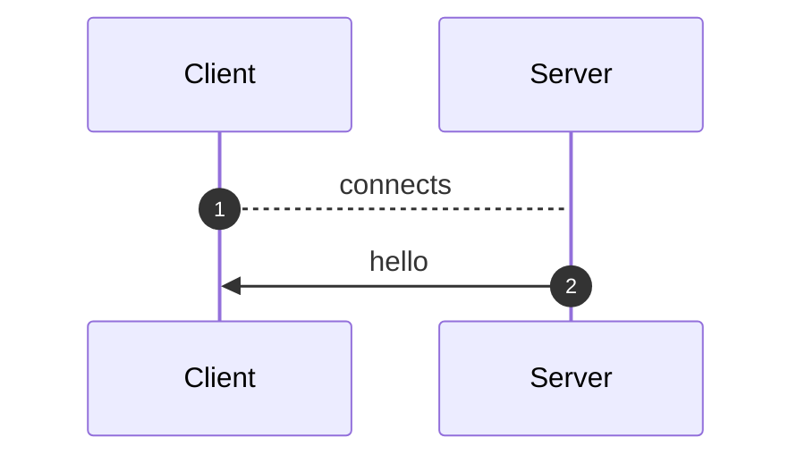
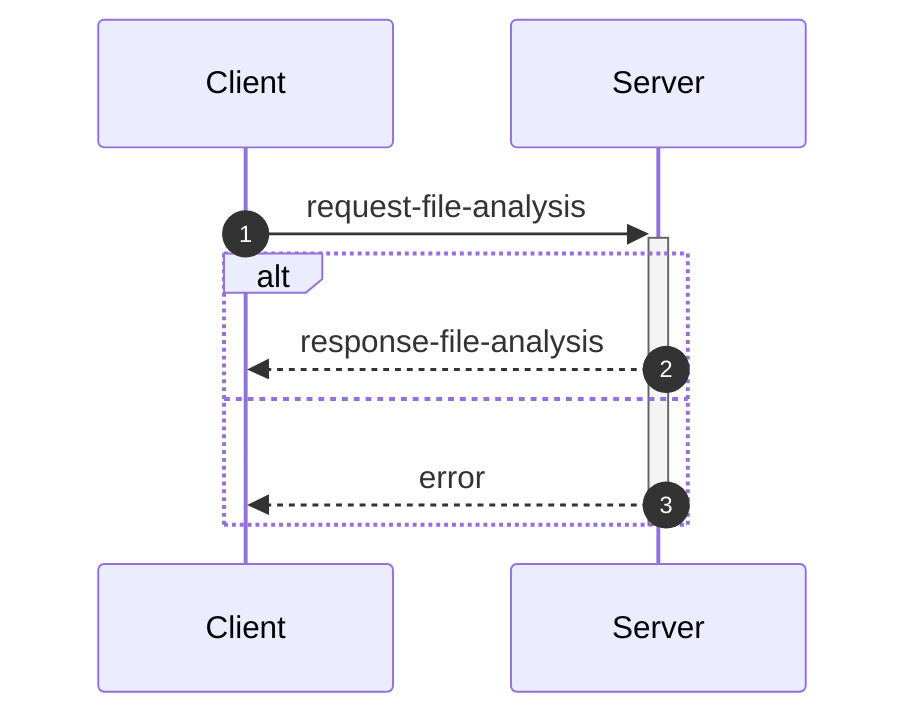
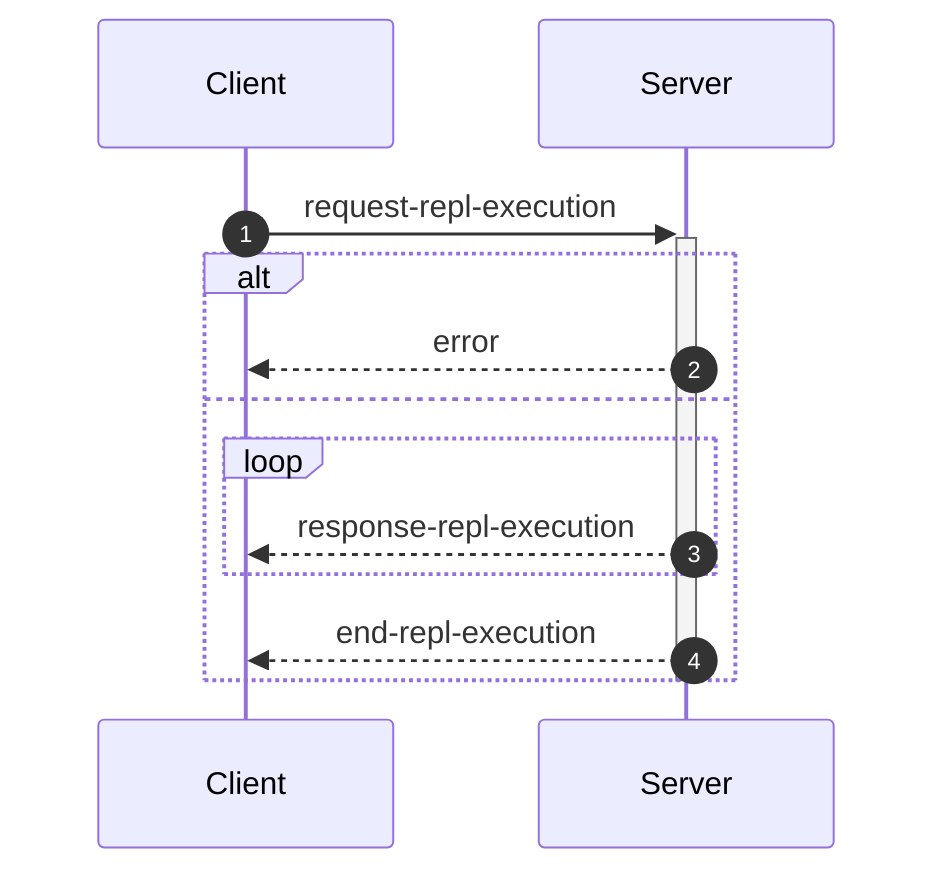
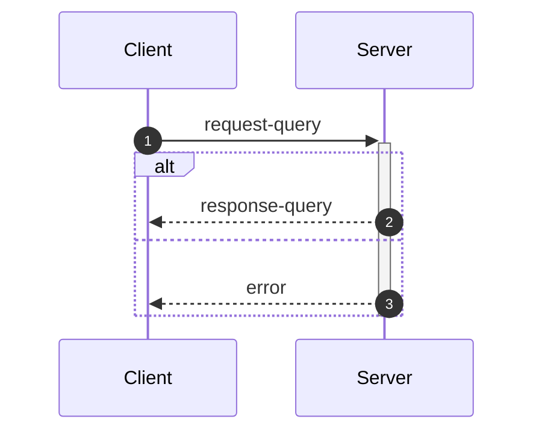

_<span title="an overview of flowR's interface">Generated</span> from '[wiki-interface.ts](https://github.com/flowr-analysis/flowr/tree/main/src/documentation/wiki-interface.ts "src/documentation/wiki-interface.ts")' on 2026-11-08, 07:05:29 UTC (v2.17.4, R v4.6.1), do not edit directly._

Although far from being as detailed as the in-depth explanation of [_flowR_](https://github.com/flowr-analysis/flowr/wiki/Core),
this wiki page explains how to interface with _flowR_ in more detail.
In general, command line arguments and other options provide short descriptions on hover over.

* [💻 Using the REPL](#using-the-repl)
* [⚙️ Configuring FlowR](#configuring-flowr)
* [⚒️ Writing Code](#writing-code)
* [💬 Communicating with the Server](#communicating-with-the-server)

<a id='using-the-repl'></a>
## 💻 Using the REPL

> [!NOTE]
> To execute arbitrary R commands with a repl request, _flowR_ has to be started explicitly with <span title="Description (Command Line Argument): Allow to access the underlying R session when using flowR (security warning: this allows the execution of arbitrary R code!)">`--r-session-access`</span>.
> Please be aware that this introduces a security risk and note that this relies on the [`r-shell` engine](https://github.com/flowr-analysis/flowr/wiki/Engines) .

Although primarily meant for users to explore,
there is nothing which forbids calling _flowR_ as a subprocess to use standard-in, -output, and -error
for communication (although you can access the REPL using the server as well,
with the [REPL Request](#message-request-repl-execution) message).

The read-eval-print loop&nbsp;(REPL) works relatively simple.
You can submit an expression (using <kbd>Enter</kbd>),
which is interpreted as an R&nbsp;expression by default but interpreted as a *command* if it starts with a colon (`:`).
The best command to get started with the REPL is <span title="Description (Repl Command): Show help information (aliases: :h, :?)">`:help`</span>.
Besides, you can leave the REPL either with the command <span title="Description (Repl Command): End the repl (aliases: :q, :exit)">`:quit`</span> or by pressing <kbd>Ctrl</kbd>+<kbd>C</kbd> twice.
When writing a *command*, you may press <kbd>Tab</kbd> to get a list of completions, if available.
Multiple commands can be entered in a single line by separating them with a semicolon (`;`), e.g. `:parse "x<-2"; :df*`.
If a command is given without R code, the REPL will re-use R code given in a previous command.
The prior example will hence return first the parsed AST of the program and then the dataflow graph for `"x <- 2"`.

> [!NOTE]
> If you develop flowR, you may want to launch the repl using the `npm run main-dev` command, this way, you get a non-minified version of flowR with debug information and hot-reloading of source files.

<details>
<summary>Available Commands</summary>

We currently offer the following commands (this with a `[*]` suffix are available with and without the star):

| Command | Description |
| ------- | ----------- |
| **<span title="Description (Repl Command): End the repl (aliases: :q, :exit)">:quit</span>** | End the repl (aliases: **:<span title="Alias of ':quit'. End the repl">q</span>**, **:<span title="Alias of ':quit'. End the repl">exit</span>**) |
| **<span title="Description (Repl Command): Execute the given code as R code. This requires the `--r-session-access` flag to be set and requires the r-shell engine. (aliases: :e, :r)">:execute</span>** | Execute the given code as R code. This requires the `--r-session-access` flag to be set and requires the r-shell engine. (aliases: **:<span title="Alias of ':execute'. Execute the given code as R code. This requires the `--r-session-access` flag to be set and requires the r-shell engine.">e</span>**, **:<span title="Alias of ':execute'. Execute the given code as R code. This requires the `--r-session-access` flag to be set and requires the r-shell engine.">r</span>**) |
| **<span title="Description (Repl Command): Get mermaid code for the control-flow graph of R code (aliases: :cfg, :cf)">:controlflow[*]</span>** | Get mermaid code for the control-flow graph of R code (star: Returns the URL to mermaid.live) (aliases: **:<span title="Alias of ':controlflow'. Get mermaid code for the control-flow graph of R code">cfg</span>**, **:<span title="Alias of ':controlflow'. Get mermaid code for the control-flow graph of R code">cf</span>**) |
| **<span title="Description (Repl Command): Get mermaid code for the control-flow graph with basic blocks (aliases: :cfgb, :cfb)">:controlflowbb[*]</span>** | Get mermaid code for the control-flow graph with basic blocks (star: Returns the URL to mermaid.live) (aliases: **:<span title="Alias of ':controlflowbb'. Get mermaid code for the control-flow graph with basic blocks">cfgb</span>**, **:<span title="Alias of ':controlflowbb'. Get mermaid code for the control-flow graph with basic blocks">cfb</span>**) |
| **<span title="Description (Repl Command): Get mermaid code for the dataflow graph (aliases: :d, :df)">:dataflow[*]</span>** | Get mermaid code for the dataflow graph (star: Returns the URL to mermaid.live) (aliases: **:<span title="Alias of ':dataflow'. Get mermaid code for the dataflow graph">d</span>**, **:<span title="Alias of ':dataflow'. Get mermaid code for the dataflow graph">df</span>**) |
| **<span title="Description (Repl Command): Get mermaid code for the normalized AST of R code (aliases: :n)">:normalize[*]</span>** | Get mermaid code for the normalized AST of R code (star: Returns the URL to mermaid.live) (alias: **:<span title="Alias of ':normalize'. Get mermaid code for the normalized AST of R code">n</span>**) |
| **<span title="Description (Repl Command): Get mermaid code for the simplified dataflow graph (aliases: :ds, :dfs)">:dataflowsimple[*]</span>** | Get mermaid code for the simplified dataflow graph (star: Returns the URL to mermaid.live) (aliases: **:<span title="Alias of ':dataflowsimple'. Get mermaid code for the simplified dataflow graph">ds</span>**, **:<span title="Alias of ':dataflowsimple'. Get mermaid code for the simplified dataflow graph">dfs</span>**) |
| **<span title="Description (Repl Command): Inspect and extend the signature database: `query` (identical to :query @signature), `info <name>` for where a function comes from (identical to :query @function-info), `add <path>` to mount another database/source, `download` to fetch the full-history database. (aliases: :sig)">:signature</span>** | Inspect and extend the signature database: `query` (identical to :query @signature), `info <name>` for where a function comes from (identical to :query @function-info), `add <path>` to mount another database/source, `download` to fetch the full-history database. (alias: **:<span title="Alias of ':signature'. Inspect and extend the signature database: `query` (identical to :query @signature), `info <name>` for where a function comes from (identical to :query @function-info), `add <path>` to mount another database/source, `download` to fetch the full-history database.">sig</span>**) |
| **<span title="Description (Repl Command): Just calculates the DFG, but only prints summary info (aliases: :d#, :df#)">:dataflowsilent</span>** | Just calculates the DFG, but only prints summary info (aliases: **:<span title="Alias of ':dataflowsilent'. Just calculates the DFG, but only prints summary info">d#</span>**, **:<span title="Alias of ':dataflowsilent'. Just calculates the DFG, but only prints summary info">df#</span>**) |
| **<span title="Description (Repl Command): Prints ASCII Art of the parsed, unmodified AST (aliases: :p)">:parse</span>** | Prints ASCII Art of the parsed, unmodified AST (alias: **:<span title="Alias of ':parse'. Prints ASCII Art of the parsed, unmodified AST">p</span>**) |
| **<span title="Description (Repl Command): Prints the version of flowR as well as the current version of R">:version</span>** | Prints the version of flowR as well as the current version of R
| **<span title="Description (Repl Command): Query the given R code (use 'help' for more information)">:query[*]</span>** | Query the given R code (use 'help' for more information) (star: Similar to query, but returns the output in json format.)
| **<span title="Description (Repl Command): Returns an ASCII representation of the dataflow graph (aliases: :df!)">:dataflowascii</span>** | Returns an ASCII representation of the dataflow graph (alias: **:<span title="Alias of ':dataflowascii'. Returns an ASCII representation of the dataflow graph">df!</span>**) |
| **<span title="Description (Repl Command): Returns summarization stats for the normalized AST (aliases: :n#)">:normalize#</span>** | Returns summarization stats for the normalized AST (alias: **:<span title="Alias of ':normalize#'. Returns summarization stats for the normalized AST">n#</span>**) |
| **<span title="Description (Repl Command): Show help information (aliases: :h, :?)">:help</span>** | Show help information (aliases: **:<span title="Alias of ':help'. Show help information">h</span>**, **:<span title="Alias of ':help'. Show help information">?</span>**) |

</details>

> [!TIP]
> 
> As indicated by the examples before, all REPL commands that operate on code keep track of the state.
> Hence, if you run a command like <span title="Description (Repl Command, starred version): Returns the URL to mermaid.live; Base Command: Get mermaid code for the dataflow graph (aliases: :d*, :df*)">`:dataflow*`</span> without providing R code,
> the REPL will re-use the R code provided in a previous command.
> Likewise, doing this will benefit from incrementality!
> If you request the dataflow graph with `:df* x <- 2 * y` and then want to see the parsed AST with `:parse`,
> the REPL will re-use previously obtained information and not re-parse the code again.
> 		

Generally, many commands offer shortcut versions in the REPL. Many queries, for example, offer a shortened format (see the example below).
Of special note, the [Config Query](https://github.com/flowr-analysis/flowr/wiki/%5BQuery%5D-Config)
can be used to also modify the currently active configuration of _flowR_ within the REPL (see the [wiki page](https://github.com/flowr-analysis/flowr/wiki/%5BQuery%5D-Config) for more information).

### Example: Retrieving the Dataflow Graph

To retrieve a URL to the [mermaid](https://mermaid.js.org/) diagram of the dataflow of a given expression,
use <span title="Description (Repl Command, starred version): Returns the URL to mermaid.live; Base Command: Get mermaid code for the dataflow graph (aliases: :d*, :df*)">`:dataflow*`</span> (or <span title="Description (Repl Command): Get mermaid code for the dataflow graph (aliases: :d, :df)">`:dataflow`</span> to get the mermaid code in the cli):

```shell
$ docker run -it --rm eagleoutice/flowr # or npm run flowr 
flowR repl v2.17.4, R grammar v14 (tree-sitter engine)
R> :dataflow* y <- 1 + x
```

<details>
<summary style='color:gray'>Output</summary>

```text
https://mermaid.live/view#base64:eyJjb2RlIjoiZmxvd2NoYXJ0IFREXG4gICAgMXt7XCJgKiM5MTtSTnVtYmVyIzkzOyogKioxKipcbiAgICAgICoxLjYqICgqKmlkOiAxKiopYFwifX1cbiAgICAyKFtcImAqIzkxO1JTeW1ib2wjOTM7KiAqKngqKlxuICAgICAgKjEuMTAqICgqKmlkOiAyKiopYFwiXSlcbiAgICAzW1tcImAqIzkxO1JCaW5hcnlPcCM5MzsqIGJhc2UjNTg7IzU4OyoqIzQzOyoqXG4gICAgICAqMS42LTEwKiAoKippZDogMyoqKVxuICAgIGFyZzogKDEsIDIpYFwiXV1cbiAgICBidWlsdC1pbjpfNDNfW1wiYEJ1aWx0LUluOlxuIzQzO2BcIl1cbiAgICBzdHlsZSBidWlsdC1pbjpfNDNfIHN0cm9rZTpncmF5LGZpbGw6Z3JheSxzdHJva2Utd2lkdGg6MnB4LG9wYWNpdHk6Ljg7XG4gICAgMFtcImAqIzkxO1JTeW1ib2wjOTM7KiAqKnkqKlxuICAgICAgKjEuMSogKCoqaWQ6IDAqKiwgdjogMylgXCJdXG4gICAgNFtbXCJgKiM5MTtSQmluYXJ5T3AjOTM7KiBiYXNlIzU4OyM1ODsqKiM2MDsjNDU7KipcbiAgICAgICoxLjEtMTAqICgqKmlkOiA0KiopXG4gICAgYXJnOiAoMCwgMylgXCJdXVxuICAgIGJ1aWx0LWluOl82MF8tW1wiYEJ1aWx0LUluOlxuIzYwOyM0NTtgXCJdXG4gICAgc3R5bGUgYnVpbHQtaW46XzYwXy0gc3Ryb2tlOmdyYXksZmlsbDpncmF5LHN0cm9rZS13aWR0aDoycHgsb3BhY2l0eTouODtcbiAgICAxIC0uLT58XCJmbG93XCJ8IDJcbiAgICBsaW5rU3R5bGUgMCBzdHJva2U6Z3JheSxjb2xvcjpncmF5O1xuICAgIDIgLS4tPnxcImZsb3dcInwgM1xuICAgIGxpbmtTdHlsZSAxIHN0cm9rZTpncmF5LGNvbG9yOmdyYXk7XG4gICAgMyAtLT58XCJyZWFkcywgYXJnXCJ8IDFcbiAgICAzIC0tPnxcInJlYWRzLCBhcmdcInwgMlxuICAgIDMgLS4tPnxcImZsb3dcInwgMFxuICAgIGxpbmtTdHlsZSA0IHN0cm9rZTpncmF5LGNvbG9yOmdyYXk7XG4gICAgMyAtLi0+fFwicmVhZHMsIGNhbGxzXCJ8IGJ1aWx0LWluOl80M19cbiAgICBsaW5rU3R5bGUgNSBzdHJva2U6Z3JheTtcbiAgICAwIC0tPnxcImRlZmluZWQtYnksIGZsb3dcInwgNFxuICAgIDAgLS0+fFwiZGVmaW5lZC1ieVwifCAzXG4gICAgNCAtLT58XCJyZWFkcywgYXJnXCJ8IDNcbiAgICA0IC0tPnxcInJldHVybnMsIGFyZ1wifCAwXG4gICAgNCAtLi0+fFwicmVhZHMsIGNhbGxzXCJ8IGJ1aWx0LWluOl82MF8tXG4gICAgbGlua1N0eWxlIDEwIHN0cm9rZTpncmF5OyIsIm1lcm1haWQiOnsiYXV0b1N5bmMiOnRydWV9fQ==
```

Retrieve the dataflow graph of the expression `y <- 1 + x`. It looks like this:


<details>

<summary style="color:gray">R Code of the Dataflow Graph</summary>

The analysis ran (parse and normalize with the [tree-sitter](https://github.com/flowr-analysis/flowr/wiki/Engines) engine) in the generation environment. No [signature database](https://github.com/flowr-analysis/flowr/wiki/Signature-Database) is mounted, so `library()` attaches no exports (base-R names are still qualified, e.g., `stats::acf`). 
We encountered no unknown side effects during the analysis.

```r
y <- 1 + x
```

</details>

</details>

For small graphs like this, <span title="Description (Repl Command): Returns an ASCII representation of the dataflow graph (aliases: :df!)">`:dataflowascii`</span> also provides an ASCII representation directly in the REPL:

```shell
$ docker run -it --rm eagleoutice/flowr # or npm run flowr 
flowR repl v2.17.4, R grammar v14 (tree-sitter engine)
R> :df! y <- 1 + x
```

<details open>
<summary style='color:gray'>Output</summary>

```text
                        v<0>v
 c<4>c──────────────────| y |
 |<- |     ┌────────────v---v
 c---c     │
    │   c<3>c   0<1>0
    └───| + |───| 1 |───u<2>u
        c---c   0---0   | x |
           └────────────u---u
Edges:
3 -> 1: reads, arg          3 -> 2: reads, arg
3 -> 0: flows-to            1 -> 2: flows-to
2 -> 3: flows-to            4 -> 3: reads, arg
4 -> 0: returns, arg        0 -> 4: defined-by, flows-to
0 -> 3: defined-by
```

Retrieve the dataflow graph of the expression `y <- 1 + x` as ASCII art.

</details>

For the slicing with <span title="Description (Repl Command): Static backwards executable slicer for R">`:slicer`</span>, you have access to the same [magic comments](#slice-magic-comments) as with the [slice request](#message-request-slice).
Pass `--inline` to splice resolvable `source()` calls into the reconstruction so the slice is a single self-contained R text (the same as the static slice query's `inlineSources` flag).
See `--help` for more flags!

### Example: Interfacing with the File System

Many commands that allow for an R-expression (like <span title="Description (Repl Command, starred version): Returns the URL to mermaid.live; Base Command: Get mermaid code for the dataflow graph (aliases: :d*, :df*)">`:dataflow*`</span>) allow for a file as well
if the argument starts with `file://`.
If you are working from the root directory of the _flowR_ repository, the following gives you the parsed AST of the example file using the <span title="Description (Repl Command): Prints ASCII Art of the parsed, unmodified AST (aliases: :p)">`:parse`</span> command:

> **Watch mode**: Replace `file://` with `watch://` to enter watch mode.
> flowR runs the command immediately and then re-runs it every time the file (or any file inside the folder) changes.
> Enter any other command to leave watch mode.
> For example: `:df watch://analysis.R`

```shell
$ docker run -it --rm eagleoutice/flowr # or npm run flowr 
flowR repl v2.17.4, R grammar v14 (tree-sitter engine)
R> :parse file://test/testfiles/example.R
```

<details>
<summary style='color:gray'>Output</summary>

```text
File: test/testfiles/example.R

program
├ binaryoperator
│ ├ identifier "sum" (1:1─4)
│ ├ <- "<-" (1:5─7)
│ ╰ float "0" (1:8─9)
├ binaryoperator
│ ├ identifier "product" (2:1─8)
│ ├ <- "<-" (2:9─11)
│ ╰ float "1" (2:12─13)
├ binaryoperator
│ ├ identifier "w" (3:1─2)
│ ├ <- "<-" (3:3─5)
│ ╰ float "7" (3:6─7)
├ binaryoperator
│ ├ identifier "N" (4:1─2)
│ ├ <- "<-" (4:3─5)
│ ╰ float "10" (4:6─8)
├ forstatement
│ ├ for "for" (6:1─4)
│ ├ ( "(" (6:5─6)
│ ├ identifier "i" (6:6─7)
│ ├ in "in" (6:8─10)
│ ├ binaryoperator
│ │ ├ float "1" (6:11─12)
│ │ ├ : ":" (6:12─13)
│ │ ╰ parenthesizedexpression
│ │   ├ ( "(" (6:13─14)
│ │   ├ binaryoperator
│ │   │ ├ identifier "N" (6:14─15)
│ │   │ ├ - "-" (6:15─16)
│ │   │ ╰ float "1" (6:16─17)
│ │   ╰ ) ")" (6:17─18)
│ ├ ) ")" (6:18─19)
│ ╰ bracedexpression
│   ├ { "{" (6:20─21)
│   ├ binaryoperator
│   │ ├ identifier "sum" (7:3─6)
│   │ ├ <- "<-" (7:7─9)
│   │ ╰ binaryoperator
│   │   ├ binaryoperator
│   │   │ ├ identifier "sum" (7:10─13)
│   │   │ ├ + "+" (7:14─15)
│   │   │ ╰ identifier "i" (7:16─17)
│   │   ├ + "+" (7:18─19)
│   │   ╰ identifier "w" (7:20─21)
│   ├ binaryoperator
│   │ ├ identifier "product" (8:3─10)
│   │ ├ <- "<-" (8:11─13)
│   │ ╰ binaryoperator
│   │   ├ identifier "product" (8:14─21)
│   │   ├  "" (8:22─23)
│   │   ╰ identifier "i" (8:24─25)
│   ╰ } "}" (9:1─2)
├ call
│ ├ identifier "cat" (11:1─4)
│ ╰ arguments
│   ├ ( "(" (11:4─5)
│   ├ argument
│   │ ╰ string
│   │   ├ stringopen "\"" (11:5─6)
│   │   ├ stringcontent "Sum:" (11:6─10)
│   │   ╰ stringclose "\"" (11:10─11)
│   ├ comma "," (11:11─12)
│   ├ argument
│   │ ╰ identifier "sum" (11:13─16)
│   ├ comma "," (11:16─17)
│   ├ argument
│   │ ╰ string
│   │   ├ stringopen "\"" (11:18─19)
│   │   ├ stringcontent
│   │   │ ╰ escapesequence "\\n" (11:19─21)
│   │   ╰ stringclose "\"" (11:21─22)
│   ╰ ) ")" (11:22─23)
╰ call
  ├ identifier "cat" (12:1─4)
  ╰ arguments
    ├ ( "(" (12:4─5)
    ├ argument
    │ ╰ string
    │   ├ stringopen "\"" (12:5─6)
    │   ├ stringcontent "Product:" (12:6─14)
    │   ╰ stringclose "\"" (12:14─15)
    ├ comma "," (12:15─16)
    ├ argument
    │ ╰ identifier "product" (12:17─24)
    ├ comma "," (12:24─25)
    ├ argument
    │ ╰ string
    │   ├ stringopen "\"" (12:26─27)
    │   ├ stringcontent
    │   │ ╰ escapesequence "\\n" (12:27─29)
    │   ╰ stringclose "\"" (12:29─30)
    ╰ ) ")" (12:30─31)
```

Retrieve the parsed AST of the example file.

<details>

<summary>File Content</summary>

```r
sum <- 0
product <- 1
w <- 7
N <- 10

for (i in 1:(N-1)) {
  sum <- sum + i + w
  product <- product * i
}

cat("Sum:", sum, "\n")
cat("Product:", product, "\n")
```

</details>

As _flowR_ directly transforms this AST the output focuses on being human-readable instead of being machine-readable.
		
</details>

### Example: Run a Query

You can run any query supported by _flowR_ using the <span title="Description (Repl Command): Query the given R code (use 'help' for more information)">`:query`</span> command.
For example, to obtain the shapes of all data frames in a given piece of code, you can run:

```shell
$ docker run -it --rm eagleoutice/flowr # or npm run flowr 
flowR repl v2.17.4, R grammar v14 (tree-sitter engine)
R> :query @absint df-shape "x <- data.frame(a = 1:10, b = 1:10)\ny <- x$a"
```

<details open>
<summary style='color:gray'>Output</summary>

```text
Query: absint (2 ms)
   ╰ $12: (colnames: [{"a", "b"}, {}], cols: [2, 2], rows: [10, 10])
   ╰ $0: (colnames: [{"a", "b"}, {}], cols: [2, 2], rows: [10, 10])
```

Retrieve the shapes of all data frames in the given code.

</details>

To run the linter on a file, you can use (in this example, we just issue the `dead-code` linter on a small piece of code):

```shell
$ docker run -it --rm eagleoutice/flowr # or npm run flowr 
flowR repl v2.17.4, R grammar v14 (tree-sitter engine)
R> :query @linter rules:dead-code "if(FALSE) x <- 2"
```

<details open>
<summary style='color:gray'>Output</summary>

```text
Query: linter (3 ms)
   ╰ Dead Code (dead-code):
       ╰ certain:
           ╰ Code at 1.11-16 (1 quick fix(es) available)
```

Run the linter on the given code, with only the `dead-code` rule enabled.

</details>

For more information on the available queries, please check out the [Query API](https://github.com/flowr-analysis/flowr/wiki/Query-API).

<a id='configuring-flowr'></a>
## ⚙️ Configuring FlowR

When running _flowR_, you may want to specify some behaviors with a dedicated configuration file.
By default, flowR looks for a file named `flowr.json` in the current working directory (or any higher directory).
You can also specify a different file with <span title="Description (Command Line Argument): The name of the configuration file to use">`--config-file`</span> or pass the configuration inline using <span title="Description (Command Line Argument): The flowR configuration to use, as a JSON string">`--config-json`</span>.
A `flowr.json` found this way belongs to the analyzed project, so flowR ignores its options that decide what flowR executes or loads
(`engines.*.wasmPath`, `engines.*.treeSitterWasmPath`, `engines.*.rPath`, `solver.sigdb.additionalPaths`, `solver.sigdb.downloadRepo`, `solver.sigdb.installedLibrary.paths`, `solver.sigdb.onDemand.enabled`, `solver.sigdb.onDemand.repositories`, `solver.sigdb.onDemand.cranMirror`, `solver.sigdb.onDemand.bioconductorMirror`, `solver.sigdb.onDemand.cacheDir`),
unless you pass <span title="Description (Command Line Argument): Keep the security-sensitive options (e.g., the R executable) of the flowr.json found in the working directory or a parent. Only use this for projects you trust.">`--trust-config`</span>.
To analyze code you do not trust, use the secure mode (<span title="Description (Command Line Argument): Run in secure mode for analyzing untrusted code: flowR does not start R (or any other process), does not access the network, does not search for project configs, and ignores security-sensitive options in every config. Cannot be disabled once enabled. Can also be enabled with the environment variable {italic FLOWR_SECURE_MODE=1}.">`--secure`</span>, see the [security policy](https://github.com/flowr-analysis/flowr/blob/main/.github/SECURITY.md)).
To inspect the current configuration, you can run flowr with the <span title="Description (Command Line Argument): Run with verbose logging (will be passed to the corresponding script)">`--verbose`</span> flag, or use the `config` [Query](https://github.com/flowr-analysis/flowr/wiki/Query-API).
Within the REPL this works by running the following:

```shell
:query @config
```

To work with the <a href="https://github.com/flowr-analysis/flowr/tree/main/src/config.ts#L119"><code><span title="The configuration file format for flowR.">FlowrConfig</span></code></a> you can use the provided helper objects alongside its methods like
<a href="https://github.com/flowr-analysis/flowr/tree/main/src/config.ts#L985"><code><span title="Creates a new flowr config that has the updated values.">FlowrConfig::<b>amend</b></span></code></a>.
The schema below documents every option; the ones you most likely want are:

- <a href="https://github.com/flowr-analysis/flowr/wiki/Interface#configuring-flowr" title="Configuration Option (boolean): Whether source calls should be ignored, causing {@link processSourceCall}&#39;s behavior to be skipped.">ignoreSourceCalls</a>: ignore source calls when analyzing the code, i.e., ignore the inclusion of other files.
- <a href="https://github.com/flowr-analysis/flowr/wiki/Interface#configuring-flowr" title="Configuration Option (boolean): Whether load calls should be ignored, causing {@link processLoadCall}&#39;s behavior to be skipped.">ignoreLoadCalls</a>: ignore load calls when analyzing the code, i.e., ignore the loading of r-data files.
- <a href="https://github.com/flowr-analysis/flowr/wiki/Interface#configuring-flowr" title="Configuration Option (object): Do you want to overwrite (parts) of the builtin definition?">semantics.environment.overwriteBuiltIns</a>: overwrite _flowR_'s handling of built-in functions, or clear the preset definitions entirely.
  See [Configure BuiltIn Semantics](#configure-builtin-semantics) for more information.
- <a href="https://github.com/flowr-analysis/flowr/wiki/Interface#configuring-flowr" title="Configuration Option (boolean): Whether calls drawing on a graphics device (e.g., `plot`) count as writing to it, which the ambient state queries then report.">semantics.ambient.drawingWritesDevice</a>: whether calls drawing on a graphics device (e.g., `plot`) count as writing the device in the ambient state queries.
- <a href="https://github.com/flowr-analysis/flowr/wiki/Interface#configuring-flowr" title="Configuration Option (string): How to resolve variables and their values. (one of &quot;disabled&quot;, &quot;alias&quot;, &quot;builtin&quot;)">solver.variables</a>: how to resolve variables and their values (`disabled`, `alias`, `builtin`).
- <a href="https://github.com/flowr-analysis/flowr/wiki/Interface#configuring-flowr" title="Configuration Option (array): The engine or set of engines to use for interacting with R code. An empty array means all available engines will be used.">engines</a> and <a href="https://github.com/flowr-analysis/flowr/wiki/Interface#configuring-flowr" title="Configuration Option (string): The default engine to use for interacting with R code. If this is undefined, an arbitrary engine from the specified list will be used. (one of &quot;tree-sitter&quot;, &quot;r-shell&quot;)">defaultEngine</a>: the engines used to interact with R code, see the [Engines wiki page](https://github.com/flowr-analysis/flowr/wiki/Engines).
- <a href="https://github.com/flowr-analysis/flowr/wiki/Interface#configuring-flowr" title="Configuration Option (array): Files a framework loads on its own, without any source() call (e.g. global.R in a shiny app), in the order they are loaded; flowR orders the matching project files accordingly and analyzes them as one program. Entries are case-insensitive globs matched against the file path, a plain name matches any file with that name, and entries matching no project file are warned about. Usually set per project kind via specializeConfig.">project.implicitSources</a>: the files a framework loads without any `source()` call, in the order in which they are
  loaded. Entries are globs (e.g. `R/*.R`) matched against the file path ignoring capitalization; one matching no file is reported.
- <a href="https://github.com/flowr-analysis/flowr/wiki/Interface#configuring-flowr" title="Configuration Option (object): Overwrite (parts of) the configuration depending on the project kind flowR detects, e.g. to give a shiny app its implicit sources.">specializeConfig</a>: overwrite (parts of) the configuration depending on the kind of project _flowR_ detects
  (e.g. `shiny-app`), which is how a shiny app gets its implicit sources by default. What you configure directly wins.
- <a href="https://github.com/flowr-analysis/flowr/wiki/Interface#configuring-flowr" title="Configuration Option (string): Overwrite the project kind flowR would otherwise infer from the analyzed files, e.g. when auto-detection guesses wrong. (one of &quot;package&quot;, &quot;script&quot;, &quot;shiny-app&quot;, &quot;notebook&quot;, &quot;project&quot;, &quot;unknown&quot;)">project.useProjectType</a>: skip that detection and force a project kind yourself, when auto-detection guesses wrong.
- <a href="https://github.com/flowr-analysis/flowr/wiki/Interface#configuring-flowr" title="Configuration Option (array): The default plugins to load when creating a new instance of FlowrAnalyzer">defaultPlugins</a> and <a href="https://github.com/flowr-analysis/flowr/wiki/Interface#configuring-flowr" title="Configuration Option (array): The plugins to load in REPL mode">repl.plugins</a>: the plugins to load for a new <a href="https://github.com/flowr-analysis/flowr/tree/main/src/project/flowr-analyzer.ts#L240"><code><span title="Central class for conducting analyses with FlowR. Use the FlowrAnalyzerBuilder to create a new instance. If you want the original pattern of creating a pipeline and running all steps, you can still do this with FlowrAnalyzer#runFull . To inspect the context of the analyzer, use FlowrAnalyzer#inspectContext (if you are a plugin and need to modify it, use FlowrAnalyzer#context instead).">FlowrAnalyzer</span></code></a> and in the REPL
  (use `flowr:default` to reference the former).

So you can configure _flowR_ by adding a file like the following:

<details>

<summary>Example Configuration File</summary>

```json
{
  "ignoreSourceCalls": true,
  "ignoreLoadCalls": true,
  "semantics": {
    "environment": {
      "overwriteBuiltIns": {
        "definitions": [
          {
            "type": "function",
            "names": [
              "foo"
            ],
            "processor": "builtin:assign",
            "config": {}
          }
        ]
      }
    }
  },
  "defaultPlugins": [
    "file:description",
    "versions:description"
  ],
  "repl": {
    "quickStats": false,
    "dfProcessorHeat": false,
    "hints": true,
    "plugins": [
      "flowr:default"
    ]
  },
  "project": {
    "resolveUnknownPathsOnDisk": true,
    "implicitSources": [
      "global.R",
      "app.R"
    ]
  },
  "linter": {
    "disabledRules": []
  },
  "specializeConfig": {
    "shiny-app": {
      "project": {
        "implicitSources": [
          "global.R",
          "ui.R",
          "server.R",
          "app.R"
        ]
      }
    }
  },
  "engines": [
    {
      "type": "r-shell"
    }
  ],
  "solver": {
    "variables": "alias",
    "evalStrings": true,
    "trackEnvironments": true,
    "sigdb": {
      "enabled": true,
      "loadProjectDependencies": true,
      "eagerlyLoad": false,
      "eagerlyLoadExports": false,
      "linkBaseR": false,
      "linkDescriptionDependencies": false
    },
    "resolveSource": {
      "dropPaths": "no",
      "ignoreCapitalization": true,
      "inferWorkingDirectory": "active-script",
      "searchPath": []
    },
    "instrument": {},
    "slicer": {
      "threshold": 50
    }
  },
  "abstractInterpretation": {
    "wideningThreshold": 4,
    "followCalls": true,
    "dataFrame": {
      "maxColNames": 20,
      "readLoadedData": {
        "readExternalFiles": true,
        "maxReadLines": 1000000
      }
    }
  },
  "incremental": {
    "alwaysIncremental": false,
    "parsing": {
      "activated": false,
      "heuristics": {
        "activated": true,
        "mtime": true,
        "linesFrom": 500,
        "bytesFrom": 50000,
        "alwaysWithEdits": false,
        "minFiles": 1
      }
    }
  },
  "gas": {
    "thresholds": {
      "memory": {
        "problematic": 0.7,
        "critical": 0.9
      },
      "timeMs": {
        "problematic": 100000,
        "critical": 120000
      }
    },
    "features": {}
  }
}
```

</details>

<details>
<a id='configure-builtin-semantics'></a>
<summary>Configure Built-In Semantics</summary>

`semantics/environment/overwriteBuiltins` accepts two keys:

- `loadDefaults` (boolean, initially `true`): If set to `true`, the default built-in definitions are loaded before applying the custom definitions. Setting this flag to `false` explicitly disables the loading of the default definitions.
- `definitions` (array, initially empty): Allows to overwrite or define new built-in elements. Each object within must have a `type` which is one of the below. Furthermore, they may define a string array of `names` which specifies the identifiers to bind the definitions to. You may use `assumePrimitive` to specify whether _flowR_ should assume that this is a primitive non-library definition (so you probably just do not want to specify the key).

  | Type            | Description                                                                                                                                                                                                                                                                                              | Example                                                                                                    |
  | --------------- | -------------------------------------------------------------------------------------------------------------------------------------------------------------------------------------------------------------------------------------------------------------------------------------------------------- | ---------------------------------------------------------------------------------------------------------- |
  | `constant`    | Additionally allows for a `value` this should resolve to.                                                                                                                                                                                                                                                | `{ type: 'constant', names: ['NULL', 'NA'],  value: null }`                                                |
  | `function`    | Is a rather flexible way to define and bind built-in functions. For the time, we do not have extensive documentation to cover all the cases, so please either consult the sources with the `default-builtin-config/` folder or open a [new issue](https://github.com/flowr-analysis/flowr/issues/new/choose). | `{ type: 'function', names: ['next'], processor: 'builtin:d', config: { cfg: ExitPointType.Next } }` |
  | `replacement` | A comfortable way to specify replacement functions like `$<-` or `names<-`. `suffixes` describes the... suffixes to attach automatically. | `{ type: 'replacement', suffixes: ['<-', '<<-'], names: ['[', '[['] }` |

</details>

<details>

<summary style='color:gray'>Full Configuration-File Schema</summary>

- _The configuration file format for flowR._ (object)
    - **logLevel** [optional] _flowR's global minimum log level, applied when the config is loaded._ (string)
        Only allows: 'silly', 'trace', 'debug', 'info', 'warn', 'error', 'fatal'
    - **ignoreSourceCalls** [optional] _Whether source calls should be ignored, causing {@link processSourceCall}'s behavior to be skipped._ (boolean)
    - **ignoreLoadCalls** [optional] _Whether load calls should be ignored, causing {@link processLoadCall}'s behavior to be skipped._ (boolean)
    - **semantics** _Configure language semantics and how flowR handles them._ (object)
        - **environment** [optional] _Semantics regarding how to handle the R environment._ (object)
            - **overwriteBuiltIns** [optional] _Do you want to overwrite (parts) of the builtin definition?_ (object)
                - **loadDefaults** [optional] _Should the default configuration still be loaded?_ (boolean)
                - **definitions** [optional] _The definitions to load/overwrite._ (array)
                Valid item types:
                    - (object)
        - **ambient** [optional] _Semantics regarding the global state (options, devices, files, ...) calls access._ (object)
            - **drawingWritesDevice** [optional] _Whether calls drawing on a graphics device (e.g., `plot`) count as writing to it, which the ambient state queries then report._ (boolean)
    - **defaultPlugins** [optional] _The default plugins to load when creating a new instance of FlowrAnalyzer_ (array)
    Valid item types:
        - (alternatives)
            - (string)
            - (array)
    - **repl** _Configuration options for the REPL._ (object)
        - **quickStats** [optional] _Whether to show quick stats in the REPL after each evaluation._ (boolean)
        - **dfProcessorHeat** [optional] _This instruments the dataflow processors to count how often each processor is called._ (boolean)
        - **hints** [optional] _Whether to show dim inline hints on the empty prompt (automatically disabled on non-interactive terminals)._ (boolean)
        - **plugins** [optional] _The plugins to load in REPL mode_ (array)
        Valid item types:
            - (alternatives)
                - (string)
                - (array)
        - **autoUseFileProtocol** [optional] _Prepend the file protocol to a repl input that looks like a path, instead of only warning about it._ (boolean)
        - **queryStats** [optional] _Whether `:query` closes with the line stating how long the queries took (`:query*` never prints it)._ (boolean)
        - **showPlugins** [optional] _Whether `:version` grays out the plugins that did not activate during the last analysis._ (boolean)
    - **project** _Project specific configuration options._ (object)
        - **resolveUnknownPathsOnDisk** [optional] _Whether to resolve unknown paths loaded by the r project disk when trying to source/analyze files._ (boolean)
        - **failOnInaccessiblePath** [optional] _Whether a directory that cannot be traversed during file discovery (e.g. due to permissions) aborts the analysis; when false (the default) such paths are logged and skipped._ (boolean)
        - **basePackages** [optional] _The packages considered part of R itself (base and recommended); if unset, flowR uses its built-in list._ (array)
        Valid item types:
            - (string)
        - **implicitSources** [optional] _Files a framework loads on its own, without any source() call (e.g. global.R in a shiny app), in the order they are loaded; flowR orders the matching project files accordingly and analyzes them as one program. Entries are case-insensitive globs matched against the file path, a plain name matches any file with that name, and entries matching no project file are warned about. Usually set per project kind via specializeConfig._ (array)
        Valid item types:
            - (string)
        - **useProjectType** [optional] _Overwrite the project kind flowR would otherwise infer from the analyzed files, e.g. when auto-detection guesses wrong._ (string)
            Only allows: 'package', 'script', 'shiny-app', 'notebook', 'project', 'unknown'
        - **assumeImplicitEcho** [optional] _Whether the top level of the analyzed code is echoed, so that every visible result printed there is collected as an output by the dependencies query (default true, false for a package)._ (boolean)
        - **discovery** [optional] _Scoping options for the default project discovery._ (object)
            - **full** [optional] _Collect every file below the project root (greedy) instead of only the files the detected project kind needs (default false)._ (boolean)
            - **perKind** [optional] _Per-kind include/exclude glob overrides layered on the default scoping._ (object)
            - **ignore** [optional] _Case-insensitive globs that drop matching files from the intelligent discovery, regardless of kind (e.g. .Renviron to ignore environment files)._ (array)
            Valid item types:
                - (string)
        - **classification** [optional] _Overrides for the signals flowR uses to classify the project kind._ (object)
            - **shinyDescriptionTypes** [optional] _DESCRIPTION Type: values that mark a shiny app._ (array)
            Valid item types:
                - (string)
            - **shinyEntryFiles** [optional] _File names a shiny app is assembled from._ (array)
            Valid item types:
                - (string)
            - **shinyUsagePattern** [optional] _Regex source evidencing shiny usage in an entry file._ (string)
            - **notebookExtensions** [optional] _File extensions marking a notebook._ (array)
            Valid item types:
                - (string)
    - **linter** _Linter configuration options._ (object)
        - **disabledRules** _Linting rule names excluded from the default rule set (a rule requested explicitly via a linter query still runs). Usually set per project kind via specializeConfig._ (array)
        Valid item types:
            - (string)
        - **disabledTags** [optional] _Linting rule tags whose rules are excluded from the default rule set (a rule requested explicitly via a linter query still runs). By default the cmd-check rules are disabled for everything but a package; a configured list replaces that default._ (array)
        Valid item types:
            - (string)
    - **inputSources** [optional] _Further frameworks the input-sources analysis should know about; entries are added to flowR's defaults._ (object)
        - **pure** [optional] _Functions that only pass the constantness of their arguments on._ (array)
        Valid item types:
            - (string)
        - **param** [optional] _Functions whose result is a 'param' input._ (array)
        Valid item types:
            - (string)
        - **file** [optional] _Functions whose result is a 'file' input._ (array)
        Valid item types:
            - (string)
        - **tempfile** [optional] _Functions whose result is a 'tempfile' input._ (array)
        Valid item types:
            - (string)
        - **glob** [optional] _Functions whose result is a 'glob' input._ (array)
        Valid item types:
            - (string)
        - **net** [optional] _Functions whose result is a 'net' input._ (array)
        Valid item types:
            - (string)
        - **rand** [optional] _Functions whose result is a 'rand' input._ (array)
        Valid item types:
            - (string)
        - **system** [optional] _Functions whose result is a 'system' input._ (array)
        Valid item types:
            - (string)
        - **ffi** [optional] _Functions whose result is a 'ffi' input._ (array)
        Valid item types:
            - (string)
        - **lang** [optional] _Functions whose result is a 'lang' input._ (array)
        Valid item types:
            - (string)
        - **options** [optional] _Functions whose result is a 'options' input._ (array)
        Valid item types:
            - (string)
        - **cmdline** [optional] _Functions whose result is a 'cmdline' input._ (array)
        Valid item types:
            - (string)
        - **user** [optional] _Functions whose result is a 'user' input._ (array)
        Valid item types:
            - (string)
        - **const** [optional] _Functions whose result is a 'const' input._ (array)
        Valid item types:
            - (string)
        - **scope** [optional] _Functions whose result is a 'scope' input._ (array)
        Valid item types:
            - (string)
        - **dconst** [optional] _Functions whose result is a 'dconst' input._ (array)
        Valid item types:
            - (string)
        - **unknown** [optional] _Functions whose result is a 'unknown' input._ (array)
        Valid item types:
            - (string)
        - **linkedObjects** [optional] _Objects a framework provides without a definition in the code, e.g. shiny's input._ (array)
        Valid item types:
            - (object)
        - **linkedEntryPoints** [optional] _Calls that hand a function to a framework, which binds its objects to the parameters by position._ (array)
        Valid item types:
            - (object)
    - **specializeConfig** [optional] _Overwrite (parts of) the configuration depending on the project kind flowR detects, e.g. to give a shiny app its implicit sources._ (object)
    - **engines** _The engine or set of engines to use for interacting with R code. An empty array means all available engines will be used._ (array)
    Valid item types:
        - (alternatives)
            - _The configuration for the tree sitter engine._ (object)
                - **type** [required] _Use the tree sitter engine._ (string)
                    Only allows: 'tree-sitter'
                - **wasmPath** [optional] _The path to the tree-sitter-r WASM binary to use. If this is undefined, this uses the default path._ (string)
                - **treeSitterWasmPath** [optional] _The path to the tree-sitter WASM binary to use. If this is undefined, this uses the default path._ (string)
                - **lax** [optional] _Whether to use the lax parser for parsing R code (allowing for syntax errors). If this is undefined, the strict parser will be used._ (boolean)
            - _The configuration for the R shell engine._ (object)
                - **type** [required] _Use the R shell engine._ (string)
                    Only allows: 'r-shell'
                - **rPath** [optional] _The path to the R executable to use. If this is undefined, this uses the default path._ (string)
                - **pipeBind** [optional] _Whether to enable R's experimental pipe-bind operator "=>" by setting _R_USE_PIPEBIND_ for the R session (default false); R itself keeps this off by default, as it is experimental and has never shipped in a release version of R._ (boolean)
    - **defaultEngine** [optional] _The default engine to use for interacting with R code. If this is undefined, an arbitrary engine from the specified list will be used._ (string)
        Only allows: 'tree-sitter', 'r-shell'
    - **solver** _How to resolve constants, constraints, cells, ..._ (object)
        - **variables** _How to resolve variables and their values._ (string)
            Only allows: 'disabled', 'alias', 'builtin'
        - **evalStrings** _Should we include eval(parse(text="...")) calls in the dataflow graph?_ (boolean)
        - **trackEnvironments** [optional] _Track user-created environments (new.env, assign/get/local with envir=, dollar-assign, attach). When false, all envir-style calls fall through conservatively._ (boolean)
        - **sigdb** _Resolving library exports from a signature database._ (object)
            - **enabled** [optional] _Resolve library()/use() exports from a signature database (default true); when false no database is consulted._ (boolean)
            - **loadProjectDependencies** [optional] _Load the project's declared dependencies from its metadata files (DESCRIPTION Imports/Depends, rproject.toml, uvr.toml, rig rproj.toml and script blocks, renv.lock, rv.lock, uvr.lock, rig lockfiles) (default true); when false these files are not read for dependencies._ (boolean)
            - **eagerlyLoad** [optional] _Parse the database up front rather than on the first package load (default false, ignored if disabled)._ (boolean)
            - **eagerlyLoadExports** [optional] _Add a vertex for every export on load rather than on demand (default false); keeps the dataflow graph small._ (boolean)
            - **assumedRVersion** [optional] _R version assumed when resolving versioned (base-R) exports: a pin like "4.5" or "auto" to detect the installed R (default "auto")._ (string)
            - **linkBaseR** [optional] _Eagerly attach base-R namespaces so bare base calls resolve without library() (default false)._ (boolean)
            - **linkBaseRCalls** [optional] _Add a lightweight Reads edge from a bare base-R call to its signature-database function vertex (default false; base-R qualification is edge-free otherwise)._ (boolean)
            - **linkPackageCalls** [optional] _Add a lightweight Reads edge from a resolved package call to its signature-database function vertex (default false)._ (boolean)
            - **linkDescriptionDependencies** [optional] _Eagerly attach the namespaces of the project's declared DESCRIPTION dependencies (Imports/Depends) so their exports resolve without an explicit library() (default false)._ (boolean)
            - **warmInBackground** [optional] _Decompress the hot shards (base + most-downloaded) in a background task on startup so the first library() lookup is warm (default false; for long-running servers/REPLs)._ (boolean)
            - **additionalPaths** [optional] _Extra directories or bundle/manifest files searched for signature databases (alongside the shipped default and $FLOWR_SIGDB_DIR); a downloaded full-history bundle placed here is mounted automatically._ (array)
            Valid item types:
                - (string)
            - **downloadRepo** [optional] _GitHub owner/repo the full-history bundle is downloaded from via ":signature download" (default "flowr-analysis/flowr"; the release tag comes from the committed sigdb.remote.json unless a version is given)._ (string)
            - **autoSync** [optional] _On startup, re-download shards whose committed sigdb.remote.json hash no longer matches the cache, in the background (default false; opt-in network sync after a git pull)._ (boolean)
            - **installedLibrary** [optional] _Recovering packages no signature database knows from the copy installed on this machine._ (object)
                - **enabled** [required] _Recover packages no signature database knows from their installed copy (default false)._ (boolean)
                - **paths** [optional] _Library directories to search; when empty they are discovered from the environment and the project._ (array)
                Valid item types:
                    - (string)
                - **useEnvironment** [optional] _Search the libraries R_LIBS_USER/R_LIBS/R_LIBS_SITE name (default true)._ (boolean)
                - **useProjectLibrary** [optional] _Search a project-local renv/packrat library (default true)._ (boolean)
                - **maxDepth** [optional] _How far to descend into the nested layout of a project-local library (default 3)._ (number)
                - **packages** [optional] _Only recover packages whose name matches one of these regular expressions; empty means any._ (array)
                Valid item types:
                    - (string)
            - **onDemand** [optional] _Recovering packages no signature database knows from their sources on CRAN, Bioconductor, or GitHub._ (object)
                - **enabled** [required] _Fetch and recover the sources of packages no signature database knows when the analyzed code uses them (default false, accesses the network)._ (boolean)
                - **sources** [optional] _Where to look, in order: github, cran, bioconductor, or a source a plugin adds (default ["github", "cran", "bioconductor"])._ (array)
                Valid item types:
                    - (string)
                - **repositories** [optional] _GitHub repositories (owner/repo[/subdir][@ref]) to fetch packages from, by package name. The analyzed project may name more (DESCRIPTION Remotes, install_github calls)._ (object)
                - **packages** [optional] _Only recover packages whose name matches one of these regular expressions, empty means any._ (array)
                Valid item types:
                    - (string)
                - **cranMirror** [optional] _The CRAN src/contrib/ to fetch from, over https (default https://cloud.r-project.org/src/contrib/). It may be on the local network._ (string)
                - **bioconductorMirror** [optional] _The Bioconductor host, over https (default https://bioconductor.org). It may be on the local network._ (string)
                - **bioconductorRelease** [optional] _The Bioconductor release to fetch from: release, devel, or a number like 3.20 (default release)._ (string)
                - **githubMirrors** [optional] _Use the GitHub mirrors of CRAN (cran/<pkg>) and Bioconductor (bioc/<pkg>) (default true)._ (boolean)
                - **maxPackages** [optional] _The most packages to fetch for one analysis (default 25)._ (number)
                - **maxArchiveMb** [optional] _The most MiB a package archive may have (default 32). It may unpack to three times that, at most 128 MiB._ (number)
                - **offline** [optional] _Only use what was fetched before, never the network (default false)._ (boolean)
                - **retryAfterHours** [optional] _How many hours to wait before asking again for a package no source had (default 24)._ (number)
                - **cacheDir** [optional] _Where to cache what was fetched (default the on-demand directory of the signature cache)._ (string)
            - **blobCacheBudgetMb** [optional] _How many MiB of decoded package blobs every open bundle may hold together (default 16)._ (number)
            - **versionSelection** [optional] _When a project constrains a dependency, resolve to the newest (default), oldest, or system-installed version satisfying it; system needs R and falls back to newest. Base-R packages always resolve against the assumed R version._ (string)
                Only allows: 'newest', 'oldest', 'system'
            - **versionOverrides** [optional] _Force an exact version for specific packages (name -> version), overriding both the project constraint and the versionSelection policy (default {})._ (object)
        - **versionManagement** _Policies for reasoning about dependency versions._ (object)
            - **linkedVersionGroups** [optional] _Groups of packages that must resolve to the same version; version guessing intersects each group so its members stay mutually compatible (default [])._ (array)
            Valid item types:
                - (array)
                Valid item types:
                    - (string)
        - **assumeAttachedPackages** [optional] _Packages to treat as attached without a `library()` call, so what the built-in configuration states about them applies to the analyzed code. The base packages R attaches on startup already resolve without it._ (array)
        Valid item types:
            - (string)
        - **transitiveSideEffectRounds** [optional] _How many rounds the transitive side-effect fixpoint may run before it is cut off (default 32); the propagation stops on its own as soon as a round adds nothing._ (number)
        - **maxOverlayDepth** [optional] _How many binding overlays may stack on one environment frame before a write flattens them (default 4); a pure performance knob, trading lookup cost against copy cost without changing any result._ (number)
        - **instrument** (object)
            - **dataflowExtractors** [optional] _These keys are only intended for use within code, allowing to instrument the dataflow analyzer!_ (any)
        - **resolveSource** [optional] _If lax source calls are active, flowR searches for sourced files much more freely, based on the configurations you give it. This option is only in effect if `ignoreSourceCalls` is set to false._ (object)
            - **dropPaths** _Allow to drop the first or all parts of the sourced path, if it is relative._ (string)
                Only allows: 'no', 'once', 'all'
            - **ignoreCapitalization** _Search for filenames matching in the lowercase._ (boolean)
            - **inferWorkingDirectory** _Try to infer the working directory from the main or any script to analyze._ (string)
                Only allows: 'no', 'main-script', 'active-script', 'any-script'
            - **searchPath** _Additionally search in these paths._ (array)
            Valid item types:
                - (string)
            - **repeatedSourceLimit** [optional] _How often the same file can be sourced within a single run? Please be aware: in case of cyclic sources this may not reach a fixpoint so give this a sensible limit._ (number)
            - **applyReplacements** _Provide name replacements for loaded files_ (array)
            Valid item types:
                - (object)
            - **assumeFilesExist** [optional] _Assume a sourced file is always there, making what it defines certain instead of conditional on the source call._ (boolean)
        - **slicer** [optional] _The configuration for the slicer._ (object)
            - **threshold** [optional] _The maximum number of iterations to perform on a single function call during slicing._ (number)
            - **autoExtend** [optional] _If set, the slicer will gain an additional post-pass._ (boolean)
    - **abstractInterpretation** _The configuration options for abstract interpretation._ (object)
        - **wideningThreshold** _The threshold for the number of visitations of a node at which widening should be performed to ensure the termination of the fixpoint iteration._ (number)
        - **followCalls** _Whether the abstract interpretation is interprocedural, i.e. whether it steps into the functions a call may dispatch to._ (boolean)
        - **dataFrame** _The configuration of the shape inference for data frames._ (object)
            - **maxColNames** _The maximum number of columns names to infer for data frames before over-approximating the column names to top._ (number)
            - **readLoadedData** _Configuration options for reading data frame shapes from loaded external data files, such as CSV files._ (object)
                - **readExternalFiles** _Whether data frame shapes should be extracted from loaded external files, such as CSV files._ (boolean)
                - **maxReadLines** _The maximum number of lines to read when extracting data frame shapes from loaded files, such as CSV files._ (number)
    - **incremental** (object)
        - **alwaysIncremental** _Always take the incremental path, regardless of heuristics._ (boolean)
        - **parsing** (object)
            - **activated** _If set, incremental parsing will be used._ (boolean)
            - **heuristics** (object)
                - **activated** [optional] _If set, the heuristics for incremental parsing will be used._ (boolean)
                - **mtime** [optional] _Skip reparsing entirely if the file's modification time is unchanged since the last parse._ (boolean)
                - **linesFrom** [optional] _Only consider incremental parsing for files with at least this many lines._ (number)
                - **bytesFrom** [optional] _Only consider incremental parsing for files with at least this many bytes._ (number)
                - **alwaysWithEdits** [optional] _Always take the incremental path whenever there is a computed edit region, regardless of the other thresholds._ (boolean)
                - **minFiles** [optional] _Only apply these heuristics once the project has at least this many files loaded._ (number)
    - **gas** [optional] _Resource-usage guard (gas) configuration. All feature factors default to 0 (disabled). See https://github.com/flowr-analysis/flowr/wiki/Core#gas-resource-guard._ (object)
        - **thresholds** [optional] _Thresholds for all gas checks (scaled by per-feature factor), boundable per feature._ (object)
            - **memory** [optional] _Heap-usage fraction thresholds (0-1), either shared or given per feature key (with `default` covering the rest)._ (object)
                - **problematic** [optional] _Heap fraction (0-1) above which Problematic is returned, for every feature without an entry of its own._ (number)
                - **critical** [optional] _Heap fraction (0-1) above which Critical is returned, for every feature without an entry of its own._ (number)
            - **timeMs** [optional] _Elapsed analysis time thresholds in milliseconds, either shared or given per feature key (with `default` covering the rest)._ (object)
                - **problematic** [optional] _Elapsed ms above which Problematic is returned, for every feature without an entry of its own._ (number)
                - **critical** [optional] _Elapsed ms above which Critical is returned, for every feature without an entry of its own._ (number)
            - **steps** [optional] _Processed-AST-node thresholds, counted rather than sampled; only a key that arms a budget (`dataflow`) reads them._ (object)
                - **problematic** [optional] _Processed AST nodes above which Problematic is returned, for every feature without an entry of its own._ (number)
                - **critical** [optional] _Processed AST nodes above which the extraction is cut short, for every feature without an entry of its own._ (number)
            - **vertices** [optional] _Created-dataflow-vertex thresholds, counted like `steps`._ (object)
                - **problematic** [optional] _Created dataflow vertices above which Problematic is returned, for every feature without an entry of its own._ (number)
                - **critical** [optional] _Created dataflow vertices above which the extraction is cut short, for every feature without an entry of its own._ (number)
        - **features** [optional] _Per-feature sensitivity factors. 0 or absent disables gas checking for that feature. A factor of 2 makes the feature twice as sensitive. Recognised keys: `source`, `side-effect-linking`, `linter`, `slicer`, `dataflow`._ (object)
        - **countedCheckEvery** [optional] _How many counted steps pass between two accountings of an armed check, be it a dataflow budget or the slicer's traversal (default 128); trades overshoot against the cost of the check._ (number)
        - **heapProvider** [optional] _Custom heap statistics source (programmatic configs only), overriding the built-in v8/performance.memory detection._ (function)

</details>

<a id='writing-code'></a>
## ⚒️ Writing Code

_flowR_ can be used as a [module](https://www.npmjs.com/package/@eagleoutice/flowr) and offers several main classes and interfaces that are interesting for extension writers 
(see the [Visual Studio Code extension](https://marketplace.visualstudio.com/items?itemName=code-inspect.vscode-flowr) or the [Core](https://github.com/flowr-analysis/flowr/wiki/Core) wiki page for more information).

### Creating Analyses with _flowR_

Nowadays, instances of the <a href="https://github.com/flowr-analysis/flowr/tree/main/src/project/flowr-analyzer.ts#L240"><code><span title="Central class for conducting analyses with FlowR. Use the FlowrAnalyzerBuilder to create a new instance. If you want the original pattern of creating a pipeline and running all steps, you can still do this with FlowrAnalyzer#runFull . To inspect the context of the analyzer, use FlowrAnalyzer#inspectContext (if you are a plugin and need to modify it, use FlowrAnalyzer#context instead).">FlowrAnalyzer</span></code></a> should be used as central frontend to get analysis results from _flowR_.
The entry points an analysis is written against are re-exported from the package root (`import { FlowrAnalyzerBuilder } from '@eagleoutice/flowr'`);
everything else stays reachable under its own path, as in `@eagleoutice/flowr/dataflow/graph/graph`.
For example, a program slice can be created like this:

```ts
const analyzer = await new FlowrAnalyzerBuilder()
    .setEngine('tree-sitter')
    .build();
analyzer.addRequest('x <- 1\ny <- x\nx');
const { slice, reconstruct } = await analyzer.query({
    type:     'static-slice',
    criteria: ['3@x']
});
```

For more information, please have a look at the [Analyzer](https://github.com/flowr-analysis/flowr/wiki/Analyzer) wiki page, which explains how to construct and use the <a href="https://github.com/flowr-analysis/flowr/tree/main/src/project/flowr-analyzer.ts#L240"><code><span title="Central class for conducting analyses with FlowR. Use the FlowrAnalyzerBuilder to create a new instance. If you want the original pattern of creating a pipeline and running all steps, you can still do this with FlowrAnalyzer#runFull . To inspect the context of the analyzer, use FlowrAnalyzer#inspectContext (if you are a plugin and need to modify it, use FlowrAnalyzer#context instead).">FlowrAnalyzer</span></code></a> in more detail.
To work with specific perspectives, you can also consult the respective pages like the [Dataflow Graph](https://github.com/flowr-analysis/flowr/wiki/Dataflow-Graph) or the [Abstract Interpretation](https://github.com/flowr-analysis/flowr/wiki/Abstract-Interpretation) wiki pages.
### The Pipeline Executor (Low-Level Interface)

Once, in the beginning, _flowR_ was meant to produce a dataflow graph merely to provide *program slices*. 
However, with continuous updates, the [Dataflow Graph](https://github.com/flowr-analysis/flowr/wiki/Dataflow-Graph) repeatedly proves to be the more interesting part.
With this, we restructured _flowR_'s originally *hardcoded* pipeline to be far more flexible. 
Now, it can be theoretically extended or replaced with arbitrary steps, optional steps, and what we call 'decorations' of these steps. 
In short, a slicing pipeline using the <a href="https://github.com/flowr-analysis/flowr/tree/main/src/core/pipeline-executor.ts#L97"><code><span title="**Please note:** The PipelineExecutor is now considered to be a rather low-level API for flowR. While it still works and is the basis for all other layers, we strongly recommend using the FlowrAnalyzer and its builder to create and use an analyzer instance that is pre-configured for your use-case. The pipeline executor allows to execute arbitrary pipelines in a step-by-step fashion. If you are not...">PipelineExecutor</span></code></a> looks like this:

```ts

const slicer = new PipelineExecutor(DEFAULT_SLICING_PIPELINE, {
  parser:    new RShell(),
  request:   requestFromInput('x <- 1\nx + 1'),
  criterion: ['2@x']
})
const slice = await slicer.allRemainingSteps()
// console.log(slice.reconstruct.code)
```

<details><summary>More Information</summary>

If you compare this, with what you would have done with the old (and removed) `SteppingSlicer`, 
this essentially just requires you to replace the `SteppingSlicer` with the <a href="https://github.com/flowr-analysis/flowr/tree/main/src/core/pipeline-executor.ts#L97"><code><span title="**Please note:** The PipelineExecutor is now considered to be a rather low-level API for flowR. While it still works and is the basis for all other layers, we strongly recommend using the FlowrAnalyzer and its builder to create and use an analyzer instance that is pre-configured for your use-case. The pipeline executor allows to execute arbitrary pipelines in a step-by-step fashion. If you are not...">PipelineExecutor</span></code></a>
and to pass the <a href="https://github.com/flowr-analysis/flowr/tree/main/src/core/steps/pipeline/default-pipelines.ts#L18"><code>DEFAULT_SLICING_PIPELINE</code></a> as the first argument.
The <a href="https://github.com/flowr-analysis/flowr/tree/main/src/core/pipeline-executor.ts#L97"><code><span title="**Please note:** The PipelineExecutor is now considered to be a rather low-level API for flowR. While it still works and is the basis for all other layers, we strongly recommend using the FlowrAnalyzer and its builder to create and use an analyzer instance that is pre-configured for your use-case. The pipeline executor allows to execute arbitrary pipelines in a step-by-step fashion. If you are not...">PipelineExecutor</span></code></a>...

1. Provides structures to investigate the results of all intermediate steps
2. Can be executed step-by-step
3. Can repeat steps (e.g., to calculate multiple slices on the same input)

See the in-code documentation for more information.

</details>

### Using the <a href="https://github.com/flowr-analysis/flowr/tree/main/src/r-bridge/shell.ts#L144"><code><span title="The RShell represents an interactive session with the R interpreter. You can configure it by RShellOptions . At the moment we are using a live R session (and not networking etc.) to communicate with R easily, which allows us to install packages etc. However, this might and probably will change in the future (leaving this as a legacy mode :D)">RShell</span></code></a> to Interact with R

The <a href="https://github.com/flowr-analysis/flowr/tree/main/src/r-bridge/shell.ts#L144"><code><span title="The RShell represents an interactive session with the R interpreter. You can configure it by RShellOptions . At the moment we are using a live R session (and not networking etc.) to communicate with R easily, which allows us to install packages etc. However, this might and probably will change in the future (leaving this as a legacy mode :D)">RShell</span></code></a> class allows interfacing with the `R`&nbsp;ecosystem installed on the host system.
Please have a look at [flowR's Engines](https://github.com/flowr-analysis/flowr/wiki/Engines) for more information on alternatives (for example, the <a href="https://github.com/flowr-analysis/flowr/tree/main/src/r-bridge/lang-4.x/tree-sitter/tree-sitter-executor.ts#L29"><code><span title="Synchronous and (way) faster alternative to the RShell using tree-sitter.">TreeSitterExecutor</span></code></a>).

> [!IMPORTANT]
> 
> Each <a href="https://github.com/flowr-analysis/flowr/tree/main/src/r-bridge/shell.ts#L144"><code><span title="The RShell represents an interactive session with the R interpreter. You can configure it by RShellOptions . At the moment we are using a live R session (and not networking etc.) to communicate with R easily, which allows us to install packages etc. However, this might and probably will change in the future (leaving this as a legacy mode :D)">RShell</span></code></a> controls a new instance of the R&nbsp;interpreter, 
> make sure to call <code><a href="https://github.com/flowr-analysis/flowr/tree/main/src/r-bridge/shell.ts#L350"><span title="Close the current R session, makes the object effectively invalid (can no longer be reopened etc.)">RShell::<i>close</i></span></a>()</code> when you are done.

You can start a new "session" by constructing a new object with <code>new <a href="https://github.com/flowr-analysis/flowr/tree/main/src/r-bridge/shell.ts#L144"><span title="The RShell represents an interactive session with the R interpreter. You can configure it by RShellOptions . At the moment we are using a live R session (and not networking etc.) to communicate with R easily, which allows us to install packages etc. However, this might and probably will change in the future (leaving this as a legacy mode :D)">RShell</span></a>()</code>.

However, there are several options that may be of interest 
(e.g., to automatically revive the shell in case of errors or to control the name location of the R process on the system).

With a shell object (let's call it `shell`), you can execute R code by using <a href="https://github.com/flowr-analysis/flowr/tree/main/src/r-bridge/shell.ts#L213"><code><span title="sends the given command directly to the current R session will not do anything to alter input markers!">RShell::<i>sendCommand</i></span></code></a>,
for example <code>shell.<a href="https://github.com/flowr-analysis/flowr/tree/main/src/r-bridge/shell.ts#L213"><span title="sends the given command directly to the current R session will not do anything to alter input markers!">sendCommand</span></a>("1 + 1")</code>.
However, this does not return anything, so if you want to collect the output of your command, use
<a href="https://github.com/flowr-analysis/flowr/tree/main/src/r-bridge/shell.ts#L296"><code><span title="Send a command and collect the output">RShell::<i>sendCommandWithOutput</i></span></code></a> instead.

<a id='communicating-with-the-server'></a>
## 💬 Communicating with the Server

As explained in the [Overview](https://github.com/flowr-analysis/flowr/wiki/Overview), you can run the [TCP](https://de.wikipedia.org/wiki/Transmission_Control_Protocol)&nbsp;server by adding the <span title="Description (Command Line Argument): Do not drop into a repl, but instead start a server on the given port (default: 1042) and listen for messages.">`--server`</span> flag (and, due to the interactive mode, exit with the conventional <kbd>CTRL</kbd>+<kbd>C</kbd>).
Currently, every connection is handled by the same underlying `RShell` - so the server is not designed to handle many clients at a time.
Additionally, the server is not well guarded against attacks (e.g., you can theoretically spawn an arbitrary number of&nbsp;RShell sessions on the target machine).

Every message has to be given in a single line (i.e., without a newline in-between) and end with a newline character. Nevertheless, we will pretty-print example given in the following segments for the ease of reading.

> [!NOTE]
> 
> The default <span title="Description (Command Line Argument): Do not drop into a repl, but instead start a server on the given port (default: 1042) and listen for messages.">`--server`</span> uses a simple [TCP](https://de.wikipedia.org/wiki/Transmission_Control_Protocol)
> connection. If you want _flowR_ to expose a [WebSocket](https://de.wikipedia.org/wiki/WebSocket) server instead, add the <span title="Description (Command Line Argument): If the server flag is set, use websocket for messaging">`--ws`</span> flag (i.e., <span title="Description (Command Line Argument): Do not drop into a repl, but instead start a server on the given port (default: 1042) and listen for messages.">`--server`</span> <span title="Description (Command Line Argument): If the server flag is set, use websocket for messaging">`--ws`</span>) when starting _flowR_ from the command line.

<ul><li>
<a id="message-hello"></a>
<b>Hello</b> Message (<code>hello</code>) 
<details>

<summary style="color:gray"> View Details. <i>The server informs the client about the successful connection and provides Meta-Information.</i> </summary>



After launching _flowR_, for example, with <code>docker run -it --rm eagleoutice/flowr <span title="Description (Command Line Argument): Do not drop into a repl, but instead start a server on the given port (default: 1042) and listen for messages.">-<span/>-server</span></code>&nbsp;(🐳️), connecting should present you with a `hello` message, that amongst others should reveal the versions of&nbsp;_flowR_ and&nbsp;R, using the [semver 2.0](https://semver.org/spec/v2.0.0.html) versioning scheme.
The message looks like this:

```json
{
  "type": "hello",
  "clientName": "client-0",
  "versions": {
    "flowr": "2.17.4",
    "r": "4.6.1",
    "engine": "r-shell"
  }
}
```

There are currently a few messages that you can send after the hello message.
If you want to _slice_ a piece of R code you first have to send an [analysis request](#message-request-file-analysis), so that you can send one or multiple slice requests afterward.
Requests for the [REPL](#message-request-repl-execution) are independent of that.
	
<hr>

<details>
<summary style="color:gray">Message schema (<code>hello</code>)</summary>

For the definition of the hello message, please see it's implementation at [`./src/cli/repl/server/messages/message-hello.ts`](https://github.com/flowr-analysis/flowr/tree/main/src/cli/repl/server/messages/message-hello.ts).

- [required] (object)
    - **type** [required] _The type of the hello message._ (string)
        Only allows: 'hello'
    - **id** [forbidden] _The id of the message is always undefined (as it is the initial message and not requested)._ (any)
    - **clientName** [required] _A unique name that is assigned to each client. It has no semantic meaning and is only used/useful for debugging._ (string)
    - **versions** [required] (object)
        - **flowr** [required] _The version of the flowr server running in semver format._ (string)
        - **r** [required] _The version of the underlying R shell running in semver format._ (string)
        - **engine** [required] _The parser backend that is used to parse the R code._ (string)

</details>

<hr>

</details>
	</li>

<li>
<a id="message-request-file-analysis"></a>
<b>Analysis</b> Message (<code>request-file-analysis</code>) 
<details>

<summary style="color:gray"> View Details. <i>The server builds the dataflow graph for a given input file (or a set of files).</i> </summary>



The request allows the server to analyze a file and prepare it for slicing.
The message can contain a `filetoken`, which is used to identify the file in later slice or query requests (if you do not add one, the request will not be stored and therefore, it is not available for subsequent requests).

> **Please note!**\
> If you want to send and process a lot of analysis requests, but do not want to slice them, please do not pass the `filetoken` field. This will save the server a lot of memory allocation.

Furthermore, the request must contain either a `content` field to directly pass the file's content or a `filepath` field which contains the path to the file (this path must be accessible for the server to be useful).
If you add the `id` field, the answer will use the same `id` so you can match requests and the corresponding answers.
See the implementation of the request-file-analysis message for more information.

You can drop one or more stored file tokens by adding the `invalidateToken` field (a single token or an array of tokens).
The server frees the corresponding analyses _after_ it has answered the request.

> **Tip!**\
> If you only want to drop tokens, you do not need a separate message: send a `request-file-analysis` that contains _just_ the `invalidateToken` field (and no `content` or `filepath`).
> Such a request behaves like an empty file analysis and the server replies with an empty `results` object.
> Because invalidation happens after the response, you may even pass the _current_ `filetoken` in `invalidateToken` to analyze a file once and have the server forget it right after you received the results.

<details>
<summary>Example of the <code>request-file-analysis</code> Message</summary>

_Note:_ even though we pretty-print these messages, they are sent as a single line, ending with a newline.

The following lists all messages that were sent and received in case you want to reproduce the scenario:

<ol>
<li> <code>hello</code> (response)
<details> 

<summary> Show Details </summary>

The first message is always a hello message.

```json
{"type":"hello","clientName":"client-0","versions":{"flowr":"2.17.4","r":"4.6.1","engine":"r-shell"}}
```

</details>
</li>

<li> <b><code>request-file-analysis</code> (request)</b>
<details open> 

<summary> Show Details </summary>

Let's suppose you simply want to analyze the following script:
 
```r
x <- 1
x + 1
```

 For this, you can send the following request:

```json
{"type":"request-file-analysis","id":"1","filetoken":"x","content":"x <- 1\nx + 1"}
```

</details>
</li>

<li> <code>response-file-analysis</code> (response)
<details> 

<summary> Show Details </summary>

The `results` field of the response effectively contains three keys of importance:

- `parse`: which contains 1:1 the parse result in CSV format that we received from the `RShell` (i.e., the AST produced by the parser of the R interpreter).
- `normalize`: which contains the normalized AST, including ids (see the `info` field and the [Normalized AST](https://github.com/flowr-analysis/flowr/wiki/Normalized-AST) wiki page).
- `dataflow`: especially important is the `graph` field which contains the dataflow graph as a set of root vertices (see the [Dataflow Graph](https://github.com/flowr-analysis/flowr/wiki/Dataflow-Graph) wiki page).
			
_As the code is pretty long, we inhibit pretty printing and syntax highlighting (JSON, hiding built-in):_

```text
{"type":"response-file-analysis","format":"json","id":"1","results":{"parse":{"files":[{"parsed":"[1,1,1,6,7,0,\"expr\",false,\"x <- 1\"],[1,1,1,1,1,3,\"SYMBOL\",true,\"x\"],[1,1,1,1,3,7,\"expr\",false,\"x\"],[1,3,1,4,2,7,\"LEFT_ASSIGN\",true,\"<-\"],[1,6,1,6,4,5,\"NUM_CONST\",true,\"1\"],[1,6,1,6,5,7,\"expr\",false,\"1\"],[2,1,2,5,16,0,\"expr\",false,\"x + 1\"],[2,1,2,1,10,12,\"SYMBOL\",true,\"x\"],[2,1,2,1,12,16,\"expr\",false,\"x\"],[2,3,2,3,11,16,\"'+'\",true,\"+\"],[2,5,2,5,13,14,\"NUM_CONST\",true,\"1\"],[2,5,2,5,14,16,\"expr\",false,\"1\"]","filePath":"/tmp/tmp-3978902-RDoGiC16pxn3-.R"}],".meta":{}},"normalize":{"ast":{"type":"RProject","files":[{"root":{"type":"RExpressionList","children":[{"type":"RBinaryOp","location":[1,3,1,4],"lhs":{"type":"RSymbol","location":[1,1,1,1],"content":"x","lexeme":"x","info":{"fullRange":[1,1,1,1],"adToks":[],"id":0,"parent":2,"role":"bin-l","index":0,"nest":0,"file":"/tmp/tmp-3978902-RDoGiC16pxn3-.R"}},"rhs":{"location":[1,6,1,6],"lexeme":"1","info":{"fullRange":[1,6,1,6],"adToks":[],"id":1,"parent":2,"role":"bin-r","index":1,"nest":0,"file":"/tmp/tmp-3978902-RDoGiC16pxn3-.R"},"type":"RNumber","content":{"num":1,"complexNumber":false,"markedAsInt":false}},"operator":"<-","lexeme":"<-","info":{"fullRange":[1,1,1,6],"adToks":[],"id":2,"parent":6,"nest":0,"file":"/tmp/tmp-3978902-RDoGiC16pxn3-.R","index":0,"role":"el-c"}},{"type":"RBinaryOp","location":[2,3,2,3],"lhs":{"type":"RSymbol","location":[2,1,2,1],"content":"x","lexeme":"x","info":{"fullRange":[2,1,2,1],"adToks":[],"id":3,"parent":5,"role":"bin-l","index":0,"nest":0,"file":"/tmp/tmp-3978902-RDoGiC16pxn3-.R"}},"rhs":{"location":[2,5,2,5],"lexeme":"1","info":{"fullRange":[2,5,2,5],"adToks":[],"id":4,"parent":5,"role":"bin-r","index":1,"nest":0,"file":"/tmp/tmp-3978902-RDoGiC16pxn3-.R"},"type":"RNumber","content":{"num":1,"complexNumber":false,"markedAsInt":false}},"operator":"+","lexeme":"+","info":{"fullRange":[2,1,2,5],"adToks":[],"id":5,"parent":6,"nest":0,"file":"/tmp/tmp-3978902-RDoGiC16pxn3-.R","index":1,"role":"el-c"}}],"info":{"adToks":[],"id":6,"nest":0,"file":"/tmp/tmp-3978902-RDoGiC16pxn3-.R","role":"root","index":0}},"filePath":"/tmp/tmp-3978902-RDoGiC16pxn3-.R"}],"info":{"id":7}},".meta":{}},"dataflow":{"unknownReferences":[],"in":[{"nodeId":2,"name":"<-","type":2},{"nodeId":5,"name":"+","type":2}],"out":[{"nodeId":0,"name":"x","type":4,"definedAt":2,"value":[1]}],"environment":{"current":{"id":2703,"parent":"<BuiltInEnvironment>","memory":[["x",[{"nodeId":0,"name":"x","type":4,"definedAt":2,"value":[1]}]]],"globalEnv":true},"level":0},"graph":{"rootVertices":[1,0,2,3,4,5],"vertexInformation":[[1,{"tag":"value","id":1}],[0,{"tag":"vdef","id":0,"source":[1]}],[2,{"tag":"fcall","id":2,"name":"<-","onlyBuiltin":true,"args":[{"nodeId":0,"type":32},{"nodeId":1,"type":32}],"origin":["builtin:assign"]}],[3,{"tag":"use","id":3}],[4,{"tag":"value","id":4}],[5,{"tag":"fcall","id":5,"name":"+","onlyBuiltin":true,"args":[{"nodeId":3,"type":32},{"nodeId":4,"type":32}],"origin":["builtin:d"]}]],"edgeInformation":[[2,[[1,{"types":65}],[0,{"types":72}],["built-in:<-",{"types":5}],[3,{"types":4096}]]],[1,[[0,{"types":4096}]]],[0,[[2,{"types":4098}],[1,{"types":2}]]],[5,[[3,{"types":65}],[4,{"types":65}],["built-in:+",{"types":5}]]],[3,[[0,{"types":1}],[4,{"types":4096}]]],[4,[[5,{"types":4096}]]]],"_unknownSideEffects":[],"_ambientAccess":[[5,{"reads":["#options"],"writes":[],"assumed":[],"local":[]}]]},"entryPoint":2,"cfgEntry":1,"exitPoints":[{"type":0,"nodeId":5}],"hooks":[],".meta":{}}}}
```

</details>
</li>
</ol>

The complete round-trip covers validating the messages as well as starting and stopping the internal mock server.

</details>

You receive an error if, for whatever reason, the analysis fails (e.g., the message or code you sent contained syntax errors).
It contains a human-readable description *why* the analysis failed (see the error message implementation for more details).

<details>
<summary>Example Error Message</summary>

_Note:_ even though we pretty-print these messages, they are sent as a single line, ending with a newline.

The following lists all messages that were sent and received in case you want to reproduce the scenario:

<ol>
<li> <code>hello</code> (response)
<details> 

<summary> Show Details </summary>

The first message is always a hello message.

```json
{"type":"hello","clientName":"client-0","versions":{"flowr":"2.17.4","r":"4.6.1","engine":"r-shell"}}
```

</details>
</li>

<li> <code>request-file-analysis</code> (request)
<details> 

<summary> Show Details </summary>

```json
{"type":"request-file-analysis","id":"1","filename":"sample.R","content":"x <-"}
```

</details>
</li>

<li> <b><code>error</code> (response)</b>
<details open> 

<summary> Show Details </summary>

```json
{
  "id": "1",
  "type": "error",
  "fatal": false,
  "reason": "Error while analyzing file sample.R: GuardError: unable to parse R code (see the log for more information) for request {\"request\":\"text\",\"content\":\"x <-\"}}\n Report a Bug: https://github.com/flowr-analysis/flowr/issues/new?body=%3C!%2D%2D%20Please%20describe%20your%20issue%20in%20more%20detail%20below!%20%2D%2D%3E%0A%0A%0A%3C!%2D%2D%20Automatically%20generated%20issue%20metadata%2C%20please%20do%20not%20edit%20or%20delete%20content%20below%20this%20line%20%2D%2D%3E%0A%2D%2D%2D%0A%0AflowR%20version%3A%202.17.4%0Anode%20version%3A%20v26.10.0%0Anode%20arch%3A%20x64%0Anode%20platform%3A%20linux%0Amessage%3A%20%60unable%20to%20parse%20R%20code%20%28see%20the%20log%20for%20more%20information%29%20for%20request%20%7B%22request%22%3A%22text%22%2C%22content%22%3A%22x%20%3C%2D%22%7D%7D%60%0Astack%20trace%3A%0A%60%60%60%0A%20%20%20%20at%20guard%20%28%3C%3E%2Fsrc%2Futil%2Fassert.ts%3A128%3A9%29%0A%20%20%20%20at%20guardRetrievedOutput%20%28%3C%3E%2Fsrc%2Fr%2Dbridge%2Fretriever.ts%3A155%3A7%29%0A%20%20%20%20at%20%2Fhome%2Fostwind%2Fgit%2Fphd%2Fflowr%2Dfield%2Fflowr%2Fsrc%2Fr%2Dbridge%2Fretriever.ts%3A122%3A4%0A%20%20%20%20at%20processTicksAndRejections%20%28node%3Ainternal%2Fprocess%2Ftask_queues%3A104%3A5%29%0A%20%20%20%20at%20async%20Object.parseRequests%20%5Bas%20processor%5D%20%28%3C%3E%2Fsrc%2Fr%2Dbridge%2Fparser.ts%3A108%3A19%29%0A%20%20%20%20at%20async%20PipelineExecutor.nextStep%20%28%3C%3E%2Fsrc%2Fcore%2Fpipeline%2Dexecutor.ts%3A192%3A25%29%0A%20%20%20%20at%20async%20FlowrAnalyzerCache.stepTapeUntil%20%28%3C%3E%2Fsrc%2Fproject%2Fcache%2Fflowr%2Danalyzer%2Dcache.ts%3A127%3A4%29%0A%60%60%60%0A%0A%2D%2D%2D%0A%09"
}
```

</details>
</li>
</ol>

The complete round-trip covers validating the messages as well as starting and stopping the internal mock server.

</details>

&nbsp;

<a id="analysis-include-cfg"></a>
**Including the Control Flow Graph**

The control flow graph is a view on the dataflow graph: the dataflow analysis records the control flow while it walks
the program, and the graph projects those edges on demand. The server can expose that structure as well (please create
a [new issue](https://github.com/flowr-analysis/flowr/issues/new/choose) for any bug you may encounter).
For this, the analysis request may add `cfg: true` to its list of options.

<details>
<summary>Requesting a Control Flow Graph</summary>

_Note:_ even though we pretty-print these messages, they are sent as a single line, ending with a newline.

The following lists all messages that were sent and received in case you want to reproduce the scenario:

<ol>
<li> <code>hello</code> (response)
<details> 

<summary> Show Details </summary>

The first message is always a hello message.

```json
{"type":"hello","clientName":"client-0","versions":{"flowr":"2.17.4","r":"4.6.1","engine":"r-shell"}}
```

</details>
</li>

<li> <b><code>request-file-analysis</code> (request)</b>
<details open> 

<summary> Show Details </summary>

```json
{
  "type": "request-file-analysis",
  "id": "1",
  "filetoken": "x",
  "content": "if(unknown > 0) { x <- 2 } else { x <- 5 }\nfor(i in 1:x) { print(x); print(i) }",
  "cfg": true
}
```

</details>
</li>

<li> <code>response-file-analysis</code> (response)
<details> 

<summary> Show Details </summary>

The response looks basically the same as a response sent without the `cfg` flag. However, additionally it contains a `cfg` field. 
If you are interested in a visual representation of the control flow graph, see the 
[visualization with mermaid](https://mermaid.live/view#base64:eyJjb2RlIjoiZmxvd2NoYXJ0IFREXG4gICAgbjAoW1wiYFJTeW1ib2wgKDApXG4qKnVua25vd24qKmBcIl0pXG4gICAgbjEoW1wiYFJOdW1iZXIgKDEpXG4qKjAqKmBcIl0pXG4gICAgbjIoW1wiYFJCaW5hcnlPcCAoMilcbioqdW5rbm93biAjNjI7IDAqKmBcIl0pXG4gICAgbjYoW1wiYFJOdW1iZXIgKDYpXG4qKjIqKmBcIl0pXG4gICAgbjUoW1wiYFJTeW1ib2wgKDUpXG4qKngqKmBcIl0pXG4gICAgbjdbXCJgUkJpbmFyeU9wICg3KVxuKip4ICM2MDsjNDU7IDIqKmBcIl1cbiAgICBuOChbXCJgUkV4cHJlc3Npb25MaXN0ICg4KWBcIl0pXG4gICAgbjEyKFtcImBSTnVtYmVyICgxMilcbioqNSoqYFwiXSlcbiAgICBuMTEoW1wiYFJTeW1ib2wgKDExKVxuKip4KipgXCJdKVxuICAgIG4xM1tcImBSQmluYXJ5T3AgKDEzKVxuKip4ICM2MDsjNDU7IDUqKmBcIl1cbiAgICBuMTQoW1wiYFJFeHByZXNzaW9uTGlzdCAoMTQpYFwiXSlcbiAgICBuMTVbXCJgUklmVGhlbkVsc2UgKDE1KVxuKippZih1bmtub3duICM2MjsgMCkgIzEyMzsgeCAjNjA7IzQ1OyAyICMxMjU7IGVsc2UgIzEyMzsgeCAjNjA7IzQ1OyA1ICMxMjU7KipgXCJdXG4gICAgbjE2KFtcImBSU3ltYm9sICgxNilcbioqaSoqYFwiXSlcbiAgICBuMTcoW1wiYFJOdW1iZXIgKDE3KVxuKioxKipgXCJdKVxuICAgIG4xOChbXCJgUlN5bWJvbCAoMTgpXG4qKngqKmBcIl0pXG4gICAgbjE5KFtcImBSQmluYXJ5T3AgKDE5KVxuKioxIzU4O3gqKmBcIl0pXG4gICAgbjIzKFtcImBSU3ltYm9sICgyMylcbioqeCoqYFwiXSlcbiAgICBuMjVbXCJgUkZ1bmN0aW9uQ2FsbCAoMjUpXG4qKnByaW50KHgpKipgXCJdXG4gICAgbjI3KFtcImBSU3ltYm9sICgyNylcbioqaSoqYFwiXSlcbiAgICBuMjlbXCJgUkZ1bmN0aW9uQ2FsbCAoMjkpXG4qKnByaW50KGkpKipgXCJdXG4gICAgbjMwKFtcImBSRXhwcmVzc2lvbkxpc3QgKDMwKWBcIl0pXG4gICAgbjMxW1wiYFJGb3JMb29wICgzMSlcbioqZm9yKGkgaW4gMSM1ODt4KSAjMTIzOyBwcmludCh4KTsgcHJpbnQoaSkgIzEyNTsqKmBcIl1cbiAgICBuMiAtLi0+fFwiYnJhbmNoIG9uIHVua25vd24gIzYyOyAwICgyKSBpZiBUXCJ8IG42XG4gICAgbjIgLS4tPnxcImJyYW5jaCBvbiB1bmtub3duICM2MjsgMCAoMikgaWYgRlwifCBuMTJcbiAgICBuMCAtLT58XCJmbG93cyB0b1wifCBuMVxuICAgIG4xIC0tPnxcImZsb3dzIHRvXCJ8IG4yXG4gICAgbjcgLS0+fFwiZmxvd3MgdG9cInwgbjhcbiAgICBuNiAtLT58XCJmbG93cyB0b1wifCBuNVxuICAgIG41IC0tPnxcImZsb3dzIHRvXCJ8IG43XG4gICAgbjggLS0+fFwiZmxvd3MgdG9cInwgbjE1XG4gICAgbjE1IC0tPnxcImZsb3dzIHRvXCJ8IG4xN1xuICAgIG4xMyAtLT58XCJmbG93cyB0b1wifCBuMTRcbiAgICBuMTIgLS0+fFwiZmxvd3MgdG9cInwgbjExXG4gICAgbjExIC0tPnxcImZsb3dzIHRvXCJ8IG4xM1xuICAgIG4xNCAtLT58XCJmbG93cyB0b1wifCBuMTVcbiAgICBuMTkgLS0+fFwiZmxvd3MgdG9cInwgbjE2XG4gICAgbjE4IC0tPnxcImZsb3dzIHRvXCJ8IG4xOVxuICAgIG4xNyAtLT58XCJmbG93cyB0b1wifCBuMThcbiAgICBuMjUgLS0+fFwiZmxvd3MgdG9cInwgbjI3XG4gICAgbjIzIC0tPnxcImZsb3dzIHRvXCJ8IG4yNVxuICAgIG4yOSAtLT58XCJmbG93cyB0b1wifCBuMzBcbiAgICBuMjcgLS0+fFwiZmxvd3MgdG9cInwgbjI5XG4gICAgbjMwIC0tPnxcImZsb3dzIHRvXCJ8IG4xNlxuICAgIG4xNiAtLi0+fFwiYnJhbmNoIG9uIGkgKDE2KSBpZiBUXCJ8IG4yM1xuICAgIG4xNiAtLi0+fFwiYnJhbmNoIG9uIGkgKDE2KSBpZiBGXCJ8IG4zMVxuICAgIHN0eWxlIG4wIHN0cm9rZTpjeWFuLHN0cm9rZS13aWR0aDo2LjVweDsgICAgc3R5bGUgbjMxIHN0cm9rZTpncmVlbixzdHJva2Utd2lkdGg6Ni41cHg7IiwibWVybWFpZCI6eyJhdXRvU3luYyI6dHJ1ZX19).
			
_As the code is pretty long, we inhibit pretty printing and syntax highlighting (JSON, hiding built-in):_

```text
{"type":"response-file-analysis","format":"json","id":"1","cfg":{"graph":{"roots":[0,1,2,6,5,7,8,12,11,13,14,15,16,17,18,19,23,25,27,29,30,31],"vtxInfos":[[0,[2,0]],[1,[2,1]],[2,[2,2]],[6,[2,6]],[5,[2,5]],[7,[1,7]],[8,[2,8]],[12,[2,12]],[11,[2,11]],[13,[1,13]],[14,[2,14]],[15,[1,15]],[16,[2,16]],[17,[2,17]],[18,[2,18]],[19,[2,19]],[23,[2,23]],[25,[1,25]],[27,[2,27]],[29,[1,29]],[30,[2,30]],[31,[1,31]]],"bbChildren":[],"edgeInfos":[[2,[[6,{"id":15,"when":true}],[12,{"id":15,"when":false}]]],[0,[[1,0]]],[1,[[2,0]]],[7,[[8,0]]],[6,[[5,0]]],[5,[[7,0]]],[8,[[15,0]]],[15,[[17,0]]],[13,[[14,0]]],[12,[[11,0]]],[11,[[13,0]]],[14,[[15,0]]],[19,[[16,0]]],[18,[[19,0]]],[17,[[18,0]]],[25,[[27,0]]],[23,[[25,0]]],[29,[[30,0]]],[27,[[29,0]]],[30,[[16,0]]],[16,[[23,{"id":31,"when":true}],[31,{"id":31,"when":false}]]]],"mayHaveBasicBlocks":false},"entryPoints":[0],"exitPoints":[31],"returns":[],"breaks":[],"nexts":[]},"results":{"parse":{"files":[{"parsed":"[1,1,1,42,38,0,\"expr\",false,\"if(unknown > 0) { x <- 2 } else { x <- 5 }\"],[1,1,1,2,1,38,\"IF\",true,\"if\"],[1,3,1,3,2,38,\"'('\",true,\"(\"],[1,4,1,14,9,38,\"expr\",false,\"unknown > 0\"],[1,4,1,10,3,5,\"SYMBOL\",true,\"unknown\"],[1,4,1,10,5,9,\"expr\",false,\"unknown\"],[1,12,1,12,4,9,\"GT\",true,\">\"],[1,14,1,14,6,7,\"NUM_CONST\",true,\"0\"],[1,14,1,14,7,9,\"expr\",false,\"0\"],[1,15,1,15,8,38,\"')'\",true,\")\"],[1,17,1,26,22,38,\"expr\",false,\"{ x <- 2 }\"],[1,17,1,17,12,22,\"'{'\",true,\"{\"],[1,19,1,24,19,22,\"expr\",false,\"x <- 2\"],[1,19,1,19,13,15,\"SYMBOL\",true,\"x\"],[1,19,1,19,15,19,\"expr\",false,\"x\"],[1,21,1,22,14,19,\"LEFT_ASSIGN\",true,\"<-\"],[1,24,1,24,16,17,\"NUM_CONST\",true,\"2\"],[1,24,1,24,17,19,\"expr\",false,\"2\"],[1,26,1,26,18,22,\"'}'\",true,\"}\"],[1,28,1,31,23,38,\"ELSE\",true,\"else\"],[1,33,1,42,35,38,\"expr\",false,\"{ x <- 5 }\"],[1,33,1,33,25,35,\"'{'\",true,\"{\"],[1,35,1,40,32,35,\"expr\",false,\"x <- 5\"],[1,35,1,35,26,28,\"SYMBOL\",true,\"x\"],[1,35,1,35,28,32,\"expr\",false,\"x\"],[1,37,1,38,27,32,\"LEFT_ASSIGN\",true,\"<-\"],[1,40,1,40,29,30,\"NUM_CONST\",true,\"5\"],[1,40,1,40,30,32,\"expr\",false,\"5\"],[1,42,1,42,31,35,\"'}'\",true,\"}\"],[2,1,2,36,84,0,\"expr\",false,\"for(i in 1:x) { print(x); print(i) }\"],[2,1,2,3,41,84,\"FOR\",true,\"for\"],[2,4,2,13,53,84,\"forcond\",false,\"(i in 1:x)\"],[2,4,2,4,42,53,\"'('\",true,\"(\"],[2,5,2,5,43,53,\"SYMBOL\",true,\"i\"],[2,7,2,8,44,53,\"IN\",true,\"in\"],[2,10,2,12,51,53,\"expr\",false,\"1:x\"],[2,10,2,10,45,46,\"NUM_CONST\",true,\"1\"],[2,10,2,10,46,51,\"expr\",false,\"1\"],[2,11,2,11,47,51,\"':'\",true,\":\"],[2,12,2,12,48,50,\"SYMBOL\",true,\"x\"],[2,12,2,12,50,51,\"expr\",false,\"x\"],[2,13,2,13,49,53,\"')'\",true,\")\"],[2,15,2,36,81,84,\"expr\",false,\"{ print(x); print(i) }\"],[2,15,2,15,54,81,\"'{'\",true,\"{\"],[2,17,2,24,64,81,\"expr\",false,\"print(x)\"],[2,17,2,21,55,57,\"SYMBOL_FUNCTION_CALL\",true,\"print\"],[2,17,2,21,57,64,\"expr\",false,\"print\"],[2,22,2,22,56,64,\"'('\",true,\"(\"],[2,23,2,23,58,60,\"SYMBOL\",true,\"x\"],[2,23,2,23,60,64,\"expr\",false,\"x\"],[2,24,2,24,59,64,\"')'\",true,\")\"],[2,25,2,25,65,81,\"';'\",true,\";\"],[2,27,2,34,77,81,\"expr\",false,\"print(i)\"],[2,27,2,31,68,70,\"SYMBOL_FUNCTION_CALL\",true,\"print\"],[2,27,2,31,70,77,\"expr\",false,\"print\"],[2,32,2,32,69,77,\"'('\",true,\"(\"],[2,33,2,33,71,73,\"SYMBOL\",true,\"i\"],[2,33,2,33,73,77,\"expr\",false,\"i\"],[2,34,2,34,72,77,\"')'\",true,\")\"],[2,36,2,36,78,81,\"'}'\",true,\"}\"]","filePath":"/tmp/tmp-3978902-JcMhros7edJO-.R"}],".meta":{}},"normalize":{"ast":{"type":"RProject","files":[{"root":{"type":"RExpressionList","children":[{"type":"RIfThenElse","condition":{"type":"RBinaryOp","location":[1,12,1,12],"lhs":{"type":"RSymbol","location":[1,4,1,10],"content":"unknown","lexeme":"unknown","info":{"fullRange":[1,4,1,10],"adToks":[],"id":0,"parent":2,"role":"bin-l","index":0,"nest":1,"file":"/tmp/tmp-3978902-JcMhros7edJO-.R"}},"rhs":{"location":[1,14,1,14],"lexeme":"0","info":{"fullRange":[1,14,1,14],"adToks":[],"id":1,"parent":2,"role":"bin-r","index":1,"nest":1,"file":"/tmp/tmp-3978902-JcMhros7edJO-.R"},"type":"RNumber","content":{"num":0,"complexNumber":false,"markedAsInt":false}},"operator":">","lexeme":">","info":{"fullRange":[1,4,1,14],"adToks":[],"id":2,"parent":15,"nest":1,"file":"/tmp/tmp-3978902-JcMhros7edJO-.R","role":"if-c"}},"then":{"type":"RExpressionList","children":[{"type":"RBinaryOp","location":[1,21,1,22],"lhs":{"type":"RSymbol","location":[1,19,1,19],"content":"x","lexeme":"x","info":{"fullRange":[1,19,1,19],"adToks":[],"id":5,"parent":7,"role":"bin-l","index":0,"nest":1,"file":"/tmp/tmp-3978902-JcMhros7edJO-.R"}},"rhs":{"location":[1,24,1,24],"lexeme":"2","info":{"fullRange":[1,24,1,24],"adToks":[],"id":6,"parent":7,"role":"bin-r","index":1,"nest":1,"file":"/tmp/tmp-3978902-JcMhros7edJO-.R"},"type":"RNumber","content":{"num":2,"complexNumber":false,"markedAsInt":false}},"operator":"<-","lexeme":"<-","info":{"fullRange":[1,19,1,24],"adToks":[],"id":7,"parent":8,"nest":1,"file":"/tmp/tmp-3978902-JcMhros7edJO-.R","index":0,"role":"el-c"}}],"grouping":[{"type":"RSymbol","location":[1,17,1,17],"content":"{","lexeme":"{","info":{"fullRange":[1,17,1,26],"adToks":[],"id":3,"parent":8,"role":"el-g","index":0,"nest":1,"file":"/tmp/tmp-3978902-JcMhros7edJO-.R"}},{"type":"RSymbol","location":[1,26,1,26],"content":"}","lexeme":"}","info":{"fullRange":[1,17,1,26],"adToks":[],"id":4,"parent":8,"role":"el-g","index":0,"nest":1,"file":"/tmp/tmp-3978902-JcMhros7edJO-.R"}}],"info":{"adToks":[],"id":8,"parent":15,"nest":1,"file":"/tmp/tmp-3978902-JcMhros7edJO-.R","index":1,"role":"if-then"}},"location":[1,1,1,2],"lexeme":"if","info":{"fullRange":[1,1,1,42],"adToks":[],"id":15,"parent":32,"nest":1,"file":"/tmp/tmp-3978902-JcMhros7edJO-.R","index":0,"role":"el-c"},"otherwise":{"type":"RExpressionList","children":[{"type":"RBinaryOp","location":[1,37,1,38],"lhs":{"type":"RSymbol","location":[1,35,1,35],"content":"x","lexeme":"x","info":{"fullRange":[1,35,1,35],"adToks":[],"id":11,"parent":13,"role":"bin-l","index":0,"nest":1,"file":"/tmp/tmp-3978902-JcMhros7edJO-.R"}},"rhs":{"location":[1,40,1,40],"lexeme":"5","info":{"fullRange":[1,40,1,40],"adToks":[],"id":12,"parent":13,"role":"bin-r","index":1,"nest":1,"file":"/tmp/tmp-3978902-JcMhros7edJO-.R"},"type":"RNumber","content":{"num":5,"complexNumber":false,"markedAsInt":false}},"operator":"<-","lexeme":"<-","info":{"fullRange":[1,35,1,40],"adToks":[],"id":13,"parent":14,"nest":1,"file":"/tmp/tmp-3978902-JcMhros7edJO-.R","index":0,"role":"el-c"}}],"grouping":[{"type":"RSymbol","location":[1,33,1,33],"content":"{","lexeme":"{","info":{"fullRange":[1,33,1,42],"adToks":[],"id":9,"parent":14,"role":"el-g","index":0,"nest":1,"file":"/tmp/tmp-3978902-JcMhros7edJO-.R"}},{"type":"RSymbol","location":[1,42,1,42],"content":"}","lexeme":"}","info":{"fullRange":[1,33,1,42],"adToks":[],"id":10,"parent":14,"role":"el-g","index":0,"nest":1,"file":"/tmp/tmp-3978902-JcMhros7edJO-.R"}}],"info":{"adToks":[],"id":14,"parent":15,"nest":1,"file":"/tmp/tmp-3978902-JcMhros7edJO-.R","index":2,"role":"if-other"}}},{"type":"RForLoop","variable":{"type":"RSymbol","location":[2,5,2,5],"content":"i","lexeme":"i","info":{"adToks":[],"id":16,"parent":31,"role":"for-var","index":0,"nest":1,"file":"/tmp/tmp-3978902-JcMhros7edJO-.R"}},"vector":{"type":"RBinaryOp","location":[2,11,2,11],"lhs":{"location":[2,10,2,10],"lexeme":"1","info":{"fullRange":[2,10,2,10],"adToks":[],"id":17,"parent":19,"role":"bin-l","index":0,"nest":1,"file":"/tmp/tmp-3978902-JcMhros7edJO-.R"},"type":"RNumber","content":{"num":1,"complexNumber":false,"markedAsInt":false}},"rhs":{"type":"RSymbol","location":[2,12,2,12],"content":"x","lexeme":"x","info":{"fullRange":[2,12,2,12],"adToks":[],"id":18,"parent":19,"role":"bin-r","index":1,"nest":1,"file":"/tmp/tmp-3978902-JcMhros7edJO-.R"}},"operator":":","lexeme":":","info":{"fullRange":[2,10,2,12],"adToks":[],"id":19,"parent":31,"nest":1,"file":"/tmp/tmp-3978902-JcMhros7edJO-.R","index":1,"role":"for-vec"}},"body":{"type":"RExpressionList","children":[{"type":"RFunctionCall","named":true,"location":[2,17,2,21],"lexeme":"print","functionName":{"type":"RSymbol","location":[2,17,2,21],"content":"print","lexeme":"print","info":{"fullRange":[2,17,2,24],"adToks":[],"id":22,"parent":25,"role":"call-name","index":0,"nest":1,"file":"/tmp/tmp-3978902-JcMhros7edJO-.R"}},"arguments":[{"type":"RArgument","location":[2,23,2,23],"lexeme":"x","value":{"type":"RSymbol","location":[2,23,2,23],"content":"x","lexeme":"x","info":{"fullRange":[2,23,2,23],"adToks":[],"id":23,"parent":24,"role":"arg-v","index":0,"nest":1,"file":"/tmp/tmp-3978902-JcMhros7edJO-.R"}},"info":{"fullRange":[2,23,2,23],"adToks":[],"id":24,"parent":25,"nest":1,"file":"/tmp/tmp-3978902-JcMhros7edJO-.R","index":1,"role":"call-arg"}}],"info":{"fullRange":[2,17,2,24],"adToks":[],"id":25,"parent":30,"nest":1,"file":"/tmp/tmp-3978902-JcMhros7edJO-.R","index":0,"role":"el-c"}},{"type":"RFunctionCall","named":true,"location":[2,27,2,31],"lexeme":"print","functionName":{"type":"RSymbol","location":[2,27,2,31],"content":"print","lexeme":"print","info":{"fullRange":[2,27,2,34],"adToks":[],"id":26,"parent":29,"role":"call-name","index":0,"nest":1,"file":"/tmp/tmp-3978902-JcMhros7edJO-.R"}},"arguments":[{"type":"RArgument","location":[2,33,2,33],"lexeme":"i","value":{"type":"RSymbol","location":[2,33,2,33],"content":"i","lexeme":"i","info":{"fullRange":[2,33,2,33],"adToks":[],"id":27,"parent":28,"role":"arg-v","index":0,"nest":1,"file":"/tmp/tmp-3978902-JcMhros7edJO-.R"}},"info":{"fullRange":[2,33,2,33],"adToks":[],"id":28,"parent":29,"nest":1,"file":"/tmp/tmp-3978902-JcMhros7edJO-.R","index":1,"role":"call-arg"}}],"info":{"fullRange":[2,27,2,34],"adToks":[],"id":29,"parent":30,"nest":1,"file":"/tmp/tmp-3978902-JcMhros7edJO-.R","index":1,"role":"el-c"}}],"grouping":[{"type":"RSymbol","location":[2,15,2,15],"content":"{","lexeme":"{","info":{"fullRange":[2,15,2,36],"adToks":[],"id":20,"parent":30,"role":"el-g","index":0,"nest":1,"file":"/tmp/tmp-3978902-JcMhros7edJO-.R"}},{"type":"RSymbol","location":[2,36,2,36],"content":"}","lexeme":"}","info":{"fullRange":[2,15,2,36],"adToks":[],"id":21,"parent":30,"role":"el-g","index":0,"nest":1,"file":"/tmp/tmp-3978902-JcMhros7edJO-.R"}}],"info":{"adToks":[],"id":30,"parent":31,"nest":1,"file":"/tmp/tmp-3978902-JcMhros7edJO-.R","index":2,"role":"for-b"}},"lexeme":"for","info":{"fullRange":[2,1,2,36],"adToks":[],"id":31,"parent":32,"nest":1,"file":"/tmp/tmp-3978902-JcMhros7edJO-.R","index":1,"role":"el-c"},"location":[2,1,2,3]}],"info":{"adToks":[],"id":32,"nest":0,"file":"/tmp/tmp-3978902-JcMhros7edJO-.R","role":"root","index":0}},"filePath":"/tmp/tmp-3978902-JcMhros7edJO-.R"}],"info":{"id":33}},".meta":{}},"dataflow":{"unknownReferences":[],"in":[{"nodeId":15,"name":"if","type":2},{"nodeId":0,"name":"unknown","type":1024},{"nodeId":2,"name":">","type":2},{"nodeId":7,"name":"<-","cds":[{"id":15,"when":true}],"type":2},{"nodeId":13,"name":"<-","cds":[{"id":15,"when":false}],"type":2},{"nodeId":8,"name":"{","cds":[{"id":15,"when":true}],"type":2},{"nodeId":14,"name":"{","cds":[{"id":15,"when":false}],"type":2},{"nodeId":31,"name":"for","type":2},{"nodeId":19,"name":":","type":2},{"nodeId":25,"name":"print","type":2},{"nodeId":29,"name":"print","type":2}],"out":[{"nodeId":5,"name":"x","type":4,"definedAt":7,"cds":[{"id":15,"when":true}],"value":[6]},{"nodeId":11,"name":"x","type":4,"definedAt":13,"cds":[{"id":15,"when":false}],"value":[12]},{"nodeId":16,"name":"i","type":1}],"environment":{"current":{"id":2738,"parent":"<BuiltInEnvironment>","memory":[["x",[{"nodeId":5,"name":"x","type":4,"definedAt":7,"cds":[{"id":15,"when":true}],"value":[6]},{"nodeId":11,"name":"x","type":4,"definedAt":13,"cds":[{"id":15,"when":false}],"value":[12]}]],["i",[{"nodeId":16,"name":"i","type":1,"definedAt":31,"value":[19],"iterated":true}]]],"globalEnv":true},"level":0},"graph":{"rootVertices":[0,1,2,6,5,7,8,12,11,13,14,15,16,17,18,19,23,25,27,29,30,31],"vertexInformation":[[0,{"tag":"use","id":0}],[1,{"tag":"value","id":1}],[2,{"tag":"fcall","id":2,"name":">","onlyBuiltin":true,"args":[{"nodeId":0,"type":32},{"nodeId":1,"type":32}],"origin":["builtin:d"]}],[6,{"tag":"value","id":6}],[5,{"tag":"vdef","id":5,"cds":[{"id":15,"when":true}],"source":[6]}],[7,{"tag":"fcall","id":7,"name":"<-","onlyBuiltin":true,"cds":[{"id":15,"when":true}],"args":[{"nodeId":5,"type":32},{"nodeId":6,"type":32}],"origin":["builtin:assign"]}],[8,{"tag":"fcall","id":8,"name":"{","onlyBuiltin":true,"cds":[{"id":15,"when":true}],"args":[{"nodeId":7,"type":32}],"origin":["builtin:el"]}],[12,{"tag":"value","id":12}],[11,{"tag":"vdef","id":11,"cds":[{"id":15,"when":false}],"source":[12]}],[13,{"tag":"fcall","id":13,"name":"<-","onlyBuiltin":true,"cds":[{"id":15,"when":false}],"args":[{"nodeId":11,"type":32},{"nodeId":12,"type":32}],"origin":["builtin:assign"]}],[14,{"tag":"fcall","id":14,"name":"{","onlyBuiltin":true,"cds":[{"id":15,"when":false}],"args":[{"nodeId":13,"type":32}],"origin":["builtin:el"]}],[15,{"tag":"fcall","id":15,"name":"if","onlyBuiltin":true,"args":[{"nodeId":2,"type":32},{"nodeId":8,"type":32},{"nodeId":14,"type":32}],"origin":["builtin:ite"]}],[16,{"tag":"vdef","id":16,"source":[19]}],[17,{"tag":"value","id":17}],[18,{"tag":"use","id":18}],[19,{"tag":"fcall","id":19,"name":":","onlyBuiltin":true,"args":[{"nodeId":17,"type":32},{"nodeId":18,"type":32}],"origin":["builtin:d"]}],[23,{"tag":"use","id":23,"cds":[{"id":31,"when":true}]}],[25,{"tag":"fcall","id":25,"name":"print","onlyBuiltin":true,"cds":[{"id":31,"when":true}],"args":[{"nodeId":23,"type":32}],"origin":["builtin:d"]}],[27,{"tag":"use","id":27,"cds":[{"id":31,"when":true}]}],[29,{"tag":"fcall","id":29,"name":"print","onlyBuiltin":true,"cds":[{"id":31,"when":true}],"args":[{"nodeId":27,"type":32}],"origin":["builtin:d"]}],[30,{"tag":"fcall","id":30,"name":"{","onlyBuiltin":true,"cds":[{"id":31,"when":true}],"args":[{"nodeId":25,"type":32},{"nodeId":29,"type":32}],"origin":["builtin:el"]}],[31,{"tag":"fcall","id":31,"name":"for","onlyBuiltin":true,"args":[{"nodeId":16,"type":32},{"nodeId":19,"type":32},{"nodeId":30,"type":32}],"origin":["builtin:fl"]}]],"edgeInformation":[[2,[[0,{"types":65}],[1,{"types":65}],[6,{"types":8192,"cd":{"id":15,"when":true}}],[12,{"types":8192,"cd":{"id":15,"when":false}}],["built-in:>",{"types":5}]]],[0,[[1,{"types":4096}]]],[1,[[2,{"types":4096}]]],[7,[[6,{"types":65}],[5,{"types":72}],["built-in:<-",{"types":5}],[8,{"types":4096}]]],[6,[[5,{"types":4096}]]],[5,[[7,{"types":4098}],[6,{"types":2}]]],[8,[[7,{"types":72}],["built-in:{",{"types":5}],[15,{"types":4096}]]],[15,[[8,{"types":72}],[14,{"types":72}],[2,{"types":65}],["built-in:if",{"types":5}],[17,{"types":4096}]]],[13,[[12,{"types":65}],[11,{"types":72}],["built-in:<-",{"types":5}],[14,{"types":4096}]]],[12,[[11,{"types":4096}]]],[11,[[13,{"types":4098}],[12,{"types":2}]]],[14,[[13,{"types":72}],["built-in:{",{"types":5}],[15,{"types":4096}]]],[19,[[17,{"types":65}],[18,{"types":65}],[16,{"types":4096}],["built-in::",{"types":5}]]],[18,[[5,{"types":1}],[11,{"types":1}],[19,{"types":4096}]]],[17,[[18,{"types":4096}]]],[25,[[23,{"types":73}],["built-in:print",{"types":5}],[27,{"types":4096}]]],[23,[[5,{"types":1}],[11,{"types":1}],[25,{"types":4096}]]],[29,[[27,{"types":73}],["built-in:print",{"types":5}],[30,{"types":4096}]]],[27,[[16,{"types":1}],[29,{"types":4096}]]],[30,[[25,{"types":64}],[29,{"types":72}],["built-in:{",{"types":5}],[16,{"types":4096}]]],[16,[[19,{"types":2}],[23,{"types":8192,"cd":{"id":31,"when":true}}],[31,{"types":8192,"cd":{"id":31,"when":false}}]]],[31,[[16,{"types":64}],[19,{"types":65}],[30,{"types":320}],["built-in:for",{"types":5}]]]],"_unknownSideEffects":[{"id":25,"linkTo":{"type":"link-to-last-call","callName":{}}},{"id":29,"linkTo":{"type":"link-to-last-call","callName":{}}}],"_ambientAccess":[[15,{"reads":["#options"],"writes":[],"assumed":[],"local":[]}],[25,{"reads":["#option:digits","#option:width","#option:max.print","#option:digits.secs","#option:useFancyQuotes","#option:*"],"writes":[],"assumed":[],"local":[]}],[29,{"reads":["#options"],"writes":[],"assumed":[],"local":[]}]]},"entryPoint":15,"cfgEntry":0,"exitPoints":[{"type":0,"nodeId":31}],"hooks":[],".meta":{}}}}
```

</details>
</li>
</ol>

The complete round-trip covers validating the messages as well as starting and stopping the internal mock server.

</details>

&nbsp;

<a id="analysis-format-n-quads"></a>
**Retrieve the Output as RDF N-Quads**

The default response is formatted as JSON.
However, by specifying `format: "n-quads"`, you can retrieve the individual results (e.g., the [Normalized AST](https://github.com/flowr-analysis/flowr/wiki/Normalized-AST)),
as [RDF N-Quads](https://www.w3.org/TR/n-quads/).
This works with and without the control flow graph as described [above](#analysis-include-cfg).

<details>
<summary>Requesting RDF N-Quads</summary>

_Note:_ even though we pretty-print these messages, they are sent as a single line, ending with a newline.

The following lists all messages that were sent and received in case you want to reproduce the scenario:

<ol>
<li> <code>hello</code> (response)
<details> 

<summary> Show Details </summary>

The first message is always a hello message.

```json
{"type":"hello","clientName":"client-0","versions":{"flowr":"2.17.4","r":"4.6.1","engine":"r-shell"}}
```

</details>
</li>

<li> <b><code>request-file-analysis</code> (request)</b>
<details open> 

<summary> Show Details </summary>

```json
{"type":"request-file-analysis","id":"1","filetoken":"x","content":"x <- 1\nx + 1","format":"n-quads","cfg":true}
```

</details>
</li>

<li> <code>response-file-analysis</code> (response)
<details> 

<summary> Show Details </summary>

The base message format is still JSON, only the individual results get converted.
While the context is derived from the `filename`, we currently offer no way to customize other parts of the quads 
(please open a [new issue](https://github.com/flowr-analysis/flowr/issues/new/choose) if you require this).

_As the code is pretty long, we inhibit pretty printing and syntax highlighting (JSON, hiding built-in):_

```text
{"type":"response-file-analysis","format":"n-quads","id":"1","cfg":"<https://uni-ulm.de/r-ast/unknown/0> <https://uni-ulm.de/r-ast/rootIds> \"1\"^^<http://www.w3.org/2001/XMLSchema#integer> <unknown> .\n<https://uni-ulm.de/r-ast/unknown/0> <https://uni-ulm.de/r-ast/rootIds> \"0\"^^<http://www.w3.org/2001/XMLSchema#integer> <unknown> .\n<https://uni-ulm.de/r-ast/unknown/0> <https://uni-ulm.de/r-ast/rootIds> \"2\"^^<http://www.w3.org/2001/XMLSchema#integer> <unknown> .\n<https://uni-ulm.de/r-ast/unknown/0> <https://uni-ulm.de/r-ast/rootIds> \"3\"^^<http://www.w3.org/2001/XMLSchema#integer> <unknown> .\n<https://uni-ulm.de/r-ast/unknown/0> <https://uni-ulm.de/r-ast/rootIds> \"4\"^^<http://www.w3.org/2001/XMLSchema#integer> <unknown> .\n<https://uni-ulm.de/r-ast/unknown/0> <https://uni-ulm.de/r-ast/rootIds> \"5\"^^<http://www.w3.org/2001/XMLSchema#integer> <unknown> .\n<https://uni-ulm.de/r-ast/unknown/0> <https://uni-ulm.de/r-ast/vertices> <https://uni-ulm.de/r-ast/unknown/1> <unknown> .\n<https://uni-ulm.de/r-ast/unknown/1> <https://uni-ulm.de/r-ast/next> <https://uni-ulm.de/r-ast/unknown/2> <unknown> .\n<https://uni-ulm.de/r-ast/unknown/1> <https://uni-ulm.de/r-ast/id> \"1\"^^<http://www.w3.org/2001/XMLSchema#integer> <unknown> .\n<https://uni-ulm.de/r-ast/unknown/0> <https://uni-ulm.de/r-ast/vertices> <https://uni-ulm.de/r-ast/unknown/2> <unknown> .\n<https://uni-ulm.de/r-ast/unknown/2> <https://uni-ulm.de/r-ast/next> <https://uni-ulm.de/r-ast/unknown/3> <unknown> .\n<https://uni-ulm.de/r-ast/unknown/2> <https://uni-ulm.de/r-ast/id> \"0\"^^<http://www.w3.org/2001/XMLSchema#integer> <unknown> .\n<https://uni-ulm.de/r-ast/unknown/0> <https://uni-ulm.de/r-ast/vertices> <https://uni-ulm.de/r-ast/unknown/3> <unknown> .\n<https://uni-ulm.de/r-ast/unknown/3> <https://uni-ulm.de/r-ast/next> <https://uni-ulm.de/r-ast/unknown/4> <unknown> .\n<https://uni-ulm.de/r-ast/unknown/3> <https://uni-ulm.de/r-ast/id> \"2\"^^<http://www.w3.org/2001/XMLSchema#integer> <unknown> .\n<https://uni-ulm.de/r-ast/unknown/0> <https://uni-ulm.de/r-ast/vertices> <https://uni-ulm.de/r-ast/unknown/4> <unknown> .\n<https://uni-ulm.de/r-ast/unknown/4> <https://uni-ulm.de/r-ast/next> <https://uni-ulm.de/r-ast/unknown/5> <unknown> .\n<https://uni-ulm.de/r-ast/unknown/4> <https://uni-ulm.de/r-ast/id> \"3\"^^<http://www.w3.org/2001/XMLSchema#integer> <unknown> .\n<https://uni-ulm.de/r-ast/unknown/0> <https://uni-ulm.de/r-ast/vertices> <https://uni-ulm.de/r-ast/unknown/5> <unknown> .\n<https://uni-ulm.de/r-ast/unknown/5> <https://uni-ulm.de/r-ast/next> <https://uni-ulm.de/r-ast/unknown/6> <unknown> .\n<https://uni-ulm.de/r-ast/unknown/5> <https://uni-ulm.de/r-ast/id> \"4\"^^<http://www.w3.org/2001/XMLSchema#integer> <unknown> .\n<https://uni-ulm.de/r-ast/unknown/0> <https://uni-ulm.de/r-ast/vertices> <https://uni-ulm.de/r-ast/unknown/6> <unknown> .\n<https://uni-ulm.de/r-ast/unknown/6> <https://uni-ulm.de/r-ast/id> \"5\"^^<http://www.w3.org/2001/XMLSchema#integer> <unknown> .\n<https://uni-ulm.de/r-ast/unknown/0> <https://uni-ulm.de/r-ast/edges> <https://uni-ulm.de/r-ast/unknown/7> <unknown> .\n<https://uni-ulm.de/r-ast/unknown/7> <https://uni-ulm.de/r-ast/next> <https://uni-ulm.de/r-ast/unknown/8> <unknown> .\n<https://uni-ulm.de/r-ast/unknown/7> <https://uni-ulm.de/r-ast/from> \"2\"^^<http://www.w3.org/2001/XMLSchema#integer> <unknown> .\n<https://uni-ulm.de/r-ast/unknown/7> <https://uni-ulm.de/r-ast/to> \"3\"^^<http://www.w3.org/2001/XMLSchema#integer> <unknown> .\n<https://uni-ulm.de/r-ast/unknown/7> <https://uni-ulm.de/r-ast/type> \"0\"^^<http://www.w3.org/2001/XMLSchema#integer> <unknown> .\n<https://uni-ulm.de/r-ast/unknown/0> <https://uni-ulm.de/r-ast/edges> <https://uni-ulm.de/r-ast/unknown/8> <unknown> .\n<https://uni-ulm.de/r-ast/unknown/8> <https://uni-ulm.de/r-ast/next> <https://uni-ulm.de/r-ast/unknown/9> <unknown> .\n<https://uni-ulm.de/r-ast/unknown/8> <https://uni-ulm.de/r-ast/from> \"1\"^^<http://www.w3.org/2001/XMLSchema#integer> <unknown> .\n<https://uni-ulm.de/r-ast/unknown/8> <https://uni-ulm.de/r-ast/to> \"0\"^^<http://www.w3.org/2001/XMLSchema#integer> <unknown> .\n<https://uni-ulm.de/r-ast/unknown/8> <https://uni-ulm.de/r-ast/type> \"0\"^^<http://www.w3.org/2001/XMLSchema#integer> <unknown> .\n<https://uni-ulm.de/r-ast/unknown/0> <https://uni-ulm.de/r-ast/edges> <https://uni-ulm.de/r-ast/unknown/9> <unknown> .\n<https://uni-ulm.de/r-ast/unknown/9> <https://uni-ulm.de/r-ast/next> <https://uni-ulm.de/r-ast/unknown/10> <unknown> .\n<https://uni-ulm.de/r-ast/unknown/9> <https://uni-ulm.de/r-ast/from> \"0\"^^<http://www.w3.org/2001/XMLSchema#integer> <unknown> .\n<https://uni-ulm.de/r-ast/unknown/9> <https://uni-ulm.de/r-ast/to> \"2\"^^<http://www.w3.org/2001/XMLSchema#integer> <unknown> .\n<https://uni-ulm.de/r-ast/unknown/9> <https://uni-ulm.de/r-ast/type> \"0\"^^<http://www.w3.org/2001/XMLSchema#integer> <unknown> .\n<https://uni-ulm.de/r-ast/unknown/0> <https://uni-ulm.de/r-ast/edges> <https://uni-ulm.de/r-ast/unknown/10> <unknown> .\n<https://uni-ulm.de/r-ast/unknown/10> <https://uni-ulm.de/r-ast/next> <https://uni-ulm.de/r-ast/unknown/11> <unknown> .\n<https://uni-ulm.de/r-ast/unknown/10> <https://uni-ulm.de/r-ast/from> \"3\"^^<http://www.w3.org/2001/XMLSchema#integer> <unknown> .\n<https://uni-ulm.de/r-ast/unknown/10> <https://uni-ulm.de/r-ast/to> \"4\"^^<http://www.w3.org/2001/XMLSchema#integer> <unknown> .\n<https://uni-ulm.de/r-ast/unknown/10> <https://uni-ulm.de/r-ast/type> \"0\"^^<http://www.w3.org/2001/XMLSchema#integer> <unknown> .\n<https://uni-ulm.de/r-ast/unknown/0> <https://uni-ulm.de/r-ast/edges> <https://uni-ulm.de/r-ast/unknown/11> <unknown> .\n<https://uni-ulm.de/r-ast/unknown/11> <https://uni-ulm.de/r-ast/from> \"4\"^^<http://www.w3.org/2001/XMLSchema#integer> <unknown> .\n<https://uni-ulm.de/r-ast/unknown/11> <https://uni-ulm.de/r-ast/to> \"5\"^^<http://www.w3.org/2001/XMLSchema#integer> <unknown> .\n<https://uni-ulm.de/r-ast/unknown/11> <https://uni-ulm.de/r-ast/type> \"0\"^^<http://www.w3.org/2001/XMLSchema#integer> <unknown> .\n<https://uni-ulm.de/r-ast/unknown/0> <https://uni-ulm.de/r-ast/entryPoints> \"1\"^^<http://www.w3.org/2001/XMLSchema#integer> <unknown> .\n<https://uni-ulm.de/r-ast/unknown/0> <https://uni-ulm.de/r-ast/exitPoints> \"5\"^^<http://www.w3.org/2001/XMLSchema#integer> <unknown> .\n","results":{"parse":"<https://uni-ulm.de/r-ast/unknown/0> <https://uni-ulm.de/r-ast/token> \"exprlist\" <unknown> .\n<https://uni-ulm.de/r-ast/unknown/0> <https://uni-ulm.de/r-ast/text> \"\" <unknown> .\n<https://uni-ulm.de/r-ast/unknown/0> <https://uni-ulm.de/r-ast/id> \"0\"^^<http://www.w3.org/2001/XMLSchema#integer> <unknown> .\n<https://uni-ulm.de/r-ast/unknown/0> <https://uni-ulm.de/r-ast/parent> \"0\"^^<http://www.w3.org/2001/XMLSchema#integer> <unknown> .\n<https://uni-ulm.de/r-ast/unknown/0> <https://uni-ulm.de/r-ast/line1> \"1\"^^<http://www.w3.org/2001/XMLSchema#integer> <unknown> .\n<https://uni-ulm.de/r-ast/unknown/0> <https://uni-ulm.de/r-ast/col1> \"1\"^^<http://www.w3.org/2001/XMLSchema#integer> <unknown> .\n<https://uni-ulm.de/r-ast/unknown/0> <https://uni-ulm.de/r-ast/line2> \"2\"^^<http://www.w3.org/2001/XMLSchema#integer> <unknown> .\n<https://uni-ulm.de/r-ast/unknown/0> <https://uni-ulm.de/r-ast/col2> \"5\"^^<http://www.w3.org/2001/XMLSchema#integer> <unknown> .\n<https://uni-ulm.de/r-ast/unknown/0> <https://uni-ulm.de/r-ast/children> <https://uni-ulm.de/r-ast/unknown/1> <unknown> .\n<https://uni-ulm.de/r-ast/unknown/1> <https://uni-ulm.de/r-ast/next> <https://uni-ulm.de/r-ast/unknown/2> <unknown> .\n<https://uni-ulm.de/r-ast/unknown/1> <https://uni-ulm.de/r-ast/line1> \"1\"^^<http://www.w3.org/2001/XMLSchema#integer> <unknown> .\n<https://uni-ulm.de/r-ast/unknown/1> <https://uni-ulm.de/r-ast/col1> \"1\"^^<http://www.w3.org/2001/XMLSchema#integer> <unknown> .\n<https://uni-ulm.de/r-ast/unknown/1> <https://uni-ulm.de/r-ast/line2> \"1\"^^<http://www.w3.org/2001/XMLSchema#integer> <unknown> .\n<https://uni-ulm.de/r-ast/unknown/1> <https://uni-ulm.de/r-ast/col2> \"6\"^^<http://www.w3.org/2001/XMLSchema#integer> <unknown> .\n<https://uni-ulm.de/r-ast/unknown/1> <https://uni-ulm.de/r-ast/id> \"7\"^^<http://www.w3.org/2001/XMLSchema#integer> <unknown> .\n<https://uni-ulm.de/r-ast/unknown/1> <https://uni-ulm.de/r-ast/parent> \"0\"^^<http://www.w3.org/2001/XMLSchema#integer> <unknown> .\n<https://uni-ulm.de/r-ast/unknown/1> <https://uni-ulm.de/r-ast/token> \"expr\" <unknown> .\n<https://uni-ulm.de/r-ast/unknown/1> <https://uni-ulm.de/r-ast/terminal> \"false\"^^<http://www.w3.org/2001/XMLSchema#boolean> <unknown> .\n<https://uni-ulm.de/r-ast/unknown/1> <https://uni-ulm.de/r-ast/text> \"x <- 1\" <unknown> .\n<https://uni-ulm.de/r-ast/unknown/1> <https://uni-ulm.de/r-ast/children> <https://uni-ulm.de/r-ast/unknown/3> <unknown> .\n<https://uni-ulm.de/r-ast/unknown/3> <https://uni-ulm.de/r-ast/next> <https://uni-ulm.de/r-ast/unknown/4> <unknown> .\n<https://uni-ulm.de/r-ast/unknown/3> <https://uni-ulm.de/r-ast/line1> \"1\"^^<http://www.w3.org/2001/XMLSchema#integer> <unknown> .\n<https://uni-ulm.de/r-ast/unknown/3> <https://uni-ulm.de/r-ast/col1> \"1\"^^<http://www.w3.org/2001/XMLSchema#integer> <unknown> .\n<https://uni-ulm.de/r-ast/unknown/3> <https://uni-ulm.de/r-ast/line2> \"1\"^^<http://www.w3.org/2001/XMLSchema#integer> <unknown> .\n<https://uni-ulm.de/r-ast/unknown/3> <https://uni-ulm.de/r-ast/col2> \"1\"^^<http://www.w3.org/2001/XMLSchema#integer> <unknown> .\n<https://uni-ulm.de/r-ast/unknown/3> <https://uni-ulm.de/r-ast/id> \"3\"^^<http://www.w3.org/2001/XMLSchema#integer> <unknown> .\n<https://uni-ulm.de/r-ast/unknown/3> <https://uni-ulm.de/r-ast/parent> \"7\"^^<http://www.w3.org/2001/XMLSchema#integer> <unknown> .\n<https://uni-ulm.de/r-ast/unknown/3> <https://uni-ulm.de/r-ast/token> \"expr\" <unknown> .\n<https://uni-ulm.de/r-ast/unknown/3> <https://uni-ulm.de/r-ast/terminal> \"false\"^^<http://www.w3.org/2001/XMLSchema#boolean> <unknown> .\n<https://uni-ulm.de/r-ast/unknown/3> <https://uni-ulm.de/r-ast/text> \"x\" <unknown> .\n<https://uni-ulm.de/r-ast/unknown/3> <https://uni-ulm.de/r-ast/children> <https://uni-ulm.de/r-ast/unknown/5> <unknown> .\n<https://uni-ulm.de/r-ast/unknown/5> <https://uni-ulm.de/r-ast/line1> \"1\"^^<http://www.w3.org/2001/XMLSchema#integer> <unknown> .\n<https://uni-ulm.de/r-ast/unknown/5> <https://uni-ulm.de/r-ast/col1> \"1\"^^<http://www.w3.org/2001/XMLSchema#integer> <unknown> .\n<https://uni-ulm.de/r-ast/unknown/5> <https://uni-ulm.de/r-ast/line2> \"1\"^^<http://www.w3.org/2001/XMLSchema#integer> <unknown> .\n<https://uni-ulm.de/r-ast/unknown/5> <https://uni-ulm.de/r-ast/col2> \"1\"^^<http://www.w3.org/2001/XMLSchema#integer> <unknown> .\n<https://uni-ulm.de/r-ast/unknown/5> <https://uni-ulm.de/r-ast/id> \"1\"^^<http://www.w3.org/2001/XMLSchema#integer> <unknown> .\n<https://uni-ulm.de/r-ast/unknown/5> <https://uni-ulm.de/r-ast/parent> \"3\"^^<http://www.w3.org/2001/XMLSchema#integer> <unknown> .\n<https://uni-ulm.de/r-ast/unknown/5> <https://uni-ulm.de/r-ast/token> \"SYMBOL\" <unknown> .\n<https://uni-ulm.de/r-ast/unknown/5> <https://uni-ulm.de/r-ast/terminal> \"true\"^^<http://www.w3.org/2001/XMLSchema#boolean> <unknown> .\n<https://uni-ulm.de/r-ast/unknown/5> <https://uni-ulm.de/r-ast/text> \"x\" <unknown> .\n<https://uni-ulm.de/r-ast/unknown/1> <https://uni-ulm.de/r-ast/children> <https://uni-ulm.de/r-ast/unknown/4> <unknown> .\n<https://uni-ulm.de/r-ast/unknown/4> <https://uni-ulm.de/r-ast/next> <https://uni-ulm.de/r-ast/unknown/6> <unknown> .\n<https://uni-ulm.de/r-ast/unknown/4> <https://uni-ulm.de/r-ast/line1> \"1\"^^<http://www.w3.org/2001/XMLSchema#integer> <unknown> .\n<https://uni-ulm.de/r-ast/unknown/4> <https://uni-ulm.de/r-ast/col1> \"3\"^^<http://www.w3.org/2001/XMLSchema#integer> <unknown> .\n<https://uni-ulm.de/r-ast/unknown/4> <https://uni-ulm.de/r-ast/line2> \"1\"^^<http://www.w3.org/2001/XMLSchema#integer> <unknown> .\n<https://uni-ulm.de/r-ast/unknown/4> <https://uni-ulm.de/r-ast/col2> \"4\"^^<http://www.w3.org/2001/XMLSchema#integer> <unknown> .\n<https://uni-ulm.de/r-ast/unknown/4> <https://uni-ulm.de/r-ast/id> \"2\"^^<http://www.w3.org/2001/XMLSchema#integer> <unknown> .\n<https://uni-ulm.de/r-ast/unknown/4> <https://uni-ulm.de/r-ast/parent> \"7\"^^<http://www.w3.org/2001/XMLSchema#integer> <unknown> .\n<https://uni-ulm.de/r-ast/unknown/4> <https://uni-ulm.de/r-ast/token> \"LEFT_ASSIGN\" <unknown> .\n<https://uni-ulm.de/r-ast/unknown/4> <https://uni-ulm.de/r-ast/terminal> \"true\"^^<http://www.w3.org/2001/XMLSchema#boolean> <unknown> .\n<https://uni-ulm.de/r-ast/unknown/4> <https://uni-ulm.de/r-ast/text> \"<-\" <unknown> .\n<https://uni-ulm.de/r-ast/unknown/1> <https://uni-ulm.de/r-ast/children> <https://uni-ulm.de/r-ast/unknown/6> <unknown> .\n<https://uni-ulm.de/r-ast/unknown/6> <https://uni-ulm.de/r-ast/line1> \"1\"^^<http://www.w3.org/2001/XMLSchema#integer> <unknown> .\n<https://uni-ulm.de/r-ast/unknown/6> <https://uni-ulm.de/r-ast/col1> \"6\"^^<http://www.w3.org/2001/XMLSchema#integer> <unknown> .\n<https://uni-ulm.de/r-ast/unknown/6> <https://uni-ulm.de/r-ast/line2> \"1\"^^<http://www.w3.org/2001/XMLSchema#integer> <unknown> .\n<https://uni-ulm.de/r-ast/unknown/6> <https://uni-ulm.de/r-ast/col2> \"6\"^^<http://www.w3.org/2001/XMLSchema#integer> <unknown> .\n<https://uni-ulm.de/r-ast/unknown/6> <https://uni-ulm.de/r-ast/id> \"5\"^^<http://www.w3.org/2001/XMLSchema#integer> <unknown> .\n<https://uni-ulm.de/r-ast/unknown/6> <https://uni-ulm.de/r-ast/parent> \"7\"^^<http://www.w3.org/2001/XMLSchema#integer> <unknown> .\n<https://uni-ulm.de/r-ast/unknown/6> <https://uni-ulm.de/r-ast/token> \"expr\" <unknown> .\n<https://uni-ulm.de/r-ast/unknown/6> <https://uni-ulm.de/r-ast/terminal> \"false\"^^<http://www.w3.org/2001/XMLSchema#boolean> <unknown> .\n<https://uni-ulm.de/r-ast/unknown/6> <https://uni-ulm.de/r-ast/text> \"1\" <unknown> .\n<https://uni-ulm.de/r-ast/unknown/6> <https://uni-ulm.de/r-ast/children> <https://uni-ulm.de/r-ast/unknown/7> <unknown> .\n<https://uni-ulm.de/r-ast/unknown/7> <https://uni-ulm.de/r-ast/line1> \"1\"^^<http://www.w3.org/2001/XMLSchema#integer> <unknown> .\n<https://uni-ulm.de/r-ast/unknown/7> <https://uni-ulm.de/r-ast/col1> \"6\"^^<http://www.w3.org/2001/XMLSchema#integer> <unknown> .\n<https://uni-ulm.de/r-ast/unknown/7> <https://uni-ulm.de/r-ast/line2> \"1\"^^<http://www.w3.org/2001/XMLSchema#integer> <unknown> .\n<https://uni-ulm.de/r-ast/unknown/7> <https://uni-ulm.de/r-ast/col2> \"6\"^^<http://www.w3.org/2001/XMLSchema#integer> <unknown> .\n<https://uni-ulm.de/r-ast/unknown/7> <https://uni-ulm.de/r-ast/id> \"4\"^^<http://www.w3.org/2001/XMLSchema#integer> <unknown> .\n<https://uni-ulm.de/r-ast/unknown/7> <https://uni-ulm.de/r-ast/parent> \"5\"^^<http://www.w3.org/2001/XMLSchema#integer> <unknown> .\n<https://uni-ulm.de/r-ast/unknown/7> <https://uni-ulm.de/r-ast/token> \"NUM_CONST\" <unknown> .\n<https://uni-ulm.de/r-ast/unknown/7> <https://uni-ulm.de/r-ast/terminal> \"true\"^^<http://www.w3.org/2001/XMLSchema#boolean> <unknown> .\n<https://uni-ulm.de/r-ast/unknown/7> <https://uni-ulm.de/r-ast/text> \"1\" <unknown> .\n<https://uni-ulm.de/r-ast/unknown/0> <https://uni-ulm.de/r-ast/children> <https://uni-ulm.de/r-ast/unknown/2> <unknown> .\n<https://uni-ulm.de/r-ast/unknown/2> <https://uni-ulm.de/r-ast/line1> \"2\"^^<http://www.w3.org/2001/XMLSchema#integer> <unknown> .\n<https://uni-ulm.de/r-ast/unknown/2> <https://uni-ulm.de/r-ast/col1> \"1\"^^<http://www.w3.org/2001/XMLSchema#integer> <unknown> .\n<https://uni-ulm.de/r-ast/unknown/2> <https://uni-ulm.de/r-ast/line2> \"2\"^^<http://www.w3.org/2001/XMLSchema#integer> <unknown> .\n<https://uni-ulm.de/r-ast/unknown/2> <https://uni-ulm.de/r-ast/col2> \"5\"^^<http://www.w3.org/2001/XMLSchema#integer> <unknown> .\n<https://uni-ulm.de/r-ast/unknown/2> <https://uni-ulm.de/r-ast/id> \"16\"^^<http://www.w3.org/2001/XMLSchema#integer> <unknown> .\n<https://uni-ulm.de/r-ast/unknown/2> <https://uni-ulm.de/r-ast/parent> \"0\"^^<http://www.w3.org/2001/XMLSchema#integer> <unknown> .\n<https://uni-ulm.de/r-ast/unknown/2> <https://uni-ulm.de/r-ast/token> \"expr\" <unknown> .\n<https://uni-ulm.de/r-ast/unknown/2> <https://uni-ulm.de/r-ast/terminal> \"false\"^^<http://www.w3.org/2001/XMLSchema#boolean> <unknown> .\n<https://uni-ulm.de/r-ast/unknown/2> <https://uni-ulm.de/r-ast/text> \"x + 1\" <unknown> .\n<https://uni-ulm.de/r-ast/unknown/2> <https://uni-ulm.de/r-ast/children> <https://uni-ulm.de/r-ast/unknown/8> <unknown> .\n<https://uni-ulm.de/r-ast/unknown/8> <https://uni-ulm.de/r-ast/next> <https://uni-ulm.de/r-ast/unknown/9> <unknown> .\n<https://uni-ulm.de/r-ast/unknown/8> <https://uni-ulm.de/r-ast/line1> \"2\"^^<http://www.w3.org/2001/XMLSchema#integer> <unknown> .\n<https://uni-ulm.de/r-ast/unknown/8> <https://uni-ulm.de/r-ast/col1> \"1\"^^<http://www.w3.org/2001/XMLSchema#integer> <unknown> .\n<https://uni-ulm.de/r-ast/unknown/8> <https://uni-ulm.de/r-ast/line2> \"2\"^^<http://www.w3.org/2001/XMLSchema#integer> <unknown> .\n<https://uni-ulm.de/r-ast/unknown/8> <https://uni-ulm.de/r-ast/col2> \"1\"^^<http://www.w3.org/2001/XMLSchema#integer> <unknown> .\n<https://uni-ulm.de/r-ast/unknown/8> <https://uni-ulm.de/r-ast/id> \"12\"^^<http://www.w3.org/2001/XMLSchema#integer> <unknown> .\n<https://uni-ulm.de/r-ast/unknown/8> <https://uni-ulm.de/r-ast/parent> \"16\"^^<http://www.w3.org/2001/XMLSchema#integer> <unknown> .\n<https://uni-ulm.de/r-ast/unknown/8> <https://uni-ulm.de/r-ast/token> \"expr\" <unknown> .\n<https://uni-ulm.de/r-ast/unknown/8> <https://uni-ulm.de/r-ast/terminal> \"false\"^^<http://www.w3.org/2001/XMLSchema#boolean> <unknown> .\n<https://uni-ulm.de/r-ast/unknown/8> <https://uni-ulm.de/r-ast/text> \"x\" <unknown> .\n<https://uni-ulm.de/r-ast/unknown/8> <https://uni-ulm.de/r-ast/children> <https://uni-ulm.de/r-ast/unknown/10> <unknown> .\n<https://uni-ulm.de/r-ast/unknown/10> <https://uni-ulm.de/r-ast/line1> \"2\"^^<http://www.w3.org/2001/XMLSchema#integer> <unknown> .\n<https://uni-ulm.de/r-ast/unknown/10> <https://uni-ulm.de/r-ast/col1> \"1\"^^<http://www.w3.org/2001/XMLSchema#integer> <unknown> .\n<https://uni-ulm.de/r-ast/unknown/10> <https://uni-ulm.de/r-ast/line2> \"2\"^^<http://www.w3.org/2001/XMLSchema#integer> <unknown> .\n<https://uni-ulm.de/r-ast/unknown/10> <https://uni-ulm.de/r-ast/col2> \"1\"^^<http://www.w3.org/2001/XMLSchema#integer> <unknown> .\n<https://uni-ulm.de/r-ast/unknown/10> <https://uni-ulm.de/r-ast/id> \"10\"^^<http://www.w3.org/2001/XMLSchema#integer> <unknown> .\n<https://uni-ulm.de/r-ast/unknown/10> <https://uni-ulm.de/r-ast/parent> \"12\"^^<http://www.w3.org/2001/XMLSchema#integer> <unknown> .\n<https://uni-ulm.de/r-ast/unknown/10> <https://uni-ulm.de/r-ast/token> \"SYMBOL\" <unknown> .\n<https://uni-ulm.de/r-ast/unknown/10> <https://uni-ulm.de/r-ast/terminal> \"true\"^^<http://www.w3.org/2001/XMLSchema#boolean> <unknown> .\n<https://uni-ulm.de/r-ast/unknown/10> <https://uni-ulm.de/r-ast/text> \"x\" <unknown> .\n<https://uni-ulm.de/r-ast/unknown/2> <https://uni-ulm.de/r-ast/children> <https://uni-ulm.de/r-ast/unknown/9> <unknown> .\n<https://uni-ulm.de/r-ast/unknown/9> <https://uni-ulm.de/r-ast/next> <https://uni-ulm.de/r-ast/unknown/11> <unknown> .\n<https://uni-ulm.de/r-ast/unknown/9> <https://uni-ulm.de/r-ast/line1> \"2\"^^<http://www.w3.org/2001/XMLSchema#integer> <unknown> .\n<https://uni-ulm.de/r-ast/unknown/9> <https://uni-ulm.de/r-ast/col1> \"3\"^^<http://www.w3.org/2001/XMLSchema#integer> <unknown> .\n<https://uni-ulm.de/r-ast/unknown/9> <https://uni-ulm.de/r-ast/line2> \"2\"^^<http://www.w3.org/2001/XMLSchema#integer> <unknown> .\n<https://uni-ulm.de/r-ast/unknown/9> <https://uni-ulm.de/r-ast/col2> \"3\"^^<http://www.w3.org/2001/XMLSchema#integer> <unknown> .\n<https://uni-ulm.de/r-ast/unknown/9> <https://uni-ulm.de/r-ast/id> \"11\"^^<http://www.w3.org/2001/XMLSchema#integer> <unknown> .\n<https://uni-ulm.de/r-ast/unknown/9> <https://uni-ulm.de/r-ast/parent> \"16\"^^<http://www.w3.org/2001/XMLSchema#integer> <unk
... [23500 more characters cut, run the example to see the whole response]
```

</details>
</li>
</ol>

The complete round-trip covers validating the messages as well as starting and stopping the internal mock server.

</details>

<a id="analysis-format-compact"></a>
**Retrieve the Output in a Compacted Form**

The default JSON response can get very big quickly.
By specifying `format: "compact"`, you can retrieve the results heavily compacted (using [lz-string](https://www.npmjs.com/package/lz-string)).
This works with and without the control flow graph as described [above](#analysis-include-cfg).

<details>
<summary>Requesting Compacted Results</summary>

_Note:_ even though we pretty-print these messages, they are sent as a single line, ending with a newline.

The following lists all messages that were sent and received in case you want to reproduce the scenario:

<ol>
<li> <code>hello</code> (response)
<details> 

<summary> Show Details </summary>

The first message is always a hello message.

```json
{"type":"hello","clientName":"client-0","versions":{"flowr":"2.17.4","r":"4.6.1","engine":"r-shell"}}
```

</details>
</li>

<li> <b><code>request-file-analysis</code> (request)</b>
<details open> 

<summary> Show Details </summary>

```json
{"type":"request-file-analysis","id":"1","filetoken":"x","content":"x <- 1\nx + 1","format":"compact","cfg":true}
```

</details>
</li>

<li> <code>response-file-analysis</code> (response)
<details> 

<summary> Show Details </summary>

The base message format is still JSON, only the individual results are printed as binary objects.
			
_As the code is pretty long, we inhibit pretty printing and syntax highlighting (JSON, hiding built-in):_

```text
{"type":"response-file-analysis","format":"compact","id":"1","cfg":"ᯡ࡙䂼ࢀܠ墠⹰ₛ⨢灓䤦栱䀭&℡ᤨ೨‶™堥樲Wؠ㰤䠧〬檧ᅎŢ尵礻ᬅᜲ╌⋈夥峴獊嗳䧊彬⢳ʰfጡ䊐ŌŒlဢ䲙獑җ㘱瞠傱▊祵ᄨ咸䕍ᖳ䮦嗵㢔ᤉ㛎άᜀג䀢㰠ተ噧0䨫րٔᓺ僪ö⅞ᐭ䬱怫熆㢀⃒*呋བ༲⻱拐挗笧䉬ᙇؠᗢϧ玑ᥙℋ⹌ṧܴ眱䋴  ","results":"ᯡࠣ䄬Ԁ朥ᢠ⹰ڀ■㚑䤦檲ⲐŒ≎ĸó⻀ᬵǸ吠拀ຨ㠠禥Ꮚᐰᨀ㢦瀠‣怫₱⧠ᝪ劭᫺⨡䲂ƴŔƄ¤Ȅ„Ƞ峀˙憮牲凃㮓✾㸢䉧溔㤦⫋㗈L⨠ጳ౬怪ဣࠠ吡稠䄽ຠበเβ嫹籡㉮唦㴵᱀૦ᗨˈ඲â፼仂⃎晀吮㥳䰚呕睎⽟аⱊᔁ甥⏈兕ਦᬧ䲛敔Ⲱͳ敫玱畖Դ㎿Ⲏ㔊瀍吮❔ٕ垤柺㹃㻲䒦椾†犍倅㦩嬻䛈声←厯⩔ⵖ䏁᭸崹䰸㥍憅䱩玭፿ᯄ偬ₔଠH₶\"晠ȉᘠ᛬φᥒ⚠Ԅ〠๖□ࣩᓮㆥ⨈‰ؠͲ呂ᆗ̀ĈEࠠؖ⡠㦝ᜤ塀⑈ঃ∉㐠ހιေ㋙⫀䁦䀾攧厤㐠؀䍀
ة㌊)猡嵀˔䪢洠ᖼ&ᮛ嚲㬧䊠懻㯾砛ǒŻভ堸ഫ㔺晔௴╧ᓬᢥǠ䛤矰ദૃ᣽Ț♐ࢱ䋺冪㽓⹁䅕ᑆ咁ᒼൟ⺆㩟㺰ĺ洸ދ娌஘஦䍵⌥斺嵯䐽伮ӵ䣼ᅘ楢浞䨦惠〪䐴殖呎᫂قዖ䀺晝惵㑉ࢣ㄀ᨡ漆嫳ٸಡ仦䙠⻶壶ၜतŦ嬥⚠㹕刬䦲懌䎶狜徴ૢ䱴䫲噴⩊䫱pᒑ窽寗橋忐唔ᢐṧ儡4ᔒᬇ化廗弑᪯䖯瑏且绿堗维ࠪ噦啒䓴㺒ٰ⣱䡰ިⅇ儥䥈ⓐƑ匢۬嬩㌌䮱犜䁲ૂ䉲䩒干⩴㵐㛙ۥ亐፮媻䅩Ȏ䣰票ᙬ溬䬦焎㏬榨ᘇ塀ᇲ䀿䒥⑐ፀ⥨ᙌ嫶围ٰʷ媄ᙧ滼ᄒ٥⸭焷已幗伐㻋嵣৶嘗㹿伦䧀⹯礬۵Ⅸ⣨䆼㓭᧘㋨ᅖ㢯妄⧪榨ヮ⦣⮠恒੔兴཰亼㇖㙰ᗗ㛶庮⺝圢粧፦໔㲐晻⪕伓冐㇝传ᴓΒ漞⾐Ḍ⡑ḵ⾮唢⻎৯㜇⻭≫㘝䏌⃺௏▨ۀⷊ㨭䅀ḫ䷨⿏䴸⢊慃⋯懶⢫姄㇨兹㪬巀ᄌ㇧∴ⲌⓈ煼➯緈်য庺ം㗊䦐䀗Ґ畔␀㤿⧾ⴺ᫺㡎嬚⴨െ⼹愤櫬ᇖ⒨㨄㧮嫎㍔䕓䯭ᜏ㸽¡㺵䭀ᑋā⃺᭑㎆娩⥎၉ⵍ⚹⪩敾㽎䕀ᮆᗅⲠޟ⫏㏕㎹̫޿Μ緈୨ᄼჽ⹺搈㣬憬弻憊抉፺暈啒睫Ŋⲣ䃫㖌嫟勉積㉯䞈耑瘒翎ሹ眺杊束෤獾䴴㓜ⷩ噒䯥斠向岲効泫Ãタ⮳㒾歊䛛㍭椤〴捲橚䵐᫦䳵椴碠到Ԥ瘠ᷧ棸⍣秺Ⰸ桊㠥ƙ櫪ᡆ⢂囶㭡ڄ翤剦䄡䳼唋ᬈⵚ棺⷇羟摦怼晁渢溢棵ᛰ汊㐀㐭䃖灡ῄ⒚梠䋡װԪ巂䭺#㬨ᶥ⹥մ歭Ⲵᚠ憨楕ᓹⶭ䅠㲵♰М獨悔୅䧣䐘㺈札䊀▣╸䉔䨴䃨䜵᪾䨍࿱灎 #硬ᘬႳ䔄止⇦䲵㮢⋄♣ൂΈ侰ᚔٞ倬盉Ԡ⚦r䃢㴫妰ゥ⍜晞尡冊᫠䄾ᒀ⋘☤≈᫃瀼匼斩傼䨰呺፟䘠恝匄࠭⥩࣠絤㒨ౠᩧ⤅卅瀶䔲ഄ稤ʹ䀇 ᤥ奒恌⽇㒊匤䢕棭埱䌺绦ṣ畜捌⤦粽䔚㑫x䯀傢惒Ⰳ橋䇘勀⠫Ŵに䀨䂸傤奋ὣ嚹᎓ᵄ䪇স乬墢䯪≧䇅ᒢᕞƚᬦ檟炠㇬㓡䭾悳ၚᇕ坫剠ࣥ䢊⊸䍪㓤ęᬻ抈ྃ怬᧦㡊⚔杺⳯瘭஠ֹ姫᫓歑㏱➅ⅷ㐌吠攆㚙厸⤷ᢒᩔા㋅湭◴凪˫ङ嚲偀 咿Უ䅢ာ㠄窟昢䃫攖⬥ᆾ璃ᅒ卆㉁⺄兦斌䙋䬌⩩モ䦉ၫ݉爺Ⓑ云⒑ڮ૊ⷙ檺ঔ始ˑǹ㦴㑭႒庮猎䵁ጿ楙ᰪ㛄⯅ⱷⅤ埢䠤⌟ྐྵ䕲奌囓ǒᎵ⼶剡攲囋擓䩉᭮╀܋ۊ包䓶ẓ曚審㊠ϵ嫮俕幸疝Ὣ曏᯽㈷䖌ᙪ䉈笟ⶵⱴ෨妪棛㏣㕵⍶╨盏䛫倌ီⵉ卫槙橾⽅獵咠%ᅮ纎糢氙❺ⵎ如㏘淡㋕㶕㔚忎⋴⾵惲渒厪筒᯵㩗㮌㚲滌㺉涽正㧉従⛓᭷㚖❴瓲㸈甙樅䗲ⶆ勚祓簏⫺汧吰ᜍ楘⪵㼷巁墛⇄穵㼶ॷ㒼嘉檤毵槵縅ᵫ䛇ηⲖဨ྆绎િ殔᾿素婛䃕䨭㢄ℎᓢ䦕竚澣䛰嗼㲦ᇍ⫰璔筹ᔁ挿懃⭭≘̈́㙇ᏀƘ犎㯈憕祲睩灈⨕洵䡓৻嬦㋟㯱ㄮ礛㛁䛎ዬḍ䓹匯偧ኁ琈狦㔄琠⅂䳈៮⧟浳Z継ᜆ媅䛋㨬歧෡䂎爃ᶍ・奈㚛ʘ䞤朖䩠⻹䒾㺬梅罘厳倠籪㗫庘嬈碯ƞⱶ棪䈅䔫己௱㔷䟔栂糬掞❾瘽弒娽䉐珅㦃福៼檮ૣ圔䥿⨞従け嶵㯆ↇ㭘滌ྒྷ㕁卸শ峝㛕䎝凃㦊㜿㢕⓿乀ỿሂ䁋嵂句お䂑Ä၎㝼潵䋿֦濋ᗒ㏑㿧᷈❌摮澝淅名勬录篙ᵲїẄ㚫Ⲍ滩๣䏽䷖ẛ絔䕫㒆ᾚ᜘揗侚༄固妼ᱧₘ㯝ㅖ祑๟㖷㾔ṽ养䏧ḣ᪔䞾唖琾ጱ囎纻ጤ恭玼㭓௱䎤耗╊㩹璼竫疅椹㎯湔媙昔穗糉佨煾姮䳃涏־㸩浣ᰰ╠̍㚞煍缒〖唌毉㿓ᦞ㕖璉濒ቹ㎨㴒峱便ฃ得槝双ㅓᴗ⼆┡䌥婥䚬堫攛屻䜩㵆䦃坪⿼༔庣淼煷ᣛ⾝㰊猆嬐ἔ摟刏殃姛揿崷⮑儥瞎ᦟỮ怣碓欎᧿⸄䮘嘗○۱ࡵݠ㲟弧灿ᬐ尳岋ఞ欏အ䆸Ρ樝⹻戾䆐泋汛⮮篛䩼掰巸䚨愀ؘ涤ʟ㬭♥ଛᒙᤣ牿绗瑂▷⡦˰匡䗘稷粙ㆾ䰂㖪澪ኴℎ坂叩嗜ഉ弪㩀ઍ㰃璝稿夜ᠪ㽲口ጜ䘂୻禥亄ဌই竟冡瀊㶕宯尝⥁՟筇厨厄Í礅嗼ᩅ႒减坝渉¦ԏ尭Ⴣ;̅Չ䀎㼥਴ߩ瞯Ø¿䴝繪䄀孵䌣崎़Ӱ䄠瀊ὂ֟佄䀆⃉笴థ吺悰װ␠㈮⭆ח䈣䞈モ磠ଘဦ=π䨡Ὺ䢉㉄ᨡ䉡㽡ջᡢ䠊ფި┣渼୦ʼnᛍ㠸儜Ӓ嬣䨾㝤秈㒢⚮⃞核⯌㨶ァ專モ䘷➆ڸ㙽椱ㄎ֙អ搿惤ˀ㋣嘻ノࡘ⧢⸵吡֔Ϣࠅ烑݀ⷣ田ࣀ䙍䑂ጦࢭࡤ⋜ਁ㍤ψ⹃ᨻ䤛㢇䒭㤹ᴠƳ♌NJ獳ㇺ晐庨ດ᪨䩝憐ڟ˂䜠Ċ䩦嘽⌂䕁ດ爷ᴶ晾ᘣ㉏ᱹ⠲⦳㉇ဨ᜶ᔪ垬„ݘ緀偦䖶὾播䯒捇†ὠ⟬⎝଻កⓌ∠欴㣦஌⾂ܷ汸兿䡜朷㽾䒌䬂㜰६⑜⨃徉⼫㩀ขἵἭ੢㠂⏅彨⓬㐳㒏ހ⧬㯝哭ԕ䝂ⴣ⤎䒬㤔⮠䟂悜٤コ儼┗䔅ಲ․攎宬㵼猴Ӛ➛䆳ᙂԆ⒠ᖂ沸瘮ⓡ䮲澄夾⒦䬴ʿ梭墫䒲抳⼰͊⩲ญⓓ奮困䬇㖐ޢㇽ皸⽉֒†ᨳۤ䠡琻樘侯㇄⟽噛㚽⯆⥈盒珔䯛ɪ㫼”䆉ᵗ晱侬寅⫳樞䦅ῄ䷠ᦿ狏┛䵎ᧀ㍯㓅㟨妇㌀䴃怶ᣦ੬俚旲姵䱏⎫ᱵ扐ޑఢ㱳䓾ម䘨搽ÐԾᒧᠷ栰Ƒ⥫ⰾ硐ݜρ幌糺䏙ⲥ⠱煌厴ᬄ☱熢䠸歺䠼榭䷈䒇䧸眛伔┊❈棳俔Қ歁㇩何㨆⽁棭亠ࠁᱥ抎ᄑड㱦磝䲉Ą䬥ৡℼ盃䝟娯䦼絁杜粫䣘䜇ɭ㦒䎢圅͔猂伢嘇䓸๴䲠稵ὒ㪺䚑⊤潌গ䷛ķƥ⥀⼜⿁犢礰⪢䌅≪嚔ɔ焦ⷫ爑⌒Եⵏ爆坂䈢❬㥆䋌ী⤨䖹ॐ珆滨╂⬲憙⣂㧔Ⲝ搴搾㥚䊂筚壕⇵焂䲵怴◻䉄ៀ⤡㻅䲠庴ೀ☚ঠෑ倦夲⯌担牦攸ϒ粵䝚䗘⥲媵湤煺⿬䢆፥斎ⱜ䏚滸ᗇ仒盁⌣礒䯯᜛ೆᘎⴢ咙ᓞ䗊⺢䚷⿿敤䡌䜶ዖᗶ䎿ࢡ䧬ᕄお姹澢唾璔渇歜橵⺪慷緥䘪⬢婵⽁䘊Ⱒ琸狘⦙⴬捶俹嗥ⵒ痆⁈㕩ⲽᖀ怲䣶༲柚ⓔ䕄ㆺ峴㌲䔾Ⱳ唇勇旨⮂亶䍕㘓⩒盂Ⱜ㗜ⷛᇴ㌰▴ၺ浴䣞嗲ⷚ牶㳃嗓䣪挵竐ㄣⱭУềે⽚瘷໯當⸩ᕶ泞斫Ⲓ竘⇕旃憠媂㛝嗻ⴊ䟷哋畛䰪丹懄ᕜ⸦泚燒ᗋᘀ㸃࠮⣢、൶ፎ啮Ⱡ➡䧂䵰ˆ䭶Ⅽ嗉ⵦ篶盓ර㈚丸᧚ⱬ榆䦇䛘瘢潆敖䠲㨸ۜ䎶槝⹒歬叺疹ഺᙒ绁㴭q䁿པ䗯䷗呶䁔䳔唳ล⋖❤梦湂絇嗲洱疆牚扥ⵉ⸕⧷ି⣺氨⻗͛㚩取䧷ෑ㹻砖攉ത嗴渝㳕㟬ᵘŴ篆䝅渊澖囔痋皡俺绖䩦ᴡ歚䧗嗻ᶳ凖ઁ担䇧㉎䉔㡇梓⦠ᵣ澱籦䇰 怶၈Ξಁ䜮今乔ࠀ携Ṑ└⍫㬦磅䜑ɻ\"䴌渙ṱ⾭燢⻐禂㷍⣕ぢ䓠⠵溈ࢨა䁪Ԟ┎喂弦ₓ欠̔瀢䲤ન矷䕜嶸⦘⛡ϒǷ沽ǁ䝎畔梚嵗Ί䖨毴㼖Ⱕᔑɔ፣㱲硨೐㉢◔动ౖกට૵淎䐒洩粭桢க寗ᵷ∬⮷澷巖䠎埀嚸͢ড়ᤔ⟕⵳梠ഖ࿏ᓧ楮䰷䋥㸋䋪夂㟙哓䍠⼗ᗺ䒐^刔俍㐿猿㚶睃䖿汰䠡碎䎘䞠㸗໬⎇㎼⼢㬪ท⧖圚ᒚ綴⸞耖˜ϵ┡砯᧟砺ኡ䖑〳⒐ᴔȯ毅ϭ涎璀ん巸ᨎ徖၀䍣浦ޮ䢅攄᳌┮柆䐜᩾拺ᢍ㷬ὔ᜗墓䎤ᜁ漮ʎ䎇溘䘔睜⤺ṱ兂⒓淲ᮠⲮ旭Ꮵ沽ᜦ確籾⓱痔ᕝ⹥᳞ሮ䪝ፊ価嶕ႁ嵭歡䎬㯋䏮ᷡ縮߈䌾ु懫䟇捎民售㊌㗫潼匬竕䌾䊩䜨抟㴥ጹ䂯俈⦷毼帓⪊糕Ṏ痃᚛Ꮩὕᕬ䪊¯濰䕪于吅ᾪ搤⺓⌮歬㚬怠͠Ḿ纮㾬̰‍⦬悂捴₉戯ႅ吖ᾎ俀抓収ᠾ愯ߘ䌸ܑ珗⣄㌡ι崯ʁ䎳ᬩ瓮⊇㸓ᳺⱭ᚞Ꮎ汩䅇㝗䷉Ạ㷯皖ᒧᷛᷯ劒㬅䀢痮䯖⺬壎䳻崠ୖḥ稯媜௽欉宬窆஝ᮥ䃭䢘㏳湥洮់䧁὾灸暛㴼ᷥ痳熚䍈婅矖僜榌壩慎揚䮆⹛Ỏ❷擱猁গ㉜欆寐憙㦉取ᶉ桎れ䀰寡像↓揃漵僮ᆊ⬺妵磬䊃ପ媣ው暗䉼ᱹ悏碘䰉渱磆涒殛ᡕ渖簦䭄㙭暲ோ摖⫕咴䣷ᔙ忉單᪈ைᤥ掬㪀⮰徑潭㲗欨嵉቎掕ஒ崭确ဢ᭘媭䋬碀䮺嵞盎捪継崘啍濘毒癍箃烖桐 ᛕ䪎⸏潷પយ㮕ᢙ栠ᶂ宖ḅ塍熝毽ᬕ䤗窃䒣ẍ羊宙㎈容㳍㮇孊對幌掙㐑寬湷䕃㭫媬╍厀珳専䌍羌珡ጔ㍕䀬声ű尕咒ư㭠㐽曊Č堯Ἇ᪒宧嶕朰侓款Ὕ壎⾂Ⱎ怑宎斓Ȉ璝噍増孧孵簍厓筢Ῥ磅ᄅߐ㿵儏历⏠㼪疣ᄆވ㣌堣౥㯰檮戽䔅ԗ἞䠢ㄉ歵尅爎殃歰屃汏憁ᶄ㴹媏澚䞽巃泯椗ࠊ夝䤏牽䝒㼐滬⒐ݦ崶䎄洜݌咠ପ揙䯶巛㮾怾殅尥嘼ྍ匬㫡媾侓⟂廳攖澟✽屢哬㟛୏崫夡ᤇ䝌㦘砏䵗柑濓伽ĉ栆嗫䊯ᄊ珋塣燹₮➵洅䁿㦛݁㭓縼㔁孞奃忌宀ᮗ徫欕䎎㛯庩尌ނ䟣孮堏竕ᎅ㯓竖ඊ㭥㷅瓿৅䩐ʬᖂ洎ޱ歽䉵圎;䀓䶗䮈៮廍罌炎寢引䘍崪筚㬋礼笊䠞凃剽椅ឆ㽫傌嚉ᎋᥩ弆真㝦淮慼⻜唠經䚫䯎⡈⇞ҕ㳪➅湱瑝怶ཛ塳絾ᶇ䭭㪑硼ऍ執㷴⤿漏❜㡓珽഍Ŝ噵僾ᤄ㜶㼻欿㌃䕰禧眽㼄༤湋剞娒㫼ت䨰ங㗠吇涴ؔ宧㰫劼焇ဇ㽳綌䖑嬽㻝䚪挔保㱫灹⨒ᯉ㴂⟽排杂ᴬ䣟゜⎳壭缼䣸濦፛ᒁ㡿畾㱍灊渊ğ⭧疠碏緯ᷱ寮倠捿ᥑ䐣ₜ捾滔⊽㈅歒禑峞⼈䟱㸑睽按眺ᆛ曝弆佡䏷䉬ฉᮖ絗䎿朔཮緯姻ࠥᣢ㳻籟㜒Dž糐㦜༚掸粋䒜殖⼱㿧焼漈佗塯嫝ᐝ⠴絯䦿式㶔纃皟䵆徕絭䅾ᴐ忇ፏ樿ᜃ⊮䓐Ҿ咂卻煿䵼㦇紾秱毬᜽獺䑑墨Јῐ’䙟瞄睊㭵䭿昊眽籇板㰁瞩碹䉾㆒侉絵䚞䠃᠃碑◟㜌朓燡㜲ᦠࡉ嫪ᔰ匩␮䀬⎎คϜ䌔墦8ˉޠ⊰䐧氄㮴廸磗政ᮜଗ㗳強籵爏䰎㊛᐀ᾴ౺窹扟ᱬ(㏫ᝩ崗ᝠ⸡ХතΊồ窓渵㬣ᠬ堻é栠ґࡍ㾘᱗璠䱡渘ㄅ㿑滪㤋旽⮜礖၀侄Û着⸞弘䀇殷㚔ܯ活䀜徔旹ፒⷭᆰ㮖姚礃䦥廠剸ᔠ灨㎥瀰⽧周暐㐂祙䐄濉滊㣈᫷᪢倐桌䂪౩瓀㵾〚ࠍ⟏纉㬸῏㌢昫歵ጷϘခ䎾䣫䵡灹江熖ŀ国ᖕ䮧ᄟ淗㌐㹡㰧ᰆ㯁NJٟ朿Ⓧ娯я弴綈ਟ嘖媚ᠲむǁ䤴ဧജؓ灄䚎䐉㟰崐⸳伡䁑™ٷ恰秈〉䀬ォ䉪෋垖㊧䐋災绘砤፰厌瞕㿬Ⴠ䱂ဋ䶬̧吋࢛∑ب拠竬ᱵ䱞ゾ䊘ఈ⍁寐渿ᰢ憮י撯㜡ņ⁍愀⣁甘✡䦚嘻㾸⼞џ欿㛢㆐偟ユ䊈஻ᤁᢦ瘇ࡶ㸩ܝ満獜Ἤҿល䏭眠㠁౥以ޤ૷䄴丐嵕Ҫ幸䢠∺瘫䋁㼥⨹墘ᅪ礌ᗀ廣淑䉓罣䋧ޤ㗁䀙丼䑥憩ѯ䖝ቜ䒬佔䎘ಘ⣖ᅤ⤶ᒁ㩨碰䄠㘀ᘑ䎺タᰵඞॱᲱ⤸澭ᆋҢὨ塂媐䉞ᾚ䏁෰⍾暥ࠂ㢂ᆜ䖊抨楌䤩旣⣁Ƶ༴⩦䥥གྷᶫ兺䕏渠ۃ䀅㡌䢠扔᜷䇞氚ᐼ殦慦䕥抈嵣Ⲭ凢棨䋍ຨ➱厦ށ档先⪮洈䪀犠ℰᣴ䉝࢘⯱⺙猰ⱦ䊥ᮊࠇᱝ⪪䡘禊挒畈≾橤瀄傝繑笺ᓨ摂暫㉉ᣮ⊰܄⥡䴛洰ᒊᅮ䠅⣸篂奔穌喀⦬吓䳶᳃䬉Ꮅ㻧㊎ୀ䬹師橘ࣗⷃഌ㙑滦䴰䲐㜈墒῀䭣䎪≔㣵䴽਴㳲෤䀿侮ᆓ稄䤘寢ᩁᨴ▎ृ䗌㶜㕤䣥粔Ô⦟ⓐ穜ⶭ橍壈捡࡜ㅾ刧ᘊ࢔圆䒦溘佴䎨緺磑峧௜❶ਨ⒍籨ਂ᫞ᢠဲ㾯唢洳−ㅴ䀑竦日籵ग़䑦ᵏģː㉋夘Ꮉౢ㒎稸ᾋѱ憷䒁ឈ嘳㞮晊枟稈䷔०㭛ࢱቴ䦞䖞᫗ᘢ尭ቖ洷क़ಶ᧑烤ᐼ抅⇌ⓦᜤ琜࡭⯡儞扏໔ℱ獙䠅䱦㪺ࡉỄ䗩紮ʮ擅ና㟰厐渲☷Ɑ朋䟺ওᶽᩭ恈ख搗ଢ଼嶩䍆㢼㊒ই䘈ᚤ䂲న晜炱ኌ借ᷩ㽆䞬⊊⤰簚ኸਝ㮱⥋㺒疒䲂㭩簦璱㯈⦧䒑ᏸ䨂㱬᧵ԏ緬䭬㛱Ӈ礴䪂㜟爵ᄣᶣᙄ畈捓壏䇁奀猊㴁⯍ਆ倭ᶁჳ䩒㙌ԍ拀䲯佩塄䠾ક⥨☖ኤ䱲൭♊磁Ꮮ煅呩䎘㕡᩸sⓆ޷ㄳ䝭ᵗᶉ㓖჎Ꮹᩇ㲻᜶×⢀৘摈獬䙁㔒卂灒㡁⍅ℾ媔⦶䗢᜴冣㭭ᡜ㤛挐亚⼉添ࢳڋ楣ܤ䙃᳁睪摱潫ࡱ䮚⫚ᖤ簻屾แ┝᳔忲ᅨ͑᢭厡倂㇉᷄媳㱯湘┆ឤ噒烬㥓೧↤䕦⤹ᙳന䂉糔抓ᯓ㹳ေ獇永憛6㴮ⷦ熳岐⥐⑵ᰔ淽⭮煊䄞縊䪨㭾䅆榼ኝᤧ➪≌幰拨ᘢⲼ甆熜㖹㲳疷暘她♀ᘴ⃓⍬㵞祏ᄍ䲶㸉榇暲抗樍竴ᯇ᫳擪͙ᢰ㏉䳶㮩ࢄᦶቧ૖柼涀穣▭嶪᳎㍁癱奀ᔰႫȰ妨礅᪼塨憬Տ೹㌭੺㵡䖇༷皉燜○ኸ䛓煭ݓ傭⤪仮㔸扄ᮺढ炳刾࢈㻰᧭䮣崄ᶪ佈㽱㷥斴⚑㦺֑ᤗ⦳ㅮ݆崚㷐䷶䀜弆㹌⊂礤䛺Ϭ䣳⮨ŗ烕爴䆺➞ᩉ砅瞡繀ᢜ摴短ȓᣢ罰緽䴚㏹椛於♩㨑䖷᭴祝ᗨ෹᜻⍌䪀⺙擇ᨃ庐Ṹ䑪ቸ崂㵨Ô綝ѭ烾㶞䞆滥Ɯ䩯ᣜ柃⿝⟯篵⤫玞ㄯ尩ⵄ޿䚒䆥摟ᩜ䡣ᅬ͂峭匵㔞⋩ᇧ㖿婿私䯠呸䴂⁍᭲折૯ሀ᪩璄倷䥖烼˛ᘫ∫弔ῥ̃糰⨙塞䬸₴抉⦔䙍ᡢ偢俭筙ⲣ䊿㓁⧉瀆㌻纛⦱撐嵘槒怮ᅗ䋟⋤௔਒㿥㡳碅䑆ᒁ◃−䡉篸䡟㴚佞㴞㾻⾵ᅩ⧔䟌ᱜ矒熪⣂㲪㌣䮃ႎ⨶シ婢㚌㡸ቀ榫盱䝖㢶଒⛑⼪紪Ђ㞰㈊狄嶏ⶪᒧ濹˧୰⺑ⴞ䰅屽䅾㥒条ၢ䤒ੋང䌟㋨Ⳇ⮱傇箎ٽ㥘㊄噏ါ䖫ᭊ⤀⧺⬦䖴穡౾䦆繣ង娏㶫䉏擔⋢䯰ⶑ⬥࿄璻ᅷ妡ԛᱯఒ⫪㑈ᴍ剣䶾ⷉ䢵:ᦇ╬ប圼䐢䍉嵘⒉ㆦⲠ䬠䮴䒏Ꮫ幙ᔿឲ傠Սῶ㌂䰆⧞ㆅ漶⩻煱燯杈廨礪嗯偌್㏢⢻䬁稷瓍Ⱘ䛀۸ᮨ欫ナ峌祛ᖭ朎㼒瑷䒀禀䗧政樓೫扊彔勠␓䣉⹥⪶噻墚敊ᕯ᷒䴒噪棟㋰昕Ӑ᣼⎷瑸䖁䗸垄ᷠㆁ坉Ϳ䫝爣撙㲅ℴ侽ᦛ旤咴僒䲫㽌募狊卫䨥㊙⷇⮾֍㧶➈嗰烊穉塓᭾䬕ⱎ庐㽠䴢屙䕫⩸垲ᠡ⛏᫜䅼⬌⢵₵㐅੹䆄䕘ᔥᅪ狪嬨˟挗索⠼ㄠ瑆ᥳ繾敬窦⮊䘠曈嫓䪣⯚䧕⻵ᗠ䵽඄S扺匭ų⛋⛚䡑䮒⢑㘅⥷ಁ禛喷碘客䆓ૉⳏ拕䭵Ⱝ⳩ٶ㕻奮妔ᙆ䔺䂀ᒥ曎᫸獠Ɑ㕕仴ऱ懀啓央垺珪׊㣚⪬੄⭍㏵牵㺿㹵ᕕ哲坺䂒䇉ۉ嫆⯣ⶀ㦾凷㭿চ岂㰔凂ᖀㆦໜ橳氘ⲙ䧵籴䑸╴疓ᒚ噲䟒敬⻉⪵創⠩ⶕ۴㕼楤ᖁ柯ᇥ☋竉盁ዤƠ汉彪琓⁹ႌ؅⥡变࣋⵳担狩殫⦵Ⰵ狵㵰嵱Ǟ坊堪堋畊ӑ匉獗⬭◕ᵵˀ䎎祀㐾債㔻坩ⓛ䉄ಀ濨ⲉ楋ᣳẢ՗囁園稻叉ዎ⫏ਭ્⼭࿴ࣰ඗瘔圞屗୫嫉㋗畮ᬒ灥ヵ瀑ᓱⳔ炓䎧⦪硵᪏丩ۖ㑰梽⾭䠸ӻᖗ昒咩吊捃碏竇ℚ毄欥〕⵷ᥱ൰⪚㞧⿚猫ᕐ秂̀䣤୩⍕Қ无୶▎礹奒憋矏燑竹殿ⷞ㘕屔泾፽䵆⑙廊去㊏绕勻楢椉⹅潕㟧䮑痴 ☄♡泭㽭䛘ᮡ⏪௰狖⫽捳攳ᙪ崶榻㆏㣎㬒䪐滈㥍ኅᖸ⍽⥀喌卆季妏䧍暼ᤊ池⋍᠊棸⮄˳㑕坖瓴㘣ᨨᛕ掅旐ᶍ烔磼㍱㘍㚜唚奋嶋彉ᛐ吚洝㉭≗坴楶ⵎ㞎崪抉宏䷄狾毠死ⴌ⻄瓸ɿ⦃哕匊墪暌懋嚷檶⮝㫕㽶歸᭻秣㕳᣺玻䷍僒䚼ᣚ䬓⸍ご₉ᵂ䜇囲楄卻拍廊㋖婼⩛⹍Ꮥ䇰喕䴷㙈崮痺䎈㓐㣛嫦梛⊭Ք烣䞃ռ囉垲๚曕㥫岧㉹㇕䁽ʗ獹୺ට㚶姶籺㽊姂໑᭎梳㻭⥔㋸もᵻ嗓奖済冥ோ优檱⮜㑽籈⤫㖚秘瑠᪎砪挏ໂ⺳᭩溷㒵囤ዾޙ涵Ⓟ坮䫚㞉结ᚶ㪱梩㭽励㠍㞞巀㟎斎秚✏㋘扶᫆ྃ㋽椗璣㝠ᶗ囚剺䴊㌈叅滊㨵氋㚽ᗴ懽ₛ稐皭寨磻⺉滔ᤵ簸⽧⃥玆ိ⽬㶇〠š㞐ᓍ瓊⒴⢤澰礧㠳P▤卲愑簋稻㐳㙷凊ޛ܌‵弉哕́လῖ櫿ὴ.喡ᔸਡ䟥䤫廐›潟῝嚩抣ぜI⊦iᖘ喤堡㻂ᘿ㡂Ԩ☦ὥ㵯㝓ঞ瘚৏Dž㺺懑濾僊☖Ᵽᱏ綥猿圠⨚㾒垰ƾය僿㤘╂濰䤮ⶰ℠㈞搦ဥ䕴ᵽ੖櫾㋤ᑁ硸⼬ͨˣ༡扩搉㿈᡼߲俏⊣㏒䀥䄜㷠勰㚯㰧朲͈㡝嗔凮⼩䘯ࢺD琺ᇰ㍶斩簽淂䡔冨˶嬠ᓀ琨Ꮙ倹₊⊑൹ぱ晵㥩䵗ᓓ唜嗃翬ᄑऺሐ㿡耚祇窬㋑لᮌ婣暊摐癞ჼᧄ䆠ⷵ焠烼メ稴ᦛଢ䳩௴䋚䍱䊈㞤冧吏窲㨠h渌墸ሃ߅䕐橣᤯ྪ䂬欓䏸㤁老ሶㅱ⇝㧼ṯቀȒ獈某刺ຈ☱甛䄼亠!ࡦ祅ᒜሑٲ⊨拣᢯屇ࣽ䎐Xㅼቧ縶ㅮ绅ڝᓙፃሑ㱓烢∵཯婱攉ࠧ㮠懱䜝枳役怲ဎ操Ⲁž໖搘ᩆ璂቎洂⁠璣囐⽃ဦ䏙䊈⩑䎲㵌墰熱䜮ᠰ硽䴓乖䟔揢ȯ彑拦爱㊵㇀橖᥀稝涭幇夊␧ོ㱤䓦枃‥R䜰Ȥ拢䗒粫峝扞䬙̠᳀㢢㲃⊁Ōޤ沀ঠ堪礉挏๝嫶ᶴ䑨檬য竡ᨤ䍂万桔咷ⴒ㦩核⥀㸳䀲䠷䋜䁯᥀≣وⱅ椌䧟嫞妠Ჸ橶嘱憃兼䔕婂⨭䤅懍㍲㾩獑²⑾庹➍ᆓᝌӫ⫹㣩౳削㨦ᕇ䢓䀶䧄йἸ⦳൰ጁ瑌⌌䶮৩堚㲿᪃⤺ᇻႥኰ䬢࿫㨶丗ํ䁉尴ⳅ媃㉑✥ਊ㭳䴫啔哱揇ᜢ䠹䲄Ⳃ帨档㌷樷㯮ቒ⍝ഘᐁヘ⬅5䐁፯䂐䣊Ӽ䟊㞮ⴂ䁊䫏抈₹浑䆿㷄姇兇➀`熯⭔䳼摉俛▹愙䇃⊓ᇕۖ᳻Óሲ㑇⳧綕乮䍙ࡆ䎻䝽凖⁚ᜫ᪤潃篤ᔏ咐¨ᅐ㧱ⶼ暒ဿ❁䳑ጘ括ડ罰玓瘦Ũࡆ喧溊笍㢣朼筲㛯亮惥絭撊䒙䟜斻Ǟ禣杇⋞᳐౶捑䙾⒏䲇ਖ਼筙沠于㉨➑ሔ䄳嗯⽔⒵磗体Й䝊ᝯ㺄因䜸ᔜ箥䐡პ惞禫ᢸ㊲Ყ嘼毰і⠗淪៸䋁᥯缡⏤⟁㚖ሷ䡻ነ⇜䢈壢恜ⱌ≓䋵䏂ɳ恥槆䑹笺ṟヸᅴᲫ䟯嗨拹泥໱㌢櫇䃇উ䖶ᡸ嫈氘癫烜橗஝眱㟥椷ɻ慐㈂ኄ嬲恫஭捝ዡ䮈篩㪁渶᱾⦄槞Ӵ市惈乀ӕ∠揢ⶏ久庥䅀 敚ㅦ叀禄৏᚜尒掊憺䑊㵸䫄a㿵㙔䆠֗斷ᝀᖪ濫䧳樦〹䀷㉬䰶秈⥻▊䈧笰Ъܐ獫㋓㺯ᶨ̵㲵橡楾Ⴜ䧜䦒ӊ睋᠒㰄⬝Ⱈ欼㭵敶ᕾ␤ⴁჀƄ瀑೎㛵䬊⁽⸙ϵ彶•瑣℆噦廼ಋዌ㿷⫬毐圕㚖⋷篰怯嗕砦廠緋撣回ᬄ氃歭㿕糷吋ⶇ䌭坶帺竸烂㛗❖歕ⶵ㶕淀慡瀠痜嚮夂冋ᯍ廚㬑৿ⳝ㎌⿷ᵾ৯䳏ᄎ幷ȋ積Ờ䡈᭑䎣㑨⇶乼⚻痴᳡奺瑊ざ凝Zᭌ佅ㄠ⹠啼斖瘬䤩墊皤糌Ҥ⫡ᮟ⿷婭姸犦搳堪䡐ֱṤ经⫝܃ᯬ漨ۭ扖὾⎇ڎ㞍Ɔ澻䲏嗬ᜈ宒ၓ㒀╨梁奩ő㛖崆橫䬱攫᜜Ē湠ਜᣖ፸ஜ榕㜅峩Żᶏ◞ᛶ粦溋㲍盗䷶䮒㩫㞍徆祻抌䣠眎孨氻㇍揗㓻㖑W㜍忰兀ա樫࠱ᮣ⻽䐽䢗糼㖐㻰敃崮系䠫揖㭂₁洍㢠⪗擻㨵Ř皝夬狤唎❯ࡊ₆Ĉ½珗懹ᆸ已瘳寶晛癍抪ೕ㮅渇㼖玗⇺ឍᷧ堂ڮ抻癩ᯚ滸൝湮䚴う᳹㮘ੱ瞛宔Ëణ䵅ἂ㯧ㅯ㥚ಠ௸垝᷵瞘䚾椠娏䵉廸篍〇㞲㼗ϊ瞚ෑᷗ妦๰ਢ㙥⡘玔Ŵী㚆Უ㈶౨櫰о焕ဎ❧ࡂ₩ˤÈຠ柽⮏ቿ砟尡猛ര嫔〱ၭIJ ࢱვ洗㶈㙠䒠\"⑨♠䒠*⑨ࣀ䒡斄#©͆搠ጡप␱ဠɉत呕偠ὺঽ䠠產ሼ⡂↖ቄ௲正㍂ zᩲ፦Ǡެḿ㼖炮ၙ嵈⃜涠㩒礵椼欷⻥᭨侴䩸ᅀ≗࣠綽嫛⤞竰烡ब櫊ᤖ殰⌾㠠䒠⺌уᐨ≄۠䒍प䟏桀ʂᴈ₮㢂怡⏜履垦⭰䐥糰᥶炴䇪࠿ഁ㉚纁庠亢㦼чⴎ䩣䈝灤䏤ܠ㑯䑞䀨䡴䁷ᥩ猱᰽澫䈕炉ẝ僣梤䒡ᠬ笋→הᶻဣ悝ో䟗僈䃄䅜羓㼨人㾽䇇梘䩮ἅ㯠叴畨❮䞡䔟婘伢䆌ŇⒾ氦ᨕ儎ᏸ◺穯䳵⌽扌伏䜱孇棷犒㑑緃愈ੁ㜀兦ᔆᠱ㛘ठ᳇寋皝㑕➇爻ƃ㧄絜ԛ凑໠毙悇ዖ㡵㕽ᩇ䲒Ⱕ㤬干畵粬▴ᤐ杒䣏㻍૤狭ᴁ⚖ᘡ⚧⛜㈈⹭ݭ⦣ᒬ絩ỐѪ㜌㫹㿯ὠ倰楮朕匥簆櫠ᆕ海䠕矢獜┉戽䭮䖰ဒ⁔ॺ氒䋪䘐ौ㒂繙૓㽡挍㨐獓凝康䘎日☀᎐䳏泭⿱挾ᘣ⠪⃥㢅篴奃ᦞ䗫䌅暷䫝⹎Ἵ獠䮭ॅ㴵洠䜾䦛眖埲弊籋瑝㸎㍳↩⼁ὖ௨ⶊ斜⽇ঈ嶦գዎ壜猍⮼♕㸖䜬䥿⶞㗤ធ᥺皋淎㝩䌄⧘⺩㫄í䞊慬ὢ坮嶜㦫䝏⫟;7侃哰ଓΚ㖚咤㝂乜烍⺎繚欐᮸ⵍ㵕慾ぇᡐ䊃埌峚璻䴡滚毊ᗏ⾏∕恨罾旦渐穯槢㮕⇮䠩↚櫰➛㢑宓⑿罖䒣坌彚碻坄滞猀甌潅㰍捫ſ䵬师矎❃ᜩ屗堬ᦌᏩ⾗㹙檳皮➗ญ㟓岯岻䡎壱㜔剣滱徦牸絽࿜᷼偧嶎緬屇ᶡᨫⵛ䠗㵢牷´羙燅㟇幃ປ䴏泛会篌漏䀍࠯孢羔ầ㠋從璧䠾⛘嚂櫒濐筿㾙⫽➘嘅睫䦒玛柎䔅㜎ড়ὰ緛ቷᩜ算ᑊ㎏Ẇ屌砎䶻纚繸濨㇍樯敿濫Ͼ᝞橱羛笾w朋㹀ẻᲃ瓞ᬡ෥⭼㷰湪筇精盞䆻䞷㖘硭稯⯼ᮐ左㩫巢㋇䝊⿟㷙⠔ॴ粃篋敆ޑ纼᏶㲉ᘧ䔎႙爚㰍‘砥沯㡜䔐䐝促⼼窇堻ዘ㨄殿埥㷓絼䏾Ǟ਺伻೙秇宾泘稛௦澱株帯拿徝ంࢋ己珛百➤㈚㴰❅㹋环呫挝⊶佩㻚硇竏磘昍ౘ⛪碳涯㥣ଘ揾テ䂞㍫岮᛫䊋埫㒑⪓殯㏾崜⏮俄㻅瀾玎㺜昐㞳Ἄ暿㉷ל䫴㐳址俍璣Ɀ嗜☎宸ἔ罃懏㧜洡導⽄ㆍ玜⢕ᮧ❂᠈璎移梯磼欟ⷷ佢㵇䨹ᒇ睧Ḙ੏廻俰址ՠ䰩懠ལ帣簯揿႟㨖埣応缴尿႞嬜㬢ΉⳔε磧㤣␒ထ徾翻睯㟟欜ᐜὸ紝禂♟昢戏䴍析竇燯ɟ卄篥瞳㵈は䟏䞛歚䟺㾈祃ắ⺜攞㸼傁熔登媵̛攰㐑溕撇澯ᢞ娔済ឭ㽉灏僞ጜؒៃ᾵缷操䥿洠䈵゙◽盷滟濧峄㟇㗅级瘏槝ⅻ㷩潚絠ߏ堅┟瘎⢃䀕祏䃰㰲揵犍᝴嶛笷囅礞將ᆥ㹮簗磻溟Ůဆ健岕丏䏳㓟簜堛⻆翳硦泽ᐔ䠌崞耓吞ࡇ㬋栙―὇㵯椏⊜ἶ燇䝫㲅᥿姸仚⠜㈚繃穏洼Ş戞簛ધ⥔泿嚞៎砆Ά㸇烿ὄ〩俩矪椧皿穾➙帓῕㻗掿扟⫦氣షЪ㴛矷煅䢣《塧德垡稪䁾喿璹㼿㴥⏟嘚簞㰛㿵经筻确䷞‒瀉抵㶇⟗䤾ⴙ牯ⲃ翜≡介䗬䮸㑡激K⁆㜮縧⤳Ⅶ㕣䤿䜣␞籉䖢ܑʈ㐴䅌䌷總ೲᣰ؄ۡ丿ⷮ䐢䟢怫撢䁉♀僀紉冐⟖䅟冷⮦ڕ✀‭猆嚬䂏㾐呡Å冦W毷䱇㑨厝甛姥⒏⥾䂁ᾓ繘゘ذౠـ℠䲆⸣⡺ധ戀༥懋㽀⹢˹箷爠Ⲉᱠ岡㏑ຣ䌑䠴ᷧ⁠㼡Ɣχ笅⛭悀✟ơ槉㾪ᰕ繉៮⯚帵Ȓ綍箪⑂⹀㗠憔ⴣ搦ུ砷うᮩ㼪㊮˲窸ಋ映ߠ䌞ࠈ娤㰨䀫偒▶罰䇱ȣ碀రኀ㚏ᘔ猢Ⱕ஄堿傭澨ጼ䈈Мԣᐨፗ呟㣄㲢ᤧš搸ከ样愱纥׊لࡈᲰⴟ➞忉甤瀗带儲䯆征㻕ϭ⊫煷汗侠哞୤࿹⨥Ф罵⁨䃻椝˕箨সቲഒ⩪ผਙ㠔ᮡ敺䂙弱䅵æѬઐᅧ䴪ዡ焢欤䫲䘦刳䂌⃐仇Ѐ䈸॥搓上㞴䳉欒䘯ల䡄偣煓䈂ˎۂ埰䔠Ѐ垡⸑㼧⸩䀄旮炇ᨧ䆬⢾ތঘᳰ㈠哺㾣攦ⱤȽ硘ቄš婀䵱ع⟨ዡ奀䫼⊽䃚౦ᘦ䵬堷硄♛崿㮀ᆤᣠ⠨ᩁᰜᢤ䫳刲怽ࡹⵦⅸ䈼ѡ揤၎°䋖嬘ܳ⣄種緼䡩ᕩ䅍ͤݒ༰შⴌ㲀咄ϋ縬䁥ᑇ᪣ℌ⇦Ƀᯠߺ২㠄⅁੡䒥礫ሳ䛩箶ց⇐䎏⏪঴Ⴈ⽄ু੼湨㲤倿俺梓­䅉絚ᯡⒹ䑰⛿㻡ߤ皧淇о屳桭帯ႂ΅Ԛ಄Ǡ✀务俀㺲ᢅ㨲࿹恧儀慐ᅞࠚबᚋϨ㦡熭㜓椧␰瑞㘸ㄝ㡊ల煦༴漈⎪㪁璣度旡ᘰ䡙ᡦキơ䏫ӆৌᰀ㭐䇾࣢⺦帩䘼ⱞ墙ɒ慖奛ބᗴႌ侗㣦繢Ὶ䌮㘼瑟᡻ヂ慽؛߃㜰᱘ば栎剣涚⢁ʏ摅垶ヮⓚ㱻Ѯೄᶻ䶐䬁皣䶘圯慣憺⁥惹LJ䎂碮≼䷘㔟⸡‥ឤⰬ帹◨স箑䜂ൻ兾଼ី⼐䌡泼ᾤ࿖瘻㬠ѥ㊛⁌㱇嫀ጢᘘ㎩⿮璈ㄘ絀Å害校Ðȃ䎟ܨऴᮚ൴⤐⁃敱₫俄盷傅橍䓰⊏ׁล澘ㄊऱᰜ喣摤产㸭(䅷礃స䕑సჀ⫌㟮ញて盆縵嗫矃ြ㜒㶃勾ࣂ᠘㇏⬱堐暦ဤ䤲⭸䁗ɷᐬ₽篞ࡲ᠛宐⼡โ侃⼪㨽晠⒁E䅂⏨䐶ด榤◖⪱╂≒炪䠎㉜ᖿド⺢㢂ۡ嗅濨❷⎮෣婦़〭㉝㧉䤞桎⊭㨊盏潾忨䎱㭃猦ڒั埻⠸彎亭䊑㨑๲֜ൗ㩦᳁㓣羐朄㉒㢛ᾓ├䏢䞨拒ቡὑ㝡⏡ɱ䔗ij槰咓ིᅚ⎴օ୰ᵘ⦯ܾ楃粥⪭ᔴ১碭⃝Ɣ標ܡႠন巨䉱䣢略☭ᒣ橃呼烘⛝⍚ࠈ⁘䬘г⳱ൂ䆂㢬ഺ汗㢃⼥兖ḕµ╊懔ㆀ映ၭ媣皩㠁牍懑罁冋≮稽൦੕ཚ᜘⯃娤䠣 ৶塿੧凯⌂䒽ॵ沟堤㭾ऐᥤ缫ऱ䉈桰㵗刄ৌવ㓴แ幇⢢ᬡ瞡㚮ⰱㅮ䴳ࣘ㇟䱞䓍ৼᥤㅔ㉑Ձ⣧䆨翍䙞౽䣷䫋嵂䘫猇拿崸稱䍢咧礮ጶᷠ呬≒㈝嵅޳༸杬⺿⚱憢㕤倔̽♛ᯛᤑĢ拺䗛癲ᑤ₁᱆ᆃ୦Ợ猹牓ᑥ椑├䍅䑭඗意䓿᧸⧬₸㖨匵屎Ⲇᢼ᡺捽刧℟⇌テ㧡❂尘怢䬽෽䘹ࢠㇾ⊙㮆瓖ኌ圈戼⦈⥉紕䶃㏫呦┯㇫ⵧѻ熛楬㞸廡泃㩲綩疌噄ុ⤀Ṉ㱾䝩❣沧怗ᱱ䄜儚Ω欷㙘㒏䣅慑抳䑓ਸ䂼㌯᭱彽㛙掯଺㗠䔩㤄煀䈲硭癫殸㛈糑᳃ǘ⮩碇也䢑㣊焎搓ࡹ爋溘⢗⹱ἃ汥ᚯ瀻㡆岎Ὧ绒打䙗ମ᷼⹯⋾瓑䑨ޫ伲⭸㡡⽵戙㵾姙ୗ澋啘幞宂෥疭庪幓㲒壐庖⍶篏ழƜ㤈滾嬃灦疯ल㯿䢕礆儣㲯䁡҃氢ӏᗎ磰ᮤ厩搄柮屵ᢰ爕⌳ℚ瞭޼㰤嘾捠碻㾬ఃœࡵ㣱煵㱟筓疶ᵜ㑒㴾г祥ʨᬍ⏻ɩ坓怤፫䜢䘫渪ࣰⰩ恣䡇怓弿ⷾ沂睥㺞㵨≰亲ᙢ㦤憴倃佥䮖¯ၘ㱭ę⸠ኅ称䳮ᰬ㟯❮⻣㡆得½罿ℱ傇⃯緦᧨亟沼⍯਩娲掤な䀿ᅆm罅ॐ̪エᄳ䉢㔡↩侽ਤ㑬Ἲ⤦I䔑Ƕቤ爩⋌䫘㇤唩᳣䁅ȭ␳䩙抓⣧ণ䵛ͳ猶ᰪ᫆ᤎ䀂䘥尗傰㏱垰┇溲Ꮻᨘ䱼ᖌภ☠ᑂ榦ቮ惣孤ኍÐ䥂ዉڟɩᚠ㩨湩㒲枃ᄢ䚀㩖恉Ⓑशጿ䗁❉᫼♄堺ኳᷤ㍑ʉ瀿汹࣭ਜ桲୩ඉᵍय♈㡼絅婪㨱楀浀撻繟巶⌔䥔Ӓгဎᦳᕄ疩ಹƩߜ攉ᆓጹش攬⹑僑઩䚢彧䉯⠈毧㉾㣠挍斘ϲy๑叠ש䕢啅ƪ刽㥁㉗┓䧼⃆⑰з⸌⮜ᳩ伥寧ఒ⨵䥉㊗昵䦿ओ䞜䣌䍸㮄䎁䀂䤧癮撸癁塩播ū䘃穃ཷ৘੗᭘凝罄ƐᲳῩᬢ癯䄤匶־བᘳ孰⼩概ᖙ湫猸毼䩱愈㈎扁␤䥀䔪㠄屾橲⁄䚫礵毢㑲ᒴ䬈卷Ъ䶄ᣒ㋤徱ⅳ䵤լ१╘扺䊉⧛Ꮡ➦஥᣷崘ҩ؃䅥楬沴㐷᫄ᓍ⧗ብ❴䯼䲈ҷ㵩䪸䛆ࠕ䵯信㬷㖈⦛ሡ⚪䣱ສ㣴嫉徍໇੯席啙䩯֗⦚叺⟺䴼䯊✟㥉橡╥䵩䪿乔᪜咮⨎ዾ֧ࢭ᛼⯏ら繲囆ծ⚼ᕗ橡哽ᓎ叺ۚ䪵Ḋⱔ䫉歲泆怒䚼⡝塷⅀榓䉋❭❡֒䱔墀㰀囦ㅯ堾久⼤ᑛᒦ⌡Ⓘ凍ᦄ⓴䁁滳情扄኉Ր㩡第䧎Ꭿ箨㘝氯᜴灡Ꮭ䀂ॖ䤿ᵘ঴擹䥨㲦♯ࣱ–ᡘ璉㋳ী羗࠿嵌祜瀺䰣嵞━♝ᷓθ弩⩳竇湮服༤猱悫楦悯➐◪”㴤ᠠ矲槇٫窱㖫穠⽾樇勿ⓞ俰䡇Ằ᜺ン悆⃫䔰䉱瑹樹h㦄ᬨ䦅Й䳐‡悰㾻㜡ᮈ傦㩧䓨独桀敷皕ᬛ娬沞䟱崻䙐冻੆橢咥⇻卫╮౭൦㕿္⫙ᕂ⹡㸺彧偹甃夂ෘ摫痃ᗩẬ帹ᣳ↳磨㴇乂♢愝я恡᧩䨝Ḷק̹㝣⇦䍀⦽቎♨箊⺝按偵刕ᣖᥬ梹已㢃瓩怏卒㨡䂘憁勌晖䵜栀ⅴ冹╲➚泯࠺獒㨻爰⚾㌴旬䊓᧺␠㞹楃Ẇ❢㐠ⰿ⎸㓰奦䇢晦䰏䠆⿴摹棒秤ያᶡ湓㞰㜿٢㌛玲痭Ⲇ⦬丸哓㩇勩寠屟ᾩⲿᨈ燒旘䲃ᛆㅔँᰜ⎥♬戆േᲈཁ䅗吙ᬆ狋᫆㐤宮ౝ㇥噫疷㣩絟佳槚㍂碭䡓Ḷዌ䪹棢禆宐䶳㿪Პ䊃Ḩ揾㯋䅻ᥖ⺄㓹峒㖄烠涳㿣㙵䃸㱖ͱ犅䤋ᨻ䯌泹巓㟀嬓朱毺敛磵姌㶯ቝ俿有双䳹䋣垅Ɑ㶳㿢粄琵漞᎘曫䐧ᖚ㊴䎹⹩姨ラ㊭孙暘剰㨂ȱ敧其ᝈ࿗㈡੠⤅凮欻⬽㟚〉䥛㊚旴烧ᾈᔼ䵮ଣ䔅‥Ꮄ楅䩟Ⴄ㨙剧㭓ཋᖲ㿧Ȱ౓纆槬漌噉๯惱өǁ㨾㘇΅⦼义悱妆帐࿉筄撈䒳檢献ჱභፂ㡄᫼׸㙰䌫ڼ坕ሠジ娛押㩽䬛ᡮ㓄ۙ喓嚄੫ة坉ᡸೃ㤡䏦᫷捗᲎⻬儚孲⌆湃段ᝊ䢍岵㥺猓䒛佗Ἰ㞾ၙ㇒尃㠦Ҷ敁ᒟ᱘㨆䦣杤䥃἖䩜恆㽀䐢䪐䬀佞I❸᥍厕晫䨒ᵎ⩸⾮ܹ戧疵➷瑡䑮཯⥒≈⛦僼ᘾ㗼皙⩢☆啪慫盾幥㉍⁀⋣❶⎏Ế❼碙罒Ḇ弭墺潟年㶔ᦁ剷炯䦫ᯜ⊘槱Ὡ䜥燩㶅呇ᚒᥝᅢ⋐–䰕ᙞ⧴掙埼ᰄऱ澶൞ၯო⦳狰❯䡗࢐⭜䏑Ⴂ簇⒨ι䍌歊๝禉䈿摏䩟ᡂ㋿ɱ娒᠄ᡭ倌罐纝⳿禗琔ቪ烎˱ฤ䠥縩嫧࿮☃乧椳㉏礱ግ秢㜠判ᆌ別Ⱑ簳߬㔌焽๯ᄖ刉፣搧௾ᣖע㩦㋠毨烔䐢怴အ᳎⧫砷昀⳰ὡ⒢溉⍡絅䯩⪹䔻⺂沐稁ࢋ晿䪞Ṫ㎢宑䄫▒Ⱒ弨炬汪卍繰⃤ᑨ⳻Ắࣄ࿄梼㐵㎪㲧㊼↍㔉ᅒ੔ᗛઐ⻁ⓠ⣹剳⡻㑈᡿ჟ橂䋇ʜ௟敭挰媁✟থ碳娴㵀޴ト㮳䊰禍㉁昗惐勪ᥢ䒙้渷⏪澾筰ᆈ䋋灚ǫÀӐຯ䳜皥ࢪ䂻≋ᡲ击瑵䊤Ֆ௢ᙤⱨ征㵢籥⢪楻ㇱ摹䣞䎵ೢ䔩ఈ㦐⹬枮㕂懩Ꮬ焵੏࠷⣌典⌒伅⏳守⦈咱⏰㕥㱳暳婋姧乏农䥃曗㶡枺䘲丁ᘜ夑䀲壙却⁇缧楝㣔ゑ਍Ǡޝ浪ᔨ宼⽁っ纨梮䀤呎爽䗓爀ĸДඦⶼ忉熪㛣䐬屿篢ݕㅓ哛ऌ傚䴸假ᘮఠ䞫ࣚ㋪䁿㹍朵そ䗽இ⟑柘弑⨂涩恪ἶ፭ⲭᘤঌᝒ禐咁ᘶ䴐堒㜘礑ᐓツ圁堪溸毜ʺ䘂䨁ᑢ⼰ᾩ㐲弆ƒ㽅ᅍ⎧畈离䃂亰㑤৪Ȇ∩帠ᵅ٪⹅絪㉿ⓝᐿ洙昼䬝૸㟗䙾⾲儑炓㩣㞠暺ರ⦍䔘䙋排䄉䶐巴♲嘁㽳獱䱶㔰哐㦵爣暁剀劊⭧䂮弍⩱廠禑ኣ稨䖭媀Ջ炟䄱㤈൦ↁ咘┉盲埧⌣既þၝ灈悞䇈㣸Ŭ¸൰㢦湢斠䰣瘡ḷᧇ椆㤧拥ᙆ䛴厤ⶬ泘⣪瘚䑁牺ⓑ᥶ც┩䩹ᝩੜ梹⦑਑疒毤午䙳䌬粝ⳕ煱璅㪯䠪᧱⟪㟱㏜崸἖ ᰯ根潣䗱簳Ă⨈吠䋒祙僃ɳ䚯暻泞⩲匞斍揦䕎რπ᫰旉㇪Ꮇ獋庸毦矘狨ᒤ勇ᙎ⻍ḱ㪒掞␸ழㅯ妷祒䦆猉改䰗ᓎ⮒⽘à⨁ᑲ殆᠕Ṿ㳑⡿咻庇䫇ᅎ⢜写ໟሬ柪ិỪ淆糆祬犺⥇㲽㯞⮐ḙ㈒箒ࡰ猅⹫ű╚汼⽟⦩ፎ⨲Ⲣ嘖䪲墉䮫ᴶ晊礯ᣘቂ拒ы૶᛼䃸夯ஂ瑙ര崰࣏㜯壘䕱拘G૮ᖱ⹔கࣤ䙱罓⡴瀕ⅺ⁚Ꮦ擙ẳை叡䮘䒦⳰૒瑋Ⰻ剖౴䂢Ţ挔䙘⫋ȁⱰ䢑㝈㛥‣摵Ḕᱲæ䖋㋆ᖌ䫘嘝䬂再ዒࡆᜰ婴⟯ძ拑ڔ⌹䕎═嚚㜐䙅┢䒵搜剶噎瘯䋎╱૒ᖛழ噉⵲媑㵪砡姪➘೎┇乀ᕥ㉙Ằ㤹ᚥ⻐෥㓄঵繊㼵嗇屾䣫根刵ՙ猻ብ⻲啹ቊ笵壋渄⋍咅૟娬⫓ᕊ敦⤚⠜䬸߲჌k碇䕋敲䉑㩽⫹ً籂剒⻐˵㡴攔⋋祴僫⭩ڽᇛ䪣䖪Ⰴ噱⬒孥⍪䆅ⱂ浵立綵᫞ഥ㊋è⯖⑍⯤ၙ⊊喩旊⃄捊᳡嫘嚌๣ղ୎ُ挧ᴥ㣔朲⻊Ч糯៤ࣅ沚煃嘓⫰燏ᖊ儕㝧ե吓㸷噉╵⑒ݔ㰷啇Ꮜĝ⾬屄ී⎞塴涺囋祲灔൦❛奰氂➬⨦務岃㱕き惵罏੬䛌൰⪱ᐨ䴇椣⭇ር⼺䙹⋳ᴂ卌፽Ⓦ䶚劧‴䄀㦊⣴妀ں橕乳⨵⍈㍷久䶖℠᧕劧ړ⢗ᕁॲ何㧢˷堩攧ᐳ纘捑䣂毯日కᅍ㐜丙桱ዶⴖⶰ㲽硡犉㖋⪏㇋⪳᭱჆╀佫庶᥋歵瓑ɦ烖╦樭嘝佖凢➼䧀ณⶴো孽峃䤼഑ب㎂堙䤲䤍㲺埕◥筶ᔕ匎牶ួ狑溘揇樧⩼⡤☂嚌઼䇴㗈㪳່༰ᨷ⥑殙爻䄜儤⽄Ἢ䄘仵秋䝾ိᶓ売噹檜⠈⍣ᴑぜ搤㌊մ噕₺亢඙削畗糋回ま䠳啐妙㌊務㞯ቺ㫛熟䳮病䋖国䀾奸㓚殕ൠ䳅⏎ʠổ䩯㫵॔፱ᗷ⭦僽㲚塡∊⒀柌⮻䑄₿ᴐᔢ䰇ᬏ⪢哺⯢徕㙪ߵ׬⺾㻐煍ጄ䃢+ύ囹ႝ⼚繩⾪瀄弓έ廙絮洳䥯歛ŕ⻒余冲怭ᰃ䃉孌ɷ岸΅窥暥ᨗ扒ⶡ尵媪ذ぀ϑ猀碦碤ƭ杞籨ᩈʈÀΣ⁲⺆ⱬɩ埧⫯఼璧䢋乿䠻妒⛡宣㼦墈弓灖᝭䃷ή硞ㄭ稢狸㜰ā傣㓄ር籹䦙ႈ㾇ᙐ䎜⑕૕䆼榰棙ţ⵸甭ⰻ㾻Ҋ伺吵᥷ھഹ䨧㏐湽Ꮾ㘐ఐ㤰ⱂ䯪佸䑀㭎䜆࣌ᄫ扌敨Θྜྷ∺䈔䊈ゆ⒎朧䡘䜞悽構ኹ⮲䐯ࡐ 扆࠶儤嫘櫴༃ㄤ竔漺䱃粌櫅ᇎⰬ䜗㺒ᰆᣪ౱傜⵰└縻୓጗冰䧇䲇櫨㕚᪸␈梏᎕⮍ㆭ岺晖⦗稲Ӿ⒃႓ൿ璀ΪϪ擅䲓ኰ撻⣤ڳ抌䯪咑罁൭兒㟏⛹≣◆眀绩䙣䢊䔥⇎ㆻ匮ẅ⨴㖔潚᳃∠殤煨ᕖ㛉䞶ͱ㎄僿暌捱䑜坁丌ރ᳴榀᳈劉⃿ㇹ䴹抵㈥䓶獁敌濰ᮄ⢭ұ䑖㯇瓷0㎊紉ൃᰟƬ漫ຓ⨮ᗭ愻瑃糯烶曃ᰥ媇⁨᪱咢泹嘤劚໭㞨筗ࠠᳺ䙕᎑曶䵸峞㙼檚ඓ㌳᢭箺屒Ẏ㳺泆桔⛱䶜䴶拂欠Гⷔ㌵灻珧Ɍ揅◄嚬灚ⵀ䰹㠐櫹匍ᨶ罀㊉烔㥴⋽㐱玒⽲⸄孑㗼渮⟳┆叭䢺ӕ庈妇ਸ਼嘠圔⷟ᮆ㟷⠨士㻢捍庘⫗䙖瀢嗍潖曠惛᭙㚈灥咓㞶壍繻堠⺋ዿᗆ玃崇ෂ嬑ᨂ渹奣㸆煍侻曗㺊嫰懏橶嚠⸋殥燊濰䞜ᥬ䬱㤲⽲䩧㋻׋䮘䘾ⵀę㓂殕嚫⋵⿭宻㛔ẋ૰痕獳圉⵼䤅㙆棅堊ざ碡˻ιő䞡姏䑏ܞ椁娭㔲љ嬘ཎⲍ㎻燖ⶍ更ᗅ᭮ᛔ洲寭䊆涩剫⧖惍㾺织倧᛽ቈ㭥炚ᅰfᑷ⹛עᗌ棊嵻喠憎固丬↝傆咨嬻㛍枕勻㶃ᙆ糺Ꮦஏ滸⦫堲⢚㔥䁰䉆㞏Მ⭰⑹珺坔疋㋷嗑㮞曂ቺ䃏䋎橄໛⮲͆H䧔涋㉵㷔筱偻済嬷␡槝儃ዓ-ម幢汁䕢囟㶔່Ð㩯㚦泍夛⎶琍ற⿗徎⃷ⷋௗ相惟宨ᦿⱣ岧⭺濍吤幠ᣋᇷ瑺㵘ຫ浇㐈痾涅嵥૖昽ᖄ⋺⌥ᔎ员䝾㫚ᶇ婀盦叛ᥣম搽㮫㊚婌㶅琢➊༘男䣫䄎欱墡忔㒽琱冷ᚌ哩〦❵ㅝ㺞歗禤皳嘄ᤊ剔ញジᔎ⛼叞ᖎ仐◶㪔癯⪽價୮洕㧻⚔ଥ墄紷䞝擀☂ฒ㚵㚳埪⃼ܪ党ٔᴊ㭇慸᝱竰š䫵ㄌ渎䇢䖈½䓬℩夋䋴紶噇༜稘䌟㘇⩑ℷ⤀偽䓛►❡泻䡏⭺伹䱭ᩙ⡖欄䰄Β㾘ṩ杧ㆉ䓫䗓宁ᜇⷶඊ拵湼佷㝸羹ዚ㠘䬌䇇/绞笁帅㪥䉵漱䵷⿞᝽习㶕➪㗷䖥坰暬淒ᩞ㔡フ❗⫀ͽ嗃૗៏敧容唯竑工㬕㖅爣塇⒴䇵呌㭗伎ǹ⽘䶙獮ጜᯆ皕泻彗⇘拽㕹䮔床䓵ᗇ官ⱹ崿㯚㐮毮宗㟨㷽彚​䈌ᗶᏅ䩎崥汯㉓噀g徥㇐䡪甴㾔ጡъ䟛&໴嵸嶆瑰֞愜⥶梄岛ἦ㬥岯東ཽ滫帙糉癙⶧儗⺚叽棚䆡㈍ὠ䉷ཱི皢㵊撩璳榅П儂䳭㴋㤕樈廰⥑佤廂巣ѿ恺䫴彏ㄲ村ᘹ乖厏嫵ᇊ䐻滟碼䆩眙⿻娹ጘ㈚丒Ք昲⯳㞱侅䚬1㯳呵੗⢯⫾䷝㕜㳂⟁珿䟂х櫫㵗䂽矵䬗嶏㦾䰅嘻䐡ଢ⟇ⵀ㬨㼜ⵌ㬘㔺毣忯⋵อ㰻ᨠ祄奱儳硅ોӢ⫨咟ơʤ㘢䠀摙湠ᓍ㛵篌廚㛟巽寶矃䌋傿㺦珦ᓃղ่柷缰熖㺿ḋ㔓琷毩檤㐾奝柕戕᯷䮺簢ᾌ㽥䱭䃎砛⫿機㧮歴爹㗗ࠦ★毈䞉睖液᩶瞷死匋⎎怘պỴރ࿽ⓕ硞绀絭”⒣⶜ʟ㕇֍嶪㈗栌ᏽ巙᭩㼔抅筅㑷泿啿㮖廽⚊㨆 忽㫔喯缝৺ᮨJޡ棣䴞瀣倧㊗宦狴㧅ⳇ✂終媋䫕瀛奿㿴㰣Ἒܕ簉棹㽤ǀິ帆㖦乀ࡠ编戭ᰛɕ⚉瓱噤䍬㚄Ϗ穚癍䝠㨟➔峹ᛸ␭⓯䳺糬⮐纰⚯᪘࿀છ套⤶洵⡱月䫌悃Ӿώۄ縌䋵ӆ盂帅㵗ᘆ䠛ᱢ㨍ⷳ৕ô㰩ͪ狄็樄䫈㵃⣵Ὃổ珋灐Ὶ⑹䇄穼ܑᰏ欭ᤓ㛡䪩䄧㐗᪍᫵䗣ភຽϻ篍㜔潷偓⺡䜝ا憃尸啹炂〮统⨖ر⑱漜晋⤞榕ㅻ䀖砸⑓兑愃✇͵㭼಑榼ק⑁籝簛࠯守毶必罠↮ᜉ㯒຅沰㘀擡澝᱑བሺ㝼䢕Ꮑ♰㑀۠పⶈ㎠畁䈲៛᤭㥆џ櫗禭㺹͏䇈༘ἵ屰毖楣᥻஀ظ瓴ᢚ℁剾禽ݤ㢼䥸ㅹᐺ⍅䶦⪱㸓┪⤱䌷㨲悪㪼೛☈㲫⎅⮁ᢒፗɧ⁒傆᭧㛩䎍㫓㚠泊嶐打┣ద怕㻎汘嵓ル⇻唔䬺毗䴦䠨溍ᆞល椭✋瑟ᇘ湏皿Υܜ๜ᥠ㜟ⴡ䟣昧善ৢ゠䯏搭൝摀䠄㈝俤㣶䮬橆瞉㜗受熺⒋栳嫁Ϙ㮏瘩⾩嶋㢣ᷣ娦䢯栻ᑘ嬽፾㛜疴䚘Ʋ᮸ዢ઱挺ᮧ䙡ʖ碏士⦈刏䙔䝁ಞ涠㗩य़٭⢓帔 ᑚ志睩↭͈䚋启烥勮㙪暎羺劯䔹粃㿪⢔冴夺䭼勚ھ๽⹲纔⭦⺠畕ᨿᎽ佹wђÿ㙅ɞૅ֤✎亣ѕ慦঳ᑇ椥劫撎ᦓ⨼⿄ד垂฽燋㔮潡䓄琦椉僜煩䟍ཚ᳔ᰲʁә矢怠◮瑜篅愒ᛸ墂ز䛰毰㕠瓮᷍䑦᪭☺橘ࢍ疕缃㣣ڶบ䧬㻇⚶竹糦纪Ẋ⑒態ᡤᇳ䏥䙤ฐ͌ㆾ㜁嫃◚༭欺㱐߉夔ǥԁݬඪ漰៸竡眀䴻綮㜾烺ᵗ牰燒̹߮ྶᡸ㥸璁疃熧倗欺ዸ沝ও㇥Ӎ䚊຀ᯈ㙋⮑捣㱬宮❧ا㊰㡹㴏挪ᴫ懚ᴂɓͨ፵х㑲䰀嬯ⷹ㇞╵游䲉擈䏞ସ̳㾹翦篛⒫⅚͂ܡ傂⊸䍁❦ᱠ䊍Ⱙဳ傥䴡сʅ痏䪆ᒌ䪐丱ἱ䨽㢩ẀɆ牰娽㶌䳛㉨р㛩䮕ᚷ區Ȥ疝㤳灆擱⢼⧹壡ᣵ䓎፸˜䷌ᾂラⶩ偖⶧⽺»煜ʚ㴹্ᚳ楈䵡ᮄ啄朤䚽ӈ穭氐ㄶ籌庙⒥槎䝴亱ᰲ㧄粦㚳͢弯㎗ᥐ㻱䔝㶇᎕粂⨾㔒㋉ҩ䂳ぇᱫ沸筽犐沎㪟綾⟆凉˂㝺㉉唡扆噭粺ॐ઄⓮䧞ᵑ✫咟剤ᕤ窊᧚牧ེ亃⽄盗攚䦻ጴ➲䱙ᦀ㸖㿔㹳ŵ৶丌嵣䪞ᥪℰ㕽ፌ伛刬´盩䯔䃇⦵㩭㥛盪堫䆉哂⡓Ҳፒ㱔燰ળ㛇籯િ祕劌哧嬑向儚仞皑Ȣʉ䑳㸁޺ච⹣犞ᓬ槤厓⟅䊩᳄巔榉恔㫆⭲亻堍氦怹の凁㭎僽ᯚ㥔絽Ṍ໇╭ູ║ኊ哳槪₸䖶保埐䓈娉瓴㋡䖠Ⲕ㠆ښ扫槏猏➤亝Ὂㆨ皢田⢆ᙘ䊺❲媕೽㾁ၱ✻礃ᶪ㿜䣉攬െὮ₼⍝歙ഁੈ合晎仵埦㝿倉砉䜝೯ྒྷ䕕᪍┑ᦲ吐曩䲛⦆㥌9吆㺆瘙䠑壈濤⳪勶叏⛵㇣ᩪガ揺磓墵杯耈⭜ᚃߎ⨈㘳嫵䳣ᣒ⍌焉体䩫䂙猀୞圳ⴏ眱紤➒⌃᭒ㆌ磰㕓䦇ワ皼畝⊻哿ົ㎖䄵䴻຿℈ᥱⷓ஁危ണ╗ⵀᴏ娍㐊ᖕ䷹Ὰ㥩㡙篓瓆廯⎺敓硗繍਱嶦ᬒ⋠̀䲼瑙劢焆嵮⎻燴亞硓⪃㌠䈫俿Ϗ楇⍹柮⊆埠䦾獜㪏䞈碂玫㖈皹ᵮ㸦侑慓㷇ᳮ暸䝗ᚒ䥫䧅㌹⛔㜤䊠ීഠҨ勼晭䞸佛᷅䙕㧺珒栕丑溾㻻囉耝ᘇ巘縨婱䀳㡃䤋嵣嵧亀׾㖼泮ຓ枆积㺹ọ庘糺禬号树椖⺞䖜㾷ᄁ䉒ဣᾸፐ༾㳷᧥琕杏䲚Ξ㈜癙挑䀷䱭仠縩吱祸㒨ୟ䮘俓Ồ㏼睙従㴊き⁹博⫵̀㼝ј䆓ς櫙Ꮈᒢଢ଼ᖛ䅠ቤ栨ˡ仚㍪↘䨨⸆ȳ崰纺ഫ㢚㌄䴧䂳ᣩ棾亵䆁ᱤ勐幬㫬珙簫ᅉ滱㲤೶憕栮㚍⒝㡃ᩨ嵯审䑊ጵ୚ద⇉ペℷ䋿纬吚⢘Ⲇᮦ冋䳜䧀⊋籍▸柧㸤⌊䗎㶝砸嗮ڒ壅⚊Ȅ䎪㕡ఋढ़䓫焚᫚䤦❀ለ寏歉㾙嵔আ䗇䘩甡㑾ө䘮ṡ០2䨩఺ས瞰傶䛄涖Ϣ䊒未勣呾䐈⽄嘩‰ⷮ楽媁խⲻ㣱䦐Ὠ㌅䂠Ⅼ䩹椠ྲ碬垃⸑敍仢丠ᯫ⠸⛐槕᜽ណ͖朢烥夠㜻䚵ḑՔడ勨ƒ☍ᣣ慱Ἄ䴂៝ʰᤠ㨛䍦徤燅⋉◆䯵䤚⸇ྐྵ㽲恛と⚶㶬᩿ಎ妃ȿ☛㌶╚ⷠДෲ摆禐嚶͎⼧ޥ焴㌙簩䯫糆ⶮʴ౲绕ᳫ፫⣨白㓔妕狦旵䭌傺⵵ⅹ㤽∉䤸㾶ឰŹὐ৑刷▱ే᝘䈔彙㵴ጅ朰絃᪣傽羡␽㿉␳惵၃簖䋥㱫᪅唥妷੏䵁ː妃猝ײ⮀均⍌待ⓘ៘緃⸐㓎ວⰶ暝匇ࠣ䭧េ⺽⋡䝪籦㱋吡࣍撤撪䖌䅚ᗝ缝傴䞺嗺Ĕᡠじᱶ໅䓂䫖儭⠯䀬5Ⴒ劑͐Ӱീ⩶ĸ癕䜠㣰█Ⱙ☂⬼⢹⼒弰Ẋ梚ॺ᩶昡ҥ䌱⊫㌋昊撖坭Z娴坼ಁ圬๷䝏㥻㫡㖚桟ᘂ₢垁᮲䴾ಉⲠᦠ咡㤣㈣吪䠻ဧ㭋‰嚄Ţ姮䯲洅懫䆶⇍崋ېㇰ猄㘈毑堃⹆孴࿊秣ᐸ䞶䓍㴉ዜ疋⡋嗭亀䟄䛺忕㋖形⏀⿳歛䭈盟橌ӚᢎFpϤϞࢹ庈ḨǶ䏍⍕匭㇞న˜䂕è㧿ʂḉ⊕䤋䍷⢰ɼ⶧ᶌ䶵″䄄≛ᤣ໐䓜兔㮋ᮁᢩ玩Ở姺ⵁ痮殐巏ⴖ忾⟺粕焋勭沁䝼ໜ綗塔痽恻嚌㤺ɽ㷘֕䰋㗶縤㝿֭懶㦯痁䃛嘡䠎屔ᢚ籲∤滶߅潿⬲䎌᪕фᭊ䤿⿞岽㔔ᘕ晨⟷㢌ଢ绖′܌籟毦檺ᢞ媂ద磟⠻㦱悏ɤ䇓嶆Ӷ痙ℂ䁫奧゘ߚ摤簻獨ᢎ佼⎲䎅儆෮Ꮈ㚎᭫Ȁࡦ撕庰ɖ㢏⍑ᇙ戬䜂痪ᮠ㜐滱彁䀊ᆭ䭈晗傍ƕ䇕翏䜞⩔ᯟڰ温┳㻡㱭哦䥗総擹㻔Į⛺丂᯷ᙞ䍉壃㳚窭往ൖࡨ碬㰷澻䎬০఩ᙀԹ嬈⹆淘妻げ梌淩᧝㎛⑔丛᭗倲溞妓㍚淭耋⩖䒍㳻㒀ᮧ朝惟乊搢澱ห゚气䇡烗瑏㔤䗜ऽ戧擀⯠冊渷䛣㔆桒剻㭖⦎㚖ᑬ␷竦ⶶ尅垒涀沟⟆枸䆻૆Ԃ䋼⚨殆翃⸂嵛ᙘ⻂䫉㝖槍䶻擖䱠᳼横守桂䷹氓嚚滉崓㿶硅ڄ早䅃㍀䇛宊܀ⷵۜ㛪澺⍳堦ⷥ燸篗煄᱑撥癞圅䑷專✂浩律㓤ᤨ⎻佗完࿑⧑王ᜁ涶౔᪦泡Ḛ੖椹媤寖ᱱ㻸㷙⦒Œᶷ孠䏦ᡘ㓰吖盭彻凷č㋾ϗ完༊疼孧㜦湽嫢刉䔕㷆壠摏ɧ㭒罄盬Ⴉ存㇑洖䲛㭎ν姸剠௑泃惖⽏仾ゆᷝ噶渝嶋ㇶᎍ煛⋉溌ø᷑墭兘㙈㭴瞘ᒽ崔杮熓ళ⚖者懸卐䞈竮ಁ㬢眈ⶓ录ಎ百䤓漨橥ላ对罶攲䤒崪䟲ᦡ㖼泤盪ਠ䂰഍⡿ᩬᣆ漕ኧ㯌➄撰ך㮎絛ఐ祃ΰ᛿䗑ភɁᶥᯉ㞗£宷㦶沽絤禥呲Ა₽⊀㜍ⱑ癌㟉濋怂ስᚓ㍔፠ູ㗾ҡ僣摎৹ᕐ⟽滙┗㥾疽扛畒∍⏹态ྔỽ㾈宆➂涫妯㾮癭䛻খ㌏䣽痐垖䛦掚ᰈ焆ೡᬾ挤惟⩨囫⅌䡦橁ঃ∣፸㳁ᚢ泽屗㎖⓭炽櫗㼴奏୻㓐帮絏欧疌㑹嘳⑜倅⑚ไ⑬掆哘ඓ᫫㙓☕孍ᖖ囔噘玲䛁⧲畍㊂兺瓊ᦧ勪ᮃ⤝ᔲೄ࠹⤨㷫ࢸࡩ翽Ր㯺㎊棎⇰๩ܚ䋿㍻⺺祓⯒僪⍷Ί⑜绩烴䢀䟦ᣧ瑽䨤徙☛䔗堎ᗻ䔦⶛櫎㴺㬘器橯≠粷冦㗍㑶╰唈ᨤ۬祹Ўᒴ༻⹢ㅗ㍸߽䐁愯穮凾ᶪᄘో玈4ደެ㊏彵㹮ⴧ他縈゙߰佹溼嶛篂㔓槐㦭抐窪✧ⱽ尿埅炝⊡廼}䓪ည埈㦞偸ᗺ台⤯↰属罿↛戜㴆࢙䅴禦係屸Კ䭋ᨮ箒石傛儊㻧ᱷ癈࿒☋Ᏹ報窶浓䲅䤽䉙ᗃᲣ廻ᤛ‽盱熈㬹㦀ả唛үḾ⍋撛ᄍሙ僪䞠䰰䄃နɷ廃孊篶Ȃ੟濃ज伆情ۛ˦漁ᓡᳱ滪ᨋ稶䷰ᩞ䴼ऻθ㓩䜥གᵿ崈瓎犟㪉櫶ᱳ♛朽䇴䁷璹唏઼Ẻݶ㭫䮢⛧峡฾埲ἤ盝凮䏣稷䱷ᦔ橿㼠ၳ≧ඹܾ剦Გ儜㥖䫇䟻๮Ἄ㤪刑档唧箊ʵ彪沗礅紹揹䟱ཎḗ挢掑狟⮅㶗砿穚դԗᠨᐁဵ៊ἲ♤窲ᔳ癝歈墼性ሣથ絔䍸᳼࢑Ḍ㣖ᾩ炳䠀扯眵䥝昪Ԃ缘ᐍܪῘ☏۹䘳倘㡮༿狂劜᪶䨉ᏐĄ侌⠒㩄籄ҳ娼穮㈾搖噥㸲Ⅴ纣᷏娽柢ᦩ䜃⯱纝卡㺮⽵⢮ঢ়⤞ᜋ損㩙ຜ榁෱ჱ慫㨡b椸ࣲ䗔槳㷮ᙀ㖨ⴇ㝁懒㋇᪷⽌㲠碢ӯ猃偮攀埝⸤楙㨃Ⲡឭ⽯线ⴣㄻ娢ॺ仏欦圪Ϡ㺣͒濞㋃Ⲻ㗍慗ڔ㯂䬇叟⠈ఠ㓂㞠ੌⷙ疄䝫嵍癿⣆燇糩抄枚杤䶒⑌篙߲⛇䛯഍ⴻ䨬洑ᕾ䨖杠䋳᰽桌矗׳䙇ዮල仠⨣ඁ䖍ؑ縚㭰妮㻨ř搮禇┥ᖿ牮㚟࠱ଐ㋔ҵ垟䵡ᬄ䥢ొ堭ਔ㢂束亚㞕標咃枙墸⼦ƭㇹ汔洇寮浍㾶⺓孵㨚珤柫Ǚĕ׌珙濞⸇⺬涽罘䇥洐ؙ⏃杗亡ډ伢粨㟢䰨篆೎溅䆟湫檴緲஺㞖ᔄ灜癡哄ᴀ戡䌽䷻揋䌒⡵冪➁ᷕᚙ倪▾䜮਷傠摌梈憛洐澑௡ㅬ」嫙↼ஈ撫樶䛃汾㭱東⶞灉ൕ❡伝Ⲧ㴂؃ⶫ䲠᳴禑⍛稣ഃȼ㏃䑺笶拓柒唹䘜Ȱ标ᢧ挾匾ᒻ䗧఑ƚ⾘径ᙀܘϤȜ當⧬㻻⡢㌙慇㊓៣⢰徲嗃㋦敽伋䕊喵㩒甀挗甭䯓៾၌差ฒ瞅翫䎷䡕ᘣ傕娦保并倨坱⻱煐㺒灅盌͆信ʃပᅶ猊廥眍ឮ伛ụ㫬羥縭㡷䣎禼෠ᭆྑ痄犜䜴⸬ᵕ敠䧵㨜ᙎ㟭᪶杒喕恬䌃aࡄ椄ⱤԊ狹䤳Ⲁ姬䠾⯹ⷪᖞ羭ᶸ洧৏竮㞣᳾瓅孷⎣敽仦ᓰⰢŵ擈䯋⹰៥㷟㾃㻃ਭ㗯݂偀ఴ杠ᔋ硌č樛ዬ஠ㆥ睾䥝䜷╌四ゥ嬏ᲃ殬ؚअ̿ጭሕ懖Ⳳ᷏熿橆⽧⫠怢㮕⅍䧿Ꮦ├䤒᳊䄨ࣔ㺣㻛㳬侨จ㭕ₒ䇓Ǭ⯘濺๰቗㮰὿瘾排䜞းࣺᒘ潲̣㧦皭挪炠疱᣿燞娯܃3ᨾ᱔潩彃㯆煭箬䍗方䳽䧛熢䜱䀴摮⃅᠉尹㹞⾍嶻䳦ၭ⣽硴厛ẍ沶േ᠌乢㎃㫫嘭淒ބ⻩淢݁䎗孲㋐導㟌濵Ϋ㣦碭斻乗㠽竼燜᎖䎸䷥宴㝦湐ͳ㥖班溻䈜䚎徒淛㎝ᜃ䷻尞ೖ濿–㦀ࡍ瓵梄⦏棾冣机༆ⷣᬺ㘃එ弇ᓂ睵煻䌬斏⃼彃㹦園෹ˆ㟚憁忚϶甍惻撗ຎ⓿ᷟ⨮㜀帅寂㠑ᱝ帻㬖獑击竀媎旿㱡算↦己㮹䛍潝创㤬偍桻歕稷㣿淒实㲲ⷨ簂㠑澊峚效䓍瓻䫗㔏ⶰ㽄癥⇓⸘佑⬂甁怂僎瞍滛燗䜏⛼凟ស弔巼傑矵濗庛㬮烽欻䈗ណⷽ㧘徛⼌᷷㰊ᑗ溙怛㰎簽煔⨗⬎儗⟱羝㜁䪜છ㞌ૻ䲗㫆礅糅ഗ攎現叜┮伉㷦尌眧斺歚唠྽礛憗箎◾௚ᾖ缐巹簃傸Ῡ式㢖玣泻縗㓹淿淙㾞∗丌␠睡澶Ყ㤡炅疧緖垏筒揜焘λ㘜寈ཀྵ渿デ㽾䫍焧䬗搿毾淴澗冱縘ߣ糒ἐ㵗㠡穝窧椯氎䩜碚㎛ሆ䏣簂နẠ功㺁縝獧筜楃瓾梛ச∖䏷殽࿜Ẋ幡ᒬⴣ桧氯ᄾ௿䇟⮞ሃ杈硩ཉ疻屃㯱禝橛算䔿㟿唤ᄗ∐Ꮷᰕ࿁Ῥ㼈翡牣稛屯粎῾Ϛ஛㈀圹䠔但א⹕㬭ᗑक़疻嶔㘠Ⴁ㗟䕴儻瓐ᇅἔ㏒⇿⛭但煤竏䙶᫙⭆ˣ嘇⯈◆᩽淉㼩㏧㦞於粿偺潠ഘⓑ嗹噭▉䊕៸纱➞悹ྪ䠗慪啟橼淅祻綳┿眠Ὸ真㑨᠝儧.ຶ叮㩿4ț匝㗇᪳ⱂᢸ㭘礱渃墕猬嬼ⱐ懔⎙䐈絧䝧໺⬀禐缑欔޿⁼痱橷乁䐥㈫▟珖✢缿ᬈ渍眹絡㝳叛⺜ᦖ␨͐܇璩ቸ⏒乞ク⵸墠Ẳ䤧儍猇ي៟禫勡㹢⥻䴾ໍ簷ۤ暱刄⌐├ƪ្⿅䅗楀ȶ༡䞴᫊嬮㾆廕䐬捲ⰱ亯؎๷̜罺啫瀊壄㏩勍⃨䬖䞨湑眒炀橃㓨犺攩淓⽯ৼ乍穙烅ᘕ䪴堏㧲埥㸚ȡ䈫泜疠Ϳ䴏▟儫શଜ垣⶞㧽Ȓ簖ྋ曖玀ᯡ欳审䲉㶊爗䡱ᄥ矾࿚簩ॢ慥偑፾㕆䶜ጛ嘔ᰀˬ᥯ਯ焿ݡ掋玫儎恿ᒠ掝ᨧน箂䞙᱒幕⺬é栿న痆欬૞涜綁攅㧗埽気⹀ܦ碎崻篤ⲏ磾殮殙帯⸝ᰌ㽫㑂涤Æ祔ڻ畎䶂⒊㳻⸋圚丁寯䧙悈㠫㲑㉍燽५偒̗ᗝΚ欗皠㯷㞾瀆᧱ẵ㞍狭䖗䎏懓ᑂ㼢硠屢崍រᘛ广䈾翌溮௷䢭泚䙟㶓䢪㸕з๥娗庲䆾硪啸䝈၆㭠䟜ⶫጕ縟撻ᓔ᝜换ⴂ֮䌤朰ঠધ╘悾㋞䓤≲⫑᱈ǟ㴢ⴝ璧翂紫џ翞祋塣䤀⥮ྯⰎ䆭Ĵ祉稆泇箤沮䴻朦弬碖结栞梓笒猬箠㰙䲥杀䎫ゝ㐋ၹ⋉Ȝ፼伬瞷᣶ᎉ牞ֱ䣼缦ද൝ޢ搛䩛࿚⮴⯃R㜃箉㞯穱灞挣厕疕欓烦堂┘㿸猉簛ᯇ烆㏋絟孇ജ呠␏䈺䰂俉瞉䆱翈䓢ཱྀ汋⢶㠉ⴶ媝෉䟭ۉᾌ㼴圴浾䄰ᵰ拯ᚔ抜漸䨞䜩΋ྶ緮㺈Й窜㘟ⵄ㦿癘暟求咗珉៴㷇璏憜µ瓫皯㗱晎睡䁺㢦憺Ḩ狸灇ฦ今䍠䋲漽ᛌㅿ䑭斝䄝㚗Ⴆ࡫Ӭख़㹲紲㞋瘖帮宓ሧᨾ≛唚愡号⎳畭Ἆ᯶玉珩ᛵ㪿຾皼絆⩘㣖ዩ曅͂ቨ຦➀㽢玡纤在ⲥᇊ樢摆㈈䉡徻⼜၌㫥ᜦ㧇䇾䧟㎝⾟橙⋉㠛㔛很㽌¬ᗍኵⶏ忔緟圵㼞䭠与䵙ூ楎⼛玔㈔䵗撋版⣞㺰寚⠏搒༥䪩埸⎴嗌㠉睂ᬱ䭫䀵瑋垘翂⪸坴က㴃ජฑ㾇Я朼垷ᑣ慎戚瀩ࠊ廭炄兺€䴩⧷儧న剟ᄲ墯䶁壷㮏࿶ 窤绁㯛₨৒泜猾䆟ⵌ䉭Ц昛䲏倈怐倕曐倷矲纥˟牷ս䷆Ⱇ≍嬁ƪޝ㻠䫴磺甕甏燤灜ស䜚帑吏⥕Ί徔⮾绝禌範⪋揿漛ᚐ㼙憯␣㠊快ࢎ纕垀帵⾯渲濟➊岸⽅哿⻾厓伳㼫䁆羻糣ᕕ滝䷿绋㌧樞Ҡ少╣瀀㱙⿔糛稹瀿炲亟䰫̘ヘ傟⃒ᦳᏃ怚羦綽罗惵瓿徜䡖ᵾ瘎晞㗎઼毙䶊櫋欷磢組⎜䆟⸋䅎R䴇׼㳾⡉⾫乼㘦㲥㢒矵岴癶㱒暔䦚㑈᫰斫と嚑壂幙暪粋羈涌㒿㣀ᱪ穦绘◎瑓䂸禖ՌØ㗿ᢔ敶㟀ⱘજح⠦ⷧ䠿屏繾彙紆塓佫僮ችⓛ⼣檰ᄢ८悕嬓缂伂ᡸӇ烜䉠ś纉㪼䛗纪ࡷ㘩㡅㚦䊌⸨㙣繳᲋ቈƚ幜牬⊞䘢牸Ƿ粯伐恄ᩞ噼図纓䳰…䄓纨岫红囨圕᜜暃⸸噻繐Ť䂛线ࢀ縧℃晇縹㌇縥䄋᳸嘣粬ǠƗု纄o繜ƽˏ缗㔏繐噀Ă⼃昴ǔ‬Ⴚ䤞ᜟ绖䂠ǻ纭囀Ǻ䈰Ƃวࡑ⢏ऊƗ绡䚢Nj䰠戨ſ穨Ǟ眓䲲႘Ő櫘ŋ扢Ҁź汨࣋䈮ƅ䁮ǵ⻌圞₤ơ᫉囂⻄Ɠ缔㌝ᜏ瘨団ᙢ嚋纔Ƒࢂ嚩䚙㢌ǜ傚嫗窬ჼä㼂ᡤ㼊⻋ંǕᱵ㱚栲Ō瑲ƞ嚂⹿繦⺪Ŀ岡䬋Ლ๪ĸࢳ栠ȓ竺Ǽ⢺ȀĦŰȁかḬ缁ᛋ盂ऐ䪐㻍䳩ȕ㻉Ƕ㻯缞幂ሶǚ⣎ƴ䄎Ľ㻳甕ȃȑ䪖dzƁ竓Ƕ泮śګƿ情ȋࣈࡅƷ縰盵債ȄᣵȚŬŞ⃚ſ䃕ŭƓႭȕ㻛眇䜏㡔ك㢙ńǒœ䄒İᒶ㣣Ŵ∫ő籖泴䨿Ǹǝዏ䂓ģሠ䅋Ķ㺑籖沋ƣ璻ƅǑແ2繊ƊŬĬ䛦ƐƐ㻷žŕ攗Ʀ⠥ƒǿ缈䜚皨ƛ勊Ǥ“ģ㋠䆿Ǯǥ媢样Ʋ䛴䆧Ȉ竛dž㫧ħƢķ܇䓅ᛄᄄ桔䅃嬐⃲䊢ǣ㋦⡐᡼䅐Ɵ㼃㊢䅸â䇠Ť绡ᒬ䇴⣤䊚LJŶຽ壅ᛦ䄂䅄œ䆰Ǯ䩻∸暆㰷䣺䁢䄺䆬亥桐Ȃ䂷乁㨴幓塆䆆䆱㨻棒䆦独䆪䆌䆚Ӆᚭdž䈉曑呗⋅Ⳏ䇶䄤䑐ǵ᲻娩婳亼ᛈⲭȞ䄶嫂癨䫣烼種䄷Ů䅬ᡎ䆞䆝婀㪾䄿瓁䅩䇩唎报䒱≛ቻ᪤⢶Õ᫬梧̅Ʈ䂞䂑廗⡶㉵䄉溣瓏⹛䂾㉮㺽Ấ᫪ǚ㳓䳄⩣⸴缀㹱㼚ၫ爮缉绨繁㛆䰪戣䆧䋇ኍ嚈ೀಂ擗⢃窍笈物⃉3䇴⬐›ະ婕ङ䇰o⋊㳥䆝⊅䆐5䇀ങ㸻Ǿၐ5ࣩ㻵䈅绕䇸କ䅎㼜ɒࢫぐó䀳⹅绊瘰缌汽䇌癣䄽䫓䈓䅳䈕⬇嚃䆓䇰師䄱ട檭纨ࢼ嚥ࡃࡤص悝⋩ℏ䈝㺅细ᩇ㺰丹㛧䅱眅ǵ䓎ࠥ䈋䆣⃈ࡅ䇻䇛䅵䈅ŕ䄪ₕ䇶Ⲅऐ䳍ᘪ౗䆸ɐ⛄⩓䳋ჯ焄∌汰细䲬↞㹉⪌䰫ᩰↀ∏䇺櫀⅐⅃䈐⡚ºH嘬䰪仳乣岒䁢⅂ⅆ狙䄸↋䅥䅘Ↄ䅫Ღ患璢᜕㓖庭ẙ䅞䂟䁚†盬悷ᑖ屵恊梙䅭Õ粤㻤Z⃣癡䃗๺ⴑ㹇䈆⅚ℋ㙡䃲ⅲ棟繠㸦↞履癶惕籾ⅎ↾ഝ䇟灐⃚⹲ⅺ䃂Ω⹁ⅴ䂞牖橢ᙨ㫢⇁⇶㈤橑ℱↁ℻⢙䆸K∎ࢮ䁩⃪⇹沛⺆曞Უ甈⇕࠮↑眚⇵䂼㋦⇎ࣆ↙籅∘㛬恖ⅺ竚㻕Ⅾↄž↩亟纝碷ᓽ೓䱖⇞∑⇛䡓⺽䇼僜㛆䱡↶ș⅐㪑↱↣伟笚⡩ⅳↁ⅐戶欃హ㚥瀹㚑丰䪂స悏眐∕Ḳࡃ㻚⃈⺾廭䱂ዋℶҴ㜂ˋ⇸璇ⅴ㊇ↈ礋↩瘨䩻⇚⇒盋Ⅷ႗↚縨Ω纰亪塴લ经ろ䲴ᚶ㢗⇁䡓䂗℣੷↘亹⪖⡛ᜁ⫰慷瑤✛搯⅌丯੯૯↍恬ႏ䤈戌タ↛↦给䱧⇪幋䴉䲱ᜌ泒繲牀慨伐懐愹⪺栨慅㐼㸣ጝ㊙㻀⣀ᬕ䆖乙帮庈䱓幒傼休繒繣ǒ㼆䠼㸣㉈㳏䳀䪖ڲ憈磒婧籘ᩀ㺠懹䳥㚸䲶㡩异䢊慭櫤䫅橯ଖ㨶䈃⑚慖䆳棞㘰䊝硵䬒愹䳳䱪懆Ŋ愰Ⱥ愼⡩幱ؾ绿䰦慉㉈磌ↁ剐礎慒憫ヵ棙品ᙂშ⛸⛎䃈䆡度䉈⃍ᚿ㲎憫᜔ᚾ憁ᨶ栣幢绝㸩憂绤欂⚦䈥⡒ª繫帽廰岵ᱡ⫩愺繮ҵႩ慶⺨¯僛ᛉ戊弐盻糣⢹愱懬㋥慊纇仔墭憥懡催䄞䁅憚懗ェ䂄婧ᙉ憓檉憑㹭⢕憵᳁䣝憽慭愸丳戝憍慫䉤⅟庁ᴜ䈫慗Ȼ乚⹭抬↘憽䘸仫憇䈉⃦䅜ᄎ戂櫠‪⁾慖創战䆧Ⓜ䊧懱慮愲ɇ慈䲑懸᚛憶‰⼋⹿∇炉⻛ሷ愨京攃慏慿慏⸠ᅒ㌄纐䳱灧憅狳㻂櫖䂇憵慎䄫声ᅾ憙扰ሀᅯ慈䈯慑∱⊰ᄸᇧ⹷竼ᢷ悍ᢷ⹅ᄓ弋懬硘ᆩ繗猄ᅀᅢ穛᪠国慄や帵戛摺⚇⺤ᇧ⹄ᇙ⻌哔ᅯ劚媓懞像ᛘᇆ㻴㰴ሒ㣧⻡唀⛌ᄷ⼌ᇁ憼ሎ㓢ᇑ≇ሢᇓɦ㼒ᇚ䙢ᆸᆱ窀⒂ᄧ䛅႟ଇ⸨㋲ᅗ廄ሂ䩪ᅝ粪ᇊᇘ仂狤䇋劓⋠䊖䈔㼄ٸ屢᪌ూ㸧棡㹦乓܁ヮᇑ㻺㻵Ĩ㛶ሃዶᅲ勱⢖䛾ᘹᓃġ乢⸳纼嚉嘽ᛓ缄ơŴǁŔł嚱ƻ縺ჭ⹣䢧縯ᱭ笇㪷恺棨ຑ紏簲粹ᅢƴ㛍ಖÆ༈ࡓ眞僅ᅆư碍Ƭ白᳁ᛙᇣႪ⌑ᛜ㘱ᅙ≽ᇭ∱ሔ⊁棤䆠䆅犗惵DŽ䇃绩回Ŀ繓纄ƴ䄒ƙ嚋ṁǫ纁ǔŦ⤔Ȃ噋ഇ⤒噖䃹Ƥᩕ仞ᢛ恺Ǒ䄪䛑梆Ǻ㸨⁁ሂ䡃ᆣᅀ䆥娣ሄ䇟ƴ䇪樷ᆰ⇯መƸဳᆳ绤Ÿ䈞ĩᄫ绡Ģ囩ᇋ繋ᇚ烠ᄉᄹಁᛮ䪗ሗᓼŻƑ䃕ຜƸືᄗ缅ᅂŐ兏繰ႏ繂⹳ᅒȐSᆓᆪǵ交嘱␧ᄭƨ䄪䛭ᇀᅽĺၷᇖᆴ绂ǐ冴縴㹍缗ቄ冼⇏ᇺ樷ᆴ屐ᆺ㤏䋼兟ⸯ圂眘皠⃀眒眀眅ǥ䂩'࢖㹦縳屿亃㺱繼䢕ᄹ峼傋桔犸岸⻍れ盳ʜ兂塲㉚凗ੌ傕Ї䫳⅀䱦兛䈝↠✙㻀>⇖岼⃖兞ణڼ‣܏亐偯ᜁ〮刕㺓眐㺺Ê⤛盅ᄆ兆光⇲⊡冶兵䒄棰äùõ䂦⇍⨱儮糱先₾⇆ⴛ⹬⼅Ŏഎ凁焕㹈]䱡ၐ䉐Þ儳Ѡ䬑共兑凩冟⩅冩凑凩ⰼᑡ儩ↅ狙Õ冶兛ۚᔉ凨岹刈炾儻皅ᚘ繴几㹞冞刐籭准兗粭农ᒕ凚ੌ傭冶⡀䳳儾᪈磧⓸憠⁕㺬۰眐㺬RyⅯ᫁嚗粃峁䢓冨ኙ戧充㓆䈝屮䙀䳇农ⴇ兊䢫兖㚍恋刁ペ㚝䅠扐;养凸䚰㣗⛋尼⢷刖䃷凲⋟凬棡或況䂧怠↲滀ㆦ䄀ㅸ㚢優盢光眘监೸r䩒၏戎䘣幷䇃㱟憒縦盚⺰ㄢ盎砱漘㈀㈖洎恱湿⺄㇥湐ㆣ皐㇏∛㚂全ㆢ䫈ㄿ愿₻幩抾㪐㛍盿溴ㄲ湗粒䁜ㅣ㊰ᐼ㲣缂㲇㈴攄懹猍ᨼ⡲㇀勲㳡癜内牏恟⒀⒌⸠ᣎ䱠摈♒ᇺ㺁ⱂ墍皱㢙扪㇠ᡊᅝ縬㨢䨢ᄧ㙊䣊ㇹ㜕ࢗ悡㢡䬅ᱦ䂜᱾⃖䂕䇴⻔⻡嚧ၱ䇇⸤ᅲᅷ⺪凍櫈䆩ᛱ䃝ᡆᇴ㰶ㆫ匆㈀皆夙紋匕ᐲ㈁撔狥䊿Ⱥ㐲扦䃄䚫懈ⲗ䇉㈉ㆰṰⓑ๪㩿漘廏ᙦ撜䛻應㻹㇅㆝䉣ᆍ暾䂃ᇟ⼜ẙㄩ亥ㅧ扐Ä䈑勳ȝᆴ㋣ᅠ㩔㌕㇀璮ṭ㇗廗傗悲㌔ᙃㇴᇍ労牨⊘⚅犴䛳㇀䇔㺉ۣ䛏Ṟ䫡䜉吹᪬᣾皗ڊ܋笂㺾ሇƬ䜄⋾皘䇟慙犓㇟栳Ǥ┇ㄾ硅㑃ᇽ桀䲗ㆅ昢٫ㆧ䙰䛧䛚㰹᫇呼႙䄟⢬凕๩绫䲄棭盻ㅓ䘦亓䚺ڿ₿ㇱ䃿ㆈß㈓真ㆴ缂梓⼞㊯ㄥ⻭慄ト焾亄䋉摞仏ᚅ䁘燯ㅝك䛋㆝磿纚䛫磁ᄀ繴⫩¹仠煳䛿㫀熮嫳ڋㅂ䱪䚴焠燴刐T燙仨熞剭᜘煆犿ᛸ煱⅂䛲✓㇣䳂䜂熘ᆇۇ᪰䈰㡻癏໇ດ燬䜔焼窬爊ف㼛ㄬ琹᫓⡨ᢪ燿๩繺㻵慴䉲䉲煜䆂焷ㆋ᫲♵䁊ᄜ䪍晲䉖焵᳀䄩⼎ࣶ仳㩊熡㺊煥ٷἌ䚐Gㅘㄱ撦竂䚮熤㈔ᘮ熧䁮煸熒䄁䀶ㅮ嚐䱑爀皳渮Ṵ⻎燒䙆嬏ㆾ熄[ㆺ䚺爞熎猂䡭ᘩ熲穢燱焧㛥媂煙ₐ⺁ᅻ烆熵煰ج㻢ل熙皷ᜄ燞䁑炚笉ᘬ⪝䘼燼ᣮ硟㆑纙ڀž䀺䄌熔况煥≺⺋ೊ䚹燭⑷䜀燺䛡噱☹᫱炌↽煾⃽熴繿㈉暐煚٣煃燌牝焻䓣爓䢑繛Ⴗ䜎ᇯۭ煱⛊共焍熢竉穽燋䙝煻爝煴照爛焣爑檛煇燜燭ㅏṬ穣熢抲熕爅燋૮ᠲ燲✀৲熮ሉ燒煸ᩍ燫熗熪⩮燃景熻燰燻熿熀゛焫㺫眃煟熦燳煾圚乬熛ㅔᨨॽᩋ燱㹞䡈ऻ煐♏燐煸ਏ燘৛燧焾᫧ㄸ凳䛾熀燷ề㺈ٍ煗熍燋椗熅ᚯ熴ገঝ熬এ爃煌ণ熌঳煞ᇦ爂䡲䉰ਆ熀ਗ㇀ॷ拳䁰ऻ᫲⚗䈔䃊ॱ種ᅐژ㫐७熬شद灨ঋ燈ਂਔस৏熧煒ৃ熘৿爌ॳ煖嫎ᄥ့爓䚁㺶॔ᇋ煌僔ঈਖলज़熒ि燲঎पই焷ẓ燜ॺ爜৷煶ৢ২ংपॶ⪁६৮ध熃燱ে熙燕狪ূ䜚৊ঠ媚৺ऺৣӡ燵䁜㋅戁焯ᱳẾᓛ⼕ࢎ㻦嬗܏ㅷ焱炨৉नٓ燄᪌䛬爐५熴਍煑㻑৭㬊燛ㆺ爄৩ड॔—⺥ड़峥৶燕ৌ㊗愭ळㆫ䙡ᰢ檲䛲⚧园绰ॆऩĽঐঙ盦‫ွ爏ٸ¸偫窊幾਑৞熾㹸·॑㻷ਚ䠪媼ब燼ৄ॓ॐ䘭偷ਗ䚸傁ᡫঠ㑡爛৛ঊज़਑Ȁ副ㅚ勰ಾĤǩ嚸䇾᩽㴈౿ॾ燕䙜९ਟঁ٘˧ُ㈟熭焴ې䙘ʟ爜๯ㆫ創ਉᚉㆵㆁ剅㈜咆ር᫁硅⹹漊ₔ䤠ᛌ慼懺ℶ⇅⇝ᙜ戀感䂜ნ䦕Ⅱ䃏䁂ᢪ䒎䐭汴‷惸ӭ∟烒䧧Ჲ䧺䐬ิ情庶戝⸾䁆⺝冪䧱ᙂተĜ䃌䦗㛔䦬䨂Ȭ䦎⠧战⫧慤½ય堩䅖䧔䋰ô穱⡰1¨࣊ย䫶Ž䥢⃖䧪䈄䨑⫎䨎䥞ທ憰㣾䧠⇄廎䥘ᚤᙡ䄫㚨㡾䥱䦳仞䨌䈞䧎梱䦬ᛇ乣休䨉䧝级و䲱ᩂ㆙䧥٦ॿẔ䛪㓬洆⬋ㅬ䛫稯फ़হ⁢廿ᤎ椐ሺ䛒ㅾ䁭䦶ᅌ儜㌅᪼懥䦫䚒䛆लᤅ䤬䚵䦝৤ਗ㓕䦻À䧍咛㊼慲㋆仲梭䨜㋂䅿ራ䤾㤕煐ण䥂氵䧙咗ॸㅕ䦣ছㆳ䥈琦桋䦪ᱍ䥈䲫䥱熻廘熐䱷䥧ॱ嬍ॷ䥣䧌煵䨗৊煯笃䧞§䨌瓗偭ᛗ䥭囏ᙷ䦍∪ㅕㅛ崜凤ᚧ⇐䈟⇾瓅ᛣ䋝ᤑ劋઻晵癨ૹ䦷戩䤫仟ሱL#ⱆ噣㇃⋨⦜Øᘹ䧅Ⳬ慈⦃ẳ暍曪㈄䪤慘⧦ᇕ㊐⨔ᚤ㡥投ਔᇝᑟ抢㊌勴⧯ᙉ䨍截ሔᙜ⥅≽挚ॎ䴔牺গ⃒滰⪼⧿呐⤣㰾㓪扢⨗⁝䪏໏暏ຑ⊲⧰⧼⨊凭⊸岴峂࡮䤵⻰氨₤Ù㸼⥔⹠㺖䥉䦦⦚⦓˚⥖䨍摉癍጖⥥粸⦐䇀ᩀ䥉䧵䄀戔ᘾ⤷⅚⥦⤭僊檞⥯ቹ䋮⥰⤬璎⧘⦺檡⧶⥱⨙绠⧅懽纴⨀⤴‡ࢶ云䃓˽塴∊⤱⦔૘ଚ㈔ᘩ⥦ㇶ⢘煤ᤊᆩ⧷剄ᘣ焈℉⥾ㅔ⧒ᅥ㇀⧚儸㻥⦨⥋㣭⧺㒆ㄭ⤠繴⦵⦉⦾ㆹ⦁⧜仁ㄨ⦾㔆ᇣ⧑粈屪⦅爳⧲䇑၉⥵⦧ၫၓᣕ⦇ሂ䣳⨂ʋ⧦㇜₩缊ᅻ⧝ㇽ⧉⤾ㄼ₫⧦噼⧹⨜ᅶ峘ᄱㄷ⧪ሏ⺋䠵怹ㄲ↗⨋癑㋉ᬐᲇ┊㆓ၬ缕䥥甗⤦⹯⦞䐨⣳㋑溋䣳㉏⥈᪏⥍঩ोഞↇ⦠椿㊆Ṁ榽㌖沋䣣粀Ṉ楝粹㋏⨏⨅Ř牐槔⥢洈槚䘨槩⊢⤍ᩣ䉲㇡⦟∊硠懼⥒㆜⧍≙Ợ0暐䫯炈晌戍ᠨ䱶帹ᴌ慴纽Ṵ⃦䀧礖悎ㆤ䦥⪷㹤懾₍Ṟ㻴繐䋂戃懌楃Ṭ槫⸬℡慍ዪ椯懫㛩ŵẏᤅṿ劵Ễ㻵Ḻ䣘慣㼞Ⱡ冨Ԓ泱⪀檲໛ု愧⸼›㙴榇⪂樊䥺皽⻩竵⪣ࣣἆ䠣Ỳ䉜ဪ椬湊榴岞䂉㆞ᅤۡ楇绖ᄿ⊻ၕᅠ崁⨘槳́槁槲⋘⹁楡ᇻ㹺䀹ဠ⇮䴓䃃泅嫚ᘹ楝䃗⣹椸Ù楷䈢湵圑槅჎ࢹ榬৥槅槌⨥楹椾㓅槴嘠⦀嚭ᚍ楍ᚵᲟ扡䚢⼗㒳ᇲƐ土ᆫ煫ᅉላ纋ᇗ傮ᴟᜉ⑝粟籷惑=慷繥ᇘ噾棜愣⧿⥀ß䨍樟䥗䥴圚࡭ᚇ䂙榍昧槕恏糝槫⥪ਉ丼䫣婅熧榷䥺䂂㢂⇡䅣屻構硌桝楳ဵ榕⥟䦽榯榶囟樜Ⴓ倪䄌㙞䆗乀ᨎ䅖䅇इ槇⦵樝僠ᦎ䆩䦽眀ᦩ䧍榀ᄦ䄚⧔屭᜚䄌⥝櫰ᥲ⥉䥸ᨈ᨟榈ᤢ⦋ᛏᛸᦐî䀥䀸᥻粤ᦺ䁴᤽ᐿ椽凗ẑ槿槅႔ᦴ᧴᧤ᧂ欈᤬ᦒ∾ᬏ䌓公᥿楋⤳礓兲㉡癈䉊停᥸ᆍ曩ၒᤫ㇬⢘᥹⧐ᦰ磲ᤴᨂ䌊ᥤ᧣㋜攓䅅㰩牶擎磢᧎⦣⦀ሦᦚ᧯廚᥄㈉榶*䁇乑䦷䬎ᙺ䂖ᧀ᤬䅑楜拌ᧂ᤼⣎ࡎᤰ᧿㻖ᨖᥱ熧籓㇧槏ᛡᦪᤣ㤝⥌ᧆᥘねᜁ᧼ᨑᤶ椎么⫩ᦏᅪо䘺乞䜜㌞䛵㹪ᦿ楆᤻槎ऒ伞᧥ᦰ㑓ᅠᬅ᧛☢ᚗŸ凲ž᫘儡ģ哎凪ᨋ槅ᘭᨃ牟欅ᦅ᧓ᲄ熯橓ᆄ熉᥁摈䧁伍᧓ᄪ䊩乕⥐ᦌ᥊㬑ᆴ䀣ᦽᥝᥥǵॼ檅犼䆱ᆲǕᨙŘ凓ᨘ凳ᡱ᧑楑᧦䈰⹉䇳璋ᨆ㛰儁᛼樷ᥙᛵᤧ棣ᦂ⻃᧛᧖䈎ᨆ⦇⧶ࣷᦻ⌓灛憃ၤ剖ᦍ䁷᪛㻥໫Ἃᦊ堾䜙ᛙᨌ灍᧱ᦥ᥺䄟᥀㩡⫐姠姹䪮䃲恵䇙䩃⛈妺⧦᧎穏ⱈ夥ႉᒑ䆾ᦷ槥䋘妄梈夥ዄ妸娃䡊ᆛᲬ䩆䫔妘ᆤࢗ稸大૱绚⊓ଗ㻫૲⫊㨲犫㹼始દ㫼ᄉ穫夔盉繦䁝䚩⩻眂狋砸့缇㬎㩴熒ʧ惎䃌奫爡ູ๴焴ᦊ㫇籤ष䚺唗ᥒů憍ᨔ妧䃖ቆ妞晥⨕㔔䃀ễ慹㆛᲼੝䥬妑穌姎樍Ẋ冏໷㻄幒㫧粢姗㹶㩕䋓䳦䀲姧簭ᚾ夹ᅂ妴⩪妦䁊奴煁้๸ॺ夲狊廛䦏䧓焦奞ᨡ泦奶奢੭⧹夵䢛纳婌⧈Х奰ٮ奕㬔䃌妎樒熆ᤝ⪨ऍ穫爼妄⩶࢒ᚪ⨯䤔⚱契䚑䙈䅹㬝॑変奦奉䧓⡕妶橕姚檆ᣈ䴘樢䨥夳娚ᜀ⥚ᅻ绯࡮ᅾ㼒ᛉ娊夝妹妣姳大䃎ᜈ爓䑻奅⃴犰礞䴛狧姄ځ嬈㨪幷䇊傑娡䇠娔绾㼉ᚅ㩹穿㳳䅹㨾燃䧙ƻ᤯ģ妇⦲䴂䌞䱡窡㔀ڡ㒇姼則ĸᩪ䇥瓈䣸㈙熶Ǐ䁀㥐欐㧶確঄ન稰ম⩉⻦⧬ሄᢈᩒ0㦤姍娼䆲熸㦷㈕瓆煄㦝䈿䂚øąᴋ扴㥔㧆ᱝ䧘㨘㥂᧤姳䌔㧍㇆᱇ᦫ抽䣴㦼㧥㊱⻉崙䦅狈㥢㥥䧫䅎棬㨐¸ᨷ榷慩塄㦍䥺䅿ᧅⳂ㧋઺窎␪㦽䨊犺㧽䤲㥚䌀㧲㦰㧮䅉䧊㨙䒼懼㨕瓆㦽䥇䊡⃨˵䃖Იᅲ㧐ᣌ㦒㧗ᴖ㦿᧻∿甌ზᲰ㔚ᆭ≬夛檞㤴榚㦘⤦㧮㤥ᦍ᥀ੑ䄞㧃怶㧞洐a㦒ㅱ幦䄐ᱯ≟崆೩ሽ櫦䃉㦗橆䀹㧎໸㦲㦽䤈᪦㤤㤻榁䙙㨉㦆⩥⣺䄸丵㦉㥨㴙㨄⛺慉㤭㤯橹㧍㧙㥰ٮ㥒㥳᥾᥾໹㦍㤾㥚䆀㔕㥽㨌ᒬ䃀嫦廝慌婁㦀⣝憘婦㦬瓥籐㥥ਆ䢛ᲀ^媗愻㤸″㦀z㥖狝慺㧀㥺ٌ䀸₅㥺ㆌ㦩倻㧧㧾牧㦓䨚ࣘ2ⱥ妦ಀᄒ㢆ⲌⳔ㚼䁼ⱖⳌ伊ⴖⰠࡺⰩࣺക瑯㥬傯㤦ⴃ౯㦏㦀␿㥿恿㥟㥥ࣖⲙ›Ⱞⱀࡺ഑⳧ヰ稀秡ᄞჯ㧵熰࢘秒Ⲱ傐稟⹒內Ҩ禑࡜ⱈ礠稈秞ీ秞汤禇゘稘禪仈ⱌ秤神䃄移ǡ咴秿↍䂖ⴜⲔ秠礬秏尼祉㋦泌稂↔桾籐禸Ⱓ壸ⴐ礧⇿㥊ⳟ㥠妢禺Ⲣ沩䚆ᅑ憲祘积ಲ祲积楒禦禼税䃼禍冐䒜秴祄Ⲉ禄ⰼ⤓糚祑粮Ⳬ㊾粚祽䨔䃒禆祩䀪秌ⱪ禵纣䓶秨秖禠祺礿皾祚禗慍䩐Ďⰽ䦎秮祦科䦜㌑秸Fⴏ㧞礪Ⲅ禈②禟㤺禖祠禩僱礢䘱礩稚祆ᣗ⑂©禮᧧〨摑秾稘墪祹禼Ⳋ票秙祔稜ⴖ祐呏⑜绾᳽科稅禝祵禿䬆僕禉秐礹稆Ⲷ礴祍祴秡秈祺ࢽ禛刵祝禄峫祎秂狙屣秨竹㊒秬ⰳ禿㧪祙稊稍禺祂成槀劻禅祙峁岰秢纻秛禒ⴛ稞稄祼䑧礢祇稙禁禤尷㌃጗祷祴屻禖瘠ؕ礶礨祓稜稟㤽礥秳䥉ᙱ礦䄝示䌔䃗禍映ԯ祄祯祭祶Ⲥⲓ秔秢禥稜峩樐ԨոӬ栲ჸ㊠؉汄؃晛ᚕ祵᫏䂭祜礣⳸֍祁禘֍ᑢӄՔֵ劢㢄׉祷祴לՑ礴֯ⰢՔփ稒稔֞禸հぬ׊ⱌؓ禮⳽ᅜռ؍ȼ״؄פԼעװ汄ֈռ礸֬ջ梒ק秌֫稌؉⫝ᇶºն׺׮≺֚؆礦ճ禃䃒֊稏秌֌է戼׼հċ稐窵糖ջ糗ฮ՞禲ֹ禦؀Ֆ礪ֆ՚瑞ⅲ穟瀨סַ֡ȡՁԭ祲Աׄ⇓稒טՑ֦犑Ԡ廉շ祭糮秋炆✝粜֔פ,׮ըÎ׍祆ױװ՗㈵Ջ稝⛍ԨՅ׉秩׈ⱽբՀծה㜕׹֭י׭ךᇍՠ⩯惆禣粃紎秙䪓ׅյՕգզ֎ְׇ祄妫ؘ娠幣紎秃䫒祝գ屫糅秫Թו֨ã԰֙礫稃Բ嚛դ槛׻؝׫⹏慧֔栫憉׀ԧⅷձה禙֥⪈ㅗ粿շ禿؏؊炀䔣ցֳ秋ֱ՘բ礠䗯䅻憤䪏Ԩ՘⺞䄀䘊ᣐ⹿֣ԧℱ˜᩠㺯䅍䄯甔纝⹝᫦؎խտ离动⼖૸䕷稈䗨ׅ憬䕘䗰䔧礡秽堤䖔⹬繯灄䕢㼄䘋՗֪ԡ૔䕺૸䔨ք⻔ה橴檵祰䗵؇Ժ㙼䕸ᩗ⼒ࡑ泄䖺㺐䕙հ״䗤䁬⺆䛤⸲䔦䖸䖒䉦䖒䕋֘䕪䖙癊䗜䖊䘜䕏䀴䔻ֿ稆䢲䗬⹒䕏֥ᡨໍ曖妾䖽ੈ£ᔉಭ㨺䌞䫜䊘⤢䊚䈴䊌䩞䖟㉞䘒䑥ḡ㦒ᥛ朒窿᱑㣁ⳡ㈊⊘ม煴䉖悑䖅㇉䆩䕻ᲇゖ圐䲨⪁剥䖐⪒片㦑Ɓⴉ䘞㊅䕅䗲⊕䘐⬌ᒳ䢫☧≺䂙⃍䖘ᆦ⧵䕿䤞㋻䁍䖋☰ኵ㜍䖃䢣䔤䑛䃃䕃✈䈳䖽䖵䗽䖉䗝䕒橓䖃䗔䋫䕳䗦䇠ș䔉䄮᧣神㡐Ż䗗失䅎㪨壉䔶∹䖎狹岭ħ䘁䈐娔ᙷ䕙婙䦫⛁㊤⹈⪣䗯䗍๓穁Ⱔ⦇䗬⪏䗂䕡⪟䖤⹆瓽㳮䛠Ə憅版奣㳴乏桿慝䨓䕟䘋牢₄䁐Ơሙ⥨◀▰Ƣㄖ沫ᢍڲ湘╽ڐ◇䗖⌞㌍㳦᩽ر漘☘܏⺫壗⣘╿⹔╧瀤▓㥊硤╕䖞剷挋ڜㄬ◘╇䌔䂭≰ㅫ䦰࣪ᄜ▮纓䗌▫䖙櫢◎⠢►ʧ䁂◢䙢竛₭棰尯⤿ᱪ◦℟皤◿䗤▟匊╊▫⺞䃪╀ℂ幨࣐າ廆▦戛ᇺ▌╙㬅⺆◲⊍⻐ๆ○ƿ䌆╎┽曧䕍夂┱Ⳛ◆◎┮▖▿䌌ɜ摹㳏恋礈䉪㺻䂁△Ử╵䔫䕞▙橜㹱▞䘟ẗ䖱◖䃱▞䔗䀵ᱮ䃍䥶椌ખ䃯炭䦦梂◶┲☟曹╥▙◐כ姿炥◙╈䴆械ᒜ☈H䳓泓ቍ▖⤅崂⥆㩇䖅┩☟晒椐ኍ○暋ኽ╃╍⥆ᢜ╷惍◽┽▒䁓╽☍╽䗾☇䗕狹屣▫┳☁演ᚻ◓☍☑戃▓╈⩣☛◃╺╝䔣◯䛗傖棣◧◲⋗▇△◞䀿䁱䀵大⋏☏╋☝▋☜ઈ⢿╓ℿ璶 日ሿ䁲䌗≰㊀旂䘰旅▷◟◶ଋ㥰旲♐旾牨旋ଗ⊇䢈斆㨓㛵秒烠敲䋧㤷☑☐斉ન攤敓䦵㙸时㦀㈿䄝㩖狔敯姐旤斝䔬攵䗈斣㩔攴窰敼敬攨╙㫏▬穧Ȣ斈㦸敝䚢◧ム斂数ܐ╚☜敲斡刿䁲斸斫ᠿ╊旿▐敌斊攮┿䁊敠᧤c⑶⦗会斞⧲旋☞㈪䃦斦斺㊶旖⨚࡭*䃱嚦䆈乀䴖斮断Œ䙿䔺昑㈮旙n敛ؔᛎ旞明文ヮ䃨㢍䧈䱵⻊☊烁斀ā攼ᐣ䋆敟☞㉑斑斜ᐩ敗籉敲䌑斜攑䬟岇穝▚䁶╾斜㨷Ⱗ稦八䌋ⲷ抵昊旬敪䫭㳅斧䋄▢ㇻ屭斥夤礡峍斩日星曅㰭旌ጕ旭旋䢼䆞斲滣旼䅤斜星曌ᚲ䆰Ħ⺃敬Ȗ汙呃敿⹫昃旑╒敖╳旋昔䄱滻昜䈚ࢀ>䦒ᤥ㥿昿奡䃑㨨⃬ᄉ㸸䥹煳ख़焵ᅰ榫䛽హᨶ䫤ĉ呞䠧ࢺ皇⋛㩽塻丣㓜Ṓ爆ॾᄺ╽ᱏ敻ủ粿昅盙܁䬟暧敛㓢⣵ᱷ敄燭攁䤺ᄁ䂡䄍㦍月ᘚ⡇晄ᨷ敻࠲ಚ乼ॸ䧟य旯ঋ५䙽᫏昏旡Ⴐᔵ盿攸拟斸⨟ⓝ䓠ຠᕄ䤴ᖁٴᘀᔿ斐⬔ᕾ⌞ુ䣸ᘐᕰ¨ᘆⳅⳢᔪᢵ᪁剓䃲ᖣᦘᖚ媥䱨ᕤᗿॄᔺ熄ᘟ৯旼ᖏ斫牌傔ᗰᕀ稤儵囬ᗄ擌ᖙ㤌ᕫ姰峀ᗺᕔᖚᖜᔦᗂ笟曒ᔳ壂ᔤᕘⳅⳮᗥጝ牰㋾ᘒᖽ椘ᗪᕙƸ䦷Ỹ䧒ᩮẁ㹀ᖣᲀᕚᘉചᔡ䕟敝⢟敷㐹Ḷᗬ㹶ᕱᕖᗚᖻ眖ᘑᔸ扙㫞ᔨᖎᗨᘕ甚䁡◶⢴Ⴘᗖ夵ᗘᘞᖪᖷ斤ᕡᗗ敟ਊᔿ⤱ᘉᖴᕱ幑ᔰᕙᔬᖗ䉬ᕶ仩ᗆỉᘄᕺᖽᗖᗹᕿ攢ᗝ狵ᗉ墂ᘎᔿ瑐õᖃἚᩣⓤ~䕏㥈穫墁䃋ᔾ▓暇斄!ᔭᕗ旊ڗ斦仍ᗈ䜍ᕼᖃᕹᔪ㡝ᕳᕦᖓどᗪ瑣ᗤ焼ᗃᗈ㉜ᗔᖗᗄ竷▦牻ᗖ䁛ᘚ墓ᗥᕎ匟ᖠ喥梋ᘈ䊰啵ᥗǕᗵ䁪ᕧᘇ爛䥴ᬁᔷᔽᕢ稳䃽ᖳᗷᗙᖝᖩᕆᘟ敉ᗏᖶᘈ啱炸嗜ᗸ唿ᕽᘗᖩ◰嘖㣠啃㦧咰商哴䜁䈈䈫墇⢌啐嘈䅼ᢧᗷ敨啞熁ᖢẍᗄ喼偸啰ᘉ೴ᕗᕓᬝᕌᕕ⒪惤䥄啷ᔸ嘋⠴唲嗧籲嗘唺凌ٻ縼喧䕠啥ᖬ啹哌嗿᪇ーCႁ匆嗲僼啨䧜喕ᕥᕊᗡᖯॢ唠溬ڴي嗘㉿ᖴ唹ᆿᕪ᫒嗆ᘒ嗝䦆़ᗪ善嗊啾嘊嗁䛞啐ᗟᗘ嘶嘔喦唸乶嗭㦚ਬ䃶࡬媖⤍噕ᖖ嘐嘕ᘜ喑फ़ৈ啅䧫爄唱嘜ᕘ嗝ᔴ⌞喤問ᕋㅁ嗍煟粊嘅啴嘃ᖦᖙ橒੹嗓ᖩ唾ᖹ嘉喥栥ᅙ㴂樣嗽櫇斚契ᢜ唢⣧ᗇुᗄᘇᗥ喴৅喖ᗾ啑嫱喦ᗵ喣ᖉѡ嗳嘕啅嘁啫喱唵啔嗐ᗣ唦啨ᕦ唯桇
... [4235 more characters cut, run the example to see the whole response]
```

</details>
</li>
</ol>

The complete round-trip covers validating the messages as well as starting and stopping the internal mock server.

</details>

<hr>

<details>
<summary style="color:gray">Message schema (<code>request-file-analysis</code>)</summary>

For the definition of the hello message, please see it's implementation at [`./src/cli/repl/server/messages/message-analysis.ts`](https://github.com/flowr-analysis/flowr/tree/main/src/cli/repl/server/messages/message-analysis.ts).

- (object)
    - **type** [required] _The type of the message._ (string)
        Only allows: 'request-file-analysis'
    - **id** [optional] _You may pass an id to link requests with responses (they get the same id)._ (string)
    - **filetoken** [optional] _A unique token to identify the file for subsequent requests. Only use this if you plan to send more queries!_ (string)
    - **filename** [optional] _A human-readable name of the file, only for debugging purposes._ (string)
    - **content** [optional] _The content of the file or an R expression (either give this or the filepath)._ (string)
    - **filepath** [optional] _The path to the file(s) on the local machine (either give this or the content)._ (alternatives)
        - (string)
        - (array)
        Valid item types:
            - (string)
    - **cfg** [optional] _If you want to extract the control flow information of the file._ (boolean)
    - **format** [optional] _The format of the results, if missing we assume json._ (string)
        Only allows: 'json', 'n-quads', 'compact'
    - **invalidateToken** [optional] _One or more file tokens to drop from the server store after this request has been answered._ (alternatives)
        - (string)
        - (array)
        Valid item types:
            - (string)

</details>

<details>
<summary style="color:gray">Message schema (<code>response-file-analysis</code>)</summary>

For the definition of the hello message, please see it's implementation at [`./src/cli/repl/server/messages/message-analysis.ts`](https://github.com/flowr-analysis/flowr/tree/main/src/cli/repl/server/messages/message-analysis.ts).

- [required] _The response to a file analysis request (based on the `format` field)._ (alternatives)
    - _The response in JSON format._ (object)
        - **type** [required] _The type of the message._ (string)
            Only allows: 'response-file-analysis'
        - **id** [optional] _The id of the message, if you passed one in the request._ (string)
        - **format** [required] _The format of the results in json format._ (string)
            Only allows: 'json'
        - **results** [required] _The results of the analysis (one field per step)._ (object)
        - **cfg** [optional] _The control flow information of the file, only present if requested._ (object)
    - _The response as n-quads._ (object)
        - **type** [required] _The type of the message._ (string)
            Only allows: 'response-file-analysis'
        - **id** [optional] _The id of the message, if you passed one in the request._ (string)
        - **format** [required] _The format of the results in n-quads format._ (string)
            Only allows: 'n-quads'
        - **results** [required] _The results of the analysis (one field per step). Quads are presented as string._ (object)
        - **cfg** [optional] _The control flow information of the file, only present if requested._ (string)
    - (object)
        - **type** [required] _The type of the message._ (string)
            Only allows: 'response-file-analysis'
        - **id** [optional] _The id of the message, if you passed one in the request._ (string)
        - **format** [required] _The format of the results in compact format._ (string)
            Only allows: 'compact'
        - **results** [required] _The results of the analysis (one field per step)._ (string)
        - **cfg** [optional] _The control flow information of the file, only present if requested._ (string)

</details>

<hr>

</details>
	</li>

<li>
<a id="message-request-slice"></a>
<b>Slice</b> Message (<code>request-slice</code>) 
<details>

<summary style="color:gray"> View Details. <i>(<a href="https://github.com/flowr-analysis/flowr/wiki/Query%20API">deprecated</a>) The server slices a file based on the given criteria.</i> </summary>


**We deprecated the slice request in favor of the `static-slice` [Query](https://github.com/flowr-analysis/flowr/wiki/Query-API).**

To slice, you have to send a file analysis request first. The `filetoken` you assign is of use here as you can re-use it to repeatedly slice the same file.
Besides that, you only need to add an array of slicing criteria, using one of the formats described on the [terminology wiki page](https://github.com/flowr-analysis/flowr/wiki/Terminology#slicing-criterion) 
(however, instead of using `;`, you can pass separate array elements).
See the implementation of the request-slice message for more information.

Additionally, you may pass `"noMagicComments": true` to disable the automatic selection of elements based on magic comments (see below).

<details>
<summary>Example of the <code>request-slice</code> Message</summary>

_Note:_ even though we pretty-print these messages, they are sent as a single line, ending with a newline.

The following lists all messages that were sent and received in case you want to reproduce the scenario:

<ol>
<li> <code>hello</code> (response)
<details> 

<summary> Show Details </summary>

The first message is always a hello message.

```json
{"type":"hello","clientName":"client-0","versions":{"flowr":"2.17.4","r":"4.6.1","engine":"r-shell"}}
```

</details>
</li>

<li> <code>request-file-analysis</code> (request)
<details> 

<summary> Show Details </summary>

Let's assume you want to slice the following script:

```r
x <- 1
x + 1
```

For this we first request the analysis, using a `filetoken` of `x` to slice the file in the next request.

```json
{"type":"request-file-analysis","id":"1","filetoken":"x","content":"x <- 1\nx + 1"}
```

</details>
</li>

<li> <code>response-file-analysis</code> (response)
<details> 

<summary> Show Details </summary>

See [above](#message-request-file-analysis) for the general structure of the response.
			
_As the code is pretty long, we inhibit pretty printing and syntax highlighting (JSON, hiding built-in):_

```text
{"type":"response-file-analysis","format":"json","id":"1","results":{"parse":{"files":[{"parsed":"[1,1,1,6,7,0,\"expr\",false,\"x <- 1\"],[1,1,1,1,1,3,\"SYMBOL\",true,\"x\"],[1,1,1,1,3,7,\"expr\",false,\"x\"],[1,3,1,4,2,7,\"LEFT_ASSIGN\",true,\"<-\"],[1,6,1,6,4,5,\"NUM_CONST\",true,\"1\"],[1,6,1,6,5,7,\"expr\",false,\"1\"],[2,1,2,5,16,0,\"expr\",false,\"x + 1\"],[2,1,2,1,10,12,\"SYMBOL\",true,\"x\"],[2,1,2,1,12,16,\"expr\",false,\"x\"],[2,3,2,3,11,16,\"'+'\",true,\"+\"],[2,5,2,5,13,14,\"NUM_CONST\",true,\"1\"],[2,5,2,5,14,16,\"expr\",false,\"1\"]","filePath":"/tmp/tmp-3978902-qC6t0PGqbYqu-.R"}],".meta":{}},"normalize":{"ast":{"type":"RProject","files":[{"root":{"type":"RExpressionList","children":[{"type":"RBinaryOp","location":[1,3,1,4],"lhs":{"type":"RSymbol","location":[1,1,1,1],"content":"x","lexeme":"x","info":{"fullRange":[1,1,1,1],"adToks":[],"id":0,"parent":2,"role":"bin-l","index":0,"nest":0,"file":"/tmp/tmp-3978902-qC6t0PGqbYqu-.R"}},"rhs":{"location":[1,6,1,6],"lexeme":"1","info":{"fullRange":[1,6,1,6],"adToks":[],"id":1,"parent":2,"role":"bin-r","index":1,"nest":0,"file":"/tmp/tmp-3978902-qC6t0PGqbYqu-.R"},"type":"RNumber","content":{"num":1,"complexNumber":false,"markedAsInt":false}},"operator":"<-","lexeme":"<-","info":{"fullRange":[1,1,1,6],"adToks":[],"id":2,"parent":6,"nest":0,"file":"/tmp/tmp-3978902-qC6t0PGqbYqu-.R","index":0,"role":"el-c"}},{"type":"RBinaryOp","location":[2,3,2,3],"lhs":{"type":"RSymbol","location":[2,1,2,1],"content":"x","lexeme":"x","info":{"fullRange":[2,1,2,1],"adToks":[],"id":3,"parent":5,"role":"bin-l","index":0,"nest":0,"file":"/tmp/tmp-3978902-qC6t0PGqbYqu-.R"}},"rhs":{"location":[2,5,2,5],"lexeme":"1","info":{"fullRange":[2,5,2,5],"adToks":[],"id":4,"parent":5,"role":"bin-r","index":1,"nest":0,"file":"/tmp/tmp-3978902-qC6t0PGqbYqu-.R"},"type":"RNumber","content":{"num":1,"complexNumber":false,"markedAsInt":false}},"operator":"+","lexeme":"+","info":{"fullRange":[2,1,2,5],"adToks":[],"id":5,"parent":6,"nest":0,"file":"/tmp/tmp-3978902-qC6t0PGqbYqu-.R","index":1,"role":"el-c"}}],"info":{"adToks":[],"id":6,"nest":0,"file":"/tmp/tmp-3978902-qC6t0PGqbYqu-.R","role":"root","index":0}},"filePath":"/tmp/tmp-3978902-qC6t0PGqbYqu-.R"}],"info":{"id":7}},".meta":{}},"dataflow":{"unknownReferences":[],"in":[{"nodeId":2,"name":"<-","type":2},{"nodeId":5,"name":"+","type":2}],"out":[{"nodeId":0,"name":"x","type":4,"definedAt":2,"value":[1]}],"environment":{"current":{"id":2767,"parent":"<BuiltInEnvironment>","memory":[["x",[{"nodeId":0,"name":"x","type":4,"definedAt":2,"value":[1]}]]],"globalEnv":true},"level":0},"graph":{"rootVertices":[1,0,2,3,4,5],"vertexInformation":[[1,{"tag":"value","id":1}],[0,{"tag":"vdef","id":0,"source":[1]}],[2,{"tag":"fcall","id":2,"name":"<-","onlyBuiltin":true,"args":[{"nodeId":0,"type":32},{"nodeId":1,"type":32}],"origin":["builtin:assign"]}],[3,{"tag":"use","id":3}],[4,{"tag":"value","id":4}],[5,{"tag":"fcall","id":5,"name":"+","onlyBuiltin":true,"args":[{"nodeId":3,"type":32},{"nodeId":4,"type":32}],"origin":["builtin:d"]}]],"edgeInformation":[[2,[[1,{"types":65}],[0,{"types":72}],["built-in:<-",{"types":5}],[3,{"types":4096}]]],[1,[[0,{"types":4096}]]],[0,[[2,{"types":4098}],[1,{"types":2}]]],[5,[[3,{"types":65}],[4,{"types":65}],["built-in:+",{"types":5}]]],[3,[[0,{"types":1}],[4,{"types":4096}]]],[4,[[5,{"types":4096}]]]],"_unknownSideEffects":[],"_ambientAccess":[[5,{"reads":["#options"],"writes":[],"assumed":[],"local":[]}]]},"entryPoint":2,"cfgEntry":1,"exitPoints":[{"type":0,"nodeId":5}],"hooks":[],".meta":{}}}}
```

</details>
</li>

<li> <b><code>request-slice</code> (request)</b>
<details open> 

<summary> Show Details </summary>

The second slice criterion `2:1` is redundant for the input, as they refer to the same variable. It is only for demonstration purposes.

```json
{"type":"request-slice","id":"2","filetoken":"x","criterion":["2@x","2:1"]}
```

</details>
</li>

<li> <code>response-slice</code> (response)
<details> 

<summary> Show Details </summary>

The `results` field of the response contains two keys of importance:

- `slice`: which contains the result of the slicing (e.g., the ids included in the slice in `result`).
- `reconstruct`: contains the reconstructed code, as well as additional meta information. 
                   The automatically selected lines correspond to additional filters (e.g., magic comments) which force the unconditional inclusion of certain elements.

```json
{
  "type": "response-slice",
  "id": "2",
  "results": {
    "slice": {"timesHitThreshold":0,"result":[3,0,2,1],"slicedFor":[3,3],"freeNames":[],".meta":{}},
    "reconstruct": {"code":"x <- 1\nx","files":[{"path":"/tmp/tmp-3978902-qC6t0PGqbYqu-.R","code":"x <- 1\nx"}],"linesWithAutoSelected":0,".meta":{}}
  }
}
```

</details>
</li>
</ol>

The complete round-trip covers validating the messages as well as starting and stopping the internal mock server.

</details>

The semantics of the error message are similar. If, for example, the slicing criterion is invalid or the `filetoken` is unknown, _flowR_ will respond with an error.

&nbsp;

<a id="slice-magic-comments"></a>
**Magic Comments**

Within a document that is to be sliced, you can use magic comments to influence the slicing process:

- `# flowr@include_next_line` will cause the next line to be included, independent of if it is important for the slice.
- `# flowr@include_this_line` will cause the current line to be included, independent of if it is important for the slice.
- `# flowr@include_start` and `# flowr@include_end` will cause the lines between them to be included, independent of if they are important for the slice. These magic comments can be nested but should appear on a separate line.

<hr>

<details>
<summary style="color:gray">Message schema (<code>request-slice</code>)</summary>

For the definition of the hello message, please see it's implementation at [`./src/cli/repl/server/messages/message-slice.ts`](https://github.com/flowr-analysis/flowr/tree/main/src/cli/repl/server/messages/message-slice.ts).

- (object)
    - **type** [required] _The type of the message._ (string)
        Only allows: 'request-slice'
    - **id** [optional] _The id of the message, if you passed one in the request._ (string)
    - **filetoken** [required] _The filetoken of the file to slice must be the same as with the analysis request._ (string)
    - **criterion** [required] _The slicing criteria to use._ (array)
    Valid item types:
        - (string)
    - **direction** _The direction to slice in. Defaults to backward slicing if unset._ (string)
        Only allows: 'backward', 'forward'

</details>

<details>
<summary style="color:gray">Message schema (<code>response-slice</code>)</summary>

For the definition of the hello message, please see it's implementation at [`./src/cli/repl/server/messages/message-slice.ts`](https://github.com/flowr-analysis/flowr/tree/main/src/cli/repl/server/messages/message-slice.ts).

- _The response to a slice request._ (object)
    - **type** [required] _The type of the message._ (string)
        Only allows: 'response-slice'
    - **id** [optional] _The id of the message, if you passed one in the request._ (string)
    - **results** [required] _The results of the slice (one field per step slicing step)._ (object)

</details>

<hr>

</details>
	</li>

<li>
<a id="message-request-repl-execution"></a>
<b>REPL</b> Message (<code>request-repl-execution</code>) 
<details>

<summary style="color:gray"> View Details. <i>Access the read evaluate print loop of flowR.</i> </summary>



> [!WARNING]
> To execute arbitrary R commands with a request, the server has to be started explicitly with <span title="Description (Command Line Argument): Allow to access the underlying R session when using flowR (security warning: this allows the execution of arbitrary R code!)">`--r-session-access`</span>.
> Please be aware that this introduces a security risk.

The REPL execution message allows to send a REPL command to receive its output. 
For more on the REPL, see the [introduction](https://github.com/flowr-analysis/flowr/wiki/Overview#the-read-eval-print-loop-repl), or the [description below](#using-the-repl).
You only have to pass the command you want to execute in the `expression` field. 
Furthermore, you can set the `ansi` field to `true` if you are interested in output formatted using [ANSI escape codes](https://en.wikipedia.org/wiki/ANSI_escape_code).
We strongly recommend you to make use of the `id` field to link answers with requests as you can theoretically request the execution of multiple scripts at the same time, which then happens in parallel.

> [!WARNING]
> There is currently no automatic sandboxing or safeguarding against such requests. They execute the respective&nbsp;R code on your machine.
> Please be very careful (and do not use <span title="Description (Command Line Argument): Allow to access the underlying R session when using flowR (security warning: this allows the execution of arbitrary R code!)">`--r-session-access`</span> if you are unsure).

The answer on such a request is different from the other messages as the `response-repl-execution` message may be sent multiple times. 
This allows to better handle requests that require more time but already output intermediate results.
You can detect the end of the execution by receiving the `end-repl-execution` message.

The semantics of the error message are similar to that of the other messages.

<details>
<summary>Example of the <code>request-slice</code> Message</summary>

_Note:_ even though we pretty-print these messages, they are sent as a single line, ending with a newline.

The following lists all messages that were sent and received in case you want to reproduce the scenario:

<ol>
<li> <code>hello</code> (response)
<details> 

<summary> Show Details </summary>

The first message is always a hello message.

```json
{"type":"hello","clientName":"client-0","versions":{"flowr":"2.17.4","r":"4.6.1","engine":"r-shell"}}
```

</details>
</li>

<li> <b><code>request-repl-execution</code> (request)</b>
<details open> 

<summary> Show Details </summary>

```json
{"type":"request-repl-execution","id":"1","expression":":help"}
```

</details>
</li>

<li> <code>response-repl-execution</code> (response)
<details> 

<summary> Show Details </summary>

The `stream` field (either `stdout` or `stderr`) informs you of the output's origin: either the standard output or the standard error channel. After this message follows the end marker.

<details>
<summary>Pretty-Printed Result</summary>

```text

If enabled ('--r-session-access' and if using the 'r-shell' engine), you can just enter R expressions which get evaluated right away:
R> 1 + 1
[1] 2

Besides that, you can use the following commands. The scripts can accept further arguments. In general, those ending with [*] may be called with and without the star. 
There are the following basic commands:
  :controlflow[*]     Get mermaid code for the control-flow graph of R code (star: Returns the URL to mermaid.live) (aliases: :cfg, :cf)
     variants: :controlflowbb[*] (:cfgb, :cfb)
  :dataflow[*]        Get mermaid code for the dataflow graph (star: Returns the URL to mermaid.live) (aliases: :d, :df)
     variants: :dataflowascii (:df!), :dataflowsilent (:d#, :df#), :dataflowsimple[*] (:ds, :dfs)
  :execute            Execute the given code as R code. This requires the `--r-session-access` flag to be set and requires the r-shell engine. (aliases: :e, :r)
  :help               Show help information (aliases: :h, :?)
  :normalize[*]       Get mermaid code for the normalized AST of R code (star: Returns the URL to mermaid.live) (alias: :n)
     variants: :normalize# (:n#)
  :parse              Prints ASCII Art of the parsed, unmodified AST (alias: :p)
  :query[*]           Query the given R code (use 'help' for more information) (star: Similar to query, but returns the output in json format.)
  :quit               End the repl (aliases: :q, :exit)
  :signature          Inspect and extend the signature database: `query` (identical to :query @signature), `info <name>` for where a function comes from (identical to :query @function-info), `add <path>` to mount another database/source, `download` to fetch the full-history database. (alias: :sig)
  :version            Prints the version of flowR as well as the current version of R

Furthermore, you can directly call the following scripts which accept arguments. If you are unsure, try to add --help after the command.
  :benchmark          Benchmark the static backwards slicer
  :slicer             Static backwards executable slicer for R
  :summarizer         Summarize the results of the benchmark

You can combine commands by separating them with a semicolon ;.

Commands that accept a file path support two path prefixes:
  file://<path>   run the command once on the given file or folder
  watch://<path>  re-run the command whenever the file (or any file in the folder) changes
                     Press Ctrl+C or enter any other command to leave watch mode.

You are running flowR v2.17.4 (use :version for details). Check for newer releases and per-install upgrade steps (Docker, npm, source) at:
  https://github.com/flowr-analysis/flowr/releases
```

</details>
				
```json
{
  "type": "response-repl-execution",
  "id": "1",
  "result": "\nIf enabled ('--r-session-access' and if using the 'r-shell' engine), you can just enter R expressions which get evaluated right away:\nR> 1 + 1\n[1] 2\n\nBesides that, you can use the following commands. The scripts can accept further arguments. In general, those ending with [*] may be called with and without the star. \nThere are the following basic commands:\n  :controlflow[*]     Get mermaid code for the control-flow graph of R code (star: Returns the URL to mermaid.live) (aliases: :cfg, :cf)\n     variants: :controlflowbb[*] (:cfgb, :cfb)\n  :dataflow[*]        Get mermaid code for the dataflow graph (star: Returns the URL to mermaid.live) (aliases: :d, :df)\n     variants: :dataflowascii (:df!), :dataflowsilent (:d#, :df#), :dataflowsimple[*] (:ds, :dfs)\n  :execute            Execute the given code as R code. This requires the `--r-session-access` flag to be set and requires the r-shell engine. (aliases: :e, :r)\n  :help               Show help information (aliases: :h, :?)\n  :normalize[*]       Get mermaid code for the normalized AST of R code (star: Returns the URL to mermaid.live) (alias: :n)\n     variants: :normalize# (:n#)\n  :parse              Prints ASCII Art of the parsed, unmodified AST (alias: :p)\n  :query[*]           Query the given R code (use 'help' for more information) (star: Similar to query, but returns the output in json format.)\n  :quit               End the repl (aliases: :q, :exit)\n  :signature          Inspect and extend the signature database: `query` (identical to :query @signature), `info <name>` for where a function comes from (identical to :query @function-info), `add <path>` to mount another database/source, `download` to fetch the full-history database. (alias: :sig)\n  :version            Prints the version of flowR as well as the current version of R\n\nFurthermore, you can directly call the following scripts which accept arguments. If you are unsure, try to add --help after the command.\n  :benchmark          Benchmark the static backwards slicer\n  :slicer             Static backwards executable slicer for R\n  :summarizer         Summarize the results of the benchmark\n\nYou can combine commands by separating them with a semicolon ;.\n\nCommands that accept a file path support two path prefixes:\n  file://<path>   run the command once on the given file or folder\n  watch://<path>  re-run the command whenever the file (or any file in the folder) changes\n                     Press Ctrl+C or enter any other command to leave watch mode.\n\nYou are running flowR v2.17.4 (use :version for details). Check for newer releases and per-install upgrade steps (Docker, npm, source) at:\n  https://github.com/flowr-analysis/flowr/releases\n",
  "stream": "stdout"
}
```

</details>
</li>

<li> <code>end-repl-execution</code> (response)
<details> 

<summary> Show Details </summary>

```json
{"type":"end-repl-execution","id":"1"}
```

</details>
</li>
</ol>

The complete round-trip covers validating the messages as well as starting and stopping the internal mock server.

</details>

<hr>

<details>
<summary style="color:gray">Message schema (<code>request-repl-execution</code>)</summary>

For the definition of the hello message, please see it's implementation at [`./src/cli/repl/server/messages/message-repl.ts`](https://github.com/flowr-analysis/flowr/tree/main/src/cli/repl/server/messages/message-repl.ts).

- (object)
    - **type** [required] _The type of the message._ (string)
        Only allows: 'request-repl-execution'
    - **id** [optional] _The id of the message, will be the same for the request._ (string)
    - **ansi** [optional] _Should ansi formatting be enabled for the response? Is `false` by default._ (boolean)
    - **expression** [required] _The expression to execute._ (string)

</details>

<details>
<summary style="color:gray">Message schema (<code>response-repl-execution</code>)</summary>

For the definition of the hello message, please see it's implementation at [`./src/cli/repl/server/messages/message-repl.ts`](https://github.com/flowr-analysis/flowr/tree/main/src/cli/repl/server/messages/message-repl.ts).

- (object)
    - **type** [required] _The type of the message._ (string)
        Only allows: 'response-repl-execution'
    - **id** [optional] _The id of the message, will be the same for the request._ (string)
    - **stream** [required] _The stream the message is from._ (string)
        Only allows: 'stdout', 'stderr'
    - **result** [required] _The output of the execution._ (string)

</details>

<details>
<summary style="color:gray">Message schema (<code>end-repl-execution</code>)</summary>

For the definition of the hello message, please see it's implementation at [`./src/cli/repl/server/messages/message-repl.ts`](https://github.com/flowr-analysis/flowr/tree/main/src/cli/repl/server/messages/message-repl.ts).

- (object)
    - **type** [required] _The type of the message._ (string)
        Only allows: 'end-repl-execution'
    - **id** [optional] _The id of the message, will be the same for the request._ (string)

</details>

<hr>

</details>
	</li>

<li>
<a id="message-request-query"></a>
<b>Query</b> Message (<code>request-query</code>) 
<details>

<summary style="color:gray"> View Details. <i>Query an analysis result for specific information.</i> </summary>



To send queries, you have to send an [analysis request](#message-request-file-analysis) first. The `filetoken` you assign is of use here as you can re-use it to repeatedly query the same file.
This message provides direct access to _flowR_'s Query API. Please consult the [Query API documentation](https://github.com/flowr-analysis/flowr/wiki/Query-API) for more information.

<details>
<summary>Example of the <code>request-query</code> Message</summary>

_Note:_ even though we pretty-print these messages, they are sent as a single line, ending with a newline.

The following lists all messages that were sent and received in case you want to reproduce the scenario:

<ol>
<li> <code>hello</code> (response)
<details> 

<summary> Show Details </summary>

The first message is always a hello message.

```json
{"type":"hello","clientName":"client-0","versions":{"flowr":"2.17.4","r":"4.6.1","engine":"r-shell"}}
```

</details>
</li>

<li> <code>request-file-analysis</code> (request)
<details> 

<summary> Show Details </summary>

Let's assume you want to query the following script:

```r
library(ggplot)
library(dplyr)
library(readr)

# read data with read_csv
data <- read_csv('data.csv')
data2 <- read_csv('data2.csv')

m <- mean(data$x) 
print(m)

data %>%
	ggplot(aes(x = x, y = y)) +
	geom_point()
	
plot(data2$x, data2$y)
points(data2$x, data2$y)
	
print(mean(data2$k))
```
.

For this we first request the analysis, using a dummy `filetoken` of `x` to slice the file in the next request.

```json
{
  "type": "request-file-analysis",
  "id": "1",
  "filetoken": "x",
  "content": "library(ggplot)\nlibrary(dplyr)\nlibrary(readr)\n\n# read data with read_csv\ndata <- read_csv('data.csv')\ndata2 <- read_csv('data2.csv')\n\nm <- mean(data$x) \nprint(m)\n\ndata %>%\n\tggplot(aes(x = x, y = y)) +\n\tgeom_point()\n\t\nplot(data2$x, data2$y)\npoints(data2$x, data2$y)\n\t\nprint(mean(data2$k))"
}
```

</details>
</li>

<li> <code>response-file-analysis</code> (response)
<details> 

<summary> Show Details </summary>

See [above](#message-request-file-analysis) for the general structure of the response.
			
_As the code is pretty long, we inhibit pretty printing and syntax highlighting (JSON, hiding built-in):_

```text
{"type":"response-file-analysis","format":"json","id":"1","results":{"parse":{"files":[{"parsed":"[1,1,1,15,10,0,\"expr\",false,\"library(ggplot)\"],[1,1,1,7,1,3,\"SYMBOL_FUNCTION_CALL\",true,\"library\"],[1,1,1,7,3,10,\"expr\",false,\"library\"],[1,8,1,8,2,10,\"'('\",true,\"(\"],[1,9,1,14,4,6,\"SYMBOL\",true,\"ggplot\"],[1,9,1,14,6,10,\"expr\",false,\"ggplot\"],[1,15,1,15,5,10,\"')'\",true,\")\"],[2,1,2,14,23,0,\"expr\",false,\"library(dplyr)\"],[2,1,2,7,14,16,\"SYMBOL_FUNCTION_CALL\",true,\"library\"],[2,1,2,7,16,23,\"expr\",false,\"library\"],[2,8,2,8,15,23,\"'('\",true,\"(\"],[2,9,2,13,17,19,\"SYMBOL\",true,\"dplyr\"],[2,9,2,13,19,23,\"expr\",false,\"dplyr\"],[2,14,2,14,18,23,\"')'\",true,\")\"],[3,1,3,14,36,0,\"expr\",false,\"library(readr)\"],[3,1,3,7,27,29,\"SYMBOL_FUNCTION_CALL\",true,\"library\"],[3,1,3,7,29,36,\"expr\",false,\"library\"],[3,8,3,8,28,36,\"'('\",true,\"(\"],[3,9,3,13,30,32,\"SYMBOL\",true,\"readr\"],[3,9,3,13,32,36,\"expr\",false,\"readr\"],[3,14,3,14,31,36,\"')'\",true,\")\"],[5,1,5,25,42,-59,\"COMMENT\",true,\"# read data with read_csv\"],[6,1,6,28,59,0,\"expr\",false,\"data <- read_csv('data.csv')\"],[6,1,6,4,45,47,\"SYMBOL\",true,\"data\"],[6,1,6,4,47,59,\"expr\",false,\"data\"],[6,6,6,7,46,59,\"LEFT_ASSIGN\",true,\"<-\"],[6,9,6,28,57,59,\"expr\",false,\"read_csv('data.csv')\"],[6,9,6,16,48,50,\"SYMBOL_FUNCTION_CALL\",true,\"read_csv\"],[6,9,6,16,50,57,\"expr\",false,\"read_csv\"],[6,17,6,17,49,57,\"'('\",true,\"(\"],[6,18,6,27,51,53,\"STR_CONST\",true,\"'data.csv'\"],[6,18,6,27,53,57,\"expr\",false,\"'data.csv'\"],[6,28,6,28,52,57,\"')'\",true,\")\"],[7,1,7,30,76,0,\"expr\",false,\"data2 <- read_csv('data2.csv')\"],[7,1,7,5,62,64,\"SYMBOL\",true,\"data2\"],[7,1,7,5,64,76,\"expr\",false,\"data2\"],[7,7,7,8,63,76,\"LEFT_ASSIGN\",true,\"<-\"],[7,10,7,30,74,76,\"expr\",false,\"read_csv('data2.csv')\"],[7,10,7,17,65,67,\"SYMBOL_FUNCTION_CALL\",true,\"read_csv\"],[7,10,7,17,67,74,\"expr\",false,\"read_csv\"],[7,18,7,18,66,74,\"'('\",true,\"(\"],[7,19,7,29,68,70,\"STR_CONST\",true,\"'data2.csv'\"],[7,19,7,29,70,74,\"expr\",false,\"'data2.csv'\"],[7,30,7,30,69,74,\"')'\",true,\")\"],[9,1,9,17,98,0,\"expr\",false,\"m <- mean(data$x)\"],[9,1,9,1,81,83,\"SYMBOL\",true,\"m\"],[9,1,9,1,83,98,\"expr\",false,\"m\"],[9,3,9,4,82,98,\"LEFT_ASSIGN\",true,\"<-\"],[9,6,9,17,96,98,\"expr\",false,\"mean(data$x)\"],[9,6,9,9,84,86,\"SYMBOL_FUNCTION_CALL\",true,\"mean\"],[9,6,9,9,86,96,\"expr\",false,\"mean\"],[9,10,9,10,85,96,\"'('\",true,\"(\"],[9,11,9,16,91,96,\"expr\",false,\"data$x\"],[9,11,9,14,87,89,\"SYMBOL\",true,\"data\"],[9,11,9,14,89,91,\"expr\",false,\"data\"],[9,15,9,15,88,91,\"'$'\",true,\"$\"],[9,16,9,16,90,91,\"SYMBOL\",true,\"x\"],[9,17,9,17,92,96,\"')'\",true,\")\"],[10,1,10,8,110,0,\"expr\",false,\"print(m)\"],[10,1,10,5,101,103,\"SYMBOL_FUNCTION_CALL\",true,\"print\"],[10,1,10,5,103,110,\"expr\",false,\"print\"],[10,6,10,6,102,110,\"'('\",true,\"(\"],[10,7,10,7,104,106,\"SYMBOL\",true,\"m\"],[10,7,10,7,106,110,\"expr\",false,\"m\"],[10,8,10,8,105,110,\"')'\",true,\")\"],[12,1,14,20,158,0,\"expr\",false,\"data %>%\\n\\tggplot(aes(x = x, y = y)) +\\n\\tgeom_point()\"],[12,1,13,33,149,158,\"expr\",false,\"data %>%\\n\\tggplot(aes(x = x, y = y))\"],[12,1,12,4,116,118,\"SYMBOL\",true,\"data\"],[12,1,12,4,118,149,\"expr\",false,\"data\"],[12,6,12,8,117,149,\"SPECIAL\",true,\"%>%\"],[13,9,13,33,147,149,\"expr\",false,\"ggplot(aes(x = x, y = y))\"],[13,9,13,14,120,122,\"SYMBOL_FUNCTION_CALL\",true,\"ggplot\"],[13,9,13,14,122,147,\"expr\",false,\"ggplot\"],[13,15,13,15,121,147,\"'('\",true,\"(\"],[13,16,13,32,142,147,\"expr\",false,\"aes(x = x, y = y)\"],[13,16,13,18,123,125,\"SYMBOL_FUNCTION_CALL\",true,\"aes\"],[13,16,13,18,125,142,\"expr\",false,\"aes\"],[13,19,13,19,124,142,\"'('\",true,\"(\"],[13,20,13,20,126,142,\"SYMBOL_SUB\",true,\"x\"],[13,22,13,22,127,142,\"EQ_SUB\",true,\"=\"],[13,24,13,24,128,130,\"SYMBOL\",true,\"x\"],[13,24,13,24,130,142,\"expr\",false,\"x\"],[13,25,13,25,129,142,\"','\",true,\",\"],[13,27,13,27,134,142,\"SYMBOL_SUB\",true,\"y\"],[13,29,13,29,135,142,\"EQ_SUB\",true,\"=\"],[13,31,13,31,136,138,\"SYMBOL\",true,\"y\"],[13,31,13,31,138,142,\"expr\",false,\"y\"],[13,32,13,32,137,142,\"')'\",true,\")\"],[13,33,13,33,143,147,\"')'\",true,\")\"],[13,35,13,35,148,158,\"'+'\",true,\"+\"],[14,9,14,20,156,158,\"expr\",false,\"geom_point()\"],[14,9,14,18,151,153,\"SYMBOL_FUNCTION_CALL\",true,\"geom_point\"],[14,9,14,18,153,156,\"expr\",false,\"geom_point\"],[14,19,14,19,152,156,\"'('\",true,\"(\"],[14,20,14,20,154,156,\"')'\",true,\")\"],[16,1,16,22,184,0,\"expr\",false,\"plot(data2$x, data2$y)\"],[16,1,16,4,163,165,\"SYMBOL_FUNCTION_CALL\",true,\"plot\"],[16,1,16,4,165,184,\"expr\",false,\"plot\"],[16,5,16,5,164,184,\"'('\",true,\"(\"],[16,6,16,12,170,184,\"expr\",false,\"data2$x\"],[16,6,16,10,166,168,\"SYMBOL\",true,\"data2\"],[16,6,16,10,168,170,\"expr\",false,\"data2\"],[16,11,16,11,167,170,\"'$'\",true,\"$\"],[16,12,16,12,169,170,\"SYMBOL\",true,\"x\"],[16,13,16,13,171,184,\"','\",true,\",\"],[16,15,16,21,179,184,\"expr\",false,\"data2$y\"],[16,15,16,19,175,177,\"SYMBOL\",true,\"data2\"],[16,15,16,19,177,179,\"expr\",false,\"data2\"],[16,20,16,20,176,179,\"'$'\",true,\"$\"],[16,21,16,21,178,179,\"SYMBOL\",true,\"y\"],[16,22,16,22,180,184,\"')'\",true,\")\"],[17,1,17,24,209,0,\"expr\",false,\"points(data2$x, data2$y)\"],[17,1,17,6,188,190,\"SYMBOL_FUNCTION_CALL\",true,\"points\"],[17,1,17,6,190,209,\"expr\",false,\"points\"],[17,7,17,7,189,209,\"'('\",true,\"(\"],[17,8,17,14,195,209,\"expr\",false,\"data2$x\"],[17,8,17,12,191,193,\"SYMBOL\",true,\"data2\"],[17,8,17,12,193,195,\"expr\",false,\"data2\"],[17,13,17,13,192,195,\"'$'\",true,\"$\"],[17,14,17,14,194,195,\"SYMBOL\",true,\"x\"],[17,15,17,15,196,209,\"','\",true,\",\"],[17,17,17,23,204,209,\"expr\",false,\"data2$y\"],[17,17,17,21,200,202,\"SYMBOL\",true,\"data2\"],[17,17,17,21,202,204,\"expr\",false,\"data2\"],[17,22,17,22,201,204,\"'$'\",true,\"$\"],[17,23,17,23,203,204,\"SYMBOL\",true,\"y\"],[17,24,17,24,205,209,\"')'\",true,\")\"],[19,1,19,20,235,0,\"expr\",false,\"print(mean(data2$k))\"],[19,1,19,5,215,217,\"SYMBOL_FUNCTION_CALL\",true,\"print\"],[19,1,19,5,217,235,\"expr\",false,\"print\"],[19,6,19,6,216,235,\"'('\",true,\"(\"],[19,7,19,19,230,235,\"expr\",false,\"mean(data2$k)\"],[19,7,19,10,218,220,\"SYMBOL_FUNCTION_CALL\",true,\"mean\"],[19,7,19,10,220,230,\"expr\",false,\"mean\"],[19,11,19,11,219,230,\"'('\",true,\"(\"],[19,12,19,18,225,230,\"expr\",false,\"data2$k\"],[19,12,19,16,221,223,\"SYMBOL\",true,\"data2\"],[19,12,19,16,223,225,\"expr\",false,\"data2\"],[19,17,19,17,222,225,\"'$'\",true,\"$\"],[19,18,19,18,224,225,\"SYMBOL\",true,\"k\"],[19,19,19,19,226,230,\"')'\",true,\")\"],[19,20,19,20,231,235,\"')'\",true,\")\"]","filePath":"/tmp/tmp-3978902-PD5LTvz1u3sn-.R"}],".meta":{}},"normalize":{"ast":{"type":"RProject","files":[{"root":{"type":"RExpressionList","children":[{"type":"RFunctionCall","named":true,"location":[1,1,1,7],"lexeme":"library","functionName":{"type":"RSymbol","location":[1,1,1,7],"content":"library","lexeme":"library","info":{"fullRange":[1,1,1,15],"adToks":[],"id":0,"parent":3,"role":"call-name","index":0,"nest":0,"file":"/tmp/tmp-3978902-PD5LTvz1u3sn-.R"}},"arguments":[{"type":"RArgument","location":[1,9,1,14],"lexeme":"ggplot","value":{"type":"RSymbol","location":[1,9,1,14],"content":"ggplot","lexeme":"ggplot","info":{"fullRange":[1,9,1,14],"adToks":[],"id":1,"parent":2,"role":"arg-v","index":0,"nest":0,"file":"/tmp/tmp-3978902-PD5LTvz1u3sn-.R"}},"info":{"fullRange":[1,9,1,14],"adToks":[],"id":2,"parent":3,"nest":0,"file":"/tmp/tmp-3978902-PD5LTvz1u3sn-.R","index":1,"role":"call-arg"}}],"info":{"fullRange":[1,1,1,15],"adToks":[],"id":3,"parent":90,"nest":0,"file":"/tmp/tmp-3978902-PD5LTvz1u3sn-.R","index":0,"role":"el-c"}},{"type":"RFunctionCall","named":true,"location":[2,1,2,7],"lexeme":"library","functionName":{"type":"RSymbol","location":[2,1,2,7],"content":"library","lexeme":"library","info":{"fullRange":[2,1,2,14],"adToks":[],"id":4,"parent":7,"role":"call-name","index":0,"nest":0,"file":"/tmp/tmp-3978902-PD5LTvz1u3sn-.R"}},"arguments":[{"type":"RArgument","location":[2,9,2,13],"lexeme":"dplyr","value":{"type":"RSymbol","location":[2,9,2,13],"content":"dplyr","lexeme":"dplyr","info":{"fullRange":[2,9,2,13],"adToks":[],"id":5,"parent":6,"role":"arg-v","index":0,"nest":0,"file":"/tmp/tmp-3978902-PD5LTvz1u3sn-.R"}},"info":{"fullRange":[2,9,2,13],"adToks":[],"id":6,"parent":7,"nest":0,"file":"/tmp/tmp-3978902-PD5LTvz1u3sn-.R","index":1,"role":"call-arg"}}],"info":{"fullRange":[2,1,2,14],"adToks":[],"id":7,"parent":90,"nest":0,"file":"/tmp/tmp-3978902-PD5LTvz1u3sn-.R","index":1,"role":"el-c"}},{"type":"RFunctionCall","named":true,"location":[3,1,3,7],"lexeme":"library","functionName":{"type":"RSymbol","location":[3,1,3,7],"content":"library","lexeme":"library","info":{"fullRange":[3,1,3,14],"adToks":[],"id":8,"parent":11,"role":"call-name","index":0,"nest":0,"file":"/tmp/tmp-3978902-PD5LTvz1u3sn-.R"}},"arguments":[{"type":"RArgument","location":[3,9,3,13],"lexeme":"readr","value":{"type":"RSymbol","location":[3,9,3,13],"content":"readr","lexeme":"readr","info":{"fullRange":[3,9,3,13],"adToks":[],"id":9,"parent":10,"role":"arg-v","index":0,"nest":0,"file":"/tmp/tmp-3978902-PD5LTvz1u3sn-.R"}},"info":{"fullRange":[3,9,3,13],"adToks":[],"id":10,"parent":11,"nest":0,"file":"/tmp/tmp-3978902-PD5LTvz1u3sn-.R","index":1,"role":"call-arg"}}],"info":{"fullRange":[3,1,3,14],"adToks":[],"id":11,"parent":90,"nest":0,"file":"/tmp/tmp-3978902-PD5LTvz1u3sn-.R","index":2,"role":"el-c"}},{"type":"RBinaryOp","location":[6,6,6,7],"lhs":{"type":"RSymbol","location":[6,1,6,4],"content":"data","lexeme":"data","info":{"fullRange":[6,1,6,4],"adToks":[],"id":12,"parent":17,"role":"bin-l","index":0,"nest":0,"file":"/tmp/tmp-3978902-PD5LTvz1u3sn-.R"}},"rhs":{"type":"RFunctionCall","named":true,"location":[6,9,6,16],"lexeme":"read_csv","functionName":{"type":"RSymbol","location":[6,9,6,16],"content":"read_csv","lexeme":"read_csv","info":{"fullRange":[6,9,6,28],"adToks":[],"id":13,"parent":16,"role":"call-name","index":0,"nest":0,"file":"/tmp/tmp-3978902-PD5LTvz1u3sn-.R"}},"arguments":[{"type":"RArgument","location":[6,18,6,27],"lexeme":"'data.csv'","value":{"type":"RString","location":[6,18,6,27],"content":{"str":"data.csv","quotes":"'"},"lexeme":"'data.csv'","info":{"fullRange":[6,18,6,27],"adToks":[],"id":14,"parent":15,"role":"arg-v","index":0,"nest":0,"file":"/tmp/tmp-3978902-PD5LTvz1u3sn-.R"}},"info":{"fullRange":[6,18,6,27],"adToks":[],"id":15,"parent":16,"nest":0,"file":"/tmp/tmp-3978902-PD5LTvz1u3sn-.R","index":1,"role":"call-arg"}}],"info":{"fullRange":[6,9,6,28],"adToks":[],"id":16,"parent":17,"nest":0,"file":"/tmp/tmp-3978902-PD5LTvz1u3sn-.R","index":1,"role":"bin-r"}},"operator":"<-","lexeme":"<-","info":{"fullRange":[6,1,6,28],"adToks":[{"type":"RComment","location":[5,1,5,25],"lexeme":"# read data with read_csv","info":{"fullRange":[6,1,6,28],"adToks":[]}}],"id":17,"parent":90,"nest":0,"file":"/tmp/tmp-3978902-PD5LTvz1u3sn-.R","index":3,"role":"el-c"}},{"type":"RBinaryOp","location":[7,7,7,8],"lhs":{"type":"RSymbol","location":[7,1,7,5],"content":"data2","lexeme":"data2","info":{"fullRange":[7,1,7,5],"adToks":[],"id":18,"parent":23,"role":"bin-l","index":0,"nest":0,"file":"/tmp/tmp-3978902-PD5LTvz1u3sn-.R"}},"rhs":{"type":"RFunctionCall","named":true,"location":[7,10,7,17],"lexeme":"read_csv","functionName":{"type":"RSymbol","location":[7,10,7,17],"content":"read_csv","lexeme":"read_csv","info":{"fullRange":[7,10,7,30],"adToks":[],"id":19,"parent":22,"role":"call-name","index":0,"nest":0,"file":"/tmp/tmp-3978902-PD5LTvz1u3sn-.R"}},"arguments":[{"type":"RArgument","location":[7,19,7,29],"lexeme":"'data2.csv'","value":{"type":"RString","location":[7,19,7,29],"content":{"str":"data2.csv","quotes":"'"},"lexeme":"'data2.csv'","info":{"fullRange":[7,19,7,29],"adToks":[],"id":20,"parent":21,"role":"arg-v","index":0,"nest":0,"file":"/tmp/tmp-3978902-PD5LTvz1u3sn-.R"}},"info":{"fullRange":[7,19,7,29],"adToks":[],"id":21,"parent":22,"nest":0,"file":"/tmp/tmp-3978902-PD5LTvz1u3sn-.R","index":1,"role":"call-arg"}}],"info":{"fullRange":[7,10,7,30],"adToks":[],"id":22,"parent":23,"nest":0,"file":"/tmp/tmp-3978902-PD5LTvz1u3sn-.R","index":1,"role":"bin-r"}},"operator":"<-","lexeme":"<-","info":{"fullRange":[7,1,7,30],"adToks":[],"id":23,"parent":90,"nest":0,"file":"/tmp/tmp-3978902-PD5LTvz1u3sn-.R","index":4,"role":"el-c"}},{"type":"RBinaryOp","location":[9,3,9,4],"lhs":{"type":"RSymbol","location":[9,1,9,1],"content":"m","lexeme":"m","info":{"fullRange":[9,1,9,1],"adToks":[],"id":24,"parent":32,"role":"bin-l","index":0,"nest":0,"file":"/tmp/tmp-3978902-PD5LTvz1u3sn-.R"}},"rhs":{"type":"RFunctionCall","named":true,"location":[9,6,9,9],"lexeme":"mean","functionName":{"type":"RSymbol","location":[9,6,9,9],"content":"mean","lexeme":"mean","info":{"fullRange":[9,6,9,17],"adToks":[],"id":25,"parent":31,"role":"call-name","index":0,"nest":0,"file":"/tmp/tmp-3978902-PD5LTvz1u3sn-.R"}},"arguments":[{"type":"RArgument","location":[9,11,9,16],"lexeme":"data$x","value":{"type":"RAccess","location":[9,15,9,15],"lexeme":"$","accessed":{"type":"RSymbol","location":[9,11,9,14],"content":"data","lexeme":"data","info":{"fullRange":[9,11,9,14],"adToks":[],"id":26,"parent":29,"role":"acc","index":0,"nest":0,"file":"/tmp/tmp-3978902-PD5LTvz1u3sn-.R"}},"operator":"$","access":[{"type":"RArgument","location":[9,16,9,16],"lexeme":"x","value":{"type":"RSymbol","location":[9,16,9,16],"content":"x","lexeme":"x","info":{"fullRange":[9,16,9,16],"adToks":[],"id":27,"parent":28,"role":"arg-v","index":0,"nest":0,"file":"/tmp/tmp-3978902-PD5LTvz1u3sn-.R"}},"info":{"fullRange":[9,16,9,16],"adToks":[],"id":28,"parent":29,"nest":0,"file":"/tmp/tmp-3978902-PD5LTvz1u3sn-.R","index":1,"role":"idx-acc"}}],"info":{"fullRange":[9,11,9,16],"adToks":[],"id":29,"parent":30,"nest":0,"file":"/tmp/tmp-3978902-PD5LTvz1u3sn-.R","index":0,"role":"arg-v"}},"info":{"fullRange":[9,11,9,16],"adToks":[],"id":30,"parent":31,"nest":0,"file":"/tmp/tmp-3978902-PD5LTvz1u3sn-.R","index":1,"role":"call-arg"}}],"info":{"fullRange":[9,6,9,17],"adToks":[],"id":31,"parent":32,"nest":0,"file":"/tmp/tmp-3978902-PD5LTvz1u3sn-.R","index":1,"role":"bin-r"}},"operator":"<-","lexeme":"<-","info":{"fullRange":[9,1,9,17],"adToks":[],"id":32,"parent":90,"nest":0,"file":"/tmp/tmp-3978902-PD5LTvz1u3sn-.R","index":5,"role":"el-c"}},{"type":"RFunctionCall","named":true,"location":[10,1,10,5],"lexeme":"print","functionName":{"type":"RSymbol","location":[10,1,10,5],"content":"print","lexeme":"print","info":{"fullRange":[10,1,10,8],"adToks":[],"id":33,"parent":36,"role":"call-name","index":0,"nest":0,"file":"/tmp/tmp-3978902-PD5LTvz1u3sn-.R"}},"arguments":[{"type":"RArgument","location":[10,7,10,7],"lexeme":"m","value":{"type":"RSymbol","location":[10,7,10,7],"content":"m","lexeme":"m","info":{"fullRange":[10,7,10,7],"adToks":[],"id":34,"parent":35,"role":"arg-v","index":0,"nest":0,"file":"/tmp/tmp-3978902-PD5LTvz1u3sn-.R"}},"info":{"fullRange":[10,7,10,7],"adToks":[],"id":35,"parent":36,"nest":0,"file":"/tmp/tmp-3978902-PD5LTvz1u3sn-.R","index":1,"role":"call-arg"}}],"info":{"fullRange":[10,1,10,8],"adToks":[],"id":36,"parent":90,"nest":0,"file":"/tmp/tmp-3978902-PD5LTvz1u3sn-.R","index":6,"role":"el-c"}},{"type":"RBinaryOp","location":[13,35,13,35],"lhs":{"type":"RFunctionCall","named":true,"infixSpecial":true,"lexeme":"data %>%\n\tggplot(aes(x = x, y = y))","location":[12,6,12,8],"functionName":{"type":"RSymbol","location":[12,6,12,8],"lexeme":"%>%","content":"%>%","info":{"id":37,"parent":52,"role":"call-name","index":0,"nest":0,"file":"/tmp/tmp-3978902-PD5LTvz1u3sn-.R"}},"arguments":[{"type":"RArgument","location":[12,1,12,4],"value":{"type":"RSymbol","location":[12,1,12,4],"content":"data","lexeme":"data","info":{"fullRange":[12,1,12,4],"adToks":[],"id":38,"parent":39,"role":"arg-v","index":0,"nest":0,"file":"/tmp/tmp-3978902-PD5LTvz1u3sn-.R"}},"lexeme":"data","info":{"id":39,"parent":52,"nest":0,"file":"/tmp/tmp-3978902-PD5LTvz1u3sn-.R","index":1,"role":"call-arg"}},{"type":"RArgument","location":[13,9,13,14],"value":{"type":"RFunctionCall","named":true,"location":[13,9,13,14],"lexeme":"ggplot","functionName":{"type":"RSymbol","location":[13,9,13,14],"content":"ggplot","lexeme":"ggplot","info":{"fullRange":[13,9,13,33],"adToks":[],"id":40,"parent":50,"role":"call-name","index":0,"nest":0,"file":"/tmp/tmp-3978902-PD5LTvz1u3sn-.R"}},"arguments":[{"type":"RArgument","location":[13,16,13,32],"lexeme":"aes(x = x, y = y)","value":{"type":"RFunctionCall","named":true,"location":[13,16,13,18],"lexeme":"aes","functionName":{"type":"RSymbol","location":[13,16,13,18],"content":"aes","lexeme":"aes","info":{"fullRange":[13,16,13,32],"adToks":[],"id":41,"parent":48,"role":"call-name","index":0,"nest":0,"file":"/tmp/tmp-3978902-PD5LTvz1u3sn-.R"}},"arguments":[{"type":"RArgument","location":[13,20,13,20],"lexeme":"x","name":{"type":"RSymbol","location":[13,20,13,20],"content":"x","lexeme":"x","info":{"fullRange":[13,20,13,20],"adToks":[],"id":42,"parent":44,"role":"arg-n","index":0,"nest":0,"file":"/tmp/tmp-3978902-PD5LTvz1u3sn-.R"}},"value":{"type":"RSymbol","location":[13,24,13,24],"content":"x","lexeme":"x","info":{"fullRange":[13,24,13,24],"adToks":[],"id":43,"parent":44,"role":"arg-v","index":1,"nest":0,"file":"/tmp/tmp-3978902-PD5LTvz1u3sn-.R"}},"info":{"fullRange":[13,20,13,20],"adToks":[],"id":44,"parent":48,"nest":0,"file":"/tmp/tmp-3978902-PD5LTvz1u3sn-.R","index":1,"role":"call-arg"}},{"type":"RArgument","location":[13,27,13,27],"lexeme":"y","name":{"type":"RSymbol","location":[13,27,13,27],"content":"y","lexeme":"y","info":{"fullRange":[13,27,13,27],"adToks":[],"id":45,"parent":47,"role":"arg-n","index":0,"nest":0,"file":"/tmp/tmp-3978902-PD5LTvz1u3sn-.R"}},"value":{"type":"RSymbol","location":[13,31,13,31],"content":"y","lexeme":"y","info":{"fullRange":[13,31,13,31],"adToks":[],"id":46,"parent":47,"role":"arg-v","index":1,"nest":0,"file":"/tmp/tmp-3978902-PD5LTvz1u3sn-.R"}},"info":{"fullRange":[13,27,13,27],"adToks":[],"id":47,"parent":48,"nest":0,"file":"/tmp/tmp-3978902-PD5LTvz1u3sn-.R","index":2,"role":"call-arg"}}],"info":{"fullRange":[13,16,13,32],"adToks":[],"id":48,"parent":49,"nest":0,"file":"/tmp/tmp-3978902-PD5LTvz1u3sn-.R","index":0,"role":"arg-v"}},"info":{"fullRange":[13,16,13,32],"adToks":[],"id":49,"parent":50,"nest":0,"file":"/tmp/tmp-3978902-PD5LTvz1u3sn-.R","index":1,"role":"call-arg"}}],"info":{"fullRange":[13,9,13,33],"adToks":[],"id":50,"parent":51,"nest":0,"file":"/tmp/tmp-3978902-PD5LTvz1u3sn-.R","index":0,"role":"arg-v"}},"lexeme":"ggplot","info":{"id":51,"parent":52,"nest":0,"file":"/tmp/tmp-3978902-PD5LTvz1u3sn-.R","index":2,"role":"call-arg"}}],"info":{"adToks":[],"id":52,"parent":55,"nest":0,"file":"/tmp/tmp-3978902-PD5LTvz1u3sn-.R","role":"bin-l"}},"rhs":{"type":"RFunctionCall","named":true,"location":[14,9,14,18],"lexeme":"geom_point","functionName":{"type":"RSymbol","location":[14,9,14,18],"content":"geom_point","lexeme":"geom_point","info":{"fullRange":[14,9,14,20],"adToks":[],"id":53,"parent":54,"role":"call-name","index":0,"nest":0,"file":"/tmp/tmp-3978902-PD5LTvz1u3sn-.R"}},"arguments":[],"info":{"fullRange":[14,9,14,20],"adToks":[],"id":54,"parent":55,"nest":0,"file":"/tmp/tmp-3978902-PD5LTvz1u3sn-.R","index":1,"role":"bin-r"}},"operator":"+","lexeme":"+","info":{"fullRange":[12,1,14,20],"adToks":[],"id":55,"parent":90,"nest":0,"file":"/tmp/tmp-3978902-PD5LTvz1u3sn-.R","index":7,"role":"el-c"}},{"type":"RFunctionCall","named":true,"location":[16,1,16,4],"lexeme":"plot","functionName":{"type":"RSymbol","location":[16,1,16,4],"content":"plot","lexeme":"plot","info":{"fullRange":[16,1,16,22],"adToks":[],"id":56,"parent":67,"role":"call-name","index":0,"nest":0,"file":"/tmp/tmp-3978902-PD5LTvz1u3sn-.R"}},"arguments":[{"type":"RArgument","location":[16,6,16,12],"lexeme":"data2$x","value":{"type":"RAccess","location":[16,11,16,11],"lexeme":"$","accessed":{"t
... [842725 more characters cut, run the example to see the whole response]
```

</details>
</li>

<li> <b><code>request-query</code> (request)</b>
<details open> 

<summary> Show Details </summary>

```json
{
  "type": "request-query",
  "id": "2",
  "filetoken": "x",
  "query": [
    {
      "type": "compound",
      "query": "call-context",
      "commonArguments": {"kind":"visualize","subkind":"text","callTargets":"global"},
      "arguments": [{"callName":"^mean$"},{"callName":"^print$","callTargets":"local"}]
    }
  ]
}
```

</details>
</li>

<li> <code>response-query</code> (response)
<details> 

<summary> Show Details </summary>

```json
{
  "type": "response-query",
  "id": "2",
  "results": {
    "call-context": {".meta":{},"kinds":{"visualize":{"subkinds":{"text":[{"id":31,"name":"mean","calls":["built-in"]},{"id":87,"name":"mean","calls":["built-in"]}]}}}},
    ".meta": {}
  }
}
```

</details>
</li>
</ol>

The complete round-trip covers validating the messages as well as starting and stopping the internal mock server.

</details>

<hr>

<details>
<summary style="color:gray">Message schema (<code>request-query</code>)</summary>

For the definition of the hello message, please see it's implementation at [`./src/cli/repl/server/messages/message-query.ts`](https://github.com/flowr-analysis/flowr/tree/main/src/cli/repl/server/messages/message-query.ts).

- _Request a query to be run on the file analysis information._ (object)
    - **type** [required] _The type of the message._ (string)
        Only allows: 'request-query'
    - **id** [optional] _If you give the id, the response will be sent to the client with the same id._ (string)
    - **filetoken** [required] _The filetoken of the file/data retrieved from the analysis request._ (string)
    - **query** [required] _The query to run on the file analysis information._ (array)
    Valid item types:
        - _A virtual or an active query!_ (alternatives)
            - _Supported queries_ (alternatives)
                - _Call context query used to find calls in the dataflow graph_ (object)
                    - **type** [required] _The type of the query._ (string)
                        Only allows: 'call-context'
                    - **callName** [required] _Regex regarding the function name!_ (string)
                    - **callNameExact** [optional] _Should we automatically add the `^` and `$` anchors to the regex to make it an exact match?_ (boolean)
                    - **kind** [optional] _The kind of the call, this can be used to group calls together (e.g., linking `plot` to `visualize`). Defaults to `.`_ (string)
                    - **subkind** [optional] _The subkind of the call, this can be used to uniquely identify the respective call type when grouping the output (e.g., the normalized name, linking `ggplot` to `plot`). Defaults to `.`_ (string)
                    - **callTargets** [optional] _Call targets the function may have. This defaults to `any`. Request this specifically to gain all call targets we can resolve._ (string)
                        Only allows: 'global', 'must-include-global', 'local', 'must-include-local', 'any'
                    - **callTargetNamespace** [optional] _Only keep calls that resolve to (or are explicitly qualified with) this package (e.g. `bar` to find `bar::foo`)._ (string)
                    - **ignoreParameterValues** [optional] _Should we ignore default values for parameters in the results?_ (boolean)
                    - **includeAliases** [optional] _Consider a case like `f <- function_of_interest`, do you want uses of `f` to be included in the results?_ (boolean)
                    - **fileFilter** [optional] _Filter that, when set, a node's file attribute must match to be considered_ (object)
                        - **fileFilter** [required] _Regex that a node's file attribute must match to be considered_ (string)
                        - **includeUndefinedFiles** [optional] _If `fileFilter` is set, but a nodes `file` attribute is `undefined`, should we include it in the results? Defaults to `true`._ (boolean)
                    - **linkTo** [optional] _Links the current call to the last call of the given kind. This way, you can link a call like `points` to the latest graphics plot etc._ (alternatives)
                        - (alternatives)
                            - _Links the current call to the last call of the given kind. This way, you can link a call like `points` to the latest graphics plot etc._ (object)
                                - **type** [required] _The type of the linkTo sub-query._ (string)
                                    Only allows: 'link-to-last-call'
                                - **callName** [required] _Test regarding the function name of the last call. Similar to `callName`, strings are interpreted as a regular expression, and string arrays are checked for containment._ (alternatives)
                                    - (string)
                                    - (array)
                                    Valid item types:
                                        - (string)
                                - **ignoreIf** [optional] _Should we ignore this (source) call? Currently, there is no well working serialization for this._ (function)
                                - **cascadeIf** [optional] _Should we continue searching after the link was created? Currently, there is no well working serialization for this._ (function)
                                - **attachLinkInfo** [optional] _Additional information to attach to the link._ (object)
                            - _Allows to link nested calls to their parent calls. This way, you can link an `assert_equal` call to the parent `test_that` call etc._ (object)
                                - **type** [required] _The type of the linkTo sub-query._ (string)
                                    Only allows: 'link-to-nested-call'
                                - **callName** [required] _Test regarding the function name of the last call. Similar to `callName`, strings are interpreted as a regular expression, and string arrays are checked for containment._ (alternatives)
                                    - (string)
                                    - (array)
                                    Valid item types:
                                        - (string)
                                - **ignoreIf** [optional] _Should we ignore this (source) call? Currently, there is no well working serialization for this._ (function)
                                - **attachLinkInfo** [optional] _Additional information to attach to the link._ (object)
                        - (array)
                        Valid item types:
                            - (alternatives)
                                - _Links the current call to the last call of the given kind. This way, you can link a call like `points` to the latest graphics plot etc._ (object)
                                    - **type** [required] _The type of the linkTo sub-query._ (string)
                                        Only allows: 'link-to-last-call'
                                    - **callName** [required] _Test regarding the function name of the last call. Similar to `callName`, strings are interpreted as a regular expression, and string arrays are checked for containment._ (alternatives)
                                        - (string)
                                        - (array)
                                        Valid item types:
                                            - (string)
                                    - **ignoreIf** [optional] _Should we ignore this (source) call? Currently, there is no well working serialization for this._ (function)
                                    - **cascadeIf** [optional] _Should we continue searching after the link was created? Currently, there is no well working serialization for this._ (function)
                                    - **attachLinkInfo** [optional] _Additional information to attach to the link._ (object)
                                - _Allows to link nested calls to their parent calls. This way, you can link an `assert_equal` call to the parent `test_that` call etc._ (object)
                                    - **type** [required] _The type of the linkTo sub-query._ (string)
                                        Only allows: 'link-to-nested-call'
                                    - **callName** [required] _Test regarding the function name of the last call. Similar to `callName`, strings are interpreted as a regular expression, and string arrays are checked for containment._ (alternatives)
                                        - (string)
                                        - (array)
                                        Valid item types:
                                            - (string)
                                    - **ignoreIf** [optional] _Should we ignore this (source) call? Currently, there is no well working serialization for this._ (function)
                                    - **attachLinkInfo** [optional] _Additional information to attach to the link._ (object)
                - _The config query retrieves the current configuration of the flowR instance and optionally also updates it._ (object)
                    - **type** [required] _The type of the query._ (string)
                        Only allows: 'config'
                    - **update** [optional] _An optional partial configuration to update the current configuration with before returning it. Only the provided fields will be updated, all other fields will remain unchanged._ (object)
                    - **inspect** [optional] _An optional `.`-separated path (as a string array) to read a single configuration value instead of returning the whole configuration._ (array)
                    Valid item types:
                        - (string)
                    - **reset** [optional] _If true, discard every prior update and revert to the config the analyzer was created with, before returning it._ (boolean)
                - _The control flow query provides the control flow graph of the analysis, optionally simplified._ (object)
                    - **type** [required] _The type of the query._ (string)
                        Only allows: 'control-flow'
                    - **config** [optional] _Optional configuration for the control flow query._ (object)
                        - **simplificationPasses** _The simplification passes to apply to the control flow graph. If unset, the default simplification order will be used._ (array)
                        Valid item types:
                            - (string)
                                Only allows: 'unique-cf-sets', 'analyze-dead-code', 'remove-dead-code', 'to-basic-blocks'
                - _A query to compute the Call Graph of the analyzed project._ (object)
                    - **type** [required] _The type of the query._ (string)
                        Only allows: 'call-graph'
                    - **expandLibraryInternals** [optional] _Expand library/built-in leaf calls into their internal callees via the signature database (default false)._ (boolean)
                    - **reportUnreachable** [optional] _Also report the calls that top-level execution never reaches (default false)._ (boolean)
                - _The dataflow query simply returns the dataflow graph, there is no need to pass it multiple times!_ (object)
                    - **type** [required] _The type of the query._ (string)
                        Only allows: 'dataflow'
                    - **environments** [optional] _Whether to include the environments of the vertices and function definitions (default: true). They make up most of the answer, so leave them out if only the graph itself is of interest._ (boolean)
                - _Either returns all function definitions alongside whether they are recursive, or just those matching the filters._ (object)
                    - **type** [required] _The type of the query._ (string)
                        Only allows: 'does-call'
                    - **queryId** [optional] _An optional unique identifier for this query, to identify it in the output._ (string)
                    - **call** _The function from which calls are being made. This is a slicing criterion that resolves to a function definition node._ (string)
                    - **calls** [required] _The constraints on which functions are being called. This can be a combination of name-based or id-based constraints, combined with logical operators (and, or, one-of)._ (object)
                    - **expandLibraryInternals** [optional] _Expand a reached library/built-in leaf call into its internal callees via the signature database and match constraints against those too (default false)._ (boolean)
                - _The dataflow-lens query returns a simplified view on the dataflow graph_ (object)
                    - **type** [required] _The type of the query._ (string)
                        Only allows: 'dataflow-lens'
                - _The abstract interpretation query retrieves inferred abstract values_ (object)
                    - **type** [required] _The type of the query._ (string)
                        Only allows: 'absint'
                    - **inference** [required] _The type of abstract interpretation inference._ (string)
                        Only allows: 'df-shape'
                    - **criteria** [optional] _The slicing criteria of the nodes to get the inferred abstract values for._ (array)
                    Valid item types:
                        - (string)
                - _The taint query conducts taint analyses and returns their results._ (object)
                    - **type** [required] _The type of the query._ (string)
                        Only allows: 'taint'
                    - **defs** _The taint analyses to run._ (array)
                - _The file query finds files in the project based on their roles and path patterns._ (object)
                    - **type** [required] _The type of the query._ (string)
                        Only allows: 'files'
                    - **roles** [optional] _Optional roles of the files to query. If not provided, all roles are considered._ (array)
                    Valid item types:
                        - (string)
                            Only allows: 'description', 'namespace', 'news', 'vignette', 'test', 'install', 'data', 'documentation', 'license', 'virtual-env', 'manifest', 'startup', 'environment', 'source', 'other'
                    - **matchesPathRegex** [optional] _An optional regular expression to match the file paths against._ (string)
                - _The id map query retrieves the id map from the normalized AST._ (object)
                    - **type** [required] _The type of the query._ (string)
                        Only allows: 'id-map'
                - _The normalized AST query simply returns the normalized AST, there is no need to pass it multiple times!_ (object)
                    - **type** [required] _The type of the query._ (string)
                        Only allows: 'normalized-ast'
                - _The cluster query calculates and returns all clusters in the dataflow graph._ (object)
                    - **type** [required] _The type of the query._ (string)
                        Only allows: 'dataflow-cluster'
                - _Slice query used to slice the dataflow graph_ (object)
                    - **type** [required] _The type of the query._ (string)
                        Only allows: 'static-slice'
                    - **criteria** [required] _The slicing criteria to use._ (array)
                    Valid item types:
                        - (string)
                    - **direction** [optional] _The direction to slice in. Defaults to backward slicing if unset._ (string)
                        Only allows: 'backward', 'forward'
                    - **removal** [optional] _Compute the removal slice instead: the code that only exists for the criteria, which can go while the rest keeps working. The result holds the removed statements, the reconstruction the program without them._ (boolean)
                    - **name** [optional] _What to call this slice: the results are keyed by it instead of by the serialized query._ (string)
                    - **noReconstruction** [optional] _Do not reconstruct the slice into readable code._ (boolean)
                    - **noMagicComments** [optional] _Should the magic comments (force-including lines within the slice) be ignored?_ (boolean)
                    - **inlineSources** [optional] _Inline resolvable source() calls into the reconstruction so the result is a single self-contained R text; "banner" marks where each spliced file begins and ends with a banner comment naming it._ (alternatives)
                        - (boolean)
                        - (string)
                            Only allows: 'banner'
                    - **inlineFull** [optional] _Inline all files into the reconstruction, in flowR's loading order and independent of whether they are sourced explicitly; "banner" precedes every file with a banner comment naming it._ (alternatives)
                        - (boolean)
                        - (string)
                            Only allows: 'banner'
                    - **includeCallees** [optional] _If set (and slicing backward), continue the slice past a function-definition boundary, also including the definition's binding and call sites._ (boolean)
                    - **perFile** [optional] _Reconstruct the slice as the project's files, reported in `reconstruct.files` in loading order with their paths, instead of only the entry file._ (boolean)
                    - **reportPackages** [optional] _Also report the packages the slice calls into, i.e. what this selection needs installed rather than what the whole program loads._ (boolean)
                - _Provenance query definition_ (object)
                    - **type** [required] _The type of the query._ (string)
                        Only allows: 'provenance'
                    - **criterion** [required] _The slicing criterion to use._ (string)
                    - **restrictFdef** [required] _Whether to stop on fdef boundaries._ (boolean)
                - _Input Sources query definition_ (object)
                    - **type** [required] _The type of the query._ (string)
                        Only allows: 'input-sources'
                    - **criterion** [required] _The slicing criterion or array of criteria to use._ (alternatives)
                        - (string)
                        - (array)
                        Valid item types:
                            - (string)
                    - **config** [optional] (object)
                        - **pure** [optional] _Deterministic/pure functions: functions that preserve constantness of their inputs (e.g., arithmetic, parse)._ (array)
                        Valid item types:
                            - (string)
                        - **file** [optional] _Functions that read from the filesystem and produce data (e.g., read.csv, readRDS)._ (array)
                        Valid item types:
                            - (string)
                        - **tempfile** [optional] _Functions that produce a temporary file path, which on its own touches no file system (e.g., tempfile, tempdir)._ (array)
                        Valid item types:
                            - (string)
                        - **glob** [optional] _Functions that answer with the paths they match at run time (e.g., list.files, Sys.glob)._ (array)
                        Valid item types:
                            - (string)
                        - **net** [optional] _Functions that fetch data from the network (e.g., download.file, url connections)._ (array)
                        Valid item types:
                            - (string)
                        - **rand** [optional] _Functions that produce randomness (e.g., runif, rnorm)._ (array)
                        Valid item types:
                            - (string)
                        - **system** [optional] _Functions that execute system commands (e.g., system, system2, shell, pipe)._ (array)
                        Valid item types:
                            - (string)
                        - **ffi** [optional] _Functions that call native code via the R FFI (.C, .Call, .Fortran, .External, dyn.load)._ (array)
                        Valid item types:
                            - (string)
                        - **lang** [optional] _Functions that produce language objects (e.g., substitute, quote, bquote, expression)._ (array)
                        Valid item types:
                            - (string)
                        - **options** [optional] _Functions that access or set global options (e.g., options, getOption)._ (array)
                        Valid item types:
                            - (string)
                        - **cmdline** [optional] _Functions that hand back what the program was invoked with (e.g., commandArgs)._ (array)
                        Valid item types:
                            - (string)
                        - **user** [optional] _Functions that read interactive user input (e.g., file.choose, readline, menu, askYesNo)._ (array)
                        Valid item types:
                            - (string)
                        - **sanitizers** [optional] _Functions whose result counts as a derived constant whatever flows in (e.g., an escaping function)._ (array)
                        Valid item types:
                            - (string)
                        - **evaluating** [optional] _Functions that evaluate code or look up names at run time, whose result is unknown (e.g., eval, do.call, exists)._ (array)
                        Valid item types:
                            - (string)
                        - **editing** [optional] _Functions that cut or replace parts of a string, undoing what a sanitizer escaped (e.g., gsub, substr)._ (array)
                        Valid item types:
                            - (string)
                        - **linkedObjects** [optional] _Objects a framework provides without a definition in the code, e.g. shiny's input._ (array)
                        Valid item types:
                            - (object)
                                - **name** [required] _Name of the object, e.g. input._ (string)
                                - **type** [required] _How reads of the object (or of its fields) are classified._ (string)
                                    Only allows: 'param', 'file', 'tempfile', 'glob', 'net', 'rand', 'system', 'ffi', 'lang', 'options', 'cmdline', 'user', 'const', 'scope', 'dconst', 'unknown'
                                - **withParams** [optional] _Only link the object if the function binding it declares all of these parameters as well._ (array)
                                Valid item types:
                                    - (string)
                        - **linkedEntryPoints** [optional] _Calls that hand a function to a framework, which binds its objects to the parameters by position._ (array)
                        Valid item types:
                            - (object)
                                - **call** [required] _The call taking the function, e.g. shiny::shinyApp._ (string)
                                - **argName** [required] _Name of the argument holding the function._ (string)
                                - **argIdx** [required] _Index of that argument when it is passed positionally._ (number)
                                - **params** [required] _Which linkedObject the framework binds to each parameter, by position._ (array)
                                Valid item types:
                                    - (string)
                                        Only allows: 'null'
                - _The dependencies query retrieves and returns the set of all dependencies in the dataflow graph, which includes libraries, sourced files, read data, and written data._ (object)
                    - **type** [required] _The type of the query._ (string)
                        Only allows: 'dependencies'
                    - **ignoreDefaultFunctions** [optional] _Should the set of functions that are detected by default be ignored/skipped? Defaults to false._ (boolean)
                    - **libraryFunctions** [optional] _The set of library functions to search for._ (array)
                    Valid item types:
                        - (object)
                            - **name** [required] _The name of the library function._ (string)
                            - **package** [optional] _The package name of the library function_ (string)
                            - **argIdx** [optional] _The index of the argument that contains the library name._ (number)
                            - **argName** [optional] _The name of the argument that contains the library name._ (string)
                    - **remoteFunctions** [optional] _The set of remote functions to search for._ (array)
                    Valid item types:
                        - (object)
                            - **name** [required] _The name of the library function._ (string)
                            - **package** [optional] _The package name of the library function_ (string)
                            - **argIdx** [optional] _The index of the argument that contains the library name._ (number)
                            - **argName** [optional] _The name of the argument that contains the library name._ (string)
                    - **sourceFunctions** [optional] _The set of source functions to search for._ (array)
                    Valid item types:
                        - (object)
                            - **name** [required] _The name of the library function._ (string)
                            - **package** [optional] _The package name of the library function_ (string)
                            - **argIdx** [optional] _The index of the argument that contains the library name._ (number)
                            - **argName** [optional] _The name of the argument that contains the library name._ (string)
                    - **readFunctions** [optional] _The set of read functions to search for._ (array)
                    Valid item types:
                        - (object)
                            - **name** [required] _The name of the library function._ (string)
                            - **package** [optional] _The package name of the library function_ (string)
                            - **argIdx** [optional] _The index of the argument that contains the library name._ (number)
                            - **argName** [optional] _The name of the argument that contains the library name._ (string)
                    - **writeFunctions** [optional] _The set of write functions to search for._ (array)
                    Valid item types:
                        - (object)
                            - **name** [required] _The name of the library function._ (string)
                            - **package** [optional] _The package name of the library function_ (string)
                            - **argIdx** [optional] _The index of the argument that contains the library name._ (number)
                            - **argName** [optional] _The name of the argument that contains the library name._ (string)
                    - **visualizeFunctions** [optional] _The set of visualize functions to search for._ (array)
                    Valid item types:
                        - (object)
                            - **name** [required] _The name of the library function._ (string)
                            - **package** [optional] _The package name of the library function_ (string)
                            - **argIdx** [optional] _The index of the argument that contains the library name._ (number)
                            - **argName** [optional] _The name of the argument that contains the library name._ (string)
                    - **transformFunctions** [optional] _The set of transform functions to search for._ (array)
                    Valid item types:
                        - (object)
                            - **name** [required] _The name of the library function._ (string)
                            - **package** [optional] _The package name of the library function_ (string)
                            - **argIdx** [optional] _The index of the argument that contains the library name._ (number)
                            - **argName** [optional] _The name of the argument that contains the library name._ (string)
                    - **testFunctions** [optional] _The set of test functions to search for._ (array)
                    Valid item types:
                        - (object)
                            - **name** [required] _The name of the library function._ (string)
                            - **package** [optional] _The package name of the library function_ (string)
                            - **argIdx** [optional] _The index of the argument that contains the library name._ (number)
                            - **argName** [optional] _The name of the argument that contains the library name._ (string)
                    - **statisticsFunctions** [optional] _The set of statistics functions to search for._ (array)
                    Valid item types:
                        - (object)
                            - **name** [required] _The name of the library function._ (string)
                            - **package** [optional] _The package name of the library function_ (string)
                            - **argIdx** [optional] _The index of the argument that contains the library name._ (number)
                            - **argName** [optional] _The name of the argument that contains the library name._ (string)
                    - **enabledCategories** [optional] _A set of flags that determines what types of dependencies are searched for. If unset, all dependency types are searched for._ (array)
                    Valid item types:
                        - (string)
                    - **focus** [optional] _Focus on the dependencies at these slicing criteria: the result names every node taking part in them in `.meta.focus`._ (array)
                    Valid item types:
                        - (string)
                    - **assumedPackages** [optional] _Also report the base packages R attaches on startup (e.g. `stats` for a bare `sd()`) that the code uses but never asks for explicitly, as `library` entries marked `implicit`. `base` is reported too, additionally marked `alwaysAttached`. Defaults to false._ (boolean)
                    - **additionalCategories** [optional] _A set of additional, user-supplied dependency categories, whose results will be included in the query return value. Using the name of a built-in category extends it instead of replacing it._ (object)
                        Only allows: '[object Object]'
                - _The location map query retrieves the location of every id in the ast._ (object)
                    - **type** [required] _The type of the query._ (string)
                        Only allows: 'location-map'
                    - **ids** [optional] _Optional list of ids to filter the results by._ (array)
                    Valid item types:
                        - (string)
                    - **span** [optional] _How much of the source the reported range covers: the token itself (default), the whole subtree of the node, or the top-level statement it belongs to._ (string)
                        Only allows: 'token', 'full', 'statement'
                - _The search query searches the normalized AST and dataflow graph for nodes that match the given search query._ (object)
                    - **type** [required] _The type of the query._ (string)
                        Only allows: 'search'
                    - **search** [required] _The search query to execute._ (object)
                - _Happens-Before tracks whether a always happens before b._ (object)
                    - **type** [required] _The type of the query._ (string)
                        Only allows: 'happens-before'
                    - **a** [required] _The first slicing criterion._ (string)
                    - **b** [required] _The second slicing criterion._ (string)
                - _Query to inspect which functions throw exceptions._ (object)
                    - **type** [required] _The type of the query._ (string)
                        Only allows: 'inspect-exception'
                    - **filter** [optional] _If given, only function definitions that match one of the given slicing criteria are considered. Each criterion can be either `line:column`, `line@variable-name`, or `$id`, where the latter directly specifies the node id of the function definition to be considered._ (array)
                    Valid item types:
                        - [required] (string)
                - _Either returns all function definitions alongside whether they are higher-order functions, or just those matching the filters._ (object)
                    - **type** [required] _The type of the query._ (string)
                        Only allows: 'inspect-higher-order'
                    - **filter** [optional] _If given, only function definitions that match one of the given slicing criteria are considered. Each criterion can be either `line:column`, `line@variable-name`, or `$id`, where the latter directly specifies the node id of the function definition to be considered._ (array)
                    Valid item types:
                        - [required] (string)
                - _Either returns all function definitions alongside whether they are recursive, or just those matching the filters._ (object)
                    - **type** [required] _The type of the query._ (string)
                        Only allows: 'inspect-recursion'
                    - **filter** [optional] _If given, only function definitions that match one of the given slicing criteria are considered. Each criterion can be either `line:column`, `line@variable-name`, or `$id`, where the latter directly specifies the node id of the function definition to be considered._ (array)
                    Valid item types:
                        - [required] (string)
                - _Either returns all function definitions alongside what they and their formals do, or just those matching the filters._ (object)
                    - **type** [required] _The type of the query._ (string)
                        Only allows: 'inspect-fn-props'
                    - **filter** [optional] _If given, only function definitions that match one of the given slicing criteria are considered. Each criterion can be either `line:column`, `line@variable-name`, or `$id`, where the latter directly specifies the node id of the function definition to be considered._ (array)
                    Valid item types:
                        - [required] (string)
                    - **maxDepth** [optional] _How far a value is followed back through names and calls when deciding what a formal stands for (default 6)._ (number)
                    - **only** [optional] _Infer only what the formals do, or only what the function itself does; both are inferred when this is left out._ (string)
                        Only allows: 'arguments', 'function'
                    - **formals** [optional] _Keep only the formals written as one of these names._ (array)
                    Valid item types:
                        - (string)
                    - **props** [optional] _Keep only these properties, named as the ArgProp/CallProp/SemanticCallTag members they are._ (array)
                    Valid item types:
                        - (string)
                            Only allows: 'Forced', 'NoDefault', 'Alias', 'Value', 'Shape', 'Flag', 'Resource', 'Written', 'Nse', 'Callee', 'Presence', 'Bounds', 'Atomic', 'Handle', 'Lazy', 'Injectable', 'Deparsed', 'Optional', 'Pure', 'MayPure', 'Throws', 'Invisible', 'Generic', 'Method', 'Scope', 'NonDet', 'Ambient', 'Configures', 'Ffi', 'Lang', 'Strict', 'Concurrent', 'Primitive', 'Random', 'File', 'TempFile', 'Network', 'Process', 'User', 'CommandLine', 'Glob', 'Graphics', 'Console', 'Database', 'Opens', 'Closes', 'Reads', 'Writes', 'Prints', 'Narrows', 'Edits', 'Statistics', 'Transforms', 'Deprecated', 'Eval', 'Html', 'JavaScript', 'LoadsPackage', 'AttachesPackage', 'ChecksPackage', 'DetachesPackage', 'Declares', 'Frames'
                - _What code reads and writes of the global state (options, environment variables, devices, ...)._ (object)
                    - **type** [required] _The type of the query._ (string)
                        Only allows: 'ambient-access'
                    - **criteria** [optional] _The code to ask for, each slicing criterion with all the code its node spans. Without, every file and the whole project._ (array)
                    Valid item types:
                        - (string)
                    - **functions** [optional] _Also answer for every function definition the code writes._ (boolean)
                    - **includeCallees** [optional] _Whether what the called functions access counts as well (default true)._ (boolean)
                - _The resolve value query used to get definitions of an identifier_ (object)
                    - **type** [required] _The type of the query._ (string)
                        Only allows: 'resolve-value'
                    - **criteria** [required] _The slicing criteria to use._ (array)
                    Valid item types:
                        - (string)
                - _The project query provides information on the analyzed project._ (object)
                    - **type** [required] _The type of the query._ (string)
                        Only allows: 'project'
                    - **withDf** [optional] _Whether to include Dataflow information in the result._ (boolean)
                    - **showFiles** [optional] _Whether to include the list of files in the result._ (boolean)
                - _Inspects the loaded signature database(s): loaded databases, a package, a function, or wildcard matches (optionally filtered by parameter name or required-parameter count). Names no database records are answered from flowR's own built-in configuration instead and marked as such._ (object)
                    - **type** [required] _The type of the query._ (string)
                        Only allows: 'signature'
                    - **package** [optional] _The package to inspect (glob wildcards allowed); omit for a summary of the loaded databases._ (string)
                    - **function** [optional] _A function/symbol to inspect (glob wildcards allowed)._ (string)
                    - **version** [optional] _A version spec: an exact version, a glob (3.*), a semver range (>=3.0.0, 3.x), or a release-date bound (<=2026, >=2021.05 in YYYY.MM.DD)._ (string)
                    - **parameters** [optional] _Keep only functions that have a parameter matching every one of these names (glob wildcards allowed, position-independent)._ (array)
                    Valid item types:
                        - (string)
                    - **requiredParameters** [optional] _Keep only functions with exactly this many required (no-default) parameters, excluding `...`._ (number)
                    - **flowr** [optional] _A spec over flowR's own built-in view: name(arg, [role], name[role], *) [prop], e.g. p*([alias]) [invisible]._ (string)
                    - **callGraph** [optional] _For a single function, also render its transitive call graph as a mermaid.live link (`--cg`)._ (boolean)
                    - **callGraphMaxNodes** [optional] _How many nodes the rendered call graph may hold before the expansion stops (default 300, `--cg-max <n>`)._ (number)
                - _The resolve value query used to get definitions of an identifier_ (object)
                    - **type** [required] _The type of the query._ (string)
                        Only allows: 'origin'
                    - **criterion** [required] _The slicing criteria to use_ (string)
                - _The linter query lints for the given set of rules and returns the result._ (object)
                    - **type** [required] _The type of the query._ (string)
                        Only allows: 'linter'
                    - **format** [optional] _Print the findings in a machine-readable format instead of the human-readable summary._ (string)
                        Only allows: 'text', 'sarif', 'github'
                    - **rules** _The rules to lint for. If unset, all rules will be included._ (array)
                    Valid item types:
                        - (string)
                            Only allows: 'deprecated-functions', 'file-path-validity', 'seeded-randomness', 'absolute-file-paths', 'unused-definitions', 'naming-convention', 'network-functions', 'dataframe-access-validation', 'dead-code', 'useless-loop', 'problematic-inputs', 'stop-call', 'roxygen-arguments', 'software-has-license', 'software-has-tests', 'no-leaked-credentials', 'undefined-symbol', 'unused-import', 'syntactically-valid', 'unclosed-connection', 'overwritten-file', 'unescaped-arguments', 'namespace-access', 'class-string-comparison', 'description-metadata', 'documentation-mismatch', 'non-ascii-code', 'true-false-abbreviation', 'bogus-return', 'package-hooks', 'global-environment-modification', 'namespace-tampering', 's3-method-consistency', 'foreign-function-calls', 'dependency-declaration', 'call-arguments', 'package-structure', 'compiled-code', 'package-metafiles', 'rd-files', 'package-data', 'package-runtime', 'secret-exfiltration', 'process-state-in-session', 'code-clones'
                        - (object)
                            - **name** [required] (string)
                                Only allows: 'deprecated-functions', 'file-path-validity', 'seeded-randomness', 'absolute-file-paths', 'unused-definitions', 'naming-convention', 'network-functions', 'dataframe-access-validation', 'dead-code', 'useless-loop', 'problematic-inputs', 'stop-call', 'roxygen-arguments', 'software-has-license', 'software-has-tests', 'no-leaked-credentials', 'undefined-symbol', 'unused-import', 'syntactically-valid', 'unclosed-connection', 'overwritten-file', 'unescaped-arguments', 'namespace-access', 'class-string-comparison', 'description-metadata', 'documentation-mismatch', 'non-ascii-code', 'true-false-abbreviation', 'bogus-return', 'package-hooks', 'global-environment-modification', 'namespace-tampering', 's3-method-consistency', 'foreign-function-calls', 'dependency-declaration', 'call-arguments', 'package-structure', 'compiled-code', 'package-metafiles', 'rd-files', 'package-data', 'package-runtime', 'secret-exfiltration', 'process-state-in-session', 'code-clones'
                            - **config** (object)
                    - **tags** [optional] _Lint for every rule carrying one of these tags, e.g. cmd-check for the R CMD check rules._ (array)
                    Valid item types:
                        - (string)
                            Only allows: 'bug', 'deprecated', 'documentation', 'experimental', 'performance', 'robustness', 'rver3', 'rver4', 'readability', 'reproducibility', 'security', 'shiny', 'smell', 'style', 'usability', 'cmd-check', 'quickfix'
                - _Dice query: selects only paths from the given start nodes that reach the given end nodes._ (object)
                    - **type** [required] _The type of the query._ (string)
                        Only allows: 'dice'
                    - **from** [required] _Slicing criteria for the start of the dice (forward slice seeds)._ (array)
                    Valid item types:
                        - (string)
                    - **to** [required] _Slicing criteria for the end of the dice (backward slice seeds)._ (array)
                    Valid item types:
                        - (string)
                    - **name** [optional] _What to call this slice: the results are keyed by it instead of by the serialized query._ (string)
                    - **noReconstruction** [optional] _Do not reconstruct the slice into readable code._ (boolean)
                    - **noMagicComments** [optional] _Should the magic comments (force-including lines within the slice) be ignored?_ (boolean)
                    - **inlineSources** [optional] _Inline resolvable source() calls into the reconstruction so the result is a single self-contained R text; "banner" marks where each spliced file begins and ends with a banner comment naming it._ (alternatives)
                        - (boolean)
                        - (string)
                            Only allows: 'banner'
                    - **inlineFull** [optional] _Inline all files into the reconstruction, in flowR's loading order and independent of whether they are sourced explicitly; "banner" precedes every file with a banner comment naming it._ (alternatives)
                        - (boolean)
                        - (string)
                            Only allows: 'banner'
                    - **includeCallees** [optional] _If set (and slicing backward), continue the slice past a function-definition boundary, also including the definition's binding and call sites._ (boolean)
                    - **perFile** [optional] _Reconstruct the slice as the project's files, reported in `reconstruct.files` in loading order with their paths, instead of only the entry file._ (boolean)
                    - **reportPackages** [optional] _Also report the packages the slice calls into, i.e. what this selection needs installed rather than what the whole program loads._ (boolean)
                - _Guesses the possible version range of every dependency from declared constraints and signature-database usage._ (object)
                    - **type** [required] _The type of the query._ (string)
                        Only allows: 'guess-dep-versions'
                    - **packages** [optional] _Restrict the guess to these packages; omit to guess for every declared and used dependency._ (array)
                    Valid item types:
                        - (string)
                    - **date** [optional] _Only consider versions released on or before this day, written YYYY.MM.DD (also YYYY or YYYY.MM)._ (string)
                    - **maxCandidates** [optional] _Cap the number of candidate versions listed per dependency._ (number)
                    - **maxIterations** [optional] _Bound both fixpoint loops (mutual transitive refinement and arc consistency)._ (number)
                    - **clean** [optional] _Ignore the project declared constraints (DESCRIPTION/lockfile/transitive); guess purely from code usage and the date/R bounds._ (boolean)
                    - **disabled** [optional] _Exclude these evidence sources from consideration entirely (repl: --disabled followed by their one-letter codes, e.g. --disabled ds for declared+signature)._ (array)
                    Valid item types:
                        - (string)
                            Only allows: 'declared', 'transitive', 'signature', 'date', 'base-r', 'available', 'indirect'
                    - **explode** [optional] _Also explode the guessed space into concrete per-dependency version assignments._ (object)
                        - **order** [optional] _Iterate each dependency newest-first (default) or oldest-first._ (string)
                            Only allows: 'newest', 'oldest'
                        - **prefer** [optional] _A version to prefer per dependency when it survives the constraints._ (object)
                        - **limit** [optional] _Cap the number of version combinations considered. Combinations whose versions cannot be loaded together are skipped, so fewer assignments may come out._ (number)
                - _Reports which packages export a function name, its signature/details in each, and whether flowR itself carries a built-in definition for it._ (object)
                    - **type** [required] _The type of the query._ (string)
                        Only allows: 'function-info'
                    - **name** [required] _The bare function/symbol name to look up._ (string)
                    - **packages** [optional] _Restrict the package list to these names; every exporting package is considered when omitted._ (array)
                    Valid item types:
                        - (string)
                - _Finds code clones with a configurable selection of algorithms (AST, token, fingerprint, and dependence-graph based)._ (object)
                    - **type** [required] _The type of the query._ (string)
                        Only allows: 'code-clones'
                    - **algorithms** [optional] _The clone detection algorithms to run (default: gst)._ (array)
                    Valid item types:
                        - (string)
                            Only allows: 'baxter', 'gst', 'winnowing', 'similar'
                    - **perspective** [optional] _How the code is presented to the algorithms: as written (syntax), with sugar and newer R features rewritten (canonical, default), or additionally with single-use temporaries inlined along the dataflow (dataflow)._ (string)
                        Only allows: 'syntax', 'canonical', 'dataflow'
                    - **config** [optional] _Thresholds and options of the algorithms, merged into the defaults._ (object)
                        - **scope** [optional] (string)
                            Only allows: 'all', 'cross-file'
                        - **maxPairs** [optional] (number)
                        - **gst** [optional] (object)
                            - **tokens** (string)
                                Only allows: 'jplag', 'normalized', 'exact'
                            - **minimumMatchLength** (number)
                            - **threshold** (number)
                            - **unit** (string)
                                Only allows: 'function', 'file'
                        - **winnowing** [optional] (object)
                            - **tokens** (string)
                                Only allows: 'jplag', 'normalized', 'exact'
                            - **k** (number)
                            - **t** (number)
                            - **threshold** (number)
                            - **maxDocumentFrequency** (number)
                            - **unit** (string)
                                Only allows: 'function', 'file'
                        - **baxter** [optional] (object)
                            - **massThreshold** (number)
                            - **similarityThreshold** (number)
                        - **similar** [optional] (object)
                            - **iterations** (number)
                            - **threshold** (number)
                            - **minimumVertices** (number)
                    - **exportIndex** [optional] _Also return the clone index of the analyzed files, including the program dependence graphs of all functions so it can serve every algorithm later. Building it runs the dataflow analysis._ (boolean)
                    - **against** [optional] _Previously exported clone indices to search the analyzed files against. They must use the same perspective as the query._ (array)
                    Valid item types:
                        - (object)
                            - **format** [required] (string)
                                Only allows: 'flowr-clone-index'
                            - **version** [required] (number)
                                Only allows: '1'
                            - **perspective** [required] (string)
                                Only allows: 'syntax', 'canonical', 'dataflow'
                            - **files** [required] (array)
                            Valid item types:
                                - (object)
                            - **pdgs** [optional] (array)
            - _Virtual queries (used for structure)_ (alternatives)
                - _Compound query used to combine queries of the same type_ (object)
                    - **type** [required] _The type of the query._ (string)
                        Only allows: 'compound'
                    - **query** [required] _The query to run on the file analysis information._ (string)
                    - **commonArguments** [required] _Common arguments for all queries._ (object)
                    - **arguments** [required] _Arguments for each query._ (array)
                    Valid item types:
                        - (object)

</details>

<details>
<summary style="color:gray">Message schema (<code>response-query</code>)</summary>

For the definition of the hello message, please see it's implementation at [`./src/cli/repl/server/messages/message-query.ts`](https://github.com/flowr-analysis/flowr/tree/main/src/cli/repl/server/messages/message-query.ts).

- _The response to a query request._ (object)
    - **type** [required] (string)
        Only allows: 'response-query'
    - **id** [optional] _The id of the message, will be the same for the request._ (string)
    - **results** [required] _The results of the query._ (object)

</details>

<hr>

</details>
	</li>

</ul>

### 📡 Ways of Connecting

If you are interested in clients that communicate with _flowR_, please check out the [R adapter](https://github.com/flowr-analysis/flowr-r-adapter)
as well as the [Visual Studio Code extension](https://github.com/flowr-analysis/vscode-flowr).

<ol>

<li>
<a id="using-netcat-without-websocket"></a>Using Netcat

<details>

<summary>Without Websocket</summary>

Suppose, you want to launch the server using a docker container. Then, start the server by (forwarding the internal default port):

```shell
docker run -p1042:1042 -it --rm eagleoutice/flowr --server
```

Now, using a tool like [_netcat_](https://linux.die.net/man/1/nc) to connect:

```shell
nc 127.0.0.1 1042
```

Within the started session, type the following message (as a single line) and press enter to see the response:

```json
{"type":"request-file-analysis","content":"x <- 1","id":"1"}
```

</details>
</li>

<li> Using Python
<details>
<summary>Without Websocket</summary>

In Python, a similar process would look like this. After starting the server as with using [netcat](#using-netcat-without-websocket), you can use the following script to connect:

```python

import socket

with socket.socket(socket.AF_INET, socket.SOCK_STREAM) as s:
    s.connect(('127.0.0.1', 1042))
    print(s.recv(4096))  # for the hello message

    s.send(b'{"type":"request-file-analysis","content":"x <- 1","id":"1"}\n')

    print(s.recv(65536))  # for the response (please use a more sophisticated mechanism)
```

</details>
</li>

</ol>
