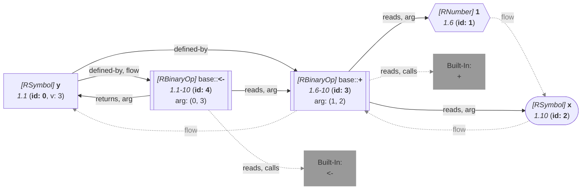
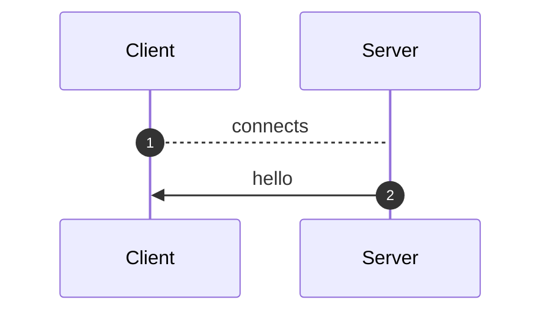
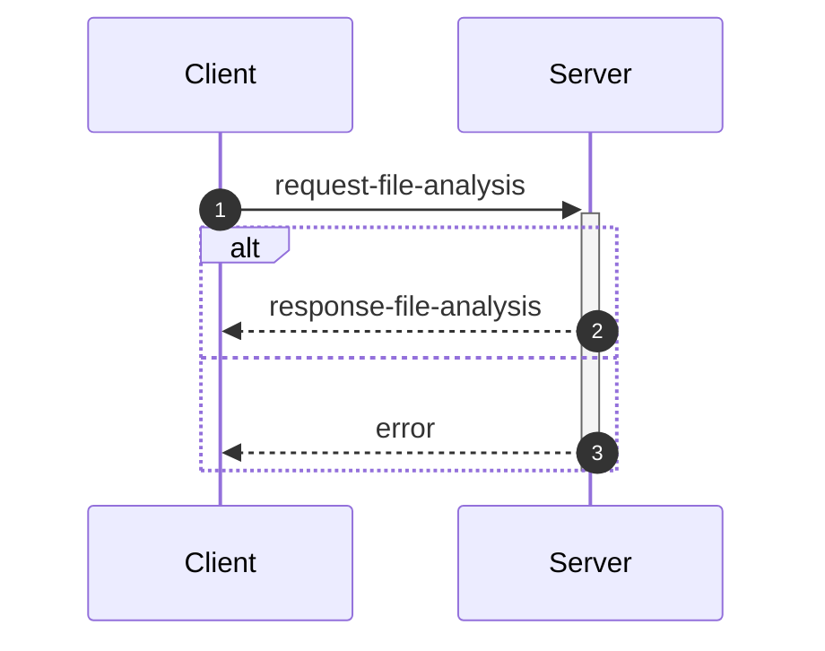
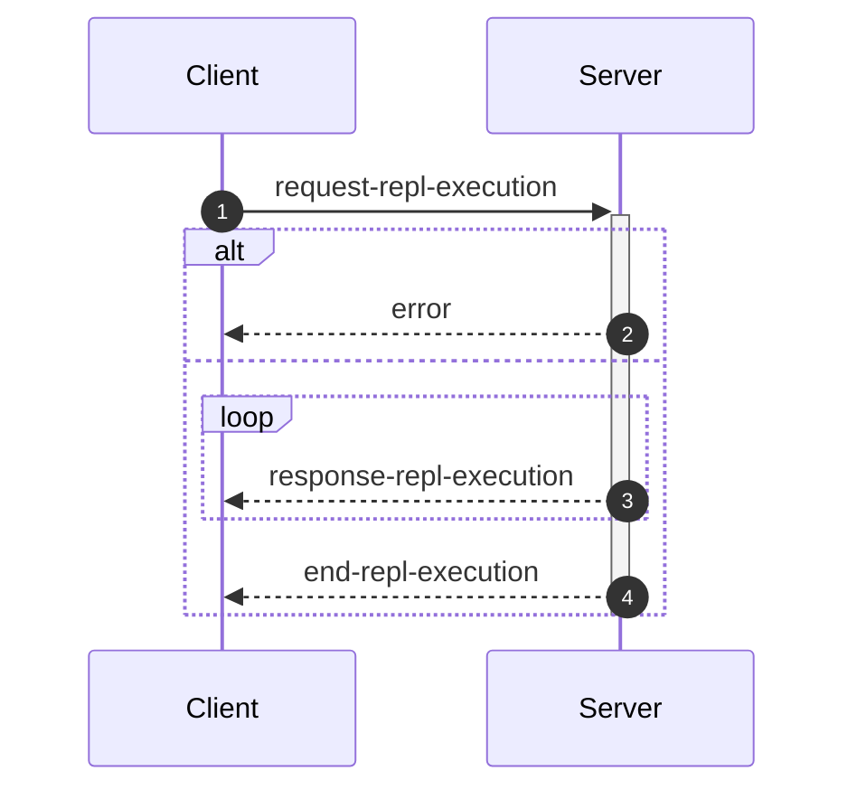
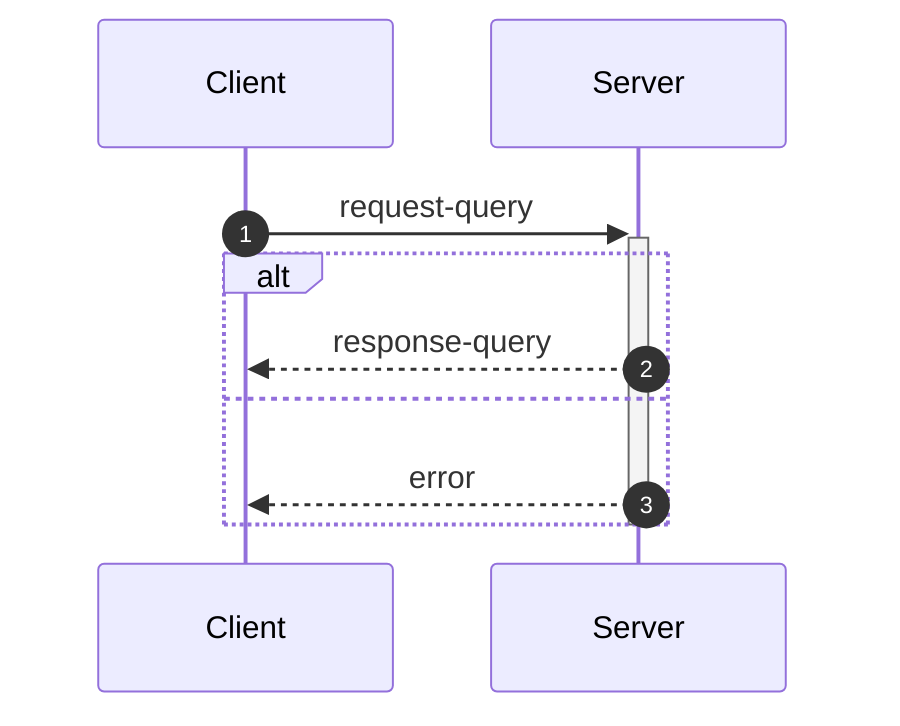

_<span title="an overview of flowR's interface">Generated</span> from '[wiki-interface.ts](https://github.com/flowr-analysis/flowr/tree/main/src/documentation/wiki-interface.ts "src/documentation/wiki-interface.ts")' on 2026-11-21, 09:19:03 UTC (v2.17.9, R v4.5.0), do not edit directly._

Although far from being as detailed as the in-depth explanation of [_flowR_](https://github.com/flowr-analysis/flowr/wiki/Core),
this wiki page explains how to interface with _flowR_ in more detail.
In general, command line arguments and other options provide short descriptions on hover over.

* [💻 Using the REPL](#using-the-repl)
* [⚙️ Configuring FlowR](#configuring-flowr)
* [⚒️ Writing Code](#writing-code)
* [💬 Communicating with the Server](#communicating-with-the-server)

<a id='using-the-repl'></a>
## 💻 Using the REPL

> [!NOTE]
> To execute arbitrary R commands with a repl request, _flowR_ has to be started explicitly with <span title="Description (Command Line Argument): Allow to access the underlying R session when using flowR (security warning: this allows the execution of arbitrary R code!)">`--r-session-access`</span>.
> Please be aware that this introduces a security risk and note that this relies on the [`r-shell` engine](https://github.com/flowr-analysis/flowr/wiki/Engines) .

Although primarily meant for users to explore,
there is nothing which forbids calling _flowR_ as a subprocess to use standard-in, -output, and -error
for communication (although you can access the REPL using the server as well,
with the [REPL Request](#message-request-repl-execution) message).

The read-eval-print loop&nbsp;(REPL) works relatively simple.
You can submit an expression (using <kbd>Enter</kbd>),
which is interpreted as an R&nbsp;expression by default but interpreted as a *command* if it starts with a colon (`:`).
The best command to get started with the REPL is <span title="Description (Repl Command): Show help information (aliases: :h, :?)">`:help`</span>.
Besides, you can leave the REPL either with the command <span title="Description (Repl Command): End the repl (aliases: :q, :exit)">`:quit`</span> or by pressing <kbd>Ctrl</kbd>+<kbd>C</kbd> twice.
When writing a *command*, you may press <kbd>Tab</kbd> to get a list of completions, if available.
Multiple commands can be entered in a single line by separating them with a semicolon (`;`), e.g. `:parse "x<-2"; :df*`.
If a command is given without R code, the REPL will re-use R code given in a previous command.
The prior example will hence return first the parsed AST of the program and then the dataflow graph for `"x <- 2"`.

> [!NOTE]
> If you develop flowR, you may want to launch the repl using the `npm run main-dev` command, this way, you get a non-minified version of flowR with debug information and hot-reloading of source files.

<details>
<summary>Available Commands</summary>

We currently offer the following commands (this with a `[*]` suffix are available with and without the star):

| Command | Description |
| ------- | ----------- |
| **<span title="Description (Repl Command): End the repl (aliases: :q, :exit)">:quit</span>** | End the repl (aliases: **:<span title="Alias of ':quit'. End the repl">q</span>**, **:<span title="Alias of ':quit'. End the repl">exit</span>**) |
| **<span title="Description (Repl Command): Execute the given code as R code. This requires the `--r-session-access` flag to be set and requires the r-shell engine. (aliases: :e, :r)">:execute</span>** | Execute the given code as R code. This requires the `--r-session-access` flag to be set and requires the r-shell engine. (aliases: **:<span title="Alias of ':execute'. Execute the given code as R code. This requires the `--r-session-access` flag to be set and requires the r-shell engine.">e</span>**, **:<span title="Alias of ':execute'. Execute the given code as R code. This requires the `--r-session-access` flag to be set and requires the r-shell engine.">r</span>**) |
| **<span title="Description (Repl Command): Get mermaid code for the control-flow graph of R code (aliases: :cfg, :cf)">:controlflow[*]</span>** | Get mermaid code for the control-flow graph of R code (star: Returns the URL to mermaid.live) (aliases: **:<span title="Alias of ':controlflow'. Get mermaid code for the control-flow graph of R code">cfg</span>**, **:<span title="Alias of ':controlflow'. Get mermaid code for the control-flow graph of R code">cf</span>**) |
| **<span title="Description (Repl Command): Get mermaid code for the control-flow graph with basic blocks (aliases: :cfgb, :cfb)">:controlflowbb[*]</span>** | Get mermaid code for the control-flow graph with basic blocks (star: Returns the URL to mermaid.live) (aliases: **:<span title="Alias of ':controlflowbb'. Get mermaid code for the control-flow graph with basic blocks">cfgb</span>**, **:<span title="Alias of ':controlflowbb'. Get mermaid code for the control-flow graph with basic blocks">cfb</span>**) |
| **<span title="Description (Repl Command): Get mermaid code for the dataflow graph (aliases: :d, :df)">:dataflow[*]</span>** | Get mermaid code for the dataflow graph (star: Returns the URL to mermaid.live) (aliases: **:<span title="Alias of ':dataflow'. Get mermaid code for the dataflow graph">d</span>**, **:<span title="Alias of ':dataflow'. Get mermaid code for the dataflow graph">df</span>**) |
| **<span title="Description (Repl Command): Get mermaid code for the normalized AST of R code (aliases: :n)">:normalize[*]</span>** | Get mermaid code for the normalized AST of R code (star: Returns the URL to mermaid.live) (alias: **:<span title="Alias of ':normalize'. Get mermaid code for the normalized AST of R code">n</span>**) |
| **<span title="Description (Repl Command): Get mermaid code for the simplified dataflow graph (aliases: :ds, :dfs)">:dataflowsimple[*]</span>** | Get mermaid code for the simplified dataflow graph (star: Returns the URL to mermaid.live) (aliases: **:<span title="Alias of ':dataflowsimple'. Get mermaid code for the simplified dataflow graph">ds</span>**, **:<span title="Alias of ':dataflowsimple'. Get mermaid code for the simplified dataflow graph">dfs</span>**) |
| **<span title="Description (Repl Command): Inspect and extend the signature database: `query` (identical to :query @signature), `info <name>` for where a function comes from (identical to :query @function-info), `add <path>` to mount another database/source, `download` to fetch the full-history database. (aliases: :sig)">:signature</span>** | Inspect and extend the signature database: `query` (identical to :query @signature), `info <name>` for where a function comes from (identical to :query @function-info), `add <path>` to mount another database/source, `download` to fetch the full-history database. (alias: **:<span title="Alias of ':signature'. Inspect and extend the signature database: `query` (identical to :query @signature), `info <name>` for where a function comes from (identical to :query @function-info), `add <path>` to mount another database/source, `download` to fetch the full-history database.">sig</span>**) |
| **<span title="Description (Repl Command): Just calculates the DFG, but only prints summary info (aliases: :d#, :df#)">:dataflowsilent</span>** | Just calculates the DFG, but only prints summary info (aliases: **:<span title="Alias of ':dataflowsilent'. Just calculates the DFG, but only prints summary info">d#</span>**, **:<span title="Alias of ':dataflowsilent'. Just calculates the DFG, but only prints summary info">df#</span>**) |
| **<span title="Description (Repl Command): Prints ASCII Art of the parsed, unmodified AST (aliases: :p)">:parse</span>** | Prints ASCII Art of the parsed, unmodified AST (alias: **:<span title="Alias of ':parse'. Prints ASCII Art of the parsed, unmodified AST">p</span>**) |
| **<span title="Description (Repl Command): Prints the version of flowR as well as the current version of R">:version</span>** | Prints the version of flowR as well as the current version of R
| **<span title="Description (Repl Command): Query the given R code (use 'help' for more information)">:query[*]</span>** | Query the given R code (use 'help' for more information) (star: Similar to query, but returns the output in json format.)
| **<span title="Description (Repl Command): Returns an ASCII representation of the dataflow graph (aliases: :df!)">:dataflowascii</span>** | Returns an ASCII representation of the dataflow graph (alias: **:<span title="Alias of ':dataflowascii'. Returns an ASCII representation of the dataflow graph">df!</span>**) |
| **<span title="Description (Repl Command): Returns summarization stats for the normalized AST (aliases: :n#)">:normalize#</span>** | Returns summarization stats for the normalized AST (alias: **:<span title="Alias of ':normalize#'. Returns summarization stats for the normalized AST">n#</span>**) |
| **<span title="Description (Repl Command): Show help information (aliases: :h, :?)">:help</span>** | Show help information (aliases: **:<span title="Alias of ':help'. Show help information">h</span>**, **:<span title="Alias of ':help'. Show help information">?</span>**) |

</details>

> [!TIP]
> 
> As indicated by the examples before, all REPL commands that operate on code keep track of the state.
> Hence, if you run a command like <span title="Description (Repl Command, starred version): Returns the URL to mermaid.live; Base Command: Get mermaid code for the dataflow graph (aliases: :d*, :df*)">`:dataflow*`</span> without providing R code,
> the REPL will re-use the R code provided in a previous command.
> Likewise, doing this will benefit from incrementality!
> If you request the dataflow graph with `:df* x <- 2 * y` and then want to see the parsed AST with `:parse`,
> the REPL will re-use previously obtained information and not re-parse the code again.
> 		

Generally, many commands offer shortcut versions in the REPL. Many queries, for example, offer a shortened format (see the example below).
Of special note, the [Config Query](https://github.com/flowr-analysis/flowr/wiki/%5BQuery%5D-Config)
can be used to also modify the currently active configuration of _flowR_ within the REPL (see the [wiki page](https://github.com/flowr-analysis/flowr/wiki/%5BQuery%5D-Config) for more information).

### Example: Retrieving the Dataflow Graph

To retrieve a URL to the [mermaid](https://mermaid.js.org/) diagram of the dataflow of a given expression,
use <span title="Description (Repl Command, starred version): Returns the URL to mermaid.live; Base Command: Get mermaid code for the dataflow graph (aliases: :d*, :df*)">`:dataflow*`</span> (or <span title="Description (Repl Command): Get mermaid code for the dataflow graph (aliases: :d, :df)">`:dataflow`</span> to get the mermaid code in the cli):

```shell
$ docker run -it --rm eagleoutice/flowr # or npm run flowr 
flowR repl v2.17.9, R grammar v14 (tree-sitter engine)
R> :dataflow* y <- 1 + x
```

<details>
<summary style='color:gray'>Output</summary>

```text
https://mermaid.live/view#base64:eyJjb2RlIjoiZmxvd2NoYXJ0IFREXG4gICAgMXt7XCJgKiM5MTtSTnVtYmVyIzkzOyogKioxKipcbiAgICAgICoxLjYqICgqKmlkOiAxKiopYFwifX1cbiAgICAyKFtcImAqIzkxO1JTeW1ib2wjOTM7KiAqKngqKlxuICAgICAgKjEuMTAqICgqKmlkOiAyKiopYFwiXSlcbiAgICAzW1tcImAqIzkxO1JCaW5hcnlPcCM5MzsqIGJhc2UjNTg7IzU4OyoqIzQzOyoqXG4gICAgICAqMS42LTEwKiAoKippZDogMyoqKVxuICAgIGFyZzogKDEsIDIpYFwiXV1cbiAgICBidWlsdC1pbjpfNDNfW1wiYEJ1aWx0LUluOlxuIzQzO2BcIl1cbiAgICBzdHlsZSBidWlsdC1pbjpfNDNfIHN0cm9rZTpncmF5LGZpbGw6Z3JheSxzdHJva2Utd2lkdGg6MnB4LG9wYWNpdHk6Ljg7XG4gICAgMFtcImAqIzkxO1JTeW1ib2wjOTM7KiAqKnkqKlxuICAgICAgKjEuMSogKCoqaWQ6IDAqKiwgdjogMylgXCJdXG4gICAgNFtbXCJgKiM5MTtSQmluYXJ5T3AjOTM7KiBiYXNlIzU4OyM1ODsqKiM2MDsjNDU7KipcbiAgICAgICoxLjEtMTAqICgqKmlkOiA0KiopXG4gICAgYXJnOiAoMCwgMylgXCJdXVxuICAgIGJ1aWx0LWluOl82MF8tW1wiYEJ1aWx0LUluOlxuIzYwOyM0NTtgXCJdXG4gICAgc3R5bGUgYnVpbHQtaW46XzYwXy0gc3Ryb2tlOmdyYXksZmlsbDpncmF5LHN0cm9rZS13aWR0aDoycHgsb3BhY2l0eTouODtcbiAgICAxIC0uLT58XCJmbG93XCJ8IDJcbiAgICBsaW5rU3R5bGUgMCBzdHJva2U6Z3JheSxjb2xvcjpncmF5O1xuICAgIDIgLS4tPnxcImZsb3dcInwgM1xuICAgIGxpbmtTdHlsZSAxIHN0cm9rZTpncmF5LGNvbG9yOmdyYXk7XG4gICAgMyAtLT58XCJyZWFkcywgYXJnXCJ8IDFcbiAgICAzIC0tPnxcInJlYWRzLCBhcmdcInwgMlxuICAgIDMgLS4tPnxcImZsb3dcInwgMFxuICAgIGxpbmtTdHlsZSA0IHN0cm9rZTpncmF5LGNvbG9yOmdyYXk7XG4gICAgMyAtLi0+fFwicmVhZHMsIGNhbGxzXCJ8IGJ1aWx0LWluOl80M19cbiAgICBsaW5rU3R5bGUgNSBzdHJva2U6Z3JheTtcbiAgICAwIC0tPnxcImRlZmluZWQtYnksIGZsb3dcInwgNFxuICAgIDAgLS0+fFwiZGVmaW5lZC1ieVwifCAzXG4gICAgNCAtLT58XCJyZWFkcywgYXJnXCJ8IDNcbiAgICA0IC0tPnxcInJldHVybnMsIGFyZ1wifCAwXG4gICAgNCAtLi0+fFwicmVhZHMsIGNhbGxzXCJ8IGJ1aWx0LWluOl82MF8tXG4gICAgbGlua1N0eWxlIDEwIHN0cm9rZTpncmF5OyIsIm1lcm1haWQiOnsiYXV0b1N5bmMiOnRydWV9fQ==
```

Retrieve the dataflow graph of the expression `y <- 1 + x`. It looks like this:



<details>

<summary style="color:gray">R Code of the Dataflow Graph</summary>

The analysis ran (parse and normalize with the [tree-sitter](https://github.com/flowr-analysis/flowr/wiki/Engines) engine) in the generation environment. No [signature database](https://github.com/flowr-analysis/flowr/wiki/Signature-Database) is mounted, so `library()` attaches no exports (base-R names are still qualified, e.g., `stats::acf`). 
We encountered no unknown side effects during the analysis.

```r
y <- 1 + x
```

</details>

</details>

For small graphs like this, <span title="Description (Repl Command): Returns an ASCII representation of the dataflow graph (aliases: :df!)">`:dataflowascii`</span> also provides an ASCII representation directly in the REPL:

```shell
$ docker run -it --rm eagleoutice/flowr # or npm run flowr 
flowR repl v2.17.9, R grammar v14 (tree-sitter engine)
R> :df! y <- 1 + x
```

<details open>
<summary style='color:gray'>Output</summary>

```text
                        v<0>v
 c<4>c──────────────────| y |
 |<- |     ┌────────────v---v
 c---c     │
    │   c<3>c   0<1>0
    └───| + |───| 1 |───u<2>u
        c---c   0---0   | x |
           └────────────u---u
Edges:
3 -> 1: reads, arg          3 -> 2: reads, arg
3 -> 0: flows-to            1 -> 2: flows-to
2 -> 3: flows-to            4 -> 3: reads, arg
4 -> 0: returns, arg        0 -> 4: defined-by, flows-to
0 -> 3: defined-by
```

Retrieve the dataflow graph of the expression `y <- 1 + x` as ASCII art.

</details>

For the slicing with <span title="Description (Repl Command): Static backwards executable slicer for R">`:slicer`</span>, you have access to the same [magic comments](#slice-magic-comments) as with the [slice request](#message-request-slice).
Pass `--inline` to splice resolvable `source()` calls into the reconstruction so the slice is a single self-contained R text (the same as the static slice query's `inlineSources` flag).
See `--help` for more flags!

### Example: Interfacing with the File System

Many commands that allow for an R-expression (like <span title="Description (Repl Command, starred version): Returns the URL to mermaid.live; Base Command: Get mermaid code for the dataflow graph (aliases: :d*, :df*)">`:dataflow*`</span>) allow for a file as well
if the argument starts with `file://`.
If you are working from the root directory of the _flowR_ repository, the following gives you the parsed AST of the example file using the <span title="Description (Repl Command): Prints ASCII Art of the parsed, unmodified AST (aliases: :p)">`:parse`</span> command:

> **Watch mode**: Replace `file://` with `watch://` to enter watch mode.
> flowR runs the command immediately and then re-runs it every time the file (or any file inside the folder) changes.
> Enter any other command to leave watch mode.
> For example: `:df watch://analysis.R`

```shell
$ docker run -it --rm eagleoutice/flowr # or npm run flowr 
flowR repl v2.17.9, R grammar v14 (tree-sitter engine)
R> :parse file://test/testfiles/example.R
```

<details>
<summary style='color:gray'>Output</summary>

```text
File: test/testfiles/example.R

program
├ binaryoperator
│ ├ identifier "sum" (1:1─4)
│ ├ <- "<-" (1:5─7)
│ ╰ float "0" (1:8─9)
├ binaryoperator
│ ├ identifier "product" (2:1─8)
│ ├ <- "<-" (2:9─11)
│ ╰ float "1" (2:12─13)
├ binaryoperator
│ ├ identifier "w" (3:1─2)
│ ├ <- "<-" (3:3─5)
│ ╰ float "7" (3:6─7)
├ binaryoperator
│ ├ identifier "N" (4:1─2)
│ ├ <- "<-" (4:3─5)
│ ╰ float "10" (4:6─8)
├ forstatement
│ ├ for "for" (6:1─4)
│ ├ ( "(" (6:5─6)
│ ├ identifier "i" (6:6─7)
│ ├ in "in" (6:8─10)
│ ├ binaryoperator
│ │ ├ float "1" (6:11─12)
│ │ ├ : ":" (6:12─13)
│ │ ╰ parenthesizedexpression
│ │   ├ ( "(" (6:13─14)
│ │   ├ binaryoperator
│ │   │ ├ identifier "N" (6:14─15)
│ │   │ ├ - "-" (6:15─16)
│ │   │ ╰ float "1" (6:16─17)
│ │   ╰ ) ")" (6:17─18)
│ ├ ) ")" (6:18─19)
│ ╰ bracedexpression
│   ├ { "{" (6:20─21)
│   ├ binaryoperator
│   │ ├ identifier "sum" (7:3─6)
│   │ ├ <- "<-" (7:7─9)
│   │ ╰ binaryoperator
│   │   ├ binaryoperator
│   │   │ ├ identifier "sum" (7:10─13)
│   │   │ ├ + "+" (7:14─15)
│   │   │ ╰ identifier "i" (7:16─17)
│   │   ├ + "+" (7:18─19)
│   │   ╰ identifier "w" (7:20─21)
│   ├ binaryoperator
│   │ ├ identifier "product" (8:3─10)
│   │ ├ <- "<-" (8:11─13)
│   │ ╰ binaryoperator
│   │   ├ identifier "product" (8:14─21)
│   │   ├  "" (8:22─23)
│   │   ╰ identifier "i" (8:24─25)
│   ╰ } "}" (9:1─2)
├ call
│ ├ identifier "cat" (11:1─4)
│ ╰ arguments
│   ├ ( "(" (11:4─5)
│   ├ argument
│   │ ╰ string
│   │   ├ stringopen "\"" (11:5─6)
│   │   ├ stringcontent "Sum:" (11:6─10)
│   │   ╰ stringclose "\"" (11:10─11)
│   ├ comma "," (11:11─12)
│   ├ argument
│   │ ╰ identifier "sum" (11:13─16)
│   ├ comma "," (11:16─17)
│   ├ argument
│   │ ╰ string
│   │   ├ stringopen "\"" (11:18─19)
│   │   ├ stringcontent
│   │   │ ╰ escapesequence "\\n" (11:19─21)
│   │   ╰ stringclose "\"" (11:21─22)
│   ╰ ) ")" (11:22─23)
╰ call
  ├ identifier "cat" (12:1─4)
  ╰ arguments
    ├ ( "(" (12:4─5)
    ├ argument
    │ ╰ string
    │   ├ stringopen "\"" (12:5─6)
    │   ├ stringcontent "Product:" (12:6─14)
    │   ╰ stringclose "\"" (12:14─15)
    ├ comma "," (12:15─16)
    ├ argument
    │ ╰ identifier "product" (12:17─24)
    ├ comma "," (12:24─25)
    ├ argument
    │ ╰ string
    │   ├ stringopen "\"" (12:26─27)
    │   ├ stringcontent
    │   │ ╰ escapesequence "\\n" (12:27─29)
    │   ╰ stringclose "\"" (12:29─30)
    ╰ ) ")" (12:30─31)
```

Retrieve the parsed AST of the example file.

<details>

<summary>File Content</summary>

```r
sum <- 0
product <- 1
w <- 7
N <- 10

for (i in 1:(N-1)) {
  sum <- sum + i + w
  product <- product * i
}

cat("Sum:", sum, "\n")
cat("Product:", product, "\n")
```

</details>

As _flowR_ directly transforms this AST the output focuses on being human-readable instead of being machine-readable.
		
</details>

### Example: Run a Query

You can run any query supported by _flowR_ using the <span title="Description (Repl Command): Query the given R code (use 'help' for more information)">`:query`</span> command.
For example, to obtain the shapes of all data frames in a given piece of code, you can run:

```shell
$ docker run -it --rm eagleoutice/flowr # or npm run flowr 
flowR repl v2.17.9, R grammar v14 (tree-sitter engine)
R> :query @absint df-shape "x <- data.frame(a = 1:10, b = 1:10)\ny <- x$a"
```

<details open>
<summary style='color:gray'>Output</summary>

```text
Query: absint (3 ms)
   ╰ $12: (colnames: [{"a", "b"}, {}], cols: [2, 2], rows: [10, 10])
   ╰ $0: (colnames: [{"a", "b"}, {}], cols: [2, 2], rows: [10, 10])
```

Retrieve the shapes of all data frames in the given code.

</details>

To run the linter on a file, you can use (in this example, we just issue the `dead-code` linter on a small piece of code):

```shell
$ docker run -it --rm eagleoutice/flowr # or npm run flowr 
flowR repl v2.17.9, R grammar v14 (tree-sitter engine)
R> :query @linter rules:dead-code "if(FALSE) x <- 2"
```

<details open>
<summary style='color:gray'>Output</summary>

```text
Query: linter (3 ms)
   ╰ Dead Code (dead-code):
       ╰ certain:
           ╰ Code at 1.11-16 (1 quick fix(es) available)
```

Run the linter on the given code, with only the `dead-code` rule enabled.

</details>

For more information on the available queries, please check out the [Query API](https://github.com/flowr-analysis/flowr/wiki/Query-API).

<a id='configuring-flowr'></a>
## ⚙️ Configuring FlowR

When running _flowR_, you may want to specify some behaviors with a dedicated configuration file.
By default, flowR looks for a file named `flowr.json` in the current working directory (or any higher directory).
You can also specify a different file with <span title="Description (Command Line Argument): The name of the configuration file to use">`--config-file`</span> or pass the configuration inline using <span title="Description (Command Line Argument): The flowR configuration to use, as a JSON string">`--config-json`</span>.
A `flowr.json` found this way belongs to the analyzed project, so flowR ignores its options that decide what flowR executes or loads
(`defaultPlugins.*.1`, `repl.plugins.*.1`, `engines.*.wasmPath`, `engines.*.treeSitterWasmPath`, `engines.*.rPath`, `solver.sigdb.additionalPaths`, `solver.sigdb.downloadRepo`, `solver.sigdb.autoSync`, `solver.sigdb.installedLibrary.paths`, `solver.sigdb.onDemand.enabled`, `solver.sigdb.onDemand.repositories`, `solver.sigdb.onDemand.cranMirror`, `solver.sigdb.onDemand.bioconductorMirror`, `solver.sigdb.onDemand.cacheDir`, `solver.instrument.dataflowExtractors`),
unless you pass <span title="Description (Command Line Argument): Keep the security-sensitive options (e.g., the R executable) of the flowr.json found in the working directory or a parent. Only use this for projects you trust.">`--trust-config`</span>.
To analyze code you do not trust, use the secure mode (<span title="Description (Command Line Argument): Run in secure mode for analyzing untrusted code: flowR does not start R (or any other process), does not access the network, does not search for project configs, and ignores security-sensitive options in every config. Cannot be disabled once enabled. Can also be enabled with the environment variable {italic FLOWR_SECURE_MODE=1}.">`--secure`</span>, see the [security policy](https://github.com/flowr-analysis/flowr/blob/main/.github/SECURITY.md)).
To inspect the current configuration, you can run flowr with the <span title="Description (Command Line Argument): Run with verbose logging (will be passed to the corresponding script)">`--verbose`</span> flag, or use the `config` [Query](https://github.com/flowr-analysis/flowr/wiki/Query-API).
Within the REPL this works by running the following:

```shell
:query @config
```

To work with the <a href="https://github.com/flowr-analysis/flowr/tree/main/src/config.ts#L131"><code><span title="The configuration file format for flowR.">FlowrConfig</span></code></a> you can use the provided helper objects alongside its methods like
<a href="https://github.com/flowr-analysis/flowr/tree/main/src/config.ts#L963"><code><span title="Creates a new flowr config that has the updated values.">FlowrConfig::<b>amend</b></span></code></a>.
The schema below documents every option; the ones you most likely want are:

- <a href="https://github.com/flowr-analysis/flowr/wiki/Interface#configuring-flowr" title="Configuration Option (boolean): Whether source calls should be ignored, causing {@link processSourceCall}&#39;s behavior to be skipped.">ignoreSourceCalls</a>: ignore source calls when analyzing the code, i.e., ignore the inclusion of other files.
- <a href="https://github.com/flowr-analysis/flowr/wiki/Interface#configuring-flowr" title="Configuration Option (boolean): Whether load calls should be ignored, causing {@link processLoadCall}&#39;s behavior to be skipped.">ignoreLoadCalls</a>: ignore load calls when analyzing the code, i.e., ignore the loading of r-data files.
- <a href="https://github.com/flowr-analysis/flowr/wiki/Interface#configuring-flowr" title="Configuration Option (object): Do you want to overwrite (parts) of the builtin definition?">semantics.environment.overwriteBuiltIns</a>: overwrite _flowR_'s handling of built-in functions, or clear the preset definitions entirely.
  See [Configure BuiltIn Semantics](#configure-builtin-semantics) for more information.
- <a href="https://github.com/flowr-analysis/flowr/wiki/Interface#configuring-flowr" title="Configuration Option (boolean): Whether calls drawing on a graphics device (e.g., `plot`) count as writing to it, which the ambient state queries then report.">semantics.ambient.drawingWritesDevice</a>: whether calls drawing on a graphics device (e.g., `plot`) count as writing the device in the ambient state queries.
- <a href="https://github.com/flowr-analysis/flowr/wiki/Interface#configuring-flowr" title="Configuration Option (string): How to resolve variables and their values. (one of &quot;disabled&quot;, &quot;alias&quot;, &quot;builtin&quot;)">solver.variables</a>: how to resolve variables and their values (`disabled`, `alias`, `builtin`).
- <a href="https://github.com/flowr-analysis/flowr/wiki/Interface#configuring-flowr" title="Configuration Option (array): The engine or set of engines to use for interacting with R code. An empty array means all available engines will be used.">engines</a> and <a href="https://github.com/flowr-analysis/flowr/wiki/Interface#configuring-flowr" title="Configuration Option (string): The default engine to use for interacting with R code. If this is undefined, an arbitrary engine from the specified list will be used. (one of &quot;tree-sitter&quot;, &quot;r-shell&quot;)">defaultEngine</a>: the engines used to interact with R code, see the [Engines wiki page](https://github.com/flowr-analysis/flowr/wiki/Engines).
- <a href="https://github.com/flowr-analysis/flowr/wiki/Interface#configuring-flowr" title="Configuration Option (array): Files a framework loads on its own, without any source() call (e.g. global.R in a shiny app), in the order they are loaded; flowR orders the matching project files accordingly and analyzes them as one program. Entries are case-insensitive globs matched against the file path, a plain name matches any file with that name, and entries matching no project file are warned about. Usually set per project kind via specializeConfig.">project.implicitSources</a>: the files a framework loads without any `source()` call, in the order in which they are
  loaded. Entries are globs (e.g. `R/*.R`) matched against the file path ignoring capitalization; one matching no file is reported.
- <a href="https://github.com/flowr-analysis/flowr/wiki/Interface#configuring-flowr" title="Configuration Option (object): Overwrite (parts of) the configuration depending on the project kind flowR detects, e.g. to give a shiny app its implicit sources.">specializeConfig</a>: overwrite (parts of) the configuration depending on the kind of project _flowR_ detects
  (e.g. `shiny-app`), which is how a shiny app gets its implicit sources by default. What you configure directly wins.
- <a href="https://github.com/flowr-analysis/flowr/wiki/Interface#configuring-flowr" title="Configuration Option (string): Overwrite the project kind flowR would otherwise infer from the analyzed files, e.g. when auto-detection guesses wrong. (one of &quot;package&quot;, &quot;script&quot;, &quot;shiny-app&quot;, &quot;notebook&quot;, &quot;project&quot;, &quot;unknown&quot;)">project.useProjectType</a>: skip that detection and force a project kind yourself, when auto-detection guesses wrong.
- <a href="https://github.com/flowr-analysis/flowr/wiki/Interface#configuring-flowr" title="Configuration Option (array): The default plugins to load when creating a new instance of FlowrAnalyzer">defaultPlugins</a> and <a href="https://github.com/flowr-analysis/flowr/wiki/Interface#configuring-flowr" title="Configuration Option (array): The plugins to load in REPL mode">repl.plugins</a>: the plugins to load for a new <a href="https://github.com/flowr-analysis/flowr/tree/main/src/project/flowr-analyzer.ts#L218"><code><span title="Central class for conducting analyses with FlowR. Use the FlowrAnalyzerBuilder to create a new instance. If you want the original pattern of creating a pipeline and running all steps, you can still do this with FlowrAnalyzer#runFull . To inspect the context of the analyzer, use FlowrAnalyzer#inspectContext (if you are a plugin and need to modify it, use FlowrAnalyzer#context instead).">FlowrAnalyzer</span></code></a> and in the REPL
  (use `flowr:default` to reference the former).

So you can configure _flowR_ by adding a file like the following:

<details>

<summary>Example Configuration File</summary>

```json
{
  "ignoreSourceCalls": true,
  "ignoreLoadCalls": true,
  "semantics": {
    "environment": {
      "overwriteBuiltIns": {
        "definitions": [
          {
            "type": "function",
            "names": [
              "foo"
            ],
            "processor": "builtin:assign",
            "config": {}
          }
        ]
      }
    }
  },
  "defaultPlugins": [
    "file:description",
    "versions:description"
  ],
  "repl": {
    "quickStats": false,
    "dfProcessorHeat": false,
    "hints": true,
    "plugins": [
      "flowr:default"
    ]
  },
  "project": {
    "resolveUnknownPathsOnDisk": true,
    "implicitSources": [
      "global.R",
      "app.R"
    ]
  },
  "linter": {
    "disabledRules": []
  },
  "specializeConfig": {
    "shiny-app": {
      "project": {
        "implicitSources": [
          "global.R",
          "ui.R",
          "server.R",
          "app.R"
        ]
      }
    }
  },
  "engines": [
    {
      "type": "r-shell"
    }
  ],
  "solver": {
    "variables": "alias",
    "evalStrings": true,
    "trackEnvironments": true,
    "sigdb": {
      "enabled": true,
      "loadProjectDependencies": true,
      "eagerlyLoad": false,
      "eagerlyLoadExports": false,
      "linkBaseR": false,
      "linkDescriptionDependencies": false
    },
    "resolveSource": {
      "dropPaths": "no",
      "ignoreCapitalization": true,
      "inferWorkingDirectory": "active-script",
      "searchPath": []
    },
    "instrument": {},
    "slicer": {
      "threshold": 50
    }
  },
  "abstractInterpretation": {
    "wideningThreshold": 4,
    "followCalls": true,
    "dataFrame": {
      "maxColNames": 20,
      "readLoadedData": {
        "readExternalFiles": true,
        "maxReadLines": 1000000
      }
    }
  },
  "incremental": {
    "alwaysIncremental": false,
    "parsing": {
      "activated": false,
      "heuristics": {
        "activated": true,
        "mtime": true,
        "linesFrom": 500,
        "bytesFrom": 50000,
        "alwaysWithEdits": false,
        "minFiles": 1
      }
    }
  },
  "gas": {
    "thresholds": {
      "memory": {
        "problematic": 0.7,
        "critical": 0.9
      },
      "timeMs": {
        "problematic": 100000,
        "critical": 120000
      }
    },
    "features": {}
  }
}
```

</details>

<details>
<a id='configure-builtin-semantics'></a>
<summary>Configure Built-In Semantics</summary>

`semantics/environment/overwriteBuiltins` accepts two keys:

- `loadDefaults` (boolean, initially `true`): If set to `true`, the default built-in definitions are loaded before applying the custom definitions. Setting this flag to `false` explicitly disables the loading of the default definitions.
- `definitions` (array, initially empty): Allows to overwrite or define new built-in elements. Each object within must have a `type` which is one of the below. Furthermore, they may define a string array of `names` which specifies the identifiers to bind the definitions to. You may use `assumePrimitive` to specify whether _flowR_ should assume that this is a primitive non-library definition (so you probably just do not want to specify the key).

  | Type            | Description                                                                                                                                                                                                                                                                                              | Example                                                                                                    |
  | --------------- | -------------------------------------------------------------------------------------------------------------------------------------------------------------------------------------------------------------------------------------------------------------------------------------------------------- | ---------------------------------------------------------------------------------------------------------- |
  | `constant`    | Additionally allows for a `value` this should resolve to.                                                                                                                                                                                                                                                | `{ type: 'constant', names: ['NULL', 'NA'],  value: null }`                                                |
  | `function`    | Is a rather flexible way to define and bind built-in functions. For the time, we do not have extensive documentation to cover all the cases, so please either consult the sources with the `default-builtin-config/` folder or open a [new issue](https://github.com/flowr-analysis/flowr/issues/new/choose). | `{ type: 'function', names: ['next'], processor: 'builtin:d', config: { cfg: ExitPointType.Next } }` |
  | `replacement` | A comfortable way to specify replacement functions like `$<-` or `names<-`. `suffixes` describes the... suffixes to attach automatically. | `{ type: 'replacement', suffixes: ['<-', '<<-'], names: ['[', '[['] }` |

</details>

<details>

<summary style='color:gray'>Full Configuration-File Schema</summary>

- _The configuration file format for flowR._ (object)
    - **logLevel** [optional] _flowR's global minimum log level, applied when the config is loaded._ (string)
        Only allows: 'silly', 'trace', 'debug', 'info', 'warn', 'error', 'fatal'
    - **ignoreSourceCalls** [optional] _Whether source calls should be ignored, causing {@link processSourceCall}'s behavior to be skipped._ (boolean)
    - **ignoreLoadCalls** [optional] _Whether load calls should be ignored, causing {@link processLoadCall}'s behavior to be skipped._ (boolean)
    - **semantics** _Configure language semantics and how flowR handles them._ (object)
        - **environment** [optional] _Semantics regarding how to handle the R environment._ (object)
            - **overwriteBuiltIns** [optional] _Do you want to overwrite (parts) of the builtin definition?_ (object)
                - **loadDefaults** [optional] _Should the default configuration still be loaded?_ (boolean)
                - **definitions** [optional] _The definitions to load/overwrite._ (array)
                Valid item types:
                    - (object)
        - **ambient** [optional] _Semantics regarding the global state (options, devices, files, ...) calls access._ (object)
            - **drawingWritesDevice** [optional] _Whether calls drawing on a graphics device (e.g., `plot`) count as writing to it, which the ambient state queries then report._ (boolean)
    - **defaultPlugins** [optional] _The default plugins to load when creating a new instance of FlowrAnalyzer_ (array)
    Valid item types:
        - (alternatives)
            - (string)
            - (array)
    - **repl** _Configuration options for the REPL._ (object)
        - **quickStats** [optional] _Whether to show quick stats in the REPL after each evaluation._ (boolean)
        - **dfProcessorHeat** [optional] _This instruments the dataflow processors to count how often each processor is called._ (boolean)
        - **hints** [optional] _Whether to show dim inline hints on the empty prompt (automatically disabled on non-interactive terminals)._ (boolean)
        - **plugins** [optional] _The plugins to load in REPL mode_ (array)
        Valid item types:
            - (alternatives)
                - (string)
                - (array)
        - **autoUseFileProtocol** [optional] _Prepend the file protocol to a repl input that looks like a path, instead of only warning about it._ (boolean)
        - **queryStats** [optional] _Whether `:query` closes with the line stating how long the queries took (`:query*` never prints it)._ (boolean)
        - **showPlugins** [optional] _Whether `:version` grays out the plugins that did not activate during the last analysis._ (boolean)
    - **project** _Project specific configuration options._ (object)
        - **resolveUnknownPathsOnDisk** [optional] _Whether to resolve unknown paths loaded by the r project disk when trying to source/analyze files._ (boolean)
        - **failOnInaccessiblePath** [optional] _Whether a directory that cannot be traversed during file discovery (e.g. due to permissions) aborts the analysis; when false (the default) such paths are logged and skipped._ (boolean)
        - **basePackages** [optional] _The packages considered part of R itself (base and recommended); if unset, flowR uses its built-in list._ (array)
        Valid item types:
            - (string)
        - **implicitSources** [optional] _Files a framework loads on its own, without any source() call (e.g. global.R in a shiny app), in the order they are loaded; flowR orders the matching project files accordingly and analyzes them as one program. Entries are case-insensitive globs matched against the file path, a plain name matches any file with that name, and entries matching no project file are warned about. Usually set per project kind via specializeConfig._ (array)
        Valid item types:
            - (string)
        - **useProjectType** [optional] _Overwrite the project kind flowR would otherwise infer from the analyzed files, e.g. when auto-detection guesses wrong._ (string)
            Only allows: 'package', 'script', 'shiny-app', 'notebook', 'project', 'unknown'
        - **assumeImplicitEcho** [optional] _Whether the top level of the analyzed code is echoed, so that every visible result printed there is collected as an output by the dependencies query (default true, false for a package)._ (boolean)
        - **discovery** [optional] _Scoping options for the default project discovery._ (object)
            - **full** [optional] _Collect every file below the project root (greedy) instead of only the files the detected project kind needs (default false)._ (boolean)
            - **perKind** [optional] _Per-kind include/exclude glob overrides layered on the default scoping._ (object)
            - **ignore** [optional] _Case-insensitive globs that drop matching files from the intelligent discovery, regardless of kind (e.g. .Renviron to ignore environment files)._ (array)
            Valid item types:
                - (string)
        - **classification** [optional] _Overrides for the signals flowR uses to classify the project kind._ (object)
            - **shinyDescriptionTypes** [optional] _DESCRIPTION Type: values that mark a shiny app._ (array)
            Valid item types:
                - (string)
            - **shinyEntryFiles** [optional] _File names a shiny app is assembled from._ (array)
            Valid item types:
                - (string)
            - **shinyUsagePattern** [optional] _Regex source evidencing shiny usage in an entry file._ (string)
            - **notebookExtensions** [optional] _File extensions marking a notebook._ (array)
            Valid item types:
                - (string)
    - **linter** _Linter configuration options._ (object)
        - **disabledRules** _Linting rule names excluded from the default rule set (a rule requested explicitly via a linter query still runs). Usually set per project kind via specializeConfig._ (array)
        Valid item types:
            - (string)
        - **disabledTags** [optional] _Linting rule tags whose rules are excluded from the default rule set (a rule requested explicitly via a linter query still runs). By default the cmd-check rules are disabled for everything but a package; a configured list replaces that default._ (array)
        Valid item types:
            - (string)
    - **inputSources** [optional] _Further frameworks the input-sources analysis should know about; entries are added to flowR's defaults._ (object)
        - **pure** [optional] _Functions that only pass the constantness of their arguments on._ (array)
        Valid item types:
            - (string)
        - **param** [optional] _Functions whose result is a 'param' input._ (array)
        Valid item types:
            - (string)
        - **file** [optional] _Functions whose result is a 'file' input._ (array)
        Valid item types:
            - (string)
        - **tempfile** [optional] _Functions whose result is a 'tempfile' input._ (array)
        Valid item types:
            - (string)
        - **glob** [optional] _Functions whose result is a 'glob' input._ (array)
        Valid item types:
            - (string)
        - **net** [optional] _Functions whose result is a 'net' input._ (array)
        Valid item types:
            - (string)
        - **rand** [optional] _Functions whose result is a 'rand' input._ (array)
        Valid item types:
            - (string)
        - **system** [optional] _Functions whose result is a 'system' input._ (array)
        Valid item types:
            - (string)
        - **ffi** [optional] _Functions whose result is a 'ffi' input._ (array)
        Valid item types:
            - (string)
        - **lang** [optional] _Functions whose result is a 'lang' input._ (array)
        Valid item types:
            - (string)
        - **options** [optional] _Functions whose result is a 'options' input._ (array)
        Valid item types:
            - (string)
        - **cmdline** [optional] _Functions whose result is a 'cmdline' input._ (array)
        Valid item types:
            - (string)
        - **user** [optional] _Functions whose result is a 'user' input._ (array)
        Valid item types:
            - (string)
        - **const** [optional] _Functions whose result is a 'const' input._ (array)
        Valid item types:
            - (string)
        - **scope** [optional] _Functions whose result is a 'scope' input._ (array)
        Valid item types:
            - (string)
        - **dconst** [optional] _Functions whose result is a 'dconst' input._ (array)
        Valid item types:
            - (string)
        - **unknown** [optional] _Functions whose result is a 'unknown' input._ (array)
        Valid item types:
            - (string)
        - **linkedObjects** [optional] _Objects a framework provides without a definition in the code, e.g. shiny's input._ (array)
        Valid item types:
            - (object)
        - **linkedEntryPoints** [optional] _Calls that hand a function to a framework, which binds its objects to the parameters by position._ (array)
        Valid item types:
            - (object)
    - **specializeConfig** [optional] _Overwrite (parts of) the configuration depending on the project kind flowR detects, e.g. to give a shiny app its implicit sources._ (object)
    - **engines** _The engine or set of engines to use for interacting with R code. An empty array means all available engines will be used._ (array)
    Valid item types:
        - (alternatives)
            - _The configuration for the tree sitter engine._ (object)
                - **type** [required] _Use the tree sitter engine._ (string)
                    Only allows: 'tree-sitter'
                - **wasmPath** [optional] _The path to the tree-sitter-r WASM binary to use. If this is undefined, this uses the default path._ (string)
                - **treeSitterWasmPath** [optional] _The path to the tree-sitter WASM binary to use. If this is undefined, this uses the default path._ (string)
                - **lax** [optional] _Whether to use the lax parser for parsing R code (allowing for syntax errors). If this is undefined, the strict parser will be used._ (boolean)
            - _The configuration for the R shell engine._ (object)
                - **type** [required] _Use the R shell engine._ (string)
                    Only allows: 'r-shell'
                - **rPath** [optional] _The path to the R executable to use. If this is undefined, this uses the default path._ (string)
                - **pipeBind** [optional] _Whether to enable R's experimental pipe-bind operator "=>" by setting _R_USE_PIPEBIND_ for the R session (default false); R itself keeps this off by default, as it is experimental and has never shipped in a release version of R._ (boolean)
    - **defaultEngine** [optional] _The default engine to use for interacting with R code. If this is undefined, an arbitrary engine from the specified list will be used._ (string)
        Only allows: 'tree-sitter', 'r-shell'
    - **solver** _How to resolve constants, constraints, cells, ..._ (object)
        - **variables** _How to resolve variables and their values._ (string)
            Only allows: 'disabled', 'alias', 'builtin'
        - **evalStrings** _Should we include eval(parse(text="...")) calls in the dataflow graph?_ (boolean)
        - **trackEnvironments** [optional] _Track user-created environments (new.env, assign/get/local with envir=, dollar-assign, attach). When false, all envir-style calls fall through conservatively._ (boolean)
        - **sigdb** _Resolving library exports from a signature database._ (object)
            - **enabled** [optional] _Resolve library()/use() exports from a signature database (default true); when false no database is consulted._ (boolean)
            - **loadProjectDependencies** [optional] _Load the project's declared dependencies from its metadata files (DESCRIPTION Imports/Depends, rproject.toml, uvr.toml, rig rproj.toml and script blocks, renv.lock, rv.lock, uvr.lock, rig lockfiles) (default true); when false these files are not read for dependencies._ (boolean)
            - **eagerlyLoad** [optional] _Parse the database up front rather than on the first package load (default false, ignored if disabled)._ (boolean)
            - **eagerlyLoadExports** [optional] _Add a vertex for every export on load rather than on demand (default false); keeps the dataflow graph small._ (boolean)
            - **assumedRVersion** [optional] _R version assumed when resolving versioned (base-R) exports: a pin like "4.5" or "auto" to detect the installed R (default "auto")._ (string)
            - **linkBaseR** [optional] _Eagerly attach base-R namespaces so bare base calls resolve without library() (default false)._ (boolean)
            - **linkBaseRCalls** [optional] _Add a lightweight Reads edge from a bare base-R call to its signature-database function vertex (default false; base-R qualification is edge-free otherwise)._ (boolean)
            - **linkPackageCalls** [optional] _Add a lightweight Reads edge from a resolved package call to its signature-database function vertex (default false)._ (boolean)
            - **linkDescriptionDependencies** [optional] _Eagerly attach the namespaces of the project's declared DESCRIPTION dependencies (Imports/Depends) so their exports resolve without an explicit library() (default false)._ (boolean)
            - **warmInBackground** [optional] _Decompress the hot shards (base + most-downloaded) in a background task on startup so the first library() lookup is warm (default false; for long-running servers/REPLs)._ (boolean)
            - **additionalPaths** [optional] _Extra directories or bundle/manifest files searched for signature databases (alongside the shipped default and $FLOWR_SIGDB_DIR); a downloaded full-history bundle placed here is mounted automatically._ (array)
            Valid item types:
                - (string)
            - **downloadRepo** [optional] _GitHub owner/repo the full-history bundle is downloaded from via ":signature download" (default "flowr-analysis/flowr"; the release tag comes from the committed sigdb.remote.json unless a version is given)._ (string)
            - **autoSync** [optional] _On startup, re-download shards whose committed sigdb.remote.json hash no longer matches the cache, in the background (default false; opt-in network sync after a git pull)._ (boolean)
            - **installedLibrary** [optional] _Recovering packages no signature database knows from the copy installed on this machine._ (object)
                - **enabled** [required] _Recover packages no signature database knows from their installed copy (default false)._ (boolean)
                - **paths** [optional] _Library directories to search; when empty they are discovered from the environment and the project._ (array)
                Valid item types:
                    - (string)
                - **useEnvironment** [optional] _Search the libraries R_LIBS_USER/R_LIBS/R_LIBS_SITE name (default true)._ (boolean)
                - **useProjectLibrary** [optional] _Search a project-local renv/packrat library (default true)._ (boolean)
                - **maxDepth** [optional] _How far to descend into the nested layout of a project-local library (default 3)._ (number)
                - **packages** [optional] _Only recover packages whose name matches one of these regular expressions; empty means any._ (array)
                Valid item types:
                    - (string)
            - **onDemand** [optional] _Recovering packages no signature database knows from their sources on CRAN, Bioconductor, or GitHub._ (object)
                - **enabled** [required] _Fetch and recover the sources of packages no signature database knows when the analyzed code uses them (default false, accesses the network)._ (boolean)
                - **sources** [optional] _Where to look, in order: github, cran, bioconductor, or a source a plugin adds (default ["github", "cran", "bioconductor"])._ (array)
                Valid item types:
                    - (string)
                - **repositories** [optional] _GitHub repositories (owner/repo[/subdir][@ref]) to fetch packages from, by package name. The analyzed project may name more (DESCRIPTION Remotes, install_github calls)._ (object)
                - **packages** [optional] _Only recover packages whose name matches one of these regular expressions, empty means any._ (array)
                Valid item types:
                    - (string)
                - **cranMirror** [optional] _The CRAN src/contrib/ to fetch from, over https (default https://cloud.r-project.org/src/contrib/). It may be on the local network._ (string)
                - **bioconductorMirror** [optional] _The Bioconductor host, over https (default https://bioconductor.org). It may be on the local network._ (string)
                - **bioconductorRelease** [optional] _The Bioconductor release to fetch from: release, devel, or a number like 3.20 (default release)._ (string)
                - **githubMirrors** [optional] _Use the GitHub mirrors of CRAN (cran/<pkg>) and Bioconductor (bioc/<pkg>) (default true)._ (boolean)
                - **maxPackages** [optional] _The most packages to fetch for one analysis (default 25)._ (number)
                - **maxArchiveMb** [optional] _The most MiB a package archive may have (default 32). It may unpack to three times that, at most 128 MiB._ (number)
                - **offline** [optional] _Only use what was fetched before, never the network (default false)._ (boolean)
                - **retryAfterHours** [optional] _How many hours to wait before asking again for a package no source had (default 24)._ (number)
                - **cacheDir** [optional] _Where to cache what was fetched (default the on-demand directory of the signature cache)._ (string)
            - **blobCacheBudgetMb** [optional] _How many MiB of decoded package blobs every open bundle may hold together (default 16)._ (number)
            - **versionSelection** [optional] _When a project constrains a dependency, resolve to the newest (default), oldest, or system-installed version satisfying it; system needs R and falls back to newest. Base-R packages always resolve against the assumed R version._ (string)
                Only allows: 'newest', 'oldest', 'system'
            - **versionOverrides** [optional] _Force an exact version for specific packages (name -> version), overriding both the project constraint and the versionSelection policy (default {})._ (object)
        - **versionManagement** _Policies for reasoning about dependency versions._ (object)
            - **linkedVersionGroups** [optional] _Groups of packages that must resolve to the same version; version guessing intersects each group so its members stay mutually compatible (default [])._ (array)
            Valid item types:
                - (array)
                Valid item types:
                    - (string)
        - **assumeAttachedPackages** [optional] _Packages to treat as attached without a `library()` call, so what the built-in configuration states about them applies to the analyzed code. The base packages R attaches on startup already resolve without it._ (array)
        Valid item types:
            - (string)
        - **transitiveSideEffectRounds** [optional] _How many rounds the transitive side-effect fixpoint may run before it is cut off (default 32); the propagation stops on its own as soon as a round adds nothing._ (number)
        - **maxOverlayDepth** [optional] _How many binding overlays may stack on one environment frame before a write flattens them (default 4); a pure performance knob, trading lookup cost against copy cost without changing any result._ (number)
        - **instrument** (object)
            - **dataflowExtractors** [optional] _These keys are only intended for use within code, allowing to instrument the dataflow analyzer!_ (any)
        - **resolveSource** [optional] _If lax source calls are active, flowR searches for sourced files much more freely, based on the configurations you give it. This option is only in effect if `ignoreSourceCalls` is set to false._ (object)
            - **dropPaths** _Allow to drop the first or all parts of the sourced path, if it is relative._ (string)
                Only allows: 'no', 'once', 'all'
            - **ignoreCapitalization** _Search for filenames matching in the lowercase._ (boolean)
            - **inferWorkingDirectory** _Try to infer the working directory from the main or any script to analyze._ (string)
                Only allows: 'no', 'main-script', 'active-script', 'any-script'
            - **searchPath** _Additionally search in these paths._ (array)
            Valid item types:
                - (string)
            - **repeatedSourceLimit** [optional] _How often the same file can be sourced within a single run? Please be aware: in case of cyclic sources this may not reach a fixpoint so give this a sensible limit._ (number)
            - **applyReplacements** _Provide name replacements for loaded files_ (array)
            Valid item types:
                - (object)
            - **assumeFilesExist** [optional] _Assume a sourced file is always there, making what it defines certain instead of conditional on the source call._ (boolean)
        - **slicer** [optional] _The configuration for the slicer._ (object)
            - **threshold** [optional] _The maximum number of iterations to perform on a single function call during slicing._ (number)
            - **autoExtend** [optional] _If set, the slicer will gain an additional post-pass._ (boolean)
    - **abstractInterpretation** _The configuration options for abstract interpretation._ (object)
        - **wideningThreshold** _The threshold for the number of visitations of a node at which widening should be performed to ensure the termination of the fixpoint iteration._ (number)
        - **followCalls** _Whether the abstract interpretation is interprocedural, i.e. whether it steps into the functions a call may dispatch to._ (boolean)
        - **dataFrame** _The configuration of the shape inference for data frames._ (object)
            - **maxColNames** _The maximum number of columns names to infer for data frames before over-approximating the column names to top._ (number)
            - **readLoadedData** _Configuration options for reading data frame shapes from loaded external data files, such as CSV files._ (object)
                - **readExternalFiles** _Whether data frame shapes should be extracted from loaded external files, such as CSV files._ (boolean)
                - **maxReadLines** _The maximum number of lines to read when extracting data frame shapes from loaded files, such as CSV files._ (number)
    - **incremental** (object)
        - **alwaysIncremental** _Always take the incremental path, regardless of heuristics._ (boolean)
        - **parsing** (object)
            - **activated** _If set, incremental parsing will be used._ (boolean)
            - **heuristics** (object)
                - **activated** [optional] _If set, the heuristics for incremental parsing will be used._ (boolean)
                - **mtime** [optional] _Skip reparsing entirely if the file's modification time is unchanged since the last parse._ (boolean)
                - **linesFrom** [optional] _Only consider incremental parsing for files with at least this many lines._ (number)
                - **bytesFrom** [optional] _Only consider incremental parsing for files with at least this many bytes._ (number)
                - **alwaysWithEdits** [optional] _Always take the incremental path whenever there is a computed edit region, regardless of the other thresholds._ (boolean)
                - **minFiles** [optional] _Only apply these heuristics once the project has at least this many files loaded._ (number)
    - **gas** [optional] _Resource-usage guard (gas) configuration. All feature factors default to 0 (disabled). See https://github.com/flowr-analysis/flowr/wiki/Core#gas-resource-guard._ (object)
        - **thresholds** [optional] _Thresholds for all gas checks (scaled by per-feature factor), boundable per feature._ (object)
            - **memory** [optional] _Heap-usage fraction thresholds (0-1), either shared or given per feature key (with `default` covering the rest)._ (object)
                - **problematic** [optional] _Heap fraction (0-1) above which Problematic is returned, for every feature without an entry of its own._ (number)
                - **critical** [optional] _Heap fraction (0-1) above which Critical is returned, for every feature without an entry of its own._ (number)
            - **timeMs** [optional] _Elapsed analysis time thresholds in milliseconds, either shared or given per feature key (with `default` covering the rest)._ (object)
                - **problematic** [optional] _Elapsed ms above which Problematic is returned, for every feature without an entry of its own._ (number)
                - **critical** [optional] _Elapsed ms above which Critical is returned, for every feature without an entry of its own._ (number)
            - **steps** [optional] _Processed-AST-node thresholds, counted rather than sampled; only a key that arms a budget (`dataflow`) reads them._ (object)
                - **problematic** [optional] _Processed AST nodes above which Problematic is returned, for every feature without an entry of its own._ (number)
                - **critical** [optional] _Processed AST nodes above which the extraction is cut short, for every feature without an entry of its own._ (number)
            - **vertices** [optional] _Created-dataflow-vertex thresholds, counted like `steps`._ (object)
                - **problematic** [optional] _Created dataflow vertices above which Problematic is returned, for every feature without an entry of its own._ (number)
                - **critical** [optional] _Created dataflow vertices above which the extraction is cut short, for every feature without an entry of its own._ (number)
        - **features** [optional] _Per-feature sensitivity factors. 0 or absent disables gas checking for that feature. A factor of 2 makes the feature twice as sensitive. Recognised keys: `source`, `side-effect-linking`, `linter`, `slicer`, `dataflow`._ (object)
        - **countedCheckEvery** [optional] _How many counted steps pass between two accountings of an armed check, be it a dataflow budget or the slicer's traversal (default 128); trades overshoot against the cost of the check._ (number)
        - **heapProvider** [optional] _Custom heap statistics source (programmatic configs only), overriding the built-in v8/performance.memory detection._ (function)

</details>

<a id='writing-code'></a>
## ⚒️ Writing Code

_flowR_ can be used as a [module](https://www.npmjs.com/package/@eagleoutice/flowr) and offers several main classes and interfaces that are interesting for extension writers 
(see the [Visual Studio Code extension](https://marketplace.visualstudio.com/items?itemName=code-inspect.vscode-flowr) or the [Core](https://github.com/flowr-analysis/flowr/wiki/Core) wiki page for more information).

### Creating Analyses with _flowR_

Nowadays, instances of the <a href="https://github.com/flowr-analysis/flowr/tree/main/src/project/flowr-analyzer.ts#L218"><code><span title="Central class for conducting analyses with FlowR. Use the FlowrAnalyzerBuilder to create a new instance. If you want the original pattern of creating a pipeline and running all steps, you can still do this with FlowrAnalyzer#runFull . To inspect the context of the analyzer, use FlowrAnalyzer#inspectContext (if you are a plugin and need to modify it, use FlowrAnalyzer#context instead).">FlowrAnalyzer</span></code></a> should be used as central frontend to get analysis results from _flowR_.
The entry points an analysis is written against are re-exported from the package root (`import { FlowrAnalyzerBuilder } from '@eagleoutice/flowr'`);
everything else stays reachable under its own path, as in `@eagleoutice/flowr/dataflow/graph/graph`.
For example, a program slice can be created like this:

```ts
const analyzer = await new FlowrAnalyzerBuilder()
    .setEngine('tree-sitter')
    .build();
analyzer.addRequest('x <- 1\ny <- x\nx');
const { slice, reconstruct } = await analyzer.query({ type: 'static-slice', criteria: ['3@x'] });
```

For more information, please have a look at the [Analyzer](https://github.com/flowr-analysis/flowr/wiki/Analyzer) wiki page, which explains how to construct and use the <a href="https://github.com/flowr-analysis/flowr/tree/main/src/project/flowr-analyzer.ts#L218"><code><span title="Central class for conducting analyses with FlowR. Use the FlowrAnalyzerBuilder to create a new instance. If you want the original pattern of creating a pipeline and running all steps, you can still do this with FlowrAnalyzer#runFull . To inspect the context of the analyzer, use FlowrAnalyzer#inspectContext (if you are a plugin and need to modify it, use FlowrAnalyzer#context instead).">FlowrAnalyzer</span></code></a> in more detail.
To work with specific perspectives, you can also consult the respective pages like the [Dataflow Graph](https://github.com/flowr-analysis/flowr/wiki/Dataflow-Graph) or the [Abstract Interpretation](https://github.com/flowr-analysis/flowr/wiki/Abstract-Interpretation) wiki pages.
### The Pipeline Executor (Low-Level Interface)

Once, in the beginning, _flowR_ was meant to produce a dataflow graph merely to provide *program slices*. 
However, with continuous updates, the [Dataflow Graph](https://github.com/flowr-analysis/flowr/wiki/Dataflow-Graph) repeatedly proves to be the more interesting part.
With this, we restructured _flowR_'s originally *hardcoded* pipeline to be far more flexible. 
Now, it can be theoretically extended or replaced with arbitrary steps, optional steps, and what we call 'decorations' of these steps. 
In short, a slicing pipeline using the <a href="https://github.com/flowr-analysis/flowr/tree/main/src/core/pipeline-executor.ts#L97"><code><span title="**Please note:** The PipelineExecutor is now considered to be a rather low-level API for flowR. While it still works and is the basis for all other layers, we strongly recommend using the FlowrAnalyzer and its builder to create and use an analyzer instance that is pre-configured for your use-case. The pipeline executor allows to execute arbitrary pipelines in a step-by-step fashion. If you are not...">PipelineExecutor</span></code></a> looks like this:

```ts

const slicer = new PipelineExecutor(DEFAULT_SLICING_PIPELINE, {
  parser:    new RShell(),
  request:   requestFromInput('x <- 1\nx + 1'),
  criterion: ['2@x']
})
const slice = await slicer.allRemainingSteps()
// console.log(slice.reconstruct.code)
```

<details><summary>More Information</summary>

If you compare this, with what you would have done with the old (and removed) `SteppingSlicer`, 
this essentially just requires you to replace the `SteppingSlicer` with the <a href="https://github.com/flowr-analysis/flowr/tree/main/src/core/pipeline-executor.ts#L97"><code><span title="**Please note:** The PipelineExecutor is now considered to be a rather low-level API for flowR. While it still works and is the basis for all other layers, we strongly recommend using the FlowrAnalyzer and its builder to create and use an analyzer instance that is pre-configured for your use-case. The pipeline executor allows to execute arbitrary pipelines in a step-by-step fashion. If you are not...">PipelineExecutor</span></code></a>
and to pass the <a href="https://github.com/flowr-analysis/flowr/tree/main/src/core/steps/pipeline/default-pipelines.ts#L15"><code>DEFAULT_SLICING_PIPELINE</code></a> as the first argument.
The <a href="https://github.com/flowr-analysis/flowr/tree/main/src/core/pipeline-executor.ts#L97"><code><span title="**Please note:** The PipelineExecutor is now considered to be a rather low-level API for flowR. While it still works and is the basis for all other layers, we strongly recommend using the FlowrAnalyzer and its builder to create and use an analyzer instance that is pre-configured for your use-case. The pipeline executor allows to execute arbitrary pipelines in a step-by-step fashion. If you are not...">PipelineExecutor</span></code></a>...

1. Provides structures to investigate the results of all intermediate steps
2. Can be executed step-by-step
3. Can repeat steps (e.g., to calculate multiple slices on the same input)

See the in-code documentation for more information.

</details>

### Using the <a href="https://github.com/flowr-analysis/flowr/tree/main/src/r-bridge/shell.ts#L133"><code><span title="The RShell represents an interactive session with the R interpreter. You can configure it by RShellOptions . At the moment we are using a live R session (and not networking etc.) to communicate with R easily, which allows us to install packages etc. However, this might and probably will change in the future (leaving this as a legacy mode :D)">RShell</span></code></a> to Interact with R

The <a href="https://github.com/flowr-analysis/flowr/tree/main/src/r-bridge/shell.ts#L133"><code><span title="The RShell represents an interactive session with the R interpreter. You can configure it by RShellOptions . At the moment we are using a live R session (and not networking etc.) to communicate with R easily, which allows us to install packages etc. However, this might and probably will change in the future (leaving this as a legacy mode :D)">RShell</span></code></a> class allows interfacing with the `R`&nbsp;ecosystem installed on the host system.
Please have a look at [flowR's Engines](https://github.com/flowr-analysis/flowr/wiki/Engines) for more information on alternatives (for example, the <a href="https://github.com/flowr-analysis/flowr/tree/main/src/r-bridge/lang-4.x/tree-sitter/tree-sitter-executor.ts#L26"><code><span title="Synchronous and (way) faster alternative to the RShell using tree-sitter.">TreeSitterExecutor</span></code></a>).

> [!IMPORTANT]
> 
> Each <a href="https://github.com/flowr-analysis/flowr/tree/main/src/r-bridge/shell.ts#L133"><code><span title="The RShell represents an interactive session with the R interpreter. You can configure it by RShellOptions . At the moment we are using a live R session (and not networking etc.) to communicate with R easily, which allows us to install packages etc. However, this might and probably will change in the future (leaving this as a legacy mode :D)">RShell</span></code></a> controls a new instance of the R&nbsp;interpreter, 
> make sure to call <code><a href="https://github.com/flowr-analysis/flowr/tree/main/src/r-bridge/shell.ts#L328"><span title="Close the current R session, makes the object effectively invalid (can no longer be reopened etc.)">RShell::<i>close</i></span></a>()</code> when you are done.

You can start a new "session" by constructing a new object with <code>new <a href="https://github.com/flowr-analysis/flowr/tree/main/src/r-bridge/shell.ts#L133"><span title="The RShell represents an interactive session with the R interpreter. You can configure it by RShellOptions . At the moment we are using a live R session (and not networking etc.) to communicate with R easily, which allows us to install packages etc. However, this might and probably will change in the future (leaving this as a legacy mode :D)">RShell</span></a>()</code>.

However, there are several options that may be of interest 
(e.g., to automatically revive the shell in case of errors or to control the name location of the R process on the system).

With a shell object (let's call it `shell`), you can execute R code by using <a href="https://github.com/flowr-analysis/flowr/tree/main/src/r-bridge/shell.ts#L199"><code><span title="sends the given command directly to the current R session will not do anything to alter input markers!">RShell::<i>sendCommand</i></span></code></a>,
for example <code>shell.<a href="https://github.com/flowr-analysis/flowr/tree/main/src/r-bridge/shell.ts#L199"><span title="sends the given command directly to the current R session will not do anything to alter input markers!">sendCommand</span></a>("1 + 1")</code>.
However, this does not return anything, so if you want to collect the output of your command, use
<a href="https://github.com/flowr-analysis/flowr/tree/main/src/r-bridge/shell.ts#L279"><code><span title="Send a command and collect the output">RShell::<i>sendCommandWithOutput</i></span></code></a> instead.

<a id='communicating-with-the-server'></a>
## 💬 Communicating with the Server

As explained in the [Overview](https://github.com/flowr-analysis/flowr/wiki/Overview), you can run the [TCP](https://de.wikipedia.org/wiki/Transmission_Control_Protocol)&nbsp;server by adding the <span title="Description (Command Line Argument): Do not drop into a repl, but instead start a server on the given port (default: 1042) and listen for messages.">`--server`</span> flag (and, due to the interactive mode, exit with the conventional <kbd>CTRL</kbd>+<kbd>C</kbd>).
Currently, every connection is handled by the same underlying `RShell` - so the server is not designed to handle many clients at a time.
Additionally, the server is not well guarded against attacks (e.g., you can theoretically spawn an arbitrary number of&nbsp;RShell sessions on the target machine).

Every message has to be given in a single line (i.e., without a newline in-between) and end with a newline character. Nevertheless, we will pretty-print example given in the following segments for the ease of reading.

> [!NOTE]
> 
> The default <span title="Description (Command Line Argument): Do not drop into a repl, but instead start a server on the given port (default: 1042) and listen for messages.">`--server`</span> uses a simple [TCP](https://de.wikipedia.org/wiki/Transmission_Control_Protocol)
> connection. If you want _flowR_ to expose a [WebSocket](https://de.wikipedia.org/wiki/WebSocket) server instead, add the <span title="Description (Command Line Argument): If the server flag is set, use websocket for messaging">`--ws`</span> flag (i.e., <span title="Description (Command Line Argument): Do not drop into a repl, but instead start a server on the given port (default: 1042) and listen for messages.">`--server`</span> <span title="Description (Command Line Argument): If the server flag is set, use websocket for messaging">`--ws`</span>) when starting _flowR_ from the command line.

<ul><li>
<a id="message-hello"></a>
<b>Hello</b> Message (<code>hello</code>) 
<details>

<summary style="color:gray"> View Details. <i>The server informs the client about the successful connection and provides Meta-Information.</i> </summary>



After launching _flowR_, for example, with <code>docker run -it --rm eagleoutice/flowr <span title="Description (Command Line Argument): Do not drop into a repl, but instead start a server on the given port (default: 1042) and listen for messages.">-<span/>-server</span></code>&nbsp;(🐳️), connecting should present you with a `hello` message, that amongst others should reveal the versions of&nbsp;_flowR_ and&nbsp;R, using the [semver 2.0](https://semver.org/spec/v2.0.0.html) versioning scheme.
The message looks like this:

```json
{
  "type": "hello",
  "clientName": "client-0",
  "versions": {
    "flowr": "2.17.9",
    "r": "4.5.0",
    "engine": "r-shell"
  }
}
```

There are currently a few messages that you can send after the hello message.
If you want to _slice_ a piece of R code you first have to send an [analysis request](#message-request-file-analysis), so that you can send one or multiple slice requests afterward.
Requests for the [REPL](#message-request-repl-execution) are independent of that.
	
<hr>

<details>
<summary style="color:gray">Message schema (<code>hello</code>)</summary>

For the definition of the hello message, please see it's implementation at [`./src/cli/repl/server/messages/message-hello.ts`](https://github.com/flowr-analysis/flowr/tree/main/src/cli/repl/server/messages/message-hello.ts).

- [required] (object)
    - **type** [required] _The type of the hello message._ (string)
        Only allows: 'hello'
    - **id** [forbidden] _The id of the message is always undefined (as it is the initial message and not requested)._ (any)
    - **clientName** [required] _A unique name that is assigned to each client. It has no semantic meaning and is only used/useful for debugging._ (string)
    - **versions** [required] (object)
        - **flowr** [required] _The version of the flowr server running in semver format._ (string)
        - **r** [required] _The version of the underlying R shell running in semver format._ (string)
        - **engine** [required] _The parser backend that is used to parse the R code._ (string)

</details>

<hr>

</details>
	</li>

<li>
<a id="message-request-file-analysis"></a>
<b>Analysis</b> Message (<code>request-file-analysis</code>) 
<details>

<summary style="color:gray"> View Details. <i>The server builds the dataflow graph for a given input file (or a set of files).</i> </summary>



The request allows the server to analyze a file and prepare it for slicing.
The message can contain a `filetoken`, which is used to identify the file in later slice or query requests (if you do not add one, the request will not be stored and therefore, it is not available for subsequent requests).

> **Please note!**\
> If you want to send and process a lot of analysis requests, but do not want to slice them, please do not pass the `filetoken` field. This will save the server a lot of memory allocation.

Furthermore, the request must contain either a `content` field to directly pass the file's content or a `filepath` field which contains the path to the file (this path must be accessible for the server to be useful).
If you add the `id` field, the answer will use the same `id` so you can match requests and the corresponding answers.
See the implementation of the request-file-analysis message for more information.

You can drop one or more stored file tokens by adding the `invalidateToken` field (a single token or an array of tokens).
The server frees the corresponding analyses _after_ it has answered the request.

> **Tip!**\
> If you only want to drop tokens, you do not need a separate message: send a `request-file-analysis` that contains _just_ the `invalidateToken` field (and no `content` or `filepath`).
> Such a request behaves like an empty file analysis and the server replies with an empty `results` object.
> Because invalidation happens after the response, you may even pass the _current_ `filetoken` in `invalidateToken` to analyze a file once and have the server forget it right after you received the results.

<details>
<summary>Example of the <code>request-file-analysis</code> Message</summary>

_Note:_ even though we pretty-print these messages, they are sent as a single line, ending with a newline.

The following lists all messages that were sent and received in case you want to reproduce the scenario:

<ol>
<li> <code>hello</code> (response)
<details> 

<summary> Show Details </summary>

The first message is always a hello message.

```json
{"type":"hello","clientName":"client-0","versions":{"flowr":"2.17.9","r":"4.5.0","engine":"r-shell"}}
```

</details>
</li>

<li> <b><code>request-file-analysis</code> (request)</b>
<details open> 

<summary> Show Details </summary>

Let's suppose you simply want to analyze the following script:
 
```r
x <- 1
x + 1
```

 For this, you can send the following request:

```json
{"type":"request-file-analysis","id":"1","filetoken":"x","content":"x <- 1\nx + 1"}
```

</details>
</li>

<li> <code>response-file-analysis</code> (response)
<details> 

<summary> Show Details </summary>

The `results` field of the response effectively contains three keys of importance:

- `parse`: which contains 1:1 the parse result in CSV format that we received from the `RShell` (i.e., the AST produced by the parser of the R interpreter).
- `normalize`: which contains the normalized AST, including ids (see the `info` field and the [Normalized AST](https://github.com/flowr-analysis/flowr/wiki/Normalized-AST) wiki page).
- `dataflow`: especially important is the `graph` field which contains the dataflow graph as a set of root vertices (see the [Dataflow Graph](https://github.com/flowr-analysis/flowr/wiki/Dataflow-Graph) wiki page).
			
_As the code is pretty long, we inhibit pretty printing and syntax highlighting (JSON, hiding built-in):_

```text
{"type":"response-file-analysis","format":"json","id":"1","results":{"parse":{"files":[{"parsed":"[1,1,1,6,7,0,\"expr\",false,\"x <- 1\"],[1,1,1,1,1,3,\"SYMBOL\",true,\"x\"],[1,1,1,1,3,7,\"expr\",false,\"x\"],[1,3,1,4,2,7,\"LEFT_ASSIGN\",true,\"<-\"],[1,6,1,6,4,5,\"NUM_CONST\",true,\"1\"],[1,6,1,6,5,7,\"expr\",false,\"1\"],[2,1,2,5,16,0,\"expr\",false,\"x + 1\"],[2,1,2,1,10,12,\"SYMBOL\",true,\"x\"],[2,1,2,1,12,16,\"expr\",false,\"x\"],[2,3,2,3,11,16,\"'+'\",true,\"+\"],[2,5,2,5,13,14,\"NUM_CONST\",true,\"1\"],[2,5,2,5,14,16,\"expr\",false,\"1\"]","filePath":"/tmp/tmp-5283-Fml83xZksz36-.R"}],".meta":{}},"normalize":{"ast":{"type":"RProject","files":[{"root":{"type":"RExpressionList","children":[{"type":"RBinaryOp","location":[1,3,1,4],"lhs":{"type":"RSymbol","location":[1,1,1,1],"content":"x","lexeme":"x","info":{"fullRange":[1,1,1,1],"adToks":[],"id":0,"parent":2,"role":"bin-l","index":0,"nest":0,"file":"/tmp/tmp-5283-Fml83xZksz36-.R"}},"rhs":{"location":[1,6,1,6],"lexeme":"1","info":{"fullRange":[1,6,1,6],"adToks":[],"id":1,"parent":2,"role":"bin-r","index":1,"nest":0,"file":"/tmp/tmp-5283-Fml83xZksz36-.R"},"type":"RNumber","content":{"num":1,"complexNumber":false,"markedAsInt":false}},"operator":"<-","lexeme":"<-","info":{"fullRange":[1,1,1,6],"adToks":[],"id":2,"parent":6,"nest":0,"file":"/tmp/tmp-5283-Fml83xZksz36-.R","index":0,"role":"el-c"}},{"type":"RBinaryOp","location":[2,3,2,3],"lhs":{"type":"RSymbol","location":[2,1,2,1],"content":"x","lexeme":"x","info":{"fullRange":[2,1,2,1],"adToks":[],"id":3,"parent":5,"role":"bin-l","index":0,"nest":0,"file":"/tmp/tmp-5283-Fml83xZksz36-.R"}},"rhs":{"location":[2,5,2,5],"lexeme":"1","info":{"fullRange":[2,5,2,5],"adToks":[],"id":4,"parent":5,"role":"bin-r","index":1,"nest":0,"file":"/tmp/tmp-5283-Fml83xZksz36-.R"},"type":"RNumber","content":{"num":1,"complexNumber":false,"markedAsInt":false}},"operator":"+","lexeme":"+","info":{"fullRange":[2,1,2,5],"adToks":[],"id":5,"parent":6,"nest":0,"file":"/tmp/tmp-5283-Fml83xZksz36-.R","index":1,"role":"el-c"}}],"info":{"adToks":[],"id":6,"nest":0,"file":"/tmp/tmp-5283-Fml83xZksz36-.R","role":"root","index":0}},"filePath":"/tmp/tmp-5283-Fml83xZksz36-.R"}],"info":{"id":7}},".meta":{}},"dataflow":{"unknownReferences":[],"in":[{"nodeId":2,"name":"<-","type":2},{"nodeId":5,"name":"+","type":2}],"out":[{"nodeId":0,"name":"x","type":4,"definedAt":2,"value":[1]}],"environment":{"level":0,"current":{"id":1554,"parent":"<BuiltInEnvironment>","memory":[["x",[{"nodeId":0,"name":"x","type":4,"definedAt":2,"value":[1]}]],["#sink:output",[{"nodeId":5,"name":"#sink:output","type":4,"definedAt":5,"cds":[]}]]],"globalEnv":true}},"graph":{"rootVertices":[1,0,2,3,4,5],"vertexInformation":[[1,{"tag":"value","id":1}],[0,{"tag":"vdef","id":0,"source":[1]}],[2,{"tag":"fcall","id":2,"name":"<-","onlyBuiltin":true,"args":[{"nodeId":0,"type":32},{"nodeId":1,"type":32}],"origin":["builtin:assign"]}],[3,{"tag":"use","id":3}],[4,{"tag":"value","id":4}],[5,{"tag":"fcall","id":5,"name":"+","onlyBuiltin":true,"args":[{"nodeId":3,"type":32},{"nodeId":4,"type":32}],"origin":["builtin:d"]}]],"edgeInformation":[[2,[[1,{"types":65}],[0,{"types":72}],["built-in:<-",{"types":5}],[3,{"types":4096}]]],[1,[[0,{"types":4096}]]],[0,[[2,{"types":4098}],[1,{"types":2}]]],[5,[[3,{"types":65}],[4,{"types":65}],["built-in:+",{"types":5}]]],[3,[[0,{"types":1}],[4,{"types":4096}]]],[4,[[5,{"types":4096}]]]],"_unknownSideEffects":[],"_ambientAccess":[[5,{"reads":["#options","#sink"],"writes":["#sink:output"],"assumed":[],"local":[],"kills":[]}]]},"entryPoint":2,"cfgEntry":1,"exitPoints":[{"type":0,"nodeId":5}],"hooks":[],".meta":{}}}}
```

</details>
</li>
</ol>

The complete round-trip covers validating the messages as well as starting and stopping the internal mock server.

</details>

You receive an error if, for whatever reason, the analysis fails (e.g., the message or code you sent contained syntax errors).
It contains a human-readable description *why* the analysis failed (see the error message implementation for more details).

<details>
<summary>Example Error Message</summary>

_Note:_ even though we pretty-print these messages, they are sent as a single line, ending with a newline.

The following lists all messages that were sent and received in case you want to reproduce the scenario:

<ol>
<li> <code>hello</code> (response)
<details> 

<summary> Show Details </summary>

The first message is always a hello message.

```json
{"type":"hello","clientName":"client-0","versions":{"flowr":"2.17.9","r":"4.5.0","engine":"r-shell"}}
```

</details>
</li>

<li> <code>request-file-analysis</code> (request)
<details> 

<summary> Show Details </summary>

```json
{"type":"request-file-analysis","id":"1","filename":"sample.R","content":"x <-"}
```

</details>
</li>

<li> <b><code>error</code> (response)</b>
<details open> 

<summary> Show Details </summary>

```json
{"id":"1","type":"error","fatal":false,"reason":"Error while analyzing file sample.R: GuardError: unable to parse R code (see the log for more information) for request {\"request\":\"text\",\"content\":\"x <-\"}}\n Report a Bug: https://github.com/flowr-analysis/flowr/issues/new?body=%3C!%2D%2D%20Please%20describe%20your%20issue%20in%20more%20detail%20below!%20%2D%2D%3E%0A%0A%0A%3C!%2D%2D%20Automatically%20generated%20issue%20metadata%2C%20please%20do%20not%20edit%20or%20delete%20content%20below%20this%20line%20%2D%2D%3E%0A%2D%2D%2D%0A%0AflowR%20version%3A%202.17.9%0Anode%20version%3A%20v25.6.1%0Anode%20arch%3A%20x64%0Anode%20platform%3A%20linux%0Amessage%3A%20%60unable%20to%20parse%20R%20code%20%28see%20the%20log%20for%20more%20information%29%20for%20request%20%7B%22request%22%3A%22text%22%2C%22content%22%3A%22x%20%3C%2D%22%7D%7D%60%0Astack%20trace%3A%0A%60%60%60%0A%20%20%20%20at%20guard%20%28%3C%3E%2Fsrc%2Futil%2Fassert.ts%3A125%3A9%29%0A%20%20%20%20at%20guardRetrievedOutput%20%28%3C%3E%2Fsrc%2Fr%2Dbridge%2Fretriever.ts%3A137%3A7%29%0A%20%20%20%20at%20%2Fhome%2Frunner%2Fwork%2Fflowr%2Fflowr%2Fsrc%2Fr%2Dbridge%2Fretriever.ts%3A106%3A4%0A%20%20%20%20at%20processTicksAndRejections%20%28node%3Ainternal%2Fprocess%2Ftask_queues%3A104%3A5%29%0A%20%20%20%20at%20async%20Object.parseRequests%20%5Bas%20processor%5D%20%28%3C%3E%2Fsrc%2Fr%2Dbridge%2Fparser.ts%3A110%3A19%29%0A%20%20%20%20at%20async%20PipelineExecutor.nextStep%20%28%3C%3E%2Fsrc%2Fcore%2Fpipeline%2Dexecutor.ts%3A189%3A25%29%0A%20%20%20%20at%20async%20FlowrAnalyzerCache.stepTapeUntil%20%28%3C%3E%2Fsrc%2Fproject%2Fcache%2Fflowr%2Danalyzer%2Dcache.ts%3A123%3A4%29%0A%60%60%60%0A%0A%2D%2D%2D%0A%09"}
```

</details>
</li>
</ol>

The complete round-trip covers validating the messages as well as starting and stopping the internal mock server.

</details>

&nbsp;

<a id="analysis-include-cfg"></a>
**Including the Control Flow Graph**

The control flow graph is a view on the dataflow graph: the dataflow analysis records the control flow while it walks
the program, and the graph projects those edges on demand. The server can expose that structure as well (please create
a [new issue](https://github.com/flowr-analysis/flowr/issues/new/choose) for any bug you may encounter).
For this, the analysis request may add `cfg: true` to its list of options.

<details>
<summary>Requesting a Control Flow Graph</summary>

_Note:_ even though we pretty-print these messages, they are sent as a single line, ending with a newline.

The following lists all messages that were sent and received in case you want to reproduce the scenario:

<ol>
<li> <code>hello</code> (response)
<details> 

<summary> Show Details </summary>

The first message is always a hello message.

```json
{"type":"hello","clientName":"client-0","versions":{"flowr":"2.17.9","r":"4.5.0","engine":"r-shell"}}
```

</details>
</li>

<li> <b><code>request-file-analysis</code> (request)</b>
<details open> 

<summary> Show Details </summary>

```json
{"type":"request-file-analysis","id":"1","filetoken":"x","content":"if(unknown > 0) { x <- 2 } else { x <- 5 }\nfor(i in 1:x) { print(x); print(i) }","cfg":true}
```

</details>
</li>

<li> <code>response-file-analysis</code> (response)
<details> 

<summary> Show Details </summary>

The response looks basically the same as a response sent without the `cfg` flag. However, additionally it contains a `cfg` field. 
If you are interested in a visual representation of the control flow graph, see the 
[visualization with mermaid](https://mermaid.live/view#base64:eyJjb2RlIjoiZmxvd2NoYXJ0IFREXG4gICAgbjAoW1wiYFJTeW1ib2wgKDApXG4qKnVua25vd24qKmBcIl0pXG4gICAgbjEoW1wiYFJOdW1iZXIgKDEpXG4qKjAqKmBcIl0pXG4gICAgbjIoW1wiYFJCaW5hcnlPcCAoMilcbioqdW5rbm93biAjNjI7IDAqKmBcIl0pXG4gICAgbjYoW1wiYFJOdW1iZXIgKDYpXG4qKjIqKmBcIl0pXG4gICAgbjUoW1wiYFJTeW1ib2wgKDUpXG4qKngqKmBcIl0pXG4gICAgbjdbXCJgUkJpbmFyeU9wICg3KVxuKip4ICM2MDsjNDU7IDIqKmBcIl1cbiAgICBuOChbXCJgUkV4cHJlc3Npb25MaXN0ICg4KWBcIl0pXG4gICAgbjEyKFtcImBSTnVtYmVyICgxMilcbioqNSoqYFwiXSlcbiAgICBuMTEoW1wiYFJTeW1ib2wgKDExKVxuKip4KipgXCJdKVxuICAgIG4xM1tcImBSQmluYXJ5T3AgKDEzKVxuKip4ICM2MDsjNDU7IDUqKmBcIl1cbiAgICBuMTQoW1wiYFJFeHByZXNzaW9uTGlzdCAoMTQpYFwiXSlcbiAgICBuMTVbXCJgUklmVGhlbkVsc2UgKDE1KVxuKippZih1bmtub3duICM2MjsgMCkgIzEyMzsgeCAjNjA7IzQ1OyAyICMxMjU7IGVsc2UgIzEyMzsgeCAjNjA7IzQ1OyA1ICMxMjU7KipgXCJdXG4gICAgbjE2KFtcImBSU3ltYm9sICgxNilcbioqaSoqYFwiXSlcbiAgICBuMTcoW1wiYFJOdW1iZXIgKDE3KVxuKioxKipgXCJdKVxuICAgIG4xOChbXCJgUlN5bWJvbCAoMTgpXG4qKngqKmBcIl0pXG4gICAgbjE5KFtcImBSQmluYXJ5T3AgKDE5KVxuKioxIzU4O3gqKmBcIl0pXG4gICAgbjIzKFtcImBSU3ltYm9sICgyMylcbioqeCoqYFwiXSlcbiAgICBuMjVbXCJgUkZ1bmN0aW9uQ2FsbCAoMjUpXG4qKnByaW50KHgpKipgXCJdXG4gICAgbjI3KFtcImBSU3ltYm9sICgyNylcbioqaSoqYFwiXSlcbiAgICBuMjlbXCJgUkZ1bmN0aW9uQ2FsbCAoMjkpXG4qKnByaW50KGkpKipgXCJdXG4gICAgbjMwKFtcImBSRXhwcmVzc2lvbkxpc3QgKDMwKWBcIl0pXG4gICAgbjMxW1wiYFJGb3JMb29wICgzMSlcbioqZm9yKGkgaW4gMSM1ODt4KSAjMTIzOyBwcmludCh4KTsgcHJpbnQoaSkgIzEyNTsqKmBcIl1cbiAgICBuMiAtLi0+fFwiYnJhbmNoIG9uIHVua25vd24gIzYyOyAwICgyKSBpZiBUXCJ8IG42XG4gICAgbjIgLS4tPnxcImJyYW5jaCBvbiB1bmtub3duICM2MjsgMCAoMikgaWYgRlwifCBuMTJcbiAgICBuMCAtLT58XCJmbG93cyB0b1wifCBuMVxuICAgIG4xIC0tPnxcImZsb3dzIHRvXCJ8IG4yXG4gICAgbjcgLS0+fFwiZmxvd3MgdG9cInwgbjhcbiAgICBuNiAtLT58XCJmbG93cyB0b1wifCBuNVxuICAgIG41IC0tPnxcImZsb3dzIHRvXCJ8IG43XG4gICAgbjggLS0+fFwiZmxvd3MgdG9cInwgbjE1XG4gICAgbjE1IC0tPnxcImZsb3dzIHRvXCJ8IG4xN1xuICAgIG4xMyAtLT58XCJmbG93cyB0b1wifCBuMTRcbiAgICBuMTIgLS0+fFwiZmxvd3MgdG9cInwgbjExXG4gICAgbjExIC0tPnxcImZsb3dzIHRvXCJ8IG4xM1xuICAgIG4xNCAtLT58XCJmbG93cyB0b1wifCBuMTVcbiAgICBuMTkgLS0+fFwiZmxvd3MgdG9cInwgbjE2XG4gICAgbjE4IC0tPnxcImZsb3dzIHRvXCJ8IG4xOVxuICAgIG4xNyAtLT58XCJmbG93cyB0b1wifCBuMThcbiAgICBuMjUgLS0+fFwiZmxvd3MgdG9cInwgbjI3XG4gICAgbjIzIC0tPnxcImZsb3dzIHRvXCJ8IG4yNVxuICAgIG4yOSAtLT58XCJmbG93cyB0b1wifCBuMzBcbiAgICBuMjcgLS0+fFwiZmxvd3MgdG9cInwgbjI5XG4gICAgbjMwIC0tPnxcImZsb3dzIHRvXCJ8IG4xNlxuICAgIG4xNiAtLi0+fFwiYnJhbmNoIG9uIGkgKDE2KSBpZiBUXCJ8IG4yM1xuICAgIG4xNiAtLi0+fFwiYnJhbmNoIG9uIGkgKDE2KSBpZiBGXCJ8IG4zMVxuICAgIHN0eWxlIG4wIHN0cm9rZTpjeWFuLHN0cm9rZS13aWR0aDo2LjVweDsgICAgc3R5bGUgbjMxIHN0cm9rZTpncmVlbixzdHJva2Utd2lkdGg6Ni41cHg7IiwibWVybWFpZCI6eyJhdXRvU3luYyI6dHJ1ZX19).
			
_As the code is pretty long, we inhibit pretty printing and syntax highlighting (JSON, hiding built-in):_

```text
{"type":"response-file-analysis","format":"json","id":"1","cfg":{"graph":{"roots":[0,1,2,6,5,7,8,12,11,13,14,15,16,17,18,19,23,25,27,29,30,31],"vtxInfos":[[0,[2,0]],[1,[2,1]],[2,[2,2]],[6,[2,6]],[5,[2,5]],[7,[1,7]],[8,[2,8]],[12,[2,12]],[11,[2,11]],[13,[1,13]],[14,[2,14]],[15,[1,15]],[16,[2,16]],[17,[2,17]],[18,[2,18]],[19,[2,19]],[23,[2,23]],[25,[1,25]],[27,[2,27]],[29,[1,29]],[30,[2,30]],[31,[1,31]]],"bbChildren":[],"edgeInfos":[[2,[[6,{"id":15,"when":true}],[12,{"id":15,"when":false}]]],[0,[[1,0]]],[1,[[2,0]]],[7,[[8,0]]],[6,[[5,0]]],[5,[[7,0]]],[8,[[15,0]]],[15,[[17,0]]],[13,[[14,0]]],[12,[[11,0]]],[11,[[13,0]]],[14,[[15,0]]],[19,[[16,0]]],[18,[[19,0]]],[17,[[18,0]]],[25,[[27,0]]],[23,[[25,0]]],[29,[[30,0]]],[27,[[29,0]]],[30,[[16,0]]],[16,[[23,{"id":31,"when":true}],[31,{"id":31,"when":false}]]]],"mayHaveBasicBlocks":false},"entryPoints":[0],"exitPoints":[31],"returns":[],"breaks":[],"nexts":[]},"results":{"parse":{"files":[{"parsed":"[1,1,1,42,38,0,\"expr\",false,\"if(unknown > 0) { x <- 2 } else { x <- 5 }\"],[1,1,1,2,1,38,\"IF\",true,\"if\"],[1,3,1,3,2,38,\"'('\",true,\"(\"],[1,4,1,14,9,38,\"expr\",false,\"unknown > 0\"],[1,4,1,10,3,5,\"SYMBOL\",true,\"unknown\"],[1,4,1,10,5,9,\"expr\",false,\"unknown\"],[1,12,1,12,4,9,\"GT\",true,\">\"],[1,14,1,14,6,7,\"NUM_CONST\",true,\"0\"],[1,14,1,14,7,9,\"expr\",false,\"0\"],[1,15,1,15,8,38,\"')'\",true,\")\"],[1,17,1,26,22,38,\"expr\",false,\"{ x <- 2 }\"],[1,17,1,17,12,22,\"'{'\",true,\"{\"],[1,19,1,24,19,22,\"expr\",false,\"x <- 2\"],[1,19,1,19,13,15,\"SYMBOL\",true,\"x\"],[1,19,1,19,15,19,\"expr\",false,\"x\"],[1,21,1,22,14,19,\"LEFT_ASSIGN\",true,\"<-\"],[1,24,1,24,16,17,\"NUM_CONST\",true,\"2\"],[1,24,1,24,17,19,\"expr\",false,\"2\"],[1,26,1,26,18,22,\"'}'\",true,\"}\"],[1,28,1,31,23,38,\"ELSE\",true,\"else\"],[1,33,1,42,35,38,\"expr\",false,\"{ x <- 5 }\"],[1,33,1,33,25,35,\"'{'\",true,\"{\"],[1,35,1,40,32,35,\"expr\",false,\"x <- 5\"],[1,35,1,35,26,28,\"SYMBOL\",true,\"x\"],[1,35,1,35,28,32,\"expr\",false,\"x\"],[1,37,1,38,27,32,\"LEFT_ASSIGN\",true,\"<-\"],[1,40,1,40,29,30,\"NUM_CONST\",true,\"5\"],[1,40,1,40,30,32,\"expr\",false,\"5\"],[1,42,1,42,31,35,\"'}'\",true,\"}\"],[2,1,2,36,84,0,\"expr\",false,\"for(i in 1:x) { print(x); print(i) }\"],[2,1,2,3,41,84,\"FOR\",true,\"for\"],[2,4,2,13,53,84,\"forcond\",false,\"(i in 1:x)\"],[2,4,2,4,42,53,\"'('\",true,\"(\"],[2,5,2,5,43,53,\"SYMBOL\",true,\"i\"],[2,7,2,8,44,53,\"IN\",true,\"in\"],[2,10,2,12,51,53,\"expr\",false,\"1:x\"],[2,10,2,10,45,46,\"NUM_CONST\",true,\"1\"],[2,10,2,10,46,51,\"expr\",false,\"1\"],[2,11,2,11,47,51,\"':'\",true,\":\"],[2,12,2,12,48,50,\"SYMBOL\",true,\"x\"],[2,12,2,12,50,51,\"expr\",false,\"x\"],[2,13,2,13,49,53,\"')'\",true,\")\"],[2,15,2,36,81,84,\"expr\",false,\"{ print(x); print(i) }\"],[2,15,2,15,54,81,\"'{'\",true,\"{\"],[2,17,2,24,64,81,\"expr\",false,\"print(x)\"],[2,17,2,21,55,57,\"SYMBOL_FUNCTION_CALL\",true,\"print\"],[2,17,2,21,57,64,\"expr\",false,\"print\"],[2,22,2,22,56,64,\"'('\",true,\"(\"],[2,23,2,23,58,60,\"SYMBOL\",true,\"x\"],[2,23,2,23,60,64,\"expr\",false,\"x\"],[2,24,2,24,59,64,\"')'\",true,\")\"],[2,25,2,25,65,81,\"';'\",true,\";\"],[2,27,2,34,77,81,\"expr\",false,\"print(i)\"],[2,27,2,31,68,70,\"SYMBOL_FUNCTION_CALL\",true,\"print\"],[2,27,2,31,70,77,\"expr\",false,\"print\"],[2,32,2,32,69,77,\"'('\",true,\"(\"],[2,33,2,33,71,73,\"SYMBOL\",true,\"i\"],[2,33,2,33,73,77,\"expr\",false,\"i\"],[2,34,2,34,72,77,\"')'\",true,\")\"],[2,36,2,36,78,81,\"'}'\",true,\"}\"]","filePath":"/tmp/tmp-5283-lwtNuiVAWqib-.R"}],".meta":{}},"normalize":{"ast":{"type":"RProject","files":[{"root":{"type":"RExpressionList","children":[{"type":"RIfThenElse","condition":{"type":"RBinaryOp","location":[1,12,1,12],"lhs":{"type":"RSymbol","location":[1,4,1,10],"content":"unknown","lexeme":"unknown","info":{"fullRange":[1,4,1,10],"adToks":[],"id":0,"parent":2,"role":"bin-l","index":0,"nest":1,"file":"/tmp/tmp-5283-lwtNuiVAWqib-.R"}},"rhs":{"location":[1,14,1,14],"lexeme":"0","info":{"fullRange":[1,14,1,14],"adToks":[],"id":1,"parent":2,"role":"bin-r","index":1,"nest":1,"file":"/tmp/tmp-5283-lwtNuiVAWqib-.R"},"type":"RNumber","content":{"num":0,"complexNumber":false,"markedAsInt":false}},"operator":">","lexeme":">","info":{"fullRange":[1,4,1,14],"adToks":[],"id":2,"parent":15,"nest":1,"file":"/tmp/tmp-5283-lwtNuiVAWqib-.R","role":"if-c"}},"then":{"type":"RExpressionList","children":[{"type":"RBinaryOp","location":[1,21,1,22],"lhs":{"type":"RSymbol","location":[1,19,1,19],"content":"x","lexeme":"x","info":{"fullRange":[1,19,1,19],"adToks":[],"id":5,"parent":7,"role":"bin-l","index":0,"nest":1,"file":"/tmp/tmp-5283-lwtNuiVAWqib-.R"}},"rhs":{"location":[1,24,1,24],"lexeme":"2","info":{"fullRange":[1,24,1,24],"adToks":[],"id":6,"parent":7,"role":"bin-r","index":1,"nest":1,"file":"/tmp/tmp-5283-lwtNuiVAWqib-.R"},"type":"RNumber","content":{"num":2,"complexNumber":false,"markedAsInt":false}},"operator":"<-","lexeme":"<-","info":{"fullRange":[1,19,1,24],"adToks":[],"id":7,"parent":8,"nest":1,"file":"/tmp/tmp-5283-lwtNuiVAWqib-.R","index":0,"role":"el-c"}}],"grouping":[{"type":"RSymbol","location":[1,17,1,17],"content":"{","lexeme":"{","info":{"fullRange":[1,17,1,26],"adToks":[],"id":3,"parent":8,"role":"el-g","index":0,"nest":1,"file":"/tmp/tmp-5283-lwtNuiVAWqib-.R"}},{"type":"RSymbol","location":[1,26,1,26],"content":"}","lexeme":"}","info":{"fullRange":[1,17,1,26],"adToks":[],"id":4,"parent":8,"role":"el-g","index":0,"nest":1,"file":"/tmp/tmp-5283-lwtNuiVAWqib-.R"}}],"info":{"adToks":[],"id":8,"parent":15,"nest":1,"file":"/tmp/tmp-5283-lwtNuiVAWqib-.R","index":1,"role":"if-then"}},"location":[1,1,1,2],"lexeme":"if","info":{"fullRange":[1,1,1,42],"adToks":[],"id":15,"parent":32,"nest":1,"file":"/tmp/tmp-5283-lwtNuiVAWqib-.R","index":0,"role":"el-c"},"otherwise":{"type":"RExpressionList","children":[{"type":"RBinaryOp","location":[1,37,1,38],"lhs":{"type":"RSymbol","location":[1,35,1,35],"content":"x","lexeme":"x","info":{"fullRange":[1,35,1,35],"adToks":[],"id":11,"parent":13,"role":"bin-l","index":0,"nest":1,"file":"/tmp/tmp-5283-lwtNuiVAWqib-.R"}},"rhs":{"location":[1,40,1,40],"lexeme":"5","info":{"fullRange":[1,40,1,40],"adToks":[],"id":12,"parent":13,"role":"bin-r","index":1,"nest":1,"file":"/tmp/tmp-5283-lwtNuiVAWqib-.R"},"type":"RNumber","content":{"num":5,"complexNumber":false,"markedAsInt":false}},"operator":"<-","lexeme":"<-","info":{"fullRange":[1,35,1,40],"adToks":[],"id":13,"parent":14,"nest":1,"file":"/tmp/tmp-5283-lwtNuiVAWqib-.R","index":0,"role":"el-c"}}],"grouping":[{"type":"RSymbol","location":[1,33,1,33],"content":"{","lexeme":"{","info":{"fullRange":[1,33,1,42],"adToks":[],"id":9,"parent":14,"role":"el-g","index":0,"nest":1,"file":"/tmp/tmp-5283-lwtNuiVAWqib-.R"}},{"type":"RSymbol","location":[1,42,1,42],"content":"}","lexeme":"}","info":{"fullRange":[1,33,1,42],"adToks":[],"id":10,"parent":14,"role":"el-g","index":0,"nest":1,"file":"/tmp/tmp-5283-lwtNuiVAWqib-.R"}}],"info":{"adToks":[],"id":14,"parent":15,"nest":1,"file":"/tmp/tmp-5283-lwtNuiVAWqib-.R","index":2,"role":"if-other"}}},{"type":"RForLoop","variable":{"type":"RSymbol","location":[2,5,2,5],"content":"i","lexeme":"i","info":{"adToks":[],"id":16,"parent":31,"role":"for-var","index":0,"nest":1,"file":"/tmp/tmp-5283-lwtNuiVAWqib-.R"}},"vector":{"type":"RBinaryOp","location":[2,11,2,11],"lhs":{"location":[2,10,2,10],"lexeme":"1","info":{"fullRange":[2,10,2,10],"adToks":[],"id":17,"parent":19,"role":"bin-l","index":0,"nest":1,"file":"/tmp/tmp-5283-lwtNuiVAWqib-.R"},"type":"RNumber","content":{"num":1,"complexNumber":false,"markedAsInt":false}},"rhs":{"type":"RSymbol","location":[2,12,2,12],"content":"x","lexeme":"x","info":{"fullRange":[2,12,2,12],"adToks":[],"id":18,"parent":19,"role":"bin-r","index":1,"nest":1,"file":"/tmp/tmp-5283-lwtNuiVAWqib-.R"}},"operator":":","lexeme":":","info":{"fullRange":[2,10,2,12],"adToks":[],"id":19,"parent":31,"nest":1,"file":"/tmp/tmp-5283-lwtNuiVAWqib-.R","index":1,"role":"for-vec"}},"body":{"type":"RExpressionList","children":[{"type":"RFunctionCall","named":true,"location":[2,17,2,21],"lexeme":"print","functionName":{"type":"RSymbol","location":[2,17,2,21],"content":"print","lexeme":"print","info":{"fullRange":[2,17,2,24],"adToks":[],"id":22,"parent":25,"role":"call-name","index":0,"nest":1,"file":"/tmp/tmp-5283-lwtNuiVAWqib-.R"}},"arguments":[{"type":"RArgument","location":[2,23,2,23],"lexeme":"x","value":{"type":"RSymbol","location":[2,23,2,23],"content":"x","lexeme":"x","info":{"fullRange":[2,23,2,23],"adToks":[],"id":23,"parent":24,"role":"arg-v","index":0,"nest":1,"file":"/tmp/tmp-5283-lwtNuiVAWqib-.R"}},"info":{"fullRange":[2,23,2,23],"adToks":[],"id":24,"parent":25,"nest":1,"file":"/tmp/tmp-5283-lwtNuiVAWqib-.R","index":1,"role":"call-arg"}}],"info":{"fullRange":[2,17,2,24],"adToks":[],"id":25,"parent":30,"nest":1,"file":"/tmp/tmp-5283-lwtNuiVAWqib-.R","index":0,"role":"el-c"}},{"type":"RFunctionCall","named":true,"location":[2,27,2,31],"lexeme":"print","functionName":{"type":"RSymbol","location":[2,27,2,31],"content":"print","lexeme":"print","info":{"fullRange":[2,27,2,34],"adToks":[],"id":26,"parent":29,"role":"call-name","index":0,"nest":1,"file":"/tmp/tmp-5283-lwtNuiVAWqib-.R"}},"arguments":[{"type":"RArgument","location":[2,33,2,33],"lexeme":"i","value":{"type":"RSymbol","location":[2,33,2,33],"content":"i","lexeme":"i","info":{"fullRange":[2,33,2,33],"adToks":[],"id":27,"parent":28,"role":"arg-v","index":0,"nest":1,"file":"/tmp/tmp-5283-lwtNuiVAWqib-.R"}},"info":{"fullRange":[2,33,2,33],"adToks":[],"id":28,"parent":29,"nest":1,"file":"/tmp/tmp-5283-lwtNuiVAWqib-.R","index":1,"role":"call-arg"}}],"info":{"fullRange":[2,27,2,34],"adToks":[],"id":29,"parent":30,"nest":1,"file":"/tmp/tmp-5283-lwtNuiVAWqib-.R","index":1,"role":"el-c"}}],"grouping":[{"type":"RSymbol","location":[2,15,2,15],"content":"{","lexeme":"{","info":{"fullRange":[2,15,2,36],"adToks":[],"id":20,"parent":30,"role":"el-g","index":0,"nest":1,"file":"/tmp/tmp-5283-lwtNuiVAWqib-.R"}},{"type":"RSymbol","location":[2,36,2,36],"content":"}","lexeme":"}","info":{"fullRange":[2,15,2,36],"adToks":[],"id":21,"parent":30,"role":"el-g","index":0,"nest":1,"file":"/tmp/tmp-5283-lwtNuiVAWqib-.R"}}],"info":{"adToks":[],"id":30,"parent":31,"nest":1,"file":"/tmp/tmp-5283-lwtNuiVAWqib-.R","index":2,"role":"for-b"}},"lexeme":"for","info":{"fullRange":[2,1,2,36],"adToks":[],"id":31,"parent":32,"nest":1,"file":"/tmp/tmp-5283-lwtNuiVAWqib-.R","index":1,"role":"el-c"},"location":[2,1,2,3]}],"info":{"adToks":[],"id":32,"nest":0,"file":"/tmp/tmp-5283-lwtNuiVAWqib-.R","role":"root","index":0}},"filePath":"/tmp/tmp-5283-lwtNuiVAWqib-.R"}],"info":{"id":33}},".meta":{}},"dataflow":{"unknownReferences":[],"in":[{"nodeId":15,"name":"if","type":2},{"nodeId":0,"name":"unknown","type":1024},{"nodeId":2,"name":">","type":2},{"nodeId":7,"name":"<-","cds":[{"id":15,"when":true}],"type":2},{"nodeId":13,"name":"<-","cds":[{"id":15,"when":false}],"type":2},{"nodeId":8,"name":"{","cds":[{"id":15,"when":true}],"type":2},{"nodeId":14,"name":"{","cds":[{"id":15,"when":false}],"type":2},{"nodeId":31,"name":"for","type":2},{"nodeId":19,"name":":","type":2},{"nodeId":25,"name":"print","type":2},{"nodeId":29,"name":"print","type":2}],"out":[{"nodeId":5,"name":"x","type":4,"definedAt":7,"cds":[{"id":15,"when":true}],"value":[6]},{"nodeId":11,"name":"x","type":4,"definedAt":13,"cds":[{"id":15,"when":false}],"value":[12]},{"nodeId":16,"name":"i","type":1}],"environment":{"level":0,"current":{"id":1595,"parent":"<BuiltInEnvironment>","memory":[["x",[{"nodeId":5,"name":"x","type":4,"definedAt":7,"cds":[{"id":15,"when":true}],"value":[6]},{"nodeId":11,"name":"x","type":4,"definedAt":13,"cds":[{"id":15,"when":false}],"value":[12]}]],["#sink:output",[{"nodeId":15,"name":"#sink:output","type":4,"definedAt":15,"cds":[]},{"nodeId":25,"name":"#sink:output","type":4,"definedAt":25,"cds":[]},{"nodeId":29,"name":"#sink:output","type":4,"definedAt":29,"cds":[]}]],["i",[{"nodeId":16,"name":"i","type":1,"definedAt":31,"value":[19],"iterated":true}]]],"globalEnv":true}},"graph":{"rootVertices":[0,1,2,6,5,7,8,12,11,13,14,15,16,17,18,19,23,25,27,29,30,31],"vertexInformation":[[0,{"tag":"use","id":0}],[1,{"tag":"value","id":1}],[2,{"tag":"fcall","id":2,"name":">","onlyBuiltin":true,"args":[{"nodeId":0,"type":32},{"nodeId":1,"type":32}],"origin":["builtin:d"]}],[6,{"tag":"value","id":6}],[5,{"tag":"vdef","id":5,"cds":[{"id":15,"when":true}],"source":[6]}],[7,{"tag":"fcall","id":7,"name":"<-","onlyBuiltin":true,"cds":[{"id":15,"when":true}],"args":[{"nodeId":5,"type":32},{"nodeId":6,"type":32}],"origin":["builtin:assign"]}],[8,{"tag":"fcall","id":8,"name":"{","onlyBuiltin":true,"cds":[{"id":15,"when":true}],"args":[{"nodeId":7,"type":32}],"origin":["builtin:el"]}],[12,{"tag":"value","id":12}],[11,{"tag":"vdef","id":11,"cds":[{"id":15,"when":false}],"source":[12]}],[13,{"tag":"fcall","id":13,"name":"<-","onlyBuiltin":true,"cds":[{"id":15,"when":false}],"args":[{"nodeId":11,"type":32},{"nodeId":12,"type":32}],"origin":["builtin:assign"]}],[14,{"tag":"fcall","id":14,"name":"{","onlyBuiltin":true,"cds":[{"id":15,"when":false}],"args":[{"nodeId":13,"type":32}],"origin":["builtin:el"]}],[15,{"tag":"fcall","id":15,"name":"if","onlyBuiltin":true,"args":[{"nodeId":2,"type":32},{"nodeId":8,"type":32},{"nodeId":14,"type":32}],"origin":["builtin:ite"]}],[16,{"tag":"vdef","id":16,"source":[19]}],[17,{"tag":"value","id":17}],[18,{"tag":"use","id":18}],[19,{"tag":"fcall","id":19,"name":":","onlyBuiltin":true,"args":[{"nodeId":17,"type":32},{"nodeId":18,"type":32}],"origin":["builtin:d"]}],[23,{"tag":"use","id":23,"cds":[{"id":31,"when":true}]}],[25,{"tag":"fcall","id":25,"name":"print","onlyBuiltin":true,"cds":[{"id":31,"when":true}],"args":[{"nodeId":23,"type":32}],"origin":["builtin:d"]}],[27,{"tag":"use","id":27,"cds":[{"id":31,"when":true}]}],[29,{"tag":"fcall","id":29,"name":"print","onlyBuiltin":true,"cds":[{"id":31,"when":true}],"args":[{"nodeId":27,"type":32}],"origin":["builtin:d"]}],[30,{"tag":"fcall","id":30,"name":"{","onlyBuiltin":true,"cds":[{"id":31,"when":true}],"args":[{"nodeId":25,"type":32},{"nodeId":29,"type":32}],"origin":["builtin:el"]}],[31,{"tag":"fcall","id":31,"name":"for","onlyBuiltin":true,"args":[{"nodeId":16,"type":32},{"nodeId":19,"type":32},{"nodeId":30,"type":32}],"origin":["builtin:fl"]}]],"edgeInformation":[[2,[[0,{"types":65}],[1,{"types":65}],[6,{"types":8192,"cd":{"id":15,"when":true}}],[12,{"types":8192,"cd":{"id":15,"when":false}}],["built-in:>",{"types":5}]]],[0,[[1,{"types":4096}]]],[1,[[2,{"types":4096}]]],[7,[[6,{"types":65}],[5,{"types":72}],["built-in:<-",{"types":5}],[8,{"types":4096}]]],[6,[[5,{"types":4096}]]],[5,[[7,{"types":4098}],[6,{"types":2}]]],[8,[[7,{"types":72}],["built-in:{",{"types":5}],[15,{"types":4096}]]],[15,[[8,{"types":72}],[14,{"types":72}],[2,{"types":65}],["built-in:if",{"types":5}],[17,{"types":4096}]]],[13,[[12,{"types":65}],[11,{"types":72}],["built-in:<-",{"types":5}],[14,{"types":4096}]]],[12,[[11,{"types":4096}]]],[11,[[13,{"types":4098}],[12,{"types":2}]]],[14,[[13,{"types":72}],["built-in:{",{"types":5}],[15,{"types":4096}]]],[19,[[17,{"types":65}],[18,{"types":65}],[16,{"types":4096}],["built-in::",{"types":5}]]],[18,[[5,{"types":1}],[11,{"types":1}],[19,{"types":4096}]]],[17,[[18,{"types":4096}]]],[25,[[23,{"types":73}],["built-in:print",{"types":5}],[27,{"types":4096}]]],[23,[[5,{"types":1}],[11,{"types":1}],[25,{"types":4096}]]],[29,[[27,{"types":73}],["built-in:print",{"types":5}],[30,{"types":4096}]]],[27,[[16,{"types":1}],[29,{"types":4096}]]],[30,[[25,{"types":64}],[29,{"types":72}],["built-in:{",{"types":5}],[16,{"types":4096}]]],[16,[[19,{"types":2}],[23,{"types":8192,"cd":{"id":31,"when":true}}],[31,{"types":8192,"cd":{"id":31,"when":false}}]]],[31,[[16,{"types":64}],[19,{"types":65}],[30,{"types":320}],["built-in:for",{"types":5}]]]],"_unknownSideEffects":[],"_ambientAccess":[[15,{"reads":["#options","#sink"],"writes":["#sink:output"],"assumed":[],"local":[],"kills":[]}],[25,{"reads":["#option:digits","#option:width","#option:max.print","#option:digits.secs","#option:useFancyQuotes","#option:scipen","#option:OutDec","#option:*","#sink"],"writes":["#sink:output"],"assumed":[],"local":[],"kills":[]}],[29,{"reads":["#options","#sink"],"writes":["#sink:output"],"assumed":[],"local":[],"kills":[]}]]},"entryPoint":15,"cfgEntry":0,"exitPoints":[{"type":0,"nodeId":31}],"hooks":[],".meta":{}}}}
```

</details>
</li>
</ol>

The complete round-trip covers validating the messages as well as starting and stopping the internal mock server.

</details>

&nbsp;

<a id="analysis-format-n-quads"></a>
**Retrieve the Output as RDF N-Quads**

The default response is formatted as JSON.
However, by specifying `format: "n-quads"`, you can retrieve the individual results (e.g., the [Normalized AST](https://github.com/flowr-analysis/flowr/wiki/Normalized-AST)),
as [RDF N-Quads](https://www.w3.org/TR/n-quads/).
This works with and without the control flow graph as described [above](#analysis-include-cfg).

<details>
<summary>Requesting RDF N-Quads</summary>

_Note:_ even though we pretty-print these messages, they are sent as a single line, ending with a newline.

The following lists all messages that were sent and received in case you want to reproduce the scenario:

<ol>
<li> <code>hello</code> (response)
<details> 

<summary> Show Details </summary>

The first message is always a hello message.

```json
{"type":"hello","clientName":"client-0","versions":{"flowr":"2.17.9","r":"4.5.0","engine":"r-shell"}}
```

</details>
</li>

<li> <b><code>request-file-analysis</code> (request)</b>
<details open> 

<summary> Show Details </summary>

```json
{"type":"request-file-analysis","id":"1","filetoken":"x","content":"x <- 1\nx + 1","format":"n-quads","cfg":true}
```

</details>
</li>

<li> <code>response-file-analysis</code> (response)
<details> 

<summary> Show Details </summary>

The base message format is still JSON, only the individual results get converted.
While the context is derived from the `filename`, we currently offer no way to customize other parts of the quads 
(please open a [new issue](https://github.com/flowr-analysis/flowr/issues/new/choose) if you require this).

_As the code is pretty long, we inhibit pretty printing and syntax highlighting (JSON, hiding built-in):_

```text
{"type":"response-file-analysis","format":"n-quads","id":"1","cfg":"<https://uni-ulm.de/r-ast/unknown/0> <https://uni-ulm.de/r-ast/rootIds> \"1\"^^<http://www.w3.org/2001/XMLSchema#integer> <unknown> .\n<https://uni-ulm.de/r-ast/unknown/0> <https://uni-ulm.de/r-ast/rootIds> \"0\"^^<http://www.w3.org/2001/XMLSchema#integer> <unknown> .\n<https://uni-ulm.de/r-ast/unknown/0> <https://uni-ulm.de/r-ast/rootIds> \"2\"^^<http://www.w3.org/2001/XMLSchema#integer> <unknown> .\n<https://uni-ulm.de/r-ast/unknown/0> <https://uni-ulm.de/r-ast/rootIds> \"3\"^^<http://www.w3.org/2001/XMLSchema#integer> <unknown> .\n<https://uni-ulm.de/r-ast/unknown/0> <https://uni-ulm.de/r-ast/rootIds> \"4\"^^<http://www.w3.org/2001/XMLSchema#integer> <unknown> .\n<https://uni-ulm.de/r-ast/unknown/0> <https://uni-ulm.de/r-ast/rootIds> \"5\"^^<http://www.w3.org/2001/XMLSchema#integer> <unknown> .\n<https://uni-ulm.de/r-ast/unknown/0> <https://uni-ulm.de/r-ast/vertices> <https://uni-ulm.de/r-ast/unknown/1> <unknown> .\n<https://uni-ulm.de/r-ast/unknown/1> <https://uni-ulm.de/r-ast/next> <https://uni-ulm.de/r-ast/unknown/2> <unknown> .\n<https://uni-ulm.de/r-ast/unknown/1> <https://uni-ulm.de/r-ast/id> \"1\"^^<http://www.w3.org/2001/XMLSchema#integer> <unknown> .\n<https://uni-ulm.de/r-ast/unknown/0> <https://uni-ulm.de/r-ast/vertices> <https://uni-ulm.de/r-ast/unknown/2> <unknown> .\n<https://uni-ulm.de/r-ast/unknown/2> <https://uni-ulm.de/r-ast/next> <https://uni-ulm.de/r-ast/unknown/3> <unknown> .\n<https://uni-ulm.de/r-ast/unknown/2> <https://uni-ulm.de/r-ast/id> \"0\"^^<http://www.w3.org/2001/XMLSchema#integer> <unknown> .\n<https://uni-ulm.de/r-ast/unknown/0> <https://uni-ulm.de/r-ast/vertices> <https://uni-ulm.de/r-ast/unknown/3> <unknown> .\n<https://uni-ulm.de/r-ast/unknown/3> <https://uni-ulm.de/r-ast/next> <https://uni-ulm.de/r-ast/unknown/4> <unknown> .\n<https://uni-ulm.de/r-ast/unknown/3> <https://uni-ulm.de/r-ast/id> \"2\"^^<http://www.w3.org/2001/XMLSchema#integer> <unknown> .\n<https://uni-ulm.de/r-ast/unknown/0> <https://uni-ulm.de/r-ast/vertices> <https://uni-ulm.de/r-ast/unknown/4> <unknown> .\n<https://uni-ulm.de/r-ast/unknown/4> <https://uni-ulm.de/r-ast/next> <https://uni-ulm.de/r-ast/unknown/5> <unknown> .\n<https://uni-ulm.de/r-ast/unknown/4> <https://uni-ulm.de/r-ast/id> \"3\"^^<http://www.w3.org/2001/XMLSchema#integer> <unknown> .\n<https://uni-ulm.de/r-ast/unknown/0> <https://uni-ulm.de/r-ast/vertices> <https://uni-ulm.de/r-ast/unknown/5> <unknown> .\n<https://uni-ulm.de/r-ast/unknown/5> <https://uni-ulm.de/r-ast/next> <https://uni-ulm.de/r-ast/unknown/6> <unknown> .\n<https://uni-ulm.de/r-ast/unknown/5> <https://uni-ulm.de/r-ast/id> \"4\"^^<http://www.w3.org/2001/XMLSchema#integer> <unknown> .\n<https://uni-ulm.de/r-ast/unknown/0> <https://uni-ulm.de/r-ast/vertices> <https://uni-ulm.de/r-ast/unknown/6> <unknown> .\n<https://uni-ulm.de/r-ast/unknown/6> <https://uni-ulm.de/r-ast/id> \"5\"^^<http://www.w3.org/2001/XMLSchema#integer> <unknown> .\n<https://uni-ulm.de/r-ast/unknown/0> <https://uni-ulm.de/r-ast/edges> <https://uni-ulm.de/r-ast/unknown/7> <unknown> .\n<https://uni-ulm.de/r-ast/unknown/7> <https://uni-ulm.de/r-ast/next> <https://uni-ulm.de/r-ast/unknown/8> <unknown> .\n<https://uni-ulm.de/r-ast/unknown/7> <https://uni-ulm.de/r-ast/from> \"2\"^^<http://www.w3.org/2001/XMLSchema#integer> <unknown> .\n<https://uni-ulm.de/r-ast/unknown/7> <https://uni-ulm.de/r-ast/to> \"3\"^^<http://www.w3.org/2001/XMLSchema#integer> <unknown> .\n<https://uni-ulm.de/r-ast/unknown/7> <https://uni-ulm.de/r-ast/type> \"0\"^^<http://www.w3.org/2001/XMLSchema#integer> <unknown> .\n<https://uni-ulm.de/r-ast/unknown/0> <https://uni-ulm.de/r-ast/edges> <https://uni-ulm.de/r-ast/unknown/8> <unknown> .\n<https://uni-ulm.de/r-ast/unknown/8> <https://uni-ulm.de/r-ast/next> <https://uni-ulm.de/r-ast/unknown/9> <unknown> .\n<https://uni-ulm.de/r-ast/unknown/8> <https://uni-ulm.de/r-ast/from> \"1\"^^<http://www.w3.org/2001/XMLSchema#integer> <unknown> .\n<https://uni-ulm.de/r-ast/unknown/8> <https://uni-ulm.de/r-ast/to> \"0\"^^<http://www.w3.org/2001/XMLSchema#integer> <unknown> .\n<https://uni-ulm.de/r-ast/unknown/8> <https://uni-ulm.de/r-ast/type> \"0\"^^<http://www.w3.org/2001/XMLSchema#integer> <unknown> .\n<https://uni-ulm.de/r-ast/unknown/0> <https://uni-ulm.de/r-ast/edges> <https://uni-ulm.de/r-ast/unknown/9> <unknown> .\n<https://uni-ulm.de/r-ast/unknown/9> <https://uni-ulm.de/r-ast/next> <https://uni-ulm.de/r-ast/unknown/10> <unknown> .\n<https://uni-ulm.de/r-ast/unknown/9> <https://uni-ulm.de/r-ast/from> \"0\"^^<http://www.w3.org/2001/XMLSchema#integer> <unknown> .\n<https://uni-ulm.de/r-ast/unknown/9> <https://uni-ulm.de/r-ast/to> \"2\"^^<http://www.w3.org/2001/XMLSchema#integer> <unknown> .\n<https://uni-ulm.de/r-ast/unknown/9> <https://uni-ulm.de/r-ast/type> \"0\"^^<http://www.w3.org/2001/XMLSchema#integer> <unknown> .\n<https://uni-ulm.de/r-ast/unknown/0> <https://uni-ulm.de/r-ast/edges> <https://uni-ulm.de/r-ast/unknown/10> <unknown> .\n<https://uni-ulm.de/r-ast/unknown/10> <https://uni-ulm.de/r-ast/next> <https://uni-ulm.de/r-ast/unknown/11> <unknown> .\n<https://uni-ulm.de/r-ast/unknown/10> <https://uni-ulm.de/r-ast/from> \"3\"^^<http://www.w3.org/2001/XMLSchema#integer> <unknown> .\n<https://uni-ulm.de/r-ast/unknown/10> <https://uni-ulm.de/r-ast/to> \"4\"^^<http://www.w3.org/2001/XMLSchema#integer> <unknown> .\n<https://uni-ulm.de/r-ast/unknown/10> <https://uni-ulm.de/r-ast/type> \"0\"^^<http://www.w3.org/2001/XMLSchema#integer> <unknown> .\n<https://uni-ulm.de/r-ast/unknown/0> <https://uni-ulm.de/r-ast/edges> <https://uni-ulm.de/r-ast/unknown/11> <unknown> .\n<https://uni-ulm.de/r-ast/unknown/11> <https://uni-ulm.de/r-ast/from> \"4\"^^<http://www.w3.org/2001/XMLSchema#integer> <unknown> .\n<https://uni-ulm.de/r-ast/unknown/11> <https://uni-ulm.de/r-ast/to> \"5\"^^<http://www.w3.org/2001/XMLSchema#integer> <unknown> .\n<https://uni-ulm.de/r-ast/unknown/11> <https://uni-ulm.de/r-ast/type> \"0\"^^<http://www.w3.org/2001/XMLSchema#integer> <unknown> .\n<https://uni-ulm.de/r-ast/unknown/0> <https://uni-ulm.de/r-ast/entryPoints> \"1\"^^<http://www.w3.org/2001/XMLSchema#integer> <unknown> .\n<https://uni-ulm.de/r-ast/unknown/0> <https://uni-ulm.de/r-ast/exitPoints> \"5\"^^<http://www.w3.org/2001/XMLSchema#integer> <unknown> .\n","results":{"parse":"<https://uni-ulm.de/r-ast/unknown/0> <https://uni-ulm.de/r-ast/token> \"exprlist\" <unknown> .\n<https://uni-ulm.de/r-ast/unknown/0> <https://uni-ulm.de/r-ast/text> \"\" <unknown> .\n<https://uni-ulm.de/r-ast/unknown/0> <https://uni-ulm.de/r-ast/id> \"0\"^^<http://www.w3.org/2001/XMLSchema#integer> <unknown> .\n<https://uni-ulm.de/r-ast/unknown/0> <https://uni-ulm.de/r-ast/parent> \"0\"^^<http://www.w3.org/2001/XMLSchema#integer> <unknown> .\n<https://uni-ulm.de/r-ast/unknown/0> <https://uni-ulm.de/r-ast/line1> \"1\"^^<http://www.w3.org/2001/XMLSchema#integer> <unknown> .\n<https://uni-ulm.de/r-ast/unknown/0> <https://uni-ulm.de/r-ast/col1> \"1\"^^<http://www.w3.org/2001/XMLSchema#integer> <unknown> .\n<https://uni-ulm.de/r-ast/unknown/0> <https://uni-ulm.de/r-ast/line2> \"2\"^^<http://www.w3.org/2001/XMLSchema#integer> <unknown> .\n<https://uni-ulm.de/r-ast/unknown/0> <https://uni-ulm.de/r-ast/col2> \"5\"^^<http://www.w3.org/2001/XMLSchema#integer> <unknown> .\n<https://uni-ulm.de/r-ast/unknown/0> <https://uni-ulm.de/r-ast/children> <https://uni-ulm.de/r-ast/unknown/1> <unknown> .\n<https://uni-ulm.de/r-ast/unknown/1> <https://uni-ulm.de/r-ast/next> <https://uni-ulm.de/r-ast/unknown/2> <unknown> .\n<https://uni-ulm.de/r-ast/unknown/1> <https://uni-ulm.de/r-ast/line1> \"1\"^^<http://www.w3.org/2001/XMLSchema#integer> <unknown> .\n<https://uni-ulm.de/r-ast/unknown/1> <https://uni-ulm.de/r-ast/col1> \"1\"^^<http://www.w3.org/2001/XMLSchema#integer> <unknown> .\n<https://uni-ulm.de/r-ast/unknown/1> <https://uni-ulm.de/r-ast/line2> \"1\"^^<http://www.w3.org/2001/XMLSchema#integer> <unknown> .\n<https://uni-ulm.de/r-ast/unknown/1> <https://uni-ulm.de/r-ast/col2> \"6\"^^<http://www.w3.org/2001/XMLSchema#integer> <unknown> .\n<https://uni-ulm.de/r-ast/unknown/1> <https://uni-ulm.de/r-ast/id> \"7\"^^<http://www.w3.org/2001/XMLSchema#integer> <unknown> .\n<https://uni-ulm.de/r-ast/unknown/1> <https://uni-ulm.de/r-ast/parent> \"0\"^^<http://www.w3.org/2001/XMLSchema#integer> <unknown> .\n<https://uni-ulm.de/r-ast/unknown/1> <https://uni-ulm.de/r-ast/token> \"expr\" <unknown> .\n<https://uni-ulm.de/r-ast/unknown/1> <https://uni-ulm.de/r-ast/terminal> \"false\"^^<http://www.w3.org/2001/XMLSchema#boolean> <unknown> .\n<https://uni-ulm.de/r-ast/unknown/1> <https://uni-ulm.de/r-ast/text> \"x <- 1\" <unknown> .\n<https://uni-ulm.de/r-ast/unknown/1> <https://uni-ulm.de/r-ast/children> <https://uni-ulm.de/r-ast/unknown/3> <unknown> .\n<https://uni-ulm.de/r-ast/unknown/3> <https://uni-ulm.de/r-ast/next> <https://uni-ulm.de/r-ast/unknown/4> <unknown> .\n<https://uni-ulm.de/r-ast/unknown/3> <https://uni-ulm.de/r-ast/line1> \"1\"^^<http://www.w3.org/2001/XMLSchema#integer> <unknown> .\n<https://uni-ulm.de/r-ast/unknown/3> <https://uni-ulm.de/r-ast/col1> \"1\"^^<http://www.w3.org/2001/XMLSchema#integer> <unknown> .\n<https://uni-ulm.de/r-ast/unknown/3> <https://uni-ulm.de/r-ast/line2> \"1\"^^<http://www.w3.org/2001/XMLSchema#integer> <unknown> .\n<https://uni-ulm.de/r-ast/unknown/3> <https://uni-ulm.de/r-ast/col2> \"1\"^^<http://www.w3.org/2001/XMLSchema#integer> <unknown> .\n<https://uni-ulm.de/r-ast/unknown/3> <https://uni-ulm.de/r-ast/id> \"3\"^^<http://www.w3.org/2001/XMLSchema#integer> <unknown> .\n<https://uni-ulm.de/r-ast/unknown/3> <https://uni-ulm.de/r-ast/parent> \"7\"^^<http://www.w3.org/2001/XMLSchema#integer> <unknown> .\n<https://uni-ulm.de/r-ast/unknown/3> <https://uni-ulm.de/r-ast/token> \"expr\" <unknown> .\n<https://uni-ulm.de/r-ast/unknown/3> <https://uni-ulm.de/r-ast/terminal> \"false\"^^<http://www.w3.org/2001/XMLSchema#boolean> <unknown> .\n<https://uni-ulm.de/r-ast/unknown/3> <https://uni-ulm.de/r-ast/text> \"x\" <unknown> .\n<https://uni-ulm.de/r-ast/unknown/3> <https://uni-ulm.de/r-ast/children> <https://uni-ulm.de/r-ast/unknown/5> <unknown> .\n<https://uni-ulm.de/r-ast/unknown/5> <https://uni-ulm.de/r-ast/line1> \"1\"^^<http://www.w3.org/2001/XMLSchema#integer> <unknown> .\n<https://uni-ulm.de/r-ast/unknown/5> <https://uni-ulm.de/r-ast/col1> \"1\"^^<http://www.w3.org/2001/XMLSchema#integer> <unknown> .\n<https://uni-ulm.de/r-ast/unknown/5> <https://uni-ulm.de/r-ast/line2> \"1\"^^<http://www.w3.org/2001/XMLSchema#integer> <unknown> .\n<https://uni-ulm.de/r-ast/unknown/5> <https://uni-ulm.de/r-ast/col2> \"1\"^^<http://www.w3.org/2001/XMLSchema#integer> <unknown> .\n<https://uni-ulm.de/r-ast/unknown/5> <https://uni-ulm.de/r-ast/id> \"1\"^^<http://www.w3.org/2001/XMLSchema#integer> <unknown> .\n<https://uni-ulm.de/r-ast/unknown/5> <https://uni-ulm.de/r-ast/parent> \"3\"^^<http://www.w3.org/2001/XMLSchema#integer> <unknown> .\n<https://uni-ulm.de/r-ast/unknown/5> <https://uni-ulm.de/r-ast/token> \"SYMBOL\" <unknown> .\n<https://uni-ulm.de/r-ast/unknown/5> <https://uni-ulm.de/r-ast/terminal> \"true\"^^<http://www.w3.org/2001/XMLSchema#boolean> <unknown> .\n<https://uni-ulm.de/r-ast/unknown/5> <https://uni-ulm.de/r-ast/text> \"x\" <unknown> .\n<https://uni-ulm.de/r-ast/unknown/1> <https://uni-ulm.de/r-ast/children> <https://uni-ulm.de/r-ast/unknown/4> <unknown> .\n<https://uni-ulm.de/r-ast/unknown/4> <https://uni-ulm.de/r-ast/next> <https://uni-ulm.de/r-ast/unknown/6> <unknown> .\n<https://uni-ulm.de/r-ast/unknown/4> <https://uni-ulm.de/r-ast/line1> \"1\"^^<http://www.w3.org/2001/XMLSchema#integer> <unknown> .\n<https://uni-ulm.de/r-ast/unknown/4> <https://uni-ulm.de/r-ast/col1> \"3\"^^<http://www.w3.org/2001/XMLSchema#integer> <unknown> .\n<https://uni-ulm.de/r-ast/unknown/4> <https://uni-ulm.de/r-ast/line2> \"1\"^^<http://www.w3.org/2001/XMLSchema#integer> <unknown> .\n<https://uni-ulm.de/r-ast/unknown/4> <https://uni-ulm.de/r-ast/col2> \"4\"^^<http://www.w3.org/2001/XMLSchema#integer> <unknown> .\n<https://uni-ulm.de/r-ast/unknown/4> <https://uni-ulm.de/r-ast/id> \"2\"^^<http://www.w3.org/2001/XMLSchema#integer> <unknown> .\n<https://uni-ulm.de/r-ast/unknown/4> <https://uni-ulm.de/r-ast/parent> \"7\"^^<http://www.w3.org/2001/XMLSchema#integer> <unknown> .\n<https://uni-ulm.de/r-ast/unknown/4> <https://uni-ulm.de/r-ast/token> \"LEFT_ASSIGN\" <unknown> .\n<https://uni-ulm.de/r-ast/unknown/4> <https://uni-ulm.de/r-ast/terminal> \"true\"^^<http://www.w3.org/2001/XMLSchema#boolean> <unknown> .\n<https://uni-ulm.de/r-ast/unknown/4> <https://uni-ulm.de/r-ast/text> \"<-\" <unknown> .\n<https://uni-ulm.de/r-ast/unknown/1> <https://uni-ulm.de/r-ast/children> <https://uni-ulm.de/r-ast/unknown/6> <unknown> .\n<https://uni-ulm.de/r-ast/unknown/6> <https://uni-ulm.de/r-ast/line1> \"1\"^^<http://www.w3.org/2001/XMLSchema#integer> <unknown> .\n<https://uni-ulm.de/r-ast/unknown/6> <https://uni-ulm.de/r-ast/col1> \"6\"^^<http://www.w3.org/2001/XMLSchema#integer> <unknown> .\n<https://uni-ulm.de/r-ast/unknown/6> <https://uni-ulm.de/r-ast/line2> \"1\"^^<http://www.w3.org/2001/XMLSchema#integer> <unknown> .\n<https://uni-ulm.de/r-ast/unknown/6> <https://uni-ulm.de/r-ast/col2> \"6\"^^<http://www.w3.org/2001/XMLSchema#integer> <unknown> .\n<https://uni-ulm.de/r-ast/unknown/6> <https://uni-ulm.de/r-ast/id> \"5\"^^<http://www.w3.org/2001/XMLSchema#integer> <unknown> .\n<https://uni-ulm.de/r-ast/unknown/6> <https://uni-ulm.de/r-ast/parent> \"7\"^^<http://www.w3.org/2001/XMLSchema#integer> <unknown> .\n<https://uni-ulm.de/r-ast/unknown/6> <https://uni-ulm.de/r-ast/token> \"expr\" <unknown> .\n<https://uni-ulm.de/r-ast/unknown/6> <https://uni-ulm.de/r-ast/terminal> \"false\"^^<http://www.w3.org/2001/XMLSchema#boolean> <unknown> .\n<https://uni-ulm.de/r-ast/unknown/6> <https://uni-ulm.de/r-ast/text> \"1\" <unknown> .\n<https://uni-ulm.de/r-ast/unknown/6> <https://uni-ulm.de/r-ast/children> <https://uni-ulm.de/r-ast/unknown/7> <unknown> .\n<https://uni-ulm.de/r-ast/unknown/7> <https://uni-ulm.de/r-ast/line1> \"1\"^^<http://www.w3.org/2001/XMLSchema#integer> <unknown> .\n<https://uni-ulm.de/r-ast/unknown/7> <https://uni-ulm.de/r-ast/col1> \"6\"^^<http://www.w3.org/2001/XMLSchema#integer> <unknown> .\n<https://uni-ulm.de/r-ast/unknown/7> <https://uni-ulm.de/r-ast/line2> \"1\"^^<http://www.w3.org/2001/XMLSchema#integer> <unknown> .\n<https://uni-ulm.de/r-ast/unknown/7> <https://uni-ulm.de/r-ast/col2> \"6\"^^<http://www.w3.org/2001/XMLSchema#integer> <unknown> .\n<https://uni-ulm.de/r-ast/unknown/7> <https://uni-ulm.de/r-ast/id> \"4\"^^<http://www.w3.org/2001/XMLSchema#integer> <unknown> .\n<https://uni-ulm.de/r-ast/unknown/7> <https://uni-ulm.de/r-ast/parent> \"5\"^^<http://www.w3.org/2001/XMLSchema#integer> <unknown> .\n<https://uni-ulm.de/r-ast/unknown/7> <https://uni-ulm.de/r-ast/token> \"NUM_CONST\" <unknown> .\n<https://uni-ulm.de/r-ast/unknown/7> <https://uni-ulm.de/r-ast/terminal> \"true\"^^<http://www.w3.org/2001/XMLSchema#boolean> <unknown> .\n<https://uni-ulm.de/r-ast/unknown/7> <https://uni-ulm.de/r-ast/text> \"1\" <unknown> .\n<https://uni-ulm.de/r-ast/unknown/0> <https://uni-ulm.de/r-ast/children> <https://uni-ulm.de/r-ast/unknown/2> <unknown> .\n<https://uni-ulm.de/r-ast/unknown/2> <https://uni-ulm.de/r-ast/line1> \"2\"^^<http://www.w3.org/2001/XMLSchema#integer> <unknown> .\n<https://uni-ulm.de/r-ast/unknown/2> <https://uni-ulm.de/r-ast/col1> \"1\"^^<http://www.w3.org/2001/XMLSchema#integer> <unknown> .\n<https://uni-ulm.de/r-ast/unknown/2> <https://uni-ulm.de/r-ast/line2> \"2\"^^<http://www.w3.org/2001/XMLSchema#integer> <unknown> .\n<https://uni-ulm.de/r-ast/unknown/2> <https://uni-ulm.de/r-ast/col2> \"5\"^^<http://www.w3.org/2001/XMLSchema#integer> <unknown> .\n<https://uni-ulm.de/r-ast/unknown/2> <https://uni-ulm.de/r-ast/id> \"16\"^^<http://www.w3.org/2001/XMLSchema#integer> <unknown> .\n<https://uni-ulm.de/r-ast/unknown/2> <https://uni-ulm.de/r-ast/parent> \"0\"^^<http://www.w3.org/2001/XMLSchema#integer> <unknown> .\n<https://uni-ulm.de/r-ast/unknown/2> <https://uni-ulm.de/r-ast/token> \"expr\" <unknown> .\n<https://uni-ulm.de/r-ast/unknown/2> <https://uni-ulm.de/r-ast/terminal> \"false\"^^<http://www.w3.org/2001/XMLSchema#boolean> <unknown> .\n<https://uni-ulm.de/r-ast/unknown/2> <https://uni-ulm.de/r-ast/text> \"x + 1\" <unknown> .\n<https://uni-ulm.de/r-ast/unknown/2> <https://uni-ulm.de/r-ast/children> <https://uni-ulm.de/r-ast/unknown/8> <unknown> .\n<https://uni-ulm.de/r-ast/unknown/8> <https://uni-ulm.de/r-ast/next> <https://uni-ulm.de/r-ast/unknown/9> <unknown> .\n<https://uni-ulm.de/r-ast/unknown/8> <https://uni-ulm.de/r-ast/line1> \"2\"^^<http://www.w3.org/2001/XMLSchema#integer> <unknown> .\n<https://uni-ulm.de/r-ast/unknown/8> <https://uni-ulm.de/r-ast/col1> \"1\"^^<http://www.w3.org/2001/XMLSchema#integer> <unknown> .\n<https://uni-ulm.de/r-ast/unknown/8> <https://uni-ulm.de/r-ast/line2> \"2\"^^<http://www.w3.org/2001/XMLSchema#integer> <unknown> .\n<https://uni-ulm.de/r-ast/unknown/8> <https://uni-ulm.de/r-ast/col2> \"1\"^^<http://www.w3.org/2001/XMLSchema#integer> <unknown> .\n<https://uni-ulm.de/r-ast/unknown/8> <https://uni-ulm.de/r-ast/id> \"12\"^^<http://www.w3.org/2001/XMLSchema#integer> <unknown> .\n<https://uni-ulm.de/r-ast/unknown/8> <https://uni-ulm.de/r-ast/parent> \"16\"^^<http://www.w3.org/2001/XMLSchema#integer> <unknown> .\n<https://uni-ulm.de/r-ast/unknown/8> <https://uni-ulm.de/r-ast/token> \"expr\" <unknown> .\n<https://uni-ulm.de/r-ast/unknown/8> <https://uni-ulm.de/r-ast/terminal> \"false\"^^<http://www.w3.org/2001/XMLSchema#boolean> <unknown> .\n<https://uni-ulm.de/r-ast/unknown/8> <https://uni-ulm.de/r-ast/text> \"x\" <unknown> .\n<https://uni-ulm.de/r-ast/unknown/8> <https://uni-ulm.de/r-ast/children> <https://uni-ulm.de/r-ast/unknown/10> <unknown> .\n<https://uni-ulm.de/r-ast/unknown/10> <https://uni-ulm.de/r-ast/line1> \"2\"^^<http://www.w3.org/2001/XMLSchema#integer> <unknown> .\n<https://uni-ulm.de/r-ast/unknown/10> <https://uni-ulm.de/r-ast/col1> \"1\"^^<http://www.w3.org/2001/XMLSchema#integer> <unknown> .\n<https://uni-ulm.de/r-ast/unknown/10> <https://uni-ulm.de/r-ast/line2> \"2\"^^<http://www.w3.org/2001/XMLSchema#integer> <unknown> .\n<https://uni-ulm.de/r-ast/unknown/10> <https://uni-ulm.de/r-ast/col2> \"1\"^^<http://www.w3.org/2001/XMLSchema#integer> <unknown> .\n<https://uni-ulm.de/r-ast/unknown/10> <https://uni-ulm.de/r-ast/id> \"10\"^^<http://www.w3.org/2001/XMLSchema#integer> <unknown> .\n<https://uni-ulm.de/r-ast/unknown/10> <https://uni-ulm.de/r-ast/parent> \"12\"^^<http://www.w3.org/2001/XMLSchema#integer> <unknown> .\n<https://uni-ulm.de/r-ast/unknown/10> <https://uni-ulm.de/r-ast/token> \"SYMBOL\" <unknown> .\n<https://uni-ulm.de/r-ast/unknown/10> <https://uni-ulm.de/r-ast/terminal> \"true\"^^<http://www.w3.org/2001/XMLSchema#boolean> <unknown> .\n<https://uni-ulm.de/r-ast/unknown/10> <https://uni-ulm.de/r-ast/text> \"x\" <unknown> .\n<https://uni-ulm.de/r-ast/unknown/2> <https://uni-ulm.de/r-ast/children> <https://uni-ulm.de/r-ast/unknown/9> <unknown> .\n<https://uni-ulm.de/r-ast/unknown/9> <https://uni-ulm.de/r-ast/next> <https://uni-ulm.de/r-ast/unknown/11> <unknown> .\n<https://uni-ulm.de/r-ast/unknown/9> <https://uni-ulm.de/r-ast/line1> \"2\"^^<http://www.w3.org/2001/XMLSchema#integer> <unknown> .\n<https://uni-ulm.de/r-ast/unknown/9> <https://uni-ulm.de/r-ast/col1> \"3\"^^<http://www.w3.org/2001/XMLSchema#integer> <unknown> .\n<https://uni-ulm.de/r-ast/unknown/9> <https://uni-ulm.de/r-ast/line2> \"2\"^^<http://www.w3.org/2001/XMLSchema#integer> <unknown> .\n<https://uni-ulm.de/r-ast/unknown/9> <https://uni-ulm.de/r-ast/col2> \"3\"^^<http://www.w3.org/2001/XMLSchema#integer> <unknown> .\n<https://uni-ulm.de/r-ast/unknown/9> <https://uni-ulm.de/r-ast/id> \"11\"^^<http://www.w3.org/2001/XMLSchema#integer> <unknown> .\n<https://uni-ulm.de/r-ast/unknown/9> <https://uni-ulm.de/r-ast/parent> \"16\"^^<http://www.w3.org/2001/XMLSchema#integer> <unk
... [23500 more characters cut, run the example to see the whole response]
```

</details>
</li>
</ol>

The complete round-trip covers validating the messages as well as starting and stopping the internal mock server.

</details>

<a id="analysis-format-compact"></a>
**Retrieve the Output in a Compacted Form**

The default JSON response can get very big quickly.
By specifying `format: "compact"`, you can retrieve the results heavily compacted (using [lz-string](https://www.npmjs.com/package/lz-string)).
This works with and without the control flow graph as described [above](#analysis-include-cfg).

<details>
<summary>Requesting Compacted Results</summary>

_Note:_ even though we pretty-print these messages, they are sent as a single line, ending with a newline.

The following lists all messages that were sent and received in case you want to reproduce the scenario:

<ol>
<li> <code>hello</code> (response)
<details> 

<summary> Show Details </summary>

The first message is always a hello message.

```json
{"type":"hello","clientName":"client-0","versions":{"flowr":"2.17.9","r":"4.5.0","engine":"r-shell"}}
```

</details>
</li>

<li> <b><code>request-file-analysis</code> (request)</b>
<details open> 

<summary> Show Details </summary>

```json
{"type":"request-file-analysis","id":"1","filetoken":"x","content":"x <- 1\nx + 1","format":"compact","cfg":true}
```

</details>
</li>

<li> <code>response-file-analysis</code> (response)
<details> 

<summary> Show Details </summary>

The base message format is still JSON, only the individual results are printed as binary objects.
			
_As the code is pretty long, we inhibit pretty printing and syntax highlighting (JSON, hiding built-in):_

```text
{"type":"response-file-analysis","format":"compact","id":"1","cfg":"ᯡ࡙䂼ࢀܠ墠⹰ₛ⨢灓䤦栱䀭&℡ᤨ೨‶™堥樲Wؠ㰤䠧〬檧ᅎŢ尵礻ᬅᜲ╌⋈夥峴獊嗳䧊彬⢳ʰfጡ䊐ŌŒlဢ䲙獑җ㘱瞠傱▊祵ᄨ咸䕍ᖳ䮦嗵㢔ᤉ㛎άᜀג䀢㰠ተ噧0䨫րٔᓺ僪ö⅞ᐭ䬱怫熆㢀⃒*呋བ༲⻱拐挗笧䉬ᙇؠᗢϧ玑ᥙℋ⹌ṧܴ眱䋴  ","results":"ᯡࠣ䄬Ԁ朥ᢠ⹰ڀ■㚑䤦檲ⲐŒ≎ĸó⻀ᬵǸ吠拀ຨ㠠禥Ꮚᐰᨀ㢦瀠‣怫₱⧠ᝪ劭᫺⨡䲂ƴŔƄ¤Ȅ„Ƞ峀˙憮牲凃㮓✾㸢䉧溔㤦⫋㗈L⨠ጳ౬怪ဣࠠ吡稠䄽ຠበเβ嫹籡㉮唦㴵᱀૦ᗨˈ඲â፼仂⃎晀吮㥳䰚呕睎⽟аⱊᔁ甥⏈兕ਦᬧ䲛敔Ⲱͳ敫玱畖Դ㎿Ⲏ㔊瀍吮❔ٕ垤柺㹃㻲䒦椾†犍倅㦩嬻䛈声←厯⩔ⵖ䏁᭸崹䰸㥍憅䱩玭፿ᯄ偬ₔଠH₶\"晠ȉᘠ᛬φᥒᕢဠ㥔ᤠ಄づ㤶.倣巘㵈⌠Ô㈠ຠɱ 待У៲火Ȥ䊡ᙔẶ䀠瘠㦲Ť⬵⨨ˆȌ傚㡦䀠帨㈤ 悶㛄Ӑ¾〫刣䭩⡕倢姡峯㋲➀硰ѝ㚛⻿㿶⇫ㅑ嬣ǁ嚣⳦䂚䔎㊹䌰偘÷ྚ纠湴㈻倿ⓦIJᢋ㮱┇ᗤᡆ劤⪬ኳ䍆㗔杣矲C㗃֏宽溏Ɛ桊睗᳐⭩碵威愊夻䉆ൈ㗋楠永خ⢣ൎ檥慴⃤≺栣⶧尪嚥ᄰ㙘ത湨ੁA䬣Ⴓ僱䣓勴᫤ޢ₟䃶恩們䛔䆲㈸㖰牼垷牢呷ੲ噰⬆勲䁣䯳㘽坴⹝䋇倣垗溨Р偧䃱ẇ䌒幗䣳帬㿄㻯丐繿䠖償峐ᩩ堭ġ䈨ᩒਠ熐ㄔ₲⤬ᛟ婔怡妴慌䶴牜侰ੂ䱰䫲干⪶䕕囙ۢ亐լ媋䙬ǎ䃲㧆䷮媬䬦炮㧩⦨ᘇ塀Ỳ䃏䒥⑐ፁ䥨᱋ᅀ᫷穰ʵ媄ᙡ滼ྐٙ☬燇嗷ặ嬕幫嵢শ䨑㼏伧ॠ㋴Ⴞ↢嫨ℭ榀㖨ᤦ㬩ᦘ㳬ᅶ⒭⨐❩œ䁓䀸޲⨶䝵໌⻐㙰৑㚶媨⻽圢粧፠ິ⒕♋㲒乓云兽传ᴓᖗ⺾㮒淬⁔ṥ⮭ᕜ⋏燗㜁⻕⑨㕝䧌⃺੬祕ઉ畀ᅪ䈃㵬↽㊋⇝⌯痦㜫ᤤ㋮ᅖ╈凣否淔㞈䊫ফ敌ⶨ熿㔦綜⼗፣ᡯ喂☩缁ȼ▨ਿ䨀㈭㥀ᘨ䶺㤽↚㴬㈸札ᨘ⋪ᇶ㒫姫ざֳ䗪ᚯ➽þ㺵祀ඐ՜ᵼ殁㎄婱♎႑⅊⛩⋵☉㍍Հᮅ昙ⲧ㬿Ⓩ吅ㆻ紫ּΌ燈獨਽㕜緊楈㯏樈欬排碍捪愸ᰜ疭专㳲绥⯳嗂ⱞୟ䙟఑橼ᦀŠ搒撋挪岮䶄Œ䛢想⤨╉䜄䪲坒炎挪璏搙溽ᝨᆡ▊䍲櫩佴ᩆ堑◤ʰ䁈ූ੾䛠᫏䛶ਦ乳䁈ר囼噑ͥ⫑媐㍁绠⃰䃴烎囇≄⵶嫳彟䨺㿴篹徫傟૆娻ɬ簥繟旴嚹糾䢳沲Ɠ᰷⁄ᇖ奉㐠܌႖әਹ⥍˒ぺ¦LJ⨽ㄠⰩ䇓⌣岦惀ᩩፈΞ⧃倨䐜⤄憳楕Ꭶ慐ዠዌ›☪₄₪畯ⓖ䐈砷`!籆ሦၦ䢒◁⃣▪ⷫ戜ፁڱ4⿪㢺͏⠢孴䊠⍣‘₁溺注ᡣ₨Ά㌕恹ັ嘤ࢱ⸜㑒ᄴձ砺⬮㋤梖⌆⍣ヰౠ䓾⋝᳒ⱝк㑯妁攨ᘠ¼㨮㑉′៦€ᛲ爼ޡἨ恽⁔䐬⃪◉ᚿ紏نⵄ珚ȡ⩻玠簌⥚ែਖ਼⥜㯹ᒒ梼㭃⢳烱琱槅ᯃ敐ϼ崠䲘¦ᠢӚթ䥌煒ᗡ汲偈֡⩇䗠Ѡ䱰䛹嶲唁ᤳ兝浽ᛧ≼ϑ྇䙘 䝞ཌ梳㳲ᾓ䋸㣞♱疫䧀㝅妆༙ˣᒍ䒈Ø₡Ⰵ䡈ᔻᠤֈ⡌塳ßᏤ䪿͍䭐⁏櫑ෂ⥟䪠qჰำ摒恄ዣⴤ䉉⎀䡔冒ងⓤyဲ憫ጙ䒇箶㏩ძ甠瞵⳨嫥⃛敏ࢳ⴪ư୏歯珂⸠㦶䥨㎪ዝᡴ繸噘擎䫝⁺⨪Đ値搠ƙ䛂⫅⟒⡥ㄺ㾑⩊⬔祿娆垠囘榍⽚ᷚ刄么ڜ⨄峢㲖䄡Ꭻi↤ 儀᪭㊪℅懥昚判佅琙ⷰധ晠䷂焕ⴵ瑹㓺嫤㋏⮡┴攧㎪峎瘥⩄敱䃊嬈㧕୕㧶எ喱⠤㫥⤠嫿ⷤ涋緵䓄೵沩⦺⠔ᬒ曪懺䨶孂堭毉໶緊⥶叏曹涕᭸崾喫廗੠ٴ怤䌰㕊暩ߔ癹⒴奨瀢∇⮗楪ϲ攇٨暅᣹㶼塰њ孞➴卻柆僉ˆ檒羸ֿ棺惚桁㳕ᅨබ羰⌘ᒣќ淪䨋壟㬝シউᖡ䲴匊ⷅ痏◮敪䋥䪀ඵ授䞞抏绞Ⱓೲⵂ娧拝㪕㙶ᎃ嚌瞉⬈䪣曹揍孋揉ڭ㖪䵫㗮羌⺱梕嗷挥孆ௐ႗㉉ㄏ圆㿎ᕀ椭寽9⤻濚䞃✗掝౜潍㳢爣侵䶊嚦秆㫘磔慻බ䎮䋾᧍Ŕ珅屇⺔⟼短ᖟ仚㸈༂䚽筱匍墌ኒ㬧㪔唆盺䊽㩐師啕帊ㆧ㯆⮭ཀྵ瑨ᨈ异曝寵୷奋俕篻䪬棥䷱嶠ᗤ岄瀵縍㦈㈰岀ᠺ䁍敶⌽始俓䠴ᎀ㑪႑ᫀ簶↌狁榏䋤⥻佞䎸姆篛☩⚍烥䐱䕊劺⭺ὦ⎬內⚅嚚渣㦒㕑嶹ㆯᣵᝐⴧ固㲕㫛⟖ԓ䲑灼緑ᱭৰೲ㉇㦃៝ᦖ㭬俅眈痏⩋汓卓ᮉ皠曣㣭⎇涹栌姾廓\\筗梸Ɠ㟾拷ț䵡禎⸏孀㗿掕怗Ɗ仼慍战⻓唳䧉桡凰䮀灏ᄁྚؾᓳᶖ婽嘜廻撜⯂㩷⟑᧯㳯⫽痩搈㖨抋࿻⎨ת⪩欟㈏䛠噭欻㸕▻硚ⶫ㜦ᮇ狶支曠Ὅ䋚槒ǣϝ撁噫ᮨ䛮樚䣣ᒅ㗾䜜㱗Ӽ❯ㅖ⾚㜡損அ㕓弻綪㮛攝⟉繇ಲ♠ȼ猘嵎哞枅᣽㦟䅨縎磍ร⌿Έ㔹䒍搆当㯐策㪻ˁ柩懔㷫㓳䉻吏᭯ଗ珜硟洇Ὑ抜㙴编磙◡㵔憔䬥⪶嘟仫歍ᔜί䚼Ⱍ汝揺圴奶埊䢊筿欕僞廙差籇篝尐巷】氠ઠ㚦熝䷧廬㘣㭚淠ଖ甓⏙ⅹ源剣㫻巶㺾瓣⻸緧⛘㠗㸻䥸Ṅホ㢙ᥪỗ㌟̻䷷并疛⺉柤ᘫ皇⚘柲亴ि㺚媤櫻熕㖚㋣婟㑟⼛࿮广扲㩛瓥弁兓Ĥ忭圗㙀倦䧿廹刿ࢺᡁƾ㟇ྐྵ㡇仫牯ᛊ班嫴ปѹ筭⛋瓫ᤊ䇳㻂煏㬦◿㻲眀媸毫湈๷㨛䫭⹷瓷⵸痡纭㚟Ř⑇竆璡᣺䡑Ữ㌠峻ⷴੰࢇѦ兵溧䆠笹ၐ噪砀䲣偀ủ㛠秺⻢ṹ⌰澥෪晩嚰䊘䁞䅺ഇ⍚⟽↌睈焙珴愥癫ᆚ塒檶஫✧叶憙㟐爤凯㛚㐭♛ч๞যᅥɘǒ૯Ԥ⩊䄩ଓ։⩑㹕স执橇⇫ऻ⫦⋿书ૐ䦤൬戛භ⼘㡅㩽ଷሚ毱懠煷஦⿣⹗狷̊㱑纏埨磧嫽繨㔟ᾦ⴦䢟燙ᷪɄ䅳઻⡧䃢şከ瑆恘洑ੰ皙ቇ㜝ൠ绹䉃ᅸ൛ฤ牟Ƙ瑀翥揢溉儨戤㙛䚽໮ầ⟦ᆈ傀䍥้刀疈呛擪慴仍ᗤ硆熈俏¦ᯨ↦㄰箘෵嚥ੇㅤ䧴凳ீ牄⥖丨ㅰ溥៶划䡰捄⹚䧊䰇↤拭㼑㊀憙ݻ凰焈囅㥂慜䢐彅湙愵㊘丈幁笗瞘绛⏼⧦瑁ǪZ⦶獄教䉎ৈ喤䋥托ᨔ䥤䨘ٝᆸਯ็㉏Ʊ灄碤╒⇤丨奧啈້狸䚛瑜䈋ࣴ曥ᥙ䅲㖄榛乛ᛇௐ漦湏檢ุ烆䙓熾䢸塄摓ᨣ珄偸古妥䱸瑤ⵛㅌ烰粤獟姹㗀䆥狿㆑㑘杹䭟⧼䯐善࿥㥝ௌ淅俬嘮䳝㮥濩穾ટ⮅㯧煽ーᄤ䀠š稨涝Ἶ罪暎㒣ბ僪⊜Ꮀ梩ữ⋏ቲᰎ䱫䚁ళᨾ尯ᆾ≳ၱ夒䩳獩ጙ⋨亅Ꭷ፩㇯ኑ㉡橹䌖ឭ㊚ᛙᬨ溛嘟᪮ū榳㏑曾ㆫ㚄卆᧹嶆癠玛᷁䱈ຒ勖᪥㕭䱢務曁凮䒼崇ᑎ⍮㑩匨廩獮玵压ᱥá湥緵濙枨碋叜᪙】ᮯ卡ቱ柬糔泿ᨙჩ䆲汃ḹ֪涿∠嚡㾒抜㎨梹ࡌ冸勛敁㽯䆎䯧៹摊乡㍔ᷥ慉㊉古嬮痪䦆犄庩䆪㞶ᵻ橁⡊粚㎀剩㼒發䏰咥䕭ⷘ紓Ꮙ㥪煦ୢ戵槩⿒爮ᇞ景ᢎ૭ᰵ䮭ձઍ኱㥈㱢䫊擅䏭殧挂嵥㠔㬧絏‑ဠIŠ瞺琧斉㗫䥻紝ᗲ␒璺㊣ᙦ⌴ᙲ⋔䝹㠪➇㋐ᘂ㥒ḍ̖枉ⷪႶ䫯ᛈ₪籶壥堅Ⳋ䮳䊽竎⎲⡸ଙ㭍₃඼澆晱⵪䒸䫬曪㠒ಿ泑祌㎲㐳犯ᝑ⃊杴⪡ᒵ㺓坼㒪柔㫋媶ጇ坄㔜窯㣝擕⧳䩴㳗╱ⴓ庺ᬮ擪⤋Ƶԗ改⧼୿ᬟ啦⾣~̻ᒡ㎊瓄䳨ᜍ㹋币᫒ܙ⬋女多㘙㇂㝸䛓䑝㫒睶ଚ响⸋兲ᓢ㔰⍓悿⋴嗴⬊憵䪰㠆㚳౱枙䘫㴋㬷哱ᚵ㿪ᕽᛊ垷䖃㕸䝹㛩㌻皺烧⛿嘂⩲㳮喾⟋㼷櫔晛Š㒬᫋䨭堲⓰㫩堋㪊λ᫶ᗠⷽ䋾ଞ⛍⠪䞍䓖㖧䇪䫽竺ᖳ㡺˲ڮᑽ⦫琊ᜌឫ㼊ቻ拪埻☊ᅿᚱ䚝⯻䫳竵㖟ᵻ妲㫱祊㭻ུ᜝㐣▫ች۝䛣⡪旲ኪ瘁㉻嗵㛺矃ㇻ璥䚷㙉㜺浼㲮喓⯋縹劵㗱⩛ᓰ嫸痳幚㾰Ầ㟶⫫⧸ྲྀ㒧嶺姵笟㓙⸫ᇿ朔坰㝺桱圗瑻㳒佷弽㠟⮓ᙺ⋁䟝⊫ㅵ弇ᘏ⽛淼⺣㙈⺋㷽狝㗟⯚ῳ䪹来䳺烻纲哷≼嗳⪢༔↚▌盧䛏ⷺ⺿䛵᝗⿣架_䠛㭄↫䦜䥠Ⴥ哭兲䨈勄ᥤ⑺䣚倥൏)㫔巅Ᵽ懫ɬ儡滣椵 ῌ⨤婳刬墅⡉冑䣨潥䩘䭃৬䁅୊愵䩺඄㶫ᆍ䔼䞄筈喋಼勰杅…穼䁵⇿㲰ⓠ杫擳㝣瓭㪻倻⛳瑦㳪摜仸旇㛪矹介媓⧪ⷻ伏ဇ㸛汹䈓璫⬫䴻㫖ѫ⢦⣷㛔㛂␧ᅴᒨສ⏳做漝癙坋ࡾ䇺㝀瞪䕶䆨㔑⨺ֳڼྯ㍆小缜᠄撧䁑䛅瑰秋堆弗㛰珺偞匂㙞⥊糹ӛ㥳㘭ŗᬀ䶹〒໱ન䳿⎋兞˸乙⋆ग़⛄俄惛䎹绮ᗴ痆硝䧖䜄礻㛸ᧄ盄⇚όȘ䴇ⴇݶ團ฯ⍋䨸榺坔簻◸Ȟ皔癍嵘岤㘔暛䑗Ợ佦㲧㮲庼㝰檰漷↹䱐柺ូ狅ಭ㢍ṕ⧸ฉ⿦ㇰু撿Ⅎ⅕姚瞤涋ᅛ㻼⒓㤇Ҵ经ผ挆⥘⻔䳔戶烕䧉睻㫢͜䗲ഴ湻ʾ⊸垴殶へ䧾⳴祇畔䈀㘗㣻櫗㧴䵢璚嵞彜ර⒧絙㓷侌槣棙⇬⽚㬶ỹ式倛⍫懻暠朘禆䟳△ᒌ憋⅓ᖸ擒澆夵媮⾇㮷擞㧁⵰⣺惜㫝ⴔ斢ࣗ䦷䵪梇⽷ᘐొ扗䫛秨痊澶᫚抰⽴❶䗘䷋䷄稶ڰ岱㢼⩷曒ᳫⵒ滲㛖ᦣ晬緋溴嘏橐禦ূ碧䀜捳旷界簢⭜㋐昚煚囚䣽亄㐫矴㧼瀍㷶ࡹ㬞⾊繗忼⸚泔╗作朶涤縆姐嚶柰牖⫐ⶦᓦ焦◕嘁疣⅗䋚緝㓶磣烹ἃ泻㔗槖秦垃㲆壗⭉䵚攆౗ᨑ哟ㆇ‵▥多皗瓙妪桎榻㎂朝俒戚㟗䶨瑁羗ⵗ෗沱硷ߐ秖☰攗ᘃ䨉ᚁ懜摽䷥㙟クᯗ窪漪栺䎲䇏皗㋗粟拣Ⳣ磶ᏻ槴㐠櫖劑䷔⿩ⷣ⵵涭甖畓䜀◆ป゗²᷐矬砊㹚糄᱁多䪷Ḕ䷜欯ނඵ泤睃᳖厭濡揶祳巯氩痮ߜ㣃浩槖㌄φẠ橋෵稈Ỿ罖搸ⷧ溊㞯❿䧝温搖䵑槱Ỷ砗ነ⨉ṩⴗǟᏆ噉抆㑝渕澜㘯揜⏯⵮篷⭛◓᷁翷ೞ㷋ᲀ㖷㢟㋕濑槮୒珻乴㈷旝ఞ敱汶䅰КṜ熯ⷐ泫沥煷ຓ⊨峝䩏惘㛭⸑烋撘䯵峩糗忞㚩ṻ↯叺丆氥痖ₑ䗐Ὼ戯䖙氏䒉悗璃㲲Ⱐⸯ嶕帔Ѧ㓯⮎㏿ᙹ欛䳾嫰滎绮▐䫛汵珯⒐ᘞ瘭斫䎟綩ⱺ洎䶜提ൾ槚磞ூᵍ或⮔緸峊㘿礙唗Ჩ瓺折㒣屖椏拓߬巩競ચ看崂窇仕瓿槝惮卼㎧㣁桇疟᷉尣笮䄛㏣亣漏愘宯局睓綐䯈㹱篯咙ⳤⶶ杏⣜亯䶴氾㳼珒㢗㥿官⟒Ề撿Ꮁ寏滅栖⛒᯺ᶭ栧䂔眖氵簮洕Ͼ濽濩ӕ㳁哝沖凛旪⶚翦㖛痁㱹灎⧸߶弣滯碵䞮ḻ緫濛บ㵋矏宐䟿᲋礿㔟Ỽ崋暏ὗᯝ呍朾䜐י䐳柚⿜䮫㿇樖攛哹斯㱮䧓➩弽攗纘⾴⸐⌏㛕㯜㛽悮緖Ⰰ籮焮戝▨绁簒೑䎱㲂⹞㚑仩㵇掾嶓栎ᲇ枎娝巏᾵〚稒㰑峱穷嬑㶶ᲃ瑏弓៊綑渾䃒睲滻⤞◽封ᷗ笧ᔗ⷗仆婖澿⧼Ж忨㽷㶹狁喾䝺唁⿗⫞窉摫ₕ䇳㣴㭒ⱁ爋䴴椋ᄀ忀幫篁憝ⷅ䶑懡Ὅ粖凿勞乚഍侨級堭榏㱝⬐㯫᝹痠ಇ圞璚朏埓笏㣟擠尜烀翴െ籈爟凞昑看䇕Ἐᢠኗ㾜㸓啼睈В熇䲞ᕛ瘊痞亍檧敷㢜㏐ၞƁ㵱獿䱾礘☍媼⚁㣇濠洣䠖䏰罭屭犝坞䳙ᮉ㿉㲼ݭ枟༣匐ᯮ感䶊ゐ➮笛圊ד䆔ڳ涏ᒣ㜗淫彙Ϡऐ㧾׻ࠁ液乥㪈 羌媖纵䎖惓Iࣄ⤸䩦⤥⑵ረ汰沨穕ࣹ刺䧜⒱嘸劦撏欢䛒ጟ䋃ဩ⚥⢠稱䣰╨୤暥瑡梞䛓ᆚ҃ዩ♒㢸投䣌㙙ᛦ䎳昺㤤⓮᡼䠿☣㌓⟢䵙紐౐㶆⤙缃ྲ眉格斀䎼ࠨя㽷粩璀㧞䵩尶㗈ƪտ渀婝䆓៷䄒嶑癗䩁䂉䈷௅剿篫斏㭬㜐叭ល㴱矇䭾䠤䚆矚䈋栳ⶰ唜堫䯷³ᰥ矸ァۘ堊れ㼆ҏ檐碍縫灊烡ɐ㙇企⇘堵Ѯ湐䙿␷⥬㧑ቋ焊綢༟仞䳈ᰁࡸ䅻㣗挰祝渒᫪伤䎠੨㐡伧⹊䢊䇀㪖榰剂ᐑ篱㥧嶚晅坮༹嶊保䆿㭮捭ᙃ䘮䟵㾜⏌白厞㎦㸽ῄở֙⥀䷬℩柦䤓紛煨⣱嶛ᤸ味織Ԥᯋ⡢岯ўᝨ䐍င㐱墧䄷㟌䆂䕈ᩗቝ灅潘⏀௕䍡էᐉᾷỌ䖌᥷㡥琓汎ᴣ䊧栛䳡፤丷䎧⸾䙼ᯀ祃朐秺椗ᠾྰ⺮ᝥ然瑻༅䚲᛽㋼咩ㅬ潥㴣ऄ㩁Ṧ䌴ᑠȉ㨽攸揜ㆬ䩚椵ȳ୰☡擦熅₂Ǫ䜄᫈焍栫槻佪掇矰❑㵥猽䑩䇥穎氻⧂䒯懵ᤊ˕ਔ℞圛夼ғLJ礙漀叢䶮ṇ愎ɞ঄㋱澤氁䧓眞䘢៸䐃ჰٌँ扁ࢬ㖡㽙弳㾺∎章ᤧ㰣島桋㤝甔໬㞁緥榈㲁冘䜼ᔳ⦂匓㙃ᤍ≠䣄㜁焦尸瑫焷竡ᣭᯢ䲭㙒磯⏏஡弑䁻㯇瑠ᅃ䤢᧤䔲⏳ٞႱⱒ璘⺩奛挼庨纒䑚撤嚢ྕ⹒ℰ”烼⍱ᴧ傹᷆स䠀Ὲ䊔硯㹔⾂挨例墩ᙄ⬱剷ㅜ┷⇤涝眩兌┇≄䦯䗑毹䲾沕⚘穹ᗤ灍岫ņ壀戧ఒぱ耚₺ᒔ৏䕙ፘ咳椬ᗶ┑糬䵢㒩庘瘽劎ㅘ␺ᢐ凂ѫ㋤攍粌෿宑⩄ᘄ炏ᅎ׹ᔘ嫜䣲㯲ᔆ捫珷少呤е牶嫞⚟氤缳單՚䡡ᕛ焲ⲑⰛሳ⪑爐⑂᳇ં䮨疷啂ⶏ᝴㒊ට ⊚ሜ礉႘䙲֪᱔碲排䳀㽉⯦ȿ忝ƹ篕ᮄ畂ᕯՁℚሹॉ并晄⚾犌ڽ䔵᠐眲㜫煄瓁疍ట寉༘䔷檗㸣⑥ჯ⒳⍐⅁㤖㶖䮟Ա䶦ᚷ柄ʸ䛍ោ晳硬浘擐汏௚⥉χ઻羭䨟䟶Ṉ碲䃮㥎唗⋼䳦㈉㹤挏硠䧧⠞Ꭼ嘭彮੐Ç捃ࠦス穧㝃ᒅ湒⓽新禂㤩⁍×⇼㎺㍱緄サ篜ᨉ♃Ổ噲⣩敍೒择䨜⹾乄ᠶ穾ᨖ⑖ဧ㏢帬ᙚ瓶ᵼ䣦╹⛅ẽ沕ᨊ曳᧍◓恩՜ᣐ厉໫䔾懅㦽ቦ↑☓Ⴔ呒୮╗㣌ዶてⴚ⒄಴Ⱬ⺤䔱឴搝晨勪壾捪䷌㒑㐚梸汰楗碞ἐ絲⑩ᭅᕟ揍䭻䞩殺玳织⥿➸⍀䏒亮啈䳈剡䴺㹱䗤↹᪏婈ԧ⻐壒撩湋┅勲䯋圩愅厸㉸㦇䑧Ꮤ咓睮䛶᳽泍乎⅁䫅ẃ嚅楄ّ᎔凓෯ཕ⭯ይ䨰㙂ᄧⲳ㲐ㅡ⚷Ᏼ濳ߕ㍝⼫即䶤㩉傆ᄰ湴㦩➇ᰌ垒烩ⵚⳀ玅书㬚戇㚽へ禸杼ቼ湒秫絙碧ዋ䤆㣆ᝆ㈌㚃⥙攠卜䀲׬ૼ䢺㎍䲆⒑䡦⮹ᲂ礭⫛ጴ䟜瀯䥉µ␎柨㶦⊧㢊⡿صӴ䕰儌䒥呜⌦䊟ʈ㏄犲翦梒䦪ወ挈㪭㴬棬㈲䋸Ⱡဲ䌱䘺琤慆ᣐ૒ೢᙑⱾ挥䋖⇑妁玱㴪燐夸ߗᡴ嚃ይ㽗峕叩៶㭉㛚ᖺ㉬װ栏ᶬ柳灉Ῥⵧ㏸༼∡⯅⁰翜滌⠍ᅬ女佩祐ӱМ倌␱䐄䷁ʝ奀ᖿᕴ䲃㫪䩆崘␇ෞ㰹簇㶵瑡穉➗ᶤ纪㋬ᣃ㓏狖䵑㉙㜷⎱ṷ䦠ᙸ媔嶪塏痢˹⶜ଜ⭙堷㴵䚗䘏竕ᯤ甓䗗単商㌳䱨㇥䇇⮾㶨榑ᖭវ䅪˪广噹卩㋱⋩涥綺䪚╟㰆ᖲ峒㥍⍄ྜ䩎ཾ⚞⸆庶榅㜘朔堬啫᧑哓ᴅ㐊⾂㓅玄庳㚟䘄✌嚢妓フ὜瓧ᐚ⦖㚑奧嶻暘榭摟ᆒ䓓㪨ݍ紅綨้壥爧䴰橥䖭ᓺᡘ巂Ō㹜匄珠⺖ₙ䙤垽ź稄暏ᥬ卫䈩㓐岻ત瀴⤙ῇᦴ峘☓枀妜淥͊♞ዏ㵦⡲⢶痤㑹岟禺✈叼拪編罄ᴃ⊧䷩㶅刄ੵ奵儡▝䒔粓ዊ⋜嶛૮噙㻚ኆ溽䖃禷ᛢ巜愄噮⃙哻䫚䪙㟉឴ᕹᖼㇲ䚜巬矫἖⅛㶟䪁Ⱕ㫎ṷᑋ篟ᘈ嘪噠斣䒫哞櫩牚⻘㼆垶其㖋兊囏᠜立Ṉ❅哿઩⫙㐩㛆Ṽ㹥ᘐ塴坨婊埭坈㌚爲⺅㢥䕆ᶢ力ᖊ◁ጼ枓峈ⳙ櫅䬊ቑ㹹ጴ䕻繸喼圴嵊巪ᵭ佐᫨䪐⻉㐑㎷䱳癦嘞呔拲弓᫋㓨ኦ㌭⥞⠡໷ℾ䵽ᖘᓿ᱒亊ᜫ嫟媧⨬࣍◼᝷ᙹ纚绿昄婊曪䷉泄勱樣⥕ⵖ惶檺㦉ᦝ坄夺泊嫋ㅮᳶ毾侭㗅䓷䥽極ᖵ棇ἒ尲ோ坃泿䰏䦅⬒ᧆ咺ᚚ䧅囬崜䱄勨擝粽樥⢥㏵璅啰֏嗶ᗦ已崓㿈⽖䫅牑ⱖ⬵烴⹰綂ᕯ圏ᯊ仪ཊ๎洁Ꭽ⵭⧹⯴㹽㹰ൟᒬ勚剪汯⻏㤀⬰津⦊巴ि嶝㘇ޓ⹊瘣ᒍ⃕竭㋮䣝Ⱑ䜶帼⎝缅穩厪俣࿎祙劸檈毥␉硵䥵榆Ո哲怚䚋ㅈ㋉㫆⩷⬣㿊Ě♺篑畚ᔢ孷⽊َ四ዝ殥Ɐ儕ൗ啰ū㔨埼孀帻㸐ᇂ朇ୣⵃ㇕ࣶ煵熕敞ᔊ奨活竎ᧃˈጴ檩㪑ƶõ䶐ർ㓁Ꮶ磒峋㧒὞⮰殕㔭㍥㵾㥯嗭咵ᝆ瀪݋㍏竅⩫燝㕵㉔慱⎈⸙曩制宊䶈᫉ᬏ檇⭭㖭T⵶皌⦼㝎劤綺俴൵峇᪣瓣ⳕ狖᠉玜剕囌僌確ᚨ淄笀媫䷑㹵晔ᱲ碞奎៉川ᒺ沩懚᪴孈䡓㸕ᇷ␼禔痹㖖壝㬺֏䷖朂寳ఫⳍ䝶㝵粮浼⨍吆嫪纈㛈竰㬺氕┥ピ⛵ᚴ洬⛉堀矋緋痘㚾扦歛⒵⍗ɰ掙㦁ៃ刵ݺ淔♔㽦⪍⼖何⼑䡸⢇ۥې寣㥩籖咶ȶᆄ┱㘸⚱᡽İ䔳ለ䠩✫㞴瑙≞௴⠈め愷◺ᢌ䔤L䥐璪晕䣕抙ఆ౱䶔Դ呺塺䖍条呲氻旈ৃ曬䫜楹㘽ϗ懱᎝济㙅化䛒ⶊ歀䳗䪉潮⦩ヵ拾⍢⵱售専䤋ύ᷌伔ୢ䳇⠍䉖灳ᮞ֨⟥ᅔ欋䥋營洗ᭋⳋ㛽ᅕರ睥Ĩ琥岖寻ΎᏅ⼥᭎橥匽棕㫿瞂ᶡ疉卆珻☎ዉᝲ㩇⬻㓭〷䳳➝ᘔ瓹壮窴䮌໢㋨᫆⭗⑞ゔ㝵㝶㵰矌⌮梻㺈៉滪䶫涗⺭⇕彻䍵ᶪ嗮呦䇒檊ᷗ囀篔溏㵍圔␲ಈ浿喗巌枊爎೿看ᯓ⨧㛵ዔ㮱㝶浦ӻ寖瞻ఋ䏙㻃竷⫣㷝㏵凸却熳㭾叺渊ᢎῑ弞嬰⦏⨍叶㻴㖗涵皋柞粚倏矅绡簑㚇⬒㙷⹬⵫巀ㅍጜ及寊囗绛㰟濯⨵岕史Ę疀࿖嬾呻簍巈ț橯檏⑝㞕癶潻Έ൮勬伛⛎⧘ೋᬐ᱋↍㠔䇶彥ϐ柡埂痚䢉柅ۺ歁⯋⼕幖塐䶓⴨ᛕ府筻堾盃᳸ښ毧㾣䐮৲䝾問坿劆噻ᠼ廚∓⮐ᨆ㫵∴圴◁㗄ൡ剺秛⺏φ㺺ߓ毀睝ⅴT愝ⷠགྷ嶦符⁏׎侍ⲝ湾⒭圷毿ù㷆硻ᄾ䨦䔼瓓ᚪ独涽㫝亄ᏸ嶞ͺߟ巂冽⥊傂໸䗗⫰竍ᴭ僴嚞䏅㕄㨡碛⤼䢃戋宩䷏㙍岮汐䃡ᶥള冞䈒䘹㢌冸篼ᩳ㒃ᢵ槳焁׹ܯ唗к䗎Ҝ䆼ʹᲨ䄭ഭӰ彾㶕噛寡䆧紻ゐㇳقⳈ珣ჷ䙓䣱㶙࿬㕬䷪┼ಎ碮窏殐拃ಬⱗ箆㗯矨㬞兔䨸㗓缐䝓沨溝䗊⹛ःΚ෠㢱䧺猾ᒈㆨޞ湵㸃㯖埵礎ጮາ帑恫ସ旚Ệᩡᣧ㘃㳔橑掏䍛രㄆ僒䄿࿄ᇩ策桤拍摬Ή椞混ภ㴪噆☏ῗে䟉⦘綃栭ⱝ歠㷄䳄㹩嘛礸ⲏ担䞉ᣠ纳⯕疵烤᎒ร偡䯌ഹ䳌ሉ笱Ყ⠝梕翵㤎䐈㓸㋡緧咼劎⫱⸑ᢟ┅ᠭᕙ᣿ϳඏ嚞玦᪼Ս槠❼Ὀ篝䪵䅗䮷斓㛒㿬滧⪭⁔溾⟖Ⳕ羭歭婛⃽吔ౚ㷱妫ᢹ㪛ঠ♲ᦴ缭簕㡙Ŭⴿཛ弶悇羫⪁燴㩪ᬰ祕㿺噓䭴Ό㔺㗑岳䢭䊂⧆䜆⭩≃᭮㑝ख䍂乚㏱熆眽ᚂ䨉❝汙㶹壮㫻瓽㶿൬㨹繊㯬ዟ✕箰ᵈ杳भ㵝ⴃ綝䵺巑劇油ヱ氼䣹欁䅨⨷㧳ⅿᶕፋ壢䭩䱎棶⍻敘⠯䙽ư稿᝶䚂甈湲ံ⬌᣽⻉઄⦑ዦ䶰ᑿ坽䙫٘拐䮬榺ᲇ⤞⟖淔纝筭党ᔜ⏝ಟ奉忧ⶻ抋妢♗ᱴ殓竬᯻峲ⷚ㔨㍊䂦涻䑂仚⟃ᴤ櫃ᰭ⽐䳭獾攮㉹暆ᨈ઀䖴⚨夕㛍❯ᕜ᳢㧇噜㋙孺䇌㊀⪾ߥᠬ禫⩔ཚ䭩㷧俖㹖稇㸏旒঳✜᪺㲅汍ᇿӵ厲⹮㞹䱧㉿Ṏ㨇☷ᣂ檙癎ၑⳤ⵵亄㶮浪ह榝槝ᝣ汜硝乍ҽ挎叜ⳑ凅瓻帾庀㨞㏭ᦣ㱫禷䝓䳴⏮⽮㾎䤶ᢸ福凥昦᫂濫璬ᥟᔆ䯕伲㪓༆慹槀䫝ᨬ婜産⹍㻶㴊掰೫⇑崂ᙼ⚁ᔄ暴䥀摹湬烗睅巹乁䮹愷禾ᆖ㧂枪彂綝⥯䭚勹䎱㘥ゞ乚ⅻㅟເ朤᣿㝫ㇵ¹綄㍋ช㯞缷ួ䢟娄笞⽪瑃ᇭ惺㤚䏓畩㑉噛滏௮☗ᘴ嬲疋ხ᫞㶗⯔ⶐὥ䓧宽֌䧹䜼᭫㠻࣯ᙓ拽絑䳽㸩巶⥸㶔ۛ柔痒祣掯ᩖ儕̳䱼㍅濶湺ⶀ෯ᚡ弒磣珖㵓⌗厤于㔭挶⪼ಙ姓堉奇㑣໏偕櫵歲ཱུ㒵悶э▄■䑆峀碻嚬曛䫼歎ⱳ㉜憛泼⦛✅៪壺稃䧖ዝ競䯬ဍ㞁䳧㼹抅ᆮ䮬巟⯽界䗙㎆捸溛ኾ烷໧沋䨇ᬌ峪沓槍槏劐匥⹍㇒瑖㓺⦒䗇߈娶惞㶌毺曽㍄䱕㬭槖斿粙ᇫ㞡ᾪ罳梵ᥜ䫰䬲泇唕潇発暑旒㠆嶒敻ᘗ櫘ۨ㮆泉ㅾ䒖欸᪍熸眊娙幛啭懔崙宽滇㔹橗㫽实㬆☡氺槻岍Ἀ獸縎氳㮥䎷硺㦑⸜嘸᱊繫罯ϑ圈㬨澧㺽痶凾炖嗻䙜⹖焋Ǖ囜会厱癮凹梲緸▀㸊䟓弶笻冷珑䳫歳⼷㑠炻௸ᚏ痊㝷奊毫碎ೞøᯬ深㠎孖燹䎝巤睛孞泖䅄䉸捼⭗潳廙浛絾᪄㷟䮽峔ᕓ㗗暵⼁ᯃ䳔㶵糗ʼ㗻綥圫ᰮ浻∼擺㻶宕澏㱍掖સ䄖ᷪ皭岌砥⺍㕒㬑欷溗嚽樮㯻往◬㚓媞箭免埓ự㮓沷㓍䖣㿽儊ϙ࿨䳶汛૏⌶䜎筕䴲ゝ弜ݺ㚃巒団壖羻焮⥼ᣣ㮹漖㥃搗໹愌㸖她毩ʥ៯硭Ⅰ䛔᠓塕ヴെே秱㭙沢焠ĚÚ源ஊ᪡㟰砶慝䣵᧑୵澹၄硍㗸䌎嵖᫁㣐犪᡽⣕梕૽彻⸳侎䢝眛⍳丛㓝䂗纋儃⏕㉗帡掣⚌⽓甄ᮼỗ㴣杖晙㚂掴盌㫞翉䷌˞䇿㸗⽘碲沮[㾋绽ᐇ庲瓛斌羱⼗➭ᶏ嗃朖㩘乏␑ཌᤁ旛沘窕⋿ߑ喗㨡侗᝹㄄㇖฼㿖橧⦾獿热䬤Ὤ况峮硾翑㏏囎䧋㊻㔽㢛ᨕ㭩浐粪䷯ㆯ椀珬⫚㹙箧Ľ໘懠标浃㪙䶯᰻ᦈ㶡垤寮暇ᗌ呔⛻歄洅ㅣ湂呛ផ㏃༺ᤥ渧ぼ⻿⻯⯪ߐ猫凯㘮ᤈ緳ྀ㽑玛䬼拙欚ៀ῔眹旋ཙǙ琋᠚唺獥ਖ忐◩ߒ涰琍羓彿紜巊⹍᷆琷洿㗛ᓿ୰岔碓竎ཨ猗䏞俙峿⺹䆽禐ᛠ堕澖㯵嚖拺⟉玹໅外琇娏㺔则ᝋ᰾嫍窯䃟⾆巚⼹墅簻徔妔㘙晆Ẻ痫䈯䈼忞ᰓ垱奡竻἗䚞㋶ݘ峘猓罵Ļඊ㷒九㡱毷倎兑◿型ᷢ砻䌯䵛㖕叛⿣㫨焝浏憒܂ផ嵥㝭盇ⅉ⎍ᯙ✎㴶燧杽䖚瘎笎巪笕憵潺⊓痪ຊ㨞怷窼Ο䗰㝠ῶ痝梮堿⎅䷮佹㡊⏩Ḽၶ㨄⯇矕㶋疮⧋܌άဃ᪑璗䗖岔劋嬥庴绍粮ቼ⤌尒㙴㩽翷⁾垛⸗㜨屖焫緎䳙喐揶漯婝磖㸽䏵⋹㍷Ḗ站矚᧚挋᯼眾寥窷戽➝̬矄澞糓瀎櫞䈐߭༱彺禧ⷾ溟ㇻ唦渍㌧䠾䠺洅叓㞰絭甯ᮎޗ㜆޳ᱞ箊渮ş授審濿嬝朱ぴ囊嘅᠄㼁琧囏孙欒妡瀈翶羛神ྒ搜࿇岑㰧傮䂽瞟寝〖㣦戇篽૸僻埳湭㽓悓廘⼚䏵ྷ㠣慯䩟Ν嗭ཆ㵵㯧璖篚䜃㳸Ὃㅝ痋⻾禔䈌⮢汢磫农䏘娄㯋ẹ淭禍簾⟖縝ޖ㶜烓掾⫚璅栟濶㧍揯╟夓姻Ƃḙ矝吿۾㈝害睛㭝穋䣟禕㷸က汬焍悾ス娌⟜Ṅ絍橯」ᴑ⸁浺㲜獫睎料⨟旝今硑秛䃟澌ఏ凩㜾㼣碆➽看䟕៳㧽榾繝㬔䯰絯嶄䋴ᬬ侸珚⌿ྙ樱勴撽׶ᆨ➍ა嵃ቯⷬ烛縮䐚▩梄縶䙠᡿珣Ҭፒ⩯ቈ椹䂉䋒㮸❇䬹僜兣猷㲘绮攫幛㺗掯晽⌛憥悿樺৻濠粂䨂ј㾝烎Ꭱଡ碢癦挒䈛̚✺⍌䧎呟㌮↏⻘㼒㢑䐠✻៭ጻ杒循䪌俩枠ᨲᠻ倲悝⢤ሲ献┢栫塮䁸⺀ሠ\"䪊!ᐲ6ŀᠡ嚣播L㦓à̌䃰䥥╞倸ગޚƀ➁嘿㯝剈窉惯旯㴝揸栛㱣㢋磿凙ᬘ篓〘㿋燿⷟ႝ఍ྰ嶹籋泻ᚘ⢇堑漏〷渥㩫ؚ᠂焂粿奏椨㌜灞〜䠭ٷ浿ඝ཭堎怚簺࢏䒡䜜攬澲⡍磠૿䩰渔寤喪㻲瘇硎∝䘐㾟ṝ緋綷ᗜ੗ฆ漻㲞彦咛实ࠇ柔໽紋瑷揞ࡒ䰀瘠ȱ䵧栚㎑籔唦⊟ⓧ㦢、ࣅ筁ဨ䴝ዠ埮㽪繏经曟؞昸忲翫絗漬欞氜䤣㿲㒵粱涗⸟ဒ堕Ὓ粭珿⃜甛矢྄⺜汏㬬砚⩓䵯⹺箽ޛ⠒䠋ᦧ߁㡵縣吰悏猷樜ᮟㄨ甝簙庂栈埤翑呓縥粕穿甭䣿ⷀ᎝繡瀖ဩ㟣栽㾟⃖緼⯻瓹敧丟㵎ᣜ䷙˕盏ᳮ垢㭕庌㱗㡥睇⫷叓㘎ⅼޙ澔☋V㾤垅娠ę⊘⏄‰絥’㽔lj粗窀౪Ÿ䧂ሞ斝㈤ࠪ氄⁏⾩²纄ˀp೏掘᪠䶞娣ရ☄娫帷⡌灶Ⴡ…˘ঀപᙟ㎡礜ΰ听嘢俫⚺㾉㹸̳⁞冠Ř᪐㋸㔢媋ᕆ怸㿻ι䂣ķ綬۾䕀ᙿ岠䖞⨢㐧⸗倶ޫ⺨张惎ϼژఋ擿䔷㔾砜⼘
皀揳⟗㼮拾紀砠௳梡䤯ხፌ浚㆐㾉ၚ়þ庪Ϝ׏癠ᯜय़㾡梢᝱ȫ瀅偎ၮ䂤䅪縔ࠇ瑐ᑿ䓠瘞ಣ㠛世堰翾忝䂰®͐ưɈፈϠ慪㝠䨤俳砵忽⁦Ā䇳͢ҿ在ᆔੀ巡ᢣ搀昬ါ偞ひ⃃ŷ糬Ѹ૨ᎀ❀沀ᶣ妠ਨᰶ灈灩℗湏糆碎睋柲宋⌾㉌ദ簔片恅䂂ྎ眍ˍ奴ဎ潗國ɾゅ㴧␮㝅㲶⁲羔庤᱿冼૳←⁀䓡ഢ㜦㴦栾硎べ჏䇫ͲڸཨẀ㍀䛡沢琥Ĩ穀灆⑞悷Ȁ䎮֌囄ᆕᚰ磡悥ጤ㐕䨷⒡炄⃫䅏ɋ⇜ຠȐⶰ拡撢㼧㤫簷摀ࡠ傦șɏ䆢่ነ㙷ᬎ堜⇘˄琾䇢ᯖ⌦ƶ䍂牔फ泰ⱏ፾ĝᲙ䠑戻㻯࢙侈Ʊ粩ֺ㞠ᖒੰ灢ᥣ伧椮尵ᡉ䡦僂⣌䐐Ԋ༘ዐ㠀潁⬝ᬦ氮水ᑗと儇ŀĮѪ༽䄸⅟࣡东璥攨㈷ౕ⡥檅↷⅋Э偬ᗈ㥐稞哣Ღ嘩爾塓ᢟმǙ䉡ֺ଴ᆈ∍⚂䵽丛ᔖ㰋寮㞷羊庫㶟筍砟濿䢟׎怵Ȥ䠒ࠋ㗽䁭睉绡䍭ᯉ敛榈੠ʡ৉▦簯ᘺ䁚ᡵヸ愪䌅篤෠ᕀᶰ無໣榧㬪堻汇ᡫঁⅮϭѢ೔᪘㶟㨁唣ឥ楇䨲ࡈら㒚慯Ϡ䗍皌ᝐ∐䪁๣瓁㤩怉⁐桶惼䇠䌭ȮౌṈ㈰晾ޝ▚愩三⫣᷄ú䅕㲸礗瑼ᚨ ℞࿔墤䒐耊懦㡤䜢ℬ瘊ᦦ࠵ဘ㢀䣞ૣત݅Ľᡖ碌愛憯䉲Ձഌႈ⟐凁㻣ᾥ献縴᱗碄僡䅨ͫⅦຢᐒၨ粁恂β₭嘼ࡶ႐䢶⇂∰䕞ࢲጘ㔨璱瑃ʥ撨ุ⡗ѫ儇縤⏧ݭ璼Ḡ㜰䬱桼亥—㷃Ǧ䒚瞐庸䉠Ҕരᗰ⧷⅁㷢緓ԑᩬ忤塪䤅Ơ⋦ԉણׄ㙿⮌ᰣ䠙ݣष呅҅䄛绹䉐䜆௸ၸ⣐帱⩣照丬┿剄ҕゥ⇩∰戉ಌᒡ嘨縁団ЦႫ␻䩟炕䢳⇳աى์ᅛ嫰祡嘣⇛嬑弈瑅寝ℍ἞綔窚࿳曰㡈癁⧣⚘̯ࠈ佢ᑧञ䅇䉊䓲૊ᓴ╈浱Ⱒ䙦㔫䄶橉べ䣮冋͌䗞লመ⦑᠁兢㡧ܫ䔻牀ҏࢫ愺⍡⋅࡚ჴ≀䎁繃Ԑ媬放㩗⡺ㄝℹ䎎䔕௨៴㬨楱䝃⫫ᠬ稁᱒偪棿Ế∭㤟皺᲋䔰俦罂⹤ЪԲ毦殻⽖總㵓㠩熿挋᧻㮮ู侻㒁帉⡿揑㲏暘籾礣睉െᎥ⌞渴崨呣縆˰⋂❝࡜扲㧳癑䃯䪁㦬ᶔㄚ癥攄关俗ᾈ䣜籉ߜ猂ᯔ㩰绱䂂ࢀ纮̻俴ಛㄓᄰ捿ࠅతᴈ⒐夲杂⍦洮⛯㑍濄棽器䊆䜐ං桃圳⋱抃៘䐯ശၖ箨坽慻⊃簆朂ᛄ⭸統勱㫤京☻䁏Άギ凨⏎䘅૬ᚌ⟨椁䧜䧘秗៊䙝撚ᣒᄺ㱈䕛০ᵤ㗸缡䃃᝘᢮ᨇ瑂㿞垕凕ುᩥੴ⍀↟㥁έ捻⠁ܹ猽⒊䣯ᢱ揲䗾๟檟哨碱⯂嶤溭ᬼ㑕ᲅ壄ㆤ⋛㧢ਖ਼℈㧗⏑渢呦暨稺筰䲙₿↻䉣管玫柧䉠曱䇭孧䪫㴳扔ゕ⢡ᅧ⊤䘗लၜ⃸粑䥃ყ䞭䤸⹙痚㢡繖抳䦎ถᄌ㡋Ⱁ䀝⯥ᜯᴈῼ玶磲ㅬ⌈稇ా淰ㄘ渆㨜侓搭䔾湃Ⲅバ煿⍱⌗ཝ䆴ㅀ儑᳃১㪨ᔳ㉁璜䣇刐掴䚿മሔ⠨稩ᥡ㫧䎬禨橛Ⱬ楝ㆿΐ➣ଊᚤイ潱㭂㾦ڭ娅㙟厪ᣖś托ԍ㐞᳜㤰熑曌決㎬✎㗦䧈羍焰፣种༰‌⟀䎑䢅ᱦ丩₶ⱊ䉲⢺সᎯ஀䶁᜼㌈䊑刂䧧弬ᔷቘ咏Ӓ兩⡛䔫獡᷼㍨嘑浂㑆ᡯ傺癅䉢惓ৣ扌╩દᗢ☸伩ǂๅᠮ煪⹋桼磕朖挷䞨乺楂〤繑ᡢ旤㎩省屜ɵ㣊穕拴⑧烱ᖅ䒰罴㉣䞤侬ఊԫ岚ý繗䊏䜹๟淈㿤帩䬲ф厩氷ㅜቿ烽ই䐔⑿ౚᶘⰨ殩偰幄桬ᤷ⥔璎æ䨍⏬♟ॖ᲼⊘昱练佥ᒨ䶀ᅞ⊟彸䦈㸂⚐໐浭䞠徱ጃ඘ᚪ嬉癔o╔㇄⊊ࠏཱᬢ㉻႑Ƣᑆ㮩㢽⥓ₜト煍䏒䟐信᧢ⷄ共糣癅㩬㲼煗劏梨爎ጚ☝ಘᄪ㦤篩ⓣ὇ἮᬶṞ㉫碨㋆䐌䓝਺ᙰ⍄䬾䶲㲘ㆭ漅濲䒒Ⓑㇲ᏶碂ཎᓔㆨ乩淼祅綨ᒻ㥔㷜ӵ≧䊰▘ਥᥲ㨄嗡᪳䝧䙮䜹䩞ੱ墮ॶ≢⟔候᧲㲤䕩呰啅㥭㲽Ձ䊟棈ᅣᐗᥤඥኄ⧄埩ᚲ㽄ᙯ瘵䉝੪擬⧰䌤⛙໮Ꮝ忰繉瀼壥८㬰㥔䩲᜾⹇ኤҳ༖ቂ㮐䕑⏜刦䌮Ἰ煛力椓燀力䞢亄ᅒ㾴嬩Ѳ䋇ɭ粻ㅌ⪒擞ৡ抝▿ంḂ㰈悉☳狅Ⅿ窳煕⩨㔕⦁叞✪䲭ᱢⱄ䲉ࢳ溙噮⸳䕘䒎䜯ᅰᎇХ瞼ᬈ㜸弆浴擅,渆ř檒䔖繮ᘏ宥ྂᛩ䦴劲ᣃ⫧稗䚹⅏檊㓗णᏏ䖀倎᳏䭈梉䅲秄⍮檵ു⒑㓠⦲劅ͪ䰨ኺ⥔橈ᆲ䫇᭩タᵇ᪂瓭⨙剷☶䷵ဪ⋸为㭳䛇Ѯ⢻幃忍㓢⨟户ӄ䱙᭤㲴瀡厲Ⅴ綫Լᷡ䪖ཏ⧝炼⒒䤥ᅚ㥔唉㞳㳄㸩ẽ᥀ኌ擄⧶ከ⛂䥁ቴ⇨䓉ἣ㻆፬ᢻ嵓扢哙⦹匀施࠵ቜ⡄琑篃梅୫Ⴚ奚㱡᣹熵厖㭶䫙ḟ寨綉忥ῆ浯∺浜媁伫噈㱎✄䬯澲⎈徉㠲䷥爴␀⡹࿝ᢨᚬ挜㧴䔶ᤗ仁ᐨ皂唘䖫᪩慾❒㸢搂㤫ࡇ湲ᝬ䰶熤灺▪㐍ᙉ֧ὥદ琪㬻喔ˌ㗘憎޳ᯇ㝩䘽敚㪑䓹楊縏䓬䣒ᖂ⼈䶩石บ൯Ⲵ矤檎坓⥕制秶仦ᘏ凔䬶ṓ必磯儹╒岐䴆ᇑ㐑Ԧ౉ᒜ㼄仱癲勆㥩溳͍ᑬ瓻爚揨昤䪞Ც㪬剩ൽ濧磬䖸絚䪄Ӗ᧏卍⚥䬃ቪ㥴刪秃ⴥব㪵癚緇㔒ㄸ㵉䒚俼ၚㇸད噲燇૪溺⭓暌哀榜厵稯൝ᅦ⻌樹玃璅≪᲻狹䙥⾌妽㌂旞䢱ᶊ㟇ጁ䀣盆㞨圽㧥檏墽戙㋲守伓༆▌嘁⽓ゆ⫯咹孟晲ೠ姍ፏ╽䢻汔㬴䛩Ꮣ炤ឩ沷瓨ᷞ撻姉዁柛฻Ộ⩏ኩ盒癘独ذ㹂♰欣慀İ✮䥿橚⨄搹㷳㑄卪暳䅛㚍ⳙ䦛㊁䒔佽ᶦ⚤䞹ῒ殅⃯溴⍃᪉ᓿॕ㎰攥亦ᣒ⸸嘹ϓᝐ枩䒳ݞ㲖擑ॼ̺攷༃ῶⷸ䗮忲⎅乩绋᯵㒙哚⨂㈧樧୶Ꮒ⦌䝙᫃文囪樸ᝄ๶咴⦯社䚁䣥ᛪⰌ教籓朇㧩䨠㵁窸攟姡匉晁争ᥦ㻌䡹ᩓ埇䕨䮶玱䚔峗ᇆ友䚩侗淶㰼批⤲⬇≮Ჱ╏窒梼燑獴☋䯎ᦅ忔咹啥╄᛫㦳䍁᪇棣楦኏炸䪹ᆔ㠼扉憒⋅繫⺷⍙ɩ崏妆玞朱丹ᯮ㷼矙ὒ喇昪ΰབྷ㚐Ⳕᦖ玁䘊䶭ᔨⳔ巹߲捧Ứ∷⡊橲峞姭吏⒏ཷᆮ㡠壹沓俇㭭ㄷ䭘ڔ杰ᦏᇠ撵䦗᥾⚼椹䦳䐄㕬޴杔⩫㴑㦍玽枮䫇ᝢガ窉㼓⼦槪ྵ㝁庈᳻㦎ᓱ⓾伯ᗽᕜ燹椓冇㏭殻繁⹾撵熋玿⭃ྃ曘㌛䀉㊃⻆⛯㪲ె㚁㳡榅Ꮭ⟗䳟ጒㆰ䕹Ȓąᘗ䄿❈⹰ʦ奀੐斠⶟ᙾⲔ帹Ⱂ漅⧬箲㽿底㳿ᥔఝ柿䴿቎❴勩圓籄ᣮ嬲濭噶⳨皑琀ᜌ倞撡⛴䪙⏓䎈㶨殹䃉穤沸त玑㪿䡠Ṯ㠴簙垒帄ⷫ䄰Ü᩵ഀ礳特枨ⱻ᜞㶢夥᫢約秮羵❗䅿ȳढଋ撯䲇ᙞ㮤梙嚓怶ᰰԵཊᚊ佶᤮嵀秮࡫ဢ㤢䢢怲㿅孬㶴ፋṨ䲼秏㎯枪癉᳖䢔䮹ೝ敆塈厲ッ䅹䌃榗玓➾乽ᰡ℡㷙昪伇੎ᡴ烆⪙˷Ծ玛撘⸟᎞␸斥◳嘷䟬ほ⍅繤䋣姉㊤⑏仰兔⅄䈥┫䓄呏⾶僘緗僴䕛㷲ᖽ亨強䤜庥ၓօ੏㎱潒类峟礨㎜ᔨ【剁㖔椩ᆪีᩈ䆺⣙慽⣏祊䏺ᚘⷘ丁㋂娉ࠒĶ䉪ѿテ㺄䋴㤵ʄ៌⤋᧑㽘汥ᘒ䨇ᗬⱺ䃓㹪⊬奯㏦枀ⷰ傎⃜湥⹱㓦㲐㌾䟶瞽ճ᧌援晔ᙓᢠṠ亹懱┛㨰ᦱ⟱⻘崳᧳冉箹俇泐੸盚᭒૥泯ↅ柳ג墶煅ᵉܰⲐ兾㈂佉ᾒᮅ糫瑽⣀㆞沣⧓牺ܭ嗥ᬏ嚴䊥Ғ൙ᇭᴆ幝溢ԭ׻犽✏䶰勂㝼噥ᶪ⠅癌੷㣂繣拶䕎੸⛧ర啱㰂日ồࣥ䙋ѿ叱⦔烼㤤刳晋交傱㽫㬑璲ࢴ㏪劰㓋媇ƃ█䭄撂⪛佖㒼毱Ⅻ呅䩊玷罋㚝勏䗢઻敢⡎栣䛰璥䦪簆䑬∸佞ᅢ抴ղ狳斏䣠妾♜栞⽪抅珮愊㓈溇沫◫㍨᝺ⷉᙉ␀媅㎪ຶ㍈ᚲⳊ桶ᒯ爙䬍ڥ஧὎ㅢ扙攫䤅㽫㩴᭝Ẇ䊺敐੒ᔺ⮕ጠ⼢呱⊒┄ੈ੶͈憝抶䖅㏪ᘟ䰑ẹ➌䗥Ⳬ䑅汉屺⽀照㊳敼狘ᚔⴹᷱ㯒歁䥫ື⽉޶჎禞࣠┱㎡ᐶ⡔忞╭ᔅ啪⯛晋乲䭂如狊既ᵒ暢ⱔ役㝜䭆泽䶴䝩ၵ㓉祻⊡㤫协ᓁ䨘唞㬂揙宪ྴ烍⶷䋅禛䋗昊䋯ᖞ⠼嘮⊜烥㉊¶嵌䞾瓆⹼┅╓ேᗊⶼ凉⠤糅斫栶჊≽䝜ᥬ䍖ᅱ䬩曭䳔౾㹒䬥ੋ䞵⣉婶㳓熁૦禣䮌ᝦ倘呶ㅒ䆩擫呷Ṉ̵棞䕯⋝ƺ⨹攱⪔尙ⱼ嬵Jᱵ⑈䱾᳀ڄ猂旞䭫ᓡ⵰幑ⴢ䏉嵫⎄䚕噱壂޶挜㧒Ⱄᖺ⡜嶥㕪杙㱊᩶ᣊ平勑䆍狧ᘛଯ⚻䩘幱⚪䯥‒ᙴ㽍徴䫖敯状ᖟటᒌ皒吩㒈宵Ⱚ㿥磌䅶珺癰䪴㧃䰎攢⾍Έ㤪咵䍬䂄䵉摷瞿唫ᓅᖭੴ圪ⴌ婉㊢濙樫䕷㓎ㅺ䫏╥⬓▃⪳ᒪⷘ᪅ㅴ埙矪卷䕉硶ٟ妒⬙喕େ摔ⵈḶ⿿⭹။䡵䃉巌彙榆甝ẓ⌣ᖚ৴嵹㑒痵ᴫ㷆⋍汲泜纛㋪ᘑ⯴噹⦺健⛪峵媫煳橋޼勓ᖁ挞䥙⩖垗䥷Ლ㚊紥ᬪ䌷䫏╼⯬婲⋑旖扇ᗫ䴒墡㨪䭵秫ᱷ惎ټ峝畨⫐▁⯎⟲倊垆䢼繥繫㽶ཌ婷૓幪㌀㗇ఖ咆ⱚ儭⯊ᑕ悪ヴኬ㹶勉熁甎֊䉵┓⻒坡⛼䌥揋ⱷ畭౹ᝏᦋ䬜㘎⬩嗽⨼僺㥜汅㡋樴ˋ㵴䋆䵪ଓ姙㉂嗴か᛭㙊磵届䃶્瑺ہⵥ瓡㖗ㆥ堉⣪噍›坕ፊ勶彌Ặ磖椧拴㖪毱坋⳦嫍ⴊ乕ᅋ犈≎殻乒涆᢮ᦑ੟⠚⦊洕㋒敕䃋ᬆ沑畷櫺涝㣂䦣Ⰿᮽ疳ᝬ⬏Ⰶ犤ᤙ漕䢪⥈Ꮃ潖㇤䪦௲⩇棃ऐ庹⩪ᩐȕ剾৫嵹䲩ਸ਼㉹ᕹ䮄嶳乸筞๪䜈稓牺緿㥹紖㘟⭙垅⼆崍㫌毕殓滵ᗉ乺ⵐե欀ᗕ⫆៵⾧ქ䨪獵ㄌ併㕏㓂㛜╺⌓㕗⮚哩⧖弖⃢碁☊奷懋⽳嫃災勞昜橪哅⮸哶㈼孵稒䟶Ⓤᙻ囋敦㫒斩ః囎ཧ᪍≪墅俊絷㻉掏ዄ<㋝斖欬啃⻇Ბ㠺澅㺊婵凌౼ǂ๨犣畕⫕噏䤒崣㢺䘕丌埴᎔檎䭄᥹嫵旁⬗䝠䬚匝⼄席㛫ῴ疮徾廏˜㬍疱殗咠滁宭㍺堑㫊䰄஫死歎͠㌋痜涓址濞巣㚺漭ỳ桔Ҍ㊰⃑汎狶㕸Ⱀ㟔⫏ᘁ㟬稅耊摔⏈價ۉ䆔᫱嗐毥嘣Ⲷ嘰⡚囵ˊ㿶㽌潸É掀⋟數歂⟋⦒帣⺦爕攻Ⴗ滋㙸竓⥻ې昧歚圥⯱再㰲弭⌺◶淌壼ᇎඈ䛂ขᰌ㚰欦幣㟈婵ᤋ瞴㲋筺廀ᵯ䛺ᗡ毖嘐ⰿᙳヸ掭⤻乕׉ᵶ燖ᶞ笙෱᬴㝂⥞儥ⴚ卵嘓橕㏌棲჻⍽竕䘆欫噚痩徾㩒妕䇹੶炈ᓲ嫈敺櫟夡᪪唤櫐吾⟆柕场⋷岍筲廋綃✛䇞᪘ᛔ淑廳㹺圕᪪㯶窉⭽Ὁ斄⛃⥤⏀ᙤ⦫ኽ㯲媕泫ご糌᭱囟散泤◚ᬡ㙼仩境㨚幭堋其៏孺嫂㖗䳖䵴஋枴殖弓㩦潭檻彔緌唹營浭勼喆⬈囫ⵉ嬓㡆睭傺๴檉糱ཌྷኘ⊰╫ᫀ㓈榡忍☲禅犋䛵ᝋ杵僒ͪጞൈ嬄嚸汜ᑡ♊喭瞒㙗幏灹ᇐ䭹曷硾檶埪汉八⇆啍䒋⼵Ẏ⫸὏㖇⚪䵁ᮞᖤ涅奵㠆倵娺⍖୎䱺㻒τ曟◳᪄Ⓨ໴宝⣯ਭ࿊ዖ嚊㙼绣癿檱඀剪㘼滭ᆙ㳶卍暓୷䊏⋰嗃繡ೠ痭ᬜ㗲梭坚㕶瓅䭺Ⳗ䦎捸ᧁͩ䎎ᘆಕ園檁啓∶惍๺㧴嫬ࠉ䝛ኊܟⷨ嫶㝪榬峪⺚瓎㊒ᣕ皊拰㧇ஔ櫾㖆娩㞆楂儎㫶狵㪺㝗ઈ⍲䷏ᖙ䬔渝宖呒楙夞㑢溍ዳ㉗介便科ᵩࣚ无婍⚢桩卢⥆淹䋺㟴憌烻痁絺܆涡嫧㤨淹偣⥶梕縫䯗積ᳵ⧎ᮘ眍ⵯ富㝆檉坛㚶䔥䗻炇徊䩹緇᭴粭浴ᯮ唬槽嗫㍆狭᢫熅䆏狹什㚖㪪㗕寲㖠༅哻㮂䘭Nj䠩㿢扲䟫掷ᵺ疘䰜㨯ⱄ元ᘏᮕ䐠䞦㡵३ⓟ䲏㪥㨼抸瑒⠭د䒚捞ьⴚ泯䬿㍛䦁❰î㉌㖖汭媁㰚栽㦢翷熋㳲ᷝᵸⳙ▣㈵᜶櫺惣Ⳗ攭㝻ᗗ⣰槺ዛ殀䳥䶹ᬿ唷⧙ᣭ㠽ᰕ疃巗ᾋࣱ䷂⦑暯淋嫰留ࡍ咇⅚戽硺殶僉⩱ᧈ埀䫫痞縀甦⧣嫑㟰掍្᮴ί≱姖ᥧ㚮⫂毩㟴淙唍⧮䤭⇻䪖ℌ熲瓖歭ۯ燀ᘈ㚶澩嫃⦌樍囋֕勮囩ோຈૻ涤㮬㔝⧹奛⇺䓕䧋犖瀪旰繇᝻伃淃啀ᚉ栥咽㘢羽ۋƗ⮖ײ懔យ盍റ㮁㖹渓卪⹜撅曛ᡔ斎Ꮇᗁ᭮囔巳嬄睜淥喻㝎玙削㿔看绸嗀ޝ更涯ᰜ㖕梉Თ㿎綵桚ࣥ厭ý⯁⎑⻸䵚㫪瘒歱傇㢕᳽㦺楕欈㛷痆ᝮ˭斺ኗ剞残妫ㇺ垅❚ᵖ笌㋶嗋箓紘润ఌ砞洀傋㽊䌍䏛却刈ֶ䟅➍䤈疙婂㟒滊呷ⵃᖉ攋ࣔ⻩穾⷟➉᫸ᕢ宬璪槱哗㒎徽Ϻ桷ߐ慼⏄䊹䛄嶄౲瘍෵康⤾䏽⭊侗᷊࣍᷶佥漘㵝嬱瘬䰣卫◆緽⊛抵熎时⟄睥ịⵊ筗㟉櫣屗㞖䍝Ѻ瓷壪䴾珂垝䎄䵞ⶥ㑁⨕圫⾾伭៳ࠇ௉㛵૎ྕ朖嵾᭚瘋椙ጇ∮珽嵋ᤗ伎揳Ꮨ斞囹淺竳㒡欯圪≞砅›⹕㺉䇶繃睸⻮⵷Ⱀ疬橆埇㯪筝彊வ帏䳱矗佾皵嶹ஂ痝䶍傷㦴盽㤛㮕➋ۺ㳇䵢廛ᗱ竮疻澞厯⬎幝┛᭵漌ᏼ㗊䆉围㵋嬵璻潽圗⪘啵㭺甖沐姼旨箙⺧嗮端㖙污妛⪺圭旚父ᰊ䏷௕஀㻴嵽稣➦殷刭㚢彽ؚ㞷㾊࿷㏞ᾞ暢ෲ橎傧⥨丁⿞極ಋ✖琉晶ᱚ孴̋㵌㌹痻欋ᷟ䀎叝ᎌ喔ఉ固Ōཧ㔑ⶰ筱៍椷徺儐磝䎭጖㖮䯿寁ᕼ嫠͹箩㗟洠㫹㌎劍㈚嬔⠉䭺俚㽠眐ᶹ窮垇泇占浮缕淺䲄䜏埶㿎Ť溷ⵡ㩩咥濿妏⮾篝博冔∌Ʒ㷘⽣盶嵡稱璕滥嚿㗈䔣並听搏㿼㝓羏㜏累᮸ྸ⻰ㆿ⦪䟕ൺ絖⺈೺忖宝圏嶸܂㛁栻医䟿サК廗㨈⳿႘徂䇆嵲婬㗖流⍆㲥㤽ᱪ咕ᦫ咦㚮䞏獭ᨅၭሡ㜟࠳䶮峚䍓ᔛ֪䆊䢋Ⱑ䙆┲捧嘩殱⼔ൄ➨眰攬柎䒠᪷ჳ䶕ᄉ䳢擫㉅杍哪̌䦩斁緡刧ࢡ┱ᒎT䇈≦è᫷ٲ匶悤ែ稿䛎焼嬣疑䎈Ȃᎏ垧ɏ匈⧹ဠ匭勠ᨢ఻㰡糏ᄪ椖㍚ॴ̖ᛯ፣槽䓛䢑↦梌ध⇐䑽ݯ儔᮸㿰潼უ㶦縹Ɂ縫ᄽ瑊憩㣆᫨矩䬩棆㌿㷾岦䷵哯凵揆儐橠ᚦ䃲ഐ刎怗厮扣ࢼ傭爿ࣆ坹䦆➕䣅ݜ⊊SŐ዁䎹昐ͱᄽ㨠⃜䐦値䡩ላ穀Ҟࢸᝀ⩠㼨枙劐䑛碚矎ኸ䍎儩఺Щ櫆⑽ڹ沧ࢮ㤸睻ᄵ䑗㬖ᶐ䘲㢲⸴㑝㔱慣㨠⅁↦妼␤ᡞ堮▪ᨍ⍯⿤㴲ᖨᎺᐠ䪭෩䍨滔啙癀㴕ぜးḼ喷号๾ラᒣ†䀩ళⰢ扭ʏᦉೲщரܮو䳐㲻甹ไ㒞Ἡ刍㢆䜺಼ㅘ㋰櫇᱈᭦ᥣ洹⤨璀䵓凴䃎䙀Ϛὺ䘝䒱劈碰倢ቢ稨翥∶⒐䎷㵱穱樇⛨狴Ⓝ碧礚ᤍㄭ晗䲌嶒㺝櫘矯癤㟧㦲䂽瑦┮泪呕琱壽↶斄৭༼ᡃ檐楷ȸು寠૤ʌ⼮ᘫW䲦䇐⃷盀ṏᒐ㱽ቚሲ䤸晕䲄瑅硚č₆ジˍཐ栁疕㒝儭ᓩ㪨沘࣯ᇶ痢ᔻຐ倠࿣Ⲅוጚ挨䠏ණଔÈ箂Ѡ⪠琢ᑲ繓粛㙃獙ᥧ䚫࿞㟎删ᘑ满✢㠣ἒ幗ⓑ]熶ᷪ᧲෶ᾤ㟨瘘⍅扦㞡ణ䀬㸡਽刜停惤⁷⦴㨰ᰑ它ᶕ潠∤碧Თȳ_ङ䚠丶ᭈ⼈᧤▀叧ρ璅ɐ䒇ᑇԪ═䝥ห૨㉩➮繣䱆ڣソ慑䀿Ӭ彔擤❆঱ẇ滸矤⊬ᩆࠡ梸Ŕ䟪嵳ঢ়ࡌ➬⇑ᠤ㑾ၦɣ㹧媅籤睸⨹ӳ燴ፄ䫄ρḃ坒ؠච瓀煢墹䥔⊐氶়᎐Đ䱿Β㡰๩䦬Նમ⢾兓䄭┃šጵ檹༡Ẃ㯏䣰㺳㯝䔢徢煖䊇䓹䨊䋚㍌䲑漴㣧♠⦹ే†怦ਡ,.䁐ࡰO䋄Ԏࢰᒴۀ嗦ṯ䒺祓犀䓲゗᐀紸̡t㫄技ѳ䔸Ⅼ㒼坽䓁⚙⑽ᐑ♫ൈ敓ኴ撲平䅦፮㊿煑䢆䥷ໜ吙⠌俞᪒㌄ש庳㽆崡ᱦᕚ⪜唅⨊叕❺候ᢊㅄ篩咳彇ṡ媸妱檜䔌䒎厔✚䱬˂ご穉皳ᇆ煬ኸ珂媈擥㈁ટ❘⠠͆͐粗矖⧃᦬㭡䵖᮹Մ燰ߨ睆瀡朻䨤ᰰ⠭璎惗♻෪ᢚ㴔ᕄᩨ㊧੓屧捞搬擸仧ᧀ仚Ĥᒈଠ㈐䝇╃檻䒮⒛ᤅᇮ吅净Е⎖潰椃㟼䌌⃊挾硣Ი∣傊ƟǘȜ4ᇏ䝟㣓ड⃬␡稧破đ䮓沟\\ጺ䝋ौ烰Ҡ㗠⹣㤢瘬༭Ⳮᙅ㸴ŵ祋ᴠ噈㍠、Χ㶯〳獞⧶㯂杇⌫妇ຫᢰࠐᅹ哓涇㋯於⭔␸⠦ᦧ⣴灞ඇ摨݈ເⱠ׀✤喾Ṇ嚛⸦妣⁺暓笋ᣊれ甌ᇓ᫘⛭䶺ሬᣊ泧䃫‡晋ħᡜव䱙䒓⤆㘂༼絘䀦,䂉悻‡໨䆦㆘昩䌽愴ヮ㡰#甎㸬罬摓ⅇಗ㮽䍕∢\"ᨚ叨枤˃ᦠຬ棙秐籠楘改捘劂䔁撔䢤曼⋏᭩੬珑毀∇哭ឣ卝䀢硉槽召杓౲ᷨᕨ泦ݓ僁ϓ㦽孕嶾洑㜡㌫⦽他斖㽘緹䓓⾆㋮␦睐嚉ⴔ㨖䇊柵事Ặ㏌竰ồ㔇哀㎺ⶥ亜洍䇷ƙ杝ຜᦵ慊䨙碾䥜璱徿ỡ纛硛姯㐖⇠⻫„㠌惙悓ⳑ䇮⋗䐪䠬怮䁨率㲙ョ᧟䜼瘂ʓ┆၍⁼Ⰾ亊ᅜּ琅⮰⾰嶾ㇺથ塾ᨶ瑌ᡸ窠撐Ӷ䦪ᶅ֋俷᥌㭂࢙䮓ᜊ淭悺དྷڗ崌ᇡᐝ殄ㆣᮜ㤶ᒙ䟨烀Ůⳮᑓᙕ侫~即毌づ᧾㥬緞氽Ǧᡍ丼ⴊᲗ៍扄摽䂯‡‘堲㴢ᔠ㯰㓓楧ᠽ梚愘䈓㶜ޡ瑚ᐰ㎏㾖卝ᶦ䯤ွ濴䂌䵴✘◀笶砘ὓ壷⿾縍᭚棖㞉㣖㣣痛䖨ƒ䚦秜朑㮸៥禀缷ቦɾӓ⮴ዤ֤ⓚ߯囡殮帀憻Э棛⸮⻩ⓘ䧏㾒Ƹ䮺䳰྄忋巵⽅喽≚䳵ら睒⽓ឩ◢Ṅ峄墘幃溛ۅ扨ヱ㟁ᔏ樴榊ᅋ☐䬿᭚⸇滁忠烞彫ԧ㾕尹濼ᦍዧẬ䰁㩘㜿滝宲悮繫攧Ռ᾿㷱緫ᗅ❹噒䁖⵴塽䷒滅廫䎛䜚๹Ӟ⁄狱ᛓ䮀޺擀Რ㐇⯾纭ᾚ䥎ቭ㏾⿒℈斾䰓㩆⵾洗呀朼䃝㗛䄬玖籐抖⋴↥உ₴ⲠQ㷨痙圽ゆ巯㑸ख़䢏⋾䐾玦ឩ䌸婪ƌƙ䛚ଷ沵汼牽ㆌ䳲壏₀暶Ⲉ煹㑘籑橈ၶ䞨瀇˛妁匏悸⭍ᜁ⻼ᢩ㕗⾚䎣䮶屵找䁛㟀掓Ἐ͘埡㑷沥崒昊䦽ᓼ㥎倊擻—澌於͊غཟ瑵㘸栵櫋後簰㕻磟妚૿局䭧᜕⿔塕㛫䣵䅽ᑶ圕兽ዜ䏜䑿溻Ⰸ㯽㓖侊卿⹡哫§梛〼勑寔ᄃ塥䭃⫮嘚屵泊砵䕫伷㚰䍿哖ග䁮嗅壧᠕⺼嶕咪搎䧋呶䘔㹹៸懌徍嗜Ⰹ᜞㓜巋奒簾不侷ỏ୺ۻ㏛嬟族㘿氶刦幵昂粬ྫ䵷䷏䰭㛞ⴽ嫬㗮殱ᛚ⺙溰㸇㿕毋哶Ⴕ湺೒㷄㋸痐ඹᚩⷜ奅㼲懞笅ఛ且䈽㟶ࢊᓡ㇙சሉⱗᬢ㟪斵媫⹚㷮Ö娭ҏ䲂樇掜䘦僡帾㱝ⴱ猓夰 㖑ຘ䏰ඦ縉䀻⢧䖯墽䢤䎋䤙ㇾ⍄䭨滭ᠺ䷠ᘭ涃⭆㥯ѱ凕撀哨喣〪䛐浰ݾ㈠ᜭ圻䣇ಬࣾ൒㲑崀橺᭘綻唲⽱㸳妭泳䝇Ꭳ怢䘥䪌⣴ᨁ઒㘴況嵑ഠᘐ㦨䬱噂污ုㄲ砽㨐ࡒǰˠގฯ䊠⑞䵡ᙀ嵦堣㰦0扺王慕k䘪ㅐᒹ抬ᥡ庌㳿燓ᆈ㓿戎㪬围淵ᵱ㥆殮䡻♣楯㴠攨䤨ㅇᘘ᯶✸矹宫ㆮͭ摰ⵖ㪍ⱡ䀣㄰㘡䷶ီᆬ注捓㡸೥喻㭀㣀㼡䗐玉曬䀷᭺䁵JṨྲྀ短垻ὖ吣㞹勐அ䣥⑦⭉㜼淅嬫㕔祍汻ǖ皢暽宫稤⤂ⷦᮐ❆淉᪴㸈ው嶻凗㖌嫿碯揗ഛ栶ąنč宋㍈ྍ徻䵇嶌毊ᇒ᎞㜘䶰⏦♩ᙽ崁⎪ࣰ㦀⍠ᒡ咺⧛冋䝣淇孏㟲泹嫋㿶涍笐঑ᚏ媧㧑焠盱渜ᮬ✠滒ṃ㜈ࣰ⏻㠡侌㜡杙吲恔নᬨ䝞湃弛㧢䏰᷃埠ঌ傽䷞৯༗ဢ㰜嚶滹峕ဖ挼㎻䂖ᮌ嬺淔㮜໧䑨㯔嚤澽嬢㩮粽搳䰡椏䋸≝枖㔎硁㯳㚩泉客㉎獰ᥛῗ䮏⧽ⷛ➎圝᷒孀矧垍崑ฆ焍歛⻗ᄬ㧽ŗⅪ⼞᷂℀ᄙ湾᪳㭃ჽ䳛岖ࣁ値⧐媜⻠秵᭖矻䋑帛㋖曍招痖⬍᧻ϛᄪ⩏嶣栫ᆹ滨䓷ㄮ杽獃㏗笏粖冣⿽屙෸ፄ瞽滭ᶙΈ畐ᣛٖጏ䊑⟒⪁㜋巙㯒ႉ淺χ㬆燍礕ᛖȏでⴤ常ỨlࣟᄀⅦ䟻ま潰ԓ址与䮤埓⾛硃㷌⍍皛湈捌ê恝䭈狡柤Ϻℬᐸକ偩篕ማ滨䞠৔ᷝ䲛宖戏罺䏘⎊ỽ⒌箉皼⋃怇㱖硥㜛С瞏⡤Ꮡ侑滼নÇ癉淛德㈎棝勛጖㼏寽ߐྞွ⁼䃋瘤濏寷㝽⺥ᘛז礍击ᯑ箔缇Ա㭩石瀗ᨅ㹲ȣ沛妖唌௸⯐羋漚෺箁⚋瀛徏㡞熝燻䇇㬎˾৖ʎǪ緁字㜸環㪫㟒ហᖡᥡྌ塢䂜厂缘❯ÔဈẰǟ㾾竍橻ᐯ䬍偝㿞澀T噀Ⱡ剠㊠䰣吨䠦⡊⁤䂁暔÷夔Ѫᣰ㙻碠皬⣡矖枔眑燮㮔ᕸẗπ瑪Σ砻Ɩ粭瑞ဠㄅ䉇Ԭê䛾澒嬃嶁絍斻૗࠾矼瘡琠੟ᶥ⍣ࡏʹ䛠砮恝摻ᬗ䊡怦ᢩ␸Ș綨R䃴᳽/㻈ર㠐ᬗቁ悦䄮澝⻱ᦺ箯჻溘䇆㐁樠ೀ㟠㘏岧姑琮㻬琴Ċ㘣氨㯠爔稽儧㨴฽䲃濒āࣣ䏮૔暌Ώ彟㌡焠㭧䜮⏷ᱚ嗔Ċ澧䏗ᰃ毜ᵩ᳠紜ጠ㮨㼯⺌ϾҚजᇲ綻Ē㝢濗媞Ա沝匛䵠倡⌧㟗ḯ༎揤䝖ĮḌ㴑ॊ᳃嫧估䔾䂤⒝焥ሇ䑘䟪偘Ễ㧏㍑筃匐岯礿䧿㟓㤝栲掭㰍㚖溈㡀珶杣羮庯഼⤧濞℘⋏⏮੅糃⋸㩺エ焳彧㑗㠏柽⏜ᤛ䡇䏑䜸炜᳷彏㷑稠᧧䔸㜾⺠ߜဨ桍偻㮴䆵࿗忓㚈⁃䫧ય渌ᙚᨦऔ処搈䞫䆂ῼ㧏㗜፸›❇楠毺咒Ԃ἖䏭筎僱ᵢ㸠竪申䢠姆ࣃ䧤ゞ箁ऊ厷㮋⛎Ⅾ͠਄ሤႠ絡ܙ䠢檔␮椛ٶ烸UĀԞ҉窃槇亇㕣㤤媚戼堳灻➩刍Ჺ㶂ठଠ■撗亾嵚⚡甅̆Ꮰ笵ឋ九奊㉸ᜳ棧ⲽ潠⠥淐ؤἛⷄ本癅䑤Ԩ฾晉弬䙶暼⼻戯1⧿ᇓ➼ᗙ̰L粩愭䥅૮־᛾㼡Ƞ樊I䝞俠ǖގƉ歐ᗇ՗Ẽ孞᪑礪⑙厷⟽份ᷠԬ瞉痓愇㽮᪢͛㨢ᴏስ厩枖僘ᶶҬ獀ᩓ堠壮碼ፘ䰤䴅会㏓୹亓ίᩐ瘤滓䞇≡ᮿ㝙㰩堤娍㏪枷佘⨊ً້滣䉃៮厎᛾堮ᴒ怼⢘䀦䂺ʝ䦌熜ዠ㉠瘮氳ͥ䴥䀥⑖汦栚亙䈺㪼窉猓傇凮溣ࠥ⪤ᆛ塊IᏫ恐庰kฉ窓樷积䆾幡媜㞄忈珼᝘刌⊁㾓౥燳僐⻯஽䝘井甙؏吁Ó丶滑㼙༉畴ဈ烮殿Ԣ䚑䨫㧨揲篛乳Ịͬ癬簿㈇㘗洎࡛ẗⅳ秢渋权ຫᷠߜ磧⍫泳槡㰢僞嚔䮘⊱䰚柎矽Ḟ㦠%栫䃞၎᪣䃜ᢙ̃ⱅ灭ゐ⼕ὖ㹄ץ緓嫇㉏桽ἢ憒0峮ంₘ〈帱㲼灙攫羷繎㶾⣞ਵ䀭䘍జᝡ⼸弙㱀ౙ粫礇⅏ᱼ拞熟甎㨜Ⱆᝢ⹷᳘㴲繅晓咷ᾗ箾博毘㴍䛵ሌ柪⻔ᴶᲅㆅ璫嚷㣮㩽瓟ᦝ㐸昙ᱼ㯛慗䍯妒չ珃琧ࣖ⍽՚䀩㌇⧠呏ឨ〛ᱚ㸔穥擋劈廯僁ᣞ熒持㧠䯼垝亜尵䀜ѵ澫绷◮敼ٙ㪩⬃㧤䮻柲⹑ฎ㰤烵慫䖹╏怌哛ʜஆ㗸毙坽『徉㼪ߵ温掳乁㍽䭞䗒ⰴ圉䰂㯒ᧁ徊㴲㣕槓狷描⭽糜皑㬌㧶氈堈滒巁㮂爹潋䫷㛮㎼͟ᶓ䬙㨕毫⣗⿚崎㪚筅瘝捷䕎⵾㻛㖖⡭☟䜤㝷伡崕㸦熮澱睗狯殣䪻῕ᬁࣱ⏱㜴砀徙㧺熭筋稷੏䀾燝᎔甀ᘁᯡᝧ⼅嶳㹊疭梻淇狎喎槝玟✉⓽⯙៏⹓ἮĚ耆琳姻䙷ዿ桡玝⬏䷽玡㟕乥嵛㴁⺴᪬ᣗ☯崼緘㝚掆⸊ᰍ㠋⼕嵋㫶禵浻䛷䶏孿⏛ᶐ圃⸁毐柋佧൵㲲眹爋姗៏佽ⷚĪ朖淴吖埐眣彛㳮町Ά䦧ቪ旾㡴䢤⬠ਤ毘ᬮ矚ῷ㢠ࣽ璫炗◎၀䧙ᆗଂḕ吅㠙⼑峧㠾燥矛揇䔎Ӽ໚厙➈渚㯛坎潭峏ᲆ罅罛獷Ꮿ㔾㧛咦漃帟䯚㟗侜£㼩毝箰⑗沯嘡倣,ⰴ䧿宭➜䜴ᵿ㧞璑穻瞗⫠懿篙斓䜘㸊寝垴澩巃㵶畝絻䴗⯎珼滘⾐㼛ᷪ簓㝬滾忳燖犖滻皧惗៿⿜䙞渠縏Ⱇ㞬㬿忀緞綎捤᎗穗拼Ί$∓巢毗₏潞₟㳦瘝犫䫗槯⏿翚䞒㬇ⷥᯥ㝉澤巇㽼産盋溗ᗡ毾႟悜⼃丐⸒ཨ∋ᶀ竎炞琻撯䯆䍿⋼䀢℩਄氟㝼㩴㻠ݫ㈽柛怯㼏瑝㢞羑἗㗲㯰ྌṧ张綮緣烻䐯㸾⛿捘㎛ȍ㷱珢睨Ụ㸆㵎绽筧掬ܿ塟⯜ㇵ刀渇䐨ფἿະ祄娳犧剗樾⣽璛儖㈁ᗰ箳ལ俇幽㣑琣瞫扯勎ۿ⧝䢬㜉㸃䞼眧倀㺆㮑穃睓偻墖兟糚™⼍淠⠓᝷溿ὥ妠෨᳐⊯㮗䷽㩘䗞樎G➽པẰ忐缮烣祇纯晏奟痟䞞戇䘙ᯉ侑溘㱵㲡焃稧篣柎╟ҟᔓ⤐䜐ⷞ伣 ῴ穞玣畭绯琏੒ᩧ綖唖ฆ㷹ಷ 峤稜煨–怷恎㹾䃞㦒愭儴గ័⼽䌈羞禵璇恷䱏㤂䋛ḡ଀団ூᝠ彟崸籪瞸㥋瑨一瑽↚䖓缙䏿篎ဃ湆㸵㫩皳杇檗斿癞છⴝ洤ሇᏈ惮Ὅ廘糾篓竇琠椾繞撝䊗ʞ珫⟯ࡺ侞⇠۾ܙ攳榇໯峞禘㚔ᨅᐝ㐋࿦ᾑ㻄礡纳暇斯籾㋞চⴟἄ䯥㯂便䃬⿒υ燮罓惏ਗ旼潟礗ሜᎷ᠝⾼ᑩƀݐ礍痨෯是㉐⶙ဨ䌦␴宱⾑ἡ㲬箥粽牷盗ᘿ壜™笕㈌㷸ޱᝋὩ㰨罨筅燰ۯ瞦㘛ᔿᮓ琶ᰔ㞰®䄳㻩㫁୔੔㧗橏呃ᕝ䦖尭堾⎮ཀྵ怓㵆笅篈ዠᠰ奎峜‣攩专戬⠿⁒䇫㹶罖烻橃涏⓾淟✦㣬ᔜ減偭儆濘ö篍瑬碗劏⥆⏞摡圔ќ淮凘ࡒ䀫ὲ篮秋筷檷䙶ໝ⶜箔ᘦ⏣⠃〖彐ɺ窕番௻瑻渡䰍Ⴃ從紏䣹瞻㬷彿巚緁笫烧埏䘾ᣞ⚘ጝᨉ䐄箥⿶ᾇ岦絵焕籗䜓奎〢叻⥞㜁䨻ਓ㠅䃠Ĩ䋢纍瑫劏滾灢岧ᮒ⸕㷭ំ坺彺彀祎牆朗䶞㯾崛ᦝ漚昜Ꭱྭࡊ伥㾬㻉஋恛甿ɮጿ澘↟ਉ篢柡眹ὑ㿑秥瀻栗傏岿恜槝ܖ嘌䯼ࠕ矸㻹弁缱穽憯巀䉯㹞ચᬖ␖⌷ឺΐ✈Ⅰ۟㝧殮䚿気徿ⳙ㴟㌙悃䯐ᜰ⿞㷙㦢细ᛈ⣏⥿拝痚֖؂䌊⯨圹⹝㽞硚痕楋䴷烏⣜ࣝ㨒Ἃఒ㮾Ἡ漘绐穅狋汫挗ᅟ㣬焢✓咟搲㟕⍹庳㿅㶲碢ᙫ眠ℸᦝⒼ两丁ᰐ㒑潐コ㾐խ瓛桧䬏ᱞṝ⪙৛吓◩ဃ侭ἀ仵綺㊚ጔ⸗㹾㖾ᤍ㘜缑෪ᇸ佌㿽㸃㸥猛粇俏䃟晝斜攟ᨃ簂査ར㸠糵㭠碹珤๿೾䧞ỻ¬ㆶ◱傒笰㹰ɼ㫅稂ܐᐿ估䏟㠤Ḙ冮㰚倥濈⿭徢䙍缤૗斠㋱ྟ䷟℞尝砌䯩恆䄓㳮Ϩ亍棰㺏翞⮝ȝ√㰔堃搖睇㼚䴅篫笯振猏ⱟ⯟㻝䏝氃ϡ埀㟄㸡䷡᭧灣積䘈ゾწ㒘≐⠚᏿⿇佖⼌巜稰ȓ泯崈᾿᚞㳘㼜ᨈ㠇堏䠮䀝䵙稓皵稷堏㗎洝ኝ掫帩௤៿ ⺁㻬缻筋澿槷僞络ԟ缙ట䏲濜復㺷෽縔๛硰ܧ㯞ᖠ瘜猜ⰸ尅Ꮤ῏㹢㴝簽缯繗旟炟㫂擘✛㠎矱⾤㿒⽲羻㻁Ԡ᪐᢬狞䤞⬜唛殖༉”砕㾫᲼箻ㅨᴇ紛䤱ঢ⤡栣∣㠭堕ဗ湩ᓠʯ畨ᙟ䕀礟͟ᨛଜᰃ栋矑⿞庢耚礫絗煷栏㧟祟ԜȒ堎濲㞣₪₰絸ิธῘ⿿ఠᥢᤣ堗ᬚ桁傐䟰㹕›䶺ߎك寿䎞秞丟ኜ㠋ऒΫ桃罙㴋瓐੨ϓ䀠ঋ‥࿒簵篗綏昿䏟犦ᄝ窻༗㠐翹〆㜶㉄紷㰗緝旴ટ㘞樝搞જ␑⟫᠌㽄睳糧翟猸積揨䞱ԝ箾ᐗ撛翡珯埠௱篭柽䟻毺ᷪ⿩⯭篯௴忷篸᯷䏩⿵㏨߳烪寰⯴䇢濳㿪濫P⏭ߠᨬਹ೧戯S䐪ᇢ戮导⟹࿾淶໰T䗮台緤῱埼Ꭶ䁉⏤᏷䀲篿䯲Ꮽ䁙䟶ⷭ䟦㟣䟲㟫䟯䁘៶㏰ᯬ៹⯮揩LᯭǪ᯶◫ᨬ㿼淹忸䀵忭濺1⁙⁜燼Ȱ䟼߳戮⁒䠫㩪ᣰ埼濤᏶栥ߴ寺2㯱⣾㯱㯳戹⨨䨱栽㠪ਥ濠栺࿪㯡䗥濢矾㻹⨦㻡廬恉У+㩵⏣恟砯恌ਿ燩ᯬ⟢埲⟪埿濤⛲㠫䁑翭⯩⟥翮班䁞監掬緤旱Ὺ篤䥥䓽堨UᎤE俴䷷῰⿠⁝篬忱㏦V⿮_䟼២⁃᷺忴໯Zм淬昹䧼淾栰核埻㿭戺濢䁗濴秱䫷၃၈Ῡ翫࿢䛱䝸あῸ䠼哤砮娷翧⋻ၑ䝤砾䈮け秿旫巻ῶ柤偛෿ῶ柰忢㟦⿨寨⁁X䯲⁚៦忹偘࿲㿤䁝ᯥ偂緿⿱〉ᐢਥ恉戲=偒࿫偖◾䠾៷䯣偅=ߴ翾侼翽揲翽㯶ぅ⨩䯬ぁ埯㯯∥お-ずか䯻䀽戻⟳⧰⯥ࡋῠ㟴U俽柴偈灀灚⿪偘灂偆揯Ꮲ᧼灑偍⻽戼淽៴㿺䠭᯳⿭忩ߨ恜䧢㿮㨻⿼၅揧濪၌ࡆ⟱ᠦ⠳ࡁ⟱ၙ翢じ⊹࡚∻淰⯥Ȣ8糽䁓埼⡚⡄簶⡑䳻䁔᷷䁔䡂R⿻䟸忤⁎⿨忡⿱A偑㟩偙᧶䡝⿦濮ᯯ㿷㿱⌾短ᯯ⠱⨣偊࿩ᯮ⛻假H䳧偍ᨵ灚㯢恊矮&短⧭矦砶㐠ၜ曷恄ᡂ㯨ၟ寸培盬=对ਮ濶ᡞᡂ恂၇䡂翰た䡙矦⡎⡘⡐毴⡁ụ⟩⡈‮⡊⡀⡎е䓾⡌旮ӫ䯼塏⓫ࡇ䁌O䁋⡀៧⡓䟻篦偌⁂忢䡘桋ᷥF䡓戸⾩᯷㟷Z桊框࿽桗偂㡃᛫灏寰㘸埦寪ᡃ寣៷⠦⻻濼ྤࡂ口ᡄ⛦塛.塗ᡓ࿦࡙⟯∧㡂塗໧㇭⏻叢᏷ϼ硞塝⡑塓⡏が㟵塌偖Wⷳ塜䡀叢灔桒矯ᨵ停娻⁑⌣ᐥ䨤燼㯧珢恄䰧拫忺㻮忰ࡅ㟨島◭寺䐳寮1寵㟷᯵寥ѐ⡌1灆᯦桗偏ќᗪ練၍既恔◰㿨格䨢恟᯼䑒䑈濿恐燪䑆㠬ਣ∢恇桎៣忿桚恉灙桄ߥ㇭桗៫㿪㡂簹㟶桓䡑䡟塏哻щᯪᐥ៭恍矶矤㡟偗䡋㡋仦硟㡕淰硙၈ۦ硘ⷡか䫣䁑䝭㠿၎㈰假ῠ⿷ご㟲Y础䡔⁞⿮偞㟲䡄桟৮⟩䟡߿懠࿭:䈠栦⠵ⓢ恒/恉᯳ヱ䑃)搫ᣤ߫恎䇳摞љ偔対⁄ᏺ&⠻矿䑎࿪㡍⛽只緯忨矤埬ю忩搣Ⱜ࿱⌺栽濪ⓠ㯲桎࿠䑕ᡝ㡒䁅϶໨摀෺ࡁ䁖࡜刮呅䁑⌷忱䨴だᡋ古䏿翤䥽告ᣴ䰫呖硕䟾硂⯱硊摄灍塕硓䏠桞摒忡㟷塉㟫㩭⇺灉ǿӹ㑐ム呖∵爻⾱ሠя滷㰭⿭ỷ⿿䐳就៪᣿桍ю៮ム曣㿠⑛^瑔㡜㯩䡆ᑊ寮ᑒ⑇ъ樨栱ᑕ䡖☻瑒㠥瑔知㡜仰㯡㡅៩㡄翴司㠣㡇㏧⯶໿呗䧻摞姮䁉၌⡎ӡ౓呚ぞῠᐺ珫၀摘⊻ౘ摐尦柡Ꮹ塜㑛⡒㑅硚偍硎摜⁁摇塙㷶∩ᇨ䁓戸㡟⺣恗㇭8‸૷㡓瑖怷瑛栥搩㴥桟㑜‧២恟៾⛺⑇䑙偉寸ⱋ⿼懻౎䑐㿹瑑寫濮矻⿵ⱍ忷䱊䑝䡜=瑖∺䑅´⁖桗栣湾䠴汞㻿摂汊汃⊩ᯤ燿框俢䘠䁇ᯢ恆翺ῼ呌㡖∫䑍㑇䇾䠰⡋䡓ߪ呀か㷯囸ⱙ౉凵ీ塏∰䱃䯱⌻⾷忢硇呉῰Ꮷ忦␷ส旷称柺俿Ӵ查旼柺ף旿珤䱃⡃㗣俠䡊S篸䡎㏦䱖㑎䱞㑑摑㑛硞嗱࿥䷺呏߬ӱ᱃᱃࿣⑑呈硜刻屙ⷺ᛫⁙ᱜ᏷呑䝴㱇盠柶旵珡旽珩旮俲䈡俸屚柫ご䱌忢屆届屒偀忶摞屋塓硊䡆◲ో㏣屚⟤⛪㱝⑈珿屋⑜刪㱓䊣㠼矲塎෶᱇䀷埵Ꭲ俧ᱞ㱆俱㱀属俢柵㱟埡塗ࡊ㏫㱀忧㱛䏦屟㱐灐籊忩摄籑⑖䯴ᱞ䯤⛩籓ϸῷ◴ῼᎽɖ㓻翦格㛣埪塉䁑爠䉙⣿⟻᱖㱈柬砯᱓班烹㱐ɏ班㱛ࡈ偀揬ɔ௪䱟෴䡘⁞⯣塖䱎Ɂ㑑䱕T籙ə⑌ᱚ䁔䉐㛵懼ᇿᡜ滯∿ɍᛴ塙矹忳尺ш䉕籐㱐⯥≄稸⯫᱙珪䉗᱖俿籁䉈屉䉘Ɏ硔Ƀ篼ɟげɇ䉊㟮屖Ƀ硞ə屍⻿㿿ћ汒䈩濶㡔呓㏲ၝᡜ≛㡋≖Э≁၏ᡜう᱓≀⡛≚ў盤ᨲ䟽≖珧⓮ቈ䟯≒修㱘柡㱟᱋珠ɔ扊柼扄㑒打㱃䉒屚摚ɟ⡑扐⟱屁䱝⯪㯩ߩᯡ䡍濰ᑑ໨濤簡汆␿滤≍ᡔࡅ⑟绹቎埡呋ɑ䁖⌹帲䟮巷Ɂ቎毯∲汝籚㱒䉊俧籖䉉㱍ё俤屝㱌属柸剛㱔剏㱜剚⿠≉屈≜㉕偛砬ⱋ⁉ᯬȳ´恖⑔ᠬ恘䀦牜㿤⑈汊㿲矽㠨ᱍ屌翼籓揢盼㉔ቀ硖籍ౄ緷Ɋ懱໯⿥籑቞籄ੌ瑆绦㱞㉃቗籋቞䉙㉈ɔ摛ぜ摀䗪㑚⯾C੄䡋੎㑛塊៸籉揬桎є瑓瑂毮䑉ߤ恗寥㟰౔⑓瑓矯寸栥寵䱂堻ᠶ䩖∠ూ⑃䩐ⱈ旬ਬ⑜混䩔别䩖ఠ㗱ؾ灁᱙矩ᑁ牔对矸⑆⩏䩓瑛䀴ᠤ燨၇根⩔困㯦⠿呗淮濫⩃搶'払恞牖䡝籆⠭⁁剋ࣴ橖ѕ⣴橄砱ᐻ灅搪㛶䡂瑔寡⑑〈ー⩖∶恉栱៶滹䩍呏㑈ၗ䀳瑙寿桚橙廢寿桉砸橗廲ᩅ矱牛栯橉汕牄߱໠䁄矩⑟払Ɍӫ4䩗屆籐㉉呑7ᩔੑ籉ᩌ੒㉜刴ᩖ㉟≖੆䉈扛ቄ扗珯ቅ੃㱜屓㉂ɛ㉟うɏ㉉扐≆剚㡕灕桎瑅ᑑ瑖桞ቂ߻嘫㑂淽牘ࡓ牚埬Ӻ婚籞䁐婀㱈渼婞盻䀡ᡍࡏ䣦寡ᡂ䉖婝቞婏籑婉ੌ払婝㉘᧺扉硒䱆摗㉉⯿㉚剌䯻ᠮХ៨၍т恘౜㯢㩞㿢恂牚䩅牞橃⿸⩃?䩅㟫ⱘౘᑅⱒٞ剚ᩖ牆ᩑ〈ᡏ㩅ᡛ䡄᱌≛᩟绫㩗ว㯳⑀੘㉋م⧦㠧栦䧭䓧㩆巨䙄䙆婍ቚ䉔吱㉘扌穅婔屔㑃㉗⡅塖穌剏䉀籏婀牀㩁ᩘ⩎бሶ滸⩏䐿橃䩊䩚㩜ᩒ䈽䩆㩖◢毤怳׶ါ摖㩂ⱦ౐⛭㯴巢䙏䧷牏展㩎籑;⾰澲䙛淨䙍䨡䡌䙍᱐澴晊䙛籎੎䙔穅㱜穉䙐剝婕䙗緫婗䟳䙂剑⿩穏塒䩇寢♙牎㨺♖怴♆♈ࡅ♞㩆။屄時䠡䡛♀婘緥⟦ᙟ尻淿⧢婀ᷭᙚ੎㉈穖䙁婑ੁ晑䙍㉙䙊穃婆扝晄忡扗婒剟ਖ਼⿥屉婂恄䀿䐢恈э$я᯺䐵砹忣ⱓ戰栶滪ᇩ䩌ⱀ♍䩘♀㙂䩋矼♍ⱆⱆ㡉ɋ剓㡀ቋ屓ᙞᙅ㩑ᙘ硍ᙓ䊴㻻呜㱕᱐绳洵ቆ晘穁੕旷቉俥䉌摏ࡍ௻੐䡚G㉓晊噛晀䩁Ƀ࣫%5⩚㠠᧡៣៨䨲䯯៪䨰橗傰♚♄♌ⱒ♙ߠوᙄٌٗ扖㙖ౝ♄⛣㙟ᩙ㙛ɖ⌾๗໱໶䑂㉛凾\"䑓㠳᱊䏫籀扁㉏ᙈ癙婄癄ɘ偍ਗ਼穂㑛䉕晙䏧婁穛䙇晉㟿᳾᯹乔石㈾᯽乚燰ᙊ♂๓瑒呃牅Ɏౄ⛫๝้㙚ᱎ≜判⹇๖㓨昺㻬㱈俻㙒绡䈮⹚晀乖晈乐屄乕㉔癕ੜ癝੓䉊癚屆癒噞乚噈籑癄僵么䳪湝烳么䳮湆䜩恖䳸๛戬㙘ّⱍ牍㡀⹝و⹌Ӷ⹌◡๜⹃盹⹀ṗ໡⩾⹏翱⹄仼ṕ⹎婗ᙄ穟ᙑ䉐噇⹍婅䙒癖扆九塄湜忡乁癅扑ɂᯭߤ䈻䠹ᗥ桙爠й噏⸨๝汍⑖䡆種栿搣⠥搢恓嗱ᠢ恋ѵ嘥濮⑀㡇䩐ⱛᑌ㩒㡀㹐㩛偀䑞濣扟乎㩐⹖๋仦ṙ㩈Ṑ⻦ṓ䊻翬牃๋䝹㹞ቀ穚䙐扁Ṙ久㉙䉌乍䉊扔噆穚乒癎乇Ṍ湙扈≟䙝㰡ᩊ䘲緷䈳㾪寤ᠺⱖ◱爮䡆㙍ًᩗ湎䊽㹈䟥ౖ≍㹑爬牝㙟燥搳ှ株㛼晐绬Ŋ\"ŕ秳㹟㙞Ṑ癓⹏㹟ቐ㟼乏⹒乂䱔繀湜繖㟷Ṗ噜㵠旻៤簵癑ᠴ澸埫癌ᇧ癈㻱䩙湉᯿呀晛盹濼ᙚ౒ᙊ翲樣ᐣ格Œş剄⡜ቂ⹑;䅞῾ŗ琽㙆性矺ŎӠⱖṇᙄ柮䉗㹙੉晓ŝ䉓Ṕ揽䙘湆㑋晈桏Ṉ≁ᩒى栬ⱅ穔牒้牓橄7䨴ᛳ剋繛剞㙎䊶ⅎ㹐Łࣶ⅍凥旵㹁࣢׫ᙐ穆䙁ⅉ㉀噔乂払ⅈ繝⅓੖偎穖癔湞癈䅋Ꭰ校ᩈع䡜⑃湖◱瘼ਢ恀样忬怫扊౉5♇绺㹎䊫慌⹙慏䣢׳䊨旽ᙋ䝢兛態㹐乇㹕řⅈ噙晍Ṁ湃Ṍ繞穂繚ᅙMǠ᳠ਢ橌汘⩂㹂ᙊ㹅࿶၀㗰Ṅ兒ᏼㅜ姦徳㐺⅜Ꭴ幊緮⅗慓ቑ⅁兑晉兘ᅈ剔ᅋ䉗ੂᅛṀ䅒繟婌䯻䀡湜‱桜僬煇栢煓ᩎ慃ٟ掱ㅁ峧ٟ牂ቑ1煂㛼´ᱜᇾㅖ⌠俫煗๑珦ਫ਼⅕ㅟ慉Ṑᅀ剋ㅅ晝Ṝ噏⡒ᅓ兗ⅆᅈ䩐幋࣢桀ㅙᅞ䡍湓繛湛繀兟掯煉᱂ㅐ⅋䝿े屎巢䠪籇煊㉜䥅䑙ㅛ㹅Ňቋ⹟㹈ᅐ繛ㅚ॓⅛婃児煋兊⁎噘⩃繍्ᯬ慀江兜慓湍䅗ᅃ䅑䫢稪籘先䥄俺䥋␶㓩⾲允ࣹ⥂仦ᐻ擧⛸瘤怼Ⱦ哸໩㳴໱Ⱨ䥫根⥇壤స㖭㣥䳠囵圪᳤ㅊ䁀擭⥈㉏∹⥝㙌䣳ᣥ⥏䣬糿⓵䛻䠥9㰲␣⥌+⥜䨧⥄糢ᐱ汎ᐸᠿǪძ楈䠿⥝䠾⣼㵩瓤爲⥝䓽ᣡሿ瓯ُ∶ᥜ兝槼仲䥜刲㠯ᥝᛢ᥆*᥂ცშ奜㧧价楙㰸оᥛ㏭♔ㅑᓪ奂'仨婕奀仡০㉃慏䣩й籂件奉<డ奕᥀擿奝尨婂㥖㓴7奄䥶㥑㛾ᥑ᥋Ꮅ绿堲⧯濧戠擡㥈婔3䊶∮㥑䝿㥓㹁ᐥ䨷ሮᐧ′緸栨⫾㳸໵䥦◻䛵绻㳣⣫栨⣲㶧䳨䃵ɤ䃻役祿ཬ૭椧⸨䋳⻱ぬ稲᛻ࣲ寽㍥㣼嵧湐䇢槼㓨祈婖∯㥟㥀奎⊦兄祀਻<祒祙㰴拳㗦㠺䈾ဿ⧮娯⥟䝮祁䷡祝囩祜䳹㸧⺬楚❳彸Ὡ⡷幯祑嘠Ն堢
Փ⾤Օ䧶㧽甴嵲ՓॲᙖՍ᥇⺩๏∧⺳䊠$䈉ቩⵅᚥ᧼ƥᶶ憙ᓁ泜༄欒ྥᜠࡥ᭔И֬扤晝⾙Ꮐᑲरธ浊沉ᬈ൅ᝥ႖⨜ୠ恙ਫ਼潢මء敮⍈⾢Ûॅᚐ䣐➢浠⑊⁐滁濥ᩏ╼歱汅ႄ杅ᔉṲ൅᧢䀠Cኸ揅િኺ㲹䊳,劽⾋ኇ䊱䀠⊴⊳劶㪄岳瞍掅䰇粊㊾Ꮒ%઼⒊ⶀવࢄસ䪋઺સ䀥હ慨䀬ᒂ䊿⪾䮏樴縬灋䊰咆*簣簅⊎甴㊶窂垂न沿䢳殈䤣ုଆ䲴檶ኾ⤤檷⪹᪸檹᪸宂檵Ԣ䪱檵檺窈㊿尫焮弌पऩ଺᪾᪰㊏⪹ᒄⴴ㪻᪆䀯瞂䊾㪾䮀咎爡意䚍掎爡䅆ᠮ媸冬ာ簋ఊ枀᪺ब粰洡㔩ừ㪷咊Ạ㒇ڧ璂ඩ埠ಊ碬琢బ嚌ƌ㱬碫㪻㞀㚃㒄㴡炫၏ု憇糁ࠫ࿅爯惥吢䨣㾯含埬㐡ဪ劁ဨ⺏⦆⺋ࠣ␮ᆏ↎⬯樇Ȥㄌᣅ䚴ಂ笣璀㒡縥❄縢悋㒨⚳⚂⚶આ⚿⼻㴩⚽⚻↋⚴䈢‫㨱㧊灌暴媭ᆇ㢴ᎋ㞀守䪅㪵᪸䀥㪵溏᪉㰱Ḽᅩ溊媃਎∏琤怏䊃洢爫碌䠮㔍窆〬㨫䊵璽㚼ᰮ檾Ỉᰥഩ玍娹∩⠠⪱⚂'嚵琭▇㒼㲈㚼嚱杣皶嚳皾㘅⩀㲼ᅡ㡁➀咊┠ъ窂㊿坬窼㊵⊺Ჿ皹⏂䀧⮊椶䲽ຽ⪻⑍எ怠ဢ䊸⺽㪾ệີ㟠亳粄亷怠亹殎亶⡩亲䄮᪂⺶嚲⺾㘇䢢䊸മ䔈庆䤩檄䲴甅粊皴焤礡ᠨ㨭⺺爯檽⊼䘅䨤獩澅㸬Ẹ礭㿅ះ寍粷㧅卣翀㉄㗋㒩犽摄埮埦氦䨡ု,礮㸬㾉⺉ହ帮᪅溶嚵溺璿琡␭ળ嬿㺱績ᙄ天倫溳ఌ亸㨮岽⺅(焨䪃Ћ紉䲺碸ư纹慫梹⸂䊱ƻ侅∏咱纶䄀ڹ⠦庍℃⺵媳窺-Ʋ箠ڱὦ暳綪ڹ䢮ڴ紡炥ں㰤ƌ੎㶯ڻ䰢攪☡ာ䚺枦䚷挤暽䚲㷇䚺涫暴帯暲਻㴮⚼ᚾ຅⚳⚻ࠧ⚹ᚸ暾⫋ᚼ忈Ӭڲ⨡暲憽暲䢮憼⚺⚳憱ဢᚰᆴᆰ暵⌌罆ᆾ㺿⺷儬ᐯ纱杩䆶嚹䆵኱㊇䘰吷ʉ኷㊃ਈጎ䊻䤭㲺ဥ䐇簣ᖎ㊳䨩㊱粷兂庶䵇䫂抷圦抿琡抽玌ʶ圪ʷ抳壢䨪᪇ౌ氦嶡抋㈬઼ƴႹㆺ桭உㆺㆽ嚵༻ᆢ䦷冪掃ㆰ劷ㆷẀ熾尴熶㊺(䦲箮粵㧃㿈抻剌抺涢厧熻㴩抴㴭抺夀ഊ঴䳮ঽ窂ವ亨ᴣ抆䲲઴ⴹ䦻᪁઺䦲临堼ᅬᦵ䦵∃䦿ર皼ᖈ⦾䆲*⦶熱⦼庻㿃礨慃熹య⦰঳ᐤ঱┢঳䒆ি稉榹尥঺ޣস瘩⪿঵揁ᦴᦻ㊄䊆ㆼ℻ᆬᦵㆷ氍ᦸ势ㆱਯᦵẵ琤妶粴庼₉熾妳⦵妏粿⬨ʸ঵押঳抺榸㦾榼㦺犊㦽榴䪊桦䲵⪴ⴲ禴䦹焠 〺䂪䠺䛥䲞䮢㗥俥䱅䴀烊眒㔿㆛㕀Ȟ䫾熴疂Ņ䡅仙䡤㒅䱅䴁⟈͐͐ԅ㙹˜ั℅䬅䫡à瑠ӵ֧㠅䫛㚈琄㌵侅䯄ㄴ㈅䧶䮢㗄㉄܊㙠ә䯁⑵䭀珳౵亵乨ފဂʠÖ䶵乡̹䡵䵨ǵ䤒ϵ䡕你猁仴յ們旄㍕䣼Õ伵䥻ཉߕ䷵䦒Ö仵侔烠U䮃厵佩䯱ߕ伕䳕乵丠ו䯉ȭ似爕井䭶䲭丰ԕ享㟕䮨䘕倂㠕乕伩扭䵞䄭䨵䬭䴵䵕乭䦭今䳭䡤䁭䴑ɭ䲬㍰焕伅䩕俦ॕ乨ڞ瓍俵䩵䧭伭䦕ݍ䷔㚬㓕侯㈰侍䠺્侅䩬㛍丅䡵䰽䰵仕丵䨂Ե䴽乐牍ஔ㖺ㆴۨΌ҉àȱıѕ丽伩恽䩽丰ս亍伽䷭䤳㋽䢟ǽ丱э䩍੝乽䷽䴁↴ɐʉڜ授஠׽佽侵䳽䷝侠ߝ侘ಝ䵝䬽䷡ŵ䶧㇝䯝䢏㔝䪝䦽䭽ࠣ依䨣俢㋝享㜣䬝䭽䰕䧍佑䶝䪉ģ䴭䶍䳕֣䤣伍䬃哣䵝䴁Ⓠ䨽䦝䶱䁃䨝䦔ޒ㌢ㅃ䴣䯳ࡃ俣䱃䠭佉ѨϽ丝佃䯁⒃䣵䫬䢃䶺〱䯃佭䶱䜃䵃䴙䶧㠃䫃䤃䱠܃䴁➨ȃ䷍伩撳䠳俩䢪̢㖳䤳䶘䲳䴁Ú䵭䱣䪙䯱ݳ䪃䦔ĵ䤳㗳侃䶘䷳䴁↰ɓ䡣䣽䦈≓䫕丝䡓䬢㝓䴂͝䭽ಓ䪵իળ䩣䥳獠ϳ丼䦴Àəˈ؎䯀ˈӰˈބͩҀͩܦ{ຓ䯳ཁ疺㎨ְ疨δް皝促䱠ѫ䱨٫䵫䷓䯉Ƶ䤠ɐɄʈɄ IJሤ䝔娢⧮搢ሦ〒ሤ搢ሠ\"䤲Ȩ㤲*撠8IJʟ婺¸IJʲIJ ɉडᮠ䀠猅处䀡模ठ!咩ĥ©Ř沘沩ŅǤㄈ⥒珒玂獤獶牲玆䳮岜㵌犨猔ₖ玑憵㎊∺₫ƹ₩6渝泙碋₯©Ȏ≠™洼⇨␔䵯z䂩ķ叨䂓䰰↭沵㐝䲩^ೆೃ㱺∊ᶘ岜㶴犤ጮ牆混ĔΣ․䌖珲獄₄䂁獇$䎒牽›犏©ȂĀű犌₥䅲Ű㏺牃℺献䍍:牏©Ųńኩ”ǜ䲩lZ冒ª䍪牃ƶ猑Ꮑ狂ᱱ珶獾ጱ狉ř玒紋屙狒縁玘狆⊥犬勱獍⁑珜䄻Ñ犑玌ƅ獍đ狧籠)犩ℼ₌⃆෩犨緩牭ᵍÉ珢Ⅺ汦珜䱗b䈉猦ฒ䍚犪䌗ō獍j牃牜尣緥獖叡玩ች狯勑಩㊐⏛劢⇌泘ᴫ沷儿氺沒及᲻ፃ洟渜㤃涑秊勈᷽⍖ෝ玄ざౢ⍸沼᷊捣悢䋦勨Θ挗Ḍⴿ划㶍緵熼㎕䀳獽ǵǽȈ⅏䃍˜䄘华㉫㳫珧ᴼ䷦懋獏Ƌ獍ƒąlƆ爻牋玻犉䳠䄽䆒zÙ㊛犻狋琛环泪原淈甊↳玥㷐獱ᰳ爱ᷰ籰剝⎝爭䇣᱓猅拓玌汮᎓狩䳑瀫珨⍌ᆫ狍ū獬℻獋珞⅕⃻狍ȋ牏玛狋犏犑ധ獛珛爿狧珞⁇玂㊧珬Ýǫ獟狨ǟ琅匆扗浃率珰糽獱ᱫ㷹㋿猳猣㌀੉泳獗琝掋䵩∔ᐗ牵į犉恾䈎兯猇琟獏玻玿爧犊∏獔愿珏犋牿珻猀୧狏犠ਯ䶯添玧猨ୈସ୦扠ઁ拡ḉ㎄⁛狛珙犛㌀௹㍸ୃ刵㍤ଷᐚᷳ獰ગ牐ઈē犏ク犗Đப㋯珀䐈நை୨ଏ獎䁔િ狔ஸ੠Ș௿版ଠ୸䆠੸ଟ猔૟犸஍Ꮐ劘௠ૻ㉄਷獅㍸஡⋴惤௢㤅悰୨効硰੣拰௓猗琄ଢ଼厧磸૬ଚ䐸ጽ䂫原ⵍᏯ䵹䵏䴟䂉ഉ౲勷ļ؊䶗ทക₞ↆ෴䃵桨Ł↱浽ŏ䅢ⅢǺ䁫扸䱨j䅔BĸĈLJ䅩ಛ戈⌯ǖ惿妧唪ઈ䁽ŠŪઢ∋ዄ䳚˲ੇ㸀d䄊਺઺ଽ䅾౽⇺૘௣珅ᴼ௧ব牁琙慘⢫⅜஄ざୄ੻ೆਜ୓珰ઓ牢਼ⱷ恟爸௬஌ூகↂਤ勮䳝቏䵏䆲ୌĵ㋲ૠℨ䳮䳒੫䱲䅡ℒ௬旚௞汪૪ୢJૼ䅦ઊ૷綧ፆ஺ઞ僺଒⍚ਪ୯ሡଚ୏䈎ǻᶽɦொ௦ୁ଺ுઆ୍℆ે獴嶘ઐીଙ൳懂沞੉Fൖଔⅉ୏属൳玜ୄ䈖ௗ献஢ૌ浢୦森ଛ獎௃∕䂎੨⨂੗ಘ⦧¾੾௼䷲௾஖䵞୸䈆ಀ䅱↞૚଱பறு䎡୊ૡ૑ૡ䃁ெ੨ᆁਗ਼௤碵પச୶౱ଦ௱੅୕ஊ௑૆੺ੳ∕ఆ஦剃犇牽℉௉୩ଚ䈵ૉଆ೮古碉௪⃿墜஖ଜ૘᳗獂糹ஊ尴୯爤凙௧玙ઉ急଴䢥ਾ୥ఊা୲੅૾ૣዴ儗ೞଽ䃽ઝભચ૝ȚஒᏵୡ୑்௕ઑக୺ஆଁଭ਱஭੫૭੺䂦୑䳮䳊଒⇡੆ઋ଍ଙ‽଩਼੽୍℣੝ఔ嵐Ⱨ䌄恃挶τ玄ㆊ怡ጚ綏ባ੼᳣ଢ஗獃ଡ଼ℽ䐋泝Ⅷ叟剘Ꭹ਷ତఌ᷇஝୎兎匰儹௑䰳Ꮹ˷஄મਖ਼੮૘傫઱୭ઢℨ₧㳿↶椑௶㰭જ䌾ൢ䂻஫ଡ૵੡૱஦୑ᘅ૫⁋㏃ഞவ੭୫௕੟૴Ḛ傟ௗğ஁ၿੵ૿஺䅦p䯟କఋଟ੎Ӑ䨰䬾ୱઘȐ䩅਼℘刨䬋఑਻ஸ䏔䂠䭿ର䬦厰䫟ଧヰ䬆ી䩯⁶Ლ䁸䯐䬰䬞祈䭘䪾燘䬸䯽㌠䰆∞ત䭏䃙䅤䫗fՕஂ㉄䬟௣ᅨ䩻શ⁘䫣ᎋ఍ન䰓ੵⴋⵔ䩠䪰ą㌴䭰䬨䨸䬟௟玶㏁䠷エⵘG獘DƗ䄕ư懩⁨Ǡ⵨䇖惴䬽૞嶽ହ⵼灼ଢ଼௄墚掂ႀ䭎≏ீ䩛㍎⊖ଷ䲏௄ਢఏ௹ૃ୴ிତ䫨䯿ଐ䫤䭵ज䫀䪜劇卒䫔䫫ૠ䬐䱀䬒ࣀ䨻㎀䩬䭵ୁઔ䭌䰈䮟ବ䬧ഀ憊䪐䫏䲒䮔䰛௫=ી䩨䮪䭬䮙䁈䭟௓ੜ䵻犑ഈ䰔䯌䩺䰃叺䫸䯞勚䬺䯆䮺䮘䫠ⅆ䬦䬊䬰d䭦䮶䨧ਬ䫀䫄䬀䮻દ䨴䮖䭸䆴䭑୴䫌䭶䬽䶮䮠䫖䫑¶䫆䰖䪆䫀䩜⸆䫗೮䫈䯤䪎䯰䩺䮌䰞㋰ⱓ‼䯸劼䪸੼䫼䮭䅜䯈ו䲜䬔䭾䮺䪧ଢ䰁䉂䮂䨿籢䩇ં䬛㍟緢䭺䬼ς䮁Ⴃਲ䫁䁹௣ઢୗિ௶ᅞ䯒䩌䩾䮚䨮䪞K䯄䬘Ƅ䫒䭪䯺䇪䩛ૼ㣊䭂䫭䅖䩚䰊਺䰉䰒涎䮺බ別䬰䮠䄉䫘䬞䪘䮺ᒎ䂉䩃䁦䪞䮖三憈䮅䪺䰞䫀䬆䭅䭏䇸䮾䭕䩶䯕䪞℘䩖䪄䰀䩪䯖䮥䪭䬱䩭䭡₮䪵䬰Ǟ䫟ଓӛ૦௎䫕䰅䭩墽䪾䪅䮞䫝䬸䩞䬕䮧Ǭ䯮䮍䨹䫾䯶㎌ଌ䨶䥡䰜㏡䨦捁䩒Ꮑ䭗Ü䬁䫟夜䮱䬶੧஄⇥䬼⅑䮤⨓䫯௃参䮓勏੩䮏઄੃୎˲䬪剒䩍䩮䬾䪍䨣䮭䯝䭱↹䰎䭸䪡૪䯻ఉ඙䯱䩹䮚䪻䬥䯅䯣䭻䬍䯻䰑䩒⍹䭍䪦䫧䭵䪴䨒䨵䬈䁣䮵䨷䮒䩂䇵䭆䩃䭥䰍䩣။劽䨭䰝䬒䬅䬸䫭䨤䬻䨾䩚䪖䬷䨱䭃䫥䭱ℽ䫷䮽䮥䫽䩴䰏䬗䫇䩔䩿䬝䯧䭯䬣䬟ண䫏䯛䭣䩽䯚䪁ହ䮦⒃䪡䪝ⴺ䅻ㄼ䭂ૐƳ䯼䫐䯜䭓䫯䭋䲔㊁汤沯ᒂᷧફ䩙哥硉ਯ䪁崾㉔⏵勨⩿刪೿匲䫩䯷଄ିਸ਼㈻䮇䩧䬰䭄䁯䪷䫐⩺䭛䪽䯪୙䬛䩸〧䪑䫛䬄䮧¥䬭䩇䨿䰗䯇䫤⯹䭚䫘⭟䬚䩷䫢峸⯏䬰䫊u䭗䫼䂈䪗䯄⫟䬸䮕䩠⯤⮧ጶ䪴⪚䬬⬟੏䩭௴⭠⮒ቻ䨠⫻䭄䯭㐙䩬⨴⯠⫨Ŏ䯛ନ嵌⩴⪝䮟䯺䁌⭀⫃䭡↠⬌⭬⬰ã䬏䬜⫀Ⱇ⒀⩼旪㐌䨰⫡䪰⬀p⭳䩜䆁䪓稁䮂⪆䯓䩠䲶ଓ䯈⮯੟ᱪ⮿ᵱ₌Ⰰਣ୊⯶䯠剋䬈⭩䭣ோ䩉䮋䭙઼愶冝䬼⯘⬠⮘⨠䰄⫍䨤⫻੍୊䩽愙䪧䫹䫍䭄⮢⮷䮫䪽䩗䩀⮆⮨⭷䯼⫍䫔⨶Ⰺ䷗䪚䆗䰜⩪⪯䯬Ⱏ䪚⮼⯌⬊⮌⮧䩔⫪௚⮴⬂⬕⌽㋼⩂⩜⫿䯜⩝䯎⭢⫶⸒୶⪦䬟䪂⩢⬿䮋⷗䂽䯂⭗䭾⬞⬡䬲⮞ⵟr⨳䫲⩒⩜䫳䯒⩄ƒ⮞Ⱎ䨪⩙嶩ୡ⃊⩶૘瑑⭮⫯મ䰝ૈ⮎⩡⊥䀺⭸₷䰸⩲䭉䩸⯉䮟䫎⬒⬞⬘⩿䪦⯠䯙䭨⡤⬻㈦⪦䯆⬮⩡⮄⭐䩿䩖⩥䮖⮷唵䩿䯶⯚⮔⩆䯖⨬⮥⮬⨾⫆⨮⪞⪶⪅ÊⰘ⬉⮱⫇䮿䭞⫖䭜⩎䩥硟䰉⮄⪟䯕⩚䯞⮡⬭⫇䯢⯮Ⰼ⫂⮕⪖⪎⫡Ⰿ䶡䰀⩈㍲⮼䩠ż䩳䬁⫒⩐⩚惓䨯પ⪞∑⬨⯱䊿䭼⮑䫺䏾⯊⬩⯣ᆩ䬺⫋䮲䪋䪺̋䫝卸⯍⭂⭘⪙⩍⬸䬹⩭⮤䯫੹Ⱋ䫦⬧䭙⫖䯙⪵⪘⪕䪝㈆⯵⮵⨦䬓⯨䬥⯈䫅⫨犅⪎⬅⯳⨴⮯䫓⩕⯯䮑⫵⫄⪼⭇䩼⬎⩆⬇䪕⪾Ⱅ⫎䮙⯟䮢㆝䪢⪛⮵⫍⭆⪦䪡⬶⭋⯃䭦掃䪈ਃ䮏ℳ䮽掁⫰Ⰱ⮝⮜䪘
... [47513 more characters cut, run the example to see the whole response]
```

</details>
</li>
</ol>

The complete round-trip covers validating the messages as well as starting and stopping the internal mock server.

</details>

<hr>

<details>
<summary style="color:gray">Message schema (<code>request-file-analysis</code>)</summary>

For the definition of the hello message, please see it's implementation at [`./src/cli/repl/server/messages/message-analysis.ts`](https://github.com/flowr-analysis/flowr/tree/main/src/cli/repl/server/messages/message-analysis.ts).

- (object)
    - **type** [required] _The type of the message._ (string)
        Only allows: 'request-file-analysis'
    - **id** [optional] _You may pass an id to link requests with responses (they get the same id)._ (string)
    - **filetoken** [optional] _A unique token to identify the file for subsequent requests. Only use this if you plan to send more queries!_ (string)
    - **filename** [optional] _A human-readable name of the file, only for debugging purposes._ (string)
    - **content** [optional] _The content of the file or an R expression (either give this or the filepath)._ (string)
    - **filepath** [optional] _The path to the file(s) on the local machine (either give this or the content)._ (alternatives)
        - (string)
        - (array)
        Valid item types:
            - (string)
    - **cfg** [optional] _If you want to extract the control flow information of the file._ (boolean)
    - **format** [optional] _The format of the results, if missing we assume json._ (string)
        Only allows: 'json', 'n-quads', 'compact'
    - **invalidateToken** [optional] _One or more file tokens to drop from the server store after this request has been answered._ (alternatives)
        - (string)
        - (array)
        Valid item types:
            - (string)

</details>

<details>
<summary style="color:gray">Message schema (<code>response-file-analysis</code>)</summary>

For the definition of the hello message, please see it's implementation at [`./src/cli/repl/server/messages/message-analysis.ts`](https://github.com/flowr-analysis/flowr/tree/main/src/cli/repl/server/messages/message-analysis.ts).

- [required] _The response to a file analysis request (based on the `format` field)._ (alternatives)
    - _The response in JSON format._ (object)
        - **type** [required] _The type of the message._ (string)
            Only allows: 'response-file-analysis'
        - **id** [optional] _The id of the message, if you passed one in the request._ (string)
        - **format** [required] _The format of the results in json format._ (string)
            Only allows: 'json'
        - **results** [required] _The results of the analysis (one field per step)._ (object)
        - **cfg** [optional] _The control flow information of the file, only present if requested._ (object)
    - _The response as n-quads._ (object)
        - **type** [required] _The type of the message._ (string)
            Only allows: 'response-file-analysis'
        - **id** [optional] _The id of the message, if you passed one in the request._ (string)
        - **format** [required] _The format of the results in n-quads format._ (string)
            Only allows: 'n-quads'
        - **results** [required] _The results of the analysis (one field per step). Quads are presented as string._ (object)
        - **cfg** [optional] _The control flow information of the file, only present if requested._ (string)
    - (object)
        - **type** [required] _The type of the message._ (string)
            Only allows: 'response-file-analysis'
        - **id** [optional] _The id of the message, if you passed one in the request._ (string)
        - **format** [required] _The format of the results in compact format._ (string)
            Only allows: 'compact'
        - **results** [required] _The results of the analysis (one field per step)._ (string)
        - **cfg** [optional] _The control flow information of the file, only present if requested._ (string)

</details>

<hr>

</details>
	</li>

<li>
<a id="message-request-slice"></a>
<b>Slice</b> Message (<code>request-slice</code>) 
<details>

<summary style="color:gray"> View Details. <i>(<a href="https://github.com/flowr-analysis/flowr/wiki/Query%20API">deprecated</a>) The server slices a file based on the given criteria.</i> </summary>


**We deprecated the slice request in favor of the `static-slice` [Query](https://github.com/flowr-analysis/flowr/wiki/Query-API).**

To slice, you have to send a file analysis request first. The `filetoken` you assign is of use here as you can re-use it to repeatedly slice the same file.
Besides that, you only need to add an array of slicing criteria, using one of the formats described on the [terminology wiki page](https://github.com/flowr-analysis/flowr/wiki/Terminology#slicing-criterion) 
(however, instead of using `;`, you can pass separate array elements).
See the implementation of the request-slice message for more information.

Additionally, you may pass `"noMagicComments": true` to disable the automatic selection of elements based on magic comments (see below).

<details>
<summary>Example of the <code>request-slice</code> Message</summary>

_Note:_ even though we pretty-print these messages, they are sent as a single line, ending with a newline.

The following lists all messages that were sent and received in case you want to reproduce the scenario:

<ol>
<li> <code>hello</code> (response)
<details> 

<summary> Show Details </summary>

The first message is always a hello message.

```json
{"type":"hello","clientName":"client-0","versions":{"flowr":"2.17.9","r":"4.5.0","engine":"r-shell"}}
```

</details>
</li>

<li> <code>request-file-analysis</code> (request)
<details> 

<summary> Show Details </summary>

Let's assume you want to slice the following script:

```r
x <- 1
x + 1
```

For this we first request the analysis, using a `filetoken` of `x` to slice the file in the next request.

```json
{"type":"request-file-analysis","id":"1","filetoken":"x","content":"x <- 1\nx + 1"}
```

</details>
</li>

<li> <code>response-file-analysis</code> (response)
<details> 

<summary> Show Details </summary>

See [above](#message-request-file-analysis) for the general structure of the response.
			
_As the code is pretty long, we inhibit pretty printing and syntax highlighting (JSON, hiding built-in):_

```text
{"type":"response-file-analysis","format":"json","id":"1","results":{"parse":{"files":[{"parsed":"[1,1,1,6,7,0,\"expr\",false,\"x <- 1\"],[1,1,1,1,1,3,\"SYMBOL\",true,\"x\"],[1,1,1,1,3,7,\"expr\",false,\"x\"],[1,3,1,4,2,7,\"LEFT_ASSIGN\",true,\"<-\"],[1,6,1,6,4,5,\"NUM_CONST\",true,\"1\"],[1,6,1,6,5,7,\"expr\",false,\"1\"],[2,1,2,5,16,0,\"expr\",false,\"x + 1\"],[2,1,2,1,10,12,\"SYMBOL\",true,\"x\"],[2,1,2,1,12,16,\"expr\",false,\"x\"],[2,3,2,3,11,16,\"'+'\",true,\"+\"],[2,5,2,5,13,14,\"NUM_CONST\",true,\"1\"],[2,5,2,5,14,16,\"expr\",false,\"1\"]","filePath":"/tmp/tmp-5283-TIm7oOPFrCHh-.R"}],".meta":{}},"normalize":{"ast":{"type":"RProject","files":[{"root":{"type":"RExpressionList","children":[{"type":"RBinaryOp","location":[1,3,1,4],"lhs":{"type":"RSymbol","location":[1,1,1,1],"content":"x","lexeme":"x","info":{"fullRange":[1,1,1,1],"adToks":[],"id":0,"parent":2,"role":"bin-l","index":0,"nest":0,"file":"/tmp/tmp-5283-TIm7oOPFrCHh-.R"}},"rhs":{"location":[1,6,1,6],"lexeme":"1","info":{"fullRange":[1,6,1,6],"adToks":[],"id":1,"parent":2,"role":"bin-r","index":1,"nest":0,"file":"/tmp/tmp-5283-TIm7oOPFrCHh-.R"},"type":"RNumber","content":{"num":1,"complexNumber":false,"markedAsInt":false}},"operator":"<-","lexeme":"<-","info":{"fullRange":[1,1,1,6],"adToks":[],"id":2,"parent":6,"nest":0,"file":"/tmp/tmp-5283-TIm7oOPFrCHh-.R","index":0,"role":"el-c"}},{"type":"RBinaryOp","location":[2,3,2,3],"lhs":{"type":"RSymbol","location":[2,1,2,1],"content":"x","lexeme":"x","info":{"fullRange":[2,1,2,1],"adToks":[],"id":3,"parent":5,"role":"bin-l","index":0,"nest":0,"file":"/tmp/tmp-5283-TIm7oOPFrCHh-.R"}},"rhs":{"location":[2,5,2,5],"lexeme":"1","info":{"fullRange":[2,5,2,5],"adToks":[],"id":4,"parent":5,"role":"bin-r","index":1,"nest":0,"file":"/tmp/tmp-5283-TIm7oOPFrCHh-.R"},"type":"RNumber","content":{"num":1,"complexNumber":false,"markedAsInt":false}},"operator":"+","lexeme":"+","info":{"fullRange":[2,1,2,5],"adToks":[],"id":5,"parent":6,"nest":0,"file":"/tmp/tmp-5283-TIm7oOPFrCHh-.R","index":1,"role":"el-c"}}],"info":{"adToks":[],"id":6,"nest":0,"file":"/tmp/tmp-5283-TIm7oOPFrCHh-.R","role":"root","index":0}},"filePath":"/tmp/tmp-5283-TIm7oOPFrCHh-.R"}],"info":{"id":7}},".meta":{}},"dataflow":{"unknownReferences":[],"in":[{"nodeId":2,"name":"<-","type":2},{"nodeId":5,"name":"+","type":2}],"out":[{"nodeId":0,"name":"x","type":4,"definedAt":2,"value":[1]}],"environment":{"level":0,"current":{"id":1627,"parent":"<BuiltInEnvironment>","memory":[["x",[{"nodeId":0,"name":"x","type":4,"definedAt":2,"value":[1]}]],["#sink:output",[{"nodeId":5,"name":"#sink:output","type":4,"definedAt":5,"cds":[]}]]],"globalEnv":true}},"graph":{"rootVertices":[1,0,2,3,4,5],"vertexInformation":[[1,{"tag":"value","id":1}],[0,{"tag":"vdef","id":0,"source":[1]}],[2,{"tag":"fcall","id":2,"name":"<-","onlyBuiltin":true,"args":[{"nodeId":0,"type":32},{"nodeId":1,"type":32}],"origin":["builtin:assign"]}],[3,{"tag":"use","id":3}],[4,{"tag":"value","id":4}],[5,{"tag":"fcall","id":5,"name":"+","onlyBuiltin":true,"args":[{"nodeId":3,"type":32},{"nodeId":4,"type":32}],"origin":["builtin:d"]}]],"edgeInformation":[[2,[[1,{"types":65}],[0,{"types":72}],["built-in:<-",{"types":5}],[3,{"types":4096}]]],[1,[[0,{"types":4096}]]],[0,[[2,{"types":4098}],[1,{"types":2}]]],[5,[[3,{"types":65}],[4,{"types":65}],["built-in:+",{"types":5}]]],[3,[[0,{"types":1}],[4,{"types":4096}]]],[4,[[5,{"types":4096}]]]],"_unknownSideEffects":[],"_ambientAccess":[[5,{"reads":["#options","#sink"],"writes":["#sink:output"],"assumed":[],"local":[],"kills":[]}]]},"entryPoint":2,"cfgEntry":1,"exitPoints":[{"type":0,"nodeId":5}],"hooks":[],".meta":{}}}}
```

</details>
</li>

<li> <b><code>request-slice</code> (request)</b>
<details open> 

<summary> Show Details </summary>

The second slice criterion `2:1` is redundant for the input, as they refer to the same variable. It is only for demonstration purposes.

```json
{"type":"request-slice","id":"2","filetoken":"x","criterion":["2@x","2:1"]}
```

</details>
</li>

<li> <code>response-slice</code> (response)
<details> 

<summary> Show Details </summary>

The `results` field of the response contains two keys of importance:

- `slice`: which contains the result of the slicing (e.g., the ids included in the slice in `result`).
- `reconstruct`: contains the reconstructed code, as well as additional meta information. 
                   The automatically selected lines correspond to additional filters (e.g., magic comments) which force the unconditional inclusion of certain elements.

```json
{"type":"response-slice","id":"2","results":{"slice":{"timesHitThreshold":0,"result":[3,0,2,1],"slicedFor":[3,3],"freeNames":[],".meta":{}},"reconstruct":{"code":"x <- 1\nx","files":[{"path":"/tmp/tmp-5283-TIm7oOPFrCHh-.R","code":"x <- 1\nx"}],"linesWithAutoSelected":0,".meta":{}}}}
```

</details>
</li>
</ol>

The complete round-trip covers validating the messages as well as starting and stopping the internal mock server.

</details>

The semantics of the error message are similar. If, for example, the slicing criterion is invalid or the `filetoken` is unknown, _flowR_ will respond with an error.

&nbsp;

<a id="slice-magic-comments"></a>
**Magic Comments**

Within a document that is to be sliced, you can use magic comments to influence the slicing process:

- `# flowr@include_next_line` will cause the next line to be included, independent of if it is important for the slice.
- `# flowr@include_this_line` will cause the current line to be included, independent of if it is important for the slice.
- `# flowr@include_start` and `# flowr@include_end` will cause the lines between them to be included, independent of if they are important for the slice. These magic comments can be nested but should appear on a separate line.

<hr>

<details>
<summary style="color:gray">Message schema (<code>request-slice</code>)</summary>

For the definition of the hello message, please see it's implementation at [`./src/cli/repl/server/messages/message-slice.ts`](https://github.com/flowr-analysis/flowr/tree/main/src/cli/repl/server/messages/message-slice.ts).

- (object)
    - **type** [required] _The type of the message._ (string)
        Only allows: 'request-slice'
    - **id** [optional] _The id of the message, if you passed one in the request._ (string)
    - **filetoken** [required] _The filetoken of the file to slice must be the same as with the analysis request._ (string)
    - **criterion** [required] _The slicing criteria to use._ (array)
    Valid item types:
        - (string)
    - **direction** _The direction to slice in. Defaults to backward slicing if unset._ (string)
        Only allows: 'backward', 'forward'

</details>

<details>
<summary style="color:gray">Message schema (<code>response-slice</code>)</summary>

For the definition of the hello message, please see it's implementation at [`./src/cli/repl/server/messages/message-slice.ts`](https://github.com/flowr-analysis/flowr/tree/main/src/cli/repl/server/messages/message-slice.ts).

- _The response to a slice request._ (object)
    - **type** [required] _The type of the message._ (string)
        Only allows: 'response-slice'
    - **id** [optional] _The id of the message, if you passed one in the request._ (string)
    - **results** [required] _The results of the slice (one field per step slicing step)._ (object)

</details>

<hr>

</details>
	</li>

<li>
<a id="message-request-repl-execution"></a>
<b>REPL</b> Message (<code>request-repl-execution</code>) 
<details>

<summary style="color:gray"> View Details. <i>Access the read evaluate print loop of flowR.</i> </summary>



> [!WARNING]
> To execute arbitrary R commands with a request, the server has to be started explicitly with <span title="Description (Command Line Argument): Allow to access the underlying R session when using flowR (security warning: this allows the execution of arbitrary R code!)">`--r-session-access`</span>.
> Please be aware that this introduces a security risk.

The REPL execution message allows to send a REPL command to receive its output. 
For more on the REPL, see the [introduction](https://github.com/flowr-analysis/flowr/wiki/Overview#the-read-eval-print-loop-repl), or the [description below](#using-the-repl).
You only have to pass the command you want to execute in the `expression` field. 
Furthermore, you can set the `ansi` field to `true` if you are interested in output formatted using [ANSI escape codes](https://en.wikipedia.org/wiki/ANSI_escape_code).
We strongly recommend you to make use of the `id` field to link answers with requests as you can theoretically request the execution of multiple scripts at the same time, which then happens in parallel.

> [!WARNING]
> There is currently no automatic sandboxing or safeguarding against such requests. They execute the respective&nbsp;R code on your machine.
> Please be very careful (and do not use <span title="Description (Command Line Argument): Allow to access the underlying R session when using flowR (security warning: this allows the execution of arbitrary R code!)">`--r-session-access`</span> if you are unsure).

The answer on such a request is different from the other messages as the `response-repl-execution` message may be sent multiple times. 
This allows to better handle requests that require more time but already output intermediate results.
You can detect the end of the execution by receiving the `end-repl-execution` message.

The semantics of the error message are similar to that of the other messages.

<details>
<summary>Example of the <code>request-slice</code> Message</summary>

_Note:_ even though we pretty-print these messages, they are sent as a single line, ending with a newline.

The following lists all messages that were sent and received in case you want to reproduce the scenario:

<ol>
<li> <code>hello</code> (response)
<details> 

<summary> Show Details </summary>

The first message is always a hello message.

```json
{"type":"hello","clientName":"client-0","versions":{"flowr":"2.17.9","r":"4.5.0","engine":"r-shell"}}
```

</details>
</li>

<li> <b><code>request-repl-execution</code> (request)</b>
<details open> 

<summary> Show Details </summary>

```json
{"type":"request-repl-execution","id":"1","expression":":help"}
```

</details>
</li>

<li> <code>response-repl-execution</code> (response)
<details> 

<summary> Show Details </summary>

The `stream` field (either `stdout` or `stderr`) informs you of the output's origin: either the standard output or the standard error channel. After this message follows the end marker.

<details>
<summary>Pretty-Printed Result</summary>

```text

If enabled ('--r-session-access' and if using the 'r-shell' engine), you can just enter R expressions which get evaluated right away:
R> 1 + 1
[1] 2

Besides that, you can use the following commands. The scripts can accept further arguments. In general, those ending with [*] may be called with and without the star. 
There are the following basic commands:
  :controlflow[*]     Get mermaid code for the control-flow graph of R code (star: Returns the URL to mermaid.live) (aliases: :cfg, :cf)
     variants: :controlflowbb[*] (:cfgb, :cfb)
  :dataflow[*]        Get mermaid code for the dataflow graph (star: Returns the URL to mermaid.live) (aliases: :d, :df)
     variants: :dataflowascii (:df!), :dataflowsilent (:d#, :df#), :dataflowsimple[*] (:ds, :dfs)
  :execute            Execute the given code as R code. This requires the `--r-session-access` flag to be set and requires the r-shell engine. (aliases: :e, :r)
  :help               Show help information (aliases: :h, :?)
  :normalize[*]       Get mermaid code for the normalized AST of R code (star: Returns the URL to mermaid.live) (alias: :n)
     variants: :normalize# (:n#)
  :parse              Prints ASCII Art of the parsed, unmodified AST (alias: :p)
  :query[*]           Query the given R code (use 'help' for more information) (star: Similar to query, but returns the output in json format.)
  :quit               End the repl (aliases: :q, :exit)
  :signature          Inspect and extend the signature database: `query` (identical to :query @signature), `info <name>` for where a function comes from (identical to :query @function-info), `add <path>` to mount another database/source, `download` to fetch the full-history database. (alias: :sig)
  :version            Prints the version of flowR as well as the current version of R

Furthermore, you can directly call the following scripts which accept arguments. If you are unsure, try to add --help after the command.
  :benchmark          Benchmark the static backwards slicer
  :slicer             Static backwards executable slicer for R
  :summarizer         Summarize the results of the benchmark

You can combine commands by separating them with a semicolon ;.

Commands that accept a file path support two path prefixes:
  file://<path>   run the command once on the given file or folder
  watch://<path>  re-run the command whenever the file (or any file in the folder) changes
                     Press Ctrl+C or enter any other command to leave watch mode.

You are running flowR v2.17.9 (use :version for details). Check for newer releases and per-install upgrade steps (Docker, npm, source) at:
  https://github.com/flowr-analysis/flowr/releases
```

</details>
				
```json
{"type":"response-repl-execution","id":"1","result":"\nIf enabled ('--r-session-access' and if using the 'r-shell' engine), you can just enter R expressions which get evaluated right away:\nR> 1 + 1\n[1] 2\n\nBesides that, you can use the following commands. The scripts can accept further arguments. In general, those ending with [*] may be called with and without the star. \nThere are the following basic commands:\n  :controlflow[*]     Get mermaid code for the control-flow graph of R code (star: Returns the URL to mermaid.live) (aliases: :cfg, :cf)\n     variants: :controlflowbb[*] (:cfgb, :cfb)\n  :dataflow[*]        Get mermaid code for the dataflow graph (star: Returns the URL to mermaid.live) (aliases: :d, :df)\n     variants: :dataflowascii (:df!), :dataflowsilent (:d#, :df#), :dataflowsimple[*] (:ds, :dfs)\n  :execute            Execute the given code as R code. This requires the `--r-session-access` flag to be set and requires the r-shell engine. (aliases: :e, :r)\n  :help               Show help information (aliases: :h, :?)\n  :normalize[*]       Get mermaid code for the normalized AST of R code (star: Returns the URL to mermaid.live) (alias: :n)\n     variants: :normalize# (:n#)\n  :parse              Prints ASCII Art of the parsed, unmodified AST (alias: :p)\n  :query[*]           Query the given R code (use 'help' for more information) (star: Similar to query, but returns the output in json format.)\n  :quit               End the repl (aliases: :q, :exit)\n  :signature          Inspect and extend the signature database: `query` (identical to :query @signature), `info <name>` for where a function comes from (identical to :query @function-info), `add <path>` to mount another database/source, `download` to fetch the full-history database. (alias: :sig)\n  :version            Prints the version of flowR as well as the current version of R\n\nFurthermore, you can directly call the following scripts which accept arguments. If you are unsure, try to add --help after the command.\n  :benchmark          Benchmark the static backwards slicer\n  :slicer             Static backwards executable slicer for R\n  :summarizer         Summarize the results of the benchmark\n\nYou can combine commands by separating them with a semicolon ;.\n\nCommands that accept a file path support two path prefixes:\n  file://<path>   run the command once on the given file or folder\n  watch://<path>  re-run the command whenever the file (or any file in the folder) changes\n                     Press Ctrl+C or enter any other command to leave watch mode.\n\nYou are running flowR v2.17.9 (use :version for details). Check for newer releases and per-install upgrade steps (Docker, npm, source) at:\n  https://github.com/flowr-analysis/flowr/releases\n","stream":"stdout"}
```

</details>
</li>

<li> <code>end-repl-execution</code> (response)
<details> 

<summary> Show Details </summary>

```json
{"type":"end-repl-execution","id":"1"}
```

</details>
</li>
</ol>

The complete round-trip covers validating the messages as well as starting and stopping the internal mock server.

</details>

<hr>

<details>
<summary style="color:gray">Message schema (<code>request-repl-execution</code>)</summary>

For the definition of the hello message, please see it's implementation at [`./src/cli/repl/server/messages/message-repl.ts`](https://github.com/flowr-analysis/flowr/tree/main/src/cli/repl/server/messages/message-repl.ts).

- (object)
    - **type** [required] _The type of the message._ (string)
        Only allows: 'request-repl-execution'
    - **id** [optional] _The id of the message, will be the same for the request._ (string)
    - **ansi** [optional] _Should ansi formatting be enabled for the response? Is `false` by default._ (boolean)
    - **expression** [required] _The expression to execute._ (string)

</details>

<details>
<summary style="color:gray">Message schema (<code>response-repl-execution</code>)</summary>

For the definition of the hello message, please see it's implementation at [`./src/cli/repl/server/messages/message-repl.ts`](https://github.com/flowr-analysis/flowr/tree/main/src/cli/repl/server/messages/message-repl.ts).

- (object)
    - **type** [required] _The type of the message._ (string)
        Only allows: 'response-repl-execution'
    - **id** [optional] _The id of the message, will be the same for the request._ (string)
    - **stream** [required] _The stream the message is from._ (string)
        Only allows: 'stdout', 'stderr'
    - **result** [required] _The output of the execution._ (string)

</details>

<details>
<summary style="color:gray">Message schema (<code>end-repl-execution</code>)</summary>

For the definition of the hello message, please see it's implementation at [`./src/cli/repl/server/messages/message-repl.ts`](https://github.com/flowr-analysis/flowr/tree/main/src/cli/repl/server/messages/message-repl.ts).

- (object)
    - **type** [required] _The type of the message._ (string)
        Only allows: 'end-repl-execution'
    - **id** [optional] _The id of the message, will be the same for the request._ (string)

</details>

<hr>

</details>
	</li>

<li>
<a id="message-request-query"></a>
<b>Query</b> Message (<code>request-query</code>) 
<details>

<summary style="color:gray"> View Details. <i>Query an analysis result for specific information.</i> </summary>



To send queries, you have to send an [analysis request](#message-request-file-analysis) first. The `filetoken` you assign is of use here as you can re-use it to repeatedly query the same file.
This message provides direct access to _flowR_'s Query API. Please consult the [Query API documentation](https://github.com/flowr-analysis/flowr/wiki/Query-API) for more information.

<details>
<summary>Example of the <code>request-query</code> Message</summary>

_Note:_ even though we pretty-print these messages, they are sent as a single line, ending with a newline.

The following lists all messages that were sent and received in case you want to reproduce the scenario:

<ol>
<li> <code>hello</code> (response)
<details> 

<summary> Show Details </summary>

The first message is always a hello message.

```json
{"type":"hello","clientName":"client-0","versions":{"flowr":"2.17.9","r":"4.5.0","engine":"r-shell"}}
```

</details>
</li>

<li> <code>request-file-analysis</code> (request)
<details> 

<summary> Show Details </summary>

Let's assume you want to query the following script:

```r
library(ggplot)
library(dplyr)
library(readr)

# read data with read_csv
data <- read_csv('data.csv')
data2 <- read_csv('data2.csv')

m <- mean(data$x) 
print(m)

data %>%
	ggplot(aes(x = x, y = y)) +
	geom_point()
	
plot(data2$x, data2$y)
points(data2$x, data2$y)
	
print(mean(data2$k))
```
.

For this we first request the analysis, using a dummy `filetoken` of `x` to slice the file in the next request.

```json
{"type":"request-file-analysis","id":"1","filetoken":"x","content":"library(ggplot)\nlibrary(dplyr)\nlibrary(readr)\n\n# read data with read_csv\ndata <- read_csv('data.csv')\ndata2 <- read_csv('data2.csv')\n\nm <- mean(data$x) \nprint(m)\n\ndata %>%\n\tggplot(aes(x = x, y = y)) +\n\tgeom_point()\n\t\nplot(data2$x, data2$y)\npoints(data2$x, data2$y)\n\t\nprint(mean(data2$k))"}
```

</details>
</li>

<li> <code>response-file-analysis</code> (response)
<details> 

<summary> Show Details </summary>

See [above](#message-request-file-analysis) for the general structure of the response.
			
_As the code is pretty long, we inhibit pretty printing and syntax highlighting (JSON, hiding built-in):_

```text
{"type":"response-file-analysis","format":"json","id":"1","results":{"parse":{"files":[{"parsed":"[1,1,1,15,10,0,\"expr\",false,\"library(ggplot)\"],[1,1,1,7,1,3,\"SYMBOL_FUNCTION_CALL\",true,\"library\"],[1,1,1,7,3,10,\"expr\",false,\"library\"],[1,8,1,8,2,10,\"'('\",true,\"(\"],[1,9,1,14,4,6,\"SYMBOL\",true,\"ggplot\"],[1,9,1,14,6,10,\"expr\",false,\"ggplot\"],[1,15,1,15,5,10,\"')'\",true,\")\"],[2,1,2,14,23,0,\"expr\",false,\"library(dplyr)\"],[2,1,2,7,14,16,\"SYMBOL_FUNCTION_CALL\",true,\"library\"],[2,1,2,7,16,23,\"expr\",false,\"library\"],[2,8,2,8,15,23,\"'('\",true,\"(\"],[2,9,2,13,17,19,\"SYMBOL\",true,\"dplyr\"],[2,9,2,13,19,23,\"expr\",false,\"dplyr\"],[2,14,2,14,18,23,\"')'\",true,\")\"],[3,1,3,14,36,0,\"expr\",false,\"library(readr)\"],[3,1,3,7,27,29,\"SYMBOL_FUNCTION_CALL\",true,\"library\"],[3,1,3,7,29,36,\"expr\",false,\"library\"],[3,8,3,8,28,36,\"'('\",true,\"(\"],[3,9,3,13,30,32,\"SYMBOL\",true,\"readr\"],[3,9,3,13,32,36,\"expr\",false,\"readr\"],[3,14,3,14,31,36,\"')'\",true,\")\"],[5,1,5,25,42,-59,\"COMMENT\",true,\"# read data with read_csv\"],[6,1,6,28,59,0,\"expr\",false,\"data <- read_csv('data.csv')\"],[6,1,6,4,45,47,\"SYMBOL\",true,\"data\"],[6,1,6,4,47,59,\"expr\",false,\"data\"],[6,6,6,7,46,59,\"LEFT_ASSIGN\",true,\"<-\"],[6,9,6,28,57,59,\"expr\",false,\"read_csv('data.csv')\"],[6,9,6,16,48,50,\"SYMBOL_FUNCTION_CALL\",true,\"read_csv\"],[6,9,6,16,50,57,\"expr\",false,\"read_csv\"],[6,17,6,17,49,57,\"'('\",true,\"(\"],[6,18,6,27,51,53,\"STR_CONST\",true,\"'data.csv'\"],[6,18,6,27,53,57,\"expr\",false,\"'data.csv'\"],[6,28,6,28,52,57,\"')'\",true,\")\"],[7,1,7,30,76,0,\"expr\",false,\"data2 <- read_csv('data2.csv')\"],[7,1,7,5,62,64,\"SYMBOL\",true,\"data2\"],[7,1,7,5,64,76,\"expr\",false,\"data2\"],[7,7,7,8,63,76,\"LEFT_ASSIGN\",true,\"<-\"],[7,10,7,30,74,76,\"expr\",false,\"read_csv('data2.csv')\"],[7,10,7,17,65,67,\"SYMBOL_FUNCTION_CALL\",true,\"read_csv\"],[7,10,7,17,67,74,\"expr\",false,\"read_csv\"],[7,18,7,18,66,74,\"'('\",true,\"(\"],[7,19,7,29,68,70,\"STR_CONST\",true,\"'data2.csv'\"],[7,19,7,29,70,74,\"expr\",false,\"'data2.csv'\"],[7,30,7,30,69,74,\"')'\",true,\")\"],[9,1,9,17,98,0,\"expr\",false,\"m <- mean(data$x)\"],[9,1,9,1,81,83,\"SYMBOL\",true,\"m\"],[9,1,9,1,83,98,\"expr\",false,\"m\"],[9,3,9,4,82,98,\"LEFT_ASSIGN\",true,\"<-\"],[9,6,9,17,96,98,\"expr\",false,\"mean(data$x)\"],[9,6,9,9,84,86,\"SYMBOL_FUNCTION_CALL\",true,\"mean\"],[9,6,9,9,86,96,\"expr\",false,\"mean\"],[9,10,9,10,85,96,\"'('\",true,\"(\"],[9,11,9,16,91,96,\"expr\",false,\"data$x\"],[9,11,9,14,87,89,\"SYMBOL\",true,\"data\"],[9,11,9,14,89,91,\"expr\",false,\"data\"],[9,15,9,15,88,91,\"'$'\",true,\"$\"],[9,16,9,16,90,91,\"SYMBOL\",true,\"x\"],[9,17,9,17,92,96,\"')'\",true,\")\"],[10,1,10,8,110,0,\"expr\",false,\"print(m)\"],[10,1,10,5,101,103,\"SYMBOL_FUNCTION_CALL\",true,\"print\"],[10,1,10,5,103,110,\"expr\",false,\"print\"],[10,6,10,6,102,110,\"'('\",true,\"(\"],[10,7,10,7,104,106,\"SYMBOL\",true,\"m\"],[10,7,10,7,106,110,\"expr\",false,\"m\"],[10,8,10,8,105,110,\"')'\",true,\")\"],[12,1,14,20,158,0,\"expr\",false,\"data %>%\\n\\tggplot(aes(x = x, y = y)) +\\n\\tgeom_point()\"],[12,1,13,33,149,158,\"expr\",false,\"data %>%\\n\\tggplot(aes(x = x, y = y))\"],[12,1,12,4,116,118,\"SYMBOL\",true,\"data\"],[12,1,12,4,118,149,\"expr\",false,\"data\"],[12,6,12,8,117,149,\"SPECIAL\",true,\"%>%\"],[13,9,13,33,147,149,\"expr\",false,\"ggplot(aes(x = x, y = y))\"],[13,9,13,14,120,122,\"SYMBOL_FUNCTION_CALL\",true,\"ggplot\"],[13,9,13,14,122,147,\"expr\",false,\"ggplot\"],[13,15,13,15,121,147,\"'('\",true,\"(\"],[13,16,13,32,142,147,\"expr\",false,\"aes(x = x, y = y)\"],[13,16,13,18,123,125,\"SYMBOL_FUNCTION_CALL\",true,\"aes\"],[13,16,13,18,125,142,\"expr\",false,\"aes\"],[13,19,13,19,124,142,\"'('\",true,\"(\"],[13,20,13,20,126,142,\"SYMBOL_SUB\",true,\"x\"],[13,22,13,22,127,142,\"EQ_SUB\",true,\"=\"],[13,24,13,24,128,130,\"SYMBOL\",true,\"x\"],[13,24,13,24,130,142,\"expr\",false,\"x\"],[13,25,13,25,129,142,\"','\",true,\",\"],[13,27,13,27,134,142,\"SYMBOL_SUB\",true,\"y\"],[13,29,13,29,135,142,\"EQ_SUB\",true,\"=\"],[13,31,13,31,136,138,\"SYMBOL\",true,\"y\"],[13,31,13,31,138,142,\"expr\",false,\"y\"],[13,32,13,32,137,142,\"')'\",true,\")\"],[13,33,13,33,143,147,\"')'\",true,\")\"],[13,35,13,35,148,158,\"'+'\",true,\"+\"],[14,9,14,20,156,158,\"expr\",false,\"geom_point()\"],[14,9,14,18,151,153,\"SYMBOL_FUNCTION_CALL\",true,\"geom_point\"],[14,9,14,18,153,156,\"expr\",false,\"geom_point\"],[14,19,14,19,152,156,\"'('\",true,\"(\"],[14,20,14,20,154,156,\"')'\",true,\")\"],[16,1,16,22,184,0,\"expr\",false,\"plot(data2$x, data2$y)\"],[16,1,16,4,163,165,\"SYMBOL_FUNCTION_CALL\",true,\"plot\"],[16,1,16,4,165,184,\"expr\",false,\"plot\"],[16,5,16,5,164,184,\"'('\",true,\"(\"],[16,6,16,12,170,184,\"expr\",false,\"data2$x\"],[16,6,16,10,166,168,\"SYMBOL\",true,\"data2\"],[16,6,16,10,168,170,\"expr\",false,\"data2\"],[16,11,16,11,167,170,\"'$'\",true,\"$\"],[16,12,16,12,169,170,\"SYMBOL\",true,\"x\"],[16,13,16,13,171,184,\"','\",true,\",\"],[16,15,16,21,179,184,\"expr\",false,\"data2$y\"],[16,15,16,19,175,177,\"SYMBOL\",true,\"data2\"],[16,15,16,19,177,179,\"expr\",false,\"data2\"],[16,20,16,20,176,179,\"'$'\",true,\"$\"],[16,21,16,21,178,179,\"SYMBOL\",true,\"y\"],[16,22,16,22,180,184,\"')'\",true,\")\"],[17,1,17,24,209,0,\"expr\",false,\"points(data2$x, data2$y)\"],[17,1,17,6,188,190,\"SYMBOL_FUNCTION_CALL\",true,\"points\"],[17,1,17,6,190,209,\"expr\",false,\"points\"],[17,7,17,7,189,209,\"'('\",true,\"(\"],[17,8,17,14,195,209,\"expr\",false,\"data2$x\"],[17,8,17,12,191,193,\"SYMBOL\",true,\"data2\"],[17,8,17,12,193,195,\"expr\",false,\"data2\"],[17,13,17,13,192,195,\"'$'\",true,\"$\"],[17,14,17,14,194,195,\"SYMBOL\",true,\"x\"],[17,15,17,15,196,209,\"','\",true,\",\"],[17,17,17,23,204,209,\"expr\",false,\"data2$y\"],[17,17,17,21,200,202,\"SYMBOL\",true,\"data2\"],[17,17,17,21,202,204,\"expr\",false,\"data2\"],[17,22,17,22,201,204,\"'$'\",true,\"$\"],[17,23,17,23,203,204,\"SYMBOL\",true,\"y\"],[17,24,17,24,205,209,\"')'\",true,\")\"],[19,1,19,20,235,0,\"expr\",false,\"print(mean(data2$k))\"],[19,1,19,5,215,217,\"SYMBOL_FUNCTION_CALL\",true,\"print\"],[19,1,19,5,217,235,\"expr\",false,\"print\"],[19,6,19,6,216,235,\"'('\",true,\"(\"],[19,7,19,19,230,235,\"expr\",false,\"mean(data2$k)\"],[19,7,19,10,218,220,\"SYMBOL_FUNCTION_CALL\",true,\"mean\"],[19,7,19,10,220,230,\"expr\",false,\"mean\"],[19,11,19,11,219,230,\"'('\",true,\"(\"],[19,12,19,18,225,230,\"expr\",false,\"data2$k\"],[19,12,19,16,221,223,\"SYMBOL\",true,\"data2\"],[19,12,19,16,223,225,\"expr\",false,\"data2\"],[19,17,19,17,222,225,\"'$'\",true,\"$\"],[19,18,19,18,224,225,\"SYMBOL\",true,\"k\"],[19,19,19,19,226,230,\"')'\",true,\")\"],[19,20,19,20,231,235,\"')'\",true,\")\"]","filePath":"/tmp/tmp-5283-ssYAnDLSYORg-.R"}],".meta":{}},"normalize":{"ast":{"type":"RProject","files":[{"root":{"type":"RExpressionList","children":[{"type":"RFunctionCall","named":true,"location":[1,1,1,7],"lexeme":"library","functionName":{"type":"RSymbol","location":[1,1,1,7],"content":"library","lexeme":"library","info":{"fullRange":[1,1,1,15],"adToks":[],"id":0,"parent":3,"role":"call-name","index":0,"nest":0,"file":"/tmp/tmp-5283-ssYAnDLSYORg-.R"}},"arguments":[{"type":"RArgument","location":[1,9,1,14],"lexeme":"ggplot","value":{"type":"RSymbol","location":[1,9,1,14],"content":"ggplot","lexeme":"ggplot","info":{"fullRange":[1,9,1,14],"adToks":[],"id":1,"parent":2,"role":"arg-v","index":0,"nest":0,"file":"/tmp/tmp-5283-ssYAnDLSYORg-.R"}},"info":{"fullRange":[1,9,1,14],"adToks":[],"id":2,"parent":3,"nest":0,"file":"/tmp/tmp-5283-ssYAnDLSYORg-.R","index":1,"role":"call-arg"}}],"info":{"fullRange":[1,1,1,15],"adToks":[],"id":3,"parent":90,"nest":0,"file":"/tmp/tmp-5283-ssYAnDLSYORg-.R","index":0,"role":"el-c"}},{"type":"RFunctionCall","named":true,"location":[2,1,2,7],"lexeme":"library","functionName":{"type":"RSymbol","location":[2,1,2,7],"content":"library","lexeme":"library","info":{"fullRange":[2,1,2,14],"adToks":[],"id":4,"parent":7,"role":"call-name","index":0,"nest":0,"file":"/tmp/tmp-5283-ssYAnDLSYORg-.R"}},"arguments":[{"type":"RArgument","location":[2,9,2,13],"lexeme":"dplyr","value":{"type":"RSymbol","location":[2,9,2,13],"content":"dplyr","lexeme":"dplyr","info":{"fullRange":[2,9,2,13],"adToks":[],"id":5,"parent":6,"role":"arg-v","index":0,"nest":0,"file":"/tmp/tmp-5283-ssYAnDLSYORg-.R"}},"info":{"fullRange":[2,9,2,13],"adToks":[],"id":6,"parent":7,"nest":0,"file":"/tmp/tmp-5283-ssYAnDLSYORg-.R","index":1,"role":"call-arg"}}],"info":{"fullRange":[2,1,2,14],"adToks":[],"id":7,"parent":90,"nest":0,"file":"/tmp/tmp-5283-ssYAnDLSYORg-.R","index":1,"role":"el-c"}},{"type":"RFunctionCall","named":true,"location":[3,1,3,7],"lexeme":"library","functionName":{"type":"RSymbol","location":[3,1,3,7],"content":"library","lexeme":"library","info":{"fullRange":[3,1,3,14],"adToks":[],"id":8,"parent":11,"role":"call-name","index":0,"nest":0,"file":"/tmp/tmp-5283-ssYAnDLSYORg-.R"}},"arguments":[{"type":"RArgument","location":[3,9,3,13],"lexeme":"readr","value":{"type":"RSymbol","location":[3,9,3,13],"content":"readr","lexeme":"readr","info":{"fullRange":[3,9,3,13],"adToks":[],"id":9,"parent":10,"role":"arg-v","index":0,"nest":0,"file":"/tmp/tmp-5283-ssYAnDLSYORg-.R"}},"info":{"fullRange":[3,9,3,13],"adToks":[],"id":10,"parent":11,"nest":0,"file":"/tmp/tmp-5283-ssYAnDLSYORg-.R","index":1,"role":"call-arg"}}],"info":{"fullRange":[3,1,3,14],"adToks":[],"id":11,"parent":90,"nest":0,"file":"/tmp/tmp-5283-ssYAnDLSYORg-.R","index":2,"role":"el-c"}},{"type":"RBinaryOp","location":[6,6,6,7],"lhs":{"type":"RSymbol","location":[6,1,6,4],"content":"data","lexeme":"data","info":{"fullRange":[6,1,6,4],"adToks":[],"id":12,"parent":17,"role":"bin-l","index":0,"nest":0,"file":"/tmp/tmp-5283-ssYAnDLSYORg-.R"}},"rhs":{"type":"RFunctionCall","named":true,"location":[6,9,6,16],"lexeme":"read_csv","functionName":{"type":"RSymbol","location":[6,9,6,16],"content":"read_csv","lexeme":"read_csv","info":{"fullRange":[6,9,6,28],"adToks":[],"id":13,"parent":16,"role":"call-name","index":0,"nest":0,"file":"/tmp/tmp-5283-ssYAnDLSYORg-.R"}},"arguments":[{"type":"RArgument","location":[6,18,6,27],"lexeme":"'data.csv'","value":{"type":"RString","location":[6,18,6,27],"content":{"str":"data.csv","quotes":"'"},"lexeme":"'data.csv'","info":{"fullRange":[6,18,6,27],"adToks":[],"id":14,"parent":15,"role":"arg-v","index":0,"nest":0,"file":"/tmp/tmp-5283-ssYAnDLSYORg-.R"}},"info":{"fullRange":[6,18,6,27],"adToks":[],"id":15,"parent":16,"nest":0,"file":"/tmp/tmp-5283-ssYAnDLSYORg-.R","index":1,"role":"call-arg"}}],"info":{"fullRange":[6,9,6,28],"adToks":[],"id":16,"parent":17,"nest":0,"file":"/tmp/tmp-5283-ssYAnDLSYORg-.R","index":1,"role":"bin-r"}},"operator":"<-","lexeme":"<-","info":{"fullRange":[6,1,6,28],"adToks":[{"type":"RComment","location":[5,1,5,25],"lexeme":"# read data with read_csv","info":{"fullRange":[6,1,6,28],"adToks":[]}}],"id":17,"parent":90,"nest":0,"file":"/tmp/tmp-5283-ssYAnDLSYORg-.R","index":3,"role":"el-c"}},{"type":"RBinaryOp","location":[7,7,7,8],"lhs":{"type":"RSymbol","location":[7,1,7,5],"content":"data2","lexeme":"data2","info":{"fullRange":[7,1,7,5],"adToks":[],"id":18,"parent":23,"role":"bin-l","index":0,"nest":0,"file":"/tmp/tmp-5283-ssYAnDLSYORg-.R"}},"rhs":{"type":"RFunctionCall","named":true,"location":[7,10,7,17],"lexeme":"read_csv","functionName":{"type":"RSymbol","location":[7,10,7,17],"content":"read_csv","lexeme":"read_csv","info":{"fullRange":[7,10,7,30],"adToks":[],"id":19,"parent":22,"role":"call-name","index":0,"nest":0,"file":"/tmp/tmp-5283-ssYAnDLSYORg-.R"}},"arguments":[{"type":"RArgument","location":[7,19,7,29],"lexeme":"'data2.csv'","value":{"type":"RString","location":[7,19,7,29],"content":{"str":"data2.csv","quotes":"'"},"lexeme":"'data2.csv'","info":{"fullRange":[7,19,7,29],"adToks":[],"id":20,"parent":21,"role":"arg-v","index":0,"nest":0,"file":"/tmp/tmp-5283-ssYAnDLSYORg-.R"}},"info":{"fullRange":[7,19,7,29],"adToks":[],"id":21,"parent":22,"nest":0,"file":"/tmp/tmp-5283-ssYAnDLSYORg-.R","index":1,"role":"call-arg"}}],"info":{"fullRange":[7,10,7,30],"adToks":[],"id":22,"parent":23,"nest":0,"file":"/tmp/tmp-5283-ssYAnDLSYORg-.R","index":1,"role":"bin-r"}},"operator":"<-","lexeme":"<-","info":{"fullRange":[7,1,7,30],"adToks":[],"id":23,"parent":90,"nest":0,"file":"/tmp/tmp-5283-ssYAnDLSYORg-.R","index":4,"role":"el-c"}},{"type":"RBinaryOp","location":[9,3,9,4],"lhs":{"type":"RSymbol","location":[9,1,9,1],"content":"m","lexeme":"m","info":{"fullRange":[9,1,9,1],"adToks":[],"id":24,"parent":32,"role":"bin-l","index":0,"nest":0,"file":"/tmp/tmp-5283-ssYAnDLSYORg-.R"}},"rhs":{"type":"RFunctionCall","named":true,"location":[9,6,9,9],"lexeme":"mean","functionName":{"type":"RSymbol","location":[9,6,9,9],"content":"mean","lexeme":"mean","info":{"fullRange":[9,6,9,17],"adToks":[],"id":25,"parent":31,"role":"call-name","index":0,"nest":0,"file":"/tmp/tmp-5283-ssYAnDLSYORg-.R"}},"arguments":[{"type":"RArgument","location":[9,11,9,16],"lexeme":"data$x","value":{"type":"RAccess","location":[9,15,9,15],"lexeme":"$","accessed":{"type":"RSymbol","location":[9,11,9,14],"content":"data","lexeme":"data","info":{"fullRange":[9,11,9,14],"adToks":[],"id":26,"parent":29,"role":"acc","index":0,"nest":0,"file":"/tmp/tmp-5283-ssYAnDLSYORg-.R"}},"operator":"$","access":[{"type":"RArgument","location":[9,16,9,16],"lexeme":"x","value":{"type":"RSymbol","location":[9,16,9,16],"content":"x","lexeme":"x","info":{"fullRange":[9,16,9,16],"adToks":[],"id":27,"parent":28,"role":"arg-v","index":0,"nest":0,"file":"/tmp/tmp-5283-ssYAnDLSYORg-.R"}},"info":{"fullRange":[9,16,9,16],"adToks":[],"id":28,"parent":29,"nest":0,"file":"/tmp/tmp-5283-ssYAnDLSYORg-.R","index":1,"role":"idx-acc"}}],"info":{"fullRange":[9,11,9,16],"adToks":[],"id":29,"parent":30,"nest":0,"file":"/tmp/tmp-5283-ssYAnDLSYORg-.R","index":0,"role":"arg-v"}},"info":{"fullRange":[9,11,9,16],"adToks":[],"id":30,"parent":31,"nest":0,"file":"/tmp/tmp-5283-ssYAnDLSYORg-.R","index":1,"role":"call-arg"}}],"info":{"fullRange":[9,6,9,17],"adToks":[],"id":31,"parent":32,"nest":0,"file":"/tmp/tmp-5283-ssYAnDLSYORg-.R","index":1,"role":"bin-r"}},"operator":"<-","lexeme":"<-","info":{"fullRange":[9,1,9,17],"adToks":[],"id":32,"parent":90,"nest":0,"file":"/tmp/tmp-5283-ssYAnDLSYORg-.R","index":5,"role":"el-c"}},{"type":"RFunctionCall","named":true,"location":[10,1,10,5],"lexeme":"print","functionName":{"type":"RSymbol","location":[10,1,10,5],"content":"print","lexeme":"print","info":{"fullRange":[10,1,10,8],"adToks":[],"id":33,"parent":36,"role":"call-name","index":0,"nest":0,"file":"/tmp/tmp-5283-ssYAnDLSYORg-.R"}},"arguments":[{"type":"RArgument","location":[10,7,10,7],"lexeme":"m","value":{"type":"RSymbol","location":[10,7,10,7],"content":"m","lexeme":"m","info":{"fullRange":[10,7,10,7],"adToks":[],"id":34,"parent":35,"role":"arg-v","index":0,"nest":0,"file":"/tmp/tmp-5283-ssYAnDLSYORg-.R"}},"info":{"fullRange":[10,7,10,7],"adToks":[],"id":35,"parent":36,"nest":0,"file":"/tmp/tmp-5283-ssYAnDLSYORg-.R","index":1,"role":"call-arg"}}],"info":{"fullRange":[10,1,10,8],"adToks":[],"id":36,"parent":90,"nest":0,"file":"/tmp/tmp-5283-ssYAnDLSYORg-.R","index":6,"role":"el-c"}},{"type":"RBinaryOp","location":[13,35,13,35],"lhs":{"type":"RFunctionCall","named":true,"infixSpecial":true,"lexeme":"data %>%\n\tggplot(aes(x = x, y = y))","location":[12,6,12,8],"functionName":{"type":"RSymbol","location":[12,6,12,8],"lexeme":"%>%","content":"%>%","info":{"id":37,"parent":52,"role":"call-name","index":0,"nest":0,"file":"/tmp/tmp-5283-ssYAnDLSYORg-.R"}},"arguments":[{"type":"RArgument","location":[12,1,12,4],"value":{"type":"RSymbol","location":[12,1,12,4],"content":"data","lexeme":"data","info":{"fullRange":[12,1,12,4],"adToks":[],"id":38,"parent":39,"role":"arg-v","index":0,"nest":0,"file":"/tmp/tmp-5283-ssYAnDLSYORg-.R"}},"lexeme":"data","info":{"id":39,"parent":52,"nest":0,"file":"/tmp/tmp-5283-ssYAnDLSYORg-.R","index":1,"role":"call-arg"}},{"type":"RArgument","location":[13,9,13,14],"value":{"type":"RFunctionCall","named":true,"location":[13,9,13,14],"lexeme":"ggplot","functionName":{"type":"RSymbol","location":[13,9,13,14],"content":"ggplot","lexeme":"ggplot","info":{"fullRange":[13,9,13,33],"adToks":[],"id":40,"parent":50,"role":"call-name","index":0,"nest":0,"file":"/tmp/tmp-5283-ssYAnDLSYORg-.R"}},"arguments":[{"type":"RArgument","location":[13,16,13,32],"lexeme":"aes(x = x, y = y)","value":{"type":"RFunctionCall","named":true,"location":[13,16,13,18],"lexeme":"aes","functionName":{"type":"RSymbol","location":[13,16,13,18],"content":"aes","lexeme":"aes","info":{"fullRange":[13,16,13,32],"adToks":[],"id":41,"parent":48,"role":"call-name","index":0,"nest":0,"file":"/tmp/tmp-5283-ssYAnDLSYORg-.R"}},"arguments":[{"type":"RArgument","location":[13,20,13,20],"lexeme":"x","name":{"type":"RSymbol","location":[13,20,13,20],"content":"x","lexeme":"x","info":{"fullRange":[13,20,13,20],"adToks":[],"id":42,"parent":44,"role":"arg-n","index":0,"nest":0,"file":"/tmp/tmp-5283-ssYAnDLSYORg-.R"}},"value":{"type":"RSymbol","location":[13,24,13,24],"content":"x","lexeme":"x","info":{"fullRange":[13,24,13,24],"adToks":[],"id":43,"parent":44,"role":"arg-v","index":1,"nest":0,"file":"/tmp/tmp-5283-ssYAnDLSYORg-.R"}},"info":{"fullRange":[13,20,13,20],"adToks":[],"id":44,"parent":48,"nest":0,"file":"/tmp/tmp-5283-ssYAnDLSYORg-.R","index":1,"role":"call-arg"}},{"type":"RArgument","location":[13,27,13,27],"lexeme":"y","name":{"type":"RSymbol","location":[13,27,13,27],"content":"y","lexeme":"y","info":{"fullRange":[13,27,13,27],"adToks":[],"id":45,"parent":47,"role":"arg-n","index":0,"nest":0,"file":"/tmp/tmp-5283-ssYAnDLSYORg-.R"}},"value":{"type":"RSymbol","location":[13,31,13,31],"content":"y","lexeme":"y","info":{"fullRange":[13,31,13,31],"adToks":[],"id":46,"parent":47,"role":"arg-v","index":1,"nest":0,"file":"/tmp/tmp-5283-ssYAnDLSYORg-.R"}},"info":{"fullRange":[13,27,13,27],"adToks":[],"id":47,"parent":48,"nest":0,"file":"/tmp/tmp-5283-ssYAnDLSYORg-.R","index":2,"role":"call-arg"}}],"info":{"fullRange":[13,16,13,32],"adToks":[],"id":48,"parent":49,"nest":0,"file":"/tmp/tmp-5283-ssYAnDLSYORg-.R","index":0,"role":"arg-v"}},"info":{"fullRange":[13,16,13,32],"adToks":[],"id":49,"parent":50,"nest":0,"file":"/tmp/tmp-5283-ssYAnDLSYORg-.R","index":1,"role":"call-arg"}}],"info":{"fullRange":[13,9,13,33],"adToks":[],"id":50,"parent":51,"nest":0,"file":"/tmp/tmp-5283-ssYAnDLSYORg-.R","index":0,"role":"arg-v"}},"lexeme":"ggplot","info":{"id":51,"parent":52,"nest":0,"file":"/tmp/tmp-5283-ssYAnDLSYORg-.R","index":2,"role":"call-arg"}}],"info":{"adToks":[],"id":52,"parent":55,"nest":0,"file":"/tmp/tmp-5283-ssYAnDLSYORg-.R","role":"bin-l"}},"rhs":{"type":"RFunctionCall","named":true,"location":[14,9,14,18],"lexeme":"geom_point","functionName":{"type":"RSymbol","location":[14,9,14,18],"content":"geom_point","lexeme":"geom_point","info":{"fullRange":[14,9,14,20],"adToks":[],"id":53,"parent":54,"role":"call-name","index":0,"nest":0,"file":"/tmp/tmp-5283-ssYAnDLSYORg-.R"}},"arguments":[],"info":{"fullRange":[14,9,14,20],"adToks":[],"id":54,"parent":55,"nest":0,"file":"/tmp/tmp-5283-ssYAnDLSYORg-.R","index":1,"role":"bin-r"}},"operator":"+","lexeme":"+","info":{"fullRange":[12,1,14,20],"adToks":[],"id":55,"parent":90,"nest":0,"file":"/tmp/tmp-5283-ssYAnDLSYORg-.R","index":7,"role":"el-c"}},{"type":"RFunctionCall","named":true,"location":[16,1,16,4],"lexeme":"plot","functionName":{"type":"RSymbol","location":[16,1,16,4],"content":"plot","lexeme":"plot","info":{"fullRange":[16,1,16,22],"adToks":[],"id":56,"parent":67,"role":"call-name","index":0,"nest":0,"file":"/tmp/tmp-5283-ssYAnDLSYORg-.R"}},"arguments":[{"type":"RArgument","location":[16,6,16,12],"lexeme":"data2$x","value":{"type":"RAccess","location":[16,11,16,11],"lexeme":"$","accessed":{"type":"RSymbol","location":[16,6,16,10],"content":"data2","lexeme":"data2","info":{"fullRange":[16,6,16,10],"adToks":[],"id":57,"parent":60,"role":"acc","index":0,"nest":0,"fi
... [1010409 more characters cut, run the example to see the whole response]
```

</details>
</li>

<li> <b><code>request-query</code> (request)</b>
<details open> 

<summary> Show Details </summary>

```json
{"type":"request-query","id":"2","filetoken":"x","query":[{"type":"compound","query":"call-context","commonArguments":{"kind":"visualize","subkind":"text","callTargets":"global"},"arguments":[{"callName":"^mean$"},{"callName":"^print$","callTargets":"local"}]}]}
```

</details>
</li>

<li> <code>response-query</code> (response)
<details> 

<summary> Show Details </summary>

```json
{"type":"response-query","id":"2","results":{"call-context":{".meta":{},"kinds":{"visualize":{"subkinds":{"text":[{"id":31,"name":"mean","calls":["built-in"]},{"id":87,"name":"mean","calls":["built-in"]}]}}}},".meta":{}}}
```

</details>
</li>
</ol>

The complete round-trip covers validating the messages as well as starting and stopping the internal mock server.

</details>

<hr>

<details>
<summary style="color:gray">Message schema (<code>request-query</code>)</summary>

For the definition of the hello message, please see it's implementation at [`./src/cli/repl/server/messages/message-query.ts`](https://github.com/flowr-analysis/flowr/tree/main/src/cli/repl/server/messages/message-query.ts).

- _Request a query to be run on the file analysis information._ (object)
    - **type** [required] _The type of the message._ (string)
        Only allows: 'request-query'
    - **id** [optional] _If you give the id, the response will be sent to the client with the same id._ (string)
    - **filetoken** [required] _The filetoken of the file/data retrieved from the analysis request._ (string)
    - **query** [required] _The query to run on the file analysis information._ (array)
    Valid item types:
        - _A virtual or an active query!_ (alternatives)
            - _Supported queries_ (alternatives)
                - _Call context query used to find calls in the dataflow graph_ (object)
                    - **type** [required] _The type of the query._ (string)
                        Only allows: 'call-context'
                    - **callName** [required] _Regex regarding the function name!_ (string)
                    - **callNameExact** [optional] _Should we automatically add the `^` and `$` anchors to the regex to make it an exact match?_ (boolean)
                    - **kind** [optional] _The kind of the call, this can be used to group calls together (e.g., linking `plot` to `visualize`). Defaults to `.`_ (string)
                    - **subkind** [optional] _The subkind of the call, this can be used to uniquely identify the respective call type when grouping the output (e.g., the normalized name, linking `ggplot` to `plot`). Defaults to `.`_ (string)
                    - **callTargets** [optional] _Call targets the function may have. This defaults to `any`. Request this specifically to gain all call targets we can resolve._ (string)
                        Only allows: 'global', 'must-include-global', 'local', 'must-include-local', 'any'
                    - **callTargetNamespace** [optional] _Only keep calls that resolve to (or are explicitly qualified with) this package (e.g. `bar` to find `bar::foo`)._ (string)
                    - **ignoreParameterValues** [optional] _Should we ignore default values for parameters in the results?_ (boolean)
                    - **includeAliases** [optional] _Consider a case like `f <- function_of_interest`, do you want uses of `f` to be included in the results?_ (boolean)
                    - **fileFilter** [optional] _Filter that, when set, a node's file attribute must match to be considered_ (object)
                        - **fileFilter** [required] _Regex that a node's file attribute must match to be considered_ (string)
                        - **includeUndefinedFiles** [optional] _If `fileFilter` is set, but a nodes `file` attribute is `undefined`, should we include it in the results? Defaults to `true`._ (boolean)
                    - **linkTo** [optional] _Links the current call to the last call of the given kind. This way, you can link a call like `points` to the latest graphics plot etc._ (alternatives)
                        - (alternatives)
                            - _Links the current call to the last call of the given kind. This way, you can link a call like `points` to the latest graphics plot etc._ (object)
                                - **type** [required] _The type of the linkTo sub-query._ (string)
                                    Only allows: 'link-to-last-call'
                                - **callName** [required] _Test regarding the function name of the last call. Similar to `callName`, strings are interpreted as a regular expression, and string arrays are checked for containment._ (alternatives)
                                    - (string)
                                    - (array)
                                    Valid item types:
                                        - (string)
                                - **ignoreIf** [optional] _Should we ignore this (source) call? Currently, there is no well working serialization for this._ (function)
                                - **cascadeIf** [optional] _Should we continue searching after the link was created? Currently, there is no well working serialization for this._ (function)
                                - **attachLinkInfo** [optional] _Additional information to attach to the link._ (object)
                            - _Allows to link nested calls to their parent calls. This way, you can link an `assert_equal` call to the parent `test_that` call etc._ (object)
                                - **type** [required] _The type of the linkTo sub-query._ (string)
                                    Only allows: 'link-to-nested-call'
                                - **callName** [required] _Test regarding the function name of the last call. Similar to `callName`, strings are interpreted as a regular expression, and string arrays are checked for containment._ (alternatives)
                                    - (string)
                                    - (array)
                                    Valid item types:
                                        - (string)
                                - **ignoreIf** [optional] _Should we ignore this (source) call? Currently, there is no well working serialization for this._ (function)
                                - **attachLinkInfo** [optional] _Additional information to attach to the link._ (object)
                        - (array)
                        Valid item types:
                            - (alternatives)
                                - _Links the current call to the last call of the given kind. This way, you can link a call like `points` to the latest graphics plot etc._ (object)
                                    - **type** [required] _The type of the linkTo sub-query._ (string)
                                        Only allows: 'link-to-last-call'
                                    - **callName** [required] _Test regarding the function name of the last call. Similar to `callName`, strings are interpreted as a regular expression, and string arrays are checked for containment._ (alternatives)
                                        - (string)
                                        - (array)
                                        Valid item types:
                                            - (string)
                                    - **ignoreIf** [optional] _Should we ignore this (source) call? Currently, there is no well working serialization for this._ (function)
                                    - **cascadeIf** [optional] _Should we continue searching after the link was created? Currently, there is no well working serialization for this._ (function)
                                    - **attachLinkInfo** [optional] _Additional information to attach to the link._ (object)
                                - _Allows to link nested calls to their parent calls. This way, you can link an `assert_equal` call to the parent `test_that` call etc._ (object)
                                    - **type** [required] _The type of the linkTo sub-query._ (string)
                                        Only allows: 'link-to-nested-call'
                                    - **callName** [required] _Test regarding the function name of the last call. Similar to `callName`, strings are interpreted as a regular expression, and string arrays are checked for containment._ (alternatives)
                                        - (string)
                                        - (array)
                                        Valid item types:
                                            - (string)
                                    - **ignoreIf** [optional] _Should we ignore this (source) call? Currently, there is no well working serialization for this._ (function)
                                    - **attachLinkInfo** [optional] _Additional information to attach to the link._ (object)
                - _The config query retrieves the current configuration of the flowR instance and optionally also updates it._ (object)
                    - **type** [required] _The type of the query._ (string)
                        Only allows: 'config'
                    - **update** [optional] _An optional partial configuration to update the current configuration with before returning it. Only the provided fields will be updated, all other fields will remain unchanged._ (object)
                    - **inspect** [optional] _An optional `.`-separated path (as a string array) to read a single configuration value instead of returning the whole configuration._ (array)
                    Valid item types:
                        - (string)
                    - **reset** [optional] _If true, discard every prior update and revert to the config the analyzer was created with, before returning it._ (boolean)
                - _The control flow query provides the control flow graph of the analysis, optionally simplified._ (object)
                    - **type** [required] _The type of the query._ (string)
                        Only allows: 'control-flow'
                    - **config** [optional] _Optional configuration for the control flow query._ (object)
                        - **simplificationPasses** _The simplification passes to apply to the control flow graph. If unset, the default simplification order will be used._ (array)
                        Valid item types:
                            - (string)
                                Only allows: 'unique-cf-sets', 'analyze-dead-code', 'remove-dead-code', 'to-basic-blocks'
                - _A query to compute the Call Graph of the analyzed project._ (object)
                    - **type** [required] _The type of the query._ (string)
                        Only allows: 'call-graph'
                    - **expandLibraryInternals** [optional] _Expand library/built-in leaf calls into their internal callees via the signature database (default false)._ (boolean)
                    - **reportUnreachable** [optional] _Also report the calls that top-level execution never reaches (default false)._ (boolean)
                - _The dataflow query simply returns the dataflow graph, there is no need to pass it multiple times!_ (object)
                    - **type** [required] _The type of the query._ (string)
                        Only allows: 'dataflow'
                    - **environments** [optional] _Whether to include the environments of the vertices and function definitions (default: true). They make up most of the answer, so leave them out if only the graph itself is of interest._ (boolean)
                - _Either returns all function definitions alongside whether they are recursive, or just those matching the filters._ (object)
                    - **type** [required] _The type of the query._ (string)
                        Only allows: 'does-call'
                    - **queryId** [optional] _An optional unique identifier for this query, to identify it in the output._ (string)
                    - **call** _The function from which calls are being made. This is a slicing criterion that resolves to a function definition node._ (string)
                    - **calls** [required] _The constraints on which functions are being called. This can be a combination of name-based or id-based constraints, combined with logical operators (and, or, one-of)._ (object)
                    - **expandLibraryInternals** [optional] _Expand a reached library/built-in leaf call into its internal callees via the signature database and match constraints against those too (default false)._ (boolean)
                - _The dataflow-lens query returns a simplified view on the dataflow graph_ (object)
                    - **type** [required] _The type of the query._ (string)
                        Only allows: 'dataflow-lens'
                - _The abstract interpretation query retrieves inferred abstract values_ (object)
                    - **type** [required] _The type of the query._ (string)
                        Only allows: 'absint'
                    - **inference** [required] _The type of abstract interpretation inference._ (string)
                        Only allows: 'df-shape'
                    - **criteria** [optional] _The slicing criteria of the nodes to get the inferred abstract values for._ (array)
                    Valid item types:
                        - (string)
                - _The taint query conducts taint analyses and returns their results._ (object)
                    - **type** [required] _The type of the query._ (string)
                        Only allows: 'taint'
                    - **defs** _The taint analyses to run._ (array)
                - _The file query finds files in the project based on their roles and path patterns._ (object)
                    - **type** [required] _The type of the query._ (string)
                        Only allows: 'files'
                    - **roles** [optional] _Optional roles of the files to query. If not provided, all roles are considered._ (array)
                    Valid item types:
                        - (string)
                            Only allows: 'description', 'namespace', 'news', 'vignette', 'test', 'install', 'data', 'documentation', 'license', 'virtual-env', 'manifest', 'startup', 'environment', 'source', 'other'
                    - **matchesPathRegex** [optional] _An optional regular expression to match the file paths against._ (string)
                - _The id map query retrieves the id map from the normalized AST._ (object)
                    - **type** [required] _The type of the query._ (string)
                        Only allows: 'id-map'
                - _The normalized AST query simply returns the normalized AST, there is no need to pass it multiple times!_ (object)
                    - **type** [required] _The type of the query._ (string)
                        Only allows: 'normalized-ast'
                - _The cluster query calculates and returns all clusters in the dataflow graph._ (object)
                    - **type** [required] _The type of the query._ (string)
                        Only allows: 'dataflow-cluster'
                - _Slice query used to slice the dataflow graph_ (object)
                    - **type** [required] _The type of the query._ (string)
                        Only allows: 'static-slice'
                    - **criteria** [required] _The slicing criteria to use._ (array)
                    Valid item types:
                        - (string)
                    - **direction** [optional] _The direction to slice in. Defaults to backward slicing if unset._ (string)
                        Only allows: 'backward', 'forward'
                    - **removal** [optional] _Compute the removal slice instead: the code that only exists for the criteria, which can go while the rest keeps working. The result holds the removed statements, the reconstruction the program without them._ (boolean)
                    - **name** [optional] _What to call this slice: the results are keyed by it instead of by the serialized query._ (string)
                    - **noReconstruction** [optional] _Do not reconstruct the slice into readable code._ (boolean)
                    - **noMagicComments** [optional] _Should the magic comments (force-including lines within the slice) be ignored?_ (boolean)
                    - **inlineSources** [optional] _Inline resolvable source() calls into the reconstruction so the result is a single self-contained R text; "banner" marks where each spliced file begins and ends with a banner comment naming it._ (alternatives)
                        - (boolean)
                        - (string)
                            Only allows: 'banner'
                    - **inlineFull** [optional] _Inline all files into the reconstruction, in flowR's loading order and independent of whether they are sourced explicitly; "banner" precedes every file with a banner comment naming it._ (alternatives)
                        - (boolean)
                        - (string)
                            Only allows: 'banner'
                    - **includeCallees** [optional] _If set (and slicing backward), continue the slice past a function-definition boundary, also including the definition's binding and call sites._ (boolean)
                    - **perFile** [optional] _Reconstruct the slice as the project's files, reported in `reconstruct.files` in loading order with their paths, instead of only the entry file._ (boolean)
                    - **reportPackages** [optional] _Also report the packages the slice calls into, i.e. what this selection needs installed rather than what the whole program loads._ (boolean)
                - _Provenance query definition_ (object)
                    - **type** [required] _The type of the query._ (string)
                        Only allows: 'provenance'
                    - **criterion** [required] _The slicing criterion to use._ (string)
                    - **restrictFdef** [required] _Whether to stop on fdef boundaries._ (boolean)
                - _Input Sources query definition_ (object)
                    - **type** [required] _The type of the query._ (string)
                        Only allows: 'input-sources'
                    - **criterion** [required] _The slicing criterion or array of criteria to use._ (alternatives)
                        - (string)
                        - (array)
                        Valid item types:
                            - (string)
                    - **config** [optional] (object)
                        - **pure** [optional] _Deterministic/pure functions: functions that preserve constantness of their inputs (e.g., arithmetic, parse)._ (array)
                        Valid item types:
                            - (string)
                        - **file** [optional] _Functions that read from the filesystem and produce data (e.g., read.csv, readRDS)._ (array)
                        Valid item types:
                            - (string)
                        - **tempfile** [optional] _Functions that produce a temporary file path, which on its own touches no file system (e.g., tempfile, tempdir)._ (array)
                        Valid item types:
                            - (string)
                        - **glob** [optional] _Functions that answer with the paths they match at run time (e.g., list.files, Sys.glob)._ (array)
                        Valid item types:
                            - (string)
                        - **net** [optional] _Functions that fetch data from the network (e.g., download.file, url connections)._ (array)
                        Valid item types:
                            - (string)
                        - **rand** [optional] _Functions that produce randomness (e.g., runif, rnorm)._ (array)
                        Valid item types:
                            - (string)
                        - **system** [optional] _Functions that execute system commands (e.g., system, system2, shell, pipe)._ (array)
                        Valid item types:
                            - (string)
                        - **ffi** [optional] _Functions that call native code via the R FFI (.C, .Call, .Fortran, .External, dyn.load)._ (array)
                        Valid item types:
                            - (string)
                        - **lang** [optional] _Functions that produce language objects (e.g., substitute, quote, bquote, expression)._ (array)
                        Valid item types:
                            - (string)
                        - **options** [optional] _Functions that access or set global options (e.g., options, getOption)._ (array)
                        Valid item types:
                            - (string)
                        - **cmdline** [optional] _Functions that hand back what the program was invoked with (e.g., commandArgs)._ (array)
                        Valid item types:
                            - (string)
                        - **user** [optional] _Functions that read interactive user input (e.g., file.choose, readline, menu, askYesNo)._ (array)
                        Valid item types:
                            - (string)
                        - **sanitizers** [optional] _Functions whose result counts as a derived constant whatever flows in (e.g., an escaping function)._ (array)
                        Valid item types:
                            - (string)
                        - **evaluating** [optional] _Functions that evaluate code or look up names at run time, whose result is unknown (e.g., eval, do.call, exists)._ (array)
                        Valid item types:
                            - (string)
                        - **editing** [optional] _Functions that cut or replace parts of a string, undoing what a sanitizer escaped (e.g., gsub, substr)._ (array)
                        Valid item types:
                            - (string)
                        - **linkedObjects** [optional] _Objects a framework provides without a definition in the code, e.g. shiny's input._ (array)
                        Valid item types:
                            - (object)
                                - **name** [required] _Name of the object, e.g. input._ (string)
                                - **type** [required] _How reads of the object (or of its fields) are classified._ (string)
                                    Only allows: 'param', 'file', 'tempfile', 'glob', 'net', 'rand', 'system', 'ffi', 'lang', 'options', 'cmdline', 'user', 'const', 'scope', 'dconst', 'unknown'
                                - **withParams** [optional] _Only link the object if the function binding it declares all of these parameters as well._ (array)
                                Valid item types:
                                    - (string)
                        - **linkedEntryPoints** [optional] _Calls that hand a function to a framework, which binds its objects to the parameters by position._ (array)
                        Valid item types:
                            - (object)
                                - **call** [required] _The call taking the function, e.g. shiny::shinyApp._ (string)
                                - **argName** [required] _Name of the argument holding the function._ (string)
                                - **argIdx** [required] _Index of that argument when it is passed positionally._ (number)
                                - **params** [required] _Which linkedObject the framework binds to each parameter, by position._ (array)
                                Valid item types:
                                    - (string)
                                        Only allows: 'null'
                - _The dependencies query retrieves and returns the set of all dependencies in the dataflow graph, which includes libraries, sourced files, read data, and written data._ (object)
                    - **type** [required] _The type of the query._ (string)
                        Only allows: 'dependencies'
                    - **ignoreDefaultFunctions** [optional] _Should the set of functions that are detected by default be ignored/skipped? Defaults to false._ (boolean)
                    - **libraryFunctions** [optional] _The set of library functions to search for._ (array)
                    Valid item types:
                        - (object)
                            - **name** [required] _The name of the library function._ (string)
                            - **package** [optional] _The package name of the library function_ (string)
                            - **argIdx** [optional] _The index of the argument that contains the library name._ (number)
                            - **argName** [optional] _The name of the argument that contains the library name._ (string)
                    - **remoteFunctions** [optional] _The set of remote functions to search for._ (array)
                    Valid item types:
                        - (object)
                            - **name** [required] _The name of the library function._ (string)
                            - **package** [optional] _The package name of the library function_ (string)
                            - **argIdx** [optional] _The index of the argument that contains the library name._ (number)
                            - **argName** [optional] _The name of the argument that contains the library name._ (string)
                    - **sourceFunctions** [optional] _The set of source functions to search for._ (array)
                    Valid item types:
                        - (object)
                            - **name** [required] _The name of the library function._ (string)
                            - **package** [optional] _The package name of the library function_ (string)
                            - **argIdx** [optional] _The index of the argument that contains the library name._ (number)
                            - **argName** [optional] _The name of the argument that contains the library name._ (string)
                    - **readFunctions** [optional] _The set of read functions to search for._ (array)
                    Valid item types:
                        - (object)
                            - **name** [required] _The name of the library function._ (string)
                            - **package** [optional] _The package name of the library function_ (string)
                            - **argIdx** [optional] _The index of the argument that contains the library name._ (number)
                            - **argName** [optional] _The name of the argument that contains the library name._ (string)
                    - **writeFunctions** [optional] _The set of write functions to search for._ (array)
                    Valid item types:
                        - (object)
                            - **name** [required] _The name of the library function._ (string)
                            - **package** [optional] _The package name of the library function_ (string)
                            - **argIdx** [optional] _The index of the argument that contains the library name._ (number)
                            - **argName** [optional] _The name of the argument that contains the library name._ (string)
                    - **visualizeFunctions** [optional] _The set of visualize functions to search for._ (array)
                    Valid item types:
                        - (object)
                            - **name** [required] _The name of the library function._ (string)
                            - **package** [optional] _The package name of the library function_ (string)
                            - **argIdx** [optional] _The index of the argument that contains the library name._ (number)
                            - **argName** [optional] _The name of the argument that contains the library name._ (string)
                    - **transformFunctions** [optional] _The set of transform functions to search for._ (array)
                    Valid item types:
                        - (object)
                            - **name** [required] _The name of the library function._ (string)
                            - **package** [optional] _The package name of the library function_ (string)
                            - **argIdx** [optional] _The index of the argument that contains the library name._ (number)
                            - **argName** [optional] _The name of the argument that contains the library name._ (string)
                    - **testFunctions** [optional] _The set of test functions to search for._ (array)
                    Valid item types:
                        - (object)
                            - **name** [required] _The name of the library function._ (string)
                            - **package** [optional] _The package name of the library function_ (string)
                            - **argIdx** [optional] _The index of the argument that contains the library name._ (number)
                            - **argName** [optional] _The name of the argument that contains the library name._ (string)
                    - **statisticsFunctions** [optional] _The set of statistics functions to search for._ (array)
                    Valid item types:
                        - (object)
                            - **name** [required] _The name of the library function._ (string)
                            - **package** [optional] _The package name of the library function_ (string)
                            - **argIdx** [optional] _The index of the argument that contains the library name._ (number)
                            - **argName** [optional] _The name of the argument that contains the library name._ (string)
                    - **interactiveFunctions** [optional] _The set of interactive functions to search for._ (array)
                    Valid item types:
                        - (object)
                            - **name** [required] _The name of the library function._ (string)
                            - **package** [optional] _The package name of the library function_ (string)
                            - **argIdx** [optional] _The index of the argument that contains the library name._ (number)
                            - **argName** [optional] _The name of the argument that contains the library name._ (string)
                    - **enabledCategories** [optional] _A set of flags that determines what types of dependencies are searched for. If unset, all dependency types are searched for._ (array)
                    Valid item types:
                        - (string)
                    - **focus** [optional] _Focus on the dependencies at these slicing criteria: the result names every node taking part in them in `.meta.focus`._ (array)
                    Valid item types:
                        - (string)
                    - **assumedPackages** [optional] _Also report the base packages R attaches on startup (e.g. `stats` for a bare `sd()`) that the code uses but never asks for explicitly, as `library` entries marked `implicit`. `base` is reported too, additionally marked `alwaysAttached`. Defaults to false._ (boolean)
                    - **additionalCategories** [optional] _A set of additional, user-supplied dependency categories, whose results will be included in the query return value. Using the name of a built-in category extends it instead of replacing it._ (object)
                        Only allows: '[object Object]'
                - _The location map query retrieves the location of every id in the ast._ (object)
                    - **type** [required] _The type of the query._ (string)
                        Only allows: 'location-map'
                    - **ids** [optional] _Optional list of ids to filter the results by._ (array)
                    Valid item types:
                        - (string)
                    - **span** [optional] _How much of the source the reported range covers: the token itself (default), the whole subtree of the node, or the top-level statement it belongs to._ (string)
                        Only allows: 'token', 'full', 'statement'
                - _The search query searches the normalized AST and dataflow graph for nodes that match the given search query._ (object)
                    - **type** [required] _The type of the query._ (string)
                        Only allows: 'search'
                    - **search** [required] _The search query to execute._ (object)
                - _Happens-Before tracks whether a always happens before b._ (object)
                    - **type** [required] _The type of the query._ (string)
                        Only allows: 'happens-before'
                    - **a** [required] _The first slicing criterion._ (string)
                    - **b** [required] _The second slicing criterion._ (string)
                - _Query to inspect which functions throw exceptions._ (object)
                    - **type** [required] _The type of the query._ (string)
                        Only allows: 'inspect-exception'
                    - **filter** [optional] _If given, only function definitions that match one of the given slicing criteria are considered. Each criterion can be either `line:column`, `line@variable-name`, or `$id`, where the latter directly specifies the node id of the function definition to be considered._ (array)
                    Valid item types:
                        - [required] (string)
                - _Either returns all function definitions alongside whether they are higher-order functions, or just those matching the filters._ (object)
                    - **type** [required] _The type of the query._ (string)
                        Only allows: 'inspect-higher-order'
                    - **filter** [optional] _If given, only function definitions that match one of the given slicing criteria are considered. Each criterion can be either `line:column`, `line@variable-name`, or `$id`, where the latter directly specifies the node id of the function definition to be considered._ (array)
                    Valid item types:
                        - [required] (string)
                - _Either returns all function definitions alongside whether they are recursive, or just those matching the filters._ (object)
                    - **type** [required] _The type of the query._ (string)
                        Only allows: 'inspect-recursion'
                    - **filter** [optional] _If given, only function definitions that match one of the given slicing criteria are considered. Each criterion can be either `line:column`, `line@variable-name`, or `$id`, where the latter directly specifies the node id of the function definition to be considered._ (array)
                    Valid item types:
                        - [required] (string)
                - _Either returns all function definitions alongside what they and their formals do, or just those matching the filters._ (object)
                    - **type** [required] _The type of the query._ (string)
                        Only allows: 'inspect-fn-props'
                    - **filter** [optional] _If given, only function definitions that match one of the given slicing criteria are considered. Each criterion can be either `line:column`, `line@variable-name`, or `$id`, where the latter directly specifies the node id of the function definition to be considered._ (array)
                    Valid item types:
                        - [required] (string)
                    - **natives** [optional] _The native routines of the analyzed package (as the signature database records them), whose purity and concurrency the calls to them inherit._ (array)
                    Valid item types:
                        - (object)
                    - **maxDepth** [optional] _How far a value is followed back through names and calls when deciding what a formal stands for (default 6)._ (number)
                    - **only** [optional] _Infer only what the formals do, or only what the function itself does; both are inferred when this is left out._ (string)
                        Only allows: 'arguments', 'function'
                    - **formals** [optional] _Keep only the formals written as one of these names._ (array)
                    Valid item types:
                        - (string)
                    - **props** [optional] _Keep only these properties, named as the ArgProp/CallProp/SemanticCallTag members they are._ (array)
                    Valid item types:
                        - (string)
                            Only allows: 'Forced', 'NoDefault', 'Alias', 'Value', 'Shape', 'Flag', 'Resource', 'Written', 'Nse', 'Callee', 'Presence', 'Bounds', 'Atomic', 'Handle', 'Lazy', 'Injectable', 'Deparsed', 'Optional', 'Required', 'Guarded', 'Pure', 'MayPure', 'Throws', 'Invisible', 'Generic', 'Method', 'Scope', 'NonDet', 'Ambient', 'Configures', 'Ffi', 'Lang', 'Strict', 'Concurrent', 'Primitive', 'Random', 'File', 'TempFile', 'Network', 'Process', 'User', 'Interactive', 'CommandLine', 'Glob', 'Graphics', 'Console', 'Database', 'Opens', 'Closes', 'Reads', 'Writes', 'Prints', 'Narrows', 'Edits', 'Statistics', 'Transforms', 'Deprecated', 'Eval', 'Html', 'JavaScript', 'LoadsPackage', 'AttachesPackage', 'ChecksPackage', 'DetachesPackage', 'Declares', 'Frames'
                - _Returns what function definitions ask of the calls they return from, for all of them or just those matching the filter._ (object)
                    - **type** [required] _The type of the query._ (string)
                        Only allows: 'inspect-fn-guards'
                    - **filter** [optional] _If given, only function definitions that match one of the given slicing criteria are considered. Each criterion can be either `line:column`, `line@variable-name`, or `$id`, where the latter directly specifies the node id of the function definition to be considered._ (array)
                    Valid item types:
                        - [required] (string)
                    - **kind** [optional] _Keep only the conditions the function checks itself, or only those R checks for it._ (string)
                        Only allows: 'explicit', 'implicit'
                    - **onlyPure** [optional] _Keep only the conditions failing before any side effect._ (boolean)
                    - **formals** [optional] _Keep only what is said about the formals written as one of these names._ (array)
                    Valid item types:
                        - (string)
                    - **builtIns** [optional] _Also state what these functions of R ask for, written `name` or `pkg::name`._ (array)
                    Valid item types:
                        - (string)
                    - **natives** [optional] _The native routines of the analyzed package (as the signature database records them), whose contracts the calls to them inherit._ (array)
                    Valid item types:
                        - (object)
                - _What code reads and writes of the global state (options, environment variables, devices, ...)._ (object)
                    - **type** [required] _The type of the query._ (string)
                        Only allows: 'ambient-access'
                    - **criteria** [optional] _The code to ask for, each slicing criterion with all the code its node spans. Without, every file and the whole project._ (array)
                    Valid item types:
                        - (string)
                    - **functions** [optional] _Also answer for every function definition the code writes._ (boolean)
                    - **includeCallees** [optional] _Whether what the called functions access counts as well (default true)._ (boolean)
                - _The resolve value query used to get definitions of an identifier_ (object)
                    - **type** [required] _The type of the query._ (string)
                        Only allows: 'resolve-value'
                    - **criteria** [required] _The slicing criteria to use._ (array)
                    Valid item types:
                        - (string)
                - _The project query provides information on the analyzed project._ (object)
                    - **type** [required] _The type of the query._ (string)
                        Only allows: 'project'
                    - **withDf** [optional] _Whether to include Dataflow information in the result._ (boolean)
                    - **showFiles** [optional] _Whether to include the list of files in the result._ (boolean)
                - _Inspects the loaded signature database(s): loaded databases, a package, a function, or wildcard matches (optionally filtered by parameter name or required-parameter count). Names no database records are answered from flowR's own built-in configuration instead and marked as such._ (object)
                    - **type** [required] _The type of the query._ (string)
                        Only allows: 'signature'
                    - **package** [optional] _The package to inspect (glob wildcards allowed); omit for a summary of the loaded databases._ (string)
                    - **function** [optional] _A function/symbol to inspect (glob wildcards allowed)._ (string)
                    - **version** [optional] _A version spec: an exact version, a glob (3.*), a semver range (>=3.0.0, 3.x), or a release-date bound (<=2026, >=2021.05 in YYYY.MM.DD)._ (string)
                    - **parameters** [optional] _Keep only functions that have a parameter matching every one of these names (glob wildcards allowed, position-independent)._ (array)
                    Valid item types:
                        - (string)
                    - **requiredParameters** [optional] _Keep only functions with exactly this many required (no-default) parameters, excluding `...`._ (number)
                    - **flowr** [optional] _A spec over flowR's own built-in view: name(arg, [role], name[role], *) [prop], e.g. p*([alias]) [invisible]._ (string)
                    - **callGraph** [optional] _For a single function, also render its transitive call graph as a mermaid.live link (`--cg`)._ (boolean)
                    - **callGraphMaxNodes** [optional] _How many nodes the rendered call graph may hold before the expansion stops (default 300, `--cg-max <n>`)._ (number)
                - _The resolve value query used to get definitions of an identifier_ (object)
                    - **type** [required] _The type of the query._ (string)
                        Only allows: 'origin'
                    - **criterion** [required] _The slicing criteria to use_ (string)
                - _The linter query lints for the given set of rules and returns the result._ (object)
                    - **type** [required] _The type of the query._ (string)
                        Only allows: 'linter'
                    - **format** [optional] _Print the findings in a machine-readable format instead of the human-readable summary._ (string)
                        Only allows: 'text', 'sarif', 'github'
                    - **rules** _The rules to lint for. If unset, all rules will be included._ (array)
                    Valid item types:
                        - (string)
                            Only allows: 'deprecated-functions', 'file-path-validity', 'seeded-randomness', 'absolute-file-paths', 'unused-definitions', 'naming-convention', 'network-functions', 'dataframe-access-validation', 'dead-code', 'useless-loop', 'problematic-inputs', 'stop-call', 'roxygen-arguments', 'software-has-license', 'software-has-tests', 'no-leaked-credentials', 'undefined-symbol', 'unused-import', 'syntactically-valid', 'unclosed-connection', 'overwritten-file', 'unescaped-arguments', 'namespace-access', 'class-string-comparison', 'description-metadata', 'documentation-mismatch', 'non-ascii-code', 'true-false-abbreviation', 'bogus-return', 'package-hooks', 'global-environment-modification', 'namespace-tampering', 's3-method-consistency', 'foreign-function-calls', 'dependency-declaration', 'call-arguments', 'package-structure', 'compiled-code', 'package-metafiles', 'rd-files', 'package-data', 'package-runtime', 'secret-exfiltration', 'process-state-in-session', 'code-clones', 'call-contracts', 'interactive-functions'
                        - (object)
                            - **name** [required] (string)
                                Only allows: 'deprecated-functions', 'file-path-validity', 'seeded-randomness', 'absolute-file-paths', 'unused-definitions', 'naming-convention', 'network-functions', 'dataframe-access-validation', 'dead-code', 'useless-loop', 'problematic-inputs', 'stop-call', 'roxygen-arguments', 'software-has-license', 'software-has-tests', 'no-leaked-credentials', 'undefined-symbol', 'unused-import', 'syntactically-valid', 'unclosed-connection', 'overwritten-file', 'unescaped-arguments', 'namespace-access', 'class-string-comparison', 'description-metadata', 'documentation-mismatch', 'non-ascii-code', 'true-false-abbreviation', 'bogus-return', 'package-hooks', 'global-environment-modification', 'namespace-tampering', 's3-method-consistency', 'foreign-function-calls', 'dependency-declaration', 'call-arguments', 'package-structure', 'compiled-code', 'package-metafiles', 'rd-files', 'package-data', 'package-runtime', 'secret-exfiltration', 'process-state-in-session', 'code-clones', 'call-contracts', 'interactive-functions'
                            - **config** (object)
                    - **tags** [optional] _Lint for every rule carrying one of these tags, e.g. cmd-check for the R CMD check rules._ (array)
                    Valid item types:
                        - (string)
                            Only allows: 'bug', 'deprecated', 'documentation', 'experimental', 'performance', 'robustness', 'rver3', 'rver4', 'readability', 'reproducibility', 'security', 'shiny', 'smell', 'style', 'usability', 'cmd-check', 'quickfix'
                - _Dice query: selects only paths from the given start nodes that reach the given end nodes._ (object)
                    - **type** [required] _The type of the query._ (string)
                        Only allows: 'dice'
                    - **from** [required] _Slicing criteria for the start of the dice (forward slice seeds)._ (array)
                    Valid item types:
                        - (string)
                    - **to** [required] _Slicing criteria for the end of the dice (backward slice seeds)._ (array)
                    Valid item types:
                        - (string)
                    - **name** [optional] _What to call this slice: the results are keyed by it instead of by the serialized query._ (string)
                    - **noReconstruction** [optional] _Do not reconstruct the slice into readable code._ (boolean)
                    - **noMagicComments** [optional] _Should the magic comments (force-including lines within the slice) be ignored?_ (boolean)
                    - **inlineSources** [optional] _Inline resolvable source() calls into the reconstruction so the result is a single self-contained R text; "banner" marks where each spliced file begins and ends with a banner comment naming it._ (alternatives)
                        - (boolean)
                        - (string)
                            Only allows: 'banner'
                    - **inlineFull** [optional] _Inline all files into the reconstruction, in flowR's loading order and independent of whether they are sourced explicitly; "banner" precedes every file with a banner comment naming it._ (alternatives)
                        - (boolean)
                        - (string)
                            Only allows: 'banner'
                    - **includeCallees** [optional] _If set (and slicing backward), continue the slice past a function-definition boundary, also including the definition's binding and call sites._ (boolean)
                    - **perFile** [optional] _Reconstruct the slice as the project's files, reported in `reconstruct.files` in loading order with their paths, instead of only the entry file._ (boolean)
                    - **reportPackages** [optional] _Also report the packages the slice calls into, i.e. what this selection needs installed rather than what the whole program loads._ (boolean)
                - _Guesses the possible version range of every dependency from declared constraints and signature-database usage._ (object)
                    - **type** [required] _The type of the query._ (string)
                        Only allows: 'guess-dep-versions'
                    - **packages** [optional] _Restrict the guess to these packages; omit to guess for every declared and used dependency._ (array)
                    Valid item types:
                        - (string)
                    - **date** [optional] _Only consider versions released on or before this day, written YYYY.MM.DD (also YYYY or YYYY.MM)._ (string)
                    - **maxCandidates** [optional] _Cap the number of candidate versions listed per dependency._ (number)
                    - **maxIterations** [optional] _Bound both fixpoint loops (mutual transitive refinement and arc consistency)._ (number)
                    - **clean** [optional] _Ignore the project declared constraints (DESCRIPTION/lockfile/transitive); guess purely from code usage and the date/R bounds._ (boolean)
                    - **disabled** [optional] _Exclude these evidence sources from consideration entirely (repl: --disabled followed by their one-letter codes, e.g. --disabled ds for declared+signature)._ (array)
                    Valid item types:
                        - (string)
                            Only allows: 'declared', 'transitive', 'signature', 'date', 'base-r', 'available', 'indirect'
                    - **explode** [optional] _Also explode the guessed space into concrete per-dependency version assignments._ (object)
                        - **order** [optional] _Iterate each dependency newest-first (default) or oldest-first._ (string)
                            Only allows: 'newest', 'oldest'
                        - **prefer** [optional] _A version to prefer per dependency when it survives the constraints._ (object)
                        - **limit** [optional] _Cap the number of version combinations considered. Combinations whose versions cannot be loaded together are skipped, so fewer assignments may come out._ (number)
                - _Reports which packages export a function name, its signature/details in each, and whether flowR itself carries a built-in definition for it._ (object)
                    - **type** [required] _The type of the query._ (string)
                        Only allows: 'function-info'
                    - **name** [required] _The bare function/symbol name to look up._ (string)
                    - **packages** [optional] _Restrict the package list to these names; every exporting package is considered when omitted._ (array)
                    Valid item types:
                        - (string)
                - _Finds code clones with a configurable selection of algorithms (AST, token, and fingerprint based)._ (object)
                    - **type** [required] _The type of the query._ (string)
                        Only allows: 'code-clones'
                    - **algorithms** [optional] _The clone detection algorithms to run (default: gst)._ (array)
                    Valid item types:
                        - (string)
                            Only allows: 'baxter', 'gst', 'winnowing'
                    - **perspective** [optional] _How the code is presented to the algorithms: as written (syntax), with sugar and newer R features rewritten (canonical, default), or additionally with single-use temporaries inlined along the dataflow (dataflow)._ (string)
                        Only allows: 'syntax', 'canonical', 'dataflow'
                    - **config** [optional] _Thresholds and options of the algorithms, merged into the defaults._ (object)
                        - **scope** [optional] (string)
                            Only allows: 'all', 'cross-file'
                        - **maxPairs** [optional] (number)
                        - **gst** [optional] (object)
                            - **tokens** (string)
                                Only allows: 'normalized', 'exact'
                            - **minimumMatchLength** (number)
                            - **threshold** (number)
                            - **unit** (string)
                                Only allows: 'function', 'file'
                        - **winnowing** [optional] (object)
                            - **tokens** (string)
                                Only allows: 'normalized', 'exact'
                            - **k** (number)
                            - **t** (number)
                            - **threshold** (number)
                            - **maxDocumentFrequency** (number)
                            - **unit** (string)
                                Only allows: 'function', 'file'
                        - **baxter** [optional] (object)
                            - **massThreshold** (number)
                            - **similarityThreshold** (number)
                    - **exportIndex** [optional] _Also return the clone index of the analyzed files, to search against it later._ (boolean)
                    - **against** [optional] _Previously exported clone indices to search the analyzed files against. They must use the same perspective as the query._ (array)
                    Valid item types:
                        - (object)
                            - **format** [required] (string)
                                Only allows: 'flowr-clone-index'
                            - **version** [required] (number)
                                Only allows: '1'
                            - **perspective** [required] (string)
                                Only allows: 'syntax', 'canonical', 'dataflow'
                            - **files** [required] (array)
                            Valid item types:
                                - (object)
                - _The data columns query returns the columns of a data frame that can be written at a position, after `df$` or within the arguments a call evaluates within its data._ (object)
                    - **type** [required] _The type of the query._ (string)
                        Only allows: 'data-columns'
                    - **positions** [required] _The positions to ask about, as `line:column` of the cursor._ (array)
                    Valid item types:
                        - (string)
                    - **file** [optional] _The file the positions are in, if the analysis holds more than one._ (string)
            - _Virtual queries (used for structure)_ (alternatives)
                - _Compound query used to combine queries of the same type_ (object)
                    - **type** [required] _The type of the query._ (string)
                        Only allows: 'compound'
                    - **query** [required] _The query to run on the file analysis information._ (string)
                    - **commonArguments** [required] _Common arguments for all queries._ (object)
                    - **arguments** [required] _Arguments for each query._ (array)
                    Valid item types:
                        - (object)

</details>

<details>
<summary style="color:gray">Message schema (<code>response-query</code>)</summary>

For the definition of the hello message, please see it's implementation at [`./src/cli/repl/server/messages/message-query.ts`](https://github.com/flowr-analysis/flowr/tree/main/src/cli/repl/server/messages/message-query.ts).

- _The response to a query request._ (object)
    - **type** [required] (string)
        Only allows: 'response-query'
    - **id** [optional] _The id of the message, will be the same for the request._ (string)
    - **results** [required] _The results of the query._ (object)

</details>

<hr>

</details>
	</li>

</ul>

### 📡 Ways of Connecting

If you are interested in clients that communicate with _flowR_, please check out the [R adapter](https://github.com/flowr-analysis/flowr-r-adapter)
as well as the [Visual Studio Code extension](https://github.com/flowr-analysis/vscode-flowr).

<ol>

<li>
<a id="using-netcat-without-websocket"></a>Using Netcat

<details>

<summary>Without Websocket</summary>

Suppose, you want to launch the server using a docker container. Then, start the server by (forwarding the internal default port):

```shell
docker run -p1042:1042 -it --rm eagleoutice/flowr --server
```

Now, using a tool like [_netcat_](https://linux.die.net/man/1/nc) to connect:

```shell
nc 127.0.0.1 1042
```

Within the started session, type the following message (as a single line) and press enter to see the response:

```json
{"type":"request-file-analysis","content":"x <- 1","id":"1"}
```

</details>
</li>

<li> Using Python
<details>
<summary>Without Websocket</summary>

In Python, a similar process would look like this. After starting the server as with using [netcat](#using-netcat-without-websocket), you can use the following script to connect:

```python

import socket

with socket.socket(socket.AF_INET, socket.SOCK_STREAM) as s:
    s.connect(('127.0.0.1', 1042))
    print(s.recv(4096))  # for the hello message

    s.send(b'{"type":"request-file-analysis","content":"x <- 1","id":"1"}\n')

    print(s.recv(65536))  # for the response (please use a more sophisticated mechanism)
```

</details>
</li>

</ol>
