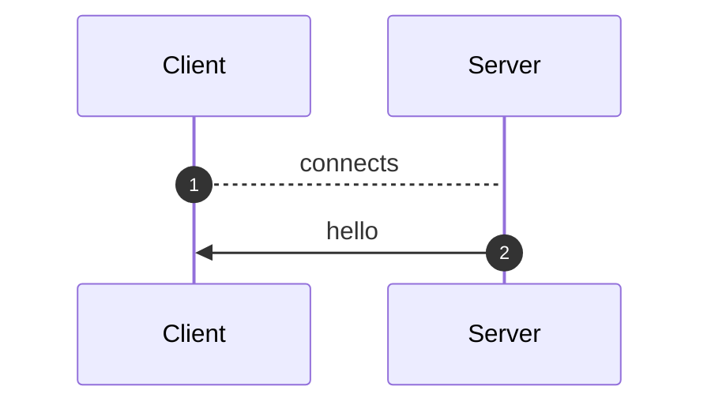
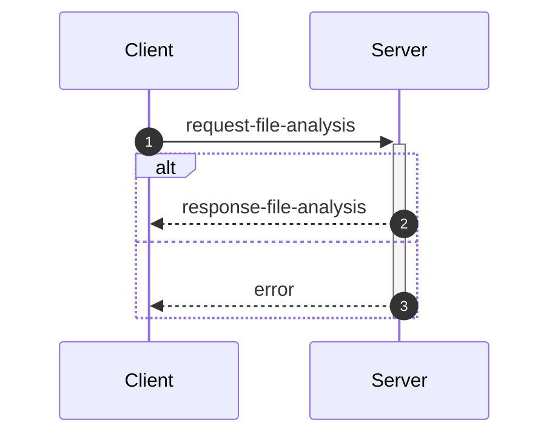
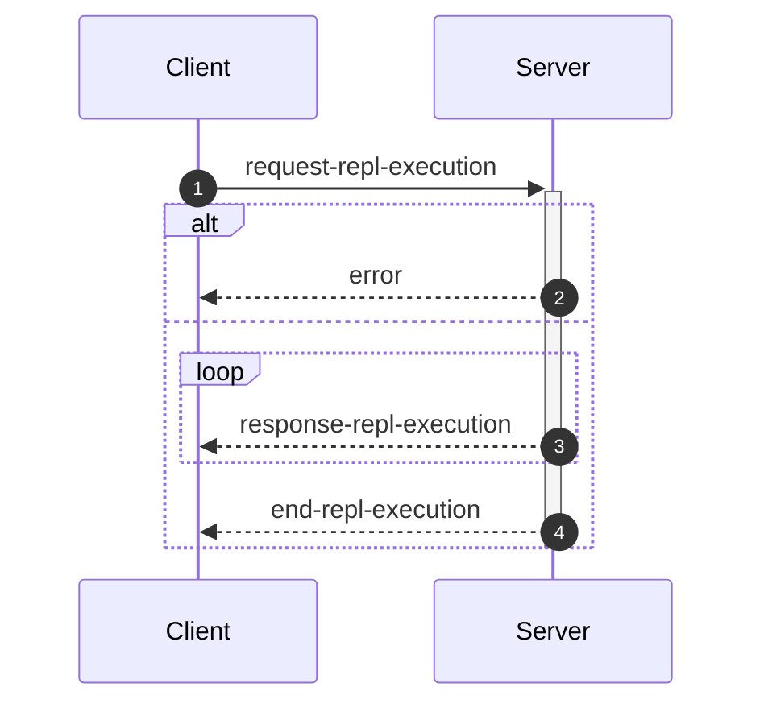
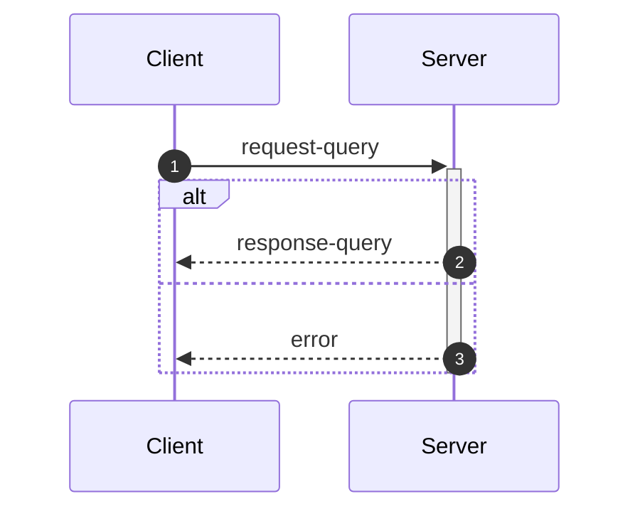

_<span title="an overview of flowR's interface">Generated</span> from '[wiki-interface.ts](https://github.com/flowr-analysis/flowr/tree/main/src/documentation/wiki-interface.ts "src/documentation/wiki-interface.ts")' on 2026-11-11, 21:38:09 UTC (v2.17.5, R v4.6.1), do not edit directly._

Although far from being as detailed as the in-depth explanation of [_flowR_](https://github.com/flowr-analysis/flowr/wiki/Core),
this wiki page explains how to interface with _flowR_ in more detail.
In general, command line arguments and other options provide short descriptions on hover over.

* [💻 Using the REPL](#using-the-repl)
* [⚙️ Configuring FlowR](#configuring-flowr)
* [⚒️ Writing Code](#writing-code)
* [💬 Communicating with the Server](#communicating-with-the-server)

<a id='using-the-repl'></a>
## 💻 Using the REPL

> [!NOTE]
> To execute arbitrary R commands with a repl request, _flowR_ has to be started explicitly with <span title="Description (Command Line Argument): Allow to access the underlying R session when using flowR (security warning: this allows the execution of arbitrary R code!)">`--r-session-access`</span>.
> Please be aware that this introduces a security risk and note that this relies on the [`r-shell` engine](https://github.com/flowr-analysis/flowr/wiki/Engines) .

Although primarily meant for users to explore,
there is nothing which forbids calling _flowR_ as a subprocess to use standard-in, -output, and -error
for communication (although you can access the REPL using the server as well,
with the [REPL Request](#message-request-repl-execution) message).

The read-eval-print loop&nbsp;(REPL) works relatively simple.
You can submit an expression (using <kbd>Enter</kbd>),
which is interpreted as an R&nbsp;expression by default but interpreted as a *command* if it starts with a colon (`:`).
The best command to get started with the REPL is <span title="Description (Repl Command): Show help information (aliases: :h, :?)">`:help`</span>.
Besides, you can leave the REPL either with the command <span title="Description (Repl Command): End the repl (aliases: :q, :exit)">`:quit`</span> or by pressing <kbd>Ctrl</kbd>+<kbd>C</kbd> twice.
When writing a *command*, you may press <kbd>Tab</kbd> to get a list of completions, if available.
Multiple commands can be entered in a single line by separating them with a semicolon (`;`), e.g. `:parse "x<-2"; :df*`.
If a command is given without R code, the REPL will re-use R code given in a previous command.
The prior example will hence return first the parsed AST of the program and then the dataflow graph for `"x <- 2"`.

> [!NOTE]
> If you develop flowR, you may want to launch the repl using the `npm run main-dev` command, this way, you get a non-minified version of flowR with debug information and hot-reloading of source files.

<details>
<summary>Available Commands</summary>

We currently offer the following commands (this with a `[*]` suffix are available with and without the star):

| Command | Description |
| ------- | ----------- |
| **<span title="Description (Repl Command): End the repl (aliases: :q, :exit)">:quit</span>** | End the repl (aliases: **:<span title="Alias of ':quit'. End the repl">q</span>**, **:<span title="Alias of ':quit'. End the repl">exit</span>**) |
| **<span title="Description (Repl Command): Execute the given code as R code. This requires the `--r-session-access` flag to be set and requires the r-shell engine. (aliases: :e, :r)">:execute</span>** | Execute the given code as R code. This requires the `--r-session-access` flag to be set and requires the r-shell engine. (aliases: **:<span title="Alias of ':execute'. Execute the given code as R code. This requires the `--r-session-access` flag to be set and requires the r-shell engine.">e</span>**, **:<span title="Alias of ':execute'. Execute the given code as R code. This requires the `--r-session-access` flag to be set and requires the r-shell engine.">r</span>**) |
| **<span title="Description (Repl Command): Get mermaid code for the control-flow graph of R code (aliases: :cfg, :cf)">:controlflow[*]</span>** | Get mermaid code for the control-flow graph of R code (star: Returns the URL to mermaid.live) (aliases: **:<span title="Alias of ':controlflow'. Get mermaid code for the control-flow graph of R code">cfg</span>**, **:<span title="Alias of ':controlflow'. Get mermaid code for the control-flow graph of R code">cf</span>**) |
| **<span title="Description (Repl Command): Get mermaid code for the control-flow graph with basic blocks (aliases: :cfgb, :cfb)">:controlflowbb[*]</span>** | Get mermaid code for the control-flow graph with basic blocks (star: Returns the URL to mermaid.live) (aliases: **:<span title="Alias of ':controlflowbb'. Get mermaid code for the control-flow graph with basic blocks">cfgb</span>**, **:<span title="Alias of ':controlflowbb'. Get mermaid code for the control-flow graph with basic blocks">cfb</span>**) |
| **<span title="Description (Repl Command): Get mermaid code for the dataflow graph (aliases: :d, :df)">:dataflow[*]</span>** | Get mermaid code for the dataflow graph (star: Returns the URL to mermaid.live) (aliases: **:<span title="Alias of ':dataflow'. Get mermaid code for the dataflow graph">d</span>**, **:<span title="Alias of ':dataflow'. Get mermaid code for the dataflow graph">df</span>**) |
| **<span title="Description (Repl Command): Get mermaid code for the normalized AST of R code (aliases: :n)">:normalize[*]</span>** | Get mermaid code for the normalized AST of R code (star: Returns the URL to mermaid.live) (alias: **:<span title="Alias of ':normalize'. Get mermaid code for the normalized AST of R code">n</span>**) |
| **<span title="Description (Repl Command): Get mermaid code for the simplified dataflow graph (aliases: :ds, :dfs)">:dataflowsimple[*]</span>** | Get mermaid code for the simplified dataflow graph (star: Returns the URL to mermaid.live) (aliases: **:<span title="Alias of ':dataflowsimple'. Get mermaid code for the simplified dataflow graph">ds</span>**, **:<span title="Alias of ':dataflowsimple'. Get mermaid code for the simplified dataflow graph">dfs</span>**) |
| **<span title="Description (Repl Command): Inspect and extend the signature database: `query` (identical to :query @signature), `info <name>` for where a function comes from (identical to :query @function-info), `add <path>` to mount another database/source, `download` to fetch the full-history database. (aliases: :sig)">:signature</span>** | Inspect and extend the signature database: `query` (identical to :query @signature), `info <name>` for where a function comes from (identical to :query @function-info), `add <path>` to mount another database/source, `download` to fetch the full-history database. (alias: **:<span title="Alias of ':signature'. Inspect and extend the signature database: `query` (identical to :query @signature), `info <name>` for where a function comes from (identical to :query @function-info), `add <path>` to mount another database/source, `download` to fetch the full-history database.">sig</span>**) |
| **<span title="Description (Repl Command): Just calculates the DFG, but only prints summary info (aliases: :d#, :df#)">:dataflowsilent</span>** | Just calculates the DFG, but only prints summary info (aliases: **:<span title="Alias of ':dataflowsilent'. Just calculates the DFG, but only prints summary info">d#</span>**, **:<span title="Alias of ':dataflowsilent'. Just calculates the DFG, but only prints summary info">df#</span>**) |
| **<span title="Description (Repl Command): Prints ASCII Art of the parsed, unmodified AST (aliases: :p)">:parse</span>** | Prints ASCII Art of the parsed, unmodified AST (alias: **:<span title="Alias of ':parse'. Prints ASCII Art of the parsed, unmodified AST">p</span>**) |
| **<span title="Description (Repl Command): Prints the version of flowR as well as the current version of R">:version</span>** | Prints the version of flowR as well as the current version of R
| **<span title="Description (Repl Command): Query the given R code (use 'help' for more information)">:query[*]</span>** | Query the given R code (use 'help' for more information) (star: Similar to query, but returns the output in json format.)
| **<span title="Description (Repl Command): Returns an ASCII representation of the dataflow graph (aliases: :df!)">:dataflowascii</span>** | Returns an ASCII representation of the dataflow graph (alias: **:<span title="Alias of ':dataflowascii'. Returns an ASCII representation of the dataflow graph">df!</span>**) |
| **<span title="Description (Repl Command): Returns summarization stats for the normalized AST (aliases: :n#)">:normalize#</span>** | Returns summarization stats for the normalized AST (alias: **:<span title="Alias of ':normalize#'. Returns summarization stats for the normalized AST">n#</span>**) |
| **<span title="Description (Repl Command): Show help information (aliases: :h, :?)">:help</span>** | Show help information (aliases: **:<span title="Alias of ':help'. Show help information">h</span>**, **:<span title="Alias of ':help'. Show help information">?</span>**) |

</details>

> [!TIP]
> 
> As indicated by the examples before, all REPL commands that operate on code keep track of the state.
> Hence, if you run a command like <span title="Description (Repl Command, starred version): Returns the URL to mermaid.live; Base Command: Get mermaid code for the dataflow graph (aliases: :d*, :df*)">`:dataflow*`</span> without providing R code,
> the REPL will re-use the R code provided in a previous command.
> Likewise, doing this will benefit from incrementality!
> If you request the dataflow graph with `:df* x <- 2 * y` and then want to see the parsed AST with `:parse`,
> the REPL will re-use previously obtained information and not re-parse the code again.
> 		

Generally, many commands offer shortcut versions in the REPL. Many queries, for example, offer a shortened format (see the example below).
Of special note, the [Config Query](https://github.com/flowr-analysis/flowr/wiki/%5BQuery%5D-Config)
can be used to also modify the currently active configuration of _flowR_ within the REPL (see the [wiki page](https://github.com/flowr-analysis/flowr/wiki/%5BQuery%5D-Config) for more information).

### Example: Retrieving the Dataflow Graph

To retrieve a URL to the [mermaid](https://mermaid.js.org/) diagram of the dataflow of a given expression,
use <span title="Description (Repl Command, starred version): Returns the URL to mermaid.live; Base Command: Get mermaid code for the dataflow graph (aliases: :d*, :df*)">`:dataflow*`</span> (or <span title="Description (Repl Command): Get mermaid code for the dataflow graph (aliases: :d, :df)">`:dataflow`</span> to get the mermaid code in the cli):

```shell
$ docker run -it --rm eagleoutice/flowr # or npm run flowr 
flowR repl v2.17.5, R grammar v14 (tree-sitter engine)
R> :dataflow* y <- 1 + x
```

<details>
<summary style='color:gray'>Output</summary>

```text
https://mermaid.live/view#base64:eyJjb2RlIjoiZmxvd2NoYXJ0IFREXG4gICAgMXt7XCJgKiM5MTtSTnVtYmVyIzkzOyogKioxKipcbiAgICAgICoxLjYqICgqKmlkOiAxKiopYFwifX1cbiAgICAyKFtcImAqIzkxO1JTeW1ib2wjOTM7KiAqKngqKlxuICAgICAgKjEuMTAqICgqKmlkOiAyKiopYFwiXSlcbiAgICAzW1tcImAqIzkxO1JCaW5hcnlPcCM5MzsqIGJhc2UjNTg7IzU4OyoqIzQzOyoqXG4gICAgICAqMS42LTEwKiAoKippZDogMyoqKVxuICAgIGFyZzogKDEsIDIpYFwiXV1cbiAgICBidWlsdC1pbjpfNDNfW1wiYEJ1aWx0LUluOlxuIzQzO2BcIl1cbiAgICBzdHlsZSBidWlsdC1pbjpfNDNfIHN0cm9rZTpncmF5LGZpbGw6Z3JheSxzdHJva2Utd2lkdGg6MnB4LG9wYWNpdHk6Ljg7XG4gICAgMFtcImAqIzkxO1JTeW1ib2wjOTM7KiAqKnkqKlxuICAgICAgKjEuMSogKCoqaWQ6IDAqKiwgdjogMylgXCJdXG4gICAgNFtbXCJgKiM5MTtSQmluYXJ5T3AjOTM7KiBiYXNlIzU4OyM1ODsqKiM2MDsjNDU7KipcbiAgICAgICoxLjEtMTAqICgqKmlkOiA0KiopXG4gICAgYXJnOiAoMCwgMylgXCJdXVxuICAgIGJ1aWx0LWluOl82MF8tW1wiYEJ1aWx0LUluOlxuIzYwOyM0NTtgXCJdXG4gICAgc3R5bGUgYnVpbHQtaW46XzYwXy0gc3Ryb2tlOmdyYXksZmlsbDpncmF5LHN0cm9rZS13aWR0aDoycHgsb3BhY2l0eTouODtcbiAgICAxIC0uLT58XCJmbG93XCJ8IDJcbiAgICBsaW5rU3R5bGUgMCBzdHJva2U6Z3JheSxjb2xvcjpncmF5O1xuICAgIDIgLS4tPnxcImZsb3dcInwgM1xuICAgIGxpbmtTdHlsZSAxIHN0cm9rZTpncmF5LGNvbG9yOmdyYXk7XG4gICAgMyAtLT58XCJyZWFkcywgYXJnXCJ8IDFcbiAgICAzIC0tPnxcInJlYWRzLCBhcmdcInwgMlxuICAgIDMgLS4tPnxcImZsb3dcInwgMFxuICAgIGxpbmtTdHlsZSA0IHN0cm9rZTpncmF5LGNvbG9yOmdyYXk7XG4gICAgMyAtLi0+fFwicmVhZHMsIGNhbGxzXCJ8IGJ1aWx0LWluOl80M19cbiAgICBsaW5rU3R5bGUgNSBzdHJva2U6Z3JheTtcbiAgICAwIC0tPnxcImRlZmluZWQtYnksIGZsb3dcInwgNFxuICAgIDAgLS0+fFwiZGVmaW5lZC1ieVwifCAzXG4gICAgNCAtLT58XCJyZWFkcywgYXJnXCJ8IDNcbiAgICA0IC0tPnxcInJldHVybnMsIGFyZ1wifCAwXG4gICAgNCAtLi0+fFwicmVhZHMsIGNhbGxzXCJ8IGJ1aWx0LWluOl82MF8tXG4gICAgbGlua1N0eWxlIDEwIHN0cm9rZTpncmF5OyIsIm1lcm1haWQiOnsiYXV0b1N5bmMiOnRydWV9fQ==
```

Retrieve the dataflow graph of the expression `y <- 1 + x`. It looks like this:


<details>

<summary style="color:gray">R Code of the Dataflow Graph</summary>

The analysis ran (parse and normalize with the [tree-sitter](https://github.com/flowr-analysis/flowr/wiki/Engines) engine) in the generation environment. No [signature database](https://github.com/flowr-analysis/flowr/wiki/Signature-Database) is mounted, so `library()` attaches no exports (base-R names are still qualified, e.g., `stats::acf`). 
We encountered no unknown side effects during the analysis.

```r
y <- 1 + x
```

</details>

</details>

For small graphs like this, <span title="Description (Repl Command): Returns an ASCII representation of the dataflow graph (aliases: :df!)">`:dataflowascii`</span> also provides an ASCII representation directly in the REPL:

```shell
$ docker run -it --rm eagleoutice/flowr # or npm run flowr 
flowR repl v2.17.5, R grammar v14 (tree-sitter engine)
R> :df! y <- 1 + x
```

<details open>
<summary style='color:gray'>Output</summary>

```text
                        v<0>v
 c<4>c──────────────────| y |
 |<- |     ┌────────────v---v
 c---c     │
    │   c<3>c   0<1>0
    └───| + |───| 1 |───u<2>u
        c---c   0---0   | x |
           └────────────u---u
Edges:
3 -> 1: reads, arg          3 -> 2: reads, arg
3 -> 0: flows-to            1 -> 2: flows-to
2 -> 3: flows-to            4 -> 3: reads, arg
4 -> 0: returns, arg        0 -> 4: defined-by, flows-to
0 -> 3: defined-by
```

Retrieve the dataflow graph of the expression `y <- 1 + x` as ASCII art.

</details>

For the slicing with <span title="Description (Repl Command): Static backwards executable slicer for R">`:slicer`</span>, you have access to the same [magic comments](#slice-magic-comments) as with the [slice request](#message-request-slice).
Pass `--inline` to splice resolvable `source()` calls into the reconstruction so the slice is a single self-contained R text (the same as the static slice query's `inlineSources` flag).
See `--help` for more flags!

### Example: Interfacing with the File System

Many commands that allow for an R-expression (like <span title="Description (Repl Command, starred version): Returns the URL to mermaid.live; Base Command: Get mermaid code for the dataflow graph (aliases: :d*, :df*)">`:dataflow*`</span>) allow for a file as well
if the argument starts with `file://`.
If you are working from the root directory of the _flowR_ repository, the following gives you the parsed AST of the example file using the <span title="Description (Repl Command): Prints ASCII Art of the parsed, unmodified AST (aliases: :p)">`:parse`</span> command:

> **Watch mode**: Replace `file://` with `watch://` to enter watch mode.
> flowR runs the command immediately and then re-runs it every time the file (or any file inside the folder) changes.
> Enter any other command to leave watch mode.
> For example: `:df watch://analysis.R`

```shell
$ docker run -it --rm eagleoutice/flowr # or npm run flowr 
flowR repl v2.17.5, R grammar v14 (tree-sitter engine)
R> :parse file://test/testfiles/example.R
```

<details>
<summary style='color:gray'>Output</summary>

```text
File: test/testfiles/example.R

program
├ binaryoperator
│ ├ identifier "sum" (1:1─4)
│ ├ <- "<-" (1:5─7)
│ ╰ float "0" (1:8─9)
├ binaryoperator
│ ├ identifier "product" (2:1─8)
│ ├ <- "<-" (2:9─11)
│ ╰ float "1" (2:12─13)
├ binaryoperator
│ ├ identifier "w" (3:1─2)
│ ├ <- "<-" (3:3─5)
│ ╰ float "7" (3:6─7)
├ binaryoperator
│ ├ identifier "N" (4:1─2)
│ ├ <- "<-" (4:3─5)
│ ╰ float "10" (4:6─8)
├ forstatement
│ ├ for "for" (6:1─4)
│ ├ ( "(" (6:5─6)
│ ├ identifier "i" (6:6─7)
│ ├ in "in" (6:8─10)
│ ├ binaryoperator
│ │ ├ float "1" (6:11─12)
│ │ ├ : ":" (6:12─13)
│ │ ╰ parenthesizedexpression
│ │   ├ ( "(" (6:13─14)
│ │   ├ binaryoperator
│ │   │ ├ identifier "N" (6:14─15)
│ │   │ ├ - "-" (6:15─16)
│ │   │ ╰ float "1" (6:16─17)
│ │   ╰ ) ")" (6:17─18)
│ ├ ) ")" (6:18─19)
│ ╰ bracedexpression
│   ├ { "{" (6:20─21)
│   ├ binaryoperator
│   │ ├ identifier "sum" (7:3─6)
│   │ ├ <- "<-" (7:7─9)
│   │ ╰ binaryoperator
│   │   ├ binaryoperator
│   │   │ ├ identifier "sum" (7:10─13)
│   │   │ ├ + "+" (7:14─15)
│   │   │ ╰ identifier "i" (7:16─17)
│   │   ├ + "+" (7:18─19)
│   │   ╰ identifier "w" (7:20─21)
│   ├ binaryoperator
│   │ ├ identifier "product" (8:3─10)
│   │ ├ <- "<-" (8:11─13)
│   │ ╰ binaryoperator
│   │   ├ identifier "product" (8:14─21)
│   │   ├  "" (8:22─23)
│   │   ╰ identifier "i" (8:24─25)
│   ╰ } "}" (9:1─2)
├ call
│ ├ identifier "cat" (11:1─4)
│ ╰ arguments
│   ├ ( "(" (11:4─5)
│   ├ argument
│   │ ╰ string
│   │   ├ stringopen "\"" (11:5─6)
│   │   ├ stringcontent "Sum:" (11:6─10)
│   │   ╰ stringclose "\"" (11:10─11)
│   ├ comma "," (11:11─12)
│   ├ argument
│   │ ╰ identifier "sum" (11:13─16)
│   ├ comma "," (11:16─17)
│   ├ argument
│   │ ╰ string
│   │   ├ stringopen "\"" (11:18─19)
│   │   ├ stringcontent
│   │   │ ╰ escapesequence "\\n" (11:19─21)
│   │   ╰ stringclose "\"" (11:21─22)
│   ╰ ) ")" (11:22─23)
╰ call
  ├ identifier "cat" (12:1─4)
  ╰ arguments
    ├ ( "(" (12:4─5)
    ├ argument
    │ ╰ string
    │   ├ stringopen "\"" (12:5─6)
    │   ├ stringcontent "Product:" (12:6─14)
    │   ╰ stringclose "\"" (12:14─15)
    ├ comma "," (12:15─16)
    ├ argument
    │ ╰ identifier "product" (12:17─24)
    ├ comma "," (12:24─25)
    ├ argument
    │ ╰ string
    │   ├ stringopen "\"" (12:26─27)
    │   ├ stringcontent
    │   │ ╰ escapesequence "\\n" (12:27─29)
    │   ╰ stringclose "\"" (12:29─30)
    ╰ ) ")" (12:30─31)
```

Retrieve the parsed AST of the example file.

<details>

<summary>File Content</summary>

```r
sum <- 0
product <- 1
w <- 7
N <- 10

for (i in 1:(N-1)) {
  sum <- sum + i + w
  product <- product * i
}

cat("Sum:", sum, "\n")
cat("Product:", product, "\n")
```

</details>

As _flowR_ directly transforms this AST the output focuses on being human-readable instead of being machine-readable.
		
</details>

### Example: Run a Query

You can run any query supported by _flowR_ using the <span title="Description (Repl Command): Query the given R code (use 'help' for more information)">`:query`</span> command.
For example, to obtain the shapes of all data frames in a given piece of code, you can run:

```shell
$ docker run -it --rm eagleoutice/flowr # or npm run flowr 
flowR repl v2.17.5, R grammar v14 (tree-sitter engine)
R> :query @absint df-shape "x <- data.frame(a = 1:10, b = 1:10)\ny <- x$a"
```

<details open>
<summary style='color:gray'>Output</summary>

```text
Query: absint (1 ms)
   ╰ $12: (colnames: [{"a", "b"}, {}], cols: [2, 2], rows: [10, 10])
   ╰ $0: (colnames: [{"a", "b"}, {}], cols: [2, 2], rows: [10, 10])
```

Retrieve the shapes of all data frames in the given code.

</details>

To run the linter on a file, you can use (in this example, we just issue the `dead-code` linter on a small piece of code):

```shell
$ docker run -it --rm eagleoutice/flowr # or npm run flowr 
flowR repl v2.17.5, R grammar v14 (tree-sitter engine)
R> :query @linter rules:dead-code "if(FALSE) x <- 2"
```

<details open>
<summary style='color:gray'>Output</summary>

```text
Query: linter (1 ms)
   ╰ Dead Code (dead-code):
       ╰ certain:
           ╰ Code at 1.11-16 (1 quick fix(es) available)
```

Run the linter on the given code, with only the `dead-code` rule enabled.

</details>

For more information on the available queries, please check out the [Query API](https://github.com/flowr-analysis/flowr/wiki/Query-API).

<a id='configuring-flowr'></a>
## ⚙️ Configuring FlowR

When running _flowR_, you may want to specify some behaviors with a dedicated configuration file.
By default, flowR looks for a file named `flowr.json` in the current working directory (or any higher directory).
You can also specify a different file with <span title="Description (Command Line Argument): The name of the configuration file to use">`--config-file`</span> or pass the configuration inline using <span title="Description (Command Line Argument): The flowR configuration to use, as a JSON string">`--config-json`</span>.
A `flowr.json` found this way belongs to the analyzed project, so flowR ignores its options that decide what flowR executes or loads
(`engines.*.wasmPath`, `engines.*.treeSitterWasmPath`, `engines.*.rPath`, `solver.sigdb.additionalPaths`, `solver.sigdb.downloadRepo`, `solver.sigdb.installedLibrary.paths`, `solver.sigdb.onDemand.enabled`, `solver.sigdb.onDemand.repositories`, `solver.sigdb.onDemand.cranMirror`, `solver.sigdb.onDemand.bioconductorMirror`, `solver.sigdb.onDemand.cacheDir`),
unless you pass <span title="Description (Command Line Argument): Keep the security-sensitive options (e.g., the R executable) of the flowr.json found in the working directory or a parent. Only use this for projects you trust.">`--trust-config`</span>.
To analyze code you do not trust, use the secure mode (<span title="Description (Command Line Argument): Run in secure mode for analyzing untrusted code: flowR does not start R (or any other process), does not access the network, does not search for project configs, and ignores security-sensitive options in every config. Cannot be disabled once enabled. Can also be enabled with the environment variable {italic FLOWR_SECURE_MODE=1}.">`--secure`</span>, see the [security policy](https://github.com/flowr-analysis/flowr/blob/main/.github/SECURITY.md)).
To inspect the current configuration, you can run flowr with the <span title="Description (Command Line Argument): Run with verbose logging (will be passed to the corresponding script)">`--verbose`</span> flag, or use the `config` [Query](https://github.com/flowr-analysis/flowr/wiki/Query-API).
Within the REPL this works by running the following:

```shell
:query @config
```

To work with the <a href="https://github.com/flowr-analysis/flowr/tree/main/src/config.ts#L125"><code><span title="The configuration file format for flowR.">FlowrConfig</span></code></a> you can use the provided helper objects alongside its methods like
<a href="https://github.com/flowr-analysis/flowr/tree/main/src/config.ts#L991"><code><span title="Creates a new flowr config that has the updated values.">FlowrConfig::<b>amend</b></span></code></a>.
The schema below documents every option; the ones you most likely want are:

- <a href="https://github.com/flowr-analysis/flowr/wiki/Interface#configuring-flowr" title="Configuration Option (boolean): Whether source calls should be ignored, causing {@link processSourceCall}&#39;s behavior to be skipped.">ignoreSourceCalls</a>: ignore source calls when analyzing the code, i.e., ignore the inclusion of other files.
- <a href="https://github.com/flowr-analysis/flowr/wiki/Interface#configuring-flowr" title="Configuration Option (boolean): Whether load calls should be ignored, causing {@link processLoadCall}&#39;s behavior to be skipped.">ignoreLoadCalls</a>: ignore load calls when analyzing the code, i.e., ignore the loading of r-data files.
- <a href="https://github.com/flowr-analysis/flowr/wiki/Interface#configuring-flowr" title="Configuration Option (object): Do you want to overwrite (parts) of the builtin definition?">semantics.environment.overwriteBuiltIns</a>: overwrite _flowR_'s handling of built-in functions, or clear the preset definitions entirely.
  See [Configure BuiltIn Semantics](#configure-builtin-semantics) for more information.
- <a href="https://github.com/flowr-analysis/flowr/wiki/Interface#configuring-flowr" title="Configuration Option (boolean): Whether calls drawing on a graphics device (e.g., `plot`) count as writing to it, which the ambient state queries then report.">semantics.ambient.drawingWritesDevice</a>: whether calls drawing on a graphics device (e.g., `plot`) count as writing the device in the ambient state queries.
- <a href="https://github.com/flowr-analysis/flowr/wiki/Interface#configuring-flowr" title="Configuration Option (string): How to resolve variables and their values. (one of &quot;disabled&quot;, &quot;alias&quot;, &quot;builtin&quot;)">solver.variables</a>: how to resolve variables and their values (`disabled`, `alias`, `builtin`).
- <a href="https://github.com/flowr-analysis/flowr/wiki/Interface#configuring-flowr" title="Configuration Option (array): The engine or set of engines to use for interacting with R code. An empty array means all available engines will be used.">engines</a> and <a href="https://github.com/flowr-analysis/flowr/wiki/Interface#configuring-flowr" title="Configuration Option (string): The default engine to use for interacting with R code. If this is undefined, an arbitrary engine from the specified list will be used. (one of &quot;tree-sitter&quot;, &quot;r-shell&quot;)">defaultEngine</a>: the engines used to interact with R code, see the [Engines wiki page](https://github.com/flowr-analysis/flowr/wiki/Engines).
- <a href="https://github.com/flowr-analysis/flowr/wiki/Interface#configuring-flowr" title="Configuration Option (array): Files a framework loads on its own, without any source() call (e.g. global.R in a shiny app), in the order they are loaded; flowR orders the matching project files accordingly and analyzes them as one program. Entries are case-insensitive globs matched against the file path, a plain name matches any file with that name, and entries matching no project file are warned about. Usually set per project kind via specializeConfig.">project.implicitSources</a>: the files a framework loads without any `source()` call, in the order in which they are
  loaded. Entries are globs (e.g. `R/*.R`) matched against the file path ignoring capitalization; one matching no file is reported.
- <a href="https://github.com/flowr-analysis/flowr/wiki/Interface#configuring-flowr" title="Configuration Option (object): Overwrite (parts of) the configuration depending on the project kind flowR detects, e.g. to give a shiny app its implicit sources.">specializeConfig</a>: overwrite (parts of) the configuration depending on the kind of project _flowR_ detects
  (e.g. `shiny-app`), which is how a shiny app gets its implicit sources by default. What you configure directly wins.
- <a href="https://github.com/flowr-analysis/flowr/wiki/Interface#configuring-flowr" title="Configuration Option (string): Overwrite the project kind flowR would otherwise infer from the analyzed files, e.g. when auto-detection guesses wrong. (one of &quot;package&quot;, &quot;script&quot;, &quot;shiny-app&quot;, &quot;notebook&quot;, &quot;project&quot;, &quot;unknown&quot;)">project.useProjectType</a>: skip that detection and force a project kind yourself, when auto-detection guesses wrong.
- <a href="https://github.com/flowr-analysis/flowr/wiki/Interface#configuring-flowr" title="Configuration Option (array): The default plugins to load when creating a new instance of FlowrAnalyzer">defaultPlugins</a> and <a href="https://github.com/flowr-analysis/flowr/wiki/Interface#configuring-flowr" title="Configuration Option (array): The plugins to load in REPL mode">repl.plugins</a>: the plugins to load for a new <a href="https://github.com/flowr-analysis/flowr/tree/main/src/project/flowr-analyzer.ts#L242"><code><span title="Central class for conducting analyses with FlowR. Use the FlowrAnalyzerBuilder to create a new instance. If you want the original pattern of creating a pipeline and running all steps, you can still do this with FlowrAnalyzer#runFull . To inspect the context of the analyzer, use FlowrAnalyzer#inspectContext (if you are a plugin and need to modify it, use FlowrAnalyzer#context instead).">FlowrAnalyzer</span></code></a> and in the REPL
  (use `flowr:default` to reference the former).

So you can configure _flowR_ by adding a file like the following:

<details>

<summary>Example Configuration File</summary>

```json
{
  "ignoreSourceCalls": true,
  "ignoreLoadCalls": true,
  "semantics": {
    "environment": {
      "overwriteBuiltIns": {
        "definitions": [
          {
            "type": "function",
            "names": [
              "foo"
            ],
            "processor": "builtin:assign",
            "config": {}
          }
        ]
      }
    }
  },
  "defaultPlugins": [
    "file:description",
    "versions:description"
  ],
  "repl": {
    "quickStats": false,
    "dfProcessorHeat": false,
    "hints": true,
    "plugins": [
      "flowr:default"
    ]
  },
  "project": {
    "resolveUnknownPathsOnDisk": true,
    "implicitSources": [
      "global.R",
      "app.R"
    ]
  },
  "linter": {
    "disabledRules": []
  },
  "specializeConfig": {
    "shiny-app": {
      "project": {
        "implicitSources": [
          "global.R",
          "ui.R",
          "server.R",
          "app.R"
        ]
      }
    }
  },
  "engines": [
    {
      "type": "r-shell"
    }
  ],
  "solver": {
    "variables": "alias",
    "evalStrings": true,
    "trackEnvironments": true,
    "sigdb": {
      "enabled": true,
      "loadProjectDependencies": true,
      "eagerlyLoad": false,
      "eagerlyLoadExports": false,
      "linkBaseR": false,
      "linkDescriptionDependencies": false
    },
    "resolveSource": {
      "dropPaths": "no",
      "ignoreCapitalization": true,
      "inferWorkingDirectory": "active-script",
      "searchPath": []
    },
    "instrument": {},
    "slicer": {
      "threshold": 50
    }
  },
  "abstractInterpretation": {
    "wideningThreshold": 4,
    "followCalls": true,
    "dataFrame": {
      "maxColNames": 20,
      "readLoadedData": {
        "readExternalFiles": true,
        "maxReadLines": 1000000
      }
    }
  },
  "incremental": {
    "alwaysIncremental": false,
    "parsing": {
      "activated": false,
      "heuristics": {
        "activated": true,
        "mtime": true,
        "linesFrom": 500,
        "bytesFrom": 50000,
        "alwaysWithEdits": false,
        "minFiles": 1
      }
    }
  },
  "gas": {
    "thresholds": {
      "memory": {
        "problematic": 0.7,
        "critical": 0.9
      },
      "timeMs": {
        "problematic": 100000,
        "critical": 120000
      }
    },
    "features": {}
  }
}
```

</details>

<details>
<a id='configure-builtin-semantics'></a>
<summary>Configure Built-In Semantics</summary>

`semantics/environment/overwriteBuiltins` accepts two keys:

- `loadDefaults` (boolean, initially `true`): If set to `true`, the default built-in definitions are loaded before applying the custom definitions. Setting this flag to `false` explicitly disables the loading of the default definitions.
- `definitions` (array, initially empty): Allows to overwrite or define new built-in elements. Each object within must have a `type` which is one of the below. Furthermore, they may define a string array of `names` which specifies the identifiers to bind the definitions to. You may use `assumePrimitive` to specify whether _flowR_ should assume that this is a primitive non-library definition (so you probably just do not want to specify the key).

  | Type            | Description                                                                                                                                                                                                                                                                                              | Example                                                                                                    |
  | --------------- | -------------------------------------------------------------------------------------------------------------------------------------------------------------------------------------------------------------------------------------------------------------------------------------------------------- | ---------------------------------------------------------------------------------------------------------- |
  | `constant`    | Additionally allows for a `value` this should resolve to.                                                                                                                                                                                                                                                | `{ type: 'constant', names: ['NULL', 'NA'],  value: null }`                                                |
  | `function`    | Is a rather flexible way to define and bind built-in functions. For the time, we do not have extensive documentation to cover all the cases, so please either consult the sources with the `default-builtin-config/` folder or open a [new issue](https://github.com/flowr-analysis/flowr/issues/new/choose). | `{ type: 'function', names: ['next'], processor: 'builtin:d', config: { cfg: ExitPointType.Next } }` |
  | `replacement` | A comfortable way to specify replacement functions like `$<-` or `names<-`. `suffixes` describes the... suffixes to attach automatically. | `{ type: 'replacement', suffixes: ['<-', '<<-'], names: ['[', '[['] }` |

</details>

<details>

<summary style='color:gray'>Full Configuration-File Schema</summary>

- _The configuration file format for flowR._ (object)
    - **logLevel** [optional] _flowR's global minimum log level, applied when the config is loaded._ (string)
        Only allows: 'silly', 'trace', 'debug', 'info', 'warn', 'error', 'fatal'
    - **ignoreSourceCalls** [optional] _Whether source calls should be ignored, causing {@link processSourceCall}'s behavior to be skipped._ (boolean)
    - **ignoreLoadCalls** [optional] _Whether load calls should be ignored, causing {@link processLoadCall}'s behavior to be skipped._ (boolean)
    - **semantics** _Configure language semantics and how flowR handles them._ (object)
        - **environment** [optional] _Semantics regarding how to handle the R environment._ (object)
            - **overwriteBuiltIns** [optional] _Do you want to overwrite (parts) of the builtin definition?_ (object)
                - **loadDefaults** [optional] _Should the default configuration still be loaded?_ (boolean)
                - **definitions** [optional] _The definitions to load/overwrite._ (array)
                Valid item types:
                    - (object)
        - **ambient** [optional] _Semantics regarding the global state (options, devices, files, ...) calls access._ (object)
            - **drawingWritesDevice** [optional] _Whether calls drawing on a graphics device (e.g., `plot`) count as writing to it, which the ambient state queries then report._ (boolean)
    - **defaultPlugins** [optional] _The default plugins to load when creating a new instance of FlowrAnalyzer_ (array)
    Valid item types:
        - (alternatives)
            - (string)
            - (array)
    - **repl** _Configuration options for the REPL._ (object)
        - **quickStats** [optional] _Whether to show quick stats in the REPL after each evaluation._ (boolean)
        - **dfProcessorHeat** [optional] _This instruments the dataflow processors to count how often each processor is called._ (boolean)
        - **hints** [optional] _Whether to show dim inline hints on the empty prompt (automatically disabled on non-interactive terminals)._ (boolean)
        - **plugins** [optional] _The plugins to load in REPL mode_ (array)
        Valid item types:
            - (alternatives)
                - (string)
                - (array)
        - **autoUseFileProtocol** [optional] _Prepend the file protocol to a repl input that looks like a path, instead of only warning about it._ (boolean)
        - **queryStats** [optional] _Whether `:query` closes with the line stating how long the queries took (`:query*` never prints it)._ (boolean)
        - **showPlugins** [optional] _Whether `:version` grays out the plugins that did not activate during the last analysis._ (boolean)
    - **project** _Project specific configuration options._ (object)
        - **resolveUnknownPathsOnDisk** [optional] _Whether to resolve unknown paths loaded by the r project disk when trying to source/analyze files._ (boolean)
        - **failOnInaccessiblePath** [optional] _Whether a directory that cannot be traversed during file discovery (e.g. due to permissions) aborts the analysis; when false (the default) such paths are logged and skipped._ (boolean)
        - **basePackages** [optional] _The packages considered part of R itself (base and recommended); if unset, flowR uses its built-in list._ (array)
        Valid item types:
            - (string)
        - **implicitSources** [optional] _Files a framework loads on its own, without any source() call (e.g. global.R in a shiny app), in the order they are loaded; flowR orders the matching project files accordingly and analyzes them as one program. Entries are case-insensitive globs matched against the file path, a plain name matches any file with that name, and entries matching no project file are warned about. Usually set per project kind via specializeConfig._ (array)
        Valid item types:
            - (string)
        - **useProjectType** [optional] _Overwrite the project kind flowR would otherwise infer from the analyzed files, e.g. when auto-detection guesses wrong._ (string)
            Only allows: 'package', 'script', 'shiny-app', 'notebook', 'project', 'unknown'
        - **assumeImplicitEcho** [optional] _Whether the top level of the analyzed code is echoed, so that every visible result printed there is collected as an output by the dependencies query (default true, false for a package)._ (boolean)
        - **discovery** [optional] _Scoping options for the default project discovery._ (object)
            - **full** [optional] _Collect every file below the project root (greedy) instead of only the files the detected project kind needs (default false)._ (boolean)
            - **perKind** [optional] _Per-kind include/exclude glob overrides layered on the default scoping._ (object)
            - **ignore** [optional] _Case-insensitive globs that drop matching files from the intelligent discovery, regardless of kind (e.g. .Renviron to ignore environment files)._ (array)
            Valid item types:
                - (string)
        - **classification** [optional] _Overrides for the signals flowR uses to classify the project kind._ (object)
            - **shinyDescriptionTypes** [optional] _DESCRIPTION Type: values that mark a shiny app._ (array)
            Valid item types:
                - (string)
            - **shinyEntryFiles** [optional] _File names a shiny app is assembled from._ (array)
            Valid item types:
                - (string)
            - **shinyUsagePattern** [optional] _Regex source evidencing shiny usage in an entry file._ (string)
            - **notebookExtensions** [optional] _File extensions marking a notebook._ (array)
            Valid item types:
                - (string)
    - **linter** _Linter configuration options._ (object)
        - **disabledRules** _Linting rule names excluded from the default rule set (a rule requested explicitly via a linter query still runs). Usually set per project kind via specializeConfig._ (array)
        Valid item types:
            - (string)
        - **disabledTags** [optional] _Linting rule tags whose rules are excluded from the default rule set (a rule requested explicitly via a linter query still runs). By default the cmd-check rules are disabled for everything but a package; a configured list replaces that default._ (array)
        Valid item types:
            - (string)
    - **inputSources** [optional] _Further frameworks the input-sources analysis should know about; entries are added to flowR's defaults._ (object)
        - **pure** [optional] _Functions that only pass the constantness of their arguments on._ (array)
        Valid item types:
            - (string)
        - **param** [optional] _Functions whose result is a 'param' input._ (array)
        Valid item types:
            - (string)
        - **file** [optional] _Functions whose result is a 'file' input._ (array)
        Valid item types:
            - (string)
        - **tempfile** [optional] _Functions whose result is a 'tempfile' input._ (array)
        Valid item types:
            - (string)
        - **glob** [optional] _Functions whose result is a 'glob' input._ (array)
        Valid item types:
            - (string)
        - **net** [optional] _Functions whose result is a 'net' input._ (array)
        Valid item types:
            - (string)
        - **rand** [optional] _Functions whose result is a 'rand' input._ (array)
        Valid item types:
            - (string)
        - **system** [optional] _Functions whose result is a 'system' input._ (array)
        Valid item types:
            - (string)
        - **ffi** [optional] _Functions whose result is a 'ffi' input._ (array)
        Valid item types:
            - (string)
        - **lang** [optional] _Functions whose result is a 'lang' input._ (array)
        Valid item types:
            - (string)
        - **options** [optional] _Functions whose result is a 'options' input._ (array)
        Valid item types:
            - (string)
        - **cmdline** [optional] _Functions whose result is a 'cmdline' input._ (array)
        Valid item types:
            - (string)
        - **user** [optional] _Functions whose result is a 'user' input._ (array)
        Valid item types:
            - (string)
        - **const** [optional] _Functions whose result is a 'const' input._ (array)
        Valid item types:
            - (string)
        - **scope** [optional] _Functions whose result is a 'scope' input._ (array)
        Valid item types:
            - (string)
        - **dconst** [optional] _Functions whose result is a 'dconst' input._ (array)
        Valid item types:
            - (string)
        - **unknown** [optional] _Functions whose result is a 'unknown' input._ (array)
        Valid item types:
            - (string)
        - **linkedObjects** [optional] _Objects a framework provides without a definition in the code, e.g. shiny's input._ (array)
        Valid item types:
            - (object)
        - **linkedEntryPoints** [optional] _Calls that hand a function to a framework, which binds its objects to the parameters by position._ (array)
        Valid item types:
            - (object)
    - **specializeConfig** [optional] _Overwrite (parts of) the configuration depending on the project kind flowR detects, e.g. to give a shiny app its implicit sources._ (object)
    - **engines** _The engine or set of engines to use for interacting with R code. An empty array means all available engines will be used._ (array)
    Valid item types:
        - (alternatives)
            - _The configuration for the tree sitter engine._ (object)
                - **type** [required] _Use the tree sitter engine._ (string)
                    Only allows: 'tree-sitter'
                - **wasmPath** [optional] _The path to the tree-sitter-r WASM binary to use. If this is undefined, this uses the default path._ (string)
                - **treeSitterWasmPath** [optional] _The path to the tree-sitter WASM binary to use. If this is undefined, this uses the default path._ (string)
                - **lax** [optional] _Whether to use the lax parser for parsing R code (allowing for syntax errors). If this is undefined, the strict parser will be used._ (boolean)
            - _The configuration for the R shell engine._ (object)
                - **type** [required] _Use the R shell engine._ (string)
                    Only allows: 'r-shell'
                - **rPath** [optional] _The path to the R executable to use. If this is undefined, this uses the default path._ (string)
                - **pipeBind** [optional] _Whether to enable R's experimental pipe-bind operator "=>" by setting _R_USE_PIPEBIND_ for the R session (default false); R itself keeps this off by default, as it is experimental and has never shipped in a release version of R._ (boolean)
    - **defaultEngine** [optional] _The default engine to use for interacting with R code. If this is undefined, an arbitrary engine from the specified list will be used._ (string)
        Only allows: 'tree-sitter', 'r-shell'
    - **solver** _How to resolve constants, constraints, cells, ..._ (object)
        - **variables** _How to resolve variables and their values._ (string)
            Only allows: 'disabled', 'alias', 'builtin'
        - **evalStrings** _Should we include eval(parse(text="...")) calls in the dataflow graph?_ (boolean)
        - **trackEnvironments** [optional] _Track user-created environments (new.env, assign/get/local with envir=, dollar-assign, attach). When false, all envir-style calls fall through conservatively._ (boolean)
        - **sigdb** _Resolving library exports from a signature database._ (object)
            - **enabled** [optional] _Resolve library()/use() exports from a signature database (default true); when false no database is consulted._ (boolean)
            - **loadProjectDependencies** [optional] _Load the project's declared dependencies from its metadata files (DESCRIPTION Imports/Depends, rproject.toml, uvr.toml, rig rproj.toml and script blocks, renv.lock, rv.lock, uvr.lock, rig lockfiles) (default true); when false these files are not read for dependencies._ (boolean)
            - **eagerlyLoad** [optional] _Parse the database up front rather than on the first package load (default false, ignored if disabled)._ (boolean)
            - **eagerlyLoadExports** [optional] _Add a vertex for every export on load rather than on demand (default false); keeps the dataflow graph small._ (boolean)
            - **assumedRVersion** [optional] _R version assumed when resolving versioned (base-R) exports: a pin like "4.5" or "auto" to detect the installed R (default "auto")._ (string)
            - **linkBaseR** [optional] _Eagerly attach base-R namespaces so bare base calls resolve without library() (default false)._ (boolean)
            - **linkBaseRCalls** [optional] _Add a lightweight Reads edge from a bare base-R call to its signature-database function vertex (default false; base-R qualification is edge-free otherwise)._ (boolean)
            - **linkPackageCalls** [optional] _Add a lightweight Reads edge from a resolved package call to its signature-database function vertex (default false)._ (boolean)
            - **linkDescriptionDependencies** [optional] _Eagerly attach the namespaces of the project's declared DESCRIPTION dependencies (Imports/Depends) so their exports resolve without an explicit library() (default false)._ (boolean)
            - **warmInBackground** [optional] _Decompress the hot shards (base + most-downloaded) in a background task on startup so the first library() lookup is warm (default false; for long-running servers/REPLs)._ (boolean)
            - **additionalPaths** [optional] _Extra directories or bundle/manifest files searched for signature databases (alongside the shipped default and $FLOWR_SIGDB_DIR); a downloaded full-history bundle placed here is mounted automatically._ (array)
            Valid item types:
                - (string)
            - **downloadRepo** [optional] _GitHub owner/repo the full-history bundle is downloaded from via ":signature download" (default "flowr-analysis/flowr"; the release tag comes from the committed sigdb.remote.json unless a version is given)._ (string)
            - **autoSync** [optional] _On startup, re-download shards whose committed sigdb.remote.json hash no longer matches the cache, in the background (default false; opt-in network sync after a git pull)._ (boolean)
            - **installedLibrary** [optional] _Recovering packages no signature database knows from the copy installed on this machine._ (object)
                - **enabled** [required] _Recover packages no signature database knows from their installed copy (default false)._ (boolean)
                - **paths** [optional] _Library directories to search; when empty they are discovered from the environment and the project._ (array)
                Valid item types:
                    - (string)
                - **useEnvironment** [optional] _Search the libraries R_LIBS_USER/R_LIBS/R_LIBS_SITE name (default true)._ (boolean)
                - **useProjectLibrary** [optional] _Search a project-local renv/packrat library (default true)._ (boolean)
                - **maxDepth** [optional] _How far to descend into the nested layout of a project-local library (default 3)._ (number)
                - **packages** [optional] _Only recover packages whose name matches one of these regular expressions; empty means any._ (array)
                Valid item types:
                    - (string)
            - **onDemand** [optional] _Recovering packages no signature database knows from their sources on CRAN, Bioconductor, or GitHub._ (object)
                - **enabled** [required] _Fetch and recover the sources of packages no signature database knows when the analyzed code uses them (default false, accesses the network)._ (boolean)
                - **sources** [optional] _Where to look, in order: github, cran, bioconductor, or a source a plugin adds (default ["github", "cran", "bioconductor"])._ (array)
                Valid item types:
                    - (string)
                - **repositories** [optional] _GitHub repositories (owner/repo[/subdir][@ref]) to fetch packages from, by package name. The analyzed project may name more (DESCRIPTION Remotes, install_github calls)._ (object)
                - **packages** [optional] _Only recover packages whose name matches one of these regular expressions, empty means any._ (array)
                Valid item types:
                    - (string)
                - **cranMirror** [optional] _The CRAN src/contrib/ to fetch from, over https (default https://cloud.r-project.org/src/contrib/). It may be on the local network._ (string)
                - **bioconductorMirror** [optional] _The Bioconductor host, over https (default https://bioconductor.org). It may be on the local network._ (string)
                - **bioconductorRelease** [optional] _The Bioconductor release to fetch from: release, devel, or a number like 3.20 (default release)._ (string)
                - **githubMirrors** [optional] _Use the GitHub mirrors of CRAN (cran/<pkg>) and Bioconductor (bioc/<pkg>) (default true)._ (boolean)
                - **maxPackages** [optional] _The most packages to fetch for one analysis (default 25)._ (number)
                - **maxArchiveMb** [optional] _The most MiB a package archive may have (default 32). It may unpack to three times that, at most 128 MiB._ (number)
                - **offline** [optional] _Only use what was fetched before, never the network (default false)._ (boolean)
                - **retryAfterHours** [optional] _How many hours to wait before asking again for a package no source had (default 24)._ (number)
                - **cacheDir** [optional] _Where to cache what was fetched (default the on-demand directory of the signature cache)._ (string)
            - **blobCacheBudgetMb** [optional] _How many MiB of decoded package blobs every open bundle may hold together (default 16)._ (number)
            - **versionSelection** [optional] _When a project constrains a dependency, resolve to the newest (default), oldest, or system-installed version satisfying it; system needs R and falls back to newest. Base-R packages always resolve against the assumed R version._ (string)
                Only allows: 'newest', 'oldest', 'system'
            - **versionOverrides** [optional] _Force an exact version for specific packages (name -> version), overriding both the project constraint and the versionSelection policy (default {})._ (object)
        - **versionManagement** _Policies for reasoning about dependency versions._ (object)
            - **linkedVersionGroups** [optional] _Groups of packages that must resolve to the same version; version guessing intersects each group so its members stay mutually compatible (default [])._ (array)
            Valid item types:
                - (array)
                Valid item types:
                    - (string)
        - **assumeAttachedPackages** [optional] _Packages to treat as attached without a `library()` call, so what the built-in configuration states about them applies to the analyzed code. The base packages R attaches on startup already resolve without it._ (array)
        Valid item types:
            - (string)
        - **transitiveSideEffectRounds** [optional] _How many rounds the transitive side-effect fixpoint may run before it is cut off (default 32); the propagation stops on its own as soon as a round adds nothing._ (number)
        - **maxOverlayDepth** [optional] _How many binding overlays may stack on one environment frame before a write flattens them (default 4); a pure performance knob, trading lookup cost against copy cost without changing any result._ (number)
        - **instrument** (object)
            - **dataflowExtractors** [optional] _These keys are only intended for use within code, allowing to instrument the dataflow analyzer!_ (any)
        - **resolveSource** [optional] _If lax source calls are active, flowR searches for sourced files much more freely, based on the configurations you give it. This option is only in effect if `ignoreSourceCalls` is set to false._ (object)
            - **dropPaths** _Allow to drop the first or all parts of the sourced path, if it is relative._ (string)
                Only allows: 'no', 'once', 'all'
            - **ignoreCapitalization** _Search for filenames matching in the lowercase._ (boolean)
            - **inferWorkingDirectory** _Try to infer the working directory from the main or any script to analyze._ (string)
                Only allows: 'no', 'main-script', 'active-script', 'any-script'
            - **searchPath** _Additionally search in these paths._ (array)
            Valid item types:
                - (string)
            - **repeatedSourceLimit** [optional] _How often the same file can be sourced within a single run? Please be aware: in case of cyclic sources this may not reach a fixpoint so give this a sensible limit._ (number)
            - **applyReplacements** _Provide name replacements for loaded files_ (array)
            Valid item types:
                - (object)
            - **assumeFilesExist** [optional] _Assume a sourced file is always there, making what it defines certain instead of conditional on the source call._ (boolean)
        - **slicer** [optional] _The configuration for the slicer._ (object)
            - **threshold** [optional] _The maximum number of iterations to perform on a single function call during slicing._ (number)
            - **autoExtend** [optional] _If set, the slicer will gain an additional post-pass._ (boolean)
    - **abstractInterpretation** _The configuration options for abstract interpretation._ (object)
        - **wideningThreshold** _The threshold for the number of visitations of a node at which widening should be performed to ensure the termination of the fixpoint iteration._ (number)
        - **followCalls** _Whether the abstract interpretation is interprocedural, i.e. whether it steps into the functions a call may dispatch to._ (boolean)
        - **dataFrame** _The configuration of the shape inference for data frames._ (object)
            - **maxColNames** _The maximum number of columns names to infer for data frames before over-approximating the column names to top._ (number)
            - **readLoadedData** _Configuration options for reading data frame shapes from loaded external data files, such as CSV files._ (object)
                - **readExternalFiles** _Whether data frame shapes should be extracted from loaded external files, such as CSV files._ (boolean)
                - **maxReadLines** _The maximum number of lines to read when extracting data frame shapes from loaded files, such as CSV files._ (number)
    - **incremental** (object)
        - **alwaysIncremental** _Always take the incremental path, regardless of heuristics._ (boolean)
        - **parsing** (object)
            - **activated** _If set, incremental parsing will be used._ (boolean)
            - **heuristics** (object)
                - **activated** [optional] _If set, the heuristics for incremental parsing will be used._ (boolean)
                - **mtime** [optional] _Skip reparsing entirely if the file's modification time is unchanged since the last parse._ (boolean)
                - **linesFrom** [optional] _Only consider incremental parsing for files with at least this many lines._ (number)
                - **bytesFrom** [optional] _Only consider incremental parsing for files with at least this many bytes._ (number)
                - **alwaysWithEdits** [optional] _Always take the incremental path whenever there is a computed edit region, regardless of the other thresholds._ (boolean)
                - **minFiles** [optional] _Only apply these heuristics once the project has at least this many files loaded._ (number)
    - **gas** [optional] _Resource-usage guard (gas) configuration. All feature factors default to 0 (disabled). See https://github.com/flowr-analysis/flowr/wiki/Core#gas-resource-guard._ (object)
        - **thresholds** [optional] _Thresholds for all gas checks (scaled by per-feature factor), boundable per feature._ (object)
            - **memory** [optional] _Heap-usage fraction thresholds (0-1), either shared or given per feature key (with `default` covering the rest)._ (object)
                - **problematic** [optional] _Heap fraction (0-1) above which Problematic is returned, for every feature without an entry of its own._ (number)
                - **critical** [optional] _Heap fraction (0-1) above which Critical is returned, for every feature without an entry of its own._ (number)
            - **timeMs** [optional] _Elapsed analysis time thresholds in milliseconds, either shared or given per feature key (with `default` covering the rest)._ (object)
                - **problematic** [optional] _Elapsed ms above which Problematic is returned, for every feature without an entry of its own._ (number)
                - **critical** [optional] _Elapsed ms above which Critical is returned, for every feature without an entry of its own._ (number)
            - **steps** [optional] _Processed-AST-node thresholds, counted rather than sampled; only a key that arms a budget (`dataflow`) reads them._ (object)
                - **problematic** [optional] _Processed AST nodes above which Problematic is returned, for every feature without an entry of its own._ (number)
                - **critical** [optional] _Processed AST nodes above which the extraction is cut short, for every feature without an entry of its own._ (number)
            - **vertices** [optional] _Created-dataflow-vertex thresholds, counted like `steps`._ (object)
                - **problematic** [optional] _Created dataflow vertices above which Problematic is returned, for every feature without an entry of its own._ (number)
                - **critical** [optional] _Created dataflow vertices above which the extraction is cut short, for every feature without an entry of its own._ (number)
        - **features** [optional] _Per-feature sensitivity factors. 0 or absent disables gas checking for that feature. A factor of 2 makes the feature twice as sensitive. Recognised keys: `source`, `side-effect-linking`, `linter`, `slicer`, `dataflow`._ (object)
        - **countedCheckEvery** [optional] _How many counted steps pass between two accountings of an armed check, be it a dataflow budget or the slicer's traversal (default 128); trades overshoot against the cost of the check._ (number)
        - **heapProvider** [optional] _Custom heap statistics source (programmatic configs only), overriding the built-in v8/performance.memory detection._ (function)

</details>

<a id='writing-code'></a>
## ⚒️ Writing Code

_flowR_ can be used as a [module](https://www.npmjs.com/package/@eagleoutice/flowr) and offers several main classes and interfaces that are interesting for extension writers 
(see the [Visual Studio Code extension](https://marketplace.visualstudio.com/items?itemName=code-inspect.vscode-flowr) or the [Core](https://github.com/flowr-analysis/flowr/wiki/Core) wiki page for more information).

### Creating Analyses with _flowR_

Nowadays, instances of the <a href="https://github.com/flowr-analysis/flowr/tree/main/src/project/flowr-analyzer.ts#L242"><code><span title="Central class for conducting analyses with FlowR. Use the FlowrAnalyzerBuilder to create a new instance. If you want the original pattern of creating a pipeline and running all steps, you can still do this with FlowrAnalyzer#runFull . To inspect the context of the analyzer, use FlowrAnalyzer#inspectContext (if you are a plugin and need to modify it, use FlowrAnalyzer#context instead).">FlowrAnalyzer</span></code></a> should be used as central frontend to get analysis results from _flowR_.
The entry points an analysis is written against are re-exported from the package root (`import { FlowrAnalyzerBuilder } from '@eagleoutice/flowr'`);
everything else stays reachable under its own path, as in `@eagleoutice/flowr/dataflow/graph/graph`.
For example, a program slice can be created like this:

```ts
const analyzer = await new FlowrAnalyzerBuilder()
    .setEngine('tree-sitter')
    .build();
analyzer.addRequest('x <- 1\ny <- x\nx');
const { slice, reconstruct } = await analyzer.query({
    type:     'static-slice',
    criteria: ['3@x']
});
```

For more information, please have a look at the [Analyzer](https://github.com/flowr-analysis/flowr/wiki/Analyzer) wiki page, which explains how to construct and use the <a href="https://github.com/flowr-analysis/flowr/tree/main/src/project/flowr-analyzer.ts#L242"><code><span title="Central class for conducting analyses with FlowR. Use the FlowrAnalyzerBuilder to create a new instance. If you want the original pattern of creating a pipeline and running all steps, you can still do this with FlowrAnalyzer#runFull . To inspect the context of the analyzer, use FlowrAnalyzer#inspectContext (if you are a plugin and need to modify it, use FlowrAnalyzer#context instead).">FlowrAnalyzer</span></code></a> in more detail.
To work with specific perspectives, you can also consult the respective pages like the [Dataflow Graph](https://github.com/flowr-analysis/flowr/wiki/Dataflow-Graph) or the [Abstract Interpretation](https://github.com/flowr-analysis/flowr/wiki/Abstract-Interpretation) wiki pages.
### The Pipeline Executor (Low-Level Interface)

Once, in the beginning, _flowR_ was meant to produce a dataflow graph merely to provide *program slices*. 
However, with continuous updates, the [Dataflow Graph](https://github.com/flowr-analysis/flowr/wiki/Dataflow-Graph) repeatedly proves to be the more interesting part.
With this, we restructured _flowR_'s originally *hardcoded* pipeline to be far more flexible. 
Now, it can be theoretically extended or replaced with arbitrary steps, optional steps, and what we call 'decorations' of these steps. 
In short, a slicing pipeline using the <a href="https://github.com/flowr-analysis/flowr/tree/main/src/core/pipeline-executor.ts#L97"><code><span title="**Please note:** The PipelineExecutor is now considered to be a rather low-level API for flowR. While it still works and is the basis for all other layers, we strongly recommend using the FlowrAnalyzer and its builder to create and use an analyzer instance that is pre-configured for your use-case. The pipeline executor allows to execute arbitrary pipelines in a step-by-step fashion. If you are not...">PipelineExecutor</span></code></a> looks like this:

```ts

const slicer = new PipelineExecutor(DEFAULT_SLICING_PIPELINE, {
  parser:    new RShell(),
  request:   requestFromInput('x <- 1\nx + 1'),
  criterion: ['2@x']
})
const slice = await slicer.allRemainingSteps()
// console.log(slice.reconstruct.code)
```

<details><summary>More Information</summary>

If you compare this, with what you would have done with the old (and removed) `SteppingSlicer`, 
this essentially just requires you to replace the `SteppingSlicer` with the <a href="https://github.com/flowr-analysis/flowr/tree/main/src/core/pipeline-executor.ts#L97"><code><span title="**Please note:** The PipelineExecutor is now considered to be a rather low-level API for flowR. While it still works and is the basis for all other layers, we strongly recommend using the FlowrAnalyzer and its builder to create and use an analyzer instance that is pre-configured for your use-case. The pipeline executor allows to execute arbitrary pipelines in a step-by-step fashion. If you are not...">PipelineExecutor</span></code></a>
and to pass the <a href="https://github.com/flowr-analysis/flowr/tree/main/src/core/steps/pipeline/default-pipelines.ts#L18"><code>DEFAULT_SLICING_PIPELINE</code></a> as the first argument.
The <a href="https://github.com/flowr-analysis/flowr/tree/main/src/core/pipeline-executor.ts#L97"><code><span title="**Please note:** The PipelineExecutor is now considered to be a rather low-level API for flowR. While it still works and is the basis for all other layers, we strongly recommend using the FlowrAnalyzer and its builder to create and use an analyzer instance that is pre-configured for your use-case. The pipeline executor allows to execute arbitrary pipelines in a step-by-step fashion. If you are not...">PipelineExecutor</span></code></a>...

1. Provides structures to investigate the results of all intermediate steps
2. Can be executed step-by-step
3. Can repeat steps (e.g., to calculate multiple slices on the same input)

See the in-code documentation for more information.

</details>

### Using the <a href="https://github.com/flowr-analysis/flowr/tree/main/src/r-bridge/shell.ts#L144"><code><span title="The RShell represents an interactive session with the R interpreter. You can configure it by RShellOptions . At the moment we are using a live R session (and not networking etc.) to communicate with R easily, which allows us to install packages etc. However, this might and probably will change in the future (leaving this as a legacy mode :D)">RShell</span></code></a> to Interact with R

The <a href="https://github.com/flowr-analysis/flowr/tree/main/src/r-bridge/shell.ts#L144"><code><span title="The RShell represents an interactive session with the R interpreter. You can configure it by RShellOptions . At the moment we are using a live R session (and not networking etc.) to communicate with R easily, which allows us to install packages etc. However, this might and probably will change in the future (leaving this as a legacy mode :D)">RShell</span></code></a> class allows interfacing with the `R`&nbsp;ecosystem installed on the host system.
Please have a look at [flowR's Engines](https://github.com/flowr-analysis/flowr/wiki/Engines) for more information on alternatives (for example, the <a href="https://github.com/flowr-analysis/flowr/tree/main/src/r-bridge/lang-4.x/tree-sitter/tree-sitter-executor.ts#L29"><code><span title="Synchronous and (way) faster alternative to the RShell using tree-sitter.">TreeSitterExecutor</span></code></a>).

> [!IMPORTANT]
> 
> Each <a href="https://github.com/flowr-analysis/flowr/tree/main/src/r-bridge/shell.ts#L144"><code><span title="The RShell represents an interactive session with the R interpreter. You can configure it by RShellOptions . At the moment we are using a live R session (and not networking etc.) to communicate with R easily, which allows us to install packages etc. However, this might and probably will change in the future (leaving this as a legacy mode :D)">RShell</span></code></a> controls a new instance of the R&nbsp;interpreter, 
> make sure to call <code><a href="https://github.com/flowr-analysis/flowr/tree/main/src/r-bridge/shell.ts#L350"><span title="Close the current R session, makes the object effectively invalid (can no longer be reopened etc.)">RShell::<i>close</i></span></a>()</code> when you are done.

You can start a new "session" by constructing a new object with <code>new <a href="https://github.com/flowr-analysis/flowr/tree/main/src/r-bridge/shell.ts#L144"><span title="The RShell represents an interactive session with the R interpreter. You can configure it by RShellOptions . At the moment we are using a live R session (and not networking etc.) to communicate with R easily, which allows us to install packages etc. However, this might and probably will change in the future (leaving this as a legacy mode :D)">RShell</span></a>()</code>.

However, there are several options that may be of interest 
(e.g., to automatically revive the shell in case of errors or to control the name location of the R process on the system).

With a shell object (let's call it `shell`), you can execute R code by using <a href="https://github.com/flowr-analysis/flowr/tree/main/src/r-bridge/shell.ts#L213"><code><span title="sends the given command directly to the current R session will not do anything to alter input markers!">RShell::<i>sendCommand</i></span></code></a>,
for example <code>shell.<a href="https://github.com/flowr-analysis/flowr/tree/main/src/r-bridge/shell.ts#L213"><span title="sends the given command directly to the current R session will not do anything to alter input markers!">sendCommand</span></a>("1 + 1")</code>.
However, this does not return anything, so if you want to collect the output of your command, use
<a href="https://github.com/flowr-analysis/flowr/tree/main/src/r-bridge/shell.ts#L296"><code><span title="Send a command and collect the output">RShell::<i>sendCommandWithOutput</i></span></code></a> instead.

<a id='communicating-with-the-server'></a>
## 💬 Communicating with the Server

As explained in the [Overview](https://github.com/flowr-analysis/flowr/wiki/Overview), you can run the [TCP](https://de.wikipedia.org/wiki/Transmission_Control_Protocol)&nbsp;server by adding the <span title="Description (Command Line Argument): Do not drop into a repl, but instead start a server on the given port (default: 1042) and listen for messages.">`--server`</span> flag (and, due to the interactive mode, exit with the conventional <kbd>CTRL</kbd>+<kbd>C</kbd>).
Currently, every connection is handled by the same underlying `RShell` - so the server is not designed to handle many clients at a time.
Additionally, the server is not well guarded against attacks (e.g., you can theoretically spawn an arbitrary number of&nbsp;RShell sessions on the target machine).

Every message has to be given in a single line (i.e., without a newline in-between) and end with a newline character. Nevertheless, we will pretty-print example given in the following segments for the ease of reading.

> [!NOTE]
> 
> The default <span title="Description (Command Line Argument): Do not drop into a repl, but instead start a server on the given port (default: 1042) and listen for messages.">`--server`</span> uses a simple [TCP](https://de.wikipedia.org/wiki/Transmission_Control_Protocol)
> connection. If you want _flowR_ to expose a [WebSocket](https://de.wikipedia.org/wiki/WebSocket) server instead, add the <span title="Description (Command Line Argument): If the server flag is set, use websocket for messaging">`--ws`</span> flag (i.e., <span title="Description (Command Line Argument): Do not drop into a repl, but instead start a server on the given port (default: 1042) and listen for messages.">`--server`</span> <span title="Description (Command Line Argument): If the server flag is set, use websocket for messaging">`--ws`</span>) when starting _flowR_ from the command line.

<ul><li>
<a id="message-hello"></a>
<b>Hello</b> Message (<code>hello</code>) 
<details>

<summary style="color:gray"> View Details. <i>The server informs the client about the successful connection and provides Meta-Information.</i> </summary>



After launching _flowR_, for example, with <code>docker run -it --rm eagleoutice/flowr <span title="Description (Command Line Argument): Do not drop into a repl, but instead start a server on the given port (default: 1042) and listen for messages.">-<span/>-server</span></code>&nbsp;(🐳️), connecting should present you with a `hello` message, that amongst others should reveal the versions of&nbsp;_flowR_ and&nbsp;R, using the [semver 2.0](https://semver.org/spec/v2.0.0.html) versioning scheme.
The message looks like this:

```json
{
  "type": "hello",
  "clientName": "client-0",
  "versions": {
    "flowr": "2.17.5",
    "r": "4.6.1",
    "engine": "r-shell"
  }
}
```

There are currently a few messages that you can send after the hello message.
If you want to _slice_ a piece of R code you first have to send an [analysis request](#message-request-file-analysis), so that you can send one or multiple slice requests afterward.
Requests for the [REPL](#message-request-repl-execution) are independent of that.
	
<hr>

<details>
<summary style="color:gray">Message schema (<code>hello</code>)</summary>

For the definition of the hello message, please see it's implementation at [`./src/cli/repl/server/messages/message-hello.ts`](https://github.com/flowr-analysis/flowr/tree/main/src/cli/repl/server/messages/message-hello.ts).

- [required] (object)
    - **type** [required] _The type of the hello message._ (string)
        Only allows: 'hello'
    - **id** [forbidden] _The id of the message is always undefined (as it is the initial message and not requested)._ (any)
    - **clientName** [required] _A unique name that is assigned to each client. It has no semantic meaning and is only used/useful for debugging._ (string)
    - **versions** [required] (object)
        - **flowr** [required] _The version of the flowr server running in semver format._ (string)
        - **r** [required] _The version of the underlying R shell running in semver format._ (string)
        - **engine** [required] _The parser backend that is used to parse the R code._ (string)

</details>

<hr>

</details>
	</li>

<li>
<a id="message-request-file-analysis"></a>
<b>Analysis</b> Message (<code>request-file-analysis</code>) 
<details>

<summary style="color:gray"> View Details. <i>The server builds the dataflow graph for a given input file (or a set of files).</i> </summary>



The request allows the server to analyze a file and prepare it for slicing.
The message can contain a `filetoken`, which is used to identify the file in later slice or query requests (if you do not add one, the request will not be stored and therefore, it is not available for subsequent requests).

> **Please note!**\
> If you want to send and process a lot of analysis requests, but do not want to slice them, please do not pass the `filetoken` field. This will save the server a lot of memory allocation.

Furthermore, the request must contain either a `content` field to directly pass the file's content or a `filepath` field which contains the path to the file (this path must be accessible for the server to be useful).
If you add the `id` field, the answer will use the same `id` so you can match requests and the corresponding answers.
See the implementation of the request-file-analysis message for more information.

You can drop one or more stored file tokens by adding the `invalidateToken` field (a single token or an array of tokens).
The server frees the corresponding analyses _after_ it has answered the request.

> **Tip!**\
> If you only want to drop tokens, you do not need a separate message: send a `request-file-analysis` that contains _just_ the `invalidateToken` field (and no `content` or `filepath`).
> Such a request behaves like an empty file analysis and the server replies with an empty `results` object.
> Because invalidation happens after the response, you may even pass the _current_ `filetoken` in `invalidateToken` to analyze a file once and have the server forget it right after you received the results.

<details>
<summary>Example of the <code>request-file-analysis</code> Message</summary>

_Note:_ even though we pretty-print these messages, they are sent as a single line, ending with a newline.

The following lists all messages that were sent and received in case you want to reproduce the scenario:

<ol>
<li> <code>hello</code> (response)
<details> 

<summary> Show Details </summary>

The first message is always a hello message.

```json
{"type":"hello","clientName":"client-0","versions":{"flowr":"2.17.5","r":"4.6.1","engine":"r-shell"}}
```

</details>
</li>

<li> <b><code>request-file-analysis</code> (request)</b>
<details open> 

<summary> Show Details </summary>

Let's suppose you simply want to analyze the following script:
 
```r
x <- 1
x + 1
```

 For this, you can send the following request:

```json
{"type":"request-file-analysis","id":"1","filetoken":"x","content":"x <- 1\nx + 1"}
```

</details>
</li>

<li> <code>response-file-analysis</code> (response)
<details> 

<summary> Show Details </summary>

The `results` field of the response effectively contains three keys of importance:

- `parse`: which contains 1:1 the parse result in CSV format that we received from the `RShell` (i.e., the AST produced by the parser of the R interpreter).
- `normalize`: which contains the normalized AST, including ids (see the `info` field and the [Normalized AST](https://github.com/flowr-analysis/flowr/wiki/Normalized-AST) wiki page).
- `dataflow`: especially important is the `graph` field which contains the dataflow graph as a set of root vertices (see the [Dataflow Graph](https://github.com/flowr-analysis/flowr/wiki/Dataflow-Graph) wiki page).
			
_As the code is pretty long, we inhibit pretty printing and syntax highlighting (JSON, hiding built-in):_

```text
{"type":"response-file-analysis","format":"json","id":"1","results":{"parse":{"files":[{"parsed":"[1,1,1,6,7,0,\"expr\",false,\"x <- 1\"],[1,1,1,1,1,3,\"SYMBOL\",true,\"x\"],[1,1,1,1,3,7,\"expr\",false,\"x\"],[1,3,1,4,2,7,\"LEFT_ASSIGN\",true,\"<-\"],[1,6,1,6,4,5,\"NUM_CONST\",true,\"1\"],[1,6,1,6,5,7,\"expr\",false,\"1\"],[2,1,2,5,16,0,\"expr\",false,\"x + 1\"],[2,1,2,1,10,12,\"SYMBOL\",true,\"x\"],[2,1,2,1,12,16,\"expr\",false,\"x\"],[2,3,2,3,11,16,\"'+'\",true,\"+\"],[2,5,2,5,13,14,\"NUM_CONST\",true,\"1\"],[2,5,2,5,14,16,\"expr\",false,\"1\"]","filePath":"/tmp/tmp-3842173-o8G9ElNC13nk-.R"}],".meta":{}},"normalize":{"ast":{"type":"RProject","files":[{"root":{"type":"RExpressionList","children":[{"type":"RBinaryOp","location":[1,3,1,4],"lhs":{"type":"RSymbol","location":[1,1,1,1],"content":"x","lexeme":"x","info":{"fullRange":[1,1,1,1],"adToks":[],"id":0,"parent":2,"role":"bin-l","index":0,"nest":0,"file":"/tmp/tmp-3842173-o8G9ElNC13nk-.R"}},"rhs":{"location":[1,6,1,6],"lexeme":"1","info":{"fullRange":[1,6,1,6],"adToks":[],"id":1,"parent":2,"role":"bin-r","index":1,"nest":0,"file":"/tmp/tmp-3842173-o8G9ElNC13nk-.R"},"type":"RNumber","content":{"num":1,"complexNumber":false,"markedAsInt":false}},"operator":"<-","lexeme":"<-","info":{"fullRange":[1,1,1,6],"adToks":[],"id":2,"parent":6,"nest":0,"file":"/tmp/tmp-3842173-o8G9ElNC13nk-.R","index":0,"role":"el-c"}},{"type":"RBinaryOp","location":[2,3,2,3],"lhs":{"type":"RSymbol","location":[2,1,2,1],"content":"x","lexeme":"x","info":{"fullRange":[2,1,2,1],"adToks":[],"id":3,"parent":5,"role":"bin-l","index":0,"nest":0,"file":"/tmp/tmp-3842173-o8G9ElNC13nk-.R"}},"rhs":{"location":[2,5,2,5],"lexeme":"1","info":{"fullRange":[2,5,2,5],"adToks":[],"id":4,"parent":5,"role":"bin-r","index":1,"nest":0,"file":"/tmp/tmp-3842173-o8G9ElNC13nk-.R"},"type":"RNumber","content":{"num":1,"complexNumber":false,"markedAsInt":false}},"operator":"+","lexeme":"+","info":{"fullRange":[2,1,2,5],"adToks":[],"id":5,"parent":6,"nest":0,"file":"/tmp/tmp-3842173-o8G9ElNC13nk-.R","index":1,"role":"el-c"}}],"info":{"adToks":[],"id":6,"nest":0,"file":"/tmp/tmp-3842173-o8G9ElNC13nk-.R","role":"root","index":0}},"filePath":"/tmp/tmp-3842173-o8G9ElNC13nk-.R"}],"info":{"id":7}},".meta":{}},"dataflow":{"unknownReferences":[],"in":[{"nodeId":2,"name":"<-","type":2},{"nodeId":5,"name":"+","type":2}],"out":[{"nodeId":0,"name":"x","type":4,"definedAt":2,"value":[1]}],"environment":{"level":0,"current":{"id":2230,"parent":"<BuiltInEnvironment>","memory":[["x",[{"nodeId":0,"name":"x","type":4,"definedAt":2,"value":[1]}]],["#sink:output",[{"nodeId":5,"name":"#sink:output","type":4,"definedAt":5,"cds":[]}]]],"globalEnv":true}},"graph":{"rootVertices":[1,0,2,3,4,5],"vertexInformation":[[1,{"tag":"value","id":1}],[0,{"tag":"vdef","id":0,"source":[1]}],[2,{"tag":"fcall","id":2,"name":"<-","onlyBuiltin":true,"args":[{"nodeId":0,"type":32},{"nodeId":1,"type":32}],"origin":["builtin:assign"]}],[3,{"tag":"use","id":3}],[4,{"tag":"value","id":4}],[5,{"tag":"fcall","id":5,"name":"+","onlyBuiltin":true,"args":[{"nodeId":3,"type":32},{"nodeId":4,"type":32}],"origin":["builtin:d"]}]],"edgeInformation":[[2,[[1,{"types":65}],[0,{"types":72}],["built-in:<-",{"types":5}],[3,{"types":4096}]]],[1,[[0,{"types":4096}]]],[0,[[2,{"types":4098}],[1,{"types":2}]]],[5,[[3,{"types":65}],[4,{"types":65}],["built-in:+",{"types":5}]]],[3,[[0,{"types":1}],[4,{"types":4096}]]],[4,[[5,{"types":4096}]]]],"_unknownSideEffects":[],"_ambientAccess":[[5,{"reads":["#options","#sink"],"writes":["#sink:output"],"assumed":[],"local":[],"kills":[]}]]},"entryPoint":2,"cfgEntry":1,"exitPoints":[{"type":0,"nodeId":5}],"hooks":[],".meta":{}}}}
```

</details>
</li>
</ol>

The complete round-trip covers validating the messages as well as starting and stopping the internal mock server.

</details>

You receive an error if, for whatever reason, the analysis fails (e.g., the message or code you sent contained syntax errors).
It contains a human-readable description *why* the analysis failed (see the error message implementation for more details).

<details>
<summary>Example Error Message</summary>

_Note:_ even though we pretty-print these messages, they are sent as a single line, ending with a newline.

The following lists all messages that were sent and received in case you want to reproduce the scenario:

<ol>
<li> <code>hello</code> (response)
<details> 

<summary> Show Details </summary>

The first message is always a hello message.

```json
{"type":"hello","clientName":"client-0","versions":{"flowr":"2.17.5","r":"4.6.1","engine":"r-shell"}}
```

</details>
</li>

<li> <code>request-file-analysis</code> (request)
<details> 

<summary> Show Details </summary>

```json
{"type":"request-file-analysis","id":"1","filename":"sample.R","content":"x <-"}
```

</details>
</li>

<li> <b><code>error</code> (response)</b>
<details open> 

<summary> Show Details </summary>

```json
{"id":"1","type":"error","fatal":false,"reason":"Error while analyzing file sample.R: GuardError: unable to parse R code (see the log for more information) for request {\"request\":\"text\",\"content\":\"x <-\"}}\n Report a Bug: https://github.com/flowr-analysis/flowr/issues/new?body=%3C!%2D%2D%20Please%20describe%20your%20issue%20in%20more%20detail%20below!%20%2D%2D%3E%0A%0A%0A%3C!%2D%2D%20Automatically%20generated%20issue%20metadata%2C%20please%20do%20not%20edit%20or%20delete%20content%20below%20this%20line%20%2D%2D%3E%0A%2D%2D%2D%0A%0AflowR%20version%3A%202.17.5%0Anode%20version%3A%20v26.10.0%0Anode%20arch%3A%20x64%0Anode%20platform%3A%20linux%0Amessage%3A%20%60unable%20to%20parse%20R%20code%20%28see%20the%20log%20for%20more%20information%29%20for%20request%20%7B%22request%22%3A%22text%22%2C%22content%22%3A%22x%20%3C%2D%22%7D%7D%60%0Astack%20trace%3A%0A%60%60%60%0A%20%20%20%20at%20guard%20%28%3C%3E%2Fsrc%2Futil%2Fassert.ts%3A128%3A9%29%0A%20%20%20%20at%20guardRetrievedOutput%20%28%3C%3E%2Fsrc%2Fr%2Dbridge%2Fretriever.ts%3A155%3A7%29%0A%20%20%20%20at%20%2Fhome%2Fostwind%2Fgit%2Fphd%2Fflowr%2Dfield%2Fflowr%2Fsrc%2Fr%2Dbridge%2Fretriever.ts%3A122%3A4%0A%20%20%20%20at%20processTicksAndRejections%20%28node%3Ainternal%2Fprocess%2Ftask_queues%3A104%3A5%29%0A%20%20%20%20at%20async%20Object.parseRequests%20%5Bas%20processor%5D%20%28%3C%3E%2Fsrc%2Fr%2Dbridge%2Fparser.ts%3A115%3A19%29%0A%20%20%20%20at%20async%20PipelineExecutor.nextStep%20%28%3C%3E%2Fsrc%2Fcore%2Fpipeline%2Dexecutor.ts%3A192%3A25%29%0A%20%20%20%20at%20async%20FlowrAnalyzerCache.stepTapeUntil%20%28%3C%3E%2Fsrc%2Fproject%2Fcache%2Fflowr%2Danalyzer%2Dcache.ts%3A127%3A4%29%0A%60%60%60%0A%0A%2D%2D%2D%0A%09"}
```

</details>
</li>
</ol>

The complete round-trip covers validating the messages as well as starting and stopping the internal mock server.

</details>

&nbsp;

<a id="analysis-include-cfg"></a>
**Including the Control Flow Graph**

The control flow graph is a view on the dataflow graph: the dataflow analysis records the control flow while it walks
the program, and the graph projects those edges on demand. The server can expose that structure as well (please create
a [new issue](https://github.com/flowr-analysis/flowr/issues/new/choose) for any bug you may encounter).
For this, the analysis request may add `cfg: true` to its list of options.

<details>
<summary>Requesting a Control Flow Graph</summary>

_Note:_ even though we pretty-print these messages, they are sent as a single line, ending with a newline.

The following lists all messages that were sent and received in case you want to reproduce the scenario:

<ol>
<li> <code>hello</code> (response)
<details> 

<summary> Show Details </summary>

The first message is always a hello message.

```json
{"type":"hello","clientName":"client-0","versions":{"flowr":"2.17.5","r":"4.6.1","engine":"r-shell"}}
```

</details>
</li>

<li> <b><code>request-file-analysis</code> (request)</b>
<details open> 

<summary> Show Details </summary>

```json
{"type":"request-file-analysis","id":"1","filetoken":"x","content":"if(unknown > 0) { x <- 2 } else { x <- 5 }\nfor(i in 1:x) { print(x); print(i) }","cfg":true}
```

</details>
</li>

<li> <code>response-file-analysis</code> (response)
<details> 

<summary> Show Details </summary>

The response looks basically the same as a response sent without the `cfg` flag. However, additionally it contains a `cfg` field. 
If you are interested in a visual representation of the control flow graph, see the 
[visualization with mermaid](https://mermaid.live/view#base64:eyJjb2RlIjoiZmxvd2NoYXJ0IFREXG4gICAgbjAoW1wiYFJTeW1ib2wgKDApXG4qKnVua25vd24qKmBcIl0pXG4gICAgbjEoW1wiYFJOdW1iZXIgKDEpXG4qKjAqKmBcIl0pXG4gICAgbjIoW1wiYFJCaW5hcnlPcCAoMilcbioqdW5rbm93biAjNjI7IDAqKmBcIl0pXG4gICAgbjYoW1wiYFJOdW1iZXIgKDYpXG4qKjIqKmBcIl0pXG4gICAgbjUoW1wiYFJTeW1ib2wgKDUpXG4qKngqKmBcIl0pXG4gICAgbjdbXCJgUkJpbmFyeU9wICg3KVxuKip4ICM2MDsjNDU7IDIqKmBcIl1cbiAgICBuOChbXCJgUkV4cHJlc3Npb25MaXN0ICg4KWBcIl0pXG4gICAgbjEyKFtcImBSTnVtYmVyICgxMilcbioqNSoqYFwiXSlcbiAgICBuMTEoW1wiYFJTeW1ib2wgKDExKVxuKip4KipgXCJdKVxuICAgIG4xM1tcImBSQmluYXJ5T3AgKDEzKVxuKip4ICM2MDsjNDU7IDUqKmBcIl1cbiAgICBuMTQoW1wiYFJFeHByZXNzaW9uTGlzdCAoMTQpYFwiXSlcbiAgICBuMTVbXCJgUklmVGhlbkVsc2UgKDE1KVxuKippZih1bmtub3duICM2MjsgMCkgIzEyMzsgeCAjNjA7IzQ1OyAyICMxMjU7IGVsc2UgIzEyMzsgeCAjNjA7IzQ1OyA1ICMxMjU7KipgXCJdXG4gICAgbjE2KFtcImBSU3ltYm9sICgxNilcbioqaSoqYFwiXSlcbiAgICBuMTcoW1wiYFJOdW1iZXIgKDE3KVxuKioxKipgXCJdKVxuICAgIG4xOChbXCJgUlN5bWJvbCAoMTgpXG4qKngqKmBcIl0pXG4gICAgbjE5KFtcImBSQmluYXJ5T3AgKDE5KVxuKioxIzU4O3gqKmBcIl0pXG4gICAgbjIzKFtcImBSU3ltYm9sICgyMylcbioqeCoqYFwiXSlcbiAgICBuMjVbXCJgUkZ1bmN0aW9uQ2FsbCAoMjUpXG4qKnByaW50KHgpKipgXCJdXG4gICAgbjI3KFtcImBSU3ltYm9sICgyNylcbioqaSoqYFwiXSlcbiAgICBuMjlbXCJgUkZ1bmN0aW9uQ2FsbCAoMjkpXG4qKnByaW50KGkpKipgXCJdXG4gICAgbjMwKFtcImBSRXhwcmVzc2lvbkxpc3QgKDMwKWBcIl0pXG4gICAgbjMxW1wiYFJGb3JMb29wICgzMSlcbioqZm9yKGkgaW4gMSM1ODt4KSAjMTIzOyBwcmludCh4KTsgcHJpbnQoaSkgIzEyNTsqKmBcIl1cbiAgICBuMiAtLi0+fFwiYnJhbmNoIG9uIHVua25vd24gIzYyOyAwICgyKSBpZiBUXCJ8IG42XG4gICAgbjIgLS4tPnxcImJyYW5jaCBvbiB1bmtub3duICM2MjsgMCAoMikgaWYgRlwifCBuMTJcbiAgICBuMCAtLT58XCJmbG93cyB0b1wifCBuMVxuICAgIG4xIC0tPnxcImZsb3dzIHRvXCJ8IG4yXG4gICAgbjcgLS0+fFwiZmxvd3MgdG9cInwgbjhcbiAgICBuNiAtLT58XCJmbG93cyB0b1wifCBuNVxuICAgIG41IC0tPnxcImZsb3dzIHRvXCJ8IG43XG4gICAgbjggLS0+fFwiZmxvd3MgdG9cInwgbjE1XG4gICAgbjE1IC0tPnxcImZsb3dzIHRvXCJ8IG4xN1xuICAgIG4xMyAtLT58XCJmbG93cyB0b1wifCBuMTRcbiAgICBuMTIgLS0+fFwiZmxvd3MgdG9cInwgbjExXG4gICAgbjExIC0tPnxcImZsb3dzIHRvXCJ8IG4xM1xuICAgIG4xNCAtLT58XCJmbG93cyB0b1wifCBuMTVcbiAgICBuMTkgLS0+fFwiZmxvd3MgdG9cInwgbjE2XG4gICAgbjE4IC0tPnxcImZsb3dzIHRvXCJ8IG4xOVxuICAgIG4xNyAtLT58XCJmbG93cyB0b1wifCBuMThcbiAgICBuMjUgLS0+fFwiZmxvd3MgdG9cInwgbjI3XG4gICAgbjIzIC0tPnxcImZsb3dzIHRvXCJ8IG4yNVxuICAgIG4yOSAtLT58XCJmbG93cyB0b1wifCBuMzBcbiAgICBuMjcgLS0+fFwiZmxvd3MgdG9cInwgbjI5XG4gICAgbjMwIC0tPnxcImZsb3dzIHRvXCJ8IG4xNlxuICAgIG4xNiAtLi0+fFwiYnJhbmNoIG9uIGkgKDE2KSBpZiBUXCJ8IG4yM1xuICAgIG4xNiAtLi0+fFwiYnJhbmNoIG9uIGkgKDE2KSBpZiBGXCJ8IG4zMVxuICAgIHN0eWxlIG4wIHN0cm9rZTpjeWFuLHN0cm9rZS13aWR0aDo2LjVweDsgICAgc3R5bGUgbjMxIHN0cm9rZTpncmVlbixzdHJva2Utd2lkdGg6Ni41cHg7IiwibWVybWFpZCI6eyJhdXRvU3luYyI6dHJ1ZX19).
			
_As the code is pretty long, we inhibit pretty printing and syntax highlighting (JSON, hiding built-in):_

```text
{"type":"response-file-analysis","format":"json","id":"1","cfg":{"graph":{"roots":[0,1,2,6,5,7,8,12,11,13,14,15,16,17,18,19,23,25,27,29,30,31],"vtxInfos":[[0,[2,0]],[1,[2,1]],[2,[2,2]],[6,[2,6]],[5,[2,5]],[7,[1,7]],[8,[2,8]],[12,[2,12]],[11,[2,11]],[13,[1,13]],[14,[2,14]],[15,[1,15]],[16,[2,16]],[17,[2,17]],[18,[2,18]],[19,[2,19]],[23,[2,23]],[25,[1,25]],[27,[2,27]],[29,[1,29]],[30,[2,30]],[31,[1,31]]],"bbChildren":[],"edgeInfos":[[2,[[6,{"id":15,"when":true}],[12,{"id":15,"when":false}]]],[0,[[1,0]]],[1,[[2,0]]],[7,[[8,0]]],[6,[[5,0]]],[5,[[7,0]]],[8,[[15,0]]],[15,[[17,0]]],[13,[[14,0]]],[12,[[11,0]]],[11,[[13,0]]],[14,[[15,0]]],[19,[[16,0]]],[18,[[19,0]]],[17,[[18,0]]],[25,[[27,0]]],[23,[[25,0]]],[29,[[30,0]]],[27,[[29,0]]],[30,[[16,0]]],[16,[[23,{"id":31,"when":true}],[31,{"id":31,"when":false}]]]],"mayHaveBasicBlocks":false},"entryPoints":[0],"exitPoints":[31],"returns":[],"breaks":[],"nexts":[]},"results":{"parse":{"files":[{"parsed":"[1,1,1,42,38,0,\"expr\",false,\"if(unknown > 0) { x <- 2 } else { x <- 5 }\"],[1,1,1,2,1,38,\"IF\",true,\"if\"],[1,3,1,3,2,38,\"'('\",true,\"(\"],[1,4,1,14,9,38,\"expr\",false,\"unknown > 0\"],[1,4,1,10,3,5,\"SYMBOL\",true,\"unknown\"],[1,4,1,10,5,9,\"expr\",false,\"unknown\"],[1,12,1,12,4,9,\"GT\",true,\">\"],[1,14,1,14,6,7,\"NUM_CONST\",true,\"0\"],[1,14,1,14,7,9,\"expr\",false,\"0\"],[1,15,1,15,8,38,\"')'\",true,\")\"],[1,17,1,26,22,38,\"expr\",false,\"{ x <- 2 }\"],[1,17,1,17,12,22,\"'{'\",true,\"{\"],[1,19,1,24,19,22,\"expr\",false,\"x <- 2\"],[1,19,1,19,13,15,\"SYMBOL\",true,\"x\"],[1,19,1,19,15,19,\"expr\",false,\"x\"],[1,21,1,22,14,19,\"LEFT_ASSIGN\",true,\"<-\"],[1,24,1,24,16,17,\"NUM_CONST\",true,\"2\"],[1,24,1,24,17,19,\"expr\",false,\"2\"],[1,26,1,26,18,22,\"'}'\",true,\"}\"],[1,28,1,31,23,38,\"ELSE\",true,\"else\"],[1,33,1,42,35,38,\"expr\",false,\"{ x <- 5 }\"],[1,33,1,33,25,35,\"'{'\",true,\"{\"],[1,35,1,40,32,35,\"expr\",false,\"x <- 5\"],[1,35,1,35,26,28,\"SYMBOL\",true,\"x\"],[1,35,1,35,28,32,\"expr\",false,\"x\"],[1,37,1,38,27,32,\"LEFT_ASSIGN\",true,\"<-\"],[1,40,1,40,29,30,\"NUM_CONST\",true,\"5\"],[1,40,1,40,30,32,\"expr\",false,\"5\"],[1,42,1,42,31,35,\"'}'\",true,\"}\"],[2,1,2,36,84,0,\"expr\",false,\"for(i in 1:x) { print(x); print(i) }\"],[2,1,2,3,41,84,\"FOR\",true,\"for\"],[2,4,2,13,53,84,\"forcond\",false,\"(i in 1:x)\"],[2,4,2,4,42,53,\"'('\",true,\"(\"],[2,5,2,5,43,53,\"SYMBOL\",true,\"i\"],[2,7,2,8,44,53,\"IN\",true,\"in\"],[2,10,2,12,51,53,\"expr\",false,\"1:x\"],[2,10,2,10,45,46,\"NUM_CONST\",true,\"1\"],[2,10,2,10,46,51,\"expr\",false,\"1\"],[2,11,2,11,47,51,\"':'\",true,\":\"],[2,12,2,12,48,50,\"SYMBOL\",true,\"x\"],[2,12,2,12,50,51,\"expr\",false,\"x\"],[2,13,2,13,49,53,\"')'\",true,\")\"],[2,15,2,36,81,84,\"expr\",false,\"{ print(x); print(i) }\"],[2,15,2,15,54,81,\"'{'\",true,\"{\"],[2,17,2,24,64,81,\"expr\",false,\"print(x)\"],[2,17,2,21,55,57,\"SYMBOL_FUNCTION_CALL\",true,\"print\"],[2,17,2,21,57,64,\"expr\",false,\"print\"],[2,22,2,22,56,64,\"'('\",true,\"(\"],[2,23,2,23,58,60,\"SYMBOL\",true,\"x\"],[2,23,2,23,60,64,\"expr\",false,\"x\"],[2,24,2,24,59,64,\"')'\",true,\")\"],[2,25,2,25,65,81,\"';'\",true,\";\"],[2,27,2,34,77,81,\"expr\",false,\"print(i)\"],[2,27,2,31,68,70,\"SYMBOL_FUNCTION_CALL\",true,\"print\"],[2,27,2,31,70,77,\"expr\",false,\"print\"],[2,32,2,32,69,77,\"'('\",true,\"(\"],[2,33,2,33,71,73,\"SYMBOL\",true,\"i\"],[2,33,2,33,73,77,\"expr\",false,\"i\"],[2,34,2,34,72,77,\"')'\",true,\")\"],[2,36,2,36,78,81,\"'}'\",true,\"}\"]","filePath":"/tmp/tmp-3842173-TDk7si9Wk75L-.R"}],".meta":{}},"normalize":{"ast":{"type":"RProject","files":[{"root":{"type":"RExpressionList","children":[{"type":"RIfThenElse","condition":{"type":"RBinaryOp","location":[1,12,1,12],"lhs":{"type":"RSymbol","location":[1,4,1,10],"content":"unknown","lexeme":"unknown","info":{"fullRange":[1,4,1,10],"adToks":[],"id":0,"parent":2,"role":"bin-l","index":0,"nest":1,"file":"/tmp/tmp-3842173-TDk7si9Wk75L-.R"}},"rhs":{"location":[1,14,1,14],"lexeme":"0","info":{"fullRange":[1,14,1,14],"adToks":[],"id":1,"parent":2,"role":"bin-r","index":1,"nest":1,"file":"/tmp/tmp-3842173-TDk7si9Wk75L-.R"},"type":"RNumber","content":{"num":0,"complexNumber":false,"markedAsInt":false}},"operator":">","lexeme":">","info":{"fullRange":[1,4,1,14],"adToks":[],"id":2,"parent":15,"nest":1,"file":"/tmp/tmp-3842173-TDk7si9Wk75L-.R","role":"if-c"}},"then":{"type":"RExpressionList","children":[{"type":"RBinaryOp","location":[1,21,1,22],"lhs":{"type":"RSymbol","location":[1,19,1,19],"content":"x","lexeme":"x","info":{"fullRange":[1,19,1,19],"adToks":[],"id":5,"parent":7,"role":"bin-l","index":0,"nest":1,"file":"/tmp/tmp-3842173-TDk7si9Wk75L-.R"}},"rhs":{"location":[1,24,1,24],"lexeme":"2","info":{"fullRange":[1,24,1,24],"adToks":[],"id":6,"parent":7,"role":"bin-r","index":1,"nest":1,"file":"/tmp/tmp-3842173-TDk7si9Wk75L-.R"},"type":"RNumber","content":{"num":2,"complexNumber":false,"markedAsInt":false}},"operator":"<-","lexeme":"<-","info":{"fullRange":[1,19,1,24],"adToks":[],"id":7,"parent":8,"nest":1,"file":"/tmp/tmp-3842173-TDk7si9Wk75L-.R","index":0,"role":"el-c"}}],"grouping":[{"type":"RSymbol","location":[1,17,1,17],"content":"{","lexeme":"{","info":{"fullRange":[1,17,1,26],"adToks":[],"id":3,"parent":8,"role":"el-g","index":0,"nest":1,"file":"/tmp/tmp-3842173-TDk7si9Wk75L-.R"}},{"type":"RSymbol","location":[1,26,1,26],"content":"}","lexeme":"}","info":{"fullRange":[1,17,1,26],"adToks":[],"id":4,"parent":8,"role":"el-g","index":0,"nest":1,"file":"/tmp/tmp-3842173-TDk7si9Wk75L-.R"}}],"info":{"adToks":[],"id":8,"parent":15,"nest":1,"file":"/tmp/tmp-3842173-TDk7si9Wk75L-.R","index":1,"role":"if-then"}},"location":[1,1,1,2],"lexeme":"if","info":{"fullRange":[1,1,1,42],"adToks":[],"id":15,"parent":32,"nest":1,"file":"/tmp/tmp-3842173-TDk7si9Wk75L-.R","index":0,"role":"el-c"},"otherwise":{"type":"RExpressionList","children":[{"type":"RBinaryOp","location":[1,37,1,38],"lhs":{"type":"RSymbol","location":[1,35,1,35],"content":"x","lexeme":"x","info":{"fullRange":[1,35,1,35],"adToks":[],"id":11,"parent":13,"role":"bin-l","index":0,"nest":1,"file":"/tmp/tmp-3842173-TDk7si9Wk75L-.R"}},"rhs":{"location":[1,40,1,40],"lexeme":"5","info":{"fullRange":[1,40,1,40],"adToks":[],"id":12,"parent":13,"role":"bin-r","index":1,"nest":1,"file":"/tmp/tmp-3842173-TDk7si9Wk75L-.R"},"type":"RNumber","content":{"num":5,"complexNumber":false,"markedAsInt":false}},"operator":"<-","lexeme":"<-","info":{"fullRange":[1,35,1,40],"adToks":[],"id":13,"parent":14,"nest":1,"file":"/tmp/tmp-3842173-TDk7si9Wk75L-.R","index":0,"role":"el-c"}}],"grouping":[{"type":"RSymbol","location":[1,33,1,33],"content":"{","lexeme":"{","info":{"fullRange":[1,33,1,42],"adToks":[],"id":9,"parent":14,"role":"el-g","index":0,"nest":1,"file":"/tmp/tmp-3842173-TDk7si9Wk75L-.R"}},{"type":"RSymbol","location":[1,42,1,42],"content":"}","lexeme":"}","info":{"fullRange":[1,33,1,42],"adToks":[],"id":10,"parent":14,"role":"el-g","index":0,"nest":1,"file":"/tmp/tmp-3842173-TDk7si9Wk75L-.R"}}],"info":{"adToks":[],"id":14,"parent":15,"nest":1,"file":"/tmp/tmp-3842173-TDk7si9Wk75L-.R","index":2,"role":"if-other"}}},{"type":"RForLoop","variable":{"type":"RSymbol","location":[2,5,2,5],"content":"i","lexeme":"i","info":{"adToks":[],"id":16,"parent":31,"role":"for-var","index":0,"nest":1,"file":"/tmp/tmp-3842173-TDk7si9Wk75L-.R"}},"vector":{"type":"RBinaryOp","location":[2,11,2,11],"lhs":{"location":[2,10,2,10],"lexeme":"1","info":{"fullRange":[2,10,2,10],"adToks":[],"id":17,"parent":19,"role":"bin-l","index":0,"nest":1,"file":"/tmp/tmp-3842173-TDk7si9Wk75L-.R"},"type":"RNumber","content":{"num":1,"complexNumber":false,"markedAsInt":false}},"rhs":{"type":"RSymbol","location":[2,12,2,12],"content":"x","lexeme":"x","info":{"fullRange":[2,12,2,12],"adToks":[],"id":18,"parent":19,"role":"bin-r","index":1,"nest":1,"file":"/tmp/tmp-3842173-TDk7si9Wk75L-.R"}},"operator":":","lexeme":":","info":{"fullRange":[2,10,2,12],"adToks":[],"id":19,"parent":31,"nest":1,"file":"/tmp/tmp-3842173-TDk7si9Wk75L-.R","index":1,"role":"for-vec"}},"body":{"type":"RExpressionList","children":[{"type":"RFunctionCall","named":true,"location":[2,17,2,21],"lexeme":"print","functionName":{"type":"RSymbol","location":[2,17,2,21],"content":"print","lexeme":"print","info":{"fullRange":[2,17,2,24],"adToks":[],"id":22,"parent":25,"role":"call-name","index":0,"nest":1,"file":"/tmp/tmp-3842173-TDk7si9Wk75L-.R"}},"arguments":[{"type":"RArgument","location":[2,23,2,23],"lexeme":"x","value":{"type":"RSymbol","location":[2,23,2,23],"content":"x","lexeme":"x","info":{"fullRange":[2,23,2,23],"adToks":[],"id":23,"parent":24,"role":"arg-v","index":0,"nest":1,"file":"/tmp/tmp-3842173-TDk7si9Wk75L-.R"}},"info":{"fullRange":[2,23,2,23],"adToks":[],"id":24,"parent":25,"nest":1,"file":"/tmp/tmp-3842173-TDk7si9Wk75L-.R","index":1,"role":"call-arg"}}],"info":{"fullRange":[2,17,2,24],"adToks":[],"id":25,"parent":30,"nest":1,"file":"/tmp/tmp-3842173-TDk7si9Wk75L-.R","index":0,"role":"el-c"}},{"type":"RFunctionCall","named":true,"location":[2,27,2,31],"lexeme":"print","functionName":{"type":"RSymbol","location":[2,27,2,31],"content":"print","lexeme":"print","info":{"fullRange":[2,27,2,34],"adToks":[],"id":26,"parent":29,"role":"call-name","index":0,"nest":1,"file":"/tmp/tmp-3842173-TDk7si9Wk75L-.R"}},"arguments":[{"type":"RArgument","location":[2,33,2,33],"lexeme":"i","value":{"type":"RSymbol","location":[2,33,2,33],"content":"i","lexeme":"i","info":{"fullRange":[2,33,2,33],"adToks":[],"id":27,"parent":28,"role":"arg-v","index":0,"nest":1,"file":"/tmp/tmp-3842173-TDk7si9Wk75L-.R"}},"info":{"fullRange":[2,33,2,33],"adToks":[],"id":28,"parent":29,"nest":1,"file":"/tmp/tmp-3842173-TDk7si9Wk75L-.R","index":1,"role":"call-arg"}}],"info":{"fullRange":[2,27,2,34],"adToks":[],"id":29,"parent":30,"nest":1,"file":"/tmp/tmp-3842173-TDk7si9Wk75L-.R","index":1,"role":"el-c"}}],"grouping":[{"type":"RSymbol","location":[2,15,2,15],"content":"{","lexeme":"{","info":{"fullRange":[2,15,2,36],"adToks":[],"id":20,"parent":30,"role":"el-g","index":0,"nest":1,"file":"/tmp/tmp-3842173-TDk7si9Wk75L-.R"}},{"type":"RSymbol","location":[2,36,2,36],"content":"}","lexeme":"}","info":{"fullRange":[2,15,2,36],"adToks":[],"id":21,"parent":30,"role":"el-g","index":0,"nest":1,"file":"/tmp/tmp-3842173-TDk7si9Wk75L-.R"}}],"info":{"adToks":[],"id":30,"parent":31,"nest":1,"file":"/tmp/tmp-3842173-TDk7si9Wk75L-.R","index":2,"role":"for-b"}},"lexeme":"for","info":{"fullRange":[2,1,2,36],"adToks":[],"id":31,"parent":32,"nest":1,"file":"/tmp/tmp-3842173-TDk7si9Wk75L-.R","index":1,"role":"el-c"},"location":[2,1,2,3]}],"info":{"adToks":[],"id":32,"nest":0,"file":"/tmp/tmp-3842173-TDk7si9Wk75L-.R","role":"root","index":0}},"filePath":"/tmp/tmp-3842173-TDk7si9Wk75L-.R"}],"info":{"id":33}},".meta":{}},"dataflow":{"unknownReferences":[],"in":[{"nodeId":15,"name":"if","type":2},{"nodeId":0,"name":"unknown","type":1024},{"nodeId":2,"name":">","type":2},{"nodeId":7,"name":"<-","cds":[{"id":15,"when":true}],"type":2},{"nodeId":13,"name":"<-","cds":[{"id":15,"when":false}],"type":2},{"nodeId":8,"name":"{","cds":[{"id":15,"when":true}],"type":2},{"nodeId":14,"name":"{","cds":[{"id":15,"when":false}],"type":2},{"nodeId":31,"name":"for","type":2},{"nodeId":19,"name":":","type":2},{"nodeId":25,"name":"print","type":2},{"nodeId":29,"name":"print","type":2}],"out":[{"nodeId":5,"name":"x","type":4,"definedAt":7,"cds":[{"id":15,"when":true}],"value":[6]},{"nodeId":11,"name":"x","type":4,"definedAt":13,"cds":[{"id":15,"when":false}],"value":[12]},{"nodeId":16,"name":"i","type":1}],"environment":{"level":0,"current":{"id":2271,"parent":"<BuiltInEnvironment>","memory":[["x",[{"nodeId":5,"name":"x","type":4,"definedAt":7,"cds":[{"id":15,"when":true}],"value":[6]},{"nodeId":11,"name":"x","type":4,"definedAt":13,"cds":[{"id":15,"when":false}],"value":[12]}]],["#sink:output",[{"nodeId":15,"name":"#sink:output","type":4,"definedAt":15,"cds":[]},{"nodeId":25,"name":"#sink:output","type":4,"definedAt":25,"cds":[]},{"nodeId":29,"name":"#sink:output","type":4,"definedAt":29,"cds":[]}]],["i",[{"nodeId":16,"name":"i","type":1,"definedAt":31,"value":[19],"iterated":true}]]],"globalEnv":true}},"graph":{"rootVertices":[0,1,2,6,5,7,8,12,11,13,14,15,16,17,18,19,23,25,27,29,30,31],"vertexInformation":[[0,{"tag":"use","id":0}],[1,{"tag":"value","id":1}],[2,{"tag":"fcall","id":2,"name":">","onlyBuiltin":true,"args":[{"nodeId":0,"type":32},{"nodeId":1,"type":32}],"origin":["builtin:d"]}],[6,{"tag":"value","id":6}],[5,{"tag":"vdef","id":5,"cds":[{"id":15,"when":true}],"source":[6]}],[7,{"tag":"fcall","id":7,"name":"<-","onlyBuiltin":true,"cds":[{"id":15,"when":true}],"args":[{"nodeId":5,"type":32},{"nodeId":6,"type":32}],"origin":["builtin:assign"]}],[8,{"tag":"fcall","id":8,"name":"{","onlyBuiltin":true,"cds":[{"id":15,"when":true}],"args":[{"nodeId":7,"type":32}],"origin":["builtin:el"]}],[12,{"tag":"value","id":12}],[11,{"tag":"vdef","id":11,"cds":[{"id":15,"when":false}],"source":[12]}],[13,{"tag":"fcall","id":13,"name":"<-","onlyBuiltin":true,"cds":[{"id":15,"when":false}],"args":[{"nodeId":11,"type":32},{"nodeId":12,"type":32}],"origin":["builtin:assign"]}],[14,{"tag":"fcall","id":14,"name":"{","onlyBuiltin":true,"cds":[{"id":15,"when":false}],"args":[{"nodeId":13,"type":32}],"origin":["builtin:el"]}],[15,{"tag":"fcall","id":15,"name":"if","onlyBuiltin":true,"args":[{"nodeId":2,"type":32},{"nodeId":8,"type":32},{"nodeId":14,"type":32}],"origin":["builtin:ite"]}],[16,{"tag":"vdef","id":16,"source":[19]}],[17,{"tag":"value","id":17}],[18,{"tag":"use","id":18}],[19,{"tag":"fcall","id":19,"name":":","onlyBuiltin":true,"args":[{"nodeId":17,"type":32},{"nodeId":18,"type":32}],"origin":["builtin:d"]}],[23,{"tag":"use","id":23,"cds":[{"id":31,"when":true}]}],[25,{"tag":"fcall","id":25,"name":"print","onlyBuiltin":true,"cds":[{"id":31,"when":true}],"args":[{"nodeId":23,"type":32}],"origin":["builtin:d"]}],[27,{"tag":"use","id":27,"cds":[{"id":31,"when":true}]}],[29,{"tag":"fcall","id":29,"name":"print","onlyBuiltin":true,"cds":[{"id":31,"when":true}],"args":[{"nodeId":27,"type":32}],"origin":["builtin:d"]}],[30,{"tag":"fcall","id":30,"name":"{","onlyBuiltin":true,"cds":[{"id":31,"when":true}],"args":[{"nodeId":25,"type":32},{"nodeId":29,"type":32}],"origin":["builtin:el"]}],[31,{"tag":"fcall","id":31,"name":"for","onlyBuiltin":true,"args":[{"nodeId":16,"type":32},{"nodeId":19,"type":32},{"nodeId":30,"type":32}],"origin":["builtin:fl"]}]],"edgeInformation":[[2,[[0,{"types":65}],[1,{"types":65}],[6,{"types":8192,"cd":{"id":15,"when":true}}],[12,{"types":8192,"cd":{"id":15,"when":false}}],["built-in:>",{"types":5}]]],[0,[[1,{"types":4096}]]],[1,[[2,{"types":4096}]]],[7,[[6,{"types":65}],[5,{"types":72}],["built-in:<-",{"types":5}],[8,{"types":4096}]]],[6,[[5,{"types":4096}]]],[5,[[7,{"types":4098}],[6,{"types":2}]]],[8,[[7,{"types":72}],["built-in:{",{"types":5}],[15,{"types":4096}]]],[15,[[8,{"types":72}],[14,{"types":72}],[2,{"types":65}],["built-in:if",{"types":5}],[17,{"types":4096}]]],[13,[[12,{"types":65}],[11,{"types":72}],["built-in:<-",{"types":5}],[14,{"types":4096}]]],[12,[[11,{"types":4096}]]],[11,[[13,{"types":4098}],[12,{"types":2}]]],[14,[[13,{"types":72}],["built-in:{",{"types":5}],[15,{"types":4096}]]],[19,[[17,{"types":65}],[18,{"types":65}],[16,{"types":4096}],["built-in::",{"types":5}]]],[18,[[5,{"types":1}],[11,{"types":1}],[19,{"types":4096}]]],[17,[[18,{"types":4096}]]],[25,[[23,{"types":73}],["built-in:print",{"types":5}],[27,{"types":4096}]]],[23,[[5,{"types":1}],[11,{"types":1}],[25,{"types":4096}]]],[29,[[27,{"types":73}],["built-in:print",{"types":5}],[30,{"types":4096}]]],[27,[[16,{"types":1}],[29,{"types":4096}]]],[30,[[25,{"types":64}],[29,{"types":72}],["built-in:{",{"types":5}],[16,{"types":4096}]]],[16,[[19,{"types":2}],[23,{"types":8192,"cd":{"id":31,"when":true}}],[31,{"types":8192,"cd":{"id":31,"when":false}}]]],[31,[[16,{"types":64}],[19,{"types":65}],[30,{"types":320}],["built-in:for",{"types":5}]]]],"_unknownSideEffects":[],"_ambientAccess":[[15,{"reads":["#options","#sink"],"writes":["#sink:output"],"assumed":[],"local":[],"kills":[]}],[25,{"reads":["#option:digits","#option:width","#option:max.print","#option:digits.secs","#option:useFancyQuotes","#option:scipen","#option:OutDec","#option:*","#sink"],"writes":["#sink:output"],"assumed":[],"local":[],"kills":[]}],[29,{"reads":["#options","#sink"],"writes":["#sink:output"],"assumed":[],"local":[],"kills":[]}]]},"entryPoint":15,"cfgEntry":0,"exitPoints":[{"type":0,"nodeId":31}],"hooks":[],".meta":{}}}}
```

</details>
</li>
</ol>

The complete round-trip covers validating the messages as well as starting and stopping the internal mock server.

</details>

&nbsp;

<a id="analysis-format-n-quads"></a>
**Retrieve the Output as RDF N-Quads**

The default response is formatted as JSON.
However, by specifying `format: "n-quads"`, you can retrieve the individual results (e.g., the [Normalized AST](https://github.com/flowr-analysis/flowr/wiki/Normalized-AST)),
as [RDF N-Quads](https://www.w3.org/TR/n-quads/).
This works with and without the control flow graph as described [above](#analysis-include-cfg).

<details>
<summary>Requesting RDF N-Quads</summary>

_Note:_ even though we pretty-print these messages, they are sent as a single line, ending with a newline.

The following lists all messages that were sent and received in case you want to reproduce the scenario:

<ol>
<li> <code>hello</code> (response)
<details> 

<summary> Show Details </summary>

The first message is always a hello message.

```json
{"type":"hello","clientName":"client-0","versions":{"flowr":"2.17.5","r":"4.6.1","engine":"r-shell"}}
```

</details>
</li>

<li> <b><code>request-file-analysis</code> (request)</b>
<details open> 

<summary> Show Details </summary>

```json
{"type":"request-file-analysis","id":"1","filetoken":"x","content":"x <- 1\nx + 1","format":"n-quads","cfg":true}
```

</details>
</li>

<li> <code>response-file-analysis</code> (response)
<details> 

<summary> Show Details </summary>

The base message format is still JSON, only the individual results get converted.
While the context is derived from the `filename`, we currently offer no way to customize other parts of the quads 
(please open a [new issue](https://github.com/flowr-analysis/flowr/issues/new/choose) if you require this).

_As the code is pretty long, we inhibit pretty printing and syntax highlighting (JSON, hiding built-in):_

```text
{"type":"response-file-analysis","format":"n-quads","id":"1","cfg":"<https://uni-ulm.de/r-ast/unknown/0> <https://uni-ulm.de/r-ast/rootIds> \"1\"^^<http://www.w3.org/2001/XMLSchema#integer> <unknown> .\n<https://uni-ulm.de/r-ast/unknown/0> <https://uni-ulm.de/r-ast/rootIds> \"0\"^^<http://www.w3.org/2001/XMLSchema#integer> <unknown> .\n<https://uni-ulm.de/r-ast/unknown/0> <https://uni-ulm.de/r-ast/rootIds> \"2\"^^<http://www.w3.org/2001/XMLSchema#integer> <unknown> .\n<https://uni-ulm.de/r-ast/unknown/0> <https://uni-ulm.de/r-ast/rootIds> \"3\"^^<http://www.w3.org/2001/XMLSchema#integer> <unknown> .\n<https://uni-ulm.de/r-ast/unknown/0> <https://uni-ulm.de/r-ast/rootIds> \"4\"^^<http://www.w3.org/2001/XMLSchema#integer> <unknown> .\n<https://uni-ulm.de/r-ast/unknown/0> <https://uni-ulm.de/r-ast/rootIds> \"5\"^^<http://www.w3.org/2001/XMLSchema#integer> <unknown> .\n<https://uni-ulm.de/r-ast/unknown/0> <https://uni-ulm.de/r-ast/vertices> <https://uni-ulm.de/r-ast/unknown/1> <unknown> .\n<https://uni-ulm.de/r-ast/unknown/1> <https://uni-ulm.de/r-ast/next> <https://uni-ulm.de/r-ast/unknown/2> <unknown> .\n<https://uni-ulm.de/r-ast/unknown/1> <https://uni-ulm.de/r-ast/id> \"1\"^^<http://www.w3.org/2001/XMLSchema#integer> <unknown> .\n<https://uni-ulm.de/r-ast/unknown/0> <https://uni-ulm.de/r-ast/vertices> <https://uni-ulm.de/r-ast/unknown/2> <unknown> .\n<https://uni-ulm.de/r-ast/unknown/2> <https://uni-ulm.de/r-ast/next> <https://uni-ulm.de/r-ast/unknown/3> <unknown> .\n<https://uni-ulm.de/r-ast/unknown/2> <https://uni-ulm.de/r-ast/id> \"0\"^^<http://www.w3.org/2001/XMLSchema#integer> <unknown> .\n<https://uni-ulm.de/r-ast/unknown/0> <https://uni-ulm.de/r-ast/vertices> <https://uni-ulm.de/r-ast/unknown/3> <unknown> .\n<https://uni-ulm.de/r-ast/unknown/3> <https://uni-ulm.de/r-ast/next> <https://uni-ulm.de/r-ast/unknown/4> <unknown> .\n<https://uni-ulm.de/r-ast/unknown/3> <https://uni-ulm.de/r-ast/id> \"2\"^^<http://www.w3.org/2001/XMLSchema#integer> <unknown> .\n<https://uni-ulm.de/r-ast/unknown/0> <https://uni-ulm.de/r-ast/vertices> <https://uni-ulm.de/r-ast/unknown/4> <unknown> .\n<https://uni-ulm.de/r-ast/unknown/4> <https://uni-ulm.de/r-ast/next> <https://uni-ulm.de/r-ast/unknown/5> <unknown> .\n<https://uni-ulm.de/r-ast/unknown/4> <https://uni-ulm.de/r-ast/id> \"3\"^^<http://www.w3.org/2001/XMLSchema#integer> <unknown> .\n<https://uni-ulm.de/r-ast/unknown/0> <https://uni-ulm.de/r-ast/vertices> <https://uni-ulm.de/r-ast/unknown/5> <unknown> .\n<https://uni-ulm.de/r-ast/unknown/5> <https://uni-ulm.de/r-ast/next> <https://uni-ulm.de/r-ast/unknown/6> <unknown> .\n<https://uni-ulm.de/r-ast/unknown/5> <https://uni-ulm.de/r-ast/id> \"4\"^^<http://www.w3.org/2001/XMLSchema#integer> <unknown> .\n<https://uni-ulm.de/r-ast/unknown/0> <https://uni-ulm.de/r-ast/vertices> <https://uni-ulm.de/r-ast/unknown/6> <unknown> .\n<https://uni-ulm.de/r-ast/unknown/6> <https://uni-ulm.de/r-ast/id> \"5\"^^<http://www.w3.org/2001/XMLSchema#integer> <unknown> .\n<https://uni-ulm.de/r-ast/unknown/0> <https://uni-ulm.de/r-ast/edges> <https://uni-ulm.de/r-ast/unknown/7> <unknown> .\n<https://uni-ulm.de/r-ast/unknown/7> <https://uni-ulm.de/r-ast/next> <https://uni-ulm.de/r-ast/unknown/8> <unknown> .\n<https://uni-ulm.de/r-ast/unknown/7> <https://uni-ulm.de/r-ast/from> \"2\"^^<http://www.w3.org/2001/XMLSchema#integer> <unknown> .\n<https://uni-ulm.de/r-ast/unknown/7> <https://uni-ulm.de/r-ast/to> \"3\"^^<http://www.w3.org/2001/XMLSchema#integer> <unknown> .\n<https://uni-ulm.de/r-ast/unknown/7> <https://uni-ulm.de/r-ast/type> \"0\"^^<http://www.w3.org/2001/XMLSchema#integer> <unknown> .\n<https://uni-ulm.de/r-ast/unknown/0> <https://uni-ulm.de/r-ast/edges> <https://uni-ulm.de/r-ast/unknown/8> <unknown> .\n<https://uni-ulm.de/r-ast/unknown/8> <https://uni-ulm.de/r-ast/next> <https://uni-ulm.de/r-ast/unknown/9> <unknown> .\n<https://uni-ulm.de/r-ast/unknown/8> <https://uni-ulm.de/r-ast/from> \"1\"^^<http://www.w3.org/2001/XMLSchema#integer> <unknown> .\n<https://uni-ulm.de/r-ast/unknown/8> <https://uni-ulm.de/r-ast/to> \"0\"^^<http://www.w3.org/2001/XMLSchema#integer> <unknown> .\n<https://uni-ulm.de/r-ast/unknown/8> <https://uni-ulm.de/r-ast/type> \"0\"^^<http://www.w3.org/2001/XMLSchema#integer> <unknown> .\n<https://uni-ulm.de/r-ast/unknown/0> <https://uni-ulm.de/r-ast/edges> <https://uni-ulm.de/r-ast/unknown/9> <unknown> .\n<https://uni-ulm.de/r-ast/unknown/9> <https://uni-ulm.de/r-ast/next> <https://uni-ulm.de/r-ast/unknown/10> <unknown> .\n<https://uni-ulm.de/r-ast/unknown/9> <https://uni-ulm.de/r-ast/from> \"0\"^^<http://www.w3.org/2001/XMLSchema#integer> <unknown> .\n<https://uni-ulm.de/r-ast/unknown/9> <https://uni-ulm.de/r-ast/to> \"2\"^^<http://www.w3.org/2001/XMLSchema#integer> <unknown> .\n<https://uni-ulm.de/r-ast/unknown/9> <https://uni-ulm.de/r-ast/type> \"0\"^^<http://www.w3.org/2001/XMLSchema#integer> <unknown> .\n<https://uni-ulm.de/r-ast/unknown/0> <https://uni-ulm.de/r-ast/edges> <https://uni-ulm.de/r-ast/unknown/10> <unknown> .\n<https://uni-ulm.de/r-ast/unknown/10> <https://uni-ulm.de/r-ast/next> <https://uni-ulm.de/r-ast/unknown/11> <unknown> .\n<https://uni-ulm.de/r-ast/unknown/10> <https://uni-ulm.de/r-ast/from> \"3\"^^<http://www.w3.org/2001/XMLSchema#integer> <unknown> .\n<https://uni-ulm.de/r-ast/unknown/10> <https://uni-ulm.de/r-ast/to> \"4\"^^<http://www.w3.org/2001/XMLSchema#integer> <unknown> .\n<https://uni-ulm.de/r-ast/unknown/10> <https://uni-ulm.de/r-ast/type> \"0\"^^<http://www.w3.org/2001/XMLSchema#integer> <unknown> .\n<https://uni-ulm.de/r-ast/unknown/0> <https://uni-ulm.de/r-ast/edges> <https://uni-ulm.de/r-ast/unknown/11> <unknown> .\n<https://uni-ulm.de/r-ast/unknown/11> <https://uni-ulm.de/r-ast/from> \"4\"^^<http://www.w3.org/2001/XMLSchema#integer> <unknown> .\n<https://uni-ulm.de/r-ast/unknown/11> <https://uni-ulm.de/r-ast/to> \"5\"^^<http://www.w3.org/2001/XMLSchema#integer> <unknown> .\n<https://uni-ulm.de/r-ast/unknown/11> <https://uni-ulm.de/r-ast/type> \"0\"^^<http://www.w3.org/2001/XMLSchema#integer> <unknown> .\n<https://uni-ulm.de/r-ast/unknown/0> <https://uni-ulm.de/r-ast/entryPoints> \"1\"^^<http://www.w3.org/2001/XMLSchema#integer> <unknown> .\n<https://uni-ulm.de/r-ast/unknown/0> <https://uni-ulm.de/r-ast/exitPoints> \"5\"^^<http://www.w3.org/2001/XMLSchema#integer> <unknown> .\n","results":{"parse":"<https://uni-ulm.de/r-ast/unknown/0> <https://uni-ulm.de/r-ast/token> \"exprlist\" <unknown> .\n<https://uni-ulm.de/r-ast/unknown/0> <https://uni-ulm.de/r-ast/text> \"\" <unknown> .\n<https://uni-ulm.de/r-ast/unknown/0> <https://uni-ulm.de/r-ast/id> \"0\"^^<http://www.w3.org/2001/XMLSchema#integer> <unknown> .\n<https://uni-ulm.de/r-ast/unknown/0> <https://uni-ulm.de/r-ast/parent> \"0\"^^<http://www.w3.org/2001/XMLSchema#integer> <unknown> .\n<https://uni-ulm.de/r-ast/unknown/0> <https://uni-ulm.de/r-ast/line1> \"1\"^^<http://www.w3.org/2001/XMLSchema#integer> <unknown> .\n<https://uni-ulm.de/r-ast/unknown/0> <https://uni-ulm.de/r-ast/col1> \"1\"^^<http://www.w3.org/2001/XMLSchema#integer> <unknown> .\n<https://uni-ulm.de/r-ast/unknown/0> <https://uni-ulm.de/r-ast/line2> \"2\"^^<http://www.w3.org/2001/XMLSchema#integer> <unknown> .\n<https://uni-ulm.de/r-ast/unknown/0> <https://uni-ulm.de/r-ast/col2> \"5\"^^<http://www.w3.org/2001/XMLSchema#integer> <unknown> .\n<https://uni-ulm.de/r-ast/unknown/0> <https://uni-ulm.de/r-ast/children> <https://uni-ulm.de/r-ast/unknown/1> <unknown> .\n<https://uni-ulm.de/r-ast/unknown/1> <https://uni-ulm.de/r-ast/next> <https://uni-ulm.de/r-ast/unknown/2> <unknown> .\n<https://uni-ulm.de/r-ast/unknown/1> <https://uni-ulm.de/r-ast/line1> \"1\"^^<http://www.w3.org/2001/XMLSchema#integer> <unknown> .\n<https://uni-ulm.de/r-ast/unknown/1> <https://uni-ulm.de/r-ast/col1> \"1\"^^<http://www.w3.org/2001/XMLSchema#integer> <unknown> .\n<https://uni-ulm.de/r-ast/unknown/1> <https://uni-ulm.de/r-ast/line2> \"1\"^^<http://www.w3.org/2001/XMLSchema#integer> <unknown> .\n<https://uni-ulm.de/r-ast/unknown/1> <https://uni-ulm.de/r-ast/col2> \"6\"^^<http://www.w3.org/2001/XMLSchema#integer> <unknown> .\n<https://uni-ulm.de/r-ast/unknown/1> <https://uni-ulm.de/r-ast/id> \"7\"^^<http://www.w3.org/2001/XMLSchema#integer> <unknown> .\n<https://uni-ulm.de/r-ast/unknown/1> <https://uni-ulm.de/r-ast/parent> \"0\"^^<http://www.w3.org/2001/XMLSchema#integer> <unknown> .\n<https://uni-ulm.de/r-ast/unknown/1> <https://uni-ulm.de/r-ast/token> \"expr\" <unknown> .\n<https://uni-ulm.de/r-ast/unknown/1> <https://uni-ulm.de/r-ast/terminal> \"false\"^^<http://www.w3.org/2001/XMLSchema#boolean> <unknown> .\n<https://uni-ulm.de/r-ast/unknown/1> <https://uni-ulm.de/r-ast/text> \"x <- 1\" <unknown> .\n<https://uni-ulm.de/r-ast/unknown/1> <https://uni-ulm.de/r-ast/children> <https://uni-ulm.de/r-ast/unknown/3> <unknown> .\n<https://uni-ulm.de/r-ast/unknown/3> <https://uni-ulm.de/r-ast/next> <https://uni-ulm.de/r-ast/unknown/4> <unknown> .\n<https://uni-ulm.de/r-ast/unknown/3> <https://uni-ulm.de/r-ast/line1> \"1\"^^<http://www.w3.org/2001/XMLSchema#integer> <unknown> .\n<https://uni-ulm.de/r-ast/unknown/3> <https://uni-ulm.de/r-ast/col1> \"1\"^^<http://www.w3.org/2001/XMLSchema#integer> <unknown> .\n<https://uni-ulm.de/r-ast/unknown/3> <https://uni-ulm.de/r-ast/line2> \"1\"^^<http://www.w3.org/2001/XMLSchema#integer> <unknown> .\n<https://uni-ulm.de/r-ast/unknown/3> <https://uni-ulm.de/r-ast/col2> \"1\"^^<http://www.w3.org/2001/XMLSchema#integer> <unknown> .\n<https://uni-ulm.de/r-ast/unknown/3> <https://uni-ulm.de/r-ast/id> \"3\"^^<http://www.w3.org/2001/XMLSchema#integer> <unknown> .\n<https://uni-ulm.de/r-ast/unknown/3> <https://uni-ulm.de/r-ast/parent> \"7\"^^<http://www.w3.org/2001/XMLSchema#integer> <unknown> .\n<https://uni-ulm.de/r-ast/unknown/3> <https://uni-ulm.de/r-ast/token> \"expr\" <unknown> .\n<https://uni-ulm.de/r-ast/unknown/3> <https://uni-ulm.de/r-ast/terminal> \"false\"^^<http://www.w3.org/2001/XMLSchema#boolean> <unknown> .\n<https://uni-ulm.de/r-ast/unknown/3> <https://uni-ulm.de/r-ast/text> \"x\" <unknown> .\n<https://uni-ulm.de/r-ast/unknown/3> <https://uni-ulm.de/r-ast/children> <https://uni-ulm.de/r-ast/unknown/5> <unknown> .\n<https://uni-ulm.de/r-ast/unknown/5> <https://uni-ulm.de/r-ast/line1> \"1\"^^<http://www.w3.org/2001/XMLSchema#integer> <unknown> .\n<https://uni-ulm.de/r-ast/unknown/5> <https://uni-ulm.de/r-ast/col1> \"1\"^^<http://www.w3.org/2001/XMLSchema#integer> <unknown> .\n<https://uni-ulm.de/r-ast/unknown/5> <https://uni-ulm.de/r-ast/line2> \"1\"^^<http://www.w3.org/2001/XMLSchema#integer> <unknown> .\n<https://uni-ulm.de/r-ast/unknown/5> <https://uni-ulm.de/r-ast/col2> \"1\"^^<http://www.w3.org/2001/XMLSchema#integer> <unknown> .\n<https://uni-ulm.de/r-ast/unknown/5> <https://uni-ulm.de/r-ast/id> \"1\"^^<http://www.w3.org/2001/XMLSchema#integer> <unknown> .\n<https://uni-ulm.de/r-ast/unknown/5> <https://uni-ulm.de/r-ast/parent> \"3\"^^<http://www.w3.org/2001/XMLSchema#integer> <unknown> .\n<https://uni-ulm.de/r-ast/unknown/5> <https://uni-ulm.de/r-ast/token> \"SYMBOL\" <unknown> .\n<https://uni-ulm.de/r-ast/unknown/5> <https://uni-ulm.de/r-ast/terminal> \"true\"^^<http://www.w3.org/2001/XMLSchema#boolean> <unknown> .\n<https://uni-ulm.de/r-ast/unknown/5> <https://uni-ulm.de/r-ast/text> \"x\" <unknown> .\n<https://uni-ulm.de/r-ast/unknown/1> <https://uni-ulm.de/r-ast/children> <https://uni-ulm.de/r-ast/unknown/4> <unknown> .\n<https://uni-ulm.de/r-ast/unknown/4> <https://uni-ulm.de/r-ast/next> <https://uni-ulm.de/r-ast/unknown/6> <unknown> .\n<https://uni-ulm.de/r-ast/unknown/4> <https://uni-ulm.de/r-ast/line1> \"1\"^^<http://www.w3.org/2001/XMLSchema#integer> <unknown> .\n<https://uni-ulm.de/r-ast/unknown/4> <https://uni-ulm.de/r-ast/col1> \"3\"^^<http://www.w3.org/2001/XMLSchema#integer> <unknown> .\n<https://uni-ulm.de/r-ast/unknown/4> <https://uni-ulm.de/r-ast/line2> \"1\"^^<http://www.w3.org/2001/XMLSchema#integer> <unknown> .\n<https://uni-ulm.de/r-ast/unknown/4> <https://uni-ulm.de/r-ast/col2> \"4\"^^<http://www.w3.org/2001/XMLSchema#integer> <unknown> .\n<https://uni-ulm.de/r-ast/unknown/4> <https://uni-ulm.de/r-ast/id> \"2\"^^<http://www.w3.org/2001/XMLSchema#integer> <unknown> .\n<https://uni-ulm.de/r-ast/unknown/4> <https://uni-ulm.de/r-ast/parent> \"7\"^^<http://www.w3.org/2001/XMLSchema#integer> <unknown> .\n<https://uni-ulm.de/r-ast/unknown/4> <https://uni-ulm.de/r-ast/token> \"LEFT_ASSIGN\" <unknown> .\n<https://uni-ulm.de/r-ast/unknown/4> <https://uni-ulm.de/r-ast/terminal> \"true\"^^<http://www.w3.org/2001/XMLSchema#boolean> <unknown> .\n<https://uni-ulm.de/r-ast/unknown/4> <https://uni-ulm.de/r-ast/text> \"<-\" <unknown> .\n<https://uni-ulm.de/r-ast/unknown/1> <https://uni-ulm.de/r-ast/children> <https://uni-ulm.de/r-ast/unknown/6> <unknown> .\n<https://uni-ulm.de/r-ast/unknown/6> <https://uni-ulm.de/r-ast/line1> \"1\"^^<http://www.w3.org/2001/XMLSchema#integer> <unknown> .\n<https://uni-ulm.de/r-ast/unknown/6> <https://uni-ulm.de/r-ast/col1> \"6\"^^<http://www.w3.org/2001/XMLSchema#integer> <unknown> .\n<https://uni-ulm.de/r-ast/unknown/6> <https://uni-ulm.de/r-ast/line2> \"1\"^^<http://www.w3.org/2001/XMLSchema#integer> <unknown> .\n<https://uni-ulm.de/r-ast/unknown/6> <https://uni-ulm.de/r-ast/col2> \"6\"^^<http://www.w3.org/2001/XMLSchema#integer> <unknown> .\n<https://uni-ulm.de/r-ast/unknown/6> <https://uni-ulm.de/r-ast/id> \"5\"^^<http://www.w3.org/2001/XMLSchema#integer> <unknown> .\n<https://uni-ulm.de/r-ast/unknown/6> <https://uni-ulm.de/r-ast/parent> \"7\"^^<http://www.w3.org/2001/XMLSchema#integer> <unknown> .\n<https://uni-ulm.de/r-ast/unknown/6> <https://uni-ulm.de/r-ast/token> \"expr\" <unknown> .\n<https://uni-ulm.de/r-ast/unknown/6> <https://uni-ulm.de/r-ast/terminal> \"false\"^^<http://www.w3.org/2001/XMLSchema#boolean> <unknown> .\n<https://uni-ulm.de/r-ast/unknown/6> <https://uni-ulm.de/r-ast/text> \"1\" <unknown> .\n<https://uni-ulm.de/r-ast/unknown/6> <https://uni-ulm.de/r-ast/children> <https://uni-ulm.de/r-ast/unknown/7> <unknown> .\n<https://uni-ulm.de/r-ast/unknown/7> <https://uni-ulm.de/r-ast/line1> \"1\"^^<http://www.w3.org/2001/XMLSchema#integer> <unknown> .\n<https://uni-ulm.de/r-ast/unknown/7> <https://uni-ulm.de/r-ast/col1> \"6\"^^<http://www.w3.org/2001/XMLSchema#integer> <unknown> .\n<https://uni-ulm.de/r-ast/unknown/7> <https://uni-ulm.de/r-ast/line2> \"1\"^^<http://www.w3.org/2001/XMLSchema#integer> <unknown> .\n<https://uni-ulm.de/r-ast/unknown/7> <https://uni-ulm.de/r-ast/col2> \"6\"^^<http://www.w3.org/2001/XMLSchema#integer> <unknown> .\n<https://uni-ulm.de/r-ast/unknown/7> <https://uni-ulm.de/r-ast/id> \"4\"^^<http://www.w3.org/2001/XMLSchema#integer> <unknown> .\n<https://uni-ulm.de/r-ast/unknown/7> <https://uni-ulm.de/r-ast/parent> \"5\"^^<http://www.w3.org/2001/XMLSchema#integer> <unknown> .\n<https://uni-ulm.de/r-ast/unknown/7> <https://uni-ulm.de/r-ast/token> \"NUM_CONST\" <unknown> .\n<https://uni-ulm.de/r-ast/unknown/7> <https://uni-ulm.de/r-ast/terminal> \"true\"^^<http://www.w3.org/2001/XMLSchema#boolean> <unknown> .\n<https://uni-ulm.de/r-ast/unknown/7> <https://uni-ulm.de/r-ast/text> \"1\" <unknown> .\n<https://uni-ulm.de/r-ast/unknown/0> <https://uni-ulm.de/r-ast/children> <https://uni-ulm.de/r-ast/unknown/2> <unknown> .\n<https://uni-ulm.de/r-ast/unknown/2> <https://uni-ulm.de/r-ast/line1> \"2\"^^<http://www.w3.org/2001/XMLSchema#integer> <unknown> .\n<https://uni-ulm.de/r-ast/unknown/2> <https://uni-ulm.de/r-ast/col1> \"1\"^^<http://www.w3.org/2001/XMLSchema#integer> <unknown> .\n<https://uni-ulm.de/r-ast/unknown/2> <https://uni-ulm.de/r-ast/line2> \"2\"^^<http://www.w3.org/2001/XMLSchema#integer> <unknown> .\n<https://uni-ulm.de/r-ast/unknown/2> <https://uni-ulm.de/r-ast/col2> \"5\"^^<http://www.w3.org/2001/XMLSchema#integer> <unknown> .\n<https://uni-ulm.de/r-ast/unknown/2> <https://uni-ulm.de/r-ast/id> \"16\"^^<http://www.w3.org/2001/XMLSchema#integer> <unknown> .\n<https://uni-ulm.de/r-ast/unknown/2> <https://uni-ulm.de/r-ast/parent> \"0\"^^<http://www.w3.org/2001/XMLSchema#integer> <unknown> .\n<https://uni-ulm.de/r-ast/unknown/2> <https://uni-ulm.de/r-ast/token> \"expr\" <unknown> .\n<https://uni-ulm.de/r-ast/unknown/2> <https://uni-ulm.de/r-ast/terminal> \"false\"^^<http://www.w3.org/2001/XMLSchema#boolean> <unknown> .\n<https://uni-ulm.de/r-ast/unknown/2> <https://uni-ulm.de/r-ast/text> \"x + 1\" <unknown> .\n<https://uni-ulm.de/r-ast/unknown/2> <https://uni-ulm.de/r-ast/children> <https://uni-ulm.de/r-ast/unknown/8> <unknown> .\n<https://uni-ulm.de/r-ast/unknown/8> <https://uni-ulm.de/r-ast/next> <https://uni-ulm.de/r-ast/unknown/9> <unknown> .\n<https://uni-ulm.de/r-ast/unknown/8> <https://uni-ulm.de/r-ast/line1> \"2\"^^<http://www.w3.org/2001/XMLSchema#integer> <unknown> .\n<https://uni-ulm.de/r-ast/unknown/8> <https://uni-ulm.de/r-ast/col1> \"1\"^^<http://www.w3.org/2001/XMLSchema#integer> <unknown> .\n<https://uni-ulm.de/r-ast/unknown/8> <https://uni-ulm.de/r-ast/line2> \"2\"^^<http://www.w3.org/2001/XMLSchema#integer> <unknown> .\n<https://uni-ulm.de/r-ast/unknown/8> <https://uni-ulm.de/r-ast/col2> \"1\"^^<http://www.w3.org/2001/XMLSchema#integer> <unknown> .\n<https://uni-ulm.de/r-ast/unknown/8> <https://uni-ulm.de/r-ast/id> \"12\"^^<http://www.w3.org/2001/XMLSchema#integer> <unknown> .\n<https://uni-ulm.de/r-ast/unknown/8> <https://uni-ulm.de/r-ast/parent> \"16\"^^<http://www.w3.org/2001/XMLSchema#integer> <unknown> .\n<https://uni-ulm.de/r-ast/unknown/8> <https://uni-ulm.de/r-ast/token> \"expr\" <unknown> .\n<https://uni-ulm.de/r-ast/unknown/8> <https://uni-ulm.de/r-ast/terminal> \"false\"^^<http://www.w3.org/2001/XMLSchema#boolean> <unknown> .\n<https://uni-ulm.de/r-ast/unknown/8> <https://uni-ulm.de/r-ast/text> \"x\" <unknown> .\n<https://uni-ulm.de/r-ast/unknown/8> <https://uni-ulm.de/r-ast/children> <https://uni-ulm.de/r-ast/unknown/10> <unknown> .\n<https://uni-ulm.de/r-ast/unknown/10> <https://uni-ulm.de/r-ast/line1> \"2\"^^<http://www.w3.org/2001/XMLSchema#integer> <unknown> .\n<https://uni-ulm.de/r-ast/unknown/10> <https://uni-ulm.de/r-ast/col1> \"1\"^^<http://www.w3.org/2001/XMLSchema#integer> <unknown> .\n<https://uni-ulm.de/r-ast/unknown/10> <https://uni-ulm.de/r-ast/line2> \"2\"^^<http://www.w3.org/2001/XMLSchema#integer> <unknown> .\n<https://uni-ulm.de/r-ast/unknown/10> <https://uni-ulm.de/r-ast/col2> \"1\"^^<http://www.w3.org/2001/XMLSchema#integer> <unknown> .\n<https://uni-ulm.de/r-ast/unknown/10> <https://uni-ulm.de/r-ast/id> \"10\"^^<http://www.w3.org/2001/XMLSchema#integer> <unknown> .\n<https://uni-ulm.de/r-ast/unknown/10> <https://uni-ulm.de/r-ast/parent> \"12\"^^<http://www.w3.org/2001/XMLSchema#integer> <unknown> .\n<https://uni-ulm.de/r-ast/unknown/10> <https://uni-ulm.de/r-ast/token> \"SYMBOL\" <unknown> .\n<https://uni-ulm.de/r-ast/unknown/10> <https://uni-ulm.de/r-ast/terminal> \"true\"^^<http://www.w3.org/2001/XMLSchema#boolean> <unknown> .\n<https://uni-ulm.de/r-ast/unknown/10> <https://uni-ulm.de/r-ast/text> \"x\" <unknown> .\n<https://uni-ulm.de/r-ast/unknown/2> <https://uni-ulm.de/r-ast/children> <https://uni-ulm.de/r-ast/unknown/9> <unknown> .\n<https://uni-ulm.de/r-ast/unknown/9> <https://uni-ulm.de/r-ast/next> <https://uni-ulm.de/r-ast/unknown/11> <unknown> .\n<https://uni-ulm.de/r-ast/unknown/9> <https://uni-ulm.de/r-ast/line1> \"2\"^^<http://www.w3.org/2001/XMLSchema#integer> <unknown> .\n<https://uni-ulm.de/r-ast/unknown/9> <https://uni-ulm.de/r-ast/col1> \"3\"^^<http://www.w3.org/2001/XMLSchema#integer> <unknown> .\n<https://uni-ulm.de/r-ast/unknown/9> <https://uni-ulm.de/r-ast/line2> \"2\"^^<http://www.w3.org/2001/XMLSchema#integer> <unknown> .\n<https://uni-ulm.de/r-ast/unknown/9> <https://uni-ulm.de/r-ast/col2> \"3\"^^<http://www.w3.org/2001/XMLSchema#integer> <unknown> .\n<https://uni-ulm.de/r-ast/unknown/9> <https://uni-ulm.de/r-ast/id> \"11\"^^<http://www.w3.org/2001/XMLSchema#integer> <unknown> .\n<https://uni-ulm.de/r-ast/unknown/9> <https://uni-ulm.de/r-ast/parent> \"16\"^^<http://www.w3.org/2001/XMLSchema#integer> <unk
... [23500 more characters cut, run the example to see the whole response]
```

</details>
</li>
</ol>

The complete round-trip covers validating the messages as well as starting and stopping the internal mock server.

</details>

<a id="analysis-format-compact"></a>
**Retrieve the Output in a Compacted Form**

The default JSON response can get very big quickly.
By specifying `format: "compact"`, you can retrieve the results heavily compacted (using [lz-string](https://www.npmjs.com/package/lz-string)).
This works with and without the control flow graph as described [above](#analysis-include-cfg).

<details>
<summary>Requesting Compacted Results</summary>

_Note:_ even though we pretty-print these messages, they are sent as a single line, ending with a newline.

The following lists all messages that were sent and received in case you want to reproduce the scenario:

<ol>
<li> <code>hello</code> (response)
<details> 

<summary> Show Details </summary>

The first message is always a hello message.

```json
{"type":"hello","clientName":"client-0","versions":{"flowr":"2.17.5","r":"4.6.1","engine":"r-shell"}}
```

</details>
</li>

<li> <b><code>request-file-analysis</code> (request)</b>
<details open> 

<summary> Show Details </summary>

```json
{"type":"request-file-analysis","id":"1","filetoken":"x","content":"x <- 1\nx + 1","format":"compact","cfg":true}
```

</details>
</li>

<li> <code>response-file-analysis</code> (response)
<details> 

<summary> Show Details </summary>

The base message format is still JSON, only the individual results are printed as binary objects.
			
_As the code is pretty long, we inhibit pretty printing and syntax highlighting (JSON, hiding built-in):_

```text
{"type":"response-file-analysis","format":"compact","id":"1","cfg":"ᯡ࡙䂼ࢀܠ墠⹰ₛ⨢灓䤦栱䀭&℡ᤨ೨‶™堥樲Wؠ㰤䠧〬檧ᅎŢ尵礻ᬅᜲ╌⋈夥峴獊嗳䧊彬⢳ʰfጡ䊐ŌŒlဢ䲙獑җ㘱瞠傱▊祵ᄨ咸䕍ᖳ䮦嗵㢔ᤉ㛎άᜀג䀢㰠ተ噧0䨫րٔᓺ僪ö⅞ᐭ䬱怫熆㢀⃒*呋བ༲⻱拐挗笧䉬ᙇؠᗢϧ玑ᥙℋ⹌ṧܴ眱䋴  ","results":"ᯡࠣ䄬Ԁ朥ᢠ⹰ڀ■㚑䤦檲ⲐŒ≎ĸó⻀ᬵǸ吠拀ຨ㠠禥Ꮚᐰᨀ㢦瀠‣怫₱⧠ᝪ劭᫺⨡䲂ƴŔƄ¤Ȅ„Ƞ峀˙憮牲凃㮓✾㸢䉧溔㤦⫋㗈L⨠ጳ౬怪ဣࠠ吡稠䄽ຠበเβ嫹籡㉮唦㴵᱀૦ᗨˈ඲â፼仂⃎晀吮㥳䰚呕睎⽟аⱊᔁ甥⏈兕ਦᬧ䲛敔Ⲱͳ敫玱畖Դ㎿Ⲏ㔊瀍吮❔ٕ垤柺㹃㻲䒦椾†犍倅㦩嬻䛈声←厯⩔ⵖ䏁᭸崹䰸㥍憅䱩玭፿ᯄ偬ₔଠH₶\"晠ȉᘠ᛬φᥒ⚠ąт੃ু䣀ਡ䊀ȌC♮䃁⩚দ‡栠┰+癰䃒絎Ӑ⁨⠲捣榈.性᥀ᅅ⥵₡ہ⨯✨栠௡٠䀰ల懴䂶3昡㩠禉ᔢਠ⭘,㔕ⵄ瘯Ԡ䍢柕渗綄㳖ጻぐᨨⱕ䲈߈䢮⦸ㄪ΢ฑ矏栯敦ᇚȔ䲀ᅃȴ⌴溊屣ʊ⡵⣢⥘ખ彬瑞組⨴ろ䞋寭灎വ⢭玶▙ἱ孜ᰣ⭃㡤凅ȵ㵈ඣã攰৅浰峊䐸䑩Ԡ㖨箥⫰剂ۧǀ䷬楺ძưᅨ棨姪椺戧䅀㿰殀擯竦婡䥒瑕䢒⹧䨒Ÿ⦪४⣪չ⩺ဪ̮⽽媖㵱㬖ા䈮巿㩀ဢ䄾䍤禾௪磾据穑纱筞㟣禞Ὼ䐞૰歆⢢䓮üغ㹳䛡䏱ũ䑈嬞ᣳ&晣Ӓ癳䮒广䨪兼⩪楮⩊牕᧶岦慮㠪̶痰ۚ䍥敀⥍㩒ⰻ䍙坝晀垾悠筪˞ስრ䲶╀ࣂ楺ⅿ楠੶榰大㮐㷠ᬅ桋䚾坼穾毶祎甸╺⟥篞㰢┡楋摐歩ߡ㵔ב䍐斁南ѹɚ朱㭍◡嵁┕⸣è࣬䕰嵬㧑竱奠曵奺ᩁ㤖尫爼䴰㥱凭ᫍ৪㣮㧶䞖㰠珬嗳故㙐箍ᙀ᫝း窵吷䙵Ŏ盼ᗮ嚩䛗孕䐻⋕柆卭╂ա⿐毉⻃唉ᑟ◁䙿咹ᱜ栁⭈䛹剕ᑱᏔč㩏㑢䖹䠅噝䚑湌嘝繎磳↤⑕煚Ԟ為ཆ墄ߣᕝ朵ᒓ╺浙ޕ͝ԃ汌昁䭐䓹቞敺䝝ᢥᅭ撙奋暠὞䨙⭠ᖠ⃇⸋烓ㅺ棖ᜰ磑ᝆᓜ䟅㝋ᖥျ㈅ˌ䄛拙伝્丣ֳ䲣溉圓␶ะ㛊⺕⧕ܕ禓܃▘㘳㖜㞫䧊✫㈮ǭׂ榞ዋ毵ㅚᶝ´坫咅Რ㻝ṋ⇀介㇔䜡䕌䉆棩౫ᘴ仦牪䦃⍌-㲙ⲭ⊝⽊猈ỷ␱䊳畳⮊ᓿ⤺卷窳戢䡠ᐽ堠睏⎂൷掊俣⽉怴܆⬨朻䈂嵸浸ᦰ羙ᢈ…㑴㖬痭ঋⴰ冟စ䍟炆ĄŎ争⪨⢌ᥓ瀸Ѡ橖䂯剄ⶈ䄜欥栱Խ乩ⴠǛн䅎⊡⩋Ⓦሶ䁁䢈᪹瑉丠䢑㫃ҁ塈Ʋ擪ÿ䚈ᄠř浾ᶸ▙⚨僸☤塤喨䍢Ⅸ಩ᅣ⨉ᛰ紾̀ࠠ_ӥ₼क़㙥㔘ᒈ煫㥄㩤搱剀ຫ᭜杠㸊Ė檰倸梀Ṉ౛偛ᤦࡤ㇬㸋䂺ểⰨჂ尧墄≈⫃炔儼斢㉶䲈㘺ƨҒ䀮䛚ք塎౔咷Ń䨰ⰸ≍ᒻ≫磠థ婼䠞╅ᄸ߉ڱƨླ㔴孴带棂ℴ睠䃊䨜瀻糠囆ⱅ䑔亩⨰䠮㴲娦ᒂ࿤抨やⱵ䛠嬂煔‘瀢ಀଲ琠勄俤㑷‘╠倶ˈႷ1őℴ珮㕲ኒ✄俕㩯෩㠡拝䂸瀠ļ剂妒✓咇斝ँ˹♖㝆䃅樣֬䄫ᙳ孑兢炦⨸ⴥ硾㙡⪪籝઀ᰶ磂箱ۇᒨ&㙃㑊K倪੄ᨢታٸҤ塁₰敄氲།᥹䫥䐣ࡁ㉠□ᙷ牱䭥租ὣ⿴ġ㫒慻௢侴幂∴ᐦₜ劍⋄Ȉ䮡⹵割ഁⓏ▵ば喨泋⫟⤶吣䶠র%狺勉⫾愠Ⱒ㔃櫉䳋棕㌆ᶛ⛚燇㫒牅泪┡䅫獮掍Ự䔶˲眨䀿⇠⌿攴䑊⎤⭠⋓䖟晷⇂˴৔帲֐垪⛗櫸䵶ⶑ㗪幌癥⣵潳啀ߊᠠ歽ࣷ敡ᗅᏍ犫⵪倨浤䋺淅䋽㪱墴䁚曕ᔪࠍိ㔵䎴叓⪽㍧綛坮埉皍⽍㗹Ⱑ嵨呅⦣⒵䦏㟲ఠ䢂ƅ䋱ᄖ䡋ᒩ䭉ภ⑚癞狈犱✬⣤⒜匠ˍ᬴ッ⡮眢嚋糩⮔㳳ᗘ循᪺䯁✴䭢ᔪቋ圌⻍べ䖐⇊ᷔ娩㤕涨㖾碊劺⯅ᝉ屬勪泃㑙⍊㷏瓆䐎଀᳭ᾱ̠崧䃏ࠑㅷ㮙埊栮笃亍絻䧜㙺ʂ嬛⍴ᝠ㏺漉㬝棽潣窺巛潉⛿ぁͱ຾墋昨楊㭡Q匛倳ᔳ⦯羊㝞窋㇑ⴃ峿䵦撹ۖۄ斖ӵ㜑嶍並泳兜ᴲ㨆巛暄絶˱㬥碾儵Ἵ抬嶾姄珞⚷㭬ጏ⇉圉䗬嬽嵘⍱ⱦƭ⭏㬔⑍矾䦂㺷殝๲䂿帚ϯ稠续ý䄵秖⃶ᴋ⭣Ⴕ挠惴Ô氬㣤喑殼懮澣⡱䏜㢫䣀ᛱ㤯㄁猁塿囊࿳ᠪ඄੧ᒁ܃㺵⤓ᛒ竱窚ᤖ湳㎍㯶瀣⯠抌峬ཁ垻᫨壣䇻喑㻻ᮔ檛㋕勰剒෋ㅥẳ㷰⬾廇徂ᛁ愖ଖ漵䆿淃ᵹᏪ㐆㜺嚉ᮛ㛬壣丕厾㶷伃˾玟㜗憃矯㟮感䶝暺㚰夓檟挱㝮珎ཹ痰瓤睅䴎ϰ㱽Ɵ䮨猯㦍䒝㈿ᔔḉ䩝淓歋⯳㵩䞚皖坿⅌᫳⹦୾㇠ᱠᅺ呞噗姒߅➭䌌湁瓻拥彣ේ孀熌㢅㚋⾬̒ἲ勜᧪ⱛ牒熴㭅咜真亮㦃ཆ䅚ᮬ楇ᳶ❳㥆㔐༛㡭˰眝刼簗孯⣚ȉ㸯䯃瘱畬勠皇泙槃樗ዖ䝊↮凌枃㋬፾ổ嶿巧弻䔕ᘄ眆䗅ṙ皽ȓ庛捞䘉㶫固ఌ瀮㺛介汮栜ⰵ壜滴害垖ݩ㹏昖ྷ瓝旤屋濛淨彋㖘旵㤚咮嚕搖䕓⻽垚Ꭷ幧滑崏繤*䡗䎄㦊慝俜傌伻㩢仼ஊ䍅寭䆽⼅䖑笺䂬瘊䞒⤹䲬ᆬ㬰穒䴍㒉㭈磽䙜瞃羖᡻劍⾋佴穏䍜䗢枌篻䯽旅枍碫䅬☊崳砿䩼㯍⽌嫷䔔缀澃᪃婕⸏උᬰ⸜ᶀ筒ݙ䥜Ῡ✼筀⒝稏❵夘䦼琵併祳䪣⨸彉笐▜⏅惤婮嬤䌊愘炅侣儉彪箈⻣⠄⮓筋彰堉⮕㫿䭽疄罏氋嘝ԃႰᦻ唤‹㜡穐㌢瀼䍧㣂䤢ᣀ䄗㭈㏔守Ⴋ禠䁝㜍䂦⦧弢垅斌全㡃䜈猪጗剃怿ᾆԣ嚣吃僳ܯ䆝ᾌ᜻ܷ徝߀炭ᨅ姣NJ焚節㇝ᇅ䞑܃䡂爎⢨䑰㠵׆枝Ӕ▢ἅ䍭Ը⭬㾋僴䠁䃣ⴶ墹窸㾼簉役歸㞜ᘷ棎䔅嗰⊉棄㢄㷢៊坏ӿ卽砍坑欋娝IJ⣩䚕吝⼃歲ݗ\"潁禐䙴⚃⡂佻㫤㏽焼孍䛪ඍゲ儏㯼㿼㈩䃼䚽䚬ឈ⤈簃䒢ℷჲ㰗嫂଻⤔穘㩽琹夈䝰㞃؃影㢠Ƚ焆ㄌ塷䟂㒻㢡ԍ千懄潱䑹䉢Ḉ㞖妴㢼ᔾ₷嫬⥣璳壅䙂㊝甼ヾ㩂⽝غ咹㢸㝅ܾ㣋䒼⦲氻ㄖ⓷寂焌㼺禿傃柉烊嫜㨕漰㵯䐤⠔㼱ᒳ㣰䬅朏გ♰㤢ジ䢧㣠⧽䬴䣠僄ⅲ梿撲ᢀぜ報⍜䘀⼳м⣢❨㉳㈰佊䐦ⵃଷ⤊┠⎂䴿筪␷䫵䲾惾⑺⤝᰽㒡䗀⭂∼澌㧗剢ᦺ⤘筪⿲怸僁禶㩬䪸悵┶㶃㪿ᣴ➶⫔㜲ⳝ▅䎝ڶ棓䒐⿵簻⳾䖺㾢㚴沵㡵䇲࿋烧穕䰃溹泿䒟岨怍潋†ཤॾ䔻㡄敁⇶盇ႇ䍄ᦈと栅ᅙላ㘜妊ᭈⅣ೤䊇ㅔṉ䢯Ĥᣨ䈇䴔哤⅖⥰䰼杚୛䦊䢀獧❙㥌䮄嗇坊熃䪍ķ旸Ԣ佧ࣥ䑄⨃औ丄獒ণ璼纄烘ᥨ䵸盆楔奕਼多㣑刓使ᇥ᝔煌䡔椴◣㥜䣘左捔嘾ઘ䈄櫭熞ड़寄෶ḨⰘ矇I׏䥢簆⁅ਐ垤熶歿禆⪀礵捛ᆰࢢ渦煚ؘ䮢枙㭑Տ倔射⥗䕴䣢礇啚᧌⹔筦奕㧮坔儵糔☲〈樤䃙奢仂乛寢ㅺ⻬來䥏妒䠼伵僖⛟䴼呴ә䗻ࡌ繵䝟ㆢⱧ⌄勨榵䥔挄拒煼䶼圅䣎ᖹ௼瘘㗰祊⹜廙何攷䬋G㿸䥀 ⤤樿ᬈ⟨㆒੕Ⴙ䭍᥻றᛥ⁈畭䫠厱ⓩ折㷹⚹Ṳൺ⪛戅Ⳉᦗ䬒呆扎ᕾ䋇ᐅ૯亵㌍☵㌖㖁粼ᛵᜬ浦ጲ勾ᩉ╽୨ὕ絊ㅽ橸儕用侧઎坙ዊや᪷樕Ï檀崜䮥䋅㵧ፅ涑暕牮琂嗵枩疒䪽᫅Lj楱ዓᨱὮ㺏㋍憕䃪᥻੶偵୏⵪ϱ᱁Ɑ涄଼傕塏⚑氈况倨㎂欵ấ囈֖଱婅櫩䥮ᩊ徭歍絵ఞ岵໮ஐ᭥容泏䎆匹᳉ᢊᕼᯡ婵⃎⭹孧⵵慍啦᭭ᓵ乨絣⌵偭仈⦞珜ᤉࠐ粟䉿搭Ⴏ粃ᄡṕ৉剔橾⑖偭楹毥彩࿬⊋᮵ử䁌獼䯙帥庈㦞歃桍⏏੨密ვ䃌⎟்婽⯊嚱㵢卹䣌媝㏗ᫍ愫絻㍥᪵⌋榇䩉掵䯍࿙⩧ኍẒ憊ఛ夕戋劊ᭌậ禌㮃㰌ώ㲋㮓㭏棅澍畹ᰚ媙䪌晷占杭䳏䞔Ꮉ尙攉ຊ㩅匹䖐再䪮涽粭⚞㩛反挍΅㫧嗁垈亙娱啽ވ璂嫄屹⿍䕷᭠嫽ㆬΜ୛圽⢫䱯笭屙㽒ྒ粅婝㔪⍷穱僙㮊墐⩷᝽ᛋ噺珺嘣㭫⽫扗對ᝯ算揀㐞愋H㯉割უᒥⓀղڇᢽⓌ⓲䳂ቆ׺⬢⺷䁖ⴚ⁒㙁焐斶⣜Ⴐඪ䆶䚔ᦵ犼攨⪰㌲ನ攰Ã⟋Ⲧ旂ⷒ㽅沫Ȗ⻒䎷Ɑ擮→ᵲ壽搲⒲⠥ᢓ擅ⴽ䟫ɨᯛ壕䔌べ笜憝䃉⾓㊙尾擯獾㯎摍䌉㽷㯮妝ᱏភ簂㝍簻慶ᩂ呣俊㭿Ꮟ嗕࠸Ͷ寂㱩伻䓸֛徕䀍⵪ޱ剝峈羆ݐ奝᰸᪝宇壵稌䦂竒ㇳ倸枊竝奣劎僵ᅽွ稺ݮ䮝ᢝ⢮ὢබ娹Ῡ➄㈠弳₸ᶮ止㟕ʬᶓ箪㯍䙏㽦ߕ᥵Έ㊐犋徥ế㵯ϧᶳ瞋攚嫻孥熾卩ዥ圣祭䮅☪嵳ⰽ哿㩐㟑寉官碊垣竉֘䫎㴍ᮾ䖔ᚒ㜁祌㱠晩垞下筺䫦㷍ℊ庈檏ሠǒ䞀̆忓ግ䳼汹僓ѯᾒ杌凕㈿⳽䰏唥ƌ䓡㭔匣窉䴚ڈᬭⒼᳶ剁㯞䮹ᄇ❒㵅ြờ曵劆Ⓩ㙸剙㌳堺䷜޲㸓掏囂⛰㝳䁺櫣ˇ岑耎খ⚠㏉㮺ӱ᪴嚫憿㻆ᜈ㶫檍ᯍᩪ㒝ࠫ䴅៟ᵫ缽勧᯲៳悺枆朙宽ᡋ㌎松㌋湹欏᝭快⾿哻➋堣⺺羙嚞勽䞼䄁✵㟓堊磹❮㥍Ȏ℆囍圻Ṻᮌ㟐㑅ᚿ˳樺岋硽᫼ᝥ㯳岺⌝号呓杩഍ܦ味䝽拨㫦嬓ဧ羱ᚃ啓瞿ታ᯽㪝⩼奺櫳堋盼杦普氻涺㾀㩃㩫㠏䛱朙㷋|ଝ㙢剋烌ᆘ垬ᚻټ册噕彋烾百㝪㫋ż囩㟉ㅝ湉ἅ㚟㕵偽惬筲㦭䈹㭭码㵋䅔眀柍㏻學厓瞠攋夊独皆抝┈⼊樢㶥㖿䚚皐ᄝ❉泮癿㬳坾䜋⎮㰫࿿ᴓ樠㥋᡽掆玏䀋䅬曡☵㕭ਫ਼⬟㌫㙵䟊缇箠㲛સ✍๋傋ᅍǼ筻㶓噝⛴ํ㨍滉硿⩑㒧牙⇰皸㉛೶ɤ矼㚧榸戞ಜ㴡佼⻾໫ၧ尊ަ皓嗛ヹ槴卿㕧㿺玾圉ႛ司崚⛏ㄧ㍹⨚㟠㗧䶉爎篼座Ř⃹朘凋濺⾙㟈籙[⿍宋㈧ⅻঀ⸷嶛ი⨌䭷㿳留筢ས㾋ǻ潸⍃㺇㡒戏䚐盭὾⻵笱㛛♺ܓ伿嬇ុ爌⻜兇䏺土晦耇䙚✓ີ嬻癝ᗢ⩂甛㝟╧乞㹳࢏⬀筫㙗彘圚⽰㿋暻⍶約绳拝下Ⰶ秷㋞፦俱㍣㭿目㜧㮂懿挝玬筕༻漞㟩㔡塓礜˺竓ヘ۱໢㈻杊䓫漦皇㳨孹㪯㹗䷜䨎⸵南卹ᆈ⼏㱑ߺ㳴ؽ㜯槻䗺囱緗擙哾滲碷㽊熀࿬ኗ㫋ỡ޳㡷沘帔ྎ疋⏪樖箰緅縏嗢Ἲ睛汞娎๡砳゜㋽窚牧噺ᒛម猷碞ชὦ絍ᒜ⏶渢縧塹⭬怏㩁䟿㝪潮呗Ἄਅ婉穇罎氏篩痏⚹図ậ㔫௞㜁廨㦋⻿䈙ᰙ纏䘾㄁仆单ᇑ緺渺猱ཽ䂄廽拓榝搖毚甇֘䓲帥竗䩚䛷仅劷煘氄渻㆛㟉ㇿ៎箉也揶㛂眅睙柪坞㿗媙৺搉綏ᒾ⏫廒眏䓸簅瘪簷ຜဗ檝盇㯘嗠㿴喿᪍᧩῵熇⛚姼㽺炿㩿❢澅礇扙㋦㸩ᑯ喘〃᪫獧㋼៮忩矏㚞׫㝧盻ᯜⷭ㿘筟㞻歵怂瑻慘㏏曤焏䐽叹漣䖮皾唎璛攏㿂亅婷毙Ԝ㴔槱瞍ᰦ痳与絛熎ໄ㫎ᬲ椿⎜⌑䟾㬩㳷瑠巎䉰㤈⏊㻛箤樻⚝朓㿠獟ᳯ珇亮ؤᤂ⿞⺂嬯渏ᤢ礑ᯠ侌汵炏微綊䀄Ꮄᩋऍ憷ࢢ㜔䡄୦㵠ງ䛚ș䰉㮪⹐س✠忝㴔⁐ᾄ̥珋堎劻缏ᧁūᯏ氋ݼ嘗၎⽔紗盀℞᫙ဎ羹Ẻ稽浯ẜ϶忳༴涠㍰✚᛫Չோ绢笨ᴀ樌渒䧵ភϧ喐㠡垛搾矛Ǽॉ搀九绕篮ݍΛ㊛䞚笚⽊䁨㻠㋐懸㚁ᕃ㒪⍁䤘㚉ၦ㊦㑫凈䙝ᅫز⒬…䣻⌡姦ⅰಖ崱ᒂ琪䛦Ꮘ槃የേ羶抝ೝё䞄㶱ⴠ㥏ズቸ殒ත址ⱞ牧඼㜯䠢⧹ᰰ仒纠磕檀焣№⟤ጻˈວ奾棚й㟈↬Өὧⵝḩ᫻惂嵀ो刞欚砻⾰Ωߧ⼛ଣ⸑翢₢縟火䂚室攊榹溭媛攐䤝䨪珼䌴⸎燕䫎柘б罄昧欿渃໢焳汆䭓ɨ࿓䕞欦⠵޹໚އ摀䨝᠑㡓㤫紽痵尡♚Ḹ⮽纐䔲ᾳ⁣㐮у羋䊰〤㊾㾹就ᯟ癑ѓ檉т䲪䉅炵˸畨↎璦冉䢂๚ؿ树Ẽԫ疠䮕䉩㊯伡◊搆ೞ慱䰁撏νষ䯶惓䋞௴㆞٤掋㡿愾խ橿㙔夒灋㾃㵻ᔘ㮱澧圉澶漁ޗ氛ࣂޒ叶ჾ縂ဏ允⠥ᠼ庸Ẫ䕂᥷ᾌ㤮൵ݭ䐈க䊶Ȧ堌㒂㻆䔼ᠻৢ撮滢䢫㳵盄㻱ᮥ䔰౵繎䓦ṿ᳽犫㱋梠䎶獌⺡ጊ縲濑㘢䗻抓ᒢ帕淢ᣀ᷒猠▾㳛瘌䢍曭䛺⢸唜寱俨Ἥ∬玃ு⿘␏ᾶ慦غᣓ㹂ܪ⟻䄂⊗璧䗮ᨤ㬳摿ሙ箦᝞ᑣ嗷噊㢪綇ઌ币潤怋璍凜䗼᯸䚥©幖壦⌃စ就㫺ᐰ沌儲嬘ᄑⰼ䪨⁋Ⴤ˵ཤ⡾㽧␀㑮ㅦ䠎ኈ嶼暮Ṃ椂拯࿐㘾䜦㌳⟏䩠۾ᨸ緢ྩ忠澘掳甄㷑䑇䬵䑡㚣䘦៸偌ᗲ㩚ლ⊮玨ヶ棦ἴ沇Ị㭂湷ᔭ䦮摖㾀絷૴⚰ᵤ瀵⒖ᆂ筕技昳禮慐墨㳖㐋崑♆㬿嶯ㇷ⤡Ὠ䀣享え⒦瑤䧢↩㎘⼲䊉ỿ䞟氘惃൑ٔ罐扅㛍剑ņℴ偻児䒚᤟㴂ቮ俫ଧ̔ຕ䇩㭧瀾៎㈊⒏招ஃ暯好Ὓɼ傪㊱⮥Ჿ沓Ŧ⟾ᆄ䴳厫㉛඘⍿஌⻩絆⼺扵煟䝣⠘僃湩剔箒ፒ甼⿞㽇䂵瞽উ҈ᆰ尲⪪⹌墹቞灲⮑ቅ⡉㏎憊➚恨懢䞮᱔䢢ቒ䩂㌁૦檼㊃则┺欈䙭ᰩ畓梾˿଄㻩俥䇁婸䄸匟揉⦲₩煋擞ኜ䶳䩱罅皳㧌ᇅ⚩ጤ劂慮嗵㓄ᐔ୚㮁ᕄ堁䊌椧䐶ე冂䭭楐䓔⎸仼㮉ࢦ溵羡⨇妕ᔐ䥲න奉㝪卒䡦℆滦䢼犝⧎⟻汈䞳)噏丰Μ䦚⌹噥ʷ᱿⧐⑝漤櫃磩ൈॐ籗ࣸ㌱䒆ೂڔ樑➣ᖤ䵤䒬ⵔ磸㉶侦⃩㿙ᆼ౥঴枹Ậ斳⨮㹞ᖒ包㏦䀉ʅ㬼濑ᦷ⛶䶔䞜汪㯨ࢾ緺䪬㏉㖇㪍㊘纂♯樴挃慭歝ᤞ㉆䶽孑㣅䆼޼榧䘽ᮤ橲嚯ቊ唈卋୒㎉檄⺳婣᧗祓ጘ殃嫮㳬᳀㊩䯜⺔ܴ⃧嚓⧂䜑ᦌ岢瓨乌݂叀ࣶ⏺䞇怶暀槎柣ᗬ墔ᇳൃᣒⳓࠧ圱ᧅ綱چ䥰枉᧛㓒ㄕ䭚唎ግ畖♙䓺皴௛椩暋ᒼ槜⧯捎ⳗ氭䣮⫆ۅ岳乵ㆾ⟏ᛴ憓佮ᝂąϽ࡚㡉ᚄ纲癿榕撂ᑜ殓䘩୓峑㉉Ⴖ㨹⦆䤊Ⲋ㧘ӥប湲屮浜㳘玈䦻䳉娅砷⿐檫攜᳜攲畯ࡌ䲡拧书㈉⮅ஶʍ姪㯻᯴斓ᨨ൅ࣴ扮城▦牂䩢⢇څӔᅰ䍩籑㒺栺䋚૔ề焹ᨳ簹գـသݣᩇ䥑⍘ज䂨ფ唸ࡪㅂ撕ᎈ槢庭癇ో㉩䍬㚸㳦妧େ㇂慇፸拐揨庡㣭桗ෞ眺◙䆇㶺剽祎煫椬悓ዩ楕紞巿䩲❉眙犸㚌㧈ᙡ溢悓㙯佗ⴐఝୖ〩ⴅ㚷ㅭ䗲㫳ៜ䨫◪ŊҮ汈㖆㤱ᓧ⒵㺘㧪☈娬弃⋨楜Ⲽ፬Ⰾ㳥㵄ួ㹽䔨ᑳᮼ欣⫮ӊ瞒爾㚟䔉䬷㊾乴Մ擠帜摣啉乺Ხⓡ㇫徙珘攽檀տ➤嚜彜䍪ㅟˣᴩ㋠㊖྄瑹ᩮᆐ䨂ᒲ扲ᘬ❅ᔆ⵮മ⭅墷ⱳ玳⦻敱ᡴ垣洖住悷଩煹ⵙ䠷ᖳ⥵榋擽ᰨ橒ൔ峀岩⍠䪻嘉䨇✱窖᤮枝ი彫㗨局ೈ务䧼㴩䒷澼䦃秉᝟ᚂ拜烩糏ⳣኒ⽟䬅儧汴⦑ْ䔠咔䕳⹌ཕ㋊䭮⩖㶪வ恽ㆇৠ␤奈孫劬ὓೝ䯀䨉㐅洧穹晪爘宮扒䦽䷭䋂㋁㏻䡑⊜存創剥ŏ晢卌瑋湍⅚猕䩗䲮ⴹ慻羲禕ᕒ墜Ἐ槲Ὺ繘㳬牘䲵
ᛄⶲ᲎禄唤叒绲嵈♔糚⯹䢅ⷹᢷ繳㺎煾嬢孒椢♏˝ጁ⨧䴵㭅ആ牱妔啨唺倢桪᧓ᓑ䓃䭵⽚⢵Ᾰॻㅪ秾垪ዲ礃ۉ㉞ᴃ玹䳡㿉欄災ታᕠ䯩ᯬ滂懎͞ጁ㎝䱑㿹挷ኴຂ故䑸娺喫櫊櫓挂紪〕㹵ᓷ晿炒㦧ᗘ嵴之祏籅撱珃⢉✅切᩼΢㖯ᗪ唘厪⟫⛂ዩሰ䴆㫵˴ų癰ᗅ喗Ὺ侓ˈ䋟㼱⮒থ㹹㡷㎽喅㘯Ֆ敪宊㏯⋓嬞ɝ⻥┅㻷⁾㦌գ圂厒慊㓑᪫欹䫝⋙ྷᶵ祥称嘬囘柽Ⳋ棝䫃歙⩍㮵ዶ祴㆗㧮圗᯷٪僈Ọ⬝≅ⱶ㔕ʶ数熓戌䔃᰺仒壎᳃㝇櫮⹖⌅凷啷煩ᘜ☤奚愻⽊㝴櫙殚⿅㰅Ϸ嶹畷妍敬凼䜊࿪乩糴᫲仔␑ᗴᖲ㶃㖇坱ዺ妒㏌塆站狛⽃⃕延㙼絭ා唟ᰂ沊㯯峛窶᮱⮴╭堦㣾㕭㥀㜑嶺墕ᠨ棛čਖ਼⠳㜙ѕョ斈ᔢ咲ᑊ弋滌懟䜗樻⾡⩱ਅࠅẟ病ᕊ干涋ᕌ㻇✊ᰑ⭆⺭怆䋶ᵸ焪ֹ哆䡪╋ӑࢻ᭓⨯妕㫶浸֝啂㒢噆塊኉ݍ紘寶䭹㸵㲵ዳᕺ⚤㖃Ủ紳㣬拞窪ᬐ瀍㒹㪴冸䖑ᗾ╀峦䎌佌䗘咥⪀病⠭湕泶䱣䷃墀ᓼ壪溌懫䫁᪙⬓⤭ⷴ僳嶋唡㞼ᐶ櫫痍懞✜ᩚ潓㈩糕ͻ୨㗽呞奦孺᫈ແ䛱寄෵⹕燷㋽᭴疙㙹廀疺䮈嫇䛔捪滪㖕紶㳱ಹ㗨㑶嚲娺滏᷌̀嫈椻ℵᮛ佽ѿ畆唕婦彺ឈෆ盁宊⼻㜽⇦媳♳ദ唅咺䂋ྎ珫ʬ櫂⹼㽁奄Ụ⢛ۅސ湢捨唭㒵䐮୚✉ƥ琳䨲憜䨌ᒠྙᜫ穅烖㈡ਸ਼↷㡥⬲ᗶᆌ䔤ɨ岃ᓢ‡䱀ኙਸ਼ഈ♼Դ呴熳撻㖃婏᰺箈⏜散媜滽⿭巷劸ஆᶷ㛩吂䲋憎ϊ擴⩙ซ⍭绕㓸䮏嗋曅圚癚⏋凫窩檡涃㺍㚗卹ॴ䥅㝁ᎊ溫ʋʨཊ嬽⼳┍㒕仳㑬䷧嗳嘶祊ᆈ灅仰㰖⴯⼕㊔⏾筴㶱堉彲簋唋峞᫠㭁㐯┵扗幸宗㛟⛂ᨦ嫺䍍寇滼穜潽ㄭ⒕໲䝫嗅皛冮䧴墌罇ڳ኉混六暖孴❱焧᝗帎祛嘎磏盡孡ໟ㺽⟆᧼依涮ᜧ処怺搏ὂ㻾᪁檋⸽Ҷ⫸徆痎眽弎槻氏៌囪窺⿃㈱嬕ሼ压緤睝噦碚噎槝廄岑涋⌣㥖搲㍲㴣皕媾䉃扨翘ۏ筶漇㦵ᨔ珻;㵆⭬儊禢仉⿎囅䨺涛㚣懴㋳à㵉睥壊燲⾌槍Ǩ竟䴛㢍濕矾㚟爗癭夞愧倊ᇓ瓗筧瀗吝尷㯧掌綔࿯倡䇺䰎•䆲筄湹㎣କ㵲歯嘂ฟᑡ䂦侊ࢅƶ筤ᮏ⛣༕そㄕ敝瘊御羛ⴕ旘劦窉ⱋ∽孔⡗䅴綋䜆夦會傌ᡜ囕气ᱧ⠣᫖糲㱧嵲㓊夡斧㰎悍懞ڴᮃ㒦ᐕ᯺Ɔ絝喨㘁箦刻撊刋嬐ᰏ⅁縯࿰呹嗁༵屔倚Ⱬ翘媥稬ᥨ斪挖䁖徆⌵ᜟ導琧榈ᒀᇁ穴᩠燣劗俺潭緩㘵╾䒊嘿緋ᛆ䚴ᬋ㣃嚯䇶ℒ渁ඈ㤱囂ႎ㧔㋛㮂侧⿃撮䓸ᤍⵆ࿵卺禧夾炞冭䚋氿⻹䐬䩒❸㷮౅嬁嵧㜑咓懑婒汯⿣䧦ੜ⃨⥧๣勖帪崸ୗ⇛⪌熗㕃㞗剖Ĉ掭㞔ㅑ纒Ⴛ揀绿殳⦈拕吕䩙斳⸈င㘩冺ᔍ忘䧍䙚俆⻣䩮卾羚䐄ຈャ᧧㈴䵩曷䣹⫻☭睔ㅟྠ挶椬㮩䣦昹࢖ໂ☾䷈爳榮࿽ᵿ揮ᚴㄡ灆⬻拍㇛篋欤㒵޵ῳᤏ揣璀叩狂ᴸೕ৯㊖梗㽝䘮௼惼厘ⓣẦ缊䬿㲄᛭䘭ᰕ㍳慇㕕┎史㓘㐹璚Ḻ䫁䨕䟁᧸狳㐵䍝擺䎖亓屔惇摠淏᫥Ꮅᮿ⩳∤ṛᓳ揣ຸ㇡勇挺䂖∊簑椉ぉ笯䌀ӹ縅ෝ崹畦㰺䲗ᆿܺᰲ⸳⛬䡔皂ᎁဒㅓ㚚ᘼ䪂囬✬Ụ搣祬⭚磵㎤䳶㣴岇₿嚒䫢㬣⺌礣䖭孑㽷捷盒ㇹ悆爿櫜槥޳ᥨ⡃˖䡛攑掃仝暛⛃㴌Ⴭ䎂૘㇉ᩤ䪤Ҋ᝽瀪瑫噃⽩ొࣆ⌦䨏ិⱞ▗♢垟ؓႈ春皭偹毀掝㭔䅑䳦缱昼㤢䘆相泐䎭⩍㨽⋱⛀漴繃䋯❝ᓩ㍶⦶ベ䯧᥋㲀妼䜝渽㛣ǭ㥞涕᎚䷲㥱竇಼粗䆾曹Ỗ⎳乌睔ᳵ㤹癎喊䔇纺⿷㛷➤氠皫穸煕生一๦㋥䟧㠺粓㦠受ᶇ⨞㷮ŗ甞召仌㶔態䉸⚌槳ᩍ᤬灃哭⳻㔖ֹ䰬嶹罸㐼亙樚۟៻㼃櫖Ṗ䤆䬹๊㪡溶ƹঔ稏䞺Ჲ歹畖孛⓫ਔ亢㲙櫆Ⓗ变槬对ὅ⚍㬕࿹ዢጯ䵂㊑䌭຿ೊ㧤䚇ᦴ溫ハξ惲獱⽶㫥擧ڈ檜䨚筼廝⏕擌楔嗅䮷皊嚙䧆䵌⚟娋暇ො憍Ⴌ䝟㔃ᕴഢ⋪旦抾岍Ӻ嚈太瓓䛍⭼婷崧丙㜾垇ᵿ䖂△ᚲ夡㞫㓏磓㟆⯻敹㣲涆祻ঀ喿䘾涺浝秷䟴納⺟᜽㾎䁶⢁⦟凕᝗癐糓䙌ヱ㋻⮚⿌㱅憶潫䷐㧋嚝૨碋⏮䛟勽䬳ⱙち羧乽䲍犻⟳ᤒ獝⳯ᛞ᫔⎋⾱㇕哳炋岙滹杢売構櫵ᣜ峺ᐐ漅㢭奆Ԏ᫑ᘀ௱嬸看ၬӐ笍旹ⶍ檉䍛ូ᎛嘂噬嵊捓ઌᵟጔ⮪Ⳛメ桗䅺៞䘐圑Ც栳㢌拐䜗㍨潜傡痆㪹㚐㗼涶᪚扣⪕ᥞ᫩琇优㒹兖ᚍ疀ے㙙歶榋៬秾∥掄⻤ㅥ枼㕽岉ሆ㠊彲纓䎌ᕙⴋ⭋俕㌕彗孎箓痿㚂桸糫⏍⍔盬㐀俎ぅ泖ဏ䮖ਉ嚪ᬿ咻种䫚ᴔ┺溻㗍灖؍⦇㖦囹忺翙ถ勝曹嬽〛底瓶笻垖淓ᙲ娺澫熏滝䜙宇⿹㝍掶垾枆秼眏Ḽ燛䗍嶽猐叞ⱉ㐭度畿ΉᓵᭋⳔ㧋于变ứ止ⱻ㿭䎇㭍⎘⸅⭥嫸㵋ঌ៛朗㌵濨㕽䦒㗿䊍冥坜婽◛㔏⏟羉筽汇㤭䌷培䎐巭㙞涖惫⠍㝑⓰宊㝽㏅洖煼䮖旟眑奾悻欏埓ᬆ箓⿾㫍沶痯澗ᦸ䜙俆犅敍˗໹箓ᘕ㪮挆㟹ᮊρ癓岞歛䖍㕓㜘㎖泽㨝巶䎬䮍ᛅ瞒岺曹்㻕ጛᵒⲓᝅ恓ù岆Ѝ堕寺欛ຏ႐ỳ吗洃㉃王ᑟཱྀ缫皘忡汻䈼翞盻宋伹培䪮揹Đ熽矠㯾檻ȵⴤ↙␢瞞㯣Ԫ⌎僌⺣眈ⲷ␫榗᡹坣⒁祡㣼䰷䩓䆟僡੕漢焠ූ䘾ᆋ倳л嵂凛㉉ᯞㄋฐ婸㥥≏ⷶ冁篈Ḉ篱沖羲投䷤矹塚翛ᨎґㇻ௽盠㈕䰚቟夂᦬㘨㹎珓ࠎᒒ笒䠂⼠硙䫗擿儔ۊ埖殎攛̼㵐㜗➝潨纃娮捸愔⎡㚚嬹箫়㿘⚌䠌▝庣湗⹝㶙ˆ㫤㴬猇゗峐໺栖㘤絞庇⺈䪟昍侫ᮡ戻ఎ碝܏午ỗ㲓汷博疜珅㛴㭦縛ɬ撗Ỽ䝎ᶅ㙽濻獟掆ী཈㷎滧㝏緙刅喷晠瞝爖䖻晐掾瞬㨉焇櫍Ҟ爂ៃ泸籡婎熎ㆊ㎱嘾㥙樇๼ᩐݷ小᳙㨓忖෻儋⎦သ㭼㖋焌墓儔ߍỠ磫坯㷹窐痓໹㠹砛㏎ⷛᮘ䞓လ㕝緗㯔ẘ☙ྃ椛㓛༿䖕᫩᝞ᾜ祫呚⢹匈玶伹安榖秇㖜旡枮Ỳ簊揮噘ᇗㆾ⻿尅殻宽㆟㨄䌱巬穋䯮压⾒Ⰲ㟚濎皧喿料ᾂ垒╔眫濏༊㎝厶㞖媅缩ჾ⚟樜ឣᷧ凥勮屻疁搚潑㺑桷ѽ岘竸埻೚疻嗇曘Ო殥樫㼟㯷ͽ榝⋸᝺局璽弯♛甌ᰑٳ㤾擷⋏ⷚḄ䞶廒眝᠗珹眑㶱瞷峎疛֏ᆓ巩ᮃ屲煛問מޔ㓠⼂᪮搷穼ኻ姱䟕弊篳䏖䟿ܖ㏭潐㩒灻䯎掜ᄍ笩徖粻瀿決䊐䮩⿏㤧㪧濍㣾⫿歈㢌簫囯Ῑ䳛箺濝ὧ℗属ᮜỢཨ彟㶣䐿㡙ஃஸὙ㩁绷ᰯ侐ȅ眴Ἦ犹瓏䄻朇珩潈ẝ箹ᅮ㑱་ݪⴋ㇣斏燸䌝嫈⺰㦥罷䶿䤜ሑ埀㽃㚋渎篟枚㶠ὑ巕朷绽㹟绥猼㼲痧棯㯛⚖Ⱌ漿㪽杧䁞㛓༆垤㴦簛䤿⇙笝㰁⽃㯛㯧堍椞䘟ᝮᵑ碇祓勹䢍ᮥ俾崄擋倽粘໠❢㱗ቇ䮺濝柽⯟⹼籄⾇ᵼ㴙混佛畖焋烮ॽ刟嗜ส翶ㅗ犙涐㍹睪ᵁ瑛䨾䈉爋㸉ᘿ㴕正ᱞ⣞䓼眬廙磛绮翝ሗ垾㞾㳮竧ଢ଼⢖毣䌸吷㓇續䟞挄箪Ầ㥙穏ῴ嬝丞揓垮簕嚊䗛㺘Ꭿ杢㥁ぽ΅⊗純✠ⰴ狰籯ബ┕僋ࡖ澷㠜ᆥ♩䧿׹Ή咳幯澟欨叝㪂␒ᦠ犿ペ㞕➓б㳂簇䔫ḋ秐ស᫁⡦杰ȗਐய䀔䓢珿䌫ヒቮ䉁攛矁ⲽ咃䧿濺᧒↮⻛ᭁЃף㮭槢盇现檔冝䙀\\䃳毁અ㼒ᷥ⡢ಀ崐䍡⌫㨼瓺㛰佢Ẁೃᄬ༥椫Ϭɠ ⨍†ኢ⁢恄̠ࡰ犱倭䜾〸ɽ䦮ⵉ䳀ᨱᦄㅿ⑌ᜢ嫡⶜➺睥㴺爧姯咚䗍實竄㴓竏塜巟К濝忆烁嘏伙⌍ࠕ࿳洋礳滟➒祟ᾊ囡䑏䣟ண఑ᚩ㸸⚷縱㦜⩨㐲忊翋禚ᛞ㬛氐栣㹄ɗ歈厞楮㟦¶絒䶏棿濜ᬂ㟿ṑ眅恏૟検௷㟁㻍磿檎耕矙每๻綗瞯渍斗㐀俷䤢†℣哜糚挿碋㲇䠊䱊槥羱ቿ䘲®倓ጒ綇磏䴞欘氟ᾼ愫繏瓟᎟䣩〕㾮⃻籤䴎䂛簒㟈潻㧡淟⃟掙矷㾐㹟牣䅎摚ጀ粸༷㺑㶜㦯猋極䩟ᓈ؜㕪ؔ张俪堲㾗婉糅福爩䆿䅿㼞孱࠙琖氂㿶ᩞ彣㻖䆭碣䓟池˿߀ᬝ红瀓ⵀ淡翉睪Ṽ巆竸犵䈾巿ᕾ䏼睚欓،⇷忘⽱ᛏ᲼奐க澛䄏᝚擝⏐#炶猶䴠㭭㌞农᫁堓傪俵ˆҍᩐŇͮ+ࣀㅍ┘㐢㰚㐒Ⰱၛ†彼ǚ縐Է瑀ᔠᢠ禞ᯠ搥Ⱀ倳㿮徦⾖⹦㲿稙疕櫿䏗෮倝˛䀖ᘊ揱域羄ṡ絔礆珝掇徯㤞⽼ປ槅䠸䭾₂㼽ŨϷ磈੪ࢠ㸺ڡ䯁娥吭栺墿⁨屽繦ɬܿ睐ጚ 䦞∢昚䠯ဵ㟪䂓䄑⪨呗㡐૽漡䐇ᖾ⮼氤簨瀳⯫拗¶ἑ䵨㡾睁溇宏࿖姝梙૷礀嗼₁丩Ǔ綸㰆厮估㸍≡У䤧懆‹忽ၦ悿瑹˔ۏ珨ὺÀ愠⊣ଛ昩ᐶご羵䂻ŕȼ״஬ȏ奯ᴡޜⴧ唒宊䏢ら䬽Ỵ˒䠪狦淿圷ᱶ፝ỻᬕй硃偷朱ĺර嫤౞䋐㸺᫡䎢⤧ᐩ″塗ႛ涝䅷⁒ԟ⏰᭏䃠䘡ண㨚䰨᠁が羵₫纆縌ݿ痏攐ⲯ௡Ἕ༙✓ఽ揲ࡻ徝溔䊷䬔ନ⿰㻏̡㙝⚘䘬1叽偶例ẜ㱝㡧瀴撗岨ᒠ椣ᜀᄩ罤䑇ࢂቍ䆉綖ق⋤Ꮀ㆟ܲᎣ倡个䠩㡔䢙⃫Ƶόݴૄ᭰㊠握瘣璧㴑耆叩澶ހȅ㷜ё瘐ဨ㿠毡徜₦㲔ⴉ灘㿛⼭༁籊宮㎤ፀ㚐Þ☜瀤堑⨸悭⢊䂽⇨フ݂ྦ䞨Ⲧ㨡㸝ڧभᐽ㡌梍惫∗ύܜౝ♗嗠弡㣍⴦挲䬆摏ᷜ潽Ỷ崽娘༗榃垠栊⛝ЙЮⴏ௬t傼ⱒ䋍x⎿渐兰扄敢ᪧ挭␶䑓格ヾᡉ䎇܊࿤ᡰム拞䧰䚥瀩ᨾ⑜梅Ⴊ维䌼۲ුᙸ⇟၁乼喦ᬵ㘋ⱐ⇝ゲ慻疃禽㏋旾姗∾悢悧ᴮࠅ硅㎴ℐƁ䈡孌ಬម㏼㤁ౣᬥ✮氳᱂㡼热Ǹ䉀䙎࣬ၨ⭐嘡᳢圥䤩就㑗㡵僇Ƽ䐋磉獭漀㧟ខ䃢玚潱帱⣻䢇百↯䉪碍焌 ₨䠡緜ゥ䐬倂ࢯ仇獲૲ᦱ筴ᆩ曩ấɮ沜䡹Ɽ⦯ᝦ㿗↎઺Ⅹ秋呢殳学ࢱ䊼㔘䪗吆⧱俄ἶ㻰綹砳焇櫐坄ཞ䖣离愯縴䱐ѬゥǠ⊟偆৸ᓘ㔀䬁ᴜ䠛Ⴌ渺䉇㡽䂬ᄧ䏚׺࿗櫇䦰琞ã〙崨砈揹填畡檜䊝Ԥุဠ㷅ᰁィ㮛䔭ဋ㏻碃嘾庺ࣃק癒ᒰ㓨櫁偃檦ⲯ樽㉑ҍ䤃ℼ六޿煀ᡸ⚰絡ⱂ⸧༫码௰ҹ炨ሻ泞ܒ犣恃叟q㵕ㆻĪా揨⡤⣀ň洨䙬ྈ浐⨗㌱凸≧ܨ秪᱖彸慐⎰掹༢ᶴ㪴ଁМ䡤ન吼⩖恵羝戅⌯ށࢄኘ⻓㯡卼Ⴅ䔬琱摏㑧䕖光㒢䙱న᠟䱈䡡䣃❧䈫渍я䧌ჿ憑Ȭ䓠ຬፔⓨ憱ば୤易䄼屃Š検儻䌪䖎ࡌẤ⣐昱䯃തኁ稈瑙䢘Ⴚ憇⏻㭼瞔Ᏸ⯿ⁱ漬磘狖㴉寭玫Ⴆ冷䊈㫥ଜ៸㨓⣱㦣犤Ţ䴷穞Šビᆹ⌳ܝඣམ⺈撦㵣䭦य⸶⡚ౣ䢲冐拪䓺ඒᒘ✨审✜⽱䬕⌉ϩ懌ᬰ廷⊭ᢙငᨴ㯈硱ੴ絥⊨來穒ႄ僰愩⍀ךʆኴ䀈婱䂃烃ƨ⸼䱊Җ僮ㅿ㔙䖼๐ᛔ⨸䛱੣⋥Ჯ䌲片౻䣆䅈捜䒘ூᬈ㬸徱རښĮ唸♆⶷⣡⇺挪委ࣦᬔ♈䝾儣ᓺ昫⹏ᡁ䲅㢓㇨゠䝻௥஌➸塈溃楥䅑㬲屈䢄ᣁㆾ揗ޛ໺ᄐ⒨嫎狢ਜ਼ί愶♙⇆ᤖ⅟Ⱥٙኮᘈ㵸䡱߂嫥ậ欲穚ᒙᝣㅁ䋐穥ሥ暌⠈岡哃欤⮭熢⹍㱷ᢧ㇌捐ᮏ猦៟䛘両痂䕥㶪洷屙岟㤍窡捻җஶᴻ䯠碑ဝ㣥䀑㘿⁄㱴⼺ᅑ㸏䐭യ搕冨暑㪂殩攨䴹⎿ᱱ䣫㇋披䛪þᔢ㳘吩瓣绒㌪Ⰽ䱖屾ロ冗ϥ䓗଀曼₀䜆揃寚➯款᧫傟壎↘揺䙚甅氈₟ⴱ⼃ⓘ堭⢃ṃᲚ宐愪䊷䑄ॾᏜ㊐橁あ屆₮搷慖҂Ԙᇨጥ䗀䵞ᆢ➈䓑刳筧洫㼴籊䟓梴煳拑䒰䢮ᴜ㕸䶶尳旻掭ȹ汋岓÷䊉掣ݐ䨮栢⭱ᄁ嵂௥ከĶ԰屳壯㡐ሼ▷໾ឌ㞸勱͢祥ྨ笲㹁屹礇ᇛ⍅䛨侒ᢔ㔇ᩑ┳櫨ᖬ؇෺߄㤎是䊞椳ഩቬだ崩愢䱇義サ穟①碫ㅌ拼┣྆Ẩ㘤殩匃磥⮨怶屝汽㣿৐抝䚀䳞ᄼ乤嫾Գత౩䜍ख़咒壶冾䍿䓔䫂῅䕄暎皳嶦䀫䔳♄湖㍶ᄨ緸䔫品◤‫ⲱ篝ᤙ偧焽ቊ戨䤙㩲ɒ㢳眛景堏⹞䐡孆僐䣇⟹〣Ἢ乬糹穈哗⽳哢ັ媌折䜯ズ塓䉡Ⓕㅥጶ䚣૒ᆠ⛨瞩᪲ュ傯咵ᅋʎ䞆䧣捺◵ਫ਼␜⧈勑塼⫦穯挺㫡埈碤爃扥Ѿ਎቟嵘晩࠽ⱆᦩ㲸䑍特│熿ቡ䜨俾ᶿ䯤䥁ἳÆᲪ㜼ⱑ剬㦆䇞糁♾冥ᣌ㾓⋾㈲⿥ᅪܱ噘䲇磍弈抖礰亾ᅈ㚘懾ⴂ媫䚪墶緬ɽ䔂⦻搆䖲䯾ᐒ⾟ё羳扅籬䢱㹂呲ᣄ㰮䎏䝒ᚻ潢⣤秱㼃竆牯帶௽屠唄䥢卩䒪䤽斪⡐增匳婛㉨䘽㕜ʞ⒲⧰፵⑴䣵ᵪ㝐䨱糢䃄ᥨ⌴॒咔墪懇䐐❇വᙫ啤䗱棲丑䢯牍๎᩿㞌樞素㬪घ᳂ⱴ呁ಲὥ᢫拤Ҫ⁨ӟ慞匵①䰱ዊ➤竁敳ἁ恮㢾⥃投㣑ঁ台⚵थᓪ㧍ᇉ㞢交➬抺乂檕炡槫㲳㨔䢥ၒ㪤愎紳仄珐縳汜㊑够囶ስ⟢䟑ᓀ⎟㎉ኲɇ幨傴൘傕┍⦕ፃ☛ཱြ㤸丑懳慆䝪⚰慞㇄瓋⧩⊍▆䨀ኪ␘䰁◲ᅇ䘨匸ᩌς⼹䈆እᤇໍḔ㛔伉╲偅ᱯ⠺⥅婵ᵳ樇ɣ◹ึḺ㺴稑䙳濅ᩩҳᙕ౷䣳⤽ዿ磤䦊 ㄴ䔩摳盅ഒಸ࿠٪瓀᧟扐祗㋯⾪⽘慉╢炇孭ኴ浃䲂ೃ樞到⑍扡ᚦ㯔綱ⱓ෤烪䚳ᅆᩡ梸熵䈳❶ຝẊ╔旉䒂ゆ婮㈌੕剠僝৔Ꮇ➳ඕᥬ✴妉2ᗇ䛆·ᕏ侷೑慜㌗◄༢Ღ㸴ᮉ浔⊆ ল䅋⩯㒩ঝ匕⚉䫞រ⁀䍆㙲⿸㥬璷՛䩤Ԭ榴甙┮侞ᝦㇴ橩⍓巧䝩ᚱᕃ檕ᜮ᧱紌杭కጆ⾬缉œউ峪᰽偓媅⒩ᦸ㎛▫ဍឦ㦴罉噳䪇伭⦰䖸䊊㓙ᨉ叨⓽ࡆ᧴ぴ怉䍓ಇ೯△ᗳᚎᓄ开㎅ьಙ᫋劈幹暃㍦૨ڿ捘劏೹₅㏾梙䷔䘆㴬爑㩳劄ɮ䢳㵊Ɫ䳉㛑挋ࢮ䣥ᤲ⑟ⱉ⹳⯚⣬༻ᵔቨ坄妣㋟䓟癶曚㪸䜉汝⛤汪䂻嵙῀㔅妻㋳ࠄೋႤ㫌綑䯲㊇⽪㼻㵐檜䒡䦁㊈祤䭃ᗲ㸴佩⟓熇ᇯ崻絑璋烇榠㉬朡䡫氓䊟▹₽㔛秷Ḏ৾剐嶋廈絔⌼丂ᖯ姁⇩⤢孅❦ᐃ慯㊄䣡䋩Ხ❎䛇暥䴄昶ᤴᄙ⪕⤻悶犆䤂ᛀ>Ⓤ牸ᴦ␔濉◓炆ͬ䎵╚ຍ⒨榐猢▕代⶜⑌帩⯓ׄ滬㔹敁㞣泘䦿劧䓝丟愊㸌烉懒榄呫ඵ♈汼磿䩻制昄䣷Ỗⓘ盙斜箆楩ି煗沁岳姡ቭ栔䧠檮⌇㌹㯒㜅甗簳䝚䙳ⳝ᧚ጝҝ䨿潤㸈搆⥲厅ⴥ䪻ᭅ⹮ⓕ㦕刪暋䵻ᘒ⊴竉▝᫄楨ʱབྷ⪎ೠ娘㌃旮䡯ዶ㻈篙拳㷥彬瞵ŇƢ┉ڠ␷⠅㖗ᱮ⦬楙ᙒ匦䃯ⴏ筛㩾ᑀ㥈䎪摹༙Ꮄ㰸墙園劆⏨㒰歐㩾ᳰ妝獚⤙ಞᬲ⍤唹廒ⳇ㏨ම❟窌粱夾珑Ⓒ䢻ᘦ⪼絑⡓ᘆ汭䆿ⵘ穪泭秮㌯␼ਠ巖⧒ᢹ㞃⡆糩檿獃幺㔃㧡㏝٢佟᣹䉌䙙⣓㜄濨枷㽇澣紇㥯犦擟䠿Ჺ㏼妹⌓沅㵫サ卖⡚粰ᆕ爻⛖䩣ἢ∼眙纂ߦ痨ᶸ㽞器粳稑狯枻䥚ᑺ㲢嶁扂叆㠫琵絛⊞ᜢ㦃抩杽䥇ᩖ㸜築倒⍧㿮朳᭙⹾䤏⥵爠ᓷ䨯ሮⰢ琱旓့拆䁷彂窞峃姀匼砱佛ᓆ㡢䄩ㇲ瀅⼨䡼㽚㩷Ì榖匲晘⤖殾⚜劥㨒⨵嵫缾㍋ቿ峚Ԭૹ䕐⨠嘮㜰笥ܒ㰄ྪ塷Öຍ䊡楷㘏❕亐墺㥢宥≂ͺ⑍䖻卿Ů⋢֪㈢ᓰ䯯ᨼⵧ⠁澓䘆㑈墻乗ᚔ⊧᧠猂᠚䡨寜㔬瞹ᜓ嘷レ摼㽛ᆉ岡ᚩ珿݇仗ჸ㛿⏹碳㛆摊Ⓐ筘䆍⋔䧃ሸ䑤⯥፡₴筥䀫组ჭᖺ惝㚙䋬䑾㏘ᗗ䡠孆♜粹灳㡦斩᪲ᥓƏ䢤㥜協╦嗳὚❜䵥₪ᜄੌྺ僜ᅵʫᨏ㢡ቸ住ᯁ㚢纥㘒ᴴ㟪㦼情扰䳓թ୤撨䵼ᚱ㉬浹恲ƅ၊ִ䝕Ūᴔ؁㍏旈䦘匶⟌嫑䞓㰦䝷冹揭ㅯ碦䖲又ᕤ⪤彡☲挥ါ炶峪᱾獙ই䳴╵ᎀᒂⰓ᝶㬲凙屪翳濨ቷ䣅♿拑؎பᚘ⪰叨♢䟥粒唴ޖ侴畍溁䔖娂勝晒⸤嚠䠜㓩ูच犔焿糽刮㢬㸭ն⒓䫱䖂ݘ糚㥢㭅秭⯀䋰⹾✷╇Ꭺ㯁㝙ᓄ㌄䪱᮳ѻ旪琈坛ↈ余姀ᐝ搷஄嬱⎲嫉ᒪ㬇佯⑳ナẑ泲╗਼᜘⭠嵉㗌䯉傪䔶⬑承罛♢拵▣ͱ␹䵸媶⳴滅೓窵㋮⾳䭊l㌕㤠抬ᖔ⤯᠒₂檅↫榵汎㔋㣝⥸│᦯னᚕ付巶㞴暙ફἶῨ⡼罘ᆋ紟䖁୸朏㌟ሩ㲊ᦙᴫ䲶䭍㉷壙㚐㲮ևλ暦䨴弡⑲戥ㅪ帄偉瞴ბ窒狒Տ前㢉䥌婞↳㤙㕬爷ᙌ⹲⃉祽㌘∬䪻៹相姦㞂憥䝓厧䥩≹╓™抣稍狎ᚆ⡕ᅉ⭜哅䟫㼶夯侲但ㅽ罼ؓੵᗽೌ彁ⴴ报ⱊ⮵敍ᦱ罓ㆄ洆䔰㍺ᛖ⢢堾⨪漩碫岷䫩䅷擎լʿᤷ䩒ᐮ⫨勉催燉槙幥䎩ች㽉㞲匒ᅞଶᗧૌ報⭲椥䁋嵊䭪ɹࣞ⩻㌊祌⭚ᑆ⼈凥⮌潅ᷓ⢶磍癿拍ᥱ紞׃ତᖻ䳢剁ⷌ婊Ⱛ瞅叨⊷䃂䥨狷姙劉ᚬ൫Ꮙ⠪矹䚫旅㝌䠱್៍䴆ᔽ䭸吾佻Ᏹ㋘䢙䐃晴櫮ੵ䓚祴猄֘䰏ᗹ⬼孹㒬珥⥋⼶濨祿烇᪕ጄ姣᎒埌ⱏᦧ合弅䂒熴㊪瑺ݐ斘ᴃ䄩⯱ᝅⳜ媵㤪䅵夒瞵湊ᆲ๜㥤䫩效⬈ᖯ䣂ᢲⅪ椵櫪㼴᳍䩲糂႘泺ᖻ䪭ᕹ䲂壜㉊嗑仫穷ᫌ≶惍啩犵戝௯ᚕ⠲喅㸒䂥ⳋ挶ॏȎ䝟ᕥ೛㥃泟ᓵ৵⣅㰂犵K楇ᛈ極壎喚沸䖭⮖咸ⲖᏩㄊ牥丫≄午奿泂畭狦妓䮛昆』 㖠棵廊坥૊梱Ⳕ৞䳅ᕉ㏕ឝⲌ廁〇㓉Ⅼ悶睊極嫒ɮ櫘☌Ⱆ圼⹒唡㾲䝵ᢓᙵ硌嵳㋚疉ᎄ㗰則ᗞ⾦廖⊊岵ᲊ㩇廌⺿糂䖓狕ᤴઈ圝ⴕ―㦘戅嬓䃶拉㕸䣜ඌ૦禈䨰嚂⫝ᴾⲊ磅窹ኵᇏ奲烑敺᪡㘉⩹ᜫ⢗ᨅ⧼䤅Ὂׇ曎慸Ⳍ亏ヿ娊䒅Һ⬩撯䬏ਫ਼ᨵ庵姫婳䟡楣⑙⇮䪙攔᎔弥䂁±焊⌅汧䤷瓂⺘Ἣ೘Ⳮ槉໙ᖎ弄塵⮭佇⧌牴⭎䶊ಾ旇⫹団⤆塍⮺故兊瀸敉Ѹ⣗㦵嫣㘛䮍坝䤲学Ⓤ庉㍝价䷈ᙴ滁㹰棅秀⬵咐乶孭㨪抅䢋∆痉╿囃ᥦ᫴ᗦ毰嚻⧪塭∘撵䟊ѷ淨睻䵋斛シ㦿⫅囃ⲁᐕ⛊灵㗊捥珏ⶀ⻅䦀ᬎਚ⩣斾⣣ᅽㄌ悵ᆫ䉷㯋愷㹓皝櫋移毄嚴⻒武幪摾忪摵ᝊ䭺勌綑᪵嗭䫠嗔⿞僵㈚䦕栋⳵痬坺ᓚ涍独唣⬋咬熻救㉌䮵䛢䗹幌矅᫜Η䬒唬㍨ᚿ⤿⻅⌚懅埭摡⭩妿Ώ╡䋽ᗐ䫇吹⢆嘭⋌凵ƃ僵仏㍽䇕嵢᫑䕜櫭堄Ⲏ嫙⣒箞䤺䋶㽏ᙼ⋗ආ壨඲橽噹瞿ᰥⒺ瑚ᘒ屗ⅈ佽ૄ嚆ᄕ㗝ਲ嗯⬊僝を榎懫篷湋ॷ⣖皔挛ඎ⬨嗻⪑囸⅝ⴭ婪繵ৌ偼懋斠炰°㉘㗿⿼儝㶘熥㖊ɖ㣎佺癃ͯ˄ᘐ犷咅⭢傶㝒沭܋㩕巎簼ὒ畷䌉׾᪓៮⩀堙⛒寙ᠻ౗俋ㆹ棨掁㫀ԧੌ㑄橒姍㮪盕䓋时わ㽷ۇʹ䛻ᕗ⮙埒倆味ぺ䥭敫幗㽪睸㻅ㅼ欞痎欧堈澡婭ⓜ煠්Ąlj⃻৉啨᫂痝㌚ᓸ潚啽ゆ嗵嬊࿇埉⥷䫀Ηⓙ䗛殑栂⭴巽⧺潱⿊啵ᢈ㓹勂ᖒ۳ක⩫嘍⼠屆⦺䖥繪❗䒋╼准嶝嫡喽挢㚏⽦堣ナ箵沋橕䗉䵿䛂啦笚□⨭ᚤ歆嵖⮆欙ϫၴƋ烴ה慡櫁ര歜③櫡唫⍆凕婥᝖牍擿䳞⍵ଆ申ᯮ㕬液噳Ⱖ攙䴻㍷࿉棽ᛞ妌嫕֋ᬬ㓖⳺堓Ⲷ漭㙋籗Ɗ≹槄敼ડ▜⫤㑒樊岫⿊席塺і挑൲滉䭻㫵൤⫈㔪桼嗃㫆紭₺狴䊋ᢿ⋘利澘㻆䮆♽璇ွ♇DŽ愊ቒ䏉チオ׏粉哎䯤䠓䤔弽㽇⢍䂝䧷䗨岱ߵ瑀䐰䡡ၳ㔇ⷩŕᙖ潒ുᇸ湈㎎ⷿ毛ᩐ㳳ॊ恆⇄ۖߊ㕈渠㒡塢䘥⡇圧䜌㧐㈏⍶溚曤ࡄ㽌浕ⷕ倧ⶬೳ䅐彋儕⍛㜿䑔ȸᴘӍ焫✑ᴁᘺ吪㙖ӜἝ㳟㢶梤䙻㛼֍翨嗖箍囿圡孬盉⤱࢟ʈ䔚ໂለࡵᅰ㻵槫筽痁㊛⑌涁家⛺⠭崻㼖岬交፱ണۻ杂ᮛ勘瘋ቲ㪞殭噎⣦ⓐ㔊牋ᎉҥ吼昤悔涗ፓ㘡涔ฦ㠨⛀沱㥁ᰬ‫縩ᡎ⁴䁌⍏㖺Ⱋ憉✏ḍ䁚㚵◳ⲱ⟥矀༙㪌⇣㘔៹ᕄ⊮䍨ᩚ㺷ȑǷभ䡌ᢅᅈc»ۙ᧰叴㚕㡚庡墥獍揄ย磣䓶䪷ᐚ柞䈚Ọଠ౐௖枒涏᷵㕅ႈ0Ãȋ΂俯ࡆ㘽᩠啂爧奨帳㸥୩ᶎ碄矫掳収Ů榁夲ח墒㯍᏶䖩〭ᵺ㯼䄉榿䟇㕀ƽࠠ䚗㏂㫄䏂儶⑈Yოρ楘౲฿ⵙ籚ᱧ緍廼甹䞟困ᜟ嬰Ǒزᩄ㥽⒍㿻ಖဢ倄ϔ牻໴痪⍾䇫䴇檁὎亍欲儳洋ㄉᏩ杠㝦ҹ⇯䈱䌵曩Ռㄐ゘䚡䡢堆⁙䬸火痏䶰璥欫媔ᘘᴠ盁嫰䰦溧淏އ嚨乗孍᝚䟫婧⾨緅ᘵ禗旰/擫嬥孎神䎲㮕撨沬剝ㄤ⁊䂔Ĵ⮽泛岮чߍ௜஗晪ⷹ儨睨„ࢸǍ氭呎➎珅Թ忕椈஽ැɈ峏₽䄭ĸΠྜ˸⚽ˁ佡ᑣ㫴⯔ဥ滩㦧ᅾ䁤ĩϷ⊤ጠ䢱冕墨㷰杝栿䑊恫㮪̈暝媷㝈㳚⤊扦Ȋ䛺䯑ᵸ慤ᵗ䅁督棠ଯ㩿ᚄ䒛ጨ刋Dz㝽྆ἒࠨ‘盽浛澗㺼喨⊛歀䨊ᇾܰ〉⻼崮冽ᔵ'兄㺾湽⤠ℕᏉᷳ〣ᑜ⢂㶼稱矮䆇唯⸠ౝ᠁ܖਦ珰㝷佩⺩䀸筚ঃ渷壠᜾寍ᣛ玖ਉ氌㐦⾊ᾂ䂠၉璋櫇偯囁㛩喛箔๫ݳ冸犈ỷ⁐ů䁠̠πतᐠ᠁⤣ᆤ␧┳⠬䉓う竹璓欒ҏⅨ挠祁䩥Ḉ䰢矓傠廱㸎宝垺⢉Տ㯾䉽ɹ䝄ЌᲳါ亐㼆緁篃唞涮傗㉞箝椛嬕㴡䀫埍摞弉㶶竚Ļ垯墿㥞檝甛ᨗጢ᯾ߕ佹弖㴶稫畻淇戧㣞橝㤴昔爌埿㟕潭ᴜ㴲簋疛樗婢傞糝⟜Д␨矲ठ9᨞滽⿝㿗簉ナ翀坿ᰨ®䂡℻涁ీṰ㄀!櫯傛ȷ楮廨Ꭾ悅勛Հ厌瑄ठ剀䑖›⏪眄䈟嬿㞘ᘠ簁␕橦柼௕ޘ⻺縸㯆৶䚠๕շ⺍㮔᷺㌔瞉㊷❷⼙࠮䃨؜܀ࠐ᫰竞ⴜᰬ␥㿱ဧ栿恥᷑ᤳᰚ搘ྲྀᛴ╸⸦䚠␣⸦爢ᡗぐ砲ۉ㉋烀ˏ塡䲪憜Ƣ䈥䨩倶⡍仙淵㨺珰ᤝ櫇㠒㌣㈹嶕堸䠧砨℗ǹΜؤനᩄજሡ埈ựὠ〄␯ᐮ偌⁒Ⴥ䋤్悰㏎੡懀ᤦ娛搹⟴傌瘪䇯ⲊٔലǬව沠⺣紦કⴣ㡙Ⱓ惡灸穞ܜతᩝݗ₾喨ᠠ㈣✢洫៓∯绵希珞瘄爟彎䀠ླ∗緛፟瑧榁⋰砞䕐耛/㠎U㰼ě䆻ㄘ䂗甌䖠㿟㾾痨䐧⧔昻⁑䂋⑷傎䍘٭ȀỠƘᦞ眝䲰␭䜉ย⿒䃸⡣᱔ެಫ敐㣛₏֣⽚Ⱜ笎縫ん䃣䇾βzศḰ㠰椯㢣䤧刬砻䡔ᐡ⃬↶⢑ڶ恄ᳰ㹳䕁嬰㒦ج䴉/᷐ෙ戅ᵿ峎೟䈩䶀矎涣笧๠縻灒碅愆↱䌣兜໧垨રೠຠ缧⻔䪂ј群ყ扐䌱ޞလᡷ欰縲ࡃ⒦䚠徥⑗傊ࣾሌ䏷ऩ༉乄㩨粱傈坺栔晩ᑐ椬僥↤嶺ᇚ໴᤮崻㯁糚㠛㒕嘉旸㥅⣫ື⢝޲䋻ܸ㩳䬫㪕媼ᘕ㏊壢矃᭷偗緟玈ՙ矱満焲㍽׽㚲ࡆ瘩㴠в⪸㦸ࣈ˞䋅䇪᫠斍嵻睗瀔㣾⧍㵰櫪啯଎㖃䢙崕ⵦ嗍㟋ᕖ涌⳷ᇟ፪曜ⵀ⪅㙀比ᄇ㻎䖎䛛㲂ᴼฌ璖Ջ凘桏冚㓣ଔ㐈珶ῃ徧䭒ᦋ櫵䳛庞ۋ丁䚑㞬椐忡⾶暉ᦻ˔ጼ㭿燗斛㇏妃ኞ攛䤺些ⶑ⭣武毘猼ր毛暸ᑢ捙㳨ペᯬ܈拐߃媲喯慅噐ಝᎃ㈅界孛嗒滙刓㉑圕⃦㯶挹୾䗇禋曡掝橳ྪ株婘桊捭奻㖔┗乗䲑㤜ᒅ採崿燎᧩ٸ殑斃ө庮眺ဿ岀浹囁䶬䍻࿢渼䀝㌑璃⟊త瓫幔壆䍱窢㘖孞㟴棼凁㊑杸抦᠖ဢ䩞䨦⣨m⏩㰏瞟殝孈淁䲕῜ಖ๭㑜㯚䐮凱䏂ȕ้౔㝂䫇ৃ妓❃䴺৺琪椄⛅ᶅ崼眞ᤉ枪)䂒⁆▯圽őⲆ灮燿⏰❗㘦᭢㴐⑑徃Օ⍕ॉ᫳旙⎗㇘姓䯄㞁ᭊ室笶䷭Ɇ灗旎斵䲔皍冭⹛ᶟ቉Ὅⱸ笌⦃睧橯猬楓ⲛ┝ㇽᏱ㊻ပⱕ墤砚纙升ᶯઉ䥳沏㶌曟᫊ؓ㝆ᯩ呣⽦窃̺ᄹ䊎乕ኌ੼熰㙲㸓໡䜒㲮埩坈罇ᮮʺᰌઉ㘾熽ጧ䛏ใ䫩嶄羝ㆳ㯊湔䢍➶⇟➷䛝痁䙨呠椵垤紑䆙⾺䑮䟏☊䉤唜ሒ叨ㅊ住囊㯔Α禃堋宬₾噔檔ᓢ㸦掍⛼䱘⵪㎳ⴑ䨕宻⡬⊾乱⇃呵ӏ䔲欍㕞⢁宻䧩反㩊⑯༓ਫ਼៚箅৪䏬牠‘Ო噧㶎僙嚦偹Ԣ绳濎侚凨紳⥁䴔ᰂい擽 സᵁᄔσỏ式≱拽⪧፰ᆿ䩚濎ೢᧈ᛼Á仳歴㘟⡼䓴犇࣬ᒮ⍙儭೵Dκᅑ䳓ᵟ垗㛞䄽磛侖⛃協⚁⾁擺㏳⨅檯椴༠ᩐᢝ຦汮␏୙ᚑೳ䐷ࢎႀ˜䈻ɠᯤ☀犧䡀搧‫ 㰣᧐㹺䅼⏔䛐Θؠ⢤㊧ߡ㔦斧㟊䁚Ǯ䋒䂽䱬ݠ㶬紞瘍删糯斺柸᚞䓰崏㍓䍛疻᧩ੁᦩ澝噇ặ㒆ݑ㚊ᩂ娈Ï䆼⋘䞑ਂ͹嬰ἱ嫯٣歔ⰺ澆䡃㏄偟ΚӪȼ橔ᗓ␁㛮͎␭㚅刣姭࡮枅Ûᴆ㙏㮹屽䚱呯⎽ݛ皜䞁攖珑栅毡䀦ૈ籞泓ᘵ緯؊橜㚀峯㧛⃅暍䵤䅮啐礖䓠ᘠ猯ɤ㭜皘ሻ娑␄⚾砃ᴾ㐥䨖僓䤚篯旵ኬ㐢塑倪⃢篅丗洈㑎㔙稓䰇࣬➽᭔⺆ᴔ禹u柒恓ᾊތ禙嬓笆ᯭ爊潑皊Ꭰᨛ玐O䲎ɨ㗈ዠ⟽㪧凗䁼䃐䀬⳶倨惏䃣䳣Ệ㞳䏰⚽琷ᱬ匧杒纜洅妯玅朇侫䡾㷘ᖙ涓瘇䯮㞹絗⿏ೠᦼஈᚩϝ椰Ȭ绁皬ᘷ桏旴弣憃˵᧻玙Ḙ⻀寡㹜炥珈⨆ែ䡽体事࠿ụ珴ᛵ˰岎㍿⬖挫Ḇî䑽惖憏⠧׏己媔⻐嬶ㆌഠᓓ梆䉏޿策ㆀ㰬㻽₲᝔⍨妾㷈Ქ兽䨷⽡羼梢唹⌙おᏪᜋ䵏᭱㎬箙栫ᨵ翁Ⱀ༧⊋峼姻஬♊რݳ嚸႙䳓䤆噃繢ⓖẞ挗偧஥枨ⲷᶱ㬂犥栓收摀㚥漤঑澘ᒊ䡩僜⾚ߴఠ汸ᵫ濠敎⩼梭簶匄຦䮽᝚ਘ嫺ݲ澴րᚃ䩎ႥἫᐼ㮕☂⢍ᚭ榻溹ㄲ糥偫稷䷭晫ӓৣዢ㻑獘ក⺐庭廒浐ਓ㘱ɍ޻ⓟ⿐猞֧୆曄⻟᥁㨜異〓Ⴑŏᑿ䐧⠷၂旀ବᚙ䵐姁℠അ凚ᠶ灌ᔽ◳禙̇㼞஑ᙲ⳿ố㉂杄㡋षᝍ᱾峐⦖猅ף綕᚜Ⱜ嫹ܒ淾篓䴷⭌Ó˙ট㳮旴崤嘶⿫唐ހ㙰ᨓ縰჌⎾䛱▙వᘊ⢾朁⹯ᱥ㼜礵披ᔶM橸-ᖨରᒰⳀጠ產ሥ䨪䠱ု䆽“៌̏Ŷ㼰፮睈亶䭌㑼糕円䊣ᘂl嚉⼣᱑㪷㍵盋刡猈〥燽㺎䬊⺳Ⱄ朝ᚋש㗒狿ᑈv岕⍠帢椠㋹㨅ଡ柆⺿Π໒ኰ㛫ᆶဢ攤⫛㨹⋦偊℀ᇆ⻈䖢Ԥ໅枫ᘆ畏㹢㓒हᄂ⒖㵰ƅǞڹ㫒೹䟀ặᩃᕡ†嚀ጊ䖵⯑㩶ⵓ䧁⦊突㿫扷㦖⵿䯌㐪嫹嘚ᵇᜰɖ布嗈憹䷋硶罍㬠稠疜峤άю埆⴨T媅䥫㪷廎絿竗⦓櫠㗀毣᠇ⶊʠസ໅朐ᰶ毎⍹堥嶝㫨␢步圊⾆夢ऺ汄ಋႰ懍畤筛ක㋰⒙毛恽⿆峭㳂攕節㧶ཌ䭿㳜妋殚喸伍埀Ⱳ%㱬斥;禔䘙፦㛔ߕᝤ෋⮇Ꮫⰷᯕ㿺扐⏋䃫䏏娌仞疅㬔殽ѯ⵽ٱ㱀ᣰⷀ猷ᒢ礋哖㚃䣧喻2暝佮娕㲈࿵庋樴䯌堕۞㶚㋹硝リផ璅ڹ㤒溥砋啶ⷭ罸ƋΚ嫰෺殧ᎀ濫僖༆ᚵ䮋棺犍汾࿲礪㠺O჈ყ⺀ȥภ᷐Đ䵛汑箦怩吧&咍ᬳ囸䈰Ʉࢆ筐ㆻ⟠暎䁠姛厒6kpᜊ䁦ɓ㛤ːλ桧俯ᵧᘡ4簹⇓猩筫Á尽㚯⊀Ԡᘇ㆏羹䗑剁⑤⁰䁢㛫⼞廂㳆梵幀砠竎猊旟ᝢᡑL嬪㟀漅橋㉶歱耐灁᪎倧缣厌䁅ⷻᰅᆬ湫Დ㝶粕䮻⨧ẏ㳸呧玜朝ⷫᰟ䃼沙宔؆滭侻㠡綌㵥擔஄᛬䁐宀B滁婭墶慍䬀㜷笮勾拜Ɠ⌕প尚㚩ɍ幻㌐ᎀṻ䎲ޏ峧䯏启㙉⸕㶧኎氯Ἶ㰆狠㱰碡ڡᨢ┷⮅籅䂄䃴嚯㞊᷶ঘླྀ㉘櫖᪏Ả様ᮅ朁涾嬳㛽̰UϨ某⨠皚篣懺᫐ᮓ圃ⶸ㮃㞚瀜䕓㛢棟ӻᒗⓃ㱠⏕ⴹ會⸎寘省漙塕ম懍喻愡᪢䛾㗚Ԯ仹䶹孝圆溥峪Ӗ悕巫砦殌桸Ûஓ㛹傍寿⚟⹝滂㤖沙燻Ƕ㦍性ᷙ࿎⼜☉惜浡忛㤿⍽敻沷嘡⛽㷓=眇渞㻿㝕ȝ庅㠊೬㆐Ⱑ湢䇿⧛⮘䠴Ḍ㰒㚉法孮ギ漼ᙣ撗䒢击Ꮡ䞉朋巋᭘盹滕塇㖈ጘᘠ侖┍出㸤ྃ圃ḉၖ㟦溛尋㽮硝噛⚖⎍䞿ߙᮚ㛢ถ䡜瘶渓奛㡎疍灐ᆗএ䗸懹ឋ䴐䷙䧴✕洃塷㤶楽䫛ᘴ⸍⻼矺Ή䐷෈E㟕滣ᦁ⟾攘Ⴠ潷Ќ燾擖ޙ漅ᷰ簎砓汄塇ヮ梍疻増樌㧸憯ᾘ㛫ᷜ箉矹浭忇㗮惙䦛㜖⮏⋺埝斆廮㦴安㙝瘐曂㙞悝敻琗➎簤矟皒籘緩笥㝛皶ۮ㱞欥皬.⪍ᨊ䪤瞂໲㷕箁瘯汧廹㫞母佈☖導ၚ叛侕Ỿ᷃箼皫渥庋寮籍䃛༷䌏⿸淛㾞廳㧦笹㜙亠㩛㙾煽䑰倖祚桜ᗞ尹ά旴䯱寓⿐㽙㜈ሣ䨨栯儎៻䂙ᮍ圖綰等癗渿怋㖾祝殻㸗ᠾ槾悟玖㜞ϲ箤ག汷峟㼶竝大㹆砌相糒᎟㛻ώ࢔๔ᵆ䒀缢畎眧㌯㊍岧纡愒ଋ㖬傮྘ữ媠猎筝庻愮堽䑛ₔ枙Ǩ䎬簍㛜ᷨ㺇㼆羝嘧䌖㥏㧻⢖羋∘າޯᛥ澰㿟㮬斵䁓圯ᔭ忸矝ㄟᛣ䏶悝柕硠ʥў狥燫棻⩂監ᒝᾕ⛤κ宾ທ浕帨羮愣沧㘗唌偞⢐ग㼄⏥޻皚Ჿ幏㼱纣暧戮堌剚◞䋠懴巊ݒ眙佴㵈焸ᘝ壧䬮枏牜Ჴ外凯㸄毒因˙滽㞖撝翓綯ܽ䁚Ї愑几䏐䝐ྜᵈ䀐燱椣䃧椯ᨎџₐ儊∝七篘པ↿學甶楃擧瘇⤿瑘傞冝ᛢ搜㌾䇉‼㽳咑掿G㲯Î猉䊖䀮৮ธ䰟偬⎴㳆㥱畎癇䑁笏橚岞ކ爓⏸ޞ๷浜㫇㐱穃寧宮嶌ず粐⾇爌⏳篃์Ḣ㺸㰩瑽瓧㪝㌼᯼䊐杓መ◐X佻浂㫐犩焄慇瘛㬾㨴䀯Ⅎۥ⏮߉㪵ỠѦ㈁粳䒧ᚮ咿婟㲘अ爗揰䟭โồ嶈瑑砃潈乯紏䙚狚稧∉ϰ⟩㟡Ფ外㦶瓃曇Ұ劼㙙䪙࿃⨇ᶰ䤀↑ᶅ歴箷⑓嵧瀯Ⓗ柽檙━爕Ꮳ➲๝滜㵔築糳呧┮ㄼ˻粛㔜廤揇❳ྋ渪㳀籉爝当䣯漍㙿ⲑ羓㈎帔➧㛥䱦Ìཉ拥幇烯㊿᭛䀪洋⨟Њ怴倎Ḭ㲘璹綝䪇፯房㱟䢟椅䧨⎵ޑྡྷ氰㯔熞栳憇ၯ粼䄉ᚑԁ绥Շ筽些ᱩ怕㵉搭翓㷮耏͞䀪ഏ㝧㏽㬷仃Ṽ㱗ㅨญ䟻⿖⼌绺察愼ᕍ帀㬮矨䎊䀌眹炓案Ԗ㼏焿篚➋漂㷦➎瘬湺㬰甾梽沛く爏䧻亦㔎䧶㎦➆侹ᶮ㶄玡綳䣧ׯ樽᝞犙儹穌瘄䞋侫ᷚ㧥㛊秝渇瞗㤽ཛྷὕ澞䘀㦰䣪㟡⇠ݞ಑砣喨๏⍎筞岟紒㨜㏁枩什崺㦼窡暳些侮㡾杙ƣ䴆樁த䝳ދ淒ݨ緜獍纻乏屾ᅚ犜䔘秾➞᝼。Ⲳˠ׊監壐 䉏㒇ᦒ 祌䠾ݵ㜛ἢ䀼猥罳媇䧮崾ⵙ䢒ᴃᨑ叼ន乙᳉㠤碱枳叇₰亾ᴡႝ怪忏໨堑⹨Ṛɪ疞欠ᬨึ堍৸斔䴩槺炖愉囇Კ寪灦槳䜷㵡ᘢ䂢忑挂^⡼坁ᆂ䄚ִŵ櫋叇䛎䇍櫙႞欚㠳䚎᭮俽ƍʔ締ᛋ絷搦⍼䡟㏺ᬓ≍⯧䅮俘睴䖴ɶ疓彇畏᩼㵛獟㌒昉䎾⢬⼝ᴹ㯒禠˫掷晰瘾㰎瀯ᦑг䐓⯙㯮嶸峚缁痫摛ᅏ恚禞झ؀揟ᜲ⼚ᱺ㿄瞥楫翧⹯慽ᑼ䖒ℑዦ斲ࠎ恩畚㣌ؠ๤≛❮玌䡙疛ȬⰩ⯈ძ⺏渑ᣲ碁穽䣇橇㝽Ⱇ嶟匘䘁䰆ᝢ猩岸䞩㇥紭䭨᭎像㒁厜疃ۣ毁ណ⸠岙㡬炉簋椇溮彽ホ䦗服䧠ᯜ杤໙ⴶ㧮㎭溃妇ᷮ糭᧛娢ᶇ槡䯆ឞ枬崉㷆缲玤ᐠ㎷瓾孺殛禀滫淇枆睃ѻ帛䀖曽偛算㪁檤㶒ᴔ◰ఏ㯎ݠ岿ܢ纮抽䝗䃏䰏絻㷰䌗ቋ射ឰ⻰嶛㺲者笫僗翏⨾䋚Ιↇࠩϑᴩ⽀皾˪牡慝䤧ⶀ堏㠢ࣩ伝佨倲ݞ䆓屭㵣ଵ畋晗㴮੥◚ઝ崕峿᨝㠒瞝Ỷ䀔狢仛籫毰࿂ㅙ熛㌏䌲ん䞢⻩Ἡ㮰焍瘋䔇矎⇼穙䦓笓ᨇ氁㝱瀆滉㢔煕氓哷䑮䡁ಂ応㐤勳口歞栚帺ڦ爲ᢋ眠棠獾㊠樨嬆໳古⡄๿䉚㾂禀लᰰ櫎■䡞ᨧԙฉ偋簙⾪ᅚ㹔؝活䡨ఠ翼䯘媥㾞栱倲瞆㈓帷㸄疭招嫷㷖糭寝瞔圔䷪宸䭌ᒰ㿢㮂称弔☇ရ丽⩘刬┚᧣球㯆癿ᴨΜ熍琓嗗႗㾽淙玔ἂר௾⎑眣沛㺚秭汫俗椗䔍ჟㄚ䌝᧧毴权潚ᾧ㸒獝纓崗ノֽ拼䇰ᯒ縏倩埇慝乿㳌ૃ綫琗倏╼䉡從缂Ͼ㯋笥潀㴇㤡碵泧䀯挎そ⿻➕㾍䈴‰悂᧫忁㓎穹竛棇ᢽ㡞╞⮗嬜䷾❏༪佔⃠ձҸኰຠ婀ᮣⳝ⪐∀䧨⟊℁ṉɤ簎笹玧夗懮㳼糛続ሉ䨀宩ྱ滄㹎㿬烝棧䤧䍡䩣ᇛ堺㸻硘碍༸ů席㤩ٛ⭿ᇀ罶ヾ㔠涼⸿⸨㗒坺ἒ幟㽦纽綵縈溿汿㘔堪␿⛠)Ⴠ៶䍿ₜ▒㈎㏥䠄υ港徭㩑结泛䯇᜿灞棚筗਌Ꮴ⠎᭄湮涳㵶緢愇䉯䢮ẖ㰎粭礯Л↸俙㬎㼰糘砙綻橯⥎⚏㧞ޕ稟业㐑ཹἴ廯㱉癍滹桗櫎㩼ᙹ枘娕ᮜ柯殜伐淸䁥ૢ᱄ॷ⹀䇏ᖽ䄓娗ผ搜㞜晾㴃廌缞睍嶇ᘵӞʙ㑋怪瘂䷴嵂䇉㻓䀎爓炛䯷儯找纟䦚༃᐀ឬ᠙Ṣ彨禮痪晋噷Ἇ咡⿺唜…右叒䬲廅㰾幡ѭ硾叇䋰▣桌攠娭ᗵ䟇❈漚忑㺠ೝ纋娗◎⅁畦动琽㠪ᐻྛ潳徳姑粝祕廈ㆷᡃៜ䀨䈣]̅⠖張᳾َªḕ䔷ᗏዾ皞ᢑⴁ䯩枦ߞ΅㵸䟅瑱珞兝໠ཛྷ墽匛䯞ᯪ換杔緾㵝㦅痣焝穯๾ᇿ㊘粝ᴓ䯵吜ម࿃弱㸦畢悇嘛子咍ᵛğ弒徜឵俐彶异禶獽缹檏單㹞ᯟ涙។Ꮊ㟪⽇䃘₾֍ࢻ籙犏䎳⏝‧༜⮝᯦摬瀖潹㾛㮚秱硧礇庮䕽⟙ज؀叱ூ倀徔㳮ܞ犛挷穷㑾笼㒙愗┼Ѝ㟨ĕ彏⺴㪍秂Ằᢽ湎ො倧斝䘎俋䟍朹࿈仮羽篻甧撏琾䌇ğ檦㴑⧮䰎aᆕ嵉宣移⚝䌯睎楟妚ख἟琗䮾⿳漙㰱㠵祻揥呷礿䥌窛ଘ刔䟲ឬ㟡也帔緞称䌠યÿ㿜䄏缞甁О᦮᠐㿬ᶡ耍砃熻爿檎㩿灠䀩墆䯹ⷣ䤼⻤籩粅犳筗䘿ι墝纜憐ؗᏰ᠁䠅庨紾稷㉳欝䚗▿ৼ嚞ⴖ崫⯠ࠝ⁚倻㳞符獦惧启塿ᴨ漥㼖琳嗵緣⾐ǯ忩孊琋緷嚓⽿ᩂ嶝笙ᬀ៦䔦侵穏䶠Ċ笪ࣧ摿棟䯼◞掜ฉ廼寱Ἧ懤縰ᥡ窓洧桓㖎䦢攥䨘ₖ⛺。㶲㺕泐决綠᩾牯⚯ỽ㺛朒各寮တ䞘㼗㶉緬煻睯斛ࡾ獾⾡႙弁௴߳ {㸤䔻甴ۯ䶯⇑ㅾ櫝ؓᬙ㷱篈⢘៖㸞繫絡箯䥿櫞妜⎘ਕก剅⿲彈᠕㶵祘綢疕幘呞泽㎛岓丘㸖矬俜弫㻩㹍灻羗罏偿皿ྜ瑎⨶䠇ℸ•債㲤䓪ߪផ挗ₗ䯾⦥㩚⨜㮉➿澉⿒ൿ徊獤ோ尠⛏㧿஦⾞欗䀭砃淋Ṭ缹缑㕿䩏穟䳏ࣿᬈ甜㐡䩒簜圴绉罿㦼ǖ㴏絟睿૟៟丟༔縇倃⿗怏㵚㼶㾇棧磿㴾楼夛▔刓᷸<㼳䀟嵙緕癵挛惿朿⮜㮟㤔羉倖瀖筙㻘⺴᪇竡犗昫⼎ു圥㴑不߽⾲漭㿜庎稪羗痏圏盟䩼甛̖䎙䷫⑤㠎嚟巀΁࢈ᙰᏝ᝿㺜䡟໽⠆㠫䡐巕弽㵲嬗炯曗䔿િ槌䔧刐㼜㠑䟣ྜ纈瀝綤竳摄⵷ኟ䯿ඥ欣᠟ᬝ䠖㸁㾑缭硎籗煏尯ᖟž毟┭爟䠉ំ睢玭繖㴏勳揸㰡⽞涽䍚㴐简汚埊ヽ纊紊㴙熏猯嗟汞檞焘樘簍码ྯ快候矰Ⱶ㚛羮竏佟ᑝࡃ㔟紽㤀‏徝㸬籈砡焢絧惯墚绝ǿ䞛淃ⳬ៴羐弼維縻睲᪯暨㢟㈜☚䰕䀸桌値缳⹀⼟箫礭㨊ː媇㫭竇㧙禌篎㢮‘磱㢦簃ᢗ稯箖̯砾㣶㥗砮硔䉀ܦ娆̯篫剤稥ϩ婁竅氀һ祎离禯箔㩻窯㫉篎礄磝稄笥㡏稾筛硣煦奾笔墛硼䋄ࢰ㨰Į̑ά奵祫竸ɇ簑槙~䆣㰏笃禹䍏㣇筏㩖筓筕㦨݈禊尀ш՘祱碔筈ڈ۴砨ݳ簔窈穱碾篚笤秪祑笚䯲ʸԤ竚硸ոݙ傰㬎媏竏篆婾窳筆堼礭砳礘㪥筨嫪ɑ笈㣍篑种祢㠣ᢰԲ磶妼硡稄熤ٲ答竩Ê㯖㨗砦㤪Ô硽碲㪰笻㡰竣殻㭻声移姰竻㥽磎竽筐祝筆㫝硯㤎祯砱箉穏碱㭶穋稤֍嬤ࠂ箑磄ߤؑ箅管笅穓㯔р㪗櫓碽笑㡔䈬ܐ㢄һ孞㮻嫞㩻孰秎䆞㭻㩛头ِ竎笡㦴ܓ㡐ۻ端簁穐۴ݐڝ稉祠ձ㣔޶㰃᪬ަ窋箔ދ碬Ҹ䄦㪨Կ㤬ػ笻䄐|㣳玬ް祬ٰ磬܄׬۰礞㨴Ւ筽礨㢴߃嫰۲㭴׌Х㣰Ԍҕ祛簌ޕ穔ݠѫ嬼۫㰃ᢎϼҋ秀݋妲礫䧂ހ窈䇼磺Ǻ\\ѓ㥸䀲ۧ᦬Ի㡬һ㦾΄ߞ㠣墳硌߰祌߁磮㫌߽筻硉㩴٢Օ穨篝稌Տ稤䋑祋碎㭱㬍娌簃ᦲԲۀҲ禂ݗ稄牪ߊ䊗梑㥴筃o嬲Ә㤉㣊ݾ䈉㨻㤻媄Ҝ۲۬أ射؜Ӧ㫵硰ܤ㧒֒Ғ֒砫㯰ډ筺㨣㬱硚㨃祟禘տ㥭窷筚㩂ـˠ֪ߠք㪊ӡNJ҂ӪՐ㤩簅禊׊ҿᣦ䅳㪗㢲߷櫦ܳ㬊ٞ㥲քհ箜ܺޞ㣻㦺گ穉竒՛㯒ޢڌߺׯ硛祚֕稼䇛符㢰㨸ٛ樧硠寳硟X۩Ę娼Ԧ磷禉㨓ᣗ䇦޼ڂަ٫楆Ң婾嬂ߊմ㪮Ѳ؊׆к҆Ҟ㤜ҺԆݎ筌ܢպ࠙㣺ޯ㦧㦌ו穚ګ㧢ؼ䁮ؓ箞ɨӚ䇦֏㤕䈷秚ǭ笰ʦĐ՞þڟ㰈ӱ篧㯎ĪՔՀȚԸ㣅笏ᡮ֦ؖނ࠘窮ܺ媿筃ƮѺ嬡Ӓ壆ְ穬ڻ㭬Ԅ׮ֆْࠜщ磽禛㫎҄篎ݕ禨禎߻礎ڕ磐ވ㧨祑管ݿ簑䃧符㫺˃㡭㤠Р窫碟笏㩖嬾ۡĄ䎸嫟磔፱ڔሟ祿墋塂䋱ޱސB䏑ڈ䎑ߟ秿㬟碨ן穞إ篿㬫禵㯿㭑祫箐ʦ̎媥礚ʼnއ᤭㫪ɀט㩥㪉Я箉އ签߇㭜۪˪秶՘嬹ҩ׼߿㢾Ņʠ秙/ᥚ㩱嬾ޓ窈䈮欝窱㢱嬪穙޸嫕㢤䄺Ķ夭㩫篇㤙ڙ穹՘墥Ԧ娹й硥ө֔婵㪏磞۶砠ۚ䇑磠݂֖砣ᮟ禿窦٤Ԕո䆅ҡ؀ҥڡ܅棕㦄寄ٲߜӡڜס߲߬д܆Я㣁жݯ筰Ԓڢݝ笝㦶܁ۢЪѭ笓筆姹秿硙篿祑窾ߪ祄筸秞ܚ߅Ҙ砡ㆵڔԍ節ة祸䁍ҿᮐå礰ӆ碍ׄҰ穵ݡӲۮ׵ܜَްࠆߩ㧁ࠆ碌֒׻磻箶܎ؕԆˡˇ㪥笇笥ڠٿ㮭ي㮋牣㮾ݞ۹ձ筈ֈҠٕ˴硈ңݏ㯉楥ԙ筣Ҥ䇥竵㣥篖Յ窖ߍ㮖礍ٍѼ܍祤ވ恃ۼإ磮Ě̱墳榍ݩ砳Գ՟ᰍݲֵȺچђѕՎӒѽضݺܶӽށ׽ԕ״ն簘Ӣᰕ究Ćȩա䁑݃㡱܊神֫竑լ㮝稽㢸C嫤Λ竅ߞۭڅ妳َą֋祉嫋рॊгЪ䆪碳݄л爋ѳծյؽ֜ߡ׳ںѓ޻祏婽ٕ硴ڎڶތ߯笌߯㦝稪֑ګѾ֥Ӛ䈫۸̙ߍ孭Ҟ؃㢼ք㬋Ѳƪ笞܅ռـƋ焻٧ݳ㢉墵ݩ筇ٮۆֻݳԽٻ㡎ٌТܴہݓ׎ۓ՛֕ӛ߽؁؎ӎ㠠祏㢰㢰)͏㬣秀ʣ窟㣱˞Ŵ篈ؙغθ夦姌ᩑࠓӑۇ㨗ݓ碫ܕ㡾ӟ碰㯨խԚҧ؂禧Ӱ厪㯷㨖筍؍秧݇߫儬夗祾㥄Ӑ劏һ҇нևѻܽ܇ՒࠇݎطەҎ碷ޒ篓щ㡷ܕߴץ㡟Éݮϙ宩檇㭲䉑壉ݒ䆚ՑЫۑࠑȧן礈碑ޛձۑߩ۞ӯ݋ؓᨏߋټ܌娤↫ᡠ姳篦ۖ寠ɳ窎̍߾㩳߆ܿԇކ؇݁Ԣٿҕ޴ݽڷ܎礁ֶ磢֓Ҙ墄ᩥ㩐䐿㬼䉥㫐䔸Ѡ䔣ݯߖ筫㫋禛ᫀ䞀䒃ࠖࠞސ堨䒔ҿᮐ䁯塄ܗ筽㨼䩹䅨䠏աճֻ㧲ذ䙁ٕݒ筕Փտݜ㥢Ҷַގ۰䙛篰䑚㭐䝀ᦸ䜾毐䝀᥸䖷慺笫ވ筝֣ѫ֐䕃ݷ笐䛷箖穨䒥夨䘞תԃ֘䘃Ի偛୨䞏ۨ䗫ᬤ䙈䠊ݵӳٻߵݻֽֈ䗻Է߁ӿ׺и䓰䒫㩷ؕԓۑوᣇ棧妣㬜䀡ɗࠋ䄠䛭㨌㬽砹筞䇺£䊊X㢫ڋ奆͏㯒ᯕ䃸秫碤䃀ΩӔᆔ䗥㩟磢ᮭ祯Թ窘ݠ䔐䕷㢘䝐塤䑀䖃؅٪ᡤ䟫凼穊磇٧桌䜖١դ䞻۵׈䟳ф䚰䓕ް䟌Ԣ秓ݛظ䚄䙟ն竑շᤓ؞䋪婨䇑妵㢦kᢰ㮜䈹硂ڬ䗘箬䓰僌䜳㬲磧ݦ榜䜮ڔኅšǙʄϺ/ᠻ܏ߞ墢䖢䞵؍ڻؿӈ䔺ջڽݒۻٺ݄䕽ؼ䕰䜶џҸ䝉ো备㣟ࠇ㧟һ狥㦟ؚ將㬟ԯ߸䕚㩀ߧٟᮐ䒖ߘ䖖ࠃᤢ䙤窢䛽孧ҋۅ槒䝢䘍䂏ӸŸ㡢䔫䬨٤䝮ݤ䞇؄԰䖿Ұ䝡㦰䑢ҁԈ䔶範䒓Ը䑶ࠁݷࠑ楍礆͚ƣ㤾Ә䒐䕿宪䄏㫜䕒䖬䓒䐣᪪䕬䓏ރ߄娪䟤塻㯀䝦橚䝝寢䝈䛡ۈ䕪䟈䓻Ѻܕ寻ٯ稈䔼䓊䟿ړࠒߴغēݡ䅘䘣ҫ祫箭䉂䈇磔禸ι秜䐡硺䓰僚䜍㭬䛧ѻ㯫傋奌䖗太ʝnj䞪䒌䚚䟮ݪ䕁޺޽Մ䕊䙩㯕Ѣ۽Ҧ䗊䑝ߴטᥢ䆹؛٫ٱ㦺䟜䟆䓤理䝺䛪ҀـІ䘵夳砶䓗确䟇Ո䠀䚌䖚䞌䛂䜚䗣尚䗕ٛۿܼ䒄䒢禦䞓Ӹ䞨Ź竆樎䔚>䛆䚑箪Уᡦͮ䖒䙀䓸㡮䘗ᤰ稔Ҥ䠀禤䒯ᡞ䛄֪䚇ق䛳פ䓂䞿ٓ۶䠌䑝磛Ԧ䝰䛊䚼䘂䐼ر՘嬿禸٠䜑ي㬔稺䛘䔂筒䛃Уᬀ穞䔘䜜䛅梁䟞䟾䙵㣼ٮ䠘硲ƼҶ䚞䒚䕂䔞䜰䝶䙄䟂䗶䑰䖂䒎䜦䛀㬂䔎䛨筀ᯇ㣡䗎䈫ՠ䕟㪖䜛շ磁䞺䗁䓰叾䆼ֆ䓺䓬䙀Ʃ䘱䟫剋焱䞈揩䜐㫥ƻ橇ᤀ₸̀䄰ᮟᩬ᬴篓犀ᦚϩ䕵殣Ȫ㌭欌᧚ĕ怤ᣃ֑笛楉䘘䕸䏩䒏Ӂ檥桉䟄奙䓫殄塦ʔ䚻 É䖠lj䑒䂉䖌᭯橘ߥ̦ψ孾椌᭙䟨姰ĉ䚷椫桬Ǽ䋠䛫欰ᥥ䗹䑔䉥䞋ܦ㬙娀嬪䘄炪΅䙃ᢥ䓠ƥ䛳䭾氅䕭宨媙䘏ϩΉ䒒Ņ䜛段䑠Ψ墮䙕䜐媗橁ς܅䞈悕䓜Ҍ䅵䕀ţ˵䚪ڞߍ笛椕䗿櫺䑔䎭䟫加Ś䛅櫭䚖壠ᢑ橰婜堮ʶ孷㮤䍅䑍䒮䚠ϫ劈䇭䜅氍䛚䑲ɅȒ䆴䏥Ĉ˪墺̊᦬ᮟᩆ橿嫓᪰㫛ᮩ᪠ʈ䄹䜜此欌櫡䋔檄઴䦣掏⌋䊂᧷ᬲ૾䀧ᥡ極㣐梧ㆱ᭾樹套椽䒮䚈䈍䠍䖕䕸䂻僮䚽䕢䎀}䕽䘏é桴䂀ǐ䏤‰嫖䆉䓇⯽䔢㩝䙜孝䚦⪸₻叝䚐歔歊歡ఝ䟉∣䛶ḥ䒋犣䟇磓尝⅔⪝᪪ᬩ䙐嫣䚳槃䗅䗨叫倠°峤᩠旧凧ᆢ㇤喺⻧⥣⻥㨈ቸ朡৤䧤缣‸ᎈ͊⯺ủ㏛⼊ᘸᗨ䀠旤᧦宪敒䁣㚈଺⌡㡠猢๻絫䜩⡡䈁◥丳प儹渺櫩殉ᕸץ⿈⾋劦䗧ዧ旤◤旧旰 օ挰Ń戵拮拑技u扊ⷵ搞⅕挀Ʃ掫䂕揗疊挀భ挺㳺⅂N瑭拣ᑠŃ挰瑽㗁扥拜治璃扅捃揈璈瑱抸疸痒ⴰ̟䅃ԑ拙Ⳡſ_尽畼䐓扑疋淸疦捣䋆拪෣浩瓲瑆拄捇搋戻揂㱿⊥擲疻扩ᵻ扱⇵掴䓛抛挓搗B℧抂挊拌捞Ⲓ₄ǧ掲抷拇掃䏯揎沜ⴻ挰ðœⳕප䕶⅝䵰ാ捶↫䓦o璼紊⇀╟扗䷂搂↉扄悽↸㦿扄璐ツ瘍兌瓳灕秌瑞ᆽcd೮僉ඍჾᆿ揬Ⲵ෴畏∊恄؄ù෡ౠƔూÁ൫װ᧕ũ䄿瀭•硭D½瑄Òൗฒං‰ĥ೩ൊ懛ᶀ䁹ⶲౙుඅƨᎌ疏ӥ㥀፪䁠Ⅷ旨ኢトታⶈእ瘈Ꮚ≿₸ቸቩ೸ጰ䁨Ə綝帔ⵙธጩ₥挛⏏㗬⳧䶝瘏扏揃㒬Ꮊෛ甲ȷ挒㢺ಧ痃ᷥḝF㶁疧⃼䈐疲Œ泏瓬n䁛扒扜ቧ[掴䒧³₋䳩䂳⃶找挡䷸㔩㑋捞ⴌሬ፨⧌Ꭼ፲瘂ᐅ梱Ю抇㵘▘ᶴ䔉∎؍甫揭椟揮璉抦揲䉰_䶻ͩ瑲ቅ掵՛痸$Ə把ጱ䵒ቼ⇒ራ捎甒ጘ’፽䶪፪ሿ掝瘊ቤ⋌∊ᎲᎪᆏ捑愀沪畔Ĥ産ᕺⰫ抢᐀Ǟ⁆®䃺ዥ䀧拢፦᎙䥺⳿䂆ⰶዉ嘅㒘㗹ᔡ㐮㑀ᕡ㕒ᅝ拨Ց愵磵移Dz䁄Ȇጌrදₔዳ⏏㑯䂻畦ᐚሺⅦጼ搝IÃ掁岭泦ቆെᎃ崟抮䇶掑䳀ı䆝瘞᎞቞ጰ጑ɠǻ⋊嶏掱ᎁ⍎ᷔ採ዙⳠፊƆබቯ瑍ൽñ᏶࣠ጂ᧬瘂ীᎨ熀ጺ戊怰፯Ǿජ؝ヰጓę⃉䁄Ðፊ熐፤懘ኔഘቨጷ䣨ጶ䀶煄᎗䇄ቐČƄ኿䁄4፸ᎂǸ፴ዘᏹ඙ዔጌ瓂ᇩፗ慤እ嗤ዡ灥ኈገሸᐄ᎜මᎅᐅፘጩ汔᎘ትኪෲ䍯䃁፨⦩ጁᎩᏅ扵瘇揇㵃瓅拕痃ᴉ汑拪₎掘䱋崟Ȕ捽]Ꭶ⦆斈ೂ㘊嘞㓺㖡㕹掺懹搝ř抽䱡揵惡搙掷३䀻瓠䑻ãぇ⇺३瑣执≣ᐂⱝችቌዽቸ⡫᎔㇒ⷝጵ掝ኘ䵂䀣ዢካቍ搆撹捉㒉㐶瀡扟₡抳Ꮩ扳᎙揼泳ዓᡓዏ琢抿假⃉瘓ሲ᎒畋ᐂⷣ捫ኄ⏫እ昇ዋቩ᲋ጃ掜ጕ഻አዝƻᎸ㧣፻጖ዂ售ᒤ斃ᐕ戃ቿ⃙捏ₙ授洧Ꮐ痳᎟ᵧፗǓፓ熓፱↲抋执≷ጇፕ瘞畽ዄ絃瘇፝ፎ᷷ኵ挝ሻቼ㴣኶ඣ᎒䁻Ꮓᓻኮኢホጺ悛ᎅƳጹⅳᐏᎧጿር疿Ꮷጝ甓቟Ꮗጮ⒠叺ज़琠,፱戂፱摲刃ᑳ味㑲挣㎌朔䍍៭␡悳⅌ᗌೡ瑲㑳䑳ሔ㱳㑳猉甠映映懭㭁垼ⱉ䉳≳⑁熃ࠠ⛀糬割䓌΢ുੲ䉲㢕懕扲㯢䌅墔䒠昕䠡摠ì㩳ᷬ劂㩲橳䤠Ḝɠ倡⸲ᩲ础䮲祙墕晲ۡᙳ噲†穳䀠ٲ㑈๲ᙲ湠⹳兌♳⤡๲ᮡ乳煌๳㺌ᠡ噳忕ᩳᘳ婑ⅲ厍慳㩳㉳湲ੲŲ慳㹲྘ጃㅳ䈡⸲晲殀ᅲ㸔兲癲ㅲų㥲ॳ抲⺠䥳磬๲╳䙳㇢啳羱女Ḕ啳炽ૌ㹲扳㙲sታ䕳䵳溔⹲湲Ṳㅘ䵲溕ᅜ楲⭄⏃ͳН⵲䉲纔浲ታ婳卲㉲敲䠡牳ᕳ獳㫌炳ڕ煍㊡夡涠嵀ᠠ牀ੀ㙳㍲祘孲㭳䈡筳╲ᑁ穲糬❳⊠杳牀䩲炲㝳㭳杳猉㊠䘡嵀徸痜瀡杳ݲ婳䝳潳瀡έ࿝彳睲୳ᝲᕲì潲ὲ㕍䃲㽲歲ጂ僳òンㄔ⽳ḕࣲ⃲ݳᅳ浳斜䌅棲烲絳坲òᣲࣲི䓳⣲⅀䰲㍲罳婑ᓲ惲⺠䜔í㓳烲⏃ᓳ猉ठ哳兲噁泲瓲䐭ೲ⓲ⳳ煍㊲ᳳղ噀䋲㳳疲糬拳䳲⭢ീ䋳猉無䋲ᵲ䌄૳拲Ḃì⫳勳⯢૳猉ॠ㠃祳壳➝婑㫲ᝲ⺡䭲í䛲㕳凕䛳猈㈠ᛲ売䝲洨ᛳ⹳㉲曲㑉㛲屡糲㋲㩑囲䪢校૲㣳䙼绳拳稬ᐠ㝀唡ጲ琠唡ᨠ唠没Ɂడɀ僠夼䇳᫳ᎂ毣煌無ውㄡ犡勍㽳ᳲീ᧳ठ姲㧳仳୳仁橲†䘠䒠䴠䒠 ≤䄞ٶ䀺槹d䂳Ṥ䂹d䀠r≠并≠楉ဠ̠≠垶⭠ጠ≠剠≠ 䕂⁥⁋₂甎㒰Z䁂†Uᅀᠣᅀ㍓ࠠ㭓ࠠ ᛘ䘭ԡ㩱㪇媊碞窖㪜◎㷗叝媕᪞⡾緗厩㪅檔毇⑑く琱း禣籧篓㐱瀱ၝ灯䱻〱ဧ㖬廒㯘1ဢ抐࠲⇖л׎䪋䆱ဩ皱ာ⯏⑅㗕穾᰿䪌㡹窀⒊䑌䡅ူ㖨偁䞥穾㪔䲚瀦ٹ䱁䟍穠ଧ㩭瀱ၜ‼1٧䐯ᑊ⁛≵倧䑇㚧㪁羨3ڂᡊ⁝呬窌旐穹牎‰倡橨-㪄ぎ窇䟞چٱٲٵ⏈䚁ڜ►ٵ၄斵秞婣婵䑌䙦ږ㯑ڛ⑉ٯ䠳すڅڍ䁖䚝ڔ6䞨Mڕᑂᠣڇ㪅砸秋ڇ㛛ڂ⑖㦨.䀹度灈⠱ဩ䁝㚡㿀穿پ瀧䙵偀䙥座䙼٨䚚ڜ䚁窊㩪䙨♾t㲏ⲁ⻌␾㦯㗓䗁△硶᧌桾ᗉ姈♴䲂ቸ皨ろ籶♮偩Ꮇ㖱䑤㰰㾩籶ៗᡬⶸ䦫昿推ޠ⤰㉱堬Ή倦偛倷ы硕偏࡟ᱡ䩯瞣♴淈绂㱋⚅灛♵偎⁜倩䁊穷♳⚏♪㗈࡙ࡎ‫⁈䩸景♫⚄暒ִ≨䷊⚓呎⚚⚌㡦暘඼ᾮ♼ῂ沜ශ⚜䒜涽ᑖ⒙♦䢣嘵♧㖤⩍⚕偝⚃䑗⚓⚈ᐩ吠暕假♣暘晫♫暔໔暐暈晧晢暈ᐲ暛牬暙䀷偃⚀ᙹPᙳ批璊晷੸䷞晤䙬ද瞰䩿晴㱰晨暀ኗ䱲䮱♴䑩♩妹♭%⚅晽᰻栢積晦暜晳暞氻♯晴塛暑ⱇ暓暍ᙴ暀智ᙵᙤ暎ǒ׀暌暘ᚃ暇ᚐ硬ᙼ™㖯嚠ଦᚊ窅媊⻘器⪏ᚊ⊄㻈ᙿ㪖□♮ᚑ晸粉♡㏑ᙠ瘵普灙ᚔ੽♺偧ᙷ晫ᚗᙻ晵桁嚓᚟♽ᙨT嚙噴ᙷᙨᚏᚍ噻ࡔᙪ晨嚕ঢ嚆暔㚧噰ࡡⰼ噫Ԯ䱏ν汹✪噠⒞ᙹ晱ᙱ㲏㌠ᚕᚓ嚝嚙ࡅ㐹㲇槉䲈⺺ູƴжຮ໚屺灅砰Ⲅ⠴溬溰劜ᐯ㚦䠾崩Rᐴ׋倯偋砧၈⁛⡅瑱ẩ+灉⡆䀤⁃=:硒ລ尠᷁灒ᰨᝏ効㚍࡙⩬ᇋ硝怾䶭侶㚄毜H䡓㚋㚛㚙ࡁ盛␯㙰嚟偻噿ᦠ㙪㩴䱮䱜嵅㐿噰岮癡晲Ố㚎◎ᙩ暚嚑⟗၄㙼㕔㙠嚐墜㙥呂㚟岖憻䲊㚝⃂Z㚅䀮䩶㙲ќỖ绞㚎⇉ᠱ㙥ျ㛟㙹沃秅㚕㚈⁍㙹塄皃㙬枠沌癧㚎婗㙮み㚉㚈๥㚈5㚌␭ⲛỘޤ癣㚔皜๻㚂๢皓吲皋嚏疺暖嚄嚎⺰ᱛ㾾ᑑ㙴㲀ຌ嗑㒞⚙ᱱ癯㖩発噡ᙦ嚅癧䝕皂晼㚒㐩堣癰溪Ⲉ溯ℨ灛皇癪绗皎㙰ᩔ滟皙ࡓຐ๺ນ㙰癶ປ炄๽㙬ກຄᠢຜ皅≒ຏ㙶木ບ乷偆亘䣐❎๴ǖ绝㚙⑌๬皑ກ乷㚂皁Ⱚ⚜᚛␪亏㛇嚊⻗亚汝ຑ筎百✨ᝀ㚛๴䠨㚑⚉晲♤㚁ባ⌠买ᙰ乽᱈乯ᵒ㙤乾⑌㡃℧皆㚌乮㙱ƿ癫桁㙣๰๯乹亀癥乤๴ຜ瑎乳㙱๼皇㙤౑互争乺亙⺘ຖຕ亘癪纭⹼ພ亓乣⹤吳⹥຃溵ປ䴭๣涾༠恢ⰳ璃柎ٻ琮Ҝ㛁癤⺑皊噸㙬⹥皇⅃䂜䙲㑆䀸ቧ予噢乂ښ⩨璜溜▤ᩍ粆渲噲沌ᡄ⹾ᚔ⺁ᙥ發⹴爹⹸ຆ๨癭ѐ殯瑈癉ຂ禩亏忎皸⡋⺋源癬–亇⹾๥盔ࡍ㑗⩲➫湦๨ẜ๧溂嗘樯準瀿溉䨼Ṧ事硜䠯Rẗ湱乻乿湲჆ṥ⹴予皎ṷ湪纯䑟Პẋ乹๪๣居弤䔠皐ẅ亀ɥẎ㙫亃⺁ẓ⹡⾲єຩẛ⺛灲ẅṺ煊Ṳ癴Ẏ䡰⪕堰ẜẅ亟ᠧṹ<Î些犘幣ẓ亩㚆搫Ṽ幨皛⡂庍ẗẝṿ溃净幻湨灆䪞庁为广源ᙼੵᄸṆᇇ2暇$䁅硞倻尣ᐩ/懝䡒᱕庒癨汨溇亓呆渲ᚎ⻃挿䢔Ṱ檗ඥ溄㹤橯ᐵ溘岮䲍溉癯ນ癥⚍晫੉幢Ẉ໅幸幡ṱ序ṯ岖⠶㺅乭㙨䐭乫ࣄ庁掫⪀Ṷ庚๶Ṩ瀫㙨庇Ṡ湥〳⺄幦Ẍ幣㹫⡎㹶儿庄庑ṷ㺉Ẍ㡙ẇ溜云廅噯⠵庞㺏溏ẖ≩㺋硛Ṹ繪Ṭ繺ẏẕ琭ද⠰繰序傓㹪繽Ẍ纄店䪍㹿V店㺎о繻ࡒ幡ຊ床繤幸ᭆ庉纝㺐繦୅纔繡繺纄幩庖繹干%庒繡庀湯Ẅ庍庞犉懑䱳ቧᱳ幷ᙫ幻庄㉇幹Ì䆯幷Ṱš㺐湨又湦ᐬẑ柈㹤湲ቖŭ枤㺉⧚౐⺖䙎㇂ᠢ㺘抒汱暈㚝溏๳溆㹯纖㹴䡏㹰卟㹸ᐱ㹩繻㺙乮繹㺘ẍ争঵㹡Ɠẓ繮繳㺈怾ẛ纁庁續䦬ࡳ繯Ə纙Ƥ䆈广㹽纚庀繽㹢䆖㹵⁈纄䅽井Ṡ年䆊Ŭ䅩䨳Ṣ纃㹧ျ繾㹧纝纜ᐦ繠平Ɖ㹵䆊䅭䆚庑繨䅶䆜庅纏寝乴皍纋䅿溒቙䆑䙓䅻ź䆑庐⶧䅻⺂䆟繾䅫䆔䆇繹㣝噽庅帣年ŸᆣࢌƗ㢜Ɔ瀷干ų唿庚Ɓຠ᧙Ə乸㹯燗就Ū≬㺉ᚻඡ癤懕ƒ㺗ຘ㚃湸⊃Ɔ䆔↓ƈⅪŻ㺐ŧŠṴ↋ẅ⺙㹷⺁ℰ䅴㹷Ź繫纘䆋ů↊㦩䅥ↀ慮庞懗↋㺜憂↗ۍ桐ⅻ皎䅪䆄⡟䰭ṱ䆏Ⅱ㹧㹹䆃䆂纅䆒䅫㹲๿ⅽ䆟Ṷ繧ⅰ慬Š慭慩慸ᑛ䆖慢幠ů䅪幼憛㹣繲憙繢䗌慺憟憟燄↖憌ⅾ慿憍慾ᑈŸ㊘Ƈ瀹ك幦ⅶ6↛并\"Ɨ幡↘↟幨籷斬❆慺塦皌㡱ᆆⲇⅉ䆀ϟ牠㩹ƃẝ䚅ţⅭ湪溍Ź皘៚㹾嚓溙憌␫憛Ɯᑇƀᅫ繿Ÿ癤Ṹ慶౐䆖慬慠ű憚憍䆂憖慮Ṵ冕䅢↌再ⅶ慷ᅨ繢兼↞慡䅴繲冑䅦慽ᅱ㑜䆇ⅻẅ慨ᆋ慢慿Ẇ繰皑关憐幵憞纒养䅳䩬広憒慲7慾ṯ慭繬ᅻ慾孖憐ᆂ农↞兪冗繻写繴ᆕ憏ᅼᆒⅸż榳⡒ᆚ↓幨K庖Ⅷ庎ↂŶ㽒ƈᅯṱ↏ᦢ兹ⅾƖ⊕涾ᑝ䅪ንᆁ婵䐽憕其ᙦଲ㺓ᅴ⺋ᅡ悛ᆉ岛↍军兮㹰ㅸⅠↁ㹠憖慰公Ẩ冀䅸兤慠典䆆冔ᅮㅿ兼冚兲䆙冔ㆊ冝࠼煮䆄熘繡憁䅾冑憅农繼煲繶冏内写ㅭ冗ũ冕㙯ᆎᅱ繫冄憈䆂䆇具溗兣乱嗔熅兰ⅼ熀ㅡ煫煡冘斤ᅼ熄ㆃ全㆚府ᅩ懜ㅤŢ渪ᆒㆊㅦᅼẦ灆ㅤ䁖ㅥ兺繾ㅡᅠଭㅶ઎Ɗ嶹㆝慠ᒛ▾ᑛ䆉ƕㅾক煽㆛ຳᆇຊ湽ź㹿๿氳Ƞㅥ熏ㆄ废ᅠ煸Ẑ兠䆏ᵘ慼㺘熂䆄冇熂४冇㺘ㅫ繺煠খ熗煦䅧㆙纊熈Ⅾ㻄纝᩶煬冚庎熀䥸䅹冗ㆁ熗熑煷খ㹿Ԣ熅熛憑ই憗䆕繳熟䅳冀Ⅵ䨠ㅾ幺䥷熈㆏熒䥬↝煴ㅾ䦋䳌ㅢᆈॲᆄŢ㊔ſ㢚ᅮⅡ堼ॢঁ↞溌嶱ঔ幯ᐦ५՜ᑛ䆉ㅦ平ງ݋ຍ䊕溕厷๺湣溋㆑㲛ㆉ煽具㆏ং煳ॼ熀煥㹫ا७㹶䥻Ẑ䦀ƈ䦟ॢ癜冝ॹ䦏ẘ䥶⦇ㅴ䥣其㙮兼䦐ㅵ⦂䥹憝䦖㺞煴煿চ庆䥠煽⦀ॿ湧慼熃䥲庐彏慭䦚幻熏⦅乧煠概煸ㅤ䥫纟熅⥢䥭庋䥨ॾ㛞㐺ⅷ䦊ᅼO䦚㆟䦖ᅱⰰ⦁籼ᙡ源㺜⥱ㆆঌ⥬⦃冡আb䧄ⅸ⺂㺃Ↄㅽ溓㆗⿚⦉㉍ছ熈楷⥿溞⦂榐憟ƅ㺈熇।入⦔典ᆌ煤ᥪ憋⥢ᦌᅲ煿巚楮繫⦋Ŭ䦎㯎冇⦖楼繯⥶ᦗঊ䦎⦓䥶঍ㅨ榊ᦜ䦂ᥴ庉羭熇䆋破極繬楯兼榙䦍ᙅ䥨ᥱ᥷繽䦉ᦖ㺆楺ᥬ煦泎榄㊡犊啁楫瑗䦆ⅪㅼŹ榌॥榏庎ᆒঈ䶷些楾䮤⥰峘ᅫ⻀⺐ᚋ楽籬㆐碇極Źॡ㦪⦅ॻᆕ८ᐰᦒᦗ䲎䥣ট↝㚳᥹熈ṵ⹰煻ॠຌ㺉⥼ᦏᦝᥠ䦀妅亜᥽ᦚᦃ⥴憖ᦎ憚熛⥨䥿ᦞ㴩ᥳ⦙纟⥳䥳奺ॣ慰㦙熍ᦁᦝᥤ榝奥纋⦃煿䆚䥪兢楦㥮摟妚᥺概㥦榋ᥨ妅冐।如ᆔ奤䁌奺ᆜ奺ㆆᅦ㆒妑㦛井榊癡ㅸ奩奩ᅩ䊑妍皀⺟ᆁ奿ᅠ憉妃ᆒ⥥ॿ榖䏐䦻‚斻Ⅵ娽ॶ㥯㆝⦃টㅡ⥫ই妔᥶Ÿ煿奦祯㦚ṭ⥼煨㦖㥸㦇Ӗ慮ᦗㅾᦁ憈㦈奲䥹㥠沙ᥪ榅᥵兣䅾㥮䦕䦀榘楡䦄楱䦛ᥩ䦉福ẉ㦕㥮纒楪㥶祲熠妄գ䥥㦈奣㦀Ʉ妝庂ㅱ榄ॢ妇㦙榞ↅ榊妐⥿ᦴ祫奣榄⥾ᑟᅬ⥶翐抅㆐恱奪義լ禖ᙯ楪㹫Ⅰᦈⱝխ汁䦕⹭纑⥸ᐵ㦺垹⅛煼୏䆊㧄Ṹᑗ墊㦰֗թ䥡Ձՠ祵֘⦑湷婮瓓䁹湹ㅱ砠䕮籭↟է侩ॼ祫ᆊ㺕奣ź糊䕷ը䖆㱨煽䅦䖎䕠㆐䕪序֜ᐤ䕯瀴䖙䖎ຼ䕩↚䕶偆䕸秖奨⺇䖀㗎䕬⥳䕼⥦㖸硺䉣ᅳ֙ॡ䖋խ好䓉䕫䖝䕸䕵䕷䕭䕰䕿Ջ䕣䕾ᑐ╹䖂▁℺妆Ŷ╸╫ᗏ䖍ᆈ▊ᮦ姖皞偓垴㱺呕▃֟ঢ়Ÿ⊍╭▸ờ઺⹫癨癰䐢乡㚉ᡕ╪⺝汛▉Nj皎溗╲亞╰㹵晽▐禊⻓╴旘ණ▁奴敤╣╵ॳ溌斄ర⺦Ⱨ▖຀䑈斁⺏╫▟▛籀敾憠汴ᠡ⺖瀴⺿㦅๤敭漱溈橷媕▘瑱Ẵ㲏䅩ঞ籮㲂禌╻敱敱ƶ数斂纆ແ偌⁃ဲ䟌䖕斀㺍楻翄皉մ瑫敦硤綽▍粘皲敻ກ暕妏▰偌偂䪒䗉纚<㖧੨׍敪ᕢ斔斎⺩ᕼ文㻞⮲ᕭփ悕ᖉᖒ斃᧕㟐䧕瑖ᕽ
䪔斾ᕯ亀֤ᕦƍ斝ᕴ旘溄㺠啼〪׍䀴こ♴㱬Ꭽ䀤喂瑝╳ᖌ倭㪛喵Ლ秚㛛䖘◒၌啯䕲䖊碔啶喜◐彜Ꮄ㲁喕᷃ᖊ㪳↊⦏ຟຠ滃汯䐤綱䪎湣⯗㎸#啸ቸ≩喍㹤ᙬ㚌栬१㢒暚啬✧喌ᕾ✰㕿㧁〪㖴㲎剻穹喌ⱡ恫*ⷌ╴㕨纷᚞Ƥ俒㲓癠ᕪᦟ濐䀵ǚ岁㐬乾╠㕠ଲ㕰啨秘㕥▸姏䡁妈级㖹啥ᱩ嵃旁岀㖴傌ຮ犌㻏䡏᥀◛䥼╛㬻千Ʊㆳ㈹抍䇃䠷Ƨ琠⻀溨㬻囓䖌沷㖞榞儢榿㕠ᅠ疜⨰畿怨疎屘疄Პᘡ倿嶪坌疘佖孂慺亸熒疉抋ƺᆺ疍
... [45491 more characters cut, run the example to see the whole response]
```

</details>
</li>
</ol>

The complete round-trip covers validating the messages as well as starting and stopping the internal mock server.

</details>

<hr>

<details>
<summary style="color:gray">Message schema (<code>request-file-analysis</code>)</summary>

For the definition of the hello message, please see it's implementation at [`./src/cli/repl/server/messages/message-analysis.ts`](https://github.com/flowr-analysis/flowr/tree/main/src/cli/repl/server/messages/message-analysis.ts).

- (object)
    - **type** [required] _The type of the message._ (string)
        Only allows: 'request-file-analysis'
    - **id** [optional] _You may pass an id to link requests with responses (they get the same id)._ (string)
    - **filetoken** [optional] _A unique token to identify the file for subsequent requests. Only use this if you plan to send more queries!_ (string)
    - **filename** [optional] _A human-readable name of the file, only for debugging purposes._ (string)
    - **content** [optional] _The content of the file or an R expression (either give this or the filepath)._ (string)
    - **filepath** [optional] _The path to the file(s) on the local machine (either give this or the content)._ (alternatives)
        - (string)
        - (array)
        Valid item types:
            - (string)
    - **cfg** [optional] _If you want to extract the control flow information of the file._ (boolean)
    - **format** [optional] _The format of the results, if missing we assume json._ (string)
        Only allows: 'json', 'n-quads', 'compact'
    - **invalidateToken** [optional] _One or more file tokens to drop from the server store after this request has been answered._ (alternatives)
        - (string)
        - (array)
        Valid item types:
            - (string)

</details>

<details>
<summary style="color:gray">Message schema (<code>response-file-analysis</code>)</summary>

For the definition of the hello message, please see it's implementation at [`./src/cli/repl/server/messages/message-analysis.ts`](https://github.com/flowr-analysis/flowr/tree/main/src/cli/repl/server/messages/message-analysis.ts).

- [required] _The response to a file analysis request (based on the `format` field)._ (alternatives)
    - _The response in JSON format._ (object)
        - **type** [required] _The type of the message._ (string)
            Only allows: 'response-file-analysis'
        - **id** [optional] _The id of the message, if you passed one in the request._ (string)
        - **format** [required] _The format of the results in json format._ (string)
            Only allows: 'json'
        - **results** [required] _The results of the analysis (one field per step)._ (object)
        - **cfg** [optional] _The control flow information of the file, only present if requested._ (object)
    - _The response as n-quads._ (object)
        - **type** [required] _The type of the message._ (string)
            Only allows: 'response-file-analysis'
        - **id** [optional] _The id of the message, if you passed one in the request._ (string)
        - **format** [required] _The format of the results in n-quads format._ (string)
            Only allows: 'n-quads'
        - **results** [required] _The results of the analysis (one field per step). Quads are presented as string._ (object)
        - **cfg** [optional] _The control flow information of the file, only present if requested._ (string)
    - (object)
        - **type** [required] _The type of the message._ (string)
            Only allows: 'response-file-analysis'
        - **id** [optional] _The id of the message, if you passed one in the request._ (string)
        - **format** [required] _The format of the results in compact format._ (string)
            Only allows: 'compact'
        - **results** [required] _The results of the analysis (one field per step)._ (string)
        - **cfg** [optional] _The control flow information of the file, only present if requested._ (string)

</details>

<hr>

</details>
	</li>

<li>
<a id="message-request-slice"></a>
<b>Slice</b> Message (<code>request-slice</code>) 
<details>

<summary style="color:gray"> View Details. <i>(<a href="https://github.com/flowr-analysis/flowr/wiki/Query%20API">deprecated</a>) The server slices a file based on the given criteria.</i> </summary>


**We deprecated the slice request in favor of the `static-slice` [Query](https://github.com/flowr-analysis/flowr/wiki/Query-API).**

To slice, you have to send a file analysis request first. The `filetoken` you assign is of use here as you can re-use it to repeatedly slice the same file.
Besides that, you only need to add an array of slicing criteria, using one of the formats described on the [terminology wiki page](https://github.com/flowr-analysis/flowr/wiki/Terminology#slicing-criterion) 
(however, instead of using `;`, you can pass separate array elements).
See the implementation of the request-slice message for more information.

Additionally, you may pass `"noMagicComments": true` to disable the automatic selection of elements based on magic comments (see below).

<details>
<summary>Example of the <code>request-slice</code> Message</summary>

_Note:_ even though we pretty-print these messages, they are sent as a single line, ending with a newline.

The following lists all messages that were sent and received in case you want to reproduce the scenario:

<ol>
<li> <code>hello</code> (response)
<details> 

<summary> Show Details </summary>

The first message is always a hello message.

```json
{"type":"hello","clientName":"client-0","versions":{"flowr":"2.17.5","r":"4.6.1","engine":"r-shell"}}
```

</details>
</li>

<li> <code>request-file-analysis</code> (request)
<details> 

<summary> Show Details </summary>

Let's assume you want to slice the following script:

```r
x <- 1
x + 1
```

For this we first request the analysis, using a `filetoken` of `x` to slice the file in the next request.

```json
{"type":"request-file-analysis","id":"1","filetoken":"x","content":"x <- 1\nx + 1"}
```

</details>
</li>

<li> <code>response-file-analysis</code> (response)
<details> 

<summary> Show Details </summary>

See [above](#message-request-file-analysis) for the general structure of the response.
			
_As the code is pretty long, we inhibit pretty printing and syntax highlighting (JSON, hiding built-in):_

```text
{"type":"response-file-analysis","format":"json","id":"1","results":{"parse":{"files":[{"parsed":"[1,1,1,6,7,0,\"expr\",false,\"x <- 1\"],[1,1,1,1,1,3,\"SYMBOL\",true,\"x\"],[1,1,1,1,3,7,\"expr\",false,\"x\"],[1,3,1,4,2,7,\"LEFT_ASSIGN\",true,\"<-\"],[1,6,1,6,4,5,\"NUM_CONST\",true,\"1\"],[1,6,1,6,5,7,\"expr\",false,\"1\"],[2,1,2,5,16,0,\"expr\",false,\"x + 1\"],[2,1,2,1,10,12,\"SYMBOL\",true,\"x\"],[2,1,2,1,12,16,\"expr\",false,\"x\"],[2,3,2,3,11,16,\"'+'\",true,\"+\"],[2,5,2,5,13,14,\"NUM_CONST\",true,\"1\"],[2,5,2,5,14,16,\"expr\",false,\"1\"]","filePath":"/tmp/tmp-3842173-gKLMp0jFqYm2-.R"}],".meta":{}},"normalize":{"ast":{"type":"RProject","files":[{"root":{"type":"RExpressionList","children":[{"type":"RBinaryOp","location":[1,3,1,4],"lhs":{"type":"RSymbol","location":[1,1,1,1],"content":"x","lexeme":"x","info":{"fullRange":[1,1,1,1],"adToks":[],"id":0,"parent":2,"role":"bin-l","index":0,"nest":0,"file":"/tmp/tmp-3842173-gKLMp0jFqYm2-.R"}},"rhs":{"location":[1,6,1,6],"lexeme":"1","info":{"fullRange":[1,6,1,6],"adToks":[],"id":1,"parent":2,"role":"bin-r","index":1,"nest":0,"file":"/tmp/tmp-3842173-gKLMp0jFqYm2-.R"},"type":"RNumber","content":{"num":1,"complexNumber":false,"markedAsInt":false}},"operator":"<-","lexeme":"<-","info":{"fullRange":[1,1,1,6],"adToks":[],"id":2,"parent":6,"nest":0,"file":"/tmp/tmp-3842173-gKLMp0jFqYm2-.R","index":0,"role":"el-c"}},{"type":"RBinaryOp","location":[2,3,2,3],"lhs":{"type":"RSymbol","location":[2,1,2,1],"content":"x","lexeme":"x","info":{"fullRange":[2,1,2,1],"adToks":[],"id":3,"parent":5,"role":"bin-l","index":0,"nest":0,"file":"/tmp/tmp-3842173-gKLMp0jFqYm2-.R"}},"rhs":{"location":[2,5,2,5],"lexeme":"1","info":{"fullRange":[2,5,2,5],"adToks":[],"id":4,"parent":5,"role":"bin-r","index":1,"nest":0,"file":"/tmp/tmp-3842173-gKLMp0jFqYm2-.R"},"type":"RNumber","content":{"num":1,"complexNumber":false,"markedAsInt":false}},"operator":"+","lexeme":"+","info":{"fullRange":[2,1,2,5],"adToks":[],"id":5,"parent":6,"nest":0,"file":"/tmp/tmp-3842173-gKLMp0jFqYm2-.R","index":1,"role":"el-c"}}],"info":{"adToks":[],"id":6,"nest":0,"file":"/tmp/tmp-3842173-gKLMp0jFqYm2-.R","role":"root","index":0}},"filePath":"/tmp/tmp-3842173-gKLMp0jFqYm2-.R"}],"info":{"id":7}},".meta":{}},"dataflow":{"unknownReferences":[],"in":[{"nodeId":2,"name":"<-","type":2},{"nodeId":5,"name":"+","type":2}],"out":[{"nodeId":0,"name":"x","type":4,"definedAt":2,"value":[1]}],"environment":{"level":0,"current":{"id":2303,"parent":"<BuiltInEnvironment>","memory":[["x",[{"nodeId":0,"name":"x","type":4,"definedAt":2,"value":[1]}]],["#sink:output",[{"nodeId":5,"name":"#sink:output","type":4,"definedAt":5,"cds":[]}]]],"globalEnv":true}},"graph":{"rootVertices":[1,0,2,3,4,5],"vertexInformation":[[1,{"tag":"value","id":1}],[0,{"tag":"vdef","id":0,"source":[1]}],[2,{"tag":"fcall","id":2,"name":"<-","onlyBuiltin":true,"args":[{"nodeId":0,"type":32},{"nodeId":1,"type":32}],"origin":["builtin:assign"]}],[3,{"tag":"use","id":3}],[4,{"tag":"value","id":4}],[5,{"tag":"fcall","id":5,"name":"+","onlyBuiltin":true,"args":[{"nodeId":3,"type":32},{"nodeId":4,"type":32}],"origin":["builtin:d"]}]],"edgeInformation":[[2,[[1,{"types":65}],[0,{"types":72}],["built-in:<-",{"types":5}],[3,{"types":4096}]]],[1,[[0,{"types":4096}]]],[0,[[2,{"types":4098}],[1,{"types":2}]]],[5,[[3,{"types":65}],[4,{"types":65}],["built-in:+",{"types":5}]]],[3,[[0,{"types":1}],[4,{"types":4096}]]],[4,[[5,{"types":4096}]]]],"_unknownSideEffects":[],"_ambientAccess":[[5,{"reads":["#options","#sink"],"writes":["#sink:output"],"assumed":[],"local":[],"kills":[]}]]},"entryPoint":2,"cfgEntry":1,"exitPoints":[{"type":0,"nodeId":5}],"hooks":[],".meta":{}}}}
```

</details>
</li>

<li> <b><code>request-slice</code> (request)</b>
<details open> 

<summary> Show Details </summary>

The second slice criterion `2:1` is redundant for the input, as they refer to the same variable. It is only for demonstration purposes.

```json
{"type":"request-slice","id":"2","filetoken":"x","criterion":["2@x","2:1"]}
```

</details>
</li>

<li> <code>response-slice</code> (response)
<details> 

<summary> Show Details </summary>

The `results` field of the response contains two keys of importance:

- `slice`: which contains the result of the slicing (e.g., the ids included in the slice in `result`).
- `reconstruct`: contains the reconstructed code, as well as additional meta information. 
                   The automatically selected lines correspond to additional filters (e.g., magic comments) which force the unconditional inclusion of certain elements.

```json
{"type":"response-slice","id":"2","results":{"slice":{"timesHitThreshold":0,"result":[3,0,2,1],"slicedFor":[3,3],"freeNames":[],".meta":{}},"reconstruct":{"code":"x <- 1\nx","files":[{"path":"/tmp/tmp-3842173-gKLMp0jFqYm2-.R","code":"x <- 1\nx"}],"linesWithAutoSelected":0,".meta":{}}}}
```

</details>
</li>
</ol>

The complete round-trip covers validating the messages as well as starting and stopping the internal mock server.

</details>

The semantics of the error message are similar. If, for example, the slicing criterion is invalid or the `filetoken` is unknown, _flowR_ will respond with an error.

&nbsp;

<a id="slice-magic-comments"></a>
**Magic Comments**

Within a document that is to be sliced, you can use magic comments to influence the slicing process:

- `# flowr@include_next_line` will cause the next line to be included, independent of if it is important for the slice.
- `# flowr@include_this_line` will cause the current line to be included, independent of if it is important for the slice.
- `# flowr@include_start` and `# flowr@include_end` will cause the lines between them to be included, independent of if they are important for the slice. These magic comments can be nested but should appear on a separate line.

<hr>

<details>
<summary style="color:gray">Message schema (<code>request-slice</code>)</summary>

For the definition of the hello message, please see it's implementation at [`./src/cli/repl/server/messages/message-slice.ts`](https://github.com/flowr-analysis/flowr/tree/main/src/cli/repl/server/messages/message-slice.ts).

- (object)
    - **type** [required] _The type of the message._ (string)
        Only allows: 'request-slice'
    - **id** [optional] _The id of the message, if you passed one in the request._ (string)
    - **filetoken** [required] _The filetoken of the file to slice must be the same as with the analysis request._ (string)
    - **criterion** [required] _The slicing criteria to use._ (array)
    Valid item types:
        - (string)
    - **direction** _The direction to slice in. Defaults to backward slicing if unset._ (string)
        Only allows: 'backward', 'forward'

</details>

<details>
<summary style="color:gray">Message schema (<code>response-slice</code>)</summary>

For the definition of the hello message, please see it's implementation at [`./src/cli/repl/server/messages/message-slice.ts`](https://github.com/flowr-analysis/flowr/tree/main/src/cli/repl/server/messages/message-slice.ts).

- _The response to a slice request._ (object)
    - **type** [required] _The type of the message._ (string)
        Only allows: 'response-slice'
    - **id** [optional] _The id of the message, if you passed one in the request._ (string)
    - **results** [required] _The results of the slice (one field per step slicing step)._ (object)

</details>

<hr>

</details>
	</li>

<li>
<a id="message-request-repl-execution"></a>
<b>REPL</b> Message (<code>request-repl-execution</code>) 
<details>

<summary style="color:gray"> View Details. <i>Access the read evaluate print loop of flowR.</i> </summary>



> [!WARNING]
> To execute arbitrary R commands with a request, the server has to be started explicitly with <span title="Description (Command Line Argument): Allow to access the underlying R session when using flowR (security warning: this allows the execution of arbitrary R code!)">`--r-session-access`</span>.
> Please be aware that this introduces a security risk.

The REPL execution message allows to send a REPL command to receive its output. 
For more on the REPL, see the [introduction](https://github.com/flowr-analysis/flowr/wiki/Overview#the-read-eval-print-loop-repl), or the [description below](#using-the-repl).
You only have to pass the command you want to execute in the `expression` field. 
Furthermore, you can set the `ansi` field to `true` if you are interested in output formatted using [ANSI escape codes](https://en.wikipedia.org/wiki/ANSI_escape_code).
We strongly recommend you to make use of the `id` field to link answers with requests as you can theoretically request the execution of multiple scripts at the same time, which then happens in parallel.

> [!WARNING]
> There is currently no automatic sandboxing or safeguarding against such requests. They execute the respective&nbsp;R code on your machine.
> Please be very careful (and do not use <span title="Description (Command Line Argument): Allow to access the underlying R session when using flowR (security warning: this allows the execution of arbitrary R code!)">`--r-session-access`</span> if you are unsure).

The answer on such a request is different from the other messages as the `response-repl-execution` message may be sent multiple times. 
This allows to better handle requests that require more time but already output intermediate results.
You can detect the end of the execution by receiving the `end-repl-execution` message.

The semantics of the error message are similar to that of the other messages.

<details>
<summary>Example of the <code>request-slice</code> Message</summary>

_Note:_ even though we pretty-print these messages, they are sent as a single line, ending with a newline.

The following lists all messages that were sent and received in case you want to reproduce the scenario:

<ol>
<li> <code>hello</code> (response)
<details> 

<summary> Show Details </summary>

The first message is always a hello message.

```json
{"type":"hello","clientName":"client-0","versions":{"flowr":"2.17.5","r":"4.6.1","engine":"r-shell"}}
```

</details>
</li>

<li> <b><code>request-repl-execution</code> (request)</b>
<details open> 

<summary> Show Details </summary>

```json
{"type":"request-repl-execution","id":"1","expression":":help"}
```

</details>
</li>

<li> <code>response-repl-execution</code> (response)
<details> 

<summary> Show Details </summary>

The `stream` field (either `stdout` or `stderr`) informs you of the output's origin: either the standard output or the standard error channel. After this message follows the end marker.

<details>
<summary>Pretty-Printed Result</summary>

```text

If enabled ('--r-session-access' and if using the 'r-shell' engine), you can just enter R expressions which get evaluated right away:
R> 1 + 1
[1] 2

Besides that, you can use the following commands. The scripts can accept further arguments. In general, those ending with [*] may be called with and without the star. 
There are the following basic commands:
  :controlflow[*]     Get mermaid code for the control-flow graph of R code (star: Returns the URL to mermaid.live) (aliases: :cfg, :cf)
     variants: :controlflowbb[*] (:cfgb, :cfb)
  :dataflow[*]        Get mermaid code for the dataflow graph (star: Returns the URL to mermaid.live) (aliases: :d, :df)
     variants: :dataflowascii (:df!), :dataflowsilent (:d#, :df#), :dataflowsimple[*] (:ds, :dfs)
  :execute            Execute the given code as R code. This requires the `--r-session-access` flag to be set and requires the r-shell engine. (aliases: :e, :r)
  :help               Show help information (aliases: :h, :?)
  :normalize[*]       Get mermaid code for the normalized AST of R code (star: Returns the URL to mermaid.live) (alias: :n)
     variants: :normalize# (:n#)
  :parse              Prints ASCII Art of the parsed, unmodified AST (alias: :p)
  :query[*]           Query the given R code (use 'help' for more information) (star: Similar to query, but returns the output in json format.)
  :quit               End the repl (aliases: :q, :exit)
  :signature          Inspect and extend the signature database: `query` (identical to :query @signature), `info <name>` for where a function comes from (identical to :query @function-info), `add <path>` to mount another database/source, `download` to fetch the full-history database. (alias: :sig)
  :version            Prints the version of flowR as well as the current version of R

Furthermore, you can directly call the following scripts which accept arguments. If you are unsure, try to add --help after the command.
  :benchmark          Benchmark the static backwards slicer
  :slicer             Static backwards executable slicer for R
  :summarizer         Summarize the results of the benchmark

You can combine commands by separating them with a semicolon ;.

Commands that accept a file path support two path prefixes:
  file://<path>   run the command once on the given file or folder
  watch://<path>  re-run the command whenever the file (or any file in the folder) changes
                     Press Ctrl+C or enter any other command to leave watch mode.

You are running flowR v2.17.5 (use :version for details). Check for newer releases and per-install upgrade steps (Docker, npm, source) at:
  https://github.com/flowr-analysis/flowr/releases
```

</details>
				
```json
{"type":"response-repl-execution","id":"1","result":"\nIf enabled ('--r-session-access' and if using the 'r-shell' engine), you can just enter R expressions which get evaluated right away:\nR> 1 + 1\n[1] 2\n\nBesides that, you can use the following commands. The scripts can accept further arguments. In general, those ending with [*] may be called with and without the star. \nThere are the following basic commands:\n  :controlflow[*]     Get mermaid code for the control-flow graph of R code (star: Returns the URL to mermaid.live) (aliases: :cfg, :cf)\n     variants: :controlflowbb[*] (:cfgb, :cfb)\n  :dataflow[*]        Get mermaid code for the dataflow graph (star: Returns the URL to mermaid.live) (aliases: :d, :df)\n     variants: :dataflowascii (:df!), :dataflowsilent (:d#, :df#), :dataflowsimple[*] (:ds, :dfs)\n  :execute            Execute the given code as R code. This requires the `--r-session-access` flag to be set and requires the r-shell engine. (aliases: :e, :r)\n  :help               Show help information (aliases: :h, :?)\n  :normalize[*]       Get mermaid code for the normalized AST of R code (star: Returns the URL to mermaid.live) (alias: :n)\n     variants: :normalize# (:n#)\n  :parse              Prints ASCII Art of the parsed, unmodified AST (alias: :p)\n  :query[*]           Query the given R code (use 'help' for more information) (star: Similar to query, but returns the output in json format.)\n  :quit               End the repl (aliases: :q, :exit)\n  :signature          Inspect and extend the signature database: `query` (identical to :query @signature), `info <name>` for where a function comes from (identical to :query @function-info), `add <path>` to mount another database/source, `download` to fetch the full-history database. (alias: :sig)\n  :version            Prints the version of flowR as well as the current version of R\n\nFurthermore, you can directly call the following scripts which accept arguments. If you are unsure, try to add --help after the command.\n  :benchmark          Benchmark the static backwards slicer\n  :slicer             Static backwards executable slicer for R\n  :summarizer         Summarize the results of the benchmark\n\nYou can combine commands by separating them with a semicolon ;.\n\nCommands that accept a file path support two path prefixes:\n  file://<path>   run the command once on the given file or folder\n  watch://<path>  re-run the command whenever the file (or any file in the folder) changes\n                     Press Ctrl+C or enter any other command to leave watch mode.\n\nYou are running flowR v2.17.5 (use :version for details). Check for newer releases and per-install upgrade steps (Docker, npm, source) at:\n  https://github.com/flowr-analysis/flowr/releases\n","stream":"stdout"}
```

</details>
</li>

<li> <code>end-repl-execution</code> (response)
<details> 

<summary> Show Details </summary>

```json
{"type":"end-repl-execution","id":"1"}
```

</details>
</li>
</ol>

The complete round-trip covers validating the messages as well as starting and stopping the internal mock server.

</details>

<hr>

<details>
<summary style="color:gray">Message schema (<code>request-repl-execution</code>)</summary>

For the definition of the hello message, please see it's implementation at [`./src/cli/repl/server/messages/message-repl.ts`](https://github.com/flowr-analysis/flowr/tree/main/src/cli/repl/server/messages/message-repl.ts).

- (object)
    - **type** [required] _The type of the message._ (string)
        Only allows: 'request-repl-execution'
    - **id** [optional] _The id of the message, will be the same for the request._ (string)
    - **ansi** [optional] _Should ansi formatting be enabled for the response? Is `false` by default._ (boolean)
    - **expression** [required] _The expression to execute._ (string)

</details>

<details>
<summary style="color:gray">Message schema (<code>response-repl-execution</code>)</summary>

For the definition of the hello message, please see it's implementation at [`./src/cli/repl/server/messages/message-repl.ts`](https://github.com/flowr-analysis/flowr/tree/main/src/cli/repl/server/messages/message-repl.ts).

- (object)
    - **type** [required] _The type of the message._ (string)
        Only allows: 'response-repl-execution'
    - **id** [optional] _The id of the message, will be the same for the request._ (string)
    - **stream** [required] _The stream the message is from._ (string)
        Only allows: 'stdout', 'stderr'
    - **result** [required] _The output of the execution._ (string)

</details>

<details>
<summary style="color:gray">Message schema (<code>end-repl-execution</code>)</summary>

For the definition of the hello message, please see it's implementation at [`./src/cli/repl/server/messages/message-repl.ts`](https://github.com/flowr-analysis/flowr/tree/main/src/cli/repl/server/messages/message-repl.ts).

- (object)
    - **type** [required] _The type of the message._ (string)
        Only allows: 'end-repl-execution'
    - **id** [optional] _The id of the message, will be the same for the request._ (string)

</details>

<hr>

</details>
	</li>

<li>
<a id="message-request-query"></a>
<b>Query</b> Message (<code>request-query</code>) 
<details>

<summary style="color:gray"> View Details. <i>Query an analysis result for specific information.</i> </summary>



To send queries, you have to send an [analysis request](#message-request-file-analysis) first. The `filetoken` you assign is of use here as you can re-use it to repeatedly query the same file.
This message provides direct access to _flowR_'s Query API. Please consult the [Query API documentation](https://github.com/flowr-analysis/flowr/wiki/Query-API) for more information.

<details>
<summary>Example of the <code>request-query</code> Message</summary>

_Note:_ even though we pretty-print these messages, they are sent as a single line, ending with a newline.

The following lists all messages that were sent and received in case you want to reproduce the scenario:

<ol>
<li> <code>hello</code> (response)
<details> 

<summary> Show Details </summary>

The first message is always a hello message.

```json
{"type":"hello","clientName":"client-0","versions":{"flowr":"2.17.5","r":"4.6.1","engine":"r-shell"}}
```

</details>
</li>

<li> <code>request-file-analysis</code> (request)
<details> 

<summary> Show Details </summary>

Let's assume you want to query the following script:

```r
library(ggplot)
library(dplyr)
library(readr)

# read data with read_csv
data <- read_csv('data.csv')
data2 <- read_csv('data2.csv')

m <- mean(data$x) 
print(m)

data %>%
	ggplot(aes(x = x, y = y)) +
	geom_point()
	
plot(data2$x, data2$y)
points(data2$x, data2$y)
	
print(mean(data2$k))
```
.

For this we first request the analysis, using a dummy `filetoken` of `x` to slice the file in the next request.

```json
{"type":"request-file-analysis","id":"1","filetoken":"x","content":"library(ggplot)\nlibrary(dplyr)\nlibrary(readr)\n\n# read data with read_csv\ndata <- read_csv('data.csv')\ndata2 <- read_csv('data2.csv')\n\nm <- mean(data$x) \nprint(m)\n\ndata %>%\n\tggplot(aes(x = x, y = y)) +\n\tgeom_point()\n\t\nplot(data2$x, data2$y)\npoints(data2$x, data2$y)\n\t\nprint(mean(data2$k))"}
```

</details>
</li>

<li> <code>response-file-analysis</code> (response)
<details> 

<summary> Show Details </summary>

See [above](#message-request-file-analysis) for the general structure of the response.
			
_As the code is pretty long, we inhibit pretty printing and syntax highlighting (JSON, hiding built-in):_

```text
{"type":"response-file-analysis","format":"json","id":"1","results":{"parse":{"files":[{"parsed":"[1,1,1,15,10,0,\"expr\",false,\"library(ggplot)\"],[1,1,1,7,1,3,\"SYMBOL_FUNCTION_CALL\",true,\"library\"],[1,1,1,7,3,10,\"expr\",false,\"library\"],[1,8,1,8,2,10,\"'('\",true,\"(\"],[1,9,1,14,4,6,\"SYMBOL\",true,\"ggplot\"],[1,9,1,14,6,10,\"expr\",false,\"ggplot\"],[1,15,1,15,5,10,\"')'\",true,\")\"],[2,1,2,14,23,0,\"expr\",false,\"library(dplyr)\"],[2,1,2,7,14,16,\"SYMBOL_FUNCTION_CALL\",true,\"library\"],[2,1,2,7,16,23,\"expr\",false,\"library\"],[2,8,2,8,15,23,\"'('\",true,\"(\"],[2,9,2,13,17,19,\"SYMBOL\",true,\"dplyr\"],[2,9,2,13,19,23,\"expr\",false,\"dplyr\"],[2,14,2,14,18,23,\"')'\",true,\")\"],[3,1,3,14,36,0,\"expr\",false,\"library(readr)\"],[3,1,3,7,27,29,\"SYMBOL_FUNCTION_CALL\",true,\"library\"],[3,1,3,7,29,36,\"expr\",false,\"library\"],[3,8,3,8,28,36,\"'('\",true,\"(\"],[3,9,3,13,30,32,\"SYMBOL\",true,\"readr\"],[3,9,3,13,32,36,\"expr\",false,\"readr\"],[3,14,3,14,31,36,\"')'\",true,\")\"],[5,1,5,25,42,-59,\"COMMENT\",true,\"# read data with read_csv\"],[6,1,6,28,59,0,\"expr\",false,\"data <- read_csv('data.csv')\"],[6,1,6,4,45,47,\"SYMBOL\",true,\"data\"],[6,1,6,4,47,59,\"expr\",false,\"data\"],[6,6,6,7,46,59,\"LEFT_ASSIGN\",true,\"<-\"],[6,9,6,28,57,59,\"expr\",false,\"read_csv('data.csv')\"],[6,9,6,16,48,50,\"SYMBOL_FUNCTION_CALL\",true,\"read_csv\"],[6,9,6,16,50,57,\"expr\",false,\"read_csv\"],[6,17,6,17,49,57,\"'('\",true,\"(\"],[6,18,6,27,51,53,\"STR_CONST\",true,\"'data.csv'\"],[6,18,6,27,53,57,\"expr\",false,\"'data.csv'\"],[6,28,6,28,52,57,\"')'\",true,\")\"],[7,1,7,30,76,0,\"expr\",false,\"data2 <- read_csv('data2.csv')\"],[7,1,7,5,62,64,\"SYMBOL\",true,\"data2\"],[7,1,7,5,64,76,\"expr\",false,\"data2\"],[7,7,7,8,63,76,\"LEFT_ASSIGN\",true,\"<-\"],[7,10,7,30,74,76,\"expr\",false,\"read_csv('data2.csv')\"],[7,10,7,17,65,67,\"SYMBOL_FUNCTION_CALL\",true,\"read_csv\"],[7,10,7,17,67,74,\"expr\",false,\"read_csv\"],[7,18,7,18,66,74,\"'('\",true,\"(\"],[7,19,7,29,68,70,\"STR_CONST\",true,\"'data2.csv'\"],[7,19,7,29,70,74,\"expr\",false,\"'data2.csv'\"],[7,30,7,30,69,74,\"')'\",true,\")\"],[9,1,9,17,98,0,\"expr\",false,\"m <- mean(data$x)\"],[9,1,9,1,81,83,\"SYMBOL\",true,\"m\"],[9,1,9,1,83,98,\"expr\",false,\"m\"],[9,3,9,4,82,98,\"LEFT_ASSIGN\",true,\"<-\"],[9,6,9,17,96,98,\"expr\",false,\"mean(data$x)\"],[9,6,9,9,84,86,\"SYMBOL_FUNCTION_CALL\",true,\"mean\"],[9,6,9,9,86,96,\"expr\",false,\"mean\"],[9,10,9,10,85,96,\"'('\",true,\"(\"],[9,11,9,16,91,96,\"expr\",false,\"data$x\"],[9,11,9,14,87,89,\"SYMBOL\",true,\"data\"],[9,11,9,14,89,91,\"expr\",false,\"data\"],[9,15,9,15,88,91,\"'$'\",true,\"$\"],[9,16,9,16,90,91,\"SYMBOL\",true,\"x\"],[9,17,9,17,92,96,\"')'\",true,\")\"],[10,1,10,8,110,0,\"expr\",false,\"print(m)\"],[10,1,10,5,101,103,\"SYMBOL_FUNCTION_CALL\",true,\"print\"],[10,1,10,5,103,110,\"expr\",false,\"print\"],[10,6,10,6,102,110,\"'('\",true,\"(\"],[10,7,10,7,104,106,\"SYMBOL\",true,\"m\"],[10,7,10,7,106,110,\"expr\",false,\"m\"],[10,8,10,8,105,110,\"')'\",true,\")\"],[12,1,14,20,158,0,\"expr\",false,\"data %>%\\n\\tggplot(aes(x = x, y = y)) +\\n\\tgeom_point()\"],[12,1,13,33,149,158,\"expr\",false,\"data %>%\\n\\tggplot(aes(x = x, y = y))\"],[12,1,12,4,116,118,\"SYMBOL\",true,\"data\"],[12,1,12,4,118,149,\"expr\",false,\"data\"],[12,6,12,8,117,149,\"SPECIAL\",true,\"%>%\"],[13,9,13,33,147,149,\"expr\",false,\"ggplot(aes(x = x, y = y))\"],[13,9,13,14,120,122,\"SYMBOL_FUNCTION_CALL\",true,\"ggplot\"],[13,9,13,14,122,147,\"expr\",false,\"ggplot\"],[13,15,13,15,121,147,\"'('\",true,\"(\"],[13,16,13,32,142,147,\"expr\",false,\"aes(x = x, y = y)\"],[13,16,13,18,123,125,\"SYMBOL_FUNCTION_CALL\",true,\"aes\"],[13,16,13,18,125,142,\"expr\",false,\"aes\"],[13,19,13,19,124,142,\"'('\",true,\"(\"],[13,20,13,20,126,142,\"SYMBOL_SUB\",true,\"x\"],[13,22,13,22,127,142,\"EQ_SUB\",true,\"=\"],[13,24,13,24,128,130,\"SYMBOL\",true,\"x\"],[13,24,13,24,130,142,\"expr\",false,\"x\"],[13,25,13,25,129,142,\"','\",true,\",\"],[13,27,13,27,134,142,\"SYMBOL_SUB\",true,\"y\"],[13,29,13,29,135,142,\"EQ_SUB\",true,\"=\"],[13,31,13,31,136,138,\"SYMBOL\",true,\"y\"],[13,31,13,31,138,142,\"expr\",false,\"y\"],[13,32,13,32,137,142,\"')'\",true,\")\"],[13,33,13,33,143,147,\"')'\",true,\")\"],[13,35,13,35,148,158,\"'+'\",true,\"+\"],[14,9,14,20,156,158,\"expr\",false,\"geom_point()\"],[14,9,14,18,151,153,\"SYMBOL_FUNCTION_CALL\",true,\"geom_point\"],[14,9,14,18,153,156,\"expr\",false,\"geom_point\"],[14,19,14,19,152,156,\"'('\",true,\"(\"],[14,20,14,20,154,156,\"')'\",true,\")\"],[16,1,16,22,184,0,\"expr\",false,\"plot(data2$x, data2$y)\"],[16,1,16,4,163,165,\"SYMBOL_FUNCTION_CALL\",true,\"plot\"],[16,1,16,4,165,184,\"expr\",false,\"plot\"],[16,5,16,5,164,184,\"'('\",true,\"(\"],[16,6,16,12,170,184,\"expr\",false,\"data2$x\"],[16,6,16,10,166,168,\"SYMBOL\",true,\"data2\"],[16,6,16,10,168,170,\"expr\",false,\"data2\"],[16,11,16,11,167,170,\"'$'\",true,\"$\"],[16,12,16,12,169,170,\"SYMBOL\",true,\"x\"],[16,13,16,13,171,184,\"','\",true,\",\"],[16,15,16,21,179,184,\"expr\",false,\"data2$y\"],[16,15,16,19,175,177,\"SYMBOL\",true,\"data2\"],[16,15,16,19,177,179,\"expr\",false,\"data2\"],[16,20,16,20,176,179,\"'$'\",true,\"$\"],[16,21,16,21,178,179,\"SYMBOL\",true,\"y\"],[16,22,16,22,180,184,\"')'\",true,\")\"],[17,1,17,24,209,0,\"expr\",false,\"points(data2$x, data2$y)\"],[17,1,17,6,188,190,\"SYMBOL_FUNCTION_CALL\",true,\"points\"],[17,1,17,6,190,209,\"expr\",false,\"points\"],[17,7,17,7,189,209,\"'('\",true,\"(\"],[17,8,17,14,195,209,\"expr\",false,\"data2$x\"],[17,8,17,12,191,193,\"SYMBOL\",true,\"data2\"],[17,8,17,12,193,195,\"expr\",false,\"data2\"],[17,13,17,13,192,195,\"'$'\",true,\"$\"],[17,14,17,14,194,195,\"SYMBOL\",true,\"x\"],[17,15,17,15,196,209,\"','\",true,\",\"],[17,17,17,23,204,209,\"expr\",false,\"data2$y\"],[17,17,17,21,200,202,\"SYMBOL\",true,\"data2\"],[17,17,17,21,202,204,\"expr\",false,\"data2\"],[17,22,17,22,201,204,\"'$'\",true,\"$\"],[17,23,17,23,203,204,\"SYMBOL\",true,\"y\"],[17,24,17,24,205,209,\"')'\",true,\")\"],[19,1,19,20,235,0,\"expr\",false,\"print(mean(data2$k))\"],[19,1,19,5,215,217,\"SYMBOL_FUNCTION_CALL\",true,\"print\"],[19,1,19,5,217,235,\"expr\",false,\"print\"],[19,6,19,6,216,235,\"'('\",true,\"(\"],[19,7,19,19,230,235,\"expr\",false,\"mean(data2$k)\"],[19,7,19,10,218,220,\"SYMBOL_FUNCTION_CALL\",true,\"mean\"],[19,7,19,10,220,230,\"expr\",false,\"mean\"],[19,11,19,11,219,230,\"'('\",true,\"(\"],[19,12,19,18,225,230,\"expr\",false,\"data2$k\"],[19,12,19,16,221,223,\"SYMBOL\",true,\"data2\"],[19,12,19,16,223,225,\"expr\",false,\"data2\"],[19,17,19,17,222,225,\"'$'\",true,\"$\"],[19,18,19,18,224,225,\"SYMBOL\",true,\"k\"],[19,19,19,19,226,230,\"')'\",true,\")\"],[19,20,19,20,231,235,\"')'\",true,\")\"]","filePath":"/tmp/tmp-3842173-sDRa60HL2urr-.R"}],".meta":{}},"normalize":{"ast":{"type":"RProject","files":[{"root":{"type":"RExpressionList","children":[{"type":"RFunctionCall","named":true,"location":[1,1,1,7],"lexeme":"library","functionName":{"type":"RSymbol","location":[1,1,1,7],"content":"library","lexeme":"library","info":{"fullRange":[1,1,1,15],"adToks":[],"id":0,"parent":3,"role":"call-name","index":0,"nest":0,"file":"/tmp/tmp-3842173-sDRa60HL2urr-.R"}},"arguments":[{"type":"RArgument","location":[1,9,1,14],"lexeme":"ggplot","value":{"type":"RSymbol","location":[1,9,1,14],"content":"ggplot","lexeme":"ggplot","info":{"fullRange":[1,9,1,14],"adToks":[],"id":1,"parent":2,"role":"arg-v","index":0,"nest":0,"file":"/tmp/tmp-3842173-sDRa60HL2urr-.R"}},"info":{"fullRange":[1,9,1,14],"adToks":[],"id":2,"parent":3,"nest":0,"file":"/tmp/tmp-3842173-sDRa60HL2urr-.R","index":1,"role":"call-arg"}}],"info":{"fullRange":[1,1,1,15],"adToks":[],"id":3,"parent":90,"nest":0,"file":"/tmp/tmp-3842173-sDRa60HL2urr-.R","index":0,"role":"el-c"}},{"type":"RFunctionCall","named":true,"location":[2,1,2,7],"lexeme":"library","functionName":{"type":"RSymbol","location":[2,1,2,7],"content":"library","lexeme":"library","info":{"fullRange":[2,1,2,14],"adToks":[],"id":4,"parent":7,"role":"call-name","index":0,"nest":0,"file":"/tmp/tmp-3842173-sDRa60HL2urr-.R"}},"arguments":[{"type":"RArgument","location":[2,9,2,13],"lexeme":"dplyr","value":{"type":"RSymbol","location":[2,9,2,13],"content":"dplyr","lexeme":"dplyr","info":{"fullRange":[2,9,2,13],"adToks":[],"id":5,"parent":6,"role":"arg-v","index":0,"nest":0,"file":"/tmp/tmp-3842173-sDRa60HL2urr-.R"}},"info":{"fullRange":[2,9,2,13],"adToks":[],"id":6,"parent":7,"nest":0,"file":"/tmp/tmp-3842173-sDRa60HL2urr-.R","index":1,"role":"call-arg"}}],"info":{"fullRange":[2,1,2,14],"adToks":[],"id":7,"parent":90,"nest":0,"file":"/tmp/tmp-3842173-sDRa60HL2urr-.R","index":1,"role":"el-c"}},{"type":"RFunctionCall","named":true,"location":[3,1,3,7],"lexeme":"library","functionName":{"type":"RSymbol","location":[3,1,3,7],"content":"library","lexeme":"library","info":{"fullRange":[3,1,3,14],"adToks":[],"id":8,"parent":11,"role":"call-name","index":0,"nest":0,"file":"/tmp/tmp-3842173-sDRa60HL2urr-.R"}},"arguments":[{"type":"RArgument","location":[3,9,3,13],"lexeme":"readr","value":{"type":"RSymbol","location":[3,9,3,13],"content":"readr","lexeme":"readr","info":{"fullRange":[3,9,3,13],"adToks":[],"id":9,"parent":10,"role":"arg-v","index":0,"nest":0,"file":"/tmp/tmp-3842173-sDRa60HL2urr-.R"}},"info":{"fullRange":[3,9,3,13],"adToks":[],"id":10,"parent":11,"nest":0,"file":"/tmp/tmp-3842173-sDRa60HL2urr-.R","index":1,"role":"call-arg"}}],"info":{"fullRange":[3,1,3,14],"adToks":[],"id":11,"parent":90,"nest":0,"file":"/tmp/tmp-3842173-sDRa60HL2urr-.R","index":2,"role":"el-c"}},{"type":"RBinaryOp","location":[6,6,6,7],"lhs":{"type":"RSymbol","location":[6,1,6,4],"content":"data","lexeme":"data","info":{"fullRange":[6,1,6,4],"adToks":[],"id":12,"parent":17,"role":"bin-l","index":0,"nest":0,"file":"/tmp/tmp-3842173-sDRa60HL2urr-.R"}},"rhs":{"type":"RFunctionCall","named":true,"location":[6,9,6,16],"lexeme":"read_csv","functionName":{"type":"RSymbol","location":[6,9,6,16],"content":"read_csv","lexeme":"read_csv","info":{"fullRange":[6,9,6,28],"adToks":[],"id":13,"parent":16,"role":"call-name","index":0,"nest":0,"file":"/tmp/tmp-3842173-sDRa60HL2urr-.R"}},"arguments":[{"type":"RArgument","location":[6,18,6,27],"lexeme":"'data.csv'","value":{"type":"RString","location":[6,18,6,27],"content":{"str":"data.csv","quotes":"'"},"lexeme":"'data.csv'","info":{"fullRange":[6,18,6,27],"adToks":[],"id":14,"parent":15,"role":"arg-v","index":0,"nest":0,"file":"/tmp/tmp-3842173-sDRa60HL2urr-.R"}},"info":{"fullRange":[6,18,6,27],"adToks":[],"id":15,"parent":16,"nest":0,"file":"/tmp/tmp-3842173-sDRa60HL2urr-.R","index":1,"role":"call-arg"}}],"info":{"fullRange":[6,9,6,28],"adToks":[],"id":16,"parent":17,"nest":0,"file":"/tmp/tmp-3842173-sDRa60HL2urr-.R","index":1,"role":"bin-r"}},"operator":"<-","lexeme":"<-","info":{"fullRange":[6,1,6,28],"adToks":[{"type":"RComment","location":[5,1,5,25],"lexeme":"# read data with read_csv","info":{"fullRange":[6,1,6,28],"adToks":[]}}],"id":17,"parent":90,"nest":0,"file":"/tmp/tmp-3842173-sDRa60HL2urr-.R","index":3,"role":"el-c"}},{"type":"RBinaryOp","location":[7,7,7,8],"lhs":{"type":"RSymbol","location":[7,1,7,5],"content":"data2","lexeme":"data2","info":{"fullRange":[7,1,7,5],"adToks":[],"id":18,"parent":23,"role":"bin-l","index":0,"nest":0,"file":"/tmp/tmp-3842173-sDRa60HL2urr-.R"}},"rhs":{"type":"RFunctionCall","named":true,"location":[7,10,7,17],"lexeme":"read_csv","functionName":{"type":"RSymbol","location":[7,10,7,17],"content":"read_csv","lexeme":"read_csv","info":{"fullRange":[7,10,7,30],"adToks":[],"id":19,"parent":22,"role":"call-name","index":0,"nest":0,"file":"/tmp/tmp-3842173-sDRa60HL2urr-.R"}},"arguments":[{"type":"RArgument","location":[7,19,7,29],"lexeme":"'data2.csv'","value":{"type":"RString","location":[7,19,7,29],"content":{"str":"data2.csv","quotes":"'"},"lexeme":"'data2.csv'","info":{"fullRange":[7,19,7,29],"adToks":[],"id":20,"parent":21,"role":"arg-v","index":0,"nest":0,"file":"/tmp/tmp-3842173-sDRa60HL2urr-.R"}},"info":{"fullRange":[7,19,7,29],"adToks":[],"id":21,"parent":22,"nest":0,"file":"/tmp/tmp-3842173-sDRa60HL2urr-.R","index":1,"role":"call-arg"}}],"info":{"fullRange":[7,10,7,30],"adToks":[],"id":22,"parent":23,"nest":0,"file":"/tmp/tmp-3842173-sDRa60HL2urr-.R","index":1,"role":"bin-r"}},"operator":"<-","lexeme":"<-","info":{"fullRange":[7,1,7,30],"adToks":[],"id":23,"parent":90,"nest":0,"file":"/tmp/tmp-3842173-sDRa60HL2urr-.R","index":4,"role":"el-c"}},{"type":"RBinaryOp","location":[9,3,9,4],"lhs":{"type":"RSymbol","location":[9,1,9,1],"content":"m","lexeme":"m","info":{"fullRange":[9,1,9,1],"adToks":[],"id":24,"parent":32,"role":"bin-l","index":0,"nest":0,"file":"/tmp/tmp-3842173-sDRa60HL2urr-.R"}},"rhs":{"type":"RFunctionCall","named":true,"location":[9,6,9,9],"lexeme":"mean","functionName":{"type":"RSymbol","location":[9,6,9,9],"content":"mean","lexeme":"mean","info":{"fullRange":[9,6,9,17],"adToks":[],"id":25,"parent":31,"role":"call-name","index":0,"nest":0,"file":"/tmp/tmp-3842173-sDRa60HL2urr-.R"}},"arguments":[{"type":"RArgument","location":[9,11,9,16],"lexeme":"data$x","value":{"type":"RAccess","location":[9,15,9,15],"lexeme":"$","accessed":{"type":"RSymbol","location":[9,11,9,14],"content":"data","lexeme":"data","info":{"fullRange":[9,11,9,14],"adToks":[],"id":26,"parent":29,"role":"acc","index":0,"nest":0,"file":"/tmp/tmp-3842173-sDRa60HL2urr-.R"}},"operator":"$","access":[{"type":"RArgument","location":[9,16,9,16],"lexeme":"x","value":{"type":"RSymbol","location":[9,16,9,16],"content":"x","lexeme":"x","info":{"fullRange":[9,16,9,16],"adToks":[],"id":27,"parent":28,"role":"arg-v","index":0,"nest":0,"file":"/tmp/tmp-3842173-sDRa60HL2urr-.R"}},"info":{"fullRange":[9,16,9,16],"adToks":[],"id":28,"parent":29,"nest":0,"file":"/tmp/tmp-3842173-sDRa60HL2urr-.R","index":1,"role":"idx-acc"}}],"info":{"fullRange":[9,11,9,16],"adToks":[],"id":29,"parent":30,"nest":0,"file":"/tmp/tmp-3842173-sDRa60HL2urr-.R","index":0,"role":"arg-v"}},"info":{"fullRange":[9,11,9,16],"adToks":[],"id":30,"parent":31,"nest":0,"file":"/tmp/tmp-3842173-sDRa60HL2urr-.R","index":1,"role":"call-arg"}}],"info":{"fullRange":[9,6,9,17],"adToks":[],"id":31,"parent":32,"nest":0,"file":"/tmp/tmp-3842173-sDRa60HL2urr-.R","index":1,"role":"bin-r"}},"operator":"<-","lexeme":"<-","info":{"fullRange":[9,1,9,17],"adToks":[],"id":32,"parent":90,"nest":0,"file":"/tmp/tmp-3842173-sDRa60HL2urr-.R","index":5,"role":"el-c"}},{"type":"RFunctionCall","named":true,"location":[10,1,10,5],"lexeme":"print","functionName":{"type":"RSymbol","location":[10,1,10,5],"content":"print","lexeme":"print","info":{"fullRange":[10,1,10,8],"adToks":[],"id":33,"parent":36,"role":"call-name","index":0,"nest":0,"file":"/tmp/tmp-3842173-sDRa60HL2urr-.R"}},"arguments":[{"type":"RArgument","location":[10,7,10,7],"lexeme":"m","value":{"type":"RSymbol","location":[10,7,10,7],"content":"m","lexeme":"m","info":{"fullRange":[10,7,10,7],"adToks":[],"id":34,"parent":35,"role":"arg-v","index":0,"nest":0,"file":"/tmp/tmp-3842173-sDRa60HL2urr-.R"}},"info":{"fullRange":[10,7,10,7],"adToks":[],"id":35,"parent":36,"nest":0,"file":"/tmp/tmp-3842173-sDRa60HL2urr-.R","index":1,"role":"call-arg"}}],"info":{"fullRange":[10,1,10,8],"adToks":[],"id":36,"parent":90,"nest":0,"file":"/tmp/tmp-3842173-sDRa60HL2urr-.R","index":6,"role":"el-c"}},{"type":"RBinaryOp","location":[13,35,13,35],"lhs":{"type":"RFunctionCall","named":true,"infixSpecial":true,"lexeme":"data %>%\n\tggplot(aes(x = x, y = y))","location":[12,6,12,8],"functionName":{"type":"RSymbol","location":[12,6,12,8],"lexeme":"%>%","content":"%>%","info":{"id":37,"parent":52,"role":"call-name","index":0,"nest":0,"file":"/tmp/tmp-3842173-sDRa60HL2urr-.R"}},"arguments":[{"type":"RArgument","location":[12,1,12,4],"value":{"type":"RSymbol","location":[12,1,12,4],"content":"data","lexeme":"data","info":{"fullRange":[12,1,12,4],"adToks":[],"id":38,"parent":39,"role":"arg-v","index":0,"nest":0,"file":"/tmp/tmp-3842173-sDRa60HL2urr-.R"}},"lexeme":"data","info":{"id":39,"parent":52,"nest":0,"file":"/tmp/tmp-3842173-sDRa60HL2urr-.R","index":1,"role":"call-arg"}},{"type":"RArgument","location":[13,9,13,14],"value":{"type":"RFunctionCall","named":true,"location":[13,9,13,14],"lexeme":"ggplot","functionName":{"type":"RSymbol","location":[13,9,13,14],"content":"ggplot","lexeme":"ggplot","info":{"fullRange":[13,9,13,33],"adToks":[],"id":40,"parent":50,"role":"call-name","index":0,"nest":0,"file":"/tmp/tmp-3842173-sDRa60HL2urr-.R"}},"arguments":[{"type":"RArgument","location":[13,16,13,32],"lexeme":"aes(x = x, y = y)","value":{"type":"RFunctionCall","named":true,"location":[13,16,13,18],"lexeme":"aes","functionName":{"type":"RSymbol","location":[13,16,13,18],"content":"aes","lexeme":"aes","info":{"fullRange":[13,16,13,32],"adToks":[],"id":41,"parent":48,"role":"call-name","index":0,"nest":0,"file":"/tmp/tmp-3842173-sDRa60HL2urr-.R"}},"arguments":[{"type":"RArgument","location":[13,20,13,20],"lexeme":"x","name":{"type":"RSymbol","location":[13,20,13,20],"content":"x","lexeme":"x","info":{"fullRange":[13,20,13,20],"adToks":[],"id":42,"parent":44,"role":"arg-n","index":0,"nest":0,"file":"/tmp/tmp-3842173-sDRa60HL2urr-.R"}},"value":{"type":"RSymbol","location":[13,24,13,24],"content":"x","lexeme":"x","info":{"fullRange":[13,24,13,24],"adToks":[],"id":43,"parent":44,"role":"arg-v","index":1,"nest":0,"file":"/tmp/tmp-3842173-sDRa60HL2urr-.R"}},"info":{"fullRange":[13,20,13,20],"adToks":[],"id":44,"parent":48,"nest":0,"file":"/tmp/tmp-3842173-sDRa60HL2urr-.R","index":1,"role":"call-arg"}},{"type":"RArgument","location":[13,27,13,27],"lexeme":"y","name":{"type":"RSymbol","location":[13,27,13,27],"content":"y","lexeme":"y","info":{"fullRange":[13,27,13,27],"adToks":[],"id":45,"parent":47,"role":"arg-n","index":0,"nest":0,"file":"/tmp/tmp-3842173-sDRa60HL2urr-.R"}},"value":{"type":"RSymbol","location":[13,31,13,31],"content":"y","lexeme":"y","info":{"fullRange":[13,31,13,31],"adToks":[],"id":46,"parent":47,"role":"arg-v","index":1,"nest":0,"file":"/tmp/tmp-3842173-sDRa60HL2urr-.R"}},"info":{"fullRange":[13,27,13,27],"adToks":[],"id":47,"parent":48,"nest":0,"file":"/tmp/tmp-3842173-sDRa60HL2urr-.R","index":2,"role":"call-arg"}}],"info":{"fullRange":[13,16,13,32],"adToks":[],"id":48,"parent":49,"nest":0,"file":"/tmp/tmp-3842173-sDRa60HL2urr-.R","index":0,"role":"arg-v"}},"info":{"fullRange":[13,16,13,32],"adToks":[],"id":49,"parent":50,"nest":0,"file":"/tmp/tmp-3842173-sDRa60HL2urr-.R","index":1,"role":"call-arg"}}],"info":{"fullRange":[13,9,13,33],"adToks":[],"id":50,"parent":51,"nest":0,"file":"/tmp/tmp-3842173-sDRa60HL2urr-.R","index":0,"role":"arg-v"}},"lexeme":"ggplot","info":{"id":51,"parent":52,"nest":0,"file":"/tmp/tmp-3842173-sDRa60HL2urr-.R","index":2,"role":"call-arg"}}],"info":{"adToks":[],"id":52,"parent":55,"nest":0,"file":"/tmp/tmp-3842173-sDRa60HL2urr-.R","role":"bin-l"}},"rhs":{"type":"RFunctionCall","named":true,"location":[14,9,14,18],"lexeme":"geom_point","functionName":{"type":"RSymbol","location":[14,9,14,18],"content":"geom_point","lexeme":"geom_point","info":{"fullRange":[14,9,14,20],"adToks":[],"id":53,"parent":54,"role":"call-name","index":0,"nest":0,"file":"/tmp/tmp-3842173-sDRa60HL2urr-.R"}},"arguments":[],"info":{"fullRange":[14,9,14,20],"adToks":[],"id":54,"parent":55,"nest":0,"file":"/tmp/tmp-3842173-sDRa60HL2urr-.R","index":1,"role":"bin-r"}},"operator":"+","lexeme":"+","info":{"fullRange":[12,1,14,20],"adToks":[],"id":55,"parent":90,"nest":0,"file":"/tmp/tmp-3842173-sDRa60HL2urr-.R","index":7,"role":"el-c"}},{"type":"RFunctionCall","named":true,"location":[16,1,16,4],"lexeme":"plot","functionName":{"type":"RSymbol","location":[16,1,16,4],"content":"plot","lexeme":"plot","info":{"fullRange":[16,1,16,22],"adToks":[],"id":56,"parent":67,"role":"call-name","index":0,"nest":0,"file":"/tmp/tmp-3842173-sDRa60HL2urr-.R"}},"arguments":[{"type":"RArgument","location":[16,6,16,12],"lexeme":"data2$x","value":{"type":"RAccess","location":[16,11,16,11],"lexeme":"$","accessed":{"t
... [1003916 more characters cut, run the example to see the whole response]
```

</details>
</li>

<li> <b><code>request-query</code> (request)</b>
<details open> 

<summary> Show Details </summary>

```json
{"type":"request-query","id":"2","filetoken":"x","query":[{"type":"compound","query":"call-context","commonArguments":{"kind":"visualize","subkind":"text","callTargets":"global"},"arguments":[{"callName":"^mean$"},{"callName":"^print$","callTargets":"local"}]}]}
```

</details>
</li>

<li> <code>response-query</code> (response)
<details> 

<summary> Show Details </summary>

```json
{"type":"response-query","id":"2","results":{"call-context":{".meta":{},"kinds":{"visualize":{"subkinds":{"text":[{"id":31,"name":"mean","calls":["built-in"]},{"id":87,"name":"mean","calls":["built-in"]}]}}}},".meta":{}}}
```

</details>
</li>
</ol>

The complete round-trip covers validating the messages as well as starting and stopping the internal mock server.

</details>

<hr>

<details>
<summary style="color:gray">Message schema (<code>request-query</code>)</summary>

For the definition of the hello message, please see it's implementation at [`./src/cli/repl/server/messages/message-query.ts`](https://github.com/flowr-analysis/flowr/tree/main/src/cli/repl/server/messages/message-query.ts).

- _Request a query to be run on the file analysis information._ (object)
    - **type** [required] _The type of the message._ (string)
        Only allows: 'request-query'
    - **id** [optional] _If you give the id, the response will be sent to the client with the same id._ (string)
    - **filetoken** [required] _The filetoken of the file/data retrieved from the analysis request._ (string)
    - **query** [required] _The query to run on the file analysis information._ (array)
    Valid item types:
        - _A virtual or an active query!_ (alternatives)
            - _Supported queries_ (alternatives)
                - _Call context query used to find calls in the dataflow graph_ (object)
                    - **type** [required] _The type of the query._ (string)
                        Only allows: 'call-context'
                    - **callName** [required] _Regex regarding the function name!_ (string)
                    - **callNameExact** [optional] _Should we automatically add the `^` and `$` anchors to the regex to make it an exact match?_ (boolean)
                    - **kind** [optional] _The kind of the call, this can be used to group calls together (e.g., linking `plot` to `visualize`). Defaults to `.`_ (string)
                    - **subkind** [optional] _The subkind of the call, this can be used to uniquely identify the respective call type when grouping the output (e.g., the normalized name, linking `ggplot` to `plot`). Defaults to `.`_ (string)
                    - **callTargets** [optional] _Call targets the function may have. This defaults to `any`. Request this specifically to gain all call targets we can resolve._ (string)
                        Only allows: 'global', 'must-include-global', 'local', 'must-include-local', 'any'
                    - **callTargetNamespace** [optional] _Only keep calls that resolve to (or are explicitly qualified with) this package (e.g. `bar` to find `bar::foo`)._ (string)
                    - **ignoreParameterValues** [optional] _Should we ignore default values for parameters in the results?_ (boolean)
                    - **includeAliases** [optional] _Consider a case like `f <- function_of_interest`, do you want uses of `f` to be included in the results?_ (boolean)
                    - **fileFilter** [optional] _Filter that, when set, a node's file attribute must match to be considered_ (object)
                        - **fileFilter** [required] _Regex that a node's file attribute must match to be considered_ (string)
                        - **includeUndefinedFiles** [optional] _If `fileFilter` is set, but a nodes `file` attribute is `undefined`, should we include it in the results? Defaults to `true`._ (boolean)
                    - **linkTo** [optional] _Links the current call to the last call of the given kind. This way, you can link a call like `points` to the latest graphics plot etc._ (alternatives)
                        - (alternatives)
                            - _Links the current call to the last call of the given kind. This way, you can link a call like `points` to the latest graphics plot etc._ (object)
                                - **type** [required] _The type of the linkTo sub-query._ (string)
                                    Only allows: 'link-to-last-call'
                                - **callName** [required] _Test regarding the function name of the last call. Similar to `callName`, strings are interpreted as a regular expression, and string arrays are checked for containment._ (alternatives)
                                    - (string)
                                    - (array)
                                    Valid item types:
                                        - (string)
                                - **ignoreIf** [optional] _Should we ignore this (source) call? Currently, there is no well working serialization for this._ (function)
                                - **cascadeIf** [optional] _Should we continue searching after the link was created? Currently, there is no well working serialization for this._ (function)
                                - **attachLinkInfo** [optional] _Additional information to attach to the link._ (object)
                            - _Allows to link nested calls to their parent calls. This way, you can link an `assert_equal` call to the parent `test_that` call etc._ (object)
                                - **type** [required] _The type of the linkTo sub-query._ (string)
                                    Only allows: 'link-to-nested-call'
                                - **callName** [required] _Test regarding the function name of the last call. Similar to `callName`, strings are interpreted as a regular expression, and string arrays are checked for containment._ (alternatives)
                                    - (string)
                                    - (array)
                                    Valid item types:
                                        - (string)
                                - **ignoreIf** [optional] _Should we ignore this (source) call? Currently, there is no well working serialization for this._ (function)
                                - **attachLinkInfo** [optional] _Additional information to attach to the link._ (object)
                        - (array)
                        Valid item types:
                            - (alternatives)
                                - _Links the current call to the last call of the given kind. This way, you can link a call like `points` to the latest graphics plot etc._ (object)
                                    - **type** [required] _The type of the linkTo sub-query._ (string)
                                        Only allows: 'link-to-last-call'
                                    - **callName** [required] _Test regarding the function name of the last call. Similar to `callName`, strings are interpreted as a regular expression, and string arrays are checked for containment._ (alternatives)
                                        - (string)
                                        - (array)
                                        Valid item types:
                                            - (string)
                                    - **ignoreIf** [optional] _Should we ignore this (source) call? Currently, there is no well working serialization for this._ (function)
                                    - **cascadeIf** [optional] _Should we continue searching after the link was created? Currently, there is no well working serialization for this._ (function)
                                    - **attachLinkInfo** [optional] _Additional information to attach to the link._ (object)
                                - _Allows to link nested calls to their parent calls. This way, you can link an `assert_equal` call to the parent `test_that` call etc._ (object)
                                    - **type** [required] _The type of the linkTo sub-query._ (string)
                                        Only allows: 'link-to-nested-call'
                                    - **callName** [required] _Test regarding the function name of the last call. Similar to `callName`, strings are interpreted as a regular expression, and string arrays are checked for containment._ (alternatives)
                                        - (string)
                                        - (array)
                                        Valid item types:
                                            - (string)
                                    - **ignoreIf** [optional] _Should we ignore this (source) call? Currently, there is no well working serialization for this._ (function)
                                    - **attachLinkInfo** [optional] _Additional information to attach to the link._ (object)
                - _The config query retrieves the current configuration of the flowR instance and optionally also updates it._ (object)
                    - **type** [required] _The type of the query._ (string)
                        Only allows: 'config'
                    - **update** [optional] _An optional partial configuration to update the current configuration with before returning it. Only the provided fields will be updated, all other fields will remain unchanged._ (object)
                    - **inspect** [optional] _An optional `.`-separated path (as a string array) to read a single configuration value instead of returning the whole configuration._ (array)
                    Valid item types:
                        - (string)
                    - **reset** [optional] _If true, discard every prior update and revert to the config the analyzer was created with, before returning it._ (boolean)
                - _The control flow query provides the control flow graph of the analysis, optionally simplified._ (object)
                    - **type** [required] _The type of the query._ (string)
                        Only allows: 'control-flow'
                    - **config** [optional] _Optional configuration for the control flow query._ (object)
                        - **simplificationPasses** _The simplification passes to apply to the control flow graph. If unset, the default simplification order will be used._ (array)
                        Valid item types:
                            - (string)
                                Only allows: 'unique-cf-sets', 'analyze-dead-code', 'remove-dead-code', 'to-basic-blocks'
                - _A query to compute the Call Graph of the analyzed project._ (object)
                    - **type** [required] _The type of the query._ (string)
                        Only allows: 'call-graph'
                    - **expandLibraryInternals** [optional] _Expand library/built-in leaf calls into their internal callees via the signature database (default false)._ (boolean)
                    - **reportUnreachable** [optional] _Also report the calls that top-level execution never reaches (default false)._ (boolean)
                - _The dataflow query simply returns the dataflow graph, there is no need to pass it multiple times!_ (object)
                    - **type** [required] _The type of the query._ (string)
                        Only allows: 'dataflow'
                    - **environments** [optional] _Whether to include the environments of the vertices and function definitions (default: true). They make up most of the answer, so leave them out if only the graph itself is of interest._ (boolean)
                - _Either returns all function definitions alongside whether they are recursive, or just those matching the filters._ (object)
                    - **type** [required] _The type of the query._ (string)
                        Only allows: 'does-call'
                    - **queryId** [optional] _An optional unique identifier for this query, to identify it in the output._ (string)
                    - **call** _The function from which calls are being made. This is a slicing criterion that resolves to a function definition node._ (string)
                    - **calls** [required] _The constraints on which functions are being called. This can be a combination of name-based or id-based constraints, combined with logical operators (and, or, one-of)._ (object)
                    - **expandLibraryInternals** [optional] _Expand a reached library/built-in leaf call into its internal callees via the signature database and match constraints against those too (default false)._ (boolean)
                - _The dataflow-lens query returns a simplified view on the dataflow graph_ (object)
                    - **type** [required] _The type of the query._ (string)
                        Only allows: 'dataflow-lens'
                - _The abstract interpretation query retrieves inferred abstract values_ (object)
                    - **type** [required] _The type of the query._ (string)
                        Only allows: 'absint'
                    - **inference** [required] _The type of abstract interpretation inference._ (string)
                        Only allows: 'df-shape'
                    - **criteria** [optional] _The slicing criteria of the nodes to get the inferred abstract values for._ (array)
                    Valid item types:
                        - (string)
                - _The taint query conducts taint analyses and returns their results._ (object)
                    - **type** [required] _The type of the query._ (string)
                        Only allows: 'taint'
                    - **defs** _The taint analyses to run._ (array)
                - _The file query finds files in the project based on their roles and path patterns._ (object)
                    - **type** [required] _The type of the query._ (string)
                        Only allows: 'files'
                    - **roles** [optional] _Optional roles of the files to query. If not provided, all roles are considered._ (array)
                    Valid item types:
                        - (string)
                            Only allows: 'description', 'namespace', 'news', 'vignette', 'test', 'install', 'data', 'documentation', 'license', 'virtual-env', 'manifest', 'startup', 'environment', 'source', 'other'
                    - **matchesPathRegex** [optional] _An optional regular expression to match the file paths against._ (string)
                - _The id map query retrieves the id map from the normalized AST._ (object)
                    - **type** [required] _The type of the query._ (string)
                        Only allows: 'id-map'
                - _The normalized AST query simply returns the normalized AST, there is no need to pass it multiple times!_ (object)
                    - **type** [required] _The type of the query._ (string)
                        Only allows: 'normalized-ast'
                - _The cluster query calculates and returns all clusters in the dataflow graph._ (object)
                    - **type** [required] _The type of the query._ (string)
                        Only allows: 'dataflow-cluster'
                - _Slice query used to slice the dataflow graph_ (object)
                    - **type** [required] _The type of the query._ (string)
                        Only allows: 'static-slice'
                    - **criteria** [required] _The slicing criteria to use._ (array)
                    Valid item types:
                        - (string)
                    - **direction** [optional] _The direction to slice in. Defaults to backward slicing if unset._ (string)
                        Only allows: 'backward', 'forward'
                    - **removal** [optional] _Compute the removal slice instead: the code that only exists for the criteria, which can go while the rest keeps working. The result holds the removed statements, the reconstruction the program without them._ (boolean)
                    - **name** [optional] _What to call this slice: the results are keyed by it instead of by the serialized query._ (string)
                    - **noReconstruction** [optional] _Do not reconstruct the slice into readable code._ (boolean)
                    - **noMagicComments** [optional] _Should the magic comments (force-including lines within the slice) be ignored?_ (boolean)
                    - **inlineSources** [optional] _Inline resolvable source() calls into the reconstruction so the result is a single self-contained R text; "banner" marks where each spliced file begins and ends with a banner comment naming it._ (alternatives)
                        - (boolean)
                        - (string)
                            Only allows: 'banner'
                    - **inlineFull** [optional] _Inline all files into the reconstruction, in flowR's loading order and independent of whether they are sourced explicitly; "banner" precedes every file with a banner comment naming it._ (alternatives)
                        - (boolean)
                        - (string)
                            Only allows: 'banner'
                    - **includeCallees** [optional] _If set (and slicing backward), continue the slice past a function-definition boundary, also including the definition's binding and call sites._ (boolean)
                    - **perFile** [optional] _Reconstruct the slice as the project's files, reported in `reconstruct.files` in loading order with their paths, instead of only the entry file._ (boolean)
                    - **reportPackages** [optional] _Also report the packages the slice calls into, i.e. what this selection needs installed rather than what the whole program loads._ (boolean)
                - _Provenance query definition_ (object)
                    - **type** [required] _The type of the query._ (string)
                        Only allows: 'provenance'
                    - **criterion** [required] _The slicing criterion to use._ (string)
                    - **restrictFdef** [required] _Whether to stop on fdef boundaries._ (boolean)
                - _Input Sources query definition_ (object)
                    - **type** [required] _The type of the query._ (string)
                        Only allows: 'input-sources'
                    - **criterion** [required] _The slicing criterion or array of criteria to use._ (alternatives)
                        - (string)
                        - (array)
                        Valid item types:
                            - (string)
                    - **config** [optional] (object)
                        - **pure** [optional] _Deterministic/pure functions: functions that preserve constantness of their inputs (e.g., arithmetic, parse)._ (array)
                        Valid item types:
                            - (string)
                        - **file** [optional] _Functions that read from the filesystem and produce data (e.g., read.csv, readRDS)._ (array)
                        Valid item types:
                            - (string)
                        - **tempfile** [optional] _Functions that produce a temporary file path, which on its own touches no file system (e.g., tempfile, tempdir)._ (array)
                        Valid item types:
                            - (string)
                        - **glob** [optional] _Functions that answer with the paths they match at run time (e.g., list.files, Sys.glob)._ (array)
                        Valid item types:
                            - (string)
                        - **net** [optional] _Functions that fetch data from the network (e.g., download.file, url connections)._ (array)
                        Valid item types:
                            - (string)
                        - **rand** [optional] _Functions that produce randomness (e.g., runif, rnorm)._ (array)
                        Valid item types:
                            - (string)
                        - **system** [optional] _Functions that execute system commands (e.g., system, system2, shell, pipe)._ (array)
                        Valid item types:
                            - (string)
                        - **ffi** [optional] _Functions that call native code via the R FFI (.C, .Call, .Fortran, .External, dyn.load)._ (array)
                        Valid item types:
                            - (string)
                        - **lang** [optional] _Functions that produce language objects (e.g., substitute, quote, bquote, expression)._ (array)
                        Valid item types:
                            - (string)
                        - **options** [optional] _Functions that access or set global options (e.g., options, getOption)._ (array)
                        Valid item types:
                            - (string)
                        - **cmdline** [optional] _Functions that hand back what the program was invoked with (e.g., commandArgs)._ (array)
                        Valid item types:
                            - (string)
                        - **user** [optional] _Functions that read interactive user input (e.g., file.choose, readline, menu, askYesNo)._ (array)
                        Valid item types:
                            - (string)
                        - **sanitizers** [optional] _Functions whose result counts as a derived constant whatever flows in (e.g., an escaping function)._ (array)
                        Valid item types:
                            - (string)
                        - **evaluating** [optional] _Functions that evaluate code or look up names at run time, whose result is unknown (e.g., eval, do.call, exists)._ (array)
                        Valid item types:
                            - (string)
                        - **editing** [optional] _Functions that cut or replace parts of a string, undoing what a sanitizer escaped (e.g., gsub, substr)._ (array)
                        Valid item types:
                            - (string)
                        - **linkedObjects** [optional] _Objects a framework provides without a definition in the code, e.g. shiny's input._ (array)
                        Valid item types:
                            - (object)
                                - **name** [required] _Name of the object, e.g. input._ (string)
                                - **type** [required] _How reads of the object (or of its fields) are classified._ (string)
                                    Only allows: 'param', 'file', 'tempfile', 'glob', 'net', 'rand', 'system', 'ffi', 'lang', 'options', 'cmdline', 'user', 'const', 'scope', 'dconst', 'unknown'
                                - **withParams** [optional] _Only link the object if the function binding it declares all of these parameters as well._ (array)
                                Valid item types:
                                    - (string)
                        - **linkedEntryPoints** [optional] _Calls that hand a function to a framework, which binds its objects to the parameters by position._ (array)
                        Valid item types:
                            - (object)
                                - **call** [required] _The call taking the function, e.g. shiny::shinyApp._ (string)
                                - **argName** [required] _Name of the argument holding the function._ (string)
                                - **argIdx** [required] _Index of that argument when it is passed positionally._ (number)
                                - **params** [required] _Which linkedObject the framework binds to each parameter, by position._ (array)
                                Valid item types:
                                    - (string)
                                        Only allows: 'null'
                - _The dependencies query retrieves and returns the set of all dependencies in the dataflow graph, which includes libraries, sourced files, read data, and written data._ (object)
                    - **type** [required] _The type of the query._ (string)
                        Only allows: 'dependencies'
                    - **ignoreDefaultFunctions** [optional] _Should the set of functions that are detected by default be ignored/skipped? Defaults to false._ (boolean)
                    - **libraryFunctions** [optional] _The set of library functions to search for._ (array)
                    Valid item types:
                        - (object)
                            - **name** [required] _The name of the library function._ (string)
                            - **package** [optional] _The package name of the library function_ (string)
                            - **argIdx** [optional] _The index of the argument that contains the library name._ (number)
                            - **argName** [optional] _The name of the argument that contains the library name._ (string)
                    - **remoteFunctions** [optional] _The set of remote functions to search for._ (array)
                    Valid item types:
                        - (object)
                            - **name** [required] _The name of the library function._ (string)
                            - **package** [optional] _The package name of the library function_ (string)
                            - **argIdx** [optional] _The index of the argument that contains the library name._ (number)
                            - **argName** [optional] _The name of the argument that contains the library name._ (string)
                    - **sourceFunctions** [optional] _The set of source functions to search for._ (array)
                    Valid item types:
                        - (object)
                            - **name** [required] _The name of the library function._ (string)
                            - **package** [optional] _The package name of the library function_ (string)
                            - **argIdx** [optional] _The index of the argument that contains the library name._ (number)
                            - **argName** [optional] _The name of the argument that contains the library name._ (string)
                    - **readFunctions** [optional] _The set of read functions to search for._ (array)
                    Valid item types:
                        - (object)
                            - **name** [required] _The name of the library function._ (string)
                            - **package** [optional] _The package name of the library function_ (string)
                            - **argIdx** [optional] _The index of the argument that contains the library name._ (number)
                            - **argName** [optional] _The name of the argument that contains the library name._ (string)
                    - **writeFunctions** [optional] _The set of write functions to search for._ (array)
                    Valid item types:
                        - (object)
                            - **name** [required] _The name of the library function._ (string)
                            - **package** [optional] _The package name of the library function_ (string)
                            - **argIdx** [optional] _The index of the argument that contains the library name._ (number)
                            - **argName** [optional] _The name of the argument that contains the library name._ (string)
                    - **visualizeFunctions** [optional] _The set of visualize functions to search for._ (array)
                    Valid item types:
                        - (object)
                            - **name** [required] _The name of the library function._ (string)
                            - **package** [optional] _The package name of the library function_ (string)
                            - **argIdx** [optional] _The index of the argument that contains the library name._ (number)
                            - **argName** [optional] _The name of the argument that contains the library name._ (string)
                    - **transformFunctions** [optional] _The set of transform functions to search for._ (array)
                    Valid item types:
                        - (object)
                            - **name** [required] _The name of the library function._ (string)
                            - **package** [optional] _The package name of the library function_ (string)
                            - **argIdx** [optional] _The index of the argument that contains the library name._ (number)
                            - **argName** [optional] _The name of the argument that contains the library name._ (string)
                    - **testFunctions** [optional] _The set of test functions to search for._ (array)
                    Valid item types:
                        - (object)
                            - **name** [required] _The name of the library function._ (string)
                            - **package** [optional] _The package name of the library function_ (string)
                            - **argIdx** [optional] _The index of the argument that contains the library name._ (number)
                            - **argName** [optional] _The name of the argument that contains the library name._ (string)
                    - **statisticsFunctions** [optional] _The set of statistics functions to search for._ (array)
                    Valid item types:
                        - (object)
                            - **name** [required] _The name of the library function._ (string)
                            - **package** [optional] _The package name of the library function_ (string)
                            - **argIdx** [optional] _The index of the argument that contains the library name._ (number)
                            - **argName** [optional] _The name of the argument that contains the library name._ (string)
                    - **interactiveFunctions** [optional] _The set of interactive functions to search for._ (array)
                    Valid item types:
                        - (object)
                            - **name** [required] _The name of the library function._ (string)
                            - **package** [optional] _The package name of the library function_ (string)
                            - **argIdx** [optional] _The index of the argument that contains the library name._ (number)
                            - **argName** [optional] _The name of the argument that contains the library name._ (string)
                    - **enabledCategories** [optional] _A set of flags that determines what types of dependencies are searched for. If unset, all dependency types are searched for._ (array)
                    Valid item types:
                        - (string)
                    - **focus** [optional] _Focus on the dependencies at these slicing criteria: the result names every node taking part in them in `.meta.focus`._ (array)
                    Valid item types:
                        - (string)
                    - **assumedPackages** [optional] _Also report the base packages R attaches on startup (e.g. `stats` for a bare `sd()`) that the code uses but never asks for explicitly, as `library` entries marked `implicit`. `base` is reported too, additionally marked `alwaysAttached`. Defaults to false._ (boolean)
                    - **additionalCategories** [optional] _A set of additional, user-supplied dependency categories, whose results will be included in the query return value. Using the name of a built-in category extends it instead of replacing it._ (object)
                        Only allows: '[object Object]'
                - _The location map query retrieves the location of every id in the ast._ (object)
                    - **type** [required] _The type of the query._ (string)
                        Only allows: 'location-map'
                    - **ids** [optional] _Optional list of ids to filter the results by._ (array)
                    Valid item types:
                        - (string)
                    - **span** [optional] _How much of the source the reported range covers: the token itself (default), the whole subtree of the node, or the top-level statement it belongs to._ (string)
                        Only allows: 'token', 'full', 'statement'
                - _The search query searches the normalized AST and dataflow graph for nodes that match the given search query._ (object)
                    - **type** [required] _The type of the query._ (string)
                        Only allows: 'search'
                    - **search** [required] _The search query to execute._ (object)
                - _Happens-Before tracks whether a always happens before b._ (object)
                    - **type** [required] _The type of the query._ (string)
                        Only allows: 'happens-before'
                    - **a** [required] _The first slicing criterion._ (string)
                    - **b** [required] _The second slicing criterion._ (string)
                - _Query to inspect which functions throw exceptions._ (object)
                    - **type** [required] _The type of the query._ (string)
                        Only allows: 'inspect-exception'
                    - **filter** [optional] _If given, only function definitions that match one of the given slicing criteria are considered. Each criterion can be either `line:column`, `line@variable-name`, or `$id`, where the latter directly specifies the node id of the function definition to be considered._ (array)
                    Valid item types:
                        - [required] (string)
                - _Either returns all function definitions alongside whether they are higher-order functions, or just those matching the filters._ (object)
                    - **type** [required] _The type of the query._ (string)
                        Only allows: 'inspect-higher-order'
                    - **filter** [optional] _If given, only function definitions that match one of the given slicing criteria are considered. Each criterion can be either `line:column`, `line@variable-name`, or `$id`, where the latter directly specifies the node id of the function definition to be considered._ (array)
                    Valid item types:
                        - [required] (string)
                - _Either returns all function definitions alongside whether they are recursive, or just those matching the filters._ (object)
                    - **type** [required] _The type of the query._ (string)
                        Only allows: 'inspect-recursion'
                    - **filter** [optional] _If given, only function definitions that match one of the given slicing criteria are considered. Each criterion can be either `line:column`, `line@variable-name`, or `$id`, where the latter directly specifies the node id of the function definition to be considered._ (array)
                    Valid item types:
                        - [required] (string)
                - _Either returns all function definitions alongside what they and their formals do, or just those matching the filters._ (object)
                    - **type** [required] _The type of the query._ (string)
                        Only allows: 'inspect-fn-props'
                    - **filter** [optional] _If given, only function definitions that match one of the given slicing criteria are considered. Each criterion can be either `line:column`, `line@variable-name`, or `$id`, where the latter directly specifies the node id of the function definition to be considered._ (array)
                    Valid item types:
                        - [required] (string)
                    - **maxDepth** [optional] _How far a value is followed back through names and calls when deciding what a formal stands for (default 6)._ (number)
                    - **only** [optional] _Infer only what the formals do, or only what the function itself does; both are inferred when this is left out._ (string)
                        Only allows: 'arguments', 'function'
                    - **formals** [optional] _Keep only the formals written as one of these names._ (array)
                    Valid item types:
                        - (string)
                    - **props** [optional] _Keep only these properties, named as the ArgProp/CallProp/SemanticCallTag members they are._ (array)
                    Valid item types:
                        - (string)
                            Only allows: 'Forced', 'NoDefault', 'Alias', 'Value', 'Shape', 'Flag', 'Resource', 'Written', 'Nse', 'Callee', 'Presence', 'Bounds', 'Atomic', 'Handle', 'Lazy', 'Injectable', 'Deparsed', 'Optional', 'Required', 'Guarded', 'Pure', 'MayPure', 'Throws', 'Invisible', 'Generic', 'Method', 'Scope', 'NonDet', 'Ambient', 'Configures', 'Ffi', 'Lang', 'Strict', 'Concurrent', 'Primitive', 'Random', 'File', 'TempFile', 'Network', 'Process', 'User', 'Interactive', 'CommandLine', 'Glob', 'Graphics', 'Console', 'Database', 'Opens', 'Closes', 'Reads', 'Writes', 'Prints', 'Narrows', 'Edits', 'Statistics', 'Transforms', 'Deprecated', 'Eval', 'Html', 'JavaScript', 'LoadsPackage', 'AttachesPackage', 'ChecksPackage', 'DetachesPackage', 'Declares', 'Frames'
                - _Returns what function definitions ask of the calls they return from, for all of them or just those matching the filter._ (object)
                    - **type** [required] _The type of the query._ (string)
                        Only allows: 'inspect-fn-guards'
                    - **filter** [optional] _If given, only function definitions that match one of the given slicing criteria are considered. Each criterion can be either `line:column`, `line@variable-name`, or `$id`, where the latter directly specifies the node id of the function definition to be considered._ (array)
                    Valid item types:
                        - [required] (string)
                    - **kind** [optional] _Keep only the conditions the function checks itself, or only those R checks for it._ (string)
                        Only allows: 'explicit', 'implicit'
                    - **onlyPure** [optional] _Keep only the conditions failing before any side effect._ (boolean)
                    - **formals** [optional] _Keep only what is said about the formals written as one of these names._ (array)
                    Valid item types:
                        - (string)
                    - **builtIns** [optional] _Also state what these functions of R ask for, written `name` or `pkg::name`._ (array)
                    Valid item types:
                        - (string)
                - _What code reads and writes of the global state (options, environment variables, devices, ...)._ (object)
                    - **type** [required] _The type of the query._ (string)
                        Only allows: 'ambient-access'
                    - **criteria** [optional] _The code to ask for, each slicing criterion with all the code its node spans. Without, every file and the whole project._ (array)
                    Valid item types:
                        - (string)
                    - **functions** [optional] _Also answer for every function definition the code writes._ (boolean)
                    - **includeCallees** [optional] _Whether what the called functions access counts as well (default true)._ (boolean)
                - _The resolve value query used to get definitions of an identifier_ (object)
                    - **type** [required] _The type of the query._ (string)
                        Only allows: 'resolve-value'
                    - **criteria** [required] _The slicing criteria to use._ (array)
                    Valid item types:
                        - (string)
                - _The project query provides information on the analyzed project._ (object)
                    - **type** [required] _The type of the query._ (string)
                        Only allows: 'project'
                    - **withDf** [optional] _Whether to include Dataflow information in the result._ (boolean)
                    - **showFiles** [optional] _Whether to include the list of files in the result._ (boolean)
                - _Inspects the loaded signature database(s): loaded databases, a package, a function, or wildcard matches (optionally filtered by parameter name or required-parameter count). Names no database records are answered from flowR's own built-in configuration instead and marked as such._ (object)
                    - **type** [required] _The type of the query._ (string)
                        Only allows: 'signature'
                    - **package** [optional] _The package to inspect (glob wildcards allowed); omit for a summary of the loaded databases._ (string)
                    - **function** [optional] _A function/symbol to inspect (glob wildcards allowed)._ (string)
                    - **version** [optional] _A version spec: an exact version, a glob (3.*), a semver range (>=3.0.0, 3.x), or a release-date bound (<=2026, >=2021.05 in YYYY.MM.DD)._ (string)
                    - **parameters** [optional] _Keep only functions that have a parameter matching every one of these names (glob wildcards allowed, position-independent)._ (array)
                    Valid item types:
                        - (string)
                    - **requiredParameters** [optional] _Keep only functions with exactly this many required (no-default) parameters, excluding `...`._ (number)
                    - **flowr** [optional] _A spec over flowR's own built-in view: name(arg, [role], name[role], *) [prop], e.g. p*([alias]) [invisible]._ (string)
                    - **callGraph** [optional] _For a single function, also render its transitive call graph as a mermaid.live link (`--cg`)._ (boolean)
                    - **callGraphMaxNodes** [optional] _How many nodes the rendered call graph may hold before the expansion stops (default 300, `--cg-max <n>`)._ (number)
                - _The resolve value query used to get definitions of an identifier_ (object)
                    - **type** [required] _The type of the query._ (string)
                        Only allows: 'origin'
                    - **criterion** [required] _The slicing criteria to use_ (string)
                - _The linter query lints for the given set of rules and returns the result._ (object)
                    - **type** [required] _The type of the query._ (string)
                        Only allows: 'linter'
                    - **format** [optional] _Print the findings in a machine-readable format instead of the human-readable summary._ (string)
                        Only allows: 'text', 'sarif', 'github'
                    - **rules** _The rules to lint for. If unset, all rules will be included._ (array)
                    Valid item types:
                        - (string)
                            Only allows: 'deprecated-functions', 'file-path-validity', 'seeded-randomness', 'absolute-file-paths', 'unused-definitions', 'naming-convention', 'network-functions', 'dataframe-access-validation', 'dead-code', 'useless-loop', 'problematic-inputs', 'stop-call', 'roxygen-arguments', 'software-has-license', 'software-has-tests', 'no-leaked-credentials', 'undefined-symbol', 'unused-import', 'syntactically-valid', 'unclosed-connection', 'overwritten-file', 'unescaped-arguments', 'namespace-access', 'class-string-comparison', 'description-metadata', 'documentation-mismatch', 'non-ascii-code', 'true-false-abbreviation', 'bogus-return', 'package-hooks', 'global-environment-modification', 'namespace-tampering', 's3-method-consistency', 'foreign-function-calls', 'dependency-declaration', 'call-arguments', 'package-structure', 'compiled-code', 'package-metafiles', 'rd-files', 'package-data', 'package-runtime', 'secret-exfiltration', 'process-state-in-session', 'code-clones', 'call-contracts', 'interactive-functions'
                        - (object)
                            - **name** [required] (string)
                                Only allows: 'deprecated-functions', 'file-path-validity', 'seeded-randomness', 'absolute-file-paths', 'unused-definitions', 'naming-convention', 'network-functions', 'dataframe-access-validation', 'dead-code', 'useless-loop', 'problematic-inputs', 'stop-call', 'roxygen-arguments', 'software-has-license', 'software-has-tests', 'no-leaked-credentials', 'undefined-symbol', 'unused-import', 'syntactically-valid', 'unclosed-connection', 'overwritten-file', 'unescaped-arguments', 'namespace-access', 'class-string-comparison', 'description-metadata', 'documentation-mismatch', 'non-ascii-code', 'true-false-abbreviation', 'bogus-return', 'package-hooks', 'global-environment-modification', 'namespace-tampering', 's3-method-consistency', 'foreign-function-calls', 'dependency-declaration', 'call-arguments', 'package-structure', 'compiled-code', 'package-metafiles', 'rd-files', 'package-data', 'package-runtime', 'secret-exfiltration', 'process-state-in-session', 'code-clones', 'call-contracts', 'interactive-functions'
                            - **config** (object)
                    - **tags** [optional] _Lint for every rule carrying one of these tags, e.g. cmd-check for the R CMD check rules._ (array)
                    Valid item types:
                        - (string)
                            Only allows: 'bug', 'deprecated', 'documentation', 'experimental', 'performance', 'robustness', 'rver3', 'rver4', 'readability', 'reproducibility', 'security', 'shiny', 'smell', 'style', 'usability', 'cmd-check', 'quickfix'
                - _Dice query: selects only paths from the given start nodes that reach the given end nodes._ (object)
                    - **type** [required] _The type of the query._ (string)
                        Only allows: 'dice'
                    - **from** [required] _Slicing criteria for the start of the dice (forward slice seeds)._ (array)
                    Valid item types:
                        - (string)
                    - **to** [required] _Slicing criteria for the end of the dice (backward slice seeds)._ (array)
                    Valid item types:
                        - (string)
                    - **name** [optional] _What to call this slice: the results are keyed by it instead of by the serialized query._ (string)
                    - **noReconstruction** [optional] _Do not reconstruct the slice into readable code._ (boolean)
                    - **noMagicComments** [optional] _Should the magic comments (force-including lines within the slice) be ignored?_ (boolean)
                    - **inlineSources** [optional] _Inline resolvable source() calls into the reconstruction so the result is a single self-contained R text; "banner" marks where each spliced file begins and ends with a banner comment naming it._ (alternatives)
                        - (boolean)
                        - (string)
                            Only allows: 'banner'
                    - **inlineFull** [optional] _Inline all files into the reconstruction, in flowR's loading order and independent of whether they are sourced explicitly; "banner" precedes every file with a banner comment naming it._ (alternatives)
                        - (boolean)
                        - (string)
                            Only allows: 'banner'
                    - **includeCallees** [optional] _If set (and slicing backward), continue the slice past a function-definition boundary, also including the definition's binding and call sites._ (boolean)
                    - **perFile** [optional] _Reconstruct the slice as the project's files, reported in `reconstruct.files` in loading order with their paths, instead of only the entry file._ (boolean)
                    - **reportPackages** [optional] _Also report the packages the slice calls into, i.e. what this selection needs installed rather than what the whole program loads._ (boolean)
                - _Guesses the possible version range of every dependency from declared constraints and signature-database usage._ (object)
                    - **type** [required] _The type of the query._ (string)
                        Only allows: 'guess-dep-versions'
                    - **packages** [optional] _Restrict the guess to these packages; omit to guess for every declared and used dependency._ (array)
                    Valid item types:
                        - (string)
                    - **date** [optional] _Only consider versions released on or before this day, written YYYY.MM.DD (also YYYY or YYYY.MM)._ (string)
                    - **maxCandidates** [optional] _Cap the number of candidate versions listed per dependency._ (number)
                    - **maxIterations** [optional] _Bound both fixpoint loops (mutual transitive refinement and arc consistency)._ (number)
                    - **clean** [optional] _Ignore the project declared constraints (DESCRIPTION/lockfile/transitive); guess purely from code usage and the date/R bounds._ (boolean)
                    - **disabled** [optional] _Exclude these evidence sources from consideration entirely (repl: --disabled followed by their one-letter codes, e.g. --disabled ds for declared+signature)._ (array)
                    Valid item types:
                        - (string)
                            Only allows: 'declared', 'transitive', 'signature', 'date', 'base-r', 'available', 'indirect'
                    - **explode** [optional] _Also explode the guessed space into concrete per-dependency version assignments._ (object)
                        - **order** [optional] _Iterate each dependency newest-first (default) or oldest-first._ (string)
                            Only allows: 'newest', 'oldest'
                        - **prefer** [optional] _A version to prefer per dependency when it survives the constraints._ (object)
                        - **limit** [optional] _Cap the number of version combinations considered. Combinations whose versions cannot be loaded together are skipped, so fewer assignments may come out._ (number)
                - _Reports which packages export a function name, its signature/details in each, and whether flowR itself carries a built-in definition for it._ (object)
                    - **type** [required] _The type of the query._ (string)
                        Only allows: 'function-info'
                    - **name** [required] _The bare function/symbol name to look up._ (string)
                    - **packages** [optional] _Restrict the package list to these names; every exporting package is considered when omitted._ (array)
                    Valid item types:
                        - (string)
                - _Finds code clones with a configurable selection of algorithms (AST, token, and fingerprint based)._ (object)
                    - **type** [required] _The type of the query._ (string)
                        Only allows: 'code-clones'
                    - **algorithms** [optional] _The clone detection algorithms to run (default: gst)._ (array)
                    Valid item types:
                        - (string)
                            Only allows: 'baxter', 'gst', 'winnowing'
                    - **perspective** [optional] _How the code is presented to the algorithms: as written (syntax), with sugar and newer R features rewritten (canonical, default), or additionally with single-use temporaries inlined along the dataflow (dataflow)._ (string)
                        Only allows: 'syntax', 'canonical', 'dataflow'
                    - **config** [optional] _Thresholds and options of the algorithms, merged into the defaults._ (object)
                        - **scope** [optional] (string)
                            Only allows: 'all', 'cross-file'
                        - **maxPairs** [optional] (number)
                        - **gst** [optional] (object)
                            - **tokens** (string)
                                Only allows: 'normalized', 'exact'
                            - **minimumMatchLength** (number)
                            - **threshold** (number)
                            - **unit** (string)
                                Only allows: 'function', 'file'
                        - **winnowing** [optional] (object)
                            - **tokens** (string)
                                Only allows: 'normalized', 'exact'
                            - **k** (number)
                            - **t** (number)
                            - **threshold** (number)
                            - **maxDocumentFrequency** (number)
                            - **unit** (string)
                                Only allows: 'function', 'file'
                        - **baxter** [optional] (object)
                            - **massThreshold** (number)
                            - **similarityThreshold** (number)
                    - **exportIndex** [optional] _Also return the clone index of the analyzed files, to search against it later._ (boolean)
                    - **against** [optional] _Previously exported clone indices to search the analyzed files against. They must use the same perspective as the query._ (array)
                    Valid item types:
                        - (object)
                            - **format** [required] (string)
                                Only allows: 'flowr-clone-index'
                            - **version** [required] (number)
                                Only allows: '1'
                            - **perspective** [required] (string)
                                Only allows: 'syntax', 'canonical', 'dataflow'
                            - **files** [required] (array)
                            Valid item types:
                                - (object)
                - _The data columns query returns the columns of a data frame that can be written at a position, after `df$` or within the arguments a call evaluates within its data._ (object)
                    - **type** [required] _The type of the query._ (string)
                        Only allows: 'data-columns'
                    - **positions** [required] _The positions to ask about, as `line:column` of the cursor._ (array)
                    Valid item types:
                        - (string)
                    - **file** [optional] _The file the positions are in, if the analysis holds more than one._ (string)
            - _Virtual queries (used for structure)_ (alternatives)
                - _Compound query used to combine queries of the same type_ (object)
                    - **type** [required] _The type of the query._ (string)
                        Only allows: 'compound'
                    - **query** [required] _The query to run on the file analysis information._ (string)
                    - **commonArguments** [required] _Common arguments for all queries._ (object)
                    - **arguments** [required] _Arguments for each query._ (array)
                    Valid item types:
                        - (object)

</details>

<details>
<summary style="color:gray">Message schema (<code>response-query</code>)</summary>

For the definition of the hello message, please see it's implementation at [`./src/cli/repl/server/messages/message-query.ts`](https://github.com/flowr-analysis/flowr/tree/main/src/cli/repl/server/messages/message-query.ts).

- _The response to a query request._ (object)
    - **type** [required] (string)
        Only allows: 'response-query'
    - **id** [optional] _The id of the message, will be the same for the request._ (string)
    - **results** [required] _The results of the query._ (object)

</details>

<hr>

</details>
	</li>

</ul>

### 📡 Ways of Connecting

If you are interested in clients that communicate with _flowR_, please check out the [R adapter](https://github.com/flowr-analysis/flowr-r-adapter)
as well as the [Visual Studio Code extension](https://github.com/flowr-analysis/vscode-flowr).

<ol>

<li>
<a id="using-netcat-without-websocket"></a>Using Netcat

<details>

<summary>Without Websocket</summary>

Suppose, you want to launch the server using a docker container. Then, start the server by (forwarding the internal default port):

```shell
docker run -p1042:1042 -it --rm eagleoutice/flowr --server
```

Now, using a tool like [_netcat_](https://linux.die.net/man/1/nc) to connect:

```shell
nc 127.0.0.1 1042
```

Within the started session, type the following message (as a single line) and press enter to see the response:

```json
{"type":"request-file-analysis","content":"x <- 1","id":"1"}
```

</details>
</li>

<li> Using Python
<details>
<summary>Without Websocket</summary>

In Python, a similar process would look like this. After starting the server as with using [netcat](#using-netcat-without-websocket), you can use the following script to connect:

```python

import socket

with socket.socket(socket.AF_INET, socket.SOCK_STREAM) as s:
    s.connect(('127.0.0.1', 1042))
    print(s.recv(4096))  # for the hello message

    s.send(b'{"type":"request-file-analysis","content":"x <- 1","id":"1"}\n')

    print(s.recv(65536))  # for the response (please use a more sophisticated mechanism)
```

</details>
</li>

</ol>
