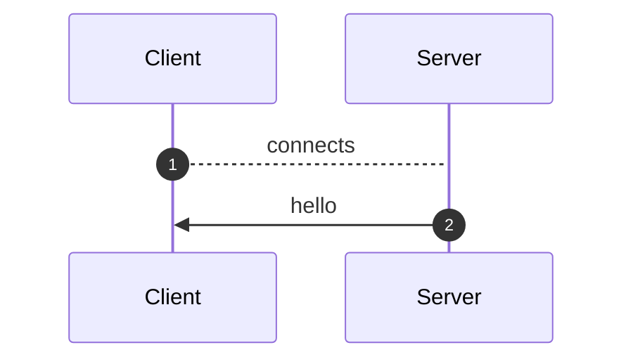
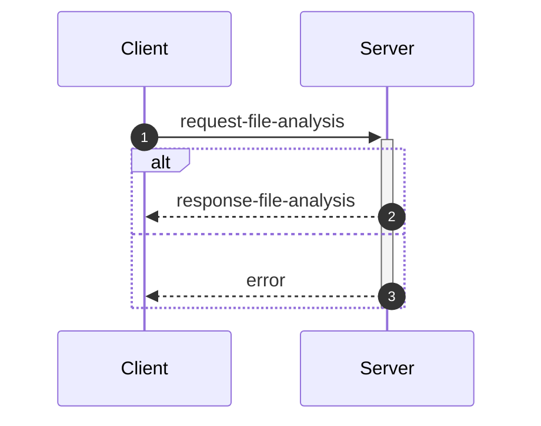
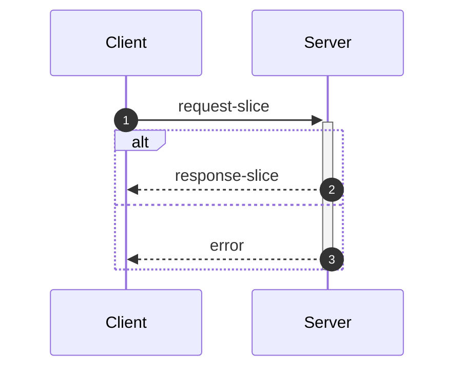
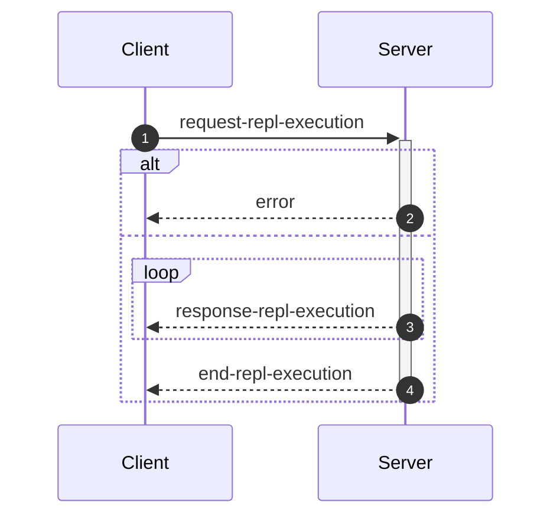

_<span title="an overview of flowR's interface">Generated</span> from '[wiki-interface.ts](https://github.com/flowr-analysis/flowr/tree/main/src/documentation/wiki-interface.ts "src/documentation/wiki-interface.ts")' on 2026-10-15, 16:14:28 UTC (v2.16.1, R v4.5.0), do not edit directly._

Although far from being as detailed as the in-depth explanation of [_flowR_](https://github.com/flowr-analysis/flowr/wiki/Core),
this wiki page explains how to interface with _flowR_ in more detail.
In general, command line arguments and other options provide short descriptions on hover over.

* [💻 Using the REPL](#using-the-repl)
* [⚙️ Configuring FlowR](#configuring-flowr)
* [⚒️ Writing Code](#writing-code)
* [💬 Communicating with the Server](#communicating-with-the-server)

<a id='using-the-repl'></a>
## 💻 Using the REPL

> [!NOTE]
> To execute arbitrary R commands with a repl request, _flowR_ has to be started explicitly with <span title="Description (Command Line Argument): Allow to access the underlying R session when using flowR (security warning: this allows the execution of arbitrary R code!)">`--r-session-access`</span>.
> Please be aware that this introduces a security risk and note that this relies on the [`r-shell` engine](https://github.com/flowr-analysis/flowr/wiki/Engines) .

Although primarily meant for users to explore,
there is nothing which forbids calling _flowR_ as a subprocess to use standard-in, -output, and -error
for communication (although you can access the REPL using the server as well,
with the [REPL Request](#message-request-repl-execution) message).

The read-eval-print loop&nbsp;(REPL) works relatively simple.
You can submit an expression (using <kbd>Enter</kbd>),
which is interpreted as an R&nbsp;expression by default but interpreted as a *command* if it starts with a colon (`:`).
The best command to get started with the REPL is <span title="Description (Repl Command): Show help information (aliases: :h, :?)">`:help`</span>.
Besides, you can leave the REPL either with the command <span title="Description (Repl Command): End the repl (aliases: :q, :exit)">`:quit`</span> or by pressing <kbd>Ctrl</kbd>+<kbd>C</kbd> twice.
When writing a *command*, you may press <kbd>Tab</kbd> to get a list of completions, if available.
Multiple commands can be entered in a single line by separating them with a semicolon (`;`), e.g. `:parse "x<-2"; :df*`.
If a command is given without R code, the REPL will re-use R code given in a previous command.
The prior example will hence return first the parsed AST of the program and then the dataflow graph for `"x <- 2"`.

> [!NOTE]
> If you develop flowR, you may want to launch the repl using the `npm run main-dev` command, this way, you get a non-minified version of flowR with debug information and hot-reloading of source files.

<details>
<summary>Available Commands</summary>

We currently offer the following commands (this with a `[*]` suffix are available with and without the star):

| Command | Description |
| ------- | ----------- |
| **<span title="Description (Repl Command): End the repl (aliases: :q, :exit)">:quit</span>** | End the repl (aliases: **:<span title="Alias of ':quit'. End the repl">q</span>**, **:<span title="Alias of ':quit'. End the repl">exit</span>**) |
| **<span title="Description (Repl Command): Execute the given code as R code. This requires the `--r-session-access` flag to be set and requires the r-shell engine. (aliases: :e, :r)">:execute</span>** | Execute the given code as R code. This requires the `--r-session-access` flag to be set and requires the r-shell engine. (aliases: **:<span title="Alias of ':execute'. Execute the given code as R code. This requires the `--r-session-access` flag to be set and requires the r-shell engine.">e</span>**, **:<span title="Alias of ':execute'. Execute the given code as R code. This requires the `--r-session-access` flag to be set and requires the r-shell engine.">r</span>**) |
| **<span title="Description (Repl Command): Get mermaid code for the control-flow graph of R code (aliases: :cfg, :cf)">:controlflow[*]</span>** | Get mermaid code for the control-flow graph of R code (star: Returns the URL to mermaid.live) (aliases: **:<span title="Alias of ':controlflow'. Get mermaid code for the control-flow graph of R code">cfg</span>**, **:<span title="Alias of ':controlflow'. Get mermaid code for the control-flow graph of R code">cf</span>**) |
| **<span title="Description (Repl Command): Get mermaid code for the control-flow graph with basic blocks (aliases: :cfgb, :cfb)">:controlflowbb[*]</span>** | Get mermaid code for the control-flow graph with basic blocks (star: Returns the URL to mermaid.live) (aliases: **:<span title="Alias of ':controlflowbb'. Get mermaid code for the control-flow graph with basic blocks">cfgb</span>**, **:<span title="Alias of ':controlflowbb'. Get mermaid code for the control-flow graph with basic blocks">cfb</span>**) |
| **<span title="Description (Repl Command): Get mermaid code for the dataflow graph (aliases: :d, :df)">:dataflow[*]</span>** | Get mermaid code for the dataflow graph (star: Returns the URL to mermaid.live) (aliases: **:<span title="Alias of ':dataflow'. Get mermaid code for the dataflow graph">d</span>**, **:<span title="Alias of ':dataflow'. Get mermaid code for the dataflow graph">df</span>**) |
| **<span title="Description (Repl Command): Get mermaid code for the normalized AST of R code (aliases: :n)">:normalize[*]</span>** | Get mermaid code for the normalized AST of R code (star: Returns the URL to mermaid.live) (alias: **:<span title="Alias of ':normalize'. Get mermaid code for the normalized AST of R code">n</span>**) |
| **<span title="Description (Repl Command): Get mermaid code for the simplified dataflow graph (aliases: :ds, :dfs)">:dataflowsimple[*]</span>** | Get mermaid code for the simplified dataflow graph (star: Returns the URL to mermaid.live) (aliases: **:<span title="Alias of ':dataflowsimple'. Get mermaid code for the simplified dataflow graph">ds</span>**, **:<span title="Alias of ':dataflowsimple'. Get mermaid code for the simplified dataflow graph">dfs</span>**) |
| **<span title="Description (Repl Command): Inspect and extend the signature database: `query` (identical to :query @signature), `info <name>` for where a function comes from (identical to :query @function-info), `add <path>` to mount another database/source, `download` to fetch the full-history database. (aliases: :sig)">:signature</span>** | Inspect and extend the signature database: `query` (identical to :query @signature), `info <name>` for where a function comes from (identical to :query @function-info), `add <path>` to mount another database/source, `download` to fetch the full-history database. (alias: **:<span title="Alias of ':signature'. Inspect and extend the signature database: `query` (identical to :query @signature), `info <name>` for where a function comes from (identical to :query @function-info), `add <path>` to mount another database/source, `download` to fetch the full-history database.">sig</span>**) |
| **<span title="Description (Repl Command): Just calculates the DFG, but only prints summary info (aliases: :d#, :df#)">:dataflowsilent</span>** | Just calculates the DFG, but only prints summary info (aliases: **:<span title="Alias of ':dataflowsilent'. Just calculates the DFG, but only prints summary info">d#</span>**, **:<span title="Alias of ':dataflowsilent'. Just calculates the DFG, but only prints summary info">df#</span>**) |
| **<span title="Description (Repl Command): Prints ASCII Art of the parsed, unmodified AST (aliases: :p)">:parse</span>** | Prints ASCII Art of the parsed, unmodified AST (alias: **:<span title="Alias of ':parse'. Prints ASCII Art of the parsed, unmodified AST">p</span>**) |
| **<span title="Description (Repl Command): Prints the version of flowR as well as the current version of R">:version</span>** | Prints the version of flowR as well as the current version of R
| **<span title="Description (Repl Command): Query the given R code (use 'help' for more information)">:query[*]</span>** | Query the given R code (use 'help' for more information) (star: Similar to query, but returns the output in json format.)
| **<span title="Description (Repl Command): Returns an ASCII representation of the dataflow graph (aliases: :df!)">:dataflowascii</span>** | Returns an ASCII representation of the dataflow graph (alias: **:<span title="Alias of ':dataflowascii'. Returns an ASCII representation of the dataflow graph">df!</span>**) |
| **<span title="Description (Repl Command): Returns summarization stats for the normalized AST (aliases: :n#)">:normalize#</span>** | Returns summarization stats for the normalized AST (alias: **:<span title="Alias of ':normalize#'. Returns summarization stats for the normalized AST">n#</span>**) |
| **<span title="Description (Repl Command): Show help information (aliases: :h, :?)">:help</span>** | Show help information (aliases: **:<span title="Alias of ':help'. Show help information">h</span>**, **:<span title="Alias of ':help'. Show help information">?</span>**) |

</details>

> [!TIP]
> 
> As indicated by the examples before, all REPL commands that operate on code keep track of the state.
> Hence, if you run a command like <span title="Description (Repl Command, starred version): Returns the URL to mermaid.live; Base Command: Get mermaid code for the dataflow graph (aliases: :d*, :df*)">`:dataflow*`</span> without providing R code,
> the REPL will re-use the R code provided in a previous command.
> Likewise, doing this will benefit from incrementality!
> If you request the dataflow graph with `:df* x <- 2 * y` and then want to see the parsed AST with `:parse`,
> the REPL will re-use previously obtained information and not re-parse the code again.
> 		

Generally, many commands offer shortcut versions in the REPL. Many queries, for example, offer a shortened format (see the example below).
Of special note, the [Config Query](https://github.com/flowr-analysis/flowr/wiki/%5BQuery%5D-Config)
can be used to also modify the currently active configuration of _flowR_ within the REPL (see the [wiki page](https://github.com/flowr-analysis/flowr/wiki/%5BQuery%5D-Config) for more information).

### Example: Retrieving the Dataflow Graph

To retrieve a URL to the [mermaid](https://mermaid.js.org/) diagram of the dataflow of a given expression,
use <span title="Description (Repl Command, starred version): Returns the URL to mermaid.live; Base Command: Get mermaid code for the dataflow graph (aliases: :d*, :df*)">`:dataflow*`</span> (or <span title="Description (Repl Command): Get mermaid code for the dataflow graph (aliases: :d, :df)">`:dataflow`</span> to get the mermaid code in the cli):

```shell
$ docker run -it --rm eagleoutice/flowr # or npm run flowr 
flowR repl v2.16.1, R grammar v14 (tree-sitter engine)
R> :dataflow* y <- 1 + x
```

<details>
<summary style='color:gray'>Output</summary>

```text
https://mermaid.live/view#base64:eyJjb2RlIjoiZmxvd2NoYXJ0IFREXG4gICAgMXt7XCJgKiM5MTtSTnVtYmVyIzkzOyogKioxKipcbiAgICAgICoxLjYqICgqKmlkOiAxKiopYFwifX1cbiAgICAyKFtcImAqIzkxO1JTeW1ib2wjOTM7KiAqKngqKlxuICAgICAgKjEuMTAqICgqKmlkOiAyKiopYFwiXSlcbiAgICAzW1tcImAqIzkxO1JCaW5hcnlPcCM5MzsqIGJhc2UjNTg7IzU4OyoqIzQzOyoqXG4gICAgICAqMS42LTEwKiAoKippZDogMyoqKVxuICAgIGFyZzogKDEsIDIpYFwiXV1cbiAgICBidWlsdC1pbjpfNDNfW1wiYEJ1aWx0LUluOlxuIzQzO2BcIl1cbiAgICBzdHlsZSBidWlsdC1pbjpfNDNfIHN0cm9rZTpncmF5LGZpbGw6Z3JheSxzdHJva2Utd2lkdGg6MnB4LG9wYWNpdHk6Ljg7XG4gICAgMFtcImAqIzkxO1JTeW1ib2wjOTM7KiAqKnkqKlxuICAgICAgKjEuMSogKCoqaWQ6IDAqKiwgdjogMylgXCJdXG4gICAgNFtbXCJgKiM5MTtSQmluYXJ5T3AjOTM7KiBiYXNlIzU4OyM1ODsqKiM2MDsjNDU7KipcbiAgICAgICoxLjEtMTAqICgqKmlkOiA0KiopXG4gICAgYXJnOiAoMCwgMylgXCJdXVxuICAgIGJ1aWx0LWluOl82MF8tW1wiYEJ1aWx0LUluOlxuIzYwOyM0NTtgXCJdXG4gICAgc3R5bGUgYnVpbHQtaW46XzYwXy0gc3Ryb2tlOmdyYXksZmlsbDpncmF5LHN0cm9rZS13aWR0aDoycHgsb3BhY2l0eTouODtcbiAgICAxIC0uLT58XCJmbG93XCJ8IDJcbiAgICBsaW5rU3R5bGUgMCBzdHJva2U6Z3JheSxjb2xvcjpncmF5O1xuICAgIDIgLS4tPnxcImZsb3dcInwgM1xuICAgIGxpbmtTdHlsZSAxIHN0cm9rZTpncmF5LGNvbG9yOmdyYXk7XG4gICAgMyAtLT58XCJyZWFkcywgYXJnXCJ8IDFcbiAgICAzIC0tPnxcInJlYWRzLCBhcmdcInwgMlxuICAgIDMgLS4tPnxcImZsb3dcInwgMFxuICAgIGxpbmtTdHlsZSA0IHN0cm9rZTpncmF5LGNvbG9yOmdyYXk7XG4gICAgMyAtLi0+fFwicmVhZHMsIGNhbGxzXCJ8IGJ1aWx0LWluOl80M19cbiAgICBsaW5rU3R5bGUgNSBzdHJva2U6Z3JheTtcbiAgICAwIC0tPnxcImRlZmluZWQtYnksIGZsb3dcInwgNFxuICAgIDAgLS0+fFwiZGVmaW5lZC1ieVwifCAzXG4gICAgNCAtLT58XCJyZWFkcywgYXJnXCJ8IDNcbiAgICA0IC0tPnxcInJldHVybnMsIGFyZ1wifCAwXG4gICAgNCAtLi0+fFwicmVhZHMsIGNhbGxzXCJ8IGJ1aWx0LWluOl82MF8tXG4gICAgbGlua1N0eWxlIDEwIHN0cm9rZTpncmF5OyIsIm1lcm1haWQiOnsiYXV0b1N5bmMiOnRydWV9fQ==
```

Retrieve the dataflow graph of the expression `y <- 1 + x`. It looks like this:


<details>

<summary style="color:gray">R Code of the Dataflow Graph</summary>

The analysis ran (including parse and normalize, using the [tree-sitter](https://github.com/flowr-analysis/flowr/wiki/Engines) engine) within the generation environment. No [signature database](https://github.com/flowr-analysis/flowr/wiki/Signature-Database) is mounted for these generated graphs, so `library()` calls attach no package exports; base-R names are still qualified via the generated base-package store (e.g. `acf` as `stats::acf`). 
We encountered no unknown side effects during the analysis.

```r
y <- 1 + x
```

</details>

</details>

For small graphs like this, <span title="Description (Repl Command): Returns an ASCII representation of the dataflow graph (aliases: :df!)">`:dataflowascii`</span> also provides an ASCII representation directly in the REPL:

```shell
$ docker run -it --rm eagleoutice/flowr # or npm run flowr 
flowR repl v2.16.1, R grammar v14 (tree-sitter engine)
R> :df! y <- 1 + x
```

<details open>
<summary style='color:gray'>Output</summary>

```text
                        v<0>v
 c<4>c──────────────────| y |
 |<- |     ┌────────────v---v
 c---c     │
    │   c<3>c   0<1>0
    └───| + |───| 1 |───u<2>u
        c---c   0---0   | x |
           └────────────u---u
Edges:
3 -> 1: reads, arg          3 -> 2: reads, arg
3 -> 0: flows-to            1 -> 2: flows-to
2 -> 3: flows-to            4 -> 3: reads, arg
4 -> 0: returns, arg        0 -> 4: defined-by, flows-to
0 -> 3: defined-by
```

Retrieve the dataflow graph of the expression `y <- 1 + x` as ASCII art.

</details>

For the slicing with <span title="Description (Repl Command): Static backwards executable slicer for R">`:slicer`</span>, you have access to the same [magic comments](#slice-magic-comments) as with the [slice request](#message-request-slice).
Pass `--inline` to splice resolvable `source()` calls into the reconstruction so the slice is a single self-contained R text (the same as the static slice query's `inlineSources` flag).
See `--help` for more flags!

### Example: Interfacing with the File System

Many commands that allow for an R-expression (like <span title="Description (Repl Command, starred version): Returns the URL to mermaid.live; Base Command: Get mermaid code for the dataflow graph (aliases: :d*, :df*)">`:dataflow*`</span>) allow for a file as well
if the argument starts with `file://`.
If you are working from the root directory of the _flowR_ repository, the following gives you the parsed AST of the example file using the <span title="Description (Repl Command): Prints ASCII Art of the parsed, unmodified AST (aliases: :p)">`:parse`</span> command:

> **Watch mode**: Replace `file://` with `watch://` to enter watch mode.
> flowR runs the command immediately and then re-runs it every time the file (or any file inside the folder) changes.
> Enter any other command to leave watch mode.
> For example: `:df watch://analysis.R`

```shell
$ docker run -it --rm eagleoutice/flowr # or npm run flowr 
flowR repl v2.16.1, R grammar v14 (tree-sitter engine)
R> :parse file://test/testfiles/example.R
```

<details>
<summary style='color:gray'>Output</summary>

```text
File: test/testfiles/example.R

program
├ binaryoperator
│ ├ identifier "sum" (1:1─4)
│ ├ <- "<-" (1:5─7)
│ ╰ float "0" (1:8─9)
├ binaryoperator
│ ├ identifier "product" (2:1─8)
│ ├ <- "<-" (2:9─11)
│ ╰ float "1" (2:12─13)
├ binaryoperator
│ ├ identifier "w" (3:1─2)
│ ├ <- "<-" (3:3─5)
│ ╰ float "7" (3:6─7)
├ binaryoperator
│ ├ identifier "N" (4:1─2)
│ ├ <- "<-" (4:3─5)
│ ╰ float "10" (4:6─8)
├ forstatement
│ ├ for "for" (6:1─4)
│ ├ ( "(" (6:5─6)
│ ├ identifier "i" (6:6─7)
│ ├ in "in" (6:8─10)
│ ├ binaryoperator
│ │ ├ float "1" (6:11─12)
│ │ ├ : ":" (6:12─13)
│ │ ╰ parenthesizedexpression
│ │   ├ ( "(" (6:13─14)
│ │   ├ binaryoperator
│ │   │ ├ identifier "N" (6:14─15)
│ │   │ ├ - "-" (6:15─16)
│ │   │ ╰ float "1" (6:16─17)
│ │   ╰ ) ")" (6:17─18)
│ ├ ) ")" (6:18─19)
│ ╰ bracedexpression
│   ├ { "{" (6:20─21)
│   ├ binaryoperator
│   │ ├ identifier "sum" (7:3─6)
│   │ ├ <- "<-" (7:7─9)
│   │ ╰ binaryoperator
│   │   ├ binaryoperator
│   │   │ ├ identifier "sum" (7:10─13)
│   │   │ ├ + "+" (7:14─15)
│   │   │ ╰ identifier "i" (7:16─17)
│   │   ├ + "+" (7:18─19)
│   │   ╰ identifier "w" (7:20─21)
│   ├ binaryoperator
│   │ ├ identifier "product" (8:3─10)
│   │ ├ <- "<-" (8:11─13)
│   │ ╰ binaryoperator
│   │   ├ identifier "product" (8:14─21)
│   │   ├  "" (8:22─23)
│   │   ╰ identifier "i" (8:24─25)
│   ╰ } "}" (9:1─2)
├ call
│ ├ identifier "cat" (11:1─4)
│ ╰ arguments
│   ├ ( "(" (11:4─5)
│   ├ argument
│   │ ╰ string
│   │   ├ " "\"" (11:5─6)
│   │   ├ stringcontent "Sum:" (11:6─10)
│   │   ╰ " "\"" (11:10─11)
│   ├ comma "," (11:11─12)
│   ├ argument
│   │ ╰ identifier "sum" (11:13─16)
│   ├ comma "," (11:16─17)
│   ├ argument
│   │ ╰ string
│   │   ├ " "\"" (11:18─19)
│   │   ├ stringcontent
│   │   │ ╰ escapesequence "\\n" (11:19─21)
│   │   ╰ " "\"" (11:21─22)
│   ╰ ) ")" (11:22─23)
╰ call
  ├ identifier "cat" (12:1─4)
  ╰ arguments
    ├ ( "(" (12:4─5)
    ├ argument
    │ ╰ string
    │   ├ " "\"" (12:5─6)
    │   ├ stringcontent "Product:" (12:6─14)
    │   ╰ " "\"" (12:14─15)
    ├ comma "," (12:15─16)
    ├ argument
    │ ╰ identifier "product" (12:17─24)
    ├ comma "," (12:24─25)
    ├ argument
    │ ╰ string
    │   ├ " "\"" (12:26─27)
    │   ├ stringcontent
    │   │ ╰ escapesequence "\\n" (12:27─29)
    │   ╰ " "\"" (12:29─30)
    ╰ ) ")" (12:30─31)
```

Retrieve the parsed AST of the example file.

<details>

<summary>File Content</summary>

```r
sum <- 0
product <- 1
w <- 7
N <- 10

for (i in 1:(N-1)) {
  sum <- sum + i + w
  product <- product * i
}

cat("Sum:", sum, "\n")
cat("Product:", product, "\n")
```

</details>

As _flowR_ directly transforms this AST the output focuses on being human-readable instead of being machine-readable.
		
</details>

### Example: Run a Query

You can run any query supported by _flowR_ using the <span title="Description (Repl Command): Query the given R code (use 'help' for more information)">`:query`</span> command.
For example, to obtain the shapes of all data frames in a given piece of code, you can run:

```shell
$ docker run -it --rm eagleoutice/flowr # or npm run flowr 
flowR repl v2.16.1, R grammar v14 (tree-sitter engine)
R> :query @absint df-shape "x <- data.frame(a = 1:10, b = 1:10)\ny <- x$a"
```

<details open>
<summary style='color:gray'>Output</summary>

```text
Query: absint (0 ms)
```

Retrieve the shapes of all data frames in the given code.

</details>

To run the linter on a file, you can use (in this example, we just issue the `dead-code` linter on a small piece of code):

```shell
$ docker run -it --rm eagleoutice/flowr # or npm run flowr 
flowR repl v2.16.1, R grammar v14 (tree-sitter engine)
R> :query @linter rules:dead-code "if(FALSE) x <- 2"
```

<details open>
<summary style='color:gray'>Output</summary>

```text
Query: linter (1 ms)
   ╰ Dead Code (dead-code):
       ╰ certain:
           ╰ Code at 1.11-16
```

Run the linter on the given code, with only the `dead-code` rule enabled.

</details>

For more information on the available queries, please check out the [Query API](https://github.com/flowr-analysis/flowr/wiki/Query-API).

<a id='configuring-flowr'></a>
## ⚙️ Configuring FlowR

When running _flowR_, you may want to specify some behaviors with a dedicated configuration file.
By default, flowR looks for a file named `flowr.json` in the current working directory (or any higher directory).
You can also specify a different file with <span title="Description (Command Line Argument): The name of the configuration file to use">`--config-file`</span> or pass the configuration inline using <span title="Description (Command Line Argument): The flowR configuration to use, as a JSON string">`--config-json`</span>.
A `flowr.json` found this way belongs to the analyzed project, so flowR ignores its options that decide what flowR executes or loads
(`engines.*.wasmPath`, `engines.*.treeSitterWasmPath`, `engines.*.rPath`, `solver.sigdb.additionalPaths`, `solver.sigdb.downloadRepo`, `solver.sigdb.installedLibrary.paths`),
unless you pass <span title="Description (Command Line Argument): Keep the security-sensitive options (e.g., the R executable) of the flowr.json found in the working directory or a parent. Only use this for projects you trust.">`--trust-config`</span>.
To analyze code you do not trust, use the secure mode (<span title="Description (Command Line Argument): Run in secure mode for analyzing untrusted code: flowR does not start R (or any other process), does not access the network, does not search for project configs, and ignores security-sensitive options in every config. Cannot be disabled once enabled. Can also be enabled with the environment variable {italic FLOWR_SECURE_MODE=1}.">`--secure`</span>, see the [security policy](https://github.com/flowr-analysis/flowr/blob/main/.github/SECURITY.md)).
To inspect the current configuration, you can run flowr with the <span title="Description (Command Line Argument): Run with verbose logging (will be passed to the corresponding script)">`--verbose`</span> flag, or use the `config` [Query](https://github.com/flowr-analysis/flowr/wiki/Query-API).
Within the REPL this works by running the following:

```shell
:query @config
```

To work with the <a href="https://github.com/flowr-analysis/flowr/tree/main/src/config.ts#L119"><code><span title="The configuration file format for flowR.">FlowrConfig</span></code></a> you can use the provided helper objects alongside its methods like
<a href="https://github.com/flowr-analysis/flowr/tree/main/src/config.ts#L905"><code><span title="Creates a new flowr config that has the updated values.">FlowrConfig::<b>amend</b></span></code></a>.
The schema below documents every option; the ones you most likely want are:

- <a href="https://github.com/flowr-analysis/flowr/wiki/Interface#configuring-flowr" title="Configuration Option (boolean): Whether source calls should be ignored, causing {@link processSourceCall}&#39;s behavior to be skipped.">ignoreSourceCalls</a>: ignore source calls when analyzing the code, i.e., ignore the inclusion of other files.
- <a href="https://github.com/flowr-analysis/flowr/wiki/Interface#configuring-flowr" title="Configuration Option (boolean): Whether load calls should be ignored, causing {@link processLoadCall}&#39;s behavior to be skipped.">ignoreLoadCalls</a>: ignore load calls when analyzing the code, i.e., ignore the loading of r-data files.
- <a href="https://github.com/flowr-analysis/flowr/wiki/Interface#configuring-flowr" title="Configuration Option (object): Do you want to overwrite (parts) of the builtin definition?">semantics.environment.overwriteBuiltIns</a>: overwrite _flowR_'s handling of built-in functions, or clear the preset definitions entirely.
  See [Configure BuiltIn Semantics](#configure-builtin-semantics) for more information.
- <a href="https://github.com/flowr-analysis/flowr/wiki/Interface#configuring-flowr" title="Configuration Option (string): How to resolve variables and their values. (one of &quot;disabled&quot;, &quot;alias&quot;, &quot;builtin&quot;)">solver.variables</a>: how to resolve variables and their values (`disabled`, `alias`, `builtin`).
- <a href="https://github.com/flowr-analysis/flowr/wiki/Interface#configuring-flowr" title="Configuration Option (array): The engine or set of engines to use for interacting with R code. An empty array means all available engines will be used.">engines</a> and <a href="https://github.com/flowr-analysis/flowr/wiki/Interface#configuring-flowr" title="Configuration Option (string): The default engine to use for interacting with R code. If this is undefined, an arbitrary engine from the specified list will be used. (one of &quot;tree-sitter&quot;, &quot;r-shell&quot;)">defaultEngine</a>: the engines used to interact with R code, see the [Engines wiki page](https://github.com/flowr-analysis/flowr/wiki/Engines).
- <a href="https://github.com/flowr-analysis/flowr/wiki/Interface#configuring-flowr" title="Configuration Option (array): Files a framework loads on its own, without any source() call (e.g. global.R in a shiny app), in the order they are loaded; flowR orders the matching project files accordingly and analyzes them as one program. Entries are case-insensitive globs matched against the file path, a plain name matches any file with that name, and entries matching no project file are warned about. Usually set per project kind via specializeConfig.">project.implicitSources</a>: the files a framework loads without any `source()` call, in the order in which they are
  loaded. Entries are globs (e.g. `R/*.R`) matched against the file path ignoring capitalization; one matching no file is reported.
- <a href="https://github.com/flowr-analysis/flowr/wiki/Interface#configuring-flowr" title="Configuration Option (object): Overwrite (parts of) the configuration depending on the project kind flowR detects, e.g. to give a shiny app its implicit sources.">specializeConfig</a>: overwrite (parts of) the configuration depending on the kind of project _flowR_ detects
  (e.g. `shiny-app`), which is how a shiny app gets its implicit sources by default. What you configure directly wins.
- <a href="https://github.com/flowr-analysis/flowr/wiki/Interface#configuring-flowr" title="Configuration Option (string): Overwrite the project kind flowR would otherwise infer from the analyzed files, e.g. when auto-detection guesses wrong. (one of &quot;package&quot;, &quot;script&quot;, &quot;shiny-app&quot;, &quot;notebook&quot;, &quot;project&quot;, &quot;unknown&quot;)">project.useProjectType</a>: skip that detection and force a project kind yourself, when auto-detection guesses wrong.
- <a href="https://github.com/flowr-analysis/flowr/wiki/Interface#configuring-flowr" title="Configuration Option (array): The default plugins to load when creating a new instance of FlowrAnalyzer">defaultPlugins</a> and <a href="https://github.com/flowr-analysis/flowr/wiki/Interface#configuring-flowr" title="Configuration Option (array): The plugins to load in REPL mode">repl.plugins</a>: the plugins to load for a new <a href="https://github.com/flowr-analysis/flowr/tree/main/src/project/flowr-analyzer.ts#L205"><code><span title="Central class for conducting analyses with FlowR. Use the FlowrAnalyzerBuilder to create a new instance. If you want the original pattern of creating a pipeline and running all steps, you can still do this with FlowrAnalyzer#runFull . To inspect the context of the analyzer, use FlowrAnalyzer#inspectContext (if you are a plugin and need to modify it, use FlowrAnalyzer#context instead).">FlowrAnalyzer</span></code></a> and in the REPL
  (use `flowr:default` to reference the former).

So you can configure _flowR_ by adding a file like the following:

<details>

<summary>Example Configuration File</summary>

```json
{
  "ignoreSourceCalls": true,
  "ignoreLoadCalls": true,
  "semantics": {
    "environment": {
      "overwriteBuiltIns": {
        "definitions": [
          {
            "type": "function",
            "names": [
              "foo"
            ],
            "processor": "builtin:assign",
            "config": {}
          }
        ]
      }
    }
  },
  "defaultPlugins": [
    "file:description",
    "versions:description"
  ],
  "repl": {
    "quickStats": false,
    "dfProcessorHeat": false,
    "hints": true,
    "plugins": [
      "flowr:default"
    ]
  },
  "project": {
    "resolveUnknownPathsOnDisk": true,
    "implicitSources": [
      "global.R",
      "app.R"
    ]
  },
  "linter": {
    "disabledRules": []
  },
  "specializeConfig": {
    "shiny-app": {
      "project": {
        "implicitSources": [
          "global.R",
          "ui.R",
          "server.R",
          "app.R"
        ]
      }
    }
  },
  "engines": [
    {
      "type": "r-shell"
    }
  ],
  "solver": {
    "variables": "alias",
    "evalStrings": true,
    "trackEnvironments": true,
    "sigdb": {
      "enabled": true,
      "loadProjectDependencies": true,
      "eagerlyLoad": false,
      "eagerlyLoadExports": false,
      "linkBaseR": false,
      "linkDescriptionDependencies": false
    },
    "resolveSource": {
      "dropPaths": "no",
      "ignoreCapitalization": true,
      "inferWorkingDirectory": "active-script",
      "searchPath": []
    },
    "instrument": {},
    "slicer": {
      "threshold": 50
    }
  },
  "abstractInterpretation": {
    "wideningThreshold": 4,
    "followCalls": true,
    "dataFrame": {
      "maxColNames": 20,
      "readLoadedData": {
        "readExternalFiles": true,
        "maxReadLines": 1000000
      }
    }
  },
  "incremental": {
    "alwaysIncremental": false,
    "parsing": {
      "activated": false,
      "heuristics": {
        "activated": true,
        "mtime": true,
        "linesFrom": 500,
        "bytesFrom": 50000,
        "alwaysWithEdits": false,
        "minFiles": 1
      }
    }
  },
  "gas": {
    "thresholds": {
      "memory": {
        "problematic": 0.7,
        "critical": 0.9
      },
      "timeMs": {
        "problematic": 100000,
        "critical": 120000
      }
    },
    "features": {}
  }
}
```

</details>

<details>
<a id='configure-builtin-semantics'></a>
<summary>Configure Built-In Semantics</summary>

`semantics/environment/overwriteBuiltins` accepts two keys:

- `loadDefaults` (boolean, initially `true`): If set to `true`, the default built-in definitions are loaded before applying the custom definitions. Setting this flag to `false` explicitly disables the loading of the default definitions.
- `definitions` (array, initially empty): Allows to overwrite or define new built-in elements. Each object within must have a `type` which is one of the below. Furthermore, they may define a string array of `names` which specifies the identifiers to bind the definitions to. You may use `assumePrimitive` to specify whether _flowR_ should assume that this is a primitive non-library definition (so you probably just do not want to specify the key).

  | Type            | Description                                                                                                                                                                                                                                                                                              | Example                                                                                                    |
  | --------------- | -------------------------------------------------------------------------------------------------------------------------------------------------------------------------------------------------------------------------------------------------------------------------------------------------------- | ---------------------------------------------------------------------------------------------------------- |
  | `constant`    | Additionally allows for a `value` this should resolve to.                                                                                                                                                                                                                                                | `{ type: 'constant', names: ['NULL', 'NA'],  value: null }`                                                |
  | `function`    | Is a rather flexible way to define and bind built-in functions. For the time, we do not have extensive documentation to cover all the cases, so please either consult the sources with the `default-builtin-config.ts` or open a [new issue](https://github.com/flowr-analysis/flowr/issues/new/choose). | `{ type: 'function', names: ['next'], processor: 'builtin:d', config: { cfg: ExitPointType.Next } }` |
  | `replacement` | A comfortable way to specify replacement functions like `$<-` or `names<-`. `suffixes` describes the... suffixes to attach automatically. | `{ type: 'replacement', suffixes: ['<-', '<<-'], names: ['[', '[['] }` |

</details>

<details>

<summary style='color:gray'>Full Configuration-File Schema</summary>

- _The configuration file format for flowR._ (object)
    - **logLevel** [optional] _flowR's global minimum log level, applied when the config is loaded._ (string)
        Only allows: 'silly', 'trace', 'debug', 'info', 'warn', 'error', 'fatal'
    - **ignoreSourceCalls** [optional] _Whether source calls should be ignored, causing {@link processSourceCall}'s behavior to be skipped._ (boolean)
    - **ignoreLoadCalls** [optional] _Whether load calls should be ignored, causing {@link processLoadCall}'s behavior to be skipped._ (boolean)
    - **semantics** _Configure language semantics and how flowR handles them._ (object)
        - **environment** [optional] _Semantics regarding how to handle the R environment._ (object)
            - **overwriteBuiltIns** [optional] _Do you want to overwrite (parts) of the builtin definition?_ (object)
                - **loadDefaults** [optional] _Should the default configuration still be loaded?_ (boolean)
                - **definitions** [optional] _The definitions to load/overwrite._ (array)
                Valid item types:
                    - (object)
    - **defaultPlugins** [optional] _The default plugins to load when creating a new instance of FlowrAnalyzer_ (array)
    Valid item types:
        - (alternatives)
            - (string)
            - (array)
    - **repl** _Configuration options for the REPL._ (object)
        - **quickStats** [optional] _Whether to show quick stats in the REPL after each evaluation._ (boolean)
        - **dfProcessorHeat** [optional] _This instruments the dataflow processors to count how often each processor is called._ (boolean)
        - **hints** [optional] _Whether to show dim inline hints on the empty prompt (automatically disabled on non-interactive terminals)._ (boolean)
        - **plugins** [optional] _The plugins to load in REPL mode_ (array)
        Valid item types:
            - (alternatives)
                - (string)
                - (array)
        - **autoUseFileProtocol** [optional] _Prepend the file protocol to a repl input that looks like a path, instead of only warning about it._ (boolean)
        - **queryStats** [optional] _Whether `:query` closes with the line stating how long the queries took (`:query*` never prints it)._ (boolean)
        - **showPlugins** [optional] _Whether `:version` grays out the plugins that did not activate during the last analysis._ (boolean)
    - **project** _Project specific configuration options._ (object)
        - **resolveUnknownPathsOnDisk** [optional] _Whether to resolve unknown paths loaded by the r project disk when trying to source/analyze files._ (boolean)
        - **failOnInaccessiblePath** [optional] _Whether a directory that cannot be traversed during file discovery (e.g. due to permissions) aborts the analysis; when false (the default) such paths are logged and skipped._ (boolean)
        - **basePackages** [optional] _The packages considered part of R itself (base and recommended); if unset, flowR uses its built-in list._ (array)
        Valid item types:
            - (string)
        - **implicitSources** [optional] _Files a framework loads on its own, without any source() call (e.g. global.R in a shiny app), in the order they are loaded; flowR orders the matching project files accordingly and analyzes them as one program. Entries are case-insensitive globs matched against the file path, a plain name matches any file with that name, and entries matching no project file are warned about. Usually set per project kind via specializeConfig._ (array)
        Valid item types:
            - (string)
        - **useProjectType** [optional] _Overwrite the project kind flowR would otherwise infer from the analyzed files, e.g. when auto-detection guesses wrong._ (string)
            Only allows: 'package', 'script', 'shiny-app', 'notebook', 'project', 'unknown'
        - **assumeImplicitEcho** [optional] _Whether the top level of the analyzed code is echoed, so that every visible result printed there is collected as an output by the dependencies query (default true, false for a package)._ (boolean)
        - **discovery** [optional] _Scoping options for the default project discovery._ (object)
            - **full** [optional] _Collect every file below the project root (greedy) instead of only the files the detected project kind needs (default false)._ (boolean)
            - **perKind** [optional] _Per-kind include/exclude glob overrides layered on the default scoping._ (object)
            - **ignore** [optional] _Case-insensitive globs that drop matching files from the intelligent discovery, regardless of kind (e.g. .Renviron to ignore environment files)._ (array)
            Valid item types:
                - (string)
        - **classification** [optional] _Overrides for the signals flowR uses to classify the project kind._ (object)
            - **shinyDescriptionTypes** [optional] _DESCRIPTION Type: values that mark a shiny app._ (array)
            Valid item types:
                - (string)
            - **shinyEntryFiles** [optional] _File names a shiny app is assembled from._ (array)
            Valid item types:
                - (string)
            - **shinyUsagePattern** [optional] _Regex source evidencing shiny usage in an entry file._ (string)
            - **notebookExtensions** [optional] _File extensions marking a notebook._ (array)
            Valid item types:
                - (string)
    - **linter** _Linter configuration options._ (object)
        - **disabledRules** _Linting rule names excluded from the default rule set (a rule requested explicitly via a linter query still runs). Usually set per project kind via specializeConfig._ (array)
        Valid item types:
            - (string)
    - **inputSources** [optional] _Further frameworks the input-sources analysis should know about; entries are added to flowR's defaults._ (object)
        - **pure** [optional] _Functions that only pass the constantness of their arguments on._ (array)
        Valid item types:
            - (string)
        - **param** [optional] _Functions whose result is a 'param' input._ (array)
        Valid item types:
            - (string)
        - **file** [optional] _Functions whose result is a 'file' input._ (array)
        Valid item types:
            - (string)
        - **tempfile** [optional] _Functions whose result is a 'tempfile' input._ (array)
        Valid item types:
            - (string)
        - **glob** [optional] _Functions whose result is a 'glob' input._ (array)
        Valid item types:
            - (string)
        - **net** [optional] _Functions whose result is a 'net' input._ (array)
        Valid item types:
            - (string)
        - **rand** [optional] _Functions whose result is a 'rand' input._ (array)
        Valid item types:
            - (string)
        - **system** [optional] _Functions whose result is a 'system' input._ (array)
        Valid item types:
            - (string)
        - **ffi** [optional] _Functions whose result is a 'ffi' input._ (array)
        Valid item types:
            - (string)
        - **lang** [optional] _Functions whose result is a 'lang' input._ (array)
        Valid item types:
            - (string)
        - **options** [optional] _Functions whose result is a 'options' input._ (array)
        Valid item types:
            - (string)
        - **cmdline** [optional] _Functions whose result is a 'cmdline' input._ (array)
        Valid item types:
            - (string)
        - **user** [optional] _Functions whose result is a 'user' input._ (array)
        Valid item types:
            - (string)
        - **const** [optional] _Functions whose result is a 'const' input._ (array)
        Valid item types:
            - (string)
        - **scope** [optional] _Functions whose result is a 'scope' input._ (array)
        Valid item types:
            - (string)
        - **dconst** [optional] _Functions whose result is a 'dconst' input._ (array)
        Valid item types:
            - (string)
        - **unknown** [optional] _Functions whose result is a 'unknown' input._ (array)
        Valid item types:
            - (string)
        - **linkedObjects** [optional] _Objects a framework provides without a definition in the code, e.g. shiny's input._ (array)
        Valid item types:
            - (object)
        - **linkedEntryPoints** [optional] _Calls that hand a function to a framework, which binds its objects to the parameters by position._ (array)
        Valid item types:
            - (object)
    - **specializeConfig** [optional] _Overwrite (parts of) the configuration depending on the project kind flowR detects, e.g. to give a shiny app its implicit sources._ (object)
    - **engines** _The engine or set of engines to use for interacting with R code. An empty array means all available engines will be used._ (array)
    Valid item types:
        - (alternatives)
            - _The configuration for the tree sitter engine._ (object)
                - **type** [required] _Use the tree sitter engine._ (string)
                    Only allows: 'tree-sitter'
                - **wasmPath** [optional] _The path to the tree-sitter-r WASM binary to use. If this is undefined, this uses the default path._ (string)
                - **treeSitterWasmPath** [optional] _The path to the tree-sitter WASM binary to use. If this is undefined, this uses the default path._ (string)
                - **lax** [optional] _Whether to use the lax parser for parsing R code (allowing for syntax errors). If this is undefined, the strict parser will be used._ (boolean)
            - _The configuration for the R shell engine._ (object)
                - **type** [required] _Use the R shell engine._ (string)
                    Only allows: 'r-shell'
                - **rPath** [optional] _The path to the R executable to use. If this is undefined, this uses the default path._ (string)
                - **pipeBind** [optional] _Whether to enable R's experimental pipe-bind operator "=>" by setting _R_USE_PIPEBIND_ for the R session (default false); R itself keeps this off by default, as it is experimental and has never shipped in a release version of R._ (boolean)
    - **defaultEngine** [optional] _The default engine to use for interacting with R code. If this is undefined, an arbitrary engine from the specified list will be used._ (string)
        Only allows: 'tree-sitter', 'r-shell'
    - **solver** _How to resolve constants, constraints, cells, ..._ (object)
        - **variables** _How to resolve variables and their values._ (string)
            Only allows: 'disabled', 'alias', 'builtin'
        - **evalStrings** _Should we include eval(parse(text="...")) calls in the dataflow graph?_ (boolean)
        - **trackEnvironments** [optional] _Track user-created environments (new.env, assign/get/local with envir=, dollar-assign, attach). When false, all envir-style calls fall through conservatively._ (boolean)
        - **sigdb** _Resolving library exports from a signature database._ (object)
            - **enabled** [optional] _Resolve library()/use() exports from a signature database (default true); when false no database is consulted._ (boolean)
            - **loadProjectDependencies** [optional] _Load the project's declared dependencies from its metadata files (DESCRIPTION Imports/Depends, rproject.toml, uvr.toml, renv.lock, rv.lock, uvr.lock) (default true); when false these files are not read for dependencies._ (boolean)
            - **eagerlyLoad** [optional] _Parse the database up front rather than on the first package load (default false, ignored if disabled)._ (boolean)
            - **eagerlyLoadExports** [optional] _Add a vertex for every export on load rather than on demand (default false); keeps the dataflow graph small._ (boolean)
            - **assumedRVersion** [optional] _R version assumed when resolving versioned (base-R) exports: a pin like "4.5" or "auto" to detect the installed R (default "auto")._ (string)
            - **linkBaseR** [optional] _Eagerly attach base-R namespaces so bare base calls resolve without library() (default false)._ (boolean)
            - **linkBaseRCalls** [optional] _Add a lightweight Reads edge from a bare base-R call to its signature-database function vertex (default false; base-R qualification is edge-free otherwise)._ (boolean)
            - **linkPackageCalls** [optional] _Add a lightweight Reads edge from a resolved package call to its signature-database function vertex (default false)._ (boolean)
            - **linkDescriptionDependencies** [optional] _Eagerly attach the namespaces of the project's declared DESCRIPTION dependencies (Imports/Depends) so their exports resolve without an explicit library() (default false)._ (boolean)
            - **warmInBackground** [optional] _Decompress the hot shards (base + most-downloaded) in a background task on startup so the first library() lookup is warm (default false; for long-running servers/REPLs)._ (boolean)
            - **additionalPaths** [optional] _Extra directories or bundle/manifest files searched for signature databases (alongside the shipped default and $FLOWR_SIGDB_DIR); a downloaded full-history bundle placed here is mounted automatically._ (array)
            Valid item types:
                - (string)
            - **downloadRepo** [optional] _GitHub owner/repo the full-history bundle is downloaded from via ":signature download" (default "flowr-analysis/flowr", release tag "sigdb-v<flowR-version>")._ (string)
            - **autoSync** [optional] _On startup, re-download shards whose committed sigdb.remote.json hash no longer matches the cache, in the background (default false; opt-in network sync after a git pull)._ (boolean)
            - **installedLibrary** [optional] _Recovering packages no signature database knows from the copy installed on this machine._ (object)
                - **enabled** [required] _Recover packages no signature database knows from their installed copy (default false)._ (boolean)
                - **paths** [optional] _Library directories to search; when empty they are discovered from the environment and the project._ (array)
                Valid item types:
                    - (string)
                - **useEnvironment** [optional] _Search the libraries R_LIBS_USER/R_LIBS/R_LIBS_SITE name (default true)._ (boolean)
                - **useProjectLibrary** [optional] _Search a project-local renv/packrat library (default true)._ (boolean)
                - **maxDepth** [optional] _How far to descend into the nested layout of a project-local library (default 3)._ (number)
                - **packages** [optional] _Only recover packages whose name matches one of these regular expressions; empty means any._ (array)
                Valid item types:
                    - (string)
            - **blobCacheBudgetMb** [optional] _How many MiB of decoded package blobs every open bundle may hold together (default 16)._ (number)
            - **versionSelection** [optional] _When a project constrains a dependency, resolve to the newest (default), oldest, or system-installed version satisfying it; system needs R and falls back to newest. Base-R packages always resolve against the assumed R version._ (string)
                Only allows: 'newest', 'oldest', 'system'
            - **versionOverrides** [optional] _Force an exact version for specific packages (name -> version), overriding both the project constraint and the versionSelection policy (default {})._ (object)
        - **versionManagement** _Policies for reasoning about dependency versions._ (object)
            - **linkedVersionGroups** [optional] _Groups of packages that must resolve to the same version; version guessing intersects each group so its members stay mutually compatible (default [])._ (array)
            Valid item types:
                - (array)
                Valid item types:
                    - (string)
        - **assumeAttachedPackages** [optional] _Packages to treat as attached without a `library()` call, so what the built-in configuration states about them applies to the analyzed code. The base packages R attaches on startup already resolve without it._ (array)
        Valid item types:
            - (string)
        - **transitiveSideEffectRounds** [optional] _How many rounds the transitive side-effect fixpoint may run before it is cut off (default 32); the propagation stops on its own as soon as a round adds nothing._ (number)
        - **maxOverlayDepth** [optional] _How many binding overlays may stack on one environment frame before a write flattens them (default 4); a pure performance knob, trading lookup cost against copy cost without changing any result._ (number)
        - **instrument** (object)
            - **dataflowExtractors** [optional] _These keys are only intended for use within code, allowing to instrument the dataflow analyzer!_ (any)
        - **resolveSource** [optional] _If lax source calls are active, flowR searches for sourced files much more freely, based on the configurations you give it. This option is only in effect if `ignoreSourceCalls` is set to false._ (object)
            - **dropPaths** _Allow to drop the first or all parts of the sourced path, if it is relative._ (string)
                Only allows: 'no', 'once', 'all'
            - **ignoreCapitalization** _Search for filenames matching in the lowercase._ (boolean)
            - **inferWorkingDirectory** _Try to infer the working directory from the main or any script to analyze._ (string)
                Only allows: 'no', 'main-script', 'active-script', 'any-script'
            - **searchPath** _Additionally search in these paths._ (array)
            Valid item types:
                - (string)
            - **repeatedSourceLimit** [optional] _How often the same file can be sourced within a single run? Please be aware: in case of cyclic sources this may not reach a fixpoint so give this a sensible limit._ (number)
            - **applyReplacements** _Provide name replacements for loaded files_ (array)
            Valid item types:
                - (object)
            - **assumeFilesExist** [optional] _Assume a sourced file is always there, making what it defines certain instead of conditional on the source call._ (boolean)
        - **slicer** [optional] _The configuration for the slicer._ (object)
            - **threshold** [optional] _The maximum number of iterations to perform on a single function call during slicing._ (number)
            - **autoExtend** [optional] _If set, the slicer will gain an additional post-pass._ (boolean)
    - **abstractInterpretation** _The configuration options for abstract interpretation._ (object)
        - **wideningThreshold** _The threshold for the number of visitations of a node at which widening should be performed to ensure the termination of the fixpoint iteration._ (number)
        - **followCalls** _Whether the abstract interpretation is interprocedural, i.e. whether it steps into the functions a call may dispatch to._ (boolean)
        - **dataFrame** _The configuration of the shape inference for data frames._ (object)
            - **maxColNames** _The maximum number of columns names to infer for data frames before over-approximating the column names to top._ (number)
            - **readLoadedData** _Configuration options for reading data frame shapes from loaded external data files, such as CSV files._ (object)
                - **readExternalFiles** _Whether data frame shapes should be extracted from loaded external files, such as CSV files._ (boolean)
                - **maxReadLines** _The maximum number of lines to read when extracting data frame shapes from loaded files, such as CSV files._ (number)
    - **incremental** (object)
        - **alwaysIncremental** _Always take the incremental path, regardless of heuristics._ (boolean)
        - **parsing** (object)
            - **activated** _If set, incremental parsing will be used._ (boolean)
            - **heuristics** (object)
                - **activated** [optional] _If set, the heuristics for incremental parsing will be used._ (boolean)
                - **mtime** [optional] _Skip reparsing entirely if the file's modification time is unchanged since the last parse._ (boolean)
                - **linesFrom** [optional] _Only consider incremental parsing for files with at least this many lines._ (number)
                - **bytesFrom** [optional] _Only consider incremental parsing for files with at least this many bytes._ (number)
                - **alwaysWithEdits** [optional] _Always take the incremental path whenever there is a computed edit region, regardless of the other thresholds._ (boolean)
                - **minFiles** [optional] _Only apply these heuristics once the project has at least this many files loaded._ (number)
    - **gas** [optional] _Resource-usage guard (gas) configuration. All feature factors default to 0 (disabled). See https://github.com/flowr-analysis/flowr/wiki/Core#gas-resource-guard._ (object)
        - **thresholds** [optional] _Thresholds for all gas checks (scaled by per-feature factor), boundable per feature._ (object)
            - **memory** [optional] _Heap-usage fraction thresholds (0-1), either shared or given per feature key (with `default` covering the rest)._ (object)
                - **problematic** [optional] _Heap fraction (0-1) above which Problematic is returned, for every feature without an entry of its own._ (number)
                - **critical** [optional] _Heap fraction (0-1) above which Critical is returned, for every feature without an entry of its own._ (number)
            - **timeMs** [optional] _Elapsed analysis time thresholds in milliseconds, either shared or given per feature key (with `default` covering the rest)._ (object)
                - **problematic** [optional] _Elapsed ms above which Problematic is returned, for every feature without an entry of its own._ (number)
                - **critical** [optional] _Elapsed ms above which Critical is returned, for every feature without an entry of its own._ (number)
            - **steps** [optional] _Processed-AST-node thresholds, counted rather than sampled; only a key that arms a budget (`dataflow`) reads them._ (object)
                - **problematic** [optional] _Processed AST nodes above which Problematic is returned, for every feature without an entry of its own._ (number)
                - **critical** [optional] _Processed AST nodes above which the extraction is cut short, for every feature without an entry of its own._ (number)
            - **vertices** [optional] _Created-dataflow-vertex thresholds, counted like `steps`._ (object)
                - **problematic** [optional] _Created dataflow vertices above which Problematic is returned, for every feature without an entry of its own._ (number)
                - **critical** [optional] _Created dataflow vertices above which the extraction is cut short, for every feature without an entry of its own._ (number)
        - **features** [optional] _Per-feature sensitivity factors. 0 or absent disables gas checking for that feature. A factor of 2 makes the feature twice as sensitive. Recognised keys: `source`, `side-effect-linking`, `linter`, `slicer`, `dataflow`._ (object)
        - **countedCheckEvery** [optional] _How many counted steps pass between two accountings of an armed check, be it a dataflow budget or the slicer's traversal (default 128); trades overshoot against the cost of the check._ (number)
        - **heapProvider** [optional] _Custom heap statistics source (programmatic configs only), overriding the built-in v8/performance.memory detection._ (function)

</details>

<a id='writing-code'></a>
## ⚒️ Writing Code

_flowR_ can be used as a [module](https://www.npmjs.com/package/@eagleoutice/flowr) and offers several main classes and interfaces that are interesting for extension writers 
(see the [Visual Studio Code extension](https://marketplace.visualstudio.com/items?itemName=code-inspect.vscode-flowr) or the [Core](https://github.com/flowr-analysis/flowr/wiki/Core) wiki page for more information).

### Creating Analyses with _flowR_

Nowadays, instances of the <a href="https://github.com/flowr-analysis/flowr/tree/main/src/project/flowr-analyzer.ts#L205"><code><span title="Central class for conducting analyses with FlowR. Use the FlowrAnalyzerBuilder to create a new instance. If you want the original pattern of creating a pipeline and running all steps, you can still do this with FlowrAnalyzer#runFull . To inspect the context of the analyzer, use FlowrAnalyzer#inspectContext (if you are a plugin and need to modify it, use FlowrAnalyzer#context instead).">FlowrAnalyzer</span></code></a> should be used as central frontend to get analysis results from _flowR_.
The entry points an analysis is written against are re-exported from the package root (`import { FlowrAnalyzerBuilder } from '@eagleoutice/flowr'`);
everything else stays reachable under its own path, as in `@eagleoutice/flowr/dataflow/graph/graph`.
For example, a program slice can be created like this:

```ts
const analyzer = await new FlowrAnalyzerBuilder()
    .setEngine('tree-sitter')
    .build();
analyzer.addRequest('x <- 1\ny <- x\nx');
const result = await analyzer.query([
    {
        type:     'static-slice',
        criteria: ['3@x']
    }
]);
```

For more information, please have a look at the [Analyzer](https://github.com/flowr-analysis/flowr/wiki/Analyzer) wiki page, which explains how to construct and use the <a href="https://github.com/flowr-analysis/flowr/tree/main/src/project/flowr-analyzer.ts#L205"><code><span title="Central class for conducting analyses with FlowR. Use the FlowrAnalyzerBuilder to create a new instance. If you want the original pattern of creating a pipeline and running all steps, you can still do this with FlowrAnalyzer#runFull . To inspect the context of the analyzer, use FlowrAnalyzer#inspectContext (if you are a plugin and need to modify it, use FlowrAnalyzer#context instead).">FlowrAnalyzer</span></code></a> in more detail.
To work with specific perspectives, you can also consult the respective pages like the [Dataflow Graph](https://github.com/flowr-analysis/flowr/wiki/Dataflow-Graph) or the [Abstract Interpretation](https://github.com/flowr-analysis/flowr/wiki/Abstract-Interpretation) wiki pages.
### The Pipeline Executor (Low-Level Interface)

Once, in the beginning, _flowR_ was meant to produce a dataflow graph merely to provide *program slices*. 
However, with continuous updates, the [Dataflow Graph](https://github.com/flowr-analysis/flowr/wiki/Dataflow-Graph) repeatedly proves to be the more interesting part.
With this, we restructured _flowR_'s originally *hardcoded* pipeline to be far more flexible. 
Now, it can be theoretically extended or replaced with arbitrary steps, optional steps, and what we call 'decorations' of these steps. 
In short, a slicing pipeline using the <a href="https://github.com/flowr-analysis/flowr/tree/main/src/core/pipeline-executor.ts#L97"><code><span title="**Please note:** The PipelineExecutor is now considered to be a rather low-level API for flowR. While it still works and is the basis for all other layers, we strongly recommend using the FlowrAnalyzer and its builder to create and use an analyzer instance that is pre-configured for your use-case. The pipeline executor allows to execute arbitrary pipelines in a step-by-step fashion. If you are not...">PipelineExecutor</span></code></a> looks like this:

```ts

const slicer = new PipelineExecutor(DEFAULT_SLICING_PIPELINE, {
  parser:    new RShell(),
  request:   requestFromInput('x <- 1\nx + 1'),
  criterion: ['2@x']
})
const slice = await slicer.allRemainingSteps()
// console.log(slice.reconstruct.code)
```

<details><summary>More Information</summary>

If you compare this, with what you would have done with the old (and removed) `SteppingSlicer`, 
this essentially just requires you to replace the `SteppingSlicer` with the <a href="https://github.com/flowr-analysis/flowr/tree/main/src/core/pipeline-executor.ts#L97"><code><span title="**Please note:** The PipelineExecutor is now considered to be a rather low-level API for flowR. While it still works and is the basis for all other layers, we strongly recommend using the FlowrAnalyzer and its builder to create and use an analyzer instance that is pre-configured for your use-case. The pipeline executor allows to execute arbitrary pipelines in a step-by-step fashion. If you are not...">PipelineExecutor</span></code></a>
and to pass the <a href="https://github.com/flowr-analysis/flowr/tree/main/src/core/steps/pipeline/default-pipelines.ts#L18"><code>DEFAULT_SLICING_PIPELINE</code></a> as the first argument.
The <a href="https://github.com/flowr-analysis/flowr/tree/main/src/core/pipeline-executor.ts#L97"><code><span title="**Please note:** The PipelineExecutor is now considered to be a rather low-level API for flowR. While it still works and is the basis for all other layers, we strongly recommend using the FlowrAnalyzer and its builder to create and use an analyzer instance that is pre-configured for your use-case. The pipeline executor allows to execute arbitrary pipelines in a step-by-step fashion. If you are not...">PipelineExecutor</span></code></a>...

1. Provides structures to investigate the results of all intermediate steps
2. Can be executed step-by-step
3. Can repeat steps (e.g., to calculate multiple slices on the same input)

See the in-code documentation for more information.

</details>

### Using the <a href="https://github.com/flowr-analysis/flowr/tree/main/src/r-bridge/shell.ts#L144"><code><span title="The RShell represents an interactive session with the R interpreter. You can configure it by RShellOptions . At the moment we are using a live R session (and not networking etc.) to communicate with R easily, which allows us to install packages etc. However, this might and probably will change in the future (leaving this as a legacy mode :D)">RShell</span></code></a> to Interact with R

The <a href="https://github.com/flowr-analysis/flowr/tree/main/src/r-bridge/shell.ts#L144"><code><span title="The RShell represents an interactive session with the R interpreter. You can configure it by RShellOptions . At the moment we are using a live R session (and not networking etc.) to communicate with R easily, which allows us to install packages etc. However, this might and probably will change in the future (leaving this as a legacy mode :D)">RShell</span></code></a> class allows interfacing with the `R`&nbsp;ecosystem installed on the host system.
Please have a look at [flowR's Engines](https://github.com/flowr-analysis/flowr/wiki/Engines) for more information on alternatives (for example, the <a href="https://github.com/flowr-analysis/flowr/tree/main/src/r-bridge/lang-4.x/tree-sitter/tree-sitter-executor.ts#L29"><code><span title="Synchronous and (way) faster alternative to the RShell using tree-sitter.">TreeSitterExecutor</span></code></a>).

> [!IMPORTANT]
> 
> Each <a href="https://github.com/flowr-analysis/flowr/tree/main/src/r-bridge/shell.ts#L144"><code><span title="The RShell represents an interactive session with the R interpreter. You can configure it by RShellOptions . At the moment we are using a live R session (and not networking etc.) to communicate with R easily, which allows us to install packages etc. However, this might and probably will change in the future (leaving this as a legacy mode :D)">RShell</span></code></a> controls a new instance of the R&nbsp;interpreter, 
> make sure to call <code><a href="https://github.com/flowr-analysis/flowr/tree/main/src/r-bridge/shell.ts#L354"><span title="Close the current R session, makes the object effectively invalid (can no longer be reopened etc.)">RShell::<i>close</i></span></a>()</code> when you are done.

You can start a new "session" by constructing a new object with <code>new <a href="https://github.com/flowr-analysis/flowr/tree/main/src/r-bridge/shell.ts#L144"><span title="The RShell represents an interactive session with the R interpreter. You can configure it by RShellOptions . At the moment we are using a live R session (and not networking etc.) to communicate with R easily, which allows us to install packages etc. However, this might and probably will change in the future (leaving this as a legacy mode :D)">RShell</span></a>()</code>.

However, there are several options that may be of interest 
(e.g., to automatically revive the shell in case of errors or to control the name location of the R process on the system).

With a shell object (let's call it `shell`), you can execute R code by using <a href="https://github.com/flowr-analysis/flowr/tree/main/src/r-bridge/shell.ts#L213"><code><span title="sends the given command directly to the current R session will not do anything to alter input markers!">RShell::<i>sendCommand</i></span></code></a>,
for example <code>shell.<a href="https://github.com/flowr-analysis/flowr/tree/main/src/r-bridge/shell.ts#L213"><span title="sends the given command directly to the current R session will not do anything to alter input markers!">sendCommand</span></a>("1 + 1")</code>.
However, this does not return anything, so if you want to collect the output of your command, use
<a href="https://github.com/flowr-analysis/flowr/tree/main/src/r-bridge/shell.ts#L296"><code><span title="Send a command and collect the output">RShell::<i>sendCommandWithOutput</i></span></code></a> instead.

<a id='communicating-with-the-server'></a>
## 💬 Communicating with the Server

As explained in the [Overview](https://github.com/flowr-analysis/flowr/wiki/Overview), you can run the [TCP](https://de.wikipedia.org/wiki/Transmission_Control_Protocol)&nbsp;server by adding the <span title="Description (Command Line Argument): Do not drop into a repl, but instead start a server on the given port (default: 1042) and listen for messages.">`--server`</span> flag (and, due to the interactive mode, exit with the conventional <kbd>CTRL</kbd>+<kbd>C</kbd>).
Currently, every connection is handled by the same underlying `RShell` - so the server is not designed to handle many clients at a time.
Additionally, the server is not well guarded against attacks (e.g., you can theoretically spawn an arbitrary number of&nbsp;RShell sessions on the target machine).

Every message has to be given in a single line (i.e., without a newline in-between) and end with a newline character. Nevertheless, we will pretty-print example given in the following segments for the ease of reading.

> [!NOTE]
> 
> The default <span title="Description (Command Line Argument): Do not drop into a repl, but instead start a server on the given port (default: 1042) and listen for messages.">`--server`</span> uses a simple [TCP](https://de.wikipedia.org/wiki/Transmission_Control_Protocol)
> connection. If you want _flowR_ to expose a [WebSocket](https://de.wikipedia.org/wiki/WebSocket) server instead, add the <span title="Description (Command Line Argument): If the server flag is set, use websocket for messaging">`--ws`</span> flag (i.e., <span title="Description (Command Line Argument): Do not drop into a repl, but instead start a server on the given port (default: 1042) and listen for messages.">`--server`</span> <span title="Description (Command Line Argument): If the server flag is set, use websocket for messaging">`--ws`</span>) when starting _flowR_ from the command line.

<ul><li>
<a id="message-hello"></a>
<b>Hello</b> Message (<code>hello</code>) 
<details>

<summary style="color:gray"> View Details. <i>The server informs the client about the successful connection and provides Meta-Information.</i> </summary>



After launching _flowR_, for example, with <code>docker run -it --rm eagleoutice/flowr <span title="Description (Command Line Argument): Do not drop into a repl, but instead start a server on the given port (default: 1042) and listen for messages.">-<span/>-server</span></code>&nbsp;(🐳️), connecting should present you with a `hello` message, that amongst others should reveal the versions of&nbsp;_flowR_ and&nbsp;R, using the [semver 2.0](https://semver.org/spec/v2.0.0.html) versioning scheme.
The message looks like this:

```json
{
  "type": "hello",
  "clientName": "client-0",
  "versions": {
    "flowr": "2.16.1",
    "r": "4.5.0",
    "engine": "r-shell"
  }
}
```

There are currently a few messages that you can send after the hello message.
If you want to _slice_ a piece of R code you first have to send an [analysis request](#message-request-file-analysis), so that you can send one or multiple slice requests afterward.
Requests for the [REPL](#message-request-repl-execution) are independent of that.
	
<hr>

<details>
<summary style="color:gray">Message schema (<code>hello</code>)</summary>

For the definition of the hello message, please see it's implementation at [`./src/cli/repl/server/messages/message-hello.ts`](https://github.com/flowr-analysis/flowr/tree/main/src/cli/repl/server/messages/message-hello.ts).

- [required] (object)
    - **type** [required] _The type of the hello message._ (string)
        Only allows: 'hello'
    - **id** [forbidden] _The id of the message is always undefined (as it is the initial message and not requested)._ (any)
    - **clientName** [required] _A unique name that is assigned to each client. It has no semantic meaning and is only used/useful for debugging._ (string)
    - **versions** [required] (object)
        - **flowr** [required] _The version of the flowr server running in semver format._ (string)
        - **r** [required] _The version of the underlying R shell running in semver format._ (string)
        - **engine** [required] _The parser backend that is used to parse the R code._ (string)

</details>

<hr>

</details>
	</li>

<li>
<a id="message-request-file-analysis"></a>
<b>Analysis</b> Message (<code>request-file-analysis</code>) 
<details>

<summary style="color:gray"> View Details. <i>The server builds the dataflow graph for a given input file (or a set of files).</i> </summary>



The request allows the server to analyze a file and prepare it for slicing.
The message can contain a `filetoken`, which is used to identify the file in later slice or query requests (if you do not add one, the request will not be stored and therefore, it is not available for subsequent requests).

> **Please note!**\
> If you want to send and process a lot of analysis requests, but do not want to slice them, please do not pass the `filetoken` field. This will save the server a lot of memory allocation.

Furthermore, the request must contain either a `content` field to directly pass the file's content or a `filepath` field which contains the path to the file (this path must be accessible for the server to be useful).
If you add the `id` field, the answer will use the same `id` so you can match requests and the corresponding answers.
See the implementation of the request-file-analysis message for more information.

You can drop one or more stored file tokens by adding the `invalidateToken` field (a single token or an array of tokens).
The server frees the corresponding analyses _after_ it has answered the request.

> **Tip!**\
> If you only want to drop tokens, you do not need a separate message: send a `request-file-analysis` that contains _just_ the `invalidateToken` field (and no `content` or `filepath`).
> Such a request behaves like an empty file analysis and the server replies with an empty `results` object.
> Because invalidation happens after the response, you may even pass the _current_ `filetoken` in `invalidateToken` to analyze a file once and have the server forget it right after you received the results.

<details>
<summary>Example of the <code>request-file-analysis</code> Message</summary>

_Note:_ even though we pretty-print these messages, they are sent as a single line, ending with a newline.

The following lists all messages that were sent and received in case you want to reproduce the scenario:

<ol>
<li> <code>hello</code> (response)
<details> 

<summary> Show Details </summary>

The first message is always a hello message.

```json
{"type":"hello","clientName":"client-0","versions":{"flowr":"2.16.1","r":"4.5.0","engine":"r-shell"}}
```

</details>
</li>

<li> <b><code>request-file-analysis</code> (request)</b>
<details open> 

<summary> Show Details </summary>

Let's suppose you simply want to analyze the following script:
 
```r
x <- 1
x + 1
```

 For this, you can send the following request:

```json
{"type":"request-file-analysis","id":"1","filetoken":"x","content":"x <- 1\nx + 1"}
```

</details>
</li>

<li> <code>response-file-analysis</code> (response)
<details> 

<summary> Show Details </summary>

The `results` field of the response effectively contains three keys of importance:

- `parse`: which contains 1:1 the parse result in CSV format that we received from the `RShell` (i.e., the AST produced by the parser of the R interpreter).
- `normalize`: which contains the normalized AST, including ids (see the `info` field and the [Normalized AST](https://github.com/flowr-analysis/flowr/wiki/Normalized-AST) wiki page).
- `dataflow`: especially important is the `graph` field which contains the dataflow graph as a set of root vertices (see the [Dataflow Graph](https://github.com/flowr-analysis/flowr/wiki/Dataflow-Graph) wiki page).
			
_As the code is pretty long, we inhibit pretty printing and syntax highlighting (JSON, hiding built-in):_

```text
{"type":"response-file-analysis","format":"json","id":"1","results":{"parse":{"files":[{"parsed":"[1,1,1,6,7,0,\"expr\",false,\"x <- 1\"],[1,1,1,1,1,3,\"SYMBOL\",true,\"x\"],[1,1,1,1,3,7,\"expr\",false,\"x\"],[1,3,1,4,2,7,\"LEFT_ASSIGN\",true,\"<-\"],[1,6,1,6,4,5,\"NUM_CONST\",true,\"1\"],[1,6,1,6,5,7,\"expr\",false,\"1\"],[2,1,2,5,16,0,\"expr\",false,\"x + 1\"],[2,1,2,1,10,12,\"SYMBOL\",true,\"x\"],[2,1,2,1,12,16,\"expr\",false,\"x\"],[2,3,2,3,11,16,\"'+'\",true,\"+\"],[2,5,2,5,13,14,\"NUM_CONST\",true,\"1\"],[2,5,2,5,14,16,\"expr\",false,\"1\"]","filePath":"/tmp/tmp-22350-jY5x9LLJYqlZ-.R"}],".meta":{}},"normalize":{"ast":{"type":"RProject","files":[{"root":{"type":"RExpressionList","children":[{"type":"RBinaryOp","location":[1,3,1,4],"lhs":{"type":"RSymbol","location":[1,1,1,1],"content":"x","lexeme":"x","info":{"fullRange":[1,1,1,1],"adToks":[],"id":0,"parent":2,"role":"bin-l","index":0,"nest":0,"file":"/tmp/tmp-22350-jY5x9LLJYqlZ-.R"}},"rhs":{"location":[1,6,1,6],"lexeme":"1","info":{"fullRange":[1,6,1,6],"adToks":[],"id":1,"parent":2,"role":"bin-r","index":1,"nest":0,"file":"/tmp/tmp-22350-jY5x9LLJYqlZ-.R"},"type":"RNumber","content":{"num":1,"complexNumber":false,"markedAsInt":false}},"operator":"<-","lexeme":"<-","info":{"fullRange":[1,1,1,6],"adToks":[],"id":2,"parent":6,"nest":0,"file":"/tmp/tmp-22350-jY5x9LLJYqlZ-.R","index":0,"role":"el-c"}},{"type":"RBinaryOp","location":[2,3,2,3],"lhs":{"type":"RSymbol","location":[2,1,2,1],"content":"x","lexeme":"x","info":{"fullRange":[2,1,2,1],"adToks":[],"id":3,"parent":5,"role":"bin-l","index":0,"nest":0,"file":"/tmp/tmp-22350-jY5x9LLJYqlZ-.R"}},"rhs":{"location":[2,5,2,5],"lexeme":"1","info":{"fullRange":[2,5,2,5],"adToks":[],"id":4,"parent":5,"role":"bin-r","index":1,"nest":0,"file":"/tmp/tmp-22350-jY5x9LLJYqlZ-.R"},"type":"RNumber","content":{"num":1,"complexNumber":false,"markedAsInt":false}},"operator":"+","lexeme":"+","info":{"fullRange":[2,1,2,5],"adToks":[],"id":5,"parent":6,"nest":0,"file":"/tmp/tmp-22350-jY5x9LLJYqlZ-.R","index":1,"role":"el-c"}}],"info":{"adToks":[],"id":6,"nest":0,"file":"/tmp/tmp-22350-jY5x9LLJYqlZ-.R","role":"root","index":0}},"filePath":"/tmp/tmp-22350-jY5x9LLJYqlZ-.R"}],"info":{"id":7}},".meta":{}},"dataflow":{"unknownReferences":[],"in":[{"nodeId":2,"name":"<-","type":2},{"nodeId":5,"name":"+","type":2}],"out":[{"nodeId":0,"name":"x","type":4,"definedAt":2,"value":[1]}],"environment":{"current":{"id":918,"parent":"<BuiltInEnvironment>","memory":[["x",[{"nodeId":0,"name":"x","type":4,"definedAt":2,"value":[1]}]]],"globalEnv":true},"level":0},"graph":{"rootVertices":[1,0,2,3,4,5],"vertexInformation":[[1,{"tag":"value","id":1}],[0,{"tag":"vdef","id":0,"source":[1]}],[2,{"tag":"fcall","id":2,"name":"<-","onlyBuiltin":true,"args":[{"nodeId":0,"type":32},{"nodeId":1,"type":32}],"origin":["builtin:assign"]}],[3,{"tag":"use","id":3}],[4,{"tag":"value","id":4}],[5,{"tag":"fcall","id":5,"name":"+","onlyBuiltin":true,"args":[{"nodeId":3,"type":32},{"nodeId":4,"type":32}],"origin":["builtin:d"]}]],"edgeInformation":[[2,[[1,{"types":65}],[0,{"types":72}],["built-in:<-",{"types":5}],[3,{"types":4096}]]],[1,[[0,{"types":4096}]]],[0,[[2,{"types":4098}],[1,{"types":2}]]],[5,[[3,{"types":65}],[4,{"types":65}],["built-in:+",{"types":5}]]],[3,[[0,{"types":1}],[4,{"types":4096}]]],[4,[[5,{"types":4096}]]]],"_unknownSideEffects":[]},"entryPoint":2,"cfgEntry":1,"exitPoints":[{"type":0,"nodeId":5}],"hooks":[],".meta":{}}}}
```

</details>
</li>
</ol>

The complete round-trip covers validating the messages as well as starting and stopping the internal mock server.

</details>

You receive an error if, for whatever reason, the analysis fails (e.g., the message or code you sent contained syntax errors).
It contains a human-readable description *why* the analysis failed (see the error message implementation for more details).

<details>
<summary>Example Error Message</summary>

_Note:_ even though we pretty-print these messages, they are sent as a single line, ending with a newline.

The following lists all messages that were sent and received in case you want to reproduce the scenario:

<ol>
<li> <code>hello</code> (response)
<details> 

<summary> Show Details </summary>

The first message is always a hello message.

```json
{"type":"hello","clientName":"client-0","versions":{"flowr":"2.16.1","r":"4.5.0","engine":"r-shell"}}
```

</details>
</li>

<li> <code>request-file-analysis</code> (request)
<details> 

<summary> Show Details </summary>

```json
{"type":"request-file-analysis","id":"1","filename":"sample.R","content":"x <-"}
```

</details>
</li>

<li> <b><code>error</code> (response)</b>
<details open> 

<summary> Show Details </summary>

```json
{
  "id": "1",
  "type": "error",
  "fatal": false,
  "reason": "Error while analyzing file sample.R: GuardError: unable to parse R code (see the log for more information) for request {\"request\":\"text\",\"content\":\"x <-\"}}\n Report a Bug: https://github.com/flowr-analysis/flowr/issues/new?body=%3C!%2D%2D%20Please%20describe%20your%20issue%20in%20more%20detail%20below!%20%2D%2D%3E%0A%0A%0A%3C!%2D%2D%20Automatically%20generated%20issue%20metadata%2C%20please%20do%20not%20edit%20or%20delete%20content%20below%20this%20line%20%2D%2D%3E%0A%2D%2D%2D%0A%0AflowR%20version%3A%202.16.1%0Anode%20version%3A%20v25.6.1%0Anode%20arch%3A%20x64%0Anode%20platform%3A%20linux%0Amessage%3A%20%60unable%20to%20parse%20R%20code%20%28see%20the%20log%20for%20more%20information%29%20for%20request%20%7B%22request%22%3A%22text%22%2C%22content%22%3A%22x%20%3C%2D%22%7D%7D%60%0Astack%20trace%3A%0A%60%60%60%0A%20%20%20%20at%20guard%20%28%3C%3E%2Fsrc%2Futil%2Fassert.ts%3A128%3A9%29%0A%20%20%20%20at%20guardRetrievedOutput%20%28%3C%3E%2Fsrc%2Fr%2Dbridge%2Fretriever.ts%3A167%3A7%29%0A%20%20%20%20at%20%2Fhome%2Frunner%2Fwork%2Fflowr%2Fflowr%2Fsrc%2Fr%2Dbridge%2Fretriever.ts%3A123%3A4%0A%20%20%20%20at%20processTicksAndRejections%20%28node%3Ainternal%2Fprocess%2Ftask_queues%3A104%3A5%29%0A%20%20%20%20at%20async%20Object.parseRequests%20%5Bas%20processor%5D%20%28%3C%3E%2Fsrc%2Fr%2Dbridge%2Fparser.ts%3A108%3A19%29%0A%20%20%20%20at%20async%20PipelineExecutor.nextStep%20%28%3C%3E%2Fsrc%2Fcore%2Fpipeline%2Dexecutor.ts%3A192%3A25%29%0A%20%20%20%20at%20async%20FlowrAnalyzerCache.stepTapeUntil%20%28%3C%3E%2Fsrc%2Fproject%2Fcache%2Fflowr%2Danalyzer%2Dcache.ts%3A117%3A4%29%0A%20%20%20%20at%20async%20FlowRServerConnection.sendFileAnalysisResponse%20%28%3C%3E%2Fsrc%2Fcli%2Frepl%2Fserver%2Fconnection.ts%3A216%3A53%29%0A%60%60%60%0A%0A%2D%2D%2D%0A%09"
}
```

</details>
</li>
</ol>

The complete round-trip covers validating the messages as well as starting and stopping the internal mock server.

</details>

&nbsp;

<a id="analysis-include-cfg"></a>
**Including the Control Flow Graph**

The control flow graph is a view on the dataflow graph: the dataflow analysis records the control flow while it walks
the program, and the graph projects those edges on demand. The server can expose that structure as well (please create
a [new issue](https://github.com/flowr-analysis/flowr/issues/new/choose) for any bug you may encounter).
For this, the analysis request may add `cfg: true` to its list of options.

<details>
<summary>Requesting a Control Flow Graph</summary>

_Note:_ even though we pretty-print these messages, they are sent as a single line, ending with a newline.

The following lists all messages that were sent and received in case you want to reproduce the scenario:

<ol>
<li> <code>hello</code> (response)
<details> 

<summary> Show Details </summary>

The first message is always a hello message.

```json
{"type":"hello","clientName":"client-0","versions":{"flowr":"2.16.1","r":"4.5.0","engine":"r-shell"}}
```

</details>
</li>

<li> <b><code>request-file-analysis</code> (request)</b>
<details open> 

<summary> Show Details </summary>

```json
{
  "type": "request-file-analysis",
  "id": "1",
  "filetoken": "x",
  "content": "if(unknown > 0) { x <- 2 } else { x <- 5 }\nfor(i in 1:x) { print(x); print(i) }",
  "cfg": true
}
```

</details>
</li>

<li> <code>response-file-analysis</code> (response)
<details> 

<summary> Show Details </summary>

The response looks basically the same as a response sent without the `cfg` flag. However, additionally it contains a `cfg` field. 
If you are interested in a visual representation of the control flow graph, see the 
[visualization with mermaid](https://mermaid.live/view#base64:eyJjb2RlIjoiZmxvd2NoYXJ0IFREXG4gICAgbjAoW1wiYFJTeW1ib2wgKDApXG4qKnVua25vd24qKmBcIl0pXG4gICAgbjEoW1wiYFJOdW1iZXIgKDEpXG4qKjAqKmBcIl0pXG4gICAgbjIoW1wiYFJCaW5hcnlPcCAoMilcbioqdW5rbm93biAjNjI7IDAqKmBcIl0pXG4gICAgbjYoW1wiYFJOdW1iZXIgKDYpXG4qKjIqKmBcIl0pXG4gICAgbjUoW1wiYFJTeW1ib2wgKDUpXG4qKngqKmBcIl0pXG4gICAgbjdbXCJgUkJpbmFyeU9wICg3KVxuKip4ICM2MDsjNDU7IDIqKmBcIl1cbiAgICBuOChbXCJgUkV4cHJlc3Npb25MaXN0ICg4KWBcIl0pXG4gICAgbjEyKFtcImBSTnVtYmVyICgxMilcbioqNSoqYFwiXSlcbiAgICBuMTEoW1wiYFJTeW1ib2wgKDExKVxuKip4KipgXCJdKVxuICAgIG4xM1tcImBSQmluYXJ5T3AgKDEzKVxuKip4ICM2MDsjNDU7IDUqKmBcIl1cbiAgICBuMTQoW1wiYFJFeHByZXNzaW9uTGlzdCAoMTQpYFwiXSlcbiAgICBuMTVbXCJgUklmVGhlbkVsc2UgKDE1KVxuKippZih1bmtub3duICM2MjsgMCkgIzEyMzsgeCAjNjA7IzQ1OyAyICMxMjU7IGVsc2UgIzEyMzsgeCAjNjA7IzQ1OyA1ICMxMjU7KipgXCJdXG4gICAgbjE2KFtcImBSU3ltYm9sICgxNilcbioqaSoqYFwiXSlcbiAgICBuMTcoW1wiYFJOdW1iZXIgKDE3KVxuKioxKipgXCJdKVxuICAgIG4xOChbXCJgUlN5bWJvbCAoMTgpXG4qKngqKmBcIl0pXG4gICAgbjE5KFtcImBSQmluYXJ5T3AgKDE5KVxuKioxIzU4O3gqKmBcIl0pXG4gICAgbjIzKFtcImBSU3ltYm9sICgyMylcbioqeCoqYFwiXSlcbiAgICBuMjVbXCJgUkZ1bmN0aW9uQ2FsbCAoMjUpXG4qKnByaW50KHgpKipgXCJdXG4gICAgbjI3KFtcImBSU3ltYm9sICgyNylcbioqaSoqYFwiXSlcbiAgICBuMjlbXCJgUkZ1bmN0aW9uQ2FsbCAoMjkpXG4qKnByaW50KGkpKipgXCJdXG4gICAgbjMwKFtcImBSRXhwcmVzc2lvbkxpc3QgKDMwKWBcIl0pXG4gICAgbjMxW1wiYFJGb3JMb29wICgzMSlcbioqZm9yKGkgaW4gMSM1ODt4KSAjMTIzOyBwcmludCh4KTsgcHJpbnQoaSkgIzEyNTsqKmBcIl1cbiAgICBuMiAtLi0+fFwiYnJhbmNoIG9uIHVua25vd24gIzYyOyAwICgyKSBpZiBUXCJ8IG42XG4gICAgbjIgLS4tPnxcImJyYW5jaCBvbiB1bmtub3duICM2MjsgMCAoMikgaWYgRlwifCBuMTJcbiAgICBuMCAtLT58XCJmbG93cyB0b1wifCBuMVxuICAgIG4xIC0tPnxcImZsb3dzIHRvXCJ8IG4yXG4gICAgbjcgLS0+fFwiZmxvd3MgdG9cInwgbjhcbiAgICBuNiAtLT58XCJmbG93cyB0b1wifCBuNVxuICAgIG41IC0tPnxcImZsb3dzIHRvXCJ8IG43XG4gICAgbjggLS0+fFwiZmxvd3MgdG9cInwgbjE1XG4gICAgbjE1IC0tPnxcImZsb3dzIHRvXCJ8IG4xN1xuICAgIG4xMyAtLT58XCJmbG93cyB0b1wifCBuMTRcbiAgICBuMTIgLS0+fFwiZmxvd3MgdG9cInwgbjExXG4gICAgbjExIC0tPnxcImZsb3dzIHRvXCJ8IG4xM1xuICAgIG4xNCAtLT58XCJmbG93cyB0b1wifCBuMTVcbiAgICBuMTkgLS0+fFwiZmxvd3MgdG9cInwgbjE2XG4gICAgbjE4IC0tPnxcImZsb3dzIHRvXCJ8IG4xOVxuICAgIG4xNyAtLT58XCJmbG93cyB0b1wifCBuMThcbiAgICBuMjUgLS0+fFwiZmxvd3MgdG9cInwgbjI3XG4gICAgbjIzIC0tPnxcImZsb3dzIHRvXCJ8IG4yNVxuICAgIG4yOSAtLT58XCJmbG93cyB0b1wifCBuMzBcbiAgICBuMjcgLS0+fFwiZmxvd3MgdG9cInwgbjI5XG4gICAgbjMwIC0tPnxcImZsb3dzIHRvXCJ8IG4xNlxuICAgIG4xNiAtLi0+fFwiYnJhbmNoIG9uIGkgKDE2KSBpZiBUXCJ8IG4yM1xuICAgIG4xNiAtLi0+fFwiYnJhbmNoIG9uIGkgKDE2KSBpZiBGXCJ8IG4zMVxuICAgIHN0eWxlIG4wIHN0cm9rZTpjeWFuLHN0cm9rZS13aWR0aDo2LjVweDsgICAgc3R5bGUgbjMxIHN0cm9rZTpncmVlbixzdHJva2Utd2lkdGg6Ni41cHg7IiwibWVybWFpZCI6eyJhdXRvU3luYyI6dHJ1ZX19).
			
_As the code is pretty long, we inhibit pretty printing and syntax highlighting (JSON, hiding built-in):_

```text
{"type":"response-file-analysis","format":"json","id":"1","cfg":{"graph":{"roots":[0,1,2,6,5,7,8,12,11,13,14,15,16,17,18,19,23,25,27,29,30,31],"vtxInfos":[[0,[2,0]],[1,[2,1]],[2,[2,2]],[6,[2,6]],[5,[2,5]],[7,[1,7]],[8,[2,8]],[12,[2,12]],[11,[2,11]],[13,[1,13]],[14,[2,14]],[15,[1,15]],[16,[2,16]],[17,[2,17]],[18,[2,18]],[19,[2,19]],[23,[2,23]],[25,[1,25]],[27,[2,27]],[29,[1,29]],[30,[2,30]],[31,[1,31]]],"bbChildren":[],"edgeInfos":[[2,[[6,{"id":15,"when":true}],[12,{"id":15,"when":false}]]],[0,[[1,0]]],[1,[[2,0]]],[7,[[8,0]]],[6,[[5,0]]],[5,[[7,0]]],[8,[[15,0]]],[15,[[17,0]]],[13,[[14,0]]],[12,[[11,0]]],[11,[[13,0]]],[14,[[15,0]]],[19,[[16,0]]],[18,[[19,0]]],[17,[[18,0]]],[25,[[27,0]]],[23,[[25,0]]],[29,[[30,0]]],[27,[[29,0]]],[30,[[16,0]]],[16,[[23,{"id":31,"when":true}],[31,{"id":31,"when":false}]]]],"mayHaveBasicBlocks":false},"entryPoints":[0],"exitPoints":[31],"returns":[],"breaks":[],"nexts":[]},"results":{"parse":{"files":[{"parsed":"[1,1,1,42,38,0,\"expr\",false,\"if(unknown > 0) { x <- 2 } else { x <- 5 }\"],[1,1,1,2,1,38,\"IF\",true,\"if\"],[1,3,1,3,2,38,\"'('\",true,\"(\"],[1,4,1,14,9,38,\"expr\",false,\"unknown > 0\"],[1,4,1,10,3,5,\"SYMBOL\",true,\"unknown\"],[1,4,1,10,5,9,\"expr\",false,\"unknown\"],[1,12,1,12,4,9,\"GT\",true,\">\"],[1,14,1,14,6,7,\"NUM_CONST\",true,\"0\"],[1,14,1,14,7,9,\"expr\",false,\"0\"],[1,15,1,15,8,38,\"')'\",true,\")\"],[1,17,1,26,22,38,\"expr\",false,\"{ x <- 2 }\"],[1,17,1,17,12,22,\"'{'\",true,\"{\"],[1,19,1,24,19,22,\"expr\",false,\"x <- 2\"],[1,19,1,19,13,15,\"SYMBOL\",true,\"x\"],[1,19,1,19,15,19,\"expr\",false,\"x\"],[1,21,1,22,14,19,\"LEFT_ASSIGN\",true,\"<-\"],[1,24,1,24,16,17,\"NUM_CONST\",true,\"2\"],[1,24,1,24,17,19,\"expr\",false,\"2\"],[1,26,1,26,18,22,\"'}'\",true,\"}\"],[1,28,1,31,23,38,\"ELSE\",true,\"else\"],[1,33,1,42,35,38,\"expr\",false,\"{ x <- 5 }\"],[1,33,1,33,25,35,\"'{'\",true,\"{\"],[1,35,1,40,32,35,\"expr\",false,\"x <- 5\"],[1,35,1,35,26,28,\"SYMBOL\",true,\"x\"],[1,35,1,35,28,32,\"expr\",false,\"x\"],[1,37,1,38,27,32,\"LEFT_ASSIGN\",true,\"<-\"],[1,40,1,40,29,30,\"NUM_CONST\",true,\"5\"],[1,40,1,40,30,32,\"expr\",false,\"5\"],[1,42,1,42,31,35,\"'}'\",true,\"}\"],[2,1,2,36,84,0,\"expr\",false,\"for(i in 1:x) { print(x); print(i) }\"],[2,1,2,3,41,84,\"FOR\",true,\"for\"],[2,4,2,13,53,84,\"forcond\",false,\"(i in 1:x)\"],[2,4,2,4,42,53,\"'('\",true,\"(\"],[2,5,2,5,43,53,\"SYMBOL\",true,\"i\"],[2,7,2,8,44,53,\"IN\",true,\"in\"],[2,10,2,12,51,53,\"expr\",false,\"1:x\"],[2,10,2,10,45,46,\"NUM_CONST\",true,\"1\"],[2,10,2,10,46,51,\"expr\",false,\"1\"],[2,11,2,11,47,51,\"':'\",true,\":\"],[2,12,2,12,48,50,\"SYMBOL\",true,\"x\"],[2,12,2,12,50,51,\"expr\",false,\"x\"],[2,13,2,13,49,53,\"')'\",true,\")\"],[2,15,2,36,81,84,\"expr\",false,\"{ print(x); print(i) }\"],[2,15,2,15,54,81,\"'{'\",true,\"{\"],[2,17,2,24,64,81,\"expr\",false,\"print(x)\"],[2,17,2,21,55,57,\"SYMBOL_FUNCTION_CALL\",true,\"print\"],[2,17,2,21,57,64,\"expr\",false,\"print\"],[2,22,2,22,56,64,\"'('\",true,\"(\"],[2,23,2,23,58,60,\"SYMBOL\",true,\"x\"],[2,23,2,23,60,64,\"expr\",false,\"x\"],[2,24,2,24,59,64,\"')'\",true,\")\"],[2,25,2,25,65,81,\"';'\",true,\";\"],[2,27,2,34,77,81,\"expr\",false,\"print(i)\"],[2,27,2,31,68,70,\"SYMBOL_FUNCTION_CALL\",true,\"print\"],[2,27,2,31,70,77,\"expr\",false,\"print\"],[2,32,2,32,69,77,\"'('\",true,\"(\"],[2,33,2,33,71,73,\"SYMBOL\",true,\"i\"],[2,33,2,33,73,77,\"expr\",false,\"i\"],[2,34,2,34,72,77,\"')'\",true,\")\"],[2,36,2,36,78,81,\"'}'\",true,\"}\"]","filePath":"/tmp/tmp-22350-PfLSArwI7ftR-.R"}],".meta":{}},"normalize":{"ast":{"type":"RProject","files":[{"root":{"type":"RExpressionList","children":[{"type":"RIfThenElse","condition":{"type":"RBinaryOp","location":[1,12,1,12],"lhs":{"type":"RSymbol","location":[1,4,1,10],"content":"unknown","lexeme":"unknown","info":{"fullRange":[1,4,1,10],"adToks":[],"id":0,"parent":2,"role":"bin-l","index":0,"nest":1,"file":"/tmp/tmp-22350-PfLSArwI7ftR-.R"}},"rhs":{"location":[1,14,1,14],"lexeme":"0","info":{"fullRange":[1,14,1,14],"adToks":[],"id":1,"parent":2,"role":"bin-r","index":1,"nest":1,"file":"/tmp/tmp-22350-PfLSArwI7ftR-.R"},"type":"RNumber","content":{"num":0,"complexNumber":false,"markedAsInt":false}},"operator":">","lexeme":">","info":{"fullRange":[1,4,1,14],"adToks":[],"id":2,"parent":15,"nest":1,"file":"/tmp/tmp-22350-PfLSArwI7ftR-.R","role":"if-c"}},"then":{"type":"RExpressionList","children":[{"type":"RBinaryOp","location":[1,21,1,22],"lhs":{"type":"RSymbol","location":[1,19,1,19],"content":"x","lexeme":"x","info":{"fullRange":[1,19,1,19],"adToks":[],"id":5,"parent":7,"role":"bin-l","index":0,"nest":1,"file":"/tmp/tmp-22350-PfLSArwI7ftR-.R"}},"rhs":{"location":[1,24,1,24],"lexeme":"2","info":{"fullRange":[1,24,1,24],"adToks":[],"id":6,"parent":7,"role":"bin-r","index":1,"nest":1,"file":"/tmp/tmp-22350-PfLSArwI7ftR-.R"},"type":"RNumber","content":{"num":2,"complexNumber":false,"markedAsInt":false}},"operator":"<-","lexeme":"<-","info":{"fullRange":[1,19,1,24],"adToks":[],"id":7,"parent":8,"nest":1,"file":"/tmp/tmp-22350-PfLSArwI7ftR-.R","index":0,"role":"el-c"}}],"grouping":[{"type":"RSymbol","location":[1,17,1,17],"content":"{","lexeme":"{","info":{"fullRange":[1,17,1,26],"adToks":[],"id":3,"role":"el-g","index":0,"nest":1,"file":"/tmp/tmp-22350-PfLSArwI7ftR-.R"}},{"type":"RSymbol","location":[1,26,1,26],"content":"}","lexeme":"}","info":{"fullRange":[1,17,1,26],"adToks":[],"id":4,"role":"el-g","index":0,"nest":1,"file":"/tmp/tmp-22350-PfLSArwI7ftR-.R"}}],"info":{"adToks":[],"id":8,"parent":15,"nest":1,"file":"/tmp/tmp-22350-PfLSArwI7ftR-.R","index":1,"role":"if-then"}},"location":[1,1,1,2],"lexeme":"if","info":{"fullRange":[1,1,1,42],"adToks":[],"id":15,"parent":32,"nest":1,"file":"/tmp/tmp-22350-PfLSArwI7ftR-.R","index":0,"role":"el-c"},"otherwise":{"type":"RExpressionList","children":[{"type":"RBinaryOp","location":[1,37,1,38],"lhs":{"type":"RSymbol","location":[1,35,1,35],"content":"x","lexeme":"x","info":{"fullRange":[1,35,1,35],"adToks":[],"id":11,"parent":13,"role":"bin-l","index":0,"nest":1,"file":"/tmp/tmp-22350-PfLSArwI7ftR-.R"}},"rhs":{"location":[1,40,1,40],"lexeme":"5","info":{"fullRange":[1,40,1,40],"adToks":[],"id":12,"parent":13,"role":"bin-r","index":1,"nest":1,"file":"/tmp/tmp-22350-PfLSArwI7ftR-.R"},"type":"RNumber","content":{"num":5,"complexNumber":false,"markedAsInt":false}},"operator":"<-","lexeme":"<-","info":{"fullRange":[1,35,1,40],"adToks":[],"id":13,"parent":14,"nest":1,"file":"/tmp/tmp-22350-PfLSArwI7ftR-.R","index":0,"role":"el-c"}}],"grouping":[{"type":"RSymbol","location":[1,33,1,33],"content":"{","lexeme":"{","info":{"fullRange":[1,33,1,42],"adToks":[],"id":9,"role":"el-g","index":0,"nest":1,"file":"/tmp/tmp-22350-PfLSArwI7ftR-.R"}},{"type":"RSymbol","location":[1,42,1,42],"content":"}","lexeme":"}","info":{"fullRange":[1,33,1,42],"adToks":[],"id":10,"role":"el-g","index":0,"nest":1,"file":"/tmp/tmp-22350-PfLSArwI7ftR-.R"}}],"info":{"adToks":[],"id":14,"parent":15,"nest":1,"file":"/tmp/tmp-22350-PfLSArwI7ftR-.R","index":2,"role":"if-other"}}},{"type":"RForLoop","variable":{"type":"RSymbol","location":[2,5,2,5],"content":"i","lexeme":"i","info":{"adToks":[],"id":16,"parent":31,"role":"for-var","index":0,"nest":1,"file":"/tmp/tmp-22350-PfLSArwI7ftR-.R"}},"vector":{"type":"RBinaryOp","location":[2,11,2,11],"lhs":{"location":[2,10,2,10],"lexeme":"1","info":{"fullRange":[2,10,2,10],"adToks":[],"id":17,"parent":19,"role":"bin-l","index":0,"nest":1,"file":"/tmp/tmp-22350-PfLSArwI7ftR-.R"},"type":"RNumber","content":{"num":1,"complexNumber":false,"markedAsInt":false}},"rhs":{"type":"RSymbol","location":[2,12,2,12],"content":"x","lexeme":"x","info":{"fullRange":[2,12,2,12],"adToks":[],"id":18,"parent":19,"role":"bin-r","index":1,"nest":1,"file":"/tmp/tmp-22350-PfLSArwI7ftR-.R"}},"operator":":","lexeme":":","info":{"fullRange":[2,10,2,12],"adToks":[],"id":19,"parent":31,"nest":1,"file":"/tmp/tmp-22350-PfLSArwI7ftR-.R","index":1,"role":"for-vec"}},"body":{"type":"RExpressionList","children":[{"type":"RFunctionCall","named":true,"location":[2,17,2,21],"lexeme":"print","functionName":{"type":"RSymbol","location":[2,17,2,21],"content":"print","lexeme":"print","info":{"fullRange":[2,17,2,24],"adToks":[],"id":22,"parent":25,"role":"call-name","index":0,"nest":1,"file":"/tmp/tmp-22350-PfLSArwI7ftR-.R"}},"arguments":[{"type":"RArgument","location":[2,23,2,23],"lexeme":"x","value":{"type":"RSymbol","location":[2,23,2,23],"content":"x","lexeme":"x","info":{"fullRange":[2,23,2,23],"adToks":[],"id":23,"parent":24,"role":"arg-v","index":0,"nest":1,"file":"/tmp/tmp-22350-PfLSArwI7ftR-.R"}},"info":{"fullRange":[2,23,2,23],"adToks":[],"id":24,"parent":25,"nest":1,"file":"/tmp/tmp-22350-PfLSArwI7ftR-.R","index":1,"role":"call-arg"}}],"info":{"fullRange":[2,17,2,24],"adToks":[],"id":25,"parent":30,"nest":1,"file":"/tmp/tmp-22350-PfLSArwI7ftR-.R","index":0,"role":"el-c"}},{"type":"RFunctionCall","named":true,"location":[2,27,2,31],"lexeme":"print","functionName":{"type":"RSymbol","location":[2,27,2,31],"content":"print","lexeme":"print","info":{"fullRange":[2,27,2,34],"adToks":[],"id":26,"parent":29,"role":"call-name","index":0,"nest":1,"file":"/tmp/tmp-22350-PfLSArwI7ftR-.R"}},"arguments":[{"type":"RArgument","location":[2,33,2,33],"lexeme":"i","value":{"type":"RSymbol","location":[2,33,2,33],"content":"i","lexeme":"i","info":{"fullRange":[2,33,2,33],"adToks":[],"id":27,"parent":28,"role":"arg-v","index":0,"nest":1,"file":"/tmp/tmp-22350-PfLSArwI7ftR-.R"}},"info":{"fullRange":[2,33,2,33],"adToks":[],"id":28,"parent":29,"nest":1,"file":"/tmp/tmp-22350-PfLSArwI7ftR-.R","index":1,"role":"call-arg"}}],"info":{"fullRange":[2,27,2,34],"adToks":[],"id":29,"parent":30,"nest":1,"file":"/tmp/tmp-22350-PfLSArwI7ftR-.R","index":1,"role":"el-c"}}],"grouping":[{"type":"RSymbol","location":[2,15,2,15],"content":"{","lexeme":"{","info":{"fullRange":[2,15,2,36],"adToks":[],"id":20,"role":"el-g","index":0,"nest":1,"file":"/tmp/tmp-22350-PfLSArwI7ftR-.R"}},{"type":"RSymbol","location":[2,36,2,36],"content":"}","lexeme":"}","info":{"fullRange":[2,15,2,36],"adToks":[],"id":21,"role":"el-g","index":0,"nest":1,"file":"/tmp/tmp-22350-PfLSArwI7ftR-.R"}}],"info":{"adToks":[],"id":30,"parent":31,"nest":1,"file":"/tmp/tmp-22350-PfLSArwI7ftR-.R","index":2,"role":"for-b"}},"lexeme":"for","info":{"fullRange":[2,1,2,36],"adToks":[],"id":31,"parent":32,"nest":1,"file":"/tmp/tmp-22350-PfLSArwI7ftR-.R","index":1,"role":"el-c"},"location":[2,1,2,3]}],"info":{"adToks":[],"id":32,"nest":0,"file":"/tmp/tmp-22350-PfLSArwI7ftR-.R","role":"root","index":0}},"filePath":"/tmp/tmp-22350-PfLSArwI7ftR-.R"}],"info":{"id":33}},".meta":{}},"dataflow":{"unknownReferences":[],"in":[{"nodeId":15,"name":"if","type":2},{"nodeId":0,"name":"unknown","type":1024},{"nodeId":2,"name":">","type":2},{"nodeId":7,"name":"<-","cds":[{"id":15,"when":true}],"type":2},{"nodeId":13,"name":"<-","cds":[{"id":15,"when":false}],"type":2},{"nodeId":8,"name":"{","cds":[{"id":15,"when":true}],"type":2},{"nodeId":14,"name":"{","cds":[{"id":15,"when":false}],"type":2},{"nodeId":31,"name":"for","type":2},{"nodeId":19,"name":":","type":2},{"nodeId":25,"name":"print","type":2},{"nodeId":29,"name":"print","type":2}],"out":[{"nodeId":5,"name":"x","type":4,"definedAt":7,"cds":[{"id":15,"when":true}],"value":[6]},{"nodeId":11,"name":"x","type":4,"definedAt":13,"cds":[{"id":15,"when":false}],"value":[12]},{"nodeId":16,"name":"i","type":1}],"environment":{"current":{"id":940,"parent":"<BuiltInEnvironment>","memory":[["x",[{"nodeId":5,"name":"x","type":4,"definedAt":7,"cds":[{"id":15,"when":true}],"value":[6]},{"nodeId":11,"name":"x","type":4,"definedAt":13,"cds":[{"id":15,"when":false}],"value":[12]}]],["i",[{"nodeId":16,"name":"i","type":1,"definedAt":31,"value":[19],"iterated":true}]]],"globalEnv":true},"level":0},"graph":{"rootVertices":[0,1,2,6,5,7,8,12,11,13,14,15,16,17,18,19,23,25,27,29,30,31],"vertexInformation":[[0,{"tag":"use","id":0}],[1,{"tag":"value","id":1}],[2,{"tag":"fcall","id":2,"name":">","onlyBuiltin":true,"args":[{"nodeId":0,"type":32},{"nodeId":1,"type":32}],"origin":["builtin:d"]}],[6,{"tag":"value","id":6}],[5,{"tag":"vdef","id":5,"cds":[{"id":15,"when":true}],"source":[6]}],[7,{"tag":"fcall","id":7,"name":"<-","onlyBuiltin":true,"cds":[{"id":15,"when":true}],"args":[{"nodeId":5,"type":32},{"nodeId":6,"type":32}],"origin":["builtin:assign"]}],[8,{"tag":"fcall","id":8,"name":"{","onlyBuiltin":true,"cds":[{"id":15,"when":true}],"args":[{"nodeId":7,"type":32}],"origin":["builtin:el"]}],[12,{"tag":"value","id":12}],[11,{"tag":"vdef","id":11,"cds":[{"id":15,"when":false}],"source":[12]}],[13,{"tag":"fcall","id":13,"name":"<-","onlyBuiltin":true,"cds":[{"id":15,"when":false}],"args":[{"nodeId":11,"type":32},{"nodeId":12,"type":32}],"origin":["builtin:assign"]}],[14,{"tag":"fcall","id":14,"name":"{","onlyBuiltin":true,"cds":[{"id":15,"when":false}],"args":[{"nodeId":13,"type":32}],"origin":["builtin:el"]}],[15,{"tag":"fcall","id":15,"name":"if","onlyBuiltin":true,"args":[{"nodeId":2,"type":32},{"nodeId":8,"type":32},{"nodeId":14,"type":32}],"origin":["builtin:ite"]}],[16,{"tag":"vdef","id":16,"source":[19]}],[17,{"tag":"value","id":17}],[18,{"tag":"use","id":18}],[19,{"tag":"fcall","id":19,"name":":","onlyBuiltin":true,"args":[{"nodeId":17,"type":32},{"nodeId":18,"type":32}],"origin":["builtin:d"]}],[23,{"tag":"use","id":23,"cds":[{"id":31,"when":true}]}],[25,{"tag":"fcall","id":25,"name":"print","onlyBuiltin":true,"cds":[{"id":31,"when":true}],"args":[{"nodeId":23,"type":32}],"origin":["builtin:d"]}],[27,{"tag":"use","id":27,"cds":[{"id":31,"when":true}]}],[29,{"tag":"fcall","id":29,"name":"print","onlyBuiltin":true,"cds":[{"id":31,"when":true}],"args":[{"nodeId":27,"type":32}],"origin":["builtin:d"]}],[30,{"tag":"fcall","id":30,"name":"{","onlyBuiltin":true,"cds":[{"id":31,"when":true}],"args":[{"nodeId":25,"type":32},{"nodeId":29,"type":32}],"origin":["builtin:el"]}],[31,{"tag":"fcall","id":31,"name":"for","onlyBuiltin":true,"args":[{"nodeId":16,"type":32},{"nodeId":19,"type":32},{"nodeId":30,"type":32}],"origin":["builtin:fl"]}]],"edgeInformation":[[2,[[0,{"types":65}],[1,{"types":65}],[6,{"types":8192,"cd":{"id":15,"when":true}}],[12,{"types":8192,"cd":{"id":15,"when":false}}],["built-in:>",{"types":5}]]],[0,[[1,{"types":4096}]]],[1,[[2,{"types":4096}]]],[7,[[6,{"types":65}],[5,{"types":72}],["built-in:<-",{"types":5}],[8,{"types":4096}]]],[6,[[5,{"types":4096}]]],[5,[[7,{"types":4098}],[6,{"types":2}]]],[8,[[7,{"types":72}],["built-in:{",{"types":5}],[15,{"types":4096}]]],[15,[[8,{"types":72}],[14,{"types":72}],[2,{"types":65}],["built-in:if",{"types":5}],[17,{"types":4096}]]],[13,[[12,{"types":65}],[11,{"types":72}],["built-in:<-",{"types":5}],[14,{"types":4096}]]],[12,[[11,{"types":4096}]]],[11,[[13,{"types":4098}],[12,{"types":2}]]],[14,[[13,{"types":72}],["built-in:{",{"types":5}],[15,{"types":4096}]]],[19,[[17,{"types":65}],[18,{"types":65}],[16,{"types":4096}],["built-in::",{"types":5}]]],[18,[[5,{"types":1}],[11,{"types":1}],[19,{"types":4096}]]],[17,[[18,{"types":4096}]]],[25,[[23,{"types":73}],["built-in:print",{"types":5}],[27,{"types":4096}]]],[23,[[5,{"types":1}],[11,{"types":1}],[25,{"types":4096}]]],[29,[[27,{"types":73}],["built-in:print",{"types":5}],[30,{"types":4096}]]],[27,[[16,{"types":1}],[29,{"types":4096}]]],[30,[[25,{"types":64}],[29,{"types":72}],["built-in:{",{"types":5}],[16,{"types":4096}]]],[16,[[19,{"types":2}],[23,{"types":8192,"cd":{"id":31,"when":true}}],[31,{"types":8192,"cd":{"id":31,"when":false}}]]],[31,[[16,{"types":64}],[19,{"types":65}],[30,{"types":320}],["built-in:for",{"types":5}]]]],"_unknownSideEffects":[{"id":25,"linkTo":{"type":"link-to-last-call","callName":{}}},{"id":29,"linkTo":{"type":"link-to-last-call","callName":{}}}]},"entryPoint":15,"cfgEntry":0,"exitPoints":[{"type":0,"nodeId":31}],"hooks":[],".meta":{}}}}
```

</details>
</li>
</ol>

The complete round-trip covers validating the messages as well as starting and stopping the internal mock server.

</details>

&nbsp;

<a id="analysis-format-n-quads"></a>
**Retrieve the Output as RDF N-Quads**

The default response is formatted as JSON.
However, by specifying `format: "n-quads"`, you can retrieve the individual results (e.g., the [Normalized AST](https://github.com/flowr-analysis/flowr/wiki/Normalized-AST)),
as [RDF N-Quads](https://www.w3.org/TR/n-quads/).
This works with and without the control flow graph as described [above](#analysis-include-cfg).

<details>
<summary>Requesting RDF N-Quads</summary>

_Note:_ even though we pretty-print these messages, they are sent as a single line, ending with a newline.

The following lists all messages that were sent and received in case you want to reproduce the scenario:

<ol>
<li> <code>hello</code> (response)
<details> 

<summary> Show Details </summary>

The first message is always a hello message.

```json
{"type":"hello","clientName":"client-0","versions":{"flowr":"2.16.1","r":"4.5.0","engine":"r-shell"}}
```

</details>
</li>

<li> <b><code>request-file-analysis</code> (request)</b>
<details open> 

<summary> Show Details </summary>

```json
{"type":"request-file-analysis","id":"1","filetoken":"x","content":"x <- 1\nx + 1","format":"n-quads","cfg":true}
```

</details>
</li>

<li> <code>response-file-analysis</code> (response)
<details> 

<summary> Show Details </summary>

The base message format is still JSON, only the individual results get converted.
While the context is derived from the `filename`, we currently offer no way to customize other parts of the quads 
(please open a [new issue](https://github.com/flowr-analysis/flowr/issues/new/choose) if you require this).

_As the code is pretty long, we inhibit pretty printing and syntax highlighting (JSON, hiding built-in):_

```text
{"type":"response-file-analysis","format":"n-quads","id":"1","cfg":"<https://uni-ulm.de/r-ast/unknown/0> <https://uni-ulm.de/r-ast/rootIds> \"1\"^^<http://www.w3.org/2001/XMLSchema#integer> <unknown> .\n<https://uni-ulm.de/r-ast/unknown/0> <https://uni-ulm.de/r-ast/rootIds> \"0\"^^<http://www.w3.org/2001/XMLSchema#integer> <unknown> .\n<https://uni-ulm.de/r-ast/unknown/0> <https://uni-ulm.de/r-ast/rootIds> \"2\"^^<http://www.w3.org/2001/XMLSchema#integer> <unknown> .\n<https://uni-ulm.de/r-ast/unknown/0> <https://uni-ulm.de/r-ast/rootIds> \"3\"^^<http://www.w3.org/2001/XMLSchema#integer> <unknown> .\n<https://uni-ulm.de/r-ast/unknown/0> <https://uni-ulm.de/r-ast/rootIds> \"4\"^^<http://www.w3.org/2001/XMLSchema#integer> <unknown> .\n<https://uni-ulm.de/r-ast/unknown/0> <https://uni-ulm.de/r-ast/rootIds> \"5\"^^<http://www.w3.org/2001/XMLSchema#integer> <unknown> .\n<https://uni-ulm.de/r-ast/unknown/0> <https://uni-ulm.de/r-ast/vertices> <https://uni-ulm.de/r-ast/unknown/1> <unknown> .\n<https://uni-ulm.de/r-ast/unknown/1> <https://uni-ulm.de/r-ast/next> <https://uni-ulm.de/r-ast/unknown/2> <unknown> .\n<https://uni-ulm.de/r-ast/unknown/1> <https://uni-ulm.de/r-ast/id> \"1\"^^<http://www.w3.org/2001/XMLSchema#integer> <unknown> .\n<https://uni-ulm.de/r-ast/unknown/0> <https://uni-ulm.de/r-ast/vertices> <https://uni-ulm.de/r-ast/unknown/2> <unknown> .\n<https://uni-ulm.de/r-ast/unknown/2> <https://uni-ulm.de/r-ast/next> <https://uni-ulm.de/r-ast/unknown/3> <unknown> .\n<https://uni-ulm.de/r-ast/unknown/2> <https://uni-ulm.de/r-ast/id> \"0\"^^<http://www.w3.org/2001/XMLSchema#integer> <unknown> .\n<https://uni-ulm.de/r-ast/unknown/0> <https://uni-ulm.de/r-ast/vertices> <https://uni-ulm.de/r-ast/unknown/3> <unknown> .\n<https://uni-ulm.de/r-ast/unknown/3> <https://uni-ulm.de/r-ast/next> <https://uni-ulm.de/r-ast/unknown/4> <unknown> .\n<https://uni-ulm.de/r-ast/unknown/3> <https://uni-ulm.de/r-ast/id> \"2\"^^<http://www.w3.org/2001/XMLSchema#integer> <unknown> .\n<https://uni-ulm.de/r-ast/unknown/0> <https://uni-ulm.de/r-ast/vertices> <https://uni-ulm.de/r-ast/unknown/4> <unknown> .\n<https://uni-ulm.de/r-ast/unknown/4> <https://uni-ulm.de/r-ast/next> <https://uni-ulm.de/r-ast/unknown/5> <unknown> .\n<https://uni-ulm.de/r-ast/unknown/4> <https://uni-ulm.de/r-ast/id> \"3\"^^<http://www.w3.org/2001/XMLSchema#integer> <unknown> .\n<https://uni-ulm.de/r-ast/unknown/0> <https://uni-ulm.de/r-ast/vertices> <https://uni-ulm.de/r-ast/unknown/5> <unknown> .\n<https://uni-ulm.de/r-ast/unknown/5> <https://uni-ulm.de/r-ast/next> <https://uni-ulm.de/r-ast/unknown/6> <unknown> .\n<https://uni-ulm.de/r-ast/unknown/5> <https://uni-ulm.de/r-ast/id> \"4\"^^<http://www.w3.org/2001/XMLSchema#integer> <unknown> .\n<https://uni-ulm.de/r-ast/unknown/0> <https://uni-ulm.de/r-ast/vertices> <https://uni-ulm.de/r-ast/unknown/6> <unknown> .\n<https://uni-ulm.de/r-ast/unknown/6> <https://uni-ulm.de/r-ast/id> \"5\"^^<http://www.w3.org/2001/XMLSchema#integer> <unknown> .\n<https://uni-ulm.de/r-ast/unknown/0> <https://uni-ulm.de/r-ast/edges> <https://uni-ulm.de/r-ast/unknown/7> <unknown> .\n<https://uni-ulm.de/r-ast/unknown/7> <https://uni-ulm.de/r-ast/next> <https://uni-ulm.de/r-ast/unknown/8> <unknown> .\n<https://uni-ulm.de/r-ast/unknown/7> <https://uni-ulm.de/r-ast/from> \"2\"^^<http://www.w3.org/2001/XMLSchema#integer> <unknown> .\n<https://uni-ulm.de/r-ast/unknown/7> <https://uni-ulm.de/r-ast/to> \"3\"^^<http://www.w3.org/2001/XMLSchema#integer> <unknown> .\n<https://uni-ulm.de/r-ast/unknown/7> <https://uni-ulm.de/r-ast/type> \"0\"^^<http://www.w3.org/2001/XMLSchema#integer> <unknown> .\n<https://uni-ulm.de/r-ast/unknown/0> <https://uni-ulm.de/r-ast/edges> <https://uni-ulm.de/r-ast/unknown/8> <unknown> .\n<https://uni-ulm.de/r-ast/unknown/8> <https://uni-ulm.de/r-ast/next> <https://uni-ulm.de/r-ast/unknown/9> <unknown> .\n<https://uni-ulm.de/r-ast/unknown/8> <https://uni-ulm.de/r-ast/from> \"1\"^^<http://www.w3.org/2001/XMLSchema#integer> <unknown> .\n<https://uni-ulm.de/r-ast/unknown/8> <https://uni-ulm.de/r-ast/to> \"0\"^^<http://www.w3.org/2001/XMLSchema#integer> <unknown> .\n<https://uni-ulm.de/r-ast/unknown/8> <https://uni-ulm.de/r-ast/type> \"0\"^^<http://www.w3.org/2001/XMLSchema#integer> <unknown> .\n<https://uni-ulm.de/r-ast/unknown/0> <https://uni-ulm.de/r-ast/edges> <https://uni-ulm.de/r-ast/unknown/9> <unknown> .\n<https://uni-ulm.de/r-ast/unknown/9> <https://uni-ulm.de/r-ast/next> <https://uni-ulm.de/r-ast/unknown/10> <unknown> .\n<https://uni-ulm.de/r-ast/unknown/9> <https://uni-ulm.de/r-ast/from> \"0\"^^<http://www.w3.org/2001/XMLSchema#integer> <unknown> .\n<https://uni-ulm.de/r-ast/unknown/9> <https://uni-ulm.de/r-ast/to> \"2\"^^<http://www.w3.org/2001/XMLSchema#integer> <unknown> .\n<https://uni-ulm.de/r-ast/unknown/9> <https://uni-ulm.de/r-ast/type> \"0\"^^<http://www.w3.org/2001/XMLSchema#integer> <unknown> .\n<https://uni-ulm.de/r-ast/unknown/0> <https://uni-ulm.de/r-ast/edges> <https://uni-ulm.de/r-ast/unknown/10> <unknown> .\n<https://uni-ulm.de/r-ast/unknown/10> <https://uni-ulm.de/r-ast/next> <https://uni-ulm.de/r-ast/unknown/11> <unknown> .\n<https://uni-ulm.de/r-ast/unknown/10> <https://uni-ulm.de/r-ast/from> \"3\"^^<http://www.w3.org/2001/XMLSchema#integer> <unknown> .\n<https://uni-ulm.de/r-ast/unknown/10> <https://uni-ulm.de/r-ast/to> \"4\"^^<http://www.w3.org/2001/XMLSchema#integer> <unknown> .\n<https://uni-ulm.de/r-ast/unknown/10> <https://uni-ulm.de/r-ast/type> \"0\"^^<http://www.w3.org/2001/XMLSchema#integer> <unknown> .\n<https://uni-ulm.de/r-ast/unknown/0> <https://uni-ulm.de/r-ast/edges> <https://uni-ulm.de/r-ast/unknown/11> <unknown> .\n<https://uni-ulm.de/r-ast/unknown/11> <https://uni-ulm.de/r-ast/from> \"4\"^^<http://www.w3.org/2001/XMLSchema#integer> <unknown> .\n<https://uni-ulm.de/r-ast/unknown/11> <https://uni-ulm.de/r-ast/to> \"5\"^^<http://www.w3.org/2001/XMLSchema#integer> <unknown> .\n<https://uni-ulm.de/r-ast/unknown/11> <https://uni-ulm.de/r-ast/type> \"0\"^^<http://www.w3.org/2001/XMLSchema#integer> <unknown> .\n<https://uni-ulm.de/r-ast/unknown/0> <https://uni-ulm.de/r-ast/entryPoints> \"1\"^^<http://www.w3.org/2001/XMLSchema#integer> <unknown> .\n<https://uni-ulm.de/r-ast/unknown/0> <https://uni-ulm.de/r-ast/exitPoints> \"5\"^^<http://www.w3.org/2001/XMLSchema#integer> <unknown> .\n","results":{"parse":"<https://uni-ulm.de/r-ast/unknown/0> <https://uni-ulm.de/r-ast/token> \"exprlist\" <unknown> .\n<https://uni-ulm.de/r-ast/unknown/0> <https://uni-ulm.de/r-ast/text> \"\" <unknown> .\n<https://uni-ulm.de/r-ast/unknown/0> <https://uni-ulm.de/r-ast/id> \"0\"^^<http://www.w3.org/2001/XMLSchema#integer> <unknown> .\n<https://uni-ulm.de/r-ast/unknown/0> <https://uni-ulm.de/r-ast/parent> \"0\"^^<http://www.w3.org/2001/XMLSchema#integer> <unknown> .\n<https://uni-ulm.de/r-ast/unknown/0> <https://uni-ulm.de/r-ast/line1> \"1\"^^<http://www.w3.org/2001/XMLSchema#integer> <unknown> .\n<https://uni-ulm.de/r-ast/unknown/0> <https://uni-ulm.de/r-ast/col1> \"1\"^^<http://www.w3.org/2001/XMLSchema#integer> <unknown> .\n<https://uni-ulm.de/r-ast/unknown/0> <https://uni-ulm.de/r-ast/line2> \"2\"^^<http://www.w3.org/2001/XMLSchema#integer> <unknown> .\n<https://uni-ulm.de/r-ast/unknown/0> <https://uni-ulm.de/r-ast/col2> \"5\"^^<http://www.w3.org/2001/XMLSchema#integer> <unknown> .\n<https://uni-ulm.de/r-ast/unknown/0> <https://uni-ulm.de/r-ast/children> <https://uni-ulm.de/r-ast/unknown/1> <unknown> .\n<https://uni-ulm.de/r-ast/unknown/1> <https://uni-ulm.de/r-ast/next> <https://uni-ulm.de/r-ast/unknown/2> <unknown> .\n<https://uni-ulm.de/r-ast/unknown/1> <https://uni-ulm.de/r-ast/line1> \"1\"^^<http://www.w3.org/2001/XMLSchema#integer> <unknown> .\n<https://uni-ulm.de/r-ast/unknown/1> <https://uni-ulm.de/r-ast/col1> \"1\"^^<http://www.w3.org/2001/XMLSchema#integer> <unknown> .\n<https://uni-ulm.de/r-ast/unknown/1> <https://uni-ulm.de/r-ast/line2> \"1\"^^<http://www.w3.org/2001/XMLSchema#integer> <unknown> .\n<https://uni-ulm.de/r-ast/unknown/1> <https://uni-ulm.de/r-ast/col2> \"6\"^^<http://www.w3.org/2001/XMLSchema#integer> <unknown> .\n<https://uni-ulm.de/r-ast/unknown/1> <https://uni-ulm.de/r-ast/id> \"7\"^^<http://www.w3.org/2001/XMLSchema#integer> <unknown> .\n<https://uni-ulm.de/r-ast/unknown/1> <https://uni-ulm.de/r-ast/parent> \"0\"^^<http://www.w3.org/2001/XMLSchema#integer> <unknown> .\n<https://uni-ulm.de/r-ast/unknown/1> <https://uni-ulm.de/r-ast/token> \"expr\" <unknown> .\n<https://uni-ulm.de/r-ast/unknown/1> <https://uni-ulm.de/r-ast/terminal> \"false\"^^<http://www.w3.org/2001/XMLSchema#boolean> <unknown> .\n<https://uni-ulm.de/r-ast/unknown/1> <https://uni-ulm.de/r-ast/text> \"x <- 1\" <unknown> .\n<https://uni-ulm.de/r-ast/unknown/1> <https://uni-ulm.de/r-ast/children> <https://uni-ulm.de/r-ast/unknown/3> <unknown> .\n<https://uni-ulm.de/r-ast/unknown/3> <https://uni-ulm.de/r-ast/next> <https://uni-ulm.de/r-ast/unknown/4> <unknown> .\n<https://uni-ulm.de/r-ast/unknown/3> <https://uni-ulm.de/r-ast/line1> \"1\"^^<http://www.w3.org/2001/XMLSchema#integer> <unknown> .\n<https://uni-ulm.de/r-ast/unknown/3> <https://uni-ulm.de/r-ast/col1> \"1\"^^<http://www.w3.org/2001/XMLSchema#integer> <unknown> .\n<https://uni-ulm.de/r-ast/unknown/3> <https://uni-ulm.de/r-ast/line2> \"1\"^^<http://www.w3.org/2001/XMLSchema#integer> <unknown> .\n<https://uni-ulm.de/r-ast/unknown/3> <https://uni-ulm.de/r-ast/col2> \"1\"^^<http://www.w3.org/2001/XMLSchema#integer> <unknown> .\n<https://uni-ulm.de/r-ast/unknown/3> <https://uni-ulm.de/r-ast/id> \"3\"^^<http://www.w3.org/2001/XMLSchema#integer> <unknown> .\n<https://uni-ulm.de/r-ast/unknown/3> <https://uni-ulm.de/r-ast/parent> \"7\"^^<http://www.w3.org/2001/XMLSchema#integer> <unknown> .\n<https://uni-ulm.de/r-ast/unknown/3> <https://uni-ulm.de/r-ast/token> \"expr\" <unknown> .\n<https://uni-ulm.de/r-ast/unknown/3> <https://uni-ulm.de/r-ast/terminal> \"false\"^^<http://www.w3.org/2001/XMLSchema#boolean> <unknown> .\n<https://uni-ulm.de/r-ast/unknown/3> <https://uni-ulm.de/r-ast/text> \"x\" <unknown> .\n<https://uni-ulm.de/r-ast/unknown/3> <https://uni-ulm.de/r-ast/children> <https://uni-ulm.de/r-ast/unknown/5> <unknown> .\n<https://uni-ulm.de/r-ast/unknown/5> <https://uni-ulm.de/r-ast/line1> \"1\"^^<http://www.w3.org/2001/XMLSchema#integer> <unknown> .\n<https://uni-ulm.de/r-ast/unknown/5> <https://uni-ulm.de/r-ast/col1> \"1\"^^<http://www.w3.org/2001/XMLSchema#integer> <unknown> .\n<https://uni-ulm.de/r-ast/unknown/5> <https://uni-ulm.de/r-ast/line2> \"1\"^^<http://www.w3.org/2001/XMLSchema#integer> <unknown> .\n<https://uni-ulm.de/r-ast/unknown/5> <https://uni-ulm.de/r-ast/col2> \"1\"^^<http://www.w3.org/2001/XMLSchema#integer> <unknown> .\n<https://uni-ulm.de/r-ast/unknown/5> <https://uni-ulm.de/r-ast/id> \"1\"^^<http://www.w3.org/2001/XMLSchema#integer> <unknown> .\n<https://uni-ulm.de/r-ast/unknown/5> <https://uni-ulm.de/r-ast/parent> \"3\"^^<http://www.w3.org/2001/XMLSchema#integer> <unknown> .\n<https://uni-ulm.de/r-ast/unknown/5> <https://uni-ulm.de/r-ast/token> \"SYMBOL\" <unknown> .\n<https://uni-ulm.de/r-ast/unknown/5> <https://uni-ulm.de/r-ast/terminal> \"true\"^^<http://www.w3.org/2001/XMLSchema#boolean> <unknown> .\n<https://uni-ulm.de/r-ast/unknown/5> <https://uni-ulm.de/r-ast/text> \"x\" <unknown> .\n<https://uni-ulm.de/r-ast/unknown/1> <https://uni-ulm.de/r-ast/children> <https://uni-ulm.de/r-ast/unknown/4> <unknown> .\n<https://uni-ulm.de/r-ast/unknown/4> <https://uni-ulm.de/r-ast/next> <https://uni-ulm.de/r-ast/unknown/6> <unknown> .\n<https://uni-ulm.de/r-ast/unknown/4> <https://uni-ulm.de/r-ast/line1> \"1\"^^<http://www.w3.org/2001/XMLSchema#integer> <unknown> .\n<https://uni-ulm.de/r-ast/unknown/4> <https://uni-ulm.de/r-ast/col1> \"3\"^^<http://www.w3.org/2001/XMLSchema#integer> <unknown> .\n<https://uni-ulm.de/r-ast/unknown/4> <https://uni-ulm.de/r-ast/line2> \"1\"^^<http://www.w3.org/2001/XMLSchema#integer> <unknown> .\n<https://uni-ulm.de/r-ast/unknown/4> <https://uni-ulm.de/r-ast/col2> \"4\"^^<http://www.w3.org/2001/XMLSchema#integer> <unknown> .\n<https://uni-ulm.de/r-ast/unknown/4> <https://uni-ulm.de/r-ast/id> \"2\"^^<http://www.w3.org/2001/XMLSchema#integer> <unknown> .\n<https://uni-ulm.de/r-ast/unknown/4> <https://uni-ulm.de/r-ast/parent> \"7\"^^<http://www.w3.org/2001/XMLSchema#integer> <unknown> .\n<https://uni-ulm.de/r-ast/unknown/4> <https://uni-ulm.de/r-ast/token> \"LEFT_ASSIGN\" <unknown> .\n<https://uni-ulm.de/r-ast/unknown/4> <https://uni-ulm.de/r-ast/terminal> \"true\"^^<http://www.w3.org/2001/XMLSchema#boolean> <unknown> .\n<https://uni-ulm.de/r-ast/unknown/4> <https://uni-ulm.de/r-ast/text> \"<-\" <unknown> .\n<https://uni-ulm.de/r-ast/unknown/1> <https://uni-ulm.de/r-ast/children> <https://uni-ulm.de/r-ast/unknown/6> <unknown> .\n<https://uni-ulm.de/r-ast/unknown/6> <https://uni-ulm.de/r-ast/line1> \"1\"^^<http://www.w3.org/2001/XMLSchema#integer> <unknown> .\n<https://uni-ulm.de/r-ast/unknown/6> <https://uni-ulm.de/r-ast/col1> \"6\"^^<http://www.w3.org/2001/XMLSchema#integer> <unknown> .\n<https://uni-ulm.de/r-ast/unknown/6> <https://uni-ulm.de/r-ast/line2> \"1\"^^<http://www.w3.org/2001/XMLSchema#integer> <unknown> .\n<https://uni-ulm.de/r-ast/unknown/6> <https://uni-ulm.de/r-ast/col2> \"6\"^^<http://www.w3.org/2001/XMLSchema#integer> <unknown> .\n<https://uni-ulm.de/r-ast/unknown/6> <https://uni-ulm.de/r-ast/id> \"5\"^^<http://www.w3.org/2001/XMLSchema#integer> <unknown> .\n<https://uni-ulm.de/r-ast/unknown/6> <https://uni-ulm.de/r-ast/parent> \"7\"^^<http://www.w3.org/2001/XMLSchema#integer> <unknown> .\n<https://uni-ulm.de/r-ast/unknown/6> <https://uni-ulm.de/r-ast/token> \"expr\" <unknown> .\n<https://uni-ulm.de/r-ast/unknown/6> <https://uni-ulm.de/r-ast/terminal> \"false\"^^<http://www.w3.org/2001/XMLSchema#boolean> <unknown> .\n<https://uni-ulm.de/r-ast/unknown/6> <https://uni-ulm.de/r-ast/text> \"1\" <unknown> .\n<https://uni-ulm.de/r-ast/unknown/6> <https://uni-ulm.de/r-ast/children> <https://uni-ulm.de/r-ast/unknown/7> <unknown> .\n<https://uni-ulm.de/r-ast/unknown/7> <https://uni-ulm.de/r-ast/line1> \"1\"^^<http://www.w3.org/2001/XMLSchema#integer> <unknown> .\n<https://uni-ulm.de/r-ast/unknown/7> <https://uni-ulm.de/r-ast/col1> \"6\"^^<http://www.w3.org/2001/XMLSchema#integer> <unknown> .\n<https://uni-ulm.de/r-ast/unknown/7> <https://uni-ulm.de/r-ast/line2> \"1\"^^<http://www.w3.org/2001/XMLSchema#integer> <unknown> .\n<https://uni-ulm.de/r-ast/unknown/7> <https://uni-ulm.de/r-ast/col2> \"6\"^^<http://www.w3.org/2001/XMLSchema#integer> <unknown> .\n<https://uni-ulm.de/r-ast/unknown/7> <https://uni-ulm.de/r-ast/id> \"4\"^^<http://www.w3.org/2001/XMLSchema#integer> <unknown> .\n<https://uni-ulm.de/r-ast/unknown/7> <https://uni-ulm.de/r-ast/parent> \"5\"^^<http://www.w3.org/2001/XMLSchema#integer> <unknown> .\n<https://uni-ulm.de/r-ast/unknown/7> <https://uni-ulm.de/r-ast/token> \"NUM_CONST\" <unknown> .\n<https://uni-ulm.de/r-ast/unknown/7> <https://uni-ulm.de/r-ast/terminal> \"true\"^^<http://www.w3.org/2001/XMLSchema#boolean> <unknown> .\n<https://uni-ulm.de/r-ast/unknown/7> <https://uni-ulm.de/r-ast/text> \"1\" <unknown> .\n<https://uni-ulm.de/r-ast/unknown/0> <https://uni-ulm.de/r-ast/children> <https://uni-ulm.de/r-ast/unknown/2> <unknown> .\n<https://uni-ulm.de/r-ast/unknown/2> <https://uni-ulm.de/r-ast/line1> \"2\"^^<http://www.w3.org/2001/XMLSchema#integer> <unknown> .\n<https://uni-ulm.de/r-ast/unknown/2> <https://uni-ulm.de/r-ast/col1> \"1\"^^<http://www.w3.org/2001/XMLSchema#integer> <unknown> .\n<https://uni-ulm.de/r-ast/unknown/2> <https://uni-ulm.de/r-ast/line2> \"2\"^^<http://www.w3.org/2001/XMLSchema#integer> <unknown> .\n<https://uni-ulm.de/r-ast/unknown/2> <https://uni-ulm.de/r-ast/col2> \"5\"^^<http://www.w3.org/2001/XMLSchema#integer> <unknown> .\n<https://uni-ulm.de/r-ast/unknown/2> <https://uni-ulm.de/r-ast/id> \"16\"^^<http://www.w3.org/2001/XMLSchema#integer> <unknown> .\n<https://uni-ulm.de/r-ast/unknown/2> <https://uni-ulm.de/r-ast/parent> \"0\"^^<http://www.w3.org/2001/XMLSchema#integer> <unknown> .\n<https://uni-ulm.de/r-ast/unknown/2> <https://uni-ulm.de/r-ast/token> \"expr\" <unknown> .\n<https://uni-ulm.de/r-ast/unknown/2> <https://uni-ulm.de/r-ast/terminal> \"false\"^^<http://www.w3.org/2001/XMLSchema#boolean> <unknown> .\n<https://uni-ulm.de/r-ast/unknown/2> <https://uni-ulm.de/r-ast/text> \"x + 1\" <unknown> .\n<https://uni-ulm.de/r-ast/unknown/2> <https://uni-ulm.de/r-ast/children> <https://uni-ulm.de/r-ast/unknown/8> <unknown> .\n<https://uni-ulm.de/r-ast/unknown/8> <https://uni-ulm.de/r-ast/next> <https://uni-ulm.de/r-ast/unknown/9> <unknown> .\n<https://uni-ulm.de/r-ast/unknown/8> <https://uni-ulm.de/r-ast/line1> \"2\"^^<http://www.w3.org/2001/XMLSchema#integer> <unknown> .\n<https://uni-ulm.de/r-ast/unknown/8> <https://uni-ulm.de/r-ast/col1> \"1\"^^<http://www.w3.org/2001/XMLSchema#integer> <unknown> .\n<https://uni-ulm.de/r-ast/unknown/8> <https://uni-ulm.de/r-ast/line2> \"2\"^^<http://www.w3.org/2001/XMLSchema#integer> <unknown> .\n<https://uni-ulm.de/r-ast/unknown/8> <https://uni-ulm.de/r-ast/col2> \"1\"^^<http://www.w3.org/2001/XMLSchema#integer> <unknown> .\n<https://uni-ulm.de/r-ast/unknown/8> <https://uni-ulm.de/r-ast/id> \"12\"^^<http://www.w3.org/2001/XMLSchema#integer> <unknown> .\n<https://uni-ulm.de/r-ast/unknown/8> <https://uni-ulm.de/r-ast/parent> \"16\"^^<http://www.w3.org/2001/XMLSchema#integer> <unknown> .\n<https://uni-ulm.de/r-ast/unknown/8> <https://uni-ulm.de/r-ast/token> \"expr\" <unknown> .\n<https://uni-ulm.de/r-ast/unknown/8> <https://uni-ulm.de/r-ast/terminal> \"false\"^^<http://www.w3.org/2001/XMLSchema#boolean> <unknown> .\n<https://uni-ulm.de/r-ast/unknown/8> <https://uni-ulm.de/r-ast/text> \"x\" <unknown> .\n<https://uni-ulm.de/r-ast/unknown/8> <https://uni-ulm.de/r-ast/children> <https://uni-ulm.de/r-ast/unknown/10> <unknown> .\n<https://uni-ulm.de/r-ast/unknown/10> <https://uni-ulm.de/r-ast/line1> \"2\"^^<http://www.w3.org/2001/XMLSchema#integer> <unknown> .\n<https://uni-ulm.de/r-ast/unknown/10> <https://uni-ulm.de/r-ast/col1> \"1\"^^<http://www.w3.org/2001/XMLSchema#integer> <unknown> .\n<https://uni-ulm.de/r-ast/unknown/10> <https://uni-ulm.de/r-ast/line2> \"2\"^^<http://www.w3.org/2001/XMLSchema#integer> <unknown> .\n<https://uni-ulm.de/r-ast/unknown/10> <https://uni-ulm.de/r-ast/col2> \"1\"^^<http://www.w3.org/2001/XMLSchema#integer> <unknown> .\n<https://uni-ulm.de/r-ast/unknown/10> <https://uni-ulm.de/r-ast/id> \"10\"^^<http://www.w3.org/2001/XMLSchema#integer> <unknown> .\n<https://uni-ulm.de/r-ast/unknown/10> <https://uni-ulm.de/r-ast/parent> \"12\"^^<http://www.w3.org/2001/XMLSchema#integer> <unknown> .\n<https://uni-ulm.de/r-ast/unknown/10> <https://uni-ulm.de/r-ast/token> \"SYMBOL\" <unknown> .\n<https://uni-ulm.de/r-ast/unknown/10> <https://uni-ulm.de/r-ast/terminal> \"true\"^^<http://www.w3.org/2001/XMLSchema#boolean> <unknown> .\n<https://uni-ulm.de/r-ast/unknown/10> <https://uni-ulm.de/r-ast/text> \"x\" <unknown> .\n<https://uni-ulm.de/r-ast/unknown/2> <https://uni-ulm.de/r-ast/children> <https://uni-ulm.de/r-ast/unknown/9> <unknown> .\n<https://uni-ulm.de/r-ast/unknown/9> <https://uni-ulm.de/r-ast/next> <https://uni-ulm.de/r-ast/unknown/11> <unknown> .\n<https://uni-ulm.de/r-ast/unknown/9> <https://uni-ulm.de/r-ast/line1> \"2\"^^<http://www.w3.org/2001/XMLSchema#integer> <unknown> .\n<https://uni-ulm.de/r-ast/unknown/9> <https://uni-ulm.de/r-ast/col1> \"3\"^^<http://www.w3.org/2001/XMLSchema#integer> <unknown> .\n<https://uni-ulm.de/r-ast/unknown/9> <https://uni-ulm.de/r-ast/line2> \"2\"^^<http://www.w3.org/2001/XMLSchema#integer> <unknown> .\n<https://uni-ulm.de/r-ast/unknown/9> <https://uni-ulm.de/r-ast/col2> \"3\"^^<http://www.w3.org/2001/XMLSchema#integer> <unknown> .\n<https://uni-ulm.de/r-ast/unknown/9> <https://uni-ulm.de/r-ast/id> \"11\"^^<http://www.w3.org/2001/XMLSchema#integer> <unknown> .\n<https://uni-ulm.de/r-ast/unknown/9> <https://uni-ulm.de/r-ast/parent> \"16\"^^<http://www.w3.org/2001/XMLSchema#integer> <unk
... [23500 more characters cut, run the example to see the whole response]
```

</details>
</li>
</ol>

The complete round-trip covers validating the messages as well as starting and stopping the internal mock server.

</details>

<a id="analysis-format-compact"></a>
**Retrieve the Output in a Compacted Form**

The default JSON response can get very big quickly.
By specifying `format: "compact"`, you can retrieve the results heavily compacted (using [lz-string](https://www.npmjs.com/package/lz-string)).
This works with and without the control flow graph as described [above](#analysis-include-cfg).

<details>
<summary>Requesting Compacted Results</summary>

_Note:_ even though we pretty-print these messages, they are sent as a single line, ending with a newline.

The following lists all messages that were sent and received in case you want to reproduce the scenario:

<ol>
<li> <code>hello</code> (response)
<details> 

<summary> Show Details </summary>

The first message is always a hello message.

```json
{"type":"hello","clientName":"client-0","versions":{"flowr":"2.16.1","r":"4.5.0","engine":"r-shell"}}
```

</details>
</li>

<li> <b><code>request-file-analysis</code> (request)</b>
<details open> 

<summary> Show Details </summary>

```json
{"type":"request-file-analysis","id":"1","filetoken":"x","content":"x <- 1\nx + 1","format":"compact","cfg":true}
```

</details>
</li>

<li> <code>response-file-analysis</code> (response)
<details> 

<summary> Show Details </summary>

The base message format is still JSON, only the individual results are printed as binary objects.
			
_As the code is pretty long, we inhibit pretty printing and syntax highlighting (JSON, hiding built-in):_

```text
{"type":"response-file-analysis","format":"compact","id":"1","cfg":"ᯡ࡙䂼ࢀܠ墠⹰ₛ⨢灓䤦栱䀭&℡ᤨ೨‶™堥樲Wؠ㰤䠧〬檧ᅎŢ尵礻ᬅᜲ╌⋈夥峴獊嗳䧊彬⢳ʰfጡ䊐ŌŒlဢ䲙獑җ㘱瞠傱▊祵ᄨ咸䕍ᖳ䮦嗵㢔ᤉ㛎άᜀג䀢㰠ተ噧0䨫րٔᓺ僪ö⅞ᐭ䬱怫熆㢀⃒*呋བ༲⻱拐挗笧䉬ᙇؠᗢϧ玑ᥙℋ⹌ṧܴ眱䋴  ","results":"ᯡࠣ䄬Ԁ朥ᢠ⹰ڀ■㚑䤦檲ⲐŒ≎ĸó⻀ᬵǸ吠拀ຨ㠠禥Ꮚᐰᨀ㢦瀠‣怫₱⧠ᝪ劭᫺⨡䲂ƴŔƄ¤Ȅ„Ƞ峀˙憮牲凃㮓✾㸢䉧溔㤦⫋㗈L⨠ጳ౬怪ဣࠠ吡稠䄽ຠበเβ嫹籡㉮唦㴵᱀૦ᗨˈ඲â፼仂⃎晀吮㥳䰚呕睎⽟аⱊᔁ甥⏈兕ਦᬧ䲛敔Ⲱͳ敫玱畖Դ㎿Ⲏ㔊瀍吮❔ٕ垤柺㹃㻲䒦椾†犍倅㦩嬻䛈声←厯⩔ⵖ䏁᭸崹䰸㥍憅䱩玭፿ᯄ偬ₔଠH₶\"晠ȉᘠ᛬φᥒѢᓱ⩌ಱ䓄⋙=性⪈ᑝའNjࡒ.䀢⢠㊤ڷ榐▢ɢ䂶ᨾ䭠–Y䤡⁊૊Я吡癰㵘⍠~ђȠ䂀䬶判堠佐᧲˫Ⓢ૰Ź怠ㆧ冉Ꮠ㱈఺婝ᝯ堋ᆅ墸涡䃰⮞嚃⇽⊘㥬憨⠼࿋䛝徟孊ᠭ桗劃©వ常劓䬂ళ⥢敦३憳᫺㏆簉1䫱䋗淮睗䃘㒅㱛乸ᗄ籪洐灕ⲭ愲ڴૹ瓀㘬̫ᑠ䜇㕢獊ႂᅅ㐡団渹⭢䢨ᬼڢ㝄԰䂀斡䡩悈摹憈ංϡၟ濋い栘捺⃩᤬᫫奮ⷪ礡ⱊ䔩╉敥⺈䃁樉嬮揊᜾慳校毛睤Ƞ⡃濈体憙⼻梉漦ῲᾇ朘㽏搛⢟湻畄氦䄟℧甹Ԡ㣘ᢚၩᒦ୿洺ゟ⳪ザ⛨㥎⏩祁≉䕩⍋斒ኺ歼䎁❘˄ⵕ捆·⿉Ჳ✅ⵦ▣㡧ᴄ哤ଓ氰މ⁷扢券র擄ี䴫▉絈Ũ浒ୀ瞎ߛ紼匦㣳挋佫涚潅滁ҫ┘得枣䓀ᆊ࡯ტⶄႦ瓐᫤ಣᶤ䳜Ẇ࣋ቧ敂囅㪰፛絘Ơ撐晥⢍⩚壚惹⁆拸ⶊმ㭼ؒ๭Z⢱檹圑敘杙捥㭜“晵滚㴍揗᤟⢙૎ᩴ碪忧滻䋚檱ჴ筆墣㑉ᨄ檉叴䁥ᔦ唘Ꮔ㬍᪥甔ᣫ笃ᮥ䲢ᦇࢻᓔ⤁樢盺῔Ⅵ䓥状ᛤ㤏媢绞យ⧁䱇櫑ጤ羐䔮ዤ̯攐ᤦ岰ଧᇭ᧴凔᯴ㄌ㎦䴜ᆅऋᩥ泵倻˩挅இ忮䂏Ὢ粰ۘʾ׌痐姐ⵈ匷ࡘ債ᎄ幥劷ᦶ䊰ි猜噡㷏創ᨒ勬ƥ仯Ǯ㣷㧄̮嬞㻵㒴᷷瓙㖤燥㱔৵㹕䘝⥔㒫⑎壙僕䣏汶㵚婆⏑㐛揉㺭懞媼ᗁ徬嗑呪ఉ墹ሕዠ匂⟇䥊⦮೐V燅㉖৕㙾ᦺ璢ᠡ立啭Ⲻ産Ⲋ缡籠⤨ʡ实⨈沝⬛⶞⿊敘ʠ岪渺捐㑵⮋✦㈿氧用ݮଊ溔⊓₌嚵粟غ㾽ᨛ〖㪟癴⭣ど価ᚨ̀น⚸ҝᅇ奄؆㡎䁨⾍㉢栠෸ℌ঒ᐲ偺քეج給唚抌㘪DŽ䥒䁗煀$犒୰Ħཱྀᒉ᱖ডᘡᖂὲࡲ͂ѳ⪚⇔潧䃘ȡ甬惬ʀႆـᴦ愋灔壅岢᱂㈠椰ᥦ呱Ұ珆祫惔㐷䁪ᝰ⩈䥇෰ၒ僟㈩纘㈱఩てῈ♁捴⥱Ȳ䛄᪩ⶓ勱ୣ䇚ᾣ恻掜㣦爸➸䘥ᄄ݂嬳況ᔂ⹗儰㠧抁䕄塮ҵԩ撠㐻俤倹ᇢ㈥ဴ⒠౫惴䟱ҷ煆᪱ᕃ撊⻆劚✠♪罛惉⪷᮳瀿ᏼ┦墡䔘杮Ⓘ仉ᝇ⦅ᣃ䭜妤ῇ咊楔䭫棂䱹ኼ䣻ᆡ組ƨⵇᴰ擸䣫壍䮠ᶵ᧎ᎂ䡎㋜㣇米擜䛨哳㌠䃋失ᴈ݇⍺㷇㹷❄⁎˂⛙䆼᥌⧓嵎ઘጇᲔ旘䟬碥䱩ᾶ䘞␪ᣑ⤴чᚑ㍠Ф䙕俉ാטᒓ獃卮⪴㋍ᛴ䉈壍♥冹▴䵫᳓଒✶੫ᝢ䃊ભ挅羻䠰ற瓟㏔⦵扤咼俨⬎⧙␥ㄸྒ⣉⋕⋱ㅻ搴䞮Ტ⥑⵿秲䶰涹扐౤⑪䊢捩⫸䮉䭹榖儋䈹毕⤴ඈ朚嗄㪠楕兾稂嘒᫑ţ㱗䑹ᒤ瓂ᠷྵ㕣°ྜᇏ㍂⏶↗圸檏⚱䫭᩷1喒㳃Ꭳ⻤䮜†瘦曪橭䣽䗱冋櫊樻⸡ᮙ㔆劍嫔澠島疺ၻ䳖᪛⒖孫坶仍囫ₙ治浵媊㍗ફ㿥坰瞲祬⑹⏈墤嘙崲჊㰑㏆ྑ瘦珂䣚滩᯲㸍嚋㍏୹㿧ᾒ㐾樋˩歵槽㶗奃Ա笴ㅂ庆瓦嘎ᣨ’碪䢆π⿏ᰟ㴖啷垖杬∄ᦝ׾䨁⸦‷ٰ樭䕷㔡熭ᆳ档㿾甸㨊僎ᰂЭⷞፎ懍ㇷ溣䩛О᫧罁ᑰẬ➃ึ瘾ᤁᮃ㵼⏲㏦ᒓ琘焣┟擨㲻↦ẉ௸Ϫ㻇ᱦ⚘墯瓨䱉枊⧯池ፓ綪ᘠ栴✹⦯㞂ǹ嬼梉⃀傡⁵Ǣᄮ䃊ΰ'Φᠧ٣᙭娛᭓獱㏰嬇罎ᄲᅂ扌儈θnj᫃缸䯩㪶沑≲␡ఱᅔᅀ1ᅇ戎ᤠ沤␠ńⒹѨ*⑨:⑨晄,ࢲᕥ傸ᅅቂ†䕂⛮㓑㒰ㆈ用䧥ࢲԱဠڱለᅀM೩⻥৫ᓑᰐ攺ㆃ篁➍猟斀□䪼֕ڶᏺ㦧䲊毮猏猋兘冂ቲӁ≪㍀ಈᚺ䢀䢰䌱ዞ⮂ቃ㇑≪㱍⑨1槼䒪盝ࢰ氢ᔲሐ婯儠礱㐮䧗ۉ發䤼㞂䴽岌ᏸǓ䣎岴䵈ဲ㥇ᵏ䔅癹沩䥺㿇䚐ᧃᳶ㞨䨂ม㨗⽠ᅅ⑞Ʉ̡X爡䶄籺挒䗭䈝䠡桘ۺဢケ䯶嚾㫪打爈旓啃厦㽃獖❶咎ᴔ瀞⫿╍䝽䍈斧崉㮐眤㏮㞦愻ι؍䄛䗄䯈ٌ冗悸Ŏ匞⺰幼ご廄ዙ塢惔喖;䈴䒳⽌౔疥匄໛溍㔶㶟㼉眂定俹综Ẕ⿞玻㮧候'申Ꭸ௬篇ᚙ弜厩倶窠ⷕ⑈єᠧલ猠盬䆤ᨨ䁖㆏⸤⢼㢨⪧⁁ᭂ灺ҷ灏瞘̦ᠦ຅䓰䃚࢜垂帟㙛ㄏᴓ䀜䰡塩枠⣩区ℰ渎皼牯粍翿竅款簏䣍w戯墝␆琩竑જ㈨ᅿீᘠ冣彔吏妠㐋漥૝஝敍ᑌѬ஝摌⍏硟䳽᠁罤0⠝罍〻惠ԑ㚢漷篗卍䪉ℝ⍰⛰ᄂ㙼揀“Єἱ磠ಝ怺瑫慠⸤㈫Ä础⾜⚬䃹秀㐈ᠸ兌ݪܣ擂㾌䭐㖣㐳⽍械⍢㐴㚟䨛ਝ⸀悷㬸䈥湥惯∐ᄢ⚥儶ɩᙢ㶨兘ϑዀᐢ恊䂤丠ᄡᡏ᪘㕣䒁IJ㮻姬廦博۟億ḍԹ̟䫢⺣ド҉ợฺ䄇֐෣縵焒䤘⿢ḵ烜ڑ咄焽傸᩹乃罀J⑦䱙晕༏ɤ࠷㼛畨䗁ᱞ㺹࿨䁦牗戎ࠨ兤⋤-ཟᰈ瑋ᚨLj翨椶冏炳Ӥ晑刉ຈ涤剔ီྈ穦㩕懽২䮥穛ᆡ่嶪ᙔ㇜㖫ᲈ晟爠ϵ䲔⌸ᦆ宪ⲟ粲᫱疫⑼籼ᖱʮ硡択ᡑ猒㱹捩洆宯粠ũ悷㢽ᡜ㨵Ⴟअ䙨⸂ᬲ䃯䖔㿂笵恟䐬ⵣ੏Ӓ䘑勭炱ҺⅢㇽ⭢ベ䓓丳⒰䒷䓔⻣漹壔┌⌳㼻壃䔬㰳㒰⒫䕺宲傽⢦䜸㺢咳ࣘ楴⒃ᘸ䓷䜻ς弱擾䒒″ۉᓂ۷䒢檿礠̓㕚ਗ㚓⻅楚愬䭸䩇敝ধੴ孄啔㉦丄䗚㩨樟ဠℾ叩Ẕ䩯屹䐜✉捬⒉厶ө呫₋ውῑ敭扨ĝᄉ杓窟搠߯唗硬⥓伲㓵䔦㳲嬰哖❺㄃㚷ㅔ朢㑂␴䴟䥨ᥓ猼卪柆⁓ᦶ械撄ⱒ㼿䴟䕦㛒▼₩䙶ㅓ溲ᓈ䓢⟳ࠠ䴗⒐〜ᦼ䣌撜㑓弳梨擺⩓⎾唑䝉妒ᖿ洑榚⢓亅ၑ杪㺲඼ಫⓖ㺒墹ംᨎ▓攽Ջ摢⫂撰᳚䒰㰲྿璵䕮⺡ࠃث⚝Τ⅃䞟昶㭅⾶Ⓨ撊⊃⁵➐␺ሒ宺ᔏ❙䘫窦ʣ普㾝䲷Ⴉ䐞㳄᪩᱐ᅰࠪ冼䋐ᒤ㯓䪂⋊㫑ϳ亭岣⒰㪫掴棄◸㰓ᡱ䢴̦Ƚ憵璈㠶⩓౶⊨ᝉ喩⺵ⴊ◦䗳澲拓⓮⍃Ὧ挂ᥩ㙒␵ጟ䠠ᾼ☂䫕⚵歔G䮐匘基楦ⴄ禚瓄ᓠภ䅄䆺⭛ւത㱔⥔ȴ睄䅸ɔ㎵ᣆ⦡䲌䛃߮抿暁ᗃ礦Rڠ⁷ᔷ礳À⌡䳀亮⼒傶坒暾⪒畃繸䃚䋲汅捻ᘌୢ綆㽘ᤡ⤜㌈䋌ᔱ⸀繨拆䄑⸢抨૚禤亥㍷繠壊䃄ᐡ倳瑯䬴幵⵳喖䛐⽷ⓖ⧒⣔᥵˚á䋊摴泝䖽ചᱴዔ㋣⼊壴哂ㄻⴺ戀㫆Ė犒ற倱㑎⺟ℇ棇㖧ⱖ৵仇斧䥊䩇⛛ዡ⮺硴ᛖ啙䶚⫶ᫌⱗ⹚佷滅ᕗ䮭❶滈൴睪啁⻿喨⤒剶⢯╒⡟⁸憥疪᎚桴㻆嗱⼚䫷拜助玠ᖚ㍢ズٚῷ⇉฀⵪瑋⧇'⩚昂狘㨀樂㣵糍䕾䂠⁶廖㗸滊呵ᛑ∤歺嶫姅䷻⹳ⓖ朩䶤Ⴌᚚ岮ฎ⻚瓀ᗒ᡹♦䓶凝ො潊噗曗ൂ樚䍵⍓唺橶䭵祓制汶噱᧝䩔况⭗ᳳ啮洅❔᭛䴸棊篵ב㕭乺汵䷘䜎氵݈巚ⶶ㜮瓈疩䶍䑔⧷е浄ഊ抗Ꮪ㹥⤜此緟ⵓⳊ乗׈᷂椮磗㉽ᵶ䉮䞃⟤෍⬦懴㏆嵴甊稃甲ᢗ❚崴卆⶧⮎䞖᜻⵼武哷珟䶥栮埵兌⶟ⶎ䨐ߒ壱溥ᴗ寂䱍沎䆂῾ַ⨎䲔㟂⇹楦堄䟇䶜泦䃕ෘ嶕⸚秗矞ƕ槖熫叓㸋溴ㄢ恿Ԩ̎宵⻗嶏椞䄴ờ׌⥞濖෈嶡滞梗โ嶧⾞帚綮䪞尬l漹൪反ⶸ᧯ု૗᷀ᬾ稔⟓疘溾妖某痘ᴶር巚䏝ឮ缊ᑽ淤吪㘭翝੸瑞仗࿏ⶇ氖惕䢄浓淞瓁㢚淨‑⬭䶿㗬‚瓀㊣๊渞弖ᒂ8矡五䂟䌦棞䐭⟋ؕ⽎䬮້⎲῁窭ྩ䷹䉔Ĵ咗㷫汚涮ര͜Ḿ溬௟淢᥎槔䲁⍎ᱡ䇻Ӎ⎡ὡ粯甮㔼᳓⑮䋋浳䴾䂯䂒㸄ᩑ丗ࣶᎺᯁ䤦㊊伍滚㠔矚契᭼ᚖ㡗方䱩庮䢘淞ᴱ䙮䪂捙Ᲊ峊攤怫㑉琄♗ႍᤉ嚬凊卾ᨱ浭₟捝ᾉ卯㪗却痨ୡ䱡揥Ჵᳯ抃ׇ滉瞬䚟ප᪬泯䰲㏪㗹偫撕差櫶䋬Ⓢ㖝浙棓岒压ᨹ昖₋㏦᫁瓁гⷔḩ嵔ᯍ珷ᶞ漐㔭猹⟼❬ۍ䶐᯾၏⯿博氹礔㚊緯Ὡ䰮䲍綰崂瑏㊍ⴠ墠ᑏ眩䵖䎢㦂㻼珺ⷖ懶খ粿ㆥ悅憄䌨媙䔬庌⎴幅续咕䭄ˇŵ偶෻欉犸禌婋ᲄ皅ᦙୣਵ奕៟ᗚ䘅幯֔ఐ梸糍߈禂孩琭ٕ⯔洦嗋斟猁䃠ᯁ禆盽汹岉඄歂奨睖䚏當妠ㅙ㺏⮽ᒕ捗撎㗊嵅惶㩫殪姅巯涊᨞庵滏毊櫁嶬⇌朻氜嬥玺䪇⯗ᡩ嵯㚘䙩堭噏ᓳᮄ槟㉂〈䉿樕焇崶悥彌෍擓凲䍋ἓヅ᫸ూ羭䮆怵嬞碎ΐ縥峐ᆍ犝䫱ấ㮔⏊宜ᯅ悮Ẑ搒⭎渶䜹尅኿⡷ቼ䷧❉౱嗹㭺ӆ咇ބ⹒念䄎淠塎᰽岉甩殻攽巍ᆅ䀱ࠌῷ侄簛嶗㈎⾟犢儿ᄚ侊樿帠喌䷁渾௝羮羋策杴╁pᵁấ⠿ദ繞≵櫗ᓶ纥⽉揷ᅚ宪ઍ儷灑޽媱椤粿牖ॅ粏ᖙ⛄㴽爇㻉ℭ尚唿ᾘ扴㩝挔䮎带䛃䛌㉎䟭墝朽᤟抚䓌ⷘ 嘄㹣歙䔋䝸㥴฿粎桸盭咽撄ሹⓊሾ咚ଊ䀚ᫍỖ⟜㷣䩌䂸Ტ㱠຿䊄ጁ䑲᤽䶇綮᳕䶼攄润䀑疾悽䯰垓溑⧪n㳳䎾⎟枡忳䮿攏疞㤓妾⌇杄㸳砎㩬đ㯳愬罖䠁㪬剼Ԁ䟮㋫䢿撉៲㠫䗍⵰埼ὣ瀮涄紶䶓䌾ᔓ枑卋啚妁៦ᆋ䩼璌៪ః咇嬇ᝄঋ翨漧༌㥀烽⾚堉㼋冽ٜ㞆㼻噷冘௥墳嚿狉㟰奭櫬欃៤㇥幌㮙➍⣻繌଍栻䖋羪‽栽嫻松粕栅ហ㛰朜廷㣛妿弒栅ጛ䬢⼅朇㮠ῼ㬊垉㭤揾ᑹ研㳫恟ȟ圳ป啘挺⢰ڒ棼♙࿈砧ࡾ匋圭彉ਡ∇埤㓧䕃㈈瞑啇䤒ඉ擈䀛碂樟ޗ㲺媏枛߳㮓损塂佶傇絁樆侬䘬ⶼ㑼欷ᮕ厲ᤇ࿂嶳怆ᮃ伮岷烜ᬗ佪稡ᕙ稞埥㼷熪㘈埲禇嵴烝俰磭厱㘞ཙ彗璾ؙ᠈竗絃ጀ濳䤱繜丘俦㳷發稂⾮紃僾ໃ浱濗方崼⌱準帯ᨅ濌繗岼ᘊᦁ稯帬縘扩碯柔К⡔‛墜琄ད穗糞丘枙粁柬⿦ޑ协櫨咫Ὥ楮盝䦍ᾭ櫎暗ᴖῥ礗泾尚嶭糗梞簝役碦槶琀ඊ䒦䆞ᭈ徸෻榜⠎畊紉ᢞ䠑㑹网厞綅彶ᤏ洟帕瞦匯朜ࠚ૧磱啙䐞ο漿耔႖眵㡁䳞帍們祏依瀆耓㵡縞【ᾌᾢஞ懩᐀™⸳䥟梏㏬爕嗱ᾟ綄㙿䞞ऺ淬礻໋㨥欎ਢ嗑䡪Î累瑗ጡ㍙唧朶⪈Àઆ࢜浵၇皈緐અ娡稚▅⁢Ȟᎅ♠啘〡娫㵛Ცㇷ吜严〲羼㺐⎦ිᐌᓵ恅实ˬ焀⨠ལ繮Ⱛ吴צ䃀䂣ḓ信ᾂᡴຫ丠ळ繢㸺Ð犰䐠玹稬ᡁ羐ϔヲᚡ⌹搀㑀ᓴ功▖㴢ᨮ᧴惃ͯ玭෡濙᫃〰ᓩ梎ɏՅ皑ᗳ劂Ɯ࣠ῡ⹸఍ゔ盏秸ᱪ΢堢㡂⃟哢ఐ⚨⢤㰵㔺ℱ᩠҄ԥ羗䁦䃡ɲબ弚᝸⎉椼䈒ᦧ払ཱུ抖灀⭡糚叺啡縙怍濙㳕ڍⓇբ巔※僶䋓矻䌶ၹᐵ㔵繇㮸᳥໔ㄮݵ罙啩喬ᘞ㓀⦨濘䈊ߟ旰䑍Õ౐睞䌨璸㞁旙耍ᐤⅩ玬ዟḔ洩恓ヮ䊯盘㰞㎤必俌檱猸ᙗ⇴漮䮸僕ȯ砑䱞澧ᠰᡷ懬ቧ䖿ᡭ㠔䉚Ⴒ䌎௠⻤ㄛℵ䡵懲䉢Ἓ㏩Ĭ穸ჾ̰ӄ̱ᮥ栺⢑ಘ䕞ʮເ∧ᱰ䜲␒ྱ䍰焐㸱ᢽᆅᡸክ᳣◵㿦Ăᢹୄ㫪䩧᳭撒ǹ⨓䃨犸檢ੑ㶇㳹ක๞倂ᒁܦ戟ў扠ᨡ䊩侣⡫ǀ眙勼敧࠿ᇁ䅗䎲዗⍢৑ၿ⢹ၑ䆤、ວ愽䤹冦䙃仈曃⻖᢮梬ビ瞙䫺ᅧᨱ瑶嫮竢ᣈ氣㽐糸࣐粝௏幦ョ缉ౡ㼞䝺 㒃䢮ᢲᣌ絙㓤㚪汧ᰏ焸㻉䠞斈杂ఖ䨧ᣇ䊓မᢤ斉倲࢑䒅䜆Ự纂䌶噝內⌙ी嫑ᰑ区犯ƹ䚰⵫㒝ㆫ噜常lj㞔ʰ❦⨼ㅀ燏檟ဗ㡕᪦俴喂ేけ商墤洺䖴熆㣮ᬝ⸨栠緲炴೾ごޑ榤⪊௝朐嬬梫⅃⽖湃睤揄㐎儑௘ゃ潞偧䝮უฃ䞨懹罓搉ボㆶᬧ粉櫑炯䠌᥿ᛃ擖查磗抹唞ᔡ捤⤆冼ऽ禠濃੬┭㳹ҭ抎嗴⑄絠ᴠᶷ兣報ቛ㔜秲⓭ҿಫ琚弩䉅漸䁍ृ壿䬮ⲣ羑䀥䓂䌿瓐マᰥ绎抋৲ґᦟ㸙㨑ॎ㤎Ḇർ㗰ㅇ梿✧噁ဿֈ᧬ᖩ扑⓿⏃熿垩⣩咱⾸拮䠘䏄䛜瀤怲筂ፍ㙒≁⍡砅剦㘶⚹ὤ縐♪奂䅻ǻ呈㗩篈㒳⎵熅ҙᰨ牀湯粳悟嶢伲㙾ⶦ൪ઝৡ▽䕽ὤ箯碱ᵞ䖽瓲⟩扑ኼѦ⧑☺ȁ㿽৵敌ᒬዃ៪⸾唚ኵ⻎⥗猗伤棜᦮濳纊剆猧倩㹆᪽ႃ⥡✐ཨᮤ६″悎劺䩊㢬绅屍੷⨌⎅ᅠ㛱㵯敝⸭Ꮟ㍪㣮姆㊱⩫ふ⓵ᐰ枃畭ၻយ卆瑺⢂嬻Ĵ㩬㛆嫵ᗔ焄殢⎯㔆剷ஓ䫰杻䂿劂w╳䇈۲墨嵟䣵⊎䨺㣮矇粻䉢癧▹ᅐ䡒⥨ⵅ哸ϝ灘㧬㝣縃⢋槀擏撬䑓筪䍘䘺⠾䤬㘉⇘Ƽ䙺㼘旃ᮔ撲ªፌ咡䈡佺‼廆沍䟏榽竕Ὲ㥝ラၮ䲭㰾䧆╩⻥⺿♷१橣ប䏍ᳮɗ䳗劏̆℩䥛Ⅾ穿᥌䜐桌楒罵䭐ആ㌟灔ቹ珅ᨶ㿛ᦄ⟃ᑌ瑒櫮翣Ⳬ糥䡆⭑㎇ষ窌溶摳ᖬ䰡ᥱ呅ⴓ㍉䢶ら䚆ᐌ皌䥊柨ᬢྼ⻮ؤ簾搙丁審䁇䩭䪲㨺䑥ᩒₓ绯兎Ჺ≢▿ᘑ爧㦽婪㧄ݹᡨ䒓㸁湙ჶ匭ծ㤉櫅㎽䩾⥵殇Ḽ抨ᯇ屔㉤瑶侣嚱᧢䋃住⥹爿Կ࢒Ṗ孜帮獻䷲㧑䙤宿搳فᆇ䰀穱ԭ䂬I猕䥆㶱⥄➻Ṫ㻌术ᥜ夓㡱畾䡐嗼䷴យᣥⴿ搩ぁ熎戲㈒䞨ຫ絅珗䡞㺩凈瞿ኙⓆ偛䯴䰓ᮖ睛涝㍚ዧ䙙㬳徲םठមᳲഩ⿯❘㦌哀ޗƹ୪羷⹽䑰៛䅬刪ง䣪粟屐⾾⓺㲐ၽ䤶ؔ⒀呆љ㵬搭ޙ㊛丑圥⥅䡼ҍ؟း໏௓౎݂䋏爷䤠᪥缸塼ѯ؟ሞ挌䂪囪像紌䢤⣆〖羱ᨫ䱐ᱎ杨忈ⲫ䉈婫䋟嘄ⱱ⊹㔵犈ڸ繎族漌䗅哵࣓ඍ஡卾㥬㴶ඁ俐㸰ᙆ斂垒汌繱⳥ब⯡ㅤ攚޻㊤挎ᕣ⛿㎔⻨㟹䢹䍈⡑ㄺ⌴䀠ঃ㧣笼湿㔂ㅎ惗挷ૄ俯庩ᴙ㋆䇟滷秘樜掫忮㣔ዷ஺❩ⳮ䲴䁹忏⥇章帕≫繑ῢ䴓෶䶑䣱ⶄ䴱ᢲᇝ䑄徲咲䢨卍ङ്噲⩹㗙ⵯ業曹ᜃ氃ᬘ忰⩜ዮ䰜ㄹ㠱禶䔉ぁㅰϋ⿎௒⍱ⳍ㋯ዦ⮴尊䢹帉㐹橲⚌厈㛫䂭᳕㊭㕮ྐྵ◹ㄚ湴再憪ቬ勛Cݰ㳎洗䰍圬⵮㖓ሩ狟漅䆠ဒ䖁穊㳆㋏ᖉ斡੐⥅Ųդ冕ᘜ倪翩㊯礧㤟嵱⯴Ꭹܵ၂㚸㒁䆋䇨䌣昄拝૦执ਾ㳥屹兽⡵仡䅚棧⽲∨㵋᪅㸂⾈〪㝛楺敳Ԯ➒勧ⵃ䳈㋍䬖犥⨅㖥₷塻ಇᗪ斪問Փᘣ䫙⾟䧘9㧅䑇Ⅺ喈敘嘌厼䌘慊櫘ࣣ⩚儒ࢠ䉶窾᤹嗸噪媻݊慌嫞b⩲ⵕㇵ婵৊粀竝⠈ᡝῂ嚩䫊ᦏ⨱⭑㋬䃷堾呋Ɖ昬庠礃懊ぐ糛⨪⢟ɕ揆捶恲旇朕ቕ⨓䉍ⅆ卫揋䨆䰞ᥧ粡⑉秖ࠄ棨≣䬩᳔媶㊾䬼⡮嫵⧨⯂喺暍᷌捼始䭆欑䮓⢅䪖劆烏✡ੲⓖ嶺䕒揌㭊木瓛⿇䚕⛷扷涟焣噏Ṝ焋埫㧾㫶步䫽⑜⚉暯䩂⡎暕ₚ紩囉ṕ㍅歇㙼㮂桁搈₡╇喀ښ灂俌ọ欇䮋⯇మ䳵㽹૎ㅷ啎ኍ䀋〖ᘪ桳営ࢨ֠傠歺涗痪灳ᗺ簻᠗㵞ᒻ૦畣ⰵ㑪㥾⤼废⨏࿈㉲盬懟爨ᅌࠄᕀ羅徳履ฑ晴嚩ⴂ爒玪ⓒᮈ滅䊹噖⣴亓祔㒸๸咋ᖯ碵䛞᫐歠冭Ⴓ᣿燐䴾ᚶ⅑㒺唅㇑㙕⯻⦉㥬䕗咻妈Ỡ㘼奆念檉䧜䕫ᨔ桳⚭ᴠ䬢䁅䄓ᯁ坆榻暌委⚬䗤潉ᆚᙖ泺₝䶆㫑嚆箺䝐䧍暫᯦䛃㲭潔˰率≮㚃☲垺皎朣䜟ᭌגṦ噕珥悚嗲旦䲶侑泎絼⛝᪈楫㠱䳔㽻笰ᗰ⌕ᢈ⥻滬ǝӿ൱熵׭Ⴑ明⥕⥖䂳⇸㓨柩緥撈ᇆ⽠཈俓♼⚱䃾䂎֖㢢罰嗍⹺疣⺥ኍ⁳報呌䅐ȪϘ宋Ὠ益檁抶楻㯪ڇ⫵⊘ᖜĈ䞦咄守橇㛚欔䢍㒢䗗仺孵ᰵ䌰ೖ緺⻬㷙盽孔淶岖撸໷啬籖ưᗕᒲ澈巘ࢰ㰎澰⵼䁵⇶੨㙐瑇ᔮ丘瀥䎪Ӵ婴棵⹔砠凵⤬仇㝃媮䪋夌┦縹怵厂㒽⿦⬇ૉ洴眽᭮僽楡ლ朅ᡀ҇⬡䔙姿ᮻḟᐈⅨᒂ氳珙൏灀䔒Ე၀ㄳ၊慽䅃䌴㟁整䝟ᴔ㧟ܒ兮ᒘ竄㶈ձ杘愸቙䓷䐦碐懝ػ۠䓢挬呖⬅勖劀㞁緡㔰᥉⊺栬ⒾƗ䨿⶟⇜眵吪䅚ǫ⮻漂㌁欠࿽䑶ϳ䝬㜐ӛᅃ㴒冴䟁擰ˉ揈⮊忶娽䭺ቘ娼害Ⱍ祓廂✏⃂㔋⧊㥺ᖋΝℷᔔᦟᡂ⎖㏔Ἢ窺䱯䛝秘毳ඦZ˳潯ഀ⸏珶庬添涏ⳮ劸㯴纂䒓⠯堪桴␊䟓⃑箛桮⪝伕ᯰ〪Ƈ⟃庶潜㎠⿊䅎筝獿㆝冇㟱徏娜䏏勡⤛ࠉ濂㼃ᴆ剟㈉⯗稹㽮絡✗䨪毻ဈ䩆瓈斬倂ࡕ㞖ँ羈ᘟᇭ怗&⨋嚷်淣ㄅᛗ䬮ᆾ┙瞠෶毫敄⊪㋵洴␋⩁䇗怬ᮈ涨೐湂ர冧්᥀ࠈ䠠愮⺒榷㼸ⷖひྲྀ懫█嚥竷紽欶ࣙ囔恑殔昉ℕ媡愑綍悒敌٦湸⢣㱙ף極П疟䠡璧䀸摴Ȉఈ᪻ㆣ䁃ᡙûϰ࿕务䡩尸࢝ơ官ᨻ㡣㇗㞌⍐籴ඹ溁捙搻᛭䓛禌᮰炕䢚滸㦛傉↤偡㖡䝯墋憻ݦ勒◹伯嗼坝ඈࢎ෠ొ੩傩Ṙ維ㆨ旖Ἧɝ焝紞ൗ᲼疠姀䑍༕孴泓ೖ䲭䥸祿津๤は⽴ᠽ炗⇘ڬ᧠洙㹄㉗炋嵗瘱澱捦எウ໺㏌ȥ㎝䏇㩟ݯ☝෍ὃ㭈常䟂ᵑ䠝棭䊃͕Ⰻ枬損ඇ䔶ᝧ㈯ǚ䈉≄涠毅次ᙜ㩮掋๣忤ᣡ儊Ნ⺓窦ᝌᔃ妬₼ㅅ捘䅳䥖嗧;岘爓䟫撘缃䬬幞ᝁ換䆽⹲䓨缽璜帷䟶⡧⤃綐濦༬䢱嗅呒杩Ⳋ咺䃯嫧㘑䔠穢䩔瞑亨䳢㲔瑇ᘡধ亷㭪憖⏽ቭ♜㎹Ꮰ䕲ヮ忀咊埌缵猈洛⎽㩯壳ᮕ㹬侑壂ḵ癐㊎᩾❉梠㓰⹧坸٭繄㬏䵈⃇羒⑺⧑☫瓫䩳᥮㼌哸卹⤟䌌就柎繃⑈旕Ḥ⃳䎭㭼塠Ꭶ䂺㶔䭇ᨨ䲢樀⍎ᷔ晖繕慝ඟ䒋䎊叺䧁刍穘㤈獜⧭䇺ᆬ痦澜瓱禚㽚࿇⎯瑍㡽Єエ湩翙捓ኈ㏤㉆㒮҇ᓌ妵᧫緍ف᝞ᳮ朹ᒘ癞亏⪕ඵਗ暁梪⬝ᴯ䋓⇘塍:ò井ޒ綆㵲㚀絯宰ᘖ壓睢䭘࡙㍐V㻹簥榾嚌罶朻ᴻ㣍朲搴筐琟㣮㦀ᴆ厽⡛娕≫Ἤ೓扒᝜崓㎊䕶㭆媻倢⺝⢅䩷Ე纓क乲崅冋亖௹朇綾矕㊻栗Ḕ焓䭑嵟ᳯᴱԷጄ☇㵨Ἲ唟板Ḙ⼓ᵠὕ崅Ꮯ䵁̙弇⎸纚ੀᜟᮢ烐Ẕ竂‽儚䀡㿩嗉ᱳ″ֻ慏᱌砑㟬㝕˰挘⸱㶥氆ࡼᧉ֬ឨˢ簓示弫じ糢āう乂汼➵确ᝠ崌棓痮⃔紑仜ⲑㆠㄶ瑻䲓利᠘媲紓噎ໃ㴏⨏䌱㘥䌂㶹樱租嗴巂槑㇭捯匇⣂㧖楨Ⲙ屾㪐⛤čݒ狫䅌畵ゐ䰗䴉ㅥ禘百ᘡ昘ᜬ屢洖ࠣ泝琫ோ煉ᱠᖷ䰏䊘批ࢠ⃲桫剏㓗泣盁⽩㰅紶柖▉▰䨕஢᱋Წㇵ㕖⭄橙㈉玷煹঍旑ᚦᑊ敋ϭ勐⬗屙⺅㮥⹷榪絗ⅸ嚼宪䗫ࡌ⫝̸噭Ⰿ䷵㕰灶߁堶⻚墔Ë׹䒢䛗W儃⹭㉥砷摼喜庉囦墺狓ǎ擗̬殓ⲍ㩸琠⵸癃㛮䣫ऊ擋⻍䫚猂⭱䦽ゅ海孿碮痳᠄㠄ጠ㗣㠤㫥橇⼸䜕䘠὿ᶂ笉ך幺瀊㿌ǟ㫶歗ဘ中嗁ὺ㖑∨£ᯙ㤻彵ᛚጞ෈泩㴭䃢䆽ᇀ梟პ嬷䯑䕂ড়⫰ᰙ慽㏵䷷宸᎞䢞坃᱃咻窌ᇔ⬼᭤淵᱙ᆡ泿᎗⧩ᇱ帊橒溏懓狣歘漫㱕宪▧ㅃ䷖囜⺶攽庍⧲ۦᯱ瑋ロ䚆店⮕且=䤢秓䁌ଧ䒊୚佋㕭桗婪ᮟⶩב庚㝻掎◐¥㌻ᓾώƇ浈ஆ七᳐宖王䚍毪眎㏂㢙ࡘРᖥ䮇痦橣尵ᱛ▏Ւ圀寤ㆁ㇘⢗ㇽஊง厳宺ٛᩌ廚彘とⅥĽ湧僇删川愮宮箩ԍ㷔ᢹ㮥湷㺽翖␷垂嶳㞺牢ᾰ⦓௟䬇ⓙ䇠׽偶嗸೼淵㞨栎炛ඍೕ㔤篽滓㤠ന潿䀭⻔傛奿ㅎࠢ័Ⱙ᪒伯㬫⤗৾᧡㷈·姾祳✎㗘毆筇澏㋝悛現徔縉⛷岪欎䠎濖㳾猾涉㹵涖澗㾙㷯皍嵪爋™㟘ȃ寧浟㬭䣖ᜭ憃㸐๩冡瀻㺌毛勬ẨὪಣ摗䷸⏠τ࿾娆潛Ί䃴痎く泚㌆⤮ᰭ枃姮困㾒烴〣⢞⇮޷溵拣洯䖍ሴ䠪ຌ威攧㎎㷞䈑ఢ᷐絝杨扞ᄖ暓眀㼂毑帍㿙筣݋ⵐ筃䤆⁙掑⏔ᘪ癴穨ノ哟ȓບṝ塃粖߻羍⏵矌Ց籧㽎䬂㈎㢮汛᫮䴨嚣焇ࢷ༌昬೧欌ⲒሖᎢ厘缃嶯Ϳ่Ꮧ༽壞⍕⌼懒㺗㔴涝婥俻㣲䙺Ꮻ寸㴉ᵇ⪓劕檣⇶ⴂ᮳䗜箈⹅Ꮘ哲㾩潇恥ઓ㟋段᷻欳戠䕝浅਒᏶㙽ⰻ窼憽羓䳭 沼牛烋ㅐ㎠⬷ⵉ犩咿灂᧳縔▃呓剛ㄆ␸⁼愞旆ょ於ɓ䶘枙噐穒ᳮ᭘⇃䧭寶㮌᧩礹ㇼ᨜Ჶ䔍挀懳䤌Ꮩ媠䞚䬠ᎇ䐋װ⌟ᡯ炠ଌኰ灦傾籥↶䇛Р繠竁尸䊚⇆㸕ಀ༇禼紅㨡掯伱弒⤩䓼㈄ፊŕᕠ傏໬堭෢僋㖽ᐅᇦ䈥僀广ዚ愑Ṷ垮ఒ䣾幀᧪⑼㿺䘁昝䕐秓䕺笇紌漛༲獙摄ს紪娃➢屬䵅㯯Ṣ紇玹Ğ㢣〷㆗䦞׬ば巂⌫䵏ᢷ匑䮰䦱㱔ַ≴ᐉ䘉勸帞఍Ṏ啴ጌ‚⿞惔␷ぼ禖䓾䣐岊炫懪㫛欙惐䭥㹷Ꮇᴤ⃻䈒䱾屉壨̇䇚ொ㠯倀⌷㩷奼ƐŐឪ巠ī剣आ䌑氕、㢅焷浿ᦖ䗬Ʀ廌ⲋ湎䩐ጃᑫ⼛ᩮᴼ㭼±抺㝀嫲磂⛎姟ᒭ毼澩ⱕነ僼䫵旿垹Ἰ䇻烧揫䛝峘氚サ琇⣽楓ᘏ埑崢燂ⷎ䞪✙ェ⿉㯍秷䳾嶓下᜹㰆粱↏⑻ᬄ寂⿫㫅揖ӿ⮙梺埋岆痋玏ᯟ欌ኽ⃸ࣔ߷湿継㍃瞤侼硢ハ牘杛簑⿣㲵抗ૡ➝昜堑巺磛䫎栴弋続湡㦕瘞᛽㞐㗽崥崂翛熎㈠嬊殪滩㫍犷塜☯Ѓ㜻峂竻淮ί缙篈Ǜ㿞ท桰怯縁囷浺ರᠡ䐥䊂ᗪ๛Α綯乜Ēម矠彦絛稭㏘次ᯈṳ㵵盗㡝垓㸂䓨㿾珷༏䎣演毌Ẑ繝璷秼灓㵺Β㼱烇厎䪛弃殢䮘縬ᾯῐ従淤䟚竑率玊ʙ㭃䠄♹ଽ牗ᅞ➓ธ伪幡糋䲾゘婞߬ࢰ罓笗卟冑ℬ䨺㱎ႛ瘿◝戄篪湉㡓畏红ㅎ௳᠄㸼婧䪿⏍㨋寑Ḹ粋䁯ቘằ周䆈ˇ䭉啾〡嘎埐溤缓溗兝䄗෼睲㴥犍⥎憛价៽⻱㡋拯≉唝ฦྺ䀂璷刏ྻ戏⠛⹍᠋筏䇟㎗䰋练㴲ᒝ䍾䶟䁮栚ᾛ㫛垏ỉ欒啵䉎析Ɨ椏žਝ埿Ụ缣篏䃞↜௭㜤⠭窸Ѿᮛ䟫㟘⍴Ⴛ恸⧜ጕ吒⽚㳺皛愿↝⸋矁忽㪫支ͷ⼐㰝埀ᵽ窡㹖ಥ㏁㦽挍κ㾹⽝⬯㯨ྞ㵝祇䯿䧛瘚ထ狶緝栏Ҟଐߺ࿛弣灃≿媟专៥忯㱓搏ᢜ㝷⠐瀙㹁癗咻㤞搆䟚ά秦沭㲟᭺㫘⏒䱋砠䷿⶚ᐃⰮ弅㬋粿׾笜帜佔绣绗僟ᮙఔ僠䀂箇琿㧜䦑ߡ༹㳍碏䃞暟后䯓䀞碃奿Ⲑ刖Ⰹ⹾絳䣖Ԡ㵬㔐῱厹狈ἀ坢漚愯佄繝瞄࡞㎘琗㏛ॣ穄߿⏞ဦ借撏⼇ත㿽㨟㽮紐罃籇洈罢㘓Ḇཀྵ綣瀳僥؟栒⿲当碏瞙羳画ႎם⒗禀⸪ܐ䠘ђ羠縙繟⋼氓㠊䟃ᄗ矿䚞ຟ確䀎Ⲕ࿗›ವ᠙滭嘣绵ി柁䔙ဓ埑翭㷏敟沱纜怆䛓缒粂⨟氜䏉碑ಸ级⼟䷬䍟暏嫚㾌䔖呞紞有砼秆⩇乞↢厕݋д᳂␧䆵亟ႇ嗣爎攷椘ᮟྀ㆔‛┒名翶篏罷ᄟ粁樠ॗ∗ࡡ㫪㤙怤ѕᬭP䒼Åₐ璿硟烔օʱᴞ獘᢫瀑䚌乣堧楶嚱浨ዐາ䜟䛷ࠞ⒐怳䋆።刡濕ὠ㻈榙䆷猙沠⽿㋾儢ᐧ灂瀽ၫ䂍罐囤ǣƑ珪滝圃⌡㔢ẛᣁ瀸Ư䁷缣㸾綹稰悰Ⴀ⩠䓚ᤣ⧙倨ف஧ₚ䃛⚮͟㬜叟抠ᾰڡ瘢◻ᐴ〱灏₂ሣĽ墬Ҩௐẫ䮟᫞䐣䃛␭㸊䁄悝䃪Ɓ⸜ԒᏀᦟ忤ࠞ㞹Ḧ紀扅㸼∻䝖ǧⲜ٦懨ᕢὀ眡ץ瀘ㄱ琏簹敜ེ岆ɠへನᖀ⨐ਡ嫔攓ഗᰈ䡗႕Ѻ࣮ʿĔୈዀ⸆૆m渤啗瓤ࡓ尵℃ƽͬէ皈ᒠ㫠污綜猤ሮ媎ᡁ⦻獿㺞夜Ӫ㋪䥏ͅ⇡撈匧焗☂㚼為ᝧ㼓ȵ䤿䂨ᄻ嵿㧰䗜洤౱㽪羺炚愃ᲁ՛㣀员Ꮾ䋱⇖ⲴⲪ緁紎ર⩎㡠ವʿŃ䒧憷丨⍾叜毱㌖澫㡉偣惈䇯㶕磌ࣔ伨⾏➔㡼ᣚⷒӣ槤䄺࢟種䅩㮵僄ᎋ儚ࡁ㩬悤漦ဩї䁬惓䈚㱭匂౤ᾨヂ͡⫘梥Đ䈅䑒俏䙮⇕㲱вྰᲇჰ㕁扣䴻᳦䨶⑉ᚬ僆䫼㲌婮ٴṰ⁦⡁ᤡ悥ᤨ盥ѓ羻Ⴥ廿⥥ۇ䜄ከ㢚㽁㯜㬙ᖖ戲㑛>ს琲䌔梊ഓ⇈╵⯁廅尢崬䰰屻⢎儆↦͹ޓ瓅檈㱰佁Ƅ眤ᘯ∵秧垽僴種䋙՚ై䥈⢂㟁嵜ᓫ匫㩏ᆤ簷㽦仙䍕޵⠔ᣨぐ灡惣イ㤬☶ᑜ桸䄃瑶䋺磺౭掀⅐䉁櫣䦤Ȑۏ䉸ࢡㄟ䅼Ⅹ᪰ᚧఈ⭰絁ᵢ▧甩㈽э៛Ⴑⅵ䋭ߖ෌ᢞỐ握罠熧ԩ戻ᱜᡧゲ㰣䏉ᤎ௰┠್㺁ϣ֥汦ᘱу嬲࢒ᩖ䅡怷Ƹᜨ⎐䶁幣戤ͶḶ㎩䈼媓伍䂂䉸ޱ⒤ƚ㥚烡徦缬⭩溨㡱ケ愡䉏ߊࠄ඘㪀攁ೝ႑Ꮰሴ籎塭ᵠሊ䆠䠞ະ☘⌨満㿢毱ᇲ䀠嚪.䀼ᇹොܗㆭ⑤◨⤱瑃⛻ጣ稱Ɍ㡱ၫ慐⏂䇡ട悤⫏❡ע䠁燶儲≌䑪㔡ᇔ⏟ܙ惱䦤⤰祪ू硤䂩立⑑䑥〦∇䍉㰂呶佧Ԩ持ჸ㉧甧愺Ɏ劮䣝ᆫ䁈ᄐȜ᭄⬨箒千ቦ䂫㴀䁘㾬䂐䛞ᇼ䄹ळ乛ഐ廁啃Ꭰॴ䒋托縷ᅋሆ⊱߿ဪᯄ⹨置犰䛐ằ⨹偕綫楖怽㐭燾柘ᩎ偰淁擼ਘ҄䔿9⑧䢬弎ₐၰ̫෗䢂ᙱい犤䡅ᔱ垾ᑻⵠ冽梹⭵༱䭴㹨歮彑䥤ᡤ戶䩚᭘癲兙⋠䈅ా䠶჈漦烝卉妕ಪ⩑咈⣌ᄮ␺䝙ପᒯൄϒ⣥୤ን檄䩚ᡪ⢮六䍾箱Ô侴⪠⃱⋂罰ྤ➡䧾䁩棅冦姊䛄Ӝ඄㝐ጚᣂ㲛⺭崴橘纨ṷ磞梚䚮ॲᄋᨈ䘠㯂潤暪䔳㩟璋棡笂璿І˲ट墠ᑑ◼੤Ҁᨽ⡟㒜ྐڪჿ(㌎棁丣Ḑ‱♫潵㸫⯱搤ÿᆍ∻՜নᛘ㰊ੑ䱨棧㺑帽ᥫಂ窉䫘插値うᑬⅼᵦ哢₸ㄳ䌽㽳ᾧ羞ㇹʿ϶Hḕ䣀满冂ⵛĨ吱᱓䑩娺ㄶ䋟䥎ࣤᇌኸ匎㷃玤禬᪡翬ⲟℂĚ扴ՔՂ♐㢠৑㷸恥汢⌹◩ⲉ᢭凶䉉䝌૆ᚩ໸仑处ᢨⶮ岌穣羷墱㇤ƅƵ䂻ڌじ廸҃数涭а㟾沄䃅䇍λҥ真桨⎀䂑ℂۦ䎮狯戼䒁⃪ᅌӓ䒾໩़⹀伱㊃䮥䠠欽Ͻ矔㤗ㆨᘓ䜴埮Ꮏ价パង৛ᮨ䍊橔䗎佨㺖瓊⍴ಒᢒ䥸叼氢⅀橑ࢉ⚴屺壇䇋䍕䞝⠎ᨦ巐儑៘⏥ѕ咄⃬ඳ㣽ࠢ搈ۗ೾Ꮃ价㻑ᜃ篤斨嶅粣岉悰愹㳴䘲厯䞌⊘沁જ㏥兂弶䗭沚磃戧搈䡆牖ᬕ价ῑ䐂䞩羯㜼ȼ籥ヿ೯戧䟮௞့䡰搑㐩恇枬⽬瑍Ꮟ磲኿扰⒫䇟Ġźڑ䂬塅怡悴Ŝ㬷㤛㺘哜䟉྘ᩀ⨤橱淂⻥恫Ⴝ㹊ᆲ㢺燹ᄧᮀ䭮ᵀ伤䚑䰲攊灩炸⅓屽従䄯㨄玴䓘ᘠ㊤䏑犂⮤ᾬ圳ⶤ⊓䕗䆤̄ؑᏡᲔ啤眩኉㪢秆䔱≋₇籜৹礍̉恗䈔⹸怬倳㈥Ꭺ債婅炍䄊煊ስ券仱ᛂ㇤嚩翀Ⲛ叢ᛨⱮȸXऔ祹欖暠洪埤紱浠晆侑Ⴜᅃ伹⍐䇌瓹ᠨㄺᯡ䓃⯪砣ଧ⡭墾޾⊆⾘ẑጾ桄䮽借䷃㝑ݸŅ㱮ҷ煆䂙ᄽ䆮㵜┤䨑᠂䀀嘠楠㰢㟀㴻兖ᒒḶ䨎䅍᫫౦Ὄ㫀漼摃ᆦ喩㐵ᐡᱯๆ汨ᏗՔ䬉ᴼ䳮❩渡ⵅሃ椥ɯ墀ჭਅ恮ޤ䤂ၒ㊄䒁呣噇單㬻ł㊗⹉䦴䱶✾мᅬ夾ᗩ斲䵇㌢㨥౥㊃擁⚁ጚ┦ྡྷឯᤰ橩ᣢ燥䙯䘶䂰㉪㄃兏ጽƵ೯沯ᘄ緩ኈᢺ甡梳乏≸⠵䦐匠⮧໖ῲ㊷ぉ渑㇧∮᲻ᅝ潙擪ᙈ劕Ƞ凙ቪ㸴睌Ⴒ᥋⥫ᅆ㹛㉱僄㤘䷊Ӑ㒗氒⁰䶩熲主㉩ʿ哶䪝ংô医䗞᠞ᮘ妾⦩ྲᅄ⦑眳ሥ䪘䓋লያ䛑ھၪ⎃౩笳䡄䕫₳ɧ籱煗瑮ͥ⒳◰ᎋɴ䒑䄳厧娳㊸㥊㱬䓗廼勹❐䢍枋彴俸઄৘嵫漷啔ゃ➗⤳ϥ┰何ᲈ」ߡ坠岸ђ1箫r礖⦮揄ⓠ䵵᫪㪿̌ヲ瀸⍮梈幚༻碭愒䳟特⋉ዿ姴绡嵳姇‐᠌畔媛梠樆ፂ♺䢱᮪㎴恉㯅櫄碬㪸審䁪ℊ䥐淫⑟瘵ቺ⦯ᨺ忽䎳嵮䀌䩿橠䔊楢ᎋ⑊俍᣸⍄䆊ݲ姅嫷皱浀婾咱樞抓☒㐽ᴆ̀忉堜ೄ↨⬺塇犕唟‵挍✓烵ኼ㎔䞌娣᷄ᠫ怄ⵍ悊䃙偙⢝槿睿ܚ⫸憑䱲凤䮬⪹Ṍ窞ᒫ楜勗ѿ凰ᬚ㶢ḉ䆂ႄ∰ᡩ疱䂚甗榁Ⲱ枞䳝Ꮢ㚀䨉S⍅杪圲流恵âࣩ◀柰ࣨỚ㢀栉穠τ઒癁䡒䚈甝榲剐昞䫣ፚ⧸粑䛲៛ᑬ␶纲ڑജ槄㎀朊ؐ䚲䌘ᮀ眢¦᪒᠏吼♲₺↬㈭卡ජთ䋤矴矢欧㓧㨢്⠵၆੘Ȩ娰㘀挒吭ൈ㱤☠㫡挱ࣣᐦ眬ǩ؆ב䮭᧴㕴窹摢ᇫႦ榱ί♶⭁ࢺ䷆⬹䧞᪆⸠㦹ĭ♧⳨䘋㍑࿊依⛁⢄敺³ᠣҬ婡䐡劆擨Ṇȿ爨〽拶ᗗ⒰⓫ᆖụ㌴∝䃙䶖⤬牼㭚亗瑦恒窝¨Ä倆⬠Ⴐ忡網䘢怿挾Ⳉ甔◺暏ᒧ䯈̐ՀѲዦ玩浏␯噸咢㺖⎪效敋ἧ᳌捁罁祂碅᷋歘歍煻㛷㗓­䥻ሢ傓᧐澕㓩㾡ኧ睶撄⃑㩅㏀⣭䵂慶㺌澱叔ޅᩩ揁慗㚈㶓亗㈦朳ヮ⬖は㩁叒厇们̉㭎㙵⳻妆惴⒣侰⿀䯠扉壃⹩㎱㘍筒㙦䚉娟㎝兽䨧ᧀ䈼忖䆂ᤇ搶娥傼勎ᴒથ㉆旮獛ᙶ‼庞㒒᠈৬掺⍚亜䆆㚠吹旣䳺ᇌᒼ䗹ᒓĆ⠓墣ா㚙ᔬ盷㒙柡䭳䳣䃐⁊ᆒ㵅৩ᶰ䝟䠲Წ刅⥱斓仩Ԡᱼ䵙ⓓ䬆䢖搻怺ຶ崆㨍⍹朝䭇ᇮ⊼拙∔兩园心ੳ歁偏炖䄡⭻䲗伍岌哙ኒ܇姨⹀坂᝝峻㦜琏┯䇗ᧈẼ欐䚒䈆痩䠂睑๿泙㧼獙摥曶Ljᕼ塮璢爄Ϭ竡氼旅㴼夳ণ急㙌А䧼籙焒㌆⏭䶼㝂᜺㳼礩獠㮇佯ᰇᣐƀ⮽敉毯ㅅ筅乳惖㧨珽擧䤭䓾⬇㛡䆂㸆紇焫杜劰糢㦨䢪昷䶷ቾ㋌䧙၁␆⯩掄Ἦ\\洙ʴ䂋Ś㕴Ꭸ䨠ᬙ㨅⬘௯殱ཐ溇㳲祁増昀杗ᡧᮜ笙彘ᠣ⧨݋㽍䄫㳝㦍獽撗䠱䈎⑖Й⴨縆䣪羴᝜刡烖粍዁晰琠咽ɼ礙抒ࠅ௪ι罋庆䄬璉䵔㤛ౠ將ᎌ什歠䴊㏮⦫㐢砦˾㦛獻栚ޏᔾ⥼簥క栵槐⾳癒䆆˿ᴚ䂹栃䪇ᡡ㨜焥堓␵߷ၱ㣡䅵ʿ㦢折ᗰ⾰⊼嵮ก犵䈴漡帲惌Ẕˉ稄犇摥朰媜᪢䃙䔫℃搶朸ᭉ੠䥉՛粄᜷䮰嶖⑖ڮㆌ㻦㷴䎹僚๠℟砳猔ᛠ⾷ᗡ␳࿸ఒ㯆尨zṭ@䑉㔅ᗼᚘⰩ⤡㧼涥㞒瀴俬桃烃䴿˲ᦁ੹叨ᆡ株噂梙崪〆࿪ѿツᅥ綘䕟狵曤⨻䷜圶۹崙㤶儲纼㭟㹲⊸Չ௃旄ⶻ䡱㽂䑥ⓒඹ洢ᑿ网≋灂ʏ⋴委⢠嶁⨢奥太䜇摊䙪棌细⋤禨¦᠏垱䎨୐ᵱ䚼匴⾆㔹櫨繆䂀ၗ᱆˕䰚䝑㭐࿊અᬵ溤ᲀ㱳簤ⅇ※猾䓹㓘悑㻰㇥⠓刵ᶯsᔢு挐⦕硭冟⃀Ä噊ࡨ缍୆೮⬳䥯撘ೣ‷મᛏᅄᖾ⊄၅➪༻織㔈㐧㋇伾䖇副䁜Ⳙ呮‌䗄扃厢㡕炎Ⱑ竏ⶐ䘃㕔䘑୐檂吲犸塪栶ųྷ曫≒粏䧍㍤◜࿄宆ᬹ͹岨礦岢㉳丸淂崦失㧙焼琕䳱㰇ᴁ皫൙◷崽㣑ᆟ倧碲瑥ᙓ⊜ᣠᦀ 喪⮡织੸ق䳚匐㈃䇕梎΍௴䝲橂畠呃Ⓚ继⠴籙碝⁚ǟɶ䍀⣍ᢐЈ␈᱃⃶粶磏畁劧硆䫬炚⹔埚ф⇅ᐁặ界㔀೅䅏劷繌䓭ᑺ⦫ᶉ⸨Ⱡ㭫ᆠᵋƤ瓅楴⒯䘎䬅歪Ь帹㠱⢅⃫䰧䩡穴峾㠶璺᧻⒫ᜍȤ᳥੒娐ᣪ㚷捉弨䳔ط‴旜恵ᗚ⪬䅹ⓒ䑉稢嶴毁È㓄ቷ劣▹䪧ᗖ䠉䍹㋲沅孫භ⎴
瓋஦ྖ昞ᤧᗠ䌔彤喒廅˫ੁୋᠧ戻湎丱旚䬗ᔺ\\園␠┅㫪熴ፋ买峈殲狉崉䭛ᚆ⢟ʙヰᨅ峪⾷唣㹱糔❌祸礟㤑礢䏯የ屸㜠ጠ⠣戧佦庥఺Шᕰ⭷冖ؠ䲕Ᾰस㪠綂ⳇ樦䵁֟焙早䮎ߕÔ估ᴪ䓠Ȝ帒灂䙤ˀցŘ䤠⫮拱⣯ᙹ㢒㇌翪⁷ᣃſ˚ս桪㚐⭀喑ⷬಥ☕⬰扊ᡴ侦慿招堽狏犤⯞卍䁚ሲѪ椵Ꭱ摷粁ㅼ˓ᒣ૊㣤ᅸ堝曲廅㤺ܵ㹋ࡵ梤椢ᤳ䖑䬝₢⩾䉉⧀ᖥ㜠尠᱊ふⓉ擃ው़䪥҈⬚憱⽉Ʌ㩰㣀⑑㟀ḡ⥷窯▕ଚ዁Ⰴ⊀䧲客㩊罬䍋๷㣍᥶吼敢穋ᗈ⪌嚁⼲内㧒䑰ৈ⬶擉⡣狄䕰悅ᖗш堀⓲凢❪浆橋㵪⫋䕻丧䀪⪸ᔿ惬唹⵪呞Ԫ圀ೊ扷泈╷∹斐炜喎⩆˵䯘⻑㖳ᡵ㮅啶椴啾湾喁窘唲⮺䌴⚊咥㏊債佊⤁泍ᯏ櫒▞૳ⓣ⫰ᇩ⬺式ʊ棆壊૊㓈チ៷哄岜㻀⬺垡⾊匥ㄨ᭵㷊極㜡綫櫗㖒櫜ᕍ䬒嘕牲媕⏁㥵捙睶硶搀䌸∻㥦休埚㑤䓕㭊氵矊ቶ㻋ိ竇㕦灝啙⮙Խ⤂䰭㇍ત㿉烴籡ɾ⩂ㄹ᪷㓰氉ᮀⳓ༭㦳⏵㕀歵梣㵼䫅疚欗斻⫑喅ⷢ塕▊狾⊊ျ擈q对ㅾल櫻嘄嚳⪫佤冺睆အ⒠ằ湃ᣞ䶔ᒅ㗹䂢䙍⪚嫭⛽よ㶊᣶墥獷櫏畠嫤$橏㬫⾄∅⟊৞ঋ争◍὆ۈㅆ嫵㗻ਥ᜸䎖偤㴥ठ㛸澆㧖㦥㸬Ⴀᜣᗚ歙嗓⡖儽㋪䛵ៀ⛶绉⍾㛒浺͂㖟⦣堛⸤⺽㙗⟌㧋൚䮗楰櫅䶔㬃ボ⩞囧ⵢ弽✺姕ϋ剶䡮示᫝熄⁋Ბි䗌⤩΢ߤᮕ曼煒奋ᵳ⥾啡䢹啚෵梈⾛᱙ἳ㒴痸怢㻉ᠧ煟畤⡫攷懇ᑖ⿔啉Ⲡ▲埠๥ⴢ䄮㮡㐴籂恳炻⌒䝂΁㶬哀⵪ℂ曗䯇乮㉢ྕ湖惤燋傛᧎彙ᇅ亜笈ෲᯏ㋐ᴥ嵴㳥䇍桁݂޵㞸⿔晳ᓚ㺤扦ᩎ戤竵⛯㏯䭠֜┓䟴䈭筅߱⟉佷ố概立☕䪏ᚳإ懝⮚伕睠篵◁ᬨ㻅㨰摀ർ樉␨挡冷垮ઁ扐䳧河㪲䇟䯙⑬梣䴯ᙔ猁崂㤺㨭猋ᘢ柊☥䇍桙勺敫殐㛮⿡坛傦嚘戺乧矋㤡⇅䐵۾⇆叀㒯᷷ⷹদ矖ⳡ籗梳烾煚ዕҌ恿硍⨄ད啹ㄲ₭溋ᮠ䒋捰ᙬᘫ繝ൣ࠭Ƹ椐孈㍟ޭˠ幔䁱偪໐֭偰瘝ᤌ㖕ⲑ彝⨐殭磤⅔筊▸ৄʭ匓≞䇇ৡũ囥㛦尠㖐ᡖ䒉坻㕹猻䜒磩᪕˄棼⺳㓆摵˘涢䟌ݲ₨ਸ਼⴩昂ᯃᕨ滜千⶚欰礻寵扒⣶⇆崦C甹ၘ᝔䛗晻坫⯅ᱲࢷ䮨䯌俿皂洂ᠭ᪺ᣜӸའㆆ䮔⌲ǵ旑䭡姛䂖摫‘∂Њʈ࿝㓈ֈ䬡䤠⫷炬煾丼桌âϨ䎀湾垣⏆硪͡᯴ᒉ瓺⇋ᵊ䛻䠣懆稿炿惣⧖ᯅਃ罆朓೿ᓈ絙娽䵔㱇稂ޠའⷤ䠪槡㰠檈⺇ۭ㍩惝䴧᪮㒼浠ړ⌆佴ῡ块㖤帣嘨元有෋毫篏⮙呣㐆罭Ћអڏ⣽⿠୤ᛌ⧠孆㐤⭞師⫷㔭ۨ冰册拲⭮஘⢚Ǣ嫱㑁攂ৼ奼婍䂬⟢ᒵཇᗑ厁穪ⶍᯉ㖫匉壃Ⰶ卍ƻᑕ續⠎旊殰ᜎ局娠斢涹偋㐒⧺䕻㋔䖍䳿׎]û硒娧䧌浃ⴠጶ尒⽻狖☮拳0玑暶㓇ᰏ䎼泙屫㱅෭㉻睗绦㓹ᇇͦ囆敔孚㗲椙寝ㆶ䪭智ۗڏ㐄㿳䭹圎ⷅઠ曔૕劤⡶濍䚻໗䖊△᳣殜䚉㛕᫖㙹䒍媉㹖唅⩻䧕㖋⛽槃ᮒ䜒෹嫴㘺櫗湟䎶槍瓫⃕煭᛿䷚残≈操宁㒒檕彠㗖䛆ᘨ㮪ᣌ澵汽፶嫬丟燵㓮⳵偣⟖仍䳺ϗ疊໻䷔㍩嚩䵑劎ᒶ檴ٻ⨶廼╂ᯖ㇮⻴䭇㭻皸汒ↀ₼⾉Ꮷ嶐‍㛺〠⒈直䷎㦗㛳焔嬛㘔標岝℟∎ㇻ㟖➋伌䁉箜曍竟媸⏇短创㒂箰਄㽉㫵䀭ᩱ叚⡌桀㫠畾ⱝ嗻㤖琽瓺⑕侏瓲旘㮜嶋涩Ɒ瑺檽夛⚖禍ֺ䔃嗦囲姉ᙥມ溼ᨾ䪏㜬ซ㞦撽又⋕喏㛳⏅㵽໙േ娹㠖榃去ㄮ彍乚榶啍⇴㥚㭤罹涖ै嗩溳堋㡮澠稣㉂ݗ䧵ᗜ珈橐Ã೸䭙涓岭Ė䪽䡛璗庍直揓➜ແ䵚㮆㞮桓巧⴮䳭㹛俗ㅗ㧱᣷ݸ嚱᷃૫㋵疓唩坤ಽ疋ᤉ波℠叟䲷伇䵉孾㑑瀓寳㰆愍徺埖䞉廿叜殉窧淚㬿᪹楨䪖䝎哺⫺碔殎◶毞孮䎋盠ੌᙰ癞旱㏰Ž皺䖗㖈槷ς坢໖⵨㪊睎⯝匓㴮瑽䱚䌳܈◴巋垈ܭ嵄㢊㖿疴濗㶟➽╛ⵖ椉秶叄垉盠嵓㮢痭沋參⊖䑽⍛㲔䴌旤㯅㿂盼ỻ㫔㢝滑䬹䃃㒘䯝ė佋෴㷒睿伋巳㩏㙵椫徻ⱎ嵽⦻Ⱡ國㷲䳤྆漏嵩㫱篃槇䵤㺾ጨ㸳㒤Ί۷䗘䠡ᚨ涖ᆭ㊲毙噅䰾檽ඁ᎖意ᗳߖ㞟朙嶚㬶瘹清喋㩝ŝ໹嚔ᆊ▰枯ེ╶櫧䱒⩆ē哳㐮䭭䓻枖撈㏾叉佾囶ᵵ㮭㒓沜帷㻎瓭捚᳔ޤ䫩៞᝷漒湟㮾䯟⌷嫤䦅♽♊ǺⰣ旼ј侎ᚰ渘嫣㘲櫙唻㪾祍޻➕明称埉炃Ạ巰筵痣氥嗧㭾牝⣛⤗㷐删痓坶Ẽ㙃⦚畝捯܇⾐ᔽ妚佗䜊䇹ߊ㞓Ằ縗㭢瞧橧墚∎煐㺭樗ฏ上㟝㚊㺻磱ⳉĈǂබ⛾孒ܛᒡᰍ傀⭑ऽẫ嶪竎瘇楷巇マ籝挚㳔ᬉ珿䂽徇㼜姂急睚橫ጠ᪞玝滒•懥䎭㟋㮖榕縖篋ᔛ櫯帯㿞溝斚委娋巶柌形Ể浤ક盝毷唹ޞ忍瓭碖䂔㿳渴䚮峗牚珅睱歛堏☆悝㋚䐖⾍߼䏖垕绶ח竫砋潏क़ᰞ紝ॺ嬄Ѐ灉㏋ᚽ⫒່ݢ⑾⿿姻⿞䂝▚䈗琎࿱㿈徘Dž嵥㩱矿泦↠湞扽᭛甴格㧰副筩瀬¢吅㜤檁ૠ綡櫍糚㠬ℏ篿琰Ď図紥穨ຯ歀㗯⊞䴍浄Ⱜ朡灟対ᾝDZ䕇䃘࿨ṯ宆ᾎ眠䷻✴焴⳽ᐻ⃦㺤洧簉砀ᠿ功㴖墣⍻洗䚌䡜篛佬䆥䵺߅恀ᴳ崀秕㻽紨綆༌☦禭䅗䆳嵒箬ༀᰰ㭫㳡愣性ㄔ䠋߷もᾉ㻩絧浜ဘṕ䆯⓾䊝柅稭㰹⑗寗惮Р嚽櫼簍毨㞡⣡砽禚,࠺Z႘䄕䇫綃箫㕠ᡨ㻗⣁瘐粧ਭ格௺ᣟℑ⇮留޶⯢ஊⴓ䗁䪒劧䪖ଉ柳ςᄕ↰ϱ۠ຓ濐㵀穞獣岧堡媵૵寝ᄕ涎䏋ګ䡍嚠WⲚ玸ⷔ⎔崥矺࢕ᮘ⇊䎶ڊಮ潷宀纁屣䨧糖仴ⷄ䜵愒⻷䌼敗眈ᨆ⚴࿶抽₦支耈䷹⢄ℕ憹䐂ڂ౜᥏唐濓ణ䍰殢核汜傔ςᇆ̈́ᶛ䟵瓤㖫㨄㻭䃺伖朥۾吭澄㛊㷗᫝痦氤㙐筞澽䦦圭㔈䉛⢔䄔ሑ維ݶ瘙⓫並噴橣欛ᬯ稱஽撌癎礟ૢ䠝㜂᧥尻ケ䯝扦ᔗ㉣ቓූ侟Ȓ䍀䝎ජᢄ㔰爱峣䶛ख夼䟻域䮟໅勂䟾ຠ瓒ⴻᚱ⦱䊥ᚬ焸刡ᒔ供昹⍤孉睦槇八⥱灃ধಗ椺׺旓⣢漍⌰ࠏ㗒ᥓ墈梂ᴑ疧ᤔ儹掏湝忌ᱛ秽紃๟䧔㞨撾珝㊛⼖改ዾ⒖ᮖNJ⎟篦໲ᬔ㛈柱嬽䐴Თ游ٞₒ殛ᇡⷤㇷ痿䰏ጟ✻㶃䠒䎓烅梪ቬ椎朑␘䝅඾݇唈湱䯃੧㦮耍篰Ⲃཽሂ揗㮝൒ᢰ㋨懁廃㰛伮ㆷ㙔߂᣺⇈揯▧⢖ᷗݜ㍕㢃⊚㶮区䩞䲑椛弙⏎䟝瘆Ἴ㍨犑冃晚▭嘉塘篋⽬ᇈ絴ߝ宦ᥔ㢿♑粬Ⱑ​嬴ෳ㋠Ӿ┄掖䛳ౚἭ塘歑䋃㝦㞬䰻恔႔ः熹揅䙯箶ᶜ㏈熑籣䜦䭪ŗ䝃粙瓈৸峔䒗શ⫿屙ᓆ䶭耐㙚洽癟㒀㣥爁捙䛮౴ᵴ㪤洞洃宦⾬ஊ㷸碃磪爟匄⠙畈ᴈ㨣媩䠪ㅙ⌅湴Ⲳ㢛⡃廞捤䟀佑ᴗ嫤緱䔃␚厮㢺塓抎儌∗搚䜁็掲㏨欌ඝ纥副䆮ㄋ༰桇喒ᵓ䇝ǹᶟ⬟兩挳೦ぬ㸎晘咁Ө∖Ꮷ竆ྡྷᣴ㝘樱斃⤧䆮㼿ⷸ犙擹䨅䵻䛖ཥṒၷᇩ簪枼⥬㨯Ő抒ӳ৲⍌⚜䶮ᱢ㺐磎䁳潦桯Ἷ楐岆署爈μ䞃揠僼㯨繉罃瓇唐଀ᆄ埼祽঴挤䠛ಙᵲ㸄縩䅳㽆⪬䪾乕抝ӳ⩬᎜⛿༊ᷢ㓐渎㭳⬛晭礼ᇧ㌴務Ҡ♮咯࿱ᥜ㯴紑湳㕇祮㐎൙璔坸槽ᐌ㯊璋泩᡻⫑伽᫇嚹ᵲᅐ᝝⑲ᶓ⚻䀮෴涉⎉䐉瞃᷆㵯ᒹቜ璐甀樃匢ࠜ侉᧛幔糉獃テବ⊺ॗ㧽甗ᇅ厑⟤䴃㞠ಬ穙๥矈Զ熼敛媐ആ㇏᎐⟏ഭἦ㉔爹炝ᮧ᝭渺慘ಙ㞀䨃Ꮈ攫勥᪌㷘疹丘ৡ厠⤴ҍ暆㡜䧏₎⟒丕ᡚご油塓敧❭∊ၘ撏┌ᦻ吜✬低Ẇ㶩徹潓ۇ䭭᪹㒎嚜ಚ绎捎昕䲖ᡆ〬穱䪳ㆇ⓮⤿ፕᚐ壹榽ፔ曫ൽᣌ㣌暉丳塦䶔‍䎠㚑壥䧢ᱦ柃揨ᐧ䔠ಥ㼭楂㞓ι䋶ᒟ瓲䧓㍠暧ಣᢶ㰰抹瓓䈛匯ʿ䭟᲎ೠ䧃ጾ杔ध᤮㲂㨉渚紆㭗䇩缊濋Ṳ屟叽⚃䶾ὖ㰬籹嗓䦆Ắ涹䭙࢕佨⧍⍎某䵵ᮺ㤴搳ᖓ咇泬ת坟罩棫太㵆枋䵡ᮮ㬤欑厓┆㛯漻孕ڂ甃姚㏳⚛习Ị㓰縃㤓䶆棬᠍౱⟔䚼ᮔⶀؔܫᵜ㍜碹昃ᇦ汮⦸㹚庁泦ে㐔朎乥槮㣭ࡶ娓∇㻯᳡⋵⩖埝Ḩ䈯⭏伾ᵖ㝼皙䥓稇⎯ᮼ楖ゔ㔝姙㏔枘䵿椞㌗∉柜倶泯羸唳䆊潷ᇙ䥩琥໿⻺㍼緩绳܇᛭恼⽒溙㳻㧔猽晓亥Ἆレ抡卓崆㈕渊ზ碌⓱称๩箘⿧僄ڈ琉玍匍≎䔿ბʚ糮⨊ௐᘿ䳇ᣐ㻈禥樫૆姯ᖺ惗⻪⌔ᣟ獋➍疨屿桢أ⵩䶺ᰦ倐瘦㆚┤Ⅹ悧᪼㕈嶎㪼桉媫瘆桎澏檄忪挀⓱፲縏♸嵉᥻ͳফ⭠俚窵 ঊ憅⹭经ᬌ」⦌儆Ⲡ⥱停嬘┑媿ൄڏฮ旪䄼ⱐ庑㫂紞枓ᓜ彦₮嬁ᵂ檅㇯ୁᚿ㢵疝榿䉅媊礹䨚ଳӓӈ羫◈䬰҂⻸忑㔳㬬壚撷┚檡۵ᄻ⿚◇ᦹᛙ㒂灾㐨愥爳็俬偻㣖⿍摕⣾刃䏪⴦䨥ᕒ碣㭫䢷㢕籼栌榟㌐◃╭婌ⵏ炝⿿剟ཫ碶ᅡ戹䀦竵媪◊纞䟎䷀⛩櫉⫅姫η丛栭 ₴狲ࠨ䛋籬⼢嫠㖫䜅䞥康ິṺ㳜Ⱕ猘佹䐞䛱ኜ夌匛ⰵ痃媷皚㾋〉㒔狱浥ɲ㊷稲壿攪湅厭㡶㮨ᅽᐃړᴊᘘ乯䩑ⷋ凰Ⱂ滅翫ቶ⨫繠!⠛䯪恦癭樊䉖⊏᭴䧮唱⛚ㄜ坦ᜒ婧⹦䠩懣㚅偤╱矱劜㞈嗥▔Ƶᒺুȁ䥵䪊㥶懋ᙷ䀥࡭㎱嘌䷪埚᛭ᦴ忁㞦㏅ျ䠇摉᭬㖓瘼㹢㈞斫⫺Ԃ朊旵犒埓劣㵽櫖㖓Ⴏ▕⁦䫙㐜䖴ரᭀ‹ចᇏ⍻䭲⣗崕嗭仾堂Ƒ␡劤㡌㭰纫垄䷁䛑疎栴䮜毞垖朶孮唺晕愪૶Ẓ侾ဣ傀ݺ僀࢛学益廅婊概犕扠猀੶丧ⶐ嚳㗄㰢疙伤洕㇌怱痓恧淎䈦ⱷ毻嫴䥾㨺暎┮弦ᩰ㚤ጦ廅⯎猢ゃ翞˺嘄斛Ұ˟䙻淺焈礑憳瀋奊滚僺ᓅ痚ࢠ↍∖ᦖⵈሕ伋㨷֖ᵉ嗬䤠怫瑀ᐯ毂䌠␀䁁ஶ㇕梭瀱㪽䣙琹竩曥ѿ噯⍊ڴƸọઔ嗱わ牦㻟ⴵܜธ䂼״炁嵨บ汫Ⳣ疩Ɓ⍂䇖⇂䲹ද慉儰涠㒏䯴䄭䑦婖縷瞍㛜䷃笍๴ᮜ㤟ⴠ☀䨡Ნ〻䈀瀰ぢ彙Ή⓬ผᮐ㙍Q婣㡨籭䄻硗▀僸䧖䎛܌䅼᭪㠄潕殪䱦璭䴻栵縐⣻様㣊乚෇氄䷧⼎宍㲹㐕犻⹖3罽營悬Ġ丑Ҁ㙤泚Ӄ㞦繭咻⍗䢍擼䧒吱✟䶵᭘㜙悉宣㗆熠ົ扑⚏梷⇛㔵✓ʟ峲䄲漁尨ㅚ縕疻๗㚎罿姓掄ij丞ᮾᅼ漩墡㭼班硻㑗㺎擹⨩䎊⛰ⷺ寪㛐溥忺ࣶ獭䋅棗䚐勹㗜ѻ固䷀㉎ৎ₥ሻ㘽⣶ච㡀筵ᒸ给ṳ䃄涳䵤だů⺕ྰ⡪揅很㨨叀昉磹ㆃ}対৹ᘼ叞༴⍨程懄⎏⊲ි揼猄壧Ṹޒⶉ᪞㵬暁扫櫆៴ⴥ䯍㻋⺲嶛甠फ़壠榞凈业滚砡笋寂罺㝫㧔ҩ䯿ኴ═䡼᭣⳴曫♳婗⚽䏝⹃ᭀ崧ኜ璏揢孻⃺珧⹛煽擷瓹樠嚠ۺ㘙妴涩凥Ȭ໸୐ᙰ滱措ৼቱ慶၂汲℃⃚⭓嶹桮爽⁩熂્䅏珝ኽ⁶硩ᄁ᫯⢪幬嵮映ⵛ穜㈪ⵦ格ច仩媄ۄ⯫厫噷㩑㳐ホ糹渺ɒ枦Ƒब巙㰔癝䐂䜼⢎棐ਠ⸁㳢渪ộ⦟ĵ帉ɶ發䯶夠厅嫠㎋ᝡ硱㼫ဩ磻ę烪㡫偯ዜ㗫㪨㟩㓘յ᭡庴洬㧚⶛㥘笫嘚㌛尢‎瘃ₛ㵣䈎䀡㤬ణ汎㷿⋘Ⴧ揨䄣㢑⺪䯥ㄖ帓㳌ᨆ⾑㹒籿䘆̓濧弽⨍㿤៛朖叉帒利ᒓ㰽ⱑ憴灻䛍刏㒈࿝傛䆇⨎䇢ᜡ侞乇Ɓ怫㝀䞇巺ḕᐃ־㉊㞇ᢊ࿕ἷ弟㷍煩㊾⹲ؿ㢈ᒝ嚛炂ṕ弧悼䈼⾑疑इ盏䆽嚲䆉ᗨᰡ䉫缷岉忓ਮ绫䌭挏癏濿寷㞆Ԡ㗀毖䎅屐”Ċ孇㗾᲼䪑Ž䄦厨Ӡ㴩⣠⃶⭋㝿⣭ᑉƐݎ矰Ḡ㾟咶宄⢥䚽Ꭳ灞䥢㞘ᡜ嶦㯳儛㬰㮒Ύ斊䒛䟱烣⡝౴ℙ爺䊨䳶䞚䮢夷㭡戸ఛ㔨ᵠ䅺▵感版7㋂ສᮌ弋井☦ࠠ焯⁚䀡Ꮔ愨ᎃ✮ɪ࿯ᗸ፩Ŗ扪哻緶煗ー帧ঽ䙈䂇෠ሯ⒤๎ᬆ㧥অგ悈剭ẵ‹䪚೫ࠁᗌᴃැ籲⚽ᪧ㪔帽㦾㣧緙⇶⻭婏䰜ả涃㮙㽆焀䴺㿆㹪ẹㅞၷ#孔B̅妛㩿㇣根㙫㴦拆⒖͐瓐⏏߲ؒἧ䄡⣂׹⥧⤆≂玣笇ਧ⁊⍄僶悯冧ኍἏ׺䬈爠Ɽ燔⢯礳儹␒䠄ᘲ䎅⟃捱滃冧ࣀ㢴⧷䍷ᨧ硈嗴別喘狔㯆ϱ璂杤羰 䨞珌㹬け竃䰠媮䤹穿಑䀡ⵄ揖ͮ᭣䡩ᕽⴆ嫜⦴恈•㙝౾够爠!㿼ឮ嬽⩚ಛ处㈃勣䟧ศ媼㰉㮐⎥ଦސ㜿硛㲚ᣅ爟摤ô⦚䣢㺲䦊壭棧ᎈ怢弣綢۔ৣ㷦䈜ခᵅ侤紩眳屇屮൴擺㣷ŭৣ㫋䝀妊柏妰猩熪⠮穮ⷳ䱌௓ᚳ匞䪊㇙䅞揌℁Μ㼈獩垬⃷Цⳉ磽ㅿΦߐ獦ᖷᙙ䎜០㔂奮॥庑啢琽摇䑷曾䀿䎃䉽消ಠ໇ⵖ⛰潑ͱ唖Ȅ媦痓栵ῤ檴熉戃⛆狕᪹㚐࣡宖㡕ⴒ㐱Ɩ渳⚄噖丣执㤙䚇♰歂㪮㊈䍉∖义䡗ઉ㻈ᠾ᷇䬠焐䪔㪔ᮅ槶䁗➛㝒ᴊ嶟䠉瞣‡ぼ☸䉠悘䰵ℛ嘟౹捪䫗屠౹樺㢫ย揎媕擌㢵罓ݏ⠛㛒ở抿Ӑ凓俼⼛壤㳉䡀ࡵ樊䫽篃੉జ䚞᥹服羨ᇯ欸ᷣ䟠洏娊㏇箭㍏ǖ㶼獡嚞挔滯ᰨけ力殱Ǡ珰ำ亥࿚¨ౙ㇇◡⏯掵㲵Р瞏益瘌䜫ဋ䪏⍜罚ʹ⨇፫㜁殬曇⹁標⩇⠀᭽Ὶ㪌皹石刨Ĭ禼॓筃疙囓ᥠ杙丿㊞㱣⸹篢Ჳ户㌵ნ୓垉䈫ʑ⁕倶洢㼽䐙煓任ᓮෛි䳍甙威³䉩乢姡Ģ甥筓䩩砕⡽䇲㆞䵶主㩠ᕿ嗸帿᝻ス擺ඵ䉎Ế㓯弯癢ⵣ癮៽嚬㞩㼪Ⴢ⢣䂘ᧄḴ㊡䟒ޱ䁉䎡೒㏢历䠂沂㚣⁹ൎ㓁㓛ᪧſ☟ڰ㕰ུ呉㠯ཤ囥抷⪻㽊ఱ傮ㆌ㧣ě឵备૲ⵂ滅晠⚷䌺㩿ଦ急猘昑䓟ហ⌔帡ຑᆷ寫溼华䷓⑘岌䝨≋䮤㩎⻄䱽䕓Ὼה⺜哏䖣勘嚢ណ抴‹㨠⬡ḙ┨༅矺➷䣎᷒糛扊଀昅᝗兀檇἗⻳۩䬌㐧渠掌棚㝹̓嗩᩼惴⫗ẃዪ票݋桭扔᪣㋛ᚡ䬒໒⯱垮⺦架ֺ畕睋牔幸ⷂ૙៘瓝抦毓䝅⻪屎჊砵眎Ṃ჎Ž䋟紡ଈ瘅Ꮮ甮ʶ庆䃪緀伋玈峏ㅩἣ䶑⹭瘒毰䶧棶屶䇺矲箋䲹䷎ᄾ᥄庞ᶰ瘙毣៿⥊彽㤈⬵糜ⲹ矎暒ᇚ綐৖Ъṋ堝䊼㣣㤧䒅ᯈ䧷矠杽櫟⃙㛻ฆᰚዘტ壣㥕ⱘ䲶啗⏏⎽ۨᨫ✋]ᯨ㞢朒堍㳪ၭ盋硷༶懰塀樧✃ป᮵榨嬥嵯䅀ɍ惫疳⏏抡ৣ⭱⺒䜼宥㜫੪娃㵂氵炻䱗኎୔嗝䀪ɑᙷ∝㝻௄怞Ҧ矎ᗐ䣅奬䝾ⷜ㨲犉斦寯兜溩帓㭀㌯˻䐁ὴ䛼眍宕県渑᪟岡澱僂毈൒ᣋ櫤⚱敽拪㷊眛☐氟᝚湱ẃ㤦凁粍彷₎暼Ͱ┱♰ᷥ㉲䓝⒟䈿▀ᒀ̝偈ᔭ糠晝ᖚ狈挨᫕㭬U洟ԡ掴ݲ㿼緩糨䯛វ㖤幇䡊砎⼊凷㨅ý眃处值窳ြౘ槤欺憥ᅫ獌Ɓ㨊䙉俅巀㧌硆ᡷᘠΉ掆痛歒℟ㄷѨ磱翛珬ཋ痼㳊㖐盅慂⏶磙伈崒ⴲ笠䒁砜ᆧ㋍ヘ䑍䪬厉嗷矿䃿㔫僝䑼䡪塩㨎௼唱忬弊⸿㶥㔋漀ʏ㰉㷝洕἗Ү夿䢧㫬⼴磬Y㫉筸䃠Ԩˤ⒄἗㘱䐡箠ゔ栥嶟洒恋㏘呎䜞窳㧎䪷ᎈ⑟ⶆ疜祳暇氰㗧斏䋀㯧⽝绰㰗榐㪆ℂẺǡ縷篾ྦ坒ɓ㩥ᄞᱧ䣛ᜋ⡞㴧ℓ㮨氶޼࿡刐㳷Ɂ獁緶Ӳ漐璨塃⤝簽␲⬟ℎ塤曾ࣁ睤 ᳭卨瑞粂椛܄搌ᮻ暼䫷ÙԮ姩↣ᮯᴔ巷ࣘ焜欅Е碏࿃ĕᚻ㡠罽㧋簔椴曠㼇䎘㔪⏲Პ཰㥓秤籕マ坬糋⿆⢓唥┐ሜ⮿箽瞶㓰åǿ椵ᵰ〯☎孼漥ផ㸼巯㰞〫㜶氇ঔƒ甤᭧䉭洰䉜稬樂浣ζ䤎歼䝳䞤᫆矅摜᰾䔲㿳嵯刐䏫⟚ろṭ䃗⦡炢ே冯㈠⧨⤣盫௨⵳ߴⒿ悜⸤縉璨⶧䤷䂿䠸ᢚ㫨ਞP䁈䉑἖㦄禁縮֧縉ࠑ奟嘅䫝⨛巼‡倉Ṅ⺃坴ܓ拔⟯岾⧩佷昤⨁䑰ަ朅ᾳᚗ㰙筳槸ͧڿ檠寴ώ券偉∾㒓潚㵬給卓洲䝯⚾壞嫋匯娏ㅭ塄ࢡ媍̬禿੓粨㣯₉፜㒚撬␿皍៳周弚殅ͥ缋Ƈ䄯䌾ా嚝洑娚ௌᰞ⾝姢㱢䐉笭綧殷乪❞䢞㖑㨕万߉丩㖴᯿%縧േ揯徿⫝̸㺛崚Ꭶᑊ‮琪棥䗓ཎ㥤恛Ǐ⍾瀠䶝⃿嵜ం篰ྮ䩷屠礙競䘧䕯䯡㬽熜㩷ȓ㠢ࠕ旁撯巂❡焮Ϫ圷欗࡞潘⧡2氉ḋ⿐ⅸ㚶㯔଻洠㇏Ӿ᱕᫃䴥᜶ᐾ⟵绦塕Ώ׭灊浼㋻㗷㷿ፋ⚺≋懿▤⿼ḽ㴕ʕ縣涛寏敮㻞潿䄕綢ľ⠆䨃䬣㳷㶨⡝杴①⪠ṵᵙ眒甮ὔ篂猃忒ᵩ᝿ර烗搗Ų姜஛䔬缞⌴䁢傥溫怓ᗟິ඗畲嗖僞⪚瞑⼏፠᫝堝怆ਮ穐○ස朏㑿䷼察䣣ိ᥏⥷漯盛妠ˍ籱殭≠኿柜⊦䌓嘈篥矵䑖῱ᔯ㰲獶⍽䠏ⓒ῝哠♦縑友砂撧椗㳙]耝糗䮅䞷ⴈ羟弧縀߳䜀ὕ῿⬍㼣秺绛琿ⴎా儘璜穾䠂溘祺下㍃⃣甠ଯ繯㉯ᬖ㥋ࢺᛆ䇄ᯠ俖ᛮ௖ٙ猄ጲ堔栯ा㥏枢㻮殲埏䆌㼓✒᠙㽻  ㈭‟㣔糸墠Ĉᠻ䮅❯㊡ܤਧ䑮狪巶㱜伃焃䈄瞙滤⺿㍙㪟繠#熓耗෯庿͞寿⹡᨜孼栝⎮ᣘ⻌糐؄瀥࿢⡿筟奂㴛᧩琓⟮俏ὅ皐岵㣘禉Ϣ₷㲩紱澜᪭吉柵Თ὎搪耔晕万礳捧哟➰㌞扭䰔㈱⾪㌎㽼罁簨秲ׯ娿ᄅ㖙急ሮ稒ܻƷႣ᩠ɼ䊽瞸ᔈ˻瑏偉䰡ฐ椀抲᩻㕨樏㐐㶋烧笍⋿ࡨ⺰ፃ䅬氘托ቕ忈⧺縚̋煺ߏ兌统嶒崣攑ᰎ㻣⏑忣㽎粑䛿ῡᲯ⦗䯀㳬礛≨ᰪ癌濋夓㸸ᾍ罻瓗翁⿿䅨ᆫᛍኂࠟ匥剨唜㽬匄␴牛欳彁縯緱ʭĄ䠏㆜䚖\"ƚ䢃碟㎶䢜ᑟ笖ㄝ乔澡垛࿲ⴌ䀍縌堝捭ᵅൔ柵矕ᒠٞ⌧簩㜛㞼Ῑ⬣႖壏㑯绝忴檞暓⨝ᇇ栍粿„䳔纤㟳粇燃栊䗼禰⌜娝琵㶒巨᮫㗰㓏Ầ▧狞཭ࣟ๔̟云碃屭㥽䌴䘦绦擒ጷ羃㙴䗺䦞卡⡦m㠒䷜徵完线ړ縑䨑娿昗ᝰ冞∇氛涶碤䎃㾞繠⣀䀑⬁璗㋇ᴖ䧃矞㚚ᠼ⸴綿䙼罼䊂⇜璱篿䮧㼴噿ⱙ栂筷哞綼㿉瓸籰Ӱ໵梿垜ㅮ㆗民㷉繂໋歵娢㦓緷碖糥ܰ憟挟ࡾ䰟ൿ࠙〺❦翵ᶛ糂倾捛睥℟痫梟㻀绠ܳ䦌㠶姩旡⛀㼴粇Ꮫᄟ穄䰞彟ᴍ嘅I枩࿑∿慿ӿ睋翆㾯⍹牜ゟ⟼䟞町Қ⿳”Ə耛ᡧ㎛ắ仾㳜囌㌟䀙丟油ࢥ燙㿈祎嫳考懁䠰榮䊠㣼⺾烐㚮Ҿ!ࠡ⓪㬠䥢୨尞ⶾ琠⦮㛎䠢᥀ࠞ搡为޾䂾⥾⥞ᰎ湪䬠牠⅞曎㍎㹄พ砡䣀䰡᝺刡刾耔㽰佈≶䷞缰圸ヰ䮾珮᫮堖瞬娡痪ヮ両㽪栄ᜰ揮ء䐠印刞㘡ૺ捶燪๔縡帡ᜨ䙠ὠġ▎䭐㷠唐൮嘡仌呂懄夡ᔡ⟮勮┡㤡椡㏞燾➞⏴琦䌡㋾ඔ⽄ᘠ宔ˤ彾ඔ侴匡䖞拔樞∞枼帰ᅮ唡ᐂⵂ㶎ᘰ昞৴圡᧾ቘ㼡϶㝜䂡䩎㒄瘡☼Ⴁ䱸勮✡϶⃄嚞᥀␊埔碡䬠䒡ァ௶֞精咡ᶪ撡␊䫜ᕌ眼礡獾窺߄楬ʡ眡䒼甡ᷜ粡ἡ梡ኡⴐ缡朄㩬稡ԡᦄᾼ࣪༡≪翄㚡罄溡弮Ϙ㙄䳪₡纸϶䐠堐種㖆㼈傡Ẵ䆡Ꭴ㺡㶤渞䨼ԾϘ䆆ᆡㆡ䭢叔ᦡ⳸勮□禡ἴ剤儞綡ᓄ欎⫲㋢⾲揲ⴰ瘶᱒璮络秞⪈ᤎᗄ剤㲄ৎ㲖ྖᱤ櫎紞ྶ䅰␮ᴬᙪ乪ސ乪⚂䧂⁌⛪幪؞姘懎ფࡡ≬翺垡⻤ᨨྡನۤ択∂⮼帬瞞⼞䪡䙾硡Һì徴㽠䆔l籡Ⱖ儖㎬㏶熡䙾⁴屦翞䰒㖐⩡ᴜዠ੆ᾦ淄ఄᩆ社乮羄歞眞址ᩮち㚮ᙡ௢᲌繡湸眼䳺炶ᅡ䵚纄撊届㿠榞݊權ぞᝊ㱎幎弸搄䆔ઈ᠐㞪׸᫈ʴ砈ᠬ牖勮嵡䙺羰ㄎ嵾㒾翘፡畾焞㺈倠ᙾ䗀噀孡⢐䐮㈠瀲ⵖ笨⵶㑨ݡⶾ砲䇎捘ୡ㮾㍘㽡㍡㥰卂畾廄岠ს罡⭡簺ݡ筡ૠ☘哀❡噀ᝡ⿀ᝀખ穠ሾ߄㻸ऎ⟈睡㐨佡奞❡∡ᣎㆸ࣡㍡㍘烡ࢬ~奶沠㣡⨘卶᫡塌ᴴ⣡你䙾瞐癎掊㦐牀᭘校ࣀ୨䱮㝒卐乪૔ᨄ掾ର砡a⎾曎᲎乪ᅾ楾昂栾ᠠ㶐℠ኦ曎孡岊祾嵠ተӀ㰡Δ⃒䴎偡ଞǤ畠ۡ磡爡䵾Ⓘ握嫡㈘Ȟ攸䚼揚䐞禾敮䖾Ȿ皊ᰞ模೜砡棎⤮缸篡⠡䴜ᰜ࣮ῢ㥾森㈡挎䟡㐈栞汾㟡歸囲ⴂ㈡㿡稢㡁矡Ⴐ⑁፸◡䀬ూ夾¾撈⹾⟡䡁埡㈠尞塁䱁㑁汁㏡ľ篲呁❸瑁耔䑾᪺֡ᭌⴂᴠ穁᤾፸瀞⺾Ɂ噀≁৔㩁䓠碾ਡⓒ♁ᙁᰐ᪺绰㙄允øぁ㙁㱁„⡁䉁矡叔ुヸс䘚╁獦峮ᠠ煠ᨰ廸愠砡୴䵁流澐翂О⥁❸癁១戾Ձㄈ́夤⍁硁Ł⥮ᭁᵁ捁ᡁђ夰ֈ㵁㴊㷠紐偁༎灁࿠籁䭁坁㢔睁㠠筁珡䅒僁湁徴ࠐ佁䄡ᱪቁ㎾᱁罁⫠แ⃁㎾囲Ӂ⁁䘾牁䒾䅒壁摁犰ⴂᄾ‎森዁㊺ߡ楁ࡁ奁乁ဠ湁戬劾Ḿ‎峁䄾᲌拁⛁ᨾ᪤ف㞡䆆屁櫁▾瓁ླྀ㬊爲ႊ信璬₈᨞ᢞ᨞籔繁ࣁئ瘈矤噁㍁᥁ǁ䴾ᜊᅒ䰂䋡ႊܾ✊⨸箾㧁䝁䍶㣀憼㱦◁俸绁ୁ᤮么ᘒ敠䮬丈⊐ⰞṊ㚮ⴐ㑪桼瓶ⶾេⶾᰰ墎༾ᰡ㩼䧡殾㬰ࠐ揁ൾੁ௡叁仄嚲僡ᑎ⢁䣡䐈孡䟁嫁妾㻁Á奁斾ⰾ櫄㖾₶ޜ慾䲁嶾⋡濡ඪ呎䭡ᕁ冪妲縨㵾ۺ㝠梁䄡࿸䭡碁⯡烠䒁خ撁ᓁ⢢嗁䙾姡炸₊ⶾ⺁䂾戡秺檁䣡劁值㪁䪁ᑁ宾㋡森突纄ҁ⠞᫁ᚁ㰞㚁柡幾᤮㺁䅾啼岁⌄ⲁ㿁ᯎہ䬠ኁ݁值ⴂ⫡瘞Ⱐ䣠᪁ᚡι玁΁㢁妁䚁暁⯁▁⫁咁ກ㚮疁ᲁ庁㲁兾乪Ɓ⦼ᮁ䎁ρℾϴ஁熁*潁䠾罡l僁ᦁᙤ㦁耐㓁➁搾斁䡁璁涾ᶁ㉰ẁႊ㺁ʁ䕞㣎ᤁ憁⎁䘒ँ卡Ჾ奶㣁⮁掼況Ⓛ纸឴ᘲ冾営剁搞ᝠԾ䰾⩾尾㕠䞁䙾≁ᴾ㐡㔾堞痠㐡သ̐䱞ᗁⱾ㔁⁴Ӂ吡⃂筀‡ᠡ⁼亁ᙁ⧈᫠㨁㠠壜ᬨⴐ筀䟁䉾罠ก䓠几Ȁ㠡㥾ႊ䨁氠䷠㷀䂾㸁烜朾䈁砞曎殰樾Ა乪ᩰ禖ⰡႰ扂厎玾枰䕾⧡䲎乪ᴠ䴠㿡祾☁ὡ㮼欁姁め䨡࠱䍶⸞獪䖎⊡濆࠱砱㖎䑨㬁ᆾ粰␞㐾吞┾省唾禁䔁囡ܐ孊⺊䱾喁䙾倞呪䐁綴殮嘐ሁȖৡ弾䂁ᘲ䓁ᦚ偂ᆁಆ嘱ᐱ㎎烡殒巤䚼帱绒楈偼嚔箞㿠縌䶾㘖ᶸরℱ狡ᤱ⟤礸禎ྸ㨞ង┱█ᔱ纸ᄱ〠ㄱ梺弸ᭊ⤱扐㔱᭠റ઄⌱Ỉ➲孰⃠฀㣾擖⬱ⱴ哾甮焊岊ᒀ奡朱ᾮ氠ઔ儰撡㈠☡䝰≠牡猐楠㬱喊㸲੖悱ᬱ孰䞀♖擖⢱絖晖亾✱㿊ᥡ沊㥡䔊擪微搰絠勾ܡἱ娡缱疡ᣖ墱捖㍘楠⊱ᔈϮ怮⑲繞म厲ኊ拄㞢⭎ឤ徊兡䚼Ⰰ晚纄家埞䤮稞取捘㚱绺઄纱梪玼䆡႞媄冱泊撈亱㺶᐀Ӻ殔㴐絠㗐ᝀ⭠㸎⧶᧶扠Ꭴஊ⃾価又䨞ᛸ঱槂榡㼈旊䍸窘⬄媱ᦊ椔冄䍶ㅁ䂬畠宱彴୨砲ᥤ࢐⺴箱ø未䕶ᒡ慸㺡爼ᚲ䪱Ḟ䳪㾱澪冦糦㷶ա䜖簨ⁱ汌羱揄桱Ů瑴Ę⒎琦⒎埶妶灱㘁樦呱侴矎㴤嵂欐⽴籱㑲㸦彆આ冶扐᐀搴勮䩱㐴眊ᨰ焸㶺秎⑲⠴ٱ屦傮剱敦㗖ϲ倲β纶璲⃜囲ᙱᄤ㙱䍬穱慱ℱ羰䍪拠㘐翘⥱䩠ᥱ瓖䭖㙖擪ဲ䢲幱咮ᕲ㉰柪䄘祱年઄㥱ᥱ㱱ชℎᥒ㞺偱實⭖ᛪ啱Ⅎ畱䬢⢖ᨲ獦仢捱㟢危┪䚲ኈ狠僁枲⚲佱紐獱䋆✺歱槢孱㒲۲瓂偲άጁ巢䣱⽱睱䔸ૠɱ䚼撘楀င䣪ギỡᎡ⧢筼ჱ㾲繱ࣱཱ᷂ӱ㉲勮擱⋱㒎⚲䑦瞖恆啄ᖲ䫱罱懆⹱♒䙲ג䭢笮敲孲囲撘㫱禲嫱㓀孎畲枤┪绢⚲東㑱橦䭱ࣀ⃱泱囱㹱ヱ䝱榲ኈ凱牲ᇱ㍱㣱岲㪊䬁亰撘痱୶ᛶ๱䧶ᕱ湱㕱᧱൱໱˱㪐ᓲ઎ᖲᷱ⪐䍪რㆱც䳪篱䦱ㇱぱৱ䳱曱爦簂ಶ囲㯱ゞ統⟱Ꮁ玼㍱䂬ၑ埱ୱ敱ࡱ噈Җ౲⒖䱒஡⿱筱屒⹒࿜审◒⇱妼嗱㏘ᡡ櫱Լ䮂ጜ䈜ጚᥪ䝺㘚㬠䷀殔獪㐰戠㶮一ೱ剑ᝀ潠⢂矠០ࢆ䟖妆䫚㩶嘶溱曎歠磱⟠绎⠁缸䈠壆喺ల翦⦐桴㳄॑લ殶䉑⭶畠栦倦ᑶ湑瑶◄楑皦〦卦畑瘤䚬呤慱⠔媄嵑Ѣ沺✞ઌᢶ޶Ց⟺㞶枆ᕑᛸ⍑絑।刦ℾ筑狠䀔玼ݑ㙄ད႘獑≑䭑棚歑砆叔⽑І᝺ད⯂⣂㵑坑Ɩಾ俬ۂ捑ᦼɑ烆ⰾ㽑ღ摶瞶ற啑ዂ㣑惑❑᲌ূ磑㎎䠠䊐ᮎ拑潑匜彑弰⋑召⑶Ñ䩼笎䳑而勑汶䏜兑拑Ⅶ奎䷀㠈潠〰㳄୎仑㫶ố䕱㟶౱᷀桶୞嬾䩠绡䅞㫎ⶾᅞ橀墎౪⣂䂾ֲ䧁㶁瓄㻑⃌Ǒ　䳄ෑ⻑ố᪎↎⥌䫎滁⻤暎䏑榎洲䆆ࠆ䝪榱玊⢮䲈╒療ᕒ䢲叱῱娈঎䗮揑ㆎⓒ㏑囮⿑懮ᡱၱង恱䊬㕺╄䨖扠╀塱嫀ञ夞僀䃁᤮箬ᐊ戠ῠ唁خ⟠橸Ầ㡾张ᐊ୔䮀䡁ḁ䨐㲑冀ⲑ᳊樱ᙨ垬栁ᒑ䂾縀⤈猞±䍰႑►稢⚑更綦♱壂䈠䕮᫮ิⲶ⅑皑恤⺑愞丈㓒卬Ꮾᆑ㶜瑲梮厡!弱䩼破↲ᳱ๲䰶ű⪈঑ᖢ柮疑烱㩱᱑噮䭐⠴̂✮䏲㞦ݰ禑ೆ䖑Ᏹ㭱篆喑絬㓮Ųᵶ઱㠈梬廑睠➑Ȗ㑒⺜⌢柼厑䯎媢網䮑僱ᖑ糱窱垑⠴差᲌䮢㞑浪䳪㦑ង䍪夑ྑᮂ澑ヰ㎑ᢈ翲░売ܮ愑扐礑厑潪ᤑ厑ⴘᚱ䄡┘ॡ䖪傠ゎ瞎樦㵡槔剪暤⍡⻁Ů⏔禪棑澾や✑ᱪ、岎ᘠ⚰䗚䃤嶪ྊ㬑ᶄ༑榪Ⓠ⭘攺♴㌑ௌ垞㼑ಖ絡∑䭸縊መ䓱጑᱄扱猑疱娑ˤ⩱ؑ眑嬰ࡤ疆⡤䐑̘ᨑ䞖ˤჾ៞➤఑毀Ც䃈㮴浡枘向㘶籔ࠑ㮄᫈൬↑嘜們ᐑ槶䠮ᶶ៺瀑旾們㢡↞妪ᒱ᭸⡔䬑⸑↨ૠ涞ᴡ瀩ထ皑愜䄡㡀↑ㄜ䵔䠩㖞೑缸吩␩䍬㖐㰩噎ᬑ๎㡔皱ฑ恀ᆡඎ栩ཌ⿴㏺䑔娩☑ᆱ䄘਑ᔮ䳪㈩樑怑棠䶱⨩㐑㲮昩稑䪊ᑘ㘩䘩攄愩佾ơ縩櫮爩⸩ᗰḩ树ඡ䤩焑柄□纺炂惈㰑丮俈‑疱ᆡ⁘㛪帩ቴ⴩ᘞ俈㺡乀䩎熱ᯈ↡椘垞崩寸紩礩⡱䬩⦡涡䳪㌩婱׸繞㫊檱暘䰩澲の䲄檱㮄ㄲ⃄殰ܒ妪傩䥪⋚❮澐灼㓲粤ឞ丩剌籎䔞ᗸ㬩N秮ඪࢩ㍘❮碐Ⴉ乌樞懖粩圡Ѯ眈䴮咱؈ᴮ属᧖夤㧖ჺז䞞㌡沑挮䈠ᆰᥰㅁ沰Ė䫠䱼圡㓶ᗰ┊喞╡䷖ᒩ⓮翮杔ゴㇾʩ沩殰ಎᘰ湸滑兞綡炶禩奒Ⱔ扖纎⾢斩管抴䶩䞡䁁祰㣾柞᧠慐梐森綩ܱ䎩ఠ掩喩ᘠⰩ㤲密綁㎩ֈன⮩䬬瞱Ω疆⮩䥱ᤑᳪ㤑澩ⷪ凸笨疩↨礑ᾩ෪㾩㘞罪䳪㮲復࿤䇢ൄ䁩⬑捘䍪桩ど塩寱㾩㭐⾾ยၩ㮚瘰樘ѩ権䍰ᱩ䱩俪䏈ⴂቩ婁Ͷਆ㵶籩疨⁩瞬ᩩ刬㵶ࣶ㽊喎圑ย奠噩Ύ吱橪ɩ̩䍰乩禎湩〔䄩䭐䅩㙩瑩ᕌ䩲ᡩ楬楩ᓄ㹩ܩ⑩䳪割䭮值䍪ᕩ䥩奩㕠ݠ缌奱敩硲ᵩ痦硩㩩䑩恩絩浩嵩紑⥩୩Ć礸xຑ䨼筩i፩䉩冰❩抴ॱ崼盠⵩ݩᭌᬨ烠Ὡ杩峡氩٘㈮䃩啬潩൩፴ᥰ枈ܱ墴ᣩ⭾⃩穩䍰䭴壩傱勮哩䓩䩩奠倁б♡懨ⴂᳩ३岎涱ჩ綁⋩慩恤䋩峩㈑䋪䳪㫸縱䄡䍪۩珪于⯾瞘ۑ≩竩失呩嫸佩ঁ愺殎橩䇩涊紒弆ⴂ奪ɂᑂթ孑ṁᇩ終勮ⴂ曠ᾊ䠢ޒ崀与⯬㗩简ࠑ捩፼פሢ䙢⡀໦嶎⸔ⷩ෩夔㏩砑☩唚㺆䔾䎑Ш堁绂ⷩ㿮≎ᴀ㨬㠬⠬ኈ睠砸ᾪ曔ബ⿩䬠≸䰢帬⼌㉴置絠婲篴䡘繠漲㮚㠰䋤汌着ฤɈఎ䣀䏤㵠❠ǔ唎⬺缺旮⽠硲䥑㭖ڑ㶼ᰱ㡱㯩弮㔐橒䐱℩䔾ْ庲狈罩Ⳡ宂⠢䙢៩䅎⴩Ŏ璬Ῡ圬䁉崖ṉ㚂䋊㰬䡉⛮糜丌忩枴瑉灲ⱉᰎ伺〘呉ᕩ䉉焖ʱড䩉㉉啉ᰐ㱤⼪ᔮ䵉碱ق㨺㈮♉㳂穠ⱉ冩䢘ᵉ〢捸㿐狴矩䚂ㅉҲ畘ᠠⷒĬᇒ睠䅠敒呉⠺ᘲ獉椤獉൉宺Ů疴媄ᵉÉ㡪索פ䙉㎾ᙒ斪䃐惮䏄惉Ὁ罉ቘໞ▜⿜ྑ睂䀸ࣉ檢モ伈棉榴ᾼგ粸卾Ꮦ扉栺哉俘哉ᔢΆ㎂澆⦑䒌爐䄢砠愢⹚㋉▒౤澆䑴⟠⻦㣱ご◑懱㛔䡘绉ྑĢᤠ™丆ౡ伡ல૱⇉ᴎዱ嫱姉⥆爐㴠氠㴐爘埠ᗉᠠ㗉ⶲĸ凉燉ᏩἘ෉嗉䇢ᾎ᲌〨䷉㗉䬴╄昌廜♴䗉冑䆆很㷉曉৉ݸ築㶜叉柄㻉ᯉ糱槴毉⍲㓮㯉翉㞑篩柉牺擩燂築Α䪲啞↚⢉ޑ礸稰咐පૠ撉ᇉ䛉㇉៉ωཌ咉濑冪⒉ヴᮁ枤㤼䷱ᣴ⊉漩ՒѤಉ緉ࢉ₁ᄁ斴檱俉痒窉抉拔崜㋐ᕤ䔈ᩑ␺䄡皉争⬈溉Ⴌ䪉沰らᛉ卩猐㺉於䍠䆉㲉值䦉⺉㪮洞絠ຉ⦉̜͠ᖉ܄᷉狈冉埉἞斉纉斐⚉纤禉䬄ፂ䙠䩢䚼㔐〠嵜竉⽠┡䗼埉幡䍰⮉ೢ勮ញ波爄┡梉䭂䙠梉ྑ⮉މ琶➉冰⮉㾉մ⾉҉Ⴐ尠ⷾ䚼椉乾纄လ涮䏜泡懠⚰⇞䦖瓀瞀๾炐᣾྾⦐涀㊑خ犮值㤉⪐椉ᤉ䄡猉礉ᙤ䔉ྮࠀ玊㔉㲾ഉ㞀⮈噀߾ᴉᣀ䦐潠̉稊縮按亮眉溮匉庮᷾ᬉ౤┉笉斞䜉⁾ܺ䴉圉呾༉㴉漉篰怡⌉缉柄稐柾⤉⬉翘三刉晈嬉䆮䨉⡑寐甉娉ᜉਮ眉ࠊ伉紉ᘉ稁᤮▮ጉḉᑴ㋰ଉ劉缰幸縉䑨䐉Ỽᔉⵐ㐉᥀曠ఉྀ 擾☉Ἁ牱䘞ⶡ帑亰倉䪨ࢸ堉㠉橉ᢸ䐹欉Љ爉㬉㩑ৈ樉䏾琉ೀ稉Ⰹ(ᰉ昉䌉⠹ヸ઄倉⸉崄穠㠹಴䌔䳰〉耐 攉܉ढ✉㰹ⴉ㜉㑾〹⼉࠹嘉⾢稹◼ᐴ䄹ᠠ⨹̔ᨹ吹㨹हع䘹你昹搉皞䤎㘹ᨉ䀹㨉䰉倹崉帹㰉䱱Ĺ椹ℹ͡ᄹ䈉➄凈栨氠␹糩㢄ௐỈ匹儹㐹瀉హ␉ⰹ卨᰹汞唹怹洉氉瀹洹侄ጹ㗪┩比娬欹㼹ㄹ坠⬹༪悹猹粖⻤䂹点凔䈹䐈礹✹┹嫀瘹㜹簹甹渹䴹尉刹灡弹媬澄㲹㌹Ⴙ䂹䢹塡淄ኹ㬹☹ܹ怉嘹ᒹᔹ䇩眹⸹䘉ⴹᲹ⺤⬹䡡欠抹⬹Ⰹ㫊溹夹ᝠ䒹ਫ਼撨᜹精‹璹္ഹ戹㸹簉岹澂¹㺹砹朊፸効屑淄睸纹磠檹ᘹ⨉改尹㒹丹؉伹ᚹ弉೸О઄疹䖹ࣂᜊẹ䚼疹ඹ䏲ਉⒹ憹嶹圹ڹ熹泀䦹⼹嚹Ѧ㎹勮㮹䮹㲴ֈᄠᖹ㶑窈ᴤ㧀嬹楈䆹䀉吉咹㞹ι侹掹䠹↨Ⱐ⁹缹纤呹ࡹႹ䱹恹ၹᣑべ㑹碹ԉⶹԹ幢ᆹ有瞹㜉䑹油Ꮉ籆㑹䳄灹屹y槀ఀ堉̎㴊ᣒ㙹⡹ቹ➹唉ឹ冹㔹္䲹⦹漹䨔噹爹勮⣸䡹Д䨹癹磁乹᤹䪹㤹ṹ↹㹹㪹㶹硹ȹ橹ሹ婹஬չ紹ᠹ宬絹儹Ⴙ峸㌹㥹砉ោ壸⹹撈桹媹㏞窹ㆹѹ慹⾹嵹猐㍹瑹䉘ཹ卹歹䕹㜔尒䤹孹ᕹ᡹特ู⵹᝹⑹縹ዂ役͹兩⽘᣹፹晹ᬡ䬠㱹㜑亰擹箹㭹ᶹ畹垹❹ȹࣹ᩹摹猐擹ゔ撡Ⴙ೹哹ยૹ╹ƹ惹筹9䵹ಹ暹䋹⣹拹漱沩㋹汹䒈䫹❎檈䳹㫹泹ݹ൹㳹䰉˹ᵹ⋹䓈䡴ٹ䡴⻹᧹ỹ⇒㻹绹⟠䞹啹耉㡹ᇹহㇹ榹ᴹᑹ粴⭎滹Ⴙˈ秹晱嵠◹戠ᗹჹ繹੹杹曹燹囹䍰曈抴叹晹⏹揹壂培᫹䶹旹䰹嗹塹䝹䅹ྐྵⷹ兹崹共穠⌹॔⛶㟹䨼延潠㏹௹┊ℜ䈜痹Y⚹⎹᛹ᦹ堦Ƕ佔䡙晹ᡙ᮹䄡㱙㡙Ό᡹ࢠ䑙᳹Ź䚹抠浹淹 㻶汙㫶灙ʘ时⡙ᭌ׶䡹⃹濹䜹忹剙匜摙䩙橙恙䩌时橬晙晹㙙籙䭹煙≙⹙቙㉙⇹峹ᑙ⩙⁙澹冰㙙ᅙ凶䓹⪐單ᙙᱤ浙俹޹扙擞撹祙ਖ਼䩹䎹∹坹৹罠箮值㵙ⵙख़搹桰浙楙怉⍙枹牙毹烹对ᩙخ᭙᲌杙晹➮ᵙ⻤⃙絙桹㝙㕹ፙ余凹潙䅙㚮࡮值僙⪐⃙惙淄ᓙベ惹ࣙ㗹翹繙řᕙ㈠ә᲌瓙箲᜚䝙䪘Ҋ᫤灴በ⤈彮罡耜᭪㭒㜴ᨰژ捸恉ᰎ㉴秶૙㪪ᔦ૙糸京ᔮ෠⎖婆烉ᒖ䷁ゾ篴䑦果ᨐ绪ဢݎⱂ榴䨨儊耜䇙䛙䗖༬䇙攪纤ᯘ煚䔰 ΐ⑇䞐⑽崟岝峣崃峍㓤੕㢒恜䉥㤰s峃崊ℇᢛ崃崀䡂䐹࡙ࡃత࠭⑺僌㠭ࢇ㠵啕㮚ာ⺍硿ट⡈罨಼Ⲭ欨捙೅ኙ眢ٿ瓵Vc傊䂅₂ᆐ䚃䓯⬸ᖙ碊—䥒š眥灝♀䁖|㳶ၢ࢏僈瀴ふނ䝒ࠪࠣ偹湾㑬㕓涞ࡢ㣴ᴏ乀㝃$䡮ᱞ䭯呈䆏崅焓傅䕘渭⒞㙵偡㲸࡛㕎㲺牮㳌扼澉䭼2㳡خ沞࡭z㴐䁥㴜㴞ࢃ础䀺䁥㲴F㲰ࠦܨࠡ᢮㴁ࡎ㳸⬹Ⴍ⑨〭ࡡ㲥炽а൱㴈ࡴ倩㳶嬫㬶ʞ暍砲žာ㲱咎ᖙ硈䂌㳔䬧炟᡺㴂㳨ࢁ怵᝺㲾摲䑰⢕Ṻ㲥㴐糌ࡰ彚w峞䂙硐紛ႁ怾✴紒⡂㲵Z㳸糄粮࠲ᭀ䀼㳤粫㕴糼:䂙砤糬糦䡊䁕㳀糴璦粩ᩫᡟぢ粡な納”糆糯♀䂕㴒紌糪紐䂙硽㳡約糷崅₄䁹䤔⤊ⵯ悒ၭ恭傅㔼㪎伳〻㭑ࡏ㮃ゟ䤅紎⍠ᥴ࠽ж紟墐㣎〵‽ᥕ炍‭灋ቝ♓⁀  "}
```

</details>
</li>
</ol>

The complete round-trip covers validating the messages as well as starting and stopping the internal mock server.

</details>

<hr>

<details>
<summary style="color:gray">Message schema (<code>request-file-analysis</code>)</summary>

For the definition of the hello message, please see it's implementation at [`./src/cli/repl/server/messages/message-analysis.ts`](https://github.com/flowr-analysis/flowr/tree/main/src/cli/repl/server/messages/message-analysis.ts).

- (object)
    - **type** [required] _The type of the message._ (string)
        Only allows: 'request-file-analysis'
    - **id** [optional] _You may pass an id to link requests with responses (they get the same id)._ (string)
    - **filetoken** [optional] _A unique token to identify the file for subsequent requests. Only use this if you plan to send more queries!_ (string)
    - **filename** [optional] _A human-readable name of the file, only for debugging purposes._ (string)
    - **content** [optional] _The content of the file or an R expression (either give this or the filepath)._ (string)
    - **filepath** [optional] _The path to the file(s) on the local machine (either give this or the content)._ (alternatives)
        - (string)
        - (array)
        Valid item types:
            - (string)
    - **cfg** [optional] _If you want to extract the control flow information of the file._ (boolean)
    - **format** [optional] _The format of the results, if missing we assume json._ (string)
        Only allows: 'json', 'n-quads', 'compact'
    - **invalidateToken** [optional] _One or more file tokens to drop from the server store after this request has been answered._ (alternatives)
        - (string)
        - (array)
        Valid item types:
            - (string)

</details>

<details>
<summary style="color:gray">Message schema (<code>response-file-analysis</code>)</summary>

For the definition of the hello message, please see it's implementation at [`./src/cli/repl/server/messages/message-analysis.ts`](https://github.com/flowr-analysis/flowr/tree/main/src/cli/repl/server/messages/message-analysis.ts).

- [required] _The response to a file analysis request (based on the `format` field)._ (alternatives)
    - _The response in JSON format._ (object)
        - **type** [required] _The type of the message._ (string)
            Only allows: 'response-file-analysis'
        - **id** [optional] _The id of the message, if you passed one in the request._ (string)
        - **format** [required] _The format of the results in json format._ (string)
            Only allows: 'json'
        - **results** [required] _The results of the analysis (one field per step)._ (object)
        - **cfg** [optional] _The control flow information of the file, only present if requested._ (object)
    - _The response as n-quads._ (object)
        - **type** [required] _The type of the message._ (string)
            Only allows: 'response-file-analysis'
        - **id** [optional] _The id of the message, if you passed one in the request._ (string)
        - **format** [required] _The format of the results in n-quads format._ (string)
            Only allows: 'n-quads'
        - **results** [required] _The results of the analysis (one field per step). Quads are presented as string._ (object)
        - **cfg** [optional] _The control flow information of the file, only present if requested._ (string)
    - (object)
        - **type** [required] _The type of the message._ (string)
            Only allows: 'response-file-analysis'
        - **id** [optional] _The id of the message, if you passed one in the request._ (string)
        - **format** [required] _The format of the results in bson format._ (string)
            Only allows: 'bson'
        - **results** [required] _The results of the analysis (one field per step)._ (string)
        - **cfg** [optional] _The control flow information of the file, only present if requested._ (string)

</details>

<hr>

</details>
	</li>

<li>
<a id="message-request-slice"></a>
<b>Slice</b> Message (<code>request-slice</code>) 
<details>

<summary style="color:gray"> View Details. <i>(<a href="https://github.com/flowr-analysis/flowr/wiki/Query%20API">deprecated</a>) The server slices a file based on the given criteria.</i> </summary>



**We deprecated the slice request in favor of the `static-slice` [Query](https://github.com/flowr-analysis/flowr/wiki/Query-API).**

To slice, you have to send a file analysis request first. The `filetoken` you assign is of use here as you can re-use it to repeatedly slice the same file.
Besides that, you only need to add an array of slicing criteria, using one of the formats described on the [terminology wiki page](https://github.com/flowr-analysis/flowr/wiki/Terminology#slicing-criterion) 
(however, instead of using `;`, you can pass separate array elements).
See the implementation of the request-slice message for more information.

Additionally, you may pass `"noMagicComments": true` to disable the automatic selection of elements based on magic comments (see below).

<details>
<summary>Example of the <code>request-slice</code> Message</summary>

_Note:_ even though we pretty-print these messages, they are sent as a single line, ending with a newline.

The following lists all messages that were sent and received in case you want to reproduce the scenario:

<ol>
<li> <code>hello</code> (response)
<details> 

<summary> Show Details </summary>

The first message is always a hello message.

```json
{"type":"hello","clientName":"client-0","versions":{"flowr":"2.16.1","r":"4.5.0","engine":"r-shell"}}
```

</details>
</li>

<li> <code>request-file-analysis</code> (request)
<details> 

<summary> Show Details </summary>

Let's assume you want to slice the following script:

```r
x <- 1
x + 1
```

For this we first request the analysis, using a `filetoken` of `x` to slice the file in the next request.

```json
{"type":"request-file-analysis","id":"1","filetoken":"x","content":"x <- 1\nx + 1"}
```

</details>
</li>

<li> <code>response-file-analysis</code> (response)
<details> 

<summary> Show Details </summary>

See [above](#message-request-file-analysis) for the general structure of the response.
			
_As the code is pretty long, we inhibit pretty printing and syntax highlighting (JSON, hiding built-in):_

```text
{"type":"response-file-analysis","format":"json","id":"1","results":{"parse":{"files":[{"parsed":"[1,1,1,6,7,0,\"expr\",false,\"x <- 1\"],[1,1,1,1,1,3,\"SYMBOL\",true,\"x\"],[1,1,1,1,3,7,\"expr\",false,\"x\"],[1,3,1,4,2,7,\"LEFT_ASSIGN\",true,\"<-\"],[1,6,1,6,4,5,\"NUM_CONST\",true,\"1\"],[1,6,1,6,5,7,\"expr\",false,\"1\"],[2,1,2,5,16,0,\"expr\",false,\"x + 1\"],[2,1,2,1,10,12,\"SYMBOL\",true,\"x\"],[2,1,2,1,12,16,\"expr\",false,\"x\"],[2,3,2,3,11,16,\"'+'\",true,\"+\"],[2,5,2,5,13,14,\"NUM_CONST\",true,\"1\"],[2,5,2,5,14,16,\"expr\",false,\"1\"]","filePath":"/tmp/tmp-22350-6j1hL76aG68G-.R"}],".meta":{}},"normalize":{"ast":{"type":"RProject","files":[{"root":{"type":"RExpressionList","children":[{"type":"RBinaryOp","location":[1,3,1,4],"lhs":{"type":"RSymbol","location":[1,1,1,1],"content":"x","lexeme":"x","info":{"fullRange":[1,1,1,1],"adToks":[],"id":0,"parent":2,"role":"bin-l","index":0,"nest":0,"file":"/tmp/tmp-22350-6j1hL76aG68G-.R"}},"rhs":{"location":[1,6,1,6],"lexeme":"1","info":{"fullRange":[1,6,1,6],"adToks":[],"id":1,"parent":2,"role":"bin-r","index":1,"nest":0,"file":"/tmp/tmp-22350-6j1hL76aG68G-.R"},"type":"RNumber","content":{"num":1,"complexNumber":false,"markedAsInt":false}},"operator":"<-","lexeme":"<-","info":{"fullRange":[1,1,1,6],"adToks":[],"id":2,"parent":6,"nest":0,"file":"/tmp/tmp-22350-6j1hL76aG68G-.R","index":0,"role":"el-c"}},{"type":"RBinaryOp","location":[2,3,2,3],"lhs":{"type":"RSymbol","location":[2,1,2,1],"content":"x","lexeme":"x","info":{"fullRange":[2,1,2,1],"adToks":[],"id":3,"parent":5,"role":"bin-l","index":0,"nest":0,"file":"/tmp/tmp-22350-6j1hL76aG68G-.R"}},"rhs":{"location":[2,5,2,5],"lexeme":"1","info":{"fullRange":[2,5,2,5],"adToks":[],"id":4,"parent":5,"role":"bin-r","index":1,"nest":0,"file":"/tmp/tmp-22350-6j1hL76aG68G-.R"},"type":"RNumber","content":{"num":1,"complexNumber":false,"markedAsInt":false}},"operator":"+","lexeme":"+","info":{"fullRange":[2,1,2,5],"adToks":[],"id":5,"parent":6,"nest":0,"file":"/tmp/tmp-22350-6j1hL76aG68G-.R","index":1,"role":"el-c"}}],"info":{"adToks":[],"id":6,"nest":0,"file":"/tmp/tmp-22350-6j1hL76aG68G-.R","role":"root","index":0}},"filePath":"/tmp/tmp-22350-6j1hL76aG68G-.R"}],"info":{"id":7}},".meta":{}},"dataflow":{"unknownReferences":[],"in":[{"nodeId":2,"name":"<-","type":2},{"nodeId":5,"name":"+","type":2}],"out":[{"nodeId":0,"name":"x","type":4,"definedAt":2,"value":[1]}],"environment":{"current":{"id":954,"parent":"<BuiltInEnvironment>","memory":[["x",[{"nodeId":0,"name":"x","type":4,"definedAt":2,"value":[1]}]]],"globalEnv":true},"level":0},"graph":{"rootVertices":[1,0,2,3,4,5],"vertexInformation":[[1,{"tag":"value","id":1}],[0,{"tag":"vdef","id":0,"source":[1]}],[2,{"tag":"fcall","id":2,"name":"<-","onlyBuiltin":true,"args":[{"nodeId":0,"type":32},{"nodeId":1,"type":32}],"origin":["builtin:assign"]}],[3,{"tag":"use","id":3}],[4,{"tag":"value","id":4}],[5,{"tag":"fcall","id":5,"name":"+","onlyBuiltin":true,"args":[{"nodeId":3,"type":32},{"nodeId":4,"type":32}],"origin":["builtin:d"]}]],"edgeInformation":[[2,[[1,{"types":65}],[0,{"types":72}],["built-in:<-",{"types":5}],[3,{"types":4096}]]],[1,[[0,{"types":4096}]]],[0,[[2,{"types":4098}],[1,{"types":2}]]],[5,[[3,{"types":65}],[4,{"types":65}],["built-in:+",{"types":5}]]],[3,[[0,{"types":1}],[4,{"types":4096}]]],[4,[[5,{"types":4096}]]]],"_unknownSideEffects":[]},"entryPoint":2,"cfgEntry":1,"exitPoints":[{"type":0,"nodeId":5}],"hooks":[],".meta":{}}}}
```

</details>
</li>

<li> <b><code>request-slice</code> (request)</b>
<details open> 

<summary> Show Details </summary>

The second slice criterion `2:1` is redundant for the input, as they refer to the same variable. It is only for demonstration purposes.

```json
{"type":"request-slice","id":"2","filetoken":"x","criterion":["2@x","2:1"]}
```

</details>
</li>

<li> <code>response-slice</code> (response)
<details> 

<summary> Show Details </summary>

The `results` field of the response contains two keys of importance:

- `slice`: which contains the result of the slicing (e.g., the ids included in the slice in `result`).
- `reconstruct`: contains the reconstructed code, as well as additional meta information. 
                   The automatically selected lines correspond to additional filters (e.g., magic comments) which force the unconditional inclusion of certain elements.

```json
{"type":"response-slice","id":"2","results":{}}
```

</details>
</li>
</ol>

The complete round-trip covers validating the messages as well as starting and stopping the internal mock server.

</details>

The semantics of the error message are similar. If, for example, the slicing criterion is invalid or the `filetoken` is unknown, _flowR_ will respond with an error.

&nbsp;

<a id="slice-magic-comments"></a>
**Magic Comments**

Within a document that is to be sliced, you can use magic comments to influence the slicing process:

- `# flowr@include_next_line` will cause the next line to be included, independent of if it is important for the slice.
- `# flowr@include_this_line` will cause the current line to be included, independent of if it is important for the slice.
- `# flowr@include_start` and `# flowr@include_end` will cause the lines between them to be included, independent of if they are important for the slice. These magic comments can be nested but should appear on a separate line.

<hr>

<details>
<summary style="color:gray">Message schema (<code>request-slice</code>)</summary>

For the definition of the hello message, please see it's implementation at [`./src/cli/repl/server/messages/message-slice.ts`](https://github.com/flowr-analysis/flowr/tree/main/src/cli/repl/server/messages/message-slice.ts).

- (object)
    - **type** [required] _The type of the message._ (string)
        Only allows: 'request-slice'
    - **id** [optional] _The id of the message, if you passed one in the request._ (string)
    - **filetoken** [required] _The filetoken of the file to slice must be the same as with the analysis request._ (string)
    - **criterion** [required] _The slicing criteria to use._ (array)
    Valid item types:
        - (string)
    - **direction** _The direction to slice in. Defaults to backward slicing if unset._ (string)
        Only allows: 'backward', 'forward'

</details>

<details>
<summary style="color:gray">Message schema (<code>response-slice</code>)</summary>

For the definition of the hello message, please see it's implementation at [`./src/cli/repl/server/messages/message-slice.ts`](https://github.com/flowr-analysis/flowr/tree/main/src/cli/repl/server/messages/message-slice.ts).

- _The response to a slice request._ (object)
    - **type** [required] _The type of the message._ (string)
        Only allows: 'response-slice'
    - **id** [optional] _The id of the message, if you passed one in the request._ (string)
    - **results** [required] _The results of the slice (one field per step slicing step)._ (object)

</details>

<hr>

</details>
	</li>

<li>
<a id="message-request-repl-execution"></a>
<b>REPL</b> Message (<code>request-repl-execution</code>) 
<details>

<summary style="color:gray"> View Details. <i>Access the read evaluate print loop of flowR.</i> </summary>



> [!WARNING]
> To execute arbitrary R commands with a request, the server has to be started explicitly with <span title="Description (Command Line Argument): Allow to access the underlying R session when using flowR (security warning: this allows the execution of arbitrary R code!)">`--r-session-access`</span>.
> Please be aware that this introduces a security risk.

The REPL execution message allows to send a REPL command to receive its output. 
For more on the REPL, see the [introduction](https://github.com/flowr-analysis/flowr/wiki/Overview#the-read-eval-print-loop-repl), or the [description below](#using-the-repl).
You only have to pass the command you want to execute in the `expression` field. 
Furthermore, you can set the `ansi` field to `true` if you are interested in output formatted using [ANSI escape codes](https://en.wikipedia.org/wiki/ANSI_escape_code).
We strongly recommend you to make use of the `id` field to link answers with requests as you can theoretically request the execution of multiple scripts at the same time, which then happens in parallel.

> [!WARNING]
> There is currently no automatic sandboxing or safeguarding against such requests. They execute the respective&nbsp;R code on your machine.
> Please be very careful (and do not use <span title="Description (Command Line Argument): Allow to access the underlying R session when using flowR (security warning: this allows the execution of arbitrary R code!)">`--r-session-access`</span> if you are unsure).

The answer on such a request is different from the other messages as the `response-repl-execution` message may be sent multiple times. 
This allows to better handle requests that require more time but already output intermediate results.
You can detect the end of the execution by receiving the `end-repl-execution` message.

The semantics of the error message are similar to that of the other messages.

<details>
<summary>Example of the <code>request-slice</code> Message</summary>

_Note:_ even though we pretty-print these messages, they are sent as a single line, ending with a newline.

The following lists all messages that were sent and received in case you want to reproduce the scenario:

<ol>
<li> <code>hello</code> (response)
<details> 

<summary> Show Details </summary>

The first message is always a hello message.

```json
{"type":"hello","clientName":"client-0","versions":{"flowr":"2.16.1","r":"4.5.0","engine":"r-shell"}}
```

</details>
</li>

<li> <b><code>request-repl-execution</code> (request)</b>
<details open> 

<summary> Show Details </summary>

```json
{"type":"request-repl-execution","id":"1","expression":":help"}
```

</details>
</li>

<li> <code>response-repl-execution</code> (response)
<details> 

<summary> Show Details </summary>

The `stream` field (either `stdout` or `stderr`) informs you of the output's origin: either the standard output or the standard error channel. After this message follows the end marker.

<details>
<summary>Pretty-Printed Result</summary>

```text

If enabled ('--r-session-access' and if using the 'r-shell' engine), you can just enter R expressions which get evaluated right away:
R> 1 + 1
[1] 2

Besides that, you can use the following commands. The scripts can accept further arguments. In general, those ending with [*] may be called with and without the star. 
There are the following basic commands:
  :controlflow[*]     Get mermaid code for the control-flow graph of R code (star: Returns the URL to mermaid.live) (aliases: :cfg, :cf)
     variants: :controlflowbb[*] (:cfgb, :cfb)
  :dataflow[*]        Get mermaid code for the dataflow graph (star: Returns the URL to mermaid.live) (aliases: :d, :df)
     variants: :dataflowascii (:df!), :dataflowsilent (:d#, :df#), :dataflowsimple[*] (:ds, :dfs)
  :execute            Execute the given code as R code. This requires the `--r-session-access` flag to be set and requires the r-shell engine. (aliases: :e, :r)
  :help               Show help information (aliases: :h, :?)
  :normalize[*]       Get mermaid code for the normalized AST of R code (star: Returns the URL to mermaid.live) (alias: :n)
     variants: :normalize# (:n#)
  :parse              Prints ASCII Art of the parsed, unmodified AST (alias: :p)
  :query[*]           Query the given R code (use 'help' for more information) (star: Similar to query, but returns the output in json format.)
  :quit               End the repl (aliases: :q, :exit)
  :signature          Inspect and extend the signature database: `query` (identical to :query @signature), `info <name>` for where a function comes from (identical to :query @function-info), `add <path>` to mount another database/source, `download` to fetch the full-history database. (alias: :sig)
  :version            Prints the version of flowR as well as the current version of R

Furthermore, you can directly call the following scripts which accept arguments. If you are unsure, try to add --help after the command.
  :benchmark          Benchmark the static backwards slicer
  :slicer             Static backwards executable slicer for R
  :summarizer         Summarize the results of the benchmark

You can combine commands by separating them with a semicolon ;.

Commands that accept a file path support two path prefixes:
  file://<path>   run the command once on the given file or folder
  watch://<path>  re-run the command whenever the file (or any file in the folder) changes
                     Press Ctrl+C or enter any other command to leave watch mode.

You are running flowR v2.16.1 (use :version for details). Check for newer releases and per-install upgrade steps (Docker, npm, source) at:
  https://github.com/flowr-analysis/flowr/releases
```

</details>
				
```json
{
  "type": "response-repl-execution",
  "id": "1",
  "result": "\nIf enabled ('--r-session-access' and if using the 'r-shell' engine), you can just enter R expressions which get evaluated right away:\nR> 1 + 1\n[1] 2\n\nBesides that, you can use the following commands. The scripts can accept further arguments. In general, those ending with [*] may be called with and without the star. \nThere are the following basic commands:\n  :controlflow[*]     Get mermaid code for the control-flow graph of R code (star: Returns the URL to mermaid.live) (aliases: :cfg, :cf)\n     variants: :controlflowbb[*] (:cfgb, :cfb)\n  :dataflow[*]        Get mermaid code for the dataflow graph (star: Returns the URL to mermaid.live) (aliases: :d, :df)\n     variants: :dataflowascii (:df!), :dataflowsilent (:d#, :df#), :dataflowsimple[*] (:ds, :dfs)\n  :execute            Execute the given code as R code. This requires the `--r-session-access` flag to be set and requires the r-shell engine. (aliases: :e, :r)\n  :help               Show help information (aliases: :h, :?)\n  :normalize[*]       Get mermaid code for the normalized AST of R code (star: Returns the URL to mermaid.live) (alias: :n)\n     variants: :normalize# (:n#)\n  :parse              Prints ASCII Art of the parsed, unmodified AST (alias: :p)\n  :query[*]           Query the given R code (use 'help' for more information) (star: Similar to query, but returns the output in json format.)\n  :quit               End the repl (aliases: :q, :exit)\n  :signature          Inspect and extend the signature database: `query` (identical to :query @signature), `info <name>` for where a function comes from (identical to :query @function-info), `add <path>` to mount another database/source, `download` to fetch the full-history database. (alias: :sig)\n  :version            Prints the version of flowR as well as the current version of R\n\nFurthermore, you can directly call the following scripts which accept arguments. If you are unsure, try to add --help after the command.\n  :benchmark          Benchmark the static backwards slicer\n  :slicer             Static backwards executable slicer for R\n  :summarizer         Summarize the results of the benchmark\n\nYou can combine commands by separating them with a semicolon ;.\n\nCommands that accept a file path support two path prefixes:\n  file://<path>   run the command once on the given file or folder\n  watch://<path>  re-run the command whenever the file (or any file in the folder) changes\n                     Press Ctrl+C or enter any other command to leave watch mode.\n\nYou are running flowR v2.16.1 (use :version for details). Check for newer releases and per-install upgrade steps (Docker, npm, source) at:\n  https://github.com/flowr-analysis/flowr/releases\n",
  "stream": "stdout"
}
```

</details>
</li>

<li> <code>end-repl-execution</code> (response)
<details> 

<summary> Show Details </summary>

```json
{"type":"end-repl-execution","id":"1"}
```

</details>
</li>
</ol>

The complete round-trip covers validating the messages as well as starting and stopping the internal mock server.

</details>

<hr>

<details>
<summary style="color:gray">Message schema (<code>request-repl-execution</code>)</summary>

For the definition of the hello message, please see it's implementation at [`./src/cli/repl/server/messages/message-repl.ts`](https://github.com/flowr-analysis/flowr/tree/main/src/cli/repl/server/messages/message-repl.ts).

- (object)
    - **type** [required] _The type of the message._ (string)
        Only allows: 'request-repl-execution'
    - **id** [optional] _The id of the message, will be the same for the request._ (string)
    - **ansi** [optional] _Should ansi formatting be enabled for the response? Is `false` by default._ (boolean)
    - **expression** [required] _The expression to execute._ (string)

</details>

<details>
<summary style="color:gray">Message schema (<code>response-repl-execution</code>)</summary>

For the definition of the hello message, please see it's implementation at [`./src/cli/repl/server/messages/message-repl.ts`](https://github.com/flowr-analysis/flowr/tree/main/src/cli/repl/server/messages/message-repl.ts).

- (object)
    - **type** [required] _The type of the message._ (string)
        Only allows: 'response-repl-execution'
    - **id** [optional] _The id of the message, will be the same for the request._ (string)
    - **stream** [required] _The stream the message is from._ (string)
        Only allows: 'stdout', 'stderr'
    - **result** [required] _The output of the execution._ (string)

</details>

<details>
<summary style="color:gray">Message schema (<code>end-repl-execution</code>)</summary>

For the definition of the hello message, please see it's implementation at [`./src/cli/repl/server/messages/message-repl.ts`](https://github.com/flowr-analysis/flowr/tree/main/src/cli/repl/server/messages/message-repl.ts).

- (object)
    - **type** [required] _The type of the message._ (string)
        Only allows: 'end-repl-execution'
    - **id** [optional] _The id of the message, will be the same for the request._ (string)

</details>

<hr>

</details>
	</li>

<li>
<a id="message-request-query"></a>
<b>Query</b> Message (<code>request-query</code>) 
<details>

<summary style="color:gray"> View Details. <i>Query an analysis result for specific information.</i> </summary>


To send queries, you have to send an [analysis request](#message-request-file-analysis) first. The `filetoken` you assign is of use here as you can re-use it to repeatedly query the same file.
This message provides direct access to _flowR_'s Query API. Please consult the [Query API documentation](https://github.com/flowr-analysis/flowr/wiki/Query-API) for more information.

<details>
<summary>Example of the <code>request-query</code> Message</summary>

_Note:_ even though we pretty-print these messages, they are sent as a single line, ending with a newline.

The following lists all messages that were sent and received in case you want to reproduce the scenario:

<ol>
<li> <code>hello</code> (response)
<details> 

<summary> Show Details </summary>

The first message is always a hello message.

```json
{"type":"hello","clientName":"client-0","versions":{"flowr":"2.16.1","r":"4.5.0","engine":"r-shell"}}
```

</details>
</li>

<li> <code>request-file-analysis</code> (request)
<details> 

<summary> Show Details </summary>

Let's assume you want to query the following script:

```r
library(ggplot)
library(dplyr)
library(readr)

# read data with read_csv
data <- read_csv('data.csv')
data2 <- read_csv('data2.csv')

m <- mean(data$x) 
print(m)

data %>%
	ggplot(aes(x = x, y = y)) +
	geom_point()
	
plot(data2$x, data2$y)
points(data2$x, data2$y)
	
print(mean(data2$k))
```
.

For this we first request the analysis, using a dummy `filetoken` of `x` to slice the file in the next request.

```json
{
  "type": "request-file-analysis",
  "id": "1",
  "filetoken": "x",
  "content": "library(ggplot)\nlibrary(dplyr)\nlibrary(readr)\n\n# read data with read_csv\ndata <- read_csv('data.csv')\ndata2 <- read_csv('data2.csv')\n\nm <- mean(data$x) \nprint(m)\n\ndata %>%\n\tggplot(aes(x = x, y = y)) +\n\tgeom_point()\n\t\nplot(data2$x, data2$y)\npoints(data2$x, data2$y)\n\t\nprint(mean(data2$k))"
}
```

</details>
</li>

<li> <code>response-file-analysis</code> (response)
<details> 

<summary> Show Details </summary>

See [above](#message-request-file-analysis) for the general structure of the response.
			
_As the code is pretty long, we inhibit pretty printing and syntax highlighting (JSON, hiding built-in):_

```text
{"type":"response-file-analysis","format":"json","id":"1","results":{"parse":{"files":[{"parsed":"[1,1,1,15,10,0,\"expr\",false,\"library(ggplot)\"],[1,1,1,7,1,3,\"SYMBOL_FUNCTION_CALL\",true,\"library\"],[1,1,1,7,3,10,\"expr\",false,\"library\"],[1,8,1,8,2,10,\"'('\",true,\"(\"],[1,9,1,14,4,6,\"SYMBOL\",true,\"ggplot\"],[1,9,1,14,6,10,\"expr\",false,\"ggplot\"],[1,15,1,15,5,10,\"')'\",true,\")\"],[2,1,2,14,23,0,\"expr\",false,\"library(dplyr)\"],[2,1,2,7,14,16,\"SYMBOL_FUNCTION_CALL\",true,\"library\"],[2,1,2,7,16,23,\"expr\",false,\"library\"],[2,8,2,8,15,23,\"'('\",true,\"(\"],[2,9,2,13,17,19,\"SYMBOL\",true,\"dplyr\"],[2,9,2,13,19,23,\"expr\",false,\"dplyr\"],[2,14,2,14,18,23,\"')'\",true,\")\"],[3,1,3,14,36,0,\"expr\",false,\"library(readr)\"],[3,1,3,7,27,29,\"SYMBOL_FUNCTION_CALL\",true,\"library\"],[3,1,3,7,29,36,\"expr\",false,\"library\"],[3,8,3,8,28,36,\"'('\",true,\"(\"],[3,9,3,13,30,32,\"SYMBOL\",true,\"readr\"],[3,9,3,13,32,36,\"expr\",false,\"readr\"],[3,14,3,14,31,36,\"')'\",true,\")\"],[5,1,5,25,42,-59,\"COMMENT\",true,\"# read data with read_csv\"],[6,1,6,28,59,0,\"expr\",false,\"data <- read_csv('data.csv')\"],[6,1,6,4,45,47,\"SYMBOL\",true,\"data\"],[6,1,6,4,47,59,\"expr\",false,\"data\"],[6,6,6,7,46,59,\"LEFT_ASSIGN\",true,\"<-\"],[6,9,6,28,57,59,\"expr\",false,\"read_csv('data.csv')\"],[6,9,6,16,48,50,\"SYMBOL_FUNCTION_CALL\",true,\"read_csv\"],[6,9,6,16,50,57,\"expr\",false,\"read_csv\"],[6,17,6,17,49,57,\"'('\",true,\"(\"],[6,18,6,27,51,53,\"STR_CONST\",true,\"'data.csv'\"],[6,18,6,27,53,57,\"expr\",false,\"'data.csv'\"],[6,28,6,28,52,57,\"')'\",true,\")\"],[7,1,7,30,76,0,\"expr\",false,\"data2 <- read_csv('data2.csv')\"],[7,1,7,5,62,64,\"SYMBOL\",true,\"data2\"],[7,1,7,5,64,76,\"expr\",false,\"data2\"],[7,7,7,8,63,76,\"LEFT_ASSIGN\",true,\"<-\"],[7,10,7,30,74,76,\"expr\",false,\"read_csv('data2.csv')\"],[7,10,7,17,65,67,\"SYMBOL_FUNCTION_CALL\",true,\"read_csv\"],[7,10,7,17,67,74,\"expr\",false,\"read_csv\"],[7,18,7,18,66,74,\"'('\",true,\"(\"],[7,19,7,29,68,70,\"STR_CONST\",true,\"'data2.csv'\"],[7,19,7,29,70,74,\"expr\",false,\"'data2.csv'\"],[7,30,7,30,69,74,\"')'\",true,\")\"],[9,1,9,17,98,0,\"expr\",false,\"m <- mean(data$x)\"],[9,1,9,1,81,83,\"SYMBOL\",true,\"m\"],[9,1,9,1,83,98,\"expr\",false,\"m\"],[9,3,9,4,82,98,\"LEFT_ASSIGN\",true,\"<-\"],[9,6,9,17,96,98,\"expr\",false,\"mean(data$x)\"],[9,6,9,9,84,86,\"SYMBOL_FUNCTION_CALL\",true,\"mean\"],[9,6,9,9,86,96,\"expr\",false,\"mean\"],[9,10,9,10,85,96,\"'('\",true,\"(\"],[9,11,9,16,91,96,\"expr\",false,\"data$x\"],[9,11,9,14,87,89,\"SYMBOL\",true,\"data\"],[9,11,9,14,89,91,\"expr\",false,\"data\"],[9,15,9,15,88,91,\"'$'\",true,\"$\"],[9,16,9,16,90,91,\"SYMBOL\",true,\"x\"],[9,17,9,17,92,96,\"')'\",true,\")\"],[10,1,10,8,110,0,\"expr\",false,\"print(m)\"],[10,1,10,5,101,103,\"SYMBOL_FUNCTION_CALL\",true,\"print\"],[10,1,10,5,103,110,\"expr\",false,\"print\"],[10,6,10,6,102,110,\"'('\",true,\"(\"],[10,7,10,7,104,106,\"SYMBOL\",true,\"m\"],[10,7,10,7,106,110,\"expr\",false,\"m\"],[10,8,10,8,105,110,\"')'\",true,\")\"],[12,1,14,20,158,0,\"expr\",false,\"data %>%\\n\\tggplot(aes(x = x, y = y)) +\\n\\tgeom_point()\"],[12,1,13,33,149,158,\"expr\",false,\"data %>%\\n\\tggplot(aes(x = x, y = y))\"],[12,1,12,4,116,118,\"SYMBOL\",true,\"data\"],[12,1,12,4,118,149,\"expr\",false,\"data\"],[12,6,12,8,117,149,\"SPECIAL\",true,\"%>%\"],[13,9,13,33,147,149,\"expr\",false,\"ggplot(aes(x = x, y = y))\"],[13,9,13,14,120,122,\"SYMBOL_FUNCTION_CALL\",true,\"ggplot\"],[13,9,13,14,122,147,\"expr\",false,\"ggplot\"],[13,15,13,15,121,147,\"'('\",true,\"(\"],[13,16,13,32,142,147,\"expr\",false,\"aes(x = x, y = y)\"],[13,16,13,18,123,125,\"SYMBOL_FUNCTION_CALL\",true,\"aes\"],[13,16,13,18,125,142,\"expr\",false,\"aes\"],[13,19,13,19,124,142,\"'('\",true,\"(\"],[13,20,13,20,126,142,\"SYMBOL_SUB\",true,\"x\"],[13,22,13,22,127,142,\"EQ_SUB\",true,\"=\"],[13,24,13,24,128,130,\"SYMBOL\",true,\"x\"],[13,24,13,24,130,142,\"expr\",false,\"x\"],[13,25,13,25,129,142,\"','\",true,\",\"],[13,27,13,27,134,142,\"SYMBOL_SUB\",true,\"y\"],[13,29,13,29,135,142,\"EQ_SUB\",true,\"=\"],[13,31,13,31,136,138,\"SYMBOL\",true,\"y\"],[13,31,13,31,138,142,\"expr\",false,\"y\"],[13,32,13,32,137,142,\"')'\",true,\")\"],[13,33,13,33,143,147,\"')'\",true,\")\"],[13,35,13,35,148,158,\"'+'\",true,\"+\"],[14,9,14,20,156,158,\"expr\",false,\"geom_point()\"],[14,9,14,18,151,153,\"SYMBOL_FUNCTION_CALL\",true,\"geom_point\"],[14,9,14,18,153,156,\"expr\",false,\"geom_point\"],[14,19,14,19,152,156,\"'('\",true,\"(\"],[14,20,14,20,154,156,\"')'\",true,\")\"],[16,1,16,22,184,0,\"expr\",false,\"plot(data2$x, data2$y)\"],[16,1,16,4,163,165,\"SYMBOL_FUNCTION_CALL\",true,\"plot\"],[16,1,16,4,165,184,\"expr\",false,\"plot\"],[16,5,16,5,164,184,\"'('\",true,\"(\"],[16,6,16,12,170,184,\"expr\",false,\"data2$x\"],[16,6,16,10,166,168,\"SYMBOL\",true,\"data2\"],[16,6,16,10,168,170,\"expr\",false,\"data2\"],[16,11,16,11,167,170,\"'$'\",true,\"$\"],[16,12,16,12,169,170,\"SYMBOL\",true,\"x\"],[16,13,16,13,171,184,\"','\",true,\",\"],[16,15,16,21,179,184,\"expr\",false,\"data2$y\"],[16,15,16,19,175,177,\"SYMBOL\",true,\"data2\"],[16,15,16,19,177,179,\"expr\",false,\"data2\"],[16,20,16,20,176,179,\"'$'\",true,\"$\"],[16,21,16,21,178,179,\"SYMBOL\",true,\"y\"],[16,22,16,22,180,184,\"')'\",true,\")\"],[17,1,17,24,209,0,\"expr\",false,\"points(data2$x, data2$y)\"],[17,1,17,6,188,190,\"SYMBOL_FUNCTION_CALL\",true,\"points\"],[17,1,17,6,190,209,\"expr\",false,\"points\"],[17,7,17,7,189,209,\"'('\",true,\"(\"],[17,8,17,14,195,209,\"expr\",false,\"data2$x\"],[17,8,17,12,191,193,\"SYMBOL\",true,\"data2\"],[17,8,17,12,193,195,\"expr\",false,\"data2\"],[17,13,17,13,192,195,\"'$'\",true,\"$\"],[17,14,17,14,194,195,\"SYMBOL\",true,\"x\"],[17,15,17,15,196,209,\"','\",true,\",\"],[17,17,17,23,204,209,\"expr\",false,\"data2$y\"],[17,17,17,21,200,202,\"SYMBOL\",true,\"data2\"],[17,17,17,21,202,204,\"expr\",false,\"data2\"],[17,22,17,22,201,204,\"'$'\",true,\"$\"],[17,23,17,23,203,204,\"SYMBOL\",true,\"y\"],[17,24,17,24,205,209,\"')'\",true,\")\"],[19,1,19,20,235,0,\"expr\",false,\"print(mean(data2$k))\"],[19,1,19,5,215,217,\"SYMBOL_FUNCTION_CALL\",true,\"print\"],[19,1,19,5,217,235,\"expr\",false,\"print\"],[19,6,19,6,216,235,\"'('\",true,\"(\"],[19,7,19,19,230,235,\"expr\",false,\"mean(data2$k)\"],[19,7,19,10,218,220,\"SYMBOL_FUNCTION_CALL\",true,\"mean\"],[19,7,19,10,220,230,\"expr\",false,\"mean\"],[19,11,19,11,219,230,\"'('\",true,\"(\"],[19,12,19,18,225,230,\"expr\",false,\"data2$k\"],[19,12,19,16,221,223,\"SYMBOL\",true,\"data2\"],[19,12,19,16,223,225,\"expr\",false,\"data2\"],[19,17,19,17,222,225,\"'$'\",true,\"$\"],[19,18,19,18,224,225,\"SYMBOL\",true,\"k\"],[19,19,19,19,226,230,\"')'\",true,\")\"],[19,20,19,20,231,235,\"')'\",true,\")\"]","filePath":"/tmp/tmp-22350-p73ruSEw4KbE-.R"}],".meta":{}},"normalize":{"ast":{"type":"RProject","files":[{"root":{"type":"RExpressionList","children":[{"type":"RFunctionCall","named":true,"location":[1,1,1,7],"lexeme":"library","functionName":{"type":"RSymbol","location":[1,1,1,7],"content":"library","lexeme":"library","info":{"fullRange":[1,1,1,15],"adToks":[],"id":0,"parent":3,"role":"call-name","index":0,"nest":0,"file":"/tmp/tmp-22350-p73ruSEw4KbE-.R"}},"arguments":[{"type":"RArgument","location":[1,9,1,14],"lexeme":"ggplot","value":{"type":"RSymbol","location":[1,9,1,14],"content":"ggplot","lexeme":"ggplot","info":{"fullRange":[1,9,1,14],"adToks":[],"id":1,"parent":2,"role":"arg-v","index":0,"nest":0,"file":"/tmp/tmp-22350-p73ruSEw4KbE-.R"}},"info":{"fullRange":[1,9,1,14],"adToks":[],"id":2,"parent":3,"nest":0,"file":"/tmp/tmp-22350-p73ruSEw4KbE-.R","index":1,"role":"call-arg"}}],"info":{"fullRange":[1,1,1,15],"adToks":[],"id":3,"parent":90,"nest":0,"file":"/tmp/tmp-22350-p73ruSEw4KbE-.R","index":0,"role":"el-c"}},{"type":"RFunctionCall","named":true,"location":[2,1,2,7],"lexeme":"library","functionName":{"type":"RSymbol","location":[2,1,2,7],"content":"library","lexeme":"library","info":{"fullRange":[2,1,2,14],"adToks":[],"id":4,"parent":7,"role":"call-name","index":0,"nest":0,"file":"/tmp/tmp-22350-p73ruSEw4KbE-.R"}},"arguments":[{"type":"RArgument","location":[2,9,2,13],"lexeme":"dplyr","value":{"type":"RSymbol","location":[2,9,2,13],"content":"dplyr","lexeme":"dplyr","info":{"fullRange":[2,9,2,13],"adToks":[],"id":5,"parent":6,"role":"arg-v","index":0,"nest":0,"file":"/tmp/tmp-22350-p73ruSEw4KbE-.R"}},"info":{"fullRange":[2,9,2,13],"adToks":[],"id":6,"parent":7,"nest":0,"file":"/tmp/tmp-22350-p73ruSEw4KbE-.R","index":1,"role":"call-arg"}}],"info":{"fullRange":[2,1,2,14],"adToks":[],"id":7,"parent":90,"nest":0,"file":"/tmp/tmp-22350-p73ruSEw4KbE-.R","index":1,"role":"el-c"}},{"type":"RFunctionCall","named":true,"location":[3,1,3,7],"lexeme":"library","functionName":{"type":"RSymbol","location":[3,1,3,7],"content":"library","lexeme":"library","info":{"fullRange":[3,1,3,14],"adToks":[],"id":8,"parent":11,"role":"call-name","index":0,"nest":0,"file":"/tmp/tmp-22350-p73ruSEw4KbE-.R"}},"arguments":[{"type":"RArgument","location":[3,9,3,13],"lexeme":"readr","value":{"type":"RSymbol","location":[3,9,3,13],"content":"readr","lexeme":"readr","info":{"fullRange":[3,9,3,13],"adToks":[],"id":9,"parent":10,"role":"arg-v","index":0,"nest":0,"file":"/tmp/tmp-22350-p73ruSEw4KbE-.R"}},"info":{"fullRange":[3,9,3,13],"adToks":[],"id":10,"parent":11,"nest":0,"file":"/tmp/tmp-22350-p73ruSEw4KbE-.R","index":1,"role":"call-arg"}}],"info":{"fullRange":[3,1,3,14],"adToks":[],"id":11,"parent":90,"nest":0,"file":"/tmp/tmp-22350-p73ruSEw4KbE-.R","index":2,"role":"el-c"}},{"type":"RBinaryOp","location":[6,6,6,7],"lhs":{"type":"RSymbol","location":[6,1,6,4],"content":"data","lexeme":"data","info":{"fullRange":[6,1,6,4],"adToks":[],"id":12,"parent":17,"role":"bin-l","index":0,"nest":0,"file":"/tmp/tmp-22350-p73ruSEw4KbE-.R"}},"rhs":{"type":"RFunctionCall","named":true,"location":[6,9,6,16],"lexeme":"read_csv","functionName":{"type":"RSymbol","location":[6,9,6,16],"content":"read_csv","lexeme":"read_csv","info":{"fullRange":[6,9,6,28],"adToks":[],"id":13,"parent":16,"role":"call-name","index":0,"nest":0,"file":"/tmp/tmp-22350-p73ruSEw4KbE-.R"}},"arguments":[{"type":"RArgument","location":[6,18,6,27],"lexeme":"'data.csv'","value":{"type":"RString","location":[6,18,6,27],"content":{"str":"data.csv","quotes":"'"},"lexeme":"'data.csv'","info":{"fullRange":[6,18,6,27],"adToks":[],"id":14,"parent":15,"role":"arg-v","index":0,"nest":0,"file":"/tmp/tmp-22350-p73ruSEw4KbE-.R"}},"info":{"fullRange":[6,18,6,27],"adToks":[],"id":15,"parent":16,"nest":0,"file":"/tmp/tmp-22350-p73ruSEw4KbE-.R","index":1,"role":"call-arg"}}],"info":{"fullRange":[6,9,6,28],"adToks":[],"id":16,"parent":17,"nest":0,"file":"/tmp/tmp-22350-p73ruSEw4KbE-.R","index":1,"role":"bin-r"}},"operator":"<-","lexeme":"<-","info":{"fullRange":[6,1,6,28],"adToks":[{"type":"RComment","location":[5,1,5,25],"lexeme":"# read data with read_csv","info":{"fullRange":[6,1,6,28],"adToks":[]}}],"id":17,"parent":90,"nest":0,"file":"/tmp/tmp-22350-p73ruSEw4KbE-.R","index":3,"role":"el-c"}},{"type":"RBinaryOp","location":[7,7,7,8],"lhs":{"type":"RSymbol","location":[7,1,7,5],"content":"data2","lexeme":"data2","info":{"fullRange":[7,1,7,5],"adToks":[],"id":18,"parent":23,"role":"bin-l","index":0,"nest":0,"file":"/tmp/tmp-22350-p73ruSEw4KbE-.R"}},"rhs":{"type":"RFunctionCall","named":true,"location":[7,10,7,17],"lexeme":"read_csv","functionName":{"type":"RSymbol","location":[7,10,7,17],"content":"read_csv","lexeme":"read_csv","info":{"fullRange":[7,10,7,30],"adToks":[],"id":19,"parent":22,"role":"call-name","index":0,"nest":0,"file":"/tmp/tmp-22350-p73ruSEw4KbE-.R"}},"arguments":[{"type":"RArgument","location":[7,19,7,29],"lexeme":"'data2.csv'","value":{"type":"RString","location":[7,19,7,29],"content":{"str":"data2.csv","quotes":"'"},"lexeme":"'data2.csv'","info":{"fullRange":[7,19,7,29],"adToks":[],"id":20,"parent":21,"role":"arg-v","index":0,"nest":0,"file":"/tmp/tmp-22350-p73ruSEw4KbE-.R"}},"info":{"fullRange":[7,19,7,29],"adToks":[],"id":21,"parent":22,"nest":0,"file":"/tmp/tmp-22350-p73ruSEw4KbE-.R","index":1,"role":"call-arg"}}],"info":{"fullRange":[7,10,7,30],"adToks":[],"id":22,"parent":23,"nest":0,"file":"/tmp/tmp-22350-p73ruSEw4KbE-.R","index":1,"role":"bin-r"}},"operator":"<-","lexeme":"<-","info":{"fullRange":[7,1,7,30],"adToks":[],"id":23,"parent":90,"nest":0,"file":"/tmp/tmp-22350-p73ruSEw4KbE-.R","index":4,"role":"el-c"}},{"type":"RBinaryOp","location":[9,3,9,4],"lhs":{"type":"RSymbol","location":[9,1,9,1],"content":"m","lexeme":"m","info":{"fullRange":[9,1,9,1],"adToks":[],"id":24,"parent":32,"role":"bin-l","index":0,"nest":0,"file":"/tmp/tmp-22350-p73ruSEw4KbE-.R"}},"rhs":{"type":"RFunctionCall","named":true,"location":[9,6,9,9],"lexeme":"mean","functionName":{"type":"RSymbol","location":[9,6,9,9],"content":"mean","lexeme":"mean","info":{"fullRange":[9,6,9,17],"adToks":[],"id":25,"parent":31,"role":"call-name","index":0,"nest":0,"file":"/tmp/tmp-22350-p73ruSEw4KbE-.R"}},"arguments":[{"type":"RArgument","location":[9,11,9,16],"lexeme":"data$x","value":{"type":"RAccess","location":[9,15,9,15],"lexeme":"$","accessed":{"type":"RSymbol","location":[9,11,9,14],"content":"data","lexeme":"data","info":{"fullRange":[9,11,9,14],"adToks":[],"id":26,"parent":29,"role":"acc","index":0,"nest":0,"file":"/tmp/tmp-22350-p73ruSEw4KbE-.R"}},"operator":"$","access":[{"type":"RArgument","location":[9,16,9,16],"lexeme":"x","value":{"type":"RSymbol","location":[9,16,9,16],"content":"x","lexeme":"x","info":{"fullRange":[9,16,9,16],"adToks":[],"id":27,"parent":28,"role":"arg-v","index":0,"nest":0,"file":"/tmp/tmp-22350-p73ruSEw4KbE-.R"}},"info":{"fullRange":[9,16,9,16],"adToks":[],"id":28,"parent":29,"nest":0,"file":"/tmp/tmp-22350-p73ruSEw4KbE-.R","index":1,"role":"idx-acc"}}],"info":{"fullRange":[9,11,9,16],"adToks":[],"id":29,"parent":30,"nest":0,"file":"/tmp/tmp-22350-p73ruSEw4KbE-.R","index":0,"role":"arg-v"}},"info":{"fullRange":[9,11,9,16],"adToks":[],"id":30,"parent":31,"nest":0,"file":"/tmp/tmp-22350-p73ruSEw4KbE-.R","index":1,"role":"call-arg"}}],"info":{"fullRange":[9,6,9,17],"adToks":[],"id":31,"parent":32,"nest":0,"file":"/tmp/tmp-22350-p73ruSEw4KbE-.R","index":1,"role":"bin-r"}},"operator":"<-","lexeme":"<-","info":{"fullRange":[9,1,9,17],"adToks":[],"id":32,"parent":90,"nest":0,"file":"/tmp/tmp-22350-p73ruSEw4KbE-.R","index":5,"role":"el-c"}},{"type":"RFunctionCall","named":true,"location":[10,1,10,5],"lexeme":"print","functionName":{"type":"RSymbol","location":[10,1,10,5],"content":"print","lexeme":"print","info":{"fullRange":[10,1,10,8],"adToks":[],"id":33,"parent":36,"role":"call-name","index":0,"nest":0,"file":"/tmp/tmp-22350-p73ruSEw4KbE-.R"}},"arguments":[{"type":"RArgument","location":[10,7,10,7],"lexeme":"m","value":{"type":"RSymbol","location":[10,7,10,7],"content":"m","lexeme":"m","info":{"fullRange":[10,7,10,7],"adToks":[],"id":34,"parent":35,"role":"arg-v","index":0,"nest":0,"file":"/tmp/tmp-22350-p73ruSEw4KbE-.R"}},"info":{"fullRange":[10,7,10,7],"adToks":[],"id":35,"parent":36,"nest":0,"file":"/tmp/tmp-22350-p73ruSEw4KbE-.R","index":1,"role":"call-arg"}}],"info":{"fullRange":[10,1,10,8],"adToks":[],"id":36,"parent":90,"nest":0,"file":"/tmp/tmp-22350-p73ruSEw4KbE-.R","index":6,"role":"el-c"}},{"type":"RBinaryOp","location":[13,35,13,35],"lhs":{"type":"RFunctionCall","named":true,"infixSpecial":true,"lexeme":"data %>%\n\tggplot(aes(x = x, y = y))","location":[12,6,12,8],"functionName":{"type":"RSymbol","location":[12,6,12,8],"lexeme":"%>%","content":"%>%","info":{"id":37,"parent":52,"role":"call-name","index":0,"nest":0,"file":"/tmp/tmp-22350-p73ruSEw4KbE-.R"}},"arguments":[{"type":"RArgument","location":[12,1,12,4],"value":{"type":"RSymbol","location":[12,1,12,4],"content":"data","lexeme":"data","info":{"fullRange":[12,1,12,4],"adToks":[],"id":38,"parent":39,"role":"arg-v","index":0,"nest":0,"file":"/tmp/tmp-22350-p73ruSEw4KbE-.R"}},"lexeme":"data","info":{"id":39,"parent":52,"nest":0,"file":"/tmp/tmp-22350-p73ruSEw4KbE-.R","index":1,"role":"call-arg"}},{"type":"RArgument","location":[13,9,13,14],"value":{"type":"RFunctionCall","named":true,"location":[13,9,13,14],"lexeme":"ggplot","functionName":{"type":"RSymbol","location":[13,9,13,14],"content":"ggplot","lexeme":"ggplot","info":{"fullRange":[13,9,13,33],"adToks":[],"id":40,"parent":50,"role":"call-name","index":0,"nest":0,"file":"/tmp/tmp-22350-p73ruSEw4KbE-.R"}},"arguments":[{"type":"RArgument","location":[13,16,13,32],"lexeme":"aes(x = x, y = y)","value":{"type":"RFunctionCall","named":true,"location":[13,16,13,18],"lexeme":"aes","functionName":{"type":"RSymbol","location":[13,16,13,18],"content":"aes","lexeme":"aes","info":{"fullRange":[13,16,13,32],"adToks":[],"id":41,"parent":48,"role":"call-name","index":0,"nest":0,"file":"/tmp/tmp-22350-p73ruSEw4KbE-.R"}},"arguments":[{"type":"RArgument","location":[13,20,13,20],"lexeme":"x","name":{"type":"RSymbol","location":[13,20,13,20],"content":"x","lexeme":"x","info":{"fullRange":[13,20,13,20],"adToks":[],"id":42,"parent":44,"role":"arg-n","index":0,"nest":0,"file":"/tmp/tmp-22350-p73ruSEw4KbE-.R"}},"value":{"type":"RSymbol","location":[13,24,13,24],"content":"x","lexeme":"x","info":{"fullRange":[13,24,13,24],"adToks":[],"id":43,"parent":44,"role":"arg-v","index":1,"nest":0,"file":"/tmp/tmp-22350-p73ruSEw4KbE-.R"}},"info":{"fullRange":[13,20,13,20],"adToks":[],"id":44,"parent":48,"nest":0,"file":"/tmp/tmp-22350-p73ruSEw4KbE-.R","index":1,"role":"call-arg"}},{"type":"RArgument","location":[13,27,13,27],"lexeme":"y","name":{"type":"RSymbol","location":[13,27,13,27],"content":"y","lexeme":"y","info":{"fullRange":[13,27,13,27],"adToks":[],"id":45,"parent":47,"role":"arg-n","index":0,"nest":0,"file":"/tmp/tmp-22350-p73ruSEw4KbE-.R"}},"value":{"type":"RSymbol","location":[13,31,13,31],"content":"y","lexeme":"y","info":{"fullRange":[13,31,13,31],"adToks":[],"id":46,"parent":47,"role":"arg-v","index":1,"nest":0,"file":"/tmp/tmp-22350-p73ruSEw4KbE-.R"}},"info":{"fullRange":[13,27,13,27],"adToks":[],"id":47,"parent":48,"nest":0,"file":"/tmp/tmp-22350-p73ruSEw4KbE-.R","index":2,"role":"call-arg"}}],"info":{"fullRange":[13,16,13,32],"adToks":[],"id":48,"parent":49,"nest":0,"file":"/tmp/tmp-22350-p73ruSEw4KbE-.R","index":0,"role":"arg-v"}},"info":{"fullRange":[13,16,13,32],"adToks":[],"id":49,"parent":50,"nest":0,"file":"/tmp/tmp-22350-p73ruSEw4KbE-.R","index":1,"role":"call-arg"}}],"info":{"fullRange":[13,9,13,33],"adToks":[],"id":50,"parent":51,"nest":0,"file":"/tmp/tmp-22350-p73ruSEw4KbE-.R","index":0,"role":"arg-v"}},"lexeme":"ggplot","info":{"id":51,"parent":52,"nest":0,"file":"/tmp/tmp-22350-p73ruSEw4KbE-.R","index":2,"role":"call-arg"}}],"info":{"adToks":[],"id":52,"parent":55,"nest":0,"file":"/tmp/tmp-22350-p73ruSEw4KbE-.R","role":"bin-l"}},"rhs":{"type":"RFunctionCall","named":true,"location":[14,9,14,18],"lexeme":"geom_point","functionName":{"type":"RSymbol","location":[14,9,14,18],"content":"geom_point","lexeme":"geom_point","info":{"fullRange":[14,9,14,20],"adToks":[],"id":53,"parent":54,"role":"call-name","index":0,"nest":0,"file":"/tmp/tmp-22350-p73ruSEw4KbE-.R"}},"arguments":[],"info":{"fullRange":[14,9,14,20],"adToks":[],"id":54,"parent":55,"nest":0,"file":"/tmp/tmp-22350-p73ruSEw4KbE-.R","index":1,"role":"bin-r"}},"operator":"+","lexeme":"+","info":{"fullRange":[12,1,14,20],"adToks":[],"id":55,"parent":90,"nest":0,"file":"/tmp/tmp-22350-p73ruSEw4KbE-.R","index":7,"role":"el-c"}},{"type":"RFunctionCall","named":true,"location":[16,1,16,4],"lexeme":"plot","functionName":{"type":"RSymbol","location":[16,1,16,4],"content":"plot","lexeme":"plot","info":{"fullRange":[16,1,16,22],"adToks":[],"id":56,"parent":67,"role":"call-name","index":0,"nest":0,"file":"/tmp/tmp-22350-p73ruSEw4KbE-.R"}},"arguments":[{"type":"RArgument","location":[16,6,16,12],"lexeme":"data2$x","value":{"type":"RAccess","location":[16,11,16,11],"lexeme":"$","accessed":{"type":"RSymbol","location":[16,6,16,10],"content":"data2","lexeme":"data2","info":{"fullRange":[16,6,16,10],"adToks":
... [739697 more characters cut, run the example to see the whole response]
```

</details>
</li>

<li> <b><code>request-query</code> (request)</b>
<details open> 

<summary> Show Details </summary>

```json
{
  "type": "request-query",
  "id": "2",
  "filetoken": "x",
  "query": [
    {
      "type": "compound",
      "query": "call-context",
      "commonArguments": {"kind":"visualize","subkind":"text","callTargets":"global"},
      "arguments": [{"callName":"^mean$"},{"callName":"^print$","callTargets":"local"}]
    }
  ]
}
```

</details>
</li>

<li> <code>response-query</code> (response)
<details> 

<summary> Show Details </summary>

```json
{
  "type": "response-query",
  "id": "2",
  "results": {
    "call-context": {".meta":{},"kinds":{"visualize":{"subkinds":{"text":[{"id":31,"name":"mean","calls":["built-in"]},{"id":87,"name":"mean","calls":["built-in"]}]}}}},
    ".meta": {}
  }
}
```

</details>
</li>
</ol>

The complete round-trip covers validating the messages as well as starting and stopping the internal mock server.

</details>

<hr>

<details>
<summary style="color:gray">Message schema (<code>request-query</code>)</summary>

For the definition of the hello message, please see it's implementation at [`./src/cli/repl/server/messages/message-query.ts`](https://github.com/flowr-analysis/flowr/tree/main/src/cli/repl/server/messages/message-query.ts).

- _Request a query to be run on the file analysis information._ (object)
    - **type** [required] _The type of the message._ (string)
        Only allows: 'request-query'
    - **id** [optional] _If you give the id, the response will be sent to the client with the same id._ (string)
    - **filetoken** [required] _The filetoken of the file/data retrieved from the analysis request._ (string)
    - **query** [required] _The query to run on the file analysis information._ (array)
    Valid item types:
        - _A virtual or an active query!_ (alternatives)
            - _Supported queries_ (alternatives)
                - _Call context query used to find calls in the dataflow graph_ (object)
                    - **type** [required] _The type of the query._ (string)
                        Only allows: 'call-context'
                    - **callName** [required] _Regex regarding the function name!_ (string)
                    - **callNameExact** [optional] _Should we automatically add the `^` and `$` anchors to the regex to make it an exact match?_ (boolean)
                    - **kind** [optional] _The kind of the call, this can be used to group calls together (e.g., linking `plot` to `visualize`). Defaults to `.`_ (string)
                    - **subkind** [optional] _The subkind of the call, this can be used to uniquely identify the respective call type when grouping the output (e.g., the normalized name, linking `ggplot` to `plot`). Defaults to `.`_ (string)
                    - **callTargets** [optional] _Call targets the function may have. This defaults to `any`. Request this specifically to gain all call targets we can resolve._ (string)
                        Only allows: 'global', 'must-include-global', 'local', 'must-include-local', 'any'
                    - **callTargetNamespace** [optional] _Only keep calls that resolve to (or are explicitly qualified with) this package (e.g. `bar` to find `bar::foo`)._ (string)
                    - **ignoreParameterValues** [optional] _Should we ignore default values for parameters in the results?_ (boolean)
                    - **includeAliases** [optional] _Consider a case like `f <- function_of_interest`, do you want uses of `f` to be included in the results?_ (boolean)
                    - **fileFilter** [optional] _Filter that, when set, a node's file attribute must match to be considered_ (object)
                        - **fileFilter** [required] _Regex that a node's file attribute must match to be considered_ (string)
                        - **includeUndefinedFiles** [optional] _If `fileFilter` is set, but a nodes `file` attribute is `undefined`, should we include it in the results? Defaults to `true`._ (boolean)
                    - **linkTo** [optional] _Links the current call to the last call of the given kind. This way, you can link a call like `points` to the latest graphics plot etc._ (alternatives)
                        - (alternatives)
                            - _Links the current call to the last call of the given kind. This way, you can link a call like `points` to the latest graphics plot etc._ (object)
                                - **type** [required] _The type of the linkTo sub-query._ (string)
                                    Only allows: 'link-to-last-call'
                                - **callName** [required] _Test regarding the function name of the last call. Similar to `callName`, strings are interpreted as a regular expression, and string arrays are checked for containment._ (alternatives)
                                    - (string)
                                    - (array)
                                    Valid item types:
                                        - (string)
                                - **ignoreIf** [optional] _Should we ignore this (source) call? Currently, there is no well working serialization for this._ (function)
                                - **cascadeIf** [optional] _Should we continue searching after the link was created? Currently, there is no well working serialization for this._ (function)
                                - **attachLinkInfo** [optional] _Additional information to attach to the link._ (object)
                            - _Allows to link nested calls to their parent calls. This way, you can link an `assert_equal` call to the parent `test_that` call etc._ (object)
                                - **type** [required] _The type of the linkTo sub-query._ (string)
                                    Only allows: 'link-to-nested-call'
                                - **callName** [required] _Test regarding the function name of the last call. Similar to `callName`, strings are interpreted as a regular expression, and string arrays are checked for containment._ (alternatives)
                                    - (string)
                                    - (array)
                                    Valid item types:
                                        - (string)
                                - **ignoreIf** [optional] _Should we ignore this (source) call? Currently, there is no well working serialization for this._ (function)
                                - **attachLinkInfo** [optional] _Additional information to attach to the link._ (object)
                        - (array)
                        Valid item types:
                            - (alternatives)
                                - _Links the current call to the last call of the given kind. This way, you can link a call like `points` to the latest graphics plot etc._ (object)
                                    - **type** [required] _The type of the linkTo sub-query._ (string)
                                        Only allows: 'link-to-last-call'
                                    - **callName** [required] _Test regarding the function name of the last call. Similar to `callName`, strings are interpreted as a regular expression, and string arrays are checked for containment._ (alternatives)
                                        - (string)
                                        - (array)
                                        Valid item types:
                                            - (string)
                                    - **ignoreIf** [optional] _Should we ignore this (source) call? Currently, there is no well working serialization for this._ (function)
                                    - **cascadeIf** [optional] _Should we continue searching after the link was created? Currently, there is no well working serialization for this._ (function)
                                    - **attachLinkInfo** [optional] _Additional information to attach to the link._ (object)
                                - _Allows to link nested calls to their parent calls. This way, you can link an `assert_equal` call to the parent `test_that` call etc._ (object)
                                    - **type** [required] _The type of the linkTo sub-query._ (string)
                                        Only allows: 'link-to-nested-call'
                                    - **callName** [required] _Test regarding the function name of the last call. Similar to `callName`, strings are interpreted as a regular expression, and string arrays are checked for containment._ (alternatives)
                                        - (string)
                                        - (array)
                                        Valid item types:
                                            - (string)
                                    - **ignoreIf** [optional] _Should we ignore this (source) call? Currently, there is no well working serialization for this._ (function)
                                    - **attachLinkInfo** [optional] _Additional information to attach to the link._ (object)
                - _The config query retrieves the current configuration of the flowR instance and optionally also updates it._ (object)
                    - **type** [required] _The type of the query._ (string)
                        Only allows: 'config'
                    - **update** [optional] _An optional partial configuration to update the current configuration with before returning it. Only the provided fields will be updated, all other fields will remain unchanged._ (object)
                    - **inspect** [optional] _An optional `.`-separated path (as a string array) to read a single configuration value instead of returning the whole configuration._ (array)
                    Valid item types:
                        - (string)
                    - **reset** [optional] _If true, discard every prior update and revert to the config the analyzer was created with, before returning it._ (boolean)
                - _The control flow query provides the control flow graph of the analysis, optionally simplified._ (object)
                    - **type** [required] _The type of the query._ (string)
                        Only allows: 'control-flow'
                    - **config** [optional] _Optional configuration for the control flow query._ (object)
                        - **simplificationPasses** _The simplification passes to apply to the control flow graph. If unset, the default simplification order will be used._ (array)
                        Valid item types:
                            - (string)
                                Only allows: 'unique-cf-sets', 'analyze-dead-code', 'remove-dead-code', 'to-basic-blocks'
                - _A query to compute the Call Graph of the analyzed project._ (object)
                    - **type** [required] _The type of the query._ (string)
                        Only allows: 'call-graph'
                    - **expandLibraryInternals** [optional] _Expand library/built-in leaf calls into their internal callees via the signature database (default false)._ (boolean)
                    - **reportUnreachable** [optional] _Also report the calls that top-level execution never reaches (default false)._ (boolean)
                - _The dataflow query simply returns the dataflow graph, there is no need to pass it multiple times!_ (object)
                    - **type** [required] _The type of the query._ (string)
                        Only allows: 'dataflow'
                    - **environments** [optional] _Whether to include the environments of the vertices and function definitions (default: true). They make up most of the answer, so leave them out if only the graph itself is of interest._ (boolean)
                - _Either returns all function definitions alongside whether they are recursive, or just those matching the filters._ (object)
                    - **type** [required] _The type of the query._ (string)
                        Only allows: 'does-call'
                    - **queryId** [optional] _An optional unique identifier for this query, to identify it in the output._ (string)
                    - **call** _The function from which calls are being made. This is a slicing criterion that resolves to a function definition node._ (string)
                    - **calls** [required] _The constraints on which functions are being called. This can be a combination of name-based or id-based constraints, combined with logical operators (and, or, one-of)._ (object)
                    - **expandLibraryInternals** [optional] _Expand a reached library/built-in leaf call into its internal callees via the signature database and match constraints against those too (default false)._ (boolean)
                - _The dataflow-lens query returns a simplified view on the dataflow graph_ (object)
                    - **type** [required] _The type of the query._ (string)
                        Only allows: 'dataflow-lens'
                - _The abstract interpretation query retrieves inferred abstract values_ (object)
                    - **type** [required] _The type of the query._ (string)
                        Only allows: 'absint'
                    - **inference** [required] _The type of abstract interpretation inference._ (string)
                        Only allows: 'df-shape'
                    - **criteria** [optional] _The slicing criteria of the nodes to get the inferred abstract values for._ (array)
                    Valid item types:
                        - (string)
                - _The file query finds files in the project based on their roles and path patterns._ (object)
                    - **type** [required] _The type of the query._ (string)
                        Only allows: 'files'
                    - **roles** [optional] _Optional roles of the files to query. If not provided, all roles are considered._ (array)
                    Valid item types:
                        - (string)
                            Only allows: 'description', 'namespace', 'news', 'vignette', 'test', 'install', 'data', 'documentation', 'license', 'virtual-env', 'manifest', 'startup', 'environment', 'source', 'other'
                    - **matchesPathRegex** [optional] _An optional regular expression to match the file paths against._ (string)
                - _The id map query retrieves the id map from the normalized AST._ (object)
                    - **type** [required] _The type of the query._ (string)
                        Only allows: 'id-map'
                - _The normalized AST query simply returns the normalized AST, there is no need to pass it multiple times!_ (object)
                    - **type** [required] _The type of the query._ (string)
                        Only allows: 'normalized-ast'
                - _The cluster query calculates and returns all clusters in the dataflow graph._ (object)
                    - **type** [required] _The type of the query._ (string)
                        Only allows: 'dataflow-cluster'
                - _Slice query used to slice the dataflow graph_ (object)
                    - **type** [required] _The type of the query._ (string)
                        Only allows: 'static-slice'
                    - **criteria** [required] _The slicing criteria to use._ (array)
                    Valid item types:
                        - (string)
                    - **direction** [optional] _The direction to slice in. Defaults to backward slicing if unset._ (string)
                        Only allows: 'backward', 'forward'
                    - **name** [optional] _What to call this slice: the results are keyed by it instead of by the serialized query._ (string)
                    - **noReconstruction** [optional] _Do not reconstruct the slice into readable code._ (boolean)
                    - **noMagicComments** [optional] _Should the magic comments (force-including lines within the slice) be ignored?_ (boolean)
                    - **inlineSources** [optional] _Inline resolvable source() calls into the reconstruction so the result is a single self-contained R text._ (boolean)
                    - **inlineFull** [optional] _Inline all files into the reconstruction, in flowR's loading order and independent of whether they are sourced explicitly; "banner" precedes every file with a banner comment naming it._ (alternatives)
                        - (boolean)
                        - (string)
                            Only allows: 'banner'
                    - **includeCallees** [optional] _If set (and slicing backward), continue the slice past a function-definition boundary, also including the definition's binding and call sites._ (boolean)
                    - **perFile** [optional] _Reconstruct the slice as the project's files, reported in `reconstruct.files` in loading order with their paths, instead of only the entry file._ (boolean)
                    - **reportPackages** [optional] _Also report the packages the slice calls into, i.e. what this selection needs installed rather than what the whole program loads._ (boolean)
                - _Provenance query definition_ (object)
                    - **type** [required] _The type of the query._ (string)
                        Only allows: 'provenance'
                    - **criterion** [required] _The slicing criterion to use._ (string)
                    - **restrictFdef** [required] _Whether to stop on fdef boundaries._ (boolean)
                - _Input Sources query definition_ (object)
                    - **type** [required] _The type of the query._ (string)
                        Only allows: 'input-sources'
                    - **criterion** [required] _The slicing criterion or array of criteria to use._ (alternatives)
                        - (string)
                        - (array)
                        Valid item types:
                            - (string)
                    - **config** [optional] (object)
                        - **pure** [optional] _Deterministic/pure functions: functions that preserve constantness of their inputs (e.g., arithmetic, parse)._ (array)
                        Valid item types:
                            - (string)
                        - **file** [optional] _Functions that read from the filesystem and produce data (e.g., read.csv, readRDS)._ (array)
                        Valid item types:
                            - (string)
                        - **tempfile** [optional] _Functions that produce a temporary file path, which on its own touches no file system (e.g., tempfile, tempdir)._ (array)
                        Valid item types:
                            - (string)
                        - **glob** [optional] _Functions that answer with the paths they match at run time (e.g., list.files, Sys.glob)._ (array)
                        Valid item types:
                            - (string)
                        - **net** [optional] _Functions that fetch data from the network (e.g., download.file, url connections)._ (array)
                        Valid item types:
                            - (string)
                        - **rand** [optional] _Functions that produce randomness (e.g., runif, rnorm)._ (array)
                        Valid item types:
                            - (string)
                        - **system** [optional] _Functions that execute system commands (e.g., system, system2, shell, pipe)._ (array)
                        Valid item types:
                            - (string)
                        - **ffi** [optional] _Functions that call native code via the R FFI (.C, .Call, .Fortran, .External, dyn.load)._ (array)
                        Valid item types:
                            - (string)
                        - **lang** [optional] _Functions that produce language objects (e.g., substitute, quote, bquote, expression)._ (array)
                        Valid item types:
                            - (string)
                        - **options** [optional] _Functions that access or set global options (e.g., options, getOption)._ (array)
                        Valid item types:
                            - (string)
                        - **cmdline** [optional] _Functions that hand back what the program was invoked with (e.g., commandArgs)._ (array)
                        Valid item types:
                            - (string)
                        - **user** [optional] _Functions that read interactive user input (e.g., file.choose, readline, menu, askYesNo)._ (array)
                        Valid item types:
                            - (string)
                        - **linkedObjects** [optional] _Objects a framework provides without a definition in the code, e.g. shiny's input._ (array)
                        Valid item types:
                            - (object)
                                - **name** [required] _Name of the object, e.g. input._ (string)
                                - **type** [required] _How reads of the object (or of its fields) are classified._ (string)
                                    Only allows: 'param', 'file', 'tempfile', 'glob', 'net', 'rand', 'system', 'ffi', 'lang', 'options', 'cmdline', 'user', 'const', 'scope', 'dconst', 'unknown'
                                - **withParams** [optional] _Only link the object if the function binding it declares all of these parameters as well._ (array)
                                Valid item types:
                                    - (string)
                        - **linkedEntryPoints** [optional] _Calls that hand a function to a framework, which binds its objects to the parameters by position._ (array)
                        Valid item types:
                            - (object)
                                - **call** [required] _The call taking the function, e.g. shiny::shinyApp._ (string)
                                - **argName** [required] _Name of the argument holding the function._ (string)
                                - **argIdx** [required] _Index of that argument when it is passed positionally._ (number)
                                - **params** [required] _Which linkedObject the framework binds to each parameter, by position._ (array)
                                Valid item types:
                                    - (string)
                                        Only allows: 'null'
                - _The dependencies query retrieves and returns the set of all dependencies in the dataflow graph, which includes libraries, sourced files, read data, and written data._ (object)
                    - **type** [required] _The type of the query._ (string)
                        Only allows: 'dependencies'
                    - **ignoreDefaultFunctions** [optional] _Should the set of functions that are detected by default be ignored/skipped? Defaults to false._ (boolean)
                    - **libraryFunctions** [optional] _The set of library functions to search for._ (array)
                    Valid item types:
                        - (object)
                            - **name** [required] _The name of the library function._ (string)
                            - **package** [optional] _The package name of the library function_ (string)
                            - **argIdx** [optional] _The index of the argument that contains the library name._ (number)
                            - **argName** [optional] _The name of the argument that contains the library name._ (string)
                    - **remoteFunctions** [optional] _The set of remote functions to search for._ (array)
                    Valid item types:
                        - (object)
                            - **name** [required] _The name of the library function._ (string)
                            - **package** [optional] _The package name of the library function_ (string)
                            - **argIdx** [optional] _The index of the argument that contains the library name._ (number)
                            - **argName** [optional] _The name of the argument that contains the library name._ (string)
                    - **sourceFunctions** [optional] _The set of source functions to search for._ (array)
                    Valid item types:
                        - (object)
                            - **name** [required] _The name of the library function._ (string)
                            - **package** [optional] _The package name of the library function_ (string)
                            - **argIdx** [optional] _The index of the argument that contains the library name._ (number)
                            - **argName** [optional] _The name of the argument that contains the library name._ (string)
                    - **readFunctions** [optional] _The set of read functions to search for._ (array)
                    Valid item types:
                        - (object)
                            - **name** [required] _The name of the library function._ (string)
                            - **package** [optional] _The package name of the library function_ (string)
                            - **argIdx** [optional] _The index of the argument that contains the library name._ (number)
                            - **argName** [optional] _The name of the argument that contains the library name._ (string)
                    - **writeFunctions** [optional] _The set of write functions to search for._ (array)
                    Valid item types:
                        - (object)
                            - **name** [required] _The name of the library function._ (string)
                            - **package** [optional] _The package name of the library function_ (string)
                            - **argIdx** [optional] _The index of the argument that contains the library name._ (number)
                            - **argName** [optional] _The name of the argument that contains the library name._ (string)
                    - **visualizeFunctions** [optional] _The set of visualize functions to search for._ (array)
                    Valid item types:
                        - (object)
                            - **name** [required] _The name of the library function._ (string)
                            - **package** [optional] _The package name of the library function_ (string)
                            - **argIdx** [optional] _The index of the argument that contains the library name._ (number)
                            - **argName** [optional] _The name of the argument that contains the library name._ (string)
                    - **testFunctions** [optional] _The set of test functions to search for._ (array)
                    Valid item types:
                        - (object)
                            - **name** [required] _The name of the library function._ (string)
                            - **package** [optional] _The package name of the library function_ (string)
                            - **argIdx** [optional] _The index of the argument that contains the library name._ (number)
                            - **argName** [optional] _The name of the argument that contains the library name._ (string)
                    - **statisticsFunctions** [optional] _The set of statistics functions to search for._ (array)
                    Valid item types:
                        - (object)
                            - **name** [required] _The name of the library function._ (string)
                            - **package** [optional] _The package name of the library function_ (string)
                            - **argIdx** [optional] _The index of the argument that contains the library name._ (number)
                            - **argName** [optional] _The name of the argument that contains the library name._ (string)
                    - **enabledCategories** [optional] _A set of flags that determines what types of dependencies are searched for. If unset, all dependency types are searched for._ (array)
                    Valid item types:
                        - (string)
                    - **assumedPackages** [optional] _Also report the base packages R attaches on startup (e.g. `stats` for a bare `sd()`) that the code uses but never asks for explicitly, as `library` entries marked `implicit`. `base` is reported too, additionally marked `alwaysAttached`. Defaults to false._ (boolean)
                    - **additionalCategories** [optional] _A set of additional, user-supplied dependency categories, whose results will be included in the query return value. Using the name of a built-in category extends it instead of replacing it._ (object)
                        Only allows: '[object Object]'
                - _The location map query retrieves the location of every id in the ast._ (object)
                    - **type** [required] _The type of the query._ (string)
                        Only allows: 'location-map'
                    - **ids** [optional] _Optional list of ids to filter the results by._ (array)
                    Valid item types:
                        - (string)
                    - **span** [optional] _How much of the source the reported range covers: the token itself (default), the whole subtree of the node, or the top-level statement it belongs to._ (string)
                        Only allows: 'token', 'full', 'statement'
                - _The search query searches the normalized AST and dataflow graph for nodes that match the given search query._ (object)
                    - **type** [required] _The type of the query._ (string)
                        Only allows: 'search'
                    - **search** [required] _The search query to execute._ (object)
                - _Happens-Before tracks whether a always happens before b._ (object)
                    - **type** [required] _The type of the query._ (string)
                        Only allows: 'happens-before'
                    - **a** [required] _The first slicing criterion._ (string)
                    - **b** [required] _The second slicing criterion._ (string)
                - _Query to inspect which functions throw exceptions._ (object)
                    - **type** [required] _The type of the query._ (string)
                        Only allows: 'inspect-exception'
                    - **filter** [optional] _If given, only function definitions that match one of the given slicing criteria are considered. Each criterion can be either `line:column`, `line@variable-name`, or `$id`, where the latter directly specifies the node id of the function definition to be considered._ (array)
                    Valid item types:
                        - [required] (string)
                - _Either returns all function definitions alongside whether they are higher-order functions, or just those matching the filters._ (object)
                    - **type** [required] _The type of the query._ (string)
                        Only allows: 'inspect-higher-order'
                    - **filter** [optional] _If given, only function definitions that match one of the given slicing criteria are considered. Each criterion can be either `line:column`, `line@variable-name`, or `$id`, where the latter directly specifies the node id of the function definition to be considered._ (array)
                    Valid item types:
                        - [required] (string)
                - _Either returns all function definitions alongside whether they are recursive, or just those matching the filters._ (object)
                    - **type** [required] _The type of the query._ (string)
                        Only allows: 'inspect-recursion'
                    - **filter** [optional] _If given, only function definitions that match one of the given slicing criteria are considered. Each criterion can be either `line:column`, `line@variable-name`, or `$id`, where the latter directly specifies the node id of the function definition to be considered._ (array)
                    Valid item types:
                        - [required] (string)
                - _Either returns all function definitions alongside what they and their formals do, or just those matching the filters._ (object)
                    - **type** [required] _The type of the query._ (string)
                        Only allows: 'inspect-fn-props'
                    - **filter** [optional] _If given, only function definitions that match one of the given slicing criteria are considered. Each criterion can be either `line:column`, `line@variable-name`, or `$id`, where the latter directly specifies the node id of the function definition to be considered._ (array)
                    Valid item types:
                        - [required] (string)
                    - **maxDepth** [optional] _How far a value is followed back through names and calls when deciding what a formal stands for (default 6)._ (number)
                    - **only** [optional] _Infer only what the formals do, or only what the function itself does; both are inferred when this is left out._ (string)
                        Only allows: 'arguments', 'function'
                    - **formals** [optional] _Keep only the formals written as one of these names._ (array)
                    Valid item types:
                        - (string)
                    - **props** [optional] _Keep only these properties, named as the ArgProp/CallProp/SemanticCallTag members they are._ (array)
                    Valid item types:
                        - (string)
                            Only allows: 'Forced', 'NoDefault', 'Alias', 'Value', 'Shape', 'Flag', 'Resource', 'Written', 'Nse', 'Callee', 'Presence', 'Bounds', 'Atomic', 'Handle', 'Lazy', 'Injectable', 'Pure', 'MayPure', 'Throws', 'Invisible', 'Generic', 'Method', 'Scope', 'NonDet', 'Ambient', 'Configures', 'Ffi', 'Lang', 'Strict', 'Concurrent', 'Primitive', 'Random', 'File', 'TempFile', 'Network', 'Process', 'User', 'CommandLine', 'Glob', 'Graphics', 'Database', 'Opens', 'Closes', 'Reads', 'Writes', 'Prints', 'Narrows', 'Statistics', 'Deprecated', 'Eval', 'Html', 'JavaScript', 'LoadsPackage', 'AttachesPackage', 'ChecksPackage'
                - _The resolve value query used to get definitions of an identifier_ (object)
                    - **type** [required] _The type of the query._ (string)
                        Only allows: 'resolve-value'
                    - **criteria** [required] _The slicing criteria to use._ (array)
                    Valid item types:
                        - (string)
                - _The project query provides information on the analyzed project._ (object)
                    - **type** [required] _The type of the query._ (string)
                        Only allows: 'project'
                    - **withDf** [optional] _Whether to include Dataflow information in the result._ (boolean)
                - _Inspects the loaded signature database(s): loaded databases, a package, a function, or wildcard matches (optionally filtered by parameter name or required-parameter count). Names no database records are answered from flowR's own built-in configuration instead and marked as such._ (object)
                    - **type** [required] _The type of the query._ (string)
                        Only allows: 'signature'
                    - **package** [optional] _The package to inspect (glob wildcards allowed); omit for a summary of the loaded databases._ (string)
                    - **function** [optional] _A function/symbol to inspect (glob wildcards allowed)._ (string)
                    - **version** [optional] _A version spec: an exact version, a glob (3.*), a semver range (>=3.0.0, 3.x), or a release-date bound (<=2026, >=2021.05 in YYYY.MM.DD)._ (string)
                    - **parameters** [optional] _Keep only functions that have a parameter matching every one of these names (glob wildcards allowed, position-independent)._ (array)
                    Valid item types:
                        - (string)
                    - **requiredParameters** [optional] _Keep only functions with exactly this many required (no-default) parameters, excluding `...`._ (number)
                    - **callGraph** [optional] _For a single function, also render its transitive call graph as a mermaid.live link (`--cg`)._ (boolean)
                    - **callGraphMaxNodes** [optional] _How many nodes the rendered call graph may hold before the expansion stops (default 300, `--cg-max <n>`)._ (number)
                - _The resolve value query used to get definitions of an identifier_ (object)
                    - **type** [required] _The type of the query._ (string)
                        Only allows: 'origin'
                    - **criterion** [required] _The slicing criteria to use_ (string)
                - _The linter query lints for the given set of rules and returns the result._ (object)
                    - **type** [required] _The type of the query._ (string)
                        Only allows: 'linter'
                    - **format** [optional] _Print the findings in a machine-readable format instead of the human-readable summary._ (string)
                        Only allows: 'text', 'sarif', 'github'
                    - **rules** _The rules to lint for. If unset, all rules will be included._ (array)
                    Valid item types:
                        - (string)
                            Only allows: 'deprecated-functions', 'file-path-validity', 'seeded-randomness', 'absolute-file-paths', 'unused-definitions', 'naming-convention', 'network-functions', 'dataframe-access-validation', 'dead-code', 'useless-loop', 'problematic-inputs', 'stop-call', 'roxygen-arguments', 'software-has-license', 'software-has-tests', 'no-leaked-credentials', 'undefined-symbol', 'unused-import', 'syntactically-valid', 'unclosed-connection', 'unescaped-arguments', 'namespace-access'
                        - (object)
                            - **name** [required] (string)
                                Only allows: 'deprecated-functions', 'file-path-validity', 'seeded-randomness', 'absolute-file-paths', 'unused-definitions', 'naming-convention', 'network-functions', 'dataframe-access-validation', 'dead-code', 'useless-loop', 'problematic-inputs', 'stop-call', 'roxygen-arguments', 'software-has-license', 'software-has-tests', 'no-leaked-credentials', 'undefined-symbol', 'unused-import', 'syntactically-valid', 'unclosed-connection', 'unescaped-arguments', 'namespace-access'
                            - **config** (object)
                - _Dice query: selects only paths from the given start nodes that reach the given end nodes._ (object)
                    - **type** [required] _The type of the query._ (string)
                        Only allows: 'dice'
                    - **from** [required] _Slicing criteria for the start of the dice (forward slice seeds)._ (array)
                    Valid item types:
                        - (string)
                    - **to** [required] _Slicing criteria for the end of the dice (backward slice seeds)._ (array)
                    Valid item types:
                        - (string)
                    - **name** [optional] _What to call this slice: the results are keyed by it instead of by the serialized query._ (string)
                    - **noReconstruction** [optional] _Do not reconstruct the slice into readable code._ (boolean)
                    - **noMagicComments** [optional] _Should the magic comments (force-including lines within the slice) be ignored?_ (boolean)
                    - **inlineSources** [optional] _Inline resolvable source() calls into the reconstruction so the result is a single self-contained R text._ (boolean)
                    - **inlineFull** [optional] _Inline all files into the reconstruction, in flowR's loading order and independent of whether they are sourced explicitly; "banner" precedes every file with a banner comment naming it._ (alternatives)
                        - (boolean)
                        - (string)
                            Only allows: 'banner'
                    - **includeCallees** [optional] _If set (and slicing backward), continue the slice past a function-definition boundary, also including the definition's binding and call sites._ (boolean)
                    - **perFile** [optional] _Reconstruct the slice as the project's files, reported in `reconstruct.files` in loading order with their paths, instead of only the entry file._ (boolean)
                    - **reportPackages** [optional] _Also report the packages the slice calls into, i.e. what this selection needs installed rather than what the whole program loads._ (boolean)
                - _Guesses the possible version range of every dependency from declared constraints and signature-database usage._ (object)
                    - **type** [required] _The type of the query._ (string)
                        Only allows: 'guess-dep-versions'
                    - **packages** [optional] _Restrict the guess to these packages; omit to guess for every declared and used dependency._ (array)
                    Valid item types:
                        - (string)
                    - **date** [optional] _Only consider versions released on or before this day, written YYYY.MM.DD (also YYYY or YYYY.MM)._ (string)
                    - **maxCandidates** [optional] _Cap the number of candidate versions listed per dependency._ (number)
                    - **maxIterations** [optional] _Bound both fixpoint loops (mutual transitive refinement and arc consistency)._ (number)
                    - **clean** [optional] _Ignore the project declared constraints (DESCRIPTION/lockfile/transitive); guess purely from code usage and the date/R bounds._ (boolean)
                    - **disabled** [optional] _Exclude these evidence sources from consideration entirely (repl: --disabled followed by their one-letter codes, e.g. --disabled ds for declared+signature)._ (array)
                    Valid item types:
                        - (string)
                            Only allows: 'declared', 'transitive', 'signature', 'date', 'base-r', 'available', 'indirect'
                    - **explode** [optional] _Also explode the guessed space into concrete per-dependency version assignments._ (object)
                        - **order** [optional] _Iterate each dependency newest-first (default) or oldest-first._ (string)
                            Only allows: 'newest', 'oldest'
                        - **prefer** [optional] _A version to prefer per dependency when it survives the constraints._ (object)
                        - **limit** [optional] _Cap the number of version combinations considered. Combinations whose versions cannot be loaded together are skipped, so fewer assignments may come out._ (number)
                - _Reports which packages export a function name, its signature/details in each, and whether flowR itself carries a built-in definition for it._ (object)
                    - **type** [required] _The type of the query._ (string)
                        Only allows: 'function-info'
                    - **name** [required] _The bare function/symbol name to look up._ (string)
                    - **packages** [optional] _Restrict the package list to these names; every exporting package is considered when omitted._ (array)
                    Valid item types:
                        - (string)
            - _Virtual queries (used for structure)_ (alternatives)
                - _Compound query used to combine queries of the same type_ (object)
                    - **type** [required] _The type of the query._ (string)
                        Only allows: 'compound'
                    - **query** [required] _The query to run on the file analysis information._ (string)
                    - **commonArguments** [required] _Common arguments for all queries._ (object)
                    - **arguments** [required] _Arguments for each query._ (array)
                    Valid item types:
                        - (object)

</details>

<details>
<summary style="color:gray">Message schema (<code>response-query</code>)</summary>

For the definition of the hello message, please see it's implementation at [`./src/cli/repl/server/messages/message-query.ts`](https://github.com/flowr-analysis/flowr/tree/main/src/cli/repl/server/messages/message-query.ts).

- _The response to a query request._ (object)
    - **type** [required] (string)
        Only allows: 'response-query'
    - **id** [optional] _The id of the message, will be the same for the request._ (string)
    - **results** [required] _The results of the query._ (object)

</details>

<hr>

</details>
	</li>

</ul>

### 📡 Ways of Connecting

If you are interested in clients that communicate with _flowR_, please check out the [R adapter](https://github.com/flowr-analysis/flowr-r-adapter)
as well as the [Visual Studio Code extension](https://github.com/flowr-analysis/vscode-flowr).

<ol>

<li>
<a id="using-netcat-without-websocket"></a>Using Netcat

<details>

<summary>Without Websocket</summary>

Suppose, you want to launch the server using a docker container. Then, start the server by (forwarding the internal default port):

```shell
docker run -p1042:1042 -it --rm eagleoutice/flowr --server
```

Now, using a tool like [_netcat_](https://linux.die.net/man/1/nc) to connect:

```shell
nc 127.0.0.1 1042
```

Within the started session, type the following message (as a single line) and press enter to see the response:

```json
{"type":"request-file-analysis","content":"x <- 1","id":"1"}
```

</details>
</li>

<li> Using Python
<details>
<summary>Without Websocket</summary>

In Python, a similar process would look like this. After starting the server as with using [netcat](#using-netcat-without-websocket), you can use the following script to connect:

```python

import socket

with socket.socket(socket.AF_INET, socket.SOCK_STREAM) as s:
    s.connect(('127.0.0.1', 1042))
    print(s.recv(4096))  # for the hello message

    s.send(b'{"type":"request-file-analysis","content":"x <- 1","id":"1"}\n')

    print(s.recv(65536))  # for the response (please use a more sophisticated mechanism)
```

</details>
</li>

</ol>
