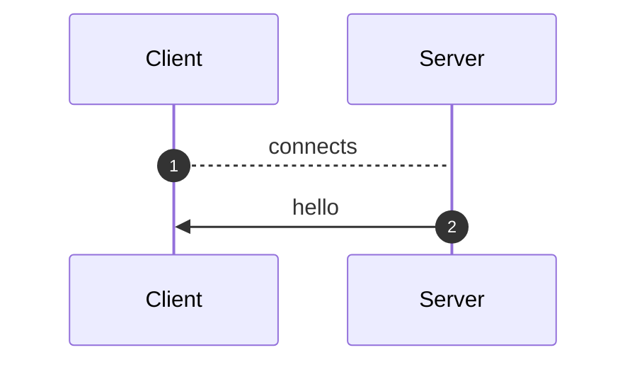
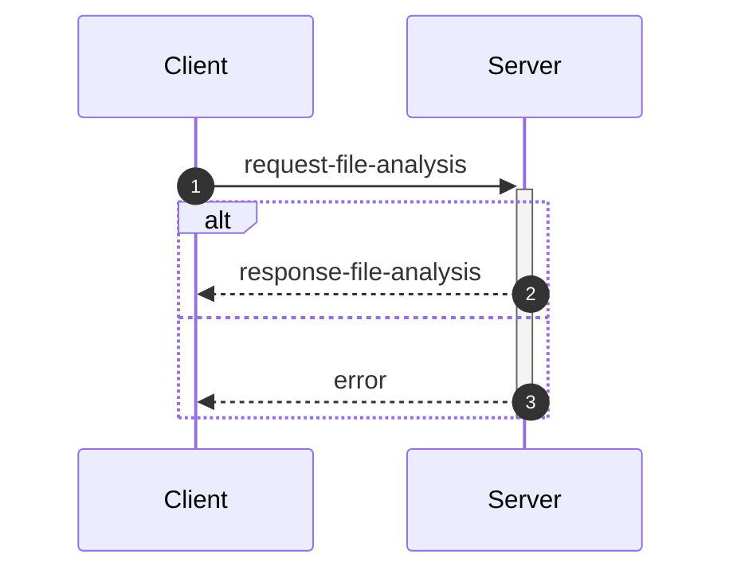
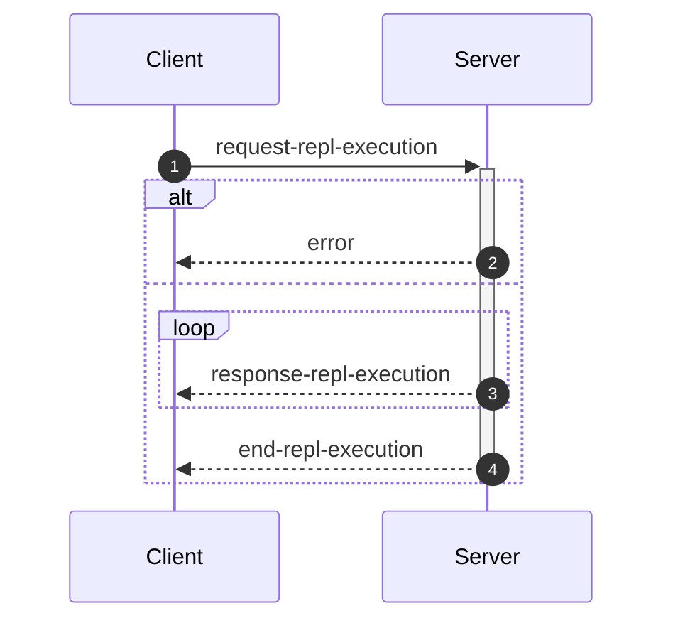
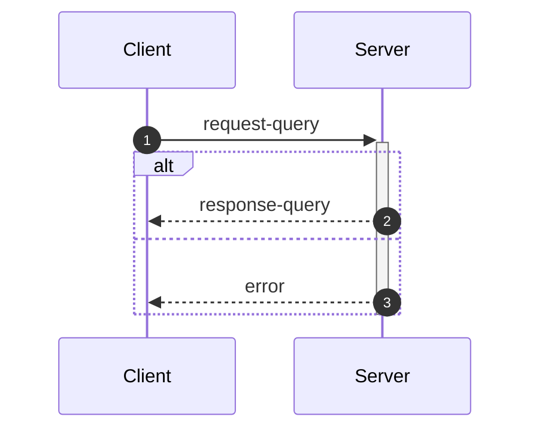

_<span title="an overview of flowR's interface">Generated</span> from '[wiki-interface.ts](https://github.com/flowr-analysis/flowr/tree/main/src/documentation/wiki-interface.ts "src/documentation/wiki-interface.ts")' on 2026-11-03, 13:07:44 UTC (v2.17.0, R v4.6.1), do not edit directly._

Although far from being as detailed as the in-depth explanation of [_flowR_](https://github.com/flowr-analysis/flowr/wiki/Core),
this wiki page explains how to interface with _flowR_ in more detail.
In general, command line arguments and other options provide short descriptions on hover over.

* [💻 Using the REPL](#using-the-repl)
* [⚙️ Configuring FlowR](#configuring-flowr)
* [⚒️ Writing Code](#writing-code)
* [💬 Communicating with the Server](#communicating-with-the-server)

<a id='using-the-repl'></a>
## 💻 Using the REPL

> [!NOTE]
> To execute arbitrary R commands with a repl request, _flowR_ has to be started explicitly with <span title="Description (Command Line Argument): Allow to access the underlying R session when using flowR (security warning: this allows the execution of arbitrary R code!)">`--r-session-access`</span>.
> Please be aware that this introduces a security risk and note that this relies on the [`r-shell` engine](https://github.com/flowr-analysis/flowr/wiki/Engines) .

Although primarily meant for users to explore,
there is nothing which forbids calling _flowR_ as a subprocess to use standard-in, -output, and -error
for communication (although you can access the REPL using the server as well,
with the [REPL Request](#message-request-repl-execution) message).

The read-eval-print loop&nbsp;(REPL) works relatively simple.
You can submit an expression (using <kbd>Enter</kbd>),
which is interpreted as an R&nbsp;expression by default but interpreted as a *command* if it starts with a colon (`:`).
The best command to get started with the REPL is <span title="Description (Repl Command): Show help information (aliases: :h, :?)">`:help`</span>.
Besides, you can leave the REPL either with the command <span title="Description (Repl Command): End the repl (aliases: :q, :exit)">`:quit`</span> or by pressing <kbd>Ctrl</kbd>+<kbd>C</kbd> twice.
When writing a *command*, you may press <kbd>Tab</kbd> to get a list of completions, if available.
Multiple commands can be entered in a single line by separating them with a semicolon (`;`), e.g. `:parse "x<-2"; :df*`.
If a command is given without R code, the REPL will re-use R code given in a previous command.
The prior example will hence return first the parsed AST of the program and then the dataflow graph for `"x <- 2"`.

> [!NOTE]
> If you develop flowR, you may want to launch the repl using the `npm run main-dev` command, this way, you get a non-minified version of flowR with debug information and hot-reloading of source files.

<details>
<summary>Available Commands</summary>

We currently offer the following commands (this with a `[*]` suffix are available with and without the star):

| Command | Description |
| ------- | ----------- |
| **<span title="Description (Repl Command): End the repl (aliases: :q, :exit)">:quit</span>** | End the repl (aliases: **:<span title="Alias of ':quit'. End the repl">q</span>**, **:<span title="Alias of ':quit'. End the repl">exit</span>**) |
| **<span title="Description (Repl Command): Execute the given code as R code. This requires the `--r-session-access` flag to be set and requires the r-shell engine. (aliases: :e, :r)">:execute</span>** | Execute the given code as R code. This requires the `--r-session-access` flag to be set and requires the r-shell engine. (aliases: **:<span title="Alias of ':execute'. Execute the given code as R code. This requires the `--r-session-access` flag to be set and requires the r-shell engine.">e</span>**, **:<span title="Alias of ':execute'. Execute the given code as R code. This requires the `--r-session-access` flag to be set and requires the r-shell engine.">r</span>**) |
| **<span title="Description (Repl Command): Get mermaid code for the control-flow graph of R code (aliases: :cfg, :cf)">:controlflow[*]</span>** | Get mermaid code for the control-flow graph of R code (star: Returns the URL to mermaid.live) (aliases: **:<span title="Alias of ':controlflow'. Get mermaid code for the control-flow graph of R code">cfg</span>**, **:<span title="Alias of ':controlflow'. Get mermaid code for the control-flow graph of R code">cf</span>**) |
| **<span title="Description (Repl Command): Get mermaid code for the control-flow graph with basic blocks (aliases: :cfgb, :cfb)">:controlflowbb[*]</span>** | Get mermaid code for the control-flow graph with basic blocks (star: Returns the URL to mermaid.live) (aliases: **:<span title="Alias of ':controlflowbb'. Get mermaid code for the control-flow graph with basic blocks">cfgb</span>**, **:<span title="Alias of ':controlflowbb'. Get mermaid code for the control-flow graph with basic blocks">cfb</span>**) |
| **<span title="Description (Repl Command): Get mermaid code for the dataflow graph (aliases: :d, :df)">:dataflow[*]</span>** | Get mermaid code for the dataflow graph (star: Returns the URL to mermaid.live) (aliases: **:<span title="Alias of ':dataflow'. Get mermaid code for the dataflow graph">d</span>**, **:<span title="Alias of ':dataflow'. Get mermaid code for the dataflow graph">df</span>**) |
| **<span title="Description (Repl Command): Get mermaid code for the normalized AST of R code (aliases: :n)">:normalize[*]</span>** | Get mermaid code for the normalized AST of R code (star: Returns the URL to mermaid.live) (alias: **:<span title="Alias of ':normalize'. Get mermaid code for the normalized AST of R code">n</span>**) |
| **<span title="Description (Repl Command): Get mermaid code for the simplified dataflow graph (aliases: :ds, :dfs)">:dataflowsimple[*]</span>** | Get mermaid code for the simplified dataflow graph (star: Returns the URL to mermaid.live) (aliases: **:<span title="Alias of ':dataflowsimple'. Get mermaid code for the simplified dataflow graph">ds</span>**, **:<span title="Alias of ':dataflowsimple'. Get mermaid code for the simplified dataflow graph">dfs</span>**) |
| **<span title="Description (Repl Command): Inspect and extend the signature database: `query` (identical to :query @signature), `info <name>` for where a function comes from (identical to :query @function-info), `add <path>` to mount another database/source, `download` to fetch the full-history database. (aliases: :sig)">:signature</span>** | Inspect and extend the signature database: `query` (identical to :query @signature), `info <name>` for where a function comes from (identical to :query @function-info), `add <path>` to mount another database/source, `download` to fetch the full-history database. (alias: **:<span title="Alias of ':signature'. Inspect and extend the signature database: `query` (identical to :query @signature), `info <name>` for where a function comes from (identical to :query @function-info), `add <path>` to mount another database/source, `download` to fetch the full-history database.">sig</span>**) |
| **<span title="Description (Repl Command): Just calculates the DFG, but only prints summary info (aliases: :d#, :df#)">:dataflowsilent</span>** | Just calculates the DFG, but only prints summary info (aliases: **:<span title="Alias of ':dataflowsilent'. Just calculates the DFG, but only prints summary info">d#</span>**, **:<span title="Alias of ':dataflowsilent'. Just calculates the DFG, but only prints summary info">df#</span>**) |
| **<span title="Description (Repl Command): Prints ASCII Art of the parsed, unmodified AST (aliases: :p)">:parse</span>** | Prints ASCII Art of the parsed, unmodified AST (alias: **:<span title="Alias of ':parse'. Prints ASCII Art of the parsed, unmodified AST">p</span>**) |
| **<span title="Description (Repl Command): Prints the version of flowR as well as the current version of R">:version</span>** | Prints the version of flowR as well as the current version of R
| **<span title="Description (Repl Command): Query the given R code (use 'help' for more information)">:query[*]</span>** | Query the given R code (use 'help' for more information) (star: Similar to query, but returns the output in json format.)
| **<span title="Description (Repl Command): Returns an ASCII representation of the dataflow graph (aliases: :df!)">:dataflowascii</span>** | Returns an ASCII representation of the dataflow graph (alias: **:<span title="Alias of ':dataflowascii'. Returns an ASCII representation of the dataflow graph">df!</span>**) |
| **<span title="Description (Repl Command): Returns summarization stats for the normalized AST (aliases: :n#)">:normalize#</span>** | Returns summarization stats for the normalized AST (alias: **:<span title="Alias of ':normalize#'. Returns summarization stats for the normalized AST">n#</span>**) |
| **<span title="Description (Repl Command): Show help information (aliases: :h, :?)">:help</span>** | Show help information (aliases: **:<span title="Alias of ':help'. Show help information">h</span>**, **:<span title="Alias of ':help'. Show help information">?</span>**) |

</details>

> [!TIP]
> 
> As indicated by the examples before, all REPL commands that operate on code keep track of the state.
> Hence, if you run a command like <span title="Description (Repl Command, starred version): Returns the URL to mermaid.live; Base Command: Get mermaid code for the dataflow graph (aliases: :d*, :df*)">`:dataflow*`</span> without providing R code,
> the REPL will re-use the R code provided in a previous command.
> Likewise, doing this will benefit from incrementality!
> If you request the dataflow graph with `:df* x <- 2 * y` and then want to see the parsed AST with `:parse`,
> the REPL will re-use previously obtained information and not re-parse the code again.
> 		

Generally, many commands offer shortcut versions in the REPL. Many queries, for example, offer a shortened format (see the example below).
Of special note, the [Config Query](https://github.com/flowr-analysis/flowr/wiki/%5BQuery%5D-Config)
can be used to also modify the currently active configuration of _flowR_ within the REPL (see the [wiki page](https://github.com/flowr-analysis/flowr/wiki/%5BQuery%5D-Config) for more information).

### Example: Retrieving the Dataflow Graph

To retrieve a URL to the [mermaid](https://mermaid.js.org/) diagram of the dataflow of a given expression,
use <span title="Description (Repl Command, starred version): Returns the URL to mermaid.live; Base Command: Get mermaid code for the dataflow graph (aliases: :d*, :df*)">`:dataflow*`</span> (or <span title="Description (Repl Command): Get mermaid code for the dataflow graph (aliases: :d, :df)">`:dataflow`</span> to get the mermaid code in the cli):

```shell
$ docker run -it --rm eagleoutice/flowr # or npm run flowr 
flowR repl v2.17.0, R grammar v14 (tree-sitter engine)
R> :dataflow* y <- 1 + x
```

<details>
<summary style='color:gray'>Output</summary>

```text
https://mermaid.live/view#base64:eyJjb2RlIjoiZmxvd2NoYXJ0IFREXG4gICAgMXt7XCJgKiM5MTtSTnVtYmVyIzkzOyogKioxKipcbiAgICAgICoxLjYqICgqKmlkOiAxKiopYFwifX1cbiAgICAyKFtcImAqIzkxO1JTeW1ib2wjOTM7KiAqKngqKlxuICAgICAgKjEuMTAqICgqKmlkOiAyKiopYFwiXSlcbiAgICAzW1tcImAqIzkxO1JCaW5hcnlPcCM5MzsqIGJhc2UjNTg7IzU4OyoqIzQzOyoqXG4gICAgICAqMS42LTEwKiAoKippZDogMyoqKVxuICAgIGFyZzogKDEsIDIpYFwiXV1cbiAgICBidWlsdC1pbjpfNDNfW1wiYEJ1aWx0LUluOlxuIzQzO2BcIl1cbiAgICBzdHlsZSBidWlsdC1pbjpfNDNfIHN0cm9rZTpncmF5LGZpbGw6Z3JheSxzdHJva2Utd2lkdGg6MnB4LG9wYWNpdHk6Ljg7XG4gICAgMFtcImAqIzkxO1JTeW1ib2wjOTM7KiAqKnkqKlxuICAgICAgKjEuMSogKCoqaWQ6IDAqKiwgdjogMylgXCJdXG4gICAgNFtbXCJgKiM5MTtSQmluYXJ5T3AjOTM7KiBiYXNlIzU4OyM1ODsqKiM2MDsjNDU7KipcbiAgICAgICoxLjEtMTAqICgqKmlkOiA0KiopXG4gICAgYXJnOiAoMCwgMylgXCJdXVxuICAgIGJ1aWx0LWluOl82MF8tW1wiYEJ1aWx0LUluOlxuIzYwOyM0NTtgXCJdXG4gICAgc3R5bGUgYnVpbHQtaW46XzYwXy0gc3Ryb2tlOmdyYXksZmlsbDpncmF5LHN0cm9rZS13aWR0aDoycHgsb3BhY2l0eTouODtcbiAgICAxIC0uLT58XCJmbG93XCJ8IDJcbiAgICBsaW5rU3R5bGUgMCBzdHJva2U6Z3JheSxjb2xvcjpncmF5O1xuICAgIDIgLS4tPnxcImZsb3dcInwgM1xuICAgIGxpbmtTdHlsZSAxIHN0cm9rZTpncmF5LGNvbG9yOmdyYXk7XG4gICAgMyAtLT58XCJyZWFkcywgYXJnXCJ8IDFcbiAgICAzIC0tPnxcInJlYWRzLCBhcmdcInwgMlxuICAgIDMgLS4tPnxcImZsb3dcInwgMFxuICAgIGxpbmtTdHlsZSA0IHN0cm9rZTpncmF5LGNvbG9yOmdyYXk7XG4gICAgMyAtLi0+fFwicmVhZHMsIGNhbGxzXCJ8IGJ1aWx0LWluOl80M19cbiAgICBsaW5rU3R5bGUgNSBzdHJva2U6Z3JheTtcbiAgICAwIC0tPnxcImRlZmluZWQtYnksIGZsb3dcInwgNFxuICAgIDAgLS0+fFwiZGVmaW5lZC1ieVwifCAzXG4gICAgNCAtLT58XCJyZWFkcywgYXJnXCJ8IDNcbiAgICA0IC0tPnxcInJldHVybnMsIGFyZ1wifCAwXG4gICAgNCAtLi0+fFwicmVhZHMsIGNhbGxzXCJ8IGJ1aWx0LWluOl82MF8tXG4gICAgbGlua1N0eWxlIDEwIHN0cm9rZTpncmF5OyIsIm1lcm1haWQiOnsiYXV0b1N5bmMiOnRydWV9fQ==
```

Retrieve the dataflow graph of the expression `y <- 1 + x`. It looks like this:


<details>

<summary style="color:gray">R Code of the Dataflow Graph</summary>

The analysis ran (parse and normalize with the [tree-sitter](https://github.com/flowr-analysis/flowr/wiki/Engines) engine) in the generation environment. No [signature database](https://github.com/flowr-analysis/flowr/wiki/Signature-Database) is mounted, so `library()` attaches no exports (base-R names are still qualified, e.g., `stats::acf`). 
We encountered no unknown side effects during the analysis.

```r
y <- 1 + x
```

</details>

</details>

For small graphs like this, <span title="Description (Repl Command): Returns an ASCII representation of the dataflow graph (aliases: :df!)">`:dataflowascii`</span> also provides an ASCII representation directly in the REPL:

```shell
$ docker run -it --rm eagleoutice/flowr # or npm run flowr 
flowR repl v2.17.0, R grammar v14 (tree-sitter engine)
R> :df! y <- 1 + x
```

<details open>
<summary style='color:gray'>Output</summary>

```text
                        v<0>v
 c<4>c──────────────────| y |
 |<- |     ┌────────────v---v
 c---c     │
    │   c<3>c   0<1>0
    └───| + |───| 1 |───u<2>u
        c---c   0---0   | x |
           └────────────u---u
Edges:
3 -> 1: reads, arg          3 -> 2: reads, arg
3 -> 0: flows-to            1 -> 2: flows-to
2 -> 3: flows-to            4 -> 3: reads, arg
4 -> 0: returns, arg        0 -> 4: defined-by, flows-to
0 -> 3: defined-by
```

Retrieve the dataflow graph of the expression `y <- 1 + x` as ASCII art.

</details>

For the slicing with <span title="Description (Repl Command): Static backwards executable slicer for R">`:slicer`</span>, you have access to the same [magic comments](#slice-magic-comments) as with the [slice request](#message-request-slice).
Pass `--inline` to splice resolvable `source()` calls into the reconstruction so the slice is a single self-contained R text (the same as the static slice query's `inlineSources` flag).
See `--help` for more flags!

### Example: Interfacing with the File System

Many commands that allow for an R-expression (like <span title="Description (Repl Command, starred version): Returns the URL to mermaid.live; Base Command: Get mermaid code for the dataflow graph (aliases: :d*, :df*)">`:dataflow*`</span>) allow for a file as well
if the argument starts with `file://`.
If you are working from the root directory of the _flowR_ repository, the following gives you the parsed AST of the example file using the <span title="Description (Repl Command): Prints ASCII Art of the parsed, unmodified AST (aliases: :p)">`:parse`</span> command:

> **Watch mode**: Replace `file://` with `watch://` to enter watch mode.
> flowR runs the command immediately and then re-runs it every time the file (or any file inside the folder) changes.
> Enter any other command to leave watch mode.
> For example: `:df watch://analysis.R`

```shell
$ docker run -it --rm eagleoutice/flowr # or npm run flowr 
flowR repl v2.17.0, R grammar v14 (tree-sitter engine)
R> :parse file://test/testfiles/example.R
```

<details>
<summary style='color:gray'>Output</summary>

```text
File: test/testfiles/example.R

program
├ binaryoperator
│ ├ identifier "sum" (1:1─4)
│ ├ <- "<-" (1:5─7)
│ ╰ float "0" (1:8─9)
├ binaryoperator
│ ├ identifier "product" (2:1─8)
│ ├ <- "<-" (2:9─11)
│ ╰ float "1" (2:12─13)
├ binaryoperator
│ ├ identifier "w" (3:1─2)
│ ├ <- "<-" (3:3─5)
│ ╰ float "7" (3:6─7)
├ binaryoperator
│ ├ identifier "N" (4:1─2)
│ ├ <- "<-" (4:3─5)
│ ╰ float "10" (4:6─8)
├ forstatement
│ ├ for "for" (6:1─4)
│ ├ ( "(" (6:5─6)
│ ├ identifier "i" (6:6─7)
│ ├ in "in" (6:8─10)
│ ├ binaryoperator
│ │ ├ float "1" (6:11─12)
│ │ ├ : ":" (6:12─13)
│ │ ╰ parenthesizedexpression
│ │   ├ ( "(" (6:13─14)
│ │   ├ binaryoperator
│ │   │ ├ identifier "N" (6:14─15)
│ │   │ ├ - "-" (6:15─16)
│ │   │ ╰ float "1" (6:16─17)
│ │   ╰ ) ")" (6:17─18)
│ ├ ) ")" (6:18─19)
│ ╰ bracedexpression
│   ├ { "{" (6:20─21)
│   ├ binaryoperator
│   │ ├ identifier "sum" (7:3─6)
│   │ ├ <- "<-" (7:7─9)
│   │ ╰ binaryoperator
│   │   ├ binaryoperator
│   │   │ ├ identifier "sum" (7:10─13)
│   │   │ ├ + "+" (7:14─15)
│   │   │ ╰ identifier "i" (7:16─17)
│   │   ├ + "+" (7:18─19)
│   │   ╰ identifier "w" (7:20─21)
│   ├ binaryoperator
│   │ ├ identifier "product" (8:3─10)
│   │ ├ <- "<-" (8:11─13)
│   │ ╰ binaryoperator
│   │   ├ identifier "product" (8:14─21)
│   │   ├  "" (8:22─23)
│   │   ╰ identifier "i" (8:24─25)
│   ╰ } "}" (9:1─2)
├ call
│ ├ identifier "cat" (11:1─4)
│ ╰ arguments
│   ├ ( "(" (11:4─5)
│   ├ argument
│   │ ╰ string
│   │   ├ stringopen "\"" (11:5─6)
│   │   ├ stringcontent "Sum:" (11:6─10)
│   │   ╰ stringclose "\"" (11:10─11)
│   ├ comma "," (11:11─12)
│   ├ argument
│   │ ╰ identifier "sum" (11:13─16)
│   ├ comma "," (11:16─17)
│   ├ argument
│   │ ╰ string
│   │   ├ stringopen "\"" (11:18─19)
│   │   ├ stringcontent
│   │   │ ╰ escapesequence "\\n" (11:19─21)
│   │   ╰ stringclose "\"" (11:21─22)
│   ╰ ) ")" (11:22─23)
╰ call
  ├ identifier "cat" (12:1─4)
  ╰ arguments
    ├ ( "(" (12:4─5)
    ├ argument
    │ ╰ string
    │   ├ stringopen "\"" (12:5─6)
    │   ├ stringcontent "Product:" (12:6─14)
    │   ╰ stringclose "\"" (12:14─15)
    ├ comma "," (12:15─16)
    ├ argument
    │ ╰ identifier "product" (12:17─24)
    ├ comma "," (12:24─25)
    ├ argument
    │ ╰ string
    │   ├ stringopen "\"" (12:26─27)
    │   ├ stringcontent
    │   │ ╰ escapesequence "\\n" (12:27─29)
    │   ╰ stringclose "\"" (12:29─30)
    ╰ ) ")" (12:30─31)
```

Retrieve the parsed AST of the example file.

<details>

<summary>File Content</summary>

```r
sum <- 0
product <- 1
w <- 7
N <- 10

for (i in 1:(N-1)) {
  sum <- sum + i + w
  product <- product * i
}

cat("Sum:", sum, "\n")
cat("Product:", product, "\n")
```

</details>

As _flowR_ directly transforms this AST the output focuses on being human-readable instead of being machine-readable.
		
</details>

### Example: Run a Query

You can run any query supported by _flowR_ using the <span title="Description (Repl Command): Query the given R code (use 'help' for more information)">`:query`</span> command.
For example, to obtain the shapes of all data frames in a given piece of code, you can run:

```shell
$ docker run -it --rm eagleoutice/flowr # or npm run flowr 
flowR repl v2.17.0, R grammar v14 (tree-sitter engine)
R> :query @absint df-shape "x <- data.frame(a = 1:10, b = 1:10)\ny <- x$a"
```

<details open>
<summary style='color:gray'>Output</summary>

```text
Query: absint (1 ms)
   ╰ $12: (colnames: [{"a", "b"}, {}], cols: [2, 2], rows: [10, 10])
   ╰ $0: (colnames: [{"a", "b"}, {}], cols: [2, 2], rows: [10, 10])
```

Retrieve the shapes of all data frames in the given code.

</details>

To run the linter on a file, you can use (in this example, we just issue the `dead-code` linter on a small piece of code):

```shell
$ docker run -it --rm eagleoutice/flowr # or npm run flowr 
flowR repl v2.17.0, R grammar v14 (tree-sitter engine)
R> :query @linter rules:dead-code "if(FALSE) x <- 2"
```

<details open>
<summary style='color:gray'>Output</summary>

```text
Query: linter (2 ms)
   ╰ Dead Code (dead-code):
       ╰ certain:
           ╰ Code at 1.11-16 (1 quick fix(es) available)
```

Run the linter on the given code, with only the `dead-code` rule enabled.

</details>

For more information on the available queries, please check out the [Query API](https://github.com/flowr-analysis/flowr/wiki/Query-API).

<a id='configuring-flowr'></a>
## ⚙️ Configuring FlowR

When running _flowR_, you may want to specify some behaviors with a dedicated configuration file.
By default, flowR looks for a file named `flowr.json` in the current working directory (or any higher directory).
You can also specify a different file with <span title="Description (Command Line Argument): The name of the configuration file to use">`--config-file`</span> or pass the configuration inline using <span title="Description (Command Line Argument): The flowR configuration to use, as a JSON string">`--config-json`</span>.
A `flowr.json` found this way belongs to the analyzed project, so flowR ignores its options that decide what flowR executes or loads
(`engines.*.wasmPath`, `engines.*.treeSitterWasmPath`, `engines.*.rPath`, `solver.sigdb.additionalPaths`, `solver.sigdb.downloadRepo`, `solver.sigdb.installedLibrary.paths`, `solver.sigdb.onDemand.enabled`, `solver.sigdb.onDemand.repositories`, `solver.sigdb.onDemand.cranMirror`, `solver.sigdb.onDemand.bioconductorMirror`, `solver.sigdb.onDemand.cacheDir`),
unless you pass <span title="Description (Command Line Argument): Keep the security-sensitive options (e.g., the R executable) of the flowr.json found in the working directory or a parent. Only use this for projects you trust.">`--trust-config`</span>.
To analyze code you do not trust, use the secure mode (<span title="Description (Command Line Argument): Run in secure mode for analyzing untrusted code: flowR does not start R (or any other process), does not access the network, does not search for project configs, and ignores security-sensitive options in every config. Cannot be disabled once enabled. Can also be enabled with the environment variable {italic FLOWR_SECURE_MODE=1}.">`--secure`</span>, see the [security policy](https://github.com/flowr-analysis/flowr/blob/main/.github/SECURITY.md)).
To inspect the current configuration, you can run flowr with the <span title="Description (Command Line Argument): Run with verbose logging (will be passed to the corresponding script)">`--verbose`</span> flag, or use the `config` [Query](https://github.com/flowr-analysis/flowr/wiki/Query-API).
Within the REPL this works by running the following:

```shell
:query @config
```

To work with the <a href="https://github.com/flowr-analysis/flowr/tree/main/src/config.ts#L119"><code><span title="The configuration file format for flowR.">FlowrConfig</span></code></a> you can use the provided helper objects alongside its methods like
<a href="https://github.com/flowr-analysis/flowr/tree/main/src/config.ts#L966"><code><span title="Creates a new flowr config that has the updated values.">FlowrConfig::<b>amend</b></span></code></a>.
The schema below documents every option; the ones you most likely want are:

- <a href="https://github.com/flowr-analysis/flowr/wiki/Interface#configuring-flowr" title="Configuration Option (boolean): Whether source calls should be ignored, causing {@link processSourceCall}&#39;s behavior to be skipped.">ignoreSourceCalls</a>: ignore source calls when analyzing the code, i.e., ignore the inclusion of other files.
- <a href="https://github.com/flowr-analysis/flowr/wiki/Interface#configuring-flowr" title="Configuration Option (boolean): Whether load calls should be ignored, causing {@link processLoadCall}&#39;s behavior to be skipped.">ignoreLoadCalls</a>: ignore load calls when analyzing the code, i.e., ignore the loading of r-data files.
- <a href="https://github.com/flowr-analysis/flowr/wiki/Interface#configuring-flowr" title="Configuration Option (object): Do you want to overwrite (parts) of the builtin definition?">semantics.environment.overwriteBuiltIns</a>: overwrite _flowR_'s handling of built-in functions, or clear the preset definitions entirely.
  See [Configure BuiltIn Semantics](#configure-builtin-semantics) for more information.
- <a href="https://github.com/flowr-analysis/flowr/wiki/Interface#configuring-flowr" title="Configuration Option (string): How to resolve variables and their values. (one of &quot;disabled&quot;, &quot;alias&quot;, &quot;builtin&quot;)">solver.variables</a>: how to resolve variables and their values (`disabled`, `alias`, `builtin`).
- <a href="https://github.com/flowr-analysis/flowr/wiki/Interface#configuring-flowr" title="Configuration Option (array): The engine or set of engines to use for interacting with R code. An empty array means all available engines will be used.">engines</a> and <a href="https://github.com/flowr-analysis/flowr/wiki/Interface#configuring-flowr" title="Configuration Option (string): The default engine to use for interacting with R code. If this is undefined, an arbitrary engine from the specified list will be used. (one of &quot;tree-sitter&quot;, &quot;r-shell&quot;)">defaultEngine</a>: the engines used to interact with R code, see the [Engines wiki page](https://github.com/flowr-analysis/flowr/wiki/Engines).
- <a href="https://github.com/flowr-analysis/flowr/wiki/Interface#configuring-flowr" title="Configuration Option (array): Files a framework loads on its own, without any source() call (e.g. global.R in a shiny app), in the order they are loaded; flowR orders the matching project files accordingly and analyzes them as one program. Entries are case-insensitive globs matched against the file path, a plain name matches any file with that name, and entries matching no project file are warned about. Usually set per project kind via specializeConfig.">project.implicitSources</a>: the files a framework loads without any `source()` call, in the order in which they are
  loaded. Entries are globs (e.g. `R/*.R`) matched against the file path ignoring capitalization; one matching no file is reported.
- <a href="https://github.com/flowr-analysis/flowr/wiki/Interface#configuring-flowr" title="Configuration Option (object): Overwrite (parts of) the configuration depending on the project kind flowR detects, e.g. to give a shiny app its implicit sources.">specializeConfig</a>: overwrite (parts of) the configuration depending on the kind of project _flowR_ detects
  (e.g. `shiny-app`), which is how a shiny app gets its implicit sources by default. What you configure directly wins.
- <a href="https://github.com/flowr-analysis/flowr/wiki/Interface#configuring-flowr" title="Configuration Option (string): Overwrite the project kind flowR would otherwise infer from the analyzed files, e.g. when auto-detection guesses wrong. (one of &quot;package&quot;, &quot;script&quot;, &quot;shiny-app&quot;, &quot;notebook&quot;, &quot;project&quot;, &quot;unknown&quot;)">project.useProjectType</a>: skip that detection and force a project kind yourself, when auto-detection guesses wrong.
- <a href="https://github.com/flowr-analysis/flowr/wiki/Interface#configuring-flowr" title="Configuration Option (array): The default plugins to load when creating a new instance of FlowrAnalyzer">defaultPlugins</a> and <a href="https://github.com/flowr-analysis/flowr/wiki/Interface#configuring-flowr" title="Configuration Option (array): The plugins to load in REPL mode">repl.plugins</a>: the plugins to load for a new <a href="https://github.com/flowr-analysis/flowr/tree/main/src/project/flowr-analyzer.ts#L210"><code><span title="Central class for conducting analyses with FlowR. Use the FlowrAnalyzerBuilder to create a new instance. If you want the original pattern of creating a pipeline and running all steps, you can still do this with FlowrAnalyzer#runFull . To inspect the context of the analyzer, use FlowrAnalyzer#inspectContext (if you are a plugin and need to modify it, use FlowrAnalyzer#context instead).">FlowrAnalyzer</span></code></a> and in the REPL
  (use `flowr:default` to reference the former).

So you can configure _flowR_ by adding a file like the following:

<details>

<summary>Example Configuration File</summary>

```json
{
  "ignoreSourceCalls": true,
  "ignoreLoadCalls": true,
  "semantics": {
    "environment": {
      "overwriteBuiltIns": {
        "definitions": [
          {
            "type": "function",
            "names": [
              "foo"
            ],
            "processor": "builtin:assign",
            "config": {}
          }
        ]
      }
    }
  },
  "defaultPlugins": [
    "file:description",
    "versions:description"
  ],
  "repl": {
    "quickStats": false,
    "dfProcessorHeat": false,
    "hints": true,
    "plugins": [
      "flowr:default"
    ]
  },
  "project": {
    "resolveUnknownPathsOnDisk": true,
    "implicitSources": [
      "global.R",
      "app.R"
    ]
  },
  "linter": {
    "disabledRules": []
  },
  "specializeConfig": {
    "shiny-app": {
      "project": {
        "implicitSources": [
          "global.R",
          "ui.R",
          "server.R",
          "app.R"
        ]
      }
    }
  },
  "engines": [
    {
      "type": "r-shell"
    }
  ],
  "solver": {
    "variables": "alias",
    "evalStrings": true,
    "trackEnvironments": true,
    "sigdb": {
      "enabled": true,
      "loadProjectDependencies": true,
      "eagerlyLoad": false,
      "eagerlyLoadExports": false,
      "linkBaseR": false,
      "linkDescriptionDependencies": false
    },
    "resolveSource": {
      "dropPaths": "no",
      "ignoreCapitalization": true,
      "inferWorkingDirectory": "active-script",
      "searchPath": []
    },
    "instrument": {},
    "slicer": {
      "threshold": 50
    }
  },
  "abstractInterpretation": {
    "wideningThreshold": 4,
    "followCalls": true,
    "dataFrame": {
      "maxColNames": 20,
      "readLoadedData": {
        "readExternalFiles": true,
        "maxReadLines": 1000000
      }
    }
  },
  "incremental": {
    "alwaysIncremental": false,
    "parsing": {
      "activated": false,
      "heuristics": {
        "activated": true,
        "mtime": true,
        "linesFrom": 500,
        "bytesFrom": 50000,
        "alwaysWithEdits": false,
        "minFiles": 1
      }
    }
  },
  "gas": {
    "thresholds": {
      "memory": {
        "problematic": 0.7,
        "critical": 0.9
      },
      "timeMs": {
        "problematic": 100000,
        "critical": 120000
      }
    },
    "features": {}
  }
}
```

</details>

<details>
<a id='configure-builtin-semantics'></a>
<summary>Configure Built-In Semantics</summary>

`semantics/environment/overwriteBuiltins` accepts two keys:

- `loadDefaults` (boolean, initially `true`): If set to `true`, the default built-in definitions are loaded before applying the custom definitions. Setting this flag to `false` explicitly disables the loading of the default definitions.
- `definitions` (array, initially empty): Allows to overwrite or define new built-in elements. Each object within must have a `type` which is one of the below. Furthermore, they may define a string array of `names` which specifies the identifiers to bind the definitions to. You may use `assumePrimitive` to specify whether _flowR_ should assume that this is a primitive non-library definition (so you probably just do not want to specify the key).

  | Type            | Description                                                                                                                                                                                                                                                                                              | Example                                                                                                    |
  | --------------- | -------------------------------------------------------------------------------------------------------------------------------------------------------------------------------------------------------------------------------------------------------------------------------------------------------- | ---------------------------------------------------------------------------------------------------------- |
  | `constant`    | Additionally allows for a `value` this should resolve to.                                                                                                                                                                                                                                                | `{ type: 'constant', names: ['NULL', 'NA'],  value: null }`                                                |
  | `function`    | Is a rather flexible way to define and bind built-in functions. For the time, we do not have extensive documentation to cover all the cases, so please either consult the sources with the `default-builtin-config.ts` or open a [new issue](https://github.com/flowr-analysis/flowr/issues/new/choose). | `{ type: 'function', names: ['next'], processor: 'builtin:d', config: { cfg: ExitPointType.Next } }` |
  | `replacement` | A comfortable way to specify replacement functions like `$<-` or `names<-`. `suffixes` describes the... suffixes to attach automatically. | `{ type: 'replacement', suffixes: ['<-', '<<-'], names: ['[', '[['] }` |

</details>

<details>

<summary style='color:gray'>Full Configuration-File Schema</summary>

- _The configuration file format for flowR._ (object)
    - **logLevel** [optional] _flowR's global minimum log level, applied when the config is loaded._ (string)
        Only allows: 'silly', 'trace', 'debug', 'info', 'warn', 'error', 'fatal'
    - **ignoreSourceCalls** [optional] _Whether source calls should be ignored, causing {@link processSourceCall}'s behavior to be skipped._ (boolean)
    - **ignoreLoadCalls** [optional] _Whether load calls should be ignored, causing {@link processLoadCall}'s behavior to be skipped._ (boolean)
    - **semantics** _Configure language semantics and how flowR handles them._ (object)
        - **environment** [optional] _Semantics regarding how to handle the R environment._ (object)
            - **overwriteBuiltIns** [optional] _Do you want to overwrite (parts) of the builtin definition?_ (object)
                - **loadDefaults** [optional] _Should the default configuration still be loaded?_ (boolean)
                - **definitions** [optional] _The definitions to load/overwrite._ (array)
                Valid item types:
                    - (object)
    - **defaultPlugins** [optional] _The default plugins to load when creating a new instance of FlowrAnalyzer_ (array)
    Valid item types:
        - (alternatives)
            - (string)
            - (array)
    - **repl** _Configuration options for the REPL._ (object)
        - **quickStats** [optional] _Whether to show quick stats in the REPL after each evaluation._ (boolean)
        - **dfProcessorHeat** [optional] _This instruments the dataflow processors to count how often each processor is called._ (boolean)
        - **hints** [optional] _Whether to show dim inline hints on the empty prompt (automatically disabled on non-interactive terminals)._ (boolean)
        - **plugins** [optional] _The plugins to load in REPL mode_ (array)
        Valid item types:
            - (alternatives)
                - (string)
                - (array)
        - **autoUseFileProtocol** [optional] _Prepend the file protocol to a repl input that looks like a path, instead of only warning about it._ (boolean)
        - **queryStats** [optional] _Whether `:query` closes with the line stating how long the queries took (`:query*` never prints it)._ (boolean)
        - **showPlugins** [optional] _Whether `:version` grays out the plugins that did not activate during the last analysis._ (boolean)
    - **project** _Project specific configuration options._ (object)
        - **resolveUnknownPathsOnDisk** [optional] _Whether to resolve unknown paths loaded by the r project disk when trying to source/analyze files._ (boolean)
        - **failOnInaccessiblePath** [optional] _Whether a directory that cannot be traversed during file discovery (e.g. due to permissions) aborts the analysis; when false (the default) such paths are logged and skipped._ (boolean)
        - **basePackages** [optional] _The packages considered part of R itself (base and recommended); if unset, flowR uses its built-in list._ (array)
        Valid item types:
            - (string)
        - **implicitSources** [optional] _Files a framework loads on its own, without any source() call (e.g. global.R in a shiny app), in the order they are loaded; flowR orders the matching project files accordingly and analyzes them as one program. Entries are case-insensitive globs matched against the file path, a plain name matches any file with that name, and entries matching no project file are warned about. Usually set per project kind via specializeConfig._ (array)
        Valid item types:
            - (string)
        - **useProjectType** [optional] _Overwrite the project kind flowR would otherwise infer from the analyzed files, e.g. when auto-detection guesses wrong._ (string)
            Only allows: 'package', 'script', 'shiny-app', 'notebook', 'project', 'unknown'
        - **assumeImplicitEcho** [optional] _Whether the top level of the analyzed code is echoed, so that every visible result printed there is collected as an output by the dependencies query (default true, false for a package)._ (boolean)
        - **discovery** [optional] _Scoping options for the default project discovery._ (object)
            - **full** [optional] _Collect every file below the project root (greedy) instead of only the files the detected project kind needs (default false)._ (boolean)
            - **perKind** [optional] _Per-kind include/exclude glob overrides layered on the default scoping._ (object)
            - **ignore** [optional] _Case-insensitive globs that drop matching files from the intelligent discovery, regardless of kind (e.g. .Renviron to ignore environment files)._ (array)
            Valid item types:
                - (string)
        - **classification** [optional] _Overrides for the signals flowR uses to classify the project kind._ (object)
            - **shinyDescriptionTypes** [optional] _DESCRIPTION Type: values that mark a shiny app._ (array)
            Valid item types:
                - (string)
            - **shinyEntryFiles** [optional] _File names a shiny app is assembled from._ (array)
            Valid item types:
                - (string)
            - **shinyUsagePattern** [optional] _Regex source evidencing shiny usage in an entry file._ (string)
            - **notebookExtensions** [optional] _File extensions marking a notebook._ (array)
            Valid item types:
                - (string)
    - **linter** _Linter configuration options._ (object)
        - **disabledRules** _Linting rule names excluded from the default rule set (a rule requested explicitly via a linter query still runs). Usually set per project kind via specializeConfig._ (array)
        Valid item types:
            - (string)
        - **disabledTags** [optional] _Linting rule tags whose rules are excluded from the default rule set (a rule requested explicitly via a linter query still runs). By default the cmd-check rules are disabled for everything but a package; a configured list replaces that default._ (array)
        Valid item types:
            - (string)
    - **inputSources** [optional] _Further frameworks the input-sources analysis should know about; entries are added to flowR's defaults._ (object)
        - **pure** [optional] _Functions that only pass the constantness of their arguments on._ (array)
        Valid item types:
            - (string)
        - **param** [optional] _Functions whose result is a 'param' input._ (array)
        Valid item types:
            - (string)
        - **file** [optional] _Functions whose result is a 'file' input._ (array)
        Valid item types:
            - (string)
        - **tempfile** [optional] _Functions whose result is a 'tempfile' input._ (array)
        Valid item types:
            - (string)
        - **glob** [optional] _Functions whose result is a 'glob' input._ (array)
        Valid item types:
            - (string)
        - **net** [optional] _Functions whose result is a 'net' input._ (array)
        Valid item types:
            - (string)
        - **rand** [optional] _Functions whose result is a 'rand' input._ (array)
        Valid item types:
            - (string)
        - **system** [optional] _Functions whose result is a 'system' input._ (array)
        Valid item types:
            - (string)
        - **ffi** [optional] _Functions whose result is a 'ffi' input._ (array)
        Valid item types:
            - (string)
        - **lang** [optional] _Functions whose result is a 'lang' input._ (array)
        Valid item types:
            - (string)
        - **options** [optional] _Functions whose result is a 'options' input._ (array)
        Valid item types:
            - (string)
        - **cmdline** [optional] _Functions whose result is a 'cmdline' input._ (array)
        Valid item types:
            - (string)
        - **user** [optional] _Functions whose result is a 'user' input._ (array)
        Valid item types:
            - (string)
        - **const** [optional] _Functions whose result is a 'const' input._ (array)
        Valid item types:
            - (string)
        - **scope** [optional] _Functions whose result is a 'scope' input._ (array)
        Valid item types:
            - (string)
        - **dconst** [optional] _Functions whose result is a 'dconst' input._ (array)
        Valid item types:
            - (string)
        - **unknown** [optional] _Functions whose result is a 'unknown' input._ (array)
        Valid item types:
            - (string)
        - **linkedObjects** [optional] _Objects a framework provides without a definition in the code, e.g. shiny's input._ (array)
        Valid item types:
            - (object)
        - **linkedEntryPoints** [optional] _Calls that hand a function to a framework, which binds its objects to the parameters by position._ (array)
        Valid item types:
            - (object)
    - **specializeConfig** [optional] _Overwrite (parts of) the configuration depending on the project kind flowR detects, e.g. to give a shiny app its implicit sources._ (object)
    - **engines** _The engine or set of engines to use for interacting with R code. An empty array means all available engines will be used._ (array)
    Valid item types:
        - (alternatives)
            - _The configuration for the tree sitter engine._ (object)
                - **type** [required] _Use the tree sitter engine._ (string)
                    Only allows: 'tree-sitter'
                - **wasmPath** [optional] _The path to the tree-sitter-r WASM binary to use. If this is undefined, this uses the default path._ (string)
                - **treeSitterWasmPath** [optional] _The path to the tree-sitter WASM binary to use. If this is undefined, this uses the default path._ (string)
                - **lax** [optional] _Whether to use the lax parser for parsing R code (allowing for syntax errors). If this is undefined, the strict parser will be used._ (boolean)
            - _The configuration for the R shell engine._ (object)
                - **type** [required] _Use the R shell engine._ (string)
                    Only allows: 'r-shell'
                - **rPath** [optional] _The path to the R executable to use. If this is undefined, this uses the default path._ (string)
                - **pipeBind** [optional] _Whether to enable R's experimental pipe-bind operator "=>" by setting _R_USE_PIPEBIND_ for the R session (default false); R itself keeps this off by default, as it is experimental and has never shipped in a release version of R._ (boolean)
    - **defaultEngine** [optional] _The default engine to use for interacting with R code. If this is undefined, an arbitrary engine from the specified list will be used._ (string)
        Only allows: 'tree-sitter', 'r-shell'
    - **solver** _How to resolve constants, constraints, cells, ..._ (object)
        - **variables** _How to resolve variables and their values._ (string)
            Only allows: 'disabled', 'alias', 'builtin'
        - **evalStrings** _Should we include eval(parse(text="...")) calls in the dataflow graph?_ (boolean)
        - **trackEnvironments** [optional] _Track user-created environments (new.env, assign/get/local with envir=, dollar-assign, attach). When false, all envir-style calls fall through conservatively._ (boolean)
        - **sigdb** _Resolving library exports from a signature database._ (object)
            - **enabled** [optional] _Resolve library()/use() exports from a signature database (default true); when false no database is consulted._ (boolean)
            - **loadProjectDependencies** [optional] _Load the project's declared dependencies from its metadata files (DESCRIPTION Imports/Depends, rproject.toml, uvr.toml, rig rproj.toml and script blocks, renv.lock, rv.lock, uvr.lock, rig lockfiles) (default true); when false these files are not read for dependencies._ (boolean)
            - **eagerlyLoad** [optional] _Parse the database up front rather than on the first package load (default false, ignored if disabled)._ (boolean)
            - **eagerlyLoadExports** [optional] _Add a vertex for every export on load rather than on demand (default false); keeps the dataflow graph small._ (boolean)
            - **assumedRVersion** [optional] _R version assumed when resolving versioned (base-R) exports: a pin like "4.5" or "auto" to detect the installed R (default "auto")._ (string)
            - **linkBaseR** [optional] _Eagerly attach base-R namespaces so bare base calls resolve without library() (default false)._ (boolean)
            - **linkBaseRCalls** [optional] _Add a lightweight Reads edge from a bare base-R call to its signature-database function vertex (default false; base-R qualification is edge-free otherwise)._ (boolean)
            - **linkPackageCalls** [optional] _Add a lightweight Reads edge from a resolved package call to its signature-database function vertex (default false)._ (boolean)
            - **linkDescriptionDependencies** [optional] _Eagerly attach the namespaces of the project's declared DESCRIPTION dependencies (Imports/Depends) so their exports resolve without an explicit library() (default false)._ (boolean)
            - **warmInBackground** [optional] _Decompress the hot shards (base + most-downloaded) in a background task on startup so the first library() lookup is warm (default false; for long-running servers/REPLs)._ (boolean)
            - **additionalPaths** [optional] _Extra directories or bundle/manifest files searched for signature databases (alongside the shipped default and $FLOWR_SIGDB_DIR); a downloaded full-history bundle placed here is mounted automatically._ (array)
            Valid item types:
                - (string)
            - **downloadRepo** [optional] _GitHub owner/repo the full-history bundle is downloaded from via ":signature download" (default "flowr-analysis/flowr"; the release tag comes from the committed sigdb.remote.json unless a version is given)._ (string)
            - **autoSync** [optional] _On startup, re-download shards whose committed sigdb.remote.json hash no longer matches the cache, in the background (default false; opt-in network sync after a git pull)._ (boolean)
            - **installedLibrary** [optional] _Recovering packages no signature database knows from the copy installed on this machine._ (object)
                - **enabled** [required] _Recover packages no signature database knows from their installed copy (default false)._ (boolean)
                - **paths** [optional] _Library directories to search; when empty they are discovered from the environment and the project._ (array)
                Valid item types:
                    - (string)
                - **useEnvironment** [optional] _Search the libraries R_LIBS_USER/R_LIBS/R_LIBS_SITE name (default true)._ (boolean)
                - **useProjectLibrary** [optional] _Search a project-local renv/packrat library (default true)._ (boolean)
                - **maxDepth** [optional] _How far to descend into the nested layout of a project-local library (default 3)._ (number)
                - **packages** [optional] _Only recover packages whose name matches one of these regular expressions; empty means any._ (array)
                Valid item types:
                    - (string)
            - **onDemand** [optional] _Recovering packages no signature database knows from their sources on CRAN, Bioconductor, or GitHub._ (object)
                - **enabled** [required] _Fetch and recover the sources of packages no signature database knows when the analyzed code uses them (default false, accesses the network)._ (boolean)
                - **sources** [optional] _Where to look, in order: github, cran, bioconductor, or a source a plugin adds (default ["github", "cran", "bioconductor"])._ (array)
                Valid item types:
                    - (string)
                - **repositories** [optional] _GitHub repositories (owner/repo[/subdir][@ref]) to fetch packages from, by package name. The analyzed project may name more (DESCRIPTION Remotes, install_github calls)._ (object)
                - **packages** [optional] _Only recover packages whose name matches one of these regular expressions, empty means any._ (array)
                Valid item types:
                    - (string)
                - **cranMirror** [optional] _The CRAN src/contrib/ to fetch from, over https (default https://cloud.r-project.org/src/contrib/). It may be on the local network._ (string)
                - **bioconductorMirror** [optional] _The Bioconductor host, over https (default https://bioconductor.org). It may be on the local network._ (string)
                - **bioconductorRelease** [optional] _The Bioconductor release to fetch from: release, devel, or a number like 3.20 (default release)._ (string)
                - **githubMirrors** [optional] _Use the GitHub mirrors of CRAN (cran/<pkg>) and Bioconductor (bioc/<pkg>) (default true)._ (boolean)
                - **maxPackages** [optional] _The most packages to fetch for one analysis (default 25)._ (number)
                - **maxArchiveMb** [optional] _The most MiB a package archive may have (default 32). It may unpack to three times that, at most 128 MiB._ (number)
                - **offline** [optional] _Only use what was fetched before, never the network (default false)._ (boolean)
                - **retryAfterHours** [optional] _How many hours to wait before asking again for a package no source had (default 24)._ (number)
                - **cacheDir** [optional] _Where to cache what was fetched (default the on-demand directory of the signature cache)._ (string)
            - **blobCacheBudgetMb** [optional] _How many MiB of decoded package blobs every open bundle may hold together (default 16)._ (number)
            - **versionSelection** [optional] _When a project constrains a dependency, resolve to the newest (default), oldest, or system-installed version satisfying it; system needs R and falls back to newest. Base-R packages always resolve against the assumed R version._ (string)
                Only allows: 'newest', 'oldest', 'system'
            - **versionOverrides** [optional] _Force an exact version for specific packages (name -> version), overriding both the project constraint and the versionSelection policy (default {})._ (object)
        - **versionManagement** _Policies for reasoning about dependency versions._ (object)
            - **linkedVersionGroups** [optional] _Groups of packages that must resolve to the same version; version guessing intersects each group so its members stay mutually compatible (default [])._ (array)
            Valid item types:
                - (array)
                Valid item types:
                    - (string)
        - **assumeAttachedPackages** [optional] _Packages to treat as attached without a `library()` call, so what the built-in configuration states about them applies to the analyzed code. The base packages R attaches on startup already resolve without it._ (array)
        Valid item types:
            - (string)
        - **transitiveSideEffectRounds** [optional] _How many rounds the transitive side-effect fixpoint may run before it is cut off (default 32); the propagation stops on its own as soon as a round adds nothing._ (number)
        - **maxOverlayDepth** [optional] _How many binding overlays may stack on one environment frame before a write flattens them (default 4); a pure performance knob, trading lookup cost against copy cost without changing any result._ (number)
        - **instrument** (object)
            - **dataflowExtractors** [optional] _These keys are only intended for use within code, allowing to instrument the dataflow analyzer!_ (any)
        - **resolveSource** [optional] _If lax source calls are active, flowR searches for sourced files much more freely, based on the configurations you give it. This option is only in effect if `ignoreSourceCalls` is set to false._ (object)
            - **dropPaths** _Allow to drop the first or all parts of the sourced path, if it is relative._ (string)
                Only allows: 'no', 'once', 'all'
            - **ignoreCapitalization** _Search for filenames matching in the lowercase._ (boolean)
            - **inferWorkingDirectory** _Try to infer the working directory from the main or any script to analyze._ (string)
                Only allows: 'no', 'main-script', 'active-script', 'any-script'
            - **searchPath** _Additionally search in these paths._ (array)
            Valid item types:
                - (string)
            - **repeatedSourceLimit** [optional] _How often the same file can be sourced within a single run? Please be aware: in case of cyclic sources this may not reach a fixpoint so give this a sensible limit._ (number)
            - **applyReplacements** _Provide name replacements for loaded files_ (array)
            Valid item types:
                - (object)
            - **assumeFilesExist** [optional] _Assume a sourced file is always there, making what it defines certain instead of conditional on the source call._ (boolean)
        - **slicer** [optional] _The configuration for the slicer._ (object)
            - **threshold** [optional] _The maximum number of iterations to perform on a single function call during slicing._ (number)
            - **autoExtend** [optional] _If set, the slicer will gain an additional post-pass._ (boolean)
    - **abstractInterpretation** _The configuration options for abstract interpretation._ (object)
        - **wideningThreshold** _The threshold for the number of visitations of a node at which widening should be performed to ensure the termination of the fixpoint iteration._ (number)
        - **followCalls** _Whether the abstract interpretation is interprocedural, i.e. whether it steps into the functions a call may dispatch to._ (boolean)
        - **dataFrame** _The configuration of the shape inference for data frames._ (object)
            - **maxColNames** _The maximum number of columns names to infer for data frames before over-approximating the column names to top._ (number)
            - **readLoadedData** _Configuration options for reading data frame shapes from loaded external data files, such as CSV files._ (object)
                - **readExternalFiles** _Whether data frame shapes should be extracted from loaded external files, such as CSV files._ (boolean)
                - **maxReadLines** _The maximum number of lines to read when extracting data frame shapes from loaded files, such as CSV files._ (number)
    - **incremental** (object)
        - **alwaysIncremental** _Always take the incremental path, regardless of heuristics._ (boolean)
        - **parsing** (object)
            - **activated** _If set, incremental parsing will be used._ (boolean)
            - **heuristics** (object)
                - **activated** [optional] _If set, the heuristics for incremental parsing will be used._ (boolean)
                - **mtime** [optional] _Skip reparsing entirely if the file's modification time is unchanged since the last parse._ (boolean)
                - **linesFrom** [optional] _Only consider incremental parsing for files with at least this many lines._ (number)
                - **bytesFrom** [optional] _Only consider incremental parsing for files with at least this many bytes._ (number)
                - **alwaysWithEdits** [optional] _Always take the incremental path whenever there is a computed edit region, regardless of the other thresholds._ (boolean)
                - **minFiles** [optional] _Only apply these heuristics once the project has at least this many files loaded._ (number)
    - **gas** [optional] _Resource-usage guard (gas) configuration. All feature factors default to 0 (disabled). See https://github.com/flowr-analysis/flowr/wiki/Core#gas-resource-guard._ (object)
        - **thresholds** [optional] _Thresholds for all gas checks (scaled by per-feature factor), boundable per feature._ (object)
            - **memory** [optional] _Heap-usage fraction thresholds (0-1), either shared or given per feature key (with `default` covering the rest)._ (object)
                - **problematic** [optional] _Heap fraction (0-1) above which Problematic is returned, for every feature without an entry of its own._ (number)
                - **critical** [optional] _Heap fraction (0-1) above which Critical is returned, for every feature without an entry of its own._ (number)
            - **timeMs** [optional] _Elapsed analysis time thresholds in milliseconds, either shared or given per feature key (with `default` covering the rest)._ (object)
                - **problematic** [optional] _Elapsed ms above which Problematic is returned, for every feature without an entry of its own._ (number)
                - **critical** [optional] _Elapsed ms above which Critical is returned, for every feature without an entry of its own._ (number)
            - **steps** [optional] _Processed-AST-node thresholds, counted rather than sampled; only a key that arms a budget (`dataflow`) reads them._ (object)
                - **problematic** [optional] _Processed AST nodes above which Problematic is returned, for every feature without an entry of its own._ (number)
                - **critical** [optional] _Processed AST nodes above which the extraction is cut short, for every feature without an entry of its own._ (number)
            - **vertices** [optional] _Created-dataflow-vertex thresholds, counted like `steps`._ (object)
                - **problematic** [optional] _Created dataflow vertices above which Problematic is returned, for every feature without an entry of its own._ (number)
                - **critical** [optional] _Created dataflow vertices above which the extraction is cut short, for every feature without an entry of its own._ (number)
        - **features** [optional] _Per-feature sensitivity factors. 0 or absent disables gas checking for that feature. A factor of 2 makes the feature twice as sensitive. Recognised keys: `source`, `side-effect-linking`, `linter`, `slicer`, `dataflow`._ (object)
        - **countedCheckEvery** [optional] _How many counted steps pass between two accountings of an armed check, be it a dataflow budget or the slicer's traversal (default 128); trades overshoot against the cost of the check._ (number)
        - **heapProvider** [optional] _Custom heap statistics source (programmatic configs only), overriding the built-in v8/performance.memory detection._ (function)

</details>

<a id='writing-code'></a>
## ⚒️ Writing Code

_flowR_ can be used as a [module](https://www.npmjs.com/package/@eagleoutice/flowr) and offers several main classes and interfaces that are interesting for extension writers 
(see the [Visual Studio Code extension](https://marketplace.visualstudio.com/items?itemName=code-inspect.vscode-flowr) or the [Core](https://github.com/flowr-analysis/flowr/wiki/Core) wiki page for more information).

### Creating Analyses with _flowR_

Nowadays, instances of the <a href="https://github.com/flowr-analysis/flowr/tree/main/src/project/flowr-analyzer.ts#L210"><code><span title="Central class for conducting analyses with FlowR. Use the FlowrAnalyzerBuilder to create a new instance. If you want the original pattern of creating a pipeline and running all steps, you can still do this with FlowrAnalyzer#runFull . To inspect the context of the analyzer, use FlowrAnalyzer#inspectContext (if you are a plugin and need to modify it, use FlowrAnalyzer#context instead).">FlowrAnalyzer</span></code></a> should be used as central frontend to get analysis results from _flowR_.
The entry points an analysis is written against are re-exported from the package root (`import { FlowrAnalyzerBuilder } from '@eagleoutice/flowr'`);
everything else stays reachable under its own path, as in `@eagleoutice/flowr/dataflow/graph/graph`.
For example, a program slice can be created like this:

```ts
const analyzer = await new FlowrAnalyzerBuilder()
    .setEngine('tree-sitter')
    .build();
analyzer.addRequest('x <- 1\ny <- x\nx');
const result = await analyzer.query([
    {
        type:     'static-slice',
        criteria: ['3@x']
    }
]);
```

For more information, please have a look at the [Analyzer](https://github.com/flowr-analysis/flowr/wiki/Analyzer) wiki page, which explains how to construct and use the <a href="https://github.com/flowr-analysis/flowr/tree/main/src/project/flowr-analyzer.ts#L210"><code><span title="Central class for conducting analyses with FlowR. Use the FlowrAnalyzerBuilder to create a new instance. If you want the original pattern of creating a pipeline and running all steps, you can still do this with FlowrAnalyzer#runFull . To inspect the context of the analyzer, use FlowrAnalyzer#inspectContext (if you are a plugin and need to modify it, use FlowrAnalyzer#context instead).">FlowrAnalyzer</span></code></a> in more detail.
To work with specific perspectives, you can also consult the respective pages like the [Dataflow Graph](https://github.com/flowr-analysis/flowr/wiki/Dataflow-Graph) or the [Abstract Interpretation](https://github.com/flowr-analysis/flowr/wiki/Abstract-Interpretation) wiki pages.
### The Pipeline Executor (Low-Level Interface)

Once, in the beginning, _flowR_ was meant to produce a dataflow graph merely to provide *program slices*. 
However, with continuous updates, the [Dataflow Graph](https://github.com/flowr-analysis/flowr/wiki/Dataflow-Graph) repeatedly proves to be the more interesting part.
With this, we restructured _flowR_'s originally *hardcoded* pipeline to be far more flexible. 
Now, it can be theoretically extended or replaced with arbitrary steps, optional steps, and what we call 'decorations' of these steps. 
In short, a slicing pipeline using the <a href="https://github.com/flowr-analysis/flowr/tree/main/src/core/pipeline-executor.ts#L97"><code><span title="**Please note:** The PipelineExecutor is now considered to be a rather low-level API for flowR. While it still works and is the basis for all other layers, we strongly recommend using the FlowrAnalyzer and its builder to create and use an analyzer instance that is pre-configured for your use-case. The pipeline executor allows to execute arbitrary pipelines in a step-by-step fashion. If you are not...">PipelineExecutor</span></code></a> looks like this:

```ts

const slicer = new PipelineExecutor(DEFAULT_SLICING_PIPELINE, {
  parser:    new RShell(),
  request:   requestFromInput('x <- 1\nx + 1'),
  criterion: ['2@x']
})
const slice = await slicer.allRemainingSteps()
// console.log(slice.reconstruct.code)
```

<details><summary>More Information</summary>

If you compare this, with what you would have done with the old (and removed) `SteppingSlicer`, 
this essentially just requires you to replace the `SteppingSlicer` with the <a href="https://github.com/flowr-analysis/flowr/tree/main/src/core/pipeline-executor.ts#L97"><code><span title="**Please note:** The PipelineExecutor is now considered to be a rather low-level API for flowR. While it still works and is the basis for all other layers, we strongly recommend using the FlowrAnalyzer and its builder to create and use an analyzer instance that is pre-configured for your use-case. The pipeline executor allows to execute arbitrary pipelines in a step-by-step fashion. If you are not...">PipelineExecutor</span></code></a>
and to pass the <a href="https://github.com/flowr-analysis/flowr/tree/main/src/core/steps/pipeline/default-pipelines.ts#L18"><code>DEFAULT_SLICING_PIPELINE</code></a> as the first argument.
The <a href="https://github.com/flowr-analysis/flowr/tree/main/src/core/pipeline-executor.ts#L97"><code><span title="**Please note:** The PipelineExecutor is now considered to be a rather low-level API for flowR. While it still works and is the basis for all other layers, we strongly recommend using the FlowrAnalyzer and its builder to create and use an analyzer instance that is pre-configured for your use-case. The pipeline executor allows to execute arbitrary pipelines in a step-by-step fashion. If you are not...">PipelineExecutor</span></code></a>...

1. Provides structures to investigate the results of all intermediate steps
2. Can be executed step-by-step
3. Can repeat steps (e.g., to calculate multiple slices on the same input)

See the in-code documentation for more information.

</details>

### Using the <a href="https://github.com/flowr-analysis/flowr/tree/main/src/r-bridge/shell.ts#L144"><code><span title="The RShell represents an interactive session with the R interpreter. You can configure it by RShellOptions . At the moment we are using a live R session (and not networking etc.) to communicate with R easily, which allows us to install packages etc. However, this might and probably will change in the future (leaving this as a legacy mode :D)">RShell</span></code></a> to Interact with R

The <a href="https://github.com/flowr-analysis/flowr/tree/main/src/r-bridge/shell.ts#L144"><code><span title="The RShell represents an interactive session with the R interpreter. You can configure it by RShellOptions . At the moment we are using a live R session (and not networking etc.) to communicate with R easily, which allows us to install packages etc. However, this might and probably will change in the future (leaving this as a legacy mode :D)">RShell</span></code></a> class allows interfacing with the `R`&nbsp;ecosystem installed on the host system.
Please have a look at [flowR's Engines](https://github.com/flowr-analysis/flowr/wiki/Engines) for more information on alternatives (for example, the <a href="https://github.com/flowr-analysis/flowr/tree/main/src/r-bridge/lang-4.x/tree-sitter/tree-sitter-executor.ts#L29"><code><span title="Synchronous and (way) faster alternative to the RShell using tree-sitter.">TreeSitterExecutor</span></code></a>).

> [!IMPORTANT]
> 
> Each <a href="https://github.com/flowr-analysis/flowr/tree/main/src/r-bridge/shell.ts#L144"><code><span title="The RShell represents an interactive session with the R interpreter. You can configure it by RShellOptions . At the moment we are using a live R session (and not networking etc.) to communicate with R easily, which allows us to install packages etc. However, this might and probably will change in the future (leaving this as a legacy mode :D)">RShell</span></code></a> controls a new instance of the R&nbsp;interpreter, 
> make sure to call <code><a href="https://github.com/flowr-analysis/flowr/tree/main/src/r-bridge/shell.ts#L350"><span title="Close the current R session, makes the object effectively invalid (can no longer be reopened etc.)">RShell::<i>close</i></span></a>()</code> when you are done.

You can start a new "session" by constructing a new object with <code>new <a href="https://github.com/flowr-analysis/flowr/tree/main/src/r-bridge/shell.ts#L144"><span title="The RShell represents an interactive session with the R interpreter. You can configure it by RShellOptions . At the moment we are using a live R session (and not networking etc.) to communicate with R easily, which allows us to install packages etc. However, this might and probably will change in the future (leaving this as a legacy mode :D)">RShell</span></a>()</code>.

However, there are several options that may be of interest 
(e.g., to automatically revive the shell in case of errors or to control the name location of the R process on the system).

With a shell object (let's call it `shell`), you can execute R code by using <a href="https://github.com/flowr-analysis/flowr/tree/main/src/r-bridge/shell.ts#L213"><code><span title="sends the given command directly to the current R session will not do anything to alter input markers!">RShell::<i>sendCommand</i></span></code></a>,
for example <code>shell.<a href="https://github.com/flowr-analysis/flowr/tree/main/src/r-bridge/shell.ts#L213"><span title="sends the given command directly to the current R session will not do anything to alter input markers!">sendCommand</span></a>("1 + 1")</code>.
However, this does not return anything, so if you want to collect the output of your command, use
<a href="https://github.com/flowr-analysis/flowr/tree/main/src/r-bridge/shell.ts#L296"><code><span title="Send a command and collect the output">RShell::<i>sendCommandWithOutput</i></span></code></a> instead.

<a id='communicating-with-the-server'></a>
## 💬 Communicating with the Server

As explained in the [Overview](https://github.com/flowr-analysis/flowr/wiki/Overview), you can run the [TCP](https://de.wikipedia.org/wiki/Transmission_Control_Protocol)&nbsp;server by adding the <span title="Description (Command Line Argument): Do not drop into a repl, but instead start a server on the given port (default: 1042) and listen for messages.">`--server`</span> flag (and, due to the interactive mode, exit with the conventional <kbd>CTRL</kbd>+<kbd>C</kbd>).
Currently, every connection is handled by the same underlying `RShell` - so the server is not designed to handle many clients at a time.
Additionally, the server is not well guarded against attacks (e.g., you can theoretically spawn an arbitrary number of&nbsp;RShell sessions on the target machine).

Every message has to be given in a single line (i.e., without a newline in-between) and end with a newline character. Nevertheless, we will pretty-print example given in the following segments for the ease of reading.

> [!NOTE]
> 
> The default <span title="Description (Command Line Argument): Do not drop into a repl, but instead start a server on the given port (default: 1042) and listen for messages.">`--server`</span> uses a simple [TCP](https://de.wikipedia.org/wiki/Transmission_Control_Protocol)
> connection. If you want _flowR_ to expose a [WebSocket](https://de.wikipedia.org/wiki/WebSocket) server instead, add the <span title="Description (Command Line Argument): If the server flag is set, use websocket for messaging">`--ws`</span> flag (i.e., <span title="Description (Command Line Argument): Do not drop into a repl, but instead start a server on the given port (default: 1042) and listen for messages.">`--server`</span> <span title="Description (Command Line Argument): If the server flag is set, use websocket for messaging">`--ws`</span>) when starting _flowR_ from the command line.

<ul><li>
<a id="message-hello"></a>
<b>Hello</b> Message (<code>hello</code>) 
<details>

<summary style="color:gray"> View Details. <i>The server informs the client about the successful connection and provides Meta-Information.</i> </summary>



After launching _flowR_, for example, with <code>docker run -it --rm eagleoutice/flowr <span title="Description (Command Line Argument): Do not drop into a repl, but instead start a server on the given port (default: 1042) and listen for messages.">-<span/>-server</span></code>&nbsp;(🐳️), connecting should present you with a `hello` message, that amongst others should reveal the versions of&nbsp;_flowR_ and&nbsp;R, using the [semver 2.0](https://semver.org/spec/v2.0.0.html) versioning scheme.
The message looks like this:

```json
{
  "type": "hello",
  "clientName": "client-0",
  "versions": {
    "flowr": "2.17.0",
    "r": "4.6.1",
    "engine": "r-shell"
  }
}
```

There are currently a few messages that you can send after the hello message.
If you want to _slice_ a piece of R code you first have to send an [analysis request](#message-request-file-analysis), so that you can send one or multiple slice requests afterward.
Requests for the [REPL](#message-request-repl-execution) are independent of that.
	
<hr>

<details>
<summary style="color:gray">Message schema (<code>hello</code>)</summary>

For the definition of the hello message, please see it's implementation at [`./src/cli/repl/server/messages/message-hello.ts`](https://github.com/flowr-analysis/flowr/tree/main/src/cli/repl/server/messages/message-hello.ts).

- [required] (object)
    - **type** [required] _The type of the hello message._ (string)
        Only allows: 'hello'
    - **id** [forbidden] _The id of the message is always undefined (as it is the initial message and not requested)._ (any)
    - **clientName** [required] _A unique name that is assigned to each client. It has no semantic meaning and is only used/useful for debugging._ (string)
    - **versions** [required] (object)
        - **flowr** [required] _The version of the flowr server running in semver format._ (string)
        - **r** [required] _The version of the underlying R shell running in semver format._ (string)
        - **engine** [required] _The parser backend that is used to parse the R code._ (string)

</details>

<hr>

</details>
	</li>

<li>
<a id="message-request-file-analysis"></a>
<b>Analysis</b> Message (<code>request-file-analysis</code>) 
<details>

<summary style="color:gray"> View Details. <i>The server builds the dataflow graph for a given input file (or a set of files).</i> </summary>



The request allows the server to analyze a file and prepare it for slicing.
The message can contain a `filetoken`, which is used to identify the file in later slice or query requests (if you do not add one, the request will not be stored and therefore, it is not available for subsequent requests).

> **Please note!**\
> If you want to send and process a lot of analysis requests, but do not want to slice them, please do not pass the `filetoken` field. This will save the server a lot of memory allocation.

Furthermore, the request must contain either a `content` field to directly pass the file's content or a `filepath` field which contains the path to the file (this path must be accessible for the server to be useful).
If you add the `id` field, the answer will use the same `id` so you can match requests and the corresponding answers.
See the implementation of the request-file-analysis message for more information.

You can drop one or more stored file tokens by adding the `invalidateToken` field (a single token or an array of tokens).
The server frees the corresponding analyses _after_ it has answered the request.

> **Tip!**\
> If you only want to drop tokens, you do not need a separate message: send a `request-file-analysis` that contains _just_ the `invalidateToken` field (and no `content` or `filepath`).
> Such a request behaves like an empty file analysis and the server replies with an empty `results` object.
> Because invalidation happens after the response, you may even pass the _current_ `filetoken` in `invalidateToken` to analyze a file once and have the server forget it right after you received the results.

<details>
<summary>Example of the <code>request-file-analysis</code> Message</summary>

_Note:_ even though we pretty-print these messages, they are sent as a single line, ending with a newline.

The following lists all messages that were sent and received in case you want to reproduce the scenario:

<ol>
<li> <code>hello</code> (response)
<details> 

<summary> Show Details </summary>

The first message is always a hello message.

```json
{"type":"hello","clientName":"client-0","versions":{"flowr":"2.17.0","r":"4.6.1","engine":"r-shell"}}
```

</details>
</li>

<li> <b><code>request-file-analysis</code> (request)</b>
<details open> 

<summary> Show Details </summary>

Let's suppose you simply want to analyze the following script:
 
```r
x <- 1
x + 1
```

 For this, you can send the following request:

```json
{"type":"request-file-analysis","id":"1","filetoken":"x","content":"x <- 1\nx + 1"}
```

</details>
</li>

<li> <code>response-file-analysis</code> (response)
<details> 

<summary> Show Details </summary>

The `results` field of the response effectively contains three keys of importance:

- `parse`: which contains 1:1 the parse result in CSV format that we received from the `RShell` (i.e., the AST produced by the parser of the R interpreter).
- `normalize`: which contains the normalized AST, including ids (see the `info` field and the [Normalized AST](https://github.com/flowr-analysis/flowr/wiki/Normalized-AST) wiki page).
- `dataflow`: especially important is the `graph` field which contains the dataflow graph as a set of root vertices (see the [Dataflow Graph](https://github.com/flowr-analysis/flowr/wiki/Dataflow-Graph) wiki page).
			
_As the code is pretty long, we inhibit pretty printing and syntax highlighting (JSON, hiding built-in):_

```text
{"type":"response-file-analysis","format":"json","id":"1","results":{"parse":{"files":[{"parsed":"[1,1,1,6,7,0,\"expr\",false,\"x <- 1\"],[1,1,1,1,1,3,\"SYMBOL\",true,\"x\"],[1,1,1,1,3,7,\"expr\",false,\"x\"],[1,3,1,4,2,7,\"LEFT_ASSIGN\",true,\"<-\"],[1,6,1,6,4,5,\"NUM_CONST\",true,\"1\"],[1,6,1,6,5,7,\"expr\",false,\"1\"],[2,1,2,5,16,0,\"expr\",false,\"x + 1\"],[2,1,2,1,10,12,\"SYMBOL\",true,\"x\"],[2,1,2,1,12,16,\"expr\",false,\"x\"],[2,3,2,3,11,16,\"'+'\",true,\"+\"],[2,5,2,5,13,14,\"NUM_CONST\",true,\"1\"],[2,5,2,5,14,16,\"expr\",false,\"1\"]","filePath":"/tmp/tmp-906046-Js2d2tpSZHiG-.R"}],".meta":{}},"normalize":{"ast":{"type":"RProject","files":[{"root":{"type":"RExpressionList","children":[{"type":"RBinaryOp","location":[1,3,1,4],"lhs":{"type":"RSymbol","location":[1,1,1,1],"content":"x","lexeme":"x","info":{"fullRange":[1,1,1,1],"adToks":[],"id":0,"parent":2,"role":"bin-l","index":0,"nest":0,"file":"/tmp/tmp-906046-Js2d2tpSZHiG-.R"}},"rhs":{"location":[1,6,1,6],"lexeme":"1","info":{"fullRange":[1,6,1,6],"adToks":[],"id":1,"parent":2,"role":"bin-r","index":1,"nest":0,"file":"/tmp/tmp-906046-Js2d2tpSZHiG-.R"},"type":"RNumber","content":{"num":1,"complexNumber":false,"markedAsInt":false}},"operator":"<-","lexeme":"<-","info":{"fullRange":[1,1,1,6],"adToks":[],"id":2,"parent":6,"nest":0,"file":"/tmp/tmp-906046-Js2d2tpSZHiG-.R","index":0,"role":"el-c"}},{"type":"RBinaryOp","location":[2,3,2,3],"lhs":{"type":"RSymbol","location":[2,1,2,1],"content":"x","lexeme":"x","info":{"fullRange":[2,1,2,1],"adToks":[],"id":3,"parent":5,"role":"bin-l","index":0,"nest":0,"file":"/tmp/tmp-906046-Js2d2tpSZHiG-.R"}},"rhs":{"location":[2,5,2,5],"lexeme":"1","info":{"fullRange":[2,5,2,5],"adToks":[],"id":4,"parent":5,"role":"bin-r","index":1,"nest":0,"file":"/tmp/tmp-906046-Js2d2tpSZHiG-.R"},"type":"RNumber","content":{"num":1,"complexNumber":false,"markedAsInt":false}},"operator":"+","lexeme":"+","info":{"fullRange":[2,1,2,5],"adToks":[],"id":5,"parent":6,"nest":0,"file":"/tmp/tmp-906046-Js2d2tpSZHiG-.R","index":1,"role":"el-c"}}],"info":{"adToks":[],"id":6,"nest":0,"file":"/tmp/tmp-906046-Js2d2tpSZHiG-.R","role":"root","index":0}},"filePath":"/tmp/tmp-906046-Js2d2tpSZHiG-.R"}],"info":{"id":7}},".meta":{}},"dataflow":{"unknownReferences":[],"in":[{"nodeId":2,"name":"<-","type":2},{"nodeId":5,"name":"+","type":2}],"out":[{"nodeId":0,"name":"x","type":4,"definedAt":2,"value":[1]}],"environment":{"current":{"id":1535,"parent":"<BuiltInEnvironment>","memory":[["x",[{"nodeId":0,"name":"x","type":4,"definedAt":2,"value":[1]}]]],"globalEnv":true},"level":0},"graph":{"rootVertices":[1,0,2,3,4,5],"vertexInformation":[[1,{"tag":"value","id":1}],[0,{"tag":"vdef","id":0,"source":[1]}],[2,{"tag":"fcall","id":2,"name":"<-","onlyBuiltin":true,"args":[{"nodeId":0,"type":32},{"nodeId":1,"type":32}],"origin":["builtin:assign"]}],[3,{"tag":"use","id":3}],[4,{"tag":"value","id":4}],[5,{"tag":"fcall","id":5,"name":"+","onlyBuiltin":true,"args":[{"nodeId":3,"type":32},{"nodeId":4,"type":32}],"origin":["builtin:d"]}]],"edgeInformation":[[2,[[1,{"types":65}],[0,{"types":72}],["built-in:<-",{"types":5}],[3,{"types":4096}]]],[1,[[0,{"types":4096}]]],[0,[[2,{"types":4098}],[1,{"types":2}]]],[5,[[3,{"types":65}],[4,{"types":65}],["built-in:+",{"types":5}]]],[3,[[0,{"types":1}],[4,{"types":4096}]]],[4,[[5,{"types":4096}]]]],"_unknownSideEffects":[]},"entryPoint":2,"cfgEntry":1,"exitPoints":[{"type":0,"nodeId":5}],"hooks":[],".meta":{}}}}
```

</details>
</li>
</ol>

The complete round-trip covers validating the messages as well as starting and stopping the internal mock server.

</details>

You receive an error if, for whatever reason, the analysis fails (e.g., the message or code you sent contained syntax errors).
It contains a human-readable description *why* the analysis failed (see the error message implementation for more details).

<details>
<summary>Example Error Message</summary>

_Note:_ even though we pretty-print these messages, they are sent as a single line, ending with a newline.

The following lists all messages that were sent and received in case you want to reproduce the scenario:

<ol>
<li> <code>hello</code> (response)
<details> 

<summary> Show Details </summary>

The first message is always a hello message.

```json
{"type":"hello","clientName":"client-0","versions":{"flowr":"2.17.0","r":"4.6.1","engine":"r-shell"}}
```

</details>
</li>

<li> <code>request-file-analysis</code> (request)
<details> 

<summary> Show Details </summary>

```json
{"type":"request-file-analysis","id":"1","filename":"sample.R","content":"x <-"}
```

</details>
</li>

<li> <b><code>error</code> (response)</b>
<details open> 

<summary> Show Details </summary>

```json
{
  "id": "1",
  "type": "error",
  "fatal": false,
  "reason": "Error while analyzing file sample.R: GuardError: unable to parse R code (see the log for more information) for request {\"request\":\"text\",\"content\":\"x <-\"}}\n Report a Bug: https://github.com/flowr-analysis/flowr/issues/new?body=%3C!%2D%2D%20Please%20describe%20your%20issue%20in%20more%20detail%20below!%20%2D%2D%3E%0A%0A%0A%3C!%2D%2D%20Automatically%20generated%20issue%20metadata%2C%20please%20do%20not%20edit%20or%20delete%20content%20below%20this%20line%20%2D%2D%3E%0A%2D%2D%2D%0A%0AflowR%20version%3A%202.17.0%0Anode%20version%3A%20v26.10.0%0Anode%20arch%3A%20x64%0Anode%20platform%3A%20linux%0Amessage%3A%20%60unable%20to%20parse%20R%20code%20%28see%20the%20log%20for%20more%20information%29%20for%20request%20%7B%22request%22%3A%22text%22%2C%22content%22%3A%22x%20%3C%2D%22%7D%7D%60%0Astack%20trace%3A%0A%60%60%60%0A%20%20%20%20at%20guard%20%28%3C%3E%2Fsrc%2Futil%2Fassert.ts%3A128%3A9%29%0A%20%20%20%20at%20guardRetrievedOutput%20%28%3C%3E%2Fsrc%2Fr%2Dbridge%2Fretriever.ts%3A155%3A7%29%0A%20%20%20%20at%20%2Fhome%2Fostwind%2Fgit%2Fphd%2Fflowr%2Dfield%2Fflowr%2Fsrc%2Fr%2Dbridge%2Fretriever.ts%3A122%3A4%0A%20%20%20%20at%20processTicksAndRejections%20%28node%3Ainternal%2Fprocess%2Ftask_queues%3A104%3A5%29%0A%20%20%20%20at%20async%20Object.parseRequests%20%5Bas%20processor%5D%20%28%3C%3E%2Fsrc%2Fr%2Dbridge%2Fparser.ts%3A108%3A19%29%0A%20%20%20%20at%20async%20PipelineExecutor.nextStep%20%28%3C%3E%2Fsrc%2Fcore%2Fpipeline%2Dexecutor.ts%3A192%3A25%29%0A%20%20%20%20at%20async%20FlowrAnalyzerCache.stepTapeUntil%20%28%3C%3E%2Fsrc%2Fproject%2Fcache%2Fflowr%2Danalyzer%2Dcache.ts%3A125%3A4%29%0A%60%60%60%0A%0A%2D%2D%2D%0A%09"
}
```

</details>
</li>
</ol>

The complete round-trip covers validating the messages as well as starting and stopping the internal mock server.

</details>

&nbsp;

<a id="analysis-include-cfg"></a>
**Including the Control Flow Graph**

The control flow graph is a view on the dataflow graph: the dataflow analysis records the control flow while it walks
the program, and the graph projects those edges on demand. The server can expose that structure as well (please create
a [new issue](https://github.com/flowr-analysis/flowr/issues/new/choose) for any bug you may encounter).
For this, the analysis request may add `cfg: true` to its list of options.

<details>
<summary>Requesting a Control Flow Graph</summary>

_Note:_ even though we pretty-print these messages, they are sent as a single line, ending with a newline.

The following lists all messages that were sent and received in case you want to reproduce the scenario:

<ol>
<li> <code>hello</code> (response)
<details> 

<summary> Show Details </summary>

The first message is always a hello message.

```json
{"type":"hello","clientName":"client-0","versions":{"flowr":"2.17.0","r":"4.6.1","engine":"r-shell"}}
```

</details>
</li>

<li> <b><code>request-file-analysis</code> (request)</b>
<details open> 

<summary> Show Details </summary>

```json
{
  "type": "request-file-analysis",
  "id": "1",
  "filetoken": "x",
  "content": "if(unknown > 0) { x <- 2 } else { x <- 5 }\nfor(i in 1:x) { print(x); print(i) }",
  "cfg": true
}
```

</details>
</li>

<li> <code>response-file-analysis</code> (response)
<details> 

<summary> Show Details </summary>

The response looks basically the same as a response sent without the `cfg` flag. However, additionally it contains a `cfg` field. 
If you are interested in a visual representation of the control flow graph, see the 
[visualization with mermaid](https://mermaid.live/view#base64:eyJjb2RlIjoiZmxvd2NoYXJ0IFREXG4gICAgbjAoW1wiYFJTeW1ib2wgKDApXG4qKnVua25vd24qKmBcIl0pXG4gICAgbjEoW1wiYFJOdW1iZXIgKDEpXG4qKjAqKmBcIl0pXG4gICAgbjIoW1wiYFJCaW5hcnlPcCAoMilcbioqdW5rbm93biAjNjI7IDAqKmBcIl0pXG4gICAgbjYoW1wiYFJOdW1iZXIgKDYpXG4qKjIqKmBcIl0pXG4gICAgbjUoW1wiYFJTeW1ib2wgKDUpXG4qKngqKmBcIl0pXG4gICAgbjdbXCJgUkJpbmFyeU9wICg3KVxuKip4ICM2MDsjNDU7IDIqKmBcIl1cbiAgICBuOChbXCJgUkV4cHJlc3Npb25MaXN0ICg4KWBcIl0pXG4gICAgbjEyKFtcImBSTnVtYmVyICgxMilcbioqNSoqYFwiXSlcbiAgICBuMTEoW1wiYFJTeW1ib2wgKDExKVxuKip4KipgXCJdKVxuICAgIG4xM1tcImBSQmluYXJ5T3AgKDEzKVxuKip4ICM2MDsjNDU7IDUqKmBcIl1cbiAgICBuMTQoW1wiYFJFeHByZXNzaW9uTGlzdCAoMTQpYFwiXSlcbiAgICBuMTVbXCJgUklmVGhlbkVsc2UgKDE1KVxuKippZih1bmtub3duICM2MjsgMCkgIzEyMzsgeCAjNjA7IzQ1OyAyICMxMjU7IGVsc2UgIzEyMzsgeCAjNjA7IzQ1OyA1ICMxMjU7KipgXCJdXG4gICAgbjE2KFtcImBSU3ltYm9sICgxNilcbioqaSoqYFwiXSlcbiAgICBuMTcoW1wiYFJOdW1iZXIgKDE3KVxuKioxKipgXCJdKVxuICAgIG4xOChbXCJgUlN5bWJvbCAoMTgpXG4qKngqKmBcIl0pXG4gICAgbjE5KFtcImBSQmluYXJ5T3AgKDE5KVxuKioxIzU4O3gqKmBcIl0pXG4gICAgbjIzKFtcImBSU3ltYm9sICgyMylcbioqeCoqYFwiXSlcbiAgICBuMjVbXCJgUkZ1bmN0aW9uQ2FsbCAoMjUpXG4qKnByaW50KHgpKipgXCJdXG4gICAgbjI3KFtcImBSU3ltYm9sICgyNylcbioqaSoqYFwiXSlcbiAgICBuMjlbXCJgUkZ1bmN0aW9uQ2FsbCAoMjkpXG4qKnByaW50KGkpKipgXCJdXG4gICAgbjMwKFtcImBSRXhwcmVzc2lvbkxpc3QgKDMwKWBcIl0pXG4gICAgbjMxW1wiYFJGb3JMb29wICgzMSlcbioqZm9yKGkgaW4gMSM1ODt4KSAjMTIzOyBwcmludCh4KTsgcHJpbnQoaSkgIzEyNTsqKmBcIl1cbiAgICBuMiAtLi0+fFwiYnJhbmNoIG9uIHVua25vd24gIzYyOyAwICgyKSBpZiBUXCJ8IG42XG4gICAgbjIgLS4tPnxcImJyYW5jaCBvbiB1bmtub3duICM2MjsgMCAoMikgaWYgRlwifCBuMTJcbiAgICBuMCAtLT58XCJmbG93cyB0b1wifCBuMVxuICAgIG4xIC0tPnxcImZsb3dzIHRvXCJ8IG4yXG4gICAgbjcgLS0+fFwiZmxvd3MgdG9cInwgbjhcbiAgICBuNiAtLT58XCJmbG93cyB0b1wifCBuNVxuICAgIG41IC0tPnxcImZsb3dzIHRvXCJ8IG43XG4gICAgbjggLS0+fFwiZmxvd3MgdG9cInwgbjE1XG4gICAgbjE1IC0tPnxcImZsb3dzIHRvXCJ8IG4xN1xuICAgIG4xMyAtLT58XCJmbG93cyB0b1wifCBuMTRcbiAgICBuMTIgLS0+fFwiZmxvd3MgdG9cInwgbjExXG4gICAgbjExIC0tPnxcImZsb3dzIHRvXCJ8IG4xM1xuICAgIG4xNCAtLT58XCJmbG93cyB0b1wifCBuMTVcbiAgICBuMTkgLS0+fFwiZmxvd3MgdG9cInwgbjE2XG4gICAgbjE4IC0tPnxcImZsb3dzIHRvXCJ8IG4xOVxuICAgIG4xNyAtLT58XCJmbG93cyB0b1wifCBuMThcbiAgICBuMjUgLS0+fFwiZmxvd3MgdG9cInwgbjI3XG4gICAgbjIzIC0tPnxcImZsb3dzIHRvXCJ8IG4yNVxuICAgIG4yOSAtLT58XCJmbG93cyB0b1wifCBuMzBcbiAgICBuMjcgLS0+fFwiZmxvd3MgdG9cInwgbjI5XG4gICAgbjMwIC0tPnxcImZsb3dzIHRvXCJ8IG4xNlxuICAgIG4xNiAtLi0+fFwiYnJhbmNoIG9uIGkgKDE2KSBpZiBUXCJ8IG4yM1xuICAgIG4xNiAtLi0+fFwiYnJhbmNoIG9uIGkgKDE2KSBpZiBGXCJ8IG4zMVxuICAgIHN0eWxlIG4wIHN0cm9rZTpjeWFuLHN0cm9rZS13aWR0aDo2LjVweDsgICAgc3R5bGUgbjMxIHN0cm9rZTpncmVlbixzdHJva2Utd2lkdGg6Ni41cHg7IiwibWVybWFpZCI6eyJhdXRvU3luYyI6dHJ1ZX19).
			
_As the code is pretty long, we inhibit pretty printing and syntax highlighting (JSON, hiding built-in):_

```text
{"type":"response-file-analysis","format":"json","id":"1","cfg":{"graph":{"roots":[0,1,2,6,5,7,8,12,11,13,14,15,16,17,18,19,23,25,27,29,30,31],"vtxInfos":[[0,[2,0]],[1,[2,1]],[2,[2,2]],[6,[2,6]],[5,[2,5]],[7,[1,7]],[8,[2,8]],[12,[2,12]],[11,[2,11]],[13,[1,13]],[14,[2,14]],[15,[1,15]],[16,[2,16]],[17,[2,17]],[18,[2,18]],[19,[2,19]],[23,[2,23]],[25,[1,25]],[27,[2,27]],[29,[1,29]],[30,[2,30]],[31,[1,31]]],"bbChildren":[],"edgeInfos":[[2,[[6,{"id":15,"when":true}],[12,{"id":15,"when":false}]]],[0,[[1,0]]],[1,[[2,0]]],[7,[[8,0]]],[6,[[5,0]]],[5,[[7,0]]],[8,[[15,0]]],[15,[[17,0]]],[13,[[14,0]]],[12,[[11,0]]],[11,[[13,0]]],[14,[[15,0]]],[19,[[16,0]]],[18,[[19,0]]],[17,[[18,0]]],[25,[[27,0]]],[23,[[25,0]]],[29,[[30,0]]],[27,[[29,0]]],[30,[[16,0]]],[16,[[23,{"id":31,"when":true}],[31,{"id":31,"when":false}]]]],"mayHaveBasicBlocks":false},"entryPoints":[0],"exitPoints":[31],"returns":[],"breaks":[],"nexts":[]},"results":{"parse":{"files":[{"parsed":"[1,1,1,42,38,0,\"expr\",false,\"if(unknown > 0) { x <- 2 } else { x <- 5 }\"],[1,1,1,2,1,38,\"IF\",true,\"if\"],[1,3,1,3,2,38,\"'('\",true,\"(\"],[1,4,1,14,9,38,\"expr\",false,\"unknown > 0\"],[1,4,1,10,3,5,\"SYMBOL\",true,\"unknown\"],[1,4,1,10,5,9,\"expr\",false,\"unknown\"],[1,12,1,12,4,9,\"GT\",true,\">\"],[1,14,1,14,6,7,\"NUM_CONST\",true,\"0\"],[1,14,1,14,7,9,\"expr\",false,\"0\"],[1,15,1,15,8,38,\"')'\",true,\")\"],[1,17,1,26,22,38,\"expr\",false,\"{ x <- 2 }\"],[1,17,1,17,12,22,\"'{'\",true,\"{\"],[1,19,1,24,19,22,\"expr\",false,\"x <- 2\"],[1,19,1,19,13,15,\"SYMBOL\",true,\"x\"],[1,19,1,19,15,19,\"expr\",false,\"x\"],[1,21,1,22,14,19,\"LEFT_ASSIGN\",true,\"<-\"],[1,24,1,24,16,17,\"NUM_CONST\",true,\"2\"],[1,24,1,24,17,19,\"expr\",false,\"2\"],[1,26,1,26,18,22,\"'}'\",true,\"}\"],[1,28,1,31,23,38,\"ELSE\",true,\"else\"],[1,33,1,42,35,38,\"expr\",false,\"{ x <- 5 }\"],[1,33,1,33,25,35,\"'{'\",true,\"{\"],[1,35,1,40,32,35,\"expr\",false,\"x <- 5\"],[1,35,1,35,26,28,\"SYMBOL\",true,\"x\"],[1,35,1,35,28,32,\"expr\",false,\"x\"],[1,37,1,38,27,32,\"LEFT_ASSIGN\",true,\"<-\"],[1,40,1,40,29,30,\"NUM_CONST\",true,\"5\"],[1,40,1,40,30,32,\"expr\",false,\"5\"],[1,42,1,42,31,35,\"'}'\",true,\"}\"],[2,1,2,36,84,0,\"expr\",false,\"for(i in 1:x) { print(x); print(i) }\"],[2,1,2,3,41,84,\"FOR\",true,\"for\"],[2,4,2,13,53,84,\"forcond\",false,\"(i in 1:x)\"],[2,4,2,4,42,53,\"'('\",true,\"(\"],[2,5,2,5,43,53,\"SYMBOL\",true,\"i\"],[2,7,2,8,44,53,\"IN\",true,\"in\"],[2,10,2,12,51,53,\"expr\",false,\"1:x\"],[2,10,2,10,45,46,\"NUM_CONST\",true,\"1\"],[2,10,2,10,46,51,\"expr\",false,\"1\"],[2,11,2,11,47,51,\"':'\",true,\":\"],[2,12,2,12,48,50,\"SYMBOL\",true,\"x\"],[2,12,2,12,50,51,\"expr\",false,\"x\"],[2,13,2,13,49,53,\"')'\",true,\")\"],[2,15,2,36,81,84,\"expr\",false,\"{ print(x); print(i) }\"],[2,15,2,15,54,81,\"'{'\",true,\"{\"],[2,17,2,24,64,81,\"expr\",false,\"print(x)\"],[2,17,2,21,55,57,\"SYMBOL_FUNCTION_CALL\",true,\"print\"],[2,17,2,21,57,64,\"expr\",false,\"print\"],[2,22,2,22,56,64,\"'('\",true,\"(\"],[2,23,2,23,58,60,\"SYMBOL\",true,\"x\"],[2,23,2,23,60,64,\"expr\",false,\"x\"],[2,24,2,24,59,64,\"')'\",true,\")\"],[2,25,2,25,65,81,\"';'\",true,\";\"],[2,27,2,34,77,81,\"expr\",false,\"print(i)\"],[2,27,2,31,68,70,\"SYMBOL_FUNCTION_CALL\",true,\"print\"],[2,27,2,31,70,77,\"expr\",false,\"print\"],[2,32,2,32,69,77,\"'('\",true,\"(\"],[2,33,2,33,71,73,\"SYMBOL\",true,\"i\"],[2,33,2,33,73,77,\"expr\",false,\"i\"],[2,34,2,34,72,77,\"')'\",true,\")\"],[2,36,2,36,78,81,\"'}'\",true,\"}\"]","filePath":"/tmp/tmp-906046-xQorA1i77qVx-.R"}],".meta":{}},"normalize":{"ast":{"type":"RProject","files":[{"root":{"type":"RExpressionList","children":[{"type":"RIfThenElse","condition":{"type":"RBinaryOp","location":[1,12,1,12],"lhs":{"type":"RSymbol","location":[1,4,1,10],"content":"unknown","lexeme":"unknown","info":{"fullRange":[1,4,1,10],"adToks":[],"id":0,"parent":2,"role":"bin-l","index":0,"nest":1,"file":"/tmp/tmp-906046-xQorA1i77qVx-.R"}},"rhs":{"location":[1,14,1,14],"lexeme":"0","info":{"fullRange":[1,14,1,14],"adToks":[],"id":1,"parent":2,"role":"bin-r","index":1,"nest":1,"file":"/tmp/tmp-906046-xQorA1i77qVx-.R"},"type":"RNumber","content":{"num":0,"complexNumber":false,"markedAsInt":false}},"operator":">","lexeme":">","info":{"fullRange":[1,4,1,14],"adToks":[],"id":2,"parent":15,"nest":1,"file":"/tmp/tmp-906046-xQorA1i77qVx-.R","role":"if-c"}},"then":{"type":"RExpressionList","children":[{"type":"RBinaryOp","location":[1,21,1,22],"lhs":{"type":"RSymbol","location":[1,19,1,19],"content":"x","lexeme":"x","info":{"fullRange":[1,19,1,19],"adToks":[],"id":5,"parent":7,"role":"bin-l","index":0,"nest":1,"file":"/tmp/tmp-906046-xQorA1i77qVx-.R"}},"rhs":{"location":[1,24,1,24],"lexeme":"2","info":{"fullRange":[1,24,1,24],"adToks":[],"id":6,"parent":7,"role":"bin-r","index":1,"nest":1,"file":"/tmp/tmp-906046-xQorA1i77qVx-.R"},"type":"RNumber","content":{"num":2,"complexNumber":false,"markedAsInt":false}},"operator":"<-","lexeme":"<-","info":{"fullRange":[1,19,1,24],"adToks":[],"id":7,"parent":8,"nest":1,"file":"/tmp/tmp-906046-xQorA1i77qVx-.R","index":0,"role":"el-c"}}],"grouping":[{"type":"RSymbol","location":[1,17,1,17],"content":"{","lexeme":"{","info":{"fullRange":[1,17,1,26],"adToks":[],"id":3,"role":"el-g","index":0,"nest":1,"file":"/tmp/tmp-906046-xQorA1i77qVx-.R"}},{"type":"RSymbol","location":[1,26,1,26],"content":"}","lexeme":"}","info":{"fullRange":[1,17,1,26],"adToks":[],"id":4,"role":"el-g","index":0,"nest":1,"file":"/tmp/tmp-906046-xQorA1i77qVx-.R"}}],"info":{"adToks":[],"id":8,"parent":15,"nest":1,"file":"/tmp/tmp-906046-xQorA1i77qVx-.R","index":1,"role":"if-then"}},"location":[1,1,1,2],"lexeme":"if","info":{"fullRange":[1,1,1,42],"adToks":[],"id":15,"parent":32,"nest":1,"file":"/tmp/tmp-906046-xQorA1i77qVx-.R","index":0,"role":"el-c"},"otherwise":{"type":"RExpressionList","children":[{"type":"RBinaryOp","location":[1,37,1,38],"lhs":{"type":"RSymbol","location":[1,35,1,35],"content":"x","lexeme":"x","info":{"fullRange":[1,35,1,35],"adToks":[],"id":11,"parent":13,"role":"bin-l","index":0,"nest":1,"file":"/tmp/tmp-906046-xQorA1i77qVx-.R"}},"rhs":{"location":[1,40,1,40],"lexeme":"5","info":{"fullRange":[1,40,1,40],"adToks":[],"id":12,"parent":13,"role":"bin-r","index":1,"nest":1,"file":"/tmp/tmp-906046-xQorA1i77qVx-.R"},"type":"RNumber","content":{"num":5,"complexNumber":false,"markedAsInt":false}},"operator":"<-","lexeme":"<-","info":{"fullRange":[1,35,1,40],"adToks":[],"id":13,"parent":14,"nest":1,"file":"/tmp/tmp-906046-xQorA1i77qVx-.R","index":0,"role":"el-c"}}],"grouping":[{"type":"RSymbol","location":[1,33,1,33],"content":"{","lexeme":"{","info":{"fullRange":[1,33,1,42],"adToks":[],"id":9,"role":"el-g","index":0,"nest":1,"file":"/tmp/tmp-906046-xQorA1i77qVx-.R"}},{"type":"RSymbol","location":[1,42,1,42],"content":"}","lexeme":"}","info":{"fullRange":[1,33,1,42],"adToks":[],"id":10,"role":"el-g","index":0,"nest":1,"file":"/tmp/tmp-906046-xQorA1i77qVx-.R"}}],"info":{"adToks":[],"id":14,"parent":15,"nest":1,"file":"/tmp/tmp-906046-xQorA1i77qVx-.R","index":2,"role":"if-other"}}},{"type":"RForLoop","variable":{"type":"RSymbol","location":[2,5,2,5],"content":"i","lexeme":"i","info":{"adToks":[],"id":16,"parent":31,"role":"for-var","index":0,"nest":1,"file":"/tmp/tmp-906046-xQorA1i77qVx-.R"}},"vector":{"type":"RBinaryOp","location":[2,11,2,11],"lhs":{"location":[2,10,2,10],"lexeme":"1","info":{"fullRange":[2,10,2,10],"adToks":[],"id":17,"parent":19,"role":"bin-l","index":0,"nest":1,"file":"/tmp/tmp-906046-xQorA1i77qVx-.R"},"type":"RNumber","content":{"num":1,"complexNumber":false,"markedAsInt":false}},"rhs":{"type":"RSymbol","location":[2,12,2,12],"content":"x","lexeme":"x","info":{"fullRange":[2,12,2,12],"adToks":[],"id":18,"parent":19,"role":"bin-r","index":1,"nest":1,"file":"/tmp/tmp-906046-xQorA1i77qVx-.R"}},"operator":":","lexeme":":","info":{"fullRange":[2,10,2,12],"adToks":[],"id":19,"parent":31,"nest":1,"file":"/tmp/tmp-906046-xQorA1i77qVx-.R","index":1,"role":"for-vec"}},"body":{"type":"RExpressionList","children":[{"type":"RFunctionCall","named":true,"location":[2,17,2,21],"lexeme":"print","functionName":{"type":"RSymbol","location":[2,17,2,21],"content":"print","lexeme":"print","info":{"fullRange":[2,17,2,24],"adToks":[],"id":22,"parent":25,"role":"call-name","index":0,"nest":1,"file":"/tmp/tmp-906046-xQorA1i77qVx-.R"}},"arguments":[{"type":"RArgument","location":[2,23,2,23],"lexeme":"x","value":{"type":"RSymbol","location":[2,23,2,23],"content":"x","lexeme":"x","info":{"fullRange":[2,23,2,23],"adToks":[],"id":23,"parent":24,"role":"arg-v","index":0,"nest":1,"file":"/tmp/tmp-906046-xQorA1i77qVx-.R"}},"info":{"fullRange":[2,23,2,23],"adToks":[],"id":24,"parent":25,"nest":1,"file":"/tmp/tmp-906046-xQorA1i77qVx-.R","index":1,"role":"call-arg"}}],"info":{"fullRange":[2,17,2,24],"adToks":[],"id":25,"parent":30,"nest":1,"file":"/tmp/tmp-906046-xQorA1i77qVx-.R","index":0,"role":"el-c"}},{"type":"RFunctionCall","named":true,"location":[2,27,2,31],"lexeme":"print","functionName":{"type":"RSymbol","location":[2,27,2,31],"content":"print","lexeme":"print","info":{"fullRange":[2,27,2,34],"adToks":[],"id":26,"parent":29,"role":"call-name","index":0,"nest":1,"file":"/tmp/tmp-906046-xQorA1i77qVx-.R"}},"arguments":[{"type":"RArgument","location":[2,33,2,33],"lexeme":"i","value":{"type":"RSymbol","location":[2,33,2,33],"content":"i","lexeme":"i","info":{"fullRange":[2,33,2,33],"adToks":[],"id":27,"parent":28,"role":"arg-v","index":0,"nest":1,"file":"/tmp/tmp-906046-xQorA1i77qVx-.R"}},"info":{"fullRange":[2,33,2,33],"adToks":[],"id":28,"parent":29,"nest":1,"file":"/tmp/tmp-906046-xQorA1i77qVx-.R","index":1,"role":"call-arg"}}],"info":{"fullRange":[2,27,2,34],"adToks":[],"id":29,"parent":30,"nest":1,"file":"/tmp/tmp-906046-xQorA1i77qVx-.R","index":1,"role":"el-c"}}],"grouping":[{"type":"RSymbol","location":[2,15,2,15],"content":"{","lexeme":"{","info":{"fullRange":[2,15,2,36],"adToks":[],"id":20,"role":"el-g","index":0,"nest":1,"file":"/tmp/tmp-906046-xQorA1i77qVx-.R"}},{"type":"RSymbol","location":[2,36,2,36],"content":"}","lexeme":"}","info":{"fullRange":[2,15,2,36],"adToks":[],"id":21,"role":"el-g","index":0,"nest":1,"file":"/tmp/tmp-906046-xQorA1i77qVx-.R"}}],"info":{"adToks":[],"id":30,"parent":31,"nest":1,"file":"/tmp/tmp-906046-xQorA1i77qVx-.R","index":2,"role":"for-b"}},"lexeme":"for","info":{"fullRange":[2,1,2,36],"adToks":[],"id":31,"parent":32,"nest":1,"file":"/tmp/tmp-906046-xQorA1i77qVx-.R","index":1,"role":"el-c"},"location":[2,1,2,3]}],"info":{"adToks":[],"id":32,"nest":0,"file":"/tmp/tmp-906046-xQorA1i77qVx-.R","role":"root","index":0}},"filePath":"/tmp/tmp-906046-xQorA1i77qVx-.R"}],"info":{"id":33}},".meta":{}},"dataflow":{"unknownReferences":[],"in":[{"nodeId":15,"name":"if","type":2},{"nodeId":0,"name":"unknown","type":1024},{"nodeId":2,"name":">","type":2},{"nodeId":7,"name":"<-","cds":[{"id":15,"when":true}],"type":2},{"nodeId":13,"name":"<-","cds":[{"id":15,"when":false}],"type":2},{"nodeId":8,"name":"{","cds":[{"id":15,"when":true}],"type":2},{"nodeId":14,"name":"{","cds":[{"id":15,"when":false}],"type":2},{"nodeId":31,"name":"for","type":2},{"nodeId":19,"name":":","type":2},{"nodeId":25,"name":"print","type":2},{"nodeId":29,"name":"print","type":2}],"out":[{"nodeId":5,"name":"x","type":4,"definedAt":7,"cds":[{"id":15,"when":true}],"value":[6]},{"nodeId":11,"name":"x","type":4,"definedAt":13,"cds":[{"id":15,"when":false}],"value":[12]},{"nodeId":16,"name":"i","type":1}],"environment":{"current":{"id":1557,"parent":"<BuiltInEnvironment>","memory":[["x",[{"nodeId":5,"name":"x","type":4,"definedAt":7,"cds":[{"id":15,"when":true}],"value":[6]},{"nodeId":11,"name":"x","type":4,"definedAt":13,"cds":[{"id":15,"when":false}],"value":[12]}]],["i",[{"nodeId":16,"name":"i","type":1,"definedAt":31,"value":[19],"iterated":true}]]],"globalEnv":true},"level":0},"graph":{"rootVertices":[0,1,2,6,5,7,8,12,11,13,14,15,16,17,18,19,23,25,27,29,30,31],"vertexInformation":[[0,{"tag":"use","id":0}],[1,{"tag":"value","id":1}],[2,{"tag":"fcall","id":2,"name":">","onlyBuiltin":true,"args":[{"nodeId":0,"type":32},{"nodeId":1,"type":32}],"origin":["builtin:d"]}],[6,{"tag":"value","id":6}],[5,{"tag":"vdef","id":5,"cds":[{"id":15,"when":true}],"source":[6]}],[7,{"tag":"fcall","id":7,"name":"<-","onlyBuiltin":true,"cds":[{"id":15,"when":true}],"args":[{"nodeId":5,"type":32},{"nodeId":6,"type":32}],"origin":["builtin:assign"]}],[8,{"tag":"fcall","id":8,"name":"{","onlyBuiltin":true,"cds":[{"id":15,"when":true}],"args":[{"nodeId":7,"type":32}],"origin":["builtin:el"]}],[12,{"tag":"value","id":12}],[11,{"tag":"vdef","id":11,"cds":[{"id":15,"when":false}],"source":[12]}],[13,{"tag":"fcall","id":13,"name":"<-","onlyBuiltin":true,"cds":[{"id":15,"when":false}],"args":[{"nodeId":11,"type":32},{"nodeId":12,"type":32}],"origin":["builtin:assign"]}],[14,{"tag":"fcall","id":14,"name":"{","onlyBuiltin":true,"cds":[{"id":15,"when":false}],"args":[{"nodeId":13,"type":32}],"origin":["builtin:el"]}],[15,{"tag":"fcall","id":15,"name":"if","onlyBuiltin":true,"args":[{"nodeId":2,"type":32},{"nodeId":8,"type":32},{"nodeId":14,"type":32}],"origin":["builtin:ite"]}],[16,{"tag":"vdef","id":16,"source":[19]}],[17,{"tag":"value","id":17}],[18,{"tag":"use","id":18}],[19,{"tag":"fcall","id":19,"name":":","onlyBuiltin":true,"args":[{"nodeId":17,"type":32},{"nodeId":18,"type":32}],"origin":["builtin:d"]}],[23,{"tag":"use","id":23,"cds":[{"id":31,"when":true}]}],[25,{"tag":"fcall","id":25,"name":"print","onlyBuiltin":true,"cds":[{"id":31,"when":true}],"args":[{"nodeId":23,"type":32}],"origin":["builtin:d"]}],[27,{"tag":"use","id":27,"cds":[{"id":31,"when":true}]}],[29,{"tag":"fcall","id":29,"name":"print","onlyBuiltin":true,"cds":[{"id":31,"when":true}],"args":[{"nodeId":27,"type":32}],"origin":["builtin:d"]}],[30,{"tag":"fcall","id":30,"name":"{","onlyBuiltin":true,"cds":[{"id":31,"when":true}],"args":[{"nodeId":25,"type":32},{"nodeId":29,"type":32}],"origin":["builtin:el"]}],[31,{"tag":"fcall","id":31,"name":"for","onlyBuiltin":true,"args":[{"nodeId":16,"type":32},{"nodeId":19,"type":32},{"nodeId":30,"type":32}],"origin":["builtin:fl"]}]],"edgeInformation":[[2,[[0,{"types":65}],[1,{"types":65}],[6,{"types":8192,"cd":{"id":15,"when":true}}],[12,{"types":8192,"cd":{"id":15,"when":false}}],["built-in:>",{"types":5}]]],[0,[[1,{"types":4096}]]],[1,[[2,{"types":4096}]]],[7,[[6,{"types":65}],[5,{"types":72}],["built-in:<-",{"types":5}],[8,{"types":4096}]]],[6,[[5,{"types":4096}]]],[5,[[7,{"types":4098}],[6,{"types":2}]]],[8,[[7,{"types":72}],["built-in:{",{"types":5}],[15,{"types":4096}]]],[15,[[8,{"types":72}],[14,{"types":72}],[2,{"types":65}],["built-in:if",{"types":5}],[17,{"types":4096}]]],[13,[[12,{"types":65}],[11,{"types":72}],["built-in:<-",{"types":5}],[14,{"types":4096}]]],[12,[[11,{"types":4096}]]],[11,[[13,{"types":4098}],[12,{"types":2}]]],[14,[[13,{"types":72}],["built-in:{",{"types":5}],[15,{"types":4096}]]],[19,[[17,{"types":65}],[18,{"types":65}],[16,{"types":4096}],["built-in::",{"types":5}]]],[18,[[5,{"types":1}],[11,{"types":1}],[19,{"types":4096}]]],[17,[[18,{"types":4096}]]],[25,[[23,{"types":73}],["built-in:print",{"types":5}],[27,{"types":4096}]]],[23,[[5,{"types":1}],[11,{"types":1}],[25,{"types":4096}]]],[29,[[27,{"types":73}],["built-in:print",{"types":5}],[30,{"types":4096}]]],[27,[[16,{"types":1}],[29,{"types":4096}]]],[30,[[25,{"types":64}],[29,{"types":72}],["built-in:{",{"types":5}],[16,{"types":4096}]]],[16,[[19,{"types":2}],[23,{"types":8192,"cd":{"id":31,"when":true}}],[31,{"types":8192,"cd":{"id":31,"when":false}}]]],[31,[[16,{"types":64}],[19,{"types":65}],[30,{"types":320}],["built-in:for",{"types":5}]]]],"_unknownSideEffects":[{"id":25,"linkTo":{"type":"link-to-last-call","callName":{}}},{"id":29,"linkTo":{"type":"link-to-last-call","callName":{}}}]},"entryPoint":15,"cfgEntry":0,"exitPoints":[{"type":0,"nodeId":31}],"hooks":[],".meta":{}}}}
```

</details>
</li>
</ol>

The complete round-trip covers validating the messages as well as starting and stopping the internal mock server.

</details>

&nbsp;

<a id="analysis-format-n-quads"></a>
**Retrieve the Output as RDF N-Quads**

The default response is formatted as JSON.
However, by specifying `format: "n-quads"`, you can retrieve the individual results (e.g., the [Normalized AST](https://github.com/flowr-analysis/flowr/wiki/Normalized-AST)),
as [RDF N-Quads](https://www.w3.org/TR/n-quads/).
This works with and without the control flow graph as described [above](#analysis-include-cfg).

<details>
<summary>Requesting RDF N-Quads</summary>

_Note:_ even though we pretty-print these messages, they are sent as a single line, ending with a newline.

The following lists all messages that were sent and received in case you want to reproduce the scenario:

<ol>
<li> <code>hello</code> (response)
<details> 

<summary> Show Details </summary>

The first message is always a hello message.

```json
{"type":"hello","clientName":"client-0","versions":{"flowr":"2.17.0","r":"4.6.1","engine":"r-shell"}}
```

</details>
</li>

<li> <b><code>request-file-analysis</code> (request)</b>
<details open> 

<summary> Show Details </summary>

```json
{"type":"request-file-analysis","id":"1","filetoken":"x","content":"x <- 1\nx + 1","format":"n-quads","cfg":true}
```

</details>
</li>

<li> <code>response-file-analysis</code> (response)
<details> 

<summary> Show Details </summary>

The base message format is still JSON, only the individual results get converted.
While the context is derived from the `filename`, we currently offer no way to customize other parts of the quads 
(please open a [new issue](https://github.com/flowr-analysis/flowr/issues/new/choose) if you require this).

_As the code is pretty long, we inhibit pretty printing and syntax highlighting (JSON, hiding built-in):_

```text
{"type":"response-file-analysis","format":"n-quads","id":"1","cfg":"<https://uni-ulm.de/r-ast/unknown/0> <https://uni-ulm.de/r-ast/rootIds> \"1\"^^<http://www.w3.org/2001/XMLSchema#integer> <unknown> .\n<https://uni-ulm.de/r-ast/unknown/0> <https://uni-ulm.de/r-ast/rootIds> \"0\"^^<http://www.w3.org/2001/XMLSchema#integer> <unknown> .\n<https://uni-ulm.de/r-ast/unknown/0> <https://uni-ulm.de/r-ast/rootIds> \"2\"^^<http://www.w3.org/2001/XMLSchema#integer> <unknown> .\n<https://uni-ulm.de/r-ast/unknown/0> <https://uni-ulm.de/r-ast/rootIds> \"3\"^^<http://www.w3.org/2001/XMLSchema#integer> <unknown> .\n<https://uni-ulm.de/r-ast/unknown/0> <https://uni-ulm.de/r-ast/rootIds> \"4\"^^<http://www.w3.org/2001/XMLSchema#integer> <unknown> .\n<https://uni-ulm.de/r-ast/unknown/0> <https://uni-ulm.de/r-ast/rootIds> \"5\"^^<http://www.w3.org/2001/XMLSchema#integer> <unknown> .\n<https://uni-ulm.de/r-ast/unknown/0> <https://uni-ulm.de/r-ast/vertices> <https://uni-ulm.de/r-ast/unknown/1> <unknown> .\n<https://uni-ulm.de/r-ast/unknown/1> <https://uni-ulm.de/r-ast/next> <https://uni-ulm.de/r-ast/unknown/2> <unknown> .\n<https://uni-ulm.de/r-ast/unknown/1> <https://uni-ulm.de/r-ast/id> \"1\"^^<http://www.w3.org/2001/XMLSchema#integer> <unknown> .\n<https://uni-ulm.de/r-ast/unknown/0> <https://uni-ulm.de/r-ast/vertices> <https://uni-ulm.de/r-ast/unknown/2> <unknown> .\n<https://uni-ulm.de/r-ast/unknown/2> <https://uni-ulm.de/r-ast/next> <https://uni-ulm.de/r-ast/unknown/3> <unknown> .\n<https://uni-ulm.de/r-ast/unknown/2> <https://uni-ulm.de/r-ast/id> \"0\"^^<http://www.w3.org/2001/XMLSchema#integer> <unknown> .\n<https://uni-ulm.de/r-ast/unknown/0> <https://uni-ulm.de/r-ast/vertices> <https://uni-ulm.de/r-ast/unknown/3> <unknown> .\n<https://uni-ulm.de/r-ast/unknown/3> <https://uni-ulm.de/r-ast/next> <https://uni-ulm.de/r-ast/unknown/4> <unknown> .\n<https://uni-ulm.de/r-ast/unknown/3> <https://uni-ulm.de/r-ast/id> \"2\"^^<http://www.w3.org/2001/XMLSchema#integer> <unknown> .\n<https://uni-ulm.de/r-ast/unknown/0> <https://uni-ulm.de/r-ast/vertices> <https://uni-ulm.de/r-ast/unknown/4> <unknown> .\n<https://uni-ulm.de/r-ast/unknown/4> <https://uni-ulm.de/r-ast/next> <https://uni-ulm.de/r-ast/unknown/5> <unknown> .\n<https://uni-ulm.de/r-ast/unknown/4> <https://uni-ulm.de/r-ast/id> \"3\"^^<http://www.w3.org/2001/XMLSchema#integer> <unknown> .\n<https://uni-ulm.de/r-ast/unknown/0> <https://uni-ulm.de/r-ast/vertices> <https://uni-ulm.de/r-ast/unknown/5> <unknown> .\n<https://uni-ulm.de/r-ast/unknown/5> <https://uni-ulm.de/r-ast/next> <https://uni-ulm.de/r-ast/unknown/6> <unknown> .\n<https://uni-ulm.de/r-ast/unknown/5> <https://uni-ulm.de/r-ast/id> \"4\"^^<http://www.w3.org/2001/XMLSchema#integer> <unknown> .\n<https://uni-ulm.de/r-ast/unknown/0> <https://uni-ulm.de/r-ast/vertices> <https://uni-ulm.de/r-ast/unknown/6> <unknown> .\n<https://uni-ulm.de/r-ast/unknown/6> <https://uni-ulm.de/r-ast/id> \"5\"^^<http://www.w3.org/2001/XMLSchema#integer> <unknown> .\n<https://uni-ulm.de/r-ast/unknown/0> <https://uni-ulm.de/r-ast/edges> <https://uni-ulm.de/r-ast/unknown/7> <unknown> .\n<https://uni-ulm.de/r-ast/unknown/7> <https://uni-ulm.de/r-ast/next> <https://uni-ulm.de/r-ast/unknown/8> <unknown> .\n<https://uni-ulm.de/r-ast/unknown/7> <https://uni-ulm.de/r-ast/from> \"2\"^^<http://www.w3.org/2001/XMLSchema#integer> <unknown> .\n<https://uni-ulm.de/r-ast/unknown/7> <https://uni-ulm.de/r-ast/to> \"3\"^^<http://www.w3.org/2001/XMLSchema#integer> <unknown> .\n<https://uni-ulm.de/r-ast/unknown/7> <https://uni-ulm.de/r-ast/type> \"0\"^^<http://www.w3.org/2001/XMLSchema#integer> <unknown> .\n<https://uni-ulm.de/r-ast/unknown/0> <https://uni-ulm.de/r-ast/edges> <https://uni-ulm.de/r-ast/unknown/8> <unknown> .\n<https://uni-ulm.de/r-ast/unknown/8> <https://uni-ulm.de/r-ast/next> <https://uni-ulm.de/r-ast/unknown/9> <unknown> .\n<https://uni-ulm.de/r-ast/unknown/8> <https://uni-ulm.de/r-ast/from> \"1\"^^<http://www.w3.org/2001/XMLSchema#integer> <unknown> .\n<https://uni-ulm.de/r-ast/unknown/8> <https://uni-ulm.de/r-ast/to> \"0\"^^<http://www.w3.org/2001/XMLSchema#integer> <unknown> .\n<https://uni-ulm.de/r-ast/unknown/8> <https://uni-ulm.de/r-ast/type> \"0\"^^<http://www.w3.org/2001/XMLSchema#integer> <unknown> .\n<https://uni-ulm.de/r-ast/unknown/0> <https://uni-ulm.de/r-ast/edges> <https://uni-ulm.de/r-ast/unknown/9> <unknown> .\n<https://uni-ulm.de/r-ast/unknown/9> <https://uni-ulm.de/r-ast/next> <https://uni-ulm.de/r-ast/unknown/10> <unknown> .\n<https://uni-ulm.de/r-ast/unknown/9> <https://uni-ulm.de/r-ast/from> \"0\"^^<http://www.w3.org/2001/XMLSchema#integer> <unknown> .\n<https://uni-ulm.de/r-ast/unknown/9> <https://uni-ulm.de/r-ast/to> \"2\"^^<http://www.w3.org/2001/XMLSchema#integer> <unknown> .\n<https://uni-ulm.de/r-ast/unknown/9> <https://uni-ulm.de/r-ast/type> \"0\"^^<http://www.w3.org/2001/XMLSchema#integer> <unknown> .\n<https://uni-ulm.de/r-ast/unknown/0> <https://uni-ulm.de/r-ast/edges> <https://uni-ulm.de/r-ast/unknown/10> <unknown> .\n<https://uni-ulm.de/r-ast/unknown/10> <https://uni-ulm.de/r-ast/next> <https://uni-ulm.de/r-ast/unknown/11> <unknown> .\n<https://uni-ulm.de/r-ast/unknown/10> <https://uni-ulm.de/r-ast/from> \"3\"^^<http://www.w3.org/2001/XMLSchema#integer> <unknown> .\n<https://uni-ulm.de/r-ast/unknown/10> <https://uni-ulm.de/r-ast/to> \"4\"^^<http://www.w3.org/2001/XMLSchema#integer> <unknown> .\n<https://uni-ulm.de/r-ast/unknown/10> <https://uni-ulm.de/r-ast/type> \"0\"^^<http://www.w3.org/2001/XMLSchema#integer> <unknown> .\n<https://uni-ulm.de/r-ast/unknown/0> <https://uni-ulm.de/r-ast/edges> <https://uni-ulm.de/r-ast/unknown/11> <unknown> .\n<https://uni-ulm.de/r-ast/unknown/11> <https://uni-ulm.de/r-ast/from> \"4\"^^<http://www.w3.org/2001/XMLSchema#integer> <unknown> .\n<https://uni-ulm.de/r-ast/unknown/11> <https://uni-ulm.de/r-ast/to> \"5\"^^<http://www.w3.org/2001/XMLSchema#integer> <unknown> .\n<https://uni-ulm.de/r-ast/unknown/11> <https://uni-ulm.de/r-ast/type> \"0\"^^<http://www.w3.org/2001/XMLSchema#integer> <unknown> .\n<https://uni-ulm.de/r-ast/unknown/0> <https://uni-ulm.de/r-ast/entryPoints> \"1\"^^<http://www.w3.org/2001/XMLSchema#integer> <unknown> .\n<https://uni-ulm.de/r-ast/unknown/0> <https://uni-ulm.de/r-ast/exitPoints> \"5\"^^<http://www.w3.org/2001/XMLSchema#integer> <unknown> .\n","results":{"parse":"<https://uni-ulm.de/r-ast/unknown/0> <https://uni-ulm.de/r-ast/token> \"exprlist\" <unknown> .\n<https://uni-ulm.de/r-ast/unknown/0> <https://uni-ulm.de/r-ast/text> \"\" <unknown> .\n<https://uni-ulm.de/r-ast/unknown/0> <https://uni-ulm.de/r-ast/id> \"0\"^^<http://www.w3.org/2001/XMLSchema#integer> <unknown> .\n<https://uni-ulm.de/r-ast/unknown/0> <https://uni-ulm.de/r-ast/parent> \"0\"^^<http://www.w3.org/2001/XMLSchema#integer> <unknown> .\n<https://uni-ulm.de/r-ast/unknown/0> <https://uni-ulm.de/r-ast/line1> \"1\"^^<http://www.w3.org/2001/XMLSchema#integer> <unknown> .\n<https://uni-ulm.de/r-ast/unknown/0> <https://uni-ulm.de/r-ast/col1> \"1\"^^<http://www.w3.org/2001/XMLSchema#integer> <unknown> .\n<https://uni-ulm.de/r-ast/unknown/0> <https://uni-ulm.de/r-ast/line2> \"2\"^^<http://www.w3.org/2001/XMLSchema#integer> <unknown> .\n<https://uni-ulm.de/r-ast/unknown/0> <https://uni-ulm.de/r-ast/col2> \"5\"^^<http://www.w3.org/2001/XMLSchema#integer> <unknown> .\n<https://uni-ulm.de/r-ast/unknown/0> <https://uni-ulm.de/r-ast/children> <https://uni-ulm.de/r-ast/unknown/1> <unknown> .\n<https://uni-ulm.de/r-ast/unknown/1> <https://uni-ulm.de/r-ast/next> <https://uni-ulm.de/r-ast/unknown/2> <unknown> .\n<https://uni-ulm.de/r-ast/unknown/1> <https://uni-ulm.de/r-ast/line1> \"1\"^^<http://www.w3.org/2001/XMLSchema#integer> <unknown> .\n<https://uni-ulm.de/r-ast/unknown/1> <https://uni-ulm.de/r-ast/col1> \"1\"^^<http://www.w3.org/2001/XMLSchema#integer> <unknown> .\n<https://uni-ulm.de/r-ast/unknown/1> <https://uni-ulm.de/r-ast/line2> \"1\"^^<http://www.w3.org/2001/XMLSchema#integer> <unknown> .\n<https://uni-ulm.de/r-ast/unknown/1> <https://uni-ulm.de/r-ast/col2> \"6\"^^<http://www.w3.org/2001/XMLSchema#integer> <unknown> .\n<https://uni-ulm.de/r-ast/unknown/1> <https://uni-ulm.de/r-ast/id> \"7\"^^<http://www.w3.org/2001/XMLSchema#integer> <unknown> .\n<https://uni-ulm.de/r-ast/unknown/1> <https://uni-ulm.de/r-ast/parent> \"0\"^^<http://www.w3.org/2001/XMLSchema#integer> <unknown> .\n<https://uni-ulm.de/r-ast/unknown/1> <https://uni-ulm.de/r-ast/token> \"expr\" <unknown> .\n<https://uni-ulm.de/r-ast/unknown/1> <https://uni-ulm.de/r-ast/terminal> \"false\"^^<http://www.w3.org/2001/XMLSchema#boolean> <unknown> .\n<https://uni-ulm.de/r-ast/unknown/1> <https://uni-ulm.de/r-ast/text> \"x <- 1\" <unknown> .\n<https://uni-ulm.de/r-ast/unknown/1> <https://uni-ulm.de/r-ast/children> <https://uni-ulm.de/r-ast/unknown/3> <unknown> .\n<https://uni-ulm.de/r-ast/unknown/3> <https://uni-ulm.de/r-ast/next> <https://uni-ulm.de/r-ast/unknown/4> <unknown> .\n<https://uni-ulm.de/r-ast/unknown/3> <https://uni-ulm.de/r-ast/line1> \"1\"^^<http://www.w3.org/2001/XMLSchema#integer> <unknown> .\n<https://uni-ulm.de/r-ast/unknown/3> <https://uni-ulm.de/r-ast/col1> \"1\"^^<http://www.w3.org/2001/XMLSchema#integer> <unknown> .\n<https://uni-ulm.de/r-ast/unknown/3> <https://uni-ulm.de/r-ast/line2> \"1\"^^<http://www.w3.org/2001/XMLSchema#integer> <unknown> .\n<https://uni-ulm.de/r-ast/unknown/3> <https://uni-ulm.de/r-ast/col2> \"1\"^^<http://www.w3.org/2001/XMLSchema#integer> <unknown> .\n<https://uni-ulm.de/r-ast/unknown/3> <https://uni-ulm.de/r-ast/id> \"3\"^^<http://www.w3.org/2001/XMLSchema#integer> <unknown> .\n<https://uni-ulm.de/r-ast/unknown/3> <https://uni-ulm.de/r-ast/parent> \"7\"^^<http://www.w3.org/2001/XMLSchema#integer> <unknown> .\n<https://uni-ulm.de/r-ast/unknown/3> <https://uni-ulm.de/r-ast/token> \"expr\" <unknown> .\n<https://uni-ulm.de/r-ast/unknown/3> <https://uni-ulm.de/r-ast/terminal> \"false\"^^<http://www.w3.org/2001/XMLSchema#boolean> <unknown> .\n<https://uni-ulm.de/r-ast/unknown/3> <https://uni-ulm.de/r-ast/text> \"x\" <unknown> .\n<https://uni-ulm.de/r-ast/unknown/3> <https://uni-ulm.de/r-ast/children> <https://uni-ulm.de/r-ast/unknown/5> <unknown> .\n<https://uni-ulm.de/r-ast/unknown/5> <https://uni-ulm.de/r-ast/line1> \"1\"^^<http://www.w3.org/2001/XMLSchema#integer> <unknown> .\n<https://uni-ulm.de/r-ast/unknown/5> <https://uni-ulm.de/r-ast/col1> \"1\"^^<http://www.w3.org/2001/XMLSchema#integer> <unknown> .\n<https://uni-ulm.de/r-ast/unknown/5> <https://uni-ulm.de/r-ast/line2> \"1\"^^<http://www.w3.org/2001/XMLSchema#integer> <unknown> .\n<https://uni-ulm.de/r-ast/unknown/5> <https://uni-ulm.de/r-ast/col2> \"1\"^^<http://www.w3.org/2001/XMLSchema#integer> <unknown> .\n<https://uni-ulm.de/r-ast/unknown/5> <https://uni-ulm.de/r-ast/id> \"1\"^^<http://www.w3.org/2001/XMLSchema#integer> <unknown> .\n<https://uni-ulm.de/r-ast/unknown/5> <https://uni-ulm.de/r-ast/parent> \"3\"^^<http://www.w3.org/2001/XMLSchema#integer> <unknown> .\n<https://uni-ulm.de/r-ast/unknown/5> <https://uni-ulm.de/r-ast/token> \"SYMBOL\" <unknown> .\n<https://uni-ulm.de/r-ast/unknown/5> <https://uni-ulm.de/r-ast/terminal> \"true\"^^<http://www.w3.org/2001/XMLSchema#boolean> <unknown> .\n<https://uni-ulm.de/r-ast/unknown/5> <https://uni-ulm.de/r-ast/text> \"x\" <unknown> .\n<https://uni-ulm.de/r-ast/unknown/1> <https://uni-ulm.de/r-ast/children> <https://uni-ulm.de/r-ast/unknown/4> <unknown> .\n<https://uni-ulm.de/r-ast/unknown/4> <https://uni-ulm.de/r-ast/next> <https://uni-ulm.de/r-ast/unknown/6> <unknown> .\n<https://uni-ulm.de/r-ast/unknown/4> <https://uni-ulm.de/r-ast/line1> \"1\"^^<http://www.w3.org/2001/XMLSchema#integer> <unknown> .\n<https://uni-ulm.de/r-ast/unknown/4> <https://uni-ulm.de/r-ast/col1> \"3\"^^<http://www.w3.org/2001/XMLSchema#integer> <unknown> .\n<https://uni-ulm.de/r-ast/unknown/4> <https://uni-ulm.de/r-ast/line2> \"1\"^^<http://www.w3.org/2001/XMLSchema#integer> <unknown> .\n<https://uni-ulm.de/r-ast/unknown/4> <https://uni-ulm.de/r-ast/col2> \"4\"^^<http://www.w3.org/2001/XMLSchema#integer> <unknown> .\n<https://uni-ulm.de/r-ast/unknown/4> <https://uni-ulm.de/r-ast/id> \"2\"^^<http://www.w3.org/2001/XMLSchema#integer> <unknown> .\n<https://uni-ulm.de/r-ast/unknown/4> <https://uni-ulm.de/r-ast/parent> \"7\"^^<http://www.w3.org/2001/XMLSchema#integer> <unknown> .\n<https://uni-ulm.de/r-ast/unknown/4> <https://uni-ulm.de/r-ast/token> \"LEFT_ASSIGN\" <unknown> .\n<https://uni-ulm.de/r-ast/unknown/4> <https://uni-ulm.de/r-ast/terminal> \"true\"^^<http://www.w3.org/2001/XMLSchema#boolean> <unknown> .\n<https://uni-ulm.de/r-ast/unknown/4> <https://uni-ulm.de/r-ast/text> \"<-\" <unknown> .\n<https://uni-ulm.de/r-ast/unknown/1> <https://uni-ulm.de/r-ast/children> <https://uni-ulm.de/r-ast/unknown/6> <unknown> .\n<https://uni-ulm.de/r-ast/unknown/6> <https://uni-ulm.de/r-ast/line1> \"1\"^^<http://www.w3.org/2001/XMLSchema#integer> <unknown> .\n<https://uni-ulm.de/r-ast/unknown/6> <https://uni-ulm.de/r-ast/col1> \"6\"^^<http://www.w3.org/2001/XMLSchema#integer> <unknown> .\n<https://uni-ulm.de/r-ast/unknown/6> <https://uni-ulm.de/r-ast/line2> \"1\"^^<http://www.w3.org/2001/XMLSchema#integer> <unknown> .\n<https://uni-ulm.de/r-ast/unknown/6> <https://uni-ulm.de/r-ast/col2> \"6\"^^<http://www.w3.org/2001/XMLSchema#integer> <unknown> .\n<https://uni-ulm.de/r-ast/unknown/6> <https://uni-ulm.de/r-ast/id> \"5\"^^<http://www.w3.org/2001/XMLSchema#integer> <unknown> .\n<https://uni-ulm.de/r-ast/unknown/6> <https://uni-ulm.de/r-ast/parent> \"7\"^^<http://www.w3.org/2001/XMLSchema#integer> <unknown> .\n<https://uni-ulm.de/r-ast/unknown/6> <https://uni-ulm.de/r-ast/token> \"expr\" <unknown> .\n<https://uni-ulm.de/r-ast/unknown/6> <https://uni-ulm.de/r-ast/terminal> \"false\"^^<http://www.w3.org/2001/XMLSchema#boolean> <unknown> .\n<https://uni-ulm.de/r-ast/unknown/6> <https://uni-ulm.de/r-ast/text> \"1\" <unknown> .\n<https://uni-ulm.de/r-ast/unknown/6> <https://uni-ulm.de/r-ast/children> <https://uni-ulm.de/r-ast/unknown/7> <unknown> .\n<https://uni-ulm.de/r-ast/unknown/7> <https://uni-ulm.de/r-ast/line1> \"1\"^^<http://www.w3.org/2001/XMLSchema#integer> <unknown> .\n<https://uni-ulm.de/r-ast/unknown/7> <https://uni-ulm.de/r-ast/col1> \"6\"^^<http://www.w3.org/2001/XMLSchema#integer> <unknown> .\n<https://uni-ulm.de/r-ast/unknown/7> <https://uni-ulm.de/r-ast/line2> \"1\"^^<http://www.w3.org/2001/XMLSchema#integer> <unknown> .\n<https://uni-ulm.de/r-ast/unknown/7> <https://uni-ulm.de/r-ast/col2> \"6\"^^<http://www.w3.org/2001/XMLSchema#integer> <unknown> .\n<https://uni-ulm.de/r-ast/unknown/7> <https://uni-ulm.de/r-ast/id> \"4\"^^<http://www.w3.org/2001/XMLSchema#integer> <unknown> .\n<https://uni-ulm.de/r-ast/unknown/7> <https://uni-ulm.de/r-ast/parent> \"5\"^^<http://www.w3.org/2001/XMLSchema#integer> <unknown> .\n<https://uni-ulm.de/r-ast/unknown/7> <https://uni-ulm.de/r-ast/token> \"NUM_CONST\" <unknown> .\n<https://uni-ulm.de/r-ast/unknown/7> <https://uni-ulm.de/r-ast/terminal> \"true\"^^<http://www.w3.org/2001/XMLSchema#boolean> <unknown> .\n<https://uni-ulm.de/r-ast/unknown/7> <https://uni-ulm.de/r-ast/text> \"1\" <unknown> .\n<https://uni-ulm.de/r-ast/unknown/0> <https://uni-ulm.de/r-ast/children> <https://uni-ulm.de/r-ast/unknown/2> <unknown> .\n<https://uni-ulm.de/r-ast/unknown/2> <https://uni-ulm.de/r-ast/line1> \"2\"^^<http://www.w3.org/2001/XMLSchema#integer> <unknown> .\n<https://uni-ulm.de/r-ast/unknown/2> <https://uni-ulm.de/r-ast/col1> \"1\"^^<http://www.w3.org/2001/XMLSchema#integer> <unknown> .\n<https://uni-ulm.de/r-ast/unknown/2> <https://uni-ulm.de/r-ast/line2> \"2\"^^<http://www.w3.org/2001/XMLSchema#integer> <unknown> .\n<https://uni-ulm.de/r-ast/unknown/2> <https://uni-ulm.de/r-ast/col2> \"5\"^^<http://www.w3.org/2001/XMLSchema#integer> <unknown> .\n<https://uni-ulm.de/r-ast/unknown/2> <https://uni-ulm.de/r-ast/id> \"16\"^^<http://www.w3.org/2001/XMLSchema#integer> <unknown> .\n<https://uni-ulm.de/r-ast/unknown/2> <https://uni-ulm.de/r-ast/parent> \"0\"^^<http://www.w3.org/2001/XMLSchema#integer> <unknown> .\n<https://uni-ulm.de/r-ast/unknown/2> <https://uni-ulm.de/r-ast/token> \"expr\" <unknown> .\n<https://uni-ulm.de/r-ast/unknown/2> <https://uni-ulm.de/r-ast/terminal> \"false\"^^<http://www.w3.org/2001/XMLSchema#boolean> <unknown> .\n<https://uni-ulm.de/r-ast/unknown/2> <https://uni-ulm.de/r-ast/text> \"x + 1\" <unknown> .\n<https://uni-ulm.de/r-ast/unknown/2> <https://uni-ulm.de/r-ast/children> <https://uni-ulm.de/r-ast/unknown/8> <unknown> .\n<https://uni-ulm.de/r-ast/unknown/8> <https://uni-ulm.de/r-ast/next> <https://uni-ulm.de/r-ast/unknown/9> <unknown> .\n<https://uni-ulm.de/r-ast/unknown/8> <https://uni-ulm.de/r-ast/line1> \"2\"^^<http://www.w3.org/2001/XMLSchema#integer> <unknown> .\n<https://uni-ulm.de/r-ast/unknown/8> <https://uni-ulm.de/r-ast/col1> \"1\"^^<http://www.w3.org/2001/XMLSchema#integer> <unknown> .\n<https://uni-ulm.de/r-ast/unknown/8> <https://uni-ulm.de/r-ast/line2> \"2\"^^<http://www.w3.org/2001/XMLSchema#integer> <unknown> .\n<https://uni-ulm.de/r-ast/unknown/8> <https://uni-ulm.de/r-ast/col2> \"1\"^^<http://www.w3.org/2001/XMLSchema#integer> <unknown> .\n<https://uni-ulm.de/r-ast/unknown/8> <https://uni-ulm.de/r-ast/id> \"12\"^^<http://www.w3.org/2001/XMLSchema#integer> <unknown> .\n<https://uni-ulm.de/r-ast/unknown/8> <https://uni-ulm.de/r-ast/parent> \"16\"^^<http://www.w3.org/2001/XMLSchema#integer> <unknown> .\n<https://uni-ulm.de/r-ast/unknown/8> <https://uni-ulm.de/r-ast/token> \"expr\" <unknown> .\n<https://uni-ulm.de/r-ast/unknown/8> <https://uni-ulm.de/r-ast/terminal> \"false\"^^<http://www.w3.org/2001/XMLSchema#boolean> <unknown> .\n<https://uni-ulm.de/r-ast/unknown/8> <https://uni-ulm.de/r-ast/text> \"x\" <unknown> .\n<https://uni-ulm.de/r-ast/unknown/8> <https://uni-ulm.de/r-ast/children> <https://uni-ulm.de/r-ast/unknown/10> <unknown> .\n<https://uni-ulm.de/r-ast/unknown/10> <https://uni-ulm.de/r-ast/line1> \"2\"^^<http://www.w3.org/2001/XMLSchema#integer> <unknown> .\n<https://uni-ulm.de/r-ast/unknown/10> <https://uni-ulm.de/r-ast/col1> \"1\"^^<http://www.w3.org/2001/XMLSchema#integer> <unknown> .\n<https://uni-ulm.de/r-ast/unknown/10> <https://uni-ulm.de/r-ast/line2> \"2\"^^<http://www.w3.org/2001/XMLSchema#integer> <unknown> .\n<https://uni-ulm.de/r-ast/unknown/10> <https://uni-ulm.de/r-ast/col2> \"1\"^^<http://www.w3.org/2001/XMLSchema#integer> <unknown> .\n<https://uni-ulm.de/r-ast/unknown/10> <https://uni-ulm.de/r-ast/id> \"10\"^^<http://www.w3.org/2001/XMLSchema#integer> <unknown> .\n<https://uni-ulm.de/r-ast/unknown/10> <https://uni-ulm.de/r-ast/parent> \"12\"^^<http://www.w3.org/2001/XMLSchema#integer> <unknown> .\n<https://uni-ulm.de/r-ast/unknown/10> <https://uni-ulm.de/r-ast/token> \"SYMBOL\" <unknown> .\n<https://uni-ulm.de/r-ast/unknown/10> <https://uni-ulm.de/r-ast/terminal> \"true\"^^<http://www.w3.org/2001/XMLSchema#boolean> <unknown> .\n<https://uni-ulm.de/r-ast/unknown/10> <https://uni-ulm.de/r-ast/text> \"x\" <unknown> .\n<https://uni-ulm.de/r-ast/unknown/2> <https://uni-ulm.de/r-ast/children> <https://uni-ulm.de/r-ast/unknown/9> <unknown> .\n<https://uni-ulm.de/r-ast/unknown/9> <https://uni-ulm.de/r-ast/next> <https://uni-ulm.de/r-ast/unknown/11> <unknown> .\n<https://uni-ulm.de/r-ast/unknown/9> <https://uni-ulm.de/r-ast/line1> \"2\"^^<http://www.w3.org/2001/XMLSchema#integer> <unknown> .\n<https://uni-ulm.de/r-ast/unknown/9> <https://uni-ulm.de/r-ast/col1> \"3\"^^<http://www.w3.org/2001/XMLSchema#integer> <unknown> .\n<https://uni-ulm.de/r-ast/unknown/9> <https://uni-ulm.de/r-ast/line2> \"2\"^^<http://www.w3.org/2001/XMLSchema#integer> <unknown> .\n<https://uni-ulm.de/r-ast/unknown/9> <https://uni-ulm.de/r-ast/col2> \"3\"^^<http://www.w3.org/2001/XMLSchema#integer> <unknown> .\n<https://uni-ulm.de/r-ast/unknown/9> <https://uni-ulm.de/r-ast/id> \"11\"^^<http://www.w3.org/2001/XMLSchema#integer> <unknown> .\n<https://uni-ulm.de/r-ast/unknown/9> <https://uni-ulm.de/r-ast/parent> \"16\"^^<http://www.w3.org/2001/XMLSchema#integer> <unk
... [23500 more characters cut, run the example to see the whole response]
```

</details>
</li>
</ol>

The complete round-trip covers validating the messages as well as starting and stopping the internal mock server.

</details>

<a id="analysis-format-compact"></a>
**Retrieve the Output in a Compacted Form**

The default JSON response can get very big quickly.
By specifying `format: "compact"`, you can retrieve the results heavily compacted (using [lz-string](https://www.npmjs.com/package/lz-string)).
This works with and without the control flow graph as described [above](#analysis-include-cfg).

<details>
<summary>Requesting Compacted Results</summary>

_Note:_ even though we pretty-print these messages, they are sent as a single line, ending with a newline.

The following lists all messages that were sent and received in case you want to reproduce the scenario:

<ol>
<li> <code>hello</code> (response)
<details> 

<summary> Show Details </summary>

The first message is always a hello message.

```json
{"type":"hello","clientName":"client-0","versions":{"flowr":"2.17.0","r":"4.6.1","engine":"r-shell"}}
```

</details>
</li>

<li> <b><code>request-file-analysis</code> (request)</b>
<details open> 

<summary> Show Details </summary>

```json
{"type":"request-file-analysis","id":"1","filetoken":"x","content":"x <- 1\nx + 1","format":"compact","cfg":true}
```

</details>
</li>

<li> <code>response-file-analysis</code> (response)
<details> 

<summary> Show Details </summary>

The base message format is still JSON, only the individual results are printed as binary objects.
			
_As the code is pretty long, we inhibit pretty printing and syntax highlighting (JSON, hiding built-in):_

```text
{"type":"response-file-analysis","format":"compact","id":"1","cfg":"ᯡ࡙䂼ࢀܠ墠⹰ₛ⨢灓䤦栱䀭&℡ᤨ೨‶™堥樲Wؠ㰤䠧〬檧ᅎŢ尵礻ᬅᜲ╌⋈夥峴獊嗳䧊彬⢳ʰfጡ䊐ŌŒlဢ䲙獑җ㘱瞠傱▊祵ᄨ咸䕍ᖳ䮦嗵㢔ᤉ㛎άᜀג䀢㰠ተ噧0䨫րٔᓺ僪ö⅞ᐭ䬱怫熆㢀⃒*呋བ༲⻱拐挗笧䉬ᙇؠᗢϧ玑ᥙℋ⹌ṧܴ眱䋴  ","results":"ᯡࠣ䄬Ԁ朥ᢠ⹰ڀ■㚑䤦檲ⲐŒ≎ĸó⻀ᬵǸ吠拀ຨ㠠禥Ꮚᐰᨀ㢦瀠‣怫₱⧠ᝪ劭᫺⨡䲂ƴŔƄ¤Ȅ„Ƞ峀˙憮牲凃㮓✾㸢䉧溔㤦⫋㗈L⨠ጳ౬怪ဣࠠ吡稠䄽ຠበเβ嫹籡㉮唦㴵᱀૦ᗨˈ඲â፼仂⃎晀吮㥳䰚呕睎⽟аⱊᔁ甥⏈兕ਦᬧ䲛敔Ⲱͳ敫玱畖Դ㎿Ⲏ㔊瀍吮❔ٕ垤柺㹃㻲䒦椾†犍倅㦩嬻䛈声←厯⩔ⵖ䏁᭸崹䰸㥍憅䱩玭፿ᯄ偬ₔଠH₶\"晠ȉᘠ᛬φᥒ3䋣偸傽͂㘉ᎽƠôe.榰ᣬᤠݠň䀠⿒䈡䰉㡅䄢Ⅰ䬺ཫ⃥Y䤡ੋ૊Цᐡ癰㵘⍠~ђȠ䂀䭖判堠佐᧲ǫⓈ૰Ź怠ㆧ冉Ꮠ㱈఺婝ᝯ堋ᄅ墸涡䃰⭸嚃⇽⊘㥬憨⠼ً䛝徟坊ᠭ桗劃©వ常劓䬂ళ⥢ᕦ३憳᫺㏆簉1䫱䋗淮睗䃘㐵㱛乸ᗄ籪洐炕ⲭ愲ڴૹ瓀㘬̧ᑠ䜇㕢烊ႂᅅ㐡団渥⭢䢨ᬼڢ㜳↋͌٢✣⍂末₋࠾ҡ网ⶡ፟挺椦⓫僖⇩㤾⟨ց⹊▉⽉ᖓ∡⁁樉嬮毊᜾慳校毛睤Ƞ⡃晈体憙⼻梉漦ῲᾇ朘㽏搛⢟湹䕄攳䢹瀋䃑⍁‮ᬦཤॆტ氛⍬ဋ᤬ያ奮ⷪ禞Ⅎձⅉ╹⃉䢴歺爻ՙ恵ᆉ圹ᠤ嵑⌅ၩᛚ᥌෣᳷᫆ၷ侀䁛┢弲ર恬䍅ၨ嚈ⵋ⠉‪⎉䡹ϛ㡝瀉猈᧦伷⺚⾋殙ផфⵇ挛彜ๅÉḄᡫ⒧惝ᨦ壣ᢅンᮤⳋᡦ沲ቷ唎彆竎Ơ撐橥⠽⩚壚惹⁆拸ⶊმ㭼ؒ๭Z⢱檹圑敘杙捥㭜“晵滛㴍揗᤟⢘䫎Ṵ磊忧滻䋛檱ᓴ笶墣㑖岶်䍖ᒨᔤ䀸ᜦ瓮叄儝ᚦᤡ劄焓ᾧⳂចᜒ᪖䁽孧皨⣑ᢢ勥墮Ḗ偿埥澊㑓Ӧ噇₿渱⇄欬䄘㳇峄㙉⛭ᆋ㔄ᏴഔᎯビឦⲢᎇछᆊ᳔樶❗ᑻἈ㨢級〄㳋␴砽㟌⋭䆈拘屠ዄ咺勒ᆵ崌帴䂍侶૒Ѝ㻒峮⫶〬ᘮ㰭㨆叭ၸ㡣嫉㗶凴៷旬ᮭᖱ嫍঩噌◩ᑍ䡘བᛓ☚䫯⃶䔈璬缮嵏⚴爣笔磏ڢ㙗嗂⡾墤改玴㋡匂⿇䥊▭೐ࡕ爅㩕嘂㳊ϯ⸙ၦౝ唭○፝₋ൿ江ࠪ℠偖怣嵝ඦᕿ㗊㻥᳇p᮱ⷣⲆ٪喍㖀晣約壁ȉ煶嚓啔旉㑶䘜㾶ട庸ΰݚ⧁⩋⇐⓯䂀ᄣ卺ɞ䢱㗂ȓⰷ⁤ᒖ奁㐠܌႖ә਱㳘౰䡺̦ᣇ⩣ㄠ烣ばൄ䦴w卩⨽͐㽖⼿搜䧣ジঀ䥶ᆈ⤣ᄴ⯊㵁媏⏠尢ĕڀ昢ㅰ✥栾џLJ䕍愱ㄳဦ䢡⩝⍨㲧ᵏ䩾ᓗ罛慱㪦兤䥘溡uᐙ恗禡⢨恫ّㅪㆮể䪨ၴ㕀㑪殽㚨媜௱∽煦ኃ㤼ቌ⌠⢒Ʊ☫恐云圻梈ᨂ㾤Ĭ㟧粉䞤䡩⡐乨͡崜┡䤢ጀ⤣≨ˤ愭␣਑㼴䧉Ͳ幾区㕇劐ʄ嶮攄倉㪶牣ᱲ祝揠ツ኉✔哫䁡䩴䔪঳ṹ䈨㍔㖊媛⠈狩璠䧹㠧奤䙢楙楦㛤壒䑼嗨娷ྠ粱煾᫤╌珪㥂癦ɔ敪㳞䰪〬ଛᤳ亨玔⏅㪂➼桏ᮐ⨀妳㥃ᙓཚ勡∶犛摌種紎䭉䦳䗈姓孔୉ᨠ⁄レ卪梽ࡁᎴ┨堓䖦䬉⇇⺅䞊♏売⻅ⳅ旓ᜒ湊ⴶⰇઑᛌ䝎ભ朅恲儰ர೐犹⹆㪉撲䫉狻䩠欱䀯။㫕理≶ঔ嗒湥櫅⦴沦汎ᆡቄ䋵⩄㕼ដ䦯嫧⸰᝷唸岋奇櫍৷絹堂䗊⳶⥹²ඁ啂盈慼⛷唬ɠగڣ侕ᢻՌ喋㇑…ᥗ恊㞀ڋ䂐椠瑷㨜尺◎ë㵖榅㕨䒏ઢ䪵ᾶ⧥劺癙孓ㅕ㙵✖簢曈⦉ཿ䷽帊්媋⾵ͯ㋊ᴋ㛙䲭仴⥓圻⯕檵ㅁ攽⋤ᯎ䋉澩᣻礧咚Ǚ梄⦗ᑵ眾箈糩⫽ᥰয兪啑ၯ㊖玓ើ䆌庻溱䊯㵀Л俀䯃⠭䩯畊籥⑓ǰ⟽䷇怛᫞ଫㄯჳ睶潉宜ⓔ熼嵘㊦磃孞⸕她༾䈽绤ƥU唷噳焤ܨ瑣ࣶ៑吺䛎澝䐮捪咴⠡䚸猭㵠⚩䜼ᬐᦳ㹙嵲㢠㊉⪄ŭ僿痔庌ȍ池留拒㏥悀曤煭⤒亹堎⣐͠煖㵌㬦♖晘獠攥ʤԢ呶ⓒ⪩偵 ᳌䣡Ⲳ೒㦔崙仞犹㧅⮨䒨䣑݈㨾晐珶壩䟥找▮ṱᒲfѨ䴨䠠Ѩ䤐瞬䁖Ⅎ 䤲♢ሠʲሠڲናठ̤Ⓤ冈☨䥩ࢰ䔱၊ׁ▫⒣ဧ⡤䑈䒠Ǵ䒠T䒯₩!㑞⒯ᑶⵅ壿⻪ẫ೐৻㎶䫋ŌŴ瀪䁮挸㧌ḙ㏑㯙㬉么墩ᒠⴢͦᅆᨫ⛄桄⑁䑩⾵墩ӹ▱ኾ׆洰 䞎牄䯕瑤䎁坈䧯䋲㺨Ɉ䗀㨭嫥ߖ犨癊⿒欔悾恕佥㬄刹₠䧩᳉㷇䲎盪㹤播ᷳ䍞ഛಋᯤ┑ܠ崓埀ࢲ刿IJƠ䂌㤠䛙㹭㆙⌆悞搠琼ͣ䦤䚎嫔坱㑅ㄸ礞拹檲樝ᱱ䥙䇝ᩗບ㝪喎㊫ዎ秄滺⽮悻宧㿣絼巜簅඿伥盡緥剫否ᙱ㰀䰡ᝲ罏ࡾ⹐᩾刲峸ↅ෕㣼ツ␺禁⇏ⱍᝃ㗾猋⣓殷烯眹孴绯眜㋂璽帕ί缂⪠Аㆳ䀫ល厢㫾曳䓰ྚ䁝嫄ᐤᨸj䦓.晡䈱ීྚ灒䞃䬥ԙජ⡁ࣣ帡䆬Ƨᦂ㐠⺤ᤳ炖括᭦⷇ኃ䐥ⓕᰬ篾澻䂻㋶穵ᠣコ传决❔䉀㯳ṩ懼⁋緿懈綃瞠緂䴠埦࿈緧月⨕ㄬ粄ɂ㼷⁌ț䲞ḗ祟Օਫ਼沶堭炀ʘ孡䀬䄯䧈粳侲䕾䀶傱䨽Ɇ͡⨲䏐み䌠ᠣᾩಠ榞≧ג䒠ሞ㎖䇃紫⿡ဪ⫞˥ࡡ᭣η緻槾䝓榤䋄ᮈ倯⁘ʧ扞㈑䀤縀ᬈ䯢ₒ҄ડᔒ澦⦗涡ࠥ悒璴ᑡ穡ၹ˕ˈ䨩癒䕞䍡ᇷ偵ĸᒞᘭᾴǯ憚港ƭ䏄ᡁ繖凁㑢዁焫㞯縄ዮጷ睇䣴ᨈయᢆ奌መ⽢敄䎌ᾁ␀傟㳈ᨔ噥傇䍪ᓡ匭゛М᧡ᾴ忕粘ᅾ缆Ꮀ䉂ᰒཥ宻䨞䤎ᰳ䡿緲攆·⨨絞拢峡⒒ㅒឡᲮ⡽䍨ၱᕣ⒟䤈ЁᐓでЉ佱²徶⢺ᖪᆩ璝糺᳆䎨′啌ᢈ狤ᨥᅞ歁㢨ಋ峹⦑殭岊䊪ᕑ⬮⢴␆ᄁ粶Ⲇ䥶᳡疩呠⋘Ꮡ䚯ƫ揶✑୧㨥႐ʑ.䉭扗८瓰怺ş涖纮Ჷ㳹↩Ɐ㲘ʐᖱᾯ撙ʶᷞ帒ɵ⌜ᘩ涬⁎抏淦笴ቫ⏭Ⓠ/㊚ፕุ悕璊榑ᏆԬড়ᐙᱩ佥ቬ戨ឱ֬劐ፐᠩ㖮咆挴䷲ګ沘෥၉ဦ⃆ıḱ救檅ᵏ䊉䅯ᵐ厹泆㍫犎厲ሑᵦ䲕䎆ᝉ㾪剹䉶ዉ穫呦剁ᗉ噮操厉⯉絩ࠣ緺ᙲ惨䩲嗫̠橵☥厽։耒ಂăႹㆨ㩩Ꮍḑ坮䡥ጼḉත呶挝ᓩ䡬ڒ瑓ᄠ䓩\\ፌࢉ⹫♭㍳Ƒሳ屮ሾឩ兮㱧㍅ᨑ㉯暑Ѕᑹ恭⪉㏵ᙂ䵩㊏ͽ࿹㡬橃㉃᳆ࠧ癲哭Ḫ≪⚟䧛቉Ҩӆ獑ᒱব㩷冓ᶱ奨ᚈ猢౹偭窔琝᭙଒ẖ玮ᒉ-㺇⎧Ⳃ伡幑…֑ᘁ溗綟揹Ϭ‿珥䠥⠦Ƙ拠ᕉ௯ቭ獊Პ২㊙㎹ῑ笲䅠ઠ弖矮㙾䶐匥ᘅᶬ䋛ᘥ緮⦦á漥䦨ၕ፭亙⾯噲爫ை烤≽狵ᆞ⟮憖█傮◪㙥䰠ᑅ╴ᨰ䩠効䆫榴䬈嶹咪ㆄ塸喱ۨ煺Ø宙燩穹㌿ᅹë乢䮤傩ᗨi䪵♈烩䥾珍အ歌⎲䩽)䥆䪒瑔弈ⵎ熎䩫ᆥ͊憘഼媅旪≺㎢哊ć屵ఌ嚹堶㦃ଢ଼ᠩ傡い䦼პ⸧ㅅ⁈ˠ⪥ҼBŐ何敶撘奙㹌ᦓ狑⬢嚨繼⭉捀墩䖊㌔棵弐ㆉ䊵᳐ᓋ╧扒圠Ⳏᕾ⫊⁵⋉敾⭰封㽈㺏䒇၅旳㖁૤嚹䛊⪠È䵿अᢍ㷊枺猍ૅ⸲絻糡垭㽋ս䪲噭␳㱸ञឡ䞊䭰㭔撍⥴㒩嫧䠂フ潻嬐ࠍ⟊䝿ἳ喭Ⓤ⍱㫁嚵㟫瞿勹埽⫓䩃竇嗷䶵潴唠Ȉ㻜תユ濷ᓉᗽⱚ綇໓ᕀ渺瀇䇌痷⽢䳶甮ඓ䧦剔ⷰ☸橵\"䥹妭橈›ᨧᢵ⻈ᶏ⪡剭䯋፷I喕㋏禌ᭊ录攱玍㲹囪ẋ㍭ၙ宅曋䦀䵹嫍庌畭ሡ呭ↈඉᯮ劍⪋楴珅堵碉V嫵壭愭粽孉曕᷎䕶樠ᬍ嶍㦀᫈᲍ᆍ᭠㯭嵕ᢍ卬娾夕嫊ᆀ䳝哊%燧㎻ㅷ匤瞛╪Ӹᛟ㚽㐻擶㛩㓳⺋悊亥㙛ⳅ⧴唠ȲᏝⴾ歬喕叟ഢ渖䮧ׂ඀毮呖滜ਁ槖綔䯒᥆៎勈/䒽ᛌৈ箑包甊㞁嫓劍眊ޞ㭣塽ᮌ佣娧倲刊⪴䃧姍㙵潴笙忍䊏▐ᨣ壝ࢎޔ᭍嘽残亁穗峆帉ྕ㯽娕廬ᛐ篋彥㷉佡嫯嫽㏌待᮷宝嘋亗竢ᴽ㙲䃮竿奥嬋榴䂟債㶉Ⱡީ怍㜍杲筛幵㯉督窟唽旎ℂ㫹囕㖏㽶ᯙ啣܏玞綁䠣ክӖ᱊ᘣ૏彥㵹彣缎⧏ٙ园ͦ儂ٟ儥嚉ࣣޗ泽್ヵ╕क़偂倧ࠐ㕍㰌噼獄㙈箍ᄓ欔淃ℹ繹‹幃敕ㄱ篰㠩☽䤒䑰సゑ惷允斝丼ᄗۑↃ⠈‹ो埝➬ᚥ㯄ㆣ后ᎇ楼㛃̋卥㲢㿣*Ӳ吠࿯燏圜奇ᙘȟ㑤ឥǽ䧚ɣ⺲⇾Ȉ䶂嵆窻咐斥⽭䥚㬪戺Კ♛⇔斀ࣰ൛统堟セ湼兟珐䫱⟢℈̀⧢慑ᠪɐÆ桱㛎ຈ拜ⵟ⧟官秆畞ṅ⬰཰⥙绿䯌煫➱槦琻㯇䒇榡䳨ࢆ䶲懑䱬笚巸撯࿸䞇偖⇡ᩜ楴֦吪⋡㐈㑕曔柜滱嘦䁬㧀耊嵑㳾伦ᔇ杘⣁㚝ᲇፕ᪻瓬棪ᘏ积䴢樇穘ፔ⸢焐潓›㣙෨婹妨ៜ磹䓘婫ຢ淫惝h⸬獢ボ⣋䱂朊ѝ漛侄岶䓛ˊⵌ潬㳒ᢲ⻴症ᑨ槿䶳䖇拞槜㙐恍ヤ㦨〔熷䍛ㇷ叢櫅䨇f竦ୡ䝣㦮ⷼ皇礍ᗂ㪒㨆泏᧊℀ἷә㱲⽉䞶ໝ▹瓸浫奌嗈ⵒ撇ペ旣⿈戧⣐◣⪂礻׌痹懺揓ᆣ䨩⽇㬶ӓฌ窫ж滐喬䛑⯷⫑㧱䳰ᬆ湙斳⿸帇䧗ඡ⹆晰旚剛ⷪ嚴ૈ疠ߜ滖峌਋ಆ揷䯍䷓䴚絶烐ⷨ䳏Ⓠ◐▶汖湆罚᷁⯶潸盖汣↉㡡ෙᶹ⏮熗ࣦ䷦矚楷瓒喾淊溚ⷿ淖⽳⢖䑜෵浺Ɩᶨ䙝ྦ砅潖嶻湳帇枦ᑨ懽ṗ揶敷湿Зப痍沖枖❓丆ⴾ翷ל㖴ⶂ堗濙♐湋≖Ӗ縟湶ຖᱼ巡ⰲ猲☹帙⹊溷₟巼渚罖⟝ᨗ༶箶㢙䎩澁疗ᢗ㘂ŀ䥧ᶴ睹ᐤ或Ӓ揗筈癷叴Ϣᶆ瞗廐㷫侱恖兞㷸ᴑ疯粗㷄ᾑ晱㲖掷氲盅歋伿䱆栖᪐᥼砩礚⬽巂᱒撯悗ᇨḮ磆㊒ᶹ⊉绅࢚⺳௜燯㏜㈆潂塈墙ⷒ⬢澆狓⓳Ჩ碯僛疶⹩樯᡽␅榙拹ᤈ厷ᰤ幎⣇䗯ᰲ歉椃吏潁晰妖淝笡泮篞௞潹烆䣕⎸Ό惏璙ⶢ巺筐䚬冼怏⽏䶕ዌ春灮ҙ䷌䞖泏ߕ㏈峹礶啿㏮屉拶壗厹Ⅽ紃䙖ᑨ⼙涵䮟槢怕珷⊖Ψ屡璏ᖛ㦸峵珶⮟⯕峍櫪殥ɖ嶑泅濝㩠ᶕ⮎巓宫ḍ撏烕Ꮣ涒毗垜班癀Ȏ凜ㇼ䇪ӡ玅縖弜䰾ᄙ寮洔渎䎑Ꮟ彥恋㆔禐㹣拗囅䟪㬄ׁ晋㯴䲲傿焒Гὃ潗⤖ᰊ屭抄攞㯢栳糡檓ᑁ˦緩䔕姒䫞绗旟䎹ృ礇ᔛ渁廘⋎協⨑廫⤸⢟柱ㅅ瀾紙柖㱘㶾奯屈㷽痮㲔㸭㳷䣮噛◰庫籯唐ᷣ崺礏甗௝㺊þ嬓䟜忋继捇㖻⋡᳑澍柒ⰲ現俠⋡㽑⊿▖឴㹻橾喔ⶳ巻晰ȝ瞠㵚翾倥瞲ɳ䞇ᡉ㭿㽉卟緈⯹瑧抯北⟹㸇浔䨐Ē绦૫稝垲㲸䭞ؙ䇒ᳳ櫿ǜḍ屷榿㽄濅⮦̠溭俑ൔ潬Дᾢ翚棟徛㏿彈岞氹⿔摏盷䙙׆翷枾♎忚紻査挑嗨繂椏椛စए篟伛礫糷磧垑徼簠㼟㰜࿵ᝯ派囱䠑䒀Ξ堖⦇籷挞㉁ᆣソ䝞䔌嗫堄睢氢™ㄐ稠捈ॸԱ⣬儹⁆ձ州楙栆抬ƶʠᓟẹ倩堶å嵢➝䡴嗚୮⁨屯㬥汷⧜戗᯵弩䰴㔼ԡ⪰柯槒␳ʈಔᕨ煣⮻䄝ⶫ皯娮官窇ᔡƢ㍰፻ㆭ窣ぷ㱪Ξ➰㏎䨘㮂䞫1Ж͟ೝ悁⡑₾絹恌ᕡ╳⥦Ἠ籪ִ䚀琥瀮፡渼哔र┞候倂U䄶׻Lj╁恅ॶ㝢槼๔؜㽂㠁ˋ糛ᡁ⯷ਕ᧱㝮䅔ɰৰ㓞浫ȷ義䒁ٳ䲞࿜␔䫰☬䎻甩䡺墧倴炕廇箨᪁Ĵ䬑䖸ᡲƍ恔ዡጳ甩ⱍŁ᭤ᆵⅣ焨翣⍷̺રⶴẦ淡W晹܉桺᷀Ɛ䑘构嘒ી巁థ␌灷ↅ֬ᯰ棣̬厧ᄾ䔿熌员暥☺梒䓓ܴᇿᶽ奀汌ㅪ䈠ፘ㵁Ấ䈳ଭ憛篆泣ㅕܨ⑆ὒ䋠ߘ⌁㓨㸷⡲吿׌ᮐ䀥缯ృ喝哇皘㳂⎥〵翐ᅋܜ䬨勈ਗ呀ቄ⎖ੋ䨁ʦ℺硸䇒竂ኰ䩃⨐秴ሻ懑拸⽬ብ吱䑬慸䚔ᐻᙈᒬᡄ截⋶㟷䷾⶙䤲秋ᆺ箕慐燝櫗㑎䁊䃊Ԩʊ婦㰌嵋廼䗢ᙲⓃ漖ᣱ⍶嶦ಠⳄդ示Қ㬜䚘⡈烃⊭叭烹㵵ິㅂ㪒䂯澲䢹ґ愠瑝耗ᩏႳ㲧ዜ䒒睪㔷࢖兂䕢ᐗ᠝憥婑䢠䧝ঢᶁὤ㤶攴^䑜႓ᡍⱶⅹ梣簥਴㷱汤渋ៈㄡ䜚ẹⷂ缫㨭ॠ⏞૬⵱䀉Ԃ瑱ⅵᏠු᳣䠑ᑅ愗䌓੔⁄䠣崪⁵┕䒎ˠ㉃ࠦ㙎v拱ீᰱ䱥戺⢩ㆊ焴ᢸ楣㌐癋夜⏻௬㗑╰挣ᑄ-ᬦ᡺ᴂ஬⳵羔⊫ྀ⻦勧ܶᑩ懫僎ᅨ⋬弫榰磵䴏熒ു᳥䠉㲒∋䘷枻Ăܩ剏⢼⏠斁໢撤伸ጧ熉ࠗ挄⹣垩繀Ԋ䌍ཋ䮑啠弹䂇凎Ҟᠤ攂灭ş礚↶ਢⶴ࿦傾ಟᩍ穥攘搳綨穖㽏≼䓢㰑瑄䢶墒ॗՎᰒز甮癇ԝ崐䦘⾑氥梴桢ॄ✜ᲃᯀ㊣໻❅⏍઄⪖乳䞅䉴∀❑ᔤ糣ᖬⱖ⽾ᐘ䱷䚎篹䩠劔盍塼⦷С妔े⼠䦘䯋屩ᚦⒺ䂎燏䕆ᔩᚳ椄乀攍ፉ杴ྼ㑆䘹㤧਋䠐䅇ᒲѩ๊壹㰼䤂ⲩ杅秦妺Hƹ䍤䳂Ⅻᦨ擭ᇼ䲜㓩ວ䲺Იഋ᪥᭸卅ᅯ≦梌╍ࣶ佩䀩㊸⮥䉱䜮Ⱁ⋤♪咶Ґ憖╰㡡༩㲺扷繕࢒⇚◌∰ᕖᥘ•未㮞仆ા⪓爕♅ᐄ砹斡殲㣱卭ጴഠᢐ⡤犏撷捭᭔瑳捑㷯ᥧ⍪䡴䄞礻ᑠ㐸ᑔ凑榖➲普䅈䓷ȶ䦺㴁故ᔅ಴椷⒇掀ᜄ㑧⟮㒹∾䳤䨉℘笉ᡪ楻✶Ꮤ䏽ಧ测c吂佌㶶控〼※榫墎Ű嗳䦒㉺ಯ卉昂‶⾹嬺䚚ᙀ䐶ᗵⱲ撒ᵁᒳ厔৖匹屹劺⚚ᦺⓉ旨䶙嵯楞漨Ľ矬㾆岇窿቉磚墣ᕲٱᓢ⻶咡厮䦲∹〚碻ᑳ帡✜䩌䵒丁煖䜴礉䱠ឩ屘佋撋䪘朁ᨬ愳䓫乩Ⳛ᲌䮶㰒扤এ◔㱏✩᭮㬩⛮ⵝⳆፕ伒⹩䭄ⶵ䩔尲曉᲌旓੅ᡒ爫⏠෪⇞²⤭癿⧟②ዤ僲໩孰᳇憱惉埡ᕄ䱥๭−䑠ा᧒ń樵ᴋ㋹䬮⢹䒤淁亂ᢁ䧧ᶔ燃ሂ瑽㍧ስ佴˙坅㺼㞭奃㨁᠜㹼愅灎沦叚ीഠ䝅壆㊵⚎熗ᐴ熬㍩帢卐ʥዔ⽉ሄ撩䘺ᄭ摫樼璲ᖮ୕愉狧䤪壙҅垹䘵᤼磆憬糝⬓≛᳅珡交㗡幅瞾ⷋ娆敿ᭀ桨矫㙑紃牣䡆ⰹ叺亶⢓禳䙟ᕬ䊝佨⭗䔟獞䵶⍱堇宾๽ሖᄠ塨抜榩䃍ὄ獢⍁ா嵇綸䀪זࠃᄢ溓窯Ƴ˥攛䯊佬䰴忣癤禞斏怲ఠ⁏⩟ള猦䷡⸑ᮈ桱庙䪉䫐啬箽⡉敉͡ᦘ企Ⱙ憚܎ྼ⦕☫᳜稒攨ࣀ杅ቺ䰐㉹絛♯㹧Ř㥾滛ȓ៖廯䴅厇唯䱮剘㖾ᆁᥢ敨彄媫婍廾ೠ㲵佱㨖⪄⦇旆䖮ᒲ惤撂Β⏴⌌஬⾞㊮㰴䦲ාᛎ᠋ᡫネ◥䭅➙ᷧ䳔劙琶䖵॰䘚ᜍ惢䒪柩䅚⋙ᴘ瓚㹥礇榹ॶ╈暮渇ᰰ槬⭈劤崲⥋䃥䭘ា繶妙攋Ṳ婽擪㓇杊㈶瓱⏅㨆嚲ៃƦ᛻ᐂ絫繌㓞㝽燆燩ⓙ㲴㩷㖿碍䞲择㸃ݒ哙ጐ఍䪡⚮欑势᥻Ḥᆂⴲ犅ㅊ僑w氭Ϲ㋅ا⩱篍╣ᝐ坙৪卮晒㤛䫮⯕夐厷㌰噻亝灜峬偽䙮࣓拆ɕ䭹㱱᷇甋妃敗擅渪篫ණ˚幆䍞⤭䟙䖷屽宸⹾ᜢ凼奣獏祚挄簱ⳇ౰ݢ␺⦑ᗄ圈刷ުᣊ˖沰Ⱇਉ䒵ਥ匾╥ŏ烣䔠㙳㻫烀䤮⩵䯁㬩榥楽䖌幐Ȓ嚴壋᳉⍝縬㊅⮑㾁埂籲⿐攵燳事Ӫ࣫⫒丳烍έ䅹ᵴ؇⹭ᙆ⟲嶠䇊牏涷ከ僻Ǫ῞㠢〠ぢ奏恚咈Ⴊṩ峂撻㖽ⳤ嗵㓧㵸傘䋖Ϟ書牁䇏䫄檱⮢ር㾶⡶ဪ඘☙⬐۸枠滋䕔櫏米⭬╕发⾁㪢娓塽⯂挳෨竉ᒻ㐫⭪⋕ᳶണ䪻㈓嫶帺櫫ᇏᛊ符歇࿍⚑挹柨䕺էព奨䒋၍ː浜⩕Ⱗ忕╲㰯摒㗜ͮ巸澂壊ແ䫱䁞૪劑⧷墭ⵥû␆嫺瑙瞨⻘⫅毐࿍㨼壶佾䓝प杕恚压䟌㕞䓩抏』䫰戚硶ㆳ经图弊窋な经櫏毤ᓎ㟕ࡊ㔫⺈֥䗾哢柊玳Ǎᓘ᭔䫝␭嗨潿ᶚ䆉坖売搋㇋㨻䔂⋷Ν㮵࿵卋╟疴埁嶢瀋剈ᇜ䲺ᩎᎣ㓅␃䃰ᕽŴ䔾崦妊㫨㇆撤᫛⡔ဌ毷磽給ท囘᳷㈃磎牨⚷氃ᎌ₭㗥൸碀甼㜭ᘊ氊ኋ໙⚙ᭉ挣摔K厐䶴㚁峱฀᪌嫒㋘櫬汉⡭䙗䓴㎂畊㑧ᖦ壁暏ボ䤛ᩎᛳㆭ潗䣶捩㕴㟩ᰆ主媏凚曦ᬬ正㿭殶˵ӄⵜ㝹嬹ሩ拣㙘ᡫ熈⧦≩瀴⪿漶ቀ曥厍᩺⦋♈囄੫ဏઉデ瓱慥ⵁ⛆市犩歐⻹㤳ୄ⽩㑵嫕⊻඗㖕㝶坺嘍疊ᣙ⊂㥺歩㐙妛枉ⵠ渂࣮࿳³濍࿰⚌磯䑓䄕੖ᳺ㆛ⷡ૭媜↽㇎ⷎ㚵௞ቡఠ䳀䍲㭹浱㝉姖磻守㵒盩揓柛⢱Ժ惏␠晁嗝刖䰒䝒睑夹ǀ౰⬅䕶䉪㸩め琓ሠᡚ筈ຳ癅⭤ণ㧂⿗啱㍢ᦠ寝嫟⡨拀㮡ⴌ㬭獻㩍翠᪏ݢ戋ᝎ䞮磓ኋ♢付⫺⟁ܽ櫕瓮妴>瀳廋⬃⥈罛Ⲫ禹椗ᙕ底攺ढ़碍䜫喖䈝㤅෋亦䩋攷㊑憔䓡⊢淹ג䦰㡢ⲉ᧽㚶瑅楇㙩㊗ᑪ坺⤦畊䂀㠨涩ᯃᚶ㍸潵孽勶哷᳙嶉⑛哊ඣ╉㯏朋㭙民㜅଑巻൭䅪兔ஸ⁙╌ߌ⢀篽漷㏽敷㷵䕈㸁盦圾兊䅊勡ⲷఙ㎇℞歹绣坪禅ׇ嚴纛縗⥜㭇⮫浻ㅭ䡖…佴㴨皑兾⊲楨㟚媭୪⪝䝥ക⯽ᖭ㷄眮图喫᪏८担泾㖱⺅刕䗹潸国看屚悪榬࣍㌤䭪⵳微༗্⾄嵾癃喪ଛ奍⏐ཽ篶௒㓅䍅埴ᚦ絙疸剔爛捫奅繑䰖ⷼ劥傤῵䅵ȷ盻崆䖘嵊㻕绅⧋㎌‣ਗ৊彇沍整䈞䅺玲’㢠ئ೐Ṟ⠡⮏坉┠婀㲡窚ᘎ㷠羅崞䳔શ䰕㛳㚺͖䂀㚴䤦䠹䛰劬ࠗ䯓⚣䍴⃷毖ⷪአ㏠䇌⚏剉ᬨ憈ᤩ⸣㘙嗬䠫⛉㐨㑁瀦ඉ+Ἐ綰⚿㝝擤䑑ⰺ⨅䆠ࡁ䊧㘗䟿⡎⩈⨅⪡䚇䶦粻䥝ᝦᙴ䈝⇃س⹥猸⧛㮽ⱳ᮷償㠭䪏ᠯⶦᨼ厪哷毳┢㓅㜭塏ɹ絣㖃䍁嘚廎ا懯ذ䤨揣厗䑍焄␄ᓤ崞犹ᘡ䒗懌ۍ満恃丗⏽徝䑩౤㼤绻䤺⅘掎ĕⲇぬኮ厊䤓଎啴代⠚笏࠺糊㬔惈昖⽁࠮ㄇ昍࿠ກ狲泫咊Ǵⷚἀ殅憮㗡岴椠㡋ე䀼紿⒀ㆮࠌ↸璕縔浉ᤚ๽咊ʴ啺䬉ొÍ䙒䦞⛃䘒ɔ⃼爿玌ㅊ䇧⥯䂂໊牉§≝Ⓑ弆暁儰❺+њ硭浙ੀ㌕㑀眍戬Ṗ玟㦝ܢ㶐硇╏籉ᆥᬸ᭨稃⪛䑖磠᏶࿸䴩揧㇏⊚䡂節Ԙ潭嶯ᔲㄼ咘仾傩晊͎籤棘㰊ḽ㢳䡬Ⴔᔩ᎖嬷ࡴ㉱╏㳥䧆ਙⳫ⑞斴幐㿑㢘న⦱涚眈廳䧠ሇ桅䉳擂湑朧䈗ೢㆌ狙殩瓄⋺⩒刹伣拡ⴥ劾嘱ƒʩ瓚ܶʙ⨒ݭ᫴汍ㅡ獶⤓技㘶堁䮔町咵䍡䠉࿔粹཭ᕮɅ䃇拄౶湚墳窘嚨笠㇟༩⺑൒啶ᑞ伦㜬䄛唊ڟ槒宦樬擠ḵࣸ孻ᓑ俆ㄆ䮕憺揔燠✇ᇬ拵睖Ӫⴅ᳑䱍䩱䅆䉨Һ妦ߵ澍傽˭⩩೭Ꮻ噖㙹桇׆皊姀暔ŌԠ䬡਋㓿㎣伮㩙庇᪻悉僈暃濑ᙓ⇬䊽ᳺ㇫䵮㰲ㆬᮽ⺄㙠枝᥼撓ᇒ䍜⚻㍝ᤶ㪩癨㮺ẍᔋ杌ߒᮓ⃯珩儜⏺༜䬹理㎾⢠姗⚷᪜煐寯罘㙵⑷ো䎗㤇㽅Ɯੲ✙ᱤ檢פᕯᴈ⓻╃࢈㗁斣煏ቨ㭒䊢ᰣ㬹ƌ穾ச䯠Ҁ㟀ᮤ嶭峿柒⊢翝喬Ⳅ僨ềᏢ⧪䰡㎂承৬枵椰印ᙍ壖榦㶄䲊㶒厃斧‵槥䟒⚂燒㹌䅜ⅸ剜⽩㻥敘ᖦဵ䗅ᝪ⥲浫繍⩒泺厠堔剺䦂㘥Ճ଱⚛湽㍫᥍効㋲䬽┎儥奨䨻婂☊撧ो⢑᠑怣ܣ二佾嘅侷岼寅傷᜘᠒盄⮯㳞૫籓䁎⶚䱷㽌䑋İ堋ឪ扵哌⹉䩂嶼⸌㫄晷ծ▖套ᄈ凣⽋姧⑁␳稅⸥㥼ᔀ栦示皒ᇝ䦰޹⻢ᇧ੗偹ॕ垶婙徣㓬ㄙ掀厄溽曔ঃ椂ᳺ寤Θ㢁庡ਦ恤憃Ŵᶆ曰慒しっ扊⺱㩦㧪墘樛ঌ჊浑総Þ㾺尡⼨㘠᧶冎▉⇫埦䵚橋㰛ੴ᡽㎙⠙楨牶潸ǂ匘߱䵠欹⿭婬䁳㦇㥗‗гᎦ稬睂់矫㥋㒆䳙Ნᰉ㬲ሌ䙓⣺嶔✉௱姒㔻៴〣偅熒㓮m嶥潼掖⾋屩奧㳓瑇৘⛲⷇慳㪶罬䳸掉暦䝁㖆粉ᚏ様竦&Ùᡦ嚧䒋࿦㠡㘨ፆ綻婭䗘ᜃ㵒汫ロ磗ሶ㎔籅㚼凲紱每窆圂䏺滫㥚羘ਸ榐渆᪙ᦌ祋筷碢壭ᮥ剻㫁熬偻㙑淑ࠀ壄ᄫ㰬僑⭭做墖༒㘶湥憏䄅࠷⒧Ⱬ䉍Ϝ⋼Ä⾱㛡桨ڠ癪⬁ˈ幽᧻䧦ᷔࡷ᳷嗟䌥欴羉ၰ໷⮡桢淨⑍⩠拫㑼䲛㞡埖᡽箌ƨ皐嶮櫄ㄏ廤⌖囱渊楥牶䀰䫛ᷩᒛ嵉㒜洍䗻箚期㐷㲈ᆖ滹តȒ睫撴漩侍僝眆ஞ洱㣽梖ѽ㞂Ḗ盨崎綣犏䃤Ự峑圿㺩ᰙ倫㙟䆋“嫨佛–ƈ⻻ᥲ⴪㶾ᦃᶾ恚綾朄塄䌛ᰌ㏑ỵ箟渭㋉䛖㶯偎緑砓岞犛畸㜭怴゘✸⢣桩Б➡㨌䝄帡惡⟷゚異ǐƎ⌙䇪ा牺怾⑧壜弛䀿Dz䋥ݨᶏ㓽䶸Ǻㄒᶮ癈塞橻旷‱⇳瘄ᴰ篩㬨湾廚恇᛹姺穓㙪䒖狿ݢ᳖Ω杊ᦾ஋᧢椅⇞犧崍ₐ绨ݚ⦐盤僉橘㊚Ÿ盛⻐᭜㭒䩽™䜠況㉖䘮瘊抪揽♅⭑秧໇碦ᡐ䌾ᾫ乃孻䖸垺焼ℴ᫳叧䥊ʙ爀簁ᴘ砆牷⁾礛綸ഫ⎩桇眾眢佣䭝⒘犡䱯߼ᗄᐌ侃⼩罼㋎洡⑑ⳅᔽ㹳乮穚翲叔匊㣪濰ì㊟劉浊⸵恵孮↹ᖉ厴杚冴ฃք぀᧵ጽἄ睙ヮ漼乒㏱件ㄠ妝禿ᚼ䬌࣭◱㚹૯梴制㘙囏嫹溋䞷圽滾杛᷆Ἱ㛮梷㤏ঢ়ⰵ付䬇疍慛攆䞙㞈琮痷歃崘Ꮳ⁞㦝⥧埬䗓米㎆汰ȕ禌ู宖䓻⬾嬊◇䐡圦᪁栃ῷ巎ᬫ㶸䌏㪂䜴㈶瀇ᔾ繠䇶喈䝅㞫峋㷭է緢梩㳧⎡歡䡡䚕ᜫᒋ㑴窵汲祻▄矟ᯅ攷㉾▱日抲ୠڠî嵤㇏䯸ᔥ㯣䆷Ặ㳉抯䩕᱿ቋ䃏摿墄▐⽴侵汷揍晩散洊巖ጂᛎ᪠ₑⰀ犮㊵篪崼⒘峵珦ᾊ璋愫ⓜ┝程⸭㧵标ᵽ㱚ℍ坹末檋歎⃚ₓ毐⽱䀟䏷⻂朹䒺எ⇚翊碏ࡧ笈⯏⹭㺅穷獽粙㳡煑幦瀻狎䇙ᢤ簪孓㴭磦笹櫜‽傂䅦猫熎␣ᜍ殤湏ሕ晷୾ゐ㲌૵峾୻悎峛ᒪ寲濻㩕楴埢氩ὐ䀵峝㺢意䨅㸤㯯⸬ἕ楗㍽妒$矣岀ǻ皎巙ᢹ㯉潷䀍磦矢䞝䬁ጡᐎ獛䓎珜瘥䯦潳㷺筄᏿掙淣垅ᇾ硸ã䐬刾ḣ澴㬂祡ࠡ徑縉眯᳥᥋紏㻜⌄槟濝ͽ梥䟼ᨻ縑ㄟ帶狞⻊u嬊崄ᾋ㶽煗௿᎘帜䔀ᅡ羋歳䨯∗㯰䡧䶢ᐗ汿㾖⥙ཚ堡糹俲墝樲箴滦歭祤婜घ焒䲼㺱烃┾⑛㺅⢬ữ㪃獪偞斖⢁堗忎猧窒⻞ᣱျǺ始ݠ㋒䩴只侊㼺罻䠾埛㈆簅楔箠ᯰ啟唒☗༠ହ窇皿耎䀠⟇窤祑ԥᅞĘ搎俸㱎粵䮾姞䈈䟒䢜籣櫄吂〦屗.㺡┇䁨↘怬៷Ḹ粅牫㵞夕ង䟹ქ眷澿Ҙ⣌刬廍ܫ澯濯ᆘ掑⾓ඩ狧挎ဥᘁ簟ẹ๥篳ͣ䶡ఇ༈ᕉӷ紾䃞ȓ枩ẻ㢑瀓ྭ㤒嗩䒍㿲Ç桨䘧昙埣䩀傻惏磾啞㸓མ㽅㭗惾㧘ҵ㟢幸⅌౵⧞䢜微濾ⲕ琵檵斞⸌ࠛফLएᥝ紓䯱Ꭷ㶭糽䆁ǫ䜞⳪湾硍籷㝝㬔寷伷㾄亠㲄徚⬎矋⪡綛樏ᘬ漭圭紗ಒ琖䞾羙瘚篔德⍍瘿乽攘䀦ὔ尬ᘄ℀ဠ嘯㟈庑紾㣘橳ਜ㯿旇㵃繇线⦜嬝ဒ㼩竇眏泝⵶ⷦ烌羶痗絁憤Ωᐲ䀞㰈ⁿ㷣洝⠂⯔绑⃻䩾尋瘛ኞ㼥碷綿䭝卄堘徏㲊箸ᰡ⟢䮸⾼⻪⇷潿䡞☝窏瀔緫疱䋟䯆ᰟ⿌廵篳໿厝̓㌪㥰¥缠öᥠᰚ䠇᧽紗杶䦿朑囥張㽅㤠㴩Ȟ簂疧㺦篌 ˡН弴‟䅧璿䃯㼙斟瀔绝纳簏ٝ䐞㰄侃䙇瞿嫾ᯘ⠗Ὶέ粯揿ഝ猗ᰛ澃崼坿璟ฟ䘓埥彍籽淟ܞ䌙᯼䀋㵮ᵿ䳀Ḛ渌}♖ᘇ桷↽⠞悬缥綗皗翾☟Ʋ䀃ΓÏ笿ฟ⠚倉Ⴤ䆇璛戠ࠜ砄砛⊲缋憿禝䕕䕉罣繷犟戞ᐙ⠕޸⾣穿紟⌞堛氍羈仟竏幟㮂\"⿛಄䴍ሥߌ羗经籀ֿ燇憟䏪㉾弜〤哖瀋⯮墪Ĉᑻ㸃ዶ⟁ֈट㶆䀨঱瀫䀵១Ʉŧᶐܦ͠ᾗ媥ㄡᨢ宛⇳岃׹䂌ጦἀᶤ獲南䶟嫿„瓝愊擖搆恒主¯䳯⴯㨰ରᦤ䁫ⰶό䥻␨ɉᱱₒᮀ庢˵Ł冏愥᩠搊夢ᝊ眀⠾偓烓⍡ᡚɖᥑ㌒拁䟕ᚡ捩ᘦ䑒㲇ၘ㍗㭛Ŧ沿⣘ཐᡘ䘼㉠愡㦠绣禅灇悏唧ȚϾ獘ࠨᛸࡀ睺䬣Ħȴ沇ܲ掷䮀爨կ䩓皍樵幀审㢐缪絲ഄࡍ͟碐ჾ⃟悠ޖೄᘨᴨ᠀䪢䁡悥ݶԦ灃Ԛℱ挻ɏ຿๕ᠸИㆠᷤ੊ݷ嗖㵰䢡昛扲š桒䪤߄╨唠൑瓆ⰻ⒩ɋ䓕䧡橃䕢ƈᔘᵡ׍櫒㨩垭桘៏⃜أ̭Ĭ௠淕唿፞᭐䄥⹃殡⡍の羜໦ᡣȚАጫ伀竨嶈ԥ櫖䌬⡔傉ɮ劚䳊ѕㅸ្䇀灒Ḩ⹠娩縧㴣傞䡎䇂桢笰ه⿰㋻ǡଭ㮩䘮มᡏ砱暉䇇ᤆ֠xᑨঀ浡ᢔ㕈䞡㓩塚࡮您ኛ̱״命攐㥼㧡澣ⰱ-刵⳱䡎坶↶᥾Դࢊ樐㳀信獠缦嘬ȷ喲栨რ糀ペbॄᗏ஀犨ᡢ炥⩤刼ᡀⲧℴ⇑慆ܫ擤᭐⭈แ㍽㋡凥ⰰ㋿ִ僯塒䋁殲௢⣈㄀䩡ᰜ怈捗㈲>䢅惧㸵䵹ި⑘惌坰⩲๣㕹㤪㮢⡉厷惫䇟̝ࠜ࿈ጸী棁䔘洤┬á塚⡹ჸ↝ȵтੴᾤ夰䛶㕣梤⽄樳ျࢎო⇫ȭԲ஬ኈ⅐糁攱ᚥᄫᦃό㫇僈劮䌕᭚அݸ㴲नޢ㘧㥃㘲硇梛愎℡䎙ٴငሸば碁恢慢娯Ȼ౒ࢉႾ䆩䎖ӆ૔ὴ啰䱐畢ᢥ㌂樿ᡗ⢑ბ䓁䋎ծ๔ᅐᓰ峁ⓢᖤᜪ嘿ㇿ䁧䩎愶䀻ْ฿挠ௐ羜瞜嚣ሣ,‧㇄䃷囯䍿ߞ༌ᡰ㟐忁Ṣಧ乆吺娠䡸ユ䆃䍡ުપ࿘⋐ഁ涢玤⤫ḽ⑚䈠ቔⅳϷ܆໴Ᾰ㮐绁䉣䄈䬬Ḷⱄ硻䄴ᅘᖟ竺೛渘⸐綁⠠ᜦᬪ1氯o烑ᢟ֟բ㄂ᒏᎰ䀱᪢䁥̪ำ⡗㡰储戃䋡ߔ஢ᱤ㑄ᛐ摃̦匮Ḹ屝ᡵ䘬ᄺ䋐䘆ૼᾨ㞐懁㱃索䗁䤱㑜䒂ऒ憉䏋ۨ㝿旤㜐嗡琣涪缫籊統夵⥔€ƨ㩙焷桺ኟ㯀ᠡ๧Ძ縶硅ȿオ悡䌙ڡཚฤ⸠ࢱ⡂抧⌭䄼⚩ら儝ሐ䌄䘀ひẘ㓊㌁ᕂ殤昮愹屛┡バ出⌂䘉஀₄⥈䐲ᓃ⡤Ȑ䖯㉋撌ਿᅗ䐈䜡ઌἄ㫈瞱ൽ尠剅ᓎ橈兗償戞⌠䠖ย᰸⡨䤁䡂勢⌨丱ቖᒌ禘凥⌲䠌ྲẈ㷙㩱嗣妥咩愱剖㳞⤂懳⊪䙆⅊ὔ㥈拱ᆣӘ㪨㨰橉桰Î凑ˑ概⏔྅䏐抆١㖲粭稷所㑠䢰刞䆤䚮଺ᙄ☨竡᷃剦暮☺⩏ә⣅儹䉷ֆං䎸㵨湱ᵂ学ࢬ̺息㑼棊⇓䎬䔼ࡓ暯啓Ᏹ梑ᙥ᪯㺋㩙瑿慍ᔐ᳻ૹ䏅ඬ尢༱㻂潦ʨาɀ⡠Ⴟ兂䌞䝥ࠦ᳃ڈ橑ႂݥ䪪ᴼ呃䍒椈ㆽ⳶䔅౸᧔⭨盱⺃㭧⥕猾䙈撉࣌㇉ʍ磹䍆ቲ䴈䌱㯣ယ⦯ጷ᧤䉝屽㺍䗪ػ໒⬟ը浑⥨恧碮Ժ剋ᑼ᣾ǂ䳈䞄䅖ᢤ᫩ő‣⻥ඪ⪠嬢䀶⨥㋞拷⮻ུᦌⴈ㿀ᮃΦク嬾婞ಌ࡞1䆎ኰѽ格㰌㧱䙃䐘厪⪭怯汻ㆌ煡抔塻਌᧢Ὲ䍑䇂๢嚮䜾ᙍ瘺岒惨攷㨇൮ᗌ⫨崡䐠෥ᕡ؎ᘥ⬻ㄮ煌㧞步ᑎ᯴⫸桱ं⁥涪戳๑฼㣺熩拍祛࢈揼⯘統✃Ӧ猑䄥湉⨨祮⨲琵䪏೐Ŏ忘䢑⌂䏧䎯㴻㙓ᒘ磊燙刃䗷๪毜㾘䟑戜矦䐨ᨣʾ゗㢷熙䋻〯ఒᲜⲠऑ⪢揤㜩樻ๆ屢㣸㋓揬宀ᄎᬜ✰掑䛂䀧缾湅粚偭ȵ䭠䵡Ნᎈ炑㿡⇤ʫᐶ⹊ᱥ礀঳捠⓿ೊᭈ┤朐籢࿦—悳ⅇ㳑䚈ऱ熜嫐ঞ᫢㫋ᓞ瀃畸䮬Ⴑ穐ʖ⣲৵描䓯౽拢る㾐㨳䈤㡬䢾塻沿ध懢ಿɈ侥杼䤆㹁嶱⩻▭ᘿщ硎㱂ᙛ䑀䣭ᅙ枤勉ḦቡǺ䉤ԥ擯䓓ᖊ∕₯䔖Š旂≈濱桃ᲀ抪୨⩏≷并๦ጐ䢸们⚂┣̮᝸䑸汬渧ㅆ䃊ࣥ湺፴ⓧၔ䐠㹄圴瑼䱸㬦堹籝ʷ䢴⬊቏ኈ伖⢮ยत浹⩡ᆩ䬹弬ࢡ籧ণ掼☚එ᫬㧀呱䣁᳦瑭ఽ滣ቤ啮䤽⑴✰ܬȘⰗ㚞±煅穪䕆䆣⊆棍थ⎱䘫೉ẻྸ⢑抢െ䚫㌱煅劄僽১⌂⑈䴹ᰳ埄罩礲⩄倥ἠ᥊䞰攔搪Ꭾ▬䯩᫥Ä吀榲ᕄ䘩咳繎剭℅䥠䏼❔䷖ǒ⩨囩㞼䝄乬Ⓓ⦱翜Ⓥ䦧ᎨϿׁޠ㍄惩搜婆Ⅻ傠愲㼯䰾䪗Ꮤ╯ら䪈☁㏩埂恧幮਴楊ᢚ擠఼疔䕍မᄪ⋐≉妭՛㶰⊽՜છṡ乐嵡╬眹ᾲ㊄慩ᴳ㽆晬㸤煉㉳⭦䨃⊟̲䪺ᤒ㞴狀ੲ䳆䚓嬂幇咱擣⊋ᠠ䬻๵὚䔴烜䵂䖧Ƕ⭁ㅆ㉩䢪䑘厘䖡༚ዒゴ歡关栉椃ҹ奂⪂睈㌖䐙歊䶼⭜彵ษ᮲夲䨩ၭ┼ⱟ๔⦨烅䜣喢ʹ⧨䈼㉳䮥଀ⲿ教䱤ࢯ䧋ዞ┱䐡䐺㗈栌溣浆⡨⌻൵ф䨧℈ኁ㨺ǭᜊ㞱ᇬ佲㈣㵮ါ畓䪝攜ᅑ洣➀٭ဧᕔ摑ࣳۅ榮᪲ᩖ᩹咱⧿ጳ◶䷊ᨺ㕔擉瓳秇焭ᾀⵔ棖獑榯畂秙ྜ楚㝺ㆉ⚼廇罀嚿措㊕㓝懤梳☖䥭ᅕ৔砮䣳㕇਩᪱浘⩪⢎榻厛⒦䧽ᚴ㥋─㧳殹杪朿㵁ⳗ›楦砷⑶ɽᐊⲂΈ痳婥㝪庰浗㪑庝楍勋̭আ᪊㔔枩畸‡Ხ庶䵍㾭婷楃剬ג䅣ᓢ㑄☐渂ホワ亱㲤婹㒵榃ࣷ☶ࡂᬦ㌔簹⁒獅ĀẲ祈窛㒢⧰㉍╰⎣Ὼ㑱⌎㱒榩烮㪵戢厨⥨㤏刨晎䵍᳚⠔斉洲撄歨冼ൊ䙳Ⅶ楀㐗懱䷥ᨴ㤔匹皂Ⲅ寃ㆰ䍐㩲೙攈Ę攟ဳ᪉ਠ㠶߂突塠滮畛ቁ೑ᥜࡕʿǔ௉ඔ涉奓沄棯䫨㼽᪅䳔剞㏂尒⃴ਾ儨ᨼⰍ涡护堤୛䇇癁᧌⦌枞俓ᰉ䧬瞐⹳䄋㰱➠半剷䳝᧿瓢春䷬శ㑔吊峒ᆇ狪䖸尳斴$癚ƪ敿㎒ն⛌斬࿳ሲ䓯䖸丱ᚌ⢄奵卲柹લḺ㾔玡䫒湣⫨ֺ姨œa奰Ʀ枥䩟⪜ቌ䡹ᐕ婩曬ᖾ敖ᙨ䳂᤽儠㊸ㄸ漰侔効母ஆ䫯䶻㽶㚁沤ᴂ࢘µ䬴v㐖߁௒䮇⋯搴煀䉬䂘ພᅜ䍽佋Ᏺ乌禉ී䓱㛯ᢀ㕑♡粄囏㐎擲䭣ᤱ༌槹㯁ఊ澣㘢元ᨴ瞞ၸ崤磮䦴⿳᫪ᗀҒ↲ⱆਸ਼䆳ॄ炘䃽䇡Պ悓ᒶ⽈䂉皕⾢灀䅄൒恓ᴾ⨚南扌亭Ḵ⡴䚹珲䋱䀦厵晱嚲ࠦ㦄匞✾协䆮㸼䀴䒓㤇䛕䝉癔⹶ᴑ㥘玱曘㎌ࠍ䧵㋙Ӎጩ㐳ƶ์䀺䳻ⱝᐧ狞因˶⠌允佀ర⠥֡≘灺₶ࢊ猻槻倏䛎⾩㑙⦬ヘ෪簎筌嚉宓繝䗵⠀丼ᤦ⠰禑噉漅෯ⶺ㝀ܠⰫ㤱沄䔱㙶ᎈ⇃⢙枒垅㷯宸㝙ṧ沯Ɩᣲ⋩僉掾㶠姖䶓⺡Ứ޳െ彚噓㥾ৃ撟㗉澾㻇ᶙ䞓܆判带ݙ⶷䍕㧭牐˗俙泹堜ᇬ儒忄䷬⼊ན店㳔稐ŧ擛乶揲㢠㺀流䩆柫梣潌礤擵楉㉋東䫉੽奤ᰀ嘼笘姵ㄌ縼ȡ䅜ኳ炼䝙ˑ៶⥬囙Ų価屫䚴╓乵ɪ秆䏗撴࠴䑥徜卢≌䠇嚅竊㽕硙粥㡩涔晱आ渌亜烁婲侢⁌匂㫩硝〸⦇ጁ➛ᑠ徦㜄䒹浂〇ì斳㽅技哈᤼爳✳⛠厚㵔嚩㐫湸။懆⻻河₆⩗ᴈᝒ冫ᖱ᠔灚刪堇⩮ី㵟Ž紖㦋኿擗℀娡㫼櫑䛌侣桉假㫢ⅻᖞٯ䄅µ䌻࣡㹢报琫ⰶぎ状ൗ㙷ʶ㨕ረᒾ䩀嗦ቨ墉ᄫ壤丯ࡱՕⅵ˫Չヶ㐑ƒᵚヿ☘笪樶Ȑ桾⥍剾˝֜ନᐨ⹀市〸戹〫䏋ࠡ㡶䱴ᅸ䊆ো΀ភຨ哞㤴岰嘒㮥ମに⤻⒋洍⚻獢察㋵䉥供ܮ暒准䯫㎻烞ᩱ䌂㐹ੀ䪰ⰼ⎱㥤⼖ᤌ‷䑫䑿Ὅᣎ炸䘍捶ٰ⣡᧱㝠堮䴡櫅ቋ纴⑟皊ギվੀ斷䴲᠁㳂僔ᆫᤷ擨熰假冕宁绛䋰ᒔ⯹⥁㠇⩙✫冚嘪汰䣕઄壍⨊夆ᕴ⻃៪➢煥簓᷅佯硵€煾ঁխୖᝐⶭ⯘ℂ䰘㗨瀠ᑊ⡳צW拿䖧੕✼⽃ኁ劐ᦦ哢㹆⹏冺杆熓ೡԹ⤾ᑟᐨ媁╸昁㸩µⱊ㻅䓖慷㖏䕷氩ᗊ䱨凪㾮╙壥Ⴈ⁒媲䓂剬ኵ᥿⌸敬⭈嘂㪱IJ⩫桘楋㒶䓁Ẑ甠┫䢑៎⟤凹Ǯ᷀䶥缷㹉੻䝍嬿㳲◩ૡ᜸⡳ᯁ⊂䥥̫匴奉㝭ӛ䥿ćㄾ⡅ᘊʴ媓佲棅媔ᶣᲭEჲ怸‰پඋሀტ撢ዲ病ᘪ渵䥉ᱱⓍ䥱傻⧎䃚㮏㈦ᢹფ䂮┍挵孬޾卍⦆熋⦬王ጔ疁款≛Ԯ⼍䐆浏ᩰ瓊榟㡂牬⎳៺⹡ڹ㭵㺰ᥠ㰠㣁⎺牗ㅤ⢜斥䭜䛘⡜⼁㎑ٹ禳䆶䊯抴擑纝抸䉺䔶ំ䮼ⅹ◍ᆹⰠַ㠢ᙷ䳏妑灨㣎厧ᑷҋᭉ㏌穉嫪㠷歎灻ӛ慵粞׬䮇ᖰ⻫ᖪຑअ窽禷㝎㪷泛ᠳ假猙䬯់䤤回⯌嬅㩪䛆᭏桶ೕ㦛勾奺䬇䜮厼⪙➒䈅䝡㔉朷别吽䢧潞旟䬕ƾⰸ尤ᶜ搅⴪ஷ楋ဤ泒ᑫ㊹䗌䪿ᙎ爜堙⾝အᑋ䁴㐅晼彻օᔡ䕳䫄未ഁ᷄┫㑅۪ಶ䍎㙾㕑ঐ䭯╨⮶㬁〇⮹⎂䟪嘣⬧╊ᱺ瓐䢊⊹၄⮕⛲⽂収ㆲ尵橋ⶶ೓兲ヅ熄ᔨ㧟ᆗڨ൸዇Ą楪巣੷⹬ȃᓃŷଉᨉ೨啡⧜入㊂䢵⻲扶棉椰ᵊ╮噽䧍਴圌䦂坧䙴睥㶴⍙唅汁勝ⅶ䪭樂ಜ⒐ሔ嫣䡄綖ଣ濻⽍㚺単▇攘ᘊ䯤喹ⴶ䴹㷇⑚罋繅峒଴壉整本旋਴噊䪨唅㕄汥᳊䩆峌煷ᓛ░授喥૎ᝊ⾤墁㉊榵䵪ᙴቨ娮䫞䉢䫼喖⭴⓺㝓᪀◊䐁ݬ㩹峉㩼⫓斟䍽ᕪ䩣ᘹ⼪婅K䕆㋊䄶䑈扶੝啰ᓙ⦛ఒ咰䑊䍞㧪拂今↨ᑫ㊽㍚奥犹敟ፀ嚭ⷜ吁㕲䐅ժᶴ㝏墯्ᖔ崁纗⮆㧨⠢䛞Άਚᶳ䗣廎㩰㫄䚘ો嘅⬷ᗜ䯜啥㣪哵ೈ畵╫㵷⊩喖ἱ䥿⩭䂍⵩ᇵ⭄凪ᒲ㵵⭈䥱チ犇䋝ᕁⰝˡ⢺嘭⛊䳵柫၅䀇⍶嫉㖒⒥২欹❣⥦嬪゠籕䱩璢竊ᚰ⋛ආ䋥╥஡垽⿜儵㗄紵爫ὶ姌ᛋۚ摫᫝ℋ⮬㌗೧ᒒ◴䱎㦊指娄ᚻ潍⦹Ხ妙⍨晃ཱུ䐆ぼ彙睠䬧⯪咪䅛惛池䧂ሆ㤱㖀敱㚴ₒጠ涂⇰嶵咠撞䒪㣉⎢垡䯥ር⣪工炊甶䳬㎷❘浤⁜ኆ歭欸䫖唸ۺ拨浭盵怤㭸㽁ϋ嫿ত焴䑅Ꭴ務ぺ䈜綊ᐢ䉡ݻṤ浫͏ʱ歍嗵ㆮ儽固句Ԋ䧷᷉❶㳬䒛嫾㥬玆喸⧗᳍⹼櫕繘ዴ宬睰囜㪈␰恸䡫橜ा幾垱㿙᪣ᢤ咧愃楧ᄫำピ᱆䚎惏ʀ㌘ล牂⾢䘬弦䢘窤件⎧垽䆛⟡཰؀塩ʋ椠彰㧮岴竐ᅓ橹樤ើ怙᳸㿤ᨉ巻俌࿨祦垫㤌惷毟図値册ጋ㘊耀⣂滔㶻⥁嗃站痢砷嗟ⴀ営㡂眮瀻掶䛯帶䇇⬣歆ᙸᬩᑻƚ᳢᪚噼娋俷悍㽴廛嶾ۣ┤ᮃ၍ᕙᏑ⿿ラ稻їமჽ剴䍠Ӄ䰨ᭈ㞰⦁孊㥄䬭壩桹㋒㍷䩥仈∾兏ኀ㒰檞嗣⌒༭࠲㖧〰䣲傠⎃檱ඡ䔺窨湠峭⒏⬭怃Ɫ悋ჽ懂䍲䛓ᆥ㘔㟈椥ῃ㙒⼞哕癕⒍炾懔籇܀祹ऴ㗤䲑冇奄維ໄ䧈㻈ӽ扄幫䛗൏歛䜐槚媐单ྭ䟋姉堁屢䉮ྫᓤ䶖䀬㞋䩑孃⸦榭ࢻ晕ɓ乢Ἷ簺✋ඐ歲㖊֬䯌Ტਚ䪻瓚⟉Ӱ绋፩䚥ආᬂ⓴櫧楍ⷆ沄໠濚䤱㊽様塔屈ෲᬝܸ澱嫥Ꮶ痶纻ᒣ◥罵㕴Ḽྉ下ӎ禪啫ⳓ⍀僭机ൔ㢋䣾燔炫⛩䶧㷺㓗യ࢓㙒㼰㠊⠋事⯆㲾綈⣱䷛ᯋᐌ潀喓⤆峭ុㆳ⚌巃㧳獤窮哗ᰝϼ漩壝⽆姦¼㽖䖥䳹㍢䐭ぃ嬄₟牨槙漫ⵦ灭栺⍖᪋ೱ燉獴✊摨嬈剢桦⪆㍦沄㗹䖶᱊ヾ䲤䮚⚹෻ᯒ㝔淩圲㊶䥭䦋ᓖ捀û⚢獭杖ⷺ᫉㗂槅哳㲆噍ᐺ⩕㦈粊秊୨囗痢ᫌ㓼猴փ┶热傺㭕ƌ⃽㫶⮗ᛆⷧ᫵㚪涬䷺䝂Äᮽ㫔漧婧㻞卽朔⴯ᯯ爪殺叉㴞⇍Ⰰ拔ঋ嫼ܶᤣ䊶庈櫘⚠࠙噠ံ礭穻坺䈐琅׃⮴&൅䯩㒦樅壋㚶䃍㽻搵⊷拸ޢᮌ㉽媈d⃚懙抻ⵖ喹㪻⣕⎏狹䗖ᮖᜓ粹媘䁚汭剻⇶㊍Ȝሥ䒏⃏⿶៞⽨浻᭼㕊渕尫⹄掞㋻䪃残؂䙭盃ᦟ疈渕ᚬ囙卬㓶䁍獻䫖⊊૲ᙿ孨盎淨䤇㘮栽栄咶寍ࡉ⾢垊㛶㗏䭦ᛝ䶥媇㛘ᓽ孍䍶嗊揺ૻಁ戥䰦癬ᝋ洪ֆᯎၟী๨㉡㢤篴ⷔ是㷅ㆃ罛淹䇪栐㑔્〘♄❡嬵䎏Ჽ㢨ޝ偰᷻娩埌䄂䜄ǀ瀽⿪㗓善綯仙嶸晰䡚簧ᙷ⤓ᝠ夦痍₨祚ĈႭϏ㚬䫧ᜋჀ璡浞儈㵇㛵Ⓗᠸ玈⫷䕒簲༒ᴴ烨䈠恮浘ඛҖ㣩围⏐唩㽛ↁ༖甡⦅爺ƭ⥧ⓤ㒽疤㩖ᢈ䇺ᷞ–䑾ࢻ䕗坈䇵᫠ᑄޱซ祱Ⅿ㤩双ⱋ澎噚㰉⭂桉屵噮烩䒋䙐嫕昦巚㟒䰧ᶍ琅㚌洪ሞ᧋Ჹ㶓痫ᘣ縪緋މ啼≞㫲䫙殠勎ϋ㳼ൠ哅嬷ส᫦᝺琭䵤᫠䖙澊洔䒷㿀壚ᚣ嫖ส䀡捔簱硤墄䃨Џ䙤ೡᵠⰀ㟡䔡栭簲婈⦎ۣ䇡ࠍ➄߬၎䬀惛悃挎䗱尭㩌㖎崿熂畊䜋嚹㭎䋒ᇛ䡃㌏㧲䯓杦倹ĉ㨨偖⋫囚ᝎ娀˚࠱ଊ犊⯟ὐ砪嵵㩑曵涢ରǎ撀⛛洧傯⨾毟ᶇ⺻㐳㮚疭᠋唷㒎儈傱嶕䵄◽ױ䞏摗嶲࡞盡歀ڷ⓯ٽ◚䗠圉ᨇ䯘䡚滉႖ფ䮖僄ྠ妔∀猐ᘒል幮⯍桅⼋瀧㬊眽沞ગ䀈䠹四᮫⼍ㅋឧ瞀滞嵖㬰γ氛屗⩎䠘巀孶凈䅠ᯃ⡃ồ敾學䈣演య⦒㿀皚䄃䈋ⷶ绕䑁8㶦㤁痺⻂ᝲŤ෰愡ᒃ理⺤穰桌庵⁞PØ䂴䫤ೠ፠㒠乂眈揿寖籁漚嶘箷႓ే嗨ᢾ䠖㊛甕娏丮ᥭ㎾䱶㶶%痳桫婙侨චͫ掕渌篴㐻潱抄帘模痭桻刵ι䏝ㆩ⮗䪢䏹爾र殖嚄ì˄רධເ⩠沠璂ҭ◶࿈ྂ滞㷀竦䣧濫剏㸪ʝ缀䨗㘍⟾俓ᾖ㺵ₛ㫑眻槧劗㳾獽ᕈ⩥⼉寵每潹䁏㴦䭇ࣛ氏倿⩲䃢叕爁嬳崾԰㍽㦄ーlÀިࠛĮ⩐䰰క᠏䇥氺ő⻍愑Ċĕ䏴䙈Ὺ䜝გ᜕⩨用Ư㽯ⱊ䁇Ȃ䮘≽ⴹ㟩㒅ਚ榩⠈俺㬹羏⛏嶅ᄧ环榿寨亞笝昚睢哃⿸忘Ďろ綵浸䅿湧ҟ㾇ᰠᐚⰗ尊ǡ㿘䴲汏Ӂᆀബן岂弞圮䠛悂耎俹⵳羅᱒࢟笠ᦰ᳑䠠簡朝㩀婡汢_₌⠴Ʒ僸ܯ眿梠㱮㴎窌㐦䋰〿㡬儻í绵痢ࠗ瓪ȴҦᬔϠ㰛ᶺ࠹孡₄䃺ㅅЏ簑ᙰ᳑浠棾ⴣ␦‮ᠿ⨬悍ܻȈ぀X๿̀㋠悾䁄៻栬ᡂ恟忂え䇙Д吴ྼ㋰㷶䲡据᠛H㐾桞ᘧ䁁䆵緟悸෰ᩐ㧗㶡䎣䛋瀯曕桗∥ò刲◥◶䨶≄ᆠ污䦱矺ဖ价䥋炇厺䈉ᇴٝֈ᭡䏀管歰〧ㄮ堿ђれ愔↭悵ی೉⑨ㄈ坂㘄ᣥQ刿䕉䢀䄖∀䔎ۉ皊Ӏ㲎娈楪䦑篊栏硟῔ც纤၁݊༸᫼Դ峡䈣ڦ栕ᨿⰸ炗Ē儜͈᭼౷䌸㤎䒸綽䧚悕䦏Ჰ瓗獹牲䎶̤ܰᡐ㵐殞畣帛ᄮ㠹ⱖ⢍ヲ⨻̢܌൴䅻ঠ櫄ࢣⶦ♤瘺ᇺ槺฼爫䎧橻䙢᳇༰౤㳺暛䪁愽碩㢜ŕ懳緓ࠎ࿬᪘㙠ঁ嵣䐧漯戾ล碊䄹䱇͎䴌೘Ḉ㎍ᤱ墲壵㒭椋䉜槻罩䑆⌶疷䉬ᰨ㈠猱投ާာ焽ㄧ䒂愉绂⏍ↃڌὨ㜁ᑄⰴ㺃俕䠷ᬩӤࣤ伉㒛ژ拆ᒼ⛨犼⥀埴墰澉㉐ऻ⤖ゅ夳ߴ䆒ᯂϨ泱啣䍠㰖焻䁜ᒙďǯ䌻ڐ๪ᨘ㺟ᓈ峃⸒બ慔剗屵⤝䑣⏚䟡摆㏳࠸洌缦䟅៴奫ƃ٬禕䈕ⲏ犢㰜᭞吴щ㙘㥦㞔ઉ䙔穸Ꮔㆫ仦ᨏ䅣ᓈᩲ僑焢㏫梬显᪩㒁ㄍ凈䐖䙠ສᷘ㴈槡啃灦㌈䠣ᙖ䩴夀烕粥ٹ✴ᥔ〰澱瞀紧㲯ㄾ婝˜䠽凗䍗ܻവ栀ㄑ∲盹璦暃刹⿧喸枞ѿच㨵ҍ懳岂寁滣橦՗稹٘ጻ⡩ǟ䊒዁᭾ᩗ䁀䰠ˣጡ券⸌㟽⯄澎Ủ嶦ᩄᠺ̖֜⫰␰ⳤୠ柢ᘣἠᅈ摒Ⴜ穌យ泆۵䡾䓂峔㶴动䁮௳䉻氤ጩ㰁䑭㊺捕䄡厄◌஫ଥⶏȭㄢ⇞でᦨ唲ച੍Ṝ盅扚ፚ漼抇ᅝ岔I剙͸ӑ᧡暣ἑ搃柧悦弾援㯕彤Ẻ䅞喟྇䀢㼈ࠩ䯌ᘱ䣧ś孟֋ਪᏠ痺ଊᏱ歏జ丮瞪ᱬ温⾥䰧潬᝔栠䪣痷ᜂ㔐樑劀㹇ܕᰉ嗲濌澐䧐ᇂ✟౩ᮛᰤ揨ⲳᙁ牭ⲇ畱ଲ⊖䣵ᏽ箨ᰉᩘ䬺䣩椝佘僇㌡㥵森䈴⧵竆✀Nj䈂㦄燱挬僑恩咺ૻើᶡぴ涮窠ԅ᮪㸙⛰ㆃ絴╭佋ᥑᲓ㠥䧦䐔ᑣ䪅ᴤ㓩ᙾᄤ拦㿫䪹㻫Ȧ㲯偙䪽➕Ε᳑䥴枞䵳ྦྷ堸─㕜咎絖⧾卸䡽䥳毋嗴珹ㆬۑ╋ᚻ幘䪁礙䧾Ꮙ⚥焞啇彆ჽ㨖叔熲壑楓❋ᶱ槌惓ㅮ住传䡔殳ン䧢塐⊕୮岒瘲刔△⚲ࡽᮀ䖔施⼐檍瞧滶ᵛ窕䔎ɀ䋿⟔ጥộ瀑⠹嚀ƌ氲◭歧㪚哶榸慯⚜㣝᭡漠ฉ恳玭ロ塇䍜㊊ŵỷ砰朩乃ἦ㼼ⶢ㥀繩㤄琠⦀穼䴂峫༘暀óᩧᜠẹ熮䚆僬溼稬䚆␣槩兦榾佸䫦㟋ḉ佅⛆彭⦻㍐坓䳣᧐l枩䶾Ḟ愬綹嵓䖇䫬⌏ʠ˪঻〯ⶎ׌䷞ᯒ㨘捆砃Ⰱ乭傕㥝ኆ符PᏣ懯䔠䷤ዄ珢㗽䢂䘆₽㢰癄䰶⨕縦曭戂ޠ౟坹䛎絪抷甾᳌㓞㪎摫)₩敔آ㹴ה■撡硲Ӄ厬⸫9└㵐ő璻ᰲ㾄民厳煇园Ⓒ满犖娥囖䢂掤⛛ᮨ⼌櫦⟓燺ふ᫑筜ḯ泭媐玃࢝䴧ᮠ౟寙喆糝⇮疖ཐຑ嚌㨘玂䄳䱚普㌜ᕙ窓旱В疤帧嘲兟ਆ綥曭䱕ㅎ䀘泙巓၇ហᶾ坛ق㱱ᄖ䊭柌ཉ䦻圧⼜箓㷆㛳✥瀮Ẍ璅磨僣粿䲯ᨨ⧤֍ᐠሆⳬ羼᷏纈漦移፻树瞻᷾㌄糙戓箆牮ᶸ圲ⅅ洕弅懭枓㔛⯞㚜揙捳Ɉ磮}淇纅紏㨗环絿搀宒؜箓㐠耇㤋⡹㽞ᥒ㳬$獩杰Ç᭮㬥ࠐᚽ䴇⯬玽綬㚀┉弍玞䋀』ᮒ㍄椙簫ᐇ㗯ၸ䅹㺉儕秖സᛏ揿ḷḦཷ〫户ᬠ㾻僐˴悽ล㉛㴭亠徜㑄磙倃⮇l྿㥑ᆓ擢ָㇲᘷ㣀外ヂ民矓ⰶ࿭杄ᣚ乍糶䗧繾ᙿ⣩ɡઐ綖嚺痠䅎痆ᣚ㚂ˮ稓௅杌ⶨ寖㲜碤珓䜷㉏焉ᨢ熜泻䗊燸ᙆ䷱ᩥ栲涤㞫愲緯ࠔ礤筶ஆ⢔栴挩掬Ḅ⤲簥秝ᢷ᛭扼䥕㆜⋼׻୲ᝋ䗷᪑㓼獅漥攷湎呹孥⦟౹秲䭚掊⿹ᖝ⊼屐ഫ䍇㍍㓆Ö䆡匀䘈䯢គ⸏ᾩ㮌狙彈溶䡎剺矺䆀㋲狁৘䎒ⲝῩゑঅ糫∶ፌ䡾搏ᄠ঒斠猤᲼䗈狞栫ఠ⟫䬸歌㼸泒ኋ㌔ؖ䮩ᝄ⽄彙㒒戱Γ璷㜮乻獴ᦇዧ䘏竿ឞ⻟᥉㤒竨恚ᾶٛ充妨䈡㌄㨔梚ၶⷷ᠙㪂爥灋儷㭌決坑և洝㧀差ᛕ昬岥㷅ጅ哓尷怋煻Ƈ嚝ଞレ⮟檙⹰巳式䧮绾㵐瘙禹㨮█崅ᖶ䯻᛺ⱄ对ㆲą䩫噼絍⾹㋖㦅⌚䨕纂垪Ⱚ帑㏟䃵䍾䉷ࢬGĪ▞匟׭琋ᚺ⺌塵㈪祵测綷瓍侼㋑毙䫾᫷஍枦⸊岞㔄☙塎䦷夙⵻㳕浪哚樑珷哃⼒婑㮊氥緋݇Ⅴ䑹泑⺕權嘗⭵捝ⷨ崘㼪楥孋孹䣎Დ䛜Ƅᬀ嗋⩕⏃⼈嬠ႌ瓸䕑競滤≼⛒ㆎ⬓◑Ꭺ嚍䲆崉㝪灤䍋䵶⩲翢筗疉૨斩乭嚭䟵਑㰀љ攋琀姦ॅ䞩橉㫹狹⭢ᚡⵚ廅㏺楅羋ཷύ዆໒溗屈瘁़垈䴌▷䷠ᖕ懋嵣ᗎ⳶廕岶ṟ煡妒㓸␒⢁㦒๙匫樆ⱏणヘ庋䋪稌珚᷷⸢岒㕪絕氫巶仭୿ὖ皖૱瘔இ⬱ⶾ奍㦗帕侓޷䛏ⲭオ綑㺬ᎃ໦挳ǂ嵹㫺橅䏋䷷᷏ᵹ勛涍櫾疼欧嚵ᅁ嶃劦渭程៫勬淁㇨⎑ᷟᗛ歘㜛咱工㼡峵涍⎴Ó⵸畭〫竴禹珓䄇䲊ށ㷢࠭嚓㘇㧯玸࣐֒䛤෍歰㟌ⷱ嫭ユ矅婫既Ⲍ㴍彚䎂猚෥㸴䁔⾁嶽㤟剭䒋♌碙⤡栣∴㵱ᗗ᮴䁜潯㓈掊潙凝⓷媌卿珹Ή⬍මᮨ៵〙ᡣ㚆筵䉋癖㚌㳁秗玄綈塭ம㟑磠ͫ㨆溮䱘ᢐ抎璊佄⮞䋹ᘒᮭᛢ涰ͭ㤶枕硋捖㉏๼䌾㎆紋㧬ஃ嘣ⷮ⑋㹺祷⢋歂㶌峿㚀ৗະ⛒᭡㚌䷖壽㯆窭看桖ඎ惸໚㎅圂ⷢ毚坛䲶㈩営硙搞䧠䧊㒷で㦏ⴀԭ䑧㘳Ɑ塎㲺泥庻㫗玍㩾曒㎙圗䧵完㟶洀彑⢖续䴋ᷗ夙ࠇ㘢ᖙ嶰△怸ƨ̵婳岟䔐ᬨ悗ℏ䫼י厎欈⸋寓㠔沔庫㾂柅卻桶䳏ỹ竕䦔笕丑欵煁沦榼̮澵盻缇ရ৾䏐ކ晝㘎積⾜ះ䀟⏊ᠻᵗ⧌⋾盗㮏嬂渝毫㚑沮夋㚦炽噈儆㊠᧽廛䩞竢ᦑ㮲眞௶巐䆝㇕技皙刳ᗻ糙⮊眜嘄㯗㘬淃崶ᆮ樵徂沖²嫼⣚箟櫦涪礂皵港抷㦖ٽ恜宗欏淸⯚垟ɏ瞍搚晝江̗㺖總䡻੶᷌ⱻ毚䞁㛬ⷘᯙ地泝峓㲶瑽婆竷Ἄ⼢䢰率眕䤑㯩矗࿛塠携⋍૛崗堣珼毑㮋✐㷧⯚矙瀋墯㺮焅䛋Ɩ朎揿㗕㎌殧෨ঃ䒳洷孢愎昀₻⭵ᨍ㯺枻湣浨䞈ò坠ϓ廋㫤ᛍ喛焗瞎᫾ᯘ䋋欀布歰⛾渄峝㷉ޫ≘ગ瞧㟽㢁䨦᫻峣箜埦渧媻㸦玽䷻娖惏査珘掁廰痆筇垥氳嬋㒫䰍䙋㼗ᚉ圥叐瑆煅妊傣氠ᵼᅏ㺞抭唛இᘌ恾埗㾒Ỳ淇宭瞑滒彿㖒玝善耖⛩^搈㐤Ȉ㡩ᒦ䅟䴿岮㮡梣樛૗☌ᇿ៕⎔ử綵⭾⠏湝嫧㳞椣僛᜗泌勿翖℟展䣲ރ枋⺤䗠玲⍍取刑禌˻㏕垑໮巺ݐ༇漓徠翮焣君搮㫍ⷿ㷔崿缐䏑ዜ໤’塟㻢ఽ砽搜殢ౝ䏙ᄒ䇰㸖欵瞄Ả忀瞂烽嶛㣖ヌዽ⢔䮕ȇᘙ唃࣬Ḓ巣㎈Ⴅ䂧⛤ۯᓻ䒎ސ䂈㦰䝍坌᱿备㸶笝岧尖ਾ毽䗟΅懪淗ދ㟴᲏嬃㸶ᰠで甆㫧牘烟ዖ奋炣㐂坩磌ൈ稼粝凓梮ွᇽ墒疐曣ϥܯ瞴Ḿ废㛞歃娧Ჯᰱ⩞⢃⤇䄫㢡䞅༳e櫠ǹ̠ᆧ㎧䠚♞ᜥᎌ祄緦䟍ᜈẆ嶈粱橝医懡朎絽㿚澓䈜搉䝏柌䔼㰟㷼纑ㄧ⚗˓ൌ岞ℎ༐ⶸ䞰ງ汄㿐益殃搛亮᤾ⷼ痝㞞䰥搀௶∡ᴭ怚⃊Ỗក㮯⻗ᴊ㛮棼৶罥䠀শ᳨㵸笑綃䎧គ๏毸璜掋刖▱㰏瞀狢㭣䤩涥㽻ᜃ᪓敠䊗羁⨰⢃子岉᱂㴔ҩ摝䩇㬮梿幘ₜ意᫮ᐏ䞑癜᱾專疪Ƴ炋㻖伎ቒᖇ羂ለ͓᧷ຒତ㺴由簣啻ᖮ巎兙㒞䔂⣆ᐇ߆癴᷐㾯ど翰ᓇ䖱࣠㏿䪜㔙▪ेᇩ啍ᷴ壐瓉筽䭇啮沿啘犔儋䧬㷾⟭砕Ḝ㫫厉碃嗊㷡窣撓;哷䕥ᣰ杝䭟Ⱳγ㠚掾ኻ䁖ሻ㡹Ǟ床∕ι孭ໂ泷岐犱穝䧫屯礌๘⟝䤣㾸㐉歿矒沇墬煑繂殚᫯濆᡾ホẕ䌜秨䝫暳Έ封㽱祳片❯䴼෸抔㞋ਛ叜枾乿濐㹍㑹榙嶇帗ဘ絵忭ቂ癨㕥朳构洞徳㚘-照㛯䂌㭛咟㔚∃厺ᰕ㜀Ẍ㴄犎斣粫糯笼㡜亝碹㨟ฉ㯿盱橎㣾ጮ፦楪䋗澿歝⺘洁✓㐘杻佴洐崣㪹竣䴧噮綽㍘ດ焕ᇮ吜歷俧Ἓᣰ玍ᐓ播Ἲ撽⵵↝ࢧ䒲䙝࣒唇᳧᨜簚槓耋ᛮিុ⧛憏㨃掦䝝亯ᴓ心㣡猽稇湮㬼პ窜䌇Ⳏఅ欯伽浞㧑ⷥ皽々旮嗪⩎纝഍㨌㏭杊㜳ᴎ㫂糩曣䐷䳮➿㍘粝䔍䘈琎䟟མ屷䘲炣䟝䘷䭔穼㖒急㛴ሑ䏢dž⼂垩㼝㰙掓夷䁏㉾⣙ƕ洁樂䯾柪⺲ỉ㭜瓞疫删嶮礏⽘亐㔐┶丰晓俑祹㥫✈㗾唉Ⴖډㅇ䕔ⵁ娑௟柄⸠峩㣂簥敓殷ϯ湿棝䂕猚׮㐍䠞⿸怒㴃㗪桳扷ⱗ徎⧾搇檐㵧ġ攵໱敒ᆊ硥扫嶷䕖௮᳚斜䴃⛭ఎ枧伆渵㲂盱榣䬷཮窼⫟㟕ң嗹㏃⬵乻䘬၌ະ䚐㟀ᖚ䠵䉛敉῾Ḷ毮埖⽲忹㣪秢槫癷䇏ᎎ棙ඒ䞑መ毳枎仆廘㦺珱珣笞෎ݾᛘড়嬟廧氟淚㩖庲䮿漾ᒴ䶷ᣮ⑽捝疙䬝娜䯰៳㛏潠㺔翹獳愇浮ួ㹙㶝匛ᇵ⯔⚠溯࠹㬴琨伻稂嵚畸⦫᎒崋嘑殾埍亠尭㴌翙浓䉗೯䞽૙⎓̗ᨚ⏬㠘亝ἶ㣆篥矝俷䭕㚂槵圵Ԃ⬙爍妀潄屣㺲皕翋漇Տ恼㳝㎟㬛昃毿៳⽷渂㮟㯭痫⽦࣏ዴ䙔禅秳㡋⯲昐ŭ庶㺶緵耓呗禎ー峜㎖̝᧲䯵㝦㚸幏完嚱斝爻㹯⽼ՙ掙ዽ玹客㠜⾌ջ㹼䆑ᐮᩖٹݿ䇛▙ܖ丙氚㟴⻎弭㿪穕繣嫗拎橿ݚ玝圀姭现埫傖熧㨶秊䙛䰘ৡ厠泆廃⼆㡍⎹᭴濷ᳳ㽂礍杋珗碎焾ᇜ䆒北ᷯ䰏㞐⺙ᾓ㷶珅燧Ηᭈ˾೘⍃2㷤⻢嬤⹟᳣䉾玍窻巗攎૾懝斔朇巫ᮦ᜾湆彑㳶紕烛偷⑏壾昄⾗䌀⍬篠㳷澿⼖ᢌ┠ᕽƳ䤆奣῝㾒㊙ᗱ௶眻濻巩㪖瑕淫狗ˏ姾࿘㶞椟ḏ寶ᰞ滑弔㨮礓㐛璓⿏ྼ⯜⛷䱥縔㧚ญ䎅Ღቷ༽晻抗㦎᧮œ瞜ȏᘈߌ瞗⹀㿋㪡甕惛志⽯㍿ᒎ♀∕Ͽఔ࿽娨㶤瘢䃌䃃嬗䀏楿淝ᄜ猜䐚㮰࿎湵尿㣸督犋䨗䘿たᢘޙ⬊➑⎮ྡྷ濳泗཮㸉凖楪⠇ў淞ङ弃帅毫宴Ễ㶠私筃悛䛗∏棼䟛ᾘ䌍弋ߕசῇ帳㻇⣻ㇼ嗇眓㹞Қ䦐猚෹ߓ྅白当㮖獃捳捺ⵯぼᲘ榚ἐ姩㰙粸䧦ⷵ㭉㪳绩ᶻ⫯ᐗ㊛⑸㈝㸑䞠ྂὢ㵰㼩矝片壷娿㙟梘⤓Ȃ朒䠘ྏ⺡᩺⧩燃漛槤㲾憿恓亞㜜䭠ᙾ伥Ấ㵇㹉熕憻䔯帎㖍㧻⪜䜆ᐊᯘ侞⼰%㥠狃溋䭯䆿浞㲜审␰㐞壬ᚆ䬀ࡌ灖᪉⩾滔ʒ䔄ਊ⮙㈚䏻控寧瀌㲳淜緆ᤇ嚅ⱗ䯦㶬畏娔現柋⁾䈵䢻น盅㧓⢣᷁⧔⺘对ʔṰ⣨熉濬㹬线㵓椻吷皎⤼㲣⮸὘䙰拼杉㜙搻థ眢⌈焞~㜸᷐伿ྯ現㓒〘徖ࣉཙ珠扰摏㖓僝䙂❓ᄴ叵䐎睳 ᵂ耎犫渭婏䎒ᣟ䓨祶䜑琒⟾᠄弈䟜縿愌㉷䚜便䊻纘⬘姼沝悏掤琉㵥Ң㌠яె晾篕禜ྑ䪤⁧⺼⿯ẚ琲置᤟䓸䂤㶿ࡣ瓚ᴘ㙁氟㣕⾔帩瞊緵籸ί毇媾ⷰ䶛ଗ圗௳埴篲忍㺜翕燋䓸粑俚硞ୢ䜑ᩦ䰋埐⾺廚ᴊ竤䘋熸䇏㦾᳿喇笛䚇仇栈澶忕䞃瞭篴䥴 ੖扵带俍Ṫ㭴榣ᣳ糿瓠殞搅⸓族厓៓༨ҟ䕞໨旰㛏㧛ຆ报漪₾䉗͹㵄⟬ᐙ涣ὢ̓㮬兴ງ捒㯶ᒩ㰅᱗嶖䅇懥檫匄ย㿽⺚玔䈋嬏琠Qភ圏ୠᝪ㚡䦀瓁ヹ滛s并ᄳ桟䵽㧗綨෾篝匰缕布尔⺠ଟ੕Ȟ耍程㖝垽固ⶕ⸋㛸䇝⭜‡劘┠᜵劎⹵喗ȿ஋㡔䂍∟ḓ䭂瞤ې㾷㶭䰣瞧犼᳀㔛ᢜ䬽ሞ咘ί燐ὡͰ翤ݻ廕䐬偸ເ㥗宏⫦␉ࠉ✴Έ䕯斀榴ǧ渗癨቟夡䤛䯁␚ᘖ玐ࢬ矤污⚼ౠᖽ勧㢎၍机㻲⒃⥼屳ᅸօ燩綺㫌濓ᒿ浵䢝窟Ჿ嫪㷹綩侒噴纤ڝ廐⍯䘁俆㛲䴘͕➈柮䶁⢑⿁᷆⟠䫴糯䒯椮┅⢑岤⑌ມ歁η䡿䏙ڝ壠ᆠ㹬ᇉ㢔砰䐭ఖ᠗獈悁㽰䶈ݨ㥏㼡㊃⢕⾚㻣ؗ筡᠀侷⑍刀毙繲梇㝐▖്ᖞᡤ䪂Ɖ⟻㼖䅳ᐈ粱䜤ᛨ姰ླᏌ⟢ᬊᡥᑰ䑦俈禶犰㖺竅ᴪ㫏笊嫟ᗹ浧⺚⥦⡌澦彛潌缫ᦸⲲàᐈ䂒ᨰ恆桧µ偨硔Ӹၲ崨羻璼愁᫿揰⪠攠昨䋩㭒琹ℇ䀒⏭縭ė猏籠Ⳅ㤳Ἕ␮少砕澲盢Ī函禛熈ԏ昀ᠳ㢦Ț縑㰘ဏ澶㩃岝䱣缛綕᜹ੴÐ曜䈝冄]စ᱋弨ᴞ糪㦳糆ܿ䷿泺皼ⴛ᭘窀傣澽夰ং䍠⋰䏁ྏ爮䏟㿽罺搐䠊ည倸㿠㭞繃縧籶ᶿ揿㟟ਖ਼秠ఙ㰋借澾㼼翱綣筕橏稿湟墟⯛戛ḙࠕ䟒ᾶÈ纾㴳篧皴孿拟沟敘ᖲ㸖Č倒侵彑Ӊ纍粠䝯瘢┘䚟瑀䱆㞔㬘砋㮵㿜罙籋缇睏異㽟㞞匝ؘ䡩᠇砇復㿾翅罋絴Я揿煟ᦟ婲䘜㼓੥࿺Ὴ仑咾緺䀯爗溏䚟岲༽紘勑⠕㠊怊㽻䀉缍穉ӯ獸ᇿ嚟⼞␝Ⱆ᠄ῢ䷟㾯㾝绷羗獈᭟绰圞匟䘘怠ࠉ怅瀙ᯑ绒ᏽ篏罏晟䒟ሟजᐟ೤個⿧㿽䀓缍℗粆剶紥ở恛泶䨛栜對അῂ罶羉纈◗篁˟癤᚞⑽娟砖 ⿸㾶羳耝翝礷疟穟幟㼞帟ᰙ侤 ”䀑羇栃絖䲀ֿ眵睿炷獬℠ฏ灗生瘎㉗琿瘎㑻猎獗痿瑏眛癏盗牟燻珗睏炗砎ʗ灮甔ӟ瞟爟營皟犛猯瞿猯癿真琇犠ట煀ਏ猟砟矎∠భ爗燀ೞᒼ✯狡㙑䜠ଟ玻矀஠ณ玥燿煆域瘼⏖͠໻炇狠࡛瓏睟獪灀രੀ࿷痟狀൴݀ீ࢏玟瑰ເധ炿犯爀௰௏皿琠ࣷ獧砀ࢹ㄀ཐ৩㓝别烲旐ఐ〿䇐֢ӈ㖎璼៛⋪←੮㝹ៜ㆕ܻ眒+痮戫瘧≬㊫皫灓呥Ꮰ暞ٷጰਧᜳ嘈甊⇱⎼䁨ࣧ瘿晨ඐ恚投⁚枠ൗ疨猅瘎甒矃㕚厯㜫吷儊憖ᝢ㈊扢ᙢ〺未憩ݢ㚫哢㞠Һ枝䇢㞺戒䋮啈凮型咬咲偲㚈〺券刂埕月ഄ劜劙燂ҏ⃊憟ԕ焂恇眄䆸ঘᅤ㖧痴Č䏇矃焷咲۵䁪Ȭޅ䃊䍭爔㛰呇▨{ՄĻߓ盙㎄䁸൙恸ऊ⏔固烒眱僴΁ܗᔔࠉ᏾Ҳ6㓐ȶゴዸஆヌ⃊䝌Ϙ੄ˉᑇ℮机ち猐琤ຘန犥劘࡟ሠ⃪̙㑤೑䘘৸ࢼ䏸ஞ扌ŠϾІˉᘟٙ㍕瞔٤ఁ摤భ⚳畿牙⛐s眠䉱䌫቎©扖㜝Ⴧéͣ傩搧ᓫᏼ⋄ࡔ⓺͋瑺㚲ᓺѮじऔဴ࿄捡䗄૷兽┶ݻᚄഠΒج̖δཌྷ䍃哜ѱдれŴࠡᓩ䎄ྪ❄㟢昣冟叩䖥キᔄ਄ભ✔дࣤ怸ㄴਔ㙡ዄ޳㗾Nj̳ᄿ㞁Ꮤি”ઔ෈眴วւɬ㖔ڼƂ栖努ڴ௫圃坦㞒F↌㌳兔ືμ䗵瓄ߔ੔Ҕ઄ຓ熱ᖔ೜ޔ๬ஈ慁ΜȘ剢Ƀ㞄旁Ǭ࿞ƞ惩䙆䜬௖⊬ઙ瞮扌௬ః㖭⛌பٌࡲ昄䃪Ī⛔ܶ畇扄ීŠތో䍳玈┐䙓凤ӛݨ㇤Őɼ㝐杨㒇埳埅⌌஌ฐ煥㖌਌అ㜋⎞枼ࣵ撼׹ߵ冥擼೙ٕ嘄╤ဘు䗼ࢠߔ䛤ඊĄ಼癉˼তࡦ⅜ຕ剻䄲熥悭痶䎘੠ҦӜॎ甊ڕ盒ᆜੵԠՉ•ड़杜盰⏼␴擰爢໒ᔠڪ掁Պ㠘利㈓炸㒐ຐༀ㖐ྈᆊ㑠ㆼ͞Ьఈ੊嚼呧ͨऐ偫瀫ɂ暼ຖ凴斁攁၌嗐ഔ㘜䌸Â摫熫琦嚢匼狊圬噚嚝兂ࢮ捂ਟჂ໢撱ᛂఆ◂಴ࢂ੫睼兡垀䖢ସ䝘恢ୢ埜ᖲཤ䟇偲೑扲લ౴燨࿝犪ɠ產匆儛Ȩਸ਼僫猂༨஽燀̮嚂࿲匔目咺兆剸ᔂਟᑓ匹䍒எ傤໴䕲യβു㎒਌㔩ٱՉ☒৒牪ݹ䖀䁪߆ㇱ憣ᄣᙍ╒垈Ⓐ〴病ࠅ䗨砒໒ᙱɵê䐒ဒબ眱ܶҌᄪড懢ಊ枀䃠Č䎤㙎ܲႴᙕ⋺攐䆪ഃ㎪ଐ番໧惪䉵 Ń㙆㔬厔攪Ԯ怡攫ԯȳ䙧䖆ᔩϐ㜒旅ᕰ㮤ᨩ㡗ا䔬灥㔮搆㔪⪠ ৖ᏭוإޅӠʥوၻ欕صـ᧵〭ҭᧄ㌭ӷ䊭ؚᮭ֘㩍ރ班Պ䉀x恋ᅽ܋⁲㦛窉䢅⎓䤝䏄᢭Ժࠕ䥎单䧥ֆƘ㫽ٟ狽ٽ؝ӽ؝ؘᬳ砳梲䭳䣏⦰ሽߝ؍䪝ج掭ԝڈ㥽֘捹ࣃӞ抦殖稅ᇵ劶ԫ⊙ϝ䃅⋒Ŝ⩙氖⤘珄ᬨ@ㅆᨏ⩶֐熼劈㤃ރ猕劙扟̘Ǭ僓؛㎑॒惚Ѓְʚ焓欮ƃ䀲䦵Ơ䀠䰏戠拺珄ᰓգ֚ᥣ߲凳֗ᯓҙًٓٳ䆤Ⱀ磊稔⡠玄䈱ޡኤӐჹ䐞匩֭箶ڻ⧧⩣向匲惕冗ㅎ冤⣻⋻ڿ㉤⨨㢊ƖᏋٸnለ৿㐉ҧላܹһӐㆻԱほ״࠴⥴䏎٣婁窖㋻ܹ⍛ׅᏸ⪖勀猹秬㫴㰍₢礀ヷ䈁ሉ梅笛؀㊟碏挩ܷ〿䤅祕ሱわ䏲兲䡍;Ė⧮Ⅿ㮾健梬⩇ذ௷з拇ؠ恛䂇ػڮљѡጇ׷搇࠙奔ᆥ笷ۗ㊷֡۰䁷֙ͻ㡢ᡮԖ⫦兗ڽ䂑⁤ƭ棢獋቏Յ榠犤ʤЂ֨匞↗ߗ䊖ハխ歷яխ殾匿ӝ檻⧋ع᫻қދ֛ѩ愛ҭ↗ާ⠧ѧㆧ݅凁窧ۙ剻д⯲內܉㯻ճ毲Ø⩮僕㣕偋᎖⫴㥢ӓ僠Ī1䏌䢢Ԕ儋ޛّࠋ܅祟ĵ穟Ѥѡ႕碀䠛ۡː焧ֹ死֐爟ւ䁠䝹㊠䑥樂㏓悉穊㌶ð䓜ְੀ䗿ܳ⎀ᥥ祧䠷⧶䧥⢆ᨎኰ䘻䊺㇞掺ㅊ㈨䟯ڎԧ䐆勆榅ʺݭ桻尚Γ欓槜‾筠ƚ窣㢷橣榷榫櫀䡫桵口槠ၥ䏫ᤲȧ፬㬢ֱ倳䩾揇冷兀㌆o歃櫟Ǜ狳ᰝÊЙ⤴䉉Ꮷ捹⊛၇穐ДՏ᧫䢰䤼⇛ぇ⨘䐸䕯じ䚝䏄ᯔሾᩕᠳ䡭剨䔧䏖凤䔒ҕჭᎮ笨ツ䘼磨䝱稇椓样橈䟶≼䂼棨ˈ䗡᪷梻ʫ棲䆈䑢椈䚼簈䖤䘸䑌㢸䙃䆸䝱Ķɸ䗘䓸䜺䆄␘䒖䍘䖰˘䝸䒘䘎䢪ბ硾↫䬤䗴䟵ν䄤䔴䐸䒙ȧᐒ⎬䒓ᤲஔ䝫݊।䞄㣤䒭ᆙ㊨䂄䛲䯄䛳判䜶Ŗ䁶䂃ᅬ䔼䠖䂼䕘槕堾稘䎧款窧歈䙲ì䗔懈䟸悈䑴䓥楴䗁㌈䟸䇙檇މ䌔瀱ސ́֬⌍ᇄ䁱瀬䐻䀭掑↱ɉውは樍Ҁ揉欫憬䓬䑬䛚Ƽ䘧ቌ䕪⬣凗䯄᪇ڎ᧋䊉ㄎ᧱Ң䛌䖫¢䟔䞃䂯Վ劌䒳ኂ䜼䚵篠偒䑼䚵筄䔌䙖䋒䗡ߟ㮌䞮穒䙁ܒᆇ恶䏢䛊ޢৢ䟘䘭Ղ䒬䛑⋂䓌䗬䑦Ϟǂ䕌䚤䕌䙤Ɣᰏۆ槨㐌䠒䕋Ի㮊䖒䛳冫䤊䠕兞̺䙸愪䓖䂪䐳殪䑂䗮ᮈ䊏Ԕ勪䒤䟓勬䑤䘮Ҋ䔫䍷׫䦺䟖厚䐺䘆⭡⇪䛚䨦䛬䝥ሄ搋䯬䙊䓌䞂祜砰䏫䯂䚆䣡Ϯး䒯叢⋏᯦䒓ᡗރ٨⊊φ䝆䖤䝇Քᭂ䠗䩦䞂䙘䓀妺砺dž䖀†䙃ᩕ⡝⩟煶䜆䓶䠆䚆䟄Ꮻᤪȳ䈊᫦篢႖䖖䑞椉㎦䜫挶J䖶䜝䥝㦺箔䚖䛠ͥ䬗Ⱇ娖䓮䠝㥖Ꮻᨋ䇙䮖䗬܆ᆤ䛎䟶䩐䒋䬶䑾₮䑌䕊䔂䑶䕜箔䞎䞎䫬㇮䜫㣎䙱䮦ᦁ䣋䬁䢓֪ࠅ燴Ϝ䉂䙀Ƙ䙚䜘䜾䐤䚂䔻䭦䓚䑬䟄ᦢ䕘Ԋ扢䗊䟲凲䗮⎊挙䯜䄏⇕⁋ሠ䇀悄䤸̆ޢ䁷㐘ލᥪ䞡Ꮔᢧㄿ掄㤯挷墀㨠䍹ਅϧ⇖ዀ懷዁䟁䘯揯㍣Ǻ䜬䜁䝀匒䅐Ϩᡈ᎗媈㤟⍹ࡰ拫ᐖ凹向䔩䪬≸ˠ䛡⊬灻槺ʹ玜⢻厶dz砳欻յ窎øᄚ֗ѥ݂䑩憥碧㇅碗އڹ֥稰䕻Ӳ䐰ᢑ䒑ቔ利䔁傹䟂₊ˠ䚂↯㎲ԍ㮄䭹䟺ǹ䚃⮉䎯懦␄䄱䗁㍠ᥚ〈䚩䞗ᇉ恩䕫䉚Җ⃩䗠ǩ䑻桉䗵磩͉䓰䁤ۢ䖃ᢷ䇅㧯㡖ᆴ䟶⊤΁⍉䖐䌰‰ĒᦰŔƃᠠ䮶Ο⢠᪛䎞í᪫Ӊ↞䐿怵䑯懊䚻⪷⯝䏄ᦣ叀䞹樎჏惉̷ȍā磹䞵䠕᭥ɕ䝍⨠⅙䛹䑵䒖窄Ɔ䙙䞨䅗㮆ࡦȯ悙䛎Ʌ䗭䚚Å䟇䀣梅䜺䆅䛷̅䚈㣏抎北䂇ቨ↍䞞‰ʮᨔ䖃ᯍ⦡⢵䗱ǫ扵䕅⍵䘠戍䞲䓏恽⏄᫺猹槎Ǚ̶ᬹ槯㊝䌹档ゲ䗀䘼碝䕍䖹䄮܃穨↖ή٢⨣䓑戧偻ΆᏌ䜔㢕䜵䞕䞊₊m䚣䈭䐱筭䕹䙸+ㅲɧ⨙㐃䙕䒑⢊৭䐡Ŗ↙䝥䚮㇀ǥɁ∙䠒玩䖪䓾ǁ䟿䟱䓛Μ䤑ヘ⣚½䒀䊐⇑ৢ⁉ؓ䔅䞴᪐⏔䄦ᯁ懻Ɍ䅐壺΢稐₅䙴ⅻ㉲挽䖫䛏樫䐠䣏恥䛀䐓䚠᪐ↅ秠፰䎪᯵䖿⮜䚼簎ᨓ䡢办捕䘅稣䓶䋵䙏扻䠄䟫毝䅃䕫ᣃ䖕䘵䮼り3䞻⦃䘳䔽⦂嬛䚳䒖篓䗱䗠ț䔳䐡篾ㆡブ䅧䜡礃墂ࡳ䑍䟵¹䖒㐆ϳ䕬≓䖩䘥䓓䖪Ǔ䗧䚓䘅ԓ䒊3スら̴ɍ⊷䜷਋䘅䘪᪊ҫ䞅䒉Ǽᠢ櫢䅫䐠䪠㇫䕠K䟅䜈烋䘒懋䔍䒀㤫䑚ࡶɲ掷䖩㌅ɍ⎋䖓܋䟋䖽䖓歴䠀ጻ䛥ல䘻䘝䚐䝻䐡拻䛕䜹桛䘵䝛䟠˛䓮ߕ䖃᪕䝽䚹䞟傊Χ䟧䚳䚘ሧ䔭䒟䋿䓟G䖄秥˄ž悖≀⨟䬀碎䞌碟䖟䕧メʑᨄ䤇䐥䜕΢੩䒥䙧䞛づ䓓䙾ˍҫ䞢॥䖒㋥䕭氝⏉䜳⇯㦣䆥稨䓚ᮤٙյ޹㍳䕟樠Ⓦܠ▅٤ਠ䚾ޥ䔠┟䐦勫⦕䔄䑅Б䕊稯惐♹䛶秋䌘ѐ䍠ᮢఙ⭵䧉ѻ棷䠙䝓䟔ୠ❩䗠▓Ӏ╭祉䑸၀₹䐶⧎䊀⑎ᰍ戁䛑䞄怵磼䍈┋䈁፳䜈♙޼߳ሩ䗮⇏䅫䏥Ɛ♮Ꮈ⚐⑮匸慨̵Ł䝁䗷ኳ᧙ː⑵吐⟔ࣱ䓟䛒ヅᦵࠟↀ▱悈⠊䇑䓘᥸✄㡘♍↱䞱䜸惨ɯ⁋ᇤ✋ℊ競ℨ⟙݆㉄Ĭ悠⁻殘┷䜘♪䚞䠖ܧ㋑䛀䚝Ĺ䜌ᮤ⚐≄♟牄◉䌯⏤ⓢ燤⟏⇀拘╠Ϙ➙䖁䓦਋熠˄ⓟτ⚄☘╥Ą⒓䘄⒞䑝䜳␁䝁㋫ؚᡴ⟳ɔ⛾أ懬ⓒᅴ氜筀፥ၝ䑝ᇘ⟇䒔⒨ߚ䟒⫅窪塬䜹歔䟖ϻ䗙ȑ檏䚀䒹ܹ样䂛珑⧕䜾分䐎憷拌❾䑃ሜ⅊䀠ư㹅嬱㹅亘†ᴢ䕧娫ሥ攡ܢ曢ΰ厙Ǫ৳䊀堡থ墁ી慇ࡄ欨䡃✡嬹ㅢ繅匲繅ᕠ 糑ዻ࢑ጞሡᐄ抎⁡፸姡ጒ䈰≣䤩䌐䧑愩䌱Ꭾ঱Ꭹ̇ሑዳ਑፞ኞሩ፵Ѐ⍚〵⧐を兰⍦兎倨掚᰹፱ᐌ⇞ቑፉ憑፪⣅ክ焧焩Ꮲ䏪䍒㇓则Ꮵ傥ዅ䱥ᎅ炅ᎃ⦑Ꮡᐊፃ䳑ኺክ⢼䔀ũC揜ࡡ泼䃡ᆆ⇉括Ů䇶Ⓚ⌓čኈ呄᧥モ籈䅎慠䊷⦌愋ᆒᰭᐆᎴ愝ዹ偋冧兤ㅃ䵹冣ᐍ偡ㆭ፭ቻ⇭ዝ烡ᄂॽl掍Ꭷȍጁ̽፳Ꮮ◽ሬĄ䓰捎䆋巡䏷楽Ꮕ෥ㅝዘ㧝Ꮔ䍘ᇣባᐝᏙ偃Ꮥ⣪ొ㤻ክ烣ᡧ懔甭̂糩䌢憁䎡撷⡰Þӂ䦒ᵰ燝扻䖧ኁ斬ㇸ$5䥇ኲ፯᣻ገ灛ገ䋛ጉᏄ爛ᐐ⃜ᲇጿ碇቗䐰೻࠲啌㈜唏㲄夢䌧䂒痶䶘ጴ戸提捔䅴絹˛ᐒ㈉⨗ተ嶗ዳ࠲嗝ᨗ᎑梿ደㄯኾ೔奉oᎧ掶ಖ㧞₿ኜ̄ዏᐜ፞೙×䉥丏፛ᢿቫᢿᎃ⥇ÿዛ⤟壑ᅆ璠㧿愚䵐刯ሰಯᏸ堠叆䃉◀Ⴈ却僠叉⒉搒ቈƏሥᡂ㤷ጂ掝ಷ⠰叟槰匐ৄ唔糀ࣸ卐劓⦿ㅻ栽瑾ә䎅˄⁴拐⍅Љϥ慣΀叼䅥冭䊨ᐗ䈤动ഴ厝␌⦸◴塐◴塻ፗ▰ࡈŔǡ择䏵⌚攗ःɔ䵔叾ᖌ壴勉Ŕқ⍷䓌厗⎥炬ᥖ䤳⒔匔匳⠬刯෾䎬協厃ϸ姐棉甃ʈᒚ㆕礬ዩ⦢勆疺Ꭹ僬ञ憬瘃䃹᦬痿ᗬ璉䉰㔰䃷ℇჽ䑢升৲劦畖ᦃ扰Ľ捆挛⢏房䈒勩掳揼拎ѷ炲扶扚壶掛䁆䏵§戥搉䁪厁⏷s䢮戴Ꮋ揥搉䇪ⷺ厜甄₫悕拚吕搉䇰j䌱愼䅪䌀§ԕ拢慘၃啄搦挿技䖔攠な卭执䇦匡掚勋⌡戶华憬瑺採挃壟䌊ѕ䲚ᆬ畂⍛ᡚ拍墐縏䄒匯抶叭咿抪刾則煄冝⁺ゃ㸟挤惄兣∅瓷䋼硞䋘㢕ႄį䉋愞劽䋉畁刡勲◻᥼₷䍃䳥⇢单䌂ϵግს卲剋恱卉畘勪↑吁原ᄹ±劌剬℗Ƽ䒙甡剘ԁ䉡卑叡勨≩叉刾瓉畉卩可䏟ᧅ᧠剛˺崒⥰ᐊ統⤸籸Θ䠥劦塌掔ጜ΅ᣠР䂄䁢劦㦅卉䊉务㦡剸΂劵卹向吝硘ℬፇ⢙可悊絈務ᠭ叨槱匣嶅烥卌m厃⥍可愌䐩㇓戅叿祿⠦㨐ձ务匉勵剽匽叁動匋ঢ়勽卙吙䂹䡉䔵剣升ᗦ㐿䃐Ů甚緦⁦糯⋣劐⋳৵剣劆梺㧞剉͠楪Ӵ⑙啃劚粃劐␃句㳿妝剷㶻ד匴䉰烅ࡴ䋋向椋䢐⊶㸇哃厚紫劲叧峹Ⴢ璳势⥛勅ো嶋叛爋帛匑昋勅ऻ吀㖻别吚系协嵼䊧剳ˑⲛ劖疬ュ摭⌳捴ጐ䋠問ᖮ嗔⇬䉣畸䋌䎩听䊗厼䋅䱷労參䣳ࡷ剞吞厥¹戮䢽奞勤ᐏ剭緗緩総ዚ糼搆抦呻偗爑⎆⎬璿ý措綴ↁ厏厓掃╾ጡ煠㊿劣撘䥑⍮⌙ါ擧㒸㲎␆瘓瑃琾〉⎪⋪΃痾⏙ঁ疷挔⎅׉⇰შ桝惟斳攓㨑疌≜⢽灢籝¼∰ೆ厒ⷐ䤢ወለ㏩∩⏁䋕焮剸䵈㏾䡺槽掂䐀㌂椰㍝ᣤ㌆㣤㈶㣄㍒⏭丄⎒⋱Ⴔ⋐㐑峯ነ㍪⋨Ŕ⍞∱愨㎞⌭爞⍏䃯取祤䥃㡀掩Ǻ䲈㋛炚⊸㌚⋺⍁≸㊉ᆿ㵻䊋悂吟⦬琬㌅斐⊬㐅㉅⋓䌡淼䊪絓ఫ㲄㐙楗䃣恪㥊塄ᱵ吚ᔪᐐ懼䃔ቌ؂у墳೪ጺ䱯䃜Შᆋዳᅒ㌌壟ⷮ夒㎩ᔏፂ絛ᢣ啔Ჴᠪ㌁咩⋆θ⑫¹璞勹⇁梲嶉叵┾掓)䊁ጐ䡲㍛᥯䁭Ḛᶊ㏄䉦Ḛ㉓爐ӌ⸞㱦㈲ⴧೆ൶ട 吊ഩ෺ЫIJģ䣰䍀吅㇅⍝䊷ㆡ桘㐕ゟ恐痟ᢹㅔ糯㈝౽䗦㏄丙楮㌸壊⃿⍃搏戵䧎㋿扙Ҥ勧掃㡩ㅸ䀧探⤆ᕸ䄆ᗇ簮倢疩凾㋉ㇲ೮ᕲ㏒ᲀŔŨᅥᏒ∎㐏捇ু㌣搑灎搾㈵䦒ı㊁㐒Ҿ㈡㋨ő㏲䇇䌟䖑㋨䆯ü䇶Љ*捿⠱甸扸Ğ㊥凑㏎᎑㎽拎厇ϡ㍡涅灱㈰㠾㍇ॹ㉩搁㉛㷒ǧ押⠲Ռƙ㉾㎸痄涆揪勉抾㎒ᱝ愤⌥അ惨䇭॔䈳ಁ䉊䠿䄡拎ၮ樍捌⇶匮匍掽挅␂劔㌡掞̕悤s泵㌙㋔债ಯ挕q₲䅬瓠桿䃍⌲剠攗ࢀĸŪ疕禓э㐊勹ၕ¥㍉〣掾劑搝㊼⣌僇⵳棇ⲭ熇拞ᆦ吋扠z厡槶勽⋿㕛ᢀބƀ抢元㐖加ֻⵄ儢支捽䏶勃㋑䲦取抺吝3㍽㏳㍓㌍䈫㌊抾劜ࢠ،ᐳ㊽䉂敡抽娋㋸ၭ㍿ͫ㌇掃㍔᳋㊷⣳㉓㉙䏃䏻㊧炛㈿抣㊅㳛㊀›㐓㍌”Ǫᵛ㊷㉷㍌㇃㉟'㉐Ყ㉡劋㋧㉁勫揷㌻㊣揔㲯㏦ᷱိ䲻⃏壏㉿燈挛㊃㏫㉕掺匪择咱ᐗ㍋ጼ㦏㍏炓㐏ן㐇ᵣ䊀␈ℐতǶ励⢥Ơ珝瓛放剰房㋗㊿㌃㎗㉄䉟㏒䲠獙⣀玫㎟㌻⋰牠珀現吘ᨄ⁛რ珃ന猀ƫ㎀犧烫㌋挧㍿㎇ɰ狖⍨獐珑挂㔸玈珅ැć㎤ᡟ懨琏㍈琛㈰犈琐珋㍧㍟㎎员片㊽扯㊦挤瑄牂瘌ᖚ扼挧塦挚揉;̀狋Lj犗㎈玤王㏧㈴牊揇㊻㎇㉤掼拦掅䠯䦛㌘猿㌕挷搃㎈獮ᔉ㏲ಳ㊸夡㇬᧡掗啳㐈爢⤣㊬猿磽Ǵ焆⦊ᵗ㉔爷掖扎捖‼犁扖剾拆Ꭷ㋜猎⤱惐猹䉂瑟怲䆊旟⵪勥㋟劻ᆢ猊╔犧ሪ痈⇎ူ疀ĺ剦吝Ǔ慕΂䐪瑖半牖号ቖ厞挡抮南挈牤犐糲猬獯㋋ⱕò牠⊫ᒱ㎏㕈⏹㋰〡㋪猃㍧排琇据捔᱗扂牚׷挭㐉㏽⋺玔牋恀⏹㊲珌䑖獣掬レद獃世狱㌋䣦獚判牧拕援猒獢牐ᴆ獷揜┶班插絎剶犔爯㋑₮琁㋚犦捞琝挷㈮珩刢∌ᑦ牮珝㏦獔ᵆ狎珆玸冒ᴎ猨䔾猟䁍找牳㍶現琌↡犁㋖狯㋙㌞獖ᧃ劑珃抩ⱹ᥃a玙८狱෵扆獎狌琀犌玆猭㐎獩ఱ犞⌡戹㋾獤玣帑獖玸獨ⶩ爩猚㧫Ũ爡琊㌫℥爫慩牚凩猤↧抧Ꮙ狸჈犎玁爹琁牖匆玶牱珹猄ᢥ獑犙獊㏕珙㊒厨犩玄獒犁䑳拎ոᡜ債拱㵇㎶扽Ŷ挗Ƕ捒拮琒獘ၺ刮挚勖排Ზ叇敜࣢䀵犆牐Ჴᤤ璄䃱挀↸㍠ↁ环㍆剶剝ᇓ愼䃪獻扔㎣ȃ獧Ƨ䃶匯揲ඣ牘獣獣⒂剳猳ø࡞拺厖厽抎⁴猡揞䊽投㌗掰⨛⊺ਂ华₋⌡搕㍾畔“㊯揷㉡㎥ᏽ㌍Ă䇧䊨ࢯ䡸⥘珞犑捻㌧঄獊痷⍓厌Շ珶ᥭ獚姭犻ᅍ猵搒⅊匍獠=狲拳㎽牉犅獘გ⃨䆶ᣪ玌爦右嗳猌঵㉫哢䀮卡榕㊤㍘泽㊄ě珢䘃疠࢘ᢝ指珂擑犚狟犷⊾₁ᅸ啃䱱㍱ჯᐦ᳨匟å䋷戨ᎇΛ玈ሧ珿珫ㄇၠ஁ၙ㌠உ楛⍙烟ᓻॐੳ㇐ୌ㇠୆ෆ䃀થ儡ෛ珵ጀఛ狿玐ࢰੋ憐ઍȐେਈ஀傯ᔍ₣—䁈ዻࢅǸ੔ᣰ_ⵆ㍍ෆ䆆㈩ඇය緐Ȃ塄ₙ勑㍞厡І┝දో懘૾榕นᕳ粘ੴஉ梅ƽ䂕紆緔క粈൙ටತ఑൶ಚ䏤૖䍄ભ剾䅠㎄ஈ昄ୁ㌎純௙糠ʼ஧榷吔⶷䌕䤽ᠧ̂ࡷዯ㇔痫⤕䥯䍠ҥ栳䗳㒁㨏䅡ⴋ䣽㱍痺痉䎂̗ে䗄䴇ᅂ૤ⶃ⥲ୋ㓛⥛医ጧ券⊮昑斳㰩畏䂌䵶娓惥Ŷ惼䃍ƴ拌粌絁瑨悧⏘㑇吞楻刯灭㰿珬墲ச㉇屰熻Ꮪ槒ୌป焄椦樌㴜஌炀ᤇႄ甝厁㤑描㈥㎆ଆᥖ攉㊻䣡憬ጥᶝ㋍厗瀳㖇珏㌛勼␛ᗗᆒ૗礫ᐣ汔䏈卵叻卄壂璮ం絮㣎௫㦮ପ⣭≮沝⌤ˢ㳿刿㲾㳽≌掭≆ᠹ楃䵏䅹案ᰰʺ籞௥㴡ଭ熃⡁અ䠫嘈℘䦃䱜籅峹↹樁૟⳷ⴺ紵㌴攴䷼唦哉掙哦呵ᐥ嗌䋿㉁䣫焁ૃ⵰ఙ槩਱௷㳂疫ŷ懗㳇〹੿劤Ͼ૔䋽㇑ਦ̨唑੊吩૸䎹ᑩ૔粛璹ୃ唧甉୉9੆ᥤ䳻ࠬ㊟෴䍿匰Ϲ૗ㅙஞ哑㴤啸䆕攝啜┥ઞ熅熅఍㗘旌儅గᒕュ玂堠啭ଗ+戅୹ଵ੗厕喂ϵૢ䘙ੂ咕இ熺专ᓭக⍧્፝ଥᕾ瓂瑣’ઁ㧚璣ୌ౹૾଍௯ᖑଡ଼搑ୢ啈哕୲䂢㋑Ⅳசૉ畳ਦફ㨓ᖟ渌戾ϰ⤇࢓୼掟◙஫Ҋ琂䕁憫呪г处唜㉮夐淓7ᆤ䊓૵#䋷౒䅀磨რᥫ䋤璽଩吿旌䏶ӫଔ䑋૬䏙䧋଎Ꭴ䎋䓸※૛ௌ◻੻ఐ⎋௦რ[஁႘⍞䒤吳઩唒䎃Ҋ猖㎼ユㅍ擧ૼ䂋େ੃LJଘஇ૊↻஍咻ఇ୛ଢ㋽૘そଛᔫମ姓௻ધᒕ㇅ఘ攛ᒟઞ哑咕嗩ᖗ੎㗫ଯ੃墎፯૓珯ઇ⌻ૻ੷਷૏ఇ爏૷௛ଽ஑涏斷ᕚȧਗ਼ҧ௄䑧ଐ䥀䩇ீ䰋୏ଡ଼㊏୻ଇਰ䨿૓䊸ၚɎ哚ϊ牎㘗ଊ獋ન䬉䋯୨䬀䫈䭀福ఀ䭷௓࢘⎳ଖ娓ᘟଳ⌟஭૓ਯᑇŸ૧ᒕゐᐟ੶撑ఐ䋵ஐ䭠䮧௠䯐痧੘䩨䩏௘䯏ఇଘ䪘䯉䤤䫰䮐ᑐ䭹Ⱟ劗સ䫡惠䭬䌨䯔䭬䯸狘䪰䮷஘䭈䨬䯈䭰䭁刈䪩ଯ勴䫡恸䩋યગ攼䭼䫇஀䭼䩈䬷ଏ૜䪼䩯叭叠惿ᒄ䬅௿௄䰉Dž੭ఒ爀䘟ᕃ䴇ৄ䄋厓綍ୡૂ䂔䊠䫽ᑠ䮌䩔䪈Ʀ粛ੌ䫮Ⳍ䯢䍊䬹數䪼䊓瘃௦嘛జ䮺䪡䆮楔䨲䭴㲲䮝ଙ棉瘒䪒䯟ᘓᖂ喹ഡ狫ᔛᓆ䬳拪䫙⑫ੜᓒ克ઃN儋ᖈ斛஝嗗઺䫥☝偮Ǎ⑖䮕জ䭡嗌䨢ᓐŶ䩢䯗ю偩疤䨦喉憜哲䪕㈆䭆䠽Ɯ㷆ᦩ⨜㵿灟厫਽ଠㇾ䫠ǜ啝ᒑ䴖፜㏸䪼䫊⃣୿ŷ࠸䌳⠥敋ௐ斜㴧䉕IJƠ唁䫝啾┫ⴺ䬾䎴℡䮡䯗ա䫔甈熤䉁䭼䯁䮁䭜㊘1䭧ଊᓞ䯖䁱䭌ñ䯛燷୮䬳஽ᐑ䪫啙ᒩ䯟౳慩䫢䭜㉉䪯ँ䬂簱䯎䪱䨹䩌ҹ䯱䬿ఎ䮷⁅䯉喧砵䩆ᢘ墅ୣ狂㉮禞䩔ᖶ䬀㧀)䪞䓢緔璭䏘å䩃壡↮䱫䌳⨐႙䮘甭敜㌃ၳ㄀ƲŰ呥䬘ᇼ͙⦲ũ涽䫧浜㍵䭐൑䭐䩽ઐ䯥䌕䬕␭䭰㡩䭧ɭ䩬䌮䬇ହM䮧䋍䩟峽෋⃮ግ䪷਽䯝妽䪅䪷୩䵇硝䫝䰗沷ଝ䰏瓹䮖䮑䯯ၣ㓙䮾硞┭䭃䰁䪃䯎䯭䫓ō䬂緍䩳䮍䫷姀䪩ϫǓ䩹䭒緽䭳䴫䪝䮫䪈ড়ᄅ䬉䬝䯪ゲ⒵䯵䭉愡䫻࠷䬪嗃ੴ䪕䯥梼䖭嗎䪞䕭ѯ䇆Ⴗ੽嘜犒粷䬸ᇖ䰙哮䬖䪥兙䮴ㆃ䪋䬕゗䬧炉断䯻䪯䮱䪜䯎ᒑ䩙䩗䪫哗䭦䘗஗䬿䫃䮿䫢綯䯤䉎ஷ₷䯇䮡◑砷䪠榢ⵜ紴Ⴤᒞ䰍௪䰅ᑊᕣ䯏䪟䩞⒗刬䰃䯏㐠焏ஐ⫟㑴ᣆᱳ䩫䪳䩀Ʋȟ䪑䰣䭌䯐䯚䫰⫋䯏䮉䬩䬯؛⮅䵟〨⩘⮓ƨ⯠䋢糨⫻䫒䅈⨿䯈⯺䨬唩௯䩋䪘套䮤畦䖫猨⬟㗟擻਴⫛Ƙ⫀䈘⫧䯨⮤⬗䯧䫭㳇䭀㌲ᡥ戏栭ତ栭஄㎪Ӝ璯㵒瓨o㶺熽㑗੕ૢ哚䯮䭩ෆ䕠䋏摵૑喠䰖䭸⮠㊩僬⯚楄䭥ⴀ⪱௼䔰⨫䔯䑰㐒⌜℀ˏ㲻åŊ畐↨ö䊭őଂ⬇旿u᳌㶎㲷㡪⏴⋲抦゗痖畏炋妞␐Ӕ╁⋈₝㸄㸌㶬痍ǒ䪿@揺୼㵦Ⳅᒶ汓沬⮷勅怽ᔋ⢚⪽ᖐ╳㴆痻䴎㳝岜ઢ瓭㱘᎚⩔㶧磆⯄᡿愃⸎ˑ䏒┶⫟䕂⪴㵰㉦⨷沧᱇⊾㷋⵼њ⬟啶⬻擝稖⪶Ⰲ嶷炽擮⫶⬐╠綦⫐ⵦ⪖⩯峭㲳旎⪆⬿祾⮮⫛⢨㨆煶⭌㢞⫾⩽㴄䄧㲂⨾⯖⭥㴜⯹ᆞ⯫.Ⱉ泑Ⱑ⫞⭥Ⱙ慣厱⪉㷶⨺㵰㍀Ʊ⪊Ⰾ㱒偣堣㳠⫽祱⭕䘀④丅瑯啉怩擄≛௝ǀℋ⤲⊉⬉⩃૪㳹ୡ㱕㸒ኀ县敉þ䎷⎠扃䭇Ǭ⏩⍛䩎፝ᘛᑜ牜則䯵㷉⩴熉Ⱏ䅋⠹⪅⬉⭳⎻⍻⌋⋚᧋⍵⮹䷒ȵ੪䫹⯡㴻౟匰䇺斕ᅕⓡᒪ͗୚䮎ᗕ୅⪻⍟線⋅撇䬻⊓⌍Ⰵ䴋䐎઎ਵ䧎ఔᤚᗵ◜গ攥ප䀾ఊ䂾㊢㥥搗琉䁲㦡䂟Ʀ厌猠㏋䕭㏗෕ఊ䁧᧍䆦劳爰ၳ⭥䃓氦቏珄卋玨 ㉘॓⭯抷⣀ū▕⦕၁෽⫿ᆇ䏋⩕㤨Ŀ⍃䰻⬃಴楬浇⋧淝ఇ⊨Ĥ㡂ħ烸䲩ⷌƛ⬘䀡塏䵁⬧⬛⮵慷ˀ§⮔䱫ध⮟㗇爼挛⨇⭟㔴⩧Ⰲ洩ɷ⯘⯟㒒泗⮮䷧ቃ䯽Ǜ嗁䵃䶵䦯⪆
... [2864 more characters cut, run the example to see the whole response]
```

</details>
</li>
</ol>

The complete round-trip covers validating the messages as well as starting and stopping the internal mock server.

</details>

<hr>

<details>
<summary style="color:gray">Message schema (<code>request-file-analysis</code>)</summary>

For the definition of the hello message, please see it's implementation at [`./src/cli/repl/server/messages/message-analysis.ts`](https://github.com/flowr-analysis/flowr/tree/main/src/cli/repl/server/messages/message-analysis.ts).

- (object)
    - **type** [required] _The type of the message._ (string)
        Only allows: 'request-file-analysis'
    - **id** [optional] _You may pass an id to link requests with responses (they get the same id)._ (string)
    - **filetoken** [optional] _A unique token to identify the file for subsequent requests. Only use this if you plan to send more queries!_ (string)
    - **filename** [optional] _A human-readable name of the file, only for debugging purposes._ (string)
    - **content** [optional] _The content of the file or an R expression (either give this or the filepath)._ (string)
    - **filepath** [optional] _The path to the file(s) on the local machine (either give this or the content)._ (alternatives)
        - (string)
        - (array)
        Valid item types:
            - (string)
    - **cfg** [optional] _If you want to extract the control flow information of the file._ (boolean)
    - **format** [optional] _The format of the results, if missing we assume json._ (string)
        Only allows: 'json', 'n-quads', 'compact'
    - **invalidateToken** [optional] _One or more file tokens to drop from the server store after this request has been answered._ (alternatives)
        - (string)
        - (array)
        Valid item types:
            - (string)

</details>

<details>
<summary style="color:gray">Message schema (<code>response-file-analysis</code>)</summary>

For the definition of the hello message, please see it's implementation at [`./src/cli/repl/server/messages/message-analysis.ts`](https://github.com/flowr-analysis/flowr/tree/main/src/cli/repl/server/messages/message-analysis.ts).

- [required] _The response to a file analysis request (based on the `format` field)._ (alternatives)
    - _The response in JSON format._ (object)
        - **type** [required] _The type of the message._ (string)
            Only allows: 'response-file-analysis'
        - **id** [optional] _The id of the message, if you passed one in the request._ (string)
        - **format** [required] _The format of the results in json format._ (string)
            Only allows: 'json'
        - **results** [required] _The results of the analysis (one field per step)._ (object)
        - **cfg** [optional] _The control flow information of the file, only present if requested._ (object)
    - _The response as n-quads._ (object)
        - **type** [required] _The type of the message._ (string)
            Only allows: 'response-file-analysis'
        - **id** [optional] _The id of the message, if you passed one in the request._ (string)
        - **format** [required] _The format of the results in n-quads format._ (string)
            Only allows: 'n-quads'
        - **results** [required] _The results of the analysis (one field per step). Quads are presented as string._ (object)
        - **cfg** [optional] _The control flow information of the file, only present if requested._ (string)
    - (object)
        - **type** [required] _The type of the message._ (string)
            Only allows: 'response-file-analysis'
        - **id** [optional] _The id of the message, if you passed one in the request._ (string)
        - **format** [required] _The format of the results in compact format._ (string)
            Only allows: 'compact'
        - **results** [required] _The results of the analysis (one field per step)._ (string)
        - **cfg** [optional] _The control flow information of the file, only present if requested._ (string)

</details>

<hr>

</details>
	</li>

<li>
<a id="message-request-slice"></a>
<b>Slice</b> Message (<code>request-slice</code>) 
<details>

<summary style="color:gray"> View Details. <i>(<a href="https://github.com/flowr-analysis/flowr/wiki/Query%20API">deprecated</a>) The server slices a file based on the given criteria.</i> </summary>


**We deprecated the slice request in favor of the `static-slice` [Query](https://github.com/flowr-analysis/flowr/wiki/Query-API).**

To slice, you have to send a file analysis request first. The `filetoken` you assign is of use here as you can re-use it to repeatedly slice the same file.
Besides that, you only need to add an array of slicing criteria, using one of the formats described on the [terminology wiki page](https://github.com/flowr-analysis/flowr/wiki/Terminology#slicing-criterion) 
(however, instead of using `;`, you can pass separate array elements).
See the implementation of the request-slice message for more information.

Additionally, you may pass `"noMagicComments": true` to disable the automatic selection of elements based on magic comments (see below).

<details>
<summary>Example of the <code>request-slice</code> Message</summary>

_Note:_ even though we pretty-print these messages, they are sent as a single line, ending with a newline.

The following lists all messages that were sent and received in case you want to reproduce the scenario:

<ol>
<li> <code>hello</code> (response)
<details> 

<summary> Show Details </summary>

The first message is always a hello message.

```json
{"type":"hello","clientName":"client-0","versions":{"flowr":"2.17.0","r":"4.6.1","engine":"r-shell"}}
```

</details>
</li>

<li> <code>request-file-analysis</code> (request)
<details> 

<summary> Show Details </summary>

Let's assume you want to slice the following script:

```r
x <- 1
x + 1
```

For this we first request the analysis, using a `filetoken` of `x` to slice the file in the next request.

```json
{"type":"request-file-analysis","id":"1","filetoken":"x","content":"x <- 1\nx + 1"}
```

</details>
</li>

<li> <code>response-file-analysis</code> (response)
<details> 

<summary> Show Details </summary>

See [above](#message-request-file-analysis) for the general structure of the response.
			
_As the code is pretty long, we inhibit pretty printing and syntax highlighting (JSON, hiding built-in):_

```text
{"type":"response-file-analysis","format":"json","id":"1","results":{"parse":{"files":[{"parsed":"[1,1,1,6,7,0,\"expr\",false,\"x <- 1\"],[1,1,1,1,1,3,\"SYMBOL\",true,\"x\"],[1,1,1,1,3,7,\"expr\",false,\"x\"],[1,3,1,4,2,7,\"LEFT_ASSIGN\",true,\"<-\"],[1,6,1,6,4,5,\"NUM_CONST\",true,\"1\"],[1,6,1,6,5,7,\"expr\",false,\"1\"],[2,1,2,5,16,0,\"expr\",false,\"x + 1\"],[2,1,2,1,10,12,\"SYMBOL\",true,\"x\"],[2,1,2,1,12,16,\"expr\",false,\"x\"],[2,3,2,3,11,16,\"'+'\",true,\"+\"],[2,5,2,5,13,14,\"NUM_CONST\",true,\"1\"],[2,5,2,5,14,16,\"expr\",false,\"1\"]","filePath":"/tmp/tmp-906046-A4ilXlgmGO9Z-.R"}],".meta":{}},"normalize":{"ast":{"type":"RProject","files":[{"root":{"type":"RExpressionList","children":[{"type":"RBinaryOp","location":[1,3,1,4],"lhs":{"type":"RSymbol","location":[1,1,1,1],"content":"x","lexeme":"x","info":{"fullRange":[1,1,1,1],"adToks":[],"id":0,"parent":2,"role":"bin-l","index":0,"nest":0,"file":"/tmp/tmp-906046-A4ilXlgmGO9Z-.R"}},"rhs":{"location":[1,6,1,6],"lexeme":"1","info":{"fullRange":[1,6,1,6],"adToks":[],"id":1,"parent":2,"role":"bin-r","index":1,"nest":0,"file":"/tmp/tmp-906046-A4ilXlgmGO9Z-.R"},"type":"RNumber","content":{"num":1,"complexNumber":false,"markedAsInt":false}},"operator":"<-","lexeme":"<-","info":{"fullRange":[1,1,1,6],"adToks":[],"id":2,"parent":6,"nest":0,"file":"/tmp/tmp-906046-A4ilXlgmGO9Z-.R","index":0,"role":"el-c"}},{"type":"RBinaryOp","location":[2,3,2,3],"lhs":{"type":"RSymbol","location":[2,1,2,1],"content":"x","lexeme":"x","info":{"fullRange":[2,1,2,1],"adToks":[],"id":3,"parent":5,"role":"bin-l","index":0,"nest":0,"file":"/tmp/tmp-906046-A4ilXlgmGO9Z-.R"}},"rhs":{"location":[2,5,2,5],"lexeme":"1","info":{"fullRange":[2,5,2,5],"adToks":[],"id":4,"parent":5,"role":"bin-r","index":1,"nest":0,"file":"/tmp/tmp-906046-A4ilXlgmGO9Z-.R"},"type":"RNumber","content":{"num":1,"complexNumber":false,"markedAsInt":false}},"operator":"+","lexeme":"+","info":{"fullRange":[2,1,2,5],"adToks":[],"id":5,"parent":6,"nest":0,"file":"/tmp/tmp-906046-A4ilXlgmGO9Z-.R","index":1,"role":"el-c"}}],"info":{"adToks":[],"id":6,"nest":0,"file":"/tmp/tmp-906046-A4ilXlgmGO9Z-.R","role":"root","index":0}},"filePath":"/tmp/tmp-906046-A4ilXlgmGO9Z-.R"}],"info":{"id":7}},".meta":{}},"dataflow":{"unknownReferences":[],"in":[{"nodeId":2,"name":"<-","type":2},{"nodeId":5,"name":"+","type":2}],"out":[{"nodeId":0,"name":"x","type":4,"definedAt":2,"value":[1]}],"environment":{"current":{"id":1571,"parent":"<BuiltInEnvironment>","memory":[["x",[{"nodeId":0,"name":"x","type":4,"definedAt":2,"value":[1]}]]],"globalEnv":true},"level":0},"graph":{"rootVertices":[1,0,2,3,4,5],"vertexInformation":[[1,{"tag":"value","id":1}],[0,{"tag":"vdef","id":0,"source":[1]}],[2,{"tag":"fcall","id":2,"name":"<-","onlyBuiltin":true,"args":[{"nodeId":0,"type":32},{"nodeId":1,"type":32}],"origin":["builtin:assign"]}],[3,{"tag":"use","id":3}],[4,{"tag":"value","id":4}],[5,{"tag":"fcall","id":5,"name":"+","onlyBuiltin":true,"args":[{"nodeId":3,"type":32},{"nodeId":4,"type":32}],"origin":["builtin:d"]}]],"edgeInformation":[[2,[[1,{"types":65}],[0,{"types":72}],["built-in:<-",{"types":5}],[3,{"types":4096}]]],[1,[[0,{"types":4096}]]],[0,[[2,{"types":4098}],[1,{"types":2}]]],[5,[[3,{"types":65}],[4,{"types":65}],["built-in:+",{"types":5}]]],[3,[[0,{"types":1}],[4,{"types":4096}]]],[4,[[5,{"types":4096}]]]],"_unknownSideEffects":[]},"entryPoint":2,"cfgEntry":1,"exitPoints":[{"type":0,"nodeId":5}],"hooks":[],".meta":{}}}}
```

</details>
</li>

<li> <b><code>request-slice</code> (request)</b>
<details open> 

<summary> Show Details </summary>

The second slice criterion `2:1` is redundant for the input, as they refer to the same variable. It is only for demonstration purposes.

```json
{"type":"request-slice","id":"2","filetoken":"x","criterion":["2@x","2:1"]}
```

</details>
</li>

<li> <code>response-slice</code> (response)
<details> 

<summary> Show Details </summary>

The `results` field of the response contains two keys of importance:

- `slice`: which contains the result of the slicing (e.g., the ids included in the slice in `result`).
- `reconstruct`: contains the reconstructed code, as well as additional meta information. 
                   The automatically selected lines correspond to additional filters (e.g., magic comments) which force the unconditional inclusion of certain elements.

```json
{"type":"response-slice","id":"2","results":{}}
```

</details>
</li>
</ol>

The complete round-trip covers validating the messages as well as starting and stopping the internal mock server.

</details>

The semantics of the error message are similar. If, for example, the slicing criterion is invalid or the `filetoken` is unknown, _flowR_ will respond with an error.

&nbsp;

<a id="slice-magic-comments"></a>
**Magic Comments**

Within a document that is to be sliced, you can use magic comments to influence the slicing process:

- `# flowr@include_next_line` will cause the next line to be included, independent of if it is important for the slice.
- `# flowr@include_this_line` will cause the current line to be included, independent of if it is important for the slice.
- `# flowr@include_start` and `# flowr@include_end` will cause the lines between them to be included, independent of if they are important for the slice. These magic comments can be nested but should appear on a separate line.

<hr>

<details>
<summary style="color:gray">Message schema (<code>request-slice</code>)</summary>

For the definition of the hello message, please see it's implementation at [`./src/cli/repl/server/messages/message-slice.ts`](https://github.com/flowr-analysis/flowr/tree/main/src/cli/repl/server/messages/message-slice.ts).

- (object)
    - **type** [required] _The type of the message._ (string)
        Only allows: 'request-slice'
    - **id** [optional] _The id of the message, if you passed one in the request._ (string)
    - **filetoken** [required] _The filetoken of the file to slice must be the same as with the analysis request._ (string)
    - **criterion** [required] _The slicing criteria to use._ (array)
    Valid item types:
        - (string)
    - **direction** _The direction to slice in. Defaults to backward slicing if unset._ (string)
        Only allows: 'backward', 'forward'

</details>

<details>
<summary style="color:gray">Message schema (<code>response-slice</code>)</summary>

For the definition of the hello message, please see it's implementation at [`./src/cli/repl/server/messages/message-slice.ts`](https://github.com/flowr-analysis/flowr/tree/main/src/cli/repl/server/messages/message-slice.ts).

- _The response to a slice request._ (object)
    - **type** [required] _The type of the message._ (string)
        Only allows: 'response-slice'
    - **id** [optional] _The id of the message, if you passed one in the request._ (string)
    - **results** [required] _The results of the slice (one field per step slicing step)._ (object)

</details>

<hr>

</details>
	</li>

<li>
<a id="message-request-repl-execution"></a>
<b>REPL</b> Message (<code>request-repl-execution</code>) 
<details>

<summary style="color:gray"> View Details. <i>Access the read evaluate print loop of flowR.</i> </summary>



> [!WARNING]
> To execute arbitrary R commands with a request, the server has to be started explicitly with <span title="Description (Command Line Argument): Allow to access the underlying R session when using flowR (security warning: this allows the execution of arbitrary R code!)">`--r-session-access`</span>.
> Please be aware that this introduces a security risk.

The REPL execution message allows to send a REPL command to receive its output. 
For more on the REPL, see the [introduction](https://github.com/flowr-analysis/flowr/wiki/Overview#the-read-eval-print-loop-repl), or the [description below](#using-the-repl).
You only have to pass the command you want to execute in the `expression` field. 
Furthermore, you can set the `ansi` field to `true` if you are interested in output formatted using [ANSI escape codes](https://en.wikipedia.org/wiki/ANSI_escape_code).
We strongly recommend you to make use of the `id` field to link answers with requests as you can theoretically request the execution of multiple scripts at the same time, which then happens in parallel.

> [!WARNING]
> There is currently no automatic sandboxing or safeguarding against such requests. They execute the respective&nbsp;R code on your machine.
> Please be very careful (and do not use <span title="Description (Command Line Argument): Allow to access the underlying R session when using flowR (security warning: this allows the execution of arbitrary R code!)">`--r-session-access`</span> if you are unsure).

The answer on such a request is different from the other messages as the `response-repl-execution` message may be sent multiple times. 
This allows to better handle requests that require more time but already output intermediate results.
You can detect the end of the execution by receiving the `end-repl-execution` message.

The semantics of the error message are similar to that of the other messages.

<details>
<summary>Example of the <code>request-slice</code> Message</summary>

_Note:_ even though we pretty-print these messages, they are sent as a single line, ending with a newline.

The following lists all messages that were sent and received in case you want to reproduce the scenario:

<ol>
<li> <code>hello</code> (response)
<details> 

<summary> Show Details </summary>

The first message is always a hello message.

```json
{"type":"hello","clientName":"client-0","versions":{"flowr":"2.17.0","r":"4.6.1","engine":"r-shell"}}
```

</details>
</li>

<li> <b><code>request-repl-execution</code> (request)</b>
<details open> 

<summary> Show Details </summary>

```json
{"type":"request-repl-execution","id":"1","expression":":help"}
```

</details>
</li>

<li> <code>response-repl-execution</code> (response)
<details> 

<summary> Show Details </summary>

The `stream` field (either `stdout` or `stderr`) informs you of the output's origin: either the standard output or the standard error channel. After this message follows the end marker.

<details>
<summary>Pretty-Printed Result</summary>

```text

If enabled ('--r-session-access' and if using the 'r-shell' engine), you can just enter R expressions which get evaluated right away:
R> 1 + 1
[1] 2

Besides that, you can use the following commands. The scripts can accept further arguments. In general, those ending with [*] may be called with and without the star. 
There are the following basic commands:
  :controlflow[*]     Get mermaid code for the control-flow graph of R code (star: Returns the URL to mermaid.live) (aliases: :cfg, :cf)
     variants: :controlflowbb[*] (:cfgb, :cfb)
  :dataflow[*]        Get mermaid code for the dataflow graph (star: Returns the URL to mermaid.live) (aliases: :d, :df)
     variants: :dataflowascii (:df!), :dataflowsilent (:d#, :df#), :dataflowsimple[*] (:ds, :dfs)
  :execute            Execute the given code as R code. This requires the `--r-session-access` flag to be set and requires the r-shell engine. (aliases: :e, :r)
  :help               Show help information (aliases: :h, :?)
  :normalize[*]       Get mermaid code for the normalized AST of R code (star: Returns the URL to mermaid.live) (alias: :n)
     variants: :normalize# (:n#)
  :parse              Prints ASCII Art of the parsed, unmodified AST (alias: :p)
  :query[*]           Query the given R code (use 'help' for more information) (star: Similar to query, but returns the output in json format.)
  :quit               End the repl (aliases: :q, :exit)
  :signature          Inspect and extend the signature database: `query` (identical to :query @signature), `info <name>` for where a function comes from (identical to :query @function-info), `add <path>` to mount another database/source, `download` to fetch the full-history database. (alias: :sig)
  :version            Prints the version of flowR as well as the current version of R

Furthermore, you can directly call the following scripts which accept arguments. If you are unsure, try to add --help after the command.
  :benchmark          Benchmark the static backwards slicer
  :slicer             Static backwards executable slicer for R
  :summarizer         Summarize the results of the benchmark

You can combine commands by separating them with a semicolon ;.

Commands that accept a file path support two path prefixes:
  file://<path>   run the command once on the given file or folder
  watch://<path>  re-run the command whenever the file (or any file in the folder) changes
                     Press Ctrl+C or enter any other command to leave watch mode.

You are running flowR v2.17.0 (use :version for details). Check for newer releases and per-install upgrade steps (Docker, npm, source) at:
  https://github.com/flowr-analysis/flowr/releases
```

</details>
				
```json
{
  "type": "response-repl-execution",
  "id": "1",
  "result": "\nIf enabled ('--r-session-access' and if using the 'r-shell' engine), you can just enter R expressions which get evaluated right away:\nR> 1 + 1\n[1] 2\n\nBesides that, you can use the following commands. The scripts can accept further arguments. In general, those ending with [*] may be called with and without the star. \nThere are the following basic commands:\n  :controlflow[*]     Get mermaid code for the control-flow graph of R code (star: Returns the URL to mermaid.live) (aliases: :cfg, :cf)\n     variants: :controlflowbb[*] (:cfgb, :cfb)\n  :dataflow[*]        Get mermaid code for the dataflow graph (star: Returns the URL to mermaid.live) (aliases: :d, :df)\n     variants: :dataflowascii (:df!), :dataflowsilent (:d#, :df#), :dataflowsimple[*] (:ds, :dfs)\n  :execute            Execute the given code as R code. This requires the `--r-session-access` flag to be set and requires the r-shell engine. (aliases: :e, :r)\n  :help               Show help information (aliases: :h, :?)\n  :normalize[*]       Get mermaid code for the normalized AST of R code (star: Returns the URL to mermaid.live) (alias: :n)\n     variants: :normalize# (:n#)\n  :parse              Prints ASCII Art of the parsed, unmodified AST (alias: :p)\n  :query[*]           Query the given R code (use 'help' for more information) (star: Similar to query, but returns the output in json format.)\n  :quit               End the repl (aliases: :q, :exit)\n  :signature          Inspect and extend the signature database: `query` (identical to :query @signature), `info <name>` for where a function comes from (identical to :query @function-info), `add <path>` to mount another database/source, `download` to fetch the full-history database. (alias: :sig)\n  :version            Prints the version of flowR as well as the current version of R\n\nFurthermore, you can directly call the following scripts which accept arguments. If you are unsure, try to add --help after the command.\n  :benchmark          Benchmark the static backwards slicer\n  :slicer             Static backwards executable slicer for R\n  :summarizer         Summarize the results of the benchmark\n\nYou can combine commands by separating them with a semicolon ;.\n\nCommands that accept a file path support two path prefixes:\n  file://<path>   run the command once on the given file or folder\n  watch://<path>  re-run the command whenever the file (or any file in the folder) changes\n                     Press Ctrl+C or enter any other command to leave watch mode.\n\nYou are running flowR v2.17.0 (use :version for details). Check for newer releases and per-install upgrade steps (Docker, npm, source) at:\n  https://github.com/flowr-analysis/flowr/releases\n",
  "stream": "stdout"
}
```

</details>
</li>

<li> <code>end-repl-execution</code> (response)
<details> 

<summary> Show Details </summary>

```json
{"type":"end-repl-execution","id":"1"}
```

</details>
</li>
</ol>

The complete round-trip covers validating the messages as well as starting and stopping the internal mock server.

</details>

<hr>

<details>
<summary style="color:gray">Message schema (<code>request-repl-execution</code>)</summary>

For the definition of the hello message, please see it's implementation at [`./src/cli/repl/server/messages/message-repl.ts`](https://github.com/flowr-analysis/flowr/tree/main/src/cli/repl/server/messages/message-repl.ts).

- (object)
    - **type** [required] _The type of the message._ (string)
        Only allows: 'request-repl-execution'
    - **id** [optional] _The id of the message, will be the same for the request._ (string)
    - **ansi** [optional] _Should ansi formatting be enabled for the response? Is `false` by default._ (boolean)
    - **expression** [required] _The expression to execute._ (string)

</details>

<details>
<summary style="color:gray">Message schema (<code>response-repl-execution</code>)</summary>

For the definition of the hello message, please see it's implementation at [`./src/cli/repl/server/messages/message-repl.ts`](https://github.com/flowr-analysis/flowr/tree/main/src/cli/repl/server/messages/message-repl.ts).

- (object)
    - **type** [required] _The type of the message._ (string)
        Only allows: 'response-repl-execution'
    - **id** [optional] _The id of the message, will be the same for the request._ (string)
    - **stream** [required] _The stream the message is from._ (string)
        Only allows: 'stdout', 'stderr'
    - **result** [required] _The output of the execution._ (string)

</details>

<details>
<summary style="color:gray">Message schema (<code>end-repl-execution</code>)</summary>

For the definition of the hello message, please see it's implementation at [`./src/cli/repl/server/messages/message-repl.ts`](https://github.com/flowr-analysis/flowr/tree/main/src/cli/repl/server/messages/message-repl.ts).

- (object)
    - **type** [required] _The type of the message._ (string)
        Only allows: 'end-repl-execution'
    - **id** [optional] _The id of the message, will be the same for the request._ (string)

</details>

<hr>

</details>
	</li>

<li>
<a id="message-request-query"></a>
<b>Query</b> Message (<code>request-query</code>) 
<details>

<summary style="color:gray"> View Details. <i>Query an analysis result for specific information.</i> </summary>



To send queries, you have to send an [analysis request](#message-request-file-analysis) first. The `filetoken` you assign is of use here as you can re-use it to repeatedly query the same file.
This message provides direct access to _flowR_'s Query API. Please consult the [Query API documentation](https://github.com/flowr-analysis/flowr/wiki/Query-API) for more information.

<details>
<summary>Example of the <code>request-query</code> Message</summary>

_Note:_ even though we pretty-print these messages, they are sent as a single line, ending with a newline.

The following lists all messages that were sent and received in case you want to reproduce the scenario:

<ol>
<li> <code>hello</code> (response)
<details> 

<summary> Show Details </summary>

The first message is always a hello message.

```json
{"type":"hello","clientName":"client-0","versions":{"flowr":"2.17.0","r":"4.6.1","engine":"r-shell"}}
```

</details>
</li>

<li> <code>request-file-analysis</code> (request)
<details> 

<summary> Show Details </summary>

Let's assume you want to query the following script:

```r
library(ggplot)
library(dplyr)
library(readr)

# read data with read_csv
data <- read_csv('data.csv')
data2 <- read_csv('data2.csv')

m <- mean(data$x) 
print(m)

data %>%
	ggplot(aes(x = x, y = y)) +
	geom_point()
	
plot(data2$x, data2$y)
points(data2$x, data2$y)
	
print(mean(data2$k))
```
.

For this we first request the analysis, using a dummy `filetoken` of `x` to slice the file in the next request.

```json
{
  "type": "request-file-analysis",
  "id": "1",
  "filetoken": "x",
  "content": "library(ggplot)\nlibrary(dplyr)\nlibrary(readr)\n\n# read data with read_csv\ndata <- read_csv('data.csv')\ndata2 <- read_csv('data2.csv')\n\nm <- mean(data$x) \nprint(m)\n\ndata %>%\n\tggplot(aes(x = x, y = y)) +\n\tgeom_point()\n\t\nplot(data2$x, data2$y)\npoints(data2$x, data2$y)\n\t\nprint(mean(data2$k))"
}
```

</details>
</li>

<li> <code>response-file-analysis</code> (response)
<details> 

<summary> Show Details </summary>

See [above](#message-request-file-analysis) for the general structure of the response.
			
_As the code is pretty long, we inhibit pretty printing and syntax highlighting (JSON, hiding built-in):_

```text
{"type":"response-file-analysis","format":"json","id":"1","results":{"parse":{"files":[{"parsed":"[1,1,1,15,10,0,\"expr\",false,\"library(ggplot)\"],[1,1,1,7,1,3,\"SYMBOL_FUNCTION_CALL\",true,\"library\"],[1,1,1,7,3,10,\"expr\",false,\"library\"],[1,8,1,8,2,10,\"'('\",true,\"(\"],[1,9,1,14,4,6,\"SYMBOL\",true,\"ggplot\"],[1,9,1,14,6,10,\"expr\",false,\"ggplot\"],[1,15,1,15,5,10,\"')'\",true,\")\"],[2,1,2,14,23,0,\"expr\",false,\"library(dplyr)\"],[2,1,2,7,14,16,\"SYMBOL_FUNCTION_CALL\",true,\"library\"],[2,1,2,7,16,23,\"expr\",false,\"library\"],[2,8,2,8,15,23,\"'('\",true,\"(\"],[2,9,2,13,17,19,\"SYMBOL\",true,\"dplyr\"],[2,9,2,13,19,23,\"expr\",false,\"dplyr\"],[2,14,2,14,18,23,\"')'\",true,\")\"],[3,1,3,14,36,0,\"expr\",false,\"library(readr)\"],[3,1,3,7,27,29,\"SYMBOL_FUNCTION_CALL\",true,\"library\"],[3,1,3,7,29,36,\"expr\",false,\"library\"],[3,8,3,8,28,36,\"'('\",true,\"(\"],[3,9,3,13,30,32,\"SYMBOL\",true,\"readr\"],[3,9,3,13,32,36,\"expr\",false,\"readr\"],[3,14,3,14,31,36,\"')'\",true,\")\"],[5,1,5,25,42,-59,\"COMMENT\",true,\"# read data with read_csv\"],[6,1,6,28,59,0,\"expr\",false,\"data <- read_csv('data.csv')\"],[6,1,6,4,45,47,\"SYMBOL\",true,\"data\"],[6,1,6,4,47,59,\"expr\",false,\"data\"],[6,6,6,7,46,59,\"LEFT_ASSIGN\",true,\"<-\"],[6,9,6,28,57,59,\"expr\",false,\"read_csv('data.csv')\"],[6,9,6,16,48,50,\"SYMBOL_FUNCTION_CALL\",true,\"read_csv\"],[6,9,6,16,50,57,\"expr\",false,\"read_csv\"],[6,17,6,17,49,57,\"'('\",true,\"(\"],[6,18,6,27,51,53,\"STR_CONST\",true,\"'data.csv'\"],[6,18,6,27,53,57,\"expr\",false,\"'data.csv'\"],[6,28,6,28,52,57,\"')'\",true,\")\"],[7,1,7,30,76,0,\"expr\",false,\"data2 <- read_csv('data2.csv')\"],[7,1,7,5,62,64,\"SYMBOL\",true,\"data2\"],[7,1,7,5,64,76,\"expr\",false,\"data2\"],[7,7,7,8,63,76,\"LEFT_ASSIGN\",true,\"<-\"],[7,10,7,30,74,76,\"expr\",false,\"read_csv('data2.csv')\"],[7,10,7,17,65,67,\"SYMBOL_FUNCTION_CALL\",true,\"read_csv\"],[7,10,7,17,67,74,\"expr\",false,\"read_csv\"],[7,18,7,18,66,74,\"'('\",true,\"(\"],[7,19,7,29,68,70,\"STR_CONST\",true,\"'data2.csv'\"],[7,19,7,29,70,74,\"expr\",false,\"'data2.csv'\"],[7,30,7,30,69,74,\"')'\",true,\")\"],[9,1,9,17,98,0,\"expr\",false,\"m <- mean(data$x)\"],[9,1,9,1,81,83,\"SYMBOL\",true,\"m\"],[9,1,9,1,83,98,\"expr\",false,\"m\"],[9,3,9,4,82,98,\"LEFT_ASSIGN\",true,\"<-\"],[9,6,9,17,96,98,\"expr\",false,\"mean(data$x)\"],[9,6,9,9,84,86,\"SYMBOL_FUNCTION_CALL\",true,\"mean\"],[9,6,9,9,86,96,\"expr\",false,\"mean\"],[9,10,9,10,85,96,\"'('\",true,\"(\"],[9,11,9,16,91,96,\"expr\",false,\"data$x\"],[9,11,9,14,87,89,\"SYMBOL\",true,\"data\"],[9,11,9,14,89,91,\"expr\",false,\"data\"],[9,15,9,15,88,91,\"'$'\",true,\"$\"],[9,16,9,16,90,91,\"SYMBOL\",true,\"x\"],[9,17,9,17,92,96,\"')'\",true,\")\"],[10,1,10,8,110,0,\"expr\",false,\"print(m)\"],[10,1,10,5,101,103,\"SYMBOL_FUNCTION_CALL\",true,\"print\"],[10,1,10,5,103,110,\"expr\",false,\"print\"],[10,6,10,6,102,110,\"'('\",true,\"(\"],[10,7,10,7,104,106,\"SYMBOL\",true,\"m\"],[10,7,10,7,106,110,\"expr\",false,\"m\"],[10,8,10,8,105,110,\"')'\",true,\")\"],[12,1,14,20,158,0,\"expr\",false,\"data %>%\\n\\tggplot(aes(x = x, y = y)) +\\n\\tgeom_point()\"],[12,1,13,33,149,158,\"expr\",false,\"data %>%\\n\\tggplot(aes(x = x, y = y))\"],[12,1,12,4,116,118,\"SYMBOL\",true,\"data\"],[12,1,12,4,118,149,\"expr\",false,\"data\"],[12,6,12,8,117,149,\"SPECIAL\",true,\"%>%\"],[13,9,13,33,147,149,\"expr\",false,\"ggplot(aes(x = x, y = y))\"],[13,9,13,14,120,122,\"SYMBOL_FUNCTION_CALL\",true,\"ggplot\"],[13,9,13,14,122,147,\"expr\",false,\"ggplot\"],[13,15,13,15,121,147,\"'('\",true,\"(\"],[13,16,13,32,142,147,\"expr\",false,\"aes(x = x, y = y)\"],[13,16,13,18,123,125,\"SYMBOL_FUNCTION_CALL\",true,\"aes\"],[13,16,13,18,125,142,\"expr\",false,\"aes\"],[13,19,13,19,124,142,\"'('\",true,\"(\"],[13,20,13,20,126,142,\"SYMBOL_SUB\",true,\"x\"],[13,22,13,22,127,142,\"EQ_SUB\",true,\"=\"],[13,24,13,24,128,130,\"SYMBOL\",true,\"x\"],[13,24,13,24,130,142,\"expr\",false,\"x\"],[13,25,13,25,129,142,\"','\",true,\",\"],[13,27,13,27,134,142,\"SYMBOL_SUB\",true,\"y\"],[13,29,13,29,135,142,\"EQ_SUB\",true,\"=\"],[13,31,13,31,136,138,\"SYMBOL\",true,\"y\"],[13,31,13,31,138,142,\"expr\",false,\"y\"],[13,32,13,32,137,142,\"')'\",true,\")\"],[13,33,13,33,143,147,\"')'\",true,\")\"],[13,35,13,35,148,158,\"'+'\",true,\"+\"],[14,9,14,20,156,158,\"expr\",false,\"geom_point()\"],[14,9,14,18,151,153,\"SYMBOL_FUNCTION_CALL\",true,\"geom_point\"],[14,9,14,18,153,156,\"expr\",false,\"geom_point\"],[14,19,14,19,152,156,\"'('\",true,\"(\"],[14,20,14,20,154,156,\"')'\",true,\")\"],[16,1,16,22,184,0,\"expr\",false,\"plot(data2$x, data2$y)\"],[16,1,16,4,163,165,\"SYMBOL_FUNCTION_CALL\",true,\"plot\"],[16,1,16,4,165,184,\"expr\",false,\"plot\"],[16,5,16,5,164,184,\"'('\",true,\"(\"],[16,6,16,12,170,184,\"expr\",false,\"data2$x\"],[16,6,16,10,166,168,\"SYMBOL\",true,\"data2\"],[16,6,16,10,168,170,\"expr\",false,\"data2\"],[16,11,16,11,167,170,\"'$'\",true,\"$\"],[16,12,16,12,169,170,\"SYMBOL\",true,\"x\"],[16,13,16,13,171,184,\"','\",true,\",\"],[16,15,16,21,179,184,\"expr\",false,\"data2$y\"],[16,15,16,19,175,177,\"SYMBOL\",true,\"data2\"],[16,15,16,19,177,179,\"expr\",false,\"data2\"],[16,20,16,20,176,179,\"'$'\",true,\"$\"],[16,21,16,21,178,179,\"SYMBOL\",true,\"y\"],[16,22,16,22,180,184,\"')'\",true,\")\"],[17,1,17,24,209,0,\"expr\",false,\"points(data2$x, data2$y)\"],[17,1,17,6,188,190,\"SYMBOL_FUNCTION_CALL\",true,\"points\"],[17,1,17,6,190,209,\"expr\",false,\"points\"],[17,7,17,7,189,209,\"'('\",true,\"(\"],[17,8,17,14,195,209,\"expr\",false,\"data2$x\"],[17,8,17,12,191,193,\"SYMBOL\",true,\"data2\"],[17,8,17,12,193,195,\"expr\",false,\"data2\"],[17,13,17,13,192,195,\"'$'\",true,\"$\"],[17,14,17,14,194,195,\"SYMBOL\",true,\"x\"],[17,15,17,15,196,209,\"','\",true,\",\"],[17,17,17,23,204,209,\"expr\",false,\"data2$y\"],[17,17,17,21,200,202,\"SYMBOL\",true,\"data2\"],[17,17,17,21,202,204,\"expr\",false,\"data2\"],[17,22,17,22,201,204,\"'$'\",true,\"$\"],[17,23,17,23,203,204,\"SYMBOL\",true,\"y\"],[17,24,17,24,205,209,\"')'\",true,\")\"],[19,1,19,20,235,0,\"expr\",false,\"print(mean(data2$k))\"],[19,1,19,5,215,217,\"SYMBOL_FUNCTION_CALL\",true,\"print\"],[19,1,19,5,217,235,\"expr\",false,\"print\"],[19,6,19,6,216,235,\"'('\",true,\"(\"],[19,7,19,19,230,235,\"expr\",false,\"mean(data2$k)\"],[19,7,19,10,218,220,\"SYMBOL_FUNCTION_CALL\",true,\"mean\"],[19,7,19,10,220,230,\"expr\",false,\"mean\"],[19,11,19,11,219,230,\"'('\",true,\"(\"],[19,12,19,18,225,230,\"expr\",false,\"data2$k\"],[19,12,19,16,221,223,\"SYMBOL\",true,\"data2\"],[19,12,19,16,223,225,\"expr\",false,\"data2\"],[19,17,19,17,222,225,\"'$'\",true,\"$\"],[19,18,19,18,224,225,\"SYMBOL\",true,\"k\"],[19,19,19,19,226,230,\"')'\",true,\")\"],[19,20,19,20,231,235,\"')'\",true,\")\"]","filePath":"/tmp/tmp-906046-rCl5gTrTVRNG-.R"}],".meta":{}},"normalize":{"ast":{"type":"RProject","files":[{"root":{"type":"RExpressionList","children":[{"type":"RFunctionCall","named":true,"location":[1,1,1,7],"lexeme":"library","functionName":{"type":"RSymbol","location":[1,1,1,7],"content":"library","lexeme":"library","info":{"fullRange":[1,1,1,15],"adToks":[],"id":0,"parent":3,"role":"call-name","index":0,"nest":0,"file":"/tmp/tmp-906046-rCl5gTrTVRNG-.R"}},"arguments":[{"type":"RArgument","location":[1,9,1,14],"lexeme":"ggplot","value":{"type":"RSymbol","location":[1,9,1,14],"content":"ggplot","lexeme":"ggplot","info":{"fullRange":[1,9,1,14],"adToks":[],"id":1,"parent":2,"role":"arg-v","index":0,"nest":0,"file":"/tmp/tmp-906046-rCl5gTrTVRNG-.R"}},"info":{"fullRange":[1,9,1,14],"adToks":[],"id":2,"parent":3,"nest":0,"file":"/tmp/tmp-906046-rCl5gTrTVRNG-.R","index":1,"role":"call-arg"}}],"info":{"fullRange":[1,1,1,15],"adToks":[],"id":3,"parent":90,"nest":0,"file":"/tmp/tmp-906046-rCl5gTrTVRNG-.R","index":0,"role":"el-c"}},{"type":"RFunctionCall","named":true,"location":[2,1,2,7],"lexeme":"library","functionName":{"type":"RSymbol","location":[2,1,2,7],"content":"library","lexeme":"library","info":{"fullRange":[2,1,2,14],"adToks":[],"id":4,"parent":7,"role":"call-name","index":0,"nest":0,"file":"/tmp/tmp-906046-rCl5gTrTVRNG-.R"}},"arguments":[{"type":"RArgument","location":[2,9,2,13],"lexeme":"dplyr","value":{"type":"RSymbol","location":[2,9,2,13],"content":"dplyr","lexeme":"dplyr","info":{"fullRange":[2,9,2,13],"adToks":[],"id":5,"parent":6,"role":"arg-v","index":0,"nest":0,"file":"/tmp/tmp-906046-rCl5gTrTVRNG-.R"}},"info":{"fullRange":[2,9,2,13],"adToks":[],"id":6,"parent":7,"nest":0,"file":"/tmp/tmp-906046-rCl5gTrTVRNG-.R","index":1,"role":"call-arg"}}],"info":{"fullRange":[2,1,2,14],"adToks":[],"id":7,"parent":90,"nest":0,"file":"/tmp/tmp-906046-rCl5gTrTVRNG-.R","index":1,"role":"el-c"}},{"type":"RFunctionCall","named":true,"location":[3,1,3,7],"lexeme":"library","functionName":{"type":"RSymbol","location":[3,1,3,7],"content":"library","lexeme":"library","info":{"fullRange":[3,1,3,14],"adToks":[],"id":8,"parent":11,"role":"call-name","index":0,"nest":0,"file":"/tmp/tmp-906046-rCl5gTrTVRNG-.R"}},"arguments":[{"type":"RArgument","location":[3,9,3,13],"lexeme":"readr","value":{"type":"RSymbol","location":[3,9,3,13],"content":"readr","lexeme":"readr","info":{"fullRange":[3,9,3,13],"adToks":[],"id":9,"parent":10,"role":"arg-v","index":0,"nest":0,"file":"/tmp/tmp-906046-rCl5gTrTVRNG-.R"}},"info":{"fullRange":[3,9,3,13],"adToks":[],"id":10,"parent":11,"nest":0,"file":"/tmp/tmp-906046-rCl5gTrTVRNG-.R","index":1,"role":"call-arg"}}],"info":{"fullRange":[3,1,3,14],"adToks":[],"id":11,"parent":90,"nest":0,"file":"/tmp/tmp-906046-rCl5gTrTVRNG-.R","index":2,"role":"el-c"}},{"type":"RBinaryOp","location":[6,6,6,7],"lhs":{"type":"RSymbol","location":[6,1,6,4],"content":"data","lexeme":"data","info":{"fullRange":[6,1,6,4],"adToks":[],"id":12,"parent":17,"role":"bin-l","index":0,"nest":0,"file":"/tmp/tmp-906046-rCl5gTrTVRNG-.R"}},"rhs":{"type":"RFunctionCall","named":true,"location":[6,9,6,16],"lexeme":"read_csv","functionName":{"type":"RSymbol","location":[6,9,6,16],"content":"read_csv","lexeme":"read_csv","info":{"fullRange":[6,9,6,28],"adToks":[],"id":13,"parent":16,"role":"call-name","index":0,"nest":0,"file":"/tmp/tmp-906046-rCl5gTrTVRNG-.R"}},"arguments":[{"type":"RArgument","location":[6,18,6,27],"lexeme":"'data.csv'","value":{"type":"RString","location":[6,18,6,27],"content":{"str":"data.csv","quotes":"'"},"lexeme":"'data.csv'","info":{"fullRange":[6,18,6,27],"adToks":[],"id":14,"parent":15,"role":"arg-v","index":0,"nest":0,"file":"/tmp/tmp-906046-rCl5gTrTVRNG-.R"}},"info":{"fullRange":[6,18,6,27],"adToks":[],"id":15,"parent":16,"nest":0,"file":"/tmp/tmp-906046-rCl5gTrTVRNG-.R","index":1,"role":"call-arg"}}],"info":{"fullRange":[6,9,6,28],"adToks":[],"id":16,"parent":17,"nest":0,"file":"/tmp/tmp-906046-rCl5gTrTVRNG-.R","index":1,"role":"bin-r"}},"operator":"<-","lexeme":"<-","info":{"fullRange":[6,1,6,28],"adToks":[{"type":"RComment","location":[5,1,5,25],"lexeme":"# read data with read_csv","info":{"fullRange":[6,1,6,28],"adToks":[]}}],"id":17,"parent":90,"nest":0,"file":"/tmp/tmp-906046-rCl5gTrTVRNG-.R","index":3,"role":"el-c"}},{"type":"RBinaryOp","location":[7,7,7,8],"lhs":{"type":"RSymbol","location":[7,1,7,5],"content":"data2","lexeme":"data2","info":{"fullRange":[7,1,7,5],"adToks":[],"id":18,"parent":23,"role":"bin-l","index":0,"nest":0,"file":"/tmp/tmp-906046-rCl5gTrTVRNG-.R"}},"rhs":{"type":"RFunctionCall","named":true,"location":[7,10,7,17],"lexeme":"read_csv","functionName":{"type":"RSymbol","location":[7,10,7,17],"content":"read_csv","lexeme":"read_csv","info":{"fullRange":[7,10,7,30],"adToks":[],"id":19,"parent":22,"role":"call-name","index":0,"nest":0,"file":"/tmp/tmp-906046-rCl5gTrTVRNG-.R"}},"arguments":[{"type":"RArgument","location":[7,19,7,29],"lexeme":"'data2.csv'","value":{"type":"RString","location":[7,19,7,29],"content":{"str":"data2.csv","quotes":"'"},"lexeme":"'data2.csv'","info":{"fullRange":[7,19,7,29],"adToks":[],"id":20,"parent":21,"role":"arg-v","index":0,"nest":0,"file":"/tmp/tmp-906046-rCl5gTrTVRNG-.R"}},"info":{"fullRange":[7,19,7,29],"adToks":[],"id":21,"parent":22,"nest":0,"file":"/tmp/tmp-906046-rCl5gTrTVRNG-.R","index":1,"role":"call-arg"}}],"info":{"fullRange":[7,10,7,30],"adToks":[],"id":22,"parent":23,"nest":0,"file":"/tmp/tmp-906046-rCl5gTrTVRNG-.R","index":1,"role":"bin-r"}},"operator":"<-","lexeme":"<-","info":{"fullRange":[7,1,7,30],"adToks":[],"id":23,"parent":90,"nest":0,"file":"/tmp/tmp-906046-rCl5gTrTVRNG-.R","index":4,"role":"el-c"}},{"type":"RBinaryOp","location":[9,3,9,4],"lhs":{"type":"RSymbol","location":[9,1,9,1],"content":"m","lexeme":"m","info":{"fullRange":[9,1,9,1],"adToks":[],"id":24,"parent":32,"role":"bin-l","index":0,"nest":0,"file":"/tmp/tmp-906046-rCl5gTrTVRNG-.R"}},"rhs":{"type":"RFunctionCall","named":true,"location":[9,6,9,9],"lexeme":"mean","functionName":{"type":"RSymbol","location":[9,6,9,9],"content":"mean","lexeme":"mean","info":{"fullRange":[9,6,9,17],"adToks":[],"id":25,"parent":31,"role":"call-name","index":0,"nest":0,"file":"/tmp/tmp-906046-rCl5gTrTVRNG-.R"}},"arguments":[{"type":"RArgument","location":[9,11,9,16],"lexeme":"data$x","value":{"type":"RAccess","location":[9,15,9,15],"lexeme":"$","accessed":{"type":"RSymbol","location":[9,11,9,14],"content":"data","lexeme":"data","info":{"fullRange":[9,11,9,14],"adToks":[],"id":26,"parent":29,"role":"acc","index":0,"nest":0,"file":"/tmp/tmp-906046-rCl5gTrTVRNG-.R"}},"operator":"$","access":[{"type":"RArgument","location":[9,16,9,16],"lexeme":"x","value":{"type":"RSymbol","location":[9,16,9,16],"content":"x","lexeme":"x","info":{"fullRange":[9,16,9,16],"adToks":[],"id":27,"parent":28,"role":"arg-v","index":0,"nest":0,"file":"/tmp/tmp-906046-rCl5gTrTVRNG-.R"}},"info":{"fullRange":[9,16,9,16],"adToks":[],"id":28,"parent":29,"nest":0,"file":"/tmp/tmp-906046-rCl5gTrTVRNG-.R","index":1,"role":"idx-acc"}}],"info":{"fullRange":[9,11,9,16],"adToks":[],"id":29,"parent":30,"nest":0,"file":"/tmp/tmp-906046-rCl5gTrTVRNG-.R","index":0,"role":"arg-v"}},"info":{"fullRange":[9,11,9,16],"adToks":[],"id":30,"parent":31,"nest":0,"file":"/tmp/tmp-906046-rCl5gTrTVRNG-.R","index":1,"role":"call-arg"}}],"info":{"fullRange":[9,6,9,17],"adToks":[],"id":31,"parent":32,"nest":0,"file":"/tmp/tmp-906046-rCl5gTrTVRNG-.R","index":1,"role":"bin-r"}},"operator":"<-","lexeme":"<-","info":{"fullRange":[9,1,9,17],"adToks":[],"id":32,"parent":90,"nest":0,"file":"/tmp/tmp-906046-rCl5gTrTVRNG-.R","index":5,"role":"el-c"}},{"type":"RFunctionCall","named":true,"location":[10,1,10,5],"lexeme":"print","functionName":{"type":"RSymbol","location":[10,1,10,5],"content":"print","lexeme":"print","info":{"fullRange":[10,1,10,8],"adToks":[],"id":33,"parent":36,"role":"call-name","index":0,"nest":0,"file":"/tmp/tmp-906046-rCl5gTrTVRNG-.R"}},"arguments":[{"type":"RArgument","location":[10,7,10,7],"lexeme":"m","value":{"type":"RSymbol","location":[10,7,10,7],"content":"m","lexeme":"m","info":{"fullRange":[10,7,10,7],"adToks":[],"id":34,"parent":35,"role":"arg-v","index":0,"nest":0,"file":"/tmp/tmp-906046-rCl5gTrTVRNG-.R"}},"info":{"fullRange":[10,7,10,7],"adToks":[],"id":35,"parent":36,"nest":0,"file":"/tmp/tmp-906046-rCl5gTrTVRNG-.R","index":1,"role":"call-arg"}}],"info":{"fullRange":[10,1,10,8],"adToks":[],"id":36,"parent":90,"nest":0,"file":"/tmp/tmp-906046-rCl5gTrTVRNG-.R","index":6,"role":"el-c"}},{"type":"RBinaryOp","location":[13,35,13,35],"lhs":{"type":"RFunctionCall","named":true,"infixSpecial":true,"lexeme":"data %>%\n\tggplot(aes(x = x, y = y))","location":[12,6,12,8],"functionName":{"type":"RSymbol","location":[12,6,12,8],"lexeme":"%>%","content":"%>%","info":{"id":37,"parent":52,"role":"call-name","index":0,"nest":0,"file":"/tmp/tmp-906046-rCl5gTrTVRNG-.R"}},"arguments":[{"type":"RArgument","location":[12,1,12,4],"value":{"type":"RSymbol","location":[12,1,12,4],"content":"data","lexeme":"data","info":{"fullRange":[12,1,12,4],"adToks":[],"id":38,"parent":39,"role":"arg-v","index":0,"nest":0,"file":"/tmp/tmp-906046-rCl5gTrTVRNG-.R"}},"lexeme":"data","info":{"id":39,"parent":52,"nest":0,"file":"/tmp/tmp-906046-rCl5gTrTVRNG-.R","index":1,"role":"call-arg"}},{"type":"RArgument","location":[13,9,13,14],"value":{"type":"RFunctionCall","named":true,"location":[13,9,13,14],"lexeme":"ggplot","functionName":{"type":"RSymbol","location":[13,9,13,14],"content":"ggplot","lexeme":"ggplot","info":{"fullRange":[13,9,13,33],"adToks":[],"id":40,"parent":50,"role":"call-name","index":0,"nest":0,"file":"/tmp/tmp-906046-rCl5gTrTVRNG-.R"}},"arguments":[{"type":"RArgument","location":[13,16,13,32],"lexeme":"aes(x = x, y = y)","value":{"type":"RFunctionCall","named":true,"location":[13,16,13,18],"lexeme":"aes","functionName":{"type":"RSymbol","location":[13,16,13,18],"content":"aes","lexeme":"aes","info":{"fullRange":[13,16,13,32],"adToks":[],"id":41,"parent":48,"role":"call-name","index":0,"nest":0,"file":"/tmp/tmp-906046-rCl5gTrTVRNG-.R"}},"arguments":[{"type":"RArgument","location":[13,20,13,20],"lexeme":"x","name":{"type":"RSymbol","location":[13,20,13,20],"content":"x","lexeme":"x","info":{"fullRange":[13,20,13,20],"adToks":[],"id":42,"parent":44,"role":"arg-n","index":0,"nest":0,"file":"/tmp/tmp-906046-rCl5gTrTVRNG-.R"}},"value":{"type":"RSymbol","location":[13,24,13,24],"content":"x","lexeme":"x","info":{"fullRange":[13,24,13,24],"adToks":[],"id":43,"parent":44,"role":"arg-v","index":1,"nest":0,"file":"/tmp/tmp-906046-rCl5gTrTVRNG-.R"}},"info":{"fullRange":[13,20,13,20],"adToks":[],"id":44,"parent":48,"nest":0,"file":"/tmp/tmp-906046-rCl5gTrTVRNG-.R","index":1,"role":"call-arg"}},{"type":"RArgument","location":[13,27,13,27],"lexeme":"y","name":{"type":"RSymbol","location":[13,27,13,27],"content":"y","lexeme":"y","info":{"fullRange":[13,27,13,27],"adToks":[],"id":45,"parent":47,"role":"arg-n","index":0,"nest":0,"file":"/tmp/tmp-906046-rCl5gTrTVRNG-.R"}},"value":{"type":"RSymbol","location":[13,31,13,31],"content":"y","lexeme":"y","info":{"fullRange":[13,31,13,31],"adToks":[],"id":46,"parent":47,"role":"arg-v","index":1,"nest":0,"file":"/tmp/tmp-906046-rCl5gTrTVRNG-.R"}},"info":{"fullRange":[13,27,13,27],"adToks":[],"id":47,"parent":48,"nest":0,"file":"/tmp/tmp-906046-rCl5gTrTVRNG-.R","index":2,"role":"call-arg"}}],"info":{"fullRange":[13,16,13,32],"adToks":[],"id":48,"parent":49,"nest":0,"file":"/tmp/tmp-906046-rCl5gTrTVRNG-.R","index":0,"role":"arg-v"}},"info":{"fullRange":[13,16,13,32],"adToks":[],"id":49,"parent":50,"nest":0,"file":"/tmp/tmp-906046-rCl5gTrTVRNG-.R","index":1,"role":"call-arg"}}],"info":{"fullRange":[13,9,13,33],"adToks":[],"id":50,"parent":51,"nest":0,"file":"/tmp/tmp-906046-rCl5gTrTVRNG-.R","index":0,"role":"arg-v"}},"lexeme":"ggplot","info":{"id":51,"parent":52,"nest":0,"file":"/tmp/tmp-906046-rCl5gTrTVRNG-.R","index":2,"role":"call-arg"}}],"info":{"adToks":[],"id":52,"parent":55,"nest":0,"file":"/tmp/tmp-906046-rCl5gTrTVRNG-.R","role":"bin-l"}},"rhs":{"type":"RFunctionCall","named":true,"location":[14,9,14,18],"lexeme":"geom_point","functionName":{"type":"RSymbol","location":[14,9,14,18],"content":"geom_point","lexeme":"geom_point","info":{"fullRange":[14,9,14,20],"adToks":[],"id":53,"parent":54,"role":"call-name","index":0,"nest":0,"file":"/tmp/tmp-906046-rCl5gTrTVRNG-.R"}},"arguments":[],"info":{"fullRange":[14,9,14,20],"adToks":[],"id":54,"parent":55,"nest":0,"file":"/tmp/tmp-906046-rCl5gTrTVRNG-.R","index":1,"role":"bin-r"}},"operator":"+","lexeme":"+","info":{"fullRange":[12,1,14,20],"adToks":[],"id":55,"parent":90,"nest":0,"file":"/tmp/tmp-906046-rCl5gTrTVRNG-.R","index":7,"role":"el-c"}},{"type":"RFunctionCall","named":true,"location":[16,1,16,4],"lexeme":"plot","functionName":{"type":"RSymbol","location":[16,1,16,4],"content":"plot","lexeme":"plot","info":{"fullRange":[16,1,16,22],"adToks":[],"id":56,"parent":67,"role":"call-name","index":0,"nest":0,"file":"/tmp/tmp-906046-rCl5gTrTVRNG-.R"}},"arguments":[{"type":"RArgument","location":[16,6,16,12],"lexeme":"data2$x","value":{"type":"RAccess","location":[16,11,16,11],"lexeme":"$","accessed":{"type":"RSymbol","location":[16,6,16,10],"content":"data2","
... [769517 more characters cut, run the example to see the whole response]
```

</details>
</li>

<li> <b><code>request-query</code> (request)</b>
<details open> 

<summary> Show Details </summary>

```json
{
  "type": "request-query",
  "id": "2",
  "filetoken": "x",
  "query": [
    {
      "type": "compound",
      "query": "call-context",
      "commonArguments": {"kind":"visualize","subkind":"text","callTargets":"global"},
      "arguments": [{"callName":"^mean$"},{"callName":"^print$","callTargets":"local"}]
    }
  ]
}
```

</details>
</li>

<li> <code>response-query</code> (response)
<details> 

<summary> Show Details </summary>

```json
{
  "type": "response-query",
  "id": "2",
  "results": {
    "call-context": {".meta":{},"kinds":{"visualize":{"subkinds":{"text":[{"id":31,"name":"mean","calls":["built-in"]},{"id":87,"name":"mean","calls":["built-in"]}]}}}},
    ".meta": {}
  }
}
```

</details>
</li>
</ol>

The complete round-trip covers validating the messages as well as starting and stopping the internal mock server.

</details>

<hr>

<details>
<summary style="color:gray">Message schema (<code>request-query</code>)</summary>

For the definition of the hello message, please see it's implementation at [`./src/cli/repl/server/messages/message-query.ts`](https://github.com/flowr-analysis/flowr/tree/main/src/cli/repl/server/messages/message-query.ts).

- _Request a query to be run on the file analysis information._ (object)
    - **type** [required] _The type of the message._ (string)
        Only allows: 'request-query'
    - **id** [optional] _If you give the id, the response will be sent to the client with the same id._ (string)
    - **filetoken** [required] _The filetoken of the file/data retrieved from the analysis request._ (string)
    - **query** [required] _The query to run on the file analysis information._ (array)
    Valid item types:
        - _A virtual or an active query!_ (alternatives)
            - _Supported queries_ (alternatives)
                - _Call context query used to find calls in the dataflow graph_ (object)
                    - **type** [required] _The type of the query._ (string)
                        Only allows: 'call-context'
                    - **callName** [required] _Regex regarding the function name!_ (string)
                    - **callNameExact** [optional] _Should we automatically add the `^` and `$` anchors to the regex to make it an exact match?_ (boolean)
                    - **kind** [optional] _The kind of the call, this can be used to group calls together (e.g., linking `plot` to `visualize`). Defaults to `.`_ (string)
                    - **subkind** [optional] _The subkind of the call, this can be used to uniquely identify the respective call type when grouping the output (e.g., the normalized name, linking `ggplot` to `plot`). Defaults to `.`_ (string)
                    - **callTargets** [optional] _Call targets the function may have. This defaults to `any`. Request this specifically to gain all call targets we can resolve._ (string)
                        Only allows: 'global', 'must-include-global', 'local', 'must-include-local', 'any'
                    - **callTargetNamespace** [optional] _Only keep calls that resolve to (or are explicitly qualified with) this package (e.g. `bar` to find `bar::foo`)._ (string)
                    - **ignoreParameterValues** [optional] _Should we ignore default values for parameters in the results?_ (boolean)
                    - **includeAliases** [optional] _Consider a case like `f <- function_of_interest`, do you want uses of `f` to be included in the results?_ (boolean)
                    - **fileFilter** [optional] _Filter that, when set, a node's file attribute must match to be considered_ (object)
                        - **fileFilter** [required] _Regex that a node's file attribute must match to be considered_ (string)
                        - **includeUndefinedFiles** [optional] _If `fileFilter` is set, but a nodes `file` attribute is `undefined`, should we include it in the results? Defaults to `true`._ (boolean)
                    - **linkTo** [optional] _Links the current call to the last call of the given kind. This way, you can link a call like `points` to the latest graphics plot etc._ (alternatives)
                        - (alternatives)
                            - _Links the current call to the last call of the given kind. This way, you can link a call like `points` to the latest graphics plot etc._ (object)
                                - **type** [required] _The type of the linkTo sub-query._ (string)
                                    Only allows: 'link-to-last-call'
                                - **callName** [required] _Test regarding the function name of the last call. Similar to `callName`, strings are interpreted as a regular expression, and string arrays are checked for containment._ (alternatives)
                                    - (string)
                                    - (array)
                                    Valid item types:
                                        - (string)
                                - **ignoreIf** [optional] _Should we ignore this (source) call? Currently, there is no well working serialization for this._ (function)
                                - **cascadeIf** [optional] _Should we continue searching after the link was created? Currently, there is no well working serialization for this._ (function)
                                - **attachLinkInfo** [optional] _Additional information to attach to the link._ (object)
                            - _Allows to link nested calls to their parent calls. This way, you can link an `assert_equal` call to the parent `test_that` call etc._ (object)
                                - **type** [required] _The type of the linkTo sub-query._ (string)
                                    Only allows: 'link-to-nested-call'
                                - **callName** [required] _Test regarding the function name of the last call. Similar to `callName`, strings are interpreted as a regular expression, and string arrays are checked for containment._ (alternatives)
                                    - (string)
                                    - (array)
                                    Valid item types:
                                        - (string)
                                - **ignoreIf** [optional] _Should we ignore this (source) call? Currently, there is no well working serialization for this._ (function)
                                - **attachLinkInfo** [optional] _Additional information to attach to the link._ (object)
                        - (array)
                        Valid item types:
                            - (alternatives)
                                - _Links the current call to the last call of the given kind. This way, you can link a call like `points` to the latest graphics plot etc._ (object)
                                    - **type** [required] _The type of the linkTo sub-query._ (string)
                                        Only allows: 'link-to-last-call'
                                    - **callName** [required] _Test regarding the function name of the last call. Similar to `callName`, strings are interpreted as a regular expression, and string arrays are checked for containment._ (alternatives)
                                        - (string)
                                        - (array)
                                        Valid item types:
                                            - (string)
                                    - **ignoreIf** [optional] _Should we ignore this (source) call? Currently, there is no well working serialization for this._ (function)
                                    - **cascadeIf** [optional] _Should we continue searching after the link was created? Currently, there is no well working serialization for this._ (function)
                                    - **attachLinkInfo** [optional] _Additional information to attach to the link._ (object)
                                - _Allows to link nested calls to their parent calls. This way, you can link an `assert_equal` call to the parent `test_that` call etc._ (object)
                                    - **type** [required] _The type of the linkTo sub-query._ (string)
                                        Only allows: 'link-to-nested-call'
                                    - **callName** [required] _Test regarding the function name of the last call. Similar to `callName`, strings are interpreted as a regular expression, and string arrays are checked for containment._ (alternatives)
                                        - (string)
                                        - (array)
                                        Valid item types:
                                            - (string)
                                    - **ignoreIf** [optional] _Should we ignore this (source) call? Currently, there is no well working serialization for this._ (function)
                                    - **attachLinkInfo** [optional] _Additional information to attach to the link._ (object)
                - _The config query retrieves the current configuration of the flowR instance and optionally also updates it._ (object)
                    - **type** [required] _The type of the query._ (string)
                        Only allows: 'config'
                    - **update** [optional] _An optional partial configuration to update the current configuration with before returning it. Only the provided fields will be updated, all other fields will remain unchanged._ (object)
                    - **inspect** [optional] _An optional `.`-separated path (as a string array) to read a single configuration value instead of returning the whole configuration._ (array)
                    Valid item types:
                        - (string)
                    - **reset** [optional] _If true, discard every prior update and revert to the config the analyzer was created with, before returning it._ (boolean)
                - _The control flow query provides the control flow graph of the analysis, optionally simplified._ (object)
                    - **type** [required] _The type of the query._ (string)
                        Only allows: 'control-flow'
                    - **config** [optional] _Optional configuration for the control flow query._ (object)
                        - **simplificationPasses** _The simplification passes to apply to the control flow graph. If unset, the default simplification order will be used._ (array)
                        Valid item types:
                            - (string)
                                Only allows: 'unique-cf-sets', 'analyze-dead-code', 'remove-dead-code', 'to-basic-blocks'
                - _A query to compute the Call Graph of the analyzed project._ (object)
                    - **type** [required] _The type of the query._ (string)
                        Only allows: 'call-graph'
                    - **expandLibraryInternals** [optional] _Expand library/built-in leaf calls into their internal callees via the signature database (default false)._ (boolean)
                    - **reportUnreachable** [optional] _Also report the calls that top-level execution never reaches (default false)._ (boolean)
                - _The dataflow query simply returns the dataflow graph, there is no need to pass it multiple times!_ (object)
                    - **type** [required] _The type of the query._ (string)
                        Only allows: 'dataflow'
                    - **environments** [optional] _Whether to include the environments of the vertices and function definitions (default: true). They make up most of the answer, so leave them out if only the graph itself is of interest._ (boolean)
                - _Either returns all function definitions alongside whether they are recursive, or just those matching the filters._ (object)
                    - **type** [required] _The type of the query._ (string)
                        Only allows: 'does-call'
                    - **queryId** [optional] _An optional unique identifier for this query, to identify it in the output._ (string)
                    - **call** _The function from which calls are being made. This is a slicing criterion that resolves to a function definition node._ (string)
                    - **calls** [required] _The constraints on which functions are being called. This can be a combination of name-based or id-based constraints, combined with logical operators (and, or, one-of)._ (object)
                    - **expandLibraryInternals** [optional] _Expand a reached library/built-in leaf call into its internal callees via the signature database and match constraints against those too (default false)._ (boolean)
                - _The dataflow-lens query returns a simplified view on the dataflow graph_ (object)
                    - **type** [required] _The type of the query._ (string)
                        Only allows: 'dataflow-lens'
                - _The abstract interpretation query retrieves inferred abstract values_ (object)
                    - **type** [required] _The type of the query._ (string)
                        Only allows: 'absint'
                    - **inference** [required] _The type of abstract interpretation inference._ (string)
                        Only allows: 'df-shape'
                    - **criteria** [optional] _The slicing criteria of the nodes to get the inferred abstract values for._ (array)
                    Valid item types:
                        - (string)
                - _The taint query conducts taint analyses and returns their results._ (object)
                    - **type** [required] _The type of the query._ (string)
                        Only allows: 'taint'
                    - **defs** _The taint analyses to run._ (array)
                - _The file query finds files in the project based on their roles and path patterns._ (object)
                    - **type** [required] _The type of the query._ (string)
                        Only allows: 'files'
                    - **roles** [optional] _Optional roles of the files to query. If not provided, all roles are considered._ (array)
                    Valid item types:
                        - (string)
                            Only allows: 'description', 'namespace', 'news', 'vignette', 'test', 'install', 'data', 'documentation', 'license', 'virtual-env', 'manifest', 'startup', 'environment', 'source', 'other'
                    - **matchesPathRegex** [optional] _An optional regular expression to match the file paths against._ (string)
                - _The id map query retrieves the id map from the normalized AST._ (object)
                    - **type** [required] _The type of the query._ (string)
                        Only allows: 'id-map'
                - _The normalized AST query simply returns the normalized AST, there is no need to pass it multiple times!_ (object)
                    - **type** [required] _The type of the query._ (string)
                        Only allows: 'normalized-ast'
                - _The cluster query calculates and returns all clusters in the dataflow graph._ (object)
                    - **type** [required] _The type of the query._ (string)
                        Only allows: 'dataflow-cluster'
                - _Slice query used to slice the dataflow graph_ (object)
                    - **type** [required] _The type of the query._ (string)
                        Only allows: 'static-slice'
                    - **criteria** [required] _The slicing criteria to use._ (array)
                    Valid item types:
                        - (string)
                    - **direction** [optional] _The direction to slice in. Defaults to backward slicing if unset._ (string)
                        Only allows: 'backward', 'forward'
                    - **removal** [optional] _Compute the removal slice instead: the code that only exists for the criteria, which can go while the rest keeps working. The result holds the removed statements, the reconstruction the program without them._ (boolean)
                    - **name** [optional] _What to call this slice: the results are keyed by it instead of by the serialized query._ (string)
                    - **noReconstruction** [optional] _Do not reconstruct the slice into readable code._ (boolean)
                    - **noMagicComments** [optional] _Should the magic comments (force-including lines within the slice) be ignored?_ (boolean)
                    - **inlineSources** [optional] _Inline resolvable source() calls into the reconstruction so the result is a single self-contained R text; "banner" marks where each spliced file begins and ends with a banner comment naming it._ (alternatives)
                        - (boolean)
                        - (string)
                            Only allows: 'banner'
                    - **inlineFull** [optional] _Inline all files into the reconstruction, in flowR's loading order and independent of whether they are sourced explicitly; "banner" precedes every file with a banner comment naming it._ (alternatives)
                        - (boolean)
                        - (string)
                            Only allows: 'banner'
                    - **includeCallees** [optional] _If set (and slicing backward), continue the slice past a function-definition boundary, also including the definition's binding and call sites._ (boolean)
                    - **perFile** [optional] _Reconstruct the slice as the project's files, reported in `reconstruct.files` in loading order with their paths, instead of only the entry file._ (boolean)
                    - **reportPackages** [optional] _Also report the packages the slice calls into, i.e. what this selection needs installed rather than what the whole program loads._ (boolean)
                - _Provenance query definition_ (object)
                    - **type** [required] _The type of the query._ (string)
                        Only allows: 'provenance'
                    - **criterion** [required] _The slicing criterion to use._ (string)
                    - **restrictFdef** [required] _Whether to stop on fdef boundaries._ (boolean)
                - _Input Sources query definition_ (object)
                    - **type** [required] _The type of the query._ (string)
                        Only allows: 'input-sources'
                    - **criterion** [required] _The slicing criterion or array of criteria to use._ (alternatives)
                        - (string)
                        - (array)
                        Valid item types:
                            - (string)
                    - **config** [optional] (object)
                        - **pure** [optional] _Deterministic/pure functions: functions that preserve constantness of their inputs (e.g., arithmetic, parse)._ (array)
                        Valid item types:
                            - (string)
                        - **file** [optional] _Functions that read from the filesystem and produce data (e.g., read.csv, readRDS)._ (array)
                        Valid item types:
                            - (string)
                        - **tempfile** [optional] _Functions that produce a temporary file path, which on its own touches no file system (e.g., tempfile, tempdir)._ (array)
                        Valid item types:
                            - (string)
                        - **glob** [optional] _Functions that answer with the paths they match at run time (e.g., list.files, Sys.glob)._ (array)
                        Valid item types:
                            - (string)
                        - **net** [optional] _Functions that fetch data from the network (e.g., download.file, url connections)._ (array)
                        Valid item types:
                            - (string)
                        - **rand** [optional] _Functions that produce randomness (e.g., runif, rnorm)._ (array)
                        Valid item types:
                            - (string)
                        - **system** [optional] _Functions that execute system commands (e.g., system, system2, shell, pipe)._ (array)
                        Valid item types:
                            - (string)
                        - **ffi** [optional] _Functions that call native code via the R FFI (.C, .Call, .Fortran, .External, dyn.load)._ (array)
                        Valid item types:
                            - (string)
                        - **lang** [optional] _Functions that produce language objects (e.g., substitute, quote, bquote, expression)._ (array)
                        Valid item types:
                            - (string)
                        - **options** [optional] _Functions that access or set global options (e.g., options, getOption)._ (array)
                        Valid item types:
                            - (string)
                        - **cmdline** [optional] _Functions that hand back what the program was invoked with (e.g., commandArgs)._ (array)
                        Valid item types:
                            - (string)
                        - **user** [optional] _Functions that read interactive user input (e.g., file.choose, readline, menu, askYesNo)._ (array)
                        Valid item types:
                            - (string)
                        - **sanitizers** [optional] _Functions whose result counts as a derived constant whatever flows in (e.g., an escaping function)._ (array)
                        Valid item types:
                            - (string)
                        - **evaluating** [optional] _Functions that evaluate code or look up names at run time, whose result is unknown (e.g., eval, do.call, exists)._ (array)
                        Valid item types:
                            - (string)
                        - **editing** [optional] _Functions that cut or replace parts of a string, undoing what a sanitizer escaped (e.g., gsub, substr)._ (array)
                        Valid item types:
                            - (string)
                        - **linkedObjects** [optional] _Objects a framework provides without a definition in the code, e.g. shiny's input._ (array)
                        Valid item types:
                            - (object)
                                - **name** [required] _Name of the object, e.g. input._ (string)
                                - **type** [required] _How reads of the object (or of its fields) are classified._ (string)
                                    Only allows: 'param', 'file', 'tempfile', 'glob', 'net', 'rand', 'system', 'ffi', 'lang', 'options', 'cmdline', 'user', 'const', 'scope', 'dconst', 'unknown'
                                - **withParams** [optional] _Only link the object if the function binding it declares all of these parameters as well._ (array)
                                Valid item types:
                                    - (string)
                        - **linkedEntryPoints** [optional] _Calls that hand a function to a framework, which binds its objects to the parameters by position._ (array)
                        Valid item types:
                            - (object)
                                - **call** [required] _The call taking the function, e.g. shiny::shinyApp._ (string)
                                - **argName** [required] _Name of the argument holding the function._ (string)
                                - **argIdx** [required] _Index of that argument when it is passed positionally._ (number)
                                - **params** [required] _Which linkedObject the framework binds to each parameter, by position._ (array)
                                Valid item types:
                                    - (string)
                                        Only allows: 'null'
                - _The dependencies query retrieves and returns the set of all dependencies in the dataflow graph, which includes libraries, sourced files, read data, and written data._ (object)
                    - **type** [required] _The type of the query._ (string)
                        Only allows: 'dependencies'
                    - **ignoreDefaultFunctions** [optional] _Should the set of functions that are detected by default be ignored/skipped? Defaults to false._ (boolean)
                    - **libraryFunctions** [optional] _The set of library functions to search for._ (array)
                    Valid item types:
                        - (object)
                            - **name** [required] _The name of the library function._ (string)
                            - **package** [optional] _The package name of the library function_ (string)
                            - **argIdx** [optional] _The index of the argument that contains the library name._ (number)
                            - **argName** [optional] _The name of the argument that contains the library name._ (string)
                    - **remoteFunctions** [optional] _The set of remote functions to search for._ (array)
                    Valid item types:
                        - (object)
                            - **name** [required] _The name of the library function._ (string)
                            - **package** [optional] _The package name of the library function_ (string)
                            - **argIdx** [optional] _The index of the argument that contains the library name._ (number)
                            - **argName** [optional] _The name of the argument that contains the library name._ (string)
                    - **sourceFunctions** [optional] _The set of source functions to search for._ (array)
                    Valid item types:
                        - (object)
                            - **name** [required] _The name of the library function._ (string)
                            - **package** [optional] _The package name of the library function_ (string)
                            - **argIdx** [optional] _The index of the argument that contains the library name._ (number)
                            - **argName** [optional] _The name of the argument that contains the library name._ (string)
                    - **readFunctions** [optional] _The set of read functions to search for._ (array)
                    Valid item types:
                        - (object)
                            - **name** [required] _The name of the library function._ (string)
                            - **package** [optional] _The package name of the library function_ (string)
                            - **argIdx** [optional] _The index of the argument that contains the library name._ (number)
                            - **argName** [optional] _The name of the argument that contains the library name._ (string)
                    - **writeFunctions** [optional] _The set of write functions to search for._ (array)
                    Valid item types:
                        - (object)
                            - **name** [required] _The name of the library function._ (string)
                            - **package** [optional] _The package name of the library function_ (string)
                            - **argIdx** [optional] _The index of the argument that contains the library name._ (number)
                            - **argName** [optional] _The name of the argument that contains the library name._ (string)
                    - **visualizeFunctions** [optional] _The set of visualize functions to search for._ (array)
                    Valid item types:
                        - (object)
                            - **name** [required] _The name of the library function._ (string)
                            - **package** [optional] _The package name of the library function_ (string)
                            - **argIdx** [optional] _The index of the argument that contains the library name._ (number)
                            - **argName** [optional] _The name of the argument that contains the library name._ (string)
                    - **transformFunctions** [optional] _The set of transform functions to search for._ (array)
                    Valid item types:
                        - (object)
                            - **name** [required] _The name of the library function._ (string)
                            - **package** [optional] _The package name of the library function_ (string)
                            - **argIdx** [optional] _The index of the argument that contains the library name._ (number)
                            - **argName** [optional] _The name of the argument that contains the library name._ (string)
                    - **testFunctions** [optional] _The set of test functions to search for._ (array)
                    Valid item types:
                        - (object)
                            - **name** [required] _The name of the library function._ (string)
                            - **package** [optional] _The package name of the library function_ (string)
                            - **argIdx** [optional] _The index of the argument that contains the library name._ (number)
                            - **argName** [optional] _The name of the argument that contains the library name._ (string)
                    - **statisticsFunctions** [optional] _The set of statistics functions to search for._ (array)
                    Valid item types:
                        - (object)
                            - **name** [required] _The name of the library function._ (string)
                            - **package** [optional] _The package name of the library function_ (string)
                            - **argIdx** [optional] _The index of the argument that contains the library name._ (number)
                            - **argName** [optional] _The name of the argument that contains the library name._ (string)
                    - **enabledCategories** [optional] _A set of flags that determines what types of dependencies are searched for. If unset, all dependency types are searched for._ (array)
                    Valid item types:
                        - (string)
                    - **focus** [optional] _Focus on the dependencies at these slicing criteria: the result names every node taking part in them in `.meta.focus`._ (array)
                    Valid item types:
                        - (string)
                    - **assumedPackages** [optional] _Also report the base packages R attaches on startup (e.g. `stats` for a bare `sd()`) that the code uses but never asks for explicitly, as `library` entries marked `implicit`. `base` is reported too, additionally marked `alwaysAttached`. Defaults to false._ (boolean)
                    - **additionalCategories** [optional] _A set of additional, user-supplied dependency categories, whose results will be included in the query return value. Using the name of a built-in category extends it instead of replacing it._ (object)
                        Only allows: '[object Object]'
                - _The location map query retrieves the location of every id in the ast._ (object)
                    - **type** [required] _The type of the query._ (string)
                        Only allows: 'location-map'
                    - **ids** [optional] _Optional list of ids to filter the results by._ (array)
                    Valid item types:
                        - (string)
                    - **span** [optional] _How much of the source the reported range covers: the token itself (default), the whole subtree of the node, or the top-level statement it belongs to._ (string)
                        Only allows: 'token', 'full', 'statement'
                - _The search query searches the normalized AST and dataflow graph for nodes that match the given search query._ (object)
                    - **type** [required] _The type of the query._ (string)
                        Only allows: 'search'
                    - **search** [required] _The search query to execute._ (object)
                - _Happens-Before tracks whether a always happens before b._ (object)
                    - **type** [required] _The type of the query._ (string)
                        Only allows: 'happens-before'
                    - **a** [required] _The first slicing criterion._ (string)
                    - **b** [required] _The second slicing criterion._ (string)
                - _Query to inspect which functions throw exceptions._ (object)
                    - **type** [required] _The type of the query._ (string)
                        Only allows: 'inspect-exception'
                    - **filter** [optional] _If given, only function definitions that match one of the given slicing criteria are considered. Each criterion can be either `line:column`, `line@variable-name`, or `$id`, where the latter directly specifies the node id of the function definition to be considered._ (array)
                    Valid item types:
                        - [required] (string)
                - _Either returns all function definitions alongside whether they are higher-order functions, or just those matching the filters._ (object)
                    - **type** [required] _The type of the query._ (string)
                        Only allows: 'inspect-higher-order'
                    - **filter** [optional] _If given, only function definitions that match one of the given slicing criteria are considered. Each criterion can be either `line:column`, `line@variable-name`, or `$id`, where the latter directly specifies the node id of the function definition to be considered._ (array)
                    Valid item types:
                        - [required] (string)
                - _Either returns all function definitions alongside whether they are recursive, or just those matching the filters._ (object)
                    - **type** [required] _The type of the query._ (string)
                        Only allows: 'inspect-recursion'
                    - **filter** [optional] _If given, only function definitions that match one of the given slicing criteria are considered. Each criterion can be either `line:column`, `line@variable-name`, or `$id`, where the latter directly specifies the node id of the function definition to be considered._ (array)
                    Valid item types:
                        - [required] (string)
                - _Either returns all function definitions alongside what they and their formals do, or just those matching the filters._ (object)
                    - **type** [required] _The type of the query._ (string)
                        Only allows: 'inspect-fn-props'
                    - **filter** [optional] _If given, only function definitions that match one of the given slicing criteria are considered. Each criterion can be either `line:column`, `line@variable-name`, or `$id`, where the latter directly specifies the node id of the function definition to be considered._ (array)
                    Valid item types:
                        - [required] (string)
                    - **maxDepth** [optional] _How far a value is followed back through names and calls when deciding what a formal stands for (default 6)._ (number)
                    - **only** [optional] _Infer only what the formals do, or only what the function itself does; both are inferred when this is left out._ (string)
                        Only allows: 'arguments', 'function'
                    - **formals** [optional] _Keep only the formals written as one of these names._ (array)
                    Valid item types:
                        - (string)
                    - **props** [optional] _Keep only these properties, named as the ArgProp/CallProp/SemanticCallTag members they are._ (array)
                    Valid item types:
                        - (string)
                            Only allows: 'Forced', 'NoDefault', 'Alias', 'Value', 'Shape', 'Flag', 'Resource', 'Written', 'Nse', 'Callee', 'Presence', 'Bounds', 'Atomic', 'Handle', 'Lazy', 'Injectable', 'Deparsed', 'Pure', 'MayPure', 'Throws', 'Invisible', 'Generic', 'Method', 'Scope', 'NonDet', 'Ambient', 'Configures', 'Ffi', 'Lang', 'Strict', 'Concurrent', 'Primitive', 'Random', 'File', 'TempFile', 'Network', 'Process', 'User', 'CommandLine', 'Glob', 'Graphics', 'Database', 'Opens', 'Closes', 'Reads', 'Writes', 'Prints', 'Narrows', 'Edits', 'Statistics', 'Transforms', 'Deprecated', 'Eval', 'Html', 'JavaScript', 'LoadsPackage', 'AttachesPackage', 'ChecksPackage', 'Declares', 'Frames'
                - _The resolve value query used to get definitions of an identifier_ (object)
                    - **type** [required] _The type of the query._ (string)
                        Only allows: 'resolve-value'
                    - **criteria** [required] _The slicing criteria to use._ (array)
                    Valid item types:
                        - (string)
                - _The project query provides information on the analyzed project._ (object)
                    - **type** [required] _The type of the query._ (string)
                        Only allows: 'project'
                    - **withDf** [optional] _Whether to include Dataflow information in the result._ (boolean)
                    - **showFiles** [optional] _Whether to include the list of files in the result._ (boolean)
                - _Inspects the loaded signature database(s): loaded databases, a package, a function, or wildcard matches (optionally filtered by parameter name or required-parameter count). Names no database records are answered from flowR's own built-in configuration instead and marked as such._ (object)
                    - **type** [required] _The type of the query._ (string)
                        Only allows: 'signature'
                    - **package** [optional] _The package to inspect (glob wildcards allowed); omit for a summary of the loaded databases._ (string)
                    - **function** [optional] _A function/symbol to inspect (glob wildcards allowed)._ (string)
                    - **version** [optional] _A version spec: an exact version, a glob (3.*), a semver range (>=3.0.0, 3.x), or a release-date bound (<=2026, >=2021.05 in YYYY.MM.DD)._ (string)
                    - **parameters** [optional] _Keep only functions that have a parameter matching every one of these names (glob wildcards allowed, position-independent)._ (array)
                    Valid item types:
                        - (string)
                    - **requiredParameters** [optional] _Keep only functions with exactly this many required (no-default) parameters, excluding `...`._ (number)
                    - **flowr** [optional] _A spec over flowR's own built-in view: name(arg, [role], name[role], *) [prop], e.g. p*([alias]) [invisible]._ (string)
                    - **callGraph** [optional] _For a single function, also render its transitive call graph as a mermaid.live link (`--cg`)._ (boolean)
                    - **callGraphMaxNodes** [optional] _How many nodes the rendered call graph may hold before the expansion stops (default 300, `--cg-max <n>`)._ (number)
                - _The resolve value query used to get definitions of an identifier_ (object)
                    - **type** [required] _The type of the query._ (string)
                        Only allows: 'origin'
                    - **criterion** [required] _The slicing criteria to use_ (string)
                - _The linter query lints for the given set of rules and returns the result._ (object)
                    - **type** [required] _The type of the query._ (string)
                        Only allows: 'linter'
                    - **format** [optional] _Print the findings in a machine-readable format instead of the human-readable summary._ (string)
                        Only allows: 'text', 'sarif', 'github'
                    - **rules** _The rules to lint for. If unset, all rules will be included._ (array)
                    Valid item types:
                        - (string)
                            Only allows: 'deprecated-functions', 'file-path-validity', 'seeded-randomness', 'absolute-file-paths', 'unused-definitions', 'naming-convention', 'network-functions', 'dataframe-access-validation', 'dead-code', 'useless-loop', 'problematic-inputs', 'stop-call', 'roxygen-arguments', 'software-has-license', 'software-has-tests', 'no-leaked-credentials', 'undefined-symbol', 'unused-import', 'syntactically-valid', 'unclosed-connection', 'overwritten-file', 'unescaped-arguments', 'namespace-access', 'class-string-comparison', 'description-metadata', 'documentation-mismatch', 'non-ascii-code', 'true-false-abbreviation', 'bogus-return', 'package-hooks', 'global-environment-modification', 'namespace-tampering', 's3-method-consistency', 'foreign-function-calls', 'dependency-declaration', 'call-arguments', 'package-structure', 'compiled-code', 'package-metafiles', 'rd-files', 'package-data', 'package-runtime', 'secret-exfiltration', 'process-state-in-session'
                        - (object)
                            - **name** [required] (string)
                                Only allows: 'deprecated-functions', 'file-path-validity', 'seeded-randomness', 'absolute-file-paths', 'unused-definitions', 'naming-convention', 'network-functions', 'dataframe-access-validation', 'dead-code', 'useless-loop', 'problematic-inputs', 'stop-call', 'roxygen-arguments', 'software-has-license', 'software-has-tests', 'no-leaked-credentials', 'undefined-symbol', 'unused-import', 'syntactically-valid', 'unclosed-connection', 'overwritten-file', 'unescaped-arguments', 'namespace-access', 'class-string-comparison', 'description-metadata', 'documentation-mismatch', 'non-ascii-code', 'true-false-abbreviation', 'bogus-return', 'package-hooks', 'global-environment-modification', 'namespace-tampering', 's3-method-consistency', 'foreign-function-calls', 'dependency-declaration', 'call-arguments', 'package-structure', 'compiled-code', 'package-metafiles', 'rd-files', 'package-data', 'package-runtime', 'secret-exfiltration', 'process-state-in-session'
                            - **config** (object)
                    - **tags** [optional] _Lint for every rule carrying one of these tags, e.g. cmd-check for the R CMD check rules._ (array)
                    Valid item types:
                        - (string)
                            Only allows: 'bug', 'deprecated', 'documentation', 'experimental', 'performance', 'robustness', 'rver3', 'rver4', 'readability', 'reproducibility', 'security', 'shiny', 'smell', 'style', 'usability', 'cmd-check', 'quickfix'
                - _Dice query: selects only paths from the given start nodes that reach the given end nodes._ (object)
                    - **type** [required] _The type of the query._ (string)
                        Only allows: 'dice'
                    - **from** [required] _Slicing criteria for the start of the dice (forward slice seeds)._ (array)
                    Valid item types:
                        - (string)
                    - **to** [required] _Slicing criteria for the end of the dice (backward slice seeds)._ (array)
                    Valid item types:
                        - (string)
                    - **name** [optional] _What to call this slice: the results are keyed by it instead of by the serialized query._ (string)
                    - **noReconstruction** [optional] _Do not reconstruct the slice into readable code._ (boolean)
                    - **noMagicComments** [optional] _Should the magic comments (force-including lines within the slice) be ignored?_ (boolean)
                    - **inlineSources** [optional] _Inline resolvable source() calls into the reconstruction so the result is a single self-contained R text; "banner" marks where each spliced file begins and ends with a banner comment naming it._ (alternatives)
                        - (boolean)
                        - (string)
                            Only allows: 'banner'
                    - **inlineFull** [optional] _Inline all files into the reconstruction, in flowR's loading order and independent of whether they are sourced explicitly; "banner" precedes every file with a banner comment naming it._ (alternatives)
                        - (boolean)
                        - (string)
                            Only allows: 'banner'
                    - **includeCallees** [optional] _If set (and slicing backward), continue the slice past a function-definition boundary, also including the definition's binding and call sites._ (boolean)
                    - **perFile** [optional] _Reconstruct the slice as the project's files, reported in `reconstruct.files` in loading order with their paths, instead of only the entry file._ (boolean)
                    - **reportPackages** [optional] _Also report the packages the slice calls into, i.e. what this selection needs installed rather than what the whole program loads._ (boolean)
                - _Guesses the possible version range of every dependency from declared constraints and signature-database usage._ (object)
                    - **type** [required] _The type of the query._ (string)
                        Only allows: 'guess-dep-versions'
                    - **packages** [optional] _Restrict the guess to these packages; omit to guess for every declared and used dependency._ (array)
                    Valid item types:
                        - (string)
                    - **date** [optional] _Only consider versions released on or before this day, written YYYY.MM.DD (also YYYY or YYYY.MM)._ (string)
                    - **maxCandidates** [optional] _Cap the number of candidate versions listed per dependency._ (number)
                    - **maxIterations** [optional] _Bound both fixpoint loops (mutual transitive refinement and arc consistency)._ (number)
                    - **clean** [optional] _Ignore the project declared constraints (DESCRIPTION/lockfile/transitive); guess purely from code usage and the date/R bounds._ (boolean)
                    - **disabled** [optional] _Exclude these evidence sources from consideration entirely (repl: --disabled followed by their one-letter codes, e.g. --disabled ds for declared+signature)._ (array)
                    Valid item types:
                        - (string)
                            Only allows: 'declared', 'transitive', 'signature', 'date', 'base-r', 'available', 'indirect'
                    - **explode** [optional] _Also explode the guessed space into concrete per-dependency version assignments._ (object)
                        - **order** [optional] _Iterate each dependency newest-first (default) or oldest-first._ (string)
                            Only allows: 'newest', 'oldest'
                        - **prefer** [optional] _A version to prefer per dependency when it survives the constraints._ (object)
                        - **limit** [optional] _Cap the number of version combinations considered. Combinations whose versions cannot be loaded together are skipped, so fewer assignments may come out._ (number)
                - _Reports which packages export a function name, its signature/details in each, and whether flowR itself carries a built-in definition for it._ (object)
                    - **type** [required] _The type of the query._ (string)
                        Only allows: 'function-info'
                    - **name** [required] _The bare function/symbol name to look up._ (string)
                    - **packages** [optional] _Restrict the package list to these names; every exporting package is considered when omitted._ (array)
                    Valid item types:
                        - (string)
            - _Virtual queries (used for structure)_ (alternatives)
                - _Compound query used to combine queries of the same type_ (object)
                    - **type** [required] _The type of the query._ (string)
                        Only allows: 'compound'
                    - **query** [required] _The query to run on the file analysis information._ (string)
                    - **commonArguments** [required] _Common arguments for all queries._ (object)
                    - **arguments** [required] _Arguments for each query._ (array)
                    Valid item types:
                        - (object)

</details>

<details>
<summary style="color:gray">Message schema (<code>response-query</code>)</summary>

For the definition of the hello message, please see it's implementation at [`./src/cli/repl/server/messages/message-query.ts`](https://github.com/flowr-analysis/flowr/tree/main/src/cli/repl/server/messages/message-query.ts).

- _The response to a query request._ (object)
    - **type** [required] (string)
        Only allows: 'response-query'
    - **id** [optional] _The id of the message, will be the same for the request._ (string)
    - **results** [required] _The results of the query._ (object)

</details>

<hr>

</details>
	</li>

</ul>

### 📡 Ways of Connecting

If you are interested in clients that communicate with _flowR_, please check out the [R adapter](https://github.com/flowr-analysis/flowr-r-adapter)
as well as the [Visual Studio Code extension](https://github.com/flowr-analysis/vscode-flowr).

<ol>

<li>
<a id="using-netcat-without-websocket"></a>Using Netcat

<details>

<summary>Without Websocket</summary>

Suppose, you want to launch the server using a docker container. Then, start the server by (forwarding the internal default port):

```shell
docker run -p1042:1042 -it --rm eagleoutice/flowr --server
```

Now, using a tool like [_netcat_](https://linux.die.net/man/1/nc) to connect:

```shell
nc 127.0.0.1 1042
```

Within the started session, type the following message (as a single line) and press enter to see the response:

```json
{"type":"request-file-analysis","content":"x <- 1","id":"1"}
```

</details>
</li>

<li> Using Python
<details>
<summary>Without Websocket</summary>

In Python, a similar process would look like this. After starting the server as with using [netcat](#using-netcat-without-websocket), you can use the following script to connect:

```python

import socket

with socket.socket(socket.AF_INET, socket.SOCK_STREAM) as s:
    s.connect(('127.0.0.1', 1042))
    print(s.recv(4096))  # for the hello message

    s.send(b'{"type":"request-file-analysis","content":"x <- 1","id":"1"}\n')

    print(s.recv(65536))  # for the response (please use a more sophisticated mechanism)
```

</details>
</li>

</ol>
