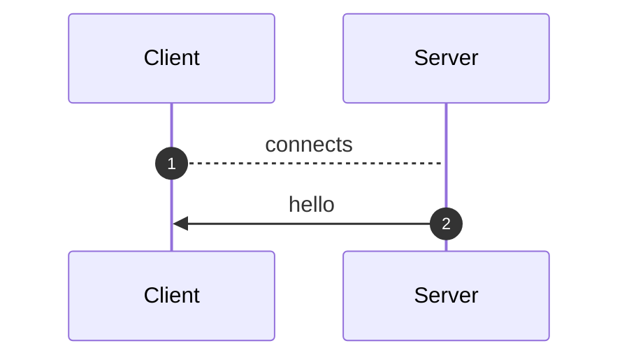
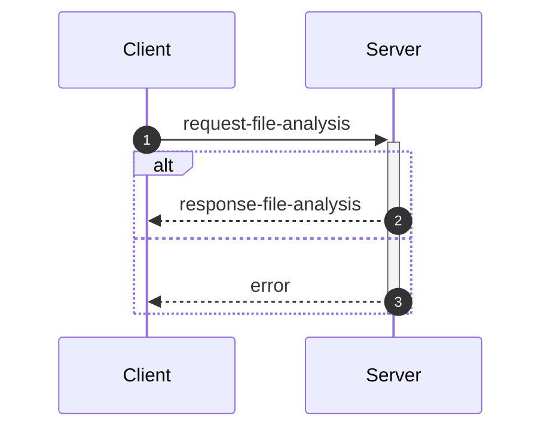
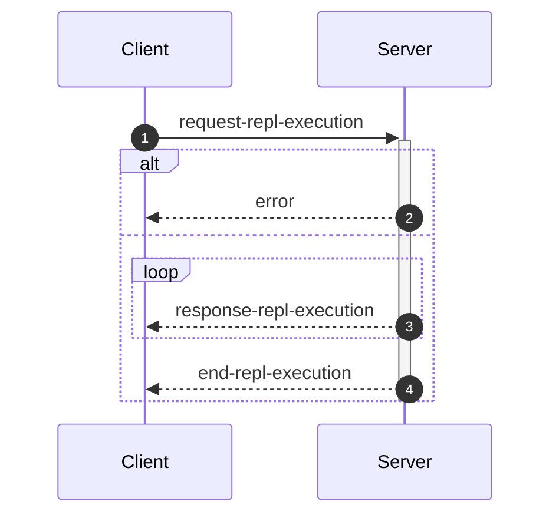
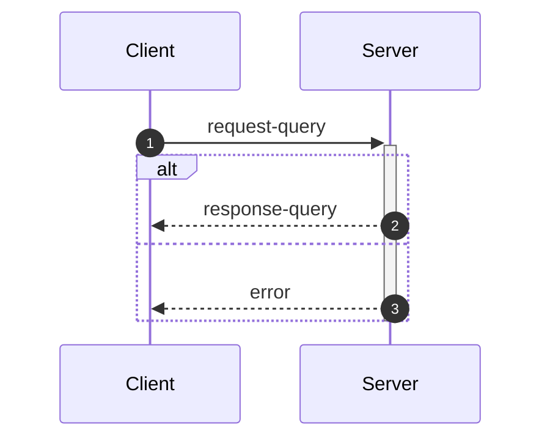

_<span title="an overview of flowR's interface">Generated</span> from '[wiki-interface.ts](https://github.com/flowr-analysis/flowr/tree/main/src/documentation/wiki-interface.ts "src/documentation/wiki-interface.ts")' on 2026-11-08, 14:25:27 UTC (v2.17.4, R v4.6.1), do not edit directly._

Although far from being as detailed as the in-depth explanation of [_flowR_](https://github.com/flowr-analysis/flowr/wiki/Core),
this wiki page explains how to interface with _flowR_ in more detail.
In general, command line arguments and other options provide short descriptions on hover over.

* [💻 Using the REPL](#using-the-repl)
* [⚙️ Configuring FlowR](#configuring-flowr)
* [⚒️ Writing Code](#writing-code)
* [💬 Communicating with the Server](#communicating-with-the-server)

<a id='using-the-repl'></a>
## 💻 Using the REPL

> [!NOTE]
> To execute arbitrary R commands with a repl request, _flowR_ has to be started explicitly with <span title="Description (Command Line Argument): Allow to access the underlying R session when using flowR (security warning: this allows the execution of arbitrary R code!)">`--r-session-access`</span>.
> Please be aware that this introduces a security risk and note that this relies on the [`r-shell` engine](https://github.com/flowr-analysis/flowr/wiki/Engines) .

Although primarily meant for users to explore,
there is nothing which forbids calling _flowR_ as a subprocess to use standard-in, -output, and -error
for communication (although you can access the REPL using the server as well,
with the [REPL Request](#message-request-repl-execution) message).

The read-eval-print loop&nbsp;(REPL) works relatively simple.
You can submit an expression (using <kbd>Enter</kbd>),
which is interpreted as an R&nbsp;expression by default but interpreted as a *command* if it starts with a colon (`:`).
The best command to get started with the REPL is <span title="Description (Repl Command): Show help information (aliases: :h, :?)">`:help`</span>.
Besides, you can leave the REPL either with the command <span title="Description (Repl Command): End the repl (aliases: :q, :exit)">`:quit`</span> or by pressing <kbd>Ctrl</kbd>+<kbd>C</kbd> twice.
When writing a *command*, you may press <kbd>Tab</kbd> to get a list of completions, if available.
Multiple commands can be entered in a single line by separating them with a semicolon (`;`), e.g. `:parse "x<-2"; :df*`.
If a command is given without R code, the REPL will re-use R code given in a previous command.
The prior example will hence return first the parsed AST of the program and then the dataflow graph for `"x <- 2"`.

> [!NOTE]
> If you develop flowR, you may want to launch the repl using the `npm run main-dev` command, this way, you get a non-minified version of flowR with debug information and hot-reloading of source files.

<details>
<summary>Available Commands</summary>

We currently offer the following commands (this with a `[*]` suffix are available with and without the star):

| Command | Description |
| ------- | ----------- |
| **<span title="Description (Repl Command): End the repl (aliases: :q, :exit)">:quit</span>** | End the repl (aliases: **:<span title="Alias of ':quit'. End the repl">q</span>**, **:<span title="Alias of ':quit'. End the repl">exit</span>**) |
| **<span title="Description (Repl Command): Execute the given code as R code. This requires the `--r-session-access` flag to be set and requires the r-shell engine. (aliases: :e, :r)">:execute</span>** | Execute the given code as R code. This requires the `--r-session-access` flag to be set and requires the r-shell engine. (aliases: **:<span title="Alias of ':execute'. Execute the given code as R code. This requires the `--r-session-access` flag to be set and requires the r-shell engine.">e</span>**, **:<span title="Alias of ':execute'. Execute the given code as R code. This requires the `--r-session-access` flag to be set and requires the r-shell engine.">r</span>**) |
| **<span title="Description (Repl Command): Get mermaid code for the control-flow graph of R code (aliases: :cfg, :cf)">:controlflow[*]</span>** | Get mermaid code for the control-flow graph of R code (star: Returns the URL to mermaid.live) (aliases: **:<span title="Alias of ':controlflow'. Get mermaid code for the control-flow graph of R code">cfg</span>**, **:<span title="Alias of ':controlflow'. Get mermaid code for the control-flow graph of R code">cf</span>**) |
| **<span title="Description (Repl Command): Get mermaid code for the control-flow graph with basic blocks (aliases: :cfgb, :cfb)">:controlflowbb[*]</span>** | Get mermaid code for the control-flow graph with basic blocks (star: Returns the URL to mermaid.live) (aliases: **:<span title="Alias of ':controlflowbb'. Get mermaid code for the control-flow graph with basic blocks">cfgb</span>**, **:<span title="Alias of ':controlflowbb'. Get mermaid code for the control-flow graph with basic blocks">cfb</span>**) |
| **<span title="Description (Repl Command): Get mermaid code for the dataflow graph (aliases: :d, :df)">:dataflow[*]</span>** | Get mermaid code for the dataflow graph (star: Returns the URL to mermaid.live) (aliases: **:<span title="Alias of ':dataflow'. Get mermaid code for the dataflow graph">d</span>**, **:<span title="Alias of ':dataflow'. Get mermaid code for the dataflow graph">df</span>**) |
| **<span title="Description (Repl Command): Get mermaid code for the normalized AST of R code (aliases: :n)">:normalize[*]</span>** | Get mermaid code for the normalized AST of R code (star: Returns the URL to mermaid.live) (alias: **:<span title="Alias of ':normalize'. Get mermaid code for the normalized AST of R code">n</span>**) |
| **<span title="Description (Repl Command): Get mermaid code for the simplified dataflow graph (aliases: :ds, :dfs)">:dataflowsimple[*]</span>** | Get mermaid code for the simplified dataflow graph (star: Returns the URL to mermaid.live) (aliases: **:<span title="Alias of ':dataflowsimple'. Get mermaid code for the simplified dataflow graph">ds</span>**, **:<span title="Alias of ':dataflowsimple'. Get mermaid code for the simplified dataflow graph">dfs</span>**) |
| **<span title="Description (Repl Command): Inspect and extend the signature database: `query` (identical to :query @signature), `info <name>` for where a function comes from (identical to :query @function-info), `add <path>` to mount another database/source, `download` to fetch the full-history database. (aliases: :sig)">:signature</span>** | Inspect and extend the signature database: `query` (identical to :query @signature), `info <name>` for where a function comes from (identical to :query @function-info), `add <path>` to mount another database/source, `download` to fetch the full-history database. (alias: **:<span title="Alias of ':signature'. Inspect and extend the signature database: `query` (identical to :query @signature), `info <name>` for where a function comes from (identical to :query @function-info), `add <path>` to mount another database/source, `download` to fetch the full-history database.">sig</span>**) |
| **<span title="Description (Repl Command): Just calculates the DFG, but only prints summary info (aliases: :d#, :df#)">:dataflowsilent</span>** | Just calculates the DFG, but only prints summary info (aliases: **:<span title="Alias of ':dataflowsilent'. Just calculates the DFG, but only prints summary info">d#</span>**, **:<span title="Alias of ':dataflowsilent'. Just calculates the DFG, but only prints summary info">df#</span>**) |
| **<span title="Description (Repl Command): Prints ASCII Art of the parsed, unmodified AST (aliases: :p)">:parse</span>** | Prints ASCII Art of the parsed, unmodified AST (alias: **:<span title="Alias of ':parse'. Prints ASCII Art of the parsed, unmodified AST">p</span>**) |
| **<span title="Description (Repl Command): Prints the version of flowR as well as the current version of R">:version</span>** | Prints the version of flowR as well as the current version of R
| **<span title="Description (Repl Command): Query the given R code (use 'help' for more information)">:query[*]</span>** | Query the given R code (use 'help' for more information) (star: Similar to query, but returns the output in json format.)
| **<span title="Description (Repl Command): Returns an ASCII representation of the dataflow graph (aliases: :df!)">:dataflowascii</span>** | Returns an ASCII representation of the dataflow graph (alias: **:<span title="Alias of ':dataflowascii'. Returns an ASCII representation of the dataflow graph">df!</span>**) |
| **<span title="Description (Repl Command): Returns summarization stats for the normalized AST (aliases: :n#)">:normalize#</span>** | Returns summarization stats for the normalized AST (alias: **:<span title="Alias of ':normalize#'. Returns summarization stats for the normalized AST">n#</span>**) |
| **<span title="Description (Repl Command): Show help information (aliases: :h, :?)">:help</span>** | Show help information (aliases: **:<span title="Alias of ':help'. Show help information">h</span>**, **:<span title="Alias of ':help'. Show help information">?</span>**) |

</details>

> [!TIP]
> 
> As indicated by the examples before, all REPL commands that operate on code keep track of the state.
> Hence, if you run a command like <span title="Description (Repl Command, starred version): Returns the URL to mermaid.live; Base Command: Get mermaid code for the dataflow graph (aliases: :d*, :df*)">`:dataflow*`</span> without providing R code,
> the REPL will re-use the R code provided in a previous command.
> Likewise, doing this will benefit from incrementality!
> If you request the dataflow graph with `:df* x <- 2 * y` and then want to see the parsed AST with `:parse`,
> the REPL will re-use previously obtained information and not re-parse the code again.
> 		

Generally, many commands offer shortcut versions in the REPL. Many queries, for example, offer a shortened format (see the example below).
Of special note, the [Config Query](https://github.com/flowr-analysis/flowr/wiki/%5BQuery%5D-Config)
can be used to also modify the currently active configuration of _flowR_ within the REPL (see the [wiki page](https://github.com/flowr-analysis/flowr/wiki/%5BQuery%5D-Config) for more information).

### Example: Retrieving the Dataflow Graph

To retrieve a URL to the [mermaid](https://mermaid.js.org/) diagram of the dataflow of a given expression,
use <span title="Description (Repl Command, starred version): Returns the URL to mermaid.live; Base Command: Get mermaid code for the dataflow graph (aliases: :d*, :df*)">`:dataflow*`</span> (or <span title="Description (Repl Command): Get mermaid code for the dataflow graph (aliases: :d, :df)">`:dataflow`</span> to get the mermaid code in the cli):

```shell
$ docker run -it --rm eagleoutice/flowr # or npm run flowr 
flowR repl v2.17.4, R grammar v14 (tree-sitter engine)
R> :dataflow* y <- 1 + x
```

<details>
<summary style='color:gray'>Output</summary>

```text
https://mermaid.live/view#base64:eyJjb2RlIjoiZmxvd2NoYXJ0IFREXG4gICAgMXt7XCJgKiM5MTtSTnVtYmVyIzkzOyogKioxKipcbiAgICAgICoxLjYqICgqKmlkOiAxKiopYFwifX1cbiAgICAyKFtcImAqIzkxO1JTeW1ib2wjOTM7KiAqKngqKlxuICAgICAgKjEuMTAqICgqKmlkOiAyKiopYFwiXSlcbiAgICAzW1tcImAqIzkxO1JCaW5hcnlPcCM5MzsqIGJhc2UjNTg7IzU4OyoqIzQzOyoqXG4gICAgICAqMS42LTEwKiAoKippZDogMyoqKVxuICAgIGFyZzogKDEsIDIpYFwiXV1cbiAgICBidWlsdC1pbjpfNDNfW1wiYEJ1aWx0LUluOlxuIzQzO2BcIl1cbiAgICBzdHlsZSBidWlsdC1pbjpfNDNfIHN0cm9rZTpncmF5LGZpbGw6Z3JheSxzdHJva2Utd2lkdGg6MnB4LG9wYWNpdHk6Ljg7XG4gICAgMFtcImAqIzkxO1JTeW1ib2wjOTM7KiAqKnkqKlxuICAgICAgKjEuMSogKCoqaWQ6IDAqKiwgdjogMylgXCJdXG4gICAgNFtbXCJgKiM5MTtSQmluYXJ5T3AjOTM7KiBiYXNlIzU4OyM1ODsqKiM2MDsjNDU7KipcbiAgICAgICoxLjEtMTAqICgqKmlkOiA0KiopXG4gICAgYXJnOiAoMCwgMylgXCJdXVxuICAgIGJ1aWx0LWluOl82MF8tW1wiYEJ1aWx0LUluOlxuIzYwOyM0NTtgXCJdXG4gICAgc3R5bGUgYnVpbHQtaW46XzYwXy0gc3Ryb2tlOmdyYXksZmlsbDpncmF5LHN0cm9rZS13aWR0aDoycHgsb3BhY2l0eTouODtcbiAgICAxIC0uLT58XCJmbG93XCJ8IDJcbiAgICBsaW5rU3R5bGUgMCBzdHJva2U6Z3JheSxjb2xvcjpncmF5O1xuICAgIDIgLS4tPnxcImZsb3dcInwgM1xuICAgIGxpbmtTdHlsZSAxIHN0cm9rZTpncmF5LGNvbG9yOmdyYXk7XG4gICAgMyAtLT58XCJyZWFkcywgYXJnXCJ8IDFcbiAgICAzIC0tPnxcInJlYWRzLCBhcmdcInwgMlxuICAgIDMgLS4tPnxcImZsb3dcInwgMFxuICAgIGxpbmtTdHlsZSA0IHN0cm9rZTpncmF5LGNvbG9yOmdyYXk7XG4gICAgMyAtLi0+fFwicmVhZHMsIGNhbGxzXCJ8IGJ1aWx0LWluOl80M19cbiAgICBsaW5rU3R5bGUgNSBzdHJva2U6Z3JheTtcbiAgICAwIC0tPnxcImRlZmluZWQtYnksIGZsb3dcInwgNFxuICAgIDAgLS0+fFwiZGVmaW5lZC1ieVwifCAzXG4gICAgNCAtLT58XCJyZWFkcywgYXJnXCJ8IDNcbiAgICA0IC0tPnxcInJldHVybnMsIGFyZ1wifCAwXG4gICAgNCAtLi0+fFwicmVhZHMsIGNhbGxzXCJ8IGJ1aWx0LWluOl82MF8tXG4gICAgbGlua1N0eWxlIDEwIHN0cm9rZTpncmF5OyIsIm1lcm1haWQiOnsiYXV0b1N5bmMiOnRydWV9fQ==
```

Retrieve the dataflow graph of the expression `y <- 1 + x`. It looks like this:


<details>

<summary style="color:gray">R Code of the Dataflow Graph</summary>

The analysis ran (parse and normalize with the [tree-sitter](https://github.com/flowr-analysis/flowr/wiki/Engines) engine) in the generation environment. No [signature database](https://github.com/flowr-analysis/flowr/wiki/Signature-Database) is mounted, so `library()` attaches no exports (base-R names are still qualified, e.g., `stats::acf`). 
We encountered no unknown side effects during the analysis.

```r
y <- 1 + x
```

</details>

</details>

For small graphs like this, <span title="Description (Repl Command): Returns an ASCII representation of the dataflow graph (aliases: :df!)">`:dataflowascii`</span> also provides an ASCII representation directly in the REPL:

```shell
$ docker run -it --rm eagleoutice/flowr # or npm run flowr 
flowR repl v2.17.4, R grammar v14 (tree-sitter engine)
R> :df! y <- 1 + x
```

<details open>
<summary style='color:gray'>Output</summary>

```text
                        v<0>v
 c<4>c──────────────────| y |
 |<- |     ┌────────────v---v
 c---c     │
    │   c<3>c   0<1>0
    └───| + |───| 1 |───u<2>u
        c---c   0---0   | x |
           └────────────u---u
Edges:
3 -> 1: reads, arg          3 -> 2: reads, arg
3 -> 0: flows-to            1 -> 2: flows-to
2 -> 3: flows-to            4 -> 3: reads, arg
4 -> 0: returns, arg        0 -> 4: defined-by, flows-to
0 -> 3: defined-by
```

Retrieve the dataflow graph of the expression `y <- 1 + x` as ASCII art.

</details>

For the slicing with <span title="Description (Repl Command): Static backwards executable slicer for R">`:slicer`</span>, you have access to the same [magic comments](#slice-magic-comments) as with the [slice request](#message-request-slice).
Pass `--inline` to splice resolvable `source()` calls into the reconstruction so the slice is a single self-contained R text (the same as the static slice query's `inlineSources` flag).
See `--help` for more flags!

### Example: Interfacing with the File System

Many commands that allow for an R-expression (like <span title="Description (Repl Command, starred version): Returns the URL to mermaid.live; Base Command: Get mermaid code for the dataflow graph (aliases: :d*, :df*)">`:dataflow*`</span>) allow for a file as well
if the argument starts with `file://`.
If you are working from the root directory of the _flowR_ repository, the following gives you the parsed AST of the example file using the <span title="Description (Repl Command): Prints ASCII Art of the parsed, unmodified AST (aliases: :p)">`:parse`</span> command:

> **Watch mode**: Replace `file://` with `watch://` to enter watch mode.
> flowR runs the command immediately and then re-runs it every time the file (or any file inside the folder) changes.
> Enter any other command to leave watch mode.
> For example: `:df watch://analysis.R`

```shell
$ docker run -it --rm eagleoutice/flowr # or npm run flowr 
flowR repl v2.17.4, R grammar v14 (tree-sitter engine)
R> :parse file://test/testfiles/example.R
```

<details>
<summary style='color:gray'>Output</summary>

```text
File: test/testfiles/example.R

program
├ binaryoperator
│ ├ identifier "sum" (1:1─4)
│ ├ <- "<-" (1:5─7)
│ ╰ float "0" (1:8─9)
├ binaryoperator
│ ├ identifier "product" (2:1─8)
│ ├ <- "<-" (2:9─11)
│ ╰ float "1" (2:12─13)
├ binaryoperator
│ ├ identifier "w" (3:1─2)
│ ├ <- "<-" (3:3─5)
│ ╰ float "7" (3:6─7)
├ binaryoperator
│ ├ identifier "N" (4:1─2)
│ ├ <- "<-" (4:3─5)
│ ╰ float "10" (4:6─8)
├ forstatement
│ ├ for "for" (6:1─4)
│ ├ ( "(" (6:5─6)
│ ├ identifier "i" (6:6─7)
│ ├ in "in" (6:8─10)
│ ├ binaryoperator
│ │ ├ float "1" (6:11─12)
│ │ ├ : ":" (6:12─13)
│ │ ╰ parenthesizedexpression
│ │   ├ ( "(" (6:13─14)
│ │   ├ binaryoperator
│ │   │ ├ identifier "N" (6:14─15)
│ │   │ ├ - "-" (6:15─16)
│ │   │ ╰ float "1" (6:16─17)
│ │   ╰ ) ")" (6:17─18)
│ ├ ) ")" (6:18─19)
│ ╰ bracedexpression
│   ├ { "{" (6:20─21)
│   ├ binaryoperator
│   │ ├ identifier "sum" (7:3─6)
│   │ ├ <- "<-" (7:7─9)
│   │ ╰ binaryoperator
│   │   ├ binaryoperator
│   │   │ ├ identifier "sum" (7:10─13)
│   │   │ ├ + "+" (7:14─15)
│   │   │ ╰ identifier "i" (7:16─17)
│   │   ├ + "+" (7:18─19)
│   │   ╰ identifier "w" (7:20─21)
│   ├ binaryoperator
│   │ ├ identifier "product" (8:3─10)
│   │ ├ <- "<-" (8:11─13)
│   │ ╰ binaryoperator
│   │   ├ identifier "product" (8:14─21)
│   │   ├  "" (8:22─23)
│   │   ╰ identifier "i" (8:24─25)
│   ╰ } "}" (9:1─2)
├ call
│ ├ identifier "cat" (11:1─4)
│ ╰ arguments
│   ├ ( "(" (11:4─5)
│   ├ argument
│   │ ╰ string
│   │   ├ stringopen "\"" (11:5─6)
│   │   ├ stringcontent "Sum:" (11:6─10)
│   │   ╰ stringclose "\"" (11:10─11)
│   ├ comma "," (11:11─12)
│   ├ argument
│   │ ╰ identifier "sum" (11:13─16)
│   ├ comma "," (11:16─17)
│   ├ argument
│   │ ╰ string
│   │   ├ stringopen "\"" (11:18─19)
│   │   ├ stringcontent
│   │   │ ╰ escapesequence "\\n" (11:19─21)
│   │   ╰ stringclose "\"" (11:21─22)
│   ╰ ) ")" (11:22─23)
╰ call
  ├ identifier "cat" (12:1─4)
  ╰ arguments
    ├ ( "(" (12:4─5)
    ├ argument
    │ ╰ string
    │   ├ stringopen "\"" (12:5─6)
    │   ├ stringcontent "Product:" (12:6─14)
    │   ╰ stringclose "\"" (12:14─15)
    ├ comma "," (12:15─16)
    ├ argument
    │ ╰ identifier "product" (12:17─24)
    ├ comma "," (12:24─25)
    ├ argument
    │ ╰ string
    │   ├ stringopen "\"" (12:26─27)
    │   ├ stringcontent
    │   │ ╰ escapesequence "\\n" (12:27─29)
    │   ╰ stringclose "\"" (12:29─30)
    ╰ ) ")" (12:30─31)
```

Retrieve the parsed AST of the example file.

<details>

<summary>File Content</summary>

```r
sum <- 0
product <- 1
w <- 7
N <- 10

for (i in 1:(N-1)) {
  sum <- sum + i + w
  product <- product * i
}

cat("Sum:", sum, "\n")
cat("Product:", product, "\n")
```

</details>

As _flowR_ directly transforms this AST the output focuses on being human-readable instead of being machine-readable.
		
</details>

### Example: Run a Query

You can run any query supported by _flowR_ using the <span title="Description (Repl Command): Query the given R code (use 'help' for more information)">`:query`</span> command.
For example, to obtain the shapes of all data frames in a given piece of code, you can run:

```shell
$ docker run -it --rm eagleoutice/flowr # or npm run flowr 
flowR repl v2.17.4, R grammar v14 (tree-sitter engine)
R> :query @absint df-shape "x <- data.frame(a = 1:10, b = 1:10)\ny <- x$a"
```

<details open>
<summary style='color:gray'>Output</summary>

```text
Query: absint (1 ms)
   ╰ $12: (colnames: [{"a", "b"}, {}], cols: [2, 2], rows: [10, 10])
   ╰ $0: (colnames: [{"a", "b"}, {}], cols: [2, 2], rows: [10, 10])
```

Retrieve the shapes of all data frames in the given code.

</details>

To run the linter on a file, you can use (in this example, we just issue the `dead-code` linter on a small piece of code):

```shell
$ docker run -it --rm eagleoutice/flowr # or npm run flowr 
flowR repl v2.17.4, R grammar v14 (tree-sitter engine)
R> :query @linter rules:dead-code "if(FALSE) x <- 2"
```

<details open>
<summary style='color:gray'>Output</summary>

```text
Query: linter (2 ms)
   ╰ Dead Code (dead-code):
       ╰ certain:
           ╰ Code at 1.11-16 (1 quick fix(es) available)
```

Run the linter on the given code, with only the `dead-code` rule enabled.

</details>

For more information on the available queries, please check out the [Query API](https://github.com/flowr-analysis/flowr/wiki/Query-API).

<a id='configuring-flowr'></a>
## ⚙️ Configuring FlowR

When running _flowR_, you may want to specify some behaviors with a dedicated configuration file.
By default, flowR looks for a file named `flowr.json` in the current working directory (or any higher directory).
You can also specify a different file with <span title="Description (Command Line Argument): The name of the configuration file to use">`--config-file`</span> or pass the configuration inline using <span title="Description (Command Line Argument): The flowR configuration to use, as a JSON string">`--config-json`</span>.
A `flowr.json` found this way belongs to the analyzed project, so flowR ignores its options that decide what flowR executes or loads
(`engines.*.wasmPath`, `engines.*.treeSitterWasmPath`, `engines.*.rPath`, `solver.sigdb.additionalPaths`, `solver.sigdb.downloadRepo`, `solver.sigdb.installedLibrary.paths`, `solver.sigdb.onDemand.enabled`, `solver.sigdb.onDemand.repositories`, `solver.sigdb.onDemand.cranMirror`, `solver.sigdb.onDemand.bioconductorMirror`, `solver.sigdb.onDemand.cacheDir`),
unless you pass <span title="Description (Command Line Argument): Keep the security-sensitive options (e.g., the R executable) of the flowr.json found in the working directory or a parent. Only use this for projects you trust.">`--trust-config`</span>.
To analyze code you do not trust, use the secure mode (<span title="Description (Command Line Argument): Run in secure mode for analyzing untrusted code: flowR does not start R (or any other process), does not access the network, does not search for project configs, and ignores security-sensitive options in every config. Cannot be disabled once enabled. Can also be enabled with the environment variable {italic FLOWR_SECURE_MODE=1}.">`--secure`</span>, see the [security policy](https://github.com/flowr-analysis/flowr/blob/main/.github/SECURITY.md)).
To inspect the current configuration, you can run flowr with the <span title="Description (Command Line Argument): Run with verbose logging (will be passed to the corresponding script)">`--verbose`</span> flag, or use the `config` [Query](https://github.com/flowr-analysis/flowr/wiki/Query-API).
Within the REPL this works by running the following:

```shell
:query @config
```

To work with the <a href="https://github.com/flowr-analysis/flowr/tree/main/src/config.ts#L124"><code><span title="The configuration file format for flowR.">FlowrConfig</span></code></a> you can use the provided helper objects alongside its methods like
<a href="https://github.com/flowr-analysis/flowr/tree/main/src/config.ts#L990"><code><span title="Creates a new flowr config that has the updated values.">FlowrConfig::<b>amend</b></span></code></a>.
The schema below documents every option; the ones you most likely want are:

- <a href="https://github.com/flowr-analysis/flowr/wiki/Interface#configuring-flowr" title="Configuration Option (boolean): Whether source calls should be ignored, causing {@link processSourceCall}&#39;s behavior to be skipped.">ignoreSourceCalls</a>: ignore source calls when analyzing the code, i.e., ignore the inclusion of other files.
- <a href="https://github.com/flowr-analysis/flowr/wiki/Interface#configuring-flowr" title="Configuration Option (boolean): Whether load calls should be ignored, causing {@link processLoadCall}&#39;s behavior to be skipped.">ignoreLoadCalls</a>: ignore load calls when analyzing the code, i.e., ignore the loading of r-data files.
- <a href="https://github.com/flowr-analysis/flowr/wiki/Interface#configuring-flowr" title="Configuration Option (object): Do you want to overwrite (parts) of the builtin definition?">semantics.environment.overwriteBuiltIns</a>: overwrite _flowR_'s handling of built-in functions, or clear the preset definitions entirely.
  See [Configure BuiltIn Semantics](#configure-builtin-semantics) for more information.
- <a href="https://github.com/flowr-analysis/flowr/wiki/Interface#configuring-flowr" title="Configuration Option (boolean): Whether calls drawing on a graphics device (e.g., `plot`) count as writing to it, which the ambient state queries then report.">semantics.ambient.drawingWritesDevice</a>: whether calls drawing on a graphics device (e.g., `plot`) count as writing the device in the ambient state queries.
- <a href="https://github.com/flowr-analysis/flowr/wiki/Interface#configuring-flowr" title="Configuration Option (string): How to resolve variables and their values. (one of &quot;disabled&quot;, &quot;alias&quot;, &quot;builtin&quot;)">solver.variables</a>: how to resolve variables and their values (`disabled`, `alias`, `builtin`).
- <a href="https://github.com/flowr-analysis/flowr/wiki/Interface#configuring-flowr" title="Configuration Option (array): The engine or set of engines to use for interacting with R code. An empty array means all available engines will be used.">engines</a> and <a href="https://github.com/flowr-analysis/flowr/wiki/Interface#configuring-flowr" title="Configuration Option (string): The default engine to use for interacting with R code. If this is undefined, an arbitrary engine from the specified list will be used. (one of &quot;tree-sitter&quot;, &quot;r-shell&quot;)">defaultEngine</a>: the engines used to interact with R code, see the [Engines wiki page](https://github.com/flowr-analysis/flowr/wiki/Engines).
- <a href="https://github.com/flowr-analysis/flowr/wiki/Interface#configuring-flowr" title="Configuration Option (array): Files a framework loads on its own, without any source() call (e.g. global.R in a shiny app), in the order they are loaded; flowR orders the matching project files accordingly and analyzes them as one program. Entries are case-insensitive globs matched against the file path, a plain name matches any file with that name, and entries matching no project file are warned about. Usually set per project kind via specializeConfig.">project.implicitSources</a>: the files a framework loads without any `source()` call, in the order in which they are
  loaded. Entries are globs (e.g. `R/*.R`) matched against the file path ignoring capitalization; one matching no file is reported.
- <a href="https://github.com/flowr-analysis/flowr/wiki/Interface#configuring-flowr" title="Configuration Option (object): Overwrite (parts of) the configuration depending on the project kind flowR detects, e.g. to give a shiny app its implicit sources.">specializeConfig</a>: overwrite (parts of) the configuration depending on the kind of project _flowR_ detects
  (e.g. `shiny-app`), which is how a shiny app gets its implicit sources by default. What you configure directly wins.
- <a href="https://github.com/flowr-analysis/flowr/wiki/Interface#configuring-flowr" title="Configuration Option (string): Overwrite the project kind flowR would otherwise infer from the analyzed files, e.g. when auto-detection guesses wrong. (one of &quot;package&quot;, &quot;script&quot;, &quot;shiny-app&quot;, &quot;notebook&quot;, &quot;project&quot;, &quot;unknown&quot;)">project.useProjectType</a>: skip that detection and force a project kind yourself, when auto-detection guesses wrong.
- <a href="https://github.com/flowr-analysis/flowr/wiki/Interface#configuring-flowr" title="Configuration Option (array): The default plugins to load when creating a new instance of FlowrAnalyzer">defaultPlugins</a> and <a href="https://github.com/flowr-analysis/flowr/wiki/Interface#configuring-flowr" title="Configuration Option (array): The plugins to load in REPL mode">repl.plugins</a>: the plugins to load for a new <a href="https://github.com/flowr-analysis/flowr/tree/main/src/project/flowr-analyzer.ts#L240"><code><span title="Central class for conducting analyses with FlowR. Use the FlowrAnalyzerBuilder to create a new instance. If you want the original pattern of creating a pipeline and running all steps, you can still do this with FlowrAnalyzer#runFull . To inspect the context of the analyzer, use FlowrAnalyzer#inspectContext (if you are a plugin and need to modify it, use FlowrAnalyzer#context instead).">FlowrAnalyzer</span></code></a> and in the REPL
  (use `flowr:default` to reference the former).

So you can configure _flowR_ by adding a file like the following:

<details>

<summary>Example Configuration File</summary>

```json
{
  "ignoreSourceCalls": true,
  "ignoreLoadCalls": true,
  "semantics": {
    "environment": {
      "overwriteBuiltIns": {
        "definitions": [
          {
            "type": "function",
            "names": [
              "foo"
            ],
            "processor": "builtin:assign",
            "config": {}
          }
        ]
      }
    }
  },
  "defaultPlugins": [
    "file:description",
    "versions:description"
  ],
  "repl": {
    "quickStats": false,
    "dfProcessorHeat": false,
    "hints": true,
    "plugins": [
      "flowr:default"
    ]
  },
  "project": {
    "resolveUnknownPathsOnDisk": true,
    "implicitSources": [
      "global.R",
      "app.R"
    ]
  },
  "linter": {
    "disabledRules": []
  },
  "specializeConfig": {
    "shiny-app": {
      "project": {
        "implicitSources": [
          "global.R",
          "ui.R",
          "server.R",
          "app.R"
        ]
      }
    }
  },
  "engines": [
    {
      "type": "r-shell"
    }
  ],
  "solver": {
    "variables": "alias",
    "evalStrings": true,
    "trackEnvironments": true,
    "sigdb": {
      "enabled": true,
      "loadProjectDependencies": true,
      "eagerlyLoad": false,
      "eagerlyLoadExports": false,
      "linkBaseR": false,
      "linkDescriptionDependencies": false
    },
    "resolveSource": {
      "dropPaths": "no",
      "ignoreCapitalization": true,
      "inferWorkingDirectory": "active-script",
      "searchPath": []
    },
    "instrument": {},
    "slicer": {
      "threshold": 50
    }
  },
  "abstractInterpretation": {
    "wideningThreshold": 4,
    "followCalls": true,
    "dataFrame": {
      "maxColNames": 20,
      "readLoadedData": {
        "readExternalFiles": true,
        "maxReadLines": 1000000
      }
    }
  },
  "incremental": {
    "alwaysIncremental": false,
    "parsing": {
      "activated": false,
      "heuristics": {
        "activated": true,
        "mtime": true,
        "linesFrom": 500,
        "bytesFrom": 50000,
        "alwaysWithEdits": false,
        "minFiles": 1
      }
    }
  },
  "gas": {
    "thresholds": {
      "memory": {
        "problematic": 0.7,
        "critical": 0.9
      },
      "timeMs": {
        "problematic": 100000,
        "critical": 120000
      }
    },
    "features": {}
  }
}
```

</details>

<details>
<a id='configure-builtin-semantics'></a>
<summary>Configure Built-In Semantics</summary>

`semantics/environment/overwriteBuiltins` accepts two keys:

- `loadDefaults` (boolean, initially `true`): If set to `true`, the default built-in definitions are loaded before applying the custom definitions. Setting this flag to `false` explicitly disables the loading of the default definitions.
- `definitions` (array, initially empty): Allows to overwrite or define new built-in elements. Each object within must have a `type` which is one of the below. Furthermore, they may define a string array of `names` which specifies the identifiers to bind the definitions to. You may use `assumePrimitive` to specify whether _flowR_ should assume that this is a primitive non-library definition (so you probably just do not want to specify the key).

  | Type            | Description                                                                                                                                                                                                                                                                                              | Example                                                                                                    |
  | --------------- | -------------------------------------------------------------------------------------------------------------------------------------------------------------------------------------------------------------------------------------------------------------------------------------------------------- | ---------------------------------------------------------------------------------------------------------- |
  | `constant`    | Additionally allows for a `value` this should resolve to.                                                                                                                                                                                                                                                | `{ type: 'constant', names: ['NULL', 'NA'],  value: null }`                                                |
  | `function`    | Is a rather flexible way to define and bind built-in functions. For the time, we do not have extensive documentation to cover all the cases, so please either consult the sources with the `default-builtin-config/` folder or open a [new issue](https://github.com/flowr-analysis/flowr/issues/new/choose). | `{ type: 'function', names: ['next'], processor: 'builtin:d', config: { cfg: ExitPointType.Next } }` |
  | `replacement` | A comfortable way to specify replacement functions like `$<-` or `names<-`. `suffixes` describes the... suffixes to attach automatically. | `{ type: 'replacement', suffixes: ['<-', '<<-'], names: ['[', '[['] }` |

</details>

<details>

<summary style='color:gray'>Full Configuration-File Schema</summary>

- _The configuration file format for flowR._ (object)
    - **logLevel** [optional] _flowR's global minimum log level, applied when the config is loaded._ (string)
        Only allows: 'silly', 'trace', 'debug', 'info', 'warn', 'error', 'fatal'
    - **ignoreSourceCalls** [optional] _Whether source calls should be ignored, causing {@link processSourceCall}'s behavior to be skipped._ (boolean)
    - **ignoreLoadCalls** [optional] _Whether load calls should be ignored, causing {@link processLoadCall}'s behavior to be skipped._ (boolean)
    - **semantics** _Configure language semantics and how flowR handles them._ (object)
        - **environment** [optional] _Semantics regarding how to handle the R environment._ (object)
            - **overwriteBuiltIns** [optional] _Do you want to overwrite (parts) of the builtin definition?_ (object)
                - **loadDefaults** [optional] _Should the default configuration still be loaded?_ (boolean)
                - **definitions** [optional] _The definitions to load/overwrite._ (array)
                Valid item types:
                    - (object)
        - **ambient** [optional] _Semantics regarding the global state (options, devices, files, ...) calls access._ (object)
            - **drawingWritesDevice** [optional] _Whether calls drawing on a graphics device (e.g., `plot`) count as writing to it, which the ambient state queries then report._ (boolean)
    - **defaultPlugins** [optional] _The default plugins to load when creating a new instance of FlowrAnalyzer_ (array)
    Valid item types:
        - (alternatives)
            - (string)
            - (array)
    - **repl** _Configuration options for the REPL._ (object)
        - **quickStats** [optional] _Whether to show quick stats in the REPL after each evaluation._ (boolean)
        - **dfProcessorHeat** [optional] _This instruments the dataflow processors to count how often each processor is called._ (boolean)
        - **hints** [optional] _Whether to show dim inline hints on the empty prompt (automatically disabled on non-interactive terminals)._ (boolean)
        - **plugins** [optional] _The plugins to load in REPL mode_ (array)
        Valid item types:
            - (alternatives)
                - (string)
                - (array)
        - **autoUseFileProtocol** [optional] _Prepend the file protocol to a repl input that looks like a path, instead of only warning about it._ (boolean)
        - **queryStats** [optional] _Whether `:query` closes with the line stating how long the queries took (`:query*` never prints it)._ (boolean)
        - **showPlugins** [optional] _Whether `:version` grays out the plugins that did not activate during the last analysis._ (boolean)
    - **project** _Project specific configuration options._ (object)
        - **resolveUnknownPathsOnDisk** [optional] _Whether to resolve unknown paths loaded by the r project disk when trying to source/analyze files._ (boolean)
        - **failOnInaccessiblePath** [optional] _Whether a directory that cannot be traversed during file discovery (e.g. due to permissions) aborts the analysis; when false (the default) such paths are logged and skipped._ (boolean)
        - **basePackages** [optional] _The packages considered part of R itself (base and recommended); if unset, flowR uses its built-in list._ (array)
        Valid item types:
            - (string)
        - **implicitSources** [optional] _Files a framework loads on its own, without any source() call (e.g. global.R in a shiny app), in the order they are loaded; flowR orders the matching project files accordingly and analyzes them as one program. Entries are case-insensitive globs matched against the file path, a plain name matches any file with that name, and entries matching no project file are warned about. Usually set per project kind via specializeConfig._ (array)
        Valid item types:
            - (string)
        - **useProjectType** [optional] _Overwrite the project kind flowR would otherwise infer from the analyzed files, e.g. when auto-detection guesses wrong._ (string)
            Only allows: 'package', 'script', 'shiny-app', 'notebook', 'project', 'unknown'
        - **assumeImplicitEcho** [optional] _Whether the top level of the analyzed code is echoed, so that every visible result printed there is collected as an output by the dependencies query (default true, false for a package)._ (boolean)
        - **discovery** [optional] _Scoping options for the default project discovery._ (object)
            - **full** [optional] _Collect every file below the project root (greedy) instead of only the files the detected project kind needs (default false)._ (boolean)
            - **perKind** [optional] _Per-kind include/exclude glob overrides layered on the default scoping._ (object)
            - **ignore** [optional] _Case-insensitive globs that drop matching files from the intelligent discovery, regardless of kind (e.g. .Renviron to ignore environment files)._ (array)
            Valid item types:
                - (string)
        - **classification** [optional] _Overrides for the signals flowR uses to classify the project kind._ (object)
            - **shinyDescriptionTypes** [optional] _DESCRIPTION Type: values that mark a shiny app._ (array)
            Valid item types:
                - (string)
            - **shinyEntryFiles** [optional] _File names a shiny app is assembled from._ (array)
            Valid item types:
                - (string)
            - **shinyUsagePattern** [optional] _Regex source evidencing shiny usage in an entry file._ (string)
            - **notebookExtensions** [optional] _File extensions marking a notebook._ (array)
            Valid item types:
                - (string)
    - **linter** _Linter configuration options._ (object)
        - **disabledRules** _Linting rule names excluded from the default rule set (a rule requested explicitly via a linter query still runs). Usually set per project kind via specializeConfig._ (array)
        Valid item types:
            - (string)
        - **disabledTags** [optional] _Linting rule tags whose rules are excluded from the default rule set (a rule requested explicitly via a linter query still runs). By default the cmd-check rules are disabled for everything but a package; a configured list replaces that default._ (array)
        Valid item types:
            - (string)
    - **inputSources** [optional] _Further frameworks the input-sources analysis should know about; entries are added to flowR's defaults._ (object)
        - **pure** [optional] _Functions that only pass the constantness of their arguments on._ (array)
        Valid item types:
            - (string)
        - **param** [optional] _Functions whose result is a 'param' input._ (array)
        Valid item types:
            - (string)
        - **file** [optional] _Functions whose result is a 'file' input._ (array)
        Valid item types:
            - (string)
        - **tempfile** [optional] _Functions whose result is a 'tempfile' input._ (array)
        Valid item types:
            - (string)
        - **glob** [optional] _Functions whose result is a 'glob' input._ (array)
        Valid item types:
            - (string)
        - **net** [optional] _Functions whose result is a 'net' input._ (array)
        Valid item types:
            - (string)
        - **rand** [optional] _Functions whose result is a 'rand' input._ (array)
        Valid item types:
            - (string)
        - **system** [optional] _Functions whose result is a 'system' input._ (array)
        Valid item types:
            - (string)
        - **ffi** [optional] _Functions whose result is a 'ffi' input._ (array)
        Valid item types:
            - (string)
        - **lang** [optional] _Functions whose result is a 'lang' input._ (array)
        Valid item types:
            - (string)
        - **options** [optional] _Functions whose result is a 'options' input._ (array)
        Valid item types:
            - (string)
        - **cmdline** [optional] _Functions whose result is a 'cmdline' input._ (array)
        Valid item types:
            - (string)
        - **user** [optional] _Functions whose result is a 'user' input._ (array)
        Valid item types:
            - (string)
        - **const** [optional] _Functions whose result is a 'const' input._ (array)
        Valid item types:
            - (string)
        - **scope** [optional] _Functions whose result is a 'scope' input._ (array)
        Valid item types:
            - (string)
        - **dconst** [optional] _Functions whose result is a 'dconst' input._ (array)
        Valid item types:
            - (string)
        - **unknown** [optional] _Functions whose result is a 'unknown' input._ (array)
        Valid item types:
            - (string)
        - **linkedObjects** [optional] _Objects a framework provides without a definition in the code, e.g. shiny's input._ (array)
        Valid item types:
            - (object)
        - **linkedEntryPoints** [optional] _Calls that hand a function to a framework, which binds its objects to the parameters by position._ (array)
        Valid item types:
            - (object)
    - **specializeConfig** [optional] _Overwrite (parts of) the configuration depending on the project kind flowR detects, e.g. to give a shiny app its implicit sources._ (object)
    - **engines** _The engine or set of engines to use for interacting with R code. An empty array means all available engines will be used._ (array)
    Valid item types:
        - (alternatives)
            - _The configuration for the tree sitter engine._ (object)
                - **type** [required] _Use the tree sitter engine._ (string)
                    Only allows: 'tree-sitter'
                - **wasmPath** [optional] _The path to the tree-sitter-r WASM binary to use. If this is undefined, this uses the default path._ (string)
                - **treeSitterWasmPath** [optional] _The path to the tree-sitter WASM binary to use. If this is undefined, this uses the default path._ (string)
                - **lax** [optional] _Whether to use the lax parser for parsing R code (allowing for syntax errors). If this is undefined, the strict parser will be used._ (boolean)
            - _The configuration for the R shell engine._ (object)
                - **type** [required] _Use the R shell engine._ (string)
                    Only allows: 'r-shell'
                - **rPath** [optional] _The path to the R executable to use. If this is undefined, this uses the default path._ (string)
                - **pipeBind** [optional] _Whether to enable R's experimental pipe-bind operator "=>" by setting _R_USE_PIPEBIND_ for the R session (default false); R itself keeps this off by default, as it is experimental and has never shipped in a release version of R._ (boolean)
    - **defaultEngine** [optional] _The default engine to use for interacting with R code. If this is undefined, an arbitrary engine from the specified list will be used._ (string)
        Only allows: 'tree-sitter', 'r-shell'
    - **solver** _How to resolve constants, constraints, cells, ..._ (object)
        - **variables** _How to resolve variables and their values._ (string)
            Only allows: 'disabled', 'alias', 'builtin'
        - **evalStrings** _Should we include eval(parse(text="...")) calls in the dataflow graph?_ (boolean)
        - **trackEnvironments** [optional] _Track user-created environments (new.env, assign/get/local with envir=, dollar-assign, attach). When false, all envir-style calls fall through conservatively._ (boolean)
        - **sigdb** _Resolving library exports from a signature database._ (object)
            - **enabled** [optional] _Resolve library()/use() exports from a signature database (default true); when false no database is consulted._ (boolean)
            - **loadProjectDependencies** [optional] _Load the project's declared dependencies from its metadata files (DESCRIPTION Imports/Depends, rproject.toml, uvr.toml, rig rproj.toml and script blocks, renv.lock, rv.lock, uvr.lock, rig lockfiles) (default true); when false these files are not read for dependencies._ (boolean)
            - **eagerlyLoad** [optional] _Parse the database up front rather than on the first package load (default false, ignored if disabled)._ (boolean)
            - **eagerlyLoadExports** [optional] _Add a vertex for every export on load rather than on demand (default false); keeps the dataflow graph small._ (boolean)
            - **assumedRVersion** [optional] _R version assumed when resolving versioned (base-R) exports: a pin like "4.5" or "auto" to detect the installed R (default "auto")._ (string)
            - **linkBaseR** [optional] _Eagerly attach base-R namespaces so bare base calls resolve without library() (default false)._ (boolean)
            - **linkBaseRCalls** [optional] _Add a lightweight Reads edge from a bare base-R call to its signature-database function vertex (default false; base-R qualification is edge-free otherwise)._ (boolean)
            - **linkPackageCalls** [optional] _Add a lightweight Reads edge from a resolved package call to its signature-database function vertex (default false)._ (boolean)
            - **linkDescriptionDependencies** [optional] _Eagerly attach the namespaces of the project's declared DESCRIPTION dependencies (Imports/Depends) so their exports resolve without an explicit library() (default false)._ (boolean)
            - **warmInBackground** [optional] _Decompress the hot shards (base + most-downloaded) in a background task on startup so the first library() lookup is warm (default false; for long-running servers/REPLs)._ (boolean)
            - **additionalPaths** [optional] _Extra directories or bundle/manifest files searched for signature databases (alongside the shipped default and $FLOWR_SIGDB_DIR); a downloaded full-history bundle placed here is mounted automatically._ (array)
            Valid item types:
                - (string)
            - **downloadRepo** [optional] _GitHub owner/repo the full-history bundle is downloaded from via ":signature download" (default "flowr-analysis/flowr"; the release tag comes from the committed sigdb.remote.json unless a version is given)._ (string)
            - **autoSync** [optional] _On startup, re-download shards whose committed sigdb.remote.json hash no longer matches the cache, in the background (default false; opt-in network sync after a git pull)._ (boolean)
            - **installedLibrary** [optional] _Recovering packages no signature database knows from the copy installed on this machine._ (object)
                - **enabled** [required] _Recover packages no signature database knows from their installed copy (default false)._ (boolean)
                - **paths** [optional] _Library directories to search; when empty they are discovered from the environment and the project._ (array)
                Valid item types:
                    - (string)
                - **useEnvironment** [optional] _Search the libraries R_LIBS_USER/R_LIBS/R_LIBS_SITE name (default true)._ (boolean)
                - **useProjectLibrary** [optional] _Search a project-local renv/packrat library (default true)._ (boolean)
                - **maxDepth** [optional] _How far to descend into the nested layout of a project-local library (default 3)._ (number)
                - **packages** [optional] _Only recover packages whose name matches one of these regular expressions; empty means any._ (array)
                Valid item types:
                    - (string)
            - **onDemand** [optional] _Recovering packages no signature database knows from their sources on CRAN, Bioconductor, or GitHub._ (object)
                - **enabled** [required] _Fetch and recover the sources of packages no signature database knows when the analyzed code uses them (default false, accesses the network)._ (boolean)
                - **sources** [optional] _Where to look, in order: github, cran, bioconductor, or a source a plugin adds (default ["github", "cran", "bioconductor"])._ (array)
                Valid item types:
                    - (string)
                - **repositories** [optional] _GitHub repositories (owner/repo[/subdir][@ref]) to fetch packages from, by package name. The analyzed project may name more (DESCRIPTION Remotes, install_github calls)._ (object)
                - **packages** [optional] _Only recover packages whose name matches one of these regular expressions, empty means any._ (array)
                Valid item types:
                    - (string)
                - **cranMirror** [optional] _The CRAN src/contrib/ to fetch from, over https (default https://cloud.r-project.org/src/contrib/). It may be on the local network._ (string)
                - **bioconductorMirror** [optional] _The Bioconductor host, over https (default https://bioconductor.org). It may be on the local network._ (string)
                - **bioconductorRelease** [optional] _The Bioconductor release to fetch from: release, devel, or a number like 3.20 (default release)._ (string)
                - **githubMirrors** [optional] _Use the GitHub mirrors of CRAN (cran/<pkg>) and Bioconductor (bioc/<pkg>) (default true)._ (boolean)
                - **maxPackages** [optional] _The most packages to fetch for one analysis (default 25)._ (number)
                - **maxArchiveMb** [optional] _The most MiB a package archive may have (default 32). It may unpack to three times that, at most 128 MiB._ (number)
                - **offline** [optional] _Only use what was fetched before, never the network (default false)._ (boolean)
                - **retryAfterHours** [optional] _How many hours to wait before asking again for a package no source had (default 24)._ (number)
                - **cacheDir** [optional] _Where to cache what was fetched (default the on-demand directory of the signature cache)._ (string)
            - **blobCacheBudgetMb** [optional] _How many MiB of decoded package blobs every open bundle may hold together (default 16)._ (number)
            - **versionSelection** [optional] _When a project constrains a dependency, resolve to the newest (default), oldest, or system-installed version satisfying it; system needs R and falls back to newest. Base-R packages always resolve against the assumed R version._ (string)
                Only allows: 'newest', 'oldest', 'system'
            - **versionOverrides** [optional] _Force an exact version for specific packages (name -> version), overriding both the project constraint and the versionSelection policy (default {})._ (object)
        - **versionManagement** _Policies for reasoning about dependency versions._ (object)
            - **linkedVersionGroups** [optional] _Groups of packages that must resolve to the same version; version guessing intersects each group so its members stay mutually compatible (default [])._ (array)
            Valid item types:
                - (array)
                Valid item types:
                    - (string)
        - **assumeAttachedPackages** [optional] _Packages to treat as attached without a `library()` call, so what the built-in configuration states about them applies to the analyzed code. The base packages R attaches on startup already resolve without it._ (array)
        Valid item types:
            - (string)
        - **transitiveSideEffectRounds** [optional] _How many rounds the transitive side-effect fixpoint may run before it is cut off (default 32); the propagation stops on its own as soon as a round adds nothing._ (number)
        - **maxOverlayDepth** [optional] _How many binding overlays may stack on one environment frame before a write flattens them (default 4); a pure performance knob, trading lookup cost against copy cost without changing any result._ (number)
        - **instrument** (object)
            - **dataflowExtractors** [optional] _These keys are only intended for use within code, allowing to instrument the dataflow analyzer!_ (any)
        - **resolveSource** [optional] _If lax source calls are active, flowR searches for sourced files much more freely, based on the configurations you give it. This option is only in effect if `ignoreSourceCalls` is set to false._ (object)
            - **dropPaths** _Allow to drop the first or all parts of the sourced path, if it is relative._ (string)
                Only allows: 'no', 'once', 'all'
            - **ignoreCapitalization** _Search for filenames matching in the lowercase._ (boolean)
            - **inferWorkingDirectory** _Try to infer the working directory from the main or any script to analyze._ (string)
                Only allows: 'no', 'main-script', 'active-script', 'any-script'
            - **searchPath** _Additionally search in these paths._ (array)
            Valid item types:
                - (string)
            - **repeatedSourceLimit** [optional] _How often the same file can be sourced within a single run? Please be aware: in case of cyclic sources this may not reach a fixpoint so give this a sensible limit._ (number)
            - **applyReplacements** _Provide name replacements for loaded files_ (array)
            Valid item types:
                - (object)
            - **assumeFilesExist** [optional] _Assume a sourced file is always there, making what it defines certain instead of conditional on the source call._ (boolean)
        - **slicer** [optional] _The configuration for the slicer._ (object)
            - **threshold** [optional] _The maximum number of iterations to perform on a single function call during slicing._ (number)
            - **autoExtend** [optional] _If set, the slicer will gain an additional post-pass._ (boolean)
    - **abstractInterpretation** _The configuration options for abstract interpretation._ (object)
        - **wideningThreshold** _The threshold for the number of visitations of a node at which widening should be performed to ensure the termination of the fixpoint iteration._ (number)
        - **followCalls** _Whether the abstract interpretation is interprocedural, i.e. whether it steps into the functions a call may dispatch to._ (boolean)
        - **dataFrame** _The configuration of the shape inference for data frames._ (object)
            - **maxColNames** _The maximum number of columns names to infer for data frames before over-approximating the column names to top._ (number)
            - **readLoadedData** _Configuration options for reading data frame shapes from loaded external data files, such as CSV files._ (object)
                - **readExternalFiles** _Whether data frame shapes should be extracted from loaded external files, such as CSV files._ (boolean)
                - **maxReadLines** _The maximum number of lines to read when extracting data frame shapes from loaded files, such as CSV files._ (number)
    - **incremental** (object)
        - **alwaysIncremental** _Always take the incremental path, regardless of heuristics._ (boolean)
        - **parsing** (object)
            - **activated** _If set, incremental parsing will be used._ (boolean)
            - **heuristics** (object)
                - **activated** [optional] _If set, the heuristics for incremental parsing will be used._ (boolean)
                - **mtime** [optional] _Skip reparsing entirely if the file's modification time is unchanged since the last parse._ (boolean)
                - **linesFrom** [optional] _Only consider incremental parsing for files with at least this many lines._ (number)
                - **bytesFrom** [optional] _Only consider incremental parsing for files with at least this many bytes._ (number)
                - **alwaysWithEdits** [optional] _Always take the incremental path whenever there is a computed edit region, regardless of the other thresholds._ (boolean)
                - **minFiles** [optional] _Only apply these heuristics once the project has at least this many files loaded._ (number)
    - **gas** [optional] _Resource-usage guard (gas) configuration. All feature factors default to 0 (disabled). See https://github.com/flowr-analysis/flowr/wiki/Core#gas-resource-guard._ (object)
        - **thresholds** [optional] _Thresholds for all gas checks (scaled by per-feature factor), boundable per feature._ (object)
            - **memory** [optional] _Heap-usage fraction thresholds (0-1), either shared or given per feature key (with `default` covering the rest)._ (object)
                - **problematic** [optional] _Heap fraction (0-1) above which Problematic is returned, for every feature without an entry of its own._ (number)
                - **critical** [optional] _Heap fraction (0-1) above which Critical is returned, for every feature without an entry of its own._ (number)
            - **timeMs** [optional] _Elapsed analysis time thresholds in milliseconds, either shared or given per feature key (with `default` covering the rest)._ (object)
                - **problematic** [optional] _Elapsed ms above which Problematic is returned, for every feature without an entry of its own._ (number)
                - **critical** [optional] _Elapsed ms above which Critical is returned, for every feature without an entry of its own._ (number)
            - **steps** [optional] _Processed-AST-node thresholds, counted rather than sampled; only a key that arms a budget (`dataflow`) reads them._ (object)
                - **problematic** [optional] _Processed AST nodes above which Problematic is returned, for every feature without an entry of its own._ (number)
                - **critical** [optional] _Processed AST nodes above which the extraction is cut short, for every feature without an entry of its own._ (number)
            - **vertices** [optional] _Created-dataflow-vertex thresholds, counted like `steps`._ (object)
                - **problematic** [optional] _Created dataflow vertices above which Problematic is returned, for every feature without an entry of its own._ (number)
                - **critical** [optional] _Created dataflow vertices above which the extraction is cut short, for every feature without an entry of its own._ (number)
        - **features** [optional] _Per-feature sensitivity factors. 0 or absent disables gas checking for that feature. A factor of 2 makes the feature twice as sensitive. Recognised keys: `source`, `side-effect-linking`, `linter`, `slicer`, `dataflow`._ (object)
        - **countedCheckEvery** [optional] _How many counted steps pass between two accountings of an armed check, be it a dataflow budget or the slicer's traversal (default 128); trades overshoot against the cost of the check._ (number)
        - **heapProvider** [optional] _Custom heap statistics source (programmatic configs only), overriding the built-in v8/performance.memory detection._ (function)

</details>

<a id='writing-code'></a>
## ⚒️ Writing Code

_flowR_ can be used as a [module](https://www.npmjs.com/package/@eagleoutice/flowr) and offers several main classes and interfaces that are interesting for extension writers 
(see the [Visual Studio Code extension](https://marketplace.visualstudio.com/items?itemName=code-inspect.vscode-flowr) or the [Core](https://github.com/flowr-analysis/flowr/wiki/Core) wiki page for more information).

### Creating Analyses with _flowR_

Nowadays, instances of the <a href="https://github.com/flowr-analysis/flowr/tree/main/src/project/flowr-analyzer.ts#L240"><code><span title="Central class for conducting analyses with FlowR. Use the FlowrAnalyzerBuilder to create a new instance. If you want the original pattern of creating a pipeline and running all steps, you can still do this with FlowrAnalyzer#runFull . To inspect the context of the analyzer, use FlowrAnalyzer#inspectContext (if you are a plugin and need to modify it, use FlowrAnalyzer#context instead).">FlowrAnalyzer</span></code></a> should be used as central frontend to get analysis results from _flowR_.
The entry points an analysis is written against are re-exported from the package root (`import { FlowrAnalyzerBuilder } from '@eagleoutice/flowr'`);
everything else stays reachable under its own path, as in `@eagleoutice/flowr/dataflow/graph/graph`.
For example, a program slice can be created like this:

```ts
const analyzer = await new FlowrAnalyzerBuilder()
    .setEngine('tree-sitter')
    .build();
analyzer.addRequest('x <- 1\ny <- x\nx');
const { slice, reconstruct } = await analyzer.query({
    type:     'static-slice',
    criteria: ['3@x']
});
```

For more information, please have a look at the [Analyzer](https://github.com/flowr-analysis/flowr/wiki/Analyzer) wiki page, which explains how to construct and use the <a href="https://github.com/flowr-analysis/flowr/tree/main/src/project/flowr-analyzer.ts#L240"><code><span title="Central class for conducting analyses with FlowR. Use the FlowrAnalyzerBuilder to create a new instance. If you want the original pattern of creating a pipeline and running all steps, you can still do this with FlowrAnalyzer#runFull . To inspect the context of the analyzer, use FlowrAnalyzer#inspectContext (if you are a plugin and need to modify it, use FlowrAnalyzer#context instead).">FlowrAnalyzer</span></code></a> in more detail.
To work with specific perspectives, you can also consult the respective pages like the [Dataflow Graph](https://github.com/flowr-analysis/flowr/wiki/Dataflow-Graph) or the [Abstract Interpretation](https://github.com/flowr-analysis/flowr/wiki/Abstract-Interpretation) wiki pages.
### The Pipeline Executor (Low-Level Interface)

Once, in the beginning, _flowR_ was meant to produce a dataflow graph merely to provide *program slices*. 
However, with continuous updates, the [Dataflow Graph](https://github.com/flowr-analysis/flowr/wiki/Dataflow-Graph) repeatedly proves to be the more interesting part.
With this, we restructured _flowR_'s originally *hardcoded* pipeline to be far more flexible. 
Now, it can be theoretically extended or replaced with arbitrary steps, optional steps, and what we call 'decorations' of these steps. 
In short, a slicing pipeline using the <a href="https://github.com/flowr-analysis/flowr/tree/main/src/core/pipeline-executor.ts#L97"><code><span title="**Please note:** The PipelineExecutor is now considered to be a rather low-level API for flowR. While it still works and is the basis for all other layers, we strongly recommend using the FlowrAnalyzer and its builder to create and use an analyzer instance that is pre-configured for your use-case. The pipeline executor allows to execute arbitrary pipelines in a step-by-step fashion. If you are not...">PipelineExecutor</span></code></a> looks like this:

```ts

const slicer = new PipelineExecutor(DEFAULT_SLICING_PIPELINE, {
  parser:    new RShell(),
  request:   requestFromInput('x <- 1\nx + 1'),
  criterion: ['2@x']
})
const slice = await slicer.allRemainingSteps()
// console.log(slice.reconstruct.code)
```

<details><summary>More Information</summary>

If you compare this, with what you would have done with the old (and removed) `SteppingSlicer`, 
this essentially just requires you to replace the `SteppingSlicer` with the <a href="https://github.com/flowr-analysis/flowr/tree/main/src/core/pipeline-executor.ts#L97"><code><span title="**Please note:** The PipelineExecutor is now considered to be a rather low-level API for flowR. While it still works and is the basis for all other layers, we strongly recommend using the FlowrAnalyzer and its builder to create and use an analyzer instance that is pre-configured for your use-case. The pipeline executor allows to execute arbitrary pipelines in a step-by-step fashion. If you are not...">PipelineExecutor</span></code></a>
and to pass the <a href="https://github.com/flowr-analysis/flowr/tree/main/src/core/steps/pipeline/default-pipelines.ts#L18"><code>DEFAULT_SLICING_PIPELINE</code></a> as the first argument.
The <a href="https://github.com/flowr-analysis/flowr/tree/main/src/core/pipeline-executor.ts#L97"><code><span title="**Please note:** The PipelineExecutor is now considered to be a rather low-level API for flowR. While it still works and is the basis for all other layers, we strongly recommend using the FlowrAnalyzer and its builder to create and use an analyzer instance that is pre-configured for your use-case. The pipeline executor allows to execute arbitrary pipelines in a step-by-step fashion. If you are not...">PipelineExecutor</span></code></a>...

1. Provides structures to investigate the results of all intermediate steps
2. Can be executed step-by-step
3. Can repeat steps (e.g., to calculate multiple slices on the same input)

See the in-code documentation for more information.

</details>

### Using the <a href="https://github.com/flowr-analysis/flowr/tree/main/src/r-bridge/shell.ts#L144"><code><span title="The RShell represents an interactive session with the R interpreter. You can configure it by RShellOptions . At the moment we are using a live R session (and not networking etc.) to communicate with R easily, which allows us to install packages etc. However, this might and probably will change in the future (leaving this as a legacy mode :D)">RShell</span></code></a> to Interact with R

The <a href="https://github.com/flowr-analysis/flowr/tree/main/src/r-bridge/shell.ts#L144"><code><span title="The RShell represents an interactive session with the R interpreter. You can configure it by RShellOptions . At the moment we are using a live R session (and not networking etc.) to communicate with R easily, which allows us to install packages etc. However, this might and probably will change in the future (leaving this as a legacy mode :D)">RShell</span></code></a> class allows interfacing with the `R`&nbsp;ecosystem installed on the host system.
Please have a look at [flowR's Engines](https://github.com/flowr-analysis/flowr/wiki/Engines) for more information on alternatives (for example, the <a href="https://github.com/flowr-analysis/flowr/tree/main/src/r-bridge/lang-4.x/tree-sitter/tree-sitter-executor.ts#L29"><code><span title="Synchronous and (way) faster alternative to the RShell using tree-sitter.">TreeSitterExecutor</span></code></a>).

> [!IMPORTANT]
> 
> Each <a href="https://github.com/flowr-analysis/flowr/tree/main/src/r-bridge/shell.ts#L144"><code><span title="The RShell represents an interactive session with the R interpreter. You can configure it by RShellOptions . At the moment we are using a live R session (and not networking etc.) to communicate with R easily, which allows us to install packages etc. However, this might and probably will change in the future (leaving this as a legacy mode :D)">RShell</span></code></a> controls a new instance of the R&nbsp;interpreter, 
> make sure to call <code><a href="https://github.com/flowr-analysis/flowr/tree/main/src/r-bridge/shell.ts#L350"><span title="Close the current R session, makes the object effectively invalid (can no longer be reopened etc.)">RShell::<i>close</i></span></a>()</code> when you are done.

You can start a new "session" by constructing a new object with <code>new <a href="https://github.com/flowr-analysis/flowr/tree/main/src/r-bridge/shell.ts#L144"><span title="The RShell represents an interactive session with the R interpreter. You can configure it by RShellOptions . At the moment we are using a live R session (and not networking etc.) to communicate with R easily, which allows us to install packages etc. However, this might and probably will change in the future (leaving this as a legacy mode :D)">RShell</span></a>()</code>.

However, there are several options that may be of interest 
(e.g., to automatically revive the shell in case of errors or to control the name location of the R process on the system).

With a shell object (let's call it `shell`), you can execute R code by using <a href="https://github.com/flowr-analysis/flowr/tree/main/src/r-bridge/shell.ts#L213"><code><span title="sends the given command directly to the current R session will not do anything to alter input markers!">RShell::<i>sendCommand</i></span></code></a>,
for example <code>shell.<a href="https://github.com/flowr-analysis/flowr/tree/main/src/r-bridge/shell.ts#L213"><span title="sends the given command directly to the current R session will not do anything to alter input markers!">sendCommand</span></a>("1 + 1")</code>.
However, this does not return anything, so if you want to collect the output of your command, use
<a href="https://github.com/flowr-analysis/flowr/tree/main/src/r-bridge/shell.ts#L296"><code><span title="Send a command and collect the output">RShell::<i>sendCommandWithOutput</i></span></code></a> instead.

<a id='communicating-with-the-server'></a>
## 💬 Communicating with the Server

As explained in the [Overview](https://github.com/flowr-analysis/flowr/wiki/Overview), you can run the [TCP](https://de.wikipedia.org/wiki/Transmission_Control_Protocol)&nbsp;server by adding the <span title="Description (Command Line Argument): Do not drop into a repl, but instead start a server on the given port (default: 1042) and listen for messages.">`--server`</span> flag (and, due to the interactive mode, exit with the conventional <kbd>CTRL</kbd>+<kbd>C</kbd>).
Currently, every connection is handled by the same underlying `RShell` - so the server is not designed to handle many clients at a time.
Additionally, the server is not well guarded against attacks (e.g., you can theoretically spawn an arbitrary number of&nbsp;RShell sessions on the target machine).

Every message has to be given in a single line (i.e., without a newline in-between) and end with a newline character. Nevertheless, we will pretty-print example given in the following segments for the ease of reading.

> [!NOTE]
> 
> The default <span title="Description (Command Line Argument): Do not drop into a repl, but instead start a server on the given port (default: 1042) and listen for messages.">`--server`</span> uses a simple [TCP](https://de.wikipedia.org/wiki/Transmission_Control_Protocol)
> connection. If you want _flowR_ to expose a [WebSocket](https://de.wikipedia.org/wiki/WebSocket) server instead, add the <span title="Description (Command Line Argument): If the server flag is set, use websocket for messaging">`--ws`</span> flag (i.e., <span title="Description (Command Line Argument): Do not drop into a repl, but instead start a server on the given port (default: 1042) and listen for messages.">`--server`</span> <span title="Description (Command Line Argument): If the server flag is set, use websocket for messaging">`--ws`</span>) when starting _flowR_ from the command line.

<ul><li>
<a id="message-hello"></a>
<b>Hello</b> Message (<code>hello</code>) 
<details>

<summary style="color:gray"> View Details. <i>The server informs the client about the successful connection and provides Meta-Information.</i> </summary>



After launching _flowR_, for example, with <code>docker run -it --rm eagleoutice/flowr <span title="Description (Command Line Argument): Do not drop into a repl, but instead start a server on the given port (default: 1042) and listen for messages.">-<span/>-server</span></code>&nbsp;(🐳️), connecting should present you with a `hello` message, that amongst others should reveal the versions of&nbsp;_flowR_ and&nbsp;R, using the [semver 2.0](https://semver.org/spec/v2.0.0.html) versioning scheme.
The message looks like this:

```json
{
  "type": "hello",
  "clientName": "client-0",
  "versions": {
    "flowr": "2.17.4",
    "r": "4.6.1",
    "engine": "r-shell"
  }
}
```

There are currently a few messages that you can send after the hello message.
If you want to _slice_ a piece of R code you first have to send an [analysis request](#message-request-file-analysis), so that you can send one or multiple slice requests afterward.
Requests for the [REPL](#message-request-repl-execution) are independent of that.
	
<hr>

<details>
<summary style="color:gray">Message schema (<code>hello</code>)</summary>

For the definition of the hello message, please see it's implementation at [`./src/cli/repl/server/messages/message-hello.ts`](https://github.com/flowr-analysis/flowr/tree/main/src/cli/repl/server/messages/message-hello.ts).

- [required] (object)
    - **type** [required] _The type of the hello message._ (string)
        Only allows: 'hello'
    - **id** [forbidden] _The id of the message is always undefined (as it is the initial message and not requested)._ (any)
    - **clientName** [required] _A unique name that is assigned to each client. It has no semantic meaning and is only used/useful for debugging._ (string)
    - **versions** [required] (object)
        - **flowr** [required] _The version of the flowr server running in semver format._ (string)
        - **r** [required] _The version of the underlying R shell running in semver format._ (string)
        - **engine** [required] _The parser backend that is used to parse the R code._ (string)

</details>

<hr>

</details>
	</li>

<li>
<a id="message-request-file-analysis"></a>
<b>Analysis</b> Message (<code>request-file-analysis</code>) 
<details>

<summary style="color:gray"> View Details. <i>The server builds the dataflow graph for a given input file (or a set of files).</i> </summary>



The request allows the server to analyze a file and prepare it for slicing.
The message can contain a `filetoken`, which is used to identify the file in later slice or query requests (if you do not add one, the request will not be stored and therefore, it is not available for subsequent requests).

> **Please note!**\
> If you want to send and process a lot of analysis requests, but do not want to slice them, please do not pass the `filetoken` field. This will save the server a lot of memory allocation.

Furthermore, the request must contain either a `content` field to directly pass the file's content or a `filepath` field which contains the path to the file (this path must be accessible for the server to be useful).
If you add the `id` field, the answer will use the same `id` so you can match requests and the corresponding answers.
See the implementation of the request-file-analysis message for more information.

You can drop one or more stored file tokens by adding the `invalidateToken` field (a single token or an array of tokens).
The server frees the corresponding analyses _after_ it has answered the request.

> **Tip!**\
> If you only want to drop tokens, you do not need a separate message: send a `request-file-analysis` that contains _just_ the `invalidateToken` field (and no `content` or `filepath`).
> Such a request behaves like an empty file analysis and the server replies with an empty `results` object.
> Because invalidation happens after the response, you may even pass the _current_ `filetoken` in `invalidateToken` to analyze a file once and have the server forget it right after you received the results.

<details>
<summary>Example of the <code>request-file-analysis</code> Message</summary>

_Note:_ even though we pretty-print these messages, they are sent as a single line, ending with a newline.

The following lists all messages that were sent and received in case you want to reproduce the scenario:

<ol>
<li> <code>hello</code> (response)
<details> 

<summary> Show Details </summary>

The first message is always a hello message.

```json
{"type":"hello","clientName":"client-0","versions":{"flowr":"2.17.4","r":"4.6.1","engine":"r-shell"}}
```

</details>
</li>

<li> <b><code>request-file-analysis</code> (request)</b>
<details open> 

<summary> Show Details </summary>

Let's suppose you simply want to analyze the following script:
 
```r
x <- 1
x + 1
```

 For this, you can send the following request:

```json
{"type":"request-file-analysis","id":"1","filetoken":"x","content":"x <- 1\nx + 1"}
```

</details>
</li>

<li> <code>response-file-analysis</code> (response)
<details> 

<summary> Show Details </summary>

The `results` field of the response effectively contains three keys of importance:

- `parse`: which contains 1:1 the parse result in CSV format that we received from the `RShell` (i.e., the AST produced by the parser of the R interpreter).
- `normalize`: which contains the normalized AST, including ids (see the `info` field and the [Normalized AST](https://github.com/flowr-analysis/flowr/wiki/Normalized-AST) wiki page).
- `dataflow`: especially important is the `graph` field which contains the dataflow graph as a set of root vertices (see the [Dataflow Graph](https://github.com/flowr-analysis/flowr/wiki/Dataflow-Graph) wiki page).
			
_As the code is pretty long, we inhibit pretty printing and syntax highlighting (JSON, hiding built-in):_

```text
{"type":"response-file-analysis","format":"json","id":"1","results":{"parse":{"files":[{"parsed":"[1,1,1,6,7,0,\"expr\",false,\"x <- 1\"],[1,1,1,1,1,3,\"SYMBOL\",true,\"x\"],[1,1,1,1,3,7,\"expr\",false,\"x\"],[1,3,1,4,2,7,\"LEFT_ASSIGN\",true,\"<-\"],[1,6,1,6,4,5,\"NUM_CONST\",true,\"1\"],[1,6,1,6,5,7,\"expr\",false,\"1\"],[2,1,2,5,16,0,\"expr\",false,\"x + 1\"],[2,1,2,1,10,12,\"SYMBOL\",true,\"x\"],[2,1,2,1,12,16,\"expr\",false,\"x\"],[2,3,2,3,11,16,\"'+'\",true,\"+\"],[2,5,2,5,13,14,\"NUM_CONST\",true,\"1\"],[2,5,2,5,14,16,\"expr\",false,\"1\"]","filePath":"/tmp/tmp-2558213-lDNTWxhBZub2-.R"}],".meta":{}},"normalize":{"ast":{"type":"RProject","files":[{"root":{"type":"RExpressionList","children":[{"type":"RBinaryOp","location":[1,3,1,4],"lhs":{"type":"RSymbol","location":[1,1,1,1],"content":"x","lexeme":"x","info":{"fullRange":[1,1,1,1],"adToks":[],"id":0,"parent":2,"role":"bin-l","index":0,"nest":0,"file":"/tmp/tmp-2558213-lDNTWxhBZub2-.R"}},"rhs":{"location":[1,6,1,6],"lexeme":"1","info":{"fullRange":[1,6,1,6],"adToks":[],"id":1,"parent":2,"role":"bin-r","index":1,"nest":0,"file":"/tmp/tmp-2558213-lDNTWxhBZub2-.R"},"type":"RNumber","content":{"num":1,"complexNumber":false,"markedAsInt":false}},"operator":"<-","lexeme":"<-","info":{"fullRange":[1,1,1,6],"adToks":[],"id":2,"parent":6,"nest":0,"file":"/tmp/tmp-2558213-lDNTWxhBZub2-.R","index":0,"role":"el-c"}},{"type":"RBinaryOp","location":[2,3,2,3],"lhs":{"type":"RSymbol","location":[2,1,2,1],"content":"x","lexeme":"x","info":{"fullRange":[2,1,2,1],"adToks":[],"id":3,"parent":5,"role":"bin-l","index":0,"nest":0,"file":"/tmp/tmp-2558213-lDNTWxhBZub2-.R"}},"rhs":{"location":[2,5,2,5],"lexeme":"1","info":{"fullRange":[2,5,2,5],"adToks":[],"id":4,"parent":5,"role":"bin-r","index":1,"nest":0,"file":"/tmp/tmp-2558213-lDNTWxhBZub2-.R"},"type":"RNumber","content":{"num":1,"complexNumber":false,"markedAsInt":false}},"operator":"+","lexeme":"+","info":{"fullRange":[2,1,2,5],"adToks":[],"id":5,"parent":6,"nest":0,"file":"/tmp/tmp-2558213-lDNTWxhBZub2-.R","index":1,"role":"el-c"}}],"info":{"adToks":[],"id":6,"nest":0,"file":"/tmp/tmp-2558213-lDNTWxhBZub2-.R","role":"root","index":0}},"filePath":"/tmp/tmp-2558213-lDNTWxhBZub2-.R"}],"info":{"id":7}},".meta":{}},"dataflow":{"unknownReferences":[],"in":[{"nodeId":2,"name":"<-","type":2},{"nodeId":5,"name":"+","type":2}],"out":[{"nodeId":0,"name":"x","type":4,"definedAt":2,"value":[1]}],"environment":{"current":{"id":2278,"parent":"<BuiltInEnvironment>","memory":[["x",[{"nodeId":0,"name":"x","type":4,"definedAt":2,"value":[1]}]]],"globalEnv":true},"level":0},"graph":{"rootVertices":[1,0,2,3,4,5],"vertexInformation":[[1,{"tag":"value","id":1}],[0,{"tag":"vdef","id":0,"source":[1]}],[2,{"tag":"fcall","id":2,"name":"<-","onlyBuiltin":true,"args":[{"nodeId":0,"type":32},{"nodeId":1,"type":32}],"origin":["builtin:assign"]}],[3,{"tag":"use","id":3}],[4,{"tag":"value","id":4}],[5,{"tag":"fcall","id":5,"name":"+","onlyBuiltin":true,"args":[{"nodeId":3,"type":32},{"nodeId":4,"type":32}],"origin":["builtin:d"]}]],"edgeInformation":[[2,[[1,{"types":65}],[0,{"types":72}],["built-in:<-",{"types":5}],[3,{"types":4096}]]],[1,[[0,{"types":4096}]]],[0,[[2,{"types":4098}],[1,{"types":2}]]],[5,[[3,{"types":65}],[4,{"types":65}],["built-in:+",{"types":5}]]],[3,[[0,{"types":1}],[4,{"types":4096}]]],[4,[[5,{"types":4096}]]]],"_unknownSideEffects":[],"_ambientAccess":[[5,{"reads":["#options"],"writes":[],"assumed":[],"local":[]}]]},"entryPoint":2,"cfgEntry":1,"exitPoints":[{"type":0,"nodeId":5}],"hooks":[],".meta":{}}}}
```

</details>
</li>
</ol>

The complete round-trip covers validating the messages as well as starting and stopping the internal mock server.

</details>

You receive an error if, for whatever reason, the analysis fails (e.g., the message or code you sent contained syntax errors).
It contains a human-readable description *why* the analysis failed (see the error message implementation for more details).

<details>
<summary>Example Error Message</summary>

_Note:_ even though we pretty-print these messages, they are sent as a single line, ending with a newline.

The following lists all messages that were sent and received in case you want to reproduce the scenario:

<ol>
<li> <code>hello</code> (response)
<details> 

<summary> Show Details </summary>

The first message is always a hello message.

```json
{"type":"hello","clientName":"client-0","versions":{"flowr":"2.17.4","r":"4.6.1","engine":"r-shell"}}
```

</details>
</li>

<li> <code>request-file-analysis</code> (request)
<details> 

<summary> Show Details </summary>

```json
{"type":"request-file-analysis","id":"1","filename":"sample.R","content":"x <-"}
```

</details>
</li>

<li> <b><code>error</code> (response)</b>
<details open> 

<summary> Show Details </summary>

```json
{"id":"1","type":"error","fatal":false,"reason":"Error while analyzing file sample.R: GuardError: unable to parse R code (see the log for more information) for request {\"request\":\"text\",\"content\":\"x <-\"}}\n Report a Bug: https://github.com/flowr-analysis/flowr/issues/new?body=%3C!%2D%2D%20Please%20describe%20your%20issue%20in%20more%20detail%20below!%20%2D%2D%3E%0A%0A%0A%3C!%2D%2D%20Automatically%20generated%20issue%20metadata%2C%20please%20do%20not%20edit%20or%20delete%20content%20below%20this%20line%20%2D%2D%3E%0A%2D%2D%2D%0A%0AflowR%20version%3A%202.17.4%0Anode%20version%3A%20v26.10.0%0Anode%20arch%3A%20x64%0Anode%20platform%3A%20linux%0Amessage%3A%20%60unable%20to%20parse%20R%20code%20%28see%20the%20log%20for%20more%20information%29%20for%20request%20%7B%22request%22%3A%22text%22%2C%22content%22%3A%22x%20%3C%2D%22%7D%7D%60%0Astack%20trace%3A%0A%60%60%60%0A%20%20%20%20at%20guard%20%28%3C%3E%2Fsrc%2Futil%2Fassert.ts%3A128%3A9%29%0A%20%20%20%20at%20guardRetrievedOutput%20%28%3C%3E%2Fsrc%2Fr%2Dbridge%2Fretriever.ts%3A155%3A7%29%0A%20%20%20%20at%20%2Fhome%2Fostwind%2Fgit%2Fphd%2Fflowr%2Dfield%2Fflowr%2Fsrc%2Fr%2Dbridge%2Fretriever.ts%3A122%3A4%0A%20%20%20%20at%20processTicksAndRejections%20%28node%3Ainternal%2Fprocess%2Ftask_queues%3A104%3A5%29%0A%20%20%20%20at%20async%20Object.parseRequests%20%5Bas%20processor%5D%20%28%3C%3E%2Fsrc%2Fr%2Dbridge%2Fparser.ts%3A108%3A19%29%0A%20%20%20%20at%20async%20PipelineExecutor.nextStep%20%28%3C%3E%2Fsrc%2Fcore%2Fpipeline%2Dexecutor.ts%3A192%3A25%29%0A%20%20%20%20at%20async%20FlowrAnalyzerCache.stepTapeUntil%20%28%3C%3E%2Fsrc%2Fproject%2Fcache%2Fflowr%2Danalyzer%2Dcache.ts%3A127%3A4%29%0A%60%60%60%0A%0A%2D%2D%2D%0A%09"}
```

</details>
</li>
</ol>

The complete round-trip covers validating the messages as well as starting and stopping the internal mock server.

</details>

&nbsp;

<a id="analysis-include-cfg"></a>
**Including the Control Flow Graph**

The control flow graph is a view on the dataflow graph: the dataflow analysis records the control flow while it walks
the program, and the graph projects those edges on demand. The server can expose that structure as well (please create
a [new issue](https://github.com/flowr-analysis/flowr/issues/new/choose) for any bug you may encounter).
For this, the analysis request may add `cfg: true` to its list of options.

<details>
<summary>Requesting a Control Flow Graph</summary>

_Note:_ even though we pretty-print these messages, they are sent as a single line, ending with a newline.

The following lists all messages that were sent and received in case you want to reproduce the scenario:

<ol>
<li> <code>hello</code> (response)
<details> 

<summary> Show Details </summary>

The first message is always a hello message.

```json
{"type":"hello","clientName":"client-0","versions":{"flowr":"2.17.4","r":"4.6.1","engine":"r-shell"}}
```

</details>
</li>

<li> <b><code>request-file-analysis</code> (request)</b>
<details open> 

<summary> Show Details </summary>

```json
{"type":"request-file-analysis","id":"1","filetoken":"x","content":"if(unknown > 0) { x <- 2 } else { x <- 5 }\nfor(i in 1:x) { print(x); print(i) }","cfg":true}
```

</details>
</li>

<li> <code>response-file-analysis</code> (response)
<details> 

<summary> Show Details </summary>

The response looks basically the same as a response sent without the `cfg` flag. However, additionally it contains a `cfg` field. 
If you are interested in a visual representation of the control flow graph, see the 
[visualization with mermaid](https://mermaid.live/view#base64:eyJjb2RlIjoiZmxvd2NoYXJ0IFREXG4gICAgbjAoW1wiYFJTeW1ib2wgKDApXG4qKnVua25vd24qKmBcIl0pXG4gICAgbjEoW1wiYFJOdW1iZXIgKDEpXG4qKjAqKmBcIl0pXG4gICAgbjIoW1wiYFJCaW5hcnlPcCAoMilcbioqdW5rbm93biAjNjI7IDAqKmBcIl0pXG4gICAgbjYoW1wiYFJOdW1iZXIgKDYpXG4qKjIqKmBcIl0pXG4gICAgbjUoW1wiYFJTeW1ib2wgKDUpXG4qKngqKmBcIl0pXG4gICAgbjdbXCJgUkJpbmFyeU9wICg3KVxuKip4ICM2MDsjNDU7IDIqKmBcIl1cbiAgICBuOChbXCJgUkV4cHJlc3Npb25MaXN0ICg4KWBcIl0pXG4gICAgbjEyKFtcImBSTnVtYmVyICgxMilcbioqNSoqYFwiXSlcbiAgICBuMTEoW1wiYFJTeW1ib2wgKDExKVxuKip4KipgXCJdKVxuICAgIG4xM1tcImBSQmluYXJ5T3AgKDEzKVxuKip4ICM2MDsjNDU7IDUqKmBcIl1cbiAgICBuMTQoW1wiYFJFeHByZXNzaW9uTGlzdCAoMTQpYFwiXSlcbiAgICBuMTVbXCJgUklmVGhlbkVsc2UgKDE1KVxuKippZih1bmtub3duICM2MjsgMCkgIzEyMzsgeCAjNjA7IzQ1OyAyICMxMjU7IGVsc2UgIzEyMzsgeCAjNjA7IzQ1OyA1ICMxMjU7KipgXCJdXG4gICAgbjE2KFtcImBSU3ltYm9sICgxNilcbioqaSoqYFwiXSlcbiAgICBuMTcoW1wiYFJOdW1iZXIgKDE3KVxuKioxKipgXCJdKVxuICAgIG4xOChbXCJgUlN5bWJvbCAoMTgpXG4qKngqKmBcIl0pXG4gICAgbjE5KFtcImBSQmluYXJ5T3AgKDE5KVxuKioxIzU4O3gqKmBcIl0pXG4gICAgbjIzKFtcImBSU3ltYm9sICgyMylcbioqeCoqYFwiXSlcbiAgICBuMjVbXCJgUkZ1bmN0aW9uQ2FsbCAoMjUpXG4qKnByaW50KHgpKipgXCJdXG4gICAgbjI3KFtcImBSU3ltYm9sICgyNylcbioqaSoqYFwiXSlcbiAgICBuMjlbXCJgUkZ1bmN0aW9uQ2FsbCAoMjkpXG4qKnByaW50KGkpKipgXCJdXG4gICAgbjMwKFtcImBSRXhwcmVzc2lvbkxpc3QgKDMwKWBcIl0pXG4gICAgbjMxW1wiYFJGb3JMb29wICgzMSlcbioqZm9yKGkgaW4gMSM1ODt4KSAjMTIzOyBwcmludCh4KTsgcHJpbnQoaSkgIzEyNTsqKmBcIl1cbiAgICBuMiAtLi0+fFwiYnJhbmNoIG9uIHVua25vd24gIzYyOyAwICgyKSBpZiBUXCJ8IG42XG4gICAgbjIgLS4tPnxcImJyYW5jaCBvbiB1bmtub3duICM2MjsgMCAoMikgaWYgRlwifCBuMTJcbiAgICBuMCAtLT58XCJmbG93cyB0b1wifCBuMVxuICAgIG4xIC0tPnxcImZsb3dzIHRvXCJ8IG4yXG4gICAgbjcgLS0+fFwiZmxvd3MgdG9cInwgbjhcbiAgICBuNiAtLT58XCJmbG93cyB0b1wifCBuNVxuICAgIG41IC0tPnxcImZsb3dzIHRvXCJ8IG43XG4gICAgbjggLS0+fFwiZmxvd3MgdG9cInwgbjE1XG4gICAgbjE1IC0tPnxcImZsb3dzIHRvXCJ8IG4xN1xuICAgIG4xMyAtLT58XCJmbG93cyB0b1wifCBuMTRcbiAgICBuMTIgLS0+fFwiZmxvd3MgdG9cInwgbjExXG4gICAgbjExIC0tPnxcImZsb3dzIHRvXCJ8IG4xM1xuICAgIG4xNCAtLT58XCJmbG93cyB0b1wifCBuMTVcbiAgICBuMTkgLS0+fFwiZmxvd3MgdG9cInwgbjE2XG4gICAgbjE4IC0tPnxcImZsb3dzIHRvXCJ8IG4xOVxuICAgIG4xNyAtLT58XCJmbG93cyB0b1wifCBuMThcbiAgICBuMjUgLS0+fFwiZmxvd3MgdG9cInwgbjI3XG4gICAgbjIzIC0tPnxcImZsb3dzIHRvXCJ8IG4yNVxuICAgIG4yOSAtLT58XCJmbG93cyB0b1wifCBuMzBcbiAgICBuMjcgLS0+fFwiZmxvd3MgdG9cInwgbjI5XG4gICAgbjMwIC0tPnxcImZsb3dzIHRvXCJ8IG4xNlxuICAgIG4xNiAtLi0+fFwiYnJhbmNoIG9uIGkgKDE2KSBpZiBUXCJ8IG4yM1xuICAgIG4xNiAtLi0+fFwiYnJhbmNoIG9uIGkgKDE2KSBpZiBGXCJ8IG4zMVxuICAgIHN0eWxlIG4wIHN0cm9rZTpjeWFuLHN0cm9rZS13aWR0aDo2LjVweDsgICAgc3R5bGUgbjMxIHN0cm9rZTpncmVlbixzdHJva2Utd2lkdGg6Ni41cHg7IiwibWVybWFpZCI6eyJhdXRvU3luYyI6dHJ1ZX19).
			
_As the code is pretty long, we inhibit pretty printing and syntax highlighting (JSON, hiding built-in):_

```text
{"type":"response-file-analysis","format":"json","id":"1","cfg":{"graph":{"roots":[0,1,2,6,5,7,8,12,11,13,14,15,16,17,18,19,23,25,27,29,30,31],"vtxInfos":[[0,[2,0]],[1,[2,1]],[2,[2,2]],[6,[2,6]],[5,[2,5]],[7,[1,7]],[8,[2,8]],[12,[2,12]],[11,[2,11]],[13,[1,13]],[14,[2,14]],[15,[1,15]],[16,[2,16]],[17,[2,17]],[18,[2,18]],[19,[2,19]],[23,[2,23]],[25,[1,25]],[27,[2,27]],[29,[1,29]],[30,[2,30]],[31,[1,31]]],"bbChildren":[],"edgeInfos":[[2,[[6,{"id":15,"when":true}],[12,{"id":15,"when":false}]]],[0,[[1,0]]],[1,[[2,0]]],[7,[[8,0]]],[6,[[5,0]]],[5,[[7,0]]],[8,[[15,0]]],[15,[[17,0]]],[13,[[14,0]]],[12,[[11,0]]],[11,[[13,0]]],[14,[[15,0]]],[19,[[16,0]]],[18,[[19,0]]],[17,[[18,0]]],[25,[[27,0]]],[23,[[25,0]]],[29,[[30,0]]],[27,[[29,0]]],[30,[[16,0]]],[16,[[23,{"id":31,"when":true}],[31,{"id":31,"when":false}]]]],"mayHaveBasicBlocks":false},"entryPoints":[0],"exitPoints":[31],"returns":[],"breaks":[],"nexts":[]},"results":{"parse":{"files":[{"parsed":"[1,1,1,42,38,0,\"expr\",false,\"if(unknown > 0) { x <- 2 } else { x <- 5 }\"],[1,1,1,2,1,38,\"IF\",true,\"if\"],[1,3,1,3,2,38,\"'('\",true,\"(\"],[1,4,1,14,9,38,\"expr\",false,\"unknown > 0\"],[1,4,1,10,3,5,\"SYMBOL\",true,\"unknown\"],[1,4,1,10,5,9,\"expr\",false,\"unknown\"],[1,12,1,12,4,9,\"GT\",true,\">\"],[1,14,1,14,6,7,\"NUM_CONST\",true,\"0\"],[1,14,1,14,7,9,\"expr\",false,\"0\"],[1,15,1,15,8,38,\"')'\",true,\")\"],[1,17,1,26,22,38,\"expr\",false,\"{ x <- 2 }\"],[1,17,1,17,12,22,\"'{'\",true,\"{\"],[1,19,1,24,19,22,\"expr\",false,\"x <- 2\"],[1,19,1,19,13,15,\"SYMBOL\",true,\"x\"],[1,19,1,19,15,19,\"expr\",false,\"x\"],[1,21,1,22,14,19,\"LEFT_ASSIGN\",true,\"<-\"],[1,24,1,24,16,17,\"NUM_CONST\",true,\"2\"],[1,24,1,24,17,19,\"expr\",false,\"2\"],[1,26,1,26,18,22,\"'}'\",true,\"}\"],[1,28,1,31,23,38,\"ELSE\",true,\"else\"],[1,33,1,42,35,38,\"expr\",false,\"{ x <- 5 }\"],[1,33,1,33,25,35,\"'{'\",true,\"{\"],[1,35,1,40,32,35,\"expr\",false,\"x <- 5\"],[1,35,1,35,26,28,\"SYMBOL\",true,\"x\"],[1,35,1,35,28,32,\"expr\",false,\"x\"],[1,37,1,38,27,32,\"LEFT_ASSIGN\",true,\"<-\"],[1,40,1,40,29,30,\"NUM_CONST\",true,\"5\"],[1,40,1,40,30,32,\"expr\",false,\"5\"],[1,42,1,42,31,35,\"'}'\",true,\"}\"],[2,1,2,36,84,0,\"expr\",false,\"for(i in 1:x) { print(x); print(i) }\"],[2,1,2,3,41,84,\"FOR\",true,\"for\"],[2,4,2,13,53,84,\"forcond\",false,\"(i in 1:x)\"],[2,4,2,4,42,53,\"'('\",true,\"(\"],[2,5,2,5,43,53,\"SYMBOL\",true,\"i\"],[2,7,2,8,44,53,\"IN\",true,\"in\"],[2,10,2,12,51,53,\"expr\",false,\"1:x\"],[2,10,2,10,45,46,\"NUM_CONST\",true,\"1\"],[2,10,2,10,46,51,\"expr\",false,\"1\"],[2,11,2,11,47,51,\"':'\",true,\":\"],[2,12,2,12,48,50,\"SYMBOL\",true,\"x\"],[2,12,2,12,50,51,\"expr\",false,\"x\"],[2,13,2,13,49,53,\"')'\",true,\")\"],[2,15,2,36,81,84,\"expr\",false,\"{ print(x); print(i) }\"],[2,15,2,15,54,81,\"'{'\",true,\"{\"],[2,17,2,24,64,81,\"expr\",false,\"print(x)\"],[2,17,2,21,55,57,\"SYMBOL_FUNCTION_CALL\",true,\"print\"],[2,17,2,21,57,64,\"expr\",false,\"print\"],[2,22,2,22,56,64,\"'('\",true,\"(\"],[2,23,2,23,58,60,\"SYMBOL\",true,\"x\"],[2,23,2,23,60,64,\"expr\",false,\"x\"],[2,24,2,24,59,64,\"')'\",true,\")\"],[2,25,2,25,65,81,\"';'\",true,\";\"],[2,27,2,34,77,81,\"expr\",false,\"print(i)\"],[2,27,2,31,68,70,\"SYMBOL_FUNCTION_CALL\",true,\"print\"],[2,27,2,31,70,77,\"expr\",false,\"print\"],[2,32,2,32,69,77,\"'('\",true,\"(\"],[2,33,2,33,71,73,\"SYMBOL\",true,\"i\"],[2,33,2,33,73,77,\"expr\",false,\"i\"],[2,34,2,34,72,77,\"')'\",true,\")\"],[2,36,2,36,78,81,\"'}'\",true,\"}\"]","filePath":"/tmp/tmp-2558213-HbiHUyHuICDg-.R"}],".meta":{}},"normalize":{"ast":{"type":"RProject","files":[{"root":{"type":"RExpressionList","children":[{"type":"RIfThenElse","condition":{"type":"RBinaryOp","location":[1,12,1,12],"lhs":{"type":"RSymbol","location":[1,4,1,10],"content":"unknown","lexeme":"unknown","info":{"fullRange":[1,4,1,10],"adToks":[],"id":0,"parent":2,"role":"bin-l","index":0,"nest":1,"file":"/tmp/tmp-2558213-HbiHUyHuICDg-.R"}},"rhs":{"location":[1,14,1,14],"lexeme":"0","info":{"fullRange":[1,14,1,14],"adToks":[],"id":1,"parent":2,"role":"bin-r","index":1,"nest":1,"file":"/tmp/tmp-2558213-HbiHUyHuICDg-.R"},"type":"RNumber","content":{"num":0,"complexNumber":false,"markedAsInt":false}},"operator":">","lexeme":">","info":{"fullRange":[1,4,1,14],"adToks":[],"id":2,"parent":15,"nest":1,"file":"/tmp/tmp-2558213-HbiHUyHuICDg-.R","role":"if-c"}},"then":{"type":"RExpressionList","children":[{"type":"RBinaryOp","location":[1,21,1,22],"lhs":{"type":"RSymbol","location":[1,19,1,19],"content":"x","lexeme":"x","info":{"fullRange":[1,19,1,19],"adToks":[],"id":5,"parent":7,"role":"bin-l","index":0,"nest":1,"file":"/tmp/tmp-2558213-HbiHUyHuICDg-.R"}},"rhs":{"location":[1,24,1,24],"lexeme":"2","info":{"fullRange":[1,24,1,24],"adToks":[],"id":6,"parent":7,"role":"bin-r","index":1,"nest":1,"file":"/tmp/tmp-2558213-HbiHUyHuICDg-.R"},"type":"RNumber","content":{"num":2,"complexNumber":false,"markedAsInt":false}},"operator":"<-","lexeme":"<-","info":{"fullRange":[1,19,1,24],"adToks":[],"id":7,"parent":8,"nest":1,"file":"/tmp/tmp-2558213-HbiHUyHuICDg-.R","index":0,"role":"el-c"}}],"grouping":[{"type":"RSymbol","location":[1,17,1,17],"content":"{","lexeme":"{","info":{"fullRange":[1,17,1,26],"adToks":[],"id":3,"parent":8,"role":"el-g","index":0,"nest":1,"file":"/tmp/tmp-2558213-HbiHUyHuICDg-.R"}},{"type":"RSymbol","location":[1,26,1,26],"content":"}","lexeme":"}","info":{"fullRange":[1,17,1,26],"adToks":[],"id":4,"parent":8,"role":"el-g","index":0,"nest":1,"file":"/tmp/tmp-2558213-HbiHUyHuICDg-.R"}}],"info":{"adToks":[],"id":8,"parent":15,"nest":1,"file":"/tmp/tmp-2558213-HbiHUyHuICDg-.R","index":1,"role":"if-then"}},"location":[1,1,1,2],"lexeme":"if","info":{"fullRange":[1,1,1,42],"adToks":[],"id":15,"parent":32,"nest":1,"file":"/tmp/tmp-2558213-HbiHUyHuICDg-.R","index":0,"role":"el-c"},"otherwise":{"type":"RExpressionList","children":[{"type":"RBinaryOp","location":[1,37,1,38],"lhs":{"type":"RSymbol","location":[1,35,1,35],"content":"x","lexeme":"x","info":{"fullRange":[1,35,1,35],"adToks":[],"id":11,"parent":13,"role":"bin-l","index":0,"nest":1,"file":"/tmp/tmp-2558213-HbiHUyHuICDg-.R"}},"rhs":{"location":[1,40,1,40],"lexeme":"5","info":{"fullRange":[1,40,1,40],"adToks":[],"id":12,"parent":13,"role":"bin-r","index":1,"nest":1,"file":"/tmp/tmp-2558213-HbiHUyHuICDg-.R"},"type":"RNumber","content":{"num":5,"complexNumber":false,"markedAsInt":false}},"operator":"<-","lexeme":"<-","info":{"fullRange":[1,35,1,40],"adToks":[],"id":13,"parent":14,"nest":1,"file":"/tmp/tmp-2558213-HbiHUyHuICDg-.R","index":0,"role":"el-c"}}],"grouping":[{"type":"RSymbol","location":[1,33,1,33],"content":"{","lexeme":"{","info":{"fullRange":[1,33,1,42],"adToks":[],"id":9,"parent":14,"role":"el-g","index":0,"nest":1,"file":"/tmp/tmp-2558213-HbiHUyHuICDg-.R"}},{"type":"RSymbol","location":[1,42,1,42],"content":"}","lexeme":"}","info":{"fullRange":[1,33,1,42],"adToks":[],"id":10,"parent":14,"role":"el-g","index":0,"nest":1,"file":"/tmp/tmp-2558213-HbiHUyHuICDg-.R"}}],"info":{"adToks":[],"id":14,"parent":15,"nest":1,"file":"/tmp/tmp-2558213-HbiHUyHuICDg-.R","index":2,"role":"if-other"}}},{"type":"RForLoop","variable":{"type":"RSymbol","location":[2,5,2,5],"content":"i","lexeme":"i","info":{"adToks":[],"id":16,"parent":31,"role":"for-var","index":0,"nest":1,"file":"/tmp/tmp-2558213-HbiHUyHuICDg-.R"}},"vector":{"type":"RBinaryOp","location":[2,11,2,11],"lhs":{"location":[2,10,2,10],"lexeme":"1","info":{"fullRange":[2,10,2,10],"adToks":[],"id":17,"parent":19,"role":"bin-l","index":0,"nest":1,"file":"/tmp/tmp-2558213-HbiHUyHuICDg-.R"},"type":"RNumber","content":{"num":1,"complexNumber":false,"markedAsInt":false}},"rhs":{"type":"RSymbol","location":[2,12,2,12],"content":"x","lexeme":"x","info":{"fullRange":[2,12,2,12],"adToks":[],"id":18,"parent":19,"role":"bin-r","index":1,"nest":1,"file":"/tmp/tmp-2558213-HbiHUyHuICDg-.R"}},"operator":":","lexeme":":","info":{"fullRange":[2,10,2,12],"adToks":[],"id":19,"parent":31,"nest":1,"file":"/tmp/tmp-2558213-HbiHUyHuICDg-.R","index":1,"role":"for-vec"}},"body":{"type":"RExpressionList","children":[{"type":"RFunctionCall","named":true,"location":[2,17,2,21],"lexeme":"print","functionName":{"type":"RSymbol","location":[2,17,2,21],"content":"print","lexeme":"print","info":{"fullRange":[2,17,2,24],"adToks":[],"id":22,"parent":25,"role":"call-name","index":0,"nest":1,"file":"/tmp/tmp-2558213-HbiHUyHuICDg-.R"}},"arguments":[{"type":"RArgument","location":[2,23,2,23],"lexeme":"x","value":{"type":"RSymbol","location":[2,23,2,23],"content":"x","lexeme":"x","info":{"fullRange":[2,23,2,23],"adToks":[],"id":23,"parent":24,"role":"arg-v","index":0,"nest":1,"file":"/tmp/tmp-2558213-HbiHUyHuICDg-.R"}},"info":{"fullRange":[2,23,2,23],"adToks":[],"id":24,"parent":25,"nest":1,"file":"/tmp/tmp-2558213-HbiHUyHuICDg-.R","index":1,"role":"call-arg"}}],"info":{"fullRange":[2,17,2,24],"adToks":[],"id":25,"parent":30,"nest":1,"file":"/tmp/tmp-2558213-HbiHUyHuICDg-.R","index":0,"role":"el-c"}},{"type":"RFunctionCall","named":true,"location":[2,27,2,31],"lexeme":"print","functionName":{"type":"RSymbol","location":[2,27,2,31],"content":"print","lexeme":"print","info":{"fullRange":[2,27,2,34],"adToks":[],"id":26,"parent":29,"role":"call-name","index":0,"nest":1,"file":"/tmp/tmp-2558213-HbiHUyHuICDg-.R"}},"arguments":[{"type":"RArgument","location":[2,33,2,33],"lexeme":"i","value":{"type":"RSymbol","location":[2,33,2,33],"content":"i","lexeme":"i","info":{"fullRange":[2,33,2,33],"adToks":[],"id":27,"parent":28,"role":"arg-v","index":0,"nest":1,"file":"/tmp/tmp-2558213-HbiHUyHuICDg-.R"}},"info":{"fullRange":[2,33,2,33],"adToks":[],"id":28,"parent":29,"nest":1,"file":"/tmp/tmp-2558213-HbiHUyHuICDg-.R","index":1,"role":"call-arg"}}],"info":{"fullRange":[2,27,2,34],"adToks":[],"id":29,"parent":30,"nest":1,"file":"/tmp/tmp-2558213-HbiHUyHuICDg-.R","index":1,"role":"el-c"}}],"grouping":[{"type":"RSymbol","location":[2,15,2,15],"content":"{","lexeme":"{","info":{"fullRange":[2,15,2,36],"adToks":[],"id":20,"parent":30,"role":"el-g","index":0,"nest":1,"file":"/tmp/tmp-2558213-HbiHUyHuICDg-.R"}},{"type":"RSymbol","location":[2,36,2,36],"content":"}","lexeme":"}","info":{"fullRange":[2,15,2,36],"adToks":[],"id":21,"parent":30,"role":"el-g","index":0,"nest":1,"file":"/tmp/tmp-2558213-HbiHUyHuICDg-.R"}}],"info":{"adToks":[],"id":30,"parent":31,"nest":1,"file":"/tmp/tmp-2558213-HbiHUyHuICDg-.R","index":2,"role":"for-b"}},"lexeme":"for","info":{"fullRange":[2,1,2,36],"adToks":[],"id":31,"parent":32,"nest":1,"file":"/tmp/tmp-2558213-HbiHUyHuICDg-.R","index":1,"role":"el-c"},"location":[2,1,2,3]}],"info":{"adToks":[],"id":32,"nest":0,"file":"/tmp/tmp-2558213-HbiHUyHuICDg-.R","role":"root","index":0}},"filePath":"/tmp/tmp-2558213-HbiHUyHuICDg-.R"}],"info":{"id":33}},".meta":{}},"dataflow":{"unknownReferences":[],"in":[{"nodeId":15,"name":"if","type":2},{"nodeId":0,"name":"unknown","type":1024},{"nodeId":2,"name":">","type":2},{"nodeId":7,"name":"<-","cds":[{"id":15,"when":true}],"type":2},{"nodeId":13,"name":"<-","cds":[{"id":15,"when":false}],"type":2},{"nodeId":8,"name":"{","cds":[{"id":15,"when":true}],"type":2},{"nodeId":14,"name":"{","cds":[{"id":15,"when":false}],"type":2},{"nodeId":31,"name":"for","type":2},{"nodeId":19,"name":":","type":2},{"nodeId":25,"name":"print","type":2},{"nodeId":29,"name":"print","type":2}],"out":[{"nodeId":5,"name":"x","type":4,"definedAt":7,"cds":[{"id":15,"when":true}],"value":[6]},{"nodeId":11,"name":"x","type":4,"definedAt":13,"cds":[{"id":15,"when":false}],"value":[12]},{"nodeId":16,"name":"i","type":1}],"environment":{"current":{"id":2313,"parent":"<BuiltInEnvironment>","memory":[["x",[{"nodeId":5,"name":"x","type":4,"definedAt":7,"cds":[{"id":15,"when":true}],"value":[6]},{"nodeId":11,"name":"x","type":4,"definedAt":13,"cds":[{"id":15,"when":false}],"value":[12]}]],["i",[{"nodeId":16,"name":"i","type":1,"definedAt":31,"value":[19],"iterated":true}]]],"globalEnv":true},"level":0},"graph":{"rootVertices":[0,1,2,6,5,7,8,12,11,13,14,15,16,17,18,19,23,25,27,29,30,31],"vertexInformation":[[0,{"tag":"use","id":0}],[1,{"tag":"value","id":1}],[2,{"tag":"fcall","id":2,"name":">","onlyBuiltin":true,"args":[{"nodeId":0,"type":32},{"nodeId":1,"type":32}],"origin":["builtin:d"]}],[6,{"tag":"value","id":6}],[5,{"tag":"vdef","id":5,"cds":[{"id":15,"when":true}],"source":[6]}],[7,{"tag":"fcall","id":7,"name":"<-","onlyBuiltin":true,"cds":[{"id":15,"when":true}],"args":[{"nodeId":5,"type":32},{"nodeId":6,"type":32}],"origin":["builtin:assign"]}],[8,{"tag":"fcall","id":8,"name":"{","onlyBuiltin":true,"cds":[{"id":15,"when":true}],"args":[{"nodeId":7,"type":32}],"origin":["builtin:el"]}],[12,{"tag":"value","id":12}],[11,{"tag":"vdef","id":11,"cds":[{"id":15,"when":false}],"source":[12]}],[13,{"tag":"fcall","id":13,"name":"<-","onlyBuiltin":true,"cds":[{"id":15,"when":false}],"args":[{"nodeId":11,"type":32},{"nodeId":12,"type":32}],"origin":["builtin:assign"]}],[14,{"tag":"fcall","id":14,"name":"{","onlyBuiltin":true,"cds":[{"id":15,"when":false}],"args":[{"nodeId":13,"type":32}],"origin":["builtin:el"]}],[15,{"tag":"fcall","id":15,"name":"if","onlyBuiltin":true,"args":[{"nodeId":2,"type":32},{"nodeId":8,"type":32},{"nodeId":14,"type":32}],"origin":["builtin:ite"]}],[16,{"tag":"vdef","id":16,"source":[19]}],[17,{"tag":"value","id":17}],[18,{"tag":"use","id":18}],[19,{"tag":"fcall","id":19,"name":":","onlyBuiltin":true,"args":[{"nodeId":17,"type":32},{"nodeId":18,"type":32}],"origin":["builtin:d"]}],[23,{"tag":"use","id":23,"cds":[{"id":31,"when":true}]}],[25,{"tag":"fcall","id":25,"name":"print","onlyBuiltin":true,"cds":[{"id":31,"when":true}],"args":[{"nodeId":23,"type":32}],"origin":["builtin:d"]}],[27,{"tag":"use","id":27,"cds":[{"id":31,"when":true}]}],[29,{"tag":"fcall","id":29,"name":"print","onlyBuiltin":true,"cds":[{"id":31,"when":true}],"args":[{"nodeId":27,"type":32}],"origin":["builtin:d"]}],[30,{"tag":"fcall","id":30,"name":"{","onlyBuiltin":true,"cds":[{"id":31,"when":true}],"args":[{"nodeId":25,"type":32},{"nodeId":29,"type":32}],"origin":["builtin:el"]}],[31,{"tag":"fcall","id":31,"name":"for","onlyBuiltin":true,"args":[{"nodeId":16,"type":32},{"nodeId":19,"type":32},{"nodeId":30,"type":32}],"origin":["builtin:fl"]}]],"edgeInformation":[[2,[[0,{"types":65}],[1,{"types":65}],[6,{"types":8192,"cd":{"id":15,"when":true}}],[12,{"types":8192,"cd":{"id":15,"when":false}}],["built-in:>",{"types":5}]]],[0,[[1,{"types":4096}]]],[1,[[2,{"types":4096}]]],[7,[[6,{"types":65}],[5,{"types":72}],["built-in:<-",{"types":5}],[8,{"types":4096}]]],[6,[[5,{"types":4096}]]],[5,[[7,{"types":4098}],[6,{"types":2}]]],[8,[[7,{"types":72}],["built-in:{",{"types":5}],[15,{"types":4096}]]],[15,[[8,{"types":72}],[14,{"types":72}],[2,{"types":65}],["built-in:if",{"types":5}],[17,{"types":4096}]]],[13,[[12,{"types":65}],[11,{"types":72}],["built-in:<-",{"types":5}],[14,{"types":4096}]]],[12,[[11,{"types":4096}]]],[11,[[13,{"types":4098}],[12,{"types":2}]]],[14,[[13,{"types":72}],["built-in:{",{"types":5}],[15,{"types":4096}]]],[19,[[17,{"types":65}],[18,{"types":65}],[16,{"types":4096}],["built-in::",{"types":5}]]],[18,[[5,{"types":1}],[11,{"types":1}],[19,{"types":4096}]]],[17,[[18,{"types":4096}]]],[25,[[23,{"types":73}],["built-in:print",{"types":5}],[27,{"types":4096}]]],[23,[[5,{"types":1}],[11,{"types":1}],[25,{"types":4096}]]],[29,[[27,{"types":73}],["built-in:print",{"types":5}],[30,{"types":4096}]]],[27,[[16,{"types":1}],[29,{"types":4096}]]],[30,[[25,{"types":64}],[29,{"types":72}],["built-in:{",{"types":5}],[16,{"types":4096}]]],[16,[[19,{"types":2}],[23,{"types":8192,"cd":{"id":31,"when":true}}],[31,{"types":8192,"cd":{"id":31,"when":false}}]]],[31,[[16,{"types":64}],[19,{"types":65}],[30,{"types":320}],["built-in:for",{"types":5}]]]],"_unknownSideEffects":[{"id":25,"linkTo":{"type":"link-to-last-call","callName":{}}},{"id":29,"linkTo":{"type":"link-to-last-call","callName":{}}}],"_ambientAccess":[[15,{"reads":["#options"],"writes":[],"assumed":[],"local":[]}],[25,{"reads":["#option:digits","#option:width","#option:max.print","#option:digits.secs","#option:useFancyQuotes","#option:*"],"writes":[],"assumed":[],"local":[]}],[29,{"reads":["#options"],"writes":[],"assumed":[],"local":[]}]]},"entryPoint":15,"cfgEntry":0,"exitPoints":[{"type":0,"nodeId":31}],"hooks":[],".meta":{}}}}
```

</details>
</li>
</ol>

The complete round-trip covers validating the messages as well as starting and stopping the internal mock server.

</details>

&nbsp;

<a id="analysis-format-n-quads"></a>
**Retrieve the Output as RDF N-Quads**

The default response is formatted as JSON.
However, by specifying `format: "n-quads"`, you can retrieve the individual results (e.g., the [Normalized AST](https://github.com/flowr-analysis/flowr/wiki/Normalized-AST)),
as [RDF N-Quads](https://www.w3.org/TR/n-quads/).
This works with and without the control flow graph as described [above](#analysis-include-cfg).

<details>
<summary>Requesting RDF N-Quads</summary>

_Note:_ even though we pretty-print these messages, they are sent as a single line, ending with a newline.

The following lists all messages that were sent and received in case you want to reproduce the scenario:

<ol>
<li> <code>hello</code> (response)
<details> 

<summary> Show Details </summary>

The first message is always a hello message.

```json
{"type":"hello","clientName":"client-0","versions":{"flowr":"2.17.4","r":"4.6.1","engine":"r-shell"}}
```

</details>
</li>

<li> <b><code>request-file-analysis</code> (request)</b>
<details open> 

<summary> Show Details </summary>

```json
{"type":"request-file-analysis","id":"1","filetoken":"x","content":"x <- 1\nx + 1","format":"n-quads","cfg":true}
```

</details>
</li>

<li> <code>response-file-analysis</code> (response)
<details> 

<summary> Show Details </summary>

The base message format is still JSON, only the individual results get converted.
While the context is derived from the `filename`, we currently offer no way to customize other parts of the quads 
(please open a [new issue](https://github.com/flowr-analysis/flowr/issues/new/choose) if you require this).

_As the code is pretty long, we inhibit pretty printing and syntax highlighting (JSON, hiding built-in):_

```text
{"type":"response-file-analysis","format":"n-quads","id":"1","cfg":"<https://uni-ulm.de/r-ast/unknown/0> <https://uni-ulm.de/r-ast/rootIds> \"1\"^^<http://www.w3.org/2001/XMLSchema#integer> <unknown> .\n<https://uni-ulm.de/r-ast/unknown/0> <https://uni-ulm.de/r-ast/rootIds> \"0\"^^<http://www.w3.org/2001/XMLSchema#integer> <unknown> .\n<https://uni-ulm.de/r-ast/unknown/0> <https://uni-ulm.de/r-ast/rootIds> \"2\"^^<http://www.w3.org/2001/XMLSchema#integer> <unknown> .\n<https://uni-ulm.de/r-ast/unknown/0> <https://uni-ulm.de/r-ast/rootIds> \"3\"^^<http://www.w3.org/2001/XMLSchema#integer> <unknown> .\n<https://uni-ulm.de/r-ast/unknown/0> <https://uni-ulm.de/r-ast/rootIds> \"4\"^^<http://www.w3.org/2001/XMLSchema#integer> <unknown> .\n<https://uni-ulm.de/r-ast/unknown/0> <https://uni-ulm.de/r-ast/rootIds> \"5\"^^<http://www.w3.org/2001/XMLSchema#integer> <unknown> .\n<https://uni-ulm.de/r-ast/unknown/0> <https://uni-ulm.de/r-ast/vertices> <https://uni-ulm.de/r-ast/unknown/1> <unknown> .\n<https://uni-ulm.de/r-ast/unknown/1> <https://uni-ulm.de/r-ast/next> <https://uni-ulm.de/r-ast/unknown/2> <unknown> .\n<https://uni-ulm.de/r-ast/unknown/1> <https://uni-ulm.de/r-ast/id> \"1\"^^<http://www.w3.org/2001/XMLSchema#integer> <unknown> .\n<https://uni-ulm.de/r-ast/unknown/0> <https://uni-ulm.de/r-ast/vertices> <https://uni-ulm.de/r-ast/unknown/2> <unknown> .\n<https://uni-ulm.de/r-ast/unknown/2> <https://uni-ulm.de/r-ast/next> <https://uni-ulm.de/r-ast/unknown/3> <unknown> .\n<https://uni-ulm.de/r-ast/unknown/2> <https://uni-ulm.de/r-ast/id> \"0\"^^<http://www.w3.org/2001/XMLSchema#integer> <unknown> .\n<https://uni-ulm.de/r-ast/unknown/0> <https://uni-ulm.de/r-ast/vertices> <https://uni-ulm.de/r-ast/unknown/3> <unknown> .\n<https://uni-ulm.de/r-ast/unknown/3> <https://uni-ulm.de/r-ast/next> <https://uni-ulm.de/r-ast/unknown/4> <unknown> .\n<https://uni-ulm.de/r-ast/unknown/3> <https://uni-ulm.de/r-ast/id> \"2\"^^<http://www.w3.org/2001/XMLSchema#integer> <unknown> .\n<https://uni-ulm.de/r-ast/unknown/0> <https://uni-ulm.de/r-ast/vertices> <https://uni-ulm.de/r-ast/unknown/4> <unknown> .\n<https://uni-ulm.de/r-ast/unknown/4> <https://uni-ulm.de/r-ast/next> <https://uni-ulm.de/r-ast/unknown/5> <unknown> .\n<https://uni-ulm.de/r-ast/unknown/4> <https://uni-ulm.de/r-ast/id> \"3\"^^<http://www.w3.org/2001/XMLSchema#integer> <unknown> .\n<https://uni-ulm.de/r-ast/unknown/0> <https://uni-ulm.de/r-ast/vertices> <https://uni-ulm.de/r-ast/unknown/5> <unknown> .\n<https://uni-ulm.de/r-ast/unknown/5> <https://uni-ulm.de/r-ast/next> <https://uni-ulm.de/r-ast/unknown/6> <unknown> .\n<https://uni-ulm.de/r-ast/unknown/5> <https://uni-ulm.de/r-ast/id> \"4\"^^<http://www.w3.org/2001/XMLSchema#integer> <unknown> .\n<https://uni-ulm.de/r-ast/unknown/0> <https://uni-ulm.de/r-ast/vertices> <https://uni-ulm.de/r-ast/unknown/6> <unknown> .\n<https://uni-ulm.de/r-ast/unknown/6> <https://uni-ulm.de/r-ast/id> \"5\"^^<http://www.w3.org/2001/XMLSchema#integer> <unknown> .\n<https://uni-ulm.de/r-ast/unknown/0> <https://uni-ulm.de/r-ast/edges> <https://uni-ulm.de/r-ast/unknown/7> <unknown> .\n<https://uni-ulm.de/r-ast/unknown/7> <https://uni-ulm.de/r-ast/next> <https://uni-ulm.de/r-ast/unknown/8> <unknown> .\n<https://uni-ulm.de/r-ast/unknown/7> <https://uni-ulm.de/r-ast/from> \"2\"^^<http://www.w3.org/2001/XMLSchema#integer> <unknown> .\n<https://uni-ulm.de/r-ast/unknown/7> <https://uni-ulm.de/r-ast/to> \"3\"^^<http://www.w3.org/2001/XMLSchema#integer> <unknown> .\n<https://uni-ulm.de/r-ast/unknown/7> <https://uni-ulm.de/r-ast/type> \"0\"^^<http://www.w3.org/2001/XMLSchema#integer> <unknown> .\n<https://uni-ulm.de/r-ast/unknown/0> <https://uni-ulm.de/r-ast/edges> <https://uni-ulm.de/r-ast/unknown/8> <unknown> .\n<https://uni-ulm.de/r-ast/unknown/8> <https://uni-ulm.de/r-ast/next> <https://uni-ulm.de/r-ast/unknown/9> <unknown> .\n<https://uni-ulm.de/r-ast/unknown/8> <https://uni-ulm.de/r-ast/from> \"1\"^^<http://www.w3.org/2001/XMLSchema#integer> <unknown> .\n<https://uni-ulm.de/r-ast/unknown/8> <https://uni-ulm.de/r-ast/to> \"0\"^^<http://www.w3.org/2001/XMLSchema#integer> <unknown> .\n<https://uni-ulm.de/r-ast/unknown/8> <https://uni-ulm.de/r-ast/type> \"0\"^^<http://www.w3.org/2001/XMLSchema#integer> <unknown> .\n<https://uni-ulm.de/r-ast/unknown/0> <https://uni-ulm.de/r-ast/edges> <https://uni-ulm.de/r-ast/unknown/9> <unknown> .\n<https://uni-ulm.de/r-ast/unknown/9> <https://uni-ulm.de/r-ast/next> <https://uni-ulm.de/r-ast/unknown/10> <unknown> .\n<https://uni-ulm.de/r-ast/unknown/9> <https://uni-ulm.de/r-ast/from> \"0\"^^<http://www.w3.org/2001/XMLSchema#integer> <unknown> .\n<https://uni-ulm.de/r-ast/unknown/9> <https://uni-ulm.de/r-ast/to> \"2\"^^<http://www.w3.org/2001/XMLSchema#integer> <unknown> .\n<https://uni-ulm.de/r-ast/unknown/9> <https://uni-ulm.de/r-ast/type> \"0\"^^<http://www.w3.org/2001/XMLSchema#integer> <unknown> .\n<https://uni-ulm.de/r-ast/unknown/0> <https://uni-ulm.de/r-ast/edges> <https://uni-ulm.de/r-ast/unknown/10> <unknown> .\n<https://uni-ulm.de/r-ast/unknown/10> <https://uni-ulm.de/r-ast/next> <https://uni-ulm.de/r-ast/unknown/11> <unknown> .\n<https://uni-ulm.de/r-ast/unknown/10> <https://uni-ulm.de/r-ast/from> \"3\"^^<http://www.w3.org/2001/XMLSchema#integer> <unknown> .\n<https://uni-ulm.de/r-ast/unknown/10> <https://uni-ulm.de/r-ast/to> \"4\"^^<http://www.w3.org/2001/XMLSchema#integer> <unknown> .\n<https://uni-ulm.de/r-ast/unknown/10> <https://uni-ulm.de/r-ast/type> \"0\"^^<http://www.w3.org/2001/XMLSchema#integer> <unknown> .\n<https://uni-ulm.de/r-ast/unknown/0> <https://uni-ulm.de/r-ast/edges> <https://uni-ulm.de/r-ast/unknown/11> <unknown> .\n<https://uni-ulm.de/r-ast/unknown/11> <https://uni-ulm.de/r-ast/from> \"4\"^^<http://www.w3.org/2001/XMLSchema#integer> <unknown> .\n<https://uni-ulm.de/r-ast/unknown/11> <https://uni-ulm.de/r-ast/to> \"5\"^^<http://www.w3.org/2001/XMLSchema#integer> <unknown> .\n<https://uni-ulm.de/r-ast/unknown/11> <https://uni-ulm.de/r-ast/type> \"0\"^^<http://www.w3.org/2001/XMLSchema#integer> <unknown> .\n<https://uni-ulm.de/r-ast/unknown/0> <https://uni-ulm.de/r-ast/entryPoints> \"1\"^^<http://www.w3.org/2001/XMLSchema#integer> <unknown> .\n<https://uni-ulm.de/r-ast/unknown/0> <https://uni-ulm.de/r-ast/exitPoints> \"5\"^^<http://www.w3.org/2001/XMLSchema#integer> <unknown> .\n","results":{"parse":"<https://uni-ulm.de/r-ast/unknown/0> <https://uni-ulm.de/r-ast/token> \"exprlist\" <unknown> .\n<https://uni-ulm.de/r-ast/unknown/0> <https://uni-ulm.de/r-ast/text> \"\" <unknown> .\n<https://uni-ulm.de/r-ast/unknown/0> <https://uni-ulm.de/r-ast/id> \"0\"^^<http://www.w3.org/2001/XMLSchema#integer> <unknown> .\n<https://uni-ulm.de/r-ast/unknown/0> <https://uni-ulm.de/r-ast/parent> \"0\"^^<http://www.w3.org/2001/XMLSchema#integer> <unknown> .\n<https://uni-ulm.de/r-ast/unknown/0> <https://uni-ulm.de/r-ast/line1> \"1\"^^<http://www.w3.org/2001/XMLSchema#integer> <unknown> .\n<https://uni-ulm.de/r-ast/unknown/0> <https://uni-ulm.de/r-ast/col1> \"1\"^^<http://www.w3.org/2001/XMLSchema#integer> <unknown> .\n<https://uni-ulm.de/r-ast/unknown/0> <https://uni-ulm.de/r-ast/line2> \"2\"^^<http://www.w3.org/2001/XMLSchema#integer> <unknown> .\n<https://uni-ulm.de/r-ast/unknown/0> <https://uni-ulm.de/r-ast/col2> \"5\"^^<http://www.w3.org/2001/XMLSchema#integer> <unknown> .\n<https://uni-ulm.de/r-ast/unknown/0> <https://uni-ulm.de/r-ast/children> <https://uni-ulm.de/r-ast/unknown/1> <unknown> .\n<https://uni-ulm.de/r-ast/unknown/1> <https://uni-ulm.de/r-ast/next> <https://uni-ulm.de/r-ast/unknown/2> <unknown> .\n<https://uni-ulm.de/r-ast/unknown/1> <https://uni-ulm.de/r-ast/line1> \"1\"^^<http://www.w3.org/2001/XMLSchema#integer> <unknown> .\n<https://uni-ulm.de/r-ast/unknown/1> <https://uni-ulm.de/r-ast/col1> \"1\"^^<http://www.w3.org/2001/XMLSchema#integer> <unknown> .\n<https://uni-ulm.de/r-ast/unknown/1> <https://uni-ulm.de/r-ast/line2> \"1\"^^<http://www.w3.org/2001/XMLSchema#integer> <unknown> .\n<https://uni-ulm.de/r-ast/unknown/1> <https://uni-ulm.de/r-ast/col2> \"6\"^^<http://www.w3.org/2001/XMLSchema#integer> <unknown> .\n<https://uni-ulm.de/r-ast/unknown/1> <https://uni-ulm.de/r-ast/id> \"7\"^^<http://www.w3.org/2001/XMLSchema#integer> <unknown> .\n<https://uni-ulm.de/r-ast/unknown/1> <https://uni-ulm.de/r-ast/parent> \"0\"^^<http://www.w3.org/2001/XMLSchema#integer> <unknown> .\n<https://uni-ulm.de/r-ast/unknown/1> <https://uni-ulm.de/r-ast/token> \"expr\" <unknown> .\n<https://uni-ulm.de/r-ast/unknown/1> <https://uni-ulm.de/r-ast/terminal> \"false\"^^<http://www.w3.org/2001/XMLSchema#boolean> <unknown> .\n<https://uni-ulm.de/r-ast/unknown/1> <https://uni-ulm.de/r-ast/text> \"x <- 1\" <unknown> .\n<https://uni-ulm.de/r-ast/unknown/1> <https://uni-ulm.de/r-ast/children> <https://uni-ulm.de/r-ast/unknown/3> <unknown> .\n<https://uni-ulm.de/r-ast/unknown/3> <https://uni-ulm.de/r-ast/next> <https://uni-ulm.de/r-ast/unknown/4> <unknown> .\n<https://uni-ulm.de/r-ast/unknown/3> <https://uni-ulm.de/r-ast/line1> \"1\"^^<http://www.w3.org/2001/XMLSchema#integer> <unknown> .\n<https://uni-ulm.de/r-ast/unknown/3> <https://uni-ulm.de/r-ast/col1> \"1\"^^<http://www.w3.org/2001/XMLSchema#integer> <unknown> .\n<https://uni-ulm.de/r-ast/unknown/3> <https://uni-ulm.de/r-ast/line2> \"1\"^^<http://www.w3.org/2001/XMLSchema#integer> <unknown> .\n<https://uni-ulm.de/r-ast/unknown/3> <https://uni-ulm.de/r-ast/col2> \"1\"^^<http://www.w3.org/2001/XMLSchema#integer> <unknown> .\n<https://uni-ulm.de/r-ast/unknown/3> <https://uni-ulm.de/r-ast/id> \"3\"^^<http://www.w3.org/2001/XMLSchema#integer> <unknown> .\n<https://uni-ulm.de/r-ast/unknown/3> <https://uni-ulm.de/r-ast/parent> \"7\"^^<http://www.w3.org/2001/XMLSchema#integer> <unknown> .\n<https://uni-ulm.de/r-ast/unknown/3> <https://uni-ulm.de/r-ast/token> \"expr\" <unknown> .\n<https://uni-ulm.de/r-ast/unknown/3> <https://uni-ulm.de/r-ast/terminal> \"false\"^^<http://www.w3.org/2001/XMLSchema#boolean> <unknown> .\n<https://uni-ulm.de/r-ast/unknown/3> <https://uni-ulm.de/r-ast/text> \"x\" <unknown> .\n<https://uni-ulm.de/r-ast/unknown/3> <https://uni-ulm.de/r-ast/children> <https://uni-ulm.de/r-ast/unknown/5> <unknown> .\n<https://uni-ulm.de/r-ast/unknown/5> <https://uni-ulm.de/r-ast/line1> \"1\"^^<http://www.w3.org/2001/XMLSchema#integer> <unknown> .\n<https://uni-ulm.de/r-ast/unknown/5> <https://uni-ulm.de/r-ast/col1> \"1\"^^<http://www.w3.org/2001/XMLSchema#integer> <unknown> .\n<https://uni-ulm.de/r-ast/unknown/5> <https://uni-ulm.de/r-ast/line2> \"1\"^^<http://www.w3.org/2001/XMLSchema#integer> <unknown> .\n<https://uni-ulm.de/r-ast/unknown/5> <https://uni-ulm.de/r-ast/col2> \"1\"^^<http://www.w3.org/2001/XMLSchema#integer> <unknown> .\n<https://uni-ulm.de/r-ast/unknown/5> <https://uni-ulm.de/r-ast/id> \"1\"^^<http://www.w3.org/2001/XMLSchema#integer> <unknown> .\n<https://uni-ulm.de/r-ast/unknown/5> <https://uni-ulm.de/r-ast/parent> \"3\"^^<http://www.w3.org/2001/XMLSchema#integer> <unknown> .\n<https://uni-ulm.de/r-ast/unknown/5> <https://uni-ulm.de/r-ast/token> \"SYMBOL\" <unknown> .\n<https://uni-ulm.de/r-ast/unknown/5> <https://uni-ulm.de/r-ast/terminal> \"true\"^^<http://www.w3.org/2001/XMLSchema#boolean> <unknown> .\n<https://uni-ulm.de/r-ast/unknown/5> <https://uni-ulm.de/r-ast/text> \"x\" <unknown> .\n<https://uni-ulm.de/r-ast/unknown/1> <https://uni-ulm.de/r-ast/children> <https://uni-ulm.de/r-ast/unknown/4> <unknown> .\n<https://uni-ulm.de/r-ast/unknown/4> <https://uni-ulm.de/r-ast/next> <https://uni-ulm.de/r-ast/unknown/6> <unknown> .\n<https://uni-ulm.de/r-ast/unknown/4> <https://uni-ulm.de/r-ast/line1> \"1\"^^<http://www.w3.org/2001/XMLSchema#integer> <unknown> .\n<https://uni-ulm.de/r-ast/unknown/4> <https://uni-ulm.de/r-ast/col1> \"3\"^^<http://www.w3.org/2001/XMLSchema#integer> <unknown> .\n<https://uni-ulm.de/r-ast/unknown/4> <https://uni-ulm.de/r-ast/line2> \"1\"^^<http://www.w3.org/2001/XMLSchema#integer> <unknown> .\n<https://uni-ulm.de/r-ast/unknown/4> <https://uni-ulm.de/r-ast/col2> \"4\"^^<http://www.w3.org/2001/XMLSchema#integer> <unknown> .\n<https://uni-ulm.de/r-ast/unknown/4> <https://uni-ulm.de/r-ast/id> \"2\"^^<http://www.w3.org/2001/XMLSchema#integer> <unknown> .\n<https://uni-ulm.de/r-ast/unknown/4> <https://uni-ulm.de/r-ast/parent> \"7\"^^<http://www.w3.org/2001/XMLSchema#integer> <unknown> .\n<https://uni-ulm.de/r-ast/unknown/4> <https://uni-ulm.de/r-ast/token> \"LEFT_ASSIGN\" <unknown> .\n<https://uni-ulm.de/r-ast/unknown/4> <https://uni-ulm.de/r-ast/terminal> \"true\"^^<http://www.w3.org/2001/XMLSchema#boolean> <unknown> .\n<https://uni-ulm.de/r-ast/unknown/4> <https://uni-ulm.de/r-ast/text> \"<-\" <unknown> .\n<https://uni-ulm.de/r-ast/unknown/1> <https://uni-ulm.de/r-ast/children> <https://uni-ulm.de/r-ast/unknown/6> <unknown> .\n<https://uni-ulm.de/r-ast/unknown/6> <https://uni-ulm.de/r-ast/line1> \"1\"^^<http://www.w3.org/2001/XMLSchema#integer> <unknown> .\n<https://uni-ulm.de/r-ast/unknown/6> <https://uni-ulm.de/r-ast/col1> \"6\"^^<http://www.w3.org/2001/XMLSchema#integer> <unknown> .\n<https://uni-ulm.de/r-ast/unknown/6> <https://uni-ulm.de/r-ast/line2> \"1\"^^<http://www.w3.org/2001/XMLSchema#integer> <unknown> .\n<https://uni-ulm.de/r-ast/unknown/6> <https://uni-ulm.de/r-ast/col2> \"6\"^^<http://www.w3.org/2001/XMLSchema#integer> <unknown> .\n<https://uni-ulm.de/r-ast/unknown/6> <https://uni-ulm.de/r-ast/id> \"5\"^^<http://www.w3.org/2001/XMLSchema#integer> <unknown> .\n<https://uni-ulm.de/r-ast/unknown/6> <https://uni-ulm.de/r-ast/parent> \"7\"^^<http://www.w3.org/2001/XMLSchema#integer> <unknown> .\n<https://uni-ulm.de/r-ast/unknown/6> <https://uni-ulm.de/r-ast/token> \"expr\" <unknown> .\n<https://uni-ulm.de/r-ast/unknown/6> <https://uni-ulm.de/r-ast/terminal> \"false\"^^<http://www.w3.org/2001/XMLSchema#boolean> <unknown> .\n<https://uni-ulm.de/r-ast/unknown/6> <https://uni-ulm.de/r-ast/text> \"1\" <unknown> .\n<https://uni-ulm.de/r-ast/unknown/6> <https://uni-ulm.de/r-ast/children> <https://uni-ulm.de/r-ast/unknown/7> <unknown> .\n<https://uni-ulm.de/r-ast/unknown/7> <https://uni-ulm.de/r-ast/line1> \"1\"^^<http://www.w3.org/2001/XMLSchema#integer> <unknown> .\n<https://uni-ulm.de/r-ast/unknown/7> <https://uni-ulm.de/r-ast/col1> \"6\"^^<http://www.w3.org/2001/XMLSchema#integer> <unknown> .\n<https://uni-ulm.de/r-ast/unknown/7> <https://uni-ulm.de/r-ast/line2> \"1\"^^<http://www.w3.org/2001/XMLSchema#integer> <unknown> .\n<https://uni-ulm.de/r-ast/unknown/7> <https://uni-ulm.de/r-ast/col2> \"6\"^^<http://www.w3.org/2001/XMLSchema#integer> <unknown> .\n<https://uni-ulm.de/r-ast/unknown/7> <https://uni-ulm.de/r-ast/id> \"4\"^^<http://www.w3.org/2001/XMLSchema#integer> <unknown> .\n<https://uni-ulm.de/r-ast/unknown/7> <https://uni-ulm.de/r-ast/parent> \"5\"^^<http://www.w3.org/2001/XMLSchema#integer> <unknown> .\n<https://uni-ulm.de/r-ast/unknown/7> <https://uni-ulm.de/r-ast/token> \"NUM_CONST\" <unknown> .\n<https://uni-ulm.de/r-ast/unknown/7> <https://uni-ulm.de/r-ast/terminal> \"true\"^^<http://www.w3.org/2001/XMLSchema#boolean> <unknown> .\n<https://uni-ulm.de/r-ast/unknown/7> <https://uni-ulm.de/r-ast/text> \"1\" <unknown> .\n<https://uni-ulm.de/r-ast/unknown/0> <https://uni-ulm.de/r-ast/children> <https://uni-ulm.de/r-ast/unknown/2> <unknown> .\n<https://uni-ulm.de/r-ast/unknown/2> <https://uni-ulm.de/r-ast/line1> \"2\"^^<http://www.w3.org/2001/XMLSchema#integer> <unknown> .\n<https://uni-ulm.de/r-ast/unknown/2> <https://uni-ulm.de/r-ast/col1> \"1\"^^<http://www.w3.org/2001/XMLSchema#integer> <unknown> .\n<https://uni-ulm.de/r-ast/unknown/2> <https://uni-ulm.de/r-ast/line2> \"2\"^^<http://www.w3.org/2001/XMLSchema#integer> <unknown> .\n<https://uni-ulm.de/r-ast/unknown/2> <https://uni-ulm.de/r-ast/col2> \"5\"^^<http://www.w3.org/2001/XMLSchema#integer> <unknown> .\n<https://uni-ulm.de/r-ast/unknown/2> <https://uni-ulm.de/r-ast/id> \"16\"^^<http://www.w3.org/2001/XMLSchema#integer> <unknown> .\n<https://uni-ulm.de/r-ast/unknown/2> <https://uni-ulm.de/r-ast/parent> \"0\"^^<http://www.w3.org/2001/XMLSchema#integer> <unknown> .\n<https://uni-ulm.de/r-ast/unknown/2> <https://uni-ulm.de/r-ast/token> \"expr\" <unknown> .\n<https://uni-ulm.de/r-ast/unknown/2> <https://uni-ulm.de/r-ast/terminal> \"false\"^^<http://www.w3.org/2001/XMLSchema#boolean> <unknown> .\n<https://uni-ulm.de/r-ast/unknown/2> <https://uni-ulm.de/r-ast/text> \"x + 1\" <unknown> .\n<https://uni-ulm.de/r-ast/unknown/2> <https://uni-ulm.de/r-ast/children> <https://uni-ulm.de/r-ast/unknown/8> <unknown> .\n<https://uni-ulm.de/r-ast/unknown/8> <https://uni-ulm.de/r-ast/next> <https://uni-ulm.de/r-ast/unknown/9> <unknown> .\n<https://uni-ulm.de/r-ast/unknown/8> <https://uni-ulm.de/r-ast/line1> \"2\"^^<http://www.w3.org/2001/XMLSchema#integer> <unknown> .\n<https://uni-ulm.de/r-ast/unknown/8> <https://uni-ulm.de/r-ast/col1> \"1\"^^<http://www.w3.org/2001/XMLSchema#integer> <unknown> .\n<https://uni-ulm.de/r-ast/unknown/8> <https://uni-ulm.de/r-ast/line2> \"2\"^^<http://www.w3.org/2001/XMLSchema#integer> <unknown> .\n<https://uni-ulm.de/r-ast/unknown/8> <https://uni-ulm.de/r-ast/col2> \"1\"^^<http://www.w3.org/2001/XMLSchema#integer> <unknown> .\n<https://uni-ulm.de/r-ast/unknown/8> <https://uni-ulm.de/r-ast/id> \"12\"^^<http://www.w3.org/2001/XMLSchema#integer> <unknown> .\n<https://uni-ulm.de/r-ast/unknown/8> <https://uni-ulm.de/r-ast/parent> \"16\"^^<http://www.w3.org/2001/XMLSchema#integer> <unknown> .\n<https://uni-ulm.de/r-ast/unknown/8> <https://uni-ulm.de/r-ast/token> \"expr\" <unknown> .\n<https://uni-ulm.de/r-ast/unknown/8> <https://uni-ulm.de/r-ast/terminal> \"false\"^^<http://www.w3.org/2001/XMLSchema#boolean> <unknown> .\n<https://uni-ulm.de/r-ast/unknown/8> <https://uni-ulm.de/r-ast/text> \"x\" <unknown> .\n<https://uni-ulm.de/r-ast/unknown/8> <https://uni-ulm.de/r-ast/children> <https://uni-ulm.de/r-ast/unknown/10> <unknown> .\n<https://uni-ulm.de/r-ast/unknown/10> <https://uni-ulm.de/r-ast/line1> \"2\"^^<http://www.w3.org/2001/XMLSchema#integer> <unknown> .\n<https://uni-ulm.de/r-ast/unknown/10> <https://uni-ulm.de/r-ast/col1> \"1\"^^<http://www.w3.org/2001/XMLSchema#integer> <unknown> .\n<https://uni-ulm.de/r-ast/unknown/10> <https://uni-ulm.de/r-ast/line2> \"2\"^^<http://www.w3.org/2001/XMLSchema#integer> <unknown> .\n<https://uni-ulm.de/r-ast/unknown/10> <https://uni-ulm.de/r-ast/col2> \"1\"^^<http://www.w3.org/2001/XMLSchema#integer> <unknown> .\n<https://uni-ulm.de/r-ast/unknown/10> <https://uni-ulm.de/r-ast/id> \"10\"^^<http://www.w3.org/2001/XMLSchema#integer> <unknown> .\n<https://uni-ulm.de/r-ast/unknown/10> <https://uni-ulm.de/r-ast/parent> \"12\"^^<http://www.w3.org/2001/XMLSchema#integer> <unknown> .\n<https://uni-ulm.de/r-ast/unknown/10> <https://uni-ulm.de/r-ast/token> \"SYMBOL\" <unknown> .\n<https://uni-ulm.de/r-ast/unknown/10> <https://uni-ulm.de/r-ast/terminal> \"true\"^^<http://www.w3.org/2001/XMLSchema#boolean> <unknown> .\n<https://uni-ulm.de/r-ast/unknown/10> <https://uni-ulm.de/r-ast/text> \"x\" <unknown> .\n<https://uni-ulm.de/r-ast/unknown/2> <https://uni-ulm.de/r-ast/children> <https://uni-ulm.de/r-ast/unknown/9> <unknown> .\n<https://uni-ulm.de/r-ast/unknown/9> <https://uni-ulm.de/r-ast/next> <https://uni-ulm.de/r-ast/unknown/11> <unknown> .\n<https://uni-ulm.de/r-ast/unknown/9> <https://uni-ulm.de/r-ast/line1> \"2\"^^<http://www.w3.org/2001/XMLSchema#integer> <unknown> .\n<https://uni-ulm.de/r-ast/unknown/9> <https://uni-ulm.de/r-ast/col1> \"3\"^^<http://www.w3.org/2001/XMLSchema#integer> <unknown> .\n<https://uni-ulm.de/r-ast/unknown/9> <https://uni-ulm.de/r-ast/line2> \"2\"^^<http://www.w3.org/2001/XMLSchema#integer> <unknown> .\n<https://uni-ulm.de/r-ast/unknown/9> <https://uni-ulm.de/r-ast/col2> \"3\"^^<http://www.w3.org/2001/XMLSchema#integer> <unknown> .\n<https://uni-ulm.de/r-ast/unknown/9> <https://uni-ulm.de/r-ast/id> \"11\"^^<http://www.w3.org/2001/XMLSchema#integer> <unknown> .\n<https://uni-ulm.de/r-ast/unknown/9> <https://uni-ulm.de/r-ast/parent> \"16\"^^<http://www.w3.org/2001/XMLSchema#integer> <unk
... [23500 more characters cut, run the example to see the whole response]
```

</details>
</li>
</ol>

The complete round-trip covers validating the messages as well as starting and stopping the internal mock server.

</details>

<a id="analysis-format-compact"></a>
**Retrieve the Output in a Compacted Form**

The default JSON response can get very big quickly.
By specifying `format: "compact"`, you can retrieve the results heavily compacted (using [lz-string](https://www.npmjs.com/package/lz-string)).
This works with and without the control flow graph as described [above](#analysis-include-cfg).

<details>
<summary>Requesting Compacted Results</summary>

_Note:_ even though we pretty-print these messages, they are sent as a single line, ending with a newline.

The following lists all messages that were sent and received in case you want to reproduce the scenario:

<ol>
<li> <code>hello</code> (response)
<details> 

<summary> Show Details </summary>

The first message is always a hello message.

```json
{"type":"hello","clientName":"client-0","versions":{"flowr":"2.17.4","r":"4.6.1","engine":"r-shell"}}
```

</details>
</li>

<li> <b><code>request-file-analysis</code> (request)</b>
<details open> 

<summary> Show Details </summary>

```json
{"type":"request-file-analysis","id":"1","filetoken":"x","content":"x <- 1\nx + 1","format":"compact","cfg":true}
```

</details>
</li>

<li> <code>response-file-analysis</code> (response)
<details> 

<summary> Show Details </summary>

The base message format is still JSON, only the individual results are printed as binary objects.
			
_As the code is pretty long, we inhibit pretty printing and syntax highlighting (JSON, hiding built-in):_

```text
{"type":"response-file-analysis","format":"compact","id":"1","cfg":"ᯡ࡙䂼ࢀܠ墠⹰ₛ⨢灓䤦栱䀭&℡ᤨ೨‶™堥樲Wؠ㰤䠧〬檧ᅎŢ尵礻ᬅᜲ╌⋈夥峴獊嗳䧊彬⢳ʰfጡ䊐ŌŒlဢ䲙獑җ㘱瞠傱▊祵ᄨ咸䕍ᖳ䮦嗵㢔ᤉ㛎άᜀג䀢㰠ተ噧0䨫րٔᓺ僪ö⅞ᐭ䬱怫熆㢀⃒*呋བ༲⻱拐挗笧䉬ᙇؠᗢϧ玑ᥙℋ⹌ṧܴ眱䋴  ","results":"ᯡࠣ䄬Ԁ朥ᢠ⹰ڀ■㚑䤦檲ⲐŒ≎ĸó⻀ᬵǸ吠拀ຨ㠠禥Ꮚᐰᨀ㢦瀠‣怫₱⧠ᝪ劭᫺⨡䲂ƴŔƄ¤Ȅ„Ƞ峀˙憮牲凃㮓✾㸢䉧溔㤦⫋㗈L⨠ጳ౬怪ဣࠠ吡稠䄽ຠበเβ嫹籡㉮唦㴵᱀૦ᗨˈ඲â፼仂⃎晀吮㥳䰚呕睎⽟аⱊᔁ甥⏈兕ਦᬧ䲛敔Ⲱͳ敫玱畖Դ㎿Ⲏ㔊瀍吮❔ٕ垤柺㹃㻲䒦椾†犍倅㦩嬻䛈声←厯⩔ⵖ䏁᭸崹䰸㥍憅䱩玭፿ᯄ偬ₔଠH₶\"晠ȉᘠ᛬φᥒѪ勈<ࢥু䠠ⴠᷠΖᄲU呂懀抠Ᏽᆰ”2䐠̛ᑀ˞䮢ⰰሴӑ儔娠ϐǬ䠨啺啰″ ㊣槢ᨠ̐↰ဤ̤娕၅䍋]ဲ婪䈍5丠̺緖䥛Ϣ䄁緗洔͡天ⶩ䛸భߔ䶆ᨧ橇⎴昸䊡恆功氯ͪ冴溠敆ᠨ䣣深䕀巎ს᪴ჴゴ丽ᢍ㍚ೞ䠡ญే㷽眫㰫䍠毃䌅䍻⟤仯ܦ櫨渱᪉∍㽪΀恐╤ຈ筴ᜦ儥఍㆘箠櫰剂ۧðប嫖屒悄ᚕᩒᆕ嫆墡灨)᫸൐ĩ嚰㉬匭㌌䮱猜塵ਲ䩵䬒女⩖䐢䂃俲癝僵⸣䋇偃儖ẨР傇䓰幷䜓帯䳲㻬㿅㼏吓恟倖傠㫑᪉䩂儫塔䅆䙢䃼㸭Ẩٮ⇅怗䚸ᡖ㉸△㊼宵犢䑷લ婳䪪䕴儹凕摖ຓ䀺㛲漒㠬穆巪⁒⮔㉸ᮣ㤾⍬⃏ỡî䨣੄ᕁ䂹Ṫ⁑㫵嬖䡒䀴凳გĖ灧塔ᗐ➬庾嬕弗刓⼊ᑭ媏兀繿䩩ǒ⿨ゖ䔬↦㰨煆ⓩ愶㼮奤⻭ᆮ㍨Ω⥨ർ̡䣱䊪倦劐煭䗒䂍䏕媔▗盘ఄᲺґ儳協淳亐⹫庫皘ć䲻宓稛律㇡唗ᗜ⫏燕⡪㷗Β㘂ⷍ䆟孤疉ㄡ唓╪䅐␣䇓⤭疓㴬ම㢏ᦘ⫬ᇖ⒨㨄㍊儷㐠ᴬ⤈䊫ᖮᘌ㎮熟㔠΢⨕卣౩㔲ₗ㖨᱁䎉帻ƨ浪祈擲楡㛳槈㿎ᥘ笫掶₩姤㻫ᅮ㛱㥹䉍亾ⳓ㷐琠ؔ䙹AⰣؚ烾䖻ᛷ䖩㢦◉ⵐ斴㭌禙⩉ûࣉᖄ´綵㖹嘌砸ⱼ氹猰攻缐炢痒挻Ⅶ⌬㋘眭Ⰳ⢼毳㳎䭚㐮⦄ยⵋ㫱縵⿶㗍㉬䍨ᯋ䮝㢷⟸獞⯹沌ጺ檏ᅅ憉⚑剺ᝌಸ✄䪰柆Ⱑธ浸䷤死⫵斿䝨ᆣ፺䝳欉䣵ᨶ䝫Ꮴʰ䁈ௐઞ䛡᪂䇰੆䥳䁈Ꮹ囱兓琅⻐㬐㍃纪⓰⁃ᦵ㶂嵋⍺㭯㓟悽㋨Σᡚ䁧兺ۇ娻ͬ簩ǰ᫽Q䲞儥၀寡㨦ℷひ孤ᓢހ殱⇵ᛰ欰净㢁᪍⅖䮃ば݄榴Ɵዲ㑆䎕ንゾ஺姣ジঁ⥶ၭࡱၒዥ㛇剧↴㰫䁀 縳ƣ㫧⑂β洱ںታ湱༱ᤪ㒨ǃ幰姰च䀳嫄ᐣᨸ٪̭瓮晡䈹ณच灊䝈欢ј务猁ᠱࣀ᪯䇒岓ᙆ䂒⡤全侞ᠣ®䮰灂Ӥ⌢ഩ剀ㄧ⥝□癊冶ሡ㎻栰Ͱ羼ȟ٭ᤓࣱ畨ৡ旂᭤焔␠౩ۄㆬ擫͑Ჰ䅞⎂纲ዠᩅ桄僩㞩⣎̂䪡⁌ձŎBʂ䈢敌䴭婤䯬咾䤼⊂奜挒㝉म՞ῒቒ侠庩䇵᠙╗吚ㄣ緃Ⓢࠡ䡭ེ⯆樚ᴝٔ䎊⭇ẇ數伳⁻༠烦ᥡ⅒Ⱚ㉁⚅怼柌拮⳵侹㑵奰巹㭊òㆺຖ✄繫ᴝ䵱偺⨅ᮒ商刮⨇䲇旜檨J៯悽ྉ亴ㅠ埳晍䫡㢆㵈枬擭媉䠼唼䖋ᇓ棆⫑ⅇ䌲Ⓞ繏泧伱掺▥ᆒˊ䪎㋇ɽ៊灏狵琩ᩮ旺ᰒᵟ狚⟅橮⑺惌⌁⺥兿؂匋㹖㐅⦇幪朚硬⫼⹩㶸◝᧋❛⬐Сᵾ呴泔ᪧ䩅枱㗬删/⦋ⵗ⌞㢤禝ᑚ戢朇ⲥᅻւ删ዛ毅㌵絴咂橌洀湵ヲ刱厲❀匍Ჶ㍵杲䇊惢楕Ჵ三倡┃嶺㽗᪍㽖Ɛ瘒乬仃㜥㋶电刊嗋櫅┶斟噖泎抽䴭啾ഺ姺嫇媪␠垍卼䊋峃⥭猲崳卨叅⇞⏳⶗ᑎ燊⻤ܽ࿺嵢偠ᯇ━ℴ粎瘦䈌܃橵㱰☍冚Ⓤᯏ⌇ć矦䵊⛾⺙汖㘏ዪ˅劇⮶浡㐡班ᇰᦕ灕श浻ゎ嬅ⶮშ㓊䨽狨漍玳ඔ㾚ϑᪧ⚯祻ំ䀥煩甉绹氝溰␆ፇ璝㪸爮⭫ച嬿䆮ᦍ摖啤埦擆筴硯疈俼犹擵Ὥ(△⿱旟啧翅窒㇭哨摡狢榽槳⛾捡㧧ⷌ筰椆⽦఩䄁Oᣓ䟻◩僫ẖ⟳‡礄案ᓻ䵉挎㳬嵍ὑ厞㗛媖媢潬䋡亾似⺳ậ壘⯘㡛嚟៬㍌㋳侱粼则毫煓䨉㔇᛺戸朴憆䶵䁸嘝梍ѓ⯼㒆ᷝ࠘矗ܟ㙹后◂棻瓵ၹ㧪秀ਦ揮အ洵毉ᗈᴕᡘஓ㗡߁⯖⤮欒淁垍ᦫ䣛ᛕ㏯劷枘䝴⩣㬗瞅役ḛ⤽珒᭣ṗ旊㟀椵睺ᕵ刌ⷖ渃⣖字刯ᮑ᠐緌牾ᱮ䭌纾弧揗㕖㐦攛曎犌执Ꮳ㚹素Ԅԟइ僘㐇夷⮋皃㲕槢⸁墻ḁ㪽৺㔄瘮䞎㭁暿䝬忳挼㏻妹皘৚䭙恪䇙挿䋶ᰫ捽⤅㥔᱐綂盷Έٵ絔㣓䵺乿痈㰣䞚ᮋ屷എ䆂▼˪Φ㧕槵೐䯯协㗧ᤞ埑灾拧嵻歿緂椂ݘ㯎㬎㔞杵抏嵲Ṫ䟶嗨笫㫐̭㦦㇛ὥ楜眔ᾇ窈ž㪙㯥㩇䐤澷㨡斎㋹ຣ夏㴦熝玨幅俚㝀Ǿ‭͐ܠ毭ᵗ绽ʪ㾷䕖矯ሢ焒છӱ఼ş㗐䂗熁㓧ᆱ琏K凚喾䊀⑰䘢僆пᱲ』㿯庻掋ᇏ੅ᕅ䵜ᖉẏћ⧭廐猻᜘ἷ㼛烠∘䪶ೇ痯֊⿣⸥爚ᡫ幮縯璀ᐘ佩㚜癅㰘ⅳ縵焂ࣺ翤Š癈ᥳ៣ọ痗ᒠ㟬ƞ䆠ච犹ᐿ癟Ⲫ਻搰௿ᰠ࿨纞➠䉙糩ǻ叛⨦濲䈨ҟཙ廯Ȇ၀姁ࡆᚴਟ⅙桟缁យಢૺ䅍瘠淘瑇Ṑ4С䀧⃈አ㰒刪ⲩڠႰ俫䆶戀吤恃䆨Ȱ䐺ᠱ⓺ム璥そ爲ධ渤䟡⇩ᑀ岘㹹嚄౐杹㑂䬉㗰峘桀憇ㇰ獺㟩䅌ഒᬦ࡝成ॐ妤ⱝ䋶ැ綤申䅽ڐ会硟䇐ಐ啤ᇻ懨༕ᾤ☠ᇊረ懚䯸晙ᑰ犥啽ᆇᝰ婦ቂ䄠͇ಀˉ浦㏔䱮㷀ᬈ攰硳䌀ޞ╣ภǵᒣⱪ䛥ᡣ㼌朶䚔ⶄⰦ朮㯜忥ኦ朮⎀㘌ℼ㜸èẐ筬⃵௬㫜羋⽠ᯬ㵔#琘瓤ᗵᄠ瀤䋤
㆛ு㫥㙇㈝䆪ᨛ䙯滧౏᧤⹏拇৘工⏨湑瑠Ꮴ幎Ịጤ柧㛦亀佭ᓥ᩠ᷧම䁙⥓満ㄠ⋧ᙁन౧੆曥䀽ಛ㳉じᇱ獏๨ज़ᑤ䤠͆Ꮻ煔犸翥ŕ㼄伤摇涿ऌ䵋㺘步๜䠭♋祛减癅ࣆ幆ᛤ俧㗛ᏺຠ䢽㷂日朚௄冋䝺楙瘰䩄#⅐瑩>䁝ᶩ᠗䢌㷧椉䮑হዻ搹ਯ໗ᴎ婯㦠ᵃᎦ䲨㏔⓽ᐉ瞶窞嶝ᱞ掓ྻ掏┹卫侸㈫Ẻ昭乜ă߁壭ᶠᳫᅹᴗ壃䖼⌠圱䁛䑘䨂枫€䇰ଠሆ࢓ȝĠ✱䛕䀿̠௢㨳捯䯈家徵Ǝἒզ⹤憎၉屪઎ⓥ᝹ભቬ⋮揙彧⚸牭ř䝦޵㊆᜹⋱ṹ犽ù栣ਣ䒼⌂㜱ဧ䖏׹㺵皉ㄱᐴ䇭樨玂殙䧯剔狯䝙Ñ終獴ⳙե⹶㌄ᨱ仳੨௯᡹⥫㞺ఏẺ浤㣔䍏ᰩ筮䎾ડ䧾⇪ƈ㶒䪙偏ƌ牂Ⰶ㨣檟剭枹剎䢏浣ᮎ癈傐狭൸㍠刡லញ毮䎿ਤ呅ᴔŷ爝൥㯫Ŭ䂇ៈَ巓ர嫥捪稹刘圠䅉渱ႝŨ娔憍屄埅⥍ᚕ声ॹᅎ噺緬⌠歉༲㈭ౙ奎憂䮴宒ί⥮㋏◅❈怭䩐嗥Ϯ㥥ʬ崸ㅣ䪎ⰼ屉嵦䖔䯼婙祍兲䩀嫅ᾓ祾᎓ᠵ䓉䖍凇所㍮粓擂匵瓱弥⮂妾㜖啡⮲奥㥏ບ⯜喵熱斆猒寺ی῁⫇梈ዊᚍ崚咵瓶嘬ʼnځ慍媝䪉楕槌晙઄媵囏ṽੴ嗵庬榏㔶单䍍橅䁬嘵—涆ㇳ℠Ⅵ䵬㋏፹⋲嵧୼入ཋ╦橒彥淉⶯⪏⤕䏎ᦉ⪉栕⫍Ṥ⯉ᅦ㯏䖂NJ嘭䙯්殠圕⧨絶檧撥罎䗏⭡尵ሄ䪉檫⌭ᲈ傇䀿ౠէ煯ס寶䢉厩᫅乭⠤卼ᭁ₭⩏ⶒ᯺嘕࿐֏㔉噭ઍှ牦ီ㺈㍯׳↠௫奭᫻楍杭禮塲嬶⍌ᨯ僰സ娒玟Პ冒㦏઱橮忙“䮚㓭ߍ䉏䩻㳭尾暎箪㉾区ᖉᙁ偕堰ⶍྯ᪏ⶍ翎ᶀᫍ劍碫娩⫉奮≋ঀ౭ఽ宎♥她啺⏎㮚孕嚭ޭ文婎⤽ᰧ歠ᩦ嚖䴈傕女୵娫᷁㩼壡佦䵬Ċஜ簁ᨮ䆟ܠ墡‫禃๘㦖㊉僥̀ㄖ䅗儚⏸寣ᙇ䔊氠㊃䝵぀H➯煹䉋଍൦榼੆Š⴯㉤℥䐢䡃礧㯋ܘᤥ佸ȇ厠㊁悀劖塍㳫ញ匑༠崈ϕ篳⒈懩嵭ኅ宎栋ᆔ㨭ߝ䬦╜Ӱ伲帬͌ರƉ䛔ȭ䮘䎆抵㪋垜筠㼣㰀䳽圍箅榣వ封瞝儛合旆ėΏ੝爊⮊䕇嵝Ѝ攱窳夥㯖⽦灚妈下为—凪⩃䁞笯岝嗆㿖㎒噉倈熏܈㮝㠧影㑤ㅡ秥瀷ㆌ坕砋ᶼ䟏動怏羀ޠ㕴倿ăᬟૂ⠿᜶T䜣潠⃽㩰㓽ᜉ䘦ٛ嶣漍瞔Ȩ㡝撅㤉޼乣ີ攵ۤポᑬㄊ箸㢠ช㔻٘㷂⸹热ܘ㪝箯ᾗ櫥᫃Ժሿ䛓匴⤾䏒⚫婹ᰀ弲ݜ䛃஋䕭ᶸᏤ䰄ᓪ⟨弣嬊ℝ㬻嚣嬿㞇ؼ㮣簸ཱ޼ባ綳྇䞺奣ᨉ䓽ܷ倶䂻⽢ᵢ㘈炽ツ✗垲㒿烹穗ᆝ淫擥⛀ۃဠⳤ䝒㠦㊿擠兊㎳䄋ᒦ曊㱳㫍寉杖㴕欦烿窀#›཮䟿䘣࠽䖱䚀㪃䩁唂ްンᬻ㝿兂㫳✿瞁ڧ屣ఠ礂尚㐃䆻侐昢㋙☻繨❸㷝ᦸ洴⠆㑓型䓮ኚᢳ爖峵⛖㾫璼汎枾♫掼ҥ㆟ᆓገσ៫嘎䬏ᤍ☡㪣⁻士⛛図朸瓴ᛚ㌫ẻᄜᛇ墫娿磸䊆♓悼䳶篸㶫⯅挕ڱに瞎Ჸ勹㪳䩹㱕ᝬ嚖絿⚯䣣滢按ɱ㑍㦁ᴓ紅䜡㺣暽̀埡㌃亿㣤圚㭅Ƽ欌噮哝呺Ԛ឵㵓⸴烼昣㬳ᵹ↘納㖋学泦♭〮䓸楚㒒䔅歾ᆀී㬑柌㫽⛌㣳恼惹á㞣慼䋻䙧吋㡻竢ᚃ㲫祸ែ団㦫啼䜌柘㞫⵹ὼ㛗Ṟ˸᫠皭㰀᩿ᣈ瞐很ᠠ䁚媪㵍ㄏ嵩ଇホ棡峥㭠౻Ṿ士噡㎫⫿㔍㞧巳癅甃㚃》ֹೣ٣㹓ࡗ۶᚛㎫棸ⴁ᜝ᇅ䰊概䘇㣛特✑堑四翼滪❫ᶀ㐣Y㇀ࣃ寉⻴᪝࣭ᡞ䵴ǹ㓩巿唏ᘯㅻๆử㝼㚛煸弄嚻㵋᛻䬐㠀嚫瘊盤⛿㟻䩜໪㨲㈖淪䈊ༀ癛䃸份竳㑺摞䈌࿰礵〤ᢲ皴㢧势਒ࣗ㇫᷺猟某翛⚼Ἒ嘨焫≞䌌ᘽ嬶᯼᫽瘵ㄛ╿出垣༛䍼缀䟚巙奛炀༭㏓Ş䎳䩄焧䄌䁃ӓ峫᭾䎷侀ċ╚㫮໴瞧伉惧噥㝻珸穅眔煣曽廪ᚈ稻㩛ӫ矴熇♘绰皟㯺Ú来៧㴇ၟ曢眢纺䡄䧢ཌྷ喓桟ዱ㞢牻杻؝䟽㵻ⵚ笝㝨簋毺☁乲狝䟸槓矛㖷㈤娘矌纭ℽዣ⺫嶽徍ᗱ媫⵷ཛྷҬǃ൸ݜ⸏伓㹵淛䁎湐繖ⱝ᛿᝽㒛໙἖以㯇ਈธ皬绻፜盦⿦縷⧝燬潳宇爒淮潖㋍⩼仫伖㒗Ꮨᝢ䘵ತⰁݪ籪㛾㌍䏼ȁ縝ဧḋ⿫㻷䣜瘇坥㸋廚弞亾篧៞窧㟹Ỳᕸ㈚埞笻噞⳩ᛏ匯㢙燿ٶ籍⋱␛ῳⷠ⃌ᣎ㟣崒ƞ妒ࢢ絽湹⧹㠙㜋㲝帗⾂翈㉟痥ྲ盻䪛㸕Ṟ睯泞䔔漒癉㆞愈䚼窻㋝ఀ幅纋瘶嶐彷㠦棣寳毗㝅箼椓朷ଓᵣ椐䔬ㄠ根᣻宍֯僙揠嘵硧▙ᇼ⽵穯疜ฆ往巏ґ古㙆燤ڛ儏滸緍ㅮ㯴ȍ粻玞Ȋ濁桿箟⛑ųɇ硛㾔任捿䬣堄幌㋷焛䰕滃痷䊙痼㼚炿强⠕ྦ簳甜旷溒疇⎟࿓㽻牿ዘ尙㼠潟㑚Ẁ㮽ঀ᫘㟽⻮旟祚㉽晉ਏ洽⁎䙞〿ℝ䄏枺矛妚左于紿㼞Ⱂȃ碷䔞㷰澈皿嶟ᨄ滳稻擯ㅍ沗ྠ罧Ჷ獏宾ቈ⤨绀㩐Ɉ䪸╀㨧儧㡏ሖ焷凪␥⤪䁥ᄈח浏׽㢕揱掜㷂癃䈎⼸഍習㺺䋇愦ԝᾕ潨¿嶇珬儡筣့䂅䀤ُ毧᝝挅噧´˰ౖᵔ\"᱄৿䈺䜚淥ႁ纇㧿捏◽ᨐ䗬䃥㵿疯䕾䈚䀌῍ǃ笟棠耝⿗叵䃦㰤㖻怎㳨ᐾ▨ẜ㩨港㏩㘯勽特憘—䨺眦ஆ瞸㻊㡧潏ڢ】䗻℗綔༑䰞犘耆䮿繳ᩯ拠䇜氩_⥽⵩ㄐ㾡些᠃€೾ܑ⨺㠼箖⻯㼠㧿朌ᅡ䡱簰羺䆺㠳戰唢勗桊ლˉ疨㚾%㐎の㼌։⩰䅢⏢Ǭཫ㳢ᅩ࿁ਨ⼮愥瀸̰̀畔爫ᶼトņຸ㇎弧ᐼ⁻⺱礤᯿ᵢැ◢ღ䌘デ䕞哘䜉ᬳƚ稠ᢰ䖢䭕_ᾑ砶੸㎆Ƨ礄ᡮ␯ю೐殣⩁⏻䂟ॐಗ娄ᾧ籡䟅⇊ޥ捰䔢㪕汑睨䌮ຨ㔁燣举桦囙㭄ዥ㹼㟂Ƀ侑೒ਰ➾ᢚ總ߊ〪䊡⎘ũ缪䍥ི⏀ᑀ㥮疤Ƚ澶懕ٰᴨ產攓䉙傦ɔ扤㓡綛箄䢅䆟㣌扛ౝ咮皹烧;ౠ઱珩䤴⒅䀪䄰䄠ก瘕䡘儜⎩ੴ╱婤䌏灷㹯礗注呃䔓汆䃆䌬ন㣡㢧ᠵ෇⇺姂ḛᣄ⤒橋ኌ⍽吰⛼匈戂瑦纡ፚᶠѤऑ①瞉淝ࠬ⥢ᵤ㰇咃繸᭟淐䭂⚩䉀烶汍ࡤ⤠ṥ吽保冢䘇橞Ꮒ憨羭棰㱾ॿ倱ˤ≉ϔ^㤴ᒯⷘ䙴׺单䏑矴㙑䍦ℿ㯋ᄭӪ懨檃搑ᡓᣛ≸燬㦾〤㠻吣㇥㠨ᮨ柃㖷ไ絠瓗Ƹ㑚畤Ⰽ䨪愪㪃擸果ㆬ囮ᣃ≛౬ⶱ塤区ᦷᆇࠖᕟᗢ崨㩇ᤢ糷౻劑䲧‷䒊爐ؤ䏅㐡味ᅢ䢺㡟ँɘ䛥☇⒓ㅛ䠁柘箂䔐࿤佝ϛड़㼖Ꭵ笽㑥愽վᶸ䷢⤯䛸䅍䴤堜⻈✧䱧籷焨ʻ⚈㙭⪭䱅㣠ᢔ卂㉑簙䄺⁰圑䜺ᔤ槃沫䅘朤Ᏹレ㌑繧⸿ন熗ցᵤ緁牐㹔墢፨䤲⸑瞰瓅寞Ʀ愦ᩅBቫ䥗䂥ቡૼ㩑檧䂺㷓ग़ݡῐ氲咕ṓ䒽㲰乤⭑⇧傾䒄⋒▨ᅌ㢲㥃奞⓬氷ಔആ䊥┉⊓摻䂐买忁₩ၓユᐗಢ㽩噇༼㊜ঃ禑ᆘ䉣㱮幘㣻䌓ଟ៩ང䞨犂‰❩Ḑ䊬缔୧礄㴒䢡倩眙梴઀⅁②῿㡲䦪᥈ᬳኂ䭒ⷁ幦⸰䩺ਜ❅᪰嘲旷敘ㄷ搓㙊㽦ਨԣ⇒₅歶ᘄ涂枅ൌ憑刴㉋䧎⁆电⢘ᅚ◽昴塢٫ᩇ壦劬༄⹉学債㊇⤸✮斤泲性䵕ᡂ嵒䳚㬉很◆壙㡫䙃榓᧸堦嵣Ÿፙ㙺⩑嗄ᢵ௎䤧䓑᝴猽瑐煉哶䉓爂㰹崘Ҳ䩶িⓝṫ♳䣮絃㞗䡤ぴᘉ惥〳䥖ᥟ♉栔祲ᬬ啈ಭ劊䫺≉擥⊹ڞ樇䞹᫴䨳浩ᵈ䭓剑ฬႹ咇㈼祗᥿٫ຠ戙員捜猺揾䠧ᓰↆ挧汈夯䕍ᙴ䪢ᕬ㉊唀㍖侫䰹ක笻ੳᤣ䜽ᣓ⧲㙯ྪⴏゅ䱌๹ሃ氱璙加セ᮴᧒⚠孂䆔͢䔒㛎槄Ǣ癱ᦻ䒳ᓌ奒⫨卆ᾚ䏨痆⇉棄ᦸ䒁槝尋Ἤ坳ᡪ楫泛ȭ傐⪖ᲲᎰᚏ⦪Ꮱ̤ⅳ㜄杘቗൶ถ㺱ᛦ眶決奴撋ᒘ梒ჭ㷴攈㐂ਗ਼㖹·妴㙯⦙▇ሲ㸲㥇杛ᴂ㘉ٔྈ崅令㱀秔☛შ䇂䲮啍罊狛༦⤁稧段㑫⦚杗ᬼ䝓ᄵཚޞ劇੍ᮙ໡㎏㐴妳⟛ᅌ佝䟯䤱㓗㶯炙䨆㐛ड㿐榿ᨧ沃ฝ∔楀ഀ匣䫰㡙㖘殸幫Ⅿ妹泬䩂㐑幎㝋畏乻刑ᱧἷ废仰៮ᠲ⧝⟭濣泂楰⺲䍦䞹㒂秙纏ᨕጜ瘜㽐罘岰Ꮤ低㊹娄䀈㉢稐䚹攼挼㇮瑗婌੒஡め㒆౬䆛摛䎐๤猂ᡎ䎿䋳屹凡㼙簶Ᾰↅ绬䫟ḓ࢜㻬⭄峰Ᏼ൶㪥傥枲ຝ⧕斋泜棼⁋⽎೶એ┱⣑ᔇ㮱炯Þ䟜䕀䏁瞴⥞㕖礌⽢嵦ྚ灵瞨ْ᝟ᖟᰓ⑊⣈䂪૶䫁⡙仧㑿ↇሚ᙭䙗㈲恎Iᓭ珧憑⇥礈Ǎ㙹⬆ፄ庌◵㬂௱挅౪෩≾㜴倁煣祢Θ怏Ც⑌⣐ᔟ㋇佱㑅䏧枵噾榶䐽ᯌ汓⢨Ⓧ岾䊪⭗䨡⸶禰僟┴௲ڂ繪猨μ㌋ௐ⾑㉥澘ࡻ矌䕿ᬧ暃㤫宬僚㲪犈⼨➉癅段٪祐查ᲂ䐫嘭绢㋸௽ຼ⛹枰晰ᅥɸĩՌ➢㔆㳆填疎ケ⼥䖷⑼奯䗵ᘘ孲栓瑮罜䂽䭔ⷁ㾅㪆๱ບㅬᖸዢ秫䊫晣狷䩘⧙㸥㮷䱮䖉ç䣹⟎ㄓỬዕ漭掏䵟䩥઴ŵ⦊昏搤尤曫䅎泃⋟犧燱〥㏦⎹榉旽᝹ᤈ礙ڤ堯⺋䮫಴㍉ⅷ䂩㫗E䇜图Р㋎彜䪿䭜⨗帆䁵楿煽△曖ዪ卫⃮坃䪦ક䵾⯅瀴穰ᕾ㈪囪妪壋⧬›櫾௞ࡼٰ㍢圩ᦗ䧳壚圊儥彏䳗狏ઉ⡑䠵Է噼兰■摢嫪填翪᫒ዃ䩚ⵕ㞵獷祻㱨盾埚婊䖪劫#᫺悯䣠ၐ੣⤡疐䘙壚夠㔐╋彀᫕⪨⸑㑕尘㙵劓ᖭᜟጺ筊ᅎ歙咳䪻䭙⋵㓵⁸ⶅ㕅喆庲䵙㧎໘媢痸㎵⽙姷⭹╿旴埊孪粪歊㛜᫆⭃⳰➁暷䉺榘㨍ᙓᒺ徊糌᭒櫍ᗤ瀹⪑汴㉳溌申⫸杚姹喥䘮㋲䨶Ⱝ㖕惶㕲֓㕿枳ᔺ绋㕬᫋嫖䫳ౠᮩ擷扺䶄պ⧞忰榜䍈൙牤ᭂ史夜㐵唶⶙⪸㜎ӊ刜⫏ᓉ糕檊⬭ぅ混䅻嵢ㄦ哔剟л࡭Ớᴕ牬⣙Ḡ㍡ヾ㆘疍炑嗦旴᱂⃻ڪ᎐桰偭樈㽳ⶊ啫ᔞ夣㬋瓎櫔峐ቢ⾍㾕壷䃴㶄෰㖾劺䘋ω瑜⛂居࿕㐑⅖⋃ᱜ烡欲塇ֺதᇞං᫉ⵃ㠕祕㕺֒夭ᔟ៚崺߈㇓⛆ᮛ⦃㿕㡔⹻洬Ö㕧Ⲇ斫憍崤啩Ʉൗ䘕‘␸䮂疅ᕙ奲䮻撌滒䚶檗⸨㚭偗棰ゃെ嘥峢欺⣉㏫┴嬒⵩㦎宷潸䁍ⵖ稧⮴࿁Ṥ搹梏揥䦅䣔盗倵歫窲㕎帚綊⇈滌䋍欒滃⃍㵇⦹噿且朾巪猺ᖎ׏✘ᬖ堎反滔潴籪നᘡ䁖滻䎈䵦怫Ⅻ⽞㨼嬢⻱䞥ᘉ㝎崆岻妊䷗ᛠᨣ丣㕭ὗ哸㶒浺㙂埨䛻ⷬ廏㔫寘沋↊炖䷌᩵涝㝣䉴緻ຊ㷓ᚷ审⣃ㆵ᧕ó⎜浺᜝哖届⮈⋇䪽ᮀ泻㑍⾊懶ᶄᵶ欭ᕷࢲ䦋ⷡ仔嫟⯍▅块罽᭧涾㖝帆养㺉ᗟ曒嬻䨫㴕႗瓻洼䘰痾卮ᓛ曖ը㳾嬜犗䅽ᇖỶᮛ᷏㑒勔塋夋䷄ഞ㰑氷䀍Ô䗾學嵿填厚㒁⬍嫛᫬劍槾㜪㠥ၸ枌ǻ竛勮涊㊏ා窬㪕椓㝵㛵称學ඟ㘳倮䥛⌍槜⻍媏 叽檔时漢㵇斬全㬫嚏㯝䋄㰝⺳䀅套ࡾ䝮ⶸ瞓吾垻֍ߘ圓⍪樍⳽⑶⫰ᵼ㴷ᆏ掾呺劭㟇䊪РÃ㯐پ篨呪ྡྷ柫岫尩䂈ᅢ⫉⇥缇ࡢゆ棊洼╢ȕ┻潳疶ϐ䨞᚛䞉樣㺼秃Šघ᥁߶(緧环僱Ɒ㘧䀹ᑐ悑ᙗ᫐瘕․₡拨䧰ᛱᝑ殳䝜璵п淿㋥怕Ώᆾ窥⦏孫〦㨂忎;簘乗ᚐ瀯㲠㽧⡏痤䛦䐱瀺䩎Ȏൊ吮夨䞵懼垓擘ඨ堈㼚䟦䌹Ș䠷氲╢∮瞳䕮ⓔ࿆䨠㸦↩撹䆬㶰ᦿ㺹懢㿶㩷㥸⟐㦴校槅⢥䈜㎂曍㕈戣嗍䁒⡚š溈㩰໢俟晹筓ቼ唶㗩ވ㼪桿犨㕈檨∽࢔ȓঢ়⒰橸᤯᭏ᄃ᪪ཊ⩀ᜬ⥀怺疘䇸㊸㊝Ϊ呙场㋧с⯡䬴㨼䑬憣ܬᰮ䀠቞箾✨糣椭ቧტ䍧揠⥕́丽㢏硯׎攐攢漬⯩ࡅ粨⤪ዖf怂䒊⤐䟳†bሓॊẨ狣㢬汐䣳䉩൘㜠஧旣⒉慮ٱዷḄŒ牗漿䌺⤴㖤䵦劬咁湧㡬᧩ᄠྒྷệ㚀Ӿ秒ⷆᠠ护巍ŵचᬩᡆ⚒⡔澆狇䣨ρ庁ᄱ䲎䇆孮ᢸ犃▖塓ᤉ搄⯬㱀┛䬽Ⲇ繾䟲⒨ርᶭހ㣱揩Ⴜ㞑哃㜸偭4Êᡆ㐳牋㓣牀嫷ચ␄ఠડ戵燵তt⤳³㙘㣎捁㔍⎅ܴ⨱ʌ熺㤩‘䥂⧇⻸̿戹৛湇ႁ⒦䁽籪⁞ഒᓜ撡य梹䀷⇒‡冀岾⢛♱惓冢岸ⴈ硔᷍ᐘ䷊䕩兆渆䪂㪛᧲暬崥੮࣠唂㉔佡朠㵆〲㊊ザ⛵⇃䯰炩ᑉ攘烼䴏唞槆䨹⩺䐶摁Ⓞዠ帐溩㍳挡㈪ゥ㯩㚻ⲿᇼ揇㓴牂燱啓ᔍ岡乊㙐丐໫ʚᐨ柉䙐䁌笫ˋ粠紞冬ਲ❁Ἲ抈㬴´嚞ቂ毠䴩അ䘙书㺺㬠Ȣ䲑R會ᯛœ枉南漪㎜dž㗁唧䓆暈䉨䓋᳑⫓瓲❅೿㐄⣟囮ྤƀ傫摖↥ᾠɡড亨洘獞䱃Ẃؐ禿攨娜傿⨬ʰ⣯⬩崑͑橡䧀ㄇᲵ⚋‥曟檠ᤸ―硏㧐㏏坾㗙窈ʠ嘨䬋䟤᪜絘䇮ᣈ㳨玗㍢㦩⟅梺沈㬡⅏᭵ḓᅵ溼紑ঁ൰⬙犲㥅ҁ䄭挆㊰狣歯汖侠झি厴࿐բ㊸击昡摢榴ᡎ惞├ᶠ㉁㒥卄⡸墉ኔ᠖ᒀ⬫捯ᡦᾎ஁猛ཡĶ塩ᒓᔊᝨ尩᳃牍侹⌓擢⹲䴕ᴶㄸ缭䥬ᚺ䖂末澂㣟䋺偿犬㦴䒶ᐶ঄★⛤廈箫ᴓⓖ䋽䍬⾒ዥ笥汾⦟ᐮᄬ峂բ൏ٳ䤮䮢⿜䀠ǘ甅ྮ䜅咆Ṻ禇斵嗈ఀ丕⅊䠨ᣦᩘ猦ࠅ瞶䑺ᚺᖿ៳⟈ೠ㌢໡ᤡ╥充㊵礨刲†ᑻ懧擪瑊䳆૘䬊⃉⸰䩆乩㤣ᖛᘛ礃灊曋之૖⬉⯩»ᑄᐠ沸⏭ᗉ䩒嵨෋彀㫕櫨௟惵䃶㮢ඈ嗇ᜰۊ抋㵊㲦攋⮛梀׵猘㵼竊嘞噶帺璋㈋䛓嬔毈㞸䝕懷⵺嬬ᑕ圅惺狋姏竑㫯Ûⴅ㙕庄獸㶛䂁圑嚊祀矍ᛘົ殈㬫ᣕ祷楾䎠จ¡崊械㷏泛浘ᰖ柀ᨕ䢅役৲ෟ圢⍩ᝀႎ竖ۤx滵㕢∠祸怠嗜㚮婛㨄䲌⡀呖⁽䆴䆠ᒨ㉆疂喵⟬⇆溻愢᧝ܓ氛⸆⻭緁瓺玈ⶃ嚒⠆灻椳⧔す⑈ㅙ⌡თ歹㎟◱㛅徠ٻ䠣徤ᛨ歜滣㎚ˀ⫻䀭ⷙ㙅帶抻㚏痘㛦嬲濆䟍祩狾嶑ⶢۭ巖磻ⶍ櫒埘籖濠্埶㍼箉嵋㜣周॰㪢戭䜆殨ħ㈽睖滹ⱪ免ᕃ崮擻稬⏜༈㰉剄ؽ淶᧸ᎃ梘؃彆祛ഏ卯ࡊ₆Ĉࢽ䋗⃼Ƥ巒眳嶖炻㙩㓃⼙㬥浕峽媗Ƿ䐳᷶㚒⌎杛䙏䟧滳⭓⶗㺺⩰Ⴜ垇෠᧧庮炻抏䟣Ỳ㭭㓯㺺ಡ௼侜ᷕ皘䖾揰稍獅廤Ꮳ沫㢠Ȗ㏎瞉⸉⋰Ǿ椠䴠ᔡ⁚摵̮㝠ᕡᨤ爭书ù暦କⰍ៑ᵵ簉凤ࢰ≡ㄢ⨧ₓ眽姩ဧ怾䂝㼌ⲭⴸѨ፠䒠$⑨ᶖ䏾搨䠠D䒤搨䠠Ä䒠:⑨ᙶ†ᠨ䢜㙠Őࢰ剡ठB䢰ᕢ洦ȍ價沠ݰᅀ#⤲৑ᅁ溵娣ᤰęDž។⠼䂚懱篆湠笰ီቚ㳇⢔Τ檎ǻᮭ〦剤燃Ⳃ㖒ᦀ䒤彣䕣眎洽⠛ဠ⌤␠櫨惻②㢙怢ሺ㧰ᄬ剄Ҙᬣ⇔⑚ẘጢᬈ⢮㟇⤉⏶矾ⱱ珨❵ɯቅဪ䈧歘㠮㜼⢴ᐐ侇ҩ翛壓炐簱ᄑǠ³礯倢ስ၆枍֑ᠱ簼澠⇭烹ᾣ勣弤䒡ᠽ竻→ߔ঻ဣ႓౗䝍瞎س䑯繙⟕变佂㶽噇㺬㟛㫬❴䋣漑綖ᝆ─ᑶ慲㽩盠⦽犝YヹḐঠᅁ神ᔘ劰Ī㱍㓇㍡⿲Ḯ䂜ऎऴ╯ㆠ஝⓺俎噙盰䚽࿠㙉䜀֔矱咯䧺ഌᎡ᦯ኬ澓㖓≠ʷ䚾⪍⯂䧥樹碓ᦐ図哦哥຾淣ㆁ䙕䆺պ䖆堧ᨪ媮ܸ响๚䀲೸㣳㊠岝Š⻅⶿ឫ╄、㴽⟻搌䦝ṕ㹦䅦㵁䷕佰碋㨬⽬櫁廢ㄅ㱓‡ល౿⺽㘌㓝羉强⺿偤殞䚈纡⳩ぺ䁲ً糔᤺㌋捬⿣օ朷䘄纯䗹猼朒笶Ⓩ⋛ ʒ⿄㱠ݷ楽疜Ӣᎆ抙ໍᒇዘ嬑䵽ݱ㮵晨晽㆖明ដ嶒玩矴嫝⢦毱笍㪥洌彽烅㗳槨峱ف簷ࠤ匜ᮧ⺝斟㧷╽Ṋ瘊坋椒⤡䣯媢杯䈭⿱༕禲㡽⤤⮡埩潦簳濎僐䬜氞ᆅ㮭椂㶦ᖔ᎖ᝃ䣆秫亏忓朜射ㆫ㪋㏗㍼ᔭ㫉朸ס㔭Ⓨϙ⦓程娃㡵斷⓼喝椊㞍履㱃Ɇ揝⺙玾湷㷑嶓䄊▚䜌〪♶烈Ἆ簭䜉ग़渳㲍祗秾宖ؗ⨽层㲛窳州ኁ篠㠗㶒い䥽㬦㑚媯౦牛䉇忝缐岭拚῍暗⛿妕䣭瞙㯾烈ဿϰܒⳠ‍ȝ焯慼䤳ഃ椟峞禧䆇ㆸ伖尘く㹵秗毿喛㷯ᜰ屼䥋熆ҟ⼗ߚἾ䃣煓䄵庱㻷瞕丱皛焿叙㬎㯚Ͻ㱽簷䣌捩搏爬㷗乇䱎⣠⊆弻ƕ斞䜭Ἅ඗ᐊҪ㳶珧䆲ෝሊࠏ⢤糃毷橝䔖叢佂坞畇榾᪘戝喣澧㷣盯ঀᦕ紙瞜㹆礧寎௜ᨛ䶃῕㡤燯⑟⒏琀氂Ԏ焛緁Ⅰ℧߫ắ㢫竸⣞供Դ短⤉筛夿ʚ稖߿ẝ㼫牏絿ᇓᬎ瞑㶥߻侭囘⊌堎Ẳ經敏࡝⾑䯬ྤ尦➹Ⓩᖜ䨃紪廇名罐獠彑⋤ߊ㱊Ϸ委擊㉬޲Ỳ篳样੝㌚᏿佣㸿ງ䅿䟼䬘㟉⪐᩵橓።㜕Ⱁ㤀䀑纷約㎚㘗㔻槖穡偏梓伕㹚㐥䷽ഷ淘瞙Ȍ㞥㘖羓经⏜㶞❵ྒྷ㲌㗘ត䮜ᬉ瞪֒ɴӠ㸼἖㭈 纉笽ᮿ៘ਓ码Ἇ㻫搠梜∞毴ᾀ縐碵䭠奸嚗ၜ㾁篻抏ཛྷ宜㰗ᝦ㼝皯兞˝宰倓ě㣉㲗䏿ᨖ帓佅㎉睷扞側昄瞽㑬祄㡹㗼ⴑ毰徣帖糅ृ㥦Ḳငἵ୞᩿冼㨞圻漨總篯捿ᔙ稚俩⻅簯ᒇ冞Ηᐂ弦缾Ƨ揁灦嘠唛Ẃ糗瘘⾴楚簉Ἷ㺋煯柎㬞⼁⢛㿍糛盹Ѭ縞糕᠔䎼䳃笾Λ匔 㻵ᝃ氏夔初⠄㾐ᄶ砯犖䨜朂䅈缅積ୟ䓜㥀氛忿㵳癉⺞䜘Ϊ’㯿抬曽⬞眔朷ϰ㸷缿俾ؖ㣥῍堽殏抢╽㐑⳯㿩罧笿牞⸟྿徬缉綝⻆ȟ䶀屏㿖绻倗溞⬟孩ဏ῕叭熟Ȝ⠞䷌翳籀Შⲁ求⨄⚵ᾰ燐ᄟ櫢ࠜ梒ܰ⬢瓜俄氘筵࿓繏礂䳟䅘ဘ羔஡ံ㚧᛾⊖䠍Ὣ価潉庘岙ጋϟ樂द㕶᧭㎺呦ῃK‹桧繤嶛⌟狩淟䝟!屈▣ܒ䚌㐼ᅂ䍚繠ȫ磐þ䱟壟㠢尣ߡ縗峍⁑⇎♉㔝㲎᭐⟅攏凷လΑ紙玕〻⁑敀⡌洁䂍筐༰椲ᇿ⠾㑽厃䎲瀽埽㿊ὑƜʛ䤨ହ⪈ἠ檡戣᤹瑰䀋ᯬ⥑偂ԏ籨勈ທ⹋废㼜յ&㐩̃၃澼䄊㻮䈒碗熺澀㯟2㼜i琑䠏൴ம䃱缎Ȭܽ傮ֻའ咆〡䄧࠭㿈ぺ恱㽯㹃壢ڃ炞䰰⡀禡洝纓ᰯзⷲၥ¸䅷棲ߤਇ䴀㵔࿞⣬䔧刨㠅偛悗ô㹅̒ݣ䉈ᦕӰῢ匢┨ᨬ1ࡏ㒴℆纴ˍ⣔ೠṅ׀疜厜㌛ဒࣂ叿⾰惋约ֿ奴ßְ㛠壄ㆣܚ吒㗀塜激㨽㢝㵤堭睸ᩗ帼⯾䦣沠昩‼毡᳀㹅庮ί完ࣀ䴸ᕨァ䶢㜻⸫䄡ぞ⯓⪟么榑㩐抸ᢐ⟠庄ޢᣈ横㯣㡛忀Ⴔ䇧㖡Ҙ৛ߐ嘀筴’ἧ柵䠴翺侴P∞˰樢૭䏖䑀䙁劣ᰦ㜀唊׿∩な欅䁟䃂㖝愭帗⊪ᬢࢥᴲ房硐ࢦᄔℽ㑸ʂ઄᫰⍀筡屢筣㧠ሻᛥ弮批ᓾ䂯㧞灀⒐㔏ר䠡Ⲧ稯ᗪ摗妱䠼㋳呡ݜ䁬཈┷㌞櫜攥ⰬҢ䀾7ვ瓲඙ܲ࠴ᙨ℻㵊⩣⠤潦⨲ᵱₔ⡙ⅶ䎍熡␪ࣈ㳤㏜ݢ氤␨瀰毳楃خ䆶瑤砷枒௠⩰侲âȤ᜷㤠偉桮␷ℱ䏡ٸच؈㔶࿁᭘␘縯ؼ偈ᢓ僔慰჎ߙͨᅹ䗰湡㕣稛杀☳⎩ᡵ䄴慺⠫݄௄ᦸₙ㦡筢愧猭显偖ᡴ䂮⻅䏔ٴ໇恸㗐䩁㫣दτਸ編㮨䃨滣䎥߉ቌᨀⓐ恨潣㌧⤯ྡᱜ䡩瞞憝ভ٣㏨⃈ዏֆ䅢涛✨䈻᱃↹ゥ戆䉎∎ଋ憸㶐省⻝㡳㢄濄案婖倴井紧ᄾ೴ᩈⁿⱸ柣稥ᘩ厣籂䅔䌶瓔屡ᨿ㚼᜘㍿➁ણ炥伫猌Ɋ碎⑰ᆱ⤽Ǒ珦⤻䕴៮啩㽘帪⍥犳ᕕ睯┐₮玚ǀᒠ⺐抁口䜥䋱ℽ㑃җ㽕䓻䰸䛞ࡂṤ┐栁㳽喣檓⸸䀳䑥Ȼ炈D࡟䃌濤と仡畑ഃキ㵮暯ҝਸ਼ᅸ攎穒¦棇䭚ᐱ狢Ի㈪楢ቁ繍ゼ䡺⏟篜䙀ˡᡊ㴰矩ᆦ牢᤻緧㡘䂷幅぀䗈㔔䪈૸኱Ⱐ⩦墪瘳Ɋ䑭瑣ᇶ⡬䙿✂Ḅ㣨桶ⷣ㫘䰫ีڰ⡨⤈纖≛יຢᚈ㏨稁ᅼ⛘ᰨᎬ㻢ᒒ⣍態Φާ燘案⭈呱㥃⩁ᖐ月䰮翖⢊ゟ巓㬾ྒἴⱰ䲈㳃̦ᘯ᰸㗡咎偅㻋̢∪ඃ改䯈圾༣內ℕ⤹≎和Ȿ儲㷘䖭঳案㐑Р䚢慥ǀ⊃ᩘࣘ࣢列紂䝤ஸᓘㆈ耂恤፧㚭攬儽ᨮ扗恱䶮䝹෸ᮄ㖈紁癃⤙亪ሬ⪰洬歛凧䠷ㄇᒜቂ嘈䅱佣ㅥ咭窀䩔㥇棂呣⤾䑼ചម㩣ఁ૭媠↭竎恂⒊棠ࣻ䎣慵जḐ㠖ठ㐠⾧櫱̸㗺ಆᤜ檡椤䑞Ⱥ䶴⴨呔⊃牠㽗电㩂䑭椊㸴扩䔛⇦Ჽ䆸窐䯈ࢹ娕ื㡜⇀僮ㄳ̀䔝ฺᘘ㒰磞燼㩤ᵰ猼៣篛摞ㆆ⎅䒘৆ᛤⴸ澈禃履禯㌽矪5彳ᇛ䈣禋ࢗ濬㻨惑㪂抲Ԭࠇ牏碜啝ㇺ搑⨧⌼改廸嶞䖂㕤㚬⸷䲱沖ᣟ㓖爍䚶◘ៅ䂏ఠ珃扤堐ଽ⩝㒇₭ᆁ㕏司៕⠼⮐䁾㍃ʤᎫ㘴痾࿎佯ẗ緎䝋บ䰷劋ᐎ䮂晲玨ⶍᙄⱢཟ滚搀竁瘣攐㕘浾ဢ᧥کᬵ婒屺ཟ漂拚䕷ལ摘⫗ゎ崬ᗦ涒嬁偙炌䩴庄綽䞧ดႿ哸侑䭽盙皭䏧痤ᯗ㣥⌊㱖ࠛ෪ᖇ䑵ȁ瑼槦✐㜼㙛ᲂ⢵熆㳿砷୛޴㖘纱ᆃ潸窭昏௯ɖ礁煑內䛛牖ᘼ㠈挆翃⍥澩ᘀ䉘㢑⼤်拶窳ੲ⸴ℳ〩⿂⼘稓㼺䙛墔碥廝㵯䝕๮案∤䘾䀱斘䚑圼]矔Ҹ六扺箺眍෤⛷Ềౝ䑁煔悱⅀攰磺煃揙碋牖ၢ⭪ⴾ卡ᑄႭゲ㐲䉭侐⡼ኈ☾睜ۢ⚤䪑ᰳ欚䀪殬慗婄坡জኰ⛅ౕ浂㞤眩ボ⍘Ἧ䴳௰Ɍᤗ∇炿䛥䆞អよ僑㡝ᩇⴭႰ♇翋倠Ɔ≭ɸ䰟涨⵿㪑᛼ῥ㿶ଷ㐶扦đㅖᏐрႰ⩇೨䰠弳ᡦᦗ⩤׹抆垇纡ᎈ䙤䧩☿䲸偔狩塇㺬䢻窡ቿ碤䧝䳛ˎヌ澳ᶿ᱑㴐Ⱨቨ岣䥂ⰺ壬䥅捍䇠Ӡ੤㽐敩永瞊ᾩҿై把ᾗ灵ከޫඉᝲ㧹ⶠ˭὘穯嬀楀劁磴吱䷍݂؉ẺᏠᒆ⦳㑅٫䂾ἦ㊘壉䤲楰碂䑥櫒ㅄ洁䊳ၐ㙨ℽ緵㈪擓‫Ⴣᮞ癙᭒⥄烩侹⢙乯଺㥙䢉㉠戵䴫௸䫹ᦒ㕤㏩熃֪♭瀯␮㈥㍯ßዹҊઉ᷒㙌I㦰䭄繪焨㥂䁂嶕৖煮┘ᛱᗇ䌄糩㑵坆幆焸䕒ᕚ䃇䧍䈯הઁᜒ㮔、搲䶈笒尷ᶺ徵ᒷ䤢捡⛈䋼໿幤犖䙳仪↯㴸̷⠶䒻ᅤ㴆⒙ऺᨾସ眱⹲礪煨犼礤䒗ᒫ凜危⠒䶑᥊㫰䋉䯉ⳆᎩ⪾ѐ䪞Ԃ⦧炉⟗අᦕѴ抑ͳ櫇太኶䕇傱咩兂刾Ⓔō➪⛴偉㹳㕦屩瘆◬粍㉳⃴䂇祭⛅Ḋ㚴槉㥲ᰙ枅㪶╆乃ᓯ⦋ȿ˺伵Ẃழ椊ɲ⛆㕫᪻洶᩸擨槂名♇কᄊ㙴叉㳽዇ͮ㊴歿᪏੐楝⍫☚䱭်㔿㛉彳㫅ͭ煢䵐橺㒪榦ᐉ▚ҍỼ╔䓴吰ᣉ簑皴๎浆瑦䥝ైぢ䇒䬄ⷔ碀ᰀᛤ䍫㞥ᵕ犣擅Ҥ东☰♽ቂ㰈䆱ㇳ䮑䉭朌翵㪁箎ᄿ灩ᨧ✝抒㔯⛩儃⩁ⷠ似䱋傑ន榛Ꮿ✾⁼sஸ笑焬戃嚆暺祉᪉䔷榧ᡪ◚䧜倚㑏㛘吰怠犤紎͒٫㔝Ṏ扃䚍௬䦋Ȭ纑姳僛⃭Ʒ慱䵝ဩ᪆⋀焁俓ⰼ⸿㍴ಃ䝰搢২僩技⒗暫᳨䟜䞜揘ᙻ㰐硓Ꮶ⬮⚽䍗ژ夜ᤲ㓊玴䠉洺❄Ј➽燇Ū娳㵂塽瓩㪜㊺䘶䶷ⵆ⏈有⠕漸⭖䢄卖⿑哱ᤪ䊗⟖畧櫆⨇㾱䘱潚ς㼥೤暌೵ࡾᷤ柉ౣᗅ೬磑ፒ揹ᠮ猹෫囗璠墶㏔敎灾掍ᮨ殹瓰أ㌫ᤰୀ㪞玚繈䡜杔仇氶㫰瑹瓱侱⍗䖾㍄$Ⳗ榩㏥䟥佭Ӱა᦮㍂妄䴡斱卜ᙫ೻榱抏∅䡋ᷤ㳌暞䘂緤Ӫᎃ⭍晽沈滥㉄暵䣮䃶ℨ䄑䬀ப✫㺼叢綨烦奓ᆺ敹䰚၊㋸⽹正Ά๮圶㉌岓澉⥈別ᠶ煍⨆⿰礘秓嚦㛪㽢௯噩缮ớ㊦搷䄻ᛖ⪘燒䏒᱆໮埩㹖䮭泄奇㍂柬௛Ṍ㹯㖾㛕ឥ尯⏢ፅण泩榷䏥䖵盕቗䩓Щ➂琪绮ኺݓ犂潋煃ⳗ㨍䤸ᆝ喗Ꮎ㲳檤兄睋Eʪ沶姶㋽䖉♧ᶈ₼珚եຣ箒㔆㉋㽆壒㤣፱昍盳෗孃⽩凓ῧ䛬厺❀㯕僖㥰lj斎ࡇᦺ㪼壑濒ᯆ呠掶≍媀僞㨍捗㡫烼沰ष⌱⯅猅ዩ຿䷬ᯗ弩竬牼⒑ఀ䝎㞂ȱᷭ㬇䱯㲭宮㬳䪔戙䏣̈́䆬ᑎ㸐䠠⺑྄ᎄ家㝐ᙧⓇ㤪ίႻ䫗Ẏ⻌䮜㞓榦૮ஷ㝇๸泷৞獭擦ีᨎ㧼淑䂱尡㉫喷ཅຒᔆᢷ劣暋伩ᵯ兜痁ⴒ㮅ᒖ㻆㉎泜Š个挣査䮍᡾㽜磑ଓ濈䇆戌ቋ䊆㖉懋⋫朲倂ᦺ宨宙⎓潄產ıỮ噥㉾禦抂䙼☯ዮ㧴侙⑂ࡤߪℼ❖䙴ᢪ⃔㈣敠䲁ᱞぴ䚾㰜ມ㠅冰牁⒁s䇅⍮旑侯⃞⃔埑㌢粤ூ澵൞ઉ㩋秹厷枨仨榐㵜漉檝ℤ修娾罂纙噔Თ独䒩搟ᓞ㞘夑䄓倆࿬䦽㝷繧粤ᄠ੟撁睎ཱጤ䈥ศ愄῭挅湳楝㈷祚㎕硂㙠尤Τ帥Ⱐᰲ柫㔈焿i紐伄୰ᜠ⶞ፒỢ㙦狡䟨ᣔ䐢怴ၘ˖契像数⯛ⷤ㮢䌥絲ྡ噫営㸤栦ᐠ秺㈍昤┿ᗎ㫔坉焫ᛅэ䣣㊠⠭䉟㈝㈦穡Ӑુ　䷙磭夸ነ灳㍒⺪䋕׶䋔ᔈ⦯ᜀ䕢䦠Ғ㥧䑐塻ト皗吢䢾䤬ᑛ䯬䤁〬娹ᔸ㘷䩨塺璾ṭ粠㠡ஒ❇䡜悺⃜⮥䂱渵孭ѽ烖♻㲘䗪௔ᔈÌʠዠ㹞㫒ᘵ剉ʉ䣙憖䜭祒੓敄慰宱⍂央湂㤷剏摵⮬六⌆ี䷊ᘄ⺁慁㽢入氪庆㱏呲棜慯⊬䕮トⷉ檤㐤泚憫狪槫ַ⁺ᅼ⊩䗘梠斄枸兡ᝪ㗐⣭⬴ᛪᆱࣗ䞽㣼ो爫扶坠⨞Ᏺ૙䈩ມ怢Ἅ┮䚗慯ၐⁱ䗗يࡍἂ搦⌠㊢ᣬ掶浃㆕像䖵䗰烠Ӹ䎅ᬜ玹⑙掫ເɺ告ㅩÔմ㏾∐࠙ł㈼桅羫¶梪≾Ӝ᪒摉ヨ䨱㧵䴙ⶩ⹔摅擝瑇殩䉾祆怫㩳⺽௶昆⏤庩㫰浅ᑪ᮸ᗩ圼╇㧕僖◅䤀hၴՌ䐼坅Ṫ楢桬䎿擗䥴粱▉Ⅻፄㄡᔂ仑ᓅ⣃ᄅ敊侷ᓒ甮⡇ᨏ叧ۊ⾴尚㴐曅䀃᪶筗ṥ峮ⲁ勬ᆋ㐻棨݊៸࣎≰ᥠ绑㝪ᗠᐷ砪លŘ撌᢯ڰ搛夊ჾᣠ䖒⁗䐠簺ᠬ傚๖ųɆô࿈⢰敀ጡ綣䞧⋯䗼㱱䋜㥊扭᝺ഢ䄙䷍ἤū⌴敋庆+ᥰᓶ▹䭥ᐣ䩌光ⷩṾ橲ᖶ䨮ኳ㹆Šӳ惤犅㡳䣪ᒶ㯪ܙᷝẳȓ怋ᰦ⠮澛䘉簯撘⸝䋹㱸摱Ŕݤ窩洰ⳛ⦝⣉斟拇ᓯ烠πP畉◪⮷⭉乻ି矒狐ᑳ㈷Ď⸩擋䄒眆␹䞴㝊嚸䑔禚犠㥷䮗ᙎ⡐྘㙄壥㜑羘὏๭᳂祽焬䭯ሎ⼜夙㯟ሬῪ侴獋ᵤˀ֙狼槈粵㬡⾄帥㸒擩ࡰ笇繪ⅵᕋ㆝㾂⦵ቾ⯲ⵢ勑ⶲ妱喪Զ 椌㣖ẖ⍓䗵䅎ᓼ䛘帠ᜂ晙琨㥸棏
磞䖊䐷䖏୪䟼ⵔඕ࿤皎侫硷䖬ᅻ䦡Ꮃ撥἗狜㊱䪘䅦⋰⌒䎫Ṣ䣌窀玭愡ʳ䘄⪴Ꮌ⫂嵁ἂ买㮪瀤ṍ᤼磞K挗䖂獁斩⪿ᙅ㓺ᦄ疫噷汫䝩ዜ䚜⍼⺒⬠᧿燼惩儢帞厫橶⣉瘭⋛╽૆ᖚ尬嘉⾂劅⾪煉✱晶ӎ奼ዙܨᲥἑ⬌呩⺰晦㩪缑瞱疩挤恶༷⡻㓚擶ƈ䙅ⱊ圵⧪義拊഻䓉ᆺ䫊╳䫥爳ᕝᄞ⛪劢忚ㅥ堓⭓䭃ᕹ祂啭è᳐á兜仐ࡏࡄ䮾ᶫ㉰᳏╺Ⓤ娸ᩦ嗡⪾ᘉ⧲嫥⪜ᆵ๊姛ာ≿櫈䴴糁唱⤚堁ⰺ凢༰䚹්ɶ཮堡擇噼๛֑ቿ៏扯Ꮺ┴綵᫋๶⫋㚷⾡ᅹ純沗⭂卸̯Н䄊念≊⬇⽬♻əⵏ欃狈䯰牣⪝⑄ԓᾞ׌➻໌湴⩑ඎ✲斐檻ᣣ卦嶕㨒淘嵉᣷滌ⶾ呒ᕠ䪔⚢⫩囆㖦墘ᛌ灥绕ࣷ䧮⍹糔㾣᫙熫ௗ槣⪉悉⧰Հ␽䚴秌堧曉䵴ଊ㺉䬥囆⥔咣䕲傀廲∴僭桵ᣋ⪜媹榩૬卋⡎䴪Ű㐙૭⍁㗏澽࿸䪎嬇稂抭堋⻏䯙լ漄༣䓇悠ⱳ烀ํ嫨咴䆣ᚦ⤧ᴍ⑒炩槣ᄇ巍㭵὇浡䩸㕷獪䑃ⴃ⊞㓈䦙⟋揄廉倹ᵓڸ㫆⦿Ⰹ嚧Ⰴᢸڟ⹕偋㛑䉈㵴ਦ奺眸熶ᖜ䩲䪆澸⻇Ǖᒋ⎃檗杵ᑫ㠬䒞㱚灠啷㔷佽Ⳛ獕㳨ɊЂᗥ⻓ᓛ㬔䦡梈攢⽴唭Ὶ啵扪笷Ꮕ㝵劸㵢ँ疯万冤珬᝶㿚哎ࠃҴ欕ྲྀᅒ䢋壐㗊Ⴗ圄༂ᯝ⇐徕㨊媡䕫卽ܷ㶞ᓵ疃⮿䑐伾前Ⱳؕ剳⫴暶ὸ᱗ࡤ䅣㦜䩟啋䨠寑⎚繵⹫῵䕎罻墳䥧笁¥䅎楜䰡儣㷄僙桫䊷䂊瘮楐穬܄ശ䃠㖟⬚ᦰ…綮侲岶⋆澢݈䎀⮆唈Ⅰ䈖手䜂ਂ␦箼琫䢉爡‧䡟ቘ數䱏୏䃵䂸ᜉ㮰㮽澲䳑≠懓″ۭÚ䨒咰洙ᑣ⨕ᰀ䕥簊᢮䣼‶⎉۹ᔄᮑ㊠ཁ崝壸欭墱وܥ᳅懌爯ڣ㈜ᰈ㒞ヱ弜⡔ⲕ礻੔䭊壺Ӫ⎑G烲ᄸ⏚偦團ᇦ䌨☰䙹箅␫㰴纡൩窪㗧τ㈗ۮජ笭༈ᖲ᳊䥤宸ᠠ‚㴨䐡ኀ⁤䓩৅ⴧ੔䶄Ȃ㕻㙩廖彦泐䌻㼛ಎⲀ呌掊᢭ₑ桴㗬攠ᙆ㓆嫱傋燩盃目燙捳竤畗㒺㟰䆉堤㱐济ẻ摰祑䀥懹疼䭏晧䴖ࣈ洺➩吠睱㰝橗正哶庴檧۩䵛䂛ᄹ܁头ྦ勦㝬岚曋殫⧋ᲈ傧ԓ̚㓝䨉孈⶘䚥ᮬ⩖溂磥瘠燔橉あ啊㙰殑棭Ḃ挒硁ē℀ሁ凓৖䜐䶼ᡶ㗠͹匄⃦曭㿡孕滢糽宧玖ཟ上䆩Ⓢ歶᛬ずᧀ坡摔⭗⋳㧆粽暹㕯ा㜰ڙ啬⫆寭⦻㣘憉⇫秓㈶䛘䢠孂㌢津帽⳸⼭䡻粸ˤ勷ם檢ᛯ䔸嫉䞑໥媫♂彍䮻箆㑉૶ቄାᚺ怤孩匲椵⩫㛰き倣᳕䀦勱䳠இ▅丏ᩡ㘄比s⮆筍桻堢憋⫿י娼⊩⸆્㠓拕嚄㮠᷍篕勔ẋ䫰㇤䮋曅ⵚ婵㒺櫅庋⍶嵍⵺ᷲᦋ櫲旈捴ᚹ䣊寵㓰䎍ᄋ㤶筕冘㛖ρ弩㍞庅䳇ⷭ⨎㛪檙國ⅶ䟍အ䫔⦉竵旓縿曺ⵚᯕ㘂㊅凓㖶䄖㨥ᇕ綎䛺潆投億涃ѡᮧ䛩ỻ⧊Ⲵ䳺㈢এ䫱抱⮞㛏ⶥ寞㖺漅卫⪝⛍►䇔疊图׆孱⚮ⵥ寧㒶棕咫⯖䈱琡㱡⫀庅೽䉆拉ⴹ少㘖涕嚒ݰÀ䝠Ͳ䦌糲巊᭹㛶禛娰䐾湢ᴵݰṹ摁ֹṮ瘨䨰ⶁは渔㶎㜾榵媛㭖稍洪埕ड廲䒩䧏牲浳婰᮷⤸Ⱋ␖涬汝ὄ羏㻿緍ފ灮╥祜䁸⎝嶹㇚掴佀㱶ऍ绽淆ᩏ㜞渘䱏㙡棁團ᐠ氽㣡炔⡖੿䏊%໋㗈᭘瞑榳搃ᔮ堍㫓ʗㄌᚎ䷇孩盺ᷘ尥奦ۉ淨℮癆⸊忥પ佤Ꮮ䟗ࣱᵆ䀠睑矿潇墮唖狉ᘣ甊凵峐塃䍧椌㰙碑慓巕⓮搼⮝槴䤈╨珔杣ᔓ᷅戞㙁段ᎇ㏨ߵ夃䚕紉絽ჭ⊐ዲ䳦㭏垲匑伩叮䐍歚Đ⌍㓰௄ន妋ଊ㬋攛䭫噇〮寜㍫䆣溉睭ㅹ㑖⼆Ḧ⒈疾汾⭇㽜䊽⭚᏷፪旽叇ݲ⻫ૂᗲ省氮侓㣀䳕抝ፐ⪊匰ⷑ㲯䡵撌䂙፽࿅厫ᡖ竭׺懕ඉ䲤ᯁ㤨溣熍博瑁ഋ姩⸠ࠦ缓䞐ۂᘻ毋挤暱涣㯽⦒ˈ੗㚸磽畹᎕䆏擱ז孴ᎃ嶫㯬㙖橣巗㚨毽䊢㋶挔㗼Ꮜ綀ಛ䵿㪔癗䱄噓⿎䣊ǚ⢳有᷶㯍䑥漀恷㮹㐺殅勉Ἆ栘⢚䮗९緳爰ྒྷ⻉⊸穪矕氩Ύ亖㓅杚奩㬦具俦ዒᆘ㵇栬䤳澠ֻ⢶搈ᒛ⮰⠤羀㹜嶝ộ঍᩵欳櫘ṯ⌂噝⛛嘘؈ϼៜၸ曜嶄‰痉㏸◯ㆾ砰⏛⤕娋楱^煶㣮㷂窥瞩漂ᗯⱾ䦆䄈១⿰ཱུ㧜↱建槛㪔㛮泍心㊨ଢ଼ר⬕݉⬿㼶媉┃㸜箩甘棠۷㠒耙ƚ弔縌ᆸᵊڽạ㴪穊⃶〗官ၞ哹⤛弗爍繿㇘堾䡙෤Ƴ瞧⨣峃㷶匽屽玖ᢎン翻ᆧ灅嗆ॼ埼⮞Ԣᒨ春ㅡ傑岥楿痜孾䛉嵗㬷㞦桏޿⡦䆝庬䘖ે屺⿓繙㻛幁㭎歷淏剳哪断㔚帋痫目俐祿㚆惁㬧呍ⁿ夷⤞㻽洛䐢䀯䷶揅柃㻞橁嬱痽栫ϟ㶖禕㦹గ奍⿵潗ଳ⁛ৎᮨǿ椑ᦿ♔௭ᴚ䬔☥濹᭬ᷠ皣緭簕㛽橽尙䊖䖭䋪澡‏秿罯嬤Țᆎ᮰㫐炟哈ḡ宽㜁㧗怈ࣺ㇒㭥͸㶍☇㓗榻岯⁜☣倧栕᪎⁓῎øފ糧᫬䜰ǀㅇ㘞朝㔻䐮弡䍁懚ᭁ绠΍篝⇬楀㝷⯨紣罃䝖ὑ櫷Ὴ᧐ᛑ̲笴䊣椂䁻☌᪚立㍉瀐矼ᇇ䤮儌䚁⭘址ৠ㇤پ縣䊻尮䏢⡗ӽ櫞㺱඼䉔್⼪廕ⷔ䒣樛拥氹⟲ႏ৅结ᇠ孼࿊䤧凟ⰾ懽ᑨ喗攌Ᏺ•䄄縪淋᭘໗涻偾ῡ獵排䄮ᆏ᝾炏墜㜓ࢩڏ眢榠㜀杶䙣伧刯㰽䡛炎䃔⇦աڔ༮槗怟㑖䆣䢧廁ਾ⡗࢖惶⇛मܺ඄界䤕ड䈣缓洯䠹摐㉠瞙ᛪ巓䄄瓤ᵱࡃ㕡拭㘧圕䈸呔㿈ì摺䎛ᯄᆸᴱ央㯁撮䏲欮⋃絯煛ユṰ绉₃≐攎䩸 垣㈻綔਼搾礦㎂懯綳実瑒殽帰悡綦⮧ْ皊樲悞ᄟȖ᫛ٖ൷恠⤕޲建႒䂬撅渎椦⃹ᚯ䴸ࠖ㟼Ჸ㐫⨁䳣⸧售䘺籚ᑞ䉑⻿ၷ旗ᆢᤤ㕞⼱姺䄉⪆ᅔ⫌宥⚃Ѳ⏮梣矆Ϩ㔧㘆沵ኺ堭砍ᑑ悙ࣤ⇢Ηり㖿樘㟫宼传橧嚤䤸੓琸Ꮢ僿䘭欬畎㎴ᅈ攡尝⸛㣙㐕哺ᝏ䕹㛶⍬㦾൴ᴄ㍒ॱ糭ᕦ㘬㞊怮৺ᡒ呴敒䙭༼㗛梉㡊㯀⨀✕䖉岏ㅹ栭凍☪䉑煫椂ā٠☍Ӂߡᓄクݐ璋ۘ⡈䣤暚⒔媙᧦ঊ箫璡皔池揂ᖙ㫇⍎䆍ේἂᲸ旱巃䁂怠㗩⦳䲄㖄睓䍹窜ྲ澰㎨檊壣̛䄮㼅ћ嗝䣫懸僖獋ྸẛ寨置㺃Ⅶᶯ᰿炸廇⮑Ὠ⎔䝝㚶᪥À疈漣櫦繢欻恐ƒ䤋懴稃䟞࿿⼿ఫ㫰䬃滦᜴ᒋ瞻篙牐ᚹ඀⎉搮὘㉸昱悙曦ⱖΌ≞⢚睬熦掃䙟ᭌᰀ㓘潒⼃䷧⮬疋湑₢ᠭ䩞ȵ䳟ಈ燯Ȉ羁㪰آ٫⣁埮㘥寚掉ଃ屸ʕ౱Μ๐ⰳ㛲羮圮⑓䤥Ԇഗ䥦䃩खỼ㤅ᬩ琤例㦗䫷⫩↸Ӧ۰Ꮔ桂礙⒂䤮₩瑭侃㇧梸ݸҒ៞㊽䎌➫᝝␢㙤樝Գ㶤息⢺秴叁ٲ㊻椓奘个ⴙᐢṏ㺅㚧ᆚ䄸⥞⊧䓯䚒Ꮢ笃利ᢢ㫐楩璳Շ枉㡪湖௎㪟झ挻䑴䵯⍲㸰卩朕兇寵⢡ᥔ晇佺ധጳ⢽ྎ㎒㳄撩炀幆Һ兕劜罧䧦ᐟ瓼䱭╲൤注剁占ᅯ崺祖‧攟ভᐞ⚌仑䢠冒੉朙䝇盈㊾兑᪷᪭啞缙⚉ຠݒえዩ攳⦀䉮奊ᕕ䪟纭⧇欉б埄ᖪ㽾審檳㹇橭㲆奛໙哷㪹囵䁜࡭␲佸㮓ン杠m抸焠䪓唓⪎双䫦侖䐊㲝凤ဨ燆慮瞦満㘶㥇䧶向⟺伙ᩪ㥴恉它⋂孮ᚾ❍䪌甗㼾愇絉ǭ੒㮎ૢ㋂狡䭧ࢽ浕᪟㔂⧎叩❇⓽ᦚ㭴橱Ᏻ寇ݥ嫷ᘢⰾ掿㽐㌡ቆ保ᨢㇴ櫩俳噪僭炊ⵘ㗪慃ᚉ晣✀eᰏ摄ى眳䧆烬຾絔㪅ᓩⴃ՗刐僥ᵦ㲽䪹癪㛔睬惫砈暊㡻榻⊱ᧆ䱃ᵆ㥚▹䓐᪆䶋⢠㘮⥂禧䧞縸¢䰳ᶦ㧬拉砳㊇ⶄ⦿╞ᚕ拐⧠㍪暐凕刣楈籛؆⬃䕭⏱拭ᚏ攗᧶►昡亅ᇶ㐛儒沃䣐㣬䔎孝䤿೻᧸䪦朮仫Ჽᾌ穉䷔纆୰㶼敚犜ᓺ勳㶱岿栧ᦦ㻬惹柳ᧇ㉱暼՚ຉ㝓ᢡ㍆䅣䱭℟൥ᎎ帳Ჱ〢ࡃ❖ນ洄㧎㎎杹ᛇᢜU᯹崉指㟣㰐᧽嚔榁ᦷ㍄末便泖↔耝½䍇䰕杭ᥔ撴唙⧃㎭普䵱ў晼爉嶭㛕ݑ倥ࢡⷤ➘秩玧孝ėᾦ㍌櫉稝ᨇ嗛掺㥞ㄪJ私琳⤽ᒀ˼਴∉氊㸆߮玾≏⺖㔂ᦵ玸ů俏Ừ㊜憽º栈சθ㩓晛٤7率杠⡿Ắ㖜悙琠标禡㶹㝕ᑰ̓偏琉僥Ğ૶㮕娥䐵ᛇ懮䢿杔庘瓳燍ᔐ៿ᗿ᳑⦢煞悔ᱠ禠㌈杘䀠䌘≀㸁ੈǤ䓰Й庹Ę俢抲䡿昮潍ө׼悄ᚏ琩⅄⋸ױ厽⥧᧭瓂烐壭桋᧓Ꭴ昤卛┒ۓ⡥節䳹Ჳ܁䬿ᆕ≁〡⎑䅵้浠欶Ꭵ焨ᓧ⢇Ήᵠᆛ⋯ֵ䗔檯䰣䍔ͮ㑥汓Ẳ剌瑼嗢䒧䖜炟ᖚ⭆匎⟘嵴Ở炳ഷ⩃䱾籽歐ሣ䕞纎䏓嚉䔰䢀嘩痣⹝⯲慉劾ঊ⨳䛏ၱ᚝㣺䳕泗ࡆᄌᒴ࢈糩マ嚐ቅ匓ᵽ㯉䈋ᰢ㤳⽅抝㣫ణᘠī汫拨r䬩氍⧴壀䵘ᰤ什稰冻᩾穳尥淄姄௡䅂㓺ⵒὶ塐᭫孠㚷᪄ޭ⊃奃䑱笒₄w瘭ȳⱆ垡㒷熕獀瓑Ⲥ㌘夕䯍ᘣ娤䄉㾸撅䖆綶桂㙹瓛ॿ勼9₣ᙒ㒑ӹ㙒欐႘༱协࿣䳝ῡ㌘灊䀱Ê⹑凉㲒毅圱ᘶ罍婿⚡榚售昂疕㍡⺾✥㸜浡׫⮷凥ໆ೒盾狵⡧䬼℗枊ŝ戞ʰሞᣱ➢⩠ဋଠ䬁ᙥ䮢懊⻌嫲䔪掅䯖湃哌慹˛㓓勡桱ⶨ爦箌帵Ⳙ஘叓摥烏⹺⋙ⶫ䫧ੴ⯈DZ⻩Ρඪ炢⹋䰜宵Ӄ㫃娾瑐䁤塤嘹◪婱ஒߠؠ㊰䥰㢣ᠤ栭ၒ⮞ಡ᯼ᩑ┩幪栅敋廰᳌奾珿㕺櫰嗆䭬噋ᆸв΀ᢍᦱ๶⻏䴣㫕纬猌ᠮග圱⵩⟣䄊璅旫熶拏慒犲Ḧ楹SɃ΄ψરᭀ᪖᭠ᅔ甡䠠ᦈ᫡䩻䭈埣ⱜ岹㨎࣪ᒳ壷㫌፺⛒䶍᫦傃⯑泬婭䔙㸒翭⿫❶㪡㵽洎疋㌋㗬䗎嚩ฤ䚔Ħ㮇㎅䇷⽬㜵⌭怤怪˜䁸㴸䅁Ρग़窕績㻠繖憡/࠮倵ܻ炢⍣ᙎ岬杺皶嘘Ñ每燒吢㠶ᑫ㎞⦆ࢭ጖䀽㶌ឈ䬫寷存◂廔ᶑ஫痱歬䧧ⱎ妽㿸ᝨ㴋⧶㿌坻測㶞瑩傍歛䆗⻦㟽ェㄕ巸Ľ䊸䃺ద㶌ᱥ痺具囥፠ℽ㗖㸕䔤ਰ墍䲫懗㶇ḷ疠᭫圸䈞廴บ沭䧀⁖搢ჺ侦΃涋⌿歆域盡妹༦灄∻叶偯ླྀ⨥懴嶴㬧䄇垦䟁弿ࡦ梕磑ॖ⃮㜁懓墟ۦḲ᮰㜾䈍睙զ懹ⴻแ璍㝺㇜厑䑐✑恔ᘫ抑徙෦礭䡎呗䪔ᵰ䆻䒁⛦懌᯲歿ⷫ⩃㾑䩸༠畖傌g绗历䜓昗僺㜸洎妃㴦抆Ʋ⡣硥栰अʑ䌲਍ٖ㚷׹妁㎦昈縻૭㪠ᓻ䲆玂㬉ෝ歾㝈洅廆৆涕䜋偗悏᣾凚掚ኸⷼᄠ崷䥥嶪ᬶ攏ᢻ⑒犍㣮◘ີ戼ᓳ୥党漱嫫㈆敭崋糖㺍ૼᾃ厈ᛥⶰ孯堤㗯坓㛔㋭涳㺩熍獅痐䉗圁₳䯜៣嫀䅝榶歨û䙀禍怠ᷛ玗㏛䊂宻圢污師ゆ揈㚸ፗ⩀㍀⇒⮉ܔⷭۂ㞶涉⇻㯂掙乨濗敄屒撧㏸䌀᷽宎碴漥娻㲖惍猋㽗⯍䛺州⮏㬍涰䱓㝾涱⡼䈖笕丈傖㾏浵提ޑ灹䢷ت櫧〕妧㭚筴৻凗▎瓹巙棺㜝۹孰⟀吘忔櫂権朙株எ劻↬殉嶱ḑㅄ盌ᛈ䕄ݛ۪ᄫ滗儁䗿昣䯌伞涪㭑䫉湋姇㑵ᄽ侻䫗ڍ凹燑䞘⧃ᩓ‮䲇᪓墫淮欽壄ᦖጏ᡿孴ⴢ漌㌭暡⎐䵫廿␄↩滽ᑨੵ╡ẉ᳨桕䨴Ğᇈ⴫଴伅㋨淋⠦⼌墼Ҥ縰撓೓ᅱ矯穪洔Į犍呛檖焍眠⏖⮃⼔ළ䋒⤐ℨ䧂㩗᭽峻嚗牤䋄揙瓽仱差兆䟼䄁᫲唤砥濛羖䁹᫼緛洮Ử㸛᥄ȃ泘൫㉇㗍廻睗ଌⶣ⧒垍ỹ,箔睆泃媇໦橁僣紒偬⅒䅓⿹቉⣤䮓兽ણձө帾ܛᣖ朎簬◝㞆盛⷟⊎䩢ѿ尿ⲗԝ᪛琔ŗ峷哎⽷仅㶘岠⟃㉔嬭㮉⾷⟅ݪ亶䝱㩼姪ⓧ匑槾䯽୍ⶈ怹⡒医Ꮘᆴ修䙸䈽狫أበྜྷ僖瞹噗⏄⅁礋໲矺ሦᛎⴎᴎ剷哏治⣟㞘㥄㯋⢂禢㭾㵬㽨ܝ縈ᯕ堒楑ၗ⵬噁Ე启…ᢄ仳䖄啒娿㭸?ᙰ㬞䦻庖⿋䋡⥶ầ僞f䇷穞ཱྀ֒栗滉ᣝ㨠ᜩ㠺漓桛忑Ὡ䈃綽⪅攕⮝圪⑙坁獴ⸯ漦内炕ᖟ䇶২庻ࣴằ࿭儁捣䖦壬㈿Ἶ㢛情䌒䎦ś岼㠆ݿᅋ忣䔓湶ᮩ㑛ᷖὧ⇬緿㢿淏㧢ક᱃ᡃ笙⬒䤿園樸琦἖⒬䜩睠Τ㦹㦀ᆣ䴛㢯ȏ渶撑ᛊ慌᳦璴戣ͺ瞢൱搕磸㲮栉≘㏙柡埜⏋ᮼ擤秴㨵⾚攝淒Ắ㙰擿㲧䇬撈掬㱭ག᱿厬夊㏃壄熯㺆⋁でәቝ䏇窧憀⺿癸祕 枧㶇ጿ撤ᒔ炼嘩玙䷋瘹眘㇉㳡Ȭ仧㖯樼䝀女㤏ᠽ掭䝫຾ὄ䘰繁硚羙涮禢㹙㽯夆绣ζ䝵࡮ἄ獘盿哈佛犇࣪˅粑礑∝☈嬐乻ቂ㮘狑映㥀棈⿳摓䇢悿燰䡭䜷淎ᲂ㫤癈ܳ桅籮梿⿾࿍儚ㇽƔ☰俿慢㥈燠䔳奇੮碽䀠ኞ໐窛ᐞ咼俰煲㤰窽℡؍甪濯傯છ֗⎇٨䵞䚋瞺ࠔ㢦嵵窋䀛垮⨼᫽咀幊䴖䑖ߪ⹴專㓠抶挨㵯Ⲿˆ䪖ᓛⅨ嶰À垽ǖ➉㓪編ᮨ᥮᧍穠擳৓᎓厧⟖䅤䔍ݤ取栭偭䊠䠾⃣᫞䝘ሻ⫰㩗儍᳚㡢ᬹ懳杅ե瀠疪淼䴘眨Ⲳ厤杂㙏ᪿ⸹濙傳ᑨ⦾ׄ穨唄姯羋〉䃫ᾄゲ㭄竓啅ક沈甦穸ᦕΚ㏀绦㌳ⴑ⪁㓟⡙呔╠嶽ʗ⇷疔ʮ㐖䦅倂ς嶬廩ᇕ樫屼䊡ዏ哽罽开珌獶眔ⴶ䀼綰ᯓ溽䤗৏歘嚅崞娂ؓ䮹噚京客ख़犅甇ΨᲡ姦甪皐姽ƚ枽䭋᳞㶳㛤縓箧孓箾׾焴㴑炝ᶂė♛䵼抡ñ拁ầస㐍⡺᧓悈厣㏴⩺⨇̡㽐帥沁㗃≮Ι半䝠噽皸ᄸេLjⰨ桢瓙毃汸ᱎ䢽┴冝⛸ᕌ灛⍸⺎ᯡ炾ュ碿༻䂔搢劈૙甃䑌⛚ᝒg⤵搔獈S娨⃮笱済֮枮翃䤛礐‶磰䱬㐇⏻ᴷ噎ࡧᣟ农⵸Ꮋ灱₎ო玊彮㔎扴焠嵎涳瓟畮ṥ⋆巄Č⺹流寲囹㏒篦㉏⛤䳛塦㌓戡䯥⦎⼔庙㣒璹欧ᜢ䍏⁼ཁ樨ଘ徉⦜៘㡱滹㻳ө䐐༸㰝瀊佻楼ᙻ޲䮤䜠磢崥㮛妀᱋瘦涑盨䨋烒墦Ņ䯀䬐਌嗿䗥攙䣲烆㇩濡㲦僘怱䀣㍯㮅瞺廕㴊᜸ᡳ⨧⬗᥵╺老瓧㵮扫缅盅⋅⫏㸙綬奷тൾ懬瓴愥Ɵ攘䮥䁰ᒉဣ⁥槃┭䧯筃恃ᰁ琰礔㨇灸û儖✸ᣜ当⭝皛Ṏ⵹庨嬍㗡˅䧋⻸妶⮼ᨂ䳨䋀࿎᭽㧲涚Ԕ㍕⬣©水癖↜䋹ฒϨ⛊乛ᇳ稥笛⍌੠㟁汕JǬґ㈃ⱸաࣾ湢綘㢋ฒᰘ䁈⏈匃㵨Э笻橗祋䈢噠掗䜖格᯻怬槧㍳㥆璭皻祗╒ᠠ᧝燤朔万఩ᆲ䁙ô密瀯心珨↏哹姘ⲅ೥෠䔪㞓枩䬝㺪粑总獗ࠝ໢὆㹬沵奛㉖炝䧁帇傞♍箻䭗䵠ዿ凘⎒圙ෲ݃㟸温忁扆綍礻槗ఠ哿䷙玛✋潇ᯞమ潹峫㾆稍溦ϗ僯磛秜ஔ眚梔寔㞫䇍娓⣌掭牋榚㿏දᗝ᎟䑎ᑚ密擏䣻ሐ槶煇䈍⭚倡۾州ᮑ༖⸑ᯗ㞺䃍崷㧖硭敇㟗ᎏ㻼ᙑ㮙否䷥㯯ञ潽凷㥎砍憆ₗ状⇽滘岧༜Ɱᰋ㛖湯ᅫ㬾瑭繛䂚ヘԳᏞΖ庴ฆ宨㜳矜炯Ϯ縎嗛䯬⬏໼ᯛᮜ漂減寒知潇廷㧾琍牛厗䲏߽㟘玓漜縝㯨砍澄卿㨆琽熠㾗敎糺俙揹䩡⠯簑㞛澽嵫㪖繁⼫䊗䖏罼ᢂ掚伉㸆㰍㝰溕䃣㴔ࡽ愛禗⼏ዾ㯜垖䈄緭㯃偘ứ崠竞狽桻琗搏ѝ῟徐∗䷯杯瞹⼙媠缮磣穛宗涹ㇼ㷞泣笊ᘌ篅㟰ṵ廠置瘭死皗䐿漒㽴澚䈕縑㯐睸Ῠ䀃㯡睃挛泗戾㟾䢚儕ሂ䐌寒࿝滐䗰箸爍䎧厼戏ٟ✄ݡ䈘‹߯坮潌㶐碡珣樧䋌ᠾ⃾Ҟ⾕伒෺篝㠂–橨祁獃戛乗伎^㯜ㄕ䈕䐁嚀你῔㴏㾞矃熍猇嶍噞㢞焾㈎緵亜௵⻬䗌⎎ᦶ曽ච础㺎啰ᑬ夅ѡ⠍ಌ䦯橓ㆉ徱ৢᕷ䞭௫兔疕咾጖⍗焄筵忈奛斳琫㷷ಾ䭇⫟᫤㓟ᡱ勻ན瀔Ὁ呐爾丝䉃⃕‌䀥⋚ᵗ绻䞟筤䄠Ằ㤠瘉⣜濅砡纴ୖ䂚೙ᴴ懚挺來ุ᡹卌㼑枝ᛧ㑁➊ᙘ悘礘㬓޼呯޼篷Ę窋痚憿㬗卌淨瓂纟䓿侫珘䴣婳ᢈᬊۗ⯯曡眔䂍î纾ሳі⤷斡盳ରᗲ⥀昼⹼Ȁ̚㽖ᱶឿ嗂䨜✅⢠涞匳䰦㡿ӜၒἨᘹǛ⒎檜྄剗嫠ରၭӐ㽚愵⑝⸮稝䛙៯䦤徯၊寣Ύ挾⻘Ὼ旡ᇍ凸஥疸Ꮟၕ㬗甮曐న䅙⃏慲્禙䨤Ư珺ⶽ儊弡㷛昵珊璀㩕煿䵒妝笢㘟ȗ؍丼ℬⵞ幜殳䨨仛玾ହݻ僗௟䪜埴ᑺ忀ᖑ䴕縞⿚恅⾙ߡゕ㫰汢姏柪‡忭Ħ续兘娊ỏᣉ㝍ᇌߢ䉌槒䍃『氹Ჾ㟕皚看寏䅿᏷綜碨ธ᯵௛別徏Ķ纭簳䳺Ö愠ᇝ䴢䜔柄᯽ⴊ瀔洋㱖祑䑲纐ῥ嫺槞▛浃垇ᰍ⤗〃灻㻶籍礻磗知ຍ弗䞟圙ḇ㙰倯惜࣒坺皱ӛ樘ଏ䡬ƃ▜棱樋緫ӕ澩⁗㺢ⵑᢛ禗䨏䡙奠䅐㨭⺖疯偋潈㽧玢爫噅䇏ۤ偬無ᠠ徚厴শ⬳ĺ瀒保繇ሗ墲フ㥷⾘㹆㫁篳矩╅প徧ㅩ༧濍湯精㿎ચ㡩Ჽ簡᯻怷㶬㒸㩔皠慱瑄㪿ク毸爯㣟篭સ恬䲶囀㱤憳恝崆⳼ᄠ嫘ಎ咟㵆凍➓䜎掰滁ㅧ潪唿猚䰵椛㩰搒咇矑䁌㻸繞᫓㒧拃眄䬩Ḏཪ⨛ݜᛘӵὀ犽⺉經㪧椽畐౞唳桠᱗䶃捱ီޣ䝴㔲̉箫侯溨䈚暜栠䐠叁焎✚捺䚘糬䏓灇猲掿Ꭰ܂䔯䨙澐ᕖ倄έ獢籉窞䌜០㗎棞ᔗ㢹按琯禧ࡦ᥃惎⾮ϗᳫ㋈␨妚⺱栵☜䓳៶㪃㭗煥ߐ䦋朷瑝哂ၭ无湥᭡㛙寵嫚ݗ睊㵍㰰䫱晴浯䗠ⷚ᪛穃╉䟼◧ι䨕ພ癩㼓ⶊ烱稦婲йボႍ୮傆ℤ⨶紇䃉猕竇捤凊٨洙瘚搅嘏俳➗籦翩ഺ繚⦊搿䬡挨ㅲ⺕ᰗ娣䉥徢⮶籫⒂繁圫摅壎剿᳛瘒搟㟮砗䢍滓砭繂咑㢋喈ᑂٴ寿犹䒂歟䚭奅庆姥儋君粱嵹梦竬็㸗㬯凇剼櫿䀝⍔粠Ὥ怿吳ᝋ⤖㜃Д磂ဍ⣈㿦悀⦝婧眯礛⩟➵仰∤᳗⭕䟋‎䮰䭢ʤDž窾ㆋ䬔崱䍤㨜泜◥倆旌⨂羖⿜䟄͠樸紣曞簲嬜㶗£堃檩ᗵ⺖糕㪉瑗翕撇ᩋ枞⼟᚜㰅ዤ濃䵶殟ロ礶纂ᙿ䕤澳ʮ㊛቗嚀㍰暸癃ᯟ睿⬥᧏笗⽿穓⍿毹縝䣠瘟⮱㨚绘喭絛窅┏෿篎伟楋䠚⃏ޥ˞Ⅹ纉ᶠٷ笕纳广⻟㣚ჾ㖑搣㻬ᛯ䩳⺧ョ福⥡⬋䈱渪坼◀佛䨿䰂᝚羓ᱯ‚宔疺猅罋惶嗃㢇⍐ግ棨嘂₂坑⻔将㡕漵汸疍撽㿁汭穼柮哚឵戦✕众椽ᥤ⅋ജᐜ՚̡听団搱態线ⷊ㨫∉梅晭繏ɾ垧⋬梯シうᶝ翑ᶟ⟠⢞ᾰ縟⨟䴔ˤ倞疍盭๠῕⌈岁媏牵熁㏂矏瘸畦吲ာ㒂Ⴀ଺熏睡Ώ盭㈖䐉㈏睌Џ煥怿点㒥眵㋥㝲⇥㈺瓿炟焂䆿疘䇧甌¾㑿獌ٿ瑌۹板煄ᐢ@ෙ׿獀߿狀ౚ቟睻⅟燙ㄠЂ炾㕠ূۙ焐攰䎮䗟狿喟甍㊟瑔ᔰตㇸ䚪䊘䔟盿甬㋿皰䜟瀣瘷炾㈯㌄匱Ơೳ僰ಠ࿵ᑪ䓄Ö恣痚朰ࡐ๯杶懨烜ㅩ哭だਂ眏灹擄؀ད恍㍥㉍㘿璵㉰䚵ヮ䉋䅀ఙƶ噃甸ϳ眂ϳ灟獿盵ľᓶ䎀པ儀࠵㘂睟狲瓟炻ᅼᔒڬ哕皨烟œ猑䘰ධ౰྄昀⚟盠Ұྟ瓧癋猛煰ࡒᛜ拤午ഗ㐨घ枲ᘨঀോ爽䠟牼Ꮸཌѐ౵ᖈ൐೭材࿂ᚠࡖ捐ය灦合ྈག䔯材२๸䞠䄼Ⴘ໒焩ヨຊ䋨ైࣀবԜɸ಄㟀෈ඝ炸ㄨ㕙⚨ଏ眀඼؀ྼ⊈୰আ嘸࠸๳盩ㇰ໌ވॹ᎜ĸཹ៘࣐ࣘସঠ䆸ຣ㚸ൿ疸ఓ؇灒⑸ரੈহ$ో灟ゼ㖏琍⏸෭㌀ந్敾Řࣩ柝ኘ༈ය痙។ɤ໠Ȉපំ䘤ஶᎢ޴ჸೇ吰ຫ嚰൸ฤઙ猿䇉㙁͆䇤༶ዄ࿤ட瘤敜䗴ơ䛄౰ປ璭敔ɒ䆄࿄ࠤ爋剄ຊ䙄ᆰ୸ࢁ⇉㔄ຄૠքࡀด嘦ᘛ㉕抄഑ŀȄౄ灎䑰ଁ戼熑友ဤ୴୼獢嘯嘏χ兄໨࿀ངઁ䇉㋴ུੀ䂚ᖴཔ৴ॴࡀಉ挽偃懶呰࢔ൕ厷㘩㟴ஷ呔ิ๹㝔灋䆔௝坣勔࿕․ඔต假君疂旞ᄙᗙ埢䓐ȹ咆䟶嚣㚔ƴȭ盚䀫ᛌö璿ₚ瓯瞫ᕓ灛煰攩㓷昴枟☊砋甝矧玉Ի煛登䀯㔴᠈䚾ᄙᏺጙᓿ䂠Ѫըƶ⛚䑿嘿僀垌ഌ஠܌ಐ疬࢐䁬೦ჳ晬ය፬஠ìઠ摫犸഑Ơو䁳皣㇬๟Ϭ଀Ɩ怰ி㜕ƫ℧瓏炕琻琷皤瞶㟠䊬༠⎌ઠ栌఼ॡ傝ボऌഥ瀼஢؊噄㝎ֺቪ͜ೖ嚠䁥㗨䂬⍯烯睻疪͋㉼຃ᚣ㜼ℼడ㉬ྠ䅬઼়૬ॼ୻痼ݼဈ䑤擼୥扌୰抢㞟₼晹ϟŢઆ攔䙢ह㠓申㍜௬䛮⎜খՂဒᖜ༜બ໖懰Ӱ˥㊄悴玅㊂炂ંগᘼ৴Լಢઐ䚔Ѫߩ恖ҿ✱ㄋ₵瓊睈䒭䘜۲ʧ㍀ƙ▾ᔊ㎬ઈ̏摯㙀۲Ã㘬ݘ疷别玫䞮۲ɛ㍀Ă࿥⋟熝狹䇌޲༺瓖̏惒౒೘犋㖂暢̴䁴ނ৴ڂ༮皒ૄ۬ᖦ傱㌃咂঒ఫᄮ園ྒඒప掬ਂ༼ઢࣜల෮曺瓖㐑攢ࢲఔʲ໡͵ƙ➙摶䑲๲༁ղि㍵Ӳௗ哳煲௲ଟǒബ盟盳ժ྘昴擲໒ఒశ䘴怷犓癜ੀ睼ᄟ’আ喪ࡃ嘒ऒॶ喴लའ∪ഒెኃ㊬捋㇯͋㈬睤劰捦̭㉷灢൷烻煋֢痕眼揨攴ᔺ੩☺ࡢᔺો䝺ઈ坺ࣧ䜺୯㟤劺າ୷㔺࡙ߺൻ焑具狯犝䎀吇珛Т敺਽䟺๢矺ૈ固ࡠ♊凒䅙な唊刚ੂー⑚ࢨ狞Ⓔ૫㖎߁ڜ䅚ࣖ˚ૉ瞋灺ಇɺ࣭痩晬摜೧㍺೺஄砚ཿ☱ᐄ盦บॹᑣ掻ጅ〢㑫甠Ή㟬অ畬恭狦噺ி␯璊ื煆ࣻᚆ൤଎ᛃᅤ厐㔆ࣧ䛳Ό刄Ν犚ิ攤ඁ嘢朆࿭煥柾咄吕狄՞剒煨㐤卿垦䐙懋㎘ᔙ嗟栆๹Ŝ曢ମቢㄶज़挭炞偶พ熺挭牐ᇠ捧䏢ૻ惖൙㎗䎪眔ō⃿㐱άÿ㟬ޔm◍愲㘇㠇٢Ɩ拲䎧䓖ഋᛖື眑㚽率癁㔽牥柉枭ᔖত璒䁊䆰Է痛甮ළ㖻癮෎兙䝉̮ஶళᓮଇ烁㓬慛惊䁮ถળᅬ煮໗燮୎཮๹҄,ˮप然䗎૙㏮ษ㌘摎ྮ౮࿚犎ࢷ熁㉜͵嚎໎ಬ௢஦ఴ僎ᕼચ璞ᇜ矱狕⏠厺௖僼眲䖾໚೯煴ഁ.ດ୾৖࿮໱協ਢ޲.ॖ叾୤昮ࣼ๾๟Ѫ煺獞෼Ѫ癕ᆮड़เ瘆䎾৞༂᜾ྲȃɞ⁤振ݾ೴஽䋶埔^ຮ୔พଞ਎࣎ິ☡သล㔓䉞ྊቐॳ抖ඡॠ㛌Þʉ䝚睩н皾૝↡ฯ灢ၡฯ皝ᆶ傥㙁㗪勾ཿ喺ㅚ畡ฯ烡ன睂甯ߙ倥㌡ुफ़ཱི瑡ထኅ㇡ࣧ䘯焯倲チ୚狁ඕ矁焫焆᜸ᜫ瘱ཀྵՌ䞁ਸង੣䒱૿攁༸ᜁࣲ㘁ୃ᠁௽琱ଫ▱༿攙ᓱഴ煡⍤ং࿐咭昰࣐᠄์㐽傄㍃生刀愃珩̃牧唓灏ݱ匴攴ᙑআग़ᒝᅚᏰຟ爊ᔈඔ玴盐ए燭㉠࿐ಐଟキ㖐ࢦ曠ി焐௠ऺ瘹爐২抐犟⌛僞ݶ䍠猨৞坳ᗊ瘔ǿ犃ㄈ提Յ㔵ݢহ۩ో爐ࣿ㐈惿㠏兩๒ᕩ㔳㘑ঈ࿰ईઉद䘰࢘ோᇞΉຘ఑ૐఉǐൟ焂ޠĩଳᎹ皐വォਸថడ֩௔і䅵㖹஖䈮珀߬炾䗾°ୄྗ㋮䅹㎵፹ഽ⓲ᒮ䟱स༶ᔉౙ༉བ劉ව㗹঴瀭〩ࡥ㑠ം癠࢐हའਿ璩ि瑒䌿熵ヸ改恩ख़ྑ౨॔ᜇႈྫྷ͈燀࿁ᙜשബ叿瓀ଘ೪׸༂瀹଀ਹฏ珔ᓤ慹ਪ柰ࡈࣹீ␈掝爐஝琙ࣇ瑇冥਽㐧狣瀯甜ዙி䋅ছዙ໛ᓘ劾㙁㇏䂅ஶ甾ȿ㋯〢ܻ㛛㚿㊐䅌ѨǸ䑓矍㍝枸༺圗珀╉੠ᗱÿ㖕摢瑈掏㌒᠞௛䠒ᑵม䝭ψޠœ圊બ杵ຼ්െਢ䔠βပ攔㍒ပ拪ɧ獀Ɉ㉹಴ʍㆹɕాኢ㗈㓇玳瘄ڸ⌴䇵೵ส༶ᄕ௵ೌ⊶ڠـۨՕాᐺ商䀭ਭ๢͕ࣧ䋉嗖皔㘬灦ྕו಑ో煠Č敔౎ඕ໧㌅猭૶Ⴍདྷਅ燭భอ఑㞙רۑ┕ဒோፍ࠱⃍೬爊ҙ⊻㎵扭༕ߕ෰掝痈㎝甤਽䆠ӭ଴䛍೐׍໔᠍ఽ౪惒䒗ゎ࣪挽࣐೚⚦஺ϫ盳¤怽眍ಀưࠂथ劭㗐·恊抽਽৽཭ʹఽ昱㊬恝ം扝ག䆽༦஽௸ቝ㆛㉽౎ॽ୽૤㆟挶ዲ䅝ಔ͝༶᎝ಆ䎖໖挬^œશ琝๔#ඓぷㄅ୚િ㙧㛺璐曚䒱ξ඲ຽ睓疵疏㋭ౘ㈣ࢷ㙏䘾督ࠣ໖掖Վ甚珣྆琋㌣ಧィࢻ㊣ૈ䚈斣॔ࠜྚ®੣༟叞ຊ໓㕣ࣦ瑃ಶ睲瞃ಘ族犅䞇琊Ᏸ圮⊊଻ᆹ卥␊ᒷ界ݭʞ۳䑜熬̕䎗䏂瀡䖔朮◶ୱ૓ㄪ攵䗓ᖳവ䠜狳મ灠➁ঃ㎁आᑓࣧ䁳ဌޠ䇞ٳ䚬嗉慔ЄԒߔϬూ療琿矹Ԕੱॡఁࣚ煤䊾囹්ᝳ༉瞃⁓࣋㔱௣恗呇囏惝ᐳฺᒷዌኻᝓ 撖ⅱ㋳火ૄ㓢ᗍ㚨燾࠾璖䊅㝖≫फ෫঵⊺ᆠމแ㜔ə༡甹皢焬狫༞቙௺ᗘ੭図噳ᄉઋཱི჋ယ⑮燉㇞߳ᆁ㜋༱ไ㓄㙂᜽ఌ燇ń㈻࣐ࡃ眹僘〸ば્⁙啥䏌ൈ㏰㇜ㄓ牮猄㊄㖪Ꮜ౼㔈班挻พ䋋瓪⏻࿙䖧ᔉ଎䟽咮䍛ર㑃矨ㆻࢋ旉厝➁ُ߬䍅ୈ狰ҳ璠å⑻೐ࢻ剤㙙煤㛴玣᠈޹傛૮㚛੿㖛ధ理䅏玍ᕛ೎㚝僛೎㒅㖝拮⒔癧ംว啐獑຤㌬喻༭晴㌯犢㒠晨ܔ瘏勸扻ปࡧ堛࢑༕ß爧௷瞢į炠癇࿔畇ඳ燁௭愉㝌ŧྫྷ犅㌇఺ഘ㉔㜻ဌ掴ሷੱ叙燛ड़㟸ᓻ䗿㆘睔ܛ瘲㝇૜㓇඼㍻࿆◉劺䉡䖷࢘狻஍ᙴᔷහष࿻஍剔㛌ѱُ䔍兗ੜω惐ཫ৉瓓眧味呷ຸ㐛ॷ໻ু଴䙴ᕗ໗୔㓗ୗටᄉガѓਖ਼㊅㐯หह焋ಡ疪ʤ㈼ㅜ㖓瓛僇ໍ傌㎗ଖඤ狕ㄯ॓௅㝯࣋ベ吷囪Ģ焻ஏϷ௯ழ㙔熯১࿁咙㏇ఁ✯җ垙ۗ૾㐌㎛ထㆬқୠ̧న㌠ƴ˴Gएଏ়䃅୴㜛པ发๟嘃瓏෉匯з甔䟏ॼ㊏౲呏䊛࠯疨㔏༏ࢇிྒྷ兿ဏॏ燩垯੷౯ൻ࠱哏ࣿ㒿ীއ叏ਂ喿ధ焧౿ಇ౼⌏ॴㅿ㏯ࡷ摲爢攅眷ණ攏ਗ෯ട৯ຂ玧ࣗࣘ傑䅏੃炔哘〯ܿྐྵ兟ාੱミಏ૟এധ੿ࣿ࿟ਏ๿ఏຩ匛໠㈿ਧℿஸ㒑ࢠ䬣኿෩㖠侁ហ䡿ஏ੠䴻ſ࢟ฏຟࣅನ஧偯ົ偟࣏ࢪ㙟৏ୟঠ䴒ӟઢ㛟ࣀ䷟ટী䭠䯀产ೄழሠ䫽地䭛ฟফ₰䠠䨻憼°䢀ヂ畏ୈ㒷༠䢪タऀ䯲冿஠一䡠䧟ཿી䥠䭿ధ珟र䪏ࡷ໠䷠㗠䵙烠௘㑀䪓皿ी䦟ຏཀ侏ะ䨰习䣐䫻৿ಀ䯿຀伃畷࿠䮀䲐亠䷉㆐䳀䰀䤐伐䬐乐䨐䶟ର䩔㖰䳛ࡗ๨䱰亰䱗厴Ꮂڋแ㔗ৌٷ扎⁶矑犯೓爽傗ࡽࡀ仏ॾ䇚琿யৠ侓爨䱟೰䲠䧏ຓ琿љ皼㓴矑ศ䨀㉟ନ䧚癯ථࢉ僔ᛨ䡈佳ᅥ哗੓့ࣘ勝㙏痤੔㎸䵇㍁૧ಃ堐ࣈ䩀㋠ιܨ䡬å̟儖৑ଈ䥙畤㕠㗍قঙ直䁥吐亷劀俰㊈䥑勸䧈䯲嗸䣄ட॰䱸佶咰䤘䰐৥᠟ဏᕨ䤼珌؉઩嘱ᔀඩ刋擊䛘䷰㗘䥻࿘䡽൑嚑૱嗙瞘䢷ཏྤ俹匴懋ૢ㎧ວᑧऋ呫ో่၄䭏㘈㓧䇪狕獲ϫଔ͆ྜྷ瑪໪஺Ű䉤擂Dz珄䭲ଟƄ䯭ٴ▔╒暄䣨取˪੊ૢ❞ŝ戔₲璲璚૶௨搛煒瑱㌔Є䡩㘺አЍ凪眿Kॄ伂፴䦳摀ۂ僾ྫ狞儴૤䶲Ç圂ᛴ䭳盐¨ڠ䉀ၚ僔䰲ɂ呵䋘睔䳔䬐猡๣䇔丐瓻䝔䲁㒷ソඓ䔔䮁㈌珔䥓䂔䪠և研佣博儬䬔䢬྘㈔́㛛咏疬䯵冟兤俄㇯噭䏆暒僻ૐ俈䧐䲈䨈䨸俞स䷶䚖䎬丄瘠ौ䷗倻ૻ㗚旴猷६䭸䩓⃬䲄㎻ຄ㒃ౘ䷐䳸L亃ශૠ璠㊴◴爃ࡴ╳ᚱྙ⅌丼丠佑୬䫹䊌䷧࢐们亹玓熗੯஘䦬䨼伓䋻ጼ佼䩧ཆ䃬䤕㊅ㆍ炼䵬倐࡜二䯧ඌ䡘仐䦆≘䫇஠̌䤯ጴ䄉ぜ䨇ࡤ恜䣶ᚳर傝掳ࣁ㎩ؘดॼ䩔憅౵ᔜ䧾㙾ኬ丌璴猡ᕄヤ瘼症ጙ㈊情㟽瘍дጢ䨢䪢䧸痼癗ቁ䈹瑇䊸剦ࡢ佱ङ盳ঁ㉃䃶᠃ᕋੁᎋ෢䩂煒࿔䱔䰴ላଡ࿂個ഊᜡႫ◞ၰ䶫⚯揢䣕㑢䧮ᄂ䦔搞ᖂ䴂䠳ₘ痼ᇥ描朂亍㏂伲侎ᇥ杖啔䷅搀䋌₻ณҲ䥗⇉㞢r䡢ᓲ乲乆䑧㚹៲䷻挙㘜俢䳡ಞྚฎ࿲侲乲䰙Ꮛᇲ䩀¥ᗻ埚ࡔ丂䣙ߒ侠¥ᛂൔ亥ᖌ९瞜乁㜀僺◢䳟͢qഔ൒侗ཛྷఒ䴉䐀哀兂俳ย䮚ᙁㆁਪ伜䤪侬̪义ࢯ⠜䥪䦪䦁㗪䤢䳻䘇ࡼ๫অ୧畲佪䦓ྂܪ䨂䡂䰫౪䢇瑕恊䡧爟憵࣌擥悘焐ᚇπԪ俹yҹ䂪䥯࢞୛憵഑ᖕ悱ཕ懡ઙኅ㈂ıଊ䳊䬁ည何㊲䶒仫಺䮺䱝ᆺ信୑發䝎ם煳探䏺仭ዉ噡懚≳৴㗒ൺ䣦痺䫿㘾燚䦳探䄻ᖮ發䄻ုᅚ䭚亣㟇ᓚ䯊䱘㆚仧ᝲ琚䬭曆晼䎿晁㎢䉿柴䵱啚䫋࢑灏Շ砜伦䮱๩焦䯿攊ᆹ嗼ᄳ઒䥒䯺⏁㇉㆔ܺቫ㜊ᒹᏟ¦㗤兆俵๕盆හ䯁¶擆භ啔̗䏖ʓ೧ভۻ珆஛ঊ珲傊੼狃燄坆䡢ጉ瓦㝩烑犖ູᗢശ䷳玲石琌е༵ى督䕉熙䝉熋瞣࿣玙འ↶斆䩦嗌©ɞ෺瞂ŧ㙒䩚疆䬵વ牗㛷瑏喵ୣǓ灹᜶䩞࿄取䴁ТᆴҖ░ॳᆖ䳎᠙༢᝹ۼथ易୒䬒ᄖ䶑ছሮ俱ॸ凴ͩœດ恼ܾ愍咋瓐Ү䣀亮䣠֮䪪᠆熒䨚䶫䑮仚䙮䵮䡢ᛮ丌׮䢫╮仼䢐䟎ࡏ෗Ҝ䦥㙀ᄬ㟶㝔堉ഀ௙㌹ి点ࢵ㇠ങࣙϡ̥リ⎱ઠဴ֨ʎຉ旯㑹࣮䠮䣙ێ候㛔ᒾ䪡௹㊅㝜ή乁ㄉま䰠Ꮞ䰺丸侩炾侾䧎ڜ䠴函吮䒾伳䁑৚勎俼䧴ɞ䵾䲴̾䲪䭹㍞仿䊆䓯জ佞伶䙓᠃ピ൓᎞䷔෎䫞䰜䧉㉴Ԟ䠬䡢᠞仴ࠬ仼䱔ַ是ഞ੔Ų仛;䷊伾䦭ĉ㜡䡛঺扡亡䲕㊡仴֔ٱ㕧૶嚡仡䣹恜Ꭱ䥺䳮䵱͡䫡䧡䷾乡䡁䶧ዿව㖗㒤噁佲䱔䯁䦛ᓒ䔓䉵ϡ䢡䳴ഁ乡䳞亍ఖ䰔೤☁佡䷡ऱ䡳ቩ㚶℣ਨ犱倀伞䠱䭺᠖䧞䡝疱䳣ुᘒf栀俋瓐ɴǼ烴༮৴ױ侞䩒䫪佈ቱ䨺䩌䦭䉑䬞䢛燱䯱䧟儉㇟昻ࢢ䧇ʑ䢁伨凊䥁䡡䶫ޑ䷦థ㊅㚑䶧႐䀴ٞ䯦卛ĩ䯍ఢ㌔ぴ琔㕳ᐬ㗫璂䊁仪䧉㒩优嚴甄埐ఄ勩䧺㘉㗠㒤ன噥ॠ௔ᘬ㈞佾䱌䳾䲖䒙஛勩䳩佦㗇ມ埐෇චੑ⁉䳩剉䪙ຽ┬猑亁䫚伏኉侨଴倹䶤૤଩䣮嚧˄ਉྀࡥତ䤉䲐༉䵑䰱倜䲹䨦ᆿִಹ䥴嚥Džᗼᔹǵᐤ䶦⎉丂玹䥉佾䑹䱱䨱䧴勹亴୹䥓◹䫍燴ތʔྮ䲙䦢䳑㏩䥕ఉՉ㑩䶡䭉価乱䷛炙䵽坩䡈爥䦿柌኶ˬဟႫ暔¥䦲䩁䨞䮮䄪ƥ䯩ѫ⅔ད䣾䨌䩥䵆䒥䤉ᚥ以䮲䡪䩙晫੅䯌优⟘䗯句䴛෻爄䞸捛爒僘刔ד匂埅䨻搫儁ŏ偽䕱㏲啔Č㏟惷࠴ݷ᛿䍡ſ猛僓咇௰ၞޔɅྲႁ(珷Ч癡䧻㞉狠䧬䫜䱙䬀ડ૘痔充仱ऋ⟆㉊䯵丰噪仵䩜̡痥卐睅䩛圥䣇烖䰛眲丗瞙ᙓ創䰅䮅丛璕䥫僒ਅ䣷ဢ晖悕䪐焊珲債乔ʵ䲇༂兌Ĩ瓀䱵伕䢏员併䫩坮૵䱕䷂ᅕ俄Yၠ↿牪仮࿤䃭䥠㇠䗯埄Ǖ䯻瓪凭䶹嚠䄿唻瘧燂啐䀭䱊眼䑂㋲吭䮬ぬ㙰൮畵䣵䎭䳵䱔䪺䙑䗂ᇭ䵌䃭䵄㝇ኙွ䧆堌ㅠ瓕䳑஛ਓ猤஠ࢤহ䦨ࣵ䠮拘焽乊Ά冔䥽䬆唓䠔捒Ⴔ慠㝋匣兮䔽厔ཪ矓燰伋囃爿勏冭䳜侍侽俸഍䰉传۽䥖堔柑啫₟啫♰䵄ᕸශ僐犩⍝抃࿜䦆厜ԝ仰ण䨷䘟઀吇偸䰷垪珴䪫嚊䛁冰؝䭥䢏剨䶣䬀♔䦁㏷ண䶧᎑ϰ۠׉旞ጴC之৑晬伝䧁垠ρ坉伌亾ᅃ䱃䧑昬೑⟣䲃䫘ᗣ䵌䤼䷚哣䣘剬何䩔ም仃䰝䣄౔䪣侠ԃ俚ᆴ࿕⌳七䪻刟ሃ䱴⁛矬ᄃ䷌䬝䩔搳䶡䛞䣑䳉䫼关䡌຃从右佉ᆁƑ惇ᇌՓ䭳䩣䥣䫳䣥䷰ᝓ䲳䧙䳑⅓䣣╚灴❦䫻喓亂炳惃佳䫃䳳丞䬍䡠喬̓云抳享∫䮓䯌撜敔١擦᜝曐慰癁ガ㖫䢡協k䦐煸俊ᎌ䐓䧃䰙仳䨌乫䮫䵣杫䯛⁓䵍煔ū侫䪒嚫䣋䩋䪡呾冫䯋䥠㋓䨳䵣倜䱋䵫䢓为䓑ℋ䵝ᙜ䐎೥哫咄ǥ偣䤒䐎અ嘳侥₨吣䬿ᕢ䀻倅冁㉙挠ݢࠋ䲄׌䭫㐎൳䨓䩻䢻䮋䠱਑䩐㍻䡌ีᓻ䵔焰旲擎䭛נǂ朻ْ悂撍୘⃒揨䋒旪Ų旒戂慰䟰擪⛛䶒敱ۛ䣛䶑䮏ࠛ䲲掗䏛䤞ŧ㄄ʛ䩰䉲斛䧒数䖷唛䶪暧ا䣀䘑'䶂༰捧䤧乢損䕢柛䢧䪧䳯瞌ے挂愛䭵Ȩ望䨛䵧䥧䭒፧䧛䲥̧侭ਵཬ⑇䦧䯢旒栟ϰ挛䦺揇丛䳣Ơݧ䱑દ䔯柇䰔҇䶸ಧ䡲擒摘焂控䴇䯬䕏憁ㄷ䰇䤷䰷䥞䯮䙯摒栉嗧係朧䭷熇䪷些䦷䥇䡊޷䰖੦䩷䳷䳰䐩<倷䩿ϒ䩔ٷ䬑厜ϧ䯷䡭ࡗ䩔暷䤥䥗供䡧不ח䨴㒗䳷䰇䷗䫷䣄ㄯ拗仧䷂懷䦲抇䬂▇䦛侇侧䧶排䨯䫱ࡓႯ䳭插慝ᚚℰͷ伩乖䗯䯗亗乀֗䮯仇䁯乗䶧䵇䰗䨑扏䫻቏仗付㒏俯伹䰣ݦ‷䴷䴔ܷ䢛䱤Ⓩ众仏䵗䭇䯏䬚⒊䥍憏䰇亭斏䵇势䪯䷛䦯䥒恇䱗产䱯䮛伟׏䷶䠚䷙ᅻ኏䶥挭振侇燿䬏乬俧俷䪣⠏乇䰿䤇丿䳿䨦䯹቟䤯䩔ڿ䥊珅晟䷥䍏䢷䳟䶷䧏䥯䰅择㌡ட䪟俄_䪅ຟ侟䨏䩿䴗䩗䠿䩯䯒掿䠅憛ᜠⰇ俠⒆䔱҃ᆟ伮敠⢾ㅙ㙏价䦗䷷住䡧Ȋ曢敿䮷䷟俊ᘀ⍠ⷠ⺉ເ⣠⥠⫀⧠⣠Ⳡ⹐ಀ⽠⻠˷亭ൟ䮗亇䱠ŀⱲ捀⬂捗䩢䮀⧀Ⱎᔰ⺀⢀⻐ƀ⥳敠⢠⼀⩀⢣ࠀ⬗䫟䮠⣀ⴺዀⷀⷿ侍ᚰ⦰⣞掰⾰⡀⶯䶸๰⦠⵰⭿侠⫕⓰⼰ⷰⰇ佘珰⠻某⮿䢇䡰⥐⳾䀰⫏䭰⣿䦭ۊउᎏ曰⿐⢐⿘᠐ⱐⵏ䱀⮐⹿䩇䨟䨿伐⫼勒ఐ⾟ۯ們㊿拯俗乁㌿愀⺐⬷䶐⸏䥱撨⮇䣐⽰⩊ᅨ⭌䬡ࣨ⹏伍႞ү䥜勈⫯䴨ⴟ䷨Ⰰ⾐⥰⺨⧟䶨⹈ⷈⵈ⡾๛ⅈⴏ䯐ⷿ敨⵼劗俠⬨⹐Ⲉⵐ⥿䴐ⱈ⾈ⴻܶプ䬡೿搸ⱼ啷䭨⫭䱸⤀⿈⼨⼸⺈⭐ⶈ⹯䡭䀸⬈ⶴླྀⰈ⯲䫞ྲȨ⼰斞೐Ӹ⬸⥧ジ⪨⨗使䰟䬥ឣ࠶䮾໰⻘ⴠ⫭䬘ⷘⱿ佟䢘⡈⮷丰⿚玘⺚睘⧘⻰⥢熴Әⲭ暤Ⱈ⭟侗䤩䊁兒೏煌ಂ唊瞃皠Ⲹⶠ⺸⦘⫝ᝢ灢ឤⰇ侤ⶤ⬐✢甀⪲懨ⱖ䥤⥂畇炂厖愆䬊疜Đⷤ⸤⩈ⵉф⼶ᕄⰇ䳂獄⧇Є⫨⼏仄⽟伄ߘ߁偢睤Ⲅⳤⱹ善⽐⽀⦸⧂狽哢盰Ⰴ〄ⱏॴ⡤⨀⬭䗄⢴⿄⵱ޟ↴⦄⦈⪘Ⳑ⫲䉴ⷄ೴Ⰷ䭗኶➎㓛䷌䕠猎㙆囸倱圹⛨擠玠煮剔ሴቨထ❡㌫⒔ⷂᐬ⫭䟾㆗基䣞曖ש眓倃仝䘪斳૒ᑀ焯Ꮽ撬⬬ⴟᔬ⯹惀䆕㑤既卒ዬ⫢号፳䳲䤪恬⮍Ꮼ⧬⼶ፌ⻢堋䬼䁺㔙懴ת׌ⵅ䧕Τ嘒ᑬ⬿Ꮽ懼nj⵺㙁ᑻ俌⸼䜌⡎䗼ࠌ⤺ㇽ䨼Ⲍⱌ⮬ⶌ⮍ᆶ吢䀼଼ⷡ⠼⽤၀౴␬࿱䫭䠤ॼⲔ඙䳫俳䒼⨪ᚼⱰ೼⹝佼盔౜⿍嚬䫹䜌⫫ᕢ灂勜⬄⨓䩌⾬⾜䔘叜⧜ⰲ喜⬠୮瑡ᄄ爲Þோᆥ䤻戜〈ೂ䴻䶬⦌⿼⹅ဢ⭄Ѱພො༜⦢⺂䩼䎹䄈㊶癢⨈゜⯼⥌⹅᛼ፀ㝸ㆁ㇢Ⳁ㛆枽䛚䅢ⴚ療⯿ݢ⦬ⷼ⼢⫢⽎刻擸㝲睂⥢⯜ោڂ瘣ଃ伂䉜΂ⲯ炼⧂⺜Ⲣ⬂⸪䞂ⴇᐲ〝ษ枵炎䉥本⫸ᇺҲ⢾ૂ⣁䓢。⽎傲⩒ʲ㙵熴β⮚狣᎘༢䣧䲭枺灠犌Ⲝ⪼⹅ᑒ⹖ࣘቊ灠琅玘ྡྷᓵ痒⪔⦆䈪搂⬪捒⫒⾢᜕炒⣶劶▫暞˿䓟㈒⫼В⸹烢⦒⮌ⶰ原ጳ爪⥠ࠒ⬱䰪⿔ت⪺႔ϟŌ佖䄰噪⿦䮓䨩㉶ဉ䉲ⶒ⽎傜ω擪⾣怠⼈⢵ცⶃ慊⪙▂⽠t♆慙ᇊ⧒䁾ᇢ䴢⻂⹌⹲⠾㒶䌁㏊⭾㗙ᒊ⨊ⱊ付㖂⠴׊⺊Ⳮ䨔侏为ⴺ⿊⹒⯪⼪⥈僻ኺ⪊⦺Ⰺ⡴ĺ⹺⻍敖䌊⺺⭾㋥固⣺⦊⧼Ⱳ⬪ⴘ基⠺⸶獊⡂⍚⬺⺖⌴ڬM䴙揚⢚ⶺ⥚⭒⪚⨊࿕ⓐޚⷚ⹴ᗴŹ揣ጴؚⰦᘂ⾊⿪⠾㌚⨦〚⬃ᐦ⮴ᐚ⯳໷Ʀ⩔㝻䨗ᑦ⣼がപ⴦⾺⾊吵╦ⱳ䰌䢵◦⠼䭸ጴŻ卫ㅆ⽝䤦⪜⬦〔ⵑ❆⡌⸵Ꮖ⧟匚⬇咚⦆⦚⳦⮍ᚆ⠷匹Ꮪ⼆⹜䌴߬㄂⭛̚ⰶ⥠ㅒ⢢⥲⠶⭡̿䪋ℶ⺶ⷚ⮹䒚ⱶ⾆⫆⫦⧠啢䌴ٶ⺦ⱶⲳเܺ◲䶯㏶⫲䳆ⵒ⽎剴ɖ⡖⿓ზ⩀À䊈ɴm㉴༘癁㏖⢖⠤௶㕹ක⽎冖ⷨҖ⦶⧇ܖ⸖⣀䖔ڣ䕌䵄り皲⧘昮⯬噴ᛑ⁦挶⮺⮍ኮ⴮ⶮ⸶⛔ቮ⦮⠱⎮⪱场⿔⿆囩灲⺌⤆⬠ペ⸊༁䞦⨾ॺ枂䳎⥶ⵖ⠡ニ捎ⵢ䳎⣣曎ⱝ曎⥖⢶⠾㖋悎ⱀ偂⽎ⶢ䏄৤ථ瀾⧨ৎ⤎⧆ⰾ瘾⡄๩璾⢄໖愽⒖⪶瞾⧄ࣦ⵶⮍ᅴጩ懄๩牾⧨૭䋔䳴࣫伻΍䡋垢ڃႀ䧘䠨䯘俩จ䭤㉥枘旉咔噀ˍ└䇸䓏㓮ᗆ᠀ࢣּ燆⇱⁶ۧ຀㏞⶷悞⹹珟斞⡗ㄸべ嚼⾉᠂䒉敞⽏೪⌠ޔ侙¬Ȭߋ乁ㅡ⯲䛙ऎ䙞⭸䆰捲攈䷠䮾瘃獲⿞⾹咞⺞⢅䋢呗㞞⩶ᘩ䜞ⱻ⅋䕘倞ⷓ煁⨡⭁⤡⦞⫁⢡⣷倾メ⯛↡ⷡ⢂柕␁ⶱ䒄ʬ於̱ⷩ䲼㛡⦶凬採⿡Ⳝ㚗๷ੑ剁⬓疁⺰䘡⪞⵻ᓁ⮞Ⲏᔞ⣳߁⬯≑砈㝰乁Ⱑ⣱⾁⫱⻨挡⻁⯱⽎傱⶘䀱⮡⡮㖷⌱⡅⏒⨗ᒿᆉ䶴璩䇡⾱⽞⺤䳞ⶤ仞⭃琈擱⣁⾙Ǒ⼁⤞⯁⬙㛺⎂✠煑⭤䳸伸䣑⤆૑ⴡ⬁⾔⤞⥲⬑⪑⭢攚⦿ၠ∴͡⫭䦠ʼn⫡ⴁ䐑⯡⠩⭰䩙癱ⱉ啱ⲑཱ⢐促ᄁ⧱⼡⻩ⷁ⽥䑑⻏┇䊁⭏ࠡ⵩ⶉ⧾垉ⲩ⫩⧁⪬猈吪䃉⥏䖡⡉⺫⃉⠹皑场♀ϔⰧ䡿惋䟔չⲒⷎ|併䛉⭞⪤䯉⻜䱽劉⨀ㆉ⫏ഹ⣩ⴁⷱ⩻刉⮩⨞⼦␞ⰹ⦁⽑⤹⿭匹⧿ス⯑⠾㈌Ź⬠͹⡕䞹⨱⡎勹⧹⡎䈥⧽䪥⼑⤁呙⹂♙⹻༈佚争⮤㛷Ҽө⯙⮉⧙⿙⦼璙⢁⠰‹⯉⨹⤙⢠ᗙⴉ⯟杁⻱⪛呖冥⿩ⴥ⧭∥⤞๚䎔नᎽ䆅⫅哉⸑ⶱ⥞⧉ⱥ⦤乥ⴚ䥩ⵅ⣥⽅ⷑ⽩⢩⭉備⠢E〉⩩⥅⫙⿡ӥ⣅⼬㌙ⲡⱖ垅Ⲕลⰱ⾡⦺懧焅⨙僀䜀عߕ兕ⶥ⦱⧌αⰅ⡁⯬䥥⣙⭥Ⰱ┵⤉⼵⻥ⲵ⽵ⶩ⦵⩑ⲁ⾵⮙⭩ⲕ⹺䌵⢡⫅⬉⪹⻄勲䙕ⱥι⧵⦑⮏­⣡券傄͐䜱⧒䀽㌅⧥䞥⡱Ⲙ㈩ⰵ⽙ⷞⰕ⴯ʕ⼹⫥⻙⮕ⱙ嚵⾩Ⲫ≋䈕Ⳛ癀㠕⺰䐭⻨昭ⲹ⫖䡶ㆭ˰啭⪭⺑ⶴྍ⩭⫭䍩ફ懶堍⥾厙亱⫉⨅⧵Ⳮ⨛໭ⶸ㗭⠹⢿్⼙⹍ⴙ⧥⧅⤕⣍⧎↙⹅⸕⤵⠭⺕⨭⭵⨁⼾⦭ܳ䟽握߅ⷵ⹞慝
... [4217 more characters cut, run the example to see the whole response]
```

</details>
</li>
</ol>

The complete round-trip covers validating the messages as well as starting and stopping the internal mock server.

</details>

<hr>

<details>
<summary style="color:gray">Message schema (<code>request-file-analysis</code>)</summary>

For the definition of the hello message, please see it's implementation at [`./src/cli/repl/server/messages/message-analysis.ts`](https://github.com/flowr-analysis/flowr/tree/main/src/cli/repl/server/messages/message-analysis.ts).

- (object)
    - **type** [required] _The type of the message._ (string)
        Only allows: 'request-file-analysis'
    - **id** [optional] _You may pass an id to link requests with responses (they get the same id)._ (string)
    - **filetoken** [optional] _A unique token to identify the file for subsequent requests. Only use this if you plan to send more queries!_ (string)
    - **filename** [optional] _A human-readable name of the file, only for debugging purposes._ (string)
    - **content** [optional] _The content of the file or an R expression (either give this or the filepath)._ (string)
    - **filepath** [optional] _The path to the file(s) on the local machine (either give this or the content)._ (alternatives)
        - (string)
        - (array)
        Valid item types:
            - (string)
    - **cfg** [optional] _If you want to extract the control flow information of the file._ (boolean)
    - **format** [optional] _The format of the results, if missing we assume json._ (string)
        Only allows: 'json', 'n-quads', 'compact'
    - **invalidateToken** [optional] _One or more file tokens to drop from the server store after this request has been answered._ (alternatives)
        - (string)
        - (array)
        Valid item types:
            - (string)

</details>

<details>
<summary style="color:gray">Message schema (<code>response-file-analysis</code>)</summary>

For the definition of the hello message, please see it's implementation at [`./src/cli/repl/server/messages/message-analysis.ts`](https://github.com/flowr-analysis/flowr/tree/main/src/cli/repl/server/messages/message-analysis.ts).

- [required] _The response to a file analysis request (based on the `format` field)._ (alternatives)
    - _The response in JSON format._ (object)
        - **type** [required] _The type of the message._ (string)
            Only allows: 'response-file-analysis'
        - **id** [optional] _The id of the message, if you passed one in the request._ (string)
        - **format** [required] _The format of the results in json format._ (string)
            Only allows: 'json'
        - **results** [required] _The results of the analysis (one field per step)._ (object)
        - **cfg** [optional] _The control flow information of the file, only present if requested._ (object)
    - _The response as n-quads._ (object)
        - **type** [required] _The type of the message._ (string)
            Only allows: 'response-file-analysis'
        - **id** [optional] _The id of the message, if you passed one in the request._ (string)
        - **format** [required] _The format of the results in n-quads format._ (string)
            Only allows: 'n-quads'
        - **results** [required] _The results of the analysis (one field per step). Quads are presented as string._ (object)
        - **cfg** [optional] _The control flow information of the file, only present if requested._ (string)
    - (object)
        - **type** [required] _The type of the message._ (string)
            Only allows: 'response-file-analysis'
        - **id** [optional] _The id of the message, if you passed one in the request._ (string)
        - **format** [required] _The format of the results in compact format._ (string)
            Only allows: 'compact'
        - **results** [required] _The results of the analysis (one field per step)._ (string)
        - **cfg** [optional] _The control flow information of the file, only present if requested._ (string)

</details>

<hr>

</details>
	</li>

<li>
<a id="message-request-slice"></a>
<b>Slice</b> Message (<code>request-slice</code>) 
<details>

<summary style="color:gray"> View Details. <i>(<a href="https://github.com/flowr-analysis/flowr/wiki/Query%20API">deprecated</a>) The server slices a file based on the given criteria.</i> </summary>


**We deprecated the slice request in favor of the `static-slice` [Query](https://github.com/flowr-analysis/flowr/wiki/Query-API).**

To slice, you have to send a file analysis request first. The `filetoken` you assign is of use here as you can re-use it to repeatedly slice the same file.
Besides that, you only need to add an array of slicing criteria, using one of the formats described on the [terminology wiki page](https://github.com/flowr-analysis/flowr/wiki/Terminology#slicing-criterion) 
(however, instead of using `;`, you can pass separate array elements).
See the implementation of the request-slice message for more information.

Additionally, you may pass `"noMagicComments": true` to disable the automatic selection of elements based on magic comments (see below).

<details>
<summary>Example of the <code>request-slice</code> Message</summary>

_Note:_ even though we pretty-print these messages, they are sent as a single line, ending with a newline.

The following lists all messages that were sent and received in case you want to reproduce the scenario:

<ol>
<li> <code>hello</code> (response)
<details> 

<summary> Show Details </summary>

The first message is always a hello message.

```json
{"type":"hello","clientName":"client-0","versions":{"flowr":"2.17.4","r":"4.6.1","engine":"r-shell"}}
```

</details>
</li>

<li> <code>request-file-analysis</code> (request)
<details> 

<summary> Show Details </summary>

Let's assume you want to slice the following script:

```r
x <- 1
x + 1
```

For this we first request the analysis, using a `filetoken` of `x` to slice the file in the next request.

```json
{"type":"request-file-analysis","id":"1","filetoken":"x","content":"x <- 1\nx + 1"}
```

</details>
</li>

<li> <code>response-file-analysis</code> (response)
<details> 

<summary> Show Details </summary>

See [above](#message-request-file-analysis) for the general structure of the response.
			
_As the code is pretty long, we inhibit pretty printing and syntax highlighting (JSON, hiding built-in):_

```text
{"type":"response-file-analysis","format":"json","id":"1","results":{"parse":{"files":[{"parsed":"[1,1,1,6,7,0,\"expr\",false,\"x <- 1\"],[1,1,1,1,1,3,\"SYMBOL\",true,\"x\"],[1,1,1,1,3,7,\"expr\",false,\"x\"],[1,3,1,4,2,7,\"LEFT_ASSIGN\",true,\"<-\"],[1,6,1,6,4,5,\"NUM_CONST\",true,\"1\"],[1,6,1,6,5,7,\"expr\",false,\"1\"],[2,1,2,5,16,0,\"expr\",false,\"x + 1\"],[2,1,2,1,10,12,\"SYMBOL\",true,\"x\"],[2,1,2,1,12,16,\"expr\",false,\"x\"],[2,3,2,3,11,16,\"'+'\",true,\"+\"],[2,5,2,5,13,14,\"NUM_CONST\",true,\"1\"],[2,5,2,5,14,16,\"expr\",false,\"1\"]","filePath":"/tmp/tmp-2558213-cKE5faHZ3oCw-.R"}],".meta":{}},"normalize":{"ast":{"type":"RProject","files":[{"root":{"type":"RExpressionList","children":[{"type":"RBinaryOp","location":[1,3,1,4],"lhs":{"type":"RSymbol","location":[1,1,1,1],"content":"x","lexeme":"x","info":{"fullRange":[1,1,1,1],"adToks":[],"id":0,"parent":2,"role":"bin-l","index":0,"nest":0,"file":"/tmp/tmp-2558213-cKE5faHZ3oCw-.R"}},"rhs":{"location":[1,6,1,6],"lexeme":"1","info":{"fullRange":[1,6,1,6],"adToks":[],"id":1,"parent":2,"role":"bin-r","index":1,"nest":0,"file":"/tmp/tmp-2558213-cKE5faHZ3oCw-.R"},"type":"RNumber","content":{"num":1,"complexNumber":false,"markedAsInt":false}},"operator":"<-","lexeme":"<-","info":{"fullRange":[1,1,1,6],"adToks":[],"id":2,"parent":6,"nest":0,"file":"/tmp/tmp-2558213-cKE5faHZ3oCw-.R","index":0,"role":"el-c"}},{"type":"RBinaryOp","location":[2,3,2,3],"lhs":{"type":"RSymbol","location":[2,1,2,1],"content":"x","lexeme":"x","info":{"fullRange":[2,1,2,1],"adToks":[],"id":3,"parent":5,"role":"bin-l","index":0,"nest":0,"file":"/tmp/tmp-2558213-cKE5faHZ3oCw-.R"}},"rhs":{"location":[2,5,2,5],"lexeme":"1","info":{"fullRange":[2,5,2,5],"adToks":[],"id":4,"parent":5,"role":"bin-r","index":1,"nest":0,"file":"/tmp/tmp-2558213-cKE5faHZ3oCw-.R"},"type":"RNumber","content":{"num":1,"complexNumber":false,"markedAsInt":false}},"operator":"+","lexeme":"+","info":{"fullRange":[2,1,2,5],"adToks":[],"id":5,"parent":6,"nest":0,"file":"/tmp/tmp-2558213-cKE5faHZ3oCw-.R","index":1,"role":"el-c"}}],"info":{"adToks":[],"id":6,"nest":0,"file":"/tmp/tmp-2558213-cKE5faHZ3oCw-.R","role":"root","index":0}},"filePath":"/tmp/tmp-2558213-cKE5faHZ3oCw-.R"}],"info":{"id":7}},".meta":{}},"dataflow":{"unknownReferences":[],"in":[{"nodeId":2,"name":"<-","type":2},{"nodeId":5,"name":"+","type":2}],"out":[{"nodeId":0,"name":"x","type":4,"definedAt":2,"value":[1]}],"environment":{"current":{"id":2342,"parent":"<BuiltInEnvironment>","memory":[["x",[{"nodeId":0,"name":"x","type":4,"definedAt":2,"value":[1]}]]],"globalEnv":true},"level":0},"graph":{"rootVertices":[1,0,2,3,4,5],"vertexInformation":[[1,{"tag":"value","id":1}],[0,{"tag":"vdef","id":0,"source":[1]}],[2,{"tag":"fcall","id":2,"name":"<-","onlyBuiltin":true,"args":[{"nodeId":0,"type":32},{"nodeId":1,"type":32}],"origin":["builtin:assign"]}],[3,{"tag":"use","id":3}],[4,{"tag":"value","id":4}],[5,{"tag":"fcall","id":5,"name":"+","onlyBuiltin":true,"args":[{"nodeId":3,"type":32},{"nodeId":4,"type":32}],"origin":["builtin:d"]}]],"edgeInformation":[[2,[[1,{"types":65}],[0,{"types":72}],["built-in:<-",{"types":5}],[3,{"types":4096}]]],[1,[[0,{"types":4096}]]],[0,[[2,{"types":4098}],[1,{"types":2}]]],[5,[[3,{"types":65}],[4,{"types":65}],["built-in:+",{"types":5}]]],[3,[[0,{"types":1}],[4,{"types":4096}]]],[4,[[5,{"types":4096}]]]],"_unknownSideEffects":[],"_ambientAccess":[[5,{"reads":["#options"],"writes":[],"assumed":[],"local":[]}]]},"entryPoint":2,"cfgEntry":1,"exitPoints":[{"type":0,"nodeId":5}],"hooks":[],".meta":{}}}}
```

</details>
</li>

<li> <b><code>request-slice</code> (request)</b>
<details open> 

<summary> Show Details </summary>

The second slice criterion `2:1` is redundant for the input, as they refer to the same variable. It is only for demonstration purposes.

```json
{"type":"request-slice","id":"2","filetoken":"x","criterion":["2@x","2:1"]}
```

</details>
</li>

<li> <code>response-slice</code> (response)
<details> 

<summary> Show Details </summary>

The `results` field of the response contains two keys of importance:

- `slice`: which contains the result of the slicing (e.g., the ids included in the slice in `result`).
- `reconstruct`: contains the reconstructed code, as well as additional meta information. 
                   The automatically selected lines correspond to additional filters (e.g., magic comments) which force the unconditional inclusion of certain elements.

```json
{"type":"response-slice","id":"2","results":{"slice":{"timesHitThreshold":0,"result":[3,0,2,1],"slicedFor":[3,3],"freeNames":[],".meta":{}},"reconstruct":{"code":"x <- 1\nx","files":[{"path":"/tmp/tmp-2558213-cKE5faHZ3oCw-.R","code":"x <- 1\nx"}],"linesWithAutoSelected":0,".meta":{}}}}
```

</details>
</li>
</ol>

The complete round-trip covers validating the messages as well as starting and stopping the internal mock server.

</details>

The semantics of the error message are similar. If, for example, the slicing criterion is invalid or the `filetoken` is unknown, _flowR_ will respond with an error.

&nbsp;

<a id="slice-magic-comments"></a>
**Magic Comments**

Within a document that is to be sliced, you can use magic comments to influence the slicing process:

- `# flowr@include_next_line` will cause the next line to be included, independent of if it is important for the slice.
- `# flowr@include_this_line` will cause the current line to be included, independent of if it is important for the slice.
- `# flowr@include_start` and `# flowr@include_end` will cause the lines between them to be included, independent of if they are important for the slice. These magic comments can be nested but should appear on a separate line.

<hr>

<details>
<summary style="color:gray">Message schema (<code>request-slice</code>)</summary>

For the definition of the hello message, please see it's implementation at [`./src/cli/repl/server/messages/message-slice.ts`](https://github.com/flowr-analysis/flowr/tree/main/src/cli/repl/server/messages/message-slice.ts).

- (object)
    - **type** [required] _The type of the message._ (string)
        Only allows: 'request-slice'
    - **id** [optional] _The id of the message, if you passed one in the request._ (string)
    - **filetoken** [required] _The filetoken of the file to slice must be the same as with the analysis request._ (string)
    - **criterion** [required] _The slicing criteria to use._ (array)
    Valid item types:
        - (string)
    - **direction** _The direction to slice in. Defaults to backward slicing if unset._ (string)
        Only allows: 'backward', 'forward'

</details>

<details>
<summary style="color:gray">Message schema (<code>response-slice</code>)</summary>

For the definition of the hello message, please see it's implementation at [`./src/cli/repl/server/messages/message-slice.ts`](https://github.com/flowr-analysis/flowr/tree/main/src/cli/repl/server/messages/message-slice.ts).

- _The response to a slice request._ (object)
    - **type** [required] _The type of the message._ (string)
        Only allows: 'response-slice'
    - **id** [optional] _The id of the message, if you passed one in the request._ (string)
    - **results** [required] _The results of the slice (one field per step slicing step)._ (object)

</details>

<hr>

</details>
	</li>

<li>
<a id="message-request-repl-execution"></a>
<b>REPL</b> Message (<code>request-repl-execution</code>) 
<details>

<summary style="color:gray"> View Details. <i>Access the read evaluate print loop of flowR.</i> </summary>



> [!WARNING]
> To execute arbitrary R commands with a request, the server has to be started explicitly with <span title="Description (Command Line Argument): Allow to access the underlying R session when using flowR (security warning: this allows the execution of arbitrary R code!)">`--r-session-access`</span>.
> Please be aware that this introduces a security risk.

The REPL execution message allows to send a REPL command to receive its output. 
For more on the REPL, see the [introduction](https://github.com/flowr-analysis/flowr/wiki/Overview#the-read-eval-print-loop-repl), or the [description below](#using-the-repl).
You only have to pass the command you want to execute in the `expression` field. 
Furthermore, you can set the `ansi` field to `true` if you are interested in output formatted using [ANSI escape codes](https://en.wikipedia.org/wiki/ANSI_escape_code).
We strongly recommend you to make use of the `id` field to link answers with requests as you can theoretically request the execution of multiple scripts at the same time, which then happens in parallel.

> [!WARNING]
> There is currently no automatic sandboxing or safeguarding against such requests. They execute the respective&nbsp;R code on your machine.
> Please be very careful (and do not use <span title="Description (Command Line Argument): Allow to access the underlying R session when using flowR (security warning: this allows the execution of arbitrary R code!)">`--r-session-access`</span> if you are unsure).

The answer on such a request is different from the other messages as the `response-repl-execution` message may be sent multiple times. 
This allows to better handle requests that require more time but already output intermediate results.
You can detect the end of the execution by receiving the `end-repl-execution` message.

The semantics of the error message are similar to that of the other messages.

<details>
<summary>Example of the <code>request-slice</code> Message</summary>

_Note:_ even though we pretty-print these messages, they are sent as a single line, ending with a newline.

The following lists all messages that were sent and received in case you want to reproduce the scenario:

<ol>
<li> <code>hello</code> (response)
<details> 

<summary> Show Details </summary>

The first message is always a hello message.

```json
{"type":"hello","clientName":"client-0","versions":{"flowr":"2.17.4","r":"4.6.1","engine":"r-shell"}}
```

</details>
</li>

<li> <b><code>request-repl-execution</code> (request)</b>
<details open> 

<summary> Show Details </summary>

```json
{"type":"request-repl-execution","id":"1","expression":":help"}
```

</details>
</li>

<li> <code>response-repl-execution</code> (response)
<details> 

<summary> Show Details </summary>

The `stream` field (either `stdout` or `stderr`) informs you of the output's origin: either the standard output or the standard error channel. After this message follows the end marker.

<details>
<summary>Pretty-Printed Result</summary>

```text

If enabled ('--r-session-access' and if using the 'r-shell' engine), you can just enter R expressions which get evaluated right away:
R> 1 + 1
[1] 2

Besides that, you can use the following commands. The scripts can accept further arguments. In general, those ending with [*] may be called with and without the star. 
There are the following basic commands:
  :controlflow[*]     Get mermaid code for the control-flow graph of R code (star: Returns the URL to mermaid.live) (aliases: :cfg, :cf)
     variants: :controlflowbb[*] (:cfgb, :cfb)
  :dataflow[*]        Get mermaid code for the dataflow graph (star: Returns the URL to mermaid.live) (aliases: :d, :df)
     variants: :dataflowascii (:df!), :dataflowsilent (:d#, :df#), :dataflowsimple[*] (:ds, :dfs)
  :execute            Execute the given code as R code. This requires the `--r-session-access` flag to be set and requires the r-shell engine. (aliases: :e, :r)
  :help               Show help information (aliases: :h, :?)
  :normalize[*]       Get mermaid code for the normalized AST of R code (star: Returns the URL to mermaid.live) (alias: :n)
     variants: :normalize# (:n#)
  :parse              Prints ASCII Art of the parsed, unmodified AST (alias: :p)
  :query[*]           Query the given R code (use 'help' for more information) (star: Similar to query, but returns the output in json format.)
  :quit               End the repl (aliases: :q, :exit)
  :signature          Inspect and extend the signature database: `query` (identical to :query @signature), `info <name>` for where a function comes from (identical to :query @function-info), `add <path>` to mount another database/source, `download` to fetch the full-history database. (alias: :sig)
  :version            Prints the version of flowR as well as the current version of R

Furthermore, you can directly call the following scripts which accept arguments. If you are unsure, try to add --help after the command.
  :benchmark          Benchmark the static backwards slicer
  :slicer             Static backwards executable slicer for R
  :summarizer         Summarize the results of the benchmark

You can combine commands by separating them with a semicolon ;.

Commands that accept a file path support two path prefixes:
  file://<path>   run the command once on the given file or folder
  watch://<path>  re-run the command whenever the file (or any file in the folder) changes
                     Press Ctrl+C or enter any other command to leave watch mode.

You are running flowR v2.17.4 (use :version for details). Check for newer releases and per-install upgrade steps (Docker, npm, source) at:
  https://github.com/flowr-analysis/flowr/releases
```

</details>
				
```json
{"type":"response-repl-execution","id":"1","result":"\nIf enabled ('--r-session-access' and if using the 'r-shell' engine), you can just enter R expressions which get evaluated right away:\nR> 1 + 1\n[1] 2\n\nBesides that, you can use the following commands. The scripts can accept further arguments. In general, those ending with [*] may be called with and without the star. \nThere are the following basic commands:\n  :controlflow[*]     Get mermaid code for the control-flow graph of R code (star: Returns the URL to mermaid.live) (aliases: :cfg, :cf)\n     variants: :controlflowbb[*] (:cfgb, :cfb)\n  :dataflow[*]        Get mermaid code for the dataflow graph (star: Returns the URL to mermaid.live) (aliases: :d, :df)\n     variants: :dataflowascii (:df!), :dataflowsilent (:d#, :df#), :dataflowsimple[*] (:ds, :dfs)\n  :execute            Execute the given code as R code. This requires the `--r-session-access` flag to be set and requires the r-shell engine. (aliases: :e, :r)\n  :help               Show help information (aliases: :h, :?)\n  :normalize[*]       Get mermaid code for the normalized AST of R code (star: Returns the URL to mermaid.live) (alias: :n)\n     variants: :normalize# (:n#)\n  :parse              Prints ASCII Art of the parsed, unmodified AST (alias: :p)\n  :query[*]           Query the given R code (use 'help' for more information) (star: Similar to query, but returns the output in json format.)\n  :quit               End the repl (aliases: :q, :exit)\n  :signature          Inspect and extend the signature database: `query` (identical to :query @signature), `info <name>` for where a function comes from (identical to :query @function-info), `add <path>` to mount another database/source, `download` to fetch the full-history database. (alias: :sig)\n  :version            Prints the version of flowR as well as the current version of R\n\nFurthermore, you can directly call the following scripts which accept arguments. If you are unsure, try to add --help after the command.\n  :benchmark          Benchmark the static backwards slicer\n  :slicer             Static backwards executable slicer for R\n  :summarizer         Summarize the results of the benchmark\n\nYou can combine commands by separating them with a semicolon ;.\n\nCommands that accept a file path support two path prefixes:\n  file://<path>   run the command once on the given file or folder\n  watch://<path>  re-run the command whenever the file (or any file in the folder) changes\n                     Press Ctrl+C or enter any other command to leave watch mode.\n\nYou are running flowR v2.17.4 (use :version for details). Check for newer releases and per-install upgrade steps (Docker, npm, source) at:\n  https://github.com/flowr-analysis/flowr/releases\n","stream":"stdout"}
```

</details>
</li>

<li> <code>end-repl-execution</code> (response)
<details> 

<summary> Show Details </summary>

```json
{"type":"end-repl-execution","id":"1"}
```

</details>
</li>
</ol>

The complete round-trip covers validating the messages as well as starting and stopping the internal mock server.

</details>

<hr>

<details>
<summary style="color:gray">Message schema (<code>request-repl-execution</code>)</summary>

For the definition of the hello message, please see it's implementation at [`./src/cli/repl/server/messages/message-repl.ts`](https://github.com/flowr-analysis/flowr/tree/main/src/cli/repl/server/messages/message-repl.ts).

- (object)
    - **type** [required] _The type of the message._ (string)
        Only allows: 'request-repl-execution'
    - **id** [optional] _The id of the message, will be the same for the request._ (string)
    - **ansi** [optional] _Should ansi formatting be enabled for the response? Is `false` by default._ (boolean)
    - **expression** [required] _The expression to execute._ (string)

</details>

<details>
<summary style="color:gray">Message schema (<code>response-repl-execution</code>)</summary>

For the definition of the hello message, please see it's implementation at [`./src/cli/repl/server/messages/message-repl.ts`](https://github.com/flowr-analysis/flowr/tree/main/src/cli/repl/server/messages/message-repl.ts).

- (object)
    - **type** [required] _The type of the message._ (string)
        Only allows: 'response-repl-execution'
    - **id** [optional] _The id of the message, will be the same for the request._ (string)
    - **stream** [required] _The stream the message is from._ (string)
        Only allows: 'stdout', 'stderr'
    - **result** [required] _The output of the execution._ (string)

</details>

<details>
<summary style="color:gray">Message schema (<code>end-repl-execution</code>)</summary>

For the definition of the hello message, please see it's implementation at [`./src/cli/repl/server/messages/message-repl.ts`](https://github.com/flowr-analysis/flowr/tree/main/src/cli/repl/server/messages/message-repl.ts).

- (object)
    - **type** [required] _The type of the message._ (string)
        Only allows: 'end-repl-execution'
    - **id** [optional] _The id of the message, will be the same for the request._ (string)

</details>

<hr>

</details>
	</li>

<li>
<a id="message-request-query"></a>
<b>Query</b> Message (<code>request-query</code>) 
<details>

<summary style="color:gray"> View Details. <i>Query an analysis result for specific information.</i> </summary>



To send queries, you have to send an [analysis request](#message-request-file-analysis) first. The `filetoken` you assign is of use here as you can re-use it to repeatedly query the same file.
This message provides direct access to _flowR_'s Query API. Please consult the [Query API documentation](https://github.com/flowr-analysis/flowr/wiki/Query-API) for more information.

<details>
<summary>Example of the <code>request-query</code> Message</summary>

_Note:_ even though we pretty-print these messages, they are sent as a single line, ending with a newline.

The following lists all messages that were sent and received in case you want to reproduce the scenario:

<ol>
<li> <code>hello</code> (response)
<details> 

<summary> Show Details </summary>

The first message is always a hello message.

```json
{"type":"hello","clientName":"client-0","versions":{"flowr":"2.17.4","r":"4.6.1","engine":"r-shell"}}
```

</details>
</li>

<li> <code>request-file-analysis</code> (request)
<details> 

<summary> Show Details </summary>

Let's assume you want to query the following script:

```r
library(ggplot)
library(dplyr)
library(readr)

# read data with read_csv
data <- read_csv('data.csv')
data2 <- read_csv('data2.csv')

m <- mean(data$x) 
print(m)

data %>%
	ggplot(aes(x = x, y = y)) +
	geom_point()
	
plot(data2$x, data2$y)
points(data2$x, data2$y)
	
print(mean(data2$k))
```
.

For this we first request the analysis, using a dummy `filetoken` of `x` to slice the file in the next request.

```json
{"type":"request-file-analysis","id":"1","filetoken":"x","content":"library(ggplot)\nlibrary(dplyr)\nlibrary(readr)\n\n# read data with read_csv\ndata <- read_csv('data.csv')\ndata2 <- read_csv('data2.csv')\n\nm <- mean(data$x) \nprint(m)\n\ndata %>%\n\tggplot(aes(x = x, y = y)) +\n\tgeom_point()\n\t\nplot(data2$x, data2$y)\npoints(data2$x, data2$y)\n\t\nprint(mean(data2$k))"}
```

</details>
</li>

<li> <code>response-file-analysis</code> (response)
<details> 

<summary> Show Details </summary>

See [above](#message-request-file-analysis) for the general structure of the response.
			
_As the code is pretty long, we inhibit pretty printing and syntax highlighting (JSON, hiding built-in):_

```text
{"type":"response-file-analysis","format":"json","id":"1","results":{"parse":{"files":[{"parsed":"[1,1,1,15,10,0,\"expr\",false,\"library(ggplot)\"],[1,1,1,7,1,3,\"SYMBOL_FUNCTION_CALL\",true,\"library\"],[1,1,1,7,3,10,\"expr\",false,\"library\"],[1,8,1,8,2,10,\"'('\",true,\"(\"],[1,9,1,14,4,6,\"SYMBOL\",true,\"ggplot\"],[1,9,1,14,6,10,\"expr\",false,\"ggplot\"],[1,15,1,15,5,10,\"')'\",true,\")\"],[2,1,2,14,23,0,\"expr\",false,\"library(dplyr)\"],[2,1,2,7,14,16,\"SYMBOL_FUNCTION_CALL\",true,\"library\"],[2,1,2,7,16,23,\"expr\",false,\"library\"],[2,8,2,8,15,23,\"'('\",true,\"(\"],[2,9,2,13,17,19,\"SYMBOL\",true,\"dplyr\"],[2,9,2,13,19,23,\"expr\",false,\"dplyr\"],[2,14,2,14,18,23,\"')'\",true,\")\"],[3,1,3,14,36,0,\"expr\",false,\"library(readr)\"],[3,1,3,7,27,29,\"SYMBOL_FUNCTION_CALL\",true,\"library\"],[3,1,3,7,29,36,\"expr\",false,\"library\"],[3,8,3,8,28,36,\"'('\",true,\"(\"],[3,9,3,13,30,32,\"SYMBOL\",true,\"readr\"],[3,9,3,13,32,36,\"expr\",false,\"readr\"],[3,14,3,14,31,36,\"')'\",true,\")\"],[5,1,5,25,42,-59,\"COMMENT\",true,\"# read data with read_csv\"],[6,1,6,28,59,0,\"expr\",false,\"data <- read_csv('data.csv')\"],[6,1,6,4,45,47,\"SYMBOL\",true,\"data\"],[6,1,6,4,47,59,\"expr\",false,\"data\"],[6,6,6,7,46,59,\"LEFT_ASSIGN\",true,\"<-\"],[6,9,6,28,57,59,\"expr\",false,\"read_csv('data.csv')\"],[6,9,6,16,48,50,\"SYMBOL_FUNCTION_CALL\",true,\"read_csv\"],[6,9,6,16,50,57,\"expr\",false,\"read_csv\"],[6,17,6,17,49,57,\"'('\",true,\"(\"],[6,18,6,27,51,53,\"STR_CONST\",true,\"'data.csv'\"],[6,18,6,27,53,57,\"expr\",false,\"'data.csv'\"],[6,28,6,28,52,57,\"')'\",true,\")\"],[7,1,7,30,76,0,\"expr\",false,\"data2 <- read_csv('data2.csv')\"],[7,1,7,5,62,64,\"SYMBOL\",true,\"data2\"],[7,1,7,5,64,76,\"expr\",false,\"data2\"],[7,7,7,8,63,76,\"LEFT_ASSIGN\",true,\"<-\"],[7,10,7,30,74,76,\"expr\",false,\"read_csv('data2.csv')\"],[7,10,7,17,65,67,\"SYMBOL_FUNCTION_CALL\",true,\"read_csv\"],[7,10,7,17,67,74,\"expr\",false,\"read_csv\"],[7,18,7,18,66,74,\"'('\",true,\"(\"],[7,19,7,29,68,70,\"STR_CONST\",true,\"'data2.csv'\"],[7,19,7,29,70,74,\"expr\",false,\"'data2.csv'\"],[7,30,7,30,69,74,\"')'\",true,\")\"],[9,1,9,17,98,0,\"expr\",false,\"m <- mean(data$x)\"],[9,1,9,1,81,83,\"SYMBOL\",true,\"m\"],[9,1,9,1,83,98,\"expr\",false,\"m\"],[9,3,9,4,82,98,\"LEFT_ASSIGN\",true,\"<-\"],[9,6,9,17,96,98,\"expr\",false,\"mean(data$x)\"],[9,6,9,9,84,86,\"SYMBOL_FUNCTION_CALL\",true,\"mean\"],[9,6,9,9,86,96,\"expr\",false,\"mean\"],[9,10,9,10,85,96,\"'('\",true,\"(\"],[9,11,9,16,91,96,\"expr\",false,\"data$x\"],[9,11,9,14,87,89,\"SYMBOL\",true,\"data\"],[9,11,9,14,89,91,\"expr\",false,\"data\"],[9,15,9,15,88,91,\"'$'\",true,\"$\"],[9,16,9,16,90,91,\"SYMBOL\",true,\"x\"],[9,17,9,17,92,96,\"')'\",true,\")\"],[10,1,10,8,110,0,\"expr\",false,\"print(m)\"],[10,1,10,5,101,103,\"SYMBOL_FUNCTION_CALL\",true,\"print\"],[10,1,10,5,103,110,\"expr\",false,\"print\"],[10,6,10,6,102,110,\"'('\",true,\"(\"],[10,7,10,7,104,106,\"SYMBOL\",true,\"m\"],[10,7,10,7,106,110,\"expr\",false,\"m\"],[10,8,10,8,105,110,\"')'\",true,\")\"],[12,1,14,20,158,0,\"expr\",false,\"data %>%\\n\\tggplot(aes(x = x, y = y)) +\\n\\tgeom_point()\"],[12,1,13,33,149,158,\"expr\",false,\"data %>%\\n\\tggplot(aes(x = x, y = y))\"],[12,1,12,4,116,118,\"SYMBOL\",true,\"data\"],[12,1,12,4,118,149,\"expr\",false,\"data\"],[12,6,12,8,117,149,\"SPECIAL\",true,\"%>%\"],[13,9,13,33,147,149,\"expr\",false,\"ggplot(aes(x = x, y = y))\"],[13,9,13,14,120,122,\"SYMBOL_FUNCTION_CALL\",true,\"ggplot\"],[13,9,13,14,122,147,\"expr\",false,\"ggplot\"],[13,15,13,15,121,147,\"'('\",true,\"(\"],[13,16,13,32,142,147,\"expr\",false,\"aes(x = x, y = y)\"],[13,16,13,18,123,125,\"SYMBOL_FUNCTION_CALL\",true,\"aes\"],[13,16,13,18,125,142,\"expr\",false,\"aes\"],[13,19,13,19,124,142,\"'('\",true,\"(\"],[13,20,13,20,126,142,\"SYMBOL_SUB\",true,\"x\"],[13,22,13,22,127,142,\"EQ_SUB\",true,\"=\"],[13,24,13,24,128,130,\"SYMBOL\",true,\"x\"],[13,24,13,24,130,142,\"expr\",false,\"x\"],[13,25,13,25,129,142,\"','\",true,\",\"],[13,27,13,27,134,142,\"SYMBOL_SUB\",true,\"y\"],[13,29,13,29,135,142,\"EQ_SUB\",true,\"=\"],[13,31,13,31,136,138,\"SYMBOL\",true,\"y\"],[13,31,13,31,138,142,\"expr\",false,\"y\"],[13,32,13,32,137,142,\"')'\",true,\")\"],[13,33,13,33,143,147,\"')'\",true,\")\"],[13,35,13,35,148,158,\"'+'\",true,\"+\"],[14,9,14,20,156,158,\"expr\",false,\"geom_point()\"],[14,9,14,18,151,153,\"SYMBOL_FUNCTION_CALL\",true,\"geom_point\"],[14,9,14,18,153,156,\"expr\",false,\"geom_point\"],[14,19,14,19,152,156,\"'('\",true,\"(\"],[14,20,14,20,154,156,\"')'\",true,\")\"],[16,1,16,22,184,0,\"expr\",false,\"plot(data2$x, data2$y)\"],[16,1,16,4,163,165,\"SYMBOL_FUNCTION_CALL\",true,\"plot\"],[16,1,16,4,165,184,\"expr\",false,\"plot\"],[16,5,16,5,164,184,\"'('\",true,\"(\"],[16,6,16,12,170,184,\"expr\",false,\"data2$x\"],[16,6,16,10,166,168,\"SYMBOL\",true,\"data2\"],[16,6,16,10,168,170,\"expr\",false,\"data2\"],[16,11,16,11,167,170,\"'$'\",true,\"$\"],[16,12,16,12,169,170,\"SYMBOL\",true,\"x\"],[16,13,16,13,171,184,\"','\",true,\",\"],[16,15,16,21,179,184,\"expr\",false,\"data2$y\"],[16,15,16,19,175,177,\"SYMBOL\",true,\"data2\"],[16,15,16,19,177,179,\"expr\",false,\"data2\"],[16,20,16,20,176,179,\"'$'\",true,\"$\"],[16,21,16,21,178,179,\"SYMBOL\",true,\"y\"],[16,22,16,22,180,184,\"')'\",true,\")\"],[17,1,17,24,209,0,\"expr\",false,\"points(data2$x, data2$y)\"],[17,1,17,6,188,190,\"SYMBOL_FUNCTION_CALL\",true,\"points\"],[17,1,17,6,190,209,\"expr\",false,\"points\"],[17,7,17,7,189,209,\"'('\",true,\"(\"],[17,8,17,14,195,209,\"expr\",false,\"data2$x\"],[17,8,17,12,191,193,\"SYMBOL\",true,\"data2\"],[17,8,17,12,193,195,\"expr\",false,\"data2\"],[17,13,17,13,192,195,\"'$'\",true,\"$\"],[17,14,17,14,194,195,\"SYMBOL\",true,\"x\"],[17,15,17,15,196,209,\"','\",true,\",\"],[17,17,17,23,204,209,\"expr\",false,\"data2$y\"],[17,17,17,21,200,202,\"SYMBOL\",true,\"data2\"],[17,17,17,21,202,204,\"expr\",false,\"data2\"],[17,22,17,22,201,204,\"'$'\",true,\"$\"],[17,23,17,23,203,204,\"SYMBOL\",true,\"y\"],[17,24,17,24,205,209,\"')'\",true,\")\"],[19,1,19,20,235,0,\"expr\",false,\"print(mean(data2$k))\"],[19,1,19,5,215,217,\"SYMBOL_FUNCTION_CALL\",true,\"print\"],[19,1,19,5,217,235,\"expr\",false,\"print\"],[19,6,19,6,216,235,\"'('\",true,\"(\"],[19,7,19,19,230,235,\"expr\",false,\"mean(data2$k)\"],[19,7,19,10,218,220,\"SYMBOL_FUNCTION_CALL\",true,\"mean\"],[19,7,19,10,220,230,\"expr\",false,\"mean\"],[19,11,19,11,219,230,\"'('\",true,\"(\"],[19,12,19,18,225,230,\"expr\",false,\"data2$k\"],[19,12,19,16,221,223,\"SYMBOL\",true,\"data2\"],[19,12,19,16,223,225,\"expr\",false,\"data2\"],[19,17,19,17,222,225,\"'$'\",true,\"$\"],[19,18,19,18,224,225,\"SYMBOL\",true,\"k\"],[19,19,19,19,226,230,\"')'\",true,\")\"],[19,20,19,20,231,235,\"')'\",true,\")\"]","filePath":"/tmp/tmp-2558213-fvl2wl3OiPfR-.R"}],".meta":{}},"normalize":{"ast":{"type":"RProject","files":[{"root":{"type":"RExpressionList","children":[{"type":"RFunctionCall","named":true,"location":[1,1,1,7],"lexeme":"library","functionName":{"type":"RSymbol","location":[1,1,1,7],"content":"library","lexeme":"library","info":{"fullRange":[1,1,1,15],"adToks":[],"id":0,"parent":3,"role":"call-name","index":0,"nest":0,"file":"/tmp/tmp-2558213-fvl2wl3OiPfR-.R"}},"arguments":[{"type":"RArgument","location":[1,9,1,14],"lexeme":"ggplot","value":{"type":"RSymbol","location":[1,9,1,14],"content":"ggplot","lexeme":"ggplot","info":{"fullRange":[1,9,1,14],"adToks":[],"id":1,"parent":2,"role":"arg-v","index":0,"nest":0,"file":"/tmp/tmp-2558213-fvl2wl3OiPfR-.R"}},"info":{"fullRange":[1,9,1,14],"adToks":[],"id":2,"parent":3,"nest":0,"file":"/tmp/tmp-2558213-fvl2wl3OiPfR-.R","index":1,"role":"call-arg"}}],"info":{"fullRange":[1,1,1,15],"adToks":[],"id":3,"parent":90,"nest":0,"file":"/tmp/tmp-2558213-fvl2wl3OiPfR-.R","index":0,"role":"el-c"}},{"type":"RFunctionCall","named":true,"location":[2,1,2,7],"lexeme":"library","functionName":{"type":"RSymbol","location":[2,1,2,7],"content":"library","lexeme":"library","info":{"fullRange":[2,1,2,14],"adToks":[],"id":4,"parent":7,"role":"call-name","index":0,"nest":0,"file":"/tmp/tmp-2558213-fvl2wl3OiPfR-.R"}},"arguments":[{"type":"RArgument","location":[2,9,2,13],"lexeme":"dplyr","value":{"type":"RSymbol","location":[2,9,2,13],"content":"dplyr","lexeme":"dplyr","info":{"fullRange":[2,9,2,13],"adToks":[],"id":5,"parent":6,"role":"arg-v","index":0,"nest":0,"file":"/tmp/tmp-2558213-fvl2wl3OiPfR-.R"}},"info":{"fullRange":[2,9,2,13],"adToks":[],"id":6,"parent":7,"nest":0,"file":"/tmp/tmp-2558213-fvl2wl3OiPfR-.R","index":1,"role":"call-arg"}}],"info":{"fullRange":[2,1,2,14],"adToks":[],"id":7,"parent":90,"nest":0,"file":"/tmp/tmp-2558213-fvl2wl3OiPfR-.R","index":1,"role":"el-c"}},{"type":"RFunctionCall","named":true,"location":[3,1,3,7],"lexeme":"library","functionName":{"type":"RSymbol","location":[3,1,3,7],"content":"library","lexeme":"library","info":{"fullRange":[3,1,3,14],"adToks":[],"id":8,"parent":11,"role":"call-name","index":0,"nest":0,"file":"/tmp/tmp-2558213-fvl2wl3OiPfR-.R"}},"arguments":[{"type":"RArgument","location":[3,9,3,13],"lexeme":"readr","value":{"type":"RSymbol","location":[3,9,3,13],"content":"readr","lexeme":"readr","info":{"fullRange":[3,9,3,13],"adToks":[],"id":9,"parent":10,"role":"arg-v","index":0,"nest":0,"file":"/tmp/tmp-2558213-fvl2wl3OiPfR-.R"}},"info":{"fullRange":[3,9,3,13],"adToks":[],"id":10,"parent":11,"nest":0,"file":"/tmp/tmp-2558213-fvl2wl3OiPfR-.R","index":1,"role":"call-arg"}}],"info":{"fullRange":[3,1,3,14],"adToks":[],"id":11,"parent":90,"nest":0,"file":"/tmp/tmp-2558213-fvl2wl3OiPfR-.R","index":2,"role":"el-c"}},{"type":"RBinaryOp","location":[6,6,6,7],"lhs":{"type":"RSymbol","location":[6,1,6,4],"content":"data","lexeme":"data","info":{"fullRange":[6,1,6,4],"adToks":[],"id":12,"parent":17,"role":"bin-l","index":0,"nest":0,"file":"/tmp/tmp-2558213-fvl2wl3OiPfR-.R"}},"rhs":{"type":"RFunctionCall","named":true,"location":[6,9,6,16],"lexeme":"read_csv","functionName":{"type":"RSymbol","location":[6,9,6,16],"content":"read_csv","lexeme":"read_csv","info":{"fullRange":[6,9,6,28],"adToks":[],"id":13,"parent":16,"role":"call-name","index":0,"nest":0,"file":"/tmp/tmp-2558213-fvl2wl3OiPfR-.R"}},"arguments":[{"type":"RArgument","location":[6,18,6,27],"lexeme":"'data.csv'","value":{"type":"RString","location":[6,18,6,27],"content":{"str":"data.csv","quotes":"'"},"lexeme":"'data.csv'","info":{"fullRange":[6,18,6,27],"adToks":[],"id":14,"parent":15,"role":"arg-v","index":0,"nest":0,"file":"/tmp/tmp-2558213-fvl2wl3OiPfR-.R"}},"info":{"fullRange":[6,18,6,27],"adToks":[],"id":15,"parent":16,"nest":0,"file":"/tmp/tmp-2558213-fvl2wl3OiPfR-.R","index":1,"role":"call-arg"}}],"info":{"fullRange":[6,9,6,28],"adToks":[],"id":16,"parent":17,"nest":0,"file":"/tmp/tmp-2558213-fvl2wl3OiPfR-.R","index":1,"role":"bin-r"}},"operator":"<-","lexeme":"<-","info":{"fullRange":[6,1,6,28],"adToks":[{"type":"RComment","location":[5,1,5,25],"lexeme":"# read data with read_csv","info":{"fullRange":[6,1,6,28],"adToks":[]}}],"id":17,"parent":90,"nest":0,"file":"/tmp/tmp-2558213-fvl2wl3OiPfR-.R","index":3,"role":"el-c"}},{"type":"RBinaryOp","location":[7,7,7,8],"lhs":{"type":"RSymbol","location":[7,1,7,5],"content":"data2","lexeme":"data2","info":{"fullRange":[7,1,7,5],"adToks":[],"id":18,"parent":23,"role":"bin-l","index":0,"nest":0,"file":"/tmp/tmp-2558213-fvl2wl3OiPfR-.R"}},"rhs":{"type":"RFunctionCall","named":true,"location":[7,10,7,17],"lexeme":"read_csv","functionName":{"type":"RSymbol","location":[7,10,7,17],"content":"read_csv","lexeme":"read_csv","info":{"fullRange":[7,10,7,30],"adToks":[],"id":19,"parent":22,"role":"call-name","index":0,"nest":0,"file":"/tmp/tmp-2558213-fvl2wl3OiPfR-.R"}},"arguments":[{"type":"RArgument","location":[7,19,7,29],"lexeme":"'data2.csv'","value":{"type":"RString","location":[7,19,7,29],"content":{"str":"data2.csv","quotes":"'"},"lexeme":"'data2.csv'","info":{"fullRange":[7,19,7,29],"adToks":[],"id":20,"parent":21,"role":"arg-v","index":0,"nest":0,"file":"/tmp/tmp-2558213-fvl2wl3OiPfR-.R"}},"info":{"fullRange":[7,19,7,29],"adToks":[],"id":21,"parent":22,"nest":0,"file":"/tmp/tmp-2558213-fvl2wl3OiPfR-.R","index":1,"role":"call-arg"}}],"info":{"fullRange":[7,10,7,30],"adToks":[],"id":22,"parent":23,"nest":0,"file":"/tmp/tmp-2558213-fvl2wl3OiPfR-.R","index":1,"role":"bin-r"}},"operator":"<-","lexeme":"<-","info":{"fullRange":[7,1,7,30],"adToks":[],"id":23,"parent":90,"nest":0,"file":"/tmp/tmp-2558213-fvl2wl3OiPfR-.R","index":4,"role":"el-c"}},{"type":"RBinaryOp","location":[9,3,9,4],"lhs":{"type":"RSymbol","location":[9,1,9,1],"content":"m","lexeme":"m","info":{"fullRange":[9,1,9,1],"adToks":[],"id":24,"parent":32,"role":"bin-l","index":0,"nest":0,"file":"/tmp/tmp-2558213-fvl2wl3OiPfR-.R"}},"rhs":{"type":"RFunctionCall","named":true,"location":[9,6,9,9],"lexeme":"mean","functionName":{"type":"RSymbol","location":[9,6,9,9],"content":"mean","lexeme":"mean","info":{"fullRange":[9,6,9,17],"adToks":[],"id":25,"parent":31,"role":"call-name","index":0,"nest":0,"file":"/tmp/tmp-2558213-fvl2wl3OiPfR-.R"}},"arguments":[{"type":"RArgument","location":[9,11,9,16],"lexeme":"data$x","value":{"type":"RAccess","location":[9,15,9,15],"lexeme":"$","accessed":{"type":"RSymbol","location":[9,11,9,14],"content":"data","lexeme":"data","info":{"fullRange":[9,11,9,14],"adToks":[],"id":26,"parent":29,"role":"acc","index":0,"nest":0,"file":"/tmp/tmp-2558213-fvl2wl3OiPfR-.R"}},"operator":"$","access":[{"type":"RArgument","location":[9,16,9,16],"lexeme":"x","value":{"type":"RSymbol","location":[9,16,9,16],"content":"x","lexeme":"x","info":{"fullRange":[9,16,9,16],"adToks":[],"id":27,"parent":28,"role":"arg-v","index":0,"nest":0,"file":"/tmp/tmp-2558213-fvl2wl3OiPfR-.R"}},"info":{"fullRange":[9,16,9,16],"adToks":[],"id":28,"parent":29,"nest":0,"file":"/tmp/tmp-2558213-fvl2wl3OiPfR-.R","index":1,"role":"idx-acc"}}],"info":{"fullRange":[9,11,9,16],"adToks":[],"id":29,"parent":30,"nest":0,"file":"/tmp/tmp-2558213-fvl2wl3OiPfR-.R","index":0,"role":"arg-v"}},"info":{"fullRange":[9,11,9,16],"adToks":[],"id":30,"parent":31,"nest":0,"file":"/tmp/tmp-2558213-fvl2wl3OiPfR-.R","index":1,"role":"call-arg"}}],"info":{"fullRange":[9,6,9,17],"adToks":[],"id":31,"parent":32,"nest":0,"file":"/tmp/tmp-2558213-fvl2wl3OiPfR-.R","index":1,"role":"bin-r"}},"operator":"<-","lexeme":"<-","info":{"fullRange":[9,1,9,17],"adToks":[],"id":32,"parent":90,"nest":0,"file":"/tmp/tmp-2558213-fvl2wl3OiPfR-.R","index":5,"role":"el-c"}},{"type":"RFunctionCall","named":true,"location":[10,1,10,5],"lexeme":"print","functionName":{"type":"RSymbol","location":[10,1,10,5],"content":"print","lexeme":"print","info":{"fullRange":[10,1,10,8],"adToks":[],"id":33,"parent":36,"role":"call-name","index":0,"nest":0,"file":"/tmp/tmp-2558213-fvl2wl3OiPfR-.R"}},"arguments":[{"type":"RArgument","location":[10,7,10,7],"lexeme":"m","value":{"type":"RSymbol","location":[10,7,10,7],"content":"m","lexeme":"m","info":{"fullRange":[10,7,10,7],"adToks":[],"id":34,"parent":35,"role":"arg-v","index":0,"nest":0,"file":"/tmp/tmp-2558213-fvl2wl3OiPfR-.R"}},"info":{"fullRange":[10,7,10,7],"adToks":[],"id":35,"parent":36,"nest":0,"file":"/tmp/tmp-2558213-fvl2wl3OiPfR-.R","index":1,"role":"call-arg"}}],"info":{"fullRange":[10,1,10,8],"adToks":[],"id":36,"parent":90,"nest":0,"file":"/tmp/tmp-2558213-fvl2wl3OiPfR-.R","index":6,"role":"el-c"}},{"type":"RBinaryOp","location":[13,35,13,35],"lhs":{"type":"RFunctionCall","named":true,"infixSpecial":true,"lexeme":"data %>%\n\tggplot(aes(x = x, y = y))","location":[12,6,12,8],"functionName":{"type":"RSymbol","location":[12,6,12,8],"lexeme":"%>%","content":"%>%","info":{"id":37,"parent":52,"role":"call-name","index":0,"nest":0,"file":"/tmp/tmp-2558213-fvl2wl3OiPfR-.R"}},"arguments":[{"type":"RArgument","location":[12,1,12,4],"value":{"type":"RSymbol","location":[12,1,12,4],"content":"data","lexeme":"data","info":{"fullRange":[12,1,12,4],"adToks":[],"id":38,"parent":39,"role":"arg-v","index":0,"nest":0,"file":"/tmp/tmp-2558213-fvl2wl3OiPfR-.R"}},"lexeme":"data","info":{"id":39,"parent":52,"nest":0,"file":"/tmp/tmp-2558213-fvl2wl3OiPfR-.R","index":1,"role":"call-arg"}},{"type":"RArgument","location":[13,9,13,14],"value":{"type":"RFunctionCall","named":true,"location":[13,9,13,14],"lexeme":"ggplot","functionName":{"type":"RSymbol","location":[13,9,13,14],"content":"ggplot","lexeme":"ggplot","info":{"fullRange":[13,9,13,33],"adToks":[],"id":40,"parent":50,"role":"call-name","index":0,"nest":0,"file":"/tmp/tmp-2558213-fvl2wl3OiPfR-.R"}},"arguments":[{"type":"RArgument","location":[13,16,13,32],"lexeme":"aes(x = x, y = y)","value":{"type":"RFunctionCall","named":true,"location":[13,16,13,18],"lexeme":"aes","functionName":{"type":"RSymbol","location":[13,16,13,18],"content":"aes","lexeme":"aes","info":{"fullRange":[13,16,13,32],"adToks":[],"id":41,"parent":48,"role":"call-name","index":0,"nest":0,"file":"/tmp/tmp-2558213-fvl2wl3OiPfR-.R"}},"arguments":[{"type":"RArgument","location":[13,20,13,20],"lexeme":"x","name":{"type":"RSymbol","location":[13,20,13,20],"content":"x","lexeme":"x","info":{"fullRange":[13,20,13,20],"adToks":[],"id":42,"parent":44,"role":"arg-n","index":0,"nest":0,"file":"/tmp/tmp-2558213-fvl2wl3OiPfR-.R"}},"value":{"type":"RSymbol","location":[13,24,13,24],"content":"x","lexeme":"x","info":{"fullRange":[13,24,13,24],"adToks":[],"id":43,"parent":44,"role":"arg-v","index":1,"nest":0,"file":"/tmp/tmp-2558213-fvl2wl3OiPfR-.R"}},"info":{"fullRange":[13,20,13,20],"adToks":[],"id":44,"parent":48,"nest":0,"file":"/tmp/tmp-2558213-fvl2wl3OiPfR-.R","index":1,"role":"call-arg"}},{"type":"RArgument","location":[13,27,13,27],"lexeme":"y","name":{"type":"RSymbol","location":[13,27,13,27],"content":"y","lexeme":"y","info":{"fullRange":[13,27,13,27],"adToks":[],"id":45,"parent":47,"role":"arg-n","index":0,"nest":0,"file":"/tmp/tmp-2558213-fvl2wl3OiPfR-.R"}},"value":{"type":"RSymbol","location":[13,31,13,31],"content":"y","lexeme":"y","info":{"fullRange":[13,31,13,31],"adToks":[],"id":46,"parent":47,"role":"arg-v","index":1,"nest":0,"file":"/tmp/tmp-2558213-fvl2wl3OiPfR-.R"}},"info":{"fullRange":[13,27,13,27],"adToks":[],"id":47,"parent":48,"nest":0,"file":"/tmp/tmp-2558213-fvl2wl3OiPfR-.R","index":2,"role":"call-arg"}}],"info":{"fullRange":[13,16,13,32],"adToks":[],"id":48,"parent":49,"nest":0,"file":"/tmp/tmp-2558213-fvl2wl3OiPfR-.R","index":0,"role":"arg-v"}},"info":{"fullRange":[13,16,13,32],"adToks":[],"id":49,"parent":50,"nest":0,"file":"/tmp/tmp-2558213-fvl2wl3OiPfR-.R","index":1,"role":"call-arg"}}],"info":{"fullRange":[13,9,13,33],"adToks":[],"id":50,"parent":51,"nest":0,"file":"/tmp/tmp-2558213-fvl2wl3OiPfR-.R","index":0,"role":"arg-v"}},"lexeme":"ggplot","info":{"id":51,"parent":52,"nest":0,"file":"/tmp/tmp-2558213-fvl2wl3OiPfR-.R","index":2,"role":"call-arg"}}],"info":{"adToks":[],"id":52,"parent":55,"nest":0,"file":"/tmp/tmp-2558213-fvl2wl3OiPfR-.R","role":"bin-l"}},"rhs":{"type":"RFunctionCall","named":true,"location":[14,9,14,18],"lexeme":"geom_point","functionName":{"type":"RSymbol","location":[14,9,14,18],"content":"geom_point","lexeme":"geom_point","info":{"fullRange":[14,9,14,20],"adToks":[],"id":53,"parent":54,"role":"call-name","index":0,"nest":0,"file":"/tmp/tmp-2558213-fvl2wl3OiPfR-.R"}},"arguments":[],"info":{"fullRange":[14,9,14,20],"adToks":[],"id":54,"parent":55,"nest":0,"file":"/tmp/tmp-2558213-fvl2wl3OiPfR-.R","index":1,"role":"bin-r"}},"operator":"+","lexeme":"+","info":{"fullRange":[12,1,14,20],"adToks":[],"id":55,"parent":90,"nest":0,"file":"/tmp/tmp-2558213-fvl2wl3OiPfR-.R","index":7,"role":"el-c"}},{"type":"RFunctionCall","named":true,"location":[16,1,16,4],"lexeme":"plot","functionName":{"type":"RSymbol","location":[16,1,16,4],"content":"plot","lexeme":"plot","info":{"fullRange":[16,1,16,22],"adToks":[],"id":56,"parent":67,"role":"call-name","index":0,"nest":0,"file":"/tmp/tmp-2558213-fvl2wl3OiPfR-.R"}},"arguments":[{"type":"RArgument","location":[16,6,16,12],"lexeme":"data2$x","value":{"type":"RAccess","location":[16,11,16,11],"lexeme":"$","accessed":{"t
... [889147 more characters cut, run the example to see the whole response]
```

</details>
</li>

<li> <b><code>request-query</code> (request)</b>
<details open> 

<summary> Show Details </summary>

```json
{"type":"request-query","id":"2","filetoken":"x","query":[{"type":"compound","query":"call-context","commonArguments":{"kind":"visualize","subkind":"text","callTargets":"global"},"arguments":[{"callName":"^mean$"},{"callName":"^print$","callTargets":"local"}]}]}
```

</details>
</li>

<li> <code>response-query</code> (response)
<details> 

<summary> Show Details </summary>

```json
{"type":"response-query","id":"2","results":{"call-context":{".meta":{},"kinds":{"visualize":{"subkinds":{"text":[{"id":31,"name":"mean","calls":["built-in"]},{"id":87,"name":"mean","calls":["built-in"]}]}}}},".meta":{}}}
```

</details>
</li>
</ol>

The complete round-trip covers validating the messages as well as starting and stopping the internal mock server.

</details>

<hr>

<details>
<summary style="color:gray">Message schema (<code>request-query</code>)</summary>

For the definition of the hello message, please see it's implementation at [`./src/cli/repl/server/messages/message-query.ts`](https://github.com/flowr-analysis/flowr/tree/main/src/cli/repl/server/messages/message-query.ts).

- _Request a query to be run on the file analysis information._ (object)
    - **type** [required] _The type of the message._ (string)
        Only allows: 'request-query'
    - **id** [optional] _If you give the id, the response will be sent to the client with the same id._ (string)
    - **filetoken** [required] _The filetoken of the file/data retrieved from the analysis request._ (string)
    - **query** [required] _The query to run on the file analysis information._ (array)
    Valid item types:
        - _A virtual or an active query!_ (alternatives)
            - _Supported queries_ (alternatives)
                - _Call context query used to find calls in the dataflow graph_ (object)
                    - **type** [required] _The type of the query._ (string)
                        Only allows: 'call-context'
                    - **callName** [required] _Regex regarding the function name!_ (string)
                    - **callNameExact** [optional] _Should we automatically add the `^` and `$` anchors to the regex to make it an exact match?_ (boolean)
                    - **kind** [optional] _The kind of the call, this can be used to group calls together (e.g., linking `plot` to `visualize`). Defaults to `.`_ (string)
                    - **subkind** [optional] _The subkind of the call, this can be used to uniquely identify the respective call type when grouping the output (e.g., the normalized name, linking `ggplot` to `plot`). Defaults to `.`_ (string)
                    - **callTargets** [optional] _Call targets the function may have. This defaults to `any`. Request this specifically to gain all call targets we can resolve._ (string)
                        Only allows: 'global', 'must-include-global', 'local', 'must-include-local', 'any'
                    - **callTargetNamespace** [optional] _Only keep calls that resolve to (or are explicitly qualified with) this package (e.g. `bar` to find `bar::foo`)._ (string)
                    - **ignoreParameterValues** [optional] _Should we ignore default values for parameters in the results?_ (boolean)
                    - **includeAliases** [optional] _Consider a case like `f <- function_of_interest`, do you want uses of `f` to be included in the results?_ (boolean)
                    - **fileFilter** [optional] _Filter that, when set, a node's file attribute must match to be considered_ (object)
                        - **fileFilter** [required] _Regex that a node's file attribute must match to be considered_ (string)
                        - **includeUndefinedFiles** [optional] _If `fileFilter` is set, but a nodes `file` attribute is `undefined`, should we include it in the results? Defaults to `true`._ (boolean)
                    - **linkTo** [optional] _Links the current call to the last call of the given kind. This way, you can link a call like `points` to the latest graphics plot etc._ (alternatives)
                        - (alternatives)
                            - _Links the current call to the last call of the given kind. This way, you can link a call like `points` to the latest graphics plot etc._ (object)
                                - **type** [required] _The type of the linkTo sub-query._ (string)
                                    Only allows: 'link-to-last-call'
                                - **callName** [required] _Test regarding the function name of the last call. Similar to `callName`, strings are interpreted as a regular expression, and string arrays are checked for containment._ (alternatives)
                                    - (string)
                                    - (array)
                                    Valid item types:
                                        - (string)
                                - **ignoreIf** [optional] _Should we ignore this (source) call? Currently, there is no well working serialization for this._ (function)
                                - **cascadeIf** [optional] _Should we continue searching after the link was created? Currently, there is no well working serialization for this._ (function)
                                - **attachLinkInfo** [optional] _Additional information to attach to the link._ (object)
                            - _Allows to link nested calls to their parent calls. This way, you can link an `assert_equal` call to the parent `test_that` call etc._ (object)
                                - **type** [required] _The type of the linkTo sub-query._ (string)
                                    Only allows: 'link-to-nested-call'
                                - **callName** [required] _Test regarding the function name of the last call. Similar to `callName`, strings are interpreted as a regular expression, and string arrays are checked for containment._ (alternatives)
                                    - (string)
                                    - (array)
                                    Valid item types:
                                        - (string)
                                - **ignoreIf** [optional] _Should we ignore this (source) call? Currently, there is no well working serialization for this._ (function)
                                - **attachLinkInfo** [optional] _Additional information to attach to the link._ (object)
                        - (array)
                        Valid item types:
                            - (alternatives)
                                - _Links the current call to the last call of the given kind. This way, you can link a call like `points` to the latest graphics plot etc._ (object)
                                    - **type** [required] _The type of the linkTo sub-query._ (string)
                                        Only allows: 'link-to-last-call'
                                    - **callName** [required] _Test regarding the function name of the last call. Similar to `callName`, strings are interpreted as a regular expression, and string arrays are checked for containment._ (alternatives)
                                        - (string)
                                        - (array)
                                        Valid item types:
                                            - (string)
                                    - **ignoreIf** [optional] _Should we ignore this (source) call? Currently, there is no well working serialization for this._ (function)
                                    - **cascadeIf** [optional] _Should we continue searching after the link was created? Currently, there is no well working serialization for this._ (function)
                                    - **attachLinkInfo** [optional] _Additional information to attach to the link._ (object)
                                - _Allows to link nested calls to their parent calls. This way, you can link an `assert_equal` call to the parent `test_that` call etc._ (object)
                                    - **type** [required] _The type of the linkTo sub-query._ (string)
                                        Only allows: 'link-to-nested-call'
                                    - **callName** [required] _Test regarding the function name of the last call. Similar to `callName`, strings are interpreted as a regular expression, and string arrays are checked for containment._ (alternatives)
                                        - (string)
                                        - (array)
                                        Valid item types:
                                            - (string)
                                    - **ignoreIf** [optional] _Should we ignore this (source) call? Currently, there is no well working serialization for this._ (function)
                                    - **attachLinkInfo** [optional] _Additional information to attach to the link._ (object)
                - _The config query retrieves the current configuration of the flowR instance and optionally also updates it._ (object)
                    - **type** [required] _The type of the query._ (string)
                        Only allows: 'config'
                    - **update** [optional] _An optional partial configuration to update the current configuration with before returning it. Only the provided fields will be updated, all other fields will remain unchanged._ (object)
                    - **inspect** [optional] _An optional `.`-separated path (as a string array) to read a single configuration value instead of returning the whole configuration._ (array)
                    Valid item types:
                        - (string)
                    - **reset** [optional] _If true, discard every prior update and revert to the config the analyzer was created with, before returning it._ (boolean)
                - _The control flow query provides the control flow graph of the analysis, optionally simplified._ (object)
                    - **type** [required] _The type of the query._ (string)
                        Only allows: 'control-flow'
                    - **config** [optional] _Optional configuration for the control flow query._ (object)
                        - **simplificationPasses** _The simplification passes to apply to the control flow graph. If unset, the default simplification order will be used._ (array)
                        Valid item types:
                            - (string)
                                Only allows: 'unique-cf-sets', 'analyze-dead-code', 'remove-dead-code', 'to-basic-blocks'
                - _A query to compute the Call Graph of the analyzed project._ (object)
                    - **type** [required] _The type of the query._ (string)
                        Only allows: 'call-graph'
                    - **expandLibraryInternals** [optional] _Expand library/built-in leaf calls into their internal callees via the signature database (default false)._ (boolean)
                    - **reportUnreachable** [optional] _Also report the calls that top-level execution never reaches (default false)._ (boolean)
                - _The dataflow query simply returns the dataflow graph, there is no need to pass it multiple times!_ (object)
                    - **type** [required] _The type of the query._ (string)
                        Only allows: 'dataflow'
                    - **environments** [optional] _Whether to include the environments of the vertices and function definitions (default: true). They make up most of the answer, so leave them out if only the graph itself is of interest._ (boolean)
                - _Either returns all function definitions alongside whether they are recursive, or just those matching the filters._ (object)
                    - **type** [required] _The type of the query._ (string)
                        Only allows: 'does-call'
                    - **queryId** [optional] _An optional unique identifier for this query, to identify it in the output._ (string)
                    - **call** _The function from which calls are being made. This is a slicing criterion that resolves to a function definition node._ (string)
                    - **calls** [required] _The constraints on which functions are being called. This can be a combination of name-based or id-based constraints, combined with logical operators (and, or, one-of)._ (object)
                    - **expandLibraryInternals** [optional] _Expand a reached library/built-in leaf call into its internal callees via the signature database and match constraints against those too (default false)._ (boolean)
                - _The dataflow-lens query returns a simplified view on the dataflow graph_ (object)
                    - **type** [required] _The type of the query._ (string)
                        Only allows: 'dataflow-lens'
                - _The abstract interpretation query retrieves inferred abstract values_ (object)
                    - **type** [required] _The type of the query._ (string)
                        Only allows: 'absint'
                    - **inference** [required] _The type of abstract interpretation inference._ (string)
                        Only allows: 'df-shape'
                    - **criteria** [optional] _The slicing criteria of the nodes to get the inferred abstract values for._ (array)
                    Valid item types:
                        - (string)
                - _The taint query conducts taint analyses and returns their results._ (object)
                    - **type** [required] _The type of the query._ (string)
                        Only allows: 'taint'
                    - **defs** _The taint analyses to run._ (array)
                - _The file query finds files in the project based on their roles and path patterns._ (object)
                    - **type** [required] _The type of the query._ (string)
                        Only allows: 'files'
                    - **roles** [optional] _Optional roles of the files to query. If not provided, all roles are considered._ (array)
                    Valid item types:
                        - (string)
                            Only allows: 'description', 'namespace', 'news', 'vignette', 'test', 'install', 'data', 'documentation', 'license', 'virtual-env', 'manifest', 'startup', 'environment', 'source', 'other'
                    - **matchesPathRegex** [optional] _An optional regular expression to match the file paths against._ (string)
                - _The id map query retrieves the id map from the normalized AST._ (object)
                    - **type** [required] _The type of the query._ (string)
                        Only allows: 'id-map'
                - _The normalized AST query simply returns the normalized AST, there is no need to pass it multiple times!_ (object)
                    - **type** [required] _The type of the query._ (string)
                        Only allows: 'normalized-ast'
                - _The cluster query calculates and returns all clusters in the dataflow graph._ (object)
                    - **type** [required] _The type of the query._ (string)
                        Only allows: 'dataflow-cluster'
                - _Slice query used to slice the dataflow graph_ (object)
                    - **type** [required] _The type of the query._ (string)
                        Only allows: 'static-slice'
                    - **criteria** [required] _The slicing criteria to use._ (array)
                    Valid item types:
                        - (string)
                    - **direction** [optional] _The direction to slice in. Defaults to backward slicing if unset._ (string)
                        Only allows: 'backward', 'forward'
                    - **removal** [optional] _Compute the removal slice instead: the code that only exists for the criteria, which can go while the rest keeps working. The result holds the removed statements, the reconstruction the program without them._ (boolean)
                    - **name** [optional] _What to call this slice: the results are keyed by it instead of by the serialized query._ (string)
                    - **noReconstruction** [optional] _Do not reconstruct the slice into readable code._ (boolean)
                    - **noMagicComments** [optional] _Should the magic comments (force-including lines within the slice) be ignored?_ (boolean)
                    - **inlineSources** [optional] _Inline resolvable source() calls into the reconstruction so the result is a single self-contained R text; "banner" marks where each spliced file begins and ends with a banner comment naming it._ (alternatives)
                        - (boolean)
                        - (string)
                            Only allows: 'banner'
                    - **inlineFull** [optional] _Inline all files into the reconstruction, in flowR's loading order and independent of whether they are sourced explicitly; "banner" precedes every file with a banner comment naming it._ (alternatives)
                        - (boolean)
                        - (string)
                            Only allows: 'banner'
                    - **includeCallees** [optional] _If set (and slicing backward), continue the slice past a function-definition boundary, also including the definition's binding and call sites._ (boolean)
                    - **perFile** [optional] _Reconstruct the slice as the project's files, reported in `reconstruct.files` in loading order with their paths, instead of only the entry file._ (boolean)
                    - **reportPackages** [optional] _Also report the packages the slice calls into, i.e. what this selection needs installed rather than what the whole program loads._ (boolean)
                - _Provenance query definition_ (object)
                    - **type** [required] _The type of the query._ (string)
                        Only allows: 'provenance'
                    - **criterion** [required] _The slicing criterion to use._ (string)
                    - **restrictFdef** [required] _Whether to stop on fdef boundaries._ (boolean)
                - _Input Sources query definition_ (object)
                    - **type** [required] _The type of the query._ (string)
                        Only allows: 'input-sources'
                    - **criterion** [required] _The slicing criterion or array of criteria to use._ (alternatives)
                        - (string)
                        - (array)
                        Valid item types:
                            - (string)
                    - **config** [optional] (object)
                        - **pure** [optional] _Deterministic/pure functions: functions that preserve constantness of their inputs (e.g., arithmetic, parse)._ (array)
                        Valid item types:
                            - (string)
                        - **file** [optional] _Functions that read from the filesystem and produce data (e.g., read.csv, readRDS)._ (array)
                        Valid item types:
                            - (string)
                        - **tempfile** [optional] _Functions that produce a temporary file path, which on its own touches no file system (e.g., tempfile, tempdir)._ (array)
                        Valid item types:
                            - (string)
                        - **glob** [optional] _Functions that answer with the paths they match at run time (e.g., list.files, Sys.glob)._ (array)
                        Valid item types:
                            - (string)
                        - **net** [optional] _Functions that fetch data from the network (e.g., download.file, url connections)._ (array)
                        Valid item types:
                            - (string)
                        - **rand** [optional] _Functions that produce randomness (e.g., runif, rnorm)._ (array)
                        Valid item types:
                            - (string)
                        - **system** [optional] _Functions that execute system commands (e.g., system, system2, shell, pipe)._ (array)
                        Valid item types:
                            - (string)
                        - **ffi** [optional] _Functions that call native code via the R FFI (.C, .Call, .Fortran, .External, dyn.load)._ (array)
                        Valid item types:
                            - (string)
                        - **lang** [optional] _Functions that produce language objects (e.g., substitute, quote, bquote, expression)._ (array)
                        Valid item types:
                            - (string)
                        - **options** [optional] _Functions that access or set global options (e.g., options, getOption)._ (array)
                        Valid item types:
                            - (string)
                        - **cmdline** [optional] _Functions that hand back what the program was invoked with (e.g., commandArgs)._ (array)
                        Valid item types:
                            - (string)
                        - **user** [optional] _Functions that read interactive user input (e.g., file.choose, readline, menu, askYesNo)._ (array)
                        Valid item types:
                            - (string)
                        - **sanitizers** [optional] _Functions whose result counts as a derived constant whatever flows in (e.g., an escaping function)._ (array)
                        Valid item types:
                            - (string)
                        - **evaluating** [optional] _Functions that evaluate code or look up names at run time, whose result is unknown (e.g., eval, do.call, exists)._ (array)
                        Valid item types:
                            - (string)
                        - **editing** [optional] _Functions that cut or replace parts of a string, undoing what a sanitizer escaped (e.g., gsub, substr)._ (array)
                        Valid item types:
                            - (string)
                        - **linkedObjects** [optional] _Objects a framework provides without a definition in the code, e.g. shiny's input._ (array)
                        Valid item types:
                            - (object)
                                - **name** [required] _Name of the object, e.g. input._ (string)
                                - **type** [required] _How reads of the object (or of its fields) are classified._ (string)
                                    Only allows: 'param', 'file', 'tempfile', 'glob', 'net', 'rand', 'system', 'ffi', 'lang', 'options', 'cmdline', 'user', 'const', 'scope', 'dconst', 'unknown'
                                - **withParams** [optional] _Only link the object if the function binding it declares all of these parameters as well._ (array)
                                Valid item types:
                                    - (string)
                        - **linkedEntryPoints** [optional] _Calls that hand a function to a framework, which binds its objects to the parameters by position._ (array)
                        Valid item types:
                            - (object)
                                - **call** [required] _The call taking the function, e.g. shiny::shinyApp._ (string)
                                - **argName** [required] _Name of the argument holding the function._ (string)
                                - **argIdx** [required] _Index of that argument when it is passed positionally._ (number)
                                - **params** [required] _Which linkedObject the framework binds to each parameter, by position._ (array)
                                Valid item types:
                                    - (string)
                                        Only allows: 'null'
                - _The dependencies query retrieves and returns the set of all dependencies in the dataflow graph, which includes libraries, sourced files, read data, and written data._ (object)
                    - **type** [required] _The type of the query._ (string)
                        Only allows: 'dependencies'
                    - **ignoreDefaultFunctions** [optional] _Should the set of functions that are detected by default be ignored/skipped? Defaults to false._ (boolean)
                    - **libraryFunctions** [optional] _The set of library functions to search for._ (array)
                    Valid item types:
                        - (object)
                            - **name** [required] _The name of the library function._ (string)
                            - **package** [optional] _The package name of the library function_ (string)
                            - **argIdx** [optional] _The index of the argument that contains the library name._ (number)
                            - **argName** [optional] _The name of the argument that contains the library name._ (string)
                    - **remoteFunctions** [optional] _The set of remote functions to search for._ (array)
                    Valid item types:
                        - (object)
                            - **name** [required] _The name of the library function._ (string)
                            - **package** [optional] _The package name of the library function_ (string)
                            - **argIdx** [optional] _The index of the argument that contains the library name._ (number)
                            - **argName** [optional] _The name of the argument that contains the library name._ (string)
                    - **sourceFunctions** [optional] _The set of source functions to search for._ (array)
                    Valid item types:
                        - (object)
                            - **name** [required] _The name of the library function._ (string)
                            - **package** [optional] _The package name of the library function_ (string)
                            - **argIdx** [optional] _The index of the argument that contains the library name._ (number)
                            - **argName** [optional] _The name of the argument that contains the library name._ (string)
                    - **readFunctions** [optional] _The set of read functions to search for._ (array)
                    Valid item types:
                        - (object)
                            - **name** [required] _The name of the library function._ (string)
                            - **package** [optional] _The package name of the library function_ (string)
                            - **argIdx** [optional] _The index of the argument that contains the library name._ (number)
                            - **argName** [optional] _The name of the argument that contains the library name._ (string)
                    - **writeFunctions** [optional] _The set of write functions to search for._ (array)
                    Valid item types:
                        - (object)
                            - **name** [required] _The name of the library function._ (string)
                            - **package** [optional] _The package name of the library function_ (string)
                            - **argIdx** [optional] _The index of the argument that contains the library name._ (number)
                            - **argName** [optional] _The name of the argument that contains the library name._ (string)
                    - **visualizeFunctions** [optional] _The set of visualize functions to search for._ (array)
                    Valid item types:
                        - (object)
                            - **name** [required] _The name of the library function._ (string)
                            - **package** [optional] _The package name of the library function_ (string)
                            - **argIdx** [optional] _The index of the argument that contains the library name._ (number)
                            - **argName** [optional] _The name of the argument that contains the library name._ (string)
                    - **transformFunctions** [optional] _The set of transform functions to search for._ (array)
                    Valid item types:
                        - (object)
                            - **name** [required] _The name of the library function._ (string)
                            - **package** [optional] _The package name of the library function_ (string)
                            - **argIdx** [optional] _The index of the argument that contains the library name._ (number)
                            - **argName** [optional] _The name of the argument that contains the library name._ (string)
                    - **testFunctions** [optional] _The set of test functions to search for._ (array)
                    Valid item types:
                        - (object)
                            - **name** [required] _The name of the library function._ (string)
                            - **package** [optional] _The package name of the library function_ (string)
                            - **argIdx** [optional] _The index of the argument that contains the library name._ (number)
                            - **argName** [optional] _The name of the argument that contains the library name._ (string)
                    - **statisticsFunctions** [optional] _The set of statistics functions to search for._ (array)
                    Valid item types:
                        - (object)
                            - **name** [required] _The name of the library function._ (string)
                            - **package** [optional] _The package name of the library function_ (string)
                            - **argIdx** [optional] _The index of the argument that contains the library name._ (number)
                            - **argName** [optional] _The name of the argument that contains the library name._ (string)
                    - **enabledCategories** [optional] _A set of flags that determines what types of dependencies are searched for. If unset, all dependency types are searched for._ (array)
                    Valid item types:
                        - (string)
                    - **focus** [optional] _Focus on the dependencies at these slicing criteria: the result names every node taking part in them in `.meta.focus`._ (array)
                    Valid item types:
                        - (string)
                    - **assumedPackages** [optional] _Also report the base packages R attaches on startup (e.g. `stats` for a bare `sd()`) that the code uses but never asks for explicitly, as `library` entries marked `implicit`. `base` is reported too, additionally marked `alwaysAttached`. Defaults to false._ (boolean)
                    - **additionalCategories** [optional] _A set of additional, user-supplied dependency categories, whose results will be included in the query return value. Using the name of a built-in category extends it instead of replacing it._ (object)
                        Only allows: '[object Object]'
                - _The location map query retrieves the location of every id in the ast._ (object)
                    - **type** [required] _The type of the query._ (string)
                        Only allows: 'location-map'
                    - **ids** [optional] _Optional list of ids to filter the results by._ (array)
                    Valid item types:
                        - (string)
                    - **span** [optional] _How much of the source the reported range covers: the token itself (default), the whole subtree of the node, or the top-level statement it belongs to._ (string)
                        Only allows: 'token', 'full', 'statement'
                - _The search query searches the normalized AST and dataflow graph for nodes that match the given search query._ (object)
                    - **type** [required] _The type of the query._ (string)
                        Only allows: 'search'
                    - **search** [required] _The search query to execute._ (object)
                - _Happens-Before tracks whether a always happens before b._ (object)
                    - **type** [required] _The type of the query._ (string)
                        Only allows: 'happens-before'
                    - **a** [required] _The first slicing criterion._ (string)
                    - **b** [required] _The second slicing criterion._ (string)
                - _Query to inspect which functions throw exceptions._ (object)
                    - **type** [required] _The type of the query._ (string)
                        Only allows: 'inspect-exception'
                    - **filter** [optional] _If given, only function definitions that match one of the given slicing criteria are considered. Each criterion can be either `line:column`, `line@variable-name`, or `$id`, where the latter directly specifies the node id of the function definition to be considered._ (array)
                    Valid item types:
                        - [required] (string)
                - _Either returns all function definitions alongside whether they are higher-order functions, or just those matching the filters._ (object)
                    - **type** [required] _The type of the query._ (string)
                        Only allows: 'inspect-higher-order'
                    - **filter** [optional] _If given, only function definitions that match one of the given slicing criteria are considered. Each criterion can be either `line:column`, `line@variable-name`, or `$id`, where the latter directly specifies the node id of the function definition to be considered._ (array)
                    Valid item types:
                        - [required] (string)
                - _Either returns all function definitions alongside whether they are recursive, or just those matching the filters._ (object)
                    - **type** [required] _The type of the query._ (string)
                        Only allows: 'inspect-recursion'
                    - **filter** [optional] _If given, only function definitions that match one of the given slicing criteria are considered. Each criterion can be either `line:column`, `line@variable-name`, or `$id`, where the latter directly specifies the node id of the function definition to be considered._ (array)
                    Valid item types:
                        - [required] (string)
                - _Either returns all function definitions alongside what they and their formals do, or just those matching the filters._ (object)
                    - **type** [required] _The type of the query._ (string)
                        Only allows: 'inspect-fn-props'
                    - **filter** [optional] _If given, only function definitions that match one of the given slicing criteria are considered. Each criterion can be either `line:column`, `line@variable-name`, or `$id`, where the latter directly specifies the node id of the function definition to be considered._ (array)
                    Valid item types:
                        - [required] (string)
                    - **maxDepth** [optional] _How far a value is followed back through names and calls when deciding what a formal stands for (default 6)._ (number)
                    - **only** [optional] _Infer only what the formals do, or only what the function itself does; both are inferred when this is left out._ (string)
                        Only allows: 'arguments', 'function'
                    - **formals** [optional] _Keep only the formals written as one of these names._ (array)
                    Valid item types:
                        - (string)
                    - **props** [optional] _Keep only these properties, named as the ArgProp/CallProp/SemanticCallTag members they are._ (array)
                    Valid item types:
                        - (string)
                            Only allows: 'Forced', 'NoDefault', 'Alias', 'Value', 'Shape', 'Flag', 'Resource', 'Written', 'Nse', 'Callee', 'Presence', 'Bounds', 'Atomic', 'Handle', 'Lazy', 'Injectable', 'Deparsed', 'Optional', 'Pure', 'MayPure', 'Throws', 'Invisible', 'Generic', 'Method', 'Scope', 'NonDet', 'Ambient', 'Configures', 'Ffi', 'Lang', 'Strict', 'Concurrent', 'Primitive', 'Random', 'File', 'TempFile', 'Network', 'Process', 'User', 'CommandLine', 'Glob', 'Graphics', 'Console', 'Database', 'Opens', 'Closes', 'Reads', 'Writes', 'Prints', 'Narrows', 'Edits', 'Statistics', 'Transforms', 'Deprecated', 'Eval', 'Html', 'JavaScript', 'LoadsPackage', 'AttachesPackage', 'ChecksPackage', 'DetachesPackage', 'Declares', 'Frames'
                - _What code reads and writes of the global state (options, environment variables, devices, ...)._ (object)
                    - **type** [required] _The type of the query._ (string)
                        Only allows: 'ambient-access'
                    - **criteria** [optional] _The code to ask for, each slicing criterion with all the code its node spans. Without, every file and the whole project._ (array)
                    Valid item types:
                        - (string)
                    - **functions** [optional] _Also answer for every function definition the code writes._ (boolean)
                    - **includeCallees** [optional] _Whether what the called functions access counts as well (default true)._ (boolean)
                - _The resolve value query used to get definitions of an identifier_ (object)
                    - **type** [required] _The type of the query._ (string)
                        Only allows: 'resolve-value'
                    - **criteria** [required] _The slicing criteria to use._ (array)
                    Valid item types:
                        - (string)
                - _The project query provides information on the analyzed project._ (object)
                    - **type** [required] _The type of the query._ (string)
                        Only allows: 'project'
                    - **withDf** [optional] _Whether to include Dataflow information in the result._ (boolean)
                    - **showFiles** [optional] _Whether to include the list of files in the result._ (boolean)
                - _Inspects the loaded signature database(s): loaded databases, a package, a function, or wildcard matches (optionally filtered by parameter name or required-parameter count). Names no database records are answered from flowR's own built-in configuration instead and marked as such._ (object)
                    - **type** [required] _The type of the query._ (string)
                        Only allows: 'signature'
                    - **package** [optional] _The package to inspect (glob wildcards allowed); omit for a summary of the loaded databases._ (string)
                    - **function** [optional] _A function/symbol to inspect (glob wildcards allowed)._ (string)
                    - **version** [optional] _A version spec: an exact version, a glob (3.*), a semver range (>=3.0.0, 3.x), or a release-date bound (<=2026, >=2021.05 in YYYY.MM.DD)._ (string)
                    - **parameters** [optional] _Keep only functions that have a parameter matching every one of these names (glob wildcards allowed, position-independent)._ (array)
                    Valid item types:
                        - (string)
                    - **requiredParameters** [optional] _Keep only functions with exactly this many required (no-default) parameters, excluding `...`._ (number)
                    - **flowr** [optional] _A spec over flowR's own built-in view: name(arg, [role], name[role], *) [prop], e.g. p*([alias]) [invisible]._ (string)
                    - **callGraph** [optional] _For a single function, also render its transitive call graph as a mermaid.live link (`--cg`)._ (boolean)
                    - **callGraphMaxNodes** [optional] _How many nodes the rendered call graph may hold before the expansion stops (default 300, `--cg-max <n>`)._ (number)
                - _The resolve value query used to get definitions of an identifier_ (object)
                    - **type** [required] _The type of the query._ (string)
                        Only allows: 'origin'
                    - **criterion** [required] _The slicing criteria to use_ (string)
                - _The linter query lints for the given set of rules and returns the result._ (object)
                    - **type** [required] _The type of the query._ (string)
                        Only allows: 'linter'
                    - **format** [optional] _Print the findings in a machine-readable format instead of the human-readable summary._ (string)
                        Only allows: 'text', 'sarif', 'github'
                    - **rules** _The rules to lint for. If unset, all rules will be included._ (array)
                    Valid item types:
                        - (string)
                            Only allows: 'deprecated-functions', 'file-path-validity', 'seeded-randomness', 'absolute-file-paths', 'unused-definitions', 'naming-convention', 'network-functions', 'dataframe-access-validation', 'dead-code', 'useless-loop', 'problematic-inputs', 'stop-call', 'roxygen-arguments', 'software-has-license', 'software-has-tests', 'no-leaked-credentials', 'undefined-symbol', 'unused-import', 'syntactically-valid', 'unclosed-connection', 'overwritten-file', 'unescaped-arguments', 'namespace-access', 'class-string-comparison', 'description-metadata', 'documentation-mismatch', 'non-ascii-code', 'true-false-abbreviation', 'bogus-return', 'package-hooks', 'global-environment-modification', 'namespace-tampering', 's3-method-consistency', 'foreign-function-calls', 'dependency-declaration', 'call-arguments', 'package-structure', 'compiled-code', 'package-metafiles', 'rd-files', 'package-data', 'package-runtime', 'secret-exfiltration', 'process-state-in-session', 'code-clones'
                        - (object)
                            - **name** [required] (string)
                                Only allows: 'deprecated-functions', 'file-path-validity', 'seeded-randomness', 'absolute-file-paths', 'unused-definitions', 'naming-convention', 'network-functions', 'dataframe-access-validation', 'dead-code', 'useless-loop', 'problematic-inputs', 'stop-call', 'roxygen-arguments', 'software-has-license', 'software-has-tests', 'no-leaked-credentials', 'undefined-symbol', 'unused-import', 'syntactically-valid', 'unclosed-connection', 'overwritten-file', 'unescaped-arguments', 'namespace-access', 'class-string-comparison', 'description-metadata', 'documentation-mismatch', 'non-ascii-code', 'true-false-abbreviation', 'bogus-return', 'package-hooks', 'global-environment-modification', 'namespace-tampering', 's3-method-consistency', 'foreign-function-calls', 'dependency-declaration', 'call-arguments', 'package-structure', 'compiled-code', 'package-metafiles', 'rd-files', 'package-data', 'package-runtime', 'secret-exfiltration', 'process-state-in-session', 'code-clones'
                            - **config** (object)
                    - **tags** [optional] _Lint for every rule carrying one of these tags, e.g. cmd-check for the R CMD check rules._ (array)
                    Valid item types:
                        - (string)
                            Only allows: 'bug', 'deprecated', 'documentation', 'experimental', 'performance', 'robustness', 'rver3', 'rver4', 'readability', 'reproducibility', 'security', 'shiny', 'smell', 'style', 'usability', 'cmd-check', 'quickfix'
                - _Dice query: selects only paths from the given start nodes that reach the given end nodes._ (object)
                    - **type** [required] _The type of the query._ (string)
                        Only allows: 'dice'
                    - **from** [required] _Slicing criteria for the start of the dice (forward slice seeds)._ (array)
                    Valid item types:
                        - (string)
                    - **to** [required] _Slicing criteria for the end of the dice (backward slice seeds)._ (array)
                    Valid item types:
                        - (string)
                    - **name** [optional] _What to call this slice: the results are keyed by it instead of by the serialized query._ (string)
                    - **noReconstruction** [optional] _Do not reconstruct the slice into readable code._ (boolean)
                    - **noMagicComments** [optional] _Should the magic comments (force-including lines within the slice) be ignored?_ (boolean)
                    - **inlineSources** [optional] _Inline resolvable source() calls into the reconstruction so the result is a single self-contained R text; "banner" marks where each spliced file begins and ends with a banner comment naming it._ (alternatives)
                        - (boolean)
                        - (string)
                            Only allows: 'banner'
                    - **inlineFull** [optional] _Inline all files into the reconstruction, in flowR's loading order and independent of whether they are sourced explicitly; "banner" precedes every file with a banner comment naming it._ (alternatives)
                        - (boolean)
                        - (string)
                            Only allows: 'banner'
                    - **includeCallees** [optional] _If set (and slicing backward), continue the slice past a function-definition boundary, also including the definition's binding and call sites._ (boolean)
                    - **perFile** [optional] _Reconstruct the slice as the project's files, reported in `reconstruct.files` in loading order with their paths, instead of only the entry file._ (boolean)
                    - **reportPackages** [optional] _Also report the packages the slice calls into, i.e. what this selection needs installed rather than what the whole program loads._ (boolean)
                - _Guesses the possible version range of every dependency from declared constraints and signature-database usage._ (object)
                    - **type** [required] _The type of the query._ (string)
                        Only allows: 'guess-dep-versions'
                    - **packages** [optional] _Restrict the guess to these packages; omit to guess for every declared and used dependency._ (array)
                    Valid item types:
                        - (string)
                    - **date** [optional] _Only consider versions released on or before this day, written YYYY.MM.DD (also YYYY or YYYY.MM)._ (string)
                    - **maxCandidates** [optional] _Cap the number of candidate versions listed per dependency._ (number)
                    - **maxIterations** [optional] _Bound both fixpoint loops (mutual transitive refinement and arc consistency)._ (number)
                    - **clean** [optional] _Ignore the project declared constraints (DESCRIPTION/lockfile/transitive); guess purely from code usage and the date/R bounds._ (boolean)
                    - **disabled** [optional] _Exclude these evidence sources from consideration entirely (repl: --disabled followed by their one-letter codes, e.g. --disabled ds for declared+signature)._ (array)
                    Valid item types:
                        - (string)
                            Only allows: 'declared', 'transitive', 'signature', 'date', 'base-r', 'available', 'indirect'
                    - **explode** [optional] _Also explode the guessed space into concrete per-dependency version assignments._ (object)
                        - **order** [optional] _Iterate each dependency newest-first (default) or oldest-first._ (string)
                            Only allows: 'newest', 'oldest'
                        - **prefer** [optional] _A version to prefer per dependency when it survives the constraints._ (object)
                        - **limit** [optional] _Cap the number of version combinations considered. Combinations whose versions cannot be loaded together are skipped, so fewer assignments may come out._ (number)
                - _Reports which packages export a function name, its signature/details in each, and whether flowR itself carries a built-in definition for it._ (object)
                    - **type** [required] _The type of the query._ (string)
                        Only allows: 'function-info'
                    - **name** [required] _The bare function/symbol name to look up._ (string)
                    - **packages** [optional] _Restrict the package list to these names; every exporting package is considered when omitted._ (array)
                    Valid item types:
                        - (string)
                - _Finds code clones with a configurable selection of algorithms (AST, token, and fingerprint based)._ (object)
                    - **type** [required] _The type of the query._ (string)
                        Only allows: 'code-clones'
                    - **algorithms** [optional] _The clone detection algorithms to run (default: gst)._ (array)
                    Valid item types:
                        - (string)
                            Only allows: 'baxter', 'gst', 'winnowing'
                    - **perspective** [optional] _How the code is presented to the algorithms: as written (syntax), with sugar and newer R features rewritten (canonical, default), or additionally with single-use temporaries inlined along the dataflow (dataflow)._ (string)
                        Only allows: 'syntax', 'canonical', 'dataflow'
                    - **config** [optional] _Thresholds and options of the algorithms, merged into the defaults._ (object)
                        - **scope** [optional] (string)
                            Only allows: 'all', 'cross-file'
                        - **maxPairs** [optional] (number)
                        - **gst** [optional] (object)
                            - **tokens** (string)
                                Only allows: 'normalized', 'exact'
                            - **minimumMatchLength** (number)
                            - **threshold** (number)
                            - **unit** (string)
                                Only allows: 'function', 'file'
                        - **winnowing** [optional] (object)
                            - **tokens** (string)
                                Only allows: 'normalized', 'exact'
                            - **k** (number)
                            - **t** (number)
                            - **threshold** (number)
                            - **maxDocumentFrequency** (number)
                            - **unit** (string)
                                Only allows: 'function', 'file'
                        - **baxter** [optional] (object)
                            - **massThreshold** (number)
                            - **similarityThreshold** (number)
                    - **exportIndex** [optional] _Also return the clone index of the analyzed files, to search against it later._ (boolean)
                    - **against** [optional] _Previously exported clone indices to search the analyzed files against. They must use the same perspective as the query._ (array)
                    Valid item types:
                        - (object)
                            - **format** [required] (string)
                                Only allows: 'flowr-clone-index'
                            - **version** [required] (number)
                                Only allows: '1'
                            - **perspective** [required] (string)
                                Only allows: 'syntax', 'canonical', 'dataflow'
                            - **files** [required] (array)
                            Valid item types:
                                - (object)
            - _Virtual queries (used for structure)_ (alternatives)
                - _Compound query used to combine queries of the same type_ (object)
                    - **type** [required] _The type of the query._ (string)
                        Only allows: 'compound'
                    - **query** [required] _The query to run on the file analysis information._ (string)
                    - **commonArguments** [required] _Common arguments for all queries._ (object)
                    - **arguments** [required] _Arguments for each query._ (array)
                    Valid item types:
                        - (object)

</details>

<details>
<summary style="color:gray">Message schema (<code>response-query</code>)</summary>

For the definition of the hello message, please see it's implementation at [`./src/cli/repl/server/messages/message-query.ts`](https://github.com/flowr-analysis/flowr/tree/main/src/cli/repl/server/messages/message-query.ts).

- _The response to a query request._ (object)
    - **type** [required] (string)
        Only allows: 'response-query'
    - **id** [optional] _The id of the message, will be the same for the request._ (string)
    - **results** [required] _The results of the query._ (object)

</details>

<hr>

</details>
	</li>

</ul>

### 📡 Ways of Connecting

If you are interested in clients that communicate with _flowR_, please check out the [R adapter](https://github.com/flowr-analysis/flowr-r-adapter)
as well as the [Visual Studio Code extension](https://github.com/flowr-analysis/vscode-flowr).

<ol>

<li>
<a id="using-netcat-without-websocket"></a>Using Netcat

<details>

<summary>Without Websocket</summary>

Suppose, you want to launch the server using a docker container. Then, start the server by (forwarding the internal default port):

```shell
docker run -p1042:1042 -it --rm eagleoutice/flowr --server
```

Now, using a tool like [_netcat_](https://linux.die.net/man/1/nc) to connect:

```shell
nc 127.0.0.1 1042
```

Within the started session, type the following message (as a single line) and press enter to see the response:

```json
{"type":"request-file-analysis","content":"x <- 1","id":"1"}
```

</details>
</li>

<li> Using Python
<details>
<summary>Without Websocket</summary>

In Python, a similar process would look like this. After starting the server as with using [netcat](#using-netcat-without-websocket), you can use the following script to connect:

```python

import socket

with socket.socket(socket.AF_INET, socket.SOCK_STREAM) as s:
    s.connect(('127.0.0.1', 1042))
    print(s.recv(4096))  # for the hello message

    s.send(b'{"type":"request-file-analysis","content":"x <- 1","id":"1"}\n')

    print(s.recv(65536))  # for the response (please use a more sophisticated mechanism)
```

</details>
</li>

</ol>
