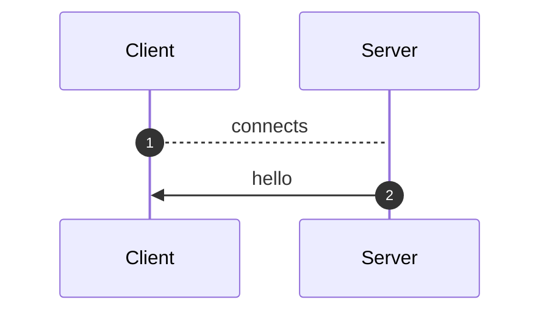
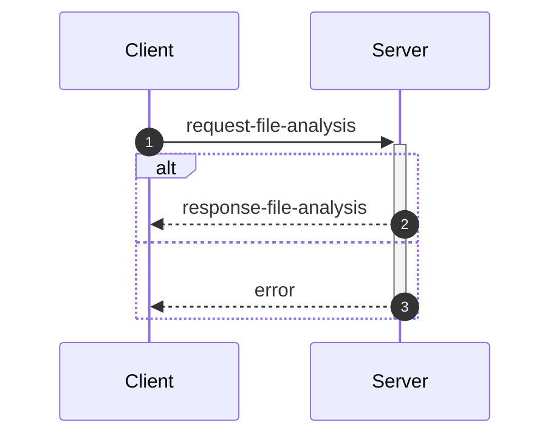
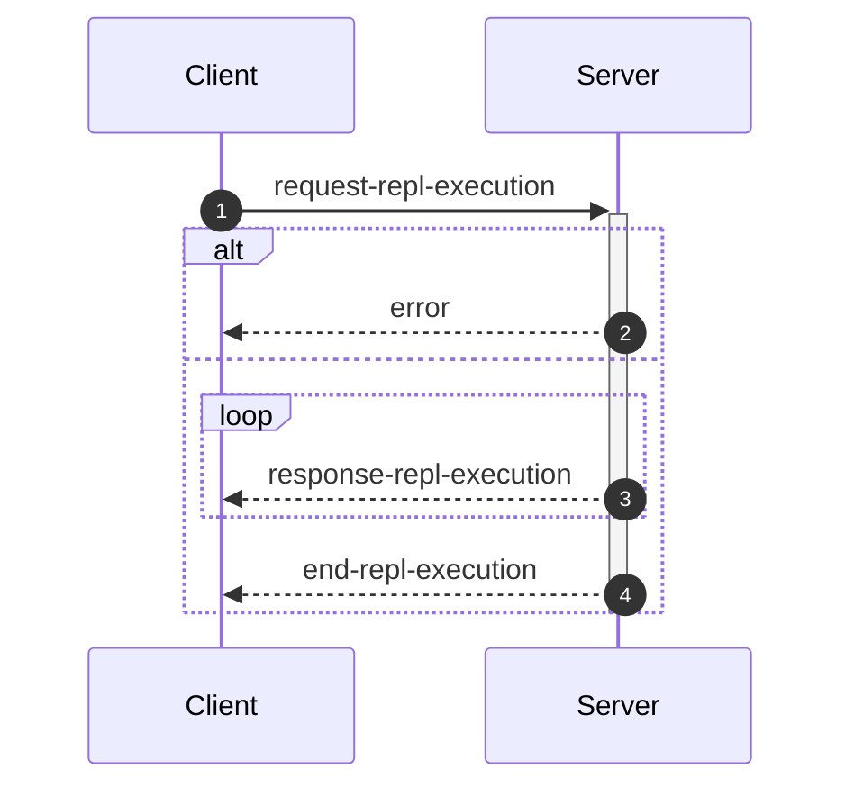
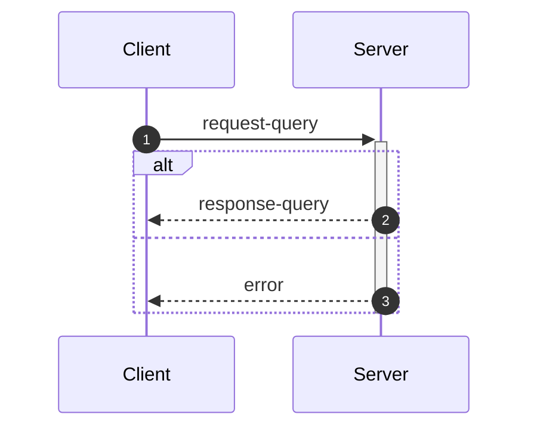

_<span title="an overview of flowR's interface">Generated</span> from '[wiki-interface.ts](https://github.com/flowr-analysis/flowr/tree/main/src/documentation/wiki-interface.ts "src/documentation/wiki-interface.ts")' on 2026-11-06, 11:26:10 UTC (v2.17.2, R v4.6.1), do not edit directly._

Although far from being as detailed as the in-depth explanation of [_flowR_](https://github.com/flowr-analysis/flowr/wiki/Core),
this wiki page explains how to interface with _flowR_ in more detail.
In general, command line arguments and other options provide short descriptions on hover over.

* [💻 Using the REPL](#using-the-repl)
* [⚙️ Configuring FlowR](#configuring-flowr)
* [⚒️ Writing Code](#writing-code)
* [💬 Communicating with the Server](#communicating-with-the-server)

<a id='using-the-repl'></a>
## 💻 Using the REPL

> [!NOTE]
> To execute arbitrary R commands with a repl request, _flowR_ has to be started explicitly with <span title="Description (Command Line Argument): Allow to access the underlying R session when using flowR (security warning: this allows the execution of arbitrary R code!)">`--r-session-access`</span>.
> Please be aware that this introduces a security risk and note that this relies on the [`r-shell` engine](https://github.com/flowr-analysis/flowr/wiki/Engines) .

Although primarily meant for users to explore,
there is nothing which forbids calling _flowR_ as a subprocess to use standard-in, -output, and -error
for communication (although you can access the REPL using the server as well,
with the [REPL Request](#message-request-repl-execution) message).

The read-eval-print loop&nbsp;(REPL) works relatively simple.
You can submit an expression (using <kbd>Enter</kbd>),
which is interpreted as an R&nbsp;expression by default but interpreted as a *command* if it starts with a colon (`:`).
The best command to get started with the REPL is <span title="Description (Repl Command): Show help information (aliases: :h, :?)">`:help`</span>.
Besides, you can leave the REPL either with the command <span title="Description (Repl Command): End the repl (aliases: :q, :exit)">`:quit`</span> or by pressing <kbd>Ctrl</kbd>+<kbd>C</kbd> twice.
When writing a *command*, you may press <kbd>Tab</kbd> to get a list of completions, if available.
Multiple commands can be entered in a single line by separating them with a semicolon (`;`), e.g. `:parse "x<-2"; :df*`.
If a command is given without R code, the REPL will re-use R code given in a previous command.
The prior example will hence return first the parsed AST of the program and then the dataflow graph for `"x <- 2"`.

> [!NOTE]
> If you develop flowR, you may want to launch the repl using the `npm run main-dev` command, this way, you get a non-minified version of flowR with debug information and hot-reloading of source files.

<details>
<summary>Available Commands</summary>

We currently offer the following commands (this with a `[*]` suffix are available with and without the star):

| Command | Description |
| ------- | ----------- |
| **<span title="Description (Repl Command): End the repl (aliases: :q, :exit)">:quit</span>** | End the repl (aliases: **:<span title="Alias of ':quit'. End the repl">q</span>**, **:<span title="Alias of ':quit'. End the repl">exit</span>**) |
| **<span title="Description (Repl Command): Execute the given code as R code. This requires the `--r-session-access` flag to be set and requires the r-shell engine. (aliases: :e, :r)">:execute</span>** | Execute the given code as R code. This requires the `--r-session-access` flag to be set and requires the r-shell engine. (aliases: **:<span title="Alias of ':execute'. Execute the given code as R code. This requires the `--r-session-access` flag to be set and requires the r-shell engine.">e</span>**, **:<span title="Alias of ':execute'. Execute the given code as R code. This requires the `--r-session-access` flag to be set and requires the r-shell engine.">r</span>**) |
| **<span title="Description (Repl Command): Get mermaid code for the control-flow graph of R code (aliases: :cfg, :cf)">:controlflow[*]</span>** | Get mermaid code for the control-flow graph of R code (star: Returns the URL to mermaid.live) (aliases: **:<span title="Alias of ':controlflow'. Get mermaid code for the control-flow graph of R code">cfg</span>**, **:<span title="Alias of ':controlflow'. Get mermaid code for the control-flow graph of R code">cf</span>**) |
| **<span title="Description (Repl Command): Get mermaid code for the control-flow graph with basic blocks (aliases: :cfgb, :cfb)">:controlflowbb[*]</span>** | Get mermaid code for the control-flow graph with basic blocks (star: Returns the URL to mermaid.live) (aliases: **:<span title="Alias of ':controlflowbb'. Get mermaid code for the control-flow graph with basic blocks">cfgb</span>**, **:<span title="Alias of ':controlflowbb'. Get mermaid code for the control-flow graph with basic blocks">cfb</span>**) |
| **<span title="Description (Repl Command): Get mermaid code for the dataflow graph (aliases: :d, :df)">:dataflow[*]</span>** | Get mermaid code for the dataflow graph (star: Returns the URL to mermaid.live) (aliases: **:<span title="Alias of ':dataflow'. Get mermaid code for the dataflow graph">d</span>**, **:<span title="Alias of ':dataflow'. Get mermaid code for the dataflow graph">df</span>**) |
| **<span title="Description (Repl Command): Get mermaid code for the normalized AST of R code (aliases: :n)">:normalize[*]</span>** | Get mermaid code for the normalized AST of R code (star: Returns the URL to mermaid.live) (alias: **:<span title="Alias of ':normalize'. Get mermaid code for the normalized AST of R code">n</span>**) |
| **<span title="Description (Repl Command): Get mermaid code for the simplified dataflow graph (aliases: :ds, :dfs)">:dataflowsimple[*]</span>** | Get mermaid code for the simplified dataflow graph (star: Returns the URL to mermaid.live) (aliases: **:<span title="Alias of ':dataflowsimple'. Get mermaid code for the simplified dataflow graph">ds</span>**, **:<span title="Alias of ':dataflowsimple'. Get mermaid code for the simplified dataflow graph">dfs</span>**) |
| **<span title="Description (Repl Command): Inspect and extend the signature database: `query` (identical to :query @signature), `info <name>` for where a function comes from (identical to :query @function-info), `add <path>` to mount another database/source, `download` to fetch the full-history database. (aliases: :sig)">:signature</span>** | Inspect and extend the signature database: `query` (identical to :query @signature), `info <name>` for where a function comes from (identical to :query @function-info), `add <path>` to mount another database/source, `download` to fetch the full-history database. (alias: **:<span title="Alias of ':signature'. Inspect and extend the signature database: `query` (identical to :query @signature), `info <name>` for where a function comes from (identical to :query @function-info), `add <path>` to mount another database/source, `download` to fetch the full-history database.">sig</span>**) |
| **<span title="Description (Repl Command): Just calculates the DFG, but only prints summary info (aliases: :d#, :df#)">:dataflowsilent</span>** | Just calculates the DFG, but only prints summary info (aliases: **:<span title="Alias of ':dataflowsilent'. Just calculates the DFG, but only prints summary info">d#</span>**, **:<span title="Alias of ':dataflowsilent'. Just calculates the DFG, but only prints summary info">df#</span>**) |
| **<span title="Description (Repl Command): Prints ASCII Art of the parsed, unmodified AST (aliases: :p)">:parse</span>** | Prints ASCII Art of the parsed, unmodified AST (alias: **:<span title="Alias of ':parse'. Prints ASCII Art of the parsed, unmodified AST">p</span>**) |
| **<span title="Description (Repl Command): Prints the version of flowR as well as the current version of R">:version</span>** | Prints the version of flowR as well as the current version of R
| **<span title="Description (Repl Command): Query the given R code (use 'help' for more information)">:query[*]</span>** | Query the given R code (use 'help' for more information) (star: Similar to query, but returns the output in json format.)
| **<span title="Description (Repl Command): Returns an ASCII representation of the dataflow graph (aliases: :df!)">:dataflowascii</span>** | Returns an ASCII representation of the dataflow graph (alias: **:<span title="Alias of ':dataflowascii'. Returns an ASCII representation of the dataflow graph">df!</span>**) |
| **<span title="Description (Repl Command): Returns summarization stats for the normalized AST (aliases: :n#)">:normalize#</span>** | Returns summarization stats for the normalized AST (alias: **:<span title="Alias of ':normalize#'. Returns summarization stats for the normalized AST">n#</span>**) |
| **<span title="Description (Repl Command): Show help information (aliases: :h, :?)">:help</span>** | Show help information (aliases: **:<span title="Alias of ':help'. Show help information">h</span>**, **:<span title="Alias of ':help'. Show help information">?</span>**) |

</details>

> [!TIP]
> 
> As indicated by the examples before, all REPL commands that operate on code keep track of the state.
> Hence, if you run a command like <span title="Description (Repl Command, starred version): Returns the URL to mermaid.live; Base Command: Get mermaid code for the dataflow graph (aliases: :d*, :df*)">`:dataflow*`</span> without providing R code,
> the REPL will re-use the R code provided in a previous command.
> Likewise, doing this will benefit from incrementality!
> If you request the dataflow graph with `:df* x <- 2 * y` and then want to see the parsed AST with `:parse`,
> the REPL will re-use previously obtained information and not re-parse the code again.
> 		

Generally, many commands offer shortcut versions in the REPL. Many queries, for example, offer a shortened format (see the example below).
Of special note, the [Config Query](https://github.com/flowr-analysis/flowr/wiki/%5BQuery%5D-Config)
can be used to also modify the currently active configuration of _flowR_ within the REPL (see the [wiki page](https://github.com/flowr-analysis/flowr/wiki/%5BQuery%5D-Config) for more information).

### Example: Retrieving the Dataflow Graph

To retrieve a URL to the [mermaid](https://mermaid.js.org/) diagram of the dataflow of a given expression,
use <span title="Description (Repl Command, starred version): Returns the URL to mermaid.live; Base Command: Get mermaid code for the dataflow graph (aliases: :d*, :df*)">`:dataflow*`</span> (or <span title="Description (Repl Command): Get mermaid code for the dataflow graph (aliases: :d, :df)">`:dataflow`</span> to get the mermaid code in the cli):

```shell
$ docker run -it --rm eagleoutice/flowr # or npm run flowr 
flowR repl v2.17.2, R grammar v14 (tree-sitter engine)
R> :dataflow* y <- 1 + x
```

<details>
<summary style='color:gray'>Output</summary>

```text
https://mermaid.live/view#base64:eyJjb2RlIjoiZmxvd2NoYXJ0IFREXG4gICAgMXt7XCJgKiM5MTtSTnVtYmVyIzkzOyogKioxKipcbiAgICAgICoxLjYqICgqKmlkOiAxKiopYFwifX1cbiAgICAyKFtcImAqIzkxO1JTeW1ib2wjOTM7KiAqKngqKlxuICAgICAgKjEuMTAqICgqKmlkOiAyKiopYFwiXSlcbiAgICAzW1tcImAqIzkxO1JCaW5hcnlPcCM5MzsqIGJhc2UjNTg7IzU4OyoqIzQzOyoqXG4gICAgICAqMS42LTEwKiAoKippZDogMyoqKVxuICAgIGFyZzogKDEsIDIpYFwiXV1cbiAgICBidWlsdC1pbjpfNDNfW1wiYEJ1aWx0LUluOlxuIzQzO2BcIl1cbiAgICBzdHlsZSBidWlsdC1pbjpfNDNfIHN0cm9rZTpncmF5LGZpbGw6Z3JheSxzdHJva2Utd2lkdGg6MnB4LG9wYWNpdHk6Ljg7XG4gICAgMFtcImAqIzkxO1JTeW1ib2wjOTM7KiAqKnkqKlxuICAgICAgKjEuMSogKCoqaWQ6IDAqKiwgdjogMylgXCJdXG4gICAgNFtbXCJgKiM5MTtSQmluYXJ5T3AjOTM7KiBiYXNlIzU4OyM1ODsqKiM2MDsjNDU7KipcbiAgICAgICoxLjEtMTAqICgqKmlkOiA0KiopXG4gICAgYXJnOiAoMCwgMylgXCJdXVxuICAgIGJ1aWx0LWluOl82MF8tW1wiYEJ1aWx0LUluOlxuIzYwOyM0NTtgXCJdXG4gICAgc3R5bGUgYnVpbHQtaW46XzYwXy0gc3Ryb2tlOmdyYXksZmlsbDpncmF5LHN0cm9rZS13aWR0aDoycHgsb3BhY2l0eTouODtcbiAgICAxIC0uLT58XCJmbG93XCJ8IDJcbiAgICBsaW5rU3R5bGUgMCBzdHJva2U6Z3JheSxjb2xvcjpncmF5O1xuICAgIDIgLS4tPnxcImZsb3dcInwgM1xuICAgIGxpbmtTdHlsZSAxIHN0cm9rZTpncmF5LGNvbG9yOmdyYXk7XG4gICAgMyAtLT58XCJyZWFkcywgYXJnXCJ8IDFcbiAgICAzIC0tPnxcInJlYWRzLCBhcmdcInwgMlxuICAgIDMgLS4tPnxcImZsb3dcInwgMFxuICAgIGxpbmtTdHlsZSA0IHN0cm9rZTpncmF5LGNvbG9yOmdyYXk7XG4gICAgMyAtLi0+fFwicmVhZHMsIGNhbGxzXCJ8IGJ1aWx0LWluOl80M19cbiAgICBsaW5rU3R5bGUgNSBzdHJva2U6Z3JheTtcbiAgICAwIC0tPnxcImRlZmluZWQtYnksIGZsb3dcInwgNFxuICAgIDAgLS0+fFwiZGVmaW5lZC1ieVwifCAzXG4gICAgNCAtLT58XCJyZWFkcywgYXJnXCJ8IDNcbiAgICA0IC0tPnxcInJldHVybnMsIGFyZ1wifCAwXG4gICAgNCAtLi0+fFwicmVhZHMsIGNhbGxzXCJ8IGJ1aWx0LWluOl82MF8tXG4gICAgbGlua1N0eWxlIDEwIHN0cm9rZTpncmF5OyIsIm1lcm1haWQiOnsiYXV0b1N5bmMiOnRydWV9fQ==
```

Retrieve the dataflow graph of the expression `y <- 1 + x`. It looks like this:


<details>

<summary style="color:gray">R Code of the Dataflow Graph</summary>

The analysis ran (parse and normalize with the [tree-sitter](https://github.com/flowr-analysis/flowr/wiki/Engines) engine) in the generation environment. No [signature database](https://github.com/flowr-analysis/flowr/wiki/Signature-Database) is mounted, so `library()` attaches no exports (base-R names are still qualified, e.g., `stats::acf`). 
We encountered no unknown side effects during the analysis.

```r
y <- 1 + x
```

</details>

</details>

For small graphs like this, <span title="Description (Repl Command): Returns an ASCII representation of the dataflow graph (aliases: :df!)">`:dataflowascii`</span> also provides an ASCII representation directly in the REPL:

```shell
$ docker run -it --rm eagleoutice/flowr # or npm run flowr 
flowR repl v2.17.2, R grammar v14 (tree-sitter engine)
R> :df! y <- 1 + x
```

<details open>
<summary style='color:gray'>Output</summary>

```text
                        v<0>v
 c<4>c──────────────────| y |
 |<- |     ┌────────────v---v
 c---c     │
    │   c<3>c   0<1>0
    └───| + |───| 1 |───u<2>u
        c---c   0---0   | x |
           └────────────u---u
Edges:
3 -> 1: reads, arg          3 -> 2: reads, arg
3 -> 0: flows-to            1 -> 2: flows-to
2 -> 3: flows-to            4 -> 3: reads, arg
4 -> 0: returns, arg        0 -> 4: defined-by, flows-to
0 -> 3: defined-by
```

Retrieve the dataflow graph of the expression `y <- 1 + x` as ASCII art.

</details>

For the slicing with <span title="Description (Repl Command): Static backwards executable slicer for R">`:slicer`</span>, you have access to the same [magic comments](#slice-magic-comments) as with the [slice request](#message-request-slice).
Pass `--inline` to splice resolvable `source()` calls into the reconstruction so the slice is a single self-contained R text (the same as the static slice query's `inlineSources` flag).
See `--help` for more flags!

### Example: Interfacing with the File System

Many commands that allow for an R-expression (like <span title="Description (Repl Command, starred version): Returns the URL to mermaid.live; Base Command: Get mermaid code for the dataflow graph (aliases: :d*, :df*)">`:dataflow*`</span>) allow for a file as well
if the argument starts with `file://`.
If you are working from the root directory of the _flowR_ repository, the following gives you the parsed AST of the example file using the <span title="Description (Repl Command): Prints ASCII Art of the parsed, unmodified AST (aliases: :p)">`:parse`</span> command:

> **Watch mode**: Replace `file://` with `watch://` to enter watch mode.
> flowR runs the command immediately and then re-runs it every time the file (or any file inside the folder) changes.
> Enter any other command to leave watch mode.
> For example: `:df watch://analysis.R`

```shell
$ docker run -it --rm eagleoutice/flowr # or npm run flowr 
flowR repl v2.17.2, R grammar v14 (tree-sitter engine)
R> :parse file://test/testfiles/example.R
```

<details>
<summary style='color:gray'>Output</summary>

```text
File: test/testfiles/example.R

program
├ binaryoperator
│ ├ identifier "sum" (1:1─4)
│ ├ <- "<-" (1:5─7)
│ ╰ float "0" (1:8─9)
├ binaryoperator
│ ├ identifier "product" (2:1─8)
│ ├ <- "<-" (2:9─11)
│ ╰ float "1" (2:12─13)
├ binaryoperator
│ ├ identifier "w" (3:1─2)
│ ├ <- "<-" (3:3─5)
│ ╰ float "7" (3:6─7)
├ binaryoperator
│ ├ identifier "N" (4:1─2)
│ ├ <- "<-" (4:3─5)
│ ╰ float "10" (4:6─8)
├ forstatement
│ ├ for "for" (6:1─4)
│ ├ ( "(" (6:5─6)
│ ├ identifier "i" (6:6─7)
│ ├ in "in" (6:8─10)
│ ├ binaryoperator
│ │ ├ float "1" (6:11─12)
│ │ ├ : ":" (6:12─13)
│ │ ╰ parenthesizedexpression
│ │   ├ ( "(" (6:13─14)
│ │   ├ binaryoperator
│ │   │ ├ identifier "N" (6:14─15)
│ │   │ ├ - "-" (6:15─16)
│ │   │ ╰ float "1" (6:16─17)
│ │   ╰ ) ")" (6:17─18)
│ ├ ) ")" (6:18─19)
│ ╰ bracedexpression
│   ├ { "{" (6:20─21)
│   ├ binaryoperator
│   │ ├ identifier "sum" (7:3─6)
│   │ ├ <- "<-" (7:7─9)
│   │ ╰ binaryoperator
│   │   ├ binaryoperator
│   │   │ ├ identifier "sum" (7:10─13)
│   │   │ ├ + "+" (7:14─15)
│   │   │ ╰ identifier "i" (7:16─17)
│   │   ├ + "+" (7:18─19)
│   │   ╰ identifier "w" (7:20─21)
│   ├ binaryoperator
│   │ ├ identifier "product" (8:3─10)
│   │ ├ <- "<-" (8:11─13)
│   │ ╰ binaryoperator
│   │   ├ identifier "product" (8:14─21)
│   │   ├  "" (8:22─23)
│   │   ╰ identifier "i" (8:24─25)
│   ╰ } "}" (9:1─2)
├ call
│ ├ identifier "cat" (11:1─4)
│ ╰ arguments
│   ├ ( "(" (11:4─5)
│   ├ argument
│   │ ╰ string
│   │   ├ stringopen "\"" (11:5─6)
│   │   ├ stringcontent "Sum:" (11:6─10)
│   │   ╰ stringclose "\"" (11:10─11)
│   ├ comma "," (11:11─12)
│   ├ argument
│   │ ╰ identifier "sum" (11:13─16)
│   ├ comma "," (11:16─17)
│   ├ argument
│   │ ╰ string
│   │   ├ stringopen "\"" (11:18─19)
│   │   ├ stringcontent
│   │   │ ╰ escapesequence "\\n" (11:19─21)
│   │   ╰ stringclose "\"" (11:21─22)
│   ╰ ) ")" (11:22─23)
╰ call
  ├ identifier "cat" (12:1─4)
  ╰ arguments
    ├ ( "(" (12:4─5)
    ├ argument
    │ ╰ string
    │   ├ stringopen "\"" (12:5─6)
    │   ├ stringcontent "Product:" (12:6─14)
    │   ╰ stringclose "\"" (12:14─15)
    ├ comma "," (12:15─16)
    ├ argument
    │ ╰ identifier "product" (12:17─24)
    ├ comma "," (12:24─25)
    ├ argument
    │ ╰ string
    │   ├ stringopen "\"" (12:26─27)
    │   ├ stringcontent
    │   │ ╰ escapesequence "\\n" (12:27─29)
    │   ╰ stringclose "\"" (12:29─30)
    ╰ ) ")" (12:30─31)
```

Retrieve the parsed AST of the example file.

<details>

<summary>File Content</summary>

```r
sum <- 0
product <- 1
w <- 7
N <- 10

for (i in 1:(N-1)) {
  sum <- sum + i + w
  product <- product * i
}

cat("Sum:", sum, "\n")
cat("Product:", product, "\n")
```

</details>

As _flowR_ directly transforms this AST the output focuses on being human-readable instead of being machine-readable.
		
</details>

### Example: Run a Query

You can run any query supported by _flowR_ using the <span title="Description (Repl Command): Query the given R code (use 'help' for more information)">`:query`</span> command.
For example, to obtain the shapes of all data frames in a given piece of code, you can run:

```shell
$ docker run -it --rm eagleoutice/flowr # or npm run flowr 
flowR repl v2.17.2, R grammar v14 (tree-sitter engine)
R> :query @absint df-shape "x <- data.frame(a = 1:10, b = 1:10)\ny <- x$a"
```

<details open>
<summary style='color:gray'>Output</summary>

```text
Query: absint (2 ms)
   ╰ $12: (colnames: [{"a", "b"}, {}], cols: [2, 2], rows: [10, 10])
   ╰ $0: (colnames: [{"a", "b"}, {}], cols: [2, 2], rows: [10, 10])
```

Retrieve the shapes of all data frames in the given code.

</details>

To run the linter on a file, you can use (in this example, we just issue the `dead-code` linter on a small piece of code):

```shell
$ docker run -it --rm eagleoutice/flowr # or npm run flowr 
flowR repl v2.17.2, R grammar v14 (tree-sitter engine)
R> :query @linter rules:dead-code "if(FALSE) x <- 2"
```

<details open>
<summary style='color:gray'>Output</summary>

```text
Query: linter (1 ms)
   ╰ Dead Code (dead-code):
       ╰ certain:
           ╰ Code at 1.11-16 (1 quick fix(es) available)
```

Run the linter on the given code, with only the `dead-code` rule enabled.

</details>

For more information on the available queries, please check out the [Query API](https://github.com/flowr-analysis/flowr/wiki/Query-API).

<a id='configuring-flowr'></a>
## ⚙️ Configuring FlowR

When running _flowR_, you may want to specify some behaviors with a dedicated configuration file.
By default, flowR looks for a file named `flowr.json` in the current working directory (or any higher directory).
You can also specify a different file with <span title="Description (Command Line Argument): The name of the configuration file to use">`--config-file`</span> or pass the configuration inline using <span title="Description (Command Line Argument): The flowR configuration to use, as a JSON string">`--config-json`</span>.
A `flowr.json` found this way belongs to the analyzed project, so flowR ignores its options that decide what flowR executes or loads
(`engines.*.wasmPath`, `engines.*.treeSitterWasmPath`, `engines.*.rPath`, `solver.sigdb.additionalPaths`, `solver.sigdb.downloadRepo`, `solver.sigdb.installedLibrary.paths`, `solver.sigdb.onDemand.enabled`, `solver.sigdb.onDemand.repositories`, `solver.sigdb.onDemand.cranMirror`, `solver.sigdb.onDemand.bioconductorMirror`, `solver.sigdb.onDemand.cacheDir`),
unless you pass <span title="Description (Command Line Argument): Keep the security-sensitive options (e.g., the R executable) of the flowr.json found in the working directory or a parent. Only use this for projects you trust.">`--trust-config`</span>.
To analyze code you do not trust, use the secure mode (<span title="Description (Command Line Argument): Run in secure mode for analyzing untrusted code: flowR does not start R (or any other process), does not access the network, does not search for project configs, and ignores security-sensitive options in every config. Cannot be disabled once enabled. Can also be enabled with the environment variable {italic FLOWR_SECURE_MODE=1}.">`--secure`</span>, see the [security policy](https://github.com/flowr-analysis/flowr/blob/main/.github/SECURITY.md)).
To inspect the current configuration, you can run flowr with the <span title="Description (Command Line Argument): Run with verbose logging (will be passed to the corresponding script)">`--verbose`</span> flag, or use the `config` [Query](https://github.com/flowr-analysis/flowr/wiki/Query-API).
Within the REPL this works by running the following:

```shell
:query @config
```

To work with the <a href="https://github.com/flowr-analysis/flowr/tree/main/src/config.ts#L119"><code><span title="The configuration file format for flowR.">FlowrConfig</span></code></a> you can use the provided helper objects alongside its methods like
<a href="https://github.com/flowr-analysis/flowr/tree/main/src/config.ts#L966"><code><span title="Creates a new flowr config that has the updated values.">FlowrConfig::<b>amend</b></span></code></a>.
The schema below documents every option; the ones you most likely want are:

- <a href="https://github.com/flowr-analysis/flowr/wiki/Interface#configuring-flowr" title="Configuration Option (boolean): Whether source calls should be ignored, causing {@link processSourceCall}&#39;s behavior to be skipped.">ignoreSourceCalls</a>: ignore source calls when analyzing the code, i.e., ignore the inclusion of other files.
- <a href="https://github.com/flowr-analysis/flowr/wiki/Interface#configuring-flowr" title="Configuration Option (boolean): Whether load calls should be ignored, causing {@link processLoadCall}&#39;s behavior to be skipped.">ignoreLoadCalls</a>: ignore load calls when analyzing the code, i.e., ignore the loading of r-data files.
- <a href="https://github.com/flowr-analysis/flowr/wiki/Interface#configuring-flowr" title="Configuration Option (object): Do you want to overwrite (parts) of the builtin definition?">semantics.environment.overwriteBuiltIns</a>: overwrite _flowR_'s handling of built-in functions, or clear the preset definitions entirely.
  See [Configure BuiltIn Semantics](#configure-builtin-semantics) for more information.
- <a href="https://github.com/flowr-analysis/flowr/wiki/Interface#configuring-flowr" title="Configuration Option (string): How to resolve variables and their values. (one of &quot;disabled&quot;, &quot;alias&quot;, &quot;builtin&quot;)">solver.variables</a>: how to resolve variables and their values (`disabled`, `alias`, `builtin`).
- <a href="https://github.com/flowr-analysis/flowr/wiki/Interface#configuring-flowr" title="Configuration Option (array): The engine or set of engines to use for interacting with R code. An empty array means all available engines will be used.">engines</a> and <a href="https://github.com/flowr-analysis/flowr/wiki/Interface#configuring-flowr" title="Configuration Option (string): The default engine to use for interacting with R code. If this is undefined, an arbitrary engine from the specified list will be used. (one of &quot;tree-sitter&quot;, &quot;r-shell&quot;)">defaultEngine</a>: the engines used to interact with R code, see the [Engines wiki page](https://github.com/flowr-analysis/flowr/wiki/Engines).
- <a href="https://github.com/flowr-analysis/flowr/wiki/Interface#configuring-flowr" title="Configuration Option (array): Files a framework loads on its own, without any source() call (e.g. global.R in a shiny app), in the order they are loaded; flowR orders the matching project files accordingly and analyzes them as one program. Entries are case-insensitive globs matched against the file path, a plain name matches any file with that name, and entries matching no project file are warned about. Usually set per project kind via specializeConfig.">project.implicitSources</a>: the files a framework loads without any `source()` call, in the order in which they are
  loaded. Entries are globs (e.g. `R/*.R`) matched against the file path ignoring capitalization; one matching no file is reported.
- <a href="https://github.com/flowr-analysis/flowr/wiki/Interface#configuring-flowr" title="Configuration Option (object): Overwrite (parts of) the configuration depending on the project kind flowR detects, e.g. to give a shiny app its implicit sources.">specializeConfig</a>: overwrite (parts of) the configuration depending on the kind of project _flowR_ detects
  (e.g. `shiny-app`), which is how a shiny app gets its implicit sources by default. What you configure directly wins.
- <a href="https://github.com/flowr-analysis/flowr/wiki/Interface#configuring-flowr" title="Configuration Option (string): Overwrite the project kind flowR would otherwise infer from the analyzed files, e.g. when auto-detection guesses wrong. (one of &quot;package&quot;, &quot;script&quot;, &quot;shiny-app&quot;, &quot;notebook&quot;, &quot;project&quot;, &quot;unknown&quot;)">project.useProjectType</a>: skip that detection and force a project kind yourself, when auto-detection guesses wrong.
- <a href="https://github.com/flowr-analysis/flowr/wiki/Interface#configuring-flowr" title="Configuration Option (array): The default plugins to load when creating a new instance of FlowrAnalyzer">defaultPlugins</a> and <a href="https://github.com/flowr-analysis/flowr/wiki/Interface#configuring-flowr" title="Configuration Option (array): The plugins to load in REPL mode">repl.plugins</a>: the plugins to load for a new <a href="https://github.com/flowr-analysis/flowr/tree/main/src/project/flowr-analyzer.ts#L210"><code><span title="Central class for conducting analyses with FlowR. Use the FlowrAnalyzerBuilder to create a new instance. If you want the original pattern of creating a pipeline and running all steps, you can still do this with FlowrAnalyzer#runFull . To inspect the context of the analyzer, use FlowrAnalyzer#inspectContext (if you are a plugin and need to modify it, use FlowrAnalyzer#context instead).">FlowrAnalyzer</span></code></a> and in the REPL
  (use `flowr:default` to reference the former).

So you can configure _flowR_ by adding a file like the following:

<details>

<summary>Example Configuration File</summary>

```json
{
  "ignoreSourceCalls": true,
  "ignoreLoadCalls": true,
  "semantics": {
    "environment": {
      "overwriteBuiltIns": {
        "definitions": [
          {
            "type": "function",
            "names": [
              "foo"
            ],
            "processor": "builtin:assign",
            "config": {}
          }
        ]
      }
    }
  },
  "defaultPlugins": [
    "file:description",
    "versions:description"
  ],
  "repl": {
    "quickStats": false,
    "dfProcessorHeat": false,
    "hints": true,
    "plugins": [
      "flowr:default"
    ]
  },
  "project": {
    "resolveUnknownPathsOnDisk": true,
    "implicitSources": [
      "global.R",
      "app.R"
    ]
  },
  "linter": {
    "disabledRules": []
  },
  "specializeConfig": {
    "shiny-app": {
      "project": {
        "implicitSources": [
          "global.R",
          "ui.R",
          "server.R",
          "app.R"
        ]
      }
    }
  },
  "engines": [
    {
      "type": "r-shell"
    }
  ],
  "solver": {
    "variables": "alias",
    "evalStrings": true,
    "trackEnvironments": true,
    "sigdb": {
      "enabled": true,
      "loadProjectDependencies": true,
      "eagerlyLoad": false,
      "eagerlyLoadExports": false,
      "linkBaseR": false,
      "linkDescriptionDependencies": false
    },
    "resolveSource": {
      "dropPaths": "no",
      "ignoreCapitalization": true,
      "inferWorkingDirectory": "active-script",
      "searchPath": []
    },
    "instrument": {},
    "slicer": {
      "threshold": 50
    }
  },
  "abstractInterpretation": {
    "wideningThreshold": 4,
    "followCalls": true,
    "dataFrame": {
      "maxColNames": 20,
      "readLoadedData": {
        "readExternalFiles": true,
        "maxReadLines": 1000000
      }
    }
  },
  "incremental": {
    "alwaysIncremental": false,
    "parsing": {
      "activated": false,
      "heuristics": {
        "activated": true,
        "mtime": true,
        "linesFrom": 500,
        "bytesFrom": 50000,
        "alwaysWithEdits": false,
        "minFiles": 1
      }
    }
  },
  "gas": {
    "thresholds": {
      "memory": {
        "problematic": 0.7,
        "critical": 0.9
      },
      "timeMs": {
        "problematic": 100000,
        "critical": 120000
      }
    },
    "features": {}
  }
}
```

</details>

<details>
<a id='configure-builtin-semantics'></a>
<summary>Configure Built-In Semantics</summary>

`semantics/environment/overwriteBuiltins` accepts two keys:

- `loadDefaults` (boolean, initially `true`): If set to `true`, the default built-in definitions are loaded before applying the custom definitions. Setting this flag to `false` explicitly disables the loading of the default definitions.
- `definitions` (array, initially empty): Allows to overwrite or define new built-in elements. Each object within must have a `type` which is one of the below. Furthermore, they may define a string array of `names` which specifies the identifiers to bind the definitions to. You may use `assumePrimitive` to specify whether _flowR_ should assume that this is a primitive non-library definition (so you probably just do not want to specify the key).

  | Type            | Description                                                                                                                                                                                                                                                                                              | Example                                                                                                    |
  | --------------- | -------------------------------------------------------------------------------------------------------------------------------------------------------------------------------------------------------------------------------------------------------------------------------------------------------- | ---------------------------------------------------------------------------------------------------------- |
  | `constant`    | Additionally allows for a `value` this should resolve to.                                                                                                                                                                                                                                                | `{ type: 'constant', names: ['NULL', 'NA'],  value: null }`                                                |
  | `function`    | Is a rather flexible way to define and bind built-in functions. For the time, we do not have extensive documentation to cover all the cases, so please either consult the sources with the `default-builtin-config.ts` or open a [new issue](https://github.com/flowr-analysis/flowr/issues/new/choose). | `{ type: 'function', names: ['next'], processor: 'builtin:d', config: { cfg: ExitPointType.Next } }` |
  | `replacement` | A comfortable way to specify replacement functions like `$<-` or `names<-`. `suffixes` describes the... suffixes to attach automatically. | `{ type: 'replacement', suffixes: ['<-', '<<-'], names: ['[', '[['] }` |

</details>

<details>

<summary style='color:gray'>Full Configuration-File Schema</summary>

- _The configuration file format for flowR._ (object)
    - **logLevel** [optional] _flowR's global minimum log level, applied when the config is loaded._ (string)
        Only allows: 'silly', 'trace', 'debug', 'info', 'warn', 'error', 'fatal'
    - **ignoreSourceCalls** [optional] _Whether source calls should be ignored, causing {@link processSourceCall}'s behavior to be skipped._ (boolean)
    - **ignoreLoadCalls** [optional] _Whether load calls should be ignored, causing {@link processLoadCall}'s behavior to be skipped._ (boolean)
    - **semantics** _Configure language semantics and how flowR handles them._ (object)
        - **environment** [optional] _Semantics regarding how to handle the R environment._ (object)
            - **overwriteBuiltIns** [optional] _Do you want to overwrite (parts) of the builtin definition?_ (object)
                - **loadDefaults** [optional] _Should the default configuration still be loaded?_ (boolean)
                - **definitions** [optional] _The definitions to load/overwrite._ (array)
                Valid item types:
                    - (object)
    - **defaultPlugins** [optional] _The default plugins to load when creating a new instance of FlowrAnalyzer_ (array)
    Valid item types:
        - (alternatives)
            - (string)
            - (array)
    - **repl** _Configuration options for the REPL._ (object)
        - **quickStats** [optional] _Whether to show quick stats in the REPL after each evaluation._ (boolean)
        - **dfProcessorHeat** [optional] _This instruments the dataflow processors to count how often each processor is called._ (boolean)
        - **hints** [optional] _Whether to show dim inline hints on the empty prompt (automatically disabled on non-interactive terminals)._ (boolean)
        - **plugins** [optional] _The plugins to load in REPL mode_ (array)
        Valid item types:
            - (alternatives)
                - (string)
                - (array)
        - **autoUseFileProtocol** [optional] _Prepend the file protocol to a repl input that looks like a path, instead of only warning about it._ (boolean)
        - **queryStats** [optional] _Whether `:query` closes with the line stating how long the queries took (`:query*` never prints it)._ (boolean)
        - **showPlugins** [optional] _Whether `:version` grays out the plugins that did not activate during the last analysis._ (boolean)
    - **project** _Project specific configuration options._ (object)
        - **resolveUnknownPathsOnDisk** [optional] _Whether to resolve unknown paths loaded by the r project disk when trying to source/analyze files._ (boolean)
        - **failOnInaccessiblePath** [optional] _Whether a directory that cannot be traversed during file discovery (e.g. due to permissions) aborts the analysis; when false (the default) such paths are logged and skipped._ (boolean)
        - **basePackages** [optional] _The packages considered part of R itself (base and recommended); if unset, flowR uses its built-in list._ (array)
        Valid item types:
            - (string)
        - **implicitSources** [optional] _Files a framework loads on its own, without any source() call (e.g. global.R in a shiny app), in the order they are loaded; flowR orders the matching project files accordingly and analyzes them as one program. Entries are case-insensitive globs matched against the file path, a plain name matches any file with that name, and entries matching no project file are warned about. Usually set per project kind via specializeConfig._ (array)
        Valid item types:
            - (string)
        - **useProjectType** [optional] _Overwrite the project kind flowR would otherwise infer from the analyzed files, e.g. when auto-detection guesses wrong._ (string)
            Only allows: 'package', 'script', 'shiny-app', 'notebook', 'project', 'unknown'
        - **assumeImplicitEcho** [optional] _Whether the top level of the analyzed code is echoed, so that every visible result printed there is collected as an output by the dependencies query (default true, false for a package)._ (boolean)
        - **discovery** [optional] _Scoping options for the default project discovery._ (object)
            - **full** [optional] _Collect every file below the project root (greedy) instead of only the files the detected project kind needs (default false)._ (boolean)
            - **perKind** [optional] _Per-kind include/exclude glob overrides layered on the default scoping._ (object)
            - **ignore** [optional] _Case-insensitive globs that drop matching files from the intelligent discovery, regardless of kind (e.g. .Renviron to ignore environment files)._ (array)
            Valid item types:
                - (string)
        - **classification** [optional] _Overrides for the signals flowR uses to classify the project kind._ (object)
            - **shinyDescriptionTypes** [optional] _DESCRIPTION Type: values that mark a shiny app._ (array)
            Valid item types:
                - (string)
            - **shinyEntryFiles** [optional] _File names a shiny app is assembled from._ (array)
            Valid item types:
                - (string)
            - **shinyUsagePattern** [optional] _Regex source evidencing shiny usage in an entry file._ (string)
            - **notebookExtensions** [optional] _File extensions marking a notebook._ (array)
            Valid item types:
                - (string)
    - **linter** _Linter configuration options._ (object)
        - **disabledRules** _Linting rule names excluded from the default rule set (a rule requested explicitly via a linter query still runs). Usually set per project kind via specializeConfig._ (array)
        Valid item types:
            - (string)
        - **disabledTags** [optional] _Linting rule tags whose rules are excluded from the default rule set (a rule requested explicitly via a linter query still runs). By default the cmd-check rules are disabled for everything but a package; a configured list replaces that default._ (array)
        Valid item types:
            - (string)
    - **inputSources** [optional] _Further frameworks the input-sources analysis should know about; entries are added to flowR's defaults._ (object)
        - **pure** [optional] _Functions that only pass the constantness of their arguments on._ (array)
        Valid item types:
            - (string)
        - **param** [optional] _Functions whose result is a 'param' input._ (array)
        Valid item types:
            - (string)
        - **file** [optional] _Functions whose result is a 'file' input._ (array)
        Valid item types:
            - (string)
        - **tempfile** [optional] _Functions whose result is a 'tempfile' input._ (array)
        Valid item types:
            - (string)
        - **glob** [optional] _Functions whose result is a 'glob' input._ (array)
        Valid item types:
            - (string)
        - **net** [optional] _Functions whose result is a 'net' input._ (array)
        Valid item types:
            - (string)
        - **rand** [optional] _Functions whose result is a 'rand' input._ (array)
        Valid item types:
            - (string)
        - **system** [optional] _Functions whose result is a 'system' input._ (array)
        Valid item types:
            - (string)
        - **ffi** [optional] _Functions whose result is a 'ffi' input._ (array)
        Valid item types:
            - (string)
        - **lang** [optional] _Functions whose result is a 'lang' input._ (array)
        Valid item types:
            - (string)
        - **options** [optional] _Functions whose result is a 'options' input._ (array)
        Valid item types:
            - (string)
        - **cmdline** [optional] _Functions whose result is a 'cmdline' input._ (array)
        Valid item types:
            - (string)
        - **user** [optional] _Functions whose result is a 'user' input._ (array)
        Valid item types:
            - (string)
        - **const** [optional] _Functions whose result is a 'const' input._ (array)
        Valid item types:
            - (string)
        - **scope** [optional] _Functions whose result is a 'scope' input._ (array)
        Valid item types:
            - (string)
        - **dconst** [optional] _Functions whose result is a 'dconst' input._ (array)
        Valid item types:
            - (string)
        - **unknown** [optional] _Functions whose result is a 'unknown' input._ (array)
        Valid item types:
            - (string)
        - **linkedObjects** [optional] _Objects a framework provides without a definition in the code, e.g. shiny's input._ (array)
        Valid item types:
            - (object)
        - **linkedEntryPoints** [optional] _Calls that hand a function to a framework, which binds its objects to the parameters by position._ (array)
        Valid item types:
            - (object)
    - **specializeConfig** [optional] _Overwrite (parts of) the configuration depending on the project kind flowR detects, e.g. to give a shiny app its implicit sources._ (object)
    - **engines** _The engine or set of engines to use for interacting with R code. An empty array means all available engines will be used._ (array)
    Valid item types:
        - (alternatives)
            - _The configuration for the tree sitter engine._ (object)
                - **type** [required] _Use the tree sitter engine._ (string)
                    Only allows: 'tree-sitter'
                - **wasmPath** [optional] _The path to the tree-sitter-r WASM binary to use. If this is undefined, this uses the default path._ (string)
                - **treeSitterWasmPath** [optional] _The path to the tree-sitter WASM binary to use. If this is undefined, this uses the default path._ (string)
                - **lax** [optional] _Whether to use the lax parser for parsing R code (allowing for syntax errors). If this is undefined, the strict parser will be used._ (boolean)
            - _The configuration for the R shell engine._ (object)
                - **type** [required] _Use the R shell engine._ (string)
                    Only allows: 'r-shell'
                - **rPath** [optional] _The path to the R executable to use. If this is undefined, this uses the default path._ (string)
                - **pipeBind** [optional] _Whether to enable R's experimental pipe-bind operator "=>" by setting _R_USE_PIPEBIND_ for the R session (default false); R itself keeps this off by default, as it is experimental and has never shipped in a release version of R._ (boolean)
    - **defaultEngine** [optional] _The default engine to use for interacting with R code. If this is undefined, an arbitrary engine from the specified list will be used._ (string)
        Only allows: 'tree-sitter', 'r-shell'
    - **solver** _How to resolve constants, constraints, cells, ..._ (object)
        - **variables** _How to resolve variables and their values._ (string)
            Only allows: 'disabled', 'alias', 'builtin'
        - **evalStrings** _Should we include eval(parse(text="...")) calls in the dataflow graph?_ (boolean)
        - **trackEnvironments** [optional] _Track user-created environments (new.env, assign/get/local with envir=, dollar-assign, attach). When false, all envir-style calls fall through conservatively._ (boolean)
        - **sigdb** _Resolving library exports from a signature database._ (object)
            - **enabled** [optional] _Resolve library()/use() exports from a signature database (default true); when false no database is consulted._ (boolean)
            - **loadProjectDependencies** [optional] _Load the project's declared dependencies from its metadata files (DESCRIPTION Imports/Depends, rproject.toml, uvr.toml, rig rproj.toml and script blocks, renv.lock, rv.lock, uvr.lock, rig lockfiles) (default true); when false these files are not read for dependencies._ (boolean)
            - **eagerlyLoad** [optional] _Parse the database up front rather than on the first package load (default false, ignored if disabled)._ (boolean)
            - **eagerlyLoadExports** [optional] _Add a vertex for every export on load rather than on demand (default false); keeps the dataflow graph small._ (boolean)
            - **assumedRVersion** [optional] _R version assumed when resolving versioned (base-R) exports: a pin like "4.5" or "auto" to detect the installed R (default "auto")._ (string)
            - **linkBaseR** [optional] _Eagerly attach base-R namespaces so bare base calls resolve without library() (default false)._ (boolean)
            - **linkBaseRCalls** [optional] _Add a lightweight Reads edge from a bare base-R call to its signature-database function vertex (default false; base-R qualification is edge-free otherwise)._ (boolean)
            - **linkPackageCalls** [optional] _Add a lightweight Reads edge from a resolved package call to its signature-database function vertex (default false)._ (boolean)
            - **linkDescriptionDependencies** [optional] _Eagerly attach the namespaces of the project's declared DESCRIPTION dependencies (Imports/Depends) so their exports resolve without an explicit library() (default false)._ (boolean)
            - **warmInBackground** [optional] _Decompress the hot shards (base + most-downloaded) in a background task on startup so the first library() lookup is warm (default false; for long-running servers/REPLs)._ (boolean)
            - **additionalPaths** [optional] _Extra directories or bundle/manifest files searched for signature databases (alongside the shipped default and $FLOWR_SIGDB_DIR); a downloaded full-history bundle placed here is mounted automatically._ (array)
            Valid item types:
                - (string)
            - **downloadRepo** [optional] _GitHub owner/repo the full-history bundle is downloaded from via ":signature download" (default "flowr-analysis/flowr"; the release tag comes from the committed sigdb.remote.json unless a version is given)._ (string)
            - **autoSync** [optional] _On startup, re-download shards whose committed sigdb.remote.json hash no longer matches the cache, in the background (default false; opt-in network sync after a git pull)._ (boolean)
            - **installedLibrary** [optional] _Recovering packages no signature database knows from the copy installed on this machine._ (object)
                - **enabled** [required] _Recover packages no signature database knows from their installed copy (default false)._ (boolean)
                - **paths** [optional] _Library directories to search; when empty they are discovered from the environment and the project._ (array)
                Valid item types:
                    - (string)
                - **useEnvironment** [optional] _Search the libraries R_LIBS_USER/R_LIBS/R_LIBS_SITE name (default true)._ (boolean)
                - **useProjectLibrary** [optional] _Search a project-local renv/packrat library (default true)._ (boolean)
                - **maxDepth** [optional] _How far to descend into the nested layout of a project-local library (default 3)._ (number)
                - **packages** [optional] _Only recover packages whose name matches one of these regular expressions; empty means any._ (array)
                Valid item types:
                    - (string)
            - **onDemand** [optional] _Recovering packages no signature database knows from their sources on CRAN, Bioconductor, or GitHub._ (object)
                - **enabled** [required] _Fetch and recover the sources of packages no signature database knows when the analyzed code uses them (default false, accesses the network)._ (boolean)
                - **sources** [optional] _Where to look, in order: github, cran, bioconductor, or a source a plugin adds (default ["github", "cran", "bioconductor"])._ (array)
                Valid item types:
                    - (string)
                - **repositories** [optional] _GitHub repositories (owner/repo[/subdir][@ref]) to fetch packages from, by package name. The analyzed project may name more (DESCRIPTION Remotes, install_github calls)._ (object)
                - **packages** [optional] _Only recover packages whose name matches one of these regular expressions, empty means any._ (array)
                Valid item types:
                    - (string)
                - **cranMirror** [optional] _The CRAN src/contrib/ to fetch from, over https (default https://cloud.r-project.org/src/contrib/). It may be on the local network._ (string)
                - **bioconductorMirror** [optional] _The Bioconductor host, over https (default https://bioconductor.org). It may be on the local network._ (string)
                - **bioconductorRelease** [optional] _The Bioconductor release to fetch from: release, devel, or a number like 3.20 (default release)._ (string)
                - **githubMirrors** [optional] _Use the GitHub mirrors of CRAN (cran/<pkg>) and Bioconductor (bioc/<pkg>) (default true)._ (boolean)
                - **maxPackages** [optional] _The most packages to fetch for one analysis (default 25)._ (number)
                - **maxArchiveMb** [optional] _The most MiB a package archive may have (default 32). It may unpack to three times that, at most 128 MiB._ (number)
                - **offline** [optional] _Only use what was fetched before, never the network (default false)._ (boolean)
                - **retryAfterHours** [optional] _How many hours to wait before asking again for a package no source had (default 24)._ (number)
                - **cacheDir** [optional] _Where to cache what was fetched (default the on-demand directory of the signature cache)._ (string)
            - **blobCacheBudgetMb** [optional] _How many MiB of decoded package blobs every open bundle may hold together (default 16)._ (number)
            - **versionSelection** [optional] _When a project constrains a dependency, resolve to the newest (default), oldest, or system-installed version satisfying it; system needs R and falls back to newest. Base-R packages always resolve against the assumed R version._ (string)
                Only allows: 'newest', 'oldest', 'system'
            - **versionOverrides** [optional] _Force an exact version for specific packages (name -> version), overriding both the project constraint and the versionSelection policy (default {})._ (object)
        - **versionManagement** _Policies for reasoning about dependency versions._ (object)
            - **linkedVersionGroups** [optional] _Groups of packages that must resolve to the same version; version guessing intersects each group so its members stay mutually compatible (default [])._ (array)
            Valid item types:
                - (array)
                Valid item types:
                    - (string)
        - **assumeAttachedPackages** [optional] _Packages to treat as attached without a `library()` call, so what the built-in configuration states about them applies to the analyzed code. The base packages R attaches on startup already resolve without it._ (array)
        Valid item types:
            - (string)
        - **transitiveSideEffectRounds** [optional] _How many rounds the transitive side-effect fixpoint may run before it is cut off (default 32); the propagation stops on its own as soon as a round adds nothing._ (number)
        - **maxOverlayDepth** [optional] _How many binding overlays may stack on one environment frame before a write flattens them (default 4); a pure performance knob, trading lookup cost against copy cost without changing any result._ (number)
        - **instrument** (object)
            - **dataflowExtractors** [optional] _These keys are only intended for use within code, allowing to instrument the dataflow analyzer!_ (any)
        - **resolveSource** [optional] _If lax source calls are active, flowR searches for sourced files much more freely, based on the configurations you give it. This option is only in effect if `ignoreSourceCalls` is set to false._ (object)
            - **dropPaths** _Allow to drop the first or all parts of the sourced path, if it is relative._ (string)
                Only allows: 'no', 'once', 'all'
            - **ignoreCapitalization** _Search for filenames matching in the lowercase._ (boolean)
            - **inferWorkingDirectory** _Try to infer the working directory from the main or any script to analyze._ (string)
                Only allows: 'no', 'main-script', 'active-script', 'any-script'
            - **searchPath** _Additionally search in these paths._ (array)
            Valid item types:
                - (string)
            - **repeatedSourceLimit** [optional] _How often the same file can be sourced within a single run? Please be aware: in case of cyclic sources this may not reach a fixpoint so give this a sensible limit._ (number)
            - **applyReplacements** _Provide name replacements for loaded files_ (array)
            Valid item types:
                - (object)
            - **assumeFilesExist** [optional] _Assume a sourced file is always there, making what it defines certain instead of conditional on the source call._ (boolean)
        - **slicer** [optional] _The configuration for the slicer._ (object)
            - **threshold** [optional] _The maximum number of iterations to perform on a single function call during slicing._ (number)
            - **autoExtend** [optional] _If set, the slicer will gain an additional post-pass._ (boolean)
    - **abstractInterpretation** _The configuration options for abstract interpretation._ (object)
        - **wideningThreshold** _The threshold for the number of visitations of a node at which widening should be performed to ensure the termination of the fixpoint iteration._ (number)
        - **followCalls** _Whether the abstract interpretation is interprocedural, i.e. whether it steps into the functions a call may dispatch to._ (boolean)
        - **dataFrame** _The configuration of the shape inference for data frames._ (object)
            - **maxColNames** _The maximum number of columns names to infer for data frames before over-approximating the column names to top._ (number)
            - **readLoadedData** _Configuration options for reading data frame shapes from loaded external data files, such as CSV files._ (object)
                - **readExternalFiles** _Whether data frame shapes should be extracted from loaded external files, such as CSV files._ (boolean)
                - **maxReadLines** _The maximum number of lines to read when extracting data frame shapes from loaded files, such as CSV files._ (number)
    - **incremental** (object)
        - **alwaysIncremental** _Always take the incremental path, regardless of heuristics._ (boolean)
        - **parsing** (object)
            - **activated** _If set, incremental parsing will be used._ (boolean)
            - **heuristics** (object)
                - **activated** [optional] _If set, the heuristics for incremental parsing will be used._ (boolean)
                - **mtime** [optional] _Skip reparsing entirely if the file's modification time is unchanged since the last parse._ (boolean)
                - **linesFrom** [optional] _Only consider incremental parsing for files with at least this many lines._ (number)
                - **bytesFrom** [optional] _Only consider incremental parsing for files with at least this many bytes._ (number)
                - **alwaysWithEdits** [optional] _Always take the incremental path whenever there is a computed edit region, regardless of the other thresholds._ (boolean)
                - **minFiles** [optional] _Only apply these heuristics once the project has at least this many files loaded._ (number)
    - **gas** [optional] _Resource-usage guard (gas) configuration. All feature factors default to 0 (disabled). See https://github.com/flowr-analysis/flowr/wiki/Core#gas-resource-guard._ (object)
        - **thresholds** [optional] _Thresholds for all gas checks (scaled by per-feature factor), boundable per feature._ (object)
            - **memory** [optional] _Heap-usage fraction thresholds (0-1), either shared or given per feature key (with `default` covering the rest)._ (object)
                - **problematic** [optional] _Heap fraction (0-1) above which Problematic is returned, for every feature without an entry of its own._ (number)
                - **critical** [optional] _Heap fraction (0-1) above which Critical is returned, for every feature without an entry of its own._ (number)
            - **timeMs** [optional] _Elapsed analysis time thresholds in milliseconds, either shared or given per feature key (with `default` covering the rest)._ (object)
                - **problematic** [optional] _Elapsed ms above which Problematic is returned, for every feature without an entry of its own._ (number)
                - **critical** [optional] _Elapsed ms above which Critical is returned, for every feature without an entry of its own._ (number)
            - **steps** [optional] _Processed-AST-node thresholds, counted rather than sampled; only a key that arms a budget (`dataflow`) reads them._ (object)
                - **problematic** [optional] _Processed AST nodes above which Problematic is returned, for every feature without an entry of its own._ (number)
                - **critical** [optional] _Processed AST nodes above which the extraction is cut short, for every feature without an entry of its own._ (number)
            - **vertices** [optional] _Created-dataflow-vertex thresholds, counted like `steps`._ (object)
                - **problematic** [optional] _Created dataflow vertices above which Problematic is returned, for every feature without an entry of its own._ (number)
                - **critical** [optional] _Created dataflow vertices above which the extraction is cut short, for every feature without an entry of its own._ (number)
        - **features** [optional] _Per-feature sensitivity factors. 0 or absent disables gas checking for that feature. A factor of 2 makes the feature twice as sensitive. Recognised keys: `source`, `side-effect-linking`, `linter`, `slicer`, `dataflow`._ (object)
        - **countedCheckEvery** [optional] _How many counted steps pass between two accountings of an armed check, be it a dataflow budget or the slicer's traversal (default 128); trades overshoot against the cost of the check._ (number)
        - **heapProvider** [optional] _Custom heap statistics source (programmatic configs only), overriding the built-in v8/performance.memory detection._ (function)

</details>

<a id='writing-code'></a>
## ⚒️ Writing Code

_flowR_ can be used as a [module](https://www.npmjs.com/package/@eagleoutice/flowr) and offers several main classes and interfaces that are interesting for extension writers 
(see the [Visual Studio Code extension](https://marketplace.visualstudio.com/items?itemName=code-inspect.vscode-flowr) or the [Core](https://github.com/flowr-analysis/flowr/wiki/Core) wiki page for more information).

### Creating Analyses with _flowR_

Nowadays, instances of the <a href="https://github.com/flowr-analysis/flowr/tree/main/src/project/flowr-analyzer.ts#L210"><code><span title="Central class for conducting analyses with FlowR. Use the FlowrAnalyzerBuilder to create a new instance. If you want the original pattern of creating a pipeline and running all steps, you can still do this with FlowrAnalyzer#runFull . To inspect the context of the analyzer, use FlowrAnalyzer#inspectContext (if you are a plugin and need to modify it, use FlowrAnalyzer#context instead).">FlowrAnalyzer</span></code></a> should be used as central frontend to get analysis results from _flowR_.
The entry points an analysis is written against are re-exported from the package root (`import { FlowrAnalyzerBuilder } from '@eagleoutice/flowr'`);
everything else stays reachable under its own path, as in `@eagleoutice/flowr/dataflow/graph/graph`.
For example, a program slice can be created like this:

```ts
const analyzer = await new FlowrAnalyzerBuilder()
    .setEngine('tree-sitter')
    .build();
analyzer.addRequest('x <- 1\ny <- x\nx');
const result = await analyzer.query([
    {
        type:     'static-slice',
        criteria: ['3@x']
    }
]);
```

For more information, please have a look at the [Analyzer](https://github.com/flowr-analysis/flowr/wiki/Analyzer) wiki page, which explains how to construct and use the <a href="https://github.com/flowr-analysis/flowr/tree/main/src/project/flowr-analyzer.ts#L210"><code><span title="Central class for conducting analyses with FlowR. Use the FlowrAnalyzerBuilder to create a new instance. If you want the original pattern of creating a pipeline and running all steps, you can still do this with FlowrAnalyzer#runFull . To inspect the context of the analyzer, use FlowrAnalyzer#inspectContext (if you are a plugin and need to modify it, use FlowrAnalyzer#context instead).">FlowrAnalyzer</span></code></a> in more detail.
To work with specific perspectives, you can also consult the respective pages like the [Dataflow Graph](https://github.com/flowr-analysis/flowr/wiki/Dataflow-Graph) or the [Abstract Interpretation](https://github.com/flowr-analysis/flowr/wiki/Abstract-Interpretation) wiki pages.
### The Pipeline Executor (Low-Level Interface)

Once, in the beginning, _flowR_ was meant to produce a dataflow graph merely to provide *program slices*. 
However, with continuous updates, the [Dataflow Graph](https://github.com/flowr-analysis/flowr/wiki/Dataflow-Graph) repeatedly proves to be the more interesting part.
With this, we restructured _flowR_'s originally *hardcoded* pipeline to be far more flexible. 
Now, it can be theoretically extended or replaced with arbitrary steps, optional steps, and what we call 'decorations' of these steps. 
In short, a slicing pipeline using the <a href="https://github.com/flowr-analysis/flowr/tree/main/src/core/pipeline-executor.ts#L97"><code><span title="**Please note:** The PipelineExecutor is now considered to be a rather low-level API for flowR. While it still works and is the basis for all other layers, we strongly recommend using the FlowrAnalyzer and its builder to create and use an analyzer instance that is pre-configured for your use-case. The pipeline executor allows to execute arbitrary pipelines in a step-by-step fashion. If you are not...">PipelineExecutor</span></code></a> looks like this:

```ts

const slicer = new PipelineExecutor(DEFAULT_SLICING_PIPELINE, {
  parser:    new RShell(),
  request:   requestFromInput('x <- 1\nx + 1'),
  criterion: ['2@x']
})
const slice = await slicer.allRemainingSteps()
// console.log(slice.reconstruct.code)
```

<details><summary>More Information</summary>

If you compare this, with what you would have done with the old (and removed) `SteppingSlicer`, 
this essentially just requires you to replace the `SteppingSlicer` with the <a href="https://github.com/flowr-analysis/flowr/tree/main/src/core/pipeline-executor.ts#L97"><code><span title="**Please note:** The PipelineExecutor is now considered to be a rather low-level API for flowR. While it still works and is the basis for all other layers, we strongly recommend using the FlowrAnalyzer and its builder to create and use an analyzer instance that is pre-configured for your use-case. The pipeline executor allows to execute arbitrary pipelines in a step-by-step fashion. If you are not...">PipelineExecutor</span></code></a>
and to pass the <a href="https://github.com/flowr-analysis/flowr/tree/main/src/core/steps/pipeline/default-pipelines.ts#L18"><code>DEFAULT_SLICING_PIPELINE</code></a> as the first argument.
The <a href="https://github.com/flowr-analysis/flowr/tree/main/src/core/pipeline-executor.ts#L97"><code><span title="**Please note:** The PipelineExecutor is now considered to be a rather low-level API for flowR. While it still works and is the basis for all other layers, we strongly recommend using the FlowrAnalyzer and its builder to create and use an analyzer instance that is pre-configured for your use-case. The pipeline executor allows to execute arbitrary pipelines in a step-by-step fashion. If you are not...">PipelineExecutor</span></code></a>...

1. Provides structures to investigate the results of all intermediate steps
2. Can be executed step-by-step
3. Can repeat steps (e.g., to calculate multiple slices on the same input)

See the in-code documentation for more information.

</details>

### Using the <a href="https://github.com/flowr-analysis/flowr/tree/main/src/r-bridge/shell.ts#L144"><code><span title="The RShell represents an interactive session with the R interpreter. You can configure it by RShellOptions . At the moment we are using a live R session (and not networking etc.) to communicate with R easily, which allows us to install packages etc. However, this might and probably will change in the future (leaving this as a legacy mode :D)">RShell</span></code></a> to Interact with R

The <a href="https://github.com/flowr-analysis/flowr/tree/main/src/r-bridge/shell.ts#L144"><code><span title="The RShell represents an interactive session with the R interpreter. You can configure it by RShellOptions . At the moment we are using a live R session (and not networking etc.) to communicate with R easily, which allows us to install packages etc. However, this might and probably will change in the future (leaving this as a legacy mode :D)">RShell</span></code></a> class allows interfacing with the `R`&nbsp;ecosystem installed on the host system.
Please have a look at [flowR's Engines](https://github.com/flowr-analysis/flowr/wiki/Engines) for more information on alternatives (for example, the <a href="https://github.com/flowr-analysis/flowr/tree/main/src/r-bridge/lang-4.x/tree-sitter/tree-sitter-executor.ts#L29"><code><span title="Synchronous and (way) faster alternative to the RShell using tree-sitter.">TreeSitterExecutor</span></code></a>).

> [!IMPORTANT]
> 
> Each <a href="https://github.com/flowr-analysis/flowr/tree/main/src/r-bridge/shell.ts#L144"><code><span title="The RShell represents an interactive session with the R interpreter. You can configure it by RShellOptions . At the moment we are using a live R session (and not networking etc.) to communicate with R easily, which allows us to install packages etc. However, this might and probably will change in the future (leaving this as a legacy mode :D)">RShell</span></code></a> controls a new instance of the R&nbsp;interpreter, 
> make sure to call <code><a href="https://github.com/flowr-analysis/flowr/tree/main/src/r-bridge/shell.ts#L350"><span title="Close the current R session, makes the object effectively invalid (can no longer be reopened etc.)">RShell::<i>close</i></span></a>()</code> when you are done.

You can start a new "session" by constructing a new object with <code>new <a href="https://github.com/flowr-analysis/flowr/tree/main/src/r-bridge/shell.ts#L144"><span title="The RShell represents an interactive session with the R interpreter. You can configure it by RShellOptions . At the moment we are using a live R session (and not networking etc.) to communicate with R easily, which allows us to install packages etc. However, this might and probably will change in the future (leaving this as a legacy mode :D)">RShell</span></a>()</code>.

However, there are several options that may be of interest 
(e.g., to automatically revive the shell in case of errors or to control the name location of the R process on the system).

With a shell object (let's call it `shell`), you can execute R code by using <a href="https://github.com/flowr-analysis/flowr/tree/main/src/r-bridge/shell.ts#L213"><code><span title="sends the given command directly to the current R session will not do anything to alter input markers!">RShell::<i>sendCommand</i></span></code></a>,
for example <code>shell.<a href="https://github.com/flowr-analysis/flowr/tree/main/src/r-bridge/shell.ts#L213"><span title="sends the given command directly to the current R session will not do anything to alter input markers!">sendCommand</span></a>("1 + 1")</code>.
However, this does not return anything, so if you want to collect the output of your command, use
<a href="https://github.com/flowr-analysis/flowr/tree/main/src/r-bridge/shell.ts#L296"><code><span title="Send a command and collect the output">RShell::<i>sendCommandWithOutput</i></span></code></a> instead.

<a id='communicating-with-the-server'></a>
## 💬 Communicating with the Server

As explained in the [Overview](https://github.com/flowr-analysis/flowr/wiki/Overview), you can run the [TCP](https://de.wikipedia.org/wiki/Transmission_Control_Protocol)&nbsp;server by adding the <span title="Description (Command Line Argument): Do not drop into a repl, but instead start a server on the given port (default: 1042) and listen for messages.">`--server`</span> flag (and, due to the interactive mode, exit with the conventional <kbd>CTRL</kbd>+<kbd>C</kbd>).
Currently, every connection is handled by the same underlying `RShell` - so the server is not designed to handle many clients at a time.
Additionally, the server is not well guarded against attacks (e.g., you can theoretically spawn an arbitrary number of&nbsp;RShell sessions on the target machine).

Every message has to be given in a single line (i.e., without a newline in-between) and end with a newline character. Nevertheless, we will pretty-print example given in the following segments for the ease of reading.

> [!NOTE]
> 
> The default <span title="Description (Command Line Argument): Do not drop into a repl, but instead start a server on the given port (default: 1042) and listen for messages.">`--server`</span> uses a simple [TCP](https://de.wikipedia.org/wiki/Transmission_Control_Protocol)
> connection. If you want _flowR_ to expose a [WebSocket](https://de.wikipedia.org/wiki/WebSocket) server instead, add the <span title="Description (Command Line Argument): If the server flag is set, use websocket for messaging">`--ws`</span> flag (i.e., <span title="Description (Command Line Argument): Do not drop into a repl, but instead start a server on the given port (default: 1042) and listen for messages.">`--server`</span> <span title="Description (Command Line Argument): If the server flag is set, use websocket for messaging">`--ws`</span>) when starting _flowR_ from the command line.

<ul><li>
<a id="message-hello"></a>
<b>Hello</b> Message (<code>hello</code>) 
<details>

<summary style="color:gray"> View Details. <i>The server informs the client about the successful connection and provides Meta-Information.</i> </summary>



After launching _flowR_, for example, with <code>docker run -it --rm eagleoutice/flowr <span title="Description (Command Line Argument): Do not drop into a repl, but instead start a server on the given port (default: 1042) and listen for messages.">-<span/>-server</span></code>&nbsp;(🐳️), connecting should present you with a `hello` message, that amongst others should reveal the versions of&nbsp;_flowR_ and&nbsp;R, using the [semver 2.0](https://semver.org/spec/v2.0.0.html) versioning scheme.
The message looks like this:

```json
{
  "type": "hello",
  "clientName": "client-0",
  "versions": {
    "flowr": "2.17.2",
    "r": "4.6.1",
    "engine": "r-shell"
  }
}
```

There are currently a few messages that you can send after the hello message.
If you want to _slice_ a piece of R code you first have to send an [analysis request](#message-request-file-analysis), so that you can send one or multiple slice requests afterward.
Requests for the [REPL](#message-request-repl-execution) are independent of that.
	
<hr>

<details>
<summary style="color:gray">Message schema (<code>hello</code>)</summary>

For the definition of the hello message, please see it's implementation at [`./src/cli/repl/server/messages/message-hello.ts`](https://github.com/flowr-analysis/flowr/tree/main/src/cli/repl/server/messages/message-hello.ts).

- [required] (object)
    - **type** [required] _The type of the hello message._ (string)
        Only allows: 'hello'
    - **id** [forbidden] _The id of the message is always undefined (as it is the initial message and not requested)._ (any)
    - **clientName** [required] _A unique name that is assigned to each client. It has no semantic meaning and is only used/useful for debugging._ (string)
    - **versions** [required] (object)
        - **flowr** [required] _The version of the flowr server running in semver format._ (string)
        - **r** [required] _The version of the underlying R shell running in semver format._ (string)
        - **engine** [required] _The parser backend that is used to parse the R code._ (string)

</details>

<hr>

</details>
	</li>

<li>
<a id="message-request-file-analysis"></a>
<b>Analysis</b> Message (<code>request-file-analysis</code>) 
<details>

<summary style="color:gray"> View Details. <i>The server builds the dataflow graph for a given input file (or a set of files).</i> </summary>



The request allows the server to analyze a file and prepare it for slicing.
The message can contain a `filetoken`, which is used to identify the file in later slice or query requests (if you do not add one, the request will not be stored and therefore, it is not available for subsequent requests).

> **Please note!**\
> If you want to send and process a lot of analysis requests, but do not want to slice them, please do not pass the `filetoken` field. This will save the server a lot of memory allocation.

Furthermore, the request must contain either a `content` field to directly pass the file's content or a `filepath` field which contains the path to the file (this path must be accessible for the server to be useful).
If you add the `id` field, the answer will use the same `id` so you can match requests and the corresponding answers.
See the implementation of the request-file-analysis message for more information.

You can drop one or more stored file tokens by adding the `invalidateToken` field (a single token or an array of tokens).
The server frees the corresponding analyses _after_ it has answered the request.

> **Tip!**\
> If you only want to drop tokens, you do not need a separate message: send a `request-file-analysis` that contains _just_ the `invalidateToken` field (and no `content` or `filepath`).
> Such a request behaves like an empty file analysis and the server replies with an empty `results` object.
> Because invalidation happens after the response, you may even pass the _current_ `filetoken` in `invalidateToken` to analyze a file once and have the server forget it right after you received the results.

<details>
<summary>Example of the <code>request-file-analysis</code> Message</summary>

_Note:_ even though we pretty-print these messages, they are sent as a single line, ending with a newline.

The following lists all messages that were sent and received in case you want to reproduce the scenario:

<ol>
<li> <code>hello</code> (response)
<details> 

<summary> Show Details </summary>

The first message is always a hello message.

```json
{"type":"hello","clientName":"client-0","versions":{"flowr":"2.17.2","r":"4.6.1","engine":"r-shell"}}
```

</details>
</li>

<li> <b><code>request-file-analysis</code> (request)</b>
<details open> 

<summary> Show Details </summary>

Let's suppose you simply want to analyze the following script:
 
```r
x <- 1
x + 1
```

 For this, you can send the following request:

```json
{"type":"request-file-analysis","id":"1","filetoken":"x","content":"x <- 1\nx + 1"}
```

</details>
</li>

<li> <code>response-file-analysis</code> (response)
<details> 

<summary> Show Details </summary>

The `results` field of the response effectively contains three keys of importance:

- `parse`: which contains 1:1 the parse result in CSV format that we received from the `RShell` (i.e., the AST produced by the parser of the R interpreter).
- `normalize`: which contains the normalized AST, including ids (see the `info` field and the [Normalized AST](https://github.com/flowr-analysis/flowr/wiki/Normalized-AST) wiki page).
- `dataflow`: especially important is the `graph` field which contains the dataflow graph as a set of root vertices (see the [Dataflow Graph](https://github.com/flowr-analysis/flowr/wiki/Dataflow-Graph) wiki page).
			
_As the code is pretty long, we inhibit pretty printing and syntax highlighting (JSON, hiding built-in):_

```text
{"type":"response-file-analysis","format":"json","id":"1","results":{"parse":{"files":[{"parsed":"[1,1,1,6,7,0,\"expr\",false,\"x <- 1\"],[1,1,1,1,1,3,\"SYMBOL\",true,\"x\"],[1,1,1,1,3,7,\"expr\",false,\"x\"],[1,3,1,4,2,7,\"LEFT_ASSIGN\",true,\"<-\"],[1,6,1,6,4,5,\"NUM_CONST\",true,\"1\"],[1,6,1,6,5,7,\"expr\",false,\"1\"],[2,1,2,5,16,0,\"expr\",false,\"x + 1\"],[2,1,2,1,10,12,\"SYMBOL\",true,\"x\"],[2,1,2,1,12,16,\"expr\",false,\"x\"],[2,3,2,3,11,16,\"'+'\",true,\"+\"],[2,5,2,5,13,14,\"NUM_CONST\",true,\"1\"],[2,5,2,5,14,16,\"expr\",false,\"1\"]","filePath":"/tmp/tmp-1541029-L73TeQFOIlFv-.R"}],".meta":{}},"normalize":{"ast":{"type":"RProject","files":[{"root":{"type":"RExpressionList","children":[{"type":"RBinaryOp","location":[1,3,1,4],"lhs":{"type":"RSymbol","location":[1,1,1,1],"content":"x","lexeme":"x","info":{"fullRange":[1,1,1,1],"adToks":[],"id":0,"parent":2,"role":"bin-l","index":0,"nest":0,"file":"/tmp/tmp-1541029-L73TeQFOIlFv-.R"}},"rhs":{"location":[1,6,1,6],"lexeme":"1","info":{"fullRange":[1,6,1,6],"adToks":[],"id":1,"parent":2,"role":"bin-r","index":1,"nest":0,"file":"/tmp/tmp-1541029-L73TeQFOIlFv-.R"},"type":"RNumber","content":{"num":1,"complexNumber":false,"markedAsInt":false}},"operator":"<-","lexeme":"<-","info":{"fullRange":[1,1,1,6],"adToks":[],"id":2,"parent":6,"nest":0,"file":"/tmp/tmp-1541029-L73TeQFOIlFv-.R","index":0,"role":"el-c"}},{"type":"RBinaryOp","location":[2,3,2,3],"lhs":{"type":"RSymbol","location":[2,1,2,1],"content":"x","lexeme":"x","info":{"fullRange":[2,1,2,1],"adToks":[],"id":3,"parent":5,"role":"bin-l","index":0,"nest":0,"file":"/tmp/tmp-1541029-L73TeQFOIlFv-.R"}},"rhs":{"location":[2,5,2,5],"lexeme":"1","info":{"fullRange":[2,5,2,5],"adToks":[],"id":4,"parent":5,"role":"bin-r","index":1,"nest":0,"file":"/tmp/tmp-1541029-L73TeQFOIlFv-.R"},"type":"RNumber","content":{"num":1,"complexNumber":false,"markedAsInt":false}},"operator":"+","lexeme":"+","info":{"fullRange":[2,1,2,5],"adToks":[],"id":5,"parent":6,"nest":0,"file":"/tmp/tmp-1541029-L73TeQFOIlFv-.R","index":1,"role":"el-c"}}],"info":{"adToks":[],"id":6,"nest":0,"file":"/tmp/tmp-1541029-L73TeQFOIlFv-.R","role":"root","index":0}},"filePath":"/tmp/tmp-1541029-L73TeQFOIlFv-.R"}],"info":{"id":7}},".meta":{}},"dataflow":{"unknownReferences":[],"in":[{"nodeId":2,"name":"<-","type":2},{"nodeId":5,"name":"+","type":2}],"out":[{"nodeId":0,"name":"x","type":4,"definedAt":2,"value":[1]}],"environment":{"current":{"id":2354,"parent":"<BuiltInEnvironment>","memory":[["x",[{"nodeId":0,"name":"x","type":4,"definedAt":2,"value":[1]}]]],"globalEnv":true},"level":0},"graph":{"rootVertices":[1,0,2,3,4,5],"vertexInformation":[[1,{"tag":"value","id":1}],[0,{"tag":"vdef","id":0,"source":[1]}],[2,{"tag":"fcall","id":2,"name":"<-","onlyBuiltin":true,"args":[{"nodeId":0,"type":32},{"nodeId":1,"type":32}],"origin":["builtin:assign"]}],[3,{"tag":"use","id":3}],[4,{"tag":"value","id":4}],[5,{"tag":"fcall","id":5,"name":"+","onlyBuiltin":true,"args":[{"nodeId":3,"type":32},{"nodeId":4,"type":32}],"origin":["builtin:d"]}]],"edgeInformation":[[2,[[1,{"types":65}],[0,{"types":72}],["built-in:<-",{"types":5}],[3,{"types":4096}]]],[1,[[0,{"types":4096}]]],[0,[[2,{"types":4098}],[1,{"types":2}]]],[5,[[3,{"types":65}],[4,{"types":65}],["built-in:+",{"types":5}]]],[3,[[0,{"types":1}],[4,{"types":4096}]]],[4,[[5,{"types":4096}]]]],"_unknownSideEffects":[]},"entryPoint":2,"cfgEntry":1,"exitPoints":[{"type":0,"nodeId":5}],"hooks":[],".meta":{}}}}
```

</details>
</li>
</ol>

The complete round-trip covers validating the messages as well as starting and stopping the internal mock server.

</details>

You receive an error if, for whatever reason, the analysis fails (e.g., the message or code you sent contained syntax errors).
It contains a human-readable description *why* the analysis failed (see the error message implementation for more details).

<details>
<summary>Example Error Message</summary>

_Note:_ even though we pretty-print these messages, they are sent as a single line, ending with a newline.

The following lists all messages that were sent and received in case you want to reproduce the scenario:

<ol>
<li> <code>hello</code> (response)
<details> 

<summary> Show Details </summary>

The first message is always a hello message.

```json
{"type":"hello","clientName":"client-0","versions":{"flowr":"2.17.2","r":"4.6.1","engine":"r-shell"}}
```

</details>
</li>

<li> <code>request-file-analysis</code> (request)
<details> 

<summary> Show Details </summary>

```json
{"type":"request-file-analysis","id":"1","filename":"sample.R","content":"x <-"}
```

</details>
</li>

<li> <b><code>error</code> (response)</b>
<details open> 

<summary> Show Details </summary>

```json
{
  "id": "1",
  "type": "error",
  "fatal": false,
  "reason": "Error while analyzing file sample.R: GuardError: unable to parse R code (see the log for more information) for request {\"request\":\"text\",\"content\":\"x <-\"}}\n Report a Bug: https://github.com/flowr-analysis/flowr/issues/new?body=%3C!%2D%2D%20Please%20describe%20your%20issue%20in%20more%20detail%20below!%20%2D%2D%3E%0A%0A%0A%3C!%2D%2D%20Automatically%20generated%20issue%20metadata%2C%20please%20do%20not%20edit%20or%20delete%20content%20below%20this%20line%20%2D%2D%3E%0A%2D%2D%2D%0A%0AflowR%20version%3A%202.17.2%0Anode%20version%3A%20v26.10.0%0Anode%20arch%3A%20x64%0Anode%20platform%3A%20linux%0Amessage%3A%20%60unable%20to%20parse%20R%20code%20%28see%20the%20log%20for%20more%20information%29%20for%20request%20%7B%22request%22%3A%22text%22%2C%22content%22%3A%22x%20%3C%2D%22%7D%7D%60%0Astack%20trace%3A%0A%60%60%60%0A%20%20%20%20at%20guard%20%28%3C%3E%2Fsrc%2Futil%2Fassert.ts%3A128%3A9%29%0A%20%20%20%20at%20guardRetrievedOutput%20%28%3C%3E%2Fsrc%2Fr%2Dbridge%2Fretriever.ts%3A155%3A7%29%0A%20%20%20%20at%20%2Fhome%2Fostwind%2Fgit%2Fphd%2Fflowr%2Dfield%2Fflowr%2Fsrc%2Fr%2Dbridge%2Fretriever.ts%3A122%3A4%0A%20%20%20%20at%20processTicksAndRejections%20%28node%3Ainternal%2Fprocess%2Ftask_queues%3A104%3A5%29%0A%20%20%20%20at%20async%20Object.parseRequests%20%5Bas%20processor%5D%20%28%3C%3E%2Fsrc%2Fr%2Dbridge%2Fparser.ts%3A108%3A19%29%0A%20%20%20%20at%20async%20PipelineExecutor.nextStep%20%28%3C%3E%2Fsrc%2Fcore%2Fpipeline%2Dexecutor.ts%3A192%3A25%29%0A%20%20%20%20at%20async%20FlowrAnalyzerCache.stepTapeUntil%20%28%3C%3E%2Fsrc%2Fproject%2Fcache%2Fflowr%2Danalyzer%2Dcache.ts%3A125%3A4%29%0A%60%60%60%0A%0A%2D%2D%2D%0A%09"
}
```

</details>
</li>
</ol>

The complete round-trip covers validating the messages as well as starting and stopping the internal mock server.

</details>

&nbsp;

<a id="analysis-include-cfg"></a>
**Including the Control Flow Graph**

The control flow graph is a view on the dataflow graph: the dataflow analysis records the control flow while it walks
the program, and the graph projects those edges on demand. The server can expose that structure as well (please create
a [new issue](https://github.com/flowr-analysis/flowr/issues/new/choose) for any bug you may encounter).
For this, the analysis request may add `cfg: true` to its list of options.

<details>
<summary>Requesting a Control Flow Graph</summary>

_Note:_ even though we pretty-print these messages, they are sent as a single line, ending with a newline.

The following lists all messages that were sent and received in case you want to reproduce the scenario:

<ol>
<li> <code>hello</code> (response)
<details> 

<summary> Show Details </summary>

The first message is always a hello message.

```json
{"type":"hello","clientName":"client-0","versions":{"flowr":"2.17.2","r":"4.6.1","engine":"r-shell"}}
```

</details>
</li>

<li> <b><code>request-file-analysis</code> (request)</b>
<details open> 

<summary> Show Details </summary>

```json
{
  "type": "request-file-analysis",
  "id": "1",
  "filetoken": "x",
  "content": "if(unknown > 0) { x <- 2 } else { x <- 5 }\nfor(i in 1:x) { print(x); print(i) }",
  "cfg": true
}
```

</details>
</li>

<li> <code>response-file-analysis</code> (response)
<details> 

<summary> Show Details </summary>

The response looks basically the same as a response sent without the `cfg` flag. However, additionally it contains a `cfg` field. 
If you are interested in a visual representation of the control flow graph, see the 
[visualization with mermaid](https://mermaid.live/view#base64:eyJjb2RlIjoiZmxvd2NoYXJ0IFREXG4gICAgbjAoW1wiYFJTeW1ib2wgKDApXG4qKnVua25vd24qKmBcIl0pXG4gICAgbjEoW1wiYFJOdW1iZXIgKDEpXG4qKjAqKmBcIl0pXG4gICAgbjIoW1wiYFJCaW5hcnlPcCAoMilcbioqdW5rbm93biAjNjI7IDAqKmBcIl0pXG4gICAgbjYoW1wiYFJOdW1iZXIgKDYpXG4qKjIqKmBcIl0pXG4gICAgbjUoW1wiYFJTeW1ib2wgKDUpXG4qKngqKmBcIl0pXG4gICAgbjdbXCJgUkJpbmFyeU9wICg3KVxuKip4ICM2MDsjNDU7IDIqKmBcIl1cbiAgICBuOChbXCJgUkV4cHJlc3Npb25MaXN0ICg4KWBcIl0pXG4gICAgbjEyKFtcImBSTnVtYmVyICgxMilcbioqNSoqYFwiXSlcbiAgICBuMTEoW1wiYFJTeW1ib2wgKDExKVxuKip4KipgXCJdKVxuICAgIG4xM1tcImBSQmluYXJ5T3AgKDEzKVxuKip4ICM2MDsjNDU7IDUqKmBcIl1cbiAgICBuMTQoW1wiYFJFeHByZXNzaW9uTGlzdCAoMTQpYFwiXSlcbiAgICBuMTVbXCJgUklmVGhlbkVsc2UgKDE1KVxuKippZih1bmtub3duICM2MjsgMCkgIzEyMzsgeCAjNjA7IzQ1OyAyICMxMjU7IGVsc2UgIzEyMzsgeCAjNjA7IzQ1OyA1ICMxMjU7KipgXCJdXG4gICAgbjE2KFtcImBSU3ltYm9sICgxNilcbioqaSoqYFwiXSlcbiAgICBuMTcoW1wiYFJOdW1iZXIgKDE3KVxuKioxKipgXCJdKVxuICAgIG4xOChbXCJgUlN5bWJvbCAoMTgpXG4qKngqKmBcIl0pXG4gICAgbjE5KFtcImBSQmluYXJ5T3AgKDE5KVxuKioxIzU4O3gqKmBcIl0pXG4gICAgbjIzKFtcImBSU3ltYm9sICgyMylcbioqeCoqYFwiXSlcbiAgICBuMjVbXCJgUkZ1bmN0aW9uQ2FsbCAoMjUpXG4qKnByaW50KHgpKipgXCJdXG4gICAgbjI3KFtcImBSU3ltYm9sICgyNylcbioqaSoqYFwiXSlcbiAgICBuMjlbXCJgUkZ1bmN0aW9uQ2FsbCAoMjkpXG4qKnByaW50KGkpKipgXCJdXG4gICAgbjMwKFtcImBSRXhwcmVzc2lvbkxpc3QgKDMwKWBcIl0pXG4gICAgbjMxW1wiYFJGb3JMb29wICgzMSlcbioqZm9yKGkgaW4gMSM1ODt4KSAjMTIzOyBwcmludCh4KTsgcHJpbnQoaSkgIzEyNTsqKmBcIl1cbiAgICBuMiAtLi0+fFwiYnJhbmNoIG9uIHVua25vd24gIzYyOyAwICgyKSBpZiBUXCJ8IG42XG4gICAgbjIgLS4tPnxcImJyYW5jaCBvbiB1bmtub3duICM2MjsgMCAoMikgaWYgRlwifCBuMTJcbiAgICBuMCAtLT58XCJmbG93cyB0b1wifCBuMVxuICAgIG4xIC0tPnxcImZsb3dzIHRvXCJ8IG4yXG4gICAgbjcgLS0+fFwiZmxvd3MgdG9cInwgbjhcbiAgICBuNiAtLT58XCJmbG93cyB0b1wifCBuNVxuICAgIG41IC0tPnxcImZsb3dzIHRvXCJ8IG43XG4gICAgbjggLS0+fFwiZmxvd3MgdG9cInwgbjE1XG4gICAgbjE1IC0tPnxcImZsb3dzIHRvXCJ8IG4xN1xuICAgIG4xMyAtLT58XCJmbG93cyB0b1wifCBuMTRcbiAgICBuMTIgLS0+fFwiZmxvd3MgdG9cInwgbjExXG4gICAgbjExIC0tPnxcImZsb3dzIHRvXCJ8IG4xM1xuICAgIG4xNCAtLT58XCJmbG93cyB0b1wifCBuMTVcbiAgICBuMTkgLS0+fFwiZmxvd3MgdG9cInwgbjE2XG4gICAgbjE4IC0tPnxcImZsb3dzIHRvXCJ8IG4xOVxuICAgIG4xNyAtLT58XCJmbG93cyB0b1wifCBuMThcbiAgICBuMjUgLS0+fFwiZmxvd3MgdG9cInwgbjI3XG4gICAgbjIzIC0tPnxcImZsb3dzIHRvXCJ8IG4yNVxuICAgIG4yOSAtLT58XCJmbG93cyB0b1wifCBuMzBcbiAgICBuMjcgLS0+fFwiZmxvd3MgdG9cInwgbjI5XG4gICAgbjMwIC0tPnxcImZsb3dzIHRvXCJ8IG4xNlxuICAgIG4xNiAtLi0+fFwiYnJhbmNoIG9uIGkgKDE2KSBpZiBUXCJ8IG4yM1xuICAgIG4xNiAtLi0+fFwiYnJhbmNoIG9uIGkgKDE2KSBpZiBGXCJ8IG4zMVxuICAgIHN0eWxlIG4wIHN0cm9rZTpjeWFuLHN0cm9rZS13aWR0aDo2LjVweDsgICAgc3R5bGUgbjMxIHN0cm9rZTpncmVlbixzdHJva2Utd2lkdGg6Ni41cHg7IiwibWVybWFpZCI6eyJhdXRvU3luYyI6dHJ1ZX19).
			
_As the code is pretty long, we inhibit pretty printing and syntax highlighting (JSON, hiding built-in):_

```text
{"type":"response-file-analysis","format":"json","id":"1","cfg":{"graph":{"roots":[0,1,2,6,5,7,8,12,11,13,14,15,16,17,18,19,23,25,27,29,30,31],"vtxInfos":[[0,[2,0]],[1,[2,1]],[2,[2,2]],[6,[2,6]],[5,[2,5]],[7,[1,7]],[8,[2,8]],[12,[2,12]],[11,[2,11]],[13,[1,13]],[14,[2,14]],[15,[1,15]],[16,[2,16]],[17,[2,17]],[18,[2,18]],[19,[2,19]],[23,[2,23]],[25,[1,25]],[27,[2,27]],[29,[1,29]],[30,[2,30]],[31,[1,31]]],"bbChildren":[],"edgeInfos":[[2,[[6,{"id":15,"when":true}],[12,{"id":15,"when":false}]]],[0,[[1,0]]],[1,[[2,0]]],[7,[[8,0]]],[6,[[5,0]]],[5,[[7,0]]],[8,[[15,0]]],[15,[[17,0]]],[13,[[14,0]]],[12,[[11,0]]],[11,[[13,0]]],[14,[[15,0]]],[19,[[16,0]]],[18,[[19,0]]],[17,[[18,0]]],[25,[[27,0]]],[23,[[25,0]]],[29,[[30,0]]],[27,[[29,0]]],[30,[[16,0]]],[16,[[23,{"id":31,"when":true}],[31,{"id":31,"when":false}]]]],"mayHaveBasicBlocks":false},"entryPoints":[0],"exitPoints":[31],"returns":[],"breaks":[],"nexts":[]},"results":{"parse":{"files":[{"parsed":"[1,1,1,42,38,0,\"expr\",false,\"if(unknown > 0) { x <- 2 } else { x <- 5 }\"],[1,1,1,2,1,38,\"IF\",true,\"if\"],[1,3,1,3,2,38,\"'('\",true,\"(\"],[1,4,1,14,9,38,\"expr\",false,\"unknown > 0\"],[1,4,1,10,3,5,\"SYMBOL\",true,\"unknown\"],[1,4,1,10,5,9,\"expr\",false,\"unknown\"],[1,12,1,12,4,9,\"GT\",true,\">\"],[1,14,1,14,6,7,\"NUM_CONST\",true,\"0\"],[1,14,1,14,7,9,\"expr\",false,\"0\"],[1,15,1,15,8,38,\"')'\",true,\")\"],[1,17,1,26,22,38,\"expr\",false,\"{ x <- 2 }\"],[1,17,1,17,12,22,\"'{'\",true,\"{\"],[1,19,1,24,19,22,\"expr\",false,\"x <- 2\"],[1,19,1,19,13,15,\"SYMBOL\",true,\"x\"],[1,19,1,19,15,19,\"expr\",false,\"x\"],[1,21,1,22,14,19,\"LEFT_ASSIGN\",true,\"<-\"],[1,24,1,24,16,17,\"NUM_CONST\",true,\"2\"],[1,24,1,24,17,19,\"expr\",false,\"2\"],[1,26,1,26,18,22,\"'}'\",true,\"}\"],[1,28,1,31,23,38,\"ELSE\",true,\"else\"],[1,33,1,42,35,38,\"expr\",false,\"{ x <- 5 }\"],[1,33,1,33,25,35,\"'{'\",true,\"{\"],[1,35,1,40,32,35,\"expr\",false,\"x <- 5\"],[1,35,1,35,26,28,\"SYMBOL\",true,\"x\"],[1,35,1,35,28,32,\"expr\",false,\"x\"],[1,37,1,38,27,32,\"LEFT_ASSIGN\",true,\"<-\"],[1,40,1,40,29,30,\"NUM_CONST\",true,\"5\"],[1,40,1,40,30,32,\"expr\",false,\"5\"],[1,42,1,42,31,35,\"'}'\",true,\"}\"],[2,1,2,36,84,0,\"expr\",false,\"for(i in 1:x) { print(x); print(i) }\"],[2,1,2,3,41,84,\"FOR\",true,\"for\"],[2,4,2,13,53,84,\"forcond\",false,\"(i in 1:x)\"],[2,4,2,4,42,53,\"'('\",true,\"(\"],[2,5,2,5,43,53,\"SYMBOL\",true,\"i\"],[2,7,2,8,44,53,\"IN\",true,\"in\"],[2,10,2,12,51,53,\"expr\",false,\"1:x\"],[2,10,2,10,45,46,\"NUM_CONST\",true,\"1\"],[2,10,2,10,46,51,\"expr\",false,\"1\"],[2,11,2,11,47,51,\"':'\",true,\":\"],[2,12,2,12,48,50,\"SYMBOL\",true,\"x\"],[2,12,2,12,50,51,\"expr\",false,\"x\"],[2,13,2,13,49,53,\"')'\",true,\")\"],[2,15,2,36,81,84,\"expr\",false,\"{ print(x); print(i) }\"],[2,15,2,15,54,81,\"'{'\",true,\"{\"],[2,17,2,24,64,81,\"expr\",false,\"print(x)\"],[2,17,2,21,55,57,\"SYMBOL_FUNCTION_CALL\",true,\"print\"],[2,17,2,21,57,64,\"expr\",false,\"print\"],[2,22,2,22,56,64,\"'('\",true,\"(\"],[2,23,2,23,58,60,\"SYMBOL\",true,\"x\"],[2,23,2,23,60,64,\"expr\",false,\"x\"],[2,24,2,24,59,64,\"')'\",true,\")\"],[2,25,2,25,65,81,\"';'\",true,\";\"],[2,27,2,34,77,81,\"expr\",false,\"print(i)\"],[2,27,2,31,68,70,\"SYMBOL_FUNCTION_CALL\",true,\"print\"],[2,27,2,31,70,77,\"expr\",false,\"print\"],[2,32,2,32,69,77,\"'('\",true,\"(\"],[2,33,2,33,71,73,\"SYMBOL\",true,\"i\"],[2,33,2,33,73,77,\"expr\",false,\"i\"],[2,34,2,34,72,77,\"')'\",true,\")\"],[2,36,2,36,78,81,\"'}'\",true,\"}\"]","filePath":"/tmp/tmp-1541029-6d7wr6FVuCcJ-.R"}],".meta":{}},"normalize":{"ast":{"type":"RProject","files":[{"root":{"type":"RExpressionList","children":[{"type":"RIfThenElse","condition":{"type":"RBinaryOp","location":[1,12,1,12],"lhs":{"type":"RSymbol","location":[1,4,1,10],"content":"unknown","lexeme":"unknown","info":{"fullRange":[1,4,1,10],"adToks":[],"id":0,"parent":2,"role":"bin-l","index":0,"nest":1,"file":"/tmp/tmp-1541029-6d7wr6FVuCcJ-.R"}},"rhs":{"location":[1,14,1,14],"lexeme":"0","info":{"fullRange":[1,14,1,14],"adToks":[],"id":1,"parent":2,"role":"bin-r","index":1,"nest":1,"file":"/tmp/tmp-1541029-6d7wr6FVuCcJ-.R"},"type":"RNumber","content":{"num":0,"complexNumber":false,"markedAsInt":false}},"operator":">","lexeme":">","info":{"fullRange":[1,4,1,14],"adToks":[],"id":2,"parent":15,"nest":1,"file":"/tmp/tmp-1541029-6d7wr6FVuCcJ-.R","role":"if-c"}},"then":{"type":"RExpressionList","children":[{"type":"RBinaryOp","location":[1,21,1,22],"lhs":{"type":"RSymbol","location":[1,19,1,19],"content":"x","lexeme":"x","info":{"fullRange":[1,19,1,19],"adToks":[],"id":5,"parent":7,"role":"bin-l","index":0,"nest":1,"file":"/tmp/tmp-1541029-6d7wr6FVuCcJ-.R"}},"rhs":{"location":[1,24,1,24],"lexeme":"2","info":{"fullRange":[1,24,1,24],"adToks":[],"id":6,"parent":7,"role":"bin-r","index":1,"nest":1,"file":"/tmp/tmp-1541029-6d7wr6FVuCcJ-.R"},"type":"RNumber","content":{"num":2,"complexNumber":false,"markedAsInt":false}},"operator":"<-","lexeme":"<-","info":{"fullRange":[1,19,1,24],"adToks":[],"id":7,"parent":8,"nest":1,"file":"/tmp/tmp-1541029-6d7wr6FVuCcJ-.R","index":0,"role":"el-c"}}],"grouping":[{"type":"RSymbol","location":[1,17,1,17],"content":"{","lexeme":"{","info":{"fullRange":[1,17,1,26],"adToks":[],"id":3,"role":"el-g","index":0,"nest":1,"file":"/tmp/tmp-1541029-6d7wr6FVuCcJ-.R"}},{"type":"RSymbol","location":[1,26,1,26],"content":"}","lexeme":"}","info":{"fullRange":[1,17,1,26],"adToks":[],"id":4,"role":"el-g","index":0,"nest":1,"file":"/tmp/tmp-1541029-6d7wr6FVuCcJ-.R"}}],"info":{"adToks":[],"id":8,"parent":15,"nest":1,"file":"/tmp/tmp-1541029-6d7wr6FVuCcJ-.R","index":1,"role":"if-then"}},"location":[1,1,1,2],"lexeme":"if","info":{"fullRange":[1,1,1,42],"adToks":[],"id":15,"parent":32,"nest":1,"file":"/tmp/tmp-1541029-6d7wr6FVuCcJ-.R","index":0,"role":"el-c"},"otherwise":{"type":"RExpressionList","children":[{"type":"RBinaryOp","location":[1,37,1,38],"lhs":{"type":"RSymbol","location":[1,35,1,35],"content":"x","lexeme":"x","info":{"fullRange":[1,35,1,35],"adToks":[],"id":11,"parent":13,"role":"bin-l","index":0,"nest":1,"file":"/tmp/tmp-1541029-6d7wr6FVuCcJ-.R"}},"rhs":{"location":[1,40,1,40],"lexeme":"5","info":{"fullRange":[1,40,1,40],"adToks":[],"id":12,"parent":13,"role":"bin-r","index":1,"nest":1,"file":"/tmp/tmp-1541029-6d7wr6FVuCcJ-.R"},"type":"RNumber","content":{"num":5,"complexNumber":false,"markedAsInt":false}},"operator":"<-","lexeme":"<-","info":{"fullRange":[1,35,1,40],"adToks":[],"id":13,"parent":14,"nest":1,"file":"/tmp/tmp-1541029-6d7wr6FVuCcJ-.R","index":0,"role":"el-c"}}],"grouping":[{"type":"RSymbol","location":[1,33,1,33],"content":"{","lexeme":"{","info":{"fullRange":[1,33,1,42],"adToks":[],"id":9,"role":"el-g","index":0,"nest":1,"file":"/tmp/tmp-1541029-6d7wr6FVuCcJ-.R"}},{"type":"RSymbol","location":[1,42,1,42],"content":"}","lexeme":"}","info":{"fullRange":[1,33,1,42],"adToks":[],"id":10,"role":"el-g","index":0,"nest":1,"file":"/tmp/tmp-1541029-6d7wr6FVuCcJ-.R"}}],"info":{"adToks":[],"id":14,"parent":15,"nest":1,"file":"/tmp/tmp-1541029-6d7wr6FVuCcJ-.R","index":2,"role":"if-other"}}},{"type":"RForLoop","variable":{"type":"RSymbol","location":[2,5,2,5],"content":"i","lexeme":"i","info":{"adToks":[],"id":16,"parent":31,"role":"for-var","index":0,"nest":1,"file":"/tmp/tmp-1541029-6d7wr6FVuCcJ-.R"}},"vector":{"type":"RBinaryOp","location":[2,11,2,11],"lhs":{"location":[2,10,2,10],"lexeme":"1","info":{"fullRange":[2,10,2,10],"adToks":[],"id":17,"parent":19,"role":"bin-l","index":0,"nest":1,"file":"/tmp/tmp-1541029-6d7wr6FVuCcJ-.R"},"type":"RNumber","content":{"num":1,"complexNumber":false,"markedAsInt":false}},"rhs":{"type":"RSymbol","location":[2,12,2,12],"content":"x","lexeme":"x","info":{"fullRange":[2,12,2,12],"adToks":[],"id":18,"parent":19,"role":"bin-r","index":1,"nest":1,"file":"/tmp/tmp-1541029-6d7wr6FVuCcJ-.R"}},"operator":":","lexeme":":","info":{"fullRange":[2,10,2,12],"adToks":[],"id":19,"parent":31,"nest":1,"file":"/tmp/tmp-1541029-6d7wr6FVuCcJ-.R","index":1,"role":"for-vec"}},"body":{"type":"RExpressionList","children":[{"type":"RFunctionCall","named":true,"location":[2,17,2,21],"lexeme":"print","functionName":{"type":"RSymbol","location":[2,17,2,21],"content":"print","lexeme":"print","info":{"fullRange":[2,17,2,24],"adToks":[],"id":22,"parent":25,"role":"call-name","index":0,"nest":1,"file":"/tmp/tmp-1541029-6d7wr6FVuCcJ-.R"}},"arguments":[{"type":"RArgument","location":[2,23,2,23],"lexeme":"x","value":{"type":"RSymbol","location":[2,23,2,23],"content":"x","lexeme":"x","info":{"fullRange":[2,23,2,23],"adToks":[],"id":23,"parent":24,"role":"arg-v","index":0,"nest":1,"file":"/tmp/tmp-1541029-6d7wr6FVuCcJ-.R"}},"info":{"fullRange":[2,23,2,23],"adToks":[],"id":24,"parent":25,"nest":1,"file":"/tmp/tmp-1541029-6d7wr6FVuCcJ-.R","index":1,"role":"call-arg"}}],"info":{"fullRange":[2,17,2,24],"adToks":[],"id":25,"parent":30,"nest":1,"file":"/tmp/tmp-1541029-6d7wr6FVuCcJ-.R","index":0,"role":"el-c"}},{"type":"RFunctionCall","named":true,"location":[2,27,2,31],"lexeme":"print","functionName":{"type":"RSymbol","location":[2,27,2,31],"content":"print","lexeme":"print","info":{"fullRange":[2,27,2,34],"adToks":[],"id":26,"parent":29,"role":"call-name","index":0,"nest":1,"file":"/tmp/tmp-1541029-6d7wr6FVuCcJ-.R"}},"arguments":[{"type":"RArgument","location":[2,33,2,33],"lexeme":"i","value":{"type":"RSymbol","location":[2,33,2,33],"content":"i","lexeme":"i","info":{"fullRange":[2,33,2,33],"adToks":[],"id":27,"parent":28,"role":"arg-v","index":0,"nest":1,"file":"/tmp/tmp-1541029-6d7wr6FVuCcJ-.R"}},"info":{"fullRange":[2,33,2,33],"adToks":[],"id":28,"parent":29,"nest":1,"file":"/tmp/tmp-1541029-6d7wr6FVuCcJ-.R","index":1,"role":"call-arg"}}],"info":{"fullRange":[2,27,2,34],"adToks":[],"id":29,"parent":30,"nest":1,"file":"/tmp/tmp-1541029-6d7wr6FVuCcJ-.R","index":1,"role":"el-c"}}],"grouping":[{"type":"RSymbol","location":[2,15,2,15],"content":"{","lexeme":"{","info":{"fullRange":[2,15,2,36],"adToks":[],"id":20,"role":"el-g","index":0,"nest":1,"file":"/tmp/tmp-1541029-6d7wr6FVuCcJ-.R"}},{"type":"RSymbol","location":[2,36,2,36],"content":"}","lexeme":"}","info":{"fullRange":[2,15,2,36],"adToks":[],"id":21,"role":"el-g","index":0,"nest":1,"file":"/tmp/tmp-1541029-6d7wr6FVuCcJ-.R"}}],"info":{"adToks":[],"id":30,"parent":31,"nest":1,"file":"/tmp/tmp-1541029-6d7wr6FVuCcJ-.R","index":2,"role":"for-b"}},"lexeme":"for","info":{"fullRange":[2,1,2,36],"adToks":[],"id":31,"parent":32,"nest":1,"file":"/tmp/tmp-1541029-6d7wr6FVuCcJ-.R","index":1,"role":"el-c"},"location":[2,1,2,3]}],"info":{"adToks":[],"id":32,"nest":0,"file":"/tmp/tmp-1541029-6d7wr6FVuCcJ-.R","role":"root","index":0}},"filePath":"/tmp/tmp-1541029-6d7wr6FVuCcJ-.R"}],"info":{"id":33}},".meta":{}},"dataflow":{"unknownReferences":[],"in":[{"nodeId":15,"name":"if","type":2},{"nodeId":0,"name":"unknown","type":1024},{"nodeId":2,"name":">","type":2},{"nodeId":7,"name":"<-","cds":[{"id":15,"when":true}],"type":2},{"nodeId":13,"name":"<-","cds":[{"id":15,"when":false}],"type":2},{"nodeId":8,"name":"{","cds":[{"id":15,"when":true}],"type":2},{"nodeId":14,"name":"{","cds":[{"id":15,"when":false}],"type":2},{"nodeId":31,"name":"for","type":2},{"nodeId":19,"name":":","type":2},{"nodeId":25,"name":"print","type":2},{"nodeId":29,"name":"print","type":2}],"out":[{"nodeId":5,"name":"x","type":4,"definedAt":7,"cds":[{"id":15,"when":true}],"value":[6]},{"nodeId":11,"name":"x","type":4,"definedAt":13,"cds":[{"id":15,"when":false}],"value":[12]},{"nodeId":16,"name":"i","type":1}],"environment":{"current":{"id":2376,"parent":"<BuiltInEnvironment>","memory":[["x",[{"nodeId":5,"name":"x","type":4,"definedAt":7,"cds":[{"id":15,"when":true}],"value":[6]},{"nodeId":11,"name":"x","type":4,"definedAt":13,"cds":[{"id":15,"when":false}],"value":[12]}]],["i",[{"nodeId":16,"name":"i","type":1,"definedAt":31,"value":[19],"iterated":true}]]],"globalEnv":true},"level":0},"graph":{"rootVertices":[0,1,2,6,5,7,8,12,11,13,14,15,16,17,18,19,23,25,27,29,30,31],"vertexInformation":[[0,{"tag":"use","id":0}],[1,{"tag":"value","id":1}],[2,{"tag":"fcall","id":2,"name":">","onlyBuiltin":true,"args":[{"nodeId":0,"type":32},{"nodeId":1,"type":32}],"origin":["builtin:d"]}],[6,{"tag":"value","id":6}],[5,{"tag":"vdef","id":5,"cds":[{"id":15,"when":true}],"source":[6]}],[7,{"tag":"fcall","id":7,"name":"<-","onlyBuiltin":true,"cds":[{"id":15,"when":true}],"args":[{"nodeId":5,"type":32},{"nodeId":6,"type":32}],"origin":["builtin:assign"]}],[8,{"tag":"fcall","id":8,"name":"{","onlyBuiltin":true,"cds":[{"id":15,"when":true}],"args":[{"nodeId":7,"type":32}],"origin":["builtin:el"]}],[12,{"tag":"value","id":12}],[11,{"tag":"vdef","id":11,"cds":[{"id":15,"when":false}],"source":[12]}],[13,{"tag":"fcall","id":13,"name":"<-","onlyBuiltin":true,"cds":[{"id":15,"when":false}],"args":[{"nodeId":11,"type":32},{"nodeId":12,"type":32}],"origin":["builtin:assign"]}],[14,{"tag":"fcall","id":14,"name":"{","onlyBuiltin":true,"cds":[{"id":15,"when":false}],"args":[{"nodeId":13,"type":32}],"origin":["builtin:el"]}],[15,{"tag":"fcall","id":15,"name":"if","onlyBuiltin":true,"args":[{"nodeId":2,"type":32},{"nodeId":8,"type":32},{"nodeId":14,"type":32}],"origin":["builtin:ite"]}],[16,{"tag":"vdef","id":16,"source":[19]}],[17,{"tag":"value","id":17}],[18,{"tag":"use","id":18}],[19,{"tag":"fcall","id":19,"name":":","onlyBuiltin":true,"args":[{"nodeId":17,"type":32},{"nodeId":18,"type":32}],"origin":["builtin:d"]}],[23,{"tag":"use","id":23,"cds":[{"id":31,"when":true}]}],[25,{"tag":"fcall","id":25,"name":"print","onlyBuiltin":true,"cds":[{"id":31,"when":true}],"args":[{"nodeId":23,"type":32}],"origin":["builtin:d"]}],[27,{"tag":"use","id":27,"cds":[{"id":31,"when":true}]}],[29,{"tag":"fcall","id":29,"name":"print","onlyBuiltin":true,"cds":[{"id":31,"when":true}],"args":[{"nodeId":27,"type":32}],"origin":["builtin:d"]}],[30,{"tag":"fcall","id":30,"name":"{","onlyBuiltin":true,"cds":[{"id":31,"when":true}],"args":[{"nodeId":25,"type":32},{"nodeId":29,"type":32}],"origin":["builtin:el"]}],[31,{"tag":"fcall","id":31,"name":"for","onlyBuiltin":true,"args":[{"nodeId":16,"type":32},{"nodeId":19,"type":32},{"nodeId":30,"type":32}],"origin":["builtin:fl"]}]],"edgeInformation":[[2,[[0,{"types":65}],[1,{"types":65}],[6,{"types":8192,"cd":{"id":15,"when":true}}],[12,{"types":8192,"cd":{"id":15,"when":false}}],["built-in:>",{"types":5}]]],[0,[[1,{"types":4096}]]],[1,[[2,{"types":4096}]]],[7,[[6,{"types":65}],[5,{"types":72}],["built-in:<-",{"types":5}],[8,{"types":4096}]]],[6,[[5,{"types":4096}]]],[5,[[7,{"types":4098}],[6,{"types":2}]]],[8,[[7,{"types":72}],["built-in:{",{"types":5}],[15,{"types":4096}]]],[15,[[8,{"types":72}],[14,{"types":72}],[2,{"types":65}],["built-in:if",{"types":5}],[17,{"types":4096}]]],[13,[[12,{"types":65}],[11,{"types":72}],["built-in:<-",{"types":5}],[14,{"types":4096}]]],[12,[[11,{"types":4096}]]],[11,[[13,{"types":4098}],[12,{"types":2}]]],[14,[[13,{"types":72}],["built-in:{",{"types":5}],[15,{"types":4096}]]],[19,[[17,{"types":65}],[18,{"types":65}],[16,{"types":4096}],["built-in::",{"types":5}]]],[18,[[5,{"types":1}],[11,{"types":1}],[19,{"types":4096}]]],[17,[[18,{"types":4096}]]],[25,[[23,{"types":73}],["built-in:print",{"types":5}],[27,{"types":4096}]]],[23,[[5,{"types":1}],[11,{"types":1}],[25,{"types":4096}]]],[29,[[27,{"types":73}],["built-in:print",{"types":5}],[30,{"types":4096}]]],[27,[[16,{"types":1}],[29,{"types":4096}]]],[30,[[25,{"types":64}],[29,{"types":72}],["built-in:{",{"types":5}],[16,{"types":4096}]]],[16,[[19,{"types":2}],[23,{"types":8192,"cd":{"id":31,"when":true}}],[31,{"types":8192,"cd":{"id":31,"when":false}}]]],[31,[[16,{"types":64}],[19,{"types":65}],[30,{"types":320}],["built-in:for",{"types":5}]]]],"_unknownSideEffects":[{"id":25,"linkTo":{"type":"link-to-last-call","callName":{}}},{"id":29,"linkTo":{"type":"link-to-last-call","callName":{}}}]},"entryPoint":15,"cfgEntry":0,"exitPoints":[{"type":0,"nodeId":31}],"hooks":[],".meta":{}}}}
```

</details>
</li>
</ol>

The complete round-trip covers validating the messages as well as starting and stopping the internal mock server.

</details>

&nbsp;

<a id="analysis-format-n-quads"></a>
**Retrieve the Output as RDF N-Quads**

The default response is formatted as JSON.
However, by specifying `format: "n-quads"`, you can retrieve the individual results (e.g., the [Normalized AST](https://github.com/flowr-analysis/flowr/wiki/Normalized-AST)),
as [RDF N-Quads](https://www.w3.org/TR/n-quads/).
This works with and without the control flow graph as described [above](#analysis-include-cfg).

<details>
<summary>Requesting RDF N-Quads</summary>

_Note:_ even though we pretty-print these messages, they are sent as a single line, ending with a newline.

The following lists all messages that were sent and received in case you want to reproduce the scenario:

<ol>
<li> <code>hello</code> (response)
<details> 

<summary> Show Details </summary>

The first message is always a hello message.

```json
{"type":"hello","clientName":"client-0","versions":{"flowr":"2.17.2","r":"4.6.1","engine":"r-shell"}}
```

</details>
</li>

<li> <b><code>request-file-analysis</code> (request)</b>
<details open> 

<summary> Show Details </summary>

```json
{"type":"request-file-analysis","id":"1","filetoken":"x","content":"x <- 1\nx + 1","format":"n-quads","cfg":true}
```

</details>
</li>

<li> <code>response-file-analysis</code> (response)
<details> 

<summary> Show Details </summary>

The base message format is still JSON, only the individual results get converted.
While the context is derived from the `filename`, we currently offer no way to customize other parts of the quads 
(please open a [new issue](https://github.com/flowr-analysis/flowr/issues/new/choose) if you require this).

_As the code is pretty long, we inhibit pretty printing and syntax highlighting (JSON, hiding built-in):_

```text
{"type":"response-file-analysis","format":"n-quads","id":"1","cfg":"<https://uni-ulm.de/r-ast/unknown/0> <https://uni-ulm.de/r-ast/rootIds> \"1\"^^<http://www.w3.org/2001/XMLSchema#integer> <unknown> .\n<https://uni-ulm.de/r-ast/unknown/0> <https://uni-ulm.de/r-ast/rootIds> \"0\"^^<http://www.w3.org/2001/XMLSchema#integer> <unknown> .\n<https://uni-ulm.de/r-ast/unknown/0> <https://uni-ulm.de/r-ast/rootIds> \"2\"^^<http://www.w3.org/2001/XMLSchema#integer> <unknown> .\n<https://uni-ulm.de/r-ast/unknown/0> <https://uni-ulm.de/r-ast/rootIds> \"3\"^^<http://www.w3.org/2001/XMLSchema#integer> <unknown> .\n<https://uni-ulm.de/r-ast/unknown/0> <https://uni-ulm.de/r-ast/rootIds> \"4\"^^<http://www.w3.org/2001/XMLSchema#integer> <unknown> .\n<https://uni-ulm.de/r-ast/unknown/0> <https://uni-ulm.de/r-ast/rootIds> \"5\"^^<http://www.w3.org/2001/XMLSchema#integer> <unknown> .\n<https://uni-ulm.de/r-ast/unknown/0> <https://uni-ulm.de/r-ast/vertices> <https://uni-ulm.de/r-ast/unknown/1> <unknown> .\n<https://uni-ulm.de/r-ast/unknown/1> <https://uni-ulm.de/r-ast/next> <https://uni-ulm.de/r-ast/unknown/2> <unknown> .\n<https://uni-ulm.de/r-ast/unknown/1> <https://uni-ulm.de/r-ast/id> \"1\"^^<http://www.w3.org/2001/XMLSchema#integer> <unknown> .\n<https://uni-ulm.de/r-ast/unknown/0> <https://uni-ulm.de/r-ast/vertices> <https://uni-ulm.de/r-ast/unknown/2> <unknown> .\n<https://uni-ulm.de/r-ast/unknown/2> <https://uni-ulm.de/r-ast/next> <https://uni-ulm.de/r-ast/unknown/3> <unknown> .\n<https://uni-ulm.de/r-ast/unknown/2> <https://uni-ulm.de/r-ast/id> \"0\"^^<http://www.w3.org/2001/XMLSchema#integer> <unknown> .\n<https://uni-ulm.de/r-ast/unknown/0> <https://uni-ulm.de/r-ast/vertices> <https://uni-ulm.de/r-ast/unknown/3> <unknown> .\n<https://uni-ulm.de/r-ast/unknown/3> <https://uni-ulm.de/r-ast/next> <https://uni-ulm.de/r-ast/unknown/4> <unknown> .\n<https://uni-ulm.de/r-ast/unknown/3> <https://uni-ulm.de/r-ast/id> \"2\"^^<http://www.w3.org/2001/XMLSchema#integer> <unknown> .\n<https://uni-ulm.de/r-ast/unknown/0> <https://uni-ulm.de/r-ast/vertices> <https://uni-ulm.de/r-ast/unknown/4> <unknown> .\n<https://uni-ulm.de/r-ast/unknown/4> <https://uni-ulm.de/r-ast/next> <https://uni-ulm.de/r-ast/unknown/5> <unknown> .\n<https://uni-ulm.de/r-ast/unknown/4> <https://uni-ulm.de/r-ast/id> \"3\"^^<http://www.w3.org/2001/XMLSchema#integer> <unknown> .\n<https://uni-ulm.de/r-ast/unknown/0> <https://uni-ulm.de/r-ast/vertices> <https://uni-ulm.de/r-ast/unknown/5> <unknown> .\n<https://uni-ulm.de/r-ast/unknown/5> <https://uni-ulm.de/r-ast/next> <https://uni-ulm.de/r-ast/unknown/6> <unknown> .\n<https://uni-ulm.de/r-ast/unknown/5> <https://uni-ulm.de/r-ast/id> \"4\"^^<http://www.w3.org/2001/XMLSchema#integer> <unknown> .\n<https://uni-ulm.de/r-ast/unknown/0> <https://uni-ulm.de/r-ast/vertices> <https://uni-ulm.de/r-ast/unknown/6> <unknown> .\n<https://uni-ulm.de/r-ast/unknown/6> <https://uni-ulm.de/r-ast/id> \"5\"^^<http://www.w3.org/2001/XMLSchema#integer> <unknown> .\n<https://uni-ulm.de/r-ast/unknown/0> <https://uni-ulm.de/r-ast/edges> <https://uni-ulm.de/r-ast/unknown/7> <unknown> .\n<https://uni-ulm.de/r-ast/unknown/7> <https://uni-ulm.de/r-ast/next> <https://uni-ulm.de/r-ast/unknown/8> <unknown> .\n<https://uni-ulm.de/r-ast/unknown/7> <https://uni-ulm.de/r-ast/from> \"2\"^^<http://www.w3.org/2001/XMLSchema#integer> <unknown> .\n<https://uni-ulm.de/r-ast/unknown/7> <https://uni-ulm.de/r-ast/to> \"3\"^^<http://www.w3.org/2001/XMLSchema#integer> <unknown> .\n<https://uni-ulm.de/r-ast/unknown/7> <https://uni-ulm.de/r-ast/type> \"0\"^^<http://www.w3.org/2001/XMLSchema#integer> <unknown> .\n<https://uni-ulm.de/r-ast/unknown/0> <https://uni-ulm.de/r-ast/edges> <https://uni-ulm.de/r-ast/unknown/8> <unknown> .\n<https://uni-ulm.de/r-ast/unknown/8> <https://uni-ulm.de/r-ast/next> <https://uni-ulm.de/r-ast/unknown/9> <unknown> .\n<https://uni-ulm.de/r-ast/unknown/8> <https://uni-ulm.de/r-ast/from> \"1\"^^<http://www.w3.org/2001/XMLSchema#integer> <unknown> .\n<https://uni-ulm.de/r-ast/unknown/8> <https://uni-ulm.de/r-ast/to> \"0\"^^<http://www.w3.org/2001/XMLSchema#integer> <unknown> .\n<https://uni-ulm.de/r-ast/unknown/8> <https://uni-ulm.de/r-ast/type> \"0\"^^<http://www.w3.org/2001/XMLSchema#integer> <unknown> .\n<https://uni-ulm.de/r-ast/unknown/0> <https://uni-ulm.de/r-ast/edges> <https://uni-ulm.de/r-ast/unknown/9> <unknown> .\n<https://uni-ulm.de/r-ast/unknown/9> <https://uni-ulm.de/r-ast/next> <https://uni-ulm.de/r-ast/unknown/10> <unknown> .\n<https://uni-ulm.de/r-ast/unknown/9> <https://uni-ulm.de/r-ast/from> \"0\"^^<http://www.w3.org/2001/XMLSchema#integer> <unknown> .\n<https://uni-ulm.de/r-ast/unknown/9> <https://uni-ulm.de/r-ast/to> \"2\"^^<http://www.w3.org/2001/XMLSchema#integer> <unknown> .\n<https://uni-ulm.de/r-ast/unknown/9> <https://uni-ulm.de/r-ast/type> \"0\"^^<http://www.w3.org/2001/XMLSchema#integer> <unknown> .\n<https://uni-ulm.de/r-ast/unknown/0> <https://uni-ulm.de/r-ast/edges> <https://uni-ulm.de/r-ast/unknown/10> <unknown> .\n<https://uni-ulm.de/r-ast/unknown/10> <https://uni-ulm.de/r-ast/next> <https://uni-ulm.de/r-ast/unknown/11> <unknown> .\n<https://uni-ulm.de/r-ast/unknown/10> <https://uni-ulm.de/r-ast/from> \"3\"^^<http://www.w3.org/2001/XMLSchema#integer> <unknown> .\n<https://uni-ulm.de/r-ast/unknown/10> <https://uni-ulm.de/r-ast/to> \"4\"^^<http://www.w3.org/2001/XMLSchema#integer> <unknown> .\n<https://uni-ulm.de/r-ast/unknown/10> <https://uni-ulm.de/r-ast/type> \"0\"^^<http://www.w3.org/2001/XMLSchema#integer> <unknown> .\n<https://uni-ulm.de/r-ast/unknown/0> <https://uni-ulm.de/r-ast/edges> <https://uni-ulm.de/r-ast/unknown/11> <unknown> .\n<https://uni-ulm.de/r-ast/unknown/11> <https://uni-ulm.de/r-ast/from> \"4\"^^<http://www.w3.org/2001/XMLSchema#integer> <unknown> .\n<https://uni-ulm.de/r-ast/unknown/11> <https://uni-ulm.de/r-ast/to> \"5\"^^<http://www.w3.org/2001/XMLSchema#integer> <unknown> .\n<https://uni-ulm.de/r-ast/unknown/11> <https://uni-ulm.de/r-ast/type> \"0\"^^<http://www.w3.org/2001/XMLSchema#integer> <unknown> .\n<https://uni-ulm.de/r-ast/unknown/0> <https://uni-ulm.de/r-ast/entryPoints> \"1\"^^<http://www.w3.org/2001/XMLSchema#integer> <unknown> .\n<https://uni-ulm.de/r-ast/unknown/0> <https://uni-ulm.de/r-ast/exitPoints> \"5\"^^<http://www.w3.org/2001/XMLSchema#integer> <unknown> .\n","results":{"parse":"<https://uni-ulm.de/r-ast/unknown/0> <https://uni-ulm.de/r-ast/token> \"exprlist\" <unknown> .\n<https://uni-ulm.de/r-ast/unknown/0> <https://uni-ulm.de/r-ast/text> \"\" <unknown> .\n<https://uni-ulm.de/r-ast/unknown/0> <https://uni-ulm.de/r-ast/id> \"0\"^^<http://www.w3.org/2001/XMLSchema#integer> <unknown> .\n<https://uni-ulm.de/r-ast/unknown/0> <https://uni-ulm.de/r-ast/parent> \"0\"^^<http://www.w3.org/2001/XMLSchema#integer> <unknown> .\n<https://uni-ulm.de/r-ast/unknown/0> <https://uni-ulm.de/r-ast/line1> \"1\"^^<http://www.w3.org/2001/XMLSchema#integer> <unknown> .\n<https://uni-ulm.de/r-ast/unknown/0> <https://uni-ulm.de/r-ast/col1> \"1\"^^<http://www.w3.org/2001/XMLSchema#integer> <unknown> .\n<https://uni-ulm.de/r-ast/unknown/0> <https://uni-ulm.de/r-ast/line2> \"2\"^^<http://www.w3.org/2001/XMLSchema#integer> <unknown> .\n<https://uni-ulm.de/r-ast/unknown/0> <https://uni-ulm.de/r-ast/col2> \"5\"^^<http://www.w3.org/2001/XMLSchema#integer> <unknown> .\n<https://uni-ulm.de/r-ast/unknown/0> <https://uni-ulm.de/r-ast/children> <https://uni-ulm.de/r-ast/unknown/1> <unknown> .\n<https://uni-ulm.de/r-ast/unknown/1> <https://uni-ulm.de/r-ast/next> <https://uni-ulm.de/r-ast/unknown/2> <unknown> .\n<https://uni-ulm.de/r-ast/unknown/1> <https://uni-ulm.de/r-ast/line1> \"1\"^^<http://www.w3.org/2001/XMLSchema#integer> <unknown> .\n<https://uni-ulm.de/r-ast/unknown/1> <https://uni-ulm.de/r-ast/col1> \"1\"^^<http://www.w3.org/2001/XMLSchema#integer> <unknown> .\n<https://uni-ulm.de/r-ast/unknown/1> <https://uni-ulm.de/r-ast/line2> \"1\"^^<http://www.w3.org/2001/XMLSchema#integer> <unknown> .\n<https://uni-ulm.de/r-ast/unknown/1> <https://uni-ulm.de/r-ast/col2> \"6\"^^<http://www.w3.org/2001/XMLSchema#integer> <unknown> .\n<https://uni-ulm.de/r-ast/unknown/1> <https://uni-ulm.de/r-ast/id> \"7\"^^<http://www.w3.org/2001/XMLSchema#integer> <unknown> .\n<https://uni-ulm.de/r-ast/unknown/1> <https://uni-ulm.de/r-ast/parent> \"0\"^^<http://www.w3.org/2001/XMLSchema#integer> <unknown> .\n<https://uni-ulm.de/r-ast/unknown/1> <https://uni-ulm.de/r-ast/token> \"expr\" <unknown> .\n<https://uni-ulm.de/r-ast/unknown/1> <https://uni-ulm.de/r-ast/terminal> \"false\"^^<http://www.w3.org/2001/XMLSchema#boolean> <unknown> .\n<https://uni-ulm.de/r-ast/unknown/1> <https://uni-ulm.de/r-ast/text> \"x <- 1\" <unknown> .\n<https://uni-ulm.de/r-ast/unknown/1> <https://uni-ulm.de/r-ast/children> <https://uni-ulm.de/r-ast/unknown/3> <unknown> .\n<https://uni-ulm.de/r-ast/unknown/3> <https://uni-ulm.de/r-ast/next> <https://uni-ulm.de/r-ast/unknown/4> <unknown> .\n<https://uni-ulm.de/r-ast/unknown/3> <https://uni-ulm.de/r-ast/line1> \"1\"^^<http://www.w3.org/2001/XMLSchema#integer> <unknown> .\n<https://uni-ulm.de/r-ast/unknown/3> <https://uni-ulm.de/r-ast/col1> \"1\"^^<http://www.w3.org/2001/XMLSchema#integer> <unknown> .\n<https://uni-ulm.de/r-ast/unknown/3> <https://uni-ulm.de/r-ast/line2> \"1\"^^<http://www.w3.org/2001/XMLSchema#integer> <unknown> .\n<https://uni-ulm.de/r-ast/unknown/3> <https://uni-ulm.de/r-ast/col2> \"1\"^^<http://www.w3.org/2001/XMLSchema#integer> <unknown> .\n<https://uni-ulm.de/r-ast/unknown/3> <https://uni-ulm.de/r-ast/id> \"3\"^^<http://www.w3.org/2001/XMLSchema#integer> <unknown> .\n<https://uni-ulm.de/r-ast/unknown/3> <https://uni-ulm.de/r-ast/parent> \"7\"^^<http://www.w3.org/2001/XMLSchema#integer> <unknown> .\n<https://uni-ulm.de/r-ast/unknown/3> <https://uni-ulm.de/r-ast/token> \"expr\" <unknown> .\n<https://uni-ulm.de/r-ast/unknown/3> <https://uni-ulm.de/r-ast/terminal> \"false\"^^<http://www.w3.org/2001/XMLSchema#boolean> <unknown> .\n<https://uni-ulm.de/r-ast/unknown/3> <https://uni-ulm.de/r-ast/text> \"x\" <unknown> .\n<https://uni-ulm.de/r-ast/unknown/3> <https://uni-ulm.de/r-ast/children> <https://uni-ulm.de/r-ast/unknown/5> <unknown> .\n<https://uni-ulm.de/r-ast/unknown/5> <https://uni-ulm.de/r-ast/line1> \"1\"^^<http://www.w3.org/2001/XMLSchema#integer> <unknown> .\n<https://uni-ulm.de/r-ast/unknown/5> <https://uni-ulm.de/r-ast/col1> \"1\"^^<http://www.w3.org/2001/XMLSchema#integer> <unknown> .\n<https://uni-ulm.de/r-ast/unknown/5> <https://uni-ulm.de/r-ast/line2> \"1\"^^<http://www.w3.org/2001/XMLSchema#integer> <unknown> .\n<https://uni-ulm.de/r-ast/unknown/5> <https://uni-ulm.de/r-ast/col2> \"1\"^^<http://www.w3.org/2001/XMLSchema#integer> <unknown> .\n<https://uni-ulm.de/r-ast/unknown/5> <https://uni-ulm.de/r-ast/id> \"1\"^^<http://www.w3.org/2001/XMLSchema#integer> <unknown> .\n<https://uni-ulm.de/r-ast/unknown/5> <https://uni-ulm.de/r-ast/parent> \"3\"^^<http://www.w3.org/2001/XMLSchema#integer> <unknown> .\n<https://uni-ulm.de/r-ast/unknown/5> <https://uni-ulm.de/r-ast/token> \"SYMBOL\" <unknown> .\n<https://uni-ulm.de/r-ast/unknown/5> <https://uni-ulm.de/r-ast/terminal> \"true\"^^<http://www.w3.org/2001/XMLSchema#boolean> <unknown> .\n<https://uni-ulm.de/r-ast/unknown/5> <https://uni-ulm.de/r-ast/text> \"x\" <unknown> .\n<https://uni-ulm.de/r-ast/unknown/1> <https://uni-ulm.de/r-ast/children> <https://uni-ulm.de/r-ast/unknown/4> <unknown> .\n<https://uni-ulm.de/r-ast/unknown/4> <https://uni-ulm.de/r-ast/next> <https://uni-ulm.de/r-ast/unknown/6> <unknown> .\n<https://uni-ulm.de/r-ast/unknown/4> <https://uni-ulm.de/r-ast/line1> \"1\"^^<http://www.w3.org/2001/XMLSchema#integer> <unknown> .\n<https://uni-ulm.de/r-ast/unknown/4> <https://uni-ulm.de/r-ast/col1> \"3\"^^<http://www.w3.org/2001/XMLSchema#integer> <unknown> .\n<https://uni-ulm.de/r-ast/unknown/4> <https://uni-ulm.de/r-ast/line2> \"1\"^^<http://www.w3.org/2001/XMLSchema#integer> <unknown> .\n<https://uni-ulm.de/r-ast/unknown/4> <https://uni-ulm.de/r-ast/col2> \"4\"^^<http://www.w3.org/2001/XMLSchema#integer> <unknown> .\n<https://uni-ulm.de/r-ast/unknown/4> <https://uni-ulm.de/r-ast/id> \"2\"^^<http://www.w3.org/2001/XMLSchema#integer> <unknown> .\n<https://uni-ulm.de/r-ast/unknown/4> <https://uni-ulm.de/r-ast/parent> \"7\"^^<http://www.w3.org/2001/XMLSchema#integer> <unknown> .\n<https://uni-ulm.de/r-ast/unknown/4> <https://uni-ulm.de/r-ast/token> \"LEFT_ASSIGN\" <unknown> .\n<https://uni-ulm.de/r-ast/unknown/4> <https://uni-ulm.de/r-ast/terminal> \"true\"^^<http://www.w3.org/2001/XMLSchema#boolean> <unknown> .\n<https://uni-ulm.de/r-ast/unknown/4> <https://uni-ulm.de/r-ast/text> \"<-\" <unknown> .\n<https://uni-ulm.de/r-ast/unknown/1> <https://uni-ulm.de/r-ast/children> <https://uni-ulm.de/r-ast/unknown/6> <unknown> .\n<https://uni-ulm.de/r-ast/unknown/6> <https://uni-ulm.de/r-ast/line1> \"1\"^^<http://www.w3.org/2001/XMLSchema#integer> <unknown> .\n<https://uni-ulm.de/r-ast/unknown/6> <https://uni-ulm.de/r-ast/col1> \"6\"^^<http://www.w3.org/2001/XMLSchema#integer> <unknown> .\n<https://uni-ulm.de/r-ast/unknown/6> <https://uni-ulm.de/r-ast/line2> \"1\"^^<http://www.w3.org/2001/XMLSchema#integer> <unknown> .\n<https://uni-ulm.de/r-ast/unknown/6> <https://uni-ulm.de/r-ast/col2> \"6\"^^<http://www.w3.org/2001/XMLSchema#integer> <unknown> .\n<https://uni-ulm.de/r-ast/unknown/6> <https://uni-ulm.de/r-ast/id> \"5\"^^<http://www.w3.org/2001/XMLSchema#integer> <unknown> .\n<https://uni-ulm.de/r-ast/unknown/6> <https://uni-ulm.de/r-ast/parent> \"7\"^^<http://www.w3.org/2001/XMLSchema#integer> <unknown> .\n<https://uni-ulm.de/r-ast/unknown/6> <https://uni-ulm.de/r-ast/token> \"expr\" <unknown> .\n<https://uni-ulm.de/r-ast/unknown/6> <https://uni-ulm.de/r-ast/terminal> \"false\"^^<http://www.w3.org/2001/XMLSchema#boolean> <unknown> .\n<https://uni-ulm.de/r-ast/unknown/6> <https://uni-ulm.de/r-ast/text> \"1\" <unknown> .\n<https://uni-ulm.de/r-ast/unknown/6> <https://uni-ulm.de/r-ast/children> <https://uni-ulm.de/r-ast/unknown/7> <unknown> .\n<https://uni-ulm.de/r-ast/unknown/7> <https://uni-ulm.de/r-ast/line1> \"1\"^^<http://www.w3.org/2001/XMLSchema#integer> <unknown> .\n<https://uni-ulm.de/r-ast/unknown/7> <https://uni-ulm.de/r-ast/col1> \"6\"^^<http://www.w3.org/2001/XMLSchema#integer> <unknown> .\n<https://uni-ulm.de/r-ast/unknown/7> <https://uni-ulm.de/r-ast/line2> \"1\"^^<http://www.w3.org/2001/XMLSchema#integer> <unknown> .\n<https://uni-ulm.de/r-ast/unknown/7> <https://uni-ulm.de/r-ast/col2> \"6\"^^<http://www.w3.org/2001/XMLSchema#integer> <unknown> .\n<https://uni-ulm.de/r-ast/unknown/7> <https://uni-ulm.de/r-ast/id> \"4\"^^<http://www.w3.org/2001/XMLSchema#integer> <unknown> .\n<https://uni-ulm.de/r-ast/unknown/7> <https://uni-ulm.de/r-ast/parent> \"5\"^^<http://www.w3.org/2001/XMLSchema#integer> <unknown> .\n<https://uni-ulm.de/r-ast/unknown/7> <https://uni-ulm.de/r-ast/token> \"NUM_CONST\" <unknown> .\n<https://uni-ulm.de/r-ast/unknown/7> <https://uni-ulm.de/r-ast/terminal> \"true\"^^<http://www.w3.org/2001/XMLSchema#boolean> <unknown> .\n<https://uni-ulm.de/r-ast/unknown/7> <https://uni-ulm.de/r-ast/text> \"1\" <unknown> .\n<https://uni-ulm.de/r-ast/unknown/0> <https://uni-ulm.de/r-ast/children> <https://uni-ulm.de/r-ast/unknown/2> <unknown> .\n<https://uni-ulm.de/r-ast/unknown/2> <https://uni-ulm.de/r-ast/line1> \"2\"^^<http://www.w3.org/2001/XMLSchema#integer> <unknown> .\n<https://uni-ulm.de/r-ast/unknown/2> <https://uni-ulm.de/r-ast/col1> \"1\"^^<http://www.w3.org/2001/XMLSchema#integer> <unknown> .\n<https://uni-ulm.de/r-ast/unknown/2> <https://uni-ulm.de/r-ast/line2> \"2\"^^<http://www.w3.org/2001/XMLSchema#integer> <unknown> .\n<https://uni-ulm.de/r-ast/unknown/2> <https://uni-ulm.de/r-ast/col2> \"5\"^^<http://www.w3.org/2001/XMLSchema#integer> <unknown> .\n<https://uni-ulm.de/r-ast/unknown/2> <https://uni-ulm.de/r-ast/id> \"16\"^^<http://www.w3.org/2001/XMLSchema#integer> <unknown> .\n<https://uni-ulm.de/r-ast/unknown/2> <https://uni-ulm.de/r-ast/parent> \"0\"^^<http://www.w3.org/2001/XMLSchema#integer> <unknown> .\n<https://uni-ulm.de/r-ast/unknown/2> <https://uni-ulm.de/r-ast/token> \"expr\" <unknown> .\n<https://uni-ulm.de/r-ast/unknown/2> <https://uni-ulm.de/r-ast/terminal> \"false\"^^<http://www.w3.org/2001/XMLSchema#boolean> <unknown> .\n<https://uni-ulm.de/r-ast/unknown/2> <https://uni-ulm.de/r-ast/text> \"x + 1\" <unknown> .\n<https://uni-ulm.de/r-ast/unknown/2> <https://uni-ulm.de/r-ast/children> <https://uni-ulm.de/r-ast/unknown/8> <unknown> .\n<https://uni-ulm.de/r-ast/unknown/8> <https://uni-ulm.de/r-ast/next> <https://uni-ulm.de/r-ast/unknown/9> <unknown> .\n<https://uni-ulm.de/r-ast/unknown/8> <https://uni-ulm.de/r-ast/line1> \"2\"^^<http://www.w3.org/2001/XMLSchema#integer> <unknown> .\n<https://uni-ulm.de/r-ast/unknown/8> <https://uni-ulm.de/r-ast/col1> \"1\"^^<http://www.w3.org/2001/XMLSchema#integer> <unknown> .\n<https://uni-ulm.de/r-ast/unknown/8> <https://uni-ulm.de/r-ast/line2> \"2\"^^<http://www.w3.org/2001/XMLSchema#integer> <unknown> .\n<https://uni-ulm.de/r-ast/unknown/8> <https://uni-ulm.de/r-ast/col2> \"1\"^^<http://www.w3.org/2001/XMLSchema#integer> <unknown> .\n<https://uni-ulm.de/r-ast/unknown/8> <https://uni-ulm.de/r-ast/id> \"12\"^^<http://www.w3.org/2001/XMLSchema#integer> <unknown> .\n<https://uni-ulm.de/r-ast/unknown/8> <https://uni-ulm.de/r-ast/parent> \"16\"^^<http://www.w3.org/2001/XMLSchema#integer> <unknown> .\n<https://uni-ulm.de/r-ast/unknown/8> <https://uni-ulm.de/r-ast/token> \"expr\" <unknown> .\n<https://uni-ulm.de/r-ast/unknown/8> <https://uni-ulm.de/r-ast/terminal> \"false\"^^<http://www.w3.org/2001/XMLSchema#boolean> <unknown> .\n<https://uni-ulm.de/r-ast/unknown/8> <https://uni-ulm.de/r-ast/text> \"x\" <unknown> .\n<https://uni-ulm.de/r-ast/unknown/8> <https://uni-ulm.de/r-ast/children> <https://uni-ulm.de/r-ast/unknown/10> <unknown> .\n<https://uni-ulm.de/r-ast/unknown/10> <https://uni-ulm.de/r-ast/line1> \"2\"^^<http://www.w3.org/2001/XMLSchema#integer> <unknown> .\n<https://uni-ulm.de/r-ast/unknown/10> <https://uni-ulm.de/r-ast/col1> \"1\"^^<http://www.w3.org/2001/XMLSchema#integer> <unknown> .\n<https://uni-ulm.de/r-ast/unknown/10> <https://uni-ulm.de/r-ast/line2> \"2\"^^<http://www.w3.org/2001/XMLSchema#integer> <unknown> .\n<https://uni-ulm.de/r-ast/unknown/10> <https://uni-ulm.de/r-ast/col2> \"1\"^^<http://www.w3.org/2001/XMLSchema#integer> <unknown> .\n<https://uni-ulm.de/r-ast/unknown/10> <https://uni-ulm.de/r-ast/id> \"10\"^^<http://www.w3.org/2001/XMLSchema#integer> <unknown> .\n<https://uni-ulm.de/r-ast/unknown/10> <https://uni-ulm.de/r-ast/parent> \"12\"^^<http://www.w3.org/2001/XMLSchema#integer> <unknown> .\n<https://uni-ulm.de/r-ast/unknown/10> <https://uni-ulm.de/r-ast/token> \"SYMBOL\" <unknown> .\n<https://uni-ulm.de/r-ast/unknown/10> <https://uni-ulm.de/r-ast/terminal> \"true\"^^<http://www.w3.org/2001/XMLSchema#boolean> <unknown> .\n<https://uni-ulm.de/r-ast/unknown/10> <https://uni-ulm.de/r-ast/text> \"x\" <unknown> .\n<https://uni-ulm.de/r-ast/unknown/2> <https://uni-ulm.de/r-ast/children> <https://uni-ulm.de/r-ast/unknown/9> <unknown> .\n<https://uni-ulm.de/r-ast/unknown/9> <https://uni-ulm.de/r-ast/next> <https://uni-ulm.de/r-ast/unknown/11> <unknown> .\n<https://uni-ulm.de/r-ast/unknown/9> <https://uni-ulm.de/r-ast/line1> \"2\"^^<http://www.w3.org/2001/XMLSchema#integer> <unknown> .\n<https://uni-ulm.de/r-ast/unknown/9> <https://uni-ulm.de/r-ast/col1> \"3\"^^<http://www.w3.org/2001/XMLSchema#integer> <unknown> .\n<https://uni-ulm.de/r-ast/unknown/9> <https://uni-ulm.de/r-ast/line2> \"2\"^^<http://www.w3.org/2001/XMLSchema#integer> <unknown> .\n<https://uni-ulm.de/r-ast/unknown/9> <https://uni-ulm.de/r-ast/col2> \"3\"^^<http://www.w3.org/2001/XMLSchema#integer> <unknown> .\n<https://uni-ulm.de/r-ast/unknown/9> <https://uni-ulm.de/r-ast/id> \"11\"^^<http://www.w3.org/2001/XMLSchema#integer> <unknown> .\n<https://uni-ulm.de/r-ast/unknown/9> <https://uni-ulm.de/r-ast/parent> \"16\"^^<http://www.w3.org/2001/XMLSchema#integer> <unk
... [23500 more characters cut, run the example to see the whole response]
```

</details>
</li>
</ol>

The complete round-trip covers validating the messages as well as starting and stopping the internal mock server.

</details>

<a id="analysis-format-compact"></a>
**Retrieve the Output in a Compacted Form**

The default JSON response can get very big quickly.
By specifying `format: "compact"`, you can retrieve the results heavily compacted (using [lz-string](https://www.npmjs.com/package/lz-string)).
This works with and without the control flow graph as described [above](#analysis-include-cfg).

<details>
<summary>Requesting Compacted Results</summary>

_Note:_ even though we pretty-print these messages, they are sent as a single line, ending with a newline.

The following lists all messages that were sent and received in case you want to reproduce the scenario:

<ol>
<li> <code>hello</code> (response)
<details> 

<summary> Show Details </summary>

The first message is always a hello message.

```json
{"type":"hello","clientName":"client-0","versions":{"flowr":"2.17.2","r":"4.6.1","engine":"r-shell"}}
```

</details>
</li>

<li> <b><code>request-file-analysis</code> (request)</b>
<details open> 

<summary> Show Details </summary>

```json
{"type":"request-file-analysis","id":"1","filetoken":"x","content":"x <- 1\nx + 1","format":"compact","cfg":true}
```

</details>
</li>

<li> <code>response-file-analysis</code> (response)
<details> 

<summary> Show Details </summary>

The base message format is still JSON, only the individual results are printed as binary objects.
			
_As the code is pretty long, we inhibit pretty printing and syntax highlighting (JSON, hiding built-in):_

```text
{"type":"response-file-analysis","format":"compact","id":"1","cfg":"ᯡ࡙䂼ࢀܠ墠⹰ₛ⨢灓䤦栱䀭&℡ᤨ೨‶™堥樲Wؠ㰤䠧〬檧ᅎŢ尵礻ᬅᜲ╌⋈夥峴獊嗳䧊彬⢳ʰfጡ䊐ŌŒlဢ䲙獑җ㘱瞠傱▊祵ᄨ咸䕍ᖳ䮦嗵㢔ᤉ㛎άᜀג䀢㰠ተ噧0䨫րٔᓺ僪ö⅞ᐭ䬱怫熆㢀⃒*呋བ༲⻱拐挗笧䉬ᙇؠᗢϧ玑ᥙℋ⹌ṧܴ眱䋴  ","results":"ᯡࠣ䄬Ԁ朥ᢠ⹰ڀ■㚑䤦檲ⲐŒ≎ĸó⻀ᬵǸ吠拀ຨ㠠禥Ꮚᐰᨀ㢦瀠‣怫₱⧠ᝪ劭᫺⨡䲂ƴŔƄ¤Ȅ„Ƞ峀˙憮牲凃㮓✾㸢䉧溔㤦⫋㗈L⨠ጳ౬怪ဣࠠ吡稠䄽ຠበเβ嫹籡㉮唦㴵᱀૦ᗨˈ඲â፼仂⃎晀吮㥳䰚呕睎⽟аⱊᔁ甥⏈兕ਦᬧ䲛敔Ⲱͳ敫玱畖Դ㎿Ⲏ㔊瀍吮❔ٕ垤柺㹃㻲䒦椾†犍倅㦩嬻䛈声←厯⩔ⵖ䏁᭸崹䰸㥍憅䱩玭፿ᯄ偬ₔଠH₶\"晠ȉᘠ᛬φᥒԪ唨⡌Ѡԁ䨂2䖠θ䰠ឰ倡ࠠዼਪ⦰”繨%筈‥㺷ɸ၄ᐩ㇁瓔'㈵ဴૅ⫀䃦䀾攧厤㑈傦⁠ࠬঃ橠䬠ਆ˚₞㒵˺Kᰠْ篍ኖޥţ孷國稣㉟ᬳැᠺஎ᫬㑇呬䝉䱑ԣ䆭ӯ怌࠙〈崥穬〱ᆥ孃੾㵼↢㕈⻈慉᱊㝸暔徝ဢ᫺ᢖ珝瀆砷ڮ噧秫૒侩涾ล喱层⓲䋻庴ۡ䂁粨ᓺ盈⺕∬≅㚠᫴㷣喈⤱΃䂈ෙ၈䈢䍌٣✳⍃枋⊋࠾Ҡăⶠ匠᜺椦ⓩヶ⻪㤾⟪Ա⹋╹⽉ᕵ▉䂱済㭎悋᝞慳桁濚ཤȠ⠳沉伫斘潛摈ᾆῳί戙㼿栛⡠᥻ഴ樧䃠攧ഹԣ㢤Ლ္ኧட欺だ泫ザ⛨㥎⯨ց♊┹❊ᖅ╥厚殰氹朣唋⇛攀ᜋൗẉ㳻⣩ゎଇ崕ᢢ庛Ȣᵈ༘䡴䌢㊙ᒣ⋫ⶊ洠攠⦛♢摝淠འ恵悾ẙ嵫涚澛招呱ᶈ彗標灉ሧⵢఄᠻ⪥Ⴃᄤ㤃ᲆ焓ၥⴂᮅ䢧ᇆᄝᘥ杠朠〹ऺ⣊࿋䜮ჹᭈ˹宋❥᝾殡㹣䧁ܺᙛ卍奘杙惛梾枠ນ仚㝿ᯘ໖ᠻདྷ實⬞፵ԇ宑坦幄嫞曶ႍ୆粺佔ڰ˄悹嗇ჾ坔メ喧ۓᾦⳂᎆ䤛ᅤ㌊ᩚ䁣僧ຨ⣒壂廦㤎‖偠㡄὚㑑䔆奅惟渱懴墠ᇅᤧ⃯ሣ惹叆㈔ᢆユ➭炫ᡧⲲជ䣧ᶋᲬ渷✯ቻ弁㨣級⠴䀭戴碝㢍⋭䶉护屡ኴ劻勊ᖴ㳼头䂍䡷૒ဍ纪囯⪮㈬ᚎ㸮秶忭ဤ㧷؎寅儞咆熼ᾮ嘑屮㘉噶㒫㙌㣅勖⢿湷㵆充揉㠘叙㺾ᖳᘠ䚢㛌⚲㗍ल罗ፔ㒧䧘湩⤶糎䛢㻎⛲㤆⯶㽽ၦ๮㖍⯊卣⊉䶟湯ࠪ℠倮怣川ඬ㗿᷄㾭㽇p޵ⵃ㲅۪䶇㐰晧絠燁¹楻ⷎ䑢婳㗔砇簨渜䳸ḟ嗲š勺ඡ⚜ǔ့?柴㚧粞䢲痂ȫȷ‴ᆖՍ㐠܌႖˙ਭ⧍ૐ䡺ʦ㇂樳㓖ᬥ’⊹‷硠占'ᯉᎧُᳶ主Ӡ䬢䫑ಈ⑉Ʊى㕝ᏺ⿃恼Ġ窦ゆŐ䡇̈༦澩剅༁࣑র፨䂊ᇃ⑜䍽Ύ⽕偠䐅⣚䝱≭᰾䂡檭絰〓ᇈ䒀□ᤃ⍑✱冊䐱⩕ᅔ⎋⺮䝺㸯棂ಢ弿燆᮰ᅒ扐ʧဵ௸帧ҷ஑庬䇀ᢳ䙅ቂ㑄员❄ূ湁አ撩ৰᒠㅄĂウ剁䕄䁫ᣴ䛉὇⤭ẳᥘǒ㌦犊☔浨祡书ʱ煈ᚢᱨ挜㯄♭◠í⩥̩হⳢࡒ婓㑺ⷄ౩Ⓦ奮⑝䣠ᦶℹᬈ⍎拦⿑⩵擬殯䁢䴑䖳燅ᠳ㭎Ȗ⮄皏╻ᠥԣ䪩坬㦚ỳᵗ犚㥂䆘ᔲⷮೱ侂ᔱᥨ叠潎㌌ↇ㲒杄忩̀匥ᱴֵᖫᒺ@ᩓ⚃➈溨ჳ䩹⺱㧅䭫瓞剱⫥畚ᑘ畊狍戅歮税ᾫ䕍䰁⡴狗ᑔ䕬抨ר䙴㧬弲ᵌ玩⳧ᖏᗼ刡墬ҙ౺凚噊磈勜⭶嚎噊䛆搮斑఩ᇲ዁კ叵㘷ⶉ䑊ύ婇⦕㵶䗦儃㻑殤ၗ䵧柬哉紓䰩ヿ由啃ᓅ∵࣡岎⊀䰤䁧璭䎽া嫪燛⯳㍗㎎㗠⒉t⿙Ż䦅张始⢓⺵⭪㕦䓌嬏䩅溸涐೻堲嬣⻷箞㟚戦䊶⡩楿ඨٚ᷆嬙⭄䍣㒆簦圑ⴙɽ甩廛淚⌍ㅃ礽⋤⫌ᛸ䦥拻淆Მ⟈᭽ᙦ垓旾娌眍涭᯸৏媺‱ᇯ⨵୬璶睯绁䲝䊬絊ᘧ㍚ᭅ⫶枖堞巏䑴䍐ᴦ紥堧៚㭕ㄯ㪊࿁尊⼝⿖籡䅆塦ᢟጀ篖ছᘤ唻Ẵᠣཱི䌺圪珞ဿⵈᶥౘ眿㺸档ၚㇼ㞊⥥Ÿ犕þຩ恬䦾ᱠ䍵̀ࣆ䊞ڛ↮၂䷺䲧⧌ᮃ嚵㷠㘛࠿⚘䥬唟༄䖺䦭ᯃ巾㏚㷓ᕌðᩭ❧൙箺⧭tਡ摵෨ᄮ䃊፡⨯ޒ⌦牸㇩枻献㘓璞ஜ滵扂≄Ⱨ爽ԓ奙揺冶妇ᚴ敥剨ĸᅂ㑂₴≬⎢㈡夨䣅ࢲ㈱ဠᒱဠ㒱ၸ䠠ᡂⅵ止つ䩨䒠Ĵ䒹⧍ᝏ⴬෴ᅀUᅀ•ᅀ-ᅃ桂†ⵯ䪙ᔴ⯹㭗る宲槭໩ⷺ嘤報⧠㝴楒㻦廟ݬ✍漉⿚னᙂ╀ᨴ┖㈠暺槉ษसㄲ㰇㙂❖㬴┇䇴䒠Ľ㷨䨎柱भ䃂允ᾋ☚ဤ凶䩉箄毾揫凶眩嚿䋒㶠忰划⥨ઢLJ᪑猓潾皸㏊⚇嚙簍㞘䒾ᄀ඿ⴡ䍠ᅅ⑞Ʉ熘❀໶柣囏ቼ汐Რຣ䂝儠ጭಣ㮉⻄E੐䧣䞓卙㏱㵛࿲ᎆ㚏㴍伍⻼牣浒䝝᧎㳼⚜睄㦲⩀〜姑ר廸ₛఈՌ䦗悸͎ီ⸵攩ᗦǫ橥⮻ٌ᧙坻䄴䒧⽌ῶ෕匄㻘ḣ㒶⎘绹爂ޖᕝ慳㸅ẉ䩻仇㬹㭰ž楒㡜ᜎ犌晛案確Ώ⠢㭴䊠Ⅳi⹎〹注ᡢ您̆㜕怵ేᘦपႥぢᅼ簢䌸ʮ㋥烰䋂㸩汙侉ϋ⭬㢡哎勉羚寊㪏浱澖匠㘺㨀ْഖ䡤㞞᧎ప淲ဒ翖傭䡞戕䕔ǿٞ਒侧冇懤稑䠨䘜⺠堡䘾糒䢞昡稤G殲欣帬ïĈᠡ䠾碕ࡲ☖⣇梘☲բつ怸ᕢ໅ك碀̠䰒㲩㒏摨磑⣈ϟ捦㏑滋洢ⱁ瀫嫑έ੡筥䏏糛揾怭ᣌ䐄ᄈ࠯‴ͧ湞䨑䁔粰Ἀ毥⁢҄ơ甖恡緭ޡᵤ႓旴ᙡ穠偵Ε່娫瘪䖞䃡䪲ぢ偸᷒吐灥糀֞䑗炊䴼Ⴡ儮寕ᴇ┱䴩䢇㸟拁❒悗䧔Ḉ㐖墖䦌ၡ⿡種⤄ᔁᜯ漭ʧ条忆牃θᕠ檫ゖᷡ͘傭灱ᒏ枞Į垶Ȼ椆ब‷儽戄悁㯆榴ᠡ潓瑶凧悠Ȕ撊㈒ᑡ⊨梓䍈ᙱ畦撁紈б琒灯ʹ䛱䂵微⥚ኊ⦮౳紻攆㎨‽吨ᑈ䫢ਥႆᓁᒯ౫渄梠㮨㱳拔ᅱ禯塪䐲ዑ圬ᒦ揭ב瘩沓⋢១䎨璊䳞ᇒᾮ婇偉Π栒㧂ጾᗘ忱暦ðО৳౩旽漪㱨኏拀ខʪʉ⏈ố縔沖抺៑敂ⓛ⎮᫆牮瑥嗮柱湭扮元Ԯᆮ嵑ቬ毾浕⊐卉Ḉ橬Ⱪɪ᫑穬䉮⎶೩Ⴉ䉡挰ґ簑姓旅቉ဠ⃆DZᦑ繪ੴᴍ⚜䍮①ɩ᥉硱媅厅‑ᩪⱲ剡ჩᰯɦ厖ዱ綯㉼ፙΈᔶ㩽ᒭ኉ᄥ䑫線⸹ᥫ嫅むͪ瓥ઋ凥ᐡ❒♪㊆ᦌ糣䲞倶ᄁཨ⡽ዼ᠉桭㑰㊕Ἡ僫Ŗ“ᚮᵤ堹厚ሑ注䁚ㆎቢ枪ኋ戽᫁䂰䀯㍽᡹lᒂ卫᳉独䉫ሣᛩ㄰牾匤Ἀᇩ⊓㍻៩ྮ๭捼昹㤫ʥዳẈ绨䪀猰Ή䏯⒞㌞ᙙ睬亙χᠰ૭㊕綣᳙欔庞ኙ᭦ⷫᦷ牉ដ伣幑5ྑ⸶ṿ縍ᚙ❖Ƒ兠帥㿓暄̅ᑹ䁩ᚃ狝ጙ秫㹭㉣ዙ㡈ⅴ@冑㛫ᧁૠ履刦巂䌛ᴥ䳫瑦Ɓ沥˪墁粕䚥䘖㙱〭स瑮慶友ᯉᎨ㢳઻ᚩᣪ㦸䬍⑈ㅌ䅦㉆ሑ奎ㅦ⎏ᛥஇ䩡变娈㐣熓率ᧉ⫬⺛牤宲敏५㍄埱獋嫑凃ὅ叨ㅧ挌庮啊䁸Ꮤ䇥燭≡傔埅ګᾼ猤岅㱈繩呼内䷯࢓䯃ដ愁㲝଴嚆⠳㥶⌹ḩ傡〬䡜ዞ⸢煅⅙հコ䀤⁆ຄ⋈֐␝ᰵ㼲⺉䮾┢ẫ纖丝䟆㭭⑿⊄ਖ਼畎椮䓒助㾭敼Ȓ幵拍ᕡ⩸ŵŊᦍ⩬嫆⻊◔⫬旵㭰5᷊漹枘⯍㚂橱猅䊅㭋Ͳ冁喵ナ捶㫩嘤⃫啳᪣⇭⻒㭺⌆垍㠔㒡媡教帋㭾猔圕ㄊͼ弳咭㴋ᕂ⫫啭✋ᖸರ圩㕭彼竅垉帊盀]ߴ惏刈樚婴絟瘝Ɀㇵ狂ഷ⢺摖ᩐ敐涺桷櫅⋸汦栋㓽ඖ倠⤫ᩑ唅㍓㎗Ⱆ埵⏊Α᫩婭凌啴፿ḱ߉⺗ᬶ壭硶王᪉໭݌▛拙壍ẋ絡権厵悉፸᯦前槊厝檉嫆ᚏ⭬媍淆玏㍺檖債່粊檾媵㝧涀ᬈ᪕↏歩᭥吵㯋喊䶽匱౫璐㬍†帨璓⥋媅ອ㘃⭻糹皰㕽⟺䋷盪㑎㪺烷ⴘ登⹃嫏໛⠠Ⴚᷪ沖妹䯁ᶊ䰆䟖㱐ⷃ⽮懕⇜ⷐ䵖嶇⯀巑䵑㖕浠œᤍ⮖䴧厭㞌歽㬩偍⾊㝩樭底䴍嶑嬣坹刈㍵封⡝㭲䠰竖坚ḋཡG倭⨉❾嬇對⎎杩宓務Џ⾁㯚⏝ȏᝣ孖婩㧷瞙㩸埕搎歱᪇娭ఈ杵箐宝欒罨㯭ሑ䠾澋笈好浒䡗筽咝䔌佮嬻吣⸧併欷崭氉⽽篟哵⒏䋒ޟ⋭嗊⭻筞埱⨺⭯箞庣帰⍆ۊᘲ䊗咈م函⦎僴ۨ嶍Ľ㍩傈ィ砌㩼瑹噃ᬏㆉ稻凣䪱橔灀䝱毈卲笨㥍欑䤑儸㩣妎䤌䜍⇤ଌ䤙独㓣岍型ࠋ宵ᐥٌᶇ合ґ㞆䘨㘣嫩⹵䜬㇝㧰煉㮗初浱᝼䙒思ƍ絛䜢喽⼿憕㳢㷽❓ӽ吠࿬৉ྊ䍇߰凁堅≀唧⁲㘴磇硖漍➠擴㥜㒣⍦㑚ἱ䨋奶ࡰ揮㇚ಜ⬡⚦樋ྯ㴦⟹劵டඥ㚤㸪ݠႣ渴⛿偰ᆠᩛ্࿤汋≲榾丘爚澊娊⇺墡ک䨓朌敪㞼懺琬玫䍚౑䳨ʇⶾ憩䋬纆啹燾൴懥ݘᆷ嗮帆盄Ɑ⁲᢫㽫⇬㒜㠇ອごЃ唦㵴仏ᐴ⌇⍞᧝޴⩇睗ᨒ䴁☇幝⽰〜戶ὖ⇙椂簷䞣禸Ƿ䷨ṫ匝䵙堆曩◵匄瞺杞ᴘ⵼朇䣙⣴⹜決ᣞ滷伄嚶ᓜ⊦ⱟ⟛ňᗉ䕲秇嵓⊖伢泬嵚槹⼔洧㙓愤㈬挤⍖旄⵬收㐧᧪䧇丠瘍䴩䊈ᴉ棓⪻疂璼孑❾␲筵૕␼ʲ粷垭◞䘪珷೑ớက▷倩㧤⹬绦帵旋Ⱗ❦⛃疥篌汷ࠧ෿欜染冧䩙⺓㭭⧕౜穫਷㳰෭⻒瑗㝝᧨洐澷㛐焼濆牸৓◒ⷆ潖⧖◮⧪䑴廒ז泲䏖؂嘈ⷰࣗ杜ඤ⽼睷懙稧䵦禚㇓ⶾ漪忖ෝ疥渖絩滑汁⌉㡠巖㍿于箖ఀ⸟⿊瘷㥂⸑润潆ᇐ㘎〛㚖籝䗒ⰾ毑燘痃ྊ得㚥巷滖慱ឬ㒈慝ፗㇿտ䰡栯䮧疶຾灖烚ᶽ⵾漇㟓ḍ๞癖擑κ㐂搗嵎ϓ牡竐ᯓ拽澆稖⒝ϕⲊ撗嫚ⶮ⹈拗ⷻ旪佶恷撙ㄅ澖慱碼ⲗ⼰ḥ⩛泧塉㢚悖☞ẟ䵦Ϙⷸἶ愮璗嗮ⳁ狖Ⲑ䦬᱊ɯʓ䐟ພ籮ʑʗ⿌仅⒖Ꭵℹ翗䟓Њᴦ皯៖⸝⽮敮䉺搇䬜糯痞綽ḁ沷溗縌⨢扦ᵗ巖液呉慛欁泹摖皟⏼哬洶些ڷ᳈堇纝厭侪摏团◝敫ಶ㥫䝀ⶆ瓮֞௃竩暯冞日᱑祮䲝㗂൞慱▜䦵潕戠⟮痼抺൦䖚Ϣⶲ篏㉻䳫ᵱ洗佁㸊幮繎矗৬ⷉ纖તᯉẑ硎䮕帣ἅ磱ᝒ㏙殍璆斞ᯁ俩晎㖗௦Ი拇亐尓洍痏乳寻ᒎᘨ続Ꮭ彝焎炞㶳嵭笖叐䰚彦紮่Л叽泭℟ᱛ⬄ᾰ☦嬰ᷝ筴ㄗ߯巩盯㾜䏧ḣ戗糜禄㿣瑶亏䟿欄׀ᙊ篝畃沿⤙⯑沃糖疙㰆ώ禇捍⠐㾉咿昧緁Ƕ瞏㪟線⣖犯牖䟊屮瀎㎚䏅仳⽏̗枮㺹瞾⷗搝琞杉ޠ䟪㾙据欘燑䢫捫㔘䐛ᵉ款䴐毙淑睾㪮垣㸳淏⸷㟣揚绰ࡩⱟ塳摆㬖砛煁㒏⌜㞥Ὥ挎ଡ଼秊泽痮擛瞯㿅煗㽓ྲ̞儇癏㭏㶄範⨖㗣䀃㥛㖞㟐絽楏ሒ兌糖乞了〘拹㭟樞㳴綵挦ഐ⿇䴷杛䦟挧⼞⧷嵀濛⩦̠Ầ俠忪筬Дῦ簦猾đ㟀㼃敥搕悪縔㆞滛䯫䱗歿弚ㄭ羇穯᫲࿦㸷禿䘚标䬏糟ଗᴫ罷睏侙忚絙弞簐ྫ㍯皏ୟᯓ籏溑ᰐ瞯䝟湿㰙䢦䘵䉁Აℳ孾匲㴫えƵ䊝榣ˀኣᑽ⍿֊ᜁ嬾㑛栅拌ƶƠ᳟ߤ〩堮ý擢␣埖纚簎淄縵㥥杯ӝ瀖⣼㡴ɴ➿ᒆ咳䶎㩅␩⊋䇠嚡ᛔ◽弲粍ۀ⬞浳䠱ᝃ履䄭楠榨䚢火㰺˸㚏䮰䇣★翌弒Өᙀ睨娬⡎樺⥇朿ᙡ䂲ష¢Ť歛侤᪣ȩ嫸⃓άಖ᭰䩠䁥૎ໆၘᚈ㰘Ţ濣ᾈʜ࿿忆䢹桇炤怸ۯ掯ޜ ㅵ㝉␢䏕ജ侘䠌⮼璩ٗ抝∣栨翼ήᷟ盠䤪墦勪ౕ૙㤺൸⾣枳ᑝᄀ䈻唨㵦甤␇䡵⅚רኈ㵘ဠ׸❧ᘚ盵ᇰ䡻຃㇆戹Գ❰硣䠔寸ོ䤚ࡀ㛼຦罤⣐抯稔⃐䣼̫瓴猺䎒唸㭁㜙氷䡪慓މ䂐䉣䴪ⱃ煐ƺనⲎ㿛㘰梎⇒硼ᛰ䭣ń㱈䝼屎ஸ⋁ὓ☳俙⻪Ы⮐涣එ᪣焜㤪൨㪁㭰搂もð䜜ᑛⰽ᤯硾僀⋍皙ั耙䳭ҍ拦䈳䚐妸瞣䮵缨崱स⭁㮤娋េᆧߢ䵨们笐毼ñ䗚౧卞٧渌⑾㹻۴☶㭁擷౎㼮粽矷卾䱧㓬ᒃᇟ僈毷㉢㴮璺⣵䉰坸㹦⑤☫撈ℜ䛗抟Ⴂ礨⩆䤘䑹擻䱄䣠咤䡷⅊楠ᠲৃ灦呆⑭ⶉኜ䴎㓰礵⠿ᅛފ័泝嚯䅿⤍⧝ैⱄ⠢䴳Ѱㅖ䟢ᳫ㸅䔲乫楩洊ུ㍱Ṹ☽䂈ㅞ䝜ᢠંƫ㦣格ⓞఈ删佢ᔺ抬伟Ҥᖰ敩瀧洬ネ⊳ए彑᳥䔺䭖㇄ֆၸ䬠カ噎V搁િ䲱摧⩎Ⲇ岁ߚ፸炢ᶪ癁壴䊻஌⻴㣠ᔩ;✘䞉䭘紃ℂ屓ㄾ戡ୌ╤ᐠ⬴ᱥᇇ竫泘䕁⮯ɛ⩃拧䠏䷨梤愹వ無ڒᓿ㻍綮㩏夁挥ะ㜑木Ⱥ㲗Ⓙ䝾ᦘ捁䔩幍摔䏣೸✖柤㔮⒊ᆳݜ䨘栲Ꭻ穄Ӏሠ䨘㆑硲㼳硺焱ᦒᄤ䵥⾯湇⣏⋼䋢⠑匲シᢊ९߁᝚☲伮慗ὣ絀䰤㌡ᦚ哧⊙↨✞ቤ季㜵⻨⼢碈仵ϰգ宀ኞ㚋ۊ摐砳ὦㅚӶቔࡤ復湲紽椨䦂Ⓣ៤筽֕䩕䣳ࡤ䦋䆩᡺☄ᱺĤⓡᶠ䆲ᶕ⥟├巌䰸偼峤㹅呃䥦☀ⲧᲳ晨⥑僭ȡ│ⲩ䂰岶硸ⓛᣀ྆Ⴓᨓ‬ᓒ巼䢇叩㷤Ⲵᑴ⦠瀥Ꮙ㉳㢷娰䦓⌰㍄卉ᣅ༁Ჴㆸ⧌ⓤ䡲冣治₫⸐䡪㯩箥㥇䩺㇭ࠬ⻟ᰡ⻀䕇㽶吒䥒□⡅㲱ࡶĽ究Ž⩲䍭纬籔±惁৩翫ഡᩴ榎␵ᄈ䲃嵬䅄桰⦉␳弌磄儻⪅ᇊ㎭ᥔ溅⥨ᵂ䈽䲌ќ庨┛⚾ᒙ樘䩽‏⒳僕䕉磐䣶䭅ΉⰡ㚽⩮樝◑᝹ㄡ㝮滫㠢䍜烫䝲䂇溻紨䦀堢挨瑓㣗瑉⣉ኌᕊ⳩᫆纸剽㌐朲掄億擑䍏୍ቅࡗ巉㲄渁S庥䜟⢽㏲䪔䅒獳ⵏ璢⭈᪀瞏悗極䙆Ἐ幢≮ፔ⣴厙侄◾峘䒳掶⤰Ӓᦈ查沖幩ೇ危䦜㴹Ŧ∼ႈ头㦑ᮄ眼⒒楘᭸礁䭅坹≦ế嫍᧕㮍᧬縌ͭ⭀泖क䭬⑩䎆罩␠ᒆ䑫ᆈ眝☩㭋咯቙䮜╹㲧ᶲ籆Ვ᧘ᘇޢ廩䡢ˆ秎侥ݰ椄ᚲ媏妤⚚ᤱᒒం䙴᳐㌃䪧品ሡ倨犉ᦨƊ௓⮳Ჭ᭜眾叟䚋嘼⫅决窒奶敔ូ殲㹴村ᮂ琓个㋄䧅漧⦳ᆂ䩫ሌ戠㷯䤡Ɀ䏫䯢⻙அ會犊䱃昗ᤵᖴἷ佁ⱍᎵ热僙ᅇ垱ቼ娎橇ᕜ忓෪剓݁㱓ヶⲹ渆罩㹬㦓卿ᒄ䋓㵪⭚夎㌯൞⏮漛尸ॅ祺♇欌獃滫硌䳿牌চℙ攇İ焨䧠៻ᴿᐡ漒⟮橒ड़䑎⤥ဵ榴亂⧢ۀ廙Ҵ൓ᦵ̗礟䠾‥珨怠窎礧簏ᣌ經俯策⽒ଷ䯡⩲䳦堳珟⒢✉ᕌ䢳㺓Ŏ检絮炞▩ಆ枵䙻ճᏟᙁ⠓勫᧽䌕汥亝尖䏻疽揂䗟嬐側擼ఫ䕃˽刯ੲ╥Ό妾㺔䕏夎旄嵍䋖⣂拊ⷴ⬛䊎Ῑ㑺ƕ׳暟扂䬄≮壄⬡㋩㔑⨹㵚┏溚㊣映嵂暼劐㹂ᤏ己璑㴥〶び暟䕺㣠凇㺽䶭ピ⓰崰䇞㡩ⳛ䥨䙱㆟樐坠䧝㆔余拣猞侑㝅ホቶ䮶䧫㨤劙फᢴ෣㝊㉮㗠䍥ܵᄍ兼◚ᔱῂ䍫㣮䣈㌗⷟䆤㚶㵨≰⚸弔Ԕ匔砪梩◧拝╲䲹➾፠ै楴ਖ਼␭瀛⛫疮䳈匘᷂⾹㴥䖶悼妞旓⟶ᛒ昼݋Ⓨ⽳怾⢹ⶥȱ㙻㑷◇ᚻ暌䕫ᣩ⹭条碎⩚㐹礙干祸攥暐呜擫ᱪ᳋猑㳮⸙⌅氦慼᥺ᗖ⪪ੀ憓䚢拂䄎授ख़ㄵᾴ⮲煮↛◶⮪梣䙊勂䄗碱抠ᱹ耆白唬,囫ၲ偣㡭䥏狗ோ掅ㆵ憴ռ橸⑌猯涴䖭ᢲ羳狤牱⤏䱵憴ᕳᱧ〻杢刲我㚣὞ૹⰂⱜ╵वា㌦喙␗朠☡ਮ擗磓Ⱁᕔٵᾅ敱粕唶圸夜㧋㛉䡶恠ᲁ๤௵嬷浻善⊾喘娪婤䇍纳怸≃Ⱅ㭥ݵ爵එ䔱坽丛㣵׬滼㕃ጿཙ⁕㫩卼ᦎ㕩唪২ృᯒᛚ᪥䯓⥼䓕燦劵ⶎባ玴᡼匘烎᭄笲掱⣍㾵竵յ浰૜ϲྵ↓ḧ盉⃲厃⶷䢕糈፷海ࠥ呰࿔⪋忓仄㪽Ⱊ⥮❕䗵㗣ⵦ疕呖囊椫瑨㹃㣌歷⢡㝄滛㭵湯缂嗛ዪ瀃㚥㥥嫋ᵧ⤍⓴෡㰉ᅸ㥶䟾啈告ዊ׻☽↻⣁⨕ᗷѷ⩽㊠㜬夦弳呫滅劣欿⻘㿵Ᏽᙾ瑙畐ᜑቌ尊烮懀䫖歩⸅㰭眶烼ㅽᓿ囼⤦旋穬凃᫃毻⥣㌅睠棰ᚔෙ㮕樮⎊⚥⹐竲⏫⢃㬡癔⽽妽缗咑圦䬝⊎⻙ېᩉ⥼丕Ꮴ䍱᎒㉟场ن怋␕䝎碎ᬰ潼㞭援擷兤ൺ㕡岆䰻⪏歋䛉᪃⦝㈥䅔ヾ㎍挒㔁奆帻俏燞⫇ᰍ䪓⊭捕⣴᳀෺㜡咦疻溍⭀ᛥ⯢汬帤哦஺హ礄ᚒ凐睊䩕៨㸢ⓞ䬽㕬㣖匼㆖ⵌᕯ⭔硳抌ၞ嫈匍⸉㕍ⷺⳃⅷᦔᖒ⩶䩳ઉᗈ⡢実⓽壕濻䫴煵展㙻ᥲ疙涋♝嚹ԇԹ䎥畔刽唾㳧恹揆硄璈ᇓᚨ᭦橞খ⛕䳭᭸涒ᖤ䞾㧳奦竞ɐȖ涓㐭܇竲㕎浧㗍刜栋紴ᷟ㚯⬭̹寵手椬箏愥☇ዹಠ〬⡉梾⭊≞೐ओ妸ݹほ䋖䤜ᐓ㖊ὐ᫇寿ⱕ‭埗ỷ㕘哮爷ᚮ䝂玉቟ڵࡷວ⿍羷⯩䞟ᨋ㞉䉮揫㭒䀽༂嫬拇㯼Ṗ燸Ȼ⚄圌᪚珩甏寵ᓮ㮥䬩ܘᡧ秲㮆ۤ猕卜儻嘄௘挞㩄旂䊍㥦䱩䠱晡㜉哮䣛ⴈ穝亵व渹㭽㭰ఢĬሚ瑅嵬灺˳⯐䛹ᯋ扗㢅殕浮み䶨ϻ学庺෷ᯉ㚵撽浪㳡㭱ᨯ䰤ᰮ眛岈㿛伍⯀仑㭍楕ၝ愖劵ྏ瓞ᑛ弾䢛Ꮡ㫴ຕ㩧௨ㅝ哆籿濏㜂⓾ᮾ䪲䌊፥Ố筼⼷㘕̖㮆䱦䦽堶哂䏛♊ỻໟ䎳櫹哝牶೹ⶊ䕦ᖎ墂亓⽭䣂㋡窫栶䓝冕䯱཭㛣眸將໭⥉䉌጖䬦ྻ◽峉䟶佫秊㉏屒眛শ奁滣ጹ涏♶眕姺䎁䥃⟹ᛦ孪オೃ盟巷棗㏝仴笂խ涀暬宷㎍⫋䯏ⓠ䧟槾ㅍᖖ➉弬拕擈䤞篛嘀˜㊸ܽ惄Ű筠ᔦ䶬ᆀ婀㔠㈧䜇忓΍嵬䨹䆶ต櫷Ⲻͨೀ㚸䤦ᠹ₋Ⓒؽ椲⚣┕⡳⼢ࢼ՟偒梫ᠸ⯴䛆涓ㅕ◉〣ሥ榨ㆺ瀨㕸ᖻ嶉⟑Ƥ९棷㴝愮і䲅ㄜศ㍿∦䚢㋘䋻歬⋎㡈⏨Ꮏ㑦ૠ䢵᠗㿈ᆥ殧品૮橇㱊઄瑕䃋㦨矢䷁媧㿄䘴ᡎՠ䱎㗣篴獤ɨ緑ᛏ䵁窚庫㢇憣㯋椨流ᤩ㱞焏䎥晸റ桧䜈瓅㻆㩲桇၃且⃰䣢৉⟤ㄱ䨳㦖瀧纻歅Ⰸ䣃䀬䷲呥⸉ྯ凾嬦⮷ᒘ㋦䚞㈒ࢠ㌮ா夻⌼噴㜟㕦展ろ㪠⭺ᾠೣᨗٛ䶸槓╡桼磲傗彑䈞䛀ᥕᚃ罅䧴璴掷噏䷈⡲䖍翊ⴏ碖᭡㠅䪲ᙓ㍹痻࿅ᣴ䗧兯䂞ᇕᩪ”㸴へ䇰愌故᠝嚱廃ᗮԢ䠰㭶䴧冰࿇挫⣹綬㝜テ簛淭粘⛐䡞௘緑灯᝶礐㺬ග㡡汚疳䊅燴勑ᦤ狄盺ᅐ睡Ᏸ䵂㿢絝嶋⊀㇭㭍䘍傳᝶楒┛噫⌵઴ϛ㽖㊉䊎䞲ᴒ以換㹺⥷Ð≡ቁࡆ㈼㇝䧌řὥⲶ๯«㤉レ牘᡼硇઻⮳䢤⬆⥅㖡䜦₺ⱍ僚⬢㄰ଡ℧⊜盳㧁ᵴ碅ᕬ⚅ڀ൉図巆㼑䚧⛈统帚᳉Φ▮⁷㓤⶗䊵⪮䅄䟥␦ᚧ⠁⊢ዠ⃬狺甆ܗ牡ᩎ⧆嘸㢼᧨晡䲤槬擯͟䮒㍆̀娹崉妸咛䦶笞疬汄磭⥚䍡㏣ᕶ〹䒇殆ᒙ䫲䙞ᙬ结䋯៳䞄盅乴乹埇㥁㚌糴君ỻ㯓䃬琦Ⱚ¶γ枹盉䦻ຊᓩ曤ᯀ䯓↸㉔⃪狓侮ベ媂ᮿ亄ቼ岗ᢼ窌ಖ䝙崔氬೦㞡䷁⮸抝㦳标᭜炓㯮ཛ絒㍥珈㐲獪紵㺀㱟ػ啌矓枳㽓粧疀攡㰚㷥ᬁ㷺㨎䡀嬥ᒳ抴兙䇜煂厴ᤤ婧痏娤歎恞┧⼽ག悮đူ好ᡥ燌䘥稢ຶؠ奱ᘫ㟹卝㋂䐝瞶Ꮘ⍊〡ⶠ䦛䜻Ი溔呪壞拯⛎佂あ挦簣梳槓䛔嚠ג繌⅒̂㛜⽩㇥碋灳ㆉ▧㫋ـᕫŏᯰ䒕乤嚊ぉ婦 Տୱ⚢ᵳͫⵎ擐烼璶⳩㽐愂ࠌ㦃᫣呄奱ᅣ憴㳞缼h烨弙卫ᨼ䡧旟ឍஒ殃彌橤ᖐ⮱⿟䝘ᬅ෋䖉㼅⊌ጪ箢డ坌ㅺ⭃䫼ⶴⳚ༸槎㩮摜䉷⠣ᓎ䋳暎⮪噵㍘䊤ᒡ䉉慚垒㈞ਨ彀❯ⲫ灒Óᏸ㩘॥稠兽䳊潧घ忠窇桼燤⫒㫲᩺ⶲⷪᢔ㦭㞨༐䣢紮ᬭ䃩䏦່⻭ⷃ岄恾恸۸䵲਄Ǿ⦕௤䋵㰥䶶枯ᶁ旐b媒看䣍烶ଂ䎗⼅姎ࡷ縔擓儜坆毝㭎┥䋖䯕㵿⿔Ꭼ䏚ӯ擇冮朞焤務㯚₹߅珳䌚ޗℶ嘐旌ᖨ㛍ᡦ⨹宅焽̞䦘氣㹵啂䓿孈䷯噐ǰ଑ᯥ札✓䋤氹影疙侗厁ໆ੐䯆暻⣕ྦ曨㇃ᨓ㔕䥖妈ஆ䶥ݥ墆犻̡粽㵷ଥ⸚᝘㓖␴㎒懞⭿ⱶ晻憷ἄ囼䌓ڬ揍泖ᨺ㚌晫䰭奶皥ᯯ⯪㜆専洿ڍ倴䐅࢝◧㚠浊朽ネ䵴ቊ搔Ⲝ⨍梦㉰禁滸᜷ᢎ夫ག僖ग़୍㚁㩄䅩㡿?ֶ݊◍ज़淧ࣗ等ఐα㥥粖⚡癰⬖㍮帮浑意㰺ᝃ㖿珡ぱ៺ᐵ緖欟嫣廇㌓䙍孥ᓯ⥱淺ॸⲖ㡼ᆛᐢᛘ୮棈ഌߜ㒶㬴⼢㕴槷′૒嶹ᗇ娮纛垮㣃⻯渀寷㥛⎖ᇼ咥嶪禠䞎猓్㯝䋸̓渗㪽儶䏿ᾌ䘑砎撾汋਒⯒⼔箅泠ᮞ栙⿹ᷓ⬵看孔Ѓ䯬ᓟ绾㲵䑶㣦炥嘡例纐๿孾砼଎ₑ᫺博⹥浽滭徉羀⧍懘Ƭሩଫゖी缉灆㛍䎨恘ℂДྠච଒尗Ⱐᓇ篫滀筽䰯ٿ羚䎾台Ӟ繛㐏揝㻮㮗漫㝹ఢ瑜斖䐊཈㰮燕欢ϒྊ⭲Ὑ㪴䰢幻忷宐ຩᥱ淓擏⇕缃ߋ涰窕箍⩟劊☁暤ᛐཛྷཐᷳ™䝁氱巹岖䑟ោ䏓ပᨵ㧧དྷፁ央ၢഩِ㧖ㄋ᪗ሧ䓜㡰珧弼Ϛਔ屡洤簃僖䳼ಚ帨᚜㲩磥䒽㲑燯䝸໥娳嘦㉘अ㦈互㤺㭇嗀櫐琥ჵせ僵斠ᕝ攎ᐊ⛊㧉畉ڽ↵㭨㎛യ᧹€冾㟌ᗮ乔嫊毇糗㉀吷接本瘑冲慿ഐ棗笄娓ᾜᆼ暜俘Ȯ瑁ש箆ᚣ攚幕亗溰䶭䩢回嬍紧᷍㢒佮孙᪹ᥣ侎⭸枫Ꮍພ䨘Ꮰ䶄瑈Ꮾ࿎⯈澑旟庁甋ީ庙狦攟ẝ㮹筮ⅈ渣␄㏔䐦洙第㧛⊏Ϧ䠋䭭䇙Ხ䌀湸⿀㍓ΐ䏲੒凁嬿严㢠ᘮ્籌ᘂ⿅⧡㋪㡿㕮◺绂嗺٢᱒೚䳙廜䗜囲垪繈⺙Ɠឬᚂ礉潎㢩䀺Tf㸊ᚣ㤨䖖ᘅ䊅搵ᐅ༵㩲猎叴ᩨኵ戽㬬㝉㫺䦲弱ⵋ䣊癜㋝癝⺁එჷ浢Ⱜ㘘禒岒磋纵䫜㇔毫­㽵澷ℹ䍕ጓ埝⌢禋枦䠹㬊毾⛘圌࿪╾嗘爎─幺琻問糜玃Ʒ⾵⿍⏨ὼ৕纞ቍ㝆耋座ᱷ䬄ᯛ⻣㲿㝄䐁᎟ธ埱巗ᔆㆎ᧝᜗䝼崼㍠Ҡ䝣ഢ丈᠇䯶磻帀凝䬐᯼潙㿭拻¿Ṯ渑m嵦熫寏㟮ᅣ将渳㷫帐嬠柬ါ㝟⿫堲㴎樇㸩㯌濛㳵埗孾仞市眸Ʈ秋畏嵄ἓ㰃澇㬩ᐐ旽旛笉䓗徎竫痏䇛眀篒ⳓ㼽理浱ᾕ瘉ℰ̰ᥨኘ矚ᮛ䗾䌠経Я柼㺛䣋矞⯞禭搿䂝稤篼ஃ㺏᤯桟羑彆嗀Ⱊ糉帾巙㼇宻〜哦梯⿾侑䐏↴㴁緼䶠⾡᫠䟴澧䲃愨扞愛᧜༪徱緫湨㷨爊䠔ṇ㻵ၯ晟椘ӈ༤弻〦朾滾爔䟗瀗㬪拷慜掚ᐜ処崾䎀⽶务栶嘧㬲׳渠彣甘㐖㠌彉矧総堮ᨏ➣ώ㨝琬፝䴘琂װͩ瀵沿烂⃞⟈㜴緽沯僼ޘ䴎⒞㿉煻彤ᆜ䨄噐üᮠ⽜癳珼甑㹅耇円泘ᑯ㮻ḫ㺟⓴瓞洤䰄⽺庸䑷䥿㆘䀩௺ڊ羸桏歜䌟燸⿯፵纫甿᪟楉஠服߄᥏䠥޲剐⢹㲌珧序❺ฏ埲廯㵑኏浞猄け〝㼤庙⋿ᖙ䬙廑弰考稄㗝儑吓俆ል綛繆斣㋙㟯映୛矫ᡜᔕ寪佛㱏涗绾冚师堻徂罠ᥒ䳿䖘⹷濮擶结暯䝋Ộ᠞澺繁棗⋠Ȓ篹⽿杣琗涎ᰃ帿⺛禵ᥧ熷簔ᬐ䏣濖㲗擻橞亙矮€㾕ޠ柨懠‥Ⱕ澤嵖痘╟唝帀᠛弒紫爿枱樔娭ᒬ綶縛煟ŭ睋俊㺇㶫纰䣠傧ਭΈ㼔ṏ䈁ẚ㐈妶㺺籇㶿ᔱ䘑᠜応粕碗恳㌜䰄瞵ਓΠघ夑☞З⑦粻窧䋟⎚⨇࿶㹁缭紱ᑁ⸛߬澡ቻ窏䇟g傸㘘Ǧ嫪೿福㩩O彥䂺湓妏檻尗䠅㿣桋懤儝‧矤㼫Ὥ獧䢞凮⠜ᾠ美弗楟ᔜ䚔࿣睏և硿媾刜渆‑廆㭏束ଞⱇ柴䔥翷罗汆瘟簂堂罷㱠ן伞〡䯭忠絋縯䫞伛揃徳ⳛ罯珏匝䐟濢⽫䀇翉滤⌟➬㎵翘፿栿䡼䈙ጝ徑籯傿湨怤瀟ᡗ㹓絑ᔟ椧倝砉Ⴤ䎗砞戡砙ธ䀊翖篧硡᠜栓堓缯耇皿堏⬾䤜ᮙ㤑ည㫤f圱ở絀ܞ䜹杄Ἧအ国獚Ж堡勵翎羐ųᳳ础ࣟ歟域ม琣弛ፄ癯ℶ桃羝䙉䣨Ҁລ䖠㈏⌘⨣↡瀭耂⁝昳ď㹠疔劑㌣氿峏ず䃔ચ瓐檎磬ᗇČ⛗ᷕ↨௤拂੠忬濍矘簕䠵䉰▹፽ⳂИרูⓀ㊩⹼┣るါ瑧偕涠⽁ơ嵔⩬杰ᗠ㍰㴲哄䘦煁禂ჷ㪡䃢ȮЄ᥏ぢ檗ᕋ⮡➍᥻㰬沏)๒₁ę䆀㫑瀨ᐰ⏐ⷊ稼ḧ⬂砸ࡘၴ⃿ȑ͂֘ᎃ␅圝㩡ý⪩䳔撂岠ၴ⬴㠩ӂ֬瑨ᔫ᧋Ύ憁䀀䀢笪刡нш㩠ᄾ懥療䗘᳢↰璐曢䯢⟯梲ؿ湘惮烢憤䘺池ֽᡨ构䐂⤣愇ॻ椮≊䁦䰪䡶ċ䅡ἂ➄悕椀ウ娤㸥偦歩洝ȭ爬ధ≕啝ᣡ侍ጦ⽐墆柼㿘d䈗ࢭ援৸ᾠⰠ㯊峘憠̥м灌晋悭䣽⧪ܙˈ፰㊢⭲ͭ⪣嚢㐵塋㊻⃯刢ࣼ䆔జԚ࿀憰Ƣ䕲ษ఼㡒剘惁₇Ϭ᭡ᆸᩘ຀䀰䵹ଥ⺁ⰶ-だ᱑狭˖⦊㉂旳ᾀ牁ᤢ䜦⽐戵䑜沨ތɿ˵拼ਤ᧡฿∠๢⾺ᤡᬈᑉ喬瀪䆨ჺ堢ைᰨ㇀丨䩣ⴥ挠琳я漬䑾䆸ᤖڋ恘შ㔰十厢匤他傣檿ࡢ悢峫ʒ䊲෕泼ᎀ盡橣檤晄樷௱䡯⦆↚䌿䤄୼汮塰偘⠠眤ൕ㸆㌺㡀傹ҷം᩼〽䰐㋀䓁⺽§温ȶ櫼࢜儖䇰䉂䎔ྤᛈ㄰嵁↣຦₶㨾㡇ࢊ剜∓̣㤲ൔ᫐⋰䵁峩熤ḫ☻⑃⢝Ⴇ⇺䊽܊෬៴彏㍖௕↥㤯尷瑀ۚ⦗硄ᇾӎ犟挠ῐ信兢缦〉嘭ౚ⢈ჹ↵䍁ܢ㇔ӈ㙞ཡ⺠ࢤ欫娷ⱘよ愔Ⅽ䏑޹ᗤႼა慁።㈠䤫ሹ㑎⡵ヂ㓖䋵઎૬ነ⊀䯁ண༚ஐᩢᱚ桇ヿ⇜䎧ۄ๔▿困㉠〡䐢癔ีᙫ堹àᇠ⍧ӕガᓰ㉰睁ᮨ㎦㚤帿᱑⢒ヘ⇊䏏߆෌ᦸ⇐皁巣ⲥ⡠Ḳᘨ碇ં懇䋭޾ཌᎮ᫰䃆ᯣ紡漫愰籓ࡳ焙኿紒஡ബत〼⠁ṣ漚ဤ焰ɈѴ䰤䉰∽欩ຢᙈ⛐ⳁ硂ㆤ攮ℷ᱁⡲ヸ⅊䍷ݶࣼᏖ妡㸱䟣ឹ㜫∿员䑱僂慇䋯ֶࣸᦘ⛰夒筣㫢ᬩ椳橯⒓ㄋ暣崑榩ଔᐈ⾨昞ឤ偤ሷ廂沵憺PĞⱲ箻狟氄☠㾱䃃ቧ䜫䄵ొ⡣⃄ᇷ⁰䕉௑Ә═昱ƈᬧⲪ椼扅䢎ऍ愦␓ؾࡄᙤⓨ攱㍂ᒦ⬬夶冫ᒊ㊍ᅌ⎔䟾ఉ⻤∁ᡱࣂ堲碨㰳U咑੨冖内tₗ⿴ㄧ᳒烣护抬丷ੑѼㄍ䇈⎴䝊ॼጴᵨ渁䵃㕤犩㨰牏㡢⥣ᇄ⏧Ꮁ൒ៅ̐敱㩂噥欩夷⩗ᑪᄜ凎䈼㫞ଐ䦱А矁у嶧慢ല糠䥃備櫌㷣ᢝપᬤ♨汱уㆥ䄩䴼䩑㢚ࣵᆫ⋐䝵൚ᶴ➐嶱䡄᭦ࢨᨱ犨撑烅䄴⍫нໂᖈ⪰燱梂⭤晇ᴾ婑咞儚ǿ⍛ᄲĊᴔ㽓㯱ંप瓄愎污䱶═憃䌞䝁඲ᵘ㪈䑁傃ᴧ暭☵ك⑳ŵ冐搊䟹ॆᶔあ㛱拃㭦䪬挾塂咍ट媹⊁䒫ॱθ㱸匱⛃⶧抑Ɍ晟ี᣾∎㈉℅捊≢ໜ㇞ؕ⵨ⶭ掠扨撈棙␼戡䗩๔Ậ㾈戞㪭㫥庆嬲矲䲃棎懜䌊ӻฝ໖ʠĊ噝⇦❶቏㙍䲀䒟儳⌡䕙ŊᜌⳈ噑с≺↵ᶉ๏沛䣮刜細·ఊᘼ☱㜠挂㨐掩䄷้汢㢷㇦≳䟫ปৎዐ⚑㉼日岪㴻摔屬畽Ȑ‱モᘺ漥࿘禑䋢໥⺤ة晞ᑽ㤂⇉揱揇ຎᔑᒠ⧶ȃ粓廷㜰๟䒒磞熖傛䩒儷⡼䞘斠ᆔ盤䞭䜸癑ᑤ磤ᅳ扫޺୮ᓼ⩐̑初爙嬨㢠㹈粁夞ᇏ掟 ೂ䫐㿘䧀 ⒧䌀圵ቌ㱹+煀䋏䒃৞᭜⼘䮑稣忥伩朱湃㲟磤খ凟䖊Ǵǐベة㘁晧⎩Ἱ⹌粘礇ㇳ䍀⟛ಎᆼ∘匑考ᡄྠ刾繓撂|ॸ፷䤗ຍ放ᖳษ考᱄研ᨸ⅄ɤ烺䆩捽䝯ࢎᦚત灒䠂䠛ᾭ播繗䉲ԕ煬ᐄ⑭㟵漅䗹⢲懢䈸弤梲䗱瓆嚓ᆛᅔ娃ਸ਼Ọ◹Ƙ䉍㮨窴䵄㧧咢ࠢځၩЗ㑥潨Ꮃ⢲籵Ѧ᪥ἷ氭喱䓹光⏡䖱䔰ۘ㓤䠠䄅漓俒墹ɦ扮ㅨ጖ፏᥘ佞斌෤梢⒃㽘㑫煠㜣᳏Ⴣ৚᎑ᆖʐᨤ⢙㡱包穆㣄ᢲ白โȪӦ姴䍋ାⅠ፠ᢑ䴠棒઩ቈᘴ㱵⃟ড়捲䘞ڪௐ⇄卩䚲঑⟐ᒴᕬ㉧䜽৤Ń¡ࡰᔟ坄瓩䂐僐౨刴ㅊ咈⓻䊍Ꮺ炔休ᗲ◹㾩も⩥ɬ䌱䩄瑦֔䥳ኆ␢瓙ቄ◉ຩᐠ䟢晩瀲⿽ᢦ䒧䥫ዪ➮⃉ጘᶄ狱〴幅ࡩ碴桛劂゠䥧ᐚ⒤䰙ႄ㨋ᯩ䞳䇪䵁撻Ֆ犀ㄷ㉗惄↰౉ᝒ⩹ᆩ㑲瑀ᡦ畤ㅕၕ灘д娄䊮ޤᢀ什㨐䰁䚠琥縥⴬ᓎ㚒⧝Ι厒ٔ怪␤啡瀑⯻ᅆ䜈ఠQᚤ∠痉牦ኮ犳犷ᤤ哒¢剳⊪䰬Ȫ⨰塉秂ჅზṅՒⱱࢢ勿Ꭼ⑗㍵ფ❥ⶾ妘㣆桠抽㥘䁎ᓳ⦳፠偮㉹攅弄䓮斳敆噬咲ㅝ⪆攗⃛᎜⠌䨉ᠲ╴惑㝲㢤慯媻㕜寂ᔀ楺㣮䬪౎‬台呌䫠砫⧱䀨嬹㨤ᓢ汁フ♋෦‖䱹ɩ㎳罄㵬ʵ⡑⒈ᓣ䧪匘技懭ợ佔瑉ٔ䉡ぁ⹣൓㪤䃬籀Ⓩ䦯ᐛ慨ㇴ礄᪢ᐰ楧䅥Ꮋ⩰歅ㆳ堰䎥ਊᶧὴ焱液᳇⊭串ل婿ᤅ憞別劮䮊ᰧႀ儱ネ晥᪓ザन⡈傌ৌ㸗⠀䴙ၱߔ䲠㻳䐠ݮ㪳祆䑶㒱槸÷╡惽ᗒℱ໩䋳峤ጬ⪺ⵉ㪙㓂㓋叧⟎䪺䑽䄔䕁哅䟆睮皊͆⢧愒㫰㊲姾◩ບ㌔瘉⥘歅潬冏筠٠⢩楏匧㌿䆽Ửㅈ熉濳ே㨮⺷₻ڀ⣀ᥲ拢孮ޣᵹ䆬影ٓͤ壨໩喹٨ੴ᧙䧰攃ೣᄚⲔ丹ᩒ叅彬ᆶᩎ㩯ᢥ槝᎘掱䓡䕦㜬瀹㉼沆劶瀤捗᜹硝燌㱔枕℃ᗳ埔圹峩τリ帲嵑窀ഇ椵⥿␱䡍᧪㐔尠β撅穫纺㍐⚕ಫ᧔㐈މ䭬ⷆ⚑ᑲҐ᷆碥擫半塞䴞榦㊏✸䰃ኆ㊬妹⅓溄䓮妹楎晣䴉᧧ሤ敞佈⇚⵰ᜉ㽓䍋倥焭㒪4୸᥮䢪攉䴂䧦ⱌ䂤浠䟣洢ᩮ䍋ڌⳗᦹ㍌栁䨁ʞᏬ她潒斆拖੭吰Ẫࡢ᳗畛Eۉ澸ႌ䔉癒ᖅ瓨庰㍚噤㍚姝恽⠝冐⺾༬䲼໓䵧檳疶᭘栤洀Ჹⱦ栕伻ᮻਈ㞶⠡秸琢ᶴੀ㞨▘7㉜䅽䧻Ṷ㯔䳹ᑓ㦰傠⶿਩㚍璵姞⎶䑅例ᘀ∌吠⟓⎅⋑ζݏ㏀ㄮ尣㍮杬㖃恷฼價⃓厄䋭䶵⭟皩䌩䜕ӌ攣俀ᒮ┌䩙峕ㄅ৮懬b✭沵幮ㅝɳ䦛ၱᯨ᩶⻰ᮄⲷ僉〮亃⦖㨐ჴ░➗䈫䣄巹皒Ṡ↔܈杁㑈ሳ治㊕䑤␱摎ⶤ⮮㺓ʲ的押祇忍Ფ᪒敕ㆫ䢢࠮⩼旡ⅈ洇ᗨ⮹䍧㚯}娛㈱撵侨䚎㤼擹㊣幅ѩ䠩䇿扗䠫㥤㠪䩵䫝ᗺጦ㙙㌭由燫殲籘羣䈻㦄爮朄㔯៖㸼曦ᘂ癲洡梻䴳㮰䢜⻾㱢䘼┹䜾⅜䒄Ȩ஥ↇ扭᰾၏゘⇥墊晍䱚ᱚ『ᠠ矡б汭℥❠ᩡ॑᧲∴䟮䵃᪶⊬梖欒彪⩥຾杞䈣㳍凌狗梇䤌־㡲ນ秌⇪Ω྿པՂ㲩租傊ӢቿᎿɀ⃐ᖲ劑ຯ緍爥䅁♣ⱇⲻ攢䢳ᘚ←掹ᥓ䅆め澵‧䈾紓䦁ⱷ朸剿ḅ丠ࣄ䛴瀠忯צ彃᪆粪禷狀烿䫈࿞⍴戙⋳⸆俯㞼獎䄵粠ՠଡ९㞟ᒉŧȥ䘒嵘㉲䞲䝐岭⃔֎獇珆䰭溄⮜攌栫㠇獪▼ْ♻㳿⦰਻匰Ⱐ垞㺠嘥垓切ٴぶཙ㡟㸮恘ⵜ᪐⡣Ᏽజ䶹囍搴俫㫠⩠㽝疌8狝搪㚠兠ᙌlj榓⢉䑉憂畧䅫䌾׸ஸᔲ㝰員㢼戊㰫⏧ዪ⤴乜㤲䊩؏㏄᠟䶰剝䛨愶柢搚溬嬭働䆗孙之碼ៀ⽇᝻䍄㊺䪽帴Ъ䎏惀慰䌛ᥦનᙸ⮰媕儘᪘歍籥≎⧁惜ⅱᒬÖ珚壾ሀ咱╂纀瞼滸B殳惔ᙴ䌝༉௏ʄⷶ浾壂牥未瓛㟑㭈ⰷ⑖䔂•ஓ暾䪧暦㦌塥犥േᩪu廰澨剢ᙆ粻寧ゞȢ˵テ矠Ŧ岦㢻坄ŷ咮噞叡❰ⷪ䖞⯂烩㈥ី㼧ᾈᣜ僁଱䗪玡掬Ⲹ峎მ㙹ʓ㔷瑧㎄慈扳⌊䘊ቿɖŷፇ䵜毩箪ᬆ壀澳捝兿湋程㍅曬⸥Ḋ⩬唥奒䓰繌⦶㣕煫䋐槤>ᑙ㆜Ӱἵ᙮硫磉⛪粱୚䡸ዽ砻㐞ᛪࡵḡ㠲䘙偫熆乊涷Ⲩ扢ኩ㡁ᶱᙨᏙẊ≰⳸⑪璴仢皰⢨暝├ㅓਤᔱ侵ᠩ㊢拥ၫ❄㥉ተ僑䚮ᔚ▆吙Ϊ⧹䝺↝೅咒梵婍綰᥃䥮ጄᆘ䫰䠒ⱄ塉⍨有稣䐡敎ᣏ哚຀ᶍ䅗ఛ䚺⣘审㐨ߥ捓椂确刼睒禪拁䥍ዢⅤ䬩௣䊛◌啫䒅䁈橶ⵀ⥽ɧ╝▽ប⮔夅利⟅尌ȩឨ婿⣍ᣅビ☈Ꮦۢ⢗⥸㕒洺㰪㚵⋮刻睅梆ጇ悾厢ᓅ䡄劒⺢ẅ❫䒶捊況䳖恪㊳㥆䫖⡲〇ᖪ⢙▁曪嚷㿨嘻罈䴥㊰昑㊝ᘦŃᾩ㍲妅܈綶畒噺ၛで㊤敓䬉⧑凼䥉↲塡◫抷㬲晴畇纝甃۳䅬ᣚࣸ᫑㗲憅࿳䖴ᙈٵ哜奾犼㥘ᴦ▦ⷴ婩⽀嬅Ꮠਜ਼Ὅ扣岶级狼䳉硲䁖䗈䈠ݔ䉹䷪ષ㭉湽䡒Ӆ㓻敊䫙ឩ䦏ᅡ⒒䘅㇫岪弴咩ˑ批撧敂䨤榞⳪戙㸜༄㍙ຢᘵ⹳沰䕮㴐峙૗ᚡ〃ᤪ㊔愅㈡䎷絍纸ು崪墯ᨖ嶈⃍ٖ൶偧ĵ䍡摶᪳煴⋑犷だ冀Մ̠᩸Ձ䢳➄Ӳ⛓㧪䥷慛ᥥ䢡⛻Պ∾⦔吡⿇⪂䉌㘴䟓儉Ỿ䕧ࡦᖓ⎸噾ⷈ◘嬸刅ⵋⵛߐጹ्䎽箝໒⯤呉⺲孳Ĵ缱兊牴Ⓦ⥶测\"倾\\⡳朥฀Ἧ䁊偵佡夵哆⥰歖᢫兌▟઀块䱪ỉ㓪礹▫呉㋬䑸㈰ᖗ€喙㎒噥Ⳓ䰆⁊樀罓Ⲛ朷ᕿ❕冇担╗в嚒⭀宩㞲䈵㍊䡵㋏ɸ糚帵⫊炉䖚吵䷫䥘὎௒᭵〆外ർ殴㕩偃⑌䮊唝䧵ἵ㤱⿥ᡙ濆注ɿᣈঈ狅唠玥᠋丯ዂኊ冩㇋䍉໎䵾㸿敩噼恎䈊嬅⻚寡㙊埥沢碇᫋⩺櫉䕦⪶ᗨ⮖唅⠪徕ナ念条ཊ朷删㐳⼧㒠嗀欭]⫂僕㪰岂囓⽶勏㵾䫉晷櫮嘌⫐咗愦嘭㚇⽁᲋僷ᐇ傧䫀喊枂㗥⯂啲▦嶈๊料㵲⭵喃⵻ᵍ疆櫞▨⩗寳⬊喭㡡ᕚኊ兴矷፿䫟䶉⪳Ⲕ傺ዽ⠪噍❐൵⇽梴Ք濯㑔Ƶଠ祦⯺嫿䝜廵㊖˕㫢䫴乍絺ᛒᡘ嬞嗙⫅問愶岰֯ᗙ㏥٠ⷌ堉坚䵺嫼昛ℨ嬝ߔᡮ؊内ᛋ⳵嫌絾㋗ᔶ⢓盎欋ߛ⬆忕㙤法Ⱑ㛶ⱆ撻ࣆ涗彮皮䈑ლԾ෠⨂塵救㕹Ꮛ䀢仗瑵㣤冕劄˵侪לኢ㴨ḭ㭠獧檣䵵梡煐(㪣䑂潨൜■ᗐ昇碖畾ળᵰ᪼疉䐳啚ٮ囊➆᾵喼⏶㍎婰盈璛Ⱥ䣴䋲ᢉ⿜嫍⓪勉䶋఻柋ⱹ䋌ᵷ壼䣤ç垓吒岹␅᪅涢ᑵ㭍婴␾楫݊槰⪱售Ⱄ媭㴜䝵揍壧㋎乸㻘担ハ燻ɔ煼䩞嗒尚䟩塝ᑴ䃋ί绪絬抋ᗛ炏呑⯞峝㟺搕㨊瞷埋浴ཛྷᵬ䃏疫ዔ߀櫙ႝ⮐⋮⒴㡅㿈㪽䝨΋ዬ楔⪝䯉ⱡ嬉㋄㚵㭊ಚ汬墱೒·嫘ᗢఏ嗅䵾啣⛪惮琌ㅄ俗ټǣ㵪ۍ痯ᅋ؀檳䌽㥤愭▼㡕ヒ梻绗Ά⒳瘘૨㝥乘暽䵦ЭᏫ歷࿩ѵ嫝䶇ۭය⭑嚏⻄晃⥦痀䤻砧䲊梻ᇗ⊝卋㗽ႌ㒰䆔汣㔚亅䰊偷䂎᣽凙䶏匘ᔿ⫱嘛⭉▅⟦爭笪ݶ⼯壿՞匴䛟疹ᐝ᫲⼱巒圌稄岲䑗淎ó⛉疟哚ᗩ⪯擓⽶心▚勱䧳慕ᾩࣷ㣟ި㓋ෟ緲㓨橩嗞྆᷉偈䵔䫑䕰盖䶉⚯㗇䫝唴殆剳㝆䰕࡫ⵕᚦ㓱狖᎞¥䦃ᯭ䅺亩勳㺆橅刻શᛍ关槇⎁⚲旻⫶㚧⸱嵩坄䉭ᢻ哧㕠᳼᱑፪ᓉ䥓ᨼ㐫䭩凂ⷆ殭䲻䭕櫍⳽槑൫܄㗾欢㑟⹴叉㳆䲩䪺櫴㔂峴㧚॰᜜└䇮㔗䦿ᾒ㷔款夓␇⵬皶燌悉㴏夷䎘擉〛⫢ᘨ㷁弓޵摌咩䅅悿沈䧂ၶ㥗⥡ԉ⺴㏒ጠ㶃ي愉撿ѳཚ㢻⎑栄毹ᨓ㶦䞙峉壗啫拰楇䠦粇ʁ൩㑖熬ū㦣ࢅ橺瀢榏ᾆ㝑䭩愆ⷽ獩䘸⹉圣㊖⽍め☒傧拲Ứ䭨囐䢳ⓥ㞿㗶寉婶泍穻䐰甪⫸牅ࣉ殘ⷓ琖⡨檿ῤ⇶䱍⍥ᕁ䌠ብ⽰岷囻壓㑦䑛䪈ᑨ⵨㯊˄䔳礇ᬪLJ㹚䫗爳Ƿ惰桱ڜِ㬘双绕⯶ᣎ䷐汛籣⁷䆱ኑ嚎塟ഇ₍䁲浸䎎叅灼᭨઀倲珰㋅㗭呻㉴盞紃㦢உ籯䋚氽武機懩⋝㟗᩻㡖䅼僻ᗖΐ䛳⷗⺊⬾涅⭆嫞ⴍ匵冒痐俫௔䔨໻ᑜ學㛱淵嫃㙮湽宥㆖抄燄佅叉㲹畬嚪盡ণ婚献梡᧋ಖ眍ʓߕ਒䣊㷙ખ笤畁䗿㞾氰四⢖䖍᯻ᱱ澎䢹癟㎇盰樜⏉此⑬䥗䑑㐽⿻䱀羊廷緘慡≠ᷟᶀ疡櫘崧ㅒ㘞჋⥕㍁懻付䉹•浃宏㖎樣娩契Ľ䩽䝗㩢䀠⏃描A٬㬀瘇Ⱜɧ䀖礄呚ツ夈懵᧑᫚繧䓎ዱ穃䨳夈Ⴎ栩เᲗᄌԎ⏗玸仝⑭綎殯䈞็⨮嬐ᡚ᪖夊ᇵᏗ筦盒ᶣ搏㚗⢑и䭮弽㪺ۣ⡄♥氨ߞ᭧൛碌皶ɖ≻⌖䈽␁埔攏ῧᏙ痃仪ₒ炴疣አఇ⥤㖽毜↪䬧㸁Ꮜ孾仲ᴠ㯜琳䢫囪䨖犽䓛Ԧԋ䀣ⷀ纰䡬巌捷㝁ຳ啻ヮ䔽ㅭ䦫㌎ㅠ௑᭔戺涩䤜眽喫⭷⁖欴₪溔㴌ᗹෘ垙䭒┭㭅䁵櫬䷷㺁ؠ俻ㆊ܎䑭叒➋␸嶼㩰知湓堳䒎暤ᩚ㥇服䳾徠筎༊㧫Ӷ略泝弇⤮孽燻佹㜌ⷾϋ㞂㉢渗⥒盥坛劈ݎ羍坛禖✌秾狦㞗ᬝ䋷㮚筅氫弗㫎笜捡ゖ拳緳㯝却ʆ崯㬰砉殫呷㠇⁝࿛䞕⹉䏳篐ᢳ㕂䔃Ⰼ瘤䖠ེ䔾盽ᛚ箖㞊䏼竹ཽ灃ⓝ㮶ਲ਼棚墹઼旾ᎌ籆䈌┰⯏ྛ⻿买Ȯ簇వ⢹ख檙甊倠Š㗴෇ཤỎᵏ㭬㞿吧ɯ㷒Ⰽ睍⮉倡ࢫ疶ᚴ庹㵭瑼瞞欧寗⁾瓽粚ԇ昏焩篒坶廯ⲩ䡊碦ᑗ噗㩎硝壛̔㘍䷾㾸澙件㶦箎ዝ僆⫻⸹⏝痙䄗⮣珲埕坣ả帔ɥ㩚Η叏㌲⯝枚盃弢Վ寊侖䲐絖涒矽毇夗㾎冽埛㌐搎⮇ߟz㻽㛝啤塈ᓗ᎓㘪㚀㴛䘥ୗ㖹倴і⃲䲌䏧⤷淬ݑ啉เ᳠构媲ਭ㥠㶘洢緫і⇗櫮剎㚾佅ⷸ֩‣㐽縷彤Ӭഀᬼ⟼挩ҏ彊磍潪涆Ϩ䓳亨檗㺢ऍ稭⮡歿哸ಞ䲴ٹשԡ૧㯙⾊⫓灃穗璨Ⱋ侽嚐ྖሌ䦳䦉྅⨺ㅠ㳁禕䤯眬垟嚗⑑㯝悜㩁ઁ浺怿Υฤ涘痟⨠ᬦ亪㏨ࠣ⦁⪊⦆嗊䷆Ң滒║ֻ┏慻卟㧌撝䉼嵹㉎揼䉛䩮Ȍ絻ጸ͌\"ධ⊠㖝啑Ю⹏怽ₗ穄欏磔ႁࡐỴӠ擾卡湳㵹⺳状‭䃨~嚴憩Ř掿๞ᒴ羨㼘ݺ㙃㊸ᘼ䄅ǚ摌ۗɎ䕪⃀榡巈䧋ੵ堼ᝎ傁ȿȃ縐㰐ྊưנ椪ᓉ匁ீи帬႙ň䇮♒Dු䩒ᭀ攵Ⳝ洧ਯڵ⁘व愊䇁喝ⰵú▀ㇺୡ澣缦渭瀻સ゘惥䩥儆ݬ稨Ბ䍻⎨℠䰰᧕᭰刯䁹牑灊礅硒ཞ⒰㸩ᩡ䀣ਧ丮哤䵲࢏䄒䈀䎒ࠢം猩À焈హ会ἱ樼⸮ॱ瓟㻒¼ݬ箐ᵐ〥◁溄ଧᕡⰽ䤬䢟孊⇙ᔱ岾ᄪѱĔᡠ᧸㍸灪☾䱞吧怦wࡒ䡘䆸ʈڰ᧤㥐䩳哄㏫劰䈶၃ᔈ惬卷ے侅ჵ㤱ᅣ堚⮳ᨽ㻧䛟䒝懹䐔ޜྟ䍐ࡄᆯㄵ㒛ࠠᐸ籚㐫焏ˈ഼⅚༚܈㳹ၐ㵣级ㄮⰸ⑜䊵ॄ歾嚄ì˄רධເ⩠没䲁敨瑑ࢋ僩䆨⏜ڂต㖤㺌Ψ⍙䁔報ᄸ汚䒝आሌ␊䄖౿X㽪㤁帐厦ფ᰼ᘴ炖焕㱟䎿ؤ圸堄〨粪簦⏔䨂偔甁ᒗፔ墎FpϤC䶧ຈ㶨祧મā匢╊⦧࢘䂕¦挺♔ߣ㵱價ׂ礇㪤惫咈㘵″䃿╸სᔉ槀䩱峘哄ὥ䅡׻䮰㽘凛ᶭصㅚἊ䭈浱勃⟀㲺唸⩔ಟᠶ冯傶䝑戺ᵙ朠ᣱ狃硢㊓䴺፩嬺繸⒈捣෷Ꮤユ䇱檸佦溭獳穑珫棬ᅒࢅ䚅࿡∀࠸捱炃ᵁᡂ欼ᇩಘⰨl挦䚭ྦᩏዪ┖ઃƈ榬籁⢩䲚棬㛁掚䘵ɍ䍣ྚȀⷃွ禭歀噔ⲍᣂ熩␘⭋ྖ泌せQ境㫧ౠᬺ樤沓⣭䇈掚䚃ຖ᷼㷸紁忴ଛ⦬Ʉ咬Მᤕռ搖帇൞⳼㬙ⳑ乶◧ᯪ㜺䋭岁ᤐ㇏炭䚗བṜ㫸緑娐珦⚭ጾ幘婠憹㈡⚉䝧໚ࡠ㞸植ᕂ矦Ḯ㹄繛䮧⡚燶ẘ⚷ඎỌ㝈搩狃⁆ޭ䢹瘢沇㠤৸搋Ⱐ乑Ƣ㞭ʚ礄◄䘺も⅝穵ӫ爔Ꮙ敐䴛・≸睎㣘係㼮䒿穒⊐礐㈄რ✸伺ǂ㙠ြ␳㣧牮㤻灻塂〨燹挷ᕿൻ僆ᚸ䉩呂ᴦⶶ嗪䀍村坺䪟捽䟺䐑䚲ㄸ氩洳叧ᙗ梺渦劔棦䧟尣䛢⎍䝬㾘秩皳᳦玭碻噡㊓㽳Ӑ叟刂ƨ䄏嫹⑅㑳㼱᙭⁆契㲝Ɉ㈙Ꭺ♘䍉ᶒ㼸曩䞳཈㞬㊪楘粞䅐⧍㡋䠲䲆浪⥴策湼棆浘紾榯⪉ᇗ倴卆䞄乱ᣪ㤄楩娃商祯ᢹ摨⪎䅝䱠南大ඡϒṿⲡ࿦硭榮璹Ց⪌ᣑ䖆叟兩Ͼ偄䰧კ᫳峠眆ẳ㕜咃哬囊ጮ⚥ƨᨊ㌄権抃ỦⱮ㒺晜䊛慀ㅩ叨➚碲㎺㾈憉疘淆᭯氊慕窓慪ᒫ匙嬱晡㈦⯡⃉囕䯭䅛䚽㛸㲥A᱉句۩ᒣ᳚‫倹乄㭰㟠Ʋ䏀睳഑ž؛⚄䲦䟒ツ築噳廆౯窾嵘᪖甖䨙吅♅械Ϧ㱒圹䍡瘘纬࿷㍜⊓⑑ᦫㄉ⛛຅Ṅ๬淩敓⯦ゑ笺广峂げਛᣨ❷猢㚠㾢࿤㲍ㆢޓ䀾僃抄⥾䦳⢆䊨乿凢㬩啤箂䎇㥐砳#⊄怴䌯፬䚉☼ᢅỨ狪㣽㇊伆洡䄭䱥㑜簲愓烢Ⴌ䋂໰推ᾩ㨧嚠ؼ嗎䭧ใ儈ѩ㰴⛤䚺桗຋♘砡୺āⶇಕ夶殙担䆖夯Ήῡ㍶ؕ债疥汈哳ᝅ㤴㨃ਪᏰ❠ֺⱰ㖯㛥杴僒䶿᭙㚂䩧偊⧬䛏䋻ᮄ㓪❮䀵᧋仮嶼種皗歅塏㍯ႝ䵹丢偱ཙ䀣ӥ䰔濅䯫⺑ႍ䃪琚֓䦐′峉䝐⃃笇瀅䶼㥑㚅ᡓ㦸Í暍仒ᥘㄌ淋Ꮣ㴑緬巨筕爤㴛ࡑ獝⡨㒿畱Ἥ㛂ഓ⌇ܲ粳⽞㢥椆稀きഈ⌆ߡ嫧佛ᆀ榛ⴭ新㝗庉峵ᨕ拑ㄯ炟’屼笶㩉怶⮑セÞ䆘ඝ傌㎟㶐⼐⺡㪔玳㼓畆篫ᄂ⃜ϋ紊䱒Ӹ枬⫰岙⽪㒙῀঴ࡣ᡾㧺抨䋸䇲ఙ❈⡰宰〪䶥䇀ᘶ榩᡾ࣞ璌ሻⰧ㩲ᘧ㆐奁㬢瑹嫄㝕ۆ員䣚䩭噗䅃婩䣸孏ᵔ֠穿ࠤ㷕婌囥棓⽖⋮秦猧柲䚛↩杸⹹緸柦塷桲ᣓ䰤挕ᵍ灔ٸӘ嬀䜂櫙愤䴷㨔ే罜秬႗䗀䭟枺ᕠ壑㌢櫥媱9㙏രᄏ!拠䘞⪁ៅ塤崑㋻㵅火宫ఁ䉿ሮὈ␮䀶ᚘӠ„帵沾⸛ᚫ᳡ՍᏫ䀢⦊◙椪䬫牭佤幁㷘ޥ䃑樈ॏ煒ⓜӱ挐庽⓮ᚊⶐ⏉㎾㇅捊暷㥌柕೓<㌑◲䯳ᝒⷠऌ९シᡈῬϓⶹ㉔㢌紀䇹↷晽䰰燞㑜瘖ؠ澇擡冫ࢽŕ▍≂䏹暹堈ᤙ实ʤ祐✷⪂㙸嶇䐾_࣏䭉妤呬吥㐶⾄■Ⓛ؅ᨠ筙⨭婅䂄䂨⦒∯恖඘ჸͤᶷ淮便子㦙ѱ昋玣暯㏿ᯍԗ⊎綑宷羉樰㳗惉狻໒žዾ⼒ᶭ䰪毰碩棁籧磈ß峸域斧㫓䆘nj姳ᨪ簵燀䡷ồⅼ㼫֞ଓ摤⭫⃐Ǵ䫂ڪ皴䙋⼇໮箺归㦏ଇ娋悷ᚩ⸍াធ笁扵ᙆ哏㮽勛喝狰旄ᔋ䵙⸒墚ᳪ玀㼱ṷ罏㰱焣᭾䞕喪目囖榒廹㋼羁穋㶷ᣏ㮹拖喜狦喫䯃曎⽇৙㙨ⲵ緫ͷͭൿෲ㖁屹嗝䷴ᜤ㦿õ⫖嗵囫ਲ㽍性焱缣櫶㗧Ⱋ䷀ƒ壧♺竵笹Ŷ〠ⅺ䋚䀦ૼᗊᐨ噹捪奥㝊柵宓շ绍ᕸ归喘狻妰殗杕⾦廵㝌㒵慣㣷⎢Ɍ篲禊ɹႴ毓晰Ⲻ䕕昊睕䭋☳⯍祸ᡁ⎰岹潞਒噛倌尭㿺眵儋戆⏌Ᾰ䛛ᙄ䬔㗩毤⊇⸅殽㝪羭Ⳝ緶绦浽砯扝笇殙퇴伾樏渄ឍࣙ䏷ૌ㤾⫞㸯崐㗻猷団⵾嬽㮚羗㸋䞷ࠅ晍㳚㖞䫣䒀ᰟ噟⻼寭㘅㎐⸻ҥ攁䒼㕚䬴䜗⩐᭝噀渖媣㫊炕氻玶嫎䑮強㶊焔级欩埰濮巕棚琙烫侷ᒌ浿懑嶑炅෧㤗哃䩦ݍ㫧䅤ノ嵈廍ↆ凗㚗嫳⃀殬㛮ⰲ怅ࢦ橕爻๖殡㣻⇑嫃ܒ㗌᭳ӄ湉嫍㻚滵匩祗劌䭻㩾֬!䜺๝⍼漄慳㧼皭窻叶ろ㓼廘▕䜏ฟᑈ㝉⼹尉制淶㦻ⵉ溌咓懞㱌⛫ćᯎ㟿揙䅢୆栁予細䪎Ẳ秜㶒ܛ炈ᮺ㠑⸥姳㰶护䲋絶䚏犉燒綅⌀䞔宰ⲓ⼊塃㓢㭍䙻混漩㐗棜磉῅ᬏℙ㘣⸵幋ぜ紕猻凶ᖎ畺嗙掕܍ⶳ᭱㛶䁕奎㏶慍䗁ⓗ秧竻㴹䮜䛭᣼宒撦淉屙㠆操梋ᙗ摇⛻א⪛䛢渚嬿ᜋᅡ̕㾁䷍縡䟖嶍嵍㢃庍櫸⃯寭㘯⺖奞㍦紙澻穖ύ䛺㇝压቎䷖ᰚ㚼෭尖㛍ㆍ缻搶槍爭緔箓⮫涶Ȉ矾淙䍹㰼㱨繛徃Ẍǽ泚厇朑淰㮇噁涵媧㕖懘䳻䍖浄@⏔䶖猒᷊஢㝑ᤳ峖ቆ煍涻䞢㴎㬄ᒎ⒡Ṁ棱㯜ମ汳廥㊖簽䁻硖䆌⻸㏕㮏甫᷹歜䩚姽录㭏ᮠӛ㗖ݤ㛺䣋垐礢㱫戯㎠䮻夥〪వ涋ⅷ痏त㛑ᖂNj㘄⯒噡抳尕㹮砽敛⋖಍旽ᗐ垜囲嶩欦㙉ⲙ⍷㔚捽榻皖ㆌ᠅ァ䫦曷痆ৗ䗭淯变故䆝㊀བྷ廍྽竝涋滶ᗤ儺㠝涽岻㰾維屛⠆ᆎ㚊毚䶋代㓌簑㜙濍堷㰟微㪛㚚šⓎ緓碌୞渗䕕國Ⲫ墍㙊槕在䥶⼌敻嬅ល滬巊㰞㘣澽廙㌮瑍梛⧶䠠⏿䟵ྉ༌㸈ӽ発溞帙㞆抰⎻狤੃ጤ刣倾䐯囐䈇盉ſ壄ƻ㥭䟛紗庎柺៛ប猂緒篫眶湓嬯㫎竝琋䱗⿍㥃忙㾚缟㙤筧砐Ӡܠ焞翶䦮ဠ䤁ᇡ淗જ礪О箊⢇渷岤㨞絵焋䄖甏䯽䏛汶㛵㸙宱㞋济嵧㵾ጣ喋柗܎滷傐ḵຫຬ㫜㮿漇嬍㒚碍崻徖愍㿽័䎞仨㷪簁皠ᾏ廀灆拵煚幛倿獼滔描䓗ȹ᭝瞖洄啰疡樢ว᏷琎仼႔徒᫪緗珵㞹湨㧅㿒㩣䩛笗嘁ࠄ瘦嶕図ϐ㌖໴Ố㯍瀚洐ؠḋ樿停圉焎㠯䏍䭼ྯ䶳実㮡沠㆛ℯؼ翾ᢗ羅⻾ᩭ筇竄Რ㹻㏵⁃瞧䜯ࠎᑟ怶㰵䈷䏀䝜狞ⱊ܀จ濣庂粗┽⣹㿛愈盼綡ߴ砅洸㧝㟆疝碧䀯ᐼ毽⒟㮄崅⏙㠪༞⸔㵹㲸‖ʤ㳻涫燺㡮ᤄ众Ϡ㬥眔᱔㡿㱁煽瀛䫖़牂⒜禅ᇹ䷰߼癦ᵬ㰿俎缌㎧䓹䔼๛ᐎ硿༞ѠṪ朩沬㻘疘‍泧ギ֏硝ෝऎܓ␞圃噋涰㪇ㅡ疽喧溯嬎㹺岛㸦爛⣇ߍ睖涢㨰ऑ碃䗎凲巉湜⊝䀹৮㷰䞾矢᱌㾘灡球汧ᚮ☽畿႑ᄓ刐ν䞉๡ঢ㪍⒑昀㑇朝咼筳㇂拷圚㫾ᘣ㛽̈㤻㠎搃䓻ᄮ␽婛粐đᇥ䐟㍠义ᴔ䀅⋩皳噛᛻劾㻓ₖ㊌Ѷ⡊歁༓滴㺷㈞罣䦛᢯精噜巖徘䒆搊⮂何漢㯏㭁絻ᙧ兗璾滰渪㾆䗃扻㋕₣奚㡘⍑猳氛垮ℎᙘᢟ䔏⧼⏕䞦俬ᶲ㻸猾瞃籸ₐ溼⎢ゴᐺᨍ⠹ᑢ䀽⼘㩴瑜乓犇悮禌機Ǟ羏Ȗ叾➰眿倊㹷㰹怳竛䬮暼╙ʟ咪᧦㐚標揳ᵺ徐矚⊜␧Wᴔ幫䚒⥑ȕ␇䝸保ᴛ巤繖烓瘋澮䢎՜湆ㄌ娄㶪柱瘷⳥媬緹捖瀞⻮涼屗娭䶝㋡䘒ሻ俔ḭ廬琮扃䜰⢮碽祙Ⲙഀ樛⎱⟁侇ᴏ墬篡᰷✇ĩ秦὘㪞-㋸緂ઠ㚿禜崜篹珳䛇峯ᄿ灞ປ➈姥玲杷乖Ẫ㱧㶁玽旇䃡㾿慺ゴ䌙嬒㋮撠⋶⻒㦙ᗐ⌫埫๯‡㥛㲓攔秨琈㰑ཫẲ㰤祹籓敇尊硽マ㺕ᅷ؟Μឍ㕺䥍Ѵ縙橹ᘠỨᠡ睜犐㴞㈗Ꮱ߄⻠庮㻾向璣攇ቮᴿ⣛亗掁㨏௮᝵垟等䀂箮敎サ㧤⦿㣙䋍匀☁ு៸乤幔㼟〹炳䔷⡏⎣൞᫞ᔖ䘄叆れ噃竉㿮ᴅ杫率䪱ᴹ؁瘡猋㨓挏ឤ㤜怞㽴玹椓侓糮扽࡟ƙ㌈ᨕ䮭筐⻹濮㿜笻ᗃྷ琜ᤌⓅ䪕ᅰᗭᢀ坒প妑㤌珿䑴ࡰ䳮ޏ೘ຟ⤈㧭Ḉ圲⹙楩㢼穸䪓唷狯⚼ᓛ楡枒䞌干垹⿊梼㭨䡵獫簇擡䤢䁖ᖱ億ᾧ琑坁⺘ᶥ㧤牥琫嵷牎煽՟⿘䀶昂㘛៩⼈嶰؜獕攫瓷ᐰ䱸仅㢰੒᪹母㢊伆帾㡺穅榋埧䥏掾䱝䦝㴞◽珽埅慎嵑㷛ₘࣰᮀὂ㏷嬷檆╟䬕巡⯢堇ʪ廴࠙抝剋⨗⣎⫛炓甆嗳⎢➃佺᳝䀘綖煋盷䕎⥾ᐑΓ拀㇪ூ㞙ᚍ⢤娘ㅭ悫慤炏㜎⇘帨瞙嫼ᯖ殎盢╃㯈痉石仇罯枾拜庖嬆圛毘៽⸫๺⺏ゎ盳塒檎助䷮竇ᜊ滥ဨ㠖瞙烣㪗〥㊝箋瞖綽㵞⎘ᴑ㘍⯧圭⾾弲㻦綘服唧獮㐾汘巀圉䫭叄簘̽ត੧ї㖯ਧ偛䭆߻寜ᾁ漈縕㝲坽潯夆秉潓睗˯扼囘ஓጌ渁嗼㝔⺖幙㦞ᬍ璎梉泏䰼叜③ᙵ⍞䑘㉙滥潶密瑞樻䤛㖏䳿᷿䎕圝䷮寠᠁⹯ᱝ㽦甕猻槗慯偼潟㖑笉Ḏ④⋙湅弼㪶碻ߛ槛劥䆷ᕖٸ⼉⸝᮵㝬濧汷㶆簽曛糷华䬾畛玑䜈䨟縕垻⼊浻㦰秀岛䥗簣⃵旞㓥盫稑⯇繸ï嶣㲾籽熻翗猎᫾⯛㎔⌅෡寔㜶⿷嵹㰶爹硻漗ᬮࡼᅼ礃䭰緺䰀မ㖤ⱔὈ爑ሧ䏵澎೿⇟૘缐ᷢᮮ殫澎彏㰔皙桝熇ㄮ㿿❚濛㴄ⷩ⺾圤䣄犠翮ᬣ樹ვ㢄㑞ᗙ寗㼑Ќᯙ睡漱忀縲籥缋懗䜏䛿ᯜ澔㔞ᷧⰈ嬤濛巰翖翮燻瀞຤䖡怫丫琪㄃披睲敯祇䁱玝憧俗ጎ绽䯝侔缞㷻ޠᝫ潘㶹㹸玣戫帯ᤏⷼ泜ङ漚姩㧙ྊἛ已㲱秖懧笥瞤牟燷ह爏⩤箭༨Ὣ嵀緱犣櫛気綎屜㿛⾔漃㸚搋ဍ澀怟㾢狴⥜ឯ焾⸌岞㠃爂磛愦湬挀㴷㳱羝杧怀ᘿ⡟㗜ᤑ䈘揪篾㞆’幡㿡竵暓䞗戾䦨ḵ攔爝᷸ᦗ᢯ᖻ䠙㬇厮⿧狗徏⫽ʙᔗ刕䏺ު似ỿ層罒申瞧䱯䩎牽嫘┕ⴂ樊绱䘴᾿㑬㜒欓宐㘷㖓Û皟⤔ᨋ⏨栆ဃỪ㽷㪹犅櫇嘯㉏∾繜夕弆揫⟙純ᒮ㺣㤉灕羲⟯ዊ⋪椁㯲ඤ珴簁体滦㲤禞爽栫爇၏属㿞䔝缙珠䠘佩】庝㻴氫簇䄗愛䃟忢丫᰾敃㔢⾓䂉巀ෞ硳榧䂗䶎僟墝崓ᨄ搊篺使潶彂縞狓洷杷帖〠䦟奦䨒ⷦ⟻婜弎䋥◫䊡抻䱂煿㷾ڝ̖㨜௫㘇眫溎㵵㬆窭溇獏䑿ⳟ᫝㶖漏緺栋㞠ιⅪ硎磡朷彤捾㵝ᬲ䀨坽㴂᳋⽖忮ᆛ㡉瀳筧棯տ穞⚝֙⨁䰕⠌࿤ྐ㵜绵笽睷䝏㲎峜䒚秴῁氎㉍俪㰍㸢塝偘㨧䧖喐⃞ᢜԑ㨒௲埏⿳ῢ㹒秉耋糧悏୊⵿ᚚ㔚威旽䟋㛉忑㸪簫媻恛дЛ䷏條ᴔ⨍毫ᮩ倅ẓ㿲篭簋戇䃇Ⲏ噜ዝ⌖ธ⏦៏⅄⦃㶣ឥ㪮壏ৎ秿ⷞ斟㜙丆䰖㞻埙忊忟㽵硻滇䖯⃿䏜㛝㴘䨔ⷣ淥瀜怛巶籭䏪浢秷⴪矜斟✚瘕㰂垣ཝ幵㶧㭵窃瞗䭏椎ߜ庝༐伝௷㯘ጘ䣕据籭䁟ᴋ淦氜彟刔䥶✍ᰅឬ濴彿㺚磽篻殗泯濾ㅾ羟唖昀䐒⏂ཇ幨㻉䐏㢧盗䰧思撝ǝ岃᜜ඥႚᾯ徰罞絣爋篗䘿࿿䁾⋘㞐䘁㏲᠟潈引㹶罹癧熯磗௿九⤟朶֦ⷮ暋ㇾⰐૌ灳猅㸡⹬紓؇咻ԕ䐟᯿埼Ὰ弟㲶紃㯞桘抿㕞毥㼭㫲同▜ƙ 掍ͥᙳ羇燯巑箠㷬௬幓ਡ༉䋉憳揔绊绽玧绋榜䛏⹳牌䡽捄Ν疳ῶ戼紑ဖᦇ榤傑㣟恸枬₈琙尜夔彜竁夹ࣳ稇昫便䧂䒡ⅽ䢮䐎㈆ྠ忸㺹㴞硓繂㇢碥ʫᆜ㲏焛徝沖⿥঩䀐ߕ祫瞇瑩⬨⮃曤叼羿翝栆侯Ꮰ䜱浪䳅恊㣏乃༏厜砸焯敒㒌ᅊ⃕✾㽩㰳猷梏䃿߃㧦椉徠吀㟿⿪槱反䙶䢂⩳Ĉ㓝營炦✛碸將僪澱ड़㚾縲ṻ竗挝䛿䇾ⷾ剹᪤๒砃ԜƠ翕䬅戮―⧯竼ᯋⰆ䜟昞劁砞攗彟फ़绝硻㲯朲⩟箢殜Ȓ沩尉嗱俣᭛㿁糦硫爄␿痑翊綞䓉㎮㕠桅ᯩ坧㺦纖◇縙Ǘൗˆ焞漘ᘞ旍码ᆹ忲匆籅໿ㆯ皏䈱Პ㾜Κ渘⠆烤㠍ⷬ罀š·烘㠿宛歟ⴜ㚽忦㙖㖿➷䤰繶㫙索༯抏䫯ᠡ䍹湕稙㹊⿡ῼ呲ά緫繓ຌ⑳ֿ犞欝Ḟ᩿᠂汶ݡ彾缘Ⓝஓ粏缏槟玟▢⸚䷷Ⱏ㯣㩛㽤總紧ॢฏ羏爩ⓞ㻤俟Н㙔▻⥘⸉罦䮷࠯緯愿炟ɩ∝؝縟筺‌復潡打纕綗羼⫟棲㭰 ⢁ୗ箉㧎ዥ夫囵ࡏ缜ت瀟“䀏ᘱ䷯庥⦙Ḟघ୳㝡᎟㥪᝱ᣔ桉㫾俳ࠆ繃壶廋☻㾙☠ㆷ࠽ၞ燑浠厚礻纛羼㈿电够媣悧ຠ柦ぞ䀑ĸ⇠愂吙絍礠࿪ⷨฟ歡ݪ皡䦍杆䓹懘™ޚ倴ᰛ䕕呟皙Ոミ瑠勢㔠য়琿疺拚⎟ვ枠܀㏰ㅔ狸树ק僘㝿ᒧ咇咽䁠ॅ凝挬⁦擮側ֿ痠ཌ⊽兕䙀઒ᆙ䄙瞠ྟᕬ斐冐ᇀࡡ◫䠄ͤ㟮描呱焿爏憀໨΀࡛በ༎㜅ᐝ刮㞢ިː㟺挄ㆶ᝷勠૟儞懚ᖦ䖷䜀฀ਚ㐲㛳Ѱཇڏ吇⍤ダ০㋰੺㠀༻吰౨ᙀരࡨ㜰ఽ䊫܊S嚰ೡ䛰ࡀ୉晝旐ஔ區ੀ࿠ภॱ܀໰ષ◰ਔ⎽癀͈畬焩▼Аය烋灋〺㑟͏刺㖂呷Δዠ▷䈨ດ㋢と૞⓮偙犟悊搅盚用฻㜨པҨ෸ᆨரॿ凁㕨௫ᕈഽ߯ᅮ卨શ⋶⚼ˈਡ᎓灧㟟瘅᚛矯ᆰż❧ޟ瘔ԟ灡ܟ炦ዂǠ昇㠘怿䇐ă懺㠁呦ㅼ䗈࿈୬⚸๜⏩㆜֜Ѡ䒦獸㕧咇爼䙀ɸিŸࢬ䄨ঘ燨஡のΓ獴ᙊㄾ斦恦恗䉈ாつ䓸౨ٸ྿ո౵◘࿘ໜҘి犴ӵ⍸๭犴䛴Ę೸儔瞝灘౱㏤ᙘ੆䆐ℜ˟ȊⅮ括ㄾ杪燸倰ₗ真И༠॰ୄ䘘ഘ઴⎵ũ僻冡狤௸ဌ爤প̞旙4戧⒊机㙀䒞Ԓݏ咀Ҁى䌦䎿坕䂨ׄ࿄඀↬ܺ㊮㊺㝌⟍⍨㍳眺㈧⟞Ϝㅚ䕡抄ஐࢼ䏁㗨揤ਢ䒠㟬Ύ搽↴ಁϾ惤琤ੵ㞤፹ᔰઙޤᄴ▔ڞ㝟䗞ˠ՘㝐䒴♶ᆨਁː坺盹ᗿㅕႁΎ恭⁴઴攽†炗⁴ʔ๴ഃ瑄ඬ╩PΝࠗᚠ䞪Π䟰䑐䜈ቂ擠䛡ޡ矗㆔થ㍭̔ଢ଼ݴtˬŢ懽䚙tƬ౉Ɣࢍլ஬ྨӪ≈䃬൨ܔ୬࡬༮昰Պ䙬೬໔Ҭໜ!ፄፌ࿬ඬ࣌ੌ໇≽惁ᗌࡌശ䑚擪䈁׿㓌ூ柀୓Ȍฝެૡ晌ࢺ眘ྥȼ౬౷喂䌄眉ㄨ╬அ嗰䞠䁐䑠䘬෡挬ຕ炬ࡡ皬ௌౌ฼ઌદ盼஌໋࣌֌࿌ࣴ۬ಅ◬൜෼಼ൌ౜ଡ଼਌໌෕曜஬ಌി劜௲䆜ట疹䔌༌ஜਏ⋢ゼ़఼ࣉ摎❬ࠤྔ൴໑㗈➼ด౼బॼ༑ͼ৶ܬถ瀼জࢌ௼ി召ੜࣴŜ࿜୬ࣜධ䇢࢜လ࣠Ϝࣴ݌௢྿Ĝࡈ䅬ৼගૢຌ෵㌜เ㘜ࢗ眢๑❬ഽɂ෬ດข൉჊珅猨ຢ૸▢෿ޢࡠ䆿ռ࿁Ӑ䝅砑瓼બೂࢂೢ಼ू୬࿢๲෢ࡴ2๚˲ൂંགི஬ದ痂๒൲़୒ංચ➂ࢽ燲৬ඒ╪⟒೜షԽ͂໙匼஽Ȣ࿼࢙嚼ລ爟甔ৼࡼঠ䀬લ੐䙢ෆ烅熕睢ࡂಂ୲࣢௢དྷཛྷ࢒௲࿂໲ྒ੪ಜঌඪ࣒࿼૒ඪ༜ಀגण獭êම࣪ಔূ෭㌢൒෭㎔໨ઢன〤✲ུҲ๼າ੢඲ૠ䞲஍玔ƪ࿲ড়ยࡪཬฺෲ೪ฺ්࣪ং৪ࣴ͂࿪࠺ྌ෠䙊્煕˪උ㌂઺๭㗫䜒ྜ໊ඃ懺ຂ࿋狨࿸ಊಞ卪ਔࢲप௰䌪লബॢࣼୢૼࡺ෪໢಺೪଺ฺࢺ঺୺ࢎᔚ౒ྺཚ༧愌ঀ̌ं஺ொ઒༦ൕ㗫䖊⎆␽⅄ૌㄸࡢ޲ち畬ᏻ⓪Ⅶથゥᕖ㆕åᛴ㙏ᙾ慄ရ☩懄හ๊䒠㒦㐣䔀叼↟傃▦ࡿB䁦࡭⅄ဏ䒊攐撊柊ग़മ眃眮犪睛㑧焊搮㠀ㆤㄇ↮㌮れႮ㜺撚抺携斺拦ၺ扺普㝺挅敵倹啿眢坢剑埜噦᠕䂾㞺儑嚾唦璇㌑埙䌩傗矂˶揊枟į畮剱癉ᇖਘᑪ㊌ࡔȌ䀬ॐୄㆲٕ䉪Ĭȅ䗢䍗牏畼♌Ⓗ䖨ݻՄڻ˘๽ㅁ悖ಊₖऑ恭ᄀ௣匏垮༊䆹᛾Ʋα㔉ぱㆪ̖ྐྵ㋴◢䞭ᖁԂ∮૟吅܆Ҹ฀䁎ਸ堃噮ภ‮哑戡朊䇮ਖ஼䐖ࢎ଒Š۾жƳ䀠䈄㑤எऱ怮儕⠐௲焩⛐ā㍲䕱䄻ᘀㆩ枆猫ᏇŽЛ䘩昔ইႃ⌾ਊ烎卬⍾ਾಥ㖺㎨旺Ǿঘ报䒾ླྀ㔸٩枛ើഠطᏪՎĹ䒶ݿ囜ɱ˪ㇿ啼㒽䉾༚┺㉂政嚴㋏傽啾ࣾࢣ⟾ක㙑⌾࡞ະ႔ዄҦ狾ʴSᆅ圁Ⴁ྿ʡড৆癞ધՎƾইӪ┼¥᝞ೆ8ྩ㒩曺◆㗆࿕捾൳ݗ瓄ҡൔڡா૩㚂焂擁਴ہଗᏇСㄜΠǞ!掄抱΁ँ൉㜊䓡䔒ԑᑿ嗿㏮戁ൢï㔱㜁ࡪ؁࣯㗎ྒྷŠϔ׷獷ሡ抪⑱ୋ䊨༚卶㕞অ噢㇤Őۜ卐晢㟈㙶ベ└˪ձૹ㏨ᅱࡱૹぱ曑ୱ൧⏹̘ࠨཛྷ䚼ʑಎྠܖ௮ก䎑ֺࠥ儎ිㅾച癦ޑ೽㞑ි䁶燥⏖犥䕮੠֦ȩण爊o矠ឯ爇ᔠ—❩ཛྷ搘燐⏆ࢆ฀䓩ฟ攠֪斁ϡ㌨᠝㏁㐜㋆സ෪ボ㕦จႁ㛬ໜ[䄁卭ᖂ㊙厦剄߆ඕደࠟт晑ุ叴杞昁ᐪ偦଄ग़䌸מ暄௄ກ嘉哹兿爩咞僸ᝏ刁Љঈ㎵吹ଁ敱ᄹஆ⌹໱ಹ঄॑叏㜀䅉छ᠅❉ಘ㞋㝙෤䎘㋙೑懙ख़ಲ㉦৉ృ䏉ർᗁ؜卐㏥᝞儈璚嗝ᇁɆਙ劄ॹा曔࿙䐵嘑圄嗜瞹༙嗂噹෸僆ীܥఙ唇㙙ਫ啙೙柙୥ਵⓥආ㌩ű—⟥఑煪׹䔀䉪ʼn㍁憉౉␱◈䐹㏏㌶埊䝀Ț猦ⅱϕת䁅౅ક烄مดፅກ愁剬䑪暪㉺âᘤৢ⛅๤◅໖矅ຝ݀хฟ旪䏕 Ł䉆⪯儖犭ኩ䀧ኬ⡀祐ય▇䙐㜆碔砒狀㽆㮡缯婔᭰㊭⪯怶⪫媠 ࣢ᏺ䗊䟡ℒ䚊䘒䗊ހȪ䐺䒪䓥̷Ѱ欽抋憺䘆᡺䓪䙚䠀௺䚸憸户ቀŸ扴䟥ޒ樃卷䥫ᦰျ意䌟ߺ燨⍼戻⭫⣪䝦䕒䙆挆䑦䙦䛑獦䓦䘍᫔㋝ۮڗ䬣䍝ᣆ䑺מ䣡ႆ䚻⢔ଐ₶䘆䕙䋖䔜悓檐՟熾栮戟䫆ኅ⎒ɮ⧨∅⩤獁ᬨz猤狆欰䒪⧟⩦㬖䜟熵劖䕍Ɛ⪠姿̘Ĝू懚ΙΘ䆆熢᪮3䊿䡵̀䉷⨐夳␚獁ᰎ䕆䙴䇺ņ䑼凮䞂揎䝈⧌兞䙜凪⠿栻磈জ瀢䞕ኳԠ⪿牬䞳֜䔕ጋ⨱㆑几᭦⢠瀺⣎›⮡䢛礣䎊Ɩ႞䙸ήᆞ䝷ㄞ䝁戞䔡䟏穡ኡ䒯㎡䓔੡䖙㣸䙸Ȅ㫆ၧؤ䍡䑄牁䒟棱䝽䍴ԯኄԉギᦋ⩼ۢㆠᬌ䚢䔕ჱڏ挌䚏ㄪُ䊅Ⴑ㋆䓡ኑ⬡嬼砶᫰䛽努磯核䝵劀⧩䒓硯⃑䘝捛䉡အ䚪Ѡᬡ䙡ᄑ䞇我䙟宧〩䕕ጩ䒠熩䞑⭖䒺䈆⥩䖣ᅹ䗕儑⁤ʈ᫑熫ၙ䙎䁤劤ėݴ㆑䖗䂠獙䘐᩶叹䞴ᦁᬙ䛪䪴Ꮮ䗩堺⧁䜄䆔䚠榁䖉䔁䜁牪榡䒱䖱䒰Ӆ拠ᨱ䕱メᅱ䚼⋡䖁᯲ê⬖劳⨮儫⤑⧦䮊ȷՆ䣆䨑䌷ܲԎ惥䕬䔠⠪׉窑䑂䔀牪ᄔ䑅䠐榙㯅䚧ᢼ⫶䠻砱₵䝹䙆恳⪣お〡扪᧼㐞惤ߵ爳׵䙮抆ᣲֵֺᎥఔ炕䑼厅䞺ㅭ䑭䞰ぺね䝽䍫椅ۆ刽䚧䇧樘槿稂ᦢᠲᣃ禌㎧䉲ϔܘ砬ᫀĬ᥄᪀䪬ᤒެᡅ䎇䮼⍛ᐑ㮿⦠ᯙ磈儿橷卆理jᦄᥟo焴妖䈐殘䃷冣䗹₥楏穝硟竔ݫ橝䛚戃礕≐ǔ䑂嫯䡰⏯䮼≟孪樳䔝䞛䤳ℳ䓬⍁᧴ႋ᤬將䫫搇䤽䙄ۂ׮䅓䘧䂘焺槉禄熓䔢ᯜ橽䠘䉤ᠫ碢ᠢ䄥桝䛄筝䔨᧢᧝䛐ᤕ檝䟄᭣䟴夲ȝ䖋䂉䓽筮̣䒶ʣ䒀㎣䕈䉣䙯᮳䘴䇣䖰C䔋䕃䗍ȓ磔ҝ祟秔Ҕރ䕒抭窊恂榳䓣䒵竽䊳䙝䛛䖙͛ጪ⃛䕋䜊䦛䓳䛴⇳䗷塓䖅儙㊨䎹礴猓䛺ㄪ≲Ȯ䉣厂է櫲Ꮫ䚶G䙶䁩榒䥽䞢᫽䟠Ͻ䚃䛎ቫ䟤ᦲᬬᯝ䗫䓕匒ң懺⨣䟇੹㊔䞐Ŝ䞑Ŝ䙀㎻䠋䞾搑⃃䕃秃䝻䠒䫻䟬ރ䚻䜍なᬐ尔扛䚑⍛䚛䕋䙕ˇ䝛ማ䞱Ⱍ冴⭁᧋䑋᪋䇷䖈䔐ɗ䙤/南䜋䗾䓡ᆧ䖃ჯ䟇䗖䁥凧䜿䜂䓴⬓䞿䕇䘲牶ſ䑶䂿䞞⡟䙟į䙟ߢਯ䞻䒯䚼憯䞮䕳䖋䕦ʞɯ䟯䒓⨧䞑ᣬ䒌槮媫筪䨗䖃䝂䚢〿䠄灧䖷⭿䐢珿䓖䂇䕆僞ˀ⑗勯䤀␮拇扶䋟䟉ᢟ䜯䜄ࠝ⏙䐵ሟ䘻䐧䕯䔧䝂፮䜓篃算䛽䜗䒃䗻䟠▪㉀␭刀❟䑼䠀ࡂ櫀✙䯡⇮ሻ䙴珡ʨ▛䕽礟䑓䤛䔠⠟䛕硛砰䇯䦨⟰塨⠟䓔㋂⍂壈ⓣ䑑䒤傺ƈ▀Ĉ⟴奉䓑ᣨ⑦燨◯䜣Ɉ⑮砸┊Έ♨Ⓒ⒢櫒姨⏸┸♘⑏䡄Ꮃ䙍䏈ࠇ檙ފ䅳䔘⒃槬㌲፽窫䩸✠❸❥硛稤✘⚑ዴ檍官◤◠ள䔻䋙䡮䦬狄╕䬍᫡熤▋䡤⑈❤⑮祳䗄⒅䭘Ⓛ㦄⟄⒈Ժ拎䔜ᬺ掕ℒ姴œ䆟䚮̃䕰␳䙤✆₳䚶h⨴◳⦠➕䔏䞻䖏䑢䛡⥠ⓐ⚃磻䟐⠗䚐⑬᎐❌㍞䖁᯴➏⁍∷ሟä䗾ĸϐ䙡㋗㌙ΰ␽⊭筁捁᭢ӯ抋ᡈვ偒䘟̟瀵ɧ⃢Ⴠ扝ဴ䦌⓿Ƣ䌌✫Ќ☟殫᫵挼⚷ڼ┬夯揂㩦㮟⌟獧⃈㭂㪏ᎼⒷ櫁⍬≸͆䬱⅌炙ᩚƹ焎␋剶&߉᭺۪ގθኜ䟏種悊ኜ⑷Ꭽ᭢Ғґ䜈䑂䞙䞕䐣猕䑃᯺ᡢ✿ჲ㣠僲㨯筆䰂⋀猯׻׽䮊Ò✞2⎯ճ⬍०ȯ慆∴䐜ⓕ厊ᨶ⍢⛢⠇ᆉ恂⛧䍠䔖⃂◠ǂ⒙ᢂ♊ߩ΂▐sձˏ掷䆈礒砶Ⴗ䓠ʤ©⎂⚐䌰σê䕔ń塠䩶Ķ欦ᢱ䄒ⓐ娟秔☝慺⑯憏䘲欪樝䍁ᥕ䓬₧䝻㫏應ōĽͰޒ◒ⓣ䆚☽礥モ╚Φ☯窄Ȉ⚰厊F⓫⮊殯挪⟎ń嬊➚Њ▇䂔ᬺ⒦䊺⟷z⓶㫏惮倯䇧ᇨℶ✞ƉЎᨦˏ搚㎄槺♑ȅ抾䘃⃚♿䥄場扄夯掭⍁ᰚ獠ᢎ™΃᭠ᤏ㈚▶㇏䄬ࠣ玮☔夯愻䏹䍠ᦻ䢥䤖Ј䙫ᦈ䠑挛卻Ćᐚ␩娦⛺⒦▒⍆⟃䐊櫌棐ा⟸੸ͫㅲƤ㇠վ✲歈樲ਪ┡˖⊪◊♮㇀EŢ◶䥪⟢⟟䚌➌ⓜ✏㌫b䣑リ⧚ö◅ᬐ₩ࣂⅼ䞡➺⛹ᩦ㧔䎝ᯛ䥐㎀~ޭ礨⌺⑔↛㏲捶⟡Ⓤᥡ①䫏捊╀䁡⒦ᬐ↬ᰀ်ࢼҚ┨⏫䗉磏䟜偮䤚❮❋ᭇㅸ䇚╏憈䘇䔸Ⓒ䓡ሎ✦♭䨄ஊǾ▤㋥ɦ➞ࢩ▚⑾❜☯扟ʩ✯穇ѐ۩◖䁉⑞▱फ़⒆♕b⚒㈶ʞ⟬≪⒪猞✔ੜ␡◩ⓒ㏛ȑ䊡➊ͳスㆉ̴M␀⍢⛕ᰁ☽ᤕᠬۡ►▉qᯑ棢䍁①䪠㋶寺♏䆁╱ā✪戁Ⓐ♦㭡⑁䓁̪拹⒐琅ə✱▎䚱⠁◶⒔ᯱ✎⋽ᭁᩱ⑑▵ᅑ✡惑☪ֈ䛶䊑⟽䍠ᤑ╽ᄎ⓸㠩❖⚑ጩ♸É⟩❩╘፾⚾ⓖ殊Õ◠lj⟠ぅ˄ġ愖⁜Ⰼ⩪ᠭ┭◠­◷ᦴ䨹◢⓪⟢ੂ⟪✕⚁㍊☞❾ʊ䛡⟢૊⚒り☐ᡛ䐲┨Ⅾ)䔍䒟אᮙ䜉᧲▩箭ⓛ٭⟡͚僚ᡠͽ◀̭◽❜঵ሯ捽䕅R➽碝♅ɽ➸媋䌃Ӻ،✔ਐ楽䡜䒙᭹ⓦ◭␭M◪❂Ⓧ▎䖍⟺ւ✸ፀ⁢☥⩎䐍☿掜⠊䉤ɥ䌵⋼䊃⛚䄉䒃▽╂䘆ᰝ⑖䬦⚝⠝➓僳☝╒✅慨ʵnj⟌♝႟䎅Ɲ⟶吃ҹ⠞┕✓⚪䠝∼⑓挃╭ጜ◲䕳✐⃓♙❼⓼✅惨ʯ∷ቋ⠐䒻熠Σ◂䚆ㇼݙ⒙᪹␫⒣┫⒖┳₼♧㈏䙳⑒⓶㣋═䣋☉䐗⅋⛑牋●Ⅲ抓⒙Γ▪␻♍ো⒋♟Ƌ⑬掠⌋⠓┌┡⛤多䘝℻␫₻⒚ㆻⓞᥫ╓ɛ◖䚕⇻❇惀፦䣀ၑ႖➽ዛ┉⒛␠᭠᩶䢒֨☇❫檋䖵⒙ÿ森Ⓗ⁂䝠ᬷ䍇猿⨠ᣂ兾䉾拫拣ぬ楦┊↴⇺䀠Ʋ㯄愳㯇㫂ࠂ䔡忦稫榧礠䜠団ᶰ稚絤ᨂݦ₲ৢݦ╤Ӹ⡂朣榸䵡篅匱篅浠 絗劁ৗ君剀ħ叱ᎎⅧ勸塇劁⋇吕ょ単リ偸Ǚ7劌Ჷ匋䌋ᄗ勳ग勛厛吗匯卉⎭⌷䍳傠ᗡ偆偅反崿剷刼ₛ号原ₗ刽检㈧〧匿䍳Ⓣ⎟华刟厐゠㌷印Ⴟ剷ႀ㍲䢗勗名办ൗ劽厭䠢䗓嗬剼ড়ᱜ䂁ႆⅿዬŎ䁁╋䈫Ĉ㍒吠喅㇦䳀ƅを␍㧼慳ႋᴨ㈳剞ᄘ㍹偫创凤ゞ౹冤㌸〫と㍩è㌢ᵈ㎘ᆱࣰ梻⦈㋐⌘怸㉴㊁⏸㈬ᄿӖᎎ䄩㷴䱋╸㌣ࡘ㉠㧘㏱⌣Ǥ㉤㐘㋙偄㋏䢌䵊㨌㌛⊩偆ㅋⓋ琹˧∩勳≥ᑰġԡ悂匼㎟磐燊ቴ⇸$ī䥢㐘⎼㏧慼㊪ㆪ傂㤪㈏卙沜㐐‹≂㊸⑂㏗䔃൅㳒㎒ㄘ㗟粄妩⎆䀠䂑䉱勾ጮϔ䈒̷䐂㎂㉎⤘㖅焊㋳ऊ㍱栺㉑栺㈧ㄒ㌼䳌太㉫ቴ䲮㢶⃺㉪㌑║ዪ㊥劭᥈ዊ㉜㋪む䣺㏷᣺㌧ᢺ㋸槿妤Ⲕ೿奀㠩ၶ㎒㌃ฒ㉘姚㏰ↈ℀ᆖ㊙ᤦ㌑䊓叁ㅊ㉇痊㍹͕፽Ⅎ㍡ᢆ㋲⳶㌐ࢎ㥹捹⢶㏶㏱䱝೶⎐ዴ⣣ӗ⍏䉳ₑፅ䃜㣰⏅愐⊚ⵂ㤋Ӝ搟悜拞㏷⢞㋗⦟ㇰ⓴夀␜ᓀᄄ摰ऺ┷Ꮚ㏦䶉挋⊀䧨␇䳴姿咴墱㋉Ȕ׶θ⑘壾ᑚ㓸一䴽ࡧ⑑㍔Ñ㉜㊑㎣挑㈸栩㋨⋉㋁ᑰⓩ㍖᡽禩劁ࠥ㎔ౙ勡ɝš懀త⃸匈劁紸ሲ⊦Ɒ䄷⁷ᆥ㊴೐䱵㊊ధ঺厏䁊剒ӕ㉰•㊓熕˳እሾҕጥናጚ夓ᐝ䱥㈌⃂區効䂕㏕ፗÃ䣋ዱ勜到刿ᶽ㈬ሢ剫慽勲叽㏨効䇰ƥ⏱憼䇝⌺Ө匂憘ၯᎯቄ制䑩ᕐ〭㏅䳝⍊匱㨄䁽㍳㍝ቚ卓㊄ո勔∨戩ံⱋ剰䱠㤣ዝ姈ʏ䈕㏍ᏺ厩㓻叟態㌽㎒熄傳⃚ㅓ粞ර㊽⁥㋘程∸椭ႄĜ戲㧣ⅻ㉟璧㏜೫᣼ℼ択෥⃛㌤֯悀䤛㈧㉷ⱇ㍵㉾㏚⇇㉢措儹ĝŇ㉉㈯Ģ䓡ർ抰㨑昍㠷㊵㏋愗㏗㉷㌛ϔ恏㈯㉕㏲⧖北姡Ꭹ剮㍆姆⣬ɪ䋰桿㎡劇㓐䱤䤿㍲䃜ᏸ℥㏤䒠䈄䁠玽梷甗嵞Ⳡ獇⋏㊭䖀猥㏅ʦ㋿ፁЅɰ獙᥁̀狍ͪ㍌Ð爻疐狏悜䕟㧨җ㐜ባ稏⡦㥨猯㏛㌇㊂ፈ猓恀犑ᠸ珈琏㊥䁍㧕ϻर獘琅ᑰ瘕ʹ⒭˦⃜㉶䌳秘珺拫䳤獻憐䲊ӻ㉉㊠㢇㊉㌘猯䀤獘玤獤綶棚㧼൷㋴ႄ珎⍐燺掩㸔狑椅䥘犯㵧㘘猭ʹ犇≤狯⦜ಘ獒夌獅਑㲬獏焬獉䢉嵬犭㐋ᆴ獌玭ό珴猒Լ猗瀴㢢犠फ़㊣䦐ቂ牼姬ቃ喾㖞☚ôॵ哲喀㐶⌡∲献⏍就㔹掇攓⢒犄傧㊟ፖ䢁࡛㎤Ī珟▮䈩ͮ䉣ᴿᏳዴ㖒兗炷挫卥⥖̘刽籪牐ê爷вዄ⧺獚父ʇ持䠦珸අաಓ捆ጓ拥戫捁恥䉾揅掉⃫拱懒匄⒉⃐ჵ抌慖Ջ䳰ᖫ㡙೻搌⥥ࣩ˝ǵƭ搃㏟ɞፇ〮珏⍠ಓ㏶珀ූᓖ猎䨀ഇದ猯挃捯揉㕆ᤤጘኁ࣯䅞牐ጿ揮拖ᶑഥ搑ೂඑณ扅抆狅扫抅扲ಶ牆煗ሆದせ捿␠̿ጃ掚ኈዕ啳㈻卾琖䥓斨ȐᎮ䨑犤ዳ綑珮綑爡狦ሥ抬ౡ玥挎捆牁物ദആ猹ঁ牋拞搝⎓ჶ犞犒珝挷ロ揅೮壑⎖獙犭挃ก揕扻捷൛扚姀Ꮆ籆獣縑梕䏰ㅱ牔叱狌቉戥冽慅㋠වಙ牂玖⍭担琁䷅䰨ⵥʑ現狗棷䇤ה献ᇍ狠⋨ሊ壕⢰㤐ᕐ㇐⠲㏣ᑱ惔Ă㋧≠㤯䀹⌽犸┽牜㠣ù䎡䵣猝綕䉔⏦⍂㠱Ѝ㣚撋ᴴ᧍淌㊮ॷ拍䎔ӫÀ㱼⊼慘Հⶇ㍽犩ᐧ⎏區䦢㡤扙㌒⊹䆓牞易䓋玳燨ҧⷃ☋犸泫⏙䶮䴖塎䴚䵲䱜䲫IJƽ䥾⍣勥䵞桐抩偎琘ਟ恈ಈ㒱ㆂΐ僕䳾セ犧䷙樇牮屠º᎚勺匫䥷狴劺夞㌂吉ヨB劌⧊Ԅ拠▯獮獒僨಩倯爹ㆰ䴛ᓫ牯㍔ňᅠ㎒⅗狺厬⡿牚剩热擗猫䦒ß獿狪җ狏琗狋ė獒䆯牘䁋ᓈ䅯\\䇽䋍ᐏ⧲෾Ꮿ獇゠૔⌛ᗀඑ㍬∿犗喅熟狐㣗玬⦐୏Ꮔ匧緒`ୌ⥌㧕Ũం匯猆呙楔刾׹ㄜ䆘ᇝ恆拒䴵惈䅭ࠢ䍴掋⊛斏䇅㋝Ԯ樘௪友㎎猓㍅㊺珙Ϲ犴紕獜⊀ȇቁḘ૏狴䷘匭ǩ⁲䃉ጠ桿掦ጅ㉇切㌸Čත祯Өଯ犺勈ୠ௤叓㍄卌ìୌ⡂⊔䢞ඩ氧ㅲ刡ဣ㋼剘䄻㍇コ㏠፬⍢„Ȋ፴愼ઃ㎙֝䒄刚旋㎰戭㊼લⱨ卼୍Ꮝᎆኡ炭ጜழᒀ拢௽ቌ஋㎙ԋ┻㌗⓲૘ሇᎪ猒଄ଘஒㆼ૟Ƃઋᴻ㐇㎜జ૿璪ਪઋ㍼࣒ఊଘୢୌ”ĸ岣墌博ૂધ炂஫ᐍ㌣Ê஛㊊ੲை揺ચઢఘ䔋⑚ளĒ⸋喳3掏棶Ⲷ୪ூఝ㈦ਨ刽㐂જல௬㋯⡶ଗ烆௺洮ૢ獾䢳☈ℐত-㉚ᡎ૆ⷎோ㎚૘ሚ૨勼੠Ʀ੯㍦ఖૃ然慎ସ禲ᔾமఐҫƞఎਡੇ灜㠴ₛႎ஡䳁଀łં⏶੼ୖ૾ਫ਼੥ᒲஊરጁୂડଊ㐯ƫ悒ઊᗟ悁ઞฏ痊㤾଱ଚ੖୾ଂੁ஖୑્姐ª੃ፌ૗疩ખஒઃ፹᎙ጪ૙ଽጙᏝêઋ‰୊ખொଖஅ營ᎃኙ଺୚劚狙Ꮕઽᐄ⨕䡳䊱௪ୖ୒叼ખେ㆏狢⃜ஸ妥び㔂㊭ఉ૦੭⁝y୒ఘ䑍୩ㅾ⥵ૉற૨单଼ᖛᏑ抝斯玈剽૘ᄛበ㡑૭ఇㅍ઺୹⸆௕²䆕㋣ଭ㈶؈୻Ⴅડ⑥ં厤భо႘凩愍㌣㌣ē懧痏֤൝୓ଢ଼ੲ㍝૧ᐘ஝፺獞੅ଯኍ洣ଅથ㵣଒ⱉ嗟獸程ట猾䣏狳૾ஂ厃௲压ኅ␒劒匚Վ爪楋搘੐௥ਹ੭₻੟玅ૻ則ఏሬ࡝;ઞബਐુㅻ૽㉱અ≛૵஥੒力શ珈叏Ч஛஧ૹ㍭௞௵䘇୿玑ఓ䒷ந઻㋄升ர掷੻஬ୃû੗ન勗ଃગઋᲯగપ䵝ય૔≧੦௫ଊનେ੒ણஃḏஇ૲ЭϠ䰏ቈఀ䪿ଅ䥷ல䵼叿௕፟૛ங䱈北வ䔯શ犠䩯୧ఝ௮ᦰ䭏੄别ⶹᧃĚ剺䤁਷੉㍋8䮻୰䩿૿ઋᵗ਽௵ઽ஗ૄ஌簨䨠䪨䯰੨䩠䫧੬瘑ਵፈ䭹૎ᕄ䫷牟猧籩੉㏹௲னࣜ琌⑭㍻Ⴕ吭ა勜䃓Ꮽ㋽Ɠሯȓቭዷః஘ᄽ㉋ቓ㊫ፃᶠ汓㊝㉂䁾௟ୃᴴᨏ痳㍆擣㐚͡Ճᰶઘ啜䰃㏝ᄓ憼䃳જ化嵣¢䯧ǩ䄳㏋㎰䵼䪹௼䮠煅㏢䮳Ƹधዝ㋪ᗀඎ∙ఘ઻⎫૤ૢ₴Ϫ࣊刡↘勔␟拔⊔Ŕ¢௘博ଏ珱ఔଽ2䃘啼᎐࣯䢺劑ૈ䯺涹଴䪲ⳉ╖䳢Ҫଚ䩢Ꮁ㒊獔䬪⇔䭐匪⃭㈧灍㈭ቬ䬫ዬ䩐䪋Გ⃈䁶ᣳ஽ఄⅫ懧㲐ᢘ૵禝㉹㕤୪厊剱∺䬾同摉ൺ䭅䇺䮚䩖ᣋଋ㌦䮎䯁炱႓࢟玾䮘ᑸ崮㈠䇨Ⱟ଎䶝୮䪺䩎䮨থ焋ᆟ珑መ᎟祡䯻㖒炜ጋァ咁ࢁ䬓㄁䮒ぞ䩨䷰⇞䨥倿ഊ䪦ⲀȞ䯮䫒ᑠড䩷ေ䰍±䮬⦩䮨傎啧⁣ŗ䂎劁࠵lj䫴ᦾ向䳄䳻珰↚㎥䳛珽⋒奰↭¡厦㊗Ǻ珞⍶嗾䲿玳ȹ䩖䱒墼䏥䮉䭧⃽䆠䎽̅䰗̈́䵻珼䰠䇹䮾⋎䵷֕⊛၄←琗犧㊥䬹呥䮅瀵ĵ䯐䎆˭䫬⡝඗Ⲽ揵䧃ᤞᶎ㋘Ᏽ䨜托炢拡紙樏䖅畸碏䇦派䤣絤䏵䴋⌈球獝䩋爼₝䮀浲䡃䰕瓸椌琌㋼犢㎦䬅䨝䭷ӯ䃛ⶖ墫憭–恜䆍Ǒᐖፊ㍬猒ሠ瑌珞棌猞燃綮䭡ᨇ䒧䴢獐焼㉢猋䭲丛炏ࣚ梣㴽䩆ਈᤄ棕塏፶଀Ͷఆ᧽૷ሱ妁恈抍屨㧕ț䫥瓬懟悶஼牻扩咴⊧֜෯碢咾ᶵ㱝Τ⌱η䮻㥷䯑⏃炗䬹̘䢐Ꮱᐐቊ玕嵮䎗汝ĩ猟㊀i牝ᔖ摩䣔搿䭥࣯䮋峜䩇㳯䈋悶Ꮏ䭉榩啞没䲞඙嘟䮫㘓猑掂狂紉哺㈍Ԋ࠱䴷咀㒟◵䍉捙嗞䢉ᐍ㔟䭡ⷡ䬋緰⯍派⢞犆嗞猌刐⩗ᓠ⩔㗈唊犏㈍ֻ䕸↓÷ᆖ∸ⵔ抃牠凭猀⨢㓙㖸㊣呱⑳沈⫠ᥭ狑≚揼㊸⯶戲௽ֶᤨ⩎嗜擤⫍ႜಛㅗ惏粄⫤匔ᑨ⯑䕑㒋喅ㄵ啉㘘⫣ሀƲ絏緶扸⫸㑲犁⍵ⓑ搕┩㑔⮖⎭ゔ⫠ϭ玤⭍塭ⅆ啫Ƅ⫳़⭉Ƅ⩥啤䡐⩅哐壜⮘琕䉴⨬渍ֳᅦ㆜ⱜⶸ⬷琬⬔㓵䍲猢⬋֢⪯䅢⬔ⶌⰕ啜⪐⨡咜⫲⩜⮸䮫懜⫆唁఑ϯ䩀氩䋒㐢⯑ᒸ᎔㓖㔰唌⫠ㄯ঒嗒⭅䫐䶇ਊ⬾⥆哣ȃ䩆喜೺⭲䱀䈺䊪⮚ִ唨ᗪ⭸㓂⪝吶⏊⫈ɪ൚Ⰻ䩀ˆ⪻䬋㦒嘍᷹Ꮫ⋅䦇श⭳Ꮄ⩑㔦⫵ғௌ䐱懭͊₋剟啔Ⰻი⪹䨸⬓რŰ祠掅䳒䅰磈႘⪣䯺撲牱咬⩘㗖⭒疖⫡⎹䨓墮⮖⋈⩑疈⪎⭎⭕L⪡⬎⮱ႉᎥ緀㕸⭾Ⰳ⋁珇疴ㄖ⨩㔭碞⬋匞⫃Lj⫮⮮⬶⩡⬲拡⪍瀾⪤㐭㶊⨢哶⮭啩⮎⭎哕䧤⩁呭の唜⯠⯒㔞∢⯾⮁慞⪈Ʊ⯊ձ⬯嗱⭮⬡⬱㦡⯎⨥⯡⪓ঀ⩂⪦⬇ⷁ⋾⯓ਫ਼⭮䔖⬥㐮⯙⭥⮂䩑⨡⨾Ⱁᦎ⮑⯵⪟熡Ⰾ⮌⫁⮬嘀⫯旅⩒䒓ੇ猡Ⴑ⩧央⫱⩵⬙⯕⩎⫎⭡⮥⨩⮲⮗涇ਉ⫴ሢ呮呜⮥㸉⮉⪶烇]⮈୨⩚≺綖Җ⬅Ⰾㅙ⯍⪙⮍⭑Ⱉ⩕⬥⪽⬳⩥⬩⩵呅⯗泅⬁⮫揵┓੮Ǟ⩜䆞⬃⫵⯮⪑⪥⩳⩽⪤⨭⪲䓵㒂⭹⨱⩍⫃⫍⪵ⰍⰞ⯘⭫⭕⯫⪕⭳⭽⪴ጎ唣⪨⭝⫎吧⯩瘆⨢唄䄿䪞಺⫋Ƭ猜䎤䉗䮞⍂摹⪅⫹⭃⩙⨷瓪⨥䐚㕦⮬⩷⮓Ⰵ⩐ॵ䊗⩭⮦䳭⪖
... [3782 more characters cut, run the example to see the whole response]
```

</details>
</li>
</ol>

The complete round-trip covers validating the messages as well as starting and stopping the internal mock server.

</details>

<hr>

<details>
<summary style="color:gray">Message schema (<code>request-file-analysis</code>)</summary>

For the definition of the hello message, please see it's implementation at [`./src/cli/repl/server/messages/message-analysis.ts`](https://github.com/flowr-analysis/flowr/tree/main/src/cli/repl/server/messages/message-analysis.ts).

- (object)
    - **type** [required] _The type of the message._ (string)
        Only allows: 'request-file-analysis'
    - **id** [optional] _You may pass an id to link requests with responses (they get the same id)._ (string)
    - **filetoken** [optional] _A unique token to identify the file for subsequent requests. Only use this if you plan to send more queries!_ (string)
    - **filename** [optional] _A human-readable name of the file, only for debugging purposes._ (string)
    - **content** [optional] _The content of the file or an R expression (either give this or the filepath)._ (string)
    - **filepath** [optional] _The path to the file(s) on the local machine (either give this or the content)._ (alternatives)
        - (string)
        - (array)
        Valid item types:
            - (string)
    - **cfg** [optional] _If you want to extract the control flow information of the file._ (boolean)
    - **format** [optional] _The format of the results, if missing we assume json._ (string)
        Only allows: 'json', 'n-quads', 'compact'
    - **invalidateToken** [optional] _One or more file tokens to drop from the server store after this request has been answered._ (alternatives)
        - (string)
        - (array)
        Valid item types:
            - (string)

</details>

<details>
<summary style="color:gray">Message schema (<code>response-file-analysis</code>)</summary>

For the definition of the hello message, please see it's implementation at [`./src/cli/repl/server/messages/message-analysis.ts`](https://github.com/flowr-analysis/flowr/tree/main/src/cli/repl/server/messages/message-analysis.ts).

- [required] _The response to a file analysis request (based on the `format` field)._ (alternatives)
    - _The response in JSON format._ (object)
        - **type** [required] _The type of the message._ (string)
            Only allows: 'response-file-analysis'
        - **id** [optional] _The id of the message, if you passed one in the request._ (string)
        - **format** [required] _The format of the results in json format._ (string)
            Only allows: 'json'
        - **results** [required] _The results of the analysis (one field per step)._ (object)
        - **cfg** [optional] _The control flow information of the file, only present if requested._ (object)
    - _The response as n-quads._ (object)
        - **type** [required] _The type of the message._ (string)
            Only allows: 'response-file-analysis'
        - **id** [optional] _The id of the message, if you passed one in the request._ (string)
        - **format** [required] _The format of the results in n-quads format._ (string)
            Only allows: 'n-quads'
        - **results** [required] _The results of the analysis (one field per step). Quads are presented as string._ (object)
        - **cfg** [optional] _The control flow information of the file, only present if requested._ (string)
    - (object)
        - **type** [required] _The type of the message._ (string)
            Only allows: 'response-file-analysis'
        - **id** [optional] _The id of the message, if you passed one in the request._ (string)
        - **format** [required] _The format of the results in compact format._ (string)
            Only allows: 'compact'
        - **results** [required] _The results of the analysis (one field per step)._ (string)
        - **cfg** [optional] _The control flow information of the file, only present if requested._ (string)

</details>

<hr>

</details>
	</li>

<li>
<a id="message-request-slice"></a>
<b>Slice</b> Message (<code>request-slice</code>) 
<details>

<summary style="color:gray"> View Details. <i>(<a href="https://github.com/flowr-analysis/flowr/wiki/Query%20API">deprecated</a>) The server slices a file based on the given criteria.</i> </summary>


**We deprecated the slice request in favor of the `static-slice` [Query](https://github.com/flowr-analysis/flowr/wiki/Query-API).**

To slice, you have to send a file analysis request first. The `filetoken` you assign is of use here as you can re-use it to repeatedly slice the same file.
Besides that, you only need to add an array of slicing criteria, using one of the formats described on the [terminology wiki page](https://github.com/flowr-analysis/flowr/wiki/Terminology#slicing-criterion) 
(however, instead of using `;`, you can pass separate array elements).
See the implementation of the request-slice message for more information.

Additionally, you may pass `"noMagicComments": true` to disable the automatic selection of elements based on magic comments (see below).

<details>
<summary>Example of the <code>request-slice</code> Message</summary>

_Note:_ even though we pretty-print these messages, they are sent as a single line, ending with a newline.

The following lists all messages that were sent and received in case you want to reproduce the scenario:

<ol>
<li> <code>hello</code> (response)
<details> 

<summary> Show Details </summary>

The first message is always a hello message.

```json
{"type":"hello","clientName":"client-0","versions":{"flowr":"2.17.2","r":"4.6.1","engine":"r-shell"}}
```

</details>
</li>

<li> <code>request-file-analysis</code> (request)
<details> 

<summary> Show Details </summary>

Let's assume you want to slice the following script:

```r
x <- 1
x + 1
```

For this we first request the analysis, using a `filetoken` of `x` to slice the file in the next request.

```json
{"type":"request-file-analysis","id":"1","filetoken":"x","content":"x <- 1\nx + 1"}
```

</details>
</li>

<li> <code>response-file-analysis</code> (response)
<details> 

<summary> Show Details </summary>

See [above](#message-request-file-analysis) for the general structure of the response.
			
_As the code is pretty long, we inhibit pretty printing and syntax highlighting (JSON, hiding built-in):_

```text
{"type":"response-file-analysis","format":"json","id":"1","results":{"parse":{"files":[{"parsed":"[1,1,1,6,7,0,\"expr\",false,\"x <- 1\"],[1,1,1,1,1,3,\"SYMBOL\",true,\"x\"],[1,1,1,1,3,7,\"expr\",false,\"x\"],[1,3,1,4,2,7,\"LEFT_ASSIGN\",true,\"<-\"],[1,6,1,6,4,5,\"NUM_CONST\",true,\"1\"],[1,6,1,6,5,7,\"expr\",false,\"1\"],[2,1,2,5,16,0,\"expr\",false,\"x + 1\"],[2,1,2,1,10,12,\"SYMBOL\",true,\"x\"],[2,1,2,1,12,16,\"expr\",false,\"x\"],[2,3,2,3,11,16,\"'+'\",true,\"+\"],[2,5,2,5,13,14,\"NUM_CONST\",true,\"1\"],[2,5,2,5,14,16,\"expr\",false,\"1\"]","filePath":"/tmp/tmp-1541029-eJMstQJmpaEN-.R"}],".meta":{}},"normalize":{"ast":{"type":"RProject","files":[{"root":{"type":"RExpressionList","children":[{"type":"RBinaryOp","location":[1,3,1,4],"lhs":{"type":"RSymbol","location":[1,1,1,1],"content":"x","lexeme":"x","info":{"fullRange":[1,1,1,1],"adToks":[],"id":0,"parent":2,"role":"bin-l","index":0,"nest":0,"file":"/tmp/tmp-1541029-eJMstQJmpaEN-.R"}},"rhs":{"location":[1,6,1,6],"lexeme":"1","info":{"fullRange":[1,6,1,6],"adToks":[],"id":1,"parent":2,"role":"bin-r","index":1,"nest":0,"file":"/tmp/tmp-1541029-eJMstQJmpaEN-.R"},"type":"RNumber","content":{"num":1,"complexNumber":false,"markedAsInt":false}},"operator":"<-","lexeme":"<-","info":{"fullRange":[1,1,1,6],"adToks":[],"id":2,"parent":6,"nest":0,"file":"/tmp/tmp-1541029-eJMstQJmpaEN-.R","index":0,"role":"el-c"}},{"type":"RBinaryOp","location":[2,3,2,3],"lhs":{"type":"RSymbol","location":[2,1,2,1],"content":"x","lexeme":"x","info":{"fullRange":[2,1,2,1],"adToks":[],"id":3,"parent":5,"role":"bin-l","index":0,"nest":0,"file":"/tmp/tmp-1541029-eJMstQJmpaEN-.R"}},"rhs":{"location":[2,5,2,5],"lexeme":"1","info":{"fullRange":[2,5,2,5],"adToks":[],"id":4,"parent":5,"role":"bin-r","index":1,"nest":0,"file":"/tmp/tmp-1541029-eJMstQJmpaEN-.R"},"type":"RNumber","content":{"num":1,"complexNumber":false,"markedAsInt":false}},"operator":"+","lexeme":"+","info":{"fullRange":[2,1,2,5],"adToks":[],"id":5,"parent":6,"nest":0,"file":"/tmp/tmp-1541029-eJMstQJmpaEN-.R","index":1,"role":"el-c"}}],"info":{"adToks":[],"id":6,"nest":0,"file":"/tmp/tmp-1541029-eJMstQJmpaEN-.R","role":"root","index":0}},"filePath":"/tmp/tmp-1541029-eJMstQJmpaEN-.R"}],"info":{"id":7}},".meta":{}},"dataflow":{"unknownReferences":[],"in":[{"nodeId":2,"name":"<-","type":2},{"nodeId":5,"name":"+","type":2}],"out":[{"nodeId":0,"name":"x","type":4,"definedAt":2,"value":[1]}],"environment":{"current":{"id":2390,"parent":"<BuiltInEnvironment>","memory":[["x",[{"nodeId":0,"name":"x","type":4,"definedAt":2,"value":[1]}]]],"globalEnv":true},"level":0},"graph":{"rootVertices":[1,0,2,3,4,5],"vertexInformation":[[1,{"tag":"value","id":1}],[0,{"tag":"vdef","id":0,"source":[1]}],[2,{"tag":"fcall","id":2,"name":"<-","onlyBuiltin":true,"args":[{"nodeId":0,"type":32},{"nodeId":1,"type":32}],"origin":["builtin:assign"]}],[3,{"tag":"use","id":3}],[4,{"tag":"value","id":4}],[5,{"tag":"fcall","id":5,"name":"+","onlyBuiltin":true,"args":[{"nodeId":3,"type":32},{"nodeId":4,"type":32}],"origin":["builtin:d"]}]],"edgeInformation":[[2,[[1,{"types":65}],[0,{"types":72}],["built-in:<-",{"types":5}],[3,{"types":4096}]]],[1,[[0,{"types":4096}]]],[0,[[2,{"types":4098}],[1,{"types":2}]]],[5,[[3,{"types":65}],[4,{"types":65}],["built-in:+",{"types":5}]]],[3,[[0,{"types":1}],[4,{"types":4096}]]],[4,[[5,{"types":4096}]]]],"_unknownSideEffects":[]},"entryPoint":2,"cfgEntry":1,"exitPoints":[{"type":0,"nodeId":5}],"hooks":[],".meta":{}}}}
```

</details>
</li>

<li> <b><code>request-slice</code> (request)</b>
<details open> 

<summary> Show Details </summary>

The second slice criterion `2:1` is redundant for the input, as they refer to the same variable. It is only for demonstration purposes.

```json
{"type":"request-slice","id":"2","filetoken":"x","criterion":["2@x","2:1"]}
```

</details>
</li>

<li> <code>response-slice</code> (response)
<details> 

<summary> Show Details </summary>

The `results` field of the response contains two keys of importance:

- `slice`: which contains the result of the slicing (e.g., the ids included in the slice in `result`).
- `reconstruct`: contains the reconstructed code, as well as additional meta information. 
                   The automatically selected lines correspond to additional filters (e.g., magic comments) which force the unconditional inclusion of certain elements.

```json
{"type":"response-slice","id":"2","results":{}}
```

</details>
</li>
</ol>

The complete round-trip covers validating the messages as well as starting and stopping the internal mock server.

</details>

The semantics of the error message are similar. If, for example, the slicing criterion is invalid or the `filetoken` is unknown, _flowR_ will respond with an error.

&nbsp;

<a id="slice-magic-comments"></a>
**Magic Comments**

Within a document that is to be sliced, you can use magic comments to influence the slicing process:

- `# flowr@include_next_line` will cause the next line to be included, independent of if it is important for the slice.
- `# flowr@include_this_line` will cause the current line to be included, independent of if it is important for the slice.
- `# flowr@include_start` and `# flowr@include_end` will cause the lines between them to be included, independent of if they are important for the slice. These magic comments can be nested but should appear on a separate line.

<hr>

<details>
<summary style="color:gray">Message schema (<code>request-slice</code>)</summary>

For the definition of the hello message, please see it's implementation at [`./src/cli/repl/server/messages/message-slice.ts`](https://github.com/flowr-analysis/flowr/tree/main/src/cli/repl/server/messages/message-slice.ts).

- (object)
    - **type** [required] _The type of the message._ (string)
        Only allows: 'request-slice'
    - **id** [optional] _The id of the message, if you passed one in the request._ (string)
    - **filetoken** [required] _The filetoken of the file to slice must be the same as with the analysis request._ (string)
    - **criterion** [required] _The slicing criteria to use._ (array)
    Valid item types:
        - (string)
    - **direction** _The direction to slice in. Defaults to backward slicing if unset._ (string)
        Only allows: 'backward', 'forward'

</details>

<details>
<summary style="color:gray">Message schema (<code>response-slice</code>)</summary>

For the definition of the hello message, please see it's implementation at [`./src/cli/repl/server/messages/message-slice.ts`](https://github.com/flowr-analysis/flowr/tree/main/src/cli/repl/server/messages/message-slice.ts).

- _The response to a slice request._ (object)
    - **type** [required] _The type of the message._ (string)
        Only allows: 'response-slice'
    - **id** [optional] _The id of the message, if you passed one in the request._ (string)
    - **results** [required] _The results of the slice (one field per step slicing step)._ (object)

</details>

<hr>

</details>
	</li>

<li>
<a id="message-request-repl-execution"></a>
<b>REPL</b> Message (<code>request-repl-execution</code>) 
<details>

<summary style="color:gray"> View Details. <i>Access the read evaluate print loop of flowR.</i> </summary>



> [!WARNING]
> To execute arbitrary R commands with a request, the server has to be started explicitly with <span title="Description (Command Line Argument): Allow to access the underlying R session when using flowR (security warning: this allows the execution of arbitrary R code!)">`--r-session-access`</span>.
> Please be aware that this introduces a security risk.

The REPL execution message allows to send a REPL command to receive its output. 
For more on the REPL, see the [introduction](https://github.com/flowr-analysis/flowr/wiki/Overview#the-read-eval-print-loop-repl), or the [description below](#using-the-repl).
You only have to pass the command you want to execute in the `expression` field. 
Furthermore, you can set the `ansi` field to `true` if you are interested in output formatted using [ANSI escape codes](https://en.wikipedia.org/wiki/ANSI_escape_code).
We strongly recommend you to make use of the `id` field to link answers with requests as you can theoretically request the execution of multiple scripts at the same time, which then happens in parallel.

> [!WARNING]
> There is currently no automatic sandboxing or safeguarding against such requests. They execute the respective&nbsp;R code on your machine.
> Please be very careful (and do not use <span title="Description (Command Line Argument): Allow to access the underlying R session when using flowR (security warning: this allows the execution of arbitrary R code!)">`--r-session-access`</span> if you are unsure).

The answer on such a request is different from the other messages as the `response-repl-execution` message may be sent multiple times. 
This allows to better handle requests that require more time but already output intermediate results.
You can detect the end of the execution by receiving the `end-repl-execution` message.

The semantics of the error message are similar to that of the other messages.

<details>
<summary>Example of the <code>request-slice</code> Message</summary>

_Note:_ even though we pretty-print these messages, they are sent as a single line, ending with a newline.

The following lists all messages that were sent and received in case you want to reproduce the scenario:

<ol>
<li> <code>hello</code> (response)
<details> 

<summary> Show Details </summary>

The first message is always a hello message.

```json
{"type":"hello","clientName":"client-0","versions":{"flowr":"2.17.2","r":"4.6.1","engine":"r-shell"}}
```

</details>
</li>

<li> <b><code>request-repl-execution</code> (request)</b>
<details open> 

<summary> Show Details </summary>

```json
{"type":"request-repl-execution","id":"1","expression":":help"}
```

</details>
</li>

<li> <code>response-repl-execution</code> (response)
<details> 

<summary> Show Details </summary>

The `stream` field (either `stdout` or `stderr`) informs you of the output's origin: either the standard output or the standard error channel. After this message follows the end marker.

<details>
<summary>Pretty-Printed Result</summary>

```text

If enabled ('--r-session-access' and if using the 'r-shell' engine), you can just enter R expressions which get evaluated right away:
R> 1 + 1
[1] 2

Besides that, you can use the following commands. The scripts can accept further arguments. In general, those ending with [*] may be called with and without the star. 
There are the following basic commands:
  :controlflow[*]     Get mermaid code for the control-flow graph of R code (star: Returns the URL to mermaid.live) (aliases: :cfg, :cf)
     variants: :controlflowbb[*] (:cfgb, :cfb)
  :dataflow[*]        Get mermaid code for the dataflow graph (star: Returns the URL to mermaid.live) (aliases: :d, :df)
     variants: :dataflowascii (:df!), :dataflowsilent (:d#, :df#), :dataflowsimple[*] (:ds, :dfs)
  :execute            Execute the given code as R code. This requires the `--r-session-access` flag to be set and requires the r-shell engine. (aliases: :e, :r)
  :help               Show help information (aliases: :h, :?)
  :normalize[*]       Get mermaid code for the normalized AST of R code (star: Returns the URL to mermaid.live) (alias: :n)
     variants: :normalize# (:n#)
  :parse              Prints ASCII Art of the parsed, unmodified AST (alias: :p)
  :query[*]           Query the given R code (use 'help' for more information) (star: Similar to query, but returns the output in json format.)
  :quit               End the repl (aliases: :q, :exit)
  :signature          Inspect and extend the signature database: `query` (identical to :query @signature), `info <name>` for where a function comes from (identical to :query @function-info), `add <path>` to mount another database/source, `download` to fetch the full-history database. (alias: :sig)
  :version            Prints the version of flowR as well as the current version of R

Furthermore, you can directly call the following scripts which accept arguments. If you are unsure, try to add --help after the command.
  :benchmark          Benchmark the static backwards slicer
  :slicer             Static backwards executable slicer for R
  :summarizer         Summarize the results of the benchmark

You can combine commands by separating them with a semicolon ;.

Commands that accept a file path support two path prefixes:
  file://<path>   run the command once on the given file or folder
  watch://<path>  re-run the command whenever the file (or any file in the folder) changes
                     Press Ctrl+C or enter any other command to leave watch mode.

You are running flowR v2.17.2 (use :version for details). Check for newer releases and per-install upgrade steps (Docker, npm, source) at:
  https://github.com/flowr-analysis/flowr/releases
```

</details>
				
```json
{
  "type": "response-repl-execution",
  "id": "1",
  "result": "\nIf enabled ('--r-session-access' and if using the 'r-shell' engine), you can just enter R expressions which get evaluated right away:\nR> 1 + 1\n[1] 2\n\nBesides that, you can use the following commands. The scripts can accept further arguments. In general, those ending with [*] may be called with and without the star. \nThere are the following basic commands:\n  :controlflow[*]     Get mermaid code for the control-flow graph of R code (star: Returns the URL to mermaid.live) (aliases: :cfg, :cf)\n     variants: :controlflowbb[*] (:cfgb, :cfb)\n  :dataflow[*]        Get mermaid code for the dataflow graph (star: Returns the URL to mermaid.live) (aliases: :d, :df)\n     variants: :dataflowascii (:df!), :dataflowsilent (:d#, :df#), :dataflowsimple[*] (:ds, :dfs)\n  :execute            Execute the given code as R code. This requires the `--r-session-access` flag to be set and requires the r-shell engine. (aliases: :e, :r)\n  :help               Show help information (aliases: :h, :?)\n  :normalize[*]       Get mermaid code for the normalized AST of R code (star: Returns the URL to mermaid.live) (alias: :n)\n     variants: :normalize# (:n#)\n  :parse              Prints ASCII Art of the parsed, unmodified AST (alias: :p)\n  :query[*]           Query the given R code (use 'help' for more information) (star: Similar to query, but returns the output in json format.)\n  :quit               End the repl (aliases: :q, :exit)\n  :signature          Inspect and extend the signature database: `query` (identical to :query @signature), `info <name>` for where a function comes from (identical to :query @function-info), `add <path>` to mount another database/source, `download` to fetch the full-history database. (alias: :sig)\n  :version            Prints the version of flowR as well as the current version of R\n\nFurthermore, you can directly call the following scripts which accept arguments. If you are unsure, try to add --help after the command.\n  :benchmark          Benchmark the static backwards slicer\n  :slicer             Static backwards executable slicer for R\n  :summarizer         Summarize the results of the benchmark\n\nYou can combine commands by separating them with a semicolon ;.\n\nCommands that accept a file path support two path prefixes:\n  file://<path>   run the command once on the given file or folder\n  watch://<path>  re-run the command whenever the file (or any file in the folder) changes\n                     Press Ctrl+C or enter any other command to leave watch mode.\n\nYou are running flowR v2.17.2 (use :version for details). Check for newer releases and per-install upgrade steps (Docker, npm, source) at:\n  https://github.com/flowr-analysis/flowr/releases\n",
  "stream": "stdout"
}
```

</details>
</li>

<li> <code>end-repl-execution</code> (response)
<details> 

<summary> Show Details </summary>

```json
{"type":"end-repl-execution","id":"1"}
```

</details>
</li>
</ol>

The complete round-trip covers validating the messages as well as starting and stopping the internal mock server.

</details>

<hr>

<details>
<summary style="color:gray">Message schema (<code>request-repl-execution</code>)</summary>

For the definition of the hello message, please see it's implementation at [`./src/cli/repl/server/messages/message-repl.ts`](https://github.com/flowr-analysis/flowr/tree/main/src/cli/repl/server/messages/message-repl.ts).

- (object)
    - **type** [required] _The type of the message._ (string)
        Only allows: 'request-repl-execution'
    - **id** [optional] _The id of the message, will be the same for the request._ (string)
    - **ansi** [optional] _Should ansi formatting be enabled for the response? Is `false` by default._ (boolean)
    - **expression** [required] _The expression to execute._ (string)

</details>

<details>
<summary style="color:gray">Message schema (<code>response-repl-execution</code>)</summary>

For the definition of the hello message, please see it's implementation at [`./src/cli/repl/server/messages/message-repl.ts`](https://github.com/flowr-analysis/flowr/tree/main/src/cli/repl/server/messages/message-repl.ts).

- (object)
    - **type** [required] _The type of the message._ (string)
        Only allows: 'response-repl-execution'
    - **id** [optional] _The id of the message, will be the same for the request._ (string)
    - **stream** [required] _The stream the message is from._ (string)
        Only allows: 'stdout', 'stderr'
    - **result** [required] _The output of the execution._ (string)

</details>

<details>
<summary style="color:gray">Message schema (<code>end-repl-execution</code>)</summary>

For the definition of the hello message, please see it's implementation at [`./src/cli/repl/server/messages/message-repl.ts`](https://github.com/flowr-analysis/flowr/tree/main/src/cli/repl/server/messages/message-repl.ts).

- (object)
    - **type** [required] _The type of the message._ (string)
        Only allows: 'end-repl-execution'
    - **id** [optional] _The id of the message, will be the same for the request._ (string)

</details>

<hr>

</details>
	</li>

<li>
<a id="message-request-query"></a>
<b>Query</b> Message (<code>request-query</code>) 
<details>

<summary style="color:gray"> View Details. <i>Query an analysis result for specific information.</i> </summary>



To send queries, you have to send an [analysis request](#message-request-file-analysis) first. The `filetoken` you assign is of use here as you can re-use it to repeatedly query the same file.
This message provides direct access to _flowR_'s Query API. Please consult the [Query API documentation](https://github.com/flowr-analysis/flowr/wiki/Query-API) for more information.

<details>
<summary>Example of the <code>request-query</code> Message</summary>

_Note:_ even though we pretty-print these messages, they are sent as a single line, ending with a newline.

The following lists all messages that were sent and received in case you want to reproduce the scenario:

<ol>
<li> <code>hello</code> (response)
<details> 

<summary> Show Details </summary>

The first message is always a hello message.

```json
{"type":"hello","clientName":"client-0","versions":{"flowr":"2.17.2","r":"4.6.1","engine":"r-shell"}}
```

</details>
</li>

<li> <code>request-file-analysis</code> (request)
<details> 

<summary> Show Details </summary>

Let's assume you want to query the following script:

```r
library(ggplot)
library(dplyr)
library(readr)

# read data with read_csv
data <- read_csv('data.csv')
data2 <- read_csv('data2.csv')

m <- mean(data$x) 
print(m)

data %>%
	ggplot(aes(x = x, y = y)) +
	geom_point()
	
plot(data2$x, data2$y)
points(data2$x, data2$y)
	
print(mean(data2$k))
```
.

For this we first request the analysis, using a dummy `filetoken` of `x` to slice the file in the next request.

```json
{
  "type": "request-file-analysis",
  "id": "1",
  "filetoken": "x",
  "content": "library(ggplot)\nlibrary(dplyr)\nlibrary(readr)\n\n# read data with read_csv\ndata <- read_csv('data.csv')\ndata2 <- read_csv('data2.csv')\n\nm <- mean(data$x) \nprint(m)\n\ndata %>%\n\tggplot(aes(x = x, y = y)) +\n\tgeom_point()\n\t\nplot(data2$x, data2$y)\npoints(data2$x, data2$y)\n\t\nprint(mean(data2$k))"
}
```

</details>
</li>

<li> <code>response-file-analysis</code> (response)
<details> 

<summary> Show Details </summary>

See [above](#message-request-file-analysis) for the general structure of the response.
			
_As the code is pretty long, we inhibit pretty printing and syntax highlighting (JSON, hiding built-in):_

```text
{"type":"response-file-analysis","format":"json","id":"1","results":{"parse":{"files":[{"parsed":"[1,1,1,15,10,0,\"expr\",false,\"library(ggplot)\"],[1,1,1,7,1,3,\"SYMBOL_FUNCTION_CALL\",true,\"library\"],[1,1,1,7,3,10,\"expr\",false,\"library\"],[1,8,1,8,2,10,\"'('\",true,\"(\"],[1,9,1,14,4,6,\"SYMBOL\",true,\"ggplot\"],[1,9,1,14,6,10,\"expr\",false,\"ggplot\"],[1,15,1,15,5,10,\"')'\",true,\")\"],[2,1,2,14,23,0,\"expr\",false,\"library(dplyr)\"],[2,1,2,7,14,16,\"SYMBOL_FUNCTION_CALL\",true,\"library\"],[2,1,2,7,16,23,\"expr\",false,\"library\"],[2,8,2,8,15,23,\"'('\",true,\"(\"],[2,9,2,13,17,19,\"SYMBOL\",true,\"dplyr\"],[2,9,2,13,19,23,\"expr\",false,\"dplyr\"],[2,14,2,14,18,23,\"')'\",true,\")\"],[3,1,3,14,36,0,\"expr\",false,\"library(readr)\"],[3,1,3,7,27,29,\"SYMBOL_FUNCTION_CALL\",true,\"library\"],[3,1,3,7,29,36,\"expr\",false,\"library\"],[3,8,3,8,28,36,\"'('\",true,\"(\"],[3,9,3,13,30,32,\"SYMBOL\",true,\"readr\"],[3,9,3,13,32,36,\"expr\",false,\"readr\"],[3,14,3,14,31,36,\"')'\",true,\")\"],[5,1,5,25,42,-59,\"COMMENT\",true,\"# read data with read_csv\"],[6,1,6,28,59,0,\"expr\",false,\"data <- read_csv('data.csv')\"],[6,1,6,4,45,47,\"SYMBOL\",true,\"data\"],[6,1,6,4,47,59,\"expr\",false,\"data\"],[6,6,6,7,46,59,\"LEFT_ASSIGN\",true,\"<-\"],[6,9,6,28,57,59,\"expr\",false,\"read_csv('data.csv')\"],[6,9,6,16,48,50,\"SYMBOL_FUNCTION_CALL\",true,\"read_csv\"],[6,9,6,16,50,57,\"expr\",false,\"read_csv\"],[6,17,6,17,49,57,\"'('\",true,\"(\"],[6,18,6,27,51,53,\"STR_CONST\",true,\"'data.csv'\"],[6,18,6,27,53,57,\"expr\",false,\"'data.csv'\"],[6,28,6,28,52,57,\"')'\",true,\")\"],[7,1,7,30,76,0,\"expr\",false,\"data2 <- read_csv('data2.csv')\"],[7,1,7,5,62,64,\"SYMBOL\",true,\"data2\"],[7,1,7,5,64,76,\"expr\",false,\"data2\"],[7,7,7,8,63,76,\"LEFT_ASSIGN\",true,\"<-\"],[7,10,7,30,74,76,\"expr\",false,\"read_csv('data2.csv')\"],[7,10,7,17,65,67,\"SYMBOL_FUNCTION_CALL\",true,\"read_csv\"],[7,10,7,17,67,74,\"expr\",false,\"read_csv\"],[7,18,7,18,66,74,\"'('\",true,\"(\"],[7,19,7,29,68,70,\"STR_CONST\",true,\"'data2.csv'\"],[7,19,7,29,70,74,\"expr\",false,\"'data2.csv'\"],[7,30,7,30,69,74,\"')'\",true,\")\"],[9,1,9,17,98,0,\"expr\",false,\"m <- mean(data$x)\"],[9,1,9,1,81,83,\"SYMBOL\",true,\"m\"],[9,1,9,1,83,98,\"expr\",false,\"m\"],[9,3,9,4,82,98,\"LEFT_ASSIGN\",true,\"<-\"],[9,6,9,17,96,98,\"expr\",false,\"mean(data$x)\"],[9,6,9,9,84,86,\"SYMBOL_FUNCTION_CALL\",true,\"mean\"],[9,6,9,9,86,96,\"expr\",false,\"mean\"],[9,10,9,10,85,96,\"'('\",true,\"(\"],[9,11,9,16,91,96,\"expr\",false,\"data$x\"],[9,11,9,14,87,89,\"SYMBOL\",true,\"data\"],[9,11,9,14,89,91,\"expr\",false,\"data\"],[9,15,9,15,88,91,\"'$'\",true,\"$\"],[9,16,9,16,90,91,\"SYMBOL\",true,\"x\"],[9,17,9,17,92,96,\"')'\",true,\")\"],[10,1,10,8,110,0,\"expr\",false,\"print(m)\"],[10,1,10,5,101,103,\"SYMBOL_FUNCTION_CALL\",true,\"print\"],[10,1,10,5,103,110,\"expr\",false,\"print\"],[10,6,10,6,102,110,\"'('\",true,\"(\"],[10,7,10,7,104,106,\"SYMBOL\",true,\"m\"],[10,7,10,7,106,110,\"expr\",false,\"m\"],[10,8,10,8,105,110,\"')'\",true,\")\"],[12,1,14,20,158,0,\"expr\",false,\"data %>%\\n\\tggplot(aes(x = x, y = y)) +\\n\\tgeom_point()\"],[12,1,13,33,149,158,\"expr\",false,\"data %>%\\n\\tggplot(aes(x = x, y = y))\"],[12,1,12,4,116,118,\"SYMBOL\",true,\"data\"],[12,1,12,4,118,149,\"expr\",false,\"data\"],[12,6,12,8,117,149,\"SPECIAL\",true,\"%>%\"],[13,9,13,33,147,149,\"expr\",false,\"ggplot(aes(x = x, y = y))\"],[13,9,13,14,120,122,\"SYMBOL_FUNCTION_CALL\",true,\"ggplot\"],[13,9,13,14,122,147,\"expr\",false,\"ggplot\"],[13,15,13,15,121,147,\"'('\",true,\"(\"],[13,16,13,32,142,147,\"expr\",false,\"aes(x = x, y = y)\"],[13,16,13,18,123,125,\"SYMBOL_FUNCTION_CALL\",true,\"aes\"],[13,16,13,18,125,142,\"expr\",false,\"aes\"],[13,19,13,19,124,142,\"'('\",true,\"(\"],[13,20,13,20,126,142,\"SYMBOL_SUB\",true,\"x\"],[13,22,13,22,127,142,\"EQ_SUB\",true,\"=\"],[13,24,13,24,128,130,\"SYMBOL\",true,\"x\"],[13,24,13,24,130,142,\"expr\",false,\"x\"],[13,25,13,25,129,142,\"','\",true,\",\"],[13,27,13,27,134,142,\"SYMBOL_SUB\",true,\"y\"],[13,29,13,29,135,142,\"EQ_SUB\",true,\"=\"],[13,31,13,31,136,138,\"SYMBOL\",true,\"y\"],[13,31,13,31,138,142,\"expr\",false,\"y\"],[13,32,13,32,137,142,\"')'\",true,\")\"],[13,33,13,33,143,147,\"')'\",true,\")\"],[13,35,13,35,148,158,\"'+'\",true,\"+\"],[14,9,14,20,156,158,\"expr\",false,\"geom_point()\"],[14,9,14,18,151,153,\"SYMBOL_FUNCTION_CALL\",true,\"geom_point\"],[14,9,14,18,153,156,\"expr\",false,\"geom_point\"],[14,19,14,19,152,156,\"'('\",true,\"(\"],[14,20,14,20,154,156,\"')'\",true,\")\"],[16,1,16,22,184,0,\"expr\",false,\"plot(data2$x, data2$y)\"],[16,1,16,4,163,165,\"SYMBOL_FUNCTION_CALL\",true,\"plot\"],[16,1,16,4,165,184,\"expr\",false,\"plot\"],[16,5,16,5,164,184,\"'('\",true,\"(\"],[16,6,16,12,170,184,\"expr\",false,\"data2$x\"],[16,6,16,10,166,168,\"SYMBOL\",true,\"data2\"],[16,6,16,10,168,170,\"expr\",false,\"data2\"],[16,11,16,11,167,170,\"'$'\",true,\"$\"],[16,12,16,12,169,170,\"SYMBOL\",true,\"x\"],[16,13,16,13,171,184,\"','\",true,\",\"],[16,15,16,21,179,184,\"expr\",false,\"data2$y\"],[16,15,16,19,175,177,\"SYMBOL\",true,\"data2\"],[16,15,16,19,177,179,\"expr\",false,\"data2\"],[16,20,16,20,176,179,\"'$'\",true,\"$\"],[16,21,16,21,178,179,\"SYMBOL\",true,\"y\"],[16,22,16,22,180,184,\"')'\",true,\")\"],[17,1,17,24,209,0,\"expr\",false,\"points(data2$x, data2$y)\"],[17,1,17,6,188,190,\"SYMBOL_FUNCTION_CALL\",true,\"points\"],[17,1,17,6,190,209,\"expr\",false,\"points\"],[17,7,17,7,189,209,\"'('\",true,\"(\"],[17,8,17,14,195,209,\"expr\",false,\"data2$x\"],[17,8,17,12,191,193,\"SYMBOL\",true,\"data2\"],[17,8,17,12,193,195,\"expr\",false,\"data2\"],[17,13,17,13,192,195,\"'$'\",true,\"$\"],[17,14,17,14,194,195,\"SYMBOL\",true,\"x\"],[17,15,17,15,196,209,\"','\",true,\",\"],[17,17,17,23,204,209,\"expr\",false,\"data2$y\"],[17,17,17,21,200,202,\"SYMBOL\",true,\"data2\"],[17,17,17,21,202,204,\"expr\",false,\"data2\"],[17,22,17,22,201,204,\"'$'\",true,\"$\"],[17,23,17,23,203,204,\"SYMBOL\",true,\"y\"],[17,24,17,24,205,209,\"')'\",true,\")\"],[19,1,19,20,235,0,\"expr\",false,\"print(mean(data2$k))\"],[19,1,19,5,215,217,\"SYMBOL_FUNCTION_CALL\",true,\"print\"],[19,1,19,5,217,235,\"expr\",false,\"print\"],[19,6,19,6,216,235,\"'('\",true,\"(\"],[19,7,19,19,230,235,\"expr\",false,\"mean(data2$k)\"],[19,7,19,10,218,220,\"SYMBOL_FUNCTION_CALL\",true,\"mean\"],[19,7,19,10,220,230,\"expr\",false,\"mean\"],[19,11,19,11,219,230,\"'('\",true,\"(\"],[19,12,19,18,225,230,\"expr\",false,\"data2$k\"],[19,12,19,16,221,223,\"SYMBOL\",true,\"data2\"],[19,12,19,16,223,225,\"expr\",false,\"data2\"],[19,17,19,17,222,225,\"'$'\",true,\"$\"],[19,18,19,18,224,225,\"SYMBOL\",true,\"k\"],[19,19,19,19,226,230,\"')'\",true,\")\"],[19,20,19,20,231,235,\"')'\",true,\")\"]","filePath":"/tmp/tmp-1541029-hdxZx48Fkn9j-.R"}],".meta":{}},"normalize":{"ast":{"type":"RProject","files":[{"root":{"type":"RExpressionList","children":[{"type":"RFunctionCall","named":true,"location":[1,1,1,7],"lexeme":"library","functionName":{"type":"RSymbol","location":[1,1,1,7],"content":"library","lexeme":"library","info":{"fullRange":[1,1,1,15],"adToks":[],"id":0,"parent":3,"role":"call-name","index":0,"nest":0,"file":"/tmp/tmp-1541029-hdxZx48Fkn9j-.R"}},"arguments":[{"type":"RArgument","location":[1,9,1,14],"lexeme":"ggplot","value":{"type":"RSymbol","location":[1,9,1,14],"content":"ggplot","lexeme":"ggplot","info":{"fullRange":[1,9,1,14],"adToks":[],"id":1,"parent":2,"role":"arg-v","index":0,"nest":0,"file":"/tmp/tmp-1541029-hdxZx48Fkn9j-.R"}},"info":{"fullRange":[1,9,1,14],"adToks":[],"id":2,"parent":3,"nest":0,"file":"/tmp/tmp-1541029-hdxZx48Fkn9j-.R","index":1,"role":"call-arg"}}],"info":{"fullRange":[1,1,1,15],"adToks":[],"id":3,"parent":90,"nest":0,"file":"/tmp/tmp-1541029-hdxZx48Fkn9j-.R","index":0,"role":"el-c"}},{"type":"RFunctionCall","named":true,"location":[2,1,2,7],"lexeme":"library","functionName":{"type":"RSymbol","location":[2,1,2,7],"content":"library","lexeme":"library","info":{"fullRange":[2,1,2,14],"adToks":[],"id":4,"parent":7,"role":"call-name","index":0,"nest":0,"file":"/tmp/tmp-1541029-hdxZx48Fkn9j-.R"}},"arguments":[{"type":"RArgument","location":[2,9,2,13],"lexeme":"dplyr","value":{"type":"RSymbol","location":[2,9,2,13],"content":"dplyr","lexeme":"dplyr","info":{"fullRange":[2,9,2,13],"adToks":[],"id":5,"parent":6,"role":"arg-v","index":0,"nest":0,"file":"/tmp/tmp-1541029-hdxZx48Fkn9j-.R"}},"info":{"fullRange":[2,9,2,13],"adToks":[],"id":6,"parent":7,"nest":0,"file":"/tmp/tmp-1541029-hdxZx48Fkn9j-.R","index":1,"role":"call-arg"}}],"info":{"fullRange":[2,1,2,14],"adToks":[],"id":7,"parent":90,"nest":0,"file":"/tmp/tmp-1541029-hdxZx48Fkn9j-.R","index":1,"role":"el-c"}},{"type":"RFunctionCall","named":true,"location":[3,1,3,7],"lexeme":"library","functionName":{"type":"RSymbol","location":[3,1,3,7],"content":"library","lexeme":"library","info":{"fullRange":[3,1,3,14],"adToks":[],"id":8,"parent":11,"role":"call-name","index":0,"nest":0,"file":"/tmp/tmp-1541029-hdxZx48Fkn9j-.R"}},"arguments":[{"type":"RArgument","location":[3,9,3,13],"lexeme":"readr","value":{"type":"RSymbol","location":[3,9,3,13],"content":"readr","lexeme":"readr","info":{"fullRange":[3,9,3,13],"adToks":[],"id":9,"parent":10,"role":"arg-v","index":0,"nest":0,"file":"/tmp/tmp-1541029-hdxZx48Fkn9j-.R"}},"info":{"fullRange":[3,9,3,13],"adToks":[],"id":10,"parent":11,"nest":0,"file":"/tmp/tmp-1541029-hdxZx48Fkn9j-.R","index":1,"role":"call-arg"}}],"info":{"fullRange":[3,1,3,14],"adToks":[],"id":11,"parent":90,"nest":0,"file":"/tmp/tmp-1541029-hdxZx48Fkn9j-.R","index":2,"role":"el-c"}},{"type":"RBinaryOp","location":[6,6,6,7],"lhs":{"type":"RSymbol","location":[6,1,6,4],"content":"data","lexeme":"data","info":{"fullRange":[6,1,6,4],"adToks":[],"id":12,"parent":17,"role":"bin-l","index":0,"nest":0,"file":"/tmp/tmp-1541029-hdxZx48Fkn9j-.R"}},"rhs":{"type":"RFunctionCall","named":true,"location":[6,9,6,16],"lexeme":"read_csv","functionName":{"type":"RSymbol","location":[6,9,6,16],"content":"read_csv","lexeme":"read_csv","info":{"fullRange":[6,9,6,28],"adToks":[],"id":13,"parent":16,"role":"call-name","index":0,"nest":0,"file":"/tmp/tmp-1541029-hdxZx48Fkn9j-.R"}},"arguments":[{"type":"RArgument","location":[6,18,6,27],"lexeme":"'data.csv'","value":{"type":"RString","location":[6,18,6,27],"content":{"str":"data.csv","quotes":"'"},"lexeme":"'data.csv'","info":{"fullRange":[6,18,6,27],"adToks":[],"id":14,"parent":15,"role":"arg-v","index":0,"nest":0,"file":"/tmp/tmp-1541029-hdxZx48Fkn9j-.R"}},"info":{"fullRange":[6,18,6,27],"adToks":[],"id":15,"parent":16,"nest":0,"file":"/tmp/tmp-1541029-hdxZx48Fkn9j-.R","index":1,"role":"call-arg"}}],"info":{"fullRange":[6,9,6,28],"adToks":[],"id":16,"parent":17,"nest":0,"file":"/tmp/tmp-1541029-hdxZx48Fkn9j-.R","index":1,"role":"bin-r"}},"operator":"<-","lexeme":"<-","info":{"fullRange":[6,1,6,28],"adToks":[{"type":"RComment","location":[5,1,5,25],"lexeme":"# read data with read_csv","info":{"fullRange":[6,1,6,28],"adToks":[]}}],"id":17,"parent":90,"nest":0,"file":"/tmp/tmp-1541029-hdxZx48Fkn9j-.R","index":3,"role":"el-c"}},{"type":"RBinaryOp","location":[7,7,7,8],"lhs":{"type":"RSymbol","location":[7,1,7,5],"content":"data2","lexeme":"data2","info":{"fullRange":[7,1,7,5],"adToks":[],"id":18,"parent":23,"role":"bin-l","index":0,"nest":0,"file":"/tmp/tmp-1541029-hdxZx48Fkn9j-.R"}},"rhs":{"type":"RFunctionCall","named":true,"location":[7,10,7,17],"lexeme":"read_csv","functionName":{"type":"RSymbol","location":[7,10,7,17],"content":"read_csv","lexeme":"read_csv","info":{"fullRange":[7,10,7,30],"adToks":[],"id":19,"parent":22,"role":"call-name","index":0,"nest":0,"file":"/tmp/tmp-1541029-hdxZx48Fkn9j-.R"}},"arguments":[{"type":"RArgument","location":[7,19,7,29],"lexeme":"'data2.csv'","value":{"type":"RString","location":[7,19,7,29],"content":{"str":"data2.csv","quotes":"'"},"lexeme":"'data2.csv'","info":{"fullRange":[7,19,7,29],"adToks":[],"id":20,"parent":21,"role":"arg-v","index":0,"nest":0,"file":"/tmp/tmp-1541029-hdxZx48Fkn9j-.R"}},"info":{"fullRange":[7,19,7,29],"adToks":[],"id":21,"parent":22,"nest":0,"file":"/tmp/tmp-1541029-hdxZx48Fkn9j-.R","index":1,"role":"call-arg"}}],"info":{"fullRange":[7,10,7,30],"adToks":[],"id":22,"parent":23,"nest":0,"file":"/tmp/tmp-1541029-hdxZx48Fkn9j-.R","index":1,"role":"bin-r"}},"operator":"<-","lexeme":"<-","info":{"fullRange":[7,1,7,30],"adToks":[],"id":23,"parent":90,"nest":0,"file":"/tmp/tmp-1541029-hdxZx48Fkn9j-.R","index":4,"role":"el-c"}},{"type":"RBinaryOp","location":[9,3,9,4],"lhs":{"type":"RSymbol","location":[9,1,9,1],"content":"m","lexeme":"m","info":{"fullRange":[9,1,9,1],"adToks":[],"id":24,"parent":32,"role":"bin-l","index":0,"nest":0,"file":"/tmp/tmp-1541029-hdxZx48Fkn9j-.R"}},"rhs":{"type":"RFunctionCall","named":true,"location":[9,6,9,9],"lexeme":"mean","functionName":{"type":"RSymbol","location":[9,6,9,9],"content":"mean","lexeme":"mean","info":{"fullRange":[9,6,9,17],"adToks":[],"id":25,"parent":31,"role":"call-name","index":0,"nest":0,"file":"/tmp/tmp-1541029-hdxZx48Fkn9j-.R"}},"arguments":[{"type":"RArgument","location":[9,11,9,16],"lexeme":"data$x","value":{"type":"RAccess","location":[9,15,9,15],"lexeme":"$","accessed":{"type":"RSymbol","location":[9,11,9,14],"content":"data","lexeme":"data","info":{"fullRange":[9,11,9,14],"adToks":[],"id":26,"parent":29,"role":"acc","index":0,"nest":0,"file":"/tmp/tmp-1541029-hdxZx48Fkn9j-.R"}},"operator":"$","access":[{"type":"RArgument","location":[9,16,9,16],"lexeme":"x","value":{"type":"RSymbol","location":[9,16,9,16],"content":"x","lexeme":"x","info":{"fullRange":[9,16,9,16],"adToks":[],"id":27,"parent":28,"role":"arg-v","index":0,"nest":0,"file":"/tmp/tmp-1541029-hdxZx48Fkn9j-.R"}},"info":{"fullRange":[9,16,9,16],"adToks":[],"id":28,"parent":29,"nest":0,"file":"/tmp/tmp-1541029-hdxZx48Fkn9j-.R","index":1,"role":"idx-acc"}}],"info":{"fullRange":[9,11,9,16],"adToks":[],"id":29,"parent":30,"nest":0,"file":"/tmp/tmp-1541029-hdxZx48Fkn9j-.R","index":0,"role":"arg-v"}},"info":{"fullRange":[9,11,9,16],"adToks":[],"id":30,"parent":31,"nest":0,"file":"/tmp/tmp-1541029-hdxZx48Fkn9j-.R","index":1,"role":"call-arg"}}],"info":{"fullRange":[9,6,9,17],"adToks":[],"id":31,"parent":32,"nest":0,"file":"/tmp/tmp-1541029-hdxZx48Fkn9j-.R","index":1,"role":"bin-r"}},"operator":"<-","lexeme":"<-","info":{"fullRange":[9,1,9,17],"adToks":[],"id":32,"parent":90,"nest":0,"file":"/tmp/tmp-1541029-hdxZx48Fkn9j-.R","index":5,"role":"el-c"}},{"type":"RFunctionCall","named":true,"location":[10,1,10,5],"lexeme":"print","functionName":{"type":"RSymbol","location":[10,1,10,5],"content":"print","lexeme":"print","info":{"fullRange":[10,1,10,8],"adToks":[],"id":33,"parent":36,"role":"call-name","index":0,"nest":0,"file":"/tmp/tmp-1541029-hdxZx48Fkn9j-.R"}},"arguments":[{"type":"RArgument","location":[10,7,10,7],"lexeme":"m","value":{"type":"RSymbol","location":[10,7,10,7],"content":"m","lexeme":"m","info":{"fullRange":[10,7,10,7],"adToks":[],"id":34,"parent":35,"role":"arg-v","index":0,"nest":0,"file":"/tmp/tmp-1541029-hdxZx48Fkn9j-.R"}},"info":{"fullRange":[10,7,10,7],"adToks":[],"id":35,"parent":36,"nest":0,"file":"/tmp/tmp-1541029-hdxZx48Fkn9j-.R","index":1,"role":"call-arg"}}],"info":{"fullRange":[10,1,10,8],"adToks":[],"id":36,"parent":90,"nest":0,"file":"/tmp/tmp-1541029-hdxZx48Fkn9j-.R","index":6,"role":"el-c"}},{"type":"RBinaryOp","location":[13,35,13,35],"lhs":{"type":"RFunctionCall","named":true,"infixSpecial":true,"lexeme":"data %>%\n\tggplot(aes(x = x, y = y))","location":[12,6,12,8],"functionName":{"type":"RSymbol","location":[12,6,12,8],"lexeme":"%>%","content":"%>%","info":{"id":37,"parent":52,"role":"call-name","index":0,"nest":0,"file":"/tmp/tmp-1541029-hdxZx48Fkn9j-.R"}},"arguments":[{"type":"RArgument","location":[12,1,12,4],"value":{"type":"RSymbol","location":[12,1,12,4],"content":"data","lexeme":"data","info":{"fullRange":[12,1,12,4],"adToks":[],"id":38,"parent":39,"role":"arg-v","index":0,"nest":0,"file":"/tmp/tmp-1541029-hdxZx48Fkn9j-.R"}},"lexeme":"data","info":{"id":39,"parent":52,"nest":0,"file":"/tmp/tmp-1541029-hdxZx48Fkn9j-.R","index":1,"role":"call-arg"}},{"type":"RArgument","location":[13,9,13,14],"value":{"type":"RFunctionCall","named":true,"location":[13,9,13,14],"lexeme":"ggplot","functionName":{"type":"RSymbol","location":[13,9,13,14],"content":"ggplot","lexeme":"ggplot","info":{"fullRange":[13,9,13,33],"adToks":[],"id":40,"parent":50,"role":"call-name","index":0,"nest":0,"file":"/tmp/tmp-1541029-hdxZx48Fkn9j-.R"}},"arguments":[{"type":"RArgument","location":[13,16,13,32],"lexeme":"aes(x = x, y = y)","value":{"type":"RFunctionCall","named":true,"location":[13,16,13,18],"lexeme":"aes","functionName":{"type":"RSymbol","location":[13,16,13,18],"content":"aes","lexeme":"aes","info":{"fullRange":[13,16,13,32],"adToks":[],"id":41,"parent":48,"role":"call-name","index":0,"nest":0,"file":"/tmp/tmp-1541029-hdxZx48Fkn9j-.R"}},"arguments":[{"type":"RArgument","location":[13,20,13,20],"lexeme":"x","name":{"type":"RSymbol","location":[13,20,13,20],"content":"x","lexeme":"x","info":{"fullRange":[13,20,13,20],"adToks":[],"id":42,"parent":44,"role":"arg-n","index":0,"nest":0,"file":"/tmp/tmp-1541029-hdxZx48Fkn9j-.R"}},"value":{"type":"RSymbol","location":[13,24,13,24],"content":"x","lexeme":"x","info":{"fullRange":[13,24,13,24],"adToks":[],"id":43,"parent":44,"role":"arg-v","index":1,"nest":0,"file":"/tmp/tmp-1541029-hdxZx48Fkn9j-.R"}},"info":{"fullRange":[13,20,13,20],"adToks":[],"id":44,"parent":48,"nest":0,"file":"/tmp/tmp-1541029-hdxZx48Fkn9j-.R","index":1,"role":"call-arg"}},{"type":"RArgument","location":[13,27,13,27],"lexeme":"y","name":{"type":"RSymbol","location":[13,27,13,27],"content":"y","lexeme":"y","info":{"fullRange":[13,27,13,27],"adToks":[],"id":45,"parent":47,"role":"arg-n","index":0,"nest":0,"file":"/tmp/tmp-1541029-hdxZx48Fkn9j-.R"}},"value":{"type":"RSymbol","location":[13,31,13,31],"content":"y","lexeme":"y","info":{"fullRange":[13,31,13,31],"adToks":[],"id":46,"parent":47,"role":"arg-v","index":1,"nest":0,"file":"/tmp/tmp-1541029-hdxZx48Fkn9j-.R"}},"info":{"fullRange":[13,27,13,27],"adToks":[],"id":47,"parent":48,"nest":0,"file":"/tmp/tmp-1541029-hdxZx48Fkn9j-.R","index":2,"role":"call-arg"}}],"info":{"fullRange":[13,16,13,32],"adToks":[],"id":48,"parent":49,"nest":0,"file":"/tmp/tmp-1541029-hdxZx48Fkn9j-.R","index":0,"role":"arg-v"}},"info":{"fullRange":[13,16,13,32],"adToks":[],"id":49,"parent":50,"nest":0,"file":"/tmp/tmp-1541029-hdxZx48Fkn9j-.R","index":1,"role":"call-arg"}}],"info":{"fullRange":[13,9,13,33],"adToks":[],"id":50,"parent":51,"nest":0,"file":"/tmp/tmp-1541029-hdxZx48Fkn9j-.R","index":0,"role":"arg-v"}},"lexeme":"ggplot","info":{"id":51,"parent":52,"nest":0,"file":"/tmp/tmp-1541029-hdxZx48Fkn9j-.R","index":2,"role":"call-arg"}}],"info":{"adToks":[],"id":52,"parent":55,"nest":0,"file":"/tmp/tmp-1541029-hdxZx48Fkn9j-.R","role":"bin-l"}},"rhs":{"type":"RFunctionCall","named":true,"location":[14,9,14,18],"lexeme":"geom_point","functionName":{"type":"RSymbol","location":[14,9,14,18],"content":"geom_point","lexeme":"geom_point","info":{"fullRange":[14,9,14,20],"adToks":[],"id":53,"parent":54,"role":"call-name","index":0,"nest":0,"file":"/tmp/tmp-1541029-hdxZx48Fkn9j-.R"}},"arguments":[],"info":{"fullRange":[14,9,14,20],"adToks":[],"id":54,"parent":55,"nest":0,"file":"/tmp/tmp-1541029-hdxZx48Fkn9j-.R","index":1,"role":"bin-r"}},"operator":"+","lexeme":"+","info":{"fullRange":[12,1,14,20],"adToks":[],"id":55,"parent":90,"nest":0,"file":"/tmp/tmp-1541029-hdxZx48Fkn9j-.R","index":7,"role":"el-c"}},{"type":"RFunctionCall","named":true,"location":[16,1,16,4],"lexeme":"plot","functionName":{"type":"RSymbol","location":[16,1,16,4],"content":"plot","lexeme":"plot","info":{"fullRange":[16,1,16,22],"adToks":[],"id":56,"parent":67,"role":"call-name","index":0,"nest":0,"file":"/tmp/tmp-1541029-hdxZx48Fkn9j-.R"}},"arguments":[{"type":"RArgument","location":[16,6,16,12],"lexeme":"data2$x","value":{"type":"RAccess","location":[16,11,16,11],"lexeme":"$","accessed":{"t
... [841406 more characters cut, run the example to see the whole response]
```

</details>
</li>

<li> <b><code>request-query</code> (request)</b>
<details open> 

<summary> Show Details </summary>

```json
{
  "type": "request-query",
  "id": "2",
  "filetoken": "x",
  "query": [
    {
      "type": "compound",
      "query": "call-context",
      "commonArguments": {"kind":"visualize","subkind":"text","callTargets":"global"},
      "arguments": [{"callName":"^mean$"},{"callName":"^print$","callTargets":"local"}]
    }
  ]
}
```

</details>
</li>

<li> <code>response-query</code> (response)
<details> 

<summary> Show Details </summary>

```json
{
  "type": "response-query",
  "id": "2",
  "results": {
    "call-context": {".meta":{},"kinds":{"visualize":{"subkinds":{"text":[{"id":31,"name":"mean","calls":["built-in"]},{"id":87,"name":"mean","calls":["built-in"]}]}}}},
    ".meta": {}
  }
}
```

</details>
</li>
</ol>

The complete round-trip covers validating the messages as well as starting and stopping the internal mock server.

</details>

<hr>

<details>
<summary style="color:gray">Message schema (<code>request-query</code>)</summary>

For the definition of the hello message, please see it's implementation at [`./src/cli/repl/server/messages/message-query.ts`](https://github.com/flowr-analysis/flowr/tree/main/src/cli/repl/server/messages/message-query.ts).

- _Request a query to be run on the file analysis information._ (object)
    - **type** [required] _The type of the message._ (string)
        Only allows: 'request-query'
    - **id** [optional] _If you give the id, the response will be sent to the client with the same id._ (string)
    - **filetoken** [required] _The filetoken of the file/data retrieved from the analysis request._ (string)
    - **query** [required] _The query to run on the file analysis information._ (array)
    Valid item types:
        - _A virtual or an active query!_ (alternatives)
            - _Supported queries_ (alternatives)
                - _Call context query used to find calls in the dataflow graph_ (object)
                    - **type** [required] _The type of the query._ (string)
                        Only allows: 'call-context'
                    - **callName** [required] _Regex regarding the function name!_ (string)
                    - **callNameExact** [optional] _Should we automatically add the `^` and `$` anchors to the regex to make it an exact match?_ (boolean)
                    - **kind** [optional] _The kind of the call, this can be used to group calls together (e.g., linking `plot` to `visualize`). Defaults to `.`_ (string)
                    - **subkind** [optional] _The subkind of the call, this can be used to uniquely identify the respective call type when grouping the output (e.g., the normalized name, linking `ggplot` to `plot`). Defaults to `.`_ (string)
                    - **callTargets** [optional] _Call targets the function may have. This defaults to `any`. Request this specifically to gain all call targets we can resolve._ (string)
                        Only allows: 'global', 'must-include-global', 'local', 'must-include-local', 'any'
                    - **callTargetNamespace** [optional] _Only keep calls that resolve to (or are explicitly qualified with) this package (e.g. `bar` to find `bar::foo`)._ (string)
                    - **ignoreParameterValues** [optional] _Should we ignore default values for parameters in the results?_ (boolean)
                    - **includeAliases** [optional] _Consider a case like `f <- function_of_interest`, do you want uses of `f` to be included in the results?_ (boolean)
                    - **fileFilter** [optional] _Filter that, when set, a node's file attribute must match to be considered_ (object)
                        - **fileFilter** [required] _Regex that a node's file attribute must match to be considered_ (string)
                        - **includeUndefinedFiles** [optional] _If `fileFilter` is set, but a nodes `file` attribute is `undefined`, should we include it in the results? Defaults to `true`._ (boolean)
                    - **linkTo** [optional] _Links the current call to the last call of the given kind. This way, you can link a call like `points` to the latest graphics plot etc._ (alternatives)
                        - (alternatives)
                            - _Links the current call to the last call of the given kind. This way, you can link a call like `points` to the latest graphics plot etc._ (object)
                                - **type** [required] _The type of the linkTo sub-query._ (string)
                                    Only allows: 'link-to-last-call'
                                - **callName** [required] _Test regarding the function name of the last call. Similar to `callName`, strings are interpreted as a regular expression, and string arrays are checked for containment._ (alternatives)
                                    - (string)
                                    - (array)
                                    Valid item types:
                                        - (string)
                                - **ignoreIf** [optional] _Should we ignore this (source) call? Currently, there is no well working serialization for this._ (function)
                                - **cascadeIf** [optional] _Should we continue searching after the link was created? Currently, there is no well working serialization for this._ (function)
                                - **attachLinkInfo** [optional] _Additional information to attach to the link._ (object)
                            - _Allows to link nested calls to their parent calls. This way, you can link an `assert_equal` call to the parent `test_that` call etc._ (object)
                                - **type** [required] _The type of the linkTo sub-query._ (string)
                                    Only allows: 'link-to-nested-call'
                                - **callName** [required] _Test regarding the function name of the last call. Similar to `callName`, strings are interpreted as a regular expression, and string arrays are checked for containment._ (alternatives)
                                    - (string)
                                    - (array)
                                    Valid item types:
                                        - (string)
                                - **ignoreIf** [optional] _Should we ignore this (source) call? Currently, there is no well working serialization for this._ (function)
                                - **attachLinkInfo** [optional] _Additional information to attach to the link._ (object)
                        - (array)
                        Valid item types:
                            - (alternatives)
                                - _Links the current call to the last call of the given kind. This way, you can link a call like `points` to the latest graphics plot etc._ (object)
                                    - **type** [required] _The type of the linkTo sub-query._ (string)
                                        Only allows: 'link-to-last-call'
                                    - **callName** [required] _Test regarding the function name of the last call. Similar to `callName`, strings are interpreted as a regular expression, and string arrays are checked for containment._ (alternatives)
                                        - (string)
                                        - (array)
                                        Valid item types:
                                            - (string)
                                    - **ignoreIf** [optional] _Should we ignore this (source) call? Currently, there is no well working serialization for this._ (function)
                                    - **cascadeIf** [optional] _Should we continue searching after the link was created? Currently, there is no well working serialization for this._ (function)
                                    - **attachLinkInfo** [optional] _Additional information to attach to the link._ (object)
                                - _Allows to link nested calls to their parent calls. This way, you can link an `assert_equal` call to the parent `test_that` call etc._ (object)
                                    - **type** [required] _The type of the linkTo sub-query._ (string)
                                        Only allows: 'link-to-nested-call'
                                    - **callName** [required] _Test regarding the function name of the last call. Similar to `callName`, strings are interpreted as a regular expression, and string arrays are checked for containment._ (alternatives)
                                        - (string)
                                        - (array)
                                        Valid item types:
                                            - (string)
                                    - **ignoreIf** [optional] _Should we ignore this (source) call? Currently, there is no well working serialization for this._ (function)
                                    - **attachLinkInfo** [optional] _Additional information to attach to the link._ (object)
                - _The config query retrieves the current configuration of the flowR instance and optionally also updates it._ (object)
                    - **type** [required] _The type of the query._ (string)
                        Only allows: 'config'
                    - **update** [optional] _An optional partial configuration to update the current configuration with before returning it. Only the provided fields will be updated, all other fields will remain unchanged._ (object)
                    - **inspect** [optional] _An optional `.`-separated path (as a string array) to read a single configuration value instead of returning the whole configuration._ (array)
                    Valid item types:
                        - (string)
                    - **reset** [optional] _If true, discard every prior update and revert to the config the analyzer was created with, before returning it._ (boolean)
                - _The control flow query provides the control flow graph of the analysis, optionally simplified._ (object)
                    - **type** [required] _The type of the query._ (string)
                        Only allows: 'control-flow'
                    - **config** [optional] _Optional configuration for the control flow query._ (object)
                        - **simplificationPasses** _The simplification passes to apply to the control flow graph. If unset, the default simplification order will be used._ (array)
                        Valid item types:
                            - (string)
                                Only allows: 'unique-cf-sets', 'analyze-dead-code', 'remove-dead-code', 'to-basic-blocks'
                - _A query to compute the Call Graph of the analyzed project._ (object)
                    - **type** [required] _The type of the query._ (string)
                        Only allows: 'call-graph'
                    - **expandLibraryInternals** [optional] _Expand library/built-in leaf calls into their internal callees via the signature database (default false)._ (boolean)
                    - **reportUnreachable** [optional] _Also report the calls that top-level execution never reaches (default false)._ (boolean)
                - _The dataflow query simply returns the dataflow graph, there is no need to pass it multiple times!_ (object)
                    - **type** [required] _The type of the query._ (string)
                        Only allows: 'dataflow'
                    - **environments** [optional] _Whether to include the environments of the vertices and function definitions (default: true). They make up most of the answer, so leave them out if only the graph itself is of interest._ (boolean)
                - _Either returns all function definitions alongside whether they are recursive, or just those matching the filters._ (object)
                    - **type** [required] _The type of the query._ (string)
                        Only allows: 'does-call'
                    - **queryId** [optional] _An optional unique identifier for this query, to identify it in the output._ (string)
                    - **call** _The function from which calls are being made. This is a slicing criterion that resolves to a function definition node._ (string)
                    - **calls** [required] _The constraints on which functions are being called. This can be a combination of name-based or id-based constraints, combined with logical operators (and, or, one-of)._ (object)
                    - **expandLibraryInternals** [optional] _Expand a reached library/built-in leaf call into its internal callees via the signature database and match constraints against those too (default false)._ (boolean)
                - _The dataflow-lens query returns a simplified view on the dataflow graph_ (object)
                    - **type** [required] _The type of the query._ (string)
                        Only allows: 'dataflow-lens'
                - _The abstract interpretation query retrieves inferred abstract values_ (object)
                    - **type** [required] _The type of the query._ (string)
                        Only allows: 'absint'
                    - **inference** [required] _The type of abstract interpretation inference._ (string)
                        Only allows: 'df-shape'
                    - **criteria** [optional] _The slicing criteria of the nodes to get the inferred abstract values for._ (array)
                    Valid item types:
                        - (string)
                - _The taint query conducts taint analyses and returns their results._ (object)
                    - **type** [required] _The type of the query._ (string)
                        Only allows: 'taint'
                    - **defs** _The taint analyses to run._ (array)
                - _The file query finds files in the project based on their roles and path patterns._ (object)
                    - **type** [required] _The type of the query._ (string)
                        Only allows: 'files'
                    - **roles** [optional] _Optional roles of the files to query. If not provided, all roles are considered._ (array)
                    Valid item types:
                        - (string)
                            Only allows: 'description', 'namespace', 'news', 'vignette', 'test', 'install', 'data', 'documentation', 'license', 'virtual-env', 'manifest', 'startup', 'environment', 'source', 'other'
                    - **matchesPathRegex** [optional] _An optional regular expression to match the file paths against._ (string)
                - _The id map query retrieves the id map from the normalized AST._ (object)
                    - **type** [required] _The type of the query._ (string)
                        Only allows: 'id-map'
                - _The normalized AST query simply returns the normalized AST, there is no need to pass it multiple times!_ (object)
                    - **type** [required] _The type of the query._ (string)
                        Only allows: 'normalized-ast'
                - _The cluster query calculates and returns all clusters in the dataflow graph._ (object)
                    - **type** [required] _The type of the query._ (string)
                        Only allows: 'dataflow-cluster'
                - _Slice query used to slice the dataflow graph_ (object)
                    - **type** [required] _The type of the query._ (string)
                        Only allows: 'static-slice'
                    - **criteria** [required] _The slicing criteria to use._ (array)
                    Valid item types:
                        - (string)
                    - **direction** [optional] _The direction to slice in. Defaults to backward slicing if unset._ (string)
                        Only allows: 'backward', 'forward'
                    - **removal** [optional] _Compute the removal slice instead: the code that only exists for the criteria, which can go while the rest keeps working. The result holds the removed statements, the reconstruction the program without them._ (boolean)
                    - **name** [optional] _What to call this slice: the results are keyed by it instead of by the serialized query._ (string)
                    - **noReconstruction** [optional] _Do not reconstruct the slice into readable code._ (boolean)
                    - **noMagicComments** [optional] _Should the magic comments (force-including lines within the slice) be ignored?_ (boolean)
                    - **inlineSources** [optional] _Inline resolvable source() calls into the reconstruction so the result is a single self-contained R text; "banner" marks where each spliced file begins and ends with a banner comment naming it._ (alternatives)
                        - (boolean)
                        - (string)
                            Only allows: 'banner'
                    - **inlineFull** [optional] _Inline all files into the reconstruction, in flowR's loading order and independent of whether they are sourced explicitly; "banner" precedes every file with a banner comment naming it._ (alternatives)
                        - (boolean)
                        - (string)
                            Only allows: 'banner'
                    - **includeCallees** [optional] _If set (and slicing backward), continue the slice past a function-definition boundary, also including the definition's binding and call sites._ (boolean)
                    - **perFile** [optional] _Reconstruct the slice as the project's files, reported in `reconstruct.files` in loading order with their paths, instead of only the entry file._ (boolean)
                    - **reportPackages** [optional] _Also report the packages the slice calls into, i.e. what this selection needs installed rather than what the whole program loads._ (boolean)
                - _Provenance query definition_ (object)
                    - **type** [required] _The type of the query._ (string)
                        Only allows: 'provenance'
                    - **criterion** [required] _The slicing criterion to use._ (string)
                    - **restrictFdef** [required] _Whether to stop on fdef boundaries._ (boolean)
                - _Input Sources query definition_ (object)
                    - **type** [required] _The type of the query._ (string)
                        Only allows: 'input-sources'
                    - **criterion** [required] _The slicing criterion or array of criteria to use._ (alternatives)
                        - (string)
                        - (array)
                        Valid item types:
                            - (string)
                    - **config** [optional] (object)
                        - **pure** [optional] _Deterministic/pure functions: functions that preserve constantness of their inputs (e.g., arithmetic, parse)._ (array)
                        Valid item types:
                            - (string)
                        - **file** [optional] _Functions that read from the filesystem and produce data (e.g., read.csv, readRDS)._ (array)
                        Valid item types:
                            - (string)
                        - **tempfile** [optional] _Functions that produce a temporary file path, which on its own touches no file system (e.g., tempfile, tempdir)._ (array)
                        Valid item types:
                            - (string)
                        - **glob** [optional] _Functions that answer with the paths they match at run time (e.g., list.files, Sys.glob)._ (array)
                        Valid item types:
                            - (string)
                        - **net** [optional] _Functions that fetch data from the network (e.g., download.file, url connections)._ (array)
                        Valid item types:
                            - (string)
                        - **rand** [optional] _Functions that produce randomness (e.g., runif, rnorm)._ (array)
                        Valid item types:
                            - (string)
                        - **system** [optional] _Functions that execute system commands (e.g., system, system2, shell, pipe)._ (array)
                        Valid item types:
                            - (string)
                        - **ffi** [optional] _Functions that call native code via the R FFI (.C, .Call, .Fortran, .External, dyn.load)._ (array)
                        Valid item types:
                            - (string)
                        - **lang** [optional] _Functions that produce language objects (e.g., substitute, quote, bquote, expression)._ (array)
                        Valid item types:
                            - (string)
                        - **options** [optional] _Functions that access or set global options (e.g., options, getOption)._ (array)
                        Valid item types:
                            - (string)
                        - **cmdline** [optional] _Functions that hand back what the program was invoked with (e.g., commandArgs)._ (array)
                        Valid item types:
                            - (string)
                        - **user** [optional] _Functions that read interactive user input (e.g., file.choose, readline, menu, askYesNo)._ (array)
                        Valid item types:
                            - (string)
                        - **sanitizers** [optional] _Functions whose result counts as a derived constant whatever flows in (e.g., an escaping function)._ (array)
                        Valid item types:
                            - (string)
                        - **evaluating** [optional] _Functions that evaluate code or look up names at run time, whose result is unknown (e.g., eval, do.call, exists)._ (array)
                        Valid item types:
                            - (string)
                        - **editing** [optional] _Functions that cut or replace parts of a string, undoing what a sanitizer escaped (e.g., gsub, substr)._ (array)
                        Valid item types:
                            - (string)
                        - **linkedObjects** [optional] _Objects a framework provides without a definition in the code, e.g. shiny's input._ (array)
                        Valid item types:
                            - (object)
                                - **name** [required] _Name of the object, e.g. input._ (string)
                                - **type** [required] _How reads of the object (or of its fields) are classified._ (string)
                                    Only allows: 'param', 'file', 'tempfile', 'glob', 'net', 'rand', 'system', 'ffi', 'lang', 'options', 'cmdline', 'user', 'const', 'scope', 'dconst', 'unknown'
                                - **withParams** [optional] _Only link the object if the function binding it declares all of these parameters as well._ (array)
                                Valid item types:
                                    - (string)
                        - **linkedEntryPoints** [optional] _Calls that hand a function to a framework, which binds its objects to the parameters by position._ (array)
                        Valid item types:
                            - (object)
                                - **call** [required] _The call taking the function, e.g. shiny::shinyApp._ (string)
                                - **argName** [required] _Name of the argument holding the function._ (string)
                                - **argIdx** [required] _Index of that argument when it is passed positionally._ (number)
                                - **params** [required] _Which linkedObject the framework binds to each parameter, by position._ (array)
                                Valid item types:
                                    - (string)
                                        Only allows: 'null'
                - _The dependencies query retrieves and returns the set of all dependencies in the dataflow graph, which includes libraries, sourced files, read data, and written data._ (object)
                    - **type** [required] _The type of the query._ (string)
                        Only allows: 'dependencies'
                    - **ignoreDefaultFunctions** [optional] _Should the set of functions that are detected by default be ignored/skipped? Defaults to false._ (boolean)
                    - **libraryFunctions** [optional] _The set of library functions to search for._ (array)
                    Valid item types:
                        - (object)
                            - **name** [required] _The name of the library function._ (string)
                            - **package** [optional] _The package name of the library function_ (string)
                            - **argIdx** [optional] _The index of the argument that contains the library name._ (number)
                            - **argName** [optional] _The name of the argument that contains the library name._ (string)
                    - **remoteFunctions** [optional] _The set of remote functions to search for._ (array)
                    Valid item types:
                        - (object)
                            - **name** [required] _The name of the library function._ (string)
                            - **package** [optional] _The package name of the library function_ (string)
                            - **argIdx** [optional] _The index of the argument that contains the library name._ (number)
                            - **argName** [optional] _The name of the argument that contains the library name._ (string)
                    - **sourceFunctions** [optional] _The set of source functions to search for._ (array)
                    Valid item types:
                        - (object)
                            - **name** [required] _The name of the library function._ (string)
                            - **package** [optional] _The package name of the library function_ (string)
                            - **argIdx** [optional] _The index of the argument that contains the library name._ (number)
                            - **argName** [optional] _The name of the argument that contains the library name._ (string)
                    - **readFunctions** [optional] _The set of read functions to search for._ (array)
                    Valid item types:
                        - (object)
                            - **name** [required] _The name of the library function._ (string)
                            - **package** [optional] _The package name of the library function_ (string)
                            - **argIdx** [optional] _The index of the argument that contains the library name._ (number)
                            - **argName** [optional] _The name of the argument that contains the library name._ (string)
                    - **writeFunctions** [optional] _The set of write functions to search for._ (array)
                    Valid item types:
                        - (object)
                            - **name** [required] _The name of the library function._ (string)
                            - **package** [optional] _The package name of the library function_ (string)
                            - **argIdx** [optional] _The index of the argument that contains the library name._ (number)
                            - **argName** [optional] _The name of the argument that contains the library name._ (string)
                    - **visualizeFunctions** [optional] _The set of visualize functions to search for._ (array)
                    Valid item types:
                        - (object)
                            - **name** [required] _The name of the library function._ (string)
                            - **package** [optional] _The package name of the library function_ (string)
                            - **argIdx** [optional] _The index of the argument that contains the library name._ (number)
                            - **argName** [optional] _The name of the argument that contains the library name._ (string)
                    - **transformFunctions** [optional] _The set of transform functions to search for._ (array)
                    Valid item types:
                        - (object)
                            - **name** [required] _The name of the library function._ (string)
                            - **package** [optional] _The package name of the library function_ (string)
                            - **argIdx** [optional] _The index of the argument that contains the library name._ (number)
                            - **argName** [optional] _The name of the argument that contains the library name._ (string)
                    - **testFunctions** [optional] _The set of test functions to search for._ (array)
                    Valid item types:
                        - (object)
                            - **name** [required] _The name of the library function._ (string)
                            - **package** [optional] _The package name of the library function_ (string)
                            - **argIdx** [optional] _The index of the argument that contains the library name._ (number)
                            - **argName** [optional] _The name of the argument that contains the library name._ (string)
                    - **statisticsFunctions** [optional] _The set of statistics functions to search for._ (array)
                    Valid item types:
                        - (object)
                            - **name** [required] _The name of the library function._ (string)
                            - **package** [optional] _The package name of the library function_ (string)
                            - **argIdx** [optional] _The index of the argument that contains the library name._ (number)
                            - **argName** [optional] _The name of the argument that contains the library name._ (string)
                    - **enabledCategories** [optional] _A set of flags that determines what types of dependencies are searched for. If unset, all dependency types are searched for._ (array)
                    Valid item types:
                        - (string)
                    - **focus** [optional] _Focus on the dependencies at these slicing criteria: the result names every node taking part in them in `.meta.focus`._ (array)
                    Valid item types:
                        - (string)
                    - **assumedPackages** [optional] _Also report the base packages R attaches on startup (e.g. `stats` for a bare `sd()`) that the code uses but never asks for explicitly, as `library` entries marked `implicit`. `base` is reported too, additionally marked `alwaysAttached`. Defaults to false._ (boolean)
                    - **additionalCategories** [optional] _A set of additional, user-supplied dependency categories, whose results will be included in the query return value. Using the name of a built-in category extends it instead of replacing it._ (object)
                        Only allows: '[object Object]'
                - _The location map query retrieves the location of every id in the ast._ (object)
                    - **type** [required] _The type of the query._ (string)
                        Only allows: 'location-map'
                    - **ids** [optional] _Optional list of ids to filter the results by._ (array)
                    Valid item types:
                        - (string)
                    - **span** [optional] _How much of the source the reported range covers: the token itself (default), the whole subtree of the node, or the top-level statement it belongs to._ (string)
                        Only allows: 'token', 'full', 'statement'
                - _The search query searches the normalized AST and dataflow graph for nodes that match the given search query._ (object)
                    - **type** [required] _The type of the query._ (string)
                        Only allows: 'search'
                    - **search** [required] _The search query to execute._ (object)
                - _Happens-Before tracks whether a always happens before b._ (object)
                    - **type** [required] _The type of the query._ (string)
                        Only allows: 'happens-before'
                    - **a** [required] _The first slicing criterion._ (string)
                    - **b** [required] _The second slicing criterion._ (string)
                - _Query to inspect which functions throw exceptions._ (object)
                    - **type** [required] _The type of the query._ (string)
                        Only allows: 'inspect-exception'
                    - **filter** [optional] _If given, only function definitions that match one of the given slicing criteria are considered. Each criterion can be either `line:column`, `line@variable-name`, or `$id`, where the latter directly specifies the node id of the function definition to be considered._ (array)
                    Valid item types:
                        - [required] (string)
                - _Either returns all function definitions alongside whether they are higher-order functions, or just those matching the filters._ (object)
                    - **type** [required] _The type of the query._ (string)
                        Only allows: 'inspect-higher-order'
                    - **filter** [optional] _If given, only function definitions that match one of the given slicing criteria are considered. Each criterion can be either `line:column`, `line@variable-name`, or `$id`, where the latter directly specifies the node id of the function definition to be considered._ (array)
                    Valid item types:
                        - [required] (string)
                - _Either returns all function definitions alongside whether they are recursive, or just those matching the filters._ (object)
                    - **type** [required] _The type of the query._ (string)
                        Only allows: 'inspect-recursion'
                    - **filter** [optional] _If given, only function definitions that match one of the given slicing criteria are considered. Each criterion can be either `line:column`, `line@variable-name`, or `$id`, where the latter directly specifies the node id of the function definition to be considered._ (array)
                    Valid item types:
                        - [required] (string)
                - _Either returns all function definitions alongside what they and their formals do, or just those matching the filters._ (object)
                    - **type** [required] _The type of the query._ (string)
                        Only allows: 'inspect-fn-props'
                    - **filter** [optional] _If given, only function definitions that match one of the given slicing criteria are considered. Each criterion can be either `line:column`, `line@variable-name`, or `$id`, where the latter directly specifies the node id of the function definition to be considered._ (array)
                    Valid item types:
                        - [required] (string)
                    - **maxDepth** [optional] _How far a value is followed back through names and calls when deciding what a formal stands for (default 6)._ (number)
                    - **only** [optional] _Infer only what the formals do, or only what the function itself does; both are inferred when this is left out._ (string)
                        Only allows: 'arguments', 'function'
                    - **formals** [optional] _Keep only the formals written as one of these names._ (array)
                    Valid item types:
                        - (string)
                    - **props** [optional] _Keep only these properties, named as the ArgProp/CallProp/SemanticCallTag members they are._ (array)
                    Valid item types:
                        - (string)
                            Only allows: 'Forced', 'NoDefault', 'Alias', 'Value', 'Shape', 'Flag', 'Resource', 'Written', 'Nse', 'Callee', 'Presence', 'Bounds', 'Atomic', 'Handle', 'Lazy', 'Injectable', 'Deparsed', 'Optional', 'Pure', 'MayPure', 'Throws', 'Invisible', 'Generic', 'Method', 'Scope', 'NonDet', 'Ambient', 'Configures', 'Ffi', 'Lang', 'Strict', 'Concurrent', 'Primitive', 'Random', 'File', 'TempFile', 'Network', 'Process', 'User', 'CommandLine', 'Glob', 'Graphics', 'Console', 'Database', 'Opens', 'Closes', 'Reads', 'Writes', 'Prints', 'Narrows', 'Edits', 'Statistics', 'Transforms', 'Deprecated', 'Eval', 'Html', 'JavaScript', 'LoadsPackage', 'AttachesPackage', 'ChecksPackage', 'DetachesPackage', 'Declares', 'Frames'
                - _The resolve value query used to get definitions of an identifier_ (object)
                    - **type** [required] _The type of the query._ (string)
                        Only allows: 'resolve-value'
                    - **criteria** [required] _The slicing criteria to use._ (array)
                    Valid item types:
                        - (string)
                - _The project query provides information on the analyzed project._ (object)
                    - **type** [required] _The type of the query._ (string)
                        Only allows: 'project'
                    - **withDf** [optional] _Whether to include Dataflow information in the result._ (boolean)
                    - **showFiles** [optional] _Whether to include the list of files in the result._ (boolean)
                - _Inspects the loaded signature database(s): loaded databases, a package, a function, or wildcard matches (optionally filtered by parameter name or required-parameter count). Names no database records are answered from flowR's own built-in configuration instead and marked as such._ (object)
                    - **type** [required] _The type of the query._ (string)
                        Only allows: 'signature'
                    - **package** [optional] _The package to inspect (glob wildcards allowed); omit for a summary of the loaded databases._ (string)
                    - **function** [optional] _A function/symbol to inspect (glob wildcards allowed)._ (string)
                    - **version** [optional] _A version spec: an exact version, a glob (3.*), a semver range (>=3.0.0, 3.x), or a release-date bound (<=2026, >=2021.05 in YYYY.MM.DD)._ (string)
                    - **parameters** [optional] _Keep only functions that have a parameter matching every one of these names (glob wildcards allowed, position-independent)._ (array)
                    Valid item types:
                        - (string)
                    - **requiredParameters** [optional] _Keep only functions with exactly this many required (no-default) parameters, excluding `...`._ (number)
                    - **flowr** [optional] _A spec over flowR's own built-in view: name(arg, [role], name[role], *) [prop], e.g. p*([alias]) [invisible]._ (string)
                    - **callGraph** [optional] _For a single function, also render its transitive call graph as a mermaid.live link (`--cg`)._ (boolean)
                    - **callGraphMaxNodes** [optional] _How many nodes the rendered call graph may hold before the expansion stops (default 300, `--cg-max <n>`)._ (number)
                - _The resolve value query used to get definitions of an identifier_ (object)
                    - **type** [required] _The type of the query._ (string)
                        Only allows: 'origin'
                    - **criterion** [required] _The slicing criteria to use_ (string)
                - _The linter query lints for the given set of rules and returns the result._ (object)
                    - **type** [required] _The type of the query._ (string)
                        Only allows: 'linter'
                    - **format** [optional] _Print the findings in a machine-readable format instead of the human-readable summary._ (string)
                        Only allows: 'text', 'sarif', 'github'
                    - **rules** _The rules to lint for. If unset, all rules will be included._ (array)
                    Valid item types:
                        - (string)
                            Only allows: 'deprecated-functions', 'file-path-validity', 'seeded-randomness', 'absolute-file-paths', 'unused-definitions', 'naming-convention', 'network-functions', 'dataframe-access-validation', 'dead-code', 'useless-loop', 'problematic-inputs', 'stop-call', 'roxygen-arguments', 'software-has-license', 'software-has-tests', 'no-leaked-credentials', 'undefined-symbol', 'unused-import', 'syntactically-valid', 'unclosed-connection', 'overwritten-file', 'unescaped-arguments', 'namespace-access', 'class-string-comparison', 'description-metadata', 'documentation-mismatch', 'non-ascii-code', 'true-false-abbreviation', 'bogus-return', 'package-hooks', 'global-environment-modification', 'namespace-tampering', 's3-method-consistency', 'foreign-function-calls', 'dependency-declaration', 'call-arguments', 'package-structure', 'compiled-code', 'package-metafiles', 'rd-files', 'package-data', 'package-runtime', 'secret-exfiltration', 'process-state-in-session'
                        - (object)
                            - **name** [required] (string)
                                Only allows: 'deprecated-functions', 'file-path-validity', 'seeded-randomness', 'absolute-file-paths', 'unused-definitions', 'naming-convention', 'network-functions', 'dataframe-access-validation', 'dead-code', 'useless-loop', 'problematic-inputs', 'stop-call', 'roxygen-arguments', 'software-has-license', 'software-has-tests', 'no-leaked-credentials', 'undefined-symbol', 'unused-import', 'syntactically-valid', 'unclosed-connection', 'overwritten-file', 'unescaped-arguments', 'namespace-access', 'class-string-comparison', 'description-metadata', 'documentation-mismatch', 'non-ascii-code', 'true-false-abbreviation', 'bogus-return', 'package-hooks', 'global-environment-modification', 'namespace-tampering', 's3-method-consistency', 'foreign-function-calls', 'dependency-declaration', 'call-arguments', 'package-structure', 'compiled-code', 'package-metafiles', 'rd-files', 'package-data', 'package-runtime', 'secret-exfiltration', 'process-state-in-session'
                            - **config** (object)
                    - **tags** [optional] _Lint for every rule carrying one of these tags, e.g. cmd-check for the R CMD check rules._ (array)
                    Valid item types:
                        - (string)
                            Only allows: 'bug', 'deprecated', 'documentation', 'experimental', 'performance', 'robustness', 'rver3', 'rver4', 'readability', 'reproducibility', 'security', 'shiny', 'smell', 'style', 'usability', 'cmd-check', 'quickfix'
                - _Dice query: selects only paths from the given start nodes that reach the given end nodes._ (object)
                    - **type** [required] _The type of the query._ (string)
                        Only allows: 'dice'
                    - **from** [required] _Slicing criteria for the start of the dice (forward slice seeds)._ (array)
                    Valid item types:
                        - (string)
                    - **to** [required] _Slicing criteria for the end of the dice (backward slice seeds)._ (array)
                    Valid item types:
                        - (string)
                    - **name** [optional] _What to call this slice: the results are keyed by it instead of by the serialized query._ (string)
                    - **noReconstruction** [optional] _Do not reconstruct the slice into readable code._ (boolean)
                    - **noMagicComments** [optional] _Should the magic comments (force-including lines within the slice) be ignored?_ (boolean)
                    - **inlineSources** [optional] _Inline resolvable source() calls into the reconstruction so the result is a single self-contained R text; "banner" marks where each spliced file begins and ends with a banner comment naming it._ (alternatives)
                        - (boolean)
                        - (string)
                            Only allows: 'banner'
                    - **inlineFull** [optional] _Inline all files into the reconstruction, in flowR's loading order and independent of whether they are sourced explicitly; "banner" precedes every file with a banner comment naming it._ (alternatives)
                        - (boolean)
                        - (string)
                            Only allows: 'banner'
                    - **includeCallees** [optional] _If set (and slicing backward), continue the slice past a function-definition boundary, also including the definition's binding and call sites._ (boolean)
                    - **perFile** [optional] _Reconstruct the slice as the project's files, reported in `reconstruct.files` in loading order with their paths, instead of only the entry file._ (boolean)
                    - **reportPackages** [optional] _Also report the packages the slice calls into, i.e. what this selection needs installed rather than what the whole program loads._ (boolean)
                - _Guesses the possible version range of every dependency from declared constraints and signature-database usage._ (object)
                    - **type** [required] _The type of the query._ (string)
                        Only allows: 'guess-dep-versions'
                    - **packages** [optional] _Restrict the guess to these packages; omit to guess for every declared and used dependency._ (array)
                    Valid item types:
                        - (string)
                    - **date** [optional] _Only consider versions released on or before this day, written YYYY.MM.DD (also YYYY or YYYY.MM)._ (string)
                    - **maxCandidates** [optional] _Cap the number of candidate versions listed per dependency._ (number)
                    - **maxIterations** [optional] _Bound both fixpoint loops (mutual transitive refinement and arc consistency)._ (number)
                    - **clean** [optional] _Ignore the project declared constraints (DESCRIPTION/lockfile/transitive); guess purely from code usage and the date/R bounds._ (boolean)
                    - **disabled** [optional] _Exclude these evidence sources from consideration entirely (repl: --disabled followed by their one-letter codes, e.g. --disabled ds for declared+signature)._ (array)
                    Valid item types:
                        - (string)
                            Only allows: 'declared', 'transitive', 'signature', 'date', 'base-r', 'available', 'indirect'
                    - **explode** [optional] _Also explode the guessed space into concrete per-dependency version assignments._ (object)
                        - **order** [optional] _Iterate each dependency newest-first (default) or oldest-first._ (string)
                            Only allows: 'newest', 'oldest'
                        - **prefer** [optional] _A version to prefer per dependency when it survives the constraints._ (object)
                        - **limit** [optional] _Cap the number of version combinations considered. Combinations whose versions cannot be loaded together are skipped, so fewer assignments may come out._ (number)
                - _Reports which packages export a function name, its signature/details in each, and whether flowR itself carries a built-in definition for it._ (object)
                    - **type** [required] _The type of the query._ (string)
                        Only allows: 'function-info'
                    - **name** [required] _The bare function/symbol name to look up._ (string)
                    - **packages** [optional] _Restrict the package list to these names; every exporting package is considered when omitted._ (array)
                    Valid item types:
                        - (string)
            - _Virtual queries (used for structure)_ (alternatives)
                - _Compound query used to combine queries of the same type_ (object)
                    - **type** [required] _The type of the query._ (string)
                        Only allows: 'compound'
                    - **query** [required] _The query to run on the file analysis information._ (string)
                    - **commonArguments** [required] _Common arguments for all queries._ (object)
                    - **arguments** [required] _Arguments for each query._ (array)
                    Valid item types:
                        - (object)

</details>

<details>
<summary style="color:gray">Message schema (<code>response-query</code>)</summary>

For the definition of the hello message, please see it's implementation at [`./src/cli/repl/server/messages/message-query.ts`](https://github.com/flowr-analysis/flowr/tree/main/src/cli/repl/server/messages/message-query.ts).

- _The response to a query request._ (object)
    - **type** [required] (string)
        Only allows: 'response-query'
    - **id** [optional] _The id of the message, will be the same for the request._ (string)
    - **results** [required] _The results of the query._ (object)

</details>

<hr>

</details>
	</li>

</ul>

### 📡 Ways of Connecting

If you are interested in clients that communicate with _flowR_, please check out the [R adapter](https://github.com/flowr-analysis/flowr-r-adapter)
as well as the [Visual Studio Code extension](https://github.com/flowr-analysis/vscode-flowr).

<ol>

<li>
<a id="using-netcat-without-websocket"></a>Using Netcat

<details>

<summary>Without Websocket</summary>

Suppose, you want to launch the server using a docker container. Then, start the server by (forwarding the internal default port):

```shell
docker run -p1042:1042 -it --rm eagleoutice/flowr --server
```

Now, using a tool like [_netcat_](https://linux.die.net/man/1/nc) to connect:

```shell
nc 127.0.0.1 1042
```

Within the started session, type the following message (as a single line) and press enter to see the response:

```json
{"type":"request-file-analysis","content":"x <- 1","id":"1"}
```

</details>
</li>

<li> Using Python
<details>
<summary>Without Websocket</summary>

In Python, a similar process would look like this. After starting the server as with using [netcat](#using-netcat-without-websocket), you can use the following script to connect:

```python

import socket

with socket.socket(socket.AF_INET, socket.SOCK_STREAM) as s:
    s.connect(('127.0.0.1', 1042))
    print(s.recv(4096))  # for the hello message

    s.send(b'{"type":"request-file-analysis","content":"x <- 1","id":"1"}\n')

    print(s.recv(65536))  # for the response (please use a more sophisticated mechanism)
```

</details>
</li>

</ol>
