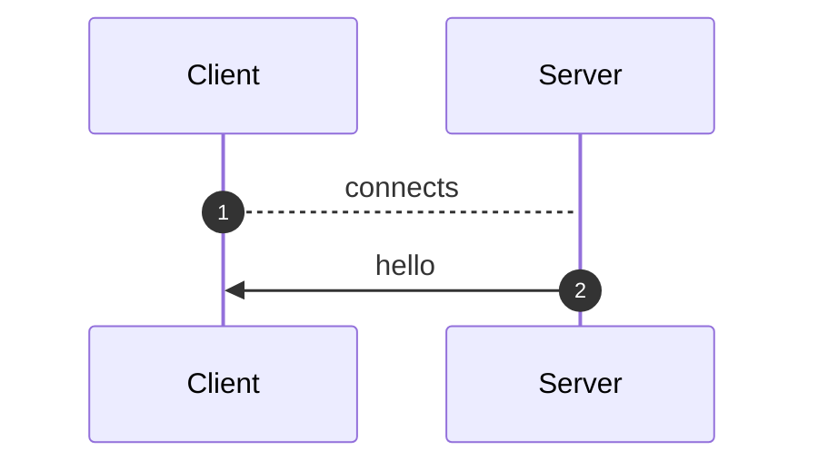
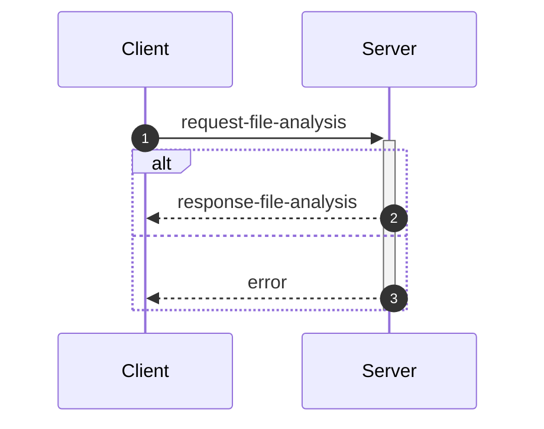
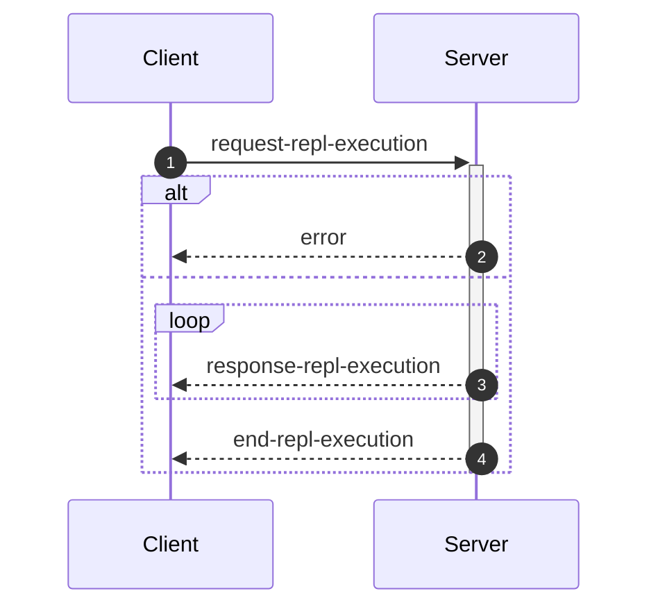
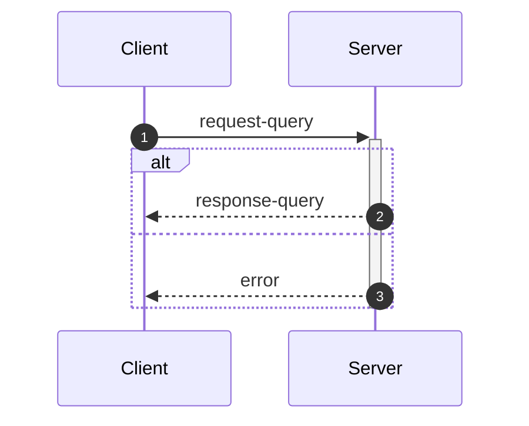

_<span title="an overview of flowR's interface">Generated</span> from '[wiki-interface.ts](https://github.com/flowr-analysis/flowr/tree/main/src/documentation/wiki-interface.ts "src/documentation/wiki-interface.ts")' on 2026-09-28, 12:27:55 UTC (v2.17.9, R v4.6.1), do not edit directly._

Although far from being as detailed as the in-depth explanation of [_flowR_](https://github.com/flowr-analysis/flowr/wiki/Core),
this wiki page explains how to interface with _flowR_ in more detail.
In general, command line arguments and other options provide short descriptions on hover over.

* [💻 Using the REPL](#using-the-repl)
* [⚙️ Configuring FlowR](#configuring-flowr)
* [⚒️ Writing Code](#writing-code)
* [💬 Communicating with the Server](#communicating-with-the-server)

<a id='using-the-repl'></a>
## 💻 Using the REPL

> [!NOTE]
> To execute arbitrary R commands with a repl request, _flowR_ has to be started explicitly with <span title="Description (Command Line Argument): Allow to access the underlying R session when using flowR (security warning: this allows the execution of arbitrary R code!)">`--r-session-access`</span>.
> Please be aware that this introduces a security risk and note that this relies on the [`r-shell` engine](https://github.com/flowr-analysis/flowr/wiki/Engines) .

Although primarily meant for users to explore,
there is nothing which forbids calling _flowR_ as a subprocess to use standard-in, -output, and -error
for communication (although you can access the REPL using the server as well,
with the [REPL Request](#message-request-repl-execution) message).

The read-eval-print loop&nbsp;(REPL) works relatively simple.
You can submit an expression (using <kbd>Enter</kbd>),
which is interpreted as an R&nbsp;expression by default but interpreted as a *command* if it starts with a colon (`:`).
The best command to get started with the REPL is <span title="Description (Repl Command): Show help information (aliases: :h, :?)">`:help`</span>.
Besides, you can leave the REPL either with the command <span title="Description (Repl Command): End the repl (aliases: :q, :exit)">`:quit`</span> or by pressing <kbd>Ctrl</kbd>+<kbd>C</kbd> twice.
When writing a *command*, you may press <kbd>Tab</kbd> to get a list of completions, if available.
Multiple commands can be entered in a single line by separating them with a semicolon (`;`), e.g. `:parse "x<-2"; :df*`.
If a command is given without R code, the REPL will re-use R code given in a previous command.
The prior example will hence return first the parsed AST of the program and then the dataflow graph for `"x <- 2"`.

> [!NOTE]
> If you develop flowR, you may want to launch the repl using the `npm run main-dev` command, this way, you get a non-minified version of flowR with debug information and hot-reloading of source files.

<details>
<summary>Available Commands</summary>

We currently offer the following commands (this with a `[*]` suffix are available with and without the star):

| Command | Description |
| ------- | ----------- |
| **<span title="Description (Repl Command): End the repl (aliases: :q, :exit)">:quit</span>** | End the repl (aliases: **:<span title="Alias of ':quit'. End the repl">q</span>**, **:<span title="Alias of ':quit'. End the repl">exit</span>**) |
| **<span title="Description (Repl Command): Execute the given code as R code. This requires the `--r-session-access` flag to be set and requires the r-shell engine. (aliases: :e, :r)">:execute</span>** | Execute the given code as R code. This requires the `--r-session-access` flag to be set and requires the r-shell engine. (aliases: **:<span title="Alias of ':execute'. Execute the given code as R code. This requires the `--r-session-access` flag to be set and requires the r-shell engine.">e</span>**, **:<span title="Alias of ':execute'. Execute the given code as R code. This requires the `--r-session-access` flag to be set and requires the r-shell engine.">r</span>**) |
| **<span title="Description (Repl Command): Get mermaid code for the control-flow graph of R code (aliases: :cfg, :cf)">:controlflow[*]</span>** | Get mermaid code for the control-flow graph of R code (star: Returns the URL to mermaid.live) (aliases: **:<span title="Alias of ':controlflow'. Get mermaid code for the control-flow graph of R code">cfg</span>**, **:<span title="Alias of ':controlflow'. Get mermaid code for the control-flow graph of R code">cf</span>**) |
| **<span title="Description (Repl Command): Get mermaid code for the control-flow graph with basic blocks (aliases: :cfgb, :cfb)">:controlflowbb[*]</span>** | Get mermaid code for the control-flow graph with basic blocks (star: Returns the URL to mermaid.live) (aliases: **:<span title="Alias of ':controlflowbb'. Get mermaid code for the control-flow graph with basic blocks">cfgb</span>**, **:<span title="Alias of ':controlflowbb'. Get mermaid code for the control-flow graph with basic blocks">cfb</span>**) |
| **<span title="Description (Repl Command): Get mermaid code for the dataflow graph (aliases: :d, :df)">:dataflow[*]</span>** | Get mermaid code for the dataflow graph (star: Returns the URL to mermaid.live) (aliases: **:<span title="Alias of ':dataflow'. Get mermaid code for the dataflow graph">d</span>**, **:<span title="Alias of ':dataflow'. Get mermaid code for the dataflow graph">df</span>**) |
| **<span title="Description (Repl Command): Get mermaid code for the normalized AST of R code (aliases: :n)">:normalize[*]</span>** | Get mermaid code for the normalized AST of R code (star: Returns the URL to mermaid.live) (alias: **:<span title="Alias of ':normalize'. Get mermaid code for the normalized AST of R code">n</span>**) |
| **<span title="Description (Repl Command): Get mermaid code for the simplified dataflow graph (aliases: :ds, :dfs)">:dataflowsimple[*]</span>** | Get mermaid code for the simplified dataflow graph (star: Returns the URL to mermaid.live) (aliases: **:<span title="Alias of ':dataflowsimple'. Get mermaid code for the simplified dataflow graph">ds</span>**, **:<span title="Alias of ':dataflowsimple'. Get mermaid code for the simplified dataflow graph">dfs</span>**) |
| **<span title="Description (Repl Command): Inspect and extend the signature database: `query` (identical to :query @signature), `info <name>` for where a function comes from (identical to :query @function-info), `add <path>` to mount another database/source, `download` to fetch the full-history database. (aliases: :sig)">:signature</span>** | Inspect and extend the signature database: `query` (identical to :query @signature), `info <name>` for where a function comes from (identical to :query @function-info), `add <path>` to mount another database/source, `download` to fetch the full-history database. (alias: **:<span title="Alias of ':signature'. Inspect and extend the signature database: `query` (identical to :query @signature), `info <name>` for where a function comes from (identical to :query @function-info), `add <path>` to mount another database/source, `download` to fetch the full-history database.">sig</span>**) |
| **<span title="Description (Repl Command): Just calculates the DFG, but only prints summary info (aliases: :d#, :df#)">:dataflowsilent</span>** | Just calculates the DFG, but only prints summary info (aliases: **:<span title="Alias of ':dataflowsilent'. Just calculates the DFG, but only prints summary info">d#</span>**, **:<span title="Alias of ':dataflowsilent'. Just calculates the DFG, but only prints summary info">df#</span>**) |
| **<span title="Description (Repl Command): Prints ASCII Art of the parsed, unmodified AST (aliases: :p)">:parse</span>** | Prints ASCII Art of the parsed, unmodified AST (alias: **:<span title="Alias of ':parse'. Prints ASCII Art of the parsed, unmodified AST">p</span>**) |
| **<span title="Description (Repl Command): Prints the version of flowR as well as the current version of R">:version</span>** | Prints the version of flowR as well as the current version of R
| **<span title="Description (Repl Command): Query the given R code (use 'help' for more information)">:query[*]</span>** | Query the given R code (use 'help' for more information) (star: Similar to query, but returns the output in json format.)
| **<span title="Description (Repl Command): Returns an ASCII representation of the dataflow graph (aliases: :df!)">:dataflowascii</span>** | Returns an ASCII representation of the dataflow graph (alias: **:<span title="Alias of ':dataflowascii'. Returns an ASCII representation of the dataflow graph">df!</span>**) |
| **<span title="Description (Repl Command): Returns summarization stats for the normalized AST (aliases: :n#)">:normalize#</span>** | Returns summarization stats for the normalized AST (alias: **:<span title="Alias of ':normalize#'. Returns summarization stats for the normalized AST">n#</span>**) |
| **<span title="Description (Repl Command): Show help information (aliases: :h, :?)">:help</span>** | Show help information (aliases: **:<span title="Alias of ':help'. Show help information">h</span>**, **:<span title="Alias of ':help'. Show help information">?</span>**) |

</details>

> [!TIP]
> 
> As indicated by the examples before, all REPL commands that operate on code keep track of the state.
> Hence, if you run a command like <span title="Description (Repl Command, starred version): Returns the URL to mermaid.live; Base Command: Get mermaid code for the dataflow graph (aliases: :d*, :df*)">`:dataflow*`</span> without providing R code,
> the REPL will re-use the R code provided in a previous command.
> Likewise, doing this will benefit from incrementality!
> If you request the dataflow graph with `:df* x <- 2 * y` and then want to see the parsed AST with `:parse`,
> the REPL will re-use previously obtained information and not re-parse the code again.
> 		

Generally, many commands offer shortcut versions in the REPL. Many queries, for example, offer a shortened format (see the example below).
Of special note, the [Config Query](https://github.com/flowr-analysis/flowr/wiki/%5BQuery%5D-Config)
can be used to also modify the currently active configuration of _flowR_ within the REPL (see the [wiki page](https://github.com/flowr-analysis/flowr/wiki/%5BQuery%5D-Config) for more information).

### Example: Retrieving the Dataflow Graph

To retrieve a URL to the [mermaid](https://mermaid.js.org/) diagram of the dataflow of a given expression,
use <span title="Description (Repl Command, starred version): Returns the URL to mermaid.live; Base Command: Get mermaid code for the dataflow graph (aliases: :d*, :df*)">`:dataflow*`</span> (or <span title="Description (Repl Command): Get mermaid code for the dataflow graph (aliases: :d, :df)">`:dataflow`</span> to get the mermaid code in the cli):

```shell
$ docker run -it --rm eagleoutice/flowr # or npm run flowr 
flowR repl v2.17.9, R grammar v14 (tree-sitter engine)
R> :dataflow* y <- 1 + x
```

<details>
<summary style='color:gray'>Output</summary>

```text
https://mermaid.live/view#base64:eyJjb2RlIjoiZmxvd2NoYXJ0IFREXG4gICAgMXt7XCJgKiM5MTtSTnVtYmVyIzkzOyogKioxKipcbiAgICAgICoxLjYqICgqKmlkOiAxKiopYFwifX1cbiAgICAyKFtcImAqIzkxO1JTeW1ib2wjOTM7KiAqKngqKlxuICAgICAgKjEuMTAqICgqKmlkOiAyKiopYFwiXSlcbiAgICAzW1tcImAqIzkxO1JCaW5hcnlPcCM5MzsqIGJhc2UjNTg7IzU4OyoqIzQzOyoqXG4gICAgICAqMS42LTEwKiAoKippZDogMyoqKVxuICAgIGFyZzogKDEsIDIpYFwiXV1cbiAgICBidWlsdC1pbjpfNDNfW1wiYEJ1aWx0LUluOlxuIzQzO2BcIl1cbiAgICBzdHlsZSBidWlsdC1pbjpfNDNfIHN0cm9rZTpncmF5LGZpbGw6Z3JheSxzdHJva2Utd2lkdGg6MnB4LG9wYWNpdHk6Ljg7XG4gICAgMFtcImAqIzkxO1JTeW1ib2wjOTM7KiAqKnkqKlxuICAgICAgKjEuMSogKCoqaWQ6IDAqKiwgdjogMylgXCJdXG4gICAgNFtbXCJgKiM5MTtSQmluYXJ5T3AjOTM7KiBiYXNlIzU4OyM1ODsqKiM2MDsjNDU7KipcbiAgICAgICoxLjEtMTAqICgqKmlkOiA0KiopXG4gICAgYXJnOiAoMCwgMylgXCJdXVxuICAgIGJ1aWx0LWluOl82MF8tW1wiYEJ1aWx0LUluOlxuIzYwOyM0NTtgXCJdXG4gICAgc3R5bGUgYnVpbHQtaW46XzYwXy0gc3Ryb2tlOmdyYXksZmlsbDpncmF5LHN0cm9rZS13aWR0aDoycHgsb3BhY2l0eTouODtcbiAgICAxIC0uLT58XCJmbG93XCJ8IDJcbiAgICBsaW5rU3R5bGUgMCBzdHJva2U6Z3JheSxjb2xvcjpncmF5O1xuICAgIDIgLS4tPnxcImZsb3dcInwgM1xuICAgIGxpbmtTdHlsZSAxIHN0cm9rZTpncmF5LGNvbG9yOmdyYXk7XG4gICAgMyAtLT58XCJyZWFkcywgYXJnXCJ8IDFcbiAgICAzIC0tPnxcInJlYWRzLCBhcmdcInwgMlxuICAgIDMgLS4tPnxcImZsb3dcInwgMFxuICAgIGxpbmtTdHlsZSA0IHN0cm9rZTpncmF5LGNvbG9yOmdyYXk7XG4gICAgMyAtLi0+fFwicmVhZHMsIGNhbGxzXCJ8IGJ1aWx0LWluOl80M19cbiAgICBsaW5rU3R5bGUgNSBzdHJva2U6Z3JheTtcbiAgICAwIC0tPnxcImRlZmluZWQtYnksIGZsb3dcInwgNFxuICAgIDAgLS0+fFwiZGVmaW5lZC1ieVwifCAzXG4gICAgNCAtLT58XCJyZWFkcywgYXJnXCJ8IDNcbiAgICA0IC0tPnxcInJldHVybnMsIGFyZ1wifCAwXG4gICAgNCAtLi0+fFwicmVhZHMsIGNhbGxzXCJ8IGJ1aWx0LWluOl82MF8tXG4gICAgbGlua1N0eWxlIDEwIHN0cm9rZTpncmF5OyIsIm1lcm1haWQiOnsiYXV0b1N5bmMiOnRydWV9fQ==
```

Retrieve the dataflow graph of the expression `y <- 1 + x`. It looks like this:


<details>

<summary style="color:gray">R Code of the Dataflow Graph</summary>

The analysis ran (parse and normalize with the [tree-sitter](https://github.com/flowr-analysis/flowr/wiki/Engines) engine) in the generation environment. No [signature database](https://github.com/flowr-analysis/flowr/wiki/Signature-Database) is mounted, so `library()` attaches no exports (base-R names are still qualified, e.g., `stats::acf`). 
We encountered no unknown side effects during the analysis.

```r
y <- 1 + x
```

</details>

</details>

For small graphs like this, <span title="Description (Repl Command): Returns an ASCII representation of the dataflow graph (aliases: :df!)">`:dataflowascii`</span> also provides an ASCII representation directly in the REPL:

```shell
$ docker run -it --rm eagleoutice/flowr # or npm run flowr 
flowR repl v2.17.9, R grammar v14 (tree-sitter engine)
R> :df! y <- 1 + x
```

<details open>
<summary style='color:gray'>Output</summary>

```text
                        v<0>v
 c<4>c──────────────────| y |
 |<- |     ┌────────────v---v
 c---c     │
    │   c<3>c   0<1>0
    └───| + |───| 1 |───u<2>u
        c---c   0---0   | x |
           └────────────u---u
Edges:
3 -> 1: reads, arg          3 -> 2: reads, arg
3 -> 0: flows-to            1 -> 2: flows-to
2 -> 3: flows-to            4 -> 3: reads, arg
4 -> 0: returns, arg        0 -> 4: defined-by, flows-to
0 -> 3: defined-by
```

Retrieve the dataflow graph of the expression `y <- 1 + x` as ASCII art.

</details>

For the slicing with <span title="Description (Repl Command): Static backwards executable slicer for R">`:slicer`</span>, you have access to the same [magic comments](#slice-magic-comments) as with the [slice request](#message-request-slice).
Pass `--inline` to splice resolvable `source()` calls into the reconstruction so the slice is a single self-contained R text (the same as the static slice query's `inlineSources` flag).
See `--help` for more flags!

### Example: Interfacing with the File System

Many commands that allow for an R-expression (like <span title="Description (Repl Command, starred version): Returns the URL to mermaid.live; Base Command: Get mermaid code for the dataflow graph (aliases: :d*, :df*)">`:dataflow*`</span>) allow for a file as well
if the argument starts with `file://`.
If you are working from the root directory of the _flowR_ repository, the following gives you the parsed AST of the example file using the <span title="Description (Repl Command): Prints ASCII Art of the parsed, unmodified AST (aliases: :p)">`:parse`</span> command:

> **Watch mode**: Replace `file://` with `watch://` to enter watch mode.
> flowR runs the command immediately and then re-runs it every time the file (or any file inside the folder) changes.
> Enter any other command to leave watch mode.
> For example: `:df watch://analysis.R`

```shell
$ docker run -it --rm eagleoutice/flowr # or npm run flowr 
flowR repl v2.17.9, R grammar v14 (tree-sitter engine)
R> :parse file://test/testfiles/example.R
```

<details>
<summary style='color:gray'>Output</summary>

```text
File: test/testfiles/example.R

program
├ binaryoperator
│ ├ identifier "sum" (1:1─4)
│ ├ <- "<-" (1:5─7)
│ ╰ float "0" (1:8─9)
├ binaryoperator
│ ├ identifier "product" (2:1─8)
│ ├ <- "<-" (2:9─11)
│ ╰ float "1" (2:12─13)
├ binaryoperator
│ ├ identifier "w" (3:1─2)
│ ├ <- "<-" (3:3─5)
│ ╰ float "7" (3:6─7)
├ binaryoperator
│ ├ identifier "N" (4:1─2)
│ ├ <- "<-" (4:3─5)
│ ╰ float "10" (4:6─8)
├ forstatement
│ ├ for "for" (6:1─4)
│ ├ ( "(" (6:5─6)
│ ├ identifier "i" (6:6─7)
│ ├ in "in" (6:8─10)
│ ├ binaryoperator
│ │ ├ float "1" (6:11─12)
│ │ ├ : ":" (6:12─13)
│ │ ╰ parenthesizedexpression
│ │   ├ ( "(" (6:13─14)
│ │   ├ binaryoperator
│ │   │ ├ identifier "N" (6:14─15)
│ │   │ ├ - "-" (6:15─16)
│ │   │ ╰ float "1" (6:16─17)
│ │   ╰ ) ")" (6:17─18)
│ ├ ) ")" (6:18─19)
│ ╰ bracedexpression
│   ├ { "{" (6:20─21)
│   ├ binaryoperator
│   │ ├ identifier "sum" (7:3─6)
│   │ ├ <- "<-" (7:7─9)
│   │ ╰ binaryoperator
│   │   ├ binaryoperator
│   │   │ ├ identifier "sum" (7:10─13)
│   │   │ ├ + "+" (7:14─15)
│   │   │ ╰ identifier "i" (7:16─17)
│   │   ├ + "+" (7:18─19)
│   │   ╰ identifier "w" (7:20─21)
│   ├ binaryoperator
│   │ ├ identifier "product" (8:3─10)
│   │ ├ <- "<-" (8:11─13)
│   │ ╰ binaryoperator
│   │   ├ identifier "product" (8:14─21)
│   │   ├  "" (8:22─23)
│   │   ╰ identifier "i" (8:24─25)
│   ╰ } "}" (9:1─2)
├ call
│ ├ identifier "cat" (11:1─4)
│ ╰ arguments
│   ├ ( "(" (11:4─5)
│   ├ argument
│   │ ╰ string
│   │   ├ stringopen "\"" (11:5─6)
│   │   ├ stringcontent "Sum:" (11:6─10)
│   │   ╰ stringclose "\"" (11:10─11)
│   ├ comma "," (11:11─12)
│   ├ argument
│   │ ╰ identifier "sum" (11:13─16)
│   ├ comma "," (11:16─17)
│   ├ argument
│   │ ╰ string
│   │   ├ stringopen "\"" (11:18─19)
│   │   ├ stringcontent
│   │   │ ╰ escapesequence "\\n" (11:19─21)
│   │   ╰ stringclose "\"" (11:21─22)
│   ╰ ) ")" (11:22─23)
╰ call
  ├ identifier "cat" (12:1─4)
  ╰ arguments
    ├ ( "(" (12:4─5)
    ├ argument
    │ ╰ string
    │   ├ stringopen "\"" (12:5─6)
    │   ├ stringcontent "Product:" (12:6─14)
    │   ╰ stringclose "\"" (12:14─15)
    ├ comma "," (12:15─16)
    ├ argument
    │ ╰ identifier "product" (12:17─24)
    ├ comma "," (12:24─25)
    ├ argument
    │ ╰ string
    │   ├ stringopen "\"" (12:26─27)
    │   ├ stringcontent
    │   │ ╰ escapesequence "\\n" (12:27─29)
    │   ╰ stringclose "\"" (12:29─30)
    ╰ ) ")" (12:30─31)
```

Retrieve the parsed AST of the example file.

<details>

<summary>File Content</summary>

```r
sum <- 0
product <- 1
w <- 7
N <- 10

for (i in 1:(N-1)) {
  sum <- sum + i + w
  product <- product * i
}

cat("Sum:", sum, "\n")
cat("Product:", product, "\n")
```

</details>

As _flowR_ directly transforms this AST the output focuses on being human-readable instead of being machine-readable.
		
</details>

### Example: Run a Query

You can run any query supported by _flowR_ using the <span title="Description (Repl Command): Query the given R code (use 'help' for more information)">`:query`</span> command.
For example, to obtain the shapes of all data frames in a given piece of code, you can run:

```shell
$ docker run -it --rm eagleoutice/flowr # or npm run flowr 
flowR repl v2.17.9, R grammar v14 (tree-sitter engine)
R> :query @absint df-shape "x <- data.frame(a = 1:10, b = 1:10)\ny <- x$a"
```

<details open>
<summary style='color:gray'>Output</summary>

```text
Query: absint (5 ms)
   ╰ $12: (colnames: [{"a", "b"}, {}], cols: [2, 2], rows: [10, 10])
   ╰ $0: (colnames: [{"a", "b"}, {}], cols: [2, 2], rows: [10, 10])
```

Retrieve the shapes of all data frames in the given code.

</details>

To run the linter on a file, you can use (in this example, we just issue the `dead-code` linter on a small piece of code):

```shell
$ docker run -it --rm eagleoutice/flowr # or npm run flowr 
flowR repl v2.17.9, R grammar v14 (tree-sitter engine)
R> :query @linter rules:dead-code "if(FALSE) x <- 2"
```

<details open>
<summary style='color:gray'>Output</summary>

```text
Query: linter (6 ms)
   ╰ Dead Code (dead-code):
       ╰ certain:
           ╰ Code at 1.11-16 (1 quick fix(es) available)
```

Run the linter on the given code, with only the `dead-code` rule enabled.

</details>

For more information on the available queries, please check out the [Query API](https://github.com/flowr-analysis/flowr/wiki/Query-API).

<a id='configuring-flowr'></a>
## ⚙️ Configuring FlowR

When running _flowR_, you may want to specify some behaviors with a dedicated configuration file.
By default, flowR looks for a file named `flowr.json` in the current working directory (or any higher directory).
You can also specify a different file with <span title="Description (Command Line Argument): The name of the configuration file to use">`--config-file`</span> or pass the configuration inline using <span title="Description (Command Line Argument): The flowR configuration to use, as a JSON string">`--config-json`</span>.
A `flowr.json` found this way belongs to the analyzed project, so flowR ignores its options that decide what flowR executes or loads
(`defaultPlugins.*.1`, `repl.plugins.*.1`, `engines.*.wasmPath`, `engines.*.treeSitterWasmPath`, `engines.*.rPath`, `solver.sigdb.additionalPaths`, `solver.sigdb.downloadRepo`, `solver.sigdb.autoSync`, `solver.sigdb.installedLibrary.paths`, `solver.sigdb.onDemand.enabled`, `solver.sigdb.onDemand.repositories`, `solver.sigdb.onDemand.cranMirror`, `solver.sigdb.onDemand.bioconductorMirror`, `solver.sigdb.onDemand.cacheDir`, `solver.instrument.dataflowExtractors`),
unless you pass <span title="Description (Command Line Argument): Keep the security-sensitive options (e.g., the R executable) of the flowr.json found in the working directory or a parent. Only use this for projects you trust.">`--trust-config`</span>.
To analyze code you do not trust, use the secure mode (<span title="Description (Command Line Argument): Run in secure mode for analyzing untrusted code: flowR does not start R (or any other process), does not access the network, does not search for project configs, and ignores security-sensitive options in every config. Cannot be disabled once enabled. Can also be enabled with the environment variable {italic FLOWR_SECURE_MODE=1}.">`--secure`</span>, see the [security policy](https://github.com/flowr-analysis/flowr/blob/main/.github/SECURITY.md)).
To inspect the current configuration, you can run flowr with the <span title="Description (Command Line Argument): Run with verbose logging (will be passed to the corresponding script)">`--verbose`</span> flag, or use the `config` [Query](https://github.com/flowr-analysis/flowr/wiki/Query-API).
Within the REPL this works by running the following:

```shell
:query @config
```

To work with the <a href="https://github.com/flowr-analysis/flowr/tree/main/src/config.ts#L131"><code><span title="The configuration file format for flowR.">FlowrConfig</span></code></a> you can use the provided helper objects alongside its methods like
<a href="https://github.com/flowr-analysis/flowr/tree/main/src/config.ts#L977"><code><span title="Creates a new flowr config that has the updated values.">FlowrConfig::<b>amend</b></span></code></a>.
The schema below documents every option; the ones you most likely want are:

- <a href="https://github.com/flowr-analysis/flowr/wiki/Interface#configuring-flowr" title="Configuration Option (boolean): Whether source calls should be ignored, causing {@link processSourceCall}&#39;s behavior to be skipped.">ignoreSourceCalls</a>: ignore source calls when analyzing the code, i.e., ignore the inclusion of other files.
- <a href="https://github.com/flowr-analysis/flowr/wiki/Interface#configuring-flowr" title="Configuration Option (boolean): Whether load calls should be ignored, causing {@link processLoadCall}&#39;s behavior to be skipped.">ignoreLoadCalls</a>: ignore load calls when analyzing the code, i.e., ignore the loading of r-data files.
- <a href="https://github.com/flowr-analysis/flowr/wiki/Interface#configuring-flowr" title="Configuration Option (object): Do you want to overwrite (parts) of the builtin definition?">semantics.environment.overwriteBuiltIns</a>: overwrite _flowR_'s handling of built-in functions, or clear the preset definitions entirely.
  See [Configure BuiltIn Semantics](#configure-builtin-semantics) for more information.
- <a href="https://github.com/flowr-analysis/flowr/wiki/Interface#configuring-flowr" title="Configuration Option (boolean): Whether calls drawing on a graphics device (e.g., `plot`) count as writing to it, which the ambient state queries then report.">semantics.ambient.drawingWritesDevice</a>: whether calls drawing on a graphics device (e.g., `plot`) count as writing the device in the ambient state queries.
- <a href="https://github.com/flowr-analysis/flowr/wiki/Interface#configuring-flowr" title="Configuration Option (string): How to resolve variables and their values. (one of &quot;disabled&quot;, &quot;alias&quot;, &quot;builtin&quot;)">solver.variables</a>: how to resolve variables and their values (`disabled`, `alias`, `builtin`).
- <a href="https://github.com/flowr-analysis/flowr/wiki/Interface#configuring-flowr" title="Configuration Option (array): The engine or set of engines to use for interacting with R code. An empty array means all available engines will be used.">engines</a> and <a href="https://github.com/flowr-analysis/flowr/wiki/Interface#configuring-flowr" title="Configuration Option (string): The default engine to use for interacting with R code. If this is undefined, an arbitrary engine from the specified list will be used. (one of &quot;tree-sitter&quot;, &quot;r-shell&quot;)">defaultEngine</a>: the engines used to interact with R code, see the [Engines wiki page](https://github.com/flowr-analysis/flowr/wiki/Engines).
- <a href="https://github.com/flowr-analysis/flowr/wiki/Interface#configuring-flowr" title="Configuration Option (array): Files a framework loads on its own, without any source() call (e.g. global.R in a shiny app), in the order they are loaded; flowR orders the matching project files accordingly and analyzes them as one program. Entries are case-insensitive globs matched against the file path, a plain name matches any file with that name, and entries matching no project file are warned about. Usually set per project kind via specializeConfig.">project.implicitSources</a>: the files a framework loads without any `source()` call, in the order in which they are
  loaded. Entries are globs (e.g. `R/*.R`) matched against the file path ignoring capitalization; one matching no file is reported.
- <a href="https://github.com/flowr-analysis/flowr/wiki/Interface#configuring-flowr" title="Configuration Option (object): Overwrite (parts of) the configuration depending on the project kind flowR detects, e.g. to give a shiny app its implicit sources.">specializeConfig</a>: overwrite (parts of) the configuration depending on the kind of project _flowR_ detects
  (e.g. `shiny-app`), which is how a shiny app gets its implicit sources by default. What you configure directly wins.
- <a href="https://github.com/flowr-analysis/flowr/wiki/Interface#configuring-flowr" title="Configuration Option (string): Overwrite the project kind flowR would otherwise infer from the analyzed files, e.g. when auto-detection guesses wrong. (one of &quot;package&quot;, &quot;script&quot;, &quot;shiny-app&quot;, &quot;notebook&quot;, &quot;project&quot;, &quot;unknown&quot;)">project.useProjectType</a>: skip that detection and force a project kind yourself, when auto-detection guesses wrong.
- <a href="https://github.com/flowr-analysis/flowr/wiki/Interface#configuring-flowr" title="Configuration Option (array): The default plugins to load when creating a new instance of FlowrAnalyzer">defaultPlugins</a> and <a href="https://github.com/flowr-analysis/flowr/wiki/Interface#configuring-flowr" title="Configuration Option (array): The plugins to load in REPL mode">repl.plugins</a>: the plugins to load for a new <a href="https://github.com/flowr-analysis/flowr/tree/main/src/project/flowr-analyzer.ts#L231"><code><span title="Central class for conducting analyses with FlowR. Use the FlowrAnalyzerBuilder to create a new instance. If you want the original pattern of creating a pipeline and running all steps, you can still do this with FlowrAnalyzer#runFull . To inspect the context of the analyzer, use FlowrAnalyzer#inspectContext (if you are a plugin and need to modify it, use FlowrAnalyzer#context instead).">FlowrAnalyzer</span></code></a> and in the REPL
  (use `flowr:default` to reference the former).

So you can configure _flowR_ by adding a file like the following:

<details>

<summary>Example Configuration File</summary>

```json
{
  "ignoreSourceCalls": true,
  "ignoreLoadCalls": true,
  "semantics": {
    "environment": {
      "overwriteBuiltIns": {
        "definitions": [
          {
            "type": "function",
            "names": [
              "foo"
            ],
            "processor": "builtin:assign",
            "config": {}
          }
        ]
      }
    }
  },
  "defaultPlugins": [
    "file:description",
    "versions:description"
  ],
  "repl": {
    "quickStats": false,
    "dfProcessorHeat": false,
    "hints": true,
    "plugins": [
      "flowr:default"
    ]
  },
  "project": {
    "resolveUnknownPathsOnDisk": true,
    "implicitSources": [
      "global.R",
      "app.R"
    ]
  },
  "linter": {
    "disabledRules": []
  },
  "specializeConfig": {
    "shiny-app": {
      "project": {
        "implicitSources": [
          "global.R",
          "ui.R",
          "server.R",
          "app.R"
        ]
      }
    }
  },
  "engines": [
    {
      "type": "r-shell"
    }
  ],
  "solver": {
    "variables": "alias",
    "evalStrings": true,
    "trackEnvironments": true,
    "sigdb": {
      "enabled": true,
      "loadProjectDependencies": true,
      "eagerlyLoad": false,
      "eagerlyLoadExports": false,
      "linkBaseR": false,
      "linkDescriptionDependencies": false
    },
    "resolveSource": {
      "dropPaths": "no",
      "ignoreCapitalization": true,
      "inferWorkingDirectory": "active-script",
      "searchPath": []
    },
    "instrument": {},
    "slicer": {
      "threshold": 50
    }
  },
  "abstractInterpretation": {
    "wideningThreshold": 4,
    "followCalls": true,
    "dataFrame": {
      "maxColNames": 20,
      "readLoadedData": {
        "readExternalFiles": true,
        "maxReadLines": 1000000
      }
    }
  },
  "incremental": {
    "alwaysIncremental": false,
    "parsing": {
      "activated": false,
      "heuristics": {
        "activated": true,
        "mtime": true,
        "linesFrom": 500,
        "bytesFrom": 50000,
        "alwaysWithEdits": false,
        "minFiles": 1
      }
    },
    "dataflow": {
      "activated": false,
      "checkpoints": 2,
      "minStatements": 0
    }
  },
  "gas": {
    "thresholds": {
      "memory": {
        "problematic": 0.7,
        "critical": 0.9
      },
      "timeMs": {
        "problematic": 100000,
        "critical": 120000
      }
    },
    "features": {}
  }
}
```

</details>

<details>
<a id='configure-builtin-semantics'></a>
<summary>Configure Built-In Semantics</summary>

`semantics/environment/overwriteBuiltins` accepts two keys:

- `loadDefaults` (boolean, initially `true`): If set to `true`, the default built-in definitions are loaded before applying the custom definitions. Setting this flag to `false` explicitly disables the loading of the default definitions.
- `definitions` (array, initially empty): Allows to overwrite or define new built-in elements. Each object within must have a `type` which is one of the below. Furthermore, they may define a string array of `names` which specifies the identifiers to bind the definitions to. You may use `assumePrimitive` to specify whether _flowR_ should assume that this is a primitive non-library definition (so you probably just do not want to specify the key).

  | Type            | Description                                                                                                                                                                                                                                                                                              | Example                                                                                                    |
  | --------------- | -------------------------------------------------------------------------------------------------------------------------------------------------------------------------------------------------------------------------------------------------------------------------------------------------------- | ---------------------------------------------------------------------------------------------------------- |
  | `constant`    | Additionally allows for a `value` this should resolve to.                                                                                                                                                                                                                                                | `{ type: 'constant', names: ['NULL', 'NA'],  value: null }`                                                |
  | `function`    | Is a rather flexible way to define and bind built-in functions. For the time, we do not have extensive documentation to cover all the cases, so please either consult the sources with the `default-builtin-config/` folder or open a [new issue](https://github.com/flowr-analysis/flowr/issues/new/choose). | `{ type: 'function', names: ['next'], processor: 'builtin:d', config: { cfg: ExitPointType.Next } }` |
  | `replacement` | A comfortable way to specify replacement functions like `$<-` or `names<-`. `suffixes` describes the... suffixes to attach automatically. | `{ type: 'replacement', suffixes: ['<-', '<<-'], names: ['[', '[['] }` |

</details>

<details>

<summary style='color:gray'>Full Configuration-File Schema</summary>

- _The configuration file format for flowR._ (object)
    - **logLevel** [optional] _flowR's global minimum log level, applied when the config is loaded._ (string)
        Only allows: 'silly', 'trace', 'debug', 'info', 'warn', 'error', 'fatal'
    - **ignoreSourceCalls** [optional] _Whether source calls should be ignored, causing {@link processSourceCall}'s behavior to be skipped._ (boolean)
    - **ignoreLoadCalls** [optional] _Whether load calls should be ignored, causing {@link processLoadCall}'s behavior to be skipped._ (boolean)
    - **semantics** _Configure language semantics and how flowR handles them._ (object)
        - **environment** [optional] _Semantics regarding how to handle the R environment._ (object)
            - **overwriteBuiltIns** [optional] _Do you want to overwrite (parts) of the builtin definition?_ (object)
                - **loadDefaults** [optional] _Should the default configuration still be loaded?_ (boolean)
                - **definitions** [optional] _The definitions to load/overwrite._ (array)
                Valid item types:
                    - (object)
        - **ambient** [optional] _Semantics regarding the global state (options, devices, files, ...) calls access._ (object)
            - **drawingWritesDevice** [optional] _Whether calls drawing on a graphics device (e.g., `plot`) count as writing to it, which the ambient state queries then report._ (boolean)
    - **defaultPlugins** [optional] _The default plugins to load when creating a new instance of FlowrAnalyzer_ (array)
    Valid item types:
        - (alternatives)
            - (string)
            - (array)
    - **repl** _Configuration options for the REPL._ (object)
        - **quickStats** [optional] _Whether to show quick stats in the REPL after each evaluation._ (boolean)
        - **dfProcessorHeat** [optional] _This instruments the dataflow processors to count how often each processor is called._ (boolean)
        - **hints** [optional] _Whether to show dim inline hints on the empty prompt (automatically disabled on non-interactive terminals)._ (boolean)
        - **plugins** [optional] _The plugins to load in REPL mode_ (array)
        Valid item types:
            - (alternatives)
                - (string)
                - (array)
        - **autoUseFileProtocol** [optional] _Prepend the file protocol to a repl input that looks like a path, instead of only warning about it._ (boolean)
        - **queryStats** [optional] _Whether `:query` closes with the line stating how long the queries took (`:query*` never prints it)._ (boolean)
        - **showPlugins** [optional] _Whether `:version` grays out the plugins that did not activate during the last analysis._ (boolean)
    - **project** _Project specific configuration options._ (object)
        - **resolveUnknownPathsOnDisk** [optional] _Whether to resolve unknown paths loaded by the r project disk when trying to source/analyze files._ (boolean)
        - **failOnInaccessiblePath** [optional] _Whether a directory that cannot be traversed during file discovery (e.g. due to permissions) aborts the analysis; when false (the default) such paths are logged and skipped._ (boolean)
        - **basePackages** [optional] _The packages considered part of R itself (base and recommended); if unset, flowR uses its built-in list._ (array)
        Valid item types:
            - (string)
        - **implicitSources** [optional] _Files a framework loads on its own, without any source() call (e.g. global.R in a shiny app), in the order they are loaded; flowR orders the matching project files accordingly and analyzes them as one program. Entries are case-insensitive globs matched against the file path, a plain name matches any file with that name, and entries matching no project file are warned about. Usually set per project kind via specializeConfig._ (array)
        Valid item types:
            - (string)
        - **useProjectType** [optional] _Overwrite the project kind flowR would otherwise infer from the analyzed files, e.g. when auto-detection guesses wrong._ (string)
            Only allows: 'package', 'script', 'shiny-app', 'notebook', 'project', 'unknown'
        - **assumeImplicitEcho** [optional] _Whether the top level of the analyzed code is echoed, so that every visible result printed there is collected as an output by the dependencies query (default true, false for a package)._ (boolean)
        - **discovery** [optional] _Scoping options for the default project discovery._ (object)
            - **full** [optional] _Collect every file below the project root (greedy) instead of only the files the detected project kind needs (default false)._ (boolean)
            - **perKind** [optional] _Per-kind include/exclude glob overrides layered on the default scoping._ (object)
            - **ignore** [optional] _Case-insensitive globs that drop matching files from the intelligent discovery, regardless of kind (e.g. .Renviron to ignore environment files)._ (array)
            Valid item types:
                - (string)
        - **classification** [optional] _Overrides for the signals flowR uses to classify the project kind._ (object)
            - **shinyDescriptionTypes** [optional] _DESCRIPTION Type: values that mark a shiny app._ (array)
            Valid item types:
                - (string)
            - **shinyEntryFiles** [optional] _File names a shiny app is assembled from._ (array)
            Valid item types:
                - (string)
            - **shinyUsagePattern** [optional] _Regex source evidencing shiny usage in an entry file._ (string)
            - **notebookExtensions** [optional] _File extensions marking a notebook._ (array)
            Valid item types:
                - (string)
    - **linter** _Linter configuration options._ (object)
        - **disabledRules** _Linting rule names excluded from the default rule set (a rule requested explicitly via a linter query still runs). Usually set per project kind via specializeConfig._ (array)
        Valid item types:
            - (string)
        - **disabledTags** [optional] _Linting rule tags whose rules are excluded from the default rule set (a rule requested explicitly via a linter query still runs). By default the cmd-check rules are disabled for everything but a package; a configured list replaces that default._ (array)
        Valid item types:
            - (string)
    - **inputSources** [optional] _Further frameworks the input-sources analysis should know about; entries are added to flowR's defaults._ (object)
        - **pure** [optional] _Functions that only pass the constantness of their arguments on._ (array)
        Valid item types:
            - (string)
        - **param** [optional] _Functions whose result is a 'param' input._ (array)
        Valid item types:
            - (string)
        - **file** [optional] _Functions whose result is a 'file' input._ (array)
        Valid item types:
            - (string)
        - **tempfile** [optional] _Functions whose result is a 'tempfile' input._ (array)
        Valid item types:
            - (string)
        - **glob** [optional] _Functions whose result is a 'glob' input._ (array)
        Valid item types:
            - (string)
        - **net** [optional] _Functions whose result is a 'net' input._ (array)
        Valid item types:
            - (string)
        - **rand** [optional] _Functions whose result is a 'rand' input._ (array)
        Valid item types:
            - (string)
        - **system** [optional] _Functions whose result is a 'system' input._ (array)
        Valid item types:
            - (string)
        - **ffi** [optional] _Functions whose result is a 'ffi' input._ (array)
        Valid item types:
            - (string)
        - **lang** [optional] _Functions whose result is a 'lang' input._ (array)
        Valid item types:
            - (string)
        - **options** [optional] _Functions whose result is a 'options' input._ (array)
        Valid item types:
            - (string)
        - **cmdline** [optional] _Functions whose result is a 'cmdline' input._ (array)
        Valid item types:
            - (string)
        - **user** [optional] _Functions whose result is a 'user' input._ (array)
        Valid item types:
            - (string)
        - **const** [optional] _Functions whose result is a 'const' input._ (array)
        Valid item types:
            - (string)
        - **scope** [optional] _Functions whose result is a 'scope' input._ (array)
        Valid item types:
            - (string)
        - **dconst** [optional] _Functions whose result is a 'dconst' input._ (array)
        Valid item types:
            - (string)
        - **unknown** [optional] _Functions whose result is a 'unknown' input._ (array)
        Valid item types:
            - (string)
        - **linkedObjects** [optional] _Objects a framework provides without a definition in the code, e.g. shiny's input._ (array)
        Valid item types:
            - (object)
        - **linkedEntryPoints** [optional] _Calls that hand a function to a framework, which binds its objects to the parameters by position._ (array)
        Valid item types:
            - (object)
    - **specializeConfig** [optional] _Overwrite (parts of) the configuration depending on the project kind flowR detects, e.g. to give a shiny app its implicit sources._ (object)
    - **engines** _The engine or set of engines to use for interacting with R code. An empty array means all available engines will be used._ (array)
    Valid item types:
        - (alternatives)
            - _The configuration for the tree sitter engine._ (object)
                - **type** [required] _Use the tree sitter engine._ (string)
                    Only allows: 'tree-sitter'
                - **wasmPath** [optional] _The path to the tree-sitter-r WASM binary to use. If this is undefined, this uses the default path._ (string)
                - **treeSitterWasmPath** [optional] _The path to the tree-sitter WASM binary to use. If this is undefined, this uses the default path._ (string)
                - **lax** [optional] _Whether to use the lax parser for parsing R code (allowing for syntax errors). If this is undefined, the strict parser will be used._ (boolean)
            - _The configuration for the R shell engine._ (object)
                - **type** [required] _Use the R shell engine._ (string)
                    Only allows: 'r-shell'
                - **rPath** [optional] _The path to the R executable to use. If this is undefined, this uses the default path._ (string)
                - **pipeBind** [optional] _Whether to enable R's experimental pipe-bind operator "=>" by setting _R_USE_PIPEBIND_ for the R session (default false); R itself keeps this off by default, as it is experimental and has never shipped in a release version of R._ (boolean)
    - **defaultEngine** [optional] _The default engine to use for interacting with R code. If this is undefined, an arbitrary engine from the specified list will be used._ (string)
        Only allows: 'tree-sitter', 'r-shell'
    - **solver** _How to resolve constants, constraints, cells, ..._ (object)
        - **variables** _How to resolve variables and their values._ (string)
            Only allows: 'disabled', 'alias', 'builtin'
        - **evalStrings** _Should we include eval(parse(text="...")) calls in the dataflow graph?_ (boolean)
        - **trackEnvironments** [optional] _Track user-created environments (new.env, assign/get/local with envir=, dollar-assign, attach). When false, all envir-style calls fall through conservatively._ (boolean)
        - **sigdb** _Resolving library exports from a signature database._ (object)
            - **enabled** [optional] _Resolve library()/use() exports from a signature database (default true); when false no database is consulted._ (boolean)
            - **loadProjectDependencies** [optional] _Load the project's declared dependencies from its metadata files (DESCRIPTION Imports/Depends, rproject.toml, uvr.toml, rig rproj.toml and script blocks, renv.lock, rv.lock, uvr.lock, rig lockfiles) (default true); when false these files are not read for dependencies._ (boolean)
            - **eagerlyLoad** [optional] _Parse the database up front rather than on the first package load (default false, ignored if disabled)._ (boolean)
            - **eagerlyLoadExports** [optional] _Add a vertex for every export on load rather than on demand (default false); keeps the dataflow graph small._ (boolean)
            - **assumedRVersion** [optional] _R version assumed when resolving versioned (base-R) exports: a pin like "4.5" or "auto" to detect the installed R (default "auto")._ (string)
            - **linkBaseR** [optional] _Eagerly attach base-R namespaces so bare base calls resolve without library() (default false)._ (boolean)
            - **linkBaseRCalls** [optional] _Add a lightweight Reads edge from a bare base-R call to its signature-database function vertex (default false; base-R qualification is edge-free otherwise)._ (boolean)
            - **linkPackageCalls** [optional] _Add a lightweight Reads edge from a resolved package call to its signature-database function vertex (default false)._ (boolean)
            - **linkDescriptionDependencies** [optional] _Eagerly attach the namespaces of the project's declared DESCRIPTION dependencies (Imports/Depends) so their exports resolve without an explicit library() (default false)._ (boolean)
            - **warmInBackground** [optional] _Decompress the hot shards (base + most-downloaded) in a background task on startup so the first library() lookup is warm (default false; for long-running servers/REPLs)._ (boolean)
            - **additionalPaths** [optional] _Extra directories or bundle/manifest files searched for signature databases (alongside the shipped default and $FLOWR_SIGDB_DIR); a downloaded full-history bundle placed here is mounted automatically._ (array)
            Valid item types:
                - (string)
            - **downloadRepo** [optional] _GitHub owner/repo the full-history bundle is downloaded from via ":signature download" (default "flowr-analysis/flowr"; the release tag comes from the committed sigdb.remote.json unless a version is given)._ (string)
            - **autoSync** [optional] _On startup, re-download shards whose committed sigdb.remote.json hash no longer matches the cache, in the background (default false; opt-in network sync after a git pull)._ (boolean)
            - **installedLibrary** [optional] _Recovering packages no signature database knows from the copy installed on this machine._ (object)
                - **enabled** [required] _Recover packages no signature database knows from their installed copy (default false)._ (boolean)
                - **paths** [optional] _Library directories to search; when empty they are discovered from the environment and the project._ (array)
                Valid item types:
                    - (string)
                - **useEnvironment** [optional] _Search the libraries R_LIBS_USER/R_LIBS/R_LIBS_SITE name (default true)._ (boolean)
                - **useProjectLibrary** [optional] _Search a project-local renv/packrat library (default true)._ (boolean)
                - **maxDepth** [optional] _How far to descend into the nested layout of a project-local library (default 3)._ (number)
                - **packages** [optional] _Only recover packages whose name matches one of these regular expressions; empty means any._ (array)
                Valid item types:
                    - (string)
            - **onDemand** [optional] _Recovering packages no signature database knows from their sources on CRAN, Bioconductor, or GitHub._ (object)
                - **enabled** [required] _Fetch and recover the sources of packages no signature database knows when the analyzed code uses them (default false, accesses the network)._ (boolean)
                - **sources** [optional] _Where to look, in order: github, cran, bioconductor, or a source a plugin adds (default ["github", "cran", "bioconductor"])._ (array)
                Valid item types:
                    - (string)
                - **repositories** [optional] _GitHub repositories (owner/repo[/subdir][@ref]) to fetch packages from, by package name. The analyzed project may name more (DESCRIPTION Remotes, install_github calls)._ (object)
                - **packages** [optional] _Only recover packages whose name matches one of these regular expressions, empty means any._ (array)
                Valid item types:
                    - (string)
                - **cranMirror** [optional] _The CRAN src/contrib/ to fetch from, over https (default https://cloud.r-project.org/src/contrib/). It may be on the local network._ (string)
                - **bioconductorMirror** [optional] _The Bioconductor host, over https (default https://bioconductor.org). It may be on the local network._ (string)
                - **bioconductorRelease** [optional] _The Bioconductor release to fetch from: release, devel, or a number like 3.20 (default release)._ (string)
                - **githubMirrors** [optional] _Use the GitHub mirrors of CRAN (cran/<pkg>) and Bioconductor (bioc/<pkg>) (default true)._ (boolean)
                - **maxPackages** [optional] _The most packages to fetch for one analysis (default 25)._ (number)
                - **maxArchiveMb** [optional] _The most MiB a package archive may have (default 32). It may unpack to three times that, at most 128 MiB._ (number)
                - **offline** [optional] _Only use what was fetched before, never the network (default false)._ (boolean)
                - **retryAfterHours** [optional] _How many hours to wait before asking again for a package no source had (default 24)._ (number)
                - **cacheDir** [optional] _Where to cache what was fetched (default the on-demand directory of the signature cache)._ (string)
            - **blobCacheBudgetMb** [optional] _How many MiB of decoded package blobs every open bundle may hold together (default 16)._ (number)
            - **versionSelection** [optional] _When a project constrains a dependency, resolve to the newest (default), oldest, or system-installed version satisfying it; system needs R and falls back to newest. Base-R packages always resolve against the assumed R version._ (string)
                Only allows: 'newest', 'oldest', 'system'
            - **versionOverrides** [optional] _Force an exact version for specific packages (name -> version), overriding both the project constraint and the versionSelection policy (default {})._ (object)
        - **versionManagement** _Policies for reasoning about dependency versions._ (object)
            - **linkedVersionGroups** [optional] _Groups of packages that must resolve to the same version; version guessing intersects each group so its members stay mutually compatible (default [])._ (array)
            Valid item types:
                - (array)
                Valid item types:
                    - (string)
        - **assumeAttachedPackages** [optional] _Packages to treat as attached without a `library()` call, so what the built-in configuration states about them applies to the analyzed code. The base packages R attaches on startup already resolve without it._ (array)
        Valid item types:
            - (string)
        - **transitiveSideEffectRounds** [optional] _How many rounds the transitive side-effect fixpoint may run before it is cut off (default 32); the propagation stops on its own as soon as a round adds nothing._ (number)
        - **maxOverlayDepth** [optional] _How many binding overlays may stack on one environment frame before a write flattens them (default 4); a pure performance knob, trading lookup cost against copy cost without changing any result._ (number)
        - **instrument** (object)
            - **dataflowExtractors** [optional] _These keys are only intended for use within code, allowing to instrument the dataflow analyzer!_ (any)
        - **resolveSource** [optional] _If lax source calls are active, flowR searches for sourced files much more freely, based on the configurations you give it. This option is only in effect if `ignoreSourceCalls` is set to false._ (object)
            - **dropPaths** _Allow to drop the first or all parts of the sourced path, if it is relative._ (string)
                Only allows: 'no', 'once', 'all'
            - **ignoreCapitalization** _Search for filenames matching in the lowercase._ (boolean)
            - **inferWorkingDirectory** _Try to infer the working directory from the main or any script to analyze._ (string)
                Only allows: 'no', 'main-script', 'active-script', 'any-script'
            - **searchPath** _Additionally search in these paths._ (array)
            Valid item types:
                - (string)
            - **repeatedSourceLimit** [optional] _How often the same file can be sourced within a single run? Please be aware: in case of cyclic sources this may not reach a fixpoint so give this a sensible limit._ (number)
            - **applyReplacements** _Provide name replacements for loaded files_ (array)
            Valid item types:
                - (object)
            - **assumeFilesExist** [optional] _Assume a sourced file is always there, making what it defines certain instead of conditional on the source call._ (boolean)
        - **slicer** [optional] _The configuration for the slicer._ (object)
            - **threshold** [optional] _The maximum number of iterations to perform on a single function call during slicing._ (number)
            - **autoExtend** [optional] _If set, the slicer will gain an additional post-pass._ (boolean)
    - **abstractInterpretation** _The configuration options for abstract interpretation._ (object)
        - **wideningThreshold** _The threshold for the number of visitations of a node at which widening should be performed to ensure the termination of the fixpoint iteration._ (number)
        - **followCalls** _Whether the abstract interpretation is interprocedural, i.e. whether it steps into the functions a call may dispatch to._ (boolean)
        - **dataFrame** _The configuration of the shape inference for data frames._ (object)
            - **maxColNames** _The maximum number of columns names to infer for data frames before over-approximating the column names to top._ (number)
            - **readLoadedData** _Configuration options for reading data frame shapes from loaded external data files, such as CSV files._ (object)
                - **readExternalFiles** _Whether data frame shapes should be extracted from loaded external files, such as CSV files._ (boolean)
                - **maxReadLines** _The maximum number of lines to read when extracting data frame shapes from loaded files, such as CSV files._ (number)
    - **incremental** (object)
        - **alwaysIncremental** _Always take the incremental path, regardless of heuristics._ (boolean)
        - **parsing** (object)
            - **activated** _If set, incremental parsing will be used._ (boolean)
            - **heuristics** (object)
                - **activated** [optional] _If set, the heuristics for incremental parsing will be used._ (boolean)
                - **mtime** [optional] _Skip reparsing entirely if the file's modification time is unchanged since the last parse._ (boolean)
                - **linesFrom** [optional] _Only consider incremental parsing for files with at least this many lines._ (number)
                - **bytesFrom** [optional] _Only consider incremental parsing for files with at least this many bytes._ (number)
                - **alwaysWithEdits** [optional] _Always take the incremental path whenever there is a computed edit region, regardless of the other thresholds._ (boolean)
                - **minFiles** [optional] _Only apply these heuristics once the project has at least this many files loaded._ (number)
        - **dataflow** (object)
            - **activated** _Reuse the last dataflow analysis where the files did not change._ (boolean)
            - **checkpoints** [optional] _After how many of the last top-level statements to keep a checkpoint to resume from (each copies the graph)._ (number)
            - **minStatements** [optional] _Keep checkpoints only for files with at least this many top-level statements._ (number)
    - **gas** [optional] _Resource-usage guard (gas) configuration. All feature factors default to 0 (disabled). See https://github.com/flowr-analysis/flowr/wiki/Core#gas-resource-guard._ (object)
        - **thresholds** [optional] _Thresholds for all gas checks (scaled by per-feature factor), boundable per feature._ (object)
            - **memory** [optional] _Heap-usage fraction thresholds (0-1), either shared or given per feature key (with `default` covering the rest)._ (object)
                - **problematic** [optional] _Heap fraction (0-1) above which Problematic is returned, for every feature without an entry of its own._ (number)
                - **critical** [optional] _Heap fraction (0-1) above which Critical is returned, for every feature without an entry of its own._ (number)
            - **timeMs** [optional] _Elapsed analysis time thresholds in milliseconds, either shared or given per feature key (with `default` covering the rest)._ (object)
                - **problematic** [optional] _Elapsed ms above which Problematic is returned, for every feature without an entry of its own._ (number)
                - **critical** [optional] _Elapsed ms above which Critical is returned, for every feature without an entry of its own._ (number)
            - **steps** [optional] _Processed-AST-node thresholds, counted rather than sampled; only a key that arms a budget (`dataflow`) reads them._ (object)
                - **problematic** [optional] _Processed AST nodes above which Problematic is returned, for every feature without an entry of its own._ (number)
                - **critical** [optional] _Processed AST nodes above which the extraction is cut short, for every feature without an entry of its own._ (number)
            - **vertices** [optional] _Created-dataflow-vertex thresholds, counted like `steps`._ (object)
                - **problematic** [optional] _Created dataflow vertices above which Problematic is returned, for every feature without an entry of its own._ (number)
                - **critical** [optional] _Created dataflow vertices above which the extraction is cut short, for every feature without an entry of its own._ (number)
        - **features** [optional] _Per-feature sensitivity factors. 0 or absent disables gas checking for that feature. A factor of 2 makes the feature twice as sensitive. Recognised keys: `source`, `side-effect-linking`, `linter`, `slicer`, `dataflow`._ (object)
        - **countedCheckEvery** [optional] _How many counted steps pass between two accountings of an armed check, be it a dataflow budget or the slicer's traversal (default 128); trades overshoot against the cost of the check._ (number)
        - **heapProvider** [optional] _Custom heap statistics source (programmatic configs only), overriding the built-in v8/performance.memory detection._ (function)

</details>

<a id='writing-code'></a>
## ⚒️ Writing Code

_flowR_ can be used as a [module](https://www.npmjs.com/package/@eagleoutice/flowr) and offers several main classes and interfaces that are interesting for extension writers 
(see the [Visual Studio Code extension](https://marketplace.visualstudio.com/items?itemName=code-inspect.vscode-flowr) or the [Core](https://github.com/flowr-analysis/flowr/wiki/Core) wiki page for more information).

### Creating Analyses with _flowR_

Nowadays, instances of the <a href="https://github.com/flowr-analysis/flowr/tree/main/src/project/flowr-analyzer.ts#L231"><code><span title="Central class for conducting analyses with FlowR. Use the FlowrAnalyzerBuilder to create a new instance. If you want the original pattern of creating a pipeline and running all steps, you can still do this with FlowrAnalyzer#runFull . To inspect the context of the analyzer, use FlowrAnalyzer#inspectContext (if you are a plugin and need to modify it, use FlowrAnalyzer#context instead).">FlowrAnalyzer</span></code></a> should be used as central frontend to get analysis results from _flowR_.
The entry points an analysis is written against are re-exported from the package root (`import { FlowrAnalyzerBuilder } from '@eagleoutice/flowr'`);
everything else stays reachable under its own path, as in `@eagleoutice/flowr/dataflow/graph/graph`.
For example, a program slice can be created like this:

```ts
const analyzer = await new FlowrAnalyzerBuilder()
    .setEngine('tree-sitter')
    .build();
analyzer.addRequest('x <- 1\ny <- x\nx');
const { slice, reconstruct } = await analyzer.query({ type: 'static-slice', criteria: ['3@x'] });
```

For more information, please have a look at the [Analyzer](https://github.com/flowr-analysis/flowr/wiki/Analyzer) wiki page, which explains how to construct and use the <a href="https://github.com/flowr-analysis/flowr/tree/main/src/project/flowr-analyzer.ts#L231"><code><span title="Central class for conducting analyses with FlowR. Use the FlowrAnalyzerBuilder to create a new instance. If you want the original pattern of creating a pipeline and running all steps, you can still do this with FlowrAnalyzer#runFull . To inspect the context of the analyzer, use FlowrAnalyzer#inspectContext (if you are a plugin and need to modify it, use FlowrAnalyzer#context instead).">FlowrAnalyzer</span></code></a> in more detail.
To work with specific perspectives, you can also consult the respective pages like the [Dataflow Graph](https://github.com/flowr-analysis/flowr/wiki/Dataflow-Graph) or the [Abstract Interpretation](https://github.com/flowr-analysis/flowr/wiki/Abstract-Interpretation) wiki pages.
### The Pipeline Executor (Low-Level Interface)

Once, in the beginning, _flowR_ was meant to produce a dataflow graph merely to provide *program slices*. 
However, with continuous updates, the [Dataflow Graph](https://github.com/flowr-analysis/flowr/wiki/Dataflow-Graph) repeatedly proves to be the more interesting part.
With this, we restructured _flowR_'s originally *hardcoded* pipeline to be far more flexible. 
Now, it can be theoretically extended or replaced with arbitrary steps, optional steps, and what we call 'decorations' of these steps. 
In short, a slicing pipeline using the <a href="https://github.com/flowr-analysis/flowr/tree/main/src/core/pipeline-executor.ts#L97"><code><span title="**Please note:** The PipelineExecutor is now considered to be a rather low-level API for flowR. While it still works and is the basis for all other layers, we strongly recommend using the FlowrAnalyzer and its builder to create and use an analyzer instance that is pre-configured for your use-case. The pipeline executor allows to execute arbitrary pipelines in a step-by-step fashion. If you are not...">PipelineExecutor</span></code></a> looks like this:

```ts

const slicer = new PipelineExecutor(DEFAULT_SLICING_PIPELINE, {
  parser:    new RShell(),
  request:   requestFromInput('x <- 1\nx + 1'),
  criterion: ['2@x']
})
const slice = await slicer.allRemainingSteps()
// console.log(slice.reconstruct.code)
```

<details><summary>More Information</summary>

If you compare this, with what you would have done with the old (and removed) `SteppingSlicer`, 
this essentially just requires you to replace the `SteppingSlicer` with the <a href="https://github.com/flowr-analysis/flowr/tree/main/src/core/pipeline-executor.ts#L97"><code><span title="**Please note:** The PipelineExecutor is now considered to be a rather low-level API for flowR. While it still works and is the basis for all other layers, we strongly recommend using the FlowrAnalyzer and its builder to create and use an analyzer instance that is pre-configured for your use-case. The pipeline executor allows to execute arbitrary pipelines in a step-by-step fashion. If you are not...">PipelineExecutor</span></code></a>
and to pass the <a href="https://github.com/flowr-analysis/flowr/tree/main/src/core/steps/pipeline/default-pipelines.ts#L15"><code>DEFAULT_SLICING_PIPELINE</code></a> as the first argument.
The <a href="https://github.com/flowr-analysis/flowr/tree/main/src/core/pipeline-executor.ts#L97"><code><span title="**Please note:** The PipelineExecutor is now considered to be a rather low-level API for flowR. While it still works and is the basis for all other layers, we strongly recommend using the FlowrAnalyzer and its builder to create and use an analyzer instance that is pre-configured for your use-case. The pipeline executor allows to execute arbitrary pipelines in a step-by-step fashion. If you are not...">PipelineExecutor</span></code></a>...

1. Provides structures to investigate the results of all intermediate steps
2. Can be executed step-by-step
3. Can repeat steps (e.g., to calculate multiple slices on the same input)

See the in-code documentation for more information.

</details>

### Using the <a href="https://github.com/flowr-analysis/flowr/tree/main/src/r-bridge/shell.ts#L133"><code><span title="The RShell represents an interactive session with the R interpreter. You can configure it by RShellOptions . At the moment we are using a live R session (and not networking etc.) to communicate with R easily, which allows us to install packages etc. However, this might and probably will change in the future (leaving this as a legacy mode :D)">RShell</span></code></a> to Interact with R

The <a href="https://github.com/flowr-analysis/flowr/tree/main/src/r-bridge/shell.ts#L133"><code><span title="The RShell represents an interactive session with the R interpreter. You can configure it by RShellOptions . At the moment we are using a live R session (and not networking etc.) to communicate with R easily, which allows us to install packages etc. However, this might and probably will change in the future (leaving this as a legacy mode :D)">RShell</span></code></a> class allows interfacing with the `R`&nbsp;ecosystem installed on the host system.
Please have a look at [flowR's Engines](https://github.com/flowr-analysis/flowr/wiki/Engines) for more information on alternatives (for example, the <a href="https://github.com/flowr-analysis/flowr/tree/main/src/r-bridge/lang-4.x/tree-sitter/tree-sitter-executor.ts#L26"><code><span title="Synchronous and (way) faster alternative to the RShell using tree-sitter.">TreeSitterExecutor</span></code></a>).

> [!IMPORTANT]
> 
> Each <a href="https://github.com/flowr-analysis/flowr/tree/main/src/r-bridge/shell.ts#L133"><code><span title="The RShell represents an interactive session with the R interpreter. You can configure it by RShellOptions . At the moment we are using a live R session (and not networking etc.) to communicate with R easily, which allows us to install packages etc. However, this might and probably will change in the future (leaving this as a legacy mode :D)">RShell</span></code></a> controls a new instance of the R&nbsp;interpreter, 
> make sure to call <code><a href="https://github.com/flowr-analysis/flowr/tree/main/src/r-bridge/shell.ts#L328"><span title="Close the current R session, makes the object effectively invalid (can no longer be reopened etc.)">RShell::<i>close</i></span></a>()</code> when you are done.

You can start a new "session" by constructing a new object with <code>new <a href="https://github.com/flowr-analysis/flowr/tree/main/src/r-bridge/shell.ts#L133"><span title="The RShell represents an interactive session with the R interpreter. You can configure it by RShellOptions . At the moment we are using a live R session (and not networking etc.) to communicate with R easily, which allows us to install packages etc. However, this might and probably will change in the future (leaving this as a legacy mode :D)">RShell</span></a>()</code>.

However, there are several options that may be of interest 
(e.g., to automatically revive the shell in case of errors or to control the name location of the R process on the system).

With a shell object (let's call it `shell`), you can execute R code by using <a href="https://github.com/flowr-analysis/flowr/tree/main/src/r-bridge/shell.ts#L199"><code><span title="sends the given command directly to the current R session will not do anything to alter input markers!">RShell::<i>sendCommand</i></span></code></a>,
for example <code>shell.<a href="https://github.com/flowr-analysis/flowr/tree/main/src/r-bridge/shell.ts#L199"><span title="sends the given command directly to the current R session will not do anything to alter input markers!">sendCommand</span></a>("1 + 1")</code>.
However, this does not return anything, so if you want to collect the output of your command, use
<a href="https://github.com/flowr-analysis/flowr/tree/main/src/r-bridge/shell.ts#L279"><code><span title="Send a command and collect the output">RShell::<i>sendCommandWithOutput</i></span></code></a> instead.

<a id='communicating-with-the-server'></a>
## 💬 Communicating with the Server

As explained in the [Overview](https://github.com/flowr-analysis/flowr/wiki/Overview), you can run the [TCP](https://de.wikipedia.org/wiki/Transmission_Control_Protocol)&nbsp;server by adding the <span title="Description (Command Line Argument): Do not drop into a repl, but instead start a server on the given port (default: 1042) and listen for messages.">`--server`</span> flag (and, due to the interactive mode, exit with the conventional <kbd>CTRL</kbd>+<kbd>C</kbd>).
Currently, every connection is handled by the same underlying `RShell` - so the server is not designed to handle many clients at a time.
Additionally, the server is not well guarded against attacks (e.g., you can theoretically spawn an arbitrary number of&nbsp;RShell sessions on the target machine).

Every message has to be given in a single line (i.e., without a newline in-between) and end with a newline character. Nevertheless, we will pretty-print example given in the following segments for the ease of reading.

> [!NOTE]
> 
> The default <span title="Description (Command Line Argument): Do not drop into a repl, but instead start a server on the given port (default: 1042) and listen for messages.">`--server`</span> uses a simple [TCP](https://de.wikipedia.org/wiki/Transmission_Control_Protocol)
> connection. If you want _flowR_ to expose a [WebSocket](https://de.wikipedia.org/wiki/WebSocket) server instead, add the <span title="Description (Command Line Argument): If the server flag is set, use websocket for messaging">`--ws`</span> flag (i.e., <span title="Description (Command Line Argument): Do not drop into a repl, but instead start a server on the given port (default: 1042) and listen for messages.">`--server`</span> <span title="Description (Command Line Argument): If the server flag is set, use websocket for messaging">`--ws`</span>) when starting _flowR_ from the command line.

<ul><li>
<a id="message-hello"></a>
<b>Hello</b> Message (<code>hello</code>) 
<details>

<summary style="color:gray"> View Details. <i>The server informs the client about the successful connection and provides Meta-Information.</i> </summary>



After launching _flowR_, for example, with <code>docker run -it --rm eagleoutice/flowr <span title="Description (Command Line Argument): Do not drop into a repl, but instead start a server on the given port (default: 1042) and listen for messages.">-<span/>-server</span></code>&nbsp;(🐳️), connecting should present you with a `hello` message, that amongst others should reveal the versions of&nbsp;_flowR_ and&nbsp;R, using the [semver 2.0](https://semver.org/spec/v2.0.0.html) versioning scheme.
The message looks like this:

```json
{
  "type": "hello",
  "clientName": "client-0",
  "versions": {
    "flowr": "2.17.9",
    "r": "4.6.1",
    "engine": "r-shell"
  }
}
```

There are currently a few messages that you can send after the hello message.
If you want to _slice_ a piece of R code you first have to send an [analysis request](#message-request-file-analysis), so that you can send one or multiple slice requests afterward.
Requests for the [REPL](#message-request-repl-execution) are independent of that.
	
<hr>

<details>
<summary style="color:gray">Message schema (<code>hello</code>)</summary>

For the definition of the hello message, please see it's implementation at [`./src/cli/repl/server/messages/message-hello.ts`](https://github.com/flowr-analysis/flowr/tree/main/src/cli/repl/server/messages/message-hello.ts).

- [required] (object)
    - **type** [required] _The type of the hello message._ (string)
        Only allows: 'hello'
    - **id** [forbidden] _The id of the message is always undefined (as it is the initial message and not requested)._ (any)
    - **clientName** [required] _A unique name that is assigned to each client. It has no semantic meaning and is only used/useful for debugging._ (string)
    - **versions** [required] (object)
        - **flowr** [required] _The version of the flowr server running in semver format._ (string)
        - **r** [required] _The version of the underlying R shell running in semver format._ (string)
        - **engine** [required] _The parser backend that is used to parse the R code._ (string)

</details>

<hr>

</details>
	</li>

<li>
<a id="message-request-file-analysis"></a>
<b>Analysis</b> Message (<code>request-file-analysis</code>) 
<details>

<summary style="color:gray"> View Details. <i>The server builds the dataflow graph for a given input file (or a set of files).</i> </summary>



The request allows the server to analyze a file and prepare it for slicing.
The message can contain a `filetoken`, which is used to identify the file in later slice or query requests (if you do not add one, the request will not be stored and therefore, it is not available for subsequent requests).

> **Please note!**\
> If you want to send and process a lot of analysis requests, but do not want to slice them, please do not pass the `filetoken` field. This will save the server a lot of memory allocation.

Furthermore, the request must contain either a `content` field to directly pass the file's content or a `filepath` field which contains the path to the file (this path must be accessible for the server to be useful).
If you add the `id` field, the answer will use the same `id` so you can match requests and the corresponding answers.
See the implementation of the request-file-analysis message for more information.

You can drop one or more stored file tokens by adding the `invalidateToken` field (a single token or an array of tokens).
The server frees the corresponding analyses _after_ it has answered the request.

> **Tip!**\
> If you only want to drop tokens, you do not need a separate message: send a `request-file-analysis` that contains _just_ the `invalidateToken` field (and no `content` or `filepath`).
> Such a request behaves like an empty file analysis and the server replies with an empty `results` object.
> Because invalidation happens after the response, you may even pass the _current_ `filetoken` in `invalidateToken` to analyze a file once and have the server forget it right after you received the results.

<details>
<summary>Example of the <code>request-file-analysis</code> Message</summary>

_Note:_ even though we pretty-print these messages, they are sent as a single line, ending with a newline.

The following lists all messages that were sent and received in case you want to reproduce the scenario:

<ol>
<li> <code>hello</code> (response)
<details> 

<summary> Show Details </summary>

The first message is always a hello message.

```json
{"type":"hello","clientName":"client-0","versions":{"flowr":"2.17.9","r":"4.6.1","engine":"r-shell"}}
```

</details>
</li>

<li> <b><code>request-file-analysis</code> (request)</b>
<details open> 

<summary> Show Details </summary>

Let's suppose you simply want to analyze the following script:
 
```r
x <- 1
x + 1
```

 For this, you can send the following request:

```json
{"type":"request-file-analysis","id":"1","filetoken":"x","content":"x <- 1\nx + 1"}
```

</details>
</li>

<li> <code>response-file-analysis</code> (response)
<details> 

<summary> Show Details </summary>

The `results` field of the response effectively contains three keys of importance:

- `parse`: which contains 1:1 the parse result in CSV format that we received from the `RShell` (i.e., the AST produced by the parser of the R interpreter).
- `normalize`: which contains the normalized AST, including ids (see the `info` field and the [Normalized AST](https://github.com/flowr-analysis/flowr/wiki/Normalized-AST) wiki page).
- `dataflow`: especially important is the `graph` field which contains the dataflow graph as a set of root vertices (see the [Dataflow Graph](https://github.com/flowr-analysis/flowr/wiki/Dataflow-Graph) wiki page).
			
_As the code is pretty long, we inhibit pretty printing and syntax highlighting (JSON, hiding built-in):_

```text
{"type":"response-file-analysis","format":"json","id":"1","results":{"parse":{"files":[{"parsed":"[1,1,1,6,7,0,\"expr\",false,\"x <- 1\"],[1,1,1,1,1,3,\"SYMBOL\",true,\"x\"],[1,1,1,1,3,7,\"expr\",false,\"x\"],[1,3,1,4,2,7,\"LEFT_ASSIGN\",true,\"<-\"],[1,6,1,6,4,5,\"NUM_CONST\",true,\"1\"],[1,6,1,6,5,7,\"expr\",false,\"1\"],[2,1,2,5,16,0,\"expr\",false,\"x + 1\"],[2,1,2,1,10,12,\"SYMBOL\",true,\"x\"],[2,1,2,1,12,16,\"expr\",false,\"x\"],[2,3,2,3,11,16,\"'+'\",true,\"+\"],[2,5,2,5,13,14,\"NUM_CONST\",true,\"1\"],[2,5,2,5,14,16,\"expr\",false,\"1\"]","filePath":"/tmp/tmp-4191597-esk5wJrmUP6s-.R"}],".meta":{}},"normalize":{"ast":{"type":"RProject","files":[{"root":{"type":"RExpressionList","children":[{"type":"RBinaryOp","location":[1,3,1,4],"lhs":{"type":"RSymbol","location":[1,1,1,1],"content":"x","lexeme":"x","info":{"fullRange":[1,1,1,1],"adToks":[],"id":0,"parent":2,"role":"bin-l","index":0,"nest":0,"file":"/tmp/tmp-4191597-esk5wJrmUP6s-.R"}},"rhs":{"location":[1,6,1,6],"lexeme":"1","info":{"fullRange":[1,6,1,6],"adToks":[],"id":1,"parent":2,"role":"bin-r","index":1,"nest":0,"file":"/tmp/tmp-4191597-esk5wJrmUP6s-.R"},"type":"RNumber","content":{"num":1,"complexNumber":false,"markedAsInt":false}},"operator":"<-","lexeme":"<-","info":{"fullRange":[1,1,1,6],"adToks":[],"id":2,"parent":6,"nest":0,"file":"/tmp/tmp-4191597-esk5wJrmUP6s-.R","index":0,"role":"el-c"}},{"type":"RBinaryOp","location":[2,3,2,3],"lhs":{"type":"RSymbol","location":[2,1,2,1],"content":"x","lexeme":"x","info":{"fullRange":[2,1,2,1],"adToks":[],"id":3,"parent":5,"role":"bin-l","index":0,"nest":0,"file":"/tmp/tmp-4191597-esk5wJrmUP6s-.R"}},"rhs":{"location":[2,5,2,5],"lexeme":"1","info":{"fullRange":[2,5,2,5],"adToks":[],"id":4,"parent":5,"role":"bin-r","index":1,"nest":0,"file":"/tmp/tmp-4191597-esk5wJrmUP6s-.R"},"type":"RNumber","content":{"num":1,"complexNumber":false,"markedAsInt":false}},"operator":"+","lexeme":"+","info":{"fullRange":[2,1,2,5],"adToks":[],"id":5,"parent":6,"nest":0,"file":"/tmp/tmp-4191597-esk5wJrmUP6s-.R","index":1,"role":"el-c"}}],"info":{"adToks":[],"id":6,"nest":0,"file":"/tmp/tmp-4191597-esk5wJrmUP6s-.R","role":"root","index":0}},"filePath":"/tmp/tmp-4191597-esk5wJrmUP6s-.R"}],"info":{"id":7}},".meta":{}},"dataflow":{"unknownReferences":[],"in":[{"nodeId":2,"name":"<-","type":2},{"nodeId":5,"name":"+","type":2}],"out":[{"nodeId":0,"name":"x","type":4,"definedAt":2,"value":[1]}],"environment":{"level":0,"current":{"id":25,"parent":"<BuiltInEnvironment>","memory":[["x",[{"nodeId":0,"name":"x","type":4,"definedAt":2,"value":[1]}]],["#sink:output",[{"nodeId":5,"name":"#sink:output","type":4,"definedAt":5,"cds":[]}]]],"globalEnv":true}},"graph":{"rootVertices":[1,0,2,3,4,5],"vertexInformation":[[1,{"tag":"value","id":1}],[0,{"tag":"vdef","id":0,"source":[1]}],[2,{"tag":"fcall","id":2,"name":"<-","onlyBuiltin":true,"args":[{"nodeId":0,"type":32},{"nodeId":1,"type":32}],"origin":["builtin:assign"]}],[3,{"tag":"use","id":3}],[4,{"tag":"value","id":4}],[5,{"tag":"fcall","id":5,"name":"+","onlyBuiltin":true,"args":[{"nodeId":3,"type":32},{"nodeId":4,"type":32}],"origin":["builtin:d"]}]],"edgeInformation":[[2,[[1,{"types":65}],[0,{"types":72}],["built-in:<-",{"types":5}],[3,{"types":4096}]]],[1,[[0,{"types":4096}]]],[0,[[2,{"types":4098}],[1,{"types":2}]]],[5,[[3,{"types":65}],[4,{"types":65}],["built-in:+",{"types":5}]]],[3,[[0,{"types":1}],[4,{"types":4096}]]],[4,[[5,{"types":4096}]]]],"_unknownSideEffects":[],"_ambientAccess":[[5,{"reads":["#options","#sink"],"writes":["#sink:output"],"assumed":[],"local":[],"kills":[]}]]},"entryPoint":2,"cfgEntry":1,"exitPoints":[{"type":0,"nodeId":5}],"hooks":[],".meta":{}}}}
```

</details>
</li>
</ol>

The complete round-trip covers validating the messages as well as starting and stopping the internal mock server.

</details>

You receive an error if, for whatever reason, the analysis fails (e.g., the message or code you sent contained syntax errors).
It contains a human-readable description *why* the analysis failed (see the error message implementation for more details).

<details>
<summary>Example Error Message</summary>

_Note:_ even though we pretty-print these messages, they are sent as a single line, ending with a newline.

The following lists all messages that were sent and received in case you want to reproduce the scenario:

<ol>
<li> <code>hello</code> (response)
<details> 

<summary> Show Details </summary>

The first message is always a hello message.

```json
{"type":"hello","clientName":"client-0","versions":{"flowr":"2.17.9","r":"4.6.1","engine":"r-shell"}}
```

</details>
</li>

<li> <code>request-file-analysis</code> (request)
<details> 

<summary> Show Details </summary>

```json
{"type":"request-file-analysis","id":"1","filename":"sample.R","content":"x <-"}
```

</details>
</li>

<li> <b><code>error</code> (response)</b>
<details open> 

<summary> Show Details </summary>

```json
{"id":"1","type":"error","fatal":false,"reason":"Error while analyzing file sample.R: GuardError: unable to parse R code (see the log for more information) for request {\"request\":\"text\",\"content\":\"x <-\"}}\n Report a Bug: https://github.com/flowr-analysis/flowr/issues/new?body=%3C!%2D%2D%20Please%20describe%20your%20issue%20in%20more%20detail%20below!%20%2D%2D%3E%0A%0A%0A%3C!%2D%2D%20Automatically%20generated%20issue%20metadata%2C%20please%20do%20not%20edit%20or%20delete%20content%20below%20this%20line%20%2D%2D%3E%0A%2D%2D%2D%0A%0AflowR%20version%3A%202.17.9%0Anode%20version%3A%20v26.10.0%0Anode%20arch%3A%20x64%0Anode%20platform%3A%20linux%0Amessage%3A%20%60unable%20to%20parse%20R%20code%20%28see%20the%20log%20for%20more%20information%29%20for%20request%20%7B%22request%22%3A%22text%22%2C%22content%22%3A%22x%20%3C%2D%22%7D%7D%60%0Astack%20trace%3A%0A%60%60%60%0A%20%20%20%20at%20guard%20%28%3C%3E%2Fsrc%2Futil%2Fassert.ts%3A125%3A9%29%0A%20%20%20%20at%20guardRetrievedOutput%20%28%3C%3E%2Fsrc%2Fr%2Dbridge%2Fretriever.ts%3A137%3A7%29%0A%20%20%20%20at%20%2Fhome%2Fostwind%2Fgit%2Fphd%2Fflowr%2Dfield%2Fflowr%2Fsrc%2Fr%2Dbridge%2Fretriever.ts%3A106%3A4%0A%20%20%20%20at%20processTicksAndRejections%20%28node%3Ainternal%2Fprocess%2Ftask_queues%3A104%3A5%29%0A%20%20%20%20at%20async%20Object.parseRequests%20%5Bas%20processor%5D%20%28%3C%3E%2Fsrc%2Fr%2Dbridge%2Fparser.ts%3A110%3A19%29%0A%20%20%20%20at%20async%20PipelineExecutor.nextStep%20%28%3C%3E%2Fsrc%2Fcore%2Fpipeline%2Dexecutor.ts%3A189%3A25%29%0A%20%20%20%20at%20async%20FlowrAnalyzerCache.stepTapeUntil%20%28%3C%3E%2Fsrc%2Fproject%2Fcache%2Fflowr%2Danalyzer%2Dcache.ts%3A124%3A4%29%0A%60%60%60%0A%0A%2D%2D%2D%0A%09"}
```

</details>
</li>
</ol>

The complete round-trip covers validating the messages as well as starting and stopping the internal mock server.

</details>

&nbsp;

<a id="analysis-include-cfg"></a>
**Including the Control Flow Graph**

The control flow graph is a view on the dataflow graph: the dataflow analysis records the control flow while it walks
the program, and the graph projects those edges on demand. The server can expose that structure as well (please create
a [new issue](https://github.com/flowr-analysis/flowr/issues/new/choose) for any bug you may encounter).
For this, the analysis request may add `cfg: true` to its list of options.

<details>
<summary>Requesting a Control Flow Graph</summary>

_Note:_ even though we pretty-print these messages, they are sent as a single line, ending with a newline.

The following lists all messages that were sent and received in case you want to reproduce the scenario:

<ol>
<li> <code>hello</code> (response)
<details> 

<summary> Show Details </summary>

The first message is always a hello message.

```json
{"type":"hello","clientName":"client-0","versions":{"flowr":"2.17.9","r":"4.6.1","engine":"r-shell"}}
```

</details>
</li>

<li> <b><code>request-file-analysis</code> (request)</b>
<details open> 

<summary> Show Details </summary>

```json
{"type":"request-file-analysis","id":"1","filetoken":"x","content":"if(unknown > 0) { x <- 2 } else { x <- 5 }\nfor(i in 1:x) { print(x); print(i) }","cfg":true}
```

</details>
</li>

<li> <code>response-file-analysis</code> (response)
<details> 

<summary> Show Details </summary>

The response looks basically the same as a response sent without the `cfg` flag. However, additionally it contains a `cfg` field. 
If you are interested in a visual representation of the control flow graph, see the 
[visualization with mermaid](https://mermaid.live/view#base64:eyJjb2RlIjoiZmxvd2NoYXJ0IFREXG4gICAgbjAoW1wiYFJTeW1ib2wgKDApXG4qKnVua25vd24qKmBcIl0pXG4gICAgbjEoW1wiYFJOdW1iZXIgKDEpXG4qKjAqKmBcIl0pXG4gICAgbjIoW1wiYFJCaW5hcnlPcCAoMilcbioqdW5rbm93biAjNjI7IDAqKmBcIl0pXG4gICAgbjYoW1wiYFJOdW1iZXIgKDYpXG4qKjIqKmBcIl0pXG4gICAgbjUoW1wiYFJTeW1ib2wgKDUpXG4qKngqKmBcIl0pXG4gICAgbjdbXCJgUkJpbmFyeU9wICg3KVxuKip4ICM2MDsjNDU7IDIqKmBcIl1cbiAgICBuOChbXCJgUkV4cHJlc3Npb25MaXN0ICg4KWBcIl0pXG4gICAgbjEyKFtcImBSTnVtYmVyICgxMilcbioqNSoqYFwiXSlcbiAgICBuMTEoW1wiYFJTeW1ib2wgKDExKVxuKip4KipgXCJdKVxuICAgIG4xM1tcImBSQmluYXJ5T3AgKDEzKVxuKip4ICM2MDsjNDU7IDUqKmBcIl1cbiAgICBuMTQoW1wiYFJFeHByZXNzaW9uTGlzdCAoMTQpYFwiXSlcbiAgICBuMTVbXCJgUklmVGhlbkVsc2UgKDE1KVxuKippZih1bmtub3duICM2MjsgMCkgIzEyMzsgeCAjNjA7IzQ1OyAyICMxMjU7IGVsc2UgIzEyMzsgeCAjNjA7IzQ1OyA1ICMxMjU7KipgXCJdXG4gICAgbjE2KFtcImBSU3ltYm9sICgxNilcbioqaSoqYFwiXSlcbiAgICBuMTcoW1wiYFJOdW1iZXIgKDE3KVxuKioxKipgXCJdKVxuICAgIG4xOChbXCJgUlN5bWJvbCAoMTgpXG4qKngqKmBcIl0pXG4gICAgbjE5KFtcImBSQmluYXJ5T3AgKDE5KVxuKioxIzU4O3gqKmBcIl0pXG4gICAgbjIzKFtcImBSU3ltYm9sICgyMylcbioqeCoqYFwiXSlcbiAgICBuMjVbXCJgUkZ1bmN0aW9uQ2FsbCAoMjUpXG4qKnByaW50KHgpKipgXCJdXG4gICAgbjI3KFtcImBSU3ltYm9sICgyNylcbioqaSoqYFwiXSlcbiAgICBuMjlbXCJgUkZ1bmN0aW9uQ2FsbCAoMjkpXG4qKnByaW50KGkpKipgXCJdXG4gICAgbjMwKFtcImBSRXhwcmVzc2lvbkxpc3QgKDMwKWBcIl0pXG4gICAgbjMxW1wiYFJGb3JMb29wICgzMSlcbioqZm9yKGkgaW4gMSM1ODt4KSAjMTIzOyBwcmludCh4KTsgcHJpbnQoaSkgIzEyNTsqKmBcIl1cbiAgICBuMiAtLi0+fFwiYnJhbmNoIG9uIHVua25vd24gIzYyOyAwICgyKSBpZiBUXCJ8IG42XG4gICAgbjIgLS4tPnxcImJyYW5jaCBvbiB1bmtub3duICM2MjsgMCAoMikgaWYgRlwifCBuMTJcbiAgICBuMCAtLT58XCJmbG93cyB0b1wifCBuMVxuICAgIG4xIC0tPnxcImZsb3dzIHRvXCJ8IG4yXG4gICAgbjcgLS0+fFwiZmxvd3MgdG9cInwgbjhcbiAgICBuNiAtLT58XCJmbG93cyB0b1wifCBuNVxuICAgIG41IC0tPnxcImZsb3dzIHRvXCJ8IG43XG4gICAgbjggLS0+fFwiZmxvd3MgdG9cInwgbjE1XG4gICAgbjE1IC0tPnxcImZsb3dzIHRvXCJ8IG4xN1xuICAgIG4xMyAtLT58XCJmbG93cyB0b1wifCBuMTRcbiAgICBuMTIgLS0+fFwiZmxvd3MgdG9cInwgbjExXG4gICAgbjExIC0tPnxcImZsb3dzIHRvXCJ8IG4xM1xuICAgIG4xNCAtLT58XCJmbG93cyB0b1wifCBuMTVcbiAgICBuMTkgLS0+fFwiZmxvd3MgdG9cInwgbjE2XG4gICAgbjE4IC0tPnxcImZsb3dzIHRvXCJ8IG4xOVxuICAgIG4xNyAtLT58XCJmbG93cyB0b1wifCBuMThcbiAgICBuMjUgLS0+fFwiZmxvd3MgdG9cInwgbjI3XG4gICAgbjIzIC0tPnxcImZsb3dzIHRvXCJ8IG4yNVxuICAgIG4yOSAtLT58XCJmbG93cyB0b1wifCBuMzBcbiAgICBuMjcgLS0+fFwiZmxvd3MgdG9cInwgbjI5XG4gICAgbjMwIC0tPnxcImZsb3dzIHRvXCJ8IG4xNlxuICAgIG4xNiAtLi0+fFwiYnJhbmNoIG9uIGkgKDE2KSBpZiBUXCJ8IG4yM1xuICAgIG4xNiAtLi0+fFwiYnJhbmNoIG9uIGkgKDE2KSBpZiBGXCJ8IG4zMVxuICAgIHN0eWxlIG4wIHN0cm9rZTpjeWFuLHN0cm9rZS13aWR0aDo2LjVweDsgICAgc3R5bGUgbjMxIHN0cm9rZTpncmVlbixzdHJva2Utd2lkdGg6Ni41cHg7IiwibWVybWFpZCI6eyJhdXRvU3luYyI6dHJ1ZX19).
			
_As the code is pretty long, we inhibit pretty printing and syntax highlighting (JSON, hiding built-in):_

```text
{"type":"response-file-analysis","format":"json","id":"1","cfg":{"graph":{"roots":[0,1,2,6,5,7,8,12,11,13,14,15,16,17,18,19,23,25,27,29,30,31],"vtxInfos":[[0,[2,0]],[1,[2,1]],[2,[2,2]],[6,[2,6]],[5,[2,5]],[7,[1,7]],[8,[2,8]],[12,[2,12]],[11,[2,11]],[13,[1,13]],[14,[2,14]],[15,[1,15]],[16,[2,16]],[17,[2,17]],[18,[2,18]],[19,[2,19]],[23,[2,23]],[25,[1,25]],[27,[2,27]],[29,[1,29]],[30,[2,30]],[31,[1,31]]],"bbChildren":[],"edgeInfos":[[2,[[6,{"id":15,"when":true}],[12,{"id":15,"when":false}]]],[0,[[1,0]]],[1,[[2,0]]],[7,[[8,0]]],[6,[[5,0]]],[5,[[7,0]]],[8,[[15,0]]],[15,[[17,0]]],[13,[[14,0]]],[12,[[11,0]]],[11,[[13,0]]],[14,[[15,0]]],[19,[[16,0]]],[18,[[19,0]]],[17,[[18,0]]],[25,[[27,0]]],[23,[[25,0]]],[29,[[30,0]]],[27,[[29,0]]],[30,[[16,0]]],[16,[[23,{"id":31,"when":true}],[31,{"id":31,"when":false}]]]],"mayHaveBasicBlocks":false},"entryPoints":[0],"exitPoints":[31],"returns":[],"breaks":[],"nexts":[]},"results":{"parse":{"files":[{"parsed":"[1,1,1,42,38,0,\"expr\",false,\"if(unknown > 0) { x <- 2 } else { x <- 5 }\"],[1,1,1,2,1,38,\"IF\",true,\"if\"],[1,3,1,3,2,38,\"'('\",true,\"(\"],[1,4,1,14,9,38,\"expr\",false,\"unknown > 0\"],[1,4,1,10,3,5,\"SYMBOL\",true,\"unknown\"],[1,4,1,10,5,9,\"expr\",false,\"unknown\"],[1,12,1,12,4,9,\"GT\",true,\">\"],[1,14,1,14,6,7,\"NUM_CONST\",true,\"0\"],[1,14,1,14,7,9,\"expr\",false,\"0\"],[1,15,1,15,8,38,\"')'\",true,\")\"],[1,17,1,26,22,38,\"expr\",false,\"{ x <- 2 }\"],[1,17,1,17,12,22,\"'{'\",true,\"{\"],[1,19,1,24,19,22,\"expr\",false,\"x <- 2\"],[1,19,1,19,13,15,\"SYMBOL\",true,\"x\"],[1,19,1,19,15,19,\"expr\",false,\"x\"],[1,21,1,22,14,19,\"LEFT_ASSIGN\",true,\"<-\"],[1,24,1,24,16,17,\"NUM_CONST\",true,\"2\"],[1,24,1,24,17,19,\"expr\",false,\"2\"],[1,26,1,26,18,22,\"'}'\",true,\"}\"],[1,28,1,31,23,38,\"ELSE\",true,\"else\"],[1,33,1,42,35,38,\"expr\",false,\"{ x <- 5 }\"],[1,33,1,33,25,35,\"'{'\",true,\"{\"],[1,35,1,40,32,35,\"expr\",false,\"x <- 5\"],[1,35,1,35,26,28,\"SYMBOL\",true,\"x\"],[1,35,1,35,28,32,\"expr\",false,\"x\"],[1,37,1,38,27,32,\"LEFT_ASSIGN\",true,\"<-\"],[1,40,1,40,29,30,\"NUM_CONST\",true,\"5\"],[1,40,1,40,30,32,\"expr\",false,\"5\"],[1,42,1,42,31,35,\"'}'\",true,\"}\"],[2,1,2,36,84,0,\"expr\",false,\"for(i in 1:x) { print(x); print(i) }\"],[2,1,2,3,41,84,\"FOR\",true,\"for\"],[2,4,2,13,53,84,\"forcond\",false,\"(i in 1:x)\"],[2,4,2,4,42,53,\"'('\",true,\"(\"],[2,5,2,5,43,53,\"SYMBOL\",true,\"i\"],[2,7,2,8,44,53,\"IN\",true,\"in\"],[2,10,2,12,51,53,\"expr\",false,\"1:x\"],[2,10,2,10,45,46,\"NUM_CONST\",true,\"1\"],[2,10,2,10,46,51,\"expr\",false,\"1\"],[2,11,2,11,47,51,\"':'\",true,\":\"],[2,12,2,12,48,50,\"SYMBOL\",true,\"x\"],[2,12,2,12,50,51,\"expr\",false,\"x\"],[2,13,2,13,49,53,\"')'\",true,\")\"],[2,15,2,36,81,84,\"expr\",false,\"{ print(x); print(i) }\"],[2,15,2,15,54,81,\"'{'\",true,\"{\"],[2,17,2,24,64,81,\"expr\",false,\"print(x)\"],[2,17,2,21,55,57,\"SYMBOL_FUNCTION_CALL\",true,\"print\"],[2,17,2,21,57,64,\"expr\",false,\"print\"],[2,22,2,22,56,64,\"'('\",true,\"(\"],[2,23,2,23,58,60,\"SYMBOL\",true,\"x\"],[2,23,2,23,60,64,\"expr\",false,\"x\"],[2,24,2,24,59,64,\"')'\",true,\")\"],[2,25,2,25,65,81,\"';'\",true,\";\"],[2,27,2,34,77,81,\"expr\",false,\"print(i)\"],[2,27,2,31,68,70,\"SYMBOL_FUNCTION_CALL\",true,\"print\"],[2,27,2,31,70,77,\"expr\",false,\"print\"],[2,32,2,32,69,77,\"'('\",true,\"(\"],[2,33,2,33,71,73,\"SYMBOL\",true,\"i\"],[2,33,2,33,73,77,\"expr\",false,\"i\"],[2,34,2,34,72,77,\"')'\",true,\")\"],[2,36,2,36,78,81,\"'}'\",true,\"}\"]","filePath":"/tmp/tmp-4191597-nx5UwC5eu7Ee-.R"}],".meta":{}},"normalize":{"ast":{"type":"RProject","files":[{"root":{"type":"RExpressionList","children":[{"type":"RIfThenElse","condition":{"type":"RBinaryOp","location":[1,12,1,12],"lhs":{"type":"RSymbol","location":[1,4,1,10],"content":"unknown","lexeme":"unknown","info":{"fullRange":[1,4,1,10],"adToks":[],"id":0,"parent":2,"role":"bin-l","index":0,"nest":1,"file":"/tmp/tmp-4191597-nx5UwC5eu7Ee-.R"}},"rhs":{"location":[1,14,1,14],"lexeme":"0","info":{"fullRange":[1,14,1,14],"adToks":[],"id":1,"parent":2,"role":"bin-r","index":1,"nest":1,"file":"/tmp/tmp-4191597-nx5UwC5eu7Ee-.R"},"type":"RNumber","content":{"num":0,"complexNumber":false,"markedAsInt":false}},"operator":">","lexeme":">","info":{"fullRange":[1,4,1,14],"adToks":[],"id":2,"parent":15,"nest":1,"file":"/tmp/tmp-4191597-nx5UwC5eu7Ee-.R","role":"if-c"}},"then":{"type":"RExpressionList","children":[{"type":"RBinaryOp","location":[1,21,1,22],"lhs":{"type":"RSymbol","location":[1,19,1,19],"content":"x","lexeme":"x","info":{"fullRange":[1,19,1,19],"adToks":[],"id":5,"parent":7,"role":"bin-l","index":0,"nest":1,"file":"/tmp/tmp-4191597-nx5UwC5eu7Ee-.R"}},"rhs":{"location":[1,24,1,24],"lexeme":"2","info":{"fullRange":[1,24,1,24],"adToks":[],"id":6,"parent":7,"role":"bin-r","index":1,"nest":1,"file":"/tmp/tmp-4191597-nx5UwC5eu7Ee-.R"},"type":"RNumber","content":{"num":2,"complexNumber":false,"markedAsInt":false}},"operator":"<-","lexeme":"<-","info":{"fullRange":[1,19,1,24],"adToks":[],"id":7,"parent":8,"nest":1,"file":"/tmp/tmp-4191597-nx5UwC5eu7Ee-.R","index":0,"role":"el-c"}}],"grouping":[{"type":"RSymbol","location":[1,17,1,17],"content":"{","lexeme":"{","info":{"fullRange":[1,17,1,26],"adToks":[],"id":3,"parent":8,"role":"el-g","index":0,"nest":1,"file":"/tmp/tmp-4191597-nx5UwC5eu7Ee-.R"}},{"type":"RSymbol","location":[1,26,1,26],"content":"}","lexeme":"}","info":{"fullRange":[1,17,1,26],"adToks":[],"id":4,"parent":8,"role":"el-g","index":0,"nest":1,"file":"/tmp/tmp-4191597-nx5UwC5eu7Ee-.R"}}],"info":{"adToks":[],"id":8,"parent":15,"nest":1,"file":"/tmp/tmp-4191597-nx5UwC5eu7Ee-.R","index":1,"role":"if-then"}},"location":[1,1,1,2],"lexeme":"if","info":{"fullRange":[1,1,1,42],"adToks":[],"id":15,"parent":32,"nest":1,"file":"/tmp/tmp-4191597-nx5UwC5eu7Ee-.R","index":0,"role":"el-c"},"otherwise":{"type":"RExpressionList","children":[{"type":"RBinaryOp","location":[1,37,1,38],"lhs":{"type":"RSymbol","location":[1,35,1,35],"content":"x","lexeme":"x","info":{"fullRange":[1,35,1,35],"adToks":[],"id":11,"parent":13,"role":"bin-l","index":0,"nest":1,"file":"/tmp/tmp-4191597-nx5UwC5eu7Ee-.R"}},"rhs":{"location":[1,40,1,40],"lexeme":"5","info":{"fullRange":[1,40,1,40],"adToks":[],"id":12,"parent":13,"role":"bin-r","index":1,"nest":1,"file":"/tmp/tmp-4191597-nx5UwC5eu7Ee-.R"},"type":"RNumber","content":{"num":5,"complexNumber":false,"markedAsInt":false}},"operator":"<-","lexeme":"<-","info":{"fullRange":[1,35,1,40],"adToks":[],"id":13,"parent":14,"nest":1,"file":"/tmp/tmp-4191597-nx5UwC5eu7Ee-.R","index":0,"role":"el-c"}}],"grouping":[{"type":"RSymbol","location":[1,33,1,33],"content":"{","lexeme":"{","info":{"fullRange":[1,33,1,42],"adToks":[],"id":9,"parent":14,"role":"el-g","index":0,"nest":1,"file":"/tmp/tmp-4191597-nx5UwC5eu7Ee-.R"}},{"type":"RSymbol","location":[1,42,1,42],"content":"}","lexeme":"}","info":{"fullRange":[1,33,1,42],"adToks":[],"id":10,"parent":14,"role":"el-g","index":0,"nest":1,"file":"/tmp/tmp-4191597-nx5UwC5eu7Ee-.R"}}],"info":{"adToks":[],"id":14,"parent":15,"nest":1,"file":"/tmp/tmp-4191597-nx5UwC5eu7Ee-.R","index":2,"role":"if-other"}}},{"type":"RForLoop","variable":{"type":"RSymbol","location":[2,5,2,5],"content":"i","lexeme":"i","info":{"adToks":[],"id":16,"parent":31,"role":"for-var","index":0,"nest":1,"file":"/tmp/tmp-4191597-nx5UwC5eu7Ee-.R"}},"vector":{"type":"RBinaryOp","location":[2,11,2,11],"lhs":{"location":[2,10,2,10],"lexeme":"1","info":{"fullRange":[2,10,2,10],"adToks":[],"id":17,"parent":19,"role":"bin-l","index":0,"nest":1,"file":"/tmp/tmp-4191597-nx5UwC5eu7Ee-.R"},"type":"RNumber","content":{"num":1,"complexNumber":false,"markedAsInt":false}},"rhs":{"type":"RSymbol","location":[2,12,2,12],"content":"x","lexeme":"x","info":{"fullRange":[2,12,2,12],"adToks":[],"id":18,"parent":19,"role":"bin-r","index":1,"nest":1,"file":"/tmp/tmp-4191597-nx5UwC5eu7Ee-.R"}},"operator":":","lexeme":":","info":{"fullRange":[2,10,2,12],"adToks":[],"id":19,"parent":31,"nest":1,"file":"/tmp/tmp-4191597-nx5UwC5eu7Ee-.R","index":1,"role":"for-vec"}},"body":{"type":"RExpressionList","children":[{"type":"RFunctionCall","named":true,"location":[2,17,2,21],"lexeme":"print","functionName":{"type":"RSymbol","location":[2,17,2,21],"content":"print","lexeme":"print","info":{"fullRange":[2,17,2,24],"adToks":[],"id":22,"parent":25,"role":"call-name","index":0,"nest":1,"file":"/tmp/tmp-4191597-nx5UwC5eu7Ee-.R"}},"arguments":[{"type":"RArgument","location":[2,23,2,23],"lexeme":"x","value":{"type":"RSymbol","location":[2,23,2,23],"content":"x","lexeme":"x","info":{"fullRange":[2,23,2,23],"adToks":[],"id":23,"parent":24,"role":"arg-v","index":0,"nest":1,"file":"/tmp/tmp-4191597-nx5UwC5eu7Ee-.R"}},"info":{"fullRange":[2,23,2,23],"adToks":[],"id":24,"parent":25,"nest":1,"file":"/tmp/tmp-4191597-nx5UwC5eu7Ee-.R","index":1,"role":"call-arg"}}],"info":{"fullRange":[2,17,2,24],"adToks":[],"id":25,"parent":30,"nest":1,"file":"/tmp/tmp-4191597-nx5UwC5eu7Ee-.R","index":0,"role":"el-c"}},{"type":"RFunctionCall","named":true,"location":[2,27,2,31],"lexeme":"print","functionName":{"type":"RSymbol","location":[2,27,2,31],"content":"print","lexeme":"print","info":{"fullRange":[2,27,2,34],"adToks":[],"id":26,"parent":29,"role":"call-name","index":0,"nest":1,"file":"/tmp/tmp-4191597-nx5UwC5eu7Ee-.R"}},"arguments":[{"type":"RArgument","location":[2,33,2,33],"lexeme":"i","value":{"type":"RSymbol","location":[2,33,2,33],"content":"i","lexeme":"i","info":{"fullRange":[2,33,2,33],"adToks":[],"id":27,"parent":28,"role":"arg-v","index":0,"nest":1,"file":"/tmp/tmp-4191597-nx5UwC5eu7Ee-.R"}},"info":{"fullRange":[2,33,2,33],"adToks":[],"id":28,"parent":29,"nest":1,"file":"/tmp/tmp-4191597-nx5UwC5eu7Ee-.R","index":1,"role":"call-arg"}}],"info":{"fullRange":[2,27,2,34],"adToks":[],"id":29,"parent":30,"nest":1,"file":"/tmp/tmp-4191597-nx5UwC5eu7Ee-.R","index":1,"role":"el-c"}}],"grouping":[{"type":"RSymbol","location":[2,15,2,15],"content":"{","lexeme":"{","info":{"fullRange":[2,15,2,36],"adToks":[],"id":20,"parent":30,"role":"el-g","index":0,"nest":1,"file":"/tmp/tmp-4191597-nx5UwC5eu7Ee-.R"}},{"type":"RSymbol","location":[2,36,2,36],"content":"}","lexeme":"}","info":{"fullRange":[2,15,2,36],"adToks":[],"id":21,"parent":30,"role":"el-g","index":0,"nest":1,"file":"/tmp/tmp-4191597-nx5UwC5eu7Ee-.R"}}],"info":{"adToks":[],"id":30,"parent":31,"nest":1,"file":"/tmp/tmp-4191597-nx5UwC5eu7Ee-.R","index":2,"role":"for-b"}},"lexeme":"for","info":{"fullRange":[2,1,2,36],"adToks":[],"id":31,"parent":32,"nest":1,"file":"/tmp/tmp-4191597-nx5UwC5eu7Ee-.R","index":1,"role":"el-c"},"location":[2,1,2,3]}],"info":{"adToks":[],"id":32,"nest":0,"file":"/tmp/tmp-4191597-nx5UwC5eu7Ee-.R","role":"root","index":0}},"filePath":"/tmp/tmp-4191597-nx5UwC5eu7Ee-.R"}],"info":{"id":33}},".meta":{}},"dataflow":{"unknownReferences":[],"in":[{"nodeId":15,"name":"if","type":2},{"nodeId":0,"name":"unknown","type":1024},{"nodeId":2,"name":">","type":2},{"nodeId":7,"name":"<-","cds":[{"id":15,"when":true}],"type":2},{"nodeId":13,"name":"<-","cds":[{"id":15,"when":false}],"type":2},{"nodeId":8,"name":"{","cds":[{"id":15,"when":true}],"type":2},{"nodeId":14,"name":"{","cds":[{"id":15,"when":false}],"type":2},{"nodeId":31,"name":"for","type":2},{"nodeId":19,"name":":","type":2},{"nodeId":25,"name":"print","type":2},{"nodeId":29,"name":"print","type":2}],"out":[{"nodeId":5,"name":"x","type":4,"definedAt":7,"cds":[{"id":15,"when":true}],"value":[6]},{"nodeId":11,"name":"x","type":4,"definedAt":13,"cds":[{"id":15,"when":false}],"value":[12]},{"nodeId":16,"name":"i","type":1}],"environment":{"level":0,"current":{"id":53,"parent":"<BuiltInEnvironment>","memory":[["x",[{"nodeId":5,"name":"x","type":4,"definedAt":7,"cds":[{"id":15,"when":true}],"value":[6]},{"nodeId":11,"name":"x","type":4,"definedAt":13,"cds":[{"id":15,"when":false}],"value":[12]}]],["#sink:output",[{"nodeId":15,"name":"#sink:output","type":4,"definedAt":15,"cds":[]},{"nodeId":25,"name":"#sink:output","type":4,"definedAt":25,"cds":[]},{"nodeId":29,"name":"#sink:output","type":4,"definedAt":29,"cds":[]}]],["i",[{"nodeId":16,"name":"i","type":1,"definedAt":31,"value":[19],"iterated":true}]]],"globalEnv":true}},"graph":{"rootVertices":[0,1,2,6,5,7,8,12,11,13,14,15,16,17,18,19,23,25,27,29,30,31],"vertexInformation":[[0,{"tag":"use","id":0}],[1,{"tag":"value","id":1}],[2,{"tag":"fcall","id":2,"name":">","onlyBuiltin":true,"args":[{"nodeId":0,"type":32},{"nodeId":1,"type":32}],"origin":["builtin:d"]}],[6,{"tag":"value","id":6}],[5,{"tag":"vdef","id":5,"cds":[{"id":15,"when":true}],"source":[6]}],[7,{"tag":"fcall","id":7,"name":"<-","onlyBuiltin":true,"cds":[{"id":15,"when":true}],"args":[{"nodeId":5,"type":32},{"nodeId":6,"type":32}],"origin":["builtin:assign"]}],[8,{"tag":"fcall","id":8,"name":"{","onlyBuiltin":true,"cds":[{"id":15,"when":true}],"args":[{"nodeId":7,"type":32}],"origin":["builtin:el"]}],[12,{"tag":"value","id":12}],[11,{"tag":"vdef","id":11,"cds":[{"id":15,"when":false}],"source":[12]}],[13,{"tag":"fcall","id":13,"name":"<-","onlyBuiltin":true,"cds":[{"id":15,"when":false}],"args":[{"nodeId":11,"type":32},{"nodeId":12,"type":32}],"origin":["builtin:assign"]}],[14,{"tag":"fcall","id":14,"name":"{","onlyBuiltin":true,"cds":[{"id":15,"when":false}],"args":[{"nodeId":13,"type":32}],"origin":["builtin:el"]}],[15,{"tag":"fcall","id":15,"name":"if","onlyBuiltin":true,"args":[{"nodeId":2,"type":32},{"nodeId":8,"type":32},{"nodeId":14,"type":32}],"origin":["builtin:ite"]}],[16,{"tag":"vdef","id":16,"source":[19]}],[17,{"tag":"value","id":17}],[18,{"tag":"use","id":18}],[19,{"tag":"fcall","id":19,"name":":","onlyBuiltin":true,"args":[{"nodeId":17,"type":32},{"nodeId":18,"type":32}],"origin":["builtin:d"]}],[23,{"tag":"use","id":23,"cds":[{"id":31,"when":true}]}],[25,{"tag":"fcall","id":25,"name":"print","onlyBuiltin":true,"cds":[{"id":31,"when":true}],"args":[{"nodeId":23,"type":32}],"origin":["builtin:d"]}],[27,{"tag":"use","id":27,"cds":[{"id":31,"when":true}]}],[29,{"tag":"fcall","id":29,"name":"print","onlyBuiltin":true,"cds":[{"id":31,"when":true}],"args":[{"nodeId":27,"type":32}],"origin":["builtin:d"]}],[30,{"tag":"fcall","id":30,"name":"{","onlyBuiltin":true,"cds":[{"id":31,"when":true}],"args":[{"nodeId":25,"type":32},{"nodeId":29,"type":32}],"origin":["builtin:el"]}],[31,{"tag":"fcall","id":31,"name":"for","onlyBuiltin":true,"args":[{"nodeId":16,"type":32},{"nodeId":19,"type":32},{"nodeId":30,"type":32}],"origin":["builtin:fl"]}]],"edgeInformation":[[2,[[0,{"types":65}],[1,{"types":65}],[6,{"types":8192,"cd":{"id":15,"when":true}}],[12,{"types":8192,"cd":{"id":15,"when":false}}],["built-in:>",{"types":5}]]],[0,[[1,{"types":4096}]]],[1,[[2,{"types":4096}]]],[7,[[6,{"types":65}],[5,{"types":72}],["built-in:<-",{"types":5}],[8,{"types":4096}]]],[6,[[5,{"types":4096}]]],[5,[[7,{"types":4098}],[6,{"types":2}]]],[8,[[7,{"types":72}],["built-in:{",{"types":5}],[15,{"types":4096}]]],[15,[[8,{"types":72}],[14,{"types":72}],[2,{"types":65}],["built-in:if",{"types":5}],[17,{"types":4096}]]],[13,[[12,{"types":65}],[11,{"types":72}],["built-in:<-",{"types":5}],[14,{"types":4096}]]],[12,[[11,{"types":4096}]]],[11,[[13,{"types":4098}],[12,{"types":2}]]],[14,[[13,{"types":72}],["built-in:{",{"types":5}],[15,{"types":4096}]]],[19,[[17,{"types":65}],[18,{"types":65}],[16,{"types":4096}],["built-in::",{"types":5}]]],[18,[[5,{"types":1}],[11,{"types":1}],[19,{"types":4096}]]],[17,[[18,{"types":4096}]]],[25,[[23,{"types":73}],["built-in:print",{"types":5}],[27,{"types":4096}]]],[23,[[5,{"types":1}],[11,{"types":1}],[25,{"types":4096}]]],[29,[[27,{"types":73}],["built-in:print",{"types":5}],[30,{"types":4096}]]],[27,[[16,{"types":1}],[29,{"types":4096}]]],[30,[[25,{"types":64}],[29,{"types":72}],["built-in:{",{"types":5}],[16,{"types":4096}]]],[16,[[19,{"types":2}],[23,{"types":8192,"cd":{"id":31,"when":true}}],[31,{"types":8192,"cd":{"id":31,"when":false}}]]],[31,[[16,{"types":64}],[19,{"types":65}],[30,{"types":320}],["built-in:for",{"types":5}]]]],"_unknownSideEffects":[],"_ambientAccess":[[15,{"reads":["#options","#sink"],"writes":["#sink:output"],"assumed":[],"local":[],"kills":[]}],[25,{"reads":["#option:digits","#option:width","#option:max.print","#option:digits.secs","#option:useFancyQuotes","#option:scipen","#option:OutDec","#option:*","#sink"],"writes":["#sink:output"],"assumed":[],"local":[],"kills":[]}],[29,{"reads":["#options","#sink"],"writes":["#sink:output"],"assumed":[],"local":[],"kills":[]}]]},"entryPoint":15,"cfgEntry":0,"exitPoints":[{"type":0,"nodeId":31}],"hooks":[],".meta":{}}}}
```

</details>
</li>
</ol>

The complete round-trip covers validating the messages as well as starting and stopping the internal mock server.

</details>

&nbsp;

<a id="analysis-format-n-quads"></a>
**Retrieve the Output as RDF N-Quads**

The default response is formatted as JSON.
However, by specifying `format: "n-quads"`, you can retrieve the individual results (e.g., the [Normalized AST](https://github.com/flowr-analysis/flowr/wiki/Normalized-AST)),
as [RDF N-Quads](https://www.w3.org/TR/n-quads/).
This works with and without the control flow graph as described [above](#analysis-include-cfg).

<details>
<summary>Requesting RDF N-Quads</summary>

_Note:_ even though we pretty-print these messages, they are sent as a single line, ending with a newline.

The following lists all messages that were sent and received in case you want to reproduce the scenario:

<ol>
<li> <code>hello</code> (response)
<details> 

<summary> Show Details </summary>

The first message is always a hello message.

```json
{"type":"hello","clientName":"client-0","versions":{"flowr":"2.17.9","r":"4.6.1","engine":"r-shell"}}
```

</details>
</li>

<li> <b><code>request-file-analysis</code> (request)</b>
<details open> 

<summary> Show Details </summary>

```json
{"type":"request-file-analysis","id":"1","filetoken":"x","content":"x <- 1\nx + 1","format":"n-quads","cfg":true}
```

</details>
</li>

<li> <code>response-file-analysis</code> (response)
<details> 

<summary> Show Details </summary>

The base message format is still JSON, only the individual results get converted.
While the context is derived from the `filename`, we currently offer no way to customize other parts of the quads 
(please open a [new issue](https://github.com/flowr-analysis/flowr/issues/new/choose) if you require this).

_As the code is pretty long, we inhibit pretty printing and syntax highlighting (JSON, hiding built-in):_

```text
{"type":"response-file-analysis","format":"n-quads","id":"1","cfg":"<https://uni-ulm.de/r-ast/unknown/0> <https://uni-ulm.de/r-ast/rootIds> \"1\"^^<http://www.w3.org/2001/XMLSchema#integer> <unknown> .\n<https://uni-ulm.de/r-ast/unknown/0> <https://uni-ulm.de/r-ast/rootIds> \"0\"^^<http://www.w3.org/2001/XMLSchema#integer> <unknown> .\n<https://uni-ulm.de/r-ast/unknown/0> <https://uni-ulm.de/r-ast/rootIds> \"2\"^^<http://www.w3.org/2001/XMLSchema#integer> <unknown> .\n<https://uni-ulm.de/r-ast/unknown/0> <https://uni-ulm.de/r-ast/rootIds> \"3\"^^<http://www.w3.org/2001/XMLSchema#integer> <unknown> .\n<https://uni-ulm.de/r-ast/unknown/0> <https://uni-ulm.de/r-ast/rootIds> \"4\"^^<http://www.w3.org/2001/XMLSchema#integer> <unknown> .\n<https://uni-ulm.de/r-ast/unknown/0> <https://uni-ulm.de/r-ast/rootIds> \"5\"^^<http://www.w3.org/2001/XMLSchema#integer> <unknown> .\n<https://uni-ulm.de/r-ast/unknown/0> <https://uni-ulm.de/r-ast/vertices> <https://uni-ulm.de/r-ast/unknown/1> <unknown> .\n<https://uni-ulm.de/r-ast/unknown/1> <https://uni-ulm.de/r-ast/next> <https://uni-ulm.de/r-ast/unknown/2> <unknown> .\n<https://uni-ulm.de/r-ast/unknown/1> <https://uni-ulm.de/r-ast/id> \"1\"^^<http://www.w3.org/2001/XMLSchema#integer> <unknown> .\n<https://uni-ulm.de/r-ast/unknown/0> <https://uni-ulm.de/r-ast/vertices> <https://uni-ulm.de/r-ast/unknown/2> <unknown> .\n<https://uni-ulm.de/r-ast/unknown/2> <https://uni-ulm.de/r-ast/next> <https://uni-ulm.de/r-ast/unknown/3> <unknown> .\n<https://uni-ulm.de/r-ast/unknown/2> <https://uni-ulm.de/r-ast/id> \"0\"^^<http://www.w3.org/2001/XMLSchema#integer> <unknown> .\n<https://uni-ulm.de/r-ast/unknown/0> <https://uni-ulm.de/r-ast/vertices> <https://uni-ulm.de/r-ast/unknown/3> <unknown> .\n<https://uni-ulm.de/r-ast/unknown/3> <https://uni-ulm.de/r-ast/next> <https://uni-ulm.de/r-ast/unknown/4> <unknown> .\n<https://uni-ulm.de/r-ast/unknown/3> <https://uni-ulm.de/r-ast/id> \"2\"^^<http://www.w3.org/2001/XMLSchema#integer> <unknown> .\n<https://uni-ulm.de/r-ast/unknown/0> <https://uni-ulm.de/r-ast/vertices> <https://uni-ulm.de/r-ast/unknown/4> <unknown> .\n<https://uni-ulm.de/r-ast/unknown/4> <https://uni-ulm.de/r-ast/next> <https://uni-ulm.de/r-ast/unknown/5> <unknown> .\n<https://uni-ulm.de/r-ast/unknown/4> <https://uni-ulm.de/r-ast/id> \"3\"^^<http://www.w3.org/2001/XMLSchema#integer> <unknown> .\n<https://uni-ulm.de/r-ast/unknown/0> <https://uni-ulm.de/r-ast/vertices> <https://uni-ulm.de/r-ast/unknown/5> <unknown> .\n<https://uni-ulm.de/r-ast/unknown/5> <https://uni-ulm.de/r-ast/next> <https://uni-ulm.de/r-ast/unknown/6> <unknown> .\n<https://uni-ulm.de/r-ast/unknown/5> <https://uni-ulm.de/r-ast/id> \"4\"^^<http://www.w3.org/2001/XMLSchema#integer> <unknown> .\n<https://uni-ulm.de/r-ast/unknown/0> <https://uni-ulm.de/r-ast/vertices> <https://uni-ulm.de/r-ast/unknown/6> <unknown> .\n<https://uni-ulm.de/r-ast/unknown/6> <https://uni-ulm.de/r-ast/id> \"5\"^^<http://www.w3.org/2001/XMLSchema#integer> <unknown> .\n<https://uni-ulm.de/r-ast/unknown/0> <https://uni-ulm.de/r-ast/edges> <https://uni-ulm.de/r-ast/unknown/7> <unknown> .\n<https://uni-ulm.de/r-ast/unknown/7> <https://uni-ulm.de/r-ast/next> <https://uni-ulm.de/r-ast/unknown/8> <unknown> .\n<https://uni-ulm.de/r-ast/unknown/7> <https://uni-ulm.de/r-ast/from> \"2\"^^<http://www.w3.org/2001/XMLSchema#integer> <unknown> .\n<https://uni-ulm.de/r-ast/unknown/7> <https://uni-ulm.de/r-ast/to> \"3\"^^<http://www.w3.org/2001/XMLSchema#integer> <unknown> .\n<https://uni-ulm.de/r-ast/unknown/7> <https://uni-ulm.de/r-ast/type> \"0\"^^<http://www.w3.org/2001/XMLSchema#integer> <unknown> .\n<https://uni-ulm.de/r-ast/unknown/0> <https://uni-ulm.de/r-ast/edges> <https://uni-ulm.de/r-ast/unknown/8> <unknown> .\n<https://uni-ulm.de/r-ast/unknown/8> <https://uni-ulm.de/r-ast/next> <https://uni-ulm.de/r-ast/unknown/9> <unknown> .\n<https://uni-ulm.de/r-ast/unknown/8> <https://uni-ulm.de/r-ast/from> \"1\"^^<http://www.w3.org/2001/XMLSchema#integer> <unknown> .\n<https://uni-ulm.de/r-ast/unknown/8> <https://uni-ulm.de/r-ast/to> \"0\"^^<http://www.w3.org/2001/XMLSchema#integer> <unknown> .\n<https://uni-ulm.de/r-ast/unknown/8> <https://uni-ulm.de/r-ast/type> \"0\"^^<http://www.w3.org/2001/XMLSchema#integer> <unknown> .\n<https://uni-ulm.de/r-ast/unknown/0> <https://uni-ulm.de/r-ast/edges> <https://uni-ulm.de/r-ast/unknown/9> <unknown> .\n<https://uni-ulm.de/r-ast/unknown/9> <https://uni-ulm.de/r-ast/next> <https://uni-ulm.de/r-ast/unknown/10> <unknown> .\n<https://uni-ulm.de/r-ast/unknown/9> <https://uni-ulm.de/r-ast/from> \"0\"^^<http://www.w3.org/2001/XMLSchema#integer> <unknown> .\n<https://uni-ulm.de/r-ast/unknown/9> <https://uni-ulm.de/r-ast/to> \"2\"^^<http://www.w3.org/2001/XMLSchema#integer> <unknown> .\n<https://uni-ulm.de/r-ast/unknown/9> <https://uni-ulm.de/r-ast/type> \"0\"^^<http://www.w3.org/2001/XMLSchema#integer> <unknown> .\n<https://uni-ulm.de/r-ast/unknown/0> <https://uni-ulm.de/r-ast/edges> <https://uni-ulm.de/r-ast/unknown/10> <unknown> .\n<https://uni-ulm.de/r-ast/unknown/10> <https://uni-ulm.de/r-ast/next> <https://uni-ulm.de/r-ast/unknown/11> <unknown> .\n<https://uni-ulm.de/r-ast/unknown/10> <https://uni-ulm.de/r-ast/from> \"3\"^^<http://www.w3.org/2001/XMLSchema#integer> <unknown> .\n<https://uni-ulm.de/r-ast/unknown/10> <https://uni-ulm.de/r-ast/to> \"4\"^^<http://www.w3.org/2001/XMLSchema#integer> <unknown> .\n<https://uni-ulm.de/r-ast/unknown/10> <https://uni-ulm.de/r-ast/type> \"0\"^^<http://www.w3.org/2001/XMLSchema#integer> <unknown> .\n<https://uni-ulm.de/r-ast/unknown/0> <https://uni-ulm.de/r-ast/edges> <https://uni-ulm.de/r-ast/unknown/11> <unknown> .\n<https://uni-ulm.de/r-ast/unknown/11> <https://uni-ulm.de/r-ast/from> \"4\"^^<http://www.w3.org/2001/XMLSchema#integer> <unknown> .\n<https://uni-ulm.de/r-ast/unknown/11> <https://uni-ulm.de/r-ast/to> \"5\"^^<http://www.w3.org/2001/XMLSchema#integer> <unknown> .\n<https://uni-ulm.de/r-ast/unknown/11> <https://uni-ulm.de/r-ast/type> \"0\"^^<http://www.w3.org/2001/XMLSchema#integer> <unknown> .\n<https://uni-ulm.de/r-ast/unknown/0> <https://uni-ulm.de/r-ast/entryPoints> \"1\"^^<http://www.w3.org/2001/XMLSchema#integer> <unknown> .\n<https://uni-ulm.de/r-ast/unknown/0> <https://uni-ulm.de/r-ast/exitPoints> \"5\"^^<http://www.w3.org/2001/XMLSchema#integer> <unknown> .\n","results":{"parse":"<https://uni-ulm.de/r-ast/unknown/0> <https://uni-ulm.de/r-ast/token> \"exprlist\" <unknown> .\n<https://uni-ulm.de/r-ast/unknown/0> <https://uni-ulm.de/r-ast/text> \"\" <unknown> .\n<https://uni-ulm.de/r-ast/unknown/0> <https://uni-ulm.de/r-ast/id> \"0\"^^<http://www.w3.org/2001/XMLSchema#integer> <unknown> .\n<https://uni-ulm.de/r-ast/unknown/0> <https://uni-ulm.de/r-ast/parent> \"0\"^^<http://www.w3.org/2001/XMLSchema#integer> <unknown> .\n<https://uni-ulm.de/r-ast/unknown/0> <https://uni-ulm.de/r-ast/line1> \"1\"^^<http://www.w3.org/2001/XMLSchema#integer> <unknown> .\n<https://uni-ulm.de/r-ast/unknown/0> <https://uni-ulm.de/r-ast/col1> \"1\"^^<http://www.w3.org/2001/XMLSchema#integer> <unknown> .\n<https://uni-ulm.de/r-ast/unknown/0> <https://uni-ulm.de/r-ast/line2> \"2\"^^<http://www.w3.org/2001/XMLSchema#integer> <unknown> .\n<https://uni-ulm.de/r-ast/unknown/0> <https://uni-ulm.de/r-ast/col2> \"5\"^^<http://www.w3.org/2001/XMLSchema#integer> <unknown> .\n<https://uni-ulm.de/r-ast/unknown/0> <https://uni-ulm.de/r-ast/children> <https://uni-ulm.de/r-ast/unknown/1> <unknown> .\n<https://uni-ulm.de/r-ast/unknown/1> <https://uni-ulm.de/r-ast/next> <https://uni-ulm.de/r-ast/unknown/2> <unknown> .\n<https://uni-ulm.de/r-ast/unknown/1> <https://uni-ulm.de/r-ast/line1> \"1\"^^<http://www.w3.org/2001/XMLSchema#integer> <unknown> .\n<https://uni-ulm.de/r-ast/unknown/1> <https://uni-ulm.de/r-ast/col1> \"1\"^^<http://www.w3.org/2001/XMLSchema#integer> <unknown> .\n<https://uni-ulm.de/r-ast/unknown/1> <https://uni-ulm.de/r-ast/line2> \"1\"^^<http://www.w3.org/2001/XMLSchema#integer> <unknown> .\n<https://uni-ulm.de/r-ast/unknown/1> <https://uni-ulm.de/r-ast/col2> \"6\"^^<http://www.w3.org/2001/XMLSchema#integer> <unknown> .\n<https://uni-ulm.de/r-ast/unknown/1> <https://uni-ulm.de/r-ast/id> \"7\"^^<http://www.w3.org/2001/XMLSchema#integer> <unknown> .\n<https://uni-ulm.de/r-ast/unknown/1> <https://uni-ulm.de/r-ast/parent> \"0\"^^<http://www.w3.org/2001/XMLSchema#integer> <unknown> .\n<https://uni-ulm.de/r-ast/unknown/1> <https://uni-ulm.de/r-ast/token> \"expr\" <unknown> .\n<https://uni-ulm.de/r-ast/unknown/1> <https://uni-ulm.de/r-ast/terminal> \"false\"^^<http://www.w3.org/2001/XMLSchema#boolean> <unknown> .\n<https://uni-ulm.de/r-ast/unknown/1> <https://uni-ulm.de/r-ast/text> \"x <- 1\" <unknown> .\n<https://uni-ulm.de/r-ast/unknown/1> <https://uni-ulm.de/r-ast/children> <https://uni-ulm.de/r-ast/unknown/3> <unknown> .\n<https://uni-ulm.de/r-ast/unknown/3> <https://uni-ulm.de/r-ast/next> <https://uni-ulm.de/r-ast/unknown/4> <unknown> .\n<https://uni-ulm.de/r-ast/unknown/3> <https://uni-ulm.de/r-ast/line1> \"1\"^^<http://www.w3.org/2001/XMLSchema#integer> <unknown> .\n<https://uni-ulm.de/r-ast/unknown/3> <https://uni-ulm.de/r-ast/col1> \"1\"^^<http://www.w3.org/2001/XMLSchema#integer> <unknown> .\n<https://uni-ulm.de/r-ast/unknown/3> <https://uni-ulm.de/r-ast/line2> \"1\"^^<http://www.w3.org/2001/XMLSchema#integer> <unknown> .\n<https://uni-ulm.de/r-ast/unknown/3> <https://uni-ulm.de/r-ast/col2> \"1\"^^<http://www.w3.org/2001/XMLSchema#integer> <unknown> .\n<https://uni-ulm.de/r-ast/unknown/3> <https://uni-ulm.de/r-ast/id> \"3\"^^<http://www.w3.org/2001/XMLSchema#integer> <unknown> .\n<https://uni-ulm.de/r-ast/unknown/3> <https://uni-ulm.de/r-ast/parent> \"7\"^^<http://www.w3.org/2001/XMLSchema#integer> <unknown> .\n<https://uni-ulm.de/r-ast/unknown/3> <https://uni-ulm.de/r-ast/token> \"expr\" <unknown> .\n<https://uni-ulm.de/r-ast/unknown/3> <https://uni-ulm.de/r-ast/terminal> \"false\"^^<http://www.w3.org/2001/XMLSchema#boolean> <unknown> .\n<https://uni-ulm.de/r-ast/unknown/3> <https://uni-ulm.de/r-ast/text> \"x\" <unknown> .\n<https://uni-ulm.de/r-ast/unknown/3> <https://uni-ulm.de/r-ast/children> <https://uni-ulm.de/r-ast/unknown/5> <unknown> .\n<https://uni-ulm.de/r-ast/unknown/5> <https://uni-ulm.de/r-ast/line1> \"1\"^^<http://www.w3.org/2001/XMLSchema#integer> <unknown> .\n<https://uni-ulm.de/r-ast/unknown/5> <https://uni-ulm.de/r-ast/col1> \"1\"^^<http://www.w3.org/2001/XMLSchema#integer> <unknown> .\n<https://uni-ulm.de/r-ast/unknown/5> <https://uni-ulm.de/r-ast/line2> \"1\"^^<http://www.w3.org/2001/XMLSchema#integer> <unknown> .\n<https://uni-ulm.de/r-ast/unknown/5> <https://uni-ulm.de/r-ast/col2> \"1\"^^<http://www.w3.org/2001/XMLSchema#integer> <unknown> .\n<https://uni-ulm.de/r-ast/unknown/5> <https://uni-ulm.de/r-ast/id> \"1\"^^<http://www.w3.org/2001/XMLSchema#integer> <unknown> .\n<https://uni-ulm.de/r-ast/unknown/5> <https://uni-ulm.de/r-ast/parent> \"3\"^^<http://www.w3.org/2001/XMLSchema#integer> <unknown> .\n<https://uni-ulm.de/r-ast/unknown/5> <https://uni-ulm.de/r-ast/token> \"SYMBOL\" <unknown> .\n<https://uni-ulm.de/r-ast/unknown/5> <https://uni-ulm.de/r-ast/terminal> \"true\"^^<http://www.w3.org/2001/XMLSchema#boolean> <unknown> .\n<https://uni-ulm.de/r-ast/unknown/5> <https://uni-ulm.de/r-ast/text> \"x\" <unknown> .\n<https://uni-ulm.de/r-ast/unknown/1> <https://uni-ulm.de/r-ast/children> <https://uni-ulm.de/r-ast/unknown/4> <unknown> .\n<https://uni-ulm.de/r-ast/unknown/4> <https://uni-ulm.de/r-ast/next> <https://uni-ulm.de/r-ast/unknown/6> <unknown> .\n<https://uni-ulm.de/r-ast/unknown/4> <https://uni-ulm.de/r-ast/line1> \"1\"^^<http://www.w3.org/2001/XMLSchema#integer> <unknown> .\n<https://uni-ulm.de/r-ast/unknown/4> <https://uni-ulm.de/r-ast/col1> \"3\"^^<http://www.w3.org/2001/XMLSchema#integer> <unknown> .\n<https://uni-ulm.de/r-ast/unknown/4> <https://uni-ulm.de/r-ast/line2> \"1\"^^<http://www.w3.org/2001/XMLSchema#integer> <unknown> .\n<https://uni-ulm.de/r-ast/unknown/4> <https://uni-ulm.de/r-ast/col2> \"4\"^^<http://www.w3.org/2001/XMLSchema#integer> <unknown> .\n<https://uni-ulm.de/r-ast/unknown/4> <https://uni-ulm.de/r-ast/id> \"2\"^^<http://www.w3.org/2001/XMLSchema#integer> <unknown> .\n<https://uni-ulm.de/r-ast/unknown/4> <https://uni-ulm.de/r-ast/parent> \"7\"^^<http://www.w3.org/2001/XMLSchema#integer> <unknown> .\n<https://uni-ulm.de/r-ast/unknown/4> <https://uni-ulm.de/r-ast/token> \"LEFT_ASSIGN\" <unknown> .\n<https://uni-ulm.de/r-ast/unknown/4> <https://uni-ulm.de/r-ast/terminal> \"true\"^^<http://www.w3.org/2001/XMLSchema#boolean> <unknown> .\n<https://uni-ulm.de/r-ast/unknown/4> <https://uni-ulm.de/r-ast/text> \"<-\" <unknown> .\n<https://uni-ulm.de/r-ast/unknown/1> <https://uni-ulm.de/r-ast/children> <https://uni-ulm.de/r-ast/unknown/6> <unknown> .\n<https://uni-ulm.de/r-ast/unknown/6> <https://uni-ulm.de/r-ast/line1> \"1\"^^<http://www.w3.org/2001/XMLSchema#integer> <unknown> .\n<https://uni-ulm.de/r-ast/unknown/6> <https://uni-ulm.de/r-ast/col1> \"6\"^^<http://www.w3.org/2001/XMLSchema#integer> <unknown> .\n<https://uni-ulm.de/r-ast/unknown/6> <https://uni-ulm.de/r-ast/line2> \"1\"^^<http://www.w3.org/2001/XMLSchema#integer> <unknown> .\n<https://uni-ulm.de/r-ast/unknown/6> <https://uni-ulm.de/r-ast/col2> \"6\"^^<http://www.w3.org/2001/XMLSchema#integer> <unknown> .\n<https://uni-ulm.de/r-ast/unknown/6> <https://uni-ulm.de/r-ast/id> \"5\"^^<http://www.w3.org/2001/XMLSchema#integer> <unknown> .\n<https://uni-ulm.de/r-ast/unknown/6> <https://uni-ulm.de/r-ast/parent> \"7\"^^<http://www.w3.org/2001/XMLSchema#integer> <unknown> .\n<https://uni-ulm.de/r-ast/unknown/6> <https://uni-ulm.de/r-ast/token> \"expr\" <unknown> .\n<https://uni-ulm.de/r-ast/unknown/6> <https://uni-ulm.de/r-ast/terminal> \"false\"^^<http://www.w3.org/2001/XMLSchema#boolean> <unknown> .\n<https://uni-ulm.de/r-ast/unknown/6> <https://uni-ulm.de/r-ast/text> \"1\" <unknown> .\n<https://uni-ulm.de/r-ast/unknown/6> <https://uni-ulm.de/r-ast/children> <https://uni-ulm.de/r-ast/unknown/7> <unknown> .\n<https://uni-ulm.de/r-ast/unknown/7> <https://uni-ulm.de/r-ast/line1> \"1\"^^<http://www.w3.org/2001/XMLSchema#integer> <unknown> .\n<https://uni-ulm.de/r-ast/unknown/7> <https://uni-ulm.de/r-ast/col1> \"6\"^^<http://www.w3.org/2001/XMLSchema#integer> <unknown> .\n<https://uni-ulm.de/r-ast/unknown/7> <https://uni-ulm.de/r-ast/line2> \"1\"^^<http://www.w3.org/2001/XMLSchema#integer> <unknown> .\n<https://uni-ulm.de/r-ast/unknown/7> <https://uni-ulm.de/r-ast/col2> \"6\"^^<http://www.w3.org/2001/XMLSchema#integer> <unknown> .\n<https://uni-ulm.de/r-ast/unknown/7> <https://uni-ulm.de/r-ast/id> \"4\"^^<http://www.w3.org/2001/XMLSchema#integer> <unknown> .\n<https://uni-ulm.de/r-ast/unknown/7> <https://uni-ulm.de/r-ast/parent> \"5\"^^<http://www.w3.org/2001/XMLSchema#integer> <unknown> .\n<https://uni-ulm.de/r-ast/unknown/7> <https://uni-ulm.de/r-ast/token> \"NUM_CONST\" <unknown> .\n<https://uni-ulm.de/r-ast/unknown/7> <https://uni-ulm.de/r-ast/terminal> \"true\"^^<http://www.w3.org/2001/XMLSchema#boolean> <unknown> .\n<https://uni-ulm.de/r-ast/unknown/7> <https://uni-ulm.de/r-ast/text> \"1\" <unknown> .\n<https://uni-ulm.de/r-ast/unknown/0> <https://uni-ulm.de/r-ast/children> <https://uni-ulm.de/r-ast/unknown/2> <unknown> .\n<https://uni-ulm.de/r-ast/unknown/2> <https://uni-ulm.de/r-ast/line1> \"2\"^^<http://www.w3.org/2001/XMLSchema#integer> <unknown> .\n<https://uni-ulm.de/r-ast/unknown/2> <https://uni-ulm.de/r-ast/col1> \"1\"^^<http://www.w3.org/2001/XMLSchema#integer> <unknown> .\n<https://uni-ulm.de/r-ast/unknown/2> <https://uni-ulm.de/r-ast/line2> \"2\"^^<http://www.w3.org/2001/XMLSchema#integer> <unknown> .\n<https://uni-ulm.de/r-ast/unknown/2> <https://uni-ulm.de/r-ast/col2> \"5\"^^<http://www.w3.org/2001/XMLSchema#integer> <unknown> .\n<https://uni-ulm.de/r-ast/unknown/2> <https://uni-ulm.de/r-ast/id> \"16\"^^<http://www.w3.org/2001/XMLSchema#integer> <unknown> .\n<https://uni-ulm.de/r-ast/unknown/2> <https://uni-ulm.de/r-ast/parent> \"0\"^^<http://www.w3.org/2001/XMLSchema#integer> <unknown> .\n<https://uni-ulm.de/r-ast/unknown/2> <https://uni-ulm.de/r-ast/token> \"expr\" <unknown> .\n<https://uni-ulm.de/r-ast/unknown/2> <https://uni-ulm.de/r-ast/terminal> \"false\"^^<http://www.w3.org/2001/XMLSchema#boolean> <unknown> .\n<https://uni-ulm.de/r-ast/unknown/2> <https://uni-ulm.de/r-ast/text> \"x + 1\" <unknown> .\n<https://uni-ulm.de/r-ast/unknown/2> <https://uni-ulm.de/r-ast/children> <https://uni-ulm.de/r-ast/unknown/8> <unknown> .\n<https://uni-ulm.de/r-ast/unknown/8> <https://uni-ulm.de/r-ast/next> <https://uni-ulm.de/r-ast/unknown/9> <unknown> .\n<https://uni-ulm.de/r-ast/unknown/8> <https://uni-ulm.de/r-ast/line1> \"2\"^^<http://www.w3.org/2001/XMLSchema#integer> <unknown> .\n<https://uni-ulm.de/r-ast/unknown/8> <https://uni-ulm.de/r-ast/col1> \"1\"^^<http://www.w3.org/2001/XMLSchema#integer> <unknown> .\n<https://uni-ulm.de/r-ast/unknown/8> <https://uni-ulm.de/r-ast/line2> \"2\"^^<http://www.w3.org/2001/XMLSchema#integer> <unknown> .\n<https://uni-ulm.de/r-ast/unknown/8> <https://uni-ulm.de/r-ast/col2> \"1\"^^<http://www.w3.org/2001/XMLSchema#integer> <unknown> .\n<https://uni-ulm.de/r-ast/unknown/8> <https://uni-ulm.de/r-ast/id> \"12\"^^<http://www.w3.org/2001/XMLSchema#integer> <unknown> .\n<https://uni-ulm.de/r-ast/unknown/8> <https://uni-ulm.de/r-ast/parent> \"16\"^^<http://www.w3.org/2001/XMLSchema#integer> <unknown> .\n<https://uni-ulm.de/r-ast/unknown/8> <https://uni-ulm.de/r-ast/token> \"expr\" <unknown> .\n<https://uni-ulm.de/r-ast/unknown/8> <https://uni-ulm.de/r-ast/terminal> \"false\"^^<http://www.w3.org/2001/XMLSchema#boolean> <unknown> .\n<https://uni-ulm.de/r-ast/unknown/8> <https://uni-ulm.de/r-ast/text> \"x\" <unknown> .\n<https://uni-ulm.de/r-ast/unknown/8> <https://uni-ulm.de/r-ast/children> <https://uni-ulm.de/r-ast/unknown/10> <unknown> .\n<https://uni-ulm.de/r-ast/unknown/10> <https://uni-ulm.de/r-ast/line1> \"2\"^^<http://www.w3.org/2001/XMLSchema#integer> <unknown> .\n<https://uni-ulm.de/r-ast/unknown/10> <https://uni-ulm.de/r-ast/col1> \"1\"^^<http://www.w3.org/2001/XMLSchema#integer> <unknown> .\n<https://uni-ulm.de/r-ast/unknown/10> <https://uni-ulm.de/r-ast/line2> \"2\"^^<http://www.w3.org/2001/XMLSchema#integer> <unknown> .\n<https://uni-ulm.de/r-ast/unknown/10> <https://uni-ulm.de/r-ast/col2> \"1\"^^<http://www.w3.org/2001/XMLSchema#integer> <unknown> .\n<https://uni-ulm.de/r-ast/unknown/10> <https://uni-ulm.de/r-ast/id> \"10\"^^<http://www.w3.org/2001/XMLSchema#integer> <unknown> .\n<https://uni-ulm.de/r-ast/unknown/10> <https://uni-ulm.de/r-ast/parent> \"12\"^^<http://www.w3.org/2001/XMLSchema#integer> <unknown> .\n<https://uni-ulm.de/r-ast/unknown/10> <https://uni-ulm.de/r-ast/token> \"SYMBOL\" <unknown> .\n<https://uni-ulm.de/r-ast/unknown/10> <https://uni-ulm.de/r-ast/terminal> \"true\"^^<http://www.w3.org/2001/XMLSchema#boolean> <unknown> .\n<https://uni-ulm.de/r-ast/unknown/10> <https://uni-ulm.de/r-ast/text> \"x\" <unknown> .\n<https://uni-ulm.de/r-ast/unknown/2> <https://uni-ulm.de/r-ast/children> <https://uni-ulm.de/r-ast/unknown/9> <unknown> .\n<https://uni-ulm.de/r-ast/unknown/9> <https://uni-ulm.de/r-ast/next> <https://uni-ulm.de/r-ast/unknown/11> <unknown> .\n<https://uni-ulm.de/r-ast/unknown/9> <https://uni-ulm.de/r-ast/line1> \"2\"^^<http://www.w3.org/2001/XMLSchema#integer> <unknown> .\n<https://uni-ulm.de/r-ast/unknown/9> <https://uni-ulm.de/r-ast/col1> \"3\"^^<http://www.w3.org/2001/XMLSchema#integer> <unknown> .\n<https://uni-ulm.de/r-ast/unknown/9> <https://uni-ulm.de/r-ast/line2> \"2\"^^<http://www.w3.org/2001/XMLSchema#integer> <unknown> .\n<https://uni-ulm.de/r-ast/unknown/9> <https://uni-ulm.de/r-ast/col2> \"3\"^^<http://www.w3.org/2001/XMLSchema#integer> <unknown> .\n<https://uni-ulm.de/r-ast/unknown/9> <https://uni-ulm.de/r-ast/id> \"11\"^^<http://www.w3.org/2001/XMLSchema#integer> <unknown> .\n<https://uni-ulm.de/r-ast/unknown/9> <https://uni-ulm.de/r-ast/parent> \"16\"^^<http://www.w3.org/2001/XMLSchema#integer> <unk
... [23500 more characters cut, run the example to see the whole response]
```

</details>
</li>
</ol>

The complete round-trip covers validating the messages as well as starting and stopping the internal mock server.

</details>

<a id="analysis-format-compact"></a>
**Retrieve the Output in a Compacted Form**

The default JSON response can get very big quickly.
By specifying `format: "compact"`, you can retrieve the results heavily compacted (using [lz-string](https://www.npmjs.com/package/lz-string)).
This works with and without the control flow graph as described [above](#analysis-include-cfg).

<details>
<summary>Requesting Compacted Results</summary>

_Note:_ even though we pretty-print these messages, they are sent as a single line, ending with a newline.

The following lists all messages that were sent and received in case you want to reproduce the scenario:

<ol>
<li> <code>hello</code> (response)
<details> 

<summary> Show Details </summary>

The first message is always a hello message.

```json
{"type":"hello","clientName":"client-0","versions":{"flowr":"2.17.9","r":"4.6.1","engine":"r-shell"}}
```

</details>
</li>

<li> <b><code>request-file-analysis</code> (request)</b>
<details open> 

<summary> Show Details </summary>

```json
{"type":"request-file-analysis","id":"1","filetoken":"x","content":"x <- 1\nx + 1","format":"compact","cfg":true}
```

</details>
</li>

<li> <code>response-file-analysis</code> (response)
<details> 

<summary> Show Details </summary>

The base message format is still JSON, only the individual results are printed as binary objects.
			
_As the code is pretty long, we inhibit pretty printing and syntax highlighting (JSON, hiding built-in):_

```text
{"type":"response-file-analysis","format":"compact","id":"1","cfg":"ᯡ࡙䂼ࢀܠ墠⹰ₛ⨢灓䤦栱䀭&℡ᤨ೨‶™堥樲Wؠ㰤䠧〬檧ᅎŢ尵礻ᬅᜲ╌⋈夥峴獊嗳䧊彬⢳ʰfጡ䊐ŌŒlဢ䲙獑җ㘱瞠傱▊祵ᄨ咸䕍ᖳ䮦嗵㢔ᤉ㛎άᜀג䀢㰠ተ噧0䨫րٔᓺ僪ö⅞ᐭ䬱怫熆㢀⃒*呋བ༲⻱拐挗笧䉬ᙇؠᗢϧ玑ᥙℋ⹌ṧܴ眱䋴  ","results":"ᯡࠣ䄬Ԁ朥ᢠ⹰ڀ■㚑䤦檲ⲐŒ≎ĸó⻀ᬵǸ吠拀ຨ㠠禥Ꮚᐰᨀ㢦瀠‣怫₱⧠ᝪ劭᫺⨡䲂ƴŔƄ¤Ȅ„Ƞ峀˙憮牲凃㮓✾㸢䉧溔㤦⫋㗈L⨠ጳ౬怪ဣࠠ吡稠䄽ຠበเβ嫹籡㉮唦㴵᱀૦ᗨˈ඲â፼仂⃎晀吮㥳䰚呕睎⽟аⱊᔁ甥⏈兕ਦᬧ䲛敔Ⲱͳ敫玱畖Դ㎿Ⲏ㔊瀍吮❔ٕ垤柺㹃㻲䒦椾†犍倅㦩嬻䛈声←厯⩔ⵖ䏁᭸崹䰸㥍憅䱩玭፿ᯄ偬ₔଠH₶\"晠ȉᘠ᛬φᥒ⡢䀢㡈⫛ᣡ䠠▘䀢ဣ␠㜠໠ِE沠ͦ敄搠ᴿሠƝ䨰᥿◡ᘨपɸ梚⴮ᐡ晨⡽⽵⡀㣀ߒ䈉愺\"硁䠰ȣɹڰዠʙ䂾䠯䵅‮䀪朤䬝㭩ᶣ慠䣣堊窣ჹ߭䓦氬ڠ㯥㌺ఊፅ䪆ౢ䄀熒〾ݣ㹱䚎䄣ጸѨ怽䥥᡻地悺䨲橐䩮Ƽ㟓ᵀ㽨¬ຬ௓渖䗜ף↋ዂ狫⿇扎枧̊撎ࢶ㓀༟┣むᡞ∡㚛⨷ୱ̱ध‭ゾ灺娴䉀㘼͠㷩Ťဲᦀ㈮㦺ᤩ㧺㍸䄐␸ު氽ᬡ䓶䡒♷ے๫䤒繨⦪⥶⡊╵⢊孲ޮ罻嬖捭㨮ા䊮⏤穀ဢ䎾煲签対穞獹科纭碞濷簞䁚䂡᫼⯆ࡊڦ塜⣨⠯䝁㏱ϩ瑌夡ӳʦ景Ӓ㙳䮒幠⢪०⯪䕥⧊婓ᥖ岦揮㠫◺淩□⽼⪙␾➎䙫ΐཋ斉䐵珸ဥ楠⿤䋄ᠳᅉ␮ᓺ㭡梦⠢䥚㈶∾游窦拑ࠑ⯫棾㯡神痽⁩㭽窞`˩灎樰Á䏺ౕܹ桛䖹㍀䕹扖斱ݒ䝙浅Թ䡑㪦㠣è䥦䕰⍪㮑曵奠盳姺䙕㠮尫爼䴴㯱䧫ᬍ᧾㩎早䠖㰠珬ⷧ㠥ϸ皑僬穵ņ唩竔◝害㣕⥝嘮仑ΈՀᓴ◘㒠畞߭嵍Э䗛ҭ屌㙹≆暱筂䕙橛ᗱ৴½晌瑢䖣䚵⹇䘑ₕ£ᅙ穓↲◕ᥑء炱ಅ䐹້ᡎԙဩэ絇ඁፇْ䊐䝹቎枱䝊䓙㭭枆⣎㮙狫疫倨៲თ摚烇䄻᎖ᚌ㭱ᝅ戵ៅ瓫ᛱ峛搵ᣄΌዌ喰ℐཱུ于垓炁㈓⢀ⲕ↉̓Ọ⸕͓ԭ區倁⊃⵭㊇ⷭ䫇❻ᒅ㗍ෆ氞⫟櫕楑ừ䁝ṋⴅ⾹〼㜳䶚㞳嶈䩫湕᯦妜⪷⁊乆牪䯗㖂㒳ⶆ㑳ᝆ岓✉ɐ⪇⨊ͣᢺ㍲樉⪘䁲ࠥΖ=瀈沑☚ᴫ繉祘ʣ㳺楉፸㥷歧Ⲧ㉠ᄧ䔤˓հ㙛储孡㘮䰝yഠ㖹䏈ښ㠪樧⇐瓯䄖䔢瀯紦廱Ÿ椲ǔ‱㙢琮䌎泄皴⦤໣坂䊊᷅噱⍠䣮ᓚ二‫ťᖊ炄僸ᐤ⦔攠D䂔ʽ⁣䉤ㆉ札䊀▧╸䜴兤䃨伵㪾䢽ၑ灎 #硬تႳ䀠๛╁㍢䬛䍂牆⃭ᄣ瑭少ᨤὰ֖咥Ć䌡⥠悝෹䡐䁁ࠠᙣ痠ᴵ凌а५Ȱ䉂ᐶ刐⹰亅䓰挲ᜆ䎁倸䂉佧紭㉸㼯ઌ䮒৪ࡌ໨琦棉䅇徬àᏅ撜ঢ失䃦义࠸䅔䃱洼ݞ๫婙戔Х呟涣mය㋢汻⠈曄䓐瑑᷂ㆆᴜᙂ䊺⛥汢ؙ㨡㤐Ҭ〤䦔ੳ牸Ꮤ⮢磅⁰ଢ周䮠ࢡᢌ䶒煎槲㍇㉰㦚⾮擘؂䇢䲐!໒፹契磔〆斤牢狄宏፠⬅媰噡▹⧛ᳳ憐䂊≍ᚄ⦠敦઀Ĵ壘⋁┵ʽ炊㴩㮜悠ろ抮䇅ナȁ≣⁚⟐斠䡫”म劍䅁㻿ᗙ♻ࡉ㉠■嘯畱࠹ʠ尪ῴá㻐熗ল傲ሧⅠ㈪ᕶ捊Ⱬ䈎⻲⥂熄翁⬈⽅䂹嗺劉᭴)㐩䠠̑ᵦ喊愄烺杔ᨅ哼怉竎狽⼢㵥儚疕兽◉婺బ廔䖲禽ȡ朶˒䂨䁠懠㌶ᔴ䥊Ꮊ⬱⛑ūъ矇ઐ⣡䝤ᅨ嫊磒檣㮨畽坶瑍瘪⯵Ǡ㕤䲊ᠴ櫝ᳵ啥ᔅ㯉f滪倠ඦ刡巗安䯴柗२⯏殊僀ㇲ.卸䕩㩠᫴㵶ʦ畅窨燽໸ൣ尻篛欯㱗⥴㗲䤉ᨸ°戣斵兀⺢⭉ஶ⤼h☊刡⥠ŷ᱑䜸䒴⪀ᱶ獪䘴̬皨ⱍ祺օ峋ⓖ孜临ᅩᜂ橈㪔ⶍ扼浈偪䓆Ⱋ㴭孵ᑅ൏廸檅ᙶ攸㓄峇䬙℈վⰛ㠾曯檵塐ⶒ屻䢜寐曔憚垾䎍嬖歀᾵浆嶳撜✧➗ވ瓪䜍ط⿍ᴿ綧峛绔穎㕬⽼睾曀䚺᦭⋧൵⢻䧗節Ὀ㎗๡争络瀃羴ⵀ坼⢂ୋ⳵儒䵺媾䧒ḫ围屒㷤犈樴桌烽㙩䐍檸彙祓淹ំ寐䉷ⶖ㔎⹩溻᧾䀬揰෦㯚▀笢ܗ⣽皦໊㺷械㟱紵丛㿏✠砮䃨硡吸禸ᯐ୓㚬䚢粔㜍١殬ã⠣䦤ᰳ彙稞ㆢ䪞䛐梭煺ᒂ瑾拨巖䉲䈱㒷櫌㘺昣⍹DZ䘾㋩╭癷屌㯫筰ᡘ濻֋䴭哻䀹Ᵽ⅗獂㏖↞孲炬➆ⳮ桞△᪳㓘䖥㷥媘噣⬕䫿喚ᑛ⎼忁䯙෷㭦㚛㊽װᴊ㝙暈㻗ḃ佝᯾㒧䄛糳ᅍ䓼Ἆ䑛⻅᪫䢚㶳嵛ઘᙙ汎መ砓瑞旲塽淵䟋凇䞑檅杯凯吹癘䯼㵋粕⎤玖अ坿ⵓ徛䶕怋᧾墔ၛణ㏧傑Dž⭲Β洙䦊⪨⳻篟֤㓆简䛮汬䤉渽秼凫᲋寓㍻㔖䲓䯙⸎›ส场曺㿗糸杠盖ℓ湴玾䞂ᙵ擛㎫⢳碕未磨䬄ű縼櫦ᴾ憽䧊徕笖ത疇ሃ╩绬即俆畜ทᰛ’宎绗၊宓瑌浸庣潟◘媽ӗ淢癿稜ᜫ棯௷儅狟Ⱉ㩧䖙帛睿⬟⟪槞拫㺹浹氐穇⛘緯咏᳃囟⪳㫥床役宿帿窗綵఩⥖䀭儠È玀嬬壛䦽娊䎓嬊Ȍ㼌ୟ㪂䁜ⷌ㭲ᢧ嶼ឋ坮篲䩜弈筦ᢒ嘌沁箄箝啝㾆¡᫛塬࠻䃜窫侽㊀᜵窩哜ⰻ὆歃䛝寍⮓窃䋍ᬆ㽜㯵佽䔍澘榳䥔縆䴷ᣰ•⎏箚נㅴᐉ䅉秏䞢ऄ派㠤䶣ㆁ惌墷䂔㐏僕椃妜昻徉㬴ᙽ禉⼾儵屣嬎垑㯐╼ሱ漨砻䘜涌㞗离䟌䀅㞞尟亽⨷·㢀倽⮉傼秏䤣弁䂴⧀ℌ尼⍌ܧ孂ᒍஜ࠘㌥ೌ₸禰㹜ᐹ筁⨵ᥣ儰睏᫪䆣䴁睽ٸ⮼尌漽簄ⰼ⦎千祷䔜ȳ炯ٿ䍼崵坛穨₢┻㌤殳䅢唅औ穔⅃搂ݠ嫏呝洿梾䑏參堍棸㯏喣嘽徘姸㚕㖊㽙㠵夝敨ჶ笨㇝挸㣩䑗媃䔼歠䟕哽‎㜣橻嫼悇⢵䚭堣䞊¸䗺ڰ倽祿䯤ⲝ఺棤ځ䔢㢉䤔☧坂枮䢢䙲䈝笋ᤈ窰☍ᔾ箊䓇䚽㐽Ӭ穄㓕䤽夐㠷䯢☴㤉筒㎝盏㤇⩜㜜ฉ炳殘㸃渄⣧禗亂爱➞祈㪲⨰梦㥔⍢ಲ朽Ւ⿂岿ὃُ哢㄁播◯䛣̀戧َ佌Ⅷ㣡䑜⒂砈ᒻԨ㟢抴┏䛕堃Ὴए礡䉂耊ԁ塊⠣౏㥸և䥂䰺⽴䞍埼碏孌⚀⻹㢳䄎شコ刳ဲ⒘噝搱Ⓤ۴⹳由佅⒦╲⢼悽䝩䄂ᦁ㣝◔㎲琏惺硚㒂夊擪柘⪂績ᓢӨ⻬ସ獥د仼纰ⳕ䝂⋕ⴅ売曶⃣ᆍ咪敏売Ꮄ䳉於⊃㘳ݝ穘㳲䟢焊禺⑲᠌況◜ⷒἱ洇❟嗳䄷碿栢⬔䂹ࣿ⒯䈲ᎋ屚Ҡ 窐倔ዺᅙ刐ौ碅兏৘㟣㨦ፇሑ䶬䖤ॖ窽乄奦䥙䜄䱯┦㣺䆙䬤媥楝ㆁ亢䇇౓婵䨷㫇䯷㈋刄䩙祏㩭䴰烄佔⥉仓㞇晞↝䩸搅桛׃䲿㦧煟׼熼安杗⧤Ⲽ缴畈焻䯼壦࿻䥶䮐掆浌ㅍ䭝㴷䳩樗冔氘䷽樟ନ埇Ŗ溉爼氹ᷨ᧟乴篘㛥ᅠ⼢滻⍟準⿥ๅ⃟ই䵬窇ứ׌㛬娶獈㼙䵸剄婚敄⣿⻉杘昫䨈䣚硒槎ೂ䷄ՙ╧䶌抶佃╬Ⲵ澙壀㻫॒拄䝄ᕜⱼ帶䣓⦦ਲ䪵⋓䇧௰䖚⋒◆䪐䗄睈ㇲ⽪嫘勈弛䯋㮵῾䢦爨尛⽋纠伨憷狉秔℠氇⅄ Հ⵷狝Й⹎ᖑ扃ᬅ၉䚐ણ悹ᣋ悃੅ᨅ䳮↟ᒓቊ䇩࿚䊫ᖅ䏏啫፲嫅棋啹㌋ᅥ憭畫扴奚仏⦑櫛ᶵ廬厾⩘孩䋯劝比ᯥ庯ᕼ絊喱柉ঌᮂ喁ॊᅩ収᧙З䖎狈图ϭ养Ꮮ娑㡊榐檔姶㵌窏籡ᆥˈڜౌ垕⴬箶殠妩㷉㦐ଋ⿵ᏈⅦ㉊ᐅᑌ劚ਢ妥刓纈㈠噵烈ᆜ玊忉碋炇樻ᔑ㲓媙拴埵䳈䩯㱡卉Ǯᥭ毶怙㇫⩸䩵偅᱗沕⯹፹煌㖆ᰌᶭ楍屻⯍ḕⶍ⺟殕堭哒ൻ叉厙絋危䪉 䯕䵭欶卨旌糜渁ὸ⋏ᮁ橙唅⺊㦞毖埭㶊Ή殥傾ோ祵橭姥䢉憌嬘嶍慈㭸⭮ᨍ幪╷⬯ᾉඎ殹᪩ᬺ΍ㆈᮅᅍ䚊䮅䫔᧑ߏ㶔玍孙忏坵尅務ኋ⹴峽勵淨ౢ⪑反῎⍫㨡嬥珬൯拏ᯅ儍厗吉塝⟬٪㮢嚽䷍奯⋓埑Ẋ㥾㨣垖࣯ᑹብ剽⿗禕橋媽ᦍռ筮ᴍ☍⍩挂哽䓎算⯕堍簗澊㎛嵉绪䶀ޏ尣ዏྒ猖嵝柉喅拾垣瀽㵴䭷孅牏䦉細㐍揬⃷㭔写浉ѭ᯦傅ߨ㎔毦映⡪䝵╃Ͳ㪲䀣╹䶂ᚳ墧☒䑨ẶڢЦ⼠㋑ಮט䅃䦴泅ᕂ⭖ᔦ洽梶≚ᖷ჊⃌⅒⦴‮䟨唂嶰⒡摢䒒ᘡ᳓䓮✶䞱岪䄨圃枱K擀̮ྴ⪲㯟Ⴉ㎎愝箰᧭݋Ɠ筀寭⏎⃶⬫帝挊⟉㩐ㄭ‾ᙨڷῥ㬉㮎ڽ坅ฏ⮟፻屭䉊潳ے媣䖫Ηݐ㵍ⲹ惩ܪ㗉⫉澞♺㶍ಈ䄋婑掑术⾞ᮗ剁Ⱀ唃࠙倱䯩൩竦垙৊焅章ᚅᰌ㔔᯹儝傒㾜籿宣䦿䆇笰圾‍⓿竫夽懪想⛚㽝㈺⮃寚㑓↩ᔕ઴国и瞛㐓孑᪽敠稠ㆳ⮾䍸窎㣽洈ჯ⮚び䞿宇♈㗙⨿灧⭞㲵瞽筪ᘸ傳娒ޑ穣坓P⳯吊㌱柫烼櫃卖ᗌⶨ❋工炻⒆㫂㒭ẕ泩ࠖ㈝䱒羗䩲㪥㎿ⓥᝢ㶓斍峬筚㱋ぺᔕ㱾㡭冽㲘晑㟝⯖睩ᶄᎵ缎᭥暢囓刏ດ᠇徣皺᪝昻崣㲺䌐䈦㫵➺筶簈㽋劼⫴䈦厫ᦻ挍爩㧣≺⳩៏尹⢋㍭䩂㣫偎㋱涂㬝確⫧䬥嘅掹狸尟幽䁾欃፠㜵㮾ᄘ坭㥋枸᎓挍㓞া糯㭵㢍琿͠垉㇕ၺ朚ᯡ㢋涍㶍㘺嬫獿䌎᪀㧝㨿䄚ᘽ䀍ⱺ䴋ݦ弋⿴ዥ稡㔽剿焞㑠ड䔎䁺櫋㞝ය܃窹㷕ᴋ䓸㰧ん乺ᳶ㍥妕繼峪㞐卽ᅸ甙垻㙥竫朆媛㣝⋿㽪嚛៽⎎Ỷ噧凑嵽̖㛺㒭⍼曣栕㚋爾㕢ᜑ廵㯹典杴唛᷸厐㩟檝฿ݧ矡ᰋᚏ笊㜠嫛⶿⼗ᯣ㟓拺ႁ暥岳⪪ụ㙯㘛㏻䍥睁㓻恘䬕ު㴧㞿ᔁ㘵㿻⣾唉㛿㹻扼圆➡㐛毸喀䨠磻捻⛽㝻㘧ᘈ䈇㞱㟻渌䌜྘綫␍㬒ထ㩛使໲㝇㍕䡯ዬ瞁Ὓ攋竵㯒㛊ഋ⻨㙗㫫๯㌉༗㹧湼出⟈稛嚉懼嫠㩋⯾ㇿ瞏㉓㕛ࡦ亽㿍繛ℛત獧㽝⪄ܾ兇⨈㛽સ犋㥜廢倚㧝ྎ嫢䯘焷㩊䗬挰箫嵙༝狝ㅛ䞔戀埶㠻ٸ㨎毓崇᫭㨉⋨笻Ͻ罭⏮㽉䓞懽໱凱祙䧮⚁㫧⥿㈊᝘玞垸斓瞸啉媿糱书率暿ৢ᭄烍∾嚖⹻㡣⛌⧧㚪筣ዘᛲ溅㒣䵜༅᫸㊧禸᧤㮦窅ፙ㺌㭟ᦇ悽ⴍ࿋幆筟戃伨犖ϋ㋩ບ缇㻟ᶉ朦级ⱊ⻸✖烍ᒍᖙ癸瘷㠻⌃癪畳ᣝ㻼⼊㸋慚ˮ坍嵗ၛ汤ᛤᖷ奝Ḁ࿷ḧ䯙曭埛㾯签⸆᜾砽浚厕⻣庝࿜զྐྵ哷ý≾ໃḯ໚ሔὶ皹᣻ᵩ枙㒯὜ᖅ“綯瓼䷰๮玛㖏䷹➀瞗枪Ᏸᮞ㻋撞ི⸢晇კ昂ᬮ筝᪙㈃ྊ廻᥌䈇Ẏ焛㓌ᐞ杊珇཭∈弍畛㍟燂樳堳׹勨俅管傛䰛⺂㤯崌䜔⸫嫏⌊秿ᛕ犯攝氝༢箷⧘؈⹭縷˻綐㺁簭ş䘙ῖ睫᫾㰉潽珳䚘篿癹糝糟㮀晙籷啟堘⻍灏榺ఘ㻾皧挝䒙䫅癿ⷖ涖晹㣏᝚㟲❜簅⌘☏佦簯燚㵷弭瓯掙僷殍㠿⹝⨔繫㉯ෘ欇濕窛䞞吕㹽炗䘒Ḉ䬝礅憟⭜ផ篹❳㲩块䪞ᄘ墌篐療穭ⓟ㒝ㇰ⵾ᵊⲀዣ䞎空⍊䂡ส禇旛㊄㯐狡癎ⴃ㑏卾␘䀄ߍ亚祸⨧ᖝ琭᷷ཛ緙玣凞斘渎網绗⢿憍੼Ᏹ孰ẚ㵒犀㳞Șᨍ瞻ἀս旻氨㟱罸̯喿䘎㵚欈㏆嘲秤⫟᣽䐰濿ì緐ᙃ奾㸘⠰㾵ƍ笿涠穝耗㯧缶΋珧冎ᠥᰍ悀件Ӱᄏ¢夐䡗羔峄畼俞䜥䣂p缓倵機⳼傓埾缫㴽ီ呞㨛墀忄㻨ޝ晫ङɑ瘿ᢚ䤺⍱䊄⤺㩫ᆡ⅚ቸ棃ჩ嵂悵⎑䡖⎉ᚌ妰㲉Î䚨Ⴅİ⦩ٓႲ投䡺❑䗁⬸癯瑍䚧ጼ䞈⧩Ρ梵捋䧼㊸ヴ⼹㔫營䘸َ橿㺢樓恞⾃̒ቷ䒡㝙䠿嶢Ḻ祲☀䦜㬗桕ᜨ咢焨㦡氙备ࢂ䆎֐ᬷⰜ眓灛î粭獫䑡೚ៃ㢟䇬票ᱣ࿝֓࿺眩縏牰㞾䝸⬇r༓碚棟㔢䳵桕ཁⱺ痠⌲⌤皍德⻛簇慧▢✯嗦惚ⴌ࣭夎Ⱊ㕊恷Ỏڳⷷ㎝└添⃓䍟瘐⽶ᙘ簁⒀ǁڊ⸰噕䐔僯澑緁ඵ嗖狙㹇ѵ⸨䠉撨槣凵᧶ᵹ娞畺䥞玦倀や♻Ԃᡠ䒍寗珴䂦ᡜ烐ㄖ潛ᄿ㟟ļ䠋楿☜䀪㡆羉⸓㒤⨁㶥圆喯Ȇ䟜ᇿᏜ弯淰Ⴌ㰼ෘ⾱⁦䀸ᑲ互Ӊ橈楼Ԗ⡛玄䏴ো䲖㆚◂姕亄䒂ᢀ盂尕橔惷≵瘋䵾磹⤉瑾䄺䙼ᜏᣌ帓屎㜧䌉೉䆱༦専⒗䆶䓣⠀娝弩㚴℃昞ऌヲ楛ijႈᅑࠛ愨笢ब睥₷Ⱳඛ儱璧䴲䁻犓塇文ᘣ榩䯵坐㱓燴ⓡ嶤ി塱刐篋悻ჽ挕㉖䃋∸໘㱡㻦嗀璄Ƃ䙾慈尵們ㅩ䣗糯ࣔ␁ὥ⤷瑯慡؜᎘吭䀩قᄊ⅍㍾䰱礥䜹掴ሗ㭯漸䈢柲⁁㣦峱຋䎑䱥䓩徸㙙䘎ᮿ⼌ܮ᩟坤㶩ૻ咱෋䤰㟅ᆖ䝶ᮻⶃ倯剝悷䌞ㄜ㉺⽧⮃粍ঽ䜱䷸殅㶮Őऀ䏄ଠ㢑⑸Ἵ౰㻑䕄ᕈ墝⤫久ԙ⌷ྺ䋮ᗤȆ䲅ह䖊ᷘ皃㮩濬悢␗畔ㄞ祤㢼嶵㈅䭾ᮈ潂ί幁䓙ⱘາ⽑䛥䨌沙煞܍憄怂嶭籂匡Ꮻࡾ俩ᅅ䌾枨煂䟽楟ጲ㉭⡈㭹䴳ྛ䩞㑅嘱呦慸䖆ᮤ庲碨᥀墢粩༶䷩⿧圻籥㇡㬚ម緢⸬ㅞ夆ቿ疂⸁勧夻綠∟䒵 傣瘫䋨㤈䏤俒㱱两ᄋቬ焺Նᔿ♣叕䟯睕፵ధ䏩ᰦ㌳剦⥛ࠉី禢⑮ᱟᔒቻැ⯩æ⬶⪐凐᧐ᬤ䯃箫㩌孆捖侒㗑侧઼ၯ䤠┥ᶄ傃綫ࡐ㣱Ꮪ䴚剑ࣇᴵ੠楑⟠᜴戣୐ᕕᣕ捔䳢㺉䝋㘵ߒ槇⠆ᜯↃᐫᅅ䣢叡䷚㮱䄦䢅ʃ列宮ኔ䄳⾯ⷮ哾Ⱥ䴒㾉͸Ẹ嚳椠䖤ၘ梃ᄩ࿪歈ዞ䪔⼹忇稈䊀᧨✣ᦔ䋂㾓㹩㔵䋵஄㵚䶻吅ٮ煫▅ዔ憲⚨෹ഗ糎仺㾉䘧⦻㱡槗竲ᬧᰳᜐ㙅䓻㱩佢⪾䲆媅摵䥔⓹ᓺℜʨ㍈⢨Κ䪜㿉ຆڰ䱰ᦕ㬓ᨬ楒獮楂⳽ዅ䪄䆱嗅า㲝⥦族桄稜瓩牙甒劋ೊ⇩৥㺌碍⤦撶ᘼ牽涨䝇䓜⤍卛侉寄㪶涷⥬斥Ḩ咃㞗捖ट吁ྲ㙱秥ᒶᩬ㻳㇧⼿㟀䅖䵃┓ቁ䨖㩆䦄憽ᙼᥡ朾ᱸ榲廪兆梫㊃䣶✹ᡘᲳ嚂⇮⠋ለ椓槪翤油峭䢾㩙᪇̺窝ᨀ╤ቼ佳燪׹碣症ඖ㮹瞄冹皊禔ң晌曢୭孳圠琑৪ケ捅ⰰ⩹䦈礍᡼孲壭ᝓⲥ̋୞┦☆㰳繷套➑Ḅ漳㹪卒㲽牾䨌㡉宇䌼晤䤵染ၤ杒滓㭋⃥㌙䫨ⰢᲧҏ䢘䙥ה䵃ᝨ硂焧∡䍊๱䛁ㆳ咏桶䘾᫢⫰冨ᴮⲻ僕䤪࿈ㄠ渶ؼ熷偃߸晐偩才Ҳ奏౜㍝Ɓឰ㉧燛摢擭᫸䬍ᮯୗ峟㐛䮞㭉҆犵繢妿䜟Ẩ䫓曮潝ⳮ沇䤃孹䬇ੈ⚛兰ᜓᆂ梽怒佂䳽卪䡎㕹縅屆ኇ槸ᔝᵴ瑲៪⅂ὥቡ䩪㵱簇堃溈㙏朂ᢂ䳒Ὺᥞⲭ剱䤑╞㠶媴ɠ⦖ᚤ囬硫௩❙㴈ଏ䭆㿥㪚ၰš秔稇ᑼ篲䟩Ӂ洕Ჽ䯡◹⢵刳१妭敊ᇂ枒翮睘ᮇ珑ᕩ㊒䄆斶婨㦦杅Ⴒ嚒圪潑劼㶼ਗ਼㇥尴時熙槎⟘匢圳᛫嵁˪㍑瓜⡩䁅庲ઌ䅸ᒔ夷ᝪ嗬䓋䴈䪙䧞⹅ᆇ㶾ᦏ妫␸嵒簓䙌罋ዤ沒⬾䀙ಆ㎴⥼䈖ᑍ整砪粐响拰⯊⮌⌅㉊㞿撄ᘍ③喑෫䅉忥䳼㋠ⲙ㉱欇┻⺆䇩䔯Ⳅ䕍㏖ೌ೎獳璞ⵉ঵捇䊌ᤤ搾ቡㄳ䇩ཊ勥䫱Ⳓ㖅Ⱶs⒈ջᖴ圬䮳䲮თጏ泜⥡㊚ᛆ簈⦖ᗶᓻႜ捓ၮÐ䫹獯䥅㲺Ẵ幷楻旤᛿၊埪涑糅጖⨧䴅㘾≅༴ⱹ克摺幜晋ˍ奂哭䨳䪑☑៹强硢昑ᓴ徲䧪㧫煉ʻஶ⫖⩙൵ɱ穡ᕅᜲ唄珒擋䥖㣚琚⧞ゅ㟪咶溂㺺ᝋᓪ泜修嫒㋻⫲ⰾ㚅年嵿敨㕭⑭汊柋㇯兄糧㍳⿕ㆱ⃵厱㖌קᔘ勊嫒㇌Յ疔୕⯖≑擴╿ն亊ܔ僄構ᾯ᫁嬍ૐ亥ܩ᭶㊵⵷㕣杚劄綋὏㫎᪱⭺㌵☩㡴ർ喹楍簌岪徊䝎磞孪㈺ⵝ⚎ུⶈ㺖嗧攚埴枊佌௲糷䯏䭕㝕秊⚰ⶊ熀喬喊庫㽎柿⣽檋⸾⻕δ兼㵾秱啢嶬甊珫竚笎殩不⇕绵ί⥹斡䙊婚秫Ὴ櫑஖䯻⾎怕剷Ṱⅵ祤ᝎ划䘃ᛊ湜嫖⯗〙⣥䝶ᆷ䩨ᗒ坡庬甲墋⫘ʸ⫭瘕㮅朴ʹ⚊㧎咱多唻ω拑嫺㎤仙⌥僄罵噢䶲垔庺僳煫䩄೐ᮉⰶ╱橹୴⪎๚ᖶ圦國绬ঢ়ዠ⭒ⵂ㭅煗僾֚喏啔庚禒慍仚潨੎保㵭ն汼綏䖠ᛔ涌彬ڍ峇⫼ᰕ⺃ヵ獕ò㕨඼㙫怶䰻㲋㧂媡᪷ᆹ⍅㦆糶᎙䔲㖦巆嶣䕏峗孈抿癳㗥棗糰絼ⵃ喉商嫫ራ槐ከᐈ橭㗍ع⽼懎⴫喆哚䪂㚉仭ö狞❲↵冴䭲獫ᖜ㑡⥺枻嗎嗎㋞⫰殕き更瓽⑦旦㖅延廓࣎痞嚴⭨泳⅍⇷ၿ୰ⷘ嗅循䜕㫈㣏ۥ᪒涃㡾癕⥵㺱ⶇ㒵寂牫斈秒嚠⮤楑㠵叧墰殑敭㠟ዶ挺ὖ旀䜉⫸䨾乵ഄ孾ඞᒱ回婮䀫揈⛍助媑残㸩⧦÷ᮅᗃ✐湔棹摋摔⌢䌊ಱ䚥ኧ㩦⡨Âᝐ屒⬫㴨棭剸ⒺৱᐒḶᙧ慷⇋Ⴘ敎禬ଋࣆ掝䥦಑岁夵☱㤢䖓ќ䍐瞬䬯⣞曬ϱ潣ᕉ汇ㄿ兢෤ؽ帆䵻歫嗍༂孄棛㧍桶㋱浽浕☦呦媻Ὁ㷓真洲浵⠥ᓗ㻱ᶆԹ㙭可ፚ熪ᫍ䜀ᩘ楬⮭姅坹ٹ⸜㟣崥ᕻ⼎ᷕڸ媯⽛␕徔烴佣纡睇᰾檻ߎ燜἞嫾泧㲹浔䄸䵿渞皔垮䳺℉䩍京䉙檎ⵢဣᔵᩣ䵃ᙸ嗖笊ᤰ㯞ۂʀ冗⤽⁶櫺䝱ᵖ畱倲璻⋎巜⫠㭬槹㏍㶴整箏ⵣ㝕ᾔ咛䏎懂眎笉渏㛝稆✺侌淦噎偶嚛ᄍ⻋┏䰓毻⋍⌖ᇸ㱨䷆ᘙ妞耚噎㓉ᚹ嵢漚㓅ࣔ纅୽畝㛥嶞瞜耐矖勘ډ欻⍹翖慲㍪Иᚣ冾硛䭒ⷖᾅ捀潻➝䒶[ݡ㶟ᑃ呆砧䤌濔᳈㯝涯㌍⽵掻絠㵉瑗勆敫➌悘ᛮ⊐ᬛ⁣壶ヿඁЖ摓匸続罪࿂䪱厰໯⭥.惲愐Υ痙☡睊今⍊ǯ㮘᲋ろ椬氇㊊䍲⟈㕊娦᠊墊⇊㯻淐珣漮棹ᵽ斮෷婁䚦ⴊ翞㚿築⧀秙糵囱湦涓睙僞綵楯㧍䇰٘᭐戣ᒔ硓ÿπ▀㝤嚸縈㳀㺤⬻械糝᜔㓱སᘙ෸㈤抧⦏䟐暦ᮤ᪃㧣㍖㑙䵨緈☟兾瑛⺌ᢇ᳷爮橣⤍嫴ཹᄟ⎙ಭ忞娋ࠈ廔䈉嫪ἰ椵భ䏽⣻㸄㐴從䲺Ὴ㿛競䚎溉ⲣ㔔⡟䮆㶱ද尗㵋఼橙䇇᳆⾀毭瘔糾睶緆榛厁俚夋篕缜ᩀ⢛㴣栬㙗正緕๔㐁搛䗬Პ他䙪ᤈ怭秵䉓棲䧚༶墱庚䌾㥩爔䙾ᴀ掝瞬牝ᤗ捵眜㍾恧৩ⷼ匒䛶ᤤ櫃ぬ擱Ӻכ೧劚岛㔍䊅绪☡ẕ呃甔⹕⃩ᙱ౯垆甛圊粎枆Ⰽ楨渽㒬䱑䤙Dž癬㥱些ᘋ咊৤ݹ乚⠽粖屘➇捷矴㶡翃澋䲝窭✜ᡯ⣭␖滼ࣺ㕽༭Ⴔ亦紾燗Ễ䬾Ώ㨃㘔ॖ礜旤㒲ㆮ澧嘍䧘処㮕䨯㖃䟗屚ӡ⏹枳彲攺ሏ沆਑寙ᾤ籓؄ᵟ攙揿發㏣⬽ᴍઝË㭶෨猳ཬ∂â吘亄㗡兇䇌ڊ㳝笃ᰰ淕೭呟㓷㔤眲ラ殆䫍忌樞柈潛伵἗ڈࣻ絩撤㲩䃆禺઒㮔⚼檴瓕ᷕ\\ᤎፕ䴚㝹慇纽ߍ樕➆Ḽ笽໭᱕洉絗埞᯹泳⸏ʖ∜ݹṫ㶳⭬婗ԑ搝療㋦亇䐎梁㢱❊✊ࡦẕ䒆剕؍ᄫ形潩ᬏ௚儈৵毑ᐒ㦕搀ㄾ䚾䀸溂ㆭ♖࣐⳧ࢦࢱ❽⤵痳ᅨ⒦皻唒⊫猫ᯑヵஶൌ硹Ϭٖ崖Ꮋ娊ᴎ壦☈䲛糉䘸妸欅࿕㙚ട揚丢㭩璇導㷓㇛杭ᦌ磳嵕磖ʇᎉ䱮㪙掳ιϛ种޽Ḉ由欬坝孬双唸㽉塙䘍㲍滝枻歴瘣㉮㯱⓪䭴专淹织垾嵒◆⠏᧒漣ᓮ婵攒䰏伃囅稒᩾璗禦珎ᮜ䪝稭扗㣽崻問媱叛Ⰿㆌ昅⛘嵴潣歎ⵒ೶卤哮峑煝≾ʆ᧞构徬睙縬䍟惡捪⻤ᥙ潆珍䕎㨐䠓ṹ䦓㒄⭐磵㏦ಹ㪁勇ᱻᣘ嗋ម怂㩝禬ᱟ㌝⮱㔢㜁碶䚺䊙䦱圿ᣔ椓⚮ᓔ⃸㍳㚴ヵ䁒䵽⊚朐堆叀癃ᨗ扑䊜絸亚㵹佷઼᱅ڵ⟶ᨂ璳ⳏ䥘ዽ⯢Ⳍ㗶具㍸碞⇒㯪庚盫桬糓⬈熁㙜ἕ盶㗩֋◔❽ᨺ揋̮⻝櫻竕丕㞕婶ཿ䎈ᦧ栘墟❋㵴也䫴殥Ⳮ㢉俶↸ⶊᬃ曛浬綋嬔᳓ѷ珓伆㳵䌇༇纆ॻ䝅ᷗ㩳㣎敚愂⯆⼚㺅䧻楸抛ඪ噾忦怽㭬⍖ᄇ毄汔扵糶Ṹ΋旫⟊密渋ᐕ᧘櫫ᮛⲛᛵ捊ࣽᗙ䖱䟝Ṫ硻哌۝竳㏛眦㕍䋦惹⛐ᖱᛃᬚ治壮䫟Ť㖩倇ᘺ畛窎㒝ᚻ✶ᰝ㗻㹯᧓糬ᰛ⸶㹞洰ႎᶂ⧽ᚙ嵼惫巔㝕瓾ᏻ䷃㿚䙗璺掙姙ߒ媖椣ᵬ痟疅獝堎㎙家䁌历䛪噕巆散ᕍ❝┖㍱溉㖆懖烸斜痪昨૚攻ᴎ滗仭宾湝ㅍ理◿ඟ旬柿澶紝ͭᗛ⼃ᐕ滋㋕呇幻ນ统ឍ᱆残⟙⇔瓯㭙吽㮆櫻淩ᶆᗾ㜷瀆棫䆎竖ụ䌾盻㕝冖㼼Κⶲޅ嫬槫槌埜䷒察Ⱝ嘝竗Ⴙ㺄᷃䘯很紓嶌盟圈⯑ᘗ㹍檗穻玐旬瞧姯䌓碄募欅䐏渷㾍乗暹ה帍❏⩞産䀼峝粚篆暏㋩湖笾㺓ⷶ砇峺扛䢏䥽۹節㑿㳖䦇抻ᚎ淆ܱ嬊磫ሎⷓ峿参溃㿽号ၝ供櫎ླ殶暳瞎ᗜǺ篴澌㑙矖ਿ䦉⇏橡弪⪧搖乙美毨἗㏅禆空⒇㔬皑᫮殓夾珚继揋浈絝圗⁛粇䦨㞩廱栧ઙ㷒圔䬮渣㏝俻掽喂㖰亇珶穛Ŀ᝿紗ᷕተ娥岩䔩䣸⺦ர怉ႄᘵ惔ᅿ↖ራᒥ䫺⡻㑏⒅㩐娈⋇榖ါ⨎ంᐰe庰๒㣤䘙૭棂沫᮳⣖祟倡ᥥ㎝睖࿫➓Ϸ๸巬㒛ṷ凑Ἇ䞈Ằ祍砗ᑝ斊揂㞈㥆籇眚㢸懦秬ṝ᫣孇ၘ焊㫁ᙋ娪毛縿殲䇣䠂ῼ㥃儗䣽愉⚧⫍屁減䨌䢞嚎̡洤璳差滸⮐玪ጏ嗜緫梽䢟凢់⽈㎓灯惜䞕ᐎ皾㠹⡧多⋔仸䜿泬熣縖塛㤇Ϥᬐ㯽㯧稿᝙缆枘ട㽆怗௺椒௺⾮㱥懛⓬ӕ⫫㯈巗㥕䩯࡛┛గ䭰㯅碷朾㝷ᓳ筗⽌繝儮Û礞䮹眽宾瘧Ï悙⼁൭瞑㟃冮罸叇䮧笂㸮砍縍䏘㻯ߧ渐窝壏ɛ䞖ᵃ埏幮燧琿▟ଌ坋甫㝃䣖昌⤝㏀⾫彵浧䵽䬇娎旗唈焳䠮ᓻᴌ㫅嚺Ⰵ砻ⶎ֜䨙ς徆嚊凗ᮉᮆໄ㟄㬙杷橾䓳爎䝊岌盋囮᫚嬃稍⼕ᯁ燓㣼廙✅ᶡἘ㶓䁦惞夑槫ᨽ㣩眷梭㧒仴圷⵨睋橖⿻ᜃ䰃㠜㥑烷Ꮿ咚勣㜰彏㭛塭ヘ澞஦⹡㮰毗䔗㗛渐Ⱆ徆硶䯮䓘䤔淢潇㩹糣᧿ᮘר痠尮娫猎೹燠Σ乗㻙䮗☼瞝ⷤ݌᱉㊫瞏濚ଓᯌ⻯㱻⢗ਖᏚ瘁ᝯ廥㩫糯曾枓搉潀’涇䥿ΞǾ矏⿆纫䅶慙缓拎⸳㲎昋ᓾ矛猂⟫志㤅則ᣜ㴚ࠊ⮓㡨槧燼㺔⸅៿ 簓䫮䫙戝嘙漶壙沋ヽ殕嘆䝎ൖ瀹䮏û㜄毖ย㡝瑛枏⢓㘐均瀖盧䆆ㇰ୊緢殇歚罗䆬澓瘓笪峲礛斎碝漕篛ᘸ稵橗⯭洐懥༠㳈絧玗⧜焜ᯮ构紈攗㵜᛾揤埂㲚緧瑓㟘戆枧渴窝恉៽䣸␘࿩ᷙ絽斷⹹ᴉ包”媓椷๮䄘㷯㞛ṡ竧硾ڜ⩀ⲱཆ㮕瘇摟ቖ◢栘╲粦拏墘圈ᰇ湣㧍橯䵞皓⇶⽁甅稇挎帿戈垺 㯾纯䃜㒟缓ག嵡絷歷ᆛ会១瞂竓繷篽ㄞ⸌㟩㴨᪷毻亜⸈ሀ弐㨌揯潥猓ᄗ俠㹂皋嫶ƞ䨁㸉杛妃甗痟՛Ϡ஛ጄᶳ潚呋攐⺢佀席᷇㒂䪑យ⠜盔筳刷怱㑁㊝ഺ㩑姇䒟稰ᢖ撽ᴣ瞃ằ䰦ᆅ捃㬦㥗㌄➱⣭⥐ஜ矈澳崪牐窵࿂₀峡Ŀ瘵汪柲ை珃皥晞ɋ⯅吓උ柧筽䒲ࣗ槹ΰỼ䥥畞⩋ഋ梍ᤈ岓⻘ੱ垷灭灲䏳Ӻ௺䱁エ堮⢈䜙䎔勡ଡဠ4ᝰ)₰ᓐड䀠瑍⒈s䑸ؠᾀ⚵䪎⥭ŀ䲘㿲䬧གྷば嶍ᮧ彿厛☉䯈Φ绳璏㵽䗟㯷俪哩㷝徿㒟ᤌ峒眒姁狏応≑ݥ瞗⢋磴効嬛䘵瑕樕穱ჿ㘱䂭Ᾱ徕Ꭺ֏淟眚㺩澷㻽缴Ͽड㸐⩏忌君熠₞峆ࠌ䟜䫤竆犏௜㼝戊眿⿎瞗李吜䟐ᶩᾶ庛礷㌽厑䰑࿖岆垿䭷羚㬍礠ĩ⻅Ⱄ栂罣⥥೟嶞Ⱁ卡忌ጻ罿爙朚㠒濓缍碗緟ˢ㰝瀏㽞簸戯瘿汲ಟ㢒ᓝ続ᦖ洀⛮ϕ澞ỗ㲲笅牯桙䕟ގ₍樛㠔师揱䷚䬧丧糹媹℃撁፿ཤ尜ᘘ敢堌愩羽㾝䰭籍碟犕؟䷟㏞怜⧃帔簄琻濍塀Ǥ#笚Ŀ戸џዒㄜဧଓ‵࿱磝㝘Ś尰ӷ㉠᳟䃏ᾪɝ⾚䬐樅俩ㆮ㽓䙹崞笹性枈 Ἠ着ⱷ統⪣䍀ᛘ἟ˊ䠜䜘栭ᰊ翱徵徝Ŭ̽磐඗曠⯟ܡ⠠尧簔㸫恈㿟ðǥ礍ÿٔӘᮨ⡠敠ᄤ堤ᆢᎤ恫涓ƕ䅌ۣ⛐᭿䍈ቡ㼤〢朠⸭ଢ䁦䴥磔Ќ߰ઐ᫿䗠䞞眣耚㠫砃恏䁰㽡Ǩ稕楪Ԭİ⩀䱡睼嗘紐คქ柆⽓竱岤ۃᆥ杽怗㊞䠣䨥吓万⏴ේ䂶⹿㱢稀ଫ澿䎏↞⢈焤㓰␷埡翕㾊ƉȪج⎟椀㧠倞㜣㿃堩砉⡐彟ŀͧ礤ठȰ㌠ᤠ暣䪣∨స唵ぢ喕䈉ʚჄຟ殰ⅵ♡䟀㤦ᅡ㷏䡎恾悧ƶ綪ޟ疐᠟叠瞡檣縦横☫㡀塃⃧䆱ξ۔඙橀㏫ľणቩ⼖⸏Y旂罡䄯㴟㉈ྠ治嶧㽎そម㾐㷧ᡇ瞢惣绚ί篭⟰ẟ呧㴶⌜愤䰖֩硏炒⃍䅖ʖ֢ీ࿐㈰挡ኢ䜦愫ᰵ灊傅悺䄢α݂ᘨᓄȀ硡ౢ⼤㱷㰻ڰ⢐ჭ䅴ؚ̘ͥᨮ0癡ජ૊䄨ݧ⁝翇უ䅐䏪ע౴ၟ䬀䁡ᮢ檤摳∵呅傋惮Ị屚ՠ෍摗䚀䞖⿽⒚䤬漄ᡔ玳澓伄ᵝ玬ཕ悳䪀斮モ䲘႕樈Ⅰ䁮䄵紈┕֋燞๿䋠僁㼤㼦氭娸⡞梔儈ↅɮҘྴἨ⥰扁ᕢ䈧唭о䑏梎僞⇷紑›ฌ᳈᳐仡䍣缥㈪㴦㑇彎悩ℰ䈽Ӫઔὸ⋀䋁஢溧ᔬе瑕࢛确憸䐝ֹ炿滻啧ᝡ穣⺚稯㨈䁂㞴✱䆂ʻ姉痄ᙷ䞟㈎禣妧姷㈻╪‱䃕䰥䍨Զ௟橸㰀䣁咣⚥✮䀩ᑊ⁃僚愢倻Рༀ᳸㬀嵡宣眥䈩$硇⡳⹯憆ϟް़᱈㣰䀱⭣ヰ⴯฻籅㾰आ⠰䍠䗮༢᪐⨨価怢ấ悯⸶㐳㢏儍懤瓫ઽ甸ᑷ弰摲帝筚⌫Ḹ信₅༵ặ᰷㢵狿漗呐䢦椣睛ᤪ㸲瓹ほ屔ᇅ籐䒶ૢᙸ䀐濡煣䁥䢫ĺ恁㡫儅懞ͷښ൘⻸㍰刱浢墦Ⳃ⤰ᑅ⒂⃂ᅪェء୲Ᏹ¨偁Ǣ㚤瞃娵㟼䒍ポᄰ⌷Ֆॼዸⶐ榱潢䱤Ⲫ瘷㣧ࢀཛྷ⇰ʅ孺玿执嶷ᒁ忼ㆧ猐✏屗枭焟Ḣ帏ѵ狰ᛗ冀刞䍝獱䵀怊㫦摮ಞ懆̼䒉࣌ᘄ⫐侱᫣䰦⢬䄾㡚Ґ⣸ᇊ䋢䑁ૼኤ㽐侁嫃㙤瘔愰᱉摾ࢬ䆃䏼䜭ൔ扤␨䭱劣繥⢨申≝桲ზ戁⊺ٹৼṟ偐梱焣煦習䤴⑆⁩ᄞᅫ籏Ӏंᚷ嚏㊁秝⦤皗☳䁆⒊潊廥⌷᪍玘ᑔ㹀嶱䧂群炬椹ⱜ࢝å棚⎮Хࡒ᧴⣨䡱ፂ湩䲬ℼ䉊撏Ⴒ㬈⍦䛉༺ὴ㢐䄁㝃罧ࢪ椺≔ಂ棹⇮䌻ۚদᷴ㎈䜁淂內⚐㨋੓䑱椆⺩⏄䗎琈ᘠ㔸粎㣣ᐚ向攱䁂⒔悶㇇⍾䖆ଧⴘ㓈䂬婁㔘䈑ƅ᝱俉⅂仕燹磈掁⚃໤㚸⑌栙檕烉桩叀䔼㺖ვ䒔炷摯妀㒪ত牋☷ᆉ⟹⊯䘺᛹ၵ箒୷樒ૈ墸᫃ᐤ氒̸橄ಛ缶纞≁䓍੼ᴬ㚨䛱ຂ汧ᝅ‰㱝姗₾ᆑ籊ᨦ瀲ᖔ㔅Ḛ㘝咥⺕帶偍ᡩ棶⻿㳾䠀౪☔㯰⯑桱滥ബ笰機佗䤋㻤搇٣୆ᢄ⑘殁㄂䭈抨ԅ่凝ᮃ慵泦簊瞰ᒼ㟻ఊ慂侹禨䰱俺ӄ䣉Ǣ挧檥玲᠙你䠠ⶂᕦ傩紶塏瑤焀堳≿礛૗樟䊨狱盂䇥嚮᤿≎₏⽶焧⏻䝗≝椻䔐百弃枥倮猈⯶瑲プ庙⋐ѡ瑊ἔ㖰䍼䌃䐧礮唶幁摦磌ㆠ∩䙪෾‌⹰由ѣᓧᮭᏆ㯢ặघ䉽掕㯧ࡎ柼㈘晱∃氛䔑Ȏቝ籬罓曌扑㨇঄Ꮈ⠢ݖအإឬഹ晄㒑ㄛᅎ⍡抏ྺፘ㰸琩嗃ぅ梩甿َ灦僤ㅛ⏛߰䰡Ậ⦤晑䂂㐧ᡪ⦫䙝㱼椐਌጗䐧࡞ᐴ⊸伩⪃౤榩ㄽ੝䑤㾓弉㱟䔔༎Ἷ䅘旱ⰳ峥⤕䔊繕݂ो屨✐矿湢⃘䊱偱䗤瀒½ᅄʄ䓑⇠揇Դँᩬ☤䰱申甧硨瘼所㒌₵焿͜⑨低ᶬ㚈墸夳䁇摫碽剀ቲ䓮ধ揘⚧।ᧂ㿈牑筝戚焬㌲౐Ⲅ碼焱䉲䑽ୄᲠ㥘欞ӣ䎈㠓ष⍳}䒦ℨⓟ䠇ി⌘⚖❁矣噤扯樷ॉኔᑶपኪӷஊᠴ㲸掑僂籅窬䒴⥑⒐擢憂጑䗵਑ᴄ✸瓱䶲耑塪䲸य़⒝㤀爋⊻䠄䨔ᤴ㭤嵑ኲ櫹抯ᒵ乖t礙缌捲䞱琲ᆂ✤媑σ檚汨估䓩ᑾ缫᫓掁嫘佷曒Ⱀ䛩㤲技♯Ⓒ♚墑據燡ዚ䚤侢၂ツ企眲綦䙨笽塇㉸撴⡉ዜ◄伖 ㄴ噩₲屄䉫撰扊牲᣽刀Δ⚴䲯擬㩟㢖⁳㱤橭Ἰ乜抅炶⨚ቴа䯄ᇲ㐘䶮␼ㇸ熓璻ྭ碍Ԉ䥂ዽ䜂䭎ᾪ⓿㱉၂䣆έ⢿᥎ಅ椤ㆸ厤⒰୦ᣢ㾄丸嘲Ⓡቫ河Ր㧁攗绞⍺䠏ඹჼ㴄䋩嵲孧畩梱ๆ璞䔄਀涃䛿਎Ⴟ䳤坑繳睄朖墼ᕎ碁䒾ᇙ綼⟩௬Ὂヴ犱桳⥆慭º啌䩦⓻⤺剴◬井Ꮚ▱ỉ斲壆Ⅺ᪳籜檘擔楶助♺䥭ᶊ㊄嚉䩲❄八⢻╌ᒕᤗ⧗Ꮿ䘀䱥搊◻❉㤂璺۔悼൚瑵焌免ዀ㡺灻橊⍗㝩売珧╮㝎⩉沅缲楩厭╶䯥ܪ⍔䉉曃姆ᵫ᲼㹗䊋哅䧷ዂ✸୽ტⳔ籩ᕳᯇᔦ኱牛⤭哝榭厱❲䵥᫺⾤箉⋳Ɽ宮㊺ൕ䪃擇凹掆ӽ睚Ꮺ⡔殎⅃俦կڶ楀ⱳ擠⤮Ꭱ★垼挂㹔䘉ղ◥ᕪ堹ⵙ窅彐㇏单✆䩝᧔㔔䍉ͲFᕮ⚾ⵅਹ哽䦠䉭❊埣ᡦ⨤啉Ჲ㓄⹫励ੂ䙧哼䱑ᶣح烉ፇ䘄牱؝㕇⌯ሳ㽡劂Ӿ⹔䎒䒪䠥ᨗ屐䫾冃ᐻ䖭嘃ࢫᎨ䙹ㅍḅ䘴瘉Ҍ㘿ኬ碝⍃惓㒥噉ׁ䃥㨸綕䖃矶ᗯ䷄㖹ⶕ䌫㪓᬴⋢沉୊㻓՜ㅱ㑷曂忰⏑۝࢘嘬庺ᅃ㪍㓚ᦘ㐋❗皹ᄊ⨸刑墂⟧䜑࠿絈ᡣ擁ᦨ㉃㢭砕ኂ⌤䐑ᇲ㊅㵮⚇͟懄㓛৸͟㫉䯕潚ⰴ䘹࿢憇⣨䖻⍋㪔ⳕ⤰䌝䟺乱ႚㅌ尩瞲筧娨亹㹐瓞⢼姦Ᏸ┮䡋ᔦ㮸噱⬲⏧溬䰱ㇸڅ⓰ᦹ䊊暢䶮慌⚖⌑ᗳᕦ᫮憳⍆穩儔榵抺䑐࿽Ⴖ㝄圹ࡒ定ۯ䘳浍䪄䃄ᧂ㍢㮒䥫ᤦ⥯㐹┢懇厨⦾⭉♰⼷奚㷶斫஭ᴌ㰈嘹༳ކ७㖽奄癡ॊ熰ዚ构䫵ឺ㥌縑哓ễ䝬琽่硱䓔ণ厨㬮亻ሺⷘ礉滳ᰛ惬Ⴐݘ䉰Ჸ椻㋅▍䶯䍢㞌猑䢒㣇⇫押㭋㲙ᒣ䅤㊓╚䵃ᘲ㲬傩㚓৅⽫ളݐ㡾ಶ娗劋⛫䴒᪖㮘摁௓❆竫⊽捋⊙甌↉㉏䚦瑜ᅶ㔤没矒畆㹭Ꮇ坎㚏撬爟Ꭴ枅仳潮㐼皶竒䍇姮⨪⹗ټᲾ㦹匙旑䪍Ἒ◔痹䖲ᣄ罫வ⍀皓ⳃ姘⌏⑞䪷ᣎℼ姹⡣䤇壭⎴ᝒ牯ೱ㦽厕摳䳴椖₰杩篕忛端䫏⥀㱮捴熩䐆旟౳ᮎ㚟㈹悒乄᧯ᾈ嵂㺠擙⦸㏥枥仝ᕎ㮔務庒劦嗮㚽啝๡㔐䨆⎘旰䤏ᓶ⯜坙⤓ᆅ煡䞲щ穬ⴞ稜犚敽䦕቞㰔娉ᖳᤇ磫梴䅗ẗࢴأ勤孊犻ᨖⰄ䰹ዓ㾇禮厳⽉㞵┊夭猽旵伧ᑼ㾌呙ओ帅嫩溹ᑖ㢏峗椼㉟☧䥝᰾㮜熉垓漇エ⒰╅皢糜䅫珺攼䵿ᦖ㎬䜙䖄ധ叭区᷾䱹᲼㤽拱㬿䷫ᅖ⢼稙㰭ᒦ䛕悳晒㩪ヅ奐ɤ晟䭻ᴞ㵬潩⚒䯆٩⌹὜Ẕ紅⧼牸搯倗ᑞ㤔䤙ᆓ堷寫޹罇䅧岸լ㏁⏠⻔ᢡ㠜亱ᐪ欇埯暱䃍橨㳬祸猼稡䳫᳖㨌挥㏃犘滬䦲⽁ᦥോ禒㊏暯ྉ፮㻤嵙㧳ค玓缽䕍湮ഈח吘ᓈⰿᚮ㡢䚥優㝄፨䡱杋繬糿䇒琄ᛣ⎯ፑ૘巉◃嶆偎~䃌磆ˍ㥛狂秽什屖␥ഉ㽳掆৫Ά敐嚉㳦䥏㸄替仏ᖶ㛜接煳娤㺯㎏ṙ㪐Ⲿ⇁㍀ᒘ⽲ᨎ▬屹䒫⨵偏⡺䣔㺀䓑ԭ㏺ᚓ一孞㉂糙䟲淃㩈ࡴÀṪ⋬ᒉਜ਼─⯙ẶⳄ纥稪眇筮ၸ⣄⟉崞然ੳ䕔䢈斎「暑̪㬵毨㮲惉湻紟焣䋀ᚔ⦰嘎㞔䄹Ẫ⤄䣪▿烐ㆀ⌍㥎狘ᙨⲷḱ⩤䌹䭢矄扎ᑧ࣓熒㴏䖝㍕曌⮈ᮡ⢌给岒礵ࡈᑺ㽀煹䋓㧃別❿䢽᠒⸓ṙ棲临忬涹卒Ⲁ஀㹚㐉禡㗁⃌㟄㎹斃ገ䘓墨お晲璞㼍Ԍ攫狢楳䧬眈熝⺆☑甎㙀溠枋㇞㈵移੷樠ࡌ䅎嚫⭅䙋ѱᣋ沏㴏㧵搆ᓇ䨘忰㠔䈩拒ɺ筮栋࿯㆖ኾ廥੩栂⠣ᬦ⛢䋹㈃䐻᦮㲴ツⱨ᳛䗏獷⛊⪰威⾢猙仒व㹌ஷ哞ʏ歹ᦘ洯擀俧᲎⌼䟹爫塅ⱍᬁ⣖慢ೋ䕕୽ᝯಜᅩㆼ啅淒岤婈㱶烙煠᣷䘘㊱昦⮤尹Ⅎ榥â夶ⱬর㝞憅⳦ↀ㉬ᒻ䷤咑䀋ۥ᠃皵⯯綿㽁慦㋲ঊ㌥ᯁ䱌刞㑂俅ឪ帷៯ᙲ♏湢拁ؚ䬘曷″ᆶ㇒䄅紓ᆹ廭䙸㣏䩭勜ՠ㷓擰⢚ᝡⅈ䫹ᕒ䰴䅮晴潍䅫㲮֍ડ᙮⤤廉⋘粙斓਄⭈⹻哚奰㲨䨀ୈ敜⤈剹⯢哥䙓Ⴖᑌ橾磓禜狠՟䩕旖䡉ᗁⶂ垉䓽昇汒汾㳐憊洃֥牄旅ળ኉峼緹昜睥筌屽壐๰狧৷䩝᝜皗᧡⑂箥熫刴杊ⁿ㑇⦜ኤᖟ䫧撇丨吥▪濅䦫悶ࢨ⮹˝祿㲸ᗕ推敶⼂嬊⮜礙ᑊ娇㉋≰⃜垸沢㤶䮮笳䣟ᱥ╪旙揫䒷单඿㝜䥽઼昜摙ࠆ⩴幙㯲䰅噊纷壌㠻ӛ祷૯槀టᙉ⼰偅⵲䎵慊包≋硅ӎԵ㤟祩獼囩⾒姞⤪䀵ᗪಒ浈ᾴ͒䕣粼ᖭ崐哶⤙᧹㉕㶅ㆣ㶴汩ቸ㝖㩽⋂兟挨ۘ⢼峥㟪債൪ት㕋յ糎ջ䪰Ղૠᖙⴸ唙㋊唅၊簵䃈䉷὘煻拟祎⬺噥⺊凁Ⅺ張摫欶兏恵㹝╹勌┾沑ᐱ⽐嗹⚊刅横䙶⶗塵峂ኬ碻斮崏ᛱֵ᫮⊜匵拪ⱄ翪䅾啇憀䋟ք㍺噭⾊底㠪旵⺫㵶䓉䱳䡙㺜⋸ᕒ⬯⒦⭯ằㆴ䗢敊㥶㙈湽⣅ᖅ狼ᖜ≒圻Ꮴ呶㾜疥玫ᔷ筊䍸᳕ᖆ㋹ᄧ⯯㡑Ⲝ匕な甅䝊䨶䆬煺᫉ㆃᩢ槑⫮唙⬊圕㓒䟵ᧃఆ晉絾⛀ඏ猙ᕑ⫺噾皺岙❂岺癲䋧⣍㶾፞එ㳤㗅௣ᛉ牄嶎⃊仵ㅲ緛᱌༌潘疕䪤Ừ䫼⑵⣚嗒㓒俵懋罷嗪䕰࣑畨拠▤櫊圳〒圡㪂沙煋ㄵ仭ㆾૄ㕧᫙ᗱⰉ╝⸆媥㰺庥䢊榷⇈昻ۇ㦀㓝故ਦ噧ཇᚥ㼤啙⪫绶㇉䍶瓙䆈狐㥾䩚唋⼑៍⧪䟥皊䛵䛋籺㛈ᆗ䫉㨉歭⓫䤲峭™歕ⴊ仴ᫌ᭶僘㺘欎㖾橮礈⢆ᰍ㴲䋕棫悇孉⵹ᛜᵺ犿姒橎ᓻ䣦寕⚓๕獋㞶獍䆭升Ꮌ墨㹬籥栬䥉抆㘫ᦹ癪䊶㡱梦籆晠彞◊琥ᛔ燾匆㼫ᣅ睓匚☲䩳獉⊿䳙┡㎵篋⥓柖⻪䙑瀒崷絈᭰᝕涑嬜姛獷ᝃ⢬咵⬪痥ₒ⠅ᛌ婷ೀ䞳礏奝䭱哆⯟ᆭ㧒坩拋忤⡮⿫㋍ᶋ櫽㖌⭩圛ഞ回㿂䎕怋ᤴ兏獺勎㕩䫽䖫⪃㤼甮嶉⤺䅅ᒋٵ旎᥺Ⓛ硤笄甫劮嗺ǻၹ㕚䗕窋塔䧎嵱ю㦔䫏痙歉唴⥁埭⩚䏹※䝤嵊捺祔碘嫷㥕ೞ敲࣏ᜣ⇲嶥Ǫ䡗᧲晹ễ憘ᒷㇺ櫐㒇⧡剃㺠墭ᦲ䤶ᙈ౹᭏綜⫣昋䩛嚎⩗᷽㞒䞅緪ౕ寋婴ọ൥଀ฉ䮴㓱ⵣ᫭䍬斵婴ⴅ碎㽹䇈䶗⫹秫狄嗸氈岱㇦啕↪䢷ị卿㋚啸አ嗖橹垝⫮媳㹌穭ܺ䑗ᙌ桳⛉▋㬎旾千᜚䳤姅㰦皵㈪偖㒌偳祄䖋ⓒ姡᬴㞁⡮嶭Ⲥ狕怕♔⇨⓹㛉፭⪧㔿䪓執⸘即䀂䙥㌺⿷䑫㽸曜嶌䊦䨘㏪㜔⸐媾ㄲ爵⧋⡶曨㙾燔㶇䛖旾ᮛ喅Ⱆ挣⁆猭戋狴㲊ᕴ囗൬ཱུ㔦̿啡嗆屽⋦榕砊敗炏壴峘⹡㪠▬⬒㛟ⴤ墲⛺砵绋䅵ॅնג卤ᛀ㕙᫝喣⼙Ồ䅦珅憻ǵ勋䍳滓ᖏ䛉㕦䪳ᘅ⢭ᡓザ䠭ᆋ瘆棌烹瓞፠䜜䵶欆㝢⡯ẫ⤆恕⽣⭔⁎䳸ᇒ捯⪽䴰⫋圀溒壓ウ狭Ⲻ፵䷉㝷彑䎀۬ᕣ᮴朲殆᫃Ⲷ䉕޻Ϧፉ䭲秈፨竘疃殓䒮⭣᫡㪚笥㜓㥖ƌ⓰曊掍⬗䗟⯤㐰棩嵳⭆惍䁋盔暌㫶ᗈ卲ᛑᖲ富㑖䠠坽㙶䚩ྋ૗੮筷䗃տ嬄嘑歕㓈毞ሽ⟦墕㗊絕倫ᅿ䫕䎁⫒╈᪚⟼、嬫㎆籍〳嗴斈竷ᗏ癕᪾㕐宝㒪渥巓ざ彵惻╕█ᆽⷊ厍㛠ы୮㔋䢉廕ⷦ媵䨺瘅䂉僽ףᮝ۪ⷸ牖埖狺嵚㏚憍侻䙔嗎烹岶殙嫒淛ᮁ暇⬍卽《䒭►ྲྀ㳎㝰⛗㭽甚ᦍ孞嗻⤭崋ↈ侍䱺❕檋᳻䗀歡索ⵢ檴㒬浭债㓤崭嵊޴ⷨ浳⍩㮃棄洦᩟槎榅彥⌦筍㡻⾶籬ỻ旎疑曾兰嫶㕬汣幻㤮氥ൕŴಓ䱻㫑㦝櫐䤪嬫售湵怃ㅊ嫍穻⅕羋শ祟֙᛬淦嵟㜯఩弣㙚劍㍺䲥䚊糵㣵ⶌ竰㻙ᰥ殡㒧泯定孞㢜毶樴㦸䀭硲ଢ଼摜䨺㰏Ⳣ溆⥮烅磰Ԛ⑷ੱ獒⥵夋瘒籦㰙䦧ࣉ⍺䈽⯻絴篬㻱歍ݹຬᵚ媹✮滭偍⎋•ែ嫕厌dzᷘݿ䛦䶤䯓㑡歜廋⪪塭ᑓⴉ沗ଉ᧝繦曝淲牡㖖栬岛㷶澍旫娴植㣱ۊ玉嚻三⩼矈栲慡⥗㚭⍺㲗减旱租㖚眏䶻官㓹ⵍ哻⎶泭㟫獕篭壱⧏䮇ᬔ淕䭨㗨湿抉♟ᔭ㚺取䐔䃴⯺Ͷ䜆䥁㩸㞍⿱壍㛎尽笽磴啎ૺ毟殒⛌畽㬮㟁瀅囃㱘白ᇻ㦕䞋ン㹚䎆⻙嘴尛埮淪巧㝦檅㹚䮕ಉⷵỚ᎟⒧昋㮐癅毓凷⻊琍牛棇侉䛽篆枌岻涨寻㖝⾧‗㨪恝杚峷⎊凳䗍枀溼秿媾摒沫嗪ⱺ兽໊ᩖ⿪㳼௝ཀྵ狥妹細㓝椁妋ⓖ孍炛ህ㦉հ佁ཡ溾ᗣੱ癖渚ᄋ⡦痕䉛䕖⯌盺෇溓媨浕嫃㖀⤇嬻㥪䗭出ᑗ伈楳೏坻໹淗㩵㘺泺彗㦖篭嗻䮔樋փ秚䉿暦ؠ嫙瘚樇壯㔶位᚛㶔䷉Ϲ៌ཫ⻄ᶞ⩂ឪ湥徍㮶䠅䝛灴翉哹⏚୴廔㵞檺㚃桄ᴧ⦛ଽ䏚䱶਋楴࿄侘໭㶰㩢㖙櫋ᖙ≆䇖壚殕㗈◽㷊疝伄؁婯㙦沥垏㿾䏝厛䷖卯㵺矃完ắ㶲⫝畕⪱忻㛆䎍ě䞕䢍䵲᭞⽢櫑嵷㯩壋櫭必↖椆䫚瓔羈び䟖煻滣嗶婇梽⮩娾㺾园❺焔滈៾䯅箆າ緸㰂璍檗偳ℶ彝⃺ㄖێ⡾応୰ỷ淍端䒞湇岉㧆禖嚻କ紏峳㯐㾌㻆හ筢瑳殮嘿㲚悽㫚ᆙ挌㱸矏ޓ弖嶕竕ᛚ歩号ⷺ淝幋ℕ㐋濶€罡໱懧簏㘫毯嘻⑾憝㆚ᒕᯌ⁓ᇜ玜㚼峣㩙⑮潔廳㚦羽磪㎆䠼峁⯑睢܊嵚签瘋泄列♴凝棌✖垮珺ᗛ㞊་㶐ࠓ垏樵吗❞喝寺ᗴᑈ㻺忌䑣㺪㖹ᬋ㓗棝原ぞ䌣䊬猔ஊ㿵燉⾎囗緹⫔༏ᇱ幥⓶吽⪚/⠋捽㏔ď滼紪ک䒨ᨗ嘋⬮䒣☚ᗖጊᇿ䙚嵲䈏疙殝瘰ῗ崃⋞᫝⿻璗䠈櫽珟签ⳇඳ㫲窵潢嚑⦡禣㞻坔欏す৊歷ǎ㩲抠士࿄帯剮挕⊽割奌理噍刹刺伀শ匏⸄忢䄚嚽׈甮䶦壪ᓔ沏➝㬝ᰡ䏒ҩา῁森簋•娾ᨍ䤷⑉次奷尫㡮矹䉙෌ㄤᩡ筰瓆㊭怦䡗ј悵έਗ沩樮Д᫣挼‣䉧᫢筠烺|⓳攓ㅪʚॄ䔁傤煡ᆡ⾡㙼⑑ૌ㚞䅺䁡懌⺋挃嶓㥎发彐ᘺ涬墇ॊ憫䌻ڍ掌ᾘ㴘ⶂ‰ᴰã฻ᖤ㫔➎䳤㼚㋁碚䌸㭇㖚䝞瘊ۥ婢打⧬桝⇕Ḉ⸌末矤㛳墱筣㱌嵙俉瑖㤯億⒝‮うĬὓ嶲Ɗ㕃⽠瞵洣撠⤨剈罤 ჳ̄ը׆┱兣ज़಴೮䐍⒅㵵ⅼ〉㫊൲ἴೕफ㜰ڧ檕ᨼ槱廑F决疔䛚ೄ䙦ਆ㢰⒀⮁庇᤺帥㒘レ᲎ၶ瑰zᮟᇙᦚ濜᷹篐翡疪⿌ᾯ憹⸢洖割ڠĠ๐৐恉ሓ皃੓␡剎ₒʴ凵揤㖔㑈䏱焲⽦ᜀ紹䣷璋殠㈌瑡䠒䊦᫲ุ犊⒃咡冬‥䙔㦵㻏ᇹ⤙Ⴠȴ䠔ਠ⇇╨粧㒵柋榰廉䦐㐣⌵ܑ้漂ৌ㭸勚൛多ᔉ ⒏❻䴎䏄絏吣זᆎ忰ᤃ⮕ጭ㶵渽寳喯ྍ唙⃏䆭䌲᭾଼ଠ綸暣⡢ဋ恐炴瀼䏄ᕴሒ᯴H懑僃㨠絡ᚁᠡ洲焄凐㻲䙀孩桾ᶨ煱䫑ⵚ掭ა/搼㮆❱䤃ᕧ䁯ද稦㒎ᘤ⁊䂔ą硬΢イ暿ţ㩫澮婡ᑙ沃橄৛䇁ʐʹ乴㱂堩䪽ᴹ⒮ؖ㑗咄Ȩ劾⎯䂬Ǡʞࡪё奰ㆁ⩀楊瑚࠾ӣᆹ捨❂⌾᷁Ӡไஃ਴抗柌‣琸ሽべ⌫兌㈞᫂㣰娄ຨ湫⡺ᨹ⯋咒䣮亮䏔⟥ϱᲂㆠᦩ燞罩汮䘲煝᲎⊠ᡸ䠾ᨘ䱀в㪤痑梳盧扬帗ᨥኃ࣭㱹ಌ䩔䶏⹈ŴᲩ焃ݒ⪭␦兛受㈬;™ⅲ䉩᱒㛤綔ᴳن瀡ᢿ㼭ઐ偑䧉૆⛭౹ᰂ㍢۩挠ⅆ㒴䒽≐柭判䨇࣎➹礙ᶲ㨄煮偳Շ婓Ⳬ祖ʀᔐ䔹î㊈亠ƠƜȠᠠᴡ⡁‧㼪䠬㱂⁖⢚䃏໥᧲㼴煉䬳瓠ㅯ甌〡Ȭ椕䦩䃙♜㊅ᯒぴ橱昳዆⹯ゼ俌獎┅ᆶ叾♺俵ᥲ㷈浩砳曇稦媹՝ʜᔗ䡨叅➲䶔ȩ৴築潳织ͯھ䵒䪌㔎䦤吚⚲䰥ƺ㷳争眳㤵୮ҹⵛ抍㓽Ἤ᎖ზ䶵ᰇⲔ揩散䯇Ჶᒹ ,䦬搩引䛆ᒮᔎ捞Თ㉞䧗℀傂䷠ٜ㟨Ა 甿栣䆡䶿⯀ʈ氹籃ް敃稸磮ऴ剛ႃआ瘍䠚Ɇ㘈ᔰ秀Ⱐ信䊹㒪᪟䣽㇡⎕ΥྫྷᖍഠẊኖ旧卛紺爇ᢉ攤㈏䱧䝽̐ఘ෠ကુ箜丘ම䠭䚂⁀た䁛筕夎搘϶৴᭸⎆暠␦渭爲⡟ぷ外暹㉻烀Ώ嫹䄍ୃᨣ㜬籐磀㚚姕換㳕伶᧶㓂ཹ䒠㾠囯ඹ㭖㚂泵姂‷戉倚䘽¨朁≠㹠產戡儯瑖洟ẛ㌶焽侪ږ㓿䷹彳侇爃㶹۫皟泱ဩ嗡柂׺Ӯ㭸᭙樀䃥秮ா᝟䜭礘们ፐ„Nɚƨ杤ᅓզ敚笹⩔⚉֠?ጓ岇⩭疨ፒ咅㴑ᦦူé亭᳆㱀᪹䰠㪇巭ᶧ戨⟰爫᧓ᎌ杊“ᠸ㻬瞹罓祪‣㞾୐㸬ⴖ{惿➾佫ῌ㮔И㳳䖆ㅠ极⭖ຌ弤㧑溺暚ᎋᠮ䯌攑䊓䎇䧮䶼䠢庒洕妲珔洍䱛᪖㊌痹䏀瞇痬祤㝟嬹峠㧕Ѝ栃โᵓ渼筑䛓෦䖮≄ṗກ̂㧃㎎ℐⶻ᭡㺼珙嚓沐㧮̷䐪䠬怮䁂猠ⴥ㊷ᡂ⹼瀲▓欇硎ࡸ尀溓ᄹ׶獭歈⼐孞㹚e琑ℶ≍䑿ڨߺⲚ঱玖ყ䱯Ợ㏂ᮙ洓䉇⫧Ѷ潔䋧೶凒␜䫔癘屔㧢ྙ硈㣁⥬ഈ役㙜侫…卖拎⌅ᯔ㶲ܹ眍⑜矸嬕∉峹⠶燘幓ࣈᐖʝਤᛚ䪩ⷐ吡罢㋠ᔫ恪懆細ᮎ搭椟嫋ㅖ劝擺ㄯᤎ櫷㧙⽠⻙淚ா㖟桯嘷↮犝ឧ㠧⨎摛⟖緌朴ẟۺ祉䁩㟗䞖㉫⋡⥌欧ⓘ੓጖▰泙᠐⿦␨㩡㑁痂炧ኙ䩿׻❑䮄盽䎪㴈ฉ⦷塝㕁庍ך᤭堼瓞俆㾎↩立杂⼴䫬ㄝ嬧㝶↷ⱹዒⓖ䊥ጊ㑿梉㬁ݬ峨䝒罅䪣旋⮭歉ᡖ泬瞎䆫川筣ᘞ疬ጿ㐵凣⚷⽗玊㙵も歷◶ⵝᙩ㣤怉㚧伴㏫䖼Ѫ䙼ᒩ禒㋯昂ѹ᜞⺐ࠥ㨋㩦八夺ݏ寏˒巏ℍ暣̲欕㖷䵘壠捾剋ᎷⰯ墎塑悂斅爊╠緶䷣ᮉڂ睈֫Ⲇ㾭枺ᅘᓑ.ᨅ王曮䲏ᱞ広ᖙ吳帑Ṏ㊦㬩㺊⿋ᧉ╡ᚅᚤ处㡌氎濃梷㼭䷓䓟䖝埑≂Ⰳᛞⷚ歅ㄹʵ乫⩷€੸瓼妊碠ڹᬄ٠救洶儿㼾咝ዛ嵕䬍䷸䖘殚⇿緈埽ᓸᢹ妿㍑痋䠶͏˧嫑敭狷氯䮉៞⹖น㨊潅矋䁷Ս玓渿֊焇㣎痌噿直对㈧⏞焝仅㳍㘍᳐ᖍ૥断淓箈䃼嵚帐絕崫䞷䙻㍻嫋䶈⩞㖩䮥囝笶嶹㘊憅俋ᨧ綖撉ᓘඁ羉勱巯箨㔡檍㠷㐮緽㧛淎ᐈ泑⦅ὧ◡Ⰸ堀瓰弮⾒痏⹋碶ဣ㜹㳟妩櫩ᗹ殼Ї」䠙㙺暵偋榧瓏⭺⼍濛㬞䆦殦߸癜榻劰枵岋摷嬕㭺⛔ᖝ睨嘉⣣曤䵪岾㘘歵熹忦啭㞾祐媡栩ᇳ叮ᝈ乲ṃ㽰緥纽㼶㩁攣㉙य⁃ම㎥مⶁẲ㏂ભ峋ᬶ⴬䣺ᇝ怴䜝➒ᰊ✴瑍␳㏜甚槑⍶಍⠤獓儹䛼䷜厂垁䲸夌㧦熊һ欷犖汼⫞᎝⣦᧐厓䈀ϦŠ㺔槉拋⍖⚎⓽㢭+硛䑯ࣾᆜ₰ࠑޘᲙ娨ᤡ栢怡༫⎄俞偯࣡凌ɞƠདಙ䨐絠斀㊸䰧暃捒偘寱㞴洸完㚨暥ೋ⭖⍯㓺⩛厕叚ⷳℸ暢渴䞸䫊摭䗳䕶֌䋻Ꭳ㎁ᐽ䶧᭾ႀĘ䞻̆箨h睗ፁ㳻ᘣ熂䀿䷺⣟䀣Ѕы㙮్樐䣗኷ሧו椦ᛮ䑘寪䀲滑幑㙄璠ڻ狖䖎㋿浘叙㜅ⷄᙨ࣡䅘壂㩆敱盻ᭇ湏糽痑宙栰涨少ᅇഺ堦ˠș䑨壗熌≣䷜䮈哧෉珴ぜℽ娌ナ症⇻潇㓃䴡嘮㐢䠭䧓ᰊ囔瘣帧㨮櫍䧻䃗綌⫿ᷓြ㛹ⱺᮝ⃂汝媻㔖漍䯻݆⦏建繕ގ(᷽惍栕ɸB㏆爽秀ₗ䔌懺↋琤᣷炂宛㝪洅忴ैᦽ盋⍠㶏懾ךங༐淋孬暎汬ϛ㤖暍珻慇⪌᛼繒᝱伇᷂₈ᅐɳ嫫㗇ⅽ獛⑌㟠㗹㏟犓㴐䖍㬼盙漽帇㈊഍惴䆗ណ㫿⏙ᓖ眄⒉宂眲淁ᶛラ⹽兮䎖䴍ᗿ慟ᖛ᜙䘯㮪瘹渲䍠આ沭歛ୖ㦍Ϲ༦檀ᡉ嶽आ癎氺ط㗰瑽晛扡༌㲆嘭ᖕợ巉㰙⚅湙ᦴ㈖爬ᄞሀ㾎緽ᣙྛ擨ᑀ捹䆖渋壵㞂᫝坳⏗刍懻ᯐ䞀⻪᷍₆䙱滇廁”Ę㪛ᴱ⊠慧悩䴼⻼㶳₧暜䁯媎࿾條厐爗䲭⟺⿑侟㈢緱⡕䆭⛇形Ɯṅ䏀㸖㵂培梯(瑌縂篡眽漃届㬎橮䣚✗㘍ɧᏚ垍㛪冧笨°塠܁௎缹䎛拇怏㧹䟐஝弟ᷡ家眳泇嶿㎾皝籠㪡㤡⿾䯖掍⛡ᶱ㩿皮湓壇㐎爽砛⶗Ղ⯻埛羋➖帜݆瞠ᷧ夏㘡毝凋ࢇ㐍㕥⟙侌绳帛ፗ瞪ื嬜㱡擝伻⪖窬㡜忔䋳恏䄅⁠癤‰㽓㿎煵䂧㈀䈿ᥤⷚ℔盥τ㭴ຏ侊ۧ㤲ᡰⱠ墡⒣ᔡᠧ⠱ၒ側䂩ȓ䴈㰈ᦴ׀㫗焠䌾ત徚绦樔⍿䝄ἰڰ牁漭嘧㵧฿ᱝဤ䋣E刐㰄䜟湀Ȑ當皭绐外倍笥稯Ե⻹则䓗䃚⋯帏㺞曠ㆻ೗㐌⾣䀬焲䡆ν笰ƵŸ㶚ા睰ᕀ⠰ఌ㑦℠䈶㻽巎㌫瘡⃯岩Ɍ湃吠敡徠៻礤஗桑緵ᡈnj澇嵰箁維嬧ᆔ䄿䘶㿖焒䣰⏄ᛂ果ầ忏㗇⪃灧㝓ℽ䡟Ҝ㐲ሄ傈䞲䮂 ᡿㑀ᓰߞท䎎叿⒙䤛ᇲ⎴䠑䆇渠䏨緞紝绀⠠᜾湧樨枞爉⎻ï฾Ი擵෱畃摨㚮偢䩞䒪⤏⡑呥宵ื澤䝟゜ᇃ獧⺗㐍繙稪㤞滿⏤ࠓ㘫淛帉ད撃䕀᠖ҏѷ䲔䋫忆㑟ݎ᜕า㡸罨栣潻యș≙ෟ槫㈜⏨䢩ည᷼㤘珂ဃ台唗䈣䴢㨬ྒ䡅凹筡㝗ۇ巫マ礃秀ⲯᴽ⹟撖尰刀Ᏼ箷恭䋇弪㞴Ɲ琧☯拏ၜಔ⧬䧶Ꮼߜ㝩Შܒ㡪ᖼ⢧࢖窬䵚䟓㪓牜灔!⁐⌌㳠สᰠ㞀ሀ↯҃ဢԯ⠮9⢮倖ᾑрѨᷳ纀佮瀣弡窘䔯樓叨xŌʳ妊ैϳ儐ワ⛁惣㟓儺塓痑獠盚乶ݸ睩熱䓠ਡ瞏୘䯔ⴛ捞亨䃶䄓浀㡻㍊狳峋㱡瀠൜剐洉ׄ傂-仭‘㫳凹毓箫‱っ浝․ĩ槹ž柡侊⊦㥓ㄹ撓廧森䫬ፚ⚛ᔼᨁై栃侤Ȋެ縈ᅓ䢇擯⮽卛ҙ䴂籖㐜傀ē᲌㸈㹹泓最┖Ꭱ⭙⊒瞕䇬嗞柎亩Ć㽜筩槓尠ᛯખ彝㎤䋤栭沎杄佉ഡ㧻㲖曐Հ品焣䔢㐬⁄㨛硫éƤᷢᤑ㲌༐৐⩑ν浛ଠ甔㨟厷⟆亗὎㾜ઊͥ䄀吡穮ྦ稬‫戏厢៱仿ᵎ㯼筊ړ勛⼜箽⣝劯焮䗳㒕朡伷Ჱ㶂甥畓撇䙎ᮾ捞溙ᴊੈ䮿⟞傯ᶎᵜ箹皳瞛宗垽ㇼ䯜ⴎ稘ࢊ杊㞋᰷妵㸥植䠇௮⼢㘥纒咘昗䦥惜Ƹ弲㣃㣇㛫羇圖偾Ⱑ䆗́ؑႆᏨ⽰屾䉭૔ଠᚰ汏㚿ݞ禟ᴜ㨓ఁᝳ侺深㻇׼犫煀橏㱿棟঑଀᧴⮹៳保Ბ㫠̵箫䴷㉏籼ⓜওᘫᘞ珑ន仧ḩ㪲璖糋䬇哮੿ᙞẜ匓稞㏕᝷佁䊉㽌珅硱康ⓖ礍廽䢕粙旴⯳᝿伂䉹㸱⩕怫憻ᰁ柠࿾礥洁昞渁ઁ⠘䉊㪠̅竳拈僎硽⫝̸ᆑᴗ㧬⯖᝙⸸必㡲й礋沷ᓯ㎿䋞喒ȶ嗵氅枒⻈⿆㤽Ӆ晠㣷盎⨎䭞疛㴇拣玺柈們漭㾷㽕王羇濏ᧂ⛞炙⒝㗢气䝻⻿ᵁ㓌Ƕ斋孛猸棽ⵚ楛嬈㨞氛垧⽒彽㻪禡紋䏷䃮ⱼ仝㶞✐瘆珘枕⹩屵㾲瓑矍䭷⿎枽䳘疘ⴋ嗪䏍᜵俚㤣㿲爭梋䳋沏澾㧘䶑㌎ข休㠍亗̕᨟㙁恃孧䖏<烛֐ገ䗻叆㟇⻩巅㣆瑅绋䵗Ύ瓽Ớ厓㬀秳⯖㞿⿁尶㨂㯭杝皷䂏絿᷼ඐ擅秢尞࠲湴怆㼜畕煵櫗澎䡹犤䆤圜樋㐏ႁ濵帍㽡•榫焷掏堡仝ᮐ崌嘎害㠑潄嶎㲆猕看寷䕎妼㧝箙㴇䷿毞㝝⹽幞㾖紙捭梗䨆盿緙䮒咞帗䦭ࣷ㈁⍍㦸硡潱算᷽ࠡ⋞䟑圀䷶寃垙濸廳㭮紕摫纗䨏姼᧞依✖㸕尀椌漍従㢖繽槻䃗ㅪ䋼ۙゝᒆ⫿㮡矤⼻廣㭷㯽秿㾗䥠涾೾堦䀬%よA瞤涧弰绮禴␗㳦㣾椾稫༞塈簂㠃湳嶇㵊磝狻敷䊎ி䷞䖑ȅ丅Ᏽ矖潅崝㹰瀬஛叻枎ۍ竞垐㼓Ӹᯂ仆฿嵟㦘猒ᤧ䱗榎៿懟徕缙縗䧨ᠶმ廟㶸矈级稰淏㣽翟掗༊Є⯤眹澳怋㴡禕拻梇ϯ⧿柞䦟戊渋ᯤཥ濷弝㩤翭矋弗㞏㡝⒃◖!䏸毒ဆ⾜'㢯㗃皋摨䠠ⱁफ़瞜國❩䟸u㞧徐簡矣砧悯Ḿ恜䒞㎖崄嘃殼砀ὤ㹕㦱爊ඛ亯ฏ晬㓘垐܋Ϫ䠆ޖི混䀎綃璧䦗崿䶿ᯞࣅ㈞☄⑸Ⴌẕ䔗㳄ㆳ炛价丿㡽沘礖ἆ㷤簑ཎᾀ㴘篚穝纻撯㴏剜႟礔䈁Ᏸ⟻琈Ẵ㵷㸦甙焛䚻岿䑼たᄗ则ᐂ嗞侙㠊Ṫnjန瓳䙗焗晐怠䴗*㏯箢㻖Ḡ㼴稡穳搧环愿ᕝ岛侓⬋搋䞦堐῾尤禉烃朓是䫯⻾⊘ಖ䮁㏲柒㯸伲㴞㸹玶戇渗璿倢㊚๝䨉昗柜似ῌƦ㾒猠ᘫ簷ඝࡽ甡↓ᄟ旦ீ垕ぺ䐟㢥ྃ杻椷㣎᧭硸ᖒ䬘嗥殲佫濸忊௪網ᴘ༷壏⥽Ҝ厛娘琛䟜⿕ᾓ峯㢉窓秇孷匏៴罡Გਛ㸒䞻侺伋ἔ砥窝杧厗䨿罟ᇚᤑ熲槬ᑘw恠幙㦎笉穷泏ǯ䣟烛挑娀䯶枺倉瀊㹠秉猣楛协䌎➿௝㌟㜏砯䘃ࡘỂ㿔䟌磋瞝俗㍾⋞忹┟㘆Ⱇ䦲⁸¼ᴧ㨒͓縛禬佾␣᳂⤦圅⯷ߕ倊帼㺌窑緋篧廯犿Ṝ៚ᴓ✅㷳⟙ྡṎ㶤䄩眈ч眠∝ᚯ䯜د丛ᰑ㟾㝼ᅶ䊆䝎秥箤ᇇ序宣㬢㒓ഐ琙㰚潁ễ㼺Ӑതុ哏ࠡ╢⮜䒬䨰ᡒ倮潽快帮篨矻摇礏נ繑ᕟន琨瑙㰎Ý怛㶓᥽爳罩欏ᴱ㷟ᄯប璟ɒ偎栍Ὃ嶀竕痳曛佯࿗ǟ㶚箓ᘬ緥޷⾪埏㼦缅ఽ挹眠గ档䏙皗咃篰㷏潑濣㳂罹画獷䲏抾䛽⒛欑Ѐ毴ླ俦彺嶓㳭碨瞻䰠ᬖ㙯䯝笥ኜ巭ぐªᇨ德㹜爳暗爰ὀⷞ㥞἖ਟ❹码㟽ἐ㳪尝瑟䀯侬慿柾ᾝ㔈搂扑句⼬俟㺡㱳啋瞯怿䊾ᇜ⧘欓㬌吅៨Ὶ忊㳡籙絫敗徯೮ⳝᄞ⢝昒氕埛侕溘綳䎨礋泫珏屯૎ԝ樝夝娟Рޞ幵屹福㾳砷琷みṾ↞禔䌆௴䑽ᠡ⽐弥㷂૓砯撏㑿ⱽ䣟䖕䘉ᗹ៺᜴忖䀂碳玵梷圷僟ս磛⺫นᰌ箤潭庳㱉繾瓇搋窏玿䨼無Ԕ璖氨⟟⣜濐繤䉊篭惸⽗渠牐欟楗ᰤᏱ㟄栻弐挆絍祧欇睮᩟篼涟愛椯䈴 ݌㸲㸹給㠽曯瞳៱ῂ梛䬚嬑⬔瀂࿫ᾖ⌙筵癇琯瑿灞瓜疜㌝Ў䰌ྐྵἥ澺峉絲粧懏䖏Ⴞ䄎偣士朜桏㷬ὈǞῦ޽繈᳏䫳廿侞≧漛吰簓ఒ瞈偢㿟͡粃狠㹈ᑁ巜⬤帕缘䠅做澫䆊Ꮇ㽔ཻ愿摨డ䤝䤜䒧世橏᮷₆䇺糕縆糷燏揗ా㯽਑瘚刏埬嗥忿瀔絫㨹穋敱䵟娾完⤡級ʂ搏㯖㾠徟忹紥縫毫傠坞繽睤稐䘄ᗰ࿕彤湖糅㸫秂繏乏ⓞₜ̛ȝ✦籑᠋惩⿩㼂籖珗榛墯⥞ޞ真䈜㰗៹埶佟Å㲵罜䀗桐܏ఁஏ缝嘨砘搄Ῐ㼨⁻㾣罎睘ᘿ匏۞䶟縟嘝䠐寧⿴㾍㹩耓㤑䥷糛眨⠠஡ᒂ初氓⟶參矼纥㺭箃璇瀍媟ㆾṐ怠梦䰲䠮䁆მ䆝㾸碮磇㽟䏀䌟䘜⤥᠓㈕Ⰵ᠑ῄ澄羍箭獫羇抏㪿䜝༙宖㠕⟦᷋㾅㿴䌱縐ᆜ(ഐ瞟祢ᤡԘ碉澹傌䝘㼕Ͼ䵺ΎÃ禗梞痝㸝粑␙䣢䎯椋羬㽛瓐੨ᗳ瓀欞崍縘ᐒယ耆῰罼栏翢ώ硯稟板㊞Ꭰ⨝崒倃⛵㾺罅纵Ჭ祚窇箭礅堷祲˷硓㨶ᢃᠢ䀢䏓稃᪓穲ᣠߐ笟㫍祗磫筆㩩穥筩礗窗篅算簋笘穔等簗窽竀祕秖穊穿寵竿硟磰ࠝ㮱簑˂䉳ᤐ䇣穐ג䐖笕㪟稒稹㢉奀ե㠬磜簈箸成Ѫ礈䇮̐ȑ篪筭㡨ܩ窋㭋篗禚㦍笋硈ۅ稻篩稺稰ݒ碰Ӏ禺ᤆ禵秆Ǜ箷㮯笰ɯ磧筠̸ڸ٤䋀䊖禑簈ڞ䇛䰆᫕笛範祚ʱ秖筠Ǝ箺ᠾ社穤䌺䍒䇚Ďʂ䌓㩞ǝ箎稑㬤ڝ稇笺䈿妯寘߁€Ǜ䪸穤Ԉ䉠Ϥۂ䁂㦒窳窐݇簒碝宨ї㫑硞禇箸搄У宄烿㯹㮷礞穲ᡩᤖ̀ӌ穗穥筗碀֊硡程秠竲稻㤻砰һ稗確篨禰ߛ碤秙䌪㮷㬃窤ިȧ磿笳禕禪⦐ࠇ媣㣪嫴Ѵ߇礠ԴҠ޸捌ڜ碘找А䉾Ė䇠ߏ᭴ى欌ՠЌږ㤓硔٫秀Ӌ窍竗筈Ӆ砻禀ޔҔؾ㪻簔҆稬ޱ硖稣篦䅐Ӷ第ٸÛ碘扅ς䁬Ҭҁ穤䎬Ҥ篲ĵ竪禬Ӏ˖穇秬ԄԐվ笕ᮼգ㨴ѓ篑砦碂Һ䎌ӄي箐Τ䅹穸笲Ҽ᤯㩔ۂ磈ڀ݅窅祜ࠊ篈ס笗竨碜؅碅ᮤ䎷㭵碏稸ۃ移礬ܓ㤛稣箏碘悀[窄Ҕ窾竂ٌމ秆͊²׳稛㬠߯᫚篪يҧ㩊窰䁠Οᩨ߭竔煪箊܊ۨү㯨Ӆ秲הӈْש碅碈ܔגف窰د碶㭒᣻秿笧砬᩟窐䎧簝確Ⱥ䆬ࠗ㮢݄㰃磬ښװڶ䁬Ԏ窘ޝ秠̝窺㢏穞ˍɄޙ姤Նڎ筄ח቎窃碣妠n礂䈳礆؆ژ߉筪޾秈筤碝娺ݟĊ٫ᯤ秌Ԃܴ׸䅶Ԩ̊ڊߪ݁ɩᨊڃ㥖֊ހʵᡗ筼Ք߀؋㯼׳㯔մ窔ֻ㭒ؽ秜ؔٚԈ߉㨳稵磿¤篽穈砧碚Ӎᥬ֦ڦҢئҤ笘䌆碝砾ٮ磵笺ɋ孂޳磪ګ㧪ڣ碖ࠖ׶й磊ܝ宸慶ږѓ姼㦸祐稜磊᭜㭳䅲خӲ޺۔ח穜؍禔ݮԀۆ笰ߒ޻筁竵›箬窎㢤簅ʪ䇜㢎窙窘׳Ä嫯祜᫯祂՛硬ޮ穑Ů秠Į箽競禮禱ъ̢֠ߢᦚԶ窎Ԉ䎿_㯄ҁ㪘ܾ㣏箺’䊘߶禑ԑܜф؞ةۂ䁸䊘զص筯竦Ԙ؎؃竁符ݰ܎֤䎎Ҙ愣篻秱ڐ䀪Վ竱Ӣَ㯮箤ҏ稝篎پҟ签қ㤟窞Պج祄穓种㩹߫㨼׊嬼ӊᮎϴӍ筲ֺڅ硺ڡђޡծۺӒۮњں砯窌㪹禔䈱稼㩃秀ΐ䎪͊͹᪘ۄӐԁ砿嬑َʙ϶᫁筤Ԩ㣥ޗᨪܒݲĪݠ̪͊ىЧ箦չ塬硟㩏硵稆突ۯ窙̻ƒ窜㫧簉ᦆ֎ՑܼᦚҶݱ禹۷㢝嫙ވ碇篌ۊا㬅Ã㢃ᡏ稛ɐ䧦ӟ㦄础ى業ࠆ᯳˭Юҩ稙篍竼ӗ穮կ㦡ڮݠ穡Ԕے׆竡ڥܔ᧛䥸㣃碘愪㫦ԫ筰⅏穡䆬婢Ԍӎյ秚֪ܳ孛碵簆᫦ѱص硼ᣙ妵س磉݉ڕӔ䆒ԏ穁٪稒Ӎᤉֶ笳墵ݘҝ޺µ։ڃ箾ٿ窃笾ܤھן箄ֶճ碉奍Ӫ㧥ࠖ㠨֭窭۔猳ӭزЦΙΥͬ祴ࠑ磊᪷硓ݍ秷™࠙竲ҡќܙࠍѨ硒礽ԥҽ߮ג秨冴㭅Ւ㥥ۼ䆌௘߼㧀̨Ϥ娖҉۸Ńק寳ژч祿笹宵ԋԃ簎ߛ笮篳߉Իݚ©֋ࠒԮ硻֪ћ磏碩ܙ䆏笣筣صޜ߾䯲ɸ֪ԦǛқҿ嫄ޛӛѵ篭䂤秜㫽ٽՔ㮶穱ߴ㦠Чџ窕өް㪠㭚J٪Ҿ笕г։碝嫓ֳڬ㡳Ӟ׸䆇ѭԿ硏禞߭ѷ磗㡚̷ۣ姙㢙㡢禤ॢ笙㫢窫篢禁㤙窓ڍߗ礥礍Ҏ㮮ߦ秈ХӮݡԅ窽՚َ؃ڔ竱硾篱秷㡷Չͳ䏾硖ҌՖӯֳ㢃ᥑ筂ল؊᧏ࠞ׹筷ٙ竷ݾę㧙私㡱ޫ竗ءڙߵ㪗܀ހԫׅ篲祺ڈс碥үڕ㦯ޤ笒硌Ӿҝ妏չبל箸感Ձ㌎ΐǭܜ硍ӓԐϓ҆̏Ы筙礫筢碫碙筗ޙ祂箿֓Լ祿׿ԗҗ秿ӜѮܫӡګ޺秔笹۬Գ灤箐۪ڇ٠䜟܇޷委䌠䜇礈䃠ٚƻ׭箖ה䃐䙵娠㨓磷ث稿ـ䟁㨥㣗ۀ䟍ի硇㦍޲簓Ѵ秺֗м簗աޅ禼秡݈㡣ټ篟笉㨕پ禞ᦐ䗐䓌㭹ۜ竹ي嬈䜊䂃ᥪ箯禯?妖۬礖ߪѸ䓞䍊站㢢稐䗠䐨䙗Հ䜨䓀䐴秨߀䝲窀䕩简䚇㭜ؽۜد݈䖽ْᡑ֚У笤ݧ㧟ׇѯ޶ۺ竾݊ϸ䕸䙞߳磹܂۸䚣秄䞎ᢃᯨ⋸ҏӴ݆䋸١㭘䘏ࠐ䜫篘䔨䖙穂箘䚺ܘ䙿҂筿ؤ䛈ܤ䑈䔫֤䒽硎ࠔ灥߄碤磧ܯ壁ܳ嬜ݟ̧Չǰ㯤䕇篇ޟ碝娴䝑篯ք䙖ܵ᪴䖞禍婐䝸䠚秸䏛Ӱ䔐䓠䕙秷ә础䓴䒿Ҩ䑔䔴祔䜋㰘䖀ה䝺ࠍ碤䠀䞔䞈֫ߋҠ䜬С͝܉䋸ځ穭䍕ގ碆ߞŦϘ̢ܰ䙛ةص礎ÇҹՀϬй㥰䖞ᬌ䟜䒄䝊ҭ؇ה䅂䕐䚚䊩Ưƌ䐤㦀Ă䛨㥘䑙章䔼䟠䑗ߙ竴䚿ڨ䔘䟗Ҁ䓔䖀䑟ݨ䖗稫ڤ䕈䔔䛜䙻磚݃֝ܓ㪚硢䔪ۘ׮穻߉ז磣ގ硺ʮ祒㫶6ǃҘ懮Ǫ䖨׋׃Zΐ˂䁪ت䗊䞣ܱ竊䝙Ⅳӄڣ窵ڛ祛к䖣確䞠ʣ箪҉ސŦǜ㢆ئ˺䒕奎筊ōפ䐬ᣚ䠙ˠϕ֤֢䞒٠䛄䑯礬䗳Ҡ䘊䒵簚䙾…ă箙č宒ԝѰߦ٤䃼ᰊ䝏䐘ҵ笧奪䒘憺Ĕ㮉҉Ү竦бݏ媖竦Ԣ䗆䔶䖺䚶䖀Ǜ䥢䛁硃ࠎ䋇Ӭ䙄䘳ޟڝ܂䓂䐸䔨׸䀲䖝Ԡ䟆䖣奓ըֵ嬖䕷Ѵ䚲䐿ݴ䙲䖼䖘䛀Ԯ٨䞥筒䕲竨䝿؀䘌筜䜯ܔ䖼䍢ߩՉ٬ަԳ碎礜䕸؜䝢䖰䚹۬䜄֞ᨆ䛰䝞߰䑛䄮䚟宐Іܴ䙉欖簆޴䒲䘼䖮䒼䑮䖫箼䝮䔡ؘ䑒䐤䕒䗨䓒䜡䐰䔯԰䑻砶́>҆ѱژ҃ࠎ䐡碏筛炤筸ܪ䔌ݶ䛻秈䜉䂊䠝竻ׅ݆҃䘑ر䘬䒶䞖箱䙃禕ᤶܾ䒈䙀Ǣ䒫㮹߬䑞䗯ނ݌䙏ܵᣑ䜺㩎ȦĒ㥩ᥞ䞷қ爑䜮䟞䠏ӵǘ䞞䝀䟴䘞䑿ݼ䘡䛼䖡䜀䙜䓎䟒䓜䜰䖒䝴㬓㭁ȴ䌧夁䚶䊫ᦜ䓊䛮簜䞱⍆䞊䑧簝׾¸DZ㫤˥߶䓂־䗂֞ᥛ焩䛪㨠՞ׂ䓾䓙䜑䑸স䔑䞪䈵Щ䓄簙䑲ȵמ䠓碞䞩䞮䜿Ԟ䕮䗗ݫ竮䓼䟲َ䕉䚔䗒䔰ѡ䝟ߎ䚏㮒䖨Ԫ䒹䐶䚛؉䛸†䟰ױ䑑䗱篈筯қ瀥䕾䚙䙸碥䓯§㧺㨂䙸磕䠌䒮䙥䟷Կע窘䝩䟥䑨䒗ߩ䝅䘥ۅ䠀߅䖈׎䚒䞺䟡䒤碰ʩʘہ׀ρ׶穑ƞί筻Ԉ䆺̧娄㩪䘹䞉䛪䘉䒩ʵ䚹䔊䜹䒎穊䝵姩ݬ䑙䙖䒇ݙ䟕䟙䚄䘸䞄䗔䊈碟境ᦏ媠䒓禷ܨ冝䒩䑥䖩䞕䘨䙮䠕䗀䗲䐡䘙܍ؓҡ䘀ے䕜䛉䕭䟉䘆筟Ϻ䑎Ǧ㬵磵筒䁪㯺䞒䎚䘸愉䙽䜽䘹䘵䘅䞽䖶穽䕺䛱䠃׽䗬䖞ᰝ䗖䘟Ը䛔琝䑓嬳堩ߐ䓸䙪寓䘎ΏԢ砼䔣䜼䑲䓥䕩䑫禨䓼ԭ䕣䞗ى䘗ޭ䑃䒅䞤䓟ْᢗᨶ磋䚃硼䈶碋䙣ѽ䘉䕳䑹䓢䟱䖈䕯Է夓䛯׵䑏ٳ׬窻䓏ѵ砨䋅ە䘊ᥙ䏻䒕䚩䕴䖞䒫䘕䖫䛲䑅䙫䟮䓿֭ۜ䟣䓉䑋䒒䝃䗋䖓ᮧ䟢ᦋ䖓᭧䓪挤؍䜜ӡ䠅Ҫ䖶稁䚰䞵䔻䕵䟬䗻䒾㮻䟑䙻䟣ᤇ䗄稇筭ࢷ֠䜝䙹媷䐣䓘䖲䑩䒛䗴䖛䙔䑣䝔䕫䓨䚭䛫䔧䒗竎䙡䝁稉䒛ᨕᨅ㬬Ԣ䊡ɍ䓻䌳䚋ٹյ礞䍚˻Ȋŧ㤊䗹㧆ʘّଭ䌤й֝筊䔺䗿笎䒣ս䑬փ砶窚ڕԕі䜕篽䟫奷䙓䗰䟋奷䕁ム׏ћ䙀Т䁟䓛䘣䗛䜫䜕䑗䖿ޫ䓮䜛䛣䠛䠀䘧䖡䞗䖅䚒䘉䞭宺䑡䏿㣨䌋玖穦ȋ޷㠢䄒߇䓳䖿䗳䒫叿䖴䞳ݾ䖉檀⟌䚝䑂㮙ʄÚč夥䙊尅̚İ⒰⛹簓䚕䘫䞲䔕䕗ڛ䞟䞛䘭䟲䛗䔌磅䒗䜠♃䔗䝈㭹㯵竃䕕篃䔛猆箃䖄㥕稃䐾ч䜓㥍ә䓣尋䒾䛢䚇䑶߳䘰╠̰✡㥝䛂䑻䟂䙀p⚷窈▣Ł㋋ٟ䙉檸⛟䓷䚞䒟䕐▟䓲䕗䔛䟐☛䗼䒐◣䔐⒧䗉䑻箺䘱䟚ȹ䝡䘹䘋䞜Ҥ礶䂅壽䕾ٙ䑂䟿壸ˣ箈⟖䠟ٗ孤➙ᨙ㪓䞌䗔䍄➥䕸╥䟛䚟䝲䑼䚩穘♣䝘⓫䒔䗫䜧䙭䘐►᮪κ䓁䍇䔵䚪䜓㨩䇂䊘ުO禸Ě҇䑤▟֞ᯄ╌䓝䓌䙀ș㥁㋹㦸Ⓤᬬ♸♴䛘䝥䔄✞䐭䜐穅䜭䙺؍ࠟ䝎䖗䜐⚠⟉䚇ᯢ䄦䞹䖤⚾䛳䞾䒫冬⛤╓䛝䙀̬⟖㤯焽ư⛔牪ɼ❷䑬⛷䕬⛸✄ⓩ䕼䟂竘␠✗Ҵ⚗䙉碘╃䖘⛧䞨КЬᨢ☦̢⛀♳箿䔴狼⑟㨇䘔⒑䙀â⚖˓穸ϯ离䓄␤㢞䇂➄㢄⑜❸♐⒘䗸☄⒍дⓗ䔴╌╎䝉䛌☜⑴⚯܅䗔ၳ䜋䗇䝛Ъ䜌❈⚔║䙂䗓筏ۑ䜭܈⓾䖂┒◗㡲ğ҂▉梞䊪✂⚮䖄⓸☲ⓜ⛬⒅㬮Յ䙌ⓣ䙲◅䟫䞴⟌▘➰ם۷宁䟴␵ےⓀ⒉碒⠕֒⓸йǢ⒖䒂䒪▩ޙ᩻炬✨做☠㭅Eᡙ嫧䂸ǀ䊭ᧃ孿ᢃ妹槿⣣䁚╎ᢕª㍾᫶ᰟᮚ̺ጷ᪺➈䘓博❓䞸恚Ⓒ⓾᧶ᩚ➰Ⓠ⛙᭧婪Àȿϩ˚■Ϛ⒒䊚┟ᯥ§ۅfϹᦩ᨟ᤲĚ✸䊺ᩪ⡣᢬烈❄䗙᭶⟤◔䍶┬╡㦓孼⒴ޖ╵妶ⓠv⒩ᦩ᧮Ж✙Ć▕ƀ筄䋄䍖⠕磡ή⑆◸䆮▦㪋境ᯁ͂䜖◸䂎╠䟺䉮⟣ͻ壄䂟ߢ䖔☓儎Ⓝᠷ䗔䎾╁㊠ƪ☊᫾⓱婮ᬚ♪⤇墮Д㭀㣐יᡞ⚼⚠Łㄈ䇾♲ᰞ➥䟅ʪ䃴䋅ĈϿ㡺Ȋ塿ᧃ塪⪕㯩媤稓ᦤ尚Ĉ䌦❕殷檍殻樴楣樱ஜ披挕䂐孭墴৞䌅壒ᦖ禐樖墁婙ᯚ㤍ᤡ⚼┈䈞⠞▎◔䇨募䒡⟢䎀Ρ♡☿Θ姑㩎ΐ䏤Ǻ㤖䎚♮᧡┓㡁┇奁➺妚Ǩ凁◳毸᭧䣶䨁☹‱♖hı⑛炱❄㢹妱┽尋歂᭖⓱❩᮰DZ⠔◨允〠±卆媑ⳅ壅䞠㣅櫸⃅䱚ྠ抸䅣磅怢ӆ嚢¢ᦸ㢺ഋ惆፦ᩢ∣悻Ᾰ䘸䀡ⳅ擄㵨敠䀺ٺ挣硠ଠ灚旪ԫ档㺀Ⳅ估䨫恸£劊㘻ⱙ⊉僸柊ೆፘ皺泅ᝅ婡ⳅა ׌召ㅊ匌占単劀¼匧沬䴘剐$劤叜办䶋ᐋᐜ剜ㄊ綰䱢劁慊劙ൈ刪剖䆬劊剪匰Ŋ剕ൕම吕భස沶䌠⃢֘勭ೠßƁ経䲔ℚ匈抇Ꭿጸ措പ₄Ò嶬吕౏ጔዮ劆历君␕Ϭ㈆勊沶卑↺勶剖厘䶚匢厂↚崖去ኮ剮勼与叻ᐆ君െ䌈ᴆ勰Ĉ᷼Ⳮജ䄶沙䰰匜䃗ⓦþ受㱺℧Ա厾洯፲⇄厤⇽⇥ᧁ剽఼ჽඎၳച瀽磳ഡၝэ䳐⸙爞ᇁ厣浝䲣ಿₚ戔؄Ŵⱝ呂bฝǣ栭É䀨䥭}硍Dnj䱄Û䱆⸛䶂‰Ɣⵤ⳺愶㶰䆄᱆呙剓ഏ傳೗ᇠↅ攠↋甀则剥䲥叒䱥叇掟⇥卅厤ⷅ台䁨ġ䏒㓕Ե利ᄬⵁᎰᶣ沮淪䷡叮劏⎽厷䱮䷟Ϡ⌌ⷎ䱘㵔㱣ů綸䷇⇜䅱඲£ᶼ䶫Ž䆘匟䳬Ń吕Ⳮ೧œⅆ淉䀾…叒₷䶂㐬劃ፐ䴝匽匙槳剽勔瘓劰姶Р剮̞䔠᳭೹ℱҰ䶢匴⣱匀䳄叇Ꮉ䶇ዓ匌⁰Ʊ淦⎬剫卆卞ё䷸$Ć君勊测剜⇋劢到䴋匘‹劰去ᏻ卨ₖ䲧匡劧厫厊ᄆ刳⇩ᶭ෹Ȇ䰻ጷ᰻吊ᴡ⁆Î䅇劜䅞勑厩Ī䃍樇浟䂢 台吘೭甤౽璄ല瑱㘏⁒厘г⅍礍秛ƒ䁄Ȁ¡⃿䁞掻ൻ勺⇯䂖䷷匡号厳ባIÊ医氲䱡㱗勏䳗劭Ⱚ糔Uᵟ䋠壀Ģ⇪䶐細㌡匐㎀㊰奖ዛ㴆剨㊈᎟岝ተ㎴ᴑ匏䷹0勰㍯刣Ꮢ⇨㉐ऑ厇桵厑冩卓ᅩ加悚恉勏Ő⵳㢗ㆉ劫ť∉䁄Ĺ劊灹厬怵卙匢䇊ᢙ刣凕刯䆕剐Čȕ卿䁄­勅厂…叭吅劻嗍剡呁⅘㋦ჵ刧ѕ叇灴㌥厥卥匭别䱅厔㐔㌅剘巯㖬㊧䶻቏䂐㌙楸㌡卸㍌厜䲎剘⌰L厢䱘㵤巸劊⇀卤ů㶠䈇ೝâ㐑㥽㥵丘吴吚呲▴吚慴剣Ǵ匂涨厭慨卸兦䣉䀱䲫ዲや䳑⃼䶪卮ኲ㏜䳢㊢㍝剋抌劊䳊浂㐌参㏯䶂㏈縂㈥䴲㎪䁂匘ං␤ಐ慒㈣刐功愨吒㍔匪㏔勗ᶪ㉒४㏣只㌙〷↪䆈䇪䲊㐚ሺ㎊䱜㇪区㍫䎼䎤⨖㍌㇃淺㌊則Ƙ劚㋯匊㌦㋲㉐吗瓆䒱㓒㊍悒㎟⁔势⃔叮ᶔ剪㊜綶㌗[Ŷ㎪ĺ০别匕౮㏜世㈮㏫抮㌵ⳁ㍮㐒㷮㈼劂㐂䇎㎸㐝Ǝ㏥ᥲ㊫吾㉰ಾ㌚呾㌃þ㌒㎵*㍙₪㍹ശ㌞㋂䰡㉊㉊䳊㏪䱆卮ᐁ㏜䰠,ୱ敲ୱⳒ灒流泓᳓峒㱂䞼६對ℍ␡澳㌌砍Ⳡ糒峒惓ᒭ勓峒䡹甠映昡⫌䝀㾣䉈䫒⫒呁奬䠡ᛀ᪍᫒尽፲ۓ૓抬媬櫒廳ૌ抬䒡୭䠠᭒⌈囓⮍紲囒⛓䤠卣≠倡⇲曒⑁ビⵘ抭⻓繡滓Ồ†㛓䀠盒䕘绒滓幠䇒昌媔ᇒǒ凓幬绒偼ᠡỒ檕曓䵓晐䧒憼⧓囒㫓㛓竓⤡䤡䧓凒犔䛓ד䗓৓ד筱⧓❭槒㻓᧒嗒㢰䇒⇒懓㵀结嗓ۓ✳淒䷓ᗓ䤡䑜嘼৒廓櫓ᛒ嗒禬ϒồ㧓橓ạ⇒ג緒插֬◒㢬巓⏓䆬௓৓断⫓廓䳢᫒ᯓ嫒叓㫒䉡竓㯓⸽嚳ࠠㆭ幭䪡夡嶠̀ᠡੁ䩀䏒ᛓⵙ៓埓䈠矓Ꮣ㑁秒ᾍ俒圁⿒䩁ᷓ紳忒㟒濒䡹䪠䘡̀⁸Ⴂ濒࿒᧒癁ₓ悒損အ濠傓䇒秒㏒忒悓瀠႓࢒瀡䢒㇒窬炓ᢒ࢓䱭䂒ᣬҒ㢒翓傓痓をᢓ撓矒⢓篓ῒ徬撓㢓◓✳䲒習䡹拳ᯓ䏓ⵘ岒篒ῒㅬ徬粒⟓ò岓Დ岓࿓晑ड濓ạʒ⌉劓໒ࢳ劒䡹㩒ኒを流⪓粓ạ㱲徭᪒⊓፳⪒⪒檒咒᪒㊒⣒᪍無習ࢳᚒ䡹楡⃳㗒寒σⵘ皒暓ࠠ竒ᾌ⺓ઓឳࠠ⺒䡸㈡Ẓ槓ຓ㝲癁纓籡⺓溒徭→ჲ碒ݭ㺒時校䚓寓䚜঒媒䠡䇬ᐠ没岠ᄠ扁ᨠ唡䙀㲡沠࣠ྂ嚓库ᩝ幬無ؽㄠ粡䘽ᒒ䦓ⵘᖓठ喒㖓璒ῒ㩁⛒†䘠䒠䴠䒡ʠ䒠䗬皡ᚒ皡夠䒡加䒡ᤠ䒠 剤䃢䁤䁺奀&d䄐ຖ䁆d䃄䁤䀠ª≠㕠㭠曙ՙဠ㪠≠ 㕂›㍂⁹ᬰeᬰ M㊬ࣚͼ卼䥼庤緼畼瞳⵷ᱯ⁼似䀨亗ᱯ୼潨ᴪㅟ㬈㠸ᅀᇻє䱤塸䩼䠠ᡈ䠠㇛⁨◃㷀ۈ඄兀HĐ⮓ℨዛ㗌䚓ᅀɃৣຏヨყ㟼畘౼抽᯼熘亨ڨኰ╀ṧᴀㅟ߼撼仨伀╜劈\\䷌亨Ӽ搀ᅀ㱠ᰠ\\侨೐⩠ᔔ巀ྨৣӼ毰䠠ボ恨⩠≤仼䉳ᅀঠ㵔⹠πᴼ惀Ⲁⷼ兮㥜啀ᕜ䁜兜䇻͜䛜宗ໜ嵿ⵜ窼戠᫜敜嵿⿼炈᭜偰ᮀݜ坜涠㗜䃜琠ᯟࠠ὜獈⁨⃜擼丐ᇻᣜ䧣Ӝ穨ݻࠠຠɳ⼀㑰೜団፰拼䋜爀㢜巀ዜ剳㢜幜櫜络恴纼槤䧜椛਀ဨ佌䏘ሬ䡰㝻㋧㲛㠧㉘䬻ᴄ穇⁻⏼丈噈揣㩨峴喜推繯ࡧٸ折Ꮳᤓ㬠农䴠᧋Ⴜڇ㙟Ꮒɬ䗐Ḱ埀⻀࿀㼨ࠐ㷀Ⴐㅬ䛬殏Ĝ墇ᡳ⫸⤜帀㤜巀⹠ὀঠ⧼唜儜洜䣓㐰ⴰ⹠ୠૌ嬜䴜䤜朜䠛ᔴ桗⦜䟈⶜禜嚽؜䅇ቀ䶜剀搄䕇㯷᎜橰燴䞨㓸冇ޜ祜វ屜縌⾜緀㾜殨㔜焜呈◈̜緀├怢笜䤜栢歃㜜猜欜搢䈜呈ሜ啬伜禠㿀ℜ刢夠ਢ淔堟ӌ楣⽨ኈ昜楇⮏⋌簢嚜匜䬜亜庰㙿㐜䧏⮜盄箜瞬᠜䑘⿰ኴ“䘜缜瀢淸ᤜ氢睨Т甸ᐢ䠢漢圜挜礢圢䜜䠓ࠛ⌜漜䘢倢撢䊘渢攨僷᨜亨┢槼垼庤窢抌沢榔䫃ᨢ峼璛Μ吜变索尜宜坻㌢䔌㠜戀㬢彬徜喨䒢琢䢢璢砢台Ꭲ炢紜弢䠠㚢䞢瘢咢樢沢徢眰ย䨜䪢擌完溢䪜双沢瞧⥸Ả炪๸‧ⰴ儶ঢ冘氜䁻⌢斢爴牎∢眢䡢䁢洰⎈ヴ嗫ᢄ渃+ԀⰨ⣃㣃㍴眀ࡡ⣳ᐃః⛰㑈㧣⺰ᝮठو⥛ៀ₀ࠐ⩨⡠ὰⷤ䒳ठ⠀㕰⚠Ѡ⌠ᴠ✐㘃⯘ᨷᨀᔸ᜾㸶ݢ匰㔌燣ࠐ㷠ே㼀浢朏㰠ᒰ⣢磢擢洰ⱃよ᳢劢昬欧⪢炤⚢丈乸ሶ⎈ɢ䋿㞜冢梴橢塧ᴢ䮜禢噢䞜怜弘Ṣ䊢䆸啬煢公ᆆᥢ䳓ḃ᳓ᕢ斠ᗌ浢樨⬳࿳⍢澓ᕐੈ⭢殹ዢ䱛㝢潢桠㽢澰㛢烢疟᩼绢哢斔Ⳣ絨䋢筢栴婂栠ར剨аጳṟᛢ僢滢繂䓢慂凢䟈ৢ塢減Ģ欗㞜囜炪⤈⓰幈㉂緢啐惂䕀⇣㉢珢粰ᩢ玜䙢簜匢乢䥾⿢戜慢嚈ᗐॢ年瀓ڄ泓ࠐт呂䱳ᵢ求珳㱂眰◣∰⣂縗᭢廨⩂坢敂䙂噂笈โ捂籐ł懢夘ㅂ糢瑾⋢祂䷂櫢畂睰㺳ᵂ绂揂䣢卂䇢瓢糈㯂槢䨄杂冷㧂磂瑢䉄剂壂䗣㞳᜾ヂ禬᪂䐜澴哂毢榢篢晢濷២綢䗌ዂ爢䫂䑘㫂灂䶃㥢樶╢畢⑂䵢绂䱂䦄䜴㐃ɂ洰ኂ䗂䩂矂䫢啂汈時䃢炂幂珂獂毂䳢燢䥂柂奂杢澂嫢䵂䂂䍓࿳⃢浨⹂廢椂碂熈⒂䝂秢䑢炈⚂潂拋ۓ⬐妸ᦘ俸䦼恧ਂ產稕ⴢ庂泂䖢䧋࢐窜牁⚠ᗰ㣌婇⼂瑂⅜欼罤庸⥜乬ᡔ䶔Ꮲ卓㘓㓂䰜䌢憂檔偸ᡘែ䴂翀ᾂ䴢棠ᖧ㳴⭂孓߂籰摃౰㔂狢尲巂彰ⵂ挂坚ᧂ繈㴌綟ల瘲穂䔀ᣢ挨㌏ᠸⵊਲ䈀ᨲ晄ᤲ䕂濂唄传ሲ崲寂䔂娲竡㌲係簲啠㫢笲洲绂䁨ㅬ朲礂孂攂械憰ᘲ䬲簲刄甲䜲䴌㴲䧢儲䰈㉧ヰᲲ缲潢劲䢲沜⪲璲撌昲嗂侂串䥨Ẳ缀ᆁ⏂啬憲娲五ἲ洂懨▲爲圲咲娲䉫⎲禲梨࣐ゲ䦄夂䒂眲䞂紙b巬籪㟬ܫ✠ሜ朠Ҡฐী৸݈ठḫଐr朂偲眂䠃ࠂ囸䶔Ȃ䣂佶⑨ㄸल勇2焲欌綟ӂ瀲嶄丂穢砲埠冂䰓㐴ឲ䔲妐ᾲ殲撲樲灲稲団ল张㗂厲羂緂縲嚹ᄲ羌䆃㞂氲獲珂䮲䒲恲箲杲匲皲署糓∲纲玒ᶲ杲漲拲瞲磐Ⴒ䴲䮂汳អ烰લ宲䝲儲疔卲淂攲晔䫲羲䜂䶀⒂窲樨⭃ײ欲紸瓲燲筲䌲杲熲磲礲旲嗀㓲缩㌂仢液䧲埲䣲䮴௲簲噀ෲ孲泲槲瑈➲囲擲秌歲䳲婲峲儲䨢塲孂Ѳ媴呲咢䱲屲巐≲漡௓ੲ已卻ݲ䙲帯ע慲奲䀠湲䚂互ᅲ吠䅲癋Ȱॲ晄ղ燃ᕲ掜渂浲感㵲桴捲牒翲䈲婒䟲籒硒瑈㙴䘔壒毲形帲䌂烲䮈⭒濲粲䠐ᔲ汒穒緲偲姲笌ᑒ怫㯲䆲塒媲眥⯰ᇒ敢滲犲匂墲珲哒䙒䉒䙤₞ے亲嗲澲廲屒叒䳒䩈ڲ珲䋒簲杢ⓒ槒柲秒䩈࿲嗒䁒仒偒䶲橲廒晒䃖ᒒ佮৒嫲姒璲剒榲䓲磒橒埒滒啒濒䡲䊘乒洢Ṓ湬䅒廸兒䭤䥒开ቲ祒欚㫲䵒綧ࣚὫ⁨ፒ嶨⮒檂琅ⳇॲ瞔倲潒牐⠲妢䆂嵲搲欘㐲悒嫢檒䔚㫲儲峒佲緲皒拒䄂翂曢稻ࣲ竒犒盒䢒媒墒璲䋲嚒忲毲䐰༒䴒窒伲忱㊒悲䨒庒梲懲沼梒瓒碒滸⯒園痲樒粒䆒琒狀㿒嚲戒曒䠟㔒栒䏲瑈⒒攒䖲䲒疲䍂桒弒網摒砪綬ဪ敒䠪䩈⚒潲妲䩒柒淒漒吒璲癒噌砫ࢄ䢬繒矁Ƹ喒籲嘠⥒牲䎒稒咂䇴晲坂䟈ぅ᮸箒孨㌪扡Â䲲矸簠凜䯒翜羒嘓ὒ儒纂峂癢娔棒耒篒䭲渒搒俒砒紒寒勲勒欒悂䴕ܒ䍒䌒彲盲眒䲪个岪缒懒䈪狲䠒爪绒䗒䬰ᆪ瘒甒澰㷒凲沪䊒珒䰒沲撪勲抲仒插䎪憒倒史怒稪匒傒刪兂妪䒒粌暪䘪磒嘪洲沒琪瀪灪椋⊪盲䱒䦪偪抒横琋ɪ昪恪洒岥⡲䄪渋ᄪ䵔䤪瑲䠠Ⱳ疒䉲涒奒厞Ւ䩪畒䦜噲䜊⯒嗢嚽Ἢ噈忒侪很卬稂孪暲䔬䔃╲愒溂䵲䟢䐲䋂匄㊒粰㉪癪䩈ʪ犒犪䛢檪愲嫒䚪䙪磒亪瘪娒氪糲憪䮪盲丒竪汪橪瞒扷ᾪ划䂲䷒櫲籰ᑸ㢲䞪堒缒氒冪宪擪洪揲佪䫪拒噪珪株桪寪簲摪喲哀Გ榪懪翣◂䧪䀪截箪綪淪䞲穪犒溒绪偊措縉⹪䍾㙌湒䂔⑲椪嘠㤪䶒羰╪䒠㕪排嵪挪癲瞪毪卪廃㝪氢未俲窂䞒幈ⵊ嚂悪䃪狧ᯢ市柢夒䥈Ԓ仪擲䓪溪䛪渪娲䳪冪峪僲䂬㪪狰提Ϫ廪䗪䇪削䈒塊咪熪罊峊垪曲佊磒喪摊珳ᗪ䏒告䨪厪喈⋊殪簒䫊扊垪瀒䫢燊盲炒姊䵪垪堪䛊毲忪夠ᐪ䬂垧㧊砒䎲冪剪巊哪幋ⱊ冪籊泊柊帪䩊堫㹪汐ي兪慒䥪煒祪幊甪旸ᅊ䠬䨧ᅮࡪ漀㯌焢堷͊矪怷㱪嵊嬪䆊半綬࠲惪䳂惒椐烒疄㝊痊潊䟪曪崒䘲俪渲䪪䄲翸❲棲椲瓊䎊惊囪掼㊒䳊淲緊砒竊嶊曊秪绲滊嶪庪枪砒秲䏪槊䉊䤊璲旊䮊怪益䃊纪娲揊礊珊恒寊䡒櫊埊簪及瑒彰
... [47565 more characters cut, run the example to see the whole response]
```

</details>
</li>
</ol>

The complete round-trip covers validating the messages as well as starting and stopping the internal mock server.

</details>

<hr>

<details>
<summary style="color:gray">Message schema (<code>request-file-analysis</code>)</summary>

For the definition of the hello message, please see it's implementation at [`./src/cli/repl/server/messages/message-analysis.ts`](https://github.com/flowr-analysis/flowr/tree/main/src/cli/repl/server/messages/message-analysis.ts).

- (object)
    - **type** [required] _The type of the message._ (string)
        Only allows: 'request-file-analysis'
    - **id** [optional] _You may pass an id to link requests with responses (they get the same id)._ (string)
    - **filetoken** [optional] _A unique token to identify the file for subsequent requests. Only use this if you plan to send more queries!_ (string)
    - **filename** [optional] _A human-readable name of the file, only for debugging purposes._ (string)
    - **content** [optional] _The content of the file or an R expression (either give this or the filepath)._ (string)
    - **filepath** [optional] _The path to the file(s) on the local machine (either give this or the content)._ (alternatives)
        - (string)
        - (array)
        Valid item types:
            - (string)
    - **cfg** [optional] _If you want to extract the control flow information of the file._ (boolean)
    - **format** [optional] _The format of the results, if missing we assume json._ (string)
        Only allows: 'json', 'n-quads', 'compact'
    - **invalidateToken** [optional] _One or more file tokens to drop from the server store after this request has been answered._ (alternatives)
        - (string)
        - (array)
        Valid item types:
            - (string)

</details>

<details>
<summary style="color:gray">Message schema (<code>response-file-analysis</code>)</summary>

For the definition of the hello message, please see it's implementation at [`./src/cli/repl/server/messages/message-analysis.ts`](https://github.com/flowr-analysis/flowr/tree/main/src/cli/repl/server/messages/message-analysis.ts).

- [required] _The response to a file analysis request (based on the `format` field)._ (alternatives)
    - _The response in JSON format._ (object)
        - **type** [required] _The type of the message._ (string)
            Only allows: 'response-file-analysis'
        - **id** [optional] _The id of the message, if you passed one in the request._ (string)
        - **format** [required] _The format of the results in json format._ (string)
            Only allows: 'json'
        - **results** [required] _The results of the analysis (one field per step)._ (object)
        - **cfg** [optional] _The control flow information of the file, only present if requested._ (object)
    - _The response as n-quads._ (object)
        - **type** [required] _The type of the message._ (string)
            Only allows: 'response-file-analysis'
        - **id** [optional] _The id of the message, if you passed one in the request._ (string)
        - **format** [required] _The format of the results in n-quads format._ (string)
            Only allows: 'n-quads'
        - **results** [required] _The results of the analysis (one field per step). Quads are presented as string._ (object)
        - **cfg** [optional] _The control flow information of the file, only present if requested._ (string)
    - (object)
        - **type** [required] _The type of the message._ (string)
            Only allows: 'response-file-analysis'
        - **id** [optional] _The id of the message, if you passed one in the request._ (string)
        - **format** [required] _The format of the results in compact format._ (string)
            Only allows: 'compact'
        - **results** [required] _The results of the analysis (one field per step)._ (string)
        - **cfg** [optional] _The control flow information of the file, only present if requested._ (string)

</details>

<hr>

</details>
	</li>

<li>
<a id="message-request-slice"></a>
<b>Slice</b> Message (<code>request-slice</code>) 
<details>

<summary style="color:gray"> View Details. <i>(<a href="https://github.com/flowr-analysis/flowr/wiki/Query%20API">deprecated</a>) The server slices a file based on the given criteria.</i> </summary>


**We deprecated the slice request in favor of the `static-slice` [Query](https://github.com/flowr-analysis/flowr/wiki/Query-API).**

To slice, you have to send a file analysis request first. The `filetoken` you assign is of use here as you can re-use it to repeatedly slice the same file.
Besides that, you only need to add an array of slicing criteria, using one of the formats described on the [terminology wiki page](https://github.com/flowr-analysis/flowr/wiki/Terminology#slicing-criterion) 
(however, instead of using `;`, you can pass separate array elements).
See the implementation of the request-slice message for more information.

Additionally, you may pass `"noMagicComments": true` to disable the automatic selection of elements based on magic comments (see below).

<details>
<summary>Example of the <code>request-slice</code> Message</summary>

_Note:_ even though we pretty-print these messages, they are sent as a single line, ending with a newline.

The following lists all messages that were sent and received in case you want to reproduce the scenario:

<ol>
<li> <code>hello</code> (response)
<details> 

<summary> Show Details </summary>

The first message is always a hello message.

```json
{"type":"hello","clientName":"client-0","versions":{"flowr":"2.17.9","r":"4.6.1","engine":"r-shell"}}
```

</details>
</li>

<li> <code>request-file-analysis</code> (request)
<details> 

<summary> Show Details </summary>

Let's assume you want to slice the following script:

```r
x <- 1
x + 1
```

For this we first request the analysis, using a `filetoken` of `x` to slice the file in the next request.

```json
{"type":"request-file-analysis","id":"1","filetoken":"x","content":"x <- 1\nx + 1"}
```

</details>
</li>

<li> <code>response-file-analysis</code> (response)
<details> 

<summary> Show Details </summary>

See [above](#message-request-file-analysis) for the general structure of the response.
			
_As the code is pretty long, we inhibit pretty printing and syntax highlighting (JSON, hiding built-in):_

```text
{"type":"response-file-analysis","format":"json","id":"1","results":{"parse":{"files":[{"parsed":"[1,1,1,6,7,0,\"expr\",false,\"x <- 1\"],[1,1,1,1,1,3,\"SYMBOL\",true,\"x\"],[1,1,1,1,3,7,\"expr\",false,\"x\"],[1,3,1,4,2,7,\"LEFT_ASSIGN\",true,\"<-\"],[1,6,1,6,4,5,\"NUM_CONST\",true,\"1\"],[1,6,1,6,5,7,\"expr\",false,\"1\"],[2,1,2,5,16,0,\"expr\",false,\"x + 1\"],[2,1,2,1,10,12,\"SYMBOL\",true,\"x\"],[2,1,2,1,12,16,\"expr\",false,\"x\"],[2,3,2,3,11,16,\"'+'\",true,\"+\"],[2,5,2,5,13,14,\"NUM_CONST\",true,\"1\"],[2,5,2,5,14,16,\"expr\",false,\"1\"]","filePath":"/tmp/tmp-4191597-YEOV6av741hP-.R"}],".meta":{}},"normalize":{"ast":{"type":"RProject","files":[{"root":{"type":"RExpressionList","children":[{"type":"RBinaryOp","location":[1,3,1,4],"lhs":{"type":"RSymbol","location":[1,1,1,1],"content":"x","lexeme":"x","info":{"fullRange":[1,1,1,1],"adToks":[],"id":0,"parent":2,"role":"bin-l","index":0,"nest":0,"file":"/tmp/tmp-4191597-YEOV6av741hP-.R"}},"rhs":{"location":[1,6,1,6],"lexeme":"1","info":{"fullRange":[1,6,1,6],"adToks":[],"id":1,"parent":2,"role":"bin-r","index":1,"nest":0,"file":"/tmp/tmp-4191597-YEOV6av741hP-.R"},"type":"RNumber","content":{"num":1,"complexNumber":false,"markedAsInt":false}},"operator":"<-","lexeme":"<-","info":{"fullRange":[1,1,1,6],"adToks":[],"id":2,"parent":6,"nest":0,"file":"/tmp/tmp-4191597-YEOV6av741hP-.R","index":0,"role":"el-c"}},{"type":"RBinaryOp","location":[2,3,2,3],"lhs":{"type":"RSymbol","location":[2,1,2,1],"content":"x","lexeme":"x","info":{"fullRange":[2,1,2,1],"adToks":[],"id":3,"parent":5,"role":"bin-l","index":0,"nest":0,"file":"/tmp/tmp-4191597-YEOV6av741hP-.R"}},"rhs":{"location":[2,5,2,5],"lexeme":"1","info":{"fullRange":[2,5,2,5],"adToks":[],"id":4,"parent":5,"role":"bin-r","index":1,"nest":0,"file":"/tmp/tmp-4191597-YEOV6av741hP-.R"},"type":"RNumber","content":{"num":1,"complexNumber":false,"markedAsInt":false}},"operator":"+","lexeme":"+","info":{"fullRange":[2,1,2,5],"adToks":[],"id":5,"parent":6,"nest":0,"file":"/tmp/tmp-4191597-YEOV6av741hP-.R","index":1,"role":"el-c"}}],"info":{"adToks":[],"id":6,"nest":0,"file":"/tmp/tmp-4191597-YEOV6av741hP-.R","role":"root","index":0}},"filePath":"/tmp/tmp-4191597-YEOV6av741hP-.R"}],"info":{"id":7}},".meta":{}},"dataflow":{"unknownReferences":[],"in":[{"nodeId":2,"name":"<-","type":2},{"nodeId":5,"name":"+","type":2}],"out":[{"nodeId":0,"name":"x","type":4,"definedAt":2,"value":[1]}],"environment":{"level":0,"current":{"id":70,"parent":"<BuiltInEnvironment>","memory":[["x",[{"nodeId":0,"name":"x","type":4,"definedAt":2,"value":[1]}]],["#sink:output",[{"nodeId":5,"name":"#sink:output","type":4,"definedAt":5,"cds":[]}]]],"globalEnv":true}},"graph":{"rootVertices":[1,0,2,3,4,5],"vertexInformation":[[1,{"tag":"value","id":1}],[0,{"tag":"vdef","id":0,"source":[1]}],[2,{"tag":"fcall","id":2,"name":"<-","onlyBuiltin":true,"args":[{"nodeId":0,"type":32},{"nodeId":1,"type":32}],"origin":["builtin:assign"]}],[3,{"tag":"use","id":3}],[4,{"tag":"value","id":4}],[5,{"tag":"fcall","id":5,"name":"+","onlyBuiltin":true,"args":[{"nodeId":3,"type":32},{"nodeId":4,"type":32}],"origin":["builtin:d"]}]],"edgeInformation":[[2,[[1,{"types":65}],[0,{"types":72}],["built-in:<-",{"types":5}],[3,{"types":4096}]]],[1,[[0,{"types":4096}]]],[0,[[2,{"types":4098}],[1,{"types":2}]]],[5,[[3,{"types":65}],[4,{"types":65}],["built-in:+",{"types":5}]]],[3,[[0,{"types":1}],[4,{"types":4096}]]],[4,[[5,{"types":4096}]]]],"_unknownSideEffects":[],"_ambientAccess":[[5,{"reads":["#options","#sink"],"writes":["#sink:output"],"assumed":[],"local":[],"kills":[]}]]},"entryPoint":2,"cfgEntry":1,"exitPoints":[{"type":0,"nodeId":5}],"hooks":[],".meta":{}}}}
```

</details>
</li>

<li> <b><code>request-slice</code> (request)</b>
<details open> 

<summary> Show Details </summary>

The second slice criterion `2:1` is redundant for the input, as they refer to the same variable. It is only for demonstration purposes.

```json
{"type":"request-slice","id":"2","filetoken":"x","criterion":["2@x","2:1"]}
```

</details>
</li>

<li> <code>response-slice</code> (response)
<details> 

<summary> Show Details </summary>

The `results` field of the response contains two keys of importance:

- `slice`: which contains the result of the slicing (e.g., the ids included in the slice in `result`).
- `reconstruct`: contains the reconstructed code, as well as additional meta information. 
                   The automatically selected lines correspond to additional filters (e.g., magic comments) which force the unconditional inclusion of certain elements.

```json
{"type":"response-slice","id":"2","results":{"slice":{"timesHitThreshold":0,"result":[3,0,2,1],"slicedFor":[3,3],"freeNames":[],".meta":{}},"reconstruct":{"code":"x <- 1\nx","files":[{"path":"/tmp/tmp-4191597-YEOV6av741hP-.R","code":"x <- 1\nx"}],"linesWithAutoSelected":0,".meta":{}}}}
```

</details>
</li>
</ol>

The complete round-trip covers validating the messages as well as starting and stopping the internal mock server.

</details>

The semantics of the error message are similar. If, for example, the slicing criterion is invalid or the `filetoken` is unknown, _flowR_ will respond with an error.

&nbsp;

<a id="slice-magic-comments"></a>
**Magic Comments**

Within a document that is to be sliced, you can use magic comments to influence the slicing process:

- `# flowr@include_next_line` will cause the next line to be included, independent of if it is important for the slice.
- `# flowr@include_this_line` will cause the current line to be included, independent of if it is important for the slice.
- `# flowr@include_start` and `# flowr@include_end` will cause the lines between them to be included, independent of if they are important for the slice. These magic comments can be nested but should appear on a separate line.

<hr>

<details>
<summary style="color:gray">Message schema (<code>request-slice</code>)</summary>

For the definition of the hello message, please see it's implementation at [`./src/cli/repl/server/messages/message-slice.ts`](https://github.com/flowr-analysis/flowr/tree/main/src/cli/repl/server/messages/message-slice.ts).

- (object)
    - **type** [required] _The type of the message._ (string)
        Only allows: 'request-slice'
    - **id** [optional] _The id of the message, if you passed one in the request._ (string)
    - **filetoken** [required] _The filetoken of the file to slice must be the same as with the analysis request._ (string)
    - **criterion** [required] _The slicing criteria to use._ (array)
    Valid item types:
        - (string)
    - **direction** _The direction to slice in. Defaults to backward slicing if unset._ (string)
        Only allows: 'backward', 'forward'

</details>

<details>
<summary style="color:gray">Message schema (<code>response-slice</code>)</summary>

For the definition of the hello message, please see it's implementation at [`./src/cli/repl/server/messages/message-slice.ts`](https://github.com/flowr-analysis/flowr/tree/main/src/cli/repl/server/messages/message-slice.ts).

- _The response to a slice request._ (object)
    - **type** [required] _The type of the message._ (string)
        Only allows: 'response-slice'
    - **id** [optional] _The id of the message, if you passed one in the request._ (string)
    - **results** [required] _The results of the slice (one field per step slicing step)._ (object)

</details>

<hr>

</details>
	</li>

<li>
<a id="message-request-repl-execution"></a>
<b>REPL</b> Message (<code>request-repl-execution</code>) 
<details>

<summary style="color:gray"> View Details. <i>Access the read evaluate print loop of flowR.</i> </summary>



> [!WARNING]
> To execute arbitrary R commands with a request, the server has to be started explicitly with <span title="Description (Command Line Argument): Allow to access the underlying R session when using flowR (security warning: this allows the execution of arbitrary R code!)">`--r-session-access`</span>.
> Please be aware that this introduces a security risk.

The REPL execution message allows to send a REPL command to receive its output. 
For more on the REPL, see the [introduction](https://github.com/flowr-analysis/flowr/wiki/Overview#the-read-eval-print-loop-repl), or the [description below](#using-the-repl).
You only have to pass the command you want to execute in the `expression` field. 
Furthermore, you can set the `ansi` field to `true` if you are interested in output formatted using [ANSI escape codes](https://en.wikipedia.org/wiki/ANSI_escape_code).
We strongly recommend you to make use of the `id` field to link answers with requests as you can theoretically request the execution of multiple scripts at the same time, which then happens in parallel.

> [!WARNING]
> There is currently no automatic sandboxing or safeguarding against such requests. They execute the respective&nbsp;R code on your machine.
> Please be very careful (and do not use <span title="Description (Command Line Argument): Allow to access the underlying R session when using flowR (security warning: this allows the execution of arbitrary R code!)">`--r-session-access`</span> if you are unsure).

The answer on such a request is different from the other messages as the `response-repl-execution` message may be sent multiple times. 
This allows to better handle requests that require more time but already output intermediate results.
You can detect the end of the execution by receiving the `end-repl-execution` message.

The semantics of the error message are similar to that of the other messages.

<details>
<summary>Example of the <code>request-slice</code> Message</summary>

_Note:_ even though we pretty-print these messages, they are sent as a single line, ending with a newline.

The following lists all messages that were sent and received in case you want to reproduce the scenario:

<ol>
<li> <code>hello</code> (response)
<details> 

<summary> Show Details </summary>

The first message is always a hello message.

```json
{"type":"hello","clientName":"client-0","versions":{"flowr":"2.17.9","r":"4.6.1","engine":"r-shell"}}
```

</details>
</li>

<li> <b><code>request-repl-execution</code> (request)</b>
<details open> 

<summary> Show Details </summary>

```json
{"type":"request-repl-execution","id":"1","expression":":help"}
```

</details>
</li>

<li> <code>response-repl-execution</code> (response)
<details> 

<summary> Show Details </summary>

The `stream` field (either `stdout` or `stderr`) informs you of the output's origin: either the standard output or the standard error channel. After this message follows the end marker.

<details>
<summary>Pretty-Printed Result</summary>

```text

If enabled ('--r-session-access' and if using the 'r-shell' engine), you can just enter R expressions which get evaluated right away:
R> 1 + 1
[1] 2

Besides that, you can use the following commands. The scripts can accept further arguments. In general, those ending with [*] may be called with and without the star. 
There are the following basic commands:
  :controlflow[*]     Get mermaid code for the control-flow graph of R code (star: Returns the URL to mermaid.live) (aliases: :cfg, :cf)
     variants: :controlflowbb[*] (:cfgb, :cfb)
  :dataflow[*]        Get mermaid code for the dataflow graph (star: Returns the URL to mermaid.live) (aliases: :d, :df)
     variants: :dataflowascii (:df!), :dataflowsilent (:d#, :df#), :dataflowsimple[*] (:ds, :dfs)
  :execute            Execute the given code as R code. This requires the `--r-session-access` flag to be set and requires the r-shell engine. (aliases: :e, :r)
  :help               Show help information (aliases: :h, :?)
  :normalize[*]       Get mermaid code for the normalized AST of R code (star: Returns the URL to mermaid.live) (alias: :n)
     variants: :normalize# (:n#)
  :parse              Prints ASCII Art of the parsed, unmodified AST (alias: :p)
  :query[*]           Query the given R code (use 'help' for more information) (star: Similar to query, but returns the output in json format.)
  :quit               End the repl (aliases: :q, :exit)
  :signature          Inspect and extend the signature database: `query` (identical to :query @signature), `info <name>` for where a function comes from (identical to :query @function-info), `add <path>` to mount another database/source, `download` to fetch the full-history database. (alias: :sig)
  :version            Prints the version of flowR as well as the current version of R

Furthermore, you can directly call the following scripts which accept arguments. If you are unsure, try to add --help after the command.
  :benchmark          Benchmark the static backwards slicer
  :slicer             Static backwards executable slicer for R
  :summarizer         Summarize the results of the benchmark

You can combine commands by separating them with a semicolon ;.

Commands that accept a file path support two path prefixes:
  file://<path>   run the command once on the given file or folder
  watch://<path>  re-run the command whenever the file (or any file in the folder) changes
                     Press Ctrl+C or enter any other command to leave watch mode.

You are running flowR v2.17.9 (use :version for details). Check for newer releases and per-install upgrade steps (Docker, npm, source) at:
  https://github.com/flowr-analysis/flowr/releases
```

</details>
				
```json
{"type":"response-repl-execution","id":"1","result":"\nIf enabled ('--r-session-access' and if using the 'r-shell' engine), you can just enter R expressions which get evaluated right away:\nR> 1 + 1\n[1] 2\n\nBesides that, you can use the following commands. The scripts can accept further arguments. In general, those ending with [*] may be called with and without the star. \nThere are the following basic commands:\n  :controlflow[*]     Get mermaid code for the control-flow graph of R code (star: Returns the URL to mermaid.live) (aliases: :cfg, :cf)\n     variants: :controlflowbb[*] (:cfgb, :cfb)\n  :dataflow[*]        Get mermaid code for the dataflow graph (star: Returns the URL to mermaid.live) (aliases: :d, :df)\n     variants: :dataflowascii (:df!), :dataflowsilent (:d#, :df#), :dataflowsimple[*] (:ds, :dfs)\n  :execute            Execute the given code as R code. This requires the `--r-session-access` flag to be set and requires the r-shell engine. (aliases: :e, :r)\n  :help               Show help information (aliases: :h, :?)\n  :normalize[*]       Get mermaid code for the normalized AST of R code (star: Returns the URL to mermaid.live) (alias: :n)\n     variants: :normalize# (:n#)\n  :parse              Prints ASCII Art of the parsed, unmodified AST (alias: :p)\n  :query[*]           Query the given R code (use 'help' for more information) (star: Similar to query, but returns the output in json format.)\n  :quit               End the repl (aliases: :q, :exit)\n  :signature          Inspect and extend the signature database: `query` (identical to :query @signature), `info <name>` for where a function comes from (identical to :query @function-info), `add <path>` to mount another database/source, `download` to fetch the full-history database. (alias: :sig)\n  :version            Prints the version of flowR as well as the current version of R\n\nFurthermore, you can directly call the following scripts which accept arguments. If you are unsure, try to add --help after the command.\n  :benchmark          Benchmark the static backwards slicer\n  :slicer             Static backwards executable slicer for R\n  :summarizer         Summarize the results of the benchmark\n\nYou can combine commands by separating them with a semicolon ;.\n\nCommands that accept a file path support two path prefixes:\n  file://<path>   run the command once on the given file or folder\n  watch://<path>  re-run the command whenever the file (or any file in the folder) changes\n                     Press Ctrl+C or enter any other command to leave watch mode.\n\nYou are running flowR v2.17.9 (use :version for details). Check for newer releases and per-install upgrade steps (Docker, npm, source) at:\n  https://github.com/flowr-analysis/flowr/releases\n","stream":"stdout"}
```

</details>
</li>

<li> <code>end-repl-execution</code> (response)
<details> 

<summary> Show Details </summary>

```json
{"type":"end-repl-execution","id":"1"}
```

</details>
</li>
</ol>

The complete round-trip covers validating the messages as well as starting and stopping the internal mock server.

</details>

<hr>

<details>
<summary style="color:gray">Message schema (<code>request-repl-execution</code>)</summary>

For the definition of the hello message, please see it's implementation at [`./src/cli/repl/server/messages/message-repl.ts`](https://github.com/flowr-analysis/flowr/tree/main/src/cli/repl/server/messages/message-repl.ts).

- (object)
    - **type** [required] _The type of the message._ (string)
        Only allows: 'request-repl-execution'
    - **id** [optional] _The id of the message, will be the same for the request._ (string)
    - **ansi** [optional] _Should ansi formatting be enabled for the response? Is `false` by default._ (boolean)
    - **expression** [required] _The expression to execute._ (string)

</details>

<details>
<summary style="color:gray">Message schema (<code>response-repl-execution</code>)</summary>

For the definition of the hello message, please see it's implementation at [`./src/cli/repl/server/messages/message-repl.ts`](https://github.com/flowr-analysis/flowr/tree/main/src/cli/repl/server/messages/message-repl.ts).

- (object)
    - **type** [required] _The type of the message._ (string)
        Only allows: 'response-repl-execution'
    - **id** [optional] _The id of the message, will be the same for the request._ (string)
    - **stream** [required] _The stream the message is from._ (string)
        Only allows: 'stdout', 'stderr'
    - **result** [required] _The output of the execution._ (string)

</details>

<details>
<summary style="color:gray">Message schema (<code>end-repl-execution</code>)</summary>

For the definition of the hello message, please see it's implementation at [`./src/cli/repl/server/messages/message-repl.ts`](https://github.com/flowr-analysis/flowr/tree/main/src/cli/repl/server/messages/message-repl.ts).

- (object)
    - **type** [required] _The type of the message._ (string)
        Only allows: 'end-repl-execution'
    - **id** [optional] _The id of the message, will be the same for the request._ (string)

</details>

<hr>

</details>
	</li>

<li>
<a id="message-request-query"></a>
<b>Query</b> Message (<code>request-query</code>) 
<details>

<summary style="color:gray"> View Details. <i>Query an analysis result for specific information.</i> </summary>



To send queries, you have to send an [analysis request](#message-request-file-analysis) first. The `filetoken` you assign is of use here as you can re-use it to repeatedly query the same file.
This message provides direct access to _flowR_'s Query API. Please consult the [Query API documentation](https://github.com/flowr-analysis/flowr/wiki/Query-API) for more information.

<details>
<summary>Example of the <code>request-query</code> Message</summary>

_Note:_ even though we pretty-print these messages, they are sent as a single line, ending with a newline.

The following lists all messages that were sent and received in case you want to reproduce the scenario:

<ol>
<li> <code>hello</code> (response)
<details> 

<summary> Show Details </summary>

The first message is always a hello message.

```json
{"type":"hello","clientName":"client-0","versions":{"flowr":"2.17.9","r":"4.6.1","engine":"r-shell"}}
```

</details>
</li>

<li> <code>request-file-analysis</code> (request)
<details> 

<summary> Show Details </summary>

Let's assume you want to query the following script:

```r
library(ggplot)
library(dplyr)
library(readr)

# read data with read_csv
data <- read_csv('data.csv')
data2 <- read_csv('data2.csv')

m <- mean(data$x) 
print(m)

data %>%
	ggplot(aes(x = x, y = y)) +
	geom_point()
	
plot(data2$x, data2$y)
points(data2$x, data2$y)
	
print(mean(data2$k))
```
.

For this we first request the analysis, using a dummy `filetoken` of `x` to slice the file in the next request.

```json
{"type":"request-file-analysis","id":"1","filetoken":"x","content":"library(ggplot)\nlibrary(dplyr)\nlibrary(readr)\n\n# read data with read_csv\ndata <- read_csv('data.csv')\ndata2 <- read_csv('data2.csv')\n\nm <- mean(data$x) \nprint(m)\n\ndata %>%\n\tggplot(aes(x = x, y = y)) +\n\tgeom_point()\n\t\nplot(data2$x, data2$y)\npoints(data2$x, data2$y)\n\t\nprint(mean(data2$k))"}
```

</details>
</li>

<li> <code>response-file-analysis</code> (response)
<details> 

<summary> Show Details </summary>

See [above](#message-request-file-analysis) for the general structure of the response.
			
_As the code is pretty long, we inhibit pretty printing and syntax highlighting (JSON, hiding built-in):_

```text
{"type":"response-file-analysis","format":"json","id":"1","results":{"parse":{"files":[{"parsed":"[1,1,1,15,10,0,\"expr\",false,\"library(ggplot)\"],[1,1,1,7,1,3,\"SYMBOL_FUNCTION_CALL\",true,\"library\"],[1,1,1,7,3,10,\"expr\",false,\"library\"],[1,8,1,8,2,10,\"'('\",true,\"(\"],[1,9,1,14,4,6,\"SYMBOL\",true,\"ggplot\"],[1,9,1,14,6,10,\"expr\",false,\"ggplot\"],[1,15,1,15,5,10,\"')'\",true,\")\"],[2,1,2,14,23,0,\"expr\",false,\"library(dplyr)\"],[2,1,2,7,14,16,\"SYMBOL_FUNCTION_CALL\",true,\"library\"],[2,1,2,7,16,23,\"expr\",false,\"library\"],[2,8,2,8,15,23,\"'('\",true,\"(\"],[2,9,2,13,17,19,\"SYMBOL\",true,\"dplyr\"],[2,9,2,13,19,23,\"expr\",false,\"dplyr\"],[2,14,2,14,18,23,\"')'\",true,\")\"],[3,1,3,14,36,0,\"expr\",false,\"library(readr)\"],[3,1,3,7,27,29,\"SYMBOL_FUNCTION_CALL\",true,\"library\"],[3,1,3,7,29,36,\"expr\",false,\"library\"],[3,8,3,8,28,36,\"'('\",true,\"(\"],[3,9,3,13,30,32,\"SYMBOL\",true,\"readr\"],[3,9,3,13,32,36,\"expr\",false,\"readr\"],[3,14,3,14,31,36,\"')'\",true,\")\"],[5,1,5,25,42,-59,\"COMMENT\",true,\"# read data with read_csv\"],[6,1,6,28,59,0,\"expr\",false,\"data <- read_csv('data.csv')\"],[6,1,6,4,45,47,\"SYMBOL\",true,\"data\"],[6,1,6,4,47,59,\"expr\",false,\"data\"],[6,6,6,7,46,59,\"LEFT_ASSIGN\",true,\"<-\"],[6,9,6,28,57,59,\"expr\",false,\"read_csv('data.csv')\"],[6,9,6,16,48,50,\"SYMBOL_FUNCTION_CALL\",true,\"read_csv\"],[6,9,6,16,50,57,\"expr\",false,\"read_csv\"],[6,17,6,17,49,57,\"'('\",true,\"(\"],[6,18,6,27,51,53,\"STR_CONST\",true,\"'data.csv'\"],[6,18,6,27,53,57,\"expr\",false,\"'data.csv'\"],[6,28,6,28,52,57,\"')'\",true,\")\"],[7,1,7,30,76,0,\"expr\",false,\"data2 <- read_csv('data2.csv')\"],[7,1,7,5,62,64,\"SYMBOL\",true,\"data2\"],[7,1,7,5,64,76,\"expr\",false,\"data2\"],[7,7,7,8,63,76,\"LEFT_ASSIGN\",true,\"<-\"],[7,10,7,30,74,76,\"expr\",false,\"read_csv('data2.csv')\"],[7,10,7,17,65,67,\"SYMBOL_FUNCTION_CALL\",true,\"read_csv\"],[7,10,7,17,67,74,\"expr\",false,\"read_csv\"],[7,18,7,18,66,74,\"'('\",true,\"(\"],[7,19,7,29,68,70,\"STR_CONST\",true,\"'data2.csv'\"],[7,19,7,29,70,74,\"expr\",false,\"'data2.csv'\"],[7,30,7,30,69,74,\"')'\",true,\")\"],[9,1,9,17,98,0,\"expr\",false,\"m <- mean(data$x)\"],[9,1,9,1,81,83,\"SYMBOL\",true,\"m\"],[9,1,9,1,83,98,\"expr\",false,\"m\"],[9,3,9,4,82,98,\"LEFT_ASSIGN\",true,\"<-\"],[9,6,9,17,96,98,\"expr\",false,\"mean(data$x)\"],[9,6,9,9,84,86,\"SYMBOL_FUNCTION_CALL\",true,\"mean\"],[9,6,9,9,86,96,\"expr\",false,\"mean\"],[9,10,9,10,85,96,\"'('\",true,\"(\"],[9,11,9,16,91,96,\"expr\",false,\"data$x\"],[9,11,9,14,87,89,\"SYMBOL\",true,\"data\"],[9,11,9,14,89,91,\"expr\",false,\"data\"],[9,15,9,15,88,91,\"'$'\",true,\"$\"],[9,16,9,16,90,91,\"SYMBOL\",true,\"x\"],[9,17,9,17,92,96,\"')'\",true,\")\"],[10,1,10,8,110,0,\"expr\",false,\"print(m)\"],[10,1,10,5,101,103,\"SYMBOL_FUNCTION_CALL\",true,\"print\"],[10,1,10,5,103,110,\"expr\",false,\"print\"],[10,6,10,6,102,110,\"'('\",true,\"(\"],[10,7,10,7,104,106,\"SYMBOL\",true,\"m\"],[10,7,10,7,106,110,\"expr\",false,\"m\"],[10,8,10,8,105,110,\"')'\",true,\")\"],[12,1,14,20,158,0,\"expr\",false,\"data %>%\\n\\tggplot(aes(x = x, y = y)) +\\n\\tgeom_point()\"],[12,1,13,33,149,158,\"expr\",false,\"data %>%\\n\\tggplot(aes(x = x, y = y))\"],[12,1,12,4,116,118,\"SYMBOL\",true,\"data\"],[12,1,12,4,118,149,\"expr\",false,\"data\"],[12,6,12,8,117,149,\"SPECIAL\",true,\"%>%\"],[13,9,13,33,147,149,\"expr\",false,\"ggplot(aes(x = x, y = y))\"],[13,9,13,14,120,122,\"SYMBOL_FUNCTION_CALL\",true,\"ggplot\"],[13,9,13,14,122,147,\"expr\",false,\"ggplot\"],[13,15,13,15,121,147,\"'('\",true,\"(\"],[13,16,13,32,142,147,\"expr\",false,\"aes(x = x, y = y)\"],[13,16,13,18,123,125,\"SYMBOL_FUNCTION_CALL\",true,\"aes\"],[13,16,13,18,125,142,\"expr\",false,\"aes\"],[13,19,13,19,124,142,\"'('\",true,\"(\"],[13,20,13,20,126,142,\"SYMBOL_SUB\",true,\"x\"],[13,22,13,22,127,142,\"EQ_SUB\",true,\"=\"],[13,24,13,24,128,130,\"SYMBOL\",true,\"x\"],[13,24,13,24,130,142,\"expr\",false,\"x\"],[13,25,13,25,129,142,\"','\",true,\",\"],[13,27,13,27,134,142,\"SYMBOL_SUB\",true,\"y\"],[13,29,13,29,135,142,\"EQ_SUB\",true,\"=\"],[13,31,13,31,136,138,\"SYMBOL\",true,\"y\"],[13,31,13,31,138,142,\"expr\",false,\"y\"],[13,32,13,32,137,142,\"')'\",true,\")\"],[13,33,13,33,143,147,\"')'\",true,\")\"],[13,35,13,35,148,158,\"'+'\",true,\"+\"],[14,9,14,20,156,158,\"expr\",false,\"geom_point()\"],[14,9,14,18,151,153,\"SYMBOL_FUNCTION_CALL\",true,\"geom_point\"],[14,9,14,18,153,156,\"expr\",false,\"geom_point\"],[14,19,14,19,152,156,\"'('\",true,\"(\"],[14,20,14,20,154,156,\"')'\",true,\")\"],[16,1,16,22,184,0,\"expr\",false,\"plot(data2$x, data2$y)\"],[16,1,16,4,163,165,\"SYMBOL_FUNCTION_CALL\",true,\"plot\"],[16,1,16,4,165,184,\"expr\",false,\"plot\"],[16,5,16,5,164,184,\"'('\",true,\"(\"],[16,6,16,12,170,184,\"expr\",false,\"data2$x\"],[16,6,16,10,166,168,\"SYMBOL\",true,\"data2\"],[16,6,16,10,168,170,\"expr\",false,\"data2\"],[16,11,16,11,167,170,\"'$'\",true,\"$\"],[16,12,16,12,169,170,\"SYMBOL\",true,\"x\"],[16,13,16,13,171,184,\"','\",true,\",\"],[16,15,16,21,179,184,\"expr\",false,\"data2$y\"],[16,15,16,19,175,177,\"SYMBOL\",true,\"data2\"],[16,15,16,19,177,179,\"expr\",false,\"data2\"],[16,20,16,20,176,179,\"'$'\",true,\"$\"],[16,21,16,21,178,179,\"SYMBOL\",true,\"y\"],[16,22,16,22,180,184,\"')'\",true,\")\"],[17,1,17,24,209,0,\"expr\",false,\"points(data2$x, data2$y)\"],[17,1,17,6,188,190,\"SYMBOL_FUNCTION_CALL\",true,\"points\"],[17,1,17,6,190,209,\"expr\",false,\"points\"],[17,7,17,7,189,209,\"'('\",true,\"(\"],[17,8,17,14,195,209,\"expr\",false,\"data2$x\"],[17,8,17,12,191,193,\"SYMBOL\",true,\"data2\"],[17,8,17,12,193,195,\"expr\",false,\"data2\"],[17,13,17,13,192,195,\"'$'\",true,\"$\"],[17,14,17,14,194,195,\"SYMBOL\",true,\"x\"],[17,15,17,15,196,209,\"','\",true,\",\"],[17,17,17,23,204,209,\"expr\",false,\"data2$y\"],[17,17,17,21,200,202,\"SYMBOL\",true,\"data2\"],[17,17,17,21,202,204,\"expr\",false,\"data2\"],[17,22,17,22,201,204,\"'$'\",true,\"$\"],[17,23,17,23,203,204,\"SYMBOL\",true,\"y\"],[17,24,17,24,205,209,\"')'\",true,\")\"],[19,1,19,20,235,0,\"expr\",false,\"print(mean(data2$k))\"],[19,1,19,5,215,217,\"SYMBOL_FUNCTION_CALL\",true,\"print\"],[19,1,19,5,217,235,\"expr\",false,\"print\"],[19,6,19,6,216,235,\"'('\",true,\"(\"],[19,7,19,19,230,235,\"expr\",false,\"mean(data2$k)\"],[19,7,19,10,218,220,\"SYMBOL_FUNCTION_CALL\",true,\"mean\"],[19,7,19,10,220,230,\"expr\",false,\"mean\"],[19,11,19,11,219,230,\"'('\",true,\"(\"],[19,12,19,18,225,230,\"expr\",false,\"data2$k\"],[19,12,19,16,221,223,\"SYMBOL\",true,\"data2\"],[19,12,19,16,223,225,\"expr\",false,\"data2\"],[19,17,19,17,222,225,\"'$'\",true,\"$\"],[19,18,19,18,224,225,\"SYMBOL\",true,\"k\"],[19,19,19,19,226,230,\"')'\",true,\")\"],[19,20,19,20,231,235,\"')'\",true,\")\"]","filePath":"/tmp/tmp-4191597-Ro60Bi3B8u04-.R"}],".meta":{}},"normalize":{"ast":{"type":"RProject","files":[{"root":{"type":"RExpressionList","children":[{"type":"RFunctionCall","named":true,"location":[1,1,1,7],"lexeme":"library","functionName":{"type":"RSymbol","location":[1,1,1,7],"content":"library","lexeme":"library","info":{"fullRange":[1,1,1,15],"adToks":[],"id":0,"parent":3,"role":"call-name","index":0,"nest":0,"file":"/tmp/tmp-4191597-Ro60Bi3B8u04-.R"}},"arguments":[{"type":"RArgument","location":[1,9,1,14],"lexeme":"ggplot","value":{"type":"RSymbol","location":[1,9,1,14],"content":"ggplot","lexeme":"ggplot","info":{"fullRange":[1,9,1,14],"adToks":[],"id":1,"parent":2,"role":"arg-v","index":0,"nest":0,"file":"/tmp/tmp-4191597-Ro60Bi3B8u04-.R"}},"info":{"fullRange":[1,9,1,14],"adToks":[],"id":2,"parent":3,"nest":0,"file":"/tmp/tmp-4191597-Ro60Bi3B8u04-.R","index":1,"role":"call-arg"}}],"info":{"fullRange":[1,1,1,15],"adToks":[],"id":3,"parent":90,"nest":0,"file":"/tmp/tmp-4191597-Ro60Bi3B8u04-.R","index":0,"role":"el-c"}},{"type":"RFunctionCall","named":true,"location":[2,1,2,7],"lexeme":"library","functionName":{"type":"RSymbol","location":[2,1,2,7],"content":"library","lexeme":"library","info":{"fullRange":[2,1,2,14],"adToks":[],"id":4,"parent":7,"role":"call-name","index":0,"nest":0,"file":"/tmp/tmp-4191597-Ro60Bi3B8u04-.R"}},"arguments":[{"type":"RArgument","location":[2,9,2,13],"lexeme":"dplyr","value":{"type":"RSymbol","location":[2,9,2,13],"content":"dplyr","lexeme":"dplyr","info":{"fullRange":[2,9,2,13],"adToks":[],"id":5,"parent":6,"role":"arg-v","index":0,"nest":0,"file":"/tmp/tmp-4191597-Ro60Bi3B8u04-.R"}},"info":{"fullRange":[2,9,2,13],"adToks":[],"id":6,"parent":7,"nest":0,"file":"/tmp/tmp-4191597-Ro60Bi3B8u04-.R","index":1,"role":"call-arg"}}],"info":{"fullRange":[2,1,2,14],"adToks":[],"id":7,"parent":90,"nest":0,"file":"/tmp/tmp-4191597-Ro60Bi3B8u04-.R","index":1,"role":"el-c"}},{"type":"RFunctionCall","named":true,"location":[3,1,3,7],"lexeme":"library","functionName":{"type":"RSymbol","location":[3,1,3,7],"content":"library","lexeme":"library","info":{"fullRange":[3,1,3,14],"adToks":[],"id":8,"parent":11,"role":"call-name","index":0,"nest":0,"file":"/tmp/tmp-4191597-Ro60Bi3B8u04-.R"}},"arguments":[{"type":"RArgument","location":[3,9,3,13],"lexeme":"readr","value":{"type":"RSymbol","location":[3,9,3,13],"content":"readr","lexeme":"readr","info":{"fullRange":[3,9,3,13],"adToks":[],"id":9,"parent":10,"role":"arg-v","index":0,"nest":0,"file":"/tmp/tmp-4191597-Ro60Bi3B8u04-.R"}},"info":{"fullRange":[3,9,3,13],"adToks":[],"id":10,"parent":11,"nest":0,"file":"/tmp/tmp-4191597-Ro60Bi3B8u04-.R","index":1,"role":"call-arg"}}],"info":{"fullRange":[3,1,3,14],"adToks":[],"id":11,"parent":90,"nest":0,"file":"/tmp/tmp-4191597-Ro60Bi3B8u04-.R","index":2,"role":"el-c"}},{"type":"RBinaryOp","location":[6,6,6,7],"lhs":{"type":"RSymbol","location":[6,1,6,4],"content":"data","lexeme":"data","info":{"fullRange":[6,1,6,4],"adToks":[],"id":12,"parent":17,"role":"bin-l","index":0,"nest":0,"file":"/tmp/tmp-4191597-Ro60Bi3B8u04-.R"}},"rhs":{"type":"RFunctionCall","named":true,"location":[6,9,6,16],"lexeme":"read_csv","functionName":{"type":"RSymbol","location":[6,9,6,16],"content":"read_csv","lexeme":"read_csv","info":{"fullRange":[6,9,6,28],"adToks":[],"id":13,"parent":16,"role":"call-name","index":0,"nest":0,"file":"/tmp/tmp-4191597-Ro60Bi3B8u04-.R"}},"arguments":[{"type":"RArgument","location":[6,18,6,27],"lexeme":"'data.csv'","value":{"type":"RString","location":[6,18,6,27],"content":{"str":"data.csv","quotes":"'"},"lexeme":"'data.csv'","info":{"fullRange":[6,18,6,27],"adToks":[],"id":14,"parent":15,"role":"arg-v","index":0,"nest":0,"file":"/tmp/tmp-4191597-Ro60Bi3B8u04-.R"}},"info":{"fullRange":[6,18,6,27],"adToks":[],"id":15,"parent":16,"nest":0,"file":"/tmp/tmp-4191597-Ro60Bi3B8u04-.R","index":1,"role":"call-arg"}}],"info":{"fullRange":[6,9,6,28],"adToks":[],"id":16,"parent":17,"nest":0,"file":"/tmp/tmp-4191597-Ro60Bi3B8u04-.R","index":1,"role":"bin-r"}},"operator":"<-","lexeme":"<-","info":{"fullRange":[6,1,6,28],"adToks":[{"type":"RComment","location":[5,1,5,25],"lexeme":"# read data with read_csv","info":{"fullRange":[6,1,6,28],"adToks":[]}}],"id":17,"parent":90,"nest":0,"file":"/tmp/tmp-4191597-Ro60Bi3B8u04-.R","index":3,"role":"el-c"}},{"type":"RBinaryOp","location":[7,7,7,8],"lhs":{"type":"RSymbol","location":[7,1,7,5],"content":"data2","lexeme":"data2","info":{"fullRange":[7,1,7,5],"adToks":[],"id":18,"parent":23,"role":"bin-l","index":0,"nest":0,"file":"/tmp/tmp-4191597-Ro60Bi3B8u04-.R"}},"rhs":{"type":"RFunctionCall","named":true,"location":[7,10,7,17],"lexeme":"read_csv","functionName":{"type":"RSymbol","location":[7,10,7,17],"content":"read_csv","lexeme":"read_csv","info":{"fullRange":[7,10,7,30],"adToks":[],"id":19,"parent":22,"role":"call-name","index":0,"nest":0,"file":"/tmp/tmp-4191597-Ro60Bi3B8u04-.R"}},"arguments":[{"type":"RArgument","location":[7,19,7,29],"lexeme":"'data2.csv'","value":{"type":"RString","location":[7,19,7,29],"content":{"str":"data2.csv","quotes":"'"},"lexeme":"'data2.csv'","info":{"fullRange":[7,19,7,29],"adToks":[],"id":20,"parent":21,"role":"arg-v","index":0,"nest":0,"file":"/tmp/tmp-4191597-Ro60Bi3B8u04-.R"}},"info":{"fullRange":[7,19,7,29],"adToks":[],"id":21,"parent":22,"nest":0,"file":"/tmp/tmp-4191597-Ro60Bi3B8u04-.R","index":1,"role":"call-arg"}}],"info":{"fullRange":[7,10,7,30],"adToks":[],"id":22,"parent":23,"nest":0,"file":"/tmp/tmp-4191597-Ro60Bi3B8u04-.R","index":1,"role":"bin-r"}},"operator":"<-","lexeme":"<-","info":{"fullRange":[7,1,7,30],"adToks":[],"id":23,"parent":90,"nest":0,"file":"/tmp/tmp-4191597-Ro60Bi3B8u04-.R","index":4,"role":"el-c"}},{"type":"RBinaryOp","location":[9,3,9,4],"lhs":{"type":"RSymbol","location":[9,1,9,1],"content":"m","lexeme":"m","info":{"fullRange":[9,1,9,1],"adToks":[],"id":24,"parent":32,"role":"bin-l","index":0,"nest":0,"file":"/tmp/tmp-4191597-Ro60Bi3B8u04-.R"}},"rhs":{"type":"RFunctionCall","named":true,"location":[9,6,9,9],"lexeme":"mean","functionName":{"type":"RSymbol","location":[9,6,9,9],"content":"mean","lexeme":"mean","info":{"fullRange":[9,6,9,17],"adToks":[],"id":25,"parent":31,"role":"call-name","index":0,"nest":0,"file":"/tmp/tmp-4191597-Ro60Bi3B8u04-.R"}},"arguments":[{"type":"RArgument","location":[9,11,9,16],"lexeme":"data$x","value":{"type":"RAccess","location":[9,15,9,15],"lexeme":"$","accessed":{"type":"RSymbol","location":[9,11,9,14],"content":"data","lexeme":"data","info":{"fullRange":[9,11,9,14],"adToks":[],"id":26,"parent":29,"role":"acc","index":0,"nest":0,"file":"/tmp/tmp-4191597-Ro60Bi3B8u04-.R"}},"operator":"$","access":[{"type":"RArgument","location":[9,16,9,16],"lexeme":"x","value":{"type":"RSymbol","location":[9,16,9,16],"content":"x","lexeme":"x","info":{"fullRange":[9,16,9,16],"adToks":[],"id":27,"parent":28,"role":"arg-v","index":0,"nest":0,"file":"/tmp/tmp-4191597-Ro60Bi3B8u04-.R"}},"info":{"fullRange":[9,16,9,16],"adToks":[],"id":28,"parent":29,"nest":0,"file":"/tmp/tmp-4191597-Ro60Bi3B8u04-.R","index":1,"role":"idx-acc"}}],"info":{"fullRange":[9,11,9,16],"adToks":[],"id":29,"parent":30,"nest":0,"file":"/tmp/tmp-4191597-Ro60Bi3B8u04-.R","index":0,"role":"arg-v"}},"info":{"fullRange":[9,11,9,16],"adToks":[],"id":30,"parent":31,"nest":0,"file":"/tmp/tmp-4191597-Ro60Bi3B8u04-.R","index":1,"role":"call-arg"}}],"info":{"fullRange":[9,6,9,17],"adToks":[],"id":31,"parent":32,"nest":0,"file":"/tmp/tmp-4191597-Ro60Bi3B8u04-.R","index":1,"role":"bin-r"}},"operator":"<-","lexeme":"<-","info":{"fullRange":[9,1,9,17],"adToks":[],"id":32,"parent":90,"nest":0,"file":"/tmp/tmp-4191597-Ro60Bi3B8u04-.R","index":5,"role":"el-c"}},{"type":"RFunctionCall","named":true,"location":[10,1,10,5],"lexeme":"print","functionName":{"type":"RSymbol","location":[10,1,10,5],"content":"print","lexeme":"print","info":{"fullRange":[10,1,10,8],"adToks":[],"id":33,"parent":36,"role":"call-name","index":0,"nest":0,"file":"/tmp/tmp-4191597-Ro60Bi3B8u04-.R"}},"arguments":[{"type":"RArgument","location":[10,7,10,7],"lexeme":"m","value":{"type":"RSymbol","location":[10,7,10,7],"content":"m","lexeme":"m","info":{"fullRange":[10,7,10,7],"adToks":[],"id":34,"parent":35,"role":"arg-v","index":0,"nest":0,"file":"/tmp/tmp-4191597-Ro60Bi3B8u04-.R"}},"info":{"fullRange":[10,7,10,7],"adToks":[],"id":35,"parent":36,"nest":0,"file":"/tmp/tmp-4191597-Ro60Bi3B8u04-.R","index":1,"role":"call-arg"}}],"info":{"fullRange":[10,1,10,8],"adToks":[],"id":36,"parent":90,"nest":0,"file":"/tmp/tmp-4191597-Ro60Bi3B8u04-.R","index":6,"role":"el-c"}},{"type":"RBinaryOp","location":[13,35,13,35],"lhs":{"type":"RFunctionCall","named":true,"infixSpecial":true,"lexeme":"data %>%\n\tggplot(aes(x = x, y = y))","location":[12,6,12,8],"functionName":{"type":"RSymbol","location":[12,6,12,8],"lexeme":"%>%","content":"%>%","info":{"id":37,"parent":52,"role":"call-name","index":0,"nest":0,"file":"/tmp/tmp-4191597-Ro60Bi3B8u04-.R"}},"arguments":[{"type":"RArgument","location":[12,1,12,4],"value":{"type":"RSymbol","location":[12,1,12,4],"content":"data","lexeme":"data","info":{"fullRange":[12,1,12,4],"adToks":[],"id":38,"parent":39,"role":"arg-v","index":0,"nest":0,"file":"/tmp/tmp-4191597-Ro60Bi3B8u04-.R"}},"lexeme":"data","info":{"id":39,"parent":52,"nest":0,"file":"/tmp/tmp-4191597-Ro60Bi3B8u04-.R","index":1,"role":"call-arg"}},{"type":"RArgument","location":[13,9,13,14],"value":{"type":"RFunctionCall","named":true,"location":[13,9,13,14],"lexeme":"ggplot","functionName":{"type":"RSymbol","location":[13,9,13,14],"content":"ggplot","lexeme":"ggplot","info":{"fullRange":[13,9,13,33],"adToks":[],"id":40,"parent":50,"role":"call-name","index":0,"nest":0,"file":"/tmp/tmp-4191597-Ro60Bi3B8u04-.R"}},"arguments":[{"type":"RArgument","location":[13,16,13,32],"lexeme":"aes(x = x, y = y)","value":{"type":"RFunctionCall","named":true,"location":[13,16,13,18],"lexeme":"aes","functionName":{"type":"RSymbol","location":[13,16,13,18],"content":"aes","lexeme":"aes","info":{"fullRange":[13,16,13,32],"adToks":[],"id":41,"parent":48,"role":"call-name","index":0,"nest":0,"file":"/tmp/tmp-4191597-Ro60Bi3B8u04-.R"}},"arguments":[{"type":"RArgument","location":[13,20,13,20],"lexeme":"x","name":{"type":"RSymbol","location":[13,20,13,20],"content":"x","lexeme":"x","info":{"fullRange":[13,20,13,20],"adToks":[],"id":42,"parent":44,"role":"arg-n","index":0,"nest":0,"file":"/tmp/tmp-4191597-Ro60Bi3B8u04-.R"}},"value":{"type":"RSymbol","location":[13,24,13,24],"content":"x","lexeme":"x","info":{"fullRange":[13,24,13,24],"adToks":[],"id":43,"parent":44,"role":"arg-v","index":1,"nest":0,"file":"/tmp/tmp-4191597-Ro60Bi3B8u04-.R"}},"info":{"fullRange":[13,20,13,20],"adToks":[],"id":44,"parent":48,"nest":0,"file":"/tmp/tmp-4191597-Ro60Bi3B8u04-.R","index":1,"role":"call-arg"}},{"type":"RArgument","location":[13,27,13,27],"lexeme":"y","name":{"type":"RSymbol","location":[13,27,13,27],"content":"y","lexeme":"y","info":{"fullRange":[13,27,13,27],"adToks":[],"id":45,"parent":47,"role":"arg-n","index":0,"nest":0,"file":"/tmp/tmp-4191597-Ro60Bi3B8u04-.R"}},"value":{"type":"RSymbol","location":[13,31,13,31],"content":"y","lexeme":"y","info":{"fullRange":[13,31,13,31],"adToks":[],"id":46,"parent":47,"role":"arg-v","index":1,"nest":0,"file":"/tmp/tmp-4191597-Ro60Bi3B8u04-.R"}},"info":{"fullRange":[13,27,13,27],"adToks":[],"id":47,"parent":48,"nest":0,"file":"/tmp/tmp-4191597-Ro60Bi3B8u04-.R","index":2,"role":"call-arg"}}],"info":{"fullRange":[13,16,13,32],"adToks":[],"id":48,"parent":49,"nest":0,"file":"/tmp/tmp-4191597-Ro60Bi3B8u04-.R","index":0,"role":"arg-v"}},"info":{"fullRange":[13,16,13,32],"adToks":[],"id":49,"parent":50,"nest":0,"file":"/tmp/tmp-4191597-Ro60Bi3B8u04-.R","index":1,"role":"call-arg"}}],"info":{"fullRange":[13,9,13,33],"adToks":[],"id":50,"parent":51,"nest":0,"file":"/tmp/tmp-4191597-Ro60Bi3B8u04-.R","index":0,"role":"arg-v"}},"lexeme":"ggplot","info":{"id":51,"parent":52,"nest":0,"file":"/tmp/tmp-4191597-Ro60Bi3B8u04-.R","index":2,"role":"call-arg"}}],"info":{"adToks":[],"id":52,"parent":55,"nest":0,"file":"/tmp/tmp-4191597-Ro60Bi3B8u04-.R","role":"bin-l"}},"rhs":{"type":"RFunctionCall","named":true,"location":[14,9,14,18],"lexeme":"geom_point","functionName":{"type":"RSymbol","location":[14,9,14,18],"content":"geom_point","lexeme":"geom_point","info":{"fullRange":[14,9,14,20],"adToks":[],"id":53,"parent":54,"role":"call-name","index":0,"nest":0,"file":"/tmp/tmp-4191597-Ro60Bi3B8u04-.R"}},"arguments":[],"info":{"fullRange":[14,9,14,20],"adToks":[],"id":54,"parent":55,"nest":0,"file":"/tmp/tmp-4191597-Ro60Bi3B8u04-.R","index":1,"role":"bin-r"}},"operator":"+","lexeme":"+","info":{"fullRange":[12,1,14,20],"adToks":[],"id":55,"parent":90,"nest":0,"file":"/tmp/tmp-4191597-Ro60Bi3B8u04-.R","index":7,"role":"el-c"}},{"type":"RFunctionCall","named":true,"location":[16,1,16,4],"lexeme":"plot","functionName":{"type":"RSymbol","location":[16,1,16,4],"content":"plot","lexeme":"plot","info":{"fullRange":[16,1,16,22],"adToks":[],"id":56,"parent":67,"role":"call-name","index":0,"nest":0,"file":"/tmp/tmp-4191597-Ro60Bi3B8u04-.R"}},"arguments":[{"type":"RArgument","location":[16,6,16,12],"lexeme":"data2$x","value":{"type":"RAccess","location":[16,11,16,11],"lexeme":"$","accessed":{"t
... [1010584 more characters cut, run the example to see the whole response]
```

</details>
</li>

<li> <b><code>request-query</code> (request)</b>
<details open> 

<summary> Show Details </summary>

```json
{"type":"request-query","id":"2","filetoken":"x","query":[{"type":"compound","query":"call-context","commonArguments":{"kind":"visualize","subkind":"text","callTargets":"global"},"arguments":[{"callName":"^mean$"},{"callName":"^print$","callTargets":"local"}]}]}
```

</details>
</li>

<li> <code>response-query</code> (response)
<details> 

<summary> Show Details </summary>

```json
{"type":"response-query","id":"2","results":{"call-context":{".meta":{},"kinds":{"visualize":{"subkinds":{"text":[{"id":31,"name":"mean","calls":["built-in"]},{"id":87,"name":"mean","calls":["built-in"]}]}}}},".meta":{}}}
```

</details>
</li>
</ol>

The complete round-trip covers validating the messages as well as starting and stopping the internal mock server.

</details>

<hr>

<details>
<summary style="color:gray">Message schema (<code>request-query</code>)</summary>

For the definition of the hello message, please see it's implementation at [`./src/cli/repl/server/messages/message-query.ts`](https://github.com/flowr-analysis/flowr/tree/main/src/cli/repl/server/messages/message-query.ts).

- _Request a query to be run on the file analysis information._ (object)
    - **type** [required] _The type of the message._ (string)
        Only allows: 'request-query'
    - **id** [optional] _If you give the id, the response will be sent to the client with the same id._ (string)
    - **filetoken** [required] _The filetoken of the file/data retrieved from the analysis request._ (string)
    - **query** [required] _The query to run on the file analysis information._ (array)
    Valid item types:
        - _A virtual or an active query!_ (alternatives)
            - _Supported queries_ (alternatives)
                - _Call context query used to find calls in the dataflow graph_ (object)
                    - **type** [required] _The type of the query._ (string)
                        Only allows: 'call-context'
                    - **callName** [required] _Regex regarding the function name!_ (string)
                    - **callNameExact** [optional] _Should we automatically add the `^` and `$` anchors to the regex to make it an exact match?_ (boolean)
                    - **kind** [optional] _The kind of the call, this can be used to group calls together (e.g., linking `plot` to `visualize`). Defaults to `.`_ (string)
                    - **subkind** [optional] _The subkind of the call, this can be used to uniquely identify the respective call type when grouping the output (e.g., the normalized name, linking `ggplot` to `plot`). Defaults to `.`_ (string)
                    - **callTargets** [optional] _Call targets the function may have. This defaults to `any`. Request this specifically to gain all call targets we can resolve._ (string)
                        Only allows: 'global', 'must-include-global', 'local', 'must-include-local', 'any'
                    - **callTargetNamespace** [optional] _Only keep calls that resolve to (or are explicitly qualified with) this package (e.g. `bar` to find `bar::foo`)._ (string)
                    - **ignoreParameterValues** [optional] _Should we ignore default values for parameters in the results?_ (boolean)
                    - **includeAliases** [optional] _Consider a case like `f <- function_of_interest`, do you want uses of `f` to be included in the results?_ (boolean)
                    - **fileFilter** [optional] _Filter that, when set, a node's file attribute must match to be considered_ (object)
                        - **fileFilter** [required] _Regex that a node's file attribute must match to be considered_ (string)
                        - **includeUndefinedFiles** [optional] _If `fileFilter` is set, but a nodes `file` attribute is `undefined`, should we include it in the results? Defaults to `true`._ (boolean)
                    - **linkTo** [optional] _Links the current call to the last call of the given kind. This way, you can link a call like `points` to the latest graphics plot etc._ (alternatives)
                        - (alternatives)
                            - _Links the current call to the last call of the given kind. This way, you can link a call like `points` to the latest graphics plot etc._ (object)
                                - **type** [required] _The type of the linkTo sub-query._ (string)
                                    Only allows: 'link-to-last-call'
                                - **callName** [required] _Test regarding the function name of the last call. Similar to `callName`, strings are interpreted as a regular expression, and string arrays are checked for containment._ (alternatives)
                                    - (string)
                                    - (array)
                                    Valid item types:
                                        - (string)
                                - **ignoreIf** [optional] _Should we ignore this (source) call? Currently, there is no well working serialization for this._ (function)
                                - **cascadeIf** [optional] _Should we continue searching after the link was created? Currently, there is no well working serialization for this._ (function)
                                - **attachLinkInfo** [optional] _Additional information to attach to the link._ (object)
                            - _Allows to link nested calls to their parent calls. This way, you can link an `assert_equal` call to the parent `test_that` call etc._ (object)
                                - **type** [required] _The type of the linkTo sub-query._ (string)
                                    Only allows: 'link-to-nested-call'
                                - **callName** [required] _Test regarding the function name of the last call. Similar to `callName`, strings are interpreted as a regular expression, and string arrays are checked for containment._ (alternatives)
                                    - (string)
                                    - (array)
                                    Valid item types:
                                        - (string)
                                - **ignoreIf** [optional] _Should we ignore this (source) call? Currently, there is no well working serialization for this._ (function)
                                - **attachLinkInfo** [optional] _Additional information to attach to the link._ (object)
                        - (array)
                        Valid item types:
                            - (alternatives)
                                - _Links the current call to the last call of the given kind. This way, you can link a call like `points` to the latest graphics plot etc._ (object)
                                    - **type** [required] _The type of the linkTo sub-query._ (string)
                                        Only allows: 'link-to-last-call'
                                    - **callName** [required] _Test regarding the function name of the last call. Similar to `callName`, strings are interpreted as a regular expression, and string arrays are checked for containment._ (alternatives)
                                        - (string)
                                        - (array)
                                        Valid item types:
                                            - (string)
                                    - **ignoreIf** [optional] _Should we ignore this (source) call? Currently, there is no well working serialization for this._ (function)
                                    - **cascadeIf** [optional] _Should we continue searching after the link was created? Currently, there is no well working serialization for this._ (function)
                                    - **attachLinkInfo** [optional] _Additional information to attach to the link._ (object)
                                - _Allows to link nested calls to their parent calls. This way, you can link an `assert_equal` call to the parent `test_that` call etc._ (object)
                                    - **type** [required] _The type of the linkTo sub-query._ (string)
                                        Only allows: 'link-to-nested-call'
                                    - **callName** [required] _Test regarding the function name of the last call. Similar to `callName`, strings are interpreted as a regular expression, and string arrays are checked for containment._ (alternatives)
                                        - (string)
                                        - (array)
                                        Valid item types:
                                            - (string)
                                    - **ignoreIf** [optional] _Should we ignore this (source) call? Currently, there is no well working serialization for this._ (function)
                                    - **attachLinkInfo** [optional] _Additional information to attach to the link._ (object)
                - _The config query retrieves the current configuration of the flowR instance and optionally also updates it._ (object)
                    - **type** [required] _The type of the query._ (string)
                        Only allows: 'config'
                    - **update** [optional] _An optional partial configuration to update the current configuration with before returning it. Only the provided fields will be updated, all other fields will remain unchanged._ (object)
                    - **inspect** [optional] _An optional `.`-separated path (as a string array) to read a single configuration value instead of returning the whole configuration._ (array)
                    Valid item types:
                        - (string)
                    - **reset** [optional] _If true, discard every prior update and revert to the config the analyzer was created with, before returning it._ (boolean)
                - _The control flow query provides the control flow graph of the analysis, optionally simplified._ (object)
                    - **type** [required] _The type of the query._ (string)
                        Only allows: 'control-flow'
                    - **config** [optional] _Optional configuration for the control flow query._ (object)
                        - **simplificationPasses** _The simplification passes to apply to the control flow graph. If unset, the default simplification order will be used._ (array)
                        Valid item types:
                            - (string)
                                Only allows: 'unique-cf-sets', 'analyze-dead-code', 'remove-dead-code', 'to-basic-blocks'
                - _A query to compute the Call Graph of the analyzed project._ (object)
                    - **type** [required] _The type of the query._ (string)
                        Only allows: 'call-graph'
                    - **expandLibraryInternals** [optional] _Expand library/built-in leaf calls into their internal callees via the signature database (default false)._ (boolean)
                    - **reportUnreachable** [optional] _Also report the calls that top-level execution never reaches (default false)._ (boolean)
                - _The dataflow query simply returns the dataflow graph, there is no need to pass it multiple times!_ (object)
                    - **type** [required] _The type of the query._ (string)
                        Only allows: 'dataflow'
                    - **environments** [optional] _Whether to include the environments of the vertices and function definitions (default: true). They make up most of the answer, so leave them out if only the graph itself is of interest._ (boolean)
                - _Either returns all function definitions alongside whether they are recursive, or just those matching the filters._ (object)
                    - **type** [required] _The type of the query._ (string)
                        Only allows: 'does-call'
                    - **queryId** [optional] _An optional unique identifier for this query, to identify it in the output._ (string)
                    - **call** _The function from which calls are being made. This is a slicing criterion that resolves to a function definition node._ (string)
                    - **calls** [required] _The constraints on which functions are being called. This can be a combination of name-based or id-based constraints, combined with logical operators (and, or, one-of)._ (object)
                    - **expandLibraryInternals** [optional] _Expand a reached library/built-in leaf call into its internal callees via the signature database and match constraints against those too (default false)._ (boolean)
                - _The dataflow-lens query returns a simplified view on the dataflow graph_ (object)
                    - **type** [required] _The type of the query._ (string)
                        Only allows: 'dataflow-lens'
                - _The abstract interpretation query retrieves inferred abstract values_ (object)
                    - **type** [required] _The type of the query._ (string)
                        Only allows: 'absint'
                    - **inference** [required] _The type of abstract interpretation inference._ (string)
                        Only allows: 'df-shape'
                    - **criteria** [optional] _The slicing criteria of the nodes to get the inferred abstract values for._ (array)
                    Valid item types:
                        - (string)
                - _The taint query conducts taint analyses and returns their results._ (object)
                    - **type** [required] _The type of the query._ (string)
                        Only allows: 'taint'
                    - **defs** _The taint analyses to run._ (array)
                - _The file query finds files in the project based on their roles and path patterns._ (object)
                    - **type** [required] _The type of the query._ (string)
                        Only allows: 'files'
                    - **roles** [optional] _Optional roles of the files to query. If not provided, all roles are considered._ (array)
                    Valid item types:
                        - (string)
                            Only allows: 'description', 'namespace', 'news', 'vignette', 'test', 'install', 'data', 'documentation', 'license', 'virtual-env', 'manifest', 'startup', 'environment', 'source', 'other'
                    - **matchesPathRegex** [optional] _An optional regular expression to match the file paths against._ (string)
                - _The id map query retrieves the id map from the normalized AST._ (object)
                    - **type** [required] _The type of the query._ (string)
                        Only allows: 'id-map'
                - _The normalized AST query simply returns the normalized AST, there is no need to pass it multiple times!_ (object)
                    - **type** [required] _The type of the query._ (string)
                        Only allows: 'normalized-ast'
                - _The cluster query calculates and returns all clusters in the dataflow graph._ (object)
                    - **type** [required] _The type of the query._ (string)
                        Only allows: 'dataflow-cluster'
                - _Slice query used to slice the dataflow graph_ (object)
                    - **type** [required] _The type of the query._ (string)
                        Only allows: 'static-slice'
                    - **criteria** [required] _The slicing criteria to use._ (array)
                    Valid item types:
                        - (string)
                    - **direction** [optional] _The direction to slice in. Defaults to backward slicing if unset._ (string)
                        Only allows: 'backward', 'forward'
                    - **removal** [optional] _Compute the removal slice instead: the code that only exists for the criteria, which can go while the rest keeps working. The result holds the removed statements, the reconstruction the program without them._ (boolean)
                    - **name** [optional] _What to call this slice: the results are keyed by it instead of by the serialized query._ (string)
                    - **noReconstruction** [optional] _Do not reconstruct the slice into readable code._ (boolean)
                    - **noMagicComments** [optional] _Should the magic comments (force-including lines within the slice) be ignored?_ (boolean)
                    - **inlineSources** [optional] _Inline resolvable source() calls into the reconstruction so the result is a single self-contained R text; "banner" marks where each spliced file begins and ends with a banner comment naming it._ (alternatives)
                        - (boolean)
                        - (string)
                            Only allows: 'banner'
                    - **inlineFull** [optional] _Inline all files into the reconstruction, in flowR's loading order and independent of whether they are sourced explicitly; "banner" precedes every file with a banner comment naming it._ (alternatives)
                        - (boolean)
                        - (string)
                            Only allows: 'banner'
                    - **includeCallees** [optional] _If set (and slicing backward), continue the slice past a function-definition boundary, also including the definition's binding and call sites._ (boolean)
                    - **perFile** [optional] _Reconstruct the slice as the project's files, reported in `reconstruct.files` in loading order with their paths, instead of only the entry file._ (boolean)
                    - **reportPackages** [optional] _Also report the packages the slice calls into, i.e. what this selection needs installed rather than what the whole program loads._ (boolean)
                - _Provenance query definition_ (object)
                    - **type** [required] _The type of the query._ (string)
                        Only allows: 'provenance'
                    - **criterion** [required] _The slicing criterion to use._ (string)
                    - **restrictFdef** [required] _Whether to stop on fdef boundaries._ (boolean)
                - _Input Sources query definition_ (object)
                    - **type** [required] _The type of the query._ (string)
                        Only allows: 'input-sources'
                    - **criterion** [required] _The slicing criterion or array of criteria to use._ (alternatives)
                        - (string)
                        - (array)
                        Valid item types:
                            - (string)
                    - **config** [optional] (object)
                        - **pure** [optional] _Deterministic/pure functions: functions that preserve constantness of their inputs (e.g., arithmetic, parse)._ (array)
                        Valid item types:
                            - (string)
                        - **file** [optional] _Functions that read from the filesystem and produce data (e.g., read.csv, readRDS)._ (array)
                        Valid item types:
                            - (string)
                        - **tempfile** [optional] _Functions that produce a temporary file path, which on its own touches no file system (e.g., tempfile, tempdir)._ (array)
                        Valid item types:
                            - (string)
                        - **glob** [optional] _Functions that answer with the paths they match at run time (e.g., list.files, Sys.glob)._ (array)
                        Valid item types:
                            - (string)
                        - **net** [optional] _Functions that fetch data from the network (e.g., download.file, url connections)._ (array)
                        Valid item types:
                            - (string)
                        - **rand** [optional] _Functions that produce randomness (e.g., runif, rnorm)._ (array)
                        Valid item types:
                            - (string)
                        - **system** [optional] _Functions that execute system commands (e.g., system, system2, shell, pipe)._ (array)
                        Valid item types:
                            - (string)
                        - **ffi** [optional] _Functions that call native code via the R FFI (.C, .Call, .Fortran, .External, dyn.load)._ (array)
                        Valid item types:
                            - (string)
                        - **lang** [optional] _Functions that produce language objects (e.g., substitute, quote, bquote, expression)._ (array)
                        Valid item types:
                            - (string)
                        - **options** [optional] _Functions that access or set global options (e.g., options, getOption)._ (array)
                        Valid item types:
                            - (string)
                        - **cmdline** [optional] _Functions that hand back what the program was invoked with (e.g., commandArgs)._ (array)
                        Valid item types:
                            - (string)
                        - **user** [optional] _Functions that read interactive user input (e.g., file.choose, readline, menu, askYesNo)._ (array)
                        Valid item types:
                            - (string)
                        - **sanitizers** [optional] _Functions whose result counts as a derived constant whatever flows in (e.g., an escaping function)._ (array)
                        Valid item types:
                            - (string)
                        - **evaluating** [optional] _Functions that evaluate code or look up names at run time, whose result is unknown (e.g., eval, do.call, exists)._ (array)
                        Valid item types:
                            - (string)
                        - **editing** [optional] _Functions that cut or replace parts of a string, undoing what a sanitizer escaped (e.g., gsub, substr)._ (array)
                        Valid item types:
                            - (string)
                        - **linkedObjects** [optional] _Objects a framework provides without a definition in the code, e.g. shiny's input._ (array)
                        Valid item types:
                            - (object)
                                - **name** [required] _Name of the object, e.g. input._ (string)
                                - **type** [required] _How reads of the object (or of its fields) are classified._ (string)
                                    Only allows: 'param', 'file', 'tempfile', 'glob', 'net', 'rand', 'system', 'ffi', 'lang', 'options', 'cmdline', 'user', 'const', 'scope', 'dconst', 'unknown'
                                - **withParams** [optional] _Only link the object if the function binding it declares all of these parameters as well._ (array)
                                Valid item types:
                                    - (string)
                        - **linkedEntryPoints** [optional] _Calls that hand a function to a framework, which binds its objects to the parameters by position._ (array)
                        Valid item types:
                            - (object)
                                - **call** [required] _The call taking the function, e.g. shiny::shinyApp._ (string)
                                - **argName** [required] _Name of the argument holding the function._ (string)
                                - **argIdx** [required] _Index of that argument when it is passed positionally._ (number)
                                - **params** [required] _Which linkedObject the framework binds to each parameter, by position._ (array)
                                Valid item types:
                                    - (string)
                                        Only allows: 'null'
                - _The dependencies query retrieves and returns the set of all dependencies in the dataflow graph, which includes libraries, sourced files, read data, and written data._ (object)
                    - **type** [required] _The type of the query._ (string)
                        Only allows: 'dependencies'
                    - **ignoreDefaultFunctions** [optional] _Should the set of functions that are detected by default be ignored/skipped? Defaults to false._ (boolean)
                    - **libraryFunctions** [optional] _The set of library functions to search for._ (array)
                    Valid item types:
                        - (object)
                            - **name** [required] _The name of the library function._ (string)
                            - **package** [optional] _The package name of the library function_ (string)
                            - **argIdx** [optional] _The index of the argument that contains the library name._ (number)
                            - **argName** [optional] _The name of the argument that contains the library name._ (string)
                    - **remoteFunctions** [optional] _The set of remote functions to search for._ (array)
                    Valid item types:
                        - (object)
                            - **name** [required] _The name of the library function._ (string)
                            - **package** [optional] _The package name of the library function_ (string)
                            - **argIdx** [optional] _The index of the argument that contains the library name._ (number)
                            - **argName** [optional] _The name of the argument that contains the library name._ (string)
                    - **sourceFunctions** [optional] _The set of source functions to search for._ (array)
                    Valid item types:
                        - (object)
                            - **name** [required] _The name of the library function._ (string)
                            - **package** [optional] _The package name of the library function_ (string)
                            - **argIdx** [optional] _The index of the argument that contains the library name._ (number)
                            - **argName** [optional] _The name of the argument that contains the library name._ (string)
                    - **readFunctions** [optional] _The set of read functions to search for._ (array)
                    Valid item types:
                        - (object)
                            - **name** [required] _The name of the library function._ (string)
                            - **package** [optional] _The package name of the library function_ (string)
                            - **argIdx** [optional] _The index of the argument that contains the library name._ (number)
                            - **argName** [optional] _The name of the argument that contains the library name._ (string)
                    - **writeFunctions** [optional] _The set of write functions to search for._ (array)
                    Valid item types:
                        - (object)
                            - **name** [required] _The name of the library function._ (string)
                            - **package** [optional] _The package name of the library function_ (string)
                            - **argIdx** [optional] _The index of the argument that contains the library name._ (number)
                            - **argName** [optional] _The name of the argument that contains the library name._ (string)
                    - **visualizeFunctions** [optional] _The set of visualize functions to search for._ (array)
                    Valid item types:
                        - (object)
                            - **name** [required] _The name of the library function._ (string)
                            - **package** [optional] _The package name of the library function_ (string)
                            - **argIdx** [optional] _The index of the argument that contains the library name._ (number)
                            - **argName** [optional] _The name of the argument that contains the library name._ (string)
                    - **transformFunctions** [optional] _The set of transform functions to search for._ (array)
                    Valid item types:
                        - (object)
                            - **name** [required] _The name of the library function._ (string)
                            - **package** [optional] _The package name of the library function_ (string)
                            - **argIdx** [optional] _The index of the argument that contains the library name._ (number)
                            - **argName** [optional] _The name of the argument that contains the library name._ (string)
                    - **testFunctions** [optional] _The set of test functions to search for._ (array)
                    Valid item types:
                        - (object)
                            - **name** [required] _The name of the library function._ (string)
                            - **package** [optional] _The package name of the library function_ (string)
                            - **argIdx** [optional] _The index of the argument that contains the library name._ (number)
                            - **argName** [optional] _The name of the argument that contains the library name._ (string)
                    - **statisticsFunctions** [optional] _The set of statistics functions to search for._ (array)
                    Valid item types:
                        - (object)
                            - **name** [required] _The name of the library function._ (string)
                            - **package** [optional] _The package name of the library function_ (string)
                            - **argIdx** [optional] _The index of the argument that contains the library name._ (number)
                            - **argName** [optional] _The name of the argument that contains the library name._ (string)
                    - **interactiveFunctions** [optional] _The set of interactive functions to search for._ (array)
                    Valid item types:
                        - (object)
                            - **name** [required] _The name of the library function._ (string)
                            - **package** [optional] _The package name of the library function_ (string)
                            - **argIdx** [optional] _The index of the argument that contains the library name._ (number)
                            - **argName** [optional] _The name of the argument that contains the library name._ (string)
                    - **enabledCategories** [optional] _A set of flags that determines what types of dependencies are searched for. If unset, all dependency types are searched for._ (array)
                    Valid item types:
                        - (string)
                    - **focus** [optional] _Focus on the dependencies at these slicing criteria: the result names every node taking part in them in `.meta.focus`._ (array)
                    Valid item types:
                        - (string)
                    - **assumedPackages** [optional] _Also report the base packages R attaches on startup (e.g. `stats` for a bare `sd()`) that the code uses but never asks for explicitly, as `library` entries marked `implicit`. `base` is reported too, additionally marked `alwaysAttached`. Defaults to false._ (boolean)
                    - **additionalCategories** [optional] _A set of additional, user-supplied dependency categories, whose results will be included in the query return value. Using the name of a built-in category extends it instead of replacing it._ (object)
                        Only allows: '[object Object]'
                - _The location map query retrieves the location of every id in the ast._ (object)
                    - **type** [required] _The type of the query._ (string)
                        Only allows: 'location-map'
                    - **ids** [optional] _Optional list of ids to filter the results by._ (array)
                    Valid item types:
                        - (string)
                    - **span** [optional] _How much of the source the reported range covers: the token itself (default), the whole subtree of the node, or the top-level statement it belongs to._ (string)
                        Only allows: 'token', 'full', 'statement'
                - _The search query searches the normalized AST and dataflow graph for nodes that match the given search query._ (object)
                    - **type** [required] _The type of the query._ (string)
                        Only allows: 'search'
                    - **search** [required] _The search query to execute._ (object)
                - _Happens-Before tracks whether a always happens before b._ (object)
                    - **type** [required] _The type of the query._ (string)
                        Only allows: 'happens-before'
                    - **a** [required] _The first slicing criterion._ (string)
                    - **b** [required] _The second slicing criterion._ (string)
                - _Query to inspect which functions throw exceptions._ (object)
                    - **type** [required] _The type of the query._ (string)
                        Only allows: 'inspect-exception'
                    - **filter** [optional] _If given, only function definitions that match one of the given slicing criteria are considered. Each criterion can be either `line:column`, `line@variable-name`, or `$id`, where the latter directly specifies the node id of the function definition to be considered._ (array)
                    Valid item types:
                        - [required] (string)
                - _Either returns all function definitions alongside whether they are higher-order functions, or just those matching the filters._ (object)
                    - **type** [required] _The type of the query._ (string)
                        Only allows: 'inspect-higher-order'
                    - **filter** [optional] _If given, only function definitions that match one of the given slicing criteria are considered. Each criterion can be either `line:column`, `line@variable-name`, or `$id`, where the latter directly specifies the node id of the function definition to be considered._ (array)
                    Valid item types:
                        - [required] (string)
                - _Either returns all function definitions alongside whether they are recursive, or just those matching the filters._ (object)
                    - **type** [required] _The type of the query._ (string)
                        Only allows: 'inspect-recursion'
                    - **filter** [optional] _If given, only function definitions that match one of the given slicing criteria are considered. Each criterion can be either `line:column`, `line@variable-name`, or `$id`, where the latter directly specifies the node id of the function definition to be considered._ (array)
                    Valid item types:
                        - [required] (string)
                - _Either returns all function definitions alongside what they and their formals do, or just those matching the filters._ (object)
                    - **type** [required] _The type of the query._ (string)
                        Only allows: 'inspect-fn-props'
                    - **filter** [optional] _If given, only function definitions that match one of the given slicing criteria are considered. Each criterion can be either `line:column`, `line@variable-name`, or `$id`, where the latter directly specifies the node id of the function definition to be considered._ (array)
                    Valid item types:
                        - [required] (string)
                    - **natives** [optional] _The native routines of the analyzed package (as the signature database records them), whose purity and concurrency the calls to them inherit._ (array)
                    Valid item types:
                        - (object)
                    - **maxDepth** [optional] _How far a value is followed back through names and calls when deciding what a formal stands for (default 6)._ (number)
                    - **only** [optional] _Infer only what the formals do, or only what the function itself does; both are inferred when this is left out._ (string)
                        Only allows: 'arguments', 'function'
                    - **formals** [optional] _Keep only the formals written as one of these names._ (array)
                    Valid item types:
                        - (string)
                    - **props** [optional] _Keep only these properties, named as the ArgProp/CallProp/SemanticCallTag members they are._ (array)
                    Valid item types:
                        - (string)
                            Only allows: 'Forced', 'NoDefault', 'Alias', 'Value', 'Shape', 'Flag', 'Resource', 'Written', 'Nse', 'Callee', 'Presence', 'Bounds', 'Atomic', 'Handle', 'Lazy', 'Injectable', 'Deparsed', 'Optional', 'Required', 'Guarded', 'Pure', 'MayPure', 'Throws', 'Invisible', 'Generic', 'Method', 'Scope', 'NonDet', 'Ambient', 'Configures', 'Ffi', 'Lang', 'Strict', 'Concurrent', 'Primitive', 'Random', 'File', 'TempFile', 'Network', 'Process', 'User', 'Interactive', 'CommandLine', 'Glob', 'Graphics', 'Console', 'Database', 'Opens', 'Closes', 'Reads', 'Writes', 'Prints', 'Narrows', 'Edits', 'Statistics', 'Transforms', 'Deprecated', 'Eval', 'Html', 'JavaScript', 'LoadsPackage', 'AttachesPackage', 'ChecksPackage', 'DetachesPackage', 'Declares', 'Frames'
                - _Returns what function definitions ask of the calls they return from, for all of them or just those matching the filter._ (object)
                    - **type** [required] _The type of the query._ (string)
                        Only allows: 'inspect-fn-guards'
                    - **filter** [optional] _If given, only function definitions that match one of the given slicing criteria are considered. Each criterion can be either `line:column`, `line@variable-name`, or `$id`, where the latter directly specifies the node id of the function definition to be considered._ (array)
                    Valid item types:
                        - [required] (string)
                    - **kind** [optional] _Keep only the conditions the function checks itself, or only those R checks for it._ (string)
                        Only allows: 'explicit', 'implicit'
                    - **onlyPure** [optional] _Keep only the conditions failing before any side effect._ (boolean)
                    - **formals** [optional] _Keep only what is said about the formals written as one of these names._ (array)
                    Valid item types:
                        - (string)
                    - **builtIns** [optional] _Also state what these functions of R ask for, written `name` or `pkg::name`._ (array)
                    Valid item types:
                        - (string)
                    - **natives** [optional] _The native routines of the analyzed package (as the signature database records them), whose contracts the calls to them inherit._ (array)
                    Valid item types:
                        - (object)
                - _What code reads and writes of the global state (options, environment variables, devices, ...)._ (object)
                    - **type** [required] _The type of the query._ (string)
                        Only allows: 'ambient-access'
                    - **criteria** [optional] _The code to ask for, each slicing criterion with all the code its node spans. Without, every file and the whole project._ (array)
                    Valid item types:
                        - (string)
                    - **functions** [optional] _Also answer for every function definition the code writes._ (boolean)
                    - **includeCallees** [optional] _Whether what the called functions access counts as well (default true)._ (boolean)
                - _The resolve value query used to get definitions of an identifier_ (object)
                    - **type** [required] _The type of the query._ (string)
                        Only allows: 'resolve-value'
                    - **criteria** [required] _The slicing criteria to use._ (array)
                    Valid item types:
                        - (string)
                - _The project query provides information on the analyzed project._ (object)
                    - **type** [required] _The type of the query._ (string)
                        Only allows: 'project'
                    - **withDf** [optional] _Whether to include Dataflow information in the result._ (boolean)
                    - **showFiles** [optional] _Whether to include the list of files in the result._ (boolean)
                - _Inspects the loaded signature database(s): loaded databases, a package, a function, or wildcard matches (optionally filtered by parameter name or required-parameter count). Names no database records are answered from flowR's own built-in configuration instead and marked as such._ (object)
                    - **type** [required] _The type of the query._ (string)
                        Only allows: 'signature'
                    - **package** [optional] _The package to inspect (glob wildcards allowed); omit for a summary of the loaded databases._ (string)
                    - **function** [optional] _A function/symbol to inspect (glob wildcards allowed)._ (string)
                    - **version** [optional] _A version spec: an exact version, a glob (3.*), a semver range (>=3.0.0, 3.x), or a release-date bound (<=2026, >=2021.05 in YYYY.MM.DD)._ (string)
                    - **parameters** [optional] _Keep only functions that have a parameter matching every one of these names (glob wildcards allowed, position-independent)._ (array)
                    Valid item types:
                        - (string)
                    - **requiredParameters** [optional] _Keep only functions with exactly this many required (no-default) parameters, excluding `...`._ (number)
                    - **flowr** [optional] _A spec over flowR's own built-in view: name(arg, [role], name[role], *) [prop], e.g. p*([alias]) [invisible]._ (string)
                    - **callGraph** [optional] _For a single function, also render its transitive call graph as a mermaid.live link (`--cg`)._ (boolean)
                    - **callGraphMaxNodes** [optional] _How many nodes the rendered call graph may hold before the expansion stops (default 300, `--cg-max <n>`)._ (number)
                - _The resolve value query used to get definitions of an identifier_ (object)
                    - **type** [required] _The type of the query._ (string)
                        Only allows: 'origin'
                    - **criterion** [required] _The slicing criteria to use_ (string)
                - _The linter query lints for the given set of rules and returns the result._ (object)
                    - **type** [required] _The type of the query._ (string)
                        Only allows: 'linter'
                    - **format** [optional] _Print the findings in a machine-readable format instead of the human-readable summary._ (string)
                        Only allows: 'text', 'sarif', 'github'
                    - **rules** _The rules to lint for. If unset, all rules will be included._ (array)
                    Valid item types:
                        - (string)
                            Only allows: 'deprecated-functions', 'file-path-validity', 'seeded-randomness', 'absolute-file-paths', 'unused-definitions', 'naming-convention', 'network-functions', 'dataframe-access-validation', 'dead-code', 'useless-loop', 'problematic-inputs', 'stop-call', 'roxygen-arguments', 'software-has-license', 'software-has-tests', 'no-leaked-credentials', 'undefined-symbol', 'unused-import', 'syntactically-valid', 'unclosed-connection', 'overwritten-file', 'unescaped-arguments', 'namespace-access', 'class-string-comparison', 'description-metadata', 'documentation-mismatch', 'non-ascii-code', 'true-false-abbreviation', 'bogus-return', 'package-hooks', 'global-environment-modification', 'namespace-tampering', 's3-method-consistency', 'foreign-function-calls', 'dependency-declaration', 'call-arguments', 'package-structure', 'compiled-code', 'package-metafiles', 'rd-files', 'package-data', 'package-runtime', 'secret-exfiltration', 'process-state-in-session', 'code-clones', 'call-contracts', 'interactive-functions', 'autoload-files'
                        - (object)
                            - **name** [required] (string)
                                Only allows: 'deprecated-functions', 'file-path-validity', 'seeded-randomness', 'absolute-file-paths', 'unused-definitions', 'naming-convention', 'network-functions', 'dataframe-access-validation', 'dead-code', 'useless-loop', 'problematic-inputs', 'stop-call', 'roxygen-arguments', 'software-has-license', 'software-has-tests', 'no-leaked-credentials', 'undefined-symbol', 'unused-import', 'syntactically-valid', 'unclosed-connection', 'overwritten-file', 'unescaped-arguments', 'namespace-access', 'class-string-comparison', 'description-metadata', 'documentation-mismatch', 'non-ascii-code', 'true-false-abbreviation', 'bogus-return', 'package-hooks', 'global-environment-modification', 'namespace-tampering', 's3-method-consistency', 'foreign-function-calls', 'dependency-declaration', 'call-arguments', 'package-structure', 'compiled-code', 'package-metafiles', 'rd-files', 'package-data', 'package-runtime', 'secret-exfiltration', 'process-state-in-session', 'code-clones', 'call-contracts', 'interactive-functions', 'autoload-files'
                            - **config** (object)
                    - **tags** [optional] _Lint for every rule carrying one of these tags, e.g. cmd-check for the R CMD check rules._ (array)
                    Valid item types:
                        - (string)
                            Only allows: 'bug', 'deprecated', 'documentation', 'experimental', 'performance', 'robustness', 'rver3', 'rver4', 'readability', 'reproducibility', 'security', 'shiny', 'smell', 'style', 'usability', 'cmd-check', 'quickfix'
                - _Dice query: selects only paths from the given start nodes that reach the given end nodes._ (object)
                    - **type** [required] _The type of the query._ (string)
                        Only allows: 'dice'
                    - **from** [required] _Slicing criteria for the start of the dice (forward slice seeds)._ (array)
                    Valid item types:
                        - (string)
                    - **to** [required] _Slicing criteria for the end of the dice (backward slice seeds)._ (array)
                    Valid item types:
                        - (string)
                    - **name** [optional] _What to call this slice: the results are keyed by it instead of by the serialized query._ (string)
                    - **noReconstruction** [optional] _Do not reconstruct the slice into readable code._ (boolean)
                    - **noMagicComments** [optional] _Should the magic comments (force-including lines within the slice) be ignored?_ (boolean)
                    - **inlineSources** [optional] _Inline resolvable source() calls into the reconstruction so the result is a single self-contained R text; "banner" marks where each spliced file begins and ends with a banner comment naming it._ (alternatives)
                        - (boolean)
                        - (string)
                            Only allows: 'banner'
                    - **inlineFull** [optional] _Inline all files into the reconstruction, in flowR's loading order and independent of whether they are sourced explicitly; "banner" precedes every file with a banner comment naming it._ (alternatives)
                        - (boolean)
                        - (string)
                            Only allows: 'banner'
                    - **includeCallees** [optional] _If set (and slicing backward), continue the slice past a function-definition boundary, also including the definition's binding and call sites._ (boolean)
                    - **perFile** [optional] _Reconstruct the slice as the project's files, reported in `reconstruct.files` in loading order with their paths, instead of only the entry file._ (boolean)
                    - **reportPackages** [optional] _Also report the packages the slice calls into, i.e. what this selection needs installed rather than what the whole program loads._ (boolean)
                - _Guesses the possible version range of every dependency from declared constraints and signature-database usage._ (object)
                    - **type** [required] _The type of the query._ (string)
                        Only allows: 'guess-dep-versions'
                    - **packages** [optional] _Restrict the guess to these packages; omit to guess for every declared and used dependency._ (array)
                    Valid item types:
                        - (string)
                    - **date** [optional] _Only consider versions released on or before this day, written YYYY.MM.DD (also YYYY or YYYY.MM)._ (string)
                    - **maxCandidates** [optional] _Cap the number of candidate versions listed per dependency._ (number)
                    - **maxIterations** [optional] _Bound both fixpoint loops (mutual transitive refinement and arc consistency)._ (number)
                    - **clean** [optional] _Ignore the project declared constraints (DESCRIPTION/lockfile/transitive); guess purely from code usage and the date/R bounds._ (boolean)
                    - **disabled** [optional] _Exclude these evidence sources from consideration entirely (repl: --disabled followed by their one-letter codes, e.g. --disabled ds for declared+signature)._ (array)
                    Valid item types:
                        - (string)
                            Only allows: 'declared', 'transitive', 'signature', 'date', 'base-r', 'available', 'indirect'
                    - **explode** [optional] _Also explode the guessed space into concrete per-dependency version assignments._ (object)
                        - **order** [optional] _Iterate each dependency newest-first (default) or oldest-first._ (string)
                            Only allows: 'newest', 'oldest'
                        - **prefer** [optional] _A version to prefer per dependency when it survives the constraints._ (object)
                        - **limit** [optional] _Cap the number of version combinations considered. Combinations whose versions cannot be loaded together are skipped, so fewer assignments may come out._ (number)
                - _Reports which packages export a function name, its signature/details in each, and whether flowR itself carries a built-in definition for it._ (object)
                    - **type** [required] _The type of the query._ (string)
                        Only allows: 'function-info'
                    - **name** [required] _The bare function/symbol name to look up._ (string)
                    - **packages** [optional] _Restrict the package list to these names; every exporting package is considered when omitted._ (array)
                    Valid item types:
                        - (string)
                - _Finds code clones with a configurable selection of algorithms (AST, token, and fingerprint based)._ (object)
                    - **type** [required] _The type of the query._ (string)
                        Only allows: 'code-clones'
                    - **algorithms** [optional] _The clone detection algorithms to run (default: gst)._ (array)
                    Valid item types:
                        - (string)
                            Only allows: 'baxter', 'gst', 'winnowing'
                    - **perspective** [optional] _How the code is presented to the algorithms: as written (syntax), with sugar and newer R features rewritten (canonical, default), or additionally with single-use temporaries inlined along the dataflow (dataflow)._ (string)
                        Only allows: 'syntax', 'canonical', 'dataflow'
                    - **config** [optional] _Thresholds and options of the algorithms, merged into the defaults._ (object)
                        - **scope** [optional] (string)
                            Only allows: 'all', 'cross-file'
                        - **maxPairs** [optional] (number)
                        - **gst** [optional] (object)
                            - **tokens** (string)
                                Only allows: 'normalized', 'exact'
                            - **minimumMatchLength** (number)
                            - **threshold** (number)
                            - **unit** (string)
                                Only allows: 'function', 'file'
                        - **winnowing** [optional] (object)
                            - **tokens** (string)
                                Only allows: 'normalized', 'exact'
                            - **k** (number)
                            - **t** (number)
                            - **threshold** (number)
                            - **maxDocumentFrequency** (number)
                            - **unit** (string)
                                Only allows: 'function', 'file'
                        - **baxter** [optional] (object)
                            - **massThreshold** (number)
                            - **similarityThreshold** (number)
                    - **exportIndex** [optional] _Also return the clone index of the analyzed files, to search against it later._ (boolean)
                    - **against** [optional] _Previously exported clone indices to search the analyzed files against. They must use the same perspective as the query._ (array)
                    Valid item types:
                        - (object)
                            - **format** [required] (string)
                                Only allows: 'flowr-clone-index'
                            - **version** [required] (number)
                                Only allows: '1'
                            - **perspective** [required] (string)
                                Only allows: 'syntax', 'canonical', 'dataflow'
                            - **files** [required] (array)
                            Valid item types:
                                - (object)
                - _The data columns query returns the columns of a data frame that can be written at a position, after `df$` or within the arguments a call evaluates within its data._ (object)
                    - **type** [required] _The type of the query._ (string)
                        Only allows: 'data-columns'
                    - **positions** [required] _The positions to ask about, as `line:column` of the cursor._ (array)
                    Valid item types:
                        - (string)
                    - **file** [optional] _The file the positions are in, if the analysis holds more than one._ (string)
            - _Virtual queries (used for structure)_ (alternatives)
                - _Compound query used to combine queries of the same type_ (object)
                    - **type** [required] _The type of the query._ (string)
                        Only allows: 'compound'
                    - **query** [required] _The query to run on the file analysis information._ (string)
                    - **commonArguments** [required] _Common arguments for all queries._ (object)
                    - **arguments** [required] _Arguments for each query._ (array)
                    Valid item types:
                        - (object)

</details>

<details>
<summary style="color:gray">Message schema (<code>response-query</code>)</summary>

For the definition of the hello message, please see it's implementation at [`./src/cli/repl/server/messages/message-query.ts`](https://github.com/flowr-analysis/flowr/tree/main/src/cli/repl/server/messages/message-query.ts).

- _The response to a query request._ (object)
    - **type** [required] (string)
        Only allows: 'response-query'
    - **id** [optional] _The id of the message, will be the same for the request._ (string)
    - **results** [required] _The results of the query._ (object)

</details>

<hr>

</details>
	</li>

</ul>

### 📡 Ways of Connecting

If you are interested in clients that communicate with _flowR_, please check out the [R adapter](https://github.com/flowr-analysis/flowr-r-adapter)
as well as the [Visual Studio Code extension](https://github.com/flowr-analysis/vscode-flowr).

<ol>

<li>
<a id="using-netcat-without-websocket"></a>Using Netcat

<details>

<summary>Without Websocket</summary>

Suppose, you want to launch the server using a docker container. Then, start the server by (forwarding the internal default port):

```shell
docker run -p1042:1042 -it --rm eagleoutice/flowr --server
```

Now, using a tool like [_netcat_](https://linux.die.net/man/1/nc) to connect:

```shell
nc 127.0.0.1 1042
```

Within the started session, type the following message (as a single line) and press enter to see the response:

```json
{"type":"request-file-analysis","content":"x <- 1","id":"1"}
```

</details>
</li>

<li> Using Python
<details>
<summary>Without Websocket</summary>

In Python, a similar process would look like this. After starting the server as with using [netcat](#using-netcat-without-websocket), you can use the following script to connect:

```python

import socket

with socket.socket(socket.AF_INET, socket.SOCK_STREAM) as s:
    s.connect(('127.0.0.1', 1042))
    print(s.recv(4096))  # for the hello message

    s.send(b'{"type":"request-file-analysis","content":"x <- 1","id":"1"}\n')

    print(s.recv(65536))  # for the response (please use a more sophisticated mechanism)
```

</details>
</li>

</ol>
