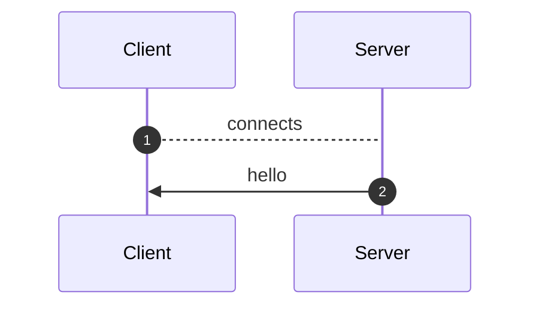
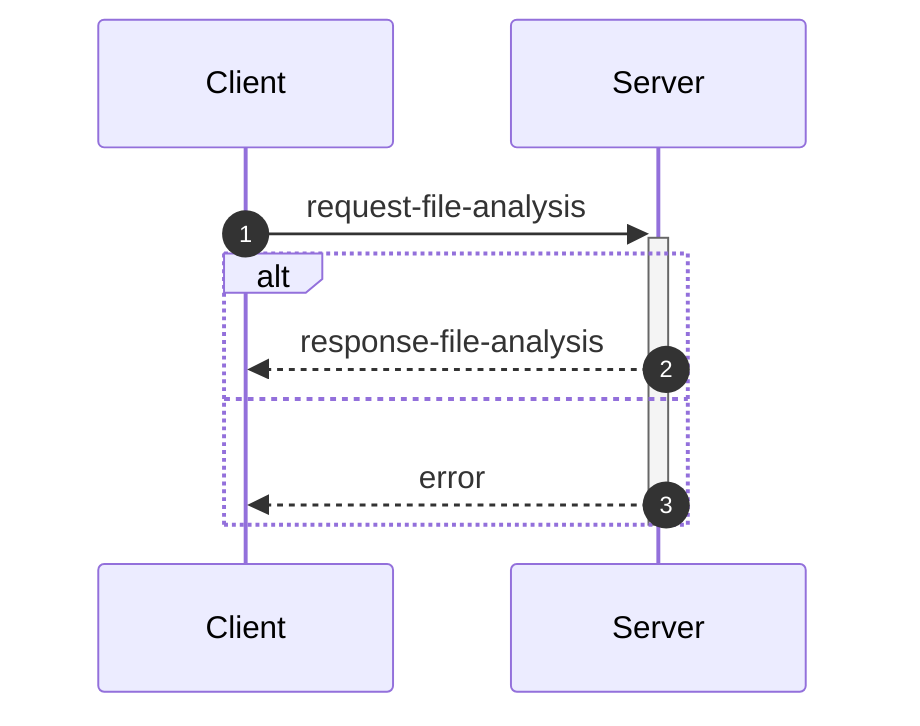
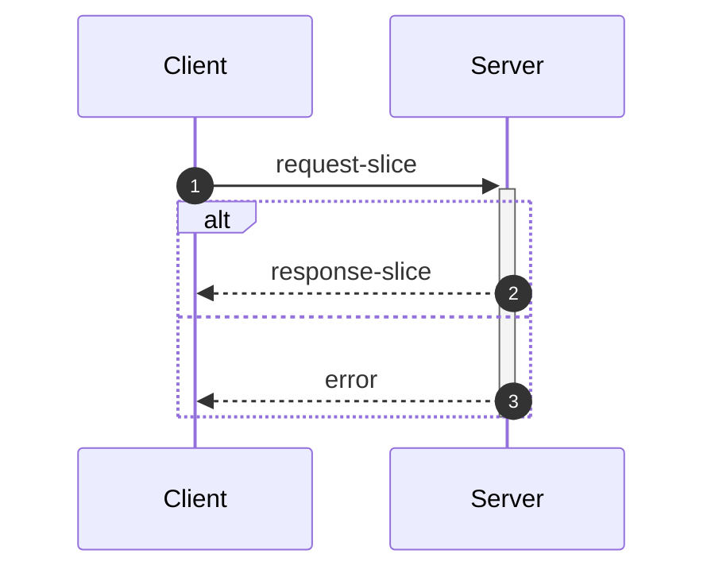
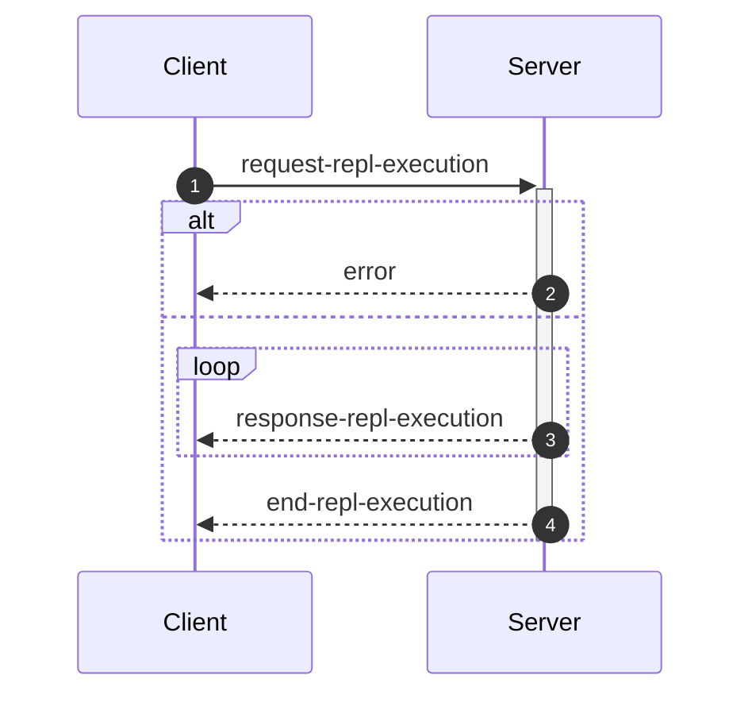

_<span title="an overview of flowR's interface">Generated</span> from '[wiki-interface.ts](https://github.com/flowr-analysis/flowr/tree/main/src/documentation/wiki-interface.ts "src/documentation/wiki-interface.ts")' on 2026-10-25, 09:29:25 UTC (v2.16.6, R v4.6.1), do not edit directly._

Although far from being as detailed as the in-depth explanation of [_flowR_](https://github.com/flowr-analysis/flowr/wiki/Core),
this wiki page explains how to interface with _flowR_ in more detail.
In general, command line arguments and other options provide short descriptions on hover over.

* [💻 Using the REPL](#using-the-repl)
* [⚙️ Configuring FlowR](#configuring-flowr)
* [⚒️ Writing Code](#writing-code)
* [💬 Communicating with the Server](#communicating-with-the-server)

<a id='using-the-repl'></a>
## 💻 Using the REPL

> [!NOTE]
> To execute arbitrary R commands with a repl request, _flowR_ has to be started explicitly with <span title="Description (Command Line Argument): Allow to access the underlying R session when using flowR (security warning: this allows the execution of arbitrary R code!)">`--r-session-access`</span>.
> Please be aware that this introduces a security risk and note that this relies on the [`r-shell` engine](https://github.com/flowr-analysis/flowr/wiki/Engines) .

Although primarily meant for users to explore,
there is nothing which forbids calling _flowR_ as a subprocess to use standard-in, -output, and -error
for communication (although you can access the REPL using the server as well,
with the [REPL Request](#message-request-repl-execution) message).

The read-eval-print loop&nbsp;(REPL) works relatively simple.
You can submit an expression (using <kbd>Enter</kbd>),
which is interpreted as an R&nbsp;expression by default but interpreted as a *command* if it starts with a colon (`:`).
The best command to get started with the REPL is <span title="Description (Repl Command): Show help information (aliases: :h, :?)">`:help`</span>.
Besides, you can leave the REPL either with the command <span title="Description (Repl Command): End the repl (aliases: :q, :exit)">`:quit`</span> or by pressing <kbd>Ctrl</kbd>+<kbd>C</kbd> twice.
When writing a *command*, you may press <kbd>Tab</kbd> to get a list of completions, if available.
Multiple commands can be entered in a single line by separating them with a semicolon (`;`), e.g. `:parse "x<-2"; :df*`.
If a command is given without R code, the REPL will re-use R code given in a previous command.
The prior example will hence return first the parsed AST of the program and then the dataflow graph for `"x <- 2"`.

> [!NOTE]
> If you develop flowR, you may want to launch the repl using the `npm run main-dev` command, this way, you get a non-minified version of flowR with debug information and hot-reloading of source files.

<details>
<summary>Available Commands</summary>

We currently offer the following commands (this with a `[*]` suffix are available with and without the star):

| Command | Description |
| ------- | ----------- |
| **<span title="Description (Repl Command): End the repl (aliases: :q, :exit)">:quit</span>** | End the repl (aliases: **:<span title="Alias of ':quit'. End the repl">q</span>**, **:<span title="Alias of ':quit'. End the repl">exit</span>**) |
| **<span title="Description (Repl Command): Execute the given code as R code. This requires the `--r-session-access` flag to be set and requires the r-shell engine. (aliases: :e, :r)">:execute</span>** | Execute the given code as R code. This requires the `--r-session-access` flag to be set and requires the r-shell engine. (aliases: **:<span title="Alias of ':execute'. Execute the given code as R code. This requires the `--r-session-access` flag to be set and requires the r-shell engine.">e</span>**, **:<span title="Alias of ':execute'. Execute the given code as R code. This requires the `--r-session-access` flag to be set and requires the r-shell engine.">r</span>**) |
| **<span title="Description (Repl Command): Get mermaid code for the control-flow graph of R code (aliases: :cfg, :cf)">:controlflow[*]</span>** | Get mermaid code for the control-flow graph of R code (star: Returns the URL to mermaid.live) (aliases: **:<span title="Alias of ':controlflow'. Get mermaid code for the control-flow graph of R code">cfg</span>**, **:<span title="Alias of ':controlflow'. Get mermaid code for the control-flow graph of R code">cf</span>**) |
| **<span title="Description (Repl Command): Get mermaid code for the control-flow graph with basic blocks (aliases: :cfgb, :cfb)">:controlflowbb[*]</span>** | Get mermaid code for the control-flow graph with basic blocks (star: Returns the URL to mermaid.live) (aliases: **:<span title="Alias of ':controlflowbb'. Get mermaid code for the control-flow graph with basic blocks">cfgb</span>**, **:<span title="Alias of ':controlflowbb'. Get mermaid code for the control-flow graph with basic blocks">cfb</span>**) |
| **<span title="Description (Repl Command): Get mermaid code for the dataflow graph (aliases: :d, :df)">:dataflow[*]</span>** | Get mermaid code for the dataflow graph (star: Returns the URL to mermaid.live) (aliases: **:<span title="Alias of ':dataflow'. Get mermaid code for the dataflow graph">d</span>**, **:<span title="Alias of ':dataflow'. Get mermaid code for the dataflow graph">df</span>**) |
| **<span title="Description (Repl Command): Get mermaid code for the normalized AST of R code (aliases: :n)">:normalize[*]</span>** | Get mermaid code for the normalized AST of R code (star: Returns the URL to mermaid.live) (alias: **:<span title="Alias of ':normalize'. Get mermaid code for the normalized AST of R code">n</span>**) |
| **<span title="Description (Repl Command): Get mermaid code for the simplified dataflow graph (aliases: :ds, :dfs)">:dataflowsimple[*]</span>** | Get mermaid code for the simplified dataflow graph (star: Returns the URL to mermaid.live) (aliases: **:<span title="Alias of ':dataflowsimple'. Get mermaid code for the simplified dataflow graph">ds</span>**, **:<span title="Alias of ':dataflowsimple'. Get mermaid code for the simplified dataflow graph">dfs</span>**) |
| **<span title="Description (Repl Command): Inspect and extend the signature database: `query` (identical to :query @signature), `info <name>` for where a function comes from (identical to :query @function-info), `add <path>` to mount another database/source, `download` to fetch the full-history database. (aliases: :sig)">:signature</span>** | Inspect and extend the signature database: `query` (identical to :query @signature), `info <name>` for where a function comes from (identical to :query @function-info), `add <path>` to mount another database/source, `download` to fetch the full-history database. (alias: **:<span title="Alias of ':signature'. Inspect and extend the signature database: `query` (identical to :query @signature), `info <name>` for where a function comes from (identical to :query @function-info), `add <path>` to mount another database/source, `download` to fetch the full-history database.">sig</span>**) |
| **<span title="Description (Repl Command): Just calculates the DFG, but only prints summary info (aliases: :d#, :df#)">:dataflowsilent</span>** | Just calculates the DFG, but only prints summary info (aliases: **:<span title="Alias of ':dataflowsilent'. Just calculates the DFG, but only prints summary info">d#</span>**, **:<span title="Alias of ':dataflowsilent'. Just calculates the DFG, but only prints summary info">df#</span>**) |
| **<span title="Description (Repl Command): Prints ASCII Art of the parsed, unmodified AST (aliases: :p)">:parse</span>** | Prints ASCII Art of the parsed, unmodified AST (alias: **:<span title="Alias of ':parse'. Prints ASCII Art of the parsed, unmodified AST">p</span>**) |
| **<span title="Description (Repl Command): Prints the version of flowR as well as the current version of R">:version</span>** | Prints the version of flowR as well as the current version of R
| **<span title="Description (Repl Command): Query the given R code (use 'help' for more information)">:query[*]</span>** | Query the given R code (use 'help' for more information) (star: Similar to query, but returns the output in json format.)
| **<span title="Description (Repl Command): Returns an ASCII representation of the dataflow graph (aliases: :df!)">:dataflowascii</span>** | Returns an ASCII representation of the dataflow graph (alias: **:<span title="Alias of ':dataflowascii'. Returns an ASCII representation of the dataflow graph">df!</span>**) |
| **<span title="Description (Repl Command): Returns summarization stats for the normalized AST (aliases: :n#)">:normalize#</span>** | Returns summarization stats for the normalized AST (alias: **:<span title="Alias of ':normalize#'. Returns summarization stats for the normalized AST">n#</span>**) |
| **<span title="Description (Repl Command): Show help information (aliases: :h, :?)">:help</span>** | Show help information (aliases: **:<span title="Alias of ':help'. Show help information">h</span>**, **:<span title="Alias of ':help'. Show help information">?</span>**) |

</details>

> [!TIP]
> 
> As indicated by the examples before, all REPL commands that operate on code keep track of the state.
> Hence, if you run a command like <span title="Description (Repl Command, starred version): Returns the URL to mermaid.live; Base Command: Get mermaid code for the dataflow graph (aliases: :d*, :df*)">`:dataflow*`</span> without providing R code,
> the REPL will re-use the R code provided in a previous command.
> Likewise, doing this will benefit from incrementality!
> If you request the dataflow graph with `:df* x <- 2 * y` and then want to see the parsed AST with `:parse`,
> the REPL will re-use previously obtained information and not re-parse the code again.
> 		

Generally, many commands offer shortcut versions in the REPL. Many queries, for example, offer a shortened format (see the example below).
Of special note, the [Config Query](https://github.com/flowr-analysis/flowr/wiki/%5BQuery%5D-Config)
can be used to also modify the currently active configuration of _flowR_ within the REPL (see the [wiki page](https://github.com/flowr-analysis/flowr/wiki/%5BQuery%5D-Config) for more information).

### Example: Retrieving the Dataflow Graph

To retrieve a URL to the [mermaid](https://mermaid.js.org/) diagram of the dataflow of a given expression,
use <span title="Description (Repl Command, starred version): Returns the URL to mermaid.live; Base Command: Get mermaid code for the dataflow graph (aliases: :d*, :df*)">`:dataflow*`</span> (or <span title="Description (Repl Command): Get mermaid code for the dataflow graph (aliases: :d, :df)">`:dataflow`</span> to get the mermaid code in the cli):

```shell
$ docker run -it --rm eagleoutice/flowr # or npm run flowr 
flowR repl v2.16.6, R grammar v14 (tree-sitter engine)
R> :dataflow* y <- 1 + x
```

<details>
<summary style='color:gray'>Output</summary>

```text
https://mermaid.live/view#base64:eyJjb2RlIjoiZmxvd2NoYXJ0IFREXG4gICAgMXt7XCJgKiM5MTtSTnVtYmVyIzkzOyogKioxKipcbiAgICAgICoxLjYqICgqKmlkOiAxKiopYFwifX1cbiAgICAyKFtcImAqIzkxO1JTeW1ib2wjOTM7KiAqKngqKlxuICAgICAgKjEuMTAqICgqKmlkOiAyKiopYFwiXSlcbiAgICAzW1tcImAqIzkxO1JCaW5hcnlPcCM5MzsqIGJhc2UjNTg7IzU4OyoqIzQzOyoqXG4gICAgICAqMS42LTEwKiAoKippZDogMyoqKVxuICAgIGFyZzogKDEsIDIpYFwiXV1cbiAgICBidWlsdC1pbjpfNDNfW1wiYEJ1aWx0LUluOlxuIzQzO2BcIl1cbiAgICBzdHlsZSBidWlsdC1pbjpfNDNfIHN0cm9rZTpncmF5LGZpbGw6Z3JheSxzdHJva2Utd2lkdGg6MnB4LG9wYWNpdHk6Ljg7XG4gICAgMFtcImAqIzkxO1JTeW1ib2wjOTM7KiAqKnkqKlxuICAgICAgKjEuMSogKCoqaWQ6IDAqKiwgdjogMylgXCJdXG4gICAgNFtbXCJgKiM5MTtSQmluYXJ5T3AjOTM7KiBiYXNlIzU4OyM1ODsqKiM2MDsjNDU7KipcbiAgICAgICoxLjEtMTAqICgqKmlkOiA0KiopXG4gICAgYXJnOiAoMCwgMylgXCJdXVxuICAgIGJ1aWx0LWluOl82MF8tW1wiYEJ1aWx0LUluOlxuIzYwOyM0NTtgXCJdXG4gICAgc3R5bGUgYnVpbHQtaW46XzYwXy0gc3Ryb2tlOmdyYXksZmlsbDpncmF5LHN0cm9rZS13aWR0aDoycHgsb3BhY2l0eTouODtcbiAgICAxIC0uLT58XCJmbG93XCJ8IDJcbiAgICBsaW5rU3R5bGUgMCBzdHJva2U6Z3JheSxjb2xvcjpncmF5O1xuICAgIDIgLS4tPnxcImZsb3dcInwgM1xuICAgIGxpbmtTdHlsZSAxIHN0cm9rZTpncmF5LGNvbG9yOmdyYXk7XG4gICAgMyAtLT58XCJyZWFkcywgYXJnXCJ8IDFcbiAgICAzIC0tPnxcInJlYWRzLCBhcmdcInwgMlxuICAgIDMgLS4tPnxcImZsb3dcInwgMFxuICAgIGxpbmtTdHlsZSA0IHN0cm9rZTpncmF5LGNvbG9yOmdyYXk7XG4gICAgMyAtLi0+fFwicmVhZHMsIGNhbGxzXCJ8IGJ1aWx0LWluOl80M19cbiAgICBsaW5rU3R5bGUgNSBzdHJva2U6Z3JheTtcbiAgICAwIC0tPnxcImRlZmluZWQtYnksIGZsb3dcInwgNFxuICAgIDAgLS0+fFwiZGVmaW5lZC1ieVwifCAzXG4gICAgNCAtLT58XCJyZWFkcywgYXJnXCJ8IDNcbiAgICA0IC0tPnxcInJldHVybnMsIGFyZ1wifCAwXG4gICAgNCAtLi0+fFwicmVhZHMsIGNhbGxzXCJ8IGJ1aWx0LWluOl82MF8tXG4gICAgbGlua1N0eWxlIDEwIHN0cm9rZTpncmF5OyIsIm1lcm1haWQiOnsiYXV0b1N5bmMiOnRydWV9fQ==
```

Retrieve the dataflow graph of the expression `y <- 1 + x`. It looks like this:


<details>

<summary style="color:gray">R Code of the Dataflow Graph</summary>

The analysis ran (parse and normalize with the [tree-sitter](https://github.com/flowr-analysis/flowr/wiki/Engines) engine) in the generation environment. No [signature database](https://github.com/flowr-analysis/flowr/wiki/Signature-Database) is mounted, so `library()` attaches no exports (base-R names are still qualified, e.g., `stats::acf`). 
We encountered no unknown side effects during the analysis.

```r
y <- 1 + x
```

</details>

</details>

For small graphs like this, <span title="Description (Repl Command): Returns an ASCII representation of the dataflow graph (aliases: :df!)">`:dataflowascii`</span> also provides an ASCII representation directly in the REPL:

```shell
$ docker run -it --rm eagleoutice/flowr # or npm run flowr 
flowR repl v2.16.6, R grammar v14 (tree-sitter engine)
R> :df! y <- 1 + x
```

<details open>
<summary style='color:gray'>Output</summary>

```text
                        v<0>v
 c<4>c──────────────────| y |
 |<- |     ┌────────────v---v
 c---c     │
    │   c<3>c   0<1>0
    └───| + |───| 1 |───u<2>u
        c---c   0---0   | x |
           └────────────u---u
Edges:
3 -> 1: reads, arg          3 -> 2: reads, arg
3 -> 0: flows-to            1 -> 2: flows-to
2 -> 3: flows-to            4 -> 3: reads, arg
4 -> 0: returns, arg        0 -> 4: defined-by, flows-to
0 -> 3: defined-by
```

Retrieve the dataflow graph of the expression `y <- 1 + x` as ASCII art.

</details>

For the slicing with <span title="Description (Repl Command): Static backwards executable slicer for R">`:slicer`</span>, you have access to the same [magic comments](#slice-magic-comments) as with the [slice request](#message-request-slice).
Pass `--inline` to splice resolvable `source()` calls into the reconstruction so the slice is a single self-contained R text (the same as the static slice query's `inlineSources` flag).
See `--help` for more flags!

### Example: Interfacing with the File System

Many commands that allow for an R-expression (like <span title="Description (Repl Command, starred version): Returns the URL to mermaid.live; Base Command: Get mermaid code for the dataflow graph (aliases: :d*, :df*)">`:dataflow*`</span>) allow for a file as well
if the argument starts with `file://`.
If you are working from the root directory of the _flowR_ repository, the following gives you the parsed AST of the example file using the <span title="Description (Repl Command): Prints ASCII Art of the parsed, unmodified AST (aliases: :p)">`:parse`</span> command:

> **Watch mode**: Replace `file://` with `watch://` to enter watch mode.
> flowR runs the command immediately and then re-runs it every time the file (or any file inside the folder) changes.
> Enter any other command to leave watch mode.
> For example: `:df watch://analysis.R`

```shell
$ docker run -it --rm eagleoutice/flowr # or npm run flowr 
flowR repl v2.16.6, R grammar v14 (tree-sitter engine)
R> :parse file://test/testfiles/example.R
```

<details>
<summary style='color:gray'>Output</summary>

```text
File: test/testfiles/example.R

program
├ binaryoperator
│ ├ identifier "sum" (1:1─4)
│ ├ <- "<-" (1:5─7)
│ ╰ float "0" (1:8─9)
├ binaryoperator
│ ├ identifier "product" (2:1─8)
│ ├ <- "<-" (2:9─11)
│ ╰ float "1" (2:12─13)
├ binaryoperator
│ ├ identifier "w" (3:1─2)
│ ├ <- "<-" (3:3─5)
│ ╰ float "7" (3:6─7)
├ binaryoperator
│ ├ identifier "N" (4:1─2)
│ ├ <- "<-" (4:3─5)
│ ╰ float "10" (4:6─8)
├ forstatement
│ ├ for "for" (6:1─4)
│ ├ ( "(" (6:5─6)
│ ├ identifier "i" (6:6─7)
│ ├ in "in" (6:8─10)
│ ├ binaryoperator
│ │ ├ float "1" (6:11─12)
│ │ ├ : ":" (6:12─13)
│ │ ╰ parenthesizedexpression
│ │   ├ ( "(" (6:13─14)
│ │   ├ binaryoperator
│ │   │ ├ identifier "N" (6:14─15)
│ │   │ ├ - "-" (6:15─16)
│ │   │ ╰ float "1" (6:16─17)
│ │   ╰ ) ")" (6:17─18)
│ ├ ) ")" (6:18─19)
│ ╰ bracedexpression
│   ├ { "{" (6:20─21)
│   ├ binaryoperator
│   │ ├ identifier "sum" (7:3─6)
│   │ ├ <- "<-" (7:7─9)
│   │ ╰ binaryoperator
│   │   ├ binaryoperator
│   │   │ ├ identifier "sum" (7:10─13)
│   │   │ ├ + "+" (7:14─15)
│   │   │ ╰ identifier "i" (7:16─17)
│   │   ├ + "+" (7:18─19)
│   │   ╰ identifier "w" (7:20─21)
│   ├ binaryoperator
│   │ ├ identifier "product" (8:3─10)
│   │ ├ <- "<-" (8:11─13)
│   │ ╰ binaryoperator
│   │   ├ identifier "product" (8:14─21)
│   │   ├  "" (8:22─23)
│   │   ╰ identifier "i" (8:24─25)
│   ╰ } "}" (9:1─2)
├ call
│ ├ identifier "cat" (11:1─4)
│ ╰ arguments
│   ├ ( "(" (11:4─5)
│   ├ argument
│   │ ╰ string
│   │   ├ " "\"" (11:5─6)
│   │   ├ stringcontent "Sum:" (11:6─10)
│   │   ╰ " "\"" (11:10─11)
│   ├ comma "," (11:11─12)
│   ├ argument
│   │ ╰ identifier "sum" (11:13─16)
│   ├ comma "," (11:16─17)
│   ├ argument
│   │ ╰ string
│   │   ├ " "\"" (11:18─19)
│   │   ├ stringcontent
│   │   │ ╰ escapesequence "\\n" (11:19─21)
│   │   ╰ " "\"" (11:21─22)
│   ╰ ) ")" (11:22─23)
╰ call
  ├ identifier "cat" (12:1─4)
  ╰ arguments
    ├ ( "(" (12:4─5)
    ├ argument
    │ ╰ string
    │   ├ " "\"" (12:5─6)
    │   ├ stringcontent "Product:" (12:6─14)
    │   ╰ " "\"" (12:14─15)
    ├ comma "," (12:15─16)
    ├ argument
    │ ╰ identifier "product" (12:17─24)
    ├ comma "," (12:24─25)
    ├ argument
    │ ╰ string
    │   ├ " "\"" (12:26─27)
    │   ├ stringcontent
    │   │ ╰ escapesequence "\\n" (12:27─29)
    │   ╰ " "\"" (12:29─30)
    ╰ ) ")" (12:30─31)
```

Retrieve the parsed AST of the example file.

<details>

<summary>File Content</summary>

```r
sum <- 0
product <- 1
w <- 7
N <- 10

for (i in 1:(N-1)) {
  sum <- sum + i + w
  product <- product * i
}

cat("Sum:", sum, "\n")
cat("Product:", product, "\n")
```

</details>

As _flowR_ directly transforms this AST the output focuses on being human-readable instead of being machine-readable.
		
</details>

### Example: Run a Query

You can run any query supported by _flowR_ using the <span title="Description (Repl Command): Query the given R code (use 'help' for more information)">`:query`</span> command.
For example, to obtain the shapes of all data frames in a given piece of code, you can run:

```shell
$ docker run -it --rm eagleoutice/flowr # or npm run flowr 
flowR repl v2.16.6, R grammar v14 (tree-sitter engine)
R> :query @absint df-shape "x <- data.frame(a = 1:10, b = 1:10)\ny <- x$a"
```

<details open>
<summary style='color:gray'>Output</summary>

```text
Query: absint (1 ms)
```

Retrieve the shapes of all data frames in the given code.

</details>

To run the linter on a file, you can use (in this example, we just issue the `dead-code` linter on a small piece of code):

```shell
$ docker run -it --rm eagleoutice/flowr # or npm run flowr 
flowR repl v2.16.6, R grammar v14 (tree-sitter engine)
R> :query @linter rules:dead-code "if(FALSE) x <- 2"
```

<details open>
<summary style='color:gray'>Output</summary>

```text
Query: linter (1 ms)
   ╰ Dead Code (dead-code):
       ╰ certain:
           ╰ Code at 1.11-16
```

Run the linter on the given code, with only the `dead-code` rule enabled.

</details>

For more information on the available queries, please check out the [Query API](https://github.com/flowr-analysis/flowr/wiki/Query-API).

<a id='configuring-flowr'></a>
## ⚙️ Configuring FlowR

When running _flowR_, you may want to specify some behaviors with a dedicated configuration file.
By default, flowR looks for a file named `flowr.json` in the current working directory (or any higher directory).
You can also specify a different file with <span title="Description (Command Line Argument): The name of the configuration file to use">`--config-file`</span> or pass the configuration inline using <span title="Description (Command Line Argument): The flowR configuration to use, as a JSON string">`--config-json`</span>.
A `flowr.json` found this way belongs to the analyzed project, so flowR ignores its options that decide what flowR executes or loads
(`engines.*.wasmPath`, `engines.*.treeSitterWasmPath`, `engines.*.rPath`, `solver.sigdb.additionalPaths`, `solver.sigdb.downloadRepo`, `solver.sigdb.installedLibrary.paths`),
unless you pass <span title="Description (Command Line Argument): Keep the security-sensitive options (e.g., the R executable) of the flowr.json found in the working directory or a parent. Only use this for projects you trust.">`--trust-config`</span>.
To analyze code you do not trust, use the secure mode (<span title="Description (Command Line Argument): Run in secure mode for analyzing untrusted code: flowR does not start R (or any other process), does not access the network, does not search for project configs, and ignores security-sensitive options in every config. Cannot be disabled once enabled. Can also be enabled with the environment variable {italic FLOWR_SECURE_MODE=1}.">`--secure`</span>, see the [security policy](https://github.com/flowr-analysis/flowr/blob/main/.github/SECURITY.md)).
To inspect the current configuration, you can run flowr with the <span title="Description (Command Line Argument): Run with verbose logging (will be passed to the corresponding script)">`--verbose`</span> flag, or use the `config` [Query](https://github.com/flowr-analysis/flowr/wiki/Query-API).
Within the REPL this works by running the following:

```shell
:query @config
```

To work with the <a href="https://github.com/flowr-analysis/flowr/tree/main/src/config.ts#L119"><code><span title="The configuration file format for flowR.">FlowrConfig</span></code></a> you can use the provided helper objects alongside its methods like
<a href="https://github.com/flowr-analysis/flowr/tree/main/src/config.ts#L914"><code><span title="Creates a new flowr config that has the updated values.">FlowrConfig::<b>amend</b></span></code></a>.
The schema below documents every option; the ones you most likely want are:

- <a href="https://github.com/flowr-analysis/flowr/wiki/Interface#configuring-flowr" title="Configuration Option (boolean): Whether source calls should be ignored, causing {@link processSourceCall}&#39;s behavior to be skipped.">ignoreSourceCalls</a>: ignore source calls when analyzing the code, i.e., ignore the inclusion of other files.
- <a href="https://github.com/flowr-analysis/flowr/wiki/Interface#configuring-flowr" title="Configuration Option (boolean): Whether load calls should be ignored, causing {@link processLoadCall}&#39;s behavior to be skipped.">ignoreLoadCalls</a>: ignore load calls when analyzing the code, i.e., ignore the loading of r-data files.
- <a href="https://github.com/flowr-analysis/flowr/wiki/Interface#configuring-flowr" title="Configuration Option (object): Do you want to overwrite (parts) of the builtin definition?">semantics.environment.overwriteBuiltIns</a>: overwrite _flowR_'s handling of built-in functions, or clear the preset definitions entirely.
  See [Configure BuiltIn Semantics](#configure-builtin-semantics) for more information.
- <a href="https://github.com/flowr-analysis/flowr/wiki/Interface#configuring-flowr" title="Configuration Option (string): How to resolve variables and their values. (one of &quot;disabled&quot;, &quot;alias&quot;, &quot;builtin&quot;)">solver.variables</a>: how to resolve variables and their values (`disabled`, `alias`, `builtin`).
- <a href="https://github.com/flowr-analysis/flowr/wiki/Interface#configuring-flowr" title="Configuration Option (array): The engine or set of engines to use for interacting with R code. An empty array means all available engines will be used.">engines</a> and <a href="https://github.com/flowr-analysis/flowr/wiki/Interface#configuring-flowr" title="Configuration Option (string): The default engine to use for interacting with R code. If this is undefined, an arbitrary engine from the specified list will be used. (one of &quot;tree-sitter&quot;, &quot;r-shell&quot;)">defaultEngine</a>: the engines used to interact with R code, see the [Engines wiki page](https://github.com/flowr-analysis/flowr/wiki/Engines).
- <a href="https://github.com/flowr-analysis/flowr/wiki/Interface#configuring-flowr" title="Configuration Option (array): Files a framework loads on its own, without any source() call (e.g. global.R in a shiny app), in the order they are loaded; flowR orders the matching project files accordingly and analyzes them as one program. Entries are case-insensitive globs matched against the file path, a plain name matches any file with that name, and entries matching no project file are warned about. Usually set per project kind via specializeConfig.">project.implicitSources</a>: the files a framework loads without any `source()` call, in the order in which they are
  loaded. Entries are globs (e.g. `R/*.R`) matched against the file path ignoring capitalization; one matching no file is reported.
- <a href="https://github.com/flowr-analysis/flowr/wiki/Interface#configuring-flowr" title="Configuration Option (object): Overwrite (parts of) the configuration depending on the project kind flowR detects, e.g. to give a shiny app its implicit sources.">specializeConfig</a>: overwrite (parts of) the configuration depending on the kind of project _flowR_ detects
  (e.g. `shiny-app`), which is how a shiny app gets its implicit sources by default. What you configure directly wins.
- <a href="https://github.com/flowr-analysis/flowr/wiki/Interface#configuring-flowr" title="Configuration Option (string): Overwrite the project kind flowR would otherwise infer from the analyzed files, e.g. when auto-detection guesses wrong. (one of &quot;package&quot;, &quot;script&quot;, &quot;shiny-app&quot;, &quot;notebook&quot;, &quot;project&quot;, &quot;unknown&quot;)">project.useProjectType</a>: skip that detection and force a project kind yourself, when auto-detection guesses wrong.
- <a href="https://github.com/flowr-analysis/flowr/wiki/Interface#configuring-flowr" title="Configuration Option (array): The default plugins to load when creating a new instance of FlowrAnalyzer">defaultPlugins</a> and <a href="https://github.com/flowr-analysis/flowr/wiki/Interface#configuring-flowr" title="Configuration Option (array): The plugins to load in REPL mode">repl.plugins</a>: the plugins to load for a new <a href="https://github.com/flowr-analysis/flowr/tree/main/src/project/flowr-analyzer.ts#L205"><code><span title="Central class for conducting analyses with FlowR. Use the FlowrAnalyzerBuilder to create a new instance. If you want the original pattern of creating a pipeline and running all steps, you can still do this with FlowrAnalyzer#runFull . To inspect the context of the analyzer, use FlowrAnalyzer#inspectContext (if you are a plugin and need to modify it, use FlowrAnalyzer#context instead).">FlowrAnalyzer</span></code></a> and in the REPL
  (use `flowr:default` to reference the former).

So you can configure _flowR_ by adding a file like the following:

<details>

<summary>Example Configuration File</summary>

```json
{
  "ignoreSourceCalls": true,
  "ignoreLoadCalls": true,
  "semantics": {
    "environment": {
      "overwriteBuiltIns": {
        "definitions": [
          {
            "type": "function",
            "names": [
              "foo"
            ],
            "processor": "builtin:assign",
            "config": {}
          }
        ]
      }
    }
  },
  "defaultPlugins": [
    "file:description",
    "versions:description"
  ],
  "repl": {
    "quickStats": false,
    "dfProcessorHeat": false,
    "hints": true,
    "plugins": [
      "flowr:default"
    ]
  },
  "project": {
    "resolveUnknownPathsOnDisk": true,
    "implicitSources": [
      "global.R",
      "app.R"
    ]
  },
  "linter": {
    "disabledRules": []
  },
  "specializeConfig": {
    "shiny-app": {
      "project": {
        "implicitSources": [
          "global.R",
          "ui.R",
          "server.R",
          "app.R"
        ]
      }
    }
  },
  "engines": [
    {
      "type": "r-shell"
    }
  ],
  "solver": {
    "variables": "alias",
    "evalStrings": true,
    "trackEnvironments": true,
    "sigdb": {
      "enabled": true,
      "loadProjectDependencies": true,
      "eagerlyLoad": false,
      "eagerlyLoadExports": false,
      "linkBaseR": false,
      "linkDescriptionDependencies": false
    },
    "resolveSource": {
      "dropPaths": "no",
      "ignoreCapitalization": true,
      "inferWorkingDirectory": "active-script",
      "searchPath": []
    },
    "instrument": {},
    "slicer": {
      "threshold": 50
    }
  },
  "abstractInterpretation": {
    "wideningThreshold": 4,
    "followCalls": true,
    "dataFrame": {
      "maxColNames": 20,
      "readLoadedData": {
        "readExternalFiles": true,
        "maxReadLines": 1000000
      }
    }
  },
  "incremental": {
    "alwaysIncremental": false,
    "parsing": {
      "activated": false,
      "heuristics": {
        "activated": true,
        "mtime": true,
        "linesFrom": 500,
        "bytesFrom": 50000,
        "alwaysWithEdits": false,
        "minFiles": 1
      }
    }
  },
  "gas": {
    "thresholds": {
      "memory": {
        "problematic": 0.7,
        "critical": 0.9
      },
      "timeMs": {
        "problematic": 100000,
        "critical": 120000
      }
    },
    "features": {}
  }
}
```

</details>

<details>
<a id='configure-builtin-semantics'></a>
<summary>Configure Built-In Semantics</summary>

`semantics/environment/overwriteBuiltins` accepts two keys:

- `loadDefaults` (boolean, initially `true`): If set to `true`, the default built-in definitions are loaded before applying the custom definitions. Setting this flag to `false` explicitly disables the loading of the default definitions.
- `definitions` (array, initially empty): Allows to overwrite or define new built-in elements. Each object within must have a `type` which is one of the below. Furthermore, they may define a string array of `names` which specifies the identifiers to bind the definitions to. You may use `assumePrimitive` to specify whether _flowR_ should assume that this is a primitive non-library definition (so you probably just do not want to specify the key).

  | Type            | Description                                                                                                                                                                                                                                                                                              | Example                                                                                                    |
  | --------------- | -------------------------------------------------------------------------------------------------------------------------------------------------------------------------------------------------------------------------------------------------------------------------------------------------------- | ---------------------------------------------------------------------------------------------------------- |
  | `constant`    | Additionally allows for a `value` this should resolve to.                                                                                                                                                                                                                                                | `{ type: 'constant', names: ['NULL', 'NA'],  value: null }`                                                |
  | `function`    | Is a rather flexible way to define and bind built-in functions. For the time, we do not have extensive documentation to cover all the cases, so please either consult the sources with the `default-builtin-config.ts` or open a [new issue](https://github.com/flowr-analysis/flowr/issues/new/choose). | `{ type: 'function', names: ['next'], processor: 'builtin:d', config: { cfg: ExitPointType.Next } }` |
  | `replacement` | A comfortable way to specify replacement functions like `$<-` or `names<-`. `suffixes` describes the... suffixes to attach automatically. | `{ type: 'replacement', suffixes: ['<-', '<<-'], names: ['[', '[['] }` |

</details>

<details>

<summary style='color:gray'>Full Configuration-File Schema</summary>

- _The configuration file format for flowR._ (object)
    - **logLevel** [optional] _flowR's global minimum log level, applied when the config is loaded._ (string)
        Only allows: 'silly', 'trace', 'debug', 'info', 'warn', 'error', 'fatal'
    - **ignoreSourceCalls** [optional] _Whether source calls should be ignored, causing {@link processSourceCall}'s behavior to be skipped._ (boolean)
    - **ignoreLoadCalls** [optional] _Whether load calls should be ignored, causing {@link processLoadCall}'s behavior to be skipped._ (boolean)
    - **semantics** _Configure language semantics and how flowR handles them._ (object)
        - **environment** [optional] _Semantics regarding how to handle the R environment._ (object)
            - **overwriteBuiltIns** [optional] _Do you want to overwrite (parts) of the builtin definition?_ (object)
                - **loadDefaults** [optional] _Should the default configuration still be loaded?_ (boolean)
                - **definitions** [optional] _The definitions to load/overwrite._ (array)
                Valid item types:
                    - (object)
    - **defaultPlugins** [optional] _The default plugins to load when creating a new instance of FlowrAnalyzer_ (array)
    Valid item types:
        - (alternatives)
            - (string)
            - (array)
    - **repl** _Configuration options for the REPL._ (object)
        - **quickStats** [optional] _Whether to show quick stats in the REPL after each evaluation._ (boolean)
        - **dfProcessorHeat** [optional] _This instruments the dataflow processors to count how often each processor is called._ (boolean)
        - **hints** [optional] _Whether to show dim inline hints on the empty prompt (automatically disabled on non-interactive terminals)._ (boolean)
        - **plugins** [optional] _The plugins to load in REPL mode_ (array)
        Valid item types:
            - (alternatives)
                - (string)
                - (array)
        - **autoUseFileProtocol** [optional] _Prepend the file protocol to a repl input that looks like a path, instead of only warning about it._ (boolean)
        - **queryStats** [optional] _Whether `:query` closes with the line stating how long the queries took (`:query*` never prints it)._ (boolean)
        - **showPlugins** [optional] _Whether `:version` grays out the plugins that did not activate during the last analysis._ (boolean)
    - **project** _Project specific configuration options._ (object)
        - **resolveUnknownPathsOnDisk** [optional] _Whether to resolve unknown paths loaded by the r project disk when trying to source/analyze files._ (boolean)
        - **failOnInaccessiblePath** [optional] _Whether a directory that cannot be traversed during file discovery (e.g. due to permissions) aborts the analysis; when false (the default) such paths are logged and skipped._ (boolean)
        - **basePackages** [optional] _The packages considered part of R itself (base and recommended); if unset, flowR uses its built-in list._ (array)
        Valid item types:
            - (string)
        - **implicitSources** [optional] _Files a framework loads on its own, without any source() call (e.g. global.R in a shiny app), in the order they are loaded; flowR orders the matching project files accordingly and analyzes them as one program. Entries are case-insensitive globs matched against the file path, a plain name matches any file with that name, and entries matching no project file are warned about. Usually set per project kind via specializeConfig._ (array)
        Valid item types:
            - (string)
        - **useProjectType** [optional] _Overwrite the project kind flowR would otherwise infer from the analyzed files, e.g. when auto-detection guesses wrong._ (string)
            Only allows: 'package', 'script', 'shiny-app', 'notebook', 'project', 'unknown'
        - **assumeImplicitEcho** [optional] _Whether the top level of the analyzed code is echoed, so that every visible result printed there is collected as an output by the dependencies query (default true, false for a package)._ (boolean)
        - **discovery** [optional] _Scoping options for the default project discovery._ (object)
            - **full** [optional] _Collect every file below the project root (greedy) instead of only the files the detected project kind needs (default false)._ (boolean)
            - **perKind** [optional] _Per-kind include/exclude glob overrides layered on the default scoping._ (object)
            - **ignore** [optional] _Case-insensitive globs that drop matching files from the intelligent discovery, regardless of kind (e.g. .Renviron to ignore environment files)._ (array)
            Valid item types:
                - (string)
        - **classification** [optional] _Overrides for the signals flowR uses to classify the project kind._ (object)
            - **shinyDescriptionTypes** [optional] _DESCRIPTION Type: values that mark a shiny app._ (array)
            Valid item types:
                - (string)
            - **shinyEntryFiles** [optional] _File names a shiny app is assembled from._ (array)
            Valid item types:
                - (string)
            - **shinyUsagePattern** [optional] _Regex source evidencing shiny usage in an entry file._ (string)
            - **notebookExtensions** [optional] _File extensions marking a notebook._ (array)
            Valid item types:
                - (string)
    - **linter** _Linter configuration options._ (object)
        - **disabledRules** _Linting rule names excluded from the default rule set (a rule requested explicitly via a linter query still runs). Usually set per project kind via specializeConfig._ (array)
        Valid item types:
            - (string)
        - **disabledTags** [optional] _Linting rule tags whose rules are excluded from the default rule set (a rule requested explicitly via a linter query still runs). By default the cmd-check rules are disabled for everything but a package; a configured list replaces that default._ (array)
        Valid item types:
            - (string)
    - **inputSources** [optional] _Further frameworks the input-sources analysis should know about; entries are added to flowR's defaults._ (object)
        - **pure** [optional] _Functions that only pass the constantness of their arguments on._ (array)
        Valid item types:
            - (string)
        - **param** [optional] _Functions whose result is a 'param' input._ (array)
        Valid item types:
            - (string)
        - **file** [optional] _Functions whose result is a 'file' input._ (array)
        Valid item types:
            - (string)
        - **tempfile** [optional] _Functions whose result is a 'tempfile' input._ (array)
        Valid item types:
            - (string)
        - **glob** [optional] _Functions whose result is a 'glob' input._ (array)
        Valid item types:
            - (string)
        - **net** [optional] _Functions whose result is a 'net' input._ (array)
        Valid item types:
            - (string)
        - **rand** [optional] _Functions whose result is a 'rand' input._ (array)
        Valid item types:
            - (string)
        - **system** [optional] _Functions whose result is a 'system' input._ (array)
        Valid item types:
            - (string)
        - **ffi** [optional] _Functions whose result is a 'ffi' input._ (array)
        Valid item types:
            - (string)
        - **lang** [optional] _Functions whose result is a 'lang' input._ (array)
        Valid item types:
            - (string)
        - **options** [optional] _Functions whose result is a 'options' input._ (array)
        Valid item types:
            - (string)
        - **cmdline** [optional] _Functions whose result is a 'cmdline' input._ (array)
        Valid item types:
            - (string)
        - **user** [optional] _Functions whose result is a 'user' input._ (array)
        Valid item types:
            - (string)
        - **const** [optional] _Functions whose result is a 'const' input._ (array)
        Valid item types:
            - (string)
        - **scope** [optional] _Functions whose result is a 'scope' input._ (array)
        Valid item types:
            - (string)
        - **dconst** [optional] _Functions whose result is a 'dconst' input._ (array)
        Valid item types:
            - (string)
        - **unknown** [optional] _Functions whose result is a 'unknown' input._ (array)
        Valid item types:
            - (string)
        - **linkedObjects** [optional] _Objects a framework provides without a definition in the code, e.g. shiny's input._ (array)
        Valid item types:
            - (object)
        - **linkedEntryPoints** [optional] _Calls that hand a function to a framework, which binds its objects to the parameters by position._ (array)
        Valid item types:
            - (object)
    - **specializeConfig** [optional] _Overwrite (parts of) the configuration depending on the project kind flowR detects, e.g. to give a shiny app its implicit sources._ (object)
    - **engines** _The engine or set of engines to use for interacting with R code. An empty array means all available engines will be used._ (array)
    Valid item types:
        - (alternatives)
            - _The configuration for the tree sitter engine._ (object)
                - **type** [required] _Use the tree sitter engine._ (string)
                    Only allows: 'tree-sitter'
                - **wasmPath** [optional] _The path to the tree-sitter-r WASM binary to use. If this is undefined, this uses the default path._ (string)
                - **treeSitterWasmPath** [optional] _The path to the tree-sitter WASM binary to use. If this is undefined, this uses the default path._ (string)
                - **lax** [optional] _Whether to use the lax parser for parsing R code (allowing for syntax errors). If this is undefined, the strict parser will be used._ (boolean)
            - _The configuration for the R shell engine._ (object)
                - **type** [required] _Use the R shell engine._ (string)
                    Only allows: 'r-shell'
                - **rPath** [optional] _The path to the R executable to use. If this is undefined, this uses the default path._ (string)
                - **pipeBind** [optional] _Whether to enable R's experimental pipe-bind operator "=>" by setting _R_USE_PIPEBIND_ for the R session (default false); R itself keeps this off by default, as it is experimental and has never shipped in a release version of R._ (boolean)
    - **defaultEngine** [optional] _The default engine to use for interacting with R code. If this is undefined, an arbitrary engine from the specified list will be used._ (string)
        Only allows: 'tree-sitter', 'r-shell'
    - **solver** _How to resolve constants, constraints, cells, ..._ (object)
        - **variables** _How to resolve variables and their values._ (string)
            Only allows: 'disabled', 'alias', 'builtin'
        - **evalStrings** _Should we include eval(parse(text="...")) calls in the dataflow graph?_ (boolean)
        - **trackEnvironments** [optional] _Track user-created environments (new.env, assign/get/local with envir=, dollar-assign, attach). When false, all envir-style calls fall through conservatively._ (boolean)
        - **sigdb** _Resolving library exports from a signature database._ (object)
            - **enabled** [optional] _Resolve library()/use() exports from a signature database (default true); when false no database is consulted._ (boolean)
            - **loadProjectDependencies** [optional] _Load the project's declared dependencies from its metadata files (DESCRIPTION Imports/Depends, rproject.toml, uvr.toml, renv.lock, rv.lock, uvr.lock) (default true); when false these files are not read for dependencies._ (boolean)
            - **eagerlyLoad** [optional] _Parse the database up front rather than on the first package load (default false, ignored if disabled)._ (boolean)
            - **eagerlyLoadExports** [optional] _Add a vertex for every export on load rather than on demand (default false); keeps the dataflow graph small._ (boolean)
            - **assumedRVersion** [optional] _R version assumed when resolving versioned (base-R) exports: a pin like "4.5" or "auto" to detect the installed R (default "auto")._ (string)
            - **linkBaseR** [optional] _Eagerly attach base-R namespaces so bare base calls resolve without library() (default false)._ (boolean)
            - **linkBaseRCalls** [optional] _Add a lightweight Reads edge from a bare base-R call to its signature-database function vertex (default false; base-R qualification is edge-free otherwise)._ (boolean)
            - **linkPackageCalls** [optional] _Add a lightweight Reads edge from a resolved package call to its signature-database function vertex (default false)._ (boolean)
            - **linkDescriptionDependencies** [optional] _Eagerly attach the namespaces of the project's declared DESCRIPTION dependencies (Imports/Depends) so their exports resolve without an explicit library() (default false)._ (boolean)
            - **warmInBackground** [optional] _Decompress the hot shards (base + most-downloaded) in a background task on startup so the first library() lookup is warm (default false; for long-running servers/REPLs)._ (boolean)
            - **additionalPaths** [optional] _Extra directories or bundle/manifest files searched for signature databases (alongside the shipped default and $FLOWR_SIGDB_DIR); a downloaded full-history bundle placed here is mounted automatically._ (array)
            Valid item types:
                - (string)
            - **downloadRepo** [optional] _GitHub owner/repo the full-history bundle is downloaded from via ":signature download" (default "flowr-analysis/flowr", release tag "sigdb-v<flowR-version>")._ (string)
            - **autoSync** [optional] _On startup, re-download shards whose committed sigdb.remote.json hash no longer matches the cache, in the background (default false; opt-in network sync after a git pull)._ (boolean)
            - **installedLibrary** [optional] _Recovering packages no signature database knows from the copy installed on this machine._ (object)
                - **enabled** [required] _Recover packages no signature database knows from their installed copy (default false)._ (boolean)
                - **paths** [optional] _Library directories to search; when empty they are discovered from the environment and the project._ (array)
                Valid item types:
                    - (string)
                - **useEnvironment** [optional] _Search the libraries R_LIBS_USER/R_LIBS/R_LIBS_SITE name (default true)._ (boolean)
                - **useProjectLibrary** [optional] _Search a project-local renv/packrat library (default true)._ (boolean)
                - **maxDepth** [optional] _How far to descend into the nested layout of a project-local library (default 3)._ (number)
                - **packages** [optional] _Only recover packages whose name matches one of these regular expressions; empty means any._ (array)
                Valid item types:
                    - (string)
            - **blobCacheBudgetMb** [optional] _How many MiB of decoded package blobs every open bundle may hold together (default 16)._ (number)
            - **versionSelection** [optional] _When a project constrains a dependency, resolve to the newest (default), oldest, or system-installed version satisfying it; system needs R and falls back to newest. Base-R packages always resolve against the assumed R version._ (string)
                Only allows: 'newest', 'oldest', 'system'
            - **versionOverrides** [optional] _Force an exact version for specific packages (name -> version), overriding both the project constraint and the versionSelection policy (default {})._ (object)
        - **versionManagement** _Policies for reasoning about dependency versions._ (object)
            - **linkedVersionGroups** [optional] _Groups of packages that must resolve to the same version; version guessing intersects each group so its members stay mutually compatible (default [])._ (array)
            Valid item types:
                - (array)
                Valid item types:
                    - (string)
        - **assumeAttachedPackages** [optional] _Packages to treat as attached without a `library()` call, so what the built-in configuration states about them applies to the analyzed code. The base packages R attaches on startup already resolve without it._ (array)
        Valid item types:
            - (string)
        - **transitiveSideEffectRounds** [optional] _How many rounds the transitive side-effect fixpoint may run before it is cut off (default 32); the propagation stops on its own as soon as a round adds nothing._ (number)
        - **maxOverlayDepth** [optional] _How many binding overlays may stack on one environment frame before a write flattens them (default 4); a pure performance knob, trading lookup cost against copy cost without changing any result._ (number)
        - **instrument** (object)
            - **dataflowExtractors** [optional] _These keys are only intended for use within code, allowing to instrument the dataflow analyzer!_ (any)
        - **resolveSource** [optional] _If lax source calls are active, flowR searches for sourced files much more freely, based on the configurations you give it. This option is only in effect if `ignoreSourceCalls` is set to false._ (object)
            - **dropPaths** _Allow to drop the first or all parts of the sourced path, if it is relative._ (string)
                Only allows: 'no', 'once', 'all'
            - **ignoreCapitalization** _Search for filenames matching in the lowercase._ (boolean)
            - **inferWorkingDirectory** _Try to infer the working directory from the main or any script to analyze._ (string)
                Only allows: 'no', 'main-script', 'active-script', 'any-script'
            - **searchPath** _Additionally search in these paths._ (array)
            Valid item types:
                - (string)
            - **repeatedSourceLimit** [optional] _How often the same file can be sourced within a single run? Please be aware: in case of cyclic sources this may not reach a fixpoint so give this a sensible limit._ (number)
            - **applyReplacements** _Provide name replacements for loaded files_ (array)
            Valid item types:
                - (object)
            - **assumeFilesExist** [optional] _Assume a sourced file is always there, making what it defines certain instead of conditional on the source call._ (boolean)
        - **slicer** [optional] _The configuration for the slicer._ (object)
            - **threshold** [optional] _The maximum number of iterations to perform on a single function call during slicing._ (number)
            - **autoExtend** [optional] _If set, the slicer will gain an additional post-pass._ (boolean)
    - **abstractInterpretation** _The configuration options for abstract interpretation._ (object)
        - **wideningThreshold** _The threshold for the number of visitations of a node at which widening should be performed to ensure the termination of the fixpoint iteration._ (number)
        - **followCalls** _Whether the abstract interpretation is interprocedural, i.e. whether it steps into the functions a call may dispatch to._ (boolean)
        - **dataFrame** _The configuration of the shape inference for data frames._ (object)
            - **maxColNames** _The maximum number of columns names to infer for data frames before over-approximating the column names to top._ (number)
            - **readLoadedData** _Configuration options for reading data frame shapes from loaded external data files, such as CSV files._ (object)
                - **readExternalFiles** _Whether data frame shapes should be extracted from loaded external files, such as CSV files._ (boolean)
                - **maxReadLines** _The maximum number of lines to read when extracting data frame shapes from loaded files, such as CSV files._ (number)
    - **incremental** (object)
        - **alwaysIncremental** _Always take the incremental path, regardless of heuristics._ (boolean)
        - **parsing** (object)
            - **activated** _If set, incremental parsing will be used._ (boolean)
            - **heuristics** (object)
                - **activated** [optional] _If set, the heuristics for incremental parsing will be used._ (boolean)
                - **mtime** [optional] _Skip reparsing entirely if the file's modification time is unchanged since the last parse._ (boolean)
                - **linesFrom** [optional] _Only consider incremental parsing for files with at least this many lines._ (number)
                - **bytesFrom** [optional] _Only consider incremental parsing for files with at least this many bytes._ (number)
                - **alwaysWithEdits** [optional] _Always take the incremental path whenever there is a computed edit region, regardless of the other thresholds._ (boolean)
                - **minFiles** [optional] _Only apply these heuristics once the project has at least this many files loaded._ (number)
    - **gas** [optional] _Resource-usage guard (gas) configuration. All feature factors default to 0 (disabled). See https://github.com/flowr-analysis/flowr/wiki/Core#gas-resource-guard._ (object)
        - **thresholds** [optional] _Thresholds for all gas checks (scaled by per-feature factor), boundable per feature._ (object)
            - **memory** [optional] _Heap-usage fraction thresholds (0-1), either shared or given per feature key (with `default` covering the rest)._ (object)
                - **problematic** [optional] _Heap fraction (0-1) above which Problematic is returned, for every feature without an entry of its own._ (number)
                - **critical** [optional] _Heap fraction (0-1) above which Critical is returned, for every feature without an entry of its own._ (number)
            - **timeMs** [optional] _Elapsed analysis time thresholds in milliseconds, either shared or given per feature key (with `default` covering the rest)._ (object)
                - **problematic** [optional] _Elapsed ms above which Problematic is returned, for every feature without an entry of its own._ (number)
                - **critical** [optional] _Elapsed ms above which Critical is returned, for every feature without an entry of its own._ (number)
            - **steps** [optional] _Processed-AST-node thresholds, counted rather than sampled; only a key that arms a budget (`dataflow`) reads them._ (object)
                - **problematic** [optional] _Processed AST nodes above which Problematic is returned, for every feature without an entry of its own._ (number)
                - **critical** [optional] _Processed AST nodes above which the extraction is cut short, for every feature without an entry of its own._ (number)
            - **vertices** [optional] _Created-dataflow-vertex thresholds, counted like `steps`._ (object)
                - **problematic** [optional] _Created dataflow vertices above which Problematic is returned, for every feature without an entry of its own._ (number)
                - **critical** [optional] _Created dataflow vertices above which the extraction is cut short, for every feature without an entry of its own._ (number)
        - **features** [optional] _Per-feature sensitivity factors. 0 or absent disables gas checking for that feature. A factor of 2 makes the feature twice as sensitive. Recognised keys: `source`, `side-effect-linking`, `linter`, `slicer`, `dataflow`._ (object)
        - **countedCheckEvery** [optional] _How many counted steps pass between two accountings of an armed check, be it a dataflow budget or the slicer's traversal (default 128); trades overshoot against the cost of the check._ (number)
        - **heapProvider** [optional] _Custom heap statistics source (programmatic configs only), overriding the built-in v8/performance.memory detection._ (function)

</details>

<a id='writing-code'></a>
## ⚒️ Writing Code

_flowR_ can be used as a [module](https://www.npmjs.com/package/@eagleoutice/flowr) and offers several main classes and interfaces that are interesting for extension writers 
(see the [Visual Studio Code extension](https://marketplace.visualstudio.com/items?itemName=code-inspect.vscode-flowr) or the [Core](https://github.com/flowr-analysis/flowr/wiki/Core) wiki page for more information).

### Creating Analyses with _flowR_

Nowadays, instances of the <a href="https://github.com/flowr-analysis/flowr/tree/main/src/project/flowr-analyzer.ts#L205"><code><span title="Central class for conducting analyses with FlowR. Use the FlowrAnalyzerBuilder to create a new instance. If you want the original pattern of creating a pipeline and running all steps, you can still do this with FlowrAnalyzer#runFull . To inspect the context of the analyzer, use FlowrAnalyzer#inspectContext (if you are a plugin and need to modify it, use FlowrAnalyzer#context instead).">FlowrAnalyzer</span></code></a> should be used as central frontend to get analysis results from _flowR_.
The entry points an analysis is written against are re-exported from the package root (`import { FlowrAnalyzerBuilder } from '@eagleoutice/flowr'`);
everything else stays reachable under its own path, as in `@eagleoutice/flowr/dataflow/graph/graph`.
For example, a program slice can be created like this:

```ts
const analyzer = await new FlowrAnalyzerBuilder()
    .setEngine('tree-sitter')
    .build();
analyzer.addRequest('x <- 1\ny <- x\nx');
const result = await analyzer.query([
    {
        type:     'static-slice',
        criteria: ['3@x']
    }
]);
```

For more information, please have a look at the [Analyzer](https://github.com/flowr-analysis/flowr/wiki/Analyzer) wiki page, which explains how to construct and use the <a href="https://github.com/flowr-analysis/flowr/tree/main/src/project/flowr-analyzer.ts#L205"><code><span title="Central class for conducting analyses with FlowR. Use the FlowrAnalyzerBuilder to create a new instance. If you want the original pattern of creating a pipeline and running all steps, you can still do this with FlowrAnalyzer#runFull . To inspect the context of the analyzer, use FlowrAnalyzer#inspectContext (if you are a plugin and need to modify it, use FlowrAnalyzer#context instead).">FlowrAnalyzer</span></code></a> in more detail.
To work with specific perspectives, you can also consult the respective pages like the [Dataflow Graph](https://github.com/flowr-analysis/flowr/wiki/Dataflow-Graph) or the [Abstract Interpretation](https://github.com/flowr-analysis/flowr/wiki/Abstract-Interpretation) wiki pages.
### The Pipeline Executor (Low-Level Interface)

Once, in the beginning, _flowR_ was meant to produce a dataflow graph merely to provide *program slices*. 
However, with continuous updates, the [Dataflow Graph](https://github.com/flowr-analysis/flowr/wiki/Dataflow-Graph) repeatedly proves to be the more interesting part.
With this, we restructured _flowR_'s originally *hardcoded* pipeline to be far more flexible. 
Now, it can be theoretically extended or replaced with arbitrary steps, optional steps, and what we call 'decorations' of these steps. 
In short, a slicing pipeline using the <a href="https://github.com/flowr-analysis/flowr/tree/main/src/core/pipeline-executor.ts#L97"><code><span title="**Please note:** The PipelineExecutor is now considered to be a rather low-level API for flowR. While it still works and is the basis for all other layers, we strongly recommend using the FlowrAnalyzer and its builder to create and use an analyzer instance that is pre-configured for your use-case. The pipeline executor allows to execute arbitrary pipelines in a step-by-step fashion. If you are not...">PipelineExecutor</span></code></a> looks like this:

```ts

const slicer = new PipelineExecutor(DEFAULT_SLICING_PIPELINE, {
  parser:    new RShell(),
  request:   requestFromInput('x <- 1\nx + 1'),
  criterion: ['2@x']
})
const slice = await slicer.allRemainingSteps()
// console.log(slice.reconstruct.code)
```

<details><summary>More Information</summary>

If you compare this, with what you would have done with the old (and removed) `SteppingSlicer`, 
this essentially just requires you to replace the `SteppingSlicer` with the <a href="https://github.com/flowr-analysis/flowr/tree/main/src/core/pipeline-executor.ts#L97"><code><span title="**Please note:** The PipelineExecutor is now considered to be a rather low-level API for flowR. While it still works and is the basis for all other layers, we strongly recommend using the FlowrAnalyzer and its builder to create and use an analyzer instance that is pre-configured for your use-case. The pipeline executor allows to execute arbitrary pipelines in a step-by-step fashion. If you are not...">PipelineExecutor</span></code></a>
and to pass the <a href="https://github.com/flowr-analysis/flowr/tree/main/src/core/steps/pipeline/default-pipelines.ts#L18"><code>DEFAULT_SLICING_PIPELINE</code></a> as the first argument.
The <a href="https://github.com/flowr-analysis/flowr/tree/main/src/core/pipeline-executor.ts#L97"><code><span title="**Please note:** The PipelineExecutor is now considered to be a rather low-level API for flowR. While it still works and is the basis for all other layers, we strongly recommend using the FlowrAnalyzer and its builder to create and use an analyzer instance that is pre-configured for your use-case. The pipeline executor allows to execute arbitrary pipelines in a step-by-step fashion. If you are not...">PipelineExecutor</span></code></a>...

1. Provides structures to investigate the results of all intermediate steps
2. Can be executed step-by-step
3. Can repeat steps (e.g., to calculate multiple slices on the same input)

See the in-code documentation for more information.

</details>

### Using the <a href="https://github.com/flowr-analysis/flowr/tree/main/src/r-bridge/shell.ts#L144"><code><span title="The RShell represents an interactive session with the R interpreter. You can configure it by RShellOptions . At the moment we are using a live R session (and not networking etc.) to communicate with R easily, which allows us to install packages etc. However, this might and probably will change in the future (leaving this as a legacy mode :D)">RShell</span></code></a> to Interact with R

The <a href="https://github.com/flowr-analysis/flowr/tree/main/src/r-bridge/shell.ts#L144"><code><span title="The RShell represents an interactive session with the R interpreter. You can configure it by RShellOptions . At the moment we are using a live R session (and not networking etc.) to communicate with R easily, which allows us to install packages etc. However, this might and probably will change in the future (leaving this as a legacy mode :D)">RShell</span></code></a> class allows interfacing with the `R`&nbsp;ecosystem installed on the host system.
Please have a look at [flowR's Engines](https://github.com/flowr-analysis/flowr/wiki/Engines) for more information on alternatives (for example, the <a href="https://github.com/flowr-analysis/flowr/tree/main/src/r-bridge/lang-4.x/tree-sitter/tree-sitter-executor.ts#L29"><code><span title="Synchronous and (way) faster alternative to the RShell using tree-sitter.">TreeSitterExecutor</span></code></a>).

> [!IMPORTANT]
> 
> Each <a href="https://github.com/flowr-analysis/flowr/tree/main/src/r-bridge/shell.ts#L144"><code><span title="The RShell represents an interactive session with the R interpreter. You can configure it by RShellOptions . At the moment we are using a live R session (and not networking etc.) to communicate with R easily, which allows us to install packages etc. However, this might and probably will change in the future (leaving this as a legacy mode :D)">RShell</span></code></a> controls a new instance of the R&nbsp;interpreter, 
> make sure to call <code><a href="https://github.com/flowr-analysis/flowr/tree/main/src/r-bridge/shell.ts#L350"><span title="Close the current R session, makes the object effectively invalid (can no longer be reopened etc.)">RShell::<i>close</i></span></a>()</code> when you are done.

You can start a new "session" by constructing a new object with <code>new <a href="https://github.com/flowr-analysis/flowr/tree/main/src/r-bridge/shell.ts#L144"><span title="The RShell represents an interactive session with the R interpreter. You can configure it by RShellOptions . At the moment we are using a live R session (and not networking etc.) to communicate with R easily, which allows us to install packages etc. However, this might and probably will change in the future (leaving this as a legacy mode :D)">RShell</span></a>()</code>.

However, there are several options that may be of interest 
(e.g., to automatically revive the shell in case of errors or to control the name location of the R process on the system).

With a shell object (let's call it `shell`), you can execute R code by using <a href="https://github.com/flowr-analysis/flowr/tree/main/src/r-bridge/shell.ts#L213"><code><span title="sends the given command directly to the current R session will not do anything to alter input markers!">RShell::<i>sendCommand</i></span></code></a>,
for example <code>shell.<a href="https://github.com/flowr-analysis/flowr/tree/main/src/r-bridge/shell.ts#L213"><span title="sends the given command directly to the current R session will not do anything to alter input markers!">sendCommand</span></a>("1 + 1")</code>.
However, this does not return anything, so if you want to collect the output of your command, use
<a href="https://github.com/flowr-analysis/flowr/tree/main/src/r-bridge/shell.ts#L296"><code><span title="Send a command and collect the output">RShell::<i>sendCommandWithOutput</i></span></code></a> instead.

<a id='communicating-with-the-server'></a>
## 💬 Communicating with the Server

As explained in the [Overview](https://github.com/flowr-analysis/flowr/wiki/Overview), you can run the [TCP](https://de.wikipedia.org/wiki/Transmission_Control_Protocol)&nbsp;server by adding the <span title="Description (Command Line Argument): Do not drop into a repl, but instead start a server on the given port (default: 1042) and listen for messages.">`--server`</span> flag (and, due to the interactive mode, exit with the conventional <kbd>CTRL</kbd>+<kbd>C</kbd>).
Currently, every connection is handled by the same underlying `RShell` - so the server is not designed to handle many clients at a time.
Additionally, the server is not well guarded against attacks (e.g., you can theoretically spawn an arbitrary number of&nbsp;RShell sessions on the target machine).

Every message has to be given in a single line (i.e., without a newline in-between) and end with a newline character. Nevertheless, we will pretty-print example given in the following segments for the ease of reading.

> [!NOTE]
> 
> The default <span title="Description (Command Line Argument): Do not drop into a repl, but instead start a server on the given port (default: 1042) and listen for messages.">`--server`</span> uses a simple [TCP](https://de.wikipedia.org/wiki/Transmission_Control_Protocol)
> connection. If you want _flowR_ to expose a [WebSocket](https://de.wikipedia.org/wiki/WebSocket) server instead, add the <span title="Description (Command Line Argument): If the server flag is set, use websocket for messaging">`--ws`</span> flag (i.e., <span title="Description (Command Line Argument): Do not drop into a repl, but instead start a server on the given port (default: 1042) and listen for messages.">`--server`</span> <span title="Description (Command Line Argument): If the server flag is set, use websocket for messaging">`--ws`</span>) when starting _flowR_ from the command line.

<ul><li>
<a id="message-hello"></a>
<b>Hello</b> Message (<code>hello</code>) 
<details>

<summary style="color:gray"> View Details. <i>The server informs the client about the successful connection and provides Meta-Information.</i> </summary>



After launching _flowR_, for example, with <code>docker run -it --rm eagleoutice/flowr <span title="Description (Command Line Argument): Do not drop into a repl, but instead start a server on the given port (default: 1042) and listen for messages.">-<span/>-server</span></code>&nbsp;(🐳️), connecting should present you with a `hello` message, that amongst others should reveal the versions of&nbsp;_flowR_ and&nbsp;R, using the [semver 2.0](https://semver.org/spec/v2.0.0.html) versioning scheme.
The message looks like this:

```json
{
  "type": "hello",
  "clientName": "client-0",
  "versions": {
    "flowr": "2.16.6",
    "r": "4.6.1",
    "engine": "r-shell"
  }
}
```

There are currently a few messages that you can send after the hello message.
If you want to _slice_ a piece of R code you first have to send an [analysis request](#message-request-file-analysis), so that you can send one or multiple slice requests afterward.
Requests for the [REPL](#message-request-repl-execution) are independent of that.
	
<hr>

<details>
<summary style="color:gray">Message schema (<code>hello</code>)</summary>

For the definition of the hello message, please see it's implementation at [`./src/cli/repl/server/messages/message-hello.ts`](https://github.com/flowr-analysis/flowr/tree/main/src/cli/repl/server/messages/message-hello.ts).

- [required] (object)
    - **type** [required] _The type of the hello message._ (string)
        Only allows: 'hello'
    - **id** [forbidden] _The id of the message is always undefined (as it is the initial message and not requested)._ (any)
    - **clientName** [required] _A unique name that is assigned to each client. It has no semantic meaning and is only used/useful for debugging._ (string)
    - **versions** [required] (object)
        - **flowr** [required] _The version of the flowr server running in semver format._ (string)
        - **r** [required] _The version of the underlying R shell running in semver format._ (string)
        - **engine** [required] _The parser backend that is used to parse the R code._ (string)

</details>

<hr>

</details>
	</li>

<li>
<a id="message-request-file-analysis"></a>
<b>Analysis</b> Message (<code>request-file-analysis</code>) 
<details>

<summary style="color:gray"> View Details. <i>The server builds the dataflow graph for a given input file (or a set of files).</i> </summary>



The request allows the server to analyze a file and prepare it for slicing.
The message can contain a `filetoken`, which is used to identify the file in later slice or query requests (if you do not add one, the request will not be stored and therefore, it is not available for subsequent requests).

> **Please note!**\
> If you want to send and process a lot of analysis requests, but do not want to slice them, please do not pass the `filetoken` field. This will save the server a lot of memory allocation.

Furthermore, the request must contain either a `content` field to directly pass the file's content or a `filepath` field which contains the path to the file (this path must be accessible for the server to be useful).
If you add the `id` field, the answer will use the same `id` so you can match requests and the corresponding answers.
See the implementation of the request-file-analysis message for more information.

You can drop one or more stored file tokens by adding the `invalidateToken` field (a single token or an array of tokens).
The server frees the corresponding analyses _after_ it has answered the request.

> **Tip!**\
> If you only want to drop tokens, you do not need a separate message: send a `request-file-analysis` that contains _just_ the `invalidateToken` field (and no `content` or `filepath`).
> Such a request behaves like an empty file analysis and the server replies with an empty `results` object.
> Because invalidation happens after the response, you may even pass the _current_ `filetoken` in `invalidateToken` to analyze a file once and have the server forget it right after you received the results.

<details>
<summary>Example of the <code>request-file-analysis</code> Message</summary>

_Note:_ even though we pretty-print these messages, they are sent as a single line, ending with a newline.

The following lists all messages that were sent and received in case you want to reproduce the scenario:

<ol>
<li> <code>hello</code> (response)
<details> 

<summary> Show Details </summary>

The first message is always a hello message.

```json
{"type":"hello","clientName":"client-0","versions":{"flowr":"2.16.6","r":"4.6.1","engine":"r-shell"}}
```

</details>
</li>

<li> <b><code>request-file-analysis</code> (request)</b>
<details open> 

<summary> Show Details </summary>

Let's suppose you simply want to analyze the following script:
 
```r
x <- 1
x + 1
```

 For this, you can send the following request:

```json
{"type":"request-file-analysis","id":"1","filetoken":"x","content":"x <- 1\nx + 1"}
```

</details>
</li>

<li> <code>response-file-analysis</code> (response)
<details> 

<summary> Show Details </summary>

The `results` field of the response effectively contains three keys of importance:

- `parse`: which contains 1:1 the parse result in CSV format that we received from the `RShell` (i.e., the AST produced by the parser of the R interpreter).
- `normalize`: which contains the normalized AST, including ids (see the `info` field and the [Normalized AST](https://github.com/flowr-analysis/flowr/wiki/Normalized-AST) wiki page).
- `dataflow`: especially important is the `graph` field which contains the dataflow graph as a set of root vertices (see the [Dataflow Graph](https://github.com/flowr-analysis/flowr/wiki/Dataflow-Graph) wiki page).
			
_As the code is pretty long, we inhibit pretty printing and syntax highlighting (JSON, hiding built-in):_

```text
{"type":"response-file-analysis","format":"json","id":"1","results":{"parse":{"files":[{"parsed":"[1,1,1,6,7,0,\"expr\",false,\"x <- 1\"],[1,1,1,1,1,3,\"SYMBOL\",true,\"x\"],[1,1,1,1,3,7,\"expr\",false,\"x\"],[1,3,1,4,2,7,\"LEFT_ASSIGN\",true,\"<-\"],[1,6,1,6,4,5,\"NUM_CONST\",true,\"1\"],[1,6,1,6,5,7,\"expr\",false,\"1\"],[2,1,2,5,16,0,\"expr\",false,\"x + 1\"],[2,1,2,1,10,12,\"SYMBOL\",true,\"x\"],[2,1,2,1,12,16,\"expr\",false,\"x\"],[2,3,2,3,11,16,\"'+'\",true,\"+\"],[2,5,2,5,13,14,\"NUM_CONST\",true,\"1\"],[2,5,2,5,14,16,\"expr\",false,\"1\"]","filePath":"/tmp/tmp-3944649-0T5zEXtGA99q-.R"}],".meta":{}},"normalize":{"ast":{"type":"RProject","files":[{"root":{"type":"RExpressionList","children":[{"type":"RBinaryOp","location":[1,3,1,4],"lhs":{"type":"RSymbol","location":[1,1,1,1],"content":"x","lexeme":"x","info":{"fullRange":[1,1,1,1],"adToks":[],"id":0,"parent":2,"role":"bin-l","index":0,"nest":0,"file":"/tmp/tmp-3944649-0T5zEXtGA99q-.R"}},"rhs":{"location":[1,6,1,6],"lexeme":"1","info":{"fullRange":[1,6,1,6],"adToks":[],"id":1,"parent":2,"role":"bin-r","index":1,"nest":0,"file":"/tmp/tmp-3944649-0T5zEXtGA99q-.R"},"type":"RNumber","content":{"num":1,"complexNumber":false,"markedAsInt":false}},"operator":"<-","lexeme":"<-","info":{"fullRange":[1,1,1,6],"adToks":[],"id":2,"parent":6,"nest":0,"file":"/tmp/tmp-3944649-0T5zEXtGA99q-.R","index":0,"role":"el-c"}},{"type":"RBinaryOp","location":[2,3,2,3],"lhs":{"type":"RSymbol","location":[2,1,2,1],"content":"x","lexeme":"x","info":{"fullRange":[2,1,2,1],"adToks":[],"id":3,"parent":5,"role":"bin-l","index":0,"nest":0,"file":"/tmp/tmp-3944649-0T5zEXtGA99q-.R"}},"rhs":{"location":[2,5,2,5],"lexeme":"1","info":{"fullRange":[2,5,2,5],"adToks":[],"id":4,"parent":5,"role":"bin-r","index":1,"nest":0,"file":"/tmp/tmp-3944649-0T5zEXtGA99q-.R"},"type":"RNumber","content":{"num":1,"complexNumber":false,"markedAsInt":false}},"operator":"+","lexeme":"+","info":{"fullRange":[2,1,2,5],"adToks":[],"id":5,"parent":6,"nest":0,"file":"/tmp/tmp-3944649-0T5zEXtGA99q-.R","index":1,"role":"el-c"}}],"info":{"adToks":[],"id":6,"nest":0,"file":"/tmp/tmp-3944649-0T5zEXtGA99q-.R","role":"root","index":0}},"filePath":"/tmp/tmp-3944649-0T5zEXtGA99q-.R"}],"info":{"id":7}},".meta":{}},"dataflow":{"unknownReferences":[],"in":[{"nodeId":2,"name":"<-","type":2},{"nodeId":5,"name":"+","type":2}],"out":[{"nodeId":0,"name":"x","type":4,"definedAt":2,"value":[1]}],"environment":{"current":{"id":1532,"parent":"<BuiltInEnvironment>","memory":[["x",[{"nodeId":0,"name":"x","type":4,"definedAt":2,"value":[1]}]]],"globalEnv":true},"level":0},"graph":{"rootVertices":[1,0,2,3,4,5],"vertexInformation":[[1,{"tag":"value","id":1}],[0,{"tag":"vdef","id":0,"source":[1]}],[2,{"tag":"fcall","id":2,"name":"<-","onlyBuiltin":true,"args":[{"nodeId":0,"type":32},{"nodeId":1,"type":32}],"origin":["builtin:assign"]}],[3,{"tag":"use","id":3}],[4,{"tag":"value","id":4}],[5,{"tag":"fcall","id":5,"name":"+","onlyBuiltin":true,"args":[{"nodeId":3,"type":32},{"nodeId":4,"type":32}],"origin":["builtin:d"]}]],"edgeInformation":[[2,[[1,{"types":65}],[0,{"types":72}],["built-in:<-",{"types":5}],[3,{"types":4096}]]],[1,[[0,{"types":4096}]]],[0,[[2,{"types":4098}],[1,{"types":2}]]],[5,[[3,{"types":65}],[4,{"types":65}],["built-in:+",{"types":5}]]],[3,[[0,{"types":1}],[4,{"types":4096}]]],[4,[[5,{"types":4096}]]]],"_unknownSideEffects":[]},"entryPoint":2,"cfgEntry":1,"exitPoints":[{"type":0,"nodeId":5}],"hooks":[],".meta":{}}}}
```

</details>
</li>
</ol>

The complete round-trip covers validating the messages as well as starting and stopping the internal mock server.

</details>

You receive an error if, for whatever reason, the analysis fails (e.g., the message or code you sent contained syntax errors).
It contains a human-readable description *why* the analysis failed (see the error message implementation for more details).

<details>
<summary>Example Error Message</summary>

_Note:_ even though we pretty-print these messages, they are sent as a single line, ending with a newline.

The following lists all messages that were sent and received in case you want to reproduce the scenario:

<ol>
<li> <code>hello</code> (response)
<details> 

<summary> Show Details </summary>

The first message is always a hello message.

```json
{"type":"hello","clientName":"client-0","versions":{"flowr":"2.16.6","r":"4.6.1","engine":"r-shell"}}
```

</details>
</li>

<li> <code>request-file-analysis</code> (request)
<details> 

<summary> Show Details </summary>

```json
{"type":"request-file-analysis","id":"1","filename":"sample.R","content":"x <-"}
```

</details>
</li>

<li> <b><code>error</code> (response)</b>
<details open> 

<summary> Show Details </summary>

```json
{
  "id": "1",
  "type": "error",
  "fatal": false,
  "reason": "Error while analyzing file sample.R: GuardError: unable to parse R code (see the log for more information) for request {\"request\":\"text\",\"content\":\"x <-\"}}\n Report a Bug: https://github.com/flowr-analysis/flowr/issues/new?body=%3C!%2D%2D%20Please%20describe%20your%20issue%20in%20more%20detail%20below!%20%2D%2D%3E%0A%0A%0A%3C!%2D%2D%20Automatically%20generated%20issue%20metadata%2C%20please%20do%20not%20edit%20or%20delete%20content%20below%20this%20line%20%2D%2D%3E%0A%2D%2D%2D%0A%0AflowR%20version%3A%202.16.6%0Anode%20version%3A%20v26.8.1%0Anode%20arch%3A%20x64%0Anode%20platform%3A%20linux%0Amessage%3A%20%60unable%20to%20parse%20R%20code%20%28see%20the%20log%20for%20more%20information%29%20for%20request%20%7B%22request%22%3A%22text%22%2C%22content%22%3A%22x%20%3C%2D%22%7D%7D%60%0Astack%20trace%3A%0A%60%60%60%0A%20%20%20%20at%20guard%20%28%3C%3E%2Fsrc%2Futil%2Fassert.ts%3A128%3A9%29%0A%20%20%20%20at%20guardRetrievedOutput%20%28%3C%3E%2Fsrc%2Fr%2Dbridge%2Fretriever.ts%3A155%3A7%29%0A%20%20%20%20at%20%2Fhome%2Fostwind%2Fgit%2Fphd%2Fflowr%2Dfield%2Fflowr%2Fsrc%2Fr%2Dbridge%2Fretriever.ts%3A122%3A4%0A%20%20%20%20at%20processTicksAndRejections%20%28node%3Ainternal%2Fprocess%2Ftask_queues%3A104%3A5%29%0A%20%20%20%20at%20async%20Object.parseRequests%20%5Bas%20processor%5D%20%28%3C%3E%2Fsrc%2Fr%2Dbridge%2Fparser.ts%3A108%3A19%29%0A%20%20%20%20at%20async%20PipelineExecutor.nextStep%20%28%3C%3E%2Fsrc%2Fcore%2Fpipeline%2Dexecutor.ts%3A192%3A25%29%0A%20%20%20%20at%20async%20FlowrAnalyzerCache.stepTapeUntil%20%28%3C%3E%2Fsrc%2Fproject%2Fcache%2Fflowr%2Danalyzer%2Dcache.ts%3A117%3A4%29%0A%20%20%20%20at%20async%20FlowRServerConnection.sendFileAnalysisResponse%20%28%3C%3E%2Fsrc%2Fcli%2Frepl%2Fserver%2Fconnection.ts%3A206%3A53%29%0A%60%60%60%0A%0A%2D%2D%2D%0A%09"
}
```

</details>
</li>
</ol>

The complete round-trip covers validating the messages as well as starting and stopping the internal mock server.

</details>

&nbsp;

<a id="analysis-include-cfg"></a>
**Including the Control Flow Graph**

The control flow graph is a view on the dataflow graph: the dataflow analysis records the control flow while it walks
the program, and the graph projects those edges on demand. The server can expose that structure as well (please create
a [new issue](https://github.com/flowr-analysis/flowr/issues/new/choose) for any bug you may encounter).
For this, the analysis request may add `cfg: true` to its list of options.

<details>
<summary>Requesting a Control Flow Graph</summary>

_Note:_ even though we pretty-print these messages, they are sent as a single line, ending with a newline.

The following lists all messages that were sent and received in case you want to reproduce the scenario:

<ol>
<li> <code>hello</code> (response)
<details> 

<summary> Show Details </summary>

The first message is always a hello message.

```json
{"type":"hello","clientName":"client-0","versions":{"flowr":"2.16.6","r":"4.6.1","engine":"r-shell"}}
```

</details>
</li>

<li> <b><code>request-file-analysis</code> (request)</b>
<details open> 

<summary> Show Details </summary>

```json
{
  "type": "request-file-analysis",
  "id": "1",
  "filetoken": "x",
  "content": "if(unknown > 0) { x <- 2 } else { x <- 5 }\nfor(i in 1:x) { print(x); print(i) }",
  "cfg": true
}
```

</details>
</li>

<li> <code>response-file-analysis</code> (response)
<details> 

<summary> Show Details </summary>

The response looks basically the same as a response sent without the `cfg` flag. However, additionally it contains a `cfg` field. 
If you are interested in a visual representation of the control flow graph, see the 
[visualization with mermaid](https://mermaid.live/view#base64:eyJjb2RlIjoiZmxvd2NoYXJ0IFREXG4gICAgbjAoW1wiYFJTeW1ib2wgKDApXG4qKnVua25vd24qKmBcIl0pXG4gICAgbjEoW1wiYFJOdW1iZXIgKDEpXG4qKjAqKmBcIl0pXG4gICAgbjIoW1wiYFJCaW5hcnlPcCAoMilcbioqdW5rbm93biAjNjI7IDAqKmBcIl0pXG4gICAgbjYoW1wiYFJOdW1iZXIgKDYpXG4qKjIqKmBcIl0pXG4gICAgbjUoW1wiYFJTeW1ib2wgKDUpXG4qKngqKmBcIl0pXG4gICAgbjdbXCJgUkJpbmFyeU9wICg3KVxuKip4ICM2MDsjNDU7IDIqKmBcIl1cbiAgICBuOChbXCJgUkV4cHJlc3Npb25MaXN0ICg4KWBcIl0pXG4gICAgbjEyKFtcImBSTnVtYmVyICgxMilcbioqNSoqYFwiXSlcbiAgICBuMTEoW1wiYFJTeW1ib2wgKDExKVxuKip4KipgXCJdKVxuICAgIG4xM1tcImBSQmluYXJ5T3AgKDEzKVxuKip4ICM2MDsjNDU7IDUqKmBcIl1cbiAgICBuMTQoW1wiYFJFeHByZXNzaW9uTGlzdCAoMTQpYFwiXSlcbiAgICBuMTVbXCJgUklmVGhlbkVsc2UgKDE1KVxuKippZih1bmtub3duICM2MjsgMCkgIzEyMzsgeCAjNjA7IzQ1OyAyICMxMjU7IGVsc2UgIzEyMzsgeCAjNjA7IzQ1OyA1ICMxMjU7KipgXCJdXG4gICAgbjE2KFtcImBSU3ltYm9sICgxNilcbioqaSoqYFwiXSlcbiAgICBuMTcoW1wiYFJOdW1iZXIgKDE3KVxuKioxKipgXCJdKVxuICAgIG4xOChbXCJgUlN5bWJvbCAoMTgpXG4qKngqKmBcIl0pXG4gICAgbjE5KFtcImBSQmluYXJ5T3AgKDE5KVxuKioxIzU4O3gqKmBcIl0pXG4gICAgbjIzKFtcImBSU3ltYm9sICgyMylcbioqeCoqYFwiXSlcbiAgICBuMjVbXCJgUkZ1bmN0aW9uQ2FsbCAoMjUpXG4qKnByaW50KHgpKipgXCJdXG4gICAgbjI3KFtcImBSU3ltYm9sICgyNylcbioqaSoqYFwiXSlcbiAgICBuMjlbXCJgUkZ1bmN0aW9uQ2FsbCAoMjkpXG4qKnByaW50KGkpKipgXCJdXG4gICAgbjMwKFtcImBSRXhwcmVzc2lvbkxpc3QgKDMwKWBcIl0pXG4gICAgbjMxW1wiYFJGb3JMb29wICgzMSlcbioqZm9yKGkgaW4gMSM1ODt4KSAjMTIzOyBwcmludCh4KTsgcHJpbnQoaSkgIzEyNTsqKmBcIl1cbiAgICBuMiAtLi0+fFwiYnJhbmNoIG9uIHVua25vd24gIzYyOyAwICgyKSBpZiBUXCJ8IG42XG4gICAgbjIgLS4tPnxcImJyYW5jaCBvbiB1bmtub3duICM2MjsgMCAoMikgaWYgRlwifCBuMTJcbiAgICBuMCAtLT58XCJmbG93cyB0b1wifCBuMVxuICAgIG4xIC0tPnxcImZsb3dzIHRvXCJ8IG4yXG4gICAgbjcgLS0+fFwiZmxvd3MgdG9cInwgbjhcbiAgICBuNiAtLT58XCJmbG93cyB0b1wifCBuNVxuICAgIG41IC0tPnxcImZsb3dzIHRvXCJ8IG43XG4gICAgbjggLS0+fFwiZmxvd3MgdG9cInwgbjE1XG4gICAgbjE1IC0tPnxcImZsb3dzIHRvXCJ8IG4xN1xuICAgIG4xMyAtLT58XCJmbG93cyB0b1wifCBuMTRcbiAgICBuMTIgLS0+fFwiZmxvd3MgdG9cInwgbjExXG4gICAgbjExIC0tPnxcImZsb3dzIHRvXCJ8IG4xM1xuICAgIG4xNCAtLT58XCJmbG93cyB0b1wifCBuMTVcbiAgICBuMTkgLS0+fFwiZmxvd3MgdG9cInwgbjE2XG4gICAgbjE4IC0tPnxcImZsb3dzIHRvXCJ8IG4xOVxuICAgIG4xNyAtLT58XCJmbG93cyB0b1wifCBuMThcbiAgICBuMjUgLS0+fFwiZmxvd3MgdG9cInwgbjI3XG4gICAgbjIzIC0tPnxcImZsb3dzIHRvXCJ8IG4yNVxuICAgIG4yOSAtLT58XCJmbG93cyB0b1wifCBuMzBcbiAgICBuMjcgLS0+fFwiZmxvd3MgdG9cInwgbjI5XG4gICAgbjMwIC0tPnxcImZsb3dzIHRvXCJ8IG4xNlxuICAgIG4xNiAtLi0+fFwiYnJhbmNoIG9uIGkgKDE2KSBpZiBUXCJ8IG4yM1xuICAgIG4xNiAtLi0+fFwiYnJhbmNoIG9uIGkgKDE2KSBpZiBGXCJ8IG4zMVxuICAgIHN0eWxlIG4wIHN0cm9rZTpjeWFuLHN0cm9rZS13aWR0aDo2LjVweDsgICAgc3R5bGUgbjMxIHN0cm9rZTpncmVlbixzdHJva2Utd2lkdGg6Ni41cHg7IiwibWVybWFpZCI6eyJhdXRvU3luYyI6dHJ1ZX19).
			
_As the code is pretty long, we inhibit pretty printing and syntax highlighting (JSON, hiding built-in):_

```text
{"type":"response-file-analysis","format":"json","id":"1","cfg":{"graph":{"roots":[0,1,2,6,5,7,8,12,11,13,14,15,16,17,18,19,23,25,27,29,30,31],"vtxInfos":[[0,[2,0]],[1,[2,1]],[2,[2,2]],[6,[2,6]],[5,[2,5]],[7,[1,7]],[8,[2,8]],[12,[2,12]],[11,[2,11]],[13,[1,13]],[14,[2,14]],[15,[1,15]],[16,[2,16]],[17,[2,17]],[18,[2,18]],[19,[2,19]],[23,[2,23]],[25,[1,25]],[27,[2,27]],[29,[1,29]],[30,[2,30]],[31,[1,31]]],"bbChildren":[],"edgeInfos":[[2,[[6,{"id":15,"when":true}],[12,{"id":15,"when":false}]]],[0,[[1,0]]],[1,[[2,0]]],[7,[[8,0]]],[6,[[5,0]]],[5,[[7,0]]],[8,[[15,0]]],[15,[[17,0]]],[13,[[14,0]]],[12,[[11,0]]],[11,[[13,0]]],[14,[[15,0]]],[19,[[16,0]]],[18,[[19,0]]],[17,[[18,0]]],[25,[[27,0]]],[23,[[25,0]]],[29,[[30,0]]],[27,[[29,0]]],[30,[[16,0]]],[16,[[23,{"id":31,"when":true}],[31,{"id":31,"when":false}]]]],"mayHaveBasicBlocks":false},"entryPoints":[0],"exitPoints":[31],"returns":[],"breaks":[],"nexts":[]},"results":{"parse":{"files":[{"parsed":"[1,1,1,42,38,0,\"expr\",false,\"if(unknown > 0) { x <- 2 } else { x <- 5 }\"],[1,1,1,2,1,38,\"IF\",true,\"if\"],[1,3,1,3,2,38,\"'('\",true,\"(\"],[1,4,1,14,9,38,\"expr\",false,\"unknown > 0\"],[1,4,1,10,3,5,\"SYMBOL\",true,\"unknown\"],[1,4,1,10,5,9,\"expr\",false,\"unknown\"],[1,12,1,12,4,9,\"GT\",true,\">\"],[1,14,1,14,6,7,\"NUM_CONST\",true,\"0\"],[1,14,1,14,7,9,\"expr\",false,\"0\"],[1,15,1,15,8,38,\"')'\",true,\")\"],[1,17,1,26,22,38,\"expr\",false,\"{ x <- 2 }\"],[1,17,1,17,12,22,\"'{'\",true,\"{\"],[1,19,1,24,19,22,\"expr\",false,\"x <- 2\"],[1,19,1,19,13,15,\"SYMBOL\",true,\"x\"],[1,19,1,19,15,19,\"expr\",false,\"x\"],[1,21,1,22,14,19,\"LEFT_ASSIGN\",true,\"<-\"],[1,24,1,24,16,17,\"NUM_CONST\",true,\"2\"],[1,24,1,24,17,19,\"expr\",false,\"2\"],[1,26,1,26,18,22,\"'}'\",true,\"}\"],[1,28,1,31,23,38,\"ELSE\",true,\"else\"],[1,33,1,42,35,38,\"expr\",false,\"{ x <- 5 }\"],[1,33,1,33,25,35,\"'{'\",true,\"{\"],[1,35,1,40,32,35,\"expr\",false,\"x <- 5\"],[1,35,1,35,26,28,\"SYMBOL\",true,\"x\"],[1,35,1,35,28,32,\"expr\",false,\"x\"],[1,37,1,38,27,32,\"LEFT_ASSIGN\",true,\"<-\"],[1,40,1,40,29,30,\"NUM_CONST\",true,\"5\"],[1,40,1,40,30,32,\"expr\",false,\"5\"],[1,42,1,42,31,35,\"'}'\",true,\"}\"],[2,1,2,36,84,0,\"expr\",false,\"for(i in 1:x) { print(x); print(i) }\"],[2,1,2,3,41,84,\"FOR\",true,\"for\"],[2,4,2,13,53,84,\"forcond\",false,\"(i in 1:x)\"],[2,4,2,4,42,53,\"'('\",true,\"(\"],[2,5,2,5,43,53,\"SYMBOL\",true,\"i\"],[2,7,2,8,44,53,\"IN\",true,\"in\"],[2,10,2,12,51,53,\"expr\",false,\"1:x\"],[2,10,2,10,45,46,\"NUM_CONST\",true,\"1\"],[2,10,2,10,46,51,\"expr\",false,\"1\"],[2,11,2,11,47,51,\"':'\",true,\":\"],[2,12,2,12,48,50,\"SYMBOL\",true,\"x\"],[2,12,2,12,50,51,\"expr\",false,\"x\"],[2,13,2,13,49,53,\"')'\",true,\")\"],[2,15,2,36,81,84,\"expr\",false,\"{ print(x); print(i) }\"],[2,15,2,15,54,81,\"'{'\",true,\"{\"],[2,17,2,24,64,81,\"expr\",false,\"print(x)\"],[2,17,2,21,55,57,\"SYMBOL_FUNCTION_CALL\",true,\"print\"],[2,17,2,21,57,64,\"expr\",false,\"print\"],[2,22,2,22,56,64,\"'('\",true,\"(\"],[2,23,2,23,58,60,\"SYMBOL\",true,\"x\"],[2,23,2,23,60,64,\"expr\",false,\"x\"],[2,24,2,24,59,64,\"')'\",true,\")\"],[2,25,2,25,65,81,\"';'\",true,\";\"],[2,27,2,34,77,81,\"expr\",false,\"print(i)\"],[2,27,2,31,68,70,\"SYMBOL_FUNCTION_CALL\",true,\"print\"],[2,27,2,31,70,77,\"expr\",false,\"print\"],[2,32,2,32,69,77,\"'('\",true,\"(\"],[2,33,2,33,71,73,\"SYMBOL\",true,\"i\"],[2,33,2,33,73,77,\"expr\",false,\"i\"],[2,34,2,34,72,77,\"')'\",true,\")\"],[2,36,2,36,78,81,\"'}'\",true,\"}\"]","filePath":"/tmp/tmp-3944649-Ql8ceH0FZE90-.R"}],".meta":{}},"normalize":{"ast":{"type":"RProject","files":[{"root":{"type":"RExpressionList","children":[{"type":"RIfThenElse","condition":{"type":"RBinaryOp","location":[1,12,1,12],"lhs":{"type":"RSymbol","location":[1,4,1,10],"content":"unknown","lexeme":"unknown","info":{"fullRange":[1,4,1,10],"adToks":[],"id":0,"parent":2,"role":"bin-l","index":0,"nest":1,"file":"/tmp/tmp-3944649-Ql8ceH0FZE90-.R"}},"rhs":{"location":[1,14,1,14],"lexeme":"0","info":{"fullRange":[1,14,1,14],"adToks":[],"id":1,"parent":2,"role":"bin-r","index":1,"nest":1,"file":"/tmp/tmp-3944649-Ql8ceH0FZE90-.R"},"type":"RNumber","content":{"num":0,"complexNumber":false,"markedAsInt":false}},"operator":">","lexeme":">","info":{"fullRange":[1,4,1,14],"adToks":[],"id":2,"parent":15,"nest":1,"file":"/tmp/tmp-3944649-Ql8ceH0FZE90-.R","role":"if-c"}},"then":{"type":"RExpressionList","children":[{"type":"RBinaryOp","location":[1,21,1,22],"lhs":{"type":"RSymbol","location":[1,19,1,19],"content":"x","lexeme":"x","info":{"fullRange":[1,19,1,19],"adToks":[],"id":5,"parent":7,"role":"bin-l","index":0,"nest":1,"file":"/tmp/tmp-3944649-Ql8ceH0FZE90-.R"}},"rhs":{"location":[1,24,1,24],"lexeme":"2","info":{"fullRange":[1,24,1,24],"adToks":[],"id":6,"parent":7,"role":"bin-r","index":1,"nest":1,"file":"/tmp/tmp-3944649-Ql8ceH0FZE90-.R"},"type":"RNumber","content":{"num":2,"complexNumber":false,"markedAsInt":false}},"operator":"<-","lexeme":"<-","info":{"fullRange":[1,19,1,24],"adToks":[],"id":7,"parent":8,"nest":1,"file":"/tmp/tmp-3944649-Ql8ceH0FZE90-.R","index":0,"role":"el-c"}}],"grouping":[{"type":"RSymbol","location":[1,17,1,17],"content":"{","lexeme":"{","info":{"fullRange":[1,17,1,26],"adToks":[],"id":3,"role":"el-g","index":0,"nest":1,"file":"/tmp/tmp-3944649-Ql8ceH0FZE90-.R"}},{"type":"RSymbol","location":[1,26,1,26],"content":"}","lexeme":"}","info":{"fullRange":[1,17,1,26],"adToks":[],"id":4,"role":"el-g","index":0,"nest":1,"file":"/tmp/tmp-3944649-Ql8ceH0FZE90-.R"}}],"info":{"adToks":[],"id":8,"parent":15,"nest":1,"file":"/tmp/tmp-3944649-Ql8ceH0FZE90-.R","index":1,"role":"if-then"}},"location":[1,1,1,2],"lexeme":"if","info":{"fullRange":[1,1,1,42],"adToks":[],"id":15,"parent":32,"nest":1,"file":"/tmp/tmp-3944649-Ql8ceH0FZE90-.R","index":0,"role":"el-c"},"otherwise":{"type":"RExpressionList","children":[{"type":"RBinaryOp","location":[1,37,1,38],"lhs":{"type":"RSymbol","location":[1,35,1,35],"content":"x","lexeme":"x","info":{"fullRange":[1,35,1,35],"adToks":[],"id":11,"parent":13,"role":"bin-l","index":0,"nest":1,"file":"/tmp/tmp-3944649-Ql8ceH0FZE90-.R"}},"rhs":{"location":[1,40,1,40],"lexeme":"5","info":{"fullRange":[1,40,1,40],"adToks":[],"id":12,"parent":13,"role":"bin-r","index":1,"nest":1,"file":"/tmp/tmp-3944649-Ql8ceH0FZE90-.R"},"type":"RNumber","content":{"num":5,"complexNumber":false,"markedAsInt":false}},"operator":"<-","lexeme":"<-","info":{"fullRange":[1,35,1,40],"adToks":[],"id":13,"parent":14,"nest":1,"file":"/tmp/tmp-3944649-Ql8ceH0FZE90-.R","index":0,"role":"el-c"}}],"grouping":[{"type":"RSymbol","location":[1,33,1,33],"content":"{","lexeme":"{","info":{"fullRange":[1,33,1,42],"adToks":[],"id":9,"role":"el-g","index":0,"nest":1,"file":"/tmp/tmp-3944649-Ql8ceH0FZE90-.R"}},{"type":"RSymbol","location":[1,42,1,42],"content":"}","lexeme":"}","info":{"fullRange":[1,33,1,42],"adToks":[],"id":10,"role":"el-g","index":0,"nest":1,"file":"/tmp/tmp-3944649-Ql8ceH0FZE90-.R"}}],"info":{"adToks":[],"id":14,"parent":15,"nest":1,"file":"/tmp/tmp-3944649-Ql8ceH0FZE90-.R","index":2,"role":"if-other"}}},{"type":"RForLoop","variable":{"type":"RSymbol","location":[2,5,2,5],"content":"i","lexeme":"i","info":{"adToks":[],"id":16,"parent":31,"role":"for-var","index":0,"nest":1,"file":"/tmp/tmp-3944649-Ql8ceH0FZE90-.R"}},"vector":{"type":"RBinaryOp","location":[2,11,2,11],"lhs":{"location":[2,10,2,10],"lexeme":"1","info":{"fullRange":[2,10,2,10],"adToks":[],"id":17,"parent":19,"role":"bin-l","index":0,"nest":1,"file":"/tmp/tmp-3944649-Ql8ceH0FZE90-.R"},"type":"RNumber","content":{"num":1,"complexNumber":false,"markedAsInt":false}},"rhs":{"type":"RSymbol","location":[2,12,2,12],"content":"x","lexeme":"x","info":{"fullRange":[2,12,2,12],"adToks":[],"id":18,"parent":19,"role":"bin-r","index":1,"nest":1,"file":"/tmp/tmp-3944649-Ql8ceH0FZE90-.R"}},"operator":":","lexeme":":","info":{"fullRange":[2,10,2,12],"adToks":[],"id":19,"parent":31,"nest":1,"file":"/tmp/tmp-3944649-Ql8ceH0FZE90-.R","index":1,"role":"for-vec"}},"body":{"type":"RExpressionList","children":[{"type":"RFunctionCall","named":true,"location":[2,17,2,21],"lexeme":"print","functionName":{"type":"RSymbol","location":[2,17,2,21],"content":"print","lexeme":"print","info":{"fullRange":[2,17,2,24],"adToks":[],"id":22,"parent":25,"role":"call-name","index":0,"nest":1,"file":"/tmp/tmp-3944649-Ql8ceH0FZE90-.R"}},"arguments":[{"type":"RArgument","location":[2,23,2,23],"lexeme":"x","value":{"type":"RSymbol","location":[2,23,2,23],"content":"x","lexeme":"x","info":{"fullRange":[2,23,2,23],"adToks":[],"id":23,"parent":24,"role":"arg-v","index":0,"nest":1,"file":"/tmp/tmp-3944649-Ql8ceH0FZE90-.R"}},"info":{"fullRange":[2,23,2,23],"adToks":[],"id":24,"parent":25,"nest":1,"file":"/tmp/tmp-3944649-Ql8ceH0FZE90-.R","index":1,"role":"call-arg"}}],"info":{"fullRange":[2,17,2,24],"adToks":[],"id":25,"parent":30,"nest":1,"file":"/tmp/tmp-3944649-Ql8ceH0FZE90-.R","index":0,"role":"el-c"}},{"type":"RFunctionCall","named":true,"location":[2,27,2,31],"lexeme":"print","functionName":{"type":"RSymbol","location":[2,27,2,31],"content":"print","lexeme":"print","info":{"fullRange":[2,27,2,34],"adToks":[],"id":26,"parent":29,"role":"call-name","index":0,"nest":1,"file":"/tmp/tmp-3944649-Ql8ceH0FZE90-.R"}},"arguments":[{"type":"RArgument","location":[2,33,2,33],"lexeme":"i","value":{"type":"RSymbol","location":[2,33,2,33],"content":"i","lexeme":"i","info":{"fullRange":[2,33,2,33],"adToks":[],"id":27,"parent":28,"role":"arg-v","index":0,"nest":1,"file":"/tmp/tmp-3944649-Ql8ceH0FZE90-.R"}},"info":{"fullRange":[2,33,2,33],"adToks":[],"id":28,"parent":29,"nest":1,"file":"/tmp/tmp-3944649-Ql8ceH0FZE90-.R","index":1,"role":"call-arg"}}],"info":{"fullRange":[2,27,2,34],"adToks":[],"id":29,"parent":30,"nest":1,"file":"/tmp/tmp-3944649-Ql8ceH0FZE90-.R","index":1,"role":"el-c"}}],"grouping":[{"type":"RSymbol","location":[2,15,2,15],"content":"{","lexeme":"{","info":{"fullRange":[2,15,2,36],"adToks":[],"id":20,"role":"el-g","index":0,"nest":1,"file":"/tmp/tmp-3944649-Ql8ceH0FZE90-.R"}},{"type":"RSymbol","location":[2,36,2,36],"content":"}","lexeme":"}","info":{"fullRange":[2,15,2,36],"adToks":[],"id":21,"role":"el-g","index":0,"nest":1,"file":"/tmp/tmp-3944649-Ql8ceH0FZE90-.R"}}],"info":{"adToks":[],"id":30,"parent":31,"nest":1,"file":"/tmp/tmp-3944649-Ql8ceH0FZE90-.R","index":2,"role":"for-b"}},"lexeme":"for","info":{"fullRange":[2,1,2,36],"adToks":[],"id":31,"parent":32,"nest":1,"file":"/tmp/tmp-3944649-Ql8ceH0FZE90-.R","index":1,"role":"el-c"},"location":[2,1,2,3]}],"info":{"adToks":[],"id":32,"nest":0,"file":"/tmp/tmp-3944649-Ql8ceH0FZE90-.R","role":"root","index":0}},"filePath":"/tmp/tmp-3944649-Ql8ceH0FZE90-.R"}],"info":{"id":33}},".meta":{}},"dataflow":{"unknownReferences":[],"in":[{"nodeId":15,"name":"if","type":2},{"nodeId":0,"name":"unknown","type":1024},{"nodeId":2,"name":">","type":2},{"nodeId":7,"name":"<-","cds":[{"id":15,"when":true}],"type":2},{"nodeId":13,"name":"<-","cds":[{"id":15,"when":false}],"type":2},{"nodeId":8,"name":"{","cds":[{"id":15,"when":true}],"type":2},{"nodeId":14,"name":"{","cds":[{"id":15,"when":false}],"type":2},{"nodeId":31,"name":"for","type":2},{"nodeId":19,"name":":","type":2},{"nodeId":25,"name":"print","type":2},{"nodeId":29,"name":"print","type":2}],"out":[{"nodeId":5,"name":"x","type":4,"definedAt":7,"cds":[{"id":15,"when":true}],"value":[6]},{"nodeId":11,"name":"x","type":4,"definedAt":13,"cds":[{"id":15,"when":false}],"value":[12]},{"nodeId":16,"name":"i","type":1}],"environment":{"current":{"id":1554,"parent":"<BuiltInEnvironment>","memory":[["x",[{"nodeId":5,"name":"x","type":4,"definedAt":7,"cds":[{"id":15,"when":true}],"value":[6]},{"nodeId":11,"name":"x","type":4,"definedAt":13,"cds":[{"id":15,"when":false}],"value":[12]}]],["i",[{"nodeId":16,"name":"i","type":1,"definedAt":31,"value":[19],"iterated":true}]]],"globalEnv":true},"level":0},"graph":{"rootVertices":[0,1,2,6,5,7,8,12,11,13,14,15,16,17,18,19,23,25,27,29,30,31],"vertexInformation":[[0,{"tag":"use","id":0}],[1,{"tag":"value","id":1}],[2,{"tag":"fcall","id":2,"name":">","onlyBuiltin":true,"args":[{"nodeId":0,"type":32},{"nodeId":1,"type":32}],"origin":["builtin:d"]}],[6,{"tag":"value","id":6}],[5,{"tag":"vdef","id":5,"cds":[{"id":15,"when":true}],"source":[6]}],[7,{"tag":"fcall","id":7,"name":"<-","onlyBuiltin":true,"cds":[{"id":15,"when":true}],"args":[{"nodeId":5,"type":32},{"nodeId":6,"type":32}],"origin":["builtin:assign"]}],[8,{"tag":"fcall","id":8,"name":"{","onlyBuiltin":true,"cds":[{"id":15,"when":true}],"args":[{"nodeId":7,"type":32}],"origin":["builtin:el"]}],[12,{"tag":"value","id":12}],[11,{"tag":"vdef","id":11,"cds":[{"id":15,"when":false}],"source":[12]}],[13,{"tag":"fcall","id":13,"name":"<-","onlyBuiltin":true,"cds":[{"id":15,"when":false}],"args":[{"nodeId":11,"type":32},{"nodeId":12,"type":32}],"origin":["builtin:assign"]}],[14,{"tag":"fcall","id":14,"name":"{","onlyBuiltin":true,"cds":[{"id":15,"when":false}],"args":[{"nodeId":13,"type":32}],"origin":["builtin:el"]}],[15,{"tag":"fcall","id":15,"name":"if","onlyBuiltin":true,"args":[{"nodeId":2,"type":32},{"nodeId":8,"type":32},{"nodeId":14,"type":32}],"origin":["builtin:ite"]}],[16,{"tag":"vdef","id":16,"source":[19]}],[17,{"tag":"value","id":17}],[18,{"tag":"use","id":18}],[19,{"tag":"fcall","id":19,"name":":","onlyBuiltin":true,"args":[{"nodeId":17,"type":32},{"nodeId":18,"type":32}],"origin":["builtin:d"]}],[23,{"tag":"use","id":23,"cds":[{"id":31,"when":true}]}],[25,{"tag":"fcall","id":25,"name":"print","onlyBuiltin":true,"cds":[{"id":31,"when":true}],"args":[{"nodeId":23,"type":32}],"origin":["builtin:d"]}],[27,{"tag":"use","id":27,"cds":[{"id":31,"when":true}]}],[29,{"tag":"fcall","id":29,"name":"print","onlyBuiltin":true,"cds":[{"id":31,"when":true}],"args":[{"nodeId":27,"type":32}],"origin":["builtin:d"]}],[30,{"tag":"fcall","id":30,"name":"{","onlyBuiltin":true,"cds":[{"id":31,"when":true}],"args":[{"nodeId":25,"type":32},{"nodeId":29,"type":32}],"origin":["builtin:el"]}],[31,{"tag":"fcall","id":31,"name":"for","onlyBuiltin":true,"args":[{"nodeId":16,"type":32},{"nodeId":19,"type":32},{"nodeId":30,"type":32}],"origin":["builtin:fl"]}]],"edgeInformation":[[2,[[0,{"types":65}],[1,{"types":65}],[6,{"types":8192,"cd":{"id":15,"when":true}}],[12,{"types":8192,"cd":{"id":15,"when":false}}],["built-in:>",{"types":5}]]],[0,[[1,{"types":4096}]]],[1,[[2,{"types":4096}]]],[7,[[6,{"types":65}],[5,{"types":72}],["built-in:<-",{"types":5}],[8,{"types":4096}]]],[6,[[5,{"types":4096}]]],[5,[[7,{"types":4098}],[6,{"types":2}]]],[8,[[7,{"types":72}],["built-in:{",{"types":5}],[15,{"types":4096}]]],[15,[[8,{"types":72}],[14,{"types":72}],[2,{"types":65}],["built-in:if",{"types":5}],[17,{"types":4096}]]],[13,[[12,{"types":65}],[11,{"types":72}],["built-in:<-",{"types":5}],[14,{"types":4096}]]],[12,[[11,{"types":4096}]]],[11,[[13,{"types":4098}],[12,{"types":2}]]],[14,[[13,{"types":72}],["built-in:{",{"types":5}],[15,{"types":4096}]]],[19,[[17,{"types":65}],[18,{"types":65}],[16,{"types":4096}],["built-in::",{"types":5}]]],[18,[[5,{"types":1}],[11,{"types":1}],[19,{"types":4096}]]],[17,[[18,{"types":4096}]]],[25,[[23,{"types":73}],["built-in:print",{"types":5}],[27,{"types":4096}]]],[23,[[5,{"types":1}],[11,{"types":1}],[25,{"types":4096}]]],[29,[[27,{"types":73}],["built-in:print",{"types":5}],[30,{"types":4096}]]],[27,[[16,{"types":1}],[29,{"types":4096}]]],[30,[[25,{"types":64}],[29,{"types":72}],["built-in:{",{"types":5}],[16,{"types":4096}]]],[16,[[19,{"types":2}],[23,{"types":8192,"cd":{"id":31,"when":true}}],[31,{"types":8192,"cd":{"id":31,"when":false}}]]],[31,[[16,{"types":64}],[19,{"types":65}],[30,{"types":320}],["built-in:for",{"types":5}]]]],"_unknownSideEffects":[{"id":25,"linkTo":{"type":"link-to-last-call","callName":{}}},{"id":29,"linkTo":{"type":"link-to-last-call","callName":{}}}]},"entryPoint":15,"cfgEntry":0,"exitPoints":[{"type":0,"nodeId":31}],"hooks":[],".meta":{}}}}
```

</details>
</li>
</ol>

The complete round-trip covers validating the messages as well as starting and stopping the internal mock server.

</details>

&nbsp;

<a id="analysis-format-n-quads"></a>
**Retrieve the Output as RDF N-Quads**

The default response is formatted as JSON.
However, by specifying `format: "n-quads"`, you can retrieve the individual results (e.g., the [Normalized AST](https://github.com/flowr-analysis/flowr/wiki/Normalized-AST)),
as [RDF N-Quads](https://www.w3.org/TR/n-quads/).
This works with and without the control flow graph as described [above](#analysis-include-cfg).

<details>
<summary>Requesting RDF N-Quads</summary>

_Note:_ even though we pretty-print these messages, they are sent as a single line, ending with a newline.

The following lists all messages that were sent and received in case you want to reproduce the scenario:

<ol>
<li> <code>hello</code> (response)
<details> 

<summary> Show Details </summary>

The first message is always a hello message.

```json
{"type":"hello","clientName":"client-0","versions":{"flowr":"2.16.6","r":"4.6.1","engine":"r-shell"}}
```

</details>
</li>

<li> <b><code>request-file-analysis</code> (request)</b>
<details open> 

<summary> Show Details </summary>

```json
{"type":"request-file-analysis","id":"1","filetoken":"x","content":"x <- 1\nx + 1","format":"n-quads","cfg":true}
```

</details>
</li>

<li> <code>response-file-analysis</code> (response)
<details> 

<summary> Show Details </summary>

The base message format is still JSON, only the individual results get converted.
While the context is derived from the `filename`, we currently offer no way to customize other parts of the quads 
(please open a [new issue](https://github.com/flowr-analysis/flowr/issues/new/choose) if you require this).

_As the code is pretty long, we inhibit pretty printing and syntax highlighting (JSON, hiding built-in):_

```text
{"type":"response-file-analysis","format":"n-quads","id":"1","cfg":"<https://uni-ulm.de/r-ast/unknown/0> <https://uni-ulm.de/r-ast/rootIds> \"1\"^^<http://www.w3.org/2001/XMLSchema#integer> <unknown> .\n<https://uni-ulm.de/r-ast/unknown/0> <https://uni-ulm.de/r-ast/rootIds> \"0\"^^<http://www.w3.org/2001/XMLSchema#integer> <unknown> .\n<https://uni-ulm.de/r-ast/unknown/0> <https://uni-ulm.de/r-ast/rootIds> \"2\"^^<http://www.w3.org/2001/XMLSchema#integer> <unknown> .\n<https://uni-ulm.de/r-ast/unknown/0> <https://uni-ulm.de/r-ast/rootIds> \"3\"^^<http://www.w3.org/2001/XMLSchema#integer> <unknown> .\n<https://uni-ulm.de/r-ast/unknown/0> <https://uni-ulm.de/r-ast/rootIds> \"4\"^^<http://www.w3.org/2001/XMLSchema#integer> <unknown> .\n<https://uni-ulm.de/r-ast/unknown/0> <https://uni-ulm.de/r-ast/rootIds> \"5\"^^<http://www.w3.org/2001/XMLSchema#integer> <unknown> .\n<https://uni-ulm.de/r-ast/unknown/0> <https://uni-ulm.de/r-ast/vertices> <https://uni-ulm.de/r-ast/unknown/1> <unknown> .\n<https://uni-ulm.de/r-ast/unknown/1> <https://uni-ulm.de/r-ast/next> <https://uni-ulm.de/r-ast/unknown/2> <unknown> .\n<https://uni-ulm.de/r-ast/unknown/1> <https://uni-ulm.de/r-ast/id> \"1\"^^<http://www.w3.org/2001/XMLSchema#integer> <unknown> .\n<https://uni-ulm.de/r-ast/unknown/0> <https://uni-ulm.de/r-ast/vertices> <https://uni-ulm.de/r-ast/unknown/2> <unknown> .\n<https://uni-ulm.de/r-ast/unknown/2> <https://uni-ulm.de/r-ast/next> <https://uni-ulm.de/r-ast/unknown/3> <unknown> .\n<https://uni-ulm.de/r-ast/unknown/2> <https://uni-ulm.de/r-ast/id> \"0\"^^<http://www.w3.org/2001/XMLSchema#integer> <unknown> .\n<https://uni-ulm.de/r-ast/unknown/0> <https://uni-ulm.de/r-ast/vertices> <https://uni-ulm.de/r-ast/unknown/3> <unknown> .\n<https://uni-ulm.de/r-ast/unknown/3> <https://uni-ulm.de/r-ast/next> <https://uni-ulm.de/r-ast/unknown/4> <unknown> .\n<https://uni-ulm.de/r-ast/unknown/3> <https://uni-ulm.de/r-ast/id> \"2\"^^<http://www.w3.org/2001/XMLSchema#integer> <unknown> .\n<https://uni-ulm.de/r-ast/unknown/0> <https://uni-ulm.de/r-ast/vertices> <https://uni-ulm.de/r-ast/unknown/4> <unknown> .\n<https://uni-ulm.de/r-ast/unknown/4> <https://uni-ulm.de/r-ast/next> <https://uni-ulm.de/r-ast/unknown/5> <unknown> .\n<https://uni-ulm.de/r-ast/unknown/4> <https://uni-ulm.de/r-ast/id> \"3\"^^<http://www.w3.org/2001/XMLSchema#integer> <unknown> .\n<https://uni-ulm.de/r-ast/unknown/0> <https://uni-ulm.de/r-ast/vertices> <https://uni-ulm.de/r-ast/unknown/5> <unknown> .\n<https://uni-ulm.de/r-ast/unknown/5> <https://uni-ulm.de/r-ast/next> <https://uni-ulm.de/r-ast/unknown/6> <unknown> .\n<https://uni-ulm.de/r-ast/unknown/5> <https://uni-ulm.de/r-ast/id> \"4\"^^<http://www.w3.org/2001/XMLSchema#integer> <unknown> .\n<https://uni-ulm.de/r-ast/unknown/0> <https://uni-ulm.de/r-ast/vertices> <https://uni-ulm.de/r-ast/unknown/6> <unknown> .\n<https://uni-ulm.de/r-ast/unknown/6> <https://uni-ulm.de/r-ast/id> \"5\"^^<http://www.w3.org/2001/XMLSchema#integer> <unknown> .\n<https://uni-ulm.de/r-ast/unknown/0> <https://uni-ulm.de/r-ast/edges> <https://uni-ulm.de/r-ast/unknown/7> <unknown> .\n<https://uni-ulm.de/r-ast/unknown/7> <https://uni-ulm.de/r-ast/next> <https://uni-ulm.de/r-ast/unknown/8> <unknown> .\n<https://uni-ulm.de/r-ast/unknown/7> <https://uni-ulm.de/r-ast/from> \"2\"^^<http://www.w3.org/2001/XMLSchema#integer> <unknown> .\n<https://uni-ulm.de/r-ast/unknown/7> <https://uni-ulm.de/r-ast/to> \"3\"^^<http://www.w3.org/2001/XMLSchema#integer> <unknown> .\n<https://uni-ulm.de/r-ast/unknown/7> <https://uni-ulm.de/r-ast/type> \"0\"^^<http://www.w3.org/2001/XMLSchema#integer> <unknown> .\n<https://uni-ulm.de/r-ast/unknown/0> <https://uni-ulm.de/r-ast/edges> <https://uni-ulm.de/r-ast/unknown/8> <unknown> .\n<https://uni-ulm.de/r-ast/unknown/8> <https://uni-ulm.de/r-ast/next> <https://uni-ulm.de/r-ast/unknown/9> <unknown> .\n<https://uni-ulm.de/r-ast/unknown/8> <https://uni-ulm.de/r-ast/from> \"1\"^^<http://www.w3.org/2001/XMLSchema#integer> <unknown> .\n<https://uni-ulm.de/r-ast/unknown/8> <https://uni-ulm.de/r-ast/to> \"0\"^^<http://www.w3.org/2001/XMLSchema#integer> <unknown> .\n<https://uni-ulm.de/r-ast/unknown/8> <https://uni-ulm.de/r-ast/type> \"0\"^^<http://www.w3.org/2001/XMLSchema#integer> <unknown> .\n<https://uni-ulm.de/r-ast/unknown/0> <https://uni-ulm.de/r-ast/edges> <https://uni-ulm.de/r-ast/unknown/9> <unknown> .\n<https://uni-ulm.de/r-ast/unknown/9> <https://uni-ulm.de/r-ast/next> <https://uni-ulm.de/r-ast/unknown/10> <unknown> .\n<https://uni-ulm.de/r-ast/unknown/9> <https://uni-ulm.de/r-ast/from> \"0\"^^<http://www.w3.org/2001/XMLSchema#integer> <unknown> .\n<https://uni-ulm.de/r-ast/unknown/9> <https://uni-ulm.de/r-ast/to> \"2\"^^<http://www.w3.org/2001/XMLSchema#integer> <unknown> .\n<https://uni-ulm.de/r-ast/unknown/9> <https://uni-ulm.de/r-ast/type> \"0\"^^<http://www.w3.org/2001/XMLSchema#integer> <unknown> .\n<https://uni-ulm.de/r-ast/unknown/0> <https://uni-ulm.de/r-ast/edges> <https://uni-ulm.de/r-ast/unknown/10> <unknown> .\n<https://uni-ulm.de/r-ast/unknown/10> <https://uni-ulm.de/r-ast/next> <https://uni-ulm.de/r-ast/unknown/11> <unknown> .\n<https://uni-ulm.de/r-ast/unknown/10> <https://uni-ulm.de/r-ast/from> \"3\"^^<http://www.w3.org/2001/XMLSchema#integer> <unknown> .\n<https://uni-ulm.de/r-ast/unknown/10> <https://uni-ulm.de/r-ast/to> \"4\"^^<http://www.w3.org/2001/XMLSchema#integer> <unknown> .\n<https://uni-ulm.de/r-ast/unknown/10> <https://uni-ulm.de/r-ast/type> \"0\"^^<http://www.w3.org/2001/XMLSchema#integer> <unknown> .\n<https://uni-ulm.de/r-ast/unknown/0> <https://uni-ulm.de/r-ast/edges> <https://uni-ulm.de/r-ast/unknown/11> <unknown> .\n<https://uni-ulm.de/r-ast/unknown/11> <https://uni-ulm.de/r-ast/from> \"4\"^^<http://www.w3.org/2001/XMLSchema#integer> <unknown> .\n<https://uni-ulm.de/r-ast/unknown/11> <https://uni-ulm.de/r-ast/to> \"5\"^^<http://www.w3.org/2001/XMLSchema#integer> <unknown> .\n<https://uni-ulm.de/r-ast/unknown/11> <https://uni-ulm.de/r-ast/type> \"0\"^^<http://www.w3.org/2001/XMLSchema#integer> <unknown> .\n<https://uni-ulm.de/r-ast/unknown/0> <https://uni-ulm.de/r-ast/entryPoints> \"1\"^^<http://www.w3.org/2001/XMLSchema#integer> <unknown> .\n<https://uni-ulm.de/r-ast/unknown/0> <https://uni-ulm.de/r-ast/exitPoints> \"5\"^^<http://www.w3.org/2001/XMLSchema#integer> <unknown> .\n","results":{"parse":"<https://uni-ulm.de/r-ast/unknown/0> <https://uni-ulm.de/r-ast/token> \"exprlist\" <unknown> .\n<https://uni-ulm.de/r-ast/unknown/0> <https://uni-ulm.de/r-ast/text> \"\" <unknown> .\n<https://uni-ulm.de/r-ast/unknown/0> <https://uni-ulm.de/r-ast/id> \"0\"^^<http://www.w3.org/2001/XMLSchema#integer> <unknown> .\n<https://uni-ulm.de/r-ast/unknown/0> <https://uni-ulm.de/r-ast/parent> \"0\"^^<http://www.w3.org/2001/XMLSchema#integer> <unknown> .\n<https://uni-ulm.de/r-ast/unknown/0> <https://uni-ulm.de/r-ast/line1> \"1\"^^<http://www.w3.org/2001/XMLSchema#integer> <unknown> .\n<https://uni-ulm.de/r-ast/unknown/0> <https://uni-ulm.de/r-ast/col1> \"1\"^^<http://www.w3.org/2001/XMLSchema#integer> <unknown> .\n<https://uni-ulm.de/r-ast/unknown/0> <https://uni-ulm.de/r-ast/line2> \"2\"^^<http://www.w3.org/2001/XMLSchema#integer> <unknown> .\n<https://uni-ulm.de/r-ast/unknown/0> <https://uni-ulm.de/r-ast/col2> \"5\"^^<http://www.w3.org/2001/XMLSchema#integer> <unknown> .\n<https://uni-ulm.de/r-ast/unknown/0> <https://uni-ulm.de/r-ast/children> <https://uni-ulm.de/r-ast/unknown/1> <unknown> .\n<https://uni-ulm.de/r-ast/unknown/1> <https://uni-ulm.de/r-ast/next> <https://uni-ulm.de/r-ast/unknown/2> <unknown> .\n<https://uni-ulm.de/r-ast/unknown/1> <https://uni-ulm.de/r-ast/line1> \"1\"^^<http://www.w3.org/2001/XMLSchema#integer> <unknown> .\n<https://uni-ulm.de/r-ast/unknown/1> <https://uni-ulm.de/r-ast/col1> \"1\"^^<http://www.w3.org/2001/XMLSchema#integer> <unknown> .\n<https://uni-ulm.de/r-ast/unknown/1> <https://uni-ulm.de/r-ast/line2> \"1\"^^<http://www.w3.org/2001/XMLSchema#integer> <unknown> .\n<https://uni-ulm.de/r-ast/unknown/1> <https://uni-ulm.de/r-ast/col2> \"6\"^^<http://www.w3.org/2001/XMLSchema#integer> <unknown> .\n<https://uni-ulm.de/r-ast/unknown/1> <https://uni-ulm.de/r-ast/id> \"7\"^^<http://www.w3.org/2001/XMLSchema#integer> <unknown> .\n<https://uni-ulm.de/r-ast/unknown/1> <https://uni-ulm.de/r-ast/parent> \"0\"^^<http://www.w3.org/2001/XMLSchema#integer> <unknown> .\n<https://uni-ulm.de/r-ast/unknown/1> <https://uni-ulm.de/r-ast/token> \"expr\" <unknown> .\n<https://uni-ulm.de/r-ast/unknown/1> <https://uni-ulm.de/r-ast/terminal> \"false\"^^<http://www.w3.org/2001/XMLSchema#boolean> <unknown> .\n<https://uni-ulm.de/r-ast/unknown/1> <https://uni-ulm.de/r-ast/text> \"x <- 1\" <unknown> .\n<https://uni-ulm.de/r-ast/unknown/1> <https://uni-ulm.de/r-ast/children> <https://uni-ulm.de/r-ast/unknown/3> <unknown> .\n<https://uni-ulm.de/r-ast/unknown/3> <https://uni-ulm.de/r-ast/next> <https://uni-ulm.de/r-ast/unknown/4> <unknown> .\n<https://uni-ulm.de/r-ast/unknown/3> <https://uni-ulm.de/r-ast/line1> \"1\"^^<http://www.w3.org/2001/XMLSchema#integer> <unknown> .\n<https://uni-ulm.de/r-ast/unknown/3> <https://uni-ulm.de/r-ast/col1> \"1\"^^<http://www.w3.org/2001/XMLSchema#integer> <unknown> .\n<https://uni-ulm.de/r-ast/unknown/3> <https://uni-ulm.de/r-ast/line2> \"1\"^^<http://www.w3.org/2001/XMLSchema#integer> <unknown> .\n<https://uni-ulm.de/r-ast/unknown/3> <https://uni-ulm.de/r-ast/col2> \"1\"^^<http://www.w3.org/2001/XMLSchema#integer> <unknown> .\n<https://uni-ulm.de/r-ast/unknown/3> <https://uni-ulm.de/r-ast/id> \"3\"^^<http://www.w3.org/2001/XMLSchema#integer> <unknown> .\n<https://uni-ulm.de/r-ast/unknown/3> <https://uni-ulm.de/r-ast/parent> \"7\"^^<http://www.w3.org/2001/XMLSchema#integer> <unknown> .\n<https://uni-ulm.de/r-ast/unknown/3> <https://uni-ulm.de/r-ast/token> \"expr\" <unknown> .\n<https://uni-ulm.de/r-ast/unknown/3> <https://uni-ulm.de/r-ast/terminal> \"false\"^^<http://www.w3.org/2001/XMLSchema#boolean> <unknown> .\n<https://uni-ulm.de/r-ast/unknown/3> <https://uni-ulm.de/r-ast/text> \"x\" <unknown> .\n<https://uni-ulm.de/r-ast/unknown/3> <https://uni-ulm.de/r-ast/children> <https://uni-ulm.de/r-ast/unknown/5> <unknown> .\n<https://uni-ulm.de/r-ast/unknown/5> <https://uni-ulm.de/r-ast/line1> \"1\"^^<http://www.w3.org/2001/XMLSchema#integer> <unknown> .\n<https://uni-ulm.de/r-ast/unknown/5> <https://uni-ulm.de/r-ast/col1> \"1\"^^<http://www.w3.org/2001/XMLSchema#integer> <unknown> .\n<https://uni-ulm.de/r-ast/unknown/5> <https://uni-ulm.de/r-ast/line2> \"1\"^^<http://www.w3.org/2001/XMLSchema#integer> <unknown> .\n<https://uni-ulm.de/r-ast/unknown/5> <https://uni-ulm.de/r-ast/col2> \"1\"^^<http://www.w3.org/2001/XMLSchema#integer> <unknown> .\n<https://uni-ulm.de/r-ast/unknown/5> <https://uni-ulm.de/r-ast/id> \"1\"^^<http://www.w3.org/2001/XMLSchema#integer> <unknown> .\n<https://uni-ulm.de/r-ast/unknown/5> <https://uni-ulm.de/r-ast/parent> \"3\"^^<http://www.w3.org/2001/XMLSchema#integer> <unknown> .\n<https://uni-ulm.de/r-ast/unknown/5> <https://uni-ulm.de/r-ast/token> \"SYMBOL\" <unknown> .\n<https://uni-ulm.de/r-ast/unknown/5> <https://uni-ulm.de/r-ast/terminal> \"true\"^^<http://www.w3.org/2001/XMLSchema#boolean> <unknown> .\n<https://uni-ulm.de/r-ast/unknown/5> <https://uni-ulm.de/r-ast/text> \"x\" <unknown> .\n<https://uni-ulm.de/r-ast/unknown/1> <https://uni-ulm.de/r-ast/children> <https://uni-ulm.de/r-ast/unknown/4> <unknown> .\n<https://uni-ulm.de/r-ast/unknown/4> <https://uni-ulm.de/r-ast/next> <https://uni-ulm.de/r-ast/unknown/6> <unknown> .\n<https://uni-ulm.de/r-ast/unknown/4> <https://uni-ulm.de/r-ast/line1> \"1\"^^<http://www.w3.org/2001/XMLSchema#integer> <unknown> .\n<https://uni-ulm.de/r-ast/unknown/4> <https://uni-ulm.de/r-ast/col1> \"3\"^^<http://www.w3.org/2001/XMLSchema#integer> <unknown> .\n<https://uni-ulm.de/r-ast/unknown/4> <https://uni-ulm.de/r-ast/line2> \"1\"^^<http://www.w3.org/2001/XMLSchema#integer> <unknown> .\n<https://uni-ulm.de/r-ast/unknown/4> <https://uni-ulm.de/r-ast/col2> \"4\"^^<http://www.w3.org/2001/XMLSchema#integer> <unknown> .\n<https://uni-ulm.de/r-ast/unknown/4> <https://uni-ulm.de/r-ast/id> \"2\"^^<http://www.w3.org/2001/XMLSchema#integer> <unknown> .\n<https://uni-ulm.de/r-ast/unknown/4> <https://uni-ulm.de/r-ast/parent> \"7\"^^<http://www.w3.org/2001/XMLSchema#integer> <unknown> .\n<https://uni-ulm.de/r-ast/unknown/4> <https://uni-ulm.de/r-ast/token> \"LEFT_ASSIGN\" <unknown> .\n<https://uni-ulm.de/r-ast/unknown/4> <https://uni-ulm.de/r-ast/terminal> \"true\"^^<http://www.w3.org/2001/XMLSchema#boolean> <unknown> .\n<https://uni-ulm.de/r-ast/unknown/4> <https://uni-ulm.de/r-ast/text> \"<-\" <unknown> .\n<https://uni-ulm.de/r-ast/unknown/1> <https://uni-ulm.de/r-ast/children> <https://uni-ulm.de/r-ast/unknown/6> <unknown> .\n<https://uni-ulm.de/r-ast/unknown/6> <https://uni-ulm.de/r-ast/line1> \"1\"^^<http://www.w3.org/2001/XMLSchema#integer> <unknown> .\n<https://uni-ulm.de/r-ast/unknown/6> <https://uni-ulm.de/r-ast/col1> \"6\"^^<http://www.w3.org/2001/XMLSchema#integer> <unknown> .\n<https://uni-ulm.de/r-ast/unknown/6> <https://uni-ulm.de/r-ast/line2> \"1\"^^<http://www.w3.org/2001/XMLSchema#integer> <unknown> .\n<https://uni-ulm.de/r-ast/unknown/6> <https://uni-ulm.de/r-ast/col2> \"6\"^^<http://www.w3.org/2001/XMLSchema#integer> <unknown> .\n<https://uni-ulm.de/r-ast/unknown/6> <https://uni-ulm.de/r-ast/id> \"5\"^^<http://www.w3.org/2001/XMLSchema#integer> <unknown> .\n<https://uni-ulm.de/r-ast/unknown/6> <https://uni-ulm.de/r-ast/parent> \"7\"^^<http://www.w3.org/2001/XMLSchema#integer> <unknown> .\n<https://uni-ulm.de/r-ast/unknown/6> <https://uni-ulm.de/r-ast/token> \"expr\" <unknown> .\n<https://uni-ulm.de/r-ast/unknown/6> <https://uni-ulm.de/r-ast/terminal> \"false\"^^<http://www.w3.org/2001/XMLSchema#boolean> <unknown> .\n<https://uni-ulm.de/r-ast/unknown/6> <https://uni-ulm.de/r-ast/text> \"1\" <unknown> .\n<https://uni-ulm.de/r-ast/unknown/6> <https://uni-ulm.de/r-ast/children> <https://uni-ulm.de/r-ast/unknown/7> <unknown> .\n<https://uni-ulm.de/r-ast/unknown/7> <https://uni-ulm.de/r-ast/line1> \"1\"^^<http://www.w3.org/2001/XMLSchema#integer> <unknown> .\n<https://uni-ulm.de/r-ast/unknown/7> <https://uni-ulm.de/r-ast/col1> \"6\"^^<http://www.w3.org/2001/XMLSchema#integer> <unknown> .\n<https://uni-ulm.de/r-ast/unknown/7> <https://uni-ulm.de/r-ast/line2> \"1\"^^<http://www.w3.org/2001/XMLSchema#integer> <unknown> .\n<https://uni-ulm.de/r-ast/unknown/7> <https://uni-ulm.de/r-ast/col2> \"6\"^^<http://www.w3.org/2001/XMLSchema#integer> <unknown> .\n<https://uni-ulm.de/r-ast/unknown/7> <https://uni-ulm.de/r-ast/id> \"4\"^^<http://www.w3.org/2001/XMLSchema#integer> <unknown> .\n<https://uni-ulm.de/r-ast/unknown/7> <https://uni-ulm.de/r-ast/parent> \"5\"^^<http://www.w3.org/2001/XMLSchema#integer> <unknown> .\n<https://uni-ulm.de/r-ast/unknown/7> <https://uni-ulm.de/r-ast/token> \"NUM_CONST\" <unknown> .\n<https://uni-ulm.de/r-ast/unknown/7> <https://uni-ulm.de/r-ast/terminal> \"true\"^^<http://www.w3.org/2001/XMLSchema#boolean> <unknown> .\n<https://uni-ulm.de/r-ast/unknown/7> <https://uni-ulm.de/r-ast/text> \"1\" <unknown> .\n<https://uni-ulm.de/r-ast/unknown/0> <https://uni-ulm.de/r-ast/children> <https://uni-ulm.de/r-ast/unknown/2> <unknown> .\n<https://uni-ulm.de/r-ast/unknown/2> <https://uni-ulm.de/r-ast/line1> \"2\"^^<http://www.w3.org/2001/XMLSchema#integer> <unknown> .\n<https://uni-ulm.de/r-ast/unknown/2> <https://uni-ulm.de/r-ast/col1> \"1\"^^<http://www.w3.org/2001/XMLSchema#integer> <unknown> .\n<https://uni-ulm.de/r-ast/unknown/2> <https://uni-ulm.de/r-ast/line2> \"2\"^^<http://www.w3.org/2001/XMLSchema#integer> <unknown> .\n<https://uni-ulm.de/r-ast/unknown/2> <https://uni-ulm.de/r-ast/col2> \"5\"^^<http://www.w3.org/2001/XMLSchema#integer> <unknown> .\n<https://uni-ulm.de/r-ast/unknown/2> <https://uni-ulm.de/r-ast/id> \"16\"^^<http://www.w3.org/2001/XMLSchema#integer> <unknown> .\n<https://uni-ulm.de/r-ast/unknown/2> <https://uni-ulm.de/r-ast/parent> \"0\"^^<http://www.w3.org/2001/XMLSchema#integer> <unknown> .\n<https://uni-ulm.de/r-ast/unknown/2> <https://uni-ulm.de/r-ast/token> \"expr\" <unknown> .\n<https://uni-ulm.de/r-ast/unknown/2> <https://uni-ulm.de/r-ast/terminal> \"false\"^^<http://www.w3.org/2001/XMLSchema#boolean> <unknown> .\n<https://uni-ulm.de/r-ast/unknown/2> <https://uni-ulm.de/r-ast/text> \"x + 1\" <unknown> .\n<https://uni-ulm.de/r-ast/unknown/2> <https://uni-ulm.de/r-ast/children> <https://uni-ulm.de/r-ast/unknown/8> <unknown> .\n<https://uni-ulm.de/r-ast/unknown/8> <https://uni-ulm.de/r-ast/next> <https://uni-ulm.de/r-ast/unknown/9> <unknown> .\n<https://uni-ulm.de/r-ast/unknown/8> <https://uni-ulm.de/r-ast/line1> \"2\"^^<http://www.w3.org/2001/XMLSchema#integer> <unknown> .\n<https://uni-ulm.de/r-ast/unknown/8> <https://uni-ulm.de/r-ast/col1> \"1\"^^<http://www.w3.org/2001/XMLSchema#integer> <unknown> .\n<https://uni-ulm.de/r-ast/unknown/8> <https://uni-ulm.de/r-ast/line2> \"2\"^^<http://www.w3.org/2001/XMLSchema#integer> <unknown> .\n<https://uni-ulm.de/r-ast/unknown/8> <https://uni-ulm.de/r-ast/col2> \"1\"^^<http://www.w3.org/2001/XMLSchema#integer> <unknown> .\n<https://uni-ulm.de/r-ast/unknown/8> <https://uni-ulm.de/r-ast/id> \"12\"^^<http://www.w3.org/2001/XMLSchema#integer> <unknown> .\n<https://uni-ulm.de/r-ast/unknown/8> <https://uni-ulm.de/r-ast/parent> \"16\"^^<http://www.w3.org/2001/XMLSchema#integer> <unknown> .\n<https://uni-ulm.de/r-ast/unknown/8> <https://uni-ulm.de/r-ast/token> \"expr\" <unknown> .\n<https://uni-ulm.de/r-ast/unknown/8> <https://uni-ulm.de/r-ast/terminal> \"false\"^^<http://www.w3.org/2001/XMLSchema#boolean> <unknown> .\n<https://uni-ulm.de/r-ast/unknown/8> <https://uni-ulm.de/r-ast/text> \"x\" <unknown> .\n<https://uni-ulm.de/r-ast/unknown/8> <https://uni-ulm.de/r-ast/children> <https://uni-ulm.de/r-ast/unknown/10> <unknown> .\n<https://uni-ulm.de/r-ast/unknown/10> <https://uni-ulm.de/r-ast/line1> \"2\"^^<http://www.w3.org/2001/XMLSchema#integer> <unknown> .\n<https://uni-ulm.de/r-ast/unknown/10> <https://uni-ulm.de/r-ast/col1> \"1\"^^<http://www.w3.org/2001/XMLSchema#integer> <unknown> .\n<https://uni-ulm.de/r-ast/unknown/10> <https://uni-ulm.de/r-ast/line2> \"2\"^^<http://www.w3.org/2001/XMLSchema#integer> <unknown> .\n<https://uni-ulm.de/r-ast/unknown/10> <https://uni-ulm.de/r-ast/col2> \"1\"^^<http://www.w3.org/2001/XMLSchema#integer> <unknown> .\n<https://uni-ulm.de/r-ast/unknown/10> <https://uni-ulm.de/r-ast/id> \"10\"^^<http://www.w3.org/2001/XMLSchema#integer> <unknown> .\n<https://uni-ulm.de/r-ast/unknown/10> <https://uni-ulm.de/r-ast/parent> \"12\"^^<http://www.w3.org/2001/XMLSchema#integer> <unknown> .\n<https://uni-ulm.de/r-ast/unknown/10> <https://uni-ulm.de/r-ast/token> \"SYMBOL\" <unknown> .\n<https://uni-ulm.de/r-ast/unknown/10> <https://uni-ulm.de/r-ast/terminal> \"true\"^^<http://www.w3.org/2001/XMLSchema#boolean> <unknown> .\n<https://uni-ulm.de/r-ast/unknown/10> <https://uni-ulm.de/r-ast/text> \"x\" <unknown> .\n<https://uni-ulm.de/r-ast/unknown/2> <https://uni-ulm.de/r-ast/children> <https://uni-ulm.de/r-ast/unknown/9> <unknown> .\n<https://uni-ulm.de/r-ast/unknown/9> <https://uni-ulm.de/r-ast/next> <https://uni-ulm.de/r-ast/unknown/11> <unknown> .\n<https://uni-ulm.de/r-ast/unknown/9> <https://uni-ulm.de/r-ast/line1> \"2\"^^<http://www.w3.org/2001/XMLSchema#integer> <unknown> .\n<https://uni-ulm.de/r-ast/unknown/9> <https://uni-ulm.de/r-ast/col1> \"3\"^^<http://www.w3.org/2001/XMLSchema#integer> <unknown> .\n<https://uni-ulm.de/r-ast/unknown/9> <https://uni-ulm.de/r-ast/line2> \"2\"^^<http://www.w3.org/2001/XMLSchema#integer> <unknown> .\n<https://uni-ulm.de/r-ast/unknown/9> <https://uni-ulm.de/r-ast/col2> \"3\"^^<http://www.w3.org/2001/XMLSchema#integer> <unknown> .\n<https://uni-ulm.de/r-ast/unknown/9> <https://uni-ulm.de/r-ast/id> \"11\"^^<http://www.w3.org/2001/XMLSchema#integer> <unknown> .\n<https://uni-ulm.de/r-ast/unknown/9> <https://uni-ulm.de/r-ast/parent> \"16\"^^<http://www.w3.org/2001/XMLSchema#integer> <unk
... [23500 more characters cut, run the example to see the whole response]
```

</details>
</li>
</ol>

The complete round-trip covers validating the messages as well as starting and stopping the internal mock server.

</details>

<a id="analysis-format-compact"></a>
**Retrieve the Output in a Compacted Form**

The default JSON response can get very big quickly.
By specifying `format: "compact"`, you can retrieve the results heavily compacted (using [lz-string](https://www.npmjs.com/package/lz-string)).
This works with and without the control flow graph as described [above](#analysis-include-cfg).

<details>
<summary>Requesting Compacted Results</summary>

_Note:_ even though we pretty-print these messages, they are sent as a single line, ending with a newline.

The following lists all messages that were sent and received in case you want to reproduce the scenario:

<ol>
<li> <code>hello</code> (response)
<details> 

<summary> Show Details </summary>

The first message is always a hello message.

```json
{"type":"hello","clientName":"client-0","versions":{"flowr":"2.16.6","r":"4.6.1","engine":"r-shell"}}
```

</details>
</li>

<li> <b><code>request-file-analysis</code> (request)</b>
<details open> 

<summary> Show Details </summary>

```json
{"type":"request-file-analysis","id":"1","filetoken":"x","content":"x <- 1\nx + 1","format":"compact","cfg":true}
```

</details>
</li>

<li> <code>response-file-analysis</code> (response)
<details> 

<summary> Show Details </summary>

The base message format is still JSON, only the individual results are printed as binary objects.
			
_As the code is pretty long, we inhibit pretty printing and syntax highlighting (JSON, hiding built-in):_

```text
{"type":"response-file-analysis","format":"compact","id":"1","cfg":"ᯡ࡙䂼ࢀܠ墠⹰ₛ⨢灓䤦栱䀭&℡ᤨ೨‶™堥樲Wؠ㰤䠧〬檧ᅎŢ尵礻ᬅᜲ╌⋈夥峴獊嗳䧊彬⢳ʰfጡ䊐ŌŒlဢ䲙獑җ㘱瞠傱▊祵ᄨ咸䕍ᖳ䮦嗵㢔ᤉ㛎άᜀג䀢㰠ተ噧0䨫րٔᓺ僪ö⅞ᐭ䬱怫熆㢀⃒*呋བ༲⻱拐挗笧䉬ᙇؠᗢϧ玑ᥙℋ⹌ṧܴ眱䋴  ","results":"ᯡࠣ䄬Ԁ朥ᢠ⹰ڀ■㚑䤦檲ⲐŒ≎ĸó⻀ᬵǸ吠拀ຨ㠠禥Ꮚᐰᨀ㢦瀠‣怫₱⧠ᝪ劭᫺⨡䲂ƴŔƄ¤Ȅ„Ƞ峀˙憮牲凃㮓✾㸢䉧溔㤦⫋㗈L⨠ጳ౬怪ဣࠠ吡稠䄽ຠበเβ嫹籡㉮唦㴵᱀૦ᗨˈ඲â፼仂⃎晀吮㥳䰚呕睎⽟аⱊᔁ甥⏈兕ਦᬧ䲛敔Ⲱͳ敫玱畖Դ㎿Ⲏ㔊瀍吮❔ٕ垤柺㹃㻲䒦椾†犍倅㦩嬻䛈声←厯⩔ⵖ䏁᭸崹䰸㥍憅䱩玭፿ᯄ偬ₔଠH₶\"晠ȉᘠ᛬φᥒ⚠ԅբ㩈⛩䥲䘻ᒀǽᨠૠ³棊(䀯ㆰ”2䐠̛ᑀ˞䮢ⰰሴӑ儔娠ϐǬ䡊啺啰″㙵ϳ䉔%灣၀Цӓ畀■ԓǽဲ婪䆅兼&ᤛ㚲㬧䊡懹⟱琦䇒ॻভ堸ഫᒺ晔᯴╧ᓬᢥǠ⛤濸༦䫃ᓽК♐ࢱ䋪冪㽓⹁䅕ᑁ咁ᒼൟ⺆㪟㺰ĺ攸ދ娌஘஦䃵⌥斺嵯䐽伮۵䣼ᅔ楢旞䨦惠な䐼澖呎ۂقዒ䀺晝恕㑉ࢣ㄀ᨡ湨ੁā䬣ၓ哱䠫囵᫤ޢ₠⓶惉倯䛔䆲㋸㖰牼䞳爢塳લ䙷䫪䵱嬀㒕窽寔ᩋ忐唔ᢐṧ儡4ᔑᬇ化廗弓᪯䖯瑏且绿堗维ࠪ噆啓İ㡖䅆䙢䁜ㄩẨ᙭ⅅ䀫䚸ᡖ㉘▷㊼宵猜偱ਲ䩳䪪䕶刉䇕摖ᚓ䀺㛴渪␨穆巪⃒㎔㉸ᮣ㤾⍬⃏ỡn䨠繄ᕁ䂹Ū⁑㫵嫒䡒䀴䇳გᾖ炧塔ᘐ㞨帾䬑店䈕⼊౭嫏帒纘ᩭǖ傣礬໳⇨レ䆼ⓩᦘ⋬ᇶ⒫娄㇬楨⃯ȓ塓䀸٢䙴⪠ᨳ厬㛭䨥㜍囷凫俕恿ᄄ棣嚯ู宊仓应⸬㟓性Ẁ湻俫溧㶮ه峋煵嗢☍崋䧈䧍㿗㖨᭣䦞⛀ⶣ␥⧐㚎楈⿏䶸⢎慃㳨ᅶ㢭妄⇬冹⚫ເऌㅇ∴Ⲍ㣈煼➨ψ࠺য庺ം◊䨐䀗Ԑ浌₨祪䅐⯩(⺍楸挪᥸ㆷ搘㋪ᅖ㒯头⧭婎㍐䕓叭ᘿ⑽!㺲׾㙵՜úᯱ㎅嬑ㅎჩ㕍☹㪮斾⽊䕀ᮂᕅⲠࠟ㋏㍕㎽̫޸䎜淈ஶ収ł柋樈₎ᦘ眨ᎊ抉፺暏ᕺ㋺⍫▋ⷶ堐嗞姌䨑穿绉繸杪瓫Ãタ⮳㒾此屼燩噖䭆壘Ĵ繗ቴ嗙⮃⢸歳Ⲻ㥵涸㝨ᆠ卺䝳檉䣵ᨶ䲞凤ʰ䁈Ꮢ૞䛡ᨿ廲੆䥳䁈Ꮾ噱䅖䐅㛗媨㍇纀⓰䃬泉欭桤ස᭹⌞翨䚟泬⇨ϽФ㕌僸⪇恛✡㠭缝➉翷璩ེူ婁㨥ⅷ㑲孠Ž愧ニ䣁檶構Ქ偘ズ㛅ᬰʬᬥĒ⪹ 碢䫃㤲㮐濃焙冼ᬩ䂶વㄤ槨⤣ᅌ⮊㵀㪟⏠尢ĕڀ昢ㅰ㼦Ѩİ槂╽朱䤳჆䢡ᩛ≈⪧崠⣾ⷆ䃧惱㪥兤䍘庡Uᐘゟ烃Ҩ恫ݑ፩㇎᷃檨ၔ㕀璆棽㺬ᢲ൨ጰॡᆃ㤺ኌ⌣⢒ͱᎫ恈侑伻梈ᄢ健Ꭲ㋧≤Ⓢᑮ⑳⛼慅é̲灉Ȃ∙ಉִ妫⓴䏉彈槭ᦳ奘ƒ✧犚⠔䍬祁䥦⊽爈ᦣᱴ挢⋆⚝◠⃫⩥ҩ䦵Ⳣѓ㩋㗺㢧ಗ⛌潮⒝䣠妹ⅹἉ⍑揦㿒檕曬䞯䂂䨑▿煝ሲ筎.㮆癿⒥ᠣգ䶩睢㦽ᒳ杕ᐞ㐷ⷘᔐⷭ夝⌹๎决ᘪა卞ↆ䪒枴旭拴⸥᪳䖴䴠ဦᢆ◅璁Ҕ扮ⓟ䳉撦ⱔ坪䵈䤎⒆㆓䕲坎渾ⷔྵ熮ᣒ繅㈱㶶㦎⮒獮唌⢠岠旧ᓫ❋厩ⶶ牊園穌ₛ࣠➵䔺Ὴ拞㍅⢶繥栜绎⫭⛨仡焸͂牅⃁ⷆ㖌ᛒ巌‥⚕奪瘎傋睃୭㧦ͫ在⢌媢⻕弿Եᴻ䇖ᮄ⊷呢儸➫欍↠䠢纑咒煇橹㥔Ⲗ㜆丨᛺⮠㣲œ儒˟ዋ㸡玖ȶ綈朘梵ኴ䵚怊淎[㛕୦㙚焎ᛏⱠ᡾ⶣ孊叇嬻ヶẖֺ匈站䡭绳祒劺㧞ţㇶሲ凴Ⱨ⫲淔Ҷ㤫关⟜竣㭄ᒄ㠄䐈廾欙⥱ⵁἛᧄIJ጗ⅹ㛾淍䫠ḹ睢縋崂ႛ㬛㰇╩᜞耏䑴䍐ᴡ絅尧埙䭠羔ⱺಁ䠉⼐梖籣Йᑧᢟਰ簕澁࿁䴼㬘䈣潻䍺圪಄፸爯勃婱䯭爘ᬝ᭰⍜䀛⥥ø皔䄖喡䕪䧇毑Ŋ絏ᓇῐ䨧ⅬⱲ乚䲠樌ᾃ̷䐒㹇ࠠ枘奭ၑ嗉窬娉ᳳ䓷巨ㆆ窇㊊Ⱑ倬䷮總㧏ồ墀吴ਰᐪ價Ɂ栵⊈ᕠ.ᭀ੘㏩ឰ୮㯚䢍䨢燵扂≄Ɫ⨽ȓ㥕捚㈲㦏ᘪ灏呦⒠ᆢቆ䉄楤⑄㱇夨䧥ࢲ㈱ဠᒱဠ㒱፸䠠ᡂ⍵孢つ䩨䒠Ĵ䒥⦍჎洼෴ᅀUᅀ•ᅀ-ᅃ桂†ⵏ亙甾Ⱉ㣖⊋♼涵伅⹚嘤報⧠佺槒㇧㻇笰ȍỵ⺚㮭ᙂ╀稴⒮㈠ᚶ槉ḩै儲ࠀ療⃖䜴␷䧴䒠ļ編䦾濱भ䌒兇ύ␚ဪ凖䌉䞌毞珫㈘嚩皿᧊㶠翼優⥨ઢ‡ڑଛ濮楼‶㫄皙柟㷷瞨䨂ม㨍倸㐢ቴ䐀≣ោ爡嶒粚笑旭䎣䠡桘Zဢけ䩗㊫㯅ᩐ⨓䐫存珉㳛村䰞喎䌋伽⧽牫湒佛秖⮗熷捏ᩎť姥牾汐㽫琣ᙙ㰀䰨地೏⬕׵挣ᘊ↋䶡ᘥ寷淩੤䢏ᘸ᪭囲爩帾⇒䭓㦞崝煇㜴宭俽滿匇漛刄㪠Б䦳䖫⾖㏎㧾囷䓰ᾚ䁓嫄ᐣᨸ٪ᦓN晡䈮Ѡན矎ψ楙と乱䑇ȱȇ怼ᣠಓᙆ䋥桦兞̌峠琽弪ᙘ䇴佱注/厜⇯崏䝳V͙瀶᢬杨∧幆㔃Ὴ敫繟燴㇑ߤ㺑⚠ࠃ䟲㻳猔ᴚ㢡㹒ܱၫ倶c惟∙ʹ䂞䂠┛牺愗䆠㨂ᴦRɞ⻃੹㺊ጚⱺ≡⡌ࢸጦ桳唁䆞ఠ怺绯ጣḙहᜊᜠ瀚森价㠕⢦⁑櫄॔㤤ᴱ༟眏⾘䫼暒ࡰ揁⁝Pିԙ⟦S煠柀漽Ǩᆰᘦ㏿㻹≟Ħ甸䅏ჰ䔧椪䅔௴ۃ桟夊ᐚጤ橥䄪䎀仫俫䅷犠ธᝰⅯ犐抧䑊瘮疵㑥㑕溾Ωߙ㚥⇠छ㜻秥ᄨп຦紾懿䐔⹳摙懎๞ㅪ灈纔ب昘硏䇬憵ḘῨ⇕直ԙ牕缔㐇ݤ䆱橤୔ᖁ䴢䢙๰怦呔ĵᐸ烦䙛⇣瑈儧ੑᅎເ敤㔺兡◈朧橗䆁က獤䉾给⎈姈晓㊓ු㟀⤧‘ഛ㧤䙛㤟勌ణ⥣ᢉ৚٤潯庌冘寥㩇搥୬ዤ䡔冺൸宦Ȯ凼௸硤ш燍ટῤ‽煫痴▢湞溿㙤䚂ᵤᴃਠ知呕曐ᐤ䋤㴳ㅚ✄ଢ撳懋猀㜲⨢䁌ˈ⑩怢ဳԫ୅ɇㅐ䲈䪰剥兇ટⰪ槮燹࠮㺹㯢ㆹง㦸搾ㅐೄ狢䈦䥷ང絅怱䥼䶄䵫奓䧬䶄䜧ⱏ䨛ઈ惄ᅘ⦢㟓ⱥㅛᄪ䲕!⧅ᡩ卖ቻᖽᾱ牨အ粊᫉婨檚䓕ႉ湫橧ኹᷩ捨忉匁ᢑ䐦ᲃ緍ሠ佮瑸䵼洉䝱别卆ᨖ⳪穲厝ᗑ罯⩪粣᷉䍫㊘㊕Ꮹ፭Ҍ㉍Ἱ䑪♾㍳Ὦ坒暃吠ߍ䳹➛念嶿䳿⍊㪲ƺⲦ⒦㝲䆵Ⲫ敦⑂ശ㒡♨䡳়Ⴐ.㗓ሻᖎ晚䀡⑛䨌充♂抛䱴儆୊䧥䩿₇䝂ᦳ䬀㔆⍚ক䡘䎄ፔ燮ᅜ婹忻ᅇ䷼䵃睃爎䌘寅ངቛ倜樄⥜祊䭴嘅䝘᧗䳌䔄歚᧯佔匆ⵅ㧕眢䀴㝞ᄵᇢ耊ᵓ椤䧬癧࣒՞䧐䦑楌姨⬬父杗㈜䷟☷彟ሴ⬜佧䳢䖮倠⼿ਯሥ俐অௌឡ௭䆍એᵹٌⅳઃጙౌ㙵卷ᩅ⹋♻ᕤ夊$ሩ〪䅣ᓣ暝佪扼ᳫ杩Å㉵᳦ᕞ㺓疼勗敟哪᩶泖⪹ㇴ'戲䠦㻻斣䪢甶ⓔ㤬૒䖅據太⭢挆ɹ㨌⦙㾵烏星劰ྵ㉏仉⠪唴ⓆՁ⬐䲷䋆昒⯒汅ᓖᖌ⪟♵ዛᇉ⬒纶䣗奟ပ➷瓝䈥䈤癵絊◷䬪梅૒ᕅ⦂䑤⫉᥍ⷔ玛㉌㖮劰㵴杸מ⧊歵䥀奡ⷪ䦆䋜妝⿜涶祚ᗌ⥲嘵䵦㘃⼜䙶ӗ㦮䠢䍷ೇ禷⭒琵栤纨暲忱夲ዄ玚呷泌喦䄺欄睎痎⳼䄵滗㧆䋚峵೘╟伦緶囝㘙⶚摪甦㢰⋀⟶ہ㨛⪒劄睖ൠ濢爆懑檼⁒䀦嵁㖜畆孷⁌秋Ⲛ汻Ớ祈ܬ≛ⳏ案瀺滷㻝؅⡚籷呺䶂䯔啗罧▉⮴殻䗋ᘂ⬊幷楏瑼淌佔拗瘜溒䧷㣊⸟倠㼤嬛ᭊ㶉䮅䬹ᄰIJↄ⇭嘕勍獺媑嫙⎉RՐ঩ো玾導浸㍢伹ᰆ庵ڒ筯媉凵妊ᚌપᾲ䀂烌傥ա栦ၧ䏏᠔ਤ〪ଇᎍ喋䕳糐ຈℎ୻娣宽橤㫑­࿍⛍䫉㬱氽潭ސ⮕䈩ឲ䞘ㆃ區礍㭫橆ʽ㔎ㅶᮦ廍⓪垆孔怊∌㫑フŨ⠣‿槎崭㺐佳凌͝㢉敨爻儁甶㝬㬃忁㨪❷㭳嶍⇏䉠筷ᣝ⨉⽡᭞憝昉Ṙ窀È玄示ö䰍⢌厙䱇崝樋㽭㩶囝䯨䝳㯀˽师❢ᨵ墝Ἄ⦍嫓咹瀏㤫笟徽及羃窟嬝翱林守伝એ箋䲐㕨沖⵽᫷唕ฎᒖ筻廽縋ຒ㭳卲ഓ䀳窋⅐䴠嵑笛媝箍埑ܐ㵵㺐࣮?唝Ňល吝⢣ᯥ⽭⍈㡡与惔㮈㟝䔈ㄔߘㄅ㺋烹咄㣞吺死ᘔ䀚ਏე〫昄㨌羋䳬ㆃ糁䮐爴㰣⸍î竻囃䠾碆䝑巃㮊㚙笿広ᣠ㣰䟰ト悼変䜿彊婱ૄ䝠墠਍䔗ᔄ㗑朼㞋䙴㸣༈Ὥ¯尃῏䄀☵ʳ碾徖⎲㵪շ䓸䝛ڈ堎ࠢ⚏夝窼㔂糨㠵਼㍵݃圃唸䃼ਸᣣᠻ涟㮔㴂਋㔗〬㖊̍夋➅óᦾ䓢像ʈᣦ㵞ۨ僝䠏ⴆ晷ः߈擲䚈㎳稾೯䟙冽沈ԍ㱇忓媆ཻ䯄㟓䰀᳭ㄊ㱸䀔䍡݅岃嚾糺⛉ና樿甙柴㦓粽೪宎㫅箼˵䌬㉝奲䳰ᛤ㱠␵⍸掞㏓炼挗糱思爿䣯✴㘫沸礀杛崫ⴺᓿ樱トɾ挓枡冂਎㌄ࣤ㇒䚶㔅✿叫⌖ዷ❩㢬᜾⣸ۉ㮳ഽ匁✀ル㴸ૠ撥㲫ួ⋲埆⇄ㄻዌ箑㣵⤿⬉➱☴恾Ᾱ៥㚓⥸崂ᫎ㳍ᮿ೽朵㒋ᮆᏊ囹㈲撾᫲ࣤ㮴䊖夁ءト彽᫣᫥㦳ॿ㣽݁㎋奾峩笃ᅓ粰侐㙊㯓⃸䁙磤㞸獣⎟堞㬓զ曹傩㧳仏┙埣㦋⣺磷槛坫祻ᾃᚫ㑫㝼፧圿峻Ф㪩偻埫㺑盬㭭㯳ြ匕㚦㌻㫻䬆㨵㴂ǼᎸ❼杛翰泣槖㿋䒹⻧⟺孽敮໶❅㙛᩼仼㚘セ䝽伆熆㏚㐼⼅砟⮰╡ᠶ泷㎕㺐㻳皧㹫㺽༇䟧㔣壻嬜㝿ẛ঴㼓瘷㯊た廫⇌➻΋Ⲭཟㆋ灺嬔㠟㲛䁝ἐခ㚊岤∊㟬枧猥⳰䁢㖃㵽㼘❨申⎿䍷癧゛忺ỡ♯㠃押㌕ར㫻ᚻ⳼⠒䆫搃ⴎ⢯̛稏挀乹堎慻ᛮ䤗ㄻƾ䫴ᙐ窥塸㫮ཆ㤝㜪৴俘翫♸䨐仛㈆田佣儰䕸ₓ䇥㩊⪇⠧᧩°祻ᑜỾ➴纽⁜㥨๾⮇筚Τห㚇⠅ဩ㪭Ԃ柒姡噊╽ベۥ䭼狧䱛㇬砒ⴷ瘸ላ䵲羺旻◤⹗㚷楛坺欟㸃Y⨝垘㘇场昚⻹⌷䝲䘦Ýืਜ਼਋䰺瓷ჸ⤓ກ㹷㏿⨞◺珡噻㜂Ħ穃捘ⵍ碒狷ᬽ籬㪂筧᳉囨栋㵛䛻᪫㨶耇奴減ࠊ罘ם昇浏㗗勼ᘒ澍㙷ཙ椅⻺冠ⷝ槿ᱮ矗৞積䂃ৢᱽ㶿尓㘡摠緵ㅟ㵅զ䩅⏱峡嘯Њ漁㢕朳㷭䀡痱䟟᧜ἱ糛祳眙䱖㵳付圉枼瓧磞⍤燡獲ؑ䞚⑘㆔᪴┾嵉痀⸺们ḥ垈ಙ嘟嗑筎垖ᘱ㝑笆捡灾禑瓭᥾㉤₧യ㕝䐞␥篯皝䫌庥礊橲侤紙盪ᖘ⁰῏Ἆ㆘䯳ễ狯䶛⯳墕२瀵㭭癕瘈⶜翀⥤筗⤯寡⿬巵㇯硤恑嫧穿ⷼ᾽粯坒羥夽↞䭙䷠㠝⨿壛㯣ɝ甯Θ嘟⹲游㽘ࠆⱳ糮卧Ⰳ峓磗㦉囼㻝碷ᾜ⛫断͸禘哙㾹愠嵾緧穃烏嬞䠜嫓⤯⌚巶ཛྷ璿甲㩋圆㖏䞖㠃啪᪱⏞撈縡ᷛ?树⽕໿Ở帟䚛縤䤄埥䕇耚〦埣弻煲渝柫微㙫悘〄弳絏ᓑ瀖瀗絿ᄛ砖㾅⷟望栙㙥笿㐘⟿⽏绂栟砕皬㒯䈞䝲̎⏝㺟ᯡ憂⠣䌐៳羏㰻㕏嵤栧堂॔ģࢺ੮㤜紇帹⹓岼ㅟ嬒䌚᠅澭湋礀᱗㷤ᠯ纫❩ᱤ狠㳬ᨦ഍埛庐ܷ悠淽఩槠㽠͋偓岄竚咦࿘Ƙ姕桀䮜犑Ɫ兺Ӱ玏䁂礛怶寂Ȍᆨአ棼戩࿥ℚͼ抠ա␛槄ǘ㚲׌ⵀ氢爨矽朲η爟尨崥吏甮䄨↏昈Ꮵ㰕緿㾇ˇ痆䑶㠚䰹矄┐=຀澔䦕篿ቨǝɧ审ᑻ就ࡳ䄱Ӑटౣ宠⑕缰Ⱘঀⳡ缥痧炙绿磓渰牢ᐮ摠僘2ಕṐբ‣皶䆌側ᕰ摘種瓽羜咨৉Ԡ¤爵翖໶״ᅨ͢瘭䪷僉爊瞒࡞䒤ⱡ愫䋮稀ᄕᱼ㋓㵯慶͛焨⥡䦥䘺偺憡€ᣨڝ⸬䁄ቩ䋃畨⣎᩸ᘻႇKݓ攞⇣㬩忢ㄗჃ相∞㶧ⴏ㢝ჯٔ᭟⧢ᄔ摗ᄎ䉹璸␁Ƥ⩨Ґ縳㨢ᮿൣ绀䉂彯䋣喏䰈㎧栋硷⇽筸ጨ兢侗㤮缩峝Չ嫆㢹௥Ҍ咘䖴摋ೣ稩䟦᭄⊨ఘⴱᚚ䤰⒊⛊ْ᱊ᇐ̴㽥ᮂ⏆ᔄ⍖焥栄䛂慈䙼ᢏᐘ碩⛮炰䧥ఄ㥂㆐帹஥䓺䇪ᜨ亰ж籈⢫䋸౰㜎╦愼҂冠劜慗⦔⠤㦻䣛磰Ք㓶㕥犃⑲愶ӌᇠ旃ℇ橈熇␟⏸䠆愧垉筇凶䑽橯㪩ࡢ䘿㉙㵘㈘㍱斤䰋㮿凊ؚ቟ᰠệᩄቊ惗⃄❊᭧昱ಜ䅺䕼ᒹ⪃᢯ᦠ壧⥏䍠഼樳攸䧉㈅䚘ሽ㋅ᦪ䋩ࣳ⃡⇅ᬶ柑洼ᒎ㇂䕆⵸䖃ኬ‷壃ᵂ♀۠灲᪍尰䈘ᄝ濐粅⎨怼㢧ᶮࢌ㪱䢳ᬼ䕋ㅸϖᶸ偣ざ橅㼱拧ࢂᆑ绤༿ᱱ燡㡭昈唂ณ㡂扁燳ැ䁑໦⌰璔ㅋ礯ଈ戠㺠牒㵛痦઴㈚☋⟌✣爘फ़ᷘ焣ຫၐӫ瘟珃ᩁ଱焴ɪ穟䚐ᝠ碝㞨ş❽⇔焳䕱ᔋ䂳⤫㪌᭵撨癱㓢㓡伨ጉീ㫡㱥傹ࡠĨ▁ფ耈碯乓Ẅ挰ނ⠶◦ࢾ㡮ㅱ䟐ᴤ䋀ᱨ繊ვⲙല㴶屦Ὴǜ㴟䞑ᝄ在੫煀⣟ɕల㘑慅梼劎⣪犞ឨ粳⩆⯰੩揲ᇜ⚑䩡䲿璚䦡䝂ጘ灢澮塚擷憑摔Ѡन䜊牥燨桠ା▃ᾅ樠ᔜᎷဝ娑ⵅᲳ剫ỡ♏䴍➳抳玶ᔆ㡨͠๱⹇㔪⻒净⛊ῤ瘨䇔⎼ᣭኗହ䌞ᚚ㊶䪌ᇷࢂ☄䮙⥫ற檒搏ĒⰎ毤›硨⑭⑉࣌᪳檨ॄ哵ᳪ䪟௉ᛅ㇮䓅幜Ѵ䉔拐㾬燬Ö剤அ༱㧇ᠸ沕ৈ䛱შ廬粒䬰攍勨砝։䃇㉄㪞ঙ⛲ᇔ喢ⴕᵓ碵功ഠ㆑⹅焰穿乙⑂ᡈ罳ၮ㥋㒥⁾䱌㗬柅洄௟璴Ꮽᆄ筲઩Ҵ೵剷๊Ⰹ棅῭ٵ挃⛵ᶱ㑓 ᥓ煫ቚ䱠ؠ埇⠂▭૖䟍ቈ僲䦳捌㒻䕱䰇ʹῦֆٶᤰ晄枨絓粮⇧箊ⶩ䮦⚩⯅䔱嗆摊塩Ἃኲથ㍇礉䵈䪚ㆆ斺⢿䊚笔㰎椻⅜妮獒甖ᳮᚶ㷆翅ᚹ噪晟䚀朝ᓓ扐瑫΃䐅來ㆮ亄喹穯ᨊ杘䞨䇓嫯窡泄ඟ厂㍮ⱺ玁䉬爔⚛᭸伍㌯ݩ朮㌴疦⛹㖇ጂ祏妤婑ἤ撳ࡨ筆ᴗ㎽ㅥໞׄ紽䣉ᅾ墡ၬ瞣痰⭞✨ⷮ俔⩉㷦璲乩噌䓤涼犓ᷔ⥏ࣚ狴䣖⥹⮅嚺嚉ᦙؓ᡻ἐⷒୄ㜦犛䨼⛄瀊ῥ扨禌朧ᦌ梓慯䍌岶㷧䵰㲙ㄻࡦ䀫䆃昌檈⬓绩俾ࣙ᳋㙶ⶉ宆⎲㎦祆䆏ᔌ懌⯪㱻䭁磯䭾㯹ᲄ⟆㱆祎׫ႀ繜⇮嫦㳃獢༓䥶Ⰶ掽⚘⛯旿ᑜ䨒汐埽㲨ੇ䤞⪙〄䬀᪏⼟՟䉜廂緩燯籃⍂⅔װ㚙㢳䅻Ẓ暢減ᰪ㈬≖㳜捷၁✾唧⡵柋溈煠֘硓୪䡱䌛掓䦳䔁抄羴偬Čᑿᅲ㼪䱋ㅇ纚狤⭖⺁䐄⎻纚䐼烳亢暒扏ᑓ堧೘䵞ᙰ傹庿ᚗ懜᛽懂圽ੋ玠拍ⷡ஠ጠ↛ິ篙䘓䞺࿨溪㉍ⱆ拫ఛঞ˥㬶摋〦暪❂ข撪咮网拻嶜⥡䣥甩㱱⸤溾ɉᴲ羫潬㥗㣪஋斩㿑梷滤姘㉼⟴渹ᰒň⃂䌎捷ᛩづଳ੾䥹僬䩉έ╪煏ŏ⊵緊⥨㿑䚴㴼ὄԯ晣ᮬ孪〫契˅納俩ᦜ㐵ᢿ๨④᠞䨀㵁ಲ煒㋦⒨⽨㩥༇ၴ䳌故ᒤ䫒祪ᐠᴫዅ䳖⨉⇥▷椽从昚犞ᵲ箁 䉃勤䷓㟹➥₴堋㥼ㅹ簍泷㟃ᒓ㗶⡲൘ⱋ呖㪴Ṿ䑷斋ᚭ搪沥楮峈ᔌ办⿠㧁䂶๹婴⋪䚞ᯈᘪ攒㳊ⳣ緔⬋弅硶禴䲷傧稍ጒ湃ᮣ㳝Ჯ䪶䵅⼅⳧橷≵ᕌ䕲偑ੋ痮㋌洌⪉⠥↱噷笼㹊ᕂ઺मᜳ姐㑋થ䩷ළ▾慷ŵᖋ斢呢嶱⥊⋎䋘罸Ⱂ⢵㬁⾷稶ই族ఞ䊪峋潍㗭䪝⯉ⱹ⯑㊆坂㖊䅆咒၊綒勋㋌⫘⯭ⴎ㼵ݴ祳ᕩᖺ執ᣊ構拌狌⣿⨹⼕⦵篠ൾ╱嗮敺归櫋摏⫟ଈ欬䧕⊎烢⾩䙰૸暔媺䤑癊獈ᤁ祷䫼㹕嗫㍺俖喓㧆嫲姀柫ᩞ⪺㋺Ⳕ㝕殄ౠ⵭⦱♄塲涘䍌㛙猊欻⽉⫅▹᭶溚䓔珖婴毊䕊໕ℚ䴕⾼ٚ≥歾僜畢䎲᳊絕泋᫈ⓙ狂ᅽべᆷְ⼹礌䙾ᒢᠠ㥡磌窫欽ⶭ⤺拶毠⽈燷堖ᤚ稊⟎⍺㶚Ↄ刑㐕濷ืᏊ⤸䣨ܗნ摈組A⇫ʯ઩᪲⃵幸璙ਔ妀䃫ี绁⊣橦百䰕燚≮ᕛ屼☁啇⣋㇏呁ኩ殶⵼傭㱆㼵⍸Ս啠ྦ匊ᦒケ庂᪋㕃㲕䇆❻⽉㨬㖐ᆦ柹㲋撱檛焴䴳✕᫻䧩捲էᕆ⹆羃⊌㪳၅Ҹ殅ᥭ㽷楅፲൰❸Ệ檣檌㪠悐ऴ䩓㼹⼥㡷祼繺㐴冊涙⚎˞曧⣕狑㳬杔捹፹ർ㑱孾ᮻᾭ寢㝆䀫Ƨ׭坒˲㑐⸎㕹娆䲺࣊♬ᚨ孟ྫ㦖垆䶿䅪⶟槑坟­冏瓘糛⇲渥ㇹ站᤾⦷঄䕫শ璵妎䧗᛹௸⅋㾕㤇־⮖٫ᦋሶ孈ዪ滼替䭗⿪嫍浗㺼㥬奷奕剗᝻♖⫡䲬檹䧞䪍ൗ呠᭭䷼㘈潖挓玉ᝯ泥ፙ㛾ス㒦捴宝疆儍尪䧺␓牃圛Ɏ沫⫍䄊⇨᭢ᨙ䝽娘炍ᝉ曵咶੓俍㸍ᢇ楈㭠㘄是ᵊ偛ໄ䓭⋵ᰝ⌧⋍痵ᨳⶶ粙वᣖ巺㦎⇏ᛈ㮡⽧㗼੢纵$✆牽哿■㤋揃ᚸ㪯懍䟖൅㟆纣浛商ⓝㅛ䅖ˁ产⁩湮㴽ʕ⒱杭涙嗷䢤ᕝ䮎秃Ⲳ㪈焕⑽繘卷坒⁙橉ᕸᠡ匎嘡㜒ઊ‱堉搰凳卫Ẓ瑋屒壻墲䯆⼎汀ؚ㣰昶ᦺ憌咟悻嫜涳拒ᡒ॒ண⒬ࣼ筄⺻䕪෎᭻呜㕲፮ㅈ檃㯍䇗㻎烠硄㡹ⵁ琶䮐敻㴈絰⻹᭷ᄬⰅ䤗ೱ塤㶯پᢾ梛㬪煒恬箳歓⻑ᕵ犻ཱ淮ጇ嚾淣䣋柝Ứ䧘ܧヵ䞚敧⾔ᵝ㜎毲篴ᬊ෉ᦆ管⨏㲚彁ࠢ睸礣矠̎姳渉咤庠㯯儿⋦恴㙨ᾗ焳㪶ᢓᜲⰍ䉍甂筛沛㖒瘗ŷ徇籚䂺᭺䎚簐墷纃箞濩㊝渕槺岥縎䗦ᒞ篂复柜᫯婉⨿丝ặ᮰叜ת矈䊭ᩔ䢯娩㶈᪻ॽ冰෤ጣ⮊ᶕ㖠㗊䂻夰₋㼴ݙ棑᨞瀔⓰⺞种斧ᡡ୍〼毉繬߀瀌㒣挋䄽⦺΅㝰ㅨᤧᦍ翈岩笠ᤇᠣ㤖拰佽͸໘巡咘扖ⴤ呔凰ᾍ䅰䄮塡憋㷰⨏ၯḧ᪳䄩࣑ҨᬏⓆ焬䂨広窊ළଞ妁洁ᯣᔚߍ慗岝☮儃ⷜ㩴矵孈Ⱄ〸䐥䀾⁘ᯥ㖒Э瑝均煎౸㨺䧁᥈䏄䢴⪒⺯Ⲓ夔橧㶔緕猒厲劋瞠牱檈ᅌȴᕀ᳴䑘䀼〈ൄ㏮夅ဂ≊⹺㪲⭕ᕃ䒭䭴䃿ᰥആ嬱欒䊡ᠺ㛣ᖆ滨啃⪭ᗵ䤎෗瘄㴂㵧㭯ᛟ檖䠟╨箌笔⍸潥ⓝඈ噮侢琒㒆刼䜼ᤗ┸ભ穑椑␆㌬㪂渺ᔹ格場Ō֣埣↭噑壶掭๸ㅿ⹧᷏撏㇫∮ᵰ㕃疬⹞त滷ဌ㽖Ļ朼沞㘬䘸Ⴘ殚ᚮ乖棫掶ǜ㍦忦䯥Ⲟᆲ磭榻⋽嶮䅒䱁揪ഏ孾⩦悾ˑস✽∸佼㡁㢾䔘ᑟ癯ዼ甓䀐判⪃䞋泐淅ݢ墍汇摐㜟樄ᰱऎሦ㵥戹ᦁ䣠罣㜬筘㇅砄䶩棺䁍㦷䦯⎕ʁ☠ි垾羙嵿㓃汉䙄抺ݱ䇜✟欣㋣㸠㩪छ嶙㝼≉峇࠻毛ᅍ➅ἴ抅ሂ䕔㔒⏵䌰ઉ糇⌿淆⇯玵ῒⰜ卥⿂㤍䶆偺㖉滇粻㊣榽➾ᛨ㥃㦔将ࣦ渡倖ᐹ戚椅୘⇁⬀ʬ组惬㕗⮜đ伨㿸䪇冺⿟愙懬㑲㞢ఢ獔屨㎐礆㠢扲⤕ᚍ䒼側浟㌩湇⭝㒑㐙Ⴢ⨄㖕٨㚜僥щѲ㧢滬族織⃮࢞两ᦲ㈧ᅗ墌㤲䠔ᣂ匈᪆浤ඟ䄧⟿╣右⚖㧢欫㚬ᬼᘻ戯㰴ㄞ䍭䎀઀ঠ樴嵺棿楐࿐ᘡ橁䲑㦽䞎嫱繩㶿॑ㇷᦿ—氠䳮旷圷獗啖㌒᳛㾿ڇ禤栖熕兩ᵻ؏級䒰Ⲍ፼氛䁬⥙Ҽ狄᣽⧵⃥䈂ď㜖⚎榁䴁约憁䧬岀ᶔ斍䮒悼来ଣࣉᦠ仧ࡩ冊ׄ暴๒㠵ᙏ省䀮䃃ѡ㽘✶⸴ㆅ櫁㮼ⓝ垫瑕畔箯୼ⲯ挽ࢷ㌎䦋䗟暸巛䗚᥎吼匄䰀䟮€⇂擈習᫹⥏㋲沢繌ὓ磠溺⾉㰪䆶ᙺ䦈⡣᠄ᖲ盫ୌᓐጜ㷕烗➅梷庿塆ᴯᙆ⸿ᅽ獯糑彭历奺ࣅ䬝晎ष⻏ច⒪煽㑭͜䤖፪畴ᱩ斧悏ኊ塲䲪⇄簠㩬׳⤳㐥⿈亠ㅰ䄁㊞V♙Ṋ碘猸䑵⊗ፏፅ㫀牶眒䮨⬏禑ᩱ倭⨨䃷ㅹ׉⺙ɩ儲ᢻ嚢∔囩ọ⊳泏⥐擮⤔佳扵升敼ⶉ浪培ᦠ殳桍៩櫼ㆽⷂ㸡⊳ᐅ涒ᜑⲚ帣㦚经壴⓰殶෫壷ᖙ樺≃ᗉ囒嫄愽嗏曓⬉⯬仍㫩䛷᲼㏼ᘋή巗ᐑ傌㴽缻溙䵣㶀᝷䔷ᶏ喫‽ᱰ晳䬯㴭䩗掎丛搞᱖筽掅ㆺ䥤ᓚ簼໌৒煢叽⺷␦剗耎渻䁸悱೐冻䢲ᬉ佉஢⸬嬭欆渼璌Ǝ㚵疛嫠˳朾ӭ⎰便屍夃ሼ៍א泉屍⌋ẏ翾ͨ孖矹ᐕ䫷ᅂ綗ᘟ埊墊箋㟙嗒糸䯲仠്僆局ڈ⬋IJ妭・宍䍙类渱䵰㴠ṗ㐿㮅廹㞁桎ㄻኍ⅌۠ᇵᨃ㯡埗ᛸុ暄䛾璮楽灕䝱朋䮆僧㶁瓋嘥䞁ᤁღܜ歛֓᳒㌖ᰙጬ⎨か䗾极ᖡ㏓婪泛㴏淔໳紈伇パ槖ʹ垐丕࣫忧⮩伎䧺䋳⇻ⴗ㩽斗朄皑株›晨稓਍毒猇ϕ煯㰪䌖̳㻉ᇇ剷塏⁙嗋㛒䒰ㄉ࿖㯝澲㕂ƒ盩❟桨䶣巕玱⁖毧漢宝䢜ࠀ⨶縄䞐ኞ挛卻㛚缓簄๟㾝燃ံ⒑й㝗姪宋‾仳჋溴䈾㲙庇做ẕ糗匭御瘧㣤傝㺄嶆䁀㌡瞗ᭆ愛狞矩氖窻廌Ϙ櫧㮘Ḹ㌡瀶塚儇ں䥗ۈ粺ঌาᤁݡ⎍㣣敒㕯ᚓ猖盺剬⺫嘽匲ଇ݆玐簎棪⃋䢱樦㠄Ⱳ⹧ष炽嬂䟸焛匵䕩⩛ㅞ桪਋䧱煒㟅汎෕⧿᫟⮑㜗穘䤃⏤ፌ㽠☠校値绿⣩ධ℃厮嘴ᤎ✳࿝͑灛娍ᱞज䊎Გ㸎䩓㱚ⵈᐉ痼㫬犃瞏㻭ਂ䤾ᅐ弳䡯㜎ᤝॳໃݑ绛ⓩኙ〪⟮᷂╬确崻䔇⡂㭲㿻圽咿ቘ懢❭柄珸ྮ奛礀巒᛬廉烇甼䪟匋ᶵᱭ檜᭫ṧ唝⌙揋⸹曇僅㲑䨓⟹‘獑惯捜甊憎乥坓ᆇ呃ᚓ৩⯳械Ԉী⍚चᑽ侨߹织⦼஽爁偍ᾰ籨৮杜䴕㐙䶊࿙缐Ҿᵡ籍䃓猨࢓涆㎬紃ḯ悞㲹珧䮼暝㧼枍ẓ㌒O彘怼珇伧疵ᘷⁿ憟樄⑿䌜灑娚⅄挄ர嚬㩱䬇弾溗䗷➁᷌笆᥎▢揁ཪ⁳拥睫䆮ᔱ=ᜬ怂绣湲惚㔂௶俔䯟㷂噽䬮昙៥Ṳ琎჏瓟稽玩嶴✡ᆷ名瓕⿆䗤μ稫磍䓙崛㗙⽵㲙抷枾ᷢ嗬垱ᅕᢤˎႺ䪕晳⽸ㄅ査䟧㦘㑌果康ᤙ䯩囘⌟⯄⻆䧐ᘐ᭽窫კ堂湺粊嫎Ӟ䴇䮲⺏夕汷ͼቌ㗭⒩øՙ磀㨢㖹ᇤ澳㵭浇≿䆙෮⟋䢆眠㿀⧛✈厾࿥䀕თ拽㎚ޔ¡彐簻摚痝嬄Л⹕㷭歷糾毪ڔ㠅廦煲ྏ棝䇓m懘ߍ窑ᲅԢḌ傃峖珜坏淘䜓尙伒檽挠凾箙ሐ妋岎瑛岫扙㤀箳ܺ㲕瞷宼․㸂ឳ♁ṃ祧‿༓᫤䵴䛖ᑗ乾撨帉瞙峎睶琏璤漚掰䦟㾭絤⌠析縍⎜犡筛慯ᰈ㬓Ꮸ〙㶕搯そ疓෷圶ᅡ簧絻䖢䚆叺ڐ綝滷ጀ㾟Г圽嘷㌒ᦀҝ∏尔Ḯཌᾥⱟ倪碤柮Ὲ屸㖲孜㧧ᯅ渰禕瓫ឳᤙ搟睝ᱴ䑇款㓝䬞砳㥧䩙羇ᥟ㤜⣆垜㾱绳妝劝椙೔῏㤩ṯ崽ㇻ爨瀰Ͷว䬯紆㕙㒊⡬箽澍矼侚␍栛ᾎ҇疿⋝切⠓Ἤ竓愇㷽报ొऑ⊹磻䋝纜ḹ宸Ṣ弭琗旽↔伅峁㸥獧圎⎗刡᠐彄粩Ð㠡ԯ༰⾇汴䖷乿務娊緈帼绺烏峝ጐЂµ㼵耋䓽ဢオ㰘wỪཏ╼た牴M㻐昝䑾濛ᘉ毻人程磐㻞翖琒⾿㊭篷孿᾽稖㠑庿夋禷Ⴑ᜚毥✣㴱筇᰿䎜羛埙廖祹珷ཛྷ㜓㗶ဇ㱊ϛ䨾沚ᴊ瞻忀礑牏㷝侐㰓⿫㹝片䖎倔ḓ砉溾绹簠欬ᩃ珽澟ᴃᘠ࡟㰳Й矡彾笝癏㨍䵥߯ḥ䎝翻䘧償␗柲Ⅹջ朷䐡爘␋㟤㿹翗垎曆ᐚ埱Ṍ⛇懏涎✙抝潬缠罛嶾㲞䘅⠒ᬂ笨㖿⬾樞尟Ἧ濕綀׆ԛ嚋縙ᆕ㻻璿巜䤑⠗睪ի繏䵞㾟濷縉㻐綘䔲☲攡៬煚継丸य़洚ญ矪㼁玘使ಝ椛䚕彆缙眦琺屮㰉⫗潌浐橖淍帜֏微凛祝᪒䳜ᐐᾯ䍉壅咥ᾝ⃶朰ᆜ汴䘿塃ᅃࠊ犨㽚⥯硋ྟࡰ揞ᎄ㴓粯玨ᨛ簆῍↩⫨ⴼᶕ獗അ㿸ඛ盃⇗嘙䯉纪缭涛嫟愠ପ⛱杉佄ǿ嶫㘜⪂ଦ繋簏瞻埭奣瀈缾䗦㕿䙙㵬၄峵῁㤰䚟朝㠏濷ঀЗ灷Ć栣礿縰ǝ䍲ᄨ䘰徦否棏ち嵝㜀ᘲ᤭␆㒬䞗ੌ攞᝟㮄⓶✯䥨ୗ峬㢽撒砼猜⡰຤ᶔ⪠瘹攄嘡䶪䄰戴⑰㗑抁הшᬟਆ᫹熡–幥᷸䀯婄∿糭Ɵ瓐朎䥿ⷼ⸝嬁ك᮪㿹†ᾕ帾ᑆ犪Ȭ׿䵟≬娣ᭁ䓅瀏忸㦱羊ҩ䒌ᮿ瘼梠⮙⸞䷤夀‑杧眹翐睬Ə粊℀௠ᬎ䴞〞䣀$ᑦ9⒴€࢑ⰰͻ占ଠଠ␼ིⰝ炋翵›ၝ‹罫۲ϟ箧ᓗ澲ঠ䤡⠠搤汖不䢦息⍦₩ᵼࠖ㖼ߟ䑸Ȟย⠛㠭©㿯䁭羘愗糧ᄸळ䙀㵤ءⰣ瀚⋑䠱ੳ畜䄟缟䂴Ҍ❜䫀㰠濌⠣㥣㐭礂渡r¢⚬䱤ѤॐᅀⳠ屡ଢ๩慐ଏ䣽恸ᱛżϘჵ熼଀㙢␚ᴕဈ研砶恒翏䃆䅽塏簀䟰ᰰ⼟Ⴁィရ఩䀎⡞擙䄜ƒВ案२ᐠⵀ側ಢר㐮搳O႑⃎䑡Ɉݩ✨ឱቀ䌆ᦣ堦⨯䰿㳱ޠ你ٽͨЬಐᒴ䘝⯼爱琧㆓嚃5火¾䇾ϸ܏㔀Ṡ➠恡␢ȧ⢔᰹ᡔ傔悸䅲Ɏۨธ⒰㠹‡㬡䨧别1塋ၬ䁍ŚВҬࡘ᱀㫐ᓡ焣傧呣䰷ыය伱ѿ΍ϼཀᤐ┾១站嶚攦␦8䀩綗䅓䗛ȋ熄ᛨ㰀愆徢紧縫砶㿠႐愝䇀䍢ѐ≘ᅐԀ瑡䤢⒦愨␷弼汒ℙࡋʖၩ❸Ề⌰噁ᶣ瀦焪ᐽᑟ倹ℂ⅀ũՊෙ旨㱐ཁ傐㒤ᰩ嘅㑙䢋ᄉᡁ禙ӟ㎔ᷰ㾰䨨㾣喠į破ᡋ㑎Ⴉ∃˅ԕᅘ៌ 拁⡣犧⨬␸塕⡲იH䋶ׂ໴ᤠ㌰乡汣㬤৤ᐸが᡽爨戇͟祴ழᦐ㲰猞瀠ấ洮㐸៱S働籿ᑑႦ፠ؠ౻Ύ糜夛㴡䀬汕塿჏Ǿ䌥ܚิᡐ㞠䡁Ⴂ↧狇䀾ౄ伱ーŅ䍬ֲધ䂨⋮᫁摣⬦㔭☾ඳてㄍ䅍Ბࠌ౔Ᾰ㢾㯤姣焧⌫ᘳ⡉ߐ὎慝䊧䍶ࣀត䨿ก樉㶦撐ᑬ䣻䁛烯∝䎋̬ဈᠨ㑰悁煣掤倪Ḵ㻦㢌ℂ憶൫َ஬ወ㄰橡ൢ採㔪渳呓᡾僝ħ䌓׃⚼ኘ㈨崁桂த⴩⤅籞硽ჷᢿ䈶Ꮄやʩᅇ⬒❡笁伅〰ᑏ硰傡䅠䋥֮ସᨤ✨䆁ࡂゥ₯奃ɂ梒烥Ȋ䉠ڎੱ䷘㝰弁波ԤఫჅᱏ䑾ࢡᄤ⊤䔱ॆ⡠▞ᱦق䒡䢩㐿≖䑨㹷甔洴䦙䏅ʥ䑚㌱ǣⱥܯㄸɆ琰グᆓ碴䜾ౣ⾤ⴐ允ᣣ㒪䒮ⰶ屉҅偩ᅓ䳰䜎஠ᦤ㝐抱ぃ;碨⨸቉࣐䣭ᅨ簢㣃煒ᒤ᪰捡婢㖛䲭ᤲ⺱ᢳ窌廻㔒䛁޽䎴嶀疱䊩Ƨ缯稾䑝ᡬ䤎㹾㖙磜䅟澴㺖㺱嫣䵧ય纭嬢䁔敃份⌆⪵୤Ṵ㬈む⫂⊦㈭唾䉖⒂ࡵ✇䔓硕ࡏ澲Ὲ庱ೃ皦欮ⴻᇧ呢䝍凉Ӫ䔜ਁࡘ㤟㶱ৃᨥ⚮掣ᩊ堼棻仼–䑔࿐፸㵿֨ᯃ屠А℣庱⒴眱焏⎖䔭࿺ᅴ㇨壱䆢㕦亭Ըܯ⹅棱䓄Ǝ㪝೥䠚伈䏡᫜ョ庬㕃痩䊴䵎ቭ⓱䜢揺ᘈ䀈棱㙂d亪氻䡚㒘ᤈ悰搆䓥噪ᴂጸ斠⥕烦㊭嘻♜之梣乸䉞䚺t໬⠈怰懂㺥ຬጼ٘䱶カ刄扇ੳ෋Ⓚ合坑䳢⭧溨㸱珺ⲛ᣶ㆻ憕Ϡ඗槬㭰᫑㴣ͦ禫紲ᩌ䁀ᤓ繢抗ҳཚᙬ⬈俞䶂寣甫㔸穄ቔ壍ㅇ悆䡭暶ጾٓᇮ㞃⮹娓淃䙇硡壮ၦ掼䋁಺ᨬ㜬⳱ઃ僦㦯㬷㱕㑣棪ƨÝ䚡㒷⬘ᓆ⟡濭⧥㊑ः歼⭞儝䢶䷐䜼௜䐄䣜͆ລ癫䬵℄䑸ᣅ䌲‫ⵂ₥°澨噼ⰱ㸑䍤ဗ朼ే䑱㣸䇞峜䆷ࠬ撨勘䮢欃礉᧔怯⹁䏕塆熌硤䟦౤ᆴᜇ㺑㔂寃抷ᄻ碬撪碯⋽䇺⡐ด⏜ⱪ⺑㴣秧㇦⁥₥䌦䡨凜⌗搀ሶ໼㢓➑权悧⾮碧翡㲆悕₦氯䗦ၞႸ啘焠⣡沤䐓嚌幀ʈ᱓屧抩タ౎ፈ⼒ྱ廕⠁ᪧ欱湔㦳礜⇐Ꮘ䬙ဃఀᐘ喡Mᯥ䁪ྏ繐ʟ却煈¥Ġ䱵曗儠㌑爳恄繴䂵梺ɵ碾煟絝̀䢞᪢㮨䮱⣃ㆧᔫ㼲屜䙜|ॺ⏌૰䣁ἄ䗺ൾ焲⺤厮ု㸶∾彽焼䊑䰇ࡱᣢᦤ❼࣐犑玫᥄⡃䚩愘ਗ捏穟༁ᵅä尩֣灦Ѭ⼰Ử據䓅।ᐄ⑐䒑᠜㕷⛦砍ƺ㞨碸⃠坃Ӟ炚ኀ✺ೡỢ㜸羀丳⾡㮩炽㹍䊕䒠ǖጐ⑰獁ḝ䬗Ὶ娲翻ܰ㱍孫ቬ媟਒⏊妰匲⭼㞤簩専䡅䉨‌Ɍ投牂䤺汪╸䠱ἲ␘淮ᇥ甦㼵㒱㥠㎯⦖ṅ堸➦扟敡᪴ऐ≹㩆弦接䉌䋂ࢎ慏䊾㌤佼ᩫ༘䜩恣簥偫๥ᥖ硶暇经抶ހ丱ᮓ彰淲ឃᅁ䴡㨮噈玩攝ℰᐚ✏㐹ᾘᢠࣩ搃Ň牫戶奛&擣䱻ሢ䗄ᑹᅲ㒐䫩檳⽇♩㘻ᥓ犜碻৭Ꮦ塼䯰ḭ唄凩䦭ヅ㶳漷⣡અ笣⃷Ꮛ˼丹ᗱᒄ䆑枲䔧噩䲹奈椷擓ⱟᐝ䙴䬂ᡀ⛖ʼn恲䓇硩沴ᅉᢍ朹恈厱᫒䶱櫪␐杉㼳棇摁䠤ᥞ犖ᓧ䦃ናщ໅ᜒゴ䟩扲ࡅ䥭琹扟牵ᓙ籔卻ײ仹Ⴘ⅄梩ᚙ尣㥬繍啓Щㄼપ╏䏳૙ᓃ„罉㮲ཅ㲰㑟绒咰⧲勪⚤佅᠒㒀拉楉盆啪悸敄≲⢹䛦吗樺佈⦈䔼㬾㹁㥆祬抸ᕗₕ咱⦘匍⑪䷅ᕊ✘爜奲ⱥ¬劶њ祇唄榊叿䔀俹ሺ㆛ᆉዤ倢ㅒᴉ愻嚨㪑ⴆ別┲敢༱䇰᱘孡䱇䕪ʲ啗ᩩᒦ㒇焲╛⍍῞忔栘⻡ॢⰣ׊䈣猾㎁楚䃧⑸拹䏪⳴䷩୲壅с樤ᐩ婠⒱⦄ᗭ犇䔥ᮜ・ᔉ凲֣䝭䲾䳠穬璩榧瓀ǵㇰš⫟ᘉ佀㟅⌡ຸ㹒ᩲ甈榮ᅷ⟎䦍ᠲ⮔掁ళ獇䮁皹啉繜›楰Ŀ❞䪟☦∬搮䢱㻓佭䲽滣ᬢ೙槆厪ዶ䳕៺ᩪᏚ㨔䮤敨ྌ䍈窌瓣䴁䴨撺ٝᴔᙢ༠䏳撇࣮⢼ņ㣝ᬺᤴ㉨救࿶Ῥ♠ጹ嗀䒄⽫䧡䍙㪃崹惮瑹堡伙᎝媬䨹ቓ䣈ⓩ熴禾均り⚅㐴曂䯎乏᳄翑坲瀣̮ܴ冡圷斌區䆰划ۡʠᭀ嗌Х絫旇博䧋䖅᨟傌晲㖳ᗓ६纹⍹㒄❫㋍兙橰玅䦎刳ĉ么䤆⩔冹᫸⚅⠥䖦㍕㖤ウ⚶㏎ѱ熢泆㷬䬹棍㖦ᳮ▷⍐璶⑽⪳淒柛燻曆⟬嬨祳纆䒃ָ㦲ᚙ䴉䚙㕯䂇䌔歸㛌滊祓窆刡帩፞旍➅᧍㉐ϕ䡁揗䠢㣌惓څ㱤焅歍嚓䲢悾Ⳳ断䨋ᅖ㻫ᮩ⋠穠㎮ဨ孚䎺ೇ曢别䜹乭፲ᢋሢ曲ಸ猐㇃⫹籘ѫપ౟Öஒོ㑬楉畒狆̭ᢾ畚祘ⲳ䆛㌯砽䵺撖⋞͆叓◳簐嶵㭃⸣⮏⤺勌旵埮᫖⪌緑ᨲ晩⇭Ⴜ
塝ೊত縓䕃䦝ᓃܴ兡埓ໆ卯嶾䵑摳泌榃䢑柲併ᄪ㟔婙䉵爘㠃᥎䝍扳›૘ᵿɓ䦎὚㣂ᙙ耕┆滮皿䝆撃泎৯㉩暖䬥ᓲ⃔嶩ᚒ㑋Ô䮿Ⅾڝ䔉₫ㆹ柨䡷ᆮ⎼曹䏢⿥㭩ᾦ䵟亁᳡㧤獣ڋ䴷‘఼籹੢⎺弢⨢坕◜峢塅榤䇖ࢽ槲墠ϙ喒ᮆ捪涽湟穿᳿愢獂⛌䱗ᏼ⽔硉熓㷄巨Ă㱵湠㽄Ȑ玲ᰌදᑢ寬幩孳ᰳ橢ᐴ捒應᳂㚣捂∋㓺旣߼硩㽒媄ϯ敡佞撶㲵纡֓柍㟶早吼䕙恒䦳揪᢭݁ᱫ㳅姱狗䯃䮯ᒠ⟜抙ぁ䨄♩団䍅溲ᆎ㦥牉⑊䡗᾵ᒜ啡ਓ䜆癪㊳矯底ᴑ缞刖߳䶖ᒠ㖼匮➓॓瘭澵児㺘㚝⇣猇燯䳯቎㣤䥹ጒÄᡄ徱⽄⹼⒳㦭珡敫৿ᕎ㐑∙Კ ‧ᣥ㝑⺗㾟禐Ġ᜿䧱Ḵⱴ䘙⅓㢇䞪᮳㽃᪔糩⇓犀ᖯ䲩଄㡜壙㶳۸䁋w౷Ū峟禥䲥⢠⼠偼䴜䑱弥癪橫䁴དྷ㺆䳈䧇祒࣋嘂⭡㯼挙έ㝛沔ᚎ䳴䅱˶౦䂨Ⴟフ懸ⲅࠥ冄亢剁⩀᭔纄ʢ䥾猆⟰⹏ᣡ㴤报ห✇礐▴弼ↀ䋉׮沔ᙨ⯃ⷸᗐ柼㖕ᘡ䀧⯋⧥ॅ䁳ըᇬᙸ⾇Ἆ⾀攥㨙⴩ᛑ䒷ᅽ㶭⬸始ⶭ堫农Ӓ㜜䪥ಥ䕄㱌稥烗ᖯ䌟ȶ污柈⮟ᚎ⋐熥ᬪ她汈塴ḭ㱣儋זர⇄ⱚ⒄ౣ㜠澸㩸凫嚁⡧䀱⋗㦢㷵栟厯䯚⼼兹嶓䆡৮ⁿⒶ冔咷祫玝⑄Ⲋἁ㖦㥥⻣䗅〠ᑱ⣘ᩰ拓惁劮㡴᜸奱㟂䜉侓⸶∃呶䋧⺏峝㨞琏擔ᑸ廱㇄氙儒丆坂䱽⸵⃁拞Ⴣ୸㈆ΔϹ彂䗥ᕓ䨆孨ⱷၴ੢˕䘗煫曔⫸噮㽔瘥廲ᔨ湌౾㣕栽പ䌔䄭ρብᲂ彂䡅⍡㜶摈箴⡍养㣠䖞獾ᒌ⾘夑㮂䍉പ䰘積氵吴ॹ㌸㧠䰑ᝰᗨ堣咲䄙ࠪ䓑キ➰刨傘ബժઢᗜ⻟⭑ⵢ䝥个恛䥏㒻䣋庝禐☆㈖ܢ憰妮⹢甮ᤂ璶䉋偰棕㆐お䥢牧⧩ഥứ⬲纞檃祂Ս⡈ᓗ䦋٢ঢ়狗䥒慁᪰塲嫙⩪⸵窴⩽ᕙ熌勬楍੹ᑺⴘ刾㰂绥嬑笤൉㩃❁汲×☟兽᝟㖗昉㰛๲捪丶䕯䡲惾楹Ḩ䔬䶧䒝㋨⵾⁂濩攫䲴P䙹烀維⬸敕ⷫ䗡৸姱㨸䂅伲仰㲷⼱彀奫ᚍ╻挕ណӌ嵁㊲玥⠫暴᥎䩴⽉䦊ዛ╭䮵៤⳰庎㗲嚑䤲२懭百乂奶㢿ܜ䭼愮⽁1䛳ゅ⪫⚴᭍珄泊楹Y╓犇䧔ቜᦡ㞂叅砓㞒❉擁䣖增犤㦏洨᥋䵜寲❘汅☲㿄ᑊ㱴䓅熐⋠稌୛ᘌⷼ募ᦘ砖䏪ㄆ㽏㾆煉䭒桒瑾ᐟ䘡⻎他⺒丅䷲瞶ⵈ㹴棟⺍匛╻䬓ᑫ䵵淞ࠪ内⤳㖦䁭Ų㳔㦒沵燳䫏ᒪ⮤吲㼒抅憣䴴✯剡泗ᥧዪ㦻挐固ܜ傼㦘帵翪桷椣๲克᪡Ӱᖤ⯋❾⮸凎⩲猅ȁ灵⣍㉴哖䕪劥冊䰐⒡⾼⧥㿒䦅ᷙ㱶ᓉ䒌㑾㝇げ৽ኮ㫣॔ළ㷤仑᧪篪㽨┣൞奸㌉ᒵ剐⓴䊹ᦀᗨ䵨ⶃ朑Ǣ༱ᄠΣ᎘㪹玉⍹ᅐVᝋ㔹慩朥箪湆慔╳䣖斝匀䂼࿒夅㟞᧜ᔔ湵砕䘩狝ɗ䫒悐Ĝ咽䢆搵㟘禼僊㛨ᯫ㹽棑㑳⣍ᗒ䂔唲暂垏彪憵㖸烇呥ਪ年嚱杆喯ヷ⤕吆ᦟ䍠窰༴犒䩄拡㘡槎籖䉛⑆䍇䳂ጘⲀฑ㝙嫏ᓯ汾㖛畂㙦䇏ɼ∵⫕㇎∮ᾴ嵷ة異换桀Ⳃ皗Ꮝ䅴ₚ䢍厊旤㋼⩵Ѵ嵱䇿惟破⣟䱨ᓻȢ曦ⱄ焆緊絴ரൺ㫇亖岼׏⨳ᰀ⨦巁嘎⏵䑳屴湰䍲南㖀ハ喧Ⱊ咽⨺堭┴㓊ᢋ伲䬴傲დ垪ㅌ㖝䎜昍⸕䯵ㄺ俵撊ዥ恒⡅照嫕欉ਘ橧珺˰䠹冺堵᷋沇㫎፰㫘沘噿啈歉擓⠷搙⁺䚢卡❶͕缀⛘嚜᫮㗿⪙垳⩾ᅍ⭯㮾㒲ዴ䠅␌⣇ඕӈĊ歅吽੆冻Һ睕烹㳴⧎ႏ䱧⵲媻唻碕呆ᘀน仺䞡࿊්᳴獴㫀ל嫛म殉喁⭩⊺䒂㯢奝掶繇筴琷⵾ᣒ(檭啈慖哜⑚抄咲剘⟧缪ໃ₶硹㪦憈ቛ⣳ᴍ⡰⇕㞊᷸㷌厱仞ᶉ漵㖉橧玖υ步䡚綢䬊斢瀳㍴盟ⶎ㫷㕨櫞䘓⺔凗໚敀斐৷ֲ䀭滄撪㕊Ἔᖅ梯⮿渘ズ瓕ឋ㋷෌᝹滙戠窦ḳ欛咭找厧娂グㆋ巹㟍㍹櫝䶓㫜疍欦嚻⥰朅垚惕ᙊ៴䠁睽㵻巍窮啶∯坯⦎孝㩚紕矪扄Ὴ䬪廛ॗ笇䔗㢂ሦ㐡哭㊚哕䝃ᇷ珍⿮滔綜ጭ局ᯋ匟⢿䂣…孺ඊ䇚䑉傶榯嚍㩘㔰᪅嚳⮶匣⦘瘭䰊眙䭫⃼碾䡕灿哻檮㩚ǁ婍⾚吕✊⿵࿋፼⇀㷕ܒ咂毝唞⼁季㡞ઊ፡૷㯑ࣴ懌ᵠ㢣ࠤ᫃圴↮偝屦栦㈺ẘᣵ⭲䵨㋉⊆槽汔㟾ڍᘣ⽺嬭圊᱔俊⼳凊籒䛔䦆ᬁ悯撗ᤛ嬲࿑འ硗̤䃼㻏畠筰仺㳲┣犠ත⌦湕ᨳ瑇矍ヿ䇆㶁ۙ疼ᭉ暣䉡埮ߦ珤嗴栣䑥䣨೾ᎂ⛊様ᮿ咤涞嘳㸚䑭؊䗸劈䣩㛚≡⛹ృ社竫坉喽⪚晭瘺䑔䲈ྉ⧏䍫଒䷴ⴤភᇌ攭㼂⠊掔禣ᢏ⓼৙捬䛈ฒᮛ⑘犔໳⋦咮ㆺ㵕䯀紋命Λㄟി䈆㙨洚呓㗦䞕倊ⴓᚊ㦄槎澮曃ᚮ傑̆Ɠᒓ夆惜噒ⅺ俤栦ȩ䆘權妕㗮㘆ʳሉㄠᏭ䩓ᡛ櫋缯ᱭ栾糛ള祖↜溔ఓ㖆䦩䶱归㲥怍秐ॶ嘺沙ࡈπ⬎䦷唨Ⅵᓊ؇烪ㆅ坰஑Ҁⶭ㗄➂溌Г㦊窨㍡۫乭瞂懛ᵥ૫灰宑㕓䛂൅໋ᴀ姍⭸幀祺嫺吭泍㧇焼⣓故尪徶䤜຺ಆ呫瓾査䠠䑊Գ⬶欑ᚵ嶘㼆廄䔲幡斈ૂ纭嫌檹ીᩫ⧖㖙咱ʎ㤆䧓੨ඈ疿凜ᶇࡿ碃䱛⟭䥅ᣠᦀ‰㮻殢硱㏬㗍幽強⸟僇–懴âᅩ⟍䷭宣ᝣᷢ垮倵砻灆䂔Ȟߍઈ䋦ᤀ桑䎱大墅⃁୳囇碞実愚浰⚻㯶䔈৘绖⾧⛳洫䒾㜙ӹ寓䒧☭娻㺎ҍ䑁ㄣ⎉䘫ැ倷㒤浢怽㝆清媻㪓ˀ系◗Ŷᛰⷆ⏎㛮淟炮䉣⤵姲䭖繮◡ិ䮊稢ේ簵㛨淕嬿䏶浼᬴Ṗ抍ު䣔厊♡᷄㭡ኤ燛嫇㗱吕嚱⍖再任⟖Ή糁ⷞ㮍碊浱宷㓵ᑬᘒ㶀殍޺纒坁Ỽ䄣ᮟㅏ洡娧㙤䂽嚀ࡨ࿎㈘䝙ĉǴ჌┭盐渗媷㓦浽匛ⴰ對添῕މ樬Ϝ案༝涖籀疁檣單崕ઘ⑌㯻उ䭣ᘻ䀩䀴đǾㅜ枺Ԃમ䴽ඹ㓠၂⃢ᘤ\\⁚䂃ソ傺Ƭ哧⊔琍в㵣Ⓞ燶ᬪ倩悌挌ࢄ⤏㝊⩧⃩⯭ك惁ߍ㎇Ꮚ勊伒ᵃ悘ɑ淃崔ត̽橚㪔ଥㇾ᫳䑈仼㣜㨰㧠ࠃ坧⹖爜慛垲盠䖹ब杰怩ᶺⓄ畆ㆳ嶽ᵮ獪啛㗙ऎ坹槍ಯ仓尴㯔睑淳寄ܤ㡽ྐྵ䚖㺡㧳描䞁仞惖㫰对欼䤇㟢㪨᝛抔䛎旵揁⡊沔᢯倾ɩ梙嘇⥒┨Úᤉ紏ͽ⯚ᶨ⺿䪁㨬瑥檂Է㭰౽ᙚᐁ复渠䯒簲⻶嵉㬻㛉䧍䦷㧮圽ড㦕䬉罁⯞纯伝׵㮷奉濎⽷⃎㍽歛㪖羦䗲毖ភ⺳ᴼ㩆畑⣓岙䎎匰哚ቲ溈㧱ᠯផ₭ⶾ㯯⡒ᕻ忝墮塊竚㨊ᬉ痎寙ᝧ⠸ᢽ㮛ǥ澃執㤎眀叚䎕㨡෷ᾱ杭滘粗㯟㫭條⽗㘆滀䗚᎐旦泄㧭ླྀ䩏嶣㫐␉洧倯㞐⡘绛ᚖ䈌⇱ߐ炄滗ᴢ⑜痣梛唞ጾ檢䲚‫㾋糱ϼ昽䋧痕槑琩櫻凷➎坽㍠㶕䠢ϰᯀ➙滑悷㩒瘤⇉࿖৮䵨᳚唗⨩叾ݞཹ吮㷭沊篋浣ूᆕඕ奱焠瘎箅染➅༞㷚㩰䎍濧埗㐈ᅝ悚嚗㼌৹⒲⽴僪㵗㪜Ꮅ毇咹þ恨㱻㖧㸍員ᮠ澊筃乡穗壠✇坧⋾彝⮛̗眍寺ំ析滇㵈ͽ皲㎷函偨䷭氵团౔ѣᯓ澊牰締咫癚䕄ؒ喙⧭㶚ᕁ䰋昢㵔ᝩ廟嵬⃃皅⭗咇㫾笽礚└ḏ௳篂例仗㷲穓痉૯寖❞嘦斚╵嗅⯼焦彥㺷下玅⋯殳᥎儑㫵稺ᢸ᜶ˬ矟ᕛ沲眉竏እӔ⩮୞樽㝌ᰕ༲ྊ忞畭⒛灃䓯筄㗟傯լ䒝玛ᇂᰉᨠ⟌䁇㺳巽窳瞾⛿嵥㕞纝綑⮲‏忰卤䀳缇䔊㪰曍濏嗄Ḟ䦐㲛䦖䀌焭翄ྏ缐㸘ײ瑟䵠嬸܎掸ᯚ掐恓䫴ℰሢ嚲↣奸Άᖧ勏⃞家䒚ఔ⩡搼寁緐᫭绾拤勳挠oⓠ㫚䅚ゔញ囷ⷉ箐獻ਿ䅘柪Ά搲چݬؑ愲䙦儤燌䁇㤗ⷖ䃇ᣮ㖍⹒←氤ㇼ㇦Ǣ桙島⑮獝昧䵌盛⍜数䳐☆摀㞸☊ମᖼ⥪孩嶩⍇癤≬俀畡㺣ĝ倡侰瀉癗惥ᬿ䫼ޘတảࡀ漖挍ᄦ哢〗࡙႖ѓ䅵倫煫Ϩẙࣀ歼劙烸中䡳䟤㒽宓㳠䏻緟昴ᱚ孋坐ᐽ播秃沒䡶㮤ᄛ㻫œݳΤᶽ奻㉁炣䟺ㄯث䑐⼡ᄗ偄䍩᯸⋄ᤂະ滚ⴅ怙廧慌䏧䢓୳籊䌵ࠛ৬ 䅗ᓰ⌨㳠枵ຑⱜⰡ᎔盺璕ރ甎҈㙯⧦㦹å匭ᘗ佈免ㄏ㥆Ќ奎ྌᨤ儈἞窪䞦⪅瘹痸㢑澔䍛ኇ߿杽ᆘ㣝态礔䑁嵨̤⥉හࣣ㪾媏لᢜᨏ寗䚶࿣㜦䜳架ɘ㐴ं祴⏋斴瓴䌋ಱ圱䅼桦ܭ䈻翷⎠狙懇礘䝟ক䏗亚䘂⣆ኦୗ短穄絮䣦氦⍼܀ȋ䔨㓰碎斴⬌瞳࠾㶡Ί妋物⩌䞓ǒᢃ⟜ᗶ䞾】㒬┿㉓⒕⦯ɍᙜࢤᙒ’卬山䫃犧䉠炉䁨⒁⑌ᇾ⍝⨙౗ஆ漠ࡱ簍ㅧ犬画⩗咚⫖凣Ӛ䘢曝抔㹨ਔ傥ᴠ㊺䜵⩝⢇ϗ㾗⏔傡㬩ܔ㼍埱䯃絧㺢സ㑜⒜ཿᇜ瘢䙍ೠ㘴㶩❦ස敦〠㴹ٗ,ᣳԨ搖䟈㭛㈬㨈瑑促〠纯唺濩氶捻἟ᡕ䟀瓔ᷝ帻⩁䝣㍺‣㨺䡘䢖⃪↻怪ى䇆दᚌ⛂摜擺彆૮⡖ዒች⤕億䙜ౖᴝިḠⶁ灱⢻ᘼᡶ҃㤎┝䢶Ʋ䏤ŔӰ᥁啰㫱ᘣሢ౪ᄱ㚧ᲅ偸ŏ䝱¨㋸緁䈽⤻ᶮ稹䡜䢛搰戆桰ᯄ䖽़㝀䲑檹ᖪ剖㮩乑☷烪Ս挭ˣ䓥׌ᯁ⺭ᴀ帠஬ࣱ伊岁捡倽掛䘯ാᵠʘ洑甔翡ឮඡ帤㘸楝燘ᷱ߻ೞẰ㿰湡徃㒦ά䎪๓假ᄈ熴楡⡇಄殢嵘砑堳⑧熰娀⅚䊅㒔৭䃕䌤䱖ᯗ䯤ᤕ㛕⑇ƭⒸ⻃ኆব婒Ꮝ䚿ඨᵔŀ柁申Ủᾭ梾౐把⑨⤁捌⠟ෑᣛ吤扄縘假礯濴弡兵㫂䧸煂➜˶ଟང懩傳墭倡Ҿ⒄䧧擿䒬ፐȗ฾ᶱ䲘昘⨃珦Ѭ㬺幜⊖磤᱆提㭴䳎溜㇄繁皳矧̭璺織♔沓ৄ涆⠌ื䳒㮴矧⼳ᅧ๰Ҿ祐岊Ԑ燅掐ä䵵᭼㼟垩ᜲٜ桭䴨╔ႁ筺䧸䏉⛔侖ᣪ㭀翑砃⍆祮㞌㫾ᲂ擸ᜎᏀ拪䷆ᯖ䒏ឩ൳汢ぬ懫㕐獋㠲Ѷ㶆㲜䉞剗匡թ搃擇橭⾣═᪀ヰ樚ፃ❣䜹Ὺ㩆⎩䃭ᔧ⎻ⲹ䱔䲷㓶樁Ꮥ❶䱇ྚ㧢ஞ㕘璚嘔ぐ͘沆<盤卧❤༕ᵚ㿴濁亳䳆ᠣڹ敓ᲄ擶盩卥⟆䵹ᨂ㎄盜๰˱Ὤ嚽॓ݏഇ⓭硿ᘜ䥦Ȓㆴ岹气罆䇖㪻㑝檘甔᧭፽䜁中ᴜㆪᬉ匳ቼ睯冾㙼⪅瓼爇ٔ杉併ᦼ㝴盐犨笽㓬Ⓔஂ籞⩍㇓Ṁ㓠ɋᴦ㸬毉簽暆崭窻㍖粂甇ᦼ䣼枥䜓Ἲ〤槾哳ੋ佯ㆽ㵟㽹㵊妰瘤朒ޝᯗ拌浹栘⽑⡡⦾砉皃ল䦢岧⚹䵣᧶㌬潹䴳廧࣭⺾⍛粕೤槠ጸ曍䳭Ḽ㝔畲箣簕㻯粸䭒皖⣦㧙㏺淚碊ᯌ㦶Ù竓嚦ྭμ瑘ొ䔙槺Ꮁ栔伻᥊㎓侹粓Ƈᣮᮽࣣ䚅ྩ㨔凮➷༳᥎㈿ۑ䭱㍂䏮㪮⥐暜島娀獵枕仞Ἦ㯄滙癳ᎂ⣯ᮼ剤²㣥峌㏓❛佘䕢㱜柙埳⊆৥瞼画ᇭⶲ㰯戇晴昧᪾㥼燨疓皆ۭ㊺獝ດಌ㨓㐇䧷云᪚㒼杠䪓奊槮毦瀥㺉泾焌玞疠ⶮቯɐ弔䐶丰㰴՜છԑၼᎱ⠒≕扂㎘濧ณ੆⥮䎻佟ڒ甝㧷珗⛭䰵᩠؜爉唃⸇䧬瞸෯Ƌ儶㧃玖籘⋠峻✞巻㛺ᓠ櫯䞻͖⺜䓻㈜ௌ木ⲓẞ㒌璥壳ᑚ彅⡺勼䓝崌爐Ꭳ梘⹛ᡞ㡬早䱙䱹᱌䑵㿍皈എ伪ₔ昸╀嫢㨴朩硳㱆ឯ⊺惒⊎磤秡ଢ଼♣䲨彪㔜熙䰓昆㇮垼罐亞⋰姅௮ബ⾫Ḝ㥌昼匔佇⾑斒刣倡䐫⬝௘敂⹲ک㎕徉激尶䉌亾㣓⺂ᳲ᦯ஏ曜ⴥ▱㵳⮩洫䀇瑌幡䀠䦉ጛ⫉レᙔⱇࣉ㧂䩅䱫扺‡凣⎧冈᝿᱖䭦ᚚ槄岑㍜悥䮫嬆㥎ܹ᭔溜䌈䳢䰀᮪ⱈ怞㕬〥姈溷啯咑Ӑ义㋳⧩䘮樨榛⿆㿢科䎫涆͎㉼㽜ᦊᴎ◒௲ᝦഘ岜堂澩䠍Ѭ延橻睐乆㠽媮⋜ࣥ䵉᪶−柅䴍㶶წ⮼兛Ẉ㌖◓䯃ᘴ⿟ᣁ㢠અ䆭᮶㛯ֿҀ梳狳䧣玕ᜍ祕挌า索図珠ᠣࠠ瓖᷑ፙ灮ࣘ堑⽵᷹㇌熹渓⁷͍㉸⽒ᦑ䓸早䏆❆⽼妹㮒糉窃⠑䓌粏並▟泳昚厤䪑⸒嫥㨆࢙眠䃛ӌ朐䫙ҏ猅ᗩ玘ᙒⶽᥙ㨪撥秫⤶ఘ她䣖文糩◲厅ស狪崡㴖ᰥ咮㸇ዏ⬹☦妱℺檱珶垼ᇺ封ナ愅甓簇䃍楸⍐斐擭槭⭁ଃ䷏᷵㍢皅懋瀠䏮ᵼ㗢㖅瀫ד弁垍⹦尾㶊梤⭎爦⿹޾⛓⇔崞旄厎垣_ῶ㪒絵硋ᘆፌ畽㝘亟⫫❙䮲搒ெ增ʺ攵窫枷ྥ歺ࠩ䶑᫱ᵉ䧽ᓳⵆ廠෺恙綫ᳶ短獸竚喞䫸ᗦ⬰堒Ⱪ↥㻸搩籋缷㣭歿ೆ写泬㗟㪛曛⽶刴洠კ狓慬冬㴣瓘㦝欍ᗑ歾噇ⴚ娆㹒猅悋狷㹌᝻峙ᕠ竴㗵䯎晿」恅㉱㎰癰牷埖ݼ䍜ᶌ䁞㘙猷嚫⹮奍㮚篥縋㡷寮涽垩尳ᴐ◓⯭㖟Ⲍ帟䶁嚲妱䱗玺ၼʫ岈ᔉ䖥悁⚕ɸ媪㦢笑涫磇罎㖺⫒暅⫡㗕⭫枫⺘嵍㋼掙紋㡖࣌刑懝䜰⫪燾᯸᥻整嘳㷘缭昳Ⴧ䒏䱽ᇞ䆅爥෸単ᘠ渢帱ユ琭焫晖ႎ壺䇞抒泣痎᮫坉抩幺㛚洵䞾嬵⺯ᇆ决煪書䶪′㙰⺱憳㾤挥䱳氷⑭ᓾ勒厖ഃฑ氀㛏ⵒ尜㚬維砓惶᳏暸Ⳗ⽦朑䷐ఋ囄㢇䲊⚮z牦㚶䦌ʿ৘⎒✅灔௮㜄滙嫃ㇴ暭啋㩖乎哺ი㚄ルො䮌㙍䴦峾㈺縭拫䓖䁖構㻑珥᛬∡䓈梬⎨坓㢜ⓥ晻ቖᅬ狼ᅙ⎎ᓡ⶷⭣嚉⼼娓㘦捭羻⧷喏⃸燝㚟⛳痑≽㙏佥嵕㬶硹ᬦ滗⼃䯨敎⽍᛽䶬嬮㟒浸徳㜆滥慻䕷楏棾秖厜囡䨀凞坭侉妽㭶玭崫ۗᜃ໿燚ঞᛤ湌qⷳ⨘滁ሮ拳ύ瓗䡍䱽⃑㆖⛨涥ᰎ㞎滚娣㧤Э奻然ᖎ㓺嗑箌㡌瘀ፋ㚞澑庑म絃[ԃ攎࿕尿䧸↘ᷢ㺈䚖ೠ⌷檖瘽咻碖于⻻旖ᮘ笎㘀ᯃ嚆濉徑㥶挅囋⃖矏᛽罐㖗盩ɵ牤奉添犇㝦回ㆀ笅Զཿ⅓ވ䛶ⶤ㯣㟌⺭屳㪮犍垻ㄆ复屸䣑喝眘嶠歫㙢淵嬫㪼礱壂඗⿌僿睊瞄὜炟₆䅷毽眗㰎獟㖉绗枍痾珓㆗仧丂孧ᝪ涨壗㎮纍搻ᮖῬ੺緜➔匌嶴堡癨晋孛涾澵ぞᔐᲊ㠖篑捤盡ถ㯚盙澱娇㒎抍总⧗㈎屾竚箚笓ᖩ㮖矈ⱛ岝㧪憉䤦化紩巹淒᮪ྱ㷡篦␉湌滁ᘆᜂ䢛㢗ຍۿߘ㞅༝㸅ᯪ圾澻妏㊷ᒉ痛罶⨎㻹䇞文弘⸇㬾ܗ礯嵓㇚紝䊂∕氕䟳懖枇⼀淒᭎㙃混報㊎綝姛㤖對᪩濓㶙Ỵᗢ㮢枯浛怂㒩ᜬ囻棷᠎Ꮛ俈㽫ή灝毡㲤⨀瑠紮爝䃻楗ఌ毻㿒徃绣㷳㯂ុ湾嶏〶爵歋䐖竏櫽Ꮨ᥵Ƕ෵歑㚀Ἣហ¡欭甶〹痫㊇ₑ⾉绶η篙㞐᳽嵿㨆氝儧䋶玎䡘⷟䞒䋺㸉㭵坣⾢惟㳺揯⊧們厡朤祍໽∜灭㭅৕満㴇㶡瘝猛ℯ砽埸㷝羘䇿䷩ݩ眗洠㶰祺揙暛ᄩ娾㑚䂚殏溬wࠔᷴ⇔帋㲶洼㾧猗皏柸巓䄄戕ก߱睯⽭媛㶮昍眛㟖=汘傕ទ戂䗕孩䤜ᾕ婉刁橧㙧栶⧈㰲䀬卢僲ನ䉅ཀ䱟娀炁憝缧⒗垎≛ᢒᄂ懸䏆ᭂ瞑涫奨発浃甧͗௷੝ᒕთỺⓡ䜻䙧熋䖷⥑盭䵧儗嘏౞⏚ㄛ᫡ϱ݀垜汨㱨盾灍淛唗ᐾ䋽Ɣ绩㖉䠎࿽澂Ⓒ炵侤㖖⮯䄽份Җྜሂ揆䟫࿬Ჵ壿㐞撣曧㈯双৸㢗椓ሊ犔ବ࿖浐㤻亢癃എ䒽Ⴜ晙ґ枎刂ᶣ㭯࿦潔㺨牚洕僛柖෮汘翭喊狾搎篋㞛汥忩¤楣僋ិႿ擩㘱˾㣃ःచ༆ᴸ㠰焱礳䯧ᚮ漾ⱟ࢑椑Ỷ䷠߉ဍ澝壯㍡犯ⵇ㉯厇⥝棘᎒儁䗉⟗ཋ潟塤疖罍彛璖ᶮ׻䒟ཱྀᇿ緄䠍皖᰿师礎焃砧窔㊽叫ચঔ槻ωἙᵤ永㇔瓖☳巧㡮愼ᙜ㒚攀ଛᎸ簏໌᲌㻴痑粣佧ů樌旾છ澢䡙䷞ᯨ㞧泗䜬籆睈礨泌☶Ȅć䩉ᆇ湑ᔓ䒇Ўᭇ勉燝矇⹯ᜎ䗻竓䔋㮈㘆冉侳᱓୺ᧂ畓噥䂙熾纲婂䴁ᨌ偆杊䖒瘽i嶹灮䜓䝒级䚯㪛⎞盧Ꮦ䠋࿙᳸㸩㻢ᥬ䡹ⅳ玵ⳋ犖ⴏᒋ㏻↑戵䘛嚊᳙耔ᵱ䛯㹕⟼ᐍ崓㧯ᣮ杹仡盥،糆㿓坤⏦䨧Ṙ窚䔀⼚Ꭽ⟟皣ట嵁䵙碌䖵僪⽄䭜㫺඀移㏛ㄩ搟Ứ丼➴⥣ᜲ曂䨻孟尦唄秹ậ獐Ç㧟哜筃Ⰳ咧毩㼚罞㢒㌡᧴௠᝕⫠廡䯒呴⛭䐷቎೻ㆩ䆙䴛娔తᝨ⻫Á㫤篩沒☷㛻塼㪪䗟䌃枧பᜭ併ᨨ玩㳴㾫攷ぁ呾佝嗘䌕㲣ఁ懈⼝ᾜ㮿䫥竱吘ⅎ֫劯䬵㛈焾⤁ឮ倠rᒳ榓ᚦᤑ凌ͥ痞൉㰳Ƞë䊑㵏ࠋ打ϗ崃炊瓐絕戍決歽Ⴔ྘㔤☱癑皦ᬿⱮ殕ᓆअ䉊䲡䪒絊䱋涷䷭ཫ㰑樥ଙ昃䛷᝚䇸㟎梐㸳ⓦ䶌砡னᄴ嶴䣤Ʒ㎘⹙⽼呝⶚塵硋坋犅ㅾ㋚ᒂ滢㿅⯮⍔癣̄ۨੵ戞卷ᛏ⛕⒈嫵曝⃢࢘䃌榌ඖ侫ϴໆ念᫸⵽狛ྀ⬑惃匸㔪䇦徹㴠㛵窋䊺◎攻湗¥ᖛ竮ᥙ惤ą⻷◬稐疊㗭&╹嗤帾ᦠⓦ氄♷⽧奚Ӱ紐犋溧ώ炬⠦ᶒ䁌瘂㮒圧ఒ峪ᰗ⯹叩➪㫰㿉Ǟ㫒䔈⌔౓嚗ሟ橡同斷Ⓜᶈ缂ᄢᠤ〧‭䥊ᚮ౨湱幤䖦磯堺䤝繵嗈⤧⚟忒ڳ硡絼lj境㡺焚䅴฽ཝ␰䔪䓄嗀塘殓⛬湸⏈〽㲎患琸娥溡Dᰶ㬒嚚ᛝ槸⹼❐䖆窲嶻磶䧱ᦏቐ⨧ᜋ䷴␐㝆䟽珄䁐Ț๐庤䐩س၀8擻ľљ笼瘵崾᫭ໍ挔ۀա妣॒㓢礡⠥専䠪潻≛㫖缰ǰᲤត⤠㗚㮓㜈㗐䀮┖潽建Ֆ玘ٸ桑ℏ廾ⷙޗ眏䛜᜹掱溝嵑⃬⫉ᙌ⢋儎粺欨枟紺淣ᮟ㠅匂⼇㷖皳℉咛ᖏ熮࠴㮗䍛ⷡ䉃Ԛ澹夻㢄眮筛抗椏᪢揞糵眉ᷨ㮦壍溽忛㪁⩱௛宗⌏秾ϟᮕ༉渄丐矣䜛嵻㤎琓䅛䔗┎瘯灅➞企㸆㮸㧃漃崇㢾旤姻桗㙮硏⃦ϥ⼋ⷼȤӕ漕帘䂎篌᣻激ᜏ䯼䟜澜Ἂ㷻篗㜾溧巯㦮瞽湛礗䵡䇾㔦侔弐Є簙瞟濞㓯㧰᝝疛櫂瘏塾࿟癌眒㨠篯㠒滰㴯㩞瞙糛汰㐏᏿⯜徟傩Ō粚睬჌ዓ嶸糽悍琗徏ၝ淝儕㜗布ް瞸ụ感㾎罣挠/ޏ恜篘⾭ȗ控޽睰ὠ㼐祾王℧梇䵠汞勮澛ሇḆ篎ᗲ埒Ⴈ砮疺朧吃吏ᗼ࢘徐䨪緩ࠃҗ演ᲀ㥡㔝氧瞗丿䗼㿙瞓㈆⏷簖ཌỌ㶯㯑熽灧䭮愿᯿岞ᑮሒ淼޴瑲‚Ỗ䉱簪䵧眯㸎ɜ▸ᾒȒ㧥ᗐ㝺ή廧杞矞ۛ憯㈿ۿ濚㞒㜆䏥䞷睼ὼ㽐緩翽懧䧰⊾ၟ௙焔ȍ揸䟊佾Ẋ㾠耑磠၇䁇嬑啞❜繆樖㓤湐俾ἴ䤔碶㓍繇牳派櫾璙└∇ⷽ㯻砄ầ䉰綤礝杇澯㨿噟Ҝᔔ娓縀篧྅ᾟ屴硉礳砑枯⸿㵞悜䤒怭Ḃߚ倍὾㠔稂㔲䨻秆箾殔㚂撨䈴འ淳睯呝巜穜㌴ᵡ权〡滁ᑩ᧱ܜᭂㅆ䲄ᔗ瓼湦瓣ࡒው䬭俠ᓩ摍旈ژ᳐⾫煷ᇂ縥⦫熰勓搮ጩ答ജ㼘㧷叮⠍ཌྷ澥⵰㖋㊓ᆎ䴦玻㐹䰻傅㧐᪶檔庬ྎ㞠௙䎆ᦣ揭奘ᡎ♶烑ձ⫝䤹ٯ朱Ⳓ噉⊁盧㘪獆䍸ㄩ㋻姇粚ᜲ䵕嘳璲珡䦨保㹕ڣ䲂得欔疎漶೩⃣̗⟺䛋沣ొ᫹ㄣ㛥ሯᬳ痿㸒㉪必⩚硬ⲱ㤼䫏ဲ㪢㡢ߛ⺰ʞ硹ၦ⼃໥ѕ疸拡㻴⫡⻝ठ嬗ᾨ喯ᡳ緬懣㶚稰䋃㏷燹倐؂Ƽ瓝ᓳඬ媀濦彭ኺ罭穸Ԡ㼐ↁ砨ט⺝䌃෉敷䵵引⬙㹨涀ྋ䰤咉䏅䠣濱檋ੳ᰼䢐嫋姦ശ縛凗䱲竾⿊糜磏琰磶̼窛⁇㱐㈙⋻樔宏⬌ᷞժ眚3摘たㄋ形㄂槜ૂഡ慍៚㷝珐䕅ᯃ㦗曒ᶆ楱思⨅咹傗呤槿㨗⵰㼝罵瑵ၩᮛ懥ʁ䪇ܾ㱳㰏獡῞㮝梟Ḏ็࢖漼灝嶮ؙ糛朑啐ٻ⚯ྞ晅ᯚ篪៞᎗徻朞硿ț気濷⤼䡾⤣编㐠ߪ瞿ߕⵟʠ⭢ע祃ૣ㉟矠൓७ካ搼礞潡῜狨䇃照绋㾂機ॢ椛⎆丛ᑅ军⃘彐㕶簳而渉৷寚棽砦㶣㯇ࠩ䁜Ϸ㭹奮濙吜呯䨠⅟俌Ԙ樟皙淚㟑ὠ粇Ќ䋱咓䣯恈㴺枒玝ܟ溬柤+ῥ庞睑禉瓱ᣯ劏㾕㚟Ⲉ䷢䗘⠟䜏ᾂ⦝㵀Φԇ梳凧縨纜懫稘甴R⎈怏ൖᗨ៷䒹妈㱴အ㆝渕$ᵓ䈳戎繻⟠࿷梋䎀ᘇ牽瞿䎔⡁㼮眆础癦⥂弋ᔩ⩄ফ斤䙗壐ಸ䞉ᶶⰥ฼殏ㆂฎ䀃㴸͇挻牗⯿ಷ摾♿F玓⿵囍㸢埕秊挼㯏攲廞㢢㥔掔ᰎᆑ⪰忘斒綔⟟◗穵⻿㔮᷒眚梘㰋᠕秒眩Ṭ弌㯘厊⇏䊥營㾅憙倡࠮ᡥ᠑ᖗ㼠ၝ磱ᗽᨏ䏅Ⱛ䰆⮚໴㰝ᧀῳ怟凴⍄㜧繾畈⦔温䥣㴾⮍Ⱇ犴䖜ڑ祳ච㷅ࠝ᥌㤠㝞剛呤㪯⒢င 䟰縼ף砮梯昂⦆Λ䭡粫⻸๾ዂ烔㽦乑糅硇炼㺲⏈ ⒪◙糬㥇笯映㱟↙ʖ⨘ᚅ㏏㾾ᗃ䐔缒䯛䓝繷⩐♟縩㴜Ꭾ琘甠 兩۟㺞⏢䨜ఞ⠚و怓೴罅總㸖溉㙿嗔楚ଜ匚氐乃⿩ᩲ㑼┰ͳ⟏勓樯禩࿡愀漍䰕֔䩬䕞⤸羓Å纗环硹࢟ޟ༝ຖ㰒砉坠絮瞢㩝綛绡⠎វ㈿羞燰ᘚࠖ匩(㾸㧱罬㌎㪄㥳၆䢔楈㹡ǥ⩦搼㺄沢䖙沎眨ɇ⟟㚊牏ᤵ柫㐙卷㟿嫒懧烞áഗ緓ᓤ⾚߀猞搢⚗稪縤乕ޛ₄LJ耘种䍳䜎礟奟娕ᔙ罆瀁͟㿚㞞畍୍ԙک䀧ᙆऒማ牥帗㉪ఒᰍ㙠哔ǩ粛璨䯪湶啻堚ǐ㳺睁嶤㴐㙤⹩㔊Ũ⢟狠፪搞⽁⠜㓑栜ボ尡㠜擭紈လ⚡Კ׈㕸ڝ䓍㥼〜ህ½怜˕⠣瞀䠽ᡔ渽婈ᶼ琑漀䢨侤哽૔徝癨ɜ஑㶝͹䞅簕ẩ䲹⨜㉈ు岅㹡琼䦰渼杈⒜琅ᠣ織ᰢ⇑㠣剱砣᠝䮜沱怢攐懽搢㞕ᐢᘐ烼㐣數琢䦝㉁ఢǕ玹⮱尣⨩尣瞁彐ᄠ柔䝘扩ᨢ埔ἙᲡ旝䷉拽徜䴝獌⅀㨢㿔䕈ᨢ㿔杉嘢㧕ᰁ〜ᥩ〝❹⃜僼ຸ•䈢␢砜楴လ㪜๴䡁ࠣ䏩倢櫕倜㿩丣丹丣游刄先ᬌ淈㍉ㄣ㨼ড়ಈ〡⮁ۀ傜凝ჽ惜ƨḣらᲘई㠜帣栴䰩堜ဣㆴ䄢〢淈學䦹愣䥈ढ壜產㨸洁歐⒔瀈歐杽䟙嵸渢㗐⺔㤢䆨潄儌┢愣䠣˙ⴣ䴣⨨⸹䴣樢䚝戀奈ॕ㥡䏜㥩డ⋝䔱ٴ吱׀㦬䒠䒸㹴څ欢傔͹䆬ᔭ儕ᄑ㐬籭ᦼⴑᦽ猣犔㜭昢猣䈀঩斩幽徸༣ᖽ婉℡ዔש⬢㈡㬢刴嬢ᥴ欢ܢ㔭器俅缣▬墅垱弢礰䜢爨✢ᮜ朢ွ伢尝〼ࢢ汩ྀ㹵⏀巀ⳉ㪠斡梢⃼֑斉ឹ䒕✜纱漣拑ἢႣᬣ⢢缢弢¢悢掰ᶅ戢堝␬笀Ẹᐭ⌠֝ဢ㞕䶨⽝ⱐ֠ៜཔ炢ৈ墣ᒠ㢣怬䧈䊢⊢璈喠ࢢኢ伢ቀ喠㊢㋰憐巀Ң篝傁碢ٵ⪢⒭P⒣懐撢㒣■䂢御咣₣耉撣ᄠ㐭粢॔壕劢㗀ᢢ㜄㚣秀ᢣ楉⾠ઢ㭈⺣㚣㢢析䪢痀⪢攕檣Ң⽽岡℠挬ᶬᕵᚹ䚢ᬣ笢⚣暣ᩨア⠌往嚣䝉溣ຣ㢢杈憢㊣䇄⏡ᔩ窣ᏸࡡ妣冢⪩ៜ犐᥵䂢ᆢ笢睭⇍䑁⫘暣綨喣禢ᬣ縉圱䑭喢㒣ᰣ呅⚠䶢堠ⶣ₣㨼伔㪣㪅ڢ₣ᆢᖣ塼ᶣ㪡䶣疢喬䱵䖴㖘探ఀ␡Ꭲຬ∐㒣⮁唁ᘕ᧝纀⮢殣᝕᳘䖢ר▢䚣撣搽⇌Ⴃ⮣〠珅啴枘宣枢⮡䮣₢朁淅ࢅ瞘㒢ྣ潅廝珘箣΅΢斢⃡䞣塼Ⴃ⾣ዅォអᯌ⾣ৄ囕翀ⱐ䛄М珜㏘甡ὀ䒢毡䬢ᡌ憢䎣猭㼣器档㾣坹冣Უ佝֜㲢᪣Ⱌ㉈ʣ㰉㚅ᾨ偣印઱䤹@析㯤䘡撝惀捸繡Ƣ漢㠬㇐㞔㇜ঐ⬕̑寍娝@眙ա籱੨䭰㽉瑣ౢླྀ䈸㲭ឝ媣汣翑ᱣ检䰡斕㱣エ夝⵰眙東㉨⯍彍緌坅ᴱᘡ⤣叱濹ʔ亡䗘‴䚈喠埼攕拼⳼㮠嬑₝ྜ䤝漢㓐烼㇜烽Т┣䐢䅼侜烽ဝ〣̣劔⩢孨⯌ỉ捉㙽⤣玩哹᭽滝ܘ㪠ᅢ羠墬㌴⚁涐⼱䕀䶐浈⚔棅穣٢楨Ⳑ♣爁῝晐ᙢ瀠噣ʔ㙢᳼੡癢怢徝呠掑ᘀᴌ帼ᄨᛡ曕℡澱癣㱁䐠ᣡ娜䴠ᚭ䛤喠孵㪕⒀ॣ€灜䬢㗐㵢ᶐㆣ煴咠⨈㞕⓽䦼熢怼掑橡䭡䝡ወ煣亠兢ऀॵ猵⻬᭣ᅣॣ㙽ᤠ涣⫝̸㪡䝢䥣䆩එ⥢ᮠᚭ畣㺡ൢ㨀搠〡ⵣᇁ浢෠嵢ᙼ掐⽥Ё䅩爰潢羡婡涕䆠掐ㄹ忄͢䱡勠斄痰换琐形䪜ౘᚭ憰㞔㕘狕ᮡṡ研狕睸⃼狕硹ⲣ獢礱⣣㝢࿡ⲣ咄ᣅ㶠ઝ䊅ⲣᣑƈ㛠⸩ୢ䚽䭣絢正ⅼ剁夁乴ᜐ㖙䀁杣㙼婸㍣發䘜㓨㪡㳢⹴ᝣ冠坢ᐥ楣嗈ሸ䖡ॡ଱奢๙䙢檣瞠ౣ矠䱣ླྀ⋠傝䊹⼄Ạã㤕簰⺤圱㮜㫣ᵢ㾔夜ी琕ὐ仡桀䅬ມ嶼∱ⵣ䚰兹䡑罢⛣璕竣䛤掑╣⡁㫢窕簰䍈䓽疽੥烢Ӽ翡䤴ӣ⁼埨子獢礣Ⲣ䷀።䎑吭娅䈡ன瓢昣⎐ᚬ⭣惣⩢巈䋢㭣孢糢᩽㣩㧢糣吙缹⍸⿡䋢⨉ㆸ既櫢瀡ᗣ煼棄剤拣䁡⻱ዢᕢ嬸校㋣䂱狢䙢祢䫢⚠⫣既剢䰄෱穣ᱹ亹婡䔡呣б穢≁⻣且怕䛥㰱ℝ䛣婡㴕乕䳀ᛣ䛥焈㛢倠盢䰀໣呠代㿰⻢ὢ夜ۢ愁喡䡑揣╸ա口Ợ䐝廣⻢䃢佢浈Ǣ䚐⨔卢灱⇣䓼䲣ᇣݑ凢擽ৣ橀燣㵣䁂䰁À嶣⪜㉉ೣ⭢⟅砈㪡⫣ባ痣秢⹵ף䀀䡂痀⡂変ॡ⤡᭑晐䤅羄漤⩝㴰皜╣硂瀡т䄬垴㷣㥣͡傁♣բ痢ᒹ╢䫢㞡̜䛣傁敢ሸ啢㿕晱乣垰帽ऀ烼挣⟝ボề币䩢Ⅲō㡂ᑂ呂䔬ઔ摂硃嫝ᑂࡡ˹⁽එ搝⻠䅢⦽ᩂ䥠㩂ҭ罝ÜዼⱣ䎔ㆴ㟄⯢⃝㑃ૣ䎕ృ晢ⱂ䐜屃勼癢欑⠰⩢戹䯁籂牢▐੣懁ᛰ烼棜ṂỀ䢨淢䅃徜盜৩剂㲉⭢婃䥠Ⅳ浄ㅃ穂慢᎐删敠屩⥃矢㽈犭Ṡ煂ᥣ♃愕扣ᡃ櫣剢甝稨ɂ㋑㹂ᖩ屢籬淢⦜᥃∜⎑畃突繰屨㈡॰枑ࡼ⢰ᙂϴ╢⏡ड燱ေʕՂ䏣䃜媢掠ャೕ੣•罡㈢焔ق夜浂ൃᾁୃ䵂ⵂ䝘浃浂奃⎨㥂⩣⍃熬㦘怡嵂⿡Թ絃㏢䍃䫢ባ䱢⋠炬ፃ垰屢樕㍂㱢元䳠ᭂ䭃皱ṱ幰◰愐ၼ愑㖴㭸㥡㥂勣祂硜㜌狕㕅湢㦢惂ॕ≨嶡㇣ṡ䳕懢幣䫕ᦘ畸᪵⧣ዤ碀哐ⴑႱ厣ᡵᩍᔱເ 撤冪ⓤ儹丰N䂺䈀窈幪䃃䀻ヶ│⸨዗咼䡌u總璵Ì准Ǖ㑴࢓䁀ە炄凊҄冮倠^慱䕄共牱䩱歁㮰婱公ٱሁ♱ä䬞⑤劐䬞⹱㠬ṱ泾ⓨॱ唤ॱ≱剱䥱㷾璡榞㨘廈倡絨ࣨ檱ෞ䵱㹱㍰ቱ䅱翰ㅱ撬❱˘䛘⥱䒞垘Ѥ㍱ஈ⹨⭱磡᭱ᚘ᝱俤ㅱᅱ㖱㢶慱䶱圔ᛢ㠠剠䥁玘㱶佀㡨妰㜁㌠⯀⡞⒡䋠㓱Ő⫔㰸㢎⠠㰸䓞濼⽐周Ⲟࣱ㞱㺐㋱巨ᵈ佈࢈㢶ᷨ櫱屈㰤棱壱㫰磱獘㡨㤤你ᕁ哱䡞Őೱựձ糱䌨拢ف㯀മ㊚ᳱ⭦≄˱޺拱淞縨竱᫱狱獐䗱編犤濚䨌෱˘楈礈媲㦞㵨⬌㎈瘨᜞⓬ᐠ丢傐琁ⷱ㮜䞸ྺ䢰瘠Ġ⹄篱穞毨己幄緱⃨䏱㣐޺㏱∰ᓞ⟱ᢒ⟱ᒂ吼ಂ䭚ㅈᣪʚ佬梞㧀䁀渦挱孁殱ㆱ⃀㟎危俱⯾ᤴ䳪懄偑唤䳪墬౑ɔ౑˘灑窦䡑᎚ⰰ抚堼新ɑ塑朱ё᥁চ第䌡僈呑޺ɑ䩔ɑᩔ᱑㝦岌嘄濺ᢌ湑ᬪ淊Ổ≑綦婪ᵬ⡑࿁ذШ煑ጀ橑ല硑኱ቲ摑Ӧ⽀矱櫁㴚瑑ⱑ犄墌ṑ堄拦繑幑璴ᖸ撬⧞Ḝ∞㗾೰݁ሡ㻞䷾猌⏾⽀㯨挡ὁ繡ᕞ掴⍑暴ᕞ埾敾ږ㫬㱞柱㖲゘ਠ䴠㥺㸚⡡啞⻲ᤴ彑⠐䣑绤彑佑唜෡㙰㱞䱴㺲┸箔疨橲Ñ⃑楞ᕑୡẒ࣑㍬瑞⩠㘒ᫎฒ煬㌜巒泜ケ撬拂⫑深毨ᖘ䢐㥺⻀愬㥺㾪樦㔞⓬呀旰⨴䫑ᬡ垺᫑ὺ孎簀ᐠ礁Ꮑ䝎㌁ᇑ〱䜪⛂朁毁潀⊁ۘ篁槬䟁Ȁ䖞浠吁㶁暀凑ཱྀⷠ罄㿁圱ແ㘁洞巆㷑⢁┰猐⾁䏑␦綁ঞ屲㠰媞¢ᾁⓐ縨皁㯑埑ۺ㗢㡞㇨淑、琠᪞某咁巑໡噡矑㲁ᤁ瀱㽁䬠泦દ㥺ᢚ޺旁⣌痁৑ῑ㣀᷁琱䐱ࠀ淑㑬ᣰᴈŎӑ罰拸㓰岑岘ᑞ歱ⱡद䬡嬐䊑坰㻑殡䐠檑攁笡墼䳎䋺卞估Ὼ兴劑罱犑ᤠ䪑粬皑旰ᩔƑZ㵨䙠àⴡ㢶䏠团爞㴡ᷜ㾞⓬殨⟲庑滑撴㆑ᦑⷰ俤⦑熑⚑㤴䴬ᩑ὞樲㱤渱于垡ᘠ毬汎⎑綑噌㶑㥑省✤渰⫑东攀䜞妑㦜禑椾曑ទඑ垺侑ケ旡ޑ㺎㍂枑屄ᕒ惞磡箶⼆đ抡爬愑䄑⎺綑ᰐ㚎宑ब䔑禴⺑〮ऑ朰掑Հ唑䶑ԑ縤䛜⾴⠌綜঑粑⠘⌑̐嫑云Ꮱ଑጑䆑ᾑ嬑㾑叴希㲑ሱ旴ᜑኑ僶瓾媑ዑҨ␜ᆑᜮ㶸抡ⅴ仺䄑ᦈ䄑桶Ᏹ椾䛁ᄑ楴刑☤Ϟᄑ㇑䎜稑糘㏘਑
ㄑ഑䥴嘑櫘悞∑៘敞㝄捑メ壘绡፪䡊禪栂探ঘ懞䟪凞モ少㗞ᷪ厡向ⓡ櫎᫜䍊ⷮᲑ᳁ఌ昑ᲄڑఠ怑㛤ാ⇮௞励Ж產姑濮Ḛ㓘無䡱沎戠ₐ瑱䪊㹺‑ցဩ山Ǫ⁎琩弁䄢♴Ⅱ䱡Ὂ㈪楈ᢎ簦ġ噡瞐㥺濒睒䆼ᗺ监楚䩡ڤ嗨ు噌☩䏄纬㜑㟬㘼匞㮱ᜂ⏱猜ุ泑嘞⨑炒吀ᓞਨ旱温縼㦔籖濬⃠ɾັ硞缂從滲䵺瑾縨天ɾ爺晡վ垂狠出ⷎ甜̩ᕒ㌞ˠଞ噱⑤ბ唩Š⓬Ⅰഩ暀㡔竲䖂ጩ樤綜ᵆࡎ眩䇆夞Ц圚⯬⏚Ԛ嵚䃡ᐐ懎圡ⲡՎ橰㑺䀨Ѻ㊘㸈珎合樚ᓘ⼩Ʀ皲撩נ䝰硁㬁㴁撬䲩ᐱ绬㍑䰁䶼ⰸ乀搁厄䐜䕞䄂䕞缾橨筺毨助㠈ᯚ䠒䞱㹆ᠠ䴠樨孱朰岩沩绤⺩ጁ䝰岠橒㲩⹄Ʃڌ㲩卑ܨ倠窩㈠⦩Ⳁ઩犩䪁橀㏠佀㵾穠ề⾴瓮䑁䥈媩㇨ᦩ㥺䠒墑採޺嚩皩ᚘᆩ䬠ㆩ俤㎩氱㜜䬠沠Ⰱ㞄椌ᵠ㮩⊩੺嬈⠩ᓁঁʩⲞ䜐暡㐦㖐橀䄤࿑ၱ㩡ᔞँ噡↨㏴夁嬰ῑ権炑⛑Щᗊ䊎㄁噡惾㎐㛶哶㥺窩劚瀱庺ᑰ哀ડ㷬䳊≁监烑֑䘠ᤠ拂䱢箩㊩б宩橩䀈傑坆➩穩旸˂櫑㙩㱡୦䯑矁䷑惠ⲑ㈴ῑ僑ة֑傠ᤠ⡁⠐㈆咑́᫜吆৘ޒῑ怞ᒑ㩁⹩䠁⯑㞁ⷑ廁⺪歱兩煩ⓨ祩⧑䙩ᢒ絩໘縞凲⊁䌞䵦獐捩Ḩ㑩罞ᕩ丈㕩؁乀繩ᤴ柁ㅩ孒ᐡ㍩⛘孩厘楩嫢歩ᠠ孩卩ᴠ᫦耑亴ޒჩᓠ崮ࠁݩṩ畩㹩䵩㕞ᵩཀྵ⪑ᵠ䣩秬䍩⁎㓩僩ཤ᫦凰㳬㳩㘑ㅁ筩濠䝩滁䓩坩擩秱攌䋩㸑䳩垆嫩ୖ戄ᒡ☰ᬪ愠թඦᛩ糦盩⧑敩⛘湩ᾁ❩ဠᝩᅩ睩櫩൘嗐囩ὼỒͩ㒑姡⻩㛩᧩፩䦔攰猸໩㢶⫠嗩㠠╩择绩啩㣩⇩ᇩ濼㝩嵩ዴ䏠匐ᒑ竩擾ⷩ繩㦒怐痩㌑昦氠槲廩巩Ḩǩ稁狩早䫩㇩ⱺ篩姩㽩Ὺ柩⽩⇘卩磁ⷁⓌ緁懁⛾彠ᣩ勩ϩ⿩偉ⓩ忩㠞́䷁䓁彩㐱᫜ޒ灉䏁奄筴㭩㷩壩ᾁ᠁杩䓩ሒ䕞、䅩缤昈ប惑੎慩揩⫩ⷄ吱ກ嫢⽠梸て棩ዩ嫠቉揑䒁涰੉䪁、ႁ扁凩叩Ѹ噉巁ཛྷ㖖孎擀⬜ɖ冁ྩ垈㡉幉俩୎ᚈ及怢憨ࡺ堠ෑ征暀̐☁暈绎、⍉、忱、ⲁಁ攜㡩⎩晉ᚁ祉䱉㙉ᢒ怐祉⎺ҡ↩㎺佉溩㏘窩絉⇩ఁ啉⌒㹉୎羁摩怢㼚ᯚ烉态峑Ῡॉ睬Ὁጁ杉楉㾔纪౨殩砜⽠⽉㢶ᖘㆩ㽉穩É洞⃉ṉ჉栁洞ᣉ䄁倁棉㠁摩瀱㢑摉Ӊ朰㳉溩⯩㾔ᛉ㺩㥩持ᆁ䡉玩彉ᾴ罉ϑщ൉ཱྀ勉⠁䂁ૉ嫉瓮䣉暈愁瀁码噡ۉ磉ᓩ㍰ޒㆩ㛉⤼㗉㴁䐔Ⱐᣠ᳉䟩琔䄬㷉绉Ổ䇉焚畉琁凉≉硉僉Ⲟ䫉ခᝂ㧉築䗉䎩䛉ᗉ㢘⏉㻉擉⥩ⱉ♩巉⿉ᆁӤⷩ緉⸩ข悉Ꮙᄈ㏉㨁㐁瞁嫁㇉㕩剉秉ࣉ℁、柉竉埉旉燩⌌珩⋁囉㧩ᾊ炉仉Ⲥ၉ラ᮴៩䧁槑㺡敉抰⽊状ށ科潩ㆁ◑⛁⟁េᡐ⋉୎ⲑ῁发㟁ⲞᏑ悑橀珑Ჱ緩寉䴩㊂砠Հ暁篑嗺¢㯉ᳩ嶀章ߑ喢̐ᝀ絉瘁㈠ఐᖉৠ઀楈橉ᇌ敦ᷠ暁⛑烠ⶉ瞨䂑䦉悑瀱㮰桉噡䄞ԁ塩‱㥺㫌枺ଘ囑䠱ᔁ紆棡㥺ᴠ䴠傑ᱩ禉暩歱物❠䓀䘡咘冔婩䯩粉坉犉⑉抉凑ჺ痡傉⤨変縶呒ᓑ᧬栩垈媉箁抰㫁⚉འ߁䏠嚉㛁⇉䇩洞慔⏚翚㌉狉୎↉空⿑بᾞ❊㌐檐ゑ䞉⎩愉㈱ㄉ翘उᴁ኉䔉ቒ෉昮唉䈉̖Ʃ䞨䨖Ɓ䉘ந䅑ᄈ䐢ᑨ楑秀㜔㼚⑞坩⼉儉ὀ焉傸嗨ਉ⯊䮩娉㩔嗡㉘䁪䕄搉䬸吉ᦈ؉〠☉䁀ᘉ毨֚䄉罱ฉⵒ⸉弉ḉ嬐琉ݠ䰉绤〉樈䮪䧰ム帀ᔱ㺾‹厔㐠жἩⵚ㼩㉑㮚劚ᆞ氠勬椰⮑ኩᲑ䣾哲楚稦෰〹ଚḪ຾᰹္䧰瞀紎㺾戹帎൚弩砹䁀牑దᲚй糬猸搹攑俀䀩琹斪䰹ຩ困㈹伎唤ՠ渹⚸甡暜㢶媲㣞㑪畑⓬ᄹ⬡⑸垺⊲ᅔ犂Ⓔ⹄簀∶ᾴㅎৱ偱ᬩ᯾濼ࢂƦ倦礹⸎Ԃ┹撦䘑ᯱ㾖㢶ᨑጹ矡㩀⻮䙱䰀曦䯬ጐ፠ϐ佀奠筁៎摑਑㷡利ᤜ栱⓬洹ܩ㢘刑ⷱ枌䂹Ლ竘ࡌ懴磞焹濼溔Ԕ䭌匁糩䞩䬠ҹ爔汒䩉ာ䒐ࢱ僞攌ᵠ撹梺ᒘᲹ䐑⊌仺璜犪Α啾抹μ効倩⋖尾儩杞¹䠈ኹ璎㣤હ憪ₜ⽠坡⎼ູཡ㳞翶溎敖ᯮ椾溹ᓡ兡垺憹仰₎Ͳ䙔㢶䰀噔㺹斎瀩僶妹織弑ર方㜐捤☰劸ᷦ⨉䭩晔岔ფ籖㏞纹佖ၾㅾ⿮垈❲烊嗪沐埪᠑ෞ䴑ᓘⶹ䎹縉垺幔涹⎹ེ仺㋠⸐彺澹䩠徹氾〩憾懚−ᜪ⮹塊ᗪ᭪ℨ楊⻪焑ᚘ㽺Ᾱᔔ忺羹徹Ͳ焦⍲͊െ檹㯖瀩嫞磲摞㰑歪␪᡹䱪㡹渑⠐䰀౹唤⩹汹㎪⃸Ᲊ嶹⌆罰ત䷩匐ᱹ㒖㊚べ⠪ࡹ牊䐪勒剹犒痞硹湶粪㙹㰹垺噹䙹㲪↪祀㾐Ẳ嘸㥹㱄㢾≾㱹爪兪䮹窪殹桹ⅾ翞椾⥹䜐䎲她ɢඹ琪粪䑖棁潑᧤ત୹๹᎖㎹఑ஹ㏊斪≹⡹ቹ嵹⵩ᅹⓨ᭹泀⮡喹ରό〠汦庪楄猺峡↪橹䉾䴾ၹ炚湹リ幹ᝲ⓪渲㮹㵹ᙞჹ䣹⍹嘸౹穹Ḍơչ皐ࢪ⣹恹⟺ݹცɹ摾坹乀᮹䅹⾪哹窹✪˹瓪措粪峹㗎䁚仺兠෱珺䠈仹Ლ⁹᪹㕹㣹ঁ䡹⫹ᵹ树㫹޹ѹ໹₹垺㽺廹௲埘汹椌◹⋹ǹ᣹ࠩ礸䲦玹狹梲ᰑ䑪㹹䝂櫹㯪⠑ᓹ佹੹䂔ヹ瓬㩹䛜ᜂ➑ᒶ㴄㾂⊶⟁Ⓨƾ᫤㷀䯬ჺ✰戠↞獠⁩孠㟹罠䗒⿠矠㳮剾㇮⎆♎㲖甹刚ٹ埠幡瘐檎䤑⣶ᗦ妒ᖔ礐㬪㕚罠ౙ⏮籮୺偆䤶帖΅㙎椾䴱汙⠮嫢剙疔倐䎹Ìⅴᩙ䬹߹忂⼖㱙Ṇə撮≙䑙㢘穙摙坉湙曒囜榲书㝾⭹ᲄ瓒䅙Ì目♙㤶䝂ᙙ姆㙙嵮扙㓹⧮㝒煙塤ዶ嘶ⓒ啙ཤ榌䋸湙椌ᵙⵙ巂ᡎю៹噙⮖癙䢹ⱎ樑͙㵙牙坉᭙⫠磌᯹⪐ℑ᝙᱙ፙ₰䠠᝙䡙⺮ب᣾䕙竹ᓐ攁益㦂҂ᑙ潙悖审㷀♸罠栰ᅖ榡棙巎㣙绹屹痹揮ᩎ䒾糈㋠有䉬屁嚌桱穀㧉♺絒噡㊪ىΩ桡乙శ⣙楼ⓙ耀恴஡ᛠᣙ㣙䛡燡硼ࡡ劉㧔仡䗡㗒禹↾ዹ懚唹䶩ს۲睎㴺ਪ⠪浹睹燹㏹⍮䞹噞滙໙敊姡礨㛙ộ瘡䪹暹⹄⚹疌Ć䴴ၞ扠㕀⪹⛀ʩጌ嘁幩䗾֐┦␩梉毑暀埠㽘೶爦ὲ⛀䶬简㕩疉吨㟙⦀⟙኱ᶉ攩安ᯙ瀱᐀犸朞౺ⴹ繲緙杺䷙巙俤ᷙₜ䈠䕒柡∠▔㤘Ù䧹ሬ巶䑡憄䒙㩔㟘ࢠ䛘缦㌹欠ʙ⅀咙噆㣾㢘ኙ䊙㈜罹ㆴ檙㊙㓾⠠䴡᳠஺慙ݎ䎜ኙ瞺ᷡ㦑䭔ᑚ僶粙溙㤾窶⺙嚙ញ⅖潠竊⩲妡䦙杂灊噪丆㹖ᝰ卡䈖㔪ӹߒ簑擹塹慹珹⤹⊔杂嬡妙ㆢი淆㱾㝤篹䜁䝹濲㣲ゐ料綡ᾈ▪溸⁆ᐲ疪䕲叹䪙➹ක盂⃎䄹件爾ᅖ䦙幔崮毞ᮙ檑ᖙޙ岒᝹曪យᑪ㞙涙箹⽹㶙♸羙᧴澸攙空䇺䠈ㄙ撬㽺洙䪉㥂䖙㵂㮙毌ሸ瘪疙ʒᦶ杂瞙僶崙料䳺仺ㄙῤ༩⺹ᢸ漩㟼吐惡ᇡ↹圙ᒩㆹἙ璩奄嬞㩦┉〈暄䴬㆙甉巡ᘠ細纙஑爙䳦㧲㷄∙Ꮊ寡灤矦㋔㜙㦑║૾椾碆俤Ủ綄祹᜙ቄ儑案渙ᒮԮసᖹ᫜ބ̑沎໸圮筴䋸䠙掤琙๙ྙ⤄࠙節紹瑶〙燱橌戨᜼㢩籄㠙䭙璙䔙炬急䍄㸈峂岙䋂㠥堙傠ᮺ⼙╙ᧂⲙ࠼㠥礑㱑㎺㮚⸚ّᐥ䃙塾癑垺櫠乑偎岙廂䅎㶐ⲙǂ᭬㬬伙শ䗮ਥథᨥᬘ嚡朙㢶ᜬ改眙İీ☤䐠伹ḙ╙⸥ೆ眬䌬泌劺埘澹瘙漜椥ெ⮺帥㣠縥䄥ఙž缙㨑甥䘑夦仙絬㤥氡ԥ㨠㸥枰ᔥ砙ƙ㴥ᱞ昮猥泘㢩簴㨸堙䔥㮼枰㶘ȥಙⓨ⤈䀥绤眥቞ᨑ幀我夥స㈑ဥܥ਑朥䘥㔥⠈䂥悹¥ؑ層媲⟄ᄹ᳄稥䙑䭙㦞မ㤴ᄹ䍄夹㮾愠㨜ᦴ㮰ਊ矊楙◀㹰冨ᤠᣪ惘䕑␥摁䀡⺡ᑑ㴌丸ᘠ熘伡潁䲹据౾粥Ȿລ⎺㮰泡愰޾ᾼ侑Ⲛ籁⋞䇚ዞ磦侾☴澾僆⡞契⁾㽀璡ᩰⶂ䓱瘸䀡◾᫠ඨ枑㻎枰㡦⒥T媥救Ǟఞ巒㋎㖈䱾⠐䂱䆥唤஥枑樤壙ᡱ搑ࡎ㮥】◤唎ᜥࠥ揔➥㠑Ꮴ侥㝄卩㵰ᔱㇱ秠⥐প㢶ޒ羥࠹峦圮恥此垥ゥ椾づỠ猸䁥ఠ桥ᛌʹe⡥欀䝰崙Ỻᴙܙ履㦄橨㞥嶙嬐ᱥ翺建籥牥汥仺榪㱥耄ᒐ䉥啨扥㧙⧹穥੥㙥橥ⴙᵠ⽐纁㶹㙰㉥ṥჸ≥㡥╙ťᮮ俤ㅥێ╠䋚淡皙樉坐楥㏡熙㎄慥娙椾䕥奥恴൥ᯡ̖㽺扪㩥⠌桪Ⅵ♥ᅥ䈥ᶐ仺絥ᑹ䠈扪乥䍥浠ᝠⳜ㾹步桪ݥ䷖洴啥℥㍥㵥ᝥ䝥笙来筥䝥⾱㹪ω⎨⯊睥፥㕥吥垹㪑ᨨ㩔棨㭥♹㍜磥䭥烥涩匥翡⸨ӥ恴擥⍥缔ᅰ㢸ࡥてȔ˥䠹ྜཥ唥椾ؔዥ沙ᇘ⫥਱ⷮ䐱枉ሙᣁ)䛥䵥咤ጥ〥⫙⛌㛥ᵥ㐡羬⛥嘙盹䠈傘惥攉奰㽺凥吙癆犱瓥椾䧥棥㪙䐠ץ氚〞㭎⏌ノ⪺榶榩Ⓨ㇙低幔὎ፄ⻲狥㧥╙ޒⅠထ罩࣎⻉ڦࡁ廉㛠㬚䜊⊥ᷥ₰捺㽎߈Ꮵ⻥㒥䰁寥Ᏺသ忥寱⨂Ċሀ⭁媼樂㮲偅䙥㔢烸䜂㮲塀滖㿡帙灅၅⠥垺塅ᑅ戨Ϟ䟁揞汅紙㋘⺒摅ᤡ桾嗤㤞㠡埌玪䬠ɸ㑺嗤牅䋸䩅痾᳜ᫌ疌٬占剪䔬玘Ⅰ㌪㒪忄μ⸉䗀∡弘丄捠㝠ᤡቅ喦箦Ņ㽠桪汙㻾హ㔥居⢥䟁ⱅ䏠放则彤旑ᕅⓁ籅淒恅≅⎥㤴㢩庡㑨⩅璌穅⸰卅習犎噅䬪⬩Ự⍅♅橅❊ⅅ䁪充₡煅䈬廞籪᥅ഹ甑ᙥၒ൅╊ᚹ⛁ൊ缤歄Թ漜ヅጎ䖨┸浅ヒ穠㵅倡ᙜⒺ⚌䛘炐ࠬ㓌峌݅漪とⷊ㊡弘ഐ䬠ැ⿲廞㣒圥簔䣅楴ૅ倐䣅ʪ⼌ࣅ毦嫅垩ᚖⲦ甈₲篞₌樑᫅Ϡ傴㪑Ⓟ硼滅⸘棱㍂⇅ࣲײ౲࿮殸Ӳ䟡ⶸ盅䳜希Ꮢᗸ∱⑾炙╙㧱泥⇅㜲缮▒₮禙⻱⍡ం涮縖ֲ僶紂₮។㍄廖穹盞ዙ烹䩬玘ᯅ紙㐂㇩䰂ᾮ䁒䫡獹篅牁䥹࿅䴴㸞奄࿠㴠氠ጐ筴…₅٥巅⟅υ䑅╙搨䂅ᠠ悅Ⱙ䌁墅ゅݒ俅嘸၂娬必璅渲ࢅ娐琂偒䏅滥ᡌ㒅⦙樼၁⤼毅囜燢拔ⲅ甙ࡌኅ幔Ⓛ䢅ʅ梅㍥䪅ᵪ潁ొ氩嘶څᾙ㊦À⑌櫠㲐凅抨暅ቆ晥㔁秙磊ƅ䒅᫜嘰㲐᷉ସ楄ℹქ⌁翉斅盆煸ㆅៅ卥㋅ᴁ疅ᄹ犅ሉ΅᥄᠜፠楠㓄窸Ό戱㕅沨係அ༜㍠殅⚅㲅柅䊅濥箅䮅▸枅妅⏪占ޅ⮅Č嚂ą槴ං玅⾅涐岅緅ᚅঅ᫶⣑羅अ旙㾅焅䞅㵴⦑㎲㢶ᴐ〠䮲ഉረ⦑偢瞅㪹㶅㍰ⴅβ⒚甅ۊ㽠⦑䚅۾欅亅巅ⴅ̅îᗅ㍥ⴅᬅ៴㬅縼尠㒱⎼漅䲱Ổ紂纞堀㡦細㜁ᡦ᳀往㰁Ґ㈱▐䎀ᦉ洞䢞㮜㼅ゞ窱࢞嘅˘䈅ᶞ暢䶩刅嶱Φਅ⢸乀瘅ᄉ㬁礐㨅䓢ᛰ乀䘅ཛྷ漅⅁৘嘐ἅ㢶ࠅ缅ᄈ丅ᢞ戅䑑㟐⻱↴爅ᾀ䐅⨁樅䓀娅⡐•؅氅㾔栅ゞ尅橁⹄ࠅ婁ᾴ㠅筢ḅ㰂㸅⍦Ѕ糀␅䀰ᐅ怵稅୎㚞★栵泘糰䠅喅ヘ砵ȅ㍄∅㿹㬈帅 縅䀅వ5➀ᨅ㐅ဵ摢३糘俤㈵ݨ⽞᫰嘅嬥戵爵堅䨵⸅စ㩑捐㈅稵峀者搅ᘵ罠琅䆹⨴丵绑㸵㰅懤僘㸵ᠵ㵊വ戵᠅嬈䐵清ህᐵ㨵㐵ص㾀ⰵ㤵Ե倵䈈ᴵ⋦㞹嬵ᠠ㔵㭊ܵ縵洵穠㈵ℵ紵ᄵ砅樵䩨娵㲱匵椵䘵夵‵嘵尵嗨扌ଥᇘ䢵⚱層䟐樈న氠ስ燥榨碵Һ濺䜵㴵ᠨ̵ㄵ෹व吵寥㌵⨅昵債礵㘵ⓢㅤ㒵䒵⢵箨⪵ವ✵㤴㪵๬圵㢶≬ҵ窵伵沵漵␵⌵⛀ʵ㛠⊵䰵樁氵サఅ䪵昈檵㘩঵ີḵ沎碵撵宅氤禵ⲵ彠Ჵ張珨缵ⁱ䂵䨅␅憵䬵犵䰅䚵儌ㅡ⠠ڵ你禵ֵᛥ亴㚵瘅㏘㖵⦞⃈䶵省Ƶ₵猵ଵ劵⬵瘵䅡⾙ᢒ᮵㎵㇘䮵ᅙ亴uᖵའ箵搵㺵ጵ䊵垵抵堨ྵε殤⧑縙୦羵ᑵ䁵ນ兙㑵偵ⓠ溵䌵倅➵怅ᡵ↵䀵吅㊵炵і⑵㑅Ⱶ永䓤帞瑵祥仔婵ᄠ亵喵屵岵⾲ɵ⤵ᶵ☵㡵創侵વᘡ♵᪵沨Ⱐ猸晵妵ᖔⅵᚵ喅兵㩵ᙵふ㙵疵䞵挵µ桵湵Ⴕ㹵ѵ䅵ㅵ慵愸⥵㎵巘崵݌渵ㅈ灵庵瀅啵឵畵㶵硵牵ෘ秘攵㪑䍵⒵ॵ༌ݵ䄵ⴵ෩睵⒵祵ᱵ埠⨵޵ै乵涵ᤵ瞵䵵㭵䘊潵嵵⋤⣵墵܂Ϙ䴵湌篘䓵ᦈ㍵籵ᕵⶵ㕵ᤵ᭵烵ㆵ㟆ӵ㸑縙˵᝵ෆ擵ཱུ⓵༵汵丆õࡵ୵䳵⭵僵ᳵᰵ㳵Ԕ拵棵侴㋵ή坵櫁㦥Հ穵㹥罰洑䬠彵櫵儵╵⃵೵枵琵猵⛵况䔵撴⮑⮥綑㎵⇵極ᒵର嗵ᇵ㓵焵々䤵ჵ悵ヵ曵秵睬䗵⦎昹㻵㎵
... [1198 more characters cut, run the example to see the whole response]
```

</details>
</li>
</ol>

The complete round-trip covers validating the messages as well as starting and stopping the internal mock server.

</details>

<hr>

<details>
<summary style="color:gray">Message schema (<code>request-file-analysis</code>)</summary>

For the definition of the hello message, please see it's implementation at [`./src/cli/repl/server/messages/message-analysis.ts`](https://github.com/flowr-analysis/flowr/tree/main/src/cli/repl/server/messages/message-analysis.ts).

- (object)
    - **type** [required] _The type of the message._ (string)
        Only allows: 'request-file-analysis'
    - **id** [optional] _You may pass an id to link requests with responses (they get the same id)._ (string)
    - **filetoken** [optional] _A unique token to identify the file for subsequent requests. Only use this if you plan to send more queries!_ (string)
    - **filename** [optional] _A human-readable name of the file, only for debugging purposes._ (string)
    - **content** [optional] _The content of the file or an R expression (either give this or the filepath)._ (string)
    - **filepath** [optional] _The path to the file(s) on the local machine (either give this or the content)._ (alternatives)
        - (string)
        - (array)
        Valid item types:
            - (string)
    - **cfg** [optional] _If you want to extract the control flow information of the file._ (boolean)
    - **format** [optional] _The format of the results, if missing we assume json._ (string)
        Only allows: 'json', 'n-quads', 'compact'
    - **invalidateToken** [optional] _One or more file tokens to drop from the server store after this request has been answered._ (alternatives)
        - (string)
        - (array)
        Valid item types:
            - (string)

</details>

<details>
<summary style="color:gray">Message schema (<code>response-file-analysis</code>)</summary>

For the definition of the hello message, please see it's implementation at [`./src/cli/repl/server/messages/message-analysis.ts`](https://github.com/flowr-analysis/flowr/tree/main/src/cli/repl/server/messages/message-analysis.ts).

- [required] _The response to a file analysis request (based on the `format` field)._ (alternatives)
    - _The response in JSON format._ (object)
        - **type** [required] _The type of the message._ (string)
            Only allows: 'response-file-analysis'
        - **id** [optional] _The id of the message, if you passed one in the request._ (string)
        - **format** [required] _The format of the results in json format._ (string)
            Only allows: 'json'
        - **results** [required] _The results of the analysis (one field per step)._ (object)
        - **cfg** [optional] _The control flow information of the file, only present if requested._ (object)
    - _The response as n-quads._ (object)
        - **type** [required] _The type of the message._ (string)
            Only allows: 'response-file-analysis'
        - **id** [optional] _The id of the message, if you passed one in the request._ (string)
        - **format** [required] _The format of the results in n-quads format._ (string)
            Only allows: 'n-quads'
        - **results** [required] _The results of the analysis (one field per step). Quads are presented as string._ (object)
        - **cfg** [optional] _The control flow information of the file, only present if requested._ (string)
    - (object)
        - **type** [required] _The type of the message._ (string)
            Only allows: 'response-file-analysis'
        - **id** [optional] _The id of the message, if you passed one in the request._ (string)
        - **format** [required] _The format of the results in compact format._ (string)
            Only allows: 'compact'
        - **results** [required] _The results of the analysis (one field per step)._ (string)
        - **cfg** [optional] _The control flow information of the file, only present if requested._ (string)

</details>

<hr>

</details>
	</li>

<li>
<a id="message-request-slice"></a>
<b>Slice</b> Message (<code>request-slice</code>) 
<details>

<summary style="color:gray"> View Details. <i>(<a href="https://github.com/flowr-analysis/flowr/wiki/Query%20API">deprecated</a>) The server slices a file based on the given criteria.</i> </summary>



**We deprecated the slice request in favor of the `static-slice` [Query](https://github.com/flowr-analysis/flowr/wiki/Query-API).**

To slice, you have to send a file analysis request first. The `filetoken` you assign is of use here as you can re-use it to repeatedly slice the same file.
Besides that, you only need to add an array of slicing criteria, using one of the formats described on the [terminology wiki page](https://github.com/flowr-analysis/flowr/wiki/Terminology#slicing-criterion) 
(however, instead of using `;`, you can pass separate array elements).
See the implementation of the request-slice message for more information.

Additionally, you may pass `"noMagicComments": true` to disable the automatic selection of elements based on magic comments (see below).

<details>
<summary>Example of the <code>request-slice</code> Message</summary>

_Note:_ even though we pretty-print these messages, they are sent as a single line, ending with a newline.

The following lists all messages that were sent and received in case you want to reproduce the scenario:

<ol>
<li> <code>hello</code> (response)
<details> 

<summary> Show Details </summary>

The first message is always a hello message.

```json
{"type":"hello","clientName":"client-0","versions":{"flowr":"2.16.6","r":"4.6.1","engine":"r-shell"}}
```

</details>
</li>

<li> <code>request-file-analysis</code> (request)
<details> 

<summary> Show Details </summary>

Let's assume you want to slice the following script:

```r
x <- 1
x + 1
```

For this we first request the analysis, using a `filetoken` of `x` to slice the file in the next request.

```json
{"type":"request-file-analysis","id":"1","filetoken":"x","content":"x <- 1\nx + 1"}
```

</details>
</li>

<li> <code>response-file-analysis</code> (response)
<details> 

<summary> Show Details </summary>

See [above](#message-request-file-analysis) for the general structure of the response.
			
_As the code is pretty long, we inhibit pretty printing and syntax highlighting (JSON, hiding built-in):_

```text
{"type":"response-file-analysis","format":"json","id":"1","results":{"parse":{"files":[{"parsed":"[1,1,1,6,7,0,\"expr\",false,\"x <- 1\"],[1,1,1,1,1,3,\"SYMBOL\",true,\"x\"],[1,1,1,1,3,7,\"expr\",false,\"x\"],[1,3,1,4,2,7,\"LEFT_ASSIGN\",true,\"<-\"],[1,6,1,6,4,5,\"NUM_CONST\",true,\"1\"],[1,6,1,6,5,7,\"expr\",false,\"1\"],[2,1,2,5,16,0,\"expr\",false,\"x + 1\"],[2,1,2,1,10,12,\"SYMBOL\",true,\"x\"],[2,1,2,1,12,16,\"expr\",false,\"x\"],[2,3,2,3,11,16,\"'+'\",true,\"+\"],[2,5,2,5,13,14,\"NUM_CONST\",true,\"1\"],[2,5,2,5,14,16,\"expr\",false,\"1\"]","filePath":"/tmp/tmp-3944649-4KBmmYRC04vu-.R"}],".meta":{}},"normalize":{"ast":{"type":"RProject","files":[{"root":{"type":"RExpressionList","children":[{"type":"RBinaryOp","location":[1,3,1,4],"lhs":{"type":"RSymbol","location":[1,1,1,1],"content":"x","lexeme":"x","info":{"fullRange":[1,1,1,1],"adToks":[],"id":0,"parent":2,"role":"bin-l","index":0,"nest":0,"file":"/tmp/tmp-3944649-4KBmmYRC04vu-.R"}},"rhs":{"location":[1,6,1,6],"lexeme":"1","info":{"fullRange":[1,6,1,6],"adToks":[],"id":1,"parent":2,"role":"bin-r","index":1,"nest":0,"file":"/tmp/tmp-3944649-4KBmmYRC04vu-.R"},"type":"RNumber","content":{"num":1,"complexNumber":false,"markedAsInt":false}},"operator":"<-","lexeme":"<-","info":{"fullRange":[1,1,1,6],"adToks":[],"id":2,"parent":6,"nest":0,"file":"/tmp/tmp-3944649-4KBmmYRC04vu-.R","index":0,"role":"el-c"}},{"type":"RBinaryOp","location":[2,3,2,3],"lhs":{"type":"RSymbol","location":[2,1,2,1],"content":"x","lexeme":"x","info":{"fullRange":[2,1,2,1],"adToks":[],"id":3,"parent":5,"role":"bin-l","index":0,"nest":0,"file":"/tmp/tmp-3944649-4KBmmYRC04vu-.R"}},"rhs":{"location":[2,5,2,5],"lexeme":"1","info":{"fullRange":[2,5,2,5],"adToks":[],"id":4,"parent":5,"role":"bin-r","index":1,"nest":0,"file":"/tmp/tmp-3944649-4KBmmYRC04vu-.R"},"type":"RNumber","content":{"num":1,"complexNumber":false,"markedAsInt":false}},"operator":"+","lexeme":"+","info":{"fullRange":[2,1,2,5],"adToks":[],"id":5,"parent":6,"nest":0,"file":"/tmp/tmp-3944649-4KBmmYRC04vu-.R","index":1,"role":"el-c"}}],"info":{"adToks":[],"id":6,"nest":0,"file":"/tmp/tmp-3944649-4KBmmYRC04vu-.R","role":"root","index":0}},"filePath":"/tmp/tmp-3944649-4KBmmYRC04vu-.R"}],"info":{"id":7}},".meta":{}},"dataflow":{"unknownReferences":[],"in":[{"nodeId":2,"name":"<-","type":2},{"nodeId":5,"name":"+","type":2}],"out":[{"nodeId":0,"name":"x","type":4,"definedAt":2,"value":[1]}],"environment":{"current":{"id":1568,"parent":"<BuiltInEnvironment>","memory":[["x",[{"nodeId":0,"name":"x","type":4,"definedAt":2,"value":[1]}]]],"globalEnv":true},"level":0},"graph":{"rootVertices":[1,0,2,3,4,5],"vertexInformation":[[1,{"tag":"value","id":1}],[0,{"tag":"vdef","id":0,"source":[1]}],[2,{"tag":"fcall","id":2,"name":"<-","onlyBuiltin":true,"args":[{"nodeId":0,"type":32},{"nodeId":1,"type":32}],"origin":["builtin:assign"]}],[3,{"tag":"use","id":3}],[4,{"tag":"value","id":4}],[5,{"tag":"fcall","id":5,"name":"+","onlyBuiltin":true,"args":[{"nodeId":3,"type":32},{"nodeId":4,"type":32}],"origin":["builtin:d"]}]],"edgeInformation":[[2,[[1,{"types":65}],[0,{"types":72}],["built-in:<-",{"types":5}],[3,{"types":4096}]]],[1,[[0,{"types":4096}]]],[0,[[2,{"types":4098}],[1,{"types":2}]]],[5,[[3,{"types":65}],[4,{"types":65}],["built-in:+",{"types":5}]]],[3,[[0,{"types":1}],[4,{"types":4096}]]],[4,[[5,{"types":4096}]]]],"_unknownSideEffects":[]},"entryPoint":2,"cfgEntry":1,"exitPoints":[{"type":0,"nodeId":5}],"hooks":[],".meta":{}}}}
```

</details>
</li>

<li> <b><code>request-slice</code> (request)</b>
<details open> 

<summary> Show Details </summary>

The second slice criterion `2:1` is redundant for the input, as they refer to the same variable. It is only for demonstration purposes.

```json
{"type":"request-slice","id":"2","filetoken":"x","criterion":["2@x","2:1"]}
```

</details>
</li>

<li> <code>response-slice</code> (response)
<details> 

<summary> Show Details </summary>

The `results` field of the response contains two keys of importance:

- `slice`: which contains the result of the slicing (e.g., the ids included in the slice in `result`).
- `reconstruct`: contains the reconstructed code, as well as additional meta information. 
                   The automatically selected lines correspond to additional filters (e.g., magic comments) which force the unconditional inclusion of certain elements.

```json
{"type":"response-slice","id":"2","results":{}}
```

</details>
</li>
</ol>

The complete round-trip covers validating the messages as well as starting and stopping the internal mock server.

</details>

The semantics of the error message are similar. If, for example, the slicing criterion is invalid or the `filetoken` is unknown, _flowR_ will respond with an error.

&nbsp;

<a id="slice-magic-comments"></a>
**Magic Comments**

Within a document that is to be sliced, you can use magic comments to influence the slicing process:

- `# flowr@include_next_line` will cause the next line to be included, independent of if it is important for the slice.
- `# flowr@include_this_line` will cause the current line to be included, independent of if it is important for the slice.
- `# flowr@include_start` and `# flowr@include_end` will cause the lines between them to be included, independent of if they are important for the slice. These magic comments can be nested but should appear on a separate line.

<hr>

<details>
<summary style="color:gray">Message schema (<code>request-slice</code>)</summary>

For the definition of the hello message, please see it's implementation at [`./src/cli/repl/server/messages/message-slice.ts`](https://github.com/flowr-analysis/flowr/tree/main/src/cli/repl/server/messages/message-slice.ts).

- (object)
    - **type** [required] _The type of the message._ (string)
        Only allows: 'request-slice'
    - **id** [optional] _The id of the message, if you passed one in the request._ (string)
    - **filetoken** [required] _The filetoken of the file to slice must be the same as with the analysis request._ (string)
    - **criterion** [required] _The slicing criteria to use._ (array)
    Valid item types:
        - (string)
    - **direction** _The direction to slice in. Defaults to backward slicing if unset._ (string)
        Only allows: 'backward', 'forward'

</details>

<details>
<summary style="color:gray">Message schema (<code>response-slice</code>)</summary>

For the definition of the hello message, please see it's implementation at [`./src/cli/repl/server/messages/message-slice.ts`](https://github.com/flowr-analysis/flowr/tree/main/src/cli/repl/server/messages/message-slice.ts).

- _The response to a slice request._ (object)
    - **type** [required] _The type of the message._ (string)
        Only allows: 'response-slice'
    - **id** [optional] _The id of the message, if you passed one in the request._ (string)
    - **results** [required] _The results of the slice (one field per step slicing step)._ (object)

</details>

<hr>

</details>
	</li>

<li>
<a id="message-request-repl-execution"></a>
<b>REPL</b> Message (<code>request-repl-execution</code>) 
<details>

<summary style="color:gray"> View Details. <i>Access the read evaluate print loop of flowR.</i> </summary>



> [!WARNING]
> To execute arbitrary R commands with a request, the server has to be started explicitly with <span title="Description (Command Line Argument): Allow to access the underlying R session when using flowR (security warning: this allows the execution of arbitrary R code!)">`--r-session-access`</span>.
> Please be aware that this introduces a security risk.

The REPL execution message allows to send a REPL command to receive its output. 
For more on the REPL, see the [introduction](https://github.com/flowr-analysis/flowr/wiki/Overview#the-read-eval-print-loop-repl), or the [description below](#using-the-repl).
You only have to pass the command you want to execute in the `expression` field. 
Furthermore, you can set the `ansi` field to `true` if you are interested in output formatted using [ANSI escape codes](https://en.wikipedia.org/wiki/ANSI_escape_code).
We strongly recommend you to make use of the `id` field to link answers with requests as you can theoretically request the execution of multiple scripts at the same time, which then happens in parallel.

> [!WARNING]
> There is currently no automatic sandboxing or safeguarding against such requests. They execute the respective&nbsp;R code on your machine.
> Please be very careful (and do not use <span title="Description (Command Line Argument): Allow to access the underlying R session when using flowR (security warning: this allows the execution of arbitrary R code!)">`--r-session-access`</span> if you are unsure).

The answer on such a request is different from the other messages as the `response-repl-execution` message may be sent multiple times. 
This allows to better handle requests that require more time but already output intermediate results.
You can detect the end of the execution by receiving the `end-repl-execution` message.

The semantics of the error message are similar to that of the other messages.

<details>
<summary>Example of the <code>request-slice</code> Message</summary>

_Note:_ even though we pretty-print these messages, they are sent as a single line, ending with a newline.

The following lists all messages that were sent and received in case you want to reproduce the scenario:

<ol>
<li> <code>hello</code> (response)
<details> 

<summary> Show Details </summary>

The first message is always a hello message.

```json
{"type":"hello","clientName":"client-0","versions":{"flowr":"2.16.6","r":"4.6.1","engine":"r-shell"}}
```

</details>
</li>

<li> <b><code>request-repl-execution</code> (request)</b>
<details open> 

<summary> Show Details </summary>

```json
{"type":"request-repl-execution","id":"1","expression":":help"}
```

</details>
</li>

<li> <code>response-repl-execution</code> (response)
<details> 

<summary> Show Details </summary>

The `stream` field (either `stdout` or `stderr`) informs you of the output's origin: either the standard output or the standard error channel. After this message follows the end marker.

<details>
<summary>Pretty-Printed Result</summary>

```text

If enabled ('--r-session-access' and if using the 'r-shell' engine), you can just enter R expressions which get evaluated right away:
R> 1 + 1
[1] 2

Besides that, you can use the following commands. The scripts can accept further arguments. In general, those ending with [*] may be called with and without the star. 
There are the following basic commands:
  :controlflow[*]     Get mermaid code for the control-flow graph of R code (star: Returns the URL to mermaid.live) (aliases: :cfg, :cf)
     variants: :controlflowbb[*] (:cfgb, :cfb)
  :dataflow[*]        Get mermaid code for the dataflow graph (star: Returns the URL to mermaid.live) (aliases: :d, :df)
     variants: :dataflowascii (:df!), :dataflowsilent (:d#, :df#), :dataflowsimple[*] (:ds, :dfs)
  :execute            Execute the given code as R code. This requires the `--r-session-access` flag to be set and requires the r-shell engine. (aliases: :e, :r)
  :help               Show help information (aliases: :h, :?)
  :normalize[*]       Get mermaid code for the normalized AST of R code (star: Returns the URL to mermaid.live) (alias: :n)
     variants: :normalize# (:n#)
  :parse              Prints ASCII Art of the parsed, unmodified AST (alias: :p)
  :query[*]           Query the given R code (use 'help' for more information) (star: Similar to query, but returns the output in json format.)
  :quit               End the repl (aliases: :q, :exit)
  :signature          Inspect and extend the signature database: `query` (identical to :query @signature), `info <name>` for where a function comes from (identical to :query @function-info), `add <path>` to mount another database/source, `download` to fetch the full-history database. (alias: :sig)
  :version            Prints the version of flowR as well as the current version of R

Furthermore, you can directly call the following scripts which accept arguments. If you are unsure, try to add --help after the command.
  :benchmark          Benchmark the static backwards slicer
  :slicer             Static backwards executable slicer for R
  :summarizer         Summarize the results of the benchmark

You can combine commands by separating them with a semicolon ;.

Commands that accept a file path support two path prefixes:
  file://<path>   run the command once on the given file or folder
  watch://<path>  re-run the command whenever the file (or any file in the folder) changes
                     Press Ctrl+C or enter any other command to leave watch mode.

You are running flowR v2.16.6 (use :version for details). Check for newer releases and per-install upgrade steps (Docker, npm, source) at:
  https://github.com/flowr-analysis/flowr/releases
```

</details>
				
```json
{
  "type": "response-repl-execution",
  "id": "1",
  "result": "\nIf enabled ('--r-session-access' and if using the 'r-shell' engine), you can just enter R expressions which get evaluated right away:\nR> 1 + 1\n[1] 2\n\nBesides that, you can use the following commands. The scripts can accept further arguments. In general, those ending with [*] may be called with and without the star. \nThere are the following basic commands:\n  :controlflow[*]     Get mermaid code for the control-flow graph of R code (star: Returns the URL to mermaid.live) (aliases: :cfg, :cf)\n     variants: :controlflowbb[*] (:cfgb, :cfb)\n  :dataflow[*]        Get mermaid code for the dataflow graph (star: Returns the URL to mermaid.live) (aliases: :d, :df)\n     variants: :dataflowascii (:df!), :dataflowsilent (:d#, :df#), :dataflowsimple[*] (:ds, :dfs)\n  :execute            Execute the given code as R code. This requires the `--r-session-access` flag to be set and requires the r-shell engine. (aliases: :e, :r)\n  :help               Show help information (aliases: :h, :?)\n  :normalize[*]       Get mermaid code for the normalized AST of R code (star: Returns the URL to mermaid.live) (alias: :n)\n     variants: :normalize# (:n#)\n  :parse              Prints ASCII Art of the parsed, unmodified AST (alias: :p)\n  :query[*]           Query the given R code (use 'help' for more information) (star: Similar to query, but returns the output in json format.)\n  :quit               End the repl (aliases: :q, :exit)\n  :signature          Inspect and extend the signature database: `query` (identical to :query @signature), `info <name>` for where a function comes from (identical to :query @function-info), `add <path>` to mount another database/source, `download` to fetch the full-history database. (alias: :sig)\n  :version            Prints the version of flowR as well as the current version of R\n\nFurthermore, you can directly call the following scripts which accept arguments. If you are unsure, try to add --help after the command.\n  :benchmark          Benchmark the static backwards slicer\n  :slicer             Static backwards executable slicer for R\n  :summarizer         Summarize the results of the benchmark\n\nYou can combine commands by separating them with a semicolon ;.\n\nCommands that accept a file path support two path prefixes:\n  file://<path>   run the command once on the given file or folder\n  watch://<path>  re-run the command whenever the file (or any file in the folder) changes\n                     Press Ctrl+C or enter any other command to leave watch mode.\n\nYou are running flowR v2.16.6 (use :version for details). Check for newer releases and per-install upgrade steps (Docker, npm, source) at:\n  https://github.com/flowr-analysis/flowr/releases\n",
  "stream": "stdout"
}
```

</details>
</li>

<li> <code>end-repl-execution</code> (response)
<details> 

<summary> Show Details </summary>

```json
{"type":"end-repl-execution","id":"1"}
```

</details>
</li>
</ol>

The complete round-trip covers validating the messages as well as starting and stopping the internal mock server.

</details>

<hr>

<details>
<summary style="color:gray">Message schema (<code>request-repl-execution</code>)</summary>

For the definition of the hello message, please see it's implementation at [`./src/cli/repl/server/messages/message-repl.ts`](https://github.com/flowr-analysis/flowr/tree/main/src/cli/repl/server/messages/message-repl.ts).

- (object)
    - **type** [required] _The type of the message._ (string)
        Only allows: 'request-repl-execution'
    - **id** [optional] _The id of the message, will be the same for the request._ (string)
    - **ansi** [optional] _Should ansi formatting be enabled for the response? Is `false` by default._ (boolean)
    - **expression** [required] _The expression to execute._ (string)

</details>

<details>
<summary style="color:gray">Message schema (<code>response-repl-execution</code>)</summary>

For the definition of the hello message, please see it's implementation at [`./src/cli/repl/server/messages/message-repl.ts`](https://github.com/flowr-analysis/flowr/tree/main/src/cli/repl/server/messages/message-repl.ts).

- (object)
    - **type** [required] _The type of the message._ (string)
        Only allows: 'response-repl-execution'
    - **id** [optional] _The id of the message, will be the same for the request._ (string)
    - **stream** [required] _The stream the message is from._ (string)
        Only allows: 'stdout', 'stderr'
    - **result** [required] _The output of the execution._ (string)

</details>

<details>
<summary style="color:gray">Message schema (<code>end-repl-execution</code>)</summary>

For the definition of the hello message, please see it's implementation at [`./src/cli/repl/server/messages/message-repl.ts`](https://github.com/flowr-analysis/flowr/tree/main/src/cli/repl/server/messages/message-repl.ts).

- (object)
    - **type** [required] _The type of the message._ (string)
        Only allows: 'end-repl-execution'
    - **id** [optional] _The id of the message, will be the same for the request._ (string)

</details>

<hr>

</details>
	</li>

<li>
<a id="message-request-query"></a>
<b>Query</b> Message (<code>request-query</code>) 
<details>

<summary style="color:gray"> View Details. <i>Query an analysis result for specific information.</i> </summary>


To send queries, you have to send an [analysis request](#message-request-file-analysis) first. The `filetoken` you assign is of use here as you can re-use it to repeatedly query the same file.
This message provides direct access to _flowR_'s Query API. Please consult the [Query API documentation](https://github.com/flowr-analysis/flowr/wiki/Query-API) for more information.

<details>
<summary>Example of the <code>request-query</code> Message</summary>

_Note:_ even though we pretty-print these messages, they are sent as a single line, ending with a newline.

The following lists all messages that were sent and received in case you want to reproduce the scenario:

<ol>
<li> <code>hello</code> (response)
<details> 

<summary> Show Details </summary>

The first message is always a hello message.

```json
{"type":"hello","clientName":"client-0","versions":{"flowr":"2.16.6","r":"4.6.1","engine":"r-shell"}}
```

</details>
</li>

<li> <code>request-file-analysis</code> (request)
<details> 

<summary> Show Details </summary>

Let's assume you want to query the following script:

```r
library(ggplot)
library(dplyr)
library(readr)

# read data with read_csv
data <- read_csv('data.csv')
data2 <- read_csv('data2.csv')

m <- mean(data$x) 
print(m)

data %>%
	ggplot(aes(x = x, y = y)) +
	geom_point()
	
plot(data2$x, data2$y)
points(data2$x, data2$y)
	
print(mean(data2$k))
```
.

For this we first request the analysis, using a dummy `filetoken` of `x` to slice the file in the next request.

```json
{
  "type": "request-file-analysis",
  "id": "1",
  "filetoken": "x",
  "content": "library(ggplot)\nlibrary(dplyr)\nlibrary(readr)\n\n# read data with read_csv\ndata <- read_csv('data.csv')\ndata2 <- read_csv('data2.csv')\n\nm <- mean(data$x) \nprint(m)\n\ndata %>%\n\tggplot(aes(x = x, y = y)) +\n\tgeom_point()\n\t\nplot(data2$x, data2$y)\npoints(data2$x, data2$y)\n\t\nprint(mean(data2$k))"
}
```

</details>
</li>

<li> <code>response-file-analysis</code> (response)
<details> 

<summary> Show Details </summary>

See [above](#message-request-file-analysis) for the general structure of the response.
			
_As the code is pretty long, we inhibit pretty printing and syntax highlighting (JSON, hiding built-in):_

```text
{"type":"response-file-analysis","format":"json","id":"1","results":{"parse":{"files":[{"parsed":"[1,1,1,15,10,0,\"expr\",false,\"library(ggplot)\"],[1,1,1,7,1,3,\"SYMBOL_FUNCTION_CALL\",true,\"library\"],[1,1,1,7,3,10,\"expr\",false,\"library\"],[1,8,1,8,2,10,\"'('\",true,\"(\"],[1,9,1,14,4,6,\"SYMBOL\",true,\"ggplot\"],[1,9,1,14,6,10,\"expr\",false,\"ggplot\"],[1,15,1,15,5,10,\"')'\",true,\")\"],[2,1,2,14,23,0,\"expr\",false,\"library(dplyr)\"],[2,1,2,7,14,16,\"SYMBOL_FUNCTION_CALL\",true,\"library\"],[2,1,2,7,16,23,\"expr\",false,\"library\"],[2,8,2,8,15,23,\"'('\",true,\"(\"],[2,9,2,13,17,19,\"SYMBOL\",true,\"dplyr\"],[2,9,2,13,19,23,\"expr\",false,\"dplyr\"],[2,14,2,14,18,23,\"')'\",true,\")\"],[3,1,3,14,36,0,\"expr\",false,\"library(readr)\"],[3,1,3,7,27,29,\"SYMBOL_FUNCTION_CALL\",true,\"library\"],[3,1,3,7,29,36,\"expr\",false,\"library\"],[3,8,3,8,28,36,\"'('\",true,\"(\"],[3,9,3,13,30,32,\"SYMBOL\",true,\"readr\"],[3,9,3,13,32,36,\"expr\",false,\"readr\"],[3,14,3,14,31,36,\"')'\",true,\")\"],[5,1,5,25,42,-59,\"COMMENT\",true,\"# read data with read_csv\"],[6,1,6,28,59,0,\"expr\",false,\"data <- read_csv('data.csv')\"],[6,1,6,4,45,47,\"SYMBOL\",true,\"data\"],[6,1,6,4,47,59,\"expr\",false,\"data\"],[6,6,6,7,46,59,\"LEFT_ASSIGN\",true,\"<-\"],[6,9,6,28,57,59,\"expr\",false,\"read_csv('data.csv')\"],[6,9,6,16,48,50,\"SYMBOL_FUNCTION_CALL\",true,\"read_csv\"],[6,9,6,16,50,57,\"expr\",false,\"read_csv\"],[6,17,6,17,49,57,\"'('\",true,\"(\"],[6,18,6,27,51,53,\"STR_CONST\",true,\"'data.csv'\"],[6,18,6,27,53,57,\"expr\",false,\"'data.csv'\"],[6,28,6,28,52,57,\"')'\",true,\")\"],[7,1,7,30,76,0,\"expr\",false,\"data2 <- read_csv('data2.csv')\"],[7,1,7,5,62,64,\"SYMBOL\",true,\"data2\"],[7,1,7,5,64,76,\"expr\",false,\"data2\"],[7,7,7,8,63,76,\"LEFT_ASSIGN\",true,\"<-\"],[7,10,7,30,74,76,\"expr\",false,\"read_csv('data2.csv')\"],[7,10,7,17,65,67,\"SYMBOL_FUNCTION_CALL\",true,\"read_csv\"],[7,10,7,17,67,74,\"expr\",false,\"read_csv\"],[7,18,7,18,66,74,\"'('\",true,\"(\"],[7,19,7,29,68,70,\"STR_CONST\",true,\"'data2.csv'\"],[7,19,7,29,70,74,\"expr\",false,\"'data2.csv'\"],[7,30,7,30,69,74,\"')'\",true,\")\"],[9,1,9,17,98,0,\"expr\",false,\"m <- mean(data$x)\"],[9,1,9,1,81,83,\"SYMBOL\",true,\"m\"],[9,1,9,1,83,98,\"expr\",false,\"m\"],[9,3,9,4,82,98,\"LEFT_ASSIGN\",true,\"<-\"],[9,6,9,17,96,98,\"expr\",false,\"mean(data$x)\"],[9,6,9,9,84,86,\"SYMBOL_FUNCTION_CALL\",true,\"mean\"],[9,6,9,9,86,96,\"expr\",false,\"mean\"],[9,10,9,10,85,96,\"'('\",true,\"(\"],[9,11,9,16,91,96,\"expr\",false,\"data$x\"],[9,11,9,14,87,89,\"SYMBOL\",true,\"data\"],[9,11,9,14,89,91,\"expr\",false,\"data\"],[9,15,9,15,88,91,\"'$'\",true,\"$\"],[9,16,9,16,90,91,\"SYMBOL\",true,\"x\"],[9,17,9,17,92,96,\"')'\",true,\")\"],[10,1,10,8,110,0,\"expr\",false,\"print(m)\"],[10,1,10,5,101,103,\"SYMBOL_FUNCTION_CALL\",true,\"print\"],[10,1,10,5,103,110,\"expr\",false,\"print\"],[10,6,10,6,102,110,\"'('\",true,\"(\"],[10,7,10,7,104,106,\"SYMBOL\",true,\"m\"],[10,7,10,7,106,110,\"expr\",false,\"m\"],[10,8,10,8,105,110,\"')'\",true,\")\"],[12,1,14,20,158,0,\"expr\",false,\"data %>%\\n\\tggplot(aes(x = x, y = y)) +\\n\\tgeom_point()\"],[12,1,13,33,149,158,\"expr\",false,\"data %>%\\n\\tggplot(aes(x = x, y = y))\"],[12,1,12,4,116,118,\"SYMBOL\",true,\"data\"],[12,1,12,4,118,149,\"expr\",false,\"data\"],[12,6,12,8,117,149,\"SPECIAL\",true,\"%>%\"],[13,9,13,33,147,149,\"expr\",false,\"ggplot(aes(x = x, y = y))\"],[13,9,13,14,120,122,\"SYMBOL_FUNCTION_CALL\",true,\"ggplot\"],[13,9,13,14,122,147,\"expr\",false,\"ggplot\"],[13,15,13,15,121,147,\"'('\",true,\"(\"],[13,16,13,32,142,147,\"expr\",false,\"aes(x = x, y = y)\"],[13,16,13,18,123,125,\"SYMBOL_FUNCTION_CALL\",true,\"aes\"],[13,16,13,18,125,142,\"expr\",false,\"aes\"],[13,19,13,19,124,142,\"'('\",true,\"(\"],[13,20,13,20,126,142,\"SYMBOL_SUB\",true,\"x\"],[13,22,13,22,127,142,\"EQ_SUB\",true,\"=\"],[13,24,13,24,128,130,\"SYMBOL\",true,\"x\"],[13,24,13,24,130,142,\"expr\",false,\"x\"],[13,25,13,25,129,142,\"','\",true,\",\"],[13,27,13,27,134,142,\"SYMBOL_SUB\",true,\"y\"],[13,29,13,29,135,142,\"EQ_SUB\",true,\"=\"],[13,31,13,31,136,138,\"SYMBOL\",true,\"y\"],[13,31,13,31,138,142,\"expr\",false,\"y\"],[13,32,13,32,137,142,\"')'\",true,\")\"],[13,33,13,33,143,147,\"')'\",true,\")\"],[13,35,13,35,148,158,\"'+'\",true,\"+\"],[14,9,14,20,156,158,\"expr\",false,\"geom_point()\"],[14,9,14,18,151,153,\"SYMBOL_FUNCTION_CALL\",true,\"geom_point\"],[14,9,14,18,153,156,\"expr\",false,\"geom_point\"],[14,19,14,19,152,156,\"'('\",true,\"(\"],[14,20,14,20,154,156,\"')'\",true,\")\"],[16,1,16,22,184,0,\"expr\",false,\"plot(data2$x, data2$y)\"],[16,1,16,4,163,165,\"SYMBOL_FUNCTION_CALL\",true,\"plot\"],[16,1,16,4,165,184,\"expr\",false,\"plot\"],[16,5,16,5,164,184,\"'('\",true,\"(\"],[16,6,16,12,170,184,\"expr\",false,\"data2$x\"],[16,6,16,10,166,168,\"SYMBOL\",true,\"data2\"],[16,6,16,10,168,170,\"expr\",false,\"data2\"],[16,11,16,11,167,170,\"'$'\",true,\"$\"],[16,12,16,12,169,170,\"SYMBOL\",true,\"x\"],[16,13,16,13,171,184,\"','\",true,\",\"],[16,15,16,21,179,184,\"expr\",false,\"data2$y\"],[16,15,16,19,175,177,\"SYMBOL\",true,\"data2\"],[16,15,16,19,177,179,\"expr\",false,\"data2\"],[16,20,16,20,176,179,\"'$'\",true,\"$\"],[16,21,16,21,178,179,\"SYMBOL\",true,\"y\"],[16,22,16,22,180,184,\"')'\",true,\")\"],[17,1,17,24,209,0,\"expr\",false,\"points(data2$x, data2$y)\"],[17,1,17,6,188,190,\"SYMBOL_FUNCTION_CALL\",true,\"points\"],[17,1,17,6,190,209,\"expr\",false,\"points\"],[17,7,17,7,189,209,\"'('\",true,\"(\"],[17,8,17,14,195,209,\"expr\",false,\"data2$x\"],[17,8,17,12,191,193,\"SYMBOL\",true,\"data2\"],[17,8,17,12,193,195,\"expr\",false,\"data2\"],[17,13,17,13,192,195,\"'$'\",true,\"$\"],[17,14,17,14,194,195,\"SYMBOL\",true,\"x\"],[17,15,17,15,196,209,\"','\",true,\",\"],[17,17,17,23,204,209,\"expr\",false,\"data2$y\"],[17,17,17,21,200,202,\"SYMBOL\",true,\"data2\"],[17,17,17,21,202,204,\"expr\",false,\"data2\"],[17,22,17,22,201,204,\"'$'\",true,\"$\"],[17,23,17,23,203,204,\"SYMBOL\",true,\"y\"],[17,24,17,24,205,209,\"')'\",true,\")\"],[19,1,19,20,235,0,\"expr\",false,\"print(mean(data2$k))\"],[19,1,19,5,215,217,\"SYMBOL_FUNCTION_CALL\",true,\"print\"],[19,1,19,5,217,235,\"expr\",false,\"print\"],[19,6,19,6,216,235,\"'('\",true,\"(\"],[19,7,19,19,230,235,\"expr\",false,\"mean(data2$k)\"],[19,7,19,10,218,220,\"SYMBOL_FUNCTION_CALL\",true,\"mean\"],[19,7,19,10,220,230,\"expr\",false,\"mean\"],[19,11,19,11,219,230,\"'('\",true,\"(\"],[19,12,19,18,225,230,\"expr\",false,\"data2$k\"],[19,12,19,16,221,223,\"SYMBOL\",true,\"data2\"],[19,12,19,16,223,225,\"expr\",false,\"data2\"],[19,17,19,17,222,225,\"'$'\",true,\"$\"],[19,18,19,18,224,225,\"SYMBOL\",true,\"k\"],[19,19,19,19,226,230,\"')'\",true,\")\"],[19,20,19,20,231,235,\"')'\",true,\")\"]","filePath":"/tmp/tmp-3944649-tXIMdXxIjbOq-.R"}],".meta":{}},"normalize":{"ast":{"type":"RProject","files":[{"root":{"type":"RExpressionList","children":[{"type":"RFunctionCall","named":true,"location":[1,1,1,7],"lexeme":"library","functionName":{"type":"RSymbol","location":[1,1,1,7],"content":"library","lexeme":"library","info":{"fullRange":[1,1,1,15],"adToks":[],"id":0,"parent":3,"role":"call-name","index":0,"nest":0,"file":"/tmp/tmp-3944649-tXIMdXxIjbOq-.R"}},"arguments":[{"type":"RArgument","location":[1,9,1,14],"lexeme":"ggplot","value":{"type":"RSymbol","location":[1,9,1,14],"content":"ggplot","lexeme":"ggplot","info":{"fullRange":[1,9,1,14],"adToks":[],"id":1,"parent":2,"role":"arg-v","index":0,"nest":0,"file":"/tmp/tmp-3944649-tXIMdXxIjbOq-.R"}},"info":{"fullRange":[1,9,1,14],"adToks":[],"id":2,"parent":3,"nest":0,"file":"/tmp/tmp-3944649-tXIMdXxIjbOq-.R","index":1,"role":"call-arg"}}],"info":{"fullRange":[1,1,1,15],"adToks":[],"id":3,"parent":90,"nest":0,"file":"/tmp/tmp-3944649-tXIMdXxIjbOq-.R","index":0,"role":"el-c"}},{"type":"RFunctionCall","named":true,"location":[2,1,2,7],"lexeme":"library","functionName":{"type":"RSymbol","location":[2,1,2,7],"content":"library","lexeme":"library","info":{"fullRange":[2,1,2,14],"adToks":[],"id":4,"parent":7,"role":"call-name","index":0,"nest":0,"file":"/tmp/tmp-3944649-tXIMdXxIjbOq-.R"}},"arguments":[{"type":"RArgument","location":[2,9,2,13],"lexeme":"dplyr","value":{"type":"RSymbol","location":[2,9,2,13],"content":"dplyr","lexeme":"dplyr","info":{"fullRange":[2,9,2,13],"adToks":[],"id":5,"parent":6,"role":"arg-v","index":0,"nest":0,"file":"/tmp/tmp-3944649-tXIMdXxIjbOq-.R"}},"info":{"fullRange":[2,9,2,13],"adToks":[],"id":6,"parent":7,"nest":0,"file":"/tmp/tmp-3944649-tXIMdXxIjbOq-.R","index":1,"role":"call-arg"}}],"info":{"fullRange":[2,1,2,14],"adToks":[],"id":7,"parent":90,"nest":0,"file":"/tmp/tmp-3944649-tXIMdXxIjbOq-.R","index":1,"role":"el-c"}},{"type":"RFunctionCall","named":true,"location":[3,1,3,7],"lexeme":"library","functionName":{"type":"RSymbol","location":[3,1,3,7],"content":"library","lexeme":"library","info":{"fullRange":[3,1,3,14],"adToks":[],"id":8,"parent":11,"role":"call-name","index":0,"nest":0,"file":"/tmp/tmp-3944649-tXIMdXxIjbOq-.R"}},"arguments":[{"type":"RArgument","location":[3,9,3,13],"lexeme":"readr","value":{"type":"RSymbol","location":[3,9,3,13],"content":"readr","lexeme":"readr","info":{"fullRange":[3,9,3,13],"adToks":[],"id":9,"parent":10,"role":"arg-v","index":0,"nest":0,"file":"/tmp/tmp-3944649-tXIMdXxIjbOq-.R"}},"info":{"fullRange":[3,9,3,13],"adToks":[],"id":10,"parent":11,"nest":0,"file":"/tmp/tmp-3944649-tXIMdXxIjbOq-.R","index":1,"role":"call-arg"}}],"info":{"fullRange":[3,1,3,14],"adToks":[],"id":11,"parent":90,"nest":0,"file":"/tmp/tmp-3944649-tXIMdXxIjbOq-.R","index":2,"role":"el-c"}},{"type":"RBinaryOp","location":[6,6,6,7],"lhs":{"type":"RSymbol","location":[6,1,6,4],"content":"data","lexeme":"data","info":{"fullRange":[6,1,6,4],"adToks":[],"id":12,"parent":17,"role":"bin-l","index":0,"nest":0,"file":"/tmp/tmp-3944649-tXIMdXxIjbOq-.R"}},"rhs":{"type":"RFunctionCall","named":true,"location":[6,9,6,16],"lexeme":"read_csv","functionName":{"type":"RSymbol","location":[6,9,6,16],"content":"read_csv","lexeme":"read_csv","info":{"fullRange":[6,9,6,28],"adToks":[],"id":13,"parent":16,"role":"call-name","index":0,"nest":0,"file":"/tmp/tmp-3944649-tXIMdXxIjbOq-.R"}},"arguments":[{"type":"RArgument","location":[6,18,6,27],"lexeme":"'data.csv'","value":{"type":"RString","location":[6,18,6,27],"content":{"str":"data.csv","quotes":"'"},"lexeme":"'data.csv'","info":{"fullRange":[6,18,6,27],"adToks":[],"id":14,"parent":15,"role":"arg-v","index":0,"nest":0,"file":"/tmp/tmp-3944649-tXIMdXxIjbOq-.R"}},"info":{"fullRange":[6,18,6,27],"adToks":[],"id":15,"parent":16,"nest":0,"file":"/tmp/tmp-3944649-tXIMdXxIjbOq-.R","index":1,"role":"call-arg"}}],"info":{"fullRange":[6,9,6,28],"adToks":[],"id":16,"parent":17,"nest":0,"file":"/tmp/tmp-3944649-tXIMdXxIjbOq-.R","index":1,"role":"bin-r"}},"operator":"<-","lexeme":"<-","info":{"fullRange":[6,1,6,28],"adToks":[{"type":"RComment","location":[5,1,5,25],"lexeme":"# read data with read_csv","info":{"fullRange":[6,1,6,28],"adToks":[]}}],"id":17,"parent":90,"nest":0,"file":"/tmp/tmp-3944649-tXIMdXxIjbOq-.R","index":3,"role":"el-c"}},{"type":"RBinaryOp","location":[7,7,7,8],"lhs":{"type":"RSymbol","location":[7,1,7,5],"content":"data2","lexeme":"data2","info":{"fullRange":[7,1,7,5],"adToks":[],"id":18,"parent":23,"role":"bin-l","index":0,"nest":0,"file":"/tmp/tmp-3944649-tXIMdXxIjbOq-.R"}},"rhs":{"type":"RFunctionCall","named":true,"location":[7,10,7,17],"lexeme":"read_csv","functionName":{"type":"RSymbol","location":[7,10,7,17],"content":"read_csv","lexeme":"read_csv","info":{"fullRange":[7,10,7,30],"adToks":[],"id":19,"parent":22,"role":"call-name","index":0,"nest":0,"file":"/tmp/tmp-3944649-tXIMdXxIjbOq-.R"}},"arguments":[{"type":"RArgument","location":[7,19,7,29],"lexeme":"'data2.csv'","value":{"type":"RString","location":[7,19,7,29],"content":{"str":"data2.csv","quotes":"'"},"lexeme":"'data2.csv'","info":{"fullRange":[7,19,7,29],"adToks":[],"id":20,"parent":21,"role":"arg-v","index":0,"nest":0,"file":"/tmp/tmp-3944649-tXIMdXxIjbOq-.R"}},"info":{"fullRange":[7,19,7,29],"adToks":[],"id":21,"parent":22,"nest":0,"file":"/tmp/tmp-3944649-tXIMdXxIjbOq-.R","index":1,"role":"call-arg"}}],"info":{"fullRange":[7,10,7,30],"adToks":[],"id":22,"parent":23,"nest":0,"file":"/tmp/tmp-3944649-tXIMdXxIjbOq-.R","index":1,"role":"bin-r"}},"operator":"<-","lexeme":"<-","info":{"fullRange":[7,1,7,30],"adToks":[],"id":23,"parent":90,"nest":0,"file":"/tmp/tmp-3944649-tXIMdXxIjbOq-.R","index":4,"role":"el-c"}},{"type":"RBinaryOp","location":[9,3,9,4],"lhs":{"type":"RSymbol","location":[9,1,9,1],"content":"m","lexeme":"m","info":{"fullRange":[9,1,9,1],"adToks":[],"id":24,"parent":32,"role":"bin-l","index":0,"nest":0,"file":"/tmp/tmp-3944649-tXIMdXxIjbOq-.R"}},"rhs":{"type":"RFunctionCall","named":true,"location":[9,6,9,9],"lexeme":"mean","functionName":{"type":"RSymbol","location":[9,6,9,9],"content":"mean","lexeme":"mean","info":{"fullRange":[9,6,9,17],"adToks":[],"id":25,"parent":31,"role":"call-name","index":0,"nest":0,"file":"/tmp/tmp-3944649-tXIMdXxIjbOq-.R"}},"arguments":[{"type":"RArgument","location":[9,11,9,16],"lexeme":"data$x","value":{"type":"RAccess","location":[9,15,9,15],"lexeme":"$","accessed":{"type":"RSymbol","location":[9,11,9,14],"content":"data","lexeme":"data","info":{"fullRange":[9,11,9,14],"adToks":[],"id":26,"parent":29,"role":"acc","index":0,"nest":0,"file":"/tmp/tmp-3944649-tXIMdXxIjbOq-.R"}},"operator":"$","access":[{"type":"RArgument","location":[9,16,9,16],"lexeme":"x","value":{"type":"RSymbol","location":[9,16,9,16],"content":"x","lexeme":"x","info":{"fullRange":[9,16,9,16],"adToks":[],"id":27,"parent":28,"role":"arg-v","index":0,"nest":0,"file":"/tmp/tmp-3944649-tXIMdXxIjbOq-.R"}},"info":{"fullRange":[9,16,9,16],"adToks":[],"id":28,"parent":29,"nest":0,"file":"/tmp/tmp-3944649-tXIMdXxIjbOq-.R","index":1,"role":"idx-acc"}}],"info":{"fullRange":[9,11,9,16],"adToks":[],"id":29,"parent":30,"nest":0,"file":"/tmp/tmp-3944649-tXIMdXxIjbOq-.R","index":0,"role":"arg-v"}},"info":{"fullRange":[9,11,9,16],"adToks":[],"id":30,"parent":31,"nest":0,"file":"/tmp/tmp-3944649-tXIMdXxIjbOq-.R","index":1,"role":"call-arg"}}],"info":{"fullRange":[9,6,9,17],"adToks":[],"id":31,"parent":32,"nest":0,"file":"/tmp/tmp-3944649-tXIMdXxIjbOq-.R","index":1,"role":"bin-r"}},"operator":"<-","lexeme":"<-","info":{"fullRange":[9,1,9,17],"adToks":[],"id":32,"parent":90,"nest":0,"file":"/tmp/tmp-3944649-tXIMdXxIjbOq-.R","index":5,"role":"el-c"}},{"type":"RFunctionCall","named":true,"location":[10,1,10,5],"lexeme":"print","functionName":{"type":"RSymbol","location":[10,1,10,5],"content":"print","lexeme":"print","info":{"fullRange":[10,1,10,8],"adToks":[],"id":33,"parent":36,"role":"call-name","index":0,"nest":0,"file":"/tmp/tmp-3944649-tXIMdXxIjbOq-.R"}},"arguments":[{"type":"RArgument","location":[10,7,10,7],"lexeme":"m","value":{"type":"RSymbol","location":[10,7,10,7],"content":"m","lexeme":"m","info":{"fullRange":[10,7,10,7],"adToks":[],"id":34,"parent":35,"role":"arg-v","index":0,"nest":0,"file":"/tmp/tmp-3944649-tXIMdXxIjbOq-.R"}},"info":{"fullRange":[10,7,10,7],"adToks":[],"id":35,"parent":36,"nest":0,"file":"/tmp/tmp-3944649-tXIMdXxIjbOq-.R","index":1,"role":"call-arg"}}],"info":{"fullRange":[10,1,10,8],"adToks":[],"id":36,"parent":90,"nest":0,"file":"/tmp/tmp-3944649-tXIMdXxIjbOq-.R","index":6,"role":"el-c"}},{"type":"RBinaryOp","location":[13,35,13,35],"lhs":{"type":"RFunctionCall","named":true,"infixSpecial":true,"lexeme":"data %>%\n\tggplot(aes(x = x, y = y))","location":[12,6,12,8],"functionName":{"type":"RSymbol","location":[12,6,12,8],"lexeme":"%>%","content":"%>%","info":{"id":37,"parent":52,"role":"call-name","index":0,"nest":0,"file":"/tmp/tmp-3944649-tXIMdXxIjbOq-.R"}},"arguments":[{"type":"RArgument","location":[12,1,12,4],"value":{"type":"RSymbol","location":[12,1,12,4],"content":"data","lexeme":"data","info":{"fullRange":[12,1,12,4],"adToks":[],"id":38,"parent":39,"role":"arg-v","index":0,"nest":0,"file":"/tmp/tmp-3944649-tXIMdXxIjbOq-.R"}},"lexeme":"data","info":{"id":39,"parent":52,"nest":0,"file":"/tmp/tmp-3944649-tXIMdXxIjbOq-.R","index":1,"role":"call-arg"}},{"type":"RArgument","location":[13,9,13,14],"value":{"type":"RFunctionCall","named":true,"location":[13,9,13,14],"lexeme":"ggplot","functionName":{"type":"RSymbol","location":[13,9,13,14],"content":"ggplot","lexeme":"ggplot","info":{"fullRange":[13,9,13,33],"adToks":[],"id":40,"parent":50,"role":"call-name","index":0,"nest":0,"file":"/tmp/tmp-3944649-tXIMdXxIjbOq-.R"}},"arguments":[{"type":"RArgument","location":[13,16,13,32],"lexeme":"aes(x = x, y = y)","value":{"type":"RFunctionCall","named":true,"location":[13,16,13,18],"lexeme":"aes","functionName":{"type":"RSymbol","location":[13,16,13,18],"content":"aes","lexeme":"aes","info":{"fullRange":[13,16,13,32],"adToks":[],"id":41,"parent":48,"role":"call-name","index":0,"nest":0,"file":"/tmp/tmp-3944649-tXIMdXxIjbOq-.R"}},"arguments":[{"type":"RArgument","location":[13,20,13,20],"lexeme":"x","name":{"type":"RSymbol","location":[13,20,13,20],"content":"x","lexeme":"x","info":{"fullRange":[13,20,13,20],"adToks":[],"id":42,"parent":44,"role":"arg-n","index":0,"nest":0,"file":"/tmp/tmp-3944649-tXIMdXxIjbOq-.R"}},"value":{"type":"RSymbol","location":[13,24,13,24],"content":"x","lexeme":"x","info":{"fullRange":[13,24,13,24],"adToks":[],"id":43,"parent":44,"role":"arg-v","index":1,"nest":0,"file":"/tmp/tmp-3944649-tXIMdXxIjbOq-.R"}},"info":{"fullRange":[13,20,13,20],"adToks":[],"id":44,"parent":48,"nest":0,"file":"/tmp/tmp-3944649-tXIMdXxIjbOq-.R","index":1,"role":"call-arg"}},{"type":"RArgument","location":[13,27,13,27],"lexeme":"y","name":{"type":"RSymbol","location":[13,27,13,27],"content":"y","lexeme":"y","info":{"fullRange":[13,27,13,27],"adToks":[],"id":45,"parent":47,"role":"arg-n","index":0,"nest":0,"file":"/tmp/tmp-3944649-tXIMdXxIjbOq-.R"}},"value":{"type":"RSymbol","location":[13,31,13,31],"content":"y","lexeme":"y","info":{"fullRange":[13,31,13,31],"adToks":[],"id":46,"parent":47,"role":"arg-v","index":1,"nest":0,"file":"/tmp/tmp-3944649-tXIMdXxIjbOq-.R"}},"info":{"fullRange":[13,27,13,27],"adToks":[],"id":47,"parent":48,"nest":0,"file":"/tmp/tmp-3944649-tXIMdXxIjbOq-.R","index":2,"role":"call-arg"}}],"info":{"fullRange":[13,16,13,32],"adToks":[],"id":48,"parent":49,"nest":0,"file":"/tmp/tmp-3944649-tXIMdXxIjbOq-.R","index":0,"role":"arg-v"}},"info":{"fullRange":[13,16,13,32],"adToks":[],"id":49,"parent":50,"nest":0,"file":"/tmp/tmp-3944649-tXIMdXxIjbOq-.R","index":1,"role":"call-arg"}}],"info":{"fullRange":[13,9,13,33],"adToks":[],"id":50,"parent":51,"nest":0,"file":"/tmp/tmp-3944649-tXIMdXxIjbOq-.R","index":0,"role":"arg-v"}},"lexeme":"ggplot","info":{"id":51,"parent":52,"nest":0,"file":"/tmp/tmp-3944649-tXIMdXxIjbOq-.R","index":2,"role":"call-arg"}}],"info":{"adToks":[],"id":52,"parent":55,"nest":0,"file":"/tmp/tmp-3944649-tXIMdXxIjbOq-.R","role":"bin-l"}},"rhs":{"type":"RFunctionCall","named":true,"location":[14,9,14,18],"lexeme":"geom_point","functionName":{"type":"RSymbol","location":[14,9,14,18],"content":"geom_point","lexeme":"geom_point","info":{"fullRange":[14,9,14,20],"adToks":[],"id":53,"parent":54,"role":"call-name","index":0,"nest":0,"file":"/tmp/tmp-3944649-tXIMdXxIjbOq-.R"}},"arguments":[],"info":{"fullRange":[14,9,14,20],"adToks":[],"id":54,"parent":55,"nest":0,"file":"/tmp/tmp-3944649-tXIMdXxIjbOq-.R","index":1,"role":"bin-r"}},"operator":"+","lexeme":"+","info":{"fullRange":[12,1,14,20],"adToks":[],"id":55,"parent":90,"nest":0,"file":"/tmp/tmp-3944649-tXIMdXxIjbOq-.R","index":7,"role":"el-c"}},{"type":"RFunctionCall","named":true,"location":[16,1,16,4],"lexeme":"plot","functionName":{"type":"RSymbol","location":[16,1,16,4],"content":"plot","lexeme":"plot","info":{"fullRange":[16,1,16,22],"adToks":[],"id":56,"parent":67,"role":"call-name","index":0,"nest":0,"file":"/tmp/tmp-3944649-tXIMdXxIjbOq-.R"}},"arguments":[{"type":"RArgument","location":[16,6,16,12],"lexeme":"data2$x","value":{"type":"RAccess","location":[16,11,16,11],"lexeme":"$","accessed":{"t
... [764365 more characters cut, run the example to see the whole response]
```

</details>
</li>

<li> <b><code>request-query</code> (request)</b>
<details open> 

<summary> Show Details </summary>

```json
{
  "type": "request-query",
  "id": "2",
  "filetoken": "x",
  "query": [
    {
      "type": "compound",
      "query": "call-context",
      "commonArguments": {"kind":"visualize","subkind":"text","callTargets":"global"},
      "arguments": [{"callName":"^mean$"},{"callName":"^print$","callTargets":"local"}]
    }
  ]
}
```

</details>
</li>

<li> <code>response-query</code> (response)
<details> 

<summary> Show Details </summary>

```json
{
  "type": "response-query",
  "id": "2",
  "results": {
    "call-context": {".meta":{},"kinds":{"visualize":{"subkinds":{"text":[{"id":31,"name":"mean","calls":["built-in"]},{"id":87,"name":"mean","calls":["built-in"]}]}}}},
    ".meta": {}
  }
}
```

</details>
</li>
</ol>

The complete round-trip covers validating the messages as well as starting and stopping the internal mock server.

</details>

<hr>

<details>
<summary style="color:gray">Message schema (<code>request-query</code>)</summary>

For the definition of the hello message, please see it's implementation at [`./src/cli/repl/server/messages/message-query.ts`](https://github.com/flowr-analysis/flowr/tree/main/src/cli/repl/server/messages/message-query.ts).

- _Request a query to be run on the file analysis information._ (object)
    - **type** [required] _The type of the message._ (string)
        Only allows: 'request-query'
    - **id** [optional] _If you give the id, the response will be sent to the client with the same id._ (string)
    - **filetoken** [required] _The filetoken of the file/data retrieved from the analysis request._ (string)
    - **query** [required] _The query to run on the file analysis information._ (array)
    Valid item types:
        - _A virtual or an active query!_ (alternatives)
            - _Supported queries_ (alternatives)
                - _Call context query used to find calls in the dataflow graph_ (object)
                    - **type** [required] _The type of the query._ (string)
                        Only allows: 'call-context'
                    - **callName** [required] _Regex regarding the function name!_ (string)
                    - **callNameExact** [optional] _Should we automatically add the `^` and `$` anchors to the regex to make it an exact match?_ (boolean)
                    - **kind** [optional] _The kind of the call, this can be used to group calls together (e.g., linking `plot` to `visualize`). Defaults to `.`_ (string)
                    - **subkind** [optional] _The subkind of the call, this can be used to uniquely identify the respective call type when grouping the output (e.g., the normalized name, linking `ggplot` to `plot`). Defaults to `.`_ (string)
                    - **callTargets** [optional] _Call targets the function may have. This defaults to `any`. Request this specifically to gain all call targets we can resolve._ (string)
                        Only allows: 'global', 'must-include-global', 'local', 'must-include-local', 'any'
                    - **callTargetNamespace** [optional] _Only keep calls that resolve to (or are explicitly qualified with) this package (e.g. `bar` to find `bar::foo`)._ (string)
                    - **ignoreParameterValues** [optional] _Should we ignore default values for parameters in the results?_ (boolean)
                    - **includeAliases** [optional] _Consider a case like `f <- function_of_interest`, do you want uses of `f` to be included in the results?_ (boolean)
                    - **fileFilter** [optional] _Filter that, when set, a node's file attribute must match to be considered_ (object)
                        - **fileFilter** [required] _Regex that a node's file attribute must match to be considered_ (string)
                        - **includeUndefinedFiles** [optional] _If `fileFilter` is set, but a nodes `file` attribute is `undefined`, should we include it in the results? Defaults to `true`._ (boolean)
                    - **linkTo** [optional] _Links the current call to the last call of the given kind. This way, you can link a call like `points` to the latest graphics plot etc._ (alternatives)
                        - (alternatives)
                            - _Links the current call to the last call of the given kind. This way, you can link a call like `points` to the latest graphics plot etc._ (object)
                                - **type** [required] _The type of the linkTo sub-query._ (string)
                                    Only allows: 'link-to-last-call'
                                - **callName** [required] _Test regarding the function name of the last call. Similar to `callName`, strings are interpreted as a regular expression, and string arrays are checked for containment._ (alternatives)
                                    - (string)
                                    - (array)
                                    Valid item types:
                                        - (string)
                                - **ignoreIf** [optional] _Should we ignore this (source) call? Currently, there is no well working serialization for this._ (function)
                                - **cascadeIf** [optional] _Should we continue searching after the link was created? Currently, there is no well working serialization for this._ (function)
                                - **attachLinkInfo** [optional] _Additional information to attach to the link._ (object)
                            - _Allows to link nested calls to their parent calls. This way, you can link an `assert_equal` call to the parent `test_that` call etc._ (object)
                                - **type** [required] _The type of the linkTo sub-query._ (string)
                                    Only allows: 'link-to-nested-call'
                                - **callName** [required] _Test regarding the function name of the last call. Similar to `callName`, strings are interpreted as a regular expression, and string arrays are checked for containment._ (alternatives)
                                    - (string)
                                    - (array)
                                    Valid item types:
                                        - (string)
                                - **ignoreIf** [optional] _Should we ignore this (source) call? Currently, there is no well working serialization for this._ (function)
                                - **attachLinkInfo** [optional] _Additional information to attach to the link._ (object)
                        - (array)
                        Valid item types:
                            - (alternatives)
                                - _Links the current call to the last call of the given kind. This way, you can link a call like `points` to the latest graphics plot etc._ (object)
                                    - **type** [required] _The type of the linkTo sub-query._ (string)
                                        Only allows: 'link-to-last-call'
                                    - **callName** [required] _Test regarding the function name of the last call. Similar to `callName`, strings are interpreted as a regular expression, and string arrays are checked for containment._ (alternatives)
                                        - (string)
                                        - (array)
                                        Valid item types:
                                            - (string)
                                    - **ignoreIf** [optional] _Should we ignore this (source) call? Currently, there is no well working serialization for this._ (function)
                                    - **cascadeIf** [optional] _Should we continue searching after the link was created? Currently, there is no well working serialization for this._ (function)
                                    - **attachLinkInfo** [optional] _Additional information to attach to the link._ (object)
                                - _Allows to link nested calls to their parent calls. This way, you can link an `assert_equal` call to the parent `test_that` call etc._ (object)
                                    - **type** [required] _The type of the linkTo sub-query._ (string)
                                        Only allows: 'link-to-nested-call'
                                    - **callName** [required] _Test regarding the function name of the last call. Similar to `callName`, strings are interpreted as a regular expression, and string arrays are checked for containment._ (alternatives)
                                        - (string)
                                        - (array)
                                        Valid item types:
                                            - (string)
                                    - **ignoreIf** [optional] _Should we ignore this (source) call? Currently, there is no well working serialization for this._ (function)
                                    - **attachLinkInfo** [optional] _Additional information to attach to the link._ (object)
                - _The config query retrieves the current configuration of the flowR instance and optionally also updates it._ (object)
                    - **type** [required] _The type of the query._ (string)
                        Only allows: 'config'
                    - **update** [optional] _An optional partial configuration to update the current configuration with before returning it. Only the provided fields will be updated, all other fields will remain unchanged._ (object)
                    - **inspect** [optional] _An optional `.`-separated path (as a string array) to read a single configuration value instead of returning the whole configuration._ (array)
                    Valid item types:
                        - (string)
                    - **reset** [optional] _If true, discard every prior update and revert to the config the analyzer was created with, before returning it._ (boolean)
                - _The control flow query provides the control flow graph of the analysis, optionally simplified._ (object)
                    - **type** [required] _The type of the query._ (string)
                        Only allows: 'control-flow'
                    - **config** [optional] _Optional configuration for the control flow query._ (object)
                        - **simplificationPasses** _The simplification passes to apply to the control flow graph. If unset, the default simplification order will be used._ (array)
                        Valid item types:
                            - (string)
                                Only allows: 'unique-cf-sets', 'analyze-dead-code', 'remove-dead-code', 'to-basic-blocks'
                - _A query to compute the Call Graph of the analyzed project._ (object)
                    - **type** [required] _The type of the query._ (string)
                        Only allows: 'call-graph'
                    - **expandLibraryInternals** [optional] _Expand library/built-in leaf calls into their internal callees via the signature database (default false)._ (boolean)
                    - **reportUnreachable** [optional] _Also report the calls that top-level execution never reaches (default false)._ (boolean)
                - _The dataflow query simply returns the dataflow graph, there is no need to pass it multiple times!_ (object)
                    - **type** [required] _The type of the query._ (string)
                        Only allows: 'dataflow'
                    - **environments** [optional] _Whether to include the environments of the vertices and function definitions (default: true). They make up most of the answer, so leave them out if only the graph itself is of interest._ (boolean)
                - _Either returns all function definitions alongside whether they are recursive, or just those matching the filters._ (object)
                    - **type** [required] _The type of the query._ (string)
                        Only allows: 'does-call'
                    - **queryId** [optional] _An optional unique identifier for this query, to identify it in the output._ (string)
                    - **call** _The function from which calls are being made. This is a slicing criterion that resolves to a function definition node._ (string)
                    - **calls** [required] _The constraints on which functions are being called. This can be a combination of name-based or id-based constraints, combined with logical operators (and, or, one-of)._ (object)
                    - **expandLibraryInternals** [optional] _Expand a reached library/built-in leaf call into its internal callees via the signature database and match constraints against those too (default false)._ (boolean)
                - _The dataflow-lens query returns a simplified view on the dataflow graph_ (object)
                    - **type** [required] _The type of the query._ (string)
                        Only allows: 'dataflow-lens'
                - _The abstract interpretation query retrieves inferred abstract values_ (object)
                    - **type** [required] _The type of the query._ (string)
                        Only allows: 'absint'
                    - **inference** [required] _The type of abstract interpretation inference._ (string)
                        Only allows: 'df-shape'
                    - **criteria** [optional] _The slicing criteria of the nodes to get the inferred abstract values for._ (array)
                    Valid item types:
                        - (string)
                - _The file query finds files in the project based on their roles and path patterns._ (object)
                    - **type** [required] _The type of the query._ (string)
                        Only allows: 'files'
                    - **roles** [optional] _Optional roles of the files to query. If not provided, all roles are considered._ (array)
                    Valid item types:
                        - (string)
                            Only allows: 'description', 'namespace', 'news', 'vignette', 'test', 'install', 'data', 'documentation', 'license', 'virtual-env', 'manifest', 'startup', 'environment', 'source', 'other'
                    - **matchesPathRegex** [optional] _An optional regular expression to match the file paths against._ (string)
                - _The id map query retrieves the id map from the normalized AST._ (object)
                    - **type** [required] _The type of the query._ (string)
                        Only allows: 'id-map'
                - _The normalized AST query simply returns the normalized AST, there is no need to pass it multiple times!_ (object)
                    - **type** [required] _The type of the query._ (string)
                        Only allows: 'normalized-ast'
                - _The cluster query calculates and returns all clusters in the dataflow graph._ (object)
                    - **type** [required] _The type of the query._ (string)
                        Only allows: 'dataflow-cluster'
                - _Slice query used to slice the dataflow graph_ (object)
                    - **type** [required] _The type of the query._ (string)
                        Only allows: 'static-slice'
                    - **criteria** [required] _The slicing criteria to use._ (array)
                    Valid item types:
                        - (string)
                    - **direction** [optional] _The direction to slice in. Defaults to backward slicing if unset._ (string)
                        Only allows: 'backward', 'forward'
                    - **removal** [optional] _Compute the removal slice instead: the code that only exists for the criteria, which can go while the rest keeps working. The result holds the removed statements, the reconstruction the program without them._ (boolean)
                    - **name** [optional] _What to call this slice: the results are keyed by it instead of by the serialized query._ (string)
                    - **noReconstruction** [optional] _Do not reconstruct the slice into readable code._ (boolean)
                    - **noMagicComments** [optional] _Should the magic comments (force-including lines within the slice) be ignored?_ (boolean)
                    - **inlineSources** [optional] _Inline resolvable source() calls into the reconstruction so the result is a single self-contained R text; "banner" marks where each spliced file begins and ends with a banner comment naming it._ (alternatives)
                        - (boolean)
                        - (string)
                            Only allows: 'banner'
                    - **inlineFull** [optional] _Inline all files into the reconstruction, in flowR's loading order and independent of whether they are sourced explicitly; "banner" precedes every file with a banner comment naming it._ (alternatives)
                        - (boolean)
                        - (string)
                            Only allows: 'banner'
                    - **includeCallees** [optional] _If set (and slicing backward), continue the slice past a function-definition boundary, also including the definition's binding and call sites._ (boolean)
                    - **perFile** [optional] _Reconstruct the slice as the project's files, reported in `reconstruct.files` in loading order with their paths, instead of only the entry file._ (boolean)
                    - **reportPackages** [optional] _Also report the packages the slice calls into, i.e. what this selection needs installed rather than what the whole program loads._ (boolean)
                - _Provenance query definition_ (object)
                    - **type** [required] _The type of the query._ (string)
                        Only allows: 'provenance'
                    - **criterion** [required] _The slicing criterion to use._ (string)
                    - **restrictFdef** [required] _Whether to stop on fdef boundaries._ (boolean)
                - _Input Sources query definition_ (object)
                    - **type** [required] _The type of the query._ (string)
                        Only allows: 'input-sources'
                    - **criterion** [required] _The slicing criterion or array of criteria to use._ (alternatives)
                        - (string)
                        - (array)
                        Valid item types:
                            - (string)
                    - **config** [optional] (object)
                        - **pure** [optional] _Deterministic/pure functions: functions that preserve constantness of their inputs (e.g., arithmetic, parse)._ (array)
                        Valid item types:
                            - (string)
                        - **file** [optional] _Functions that read from the filesystem and produce data (e.g., read.csv, readRDS)._ (array)
                        Valid item types:
                            - (string)
                        - **tempfile** [optional] _Functions that produce a temporary file path, which on its own touches no file system (e.g., tempfile, tempdir)._ (array)
                        Valid item types:
                            - (string)
                        - **glob** [optional] _Functions that answer with the paths they match at run time (e.g., list.files, Sys.glob)._ (array)
                        Valid item types:
                            - (string)
                        - **net** [optional] _Functions that fetch data from the network (e.g., download.file, url connections)._ (array)
                        Valid item types:
                            - (string)
                        - **rand** [optional] _Functions that produce randomness (e.g., runif, rnorm)._ (array)
                        Valid item types:
                            - (string)
                        - **system** [optional] _Functions that execute system commands (e.g., system, system2, shell, pipe)._ (array)
                        Valid item types:
                            - (string)
                        - **ffi** [optional] _Functions that call native code via the R FFI (.C, .Call, .Fortran, .External, dyn.load)._ (array)
                        Valid item types:
                            - (string)
                        - **lang** [optional] _Functions that produce language objects (e.g., substitute, quote, bquote, expression)._ (array)
                        Valid item types:
                            - (string)
                        - **options** [optional] _Functions that access or set global options (e.g., options, getOption)._ (array)
                        Valid item types:
                            - (string)
                        - **cmdline** [optional] _Functions that hand back what the program was invoked with (e.g., commandArgs)._ (array)
                        Valid item types:
                            - (string)
                        - **user** [optional] _Functions that read interactive user input (e.g., file.choose, readline, menu, askYesNo)._ (array)
                        Valid item types:
                            - (string)
                        - **sanitizers** [optional] _Functions whose result counts as a derived constant whatever flows in (e.g., an escaping function)._ (array)
                        Valid item types:
                            - (string)
                        - **evaluating** [optional] _Functions that evaluate code or look up names at run time, whose result is unknown (e.g., eval, do.call, exists)._ (array)
                        Valid item types:
                            - (string)
                        - **editing** [optional] _Functions that cut or replace parts of a string, undoing what a sanitizer escaped (e.g., gsub, substr)._ (array)
                        Valid item types:
                            - (string)
                        - **linkedObjects** [optional] _Objects a framework provides without a definition in the code, e.g. shiny's input._ (array)
                        Valid item types:
                            - (object)
                                - **name** [required] _Name of the object, e.g. input._ (string)
                                - **type** [required] _How reads of the object (or of its fields) are classified._ (string)
                                    Only allows: 'param', 'file', 'tempfile', 'glob', 'net', 'rand', 'system', 'ffi', 'lang', 'options', 'cmdline', 'user', 'const', 'scope', 'dconst', 'unknown'
                                - **withParams** [optional] _Only link the object if the function binding it declares all of these parameters as well._ (array)
                                Valid item types:
                                    - (string)
                        - **linkedEntryPoints** [optional] _Calls that hand a function to a framework, which binds its objects to the parameters by position._ (array)
                        Valid item types:
                            - (object)
                                - **call** [required] _The call taking the function, e.g. shiny::shinyApp._ (string)
                                - **argName** [required] _Name of the argument holding the function._ (string)
                                - **argIdx** [required] _Index of that argument when it is passed positionally._ (number)
                                - **params** [required] _Which linkedObject the framework binds to each parameter, by position._ (array)
                                Valid item types:
                                    - (string)
                                        Only allows: 'null'
                - _The dependencies query retrieves and returns the set of all dependencies in the dataflow graph, which includes libraries, sourced files, read data, and written data._ (object)
                    - **type** [required] _The type of the query._ (string)
                        Only allows: 'dependencies'
                    - **ignoreDefaultFunctions** [optional] _Should the set of functions that are detected by default be ignored/skipped? Defaults to false._ (boolean)
                    - **libraryFunctions** [optional] _The set of library functions to search for._ (array)
                    Valid item types:
                        - (object)
                            - **name** [required] _The name of the library function._ (string)
                            - **package** [optional] _The package name of the library function_ (string)
                            - **argIdx** [optional] _The index of the argument that contains the library name._ (number)
                            - **argName** [optional] _The name of the argument that contains the library name._ (string)
                    - **remoteFunctions** [optional] _The set of remote functions to search for._ (array)
                    Valid item types:
                        - (object)
                            - **name** [required] _The name of the library function._ (string)
                            - **package** [optional] _The package name of the library function_ (string)
                            - **argIdx** [optional] _The index of the argument that contains the library name._ (number)
                            - **argName** [optional] _The name of the argument that contains the library name._ (string)
                    - **sourceFunctions** [optional] _The set of source functions to search for._ (array)
                    Valid item types:
                        - (object)
                            - **name** [required] _The name of the library function._ (string)
                            - **package** [optional] _The package name of the library function_ (string)
                            - **argIdx** [optional] _The index of the argument that contains the library name._ (number)
                            - **argName** [optional] _The name of the argument that contains the library name._ (string)
                    - **readFunctions** [optional] _The set of read functions to search for._ (array)
                    Valid item types:
                        - (object)
                            - **name** [required] _The name of the library function._ (string)
                            - **package** [optional] _The package name of the library function_ (string)
                            - **argIdx** [optional] _The index of the argument that contains the library name._ (number)
                            - **argName** [optional] _The name of the argument that contains the library name._ (string)
                    - **writeFunctions** [optional] _The set of write functions to search for._ (array)
                    Valid item types:
                        - (object)
                            - **name** [required] _The name of the library function._ (string)
                            - **package** [optional] _The package name of the library function_ (string)
                            - **argIdx** [optional] _The index of the argument that contains the library name._ (number)
                            - **argName** [optional] _The name of the argument that contains the library name._ (string)
                    - **visualizeFunctions** [optional] _The set of visualize functions to search for._ (array)
                    Valid item types:
                        - (object)
                            - **name** [required] _The name of the library function._ (string)
                            - **package** [optional] _The package name of the library function_ (string)
                            - **argIdx** [optional] _The index of the argument that contains the library name._ (number)
                            - **argName** [optional] _The name of the argument that contains the library name._ (string)
                    - **transformFunctions** [optional] _The set of transform functions to search for._ (array)
                    Valid item types:
                        - (object)
                            - **name** [required] _The name of the library function._ (string)
                            - **package** [optional] _The package name of the library function_ (string)
                            - **argIdx** [optional] _The index of the argument that contains the library name._ (number)
                            - **argName** [optional] _The name of the argument that contains the library name._ (string)
                    - **testFunctions** [optional] _The set of test functions to search for._ (array)
                    Valid item types:
                        - (object)
                            - **name** [required] _The name of the library function._ (string)
                            - **package** [optional] _The package name of the library function_ (string)
                            - **argIdx** [optional] _The index of the argument that contains the library name._ (number)
                            - **argName** [optional] _The name of the argument that contains the library name._ (string)
                    - **statisticsFunctions** [optional] _The set of statistics functions to search for._ (array)
                    Valid item types:
                        - (object)
                            - **name** [required] _The name of the library function._ (string)
                            - **package** [optional] _The package name of the library function_ (string)
                            - **argIdx** [optional] _The index of the argument that contains the library name._ (number)
                            - **argName** [optional] _The name of the argument that contains the library name._ (string)
                    - **enabledCategories** [optional] _A set of flags that determines what types of dependencies are searched for. If unset, all dependency types are searched for._ (array)
                    Valid item types:
                        - (string)
                    - **assumedPackages** [optional] _Also report the base packages R attaches on startup (e.g. `stats` for a bare `sd()`) that the code uses but never asks for explicitly, as `library` entries marked `implicit`. `base` is reported too, additionally marked `alwaysAttached`. Defaults to false._ (boolean)
                    - **additionalCategories** [optional] _A set of additional, user-supplied dependency categories, whose results will be included in the query return value. Using the name of a built-in category extends it instead of replacing it._ (object)
                        Only allows: '[object Object]'
                - _The location map query retrieves the location of every id in the ast._ (object)
                    - **type** [required] _The type of the query._ (string)
                        Only allows: 'location-map'
                    - **ids** [optional] _Optional list of ids to filter the results by._ (array)
                    Valid item types:
                        - (string)
                    - **span** [optional] _How much of the source the reported range covers: the token itself (default), the whole subtree of the node, or the top-level statement it belongs to._ (string)
                        Only allows: 'token', 'full', 'statement'
                - _The search query searches the normalized AST and dataflow graph for nodes that match the given search query._ (object)
                    - **type** [required] _The type of the query._ (string)
                        Only allows: 'search'
                    - **search** [required] _The search query to execute._ (object)
                - _Happens-Before tracks whether a always happens before b._ (object)
                    - **type** [required] _The type of the query._ (string)
                        Only allows: 'happens-before'
                    - **a** [required] _The first slicing criterion._ (string)
                    - **b** [required] _The second slicing criterion._ (string)
                - _Query to inspect which functions throw exceptions._ (object)
                    - **type** [required] _The type of the query._ (string)
                        Only allows: 'inspect-exception'
                    - **filter** [optional] _If given, only function definitions that match one of the given slicing criteria are considered. Each criterion can be either `line:column`, `line@variable-name`, or `$id`, where the latter directly specifies the node id of the function definition to be considered._ (array)
                    Valid item types:
                        - [required] (string)
                - _Either returns all function definitions alongside whether they are higher-order functions, or just those matching the filters._ (object)
                    - **type** [required] _The type of the query._ (string)
                        Only allows: 'inspect-higher-order'
                    - **filter** [optional] _If given, only function definitions that match one of the given slicing criteria are considered. Each criterion can be either `line:column`, `line@variable-name`, or `$id`, where the latter directly specifies the node id of the function definition to be considered._ (array)
                    Valid item types:
                        - [required] (string)
                - _Either returns all function definitions alongside whether they are recursive, or just those matching the filters._ (object)
                    - **type** [required] _The type of the query._ (string)
                        Only allows: 'inspect-recursion'
                    - **filter** [optional] _If given, only function definitions that match one of the given slicing criteria are considered. Each criterion can be either `line:column`, `line@variable-name`, or `$id`, where the latter directly specifies the node id of the function definition to be considered._ (array)
                    Valid item types:
                        - [required] (string)
                - _Either returns all function definitions alongside what they and their formals do, or just those matching the filters._ (object)
                    - **type** [required] _The type of the query._ (string)
                        Only allows: 'inspect-fn-props'
                    - **filter** [optional] _If given, only function definitions that match one of the given slicing criteria are considered. Each criterion can be either `line:column`, `line@variable-name`, or `$id`, where the latter directly specifies the node id of the function definition to be considered._ (array)
                    Valid item types:
                        - [required] (string)
                    - **maxDepth** [optional] _How far a value is followed back through names and calls when deciding what a formal stands for (default 6)._ (number)
                    - **only** [optional] _Infer only what the formals do, or only what the function itself does; both are inferred when this is left out._ (string)
                        Only allows: 'arguments', 'function'
                    - **formals** [optional] _Keep only the formals written as one of these names._ (array)
                    Valid item types:
                        - (string)
                    - **props** [optional] _Keep only these properties, named as the ArgProp/CallProp/SemanticCallTag members they are._ (array)
                    Valid item types:
                        - (string)
                            Only allows: 'Forced', 'NoDefault', 'Alias', 'Value', 'Shape', 'Flag', 'Resource', 'Written', 'Nse', 'Callee', 'Presence', 'Bounds', 'Atomic', 'Handle', 'Lazy', 'Injectable', 'Pure', 'MayPure', 'Throws', 'Invisible', 'Generic', 'Method', 'Scope', 'NonDet', 'Ambient', 'Configures', 'Ffi', 'Lang', 'Strict', 'Concurrent', 'Primitive', 'Random', 'File', 'TempFile', 'Network', 'Process', 'User', 'CommandLine', 'Glob', 'Graphics', 'Database', 'Opens', 'Closes', 'Reads', 'Writes', 'Prints', 'Narrows', 'Edits', 'Statistics', 'Transforms', 'Deprecated', 'Eval', 'Html', 'JavaScript', 'LoadsPackage', 'AttachesPackage', 'ChecksPackage', 'Declares'
                - _The resolve value query used to get definitions of an identifier_ (object)
                    - **type** [required] _The type of the query._ (string)
                        Only allows: 'resolve-value'
                    - **criteria** [required] _The slicing criteria to use._ (array)
                    Valid item types:
                        - (string)
                - _The project query provides information on the analyzed project._ (object)
                    - **type** [required] _The type of the query._ (string)
                        Only allows: 'project'
                    - **withDf** [optional] _Whether to include Dataflow information in the result._ (boolean)
                - _Inspects the loaded signature database(s): loaded databases, a package, a function, or wildcard matches (optionally filtered by parameter name or required-parameter count). Names no database records are answered from flowR's own built-in configuration instead and marked as such._ (object)
                    - **type** [required] _The type of the query._ (string)
                        Only allows: 'signature'
                    - **package** [optional] _The package to inspect (glob wildcards allowed); omit for a summary of the loaded databases._ (string)
                    - **function** [optional] _A function/symbol to inspect (glob wildcards allowed)._ (string)
                    - **version** [optional] _A version spec: an exact version, a glob (3.*), a semver range (>=3.0.0, 3.x), or a release-date bound (<=2026, >=2021.05 in YYYY.MM.DD)._ (string)
                    - **parameters** [optional] _Keep only functions that have a parameter matching every one of these names (glob wildcards allowed, position-independent)._ (array)
                    Valid item types:
                        - (string)
                    - **requiredParameters** [optional] _Keep only functions with exactly this many required (no-default) parameters, excluding `...`._ (number)
                    - **flowr** [optional] _A spec over flowR's own built-in view: name(arg, [role], name[role], *) [prop], e.g. p*([alias]) [invisible]._ (string)
                    - **callGraph** [optional] _For a single function, also render its transitive call graph as a mermaid.live link (`--cg`)._ (boolean)
                    - **callGraphMaxNodes** [optional] _How many nodes the rendered call graph may hold before the expansion stops (default 300, `--cg-max <n>`)._ (number)
                - _The resolve value query used to get definitions of an identifier_ (object)
                    - **type** [required] _The type of the query._ (string)
                        Only allows: 'origin'
                    - **criterion** [required] _The slicing criteria to use_ (string)
                - _The linter query lints for the given set of rules and returns the result._ (object)
                    - **type** [required] _The type of the query._ (string)
                        Only allows: 'linter'
                    - **format** [optional] _Print the findings in a machine-readable format instead of the human-readable summary._ (string)
                        Only allows: 'text', 'sarif', 'github'
                    - **rules** _The rules to lint for. If unset, all rules will be included._ (array)
                    Valid item types:
                        - (string)
                            Only allows: 'deprecated-functions', 'file-path-validity', 'seeded-randomness', 'absolute-file-paths', 'unused-definitions', 'naming-convention', 'network-functions', 'dataframe-access-validation', 'dead-code', 'useless-loop', 'problematic-inputs', 'stop-call', 'roxygen-arguments', 'software-has-license', 'software-has-tests', 'no-leaked-credentials', 'undefined-symbol', 'unused-import', 'syntactically-valid', 'unclosed-connection', 'unescaped-arguments', 'namespace-access', 'class-string-comparison', 'description-metadata', 'documentation-mismatch', 'non-ascii-code', 'true-false-abbreviation', 'bogus-return', 'package-hooks', 'global-environment-modification', 'namespace-tampering', 's3-method-consistency', 'foreign-function-calls', 'dependency-declaration', 'call-arguments', 'package-structure', 'compiled-code', 'package-metafiles', 'rd-files', 'package-data', 'package-runtime'
                        - (object)
                            - **name** [required] (string)
                                Only allows: 'deprecated-functions', 'file-path-validity', 'seeded-randomness', 'absolute-file-paths', 'unused-definitions', 'naming-convention', 'network-functions', 'dataframe-access-validation', 'dead-code', 'useless-loop', 'problematic-inputs', 'stop-call', 'roxygen-arguments', 'software-has-license', 'software-has-tests', 'no-leaked-credentials', 'undefined-symbol', 'unused-import', 'syntactically-valid', 'unclosed-connection', 'unescaped-arguments', 'namespace-access', 'class-string-comparison', 'description-metadata', 'documentation-mismatch', 'non-ascii-code', 'true-false-abbreviation', 'bogus-return', 'package-hooks', 'global-environment-modification', 'namespace-tampering', 's3-method-consistency', 'foreign-function-calls', 'dependency-declaration', 'call-arguments', 'package-structure', 'compiled-code', 'package-metafiles', 'rd-files', 'package-data', 'package-runtime'
                            - **config** (object)
                    - **tags** [optional] _Lint for every rule carrying one of these tags, e.g. cmd-check for the R CMD check rules._ (array)
                    Valid item types:
                        - (string)
                            Only allows: 'bug', 'deprecated', 'documentation', 'experimental', 'performance', 'robustness', 'rver3', 'rver4', 'readability', 'reproducibility', 'security', 'shiny', 'smell', 'style', 'usability', 'cmd-check', 'quickfix'
                - _Dice query: selects only paths from the given start nodes that reach the given end nodes._ (object)
                    - **type** [required] _The type of the query._ (string)
                        Only allows: 'dice'
                    - **from** [required] _Slicing criteria for the start of the dice (forward slice seeds)._ (array)
                    Valid item types:
                        - (string)
                    - **to** [required] _Slicing criteria for the end of the dice (backward slice seeds)._ (array)
                    Valid item types:
                        - (string)
                    - **name** [optional] _What to call this slice: the results are keyed by it instead of by the serialized query._ (string)
                    - **noReconstruction** [optional] _Do not reconstruct the slice into readable code._ (boolean)
                    - **noMagicComments** [optional] _Should the magic comments (force-including lines within the slice) be ignored?_ (boolean)
                    - **inlineSources** [optional] _Inline resolvable source() calls into the reconstruction so the result is a single self-contained R text; "banner" marks where each spliced file begins and ends with a banner comment naming it._ (alternatives)
                        - (boolean)
                        - (string)
                            Only allows: 'banner'
                    - **inlineFull** [optional] _Inline all files into the reconstruction, in flowR's loading order and independent of whether they are sourced explicitly; "banner" precedes every file with a banner comment naming it._ (alternatives)
                        - (boolean)
                        - (string)
                            Only allows: 'banner'
                    - **includeCallees** [optional] _If set (and slicing backward), continue the slice past a function-definition boundary, also including the definition's binding and call sites._ (boolean)
                    - **perFile** [optional] _Reconstruct the slice as the project's files, reported in `reconstruct.files` in loading order with their paths, instead of only the entry file._ (boolean)
                    - **reportPackages** [optional] _Also report the packages the slice calls into, i.e. what this selection needs installed rather than what the whole program loads._ (boolean)
                - _Guesses the possible version range of every dependency from declared constraints and signature-database usage._ (object)
                    - **type** [required] _The type of the query._ (string)
                        Only allows: 'guess-dep-versions'
                    - **packages** [optional] _Restrict the guess to these packages; omit to guess for every declared and used dependency._ (array)
                    Valid item types:
                        - (string)
                    - **date** [optional] _Only consider versions released on or before this day, written YYYY.MM.DD (also YYYY or YYYY.MM)._ (string)
                    - **maxCandidates** [optional] _Cap the number of candidate versions listed per dependency._ (number)
                    - **maxIterations** [optional] _Bound both fixpoint loops (mutual transitive refinement and arc consistency)._ (number)
                    - **clean** [optional] _Ignore the project declared constraints (DESCRIPTION/lockfile/transitive); guess purely from code usage and the date/R bounds._ (boolean)
                    - **disabled** [optional] _Exclude these evidence sources from consideration entirely (repl: --disabled followed by their one-letter codes, e.g. --disabled ds for declared+signature)._ (array)
                    Valid item types:
                        - (string)
                            Only allows: 'declared', 'transitive', 'signature', 'date', 'base-r', 'available', 'indirect'
                    - **explode** [optional] _Also explode the guessed space into concrete per-dependency version assignments._ (object)
                        - **order** [optional] _Iterate each dependency newest-first (default) or oldest-first._ (string)
                            Only allows: 'newest', 'oldest'
                        - **prefer** [optional] _A version to prefer per dependency when it survives the constraints._ (object)
                        - **limit** [optional] _Cap the number of version combinations considered. Combinations whose versions cannot be loaded together are skipped, so fewer assignments may come out._ (number)
                - _Reports which packages export a function name, its signature/details in each, and whether flowR itself carries a built-in definition for it._ (object)
                    - **type** [required] _The type of the query._ (string)
                        Only allows: 'function-info'
                    - **name** [required] _The bare function/symbol name to look up._ (string)
                    - **packages** [optional] _Restrict the package list to these names; every exporting package is considered when omitted._ (array)
                    Valid item types:
                        - (string)
            - _Virtual queries (used for structure)_ (alternatives)
                - _Compound query used to combine queries of the same type_ (object)
                    - **type** [required] _The type of the query._ (string)
                        Only allows: 'compound'
                    - **query** [required] _The query to run on the file analysis information._ (string)
                    - **commonArguments** [required] _Common arguments for all queries._ (object)
                    - **arguments** [required] _Arguments for each query._ (array)
                    Valid item types:
                        - (object)

</details>

<details>
<summary style="color:gray">Message schema (<code>response-query</code>)</summary>

For the definition of the hello message, please see it's implementation at [`./src/cli/repl/server/messages/message-query.ts`](https://github.com/flowr-analysis/flowr/tree/main/src/cli/repl/server/messages/message-query.ts).

- _The response to a query request._ (object)
    - **type** [required] (string)
        Only allows: 'response-query'
    - **id** [optional] _The id of the message, will be the same for the request._ (string)
    - **results** [required] _The results of the query._ (object)

</details>

<hr>

</details>
	</li>

</ul>

### 📡 Ways of Connecting

If you are interested in clients that communicate with _flowR_, please check out the [R adapter](https://github.com/flowr-analysis/flowr-r-adapter)
as well as the [Visual Studio Code extension](https://github.com/flowr-analysis/vscode-flowr).

<ol>

<li>
<a id="using-netcat-without-websocket"></a>Using Netcat

<details>

<summary>Without Websocket</summary>

Suppose, you want to launch the server using a docker container. Then, start the server by (forwarding the internal default port):

```shell
docker run -p1042:1042 -it --rm eagleoutice/flowr --server
```

Now, using a tool like [_netcat_](https://linux.die.net/man/1/nc) to connect:

```shell
nc 127.0.0.1 1042
```

Within the started session, type the following message (as a single line) and press enter to see the response:

```json
{"type":"request-file-analysis","content":"x <- 1","id":"1"}
```

</details>
</li>

<li> Using Python
<details>
<summary>Without Websocket</summary>

In Python, a similar process would look like this. After starting the server as with using [netcat](#using-netcat-without-websocket), you can use the following script to connect:

```python

import socket

with socket.socket(socket.AF_INET, socket.SOCK_STREAM) as s:
    s.connect(('127.0.0.1', 1042))
    print(s.recv(4096))  # for the hello message

    s.send(b'{"type":"request-file-analysis","content":"x <- 1","id":"1"}\n')

    print(s.recv(65536))  # for the response (please use a more sophisticated mechanism)
```

</details>
</li>

</ol>
