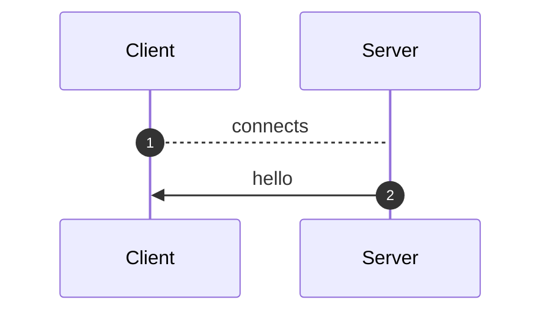
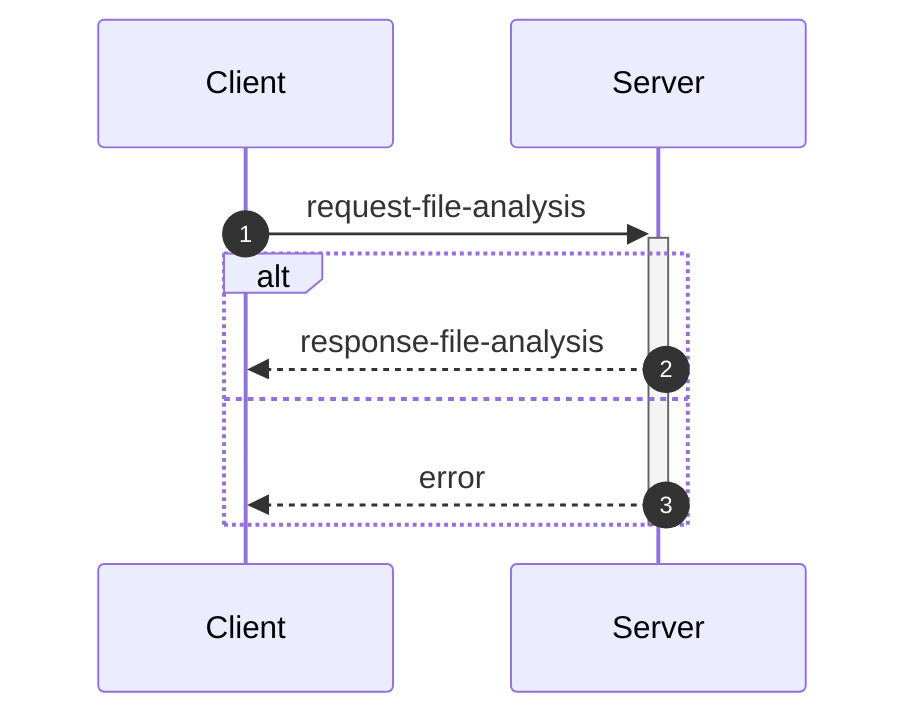
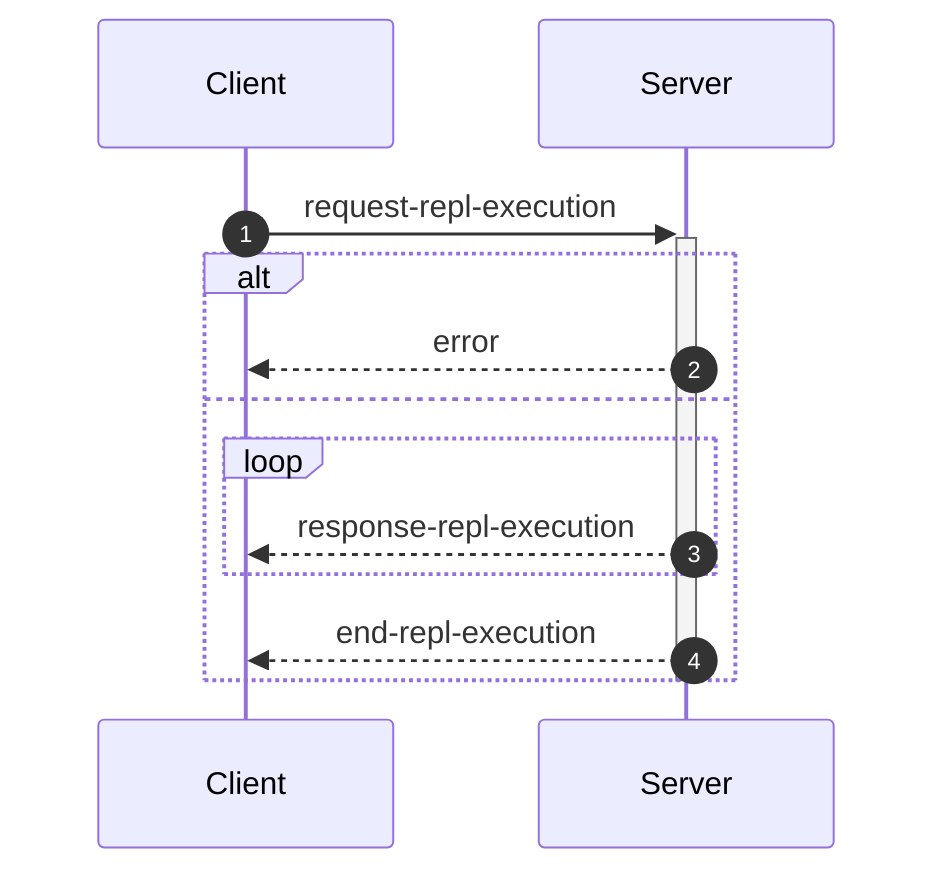
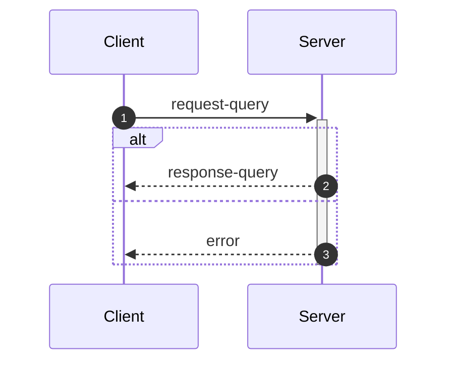

_<span title="an overview of flowR's interface">Generated</span> from '[wiki-interface.ts](https://github.com/flowr-analysis/flowr/tree/main/src/documentation/wiki-interface.ts "src/documentation/wiki-interface.ts")' on 2026-11-09, 05:32:52 UTC (v2.17.5, R v4.6.1), do not edit directly._

Although far from being as detailed as the in-depth explanation of [_flowR_](https://github.com/flowr-analysis/flowr/wiki/Core),
this wiki page explains how to interface with _flowR_ in more detail.
In general, command line arguments and other options provide short descriptions on hover over.

* [💻 Using the REPL](#using-the-repl)
* [⚙️ Configuring FlowR](#configuring-flowr)
* [⚒️ Writing Code](#writing-code)
* [💬 Communicating with the Server](#communicating-with-the-server)

<a id='using-the-repl'></a>
## 💻 Using the REPL

> [!NOTE]
> To execute arbitrary R commands with a repl request, _flowR_ has to be started explicitly with <span title="Description (Command Line Argument): Allow to access the underlying R session when using flowR (security warning: this allows the execution of arbitrary R code!)">`--r-session-access`</span>.
> Please be aware that this introduces a security risk and note that this relies on the [`r-shell` engine](https://github.com/flowr-analysis/flowr/wiki/Engines) .

Although primarily meant for users to explore,
there is nothing which forbids calling _flowR_ as a subprocess to use standard-in, -output, and -error
for communication (although you can access the REPL using the server as well,
with the [REPL Request](#message-request-repl-execution) message).

The read-eval-print loop&nbsp;(REPL) works relatively simple.
You can submit an expression (using <kbd>Enter</kbd>),
which is interpreted as an R&nbsp;expression by default but interpreted as a *command* if it starts with a colon (`:`).
The best command to get started with the REPL is <span title="Description (Repl Command): Show help information (aliases: :h, :?)">`:help`</span>.
Besides, you can leave the REPL either with the command <span title="Description (Repl Command): End the repl (aliases: :q, :exit)">`:quit`</span> or by pressing <kbd>Ctrl</kbd>+<kbd>C</kbd> twice.
When writing a *command*, you may press <kbd>Tab</kbd> to get a list of completions, if available.
Multiple commands can be entered in a single line by separating them with a semicolon (`;`), e.g. `:parse "x<-2"; :df*`.
If a command is given without R code, the REPL will re-use R code given in a previous command.
The prior example will hence return first the parsed AST of the program and then the dataflow graph for `"x <- 2"`.

> [!NOTE]
> If you develop flowR, you may want to launch the repl using the `npm run main-dev` command, this way, you get a non-minified version of flowR with debug information and hot-reloading of source files.

<details>
<summary>Available Commands</summary>

We currently offer the following commands (this with a `[*]` suffix are available with and without the star):

| Command | Description |
| ------- | ----------- |
| **<span title="Description (Repl Command): End the repl (aliases: :q, :exit)">:quit</span>** | End the repl (aliases: **:<span title="Alias of ':quit'. End the repl">q</span>**, **:<span title="Alias of ':quit'. End the repl">exit</span>**) |
| **<span title="Description (Repl Command): Execute the given code as R code. This requires the `--r-session-access` flag to be set and requires the r-shell engine. (aliases: :e, :r)">:execute</span>** | Execute the given code as R code. This requires the `--r-session-access` flag to be set and requires the r-shell engine. (aliases: **:<span title="Alias of ':execute'. Execute the given code as R code. This requires the `--r-session-access` flag to be set and requires the r-shell engine.">e</span>**, **:<span title="Alias of ':execute'. Execute the given code as R code. This requires the `--r-session-access` flag to be set and requires the r-shell engine.">r</span>**) |
| **<span title="Description (Repl Command): Get mermaid code for the control-flow graph of R code (aliases: :cfg, :cf)">:controlflow[*]</span>** | Get mermaid code for the control-flow graph of R code (star: Returns the URL to mermaid.live) (aliases: **:<span title="Alias of ':controlflow'. Get mermaid code for the control-flow graph of R code">cfg</span>**, **:<span title="Alias of ':controlflow'. Get mermaid code for the control-flow graph of R code">cf</span>**) |
| **<span title="Description (Repl Command): Get mermaid code for the control-flow graph with basic blocks (aliases: :cfgb, :cfb)">:controlflowbb[*]</span>** | Get mermaid code for the control-flow graph with basic blocks (star: Returns the URL to mermaid.live) (aliases: **:<span title="Alias of ':controlflowbb'. Get mermaid code for the control-flow graph with basic blocks">cfgb</span>**, **:<span title="Alias of ':controlflowbb'. Get mermaid code for the control-flow graph with basic blocks">cfb</span>**) |
| **<span title="Description (Repl Command): Get mermaid code for the dataflow graph (aliases: :d, :df)">:dataflow[*]</span>** | Get mermaid code for the dataflow graph (star: Returns the URL to mermaid.live) (aliases: **:<span title="Alias of ':dataflow'. Get mermaid code for the dataflow graph">d</span>**, **:<span title="Alias of ':dataflow'. Get mermaid code for the dataflow graph">df</span>**) |
| **<span title="Description (Repl Command): Get mermaid code for the normalized AST of R code (aliases: :n)">:normalize[*]</span>** | Get mermaid code for the normalized AST of R code (star: Returns the URL to mermaid.live) (alias: **:<span title="Alias of ':normalize'. Get mermaid code for the normalized AST of R code">n</span>**) |
| **<span title="Description (Repl Command): Get mermaid code for the simplified dataflow graph (aliases: :ds, :dfs)">:dataflowsimple[*]</span>** | Get mermaid code for the simplified dataflow graph (star: Returns the URL to mermaid.live) (aliases: **:<span title="Alias of ':dataflowsimple'. Get mermaid code for the simplified dataflow graph">ds</span>**, **:<span title="Alias of ':dataflowsimple'. Get mermaid code for the simplified dataflow graph">dfs</span>**) |
| **<span title="Description (Repl Command): Inspect and extend the signature database: `query` (identical to :query @signature), `info <name>` for where a function comes from (identical to :query @function-info), `add <path>` to mount another database/source, `download` to fetch the full-history database. (aliases: :sig)">:signature</span>** | Inspect and extend the signature database: `query` (identical to :query @signature), `info <name>` for where a function comes from (identical to :query @function-info), `add <path>` to mount another database/source, `download` to fetch the full-history database. (alias: **:<span title="Alias of ':signature'. Inspect and extend the signature database: `query` (identical to :query @signature), `info <name>` for where a function comes from (identical to :query @function-info), `add <path>` to mount another database/source, `download` to fetch the full-history database.">sig</span>**) |
| **<span title="Description (Repl Command): Just calculates the DFG, but only prints summary info (aliases: :d#, :df#)">:dataflowsilent</span>** | Just calculates the DFG, but only prints summary info (aliases: **:<span title="Alias of ':dataflowsilent'. Just calculates the DFG, but only prints summary info">d#</span>**, **:<span title="Alias of ':dataflowsilent'. Just calculates the DFG, but only prints summary info">df#</span>**) |
| **<span title="Description (Repl Command): Prints ASCII Art of the parsed, unmodified AST (aliases: :p)">:parse</span>** | Prints ASCII Art of the parsed, unmodified AST (alias: **:<span title="Alias of ':parse'. Prints ASCII Art of the parsed, unmodified AST">p</span>**) |
| **<span title="Description (Repl Command): Prints the version of flowR as well as the current version of R">:version</span>** | Prints the version of flowR as well as the current version of R
| **<span title="Description (Repl Command): Query the given R code (use 'help' for more information)">:query[*]</span>** | Query the given R code (use 'help' for more information) (star: Similar to query, but returns the output in json format.)
| **<span title="Description (Repl Command): Returns an ASCII representation of the dataflow graph (aliases: :df!)">:dataflowascii</span>** | Returns an ASCII representation of the dataflow graph (alias: **:<span title="Alias of ':dataflowascii'. Returns an ASCII representation of the dataflow graph">df!</span>**) |
| **<span title="Description (Repl Command): Returns summarization stats for the normalized AST (aliases: :n#)">:normalize#</span>** | Returns summarization stats for the normalized AST (alias: **:<span title="Alias of ':normalize#'. Returns summarization stats for the normalized AST">n#</span>**) |
| **<span title="Description (Repl Command): Show help information (aliases: :h, :?)">:help</span>** | Show help information (aliases: **:<span title="Alias of ':help'. Show help information">h</span>**, **:<span title="Alias of ':help'. Show help information">?</span>**) |

</details>

> [!TIP]
> 
> As indicated by the examples before, all REPL commands that operate on code keep track of the state.
> Hence, if you run a command like <span title="Description (Repl Command, starred version): Returns the URL to mermaid.live; Base Command: Get mermaid code for the dataflow graph (aliases: :d*, :df*)">`:dataflow*`</span> without providing R code,
> the REPL will re-use the R code provided in a previous command.
> Likewise, doing this will benefit from incrementality!
> If you request the dataflow graph with `:df* x <- 2 * y` and then want to see the parsed AST with `:parse`,
> the REPL will re-use previously obtained information and not re-parse the code again.
> 		

Generally, many commands offer shortcut versions in the REPL. Many queries, for example, offer a shortened format (see the example below).
Of special note, the [Config Query](https://github.com/flowr-analysis/flowr/wiki/%5BQuery%5D-Config)
can be used to also modify the currently active configuration of _flowR_ within the REPL (see the [wiki page](https://github.com/flowr-analysis/flowr/wiki/%5BQuery%5D-Config) for more information).

### Example: Retrieving the Dataflow Graph

To retrieve a URL to the [mermaid](https://mermaid.js.org/) diagram of the dataflow of a given expression,
use <span title="Description (Repl Command, starred version): Returns the URL to mermaid.live; Base Command: Get mermaid code for the dataflow graph (aliases: :d*, :df*)">`:dataflow*`</span> (or <span title="Description (Repl Command): Get mermaid code for the dataflow graph (aliases: :d, :df)">`:dataflow`</span> to get the mermaid code in the cli):

```shell
$ docker run -it --rm eagleoutice/flowr # or npm run flowr 
flowR repl v2.17.5, R grammar v14 (tree-sitter engine)
R> :dataflow* y <- 1 + x
```

<details>
<summary style='color:gray'>Output</summary>

```text
https://mermaid.live/view#base64:eyJjb2RlIjoiZmxvd2NoYXJ0IFREXG4gICAgMXt7XCJgKiM5MTtSTnVtYmVyIzkzOyogKioxKipcbiAgICAgICoxLjYqICgqKmlkOiAxKiopYFwifX1cbiAgICAyKFtcImAqIzkxO1JTeW1ib2wjOTM7KiAqKngqKlxuICAgICAgKjEuMTAqICgqKmlkOiAyKiopYFwiXSlcbiAgICAzW1tcImAqIzkxO1JCaW5hcnlPcCM5MzsqIGJhc2UjNTg7IzU4OyoqIzQzOyoqXG4gICAgICAqMS42LTEwKiAoKippZDogMyoqKVxuICAgIGFyZzogKDEsIDIpYFwiXV1cbiAgICBidWlsdC1pbjpfNDNfW1wiYEJ1aWx0LUluOlxuIzQzO2BcIl1cbiAgICBzdHlsZSBidWlsdC1pbjpfNDNfIHN0cm9rZTpncmF5LGZpbGw6Z3JheSxzdHJva2Utd2lkdGg6MnB4LG9wYWNpdHk6Ljg7XG4gICAgMFtcImAqIzkxO1JTeW1ib2wjOTM7KiAqKnkqKlxuICAgICAgKjEuMSogKCoqaWQ6IDAqKiwgdjogMylgXCJdXG4gICAgNFtbXCJgKiM5MTtSQmluYXJ5T3AjOTM7KiBiYXNlIzU4OyM1ODsqKiM2MDsjNDU7KipcbiAgICAgICoxLjEtMTAqICgqKmlkOiA0KiopXG4gICAgYXJnOiAoMCwgMylgXCJdXVxuICAgIGJ1aWx0LWluOl82MF8tW1wiYEJ1aWx0LUluOlxuIzYwOyM0NTtgXCJdXG4gICAgc3R5bGUgYnVpbHQtaW46XzYwXy0gc3Ryb2tlOmdyYXksZmlsbDpncmF5LHN0cm9rZS13aWR0aDoycHgsb3BhY2l0eTouODtcbiAgICAxIC0uLT58XCJmbG93XCJ8IDJcbiAgICBsaW5rU3R5bGUgMCBzdHJva2U6Z3JheSxjb2xvcjpncmF5O1xuICAgIDIgLS4tPnxcImZsb3dcInwgM1xuICAgIGxpbmtTdHlsZSAxIHN0cm9rZTpncmF5LGNvbG9yOmdyYXk7XG4gICAgMyAtLT58XCJyZWFkcywgYXJnXCJ8IDFcbiAgICAzIC0tPnxcInJlYWRzLCBhcmdcInwgMlxuICAgIDMgLS4tPnxcImZsb3dcInwgMFxuICAgIGxpbmtTdHlsZSA0IHN0cm9rZTpncmF5LGNvbG9yOmdyYXk7XG4gICAgMyAtLi0+fFwicmVhZHMsIGNhbGxzXCJ8IGJ1aWx0LWluOl80M19cbiAgICBsaW5rU3R5bGUgNSBzdHJva2U6Z3JheTtcbiAgICAwIC0tPnxcImRlZmluZWQtYnksIGZsb3dcInwgNFxuICAgIDAgLS0+fFwiZGVmaW5lZC1ieVwifCAzXG4gICAgNCAtLT58XCJyZWFkcywgYXJnXCJ8IDNcbiAgICA0IC0tPnxcInJldHVybnMsIGFyZ1wifCAwXG4gICAgNCAtLi0+fFwicmVhZHMsIGNhbGxzXCJ8IGJ1aWx0LWluOl82MF8tXG4gICAgbGlua1N0eWxlIDEwIHN0cm9rZTpncmF5OyIsIm1lcm1haWQiOnsiYXV0b1N5bmMiOnRydWV9fQ==
```

Retrieve the dataflow graph of the expression `y <- 1 + x`. It looks like this:


<details>

<summary style="color:gray">R Code of the Dataflow Graph</summary>

The analysis ran (parse and normalize with the [tree-sitter](https://github.com/flowr-analysis/flowr/wiki/Engines) engine) in the generation environment. No [signature database](https://github.com/flowr-analysis/flowr/wiki/Signature-Database) is mounted, so `library()` attaches no exports (base-R names are still qualified, e.g., `stats::acf`). 
We encountered no unknown side effects during the analysis.

```r
y <- 1 + x
```

</details>

</details>

For small graphs like this, <span title="Description (Repl Command): Returns an ASCII representation of the dataflow graph (aliases: :df!)">`:dataflowascii`</span> also provides an ASCII representation directly in the REPL:

```shell
$ docker run -it --rm eagleoutice/flowr # or npm run flowr 
flowR repl v2.17.5, R grammar v14 (tree-sitter engine)
R> :df! y <- 1 + x
```

<details open>
<summary style='color:gray'>Output</summary>

```text
                        v<0>v
 c<4>c──────────────────| y |
 |<- |     ┌────────────v---v
 c---c     │
    │   c<3>c   0<1>0
    └───| + |───| 1 |───u<2>u
        c---c   0---0   | x |
           └────────────u---u
Edges:
3 -> 1: reads, arg          3 -> 2: reads, arg
3 -> 0: flows-to            1 -> 2: flows-to
2 -> 3: flows-to            4 -> 3: reads, arg
4 -> 0: returns, arg        0 -> 4: defined-by, flows-to
0 -> 3: defined-by
```

Retrieve the dataflow graph of the expression `y <- 1 + x` as ASCII art.

</details>

For the slicing with <span title="Description (Repl Command): Static backwards executable slicer for R">`:slicer`</span>, you have access to the same [magic comments](#slice-magic-comments) as with the [slice request](#message-request-slice).
Pass `--inline` to splice resolvable `source()` calls into the reconstruction so the slice is a single self-contained R text (the same as the static slice query's `inlineSources` flag).
See `--help` for more flags!

### Example: Interfacing with the File System

Many commands that allow for an R-expression (like <span title="Description (Repl Command, starred version): Returns the URL to mermaid.live; Base Command: Get mermaid code for the dataflow graph (aliases: :d*, :df*)">`:dataflow*`</span>) allow for a file as well
if the argument starts with `file://`.
If you are working from the root directory of the _flowR_ repository, the following gives you the parsed AST of the example file using the <span title="Description (Repl Command): Prints ASCII Art of the parsed, unmodified AST (aliases: :p)">`:parse`</span> command:

> **Watch mode**: Replace `file://` with `watch://` to enter watch mode.
> flowR runs the command immediately and then re-runs it every time the file (or any file inside the folder) changes.
> Enter any other command to leave watch mode.
> For example: `:df watch://analysis.R`

```shell
$ docker run -it --rm eagleoutice/flowr # or npm run flowr 
flowR repl v2.17.5, R grammar v14 (tree-sitter engine)
R> :parse file://test/testfiles/example.R
```

<details>
<summary style='color:gray'>Output</summary>

```text
File: test/testfiles/example.R

program
├ binaryoperator
│ ├ identifier "sum" (1:1─4)
│ ├ <- "<-" (1:5─7)
│ ╰ float "0" (1:8─9)
├ binaryoperator
│ ├ identifier "product" (2:1─8)
│ ├ <- "<-" (2:9─11)
│ ╰ float "1" (2:12─13)
├ binaryoperator
│ ├ identifier "w" (3:1─2)
│ ├ <- "<-" (3:3─5)
│ ╰ float "7" (3:6─7)
├ binaryoperator
│ ├ identifier "N" (4:1─2)
│ ├ <- "<-" (4:3─5)
│ ╰ float "10" (4:6─8)
├ forstatement
│ ├ for "for" (6:1─4)
│ ├ ( "(" (6:5─6)
│ ├ identifier "i" (6:6─7)
│ ├ in "in" (6:8─10)
│ ├ binaryoperator
│ │ ├ float "1" (6:11─12)
│ │ ├ : ":" (6:12─13)
│ │ ╰ parenthesizedexpression
│ │   ├ ( "(" (6:13─14)
│ │   ├ binaryoperator
│ │   │ ├ identifier "N" (6:14─15)
│ │   │ ├ - "-" (6:15─16)
│ │   │ ╰ float "1" (6:16─17)
│ │   ╰ ) ")" (6:17─18)
│ ├ ) ")" (6:18─19)
│ ╰ bracedexpression
│   ├ { "{" (6:20─21)
│   ├ binaryoperator
│   │ ├ identifier "sum" (7:3─6)
│   │ ├ <- "<-" (7:7─9)
│   │ ╰ binaryoperator
│   │   ├ binaryoperator
│   │   │ ├ identifier "sum" (7:10─13)
│   │   │ ├ + "+" (7:14─15)
│   │   │ ╰ identifier "i" (7:16─17)
│   │   ├ + "+" (7:18─19)
│   │   ╰ identifier "w" (7:20─21)
│   ├ binaryoperator
│   │ ├ identifier "product" (8:3─10)
│   │ ├ <- "<-" (8:11─13)
│   │ ╰ binaryoperator
│   │   ├ identifier "product" (8:14─21)
│   │   ├  "" (8:22─23)
│   │   ╰ identifier "i" (8:24─25)
│   ╰ } "}" (9:1─2)
├ call
│ ├ identifier "cat" (11:1─4)
│ ╰ arguments
│   ├ ( "(" (11:4─5)
│   ├ argument
│   │ ╰ string
│   │   ├ stringopen "\"" (11:5─6)
│   │   ├ stringcontent "Sum:" (11:6─10)
│   │   ╰ stringclose "\"" (11:10─11)
│   ├ comma "," (11:11─12)
│   ├ argument
│   │ ╰ identifier "sum" (11:13─16)
│   ├ comma "," (11:16─17)
│   ├ argument
│   │ ╰ string
│   │   ├ stringopen "\"" (11:18─19)
│   │   ├ stringcontent
│   │   │ ╰ escapesequence "\\n" (11:19─21)
│   │   ╰ stringclose "\"" (11:21─22)
│   ╰ ) ")" (11:22─23)
╰ call
  ├ identifier "cat" (12:1─4)
  ╰ arguments
    ├ ( "(" (12:4─5)
    ├ argument
    │ ╰ string
    │   ├ stringopen "\"" (12:5─6)
    │   ├ stringcontent "Product:" (12:6─14)
    │   ╰ stringclose "\"" (12:14─15)
    ├ comma "," (12:15─16)
    ├ argument
    │ ╰ identifier "product" (12:17─24)
    ├ comma "," (12:24─25)
    ├ argument
    │ ╰ string
    │   ├ stringopen "\"" (12:26─27)
    │   ├ stringcontent
    │   │ ╰ escapesequence "\\n" (12:27─29)
    │   ╰ stringclose "\"" (12:29─30)
    ╰ ) ")" (12:30─31)
```

Retrieve the parsed AST of the example file.

<details>

<summary>File Content</summary>

```r
sum <- 0
product <- 1
w <- 7
N <- 10

for (i in 1:(N-1)) {
  sum <- sum + i + w
  product <- product * i
}

cat("Sum:", sum, "\n")
cat("Product:", product, "\n")
```

</details>

As _flowR_ directly transforms this AST the output focuses on being human-readable instead of being machine-readable.
		
</details>

### Example: Run a Query

You can run any query supported by _flowR_ using the <span title="Description (Repl Command): Query the given R code (use 'help' for more information)">`:query`</span> command.
For example, to obtain the shapes of all data frames in a given piece of code, you can run:

```shell
$ docker run -it --rm eagleoutice/flowr # or npm run flowr 
flowR repl v2.17.5, R grammar v14 (tree-sitter engine)
R> :query @absint df-shape "x <- data.frame(a = 1:10, b = 1:10)\ny <- x$a"
```

<details open>
<summary style='color:gray'>Output</summary>

```text
Query: absint (1 ms)
   ╰ $12: (colnames: [{"a", "b"}, {}], cols: [2, 2], rows: [10, 10])
   ╰ $0: (colnames: [{"a", "b"}, {}], cols: [2, 2], rows: [10, 10])
```

Retrieve the shapes of all data frames in the given code.

</details>

To run the linter on a file, you can use (in this example, we just issue the `dead-code` linter on a small piece of code):

```shell
$ docker run -it --rm eagleoutice/flowr # or npm run flowr 
flowR repl v2.17.5, R grammar v14 (tree-sitter engine)
R> :query @linter rules:dead-code "if(FALSE) x <- 2"
```

<details open>
<summary style='color:gray'>Output</summary>

```text
Query: linter (1 ms)
   ╰ Dead Code (dead-code):
       ╰ certain:
           ╰ Code at 1.11-16 (1 quick fix(es) available)
```

Run the linter on the given code, with only the `dead-code` rule enabled.

</details>

For more information on the available queries, please check out the [Query API](https://github.com/flowr-analysis/flowr/wiki/Query-API).

<a id='configuring-flowr'></a>
## ⚙️ Configuring FlowR

When running _flowR_, you may want to specify some behaviors with a dedicated configuration file.
By default, flowR looks for a file named `flowr.json` in the current working directory (or any higher directory).
You can also specify a different file with <span title="Description (Command Line Argument): The name of the configuration file to use">`--config-file`</span> or pass the configuration inline using <span title="Description (Command Line Argument): The flowR configuration to use, as a JSON string">`--config-json`</span>.
A `flowr.json` found this way belongs to the analyzed project, so flowR ignores its options that decide what flowR executes or loads
(`engines.*.wasmPath`, `engines.*.treeSitterWasmPath`, `engines.*.rPath`, `solver.sigdb.additionalPaths`, `solver.sigdb.downloadRepo`, `solver.sigdb.installedLibrary.paths`, `solver.sigdb.onDemand.enabled`, `solver.sigdb.onDemand.repositories`, `solver.sigdb.onDemand.cranMirror`, `solver.sigdb.onDemand.bioconductorMirror`, `solver.sigdb.onDemand.cacheDir`),
unless you pass <span title="Description (Command Line Argument): Keep the security-sensitive options (e.g., the R executable) of the flowr.json found in the working directory or a parent. Only use this for projects you trust.">`--trust-config`</span>.
To analyze code you do not trust, use the secure mode (<span title="Description (Command Line Argument): Run in secure mode for analyzing untrusted code: flowR does not start R (or any other process), does not access the network, does not search for project configs, and ignores security-sensitive options in every config. Cannot be disabled once enabled. Can also be enabled with the environment variable {italic FLOWR_SECURE_MODE=1}.">`--secure`</span>, see the [security policy](https://github.com/flowr-analysis/flowr/blob/main/.github/SECURITY.md)).
To inspect the current configuration, you can run flowr with the <span title="Description (Command Line Argument): Run with verbose logging (will be passed to the corresponding script)">`--verbose`</span> flag, or use the `config` [Query](https://github.com/flowr-analysis/flowr/wiki/Query-API).
Within the REPL this works by running the following:

```shell
:query @config
```

To work with the <a href="https://github.com/flowr-analysis/flowr/tree/main/src/config.ts#L125"><code><span title="The configuration file format for flowR.">FlowrConfig</span></code></a> you can use the provided helper objects alongside its methods like
<a href="https://github.com/flowr-analysis/flowr/tree/main/src/config.ts#L991"><code><span title="Creates a new flowr config that has the updated values.">FlowrConfig::<b>amend</b></span></code></a>.
The schema below documents every option; the ones you most likely want are:

- <a href="https://github.com/flowr-analysis/flowr/wiki/Interface#configuring-flowr" title="Configuration Option (boolean): Whether source calls should be ignored, causing {@link processSourceCall}&#39;s behavior to be skipped.">ignoreSourceCalls</a>: ignore source calls when analyzing the code, i.e., ignore the inclusion of other files.
- <a href="https://github.com/flowr-analysis/flowr/wiki/Interface#configuring-flowr" title="Configuration Option (boolean): Whether load calls should be ignored, causing {@link processLoadCall}&#39;s behavior to be skipped.">ignoreLoadCalls</a>: ignore load calls when analyzing the code, i.e., ignore the loading of r-data files.
- <a href="https://github.com/flowr-analysis/flowr/wiki/Interface#configuring-flowr" title="Configuration Option (object): Do you want to overwrite (parts) of the builtin definition?">semantics.environment.overwriteBuiltIns</a>: overwrite _flowR_'s handling of built-in functions, or clear the preset definitions entirely.
  See [Configure BuiltIn Semantics](#configure-builtin-semantics) for more information.
- <a href="https://github.com/flowr-analysis/flowr/wiki/Interface#configuring-flowr" title="Configuration Option (boolean): Whether calls drawing on a graphics device (e.g., `plot`) count as writing to it, which the ambient state queries then report.">semantics.ambient.drawingWritesDevice</a>: whether calls drawing on a graphics device (e.g., `plot`) count as writing the device in the ambient state queries.
- <a href="https://github.com/flowr-analysis/flowr/wiki/Interface#configuring-flowr" title="Configuration Option (string): How to resolve variables and their values. (one of &quot;disabled&quot;, &quot;alias&quot;, &quot;builtin&quot;)">solver.variables</a>: how to resolve variables and their values (`disabled`, `alias`, `builtin`).
- <a href="https://github.com/flowr-analysis/flowr/wiki/Interface#configuring-flowr" title="Configuration Option (array): The engine or set of engines to use for interacting with R code. An empty array means all available engines will be used.">engines</a> and <a href="https://github.com/flowr-analysis/flowr/wiki/Interface#configuring-flowr" title="Configuration Option (string): The default engine to use for interacting with R code. If this is undefined, an arbitrary engine from the specified list will be used. (one of &quot;tree-sitter&quot;, &quot;r-shell&quot;)">defaultEngine</a>: the engines used to interact with R code, see the [Engines wiki page](https://github.com/flowr-analysis/flowr/wiki/Engines).
- <a href="https://github.com/flowr-analysis/flowr/wiki/Interface#configuring-flowr" title="Configuration Option (array): Files a framework loads on its own, without any source() call (e.g. global.R in a shiny app), in the order they are loaded; flowR orders the matching project files accordingly and analyzes them as one program. Entries are case-insensitive globs matched against the file path, a plain name matches any file with that name, and entries matching no project file are warned about. Usually set per project kind via specializeConfig.">project.implicitSources</a>: the files a framework loads without any `source()` call, in the order in which they are
  loaded. Entries are globs (e.g. `R/*.R`) matched against the file path ignoring capitalization; one matching no file is reported.
- <a href="https://github.com/flowr-analysis/flowr/wiki/Interface#configuring-flowr" title="Configuration Option (object): Overwrite (parts of) the configuration depending on the project kind flowR detects, e.g. to give a shiny app its implicit sources.">specializeConfig</a>: overwrite (parts of) the configuration depending on the kind of project _flowR_ detects
  (e.g. `shiny-app`), which is how a shiny app gets its implicit sources by default. What you configure directly wins.
- <a href="https://github.com/flowr-analysis/flowr/wiki/Interface#configuring-flowr" title="Configuration Option (string): Overwrite the project kind flowR would otherwise infer from the analyzed files, e.g. when auto-detection guesses wrong. (one of &quot;package&quot;, &quot;script&quot;, &quot;shiny-app&quot;, &quot;notebook&quot;, &quot;project&quot;, &quot;unknown&quot;)">project.useProjectType</a>: skip that detection and force a project kind yourself, when auto-detection guesses wrong.
- <a href="https://github.com/flowr-analysis/flowr/wiki/Interface#configuring-flowr" title="Configuration Option (array): The default plugins to load when creating a new instance of FlowrAnalyzer">defaultPlugins</a> and <a href="https://github.com/flowr-analysis/flowr/wiki/Interface#configuring-flowr" title="Configuration Option (array): The plugins to load in REPL mode">repl.plugins</a>: the plugins to load for a new <a href="https://github.com/flowr-analysis/flowr/tree/main/src/project/flowr-analyzer.ts#L240"><code><span title="Central class for conducting analyses with FlowR. Use the FlowrAnalyzerBuilder to create a new instance. If you want the original pattern of creating a pipeline and running all steps, you can still do this with FlowrAnalyzer#runFull . To inspect the context of the analyzer, use FlowrAnalyzer#inspectContext (if you are a plugin and need to modify it, use FlowrAnalyzer#context instead).">FlowrAnalyzer</span></code></a> and in the REPL
  (use `flowr:default` to reference the former).

So you can configure _flowR_ by adding a file like the following:

<details>

<summary>Example Configuration File</summary>

```json
{
  "ignoreSourceCalls": true,
  "ignoreLoadCalls": true,
  "semantics": {
    "environment": {
      "overwriteBuiltIns": {
        "definitions": [
          {
            "type": "function",
            "names": [
              "foo"
            ],
            "processor": "builtin:assign",
            "config": {}
          }
        ]
      }
    }
  },
  "defaultPlugins": [
    "file:description",
    "versions:description"
  ],
  "repl": {
    "quickStats": false,
    "dfProcessorHeat": false,
    "hints": true,
    "plugins": [
      "flowr:default"
    ]
  },
  "project": {
    "resolveUnknownPathsOnDisk": true,
    "implicitSources": [
      "global.R",
      "app.R"
    ]
  },
  "linter": {
    "disabledRules": []
  },
  "specializeConfig": {
    "shiny-app": {
      "project": {
        "implicitSources": [
          "global.R",
          "ui.R",
          "server.R",
          "app.R"
        ]
      }
    }
  },
  "engines": [
    {
      "type": "r-shell"
    }
  ],
  "solver": {
    "variables": "alias",
    "evalStrings": true,
    "trackEnvironments": true,
    "sigdb": {
      "enabled": true,
      "loadProjectDependencies": true,
      "eagerlyLoad": false,
      "eagerlyLoadExports": false,
      "linkBaseR": false,
      "linkDescriptionDependencies": false
    },
    "resolveSource": {
      "dropPaths": "no",
      "ignoreCapitalization": true,
      "inferWorkingDirectory": "active-script",
      "searchPath": []
    },
    "instrument": {},
    "slicer": {
      "threshold": 50
    }
  },
  "abstractInterpretation": {
    "wideningThreshold": 4,
    "followCalls": true,
    "dataFrame": {
      "maxColNames": 20,
      "readLoadedData": {
        "readExternalFiles": true,
        "maxReadLines": 1000000
      }
    }
  },
  "incremental": {
    "alwaysIncremental": false,
    "parsing": {
      "activated": false,
      "heuristics": {
        "activated": true,
        "mtime": true,
        "linesFrom": 500,
        "bytesFrom": 50000,
        "alwaysWithEdits": false,
        "minFiles": 1
      }
    }
  },
  "gas": {
    "thresholds": {
      "memory": {
        "problematic": 0.7,
        "critical": 0.9
      },
      "timeMs": {
        "problematic": 100000,
        "critical": 120000
      }
    },
    "features": {}
  }
}
```

</details>

<details>
<a id='configure-builtin-semantics'></a>
<summary>Configure Built-In Semantics</summary>

`semantics/environment/overwriteBuiltins` accepts two keys:

- `loadDefaults` (boolean, initially `true`): If set to `true`, the default built-in definitions are loaded before applying the custom definitions. Setting this flag to `false` explicitly disables the loading of the default definitions.
- `definitions` (array, initially empty): Allows to overwrite or define new built-in elements. Each object within must have a `type` which is one of the below. Furthermore, they may define a string array of `names` which specifies the identifiers to bind the definitions to. You may use `assumePrimitive` to specify whether _flowR_ should assume that this is a primitive non-library definition (so you probably just do not want to specify the key).

  | Type            | Description                                                                                                                                                                                                                                                                                              | Example                                                                                                    |
  | --------------- | -------------------------------------------------------------------------------------------------------------------------------------------------------------------------------------------------------------------------------------------------------------------------------------------------------- | ---------------------------------------------------------------------------------------------------------- |
  | `constant`    | Additionally allows for a `value` this should resolve to.                                                                                                                                                                                                                                                | `{ type: 'constant', names: ['NULL', 'NA'],  value: null }`                                                |
  | `function`    | Is a rather flexible way to define and bind built-in functions. For the time, we do not have extensive documentation to cover all the cases, so please either consult the sources with the `default-builtin-config/` folder or open a [new issue](https://github.com/flowr-analysis/flowr/issues/new/choose). | `{ type: 'function', names: ['next'], processor: 'builtin:d', config: { cfg: ExitPointType.Next } }` |
  | `replacement` | A comfortable way to specify replacement functions like `$<-` or `names<-`. `suffixes` describes the... suffixes to attach automatically. | `{ type: 'replacement', suffixes: ['<-', '<<-'], names: ['[', '[['] }` |

</details>

<details>

<summary style='color:gray'>Full Configuration-File Schema</summary>

- _The configuration file format for flowR._ (object)
    - **logLevel** [optional] _flowR's global minimum log level, applied when the config is loaded._ (string)
        Only allows: 'silly', 'trace', 'debug', 'info', 'warn', 'error', 'fatal'
    - **ignoreSourceCalls** [optional] _Whether source calls should be ignored, causing {@link processSourceCall}'s behavior to be skipped._ (boolean)
    - **ignoreLoadCalls** [optional] _Whether load calls should be ignored, causing {@link processLoadCall}'s behavior to be skipped._ (boolean)
    - **semantics** _Configure language semantics and how flowR handles them._ (object)
        - **environment** [optional] _Semantics regarding how to handle the R environment._ (object)
            - **overwriteBuiltIns** [optional] _Do you want to overwrite (parts) of the builtin definition?_ (object)
                - **loadDefaults** [optional] _Should the default configuration still be loaded?_ (boolean)
                - **definitions** [optional] _The definitions to load/overwrite._ (array)
                Valid item types:
                    - (object)
        - **ambient** [optional] _Semantics regarding the global state (options, devices, files, ...) calls access._ (object)
            - **drawingWritesDevice** [optional] _Whether calls drawing on a graphics device (e.g., `plot`) count as writing to it, which the ambient state queries then report._ (boolean)
    - **defaultPlugins** [optional] _The default plugins to load when creating a new instance of FlowrAnalyzer_ (array)
    Valid item types:
        - (alternatives)
            - (string)
            - (array)
    - **repl** _Configuration options for the REPL._ (object)
        - **quickStats** [optional] _Whether to show quick stats in the REPL after each evaluation._ (boolean)
        - **dfProcessorHeat** [optional] _This instruments the dataflow processors to count how often each processor is called._ (boolean)
        - **hints** [optional] _Whether to show dim inline hints on the empty prompt (automatically disabled on non-interactive terminals)._ (boolean)
        - **plugins** [optional] _The plugins to load in REPL mode_ (array)
        Valid item types:
            - (alternatives)
                - (string)
                - (array)
        - **autoUseFileProtocol** [optional] _Prepend the file protocol to a repl input that looks like a path, instead of only warning about it._ (boolean)
        - **queryStats** [optional] _Whether `:query` closes with the line stating how long the queries took (`:query*` never prints it)._ (boolean)
        - **showPlugins** [optional] _Whether `:version` grays out the plugins that did not activate during the last analysis._ (boolean)
    - **project** _Project specific configuration options._ (object)
        - **resolveUnknownPathsOnDisk** [optional] _Whether to resolve unknown paths loaded by the r project disk when trying to source/analyze files._ (boolean)
        - **failOnInaccessiblePath** [optional] _Whether a directory that cannot be traversed during file discovery (e.g. due to permissions) aborts the analysis; when false (the default) such paths are logged and skipped._ (boolean)
        - **basePackages** [optional] _The packages considered part of R itself (base and recommended); if unset, flowR uses its built-in list._ (array)
        Valid item types:
            - (string)
        - **implicitSources** [optional] _Files a framework loads on its own, without any source() call (e.g. global.R in a shiny app), in the order they are loaded; flowR orders the matching project files accordingly and analyzes them as one program. Entries are case-insensitive globs matched against the file path, a plain name matches any file with that name, and entries matching no project file are warned about. Usually set per project kind via specializeConfig._ (array)
        Valid item types:
            - (string)
        - **useProjectType** [optional] _Overwrite the project kind flowR would otherwise infer from the analyzed files, e.g. when auto-detection guesses wrong._ (string)
            Only allows: 'package', 'script', 'shiny-app', 'notebook', 'project', 'unknown'
        - **assumeImplicitEcho** [optional] _Whether the top level of the analyzed code is echoed, so that every visible result printed there is collected as an output by the dependencies query (default true, false for a package)._ (boolean)
        - **discovery** [optional] _Scoping options for the default project discovery._ (object)
            - **full** [optional] _Collect every file below the project root (greedy) instead of only the files the detected project kind needs (default false)._ (boolean)
            - **perKind** [optional] _Per-kind include/exclude glob overrides layered on the default scoping._ (object)
            - **ignore** [optional] _Case-insensitive globs that drop matching files from the intelligent discovery, regardless of kind (e.g. .Renviron to ignore environment files)._ (array)
            Valid item types:
                - (string)
        - **classification** [optional] _Overrides for the signals flowR uses to classify the project kind._ (object)
            - **shinyDescriptionTypes** [optional] _DESCRIPTION Type: values that mark a shiny app._ (array)
            Valid item types:
                - (string)
            - **shinyEntryFiles** [optional] _File names a shiny app is assembled from._ (array)
            Valid item types:
                - (string)
            - **shinyUsagePattern** [optional] _Regex source evidencing shiny usage in an entry file._ (string)
            - **notebookExtensions** [optional] _File extensions marking a notebook._ (array)
            Valid item types:
                - (string)
    - **linter** _Linter configuration options._ (object)
        - **disabledRules** _Linting rule names excluded from the default rule set (a rule requested explicitly via a linter query still runs). Usually set per project kind via specializeConfig._ (array)
        Valid item types:
            - (string)
        - **disabledTags** [optional] _Linting rule tags whose rules are excluded from the default rule set (a rule requested explicitly via a linter query still runs). By default the cmd-check rules are disabled for everything but a package; a configured list replaces that default._ (array)
        Valid item types:
            - (string)
    - **inputSources** [optional] _Further frameworks the input-sources analysis should know about; entries are added to flowR's defaults._ (object)
        - **pure** [optional] _Functions that only pass the constantness of their arguments on._ (array)
        Valid item types:
            - (string)
        - **param** [optional] _Functions whose result is a 'param' input._ (array)
        Valid item types:
            - (string)
        - **file** [optional] _Functions whose result is a 'file' input._ (array)
        Valid item types:
            - (string)
        - **tempfile** [optional] _Functions whose result is a 'tempfile' input._ (array)
        Valid item types:
            - (string)
        - **glob** [optional] _Functions whose result is a 'glob' input._ (array)
        Valid item types:
            - (string)
        - **net** [optional] _Functions whose result is a 'net' input._ (array)
        Valid item types:
            - (string)
        - **rand** [optional] _Functions whose result is a 'rand' input._ (array)
        Valid item types:
            - (string)
        - **system** [optional] _Functions whose result is a 'system' input._ (array)
        Valid item types:
            - (string)
        - **ffi** [optional] _Functions whose result is a 'ffi' input._ (array)
        Valid item types:
            - (string)
        - **lang** [optional] _Functions whose result is a 'lang' input._ (array)
        Valid item types:
            - (string)
        - **options** [optional] _Functions whose result is a 'options' input._ (array)
        Valid item types:
            - (string)
        - **cmdline** [optional] _Functions whose result is a 'cmdline' input._ (array)
        Valid item types:
            - (string)
        - **user** [optional] _Functions whose result is a 'user' input._ (array)
        Valid item types:
            - (string)
        - **const** [optional] _Functions whose result is a 'const' input._ (array)
        Valid item types:
            - (string)
        - **scope** [optional] _Functions whose result is a 'scope' input._ (array)
        Valid item types:
            - (string)
        - **dconst** [optional] _Functions whose result is a 'dconst' input._ (array)
        Valid item types:
            - (string)
        - **unknown** [optional] _Functions whose result is a 'unknown' input._ (array)
        Valid item types:
            - (string)
        - **linkedObjects** [optional] _Objects a framework provides without a definition in the code, e.g. shiny's input._ (array)
        Valid item types:
            - (object)
        - **linkedEntryPoints** [optional] _Calls that hand a function to a framework, which binds its objects to the parameters by position._ (array)
        Valid item types:
            - (object)
    - **specializeConfig** [optional] _Overwrite (parts of) the configuration depending on the project kind flowR detects, e.g. to give a shiny app its implicit sources._ (object)
    - **engines** _The engine or set of engines to use for interacting with R code. An empty array means all available engines will be used._ (array)
    Valid item types:
        - (alternatives)
            - _The configuration for the tree sitter engine._ (object)
                - **type** [required] _Use the tree sitter engine._ (string)
                    Only allows: 'tree-sitter'
                - **wasmPath** [optional] _The path to the tree-sitter-r WASM binary to use. If this is undefined, this uses the default path._ (string)
                - **treeSitterWasmPath** [optional] _The path to the tree-sitter WASM binary to use. If this is undefined, this uses the default path._ (string)
                - **lax** [optional] _Whether to use the lax parser for parsing R code (allowing for syntax errors). If this is undefined, the strict parser will be used._ (boolean)
            - _The configuration for the R shell engine._ (object)
                - **type** [required] _Use the R shell engine._ (string)
                    Only allows: 'r-shell'
                - **rPath** [optional] _The path to the R executable to use. If this is undefined, this uses the default path._ (string)
                - **pipeBind** [optional] _Whether to enable R's experimental pipe-bind operator "=>" by setting _R_USE_PIPEBIND_ for the R session (default false); R itself keeps this off by default, as it is experimental and has never shipped in a release version of R._ (boolean)
    - **defaultEngine** [optional] _The default engine to use for interacting with R code. If this is undefined, an arbitrary engine from the specified list will be used._ (string)
        Only allows: 'tree-sitter', 'r-shell'
    - **solver** _How to resolve constants, constraints, cells, ..._ (object)
        - **variables** _How to resolve variables and their values._ (string)
            Only allows: 'disabled', 'alias', 'builtin'
        - **evalStrings** _Should we include eval(parse(text="...")) calls in the dataflow graph?_ (boolean)
        - **trackEnvironments** [optional] _Track user-created environments (new.env, assign/get/local with envir=, dollar-assign, attach). When false, all envir-style calls fall through conservatively._ (boolean)
        - **sigdb** _Resolving library exports from a signature database._ (object)
            - **enabled** [optional] _Resolve library()/use() exports from a signature database (default true); when false no database is consulted._ (boolean)
            - **loadProjectDependencies** [optional] _Load the project's declared dependencies from its metadata files (DESCRIPTION Imports/Depends, rproject.toml, uvr.toml, rig rproj.toml and script blocks, renv.lock, rv.lock, uvr.lock, rig lockfiles) (default true); when false these files are not read for dependencies._ (boolean)
            - **eagerlyLoad** [optional] _Parse the database up front rather than on the first package load (default false, ignored if disabled)._ (boolean)
            - **eagerlyLoadExports** [optional] _Add a vertex for every export on load rather than on demand (default false); keeps the dataflow graph small._ (boolean)
            - **assumedRVersion** [optional] _R version assumed when resolving versioned (base-R) exports: a pin like "4.5" or "auto" to detect the installed R (default "auto")._ (string)
            - **linkBaseR** [optional] _Eagerly attach base-R namespaces so bare base calls resolve without library() (default false)._ (boolean)
            - **linkBaseRCalls** [optional] _Add a lightweight Reads edge from a bare base-R call to its signature-database function vertex (default false; base-R qualification is edge-free otherwise)._ (boolean)
            - **linkPackageCalls** [optional] _Add a lightweight Reads edge from a resolved package call to its signature-database function vertex (default false)._ (boolean)
            - **linkDescriptionDependencies** [optional] _Eagerly attach the namespaces of the project's declared DESCRIPTION dependencies (Imports/Depends) so their exports resolve without an explicit library() (default false)._ (boolean)
            - **warmInBackground** [optional] _Decompress the hot shards (base + most-downloaded) in a background task on startup so the first library() lookup is warm (default false; for long-running servers/REPLs)._ (boolean)
            - **additionalPaths** [optional] _Extra directories or bundle/manifest files searched for signature databases (alongside the shipped default and $FLOWR_SIGDB_DIR); a downloaded full-history bundle placed here is mounted automatically._ (array)
            Valid item types:
                - (string)
            - **downloadRepo** [optional] _GitHub owner/repo the full-history bundle is downloaded from via ":signature download" (default "flowr-analysis/flowr"; the release tag comes from the committed sigdb.remote.json unless a version is given)._ (string)
            - **autoSync** [optional] _On startup, re-download shards whose committed sigdb.remote.json hash no longer matches the cache, in the background (default false; opt-in network sync after a git pull)._ (boolean)
            - **installedLibrary** [optional] _Recovering packages no signature database knows from the copy installed on this machine._ (object)
                - **enabled** [required] _Recover packages no signature database knows from their installed copy (default false)._ (boolean)
                - **paths** [optional] _Library directories to search; when empty they are discovered from the environment and the project._ (array)
                Valid item types:
                    - (string)
                - **useEnvironment** [optional] _Search the libraries R_LIBS_USER/R_LIBS/R_LIBS_SITE name (default true)._ (boolean)
                - **useProjectLibrary** [optional] _Search a project-local renv/packrat library (default true)._ (boolean)
                - **maxDepth** [optional] _How far to descend into the nested layout of a project-local library (default 3)._ (number)
                - **packages** [optional] _Only recover packages whose name matches one of these regular expressions; empty means any._ (array)
                Valid item types:
                    - (string)
            - **onDemand** [optional] _Recovering packages no signature database knows from their sources on CRAN, Bioconductor, or GitHub._ (object)
                - **enabled** [required] _Fetch and recover the sources of packages no signature database knows when the analyzed code uses them (default false, accesses the network)._ (boolean)
                - **sources** [optional] _Where to look, in order: github, cran, bioconductor, or a source a plugin adds (default ["github", "cran", "bioconductor"])._ (array)
                Valid item types:
                    - (string)
                - **repositories** [optional] _GitHub repositories (owner/repo[/subdir][@ref]) to fetch packages from, by package name. The analyzed project may name more (DESCRIPTION Remotes, install_github calls)._ (object)
                - **packages** [optional] _Only recover packages whose name matches one of these regular expressions, empty means any._ (array)
                Valid item types:
                    - (string)
                - **cranMirror** [optional] _The CRAN src/contrib/ to fetch from, over https (default https://cloud.r-project.org/src/contrib/). It may be on the local network._ (string)
                - **bioconductorMirror** [optional] _The Bioconductor host, over https (default https://bioconductor.org). It may be on the local network._ (string)
                - **bioconductorRelease** [optional] _The Bioconductor release to fetch from: release, devel, or a number like 3.20 (default release)._ (string)
                - **githubMirrors** [optional] _Use the GitHub mirrors of CRAN (cran/<pkg>) and Bioconductor (bioc/<pkg>) (default true)._ (boolean)
                - **maxPackages** [optional] _The most packages to fetch for one analysis (default 25)._ (number)
                - **maxArchiveMb** [optional] _The most MiB a package archive may have (default 32). It may unpack to three times that, at most 128 MiB._ (number)
                - **offline** [optional] _Only use what was fetched before, never the network (default false)._ (boolean)
                - **retryAfterHours** [optional] _How many hours to wait before asking again for a package no source had (default 24)._ (number)
                - **cacheDir** [optional] _Where to cache what was fetched (default the on-demand directory of the signature cache)._ (string)
            - **blobCacheBudgetMb** [optional] _How many MiB of decoded package blobs every open bundle may hold together (default 16)._ (number)
            - **versionSelection** [optional] _When a project constrains a dependency, resolve to the newest (default), oldest, or system-installed version satisfying it; system needs R and falls back to newest. Base-R packages always resolve against the assumed R version._ (string)
                Only allows: 'newest', 'oldest', 'system'
            - **versionOverrides** [optional] _Force an exact version for specific packages (name -> version), overriding both the project constraint and the versionSelection policy (default {})._ (object)
        - **versionManagement** _Policies for reasoning about dependency versions._ (object)
            - **linkedVersionGroups** [optional] _Groups of packages that must resolve to the same version; version guessing intersects each group so its members stay mutually compatible (default [])._ (array)
            Valid item types:
                - (array)
                Valid item types:
                    - (string)
        - **assumeAttachedPackages** [optional] _Packages to treat as attached without a `library()` call, so what the built-in configuration states about them applies to the analyzed code. The base packages R attaches on startup already resolve without it._ (array)
        Valid item types:
            - (string)
        - **transitiveSideEffectRounds** [optional] _How many rounds the transitive side-effect fixpoint may run before it is cut off (default 32); the propagation stops on its own as soon as a round adds nothing._ (number)
        - **maxOverlayDepth** [optional] _How many binding overlays may stack on one environment frame before a write flattens them (default 4); a pure performance knob, trading lookup cost against copy cost without changing any result._ (number)
        - **instrument** (object)
            - **dataflowExtractors** [optional] _These keys are only intended for use within code, allowing to instrument the dataflow analyzer!_ (any)
        - **resolveSource** [optional] _If lax source calls are active, flowR searches for sourced files much more freely, based on the configurations you give it. This option is only in effect if `ignoreSourceCalls` is set to false._ (object)
            - **dropPaths** _Allow to drop the first or all parts of the sourced path, if it is relative._ (string)
                Only allows: 'no', 'once', 'all'
            - **ignoreCapitalization** _Search for filenames matching in the lowercase._ (boolean)
            - **inferWorkingDirectory** _Try to infer the working directory from the main or any script to analyze._ (string)
                Only allows: 'no', 'main-script', 'active-script', 'any-script'
            - **searchPath** _Additionally search in these paths._ (array)
            Valid item types:
                - (string)
            - **repeatedSourceLimit** [optional] _How often the same file can be sourced within a single run? Please be aware: in case of cyclic sources this may not reach a fixpoint so give this a sensible limit._ (number)
            - **applyReplacements** _Provide name replacements for loaded files_ (array)
            Valid item types:
                - (object)
            - **assumeFilesExist** [optional] _Assume a sourced file is always there, making what it defines certain instead of conditional on the source call._ (boolean)
        - **slicer** [optional] _The configuration for the slicer._ (object)
            - **threshold** [optional] _The maximum number of iterations to perform on a single function call during slicing._ (number)
            - **autoExtend** [optional] _If set, the slicer will gain an additional post-pass._ (boolean)
    - **abstractInterpretation** _The configuration options for abstract interpretation._ (object)
        - **wideningThreshold** _The threshold for the number of visitations of a node at which widening should be performed to ensure the termination of the fixpoint iteration._ (number)
        - **followCalls** _Whether the abstract interpretation is interprocedural, i.e. whether it steps into the functions a call may dispatch to._ (boolean)
        - **dataFrame** _The configuration of the shape inference for data frames._ (object)
            - **maxColNames** _The maximum number of columns names to infer for data frames before over-approximating the column names to top._ (number)
            - **readLoadedData** _Configuration options for reading data frame shapes from loaded external data files, such as CSV files._ (object)
                - **readExternalFiles** _Whether data frame shapes should be extracted from loaded external files, such as CSV files._ (boolean)
                - **maxReadLines** _The maximum number of lines to read when extracting data frame shapes from loaded files, such as CSV files._ (number)
    - **incremental** (object)
        - **alwaysIncremental** _Always take the incremental path, regardless of heuristics._ (boolean)
        - **parsing** (object)
            - **activated** _If set, incremental parsing will be used._ (boolean)
            - **heuristics** (object)
                - **activated** [optional] _If set, the heuristics for incremental parsing will be used._ (boolean)
                - **mtime** [optional] _Skip reparsing entirely if the file's modification time is unchanged since the last parse._ (boolean)
                - **linesFrom** [optional] _Only consider incremental parsing for files with at least this many lines._ (number)
                - **bytesFrom** [optional] _Only consider incremental parsing for files with at least this many bytes._ (number)
                - **alwaysWithEdits** [optional] _Always take the incremental path whenever there is a computed edit region, regardless of the other thresholds._ (boolean)
                - **minFiles** [optional] _Only apply these heuristics once the project has at least this many files loaded._ (number)
    - **gas** [optional] _Resource-usage guard (gas) configuration. All feature factors default to 0 (disabled). See https://github.com/flowr-analysis/flowr/wiki/Core#gas-resource-guard._ (object)
        - **thresholds** [optional] _Thresholds for all gas checks (scaled by per-feature factor), boundable per feature._ (object)
            - **memory** [optional] _Heap-usage fraction thresholds (0-1), either shared or given per feature key (with `default` covering the rest)._ (object)
                - **problematic** [optional] _Heap fraction (0-1) above which Problematic is returned, for every feature without an entry of its own._ (number)
                - **critical** [optional] _Heap fraction (0-1) above which Critical is returned, for every feature without an entry of its own._ (number)
            - **timeMs** [optional] _Elapsed analysis time thresholds in milliseconds, either shared or given per feature key (with `default` covering the rest)._ (object)
                - **problematic** [optional] _Elapsed ms above which Problematic is returned, for every feature without an entry of its own._ (number)
                - **critical** [optional] _Elapsed ms above which Critical is returned, for every feature without an entry of its own._ (number)
            - **steps** [optional] _Processed-AST-node thresholds, counted rather than sampled; only a key that arms a budget (`dataflow`) reads them._ (object)
                - **problematic** [optional] _Processed AST nodes above which Problematic is returned, for every feature without an entry of its own._ (number)
                - **critical** [optional] _Processed AST nodes above which the extraction is cut short, for every feature without an entry of its own._ (number)
            - **vertices** [optional] _Created-dataflow-vertex thresholds, counted like `steps`._ (object)
                - **problematic** [optional] _Created dataflow vertices above which Problematic is returned, for every feature without an entry of its own._ (number)
                - **critical** [optional] _Created dataflow vertices above which the extraction is cut short, for every feature without an entry of its own._ (number)
        - **features** [optional] _Per-feature sensitivity factors. 0 or absent disables gas checking for that feature. A factor of 2 makes the feature twice as sensitive. Recognised keys: `source`, `side-effect-linking`, `linter`, `slicer`, `dataflow`._ (object)
        - **countedCheckEvery** [optional] _How many counted steps pass between two accountings of an armed check, be it a dataflow budget or the slicer's traversal (default 128); trades overshoot against the cost of the check._ (number)
        - **heapProvider** [optional] _Custom heap statistics source (programmatic configs only), overriding the built-in v8/performance.memory detection._ (function)

</details>

<a id='writing-code'></a>
## ⚒️ Writing Code

_flowR_ can be used as a [module](https://www.npmjs.com/package/@eagleoutice/flowr) and offers several main classes and interfaces that are interesting for extension writers 
(see the [Visual Studio Code extension](https://marketplace.visualstudio.com/items?itemName=code-inspect.vscode-flowr) or the [Core](https://github.com/flowr-analysis/flowr/wiki/Core) wiki page for more information).

### Creating Analyses with _flowR_

Nowadays, instances of the <a href="https://github.com/flowr-analysis/flowr/tree/main/src/project/flowr-analyzer.ts#L240"><code><span title="Central class for conducting analyses with FlowR. Use the FlowrAnalyzerBuilder to create a new instance. If you want the original pattern of creating a pipeline and running all steps, you can still do this with FlowrAnalyzer#runFull . To inspect the context of the analyzer, use FlowrAnalyzer#inspectContext (if you are a plugin and need to modify it, use FlowrAnalyzer#context instead).">FlowrAnalyzer</span></code></a> should be used as central frontend to get analysis results from _flowR_.
The entry points an analysis is written against are re-exported from the package root (`import { FlowrAnalyzerBuilder } from '@eagleoutice/flowr'`);
everything else stays reachable under its own path, as in `@eagleoutice/flowr/dataflow/graph/graph`.
For example, a program slice can be created like this:

```ts
const analyzer = await new FlowrAnalyzerBuilder()
    .setEngine('tree-sitter')
    .build();
analyzer.addRequest('x <- 1\ny <- x\nx');
const { slice, reconstruct } = await analyzer.query({
    type:     'static-slice',
    criteria: ['3@x']
});
```

For more information, please have a look at the [Analyzer](https://github.com/flowr-analysis/flowr/wiki/Analyzer) wiki page, which explains how to construct and use the <a href="https://github.com/flowr-analysis/flowr/tree/main/src/project/flowr-analyzer.ts#L240"><code><span title="Central class for conducting analyses with FlowR. Use the FlowrAnalyzerBuilder to create a new instance. If you want the original pattern of creating a pipeline and running all steps, you can still do this with FlowrAnalyzer#runFull . To inspect the context of the analyzer, use FlowrAnalyzer#inspectContext (if you are a plugin and need to modify it, use FlowrAnalyzer#context instead).">FlowrAnalyzer</span></code></a> in more detail.
To work with specific perspectives, you can also consult the respective pages like the [Dataflow Graph](https://github.com/flowr-analysis/flowr/wiki/Dataflow-Graph) or the [Abstract Interpretation](https://github.com/flowr-analysis/flowr/wiki/Abstract-Interpretation) wiki pages.
### The Pipeline Executor (Low-Level Interface)

Once, in the beginning, _flowR_ was meant to produce a dataflow graph merely to provide *program slices*. 
However, with continuous updates, the [Dataflow Graph](https://github.com/flowr-analysis/flowr/wiki/Dataflow-Graph) repeatedly proves to be the more interesting part.
With this, we restructured _flowR_'s originally *hardcoded* pipeline to be far more flexible. 
Now, it can be theoretically extended or replaced with arbitrary steps, optional steps, and what we call 'decorations' of these steps. 
In short, a slicing pipeline using the <a href="https://github.com/flowr-analysis/flowr/tree/main/src/core/pipeline-executor.ts#L97"><code><span title="**Please note:** The PipelineExecutor is now considered to be a rather low-level API for flowR. While it still works and is the basis for all other layers, we strongly recommend using the FlowrAnalyzer and its builder to create and use an analyzer instance that is pre-configured for your use-case. The pipeline executor allows to execute arbitrary pipelines in a step-by-step fashion. If you are not...">PipelineExecutor</span></code></a> looks like this:

```ts

const slicer = new PipelineExecutor(DEFAULT_SLICING_PIPELINE, {
  parser:    new RShell(),
  request:   requestFromInput('x <- 1\nx + 1'),
  criterion: ['2@x']
})
const slice = await slicer.allRemainingSteps()
// console.log(slice.reconstruct.code)
```

<details><summary>More Information</summary>

If you compare this, with what you would have done with the old (and removed) `SteppingSlicer`, 
this essentially just requires you to replace the `SteppingSlicer` with the <a href="https://github.com/flowr-analysis/flowr/tree/main/src/core/pipeline-executor.ts#L97"><code><span title="**Please note:** The PipelineExecutor is now considered to be a rather low-level API for flowR. While it still works and is the basis for all other layers, we strongly recommend using the FlowrAnalyzer and its builder to create and use an analyzer instance that is pre-configured for your use-case. The pipeline executor allows to execute arbitrary pipelines in a step-by-step fashion. If you are not...">PipelineExecutor</span></code></a>
and to pass the <a href="https://github.com/flowr-analysis/flowr/tree/main/src/core/steps/pipeline/default-pipelines.ts#L18"><code>DEFAULT_SLICING_PIPELINE</code></a> as the first argument.
The <a href="https://github.com/flowr-analysis/flowr/tree/main/src/core/pipeline-executor.ts#L97"><code><span title="**Please note:** The PipelineExecutor is now considered to be a rather low-level API for flowR. While it still works and is the basis for all other layers, we strongly recommend using the FlowrAnalyzer and its builder to create and use an analyzer instance that is pre-configured for your use-case. The pipeline executor allows to execute arbitrary pipelines in a step-by-step fashion. If you are not...">PipelineExecutor</span></code></a>...

1. Provides structures to investigate the results of all intermediate steps
2. Can be executed step-by-step
3. Can repeat steps (e.g., to calculate multiple slices on the same input)

See the in-code documentation for more information.

</details>

### Using the <a href="https://github.com/flowr-analysis/flowr/tree/main/src/r-bridge/shell.ts#L144"><code><span title="The RShell represents an interactive session with the R interpreter. You can configure it by RShellOptions . At the moment we are using a live R session (and not networking etc.) to communicate with R easily, which allows us to install packages etc. However, this might and probably will change in the future (leaving this as a legacy mode :D)">RShell</span></code></a> to Interact with R

The <a href="https://github.com/flowr-analysis/flowr/tree/main/src/r-bridge/shell.ts#L144"><code><span title="The RShell represents an interactive session with the R interpreter. You can configure it by RShellOptions . At the moment we are using a live R session (and not networking etc.) to communicate with R easily, which allows us to install packages etc. However, this might and probably will change in the future (leaving this as a legacy mode :D)">RShell</span></code></a> class allows interfacing with the `R`&nbsp;ecosystem installed on the host system.
Please have a look at [flowR's Engines](https://github.com/flowr-analysis/flowr/wiki/Engines) for more information on alternatives (for example, the <a href="https://github.com/flowr-analysis/flowr/tree/main/src/r-bridge/lang-4.x/tree-sitter/tree-sitter-executor.ts#L29"><code><span title="Synchronous and (way) faster alternative to the RShell using tree-sitter.">TreeSitterExecutor</span></code></a>).

> [!IMPORTANT]
> 
> Each <a href="https://github.com/flowr-analysis/flowr/tree/main/src/r-bridge/shell.ts#L144"><code><span title="The RShell represents an interactive session with the R interpreter. You can configure it by RShellOptions . At the moment we are using a live R session (and not networking etc.) to communicate with R easily, which allows us to install packages etc. However, this might and probably will change in the future (leaving this as a legacy mode :D)">RShell</span></code></a> controls a new instance of the R&nbsp;interpreter, 
> make sure to call <code><a href="https://github.com/flowr-analysis/flowr/tree/main/src/r-bridge/shell.ts#L350"><span title="Close the current R session, makes the object effectively invalid (can no longer be reopened etc.)">RShell::<i>close</i></span></a>()</code> when you are done.

You can start a new "session" by constructing a new object with <code>new <a href="https://github.com/flowr-analysis/flowr/tree/main/src/r-bridge/shell.ts#L144"><span title="The RShell represents an interactive session with the R interpreter. You can configure it by RShellOptions . At the moment we are using a live R session (and not networking etc.) to communicate with R easily, which allows us to install packages etc. However, this might and probably will change in the future (leaving this as a legacy mode :D)">RShell</span></a>()</code>.

However, there are several options that may be of interest 
(e.g., to automatically revive the shell in case of errors or to control the name location of the R process on the system).

With a shell object (let's call it `shell`), you can execute R code by using <a href="https://github.com/flowr-analysis/flowr/tree/main/src/r-bridge/shell.ts#L213"><code><span title="sends the given command directly to the current R session will not do anything to alter input markers!">RShell::<i>sendCommand</i></span></code></a>,
for example <code>shell.<a href="https://github.com/flowr-analysis/flowr/tree/main/src/r-bridge/shell.ts#L213"><span title="sends the given command directly to the current R session will not do anything to alter input markers!">sendCommand</span></a>("1 + 1")</code>.
However, this does not return anything, so if you want to collect the output of your command, use
<a href="https://github.com/flowr-analysis/flowr/tree/main/src/r-bridge/shell.ts#L296"><code><span title="Send a command and collect the output">RShell::<i>sendCommandWithOutput</i></span></code></a> instead.

<a id='communicating-with-the-server'></a>
## 💬 Communicating with the Server

As explained in the [Overview](https://github.com/flowr-analysis/flowr/wiki/Overview), you can run the [TCP](https://de.wikipedia.org/wiki/Transmission_Control_Protocol)&nbsp;server by adding the <span title="Description (Command Line Argument): Do not drop into a repl, but instead start a server on the given port (default: 1042) and listen for messages.">`--server`</span> flag (and, due to the interactive mode, exit with the conventional <kbd>CTRL</kbd>+<kbd>C</kbd>).
Currently, every connection is handled by the same underlying `RShell` - so the server is not designed to handle many clients at a time.
Additionally, the server is not well guarded against attacks (e.g., you can theoretically spawn an arbitrary number of&nbsp;RShell sessions on the target machine).

Every message has to be given in a single line (i.e., without a newline in-between) and end with a newline character. Nevertheless, we will pretty-print example given in the following segments for the ease of reading.

> [!NOTE]
> 
> The default <span title="Description (Command Line Argument): Do not drop into a repl, but instead start a server on the given port (default: 1042) and listen for messages.">`--server`</span> uses a simple [TCP](https://de.wikipedia.org/wiki/Transmission_Control_Protocol)
> connection. If you want _flowR_ to expose a [WebSocket](https://de.wikipedia.org/wiki/WebSocket) server instead, add the <span title="Description (Command Line Argument): If the server flag is set, use websocket for messaging">`--ws`</span> flag (i.e., <span title="Description (Command Line Argument): Do not drop into a repl, but instead start a server on the given port (default: 1042) and listen for messages.">`--server`</span> <span title="Description (Command Line Argument): If the server flag is set, use websocket for messaging">`--ws`</span>) when starting _flowR_ from the command line.

<ul><li>
<a id="message-hello"></a>
<b>Hello</b> Message (<code>hello</code>) 
<details>

<summary style="color:gray"> View Details. <i>The server informs the client about the successful connection and provides Meta-Information.</i> </summary>



After launching _flowR_, for example, with <code>docker run -it --rm eagleoutice/flowr <span title="Description (Command Line Argument): Do not drop into a repl, but instead start a server on the given port (default: 1042) and listen for messages.">-<span/>-server</span></code>&nbsp;(🐳️), connecting should present you with a `hello` message, that amongst others should reveal the versions of&nbsp;_flowR_ and&nbsp;R, using the [semver 2.0](https://semver.org/spec/v2.0.0.html) versioning scheme.
The message looks like this:

```json
{
  "type": "hello",
  "clientName": "client-0",
  "versions": {
    "flowr": "2.17.5",
    "r": "4.6.1",
    "engine": "r-shell"
  }
}
```

There are currently a few messages that you can send after the hello message.
If you want to _slice_ a piece of R code you first have to send an [analysis request](#message-request-file-analysis), so that you can send one or multiple slice requests afterward.
Requests for the [REPL](#message-request-repl-execution) are independent of that.
	
<hr>

<details>
<summary style="color:gray">Message schema (<code>hello</code>)</summary>

For the definition of the hello message, please see it's implementation at [`./src/cli/repl/server/messages/message-hello.ts`](https://github.com/flowr-analysis/flowr/tree/main/src/cli/repl/server/messages/message-hello.ts).

- [required] (object)
    - **type** [required] _The type of the hello message._ (string)
        Only allows: 'hello'
    - **id** [forbidden] _The id of the message is always undefined (as it is the initial message and not requested)._ (any)
    - **clientName** [required] _A unique name that is assigned to each client. It has no semantic meaning and is only used/useful for debugging._ (string)
    - **versions** [required] (object)
        - **flowr** [required] _The version of the flowr server running in semver format._ (string)
        - **r** [required] _The version of the underlying R shell running in semver format._ (string)
        - **engine** [required] _The parser backend that is used to parse the R code._ (string)

</details>

<hr>

</details>
	</li>

<li>
<a id="message-request-file-analysis"></a>
<b>Analysis</b> Message (<code>request-file-analysis</code>) 
<details>

<summary style="color:gray"> View Details. <i>The server builds the dataflow graph for a given input file (or a set of files).</i> </summary>



The request allows the server to analyze a file and prepare it for slicing.
The message can contain a `filetoken`, which is used to identify the file in later slice or query requests (if you do not add one, the request will not be stored and therefore, it is not available for subsequent requests).

> **Please note!**\
> If you want to send and process a lot of analysis requests, but do not want to slice them, please do not pass the `filetoken` field. This will save the server a lot of memory allocation.

Furthermore, the request must contain either a `content` field to directly pass the file's content or a `filepath` field which contains the path to the file (this path must be accessible for the server to be useful).
If you add the `id` field, the answer will use the same `id` so you can match requests and the corresponding answers.
See the implementation of the request-file-analysis message for more information.

You can drop one or more stored file tokens by adding the `invalidateToken` field (a single token or an array of tokens).
The server frees the corresponding analyses _after_ it has answered the request.

> **Tip!**\
> If you only want to drop tokens, you do not need a separate message: send a `request-file-analysis` that contains _just_ the `invalidateToken` field (and no `content` or `filepath`).
> Such a request behaves like an empty file analysis and the server replies with an empty `results` object.
> Because invalidation happens after the response, you may even pass the _current_ `filetoken` in `invalidateToken` to analyze a file once and have the server forget it right after you received the results.

<details>
<summary>Example of the <code>request-file-analysis</code> Message</summary>

_Note:_ even though we pretty-print these messages, they are sent as a single line, ending with a newline.

The following lists all messages that were sent and received in case you want to reproduce the scenario:

<ol>
<li> <code>hello</code> (response)
<details> 

<summary> Show Details </summary>

The first message is always a hello message.

```json
{"type":"hello","clientName":"client-0","versions":{"flowr":"2.17.5","r":"4.6.1","engine":"r-shell"}}
```

</details>
</li>

<li> <b><code>request-file-analysis</code> (request)</b>
<details open> 

<summary> Show Details </summary>

Let's suppose you simply want to analyze the following script:
 
```r
x <- 1
x + 1
```

 For this, you can send the following request:

```json
{"type":"request-file-analysis","id":"1","filetoken":"x","content":"x <- 1\nx + 1"}
```

</details>
</li>

<li> <code>response-file-analysis</code> (response)
<details> 

<summary> Show Details </summary>

The `results` field of the response effectively contains three keys of importance:

- `parse`: which contains 1:1 the parse result in CSV format that we received from the `RShell` (i.e., the AST produced by the parser of the R interpreter).
- `normalize`: which contains the normalized AST, including ids (see the `info` field and the [Normalized AST](https://github.com/flowr-analysis/flowr/wiki/Normalized-AST) wiki page).
- `dataflow`: especially important is the `graph` field which contains the dataflow graph as a set of root vertices (see the [Dataflow Graph](https://github.com/flowr-analysis/flowr/wiki/Dataflow-Graph) wiki page).
			
_As the code is pretty long, we inhibit pretty printing and syntax highlighting (JSON, hiding built-in):_

```text
{"type":"response-file-analysis","format":"json","id":"1","results":{"parse":{"files":[{"parsed":"[1,1,1,6,7,0,\"expr\",false,\"x <- 1\"],[1,1,1,1,1,3,\"SYMBOL\",true,\"x\"],[1,1,1,1,3,7,\"expr\",false,\"x\"],[1,3,1,4,2,7,\"LEFT_ASSIGN\",true,\"<-\"],[1,6,1,6,4,5,\"NUM_CONST\",true,\"1\"],[1,6,1,6,5,7,\"expr\",false,\"1\"],[2,1,2,5,16,0,\"expr\",false,\"x + 1\"],[2,1,2,1,10,12,\"SYMBOL\",true,\"x\"],[2,1,2,1,12,16,\"expr\",false,\"x\"],[2,3,2,3,11,16,\"'+'\",true,\"+\"],[2,5,2,5,13,14,\"NUM_CONST\",true,\"1\"],[2,5,2,5,14,16,\"expr\",false,\"1\"]","filePath":"/tmp/tmp-2574461-8lTgG1pPmSmj-.R"}],".meta":{}},"normalize":{"ast":{"type":"RProject","files":[{"root":{"type":"RExpressionList","children":[{"type":"RBinaryOp","location":[1,3,1,4],"lhs":{"type":"RSymbol","location":[1,1,1,1],"content":"x","lexeme":"x","info":{"fullRange":[1,1,1,1],"adToks":[],"id":0,"parent":2,"role":"bin-l","index":0,"nest":0,"file":"/tmp/tmp-2574461-8lTgG1pPmSmj-.R"}},"rhs":{"location":[1,6,1,6],"lexeme":"1","info":{"fullRange":[1,6,1,6],"adToks":[],"id":1,"parent":2,"role":"bin-r","index":1,"nest":0,"file":"/tmp/tmp-2574461-8lTgG1pPmSmj-.R"},"type":"RNumber","content":{"num":1,"complexNumber":false,"markedAsInt":false}},"operator":"<-","lexeme":"<-","info":{"fullRange":[1,1,1,6],"adToks":[],"id":2,"parent":6,"nest":0,"file":"/tmp/tmp-2574461-8lTgG1pPmSmj-.R","index":0,"role":"el-c"}},{"type":"RBinaryOp","location":[2,3,2,3],"lhs":{"type":"RSymbol","location":[2,1,2,1],"content":"x","lexeme":"x","info":{"fullRange":[2,1,2,1],"adToks":[],"id":3,"parent":5,"role":"bin-l","index":0,"nest":0,"file":"/tmp/tmp-2574461-8lTgG1pPmSmj-.R"}},"rhs":{"location":[2,5,2,5],"lexeme":"1","info":{"fullRange":[2,5,2,5],"adToks":[],"id":4,"parent":5,"role":"bin-r","index":1,"nest":0,"file":"/tmp/tmp-2574461-8lTgG1pPmSmj-.R"},"type":"RNumber","content":{"num":1,"complexNumber":false,"markedAsInt":false}},"operator":"+","lexeme":"+","info":{"fullRange":[2,1,2,5],"adToks":[],"id":5,"parent":6,"nest":0,"file":"/tmp/tmp-2574461-8lTgG1pPmSmj-.R","index":1,"role":"el-c"}}],"info":{"adToks":[],"id":6,"nest":0,"file":"/tmp/tmp-2574461-8lTgG1pPmSmj-.R","role":"root","index":0}},"filePath":"/tmp/tmp-2574461-8lTgG1pPmSmj-.R"}],"info":{"id":7}},".meta":{}},"dataflow":{"unknownReferences":[],"in":[{"nodeId":2,"name":"<-","type":2},{"nodeId":5,"name":"+","type":2}],"out":[{"nodeId":0,"name":"x","type":4,"definedAt":2,"value":[1]}],"environment":{"current":{"id":2309,"parent":"<BuiltInEnvironment>","memory":[["x",[{"nodeId":0,"name":"x","type":4,"definedAt":2,"value":[1]}]]],"globalEnv":true},"level":0},"graph":{"rootVertices":[1,0,2,3,4,5],"vertexInformation":[[1,{"tag":"value","id":1}],[0,{"tag":"vdef","id":0,"source":[1]}],[2,{"tag":"fcall","id":2,"name":"<-","onlyBuiltin":true,"args":[{"nodeId":0,"type":32},{"nodeId":1,"type":32}],"origin":["builtin:assign"]}],[3,{"tag":"use","id":3}],[4,{"tag":"value","id":4}],[5,{"tag":"fcall","id":5,"name":"+","onlyBuiltin":true,"args":[{"nodeId":3,"type":32},{"nodeId":4,"type":32}],"origin":["builtin:d"]}]],"edgeInformation":[[2,[[1,{"types":65}],[0,{"types":72}],["built-in:<-",{"types":5}],[3,{"types":4096}]]],[1,[[0,{"types":4096}]]],[0,[[2,{"types":4098}],[1,{"types":2}]]],[5,[[3,{"types":65}],[4,{"types":65}],["built-in:+",{"types":5}]]],[3,[[0,{"types":1}],[4,{"types":4096}]]],[4,[[5,{"types":4096}]]]],"_unknownSideEffects":[],"_ambientAccess":[[5,{"reads":["#options"],"writes":[],"assumed":[],"local":[]}]]},"entryPoint":2,"cfgEntry":1,"exitPoints":[{"type":0,"nodeId":5}],"hooks":[],".meta":{}}}}
```

</details>
</li>
</ol>

The complete round-trip covers validating the messages as well as starting and stopping the internal mock server.

</details>

You receive an error if, for whatever reason, the analysis fails (e.g., the message or code you sent contained syntax errors).
It contains a human-readable description *why* the analysis failed (see the error message implementation for more details).

<details>
<summary>Example Error Message</summary>

_Note:_ even though we pretty-print these messages, they are sent as a single line, ending with a newline.

The following lists all messages that were sent and received in case you want to reproduce the scenario:

<ol>
<li> <code>hello</code> (response)
<details> 

<summary> Show Details </summary>

The first message is always a hello message.

```json
{"type":"hello","clientName":"client-0","versions":{"flowr":"2.17.5","r":"4.6.1","engine":"r-shell"}}
```

</details>
</li>

<li> <code>request-file-analysis</code> (request)
<details> 

<summary> Show Details </summary>

```json
{"type":"request-file-analysis","id":"1","filename":"sample.R","content":"x <-"}
```

</details>
</li>

<li> <b><code>error</code> (response)</b>
<details open> 

<summary> Show Details </summary>

```json
{"id":"1","type":"error","fatal":false,"reason":"Error while analyzing file sample.R: GuardError: unable to parse R code (see the log for more information) for request {\"request\":\"text\",\"content\":\"x <-\"}}\n Report a Bug: https://github.com/flowr-analysis/flowr/issues/new?body=%3C!%2D%2D%20Please%20describe%20your%20issue%20in%20more%20detail%20below!%20%2D%2D%3E%0A%0A%0A%3C!%2D%2D%20Automatically%20generated%20issue%20metadata%2C%20please%20do%20not%20edit%20or%20delete%20content%20below%20this%20line%20%2D%2D%3E%0A%2D%2D%2D%0A%0AflowR%20version%3A%202.17.5%0Anode%20version%3A%20v26.10.0%0Anode%20arch%3A%20x64%0Anode%20platform%3A%20linux%0Amessage%3A%20%60unable%20to%20parse%20R%20code%20%28see%20the%20log%20for%20more%20information%29%20for%20request%20%7B%22request%22%3A%22text%22%2C%22content%22%3A%22x%20%3C%2D%22%7D%7D%60%0Astack%20trace%3A%0A%60%60%60%0A%20%20%20%20at%20guard%20%28%3C%3E%2Fsrc%2Futil%2Fassert.ts%3A128%3A9%29%0A%20%20%20%20at%20guardRetrievedOutput%20%28%3C%3E%2Fsrc%2Fr%2Dbridge%2Fretriever.ts%3A155%3A7%29%0A%20%20%20%20at%20%2Fhome%2Fostwind%2Fgit%2Fphd%2Fflowr%2Dfield%2Fflowr%2Fsrc%2Fr%2Dbridge%2Fretriever.ts%3A122%3A4%0A%20%20%20%20at%20processTicksAndRejections%20%28node%3Ainternal%2Fprocess%2Ftask_queues%3A104%3A5%29%0A%20%20%20%20at%20async%20Object.parseRequests%20%5Bas%20processor%5D%20%28%3C%3E%2Fsrc%2Fr%2Dbridge%2Fparser.ts%3A115%3A19%29%0A%20%20%20%20at%20async%20PipelineExecutor.nextStep%20%28%3C%3E%2Fsrc%2Fcore%2Fpipeline%2Dexecutor.ts%3A192%3A25%29%0A%20%20%20%20at%20async%20FlowrAnalyzerCache.stepTapeUntil%20%28%3C%3E%2Fsrc%2Fproject%2Fcache%2Fflowr%2Danalyzer%2Dcache.ts%3A127%3A4%29%0A%60%60%60%0A%0A%2D%2D%2D%0A%09"}
```

</details>
</li>
</ol>

The complete round-trip covers validating the messages as well as starting and stopping the internal mock server.

</details>

&nbsp;

<a id="analysis-include-cfg"></a>
**Including the Control Flow Graph**

The control flow graph is a view on the dataflow graph: the dataflow analysis records the control flow while it walks
the program, and the graph projects those edges on demand. The server can expose that structure as well (please create
a [new issue](https://github.com/flowr-analysis/flowr/issues/new/choose) for any bug you may encounter).
For this, the analysis request may add `cfg: true` to its list of options.

<details>
<summary>Requesting a Control Flow Graph</summary>

_Note:_ even though we pretty-print these messages, they are sent as a single line, ending with a newline.

The following lists all messages that were sent and received in case you want to reproduce the scenario:

<ol>
<li> <code>hello</code> (response)
<details> 

<summary> Show Details </summary>

The first message is always a hello message.

```json
{"type":"hello","clientName":"client-0","versions":{"flowr":"2.17.5","r":"4.6.1","engine":"r-shell"}}
```

</details>
</li>

<li> <b><code>request-file-analysis</code> (request)</b>
<details open> 

<summary> Show Details </summary>

```json
{"type":"request-file-analysis","id":"1","filetoken":"x","content":"if(unknown > 0) { x <- 2 } else { x <- 5 }\nfor(i in 1:x) { print(x); print(i) }","cfg":true}
```

</details>
</li>

<li> <code>response-file-analysis</code> (response)
<details> 

<summary> Show Details </summary>

The response looks basically the same as a response sent without the `cfg` flag. However, additionally it contains a `cfg` field. 
If you are interested in a visual representation of the control flow graph, see the 
[visualization with mermaid](https://mermaid.live/view#base64:eyJjb2RlIjoiZmxvd2NoYXJ0IFREXG4gICAgbjAoW1wiYFJTeW1ib2wgKDApXG4qKnVua25vd24qKmBcIl0pXG4gICAgbjEoW1wiYFJOdW1iZXIgKDEpXG4qKjAqKmBcIl0pXG4gICAgbjIoW1wiYFJCaW5hcnlPcCAoMilcbioqdW5rbm93biAjNjI7IDAqKmBcIl0pXG4gICAgbjYoW1wiYFJOdW1iZXIgKDYpXG4qKjIqKmBcIl0pXG4gICAgbjUoW1wiYFJTeW1ib2wgKDUpXG4qKngqKmBcIl0pXG4gICAgbjdbXCJgUkJpbmFyeU9wICg3KVxuKip4ICM2MDsjNDU7IDIqKmBcIl1cbiAgICBuOChbXCJgUkV4cHJlc3Npb25MaXN0ICg4KWBcIl0pXG4gICAgbjEyKFtcImBSTnVtYmVyICgxMilcbioqNSoqYFwiXSlcbiAgICBuMTEoW1wiYFJTeW1ib2wgKDExKVxuKip4KipgXCJdKVxuICAgIG4xM1tcImBSQmluYXJ5T3AgKDEzKVxuKip4ICM2MDsjNDU7IDUqKmBcIl1cbiAgICBuMTQoW1wiYFJFeHByZXNzaW9uTGlzdCAoMTQpYFwiXSlcbiAgICBuMTVbXCJgUklmVGhlbkVsc2UgKDE1KVxuKippZih1bmtub3duICM2MjsgMCkgIzEyMzsgeCAjNjA7IzQ1OyAyICMxMjU7IGVsc2UgIzEyMzsgeCAjNjA7IzQ1OyA1ICMxMjU7KipgXCJdXG4gICAgbjE2KFtcImBSU3ltYm9sICgxNilcbioqaSoqYFwiXSlcbiAgICBuMTcoW1wiYFJOdW1iZXIgKDE3KVxuKioxKipgXCJdKVxuICAgIG4xOChbXCJgUlN5bWJvbCAoMTgpXG4qKngqKmBcIl0pXG4gICAgbjE5KFtcImBSQmluYXJ5T3AgKDE5KVxuKioxIzU4O3gqKmBcIl0pXG4gICAgbjIzKFtcImBSU3ltYm9sICgyMylcbioqeCoqYFwiXSlcbiAgICBuMjVbXCJgUkZ1bmN0aW9uQ2FsbCAoMjUpXG4qKnByaW50KHgpKipgXCJdXG4gICAgbjI3KFtcImBSU3ltYm9sICgyNylcbioqaSoqYFwiXSlcbiAgICBuMjlbXCJgUkZ1bmN0aW9uQ2FsbCAoMjkpXG4qKnByaW50KGkpKipgXCJdXG4gICAgbjMwKFtcImBSRXhwcmVzc2lvbkxpc3QgKDMwKWBcIl0pXG4gICAgbjMxW1wiYFJGb3JMb29wICgzMSlcbioqZm9yKGkgaW4gMSM1ODt4KSAjMTIzOyBwcmludCh4KTsgcHJpbnQoaSkgIzEyNTsqKmBcIl1cbiAgICBuMiAtLi0+fFwiYnJhbmNoIG9uIHVua25vd24gIzYyOyAwICgyKSBpZiBUXCJ8IG42XG4gICAgbjIgLS4tPnxcImJyYW5jaCBvbiB1bmtub3duICM2MjsgMCAoMikgaWYgRlwifCBuMTJcbiAgICBuMCAtLT58XCJmbG93cyB0b1wifCBuMVxuICAgIG4xIC0tPnxcImZsb3dzIHRvXCJ8IG4yXG4gICAgbjcgLS0+fFwiZmxvd3MgdG9cInwgbjhcbiAgICBuNiAtLT58XCJmbG93cyB0b1wifCBuNVxuICAgIG41IC0tPnxcImZsb3dzIHRvXCJ8IG43XG4gICAgbjggLS0+fFwiZmxvd3MgdG9cInwgbjE1XG4gICAgbjE1IC0tPnxcImZsb3dzIHRvXCJ8IG4xN1xuICAgIG4xMyAtLT58XCJmbG93cyB0b1wifCBuMTRcbiAgICBuMTIgLS0+fFwiZmxvd3MgdG9cInwgbjExXG4gICAgbjExIC0tPnxcImZsb3dzIHRvXCJ8IG4xM1xuICAgIG4xNCAtLT58XCJmbG93cyB0b1wifCBuMTVcbiAgICBuMTkgLS0+fFwiZmxvd3MgdG9cInwgbjE2XG4gICAgbjE4IC0tPnxcImZsb3dzIHRvXCJ8IG4xOVxuICAgIG4xNyAtLT58XCJmbG93cyB0b1wifCBuMThcbiAgICBuMjUgLS0+fFwiZmxvd3MgdG9cInwgbjI3XG4gICAgbjIzIC0tPnxcImZsb3dzIHRvXCJ8IG4yNVxuICAgIG4yOSAtLT58XCJmbG93cyB0b1wifCBuMzBcbiAgICBuMjcgLS0+fFwiZmxvd3MgdG9cInwgbjI5XG4gICAgbjMwIC0tPnxcImZsb3dzIHRvXCJ8IG4xNlxuICAgIG4xNiAtLi0+fFwiYnJhbmNoIG9uIGkgKDE2KSBpZiBUXCJ8IG4yM1xuICAgIG4xNiAtLi0+fFwiYnJhbmNoIG9uIGkgKDE2KSBpZiBGXCJ8IG4zMVxuICAgIHN0eWxlIG4wIHN0cm9rZTpjeWFuLHN0cm9rZS13aWR0aDo2LjVweDsgICAgc3R5bGUgbjMxIHN0cm9rZTpncmVlbixzdHJva2Utd2lkdGg6Ni41cHg7IiwibWVybWFpZCI6eyJhdXRvU3luYyI6dHJ1ZX19).
			
_As the code is pretty long, we inhibit pretty printing and syntax highlighting (JSON, hiding built-in):_

```text
{"type":"response-file-analysis","format":"json","id":"1","cfg":{"graph":{"roots":[0,1,2,6,5,7,8,12,11,13,14,15,16,17,18,19,23,25,27,29,30,31],"vtxInfos":[[0,[2,0]],[1,[2,1]],[2,[2,2]],[6,[2,6]],[5,[2,5]],[7,[1,7]],[8,[2,8]],[12,[2,12]],[11,[2,11]],[13,[1,13]],[14,[2,14]],[15,[1,15]],[16,[2,16]],[17,[2,17]],[18,[2,18]],[19,[2,19]],[23,[2,23]],[25,[1,25]],[27,[2,27]],[29,[1,29]],[30,[2,30]],[31,[1,31]]],"bbChildren":[],"edgeInfos":[[2,[[6,{"id":15,"when":true}],[12,{"id":15,"when":false}]]],[0,[[1,0]]],[1,[[2,0]]],[7,[[8,0]]],[6,[[5,0]]],[5,[[7,0]]],[8,[[15,0]]],[15,[[17,0]]],[13,[[14,0]]],[12,[[11,0]]],[11,[[13,0]]],[14,[[15,0]]],[19,[[16,0]]],[18,[[19,0]]],[17,[[18,0]]],[25,[[27,0]]],[23,[[25,0]]],[29,[[30,0]]],[27,[[29,0]]],[30,[[16,0]]],[16,[[23,{"id":31,"when":true}],[31,{"id":31,"when":false}]]]],"mayHaveBasicBlocks":false},"entryPoints":[0],"exitPoints":[31],"returns":[],"breaks":[],"nexts":[]},"results":{"parse":{"files":[{"parsed":"[1,1,1,42,38,0,\"expr\",false,\"if(unknown > 0) { x <- 2 } else { x <- 5 }\"],[1,1,1,2,1,38,\"IF\",true,\"if\"],[1,3,1,3,2,38,\"'('\",true,\"(\"],[1,4,1,14,9,38,\"expr\",false,\"unknown > 0\"],[1,4,1,10,3,5,\"SYMBOL\",true,\"unknown\"],[1,4,1,10,5,9,\"expr\",false,\"unknown\"],[1,12,1,12,4,9,\"GT\",true,\">\"],[1,14,1,14,6,7,\"NUM_CONST\",true,\"0\"],[1,14,1,14,7,9,\"expr\",false,\"0\"],[1,15,1,15,8,38,\"')'\",true,\")\"],[1,17,1,26,22,38,\"expr\",false,\"{ x <- 2 }\"],[1,17,1,17,12,22,\"'{'\",true,\"{\"],[1,19,1,24,19,22,\"expr\",false,\"x <- 2\"],[1,19,1,19,13,15,\"SYMBOL\",true,\"x\"],[1,19,1,19,15,19,\"expr\",false,\"x\"],[1,21,1,22,14,19,\"LEFT_ASSIGN\",true,\"<-\"],[1,24,1,24,16,17,\"NUM_CONST\",true,\"2\"],[1,24,1,24,17,19,\"expr\",false,\"2\"],[1,26,1,26,18,22,\"'}'\",true,\"}\"],[1,28,1,31,23,38,\"ELSE\",true,\"else\"],[1,33,1,42,35,38,\"expr\",false,\"{ x <- 5 }\"],[1,33,1,33,25,35,\"'{'\",true,\"{\"],[1,35,1,40,32,35,\"expr\",false,\"x <- 5\"],[1,35,1,35,26,28,\"SYMBOL\",true,\"x\"],[1,35,1,35,28,32,\"expr\",false,\"x\"],[1,37,1,38,27,32,\"LEFT_ASSIGN\",true,\"<-\"],[1,40,1,40,29,30,\"NUM_CONST\",true,\"5\"],[1,40,1,40,30,32,\"expr\",false,\"5\"],[1,42,1,42,31,35,\"'}'\",true,\"}\"],[2,1,2,36,84,0,\"expr\",false,\"for(i in 1:x) { print(x); print(i) }\"],[2,1,2,3,41,84,\"FOR\",true,\"for\"],[2,4,2,13,53,84,\"forcond\",false,\"(i in 1:x)\"],[2,4,2,4,42,53,\"'('\",true,\"(\"],[2,5,2,5,43,53,\"SYMBOL\",true,\"i\"],[2,7,2,8,44,53,\"IN\",true,\"in\"],[2,10,2,12,51,53,\"expr\",false,\"1:x\"],[2,10,2,10,45,46,\"NUM_CONST\",true,\"1\"],[2,10,2,10,46,51,\"expr\",false,\"1\"],[2,11,2,11,47,51,\"':'\",true,\":\"],[2,12,2,12,48,50,\"SYMBOL\",true,\"x\"],[2,12,2,12,50,51,\"expr\",false,\"x\"],[2,13,2,13,49,53,\"')'\",true,\")\"],[2,15,2,36,81,84,\"expr\",false,\"{ print(x); print(i) }\"],[2,15,2,15,54,81,\"'{'\",true,\"{\"],[2,17,2,24,64,81,\"expr\",false,\"print(x)\"],[2,17,2,21,55,57,\"SYMBOL_FUNCTION_CALL\",true,\"print\"],[2,17,2,21,57,64,\"expr\",false,\"print\"],[2,22,2,22,56,64,\"'('\",true,\"(\"],[2,23,2,23,58,60,\"SYMBOL\",true,\"x\"],[2,23,2,23,60,64,\"expr\",false,\"x\"],[2,24,2,24,59,64,\"')'\",true,\")\"],[2,25,2,25,65,81,\"';'\",true,\";\"],[2,27,2,34,77,81,\"expr\",false,\"print(i)\"],[2,27,2,31,68,70,\"SYMBOL_FUNCTION_CALL\",true,\"print\"],[2,27,2,31,70,77,\"expr\",false,\"print\"],[2,32,2,32,69,77,\"'('\",true,\"(\"],[2,33,2,33,71,73,\"SYMBOL\",true,\"i\"],[2,33,2,33,73,77,\"expr\",false,\"i\"],[2,34,2,34,72,77,\"')'\",true,\")\"],[2,36,2,36,78,81,\"'}'\",true,\"}\"]","filePath":"/tmp/tmp-2574461-3GuQgUsvemwI-.R"}],".meta":{}},"normalize":{"ast":{"type":"RProject","files":[{"root":{"type":"RExpressionList","children":[{"type":"RIfThenElse","condition":{"type":"RBinaryOp","location":[1,12,1,12],"lhs":{"type":"RSymbol","location":[1,4,1,10],"content":"unknown","lexeme":"unknown","info":{"fullRange":[1,4,1,10],"adToks":[],"id":0,"parent":2,"role":"bin-l","index":0,"nest":1,"file":"/tmp/tmp-2574461-3GuQgUsvemwI-.R"}},"rhs":{"location":[1,14,1,14],"lexeme":"0","info":{"fullRange":[1,14,1,14],"adToks":[],"id":1,"parent":2,"role":"bin-r","index":1,"nest":1,"file":"/tmp/tmp-2574461-3GuQgUsvemwI-.R"},"type":"RNumber","content":{"num":0,"complexNumber":false,"markedAsInt":false}},"operator":">","lexeme":">","info":{"fullRange":[1,4,1,14],"adToks":[],"id":2,"parent":15,"nest":1,"file":"/tmp/tmp-2574461-3GuQgUsvemwI-.R","role":"if-c"}},"then":{"type":"RExpressionList","children":[{"type":"RBinaryOp","location":[1,21,1,22],"lhs":{"type":"RSymbol","location":[1,19,1,19],"content":"x","lexeme":"x","info":{"fullRange":[1,19,1,19],"adToks":[],"id":5,"parent":7,"role":"bin-l","index":0,"nest":1,"file":"/tmp/tmp-2574461-3GuQgUsvemwI-.R"}},"rhs":{"location":[1,24,1,24],"lexeme":"2","info":{"fullRange":[1,24,1,24],"adToks":[],"id":6,"parent":7,"role":"bin-r","index":1,"nest":1,"file":"/tmp/tmp-2574461-3GuQgUsvemwI-.R"},"type":"RNumber","content":{"num":2,"complexNumber":false,"markedAsInt":false}},"operator":"<-","lexeme":"<-","info":{"fullRange":[1,19,1,24],"adToks":[],"id":7,"parent":8,"nest":1,"file":"/tmp/tmp-2574461-3GuQgUsvemwI-.R","index":0,"role":"el-c"}}],"grouping":[{"type":"RSymbol","location":[1,17,1,17],"content":"{","lexeme":"{","info":{"fullRange":[1,17,1,26],"adToks":[],"id":3,"parent":8,"role":"el-g","index":0,"nest":1,"file":"/tmp/tmp-2574461-3GuQgUsvemwI-.R"}},{"type":"RSymbol","location":[1,26,1,26],"content":"}","lexeme":"}","info":{"fullRange":[1,17,1,26],"adToks":[],"id":4,"parent":8,"role":"el-g","index":0,"nest":1,"file":"/tmp/tmp-2574461-3GuQgUsvemwI-.R"}}],"info":{"adToks":[],"id":8,"parent":15,"nest":1,"file":"/tmp/tmp-2574461-3GuQgUsvemwI-.R","index":1,"role":"if-then"}},"location":[1,1,1,2],"lexeme":"if","info":{"fullRange":[1,1,1,42],"adToks":[],"id":15,"parent":32,"nest":1,"file":"/tmp/tmp-2574461-3GuQgUsvemwI-.R","index":0,"role":"el-c"},"otherwise":{"type":"RExpressionList","children":[{"type":"RBinaryOp","location":[1,37,1,38],"lhs":{"type":"RSymbol","location":[1,35,1,35],"content":"x","lexeme":"x","info":{"fullRange":[1,35,1,35],"adToks":[],"id":11,"parent":13,"role":"bin-l","index":0,"nest":1,"file":"/tmp/tmp-2574461-3GuQgUsvemwI-.R"}},"rhs":{"location":[1,40,1,40],"lexeme":"5","info":{"fullRange":[1,40,1,40],"adToks":[],"id":12,"parent":13,"role":"bin-r","index":1,"nest":1,"file":"/tmp/tmp-2574461-3GuQgUsvemwI-.R"},"type":"RNumber","content":{"num":5,"complexNumber":false,"markedAsInt":false}},"operator":"<-","lexeme":"<-","info":{"fullRange":[1,35,1,40],"adToks":[],"id":13,"parent":14,"nest":1,"file":"/tmp/tmp-2574461-3GuQgUsvemwI-.R","index":0,"role":"el-c"}}],"grouping":[{"type":"RSymbol","location":[1,33,1,33],"content":"{","lexeme":"{","info":{"fullRange":[1,33,1,42],"adToks":[],"id":9,"parent":14,"role":"el-g","index":0,"nest":1,"file":"/tmp/tmp-2574461-3GuQgUsvemwI-.R"}},{"type":"RSymbol","location":[1,42,1,42],"content":"}","lexeme":"}","info":{"fullRange":[1,33,1,42],"adToks":[],"id":10,"parent":14,"role":"el-g","index":0,"nest":1,"file":"/tmp/tmp-2574461-3GuQgUsvemwI-.R"}}],"info":{"adToks":[],"id":14,"parent":15,"nest":1,"file":"/tmp/tmp-2574461-3GuQgUsvemwI-.R","index":2,"role":"if-other"}}},{"type":"RForLoop","variable":{"type":"RSymbol","location":[2,5,2,5],"content":"i","lexeme":"i","info":{"adToks":[],"id":16,"parent":31,"role":"for-var","index":0,"nest":1,"file":"/tmp/tmp-2574461-3GuQgUsvemwI-.R"}},"vector":{"type":"RBinaryOp","location":[2,11,2,11],"lhs":{"location":[2,10,2,10],"lexeme":"1","info":{"fullRange":[2,10,2,10],"adToks":[],"id":17,"parent":19,"role":"bin-l","index":0,"nest":1,"file":"/tmp/tmp-2574461-3GuQgUsvemwI-.R"},"type":"RNumber","content":{"num":1,"complexNumber":false,"markedAsInt":false}},"rhs":{"type":"RSymbol","location":[2,12,2,12],"content":"x","lexeme":"x","info":{"fullRange":[2,12,2,12],"adToks":[],"id":18,"parent":19,"role":"bin-r","index":1,"nest":1,"file":"/tmp/tmp-2574461-3GuQgUsvemwI-.R"}},"operator":":","lexeme":":","info":{"fullRange":[2,10,2,12],"adToks":[],"id":19,"parent":31,"nest":1,"file":"/tmp/tmp-2574461-3GuQgUsvemwI-.R","index":1,"role":"for-vec"}},"body":{"type":"RExpressionList","children":[{"type":"RFunctionCall","named":true,"location":[2,17,2,21],"lexeme":"print","functionName":{"type":"RSymbol","location":[2,17,2,21],"content":"print","lexeme":"print","info":{"fullRange":[2,17,2,24],"adToks":[],"id":22,"parent":25,"role":"call-name","index":0,"nest":1,"file":"/tmp/tmp-2574461-3GuQgUsvemwI-.R"}},"arguments":[{"type":"RArgument","location":[2,23,2,23],"lexeme":"x","value":{"type":"RSymbol","location":[2,23,2,23],"content":"x","lexeme":"x","info":{"fullRange":[2,23,2,23],"adToks":[],"id":23,"parent":24,"role":"arg-v","index":0,"nest":1,"file":"/tmp/tmp-2574461-3GuQgUsvemwI-.R"}},"info":{"fullRange":[2,23,2,23],"adToks":[],"id":24,"parent":25,"nest":1,"file":"/tmp/tmp-2574461-3GuQgUsvemwI-.R","index":1,"role":"call-arg"}}],"info":{"fullRange":[2,17,2,24],"adToks":[],"id":25,"parent":30,"nest":1,"file":"/tmp/tmp-2574461-3GuQgUsvemwI-.R","index":0,"role":"el-c"}},{"type":"RFunctionCall","named":true,"location":[2,27,2,31],"lexeme":"print","functionName":{"type":"RSymbol","location":[2,27,2,31],"content":"print","lexeme":"print","info":{"fullRange":[2,27,2,34],"adToks":[],"id":26,"parent":29,"role":"call-name","index":0,"nest":1,"file":"/tmp/tmp-2574461-3GuQgUsvemwI-.R"}},"arguments":[{"type":"RArgument","location":[2,33,2,33],"lexeme":"i","value":{"type":"RSymbol","location":[2,33,2,33],"content":"i","lexeme":"i","info":{"fullRange":[2,33,2,33],"adToks":[],"id":27,"parent":28,"role":"arg-v","index":0,"nest":1,"file":"/tmp/tmp-2574461-3GuQgUsvemwI-.R"}},"info":{"fullRange":[2,33,2,33],"adToks":[],"id":28,"parent":29,"nest":1,"file":"/tmp/tmp-2574461-3GuQgUsvemwI-.R","index":1,"role":"call-arg"}}],"info":{"fullRange":[2,27,2,34],"adToks":[],"id":29,"parent":30,"nest":1,"file":"/tmp/tmp-2574461-3GuQgUsvemwI-.R","index":1,"role":"el-c"}}],"grouping":[{"type":"RSymbol","location":[2,15,2,15],"content":"{","lexeme":"{","info":{"fullRange":[2,15,2,36],"adToks":[],"id":20,"parent":30,"role":"el-g","index":0,"nest":1,"file":"/tmp/tmp-2574461-3GuQgUsvemwI-.R"}},{"type":"RSymbol","location":[2,36,2,36],"content":"}","lexeme":"}","info":{"fullRange":[2,15,2,36],"adToks":[],"id":21,"parent":30,"role":"el-g","index":0,"nest":1,"file":"/tmp/tmp-2574461-3GuQgUsvemwI-.R"}}],"info":{"adToks":[],"id":30,"parent":31,"nest":1,"file":"/tmp/tmp-2574461-3GuQgUsvemwI-.R","index":2,"role":"for-b"}},"lexeme":"for","info":{"fullRange":[2,1,2,36],"adToks":[],"id":31,"parent":32,"nest":1,"file":"/tmp/tmp-2574461-3GuQgUsvemwI-.R","index":1,"role":"el-c"},"location":[2,1,2,3]}],"info":{"adToks":[],"id":32,"nest":0,"file":"/tmp/tmp-2574461-3GuQgUsvemwI-.R","role":"root","index":0}},"filePath":"/tmp/tmp-2574461-3GuQgUsvemwI-.R"}],"info":{"id":33}},".meta":{}},"dataflow":{"unknownReferences":[],"in":[{"nodeId":15,"name":"if","type":2},{"nodeId":0,"name":"unknown","type":1024},{"nodeId":2,"name":">","type":2},{"nodeId":7,"name":"<-","cds":[{"id":15,"when":true}],"type":2},{"nodeId":13,"name":"<-","cds":[{"id":15,"when":false}],"type":2},{"nodeId":8,"name":"{","cds":[{"id":15,"when":true}],"type":2},{"nodeId":14,"name":"{","cds":[{"id":15,"when":false}],"type":2},{"nodeId":31,"name":"for","type":2},{"nodeId":19,"name":":","type":2},{"nodeId":25,"name":"print","type":2},{"nodeId":29,"name":"print","type":2}],"out":[{"nodeId":5,"name":"x","type":4,"definedAt":7,"cds":[{"id":15,"when":true}],"value":[6]},{"nodeId":11,"name":"x","type":4,"definedAt":13,"cds":[{"id":15,"when":false}],"value":[12]},{"nodeId":16,"name":"i","type":1}],"environment":{"current":{"id":2344,"parent":"<BuiltInEnvironment>","memory":[["x",[{"nodeId":5,"name":"x","type":4,"definedAt":7,"cds":[{"id":15,"when":true}],"value":[6]},{"nodeId":11,"name":"x","type":4,"definedAt":13,"cds":[{"id":15,"when":false}],"value":[12]}]],["i",[{"nodeId":16,"name":"i","type":1,"definedAt":31,"value":[19],"iterated":true}]]],"globalEnv":true},"level":0},"graph":{"rootVertices":[0,1,2,6,5,7,8,12,11,13,14,15,16,17,18,19,23,25,27,29,30,31],"vertexInformation":[[0,{"tag":"use","id":0}],[1,{"tag":"value","id":1}],[2,{"tag":"fcall","id":2,"name":">","onlyBuiltin":true,"args":[{"nodeId":0,"type":32},{"nodeId":1,"type":32}],"origin":["builtin:d"]}],[6,{"tag":"value","id":6}],[5,{"tag":"vdef","id":5,"cds":[{"id":15,"when":true}],"source":[6]}],[7,{"tag":"fcall","id":7,"name":"<-","onlyBuiltin":true,"cds":[{"id":15,"when":true}],"args":[{"nodeId":5,"type":32},{"nodeId":6,"type":32}],"origin":["builtin:assign"]}],[8,{"tag":"fcall","id":8,"name":"{","onlyBuiltin":true,"cds":[{"id":15,"when":true}],"args":[{"nodeId":7,"type":32}],"origin":["builtin:el"]}],[12,{"tag":"value","id":12}],[11,{"tag":"vdef","id":11,"cds":[{"id":15,"when":false}],"source":[12]}],[13,{"tag":"fcall","id":13,"name":"<-","onlyBuiltin":true,"cds":[{"id":15,"when":false}],"args":[{"nodeId":11,"type":32},{"nodeId":12,"type":32}],"origin":["builtin:assign"]}],[14,{"tag":"fcall","id":14,"name":"{","onlyBuiltin":true,"cds":[{"id":15,"when":false}],"args":[{"nodeId":13,"type":32}],"origin":["builtin:el"]}],[15,{"tag":"fcall","id":15,"name":"if","onlyBuiltin":true,"args":[{"nodeId":2,"type":32},{"nodeId":8,"type":32},{"nodeId":14,"type":32}],"origin":["builtin:ite"]}],[16,{"tag":"vdef","id":16,"source":[19]}],[17,{"tag":"value","id":17}],[18,{"tag":"use","id":18}],[19,{"tag":"fcall","id":19,"name":":","onlyBuiltin":true,"args":[{"nodeId":17,"type":32},{"nodeId":18,"type":32}],"origin":["builtin:d"]}],[23,{"tag":"use","id":23,"cds":[{"id":31,"when":true}]}],[25,{"tag":"fcall","id":25,"name":"print","onlyBuiltin":true,"cds":[{"id":31,"when":true}],"args":[{"nodeId":23,"type":32}],"origin":["builtin:d"]}],[27,{"tag":"use","id":27,"cds":[{"id":31,"when":true}]}],[29,{"tag":"fcall","id":29,"name":"print","onlyBuiltin":true,"cds":[{"id":31,"when":true}],"args":[{"nodeId":27,"type":32}],"origin":["builtin:d"]}],[30,{"tag":"fcall","id":30,"name":"{","onlyBuiltin":true,"cds":[{"id":31,"when":true}],"args":[{"nodeId":25,"type":32},{"nodeId":29,"type":32}],"origin":["builtin:el"]}],[31,{"tag":"fcall","id":31,"name":"for","onlyBuiltin":true,"args":[{"nodeId":16,"type":32},{"nodeId":19,"type":32},{"nodeId":30,"type":32}],"origin":["builtin:fl"]}]],"edgeInformation":[[2,[[0,{"types":65}],[1,{"types":65}],[6,{"types":8192,"cd":{"id":15,"when":true}}],[12,{"types":8192,"cd":{"id":15,"when":false}}],["built-in:>",{"types":5}]]],[0,[[1,{"types":4096}]]],[1,[[2,{"types":4096}]]],[7,[[6,{"types":65}],[5,{"types":72}],["built-in:<-",{"types":5}],[8,{"types":4096}]]],[6,[[5,{"types":4096}]]],[5,[[7,{"types":4098}],[6,{"types":2}]]],[8,[[7,{"types":72}],["built-in:{",{"types":5}],[15,{"types":4096}]]],[15,[[8,{"types":72}],[14,{"types":72}],[2,{"types":65}],["built-in:if",{"types":5}],[17,{"types":4096}]]],[13,[[12,{"types":65}],[11,{"types":72}],["built-in:<-",{"types":5}],[14,{"types":4096}]]],[12,[[11,{"types":4096}]]],[11,[[13,{"types":4098}],[12,{"types":2}]]],[14,[[13,{"types":72}],["built-in:{",{"types":5}],[15,{"types":4096}]]],[19,[[17,{"types":65}],[18,{"types":65}],[16,{"types":4096}],["built-in::",{"types":5}]]],[18,[[5,{"types":1}],[11,{"types":1}],[19,{"types":4096}]]],[17,[[18,{"types":4096}]]],[25,[[23,{"types":73}],["built-in:print",{"types":5}],[27,{"types":4096}]]],[23,[[5,{"types":1}],[11,{"types":1}],[25,{"types":4096}]]],[29,[[27,{"types":73}],["built-in:print",{"types":5}],[30,{"types":4096}]]],[27,[[16,{"types":1}],[29,{"types":4096}]]],[30,[[25,{"types":64}],[29,{"types":72}],["built-in:{",{"types":5}],[16,{"types":4096}]]],[16,[[19,{"types":2}],[23,{"types":8192,"cd":{"id":31,"when":true}}],[31,{"types":8192,"cd":{"id":31,"when":false}}]]],[31,[[16,{"types":64}],[19,{"types":65}],[30,{"types":320}],["built-in:for",{"types":5}]]]],"_unknownSideEffects":[{"id":25,"linkTo":{"type":"link-to-last-call","callName":{}}},{"id":29,"linkTo":{"type":"link-to-last-call","callName":{}}}],"_ambientAccess":[[15,{"reads":["#options"],"writes":[],"assumed":[],"local":[]}],[25,{"reads":["#option:digits","#option:width","#option:max.print","#option:digits.secs","#option:useFancyQuotes","#option:*"],"writes":[],"assumed":[],"local":[]}],[29,{"reads":["#options"],"writes":[],"assumed":[],"local":[]}]]},"entryPoint":15,"cfgEntry":0,"exitPoints":[{"type":0,"nodeId":31}],"hooks":[],".meta":{}}}}
```

</details>
</li>
</ol>

The complete round-trip covers validating the messages as well as starting and stopping the internal mock server.

</details>

&nbsp;

<a id="analysis-format-n-quads"></a>
**Retrieve the Output as RDF N-Quads**

The default response is formatted as JSON.
However, by specifying `format: "n-quads"`, you can retrieve the individual results (e.g., the [Normalized AST](https://github.com/flowr-analysis/flowr/wiki/Normalized-AST)),
as [RDF N-Quads](https://www.w3.org/TR/n-quads/).
This works with and without the control flow graph as described [above](#analysis-include-cfg).

<details>
<summary>Requesting RDF N-Quads</summary>

_Note:_ even though we pretty-print these messages, they are sent as a single line, ending with a newline.

The following lists all messages that were sent and received in case you want to reproduce the scenario:

<ol>
<li> <code>hello</code> (response)
<details> 

<summary> Show Details </summary>

The first message is always a hello message.

```json
{"type":"hello","clientName":"client-0","versions":{"flowr":"2.17.5","r":"4.6.1","engine":"r-shell"}}
```

</details>
</li>

<li> <b><code>request-file-analysis</code> (request)</b>
<details open> 

<summary> Show Details </summary>

```json
{"type":"request-file-analysis","id":"1","filetoken":"x","content":"x <- 1\nx + 1","format":"n-quads","cfg":true}
```

</details>
</li>

<li> <code>response-file-analysis</code> (response)
<details> 

<summary> Show Details </summary>

The base message format is still JSON, only the individual results get converted.
While the context is derived from the `filename`, we currently offer no way to customize other parts of the quads 
(please open a [new issue](https://github.com/flowr-analysis/flowr/issues/new/choose) if you require this).

_As the code is pretty long, we inhibit pretty printing and syntax highlighting (JSON, hiding built-in):_

```text
{"type":"response-file-analysis","format":"n-quads","id":"1","cfg":"<https://uni-ulm.de/r-ast/unknown/0> <https://uni-ulm.de/r-ast/rootIds> \"1\"^^<http://www.w3.org/2001/XMLSchema#integer> <unknown> .\n<https://uni-ulm.de/r-ast/unknown/0> <https://uni-ulm.de/r-ast/rootIds> \"0\"^^<http://www.w3.org/2001/XMLSchema#integer> <unknown> .\n<https://uni-ulm.de/r-ast/unknown/0> <https://uni-ulm.de/r-ast/rootIds> \"2\"^^<http://www.w3.org/2001/XMLSchema#integer> <unknown> .\n<https://uni-ulm.de/r-ast/unknown/0> <https://uni-ulm.de/r-ast/rootIds> \"3\"^^<http://www.w3.org/2001/XMLSchema#integer> <unknown> .\n<https://uni-ulm.de/r-ast/unknown/0> <https://uni-ulm.de/r-ast/rootIds> \"4\"^^<http://www.w3.org/2001/XMLSchema#integer> <unknown> .\n<https://uni-ulm.de/r-ast/unknown/0> <https://uni-ulm.de/r-ast/rootIds> \"5\"^^<http://www.w3.org/2001/XMLSchema#integer> <unknown> .\n<https://uni-ulm.de/r-ast/unknown/0> <https://uni-ulm.de/r-ast/vertices> <https://uni-ulm.de/r-ast/unknown/1> <unknown> .\n<https://uni-ulm.de/r-ast/unknown/1> <https://uni-ulm.de/r-ast/next> <https://uni-ulm.de/r-ast/unknown/2> <unknown> .\n<https://uni-ulm.de/r-ast/unknown/1> <https://uni-ulm.de/r-ast/id> \"1\"^^<http://www.w3.org/2001/XMLSchema#integer> <unknown> .\n<https://uni-ulm.de/r-ast/unknown/0> <https://uni-ulm.de/r-ast/vertices> <https://uni-ulm.de/r-ast/unknown/2> <unknown> .\n<https://uni-ulm.de/r-ast/unknown/2> <https://uni-ulm.de/r-ast/next> <https://uni-ulm.de/r-ast/unknown/3> <unknown> .\n<https://uni-ulm.de/r-ast/unknown/2> <https://uni-ulm.de/r-ast/id> \"0\"^^<http://www.w3.org/2001/XMLSchema#integer> <unknown> .\n<https://uni-ulm.de/r-ast/unknown/0> <https://uni-ulm.de/r-ast/vertices> <https://uni-ulm.de/r-ast/unknown/3> <unknown> .\n<https://uni-ulm.de/r-ast/unknown/3> <https://uni-ulm.de/r-ast/next> <https://uni-ulm.de/r-ast/unknown/4> <unknown> .\n<https://uni-ulm.de/r-ast/unknown/3> <https://uni-ulm.de/r-ast/id> \"2\"^^<http://www.w3.org/2001/XMLSchema#integer> <unknown> .\n<https://uni-ulm.de/r-ast/unknown/0> <https://uni-ulm.de/r-ast/vertices> <https://uni-ulm.de/r-ast/unknown/4> <unknown> .\n<https://uni-ulm.de/r-ast/unknown/4> <https://uni-ulm.de/r-ast/next> <https://uni-ulm.de/r-ast/unknown/5> <unknown> .\n<https://uni-ulm.de/r-ast/unknown/4> <https://uni-ulm.de/r-ast/id> \"3\"^^<http://www.w3.org/2001/XMLSchema#integer> <unknown> .\n<https://uni-ulm.de/r-ast/unknown/0> <https://uni-ulm.de/r-ast/vertices> <https://uni-ulm.de/r-ast/unknown/5> <unknown> .\n<https://uni-ulm.de/r-ast/unknown/5> <https://uni-ulm.de/r-ast/next> <https://uni-ulm.de/r-ast/unknown/6> <unknown> .\n<https://uni-ulm.de/r-ast/unknown/5> <https://uni-ulm.de/r-ast/id> \"4\"^^<http://www.w3.org/2001/XMLSchema#integer> <unknown> .\n<https://uni-ulm.de/r-ast/unknown/0> <https://uni-ulm.de/r-ast/vertices> <https://uni-ulm.de/r-ast/unknown/6> <unknown> .\n<https://uni-ulm.de/r-ast/unknown/6> <https://uni-ulm.de/r-ast/id> \"5\"^^<http://www.w3.org/2001/XMLSchema#integer> <unknown> .\n<https://uni-ulm.de/r-ast/unknown/0> <https://uni-ulm.de/r-ast/edges> <https://uni-ulm.de/r-ast/unknown/7> <unknown> .\n<https://uni-ulm.de/r-ast/unknown/7> <https://uni-ulm.de/r-ast/next> <https://uni-ulm.de/r-ast/unknown/8> <unknown> .\n<https://uni-ulm.de/r-ast/unknown/7> <https://uni-ulm.de/r-ast/from> \"2\"^^<http://www.w3.org/2001/XMLSchema#integer> <unknown> .\n<https://uni-ulm.de/r-ast/unknown/7> <https://uni-ulm.de/r-ast/to> \"3\"^^<http://www.w3.org/2001/XMLSchema#integer> <unknown> .\n<https://uni-ulm.de/r-ast/unknown/7> <https://uni-ulm.de/r-ast/type> \"0\"^^<http://www.w3.org/2001/XMLSchema#integer> <unknown> .\n<https://uni-ulm.de/r-ast/unknown/0> <https://uni-ulm.de/r-ast/edges> <https://uni-ulm.de/r-ast/unknown/8> <unknown> .\n<https://uni-ulm.de/r-ast/unknown/8> <https://uni-ulm.de/r-ast/next> <https://uni-ulm.de/r-ast/unknown/9> <unknown> .\n<https://uni-ulm.de/r-ast/unknown/8> <https://uni-ulm.de/r-ast/from> \"1\"^^<http://www.w3.org/2001/XMLSchema#integer> <unknown> .\n<https://uni-ulm.de/r-ast/unknown/8> <https://uni-ulm.de/r-ast/to> \"0\"^^<http://www.w3.org/2001/XMLSchema#integer> <unknown> .\n<https://uni-ulm.de/r-ast/unknown/8> <https://uni-ulm.de/r-ast/type> \"0\"^^<http://www.w3.org/2001/XMLSchema#integer> <unknown> .\n<https://uni-ulm.de/r-ast/unknown/0> <https://uni-ulm.de/r-ast/edges> <https://uni-ulm.de/r-ast/unknown/9> <unknown> .\n<https://uni-ulm.de/r-ast/unknown/9> <https://uni-ulm.de/r-ast/next> <https://uni-ulm.de/r-ast/unknown/10> <unknown> .\n<https://uni-ulm.de/r-ast/unknown/9> <https://uni-ulm.de/r-ast/from> \"0\"^^<http://www.w3.org/2001/XMLSchema#integer> <unknown> .\n<https://uni-ulm.de/r-ast/unknown/9> <https://uni-ulm.de/r-ast/to> \"2\"^^<http://www.w3.org/2001/XMLSchema#integer> <unknown> .\n<https://uni-ulm.de/r-ast/unknown/9> <https://uni-ulm.de/r-ast/type> \"0\"^^<http://www.w3.org/2001/XMLSchema#integer> <unknown> .\n<https://uni-ulm.de/r-ast/unknown/0> <https://uni-ulm.de/r-ast/edges> <https://uni-ulm.de/r-ast/unknown/10> <unknown> .\n<https://uni-ulm.de/r-ast/unknown/10> <https://uni-ulm.de/r-ast/next> <https://uni-ulm.de/r-ast/unknown/11> <unknown> .\n<https://uni-ulm.de/r-ast/unknown/10> <https://uni-ulm.de/r-ast/from> \"3\"^^<http://www.w3.org/2001/XMLSchema#integer> <unknown> .\n<https://uni-ulm.de/r-ast/unknown/10> <https://uni-ulm.de/r-ast/to> \"4\"^^<http://www.w3.org/2001/XMLSchema#integer> <unknown> .\n<https://uni-ulm.de/r-ast/unknown/10> <https://uni-ulm.de/r-ast/type> \"0\"^^<http://www.w3.org/2001/XMLSchema#integer> <unknown> .\n<https://uni-ulm.de/r-ast/unknown/0> <https://uni-ulm.de/r-ast/edges> <https://uni-ulm.de/r-ast/unknown/11> <unknown> .\n<https://uni-ulm.de/r-ast/unknown/11> <https://uni-ulm.de/r-ast/from> \"4\"^^<http://www.w3.org/2001/XMLSchema#integer> <unknown> .\n<https://uni-ulm.de/r-ast/unknown/11> <https://uni-ulm.de/r-ast/to> \"5\"^^<http://www.w3.org/2001/XMLSchema#integer> <unknown> .\n<https://uni-ulm.de/r-ast/unknown/11> <https://uni-ulm.de/r-ast/type> \"0\"^^<http://www.w3.org/2001/XMLSchema#integer> <unknown> .\n<https://uni-ulm.de/r-ast/unknown/0> <https://uni-ulm.de/r-ast/entryPoints> \"1\"^^<http://www.w3.org/2001/XMLSchema#integer> <unknown> .\n<https://uni-ulm.de/r-ast/unknown/0> <https://uni-ulm.de/r-ast/exitPoints> \"5\"^^<http://www.w3.org/2001/XMLSchema#integer> <unknown> .\n","results":{"parse":"<https://uni-ulm.de/r-ast/unknown/0> <https://uni-ulm.de/r-ast/token> \"exprlist\" <unknown> .\n<https://uni-ulm.de/r-ast/unknown/0> <https://uni-ulm.de/r-ast/text> \"\" <unknown> .\n<https://uni-ulm.de/r-ast/unknown/0> <https://uni-ulm.de/r-ast/id> \"0\"^^<http://www.w3.org/2001/XMLSchema#integer> <unknown> .\n<https://uni-ulm.de/r-ast/unknown/0> <https://uni-ulm.de/r-ast/parent> \"0\"^^<http://www.w3.org/2001/XMLSchema#integer> <unknown> .\n<https://uni-ulm.de/r-ast/unknown/0> <https://uni-ulm.de/r-ast/line1> \"1\"^^<http://www.w3.org/2001/XMLSchema#integer> <unknown> .\n<https://uni-ulm.de/r-ast/unknown/0> <https://uni-ulm.de/r-ast/col1> \"1\"^^<http://www.w3.org/2001/XMLSchema#integer> <unknown> .\n<https://uni-ulm.de/r-ast/unknown/0> <https://uni-ulm.de/r-ast/line2> \"2\"^^<http://www.w3.org/2001/XMLSchema#integer> <unknown> .\n<https://uni-ulm.de/r-ast/unknown/0> <https://uni-ulm.de/r-ast/col2> \"5\"^^<http://www.w3.org/2001/XMLSchema#integer> <unknown> .\n<https://uni-ulm.de/r-ast/unknown/0> <https://uni-ulm.de/r-ast/children> <https://uni-ulm.de/r-ast/unknown/1> <unknown> .\n<https://uni-ulm.de/r-ast/unknown/1> <https://uni-ulm.de/r-ast/next> <https://uni-ulm.de/r-ast/unknown/2> <unknown> .\n<https://uni-ulm.de/r-ast/unknown/1> <https://uni-ulm.de/r-ast/line1> \"1\"^^<http://www.w3.org/2001/XMLSchema#integer> <unknown> .\n<https://uni-ulm.de/r-ast/unknown/1> <https://uni-ulm.de/r-ast/col1> \"1\"^^<http://www.w3.org/2001/XMLSchema#integer> <unknown> .\n<https://uni-ulm.de/r-ast/unknown/1> <https://uni-ulm.de/r-ast/line2> \"1\"^^<http://www.w3.org/2001/XMLSchema#integer> <unknown> .\n<https://uni-ulm.de/r-ast/unknown/1> <https://uni-ulm.de/r-ast/col2> \"6\"^^<http://www.w3.org/2001/XMLSchema#integer> <unknown> .\n<https://uni-ulm.de/r-ast/unknown/1> <https://uni-ulm.de/r-ast/id> \"7\"^^<http://www.w3.org/2001/XMLSchema#integer> <unknown> .\n<https://uni-ulm.de/r-ast/unknown/1> <https://uni-ulm.de/r-ast/parent> \"0\"^^<http://www.w3.org/2001/XMLSchema#integer> <unknown> .\n<https://uni-ulm.de/r-ast/unknown/1> <https://uni-ulm.de/r-ast/token> \"expr\" <unknown> .\n<https://uni-ulm.de/r-ast/unknown/1> <https://uni-ulm.de/r-ast/terminal> \"false\"^^<http://www.w3.org/2001/XMLSchema#boolean> <unknown> .\n<https://uni-ulm.de/r-ast/unknown/1> <https://uni-ulm.de/r-ast/text> \"x <- 1\" <unknown> .\n<https://uni-ulm.de/r-ast/unknown/1> <https://uni-ulm.de/r-ast/children> <https://uni-ulm.de/r-ast/unknown/3> <unknown> .\n<https://uni-ulm.de/r-ast/unknown/3> <https://uni-ulm.de/r-ast/next> <https://uni-ulm.de/r-ast/unknown/4> <unknown> .\n<https://uni-ulm.de/r-ast/unknown/3> <https://uni-ulm.de/r-ast/line1> \"1\"^^<http://www.w3.org/2001/XMLSchema#integer> <unknown> .\n<https://uni-ulm.de/r-ast/unknown/3> <https://uni-ulm.de/r-ast/col1> \"1\"^^<http://www.w3.org/2001/XMLSchema#integer> <unknown> .\n<https://uni-ulm.de/r-ast/unknown/3> <https://uni-ulm.de/r-ast/line2> \"1\"^^<http://www.w3.org/2001/XMLSchema#integer> <unknown> .\n<https://uni-ulm.de/r-ast/unknown/3> <https://uni-ulm.de/r-ast/col2> \"1\"^^<http://www.w3.org/2001/XMLSchema#integer> <unknown> .\n<https://uni-ulm.de/r-ast/unknown/3> <https://uni-ulm.de/r-ast/id> \"3\"^^<http://www.w3.org/2001/XMLSchema#integer> <unknown> .\n<https://uni-ulm.de/r-ast/unknown/3> <https://uni-ulm.de/r-ast/parent> \"7\"^^<http://www.w3.org/2001/XMLSchema#integer> <unknown> .\n<https://uni-ulm.de/r-ast/unknown/3> <https://uni-ulm.de/r-ast/token> \"expr\" <unknown> .\n<https://uni-ulm.de/r-ast/unknown/3> <https://uni-ulm.de/r-ast/terminal> \"false\"^^<http://www.w3.org/2001/XMLSchema#boolean> <unknown> .\n<https://uni-ulm.de/r-ast/unknown/3> <https://uni-ulm.de/r-ast/text> \"x\" <unknown> .\n<https://uni-ulm.de/r-ast/unknown/3> <https://uni-ulm.de/r-ast/children> <https://uni-ulm.de/r-ast/unknown/5> <unknown> .\n<https://uni-ulm.de/r-ast/unknown/5> <https://uni-ulm.de/r-ast/line1> \"1\"^^<http://www.w3.org/2001/XMLSchema#integer> <unknown> .\n<https://uni-ulm.de/r-ast/unknown/5> <https://uni-ulm.de/r-ast/col1> \"1\"^^<http://www.w3.org/2001/XMLSchema#integer> <unknown> .\n<https://uni-ulm.de/r-ast/unknown/5> <https://uni-ulm.de/r-ast/line2> \"1\"^^<http://www.w3.org/2001/XMLSchema#integer> <unknown> .\n<https://uni-ulm.de/r-ast/unknown/5> <https://uni-ulm.de/r-ast/col2> \"1\"^^<http://www.w3.org/2001/XMLSchema#integer> <unknown> .\n<https://uni-ulm.de/r-ast/unknown/5> <https://uni-ulm.de/r-ast/id> \"1\"^^<http://www.w3.org/2001/XMLSchema#integer> <unknown> .\n<https://uni-ulm.de/r-ast/unknown/5> <https://uni-ulm.de/r-ast/parent> \"3\"^^<http://www.w3.org/2001/XMLSchema#integer> <unknown> .\n<https://uni-ulm.de/r-ast/unknown/5> <https://uni-ulm.de/r-ast/token> \"SYMBOL\" <unknown> .\n<https://uni-ulm.de/r-ast/unknown/5> <https://uni-ulm.de/r-ast/terminal> \"true\"^^<http://www.w3.org/2001/XMLSchema#boolean> <unknown> .\n<https://uni-ulm.de/r-ast/unknown/5> <https://uni-ulm.de/r-ast/text> \"x\" <unknown> .\n<https://uni-ulm.de/r-ast/unknown/1> <https://uni-ulm.de/r-ast/children> <https://uni-ulm.de/r-ast/unknown/4> <unknown> .\n<https://uni-ulm.de/r-ast/unknown/4> <https://uni-ulm.de/r-ast/next> <https://uni-ulm.de/r-ast/unknown/6> <unknown> .\n<https://uni-ulm.de/r-ast/unknown/4> <https://uni-ulm.de/r-ast/line1> \"1\"^^<http://www.w3.org/2001/XMLSchema#integer> <unknown> .\n<https://uni-ulm.de/r-ast/unknown/4> <https://uni-ulm.de/r-ast/col1> \"3\"^^<http://www.w3.org/2001/XMLSchema#integer> <unknown> .\n<https://uni-ulm.de/r-ast/unknown/4> <https://uni-ulm.de/r-ast/line2> \"1\"^^<http://www.w3.org/2001/XMLSchema#integer> <unknown> .\n<https://uni-ulm.de/r-ast/unknown/4> <https://uni-ulm.de/r-ast/col2> \"4\"^^<http://www.w3.org/2001/XMLSchema#integer> <unknown> .\n<https://uni-ulm.de/r-ast/unknown/4> <https://uni-ulm.de/r-ast/id> \"2\"^^<http://www.w3.org/2001/XMLSchema#integer> <unknown> .\n<https://uni-ulm.de/r-ast/unknown/4> <https://uni-ulm.de/r-ast/parent> \"7\"^^<http://www.w3.org/2001/XMLSchema#integer> <unknown> .\n<https://uni-ulm.de/r-ast/unknown/4> <https://uni-ulm.de/r-ast/token> \"LEFT_ASSIGN\" <unknown> .\n<https://uni-ulm.de/r-ast/unknown/4> <https://uni-ulm.de/r-ast/terminal> \"true\"^^<http://www.w3.org/2001/XMLSchema#boolean> <unknown> .\n<https://uni-ulm.de/r-ast/unknown/4> <https://uni-ulm.de/r-ast/text> \"<-\" <unknown> .\n<https://uni-ulm.de/r-ast/unknown/1> <https://uni-ulm.de/r-ast/children> <https://uni-ulm.de/r-ast/unknown/6> <unknown> .\n<https://uni-ulm.de/r-ast/unknown/6> <https://uni-ulm.de/r-ast/line1> \"1\"^^<http://www.w3.org/2001/XMLSchema#integer> <unknown> .\n<https://uni-ulm.de/r-ast/unknown/6> <https://uni-ulm.de/r-ast/col1> \"6\"^^<http://www.w3.org/2001/XMLSchema#integer> <unknown> .\n<https://uni-ulm.de/r-ast/unknown/6> <https://uni-ulm.de/r-ast/line2> \"1\"^^<http://www.w3.org/2001/XMLSchema#integer> <unknown> .\n<https://uni-ulm.de/r-ast/unknown/6> <https://uni-ulm.de/r-ast/col2> \"6\"^^<http://www.w3.org/2001/XMLSchema#integer> <unknown> .\n<https://uni-ulm.de/r-ast/unknown/6> <https://uni-ulm.de/r-ast/id> \"5\"^^<http://www.w3.org/2001/XMLSchema#integer> <unknown> .\n<https://uni-ulm.de/r-ast/unknown/6> <https://uni-ulm.de/r-ast/parent> \"7\"^^<http://www.w3.org/2001/XMLSchema#integer> <unknown> .\n<https://uni-ulm.de/r-ast/unknown/6> <https://uni-ulm.de/r-ast/token> \"expr\" <unknown> .\n<https://uni-ulm.de/r-ast/unknown/6> <https://uni-ulm.de/r-ast/terminal> \"false\"^^<http://www.w3.org/2001/XMLSchema#boolean> <unknown> .\n<https://uni-ulm.de/r-ast/unknown/6> <https://uni-ulm.de/r-ast/text> \"1\" <unknown> .\n<https://uni-ulm.de/r-ast/unknown/6> <https://uni-ulm.de/r-ast/children> <https://uni-ulm.de/r-ast/unknown/7> <unknown> .\n<https://uni-ulm.de/r-ast/unknown/7> <https://uni-ulm.de/r-ast/line1> \"1\"^^<http://www.w3.org/2001/XMLSchema#integer> <unknown> .\n<https://uni-ulm.de/r-ast/unknown/7> <https://uni-ulm.de/r-ast/col1> \"6\"^^<http://www.w3.org/2001/XMLSchema#integer> <unknown> .\n<https://uni-ulm.de/r-ast/unknown/7> <https://uni-ulm.de/r-ast/line2> \"1\"^^<http://www.w3.org/2001/XMLSchema#integer> <unknown> .\n<https://uni-ulm.de/r-ast/unknown/7> <https://uni-ulm.de/r-ast/col2> \"6\"^^<http://www.w3.org/2001/XMLSchema#integer> <unknown> .\n<https://uni-ulm.de/r-ast/unknown/7> <https://uni-ulm.de/r-ast/id> \"4\"^^<http://www.w3.org/2001/XMLSchema#integer> <unknown> .\n<https://uni-ulm.de/r-ast/unknown/7> <https://uni-ulm.de/r-ast/parent> \"5\"^^<http://www.w3.org/2001/XMLSchema#integer> <unknown> .\n<https://uni-ulm.de/r-ast/unknown/7> <https://uni-ulm.de/r-ast/token> \"NUM_CONST\" <unknown> .\n<https://uni-ulm.de/r-ast/unknown/7> <https://uni-ulm.de/r-ast/terminal> \"true\"^^<http://www.w3.org/2001/XMLSchema#boolean> <unknown> .\n<https://uni-ulm.de/r-ast/unknown/7> <https://uni-ulm.de/r-ast/text> \"1\" <unknown> .\n<https://uni-ulm.de/r-ast/unknown/0> <https://uni-ulm.de/r-ast/children> <https://uni-ulm.de/r-ast/unknown/2> <unknown> .\n<https://uni-ulm.de/r-ast/unknown/2> <https://uni-ulm.de/r-ast/line1> \"2\"^^<http://www.w3.org/2001/XMLSchema#integer> <unknown> .\n<https://uni-ulm.de/r-ast/unknown/2> <https://uni-ulm.de/r-ast/col1> \"1\"^^<http://www.w3.org/2001/XMLSchema#integer> <unknown> .\n<https://uni-ulm.de/r-ast/unknown/2> <https://uni-ulm.de/r-ast/line2> \"2\"^^<http://www.w3.org/2001/XMLSchema#integer> <unknown> .\n<https://uni-ulm.de/r-ast/unknown/2> <https://uni-ulm.de/r-ast/col2> \"5\"^^<http://www.w3.org/2001/XMLSchema#integer> <unknown> .\n<https://uni-ulm.de/r-ast/unknown/2> <https://uni-ulm.de/r-ast/id> \"16\"^^<http://www.w3.org/2001/XMLSchema#integer> <unknown> .\n<https://uni-ulm.de/r-ast/unknown/2> <https://uni-ulm.de/r-ast/parent> \"0\"^^<http://www.w3.org/2001/XMLSchema#integer> <unknown> .\n<https://uni-ulm.de/r-ast/unknown/2> <https://uni-ulm.de/r-ast/token> \"expr\" <unknown> .\n<https://uni-ulm.de/r-ast/unknown/2> <https://uni-ulm.de/r-ast/terminal> \"false\"^^<http://www.w3.org/2001/XMLSchema#boolean> <unknown> .\n<https://uni-ulm.de/r-ast/unknown/2> <https://uni-ulm.de/r-ast/text> \"x + 1\" <unknown> .\n<https://uni-ulm.de/r-ast/unknown/2> <https://uni-ulm.de/r-ast/children> <https://uni-ulm.de/r-ast/unknown/8> <unknown> .\n<https://uni-ulm.de/r-ast/unknown/8> <https://uni-ulm.de/r-ast/next> <https://uni-ulm.de/r-ast/unknown/9> <unknown> .\n<https://uni-ulm.de/r-ast/unknown/8> <https://uni-ulm.de/r-ast/line1> \"2\"^^<http://www.w3.org/2001/XMLSchema#integer> <unknown> .\n<https://uni-ulm.de/r-ast/unknown/8> <https://uni-ulm.de/r-ast/col1> \"1\"^^<http://www.w3.org/2001/XMLSchema#integer> <unknown> .\n<https://uni-ulm.de/r-ast/unknown/8> <https://uni-ulm.de/r-ast/line2> \"2\"^^<http://www.w3.org/2001/XMLSchema#integer> <unknown> .\n<https://uni-ulm.de/r-ast/unknown/8> <https://uni-ulm.de/r-ast/col2> \"1\"^^<http://www.w3.org/2001/XMLSchema#integer> <unknown> .\n<https://uni-ulm.de/r-ast/unknown/8> <https://uni-ulm.de/r-ast/id> \"12\"^^<http://www.w3.org/2001/XMLSchema#integer> <unknown> .\n<https://uni-ulm.de/r-ast/unknown/8> <https://uni-ulm.de/r-ast/parent> \"16\"^^<http://www.w3.org/2001/XMLSchema#integer> <unknown> .\n<https://uni-ulm.de/r-ast/unknown/8> <https://uni-ulm.de/r-ast/token> \"expr\" <unknown> .\n<https://uni-ulm.de/r-ast/unknown/8> <https://uni-ulm.de/r-ast/terminal> \"false\"^^<http://www.w3.org/2001/XMLSchema#boolean> <unknown> .\n<https://uni-ulm.de/r-ast/unknown/8> <https://uni-ulm.de/r-ast/text> \"x\" <unknown> .\n<https://uni-ulm.de/r-ast/unknown/8> <https://uni-ulm.de/r-ast/children> <https://uni-ulm.de/r-ast/unknown/10> <unknown> .\n<https://uni-ulm.de/r-ast/unknown/10> <https://uni-ulm.de/r-ast/line1> \"2\"^^<http://www.w3.org/2001/XMLSchema#integer> <unknown> .\n<https://uni-ulm.de/r-ast/unknown/10> <https://uni-ulm.de/r-ast/col1> \"1\"^^<http://www.w3.org/2001/XMLSchema#integer> <unknown> .\n<https://uni-ulm.de/r-ast/unknown/10> <https://uni-ulm.de/r-ast/line2> \"2\"^^<http://www.w3.org/2001/XMLSchema#integer> <unknown> .\n<https://uni-ulm.de/r-ast/unknown/10> <https://uni-ulm.de/r-ast/col2> \"1\"^^<http://www.w3.org/2001/XMLSchema#integer> <unknown> .\n<https://uni-ulm.de/r-ast/unknown/10> <https://uni-ulm.de/r-ast/id> \"10\"^^<http://www.w3.org/2001/XMLSchema#integer> <unknown> .\n<https://uni-ulm.de/r-ast/unknown/10> <https://uni-ulm.de/r-ast/parent> \"12\"^^<http://www.w3.org/2001/XMLSchema#integer> <unknown> .\n<https://uni-ulm.de/r-ast/unknown/10> <https://uni-ulm.de/r-ast/token> \"SYMBOL\" <unknown> .\n<https://uni-ulm.de/r-ast/unknown/10> <https://uni-ulm.de/r-ast/terminal> \"true\"^^<http://www.w3.org/2001/XMLSchema#boolean> <unknown> .\n<https://uni-ulm.de/r-ast/unknown/10> <https://uni-ulm.de/r-ast/text> \"x\" <unknown> .\n<https://uni-ulm.de/r-ast/unknown/2> <https://uni-ulm.de/r-ast/children> <https://uni-ulm.de/r-ast/unknown/9> <unknown> .\n<https://uni-ulm.de/r-ast/unknown/9> <https://uni-ulm.de/r-ast/next> <https://uni-ulm.de/r-ast/unknown/11> <unknown> .\n<https://uni-ulm.de/r-ast/unknown/9> <https://uni-ulm.de/r-ast/line1> \"2\"^^<http://www.w3.org/2001/XMLSchema#integer> <unknown> .\n<https://uni-ulm.de/r-ast/unknown/9> <https://uni-ulm.de/r-ast/col1> \"3\"^^<http://www.w3.org/2001/XMLSchema#integer> <unknown> .\n<https://uni-ulm.de/r-ast/unknown/9> <https://uni-ulm.de/r-ast/line2> \"2\"^^<http://www.w3.org/2001/XMLSchema#integer> <unknown> .\n<https://uni-ulm.de/r-ast/unknown/9> <https://uni-ulm.de/r-ast/col2> \"3\"^^<http://www.w3.org/2001/XMLSchema#integer> <unknown> .\n<https://uni-ulm.de/r-ast/unknown/9> <https://uni-ulm.de/r-ast/id> \"11\"^^<http://www.w3.org/2001/XMLSchema#integer> <unknown> .\n<https://uni-ulm.de/r-ast/unknown/9> <https://uni-ulm.de/r-ast/parent> \"16\"^^<http://www.w3.org/2001/XMLSchema#integer> <unk
... [23500 more characters cut, run the example to see the whole response]
```

</details>
</li>
</ol>

The complete round-trip covers validating the messages as well as starting and stopping the internal mock server.

</details>

<a id="analysis-format-compact"></a>
**Retrieve the Output in a Compacted Form**

The default JSON response can get very big quickly.
By specifying `format: "compact"`, you can retrieve the results heavily compacted (using [lz-string](https://www.npmjs.com/package/lz-string)).
This works with and without the control flow graph as described [above](#analysis-include-cfg).

<details>
<summary>Requesting Compacted Results</summary>

_Note:_ even though we pretty-print these messages, they are sent as a single line, ending with a newline.

The following lists all messages that were sent and received in case you want to reproduce the scenario:

<ol>
<li> <code>hello</code> (response)
<details> 

<summary> Show Details </summary>

The first message is always a hello message.

```json
{"type":"hello","clientName":"client-0","versions":{"flowr":"2.17.5","r":"4.6.1","engine":"r-shell"}}
```

</details>
</li>

<li> <b><code>request-file-analysis</code> (request)</b>
<details open> 

<summary> Show Details </summary>

```json
{"type":"request-file-analysis","id":"1","filetoken":"x","content":"x <- 1\nx + 1","format":"compact","cfg":true}
```

</details>
</li>

<li> <code>response-file-analysis</code> (response)
<details> 

<summary> Show Details </summary>

The base message format is still JSON, only the individual results are printed as binary objects.
			
_As the code is pretty long, we inhibit pretty printing and syntax highlighting (JSON, hiding built-in):_

```text
{"type":"response-file-analysis","format":"compact","id":"1","cfg":"ᯡ࡙䂼ࢀܠ墠⹰ₛ⨢灓䤦栱䀭&℡ᤨ೨‶™堥樲Wؠ㰤䠧〬檧ᅎŢ尵礻ᬅᜲ╌⋈夥峴獊嗳䧊彬⢳ʰfጡ䊐ŌŒlဢ䲙獑җ㘱瞠傱▊祵ᄨ咸䕍ᖳ䮦嗵㢔ᤉ㛎άᜀג䀢㰠ተ噧0䨫րٔᓺ僪ö⅞ᐭ䬱怫熆㢀⃒*呋བ༲⻱拐挗笧䉬ᙇؠᗢϧ玑ᥙℋ⹌ṧܴ眱䋴  ","results":"ᯡࠣ䄬Ԁ朥ᢠ⹰ڀ■㚑䤦檲ⲐŒ≎ĸó⻀ᬵǸ吠拀ຨ㠠禥Ꮚᐰᨀ㢦瀠‣怫₱⧠ᝪ劭᫺⨡䲂ƴŔƄ¤Ȅ„Ƞ峀˙憮牲凃㮓✾㸢䉧溔㤦⫋㗈L⨠ጳ౬怪ဣࠠ吡稠䄽ຠበเβ嫹籡㉮唦㴵᱀૦ᗨˈ඲â፼仂⃎晀吮㥳䰚呕睎⽟аⱊᔁ甥⏈兕ਦᬧ䲛敔Ⲱͳ敫玱畖Դ㎿Ⲏ㔊瀍吮❔ٕ垤柺㹃㻲䒦椾†犍倅㦩嬻䛈声←厯⩔ⵖ䏁᭸崹䰸㥍憅䱩玭፿ᯄ偬ₔଠH₶\"晠ȉᘠ᛬φᥒѪ咂䋁ᴢ䆳㠠ᆹ䀧堠剆1汋獲ጠŃဠ琠ከ%筈ₙ㺷ɸ၄ᐩ㇁瓔'〣䲰ਪ勊偠掀唧厤㐠؀䍀
ة㈊)猡嵀⋔䪢Ԡᖼ&ᮚ㚲㬧䊠懡㯾砛ǒᅻভ堸ന᜺晔௴╧ᓬᢥǡ䛤矰ധૃӽȚ♐ࢱ䈪冪㽓⹁䅕ᑎ咁ᒼൟ⺆㩟㺷昪ᠮ毓氶砷ڮ啦׫᫚侨ᶾล喱层⓲䈪㺴ۡ䂁ન೶盈⺕∬≅ʠ᫬㷣喈⤱΃䂈ෙ၈䈡䍌١礳⍃朻⊋࠾Ҡăⶢ匠Ἲ椦ⓩヶ⻪㦎⯨Ա⹊▉❉ᕵⶉ䃱搊㮎悋ឞ慳梁濚ཤȠ⠳沉伫斘潛檈ᾆῳί戙㼿栛⡠ᕻ൴樧䃀攧ഹԣ㢤Ლ္ኤ䮟机぀泫ザ⛨㥎⏫祁⩈╉⭈ᖅ╧匦殰氹朣咻⇛攀Ἃൗᆉ㳡⣩ゎଇ崕ᢢ庛Ȣᵈ༘䡴䌢㊙ᒣ⋋⎊ՠ攠⦛♢摝淠ཀ恵悾ẛ嵫涚澛招呱ᎈ彗標灉ሤ浢ఄ᡻⪥Ⴃᄤ㤃ᲆ焓ၥⴂᮅ䢧ᇆᄝᘥ杀朠〹Ժ⣊࿈✮᣻ᭈૻ嬻❥᝞殡㹣䧃ܺṘ㍍啘杙惛棾枠ນ仚㝿ᯘ໖ᐻདྷ實⬞፵ԇ宑坦幄嬞曶ႍ୆粺佔ڰ˄悹嗇ჾ坔メ喧ۓᾦⳂᎆ䤛ᅤ㌊ᙚ䁣僧ຨ⣒壂廦㤎‖偠㡄὚㑑䔆奅惟渱懴墠ᇅᤧ⃯ሣ惹叆㈔ᢆユ➭炫ᡧⲲជ䣧ᎋᳬ渵礯᩻弁㨣級⠴䀭戴碝㢍⋭䎉护屡ኴ媻勊ᖴ㳼头䂍䡷૒ဍ纪囯⪮㈬ᚎ㸮秶忭ဤ㧷؎寅儞咆熼ᾮ嘑屮㘉噶㒫㙌㣅勖⢿湴絆充揉㠘叙㺾ᖳᘠ䚢㛌⚲㗍ल罔協㒧䨘湩⤶糎䛢㻎⛲㤆⯶㽽ၦ๮㖍⯉卣⊋䶟湯ࠪ℠偮怣岝ඬ㗿᷄㾭⋇p޽ⳃʅ۪涇㐰晧絠燁¹楷ⷎ䑦婳㐴砇簨渜䳸ḟ䷲š刪ඥ⚜ה့?柵㚧粞䢲痂ȫȷ‴ᆖՃ㐠܌႖˙ਭ⢍᫐䡺Ʀ㇂樳㓖ᬥ’⪹‷硠卡桓īܬ⽙各ᬩ䂶ʵㄸ桨⤣ᄬ⦊㵇婟⏠尢 ࠁᡨᎢ✠X㚿ɭᅈ睐䚨䲡ᩤͱ⃃抈ෝ
浲ਢ䴬ŅƤ窇㍀愫ɀ޹寷ƴㅦ堰⋥ਭ䄨䑰畧恹♙䬳⃔㑁⣘♟డ䂛◨䰹ɂᆠڸ椰ᢡ哎僺Ш㹵੄㹩琨່濵̟᤻劅䂸噫⣕
愁冻ⷃ㩖縔⢥劑䚸吮禔ۑ瀦ಀल琴ၸ٩㱲䖐᜴吪ƀ⪠ঐİጴሆㆅ⡧⦦ɪⓈũ⚄ㄹ᪂㥇ᒩÅ瀿嬴業璄ഡ溱䦕ᢡ绱剴Р摚䒍㗳㒰ϱ䈺䢦፳ཝ牌₄絘⒬䗃಩䧔⦿泪ᜡ㍍㈶⦄噼杂曪೎旬撺䤼⢓ᥛ᎒ⴆ熒䜢牖崒䥡㐷䖠媃潅玴‡⡞㨤ⴤ℈俨瓟䠥ẵ䧬刪噌஦㒇䚄昪屉䳵佹ᑵᘈ圳孛ଖ㜷⪈䜼兏撲⤠繾☐Βᕚ䩵∆䲓ᑒ䠡制⳱百椤ႃ睖卬㳴ր枢䣎䋯༵Ἱᖈ壓⽙㎅⎇敶ᙄ么Ჺ䭵厱嘌ⳃ໇⫪㽅⥵⠂揯᫳⠠㴫ⶉ⭹敖嗲㓗䬰ᵕᵰ呤摍સ⤕硸䗲尋⣉ਣ⮅Ύ栌犳ی䥙㲱䅱刡זᬕ⅕涃柆槈rㄈ曏䫭徻㖙咊奔㪭勧ᶐ嚶寍䋯⡥罳ᗾ娳LJ㉣◖啻㟊枌ᔙ槔ኻ喴垒㏞欇Ⲕ䝭ᆮ䪤糗✙⧻䶦宛࠸㬿↖䆛僚䬋ଏ್䷳ⶻ冫煑⮻⻷䍧㞼羁?檝廵㶵ၛ♙ݵᑆ広᠒䭨亮⾝羱䎜巋絜⨨ᦗ㓙㒡埋囍梃䡐嗡哋⇐笩≔佥昁嗬弘滝俸秜㪊7䩇揕筇⮷❰亸碻绪᳥ࡽ剰尧千㯗㰯㞓๖缍䇃欃ќ優㺚ᓀ⟰朖Ṣ人䀤ၩ琍㌍ᚳᳲ⍶㪃皑⚷ⓖ哹㟚崼榦ỳ♛巰㳋磎ީ⯖㳹們淬姙᫩佚㔠ߩᎌ呦㊃窳㓥勱㐡甾ⱟ᭽偕吐孻勗✗ⶬཱ昹簼櫜嵣୐㕙㖲榕ᘼ悭┆⻙位令ūݙ㘥倚咇暪疔⮝ྲྀ祸䇰嶃ᡓ㶱㤻Ո㜘湗挋⻲筸䧳⪰瓜珝㧲溑ᜰď猘泉擿⦩Ⱛ姕怵㝊ේ嚶琔圗แ䗾㗍屭ᷞ㯸〲别噿⍏⵩瀕堎Ϗṍ毖叔㇆嗙஢狌ᛳ㞥殌熦嬍梛஻㿊羟ᯁ撖ᥳ瞕塞暨㵃濺❐灶ᎎ䇂ℸ䬇栠✠☘筚嗐徃㫕䝱㪛㔏༛ね嫭῾举⤁楔㊚ݧ㸯峚俅磰僥ྙ痸⎩⸚皚祚䟨ၪ䃙洿甒濵䃘崅㥣௿䠝弆珆⼡瘄㣃乺燼⯛㱠枒᮫嬯⍉何珴倸㎻᥽窓懳掓⬦㿯⮂狝竼䗢ⶫ䜳姣宝Ⳛ㮂箆甊睽㜎㶏梥䯹珺塅盾㞨㶿䌍ߖ罗㐉吠㼺㳙啘篆糛罘䜳ۨ琫㪛林ం沃䜿៸籣眒(ᦠ㠦弩悍ᰞ漢祟䯪㾗㏗纊琉嶸梬ภ澸€Ф㽆൬ᤰ涐稰唻呹砈䊋新䘠僆?䱺篣矯ẫ抋ಟਹᐳ畘ᔸ䶻朎奓ௐ浗漈渕濞累沞彃ῒ䱥▞Ė⣍簢℞⠔〫糀摞庐዇糌⸞俑P渟戎㷔䯑Ⅺ䳞甓疠ɗ橖║䀭䇒䒴】῔䔪؄㯦䁼/撞拆ଢ̠氆搬瞶巛溡爰⁓緙殡匕ᢡͭѡђ偿綍滞䀬偬䄒捡ᜓ⾸岔Ꮎ伲ἤàπ砲䁃祲ಈ埦䀰䥯旡䮁灾紘ᬡ䄬㡷ℰᓜ偁㎦ʄᖡ垳⁼䏱枡䔬Ⓛɋ朒⛓ၹ沬᪊ᴭ桼嶈᫾㢩△ⱀᨠ昭つ⎴ᇡ䐠Ŭẁ䬮墍䌲ཱྀ浤灷䋀ᬁ縫䁰䊼ቁ䘥碔渜ᅐ䂭₄䉢኎矒撲䉴᳊䒫Ღ䌬ằ䞖⢠éጼ¥㪠䀍匼ャ筚ᅤԴ烘_共⎠•╃⬺兑ℰ呩㑹仳㑏ଢ姧⻞ᕹץ㑻Ō㔨䊥㉦Rּ㻲㻪ㅓ໏୹柫窫ൕ 簡᭑嘗䲞㒡ᓑࠡⱡ抈⧑ᶫ汿㇂亞㾑ᱪ͞乒䮨玭捹枑Ẫ䟉崰̑㞨埒䑁ḑ忖厤፭☑㴩–ⰶᤩ桯孞ᇜᰆ⧐ֲᵚᤖ奲恾ዾ愶枭㱶⡩ሠ⾩緌⋥捑䁩ʑു椒恨矒捶ᒩ噩嶺ᐎ拠⹫窺ᖙ᤾繬掱Ꭵᙞ剨淂㶋恖恩ເ内攆ᒨᢟ涧ⶉ挪ᱺሠǁᡋ䒠འế㣝ᰂ⿂㈁磄ᥚ㲲ኰ瓇⒮宠㚺睙䟲㽕䏅ഇ☵䷲㺺福☻埲瀆࣓㬺⤭঺ೱ䑚ㅓ⛌惞⏠ᙑ㒻೬簝哓於・௸凤〬焸˘䎩湊碤ࣨᴡ〫౵☐䝰แ㦋Ǿؠ枠琷䘏ݰ㝃㼩䇼㘅犨峙暆ⓝ刊⁼曶⫂ֺ᜺擸೒唺㔱机ಓ皢ཪ暢⹒΄㲳摚ồ倮籛ࡘ䧤⹂⁗୾Ꮣ㕃沲捂⋰αA晁嬓掿⑩栏ڒ朼岥敎⪡㢷唗禷䑲䁺㳳⛯媼䡻㳳⦊Ụ㈾㳹❳䬫䃡潡斞៰㥬㴀ᚡ㪒慈⭚ǡ㭓Ƽ㍸備Ⴋ抸ⴜ栱℡⛏糳ⅶᓰᒣ䌄䠈ⰲ΍拾᠑㣣䑼᳒ᓾ␪㈥᳽⍱↼瑴碦ᚊ呪瀧拍愲௰ᒣἿ䝳嵫᩹拪ӠĜ校ⳡᗲ㫓秊㊬ι≫羲⌔ᛩ㹪㝄㣺ᘯ刂殼㵦᛹㻫宴伺方㯰△呈揞ٲᨇᓳउ㱊๰̅୙㊪ੳ糵ᭉ㯪䚉啸呥⛰吂ၓ✜㈅奱ᣩ笾ⱊ㥻䋈坳䴙䕴⋧ᕩ㒒ᑷዐᙉ⸽楰⓱礦⛋整⑜嘉⊲Ἅ櫃硥㓴喣j↸㚴ያ斞䲊፱䱚呅㒫ൺ㴄嘤᷊ƹ櫦៭㊋婳呫Еⱓ秋媬憑⒤即ಫ杹⑪᝿ેᝩ⧋⹷攘ᒝ冪ဧ㪸⠽⤊汻㬃ᐤ䛋䅹૚ح㤒䃴媧囍⊓䵵⋭吪㕪巈ۛᘖ⅝⡺۟ᒥ㊣ḧ㲂Ϫު层睬楹㩊奍䛻؃⨠ӽ睑嬚ịx竕哣Ⅺ烹䞍嚊䲻㣿䜕曑➓私暪㖐哴ᠦ㳫ᕶⒻࠬᛄ摭䝸瓼儽ᐺ௰栥హ磓⒜㹹啩㖝㝪ս❩㚺哱᫹⪰㖽䃺∍⛅ᣚ㚻䭿ᜂ怺᥺᭹狾䟣ⶺ巊㜝型ⴺ⛷囪ܺὋӸ⍑㝳基㠡潫㙩ㄬ㛸圛㓝㺪⻸⦀矛ㄊ㫱眤皺䄜ϯ皾娧⏽槷泬䒠ʊ〧⢓牿ᣰ㨫籘ˤԠ矣౪ㅙ䐠百㸹ɸၰど瑺䮖ᬑ▮煅嬠Ჹ懼兪恠घ⼳拓޶ᩚ梸崙ʠ㢊撨䈫࠘偫牙㦡ภ⾣ၑ疠ʚ㠮☼֙⏊⊻仳☂ḡỶᜳ皺僱羹㫂㞇ⴌ㟲挜睸Λᘤ䪘䌺ু湁㰡ٸ᥀峱㥣砻ᬑۡ䕢眷⌙ʥ㺒瑁૚㗴介儦ᇛ澬滶瘿䯰⭣缎ݾ៛緻ᚿ䤅Қ寳䨽畋㿊ⴍỹ矯④௸樹懀ᖛ痵Ɑ瞏㞚歪罵政㝒俳Ⴐǐ粦⼩堫砝垦╻᱾ʖ˫卼✊㡨攚䑲戗瓠ᐛ念滪刟‧ᓷ粅ଠ榈堮劐ບሧ◻Ǫ睷㩑ࡖ庴ව淛ᡙ溯ࡘ漦习⇁眰恧᏾ჯ⥰涑⵶ᱚಚƦ䱓䆕盐璧江座䕛㖺⊿ᇉലϦ⇽਱ဆ乆Ϣⳓ爿ᨦṠ凃㛄ⱽ䰳抃焄繆ḁƲ睠泚ᗿǫ෷⑆㙒滛ಗ㬧主䇼⨗◧䭶燱瞤灧檩∈ᗯ⿦⁤廀佐䑆ⱓ䥤䲐愛兒ἱ☴歆䟢⦬砐矇盶㻘Ä悍ଡ଼⧈ſ㊢╏姲丄绳⥝%ྻゅ⿱␯疟⠚ᩘ纟瘠焬穚ǣ൱᳆偓Ȋ䱸盚㺯⦳⋀燆ᡜ槎甀挡乓ᛎ䴰柇揷槉瘬暧咀ਅ癐粇᭪৉俌澛⫷枎㙑⤇᝝᧭侌气䓟৳⮶ᰓ❜ዏ歲潛స᥏亸砆ࡗ⧬ⱔ紧淵䈐⻔爷浟䆸⼯⸶摙熡䳯㟧⥺䗑䰨䊆᯽䘘⿻㉆线唙伆↶॓䗁༘ಷཉ嗳⮙כⱌܜ倝䣷ᘼザ⹴泦㕟秄ධஶ䵛旧ഗぷᵒ⌎䲰楶ᑝᬿബ穷⍒庬⽽ଷ廖ᗼ⹛㿳仲ᒫⲺ曰ⓜ䨝ᒛ乗橦亯ኹ㓶材ᮌ劆泇䙑⦿䷠瀆噟⻇⺢旷巶樖႔稷ớؐ濐翆绔䘁乀ٷ䇗ᗬ⹬燗ɒ嗌擉₷᫋丗䙆硧䧖㬱沵㹤〡E㜄瑻坾ᚹ淮橑᝟伋ⴶ糧泐׮ⴢ盦ᗐ燊氪曖䋟ⶱ⼖籶ⷙᖠ汏⡗棕淰洖窇緕懍咪▗珚⧕䴚杷柱᷑㪞涗ᓒ㌋ǀఠ断‰ൽ⼪ἅ瑪㑡把倨斿㯚᎖啜ⶽ汚掩旓旃汢樶图㸗ྊ秖璏瘄ⴙ䏖࿛巇汊猗ᇙ戙׎ↆ悘䏈ᶊ砗ⓐκ旑爯䢒⫳᠈䆖㉐红䶠ᡯ忑嶢澜振寛⧺ὀ羖⃗䎶䵘緶痑㥏⽬沯十⏖潱硇巟⎷渂愪᮱Ꮄጲ筷岐᫓天櫮ₐ२ϰ䑛㓛᫧䣙瘠囓᏶⺁慯墐漅ᾒ绦檖痳沚歮ී古⳾犮⪈㎰洦ᨗ嫚縆ᾐ桒庒຿汦瀖孓搜榅籧悒㧥满洌偮巆ⴚᴯ㛒ⶮ⺦眯↗昕ᱥ獯ࢍ史ụ窦ڟ㷃ᷱ汇㿖䯣矞睓ᖝ縙㕄粖皖ទ忄擪冥ⱗ҇㷮㝵紸ɍ渡䮒䎺㛵涶Ɲ㈀彚缯糘⎡瘰挖㆕爅ఉ灗瑙淥ᶰՎ䎖㐃䡌玏官仉弊惎㭑箣余橧犢䈳犇⊽料㻀㲣柮䗸ⷙ᷺瓗Ô溵ὕ痷嗖瑺洱橏ផ氋岊ᗗ⥱敔〕祎⚚䯷巖多儗p㴅綧㚜㪼潳攙⛍恟ᓁୖ瓘祖㶹⎿秛߹᷵欯ޜ䞰嶢派⟑䟓澃撯㿛厩⫽疲䔛ᗧ岑ᨏ㦜ᯙ倂摲㴘滞ථ栎㎟筽䀈䓊冪慯囍类朕o啼怶䩗㧕࿮ሇ媥凎૜戠⁐ㆧ㐷㟮㛟尛ⲫ砶挙ⶢᲉ款ᶝ௼㱪柏ԟ㮺ḥ絾ᅑ⠌䫦拿笓㏄活罔㜗㫳⬰Ց粝Л畎窽ؙも糣擦ȟ珀綶椏ߖఔ㸊᩾刓䟙㾕橶䬐侲㵝沾⾕෕⾋睒ᘕ⾤涇窏ക絑絁猺ň瑫©昮啱睥絵甯窨瞵࿼絧⠩冷伈毿穖ǯ倛殖ऐ毅ẫ礏丙៶繥緟㌛䰙㾘悾㸘ধ嵇悞ᬚ俁涖嶞濸ฏ綮㸣㈠ὗh〧䢥ᡪₔ߂ஐ佁⸍✴Ƣ䃠ᜠ䕀࠮埮ཁ㰮炏䜞✘嬎ழ庯稯ⴿ➜礔⯤ↅ㳟獾奞㻹耀委Ŵ䏀ᦀ☢ᐒ燻ᾉ粪劀㘡砦ඪ㔸傂䍏橿ѝ羄ࡃ㽽巯瞧廎喙̏䂊交ӗ沠ᮝ␨知罎綏㋀㟞ⓛ簈ᯏ繣竝⥯⺅戨䷻畜崕㕑ӡࠦ幧摏¼碙檂ⶣ漶䧠⽟Ḅ矏䤾ᄚ瀈傝绪Ұᆗ㐜䷐桞ᝑ懈౯嚡‘吀れ㫑᧸Ỡ湼ക絼䭛˘嘭ᠮᗙ䬊徹沿熖ŀ劸箓埱ཝ渄൧外㏚岆ₚ䄴ߟ旀栝愮ヲᄚςఽ䑲Ყ刷泐ș㪠ᘚ᭢ĕ㲬硶࣯àᢠ愤φ⾧尣ՠѐ䣢劖嗭݉ʐऐ㣁⼤࠱៙⇢娤Ⴋ㕢熓㛬პ糵璈㥶ئ獉ᢔ懶㢐ᕟባཅᱎ㠹䏌๱᝚祣㠧焲ř椣洐嘣̔ߨ僦崻灰ⶁछ伉毙Ǒ算歰煜㨨ᱏ⃈䊸焻䙖峪ḱ碜∔窐ᖐ榩ࢬ⢭ᵀ㶠勜ང垦➍䒉狘䚜ᜀ昝㈪㗼⽒䌡ࣈⵡ₧㘷ྦྷ縰䙞橯㑂䴭䉋⾓ᵒ瑄⇰执ᄸᇂ⇜楓抸㳀㢬ᾤ啧䐐₠ଐጙ䘺ႁ⹠穪ᵈ䥃㘗㡇焋籶ဘ⪱㛚␊傆慷宱捰甸第䉌᭳ᶺঃ䄱զ澥ᑦⒼ㡄᪨惂忀䩚棅⋑ิℨ〓氶寇乶䚚`ග᠑䡐ᜪ⋣畛媱ඦ䖇⒈ᆺԺ᷀獃㨬⫿№⏃ㆩ勱睧〩ࢿᄻᡚᠵ㳃榬穔ᖈü瓨㣺ʸ甭珟凸ޜᖟ⏌缭ᑜᾍ⊡ೈ⩑毸᤾Ѫ廿竒ᒐ秂ᦕ祼夌嵚࣐㨂绥丅䩉⻂㮬ᚖ܀礮㋡ㄊ揩ௌ㊱ۧ࠾毎冱䖌ᴸ䡢䠦ᩞᣈ⌳ত㚆ᓧ善೔煠ٯ梏ᜣ♅Ṟ焞ഘ厁ɘ゘埧ᑠ泆䇾ᙥ㐔猭 僵⊋ৣ冑僦嬂屮儡ߎῈ庽ک禧㣹̈༌㥑戚㤺僋燰Ϟ៣☂奂⅞磺刕啔െᥥ㏉ᱸ峏䜁᳈悃䌓恃⤚拣ಌ⚱㵦綀㑮我秴ῐ槃攑癔㞂Ҩ䰴ቦ喹傸䁇ৼ⟯欒Ⰲᮐ恐汧挍ጇ哤慅砹ᘫ䄡䝨ᙤ枢ߔ橙㢧絷ढ↮灋梶沌ㅬⒺጤ挽ޯ䅍眿秄䴲㉸幅䲺悟ƴࢎۢ⣣确㹋穛Ꭾ㕹乩⫦਻籼䄴╎ᕤ倲䶭剃㣶拡ෲ⦱框ุ㉴♧䒯污ள᝕煎ᓇᵾ◮巾痫焹ުド⒱Ⴤ渢䩩⏷擠ዴ丢㠱⪦㜻塼㈁▖ᤴ櫍ث⟧縴匠㘛䧱⤹㊺㔱磄᭄஽ㆂᎪ㥑犖勬ᔊ⩦泛岵碇䤫䒴ၴ儢䕨Ֆ䓍Ꮰ䢂ㆱ໤∵⩬晱✹ᒀ焥絫0㒴懒瘂⮉᷅Ꮔᚦ扫⁙ḯᙢ挂怢甬‡ো云㇇̿籩溥☘Ễ䥲ⶮ楄ᓨቊ䴌㾑㙥಻⪟绨ᢽ᎔砍㱪嵔瓄厴☁幰㏅ἱ㪈䚮䄩ବ泣ᰓ篵悵⋩ಚ⊉E⚺窑⧭䔥ᨔ䲃彫楗㢶ጧ玢〹⢨憿੺ᅹዳᔬ哐㹡攦᡾恱䣨⟉҇獢㐢ŧ烳Ǭ份礯嵇礑劜䷦⥡䲘暺ɽਓ┉ᩬ塳㽬楓⾈到䳵ឹ澁妰ⱀ奿㮸ᓴ揨᫭㍀Ⳟ䌲儒ш亄堊ⲟ氨޻ᑌ洂ᣭᅗᔅ䎴䳂☉⦄梳ᙼ椪硡዆ᐲ䫫ᩊ䲸䎓ᇖ㌆䧙疽梃摁敓ኴ粨ࡥ䄽ᔟ境䨩ᭉ䖥唻Ɱ᧯☃Ἄ䒃ᩭ㿦眿㍢ਚ㦉㿆悰ٰ㧤े᜼䣥ຩ穓ᓸ状䅊䄐⍣皠乿ᬔ䍗ኼ紃壯୓ᳩ㉴ࣲ⬎㋆ᢸ嚑㧪朼ᱡ᎓悖块ᢡ奇侌൚䅢禽檅妆娵棜粱䍬織䕗璽炙從➹㊹矗廇磺ธ噓䈑㭒㓞琜ྚ⢹㦅㺰䮿⼚⑥᫔䵳旬ㅬ•犳勬㰎ဦ碹繲祅⨋泜䢣峨මʩᗗ畱侙扠ဍ冰ۧ篜氏ᨒ䆨彟ᒩ㎜໮㢮侅玿䞢槔ᥟṬ䆳⿨໢检摀⨞㱙炇瑧廅ɻ䎐ޤ秲囯暾䋛㈽燾➞枚翀㺁縭橀吏ᆬ໩敉ヿ䉓䯟嶁氶玼࢏⹥摔ዔ䫓歫啈᥶଍।㌁ᬆ䱢兠䆂䇺ங㢲㍶穒悽ர呱䎥栵砋ůؐᔿኟ߭⟩ଡ଼紒ፏ䣡≥ᦘ災ᅽ溄晵ቼ畳⑍癓⩡Δ⭖䱙Ť枵絀◨⦑⿎⧝積䣣湏㴕璡⳥帘帏幻廜ᗜ恂娜䉍❋撰掛䳡㿙尅䂽皞ׁ╍ᝂ侪⑋㻾ࣀ搲⦩⺾繤猾㒯⇱ᒓ榥ફㅋ৿皚⅚⿗䵐⠴剽憚◶ᔿ沜嶫棯䥗ዑ㎼⡉㗥⠛屿④禥斘怌欳ǩ㑗᥾䪘Ĉ㴑䀇榸䁖攬ᔠ凅㖀楩ᙕ㴐୮ⷐ䥅宺㡳Ű䁶ᒛ晒涫䡈㣕ˇ௰⮹㱑䤶޼੩᧞曨彋㲫揬ㅫAႎⳁ㑅ᚶṮչ故⠺ঀǙⷪ幼攣㨚⫿奅⸶希秈斜ឬ園乪巫⃔ᾏ䯈䧮々抅㜸䀿姃搧ᙼ曫䩋⋓Ἣ䉏࡙ㄵࡁ㣍恑ま䞫℠㝋ᯫ⍆玅෬⵩㋥ᆷṿ䖋斢ᕬ屪柫Ⓩࣇ狗ૄ⩹‵ᖴ䞹⥸禌⛴引Ë⩊㓝⋐䬾⠅➵؄〧瑉僫䆔偤抒玠嫊檬⯗䯙㑵憶煹ᖆ╇晬刄棓巭䳑⬒⮞⦯怅橶楹喝ᖋ❳Ⴈ巋ᛊၰ㤝㏱ອ㦐㍴̡⑕ჶ圕Ⴚ秋ဣ༴指⪦⧥ㄙ឵ၳᖗ單ᘅ჊侣獋⹅⫁猶䧀ⱕ疴᥶Ⅷ禖垆嚺捫妬᫆૬橳⬾൚䘺祽✤亜ᣟ⡒癊楋㫇⍉⮫⻩㙵߄䥽灠ᄡ坊奪縒櫎湈ଃᱡ⻵㕑䳘ݵ֓▥⯂ၚ棵ᙔໃ湊悃י⑵糴❸ⶔ畹៸呪紋狌⻋⤟ቝ䧍㡕狆噷▃㔱域᧊☋㭍㋟㊭૒☣のൈ俢ƌ冀៍洦省ˉ卸⫽牌ⲙ≵⧴㵱ᥪ֪❛ᘒ翊Ὲ勈᫊⪟⣵㠵⪴ᑹ൰㌐ʺ̦绋᷋㋜ۢ┰棾Ⓤ摇₋΃䨐㜺团✻埋⇌⪬ᭇ⡡₵ዶ䚳畢痋ߞ嵔栋⯍ᓞⳠ⮟⢍㊹⛷籵洧ൃ桑尜坣㱬槖䋨χּ࿺ᑷ圄㍼烨㕉䪦緫梋䃝欞ଢ଼ⷣ⧹儴箸⎌䷤㒢Ḛ焒ᕈ凋⪭䮻⫪峭㾈㭳印熤䤥傆毩Ȭⓝ᪾᪬⦫ㇵ歔嵰ⵦ┮㔁弒帺⺋竒嫅⨶⬝㒭潗死玘㖏晒壥㑺൉Ӑ笊㡊澉㊢᳁㴡牆⁨旿✦猪΀㗁Ć宏倳⛭⅕泵䍺ⶤ嗮奆氋劍⥟ഉ㐒歽⑕䷴܉⎈ᕠ㟗⓶䭻媊僀狮婶樋㒊ᬣ䴫஛ⶓ⬍寶牺矍◌⛹歫⤙㳕㟴⛵䅪畄㓭噦侺寈⷇㬃抖剛ℕ⻵ཱͱ渚毠忖旪忄㕑ᛑ樾⠻㑭楴⻱፹㘘㑶哚儻nj秀囚氊๋䀕勔˺皠ᵁ㟍峦怭⛀䣼窪峘乛㜕煴䓳ㅬ畯咭嬮噺҉旙㫜射殟䳅ևỿ᭿䶊㟑ᡫ⥚徊㇈櫧ͩ汕仪ᜄ⹽䷓䧂疳幚䕛矎懘㛫孒潴㭍җ峴䞉⥾㛃峤焪和Nj婈情瀇Ⱝ䆕㉠㝴禸⡲\"嬻Ĉ䯑犕糟䳓㬆ゖ泴禀渇㓳壎玻䬈㏕⻩嬄梛Ⅽ斴㝼厚᷊㐡噶曉県È滽ᨮ⪯ⶭகᅳ↑ᶠ㡲Ţ桚壏ϕ滨㯉欕☽⯕懳㭿䦊矽岮揻֋⏅盎㯣櫧ツ䘛号൤㧆᏷岾槈 僇怖ޚḀ┯䅧擼䛼Ӡа慊哃᳈䨃气㶉纏⧈ᢎ窻櫩ϝ叶Ⱚ慗糆㙜䕸㌚倢ၿᵈ恰۾٨引䀯潩籣皘⌴ඡ瀢┴ᡟ◃惿▝≣峏眾Ἅஓ̽Қ䳣忋㼉珛⢣㭰簖৲憥⬂癩ᖲὁ>ᡢ绘Ï檪㩜〬㟃䫅墛矕ਫ਼瑩ㅃ㷆ᓵԀᢠģ幅げ᪯婛ᚗ徺਱䝈瞷㼍熁䒟♄䗕ᦢ⃿㋜◰㉵⠠㜉桰璈功㐱⇡忽༣㥟獐㽞篁⛆⢥䆧˒ℰ捝੠劬′嫸Ņπᠼ暣┡汱箪悢䍒⡊▋˚И०૔ဘሽ煙⊁٤᭿㓤佲獶ᅍ䋒ൖ⃁敔䨾㉴ₕ璲⃠̊碢ᢌᡨ縎⧈㝦㛘Ł磻∉稣቟ὣ戨ⱘᄇ哆倠ɤ⃠汑๸㵁䶧爼⢛㰤Ӧ厼෣༭缬Ⴍਫ਼ཬ䠁毩杄䐪縵旲瘨潣⢫托წ⏆倠Kࣷ甕ౄ㶁䉩䤿墕ᇇײᶐ渠眭ᚭ䣳∼ྯ孙ڧ䩂ᒟ帾ةᄨ橂⚮џ⤉咾灔㤒˦Ḅ᭛簷㱵ᆇఠ矡盷㽈揉ቤ൪燤栺Ҟඃ撄Ĩ睐⢫ᙘტ搓ཌ㚁噩ἂ箿ᵵ䞤Ŀ㎃涮⑈⤞捁ᇖ撑檜朸岑ቋ䟎Ḃ⨃ዉ倢䁂揆ቢ㲁୙幧⹣९◜䆠Ṱᱡ㹜児䂶ǂ㙐ӠⰤ᲌㼃䟙澦峪呇ᕫԜ㔬敢㠩ቤ峨ᷞ⤬䓗䢳偐剣屉⑍愾⇝䲰ᅀ̳ᠲ琵╟汌ᾳᔬ姢ᰨ㬓䭈䔠റᔥᒎ࣬㦹᭄榸h所㦒卅⬮䮆੹况Þ䧬ᥕᵷ঳灙怪擠䌌伬᧩狉ዐ稷ᅁ⛧4瀝⸕祗㓪䍲佖▂╁ᘥ澶璃᯾ẻ౳䡊╝ᔗω硊㔱ۆ媾翇眏樕᥊匐捡㖺徐΂൥ڜʆ炾䶾慛ᗟ᠏៴屯ਜ਼䓊⬟ഈ㪂ਠ牵弪ᅘ曳᳄敓磬榢⫛\"\\㢠·榻决᧻㗛慈睓㸢㭘ऑᎸ状㾢ᑤⶾ嚅姳⧧ᚤ歄৯塐杆䃌狔❦ᤩṣ㈢⧯ऀ̴ʀ珃㭜崌匼䒶㈂⪥厼ࢂ㧳欣Äና䐡⬦㳻ؔ燣䝙䌆᪃暜琩䘣አē敱⽖组㏴犞㺙孳斦⋉᧣૒≞+ᇵᥑ愜玈䡂㶩⟅梸ᲅ稘㒯䞜榸偌ᖭ⳺஼噰┱甤䁿୧ג⨓咹元ҳᑒ撵Ġ‬⊞癰㻧放䨿磊Ḃ₫ወ烛䋽፠癜䫥愶寮ᆅ凇灵Ⴢ燈᭯⣝瘫㫞慨̷ࠡ徸箫䖲喊ᮂ料宖䱯጗ஈ朑㍁椷฼ᱨ棪ឤ尿⚫ㅍ棚启籓༑ዅ岶ቺ⾯؊㨄墀䵫ո䣟拪䎢⽺㻡㺷≻攣䑫ឬ幀哫ζ泟╅Ƞ;ݫ⤐瑡Ȿ㈵塶ᅸ䍫❞Տ。咠䑎姎嚳ᡱ⾥㵅姹楸䖔檚䃬͐ᄌㆳ㩿䴾⬥⺰䵁ሡ繦帷ᥲ噰囌盋峎刨⫾ґ㖄䮰፷敼㾪⼺噚娆䓽䐣嫒⫛⯩‹ᑄᐡ岼㹈喻⩪嵨ҋὁ䛑᫨čୈᏵ島宠ⶎ嗡ަ崺揨湮᫜䠫ظm㳞ᓶ᧋㖖㗣圶幺濚嗎⻙嬏ৣⷽ㿕嗐ࠁ瀸痙㥮嶊悋姌廚ਵ欵ⳍ㐹ヷ㽻㶞疣䮡帪ᘋ渡盙⃐᭨㰓ᯕ獷䕸ථจ1强械母⢨拊᭦晃〵ရ彾␿䞔㚁堩Մ岡ᇝ᫪ᬰɳ㧵䔩ࠢ喃:垉嬦禭ઌ䫏ᑖ₽䂴䆠Ҩ剄䶅嗽⛒⌆枻愣秙䛠᭗⴦⩍惁㳸䮀䷈枅徶牤亍ప⥓㓆⠨⃍䧶䋸熔抙⇵徠፻䠢ᾠ囲歲澃㧊⇖᫼悫ⷓ㝵屶窼ᮏ෗㜉宵櫋㪊௖Ỹ஗⸄㛟✖系Ⲏ獈༃宝⸳㨽咩⛄␱⡚䆂ˆ洋䐠揗༄孽ⲯ壥㊗燺㮃湬癪周ś⿏珟⛻倨ࢇ㛭罷秽᪾ၴ䃬ǰ୛㾏⧕絕㯕涇ㆍ媖婽晹巚矫屆毛礍⯐⼐宨Ϥઽ䍖⪴ㅤ㸌目愾瓴ᓁ⅘ᜟ宯ᇯ㩝寀䳽晹㷉盥晾慂ฌᯘ们䀻淗ロ嬖䆰ᾇ䐾盃᭞窳䨨┈἞孹ዿ㱽刡ᨧ䨢䁕䣊޼溠⪢㐥⠶䓌牐૮ⱐΎ•緁橠㵕เ䒢ራࡂ做ǿ㓅噩ၞ䄖ε癎☊棠≡ᨤ␠B≢寙ỨùIJ͈ᅁᤢሸ⡂†ڲሬ喰,Ʉົဠ䰤⑉ၤ䀠ࣄ⑒偖䇠玈ᆖ‣吨䠠ô䒦汨䢗⒍ݬ䐠!㔕⓵धᠼ碞໴㐒᳀粔疲ᖫ澋痌Ǵ㻫妋䱯੪ⰱჼ樐潝缬䒧㛄λ⇣Ʉģ༱䷄⃘㴀IJǙ䷁ዦ旯夻ő婄ᚾ忀䀧焨î䋨痺㚮࠮旵ඊ晢㣭媖䷢⤯ᐷ府䏠竡粩牥䔞Ᏼ༰昴༐≣戧\"❖䍘䥌⩠㶿攂Ÿྥ͞Ყ⯡प䡇浀Ĉߡᅀ☢廆桼䄥6搠氿⌤৽㵑ᷤ矨Ṯ䩟慷叔佐嘉棃䴽ߜ䧵რ簌㒝慩ᥟ礥墌侒㷐ইኽⱎ浱➴梘䴂᥮柣烼吓⯊㷻⌝㻫檖6瀱≔猸᳖扩5厫哎㧔Ꮗ搐ඨㆶ斃Ử縳悦卝䔜牣摏᧜睜快咴䪳᩾搷䪹㺓ዒ᮸妼斴ⴡ揼䅆璍ⱉ偙啖㖠ᧀ㧌㫛懗⧮眞ྭ戻汋ᙤ䉔̊✫䉕Մ挍ఖ毞㼦㔷㻶⡃შ嬌ⱀ網⇀勰徯஢఩㬬ࢷ䛨↕梹៛介᜕⛉䳜⌌瘩⿏啤熞䪊纤洑ズ䁲ཋ李稇⥗䯮ᯮᠵ眥忀⠮◩捉⺅◺ዎ狛‷揚⸮ⵕ敷獼⅚䓹堾⅋↙勎ໜ却ሜ疑㦲ἷ絗㖔᳎埓栺翹嫕䛜ᒥ殡竽㲵汼ヽツ瘑楸彪ㆫ䍏効挐ㆤ㇝㱅昂找֙穞圠毠͓囀⇴根租絲嫅楗タ䳨ᄕ᝴䉥崬総籦㬁家局嶼粝瓽禙䷮垈䨊砻䶚ᵳᜂ牐漙㓕禭懿朣ᘜ倷⣼碠疶ἂ⬚㯣ᚇᯜ緗Ṽ綕丟埢彅㰻癙⇝⊑㯜兗崱得䬹犩ᷩ᭑䆩ᣋ橆៛ぅᯖ滳㭽捗彼䦙׶矅岦瑛丏烼弒ⱱ瀚婵眗᭄ɤ嘇テ䅋✑梧䁼‴ߡ⇠紎䵷䡱῱淶圻崖瀻䣏ੋ䝫簙⃠碣揤翾৛Мྏ๮祹嶆傟୩ⰒẾ䙽攲䟿ᛉ嘟ឞ忁缛䕏墜↺䟴晈簹纗呬椔䶅ˀ㲖㥧留䊞繾箵游祂䦯⻼夑ὦ࿻怂桛朿⢺暅ൊ澘伳礷⦂兘⾾犠⻒竡勏窟殼ה㋈ẳ挄奜徝丏㞸㸣዇綏犥᨝ૢểᥓ縤㍝涟ᐮ毓崹粹勎纜∕⚄ế㴍盯䷾玔叹㱮㼉簇糶睟㨌⟴➢罝爻僁ᮟᐨᯞᲚ窻䛏毞省⟖Ἥ㧽摲䁜㌘䈱睜擾祷爁Ꮪძ៦弈穣疗䙞ଟᐐ揱㲞篛丿䶝爑絴✺粽潐㍢ഘ匑俈亭炍㦾㓴娀堇滰繋篏癝挔嘔澎㺉疋哾寢憀ኃℙ㣜意核䌕瘘⿈㴵痷徏ᤈ༓篤᦮緇奏ᔊ༚㕜㐗⊩犽܁๕㜃⺀ኌ穻欏ݞ揇௻漤㶍糦桞䍼⨤恱๞筛ᝀ梞戙ᐄ␫㱥瀯窦⮝ᘙ⟛徴⁧昿䣿继䠈䟙Ⳕٵ厇㤥ᐔ矴㹎紋挿毝籵媼⼴羸o䥷ᔛሟ䳣濏㤴㎿奄缒䟿漽㻞瑋晞䇞搗埵ẙ禽疿Ǔ⤛柯倒⢪Ꮄ∀焚䜏⠝炵綹潏榊ؘ尅澔紣硛᫿欙樳⾵㸦筷旯ඝϪ䥄砖䁁ո㧪ƞ䈉Ⱋ䀏䜆孿応儜搐彙忳獲凎ጞ㨍濧㺅笝ᗿ⠠Ḛ粡㺦䀴䗦匫矿㌞䡘置羧ᦏ羝䩜皼⿬峇絷䃸㨛宄啼纻ᷯ礿⁒多᠟㞬紃犚▎熀ゐ徱㭟惜惽朜嬚௰挦糥癋绚ᡓ堆溆᭻縤璊䪺చ堟沜康稏䃟Ğ砞஽啧籍江瘖᠐䱁嚓䌷睛唂ᰛဌ徺᧳籗捊ℜ䛡䁉㽯㾏窟掟ₕ堦ᡶॺ漃⢛硘氫㿵ぴ籰ᶣ場⌻惇楙罉㣙ਟ᠜籓倓ᙃ㿳㻟橢䜜㢮穠ྏ沑૯㷾↜皘ㄕ殡ᰫ翛䒈ಣⳔƎ㙱࢞䌠熎䐝㞛ဗ䚄䎹㿉䑂ǰLJ㌶ڻ憙䣰Ѥ┬〥䟵ᱫ烶㴫e甘ϋ笿燀ᕠ⽟᠈丢寢ԀԮῦ攠䃝纊䢶⫢狧欷䛟㌤㎉䀦睇ᬦ京ᠳ弩廩䷢ₛ砇湿䱠嬡ⴜ㘚吩ူ绱⁥ä曮綷ズկ枱偝㢡㆝ሤ㠭ᠽ恎滉䂫㨪峗竇嗫滀ⶲ㺘桼䀘笐绯敯₁敿ǃ⠿ॖㅢ⚀㶲㸒䬢嘛㐮 ࡎ悉䐰䆉梭ĸ๰ᴧ䰠≡唝᰻ʰ䐳㯽䂑穔䇑ȿ姄ࡨᰀだ二䝡⸤ⴗ昉偗羧༧䊅̜ۄࠨᥡџ؆暣琤㈬絅䡁侴₱Ⓧɍ簝䚈ᗥᣰ௢朣羁漧礍῵埃Đ䅺̣竔ሸ᠀Ⲁ䥴䖜㜘嘒㚌塙⿌漫㓩䢶⦟㋈ঞڀ奾则團㘫砾塖澽Ԥ䬗簳秒珷ສ䊀缞健㬧瘮吷௶灰Đ㼝⳾ֻ慲Ӏ❳⊞⣠㼦䈫Ḍ媬௓橎籯ˇ楸ਏ桲0簰㼣イ湵൨ф偼檄⅂˳箽攤ድᰰ啠㶣Ⴆ∭䰻䲪:ჹŇ⤡ׇ♻↙删⍺璣Ḙ㨬䁀槣ᥚ倹ٺ测爌⅂䨈᭏ဎ䰤⼤琬刿䡑UჍᐴ䌺棐˄᳖䱰孡㩣匦幧䀯娫乎䒂惹哫şӤ減䴻『徘傧栖໡ᑞ偾儑暦ↁ䫆僜漸ᣰ癎箣〥㰄穢䀮⡯罥⇌䉵Ғུឭ䊅㛁䀝ࢁ䴫㛇灋桩僣Ⲏ⇄ӗ瀬᱀㋰媞憭Ằ粄琰࿰灩熀慒ɞس㝗䈥H㿁䙠ؤ儬㲤䱗₝ēƏ屃ݡ⊬ᦿ傰沁㓢⁃愫㤫偕᡽€慷䓼䍶ཤ᮸⡷㺁᡼ܧ䘗⟮湸偿⃼粕䌺Ф䉬ឰ⧓㾁嬢ඥ䈭ጌ汋悊漺繣䊨ኲ࠻൘㶭ு璌ឺ㤪ȇ柢偣ᱦ憌爜ᠶඌᶀ㗁⌁䵢ʤ圮爼ϵ片ᄆ幭䷯ܯ∤᫧岐十漣㦱⼬㸀䱊ᦳ焉氻梲؜அ旈େడ㸱憧㜩㘻摃䁧烟ş䊋ç盎䆙䙣ᐱ㿣㞦¨丱ၚࡶ乨⛆ᶇӯ敢ᡇỰ〉碅ရキḇ粤ࡣ᪈㒀䎪窚⁢ৗᏰἡ䰢ࡧ漬丼㿷㈦侚縧ᔸ䒵⋌఍䒀䧴ඨѧ悬梈䉝桭ℕ甍ᷰ䟏圂᪊ഘᨠㅠ倁᭐䤵ቓ゚屨䢤⍁厱⒆䩤
毨፠⽹凓ᨂຮ碁ベ♑䌸勩ટ׸₌ㆱ瀣ϰ塃奯∵礭ブ桶≀禎ͰỘ㬌䀁甭Ẳ㒬䎍剋N䣺ሚ⌗ᤊ଍ౠǨ䶱溈≧๡Ը䫡㢒坐ᱮάй▵掋峀峾䋐湥ᠪ耉౗㢒ࣤᢼ䋭㡺熜Ⴔ♈櫎咤圚丑ⰵ㡗҂㽮ↇϭ空୪ᾱ䨷㳰␀טጢ者䨦䱄ཛྷƜ⌈䕁పᡲ᫈燡⾼է扱ᰁ,澥䤋⛘㱤穾୳扇䑠統㇢繥㊫由㤳䢚伥䇓≫µ๢⩳妐橆᷃挥尯欋打息⢡ᆑ㵙нࣺᜳ弑♂䨨笰张庀穙摪⢩堫⌓Սย቉ᨈ潴͡祱䋱紸㲮㭜㥮ᅷ䦡䔑ୂᨔ∐犪炃㥱纩絬捧⡆—慒ඟՖ㋴બ㮝ᇱ矂䶧眓ഷ八咉椟ᇂ屶䙁䃦ᚠ᠐枨㌤憋䦪攀ၦ怽灟儵≄䭆㊲ᣬ㴫㳱Ꮓ怙亨ሸ㉀ኣᤙြ拣䦥历ᡌ⾏ᨁ繝猙沬
摑犲眱ż捒䖝ಜ᥌㩿ሁ喃ٻ䝒䬴泮ⲁ眥ㆰ揚䜳ૣ朷坸怎懂枂䶮䔲࿶摬椙⃶找䖌৷滄⢸狱ར檥涬䠎矺璝墲呫䱏ᨛঠᣌ➐狑⃨ǥ⦨筭⳯汩㉿䆍㔳磠–Ⴤ⋸㏑溂䛦ᴒ䠽暸ⲕ㎘燱⎢筫ഄᮼ⒐灁ᥜࠦ㞓椺癐⒞㣤庆掸䝑哎ổ唐篑㱜࢙玫⨇Ͽޭ烽㺈縕篅୎ሼ㸊⮑ቜ愘殯疆婍屢༲凎岽㣗ว主䪘憑檜㼚ဨ攼๚ಟ㢹煑嵢ᮥဈ䃻䎘瑱坝䳤౳狇叫枽惃儸䏮穏ൎᔬ㺨缁᝜⟧帮༸⛺咝礈兙㴖䞅珋懼㯿Ჾ徜Ը嶫眶劶埕墜冯捿Ԡ䪦洴⎏ȑ㢵夨眓ฏ቗渨ᝮ煔綟䙕੶᫜〤糀⠳坧ぬ伍縫៞Ҽ懼巺程症揼㳘燞ᦼ縤嶕樦⏤桉ፌ帤း┰䩎ᶇ䓘簱2⛛礗債加⢕༾ळ⊢穸䙔ೢ㮿⨀IJ忤⾩缴幕ᲐἺ繢ኸ✐䵒ḿ問ォز硅冭̲兆㎶ᢷሊ嶰♿ँᆢ⮤亩樳盙榩筬琺i㽋৤˅נ௸橢㔤佑沣崦獆ᨫㅜ䁠傯রɫᆪ3䵌☠㾩⁽⨺䜨紹慐到⒠䧪ኪ匤侃♹ᦐ䉩ᘲ䙄澬㸴䥆ኂ䈤䨃䵛Ɠ狱ᶐ䝄嬁埂峘㰪渱ू父♝ㅻ拂䀴䭗䜠ጠ㔱䇢畆ᯃ淏Ṓ౹ⓤ᢯戊◰ࣩ᪎䧄弡䏩㘣捔̈ᥝ殹磭憞෺♅ℹ᠀㤰ჩ危Ḡ⽐Ⲽ䥍劑䓢䡫ኚ♀yᑍฯ⩈౼㭄㮨Ĺ᥁嵞撡ↀ㱶⎌䵔དྷ̓ᠾ⮳䭆๭ⲴƮߍ播䥗ዥҶ⓬⓹俱㩁皢൤屪琼ⱗ敆ㄭ䤥䓑匐߄୒৓➠灳㒥☬ⴴ㥊ઌ搭䤨加⥜䬷⼴⏼෩朤柤繫䊰祕獊ᓟƸ匤狸ങ᱘㑐义炲磅旆ี⥔㟈熘纵⋹㢎җ⢢⏟ⱉ䩳⥄伴ਯ濹ᵖ罚滔楟ۧ৘ᥬ㲴瓁屳᳆ᣁ樣ᱜ汸屉⤫䉩☄伨䙪㬴壉๳㵥嶮媃╆⪈惚⥼⦹❎࿵ᾂ╄竉ଃۄ㙪ᾭ敝䚼哜燶叞⛊䷦ᒒ㾘㓉倲ٱ敯㲼㐭᫉ᒯ⥐厭➽રኈᚷ㛉ᭈLJ楬窸啔滗ᔖ櫂叹⑚䫅ቖᲊ㱁䣲ࣉ漣ھ䕌瘴哈楊劃⚴䮭ᆺ⚄䪉祳廄宩ڴ㕅㉤哠ॅ叭⚭盄ߊ⥔庑晳ᧅ瑬䰻畗䱻ョ愭制Җ䬂䞺⛴䆉勳睇䭨槃浜橾㒱纇悃䑟瑯昸Ე䇩睂ŀ摗ȍ繶≱强绳十⢌䭽᩠Ḅ犤੭Ⓞ睭ᤊ౜㊃⢥樆⦜䔼䬟ũ場愤塬ᝇ⹫䈋ᵜ䉭䆋䢟Ꮓז佁⾚㔄縉䏨玣㊇稌䡜⴫㩝䱞勫Ⓔ䶘ᐚ㦆㖑ȝἧ䃨㜶༥䅖⡠⼐რA倍᝚⤄燌摒䦙ͪ幤䍁٠擣⁺㗅䖡柄ࡦ㽸秼ሡ⟄搧䇧恊粋摔ᚅ䅗ᦀठڥ䮐㷖ᤩ䯅နⅩ⚤䙯ᓐ嫤㋔樳啉๓屔戠殐䔹浮暽瑅穱マㅽ僤攭কሎṬ戀ᤜ尋癓ⰿℼ⚔㓔⑲㉘搰ऴ䍁䵬秞⪳ڇ纔偣㸢禥䳴ᦔㄢ㭩䡒᜚ㆪᖹ඲ᚆ柑㌏絚乓ⶀ᥌熌昉䧨ờ幐抹㏑Ẇ䵠ᠦⱚⲈⲤ燌勍؃戓ᅢ⛟ѹ㼢আ䵤㹡㳥ᚕ䴉䣑㊮◅䣹኶㓴፠ˡ噛▯於㐰噤䳔Ⓓ㌃✵䵋ᕲ⫌冞娃稸䰗喵獏榲㞞ᇍ北ߘ䪋Ḃ⧌懌Ꮲ翅㼭り屙噽఺溉喜旘䥜⟶㸰哹ள淧▪㜹Ϭ噾ṱ妍㍼␢䣶䙜ㆌ啩גᏙԒ圼痿㚚ⲩ⡋㌌搥ࣵၼ⫄婾♼⿧▯漼᭚㈩洑娋㊢䓽䣹ព぀桜患垥໬窨筎ᚔℏ夻叏ߚ䦻憙嬤悑旓ⶆ仩ጱ啜๵甘৞捯㰕䨵᫡䄗Ⅹ䞂劙兇坈捀ሿ泃䦈猜г䱯∌⪗ᝮ榃ఐ䧮伆翥両潦兣Ꮑ朻৏慮㻰⥙七墄砨利❋厩⢢㧳掙敍乮ᶮ⚨揉ᏼ櫥⭭㎹噞嚿ʄ䂸屏᥾ㆷῑࠌ湑垱⎅涮࿀杍Ე℉㧒爥߫䶷ᢋ౐≨泣Φ෭᥮䱀⹼瓷䢼爞曦敗ᶸ⎄拼湲朅䬬Ṩ睈溚テ暵礍枻仳ႌ㬂ۙ㤳䠙㷪㮿㝊劐㴗㥎獈᎐שᚺⱼ㒙璓৤Ḭ宿睉皌䳢䤑猜҇仞䋬帠㍮䕼㨅佰䎼乚湱擣㋙犸䕡䩃恾⬕㢱ᄲ囈撫垻先剬羄禞ᵶ栜䭯ᆒɨ䏊⪳帄₩ᥭ否Ҝ筯䦣獐䔷䶏ቾ⹔禄−縧⟬愸佡䚙Ც₫状枟ಫ旬Ⰰ堞㭡ఒ៨礶篱䡗䣶凉爼晧噿ᠺが檚㙣抨短⚾獇ᴭ紀ᦋ珱穞䱪䦐㷜氉໓ᦐῨਰ桊纏ⴈÿ猧Ձ期᫞⩤笙㾓㓳㴐޲嵘翟ะյጀᖿ䨓擔Ϣᙾᐪᰰ⇪㾽湃♌࡯⒕䧀ᚑ䨁䪩崢瀰㸳䐵〠灠录Ꮭ䒊Ƈ犎䓔䳔ნ㩤渪笩൥䬤⽊⋲ါp䃧獟晑⇟ὡⰨ崥嘫巅漥沲ፉ檊ᐫ㦔㇍攤➟ፆ├儉ㄪଥ╯Ჸ㦼攱砻г収ې㊢ঀ።笉徒ⴁ牤穧䧷䆖⤅࢚ਬᖥ྇ᤒૢ嚥拙稴䰦⎹ᵍ䮵䌇ؗ㉅₸⠩ځ⛼壼പḴԯ㡶䶽↞䋷⑑猏摵惰帱⅜呹آ梳㱉塏პ晿˭⡶ંᘘཨ嚛呂刐ᴡ斠値堦⟤♵䋜䖰䴪ᚘⴕࢱ㒃㉥㏓ɤ䩏摾⣈ᅦ䋲䔥ਪ娳嚈僱⮧ᎆ窪攵㢖䡽ᤪ再债䕐猊ᒔ⸈妱Ⲃ䅥㨀㸴㑍㔃䉅䲔ཋ֓੊᠈灀忆㿢纥斪䴶㙉幃抭愥獝䔧焿斠⺟ᵒ᭕Ȣ瀑ằ羪䬬傾格Œ廯匩䞠Ēତਂ稠⋁殱Ṍ䂄〯桋಼㥧ጮᔯ೏ᔹ倲悼狥ݳ㙇ᥫ㽀㚒㌽ᓨ㢀ɢ⣔ᖺ⦢砥攂簠㩠䲵὜ॢወ◓珑ᙂ⧍ᖭᛢๅ瑼⊅乱ቸ浙库㒣৬૙䝐⛎䮋䶂徹⃩撴ो砺擗উ獙㦬䌫䗦䫜栀㾲䦄痬ছ晌Ἴ䁸⦏᥀ⅳ牅ᛅ4ἠ౰ࣅⱃ崹䇨撀䅖秂䣉秊䮇斊⬂䶴෬䱅桝፱瑷䴷ൈ楠ⴀ┦⤕ᛦ㕜亙婸瀴孫໋䣲城橗塖⸤傞䅝ㅸ䕝ḃ堐㙎㊣ル汓癢㵐甶Ԉ惹㥀ᯤϜԸ࿰ᬮᬠ⦠ጦ㈴呌繩䁞恌ģ⋙ਮᐤ⹔緅ଓ㳅䗡晶扏䅂匉ㅷ䶫ᑩ䰄呹㉲滙䫫⥣堖²濳粝䓘榏戥ן౯⫋䦜汱ᖪ㽂䀔穠篮乷潦农䄝Ƚ燂ᬒßጞ♪ᎇ硊┴჋奷੻凫䌷ᕖⰽῴ㦒秉䗫氘〡栠ు妖狽敋䭠敮஼ϙ␪⊉緪枴䠕摰㳘႔ٳ敌叵ᙬఄ垙ℒ䜉៫ា河丠〣硣ᒥ䗶磟ᔞ⦥᳹‪椄珫徶䃊幾˘礼崈౰⨿ᜢ玅ᴙ⤘ᰵūぶÏ䲵ㄱ⺄ᓬᕭ牑柱玭ᝲ∵㭅᱊╲่᱿擉⺀࢕ືਢ⍼ⱀ䞑∂滈㇪༨幉掿㼢嗓ଂ℆嶌䖜⾠Б。朵፠ᝰɫ怰ӂ䕦擒ᔹᤒ㪜䯼䲑㦊Թ䏈咄剖朎㣃搭૷䡷䷼ႀ⫘壴㺪喀䙊㈱Ṏ攪磉䚛抾ᕬ㏞᜜ⶊᩅ⪜沵㥫㉷病ᙠ㣉斉㔒ᥒഴ坱䩰殢啪堚〝ᩴц楻⋗▍挝ᗽ䂸唹ⶂ姥⳪查୊籵Ⳋᜂⷵ㥥搧࢖⩄啙⪲弧఼弄䳋⹴ࢀ⥲碳料偺ᦒ槡ᙕଔ҉᳢楑㦉奷Ⱕ侳⫄ᆄƚ唭ቤ曶♲宵㹪箵ˋ䩶灴瓃㑕杌はⓀ妦ᙓ䢂ᓵ㯄浉㇋暢䋅䀮ڳ犕䀬㒒⩨吅⩲廱䙤搢炈絴㹋ㅲ拍秖櫩碑⨤哹⩪儽Ẋ硔恳❷ᇃɶ愱䡼欋啸劻♁⹚創⼊幅់耇ᄁ㡳僙᧑㹸䖯䫹⟉ᙺ塵⭰筹ଫᛡ栄䆷䳜歘᫋啍楌㫽ⶦ巹㬂䊘⧫來≮堠䛎⦚᫥犥䪤䈆㘨᪒体㦅⟋毲燎ᔁ嵀䵯㎟娴歞噒䶀柑㒺濵ы〥捯卿ˢ▏ઔ⛇喑喳俦巭㒄䏵暋䓴㧊ᔦ杂繤缢㗼獈ᄆ⫡枉⛲斠ᦊ䓵ཎ‍ᛇ桼嫌໚䬣ɢ哜ᦦモ凱卪㫴汋୿䴬慆嫍楗润⏪ӿᓹ尴◕㠒〥捩孹彃㊃嫗礥磗ᇌૼ䉀⹔䈰峪憈緌৩␶ᦜ㋐㦡欃ᕈ䳔ᕞ㑚炕㥪凷Ԫ䮷⍬纋⣾㕗獺䖱䯪姵▊䴹૪৵夭❵⥗䔪㬞⦖␻ᙓ⵴䰥ⷧ㕑櫭䗷堐焻ཛྷ欻❳廠⯺㪇ర懘ਜ਼ᒙ㶑㾵䕈箠慫潜૒痤殛埄䦎寤䢚罉穓傴凮⚁ố㕻Ӈৠ櫶暗䱣͝⁰䴕翬䫲抖嘴波㶒垄冘⯉ᖀⰕ机➚綁⪲⟶笫冱ẳ㵢哚瘙偯坊䠶弱⚲摾搊埶㔢檴㛀㙝笞礬䋥K䰵ᬁ㖣㳅耋㏷怯佾㵝㦨ۙ▰ᰕ搯䰞局ÐỺሓ灖㬦璻睐絪媂㗠ᨰ㞭ⷐ匵ሦ中⧊灕䇯⺁ٔࣅ⫸㧄ᯀ㒎ㅌ䷞఼崭壍Ấ㦬䳭䮥戫扨܏ᴑ炁ҤŠʠ⚠幩ֺ॑経弬᭜そ劎⃾㫞ℎ旣㴫Ἥ帻籔睧Ằ懘੽۳橏䁼笏圄廃㢠⚭䘻䩃㢊拫矻䍷筯冢᭰ᬨ派♃ⴄҭ⾃剔姦ᣳ甿籺倪旺ᮔ㞳ⶑ嶝䁄⓬ᰁቃ桧垲፛掍џෘ⬦≬敨඘ᤝሺሔ事涁撀朵乗ʫต槫ᅉ⼲䗍୪ܰ!䓔ᄰº䝺ಳ㭰⩭┳狱̦擹盿ᎏ䵋นႌ㚧珑嵖੬䦭䎃੗咰ᣲ懅╩儞䂮ᩳ䞷ऴ䠳㟦䌨Ūૐ粋傠ᧀ弥ㄈሃᩛ截ㆠࡃ䀻¶䡍⁣伀᣾橴䧏徕兿簼㚸浹≃▆圀滩٣䒈䔥ᇃㆿ匱ẝ⨭扔檑尟䇢ƹ䦺澇䚌ᨾᯠ榘娣൏栨㆛͘慕ᛢ㩊嚺૓㌅泰䳍ध入崀㡈碸氘摃㮆嬔{答粮壴㧏砩曚ᣠ娰熢栭Ғ⃦啩ు竳ᴦ烴泴桎ᚮ㆏᮶傜榘䘓㢠࿭昺罗㲔卧磗ʪᛰⷔ㷡㖸榩ҳ⑆్⪻㚠檎ᳲᓺ㘣ᚫ乬寱㓓ⱅ姗吚灚ᅺ፥礠䫱㳪⮋曍猇㥩㓨݅奫㴵᭭᭠Ö縗狶䗀䧙䛈⸕桙㐼澥奃ㄶ潍摻堠䆈૵㕼ஓ䜂㗒婙䕴䯕幌㔢㓍榃尠嶌◎秓⵹ᚼ㑊嬘㇊溃᭫〶幜⵻˔疍㋷嗝䮀㛸ⷉ櫭䌺歂攁䖼ࢍ⭺䋖ߏ㫵⥍殖ᛪ҇憌摗䷓ላⒶ埍╺㻔䲒勲簿玀㛭⸆孱㚦梥寋ㅹ໭⣻᳖掍壴䗚㈲㜏磶媮➆氐᷻ヰ漰㭫ႺᲖዲ⊱⮒嚲淊寉㟊棍嶻巖䓠智⠻䎏国ב宁圊䴨尃㓥ѭ啻ㆶ犍䔻妶މ稰㷜⒎欉㇌ᇞ礪唕嵸᯶短呅媡ྦྷ娠䃭厝ᜍ涶婛㒌䆅呩䐺啵䨐⟔㙫ỵ䉜ᕖ傂奈⃋᪜䬌´Ṻ䆀ၚ㲛ވ岪ᷘ孹摛洯宛䍲淡⻩尒㴍⨭ῖ៌⡹ड़ݰ່ᶶᦈ笢俣大㣰㐽⟀䊶渀礡グވ劸थᡜ䌩ⷃ儧㼊᰽䋺揖ᄏ桼䏕揊໔┈㮃ʁ永涧⏜渽耜䲔植ᇻὂ❴6ᴧ䨊欯☣呧㿦渕໕ખऊ嚏䷄㭧຤ᷘᔅ婦ډ惈↖䢽ဓ⃵ࢂ⧹叟ᶚ伒ᷪ㪟囪೐࿇庮挖ᣈທ恡Ҿ㮥ঢ桗ᓢ㪈ᧃⲓ垩㿮桴ޜ㓵罎⁀珃摉㪯ᴥ䁼᪍䋣將䀟㡽㘰Ɣ⌋ɳრͷ欈Ṿ䃲痑椉ᴷ⯮涍樭沚夆旹䛛ខ爽䨶㩈窛䣋凇☮園❫⇐㺎㝣奥㑍⻪Ḋ☀瓾滭濇ボ冽㣛䓶塴嗼⏌ṭ⺻ᶉ䵭ₜ榈᧍⑏l►᳤㖎服爮㤹䡍䵫尕㓎殥四⹖嵭㩐䮔惁ⷴ槊䈱擩崢䍆甪⮠С啮䈺௚㎖֣䷾䕡㞎՝嵺ီ砟அ妫ö曽⹻比眎䲬篕瞗⛃已䪎睠槛兗㍺䠑㇚喔䓨糹߂䝣喒⥰ⶠ䭌溽唗⫵௽癡⮔㬰㛺⓺ᮁ服巍婅␝泧増⛶動Ảᄗ㲧䏼畂楧屸㵴箌疻攌ӥゐ獝㕪ࡶጇፉ篍㿚䤣㫼叐Ķ欋嚯㰜ᚨਡ[⾯ᏻ䲯佳ધ㦌窹砓殧壯㩸瓝箪ഖ㔌⏺ȡ坰ゎ㶛榙痓滝八㎌㱆璚挕ᣭ欩拝ʑ᪵㶪筌瘀浗⛯⛾嶆沲᠊⟌ü䳰簫廻嶓㗕璍樇垯ᨎ槝㼪䆰㸈⚰ᑄᾁዞ憌篢㒀Ȼ崷◟ᒝ毡㈗⃏㠁攣枞廡㶦稷嚩浨寿徾璝┛㲅⯈⟳࿍坼㻕෤«̉˱兿㥝ậ⹊Ꮥ䮌ⷵ㕮⍿ێ┊⮴₞Ϻ媁៪句ࠀ⁃⢫恾簼݋䠳ᖁ嬨⫶Ӊ嫛㰎䅝卺羗ᰌ栯ᇍ徃⣮綼⯛瞟䘏圗䵎建䈛䐕⪖ஶ⟏橶岷悵笓嗻泜惋Ԟ罉䦸䶣匍卼䳺罣窴ᨤᦞ㙗渷坛㸖熽矛ᴉᮎ狲㗅䥑廗涛媥告懟塓☐⠣猚䴡汯捲簪÷䓍ḅ፫㜰ؗ柗⡮宎爛綢Ⲋ俼淖厁ữ⣈ٳ㙫樬䥓ม䑕ピ␯࠯៸吻ίܸϤLj่疣哣⇞爣泽᭔ଈ恒ᇇ嬯线嶘ࠔ㟁㔍匃㺡䴣〧䈭悐៣㧖的䆤Ϭܝ㘑榱冓␞嫽䨚徔瀹狿翚㙛ƣ絿婕✰ڰ㊆✆孲䃻᠔⽐˲ろ偲Ἓ嶜ᠶ疌䐡⏵ィ᠞㷚⸔ᒍ䨸摓楅䫣嗯䳟甛淧叠暞䚣㩑㵵笯俸忁䢜僜源Ș坹⥍撒ⳡ涝඲焭Ⰺᡚ⓴Ĕ墠ⷉߞ♸ẟ彗㔾婄ớڗȼ\\簻ྒ盿ϸޟ璎毨㟨î䃵䊧瀕:ၘ抽ყ竺㶇ㆺ෹湱+㒡榣䃻崬ⰼ⳽䢁瞎⇜㴙ފໜ䁀㽝ᥡ䟽徛礔宍俱ᔴ・˽浠箩喔ᯑႰ矁攣ፈά矡ࡘेャȔ䅹޶僃浹巷㫁潽±屗᰸ࣱේヹ⇵̵ޞ瑌ᣘば翁ⲭ؛⸔ᨼ῰妠烾戀⦟ߤྌ᳗䋵➁熤㤜⥠⹡磤த塍㜃䍄⥮ෲ滔ᮮⴆ嗣Ħ䨬䨿ⷰ碆᭳懞Ͻ᩵曂ᾘ㣀簁亣䅃㏑清劶҄央懿ị㘖౽◄㏶䕞䭭Ღ朮灷そ炌䀮廃ⶓآཬ䋰㰟嚤⭽ὁ圈棱剖ᆮ⦘凵嫊㊑᫻⌎僧䀌↹奦庣篊塒䏕置䲮䶈ٷ㪐᫠㤐瞡糣佰ൖ࠹籚ι䉒刏犏㏭ഐδ㬹䣰偆祧井❗婗僲熽㺷緌ސ⬇瓙堲Ĩ㿥࿻Ჭ眳揳撗ā凝䚳䪝ഫ䧒冫◱仨䏺堡投㩜ῧ洭勛ᓎ䅧䋛棫幍ࡅᏀ瓦ᵖᵈ珄డ愬䂛渑⃗䇩⟁Ү㌱₭⡱᪬獴穤㸤栬,ಉ咾៲ՙ淑ޮ凵䚧ᫀ猻♜㓿ᣵⓞ捎䀧๒瞽ᘠᵼ嫡০ⅆῷ䉘䂈ヹ懻Ό㖪執榰䎐犁晃䣻墮昽ٗ撑㑱ᇕ掿ش㓌ᨌ㐴㪑槡珧䤮确潸හ៊㻡䏶߇㕎ᩮ䋘掱巣價岭㜍牐䷕幠刃痗䝷图᫜㾑❦焙ᅒÔ㒈Ặ灞磩懶⍨䙀᝼ᩜ㮐檁䠃ᦦ↯吹繒罕㤌穄ፄ䚐甇汉Ĥ琩御≇ᩖ䵧خ㊭䂳㌪ᐊᶬᆋ歀܃൨ኦ缤摲ఇᬩ巷㇅䕅漘䳯ߨ䍞ସἳᇩᩆ矙⩮ज़͏ᡛ㇣磷䙺嘺פ⸽㻎憃ن䑑ᢺ䵾創䔐⢏ᵪ⣐㛩᪲㟣Қ䬱ᵇ扳⤾嬬ⳓ牯硷嚅䰓叱ᤂࣤ殝⪳恅橯墸绵὜擢㇊攠䙬乪⹒㬕䰼殳皚∊ㆅ奜抍⓮ᨭᐇ匜仯䢪㏖䑤堳⯛氈⒪䅖䙺擠ℵ፞ⷮ牙᫯媇㰖惩䯳穯ᣱ教燃╰╙㧥♛捅ᨪ㾄絉桳癆粶䪿ܲ粚妶絨䬕㑴䂉᥌嫴泺ᖳ䕆㙯ᒻ奖䪀䌦⧃䧤䉭ǕῊガ㿋ン渒汤t㩘滽㺬槚ᏽ♲丕ᦂ㵴獉䊥Ɇᝃ的⽍䮯ᓤ榥叇唂ః⮨⁸棍⁳廇䅬᲻ⵔ᪝㉾槢㙵䁲௵吂䇸⹼珳䝡୭亽ۡ⪟唒橡厜䫾䲖䏚㔹廤တ矆䢥垣䮰㘺㤹⧅叿❶仸〉㟩⨹恓䬋Ȼन䍚᪻塓罪⃣̂䷤૦㙸ᄈ剳墆ᝮ⪸൝㪏䥡ᦼ㏚旨൳ᯚᘃⳐㆀ᜽䄦ᦺұ窒康槲㍟♨初ᨶ嫬旧ᣳ䢊❳离ㄴር唐⃑㎽☴亝ᨬܬ摉䉓᫆䋶▹単檙ⴈ樼㍈㎢ҋᯙ旴晹劳戉⥯憻ㅞ媅ᅹ伍㌵橃䗃ὖ㛤㔟প患㛯്歑暖⳷ᧃ㎨暥呛ḩ⪬瞩ᰆ拇⍱焕䵘仭离㤞瘅❽俫Ṗ㑔恙䫓㒇凮䛄䥙䤼Ⳡ⚤獃⛅伳᯶㏴惹䫳इ滮似ᒣ摮噈槀㍟䱳䵭ᴺ䲈ω䥳䬆レ㎾ⵙ㪊哢妳㏕ଂ福囎㡌粡䖓唆汥㿣ᅩ㯒ᅸ屸¤ছ俓Ẃ❌欉掓⇆㷭漠₌⺂窴稓炌⊼痭ᮨሲⱙ嚓笇擬➻牷沶㳹氡᳃⦂倗ᢿ梴暺ᬓ␁۬玼⭗事㔉䝽猣未乪㙹䚠ᡤ㡌悢俬徿Ỻ㺄䴚秒㏟♉䴫⾞㣻嵆磳篇M㯅൨沃&灘內普剠庡㉜擱ᤓ܇ᇭ祏䃗杽崃⨔క㵈፠Ǟ䖢⎷ẑ湒捤Ⓖ⃞♹̆秴௤欐⹚A㘌狹庺戶瑌䫇㸮ɐ᳷歶஠⪋佛ῶ㺜筙礓⨷埮ფ烚˘˰妡塂ៀ埬䧬ıծ氫娄㉍猠⏴㩆ቆ䀧暡痦ᯥ汣Ψᝐヽ㐚㩎摸瑒⛄⣓ゞ捁㯛嘏ᣲ䊂涃ः匋䥮磅孡爿㍭䗷₉姵፰栈∂揞䤦罉≷Ჺᗴ⑊拡Ѽ捸㋥㚩ൔං摅䍵⅄඄䓭ᨯ曋納㧡䧮ᛂ⼋溟∄ᚐ㡵♒捱㝃㱴Ə挑仍௪ሂ⸘ॉ㼼湼媓⩫∳⿦Ճ抗⌨余瓩╍⠘䘕࿳⯥獒㶩㓔䏂೪侸楮檓☂ᜆ叨ઈᬛ㶥儖ᝪ爗㡾ㅂ䧂㋴䗢暬ƶ!͊⑲搠Ⳬ䌛ȹ噹ᕥᰪ㟖偺࠷䷖⺦⫼ؽ䧹瓫䊻溶沯啘娬ᷛ勚瑡灔俖⟑^幨ಠᔜ⫑懠⓸ᘹ㋠◀搧៫ሌ場ᰒ瞅柖䨨ݏ✿糔泴ૢҟ䯇⚘ⲑũ庒捘䇴⮷浘湸帬༭扃斳硏᜻篆⬼հɀያ濴⭎ⅺ᳜ቌ罩ᗝ䯆倮⳵∥㭽㹥堈橷䞲楻მၾૼ_‷ᙪ㖰ڥ㪪狈㩋แТっ弅缢䠽缫䣧䇪∷瑣Ŋ清棨ྷ剋ॸ穿ᐦ䬉ᗟƬ圞⼢堩ࠪ椵⌀➺号№櫘㨴粚㧸⮋䶊⁂屮䲣᝵弬幷⠣祽䤤ᖎ玨嗐ķႌ䙺嗺Ĕᡠ㹘⥷䩁嵸⢣㤧怦2䢑⡘䆸ʈڰὋܬᢻࡑ抏㳘䧕⪯⛼撦埍ⷊ婵㹹ࣵ䓱浶昢Ҡ㌸⊢ૺ㘍⃹园̆怒㊤桐ᭋ๷࣏䓁懢䶆桍嘂№噱ᥪ䰌伉Ⲡᦠ咡㤣㈣吪䠻ၟ㭀ࠥᯭ⿒崅㒪箵痫癷㝎᭾䗼涆換ᗖ欽四ⴖ對㻈ᩕ夀壶磌ॸ⫝禑䔶㖼歬䙖┎幍㷖劢⏀摒䝙៭Ổ⚆䵔墎FpϤ܃攔ຈŨ寷矎歕瘩৘Ⱘ˜䂕ĸ㦿ʲἹ㘕媆㖨帱⡑哗⌻竽ᭊ䁇ƈ䘖ㇰ㊍⟠䘋Åࢍׁ᭶㶃ொ෫歪㇏Ⳟ墝㣤ݨ☨᱖濌ଠ结尢܏⪃℟囗ȡ富氦筫ᮎし千䒕⺆⎈ごฎ凐㠐么♣቉ᄜ∻厲ᢎ綨ঢ়ᙌ䈿෧⫸㜏⼁尌ྦ歰℻Ӭ⒍䠡㇚⪲䛯⍩᭾ദᡑ墵Ӧ恄଻⡗ᱬ⃿䨨ᇦ嶪㬧䁐㝽䟡巬䉆愜㾮⪳ᚍຖ剗掌攈䶷䛖࢘˩姃㵆渠ᮻ矷ᣌ㺤⧗綌ᵪ䷂ᮝ䃷⽀ㆇ׆瘄ົ㙗❤㣾柵掝煏䩁ᬠ䞰漀墓ㅁ⧭園煗咎ὺ缠⎂⛰⸙ᬼℜ汱堫㖶熨ࡻ盹⃛ࢩ㥭䑏མ䝮፞ᤤ仇杓㝲呭啩Ŗ䃦勻捕䤧⡚ⷔ㊹㝴汵奝؆碭侻俶䖏ᓽᗜ஀ㆵ๪孰槊浱Ⅼ䂑寈捻੽䶎╬◖ཝ圅ʇ࢈吉⹜䇻㲁῍偻琱俍狻䧚ᮇ㡉䞟ᬠ㘦澵影㠾ʀ⺻南䀙囼檠㮀⡡涩嵰埬ⱊ῭܇❹䙻᝖㟍仹凓䮆⛨ḏᯆ䂾⺱娝㹦抍添槖঒᛽⺎䲹䜌᷶ᰕ㟀僥嫪㍌㮭溄翖搯⭐Ꮢ⪽憦⑋湂㍩淾皓㧄ᢍ檅嗑㔌૾ሧބ团ᶰᭈ壱Ꮿ㊛㝁☪ᦻ㲖䆲⧽Ӛ梌⸠师䯪ᇼᦋ⣇㜨▃ၛ媖➎狼䷘枊眑ⶻ寧㞈潪愇㤖橍柰嗭ᓲ䴠窉峳䔖糄՜百渓墾敎掄磛㎊ł䤦犾㊶䞳㍻㮙䄊瘕妷ㄮ熨㈰禗኎ᗾ㏒垈۽涭㬸皢唓売弉噐᪫緝䅣෾揑媎ᛨ則㰖皛斿桯㔏⩼妴ᭃ岷叻⓷忾眕⋏缐⵷ᡩ᭒䊠࿤қ檣㵕屄㤰繈⼘嫌箑樢⃿تᤜዬ䤠栝繭໺Ǚ瞜໢嶫宄µ濣嵷ァ᪁ऴ弼㱆㒺⏕懓⼇৿僋䳧沧岴显惽䁨Ⴌ湡撼᥹抈廽䨲筫睭濥峵ࣾ淝御З与Ȭ痗宎ႂ⸊㯎㟽浩忇㎞柽湴斖咎姻凒巣✇呥䍫㠔㒂㓖߿嗈捫䈉㟢洳̬儽䧈Ḡ߼扶濊䶛㗺ᒦᖻŪ宏ᴄٵ⑙ǯ㵍屧瑎溿嚩冶䯽㪒坕ഉ·壟⎳㋽㘑歈⌷⠜渔建忲张睇䆴癸泯嫇冴㊸攡㠚僒๴ᥨՒ儐伵枒桞⹚揫卲墧↼ཱུژ䌠瑨Ò禛ѥ⠿᷎ₙ䊷ᠳሔㆪ๟ৃᑟ≦欣嫛㴕⒨௷叏ݦ⛞᥺䊜༣᜛爑䈟⑵繴उڢ廖繸䤯㬁㝹泊࿼啝ڰ琹ǣ弋⪳渿ƣ㕍$≽č痞࿈䙚坰禡碝ᚧᗶ㍈緰ᢙ䞶㣠戅唜ฺ䵌坐硡઀䀞欮堣㙄ҝ楍㽰⎤⚩皋˘㪈㖱旄娕抮Ⴚ粋春ßṽѪ䟦嚉傤㪧㊞䱃祻⢱Zќ⛔ನ░ょ珂媋洓჈珱抈礄朗㋵ⱇ祐椚༆䎶䠍༪Ẋ䘸絾炅痢筠⠍Ԑℨᙟ桓坕䞨啐測䂸瓱洝ↆ᦮⭌⯇ⲝ㎌罩損䝅⣨㭫໘簱紣䚧暯ऌ寯Ⴛᤋ婍揊䦄᱒㍁䬺䂩㣃士㤃炄繜撕彫㱟㫝䞣甾ᶘↇ༥䯆儞砡抸㩝票ԗᡐᏟݣ䨌垜㥤砑羠晇䒱㘾ᱚ❲櫙৾Ꮅ߉氓厢㾲Ց槢㑇㳭ソ翸⊚礒ኑᐆ擄俶⼑ᛨ亩⒳嶧⅁糄㥙粞␼ᕍ稥ٰ㡸ᐂ㷞們涷὇峠ʿ弢ઞӔ⨋ᐃд佌Ų㪤絖س撝們ⵤ揽᭑婩਎ᎸR伅Ც㬠ى枳嵵ͮ䚽Ҧજ䎡⨗Ꮥ縣琔ឈ⯟妷⼖摹睠旍䠡⓺Ⲉ㽹倪揠㘝〖奰㎨惱弃佱ڄ㩁䑟ᦑ㋫ᆶκ專≦㱤疵ෳ璽❮孍ᕻ㤢焿㋦㏧⃍䡹⸥慩嗪絆業䳮禼洣䤻娠䥻亲ᯋ圪̂岥ཊ漾კ਺䃨⹦勛䴁Ƶ┖杹亥គ㞠Ό◊盀僪ᝌ乹ᩂ䧟䌛䩦杈ᛢ䷂⠌给Ᏺ⿇积ሌᴦ࠯ᐱ㧹⫟ᎋ仅泖㡹䑙溓檇懯圎幤⨩涘╲䗻緁㩝悾㻨ڙ碮椇犅掿㩬⺟࠿䫺㋴唘嘠䍮㪒㴞䝊伇峩垾潚⟖ঔ戠஬沴㯬暖彼経㬓吷ᡷ❎橣畗⶞Ы琛䮏佧樟㜊ؙ筗ᐷ㻫⦭㝜䋇䃓㧮௄杽傀屻嫉ᙥ焰懬ေ㣯俽ƒ⌓岣椶䟊ន漲É抭㸍ᩥَ䄴ᣟຊ䲂⨋Λ◡㑦䤈㫣䳥瑀᪫ທ汽罞߿挕⵪琜呾洌划ìぅ祓ᓱᕏ⧋築࡫厛潷叢䵥低ⶰө峅晠ᮊ泘ᖽ索嚐䄦姡扊ၔ犉猉⾬椞Ĩī帳嶬ҩ੡匕◿䄏᝺⿸欰ϐ䫹᧾る㼇佔ೄ֑⢸ᘛ䑰垬⺝⮵已神疭匹坈將癑䦞窲ᗫ䐰埣⠶օ㺪綘ᙋ澇ᥡ⠩䋟櫞ᚼ天⮵綮呂ᶈ㧲羐༾㭆࿠め䀑㿅Ή䚟᥺Ḿ⽩༎㳐յ珓娝䫏╼ᅵ㍍ʼn棺戡ґ⻑䡀❃ᄞ᭗⠶孫⮸䝄㼩爭⌃fÝ熓ᬘ墨໕王晆壡⮸ቚ⿛ᑅᇫ嘙篬㍚⳨╼情➝䫫旎ଽ磭඘湿卡ְ〬剾幐䕀卵朣汭京罔彝护ᾄ灭ᕕ፠ྊ㎖⅘Ứ綫棝熚ᰬ噺Ӱ愣Ųᒯ垴ୈᏪ́ⵌ㴻媼⸅㕾੃竮櫠怶㭃ᴭ䢿ፖ↜䕲ఒᾄⓕ攉㇟⣣㮠东㮕ℒ䇓|⮘梦Ṱ͗᮱棽ℼ玔朞ၖ࣒ᑜ潲ȳ㬆狭浪炠ᖱ泾秙娫✃%᩿汲澥幓㦶癍浬峗榹ૼ䗝榪牜㈶䐵䯒澜嶐化櫍涃؆暎ో䗜罜ᙹ竜Ⰺ⠘溵忺ඪྙሒᎄᛨ涱㣍癭䄹溸唣㞺澵岊Ŗ盭纻䏗⚎塙線玟會當➐睬漣岀Ҷ簽死䳗枙狾猁䞒圂淺寴砌ᢃ忶㻲Ǩ֠ỗⷷ囹揝禚⼋涬嫆曼潋ఇ匲瞍粮❗♣໣ᷜ㙬粵头䚯㜲㷉峫嘖碽翻秗嚎⼑篚玖༘㷿ᮡ㟱滧岇㰾炽捰㓗ൠ⧼㗚侐༓᷺掌瞢ᦓ忬巶翍慺啩溎建⏚Ṧ㜐縀宺矂⸢爃㢎焍槛受磀⻽察㮙✋渆㴫૝漇岧㺾禍桻劗؏忿篙ᾙἝ緯管瞶澇岓㤞烝緤㬗箉槼埜ྜྷȄ䕘ߍ㞙瀕㮏㹎痺Ṱ/᪛଼ි愙曮Ḙ䋎宨`㷋㪰剅猹ႂ䰎窒ᯞ᎒演䷻宮睯溕䎛㨔ܝ椧羗匏た㧚焗䈋䏡ߟ睃滀㵏㨡燣疛欇愿汜៉殘⼟⸟ޡ⅄Ỷᧈ【棝曮ᖗᔾ岓㻙宝ᬞ帕ࠋ矔Ἇ廗㭆绽抻罵栎秈篞拌弁⏰㮱གྷ渤㾯㪮粔ᛧ沗ㄿ燿沞➔ማ⬿߷༨‌㳀硎瑽擴垷甾न㙭䮛爘淯䞲Ⱶ漃弘筞煣滛嫇Ⰾ⋼濙᎚眜䷿㷳࿬ṿ崛㳑紃琛嫗眿㿼碘侔爒⏫䞹睥ῢ㱨羾綃絻垯㈏繝傚Ԓ໶Ꮹᙐ侍ὲ熃⎺経⎂⋹杖܈氠℩ᮛુ⊘᧸≦㱜慴䢞徻ね粨㍽狋䶛䅾ֺ氕坫ჺ〇庒糲濎侽੼絜僓ⲳ樉੼毣Ⳗ䬧њ⽁礌䑥㟚累㞋䦤窔಄䇨~⮣棝ᙺ᲌㱠࿲罊ê琽庘ゞೞD㌘曌ဃ 浈㟓⿡砃䷻ᤥ儸ᮮ岈睹䛙插ډ㙎ᨹހ礱䈃᱇℮ᥝ㫐瓁ſ猳ᒭ䛏昤䩅狞⫩奛㕒ڠ⻁㮒䌜汞罨۰ಏ栲≈亅֜糾㲙ㄢ嵅ሥ懣ᗶ⩲〇猚ᴌ栅瘩⣲ᳵ⍩່ᦜ᪓ù䯫㪇ɨඐ⃒椅୺䋣䤴丗ᗱ磴䬡௏Ȿ⏚晘幮垪緅ᭋ撋洷烎䣘㵸瞯圼ޗᗢ㖃寜爣㇄米䞇稣唙嘣粔䪾㘃㊋堃⿿榩㺛䷺Ћ沷園䭾⇎䘣፻㘎崶埿ケ彄Ẹ婙懤ᡅ瘀櫦礓惓帵枟䃺捓氃ผ⿊䬕簼忷燛使秝翬偤☒䡓幍灒䆫㒈眢㔩㳗姀䫾㟔⬴㫌ขᕉ㡢㕾秐䝚ㆄ主痞㫄㳭⧟⃻䎑◷ᯰ㉲澕彭V籗哻洚涏眰ᗝ⮟犰㚮ⷐ䂑澳帬㇉㺣擛瞻⬏׾瑮朧䉹⢏潃㟪ㄖ⾢䥝娽玻揷挴ⷾ⯝枟圛帀⡭瞸綗幇㼎绯ቢА⮤㡪䯮Ꮢॹ縆籗矶曳ᅜ䌗໭稅枦⒨翿⡠㤃点Ёᐠ࿲嗁⣒䉢㏔Л氋㥵क़⠢儝Ḋ持囲摑䁁楘䴂Őଐ癐✳⍶確嶨戒䐇䒶⩹⽔㾝喇࿃疧朑ቨ嘰⌽䄏㈞澙旰柠嬩䵦㵘➸翭笐৾椻ㄾ捛䡘濖ऻ掖␈⳴ⶈ䊘內玪璀癬筴ቛ⊃樂἖獂湛⹖岎ᬟ䗠纮⑏巧ᡯ礻䨞攱⠎嗝啊㿣愹Ⱜ凇珈儿ɞ܎盛慛ங煉≥⚘㫘羊⨓特ൕ枿をƜ紞䯘ᨘ㐄䶡὾ঈ≢ᵎǓ搞᫃幚劝㠢ⴑ果柢俆ᤨ澇偤ɓ儓瑦祣僯⚜╦烿ᐃ㽨曌彦熟科笸烓ᡏ畿㥫㖜噙ȇ㸷恓垆归竌䰪璠䁸ૄ⬹㻨᳍䜣礃ෂ呒пᚶ桹挕稟㿷栝巀溩⨓ᡬ璖氁瘕㍨♫↕␋➖圲珺祇琯㍞ᇟ䁤礀綂枹ῌ㵶㶒┞⏇綇奿〜冭ᣨڸ痻糗⯮ᰈ╝坾紖啲メ攤ܩኧ熎権ᑎ燿ɽ忏〖緓墝怭╏煾叟វ፞帒䄯㕽濎䮐繸繸8⁥痸璣域ᘡ缟㸛簈ʦ砑㓢⻯䙅㧇ẵ秮㍫ⵟ烀㚜穥ȗῙῊᔷਣ᪘䛢Ꮵ㠃⪜Ⅶ䛑⊍晬୻㚟ᓱ䎘翉挓絯摯窌ᅦ佩枟໘吕㰊倕瀶儷㾲䮹ᄷ夠䦿查᚞筞⑦੔㦒椃ਡ㿇㭨耒佳愰ᰵ䢹綟僎཭Ф嘕庆⾺Č兽䜻笮昪固ǟㄍ宄Ḝ勜㶒ℚᤉϻ㸡糃㸧笞纯ᡟ揞ᄞ甚橩⠁㽌ῡᕨ繱絎㣲ሊ㼏䉵㒞⾞⏷桖㿞䠧瀜ῖ䞚㰪哔㑥䇳㈄妻添暍Мɿ㏲磨㾷氏䎫笀ਿ翁ৡⴡᱬ漙ȋခသ纪⼈翹冇箄炒䛱䫃槸琵捕偶摄⣛ట往ġ纝㲈䈯毿ᇿ秡㡈壻⶚៞㪙團⪕縳翰㕟ᡟ翟䃁ī縝׆㽓䨼毦᝝羋ᴀ弫ı兺碕疋㗭倡䬣ᦟ䲞嫽旚⼮囕̪嵚癊焬⧖奮ⱱ癁嵀罹勰⹞⃘㱽䃅䂝㊖拞梪Ⴒ噫紏绣⡝㔊䃪㙵჋䋀Ɩ㙡乵璦⹼噹᫆⼆⻸ド⡍ऊⒽ䂅嫗红乌⠸ѧ焌䈤ƿ繦笕᫰Ƥ⢸皲塰༎䋪⹜㙧績廮纀౫᳇呲⊵䛼䨼Ǐ米ᛇ纋椇繵嘹᩷縻᳗绸崗编嚢囯繮囏经籰ƤƜ᣿缏ࢂ縧⃯暠Ȏ局ĥ䁧ᰰƂ฿繐ȅ両㜐ĺƀƋ⃃擈Ń圈ǯ曂Ŕ⃴჊ಂइ㢘Ǩڄƛ囤Ů䉮ǯ梛ँ⡏ࣚǠ惾⩴Œࡔƴ㻟簬ơ᛼ū㺈朋䱂჏糽劁⢴䁆河⹖剑ƑŃ็纨ᄜƇᙣ嚢ȅ嘻桂Ų㋯Ẅຜ圗ᙯ绛ᚎ᱒ȑ棹㣪Ƽ僆櫹㡜㺜ᢺ≎⼗઺ȀNjげ㱊棨Ƽ璆Ʒ繆⺶ƸŖNj䉉䪑幍຃႖ĤᠮžƞŜ䳌фĢ竾ĴƔラ窼⛪ƕᚵȄ䪴㻙䳕ş眕ǜ㺨ƞ၊缊勡ƕᑳƅ䁩Ɓƚ㑧ǑƎ河⼌ƱƐGżŗƗĽ炑紎氣NjࠨझǦƕ⻙ృǫ⢃ƎŃ吾ƿ䄟ȍᬒş皘㻥ئ㻆Ń囥仦⸸Ȟ⻺ٯ㸲棯昵盁ƯȄ櫈䆷ƭ㹊犢䁏䂯ƛዘ䆸䈞⛯Ģ࣏Ń琿ƣħ㻞ゆ绘Ř䆮Ǔŀ䈄ƀ䇰⢢⚡䚁墽ŢǽƜ䁶ǔᓉ砧ƀ哔䆈䇻㈢䆤䆖䜄椔䄣媂䄳ȍ籝烜窠䈃ǀ䇘ᔚ㡋ᘤი椂䄻ቊ䇦䋀䇹牚⣀ᣊ䆞Ɯ缓岅⤎၄º䈄Ǻ⹈塟ń⡊䊾Ǡ䆪䇍壧๦䇚䇆䈂仟⋳灘Ḭ撮䅸š䈒Ȝ勓Ƣᲀ⺒ᛆ庳增Ȟ䆣曪ᘯ⩒䇠⓶䅠䈔䆖䅛ы᚞䄡䅤࢝⤎䆢䉁䅩䈂䒞ƽ᰻㣵媡䈅⹣呹䅏婎癵ᚱ䄾㪒䇖䆻噍ẹ㢥䅙䅛嫩䈐拉䇓ǹ䄶嫉盫癖䲛≿኏᫸⢶Ó᪴梏牺ຮ䂞䂵帷⣁㉵䁎湃琨湠缒⁉㋑㹷㻖ȏ癢峋䱏璧⺄繤㸻ỺႭ纽᛾䩋繏㜍䅊承ኍ㜍䄶琩⃉Œ搷⡗穻竔ੇ䆇䆱ܐ⃙༒媵࡝䆘᜝䄨ࢣ䇣䆐Ã䅰ಽ㼏Ȏၐ6࡞㹺ຳ䈃缏桔૓䄯瓿ī䆾ჳ䀬纻纉幵縢氻䇛䅿ቓ䫷䅴廗䇶೘᫠⹹Ⴎ䃈ↈć䆗䇬♬屫⃅Ჩₛ䄾檧炵嚌ࡠ剾练繞縳繑⃪㜟䇵㹺༅䐮ࣝ䄴拾㰣䇅ᴏ䆿䈃䆠↔⅀⇻惎Ⲥ࢈䲁泾ಂ಼ࣣ♏瑋䱫ု烂™汴繖䴒∅㺆㚛䅡䢑摄ⅎ悊ⅆ㋤↴Ⅷ䆈湚ºï缌䳮亷亇ㄒ䂦⇦ↁ㈾嫽䈌⅏䅮ࡘℿ䇅ᰦ恃琮ᚭ㒖師ỽ䅞䃟䄈惆⓵䂮峋⁎᣽䅭糾⇤z‾㚄乞Ⱶ㻭眎䁞⇨ೊࡶⅻ勸nj⸰吡ℬ绱∇⻩⇫䡨↤ࣈ恁沶⇺䁆⇞⹥ⅴ䂱牾ᨺ⢮ᛒ㩦⇥ↁ㋜櫵ↅⅅ↕⣖⇯䆼⇏䇸౮↞䁎ⅺຎ⇁᱃瓌ⅵऑ∁→癬怰唟᱒棡⇁⇣ℱ⅟烱∖⺡㹓↩⇪偙↙湘Ƙ礃∛ೋ䱹⇋䱙∇⺶纨Ⅽ㙖䰥⇤ٵ∎Ⅽ⇶∙檇ℨзⅧ仪ც㘷䰯ℽ烪㙕两䫲೓†⁓Ḣ↊㘳が⺝廥Ჺᘴ屯Ⅱ䣠慵ሯ↤瑯⇽ૠ戙桏ℷ㘴䬏⇞Ⅺ㘡㚰⃠慿⅃ᩳ䄧ห棼ଆ縡゙䲠戊勠憤壀憇窜䄀慆⡕⬆⡰噹⪅䢨呴懯℡㛏ⅰ䨨戈ეႯ䣬戛粈憓Ở纥䲟⇩庘慽䰲给⇉碤慹⠴懫瑪ሳ⩔憴戕相䇭抛ይ抮䪽㻀›ᛓ䇰绁幱廘䳇廘懥ᱽᨧ⇶繡Ŷ㺼约慏ቶ㺍ⓘ䪉܆憮咩媿粜᫫Ȑⱒ⇫㘤䳉磅幂䡎懋檼䩅幰䩗檔⺨Å庯究㐤ᡸ䈫㛡婖憺–戜懋䴀䆢᫮憶慭پ懸ẁ㒞慦ᙀ磪⇲扉慆繻摌炥梉吰๩惑䀰ນ䃎䂪㑈䡆㫑癹၈ₖ绝䙔磉愻ጉ憺噢⒂沸岔噡䆤⒭愹憯櫈೉磹⡒ð囷庍慮纇穯廎繞ૅႦ繤Ỷ焍慵ᙥ䴊勽懝憉ૃ愣慸⇂㈫戍橫Ⴌ䄞䂃慞愧䀷᰼囧ᙊ勅懚交䤅⡝憵慽僻愻憫憢广儇懛懋愲挒ⅼ懒䫖扠Ⅸ溧剌ˆ⼀㺕ᓤ૿∊戯憛㻕䩗池ℒ⃉懶橠ᇸ䲳戛樽簧懕૧梀ᅕ慵ኙ懪∓ሢ⅍⼏⼈懠⅍⺖勰ᅃੂ䡏懻䂸ᅵኘሒ⁐〫擈䱍桀ᅂ㌇㺶檢䁕懂勸ᅸ㳧棼勴ሐᆇ穴ሄᇣ憒缌ᄃ⌂䉼ህ≙㪲䲀滕栰滉့庿愿撐ᆜᅟ爲ᅇ˿劺櫭戙䅨尿ᬍᱬآᆧ愀溜ᇂᅝ⻡摪ᅓቚሞ㼜㳕线ቪ嚲ᆮ咜ᅀ渮⚢ᆪ⨺ᆀ㹺ᅔ㓦ᇕ绠化ሇʦ㐦ᆃ籦ᇎᆳ䫆ᇠ湐♜暶ᅏࣶᆥᜈằቮᆾᇔ剁ᄮ付狔䆗劯≙䊶䈓䚲㺾䛉㸷᫼ೌ䇼ܙ㼞ڥ㺡瀢ۡ䰦慑ሏ劙ᅢ䆯⋱ńǫ䌇ș争ƣ嚵嚶圚⻷纴䁶œ嘾䪈嚥ƲǥǺ⣅ķါ⺝䠵Ȃ㊋窰窧恪梩้紐̆粽ᅗ႐Ɩ⹈ợư⇃ᅿ眀íᘰ๥రໝምჶ⋿摝ᛋ㚅ᆯ䊻ᅃ剑Ņ⢇怮Ƙ䅂㌛ᇢ䆥崎洅ᄣ噒6噐䆐囹ŗ给Ȃǭᆈ汲ŅǪࣂ囒ǃ౧⡞囖䂍Ƣᩳ从ᢋ惎Ǒ䆈䣩笋ᅆ删刍呦⋞桇ᇸ‡ᄢ䋧ᄤ䇇ᅷŤ⇛ᇗ㌀则亇缉ŵᇷᇢƗᆗ缙Ɩ嚯ᄻɏ经ᅎ団ᆜᠵȐ儾籦Ƈ囤䃫໾嚰ȁ䚻㄃ᄼ
ŭņƺ唌䇅ᬐÕሕᅖƳ休噠䔀兓ijž䜛೫ūĠ桰兑ᇔ绌処ŋ缝Ҕ凗⼌㲈凃硊冏㊈儥硔መ㢋ɺ凸滎癔癗眈ჷ㛯皣癮ࣥ䂩›ࢱ㺞绍㲸⻳缓⸳⤁眒㸰๹尼⸿炆眂峚元岇窥砯଀ᚴ࢕Đÿ䬅⇆ℶᚂ瀡儿䆕∎什y崎䄉ℱ尼ₑ冓披ؼ₫ڳሃႤ嚔ォ刚಼⚿皛Ȏ䉐º’⢛白儁兡凭℻ዅ冱冀䩘棰äùĞℱ岡ቲ力悱紕先₭冮呌᪱溮䂶๣ȉ冡皼♈c䳞᡽憥元ӌ㡕凍儭冓抦庳冕凳冡⇐汛ᒅ刕⅂㋙ë兵兯Ƥ౿Ļ䌏憈䡹冋Ľ竄㺧冰๴㺃凥冥ᄋ儬ᑋ冦橷憯ၷ冶W兣ⰺ⢉ᬄ籏划⚈摻┌愠₃㺺ٳ癴㺬R®⇢䘠̒托洏凇Ȁ氰ㅅ⤞䅓屃䘷䳐ㆂⴐㄽ灿兠眈ჟ刀㜈眇幽憠㇠ㅭ囀ʚ抬⢨㈖䃨ㄻዤㆴ桥慾況䂻悈ↆ滴ㅦ䃔ㇲ瘦决㙦兯皜㹔㚉೸Ê䬂ჿ℩冭戀⇮廋㜎儸ἔ㈖瘴䚇笒䃂㇔ㅾ沎恿溸滒ㆥṬㇷ癌㆓⃦刌ㆯ嚼ㅎష⡜㈈ሙजᤜㅖᆨ䅐ລᄒ䀪㇆漒Ẇ㇄㲴ऋᪧ縲㱦ૡ⑚亇㌋ᬄᒓ⋮繻⌆㋱䃸ᡭ䱗惯⑻擪⺿棞䲿⑌䆡ሊ利Ⲝ墮㊾ㅾ八慞ㅟ椚ᅣ继㚡ዦᇊ㚪䣯昡ㅺງ惒㡉䫍᳦䁲᰾₢䁓䈂⺲⸭囘僅䄣⚞ᇢᆧ䃘ᑋ櫀刎䊁ㄧ἟籩ㄩㆮሜ㳊㚦塍簯北撮ㅐ猜犬⣂檗具䒢㡪固摖䚈㺯籣㇦䃒䙁ዘ溴䇳憂ᆡ㓈䳣ㇼ咬㺢౐ăㆳㄫ䊧ᅤẾ䂈䆷Ợᑑ嚕乡ᇋ≐¢䆇竻ㅂ䇕狢㉤ẇ恺㉘湟⼛㆖Kᛷㄪ㌝ㅹၯㅊ㉬崆䚴⋲♤Ṫ䙿㈞✂㻨窐♡媻౺䙢໰⢅盌䆿䛳穰底䚉呞䙞ᢅ瘨䈎㻚ڿㅪᢰ㇬㓟ㆈ熛ᇞ桠堷䴛ᇘ爝ز㹈弐⛣౞䚷哌႙䂿⣔缓ີ縼桛皰熈♿䙆㻰弉⊄燱䀴熘∋癷ڪ划刐僜X棗⹽婘焫暐凢爘౺噪嚅䃑擹仿峲熤熠焫䙄熴Ǖ崕ۏၱ䚼⚰೩Å乙⠰爏䙞ذ弉ᅐ熘碸ƽ᪁纞䛜煬๺焽亢熑刧ᙲ熷∄嚲熴䃲熯᫊穸焣娩䚟㈜ᇸ♳媌䙘䊰Ҁ່什伔熿窚煼䚬燰燬爞燒䊡燸乛䅨煘皢⊆䉾熁穦䉾燎爒䁵䄒၀䙤Ẇ䉹熍ᴞ⛳ㅾࠩ㸡媞燁燙㹰熊ڟ笐)熅慪ᒬ⢙焧䀥爑䜗ଙ爙础噪圁䃩㈙囈䱽煭㇛ㇳᑌℯ䛤煡娵焱煵焻嫕熧懍亨〧᚝燖穫憓燍ㅲ檉煹⁆帪ᄶ拋熀[ภ壣熩㻌۞煪熔〯绊熩⤁炡竏ဥ煰 媵缄熣晴熼⛳䒞䂺䄁繒冋燅≼焼ۉᅦ㺦煱煼ᬈ囆燚焇燹㸡ၷ煗然熗熴煼爃܏爊燡ۻ焿煪刀庐á䙬焸♌爜䘠रํ棓椂窷燢⬀৔纰়熵繯煏爆熏焨ॳ䢿煳煐ᅇѻ熇๫懩熋熖䘩䙈ᣆ䉦䌌਎䙨܅媅爖ᨠफ़䙘॔˜ऽ稤ठ♤਌爗燰৞囐৏熯爏燴ु煸㫿熻棦㼈़瘢ॽᩢे¾䢀ਂ়⛤य爐৯熐ॐॴউ᪨焵ᬗئ爚䘹ᄸ॥㹸डჺूোᚂ৬ሲॖ硰ৄ৒ऴ਒ਆ਎⹌纚弜ڌत爊䆼৘焹燋㈔䁼ग़扦䉱ॼ॒ۡऩᇜ१熸঍⚢ਇ煎চ਎दলॾश熄৆॒ਞি無䚁煡䚊৵爖ড為८ৠ৚঎ड঵↾ॄथफ़৲ृぅ२ॸ䙖ु亖ऺ঍⛸হ६㋹७ऺ⪙্঴ॆ঒০ন਑煡ো䙸ዳ䀩ॸ媑৫ऱो焩䚒ℊ㉂㊭煗ㆈ摥煑⁅爞媯㨣ु瀹৘ॾ܅熻䙵璵ধ弜ਉॺਕण烨ৈ঱爊ਟ熣কষ঎㺩煂䢛৯㇉䄠䨏㇐弗੆櫫绑ऩ䜀䧚樷嫐⚑乃煦᪦⃓့煩ৈ僺䙅慊ख़႗৯ٹᅸè䥀ध䚈䨕像৸䦘䜑䃨䥎਑䃈偝ᘫআ䋰䧗兠䨖䘦櫤剂煾刨ഗ丳窸墥仰䅦⹹᫃㱃⡶ৈ⛻䜈♵३ᅒࢃჭᩈ౨幩न䦌۹ᅄ⺱዁৔刻ীळㅃㅍʊ䥫ㅧۀ⻍廤䃊ℊ䦭戊憁↨懊ࢼ欀悟䂼၃∛糊ࡏ䃼梪䓖䑺ⱴ‧悸ѫ↣㚖䤥ગᲮ䦇甄怮廫䰢愾䂡⼍ᛎ䦂⑕ㅚٰj嫣⼘皺䨞⠻ካ㈖⠴䉤\\ል㻨䨩嘫তR稨ᅥ䐳⌐㠱§焞ํ⫶ę䦢⃽䩪䆧ㅇ⩰E䦸⅏ㅧ慵䤥䥤᪰ӥ䤦ᜇ亀狭䦪ᚗ争䥿ᙵ䆝䑵䥍䦚ᙫ憙䨝䦢㱈䙾䁆ᚻ㫖ㇸ䲼婊ᅞ熦ᨩᡜ洍ᩙ唈䧍㳚䚺哄䦻Ôक़ᆼ绖椃䧇穫戊㳛䨜刱仗㊊慓䤾䘣䐫䧞ū䤿竪ਅঙ㻖॰庻䤬ᆆ䚤皢ఱ仛纃䦦㈦䆇〧䥿䧾爇䨓䦒沫䦐煗䧢㪸䦏ळ燮䤫য়䧎㢤剛䦟䥴噪噻幒熘栫䧼ਐ䤩墷䧐煁棫䥰ሀ⨋䧞o䧴㓻器⦈⨛囄⥠⥅⋺儲੗岚关慑ჴ䈉䥋ᙋ䉍ᢧ䇞凛㊍䅘䲼仍䧳拣䥁ᫌ判噳⳽䦓ㄺ㓤਽䥠⻕䦼䊜⦆硾ㅂ㋞ㄢ櫜懢⧖ᇝ㇌⦇穧堳扛ॻ㈆ዕ≊ᘲ⻘㼖䄵䨎挂㊌⦆㊼⥱फ़䳳挆⨏㱂ʪ⥤嚦⦳≶⥠䫉䆼䊮⨌㐢層ᜈ乖⦚⦵䅂⦋䪾⦍㘢岎檹䦃⻫暍傜࡙䧇㳖⧄㑋ᘨ⃡⧇́⧩䧨ᆰ憄䪌ㅓ㫸慞⧪⨌棉⤢䋵䂄憫绡⤰剂㋑⥙䦨北Ȥ嚬⥪⦨䅓熠ล⨑⧕⥴ଌ⤣纅䂭⥐ɇ࢔Ĉ⃠溱䆵⧨燵⥮溣繇㢾ດଊ⥆⢲燒⥤ị㇔⥍尪⥷瀽⥅ㄲ↖⥝䨓ㅍ⧭ㆭ⦑ㄮ᣿䤥ᣃ⧷䄆䇟⅓⦑䂽⨓⧱⨖⤳⨌⦽绬㑇⨋⥥籎充籎兖⦛⧥㈌ℓအ᣽⦟਎዗⥣䙹岑ㅜ₦ᅍ⩪囿⥺籊᜗⦆ᅯ⦿ᘫ⧞⤭㈖屆ᆁᆰ楒ᆈ溫䡫⃃ㆩ糳栨槠㉌᫸᳛⒡ㇳဪ縫২槠ກἐ槖䑾沫䡇㉵滤楰牫㊈椸楺๔牢或⧳桇㌘様㳍㉤楒纆溫䡳粉䦴樗ㇵঙ白㇯䥒洌槛粛溢楫籼⡖ㄲ૮ㆅ⨉⥫ᔘ戀楙⋮ㆍ㜋⌓ሯ烬暄䩊榔⛦䨈䲍庄橊成℩乴⁆䃮碖悥㆑๫⬀缞䥎㺬9㻁縦愪憬⤛Ḣ暤ሊ槪構亙憫ኒ↎槁㸭ƳἊᢃỨ㈳ḱ㹳Ṋ಼戟戎惮Ɐᇥƺ氷ႌ樥฽₀ᄠ漌ₗ㛲槓⺡縶榕缋⹫竎儤偅给䤛Ủ䌌ᄌ䨾榀ᅫʞ䀳ㄮǰ⋅榠ƙᆕ⊋Ⴐ∅䦫⥡⊵樅椢䋤m楱ላ㺶Iႈ⇾䲓䂓洁灟㺽楝䀷⡝椸椤⋚渹⥵⥂䠮ࡽ榼煃榃榯建䃓槣楡㒃榨⧈䰮ࢻ慍戟〧ᚻ榛憯櫕䘡⚼瑷ᇜ䨐ℭᄳ嚤冮噏ᇿ惄兢峅⤘૕籜䱂㹧惑ċ懭Ư槲嘻⡺憯㒪嘻槬嘠器⧬國椩㴝婝煀ᥣ媇抧楏⦕燝⤧ᛇ䂮ᱽ乪圐ᨉ亟楫砤梀᤮࠲㡱凃瑰ᦀ榹⥽僛槺䁸ᧉ囈᧤ᧆ傪䀦㘹䇰⺴ᦁ䈜⦟⫫Øᥧ⤭榥ဴᧁ䅜⧮㉔᧍䧠ᤦ䃋ɂ㈧ᙜ᨟ㅔ⢬ᥟ樖⨜ᦦ䄈爝Ⲃ᥀䧏ၲᦐî䀥䁁⦩泒ᨒᦜ礈䋢ᦡ甁䥳楩噪嘢᥊ᤲᦤ泪ᤪᥫˏ入⧹盁䌊᧌瑝㡑⧹癆㉦✆橽䂶欂᥈ฮᤢᧉ簶ᧇ⊺ᥝ⧧棻Ⴎ᧦㋌ᅞ᧎᧹犜摗䄧㋡᦬ㆊᨃႳ楾ᤰ㺁᧍ऻኦ撽⼍無ီࢪ䂠⸷仁刟ぉᦉᥓ㪧⥂᧬᧩⫺䃉ᥴᤲ⪥᧹᧠᤿糿ㅞ愧ᘵᦢᥴ㣙᤺ᤪ䦍乪噕᥄ᨒ䁍᤽楧恁凟㙏䑉仜Ȅ擥䙞伅䚦㉵䛃㹢ᦱᥬ⨖⤮ࢽᧅᙉ乢䫕ᅄᬓᦝ᧾ᑥ᪚✆ŀ¹᫼兙ƞ䉕䜃᧰᧳燛享᧠勗ᄱ竎ەᅆ煃犇᨞⹫ᥪ撼処⺻᧘冝哲夕ᦶ᥃凧⧧᥆照ᦷ᥊熦䈲盙然瘼䥗ᥜ䦈ȋᨗᦕᇾ䊙湽⦘᥺᧡稶癉䆁㑊䈌㔀僭᛺櫣႟縠奰䇹盠夻᧧᧜兯ᦕ椦⨙ᥙ≨威䨭䆁㒆ࣈ妫建䂍䃰穤Ḯࣴ妽䥆囬ⓥ䛓ᛃ᤬焎᧼抾᧏⥡䢔姏婓᥊仜妕䪮䃖ः䇪竡⁢奎愎⤱ᦿ两ᡶ愂奐⃆碑䅶ᨖ⧒奘桂央犂姊妡⥃⦭㔚䨻熻⥚姾焧桭稽䊰咅绰摌攋竗㹁⬗੹㪎㪐绶奸ኩ㫋⹬㋆ࣞᛗ㻦䄇䙿紃⣰ᢊ牫砨Ⴠư穑㪵纩ʻ惎䃪纭繕ຣີ縢ᦖ套滗䧙㹝壗᥹ᫎ繋ᘳ⦷᳓爾䬉娚ᆷᲤṞ憉大䂄ḯ䈑ฯࣦ娂妶楼䡎円奴挞㩾奮妅⨮㫖˓瘾娊犐Ⲯ汵姎妮儫礔ቦ䂁妵繽໕฽॑奍妃笀⥩娋᥉姧⦹夥夹奚奪ṑ爚ᡁ樫妕穦奯㬔䃪縹椡煫奖䊧烻窭缔绋窓墽姚烲⣚⚛⬍䙾䂽䜑₵绢ທ䦩奠妋ᦅᬍ櫉姿繮⦁㔃⠫奅䡏奘䱜橍⩿娛䀩ᚰᅞᄷ။如䤦眉㼚㺩碦㺻梃妯姸ワ娚᣿妝㇉䈏姲缟娂䑦䱴䈸㦕窽㪹窾⡓婥䅽⸶㹃৳㫪㺻稣穃姗娔㡐㤳妤夯Ѹ㧮樸㨅穑㒔ة㑓䦌ᩒ<᫹岴ӛỔ㥸堩㑷⅏䂩ᐹ爌ଜ稼া煭⻉䧐䧮䉠䆼㦪奡瑰ᇪ䆉焲㨚ᥱ䳩燪㤫䌏䂚øÍᲛ⊺㧺㤰ᥲ㥧ㅒ㨐¼᪛ᦔॿ憚㧧ㆮᲐ姵䱎ၺ㥶㦆磪㦧䥍籮㧳䥥姲㨌ᩆ㥼㤤妒槞囎㥳穖㧍欞㦐嫝㋈ԙ峧䥠ઁ㥀⛇䨎㥦㦾㦀ᡱ᥼姝ㅮ㧧䦳烄奵橉㨚槧囵䂾ᴄ牙㧾爌㧒㦩㥐᤿夙㦐抎䅔挙㥢䩸Q䁳≔墣乕㧸䲲槑㥙⋍䤑㧆㥰姱ᥔ㑈૕㧮ㆡ㨌九㥭㤽䲆懦䃸ᰴ技㲖೭⩤ậ䛃㨃㦐㲳㦈ᩍ㦊䋦㤩㤳᧜㥓㦃㤨᫆䀫㥍ጝ㤧ᐻ㦓㧻㧪⩃㦻㦀㳆ن䃇㤿助৶䱋㤽㥬᧞㧬㈷㦧㧎䈟∸Ɐ㥻㤨哻憘婂㊷ᲀ’媦㦠⣻懱嫾㦌瑚䚗⹿㨖媇竟㦹婮৻愱㥟㦐祑㤠秆摌䀸ₒ㨋吪㨖⧟㧉㥃㪬䄏䦴ࣘ*⳻標傤秊ⱔ椊ⱖ౟⇞據ⲎⲴ並Ⲿⳟ灞Ⳋࢦధᓄ祅⢤祤禚娟〼禄祪〴禺ⴅ㙺ၔ禤ࡂⱙ₦ⱾⲲⲁಹⲂ灜稌禌秲扞႖ⴄ礮Ⲝⳕ亳绁Ӣ禙ऎⲂ礬禲秬祌秬㒪禡ⰡႪ禼禎竰㳆秜私ᩊ示Ɐ悢禺秠↍䀾ⴂⲚ秪儁౦೒秏㲖沆祹䙡棾祶神䄜禖禴䅢祢Ⳕ稜姮祦ⱶ汽傇粇窑籺࢘报峾ⲉ懾祪禜祖禴祛凴禁祂秺秔ⰲ稔ⱡ䣑祫我礩稃䫑紞称∵祩礡税䁡禊秶兔吮秂稙禬秱禥ဳ䪛䧕䦽祐…秏ứ糉祶ⱟㇵ秸é禽儹礢祁秭禙稂禊࡬稂屃禇⨝ⱝ秾⳧⓷ⓝ祣神愰摂‰秶祏䂮Ⱝ禤磳禔禱祾ⲥ禀呀摫禤泻礻祇ᔋ秩禩崗秛禡礳秡稊移䓧礱祚祎稇示梷禤劷秋秶ㅩ属祎优繀ו祩䃏禧祪碿祮秿祱禼缄槻㈰Շᔑ尯祦繀ׯ禕称մ示祙祺祇礨ԥ稓秡᳨և竃㉠ؓ劦䃀ֆↂ烬峸հ؛秊禘Կ礤֮稔稂ⳟ祡⊤ᙶ䜔䂝祟ၔהԹᨙ倬֬ո堧秌խ稌Ս秓秋禆䘣᚞橢צ禇䋌Ҵ棢჌㋢׽ᥝҊׯ晰囗祳᫘չ禃䁳ⱴⱓ秚秼؝⋚Ժս秮⧶ؚԢԸԊԮպ؃⹮ֺ֚؂ؕ祲׆֚Ɽ׍稒֧ƀ㡖շ秏䌖־Պ؛⻶Îׁ⥒把վզ؅㛞؁稐ԡֶ׋⊊Պ૱ֱԾ䄑Ց֩汮փ祙绬ז祐Ղࣩי稞֒׎祣動⩧䊙ՙ֐伙տⱭְԲՌצը5֤տ禉ׄՐ䋁⇍䪝簢խ׭գ泃֍׾ֽ֨ýԼׇ禓稍秎嚣ג窿灴Ժ⫋簦ח䩷悵禦Յֹ祩ի梞ם֒؉֨コ籢榇笇Օ禌∻Ըդṷ׃礩ֳ֛稏祓֧Չּؙ⁕ؙ昻׈⫻թ祃՛糷ׂ妷糠䘃积֏禭秓גԶ؝׎噠䗖ց㑿㴑禭Ԩ䗝禃؟ʈ䕥՜ⲩִ䇰䘆՟禐䗙㫀䖨䕵橸䔢դᆶ8䖌岴䕯פ²׳ؘ䕵א䖫׺ᙟ懨滚ㇻ䀴䔢↗ջ慜䖔䔬䔧ՒԤ䕿ׇԲ纯懫㇜ⓔ䔢ד䃍槴䗚੔⸢䔽֗㛜ᫌ⺻繫䄼⫋ờ烯䁧׉Շդ䖶ૼ⸻ዒ䖞䁒䖪䘒䗩䱆䗸䘖ⰰ䖅Ո壊䕲⸪缌⪉洉榚㹚䔿ؓ֡ל瓍榹ଆ䕙բ⺻כਜ⹪䗅ղԱ.䕼᫰湲ࡎ䕺䖳ۚ䖿և礦䗔優⻁״瀡䔢؉䔶䗰㲹䖳ט䗏؁䔭⼖ᩱ䗮䕯烑䘎䖵קך秿؅ኒ⺁竡䔢ֆ狜撧曤祛ᠩ็暰ᇱ㌖᫝ᒈዡ扂ຩ櫮䉼䈺䉜䉳犍䗓狃䕸䒣ἕ㥤ḧ炳䘎㬟ለ䫁≭晃ઑ㱓䖯瀲㰨ᅰᚋ䕚㳹嚈䱄⫲扛䖤⪪狷㧑⤩Ɱ≫䕃⩂䠧䖛䔻ቷ䕤⬅㩃䠠暠峺䁙₯䖕穇䖾ㆇ䘈㋯䘟䣀昽偃㨯䗟䘂䓻䁟䕏⛲抺檣䢠▏䘑ⰿ䗏䡧ጀ╀☏♟狠▯䔴䌒Ŏ㰤㦙䈆稂棓Ȉ◕䇜奰┫䕱⊐▞ǘ╍䄣䧕䥘◓嬚棟䘙㉞䗲戠曔╛熉䄓䗇䗐╌橔╦䘏㸼╞䔶甐ቶ仗ƺ⥞慢奓㴜▸ᅓ䨏䖫䕧ዢ▄䂞Ĥᅉ红⁒☒ńᆈ滾᪛ٵ滊▬٫㦵nj╩ⲑ効煣ᬟڛ渺▼洄䛛۔ق㉸አ䛾焲╤▚◆▧ܒ἖╂ت༔䁳∬ㄻ⥝ᐧ䂎◻䇧䗰▲░劒ჾ▶䚾๾▖⤎◦弅梸岨楗˛₱╿⼂▞◖┣㫑▦⃒䪥庞䂑┠ᅮৃ⻼๤㉙▔ᨚ䁌═◚◩╄䄩懵䴗⻼รቄ䇐⊞幕☍䗷ᡥ☞◅▯惗嚈≰祙╰∪˜搿拗悫硈๝┻䂝┷Ṻ╖▿䔮欖㹣╈ĝ╟犳▢䃣╚㲗䂍ᱮ䂃䦦栲ખ䀯灛䦺棞▤☃◴ᘻ╋╭㦪ז㤧┧䧾棘狎☈ø䱬泷኷☆⡓扳⥯穽ᢩ▛╢ᛚᢗ◷╠ᙏሿ┯┼⥊狎╧恷◟◗☒䂠昗╗┤╚☇䖺牜㘠敠攰旿◀昐断崚棢框ᚿ●暑ᚈ旨斯┡懯◛▌◤櫆椈无斯廸昀效斔ᔏ䁱䂋妠峴旔新日◰斡犨⤔攬䦜㊌攨唏䂆䉨所扤Ặü敦䋜时╏▤斏◞䂢攩䛢攢䈢敜昀抧䢲旱㥟㜃⻒敦䋉㤩┤故☂旊攩䙘祰禪敎㱹㥮ਏ䁇㪾牆敄㥛╰昈㌆敧䖁牖敦ᘢ敊窔敮斬旭◺旴斒穒放旂㤪旳䘾╌ᔏ䂞敂斺旬敐ૌ敡敾敡攪斳ᢔ救旎敩☎斑斾式䁑昄᧤½␱⧰⼉斑⨑族◆䙡䢪䃹方旮㉥斩⦴࡭ª䀽囮䈆乥㊵旙õ斄仃◂敺昙斬⠵敵旓lj䔾焍昕施故⣮䄀㣛䥘䳫⻱◌ణ斀c敛ᑦ擡敶斑匃斳攬ᓳ攢䌓斆䉳昜撥䪰㱐ٶ溭☘旓无ٻ㊷Ի梟☎抧ⴏ拇旙斂旍斸ጇ昂狇攭㱧敭㰯攷敍旄䚴቗斷㉣㰯敾氺䈂䅵湟敲䆶敬敧ዶ᛾䆬䈒἟敺䆈溍吭斆滰ᖊ䄺斛昂昆䋑ᲊ䆛源ᔳƉ梥䧳䖫㦬妜ȕ桭㨨ₔ၇皢䨚煈৸䥴ṥ㻉☛౞䘿ἕ䘡ႛࢫ盫批䪍堿亏⒤撬ຨ䛠熺ٴᕊ籔ᕴອ∬ᖚ皃ٮ᫤檀ýቜ⢽ᱤᕡ嬟撤℡ᄁ䂡䁨ᩂ㌒ᔺ⤈冋栤ᔻ࣒೦ⱄ䧟煲ᨴᗘ䧵䃴ᕽ᫔ᖃ㌔ᖤ⬚癬ᕾɌᔻ嘤撡␼ᕠ熨䦸岦ᔡღᔢᖆᗢᖠ窑勪ᕍሲᔺᗄⲁ㑾ᘂ᢬䁒婡ᗷ᥂ᬊᕲᕺᕝ঄ᕚᘝ౩Ẇ㺮ᗜᕦᘜᕿ粢ᘆᗝ抜凴ヌᕖᗓ⓭悧煼ᗧ煜ᘂ䥩ᖿṆᗏ჉ᘎᖶ笂斜䁁ᖋᢲᖴ禁㓵ᘓ撔ᒃ犾犃牉Ƽ䦭㪺檅䰱ᘍDŽᔰ⥯ښᕩ॥ಜᕅᗎᖬᘉᕶᗲ夾㓁Ẽᔮᔦᖩᗮᗩᖾ䤅ᕝ䕹䨣㪍ᕞᕲᕀᙱ䰦䁽╆⡄Ⴊᘃ⤧ᗊᘘᕽᖤᖺᗝᘁ燢䦈৑ᕜ構䛣ᗥᖔᖅᖎᗋᖶᘏ件ᕳ㔍ồᖒ䤩ᕥᖫᗃᕉᕏᔶᕹ槀橐çᔳ碕ᖞᕹ拧ᗇẞ᪽ⓤí䕼秙碓墁䄐唭◵恗ঽᗵ䃽ᔷᕄᕷᗝज़䛚ᕚẴᗟᗇ熯㤠嗫ᕠ唳ᘏᕳᘊ甔磓䧇पܓᖟᖔ㉫ᗆᘃᔲ穷昚瑈喢䂈啺墰嗲ᔧᓽ䂐喀(嘂䒂喀┲嘍ᖸۇᗸ嘇ᗤᗺᔯ䧕᪣ᕞ熢ैʴ唼嗌唴啰抳ᖌᗖᗹ㣿ᗒ㻤䛨ʫ⠺啢ᖭ≎ᗠ啍之䕲喻ᘕᗵ䳂唯暓ᅊ䙍䅴䋼劧⣎嗁ᖊᖇᗞᖼ⢘唼₵焣ᗤ嘚ᖄ嘆窆喉ᘟᕯᕷᩔ喚啙ᔬ嗣ܖᬈ䙮ਊ嘌嘆啿粶嘉ᗂᘎ喘◛ᐢ嗻ᕣ哹嗎嗌磀僎婅嗲喁ᕞ啝ᘞ嗅焤啂䦸楄啌喩⡉嗯ᖺ喽ڌ嗄竚嗹ᖾ擙ᕕ嘙ᘑᖭ嗌傠嗍嘄啱唾ᖣ檅喖啰喢೼À儍ਬ䂆ࡒ嬆⡇噇ᕁᤁᗘ喪喝৖ᩊ喻ᩆ嘌㋉唱啺嗃嘈ኽ喿
... [4291 more characters cut, run the example to see the whole response]
```

</details>
</li>
</ol>

The complete round-trip covers validating the messages as well as starting and stopping the internal mock server.

</details>

<hr>

<details>
<summary style="color:gray">Message schema (<code>request-file-analysis</code>)</summary>

For the definition of the hello message, please see it's implementation at [`./src/cli/repl/server/messages/message-analysis.ts`](https://github.com/flowr-analysis/flowr/tree/main/src/cli/repl/server/messages/message-analysis.ts).

- (object)
    - **type** [required] _The type of the message._ (string)
        Only allows: 'request-file-analysis'
    - **id** [optional] _You may pass an id to link requests with responses (they get the same id)._ (string)
    - **filetoken** [optional] _A unique token to identify the file for subsequent requests. Only use this if you plan to send more queries!_ (string)
    - **filename** [optional] _A human-readable name of the file, only for debugging purposes._ (string)
    - **content** [optional] _The content of the file or an R expression (either give this or the filepath)._ (string)
    - **filepath** [optional] _The path to the file(s) on the local machine (either give this or the content)._ (alternatives)
        - (string)
        - (array)
        Valid item types:
            - (string)
    - **cfg** [optional] _If you want to extract the control flow information of the file._ (boolean)
    - **format** [optional] _The format of the results, if missing we assume json._ (string)
        Only allows: 'json', 'n-quads', 'compact'
    - **invalidateToken** [optional] _One or more file tokens to drop from the server store after this request has been answered._ (alternatives)
        - (string)
        - (array)
        Valid item types:
            - (string)

</details>

<details>
<summary style="color:gray">Message schema (<code>response-file-analysis</code>)</summary>

For the definition of the hello message, please see it's implementation at [`./src/cli/repl/server/messages/message-analysis.ts`](https://github.com/flowr-analysis/flowr/tree/main/src/cli/repl/server/messages/message-analysis.ts).

- [required] _The response to a file analysis request (based on the `format` field)._ (alternatives)
    - _The response in JSON format._ (object)
        - **type** [required] _The type of the message._ (string)
            Only allows: 'response-file-analysis'
        - **id** [optional] _The id of the message, if you passed one in the request._ (string)
        - **format** [required] _The format of the results in json format._ (string)
            Only allows: 'json'
        - **results** [required] _The results of the analysis (one field per step)._ (object)
        - **cfg** [optional] _The control flow information of the file, only present if requested._ (object)
    - _The response as n-quads._ (object)
        - **type** [required] _The type of the message._ (string)
            Only allows: 'response-file-analysis'
        - **id** [optional] _The id of the message, if you passed one in the request._ (string)
        - **format** [required] _The format of the results in n-quads format._ (string)
            Only allows: 'n-quads'
        - **results** [required] _The results of the analysis (one field per step). Quads are presented as string._ (object)
        - **cfg** [optional] _The control flow information of the file, only present if requested._ (string)
    - (object)
        - **type** [required] _The type of the message._ (string)
            Only allows: 'response-file-analysis'
        - **id** [optional] _The id of the message, if you passed one in the request._ (string)
        - **format** [required] _The format of the results in compact format._ (string)
            Only allows: 'compact'
        - **results** [required] _The results of the analysis (one field per step)._ (string)
        - **cfg** [optional] _The control flow information of the file, only present if requested._ (string)

</details>

<hr>

</details>
	</li>

<li>
<a id="message-request-slice"></a>
<b>Slice</b> Message (<code>request-slice</code>) 
<details>

<summary style="color:gray"> View Details. <i>(<a href="https://github.com/flowr-analysis/flowr/wiki/Query%20API">deprecated</a>) The server slices a file based on the given criteria.</i> </summary>


**We deprecated the slice request in favor of the `static-slice` [Query](https://github.com/flowr-analysis/flowr/wiki/Query-API).**

To slice, you have to send a file analysis request first. The `filetoken` you assign is of use here as you can re-use it to repeatedly slice the same file.
Besides that, you only need to add an array of slicing criteria, using one of the formats described on the [terminology wiki page](https://github.com/flowr-analysis/flowr/wiki/Terminology#slicing-criterion) 
(however, instead of using `;`, you can pass separate array elements).
See the implementation of the request-slice message for more information.

Additionally, you may pass `"noMagicComments": true` to disable the automatic selection of elements based on magic comments (see below).

<details>
<summary>Example of the <code>request-slice</code> Message</summary>

_Note:_ even though we pretty-print these messages, they are sent as a single line, ending with a newline.

The following lists all messages that were sent and received in case you want to reproduce the scenario:

<ol>
<li> <code>hello</code> (response)
<details> 

<summary> Show Details </summary>

The first message is always a hello message.

```json
{"type":"hello","clientName":"client-0","versions":{"flowr":"2.17.5","r":"4.6.1","engine":"r-shell"}}
```

</details>
</li>

<li> <code>request-file-analysis</code> (request)
<details> 

<summary> Show Details </summary>

Let's assume you want to slice the following script:

```r
x <- 1
x + 1
```

For this we first request the analysis, using a `filetoken` of `x` to slice the file in the next request.

```json
{"type":"request-file-analysis","id":"1","filetoken":"x","content":"x <- 1\nx + 1"}
```

</details>
</li>

<li> <code>response-file-analysis</code> (response)
<details> 

<summary> Show Details </summary>

See [above](#message-request-file-analysis) for the general structure of the response.
			
_As the code is pretty long, we inhibit pretty printing and syntax highlighting (JSON, hiding built-in):_

```text
{"type":"response-file-analysis","format":"json","id":"1","results":{"parse":{"files":[{"parsed":"[1,1,1,6,7,0,\"expr\",false,\"x <- 1\"],[1,1,1,1,1,3,\"SYMBOL\",true,\"x\"],[1,1,1,1,3,7,\"expr\",false,\"x\"],[1,3,1,4,2,7,\"LEFT_ASSIGN\",true,\"<-\"],[1,6,1,6,4,5,\"NUM_CONST\",true,\"1\"],[1,6,1,6,5,7,\"expr\",false,\"1\"],[2,1,2,5,16,0,\"expr\",false,\"x + 1\"],[2,1,2,1,10,12,\"SYMBOL\",true,\"x\"],[2,1,2,1,12,16,\"expr\",false,\"x\"],[2,3,2,3,11,16,\"'+'\",true,\"+\"],[2,5,2,5,13,14,\"NUM_CONST\",true,\"1\"],[2,5,2,5,14,16,\"expr\",false,\"1\"]","filePath":"/tmp/tmp-2574461-e1eyG03Ys2cs-.R"}],".meta":{}},"normalize":{"ast":{"type":"RProject","files":[{"root":{"type":"RExpressionList","children":[{"type":"RBinaryOp","location":[1,3,1,4],"lhs":{"type":"RSymbol","location":[1,1,1,1],"content":"x","lexeme":"x","info":{"fullRange":[1,1,1,1],"adToks":[],"id":0,"parent":2,"role":"bin-l","index":0,"nest":0,"file":"/tmp/tmp-2574461-e1eyG03Ys2cs-.R"}},"rhs":{"location":[1,6,1,6],"lexeme":"1","info":{"fullRange":[1,6,1,6],"adToks":[],"id":1,"parent":2,"role":"bin-r","index":1,"nest":0,"file":"/tmp/tmp-2574461-e1eyG03Ys2cs-.R"},"type":"RNumber","content":{"num":1,"complexNumber":false,"markedAsInt":false}},"operator":"<-","lexeme":"<-","info":{"fullRange":[1,1,1,6],"adToks":[],"id":2,"parent":6,"nest":0,"file":"/tmp/tmp-2574461-e1eyG03Ys2cs-.R","index":0,"role":"el-c"}},{"type":"RBinaryOp","location":[2,3,2,3],"lhs":{"type":"RSymbol","location":[2,1,2,1],"content":"x","lexeme":"x","info":{"fullRange":[2,1,2,1],"adToks":[],"id":3,"parent":5,"role":"bin-l","index":0,"nest":0,"file":"/tmp/tmp-2574461-e1eyG03Ys2cs-.R"}},"rhs":{"location":[2,5,2,5],"lexeme":"1","info":{"fullRange":[2,5,2,5],"adToks":[],"id":4,"parent":5,"role":"bin-r","index":1,"nest":0,"file":"/tmp/tmp-2574461-e1eyG03Ys2cs-.R"},"type":"RNumber","content":{"num":1,"complexNumber":false,"markedAsInt":false}},"operator":"+","lexeme":"+","info":{"fullRange":[2,1,2,5],"adToks":[],"id":5,"parent":6,"nest":0,"file":"/tmp/tmp-2574461-e1eyG03Ys2cs-.R","index":1,"role":"el-c"}}],"info":{"adToks":[],"id":6,"nest":0,"file":"/tmp/tmp-2574461-e1eyG03Ys2cs-.R","role":"root","index":0}},"filePath":"/tmp/tmp-2574461-e1eyG03Ys2cs-.R"}],"info":{"id":7}},".meta":{}},"dataflow":{"unknownReferences":[],"in":[{"nodeId":2,"name":"<-","type":2},{"nodeId":5,"name":"+","type":2}],"out":[{"nodeId":0,"name":"x","type":4,"definedAt":2,"value":[1]}],"environment":{"current":{"id":2373,"parent":"<BuiltInEnvironment>","memory":[["x",[{"nodeId":0,"name":"x","type":4,"definedAt":2,"value":[1]}]]],"globalEnv":true},"level":0},"graph":{"rootVertices":[1,0,2,3,4,5],"vertexInformation":[[1,{"tag":"value","id":1}],[0,{"tag":"vdef","id":0,"source":[1]}],[2,{"tag":"fcall","id":2,"name":"<-","onlyBuiltin":true,"args":[{"nodeId":0,"type":32},{"nodeId":1,"type":32}],"origin":["builtin:assign"]}],[3,{"tag":"use","id":3}],[4,{"tag":"value","id":4}],[5,{"tag":"fcall","id":5,"name":"+","onlyBuiltin":true,"args":[{"nodeId":3,"type":32},{"nodeId":4,"type":32}],"origin":["builtin:d"]}]],"edgeInformation":[[2,[[1,{"types":65}],[0,{"types":72}],["built-in:<-",{"types":5}],[3,{"types":4096}]]],[1,[[0,{"types":4096}]]],[0,[[2,{"types":4098}],[1,{"types":2}]]],[5,[[3,{"types":65}],[4,{"types":65}],["built-in:+",{"types":5}]]],[3,[[0,{"types":1}],[4,{"types":4096}]]],[4,[[5,{"types":4096}]]]],"_unknownSideEffects":[],"_ambientAccess":[[5,{"reads":["#options"],"writes":[],"assumed":[],"local":[]}]]},"entryPoint":2,"cfgEntry":1,"exitPoints":[{"type":0,"nodeId":5}],"hooks":[],".meta":{}}}}
```

</details>
</li>

<li> <b><code>request-slice</code> (request)</b>
<details open> 

<summary> Show Details </summary>

The second slice criterion `2:1` is redundant for the input, as they refer to the same variable. It is only for demonstration purposes.

```json
{"type":"request-slice","id":"2","filetoken":"x","criterion":["2@x","2:1"]}
```

</details>
</li>

<li> <code>response-slice</code> (response)
<details> 

<summary> Show Details </summary>

The `results` field of the response contains two keys of importance:

- `slice`: which contains the result of the slicing (e.g., the ids included in the slice in `result`).
- `reconstruct`: contains the reconstructed code, as well as additional meta information. 
                   The automatically selected lines correspond to additional filters (e.g., magic comments) which force the unconditional inclusion of certain elements.

```json
{"type":"response-slice","id":"2","results":{"slice":{"timesHitThreshold":0,"result":[3,0,2,1],"slicedFor":[3,3],"freeNames":[],".meta":{}},"reconstruct":{"code":"x <- 1\nx","files":[{"path":"/tmp/tmp-2574461-e1eyG03Ys2cs-.R","code":"x <- 1\nx"}],"linesWithAutoSelected":0,".meta":{}}}}
```

</details>
</li>
</ol>

The complete round-trip covers validating the messages as well as starting and stopping the internal mock server.

</details>

The semantics of the error message are similar. If, for example, the slicing criterion is invalid or the `filetoken` is unknown, _flowR_ will respond with an error.

&nbsp;

<a id="slice-magic-comments"></a>
**Magic Comments**

Within a document that is to be sliced, you can use magic comments to influence the slicing process:

- `# flowr@include_next_line` will cause the next line to be included, independent of if it is important for the slice.
- `# flowr@include_this_line` will cause the current line to be included, independent of if it is important for the slice.
- `# flowr@include_start` and `# flowr@include_end` will cause the lines between them to be included, independent of if they are important for the slice. These magic comments can be nested but should appear on a separate line.

<hr>

<details>
<summary style="color:gray">Message schema (<code>request-slice</code>)</summary>

For the definition of the hello message, please see it's implementation at [`./src/cli/repl/server/messages/message-slice.ts`](https://github.com/flowr-analysis/flowr/tree/main/src/cli/repl/server/messages/message-slice.ts).

- (object)
    - **type** [required] _The type of the message._ (string)
        Only allows: 'request-slice'
    - **id** [optional] _The id of the message, if you passed one in the request._ (string)
    - **filetoken** [required] _The filetoken of the file to slice must be the same as with the analysis request._ (string)
    - **criterion** [required] _The slicing criteria to use._ (array)
    Valid item types:
        - (string)
    - **direction** _The direction to slice in. Defaults to backward slicing if unset._ (string)
        Only allows: 'backward', 'forward'

</details>

<details>
<summary style="color:gray">Message schema (<code>response-slice</code>)</summary>

For the definition of the hello message, please see it's implementation at [`./src/cli/repl/server/messages/message-slice.ts`](https://github.com/flowr-analysis/flowr/tree/main/src/cli/repl/server/messages/message-slice.ts).

- _The response to a slice request._ (object)
    - **type** [required] _The type of the message._ (string)
        Only allows: 'response-slice'
    - **id** [optional] _The id of the message, if you passed one in the request._ (string)
    - **results** [required] _The results of the slice (one field per step slicing step)._ (object)

</details>

<hr>

</details>
	</li>

<li>
<a id="message-request-repl-execution"></a>
<b>REPL</b> Message (<code>request-repl-execution</code>) 
<details>

<summary style="color:gray"> View Details. <i>Access the read evaluate print loop of flowR.</i> </summary>



> [!WARNING]
> To execute arbitrary R commands with a request, the server has to be started explicitly with <span title="Description (Command Line Argument): Allow to access the underlying R session when using flowR (security warning: this allows the execution of arbitrary R code!)">`--r-session-access`</span>.
> Please be aware that this introduces a security risk.

The REPL execution message allows to send a REPL command to receive its output. 
For more on the REPL, see the [introduction](https://github.com/flowr-analysis/flowr/wiki/Overview#the-read-eval-print-loop-repl), or the [description below](#using-the-repl).
You only have to pass the command you want to execute in the `expression` field. 
Furthermore, you can set the `ansi` field to `true` if you are interested in output formatted using [ANSI escape codes](https://en.wikipedia.org/wiki/ANSI_escape_code).
We strongly recommend you to make use of the `id` field to link answers with requests as you can theoretically request the execution of multiple scripts at the same time, which then happens in parallel.

> [!WARNING]
> There is currently no automatic sandboxing or safeguarding against such requests. They execute the respective&nbsp;R code on your machine.
> Please be very careful (and do not use <span title="Description (Command Line Argument): Allow to access the underlying R session when using flowR (security warning: this allows the execution of arbitrary R code!)">`--r-session-access`</span> if you are unsure).

The answer on such a request is different from the other messages as the `response-repl-execution` message may be sent multiple times. 
This allows to better handle requests that require more time but already output intermediate results.
You can detect the end of the execution by receiving the `end-repl-execution` message.

The semantics of the error message are similar to that of the other messages.

<details>
<summary>Example of the <code>request-slice</code> Message</summary>

_Note:_ even though we pretty-print these messages, they are sent as a single line, ending with a newline.

The following lists all messages that were sent and received in case you want to reproduce the scenario:

<ol>
<li> <code>hello</code> (response)
<details> 

<summary> Show Details </summary>

The first message is always a hello message.

```json
{"type":"hello","clientName":"client-0","versions":{"flowr":"2.17.5","r":"4.6.1","engine":"r-shell"}}
```

</details>
</li>

<li> <b><code>request-repl-execution</code> (request)</b>
<details open> 

<summary> Show Details </summary>

```json
{"type":"request-repl-execution","id":"1","expression":":help"}
```

</details>
</li>

<li> <code>response-repl-execution</code> (response)
<details> 

<summary> Show Details </summary>

The `stream` field (either `stdout` or `stderr`) informs you of the output's origin: either the standard output or the standard error channel. After this message follows the end marker.

<details>
<summary>Pretty-Printed Result</summary>

```text

If enabled ('--r-session-access' and if using the 'r-shell' engine), you can just enter R expressions which get evaluated right away:
R> 1 + 1
[1] 2

Besides that, you can use the following commands. The scripts can accept further arguments. In general, those ending with [*] may be called with and without the star. 
There are the following basic commands:
  :controlflow[*]     Get mermaid code for the control-flow graph of R code (star: Returns the URL to mermaid.live) (aliases: :cfg, :cf)
     variants: :controlflowbb[*] (:cfgb, :cfb)
  :dataflow[*]        Get mermaid code for the dataflow graph (star: Returns the URL to mermaid.live) (aliases: :d, :df)
     variants: :dataflowascii (:df!), :dataflowsilent (:d#, :df#), :dataflowsimple[*] (:ds, :dfs)
  :execute            Execute the given code as R code. This requires the `--r-session-access` flag to be set and requires the r-shell engine. (aliases: :e, :r)
  :help               Show help information (aliases: :h, :?)
  :normalize[*]       Get mermaid code for the normalized AST of R code (star: Returns the URL to mermaid.live) (alias: :n)
     variants: :normalize# (:n#)
  :parse              Prints ASCII Art of the parsed, unmodified AST (alias: :p)
  :query[*]           Query the given R code (use 'help' for more information) (star: Similar to query, but returns the output in json format.)
  :quit               End the repl (aliases: :q, :exit)
  :signature          Inspect and extend the signature database: `query` (identical to :query @signature), `info <name>` for where a function comes from (identical to :query @function-info), `add <path>` to mount another database/source, `download` to fetch the full-history database. (alias: :sig)
  :version            Prints the version of flowR as well as the current version of R

Furthermore, you can directly call the following scripts which accept arguments. If you are unsure, try to add --help after the command.
  :benchmark          Benchmark the static backwards slicer
  :slicer             Static backwards executable slicer for R
  :summarizer         Summarize the results of the benchmark

You can combine commands by separating them with a semicolon ;.

Commands that accept a file path support two path prefixes:
  file://<path>   run the command once on the given file or folder
  watch://<path>  re-run the command whenever the file (or any file in the folder) changes
                     Press Ctrl+C or enter any other command to leave watch mode.

You are running flowR v2.17.5 (use :version for details). Check for newer releases and per-install upgrade steps (Docker, npm, source) at:
  https://github.com/flowr-analysis/flowr/releases
```

</details>
				
```json
{"type":"response-repl-execution","id":"1","result":"\nIf enabled ('--r-session-access' and if using the 'r-shell' engine), you can just enter R expressions which get evaluated right away:\nR> 1 + 1\n[1] 2\n\nBesides that, you can use the following commands. The scripts can accept further arguments. In general, those ending with [*] may be called with and without the star. \nThere are the following basic commands:\n  :controlflow[*]     Get mermaid code for the control-flow graph of R code (star: Returns the URL to mermaid.live) (aliases: :cfg, :cf)\n     variants: :controlflowbb[*] (:cfgb, :cfb)\n  :dataflow[*]        Get mermaid code for the dataflow graph (star: Returns the URL to mermaid.live) (aliases: :d, :df)\n     variants: :dataflowascii (:df!), :dataflowsilent (:d#, :df#), :dataflowsimple[*] (:ds, :dfs)\n  :execute            Execute the given code as R code. This requires the `--r-session-access` flag to be set and requires the r-shell engine. (aliases: :e, :r)\n  :help               Show help information (aliases: :h, :?)\n  :normalize[*]       Get mermaid code for the normalized AST of R code (star: Returns the URL to mermaid.live) (alias: :n)\n     variants: :normalize# (:n#)\n  :parse              Prints ASCII Art of the parsed, unmodified AST (alias: :p)\n  :query[*]           Query the given R code (use 'help' for more information) (star: Similar to query, but returns the output in json format.)\n  :quit               End the repl (aliases: :q, :exit)\n  :signature          Inspect and extend the signature database: `query` (identical to :query @signature), `info <name>` for where a function comes from (identical to :query @function-info), `add <path>` to mount another database/source, `download` to fetch the full-history database. (alias: :sig)\n  :version            Prints the version of flowR as well as the current version of R\n\nFurthermore, you can directly call the following scripts which accept arguments. If you are unsure, try to add --help after the command.\n  :benchmark          Benchmark the static backwards slicer\n  :slicer             Static backwards executable slicer for R\n  :summarizer         Summarize the results of the benchmark\n\nYou can combine commands by separating them with a semicolon ;.\n\nCommands that accept a file path support two path prefixes:\n  file://<path>   run the command once on the given file or folder\n  watch://<path>  re-run the command whenever the file (or any file in the folder) changes\n                     Press Ctrl+C or enter any other command to leave watch mode.\n\nYou are running flowR v2.17.5 (use :version for details). Check for newer releases and per-install upgrade steps (Docker, npm, source) at:\n  https://github.com/flowr-analysis/flowr/releases\n","stream":"stdout"}
```

</details>
</li>

<li> <code>end-repl-execution</code> (response)
<details> 

<summary> Show Details </summary>

```json
{"type":"end-repl-execution","id":"1"}
```

</details>
</li>
</ol>

The complete round-trip covers validating the messages as well as starting and stopping the internal mock server.

</details>

<hr>

<details>
<summary style="color:gray">Message schema (<code>request-repl-execution</code>)</summary>

For the definition of the hello message, please see it's implementation at [`./src/cli/repl/server/messages/message-repl.ts`](https://github.com/flowr-analysis/flowr/tree/main/src/cli/repl/server/messages/message-repl.ts).

- (object)
    - **type** [required] _The type of the message._ (string)
        Only allows: 'request-repl-execution'
    - **id** [optional] _The id of the message, will be the same for the request._ (string)
    - **ansi** [optional] _Should ansi formatting be enabled for the response? Is `false` by default._ (boolean)
    - **expression** [required] _The expression to execute._ (string)

</details>

<details>
<summary style="color:gray">Message schema (<code>response-repl-execution</code>)</summary>

For the definition of the hello message, please see it's implementation at [`./src/cli/repl/server/messages/message-repl.ts`](https://github.com/flowr-analysis/flowr/tree/main/src/cli/repl/server/messages/message-repl.ts).

- (object)
    - **type** [required] _The type of the message._ (string)
        Only allows: 'response-repl-execution'
    - **id** [optional] _The id of the message, will be the same for the request._ (string)
    - **stream** [required] _The stream the message is from._ (string)
        Only allows: 'stdout', 'stderr'
    - **result** [required] _The output of the execution._ (string)

</details>

<details>
<summary style="color:gray">Message schema (<code>end-repl-execution</code>)</summary>

For the definition of the hello message, please see it's implementation at [`./src/cli/repl/server/messages/message-repl.ts`](https://github.com/flowr-analysis/flowr/tree/main/src/cli/repl/server/messages/message-repl.ts).

- (object)
    - **type** [required] _The type of the message._ (string)
        Only allows: 'end-repl-execution'
    - **id** [optional] _The id of the message, will be the same for the request._ (string)

</details>

<hr>

</details>
	</li>

<li>
<a id="message-request-query"></a>
<b>Query</b> Message (<code>request-query</code>) 
<details>

<summary style="color:gray"> View Details. <i>Query an analysis result for specific information.</i> </summary>



To send queries, you have to send an [analysis request](#message-request-file-analysis) first. The `filetoken` you assign is of use here as you can re-use it to repeatedly query the same file.
This message provides direct access to _flowR_'s Query API. Please consult the [Query API documentation](https://github.com/flowr-analysis/flowr/wiki/Query-API) for more information.

<details>
<summary>Example of the <code>request-query</code> Message</summary>

_Note:_ even though we pretty-print these messages, they are sent as a single line, ending with a newline.

The following lists all messages that were sent and received in case you want to reproduce the scenario:

<ol>
<li> <code>hello</code> (response)
<details> 

<summary> Show Details </summary>

The first message is always a hello message.

```json
{"type":"hello","clientName":"client-0","versions":{"flowr":"2.17.5","r":"4.6.1","engine":"r-shell"}}
```

</details>
</li>

<li> <code>request-file-analysis</code> (request)
<details> 

<summary> Show Details </summary>

Let's assume you want to query the following script:

```r
library(ggplot)
library(dplyr)
library(readr)

# read data with read_csv
data <- read_csv('data.csv')
data2 <- read_csv('data2.csv')

m <- mean(data$x) 
print(m)

data %>%
	ggplot(aes(x = x, y = y)) +
	geom_point()
	
plot(data2$x, data2$y)
points(data2$x, data2$y)
	
print(mean(data2$k))
```
.

For this we first request the analysis, using a dummy `filetoken` of `x` to slice the file in the next request.

```json
{"type":"request-file-analysis","id":"1","filetoken":"x","content":"library(ggplot)\nlibrary(dplyr)\nlibrary(readr)\n\n# read data with read_csv\ndata <- read_csv('data.csv')\ndata2 <- read_csv('data2.csv')\n\nm <- mean(data$x) \nprint(m)\n\ndata %>%\n\tggplot(aes(x = x, y = y)) +\n\tgeom_point()\n\t\nplot(data2$x, data2$y)\npoints(data2$x, data2$y)\n\t\nprint(mean(data2$k))"}
```

</details>
</li>

<li> <code>response-file-analysis</code> (response)
<details> 

<summary> Show Details </summary>

See [above](#message-request-file-analysis) for the general structure of the response.
			
_As the code is pretty long, we inhibit pretty printing and syntax highlighting (JSON, hiding built-in):_

```text
{"type":"response-file-analysis","format":"json","id":"1","results":{"parse":{"files":[{"parsed":"[1,1,1,15,10,0,\"expr\",false,\"library(ggplot)\"],[1,1,1,7,1,3,\"SYMBOL_FUNCTION_CALL\",true,\"library\"],[1,1,1,7,3,10,\"expr\",false,\"library\"],[1,8,1,8,2,10,\"'('\",true,\"(\"],[1,9,1,14,4,6,\"SYMBOL\",true,\"ggplot\"],[1,9,1,14,6,10,\"expr\",false,\"ggplot\"],[1,15,1,15,5,10,\"')'\",true,\")\"],[2,1,2,14,23,0,\"expr\",false,\"library(dplyr)\"],[2,1,2,7,14,16,\"SYMBOL_FUNCTION_CALL\",true,\"library\"],[2,1,2,7,16,23,\"expr\",false,\"library\"],[2,8,2,8,15,23,\"'('\",true,\"(\"],[2,9,2,13,17,19,\"SYMBOL\",true,\"dplyr\"],[2,9,2,13,19,23,\"expr\",false,\"dplyr\"],[2,14,2,14,18,23,\"')'\",true,\")\"],[3,1,3,14,36,0,\"expr\",false,\"library(readr)\"],[3,1,3,7,27,29,\"SYMBOL_FUNCTION_CALL\",true,\"library\"],[3,1,3,7,29,36,\"expr\",false,\"library\"],[3,8,3,8,28,36,\"'('\",true,\"(\"],[3,9,3,13,30,32,\"SYMBOL\",true,\"readr\"],[3,9,3,13,32,36,\"expr\",false,\"readr\"],[3,14,3,14,31,36,\"')'\",true,\")\"],[5,1,5,25,42,-59,\"COMMENT\",true,\"# read data with read_csv\"],[6,1,6,28,59,0,\"expr\",false,\"data <- read_csv('data.csv')\"],[6,1,6,4,45,47,\"SYMBOL\",true,\"data\"],[6,1,6,4,47,59,\"expr\",false,\"data\"],[6,6,6,7,46,59,\"LEFT_ASSIGN\",true,\"<-\"],[6,9,6,28,57,59,\"expr\",false,\"read_csv('data.csv')\"],[6,9,6,16,48,50,\"SYMBOL_FUNCTION_CALL\",true,\"read_csv\"],[6,9,6,16,50,57,\"expr\",false,\"read_csv\"],[6,17,6,17,49,57,\"'('\",true,\"(\"],[6,18,6,27,51,53,\"STR_CONST\",true,\"'data.csv'\"],[6,18,6,27,53,57,\"expr\",false,\"'data.csv'\"],[6,28,6,28,52,57,\"')'\",true,\")\"],[7,1,7,30,76,0,\"expr\",false,\"data2 <- read_csv('data2.csv')\"],[7,1,7,5,62,64,\"SYMBOL\",true,\"data2\"],[7,1,7,5,64,76,\"expr\",false,\"data2\"],[7,7,7,8,63,76,\"LEFT_ASSIGN\",true,\"<-\"],[7,10,7,30,74,76,\"expr\",false,\"read_csv('data2.csv')\"],[7,10,7,17,65,67,\"SYMBOL_FUNCTION_CALL\",true,\"read_csv\"],[7,10,7,17,67,74,\"expr\",false,\"read_csv\"],[7,18,7,18,66,74,\"'('\",true,\"(\"],[7,19,7,29,68,70,\"STR_CONST\",true,\"'data2.csv'\"],[7,19,7,29,70,74,\"expr\",false,\"'data2.csv'\"],[7,30,7,30,69,74,\"')'\",true,\")\"],[9,1,9,17,98,0,\"expr\",false,\"m <- mean(data$x)\"],[9,1,9,1,81,83,\"SYMBOL\",true,\"m\"],[9,1,9,1,83,98,\"expr\",false,\"m\"],[9,3,9,4,82,98,\"LEFT_ASSIGN\",true,\"<-\"],[9,6,9,17,96,98,\"expr\",false,\"mean(data$x)\"],[9,6,9,9,84,86,\"SYMBOL_FUNCTION_CALL\",true,\"mean\"],[9,6,9,9,86,96,\"expr\",false,\"mean\"],[9,10,9,10,85,96,\"'('\",true,\"(\"],[9,11,9,16,91,96,\"expr\",false,\"data$x\"],[9,11,9,14,87,89,\"SYMBOL\",true,\"data\"],[9,11,9,14,89,91,\"expr\",false,\"data\"],[9,15,9,15,88,91,\"'$'\",true,\"$\"],[9,16,9,16,90,91,\"SYMBOL\",true,\"x\"],[9,17,9,17,92,96,\"')'\",true,\")\"],[10,1,10,8,110,0,\"expr\",false,\"print(m)\"],[10,1,10,5,101,103,\"SYMBOL_FUNCTION_CALL\",true,\"print\"],[10,1,10,5,103,110,\"expr\",false,\"print\"],[10,6,10,6,102,110,\"'('\",true,\"(\"],[10,7,10,7,104,106,\"SYMBOL\",true,\"m\"],[10,7,10,7,106,110,\"expr\",false,\"m\"],[10,8,10,8,105,110,\"')'\",true,\")\"],[12,1,14,20,158,0,\"expr\",false,\"data %>%\\n\\tggplot(aes(x = x, y = y)) +\\n\\tgeom_point()\"],[12,1,13,33,149,158,\"expr\",false,\"data %>%\\n\\tggplot(aes(x = x, y = y))\"],[12,1,12,4,116,118,\"SYMBOL\",true,\"data\"],[12,1,12,4,118,149,\"expr\",false,\"data\"],[12,6,12,8,117,149,\"SPECIAL\",true,\"%>%\"],[13,9,13,33,147,149,\"expr\",false,\"ggplot(aes(x = x, y = y))\"],[13,9,13,14,120,122,\"SYMBOL_FUNCTION_CALL\",true,\"ggplot\"],[13,9,13,14,122,147,\"expr\",false,\"ggplot\"],[13,15,13,15,121,147,\"'('\",true,\"(\"],[13,16,13,32,142,147,\"expr\",false,\"aes(x = x, y = y)\"],[13,16,13,18,123,125,\"SYMBOL_FUNCTION_CALL\",true,\"aes\"],[13,16,13,18,125,142,\"expr\",false,\"aes\"],[13,19,13,19,124,142,\"'('\",true,\"(\"],[13,20,13,20,126,142,\"SYMBOL_SUB\",true,\"x\"],[13,22,13,22,127,142,\"EQ_SUB\",true,\"=\"],[13,24,13,24,128,130,\"SYMBOL\",true,\"x\"],[13,24,13,24,130,142,\"expr\",false,\"x\"],[13,25,13,25,129,142,\"','\",true,\",\"],[13,27,13,27,134,142,\"SYMBOL_SUB\",true,\"y\"],[13,29,13,29,135,142,\"EQ_SUB\",true,\"=\"],[13,31,13,31,136,138,\"SYMBOL\",true,\"y\"],[13,31,13,31,138,142,\"expr\",false,\"y\"],[13,32,13,32,137,142,\"')'\",true,\")\"],[13,33,13,33,143,147,\"')'\",true,\")\"],[13,35,13,35,148,158,\"'+'\",true,\"+\"],[14,9,14,20,156,158,\"expr\",false,\"geom_point()\"],[14,9,14,18,151,153,\"SYMBOL_FUNCTION_CALL\",true,\"geom_point\"],[14,9,14,18,153,156,\"expr\",false,\"geom_point\"],[14,19,14,19,152,156,\"'('\",true,\"(\"],[14,20,14,20,154,156,\"')'\",true,\")\"],[16,1,16,22,184,0,\"expr\",false,\"plot(data2$x, data2$y)\"],[16,1,16,4,163,165,\"SYMBOL_FUNCTION_CALL\",true,\"plot\"],[16,1,16,4,165,184,\"expr\",false,\"plot\"],[16,5,16,5,164,184,\"'('\",true,\"(\"],[16,6,16,12,170,184,\"expr\",false,\"data2$x\"],[16,6,16,10,166,168,\"SYMBOL\",true,\"data2\"],[16,6,16,10,168,170,\"expr\",false,\"data2\"],[16,11,16,11,167,170,\"'$'\",true,\"$\"],[16,12,16,12,169,170,\"SYMBOL\",true,\"x\"],[16,13,16,13,171,184,\"','\",true,\",\"],[16,15,16,21,179,184,\"expr\",false,\"data2$y\"],[16,15,16,19,175,177,\"SYMBOL\",true,\"data2\"],[16,15,16,19,177,179,\"expr\",false,\"data2\"],[16,20,16,20,176,179,\"'$'\",true,\"$\"],[16,21,16,21,178,179,\"SYMBOL\",true,\"y\"],[16,22,16,22,180,184,\"')'\",true,\")\"],[17,1,17,24,209,0,\"expr\",false,\"points(data2$x, data2$y)\"],[17,1,17,6,188,190,\"SYMBOL_FUNCTION_CALL\",true,\"points\"],[17,1,17,6,190,209,\"expr\",false,\"points\"],[17,7,17,7,189,209,\"'('\",true,\"(\"],[17,8,17,14,195,209,\"expr\",false,\"data2$x\"],[17,8,17,12,191,193,\"SYMBOL\",true,\"data2\"],[17,8,17,12,193,195,\"expr\",false,\"data2\"],[17,13,17,13,192,195,\"'$'\",true,\"$\"],[17,14,17,14,194,195,\"SYMBOL\",true,\"x\"],[17,15,17,15,196,209,\"','\",true,\",\"],[17,17,17,23,204,209,\"expr\",false,\"data2$y\"],[17,17,17,21,200,202,\"SYMBOL\",true,\"data2\"],[17,17,17,21,202,204,\"expr\",false,\"data2\"],[17,22,17,22,201,204,\"'$'\",true,\"$\"],[17,23,17,23,203,204,\"SYMBOL\",true,\"y\"],[17,24,17,24,205,209,\"')'\",true,\")\"],[19,1,19,20,235,0,\"expr\",false,\"print(mean(data2$k))\"],[19,1,19,5,215,217,\"SYMBOL_FUNCTION_CALL\",true,\"print\"],[19,1,19,5,217,235,\"expr\",false,\"print\"],[19,6,19,6,216,235,\"'('\",true,\"(\"],[19,7,19,19,230,235,\"expr\",false,\"mean(data2$k)\"],[19,7,19,10,218,220,\"SYMBOL_FUNCTION_CALL\",true,\"mean\"],[19,7,19,10,220,230,\"expr\",false,\"mean\"],[19,11,19,11,219,230,\"'('\",true,\"(\"],[19,12,19,18,225,230,\"expr\",false,\"data2$k\"],[19,12,19,16,221,223,\"SYMBOL\",true,\"data2\"],[19,12,19,16,223,225,\"expr\",false,\"data2\"],[19,17,19,17,222,225,\"'$'\",true,\"$\"],[19,18,19,18,224,225,\"SYMBOL\",true,\"k\"],[19,19,19,19,226,230,\"')'\",true,\")\"],[19,20,19,20,231,235,\"')'\",true,\")\"]","filePath":"/tmp/tmp-2574461-dFTaezzfiPmu-.R"}],".meta":{}},"normalize":{"ast":{"type":"RProject","files":[{"root":{"type":"RExpressionList","children":[{"type":"RFunctionCall","named":true,"location":[1,1,1,7],"lexeme":"library","functionName":{"type":"RSymbol","location":[1,1,1,7],"content":"library","lexeme":"library","info":{"fullRange":[1,1,1,15],"adToks":[],"id":0,"parent":3,"role":"call-name","index":0,"nest":0,"file":"/tmp/tmp-2574461-dFTaezzfiPmu-.R"}},"arguments":[{"type":"RArgument","location":[1,9,1,14],"lexeme":"ggplot","value":{"type":"RSymbol","location":[1,9,1,14],"content":"ggplot","lexeme":"ggplot","info":{"fullRange":[1,9,1,14],"adToks":[],"id":1,"parent":2,"role":"arg-v","index":0,"nest":0,"file":"/tmp/tmp-2574461-dFTaezzfiPmu-.R"}},"info":{"fullRange":[1,9,1,14],"adToks":[],"id":2,"parent":3,"nest":0,"file":"/tmp/tmp-2574461-dFTaezzfiPmu-.R","index":1,"role":"call-arg"}}],"info":{"fullRange":[1,1,1,15],"adToks":[],"id":3,"parent":90,"nest":0,"file":"/tmp/tmp-2574461-dFTaezzfiPmu-.R","index":0,"role":"el-c"}},{"type":"RFunctionCall","named":true,"location":[2,1,2,7],"lexeme":"library","functionName":{"type":"RSymbol","location":[2,1,2,7],"content":"library","lexeme":"library","info":{"fullRange":[2,1,2,14],"adToks":[],"id":4,"parent":7,"role":"call-name","index":0,"nest":0,"file":"/tmp/tmp-2574461-dFTaezzfiPmu-.R"}},"arguments":[{"type":"RArgument","location":[2,9,2,13],"lexeme":"dplyr","value":{"type":"RSymbol","location":[2,9,2,13],"content":"dplyr","lexeme":"dplyr","info":{"fullRange":[2,9,2,13],"adToks":[],"id":5,"parent":6,"role":"arg-v","index":0,"nest":0,"file":"/tmp/tmp-2574461-dFTaezzfiPmu-.R"}},"info":{"fullRange":[2,9,2,13],"adToks":[],"id":6,"parent":7,"nest":0,"file":"/tmp/tmp-2574461-dFTaezzfiPmu-.R","index":1,"role":"call-arg"}}],"info":{"fullRange":[2,1,2,14],"adToks":[],"id":7,"parent":90,"nest":0,"file":"/tmp/tmp-2574461-dFTaezzfiPmu-.R","index":1,"role":"el-c"}},{"type":"RFunctionCall","named":true,"location":[3,1,3,7],"lexeme":"library","functionName":{"type":"RSymbol","location":[3,1,3,7],"content":"library","lexeme":"library","info":{"fullRange":[3,1,3,14],"adToks":[],"id":8,"parent":11,"role":"call-name","index":0,"nest":0,"file":"/tmp/tmp-2574461-dFTaezzfiPmu-.R"}},"arguments":[{"type":"RArgument","location":[3,9,3,13],"lexeme":"readr","value":{"type":"RSymbol","location":[3,9,3,13],"content":"readr","lexeme":"readr","info":{"fullRange":[3,9,3,13],"adToks":[],"id":9,"parent":10,"role":"arg-v","index":0,"nest":0,"file":"/tmp/tmp-2574461-dFTaezzfiPmu-.R"}},"info":{"fullRange":[3,9,3,13],"adToks":[],"id":10,"parent":11,"nest":0,"file":"/tmp/tmp-2574461-dFTaezzfiPmu-.R","index":1,"role":"call-arg"}}],"info":{"fullRange":[3,1,3,14],"adToks":[],"id":11,"parent":90,"nest":0,"file":"/tmp/tmp-2574461-dFTaezzfiPmu-.R","index":2,"role":"el-c"}},{"type":"RBinaryOp","location":[6,6,6,7],"lhs":{"type":"RSymbol","location":[6,1,6,4],"content":"data","lexeme":"data","info":{"fullRange":[6,1,6,4],"adToks":[],"id":12,"parent":17,"role":"bin-l","index":0,"nest":0,"file":"/tmp/tmp-2574461-dFTaezzfiPmu-.R"}},"rhs":{"type":"RFunctionCall","named":true,"location":[6,9,6,16],"lexeme":"read_csv","functionName":{"type":"RSymbol","location":[6,9,6,16],"content":"read_csv","lexeme":"read_csv","info":{"fullRange":[6,9,6,28],"adToks":[],"id":13,"parent":16,"role":"call-name","index":0,"nest":0,"file":"/tmp/tmp-2574461-dFTaezzfiPmu-.R"}},"arguments":[{"type":"RArgument","location":[6,18,6,27],"lexeme":"'data.csv'","value":{"type":"RString","location":[6,18,6,27],"content":{"str":"data.csv","quotes":"'"},"lexeme":"'data.csv'","info":{"fullRange":[6,18,6,27],"adToks":[],"id":14,"parent":15,"role":"arg-v","index":0,"nest":0,"file":"/tmp/tmp-2574461-dFTaezzfiPmu-.R"}},"info":{"fullRange":[6,18,6,27],"adToks":[],"id":15,"parent":16,"nest":0,"file":"/tmp/tmp-2574461-dFTaezzfiPmu-.R","index":1,"role":"call-arg"}}],"info":{"fullRange":[6,9,6,28],"adToks":[],"id":16,"parent":17,"nest":0,"file":"/tmp/tmp-2574461-dFTaezzfiPmu-.R","index":1,"role":"bin-r"}},"operator":"<-","lexeme":"<-","info":{"fullRange":[6,1,6,28],"adToks":[{"type":"RComment","location":[5,1,5,25],"lexeme":"# read data with read_csv","info":{"fullRange":[6,1,6,28],"adToks":[]}}],"id":17,"parent":90,"nest":0,"file":"/tmp/tmp-2574461-dFTaezzfiPmu-.R","index":3,"role":"el-c"}},{"type":"RBinaryOp","location":[7,7,7,8],"lhs":{"type":"RSymbol","location":[7,1,7,5],"content":"data2","lexeme":"data2","info":{"fullRange":[7,1,7,5],"adToks":[],"id":18,"parent":23,"role":"bin-l","index":0,"nest":0,"file":"/tmp/tmp-2574461-dFTaezzfiPmu-.R"}},"rhs":{"type":"RFunctionCall","named":true,"location":[7,10,7,17],"lexeme":"read_csv","functionName":{"type":"RSymbol","location":[7,10,7,17],"content":"read_csv","lexeme":"read_csv","info":{"fullRange":[7,10,7,30],"adToks":[],"id":19,"parent":22,"role":"call-name","index":0,"nest":0,"file":"/tmp/tmp-2574461-dFTaezzfiPmu-.R"}},"arguments":[{"type":"RArgument","location":[7,19,7,29],"lexeme":"'data2.csv'","value":{"type":"RString","location":[7,19,7,29],"content":{"str":"data2.csv","quotes":"'"},"lexeme":"'data2.csv'","info":{"fullRange":[7,19,7,29],"adToks":[],"id":20,"parent":21,"role":"arg-v","index":0,"nest":0,"file":"/tmp/tmp-2574461-dFTaezzfiPmu-.R"}},"info":{"fullRange":[7,19,7,29],"adToks":[],"id":21,"parent":22,"nest":0,"file":"/tmp/tmp-2574461-dFTaezzfiPmu-.R","index":1,"role":"call-arg"}}],"info":{"fullRange":[7,10,7,30],"adToks":[],"id":22,"parent":23,"nest":0,"file":"/tmp/tmp-2574461-dFTaezzfiPmu-.R","index":1,"role":"bin-r"}},"operator":"<-","lexeme":"<-","info":{"fullRange":[7,1,7,30],"adToks":[],"id":23,"parent":90,"nest":0,"file":"/tmp/tmp-2574461-dFTaezzfiPmu-.R","index":4,"role":"el-c"}},{"type":"RBinaryOp","location":[9,3,9,4],"lhs":{"type":"RSymbol","location":[9,1,9,1],"content":"m","lexeme":"m","info":{"fullRange":[9,1,9,1],"adToks":[],"id":24,"parent":32,"role":"bin-l","index":0,"nest":0,"file":"/tmp/tmp-2574461-dFTaezzfiPmu-.R"}},"rhs":{"type":"RFunctionCall","named":true,"location":[9,6,9,9],"lexeme":"mean","functionName":{"type":"RSymbol","location":[9,6,9,9],"content":"mean","lexeme":"mean","info":{"fullRange":[9,6,9,17],"adToks":[],"id":25,"parent":31,"role":"call-name","index":0,"nest":0,"file":"/tmp/tmp-2574461-dFTaezzfiPmu-.R"}},"arguments":[{"type":"RArgument","location":[9,11,9,16],"lexeme":"data$x","value":{"type":"RAccess","location":[9,15,9,15],"lexeme":"$","accessed":{"type":"RSymbol","location":[9,11,9,14],"content":"data","lexeme":"data","info":{"fullRange":[9,11,9,14],"adToks":[],"id":26,"parent":29,"role":"acc","index":0,"nest":0,"file":"/tmp/tmp-2574461-dFTaezzfiPmu-.R"}},"operator":"$","access":[{"type":"RArgument","location":[9,16,9,16],"lexeme":"x","value":{"type":"RSymbol","location":[9,16,9,16],"content":"x","lexeme":"x","info":{"fullRange":[9,16,9,16],"adToks":[],"id":27,"parent":28,"role":"arg-v","index":0,"nest":0,"file":"/tmp/tmp-2574461-dFTaezzfiPmu-.R"}},"info":{"fullRange":[9,16,9,16],"adToks":[],"id":28,"parent":29,"nest":0,"file":"/tmp/tmp-2574461-dFTaezzfiPmu-.R","index":1,"role":"idx-acc"}}],"info":{"fullRange":[9,11,9,16],"adToks":[],"id":29,"parent":30,"nest":0,"file":"/tmp/tmp-2574461-dFTaezzfiPmu-.R","index":0,"role":"arg-v"}},"info":{"fullRange":[9,11,9,16],"adToks":[],"id":30,"parent":31,"nest":0,"file":"/tmp/tmp-2574461-dFTaezzfiPmu-.R","index":1,"role":"call-arg"}}],"info":{"fullRange":[9,6,9,17],"adToks":[],"id":31,"parent":32,"nest":0,"file":"/tmp/tmp-2574461-dFTaezzfiPmu-.R","index":1,"role":"bin-r"}},"operator":"<-","lexeme":"<-","info":{"fullRange":[9,1,9,17],"adToks":[],"id":32,"parent":90,"nest":0,"file":"/tmp/tmp-2574461-dFTaezzfiPmu-.R","index":5,"role":"el-c"}},{"type":"RFunctionCall","named":true,"location":[10,1,10,5],"lexeme":"print","functionName":{"type":"RSymbol","location":[10,1,10,5],"content":"print","lexeme":"print","info":{"fullRange":[10,1,10,8],"adToks":[],"id":33,"parent":36,"role":"call-name","index":0,"nest":0,"file":"/tmp/tmp-2574461-dFTaezzfiPmu-.R"}},"arguments":[{"type":"RArgument","location":[10,7,10,7],"lexeme":"m","value":{"type":"RSymbol","location":[10,7,10,7],"content":"m","lexeme":"m","info":{"fullRange":[10,7,10,7],"adToks":[],"id":34,"parent":35,"role":"arg-v","index":0,"nest":0,"file":"/tmp/tmp-2574461-dFTaezzfiPmu-.R"}},"info":{"fullRange":[10,7,10,7],"adToks":[],"id":35,"parent":36,"nest":0,"file":"/tmp/tmp-2574461-dFTaezzfiPmu-.R","index":1,"role":"call-arg"}}],"info":{"fullRange":[10,1,10,8],"adToks":[],"id":36,"parent":90,"nest":0,"file":"/tmp/tmp-2574461-dFTaezzfiPmu-.R","index":6,"role":"el-c"}},{"type":"RBinaryOp","location":[13,35,13,35],"lhs":{"type":"RFunctionCall","named":true,"infixSpecial":true,"lexeme":"data %>%\n\tggplot(aes(x = x, y = y))","location":[12,6,12,8],"functionName":{"type":"RSymbol","location":[12,6,12,8],"lexeme":"%>%","content":"%>%","info":{"id":37,"parent":52,"role":"call-name","index":0,"nest":0,"file":"/tmp/tmp-2574461-dFTaezzfiPmu-.R"}},"arguments":[{"type":"RArgument","location":[12,1,12,4],"value":{"type":"RSymbol","location":[12,1,12,4],"content":"data","lexeme":"data","info":{"fullRange":[12,1,12,4],"adToks":[],"id":38,"parent":39,"role":"arg-v","index":0,"nest":0,"file":"/tmp/tmp-2574461-dFTaezzfiPmu-.R"}},"lexeme":"data","info":{"id":39,"parent":52,"nest":0,"file":"/tmp/tmp-2574461-dFTaezzfiPmu-.R","index":1,"role":"call-arg"}},{"type":"RArgument","location":[13,9,13,14],"value":{"type":"RFunctionCall","named":true,"location":[13,9,13,14],"lexeme":"ggplot","functionName":{"type":"RSymbol","location":[13,9,13,14],"content":"ggplot","lexeme":"ggplot","info":{"fullRange":[13,9,13,33],"adToks":[],"id":40,"parent":50,"role":"call-name","index":0,"nest":0,"file":"/tmp/tmp-2574461-dFTaezzfiPmu-.R"}},"arguments":[{"type":"RArgument","location":[13,16,13,32],"lexeme":"aes(x = x, y = y)","value":{"type":"RFunctionCall","named":true,"location":[13,16,13,18],"lexeme":"aes","functionName":{"type":"RSymbol","location":[13,16,13,18],"content":"aes","lexeme":"aes","info":{"fullRange":[13,16,13,32],"adToks":[],"id":41,"parent":48,"role":"call-name","index":0,"nest":0,"file":"/tmp/tmp-2574461-dFTaezzfiPmu-.R"}},"arguments":[{"type":"RArgument","location":[13,20,13,20],"lexeme":"x","name":{"type":"RSymbol","location":[13,20,13,20],"content":"x","lexeme":"x","info":{"fullRange":[13,20,13,20],"adToks":[],"id":42,"parent":44,"role":"arg-n","index":0,"nest":0,"file":"/tmp/tmp-2574461-dFTaezzfiPmu-.R"}},"value":{"type":"RSymbol","location":[13,24,13,24],"content":"x","lexeme":"x","info":{"fullRange":[13,24,13,24],"adToks":[],"id":43,"parent":44,"role":"arg-v","index":1,"nest":0,"file":"/tmp/tmp-2574461-dFTaezzfiPmu-.R"}},"info":{"fullRange":[13,20,13,20],"adToks":[],"id":44,"parent":48,"nest":0,"file":"/tmp/tmp-2574461-dFTaezzfiPmu-.R","index":1,"role":"call-arg"}},{"type":"RArgument","location":[13,27,13,27],"lexeme":"y","name":{"type":"RSymbol","location":[13,27,13,27],"content":"y","lexeme":"y","info":{"fullRange":[13,27,13,27],"adToks":[],"id":45,"parent":47,"role":"arg-n","index":0,"nest":0,"file":"/tmp/tmp-2574461-dFTaezzfiPmu-.R"}},"value":{"type":"RSymbol","location":[13,31,13,31],"content":"y","lexeme":"y","info":{"fullRange":[13,31,13,31],"adToks":[],"id":46,"parent":47,"role":"arg-v","index":1,"nest":0,"file":"/tmp/tmp-2574461-dFTaezzfiPmu-.R"}},"info":{"fullRange":[13,27,13,27],"adToks":[],"id":47,"parent":48,"nest":0,"file":"/tmp/tmp-2574461-dFTaezzfiPmu-.R","index":2,"role":"call-arg"}}],"info":{"fullRange":[13,16,13,32],"adToks":[],"id":48,"parent":49,"nest":0,"file":"/tmp/tmp-2574461-dFTaezzfiPmu-.R","index":0,"role":"arg-v"}},"info":{"fullRange":[13,16,13,32],"adToks":[],"id":49,"parent":50,"nest":0,"file":"/tmp/tmp-2574461-dFTaezzfiPmu-.R","index":1,"role":"call-arg"}}],"info":{"fullRange":[13,9,13,33],"adToks":[],"id":50,"parent":51,"nest":0,"file":"/tmp/tmp-2574461-dFTaezzfiPmu-.R","index":0,"role":"arg-v"}},"lexeme":"ggplot","info":{"id":51,"parent":52,"nest":0,"file":"/tmp/tmp-2574461-dFTaezzfiPmu-.R","index":2,"role":"call-arg"}}],"info":{"adToks":[],"id":52,"parent":55,"nest":0,"file":"/tmp/tmp-2574461-dFTaezzfiPmu-.R","role":"bin-l"}},"rhs":{"type":"RFunctionCall","named":true,"location":[14,9,14,18],"lexeme":"geom_point","functionName":{"type":"RSymbol","location":[14,9,14,18],"content":"geom_point","lexeme":"geom_point","info":{"fullRange":[14,9,14,20],"adToks":[],"id":53,"parent":54,"role":"call-name","index":0,"nest":0,"file":"/tmp/tmp-2574461-dFTaezzfiPmu-.R"}},"arguments":[],"info":{"fullRange":[14,9,14,20],"adToks":[],"id":54,"parent":55,"nest":0,"file":"/tmp/tmp-2574461-dFTaezzfiPmu-.R","index":1,"role":"bin-r"}},"operator":"+","lexeme":"+","info":{"fullRange":[12,1,14,20],"adToks":[],"id":55,"parent":90,"nest":0,"file":"/tmp/tmp-2574461-dFTaezzfiPmu-.R","index":7,"role":"el-c"}},{"type":"RFunctionCall","named":true,"location":[16,1,16,4],"lexeme":"plot","functionName":{"type":"RSymbol","location":[16,1,16,4],"content":"plot","lexeme":"plot","info":{"fullRange":[16,1,16,22],"adToks":[],"id":56,"parent":67,"role":"call-name","index":0,"nest":0,"file":"/tmp/tmp-2574461-dFTaezzfiPmu-.R"}},"arguments":[{"type":"RArgument","location":[16,6,16,12],"lexeme":"data2$x","value":{"type":"RAccess","location":[16,11,16,11],"lexeme":"$","accessed":{"t
... [889147 more characters cut, run the example to see the whole response]
```

</details>
</li>

<li> <b><code>request-query</code> (request)</b>
<details open> 

<summary> Show Details </summary>

```json
{"type":"request-query","id":"2","filetoken":"x","query":[{"type":"compound","query":"call-context","commonArguments":{"kind":"visualize","subkind":"text","callTargets":"global"},"arguments":[{"callName":"^mean$"},{"callName":"^print$","callTargets":"local"}]}]}
```

</details>
</li>

<li> <code>response-query</code> (response)
<details> 

<summary> Show Details </summary>

```json
{"type":"response-query","id":"2","results":{"call-context":{".meta":{},"kinds":{"visualize":{"subkinds":{"text":[{"id":31,"name":"mean","calls":["built-in"]},{"id":87,"name":"mean","calls":["built-in"]}]}}}},".meta":{}}}
```

</details>
</li>
</ol>

The complete round-trip covers validating the messages as well as starting and stopping the internal mock server.

</details>

<hr>

<details>
<summary style="color:gray">Message schema (<code>request-query</code>)</summary>

For the definition of the hello message, please see it's implementation at [`./src/cli/repl/server/messages/message-query.ts`](https://github.com/flowr-analysis/flowr/tree/main/src/cli/repl/server/messages/message-query.ts).

- _Request a query to be run on the file analysis information._ (object)
    - **type** [required] _The type of the message._ (string)
        Only allows: 'request-query'
    - **id** [optional] _If you give the id, the response will be sent to the client with the same id._ (string)
    - **filetoken** [required] _The filetoken of the file/data retrieved from the analysis request._ (string)
    - **query** [required] _The query to run on the file analysis information._ (array)
    Valid item types:
        - _A virtual or an active query!_ (alternatives)
            - _Supported queries_ (alternatives)
                - _Call context query used to find calls in the dataflow graph_ (object)
                    - **type** [required] _The type of the query._ (string)
                        Only allows: 'call-context'
                    - **callName** [required] _Regex regarding the function name!_ (string)
                    - **callNameExact** [optional] _Should we automatically add the `^` and `$` anchors to the regex to make it an exact match?_ (boolean)
                    - **kind** [optional] _The kind of the call, this can be used to group calls together (e.g., linking `plot` to `visualize`). Defaults to `.`_ (string)
                    - **subkind** [optional] _The subkind of the call, this can be used to uniquely identify the respective call type when grouping the output (e.g., the normalized name, linking `ggplot` to `plot`). Defaults to `.`_ (string)
                    - **callTargets** [optional] _Call targets the function may have. This defaults to `any`. Request this specifically to gain all call targets we can resolve._ (string)
                        Only allows: 'global', 'must-include-global', 'local', 'must-include-local', 'any'
                    - **callTargetNamespace** [optional] _Only keep calls that resolve to (or are explicitly qualified with) this package (e.g. `bar` to find `bar::foo`)._ (string)
                    - **ignoreParameterValues** [optional] _Should we ignore default values for parameters in the results?_ (boolean)
                    - **includeAliases** [optional] _Consider a case like `f <- function_of_interest`, do you want uses of `f` to be included in the results?_ (boolean)
                    - **fileFilter** [optional] _Filter that, when set, a node's file attribute must match to be considered_ (object)
                        - **fileFilter** [required] _Regex that a node's file attribute must match to be considered_ (string)
                        - **includeUndefinedFiles** [optional] _If `fileFilter` is set, but a nodes `file` attribute is `undefined`, should we include it in the results? Defaults to `true`._ (boolean)
                    - **linkTo** [optional] _Links the current call to the last call of the given kind. This way, you can link a call like `points` to the latest graphics plot etc._ (alternatives)
                        - (alternatives)
                            - _Links the current call to the last call of the given kind. This way, you can link a call like `points` to the latest graphics plot etc._ (object)
                                - **type** [required] _The type of the linkTo sub-query._ (string)
                                    Only allows: 'link-to-last-call'
                                - **callName** [required] _Test regarding the function name of the last call. Similar to `callName`, strings are interpreted as a regular expression, and string arrays are checked for containment._ (alternatives)
                                    - (string)
                                    - (array)
                                    Valid item types:
                                        - (string)
                                - **ignoreIf** [optional] _Should we ignore this (source) call? Currently, there is no well working serialization for this._ (function)
                                - **cascadeIf** [optional] _Should we continue searching after the link was created? Currently, there is no well working serialization for this._ (function)
                                - **attachLinkInfo** [optional] _Additional information to attach to the link._ (object)
                            - _Allows to link nested calls to their parent calls. This way, you can link an `assert_equal` call to the parent `test_that` call etc._ (object)
                                - **type** [required] _The type of the linkTo sub-query._ (string)
                                    Only allows: 'link-to-nested-call'
                                - **callName** [required] _Test regarding the function name of the last call. Similar to `callName`, strings are interpreted as a regular expression, and string arrays are checked for containment._ (alternatives)
                                    - (string)
                                    - (array)
                                    Valid item types:
                                        - (string)
                                - **ignoreIf** [optional] _Should we ignore this (source) call? Currently, there is no well working serialization for this._ (function)
                                - **attachLinkInfo** [optional] _Additional information to attach to the link._ (object)
                        - (array)
                        Valid item types:
                            - (alternatives)
                                - _Links the current call to the last call of the given kind. This way, you can link a call like `points` to the latest graphics plot etc._ (object)
                                    - **type** [required] _The type of the linkTo sub-query._ (string)
                                        Only allows: 'link-to-last-call'
                                    - **callName** [required] _Test regarding the function name of the last call. Similar to `callName`, strings are interpreted as a regular expression, and string arrays are checked for containment._ (alternatives)
                                        - (string)
                                        - (array)
                                        Valid item types:
                                            - (string)
                                    - **ignoreIf** [optional] _Should we ignore this (source) call? Currently, there is no well working serialization for this._ (function)
                                    - **cascadeIf** [optional] _Should we continue searching after the link was created? Currently, there is no well working serialization for this._ (function)
                                    - **attachLinkInfo** [optional] _Additional information to attach to the link._ (object)
                                - _Allows to link nested calls to their parent calls. This way, you can link an `assert_equal` call to the parent `test_that` call etc._ (object)
                                    - **type** [required] _The type of the linkTo sub-query._ (string)
                                        Only allows: 'link-to-nested-call'
                                    - **callName** [required] _Test regarding the function name of the last call. Similar to `callName`, strings are interpreted as a regular expression, and string arrays are checked for containment._ (alternatives)
                                        - (string)
                                        - (array)
                                        Valid item types:
                                            - (string)
                                    - **ignoreIf** [optional] _Should we ignore this (source) call? Currently, there is no well working serialization for this._ (function)
                                    - **attachLinkInfo** [optional] _Additional information to attach to the link._ (object)
                - _The config query retrieves the current configuration of the flowR instance and optionally also updates it._ (object)
                    - **type** [required] _The type of the query._ (string)
                        Only allows: 'config'
                    - **update** [optional] _An optional partial configuration to update the current configuration with before returning it. Only the provided fields will be updated, all other fields will remain unchanged._ (object)
                    - **inspect** [optional] _An optional `.`-separated path (as a string array) to read a single configuration value instead of returning the whole configuration._ (array)
                    Valid item types:
                        - (string)
                    - **reset** [optional] _If true, discard every prior update and revert to the config the analyzer was created with, before returning it._ (boolean)
                - _The control flow query provides the control flow graph of the analysis, optionally simplified._ (object)
                    - **type** [required] _The type of the query._ (string)
                        Only allows: 'control-flow'
                    - **config** [optional] _Optional configuration for the control flow query._ (object)
                        - **simplificationPasses** _The simplification passes to apply to the control flow graph. If unset, the default simplification order will be used._ (array)
                        Valid item types:
                            - (string)
                                Only allows: 'unique-cf-sets', 'analyze-dead-code', 'remove-dead-code', 'to-basic-blocks'
                - _A query to compute the Call Graph of the analyzed project._ (object)
                    - **type** [required] _The type of the query._ (string)
                        Only allows: 'call-graph'
                    - **expandLibraryInternals** [optional] _Expand library/built-in leaf calls into their internal callees via the signature database (default false)._ (boolean)
                    - **reportUnreachable** [optional] _Also report the calls that top-level execution never reaches (default false)._ (boolean)
                - _The dataflow query simply returns the dataflow graph, there is no need to pass it multiple times!_ (object)
                    - **type** [required] _The type of the query._ (string)
                        Only allows: 'dataflow'
                    - **environments** [optional] _Whether to include the environments of the vertices and function definitions (default: true). They make up most of the answer, so leave them out if only the graph itself is of interest._ (boolean)
                - _Either returns all function definitions alongside whether they are recursive, or just those matching the filters._ (object)
                    - **type** [required] _The type of the query._ (string)
                        Only allows: 'does-call'
                    - **queryId** [optional] _An optional unique identifier for this query, to identify it in the output._ (string)
                    - **call** _The function from which calls are being made. This is a slicing criterion that resolves to a function definition node._ (string)
                    - **calls** [required] _The constraints on which functions are being called. This can be a combination of name-based or id-based constraints, combined with logical operators (and, or, one-of)._ (object)
                    - **expandLibraryInternals** [optional] _Expand a reached library/built-in leaf call into its internal callees via the signature database and match constraints against those too (default false)._ (boolean)
                - _The dataflow-lens query returns a simplified view on the dataflow graph_ (object)
                    - **type** [required] _The type of the query._ (string)
                        Only allows: 'dataflow-lens'
                - _The abstract interpretation query retrieves inferred abstract values_ (object)
                    - **type** [required] _The type of the query._ (string)
                        Only allows: 'absint'
                    - **inference** [required] _The type of abstract interpretation inference._ (string)
                        Only allows: 'df-shape'
                    - **criteria** [optional] _The slicing criteria of the nodes to get the inferred abstract values for._ (array)
                    Valid item types:
                        - (string)
                - _The taint query conducts taint analyses and returns their results._ (object)
                    - **type** [required] _The type of the query._ (string)
                        Only allows: 'taint'
                    - **defs** _The taint analyses to run._ (array)
                - _The file query finds files in the project based on their roles and path patterns._ (object)
                    - **type** [required] _The type of the query._ (string)
                        Only allows: 'files'
                    - **roles** [optional] _Optional roles of the files to query. If not provided, all roles are considered._ (array)
                    Valid item types:
                        - (string)
                            Only allows: 'description', 'namespace', 'news', 'vignette', 'test', 'install', 'data', 'documentation', 'license', 'virtual-env', 'manifest', 'startup', 'environment', 'source', 'other'
                    - **matchesPathRegex** [optional] _An optional regular expression to match the file paths against._ (string)
                - _The id map query retrieves the id map from the normalized AST._ (object)
                    - **type** [required] _The type of the query._ (string)
                        Only allows: 'id-map'
                - _The normalized AST query simply returns the normalized AST, there is no need to pass it multiple times!_ (object)
                    - **type** [required] _The type of the query._ (string)
                        Only allows: 'normalized-ast'
                - _The cluster query calculates and returns all clusters in the dataflow graph._ (object)
                    - **type** [required] _The type of the query._ (string)
                        Only allows: 'dataflow-cluster'
                - _Slice query used to slice the dataflow graph_ (object)
                    - **type** [required] _The type of the query._ (string)
                        Only allows: 'static-slice'
                    - **criteria** [required] _The slicing criteria to use._ (array)
                    Valid item types:
                        - (string)
                    - **direction** [optional] _The direction to slice in. Defaults to backward slicing if unset._ (string)
                        Only allows: 'backward', 'forward'
                    - **removal** [optional] _Compute the removal slice instead: the code that only exists for the criteria, which can go while the rest keeps working. The result holds the removed statements, the reconstruction the program without them._ (boolean)
                    - **name** [optional] _What to call this slice: the results are keyed by it instead of by the serialized query._ (string)
                    - **noReconstruction** [optional] _Do not reconstruct the slice into readable code._ (boolean)
                    - **noMagicComments** [optional] _Should the magic comments (force-including lines within the slice) be ignored?_ (boolean)
                    - **inlineSources** [optional] _Inline resolvable source() calls into the reconstruction so the result is a single self-contained R text; "banner" marks where each spliced file begins and ends with a banner comment naming it._ (alternatives)
                        - (boolean)
                        - (string)
                            Only allows: 'banner'
                    - **inlineFull** [optional] _Inline all files into the reconstruction, in flowR's loading order and independent of whether they are sourced explicitly; "banner" precedes every file with a banner comment naming it._ (alternatives)
                        - (boolean)
                        - (string)
                            Only allows: 'banner'
                    - **includeCallees** [optional] _If set (and slicing backward), continue the slice past a function-definition boundary, also including the definition's binding and call sites._ (boolean)
                    - **perFile** [optional] _Reconstruct the slice as the project's files, reported in `reconstruct.files` in loading order with their paths, instead of only the entry file._ (boolean)
                    - **reportPackages** [optional] _Also report the packages the slice calls into, i.e. what this selection needs installed rather than what the whole program loads._ (boolean)
                - _Provenance query definition_ (object)
                    - **type** [required] _The type of the query._ (string)
                        Only allows: 'provenance'
                    - **criterion** [required] _The slicing criterion to use._ (string)
                    - **restrictFdef** [required] _Whether to stop on fdef boundaries._ (boolean)
                - _Input Sources query definition_ (object)
                    - **type** [required] _The type of the query._ (string)
                        Only allows: 'input-sources'
                    - **criterion** [required] _The slicing criterion or array of criteria to use._ (alternatives)
                        - (string)
                        - (array)
                        Valid item types:
                            - (string)
                    - **config** [optional] (object)
                        - **pure** [optional] _Deterministic/pure functions: functions that preserve constantness of their inputs (e.g., arithmetic, parse)._ (array)
                        Valid item types:
                            - (string)
                        - **file** [optional] _Functions that read from the filesystem and produce data (e.g., read.csv, readRDS)._ (array)
                        Valid item types:
                            - (string)
                        - **tempfile** [optional] _Functions that produce a temporary file path, which on its own touches no file system (e.g., tempfile, tempdir)._ (array)
                        Valid item types:
                            - (string)
                        - **glob** [optional] _Functions that answer with the paths they match at run time (e.g., list.files, Sys.glob)._ (array)
                        Valid item types:
                            - (string)
                        - **net** [optional] _Functions that fetch data from the network (e.g., download.file, url connections)._ (array)
                        Valid item types:
                            - (string)
                        - **rand** [optional] _Functions that produce randomness (e.g., runif, rnorm)._ (array)
                        Valid item types:
                            - (string)
                        - **system** [optional] _Functions that execute system commands (e.g., system, system2, shell, pipe)._ (array)
                        Valid item types:
                            - (string)
                        - **ffi** [optional] _Functions that call native code via the R FFI (.C, .Call, .Fortran, .External, dyn.load)._ (array)
                        Valid item types:
                            - (string)
                        - **lang** [optional] _Functions that produce language objects (e.g., substitute, quote, bquote, expression)._ (array)
                        Valid item types:
                            - (string)
                        - **options** [optional] _Functions that access or set global options (e.g., options, getOption)._ (array)
                        Valid item types:
                            - (string)
                        - **cmdline** [optional] _Functions that hand back what the program was invoked with (e.g., commandArgs)._ (array)
                        Valid item types:
                            - (string)
                        - **user** [optional] _Functions that read interactive user input (e.g., file.choose, readline, menu, askYesNo)._ (array)
                        Valid item types:
                            - (string)
                        - **sanitizers** [optional] _Functions whose result counts as a derived constant whatever flows in (e.g., an escaping function)._ (array)
                        Valid item types:
                            - (string)
                        - **evaluating** [optional] _Functions that evaluate code or look up names at run time, whose result is unknown (e.g., eval, do.call, exists)._ (array)
                        Valid item types:
                            - (string)
                        - **editing** [optional] _Functions that cut or replace parts of a string, undoing what a sanitizer escaped (e.g., gsub, substr)._ (array)
                        Valid item types:
                            - (string)
                        - **linkedObjects** [optional] _Objects a framework provides without a definition in the code, e.g. shiny's input._ (array)
                        Valid item types:
                            - (object)
                                - **name** [required] _Name of the object, e.g. input._ (string)
                                - **type** [required] _How reads of the object (or of its fields) are classified._ (string)
                                    Only allows: 'param', 'file', 'tempfile', 'glob', 'net', 'rand', 'system', 'ffi', 'lang', 'options', 'cmdline', 'user', 'const', 'scope', 'dconst', 'unknown'
                                - **withParams** [optional] _Only link the object if the function binding it declares all of these parameters as well._ (array)
                                Valid item types:
                                    - (string)
                        - **linkedEntryPoints** [optional] _Calls that hand a function to a framework, which binds its objects to the parameters by position._ (array)
                        Valid item types:
                            - (object)
                                - **call** [required] _The call taking the function, e.g. shiny::shinyApp._ (string)
                                - **argName** [required] _Name of the argument holding the function._ (string)
                                - **argIdx** [required] _Index of that argument when it is passed positionally._ (number)
                                - **params** [required] _Which linkedObject the framework binds to each parameter, by position._ (array)
                                Valid item types:
                                    - (string)
                                        Only allows: 'null'
                - _The dependencies query retrieves and returns the set of all dependencies in the dataflow graph, which includes libraries, sourced files, read data, and written data._ (object)
                    - **type** [required] _The type of the query._ (string)
                        Only allows: 'dependencies'
                    - **ignoreDefaultFunctions** [optional] _Should the set of functions that are detected by default be ignored/skipped? Defaults to false._ (boolean)
                    - **libraryFunctions** [optional] _The set of library functions to search for._ (array)
                    Valid item types:
                        - (object)
                            - **name** [required] _The name of the library function._ (string)
                            - **package** [optional] _The package name of the library function_ (string)
                            - **argIdx** [optional] _The index of the argument that contains the library name._ (number)
                            - **argName** [optional] _The name of the argument that contains the library name._ (string)
                    - **remoteFunctions** [optional] _The set of remote functions to search for._ (array)
                    Valid item types:
                        - (object)
                            - **name** [required] _The name of the library function._ (string)
                            - **package** [optional] _The package name of the library function_ (string)
                            - **argIdx** [optional] _The index of the argument that contains the library name._ (number)
                            - **argName** [optional] _The name of the argument that contains the library name._ (string)
                    - **sourceFunctions** [optional] _The set of source functions to search for._ (array)
                    Valid item types:
                        - (object)
                            - **name** [required] _The name of the library function._ (string)
                            - **package** [optional] _The package name of the library function_ (string)
                            - **argIdx** [optional] _The index of the argument that contains the library name._ (number)
                            - **argName** [optional] _The name of the argument that contains the library name._ (string)
                    - **readFunctions** [optional] _The set of read functions to search for._ (array)
                    Valid item types:
                        - (object)
                            - **name** [required] _The name of the library function._ (string)
                            - **package** [optional] _The package name of the library function_ (string)
                            - **argIdx** [optional] _The index of the argument that contains the library name._ (number)
                            - **argName** [optional] _The name of the argument that contains the library name._ (string)
                    - **writeFunctions** [optional] _The set of write functions to search for._ (array)
                    Valid item types:
                        - (object)
                            - **name** [required] _The name of the library function._ (string)
                            - **package** [optional] _The package name of the library function_ (string)
                            - **argIdx** [optional] _The index of the argument that contains the library name._ (number)
                            - **argName** [optional] _The name of the argument that contains the library name._ (string)
                    - **visualizeFunctions** [optional] _The set of visualize functions to search for._ (array)
                    Valid item types:
                        - (object)
                            - **name** [required] _The name of the library function._ (string)
                            - **package** [optional] _The package name of the library function_ (string)
                            - **argIdx** [optional] _The index of the argument that contains the library name._ (number)
                            - **argName** [optional] _The name of the argument that contains the library name._ (string)
                    - **transformFunctions** [optional] _The set of transform functions to search for._ (array)
                    Valid item types:
                        - (object)
                            - **name** [required] _The name of the library function._ (string)
                            - **package** [optional] _The package name of the library function_ (string)
                            - **argIdx** [optional] _The index of the argument that contains the library name._ (number)
                            - **argName** [optional] _The name of the argument that contains the library name._ (string)
                    - **testFunctions** [optional] _The set of test functions to search for._ (array)
                    Valid item types:
                        - (object)
                            - **name** [required] _The name of the library function._ (string)
                            - **package** [optional] _The package name of the library function_ (string)
                            - **argIdx** [optional] _The index of the argument that contains the library name._ (number)
                            - **argName** [optional] _The name of the argument that contains the library name._ (string)
                    - **statisticsFunctions** [optional] _The set of statistics functions to search for._ (array)
                    Valid item types:
                        - (object)
                            - **name** [required] _The name of the library function._ (string)
                            - **package** [optional] _The package name of the library function_ (string)
                            - **argIdx** [optional] _The index of the argument that contains the library name._ (number)
                            - **argName** [optional] _The name of the argument that contains the library name._ (string)
                    - **enabledCategories** [optional] _A set of flags that determines what types of dependencies are searched for. If unset, all dependency types are searched for._ (array)
                    Valid item types:
                        - (string)
                    - **focus** [optional] _Focus on the dependencies at these slicing criteria: the result names every node taking part in them in `.meta.focus`._ (array)
                    Valid item types:
                        - (string)
                    - **assumedPackages** [optional] _Also report the base packages R attaches on startup (e.g. `stats` for a bare `sd()`) that the code uses but never asks for explicitly, as `library` entries marked `implicit`. `base` is reported too, additionally marked `alwaysAttached`. Defaults to false._ (boolean)
                    - **additionalCategories** [optional] _A set of additional, user-supplied dependency categories, whose results will be included in the query return value. Using the name of a built-in category extends it instead of replacing it._ (object)
                        Only allows: '[object Object]'
                - _The location map query retrieves the location of every id in the ast._ (object)
                    - **type** [required] _The type of the query._ (string)
                        Only allows: 'location-map'
                    - **ids** [optional] _Optional list of ids to filter the results by._ (array)
                    Valid item types:
                        - (string)
                    - **span** [optional] _How much of the source the reported range covers: the token itself (default), the whole subtree of the node, or the top-level statement it belongs to._ (string)
                        Only allows: 'token', 'full', 'statement'
                - _The search query searches the normalized AST and dataflow graph for nodes that match the given search query._ (object)
                    - **type** [required] _The type of the query._ (string)
                        Only allows: 'search'
                    - **search** [required] _The search query to execute._ (object)
                - _Happens-Before tracks whether a always happens before b._ (object)
                    - **type** [required] _The type of the query._ (string)
                        Only allows: 'happens-before'
                    - **a** [required] _The first slicing criterion._ (string)
                    - **b** [required] _The second slicing criterion._ (string)
                - _Query to inspect which functions throw exceptions._ (object)
                    - **type** [required] _The type of the query._ (string)
                        Only allows: 'inspect-exception'
                    - **filter** [optional] _If given, only function definitions that match one of the given slicing criteria are considered. Each criterion can be either `line:column`, `line@variable-name`, or `$id`, where the latter directly specifies the node id of the function definition to be considered._ (array)
                    Valid item types:
                        - [required] (string)
                - _Either returns all function definitions alongside whether they are higher-order functions, or just those matching the filters._ (object)
                    - **type** [required] _The type of the query._ (string)
                        Only allows: 'inspect-higher-order'
                    - **filter** [optional] _If given, only function definitions that match one of the given slicing criteria are considered. Each criterion can be either `line:column`, `line@variable-name`, or `$id`, where the latter directly specifies the node id of the function definition to be considered._ (array)
                    Valid item types:
                        - [required] (string)
                - _Either returns all function definitions alongside whether they are recursive, or just those matching the filters._ (object)
                    - **type** [required] _The type of the query._ (string)
                        Only allows: 'inspect-recursion'
                    - **filter** [optional] _If given, only function definitions that match one of the given slicing criteria are considered. Each criterion can be either `line:column`, `line@variable-name`, or `$id`, where the latter directly specifies the node id of the function definition to be considered._ (array)
                    Valid item types:
                        - [required] (string)
                - _Either returns all function definitions alongside what they and their formals do, or just those matching the filters._ (object)
                    - **type** [required] _The type of the query._ (string)
                        Only allows: 'inspect-fn-props'
                    - **filter** [optional] _If given, only function definitions that match one of the given slicing criteria are considered. Each criterion can be either `line:column`, `line@variable-name`, or `$id`, where the latter directly specifies the node id of the function definition to be considered._ (array)
                    Valid item types:
                        - [required] (string)
                    - **maxDepth** [optional] _How far a value is followed back through names and calls when deciding what a formal stands for (default 6)._ (number)
                    - **only** [optional] _Infer only what the formals do, or only what the function itself does; both are inferred when this is left out._ (string)
                        Only allows: 'arguments', 'function'
                    - **formals** [optional] _Keep only the formals written as one of these names._ (array)
                    Valid item types:
                        - (string)
                    - **props** [optional] _Keep only these properties, named as the ArgProp/CallProp/SemanticCallTag members they are._ (array)
                    Valid item types:
                        - (string)
                            Only allows: 'Forced', 'NoDefault', 'Alias', 'Value', 'Shape', 'Flag', 'Resource', 'Written', 'Nse', 'Callee', 'Presence', 'Bounds', 'Atomic', 'Handle', 'Lazy', 'Injectable', 'Deparsed', 'Optional', 'Required', 'Guarded', 'Pure', 'MayPure', 'Throws', 'Invisible', 'Generic', 'Method', 'Scope', 'NonDet', 'Ambient', 'Configures', 'Ffi', 'Lang', 'Strict', 'Concurrent', 'Primitive', 'Random', 'File', 'TempFile', 'Network', 'Process', 'User', 'CommandLine', 'Glob', 'Graphics', 'Console', 'Database', 'Opens', 'Closes', 'Reads', 'Writes', 'Prints', 'Narrows', 'Edits', 'Statistics', 'Transforms', 'Deprecated', 'Eval', 'Html', 'JavaScript', 'LoadsPackage', 'AttachesPackage', 'ChecksPackage', 'DetachesPackage', 'Declares', 'Frames'
                - _Returns what function definitions ask of the calls they return from, for all of them or just those matching the filter._ (object)
                    - **type** [required] _The type of the query._ (string)
                        Only allows: 'inspect-fn-guards'
                    - **filter** [optional] _If given, only function definitions that match one of the given slicing criteria are considered. Each criterion can be either `line:column`, `line@variable-name`, or `$id`, where the latter directly specifies the node id of the function definition to be considered._ (array)
                    Valid item types:
                        - [required] (string)
                    - **kind** [optional] _Keep only the conditions the function checks itself, or only those R checks for it._ (string)
                        Only allows: 'explicit', 'implicit'
                    - **onlyPure** [optional] _Keep only the conditions failing before any side effect._ (boolean)
                    - **formals** [optional] _Keep only what is said about the formals written as one of these names._ (array)
                    Valid item types:
                        - (string)
                    - **builtIns** [optional] _Also state what these functions of R ask for, written `name` or `pkg::name`._ (array)
                    Valid item types:
                        - (string)
                - _What code reads and writes of the global state (options, environment variables, devices, ...)._ (object)
                    - **type** [required] _The type of the query._ (string)
                        Only allows: 'ambient-access'
                    - **criteria** [optional] _The code to ask for, each slicing criterion with all the code its node spans. Without, every file and the whole project._ (array)
                    Valid item types:
                        - (string)
                    - **functions** [optional] _Also answer for every function definition the code writes._ (boolean)
                    - **includeCallees** [optional] _Whether what the called functions access counts as well (default true)._ (boolean)
                - _The resolve value query used to get definitions of an identifier_ (object)
                    - **type** [required] _The type of the query._ (string)
                        Only allows: 'resolve-value'
                    - **criteria** [required] _The slicing criteria to use._ (array)
                    Valid item types:
                        - (string)
                - _The project query provides information on the analyzed project._ (object)
                    - **type** [required] _The type of the query._ (string)
                        Only allows: 'project'
                    - **withDf** [optional] _Whether to include Dataflow information in the result._ (boolean)
                    - **showFiles** [optional] _Whether to include the list of files in the result._ (boolean)
                - _Inspects the loaded signature database(s): loaded databases, a package, a function, or wildcard matches (optionally filtered by parameter name or required-parameter count). Names no database records are answered from flowR's own built-in configuration instead and marked as such._ (object)
                    - **type** [required] _The type of the query._ (string)
                        Only allows: 'signature'
                    - **package** [optional] _The package to inspect (glob wildcards allowed); omit for a summary of the loaded databases._ (string)
                    - **function** [optional] _A function/symbol to inspect (glob wildcards allowed)._ (string)
                    - **version** [optional] _A version spec: an exact version, a glob (3.*), a semver range (>=3.0.0, 3.x), or a release-date bound (<=2026, >=2021.05 in YYYY.MM.DD)._ (string)
                    - **parameters** [optional] _Keep only functions that have a parameter matching every one of these names (glob wildcards allowed, position-independent)._ (array)
                    Valid item types:
                        - (string)
                    - **requiredParameters** [optional] _Keep only functions with exactly this many required (no-default) parameters, excluding `...`._ (number)
                    - **flowr** [optional] _A spec over flowR's own built-in view: name(arg, [role], name[role], *) [prop], e.g. p*([alias]) [invisible]._ (string)
                    - **callGraph** [optional] _For a single function, also render its transitive call graph as a mermaid.live link (`--cg`)._ (boolean)
                    - **callGraphMaxNodes** [optional] _How many nodes the rendered call graph may hold before the expansion stops (default 300, `--cg-max <n>`)._ (number)
                - _The resolve value query used to get definitions of an identifier_ (object)
                    - **type** [required] _The type of the query._ (string)
                        Only allows: 'origin'
                    - **criterion** [required] _The slicing criteria to use_ (string)
                - _The linter query lints for the given set of rules and returns the result._ (object)
                    - **type** [required] _The type of the query._ (string)
                        Only allows: 'linter'
                    - **format** [optional] _Print the findings in a machine-readable format instead of the human-readable summary._ (string)
                        Only allows: 'text', 'sarif', 'github'
                    - **rules** _The rules to lint for. If unset, all rules will be included._ (array)
                    Valid item types:
                        - (string)
                            Only allows: 'deprecated-functions', 'file-path-validity', 'seeded-randomness', 'absolute-file-paths', 'unused-definitions', 'naming-convention', 'network-functions', 'dataframe-access-validation', 'dead-code', 'useless-loop', 'problematic-inputs', 'stop-call', 'roxygen-arguments', 'software-has-license', 'software-has-tests', 'no-leaked-credentials', 'undefined-symbol', 'unused-import', 'syntactically-valid', 'unclosed-connection', 'overwritten-file', 'unescaped-arguments', 'namespace-access', 'class-string-comparison', 'description-metadata', 'documentation-mismatch', 'non-ascii-code', 'true-false-abbreviation', 'bogus-return', 'package-hooks', 'global-environment-modification', 'namespace-tampering', 's3-method-consistency', 'foreign-function-calls', 'dependency-declaration', 'call-arguments', 'package-structure', 'compiled-code', 'package-metafiles', 'rd-files', 'package-data', 'package-runtime', 'secret-exfiltration', 'process-state-in-session', 'code-clones'
                        - (object)
                            - **name** [required] (string)
                                Only allows: 'deprecated-functions', 'file-path-validity', 'seeded-randomness', 'absolute-file-paths', 'unused-definitions', 'naming-convention', 'network-functions', 'dataframe-access-validation', 'dead-code', 'useless-loop', 'problematic-inputs', 'stop-call', 'roxygen-arguments', 'software-has-license', 'software-has-tests', 'no-leaked-credentials', 'undefined-symbol', 'unused-import', 'syntactically-valid', 'unclosed-connection', 'overwritten-file', 'unescaped-arguments', 'namespace-access', 'class-string-comparison', 'description-metadata', 'documentation-mismatch', 'non-ascii-code', 'true-false-abbreviation', 'bogus-return', 'package-hooks', 'global-environment-modification', 'namespace-tampering', 's3-method-consistency', 'foreign-function-calls', 'dependency-declaration', 'call-arguments', 'package-structure', 'compiled-code', 'package-metafiles', 'rd-files', 'package-data', 'package-runtime', 'secret-exfiltration', 'process-state-in-session', 'code-clones'
                            - **config** (object)
                    - **tags** [optional] _Lint for every rule carrying one of these tags, e.g. cmd-check for the R CMD check rules._ (array)
                    Valid item types:
                        - (string)
                            Only allows: 'bug', 'deprecated', 'documentation', 'experimental', 'performance', 'robustness', 'rver3', 'rver4', 'readability', 'reproducibility', 'security', 'shiny', 'smell', 'style', 'usability', 'cmd-check', 'quickfix'
                - _Dice query: selects only paths from the given start nodes that reach the given end nodes._ (object)
                    - **type** [required] _The type of the query._ (string)
                        Only allows: 'dice'
                    - **from** [required] _Slicing criteria for the start of the dice (forward slice seeds)._ (array)
                    Valid item types:
                        - (string)
                    - **to** [required] _Slicing criteria for the end of the dice (backward slice seeds)._ (array)
                    Valid item types:
                        - (string)
                    - **name** [optional] _What to call this slice: the results are keyed by it instead of by the serialized query._ (string)
                    - **noReconstruction** [optional] _Do not reconstruct the slice into readable code._ (boolean)
                    - **noMagicComments** [optional] _Should the magic comments (force-including lines within the slice) be ignored?_ (boolean)
                    - **inlineSources** [optional] _Inline resolvable source() calls into the reconstruction so the result is a single self-contained R text; "banner" marks where each spliced file begins and ends with a banner comment naming it._ (alternatives)
                        - (boolean)
                        - (string)
                            Only allows: 'banner'
                    - **inlineFull** [optional] _Inline all files into the reconstruction, in flowR's loading order and independent of whether they are sourced explicitly; "banner" precedes every file with a banner comment naming it._ (alternatives)
                        - (boolean)
                        - (string)
                            Only allows: 'banner'
                    - **includeCallees** [optional] _If set (and slicing backward), continue the slice past a function-definition boundary, also including the definition's binding and call sites._ (boolean)
                    - **perFile** [optional] _Reconstruct the slice as the project's files, reported in `reconstruct.files` in loading order with their paths, instead of only the entry file._ (boolean)
                    - **reportPackages** [optional] _Also report the packages the slice calls into, i.e. what this selection needs installed rather than what the whole program loads._ (boolean)
                - _Guesses the possible version range of every dependency from declared constraints and signature-database usage._ (object)
                    - **type** [required] _The type of the query._ (string)
                        Only allows: 'guess-dep-versions'
                    - **packages** [optional] _Restrict the guess to these packages; omit to guess for every declared and used dependency._ (array)
                    Valid item types:
                        - (string)
                    - **date** [optional] _Only consider versions released on or before this day, written YYYY.MM.DD (also YYYY or YYYY.MM)._ (string)
                    - **maxCandidates** [optional] _Cap the number of candidate versions listed per dependency._ (number)
                    - **maxIterations** [optional] _Bound both fixpoint loops (mutual transitive refinement and arc consistency)._ (number)
                    - **clean** [optional] _Ignore the project declared constraints (DESCRIPTION/lockfile/transitive); guess purely from code usage and the date/R bounds._ (boolean)
                    - **disabled** [optional] _Exclude these evidence sources from consideration entirely (repl: --disabled followed by their one-letter codes, e.g. --disabled ds for declared+signature)._ (array)
                    Valid item types:
                        - (string)
                            Only allows: 'declared', 'transitive', 'signature', 'date', 'base-r', 'available', 'indirect'
                    - **explode** [optional] _Also explode the guessed space into concrete per-dependency version assignments._ (object)
                        - **order** [optional] _Iterate each dependency newest-first (default) or oldest-first._ (string)
                            Only allows: 'newest', 'oldest'
                        - **prefer** [optional] _A version to prefer per dependency when it survives the constraints._ (object)
                        - **limit** [optional] _Cap the number of version combinations considered. Combinations whose versions cannot be loaded together are skipped, so fewer assignments may come out._ (number)
                - _Reports which packages export a function name, its signature/details in each, and whether flowR itself carries a built-in definition for it._ (object)
                    - **type** [required] _The type of the query._ (string)
                        Only allows: 'function-info'
                    - **name** [required] _The bare function/symbol name to look up._ (string)
                    - **packages** [optional] _Restrict the package list to these names; every exporting package is considered when omitted._ (array)
                    Valid item types:
                        - (string)
                - _Finds code clones with a configurable selection of algorithms (AST, token, and fingerprint based)._ (object)
                    - **type** [required] _The type of the query._ (string)
                        Only allows: 'code-clones'
                    - **algorithms** [optional] _The clone detection algorithms to run (default: gst)._ (array)
                    Valid item types:
                        - (string)
                            Only allows: 'baxter', 'gst', 'winnowing'
                    - **perspective** [optional] _How the code is presented to the algorithms: as written (syntax), with sugar and newer R features rewritten (canonical, default), or additionally with single-use temporaries inlined along the dataflow (dataflow)._ (string)
                        Only allows: 'syntax', 'canonical', 'dataflow'
                    - **config** [optional] _Thresholds and options of the algorithms, merged into the defaults._ (object)
                        - **scope** [optional] (string)
                            Only allows: 'all', 'cross-file'
                        - **maxPairs** [optional] (number)
                        - **gst** [optional] (object)
                            - **tokens** (string)
                                Only allows: 'normalized', 'exact'
                            - **minimumMatchLength** (number)
                            - **threshold** (number)
                            - **unit** (string)
                                Only allows: 'function', 'file'
                        - **winnowing** [optional] (object)
                            - **tokens** (string)
                                Only allows: 'normalized', 'exact'
                            - **k** (number)
                            - **t** (number)
                            - **threshold** (number)
                            - **maxDocumentFrequency** (number)
                            - **unit** (string)
                                Only allows: 'function', 'file'
                        - **baxter** [optional] (object)
                            - **massThreshold** (number)
                            - **similarityThreshold** (number)
                    - **exportIndex** [optional] _Also return the clone index of the analyzed files, to search against it later._ (boolean)
                    - **against** [optional] _Previously exported clone indices to search the analyzed files against. They must use the same perspective as the query._ (array)
                    Valid item types:
                        - (object)
                            - **format** [required] (string)
                                Only allows: 'flowr-clone-index'
                            - **version** [required] (number)
                                Only allows: '1'
                            - **perspective** [required] (string)
                                Only allows: 'syntax', 'canonical', 'dataflow'
                            - **files** [required] (array)
                            Valid item types:
                                - (object)
            - _Virtual queries (used for structure)_ (alternatives)
                - _Compound query used to combine queries of the same type_ (object)
                    - **type** [required] _The type of the query._ (string)
                        Only allows: 'compound'
                    - **query** [required] _The query to run on the file analysis information._ (string)
                    - **commonArguments** [required] _Common arguments for all queries._ (object)
                    - **arguments** [required] _Arguments for each query._ (array)
                    Valid item types:
                        - (object)

</details>

<details>
<summary style="color:gray">Message schema (<code>response-query</code>)</summary>

For the definition of the hello message, please see it's implementation at [`./src/cli/repl/server/messages/message-query.ts`](https://github.com/flowr-analysis/flowr/tree/main/src/cli/repl/server/messages/message-query.ts).

- _The response to a query request._ (object)
    - **type** [required] (string)
        Only allows: 'response-query'
    - **id** [optional] _The id of the message, will be the same for the request._ (string)
    - **results** [required] _The results of the query._ (object)

</details>

<hr>

</details>
	</li>

</ul>

### 📡 Ways of Connecting

If you are interested in clients that communicate with _flowR_, please check out the [R adapter](https://github.com/flowr-analysis/flowr-r-adapter)
as well as the [Visual Studio Code extension](https://github.com/flowr-analysis/vscode-flowr).

<ol>

<li>
<a id="using-netcat-without-websocket"></a>Using Netcat

<details>

<summary>Without Websocket</summary>

Suppose, you want to launch the server using a docker container. Then, start the server by (forwarding the internal default port):

```shell
docker run -p1042:1042 -it --rm eagleoutice/flowr --server
```

Now, using a tool like [_netcat_](https://linux.die.net/man/1/nc) to connect:

```shell
nc 127.0.0.1 1042
```

Within the started session, type the following message (as a single line) and press enter to see the response:

```json
{"type":"request-file-analysis","content":"x <- 1","id":"1"}
```

</details>
</li>

<li> Using Python
<details>
<summary>Without Websocket</summary>

In Python, a similar process would look like this. After starting the server as with using [netcat](#using-netcat-without-websocket), you can use the following script to connect:

```python

import socket

with socket.socket(socket.AF_INET, socket.SOCK_STREAM) as s:
    s.connect(('127.0.0.1', 1042))
    print(s.recv(4096))  # for the hello message

    s.send(b'{"type":"request-file-analysis","content":"x <- 1","id":"1"}\n')

    print(s.recv(65536))  # for the response (please use a more sophisticated mechanism)
```

</details>
</li>

</ol>
