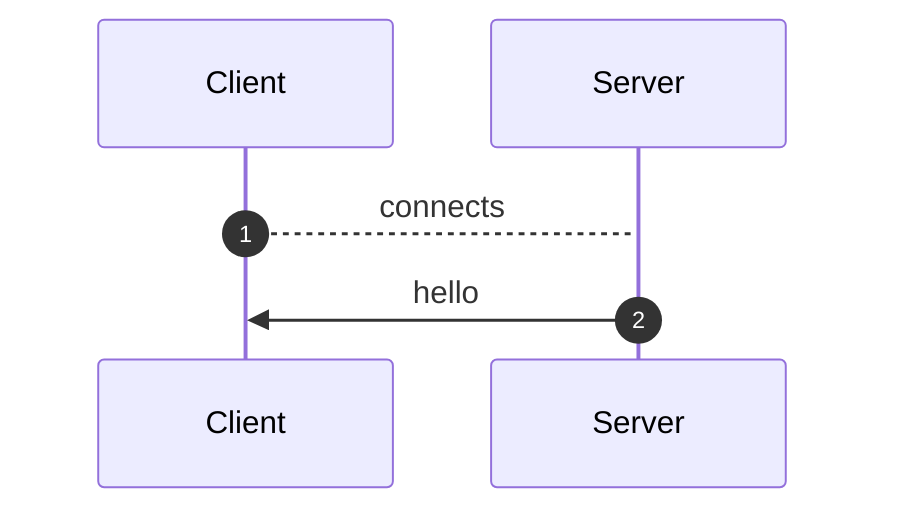
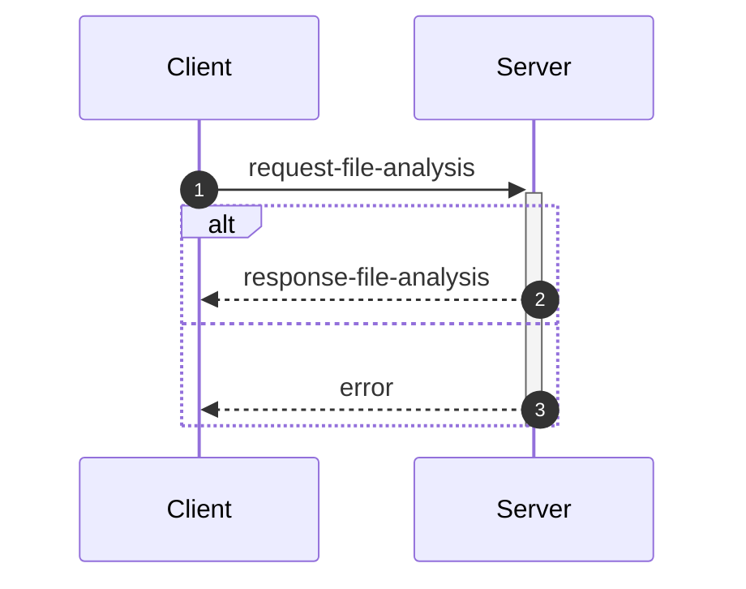
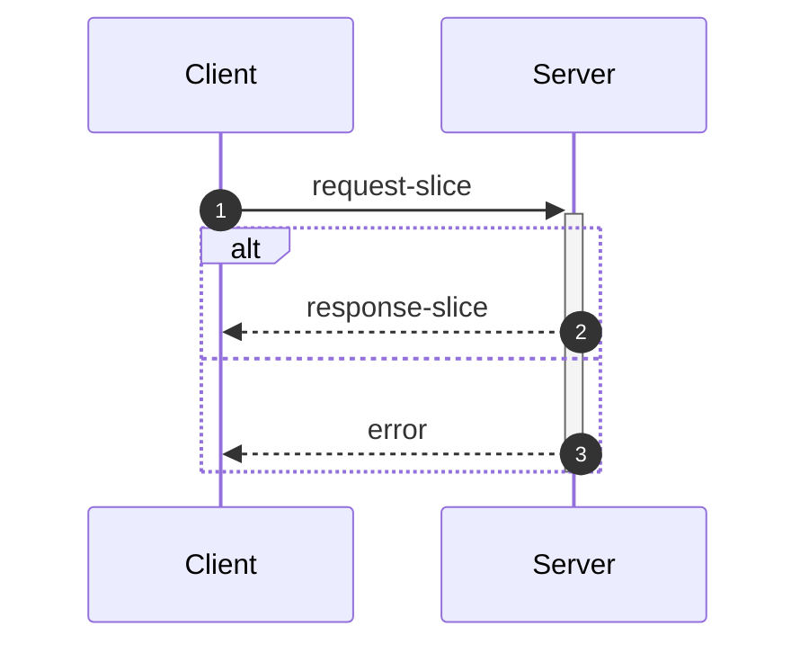
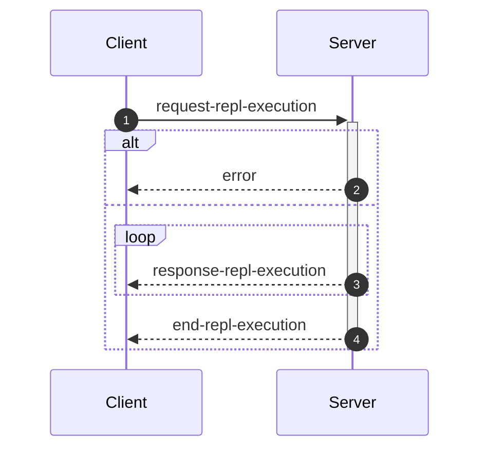

_<span title="an overview of flowR's interface">Generated</span> from '[wiki-interface.ts](https://github.com/flowr-analysis/flowr/tree/main/src/documentation/wiki-interface.ts "src/documentation/wiki-interface.ts")' on 2026-10-25, 09:24:36 UTC (v2.16.6, R v4.6.1), do not edit directly._

Although far from being as detailed as the in-depth explanation of [_flowR_](https://github.com/flowr-analysis/flowr/wiki/Core),
this wiki page explains how to interface with _flowR_ in more detail.
In general, command line arguments and other options provide short descriptions on hover over.

* [💻 Using the REPL](#using-the-repl)
* [⚙️ Configuring FlowR](#configuring-flowr)
* [⚒️ Writing Code](#writing-code)
* [💬 Communicating with the Server](#communicating-with-the-server)

<a id='using-the-repl'></a>
## 💻 Using the REPL

> [!NOTE]
> To execute arbitrary R commands with a repl request, _flowR_ has to be started explicitly with <span title="Description (Command Line Argument): Allow to access the underlying R session when using flowR (security warning: this allows the execution of arbitrary R code!)">`--r-session-access`</span>.
> Please be aware that this introduces a security risk and note that this relies on the [`r-shell` engine](https://github.com/flowr-analysis/flowr/wiki/Engines) .

Although primarily meant for users to explore,
there is nothing which forbids calling _flowR_ as a subprocess to use standard-in, -output, and -error
for communication (although you can access the REPL using the server as well,
with the [REPL Request](#message-request-repl-execution) message).

The read-eval-print loop&nbsp;(REPL) works relatively simple.
You can submit an expression (using <kbd>Enter</kbd>),
which is interpreted as an R&nbsp;expression by default but interpreted as a *command* if it starts with a colon (`:`).
The best command to get started with the REPL is <span title="Description (Repl Command): Show help information (aliases: :h, :?)">`:help`</span>.
Besides, you can leave the REPL either with the command <span title="Description (Repl Command): End the repl (aliases: :q, :exit)">`:quit`</span> or by pressing <kbd>Ctrl</kbd>+<kbd>C</kbd> twice.
When writing a *command*, you may press <kbd>Tab</kbd> to get a list of completions, if available.
Multiple commands can be entered in a single line by separating them with a semicolon (`;`), e.g. `:parse "x<-2"; :df*`.
If a command is given without R code, the REPL will re-use R code given in a previous command.
The prior example will hence return first the parsed AST of the program and then the dataflow graph for `"x <- 2"`.

> [!NOTE]
> If you develop flowR, you may want to launch the repl using the `npm run main-dev` command, this way, you get a non-minified version of flowR with debug information and hot-reloading of source files.

<details>
<summary>Available Commands</summary>

We currently offer the following commands (this with a `[*]` suffix are available with and without the star):

| Command | Description |
| ------- | ----------- |
| **<span title="Description (Repl Command): End the repl (aliases: :q, :exit)">:quit</span>** | End the repl (aliases: **:<span title="Alias of ':quit'. End the repl">q</span>**, **:<span title="Alias of ':quit'. End the repl">exit</span>**) |
| **<span title="Description (Repl Command): Execute the given code as R code. This requires the `--r-session-access` flag to be set and requires the r-shell engine. (aliases: :e, :r)">:execute</span>** | Execute the given code as R code. This requires the `--r-session-access` flag to be set and requires the r-shell engine. (aliases: **:<span title="Alias of ':execute'. Execute the given code as R code. This requires the `--r-session-access` flag to be set and requires the r-shell engine.">e</span>**, **:<span title="Alias of ':execute'. Execute the given code as R code. This requires the `--r-session-access` flag to be set and requires the r-shell engine.">r</span>**) |
| **<span title="Description (Repl Command): Get mermaid code for the control-flow graph of R code (aliases: :cfg, :cf)">:controlflow[*]</span>** | Get mermaid code for the control-flow graph of R code (star: Returns the URL to mermaid.live) (aliases: **:<span title="Alias of ':controlflow'. Get mermaid code for the control-flow graph of R code">cfg</span>**, **:<span title="Alias of ':controlflow'. Get mermaid code for the control-flow graph of R code">cf</span>**) |
| **<span title="Description (Repl Command): Get mermaid code for the control-flow graph with basic blocks (aliases: :cfgb, :cfb)">:controlflowbb[*]</span>** | Get mermaid code for the control-flow graph with basic blocks (star: Returns the URL to mermaid.live) (aliases: **:<span title="Alias of ':controlflowbb'. Get mermaid code for the control-flow graph with basic blocks">cfgb</span>**, **:<span title="Alias of ':controlflowbb'. Get mermaid code for the control-flow graph with basic blocks">cfb</span>**) |
| **<span title="Description (Repl Command): Get mermaid code for the dataflow graph (aliases: :d, :df)">:dataflow[*]</span>** | Get mermaid code for the dataflow graph (star: Returns the URL to mermaid.live) (aliases: **:<span title="Alias of ':dataflow'. Get mermaid code for the dataflow graph">d</span>**, **:<span title="Alias of ':dataflow'. Get mermaid code for the dataflow graph">df</span>**) |
| **<span title="Description (Repl Command): Get mermaid code for the normalized AST of R code (aliases: :n)">:normalize[*]</span>** | Get mermaid code for the normalized AST of R code (star: Returns the URL to mermaid.live) (alias: **:<span title="Alias of ':normalize'. Get mermaid code for the normalized AST of R code">n</span>**) |
| **<span title="Description (Repl Command): Get mermaid code for the simplified dataflow graph (aliases: :ds, :dfs)">:dataflowsimple[*]</span>** | Get mermaid code for the simplified dataflow graph (star: Returns the URL to mermaid.live) (aliases: **:<span title="Alias of ':dataflowsimple'. Get mermaid code for the simplified dataflow graph">ds</span>**, **:<span title="Alias of ':dataflowsimple'. Get mermaid code for the simplified dataflow graph">dfs</span>**) |
| **<span title="Description (Repl Command): Inspect and extend the signature database: `query` (identical to :query @signature), `info <name>` for where a function comes from (identical to :query @function-info), `add <path>` to mount another database/source, `download` to fetch the full-history database. (aliases: :sig)">:signature</span>** | Inspect and extend the signature database: `query` (identical to :query @signature), `info <name>` for where a function comes from (identical to :query @function-info), `add <path>` to mount another database/source, `download` to fetch the full-history database. (alias: **:<span title="Alias of ':signature'. Inspect and extend the signature database: `query` (identical to :query @signature), `info <name>` for where a function comes from (identical to :query @function-info), `add <path>` to mount another database/source, `download` to fetch the full-history database.">sig</span>**) |
| **<span title="Description (Repl Command): Just calculates the DFG, but only prints summary info (aliases: :d#, :df#)">:dataflowsilent</span>** | Just calculates the DFG, but only prints summary info (aliases: **:<span title="Alias of ':dataflowsilent'. Just calculates the DFG, but only prints summary info">d#</span>**, **:<span title="Alias of ':dataflowsilent'. Just calculates the DFG, but only prints summary info">df#</span>**) |
| **<span title="Description (Repl Command): Prints ASCII Art of the parsed, unmodified AST (aliases: :p)">:parse</span>** | Prints ASCII Art of the parsed, unmodified AST (alias: **:<span title="Alias of ':parse'. Prints ASCII Art of the parsed, unmodified AST">p</span>**) |
| **<span title="Description (Repl Command): Prints the version of flowR as well as the current version of R">:version</span>** | Prints the version of flowR as well as the current version of R
| **<span title="Description (Repl Command): Query the given R code (use 'help' for more information)">:query[*]</span>** | Query the given R code (use 'help' for more information) (star: Similar to query, but returns the output in json format.)
| **<span title="Description (Repl Command): Returns an ASCII representation of the dataflow graph (aliases: :df!)">:dataflowascii</span>** | Returns an ASCII representation of the dataflow graph (alias: **:<span title="Alias of ':dataflowascii'. Returns an ASCII representation of the dataflow graph">df!</span>**) |
| **<span title="Description (Repl Command): Returns summarization stats for the normalized AST (aliases: :n#)">:normalize#</span>** | Returns summarization stats for the normalized AST (alias: **:<span title="Alias of ':normalize#'. Returns summarization stats for the normalized AST">n#</span>**) |
| **<span title="Description (Repl Command): Show help information (aliases: :h, :?)">:help</span>** | Show help information (aliases: **:<span title="Alias of ':help'. Show help information">h</span>**, **:<span title="Alias of ':help'. Show help information">?</span>**) |

</details>

> [!TIP]
> 
> As indicated by the examples before, all REPL commands that operate on code keep track of the state.
> Hence, if you run a command like <span title="Description (Repl Command, starred version): Returns the URL to mermaid.live; Base Command: Get mermaid code for the dataflow graph (aliases: :d*, :df*)">`:dataflow*`</span> without providing R code,
> the REPL will re-use the R code provided in a previous command.
> Likewise, doing this will benefit from incrementality!
> If you request the dataflow graph with `:df* x <- 2 * y` and then want to see the parsed AST with `:parse`,
> the REPL will re-use previously obtained information and not re-parse the code again.
> 		

Generally, many commands offer shortcut versions in the REPL. Many queries, for example, offer a shortened format (see the example below).
Of special note, the [Config Query](https://github.com/flowr-analysis/flowr/wiki/%5BQuery%5D-Config)
can be used to also modify the currently active configuration of _flowR_ within the REPL (see the [wiki page](https://github.com/flowr-analysis/flowr/wiki/%5BQuery%5D-Config) for more information).

### Example: Retrieving the Dataflow Graph

To retrieve a URL to the [mermaid](https://mermaid.js.org/) diagram of the dataflow of a given expression,
use <span title="Description (Repl Command, starred version): Returns the URL to mermaid.live; Base Command: Get mermaid code for the dataflow graph (aliases: :d*, :df*)">`:dataflow*`</span> (or <span title="Description (Repl Command): Get mermaid code for the dataflow graph (aliases: :d, :df)">`:dataflow`</span> to get the mermaid code in the cli):

```shell
$ docker run -it --rm eagleoutice/flowr # or npm run flowr 
flowR repl v2.16.6, R grammar v14 (tree-sitter engine)
R> :dataflow* y <- 1 + x
```

<details>
<summary style='color:gray'>Output</summary>

```text
https://mermaid.live/view#base64:eyJjb2RlIjoiZmxvd2NoYXJ0IFREXG4gICAgMXt7XCJgKiM5MTtSTnVtYmVyIzkzOyogKioxKipcbiAgICAgICoxLjYqICgqKmlkOiAxKiopYFwifX1cbiAgICAyKFtcImAqIzkxO1JTeW1ib2wjOTM7KiAqKngqKlxuICAgICAgKjEuMTAqICgqKmlkOiAyKiopYFwiXSlcbiAgICAzW1tcImAqIzkxO1JCaW5hcnlPcCM5MzsqIGJhc2UjNTg7IzU4OyoqIzQzOyoqXG4gICAgICAqMS42LTEwKiAoKippZDogMyoqKVxuICAgIGFyZzogKDEsIDIpYFwiXV1cbiAgICBidWlsdC1pbjpfNDNfW1wiYEJ1aWx0LUluOlxuIzQzO2BcIl1cbiAgICBzdHlsZSBidWlsdC1pbjpfNDNfIHN0cm9rZTpncmF5LGZpbGw6Z3JheSxzdHJva2Utd2lkdGg6MnB4LG9wYWNpdHk6Ljg7XG4gICAgMFtcImAqIzkxO1JTeW1ib2wjOTM7KiAqKnkqKlxuICAgICAgKjEuMSogKCoqaWQ6IDAqKiwgdjogMylgXCJdXG4gICAgNFtbXCJgKiM5MTtSQmluYXJ5T3AjOTM7KiBiYXNlIzU4OyM1ODsqKiM2MDsjNDU7KipcbiAgICAgICoxLjEtMTAqICgqKmlkOiA0KiopXG4gICAgYXJnOiAoMCwgMylgXCJdXVxuICAgIGJ1aWx0LWluOl82MF8tW1wiYEJ1aWx0LUluOlxuIzYwOyM0NTtgXCJdXG4gICAgc3R5bGUgYnVpbHQtaW46XzYwXy0gc3Ryb2tlOmdyYXksZmlsbDpncmF5LHN0cm9rZS13aWR0aDoycHgsb3BhY2l0eTouODtcbiAgICAxIC0uLT58XCJmbG93XCJ8IDJcbiAgICBsaW5rU3R5bGUgMCBzdHJva2U6Z3JheSxjb2xvcjpncmF5O1xuICAgIDIgLS4tPnxcImZsb3dcInwgM1xuICAgIGxpbmtTdHlsZSAxIHN0cm9rZTpncmF5LGNvbG9yOmdyYXk7XG4gICAgMyAtLT58XCJyZWFkcywgYXJnXCJ8IDFcbiAgICAzIC0tPnxcInJlYWRzLCBhcmdcInwgMlxuICAgIDMgLS4tPnxcImZsb3dcInwgMFxuICAgIGxpbmtTdHlsZSA0IHN0cm9rZTpncmF5LGNvbG9yOmdyYXk7XG4gICAgMyAtLi0+fFwicmVhZHMsIGNhbGxzXCJ8IGJ1aWx0LWluOl80M19cbiAgICBsaW5rU3R5bGUgNSBzdHJva2U6Z3JheTtcbiAgICAwIC0tPnxcImRlZmluZWQtYnksIGZsb3dcInwgNFxuICAgIDAgLS0+fFwiZGVmaW5lZC1ieVwifCAzXG4gICAgNCAtLT58XCJyZWFkcywgYXJnXCJ8IDNcbiAgICA0IC0tPnxcInJldHVybnMsIGFyZ1wifCAwXG4gICAgNCAtLi0+fFwicmVhZHMsIGNhbGxzXCJ8IGJ1aWx0LWluOl82MF8tXG4gICAgbGlua1N0eWxlIDEwIHN0cm9rZTpncmF5OyIsIm1lcm1haWQiOnsiYXV0b1N5bmMiOnRydWV9fQ==
```

Retrieve the dataflow graph of the expression `y <- 1 + x`. It looks like this:


<details>

<summary style="color:gray">R Code of the Dataflow Graph</summary>

The analysis ran (parse and normalize with the [tree-sitter](https://github.com/flowr-analysis/flowr/wiki/Engines) engine) in the generation environment. No [signature database](https://github.com/flowr-analysis/flowr/wiki/Signature-Database) is mounted, so `library()` attaches no exports (base-R names are still qualified, e.g., `stats::acf`). 
We encountered no unknown side effects during the analysis.

```r
y <- 1 + x
```

</details>

</details>

For small graphs like this, <span title="Description (Repl Command): Returns an ASCII representation of the dataflow graph (aliases: :df!)">`:dataflowascii`</span> also provides an ASCII representation directly in the REPL:

```shell
$ docker run -it --rm eagleoutice/flowr # or npm run flowr 
flowR repl v2.16.6, R grammar v14 (tree-sitter engine)
R> :df! y <- 1 + x
```

<details open>
<summary style='color:gray'>Output</summary>

```text
                        v<0>v
 c<4>c──────────────────| y |
 |<- |     ┌────────────v---v
 c---c     │
    │   c<3>c   0<1>0
    └───| + |───| 1 |───u<2>u
        c---c   0---0   | x |
           └────────────u---u
Edges:
3 -> 1: reads, arg          3 -> 2: reads, arg
3 -> 0: flows-to            1 -> 2: flows-to
2 -> 3: flows-to            4 -> 3: reads, arg
4 -> 0: returns, arg        0 -> 4: defined-by, flows-to
0 -> 3: defined-by
```

Retrieve the dataflow graph of the expression `y <- 1 + x` as ASCII art.

</details>

For the slicing with <span title="Description (Repl Command): Static backwards executable slicer for R">`:slicer`</span>, you have access to the same [magic comments](#slice-magic-comments) as with the [slice request](#message-request-slice).
Pass `--inline` to splice resolvable `source()` calls into the reconstruction so the slice is a single self-contained R text (the same as the static slice query's `inlineSources` flag).
See `--help` for more flags!

### Example: Interfacing with the File System

Many commands that allow for an R-expression (like <span title="Description (Repl Command, starred version): Returns the URL to mermaid.live; Base Command: Get mermaid code for the dataflow graph (aliases: :d*, :df*)">`:dataflow*`</span>) allow for a file as well
if the argument starts with `file://`.
If you are working from the root directory of the _flowR_ repository, the following gives you the parsed AST of the example file using the <span title="Description (Repl Command): Prints ASCII Art of the parsed, unmodified AST (aliases: :p)">`:parse`</span> command:

> **Watch mode**: Replace `file://` with `watch://` to enter watch mode.
> flowR runs the command immediately and then re-runs it every time the file (or any file inside the folder) changes.
> Enter any other command to leave watch mode.
> For example: `:df watch://analysis.R`

```shell
$ docker run -it --rm eagleoutice/flowr # or npm run flowr 
flowR repl v2.16.6, R grammar v14 (tree-sitter engine)
R> :parse file://test/testfiles/example.R
```

<details>
<summary style='color:gray'>Output</summary>

```text
File: test/testfiles/example.R

program
├ binaryoperator
│ ├ identifier "sum" (1:1─4)
│ ├ <- "<-" (1:5─7)
│ ╰ float "0" (1:8─9)
├ binaryoperator
│ ├ identifier "product" (2:1─8)
│ ├ <- "<-" (2:9─11)
│ ╰ float "1" (2:12─13)
├ binaryoperator
│ ├ identifier "w" (3:1─2)
│ ├ <- "<-" (3:3─5)
│ ╰ float "7" (3:6─7)
├ binaryoperator
│ ├ identifier "N" (4:1─2)
│ ├ <- "<-" (4:3─5)
│ ╰ float "10" (4:6─8)
├ forstatement
│ ├ for "for" (6:1─4)
│ ├ ( "(" (6:5─6)
│ ├ identifier "i" (6:6─7)
│ ├ in "in" (6:8─10)
│ ├ binaryoperator
│ │ ├ float "1" (6:11─12)
│ │ ├ : ":" (6:12─13)
│ │ ╰ parenthesizedexpression
│ │   ├ ( "(" (6:13─14)
│ │   ├ binaryoperator
│ │   │ ├ identifier "N" (6:14─15)
│ │   │ ├ - "-" (6:15─16)
│ │   │ ╰ float "1" (6:16─17)
│ │   ╰ ) ")" (6:17─18)
│ ├ ) ")" (6:18─19)
│ ╰ bracedexpression
│   ├ { "{" (6:20─21)
│   ├ binaryoperator
│   │ ├ identifier "sum" (7:3─6)
│   │ ├ <- "<-" (7:7─9)
│   │ ╰ binaryoperator
│   │   ├ binaryoperator
│   │   │ ├ identifier "sum" (7:10─13)
│   │   │ ├ + "+" (7:14─15)
│   │   │ ╰ identifier "i" (7:16─17)
│   │   ├ + "+" (7:18─19)
│   │   ╰ identifier "w" (7:20─21)
│   ├ binaryoperator
│   │ ├ identifier "product" (8:3─10)
│   │ ├ <- "<-" (8:11─13)
│   │ ╰ binaryoperator
│   │   ├ identifier "product" (8:14─21)
│   │   ├  "" (8:22─23)
│   │   ╰ identifier "i" (8:24─25)
│   ╰ } "}" (9:1─2)
├ call
│ ├ identifier "cat" (11:1─4)
│ ╰ arguments
│   ├ ( "(" (11:4─5)
│   ├ argument
│   │ ╰ string
│   │   ├ " "\"" (11:5─6)
│   │   ├ stringcontent "Sum:" (11:6─10)
│   │   ╰ " "\"" (11:10─11)
│   ├ comma "," (11:11─12)
│   ├ argument
│   │ ╰ identifier "sum" (11:13─16)
│   ├ comma "," (11:16─17)
│   ├ argument
│   │ ╰ string
│   │   ├ " "\"" (11:18─19)
│   │   ├ stringcontent
│   │   │ ╰ escapesequence "\\n" (11:19─21)
│   │   ╰ " "\"" (11:21─22)
│   ╰ ) ")" (11:22─23)
╰ call
  ├ identifier "cat" (12:1─4)
  ╰ arguments
    ├ ( "(" (12:4─5)
    ├ argument
    │ ╰ string
    │   ├ " "\"" (12:5─6)
    │   ├ stringcontent "Product:" (12:6─14)
    │   ╰ " "\"" (12:14─15)
    ├ comma "," (12:15─16)
    ├ argument
    │ ╰ identifier "product" (12:17─24)
    ├ comma "," (12:24─25)
    ├ argument
    │ ╰ string
    │   ├ " "\"" (12:26─27)
    │   ├ stringcontent
    │   │ ╰ escapesequence "\\n" (12:27─29)
    │   ╰ " "\"" (12:29─30)
    ╰ ) ")" (12:30─31)
```

Retrieve the parsed AST of the example file.

<details>

<summary>File Content</summary>

```r
sum <- 0
product <- 1
w <- 7
N <- 10

for (i in 1:(N-1)) {
  sum <- sum + i + w
  product <- product * i
}

cat("Sum:", sum, "\n")
cat("Product:", product, "\n")
```

</details>

As _flowR_ directly transforms this AST the output focuses on being human-readable instead of being machine-readable.
		
</details>

### Example: Run a Query

You can run any query supported by _flowR_ using the <span title="Description (Repl Command): Query the given R code (use 'help' for more information)">`:query`</span> command.
For example, to obtain the shapes of all data frames in a given piece of code, you can run:

```shell
$ docker run -it --rm eagleoutice/flowr # or npm run flowr 
flowR repl v2.16.6, R grammar v14 (tree-sitter engine)
R> :query @absint df-shape "x <- data.frame(a = 1:10, b = 1:10)\ny <- x$a"
```

<details open>
<summary style='color:gray'>Output</summary>

```text
Query: absint (0 ms)
```

Retrieve the shapes of all data frames in the given code.

</details>

To run the linter on a file, you can use (in this example, we just issue the `dead-code` linter on a small piece of code):

```shell
$ docker run -it --rm eagleoutice/flowr # or npm run flowr 
flowR repl v2.16.6, R grammar v14 (tree-sitter engine)
R> :query @linter rules:dead-code "if(FALSE) x <- 2"
```

<details open>
<summary style='color:gray'>Output</summary>

```text
Query: linter (2 ms)
   ╰ Dead Code (dead-code):
       ╰ certain:
           ╰ Code at 1.11-16
```

Run the linter on the given code, with only the `dead-code` rule enabled.

</details>

For more information on the available queries, please check out the [Query API](https://github.com/flowr-analysis/flowr/wiki/Query-API).

<a id='configuring-flowr'></a>
## ⚙️ Configuring FlowR

When running _flowR_, you may want to specify some behaviors with a dedicated configuration file.
By default, flowR looks for a file named `flowr.json` in the current working directory (or any higher directory).
You can also specify a different file with <span title="Description (Command Line Argument): The name of the configuration file to use">`--config-file`</span> or pass the configuration inline using <span title="Description (Command Line Argument): The flowR configuration to use, as a JSON string">`--config-json`</span>.
A `flowr.json` found this way belongs to the analyzed project, so flowR ignores its options that decide what flowR executes or loads
(`engines.*.wasmPath`, `engines.*.treeSitterWasmPath`, `engines.*.rPath`, `solver.sigdb.additionalPaths`, `solver.sigdb.downloadRepo`, `solver.sigdb.installedLibrary.paths`),
unless you pass <span title="Description (Command Line Argument): Keep the security-sensitive options (e.g., the R executable) of the flowr.json found in the working directory or a parent. Only use this for projects you trust.">`--trust-config`</span>.
To analyze code you do not trust, use the secure mode (<span title="Description (Command Line Argument): Run in secure mode for analyzing untrusted code: flowR does not start R (or any other process), does not access the network, does not search for project configs, and ignores security-sensitive options in every config. Cannot be disabled once enabled. Can also be enabled with the environment variable {italic FLOWR_SECURE_MODE=1}.">`--secure`</span>, see the [security policy](https://github.com/flowr-analysis/flowr/blob/main/.github/SECURITY.md)).
To inspect the current configuration, you can run flowr with the <span title="Description (Command Line Argument): Run with verbose logging (will be passed to the corresponding script)">`--verbose`</span> flag, or use the `config` [Query](https://github.com/flowr-analysis/flowr/wiki/Query-API).
Within the REPL this works by running the following:

```shell
:query @config
```

To work with the <a href="https://github.com/flowr-analysis/flowr/tree/main/src/config.ts#L119"><code><span title="The configuration file format for flowR.">FlowrConfig</span></code></a> you can use the provided helper objects alongside its methods like
<a href="https://github.com/flowr-analysis/flowr/tree/main/src/config.ts#L914"><code><span title="Creates a new flowr config that has the updated values.">FlowrConfig::<b>amend</b></span></code></a>.
The schema below documents every option; the ones you most likely want are:

- <a href="https://github.com/flowr-analysis/flowr/wiki/Interface#configuring-flowr" title="Configuration Option (boolean): Whether source calls should be ignored, causing {@link processSourceCall}&#39;s behavior to be skipped.">ignoreSourceCalls</a>: ignore source calls when analyzing the code, i.e., ignore the inclusion of other files.
- <a href="https://github.com/flowr-analysis/flowr/wiki/Interface#configuring-flowr" title="Configuration Option (boolean): Whether load calls should be ignored, causing {@link processLoadCall}&#39;s behavior to be skipped.">ignoreLoadCalls</a>: ignore load calls when analyzing the code, i.e., ignore the loading of r-data files.
- <a href="https://github.com/flowr-analysis/flowr/wiki/Interface#configuring-flowr" title="Configuration Option (object): Do you want to overwrite (parts) of the builtin definition?">semantics.environment.overwriteBuiltIns</a>: overwrite _flowR_'s handling of built-in functions, or clear the preset definitions entirely.
  See [Configure BuiltIn Semantics](#configure-builtin-semantics) for more information.
- <a href="https://github.com/flowr-analysis/flowr/wiki/Interface#configuring-flowr" title="Configuration Option (string): How to resolve variables and their values. (one of &quot;disabled&quot;, &quot;alias&quot;, &quot;builtin&quot;)">solver.variables</a>: how to resolve variables and their values (`disabled`, `alias`, `builtin`).
- <a href="https://github.com/flowr-analysis/flowr/wiki/Interface#configuring-flowr" title="Configuration Option (array): The engine or set of engines to use for interacting with R code. An empty array means all available engines will be used.">engines</a> and <a href="https://github.com/flowr-analysis/flowr/wiki/Interface#configuring-flowr" title="Configuration Option (string): The default engine to use for interacting with R code. If this is undefined, an arbitrary engine from the specified list will be used. (one of &quot;tree-sitter&quot;, &quot;r-shell&quot;)">defaultEngine</a>: the engines used to interact with R code, see the [Engines wiki page](https://github.com/flowr-analysis/flowr/wiki/Engines).
- <a href="https://github.com/flowr-analysis/flowr/wiki/Interface#configuring-flowr" title="Configuration Option (array): Files a framework loads on its own, without any source() call (e.g. global.R in a shiny app), in the order they are loaded; flowR orders the matching project files accordingly and analyzes them as one program. Entries are case-insensitive globs matched against the file path, a plain name matches any file with that name, and entries matching no project file are warned about. Usually set per project kind via specializeConfig.">project.implicitSources</a>: the files a framework loads without any `source()` call, in the order in which they are
  loaded. Entries are globs (e.g. `R/*.R`) matched against the file path ignoring capitalization; one matching no file is reported.
- <a href="https://github.com/flowr-analysis/flowr/wiki/Interface#configuring-flowr" title="Configuration Option (object): Overwrite (parts of) the configuration depending on the project kind flowR detects, e.g. to give a shiny app its implicit sources.">specializeConfig</a>: overwrite (parts of) the configuration depending on the kind of project _flowR_ detects
  (e.g. `shiny-app`), which is how a shiny app gets its implicit sources by default. What you configure directly wins.
- <a href="https://github.com/flowr-analysis/flowr/wiki/Interface#configuring-flowr" title="Configuration Option (string): Overwrite the project kind flowR would otherwise infer from the analyzed files, e.g. when auto-detection guesses wrong. (one of &quot;package&quot;, &quot;script&quot;, &quot;shiny-app&quot;, &quot;notebook&quot;, &quot;project&quot;, &quot;unknown&quot;)">project.useProjectType</a>: skip that detection and force a project kind yourself, when auto-detection guesses wrong.
- <a href="https://github.com/flowr-analysis/flowr/wiki/Interface#configuring-flowr" title="Configuration Option (array): The default plugins to load when creating a new instance of FlowrAnalyzer">defaultPlugins</a> and <a href="https://github.com/flowr-analysis/flowr/wiki/Interface#configuring-flowr" title="Configuration Option (array): The plugins to load in REPL mode">repl.plugins</a>: the plugins to load for a new <a href="https://github.com/flowr-analysis/flowr/tree/main/src/project/flowr-analyzer.ts#L205"><code><span title="Central class for conducting analyses with FlowR. Use the FlowrAnalyzerBuilder to create a new instance. If you want the original pattern of creating a pipeline and running all steps, you can still do this with FlowrAnalyzer#runFull . To inspect the context of the analyzer, use FlowrAnalyzer#inspectContext (if you are a plugin and need to modify it, use FlowrAnalyzer#context instead).">FlowrAnalyzer</span></code></a> and in the REPL
  (use `flowr:default` to reference the former).

So you can configure _flowR_ by adding a file like the following:

<details>

<summary>Example Configuration File</summary>

```json
{
  "ignoreSourceCalls": true,
  "ignoreLoadCalls": true,
  "semantics": {
    "environment": {
      "overwriteBuiltIns": {
        "definitions": [
          {
            "type": "function",
            "names": [
              "foo"
            ],
            "processor": "builtin:assign",
            "config": {}
          }
        ]
      }
    }
  },
  "defaultPlugins": [
    "file:description",
    "versions:description"
  ],
  "repl": {
    "quickStats": false,
    "dfProcessorHeat": false,
    "hints": true,
    "plugins": [
      "flowr:default"
    ]
  },
  "project": {
    "resolveUnknownPathsOnDisk": true,
    "implicitSources": [
      "global.R",
      "app.R"
    ]
  },
  "linter": {
    "disabledRules": []
  },
  "specializeConfig": {
    "shiny-app": {
      "project": {
        "implicitSources": [
          "global.R",
          "ui.R",
          "server.R",
          "app.R"
        ]
      }
    }
  },
  "engines": [
    {
      "type": "r-shell"
    }
  ],
  "solver": {
    "variables": "alias",
    "evalStrings": true,
    "trackEnvironments": true,
    "sigdb": {
      "enabled": true,
      "loadProjectDependencies": true,
      "eagerlyLoad": false,
      "eagerlyLoadExports": false,
      "linkBaseR": false,
      "linkDescriptionDependencies": false
    },
    "resolveSource": {
      "dropPaths": "no",
      "ignoreCapitalization": true,
      "inferWorkingDirectory": "active-script",
      "searchPath": []
    },
    "instrument": {},
    "slicer": {
      "threshold": 50
    }
  },
  "abstractInterpretation": {
    "wideningThreshold": 4,
    "followCalls": true,
    "dataFrame": {
      "maxColNames": 20,
      "readLoadedData": {
        "readExternalFiles": true,
        "maxReadLines": 1000000
      }
    }
  },
  "incremental": {
    "alwaysIncremental": false,
    "parsing": {
      "activated": false,
      "heuristics": {
        "activated": true,
        "mtime": true,
        "linesFrom": 500,
        "bytesFrom": 50000,
        "alwaysWithEdits": false,
        "minFiles": 1
      }
    }
  },
  "gas": {
    "thresholds": {
      "memory": {
        "problematic": 0.7,
        "critical": 0.9
      },
      "timeMs": {
        "problematic": 100000,
        "critical": 120000
      }
    },
    "features": {}
  }
}
```

</details>

<details>
<a id='configure-builtin-semantics'></a>
<summary>Configure Built-In Semantics</summary>

`semantics/environment/overwriteBuiltins` accepts two keys:

- `loadDefaults` (boolean, initially `true`): If set to `true`, the default built-in definitions are loaded before applying the custom definitions. Setting this flag to `false` explicitly disables the loading of the default definitions.
- `definitions` (array, initially empty): Allows to overwrite or define new built-in elements. Each object within must have a `type` which is one of the below. Furthermore, they may define a string array of `names` which specifies the identifiers to bind the definitions to. You may use `assumePrimitive` to specify whether _flowR_ should assume that this is a primitive non-library definition (so you probably just do not want to specify the key).

  | Type            | Description                                                                                                                                                                                                                                                                                              | Example                                                                                                    |
  | --------------- | -------------------------------------------------------------------------------------------------------------------------------------------------------------------------------------------------------------------------------------------------------------------------------------------------------- | ---------------------------------------------------------------------------------------------------------- |
  | `constant`    | Additionally allows for a `value` this should resolve to.                                                                                                                                                                                                                                                | `{ type: 'constant', names: ['NULL', 'NA'],  value: null }`                                                |
  | `function`    | Is a rather flexible way to define and bind built-in functions. For the time, we do not have extensive documentation to cover all the cases, so please either consult the sources with the `default-builtin-config.ts` or open a [new issue](https://github.com/flowr-analysis/flowr/issues/new/choose). | `{ type: 'function', names: ['next'], processor: 'builtin:d', config: { cfg: ExitPointType.Next } }` |
  | `replacement` | A comfortable way to specify replacement functions like `$<-` or `names<-`. `suffixes` describes the... suffixes to attach automatically. | `{ type: 'replacement', suffixes: ['<-', '<<-'], names: ['[', '[['] }` |

</details>

<details>

<summary style='color:gray'>Full Configuration-File Schema</summary>

- _The configuration file format for flowR._ (object)
    - **logLevel** [optional] _flowR's global minimum log level, applied when the config is loaded._ (string)
        Only allows: 'silly', 'trace', 'debug', 'info', 'warn', 'error', 'fatal'
    - **ignoreSourceCalls** [optional] _Whether source calls should be ignored, causing {@link processSourceCall}'s behavior to be skipped._ (boolean)
    - **ignoreLoadCalls** [optional] _Whether load calls should be ignored, causing {@link processLoadCall}'s behavior to be skipped._ (boolean)
    - **semantics** _Configure language semantics and how flowR handles them._ (object)
        - **environment** [optional] _Semantics regarding how to handle the R environment._ (object)
            - **overwriteBuiltIns** [optional] _Do you want to overwrite (parts) of the builtin definition?_ (object)
                - **loadDefaults** [optional] _Should the default configuration still be loaded?_ (boolean)
                - **definitions** [optional] _The definitions to load/overwrite._ (array)
                Valid item types:
                    - (object)
    - **defaultPlugins** [optional] _The default plugins to load when creating a new instance of FlowrAnalyzer_ (array)
    Valid item types:
        - (alternatives)
            - (string)
            - (array)
    - **repl** _Configuration options for the REPL._ (object)
        - **quickStats** [optional] _Whether to show quick stats in the REPL after each evaluation._ (boolean)
        - **dfProcessorHeat** [optional] _This instruments the dataflow processors to count how often each processor is called._ (boolean)
        - **hints** [optional] _Whether to show dim inline hints on the empty prompt (automatically disabled on non-interactive terminals)._ (boolean)
        - **plugins** [optional] _The plugins to load in REPL mode_ (array)
        Valid item types:
            - (alternatives)
                - (string)
                - (array)
        - **autoUseFileProtocol** [optional] _Prepend the file protocol to a repl input that looks like a path, instead of only warning about it._ (boolean)
        - **queryStats** [optional] _Whether `:query` closes with the line stating how long the queries took (`:query*` never prints it)._ (boolean)
        - **showPlugins** [optional] _Whether `:version` grays out the plugins that did not activate during the last analysis._ (boolean)
    - **project** _Project specific configuration options._ (object)
        - **resolveUnknownPathsOnDisk** [optional] _Whether to resolve unknown paths loaded by the r project disk when trying to source/analyze files._ (boolean)
        - **failOnInaccessiblePath** [optional] _Whether a directory that cannot be traversed during file discovery (e.g. due to permissions) aborts the analysis; when false (the default) such paths are logged and skipped._ (boolean)
        - **basePackages** [optional] _The packages considered part of R itself (base and recommended); if unset, flowR uses its built-in list._ (array)
        Valid item types:
            - (string)
        - **implicitSources** [optional] _Files a framework loads on its own, without any source() call (e.g. global.R in a shiny app), in the order they are loaded; flowR orders the matching project files accordingly and analyzes them as one program. Entries are case-insensitive globs matched against the file path, a plain name matches any file with that name, and entries matching no project file are warned about. Usually set per project kind via specializeConfig._ (array)
        Valid item types:
            - (string)
        - **useProjectType** [optional] _Overwrite the project kind flowR would otherwise infer from the analyzed files, e.g. when auto-detection guesses wrong._ (string)
            Only allows: 'package', 'script', 'shiny-app', 'notebook', 'project', 'unknown'
        - **assumeImplicitEcho** [optional] _Whether the top level of the analyzed code is echoed, so that every visible result printed there is collected as an output by the dependencies query (default true, false for a package)._ (boolean)
        - **discovery** [optional] _Scoping options for the default project discovery._ (object)
            - **full** [optional] _Collect every file below the project root (greedy) instead of only the files the detected project kind needs (default false)._ (boolean)
            - **perKind** [optional] _Per-kind include/exclude glob overrides layered on the default scoping._ (object)
            - **ignore** [optional] _Case-insensitive globs that drop matching files from the intelligent discovery, regardless of kind (e.g. .Renviron to ignore environment files)._ (array)
            Valid item types:
                - (string)
        - **classification** [optional] _Overrides for the signals flowR uses to classify the project kind._ (object)
            - **shinyDescriptionTypes** [optional] _DESCRIPTION Type: values that mark a shiny app._ (array)
            Valid item types:
                - (string)
            - **shinyEntryFiles** [optional] _File names a shiny app is assembled from._ (array)
            Valid item types:
                - (string)
            - **shinyUsagePattern** [optional] _Regex source evidencing shiny usage in an entry file._ (string)
            - **notebookExtensions** [optional] _File extensions marking a notebook._ (array)
            Valid item types:
                - (string)
    - **linter** _Linter configuration options._ (object)
        - **disabledRules** _Linting rule names excluded from the default rule set (a rule requested explicitly via a linter query still runs). Usually set per project kind via specializeConfig._ (array)
        Valid item types:
            - (string)
        - **disabledTags** [optional] _Linting rule tags whose rules are excluded from the default rule set (a rule requested explicitly via a linter query still runs). By default the cmd-check rules are disabled for everything but a package; a configured list replaces that default._ (array)
        Valid item types:
            - (string)
    - **inputSources** [optional] _Further frameworks the input-sources analysis should know about; entries are added to flowR's defaults._ (object)
        - **pure** [optional] _Functions that only pass the constantness of their arguments on._ (array)
        Valid item types:
            - (string)
        - **param** [optional] _Functions whose result is a 'param' input._ (array)
        Valid item types:
            - (string)
        - **file** [optional] _Functions whose result is a 'file' input._ (array)
        Valid item types:
            - (string)
        - **tempfile** [optional] _Functions whose result is a 'tempfile' input._ (array)
        Valid item types:
            - (string)
        - **glob** [optional] _Functions whose result is a 'glob' input._ (array)
        Valid item types:
            - (string)
        - **net** [optional] _Functions whose result is a 'net' input._ (array)
        Valid item types:
            - (string)
        - **rand** [optional] _Functions whose result is a 'rand' input._ (array)
        Valid item types:
            - (string)
        - **system** [optional] _Functions whose result is a 'system' input._ (array)
        Valid item types:
            - (string)
        - **ffi** [optional] _Functions whose result is a 'ffi' input._ (array)
        Valid item types:
            - (string)
        - **lang** [optional] _Functions whose result is a 'lang' input._ (array)
        Valid item types:
            - (string)
        - **options** [optional] _Functions whose result is a 'options' input._ (array)
        Valid item types:
            - (string)
        - **cmdline** [optional] _Functions whose result is a 'cmdline' input._ (array)
        Valid item types:
            - (string)
        - **user** [optional] _Functions whose result is a 'user' input._ (array)
        Valid item types:
            - (string)
        - **const** [optional] _Functions whose result is a 'const' input._ (array)
        Valid item types:
            - (string)
        - **scope** [optional] _Functions whose result is a 'scope' input._ (array)
        Valid item types:
            - (string)
        - **dconst** [optional] _Functions whose result is a 'dconst' input._ (array)
        Valid item types:
            - (string)
        - **unknown** [optional] _Functions whose result is a 'unknown' input._ (array)
        Valid item types:
            - (string)
        - **linkedObjects** [optional] _Objects a framework provides without a definition in the code, e.g. shiny's input._ (array)
        Valid item types:
            - (object)
        - **linkedEntryPoints** [optional] _Calls that hand a function to a framework, which binds its objects to the parameters by position._ (array)
        Valid item types:
            - (object)
    - **specializeConfig** [optional] _Overwrite (parts of) the configuration depending on the project kind flowR detects, e.g. to give a shiny app its implicit sources._ (object)
    - **engines** _The engine or set of engines to use for interacting with R code. An empty array means all available engines will be used._ (array)
    Valid item types:
        - (alternatives)
            - _The configuration for the tree sitter engine._ (object)
                - **type** [required] _Use the tree sitter engine._ (string)
                    Only allows: 'tree-sitter'
                - **wasmPath** [optional] _The path to the tree-sitter-r WASM binary to use. If this is undefined, this uses the default path._ (string)
                - **treeSitterWasmPath** [optional] _The path to the tree-sitter WASM binary to use. If this is undefined, this uses the default path._ (string)
                - **lax** [optional] _Whether to use the lax parser for parsing R code (allowing for syntax errors). If this is undefined, the strict parser will be used._ (boolean)
            - _The configuration for the R shell engine._ (object)
                - **type** [required] _Use the R shell engine._ (string)
                    Only allows: 'r-shell'
                - **rPath** [optional] _The path to the R executable to use. If this is undefined, this uses the default path._ (string)
                - **pipeBind** [optional] _Whether to enable R's experimental pipe-bind operator "=>" by setting _R_USE_PIPEBIND_ for the R session (default false); R itself keeps this off by default, as it is experimental and has never shipped in a release version of R._ (boolean)
    - **defaultEngine** [optional] _The default engine to use for interacting with R code. If this is undefined, an arbitrary engine from the specified list will be used._ (string)
        Only allows: 'tree-sitter', 'r-shell'
    - **solver** _How to resolve constants, constraints, cells, ..._ (object)
        - **variables** _How to resolve variables and their values._ (string)
            Only allows: 'disabled', 'alias', 'builtin'
        - **evalStrings** _Should we include eval(parse(text="...")) calls in the dataflow graph?_ (boolean)
        - **trackEnvironments** [optional] _Track user-created environments (new.env, assign/get/local with envir=, dollar-assign, attach). When false, all envir-style calls fall through conservatively._ (boolean)
        - **sigdb** _Resolving library exports from a signature database._ (object)
            - **enabled** [optional] _Resolve library()/use() exports from a signature database (default true); when false no database is consulted._ (boolean)
            - **loadProjectDependencies** [optional] _Load the project's declared dependencies from its metadata files (DESCRIPTION Imports/Depends, rproject.toml, uvr.toml, renv.lock, rv.lock, uvr.lock) (default true); when false these files are not read for dependencies._ (boolean)
            - **eagerlyLoad** [optional] _Parse the database up front rather than on the first package load (default false, ignored if disabled)._ (boolean)
            - **eagerlyLoadExports** [optional] _Add a vertex for every export on load rather than on demand (default false); keeps the dataflow graph small._ (boolean)
            - **assumedRVersion** [optional] _R version assumed when resolving versioned (base-R) exports: a pin like "4.5" or "auto" to detect the installed R (default "auto")._ (string)
            - **linkBaseR** [optional] _Eagerly attach base-R namespaces so bare base calls resolve without library() (default false)._ (boolean)
            - **linkBaseRCalls** [optional] _Add a lightweight Reads edge from a bare base-R call to its signature-database function vertex (default false; base-R qualification is edge-free otherwise)._ (boolean)
            - **linkPackageCalls** [optional] _Add a lightweight Reads edge from a resolved package call to its signature-database function vertex (default false)._ (boolean)
            - **linkDescriptionDependencies** [optional] _Eagerly attach the namespaces of the project's declared DESCRIPTION dependencies (Imports/Depends) so their exports resolve without an explicit library() (default false)._ (boolean)
            - **warmInBackground** [optional] _Decompress the hot shards (base + most-downloaded) in a background task on startup so the first library() lookup is warm (default false; for long-running servers/REPLs)._ (boolean)
            - **additionalPaths** [optional] _Extra directories or bundle/manifest files searched for signature databases (alongside the shipped default and $FLOWR_SIGDB_DIR); a downloaded full-history bundle placed here is mounted automatically._ (array)
            Valid item types:
                - (string)
            - **downloadRepo** [optional] _GitHub owner/repo the full-history bundle is downloaded from via ":signature download" (default "flowr-analysis/flowr", release tag "sigdb-v<flowR-version>")._ (string)
            - **autoSync** [optional] _On startup, re-download shards whose committed sigdb.remote.json hash no longer matches the cache, in the background (default false; opt-in network sync after a git pull)._ (boolean)
            - **installedLibrary** [optional] _Recovering packages no signature database knows from the copy installed on this machine._ (object)
                - **enabled** [required] _Recover packages no signature database knows from their installed copy (default false)._ (boolean)
                - **paths** [optional] _Library directories to search; when empty they are discovered from the environment and the project._ (array)
                Valid item types:
                    - (string)
                - **useEnvironment** [optional] _Search the libraries R_LIBS_USER/R_LIBS/R_LIBS_SITE name (default true)._ (boolean)
                - **useProjectLibrary** [optional] _Search a project-local renv/packrat library (default true)._ (boolean)
                - **maxDepth** [optional] _How far to descend into the nested layout of a project-local library (default 3)._ (number)
                - **packages** [optional] _Only recover packages whose name matches one of these regular expressions; empty means any._ (array)
                Valid item types:
                    - (string)
            - **blobCacheBudgetMb** [optional] _How many MiB of decoded package blobs every open bundle may hold together (default 16)._ (number)
            - **versionSelection** [optional] _When a project constrains a dependency, resolve to the newest (default), oldest, or system-installed version satisfying it; system needs R and falls back to newest. Base-R packages always resolve against the assumed R version._ (string)
                Only allows: 'newest', 'oldest', 'system'
            - **versionOverrides** [optional] _Force an exact version for specific packages (name -> version), overriding both the project constraint and the versionSelection policy (default {})._ (object)
        - **versionManagement** _Policies for reasoning about dependency versions._ (object)
            - **linkedVersionGroups** [optional] _Groups of packages that must resolve to the same version; version guessing intersects each group so its members stay mutually compatible (default [])._ (array)
            Valid item types:
                - (array)
                Valid item types:
                    - (string)
        - **assumeAttachedPackages** [optional] _Packages to treat as attached without a `library()` call, so what the built-in configuration states about them applies to the analyzed code. The base packages R attaches on startup already resolve without it._ (array)
        Valid item types:
            - (string)
        - **transitiveSideEffectRounds** [optional] _How many rounds the transitive side-effect fixpoint may run before it is cut off (default 32); the propagation stops on its own as soon as a round adds nothing._ (number)
        - **maxOverlayDepth** [optional] _How many binding overlays may stack on one environment frame before a write flattens them (default 4); a pure performance knob, trading lookup cost against copy cost without changing any result._ (number)
        - **instrument** (object)
            - **dataflowExtractors** [optional] _These keys are only intended for use within code, allowing to instrument the dataflow analyzer!_ (any)
        - **resolveSource** [optional] _If lax source calls are active, flowR searches for sourced files much more freely, based on the configurations you give it. This option is only in effect if `ignoreSourceCalls` is set to false._ (object)
            - **dropPaths** _Allow to drop the first or all parts of the sourced path, if it is relative._ (string)
                Only allows: 'no', 'once', 'all'
            - **ignoreCapitalization** _Search for filenames matching in the lowercase._ (boolean)
            - **inferWorkingDirectory** _Try to infer the working directory from the main or any script to analyze._ (string)
                Only allows: 'no', 'main-script', 'active-script', 'any-script'
            - **searchPath** _Additionally search in these paths._ (array)
            Valid item types:
                - (string)
            - **repeatedSourceLimit** [optional] _How often the same file can be sourced within a single run? Please be aware: in case of cyclic sources this may not reach a fixpoint so give this a sensible limit._ (number)
            - **applyReplacements** _Provide name replacements for loaded files_ (array)
            Valid item types:
                - (object)
            - **assumeFilesExist** [optional] _Assume a sourced file is always there, making what it defines certain instead of conditional on the source call._ (boolean)
        - **slicer** [optional] _The configuration for the slicer._ (object)
            - **threshold** [optional] _The maximum number of iterations to perform on a single function call during slicing._ (number)
            - **autoExtend** [optional] _If set, the slicer will gain an additional post-pass._ (boolean)
    - **abstractInterpretation** _The configuration options for abstract interpretation._ (object)
        - **wideningThreshold** _The threshold for the number of visitations of a node at which widening should be performed to ensure the termination of the fixpoint iteration._ (number)
        - **followCalls** _Whether the abstract interpretation is interprocedural, i.e. whether it steps into the functions a call may dispatch to._ (boolean)
        - **dataFrame** _The configuration of the shape inference for data frames._ (object)
            - **maxColNames** _The maximum number of columns names to infer for data frames before over-approximating the column names to top._ (number)
            - **readLoadedData** _Configuration options for reading data frame shapes from loaded external data files, such as CSV files._ (object)
                - **readExternalFiles** _Whether data frame shapes should be extracted from loaded external files, such as CSV files._ (boolean)
                - **maxReadLines** _The maximum number of lines to read when extracting data frame shapes from loaded files, such as CSV files._ (number)
    - **incremental** (object)
        - **alwaysIncremental** _Always take the incremental path, regardless of heuristics._ (boolean)
        - **parsing** (object)
            - **activated** _If set, incremental parsing will be used._ (boolean)
            - **heuristics** (object)
                - **activated** [optional] _If set, the heuristics for incremental parsing will be used._ (boolean)
                - **mtime** [optional] _Skip reparsing entirely if the file's modification time is unchanged since the last parse._ (boolean)
                - **linesFrom** [optional] _Only consider incremental parsing for files with at least this many lines._ (number)
                - **bytesFrom** [optional] _Only consider incremental parsing for files with at least this many bytes._ (number)
                - **alwaysWithEdits** [optional] _Always take the incremental path whenever there is a computed edit region, regardless of the other thresholds._ (boolean)
                - **minFiles** [optional] _Only apply these heuristics once the project has at least this many files loaded._ (number)
    - **gas** [optional] _Resource-usage guard (gas) configuration. All feature factors default to 0 (disabled). See https://github.com/flowr-analysis/flowr/wiki/Core#gas-resource-guard._ (object)
        - **thresholds** [optional] _Thresholds for all gas checks (scaled by per-feature factor), boundable per feature._ (object)
            - **memory** [optional] _Heap-usage fraction thresholds (0-1), either shared or given per feature key (with `default` covering the rest)._ (object)
                - **problematic** [optional] _Heap fraction (0-1) above which Problematic is returned, for every feature without an entry of its own._ (number)
                - **critical** [optional] _Heap fraction (0-1) above which Critical is returned, for every feature without an entry of its own._ (number)
            - **timeMs** [optional] _Elapsed analysis time thresholds in milliseconds, either shared or given per feature key (with `default` covering the rest)._ (object)
                - **problematic** [optional] _Elapsed ms above which Problematic is returned, for every feature without an entry of its own._ (number)
                - **critical** [optional] _Elapsed ms above which Critical is returned, for every feature without an entry of its own._ (number)
            - **steps** [optional] _Processed-AST-node thresholds, counted rather than sampled; only a key that arms a budget (`dataflow`) reads them._ (object)
                - **problematic** [optional] _Processed AST nodes above which Problematic is returned, for every feature without an entry of its own._ (number)
                - **critical** [optional] _Processed AST nodes above which the extraction is cut short, for every feature without an entry of its own._ (number)
            - **vertices** [optional] _Created-dataflow-vertex thresholds, counted like `steps`._ (object)
                - **problematic** [optional] _Created dataflow vertices above which Problematic is returned, for every feature without an entry of its own._ (number)
                - **critical** [optional] _Created dataflow vertices above which the extraction is cut short, for every feature without an entry of its own._ (number)
        - **features** [optional] _Per-feature sensitivity factors. 0 or absent disables gas checking for that feature. A factor of 2 makes the feature twice as sensitive. Recognised keys: `source`, `side-effect-linking`, `linter`, `slicer`, `dataflow`._ (object)
        - **countedCheckEvery** [optional] _How many counted steps pass between two accountings of an armed check, be it a dataflow budget or the slicer's traversal (default 128); trades overshoot against the cost of the check._ (number)
        - **heapProvider** [optional] _Custom heap statistics source (programmatic configs only), overriding the built-in v8/performance.memory detection._ (function)

</details>

<a id='writing-code'></a>
## ⚒️ Writing Code

_flowR_ can be used as a [module](https://www.npmjs.com/package/@eagleoutice/flowr) and offers several main classes and interfaces that are interesting for extension writers 
(see the [Visual Studio Code extension](https://marketplace.visualstudio.com/items?itemName=code-inspect.vscode-flowr) or the [Core](https://github.com/flowr-analysis/flowr/wiki/Core) wiki page for more information).

### Creating Analyses with _flowR_

Nowadays, instances of the <a href="https://github.com/flowr-analysis/flowr/tree/main/src/project/flowr-analyzer.ts#L205"><code><span title="Central class for conducting analyses with FlowR. Use the FlowrAnalyzerBuilder to create a new instance. If you want the original pattern of creating a pipeline and running all steps, you can still do this with FlowrAnalyzer#runFull . To inspect the context of the analyzer, use FlowrAnalyzer#inspectContext (if you are a plugin and need to modify it, use FlowrAnalyzer#context instead).">FlowrAnalyzer</span></code></a> should be used as central frontend to get analysis results from _flowR_.
The entry points an analysis is written against are re-exported from the package root (`import { FlowrAnalyzerBuilder } from '@eagleoutice/flowr'`);
everything else stays reachable under its own path, as in `@eagleoutice/flowr/dataflow/graph/graph`.
For example, a program slice can be created like this:

```ts
const analyzer = await new FlowrAnalyzerBuilder()
    .setEngine('tree-sitter')
    .build();
analyzer.addRequest('x <- 1\ny <- x\nx');
const result = await analyzer.query([
    {
        type:     'static-slice',
        criteria: ['3@x']
    }
]);
```

For more information, please have a look at the [Analyzer](https://github.com/flowr-analysis/flowr/wiki/Analyzer) wiki page, which explains how to construct and use the <a href="https://github.com/flowr-analysis/flowr/tree/main/src/project/flowr-analyzer.ts#L205"><code><span title="Central class for conducting analyses with FlowR. Use the FlowrAnalyzerBuilder to create a new instance. If you want the original pattern of creating a pipeline and running all steps, you can still do this with FlowrAnalyzer#runFull . To inspect the context of the analyzer, use FlowrAnalyzer#inspectContext (if you are a plugin and need to modify it, use FlowrAnalyzer#context instead).">FlowrAnalyzer</span></code></a> in more detail.
To work with specific perspectives, you can also consult the respective pages like the [Dataflow Graph](https://github.com/flowr-analysis/flowr/wiki/Dataflow-Graph) or the [Abstract Interpretation](https://github.com/flowr-analysis/flowr/wiki/Abstract-Interpretation) wiki pages.
### The Pipeline Executor (Low-Level Interface)

Once, in the beginning, _flowR_ was meant to produce a dataflow graph merely to provide *program slices*. 
However, with continuous updates, the [Dataflow Graph](https://github.com/flowr-analysis/flowr/wiki/Dataflow-Graph) repeatedly proves to be the more interesting part.
With this, we restructured _flowR_'s originally *hardcoded* pipeline to be far more flexible. 
Now, it can be theoretically extended or replaced with arbitrary steps, optional steps, and what we call 'decorations' of these steps. 
In short, a slicing pipeline using the <a href="https://github.com/flowr-analysis/flowr/tree/main/src/core/pipeline-executor.ts#L97"><code><span title="**Please note:** The PipelineExecutor is now considered to be a rather low-level API for flowR. While it still works and is the basis for all other layers, we strongly recommend using the FlowrAnalyzer and its builder to create and use an analyzer instance that is pre-configured for your use-case. The pipeline executor allows to execute arbitrary pipelines in a step-by-step fashion. If you are not...">PipelineExecutor</span></code></a> looks like this:

```ts

const slicer = new PipelineExecutor(DEFAULT_SLICING_PIPELINE, {
  parser:    new RShell(),
  request:   requestFromInput('x <- 1\nx + 1'),
  criterion: ['2@x']
})
const slice = await slicer.allRemainingSteps()
// console.log(slice.reconstruct.code)
```

<details><summary>More Information</summary>

If you compare this, with what you would have done with the old (and removed) `SteppingSlicer`, 
this essentially just requires you to replace the `SteppingSlicer` with the <a href="https://github.com/flowr-analysis/flowr/tree/main/src/core/pipeline-executor.ts#L97"><code><span title="**Please note:** The PipelineExecutor is now considered to be a rather low-level API for flowR. While it still works and is the basis for all other layers, we strongly recommend using the FlowrAnalyzer and its builder to create and use an analyzer instance that is pre-configured for your use-case. The pipeline executor allows to execute arbitrary pipelines in a step-by-step fashion. If you are not...">PipelineExecutor</span></code></a>
and to pass the <a href="https://github.com/flowr-analysis/flowr/tree/main/src/core/steps/pipeline/default-pipelines.ts#L18"><code>DEFAULT_SLICING_PIPELINE</code></a> as the first argument.
The <a href="https://github.com/flowr-analysis/flowr/tree/main/src/core/pipeline-executor.ts#L97"><code><span title="**Please note:** The PipelineExecutor is now considered to be a rather low-level API for flowR. While it still works and is the basis for all other layers, we strongly recommend using the FlowrAnalyzer and its builder to create and use an analyzer instance that is pre-configured for your use-case. The pipeline executor allows to execute arbitrary pipelines in a step-by-step fashion. If you are not...">PipelineExecutor</span></code></a>...

1. Provides structures to investigate the results of all intermediate steps
2. Can be executed step-by-step
3. Can repeat steps (e.g., to calculate multiple slices on the same input)

See the in-code documentation for more information.

</details>

### Using the <a href="https://github.com/flowr-analysis/flowr/tree/main/src/r-bridge/shell.ts#L144"><code><span title="The RShell represents an interactive session with the R interpreter. You can configure it by RShellOptions . At the moment we are using a live R session (and not networking etc.) to communicate with R easily, which allows us to install packages etc. However, this might and probably will change in the future (leaving this as a legacy mode :D)">RShell</span></code></a> to Interact with R

The <a href="https://github.com/flowr-analysis/flowr/tree/main/src/r-bridge/shell.ts#L144"><code><span title="The RShell represents an interactive session with the R interpreter. You can configure it by RShellOptions . At the moment we are using a live R session (and not networking etc.) to communicate with R easily, which allows us to install packages etc. However, this might and probably will change in the future (leaving this as a legacy mode :D)">RShell</span></code></a> class allows interfacing with the `R`&nbsp;ecosystem installed on the host system.
Please have a look at [flowR's Engines](https://github.com/flowr-analysis/flowr/wiki/Engines) for more information on alternatives (for example, the <a href="https://github.com/flowr-analysis/flowr/tree/main/src/r-bridge/lang-4.x/tree-sitter/tree-sitter-executor.ts#L29"><code><span title="Synchronous and (way) faster alternative to the RShell using tree-sitter.">TreeSitterExecutor</span></code></a>).

> [!IMPORTANT]
> 
> Each <a href="https://github.com/flowr-analysis/flowr/tree/main/src/r-bridge/shell.ts#L144"><code><span title="The RShell represents an interactive session with the R interpreter. You can configure it by RShellOptions . At the moment we are using a live R session (and not networking etc.) to communicate with R easily, which allows us to install packages etc. However, this might and probably will change in the future (leaving this as a legacy mode :D)">RShell</span></code></a> controls a new instance of the R&nbsp;interpreter, 
> make sure to call <code><a href="https://github.com/flowr-analysis/flowr/tree/main/src/r-bridge/shell.ts#L350"><span title="Close the current R session, makes the object effectively invalid (can no longer be reopened etc.)">RShell::<i>close</i></span></a>()</code> when you are done.

You can start a new "session" by constructing a new object with <code>new <a href="https://github.com/flowr-analysis/flowr/tree/main/src/r-bridge/shell.ts#L144"><span title="The RShell represents an interactive session with the R interpreter. You can configure it by RShellOptions . At the moment we are using a live R session (and not networking etc.) to communicate with R easily, which allows us to install packages etc. However, this might and probably will change in the future (leaving this as a legacy mode :D)">RShell</span></a>()</code>.

However, there are several options that may be of interest 
(e.g., to automatically revive the shell in case of errors or to control the name location of the R process on the system).

With a shell object (let's call it `shell`), you can execute R code by using <a href="https://github.com/flowr-analysis/flowr/tree/main/src/r-bridge/shell.ts#L213"><code><span title="sends the given command directly to the current R session will not do anything to alter input markers!">RShell::<i>sendCommand</i></span></code></a>,
for example <code>shell.<a href="https://github.com/flowr-analysis/flowr/tree/main/src/r-bridge/shell.ts#L213"><span title="sends the given command directly to the current R session will not do anything to alter input markers!">sendCommand</span></a>("1 + 1")</code>.
However, this does not return anything, so if you want to collect the output of your command, use
<a href="https://github.com/flowr-analysis/flowr/tree/main/src/r-bridge/shell.ts#L296"><code><span title="Send a command and collect the output">RShell::<i>sendCommandWithOutput</i></span></code></a> instead.

<a id='communicating-with-the-server'></a>
## 💬 Communicating with the Server

As explained in the [Overview](https://github.com/flowr-analysis/flowr/wiki/Overview), you can run the [TCP](https://de.wikipedia.org/wiki/Transmission_Control_Protocol)&nbsp;server by adding the <span title="Description (Command Line Argument): Do not drop into a repl, but instead start a server on the given port (default: 1042) and listen for messages.">`--server`</span> flag (and, due to the interactive mode, exit with the conventional <kbd>CTRL</kbd>+<kbd>C</kbd>).
Currently, every connection is handled by the same underlying `RShell` - so the server is not designed to handle many clients at a time.
Additionally, the server is not well guarded against attacks (e.g., you can theoretically spawn an arbitrary number of&nbsp;RShell sessions on the target machine).

Every message has to be given in a single line (i.e., without a newline in-between) and end with a newline character. Nevertheless, we will pretty-print example given in the following segments for the ease of reading.

> [!NOTE]
> 
> The default <span title="Description (Command Line Argument): Do not drop into a repl, but instead start a server on the given port (default: 1042) and listen for messages.">`--server`</span> uses a simple [TCP](https://de.wikipedia.org/wiki/Transmission_Control_Protocol)
> connection. If you want _flowR_ to expose a [WebSocket](https://de.wikipedia.org/wiki/WebSocket) server instead, add the <span title="Description (Command Line Argument): If the server flag is set, use websocket for messaging">`--ws`</span> flag (i.e., <span title="Description (Command Line Argument): Do not drop into a repl, but instead start a server on the given port (default: 1042) and listen for messages.">`--server`</span> <span title="Description (Command Line Argument): If the server flag is set, use websocket for messaging">`--ws`</span>) when starting _flowR_ from the command line.

<ul><li>
<a id="message-hello"></a>
<b>Hello</b> Message (<code>hello</code>) 
<details>

<summary style="color:gray"> View Details. <i>The server informs the client about the successful connection and provides Meta-Information.</i> </summary>



After launching _flowR_, for example, with <code>docker run -it --rm eagleoutice/flowr <span title="Description (Command Line Argument): Do not drop into a repl, but instead start a server on the given port (default: 1042) and listen for messages.">-<span/>-server</span></code>&nbsp;(🐳️), connecting should present you with a `hello` message, that amongst others should reveal the versions of&nbsp;_flowR_ and&nbsp;R, using the [semver 2.0](https://semver.org/spec/v2.0.0.html) versioning scheme.
The message looks like this:

```json
{
  "type": "hello",
  "clientName": "client-0",
  "versions": {
    "flowr": "2.16.6",
    "r": "4.6.1",
    "engine": "r-shell"
  }
}
```

There are currently a few messages that you can send after the hello message.
If you want to _slice_ a piece of R code you first have to send an [analysis request](#message-request-file-analysis), so that you can send one or multiple slice requests afterward.
Requests for the [REPL](#message-request-repl-execution) are independent of that.
	
<hr>

<details>
<summary style="color:gray">Message schema (<code>hello</code>)</summary>

For the definition of the hello message, please see it's implementation at [`./src/cli/repl/server/messages/message-hello.ts`](https://github.com/flowr-analysis/flowr/tree/main/src/cli/repl/server/messages/message-hello.ts).

- [required] (object)
    - **type** [required] _The type of the hello message._ (string)
        Only allows: 'hello'
    - **id** [forbidden] _The id of the message is always undefined (as it is the initial message and not requested)._ (any)
    - **clientName** [required] _A unique name that is assigned to each client. It has no semantic meaning and is only used/useful for debugging._ (string)
    - **versions** [required] (object)
        - **flowr** [required] _The version of the flowr server running in semver format._ (string)
        - **r** [required] _The version of the underlying R shell running in semver format._ (string)
        - **engine** [required] _The parser backend that is used to parse the R code._ (string)

</details>

<hr>

</details>
	</li>

<li>
<a id="message-request-file-analysis"></a>
<b>Analysis</b> Message (<code>request-file-analysis</code>) 
<details>

<summary style="color:gray"> View Details. <i>The server builds the dataflow graph for a given input file (or a set of files).</i> </summary>



The request allows the server to analyze a file and prepare it for slicing.
The message can contain a `filetoken`, which is used to identify the file in later slice or query requests (if you do not add one, the request will not be stored and therefore, it is not available for subsequent requests).

> **Please note!**\
> If you want to send and process a lot of analysis requests, but do not want to slice them, please do not pass the `filetoken` field. This will save the server a lot of memory allocation.

Furthermore, the request must contain either a `content` field to directly pass the file's content or a `filepath` field which contains the path to the file (this path must be accessible for the server to be useful).
If you add the `id` field, the answer will use the same `id` so you can match requests and the corresponding answers.
See the implementation of the request-file-analysis message for more information.

You can drop one or more stored file tokens by adding the `invalidateToken` field (a single token or an array of tokens).
The server frees the corresponding analyses _after_ it has answered the request.

> **Tip!**\
> If you only want to drop tokens, you do not need a separate message: send a `request-file-analysis` that contains _just_ the `invalidateToken` field (and no `content` or `filepath`).
> Such a request behaves like an empty file analysis and the server replies with an empty `results` object.
> Because invalidation happens after the response, you may even pass the _current_ `filetoken` in `invalidateToken` to analyze a file once and have the server forget it right after you received the results.

<details>
<summary>Example of the <code>request-file-analysis</code> Message</summary>

_Note:_ even though we pretty-print these messages, they are sent as a single line, ending with a newline.

The following lists all messages that were sent and received in case you want to reproduce the scenario:

<ol>
<li> <code>hello</code> (response)
<details> 

<summary> Show Details </summary>

The first message is always a hello message.

```json
{"type":"hello","clientName":"client-0","versions":{"flowr":"2.16.6","r":"4.6.1","engine":"r-shell"}}
```

</details>
</li>

<li> <b><code>request-file-analysis</code> (request)</b>
<details open> 

<summary> Show Details </summary>

Let's suppose you simply want to analyze the following script:
 
```r
x <- 1
x + 1
```

 For this, you can send the following request:

```json
{"type":"request-file-analysis","id":"1","filetoken":"x","content":"x <- 1\nx + 1"}
```

</details>
</li>

<li> <code>response-file-analysis</code> (response)
<details> 

<summary> Show Details </summary>

The `results` field of the response effectively contains three keys of importance:

- `parse`: which contains 1:1 the parse result in CSV format that we received from the `RShell` (i.e., the AST produced by the parser of the R interpreter).
- `normalize`: which contains the normalized AST, including ids (see the `info` field and the [Normalized AST](https://github.com/flowr-analysis/flowr/wiki/Normalized-AST) wiki page).
- `dataflow`: especially important is the `graph` field which contains the dataflow graph as a set of root vertices (see the [Dataflow Graph](https://github.com/flowr-analysis/flowr/wiki/Dataflow-Graph) wiki page).
			
_As the code is pretty long, we inhibit pretty printing and syntax highlighting (JSON, hiding built-in):_

```text
{"type":"response-file-analysis","format":"json","id":"1","results":{"parse":{"files":[{"parsed":"[1,1,1,6,7,0,\"expr\",false,\"x <- 1\"],[1,1,1,1,1,3,\"SYMBOL\",true,\"x\"],[1,1,1,1,3,7,\"expr\",false,\"x\"],[1,3,1,4,2,7,\"LEFT_ASSIGN\",true,\"<-\"],[1,6,1,6,4,5,\"NUM_CONST\",true,\"1\"],[1,6,1,6,5,7,\"expr\",false,\"1\"],[2,1,2,5,16,0,\"expr\",false,\"x + 1\"],[2,1,2,1,10,12,\"SYMBOL\",true,\"x\"],[2,1,2,1,12,16,\"expr\",false,\"x\"],[2,3,2,3,11,16,\"'+'\",true,\"+\"],[2,5,2,5,13,14,\"NUM_CONST\",true,\"1\"],[2,5,2,5,14,16,\"expr\",false,\"1\"]","filePath":"/tmp/tmp-3885847-IHFuWREKch2i-.R"}],".meta":{}},"normalize":{"ast":{"type":"RProject","files":[{"root":{"type":"RExpressionList","children":[{"type":"RBinaryOp","location":[1,3,1,4],"lhs":{"type":"RSymbol","location":[1,1,1,1],"content":"x","lexeme":"x","info":{"fullRange":[1,1,1,1],"adToks":[],"id":0,"parent":2,"role":"bin-l","index":0,"nest":0,"file":"/tmp/tmp-3885847-IHFuWREKch2i-.R"}},"rhs":{"location":[1,6,1,6],"lexeme":"1","info":{"fullRange":[1,6,1,6],"adToks":[],"id":1,"parent":2,"role":"bin-r","index":1,"nest":0,"file":"/tmp/tmp-3885847-IHFuWREKch2i-.R"},"type":"RNumber","content":{"num":1,"complexNumber":false,"markedAsInt":false}},"operator":"<-","lexeme":"<-","info":{"fullRange":[1,1,1,6],"adToks":[],"id":2,"parent":6,"nest":0,"file":"/tmp/tmp-3885847-IHFuWREKch2i-.R","index":0,"role":"el-c"}},{"type":"RBinaryOp","location":[2,3,2,3],"lhs":{"type":"RSymbol","location":[2,1,2,1],"content":"x","lexeme":"x","info":{"fullRange":[2,1,2,1],"adToks":[],"id":3,"parent":5,"role":"bin-l","index":0,"nest":0,"file":"/tmp/tmp-3885847-IHFuWREKch2i-.R"}},"rhs":{"location":[2,5,2,5],"lexeme":"1","info":{"fullRange":[2,5,2,5],"adToks":[],"id":4,"parent":5,"role":"bin-r","index":1,"nest":0,"file":"/tmp/tmp-3885847-IHFuWREKch2i-.R"},"type":"RNumber","content":{"num":1,"complexNumber":false,"markedAsInt":false}},"operator":"+","lexeme":"+","info":{"fullRange":[2,1,2,5],"adToks":[],"id":5,"parent":6,"nest":0,"file":"/tmp/tmp-3885847-IHFuWREKch2i-.R","index":1,"role":"el-c"}}],"info":{"adToks":[],"id":6,"nest":0,"file":"/tmp/tmp-3885847-IHFuWREKch2i-.R","role":"root","index":0}},"filePath":"/tmp/tmp-3885847-IHFuWREKch2i-.R"}],"info":{"id":7}},".meta":{}},"dataflow":{"unknownReferences":[],"in":[{"nodeId":2,"name":"<-","type":2},{"nodeId":5,"name":"+","type":2}],"out":[{"nodeId":0,"name":"x","type":4,"definedAt":2,"value":[1]}],"environment":{"current":{"id":1532,"parent":"<BuiltInEnvironment>","memory":[["x",[{"nodeId":0,"name":"x","type":4,"definedAt":2,"value":[1]}]]],"globalEnv":true},"level":0},"graph":{"rootVertices":[1,0,2,3,4,5],"vertexInformation":[[1,{"tag":"value","id":1}],[0,{"tag":"vdef","id":0,"source":[1]}],[2,{"tag":"fcall","id":2,"name":"<-","onlyBuiltin":true,"args":[{"nodeId":0,"type":32},{"nodeId":1,"type":32}],"origin":["builtin:assign"]}],[3,{"tag":"use","id":3}],[4,{"tag":"value","id":4}],[5,{"tag":"fcall","id":5,"name":"+","onlyBuiltin":true,"args":[{"nodeId":3,"type":32},{"nodeId":4,"type":32}],"origin":["builtin:d"]}]],"edgeInformation":[[2,[[1,{"types":65}],[0,{"types":72}],["built-in:<-",{"types":5}],[3,{"types":4096}]]],[1,[[0,{"types":4096}]]],[0,[[2,{"types":4098}],[1,{"types":2}]]],[5,[[3,{"types":65}],[4,{"types":65}],["built-in:+",{"types":5}]]],[3,[[0,{"types":1}],[4,{"types":4096}]]],[4,[[5,{"types":4096}]]]],"_unknownSideEffects":[]},"entryPoint":2,"cfgEntry":1,"exitPoints":[{"type":0,"nodeId":5}],"hooks":[],".meta":{}}}}
```

</details>
</li>
</ol>

The complete round-trip covers validating the messages as well as starting and stopping the internal mock server.

</details>

You receive an error if, for whatever reason, the analysis fails (e.g., the message or code you sent contained syntax errors).
It contains a human-readable description *why* the analysis failed (see the error message implementation for more details).

<details>
<summary>Example Error Message</summary>

_Note:_ even though we pretty-print these messages, they are sent as a single line, ending with a newline.

The following lists all messages that were sent and received in case you want to reproduce the scenario:

<ol>
<li> <code>hello</code> (response)
<details> 

<summary> Show Details </summary>

The first message is always a hello message.

```json
{"type":"hello","clientName":"client-0","versions":{"flowr":"2.16.6","r":"4.6.1","engine":"r-shell"}}
```

</details>
</li>

<li> <code>request-file-analysis</code> (request)
<details> 

<summary> Show Details </summary>

```json
{"type":"request-file-analysis","id":"1","filename":"sample.R","content":"x <-"}
```

</details>
</li>

<li> <b><code>error</code> (response)</b>
<details open> 

<summary> Show Details </summary>

```json
{
  "id": "1",
  "type": "error",
  "fatal": false,
  "reason": "Error while analyzing file sample.R: GuardError: unable to parse R code (see the log for more information) for request {\"request\":\"text\",\"content\":\"x <-\"}}\n Report a Bug: https://github.com/flowr-analysis/flowr/issues/new?body=%3C!%2D%2D%20Please%20describe%20your%20issue%20in%20more%20detail%20below!%20%2D%2D%3E%0A%0A%0A%3C!%2D%2D%20Automatically%20generated%20issue%20metadata%2C%20please%20do%20not%20edit%20or%20delete%20content%20below%20this%20line%20%2D%2D%3E%0A%2D%2D%2D%0A%0AflowR%20version%3A%202.16.6%0Anode%20version%3A%20v26.8.1%0Anode%20arch%3A%20x64%0Anode%20platform%3A%20linux%0Amessage%3A%20%60unable%20to%20parse%20R%20code%20%28see%20the%20log%20for%20more%20information%29%20for%20request%20%7B%22request%22%3A%22text%22%2C%22content%22%3A%22x%20%3C%2D%22%7D%7D%60%0Astack%20trace%3A%0A%60%60%60%0A%20%20%20%20at%20guard%20%28%3C%3E%2Fsrc%2Futil%2Fassert.ts%3A128%3A9%29%0A%20%20%20%20at%20guardRetrievedOutput%20%28%3C%3E%2Fsrc%2Fr%2Dbridge%2Fretriever.ts%3A155%3A7%29%0A%20%20%20%20at%20%2Fhome%2Fostwind%2Fgit%2Fphd%2Fflowr%2Dfield%2Fflowr%2Fsrc%2Fr%2Dbridge%2Fretriever.ts%3A122%3A4%0A%20%20%20%20at%20processTicksAndRejections%20%28node%3Ainternal%2Fprocess%2Ftask_queues%3A104%3A5%29%0A%20%20%20%20at%20async%20Object.parseRequests%20%5Bas%20processor%5D%20%28%3C%3E%2Fsrc%2Fr%2Dbridge%2Fparser.ts%3A108%3A19%29%0A%20%20%20%20at%20async%20PipelineExecutor.nextStep%20%28%3C%3E%2Fsrc%2Fcore%2Fpipeline%2Dexecutor.ts%3A192%3A25%29%0A%20%20%20%20at%20async%20FlowrAnalyzerCache.stepTapeUntil%20%28%3C%3E%2Fsrc%2Fproject%2Fcache%2Fflowr%2Danalyzer%2Dcache.ts%3A117%3A4%29%0A%20%20%20%20at%20async%20FlowRServerConnection.sendFileAnalysisResponse%20%28%3C%3E%2Fsrc%2Fcli%2Frepl%2Fserver%2Fconnection.ts%3A206%3A53%29%0A%60%60%60%0A%0A%2D%2D%2D%0A%09"
}
```

</details>
</li>
</ol>

The complete round-trip covers validating the messages as well as starting and stopping the internal mock server.

</details>

&nbsp;

<a id="analysis-include-cfg"></a>
**Including the Control Flow Graph**

The control flow graph is a view on the dataflow graph: the dataflow analysis records the control flow while it walks
the program, and the graph projects those edges on demand. The server can expose that structure as well (please create
a [new issue](https://github.com/flowr-analysis/flowr/issues/new/choose) for any bug you may encounter).
For this, the analysis request may add `cfg: true` to its list of options.

<details>
<summary>Requesting a Control Flow Graph</summary>

_Note:_ even though we pretty-print these messages, they are sent as a single line, ending with a newline.

The following lists all messages that were sent and received in case you want to reproduce the scenario:

<ol>
<li> <code>hello</code> (response)
<details> 

<summary> Show Details </summary>

The first message is always a hello message.

```json
{"type":"hello","clientName":"client-0","versions":{"flowr":"2.16.6","r":"4.6.1","engine":"r-shell"}}
```

</details>
</li>

<li> <b><code>request-file-analysis</code> (request)</b>
<details open> 

<summary> Show Details </summary>

```json
{
  "type": "request-file-analysis",
  "id": "1",
  "filetoken": "x",
  "content": "if(unknown > 0) { x <- 2 } else { x <- 5 }\nfor(i in 1:x) { print(x); print(i) }",
  "cfg": true
}
```

</details>
</li>

<li> <code>response-file-analysis</code> (response)
<details> 

<summary> Show Details </summary>

The response looks basically the same as a response sent without the `cfg` flag. However, additionally it contains a `cfg` field. 
If you are interested in a visual representation of the control flow graph, see the 
[visualization with mermaid](https://mermaid.live/view#base64:eyJjb2RlIjoiZmxvd2NoYXJ0IFREXG4gICAgbjAoW1wiYFJTeW1ib2wgKDApXG4qKnVua25vd24qKmBcIl0pXG4gICAgbjEoW1wiYFJOdW1iZXIgKDEpXG4qKjAqKmBcIl0pXG4gICAgbjIoW1wiYFJCaW5hcnlPcCAoMilcbioqdW5rbm93biAjNjI7IDAqKmBcIl0pXG4gICAgbjYoW1wiYFJOdW1iZXIgKDYpXG4qKjIqKmBcIl0pXG4gICAgbjUoW1wiYFJTeW1ib2wgKDUpXG4qKngqKmBcIl0pXG4gICAgbjdbXCJgUkJpbmFyeU9wICg3KVxuKip4ICM2MDsjNDU7IDIqKmBcIl1cbiAgICBuOChbXCJgUkV4cHJlc3Npb25MaXN0ICg4KWBcIl0pXG4gICAgbjEyKFtcImBSTnVtYmVyICgxMilcbioqNSoqYFwiXSlcbiAgICBuMTEoW1wiYFJTeW1ib2wgKDExKVxuKip4KipgXCJdKVxuICAgIG4xM1tcImBSQmluYXJ5T3AgKDEzKVxuKip4ICM2MDsjNDU7IDUqKmBcIl1cbiAgICBuMTQoW1wiYFJFeHByZXNzaW9uTGlzdCAoMTQpYFwiXSlcbiAgICBuMTVbXCJgUklmVGhlbkVsc2UgKDE1KVxuKippZih1bmtub3duICM2MjsgMCkgIzEyMzsgeCAjNjA7IzQ1OyAyICMxMjU7IGVsc2UgIzEyMzsgeCAjNjA7IzQ1OyA1ICMxMjU7KipgXCJdXG4gICAgbjE2KFtcImBSU3ltYm9sICgxNilcbioqaSoqYFwiXSlcbiAgICBuMTcoW1wiYFJOdW1iZXIgKDE3KVxuKioxKipgXCJdKVxuICAgIG4xOChbXCJgUlN5bWJvbCAoMTgpXG4qKngqKmBcIl0pXG4gICAgbjE5KFtcImBSQmluYXJ5T3AgKDE5KVxuKioxIzU4O3gqKmBcIl0pXG4gICAgbjIzKFtcImBSU3ltYm9sICgyMylcbioqeCoqYFwiXSlcbiAgICBuMjVbXCJgUkZ1bmN0aW9uQ2FsbCAoMjUpXG4qKnByaW50KHgpKipgXCJdXG4gICAgbjI3KFtcImBSU3ltYm9sICgyNylcbioqaSoqYFwiXSlcbiAgICBuMjlbXCJgUkZ1bmN0aW9uQ2FsbCAoMjkpXG4qKnByaW50KGkpKipgXCJdXG4gICAgbjMwKFtcImBSRXhwcmVzc2lvbkxpc3QgKDMwKWBcIl0pXG4gICAgbjMxW1wiYFJGb3JMb29wICgzMSlcbioqZm9yKGkgaW4gMSM1ODt4KSAjMTIzOyBwcmludCh4KTsgcHJpbnQoaSkgIzEyNTsqKmBcIl1cbiAgICBuMiAtLi0+fFwiYnJhbmNoIG9uIHVua25vd24gIzYyOyAwICgyKSBpZiBUXCJ8IG42XG4gICAgbjIgLS4tPnxcImJyYW5jaCBvbiB1bmtub3duICM2MjsgMCAoMikgaWYgRlwifCBuMTJcbiAgICBuMCAtLT58XCJmbG93cyB0b1wifCBuMVxuICAgIG4xIC0tPnxcImZsb3dzIHRvXCJ8IG4yXG4gICAgbjcgLS0+fFwiZmxvd3MgdG9cInwgbjhcbiAgICBuNiAtLT58XCJmbG93cyB0b1wifCBuNVxuICAgIG41IC0tPnxcImZsb3dzIHRvXCJ8IG43XG4gICAgbjggLS0+fFwiZmxvd3MgdG9cInwgbjE1XG4gICAgbjE1IC0tPnxcImZsb3dzIHRvXCJ8IG4xN1xuICAgIG4xMyAtLT58XCJmbG93cyB0b1wifCBuMTRcbiAgICBuMTIgLS0+fFwiZmxvd3MgdG9cInwgbjExXG4gICAgbjExIC0tPnxcImZsb3dzIHRvXCJ8IG4xM1xuICAgIG4xNCAtLT58XCJmbG93cyB0b1wifCBuMTVcbiAgICBuMTkgLS0+fFwiZmxvd3MgdG9cInwgbjE2XG4gICAgbjE4IC0tPnxcImZsb3dzIHRvXCJ8IG4xOVxuICAgIG4xNyAtLT58XCJmbG93cyB0b1wifCBuMThcbiAgICBuMjUgLS0+fFwiZmxvd3MgdG9cInwgbjI3XG4gICAgbjIzIC0tPnxcImZsb3dzIHRvXCJ8IG4yNVxuICAgIG4yOSAtLT58XCJmbG93cyB0b1wifCBuMzBcbiAgICBuMjcgLS0+fFwiZmxvd3MgdG9cInwgbjI5XG4gICAgbjMwIC0tPnxcImZsb3dzIHRvXCJ8IG4xNlxuICAgIG4xNiAtLi0+fFwiYnJhbmNoIG9uIGkgKDE2KSBpZiBUXCJ8IG4yM1xuICAgIG4xNiAtLi0+fFwiYnJhbmNoIG9uIGkgKDE2KSBpZiBGXCJ8IG4zMVxuICAgIHN0eWxlIG4wIHN0cm9rZTpjeWFuLHN0cm9rZS13aWR0aDo2LjVweDsgICAgc3R5bGUgbjMxIHN0cm9rZTpncmVlbixzdHJva2Utd2lkdGg6Ni41cHg7IiwibWVybWFpZCI6eyJhdXRvU3luYyI6dHJ1ZX19).
			
_As the code is pretty long, we inhibit pretty printing and syntax highlighting (JSON, hiding built-in):_

```text
{"type":"response-file-analysis","format":"json","id":"1","cfg":{"graph":{"roots":[0,1,2,6,5,7,8,12,11,13,14,15,16,17,18,19,23,25,27,29,30,31],"vtxInfos":[[0,[2,0]],[1,[2,1]],[2,[2,2]],[6,[2,6]],[5,[2,5]],[7,[1,7]],[8,[2,8]],[12,[2,12]],[11,[2,11]],[13,[1,13]],[14,[2,14]],[15,[1,15]],[16,[2,16]],[17,[2,17]],[18,[2,18]],[19,[2,19]],[23,[2,23]],[25,[1,25]],[27,[2,27]],[29,[1,29]],[30,[2,30]],[31,[1,31]]],"bbChildren":[],"edgeInfos":[[2,[[6,{"id":15,"when":true}],[12,{"id":15,"when":false}]]],[0,[[1,0]]],[1,[[2,0]]],[7,[[8,0]]],[6,[[5,0]]],[5,[[7,0]]],[8,[[15,0]]],[15,[[17,0]]],[13,[[14,0]]],[12,[[11,0]]],[11,[[13,0]]],[14,[[15,0]]],[19,[[16,0]]],[18,[[19,0]]],[17,[[18,0]]],[25,[[27,0]]],[23,[[25,0]]],[29,[[30,0]]],[27,[[29,0]]],[30,[[16,0]]],[16,[[23,{"id":31,"when":true}],[31,{"id":31,"when":false}]]]],"mayHaveBasicBlocks":false},"entryPoints":[0],"exitPoints":[31],"returns":[],"breaks":[],"nexts":[]},"results":{"parse":{"files":[{"parsed":"[1,1,1,42,38,0,\"expr\",false,\"if(unknown > 0) { x <- 2 } else { x <- 5 }\"],[1,1,1,2,1,38,\"IF\",true,\"if\"],[1,3,1,3,2,38,\"'('\",true,\"(\"],[1,4,1,14,9,38,\"expr\",false,\"unknown > 0\"],[1,4,1,10,3,5,\"SYMBOL\",true,\"unknown\"],[1,4,1,10,5,9,\"expr\",false,\"unknown\"],[1,12,1,12,4,9,\"GT\",true,\">\"],[1,14,1,14,6,7,\"NUM_CONST\",true,\"0\"],[1,14,1,14,7,9,\"expr\",false,\"0\"],[1,15,1,15,8,38,\"')'\",true,\")\"],[1,17,1,26,22,38,\"expr\",false,\"{ x <- 2 }\"],[1,17,1,17,12,22,\"'{'\",true,\"{\"],[1,19,1,24,19,22,\"expr\",false,\"x <- 2\"],[1,19,1,19,13,15,\"SYMBOL\",true,\"x\"],[1,19,1,19,15,19,\"expr\",false,\"x\"],[1,21,1,22,14,19,\"LEFT_ASSIGN\",true,\"<-\"],[1,24,1,24,16,17,\"NUM_CONST\",true,\"2\"],[1,24,1,24,17,19,\"expr\",false,\"2\"],[1,26,1,26,18,22,\"'}'\",true,\"}\"],[1,28,1,31,23,38,\"ELSE\",true,\"else\"],[1,33,1,42,35,38,\"expr\",false,\"{ x <- 5 }\"],[1,33,1,33,25,35,\"'{'\",true,\"{\"],[1,35,1,40,32,35,\"expr\",false,\"x <- 5\"],[1,35,1,35,26,28,\"SYMBOL\",true,\"x\"],[1,35,1,35,28,32,\"expr\",false,\"x\"],[1,37,1,38,27,32,\"LEFT_ASSIGN\",true,\"<-\"],[1,40,1,40,29,30,\"NUM_CONST\",true,\"5\"],[1,40,1,40,30,32,\"expr\",false,\"5\"],[1,42,1,42,31,35,\"'}'\",true,\"}\"],[2,1,2,36,84,0,\"expr\",false,\"for(i in 1:x) { print(x); print(i) }\"],[2,1,2,3,41,84,\"FOR\",true,\"for\"],[2,4,2,13,53,84,\"forcond\",false,\"(i in 1:x)\"],[2,4,2,4,42,53,\"'('\",true,\"(\"],[2,5,2,5,43,53,\"SYMBOL\",true,\"i\"],[2,7,2,8,44,53,\"IN\",true,\"in\"],[2,10,2,12,51,53,\"expr\",false,\"1:x\"],[2,10,2,10,45,46,\"NUM_CONST\",true,\"1\"],[2,10,2,10,46,51,\"expr\",false,\"1\"],[2,11,2,11,47,51,\"':'\",true,\":\"],[2,12,2,12,48,50,\"SYMBOL\",true,\"x\"],[2,12,2,12,50,51,\"expr\",false,\"x\"],[2,13,2,13,49,53,\"')'\",true,\")\"],[2,15,2,36,81,84,\"expr\",false,\"{ print(x); print(i) }\"],[2,15,2,15,54,81,\"'{'\",true,\"{\"],[2,17,2,24,64,81,\"expr\",false,\"print(x)\"],[2,17,2,21,55,57,\"SYMBOL_FUNCTION_CALL\",true,\"print\"],[2,17,2,21,57,64,\"expr\",false,\"print\"],[2,22,2,22,56,64,\"'('\",true,\"(\"],[2,23,2,23,58,60,\"SYMBOL\",true,\"x\"],[2,23,2,23,60,64,\"expr\",false,\"x\"],[2,24,2,24,59,64,\"')'\",true,\")\"],[2,25,2,25,65,81,\"';'\",true,\";\"],[2,27,2,34,77,81,\"expr\",false,\"print(i)\"],[2,27,2,31,68,70,\"SYMBOL_FUNCTION_CALL\",true,\"print\"],[2,27,2,31,70,77,\"expr\",false,\"print\"],[2,32,2,32,69,77,\"'('\",true,\"(\"],[2,33,2,33,71,73,\"SYMBOL\",true,\"i\"],[2,33,2,33,73,77,\"expr\",false,\"i\"],[2,34,2,34,72,77,\"')'\",true,\")\"],[2,36,2,36,78,81,\"'}'\",true,\"}\"]","filePath":"/tmp/tmp-3885847-O421wWIjVOlV-.R"}],".meta":{}},"normalize":{"ast":{"type":"RProject","files":[{"root":{"type":"RExpressionList","children":[{"type":"RIfThenElse","condition":{"type":"RBinaryOp","location":[1,12,1,12],"lhs":{"type":"RSymbol","location":[1,4,1,10],"content":"unknown","lexeme":"unknown","info":{"fullRange":[1,4,1,10],"adToks":[],"id":0,"parent":2,"role":"bin-l","index":0,"nest":1,"file":"/tmp/tmp-3885847-O421wWIjVOlV-.R"}},"rhs":{"location":[1,14,1,14],"lexeme":"0","info":{"fullRange":[1,14,1,14],"adToks":[],"id":1,"parent":2,"role":"bin-r","index":1,"nest":1,"file":"/tmp/tmp-3885847-O421wWIjVOlV-.R"},"type":"RNumber","content":{"num":0,"complexNumber":false,"markedAsInt":false}},"operator":">","lexeme":">","info":{"fullRange":[1,4,1,14],"adToks":[],"id":2,"parent":15,"nest":1,"file":"/tmp/tmp-3885847-O421wWIjVOlV-.R","role":"if-c"}},"then":{"type":"RExpressionList","children":[{"type":"RBinaryOp","location":[1,21,1,22],"lhs":{"type":"RSymbol","location":[1,19,1,19],"content":"x","lexeme":"x","info":{"fullRange":[1,19,1,19],"adToks":[],"id":5,"parent":7,"role":"bin-l","index":0,"nest":1,"file":"/tmp/tmp-3885847-O421wWIjVOlV-.R"}},"rhs":{"location":[1,24,1,24],"lexeme":"2","info":{"fullRange":[1,24,1,24],"adToks":[],"id":6,"parent":7,"role":"bin-r","index":1,"nest":1,"file":"/tmp/tmp-3885847-O421wWIjVOlV-.R"},"type":"RNumber","content":{"num":2,"complexNumber":false,"markedAsInt":false}},"operator":"<-","lexeme":"<-","info":{"fullRange":[1,19,1,24],"adToks":[],"id":7,"parent":8,"nest":1,"file":"/tmp/tmp-3885847-O421wWIjVOlV-.R","index":0,"role":"el-c"}}],"grouping":[{"type":"RSymbol","location":[1,17,1,17],"content":"{","lexeme":"{","info":{"fullRange":[1,17,1,26],"adToks":[],"id":3,"role":"el-g","index":0,"nest":1,"file":"/tmp/tmp-3885847-O421wWIjVOlV-.R"}},{"type":"RSymbol","location":[1,26,1,26],"content":"}","lexeme":"}","info":{"fullRange":[1,17,1,26],"adToks":[],"id":4,"role":"el-g","index":0,"nest":1,"file":"/tmp/tmp-3885847-O421wWIjVOlV-.R"}}],"info":{"adToks":[],"id":8,"parent":15,"nest":1,"file":"/tmp/tmp-3885847-O421wWIjVOlV-.R","index":1,"role":"if-then"}},"location":[1,1,1,2],"lexeme":"if","info":{"fullRange":[1,1,1,42],"adToks":[],"id":15,"parent":32,"nest":1,"file":"/tmp/tmp-3885847-O421wWIjVOlV-.R","index":0,"role":"el-c"},"otherwise":{"type":"RExpressionList","children":[{"type":"RBinaryOp","location":[1,37,1,38],"lhs":{"type":"RSymbol","location":[1,35,1,35],"content":"x","lexeme":"x","info":{"fullRange":[1,35,1,35],"adToks":[],"id":11,"parent":13,"role":"bin-l","index":0,"nest":1,"file":"/tmp/tmp-3885847-O421wWIjVOlV-.R"}},"rhs":{"location":[1,40,1,40],"lexeme":"5","info":{"fullRange":[1,40,1,40],"adToks":[],"id":12,"parent":13,"role":"bin-r","index":1,"nest":1,"file":"/tmp/tmp-3885847-O421wWIjVOlV-.R"},"type":"RNumber","content":{"num":5,"complexNumber":false,"markedAsInt":false}},"operator":"<-","lexeme":"<-","info":{"fullRange":[1,35,1,40],"adToks":[],"id":13,"parent":14,"nest":1,"file":"/tmp/tmp-3885847-O421wWIjVOlV-.R","index":0,"role":"el-c"}}],"grouping":[{"type":"RSymbol","location":[1,33,1,33],"content":"{","lexeme":"{","info":{"fullRange":[1,33,1,42],"adToks":[],"id":9,"role":"el-g","index":0,"nest":1,"file":"/tmp/tmp-3885847-O421wWIjVOlV-.R"}},{"type":"RSymbol","location":[1,42,1,42],"content":"}","lexeme":"}","info":{"fullRange":[1,33,1,42],"adToks":[],"id":10,"role":"el-g","index":0,"nest":1,"file":"/tmp/tmp-3885847-O421wWIjVOlV-.R"}}],"info":{"adToks":[],"id":14,"parent":15,"nest":1,"file":"/tmp/tmp-3885847-O421wWIjVOlV-.R","index":2,"role":"if-other"}}},{"type":"RForLoop","variable":{"type":"RSymbol","location":[2,5,2,5],"content":"i","lexeme":"i","info":{"adToks":[],"id":16,"parent":31,"role":"for-var","index":0,"nest":1,"file":"/tmp/tmp-3885847-O421wWIjVOlV-.R"}},"vector":{"type":"RBinaryOp","location":[2,11,2,11],"lhs":{"location":[2,10,2,10],"lexeme":"1","info":{"fullRange":[2,10,2,10],"adToks":[],"id":17,"parent":19,"role":"bin-l","index":0,"nest":1,"file":"/tmp/tmp-3885847-O421wWIjVOlV-.R"},"type":"RNumber","content":{"num":1,"complexNumber":false,"markedAsInt":false}},"rhs":{"type":"RSymbol","location":[2,12,2,12],"content":"x","lexeme":"x","info":{"fullRange":[2,12,2,12],"adToks":[],"id":18,"parent":19,"role":"bin-r","index":1,"nest":1,"file":"/tmp/tmp-3885847-O421wWIjVOlV-.R"}},"operator":":","lexeme":":","info":{"fullRange":[2,10,2,12],"adToks":[],"id":19,"parent":31,"nest":1,"file":"/tmp/tmp-3885847-O421wWIjVOlV-.R","index":1,"role":"for-vec"}},"body":{"type":"RExpressionList","children":[{"type":"RFunctionCall","named":true,"location":[2,17,2,21],"lexeme":"print","functionName":{"type":"RSymbol","location":[2,17,2,21],"content":"print","lexeme":"print","info":{"fullRange":[2,17,2,24],"adToks":[],"id":22,"parent":25,"role":"call-name","index":0,"nest":1,"file":"/tmp/tmp-3885847-O421wWIjVOlV-.R"}},"arguments":[{"type":"RArgument","location":[2,23,2,23],"lexeme":"x","value":{"type":"RSymbol","location":[2,23,2,23],"content":"x","lexeme":"x","info":{"fullRange":[2,23,2,23],"adToks":[],"id":23,"parent":24,"role":"arg-v","index":0,"nest":1,"file":"/tmp/tmp-3885847-O421wWIjVOlV-.R"}},"info":{"fullRange":[2,23,2,23],"adToks":[],"id":24,"parent":25,"nest":1,"file":"/tmp/tmp-3885847-O421wWIjVOlV-.R","index":1,"role":"call-arg"}}],"info":{"fullRange":[2,17,2,24],"adToks":[],"id":25,"parent":30,"nest":1,"file":"/tmp/tmp-3885847-O421wWIjVOlV-.R","index":0,"role":"el-c"}},{"type":"RFunctionCall","named":true,"location":[2,27,2,31],"lexeme":"print","functionName":{"type":"RSymbol","location":[2,27,2,31],"content":"print","lexeme":"print","info":{"fullRange":[2,27,2,34],"adToks":[],"id":26,"parent":29,"role":"call-name","index":0,"nest":1,"file":"/tmp/tmp-3885847-O421wWIjVOlV-.R"}},"arguments":[{"type":"RArgument","location":[2,33,2,33],"lexeme":"i","value":{"type":"RSymbol","location":[2,33,2,33],"content":"i","lexeme":"i","info":{"fullRange":[2,33,2,33],"adToks":[],"id":27,"parent":28,"role":"arg-v","index":0,"nest":1,"file":"/tmp/tmp-3885847-O421wWIjVOlV-.R"}},"info":{"fullRange":[2,33,2,33],"adToks":[],"id":28,"parent":29,"nest":1,"file":"/tmp/tmp-3885847-O421wWIjVOlV-.R","index":1,"role":"call-arg"}}],"info":{"fullRange":[2,27,2,34],"adToks":[],"id":29,"parent":30,"nest":1,"file":"/tmp/tmp-3885847-O421wWIjVOlV-.R","index":1,"role":"el-c"}}],"grouping":[{"type":"RSymbol","location":[2,15,2,15],"content":"{","lexeme":"{","info":{"fullRange":[2,15,2,36],"adToks":[],"id":20,"role":"el-g","index":0,"nest":1,"file":"/tmp/tmp-3885847-O421wWIjVOlV-.R"}},{"type":"RSymbol","location":[2,36,2,36],"content":"}","lexeme":"}","info":{"fullRange":[2,15,2,36],"adToks":[],"id":21,"role":"el-g","index":0,"nest":1,"file":"/tmp/tmp-3885847-O421wWIjVOlV-.R"}}],"info":{"adToks":[],"id":30,"parent":31,"nest":1,"file":"/tmp/tmp-3885847-O421wWIjVOlV-.R","index":2,"role":"for-b"}},"lexeme":"for","info":{"fullRange":[2,1,2,36],"adToks":[],"id":31,"parent":32,"nest":1,"file":"/tmp/tmp-3885847-O421wWIjVOlV-.R","index":1,"role":"el-c"},"location":[2,1,2,3]}],"info":{"adToks":[],"id":32,"nest":0,"file":"/tmp/tmp-3885847-O421wWIjVOlV-.R","role":"root","index":0}},"filePath":"/tmp/tmp-3885847-O421wWIjVOlV-.R"}],"info":{"id":33}},".meta":{}},"dataflow":{"unknownReferences":[],"in":[{"nodeId":15,"name":"if","type":2},{"nodeId":0,"name":"unknown","type":1024},{"nodeId":2,"name":">","type":2},{"nodeId":7,"name":"<-","cds":[{"id":15,"when":true}],"type":2},{"nodeId":13,"name":"<-","cds":[{"id":15,"when":false}],"type":2},{"nodeId":8,"name":"{","cds":[{"id":15,"when":true}],"type":2},{"nodeId":14,"name":"{","cds":[{"id":15,"when":false}],"type":2},{"nodeId":31,"name":"for","type":2},{"nodeId":19,"name":":","type":2},{"nodeId":25,"name":"print","type":2},{"nodeId":29,"name":"print","type":2}],"out":[{"nodeId":5,"name":"x","type":4,"definedAt":7,"cds":[{"id":15,"when":true}],"value":[6]},{"nodeId":11,"name":"x","type":4,"definedAt":13,"cds":[{"id":15,"when":false}],"value":[12]},{"nodeId":16,"name":"i","type":1}],"environment":{"current":{"id":1554,"parent":"<BuiltInEnvironment>","memory":[["x",[{"nodeId":5,"name":"x","type":4,"definedAt":7,"cds":[{"id":15,"when":true}],"value":[6]},{"nodeId":11,"name":"x","type":4,"definedAt":13,"cds":[{"id":15,"when":false}],"value":[12]}]],["i",[{"nodeId":16,"name":"i","type":1,"definedAt":31,"value":[19],"iterated":true}]]],"globalEnv":true},"level":0},"graph":{"rootVertices":[0,1,2,6,5,7,8,12,11,13,14,15,16,17,18,19,23,25,27,29,30,31],"vertexInformation":[[0,{"tag":"use","id":0}],[1,{"tag":"value","id":1}],[2,{"tag":"fcall","id":2,"name":">","onlyBuiltin":true,"args":[{"nodeId":0,"type":32},{"nodeId":1,"type":32}],"origin":["builtin:d"]}],[6,{"tag":"value","id":6}],[5,{"tag":"vdef","id":5,"cds":[{"id":15,"when":true}],"source":[6]}],[7,{"tag":"fcall","id":7,"name":"<-","onlyBuiltin":true,"cds":[{"id":15,"when":true}],"args":[{"nodeId":5,"type":32},{"nodeId":6,"type":32}],"origin":["builtin:assign"]}],[8,{"tag":"fcall","id":8,"name":"{","onlyBuiltin":true,"cds":[{"id":15,"when":true}],"args":[{"nodeId":7,"type":32}],"origin":["builtin:el"]}],[12,{"tag":"value","id":12}],[11,{"tag":"vdef","id":11,"cds":[{"id":15,"when":false}],"source":[12]}],[13,{"tag":"fcall","id":13,"name":"<-","onlyBuiltin":true,"cds":[{"id":15,"when":false}],"args":[{"nodeId":11,"type":32},{"nodeId":12,"type":32}],"origin":["builtin:assign"]}],[14,{"tag":"fcall","id":14,"name":"{","onlyBuiltin":true,"cds":[{"id":15,"when":false}],"args":[{"nodeId":13,"type":32}],"origin":["builtin:el"]}],[15,{"tag":"fcall","id":15,"name":"if","onlyBuiltin":true,"args":[{"nodeId":2,"type":32},{"nodeId":8,"type":32},{"nodeId":14,"type":32}],"origin":["builtin:ite"]}],[16,{"tag":"vdef","id":16,"source":[19]}],[17,{"tag":"value","id":17}],[18,{"tag":"use","id":18}],[19,{"tag":"fcall","id":19,"name":":","onlyBuiltin":true,"args":[{"nodeId":17,"type":32},{"nodeId":18,"type":32}],"origin":["builtin:d"]}],[23,{"tag":"use","id":23,"cds":[{"id":31,"when":true}]}],[25,{"tag":"fcall","id":25,"name":"print","onlyBuiltin":true,"cds":[{"id":31,"when":true}],"args":[{"nodeId":23,"type":32}],"origin":["builtin:d"]}],[27,{"tag":"use","id":27,"cds":[{"id":31,"when":true}]}],[29,{"tag":"fcall","id":29,"name":"print","onlyBuiltin":true,"cds":[{"id":31,"when":true}],"args":[{"nodeId":27,"type":32}],"origin":["builtin:d"]}],[30,{"tag":"fcall","id":30,"name":"{","onlyBuiltin":true,"cds":[{"id":31,"when":true}],"args":[{"nodeId":25,"type":32},{"nodeId":29,"type":32}],"origin":["builtin:el"]}],[31,{"tag":"fcall","id":31,"name":"for","onlyBuiltin":true,"args":[{"nodeId":16,"type":32},{"nodeId":19,"type":32},{"nodeId":30,"type":32}],"origin":["builtin:fl"]}]],"edgeInformation":[[2,[[0,{"types":65}],[1,{"types":65}],[6,{"types":8192,"cd":{"id":15,"when":true}}],[12,{"types":8192,"cd":{"id":15,"when":false}}],["built-in:>",{"types":5}]]],[0,[[1,{"types":4096}]]],[1,[[2,{"types":4096}]]],[7,[[6,{"types":65}],[5,{"types":72}],["built-in:<-",{"types":5}],[8,{"types":4096}]]],[6,[[5,{"types":4096}]]],[5,[[7,{"types":4098}],[6,{"types":2}]]],[8,[[7,{"types":72}],["built-in:{",{"types":5}],[15,{"types":4096}]]],[15,[[8,{"types":72}],[14,{"types":72}],[2,{"types":65}],["built-in:if",{"types":5}],[17,{"types":4096}]]],[13,[[12,{"types":65}],[11,{"types":72}],["built-in:<-",{"types":5}],[14,{"types":4096}]]],[12,[[11,{"types":4096}]]],[11,[[13,{"types":4098}],[12,{"types":2}]]],[14,[[13,{"types":72}],["built-in:{",{"types":5}],[15,{"types":4096}]]],[19,[[17,{"types":65}],[18,{"types":65}],[16,{"types":4096}],["built-in::",{"types":5}]]],[18,[[5,{"types":1}],[11,{"types":1}],[19,{"types":4096}]]],[17,[[18,{"types":4096}]]],[25,[[23,{"types":73}],["built-in:print",{"types":5}],[27,{"types":4096}]]],[23,[[5,{"types":1}],[11,{"types":1}],[25,{"types":4096}]]],[29,[[27,{"types":73}],["built-in:print",{"types":5}],[30,{"types":4096}]]],[27,[[16,{"types":1}],[29,{"types":4096}]]],[30,[[25,{"types":64}],[29,{"types":72}],["built-in:{",{"types":5}],[16,{"types":4096}]]],[16,[[19,{"types":2}],[23,{"types":8192,"cd":{"id":31,"when":true}}],[31,{"types":8192,"cd":{"id":31,"when":false}}]]],[31,[[16,{"types":64}],[19,{"types":65}],[30,{"types":320}],["built-in:for",{"types":5}]]]],"_unknownSideEffects":[{"id":25,"linkTo":{"type":"link-to-last-call","callName":{}}},{"id":29,"linkTo":{"type":"link-to-last-call","callName":{}}}]},"entryPoint":15,"cfgEntry":0,"exitPoints":[{"type":0,"nodeId":31}],"hooks":[],".meta":{}}}}
```

</details>
</li>
</ol>

The complete round-trip covers validating the messages as well as starting and stopping the internal mock server.

</details>

&nbsp;

<a id="analysis-format-n-quads"></a>
**Retrieve the Output as RDF N-Quads**

The default response is formatted as JSON.
However, by specifying `format: "n-quads"`, you can retrieve the individual results (e.g., the [Normalized AST](https://github.com/flowr-analysis/flowr/wiki/Normalized-AST)),
as [RDF N-Quads](https://www.w3.org/TR/n-quads/).
This works with and without the control flow graph as described [above](#analysis-include-cfg).

<details>
<summary>Requesting RDF N-Quads</summary>

_Note:_ even though we pretty-print these messages, they are sent as a single line, ending with a newline.

The following lists all messages that were sent and received in case you want to reproduce the scenario:

<ol>
<li> <code>hello</code> (response)
<details> 

<summary> Show Details </summary>

The first message is always a hello message.

```json
{"type":"hello","clientName":"client-0","versions":{"flowr":"2.16.6","r":"4.6.1","engine":"r-shell"}}
```

</details>
</li>

<li> <b><code>request-file-analysis</code> (request)</b>
<details open> 

<summary> Show Details </summary>

```json
{"type":"request-file-analysis","id":"1","filetoken":"x","content":"x <- 1\nx + 1","format":"n-quads","cfg":true}
```

</details>
</li>

<li> <code>response-file-analysis</code> (response)
<details> 

<summary> Show Details </summary>

The base message format is still JSON, only the individual results get converted.
While the context is derived from the `filename`, we currently offer no way to customize other parts of the quads 
(please open a [new issue](https://github.com/flowr-analysis/flowr/issues/new/choose) if you require this).

_As the code is pretty long, we inhibit pretty printing and syntax highlighting (JSON, hiding built-in):_

```text
{"type":"response-file-analysis","format":"n-quads","id":"1","cfg":"<https://uni-ulm.de/r-ast/unknown/0> <https://uni-ulm.de/r-ast/rootIds> \"1\"^^<http://www.w3.org/2001/XMLSchema#integer> <unknown> .\n<https://uni-ulm.de/r-ast/unknown/0> <https://uni-ulm.de/r-ast/rootIds> \"0\"^^<http://www.w3.org/2001/XMLSchema#integer> <unknown> .\n<https://uni-ulm.de/r-ast/unknown/0> <https://uni-ulm.de/r-ast/rootIds> \"2\"^^<http://www.w3.org/2001/XMLSchema#integer> <unknown> .\n<https://uni-ulm.de/r-ast/unknown/0> <https://uni-ulm.de/r-ast/rootIds> \"3\"^^<http://www.w3.org/2001/XMLSchema#integer> <unknown> .\n<https://uni-ulm.de/r-ast/unknown/0> <https://uni-ulm.de/r-ast/rootIds> \"4\"^^<http://www.w3.org/2001/XMLSchema#integer> <unknown> .\n<https://uni-ulm.de/r-ast/unknown/0> <https://uni-ulm.de/r-ast/rootIds> \"5\"^^<http://www.w3.org/2001/XMLSchema#integer> <unknown> .\n<https://uni-ulm.de/r-ast/unknown/0> <https://uni-ulm.de/r-ast/vertices> <https://uni-ulm.de/r-ast/unknown/1> <unknown> .\n<https://uni-ulm.de/r-ast/unknown/1> <https://uni-ulm.de/r-ast/next> <https://uni-ulm.de/r-ast/unknown/2> <unknown> .\n<https://uni-ulm.de/r-ast/unknown/1> <https://uni-ulm.de/r-ast/id> \"1\"^^<http://www.w3.org/2001/XMLSchema#integer> <unknown> .\n<https://uni-ulm.de/r-ast/unknown/0> <https://uni-ulm.de/r-ast/vertices> <https://uni-ulm.de/r-ast/unknown/2> <unknown> .\n<https://uni-ulm.de/r-ast/unknown/2> <https://uni-ulm.de/r-ast/next> <https://uni-ulm.de/r-ast/unknown/3> <unknown> .\n<https://uni-ulm.de/r-ast/unknown/2> <https://uni-ulm.de/r-ast/id> \"0\"^^<http://www.w3.org/2001/XMLSchema#integer> <unknown> .\n<https://uni-ulm.de/r-ast/unknown/0> <https://uni-ulm.de/r-ast/vertices> <https://uni-ulm.de/r-ast/unknown/3> <unknown> .\n<https://uni-ulm.de/r-ast/unknown/3> <https://uni-ulm.de/r-ast/next> <https://uni-ulm.de/r-ast/unknown/4> <unknown> .\n<https://uni-ulm.de/r-ast/unknown/3> <https://uni-ulm.de/r-ast/id> \"2\"^^<http://www.w3.org/2001/XMLSchema#integer> <unknown> .\n<https://uni-ulm.de/r-ast/unknown/0> <https://uni-ulm.de/r-ast/vertices> <https://uni-ulm.de/r-ast/unknown/4> <unknown> .\n<https://uni-ulm.de/r-ast/unknown/4> <https://uni-ulm.de/r-ast/next> <https://uni-ulm.de/r-ast/unknown/5> <unknown> .\n<https://uni-ulm.de/r-ast/unknown/4> <https://uni-ulm.de/r-ast/id> \"3\"^^<http://www.w3.org/2001/XMLSchema#integer> <unknown> .\n<https://uni-ulm.de/r-ast/unknown/0> <https://uni-ulm.de/r-ast/vertices> <https://uni-ulm.de/r-ast/unknown/5> <unknown> .\n<https://uni-ulm.de/r-ast/unknown/5> <https://uni-ulm.de/r-ast/next> <https://uni-ulm.de/r-ast/unknown/6> <unknown> .\n<https://uni-ulm.de/r-ast/unknown/5> <https://uni-ulm.de/r-ast/id> \"4\"^^<http://www.w3.org/2001/XMLSchema#integer> <unknown> .\n<https://uni-ulm.de/r-ast/unknown/0> <https://uni-ulm.de/r-ast/vertices> <https://uni-ulm.de/r-ast/unknown/6> <unknown> .\n<https://uni-ulm.de/r-ast/unknown/6> <https://uni-ulm.de/r-ast/id> \"5\"^^<http://www.w3.org/2001/XMLSchema#integer> <unknown> .\n<https://uni-ulm.de/r-ast/unknown/0> <https://uni-ulm.de/r-ast/edges> <https://uni-ulm.de/r-ast/unknown/7> <unknown> .\n<https://uni-ulm.de/r-ast/unknown/7> <https://uni-ulm.de/r-ast/next> <https://uni-ulm.de/r-ast/unknown/8> <unknown> .\n<https://uni-ulm.de/r-ast/unknown/7> <https://uni-ulm.de/r-ast/from> \"2\"^^<http://www.w3.org/2001/XMLSchema#integer> <unknown> .\n<https://uni-ulm.de/r-ast/unknown/7> <https://uni-ulm.de/r-ast/to> \"3\"^^<http://www.w3.org/2001/XMLSchema#integer> <unknown> .\n<https://uni-ulm.de/r-ast/unknown/7> <https://uni-ulm.de/r-ast/type> \"0\"^^<http://www.w3.org/2001/XMLSchema#integer> <unknown> .\n<https://uni-ulm.de/r-ast/unknown/0> <https://uni-ulm.de/r-ast/edges> <https://uni-ulm.de/r-ast/unknown/8> <unknown> .\n<https://uni-ulm.de/r-ast/unknown/8> <https://uni-ulm.de/r-ast/next> <https://uni-ulm.de/r-ast/unknown/9> <unknown> .\n<https://uni-ulm.de/r-ast/unknown/8> <https://uni-ulm.de/r-ast/from> \"1\"^^<http://www.w3.org/2001/XMLSchema#integer> <unknown> .\n<https://uni-ulm.de/r-ast/unknown/8> <https://uni-ulm.de/r-ast/to> \"0\"^^<http://www.w3.org/2001/XMLSchema#integer> <unknown> .\n<https://uni-ulm.de/r-ast/unknown/8> <https://uni-ulm.de/r-ast/type> \"0\"^^<http://www.w3.org/2001/XMLSchema#integer> <unknown> .\n<https://uni-ulm.de/r-ast/unknown/0> <https://uni-ulm.de/r-ast/edges> <https://uni-ulm.de/r-ast/unknown/9> <unknown> .\n<https://uni-ulm.de/r-ast/unknown/9> <https://uni-ulm.de/r-ast/next> <https://uni-ulm.de/r-ast/unknown/10> <unknown> .\n<https://uni-ulm.de/r-ast/unknown/9> <https://uni-ulm.de/r-ast/from> \"0\"^^<http://www.w3.org/2001/XMLSchema#integer> <unknown> .\n<https://uni-ulm.de/r-ast/unknown/9> <https://uni-ulm.de/r-ast/to> \"2\"^^<http://www.w3.org/2001/XMLSchema#integer> <unknown> .\n<https://uni-ulm.de/r-ast/unknown/9> <https://uni-ulm.de/r-ast/type> \"0\"^^<http://www.w3.org/2001/XMLSchema#integer> <unknown> .\n<https://uni-ulm.de/r-ast/unknown/0> <https://uni-ulm.de/r-ast/edges> <https://uni-ulm.de/r-ast/unknown/10> <unknown> .\n<https://uni-ulm.de/r-ast/unknown/10> <https://uni-ulm.de/r-ast/next> <https://uni-ulm.de/r-ast/unknown/11> <unknown> .\n<https://uni-ulm.de/r-ast/unknown/10> <https://uni-ulm.de/r-ast/from> \"3\"^^<http://www.w3.org/2001/XMLSchema#integer> <unknown> .\n<https://uni-ulm.de/r-ast/unknown/10> <https://uni-ulm.de/r-ast/to> \"4\"^^<http://www.w3.org/2001/XMLSchema#integer> <unknown> .\n<https://uni-ulm.de/r-ast/unknown/10> <https://uni-ulm.de/r-ast/type> \"0\"^^<http://www.w3.org/2001/XMLSchema#integer> <unknown> .\n<https://uni-ulm.de/r-ast/unknown/0> <https://uni-ulm.de/r-ast/edges> <https://uni-ulm.de/r-ast/unknown/11> <unknown> .\n<https://uni-ulm.de/r-ast/unknown/11> <https://uni-ulm.de/r-ast/from> \"4\"^^<http://www.w3.org/2001/XMLSchema#integer> <unknown> .\n<https://uni-ulm.de/r-ast/unknown/11> <https://uni-ulm.de/r-ast/to> \"5\"^^<http://www.w3.org/2001/XMLSchema#integer> <unknown> .\n<https://uni-ulm.de/r-ast/unknown/11> <https://uni-ulm.de/r-ast/type> \"0\"^^<http://www.w3.org/2001/XMLSchema#integer> <unknown> .\n<https://uni-ulm.de/r-ast/unknown/0> <https://uni-ulm.de/r-ast/entryPoints> \"1\"^^<http://www.w3.org/2001/XMLSchema#integer> <unknown> .\n<https://uni-ulm.de/r-ast/unknown/0> <https://uni-ulm.de/r-ast/exitPoints> \"5\"^^<http://www.w3.org/2001/XMLSchema#integer> <unknown> .\n","results":{"parse":"<https://uni-ulm.de/r-ast/unknown/0> <https://uni-ulm.de/r-ast/token> \"exprlist\" <unknown> .\n<https://uni-ulm.de/r-ast/unknown/0> <https://uni-ulm.de/r-ast/text> \"\" <unknown> .\n<https://uni-ulm.de/r-ast/unknown/0> <https://uni-ulm.de/r-ast/id> \"0\"^^<http://www.w3.org/2001/XMLSchema#integer> <unknown> .\n<https://uni-ulm.de/r-ast/unknown/0> <https://uni-ulm.de/r-ast/parent> \"0\"^^<http://www.w3.org/2001/XMLSchema#integer> <unknown> .\n<https://uni-ulm.de/r-ast/unknown/0> <https://uni-ulm.de/r-ast/line1> \"1\"^^<http://www.w3.org/2001/XMLSchema#integer> <unknown> .\n<https://uni-ulm.de/r-ast/unknown/0> <https://uni-ulm.de/r-ast/col1> \"1\"^^<http://www.w3.org/2001/XMLSchema#integer> <unknown> .\n<https://uni-ulm.de/r-ast/unknown/0> <https://uni-ulm.de/r-ast/line2> \"2\"^^<http://www.w3.org/2001/XMLSchema#integer> <unknown> .\n<https://uni-ulm.de/r-ast/unknown/0> <https://uni-ulm.de/r-ast/col2> \"5\"^^<http://www.w3.org/2001/XMLSchema#integer> <unknown> .\n<https://uni-ulm.de/r-ast/unknown/0> <https://uni-ulm.de/r-ast/children> <https://uni-ulm.de/r-ast/unknown/1> <unknown> .\n<https://uni-ulm.de/r-ast/unknown/1> <https://uni-ulm.de/r-ast/next> <https://uni-ulm.de/r-ast/unknown/2> <unknown> .\n<https://uni-ulm.de/r-ast/unknown/1> <https://uni-ulm.de/r-ast/line1> \"1\"^^<http://www.w3.org/2001/XMLSchema#integer> <unknown> .\n<https://uni-ulm.de/r-ast/unknown/1> <https://uni-ulm.de/r-ast/col1> \"1\"^^<http://www.w3.org/2001/XMLSchema#integer> <unknown> .\n<https://uni-ulm.de/r-ast/unknown/1> <https://uni-ulm.de/r-ast/line2> \"1\"^^<http://www.w3.org/2001/XMLSchema#integer> <unknown> .\n<https://uni-ulm.de/r-ast/unknown/1> <https://uni-ulm.de/r-ast/col2> \"6\"^^<http://www.w3.org/2001/XMLSchema#integer> <unknown> .\n<https://uni-ulm.de/r-ast/unknown/1> <https://uni-ulm.de/r-ast/id> \"7\"^^<http://www.w3.org/2001/XMLSchema#integer> <unknown> .\n<https://uni-ulm.de/r-ast/unknown/1> <https://uni-ulm.de/r-ast/parent> \"0\"^^<http://www.w3.org/2001/XMLSchema#integer> <unknown> .\n<https://uni-ulm.de/r-ast/unknown/1> <https://uni-ulm.de/r-ast/token> \"expr\" <unknown> .\n<https://uni-ulm.de/r-ast/unknown/1> <https://uni-ulm.de/r-ast/terminal> \"false\"^^<http://www.w3.org/2001/XMLSchema#boolean> <unknown> .\n<https://uni-ulm.de/r-ast/unknown/1> <https://uni-ulm.de/r-ast/text> \"x <- 1\" <unknown> .\n<https://uni-ulm.de/r-ast/unknown/1> <https://uni-ulm.de/r-ast/children> <https://uni-ulm.de/r-ast/unknown/3> <unknown> .\n<https://uni-ulm.de/r-ast/unknown/3> <https://uni-ulm.de/r-ast/next> <https://uni-ulm.de/r-ast/unknown/4> <unknown> .\n<https://uni-ulm.de/r-ast/unknown/3> <https://uni-ulm.de/r-ast/line1> \"1\"^^<http://www.w3.org/2001/XMLSchema#integer> <unknown> .\n<https://uni-ulm.de/r-ast/unknown/3> <https://uni-ulm.de/r-ast/col1> \"1\"^^<http://www.w3.org/2001/XMLSchema#integer> <unknown> .\n<https://uni-ulm.de/r-ast/unknown/3> <https://uni-ulm.de/r-ast/line2> \"1\"^^<http://www.w3.org/2001/XMLSchema#integer> <unknown> .\n<https://uni-ulm.de/r-ast/unknown/3> <https://uni-ulm.de/r-ast/col2> \"1\"^^<http://www.w3.org/2001/XMLSchema#integer> <unknown> .\n<https://uni-ulm.de/r-ast/unknown/3> <https://uni-ulm.de/r-ast/id> \"3\"^^<http://www.w3.org/2001/XMLSchema#integer> <unknown> .\n<https://uni-ulm.de/r-ast/unknown/3> <https://uni-ulm.de/r-ast/parent> \"7\"^^<http://www.w3.org/2001/XMLSchema#integer> <unknown> .\n<https://uni-ulm.de/r-ast/unknown/3> <https://uni-ulm.de/r-ast/token> \"expr\" <unknown> .\n<https://uni-ulm.de/r-ast/unknown/3> <https://uni-ulm.de/r-ast/terminal> \"false\"^^<http://www.w3.org/2001/XMLSchema#boolean> <unknown> .\n<https://uni-ulm.de/r-ast/unknown/3> <https://uni-ulm.de/r-ast/text> \"x\" <unknown> .\n<https://uni-ulm.de/r-ast/unknown/3> <https://uni-ulm.de/r-ast/children> <https://uni-ulm.de/r-ast/unknown/5> <unknown> .\n<https://uni-ulm.de/r-ast/unknown/5> <https://uni-ulm.de/r-ast/line1> \"1\"^^<http://www.w3.org/2001/XMLSchema#integer> <unknown> .\n<https://uni-ulm.de/r-ast/unknown/5> <https://uni-ulm.de/r-ast/col1> \"1\"^^<http://www.w3.org/2001/XMLSchema#integer> <unknown> .\n<https://uni-ulm.de/r-ast/unknown/5> <https://uni-ulm.de/r-ast/line2> \"1\"^^<http://www.w3.org/2001/XMLSchema#integer> <unknown> .\n<https://uni-ulm.de/r-ast/unknown/5> <https://uni-ulm.de/r-ast/col2> \"1\"^^<http://www.w3.org/2001/XMLSchema#integer> <unknown> .\n<https://uni-ulm.de/r-ast/unknown/5> <https://uni-ulm.de/r-ast/id> \"1\"^^<http://www.w3.org/2001/XMLSchema#integer> <unknown> .\n<https://uni-ulm.de/r-ast/unknown/5> <https://uni-ulm.de/r-ast/parent> \"3\"^^<http://www.w3.org/2001/XMLSchema#integer> <unknown> .\n<https://uni-ulm.de/r-ast/unknown/5> <https://uni-ulm.de/r-ast/token> \"SYMBOL\" <unknown> .\n<https://uni-ulm.de/r-ast/unknown/5> <https://uni-ulm.de/r-ast/terminal> \"true\"^^<http://www.w3.org/2001/XMLSchema#boolean> <unknown> .\n<https://uni-ulm.de/r-ast/unknown/5> <https://uni-ulm.de/r-ast/text> \"x\" <unknown> .\n<https://uni-ulm.de/r-ast/unknown/1> <https://uni-ulm.de/r-ast/children> <https://uni-ulm.de/r-ast/unknown/4> <unknown> .\n<https://uni-ulm.de/r-ast/unknown/4> <https://uni-ulm.de/r-ast/next> <https://uni-ulm.de/r-ast/unknown/6> <unknown> .\n<https://uni-ulm.de/r-ast/unknown/4> <https://uni-ulm.de/r-ast/line1> \"1\"^^<http://www.w3.org/2001/XMLSchema#integer> <unknown> .\n<https://uni-ulm.de/r-ast/unknown/4> <https://uni-ulm.de/r-ast/col1> \"3\"^^<http://www.w3.org/2001/XMLSchema#integer> <unknown> .\n<https://uni-ulm.de/r-ast/unknown/4> <https://uni-ulm.de/r-ast/line2> \"1\"^^<http://www.w3.org/2001/XMLSchema#integer> <unknown> .\n<https://uni-ulm.de/r-ast/unknown/4> <https://uni-ulm.de/r-ast/col2> \"4\"^^<http://www.w3.org/2001/XMLSchema#integer> <unknown> .\n<https://uni-ulm.de/r-ast/unknown/4> <https://uni-ulm.de/r-ast/id> \"2\"^^<http://www.w3.org/2001/XMLSchema#integer> <unknown> .\n<https://uni-ulm.de/r-ast/unknown/4> <https://uni-ulm.de/r-ast/parent> \"7\"^^<http://www.w3.org/2001/XMLSchema#integer> <unknown> .\n<https://uni-ulm.de/r-ast/unknown/4> <https://uni-ulm.de/r-ast/token> \"LEFT_ASSIGN\" <unknown> .\n<https://uni-ulm.de/r-ast/unknown/4> <https://uni-ulm.de/r-ast/terminal> \"true\"^^<http://www.w3.org/2001/XMLSchema#boolean> <unknown> .\n<https://uni-ulm.de/r-ast/unknown/4> <https://uni-ulm.de/r-ast/text> \"<-\" <unknown> .\n<https://uni-ulm.de/r-ast/unknown/1> <https://uni-ulm.de/r-ast/children> <https://uni-ulm.de/r-ast/unknown/6> <unknown> .\n<https://uni-ulm.de/r-ast/unknown/6> <https://uni-ulm.de/r-ast/line1> \"1\"^^<http://www.w3.org/2001/XMLSchema#integer> <unknown> .\n<https://uni-ulm.de/r-ast/unknown/6> <https://uni-ulm.de/r-ast/col1> \"6\"^^<http://www.w3.org/2001/XMLSchema#integer> <unknown> .\n<https://uni-ulm.de/r-ast/unknown/6> <https://uni-ulm.de/r-ast/line2> \"1\"^^<http://www.w3.org/2001/XMLSchema#integer> <unknown> .\n<https://uni-ulm.de/r-ast/unknown/6> <https://uni-ulm.de/r-ast/col2> \"6\"^^<http://www.w3.org/2001/XMLSchema#integer> <unknown> .\n<https://uni-ulm.de/r-ast/unknown/6> <https://uni-ulm.de/r-ast/id> \"5\"^^<http://www.w3.org/2001/XMLSchema#integer> <unknown> .\n<https://uni-ulm.de/r-ast/unknown/6> <https://uni-ulm.de/r-ast/parent> \"7\"^^<http://www.w3.org/2001/XMLSchema#integer> <unknown> .\n<https://uni-ulm.de/r-ast/unknown/6> <https://uni-ulm.de/r-ast/token> \"expr\" <unknown> .\n<https://uni-ulm.de/r-ast/unknown/6> <https://uni-ulm.de/r-ast/terminal> \"false\"^^<http://www.w3.org/2001/XMLSchema#boolean> <unknown> .\n<https://uni-ulm.de/r-ast/unknown/6> <https://uni-ulm.de/r-ast/text> \"1\" <unknown> .\n<https://uni-ulm.de/r-ast/unknown/6> <https://uni-ulm.de/r-ast/children> <https://uni-ulm.de/r-ast/unknown/7> <unknown> .\n<https://uni-ulm.de/r-ast/unknown/7> <https://uni-ulm.de/r-ast/line1> \"1\"^^<http://www.w3.org/2001/XMLSchema#integer> <unknown> .\n<https://uni-ulm.de/r-ast/unknown/7> <https://uni-ulm.de/r-ast/col1> \"6\"^^<http://www.w3.org/2001/XMLSchema#integer> <unknown> .\n<https://uni-ulm.de/r-ast/unknown/7> <https://uni-ulm.de/r-ast/line2> \"1\"^^<http://www.w3.org/2001/XMLSchema#integer> <unknown> .\n<https://uni-ulm.de/r-ast/unknown/7> <https://uni-ulm.de/r-ast/col2> \"6\"^^<http://www.w3.org/2001/XMLSchema#integer> <unknown> .\n<https://uni-ulm.de/r-ast/unknown/7> <https://uni-ulm.de/r-ast/id> \"4\"^^<http://www.w3.org/2001/XMLSchema#integer> <unknown> .\n<https://uni-ulm.de/r-ast/unknown/7> <https://uni-ulm.de/r-ast/parent> \"5\"^^<http://www.w3.org/2001/XMLSchema#integer> <unknown> .\n<https://uni-ulm.de/r-ast/unknown/7> <https://uni-ulm.de/r-ast/token> \"NUM_CONST\" <unknown> .\n<https://uni-ulm.de/r-ast/unknown/7> <https://uni-ulm.de/r-ast/terminal> \"true\"^^<http://www.w3.org/2001/XMLSchema#boolean> <unknown> .\n<https://uni-ulm.de/r-ast/unknown/7> <https://uni-ulm.de/r-ast/text> \"1\" <unknown> .\n<https://uni-ulm.de/r-ast/unknown/0> <https://uni-ulm.de/r-ast/children> <https://uni-ulm.de/r-ast/unknown/2> <unknown> .\n<https://uni-ulm.de/r-ast/unknown/2> <https://uni-ulm.de/r-ast/line1> \"2\"^^<http://www.w3.org/2001/XMLSchema#integer> <unknown> .\n<https://uni-ulm.de/r-ast/unknown/2> <https://uni-ulm.de/r-ast/col1> \"1\"^^<http://www.w3.org/2001/XMLSchema#integer> <unknown> .\n<https://uni-ulm.de/r-ast/unknown/2> <https://uni-ulm.de/r-ast/line2> \"2\"^^<http://www.w3.org/2001/XMLSchema#integer> <unknown> .\n<https://uni-ulm.de/r-ast/unknown/2> <https://uni-ulm.de/r-ast/col2> \"5\"^^<http://www.w3.org/2001/XMLSchema#integer> <unknown> .\n<https://uni-ulm.de/r-ast/unknown/2> <https://uni-ulm.de/r-ast/id> \"16\"^^<http://www.w3.org/2001/XMLSchema#integer> <unknown> .\n<https://uni-ulm.de/r-ast/unknown/2> <https://uni-ulm.de/r-ast/parent> \"0\"^^<http://www.w3.org/2001/XMLSchema#integer> <unknown> .\n<https://uni-ulm.de/r-ast/unknown/2> <https://uni-ulm.de/r-ast/token> \"expr\" <unknown> .\n<https://uni-ulm.de/r-ast/unknown/2> <https://uni-ulm.de/r-ast/terminal> \"false\"^^<http://www.w3.org/2001/XMLSchema#boolean> <unknown> .\n<https://uni-ulm.de/r-ast/unknown/2> <https://uni-ulm.de/r-ast/text> \"x + 1\" <unknown> .\n<https://uni-ulm.de/r-ast/unknown/2> <https://uni-ulm.de/r-ast/children> <https://uni-ulm.de/r-ast/unknown/8> <unknown> .\n<https://uni-ulm.de/r-ast/unknown/8> <https://uni-ulm.de/r-ast/next> <https://uni-ulm.de/r-ast/unknown/9> <unknown> .\n<https://uni-ulm.de/r-ast/unknown/8> <https://uni-ulm.de/r-ast/line1> \"2\"^^<http://www.w3.org/2001/XMLSchema#integer> <unknown> .\n<https://uni-ulm.de/r-ast/unknown/8> <https://uni-ulm.de/r-ast/col1> \"1\"^^<http://www.w3.org/2001/XMLSchema#integer> <unknown> .\n<https://uni-ulm.de/r-ast/unknown/8> <https://uni-ulm.de/r-ast/line2> \"2\"^^<http://www.w3.org/2001/XMLSchema#integer> <unknown> .\n<https://uni-ulm.de/r-ast/unknown/8> <https://uni-ulm.de/r-ast/col2> \"1\"^^<http://www.w3.org/2001/XMLSchema#integer> <unknown> .\n<https://uni-ulm.de/r-ast/unknown/8> <https://uni-ulm.de/r-ast/id> \"12\"^^<http://www.w3.org/2001/XMLSchema#integer> <unknown> .\n<https://uni-ulm.de/r-ast/unknown/8> <https://uni-ulm.de/r-ast/parent> \"16\"^^<http://www.w3.org/2001/XMLSchema#integer> <unknown> .\n<https://uni-ulm.de/r-ast/unknown/8> <https://uni-ulm.de/r-ast/token> \"expr\" <unknown> .\n<https://uni-ulm.de/r-ast/unknown/8> <https://uni-ulm.de/r-ast/terminal> \"false\"^^<http://www.w3.org/2001/XMLSchema#boolean> <unknown> .\n<https://uni-ulm.de/r-ast/unknown/8> <https://uni-ulm.de/r-ast/text> \"x\" <unknown> .\n<https://uni-ulm.de/r-ast/unknown/8> <https://uni-ulm.de/r-ast/children> <https://uni-ulm.de/r-ast/unknown/10> <unknown> .\n<https://uni-ulm.de/r-ast/unknown/10> <https://uni-ulm.de/r-ast/line1> \"2\"^^<http://www.w3.org/2001/XMLSchema#integer> <unknown> .\n<https://uni-ulm.de/r-ast/unknown/10> <https://uni-ulm.de/r-ast/col1> \"1\"^^<http://www.w3.org/2001/XMLSchema#integer> <unknown> .\n<https://uni-ulm.de/r-ast/unknown/10> <https://uni-ulm.de/r-ast/line2> \"2\"^^<http://www.w3.org/2001/XMLSchema#integer> <unknown> .\n<https://uni-ulm.de/r-ast/unknown/10> <https://uni-ulm.de/r-ast/col2> \"1\"^^<http://www.w3.org/2001/XMLSchema#integer> <unknown> .\n<https://uni-ulm.de/r-ast/unknown/10> <https://uni-ulm.de/r-ast/id> \"10\"^^<http://www.w3.org/2001/XMLSchema#integer> <unknown> .\n<https://uni-ulm.de/r-ast/unknown/10> <https://uni-ulm.de/r-ast/parent> \"12\"^^<http://www.w3.org/2001/XMLSchema#integer> <unknown> .\n<https://uni-ulm.de/r-ast/unknown/10> <https://uni-ulm.de/r-ast/token> \"SYMBOL\" <unknown> .\n<https://uni-ulm.de/r-ast/unknown/10> <https://uni-ulm.de/r-ast/terminal> \"true\"^^<http://www.w3.org/2001/XMLSchema#boolean> <unknown> .\n<https://uni-ulm.de/r-ast/unknown/10> <https://uni-ulm.de/r-ast/text> \"x\" <unknown> .\n<https://uni-ulm.de/r-ast/unknown/2> <https://uni-ulm.de/r-ast/children> <https://uni-ulm.de/r-ast/unknown/9> <unknown> .\n<https://uni-ulm.de/r-ast/unknown/9> <https://uni-ulm.de/r-ast/next> <https://uni-ulm.de/r-ast/unknown/11> <unknown> .\n<https://uni-ulm.de/r-ast/unknown/9> <https://uni-ulm.de/r-ast/line1> \"2\"^^<http://www.w3.org/2001/XMLSchema#integer> <unknown> .\n<https://uni-ulm.de/r-ast/unknown/9> <https://uni-ulm.de/r-ast/col1> \"3\"^^<http://www.w3.org/2001/XMLSchema#integer> <unknown> .\n<https://uni-ulm.de/r-ast/unknown/9> <https://uni-ulm.de/r-ast/line2> \"2\"^^<http://www.w3.org/2001/XMLSchema#integer> <unknown> .\n<https://uni-ulm.de/r-ast/unknown/9> <https://uni-ulm.de/r-ast/col2> \"3\"^^<http://www.w3.org/2001/XMLSchema#integer> <unknown> .\n<https://uni-ulm.de/r-ast/unknown/9> <https://uni-ulm.de/r-ast/id> \"11\"^^<http://www.w3.org/2001/XMLSchema#integer> <unknown> .\n<https://uni-ulm.de/r-ast/unknown/9> <https://uni-ulm.de/r-ast/parent> \"16\"^^<http://www.w3.org/2001/XMLSchema#integer> <unk
... [23500 more characters cut, run the example to see the whole response]
```

</details>
</li>
</ol>

The complete round-trip covers validating the messages as well as starting and stopping the internal mock server.

</details>

<a id="analysis-format-compact"></a>
**Retrieve the Output in a Compacted Form**

The default JSON response can get very big quickly.
By specifying `format: "compact"`, you can retrieve the results heavily compacted (using [lz-string](https://www.npmjs.com/package/lz-string)).
This works with and without the control flow graph as described [above](#analysis-include-cfg).

<details>
<summary>Requesting Compacted Results</summary>

_Note:_ even though we pretty-print these messages, they are sent as a single line, ending with a newline.

The following lists all messages that were sent and received in case you want to reproduce the scenario:

<ol>
<li> <code>hello</code> (response)
<details> 

<summary> Show Details </summary>

The first message is always a hello message.

```json
{"type":"hello","clientName":"client-0","versions":{"flowr":"2.16.6","r":"4.6.1","engine":"r-shell"}}
```

</details>
</li>

<li> <b><code>request-file-analysis</code> (request)</b>
<details open> 

<summary> Show Details </summary>

```json
{"type":"request-file-analysis","id":"1","filetoken":"x","content":"x <- 1\nx + 1","format":"compact","cfg":true}
```

</details>
</li>

<li> <code>response-file-analysis</code> (response)
<details> 

<summary> Show Details </summary>

The base message format is still JSON, only the individual results are printed as binary objects.
			
_As the code is pretty long, we inhibit pretty printing and syntax highlighting (JSON, hiding built-in):_

```text
{"type":"response-file-analysis","format":"compact","id":"1","cfg":"ᯡ࡙䂼ࢀܠ墠⹰ₛ⨢灓䤦栱䀭&℡ᤨ೨‶™堥樲Wؠ㰤䠧〬檧ᅎŢ尵礻ᬅᜲ╌⋈夥峴獊嗳䧊彬⢳ʰfጡ䊐ŌŒlဢ䲙獑җ㘱瞠傱▊祵ᄨ咸䕍ᖳ䮦嗵㢔ᤉ㛎άᜀג䀢㰠ተ噧0䨫րٔᓺ僪ö⅞ᐭ䬱怫熆㢀⃒*呋བ༲⻱拐挗笧䉬ᙇؠᗢϧ玑ᥙℋ⹌ṧܴ眱䋴  ","results":"ᯡࠣ䄬Ԁ朥ᢠ⹰ڀ■㚑䤦檲ⲐŒ≎ĸó⻀ᬵǸ吠拀ຨ㠠禥Ꮚᐰᨀ㢦瀠‣怫₱⧠ᝪ劭᫺⨡䲂ƴŔƄ¤Ȅ„Ƞ峀˙憮牲凃㮓✾㸢䉧溔㤦⫋㗈L⨠ጳ౬怪ဣࠠ吡稠䄽ຠበเβ嫹籡㉮唦㴵᱀૦ᗨˈ඲â፼仂⃎晀吮㥳䰚呕睎⽟аⱊᔁ甥⏈兕ਦᬧ䲛敔Ⲱͳ敫玱畖Դ㎿Ⲏ㔊瀍吮❔ٕ垤柺㹃㻲䒦椾†犍倅㦩嬻䛈声←厯⩔ⵖ䏁᭸崹䰸㥍憅䱩玭፿ᯄ偬ₔଠH₶\"晠ȉᘠ᛬φᥒ⚠ă㋊㚈⣡䠠㕚孆䋄ⰳ'㏀2㠽̀ĈEࠠؖ⡠㦝ᜤ塀⑈ঃ∉㐸倧᥁ↅ㥵₠抠Ừ߇҈+悦⁠ࠬঅ橠䬠ਆ˚‥㒵úKᰠْ竍ኖޥţ᭷國稣㈢嬳ැᠺ΋૬㑇呬䝉䱑ԣ䃥ӯ怌ص⌱崥穬〱ᆡ孃੾㵼↢㕈⛈慉᱊㝸暔徝ဢ᣺ᢖ珝瀆砷ڦ噧秫૒侩涾ษ喱层⣲䃻庴ۡ䂀નӺ盈⹕∬≄㚠᫴㷡喈⤱΃䂈ෙ၈䈢䍌٣❃⍃杋⒋࠾ҠÑⶠ匠᜺椦ⓩヶ⇩㤾⿪ց⩈▉⭊ᔵ⦉䂱済㭎濋᝞慳桁濚ཤȠ⠳晉伫斘潛沈ᾆῳί戙㼿栛⡠᥹䔴樧䃠攥䔹ԣ㢤Ლ္ኧட欺だ泫ザ⻪㦎⯨Ձ≋䕉⍋故╥厚殰氹朣哋⇛攀ᜉ䕗ᒠ播棩ゎଇ崕ᢢ庛Ƞᵈ༘䡴䌢㊙ᒣ⊫█洠攠⥛♢摝淠འ恵悾ẙ嵫涚澛招呱ᖈ彗標灉ሥⵢఄᢋ⪥Ⴃᄤ㤃ᲆ焓ၥⴂᮅ䢧ᇆᄝᘥ杠朠〹ऺ⣊ߋ䜮ჹᭈ˹孋❥᝾殡㹣䧁ܺᙛ卍奘杙惛梾枠ນ仚㝿ᯘ໖ᠻདྷ實⬞፵ԇ宑坦幄嫞曶ႍ୆粺佔ڰ˄悹嗇ჾ坔メ喧ۓᾦⳂᎆ䤛ᅤ㌊ᩚ䁣僧ຨ⣒壂廦㤎‖偠㡄὚㑑䔆奅惟渱懴墠ᇅᤧ⃯ሣ惹叆㈔ᢆユ➭炫ᡧⲲជ䣧ᖋᲬ渷✯ቻ弁㨣級⠵㲻∴碝㢍⋭䖉护屡ኴ劻勊ᖴ㳼头䂍䡷૒ဍ纪囯⪮㈬ᚎ㸮秶忭ဤ㧷؎寅儞咆熼ᾮ嘑屮㘉噶㒫㢮ᜅ嫔ⴿ湷㵆充揉㠘叙㺾ᖳᘠ䚢㛌⚲㗍॑㇥ጸ敍䕂耛䧘湩⤶糎䛢㻎⛲㤆⯶㽽ၦ๬㕍⏊匣⒊䵱畧ࠪ℠倮怣川ඦᗿⷊ㻥ˇp޵ⵃ㲅۪䶋㐰晧絠壁¹極嚋储䭪㙖䘜羡ട䦻ΰۚࠫ⨻⇐ᓯ䃶丢瀻級嫳羯椲⻔⁡ぢ琢䉎惄嚠ý䈮恷ᅢ唵其㤫⁰挴䵢㙀स㘪Ą䕒䁏爥ᕣ偡㉮Ḳ库ⵘ㘳ŌՊ戸厰刦∸哴穧㓞䞡㠤Ȋೡ䰤拀縬࣋≁⍨䩛乃ቆ₭ᄢ㒖䑰唭㪟ᛜ⭭į䇂甫⊩᪐㴢NJ⠐惟晦ऱ䂶ຂ抲捼㭦唰₈橡梭囚紲¦ባ⤤戢⡄Ⲏ⍤䶨悊๠⩄熘Գ湓掚ത₄ૄ灬夈䢩ᔥ৩҈宨Ⓚ᥀扼Հ㱬┃ཉ㌾䧉ི㹩剺⭄犐Ȅ丨ᒬ倉䚱牣Ჭ䕛揰㌤㣉䘤敬䲦䮠䆲咪ळፒ妤ࢆ璆梔䐒ᣲ༉喻槩࿒ᠶ㍈㭆嵈晘磫癚䧙妱爐ɲ㹉㐜⟄䉾无Ǯ泽䰉惆Á⢓ㅕ桮㢥㪒摴嗯˨⩄箲ᦃụ橒㎱➠㺜晘拫碵䭩vն愫㣄ஊ㬶⥔`㒁䳶䯱䈺㥩ኳ罊厲ᓑ楣᝔橍壽⃥朳╜嗘糊楞⯤ॹ⑂䝉઼嘅ᚳ⥸儡㤩䮮▵憙曪旨˵々޴䄖ᆡ体੔㽴▞ᚴ澨岲ⳑ絼嘊䶰ᶣ扐٥摪䍢筬櫓乩孹⦒䴊㚵毽⃷冉坘悉㬁ԭ䭵礫ፊ罗⬰੗ͬ㛨問⣙≐伻䡘ጡဥ綃⤅扯嗒翈夌淭糸ⶐ଺‭ା⡴ੵ㟠Ẍ樢濅㫱䶑啋囗玩⁔獻㓶垍ۧⶍ滱畅匪旞ળ⻶➝㙖惈䚶渽⧴⨑嵊㛇⬷⎗䝮更扠⩚䖨畺⴦᫫珐㩌┕佸㛚ʫ⻷保珻淿ᡪᗄዿ㍔䁂⁾洊廍Ⱅ㷹⤠㱒俐偿㵤⃼枎羊ዤ⨝㿿ࣉڀ㨽窇㯷ď埒犋↬ᾝ۰ᘖ澩塌欨猭㝿㔜券狊Ὕ䝿ࢠ㎦ग़篕↖⩫๡婰㬪ẑṟϔ㘚悂扸燴努ˑ戥䋜Ἕ䐥Ꭿ咋籦٠६㽢㜎圸壅Ვᤡ司㭆珓䞏⑄೯୉戦᫕ᣓ楙卛偛䢑Č瀕䀺é岿ᛑᤩ睕㎺݈ᐴ၈ીGɁ栵⊈ᝅצԫ墏䧏᠆ຑش濮ᵼ≄≥䐥⇰佒㏀㏆⅓្睍ⴚ䚄䠢ᡂ⊈≠B≬⍢㶰䒲⢩ፁठũठͩॕ䒠Ƣቕ⫔ጤⓄ䑨1⑨䪪椒櫱惽ℲὂሠݲሠòቝɄ%圙ើ充㎷玘❟ㅕ䴂̽奼㫌Ӑㅳ䂾図䚗ߜ棎ွ汝祿㪗ौ≪℔ᑩ的ŭ૳⤼लᢂኗ枌≮㚮ᑩ枣咩\"ᶛ䢲ữ儲ඥ⋂❞⭫穀ૂ嚩栮泶㻧䪃擏ḍ᳛છŸ峃牲䤅ȣ❔琅毹弇᪇⩪栌縗ᶎ碩ṁ性ᵺƦ䁂╨㸤⒲籮″坏䯍⽔峸⡙=Π緂Fഹ䎆桝␡櫴ㆳ玭玶㮇熖㭺㔆᳂瀙掾ᵣ怄叾㋎㵓ẙ屌笎⒐歾⡿糓カ壝墀碷株Ⳳ矡ᠮ⹀Žᗪ࣋䘠⯴䝷ᬬⲓ㷎客ᒩཾⱐ㘻ᗅ摣㡜Ήᙆ猝㨛挮癋㷼匛畝尚ṭឞ᦮倠繒㊐沣漪猍㰅夑ᨣ潰ʖ咥æ䌠䥲⺀᧹䡐䋡ࠥ晝痠甼❌ळ䩁ր䉁྘ʦᠥ຅䞄獡櫁䌜〦čᷗᓊ⑸焣⤽⍳䈓㞮㋾盋弽☠汔珠ಂ᦯㴛澦㭱羿糕Ҍ戕࿌⧀༘਒侬籝ཞไ⾬䇤␲琥䁀礘ִ搖〯偀՞ʶ堽炀ژ筡䀬䄯䷈኱⾺䕞䛨䢳䩓Ɇ࣡娷ῇんΞឰ⺣粩ࢶ申Ÿ粈据㮖⚰䉀ᤊራਹ̍༮䀨䑏㷸戦ာ哔䎄ᾈ䠯⁔ϧ楞樑䁌綰Ἀ毣ₒ҄ড䴐῎̢価浢ႋ旴ṡ穤傕ʕۈ㨫癚䖞䣡媶ぼ典Ꮢ⩁悅総攠尕媿˴椁㤩࢓㰴洱䴮㮧䦡䜎䷂’䐄搆䐤橄簰ў洮稽䋟Ј᳁䡳䉼ᒜ኱恱索䝠₨德ˢᏡ扰㾳縘᭾Ჩ⑻絲斱亨⁃唨ᲈ䫦ᨥᄒჁ┬瓇屙⡑憭౶䉧桱䈮ᑢ⎼ᕡ䪫⩕⎯東ษҗʹ䋱Ⴔ㾮⧺ᚊ᦬沼拍ਈ੡怼⋒ᚑᆪ渿畋̠婷♊⏎亱䦯矓䶾ᬑ㲯マ〪᪸▮ႉ≔᫑圬ѝ⍘ᖞ㶫忄䕺Ბ㕕籤þ᳞浤堭揿惆ᑯ♃喣乑怨⧌ל䐩Ȥᾶ换ˠ᥀硺糘פ䪠倫Êल㠠䐤憢泩䂩沃⏢៚䑮㾠䰪⬢✖扶␝俆演⡱ዒፀ禮䂆掊ᕩᩨⲇ䐉ᇩ♩㊍⓹ᇉ⹯ふ䎖ᓱ綯忁拺ᮆ墫છ洅ᤊ\"兪⊂᲍碮⧺㽃⪾┋މၥ咹㣵◲⸠ಹ操⟈䝳ಷ唈☺⾳㰺㓄┪㘄⺽棚ᡉ仳ໃ⒛⓪㸍⦺璥⑲⥳庼彿✦⁓᪺攖⚦△窼ࣾ❔⓳ࠤ㣡␨␡ᦰ䳱ᢆ〔'卬䙥廲瘽䫬矂ᕓ槪䨔欚ୗ⥡䬀⦆͛䤦䫌燄ᅚᨕ䷏⾇ᭂ目ㄌ揈4䇙仪粊䉌◙祯癮㌧ឹ婭๹㉫ᙙ槬嚌ክἩ䂰੩掼ₙᓔ♶∯᧙ᩦ溛捽਑䝫湨⑗ᘙ䏫㨠玶љ糩ບ剏᷉䧮ᙥ㈺ᮙ䣨᲍㋭ᬹ甲Ɨ牷᭮杔慿璍ጉ䉪皗ᶽἹ剫㩵䊊᷄懯傟勏ᬥ⯨Ⅼ።Ქ᫫噳爪⁥୩璛泘夊%琑➓羰卡ᒡ㷲呾˳搶㨪厰披救≓喿᳴ᓦ⇒扺粶晽䱫ເbႴ罐ᓲ乂哧፿☂Ⳃ敇Ⓤ֔⦢炅惌ᥜ䩢犴ὁ㤼⶙㦶㓕㤼坒揈/䱅ᔨ⦠⬛ᨥ揪䥪劌呹⹯䥴猴孙篯樻䫴戵汋ࡽ吢夊⤤ֆ⏾涵僈䥵䭂孥棏๨㌂帹ӈ䒒⯰屰湋㹾⬟⠅͊ᆎ玢傅j䁱牝ᄵᩋ⪍䬄待䙌喓䬇ᬅ啌⹹喺彵ⵎ㧔櫒勵⽶楑䫺喱⤠疙௓Ᏽ⽮ᖟ⭪妙Չ൫੼咵৏㦚䗶单潎⛅歗ᎉ濭㕨䯿ᾕୋŽǹ¬㏬絈ⵂⱮ῏䖈欲夙㕐湫櫜厥๵Ζ獗ᒈߊ⵿犢弙墍㶘⬚坩忁綍◕൘ࡂ偟檮圩櫋ᵨ᮱席瓌咦玱夊ไᦒ樽᢭矑厇⫩ᦅ媨絺᯴⊠僧䏀檝Ү૊㦑櫦媕癋⦳᭥Ꮵ䯐焾䪒巹杕楪ᯖ儥⿍素媇ᠭ⊍஍⨵噭န咢嬽†繹㒱㥕䛰⫨ᒵ⊀ᄠᄣ哻⺡垸䋁㔣⛊඾㚰̀匠墹ᜇᬻ㜌喬㑩狳℻㥷✠甧㦺ᑶ窨ᔴ⃄翥愻⊿ኣ値℗ө㠈ᐨ恧㝑セ粺盺禀Ӱᇱᚦ喧⣛咨疂:ӻ♷㕊矣剚孹ኽ唋г⽏໰慇♠⧽皵㑬፛姴匁㜣㛋痵㪨㝆䲛ໄⰭ⁲ਠ栫穧呓㌌㏰璋Oㅻ䷳໖矈䏛ৼ仝۰㵛緵亠㝛㍺桰泵痯⎛㫰压矏㤑右&秙Ϩ株媀瓍⨋澃ồ㏟㐛෽櫍瘆㙛淽n琿㕚᳹稡疿㝚冼⛺嘟⸛珸Ʋ盭⎴⡓䢯瘞僛dz≏石㑛亏䇊⊃压䁕外㐰㻣㯱ȝ瞗ㄚ槵ʬ疇㛄ᨇ&簆䊁ᨮ㪘෾⌚橰⼐瘰浊竱ㅒೱᨛ⿽㰺畚㥔⡗ᆫ㗝⚦恟↤疗⟚䟺憳瘯⫊秴䇋瓟㣵揾⚫ै纐㉞ⅈ怷叨䯲⇌೟⛧冧䨵ྥ㸋Ც滚ྀ卦偛漃瓰ᔚӸᇣඋ㣦犢燛ම扦⅃Ỉ丅٧峀啑⯨怫ࠣἄ俲啇湝嫕ഏ㟧ၔ戈๻⵲江冭㖤猛㘉䧺⣄棝扟㺷疄瞴翃Ắ挺Л䈦䧆䷪φ嵔彪ඥ⽆幛∂䘏⭧䱓Ȓ䰨疪⩾঺䳟㿆嶤弬ཽ⻵浓㑮䳌淆⿹㱑⍦ਈ䑞䲵瘌猙ݜ屼佗㽆㹑᨟ഈ红㍒৙侭ↆ曃Ἕ䱼竐矵䢯侼暹㭗槂怠㸻忼弇ᯔ砷᯽⇱俈烇ౝ冶๜潧㍒㪱瑤挠僓秿界樶㉜⁄ःⲃ⃜⇙㕘湰ӛ罼㔠碇坛֢䷼磆ś净䱴級啜ሗ䳟㊶䓓৾䴒戨㉑奆䤔砆⿼ᖦ䴬烊泿◻䱐犆╗滶⻂碛秵旙牸歑ậ侪悅ۤ䨒⪥ᑶ㣗ᐼ⨳䩷⳹璻侬繷睔䗒䳂稆棖嘇઄棷࡭䗳䶺揶俴㶕࣯❉礀燒⹈昚䇝ֹⱃื೘䘉䵚灺ࡒ䋗䷚籖ု䝦䶪湰ᇓᇼ悺᜺⇚㛽ⷪབྷ䚭◫⻈癷㛗燆ⱜ燷䫜痵ⴸ熆◛床⾊糦煒绲渪翷嚩溳⹽䱰ϕ㨃箘竖䕗ෲ促⅗櫾旤ೆ湚⏙丗嬮煚翀㨛匼擪੗㕭測瀲出䛑䷧⻷㗐疹汖煗⅐帊䶺徖糕䢧湚址ઢゕ宎疋澊縗湦窪⟞ƺ浮楶灘涷㝖泴㿑綵湽䨮翋䠶䍸僗㗶奤Ḟ晨㇖㸀Ḥ琯埒禱㗾硴梕瘇ᡁ糡Ôၷ࿸撶❑ם侄淦㓝ᘟ溁栮卝᷏ۮ朓珜䷢ᰴ䐆ಕ嗋⪷⺮犩␈倂椘抓䩣択栛廚焉ᾬ咗䗪揩濑搯䅗䎷ⱡ畖ᓕᏎ㝉是⊘口Ḿ٦皠䉪怣夯㯙⤹癹樘Ą揋ⲁ憶墑厼ᶉ準䧖拞Ờ䇮倥㎲ɞ瓷ຝ㏟毷⧥ྋ㐔䵥枦⪒㳽噾眮㺓㷾Ẓ秥熑浰幽孏熨疈帮秬䖘䯾咑瘧庝揿Ῥ翯瑓䮲Გ䣏້బšَ㒓帔仕総梙燯喙涶㖚秚忐䷎堋䰇ᤕ抏້滲廥朳৺⮷ᶡ㹖埖䰜ῂ盜玐䰃Გ䞎㦒毙揭珎忙㬭悀ᦎᗜ㷭ᴭ絎纙䮢䡽禎ᷛ৤͝枧怌䒈抐墷侂໰溠㰏ᘫ簔᳠湰疉⣜㕐▣儒嘐Ṏ瘅ẫ〿并኎᳌䞻˃翂緐㧚伵槏䥗殻⺾涯૘ᯌ㞮ᨿ㕈彤璄垧杫⤤压庾娯懐ᴨ犋乇䟉㩕祔㴞劇㤶ᓖԚ澁㼏ᢿ⍒ζd႑焙栓囥᱾⚮䟑㵿䉿໋▉穯呾盅堘֣拏⼄擹㷽玏⻐⦝㴋燸媩⒐஛⑮᳅㟳⎟䁈犞֬㷛斎Ṝ嚹ᘘ⊁磽叆湃灢弚箥᤟峹ໃ䂻ẽ繯亃࿞弛樫缗ޮ㲒殾Ո俞㷺兞䌝禥弔⣰䨝㌚ۇ灞ᮓ厰絋簆箖᠊捛䈡௷ྯ㻗䧞☜䯌櫣拟喟㯺幝瘄ຨ➐缔㷟㎑ທ㹘祕┵椋嵋㓞檾⿓㵷璎㐟碱翝䶞溈㐢糗檟㨓忩㰭敟帜怀纭氡ࠓ俪䩿磟刔´㳿戞斟氐㺿繾ᨘ埫翗笞ᙍ翟⹤丷␜ᙂE缺ೞ剿䐞寸ࠎ先ƕ秺䐠䃤抦Ꮀ得夏wພ㩻ဆ⿛缉筠ᦿ⯩栭⯮橂͋偓䙮㿛灠ޱ㚵ኹ慠懜ိ恈ἤ㵦珀⣮น猎ₛ㲝婦˄ⲝ羓˿㽪䦘ྡྷϞ燺䅊⃙⊋ࣰ↛ឝ縳⟹䂥㳴愰㢘戧з恳戺ٯ栯╨倢桛澙糼爑䖂ન搶翜䅝祛ⱗļ〫Ŀ₮ʞჰ㩞རṍ偭Ɵ磘‑☢ブ恑㽳綊➠ᾈ䬤珇澨滖٠ਈ㬝䊔惹ᨨ䌾ᚐ㉁ᘣ;獇䅩֠ᕏ῝縬ࡻ⸠糯熀㱁咥吱炂↟処݈␠䇵⁒癒䉊༧áⰧ䰻䢍⑈Ȥ᮰吢ᦐၓ䵣ᇪࣄແܤ㥣⢏↟傐䴁ᯜ唪䷭摨糤࣋䌺ᢘⰷ䡲䇕⢬ᕐ瀜ⅆⱀᐶ峼䛯岁๰䘽保Ⅵ⧍榭Ტ洫恃僥㴖ബ᧮级፩㢘ӣיട໣㜬㱇缣䎓ᔏ尊㦦丸傇绪ۜᱟ㑣歖ࡀࢧ䐉˟威㭰䘵㿛慩㤼Ḑ䊣ᘗῶ愈⎫畸㸎䞥瀇涧傆姴涳ᆙႬ咧ࢶ䲒㖤㳎╻฾吳Ũ䠄᧰篁䵓払厔⎩಄㕆Ʃ厌඾繚Ѹ䎨䒌〖⟹ஊ㱮౤㟞玚甀⥏ሉ头ሲⓃ柢⑸⹗ɰ烑፰ե䤿䂥ᄨ䜤ᑝⵃ଑⩖弻䌍⏴㉎㐠倯㍁ᄯ為ᰮ㞢㘷䉗憊⍥ॿ囡⬊䴽ᒍ㊶䘞䨱ࡌȭዽ悰䥝ལ嵱䂺⤰䉄ㄛႫ曯⛂ଫ籖喟⏱န㚎㠣❥撏冨ɶҎ㗃婤م䭪⍀୘∎㩥区璁ㆮ剿ڠਖ਼呄⩎末५ཌ⯡䏹ᯇ䃍儡媎棨ᵈ䓔㶧ᤛ⋌ന⛡㩤欱ⲜƵᐖᎯ⑩䐡堢੎䳗ࠀ⪡䄧㤸㣘熸寱ȷ᥼妬੒䣃⇡⎌⬠໦⌾梞ㆪ禮ᅘ匃圪ɇ⭺ȷ಼⑎⤫ሸ䁀砹䚇⓸啃猫湟彚⌧䁔ⵢ㿰然廜竭箚᭧㓤⿱繖絕⌿෬㠁簦ᘍ籭窠䑁䤏㊉偬㽫礎Ⳙඳ峱ᥤ傽吲仒㪡ፐ卣橄睻䌦嵉૪ڸ溸⌷㒓熙䛞ᔤ昲ဦ慊იኂी⺩هႴ׆㴈♀Ψ晍ᘷ幕㤚浛ૂ∩玥哣扶ᚣ䔒᮫ㆁ沭㎫䊘碏৤∦Մ圶ɷㅁ֪ᵿኳ牨⮣磉ጄ䧪ᕤ䶙ŭᱺ⋓䓆ᥨলƫ⥘Ⓔ⌶ࢌ勩៣㇯吨䃂ঢ়椄椠到䀶Ṫ揲㛴ߩ屄㔹≯憖❦ჹ㾲䰄筵擻䗾悪ㆼሡ倠呷঺䅷⫈缳ྫ缻ᮘ㤘㗼㪩ゥ椲䪂⧕祼⦩᮲઄ᕘ⹧⧫௜ש䨥䲳瑲允፵ὄˑ⩫慈⣇扢䢔㤱㩧᪻⩦᰸䡛泤敨絨⬶┑᳼㌂✱৆▯㱭䥽➖ᧄ棽卬৵梵勈畈㖉彄ᓣᩣš䜅ቄ缂檅浝ࣽ厄伫妑⧄忁㪓亓⟕ᑄ䋲ᩬ㩎䢼⊎䭺㬉⃙ᴇ絅Ӵ㰞ᗷʸ㽫浛ᢣ卢䲢⵬䂆⹈᩹⥹ਣḞ⦲ἷᥑ哤€ך㻑⨻தઐ兺䐸昬䲃云ᕈ㔀≌Ⅶ㶩䵺ᒷ嗔擓◃᭫⇢棽➒㶡个⑱䗇ẻ≦圚天擤兒ᡨ獒䴖Ꮆ㝂⬉㺹㚀᧔憊㡂樇ፒ壪䙗ದ撘䴶➆晥ᚈ嚗⛒⠟⚣㥓⿱惰Λ扻叆㸶ջᦆ屨᧽┊ᙄ䦭⡕惹ⴍ㈠㞂⁶㫄ᆰ橵㇜摛Ṍ箼攖᭐⓳㍹䨊㶹㞄涶皌䨆妋ሼ罃⁐筁䳏㍏゚▹⟅綱㙯囶拡ቆན屮㓷殖ኛ㒖㠒䒄嶾事㜙姶ᗵ൒㚨᭖ᭉ㉭了㬹䪹斻⼮ᇹ柝᡼妌⎭咯綇磘侎㷹㥺㶷ⶬ㧒暩Უভʳ楋宎ై牔ഠ圦㮷姄秎ֲῌ䓒䛫睓䝘珕࿒◖戱➸把㦇䑸歜壁寬˴硙犓䩒姹璸柂㺁稓昋ᷝྒ凩⽋炷搒䱷䬙成澳应ᧆ孿ᒜ䲬翥濯瓓嵤瀡㯙৺▸晩奏朖᜜焓窭ṓ嬬䴀⣽䧰⊛㚴緊ؘ範ᴻ⒒၎䝕㲺犘牚㛊ㅢほ柄䥁ኰ呯㠘⤂䀫梹扏䢯嚥㯧⦼揙ማ❠嗗ᧈ〦フ梾ଈ⬜〜䕅Ѿງ懓ڐ冏™≈僛䓁ଽ⅞۰䧇ጴ䙢䖬㧿ჟ㾒቏੕牵૙䷾ㄥ崷طF2節弖ఐ♉⯴⌘⋔⻏䋥䱹ⱳᆝ䔺稖沨Ǭ㞫㣗⳶୼矶⍱嬶䜉熋冡ᙚ䨀ฃⅎ壞璡玨⢌居ᤶ䉻㬶曅䦑ᇳ⦄௨ਜ਼洟஌३㗱沴ቼ㐳቗䒔恲䑪繋敆˕ᢪ⭨♥䪴㴲ὀԬᐡṁᵪ䠑壌勎஼ⅿḥ溅瞷璓╁ᜐཨ̈́屬砰㊶䭂⳩⺱ᆴ᥇ॠ敼∄兠㻱䥊泡㋑䭪ⱚ⚩ષᙳ坈礿ㆌ孲絫畬㓔Ŕ∷传⎥㚶⑸Ⴉ敛ᘆ汐䷀ᶒÞώ䐎⵹㴅疶徼偫昈䒎Πឲ݊㭈狕Ӳ休㋖弦㑱㦖䘊ᎊײ纪澖䋙Ӕ⋎䥙⽹㎷Ʊᦍ৷ᑀ圗߀墬䒾䩏䫆䨙㘅㑴ⅵ剱ᗬ䔲偑㱊晌嶨籺籱⣨⒵瞷䩻⪽ᖋ⟢帞ᇁ愂煏᭚䈹⬥₥⢴㙳౷ᖜᚪ咗௤㞩糏䪰⩜㕥⨥剶䜍ᖋ凪嘜巪犫秮䋆⪲狸⶟岅䕶氵啰▗䁷ⶨ潋擭૛˶䮹⾉≱獷ᖾᖖᇪ哲崆㹋ዊ嫟⪻⭎⾔᧵ᤵ嵺㕾ᕦ哚嵑ႋ❌㋁⫏⭁⾔ᑕᶵ楰ඍⓁ䉿༬溓ొ摱᫵ɪ⿺㛄⬊㪊⩺祘是ჹ㪊➮瓑̂殊⹔ᄙ㍤㕾䧇╆䝬᦬䉨␂佇㤔⫴揍㠼᮵橿⵾▥ᖌ惺嚋橆县᫺猫⡎忕瑤㪇紡㲇怲፺籤玤❲⭹⩦〵㨙͵弸嶉砭ᤌ博匋̕㣉ɐǒ䄑⤕Ᏼ㵶妈ᦃ喺䁾㤃柉䣖笃樭㖑㺚穡Ꮑ熋瘏喵湀毨६扦₄㱅疰Ⰱ媲侦ⰴ㰴⟈䘦眓᷁㼱甕狢䷏ᶚ㟵⧥䖜⊿圜埻Ⓣ⼂煛ۃḙ⦡囁硔୽঍㲘㔁Ꮢ礻ⷯ⢪嵈澽⭂婖締⍥⹤㒮呢烊඲㇝䃔ᬸ檁ὄ䝳澣㱰䴷哩⩮㬻嘭嫕爱᪄⨳㉬礨᣾筆‭棑嘕㢻ь䧛欅᭽໳ㇴ̣渼ඒ㔚㛃Ꮚ侫狋⩽⛁⩞ⷊ壭坦泸甡度㗺䤆墊毌姍嫺呼槹⃾䝱ᨯ䰴ᱮ㙴䠆壀ƍ㧆Ηᩗⱷ塍僔白୦癶暟◤䛓囫ׂ坉ඨ洽㒭篸ዺ璒⸅愐᫨崋ཌྷ㟪࣢嫉䵓㐵ᠻ勱፯ㅲ㟈䉨伋㲏ᣌ囜൵䶢অ涻䢺䭷櫵㒉孶矋˭⳩囚㣺殉厹ᯥ䦺፴૝㕹勪嘕掏≌䳪甩き六㳘囼⹫᪵㗅婃ٺ᲎始䚭孽ਮ⿖㹥㢷撗ⵒ⣭分冊劯≇᭞活䰫㢹㛺㛴㶯⩵㜍卶勳㘪㷆⋦猽⁩堉ڷ纳ڍ䚊ᓎ僰䕽尃摧ᓺ䧎沫㰹炕瑽纅池癓䅨᳀皤䓴溇婢⍾䬽⠠燵煥ⵗ㣩ⱛ㸳嚤罯嚿娪䳧㬽᜺崰❣᷆狩Ắ幚ׯ㏒眉㌋恢ƾ姕櫿⒑ᷱ᣻Ắ䊂怦␰崻捋·⩽⧕⮾儴䙸着䟖暺凉䯒⻊悫໷፽ܚ爏≵塳擾ᦴ懚ⱍᏇ啻Ъㅐ㩡㜨悌തㄚ炕Ḥ嘊妎珠滣℧䁆㔽ዛ巴㝫⻁䅿䷐嫺厐߀婋䎩⡷⢼喗竵ඈ㈗ᖧ傆厫∋柵拘笣漯⎽䬡台佩䵻㗪帺矓㕃絠⼏⫓湯⍝߷㏲侄⓼ň屶傢ᙅ埜囜穞沩⣝椖槸垳㷎䞗嵝ྰ䐤㯓崞簀җⲱ䟧௳㭭⛣相欈䛨Њ稤壣獎㌂㓑䮹䟶澚簽痓ᛆ⬚ノ篃䩽穝૴᧱櫷毷Გ᧧矚Ḛ䜚刎緛㺸捏榔⹑䠗ⓨ澶㸊喿劸嬔ႍ◉㴛ⴿ໦场䩦洭羘ᴋ䓖ᡠ᭙宪濁ᳺ啠᪇⊰⤓瀈䃧絀眠凪㠝瀋೏缓氠᪠潂᪗濰泆͟甌剡粋疋哾Ʈ㮲㛀砝尷ូΌ慸氀㌡秒䬪傅Ƶ⭘᫠晦◃પ䨧ᵓ氐㫢᧚⸌䥧笚㌐⪞⦈䪗ч㾌̱ᢨ㰤⋺⿶⢕ᑗ筫β㐼擄偝儁幘ཱྀ攥કᔍᘦ栯瘃Ҩ֠傢ࡘ僧⊚ಸ㺨栧稺勎硄䮣椭ⷣक啌⾍│ᙃ嫪瑋⥍䛈ᇟ检䓐ᔘ咠㍻䍴禱ಆ差紥倄剜⹻߸ᢌ屃㢬䭻բ䰹൤㨄嘻ㄹᠸ໣䭡澛̓⊯㱗⒲⎱Ⴤ㉾咋改⏆ᓫ堺ᬨ癃ෑ毶䃳早傄㻱玛澊䏋疊䞊◈犝㍰穘揅ඍไ恱䑦㨣ᘥk°焐篃墭晒㒂掵࿈䑑演永潌ㇵ䠆᣸紱ಭ噐夘⑓຿ઑ斡㎁䒖㇣䞆恨浲涯⴫夂ป෼㻑䏧ጸ粁㇥炊ᶨ擜稴䩞䃪挱ย㧑俸਻⒌䚠➳֔⍃灮ᵤᣖ崍㝌㞊㉆჆悁䈟筸棄౴澺⤼惠㚵嗺ףក彄䇜/ᆀ䎧⯁⋀ǫⓧ嬐ĸఈᜁཱྀ敔㈇ࡑᨻ㓕㟛㥑璖傔ᓠ૖ᔓ⠾ʋ净㷀Ӥ䑳ई壸ㄅ㦥矈䟠⧩縼䛚彋䒥ᦴ濁懗᳡唔参丞䕸ㄡ䊸᪃仃♭ᶴ爽ἦ⑘㙮Ꭽ唟䪈渕⤻沙抓⛕ᶔⷳͯ䗽ᝮ⇂ᐤ㑺濆㉉䯈纴㤙䧜㸠僬ᩡ濟叕灦㘹琛ᆸ梑盙悌㜬敓㟔ᬳガ㏼ំ㟢溆̶攡⛯窱䵤䏨ᕕⵕ䳺叫☶㛔䶇牋䡢䠻押ᒌ拺老₫爲檀₹ፀ⤲㶤採ᑿ↪ᇭ◕㲒缡ະ缅߯⡁压㧎盪ᡬ㥘㞨༐䣢紩ᬭ䃩䏦ۈᖕ᷇㿜⡄ᇁᒲ䁩缇⮷⤕㻭俞Ꮙ䃢ම⿔眍㨃Ὓ⼓⣯ぽ䴓䑒矦㐹搆䦼䒬᳎ዣ䶓☓⟚㎽禆㦏眞᎘瀲ᛐ嚚欢笉ᒤ䏉㗻燬å溴睮ఈऍಿ旵媠ᜧ熢℣⑄ك劂䦤⽞㕹涣䩭楒禤ጨ婛䌠ᴢ☵ᕼ炔⽘⒟㘷疌㆞䘀ឈ忂皎䔉ᣐ禇⍅㜈ᯥ䜷羽ᆀ夁ី忛≫䱗㽗ᰡ䁠僨⃥䘡牽ၥ䗑ᙎல慫呖祐匥湊⹉㏥樑穿熜⧡ᙌ┎士㕌巹掖溩橹㕅冶婼᪄㹍㫭ᦒ纵⡌俩摋୼ϙ㈉徶䢾ڃ京♁ᣈ㼳䪕ॕᘩᎵ䆺汲╇奡劑侕ࡷⓄ素穯秱懓Ꮜ乸㣩净㙐ࣂᣮ☪K紱჎帎ᜯᗟ熂㐃​ᐴDž⾀᫢夒³䢰时段㱊า㥮嵫Ⓗ䖂䧦☲壪溳旦ᥙ憫ᎌ倓呵剜啻䙊嗄⛠ᇜ⪜᧏桓⫵㬟埵㪈⍶碾㖒他四┰手滏⋖⓼⬣⽲㑕煀௱ඉᗆ✀ܺ杋皛哖匲毶焌匕䟃䀆⏼᧯埌ۊ磂嫌þ庣⮯䘊㝁䆘䄭Ẕ㝁֞嶺瀜忏䫑嬗殐浮㇎᳆ՐΑ฀᫗܀ِ䩤ⱋ䜄┃㠳㕕條䣽ᣟ皿噱場瘠৥Ő։⎷㍃恺♌房璚榣㉑娦王ႎ槙❺⯷⹤䡕敆捾斝䧧埌塛㙓欣᧔㝼ㇲ漓㘗ᜩ㺹狚恀坤墶溍⦍ᗝ妅ୠ箋㱐嵬ヽ纐淞䝓Ả朥嗌學۵᭄濐䊍眦劸Ồኄ㰫愓νត䱑Ԅ⯣坚㜑䝫嘥㮏䊠睝塬⡨ㆠ絖༌屄ⲋ㡎烤㢦毒᷇㞊♤煛䗍揞༔㮆據㱵窖凹䣅Ḙ督忼ᅍ㑮琹契㭶ⶇ㠍䅩槽揃秐睹氍崓嫐㧼漅㯞杢㚊ᮗ❮庖嘢昣ڨ瓛ṥ὿झ煞⻂⁝噧簈⅄㸜䝂␠洙㪊űㄢ簈㤙㫝穃⯾䟰繙⁗嬂㫂帎塖⮯䬧沏㍂樗ⰼ坢Į㨰䖆泻ਠ糛㼑液੝奨ᬆᮿڍ縕枏䴒柫ឫ忟ṭ敿沟㨽栧ᘸ㺘桐่㔒曳二淓猐扰᱇㒣函䔿厄ৈ≁潗㉪Ὄ㜩ᘷ嵭൭浑沶䦮᚟Ჭ懳พ樋▦෠᪕拳満睂⏈㣻㎤昔ๅ᳉֧椵䟝⇣㉼ẃ䁣旅ជ焋磻ⅈ⑲Ⱨ䅫劰㙩⧠墟⎑㤗ቛ儔哢࿆ቱ椡ᠣ…䁎篝ₓ婡ᚮ㩛煓旫㪜㖱珰礽⅋戝㥒࠸盩柚僭⤁һဇ呑朓᪭╙筋䝗䒘䝢枮癞奆⎬┄㲬ŧ⬽䙑燶傶Ƙ礬累๛媧揫Ĝ㸊ᔧ梾罝䞟䞍◢暃绀⅜夆ḏ⬐㺩紲墽Ҕ⇱ḞῨ妫▊ṥ┈㶰䡯䏉⛇ಾ炵䧰⠆ἄ箍䍯啟ᔗ␂乴㵉悁⪼傣槬䥭濯≠π报唌䐔䳙占ʇ㯡ઝላ⟽䏔稳繮凋䴁㏉侺㰱柺Ƨ䚜⁄松Ṛ优ⶠ理࠺㎡ᘻ椩ഇഓ弩㨓⟫ᰴ涳䖯㛻崂玬ª㯹縩㭰㺐秷朵Ḗ樘ᗯ♹崑0⺾㹑曳垼㪓猄៝ᴜ籔䖨ࣝഋ㸨Ñ瓄՜偿墖㌞ᴸ庶ණ呏塜㙐Ᏽ互㽹櫛㬅䵠瑆ᝤ幂焃䃮渓北栳伛㙱ᰤᱼ卼弞ᶪᜰӓ瑎擟樭㏜仉㻝㳼㹿㺘昞柍牪琫摩啨Å䰓犙㱠ᅷ⸻ঞᄉᝋἪ煫棎᷾枕犕⻅㥉晷㭳ඟᗶ᫪嵏ロ玸兜欍䷒犕㸩犷Ϳ⯐炩堝ᶺ盁᭏ᅄ␦怡杅ǰnjທ綘ฐ㜡὚牋淖懛䀷桀湣㰉点Ặါผ㜱帣崠㗏吪⍇璡⹩㪕昇㚽疛㛾㟛Ὢ簓敨旞┏孳煐üᮠ泽玾䦽㜸V羻囏םᤘ寗亜嶍緗狾䶙ⷥ䔝峺ࣻ旎嬽儏⏉濷檭擗爌枔䗺㤰˰礊ર团㜕᫒䚭ý懷簌憓淼ខ὘仛絁Ở✑˳澝㷉࣠ㇾ㞚嘍砃弔瞔崏㷞ἀ剧濯㢁狄俼➗㛱チ䲄粍䀾ᷜ㬅䝂濩㮝掇㬵䬣慷瞑Ἠᬧ怾㗜䒽7䒺㷱殩㑞Ⲳ᧽簈枡緻搾䟞䈔㞌Ṑ糐䦗ᓽ䤛䏦ᵪᲓ奓懘剙䄈⮷〕㾮㏛玑漨搒䜷川惧碯ฑ礸㠨Ëߝ盷箐檴婍ᓂ㸎羧冣䔵䌕氖Ἥ㽱ኇⷣԓᏣᝣ彂羫傿劙洅ߺ䨉ҬԨ㣁䔑䈅ⓦ㺹疻沿◨ሁ⟣溴硣㪷玐䴐㰭佺㶚籛繚溛ᨏ簜愀՞Ṝ獜㢒jࡡ㻒箇嬪ߚሉ枲᪌孕Oࣟ愔既ȁ㼥砛搠䱃圞i曒䄫漷䐡㌕.⽼ᪿ㴛猿⿞ሌ⯷㫓眒Ⓩ⋡䬓开睾㴉瑷絿▛昌‹溵ᤋ燏希ଞؑ⾽㿺煷䆏皘ᒱ⟖ᾼ缵滏泟笚ᯥ༵巕籗䋾㶜ľ㟼彧㪝玩㪿嬙寷ۻ㺡翛䬿凙ᾏ埍怋㯝族幝勡㰁潷㴍眃浨性ᢖणᾖ禹浌㟟⿡篾ྖ㿩祗掿原䘒ⷓ⥾縷彐ᓟ㶗羯潰縞穨⥁Οῑဃ弄禫睷⡜欐䰓䓈糽縛䖨礜ᨉ⨆彐篻糏⌿䜘߲Ỡ绻ㅯ綯媛❞俗ᦺ箲ᾷ 䨚柱厈簣熯款甚琘㲈㿜穋灿皟ਜ彋扬ჺಯ䪂⼵≺⾾㿂絛纗矽ህ᠈モ緕罏箹ᬛ缚ڨ᫘䡗筵仿䷓㓥㧉樖縦盆㩺摸濟榭綾們殿俸砓繋⾠壡嗞῱㎽澽䫽笿囗殜㔨䕾澎罂娅廋犼對⿈ᮣ禤㿿礞煰ࡼH猋帹檟樘竚Ῐ归槧犏䴝旿箁㽺瞟䦿炡禡梏㞨枲Ï燥㒌᾽ᄍ孕緷燎෫昘瘥⽒绱枖畟¾ᠻ㊖ᾀ粔埿䊆溂壟㸚翜⮌纇憁ೢ7壊⁁࣢᰻⁆㶤s爇勼᳢䍀ғኼノ牥䤲ᶏ䐢ݲ䣫ቧ擄»Ꮿ㱦牙㱁㫾ᡰᴨ囒吢ဠᄁヌᵖ䨩ي䓘ම炁ֈ᎟఺⠄ࠛᔂ ͬ㦸ͨ䠷維ſ瓇ⴎ䢟⛖炝้فᮢ忳㧊⼻籽紛ㆦ,տ䰏ᙤ尣ᭀⳁ個爾㿂罊ҩ䑌ᣊݺໟ䠠眞㣠簙⃅;Ꮌt൨ƴ璀נગ⼟ᇤḞ⿅မ氦䀀Ჵ翛缢䲿糛償猠ࠟ䠼⭲ผ尘〨嗢恏ᄻ­縼ɚ䦐ໟ捌囻ᄡඑ⠥⠬徠⟤቎䃐䚬䇜㦸ඌ捘᚟ਨ们ᐧ᠖倶忿ɜ䄍牛緀ᣠ晰ᅐᕠ䨞㐝倧౵䀵偓咼Ṟı‿硈䘰Კᑠ䷆ण怘犦䠱ㇹ局¥Șᕎ娷⌠ṙᯠ吡媱ᨧ怯⥃᯶埋撉怶ɡ慠͠ᆁ圏ᙤ䊢涡⑂必承⠳紷᳄̇竸࠾楠㴠䴡仭琥急㠹ラ₁䡣缉ϴ޿琐ᷠ㙙㿴患砙缣б墢ၻ罈䅡墂ܟ瞨ኰ䀂❡撢ḧ稠఺㿳ႚ䒌䅜̧秚熓污ଝㅡ劣ؤᄑ⾎瑻繙ҜŎ紅筼ीᖀⲠ獡⫡ⴤᰭ倴灓傗⃆Ȕ৶֘సᰀ㌟a䠥挤Ъ䰱悪䕄₣㋱ʄŨরႰ㧠䓶恕㼦㘩砵䡘ばჼ䇀粰Ҕ埘ᖈὠ稡犣澀性尲殾垭傄䂀ƨʿ嗘ᒬ䯐㓞੢咤ḯ㚄桝㾽䂣ȝ৾ڍdᗰㆠ䙘縜紥刮‏硍ࢀႼ䇯䑡ѥ搰ᜠ᱀䟄䡢‛昩䈻ࡎ࢒惜㡩ɠЪ඀ከ㮀䠠嶣⌦⇑≆⑁䢐Ნↅʬߝ摔ᥨ㘝ᾌ䭢㞨洬堼摆悋Ⴖ䈖ͷ窒໚෨Ⰰ彁昣⵪吭次偝ࢅᴬ䆂䋺ࡪനᔟ媀況妢傤ᔭ䈴塀—ვ䅞䏧ሚਸᩈ⏉ႁ㶣⼺ส▨摏ࡩ№↤䍎惺ຯ侒匲⢂㐠怡槖猎᏶჉ジą䍋Ւ໐፸ৠ孁㚣ล㤬簻摝恲ㄙ癴祳࠘బ᱈㭠梁䦣憧䄭วᑜヅ↑䌄یུᮭ៰羁cΧ匮ุࡗ淖ヅ⚕䈻دŔᚐ㌠汞佡疧柄㘼懠儧ᶎ·䈺ٜ঄᫸㧰筁皢琤ᐬ稳汉㢒サ慂䋷ٲწៈ㜟ࡡ㇢䈤⌨䈵౞⡷罥↫Β㯢ࡼᒨ㟐敜㞨Τ䘪ਵ塘ᡴጵἂо౰቏嬐䋤㗼叨ᴤⳇ导ᆱࣆ慯ʽӜঔᇨ⏀氁滣㴤㼫瘸䉕㢒ࢨLj⍓Ԥ໔࿠㉰塁᠜恧✨䄻ౚѪ僤䇠̀䙑ࡢၡ䖨䁡㿢㻫ᔗ㬄ᵰ䒊ቂ⃸⌫ݙ䕂᳄㩞ࠔ沍㚧㒬竫㱁桫ノ↍䋾۱ঐὤⰊ!旣䱧㼭ㄾ恝䒟烱戒ᇧؑରᐃᨰ傱耝玥唯ल偓硭䢽䄡䏷љலឰ㽟ቸ㵃Ԃ咫ᨾ猡䨠ƌ檩䐻戥燜ⳟ䥈䚌೥Ⴆᨩࢠ籊䑳烇ဢ⍄ۮ໋悐㚏⯨哃憘咯昰⑌梙⤄冮偖恰ȹ⟗䇈瓪ೂ冥㊬ᑬ㉑碛ベ䆢⊪䚃䁢೉夑࡞㴝䐘੡㔹⩔灮ࣖ帳⎸㩕ড়ⷠẈ扼䳂瞧㊪画䩇咔マ兰∦䞋䓌౔㛻⋱榵內丩Ҥ㩁濜࢝瑗䔋㬯˚᳔㷈櫱仃溤䲭㨵婐呮椟墛⋃ʬ╀஍䜈䅌⿴✤ଫᨿ穊瑵⤻r䷤榑ᛊ❢屭ⱂᗃ٥⺤آ穃䡻梥䆑Τ䘭࿺ᐔ⒈绺汢Հ憬堧ل瑱烆到掁䑽હ欨㬈净㥡哧溨ġ橉౹4ㅔ˱䙡ࣦᯔ⢈乑㿃㓧榪̽⩔璂;冔抵ٳࣾ෈ 凞媃᪢▫䠶橑䲃椆ㄼⅹ䠅ྒፘ␈嘈溂厪熫⯍⾤Ⲍ夃炒ɩ䓣焩Œ㎘ذ䝰⋤揤ࢍᙊ㎭够廬㠱䝖๶ჟ寈寡皃Ṧ㺮欲ஷ䲝壉望䋊䚺ਸ਼ᶌ⁘古ፄ曓ऩ窂簲ᲅݳ᪐娃ࠌ䙔棘⿨澡០䘂ᥕ㑁橼墧笮剁䔙媀Ѫ歅就㜀履㴒Ჯ㨤噞㾲㣗愬⍳䗂཮ᨄፘ濆䩤㧦尶ً䝯ශ㢫囡Ⅴᦷഒż⳸ӡ㹑㸢唠℁ไᎱ屈劊␖灯મḞௐ㿪櫢᚛঴⼱㊡ᱼ䃄熸炰ተ━仄៨枡狨Ꭴ斄ତ晚岗㌫ሜ䌸䐡฾ᙦḠᤑ夝䰁垫䙆幁᢬㤂±䇉֢睟Ⓖ⊶⠑瘂ՒᎩ᥈䱂⑨烓᫼䄺䅷ഌ捼㌘矁倳ᮧ矢༰ၝᑍ孿焿捛⬋㍎漜䀘少繼⠢侢缻䗼௏礜ॶ䗜⢏໅䗜╘我工၆ᆯἲ簶岅䤘ᆀኰ♪ॡṜ♘椩杄廱䴩Ⴐ⅜ᱫ炛烒ᇅ祏ॵ捸⻴ኑ愳ృᡦᏮଦ榰ҷ惩˸櫈ฤ᥼㺤琩ః㰙㴯偢兜㤺䓖य籘♟઱ტᑤ盚Ⅎ晆摭悶Ꭿ㶾漲ই浍ば倘䕢℘䛡娳橄嶨ジ缶ɯ悶न኏䝀䳸Ĝ⒯ⶢܲ䟹᎓炱แ㇅筞沃䑌֑ឩᏎ৤怩潂扥⫲拥湞ɺ䓪泇拀ⓞདྷ᷂⍄暘ⲳ痦塮焴ㅘኍ孄䧧㓖઴ᖊ▧幸礩ʹచ⡅劬Ḻ䭂䔄燂⌱Ӡ恢ઘ⋐䁌眲⁤憃撱兀剣Â䤵㨚☎ਖ਼䒟偄笩⪲㹻挩泉㙏孑假⁲挖碌侬ኲ⟦⭩ᤡ浇ࠤ璹幘ʊ儔䧳Ꮠˬ䳙佒㤘琶ㆲ幅䲬䲶灒牠擪憓ኯ䖑ఢቜ㼘淖ᶲ爥廔沶ᩫڰᓵ娤˪᪢䣬棑ᾄ䄖㚲瞣๯籥楓์ࣞ䥷ዯԬ䷙Ḣ∄䔱ྡྷ瑥♪絣ᥝ੧擤वጟ̸䴩ᝨ媐⑉硭哇ᢖ劵㱞䩫乘ⰧኮⒼ䳁ᚒ⟄抡ɲ棆ٮኲ᥄籽ӧ䤳ኙࠂ䦲䡪㞴䷩侳م䥪Ⲹ繛䁃ᒽ䬒勶♤䓞Ԭ⾏⫉2ヅ⬣䊱楑ઉ擅ਇ᎚⛜仙ḓጴ湩䅲㣆㬫抲祛䩻撬⥲卩├亴ᮍ䍴穂൳版䴲⎨楗䐥媆⧐匮⟢䮅ጂ⎴䊁⠅拇幬䪿弼檇䓫⨎䋛ڪ䪢为㻴䥉澲矧ᵮⲹ畕棚~၅䓀˂㜥ᦖᎤȌ礂ⵇ絭㊿碥Ф⍛⁐烍˘䵥ដ⾴巩⽌栀⥬⯤ⵕ棛㔏碽䀲䉸ث⊤ఆ᪆䣠㷅筭壤㦩䪉㔍⤡厕⠐⋴જ᫔澐㎳䂉渄枦㕟ẫ㓤Ƣ痏愮䫴ɚₔ岂滲㯇猧皰֬徴œ噚/╶༱ዜ⿱ް珳ំ㕮ᑢ敐ᩥ㓹樓压♎䦡䳚♐⬉ᆹ毄䪯搽䡬穧䠫槻剏᫻牄រ␬䐉爙⟢睪ಾ㭽᭜೑榛኿▶䦝ᔜ廽ച乃㥄႒↴㵔㩺紽䩡妰李ʰ䏠។䄹㷳㔤⣭ᆱ狴暳ᤇ䇊⇑夤䜒ಚ⨈᫑㑓Ꮗ䭬憽ᰡ滑ᭆ榾᨟⟩໼ᐈᚬ唹↲࿋䓫ਮ捌䙯Į怴䶟ᡉ䪥ជ噾׉㘱㣆੮䂉捉睒䲽⤨势䮙ր䅠Ṍ⡱Ᵽ̊嬇峅繨ⲅ䳏䡍㦴攚憳ᡦⱤ䷎᯳澐ᳫㆼ獎⊈ࡦ᧢卝ԉ䶙ஆ㬠ᔉ͓䂉೪倦搤晭歟↬䰰С伪ὶ䏬䒹ㇲ㭉ˬ㦻ፏ⻊ྌ䤎哐箅䥗昧䵬䲉൒囅㓨ᗣƼᚄⳳᦽᴒ斆䧋ᾆ⫬橠毠璅墖⼺௭ヒ䳦夸ƺ昞扰䜫ࡌ纹ࡁ㛹ˬ疽歛犧Ⳇ姩㐓éね⊄僐⺰椃䐡曩琺䍀刲ᓣᦱ厊⃕㗉Ș̋ၾ㩔᝻ᾧªㅲ䢼簪懎₫䠒俙Ệㇰ厡ᠲে桇ֺ偋㚌ĺ榬䴖果撄梖⫚ᖪᏓ澡仭⮨⫩摺㒰䤻叝⥇੻᷅孃᪊姒䙃⛨ᅂ㉱堫䲼漙撳䙃䲝᫖㽴犑ビᇆ⻮㚽㭈撛僛奖劄剝䢕᪺㲴桙疔आㅰ䆹㬵ຒ㾘㥏䂺ƀ傜擮⬥㤉Ἰ殇㇭᪹祚᩹磭ব᎜◊╇ኺ㜘䕙磒捦幢✼杜䋑ಳቒ犳婓乀È໌㳸嚓䬆嗯⎳关๨Ӵ燘犤栃䰌N⟤緹㕨噥䧫஻ᕕ媒ሳቊ獮懫䨱᧎㋚Ⴐ⯳⺅嫭噢睋⹷↖⤦勼⚂倇ở䢼佡昳埥ǯலፔ呭൯㨈䖨ʛ䫖Ⴠ∼痱ԓㄇ㳨⢶䥂㗙簦䣩ɸ暸・ᶰ䈻♶㯍⋺⛔ᮿ῾᪑᳈ᑙ牚䢫䥯恾㵤ࣖഒᲹ䏪容❟Ⲓ㴙娈䕚ه侯ᷜ䴼䝚亢縆乷䢰㙾ᡪᒪ屸㌽橲ᄷᴘὄ暹枳䈄擀侰࡚㺓㳱熟∴د倗懞↼睁֒䨇㞳澶x㺓䓣⥼匷昑代ᕞ✼榙➲⋄⯯偤彗ṯᳱ㥡ዷ昖灰ᢞ♥❡㸓怀‡壧㝜ᦿ糘 ય暡ş᧪㥀搙໅朇矠޷὎繢糈ᑰ୪⓰䡹ᥲ⸜搑䴽耆㗫䙄ÀƏ糴朎沠ᛇ䤿Ếⴜ䨜禥焊㉭∋汆㺘攘լፒੰⱷⵡ㧁ⴥ嘓㽅翖ၻ䃕ᦡˎద䄨቏㙧᭺䠢䛌ݡ㐑⃕疺䥚䬸粰禚犏昙䨷ᝩآ娥ᥲᠷⷩ䙊Ⴠⅷ∻䩺௤᝱垁઩о౶␱ᘡ䀡⯃⃨憏溅㪆ੌᒓ么䩞⟨换栫繄⟒᪁㫦᙭欹㙑䂻攵䧛ቶ㺜矡㼥䰴䒭⠶烃᫃፯׮涙娣䬙ᦎ㵢殙╴嘴䱎₮バ㱔磓ⅽ䅋ݸⵐ嚱㻄嘠㥠㰣Ɓ㖽㵝湹⅂䕇䋝撩ଌ氎㧢瀉㩹壇漪爴཈ᅽቴ粸叅╚䤧ᅎ㼸盙ʪᔵ獱䣎⣛䁑⌜䘜ો䋗㜈⪘़㶥ಒ㼅㇫呻杍㩢䋻奺ᐏ朤ⵠ凡㵔搑㊥匵㍪䱵⸣橡⋼恎䂻ᮔᅘ勆⽰㒥想㔴⬇㑹祎Ɠ⋕䖨ઐ௨ᄈ夊㠼杮玫亣Ⳮጵ਻熉拃䕼ᨉЊ͢⟗䳁ࡅ͡᜶䡏䱼䡞熌˹祯ଥ暻䮈嬯Ḃ祙ᜒ㴶װ䉺ӗ熉够䔥ୁឹ掩ឱ✛⥅−怷⹍Ᾱ䜡沒⃨噊੶ᐤ⡠嫱ふᬥ儒然忬灸繘䁙ኽ䩜䩵椗亾☿䅠佹㔒㈵唬枿ሮ䥡㤖▯ଃ❺䦘壉呂䗙乫嬴㑈㙩桕棆勡╼᧰⠏䫼ࠜⲤ磾⤫ᴅ䡎䩲烖⦂ጙ◅㉹ᒡ圗ὁ⎲择Ҫ墷㵴琸㓋⥢䄗╚䬯嬒栏ᨉ㇤撥ㅪ⬥᱉心Æ佌笫嚍掁榘⦎Ⴉ㺢卅䘪㴉䍊沁೒䦴㊫噹拦ٚ⽠嗩㵲涘㝪柸㉉ܿ瓖ኑ罯△搕ᖲ㊮ᢷӲ䎥㍪俫楏ぷ烀亀を禪䮯᯺⳸嶹ⵢ溅䒫㘩嵈噵㐨奿抡易掋㮶⹄ἁ䃔玸凫摂剰晋Ⳏ㆐㊫䦭吹᝖⩗ᣁ┲歅仫䍅㙎瑱ཐڗჸ燉ᖧ᠂ⶼ廩ۤ嶩槫㏤推ٲⵔ榌ጊ৛䯷ម䱬堂㶲来侫᱇娐䒺㳄⿏磍盗䷿䕍ێ䇮䴤䠵狭瞵歌㹷睁煵勠恍ઔ▻䪌娙㱜塱䦒䬄⦀䅳慚ᒿ挐ᖸ壃無々楜⪒䵁ᒒ珥杊呵杝硣務┨⮾᛺⭼媥㌲䈅Ӓ㔷࣌乳䋆㲔縪ᔷ䪨喁⡂婥㰘䪂籊ڣ李㒰糆煢拚煽䬈喰Ѣ卥⯒猵杫ⱴハㅰዌ╷ૈ䧠⬤噥扻䇸த䍩㷜å䔠᥷䅉劑匓㺏吂䋨༴務♪㮉眲०㴦♻ਸ਼漡䵶焲ᇏ婒ㆧ⪁庴▲ጠ綂⥐冴䒨ゃ㢽扗紹᝺Ⱘ咥⺲⎵唣絆Ⱕ㥻ᙎ漠ᱯᘓᲜᓽ㘒嵾㿪尠䃊ބ燕ն乊朤⬒䤸䩴埁⸈卦彪䷀䍋哑罋㘂㋌數亀⦱უůᇩ䗤巊緸旴ಅᖬ皁၍␷㼻⛅ࠩ㎻ʀ涍ᔯᛲ丐㔓ᑤ弣ళ㸮䂮喭㖉杙䜊囨刍ǀ⯠ᜰ祲浶殧綿⫤ㄣ⪣ㄭ⦗䉕㸴嗐⪨ṑ翓浱㢲ተ壼愔䇖埤ᒛ〜ʴ㸆欜潴੊㺀㉅沑欔泇⫹䗢攺妕㽼樘⸫団录桹ۊ᧏紋゠ఁ基చ廟傊崺㏊ۨ䇏൱ۂ䨿Տ唦஌Ŷ嚷⩸䣲䭔归並凎൱䛂當᪳৤檘稐䯆字ᛰ⚤か䳶⃍፿櫅൩櫔㕠横㊃ⷶጾ嫞ᴺᢨㅚ嬓❌ᛑᅉ浳滲病啃⤌旭›何Òѫ⧈୹潹ौ嬛喘⯅园悧扱ⷼ慾⠠竷䢮ᖾ瑂䶚ᬀ㗊歰✻ⴶ工㉤燕ӥ㰠絒㭷ᛔ涀ん㗜檜㐓ⵡᬲ劯ᦊ碵➈䙇Ɂ湾扰㪧⁆櫶䖻⼆奭㋺深᪊禵䵤侯縼ᶍ嫞ঁ檕˭恖͡ప嚕♝ݷᇏ፽ໂ浿᫋㔨ᶓ埳⨶ៀ厘Ꮴ⻡ᣘ倷墻⻔堦Ɖ纼欫噋⦮剽⹚嫕∭宒ᯌ删圯浻湈檬䪽啌'婽㤕Ḵᇵắ㭴⻓涑⊏㔨᳇唗狶復㢚刾➨䉢⻋Ž廝䵥੒㕼䉝坋⬢੽ⓤ引ଊ硴⿍䷯滜站浻痝⩙唽⡶媜်䨕☊♄῏愌导⵷竇䒷㡥垽倡勭㠊糕㜋⿵ᗏᵵ滕ʐڦ璣檑ዠ瀞婌彺炥л䡔柍㬼㻊͸欎疖ള堔怱搝╗ẉ琻㎑ọ㥣廜盙ۄ呛歠㗛⭀֣⪺琭н呔瞓䃴⇌嫋ڰٯࣥ˫⽛⯣ⶦ䘭翊ၔ㯊筶㻁ᶋ猡෼᭳噷⪱妕㚎❪动㗇仴⣷㰦婽ۨ疓毻圷⬱峣ⓤ檭Ⰱ៷埈ᣳܶ㝋峴ඉ唽䟎⸱圝㬦桕мങ䗎ჼ篠䓁Ӷ妦橩吿ⶎ咝㺚簕焺綴ଶίǍ᪵僶囻哰Ψ䙱亖屆摭拲俴௉磽凁㵭㮟ൎ䯵棤瀂҃䀒䙭㤹㎓㜖䯏䧕涆䚦ෞᬌ㟧⠩壏Ǐᮎㇼ奕嬒哰淫磋疚ኯ⪨堨ⶍ保㨢∕⤊䥕粋棱ᇂ⢳✖䷕᮷㨬榉媓佱ਭ曼ઃ张䳴ᇅ綍䛆൘᯾㫬榱堑⚆厶纵䪻嘆⿇寧࠮〴ᦾⷙʈԢ_䊀⋵Ὄ筗㚋濄ᙒ玎す᧍ⵖ⃕Ⱎফװᨮ眻䑆ẎႨ琵獼曵䖽᥂ॠǿ洓⠂惜ᠸ礰⠥∏溰ª࠱䖹⫃◎䵅⥳㐆厀ឺ⭵⇬濬䗘୯曄♅淏ᝆ䙔ɮ幆堭暫១Ǝ糹✭䱷檜囓䈚壽㚘丅✋ᕰ௓ʇ䇋⪈垠䮋儮ⶄᯅ梔殳桂d㎥᧊ⰶ㏢૾+狈囋ইᭂ→垞䞺崆撊်䗈ᯆᆸ⋐¤㓥ᘼ疛ᥭ丙嗨䀜྆畻㽉᭬〬堠щ曕惖ᔵ熊棵卂䫶屙䶑θ䮂樠愦磄灙晻䂛⃙拷䝰ଘฐㅠ㨢缣嚪㑶捈炇桞ᕢ捸㚐儫⋶媸坻໗嶊ᮣ奶ᮟ粇ⶮ冃㙿٭叺ன᪍ᤨ仔㶌嫥症歲溟⴨ↂĦ溬Ȼ㨬ᢍࣺ眶戂䛸䗆᭣圔淙娳㚀䣑ර⍖匮㻸䧕㔤ᴦՌ䖚⚎涩ᴷζ朑⁻㬘ᆍû◖ᾧ᛼牋倵㛡ゆ嬋㗒梍國㟖幅ᆝϕ型纫෍ᆓ嚮㩛宰∎洕刈᯶礍封䗖Ύ仺⩪⡽擨↫孯ᩋ恝弻㗱ᐍᓺ巔ᶏ羦〰␤ᢴ䑹婟㖊̝劈ࠖ瑅ㇻ㻔⾊仼ූ㭬⠱ű䐏㝦淊䡛〮燀恚⿗羌ⲍ緐Ⅶᶃ橉燠塯㇣再᩸㜠ጠ⠣戧糤種㐳䒂᷄㨮ンޠ䜝ᡸࠠ碠甠䛠筦ᐪᦕມ楗寠➕̚䓧⒌ᕠᎠࢩ塀䋁ỷ⢾ສᛋ⩄箁派塭屮慪㥚җޡ瀥⏌䞃࠽ၘၴ瓱樌ݧℋܰ㹛夁夎羇#䝠ᙎᶵ墘瓩⋻Ķ㉄㺽↡ʗᦶ৹൴❥┥᷵ᔄ皆皳厘劤➽䕛ᩢ㔌燾叓⡟仺ᶳ爈甎ד嫧㶮檽廡⇗䴉䃥㏇慚䑻ᴢ㬗拴䐃坈ྰ㨸߰༡ԋ和珖啗亨⠲㯱㗃垓嬕⟮佊坛ᛒऎ׾⏐᝾⪲ᷱ㪔璝«妜੎嚽䙁㆗ཁ᳹㏀ᄺ⼆ᴳr眅櫱⾷⇒⚮Ὓ羉䬋拁⯏㞵⼏੕㬺璕渌జͮ拽⾹䶔ᤍ㗸㏃㦩伒ᵽ㩝ᄕ檢䖇㕎烂祺᭚䜏坁ᯖ᫇仏ቓ㬑㗺䛴ŗ㫎劽≚殖䴉்ⷴ瞖仰巚㬸琭樼巗⮐⻽仛ᗔ݄᷿₸睢ᅓ嶴牎瓾喓寚䪎浨䦑䑧漌咬䟂攢漀㷝䆰䋍櫧凗➐じ㛚䚕㈊䇷㥜ཹ峡帖㮥ਖ਼潛岚兾㩝瑥椖ᵥᡴ⭿孢䰶㷆淝ʃ溫廴l⵽糡礕䠢淾毓䞞滊ᔄ笉၅沩ϖ᫮罽繚唖ȩ右ߎ佺䰮㷎䓵睑䒱૯㡪剒碠嬖㨋㨭柉㝶Ѫᵿ㨥甝椚࡯〾熽ẚ暗㬏㠹⟄督ɜ嵊箊刋氩ګ⳰篝්㚖䐰珇埔㷜溷帜篑瑦䄯塏⎨ᗝᆛ⚕䘍ม៓䵃庺窝㨨䧆๙夲Уᜦ歚⎖师㙠࿊㶰壜綟兩ϼ劾⒓ன㆝峡ኇἋ秶㟔὿Ỻ紱箩9溯埗㐾緝┣ਕ籖⟶ȵέ庬絸೓璩槯孾˞榝≓ⷔ䉥࿲㵖禱焽嘖ቱ᩾ᐝ伿☃ݲ礍㌕⹱Ԣ㑸为㼘ᴡ䶇瘠炿媸䆞匂㿱矡䜳䇁杬罶Ẉ╦筘甃洛垯⋾䌽⤛䔖渍䟻柒撂㼌絚瀻ᅿ棟孆䒠㘝➨ખც㷴࿆彩἟泆笿睁減匟➎尝㜚⍐ⴊⁱ㽑溳弛ᡮ篆珠қੋ⢤⁨⥺大垅〥߅潯缍崐笯盤ੋ勯䨓㼖㄂ᛳᨃ/䟄怪嵎᷀㩇㒶歍嶛㏓Ϊ矠㈠௡䄢灥㑂簲悫焙ኬ䋂׳㺪挩孻儁排ຌ浰ㅦジҭ尽䠝䉰㝙塨挆旭⮹എ筭峢僉そ曃惩瘫Υ䭩⇒惽㍓⍤䗂翠悜綸㣋ㇰį䡯猯挀粻◌☦Ⱝ堽۱悜箄眎δ懷稐ᠰ㎈ࡡ柀ᄧ䩒౎帡ႜ䱊䚃礥᥌༡啯乹Ỗ浴矓擻縐硝䁋㸮ぬḔ㸒౨ⵓ⸀樞斠嘦⦡簹ỸⷀჷNj淡ڼڤᰰ㑭䩁惬焦⽂␻岸峉ᘠ㣘◐磲ཎ殠摰綖孾໱ᩛƣ矈愷ᡏ勁穳ق㒮楈㜠᭼ྣ䪦䠯⺇䖦宠ㄔབྷ牂Ꮖ࿖摟垵䣐㳣̫搰《戇㐿罷䇅䏬۪౴ᵇ嬇ᎁ䐍揄ᜬ䘻❊㢀慠㚶办䁆桁̘㳽ㆁ狣宧㸭嘻໮橫ㄋ㳗狟ࠕΜᱻ┨檙ಽ媰ᶀ㧲≒玴儌ȍ悗܍盗哝ℨ浬੃ᶴᶂ帆Ọ碸⦮⇂Ԏ洏⢲ᵻ٨稧Cᮧ梯撤扚෋町缑擸݌᥋歩崇ಎ敃᳡咭棵漩݌桯粂⎜䚉ಝ㔴㖞ṫᘘ䄫ፕ㞔㎋撊⤐懺⍌棱ඥ檄㥻▱䚖㙧掐瀸ѫ忖ᧂ冣Ӫ䜘⤺Ẵ㹐惎⏺⍧撡ݬࡳ倰⦨ṐĆ䞅ྜྷ㒴㌠۱䏮⅁皭╗์璈␪冪ᒊ䝤ᢊᮽ嗈橛ໃ盘Ჭḹ䙍㒞䩇凘þ䜈⬚ᥔ㭕䷱䟃㭦ຯጹ䩟璍昧ん൳᫒ၢ䎤憍ῡ忍䂧甮柋ဤ梜ძ↵䲍ނಔ὆ฤ㸈村⠅⨑⎋ᡘ㝘湧ᢹȑۙඟ揬㉁༰㰠ↂ䖬岊䬯僂㛄燿⨛ᅌŅިوী⢣䫀巂Ⱖ␤᢯䉋摖尦懏Ȼߴ䩸簮偣䫦ᱣ⬸䑚捔⃷䢖䐌⅚ປညᛸ盖籍ϛഷએ眭泫汿ㇵᖖ۴授〘䘌㢑尠ↂ㾭䉓༆Მ推ৡ捓䚡⇮ᦠØ榑岬ᗦ⿡圸湗簱⺻᱅偸ȗ䕱\\㹸爮毑叧㖬⼹䑑䀮ჩ窯ᆗ䙲౞᳛ᡶ㩡粵㟦瞬㼼啹ࢶ啌灾0➪ڋສь▩栳垘㱢杲᭱ʒ喿ਝ櫀♫ུ᭝噸滁渳带䚣砾㑜ႎ壸䆦揷䚻వསፀ⊩粢໦囓⢾磸❎䓧梦ᐆ㌮ቋ戟ౄ箕³拧汮嬿繐竒簢䔫፜⛐歠Բ㮦䗩嬳✳㎯朼⹜岕J爕搓桰䲠ۼ㺤澑嘳煆悔点价䊖⓸⇓揍ڴ伱᲌㩤捸殃䵆僕⢾㹜㲝䕯ㆫ๦➌൑Ὠ漄櫩怃乆缴粒㥝KଷॸṶᯐ䵩Ẫ㍄欘ᱳɇ儭欹ᅛ橅壦䧨涯䟥疅ᶖ፼㸑穣݄ቪ䪼氤ᙖ哽料ၨჾ㚴ⱋ渄᜕ǝ倡畮⾎䥒࢖ᔜ䧨䎪❏ཉ᪍ʴ箈婳ệᥭ㬼ް㊕夞⧜ㆥ➋恍ᦺ㥴⎩磳㾪㝮㡣㦩✥ཻỢ描♌働ᢣ壴綉獳䷇枭媺幗媓唚䧗乧❛ླྀ浚㣢⢉惣戭Ὥ猯嵛瀴㤇樇㤗ᗜ䩦֒㟗奤⚮ဉ≯ྉ䀪㷒ᓣ⦾Ο✄䳶ᡲ㡤緉牳傇㥬㪐䍓功唗ㇸ㏻۴愃ᣦ㾬沉牓㾫泭熼๘团墒⚜搒䞕ᯏ⌠ь氉䑳丧⭮纼㑑媂䳶槊㏠朥␍ᬊ㸬曖嚳廆爕ᦾ䍘缥䴎ᆸ抂晅乃᧒㙴缲怺熇۸㴷㦢䈫ഊἂ㉖晱᥹῭啌盁䳓劆狯纸⭘ڞ売⦵Ꮚ曡俳᣶ㆴ爹䴳埦ワ梾൛ೱ洇᧛揖✞ᐶ䉑ॴ昏㵾㥧⫛ଐٝ»瓱熸卾栂侍ᩂㇴ眑䟱瓇曖䎻楓ႏⴄ㧘㏕灓䷽ᵖㄔ缲嶓椘禭劭娺溂呸䧢㍕݄俛ᢈ㗨㼩敓₇㭬喽单癔崖䦡摪ࣣ䴅ῶ㿸浬ᤃ㜆⛭愫᭒៱㳥⤆๒河慾૾㈧㗹澓ῆỬ޿䭟争⳨秼䠡有且ᳶ㦖㪙䖓婆ᇮ಺䝖㔻䁎稚獋朻企ஞ㧐堬哊丱еᥪ祓ʇ攜য়Ꭸ☢于ᵢ㏘挩幮洆ᖮ玿ፚ㺘㳿妰㏥朮伧᭎㖋༙琕喫࿯亾㽜焣䉏稅琑ͷ䷕牁㯡⹄犀掇े⡺孕溈䴔姣琝柽دᱶ㲢棙玃䄇埬䎺惒㪗˵㧇獕曭′枟╉帙椫倇൵桿ࣖ置洛樗墋樑亙᪢㸄温紀ц媠⁺Ւગ㤆৐㤛术࿠媊㢢痉濓丶橭⾿幓㺋償ׄ▢᠐⼨崃暁ⶩ坓ᇦ㳬⤦❘Ⴃ䮵ွĔ⅚坷爑㥨࿥盶◆㪦౺䕔㺕䋩秓ன♌⿋࡚㷴挥攓揩塌኏楗䆗壡ש幡ᙢⴕⲶ܂怩䊓岷繏ὰ⬂䜾⋮弜版灊ⲙᴽ儲撹䬫䃠汌綻䓓⚍˲◘ᷖᛁ䰨嫑㆔潸拜᪷磭㷷䝟䓈㌟᧌ᩎ殐棛⡆㣢淹猫泆ⵌኹ浒䆔㳧☕㍽᜘ⴔ忑㟲筅䅡ᦷՍ㢺㭾摫㪅◂ਇ痺犖ٱ㽲篙䒳⌶歮㶽ᣔẜ挛◎୶ᙇ䶋᩠ڲ碶䙫ܶ奍ᱻ嫊㦕拼㧒௫嶁ኃᢹ㪧䚉娀ఠ㲶ҿɽ֎㠼ᘇ㍗ᜆⰿ᧮㊂旉珫㚷续䞿ᅐ暊㳽䗿䯛ᘡⴈ呥㬪癙剓眷碵伤炣֙ଘ燥珼ȋ埻ḓૼ禵擓宷䓭箼ⳓছ૪昘䭣䵲五媀寢炵盫扶珮㼺嵞߽䫢屣䮟હⱂᩴ櫼槢㛵眇䦡䔃䡮喁䋯㨛䯒枯万ᶩお瘅斫爆ӎ剺ዙ⺄䬋᧺咫曵ⷕ悱㴤㐵䪎筷嫎ᵹ㝙喈䈦ᜢ̼男侚嫜ݴ懅佋ж壏塹㳛䖝㋰㧭䰂嚇中Ỏ㮊碣⮓÷㻏Ⲹ罝暉崒㖧灞圹ⶆ崉⇊橇㽩暵㫍湼䓔榊壿ᘐ歘坰ⷜ录㲲琅戠澷瑗䎻糗䪏㋪嗏⯸ƫⷆ岱ㆺ涙庋㺵ྊՓ❑ᅒ刦卬現䄀ⱜ展㔒櫕䧋䣷㗏煿四㺊櫣秶毙Ḛ⸫ⵒ㱚槵揸᝷ࡋ䝻峆㦝玙紭惷ᝬ楮塕㴲棵罋䌇⛌ቻ⭝ඔ⬆׸気晻⳺塖ヹക灋⩶䕏煎绗Ӥ塶㳻∆೅៏ਡ㬤矩煀罇䡬੥棓Ɵ㤐㖥䯁嘡佌寝ペ泵匋᣷嶔疽瓕ᖑ䓩䦥珀㜦ᑊ媎㱦滶䎪瀼箚⣸仚䰢֭ۨ஀ᛔ⻡嫼㚤潥氫⑖ᣍ䦻ۚ榞㫭㗬ᭅ晍ⵞᵽ㼚缭熳嫩ଐ棽滒砪⋺㥉ᰄ㊑墘僃Ḧ略瀫甶ហ惼՗΍䛢ฐ卼嚸ⶑ岙㏦洭畓ౖ࿏㡾壖ᖇۨ䷹猩坟ⵁ噳㉢秵治ᓼ㨅⪱⎦曆碭◯᮰♉Lj媣㥧᦭嚻噗偍䊸ᣟ厞㌁䶹毦㘫亹怃㺆縅傻㻆㚏捺ࣘ䶖幗䶱㖱፦ⲫ瓫㥍⼵๔⌱䉊⣹⧗玍⛠ⷭ᮰អ䴉嬫㸲才穋挷岎僽䗜嚂糾ᗡᯫ埚ⷦ孚䀒絍槤䋗寬签㧗涍垴͂寮烋杅ዏᠢ畭搻倷傏䁹㇕Ɣᔞ䗚守堕ⵤ庉㥺瞭稻磖䋎ቸ泜綅ዧ剆歏䞌淅忓㍫媍椻ᆜ₷ᓿ筤ሰ㷋ᖯ夅洣矧࿃㻆獥刳惗䮏壼⇟⮃㜙㖳揻㙬滕姜㣚揍瘻Ꮦ⦌竻㛚░⻋渇᱗㛺禀қ㝝䬺ᔒ㻺啍粴揝Ӛ恌润ᬺ㜶洝廋㨶疍昋䷖ᗌ潻仛宍㋤Ḕ୰盈劽廪㪶燥彻朱傯⦆⏖乳仡䋆籥䄴䢬ⷃ㟈Ѝ䕻抖喏惽嗑➈༐⦰㭍㟯侣堳ヮ植䎋暖ͮ懸滞涝栰帉᭙㝦洋奌ኾᣰ໭柗⾙෻⿂册囼淦ᬫ㚢汫始㹮玭捻⍗䶍侽Ⳗ殊᫯ַ殶噅⽺嬳ぴ炭巋㧡㺣෽埭枕欐㷰箎ㆣ淑埾挾梁⾻桇圍৻寓冁滧ච㮅垙⽳姻㜶溽勛ᅶᐵ⳾䏛瞍㫧瘙獡癳懑刻㟚旭截㎗纡ز椴Ⴠ夛沗ᢘ睥濭尫㸖绽奛ഗ殍㏹⇝皔໢巵ጩ㜋⹓崼ێ禹嶻ଗ䐻暕毟嶍睛㸐熣瘇皯哗㒾炽埻洷媍篿緐ᾑ化㷹毙盡涯忻㤚毽燻⚖ㄎ㉻䏞枆巖಺筒㙦澫⦿♿刧㜀ᇶ溇怤翖Α἟䷎箵㛳瀏寳㢞摕晋垖ᱏ潸忑㎃狪痲篂㞇潪尯㙗㎄⢦䲑戌ཿₕ羑厄ق᜘ภ᾵娠繎搣䫻编竎߼䂜ᾞ⼛工㰃盐泋塠緶漝曛碗溡粄⿗⾛ેЏ硳䆇˙ព濡源ホከԎ㻺㇓澌䇿淐޴ຯ洯婡ㄺ澍䅨㉇ᄍᡚ痖綜盻ᷫ嬽ᖤḨ㺟㟎浙ఠ㴮盔橹ᗑ杬懱ⷂߩ皗浍嵇㹡愝岧࠮䶌桛㯘ᖅ∐嗣孥矝沷妀绚砅ᛛ䬯Ό䙺⿐匨ሞ᫯ɰƴ栴ᱣါ㩃煣ᚉ礍ⷾ濙ᄗ㻨⶧ߒཫ⿨㻀磁竕纛خ樿㱞忕ᾖ缟䏕倯盅晤㾨簘搵眧ᱨ唾✽䷮在䶊ᮒঽ皍澗孨簖睭硻瀯䢌牞᫛➃漝ᷢ篏஫泿屠痁矍产ᬍ䴽᳽埚羘䎓⏠嚜ᆢ妉廐犱盽咧㸖᤾穚㢟椅戎⏞ᰙྀṅ崋㗒濣禛ᐮ኏ỗⲐㄔᇶ≸ᮋ岊㒓冂㩶殝䒧ⶮ崿汙䢗夋ሓ䎷㯎࿀ᶹ嵘煞絣䗧䴯ⴏ♛俖⍥爝揚䜵ʊ㟹䣌ᕊ匶㉩㚯戽䗽⟓夗燺渝䝱㟏ⲿ夿㝡紝䞧ϖ俍੝⯚⤊燡ර䝫ӱᶐ㱸碢嗎ੇ㤷撎焋᡾攃㈇揮䞖ཅ湛峯㶱焃惧㴗䌼௺碖ᤇ懤揫䠞睎什㿐槩砭糧᠗哎滼磞攍纴业Ḵ䃕᳭幨珩砣乇Ắ碿繘ᲘԈ燰搚߀伸Ṳ㺀礩捽䁧瘮毲畚悗揧⧪㳋眄ᆂ宄⭧䎝先噥挫傶ㆆ丠岞焔布筑㛼᳠㭄禞狭种⶗⥤͝ϧ䱊㑽嫺̞侲ᐸ⵪ᎈਝ≩䓂㦾㲋ᮂ䯀琤⛰杼㪇䴥䶘ᬔ㱓䊧ᅮ栎⾻繖᮪晠泝⦖⪭◡桬羹绀䧑ᆝ妼崴փ婋໎㐍䨝⊧Ḷ㿣椨㡓妇僺ᖿᓪ嚟碹㣸⃟䟼园ὥ媠瓁攃䲇ୖ幡瓩ִ൚䥼㏅洵࿴⊙଼祔㠸僑叮־⌄┿ჯ᧷吙ܐ搎˫夬猷㋖䴓ᠠ痛忷亜䧌咇䎪⠔਍篦㾀窴㈓侇䛋㞼忕่䩆ஐ姵⻕⌴潍ຜ留渓崍࿮徾䬡纐洆樀ఋ㸹❛ᶚ㶢纙灸忥я掮劮⪊⇡⋾⹤冴⼟㌶㦜絙縓暧修只マ儻紆䛟琄䅠⺯ᳬ㭊᭥烑ઇ௯⑾Ӝ♇素%ܑᒷ䘧圬嘿屝孩⭘ᆸ❬悄怂⪲癿䉃㊊㧇惛翥Ἣ佫据׽⵺䂄Ǯ侪௜ઢጨ撔䙩ඉ᫷楉䈶㄄泆➇⠇桮㌅椝ᑮ砡ᝫⰒ樨痙㢦䜌厚孀㟮歉唜䯫婵䢰羄㍶€泫玴⮨圡ԑ嗪ު礅涪㎷低䬮峟᭛猜ᘉ综䃹r广濪硵恋毑⃏๋拟䐭暿㧀䳖⃁㇚䋧⩹匣჋䱷筡᝘嫞㮄䬃嗡凓⠪䆪帛涳⿵畡㏧戠ⳏ⣟⤾Ŀ烫ᨺ栏篔䄼湿忓ᕋ糬䖙㎢䛟䊉ᬔ僌Ⰿ箅૖庒專玼皋䔠秏渧ᗧℶ঱⽓㎝ߋ᎖嵨⁵˾摹䝈ሩᜮ兿抟Ɣ᭼ᙤ拽ᦠ榡册梷Ⓜឈ✂ᄢᠤ〠皻⥌᛾ౠ湡带圏廀歠Ꮭ亴ᒣ፛綖ͩ籗㻟樰濃ྥᏚ琲嬻䡪ᄳ䱀໓᪏䜟ᡁ᯹䯏⾐亦歓䬈ॢ▱叏ᖇ碁㋽搫⻵䒲㝊ം⬳㦁తʔ㪻ດ犠秛᎚㔀瘆凟㰹ာϞ䋬寁ĢƤ␨ယ⻒恧䄽列偞㟫䛓⊫㽝ۈ๰ 籭嵒幣䨦圄刿᮶椚湕忤ϔുࣻ橠ㆎ۽㗞㖌ွ䥎尃㝶䆵彾Զሔ⇻旗疎仼淛凉㧫沛寋㝬⤯ᥲ⎄׎移但ዛ亁䏛纩圇෍尜樃⹙⃧㻶眳⊪೷憎⨓痜焹ᜟ⅁䉹㠘氵庂㾻㔽翻柗畡廿Ẉ宐༉渍ⰲ眦潭巰啈䥽瓛劗㤏盾嗘箐㜝⌋寶揕湕德㸖瞘矛䈆㰩䇾䏟瞞༌桫㮿㝶ᤛ㈻㸆狽䁻䬇↏↬䗘瞕伖Ŝȼ睒漜␇㧶࣍淰㆗眎嗽䯝䞝Ἁ帇㰓睆滭幗㸎瘍甛班㜏檢ᷟ⨥漏深簆砃濛峨ਾ璋㒛笧㨎㉊ෘ亯⼜渏᮰ྭ湫ⵏ㮚纽泞⚗঎᯽瑄⁧Ἧᷳѫѩ๞ᵡ属甝換得簎㫿忘徛㼝⡘ࠁ㡤ệ屟㳞絽熜᠗଼摞㿛㾝䈀Ḑ箻ҟ澯ἰ绞竈䞅᳀ሿᦆ籇ྔዜ狪㆒ྖ漖徳㺪㳨疛嗗瘏煢㟚℔シ㷸䐝➸὞氰緡粽犧䰗ി屜㢞ᴨ戃緾ެ¯漕崀竁猍憧熯搏䉝㺗ᤜ㜙䐆ㅶလ⻓␐綔▃澪匤堎燭㢳ޓ∘⑫姡❁噄㲇㭾缣晧戯榏䡜矝℘ḽЀλ㭸Ṍ䀈罱癣曛檯➎㱝㒞㤜䨚䏭䞳ཇ澳崘繈䂳涯႗ᘠ⇿翘礙噐ϥ⠓叓瀈㺘篻斃惇梯䆏停埚ԕሄᏼɐ俙潂㿫㯾硽湇䪯㴿囼ಚ椒䨘㏵箦矄ὲ㸄綎癓筇愗ᦿ൜犚ㄛ缔司箣཭῱ୌ翂㟻ᐋ粗沖ઃ皘揰㦻ሢࡌ㶿㞹෾卖熓禑瑰⭠䰯嵥ࢻ叝瘚ᮛ䡒౓嬼渦绣ᡒ㹗䪕俠ᓩص䕂૑柕ᣀ异⯜組ᜥ璕䖨穁䵝₞付┒ᨐᏴஒ⯿ⷨᢙ烀散暣凭汦吼亃竘㧆ቧⷺࠀŎす䟀掓⡮尒澴㙈婰瓙▏撶ⶩ݄吾㲴嘋䳶䨥憲嬍憞糈泻縦௑⚢ằ䫑㠿僰⏾俗絠㙒㟚喙㫟筇ل偁䁢ळ┵琞八䲴墠ᮂ䤥䶥屉昛㕡⾜ᐭ㱆ᙐ咮㗝嵙ⵡ᱃棩㍩繏㰬䡀挸䞡෮桵缈篑ᅔ䫠⛝ध⬕ʥᗒ䰋䟼䚘Ꮪ糕翡ໆ䗏緒徑㊧ڎۢ敓埅⾦䡵㵦笒ʠ྘Ⴈ純㓽ᡚ毙琢᯼嬨濗⻦帼竨䶀ઋ䔴Ᲊ巅䠣⿾গ⩣ᱼ䢀婓妆ⷣ᤺僗拜䛿᯺皦介娩㣠绺䈍当瓙慍瑚ⳗ䚖૾ࣅ⮝!爴ᡏ塑澬㣞㝾ձि┶丽⩀憬ި≄ᯍ䆓朜Ḗ栻⽖䢥⳻益↏໿␺ဏ漕惪沈厕௛慅Þ䢇࿾ⴗ挘௾埞䑛眓ܣ䑙㟖㢆潧ϼ稽熤犸⌏᥈氖掲෶ۉ䷣㟶澊ミṲݝ犈጗斏Ⅶ⇦澞帯㸆߸涒࠿䆠ᛁܱ㑁噤⨿簁⃸ⷂ絬帒ᖐ᠖ޙⷐ翁硊捂䒯䉰ᱞຬՒ攢㑶桔ឿ簀済糂嫇泟㕞Ӎㆡཱྀḉ戢〭ìぇ㷝嫅㖈哭缆Ԡ̿淶璟䔚奓㥹䠔們揳䈖⍈楂ᓇ穗簠䕿⻞಄⨔Խ⍭埾㸕幊ὃճ繴畯慼䝖䦊᳹㧧吆ృᰁ᧔倝㵓ɂ砑⢫揈倠ᴉ崜㲊䓞₼帰⽫焲悠ē牏吠ញ丰术Ⱁ䵜笔暦煓佖窶發糍弐瓻瘀痸槇ᦜ剺昃穡唚एỼ✼殄ࣩ䡯灵㌬᝸ᶬᑾ税ซ቎ἰ澡屛⏀告㟅劥ᷪ禜ଞ໰㭘堜⬠熅㿨䧇欦矠ᶳ⑗嫞箴䔘䘑ⵖᦨ濜曁㸬᜸㼍乗档䳿䧟烜೽㔝χ漘̖ᖸ熮㼅籰䨖〇䴠ࢠ妵写敘氄⒓⾻嚲嬖綆ⲅ盉㇧猘࿻㎟绳帐少橚䐮㩏㼕ᵨ䘾ٰ⥈㷃⪍⦜籷Ⓛ泑⽾⻨悠᨜緝礷滂ᨏ䯿⹄璲ᏹ┥⺲繗濎㙮剟❿䃠΃ཾ勰⁂⮞ష䵈Έ杨‗ᔄǡ緕珄䤊 भ煪㾐罞繃禠З找᜽枩榺㈝䋐匇漦䖍敢䥂˻℻塯昔ࠠ檟碶⨜㪠 ⎘屿䵟ҟ堡ም縚ෙ倚 ḓ᳹綂ᠸ桚宿朏㺟ℜ硄䰟䓜〕ᨺ㑼┰œ⚛咳琗埴〡澢䇣矼厯㸰࿛ 㚄᎗℧玸ࢿ營惾槫帘ᰘ㠏㟑徳㽡窲㸤緱ᖏ犊曹实寝Ө䋄砞䨨≗䀎缞ᘛ箉䜃❫稚竴碜䧯映ܪ䥈ⱋ祒पᒇ㊗局ੇᬝ䗋㚜ⅲὀ᠍„ኾ檝塭्ѳៗ仟澠ሣ߱崦礧焹叏偷灤炚ۺ̀߿滧柢಼伕㰞爞俉฽怒耓擏剟ڏ磖嚟嶹疳培㢶䞱矠剆濕屿ᾡ師㌙⏷砇䲩䪕奶狓ਣ䏤㧁⬨⫋縻ዏ箚攥祛ᛀ㒤Ⱏ瀛綎怇᠆翨㝟Ộ̍糄⒟朋್⸜拻▋攚楻⋙橒〚毠巩⩰瀚Ⱑሲ滣㛚ଓ瑙疰ᣙ㻂巢⤲弓笚奁䀙煰巚䬁砚£牻㺁绚㴰䛒⠚⍰ᡠ嚣ජوᭁ⻚ည岳ᨋ礙性䆑៪䑙廁ဧ䧳ᔂ倦砘礚〤樃〤ጂ瀥᫓盫堋១䷛ࠥ橑䠤ᚺ灚嘋栧嘋␦滣ƀ∡瞋ታ搥ྉ澲䈡厘秳优篡橒碲Ⱐᐤ㶉⠧ᐤ㶈癰琥琦㮉㟣⏫ኲ堘ᰓ绒怛媱㠘䀛伛䀛偠⻐夙ዉၠ䀥宰倚斈%㑱䀤榓〚ဋ椡揩皙׹獳ٲ䈦䑚Ι棰怡礢䣢㾛㛰㻚氥ᖃ氧တ焒懱㠤ရ⁋栰⬙ഓᰦ⥑耙倘㥐〛⿒櫀ي愙繉䨤ㇳ忱䔂仚瑓⨦ᛛ⿲ሥ㻘悂洈刧᳈徠≈䠤㚑簧ᱹ㑐ᨤ摳᱒ᛙ搦ᔛ䏡ᐤ䘦䄚愲ᠣ匛ੁ䳊⡂ୣ挹ड煒狉春挺ㄉ㛒洸剁Ḉ㤛㐤⊊⓸⊈犠☧ధ瘧Ϡጳ䬱Ⳙ絑並絙剰ֈ඲昤搣昤਻⍳㔢䬣˨Ḧ栂ⲱݨ嘤㘥筠⸚嘦㘦䠹㑳͙ᆊ⸦帻ࢊ吐②刁⥳Ḧ⤢濢想滚喑ᘦ䬢愦歠Ⳁ᫱‣䔠焊嘚⥀渥憁渥帤᝛滣ᘧ渥縤縧䧱䠘弓䖋⃚⟒瀺⬚嬀氡秲∣▊些椥㢃猠㞘瘧ⷣ斲थᄦ䝣耈䉓℧ᄥ㭣䎨䄦ԥ䌛Ỻ⬠䔦礧⅋⌂歠ㄦ枚䎉儥攧娙ᗀ焤ઁ焤䤤䬠㸦㼣ध㸥ᾳ焦䐚伈㤧Ĥ℥怢䔦䄧緊┤㭠儤ተ弡䴥筲津┤Ⳁ攥㭡ᔥ㤊ᔦ䳋攤䄹ᕁ吤浓唦甧嘤ᘦᤧᦳ∉劉Ħ㙰ᴥⴥԦ❲櫋ࠡ洤㵩ؓ甦♈ጤ㔦ጃ淀浐带㸤甤ᘧ恙㗻ࡣ禒ጥً悠稲甥篱⹂眻猤䤤ᠦ吘摃㔣䬧ଧ挻ᠧ㬊唤粀㌧㔧甤猧घ欦០䠣欤崹݈岱単ⲁ㬥欧焥涋焥礢⧡䰋䨐䤤✦怠຋䜑匤඲嬥㸧㌥ູ㗻䜦✥埰᫉ᨐ朦㜦碚笓㸤䷠᭨䷸Ꮪ戰䤥༤䵩᠋ᬧ੃ᜥ㌥嘥圧塛焤⼥३㜤ܤ披伤祫喉罢㢀漰缤ⷀ墹模㹡ㄦ垣☥惸挤圦ḦᄦⲰ₧Ơ̤ਹḋ⌘夥ㇰ㴦⛊Ħ瘤矰⥐摰缥㋁敀㧲bⶂឩడ儘Ⅳ盒粢໛禈债ԱḈ勑⬁劋嬃㭻級`䘐ઠӀ漰㛃㱲ࢧࢧ嫐ђ嘹枋⏀渥ᖃ⢤աᠡ猋嘂⭱ਘ㫀䘑Ӏ乻୹⺳獺絨叁㔢戧柂塑㤈ᴣ掑K瓲⬢㟛游姚㧛撠฀徚眛缘Ҧʁ绘勑给値㇛㕂眙㐦㰦候獰砈䔉䒦氃新岧庳獺㓚戦ㆁ囑玛֛玳翣㲦缣愹⩈䌱嬃Ṁ䩣梦⭲甉⹊牂Ⱓᒦኲ禁咧揢⾘沁㒥怠璥㤉璦䑒ದ䀘မ⢣〺⯠添✘珡䠠怢䈡ὂದ硣ࠣ冠ؙᨢ甹妪⬣盋䤉緣ʧ㸹沙☤悃檦笁̦唓峈ǡḈ凚絘䌧⹛〹咡ᚡຣ務ʦ粥懣窦ܦ潫抦ᴠ暦㓚㈡⬥昑㔢嚦䊥⌣䊦ᐪધ㚧㴠䪤༡䪤⪤⍡⪧殢檦捁䜃嬁晱ߣ粰摁亦缡㒣欉䠣〸⽈㽫᪦ᢡ▢ඉⶂ㪤⬃〸᥁〺町䭁Ḉ㊒䖈㜠㲠《䖉盒↤橐㟢刦凘䠺橡皧波㤛嶉溉䔡礛磪࠻⫉糳ⶢ尰䚦楙䚥᪦⚧孰㚦㇠勋渃Թ䦤㳛擑⤠೰祱㔢榦勉㚤笀⊧ἠ岦䑒ଠኢᙁ护ኦ咤ᔥ漡ࢧ澠䢤㫓֢㾚Ւ㷪จ檤丈硂忲⹃䜙▥㒠㼋巊奡䠈ᰂᶣ偠悹洡䭚р⪧畂Ỹ€ầ▤⤊斥妫〺㊦偢ầண紘ᇚ͛㙠Ḋ窦⃁羡润ᆤ棲喥٪ڥ刧ㆥ緡氣㪤✂嶧១š〠Ǡধ䓹ত⚦ⓩ做ⰡᦦᏰ⦧Ⓢ䘓翠控击㈳⹐兑㭡Ꭴ㐒厤䖥怠㎤ᒧ岫㚥£㷁⊧璦ᙑ倣㦧ł禥㒓禦⮊㢧֧㢦甋䖦ᒦⰡ棒ᵑ㒣ਢ炤ࡁ报㨋ට瀊̡斧Ф᜚ᖦ程級ቡ喥妨懱㖥†疧១疥⢠ඥ傁ඤ⺧紛箧枤㿀宥勓犠㮧䶦尚⶧ටẤ㢢润䈃‒䀊ᶦྦྷڧ⃙㞰㶧憧侦橢᭡綤椤吓Уᜲ䎤ϻ峫嬃䚤㺦岦捑㔡殧厧窦暥榧控㘐羥厤徠㎦ᰀኢ刢຀沂ᇫ㻨渫玚ᑸ•⁧⁥滓悢㰻ᩪ⮤咥ኦ䎋咦劤玦䥒㊤֧⼣樘ᖦ䎋㊧㜢犥ྋ碦⢥啃౛懡绘ᨦ垛砛篂ᑂ䒧撥恑ၤ㊤偦恥㈺Ȧ㡥⁥▚偦㼚爸ኩ嬁㰘嶣岥絙䑦ኢ⑦儻⸹ẘ৙䢦⮉⍈⽪ަ庚てኤڠ灤劦㒤ࡦ尙䡤㧘犤瘀偀岦ੈ㶋⡥圁Ҧൠ稙绛皙䱤㵢⤳஧汤塦疘歃த༰⚧䑥ኣ塥祊㱤摦㲥箁␢䪡㢱ɥ㞧㱰䔸㲣㱥橰庘殦֥㢦䢧֣䢦䈢䲤妁Ɽ⬲梧⹛層ؚ䉤㸘厐牧瓠䋁㢰搢勂ⶂ㽚兂呧߈㊧ޢሡᮧ渺殦䁤碧ᔥ⣂纥⦋Ҥ䀚纡㨤戊摧紛੦牦ၲ穤੦੥眓੤䩧䉧䜲≤㦥ᑦ䌹̑䀠⩤御牐橥㮥崥扦羦䖦碤爛ᩧ᠈梥ᐊᤤ䜋㩤础䙥穥异๥䠳㏊ቩ∂愰槛䙥‡≧⊥♤抡䶊䖈琤懘匥Ṥ⊈䖲㿂䖋⦉Ⳬ㶧会䖊䯠䬐䕈䠺汳⽣઀༰⹧㜤厒⅂ᵠ!䢁⊏ँ≌僺炽ŝ̇㘖㰵gŶ慌䥰屖⏹墵㇓絉঩懓絙෎ᵈᆇǨ೭ℱ⏱ऱ⌽†㓂㞩瓂䣂ဠ⣃㩣着ᣃ䊹壂⤝恄毉⫰Ⱐ㨝㽰Ჱ糂Ⓝ㒼擂姝㕰䳃梨䳃ヂࣃ䳃Ⳃ羝凱ᴝ㉰䲰ย๰᥃⋂栱拂න烃哂翀ೂᴉ竂⺑䣃㏝焢ᴝἨͰ⫂ݱᲱ櫃抌拂ᓃ乁ۂ㭈ೂ瓂䍃侍㓃⍂ᖈᖤ瀡⒡屢眑ヌṡᆱ㍁䗢昡ᝡ῜儢֡⇃粀㶉ѐ罼倡ѐ㺝ᇉ満梱纝滂䝂ઁ⧃᮱㩰繰烱侌᮰姂塰ᗐ廂㻂巀绂嚑ᆱ爩璩ᵈ⇂῝粁懃嗃峂燂ر¤䑣㝠Ƚ眭凃ཱྀ㇃燂甸䧃⎜䳠秃姂槃澱秃┨㴕ⷸ揂⺑̹ᐁ佂㴝⃽䆰؜岠ምⳔ᭘⠡ᐥ䄁䯢Ꮒ⌙ὑ吕ᅁ氠Ƞ屨篂ᙰ参旐壑ᯝ㶝Ṡ㛰⋃抍⯂䑀䔝߂缵߃惥㧥僤䚔ᙰ况礔ᚹᒡ焝㍠aཝك睂䷅䝼ᖐ氕ᬜ჉榴檁悂㉉榴毙悃㢉ႃᛑ濂攭ῃ忂ᝢ䔔Ό䭁ႂ翂㉅⳽ू庣ࠠ瀘㺣䂂௃㖜悃⿂檁厡ႃᒉ傂嚬烸叩ߔ䣹晘ℐݴ⳱ࢂಭ窸咠⢂塀ు瀱ᲃ翐境作ƒ⺐䂂䯝囱㛰㙢Ề埃⿣ႂ㲭㒂䲃暢澑僸璂⽵ӹ⶜ᴉ֜ഥ⸝⏜ᧀ䙣ᤣ⌡㌀⿝懹㿜㙱媬ᠣᤢ娣£⪃㕱檃䘣⶝⟝ᔨ戙⚹Ꮒ拄儐ᐡᨡᲜ凸嬣ㄑ☜㹈჉悝ଐ纃Ḅ庹㗙⊹∙侍悜መ側ረ攰爱☩㜉卄⺂溃ᖜẂ£ʅ㺃ຂ᪴Ↄ坔⎵ᦂᯑƙ乂ᴉ憙禂亂偰嬑愁⋕䉁廢᜵䊜昝ᇈ⡡稣㘁ւ䟔㭉ංᧁ᩽矠⠡矣᧣涃ᶂ秢䎸ע波㮽涐䕢ݣι╣緡嬝᪡௢㋢䳡ᶂգᮡ幩督䙃啢䫢̜୬ஃ形䩁昀ᛣ䮃団㋣䬝嵄灁夜氘团㚝ᝢ燣擢獢傔⅄彰㶂ᠭ箂࿢汹牡殃廣枃廢䍢礱⋔ԣᘡ榬⤱⋕嬢婈捣ྍ楽嶂ൢ㜑C獢᠉⧢ᶂൢ䢹凁װ呼ࡃក旐槁焃ጐ༝⿢地䏄㈠䟔堜焂䶃ࠕ䤃⻀濕湘幽᧔⑥Ṁ⨣ሙ䯃ᔅᤃ簬㤂撈ᔂ䘣ࠕ዁䔃媱ಠ纡ਣ㭕洂帜秔唃䂜᭙㔃夃疂曀ޡᖤ㴂ⷕን䧁⌂ᴃⶂ曉療ʃ㛥㎔樹翃厹橈Ⱐ嬌㢩摃厹㇉䬃墂◢満䁡牡禃篹܃䘝㴂唙ምྣ✂䖂搹圃ⴃ㶙局汨绍圂哼椃殢⼃夣柸ἃ尩⚂ଃᘡ愰䓼笃∸Ȃ應椂犼璼ㅈ⬃缂㲉ጂ盀嬃刃䒴㰜⿰؁䜃攙睉㯸㌙ᔂᜃ唂⩽乀栢ᨂ㜃ࠕ稂⨃眂糰ϸः繢繩ఘ燥✙寝氽惹礃㈂樱嘂Ẩ໕⼂玜伂⺑⼃෌㖂汝厝Ḃ㝈渃琨簼筐ᐨ止⋜䐃㮑ᛑ市䨰ڜ㞝縂哽攣曭ᐃސ緐晵皢ٽ矸ᑢ䆴௅㜴爵Ḥ猐兵囍䞜噥ࠃ嶴崴ᚂ乩憢奼⌙氃㄂⤂糣涩୸焃ဂ⽄繝筽䮝嵌’綃搵琱▐伕ণ⋔⾠⇣᣽怢。嗢倃綣㱅ួ怲塃媅墩岢䋜⟌⦨偢␴彰㽼ʜ䨃廣⼁⋕澅ຄ൘㏕䃂⊕࠲偨␳䲨␳疹㍬۵惙搰䟂㉰ჩៃ仹␘果؜䯃紃ᔄ⟠䔝㐲缵㐳挈偬㺸Ơⶹ䖃㑱὜氲戂欈秄䔜㌉簲硵嬁簲囤斠复ᘂઁ傈ବ⳰影渜䋂˃柃⡣㸃ᔅ⟠纜㰱⨲ᗄ涙䘲穵ㅸ兕䙴㌙ㆍ怭䪕㘔塀梂䄕ࠬ籣稈ർ潝䴢ᖐᠲ഑ਰე㔑߰杽ࡑㄔ妑嘳Ѭ粴ℳ㥔緑b㧣翢ᴈ儳㧢᪃瘱‡⯣⭠ᱡ䤳ँ粜ⳤᤳМ庱⛔㉰椳໢倵ᵂ楔〡ᨠ吱盂Հ焲ㄲ㉉ᔳC炐ᒅ㧢屩㤡甲唳ᛑ婐溠椳⤲喠盩ᥠᤲ⫤夲罠ṡ㋝璡畣睉ℑ䁢➱㤲偱礳罂ᤲǣ羂჈┲攳ଐ䴲㣹焲㭈⬳凣翣᩽夠崳᫩㸙ᘠ㬳䍘⦈⮄ɽⳣਤ洳⛠㰱㼁୽ሕ䬀呠簨ᗔ浜考戜।⣣ᅀ䌰䟉廢矣℃㠲廢ǣ3仸畉ࣼ㟣瘅檜〠✀䈡Ǎ廣䤲└ǣུᓀ⥠๣䮸祴⡣䃃⦃ᇈ〡㲡憘ゥ㬲⦈凣ܳ崲湵愂哢ܳ㢳禉樕䥤փᒲ嚝㪭它杣厃ơ㎃䂉㞂¢ଳ℠㈠羢⑉咳⾂䋤ᯬ䰝㷅℃လʲ㵢㒳涐璲➃㷢搠䲲沲Ჳᡢ堜㯅ℂ䒳⥴ᄂ⼄䲳漲લ䎂࿡୸᪲堀Ⴓ⢣㒲㯢㮂⛢㎂㄂⊝河Ჳ犳䊳㪲媲愃䪲暥⪳㪬窲䢸媠㨠禭搃秨⼅⺳䦡∽寢瑐䚳ኲᱡ劲ᢳ暲犳怢⺲溲B皳ួ憳庲Ẩ禭ィ憹熲吂ᱢڲ纳璳䚳ಳ⚲㊲ᚳㆸ䦲ඐ䪳ᓢུ禳ᚭ勔ㄢ䱀ℑ䈠㶂㏨粡斲ფ嶅લѣ⦲御纲畢妳䆳㊲緃⧐㖲䦭ᖳલ㲲缴䖡嶲ᖳ疳㶐঩䩀㙐喳琕掲瀠㶃⊲堁抲㷣ⶳ⎲暲ᶲ䣕厳㎳綳毴ޡ☀檲㎅老Ꮃ抣堠㪲㺲䶲㖠ኲ䮲㎐⮲㦳৴䞲嚲ឃ䒳ᗵ㞳㮲➼䩢䭢Ⅳ䅹⾲㹣澲玳嬐榳枳ᝢ䆲̂↳ᶳ䕹ᾲ浢ଁ᮲⌘⼅卢Ⅳ沩擩窲抳ڳ榳篢†䲲眉㌲伔Ⲳĩ毱༉⣣䊝妳↳✱瞲冲缴ạ㭐ᎈ➳ࡲ羲篣⮂䃣監搄ᡳ徸瑳㭂Ѳ⁲Ƒ䑳ֲβ盕耀䥡᧣㱳㶂⨼䀃廱㺳䶳榲Ƴ䒡啽候䌱䃑ᔀ厂倬㰰؁ᓕ簙啽໣ੳ໣㟃໣僢ᾃ埣婲垳Ѳ␙偭ᆳᱳ好ٳ絉䔴ള㭔ᄣ焳ᛑ䤲牳扳緢≲枲㑳ᝢ柢㤐໣烼䂲⻢羂庂甹散⮲惜噲唳ၲ涘攣恂緐嬐ᙳ侌ᅲⴳ幉㙲䮂扲̜๳➲᮴➂⡳⹳瑲⟢ṳᗉ䂳婳䆣㹳䁳଑关㔳㚳䙲⌘䕳䳣亳ᬳ䕲䊳噳ㅲ撲癳ॲ曣䥳㯢佢̝楳䟣簘ڢ仢㥳廣猳涳垲岹ೢ䅳ឃ冲啲ᕳྉ簹冡ᅳ➣‱፲捳ਈ㙳畳煳羳䯢䵲味≳⥲浳Ṳ䟢䢤嵳楲猲㹲穲汳夨堠即䍲ྲ湽❳獳䧢嶹厳即ं㼱宲楢ㅳ⚈煳倰⭳⛢գ䵲䚲楳孳Ⴃ㭳⟢罳㥳ڢ䝲殳☁焳䅲瀌睲嬲፲瞳᧣㎲✲滢朳廱㹴䤐竣΃嚳ⶐ⎃ᄩ曠ߢ❢ʀ൲r㄃㝣殂杣纜殂䚠ᮂ昁ᅂ䡳᭳ᝢ㌉瓔侃ኅ习䞃㐤㛢ᆲ㫠疠䞂ᆤ؁习牳䫢搠㠱㳳採擠㞃ℂ伔ೲ䞲䳲䝑斃↡䋲漰惣玃ᓲ弲澲ガ䀲⼝绣㼲࣢彂箣ᖂ䇣俣˹⽃ᅀ㨡ᨡ⾂炲ᳲ䔳Ⓝ㲠ຠॡ搢㖢⤐⌈ဈ烲╲䁂䘽䞲ṽ矣廔厣侍箳㪬廲ᜌቴ綃䣲╁⣳㫢╀筢売溡ݣ㣲㏣ᕣ䭳ளᝢʈĕ徕潳乳纝ᮂᓕ⋲氣㊐伔᧳埜嫳柢⊝図᱂盳ᤐ᭩ⓢ瞳绳㘑ჲ⧙㻳涐嗲甲༱炢ボÁ朱䲂ᑱᰙ⢱㲂a⮐Ḕ皕ᛳ⋃䗳㛳幠旳໲ධ䴲䷳⺨Ᏺ猱ເᎢ咐㼴㞨珲癐௲ᛱᷲ怡已䷄ⴣ羕œଲ䏲崤⏳䄑ಐධ䯲皠⯲㉈⟳珱µ㏼↠㯡ɂ㞨犠㟲Ἀ栠M嘔瘳ာaำ㆝⌕ᗔଜ㙑剀刂搡Ԃ嶈琂瑣䐔曀࿳⿉☔L屝࿲偒ش犠滠燽石ࡒ柽㺔濳㜔ῳ圕ိ猝堡榹翲䈂ὠ䁒䰀⁓᥂恓ᇀ⡒ᗽ孜ᑒ櫨氃啭和ቩ⪉俍ኃ戂㏂嚂ቨ䜢棙㕁矡孬屩屒哭幈⡽淃俍庂⑓㒽壥儭䀕彥儬㭈籒ᄳ仸渂揂㳈੓䜔ᛱɒ岕០ቭ抠☀抡㮀Ṡ㚡٣ݼ䂃布ண栲硼䐲૔剓س屉䩒範ྜ村䜔ⶐ勈ω帽䱒欈崈忌⫈Ṽ঳笳幓氈影䠵樕焁⹃䭼ᗳ㹓䅕ႄਂ▲Ĩ໔儘䔵ಝ漅縃ㅓ惽ၜ䮜ᓼ碂瘂縂ㅒ単煒籈奓稜缈曈皢穘〠䕓௽⥓扜候氼ạ╒㬂熢緑១璉侌൓碈⽼ⵜ楒䈥氽䵒ᒉࠔ嵒妼䱀曑㎭䷲溅㒈͒偬篭繝䢍⽜ᦝ⇅眜䠂搠涵ᤀ垝箵皜ީ絓↨捓䞈歓͓寔໕□尀⻕㭓ᒡ筒⥓ᆍ サ䮴䛄紅灵獒વ୒ἴ桵抌ຝ乁㇔筓ਉ৕ݓ筓ఈ簭㾣♵㉭஝❓浒ㅠ殜搄坓熵兵䲵簱睒ⱴ⭒㰉㽓ٔ滄烓♔䷹崩ᖡ厲朴Ե⣓☁罒ඍÒ㰂ဴ坴翄獒ᱠ୓დ敵㶵㨂䮵姐佳犂㭨⣓哒挴哓൒㍳ᕀ攨牠ⵒ៌伍㣓杒޽㍒⾴㓝瑤䭒㵽乁Ⳓ喠㈂ᇼ̨瓒ʉ䣒Դ柌繣䠲⩉崩㋓壓č眭䃒↵⃓疜঴˒僒ᕵདྷ᝽૒奡䖔暤攨䫒䂴䃑烓ൄԵ归❒㣒ᕒ珔櫒ᝄ᫓㇅ⶵ㝓ⓓ焵擒绝竒囒罓❩崩归曓愵婽吳栈攩Ǔ䫓Ќ卓側ᝓਤ仒䴵惓㗥˓㦣崨懓㻒Դ懓⧔໔憡੒箙㇔姒⩒敒Ò盒䃒咵磒疝仒㝒㚴滓⪵䭒竒⯔犠秓㙓潒⿰ි㯂Ĩ㻓㭵烒ד㛓埕摣ᨠⳜ凒㳓ੵ素栃ޜⓒ䏓ɀ〄亴Ồヒ⋉᷒巉ٕ丨吲ᙔ渍摈૤㚌竕ල㖩㭡抡廔乁䐠ജ⚡༲ㅠ寓㺠玅ᾠ澠ᆽ殼礼៭塽Խኽ⋕㚠哒⾠沢烢䋒疘Ռ䯌毬匁㞁爁☵犕㺠習೥毒♽澭涍䬍㚼嬌扃“倌䋤傒ʵྉ歓⹸㳉࢒囜悙令㽍Ơᯓ瑬悓⌼瓜籼ᓒ䤐⢓劌ུ䒓疅㦙➤䬭⛜ཽ㜨ຄᒓ⹹烤ཤ䙽溤墓٬㢒ኼ碓′曀榄璒戍ΐ摍㒓⒓ྉ㓸◐䒓滹䊒㲓瑽侼ᾼₓ墓Ἅ޽Გᵉ抓⊒を৬䪓ᖡ☙嚤俢㵵㚤媓淲䖽ಓ楍ᢒ♽ဠᔁᱼु屼俨⥹碓Ồ௭㪒㔽⦽澣⚓䌢ܣⳙ⍽偁Չ䜣㭠ᓑ㺡溒㛒⫒岔橒䈝䌅ᒡ⼀2⦣ʝ潂瑠嵳彂ᒹ⋕䌴୵ⲳ氽䆼⺓库㺓啉ẓ⺒㺓翠授斢彙⎢ᎉ䎢禓ᖣ懓爽⇕ƒ碃崭㯱噵橕ิᝅ⏓⻒䎜嬍ᓳ㖢䖓弢ஸ澣m֓㶢㦭䴕奓䥒屨䥓㋹ổ੉保䒡⩠㥓ൡ᪂窃ᅠⶳᝣ׹惠羠㽲̝䀳ὥႲЭ䄅ൠସ盠䚲˲⠰宓ዠ⧍歂姳䚂凸䀳䐠′㔑箓喂䒜᭙Ô眐㮅⬔綒䎒㭉Γ್倠ฝ✍澓傴廝ኽ嚒㏓䐸従⺩Сఝ仹嘠ᄠ涐測㻲愒ᄓⴽ娂べ䊨羓㗓۬倡愓ɠ䇸⤒ㄓ哸ਣ妠坕ᇜ⤓㝕玣㘂竈ᶽ氽䤑夒孕棣椓攒⒬ᲅ㑓Ạ⵴渤䨣甓瑥ࣳ唴呄碤⻀窢਍电⍄䓒䞜卅৒䦓䃐ഒ㴤᱒兙㲥ᗰ๼㟸匓㌴紴創ᠽᴒ學䇰㴒˄糓㫬৒㫓叒䤒岈㌒粴๼爣甓㒉溳楐㨢ᓑ⡜呴㬄⩥ଓ҉崒䬵Ӓ欒ග̓ᬓ垜ғ䋕׍朓Ꮙ䌒䜒㭒⿱Ԃݓ㼓ᴒɲ猓㰂ނ缒䬓ѐ⬒垄༒㭍嫒擒⼒㚒࢔໔缓梩㇔缓䇨ឭ䋨㘲唙岡҂┒汝䒩ℳࠔؒ牒㔐樸㤓ᔓ䕓稜ᔓԒքⰡ煀稒㞝ᬃ昒⦄䘒易嘓睔䣢ᨒ箘娓㘃䊃槝氼׭⦅∭櫩䪑䋩䲉ݕ℡䝔ྣ稓䏩嵒七穨勒磉巐稼嫨瑂淂斐縒႒啓䰒睠ᏼ䋤෨Ⱂѹ撬卩縲撩ᰓ㾒઒͕撬绉߰培䄒䍓漅ͥĒᰓᐓ沝ᑭᶽ砓俹‒磽ゃ㭕圔䰕嘹樢᠒濓㿉耓梨喡咂咢徒䵥侌倒䐡ⵤ偸҂䀪Გ‪滣砓卉㹃株唢娸㱓壬稸㸒悘䝼Ɂ桡琩碂⥃䀪嬍丹В籃唣੬␂ᘲݝ䨲失縂Ы矹Რ琠␪⽀♓縓ᥓ䵑ؓ琒纩㭓䐓ྈ䈫䑃憹∪ࠣݕ䐫ㆡ␫尪尓㰪ప䰂ৢሪ盕燱䠒箘樫ජ㵱氫ᰫ池✐௔㰪㞝ᨫ㦉婑琪㱡夢䩒♑渂栓刪ቲ⽁稫吓琂໕昪拓䊭丫⼂̰㏂卩ⱒᦨ䠫丵₂啓ⱓ㇉佂ⅉ着㸙䍈愪㫕溥筜ქ尘况ṩƒ〓じ䤢翝὜溃✑抂匓䅓⽑଑筝⯴㭈礫ڹ着㴩局慉䔪ᖃઔ璣杝冕熝↭坜瑉㝝灭῝粃ੂ拣粁္㋤ǂ㱑㿉ϝ喠ᬱ✂啼⽁㍼縪᳸⤪➓ý彝樔䭽捱惜ㅉ攫✂ẹ猫┫ᗰ㺒⋨堃ॅ⬫氂⮩䇽ห⼒ुᬪㆣ䞈ܪ乩ᕲ私Ƀⷂ玠劀廅孄媠末俲ব稼圪ƨ㬫䯌嬌⼄眪㙐ᜪᠠ伫╹㜫嶡Ἣ༫ܵ濕㼓䷕缒瓥₪【庱㬪਒න⨒Ⴊ㉈炫俔᧒竐㻄翔⢪㌴竨傫⼫氽㇔笴⨒໔笵䢫悪昵⬼梫䒫溁ᰂ糔墪ฒ笫ࢪᒫ⢔₪⒪㝲ઠᦕ㫳᠕Ⲫ玢Dzᜃ咫ت笪ⲫ㎢ᘓ㊈Ძᔒ䒫㢴悪披Ⴊ咱傫羓㘁㇔ኪࢪ໔披⊪傴亠ƙ抪⪪檫ካጲᐪ㢫પ᪫Ό䷓㯹窪妼琕〪睵ᢪ劫墪汝吰㓓ಈ㏳嚤᠀䚪悵✍ຫ犪ᚫ媪⠫殣⺪傴䄓庫ਃḢ拁契眪֓ƪ⡂綐㲫爪㞜琈䆫偒ܭ縈ㆪش⼄ડ祸ᘒ䊳䦪沫エ爪㪪汜䦪⦪⸒ȫࠡ㦫㫲䒫ᄐ䊵侍㇕▫徒䶢㑂庝硽㪪⿱ᖪಪᄑ皫檲婽媲涪䕕奬⼅♽嗄ᙽ㒉噼泤潰ᆫ妪㞜⼅穽᳕湽ᕳⶠࢄ㜫攬徣ᶫ⻥嶪囕Ϊṑ䎫ẫ氼⼅厫禫拓磔媠宪Ḓ汹䇵䏠㩢㐸囡ፘ⻡⠓溫榢枫烄だ䖌ᶢ汝㷥烄➪么㞫䞫㠒∪㣳截循䈒┙䱱殄䞪ಹ瀜䲣慹礣䝸◑ᘡᓐ烔淩恫Ạ嚐䷤㝸䆙㋹䠝⒴➄眑⟠㘴椵䡣ຄ椝椢封Ꮹڠ⺠䁪䲢猭㺵㠣㢵’痜ࣕ┓⎂䝢熩㑫⫕兒㣲ɝ狒Ţ౫扵ᆂ㴭羫夅k喝尜縳撬洣ȱၫᑫℓ灪惹待帔䚡⡫⚂籪“䡫偫⪘Ѫ㼵䑫ḣ⑫㣱摪債≫眜᧝汫㥓䱪ẩᙩᘲ㻲䙪⧽倰ᘬ仱څ璠䁫ጪĩ♪糸涑℁怹澅幩੫罼㈱筵冴尀ᨁᘡ⮁濅㠢熄カㆹ癪熩癫态♫稝㤈㳉ᅪᗹ㾪珐侵➝᠓欙桬八桑ࠕ梘⻼ᗸ婤漱篸廂唵俅叅˰懅ᾢ䍄䥫宄ϸޅᯐ灂䃝≓嬓㗭祫梩㷃Ʌ䝄嘽欅昽㌒嬸琁㯥瀡篤䦍⍄嬌䧤ᵪ༅⵪䨀曒昸㽃ጴ㋓瞓ᡣⴒ㯤ᶲ絫朼畫⿢体ᓒ፫ᡣ⭅૒㍪紌琀稡堠☁擩澠筪╒᢫Dz盉媢篥犓⠫璨䝫筪㌵Ⴣࡈ䠱䝪ݪⶑ孪⌓䜓㩸潪ⴒ杫Щ嵪୪坪㳜彪卄ཪ澑歪屐ጒ։੉㦙㒈勈潪ル煫獫ᝪྪ㞜惪朓ዠ⃫Ὢ僫㪵笓泘喠㤁ԭ繠唵࣫㵪ê亼磪婴䋥ⱀ㤀昘坲ᱩ煓֙瀡㓪㸪㽪嵪ᝪ⓫䣪笫೫㙐瓪ᓫᝳ峪Å䆂抠疁२ᵐߓ灂䰫澀㝥䋪ᘙ䚠拪䓪罪䣫劫番曀勪⋪子狪倳㡴枴䚡勫⋫䤝⟜䋪櫫拫ⱪⷘ㫪䛫狪泪箬䫪⭫纂曪㋫㳫嫫۫盫撅ಠ孅侌㨀怡㭄⳪抄Ⲡᡡ瀼稲笪Ừ⭄䟝⌃䫄壱⌃烪㒅ಡ烫ᵪ㻪淠绫絪⟤嬌Ừ㇫㯈ᇪ㣫ᅁ㠡䅂箘姪慃⚈䧥焝⚥挳煁䗣䆭奠㻡ᯢ焁᱃猀۠垂̜├槩㧪翀姫姫侌ⷪ秪⳰׫㔝⿡㍼◫ፃಭ旫児ᱠ㥃໡嗫爁㗪劥䷀ᱠ෪⧙淫䷪䷫⾜௪⺐巫匜䟒睄緫ᵈ旫廠䏫淢嗪ॠ㗪傀ᵓᝣㄝ碴氀Ɫ緐柫ⷫ䳒ᙁ៪ᷪᑰ⯪䗫㷫⟥緪玫寪祡䏫@㛲㧣揫߫劥痪㏫ࡉ㟪ᯑ秀埪ི䶐⁊矫倰࿫إ䗫俫ᯪ᢭ϫ濫㯫⏫篪㿪痪⑉㮑䶂။䁊᷀⏪䦈⁋硣幉偊㷪碂ᯫ兂ࡊ濫㻠⏪〱⡋㺠Ꮺ䮼ᡋ禲塋㡋柫⎨ڡ冑⁊ዪ禑汋塊ᛱ䑊毪囐摊睂ϫᑋᗪ⡋忪瑋㿪只㒈㱊䱋ࠕ᡹ⱋ姉㉋堠硋䙵䩊〡呋ᛑ籊䵃⎠䉊◣ⶡ≊Ὺᷢ忪߫桊㬓璠⾑牋橋祂࠳毱栰⩋㡢卩瞁珱癊ᩋ။庡婋かൠ⿪ي㥠㯫Ὺ揫ቊ晋痩乊ᅕߔ䨫⎍⅋⹋੊嬸克態⩋侌碸⹋煋ы秪♩תお俫幋灊≊繊䡋告♊桋Ꮺ扨煊ᨄ绉╊⩊ㅊ伢倡᱊⛪઀䥋⥋ᷫ楋巪Ɋΰ穊寪祊呋䙋ŋ瑋ᕓĸヹ敋嘠啊ോ㕊⨜⠳之ᩊ䑋䵋⯪㩊沁◪ᑋᵋ祠ŋ㑋㵊䟪岢͋粢㕊啋堭⍋䇒⦨㭋湊溡Ṋ奋ᗃ摋㥊ᗫ䏫嵊⭊剋䨩ળ⦅㪭孊ཋ㭋䯓析佋݋ড卋࿫⑊灊杋⿫୊䙊篪ቋ⭊翫璼⊳睋涐㙋ӹ঩瘝佊曝⑑僊∡ോ矫Ὃ᥋彋奋㽋㹊ᝋ䡊㑊䃊㝊嚂࣊ᅊ犌ӊ啊堠㙑࣋ニ咒盁Ⓤナ䣊偊⣊⑊⸲ằ浊୊壊Պ㵊磊吢ӊ㥉䓊啊ސ๋匈䮑㱋䯫瓋ⵋ䞱䳋杋繊坋㣋䅋৵ˊ牊֪糊湊估狋ᕋ๋癄⫊ᩋ㓊Ṋ⋋㍊⾁❋䉊罋ⳋ䭋勋䕋㕱૊䖨᫋჊䣣䞑㱊楙ថ䋊婊㫊幋立穋ࡊ嵋Ë♋⛊忌㛋狊㮫ᡙ盋㡋嚰㰨㻋⫊䩸᱊嫊䝊今❋獊ዋ祋䛋Ịో廊Nj⌓ࠔᾐⱊ䇋㼃⴫ᘠᓋ⫙爂ᇊὊ⾠᥊ೋ㣂獊㹊滊扊㣊৊絋ሂѓ嬃ࠔ秊᧋ᤪ姊ो埪⅀秋秋汴䗋⋊䳊㽊ۋᣋ繋燊䕋ো㘁爂Ẹ刂囊ऍ旰㧊ⷲ⾌友潋᷊ⵋ㫋拋ۋዊỊ䏋嗊≑旱峊珊硑≐ⷊ恋䧀剑ፊ楋׋ோ今
... [1175 more characters cut, run the example to see the whole response]
```

</details>
</li>
</ol>

The complete round-trip covers validating the messages as well as starting and stopping the internal mock server.

</details>

<hr>

<details>
<summary style="color:gray">Message schema (<code>request-file-analysis</code>)</summary>

For the definition of the hello message, please see it's implementation at [`./src/cli/repl/server/messages/message-analysis.ts`](https://github.com/flowr-analysis/flowr/tree/main/src/cli/repl/server/messages/message-analysis.ts).

- (object)
    - **type** [required] _The type of the message._ (string)
        Only allows: 'request-file-analysis'
    - **id** [optional] _You may pass an id to link requests with responses (they get the same id)._ (string)
    - **filetoken** [optional] _A unique token to identify the file for subsequent requests. Only use this if you plan to send more queries!_ (string)
    - **filename** [optional] _A human-readable name of the file, only for debugging purposes._ (string)
    - **content** [optional] _The content of the file or an R expression (either give this or the filepath)._ (string)
    - **filepath** [optional] _The path to the file(s) on the local machine (either give this or the content)._ (alternatives)
        - (string)
        - (array)
        Valid item types:
            - (string)
    - **cfg** [optional] _If you want to extract the control flow information of the file._ (boolean)
    - **format** [optional] _The format of the results, if missing we assume json._ (string)
        Only allows: 'json', 'n-quads', 'compact'
    - **invalidateToken** [optional] _One or more file tokens to drop from the server store after this request has been answered._ (alternatives)
        - (string)
        - (array)
        Valid item types:
            - (string)

</details>

<details>
<summary style="color:gray">Message schema (<code>response-file-analysis</code>)</summary>

For the definition of the hello message, please see it's implementation at [`./src/cli/repl/server/messages/message-analysis.ts`](https://github.com/flowr-analysis/flowr/tree/main/src/cli/repl/server/messages/message-analysis.ts).

- [required] _The response to a file analysis request (based on the `format` field)._ (alternatives)
    - _The response in JSON format._ (object)
        - **type** [required] _The type of the message._ (string)
            Only allows: 'response-file-analysis'
        - **id** [optional] _The id of the message, if you passed one in the request._ (string)
        - **format** [required] _The format of the results in json format._ (string)
            Only allows: 'json'
        - **results** [required] _The results of the analysis (one field per step)._ (object)
        - **cfg** [optional] _The control flow information of the file, only present if requested._ (object)
    - _The response as n-quads._ (object)
        - **type** [required] _The type of the message._ (string)
            Only allows: 'response-file-analysis'
        - **id** [optional] _The id of the message, if you passed one in the request._ (string)
        - **format** [required] _The format of the results in n-quads format._ (string)
            Only allows: 'n-quads'
        - **results** [required] _The results of the analysis (one field per step). Quads are presented as string._ (object)
        - **cfg** [optional] _The control flow information of the file, only present if requested._ (string)
    - (object)
        - **type** [required] _The type of the message._ (string)
            Only allows: 'response-file-analysis'
        - **id** [optional] _The id of the message, if you passed one in the request._ (string)
        - **format** [required] _The format of the results in compact format._ (string)
            Only allows: 'compact'
        - **results** [required] _The results of the analysis (one field per step)._ (string)
        - **cfg** [optional] _The control flow information of the file, only present if requested._ (string)

</details>

<hr>

</details>
	</li>

<li>
<a id="message-request-slice"></a>
<b>Slice</b> Message (<code>request-slice</code>) 
<details>

<summary style="color:gray"> View Details. <i>(<a href="https://github.com/flowr-analysis/flowr/wiki/Query%20API">deprecated</a>) The server slices a file based on the given criteria.</i> </summary>



**We deprecated the slice request in favor of the `static-slice` [Query](https://github.com/flowr-analysis/flowr/wiki/Query-API).**

To slice, you have to send a file analysis request first. The `filetoken` you assign is of use here as you can re-use it to repeatedly slice the same file.
Besides that, you only need to add an array of slicing criteria, using one of the formats described on the [terminology wiki page](https://github.com/flowr-analysis/flowr/wiki/Terminology#slicing-criterion) 
(however, instead of using `;`, you can pass separate array elements).
See the implementation of the request-slice message for more information.

Additionally, you may pass `"noMagicComments": true` to disable the automatic selection of elements based on magic comments (see below).

<details>
<summary>Example of the <code>request-slice</code> Message</summary>

_Note:_ even though we pretty-print these messages, they are sent as a single line, ending with a newline.

The following lists all messages that were sent and received in case you want to reproduce the scenario:

<ol>
<li> <code>hello</code> (response)
<details> 

<summary> Show Details </summary>

The first message is always a hello message.

```json
{"type":"hello","clientName":"client-0","versions":{"flowr":"2.16.6","r":"4.6.1","engine":"r-shell"}}
```

</details>
</li>

<li> <code>request-file-analysis</code> (request)
<details> 

<summary> Show Details </summary>

Let's assume you want to slice the following script:

```r
x <- 1
x + 1
```

For this we first request the analysis, using a `filetoken` of `x` to slice the file in the next request.

```json
{"type":"request-file-analysis","id":"1","filetoken":"x","content":"x <- 1\nx + 1"}
```

</details>
</li>

<li> <code>response-file-analysis</code> (response)
<details> 

<summary> Show Details </summary>

See [above](#message-request-file-analysis) for the general structure of the response.
			
_As the code is pretty long, we inhibit pretty printing and syntax highlighting (JSON, hiding built-in):_

```text
{"type":"response-file-analysis","format":"json","id":"1","results":{"parse":{"files":[{"parsed":"[1,1,1,6,7,0,\"expr\",false,\"x <- 1\"],[1,1,1,1,1,3,\"SYMBOL\",true,\"x\"],[1,1,1,1,3,7,\"expr\",false,\"x\"],[1,3,1,4,2,7,\"LEFT_ASSIGN\",true,\"<-\"],[1,6,1,6,4,5,\"NUM_CONST\",true,\"1\"],[1,6,1,6,5,7,\"expr\",false,\"1\"],[2,1,2,5,16,0,\"expr\",false,\"x + 1\"],[2,1,2,1,10,12,\"SYMBOL\",true,\"x\"],[2,1,2,1,12,16,\"expr\",false,\"x\"],[2,3,2,3,11,16,\"'+'\",true,\"+\"],[2,5,2,5,13,14,\"NUM_CONST\",true,\"1\"],[2,5,2,5,14,16,\"expr\",false,\"1\"]","filePath":"/tmp/tmp-3885847-JCbq8gZm1AhK-.R"}],".meta":{}},"normalize":{"ast":{"type":"RProject","files":[{"root":{"type":"RExpressionList","children":[{"type":"RBinaryOp","location":[1,3,1,4],"lhs":{"type":"RSymbol","location":[1,1,1,1],"content":"x","lexeme":"x","info":{"fullRange":[1,1,1,1],"adToks":[],"id":0,"parent":2,"role":"bin-l","index":0,"nest":0,"file":"/tmp/tmp-3885847-JCbq8gZm1AhK-.R"}},"rhs":{"location":[1,6,1,6],"lexeme":"1","info":{"fullRange":[1,6,1,6],"adToks":[],"id":1,"parent":2,"role":"bin-r","index":1,"nest":0,"file":"/tmp/tmp-3885847-JCbq8gZm1AhK-.R"},"type":"RNumber","content":{"num":1,"complexNumber":false,"markedAsInt":false}},"operator":"<-","lexeme":"<-","info":{"fullRange":[1,1,1,6],"adToks":[],"id":2,"parent":6,"nest":0,"file":"/tmp/tmp-3885847-JCbq8gZm1AhK-.R","index":0,"role":"el-c"}},{"type":"RBinaryOp","location":[2,3,2,3],"lhs":{"type":"RSymbol","location":[2,1,2,1],"content":"x","lexeme":"x","info":{"fullRange":[2,1,2,1],"adToks":[],"id":3,"parent":5,"role":"bin-l","index":0,"nest":0,"file":"/tmp/tmp-3885847-JCbq8gZm1AhK-.R"}},"rhs":{"location":[2,5,2,5],"lexeme":"1","info":{"fullRange":[2,5,2,5],"adToks":[],"id":4,"parent":5,"role":"bin-r","index":1,"nest":0,"file":"/tmp/tmp-3885847-JCbq8gZm1AhK-.R"},"type":"RNumber","content":{"num":1,"complexNumber":false,"markedAsInt":false}},"operator":"+","lexeme":"+","info":{"fullRange":[2,1,2,5],"adToks":[],"id":5,"parent":6,"nest":0,"file":"/tmp/tmp-3885847-JCbq8gZm1AhK-.R","index":1,"role":"el-c"}}],"info":{"adToks":[],"id":6,"nest":0,"file":"/tmp/tmp-3885847-JCbq8gZm1AhK-.R","role":"root","index":0}},"filePath":"/tmp/tmp-3885847-JCbq8gZm1AhK-.R"}],"info":{"id":7}},".meta":{}},"dataflow":{"unknownReferences":[],"in":[{"nodeId":2,"name":"<-","type":2},{"nodeId":5,"name":"+","type":2}],"out":[{"nodeId":0,"name":"x","type":4,"definedAt":2,"value":[1]}],"environment":{"current":{"id":1568,"parent":"<BuiltInEnvironment>","memory":[["x",[{"nodeId":0,"name":"x","type":4,"definedAt":2,"value":[1]}]]],"globalEnv":true},"level":0},"graph":{"rootVertices":[1,0,2,3,4,5],"vertexInformation":[[1,{"tag":"value","id":1}],[0,{"tag":"vdef","id":0,"source":[1]}],[2,{"tag":"fcall","id":2,"name":"<-","onlyBuiltin":true,"args":[{"nodeId":0,"type":32},{"nodeId":1,"type":32}],"origin":["builtin:assign"]}],[3,{"tag":"use","id":3}],[4,{"tag":"value","id":4}],[5,{"tag":"fcall","id":5,"name":"+","onlyBuiltin":true,"args":[{"nodeId":3,"type":32},{"nodeId":4,"type":32}],"origin":["builtin:d"]}]],"edgeInformation":[[2,[[1,{"types":65}],[0,{"types":72}],["built-in:<-",{"types":5}],[3,{"types":4096}]]],[1,[[0,{"types":4096}]]],[0,[[2,{"types":4098}],[1,{"types":2}]]],[5,[[3,{"types":65}],[4,{"types":65}],["built-in:+",{"types":5}]]],[3,[[0,{"types":1}],[4,{"types":4096}]]],[4,[[5,{"types":4096}]]]],"_unknownSideEffects":[]},"entryPoint":2,"cfgEntry":1,"exitPoints":[{"type":0,"nodeId":5}],"hooks":[],".meta":{}}}}
```

</details>
</li>

<li> <b><code>request-slice</code> (request)</b>
<details open> 

<summary> Show Details </summary>

The second slice criterion `2:1` is redundant for the input, as they refer to the same variable. It is only for demonstration purposes.

```json
{"type":"request-slice","id":"2","filetoken":"x","criterion":["2@x","2:1"]}
```

</details>
</li>

<li> <code>response-slice</code> (response)
<details> 

<summary> Show Details </summary>

The `results` field of the response contains two keys of importance:

- `slice`: which contains the result of the slicing (e.g., the ids included in the slice in `result`).
- `reconstruct`: contains the reconstructed code, as well as additional meta information. 
                   The automatically selected lines correspond to additional filters (e.g., magic comments) which force the unconditional inclusion of certain elements.

```json
{"type":"response-slice","id":"2","results":{}}
```

</details>
</li>
</ol>

The complete round-trip covers validating the messages as well as starting and stopping the internal mock server.

</details>

The semantics of the error message are similar. If, for example, the slicing criterion is invalid or the `filetoken` is unknown, _flowR_ will respond with an error.

&nbsp;

<a id="slice-magic-comments"></a>
**Magic Comments**

Within a document that is to be sliced, you can use magic comments to influence the slicing process:

- `# flowr@include_next_line` will cause the next line to be included, independent of if it is important for the slice.
- `# flowr@include_this_line` will cause the current line to be included, independent of if it is important for the slice.
- `# flowr@include_start` and `# flowr@include_end` will cause the lines between them to be included, independent of if they are important for the slice. These magic comments can be nested but should appear on a separate line.

<hr>

<details>
<summary style="color:gray">Message schema (<code>request-slice</code>)</summary>

For the definition of the hello message, please see it's implementation at [`./src/cli/repl/server/messages/message-slice.ts`](https://github.com/flowr-analysis/flowr/tree/main/src/cli/repl/server/messages/message-slice.ts).

- (object)
    - **type** [required] _The type of the message._ (string)
        Only allows: 'request-slice'
    - **id** [optional] _The id of the message, if you passed one in the request._ (string)
    - **filetoken** [required] _The filetoken of the file to slice must be the same as with the analysis request._ (string)
    - **criterion** [required] _The slicing criteria to use._ (array)
    Valid item types:
        - (string)
    - **direction** _The direction to slice in. Defaults to backward slicing if unset._ (string)
        Only allows: 'backward', 'forward'

</details>

<details>
<summary style="color:gray">Message schema (<code>response-slice</code>)</summary>

For the definition of the hello message, please see it's implementation at [`./src/cli/repl/server/messages/message-slice.ts`](https://github.com/flowr-analysis/flowr/tree/main/src/cli/repl/server/messages/message-slice.ts).

- _The response to a slice request._ (object)
    - **type** [required] _The type of the message._ (string)
        Only allows: 'response-slice'
    - **id** [optional] _The id of the message, if you passed one in the request._ (string)
    - **results** [required] _The results of the slice (one field per step slicing step)._ (object)

</details>

<hr>

</details>
	</li>

<li>
<a id="message-request-repl-execution"></a>
<b>REPL</b> Message (<code>request-repl-execution</code>) 
<details>

<summary style="color:gray"> View Details. <i>Access the read evaluate print loop of flowR.</i> </summary>



> [!WARNING]
> To execute arbitrary R commands with a request, the server has to be started explicitly with <span title="Description (Command Line Argument): Allow to access the underlying R session when using flowR (security warning: this allows the execution of arbitrary R code!)">`--r-session-access`</span>.
> Please be aware that this introduces a security risk.

The REPL execution message allows to send a REPL command to receive its output. 
For more on the REPL, see the [introduction](https://github.com/flowr-analysis/flowr/wiki/Overview#the-read-eval-print-loop-repl), or the [description below](#using-the-repl).
You only have to pass the command you want to execute in the `expression` field. 
Furthermore, you can set the `ansi` field to `true` if you are interested in output formatted using [ANSI escape codes](https://en.wikipedia.org/wiki/ANSI_escape_code).
We strongly recommend you to make use of the `id` field to link answers with requests as you can theoretically request the execution of multiple scripts at the same time, which then happens in parallel.

> [!WARNING]
> There is currently no automatic sandboxing or safeguarding against such requests. They execute the respective&nbsp;R code on your machine.
> Please be very careful (and do not use <span title="Description (Command Line Argument): Allow to access the underlying R session when using flowR (security warning: this allows the execution of arbitrary R code!)">`--r-session-access`</span> if you are unsure).

The answer on such a request is different from the other messages as the `response-repl-execution` message may be sent multiple times. 
This allows to better handle requests that require more time but already output intermediate results.
You can detect the end of the execution by receiving the `end-repl-execution` message.

The semantics of the error message are similar to that of the other messages.

<details>
<summary>Example of the <code>request-slice</code> Message</summary>

_Note:_ even though we pretty-print these messages, they are sent as a single line, ending with a newline.

The following lists all messages that were sent and received in case you want to reproduce the scenario:

<ol>
<li> <code>hello</code> (response)
<details> 

<summary> Show Details </summary>

The first message is always a hello message.

```json
{"type":"hello","clientName":"client-0","versions":{"flowr":"2.16.6","r":"4.6.1","engine":"r-shell"}}
```

</details>
</li>

<li> <b><code>request-repl-execution</code> (request)</b>
<details open> 

<summary> Show Details </summary>

```json
{"type":"request-repl-execution","id":"1","expression":":help"}
```

</details>
</li>

<li> <code>response-repl-execution</code> (response)
<details> 

<summary> Show Details </summary>

The `stream` field (either `stdout` or `stderr`) informs you of the output's origin: either the standard output or the standard error channel. After this message follows the end marker.

<details>
<summary>Pretty-Printed Result</summary>

```text

If enabled ('--r-session-access' and if using the 'r-shell' engine), you can just enter R expressions which get evaluated right away:
R> 1 + 1
[1] 2

Besides that, you can use the following commands. The scripts can accept further arguments. In general, those ending with [*] may be called with and without the star. 
There are the following basic commands:
  :controlflow[*]     Get mermaid code for the control-flow graph of R code (star: Returns the URL to mermaid.live) (aliases: :cfg, :cf)
     variants: :controlflowbb[*] (:cfgb, :cfb)
  :dataflow[*]        Get mermaid code for the dataflow graph (star: Returns the URL to mermaid.live) (aliases: :d, :df)
     variants: :dataflowascii (:df!), :dataflowsilent (:d#, :df#), :dataflowsimple[*] (:ds, :dfs)
  :execute            Execute the given code as R code. This requires the `--r-session-access` flag to be set and requires the r-shell engine. (aliases: :e, :r)
  :help               Show help information (aliases: :h, :?)
  :normalize[*]       Get mermaid code for the normalized AST of R code (star: Returns the URL to mermaid.live) (alias: :n)
     variants: :normalize# (:n#)
  :parse              Prints ASCII Art of the parsed, unmodified AST (alias: :p)
  :query[*]           Query the given R code (use 'help' for more information) (star: Similar to query, but returns the output in json format.)
  :quit               End the repl (aliases: :q, :exit)
  :signature          Inspect and extend the signature database: `query` (identical to :query @signature), `info <name>` for where a function comes from (identical to :query @function-info), `add <path>` to mount another database/source, `download` to fetch the full-history database. (alias: :sig)
  :version            Prints the version of flowR as well as the current version of R

Furthermore, you can directly call the following scripts which accept arguments. If you are unsure, try to add --help after the command.
  :benchmark          Benchmark the static backwards slicer
  :slicer             Static backwards executable slicer for R
  :summarizer         Summarize the results of the benchmark

You can combine commands by separating them with a semicolon ;.

Commands that accept a file path support two path prefixes:
  file://<path>   run the command once on the given file or folder
  watch://<path>  re-run the command whenever the file (or any file in the folder) changes
                     Press Ctrl+C or enter any other command to leave watch mode.

You are running flowR v2.16.6 (use :version for details). Check for newer releases and per-install upgrade steps (Docker, npm, source) at:
  https://github.com/flowr-analysis/flowr/releases
```

</details>
				
```json
{
  "type": "response-repl-execution",
  "id": "1",
  "result": "\nIf enabled ('--r-session-access' and if using the 'r-shell' engine), you can just enter R expressions which get evaluated right away:\nR> 1 + 1\n[1] 2\n\nBesides that, you can use the following commands. The scripts can accept further arguments. In general, those ending with [*] may be called with and without the star. \nThere are the following basic commands:\n  :controlflow[*]     Get mermaid code for the control-flow graph of R code (star: Returns the URL to mermaid.live) (aliases: :cfg, :cf)\n     variants: :controlflowbb[*] (:cfgb, :cfb)\n  :dataflow[*]        Get mermaid code for the dataflow graph (star: Returns the URL to mermaid.live) (aliases: :d, :df)\n     variants: :dataflowascii (:df!), :dataflowsilent (:d#, :df#), :dataflowsimple[*] (:ds, :dfs)\n  :execute            Execute the given code as R code. This requires the `--r-session-access` flag to be set and requires the r-shell engine. (aliases: :e, :r)\n  :help               Show help information (aliases: :h, :?)\n  :normalize[*]       Get mermaid code for the normalized AST of R code (star: Returns the URL to mermaid.live) (alias: :n)\n     variants: :normalize# (:n#)\n  :parse              Prints ASCII Art of the parsed, unmodified AST (alias: :p)\n  :query[*]           Query the given R code (use 'help' for more information) (star: Similar to query, but returns the output in json format.)\n  :quit               End the repl (aliases: :q, :exit)\n  :signature          Inspect and extend the signature database: `query` (identical to :query @signature), `info <name>` for where a function comes from (identical to :query @function-info), `add <path>` to mount another database/source, `download` to fetch the full-history database. (alias: :sig)\n  :version            Prints the version of flowR as well as the current version of R\n\nFurthermore, you can directly call the following scripts which accept arguments. If you are unsure, try to add --help after the command.\n  :benchmark          Benchmark the static backwards slicer\n  :slicer             Static backwards executable slicer for R\n  :summarizer         Summarize the results of the benchmark\n\nYou can combine commands by separating them with a semicolon ;.\n\nCommands that accept a file path support two path prefixes:\n  file://<path>   run the command once on the given file or folder\n  watch://<path>  re-run the command whenever the file (or any file in the folder) changes\n                     Press Ctrl+C or enter any other command to leave watch mode.\n\nYou are running flowR v2.16.6 (use :version for details). Check for newer releases and per-install upgrade steps (Docker, npm, source) at:\n  https://github.com/flowr-analysis/flowr/releases\n",
  "stream": "stdout"
}
```

</details>
</li>

<li> <code>end-repl-execution</code> (response)
<details> 

<summary> Show Details </summary>

```json
{"type":"end-repl-execution","id":"1"}
```

</details>
</li>
</ol>

The complete round-trip covers validating the messages as well as starting and stopping the internal mock server.

</details>

<hr>

<details>
<summary style="color:gray">Message schema (<code>request-repl-execution</code>)</summary>

For the definition of the hello message, please see it's implementation at [`./src/cli/repl/server/messages/message-repl.ts`](https://github.com/flowr-analysis/flowr/tree/main/src/cli/repl/server/messages/message-repl.ts).

- (object)
    - **type** [required] _The type of the message._ (string)
        Only allows: 'request-repl-execution'
    - **id** [optional] _The id of the message, will be the same for the request._ (string)
    - **ansi** [optional] _Should ansi formatting be enabled for the response? Is `false` by default._ (boolean)
    - **expression** [required] _The expression to execute._ (string)

</details>

<details>
<summary style="color:gray">Message schema (<code>response-repl-execution</code>)</summary>

For the definition of the hello message, please see it's implementation at [`./src/cli/repl/server/messages/message-repl.ts`](https://github.com/flowr-analysis/flowr/tree/main/src/cli/repl/server/messages/message-repl.ts).

- (object)
    - **type** [required] _The type of the message._ (string)
        Only allows: 'response-repl-execution'
    - **id** [optional] _The id of the message, will be the same for the request._ (string)
    - **stream** [required] _The stream the message is from._ (string)
        Only allows: 'stdout', 'stderr'
    - **result** [required] _The output of the execution._ (string)

</details>

<details>
<summary style="color:gray">Message schema (<code>end-repl-execution</code>)</summary>

For the definition of the hello message, please see it's implementation at [`./src/cli/repl/server/messages/message-repl.ts`](https://github.com/flowr-analysis/flowr/tree/main/src/cli/repl/server/messages/message-repl.ts).

- (object)
    - **type** [required] _The type of the message._ (string)
        Only allows: 'end-repl-execution'
    - **id** [optional] _The id of the message, will be the same for the request._ (string)

</details>

<hr>

</details>
	</li>

<li>
<a id="message-request-query"></a>
<b>Query</b> Message (<code>request-query</code>) 
<details>

<summary style="color:gray"> View Details. <i>Query an analysis result for specific information.</i> </summary>


To send queries, you have to send an [analysis request](#message-request-file-analysis) first. The `filetoken` you assign is of use here as you can re-use it to repeatedly query the same file.
This message provides direct access to _flowR_'s Query API. Please consult the [Query API documentation](https://github.com/flowr-analysis/flowr/wiki/Query-API) for more information.

<details>
<summary>Example of the <code>request-query</code> Message</summary>

_Note:_ even though we pretty-print these messages, they are sent as a single line, ending with a newline.

The following lists all messages that were sent and received in case you want to reproduce the scenario:

<ol>
<li> <code>hello</code> (response)
<details> 

<summary> Show Details </summary>

The first message is always a hello message.

```json
{"type":"hello","clientName":"client-0","versions":{"flowr":"2.16.6","r":"4.6.1","engine":"r-shell"}}
```

</details>
</li>

<li> <code>request-file-analysis</code> (request)
<details> 

<summary> Show Details </summary>

Let's assume you want to query the following script:

```r
library(ggplot)
library(dplyr)
library(readr)

# read data with read_csv
data <- read_csv('data.csv')
data2 <- read_csv('data2.csv')

m <- mean(data$x) 
print(m)

data %>%
	ggplot(aes(x = x, y = y)) +
	geom_point()
	
plot(data2$x, data2$y)
points(data2$x, data2$y)
	
print(mean(data2$k))
```
.

For this we first request the analysis, using a dummy `filetoken` of `x` to slice the file in the next request.

```json
{
  "type": "request-file-analysis",
  "id": "1",
  "filetoken": "x",
  "content": "library(ggplot)\nlibrary(dplyr)\nlibrary(readr)\n\n# read data with read_csv\ndata <- read_csv('data.csv')\ndata2 <- read_csv('data2.csv')\n\nm <- mean(data$x) \nprint(m)\n\ndata %>%\n\tggplot(aes(x = x, y = y)) +\n\tgeom_point()\n\t\nplot(data2$x, data2$y)\npoints(data2$x, data2$y)\n\t\nprint(mean(data2$k))"
}
```

</details>
</li>

<li> <code>response-file-analysis</code> (response)
<details> 

<summary> Show Details </summary>

See [above](#message-request-file-analysis) for the general structure of the response.
			
_As the code is pretty long, we inhibit pretty printing and syntax highlighting (JSON, hiding built-in):_

```text
{"type":"response-file-analysis","format":"json","id":"1","results":{"parse":{"files":[{"parsed":"[1,1,1,15,10,0,\"expr\",false,\"library(ggplot)\"],[1,1,1,7,1,3,\"SYMBOL_FUNCTION_CALL\",true,\"library\"],[1,1,1,7,3,10,\"expr\",false,\"library\"],[1,8,1,8,2,10,\"'('\",true,\"(\"],[1,9,1,14,4,6,\"SYMBOL\",true,\"ggplot\"],[1,9,1,14,6,10,\"expr\",false,\"ggplot\"],[1,15,1,15,5,10,\"')'\",true,\")\"],[2,1,2,14,23,0,\"expr\",false,\"library(dplyr)\"],[2,1,2,7,14,16,\"SYMBOL_FUNCTION_CALL\",true,\"library\"],[2,1,2,7,16,23,\"expr\",false,\"library\"],[2,8,2,8,15,23,\"'('\",true,\"(\"],[2,9,2,13,17,19,\"SYMBOL\",true,\"dplyr\"],[2,9,2,13,19,23,\"expr\",false,\"dplyr\"],[2,14,2,14,18,23,\"')'\",true,\")\"],[3,1,3,14,36,0,\"expr\",false,\"library(readr)\"],[3,1,3,7,27,29,\"SYMBOL_FUNCTION_CALL\",true,\"library\"],[3,1,3,7,29,36,\"expr\",false,\"library\"],[3,8,3,8,28,36,\"'('\",true,\"(\"],[3,9,3,13,30,32,\"SYMBOL\",true,\"readr\"],[3,9,3,13,32,36,\"expr\",false,\"readr\"],[3,14,3,14,31,36,\"')'\",true,\")\"],[5,1,5,25,42,-59,\"COMMENT\",true,\"# read data with read_csv\"],[6,1,6,28,59,0,\"expr\",false,\"data <- read_csv('data.csv')\"],[6,1,6,4,45,47,\"SYMBOL\",true,\"data\"],[6,1,6,4,47,59,\"expr\",false,\"data\"],[6,6,6,7,46,59,\"LEFT_ASSIGN\",true,\"<-\"],[6,9,6,28,57,59,\"expr\",false,\"read_csv('data.csv')\"],[6,9,6,16,48,50,\"SYMBOL_FUNCTION_CALL\",true,\"read_csv\"],[6,9,6,16,50,57,\"expr\",false,\"read_csv\"],[6,17,6,17,49,57,\"'('\",true,\"(\"],[6,18,6,27,51,53,\"STR_CONST\",true,\"'data.csv'\"],[6,18,6,27,53,57,\"expr\",false,\"'data.csv'\"],[6,28,6,28,52,57,\"')'\",true,\")\"],[7,1,7,30,76,0,\"expr\",false,\"data2 <- read_csv('data2.csv')\"],[7,1,7,5,62,64,\"SYMBOL\",true,\"data2\"],[7,1,7,5,64,76,\"expr\",false,\"data2\"],[7,7,7,8,63,76,\"LEFT_ASSIGN\",true,\"<-\"],[7,10,7,30,74,76,\"expr\",false,\"read_csv('data2.csv')\"],[7,10,7,17,65,67,\"SYMBOL_FUNCTION_CALL\",true,\"read_csv\"],[7,10,7,17,67,74,\"expr\",false,\"read_csv\"],[7,18,7,18,66,74,\"'('\",true,\"(\"],[7,19,7,29,68,70,\"STR_CONST\",true,\"'data2.csv'\"],[7,19,7,29,70,74,\"expr\",false,\"'data2.csv'\"],[7,30,7,30,69,74,\"')'\",true,\")\"],[9,1,9,17,98,0,\"expr\",false,\"m <- mean(data$x)\"],[9,1,9,1,81,83,\"SYMBOL\",true,\"m\"],[9,1,9,1,83,98,\"expr\",false,\"m\"],[9,3,9,4,82,98,\"LEFT_ASSIGN\",true,\"<-\"],[9,6,9,17,96,98,\"expr\",false,\"mean(data$x)\"],[9,6,9,9,84,86,\"SYMBOL_FUNCTION_CALL\",true,\"mean\"],[9,6,9,9,86,96,\"expr\",false,\"mean\"],[9,10,9,10,85,96,\"'('\",true,\"(\"],[9,11,9,16,91,96,\"expr\",false,\"data$x\"],[9,11,9,14,87,89,\"SYMBOL\",true,\"data\"],[9,11,9,14,89,91,\"expr\",false,\"data\"],[9,15,9,15,88,91,\"'$'\",true,\"$\"],[9,16,9,16,90,91,\"SYMBOL\",true,\"x\"],[9,17,9,17,92,96,\"')'\",true,\")\"],[10,1,10,8,110,0,\"expr\",false,\"print(m)\"],[10,1,10,5,101,103,\"SYMBOL_FUNCTION_CALL\",true,\"print\"],[10,1,10,5,103,110,\"expr\",false,\"print\"],[10,6,10,6,102,110,\"'('\",true,\"(\"],[10,7,10,7,104,106,\"SYMBOL\",true,\"m\"],[10,7,10,7,106,110,\"expr\",false,\"m\"],[10,8,10,8,105,110,\"')'\",true,\")\"],[12,1,14,20,158,0,\"expr\",false,\"data %>%\\n\\tggplot(aes(x = x, y = y)) +\\n\\tgeom_point()\"],[12,1,13,33,149,158,\"expr\",false,\"data %>%\\n\\tggplot(aes(x = x, y = y))\"],[12,1,12,4,116,118,\"SYMBOL\",true,\"data\"],[12,1,12,4,118,149,\"expr\",false,\"data\"],[12,6,12,8,117,149,\"SPECIAL\",true,\"%>%\"],[13,9,13,33,147,149,\"expr\",false,\"ggplot(aes(x = x, y = y))\"],[13,9,13,14,120,122,\"SYMBOL_FUNCTION_CALL\",true,\"ggplot\"],[13,9,13,14,122,147,\"expr\",false,\"ggplot\"],[13,15,13,15,121,147,\"'('\",true,\"(\"],[13,16,13,32,142,147,\"expr\",false,\"aes(x = x, y = y)\"],[13,16,13,18,123,125,\"SYMBOL_FUNCTION_CALL\",true,\"aes\"],[13,16,13,18,125,142,\"expr\",false,\"aes\"],[13,19,13,19,124,142,\"'('\",true,\"(\"],[13,20,13,20,126,142,\"SYMBOL_SUB\",true,\"x\"],[13,22,13,22,127,142,\"EQ_SUB\",true,\"=\"],[13,24,13,24,128,130,\"SYMBOL\",true,\"x\"],[13,24,13,24,130,142,\"expr\",false,\"x\"],[13,25,13,25,129,142,\"','\",true,\",\"],[13,27,13,27,134,142,\"SYMBOL_SUB\",true,\"y\"],[13,29,13,29,135,142,\"EQ_SUB\",true,\"=\"],[13,31,13,31,136,138,\"SYMBOL\",true,\"y\"],[13,31,13,31,138,142,\"expr\",false,\"y\"],[13,32,13,32,137,142,\"')'\",true,\")\"],[13,33,13,33,143,147,\"')'\",true,\")\"],[13,35,13,35,148,158,\"'+'\",true,\"+\"],[14,9,14,20,156,158,\"expr\",false,\"geom_point()\"],[14,9,14,18,151,153,\"SYMBOL_FUNCTION_CALL\",true,\"geom_point\"],[14,9,14,18,153,156,\"expr\",false,\"geom_point\"],[14,19,14,19,152,156,\"'('\",true,\"(\"],[14,20,14,20,154,156,\"')'\",true,\")\"],[16,1,16,22,184,0,\"expr\",false,\"plot(data2$x, data2$y)\"],[16,1,16,4,163,165,\"SYMBOL_FUNCTION_CALL\",true,\"plot\"],[16,1,16,4,165,184,\"expr\",false,\"plot\"],[16,5,16,5,164,184,\"'('\",true,\"(\"],[16,6,16,12,170,184,\"expr\",false,\"data2$x\"],[16,6,16,10,166,168,\"SYMBOL\",true,\"data2\"],[16,6,16,10,168,170,\"expr\",false,\"data2\"],[16,11,16,11,167,170,\"'$'\",true,\"$\"],[16,12,16,12,169,170,\"SYMBOL\",true,\"x\"],[16,13,16,13,171,184,\"','\",true,\",\"],[16,15,16,21,179,184,\"expr\",false,\"data2$y\"],[16,15,16,19,175,177,\"SYMBOL\",true,\"data2\"],[16,15,16,19,177,179,\"expr\",false,\"data2\"],[16,20,16,20,176,179,\"'$'\",true,\"$\"],[16,21,16,21,178,179,\"SYMBOL\",true,\"y\"],[16,22,16,22,180,184,\"')'\",true,\")\"],[17,1,17,24,209,0,\"expr\",false,\"points(data2$x, data2$y)\"],[17,1,17,6,188,190,\"SYMBOL_FUNCTION_CALL\",true,\"points\"],[17,1,17,6,190,209,\"expr\",false,\"points\"],[17,7,17,7,189,209,\"'('\",true,\"(\"],[17,8,17,14,195,209,\"expr\",false,\"data2$x\"],[17,8,17,12,191,193,\"SYMBOL\",true,\"data2\"],[17,8,17,12,193,195,\"expr\",false,\"data2\"],[17,13,17,13,192,195,\"'$'\",true,\"$\"],[17,14,17,14,194,195,\"SYMBOL\",true,\"x\"],[17,15,17,15,196,209,\"','\",true,\",\"],[17,17,17,23,204,209,\"expr\",false,\"data2$y\"],[17,17,17,21,200,202,\"SYMBOL\",true,\"data2\"],[17,17,17,21,202,204,\"expr\",false,\"data2\"],[17,22,17,22,201,204,\"'$'\",true,\"$\"],[17,23,17,23,203,204,\"SYMBOL\",true,\"y\"],[17,24,17,24,205,209,\"')'\",true,\")\"],[19,1,19,20,235,0,\"expr\",false,\"print(mean(data2$k))\"],[19,1,19,5,215,217,\"SYMBOL_FUNCTION_CALL\",true,\"print\"],[19,1,19,5,217,235,\"expr\",false,\"print\"],[19,6,19,6,216,235,\"'('\",true,\"(\"],[19,7,19,19,230,235,\"expr\",false,\"mean(data2$k)\"],[19,7,19,10,218,220,\"SYMBOL_FUNCTION_CALL\",true,\"mean\"],[19,7,19,10,220,230,\"expr\",false,\"mean\"],[19,11,19,11,219,230,\"'('\",true,\"(\"],[19,12,19,18,225,230,\"expr\",false,\"data2$k\"],[19,12,19,16,221,223,\"SYMBOL\",true,\"data2\"],[19,12,19,16,223,225,\"expr\",false,\"data2\"],[19,17,19,17,222,225,\"'$'\",true,\"$\"],[19,18,19,18,224,225,\"SYMBOL\",true,\"k\"],[19,19,19,19,226,230,\"')'\",true,\")\"],[19,20,19,20,231,235,\"')'\",true,\")\"]","filePath":"/tmp/tmp-3885847-xbZqV84a3LaO-.R"}],".meta":{}},"normalize":{"ast":{"type":"RProject","files":[{"root":{"type":"RExpressionList","children":[{"type":"RFunctionCall","named":true,"location":[1,1,1,7],"lexeme":"library","functionName":{"type":"RSymbol","location":[1,1,1,7],"content":"library","lexeme":"library","info":{"fullRange":[1,1,1,15],"adToks":[],"id":0,"parent":3,"role":"call-name","index":0,"nest":0,"file":"/tmp/tmp-3885847-xbZqV84a3LaO-.R"}},"arguments":[{"type":"RArgument","location":[1,9,1,14],"lexeme":"ggplot","value":{"type":"RSymbol","location":[1,9,1,14],"content":"ggplot","lexeme":"ggplot","info":{"fullRange":[1,9,1,14],"adToks":[],"id":1,"parent":2,"role":"arg-v","index":0,"nest":0,"file":"/tmp/tmp-3885847-xbZqV84a3LaO-.R"}},"info":{"fullRange":[1,9,1,14],"adToks":[],"id":2,"parent":3,"nest":0,"file":"/tmp/tmp-3885847-xbZqV84a3LaO-.R","index":1,"role":"call-arg"}}],"info":{"fullRange":[1,1,1,15],"adToks":[],"id":3,"parent":90,"nest":0,"file":"/tmp/tmp-3885847-xbZqV84a3LaO-.R","index":0,"role":"el-c"}},{"type":"RFunctionCall","named":true,"location":[2,1,2,7],"lexeme":"library","functionName":{"type":"RSymbol","location":[2,1,2,7],"content":"library","lexeme":"library","info":{"fullRange":[2,1,2,14],"adToks":[],"id":4,"parent":7,"role":"call-name","index":0,"nest":0,"file":"/tmp/tmp-3885847-xbZqV84a3LaO-.R"}},"arguments":[{"type":"RArgument","location":[2,9,2,13],"lexeme":"dplyr","value":{"type":"RSymbol","location":[2,9,2,13],"content":"dplyr","lexeme":"dplyr","info":{"fullRange":[2,9,2,13],"adToks":[],"id":5,"parent":6,"role":"arg-v","index":0,"nest":0,"file":"/tmp/tmp-3885847-xbZqV84a3LaO-.R"}},"info":{"fullRange":[2,9,2,13],"adToks":[],"id":6,"parent":7,"nest":0,"file":"/tmp/tmp-3885847-xbZqV84a3LaO-.R","index":1,"role":"call-arg"}}],"info":{"fullRange":[2,1,2,14],"adToks":[],"id":7,"parent":90,"nest":0,"file":"/tmp/tmp-3885847-xbZqV84a3LaO-.R","index":1,"role":"el-c"}},{"type":"RFunctionCall","named":true,"location":[3,1,3,7],"lexeme":"library","functionName":{"type":"RSymbol","location":[3,1,3,7],"content":"library","lexeme":"library","info":{"fullRange":[3,1,3,14],"adToks":[],"id":8,"parent":11,"role":"call-name","index":0,"nest":0,"file":"/tmp/tmp-3885847-xbZqV84a3LaO-.R"}},"arguments":[{"type":"RArgument","location":[3,9,3,13],"lexeme":"readr","value":{"type":"RSymbol","location":[3,9,3,13],"content":"readr","lexeme":"readr","info":{"fullRange":[3,9,3,13],"adToks":[],"id":9,"parent":10,"role":"arg-v","index":0,"nest":0,"file":"/tmp/tmp-3885847-xbZqV84a3LaO-.R"}},"info":{"fullRange":[3,9,3,13],"adToks":[],"id":10,"parent":11,"nest":0,"file":"/tmp/tmp-3885847-xbZqV84a3LaO-.R","index":1,"role":"call-arg"}}],"info":{"fullRange":[3,1,3,14],"adToks":[],"id":11,"parent":90,"nest":0,"file":"/tmp/tmp-3885847-xbZqV84a3LaO-.R","index":2,"role":"el-c"}},{"type":"RBinaryOp","location":[6,6,6,7],"lhs":{"type":"RSymbol","location":[6,1,6,4],"content":"data","lexeme":"data","info":{"fullRange":[6,1,6,4],"adToks":[],"id":12,"parent":17,"role":"bin-l","index":0,"nest":0,"file":"/tmp/tmp-3885847-xbZqV84a3LaO-.R"}},"rhs":{"type":"RFunctionCall","named":true,"location":[6,9,6,16],"lexeme":"read_csv","functionName":{"type":"RSymbol","location":[6,9,6,16],"content":"read_csv","lexeme":"read_csv","info":{"fullRange":[6,9,6,28],"adToks":[],"id":13,"parent":16,"role":"call-name","index":0,"nest":0,"file":"/tmp/tmp-3885847-xbZqV84a3LaO-.R"}},"arguments":[{"type":"RArgument","location":[6,18,6,27],"lexeme":"'data.csv'","value":{"type":"RString","location":[6,18,6,27],"content":{"str":"data.csv","quotes":"'"},"lexeme":"'data.csv'","info":{"fullRange":[6,18,6,27],"adToks":[],"id":14,"parent":15,"role":"arg-v","index":0,"nest":0,"file":"/tmp/tmp-3885847-xbZqV84a3LaO-.R"}},"info":{"fullRange":[6,18,6,27],"adToks":[],"id":15,"parent":16,"nest":0,"file":"/tmp/tmp-3885847-xbZqV84a3LaO-.R","index":1,"role":"call-arg"}}],"info":{"fullRange":[6,9,6,28],"adToks":[],"id":16,"parent":17,"nest":0,"file":"/tmp/tmp-3885847-xbZqV84a3LaO-.R","index":1,"role":"bin-r"}},"operator":"<-","lexeme":"<-","info":{"fullRange":[6,1,6,28],"adToks":[{"type":"RComment","location":[5,1,5,25],"lexeme":"# read data with read_csv","info":{"fullRange":[6,1,6,28],"adToks":[]}}],"id":17,"parent":90,"nest":0,"file":"/tmp/tmp-3885847-xbZqV84a3LaO-.R","index":3,"role":"el-c"}},{"type":"RBinaryOp","location":[7,7,7,8],"lhs":{"type":"RSymbol","location":[7,1,7,5],"content":"data2","lexeme":"data2","info":{"fullRange":[7,1,7,5],"adToks":[],"id":18,"parent":23,"role":"bin-l","index":0,"nest":0,"file":"/tmp/tmp-3885847-xbZqV84a3LaO-.R"}},"rhs":{"type":"RFunctionCall","named":true,"location":[7,10,7,17],"lexeme":"read_csv","functionName":{"type":"RSymbol","location":[7,10,7,17],"content":"read_csv","lexeme":"read_csv","info":{"fullRange":[7,10,7,30],"adToks":[],"id":19,"parent":22,"role":"call-name","index":0,"nest":0,"file":"/tmp/tmp-3885847-xbZqV84a3LaO-.R"}},"arguments":[{"type":"RArgument","location":[7,19,7,29],"lexeme":"'data2.csv'","value":{"type":"RString","location":[7,19,7,29],"content":{"str":"data2.csv","quotes":"'"},"lexeme":"'data2.csv'","info":{"fullRange":[7,19,7,29],"adToks":[],"id":20,"parent":21,"role":"arg-v","index":0,"nest":0,"file":"/tmp/tmp-3885847-xbZqV84a3LaO-.R"}},"info":{"fullRange":[7,19,7,29],"adToks":[],"id":21,"parent":22,"nest":0,"file":"/tmp/tmp-3885847-xbZqV84a3LaO-.R","index":1,"role":"call-arg"}}],"info":{"fullRange":[7,10,7,30],"adToks":[],"id":22,"parent":23,"nest":0,"file":"/tmp/tmp-3885847-xbZqV84a3LaO-.R","index":1,"role":"bin-r"}},"operator":"<-","lexeme":"<-","info":{"fullRange":[7,1,7,30],"adToks":[],"id":23,"parent":90,"nest":0,"file":"/tmp/tmp-3885847-xbZqV84a3LaO-.R","index":4,"role":"el-c"}},{"type":"RBinaryOp","location":[9,3,9,4],"lhs":{"type":"RSymbol","location":[9,1,9,1],"content":"m","lexeme":"m","info":{"fullRange":[9,1,9,1],"adToks":[],"id":24,"parent":32,"role":"bin-l","index":0,"nest":0,"file":"/tmp/tmp-3885847-xbZqV84a3LaO-.R"}},"rhs":{"type":"RFunctionCall","named":true,"location":[9,6,9,9],"lexeme":"mean","functionName":{"type":"RSymbol","location":[9,6,9,9],"content":"mean","lexeme":"mean","info":{"fullRange":[9,6,9,17],"adToks":[],"id":25,"parent":31,"role":"call-name","index":0,"nest":0,"file":"/tmp/tmp-3885847-xbZqV84a3LaO-.R"}},"arguments":[{"type":"RArgument","location":[9,11,9,16],"lexeme":"data$x","value":{"type":"RAccess","location":[9,15,9,15],"lexeme":"$","accessed":{"type":"RSymbol","location":[9,11,9,14],"content":"data","lexeme":"data","info":{"fullRange":[9,11,9,14],"adToks":[],"id":26,"parent":29,"role":"acc","index":0,"nest":0,"file":"/tmp/tmp-3885847-xbZqV84a3LaO-.R"}},"operator":"$","access":[{"type":"RArgument","location":[9,16,9,16],"lexeme":"x","value":{"type":"RSymbol","location":[9,16,9,16],"content":"x","lexeme":"x","info":{"fullRange":[9,16,9,16],"adToks":[],"id":27,"parent":28,"role":"arg-v","index":0,"nest":0,"file":"/tmp/tmp-3885847-xbZqV84a3LaO-.R"}},"info":{"fullRange":[9,16,9,16],"adToks":[],"id":28,"parent":29,"nest":0,"file":"/tmp/tmp-3885847-xbZqV84a3LaO-.R","index":1,"role":"idx-acc"}}],"info":{"fullRange":[9,11,9,16],"adToks":[],"id":29,"parent":30,"nest":0,"file":"/tmp/tmp-3885847-xbZqV84a3LaO-.R","index":0,"role":"arg-v"}},"info":{"fullRange":[9,11,9,16],"adToks":[],"id":30,"parent":31,"nest":0,"file":"/tmp/tmp-3885847-xbZqV84a3LaO-.R","index":1,"role":"call-arg"}}],"info":{"fullRange":[9,6,9,17],"adToks":[],"id":31,"parent":32,"nest":0,"file":"/tmp/tmp-3885847-xbZqV84a3LaO-.R","index":1,"role":"bin-r"}},"operator":"<-","lexeme":"<-","info":{"fullRange":[9,1,9,17],"adToks":[],"id":32,"parent":90,"nest":0,"file":"/tmp/tmp-3885847-xbZqV84a3LaO-.R","index":5,"role":"el-c"}},{"type":"RFunctionCall","named":true,"location":[10,1,10,5],"lexeme":"print","functionName":{"type":"RSymbol","location":[10,1,10,5],"content":"print","lexeme":"print","info":{"fullRange":[10,1,10,8],"adToks":[],"id":33,"parent":36,"role":"call-name","index":0,"nest":0,"file":"/tmp/tmp-3885847-xbZqV84a3LaO-.R"}},"arguments":[{"type":"RArgument","location":[10,7,10,7],"lexeme":"m","value":{"type":"RSymbol","location":[10,7,10,7],"content":"m","lexeme":"m","info":{"fullRange":[10,7,10,7],"adToks":[],"id":34,"parent":35,"role":"arg-v","index":0,"nest":0,"file":"/tmp/tmp-3885847-xbZqV84a3LaO-.R"}},"info":{"fullRange":[10,7,10,7],"adToks":[],"id":35,"parent":36,"nest":0,"file":"/tmp/tmp-3885847-xbZqV84a3LaO-.R","index":1,"role":"call-arg"}}],"info":{"fullRange":[10,1,10,8],"adToks":[],"id":36,"parent":90,"nest":0,"file":"/tmp/tmp-3885847-xbZqV84a3LaO-.R","index":6,"role":"el-c"}},{"type":"RBinaryOp","location":[13,35,13,35],"lhs":{"type":"RFunctionCall","named":true,"infixSpecial":true,"lexeme":"data %>%\n\tggplot(aes(x = x, y = y))","location":[12,6,12,8],"functionName":{"type":"RSymbol","location":[12,6,12,8],"lexeme":"%>%","content":"%>%","info":{"id":37,"parent":52,"role":"call-name","index":0,"nest":0,"file":"/tmp/tmp-3885847-xbZqV84a3LaO-.R"}},"arguments":[{"type":"RArgument","location":[12,1,12,4],"value":{"type":"RSymbol","location":[12,1,12,4],"content":"data","lexeme":"data","info":{"fullRange":[12,1,12,4],"adToks":[],"id":38,"parent":39,"role":"arg-v","index":0,"nest":0,"file":"/tmp/tmp-3885847-xbZqV84a3LaO-.R"}},"lexeme":"data","info":{"id":39,"parent":52,"nest":0,"file":"/tmp/tmp-3885847-xbZqV84a3LaO-.R","index":1,"role":"call-arg"}},{"type":"RArgument","location":[13,9,13,14],"value":{"type":"RFunctionCall","named":true,"location":[13,9,13,14],"lexeme":"ggplot","functionName":{"type":"RSymbol","location":[13,9,13,14],"content":"ggplot","lexeme":"ggplot","info":{"fullRange":[13,9,13,33],"adToks":[],"id":40,"parent":50,"role":"call-name","index":0,"nest":0,"file":"/tmp/tmp-3885847-xbZqV84a3LaO-.R"}},"arguments":[{"type":"RArgument","location":[13,16,13,32],"lexeme":"aes(x = x, y = y)","value":{"type":"RFunctionCall","named":true,"location":[13,16,13,18],"lexeme":"aes","functionName":{"type":"RSymbol","location":[13,16,13,18],"content":"aes","lexeme":"aes","info":{"fullRange":[13,16,13,32],"adToks":[],"id":41,"parent":48,"role":"call-name","index":0,"nest":0,"file":"/tmp/tmp-3885847-xbZqV84a3LaO-.R"}},"arguments":[{"type":"RArgument","location":[13,20,13,20],"lexeme":"x","name":{"type":"RSymbol","location":[13,20,13,20],"content":"x","lexeme":"x","info":{"fullRange":[13,20,13,20],"adToks":[],"id":42,"parent":44,"role":"arg-n","index":0,"nest":0,"file":"/tmp/tmp-3885847-xbZqV84a3LaO-.R"}},"value":{"type":"RSymbol","location":[13,24,13,24],"content":"x","lexeme":"x","info":{"fullRange":[13,24,13,24],"adToks":[],"id":43,"parent":44,"role":"arg-v","index":1,"nest":0,"file":"/tmp/tmp-3885847-xbZqV84a3LaO-.R"}},"info":{"fullRange":[13,20,13,20],"adToks":[],"id":44,"parent":48,"nest":0,"file":"/tmp/tmp-3885847-xbZqV84a3LaO-.R","index":1,"role":"call-arg"}},{"type":"RArgument","location":[13,27,13,27],"lexeme":"y","name":{"type":"RSymbol","location":[13,27,13,27],"content":"y","lexeme":"y","info":{"fullRange":[13,27,13,27],"adToks":[],"id":45,"parent":47,"role":"arg-n","index":0,"nest":0,"file":"/tmp/tmp-3885847-xbZqV84a3LaO-.R"}},"value":{"type":"RSymbol","location":[13,31,13,31],"content":"y","lexeme":"y","info":{"fullRange":[13,31,13,31],"adToks":[],"id":46,"parent":47,"role":"arg-v","index":1,"nest":0,"file":"/tmp/tmp-3885847-xbZqV84a3LaO-.R"}},"info":{"fullRange":[13,27,13,27],"adToks":[],"id":47,"parent":48,"nest":0,"file":"/tmp/tmp-3885847-xbZqV84a3LaO-.R","index":2,"role":"call-arg"}}],"info":{"fullRange":[13,16,13,32],"adToks":[],"id":48,"parent":49,"nest":0,"file":"/tmp/tmp-3885847-xbZqV84a3LaO-.R","index":0,"role":"arg-v"}},"info":{"fullRange":[13,16,13,32],"adToks":[],"id":49,"parent":50,"nest":0,"file":"/tmp/tmp-3885847-xbZqV84a3LaO-.R","index":1,"role":"call-arg"}}],"info":{"fullRange":[13,9,13,33],"adToks":[],"id":50,"parent":51,"nest":0,"file":"/tmp/tmp-3885847-xbZqV84a3LaO-.R","index":0,"role":"arg-v"}},"lexeme":"ggplot","info":{"id":51,"parent":52,"nest":0,"file":"/tmp/tmp-3885847-xbZqV84a3LaO-.R","index":2,"role":"call-arg"}}],"info":{"adToks":[],"id":52,"parent":55,"nest":0,"file":"/tmp/tmp-3885847-xbZqV84a3LaO-.R","role":"bin-l"}},"rhs":{"type":"RFunctionCall","named":true,"location":[14,9,14,18],"lexeme":"geom_point","functionName":{"type":"RSymbol","location":[14,9,14,18],"content":"geom_point","lexeme":"geom_point","info":{"fullRange":[14,9,14,20],"adToks":[],"id":53,"parent":54,"role":"call-name","index":0,"nest":0,"file":"/tmp/tmp-3885847-xbZqV84a3LaO-.R"}},"arguments":[],"info":{"fullRange":[14,9,14,20],"adToks":[],"id":54,"parent":55,"nest":0,"file":"/tmp/tmp-3885847-xbZqV84a3LaO-.R","index":1,"role":"bin-r"}},"operator":"+","lexeme":"+","info":{"fullRange":[12,1,14,20],"adToks":[],"id":55,"parent":90,"nest":0,"file":"/tmp/tmp-3885847-xbZqV84a3LaO-.R","index":7,"role":"el-c"}},{"type":"RFunctionCall","named":true,"location":[16,1,16,4],"lexeme":"plot","functionName":{"type":"RSymbol","location":[16,1,16,4],"content":"plot","lexeme":"plot","info":{"fullRange":[16,1,16,22],"adToks":[],"id":56,"parent":67,"role":"call-name","index":0,"nest":0,"file":"/tmp/tmp-3885847-xbZqV84a3LaO-.R"}},"arguments":[{"type":"RArgument","location":[16,6,16,12],"lexeme":"data2$x","value":{"type":"RAccess","location":[16,11,16,11],"lexeme":"$","accessed":{"t
... [764365 more characters cut, run the example to see the whole response]
```

</details>
</li>

<li> <b><code>request-query</code> (request)</b>
<details open> 

<summary> Show Details </summary>

```json
{
  "type": "request-query",
  "id": "2",
  "filetoken": "x",
  "query": [
    {
      "type": "compound",
      "query": "call-context",
      "commonArguments": {"kind":"visualize","subkind":"text","callTargets":"global"},
      "arguments": [{"callName":"^mean$"},{"callName":"^print$","callTargets":"local"}]
    }
  ]
}
```

</details>
</li>

<li> <code>response-query</code> (response)
<details> 

<summary> Show Details </summary>

```json
{
  "type": "response-query",
  "id": "2",
  "results": {
    "call-context": {".meta":{},"kinds":{"visualize":{"subkinds":{"text":[{"id":31,"name":"mean","calls":["built-in"]},{"id":87,"name":"mean","calls":["built-in"]}]}}}},
    ".meta": {}
  }
}
```

</details>
</li>
</ol>

The complete round-trip covers validating the messages as well as starting and stopping the internal mock server.

</details>

<hr>

<details>
<summary style="color:gray">Message schema (<code>request-query</code>)</summary>

For the definition of the hello message, please see it's implementation at [`./src/cli/repl/server/messages/message-query.ts`](https://github.com/flowr-analysis/flowr/tree/main/src/cli/repl/server/messages/message-query.ts).

- _Request a query to be run on the file analysis information._ (object)
    - **type** [required] _The type of the message._ (string)
        Only allows: 'request-query'
    - **id** [optional] _If you give the id, the response will be sent to the client with the same id._ (string)
    - **filetoken** [required] _The filetoken of the file/data retrieved from the analysis request._ (string)
    - **query** [required] _The query to run on the file analysis information._ (array)
    Valid item types:
        - _A virtual or an active query!_ (alternatives)
            - _Supported queries_ (alternatives)
                - _Call context query used to find calls in the dataflow graph_ (object)
                    - **type** [required] _The type of the query._ (string)
                        Only allows: 'call-context'
                    - **callName** [required] _Regex regarding the function name!_ (string)
                    - **callNameExact** [optional] _Should we automatically add the `^` and `$` anchors to the regex to make it an exact match?_ (boolean)
                    - **kind** [optional] _The kind of the call, this can be used to group calls together (e.g., linking `plot` to `visualize`). Defaults to `.`_ (string)
                    - **subkind** [optional] _The subkind of the call, this can be used to uniquely identify the respective call type when grouping the output (e.g., the normalized name, linking `ggplot` to `plot`). Defaults to `.`_ (string)
                    - **callTargets** [optional] _Call targets the function may have. This defaults to `any`. Request this specifically to gain all call targets we can resolve._ (string)
                        Only allows: 'global', 'must-include-global', 'local', 'must-include-local', 'any'
                    - **callTargetNamespace** [optional] _Only keep calls that resolve to (or are explicitly qualified with) this package (e.g. `bar` to find `bar::foo`)._ (string)
                    - **ignoreParameterValues** [optional] _Should we ignore default values for parameters in the results?_ (boolean)
                    - **includeAliases** [optional] _Consider a case like `f <- function_of_interest`, do you want uses of `f` to be included in the results?_ (boolean)
                    - **fileFilter** [optional] _Filter that, when set, a node's file attribute must match to be considered_ (object)
                        - **fileFilter** [required] _Regex that a node's file attribute must match to be considered_ (string)
                        - **includeUndefinedFiles** [optional] _If `fileFilter` is set, but a nodes `file` attribute is `undefined`, should we include it in the results? Defaults to `true`._ (boolean)
                    - **linkTo** [optional] _Links the current call to the last call of the given kind. This way, you can link a call like `points` to the latest graphics plot etc._ (alternatives)
                        - (alternatives)
                            - _Links the current call to the last call of the given kind. This way, you can link a call like `points` to the latest graphics plot etc._ (object)
                                - **type** [required] _The type of the linkTo sub-query._ (string)
                                    Only allows: 'link-to-last-call'
                                - **callName** [required] _Test regarding the function name of the last call. Similar to `callName`, strings are interpreted as a regular expression, and string arrays are checked for containment._ (alternatives)
                                    - (string)
                                    - (array)
                                    Valid item types:
                                        - (string)
                                - **ignoreIf** [optional] _Should we ignore this (source) call? Currently, there is no well working serialization for this._ (function)
                                - **cascadeIf** [optional] _Should we continue searching after the link was created? Currently, there is no well working serialization for this._ (function)
                                - **attachLinkInfo** [optional] _Additional information to attach to the link._ (object)
                            - _Allows to link nested calls to their parent calls. This way, you can link an `assert_equal` call to the parent `test_that` call etc._ (object)
                                - **type** [required] _The type of the linkTo sub-query._ (string)
                                    Only allows: 'link-to-nested-call'
                                - **callName** [required] _Test regarding the function name of the last call. Similar to `callName`, strings are interpreted as a regular expression, and string arrays are checked for containment._ (alternatives)
                                    - (string)
                                    - (array)
                                    Valid item types:
                                        - (string)
                                - **ignoreIf** [optional] _Should we ignore this (source) call? Currently, there is no well working serialization for this._ (function)
                                - **attachLinkInfo** [optional] _Additional information to attach to the link._ (object)
                        - (array)
                        Valid item types:
                            - (alternatives)
                                - _Links the current call to the last call of the given kind. This way, you can link a call like `points` to the latest graphics plot etc._ (object)
                                    - **type** [required] _The type of the linkTo sub-query._ (string)
                                        Only allows: 'link-to-last-call'
                                    - **callName** [required] _Test regarding the function name of the last call. Similar to `callName`, strings are interpreted as a regular expression, and string arrays are checked for containment._ (alternatives)
                                        - (string)
                                        - (array)
                                        Valid item types:
                                            - (string)
                                    - **ignoreIf** [optional] _Should we ignore this (source) call? Currently, there is no well working serialization for this._ (function)
                                    - **cascadeIf** [optional] _Should we continue searching after the link was created? Currently, there is no well working serialization for this._ (function)
                                    - **attachLinkInfo** [optional] _Additional information to attach to the link._ (object)
                                - _Allows to link nested calls to their parent calls. This way, you can link an `assert_equal` call to the parent `test_that` call etc._ (object)
                                    - **type** [required] _The type of the linkTo sub-query._ (string)
                                        Only allows: 'link-to-nested-call'
                                    - **callName** [required] _Test regarding the function name of the last call. Similar to `callName`, strings are interpreted as a regular expression, and string arrays are checked for containment._ (alternatives)
                                        - (string)
                                        - (array)
                                        Valid item types:
                                            - (string)
                                    - **ignoreIf** [optional] _Should we ignore this (source) call? Currently, there is no well working serialization for this._ (function)
                                    - **attachLinkInfo** [optional] _Additional information to attach to the link._ (object)
                - _The config query retrieves the current configuration of the flowR instance and optionally also updates it._ (object)
                    - **type** [required] _The type of the query._ (string)
                        Only allows: 'config'
                    - **update** [optional] _An optional partial configuration to update the current configuration with before returning it. Only the provided fields will be updated, all other fields will remain unchanged._ (object)
                    - **inspect** [optional] _An optional `.`-separated path (as a string array) to read a single configuration value instead of returning the whole configuration._ (array)
                    Valid item types:
                        - (string)
                    - **reset** [optional] _If true, discard every prior update and revert to the config the analyzer was created with, before returning it._ (boolean)
                - _The control flow query provides the control flow graph of the analysis, optionally simplified._ (object)
                    - **type** [required] _The type of the query._ (string)
                        Only allows: 'control-flow'
                    - **config** [optional] _Optional configuration for the control flow query._ (object)
                        - **simplificationPasses** _The simplification passes to apply to the control flow graph. If unset, the default simplification order will be used._ (array)
                        Valid item types:
                            - (string)
                                Only allows: 'unique-cf-sets', 'analyze-dead-code', 'remove-dead-code', 'to-basic-blocks'
                - _A query to compute the Call Graph of the analyzed project._ (object)
                    - **type** [required] _The type of the query._ (string)
                        Only allows: 'call-graph'
                    - **expandLibraryInternals** [optional] _Expand library/built-in leaf calls into their internal callees via the signature database (default false)._ (boolean)
                    - **reportUnreachable** [optional] _Also report the calls that top-level execution never reaches (default false)._ (boolean)
                - _The dataflow query simply returns the dataflow graph, there is no need to pass it multiple times!_ (object)
                    - **type** [required] _The type of the query._ (string)
                        Only allows: 'dataflow'
                    - **environments** [optional] _Whether to include the environments of the vertices and function definitions (default: true). They make up most of the answer, so leave them out if only the graph itself is of interest._ (boolean)
                - _Either returns all function definitions alongside whether they are recursive, or just those matching the filters._ (object)
                    - **type** [required] _The type of the query._ (string)
                        Only allows: 'does-call'
                    - **queryId** [optional] _An optional unique identifier for this query, to identify it in the output._ (string)
                    - **call** _The function from which calls are being made. This is a slicing criterion that resolves to a function definition node._ (string)
                    - **calls** [required] _The constraints on which functions are being called. This can be a combination of name-based or id-based constraints, combined with logical operators (and, or, one-of)._ (object)
                    - **expandLibraryInternals** [optional] _Expand a reached library/built-in leaf call into its internal callees via the signature database and match constraints against those too (default false)._ (boolean)
                - _The dataflow-lens query returns a simplified view on the dataflow graph_ (object)
                    - **type** [required] _The type of the query._ (string)
                        Only allows: 'dataflow-lens'
                - _The abstract interpretation query retrieves inferred abstract values_ (object)
                    - **type** [required] _The type of the query._ (string)
                        Only allows: 'absint'
                    - **inference** [required] _The type of abstract interpretation inference._ (string)
                        Only allows: 'df-shape'
                    - **criteria** [optional] _The slicing criteria of the nodes to get the inferred abstract values for._ (array)
                    Valid item types:
                        - (string)
                - _The file query finds files in the project based on their roles and path patterns._ (object)
                    - **type** [required] _The type of the query._ (string)
                        Only allows: 'files'
                    - **roles** [optional] _Optional roles of the files to query. If not provided, all roles are considered._ (array)
                    Valid item types:
                        - (string)
                            Only allows: 'description', 'namespace', 'news', 'vignette', 'test', 'install', 'data', 'documentation', 'license', 'virtual-env', 'manifest', 'startup', 'environment', 'source', 'other'
                    - **matchesPathRegex** [optional] _An optional regular expression to match the file paths against._ (string)
                - _The id map query retrieves the id map from the normalized AST._ (object)
                    - **type** [required] _The type of the query._ (string)
                        Only allows: 'id-map'
                - _The normalized AST query simply returns the normalized AST, there is no need to pass it multiple times!_ (object)
                    - **type** [required] _The type of the query._ (string)
                        Only allows: 'normalized-ast'
                - _The cluster query calculates and returns all clusters in the dataflow graph._ (object)
                    - **type** [required] _The type of the query._ (string)
                        Only allows: 'dataflow-cluster'
                - _Slice query used to slice the dataflow graph_ (object)
                    - **type** [required] _The type of the query._ (string)
                        Only allows: 'static-slice'
                    - **criteria** [required] _The slicing criteria to use._ (array)
                    Valid item types:
                        - (string)
                    - **direction** [optional] _The direction to slice in. Defaults to backward slicing if unset._ (string)
                        Only allows: 'backward', 'forward'
                    - **removal** [optional] _Compute the removal slice instead: the code that only exists for the criteria, which can go while the rest keeps working. The result holds the removed statements, the reconstruction the program without them._ (boolean)
                    - **name** [optional] _What to call this slice: the results are keyed by it instead of by the serialized query._ (string)
                    - **noReconstruction** [optional] _Do not reconstruct the slice into readable code._ (boolean)
                    - **noMagicComments** [optional] _Should the magic comments (force-including lines within the slice) be ignored?_ (boolean)
                    - **inlineSources** [optional] _Inline resolvable source() calls into the reconstruction so the result is a single self-contained R text; "banner" marks where each spliced file begins and ends with a banner comment naming it._ (alternatives)
                        - (boolean)
                        - (string)
                            Only allows: 'banner'
                    - **inlineFull** [optional] _Inline all files into the reconstruction, in flowR's loading order and independent of whether they are sourced explicitly; "banner" precedes every file with a banner comment naming it._ (alternatives)
                        - (boolean)
                        - (string)
                            Only allows: 'banner'
                    - **includeCallees** [optional] _If set (and slicing backward), continue the slice past a function-definition boundary, also including the definition's binding and call sites._ (boolean)
                    - **perFile** [optional] _Reconstruct the slice as the project's files, reported in `reconstruct.files` in loading order with their paths, instead of only the entry file._ (boolean)
                    - **reportPackages** [optional] _Also report the packages the slice calls into, i.e. what this selection needs installed rather than what the whole program loads._ (boolean)
                - _Provenance query definition_ (object)
                    - **type** [required] _The type of the query._ (string)
                        Only allows: 'provenance'
                    - **criterion** [required] _The slicing criterion to use._ (string)
                    - **restrictFdef** [required] _Whether to stop on fdef boundaries._ (boolean)
                - _Input Sources query definition_ (object)
                    - **type** [required] _The type of the query._ (string)
                        Only allows: 'input-sources'
                    - **criterion** [required] _The slicing criterion or array of criteria to use._ (alternatives)
                        - (string)
                        - (array)
                        Valid item types:
                            - (string)
                    - **config** [optional] (object)
                        - **pure** [optional] _Deterministic/pure functions: functions that preserve constantness of their inputs (e.g., arithmetic, parse)._ (array)
                        Valid item types:
                            - (string)
                        - **file** [optional] _Functions that read from the filesystem and produce data (e.g., read.csv, readRDS)._ (array)
                        Valid item types:
                            - (string)
                        - **tempfile** [optional] _Functions that produce a temporary file path, which on its own touches no file system (e.g., tempfile, tempdir)._ (array)
                        Valid item types:
                            - (string)
                        - **glob** [optional] _Functions that answer with the paths they match at run time (e.g., list.files, Sys.glob)._ (array)
                        Valid item types:
                            - (string)
                        - **net** [optional] _Functions that fetch data from the network (e.g., download.file, url connections)._ (array)
                        Valid item types:
                            - (string)
                        - **rand** [optional] _Functions that produce randomness (e.g., runif, rnorm)._ (array)
                        Valid item types:
                            - (string)
                        - **system** [optional] _Functions that execute system commands (e.g., system, system2, shell, pipe)._ (array)
                        Valid item types:
                            - (string)
                        - **ffi** [optional] _Functions that call native code via the R FFI (.C, .Call, .Fortran, .External, dyn.load)._ (array)
                        Valid item types:
                            - (string)
                        - **lang** [optional] _Functions that produce language objects (e.g., substitute, quote, bquote, expression)._ (array)
                        Valid item types:
                            - (string)
                        - **options** [optional] _Functions that access or set global options (e.g., options, getOption)._ (array)
                        Valid item types:
                            - (string)
                        - **cmdline** [optional] _Functions that hand back what the program was invoked with (e.g., commandArgs)._ (array)
                        Valid item types:
                            - (string)
                        - **user** [optional] _Functions that read interactive user input (e.g., file.choose, readline, menu, askYesNo)._ (array)
                        Valid item types:
                            - (string)
                        - **sanitizers** [optional] _Functions whose result counts as a derived constant whatever flows in (e.g., an escaping function)._ (array)
                        Valid item types:
                            - (string)
                        - **evaluating** [optional] _Functions that evaluate code or look up names at run time, whose result is unknown (e.g., eval, do.call, exists)._ (array)
                        Valid item types:
                            - (string)
                        - **editing** [optional] _Functions that cut or replace parts of a string, undoing what a sanitizer escaped (e.g., gsub, substr)._ (array)
                        Valid item types:
                            - (string)
                        - **linkedObjects** [optional] _Objects a framework provides without a definition in the code, e.g. shiny's input._ (array)
                        Valid item types:
                            - (object)
                                - **name** [required] _Name of the object, e.g. input._ (string)
                                - **type** [required] _How reads of the object (or of its fields) are classified._ (string)
                                    Only allows: 'param', 'file', 'tempfile', 'glob', 'net', 'rand', 'system', 'ffi', 'lang', 'options', 'cmdline', 'user', 'const', 'scope', 'dconst', 'unknown'
                                - **withParams** [optional] _Only link the object if the function binding it declares all of these parameters as well._ (array)
                                Valid item types:
                                    - (string)
                        - **linkedEntryPoints** [optional] _Calls that hand a function to a framework, which binds its objects to the parameters by position._ (array)
                        Valid item types:
                            - (object)
                                - **call** [required] _The call taking the function, e.g. shiny::shinyApp._ (string)
                                - **argName** [required] _Name of the argument holding the function._ (string)
                                - **argIdx** [required] _Index of that argument when it is passed positionally._ (number)
                                - **params** [required] _Which linkedObject the framework binds to each parameter, by position._ (array)
                                Valid item types:
                                    - (string)
                                        Only allows: 'null'
                - _The dependencies query retrieves and returns the set of all dependencies in the dataflow graph, which includes libraries, sourced files, read data, and written data._ (object)
                    - **type** [required] _The type of the query._ (string)
                        Only allows: 'dependencies'
                    - **ignoreDefaultFunctions** [optional] _Should the set of functions that are detected by default be ignored/skipped? Defaults to false._ (boolean)
                    - **libraryFunctions** [optional] _The set of library functions to search for._ (array)
                    Valid item types:
                        - (object)
                            - **name** [required] _The name of the library function._ (string)
                            - **package** [optional] _The package name of the library function_ (string)
                            - **argIdx** [optional] _The index of the argument that contains the library name._ (number)
                            - **argName** [optional] _The name of the argument that contains the library name._ (string)
                    - **remoteFunctions** [optional] _The set of remote functions to search for._ (array)
                    Valid item types:
                        - (object)
                            - **name** [required] _The name of the library function._ (string)
                            - **package** [optional] _The package name of the library function_ (string)
                            - **argIdx** [optional] _The index of the argument that contains the library name._ (number)
                            - **argName** [optional] _The name of the argument that contains the library name._ (string)
                    - **sourceFunctions** [optional] _The set of source functions to search for._ (array)
                    Valid item types:
                        - (object)
                            - **name** [required] _The name of the library function._ (string)
                            - **package** [optional] _The package name of the library function_ (string)
                            - **argIdx** [optional] _The index of the argument that contains the library name._ (number)
                            - **argName** [optional] _The name of the argument that contains the library name._ (string)
                    - **readFunctions** [optional] _The set of read functions to search for._ (array)
                    Valid item types:
                        - (object)
                            - **name** [required] _The name of the library function._ (string)
                            - **package** [optional] _The package name of the library function_ (string)
                            - **argIdx** [optional] _The index of the argument that contains the library name._ (number)
                            - **argName** [optional] _The name of the argument that contains the library name._ (string)
                    - **writeFunctions** [optional] _The set of write functions to search for._ (array)
                    Valid item types:
                        - (object)
                            - **name** [required] _The name of the library function._ (string)
                            - **package** [optional] _The package name of the library function_ (string)
                            - **argIdx** [optional] _The index of the argument that contains the library name._ (number)
                            - **argName** [optional] _The name of the argument that contains the library name._ (string)
                    - **visualizeFunctions** [optional] _The set of visualize functions to search for._ (array)
                    Valid item types:
                        - (object)
                            - **name** [required] _The name of the library function._ (string)
                            - **package** [optional] _The package name of the library function_ (string)
                            - **argIdx** [optional] _The index of the argument that contains the library name._ (number)
                            - **argName** [optional] _The name of the argument that contains the library name._ (string)
                    - **transformFunctions** [optional] _The set of transform functions to search for._ (array)
                    Valid item types:
                        - (object)
                            - **name** [required] _The name of the library function._ (string)
                            - **package** [optional] _The package name of the library function_ (string)
                            - **argIdx** [optional] _The index of the argument that contains the library name._ (number)
                            - **argName** [optional] _The name of the argument that contains the library name._ (string)
                    - **testFunctions** [optional] _The set of test functions to search for._ (array)
                    Valid item types:
                        - (object)
                            - **name** [required] _The name of the library function._ (string)
                            - **package** [optional] _The package name of the library function_ (string)
                            - **argIdx** [optional] _The index of the argument that contains the library name._ (number)
                            - **argName** [optional] _The name of the argument that contains the library name._ (string)
                    - **statisticsFunctions** [optional] _The set of statistics functions to search for._ (array)
                    Valid item types:
                        - (object)
                            - **name** [required] _The name of the library function._ (string)
                            - **package** [optional] _The package name of the library function_ (string)
                            - **argIdx** [optional] _The index of the argument that contains the library name._ (number)
                            - **argName** [optional] _The name of the argument that contains the library name._ (string)
                    - **enabledCategories** [optional] _A set of flags that determines what types of dependencies are searched for. If unset, all dependency types are searched for._ (array)
                    Valid item types:
                        - (string)
                    - **assumedPackages** [optional] _Also report the base packages R attaches on startup (e.g. `stats` for a bare `sd()`) that the code uses but never asks for explicitly, as `library` entries marked `implicit`. `base` is reported too, additionally marked `alwaysAttached`. Defaults to false._ (boolean)
                    - **additionalCategories** [optional] _A set of additional, user-supplied dependency categories, whose results will be included in the query return value. Using the name of a built-in category extends it instead of replacing it._ (object)
                        Only allows: '[object Object]'
                - _The location map query retrieves the location of every id in the ast._ (object)
                    - **type** [required] _The type of the query._ (string)
                        Only allows: 'location-map'
                    - **ids** [optional] _Optional list of ids to filter the results by._ (array)
                    Valid item types:
                        - (string)
                    - **span** [optional] _How much of the source the reported range covers: the token itself (default), the whole subtree of the node, or the top-level statement it belongs to._ (string)
                        Only allows: 'token', 'full', 'statement'
                - _The search query searches the normalized AST and dataflow graph for nodes that match the given search query._ (object)
                    - **type** [required] _The type of the query._ (string)
                        Only allows: 'search'
                    - **search** [required] _The search query to execute._ (object)
                - _Happens-Before tracks whether a always happens before b._ (object)
                    - **type** [required] _The type of the query._ (string)
                        Only allows: 'happens-before'
                    - **a** [required] _The first slicing criterion._ (string)
                    - **b** [required] _The second slicing criterion._ (string)
                - _Query to inspect which functions throw exceptions._ (object)
                    - **type** [required] _The type of the query._ (string)
                        Only allows: 'inspect-exception'
                    - **filter** [optional] _If given, only function definitions that match one of the given slicing criteria are considered. Each criterion can be either `line:column`, `line@variable-name`, or `$id`, where the latter directly specifies the node id of the function definition to be considered._ (array)
                    Valid item types:
                        - [required] (string)
                - _Either returns all function definitions alongside whether they are higher-order functions, or just those matching the filters._ (object)
                    - **type** [required] _The type of the query._ (string)
                        Only allows: 'inspect-higher-order'
                    - **filter** [optional] _If given, only function definitions that match one of the given slicing criteria are considered. Each criterion can be either `line:column`, `line@variable-name`, or `$id`, where the latter directly specifies the node id of the function definition to be considered._ (array)
                    Valid item types:
                        - [required] (string)
                - _Either returns all function definitions alongside whether they are recursive, or just those matching the filters._ (object)
                    - **type** [required] _The type of the query._ (string)
                        Only allows: 'inspect-recursion'
                    - **filter** [optional] _If given, only function definitions that match one of the given slicing criteria are considered. Each criterion can be either `line:column`, `line@variable-name`, or `$id`, where the latter directly specifies the node id of the function definition to be considered._ (array)
                    Valid item types:
                        - [required] (string)
                - _Either returns all function definitions alongside what they and their formals do, or just those matching the filters._ (object)
                    - **type** [required] _The type of the query._ (string)
                        Only allows: 'inspect-fn-props'
                    - **filter** [optional] _If given, only function definitions that match one of the given slicing criteria are considered. Each criterion can be either `line:column`, `line@variable-name`, or `$id`, where the latter directly specifies the node id of the function definition to be considered._ (array)
                    Valid item types:
                        - [required] (string)
                    - **maxDepth** [optional] _How far a value is followed back through names and calls when deciding what a formal stands for (default 6)._ (number)
                    - **only** [optional] _Infer only what the formals do, or only what the function itself does; both are inferred when this is left out._ (string)
                        Only allows: 'arguments', 'function'
                    - **formals** [optional] _Keep only the formals written as one of these names._ (array)
                    Valid item types:
                        - (string)
                    - **props** [optional] _Keep only these properties, named as the ArgProp/CallProp/SemanticCallTag members they are._ (array)
                    Valid item types:
                        - (string)
                            Only allows: 'Forced', 'NoDefault', 'Alias', 'Value', 'Shape', 'Flag', 'Resource', 'Written', 'Nse', 'Callee', 'Presence', 'Bounds', 'Atomic', 'Handle', 'Lazy', 'Injectable', 'Pure', 'MayPure', 'Throws', 'Invisible', 'Generic', 'Method', 'Scope', 'NonDet', 'Ambient', 'Configures', 'Ffi', 'Lang', 'Strict', 'Concurrent', 'Primitive', 'Random', 'File', 'TempFile', 'Network', 'Process', 'User', 'CommandLine', 'Glob', 'Graphics', 'Database', 'Opens', 'Closes', 'Reads', 'Writes', 'Prints', 'Narrows', 'Edits', 'Statistics', 'Transforms', 'Deprecated', 'Eval', 'Html', 'JavaScript', 'LoadsPackage', 'AttachesPackage', 'ChecksPackage', 'Declares'
                - _The resolve value query used to get definitions of an identifier_ (object)
                    - **type** [required] _The type of the query._ (string)
                        Only allows: 'resolve-value'
                    - **criteria** [required] _The slicing criteria to use._ (array)
                    Valid item types:
                        - (string)
                - _The project query provides information on the analyzed project._ (object)
                    - **type** [required] _The type of the query._ (string)
                        Only allows: 'project'
                    - **withDf** [optional] _Whether to include Dataflow information in the result._ (boolean)
                - _Inspects the loaded signature database(s): loaded databases, a package, a function, or wildcard matches (optionally filtered by parameter name or required-parameter count). Names no database records are answered from flowR's own built-in configuration instead and marked as such._ (object)
                    - **type** [required] _The type of the query._ (string)
                        Only allows: 'signature'
                    - **package** [optional] _The package to inspect (glob wildcards allowed); omit for a summary of the loaded databases._ (string)
                    - **function** [optional] _A function/symbol to inspect (glob wildcards allowed)._ (string)
                    - **version** [optional] _A version spec: an exact version, a glob (3.*), a semver range (>=3.0.0, 3.x), or a release-date bound (<=2026, >=2021.05 in YYYY.MM.DD)._ (string)
                    - **parameters** [optional] _Keep only functions that have a parameter matching every one of these names (glob wildcards allowed, position-independent)._ (array)
                    Valid item types:
                        - (string)
                    - **requiredParameters** [optional] _Keep only functions with exactly this many required (no-default) parameters, excluding `...`._ (number)
                    - **flowr** [optional] _A spec over flowR's own built-in view: name(arg, [role], name[role], *) [prop], e.g. p*([alias]) [invisible]._ (string)
                    - **callGraph** [optional] _For a single function, also render its transitive call graph as a mermaid.live link (`--cg`)._ (boolean)
                    - **callGraphMaxNodes** [optional] _How many nodes the rendered call graph may hold before the expansion stops (default 300, `--cg-max <n>`)._ (number)
                - _The resolve value query used to get definitions of an identifier_ (object)
                    - **type** [required] _The type of the query._ (string)
                        Only allows: 'origin'
                    - **criterion** [required] _The slicing criteria to use_ (string)
                - _The linter query lints for the given set of rules and returns the result._ (object)
                    - **type** [required] _The type of the query._ (string)
                        Only allows: 'linter'
                    - **format** [optional] _Print the findings in a machine-readable format instead of the human-readable summary._ (string)
                        Only allows: 'text', 'sarif', 'github'
                    - **rules** _The rules to lint for. If unset, all rules will be included._ (array)
                    Valid item types:
                        - (string)
                            Only allows: 'deprecated-functions', 'file-path-validity', 'seeded-randomness', 'absolute-file-paths', 'unused-definitions', 'naming-convention', 'network-functions', 'dataframe-access-validation', 'dead-code', 'useless-loop', 'problematic-inputs', 'stop-call', 'roxygen-arguments', 'software-has-license', 'software-has-tests', 'no-leaked-credentials', 'undefined-symbol', 'unused-import', 'syntactically-valid', 'unclosed-connection', 'unescaped-arguments', 'namespace-access', 'class-string-comparison', 'description-metadata', 'documentation-mismatch', 'non-ascii-code', 'true-false-abbreviation', 'bogus-return', 'package-hooks', 'global-environment-modification', 'namespace-tampering', 's3-method-consistency', 'foreign-function-calls', 'dependency-declaration', 'call-arguments', 'package-structure', 'compiled-code', 'package-metafiles', 'rd-files', 'package-data', 'package-runtime'
                        - (object)
                            - **name** [required] (string)
                                Only allows: 'deprecated-functions', 'file-path-validity', 'seeded-randomness', 'absolute-file-paths', 'unused-definitions', 'naming-convention', 'network-functions', 'dataframe-access-validation', 'dead-code', 'useless-loop', 'problematic-inputs', 'stop-call', 'roxygen-arguments', 'software-has-license', 'software-has-tests', 'no-leaked-credentials', 'undefined-symbol', 'unused-import', 'syntactically-valid', 'unclosed-connection', 'unescaped-arguments', 'namespace-access', 'class-string-comparison', 'description-metadata', 'documentation-mismatch', 'non-ascii-code', 'true-false-abbreviation', 'bogus-return', 'package-hooks', 'global-environment-modification', 'namespace-tampering', 's3-method-consistency', 'foreign-function-calls', 'dependency-declaration', 'call-arguments', 'package-structure', 'compiled-code', 'package-metafiles', 'rd-files', 'package-data', 'package-runtime'
                            - **config** (object)
                    - **tags** [optional] _Lint for every rule carrying one of these tags, e.g. cmd-check for the R CMD check rules._ (array)
                    Valid item types:
                        - (string)
                            Only allows: 'bug', 'deprecated', 'documentation', 'experimental', 'performance', 'robustness', 'rver3', 'rver4', 'readability', 'reproducibility', 'security', 'shiny', 'smell', 'style', 'usability', 'cmd-check', 'quickfix'
                - _Dice query: selects only paths from the given start nodes that reach the given end nodes._ (object)
                    - **type** [required] _The type of the query._ (string)
                        Only allows: 'dice'
                    - **from** [required] _Slicing criteria for the start of the dice (forward slice seeds)._ (array)
                    Valid item types:
                        - (string)
                    - **to** [required] _Slicing criteria for the end of the dice (backward slice seeds)._ (array)
                    Valid item types:
                        - (string)
                    - **name** [optional] _What to call this slice: the results are keyed by it instead of by the serialized query._ (string)
                    - **noReconstruction** [optional] _Do not reconstruct the slice into readable code._ (boolean)
                    - **noMagicComments** [optional] _Should the magic comments (force-including lines within the slice) be ignored?_ (boolean)
                    - **inlineSources** [optional] _Inline resolvable source() calls into the reconstruction so the result is a single self-contained R text; "banner" marks where each spliced file begins and ends with a banner comment naming it._ (alternatives)
                        - (boolean)
                        - (string)
                            Only allows: 'banner'
                    - **inlineFull** [optional] _Inline all files into the reconstruction, in flowR's loading order and independent of whether they are sourced explicitly; "banner" precedes every file with a banner comment naming it._ (alternatives)
                        - (boolean)
                        - (string)
                            Only allows: 'banner'
                    - **includeCallees** [optional] _If set (and slicing backward), continue the slice past a function-definition boundary, also including the definition's binding and call sites._ (boolean)
                    - **perFile** [optional] _Reconstruct the slice as the project's files, reported in `reconstruct.files` in loading order with their paths, instead of only the entry file._ (boolean)
                    - **reportPackages** [optional] _Also report the packages the slice calls into, i.e. what this selection needs installed rather than what the whole program loads._ (boolean)
                - _Guesses the possible version range of every dependency from declared constraints and signature-database usage._ (object)
                    - **type** [required] _The type of the query._ (string)
                        Only allows: 'guess-dep-versions'
                    - **packages** [optional] _Restrict the guess to these packages; omit to guess for every declared and used dependency._ (array)
                    Valid item types:
                        - (string)
                    - **date** [optional] _Only consider versions released on or before this day, written YYYY.MM.DD (also YYYY or YYYY.MM)._ (string)
                    - **maxCandidates** [optional] _Cap the number of candidate versions listed per dependency._ (number)
                    - **maxIterations** [optional] _Bound both fixpoint loops (mutual transitive refinement and arc consistency)._ (number)
                    - **clean** [optional] _Ignore the project declared constraints (DESCRIPTION/lockfile/transitive); guess purely from code usage and the date/R bounds._ (boolean)
                    - **disabled** [optional] _Exclude these evidence sources from consideration entirely (repl: --disabled followed by their one-letter codes, e.g. --disabled ds for declared+signature)._ (array)
                    Valid item types:
                        - (string)
                            Only allows: 'declared', 'transitive', 'signature', 'date', 'base-r', 'available', 'indirect'
                    - **explode** [optional] _Also explode the guessed space into concrete per-dependency version assignments._ (object)
                        - **order** [optional] _Iterate each dependency newest-first (default) or oldest-first._ (string)
                            Only allows: 'newest', 'oldest'
                        - **prefer** [optional] _A version to prefer per dependency when it survives the constraints._ (object)
                        - **limit** [optional] _Cap the number of version combinations considered. Combinations whose versions cannot be loaded together are skipped, so fewer assignments may come out._ (number)
                - _Reports which packages export a function name, its signature/details in each, and whether flowR itself carries a built-in definition for it._ (object)
                    - **type** [required] _The type of the query._ (string)
                        Only allows: 'function-info'
                    - **name** [required] _The bare function/symbol name to look up._ (string)
                    - **packages** [optional] _Restrict the package list to these names; every exporting package is considered when omitted._ (array)
                    Valid item types:
                        - (string)
            - _Virtual queries (used for structure)_ (alternatives)
                - _Compound query used to combine queries of the same type_ (object)
                    - **type** [required] _The type of the query._ (string)
                        Only allows: 'compound'
                    - **query** [required] _The query to run on the file analysis information._ (string)
                    - **commonArguments** [required] _Common arguments for all queries._ (object)
                    - **arguments** [required] _Arguments for each query._ (array)
                    Valid item types:
                        - (object)

</details>

<details>
<summary style="color:gray">Message schema (<code>response-query</code>)</summary>

For the definition of the hello message, please see it's implementation at [`./src/cli/repl/server/messages/message-query.ts`](https://github.com/flowr-analysis/flowr/tree/main/src/cli/repl/server/messages/message-query.ts).

- _The response to a query request._ (object)
    - **type** [required] (string)
        Only allows: 'response-query'
    - **id** [optional] _The id of the message, will be the same for the request._ (string)
    - **results** [required] _The results of the query._ (object)

</details>

<hr>

</details>
	</li>

</ul>

### 📡 Ways of Connecting

If you are interested in clients that communicate with _flowR_, please check out the [R adapter](https://github.com/flowr-analysis/flowr-r-adapter)
as well as the [Visual Studio Code extension](https://github.com/flowr-analysis/vscode-flowr).

<ol>

<li>
<a id="using-netcat-without-websocket"></a>Using Netcat

<details>

<summary>Without Websocket</summary>

Suppose, you want to launch the server using a docker container. Then, start the server by (forwarding the internal default port):

```shell
docker run -p1042:1042 -it --rm eagleoutice/flowr --server
```

Now, using a tool like [_netcat_](https://linux.die.net/man/1/nc) to connect:

```shell
nc 127.0.0.1 1042
```

Within the started session, type the following message (as a single line) and press enter to see the response:

```json
{"type":"request-file-analysis","content":"x <- 1","id":"1"}
```

</details>
</li>

<li> Using Python
<details>
<summary>Without Websocket</summary>

In Python, a similar process would look like this. After starting the server as with using [netcat](#using-netcat-without-websocket), you can use the following script to connect:

```python

import socket

with socket.socket(socket.AF_INET, socket.SOCK_STREAM) as s:
    s.connect(('127.0.0.1', 1042))
    print(s.recv(4096))  # for the hello message

    s.send(b'{"type":"request-file-analysis","content":"x <- 1","id":"1"}\n')

    print(s.recv(65536))  # for the response (please use a more sophisticated mechanism)
```

</details>
</li>

</ol>
