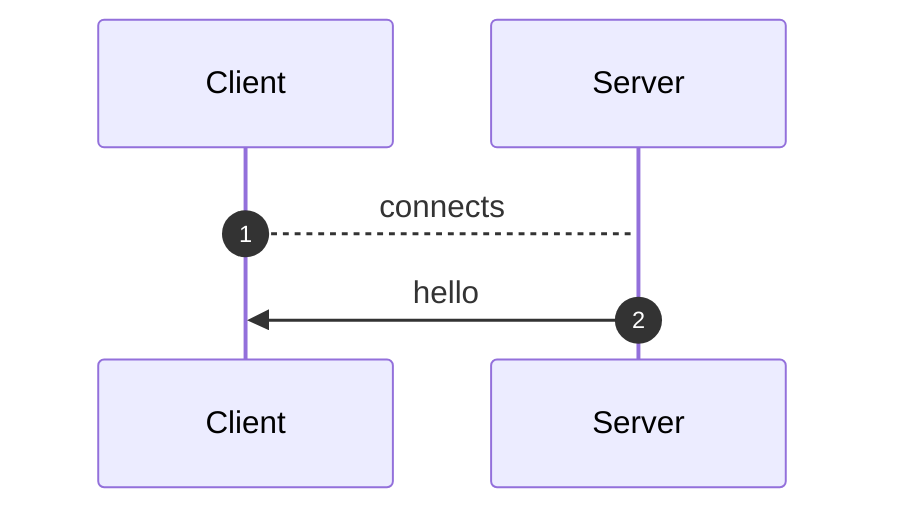
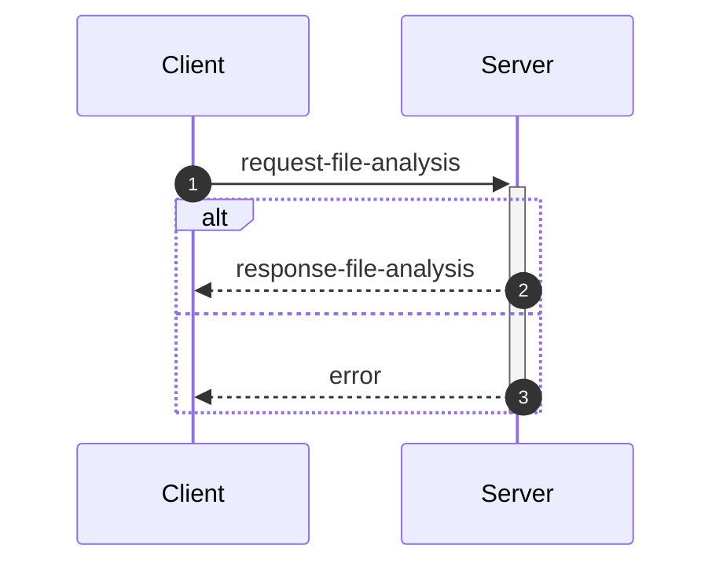
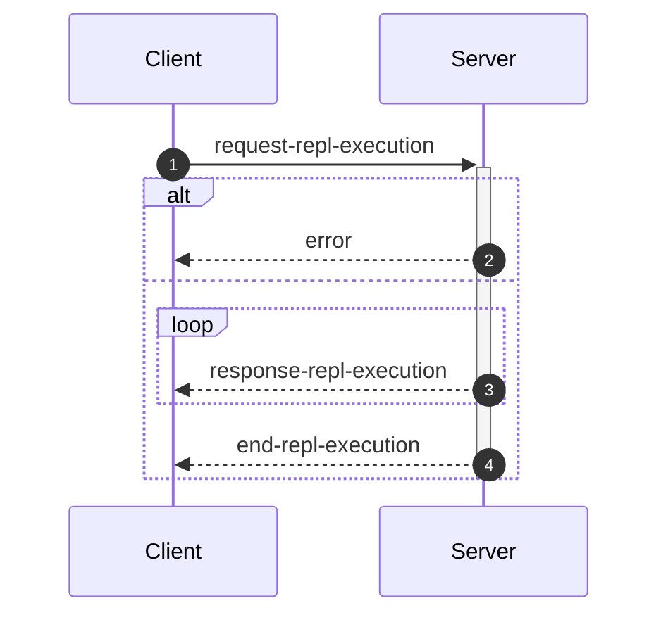
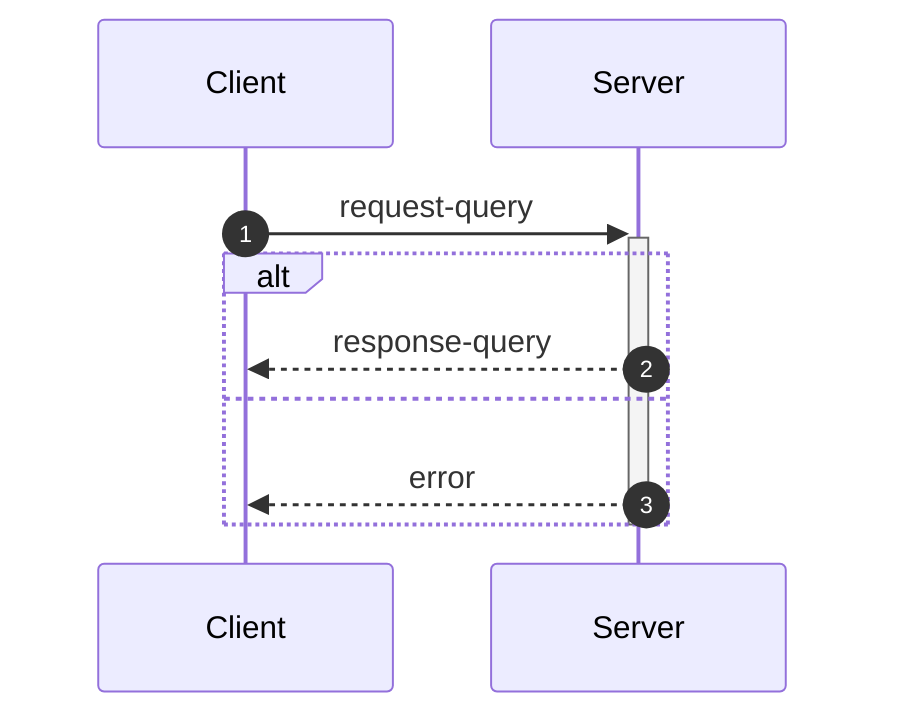

_<span title="an overview of flowR's interface">Generated</span> from '[wiki-interface.ts](https://github.com/flowr-analysis/flowr/tree/main/src/documentation/wiki-interface.ts "src/documentation/wiki-interface.ts")' on 2026-11-08, 18:18:29 UTC (v2.17.4, R v4.6.1), do not edit directly._

Although far from being as detailed as the in-depth explanation of [_flowR_](https://github.com/flowr-analysis/flowr/wiki/Core),
this wiki page explains how to interface with _flowR_ in more detail.
In general, command line arguments and other options provide short descriptions on hover over.

* [💻 Using the REPL](#using-the-repl)
* [⚙️ Configuring FlowR](#configuring-flowr)
* [⚒️ Writing Code](#writing-code)
* [💬 Communicating with the Server](#communicating-with-the-server)

<a id='using-the-repl'></a>
## 💻 Using the REPL

> [!NOTE]
> To execute arbitrary R commands with a repl request, _flowR_ has to be started explicitly with <span title="Description (Command Line Argument): Allow to access the underlying R session when using flowR (security warning: this allows the execution of arbitrary R code!)">`--r-session-access`</span>.
> Please be aware that this introduces a security risk and note that this relies on the [`r-shell` engine](https://github.com/flowr-analysis/flowr/wiki/Engines) .

Although primarily meant for users to explore,
there is nothing which forbids calling _flowR_ as a subprocess to use standard-in, -output, and -error
for communication (although you can access the REPL using the server as well,
with the [REPL Request](#message-request-repl-execution) message).

The read-eval-print loop&nbsp;(REPL) works relatively simple.
You can submit an expression (using <kbd>Enter</kbd>),
which is interpreted as an R&nbsp;expression by default but interpreted as a *command* if it starts with a colon (`:`).
The best command to get started with the REPL is <span title="Description (Repl Command): Show help information (aliases: :h, :?)">`:help`</span>.
Besides, you can leave the REPL either with the command <span title="Description (Repl Command): End the repl (aliases: :q, :exit)">`:quit`</span> or by pressing <kbd>Ctrl</kbd>+<kbd>C</kbd> twice.
When writing a *command*, you may press <kbd>Tab</kbd> to get a list of completions, if available.
Multiple commands can be entered in a single line by separating them with a semicolon (`;`), e.g. `:parse "x<-2"; :df*`.
If a command is given without R code, the REPL will re-use R code given in a previous command.
The prior example will hence return first the parsed AST of the program and then the dataflow graph for `"x <- 2"`.

> [!NOTE]
> If you develop flowR, you may want to launch the repl using the `npm run main-dev` command, this way, you get a non-minified version of flowR with debug information and hot-reloading of source files.

<details>
<summary>Available Commands</summary>

We currently offer the following commands (this with a `[*]` suffix are available with and without the star):

| Command | Description |
| ------- | ----------- |
| **<span title="Description (Repl Command): End the repl (aliases: :q, :exit)">:quit</span>** | End the repl (aliases: **:<span title="Alias of ':quit'. End the repl">q</span>**, **:<span title="Alias of ':quit'. End the repl">exit</span>**) |
| **<span title="Description (Repl Command): Execute the given code as R code. This requires the `--r-session-access` flag to be set and requires the r-shell engine. (aliases: :e, :r)">:execute</span>** | Execute the given code as R code. This requires the `--r-session-access` flag to be set and requires the r-shell engine. (aliases: **:<span title="Alias of ':execute'. Execute the given code as R code. This requires the `--r-session-access` flag to be set and requires the r-shell engine.">e</span>**, **:<span title="Alias of ':execute'. Execute the given code as R code. This requires the `--r-session-access` flag to be set and requires the r-shell engine.">r</span>**) |
| **<span title="Description (Repl Command): Get mermaid code for the control-flow graph of R code (aliases: :cfg, :cf)">:controlflow[*]</span>** | Get mermaid code for the control-flow graph of R code (star: Returns the URL to mermaid.live) (aliases: **:<span title="Alias of ':controlflow'. Get mermaid code for the control-flow graph of R code">cfg</span>**, **:<span title="Alias of ':controlflow'. Get mermaid code for the control-flow graph of R code">cf</span>**) |
| **<span title="Description (Repl Command): Get mermaid code for the control-flow graph with basic blocks (aliases: :cfgb, :cfb)">:controlflowbb[*]</span>** | Get mermaid code for the control-flow graph with basic blocks (star: Returns the URL to mermaid.live) (aliases: **:<span title="Alias of ':controlflowbb'. Get mermaid code for the control-flow graph with basic blocks">cfgb</span>**, **:<span title="Alias of ':controlflowbb'. Get mermaid code for the control-flow graph with basic blocks">cfb</span>**) |
| **<span title="Description (Repl Command): Get mermaid code for the dataflow graph (aliases: :d, :df)">:dataflow[*]</span>** | Get mermaid code for the dataflow graph (star: Returns the URL to mermaid.live) (aliases: **:<span title="Alias of ':dataflow'. Get mermaid code for the dataflow graph">d</span>**, **:<span title="Alias of ':dataflow'. Get mermaid code for the dataflow graph">df</span>**) |
| **<span title="Description (Repl Command): Get mermaid code for the normalized AST of R code (aliases: :n)">:normalize[*]</span>** | Get mermaid code for the normalized AST of R code (star: Returns the URL to mermaid.live) (alias: **:<span title="Alias of ':normalize'. Get mermaid code for the normalized AST of R code">n</span>**) |
| **<span title="Description (Repl Command): Get mermaid code for the simplified dataflow graph (aliases: :ds, :dfs)">:dataflowsimple[*]</span>** | Get mermaid code for the simplified dataflow graph (star: Returns the URL to mermaid.live) (aliases: **:<span title="Alias of ':dataflowsimple'. Get mermaid code for the simplified dataflow graph">ds</span>**, **:<span title="Alias of ':dataflowsimple'. Get mermaid code for the simplified dataflow graph">dfs</span>**) |
| **<span title="Description (Repl Command): Inspect and extend the signature database: `query` (identical to :query @signature), `info <name>` for where a function comes from (identical to :query @function-info), `add <path>` to mount another database/source, `download` to fetch the full-history database. (aliases: :sig)">:signature</span>** | Inspect and extend the signature database: `query` (identical to :query @signature), `info <name>` for where a function comes from (identical to :query @function-info), `add <path>` to mount another database/source, `download` to fetch the full-history database. (alias: **:<span title="Alias of ':signature'. Inspect and extend the signature database: `query` (identical to :query @signature), `info <name>` for where a function comes from (identical to :query @function-info), `add <path>` to mount another database/source, `download` to fetch the full-history database.">sig</span>**) |
| **<span title="Description (Repl Command): Just calculates the DFG, but only prints summary info (aliases: :d#, :df#)">:dataflowsilent</span>** | Just calculates the DFG, but only prints summary info (aliases: **:<span title="Alias of ':dataflowsilent'. Just calculates the DFG, but only prints summary info">d#</span>**, **:<span title="Alias of ':dataflowsilent'. Just calculates the DFG, but only prints summary info">df#</span>**) |
| **<span title="Description (Repl Command): Prints ASCII Art of the parsed, unmodified AST (aliases: :p)">:parse</span>** | Prints ASCII Art of the parsed, unmodified AST (alias: **:<span title="Alias of ':parse'. Prints ASCII Art of the parsed, unmodified AST">p</span>**) |
| **<span title="Description (Repl Command): Prints the version of flowR as well as the current version of R">:version</span>** | Prints the version of flowR as well as the current version of R
| **<span title="Description (Repl Command): Query the given R code (use 'help' for more information)">:query[*]</span>** | Query the given R code (use 'help' for more information) (star: Similar to query, but returns the output in json format.)
| **<span title="Description (Repl Command): Returns an ASCII representation of the dataflow graph (aliases: :df!)">:dataflowascii</span>** | Returns an ASCII representation of the dataflow graph (alias: **:<span title="Alias of ':dataflowascii'. Returns an ASCII representation of the dataflow graph">df!</span>**) |
| **<span title="Description (Repl Command): Returns summarization stats for the normalized AST (aliases: :n#)">:normalize#</span>** | Returns summarization stats for the normalized AST (alias: **:<span title="Alias of ':normalize#'. Returns summarization stats for the normalized AST">n#</span>**) |
| **<span title="Description (Repl Command): Show help information (aliases: :h, :?)">:help</span>** | Show help information (aliases: **:<span title="Alias of ':help'. Show help information">h</span>**, **:<span title="Alias of ':help'. Show help information">?</span>**) |

</details>

> [!TIP]
> 
> As indicated by the examples before, all REPL commands that operate on code keep track of the state.
> Hence, if you run a command like <span title="Description (Repl Command, starred version): Returns the URL to mermaid.live; Base Command: Get mermaid code for the dataflow graph (aliases: :d*, :df*)">`:dataflow*`</span> without providing R code,
> the REPL will re-use the R code provided in a previous command.
> Likewise, doing this will benefit from incrementality!
> If you request the dataflow graph with `:df* x <- 2 * y` and then want to see the parsed AST with `:parse`,
> the REPL will re-use previously obtained information and not re-parse the code again.
> 		

Generally, many commands offer shortcut versions in the REPL. Many queries, for example, offer a shortened format (see the example below).
Of special note, the [Config Query](https://github.com/flowr-analysis/flowr/wiki/%5BQuery%5D-Config)
can be used to also modify the currently active configuration of _flowR_ within the REPL (see the [wiki page](https://github.com/flowr-analysis/flowr/wiki/%5BQuery%5D-Config) for more information).

### Example: Retrieving the Dataflow Graph

To retrieve a URL to the [mermaid](https://mermaid.js.org/) diagram of the dataflow of a given expression,
use <span title="Description (Repl Command, starred version): Returns the URL to mermaid.live; Base Command: Get mermaid code for the dataflow graph (aliases: :d*, :df*)">`:dataflow*`</span> (or <span title="Description (Repl Command): Get mermaid code for the dataflow graph (aliases: :d, :df)">`:dataflow`</span> to get the mermaid code in the cli):

```shell
$ docker run -it --rm eagleoutice/flowr # or npm run flowr 
flowR repl v2.17.4, R grammar v14 (tree-sitter engine)
R> :dataflow* y <- 1 + x
```

<details>
<summary style='color:gray'>Output</summary>

```text
https://mermaid.live/view#base64:eyJjb2RlIjoiZmxvd2NoYXJ0IFREXG4gICAgMXt7XCJgKiM5MTtSTnVtYmVyIzkzOyogKioxKipcbiAgICAgICoxLjYqICgqKmlkOiAxKiopYFwifX1cbiAgICAyKFtcImAqIzkxO1JTeW1ib2wjOTM7KiAqKngqKlxuICAgICAgKjEuMTAqICgqKmlkOiAyKiopYFwiXSlcbiAgICAzW1tcImAqIzkxO1JCaW5hcnlPcCM5MzsqIGJhc2UjNTg7IzU4OyoqIzQzOyoqXG4gICAgICAqMS42LTEwKiAoKippZDogMyoqKVxuICAgIGFyZzogKDEsIDIpYFwiXV1cbiAgICBidWlsdC1pbjpfNDNfW1wiYEJ1aWx0LUluOlxuIzQzO2BcIl1cbiAgICBzdHlsZSBidWlsdC1pbjpfNDNfIHN0cm9rZTpncmF5LGZpbGw6Z3JheSxzdHJva2Utd2lkdGg6MnB4LG9wYWNpdHk6Ljg7XG4gICAgMFtcImAqIzkxO1JTeW1ib2wjOTM7KiAqKnkqKlxuICAgICAgKjEuMSogKCoqaWQ6IDAqKiwgdjogMylgXCJdXG4gICAgNFtbXCJgKiM5MTtSQmluYXJ5T3AjOTM7KiBiYXNlIzU4OyM1ODsqKiM2MDsjNDU7KipcbiAgICAgICoxLjEtMTAqICgqKmlkOiA0KiopXG4gICAgYXJnOiAoMCwgMylgXCJdXVxuICAgIGJ1aWx0LWluOl82MF8tW1wiYEJ1aWx0LUluOlxuIzYwOyM0NTtgXCJdXG4gICAgc3R5bGUgYnVpbHQtaW46XzYwXy0gc3Ryb2tlOmdyYXksZmlsbDpncmF5LHN0cm9rZS13aWR0aDoycHgsb3BhY2l0eTouODtcbiAgICAxIC0uLT58XCJmbG93XCJ8IDJcbiAgICBsaW5rU3R5bGUgMCBzdHJva2U6Z3JheSxjb2xvcjpncmF5O1xuICAgIDIgLS4tPnxcImZsb3dcInwgM1xuICAgIGxpbmtTdHlsZSAxIHN0cm9rZTpncmF5LGNvbG9yOmdyYXk7XG4gICAgMyAtLT58XCJyZWFkcywgYXJnXCJ8IDFcbiAgICAzIC0tPnxcInJlYWRzLCBhcmdcInwgMlxuICAgIDMgLS4tPnxcImZsb3dcInwgMFxuICAgIGxpbmtTdHlsZSA0IHN0cm9rZTpncmF5LGNvbG9yOmdyYXk7XG4gICAgMyAtLi0+fFwicmVhZHMsIGNhbGxzXCJ8IGJ1aWx0LWluOl80M19cbiAgICBsaW5rU3R5bGUgNSBzdHJva2U6Z3JheTtcbiAgICAwIC0tPnxcImRlZmluZWQtYnksIGZsb3dcInwgNFxuICAgIDAgLS0+fFwiZGVmaW5lZC1ieVwifCAzXG4gICAgNCAtLT58XCJyZWFkcywgYXJnXCJ8IDNcbiAgICA0IC0tPnxcInJldHVybnMsIGFyZ1wifCAwXG4gICAgNCAtLi0+fFwicmVhZHMsIGNhbGxzXCJ8IGJ1aWx0LWluOl82MF8tXG4gICAgbGlua1N0eWxlIDEwIHN0cm9rZTpncmF5OyIsIm1lcm1haWQiOnsiYXV0b1N5bmMiOnRydWV9fQ==
```

Retrieve the dataflow graph of the expression `y <- 1 + x`. It looks like this:


<details>

<summary style="color:gray">R Code of the Dataflow Graph</summary>

The analysis ran (parse and normalize with the [tree-sitter](https://github.com/flowr-analysis/flowr/wiki/Engines) engine) in the generation environment. No [signature database](https://github.com/flowr-analysis/flowr/wiki/Signature-Database) is mounted, so `library()` attaches no exports (base-R names are still qualified, e.g., `stats::acf`). 
We encountered no unknown side effects during the analysis.

```r
y <- 1 + x
```

</details>

</details>

For small graphs like this, <span title="Description (Repl Command): Returns an ASCII representation of the dataflow graph (aliases: :df!)">`:dataflowascii`</span> also provides an ASCII representation directly in the REPL:

```shell
$ docker run -it --rm eagleoutice/flowr # or npm run flowr 
flowR repl v2.17.4, R grammar v14 (tree-sitter engine)
R> :df! y <- 1 + x
```

<details open>
<summary style='color:gray'>Output</summary>

```text
                        v<0>v
 c<4>c──────────────────| y |
 |<- |     ┌────────────v---v
 c---c     │
    │   c<3>c   0<1>0
    └───| + |───| 1 |───u<2>u
        c---c   0---0   | x |
           └────────────u---u
Edges:
3 -> 1: reads, arg          3 -> 2: reads, arg
3 -> 0: flows-to            1 -> 2: flows-to
2 -> 3: flows-to            4 -> 3: reads, arg
4 -> 0: returns, arg        0 -> 4: defined-by, flows-to
0 -> 3: defined-by
```

Retrieve the dataflow graph of the expression `y <- 1 + x` as ASCII art.

</details>

For the slicing with <span title="Description (Repl Command): Static backwards executable slicer for R">`:slicer`</span>, you have access to the same [magic comments](#slice-magic-comments) as with the [slice request](#message-request-slice).
Pass `--inline` to splice resolvable `source()` calls into the reconstruction so the slice is a single self-contained R text (the same as the static slice query's `inlineSources` flag).
See `--help` for more flags!

### Example: Interfacing with the File System

Many commands that allow for an R-expression (like <span title="Description (Repl Command, starred version): Returns the URL to mermaid.live; Base Command: Get mermaid code for the dataflow graph (aliases: :d*, :df*)">`:dataflow*`</span>) allow for a file as well
if the argument starts with `file://`.
If you are working from the root directory of the _flowR_ repository, the following gives you the parsed AST of the example file using the <span title="Description (Repl Command): Prints ASCII Art of the parsed, unmodified AST (aliases: :p)">`:parse`</span> command:

> **Watch mode**: Replace `file://` with `watch://` to enter watch mode.
> flowR runs the command immediately and then re-runs it every time the file (or any file inside the folder) changes.
> Enter any other command to leave watch mode.
> For example: `:df watch://analysis.R`

```shell
$ docker run -it --rm eagleoutice/flowr # or npm run flowr 
flowR repl v2.17.4, R grammar v14 (tree-sitter engine)
R> :parse file://test/testfiles/example.R
```

<details>
<summary style='color:gray'>Output</summary>

```text
File: test/testfiles/example.R

program
├ binaryoperator
│ ├ identifier "sum" (1:1─4)
│ ├ <- "<-" (1:5─7)
│ ╰ float "0" (1:8─9)
├ binaryoperator
│ ├ identifier "product" (2:1─8)
│ ├ <- "<-" (2:9─11)
│ ╰ float "1" (2:12─13)
├ binaryoperator
│ ├ identifier "w" (3:1─2)
│ ├ <- "<-" (3:3─5)
│ ╰ float "7" (3:6─7)
├ binaryoperator
│ ├ identifier "N" (4:1─2)
│ ├ <- "<-" (4:3─5)
│ ╰ float "10" (4:6─8)
├ forstatement
│ ├ for "for" (6:1─4)
│ ├ ( "(" (6:5─6)
│ ├ identifier "i" (6:6─7)
│ ├ in "in" (6:8─10)
│ ├ binaryoperator
│ │ ├ float "1" (6:11─12)
│ │ ├ : ":" (6:12─13)
│ │ ╰ parenthesizedexpression
│ │   ├ ( "(" (6:13─14)
│ │   ├ binaryoperator
│ │   │ ├ identifier "N" (6:14─15)
│ │   │ ├ - "-" (6:15─16)
│ │   │ ╰ float "1" (6:16─17)
│ │   ╰ ) ")" (6:17─18)
│ ├ ) ")" (6:18─19)
│ ╰ bracedexpression
│   ├ { "{" (6:20─21)
│   ├ binaryoperator
│   │ ├ identifier "sum" (7:3─6)
│   │ ├ <- "<-" (7:7─9)
│   │ ╰ binaryoperator
│   │   ├ binaryoperator
│   │   │ ├ identifier "sum" (7:10─13)
│   │   │ ├ + "+" (7:14─15)
│   │   │ ╰ identifier "i" (7:16─17)
│   │   ├ + "+" (7:18─19)
│   │   ╰ identifier "w" (7:20─21)
│   ├ binaryoperator
│   │ ├ identifier "product" (8:3─10)
│   │ ├ <- "<-" (8:11─13)
│   │ ╰ binaryoperator
│   │   ├ identifier "product" (8:14─21)
│   │   ├  "" (8:22─23)
│   │   ╰ identifier "i" (8:24─25)
│   ╰ } "}" (9:1─2)
├ call
│ ├ identifier "cat" (11:1─4)
│ ╰ arguments
│   ├ ( "(" (11:4─5)
│   ├ argument
│   │ ╰ string
│   │   ├ stringopen "\"" (11:5─6)
│   │   ├ stringcontent "Sum:" (11:6─10)
│   │   ╰ stringclose "\"" (11:10─11)
│   ├ comma "," (11:11─12)
│   ├ argument
│   │ ╰ identifier "sum" (11:13─16)
│   ├ comma "," (11:16─17)
│   ├ argument
│   │ ╰ string
│   │   ├ stringopen "\"" (11:18─19)
│   │   ├ stringcontent
│   │   │ ╰ escapesequence "\\n" (11:19─21)
│   │   ╰ stringclose "\"" (11:21─22)
│   ╰ ) ")" (11:22─23)
╰ call
  ├ identifier "cat" (12:1─4)
  ╰ arguments
    ├ ( "(" (12:4─5)
    ├ argument
    │ ╰ string
    │   ├ stringopen "\"" (12:5─6)
    │   ├ stringcontent "Product:" (12:6─14)
    │   ╰ stringclose "\"" (12:14─15)
    ├ comma "," (12:15─16)
    ├ argument
    │ ╰ identifier "product" (12:17─24)
    ├ comma "," (12:24─25)
    ├ argument
    │ ╰ string
    │   ├ stringopen "\"" (12:26─27)
    │   ├ stringcontent
    │   │ ╰ escapesequence "\\n" (12:27─29)
    │   ╰ stringclose "\"" (12:29─30)
    ╰ ) ")" (12:30─31)
```

Retrieve the parsed AST of the example file.

<details>

<summary>File Content</summary>

```r
sum <- 0
product <- 1
w <- 7
N <- 10

for (i in 1:(N-1)) {
  sum <- sum + i + w
  product <- product * i
}

cat("Sum:", sum, "\n")
cat("Product:", product, "\n")
```

</details>

As _flowR_ directly transforms this AST the output focuses on being human-readable instead of being machine-readable.
		
</details>

### Example: Run a Query

You can run any query supported by _flowR_ using the <span title="Description (Repl Command): Query the given R code (use 'help' for more information)">`:query`</span> command.
For example, to obtain the shapes of all data frames in a given piece of code, you can run:

```shell
$ docker run -it --rm eagleoutice/flowr # or npm run flowr 
flowR repl v2.17.4, R grammar v14 (tree-sitter engine)
R> :query @absint df-shape "x <- data.frame(a = 1:10, b = 1:10)\ny <- x$a"
```

<details open>
<summary style='color:gray'>Output</summary>

```text
Query: absint (2 ms)
   ╰ $12: (colnames: [{"a", "b"}, {}], cols: [2, 2], rows: [10, 10])
   ╰ $0: (colnames: [{"a", "b"}, {}], cols: [2, 2], rows: [10, 10])
```

Retrieve the shapes of all data frames in the given code.

</details>

To run the linter on a file, you can use (in this example, we just issue the `dead-code` linter on a small piece of code):

```shell
$ docker run -it --rm eagleoutice/flowr # or npm run flowr 
flowR repl v2.17.4, R grammar v14 (tree-sitter engine)
R> :query @linter rules:dead-code "if(FALSE) x <- 2"
```

<details open>
<summary style='color:gray'>Output</summary>

```text
Query: linter (2 ms)
   ╰ Dead Code (dead-code):
       ╰ certain:
           ╰ Code at 1.11-16 (1 quick fix(es) available)
```

Run the linter on the given code, with only the `dead-code` rule enabled.

</details>

For more information on the available queries, please check out the [Query API](https://github.com/flowr-analysis/flowr/wiki/Query-API).

<a id='configuring-flowr'></a>
## ⚙️ Configuring FlowR

When running _flowR_, you may want to specify some behaviors with a dedicated configuration file.
By default, flowR looks for a file named `flowr.json` in the current working directory (or any higher directory).
You can also specify a different file with <span title="Description (Command Line Argument): The name of the configuration file to use">`--config-file`</span> or pass the configuration inline using <span title="Description (Command Line Argument): The flowR configuration to use, as a JSON string">`--config-json`</span>.
A `flowr.json` found this way belongs to the analyzed project, so flowR ignores its options that decide what flowR executes or loads
(`engines.*.wasmPath`, `engines.*.treeSitterWasmPath`, `engines.*.rPath`, `solver.sigdb.additionalPaths`, `solver.sigdb.downloadRepo`, `solver.sigdb.installedLibrary.paths`, `solver.sigdb.onDemand.enabled`, `solver.sigdb.onDemand.repositories`, `solver.sigdb.onDemand.cranMirror`, `solver.sigdb.onDemand.bioconductorMirror`, `solver.sigdb.onDemand.cacheDir`),
unless you pass <span title="Description (Command Line Argument): Keep the security-sensitive options (e.g., the R executable) of the flowr.json found in the working directory or a parent. Only use this for projects you trust.">`--trust-config`</span>.
To analyze code you do not trust, use the secure mode (<span title="Description (Command Line Argument): Run in secure mode for analyzing untrusted code: flowR does not start R (or any other process), does not access the network, does not search for project configs, and ignores security-sensitive options in every config. Cannot be disabled once enabled. Can also be enabled with the environment variable {italic FLOWR_SECURE_MODE=1}.">`--secure`</span>, see the [security policy](https://github.com/flowr-analysis/flowr/blob/main/.github/SECURITY.md)).
To inspect the current configuration, you can run flowr with the <span title="Description (Command Line Argument): Run with verbose logging (will be passed to the corresponding script)">`--verbose`</span> flag, or use the `config` [Query](https://github.com/flowr-analysis/flowr/wiki/Query-API).
Within the REPL this works by running the following:

```shell
:query @config
```

To work with the <a href="https://github.com/flowr-analysis/flowr/tree/main/src/config.ts#L125"><code><span title="The configuration file format for flowR.">FlowrConfig</span></code></a> you can use the provided helper objects alongside its methods like
<a href="https://github.com/flowr-analysis/flowr/tree/main/src/config.ts#L991"><code><span title="Creates a new flowr config that has the updated values.">FlowrConfig::<b>amend</b></span></code></a>.
The schema below documents every option; the ones you most likely want are:

- <a href="https://github.com/flowr-analysis/flowr/wiki/Interface#configuring-flowr" title="Configuration Option (boolean): Whether source calls should be ignored, causing {@link processSourceCall}&#39;s behavior to be skipped.">ignoreSourceCalls</a>: ignore source calls when analyzing the code, i.e., ignore the inclusion of other files.
- <a href="https://github.com/flowr-analysis/flowr/wiki/Interface#configuring-flowr" title="Configuration Option (boolean): Whether load calls should be ignored, causing {@link processLoadCall}&#39;s behavior to be skipped.">ignoreLoadCalls</a>: ignore load calls when analyzing the code, i.e., ignore the loading of r-data files.
- <a href="https://github.com/flowr-analysis/flowr/wiki/Interface#configuring-flowr" title="Configuration Option (object): Do you want to overwrite (parts) of the builtin definition?">semantics.environment.overwriteBuiltIns</a>: overwrite _flowR_'s handling of built-in functions, or clear the preset definitions entirely.
  See [Configure BuiltIn Semantics](#configure-builtin-semantics) for more information.
- <a href="https://github.com/flowr-analysis/flowr/wiki/Interface#configuring-flowr" title="Configuration Option (boolean): Whether calls drawing on a graphics device (e.g., `plot`) count as writing to it, which the ambient state queries then report.">semantics.ambient.drawingWritesDevice</a>: whether calls drawing on a graphics device (e.g., `plot`) count as writing the device in the ambient state queries.
- <a href="https://github.com/flowr-analysis/flowr/wiki/Interface#configuring-flowr" title="Configuration Option (string): How to resolve variables and their values. (one of &quot;disabled&quot;, &quot;alias&quot;, &quot;builtin&quot;)">solver.variables</a>: how to resolve variables and their values (`disabled`, `alias`, `builtin`).
- <a href="https://github.com/flowr-analysis/flowr/wiki/Interface#configuring-flowr" title="Configuration Option (array): The engine or set of engines to use for interacting with R code. An empty array means all available engines will be used.">engines</a> and <a href="https://github.com/flowr-analysis/flowr/wiki/Interface#configuring-flowr" title="Configuration Option (string): The default engine to use for interacting with R code. If this is undefined, an arbitrary engine from the specified list will be used. (one of &quot;tree-sitter&quot;, &quot;r-shell&quot;)">defaultEngine</a>: the engines used to interact with R code, see the [Engines wiki page](https://github.com/flowr-analysis/flowr/wiki/Engines).
- <a href="https://github.com/flowr-analysis/flowr/wiki/Interface#configuring-flowr" title="Configuration Option (array): Files a framework loads on its own, without any source() call (e.g. global.R in a shiny app), in the order they are loaded; flowR orders the matching project files accordingly and analyzes them as one program. Entries are case-insensitive globs matched against the file path, a plain name matches any file with that name, and entries matching no project file are warned about. Usually set per project kind via specializeConfig.">project.implicitSources</a>: the files a framework loads without any `source()` call, in the order in which they are
  loaded. Entries are globs (e.g. `R/*.R`) matched against the file path ignoring capitalization; one matching no file is reported.
- <a href="https://github.com/flowr-analysis/flowr/wiki/Interface#configuring-flowr" title="Configuration Option (object): Overwrite (parts of) the configuration depending on the project kind flowR detects, e.g. to give a shiny app its implicit sources.">specializeConfig</a>: overwrite (parts of) the configuration depending on the kind of project _flowR_ detects
  (e.g. `shiny-app`), which is how a shiny app gets its implicit sources by default. What you configure directly wins.
- <a href="https://github.com/flowr-analysis/flowr/wiki/Interface#configuring-flowr" title="Configuration Option (string): Overwrite the project kind flowR would otherwise infer from the analyzed files, e.g. when auto-detection guesses wrong. (one of &quot;package&quot;, &quot;script&quot;, &quot;shiny-app&quot;, &quot;notebook&quot;, &quot;project&quot;, &quot;unknown&quot;)">project.useProjectType</a>: skip that detection and force a project kind yourself, when auto-detection guesses wrong.
- <a href="https://github.com/flowr-analysis/flowr/wiki/Interface#configuring-flowr" title="Configuration Option (array): The default plugins to load when creating a new instance of FlowrAnalyzer">defaultPlugins</a> and <a href="https://github.com/flowr-analysis/flowr/wiki/Interface#configuring-flowr" title="Configuration Option (array): The plugins to load in REPL mode">repl.plugins</a>: the plugins to load for a new <a href="https://github.com/flowr-analysis/flowr/tree/main/src/project/flowr-analyzer.ts#L240"><code><span title="Central class for conducting analyses with FlowR. Use the FlowrAnalyzerBuilder to create a new instance. If you want the original pattern of creating a pipeline and running all steps, you can still do this with FlowrAnalyzer#runFull . To inspect the context of the analyzer, use FlowrAnalyzer#inspectContext (if you are a plugin and need to modify it, use FlowrAnalyzer#context instead).">FlowrAnalyzer</span></code></a> and in the REPL
  (use `flowr:default` to reference the former).

So you can configure _flowR_ by adding a file like the following:

<details>

<summary>Example Configuration File</summary>

```json
{
  "ignoreSourceCalls": true,
  "ignoreLoadCalls": true,
  "semantics": {
    "environment": {
      "overwriteBuiltIns": {
        "definitions": [
          {
            "type": "function",
            "names": [
              "foo"
            ],
            "processor": "builtin:assign",
            "config": {}
          }
        ]
      }
    }
  },
  "defaultPlugins": [
    "file:description",
    "versions:description"
  ],
  "repl": {
    "quickStats": false,
    "dfProcessorHeat": false,
    "hints": true,
    "plugins": [
      "flowr:default"
    ]
  },
  "project": {
    "resolveUnknownPathsOnDisk": true,
    "implicitSources": [
      "global.R",
      "app.R"
    ]
  },
  "linter": {
    "disabledRules": []
  },
  "specializeConfig": {
    "shiny-app": {
      "project": {
        "implicitSources": [
          "global.R",
          "ui.R",
          "server.R",
          "app.R"
        ]
      }
    }
  },
  "engines": [
    {
      "type": "r-shell"
    }
  ],
  "solver": {
    "variables": "alias",
    "evalStrings": true,
    "trackEnvironments": true,
    "sigdb": {
      "enabled": true,
      "loadProjectDependencies": true,
      "eagerlyLoad": false,
      "eagerlyLoadExports": false,
      "linkBaseR": false,
      "linkDescriptionDependencies": false
    },
    "resolveSource": {
      "dropPaths": "no",
      "ignoreCapitalization": true,
      "inferWorkingDirectory": "active-script",
      "searchPath": []
    },
    "instrument": {},
    "slicer": {
      "threshold": 50
    }
  },
  "abstractInterpretation": {
    "wideningThreshold": 4,
    "followCalls": true,
    "dataFrame": {
      "maxColNames": 20,
      "readLoadedData": {
        "readExternalFiles": true,
        "maxReadLines": 1000000
      }
    }
  },
  "incremental": {
    "alwaysIncremental": false,
    "parsing": {
      "activated": false,
      "heuristics": {
        "activated": true,
        "mtime": true,
        "linesFrom": 500,
        "bytesFrom": 50000,
        "alwaysWithEdits": false,
        "minFiles": 1
      }
    }
  },
  "gas": {
    "thresholds": {
      "memory": {
        "problematic": 0.7,
        "critical": 0.9
      },
      "timeMs": {
        "problematic": 100000,
        "critical": 120000
      }
    },
    "features": {}
  }
}
```

</details>

<details>
<a id='configure-builtin-semantics'></a>
<summary>Configure Built-In Semantics</summary>

`semantics/environment/overwriteBuiltins` accepts two keys:

- `loadDefaults` (boolean, initially `true`): If set to `true`, the default built-in definitions are loaded before applying the custom definitions. Setting this flag to `false` explicitly disables the loading of the default definitions.
- `definitions` (array, initially empty): Allows to overwrite or define new built-in elements. Each object within must have a `type` which is one of the below. Furthermore, they may define a string array of `names` which specifies the identifiers to bind the definitions to. You may use `assumePrimitive` to specify whether _flowR_ should assume that this is a primitive non-library definition (so you probably just do not want to specify the key).

  | Type            | Description                                                                                                                                                                                                                                                                                              | Example                                                                                                    |
  | --------------- | -------------------------------------------------------------------------------------------------------------------------------------------------------------------------------------------------------------------------------------------------------------------------------------------------------- | ---------------------------------------------------------------------------------------------------------- |
  | `constant`    | Additionally allows for a `value` this should resolve to.                                                                                                                                                                                                                                                | `{ type: 'constant', names: ['NULL', 'NA'],  value: null }`                                                |
  | `function`    | Is a rather flexible way to define and bind built-in functions. For the time, we do not have extensive documentation to cover all the cases, so please either consult the sources with the `default-builtin-config/` folder or open a [new issue](https://github.com/flowr-analysis/flowr/issues/new/choose). | `{ type: 'function', names: ['next'], processor: 'builtin:d', config: { cfg: ExitPointType.Next } }` |
  | `replacement` | A comfortable way to specify replacement functions like `$<-` or `names<-`. `suffixes` describes the... suffixes to attach automatically. | `{ type: 'replacement', suffixes: ['<-', '<<-'], names: ['[', '[['] }` |

</details>

<details>

<summary style='color:gray'>Full Configuration-File Schema</summary>

- _The configuration file format for flowR._ (object)
    - **logLevel** [optional] _flowR's global minimum log level, applied when the config is loaded._ (string)
        Only allows: 'silly', 'trace', 'debug', 'info', 'warn', 'error', 'fatal'
    - **ignoreSourceCalls** [optional] _Whether source calls should be ignored, causing {@link processSourceCall}'s behavior to be skipped._ (boolean)
    - **ignoreLoadCalls** [optional] _Whether load calls should be ignored, causing {@link processLoadCall}'s behavior to be skipped._ (boolean)
    - **semantics** _Configure language semantics and how flowR handles them._ (object)
        - **environment** [optional] _Semantics regarding how to handle the R environment._ (object)
            - **overwriteBuiltIns** [optional] _Do you want to overwrite (parts) of the builtin definition?_ (object)
                - **loadDefaults** [optional] _Should the default configuration still be loaded?_ (boolean)
                - **definitions** [optional] _The definitions to load/overwrite._ (array)
                Valid item types:
                    - (object)
        - **ambient** [optional] _Semantics regarding the global state (options, devices, files, ...) calls access._ (object)
            - **drawingWritesDevice** [optional] _Whether calls drawing on a graphics device (e.g., `plot`) count as writing to it, which the ambient state queries then report._ (boolean)
    - **defaultPlugins** [optional] _The default plugins to load when creating a new instance of FlowrAnalyzer_ (array)
    Valid item types:
        - (alternatives)
            - (string)
            - (array)
    - **repl** _Configuration options for the REPL._ (object)
        - **quickStats** [optional] _Whether to show quick stats in the REPL after each evaluation._ (boolean)
        - **dfProcessorHeat** [optional] _This instruments the dataflow processors to count how often each processor is called._ (boolean)
        - **hints** [optional] _Whether to show dim inline hints on the empty prompt (automatically disabled on non-interactive terminals)._ (boolean)
        - **plugins** [optional] _The plugins to load in REPL mode_ (array)
        Valid item types:
            - (alternatives)
                - (string)
                - (array)
        - **autoUseFileProtocol** [optional] _Prepend the file protocol to a repl input that looks like a path, instead of only warning about it._ (boolean)
        - **queryStats** [optional] _Whether `:query` closes with the line stating how long the queries took (`:query*` never prints it)._ (boolean)
        - **showPlugins** [optional] _Whether `:version` grays out the plugins that did not activate during the last analysis._ (boolean)
    - **project** _Project specific configuration options._ (object)
        - **resolveUnknownPathsOnDisk** [optional] _Whether to resolve unknown paths loaded by the r project disk when trying to source/analyze files._ (boolean)
        - **failOnInaccessiblePath** [optional] _Whether a directory that cannot be traversed during file discovery (e.g. due to permissions) aborts the analysis; when false (the default) such paths are logged and skipped._ (boolean)
        - **basePackages** [optional] _The packages considered part of R itself (base and recommended); if unset, flowR uses its built-in list._ (array)
        Valid item types:
            - (string)
        - **implicitSources** [optional] _Files a framework loads on its own, without any source() call (e.g. global.R in a shiny app), in the order they are loaded; flowR orders the matching project files accordingly and analyzes them as one program. Entries are case-insensitive globs matched against the file path, a plain name matches any file with that name, and entries matching no project file are warned about. Usually set per project kind via specializeConfig._ (array)
        Valid item types:
            - (string)
        - **useProjectType** [optional] _Overwrite the project kind flowR would otherwise infer from the analyzed files, e.g. when auto-detection guesses wrong._ (string)
            Only allows: 'package', 'script', 'shiny-app', 'notebook', 'project', 'unknown'
        - **assumeImplicitEcho** [optional] _Whether the top level of the analyzed code is echoed, so that every visible result printed there is collected as an output by the dependencies query (default true, false for a package)._ (boolean)
        - **discovery** [optional] _Scoping options for the default project discovery._ (object)
            - **full** [optional] _Collect every file below the project root (greedy) instead of only the files the detected project kind needs (default false)._ (boolean)
            - **perKind** [optional] _Per-kind include/exclude glob overrides layered on the default scoping._ (object)
            - **ignore** [optional] _Case-insensitive globs that drop matching files from the intelligent discovery, regardless of kind (e.g. .Renviron to ignore environment files)._ (array)
            Valid item types:
                - (string)
        - **classification** [optional] _Overrides for the signals flowR uses to classify the project kind._ (object)
            - **shinyDescriptionTypes** [optional] _DESCRIPTION Type: values that mark a shiny app._ (array)
            Valid item types:
                - (string)
            - **shinyEntryFiles** [optional] _File names a shiny app is assembled from._ (array)
            Valid item types:
                - (string)
            - **shinyUsagePattern** [optional] _Regex source evidencing shiny usage in an entry file._ (string)
            - **notebookExtensions** [optional] _File extensions marking a notebook._ (array)
            Valid item types:
                - (string)
    - **linter** _Linter configuration options._ (object)
        - **disabledRules** _Linting rule names excluded from the default rule set (a rule requested explicitly via a linter query still runs). Usually set per project kind via specializeConfig._ (array)
        Valid item types:
            - (string)
        - **disabledTags** [optional] _Linting rule tags whose rules are excluded from the default rule set (a rule requested explicitly via a linter query still runs). By default the cmd-check rules are disabled for everything but a package; a configured list replaces that default._ (array)
        Valid item types:
            - (string)
    - **inputSources** [optional] _Further frameworks the input-sources analysis should know about; entries are added to flowR's defaults._ (object)
        - **pure** [optional] _Functions that only pass the constantness of their arguments on._ (array)
        Valid item types:
            - (string)
        - **param** [optional] _Functions whose result is a 'param' input._ (array)
        Valid item types:
            - (string)
        - **file** [optional] _Functions whose result is a 'file' input._ (array)
        Valid item types:
            - (string)
        - **tempfile** [optional] _Functions whose result is a 'tempfile' input._ (array)
        Valid item types:
            - (string)
        - **glob** [optional] _Functions whose result is a 'glob' input._ (array)
        Valid item types:
            - (string)
        - **net** [optional] _Functions whose result is a 'net' input._ (array)
        Valid item types:
            - (string)
        - **rand** [optional] _Functions whose result is a 'rand' input._ (array)
        Valid item types:
            - (string)
        - **system** [optional] _Functions whose result is a 'system' input._ (array)
        Valid item types:
            - (string)
        - **ffi** [optional] _Functions whose result is a 'ffi' input._ (array)
        Valid item types:
            - (string)
        - **lang** [optional] _Functions whose result is a 'lang' input._ (array)
        Valid item types:
            - (string)
        - **options** [optional] _Functions whose result is a 'options' input._ (array)
        Valid item types:
            - (string)
        - **cmdline** [optional] _Functions whose result is a 'cmdline' input._ (array)
        Valid item types:
            - (string)
        - **user** [optional] _Functions whose result is a 'user' input._ (array)
        Valid item types:
            - (string)
        - **const** [optional] _Functions whose result is a 'const' input._ (array)
        Valid item types:
            - (string)
        - **scope** [optional] _Functions whose result is a 'scope' input._ (array)
        Valid item types:
            - (string)
        - **dconst** [optional] _Functions whose result is a 'dconst' input._ (array)
        Valid item types:
            - (string)
        - **unknown** [optional] _Functions whose result is a 'unknown' input._ (array)
        Valid item types:
            - (string)
        - **linkedObjects** [optional] _Objects a framework provides without a definition in the code, e.g. shiny's input._ (array)
        Valid item types:
            - (object)
        - **linkedEntryPoints** [optional] _Calls that hand a function to a framework, which binds its objects to the parameters by position._ (array)
        Valid item types:
            - (object)
    - **specializeConfig** [optional] _Overwrite (parts of) the configuration depending on the project kind flowR detects, e.g. to give a shiny app its implicit sources._ (object)
    - **engines** _The engine or set of engines to use for interacting with R code. An empty array means all available engines will be used._ (array)
    Valid item types:
        - (alternatives)
            - _The configuration for the tree sitter engine._ (object)
                - **type** [required] _Use the tree sitter engine._ (string)
                    Only allows: 'tree-sitter'
                - **wasmPath** [optional] _The path to the tree-sitter-r WASM binary to use. If this is undefined, this uses the default path._ (string)
                - **treeSitterWasmPath** [optional] _The path to the tree-sitter WASM binary to use. If this is undefined, this uses the default path._ (string)
                - **lax** [optional] _Whether to use the lax parser for parsing R code (allowing for syntax errors). If this is undefined, the strict parser will be used._ (boolean)
            - _The configuration for the R shell engine._ (object)
                - **type** [required] _Use the R shell engine._ (string)
                    Only allows: 'r-shell'
                - **rPath** [optional] _The path to the R executable to use. If this is undefined, this uses the default path._ (string)
                - **pipeBind** [optional] _Whether to enable R's experimental pipe-bind operator "=>" by setting _R_USE_PIPEBIND_ for the R session (default false); R itself keeps this off by default, as it is experimental and has never shipped in a release version of R._ (boolean)
    - **defaultEngine** [optional] _The default engine to use for interacting with R code. If this is undefined, an arbitrary engine from the specified list will be used._ (string)
        Only allows: 'tree-sitter', 'r-shell'
    - **solver** _How to resolve constants, constraints, cells, ..._ (object)
        - **variables** _How to resolve variables and their values._ (string)
            Only allows: 'disabled', 'alias', 'builtin'
        - **evalStrings** _Should we include eval(parse(text="...")) calls in the dataflow graph?_ (boolean)
        - **trackEnvironments** [optional] _Track user-created environments (new.env, assign/get/local with envir=, dollar-assign, attach). When false, all envir-style calls fall through conservatively._ (boolean)
        - **sigdb** _Resolving library exports from a signature database._ (object)
            - **enabled** [optional] _Resolve library()/use() exports from a signature database (default true); when false no database is consulted._ (boolean)
            - **loadProjectDependencies** [optional] _Load the project's declared dependencies from its metadata files (DESCRIPTION Imports/Depends, rproject.toml, uvr.toml, rig rproj.toml and script blocks, renv.lock, rv.lock, uvr.lock, rig lockfiles) (default true); when false these files are not read for dependencies._ (boolean)
            - **eagerlyLoad** [optional] _Parse the database up front rather than on the first package load (default false, ignored if disabled)._ (boolean)
            - **eagerlyLoadExports** [optional] _Add a vertex for every export on load rather than on demand (default false); keeps the dataflow graph small._ (boolean)
            - **assumedRVersion** [optional] _R version assumed when resolving versioned (base-R) exports: a pin like "4.5" or "auto" to detect the installed R (default "auto")._ (string)
            - **linkBaseR** [optional] _Eagerly attach base-R namespaces so bare base calls resolve without library() (default false)._ (boolean)
            - **linkBaseRCalls** [optional] _Add a lightweight Reads edge from a bare base-R call to its signature-database function vertex (default false; base-R qualification is edge-free otherwise)._ (boolean)
            - **linkPackageCalls** [optional] _Add a lightweight Reads edge from a resolved package call to its signature-database function vertex (default false)._ (boolean)
            - **linkDescriptionDependencies** [optional] _Eagerly attach the namespaces of the project's declared DESCRIPTION dependencies (Imports/Depends) so their exports resolve without an explicit library() (default false)._ (boolean)
            - **warmInBackground** [optional] _Decompress the hot shards (base + most-downloaded) in a background task on startup so the first library() lookup is warm (default false; for long-running servers/REPLs)._ (boolean)
            - **additionalPaths** [optional] _Extra directories or bundle/manifest files searched for signature databases (alongside the shipped default and $FLOWR_SIGDB_DIR); a downloaded full-history bundle placed here is mounted automatically._ (array)
            Valid item types:
                - (string)
            - **downloadRepo** [optional] _GitHub owner/repo the full-history bundle is downloaded from via ":signature download" (default "flowr-analysis/flowr"; the release tag comes from the committed sigdb.remote.json unless a version is given)._ (string)
            - **autoSync** [optional] _On startup, re-download shards whose committed sigdb.remote.json hash no longer matches the cache, in the background (default false; opt-in network sync after a git pull)._ (boolean)
            - **installedLibrary** [optional] _Recovering packages no signature database knows from the copy installed on this machine._ (object)
                - **enabled** [required] _Recover packages no signature database knows from their installed copy (default false)._ (boolean)
                - **paths** [optional] _Library directories to search; when empty they are discovered from the environment and the project._ (array)
                Valid item types:
                    - (string)
                - **useEnvironment** [optional] _Search the libraries R_LIBS_USER/R_LIBS/R_LIBS_SITE name (default true)._ (boolean)
                - **useProjectLibrary** [optional] _Search a project-local renv/packrat library (default true)._ (boolean)
                - **maxDepth** [optional] _How far to descend into the nested layout of a project-local library (default 3)._ (number)
                - **packages** [optional] _Only recover packages whose name matches one of these regular expressions; empty means any._ (array)
                Valid item types:
                    - (string)
            - **onDemand** [optional] _Recovering packages no signature database knows from their sources on CRAN, Bioconductor, or GitHub._ (object)
                - **enabled** [required] _Fetch and recover the sources of packages no signature database knows when the analyzed code uses them (default false, accesses the network)._ (boolean)
                - **sources** [optional] _Where to look, in order: github, cran, bioconductor, or a source a plugin adds (default ["github", "cran", "bioconductor"])._ (array)
                Valid item types:
                    - (string)
                - **repositories** [optional] _GitHub repositories (owner/repo[/subdir][@ref]) to fetch packages from, by package name. The analyzed project may name more (DESCRIPTION Remotes, install_github calls)._ (object)
                - **packages** [optional] _Only recover packages whose name matches one of these regular expressions, empty means any._ (array)
                Valid item types:
                    - (string)
                - **cranMirror** [optional] _The CRAN src/contrib/ to fetch from, over https (default https://cloud.r-project.org/src/contrib/). It may be on the local network._ (string)
                - **bioconductorMirror** [optional] _The Bioconductor host, over https (default https://bioconductor.org). It may be on the local network._ (string)
                - **bioconductorRelease** [optional] _The Bioconductor release to fetch from: release, devel, or a number like 3.20 (default release)._ (string)
                - **githubMirrors** [optional] _Use the GitHub mirrors of CRAN (cran/<pkg>) and Bioconductor (bioc/<pkg>) (default true)._ (boolean)
                - **maxPackages** [optional] _The most packages to fetch for one analysis (default 25)._ (number)
                - **maxArchiveMb** [optional] _The most MiB a package archive may have (default 32). It may unpack to three times that, at most 128 MiB._ (number)
                - **offline** [optional] _Only use what was fetched before, never the network (default false)._ (boolean)
                - **retryAfterHours** [optional] _How many hours to wait before asking again for a package no source had (default 24)._ (number)
                - **cacheDir** [optional] _Where to cache what was fetched (default the on-demand directory of the signature cache)._ (string)
            - **blobCacheBudgetMb** [optional] _How many MiB of decoded package blobs every open bundle may hold together (default 16)._ (number)
            - **versionSelection** [optional] _When a project constrains a dependency, resolve to the newest (default), oldest, or system-installed version satisfying it; system needs R and falls back to newest. Base-R packages always resolve against the assumed R version._ (string)
                Only allows: 'newest', 'oldest', 'system'
            - **versionOverrides** [optional] _Force an exact version for specific packages (name -> version), overriding both the project constraint and the versionSelection policy (default {})._ (object)
        - **versionManagement** _Policies for reasoning about dependency versions._ (object)
            - **linkedVersionGroups** [optional] _Groups of packages that must resolve to the same version; version guessing intersects each group so its members stay mutually compatible (default [])._ (array)
            Valid item types:
                - (array)
                Valid item types:
                    - (string)
        - **assumeAttachedPackages** [optional] _Packages to treat as attached without a `library()` call, so what the built-in configuration states about them applies to the analyzed code. The base packages R attaches on startup already resolve without it._ (array)
        Valid item types:
            - (string)
        - **transitiveSideEffectRounds** [optional] _How many rounds the transitive side-effect fixpoint may run before it is cut off (default 32); the propagation stops on its own as soon as a round adds nothing._ (number)
        - **maxOverlayDepth** [optional] _How many binding overlays may stack on one environment frame before a write flattens them (default 4); a pure performance knob, trading lookup cost against copy cost without changing any result._ (number)
        - **instrument** (object)
            - **dataflowExtractors** [optional] _These keys are only intended for use within code, allowing to instrument the dataflow analyzer!_ (any)
        - **resolveSource** [optional] _If lax source calls are active, flowR searches for sourced files much more freely, based on the configurations you give it. This option is only in effect if `ignoreSourceCalls` is set to false._ (object)
            - **dropPaths** _Allow to drop the first or all parts of the sourced path, if it is relative._ (string)
                Only allows: 'no', 'once', 'all'
            - **ignoreCapitalization** _Search for filenames matching in the lowercase._ (boolean)
            - **inferWorkingDirectory** _Try to infer the working directory from the main or any script to analyze._ (string)
                Only allows: 'no', 'main-script', 'active-script', 'any-script'
            - **searchPath** _Additionally search in these paths._ (array)
            Valid item types:
                - (string)
            - **repeatedSourceLimit** [optional] _How often the same file can be sourced within a single run? Please be aware: in case of cyclic sources this may not reach a fixpoint so give this a sensible limit._ (number)
            - **applyReplacements** _Provide name replacements for loaded files_ (array)
            Valid item types:
                - (object)
            - **assumeFilesExist** [optional] _Assume a sourced file is always there, making what it defines certain instead of conditional on the source call._ (boolean)
        - **slicer** [optional] _The configuration for the slicer._ (object)
            - **threshold** [optional] _The maximum number of iterations to perform on a single function call during slicing._ (number)
            - **autoExtend** [optional] _If set, the slicer will gain an additional post-pass._ (boolean)
    - **abstractInterpretation** _The configuration options for abstract interpretation._ (object)
        - **wideningThreshold** _The threshold for the number of visitations of a node at which widening should be performed to ensure the termination of the fixpoint iteration._ (number)
        - **followCalls** _Whether the abstract interpretation is interprocedural, i.e. whether it steps into the functions a call may dispatch to._ (boolean)
        - **dataFrame** _The configuration of the shape inference for data frames._ (object)
            - **maxColNames** _The maximum number of columns names to infer for data frames before over-approximating the column names to top._ (number)
            - **readLoadedData** _Configuration options for reading data frame shapes from loaded external data files, such as CSV files._ (object)
                - **readExternalFiles** _Whether data frame shapes should be extracted from loaded external files, such as CSV files._ (boolean)
                - **maxReadLines** _The maximum number of lines to read when extracting data frame shapes from loaded files, such as CSV files._ (number)
    - **incremental** (object)
        - **alwaysIncremental** _Always take the incremental path, regardless of heuristics._ (boolean)
        - **parsing** (object)
            - **activated** _If set, incremental parsing will be used._ (boolean)
            - **heuristics** (object)
                - **activated** [optional] _If set, the heuristics for incremental parsing will be used._ (boolean)
                - **mtime** [optional] _Skip reparsing entirely if the file's modification time is unchanged since the last parse._ (boolean)
                - **linesFrom** [optional] _Only consider incremental parsing for files with at least this many lines._ (number)
                - **bytesFrom** [optional] _Only consider incremental parsing for files with at least this many bytes._ (number)
                - **alwaysWithEdits** [optional] _Always take the incremental path whenever there is a computed edit region, regardless of the other thresholds._ (boolean)
                - **minFiles** [optional] _Only apply these heuristics once the project has at least this many files loaded._ (number)
    - **gas** [optional] _Resource-usage guard (gas) configuration. All feature factors default to 0 (disabled). See https://github.com/flowr-analysis/flowr/wiki/Core#gas-resource-guard._ (object)
        - **thresholds** [optional] _Thresholds for all gas checks (scaled by per-feature factor), boundable per feature._ (object)
            - **memory** [optional] _Heap-usage fraction thresholds (0-1), either shared or given per feature key (with `default` covering the rest)._ (object)
                - **problematic** [optional] _Heap fraction (0-1) above which Problematic is returned, for every feature without an entry of its own._ (number)
                - **critical** [optional] _Heap fraction (0-1) above which Critical is returned, for every feature without an entry of its own._ (number)
            - **timeMs** [optional] _Elapsed analysis time thresholds in milliseconds, either shared or given per feature key (with `default` covering the rest)._ (object)
                - **problematic** [optional] _Elapsed ms above which Problematic is returned, for every feature without an entry of its own._ (number)
                - **critical** [optional] _Elapsed ms above which Critical is returned, for every feature without an entry of its own._ (number)
            - **steps** [optional] _Processed-AST-node thresholds, counted rather than sampled; only a key that arms a budget (`dataflow`) reads them._ (object)
                - **problematic** [optional] _Processed AST nodes above which Problematic is returned, for every feature without an entry of its own._ (number)
                - **critical** [optional] _Processed AST nodes above which the extraction is cut short, for every feature without an entry of its own._ (number)
            - **vertices** [optional] _Created-dataflow-vertex thresholds, counted like `steps`._ (object)
                - **problematic** [optional] _Created dataflow vertices above which Problematic is returned, for every feature without an entry of its own._ (number)
                - **critical** [optional] _Created dataflow vertices above which the extraction is cut short, for every feature without an entry of its own._ (number)
        - **features** [optional] _Per-feature sensitivity factors. 0 or absent disables gas checking for that feature. A factor of 2 makes the feature twice as sensitive. Recognised keys: `source`, `side-effect-linking`, `linter`, `slicer`, `dataflow`._ (object)
        - **countedCheckEvery** [optional] _How many counted steps pass between two accountings of an armed check, be it a dataflow budget or the slicer's traversal (default 128); trades overshoot against the cost of the check._ (number)
        - **heapProvider** [optional] _Custom heap statistics source (programmatic configs only), overriding the built-in v8/performance.memory detection._ (function)

</details>

<a id='writing-code'></a>
## ⚒️ Writing Code

_flowR_ can be used as a [module](https://www.npmjs.com/package/@eagleoutice/flowr) and offers several main classes and interfaces that are interesting for extension writers 
(see the [Visual Studio Code extension](https://marketplace.visualstudio.com/items?itemName=code-inspect.vscode-flowr) or the [Core](https://github.com/flowr-analysis/flowr/wiki/Core) wiki page for more information).

### Creating Analyses with _flowR_

Nowadays, instances of the <a href="https://github.com/flowr-analysis/flowr/tree/main/src/project/flowr-analyzer.ts#L240"><code><span title="Central class for conducting analyses with FlowR. Use the FlowrAnalyzerBuilder to create a new instance. If you want the original pattern of creating a pipeline and running all steps, you can still do this with FlowrAnalyzer#runFull . To inspect the context of the analyzer, use FlowrAnalyzer#inspectContext (if you are a plugin and need to modify it, use FlowrAnalyzer#context instead).">FlowrAnalyzer</span></code></a> should be used as central frontend to get analysis results from _flowR_.
The entry points an analysis is written against are re-exported from the package root (`import { FlowrAnalyzerBuilder } from '@eagleoutice/flowr'`);
everything else stays reachable under its own path, as in `@eagleoutice/flowr/dataflow/graph/graph`.
For example, a program slice can be created like this:

```ts
const analyzer = await new FlowrAnalyzerBuilder()
    .setEngine('tree-sitter')
    .build();
analyzer.addRequest('x <- 1\ny <- x\nx');
const { slice, reconstruct } = await analyzer.query({
    type:     'static-slice',
    criteria: ['3@x']
});
```

For more information, please have a look at the [Analyzer](https://github.com/flowr-analysis/flowr/wiki/Analyzer) wiki page, which explains how to construct and use the <a href="https://github.com/flowr-analysis/flowr/tree/main/src/project/flowr-analyzer.ts#L240"><code><span title="Central class for conducting analyses with FlowR. Use the FlowrAnalyzerBuilder to create a new instance. If you want the original pattern of creating a pipeline and running all steps, you can still do this with FlowrAnalyzer#runFull . To inspect the context of the analyzer, use FlowrAnalyzer#inspectContext (if you are a plugin and need to modify it, use FlowrAnalyzer#context instead).">FlowrAnalyzer</span></code></a> in more detail.
To work with specific perspectives, you can also consult the respective pages like the [Dataflow Graph](https://github.com/flowr-analysis/flowr/wiki/Dataflow-Graph) or the [Abstract Interpretation](https://github.com/flowr-analysis/flowr/wiki/Abstract-Interpretation) wiki pages.
### The Pipeline Executor (Low-Level Interface)

Once, in the beginning, _flowR_ was meant to produce a dataflow graph merely to provide *program slices*. 
However, with continuous updates, the [Dataflow Graph](https://github.com/flowr-analysis/flowr/wiki/Dataflow-Graph) repeatedly proves to be the more interesting part.
With this, we restructured _flowR_'s originally *hardcoded* pipeline to be far more flexible. 
Now, it can be theoretically extended or replaced with arbitrary steps, optional steps, and what we call 'decorations' of these steps. 
In short, a slicing pipeline using the <a href="https://github.com/flowr-analysis/flowr/tree/main/src/core/pipeline-executor.ts#L97"><code><span title="**Please note:** The PipelineExecutor is now considered to be a rather low-level API for flowR. While it still works and is the basis for all other layers, we strongly recommend using the FlowrAnalyzer and its builder to create and use an analyzer instance that is pre-configured for your use-case. The pipeline executor allows to execute arbitrary pipelines in a step-by-step fashion. If you are not...">PipelineExecutor</span></code></a> looks like this:

```ts

const slicer = new PipelineExecutor(DEFAULT_SLICING_PIPELINE, {
  parser:    new RShell(),
  request:   requestFromInput('x <- 1\nx + 1'),
  criterion: ['2@x']
})
const slice = await slicer.allRemainingSteps()
// console.log(slice.reconstruct.code)
```

<details><summary>More Information</summary>

If you compare this, with what you would have done with the old (and removed) `SteppingSlicer`, 
this essentially just requires you to replace the `SteppingSlicer` with the <a href="https://github.com/flowr-analysis/flowr/tree/main/src/core/pipeline-executor.ts#L97"><code><span title="**Please note:** The PipelineExecutor is now considered to be a rather low-level API for flowR. While it still works and is the basis for all other layers, we strongly recommend using the FlowrAnalyzer and its builder to create and use an analyzer instance that is pre-configured for your use-case. The pipeline executor allows to execute arbitrary pipelines in a step-by-step fashion. If you are not...">PipelineExecutor</span></code></a>
and to pass the <a href="https://github.com/flowr-analysis/flowr/tree/main/src/core/steps/pipeline/default-pipelines.ts#L18"><code>DEFAULT_SLICING_PIPELINE</code></a> as the first argument.
The <a href="https://github.com/flowr-analysis/flowr/tree/main/src/core/pipeline-executor.ts#L97"><code><span title="**Please note:** The PipelineExecutor is now considered to be a rather low-level API for flowR. While it still works and is the basis for all other layers, we strongly recommend using the FlowrAnalyzer and its builder to create and use an analyzer instance that is pre-configured for your use-case. The pipeline executor allows to execute arbitrary pipelines in a step-by-step fashion. If you are not...">PipelineExecutor</span></code></a>...

1. Provides structures to investigate the results of all intermediate steps
2. Can be executed step-by-step
3. Can repeat steps (e.g., to calculate multiple slices on the same input)

See the in-code documentation for more information.

</details>

### Using the <a href="https://github.com/flowr-analysis/flowr/tree/main/src/r-bridge/shell.ts#L144"><code><span title="The RShell represents an interactive session with the R interpreter. You can configure it by RShellOptions . At the moment we are using a live R session (and not networking etc.) to communicate with R easily, which allows us to install packages etc. However, this might and probably will change in the future (leaving this as a legacy mode :D)">RShell</span></code></a> to Interact with R

The <a href="https://github.com/flowr-analysis/flowr/tree/main/src/r-bridge/shell.ts#L144"><code><span title="The RShell represents an interactive session with the R interpreter. You can configure it by RShellOptions . At the moment we are using a live R session (and not networking etc.) to communicate with R easily, which allows us to install packages etc. However, this might and probably will change in the future (leaving this as a legacy mode :D)">RShell</span></code></a> class allows interfacing with the `R`&nbsp;ecosystem installed on the host system.
Please have a look at [flowR's Engines](https://github.com/flowr-analysis/flowr/wiki/Engines) for more information on alternatives (for example, the <a href="https://github.com/flowr-analysis/flowr/tree/main/src/r-bridge/lang-4.x/tree-sitter/tree-sitter-executor.ts#L29"><code><span title="Synchronous and (way) faster alternative to the RShell using tree-sitter.">TreeSitterExecutor</span></code></a>).

> [!IMPORTANT]
> 
> Each <a href="https://github.com/flowr-analysis/flowr/tree/main/src/r-bridge/shell.ts#L144"><code><span title="The RShell represents an interactive session with the R interpreter. You can configure it by RShellOptions . At the moment we are using a live R session (and not networking etc.) to communicate with R easily, which allows us to install packages etc. However, this might and probably will change in the future (leaving this as a legacy mode :D)">RShell</span></code></a> controls a new instance of the R&nbsp;interpreter, 
> make sure to call <code><a href="https://github.com/flowr-analysis/flowr/tree/main/src/r-bridge/shell.ts#L350"><span title="Close the current R session, makes the object effectively invalid (can no longer be reopened etc.)">RShell::<i>close</i></span></a>()</code> when you are done.

You can start a new "session" by constructing a new object with <code>new <a href="https://github.com/flowr-analysis/flowr/tree/main/src/r-bridge/shell.ts#L144"><span title="The RShell represents an interactive session with the R interpreter. You can configure it by RShellOptions . At the moment we are using a live R session (and not networking etc.) to communicate with R easily, which allows us to install packages etc. However, this might and probably will change in the future (leaving this as a legacy mode :D)">RShell</span></a>()</code>.

However, there are several options that may be of interest 
(e.g., to automatically revive the shell in case of errors or to control the name location of the R process on the system).

With a shell object (let's call it `shell`), you can execute R code by using <a href="https://github.com/flowr-analysis/flowr/tree/main/src/r-bridge/shell.ts#L213"><code><span title="sends the given command directly to the current R session will not do anything to alter input markers!">RShell::<i>sendCommand</i></span></code></a>,
for example <code>shell.<a href="https://github.com/flowr-analysis/flowr/tree/main/src/r-bridge/shell.ts#L213"><span title="sends the given command directly to the current R session will not do anything to alter input markers!">sendCommand</span></a>("1 + 1")</code>.
However, this does not return anything, so if you want to collect the output of your command, use
<a href="https://github.com/flowr-analysis/flowr/tree/main/src/r-bridge/shell.ts#L296"><code><span title="Send a command and collect the output">RShell::<i>sendCommandWithOutput</i></span></code></a> instead.

<a id='communicating-with-the-server'></a>
## 💬 Communicating with the Server

As explained in the [Overview](https://github.com/flowr-analysis/flowr/wiki/Overview), you can run the [TCP](https://de.wikipedia.org/wiki/Transmission_Control_Protocol)&nbsp;server by adding the <span title="Description (Command Line Argument): Do not drop into a repl, but instead start a server on the given port (default: 1042) and listen for messages.">`--server`</span> flag (and, due to the interactive mode, exit with the conventional <kbd>CTRL</kbd>+<kbd>C</kbd>).
Currently, every connection is handled by the same underlying `RShell` - so the server is not designed to handle many clients at a time.
Additionally, the server is not well guarded against attacks (e.g., you can theoretically spawn an arbitrary number of&nbsp;RShell sessions on the target machine).

Every message has to be given in a single line (i.e., without a newline in-between) and end with a newline character. Nevertheless, we will pretty-print example given in the following segments for the ease of reading.

> [!NOTE]
> 
> The default <span title="Description (Command Line Argument): Do not drop into a repl, but instead start a server on the given port (default: 1042) and listen for messages.">`--server`</span> uses a simple [TCP](https://de.wikipedia.org/wiki/Transmission_Control_Protocol)
> connection. If you want _flowR_ to expose a [WebSocket](https://de.wikipedia.org/wiki/WebSocket) server instead, add the <span title="Description (Command Line Argument): If the server flag is set, use websocket for messaging">`--ws`</span> flag (i.e., <span title="Description (Command Line Argument): Do not drop into a repl, but instead start a server on the given port (default: 1042) and listen for messages.">`--server`</span> <span title="Description (Command Line Argument): If the server flag is set, use websocket for messaging">`--ws`</span>) when starting _flowR_ from the command line.

<ul><li>
<a id="message-hello"></a>
<b>Hello</b> Message (<code>hello</code>) 
<details>

<summary style="color:gray"> View Details. <i>The server informs the client about the successful connection and provides Meta-Information.</i> </summary>



After launching _flowR_, for example, with <code>docker run -it --rm eagleoutice/flowr <span title="Description (Command Line Argument): Do not drop into a repl, but instead start a server on the given port (default: 1042) and listen for messages.">-<span/>-server</span></code>&nbsp;(🐳️), connecting should present you with a `hello` message, that amongst others should reveal the versions of&nbsp;_flowR_ and&nbsp;R, using the [semver 2.0](https://semver.org/spec/v2.0.0.html) versioning scheme.
The message looks like this:

```json
{
  "type": "hello",
  "clientName": "client-0",
  "versions": {
    "flowr": "2.17.4",
    "r": "4.6.1",
    "engine": "r-shell"
  }
}
```

There are currently a few messages that you can send after the hello message.
If you want to _slice_ a piece of R code you first have to send an [analysis request](#message-request-file-analysis), so that you can send one or multiple slice requests afterward.
Requests for the [REPL](#message-request-repl-execution) are independent of that.
	
<hr>

<details>
<summary style="color:gray">Message schema (<code>hello</code>)</summary>

For the definition of the hello message, please see it's implementation at [`./src/cli/repl/server/messages/message-hello.ts`](https://github.com/flowr-analysis/flowr/tree/main/src/cli/repl/server/messages/message-hello.ts).

- [required] (object)
    - **type** [required] _The type of the hello message._ (string)
        Only allows: 'hello'
    - **id** [forbidden] _The id of the message is always undefined (as it is the initial message and not requested)._ (any)
    - **clientName** [required] _A unique name that is assigned to each client. It has no semantic meaning and is only used/useful for debugging._ (string)
    - **versions** [required] (object)
        - **flowr** [required] _The version of the flowr server running in semver format._ (string)
        - **r** [required] _The version of the underlying R shell running in semver format._ (string)
        - **engine** [required] _The parser backend that is used to parse the R code._ (string)

</details>

<hr>

</details>
	</li>

<li>
<a id="message-request-file-analysis"></a>
<b>Analysis</b> Message (<code>request-file-analysis</code>) 
<details>

<summary style="color:gray"> View Details. <i>The server builds the dataflow graph for a given input file (or a set of files).</i> </summary>



The request allows the server to analyze a file and prepare it for slicing.
The message can contain a `filetoken`, which is used to identify the file in later slice or query requests (if you do not add one, the request will not be stored and therefore, it is not available for subsequent requests).

> **Please note!**\
> If you want to send and process a lot of analysis requests, but do not want to slice them, please do not pass the `filetoken` field. This will save the server a lot of memory allocation.

Furthermore, the request must contain either a `content` field to directly pass the file's content or a `filepath` field which contains the path to the file (this path must be accessible for the server to be useful).
If you add the `id` field, the answer will use the same `id` so you can match requests and the corresponding answers.
See the implementation of the request-file-analysis message for more information.

You can drop one or more stored file tokens by adding the `invalidateToken` field (a single token or an array of tokens).
The server frees the corresponding analyses _after_ it has answered the request.

> **Tip!**\
> If you only want to drop tokens, you do not need a separate message: send a `request-file-analysis` that contains _just_ the `invalidateToken` field (and no `content` or `filepath`).
> Such a request behaves like an empty file analysis and the server replies with an empty `results` object.
> Because invalidation happens after the response, you may even pass the _current_ `filetoken` in `invalidateToken` to analyze a file once and have the server forget it right after you received the results.

<details>
<summary>Example of the <code>request-file-analysis</code> Message</summary>

_Note:_ even though we pretty-print these messages, they are sent as a single line, ending with a newline.

The following lists all messages that were sent and received in case you want to reproduce the scenario:

<ol>
<li> <code>hello</code> (response)
<details> 

<summary> Show Details </summary>

The first message is always a hello message.

```json
{"type":"hello","clientName":"client-0","versions":{"flowr":"2.17.4","r":"4.6.1","engine":"r-shell"}}
```

</details>
</li>

<li> <b><code>request-file-analysis</code> (request)</b>
<details open> 

<summary> Show Details </summary>

Let's suppose you simply want to analyze the following script:
 
```r
x <- 1
x + 1
```

 For this, you can send the following request:

```json
{"type":"request-file-analysis","id":"1","filetoken":"x","content":"x <- 1\nx + 1"}
```

</details>
</li>

<li> <code>response-file-analysis</code> (response)
<details> 

<summary> Show Details </summary>

The `results` field of the response effectively contains three keys of importance:

- `parse`: which contains 1:1 the parse result in CSV format that we received from the `RShell` (i.e., the AST produced by the parser of the R interpreter).
- `normalize`: which contains the normalized AST, including ids (see the `info` field and the [Normalized AST](https://github.com/flowr-analysis/flowr/wiki/Normalized-AST) wiki page).
- `dataflow`: especially important is the `graph` field which contains the dataflow graph as a set of root vertices (see the [Dataflow Graph](https://github.com/flowr-analysis/flowr/wiki/Dataflow-Graph) wiki page).
			
_As the code is pretty long, we inhibit pretty printing and syntax highlighting (JSON, hiding built-in):_

```text
{"type":"response-file-analysis","format":"json","id":"1","results":{"parse":{"files":[{"parsed":"[1,1,1,6,7,0,\"expr\",false,\"x <- 1\"],[1,1,1,1,1,3,\"SYMBOL\",true,\"x\"],[1,1,1,1,3,7,\"expr\",false,\"x\"],[1,3,1,4,2,7,\"LEFT_ASSIGN\",true,\"<-\"],[1,6,1,6,4,5,\"NUM_CONST\",true,\"1\"],[1,6,1,6,5,7,\"expr\",false,\"1\"],[2,1,2,5,16,0,\"expr\",false,\"x + 1\"],[2,1,2,1,10,12,\"SYMBOL\",true,\"x\"],[2,1,2,1,12,16,\"expr\",false,\"x\"],[2,3,2,3,11,16,\"'+'\",true,\"+\"],[2,5,2,5,13,14,\"NUM_CONST\",true,\"1\"],[2,5,2,5,14,16,\"expr\",false,\"1\"]","filePath":"/tmp/tmp-293748-K4ajNMhRfRd8-.R"}],".meta":{}},"normalize":{"ast":{"type":"RProject","files":[{"root":{"type":"RExpressionList","children":[{"type":"RBinaryOp","location":[1,3,1,4],"lhs":{"type":"RSymbol","location":[1,1,1,1],"content":"x","lexeme":"x","info":{"fullRange":[1,1,1,1],"adToks":[],"id":0,"parent":2,"role":"bin-l","index":0,"nest":0,"file":"/tmp/tmp-293748-K4ajNMhRfRd8-.R"}},"rhs":{"location":[1,6,1,6],"lexeme":"1","info":{"fullRange":[1,6,1,6],"adToks":[],"id":1,"parent":2,"role":"bin-r","index":1,"nest":0,"file":"/tmp/tmp-293748-K4ajNMhRfRd8-.R"},"type":"RNumber","content":{"num":1,"complexNumber":false,"markedAsInt":false}},"operator":"<-","lexeme":"<-","info":{"fullRange":[1,1,1,6],"adToks":[],"id":2,"parent":6,"nest":0,"file":"/tmp/tmp-293748-K4ajNMhRfRd8-.R","index":0,"role":"el-c"}},{"type":"RBinaryOp","location":[2,3,2,3],"lhs":{"type":"RSymbol","location":[2,1,2,1],"content":"x","lexeme":"x","info":{"fullRange":[2,1,2,1],"adToks":[],"id":3,"parent":5,"role":"bin-l","index":0,"nest":0,"file":"/tmp/tmp-293748-K4ajNMhRfRd8-.R"}},"rhs":{"location":[2,5,2,5],"lexeme":"1","info":{"fullRange":[2,5,2,5],"adToks":[],"id":4,"parent":5,"role":"bin-r","index":1,"nest":0,"file":"/tmp/tmp-293748-K4ajNMhRfRd8-.R"},"type":"RNumber","content":{"num":1,"complexNumber":false,"markedAsInt":false}},"operator":"+","lexeme":"+","info":{"fullRange":[2,1,2,5],"adToks":[],"id":5,"parent":6,"nest":0,"file":"/tmp/tmp-293748-K4ajNMhRfRd8-.R","index":1,"role":"el-c"}}],"info":{"adToks":[],"id":6,"nest":0,"file":"/tmp/tmp-293748-K4ajNMhRfRd8-.R","role":"root","index":0}},"filePath":"/tmp/tmp-293748-K4ajNMhRfRd8-.R"}],"info":{"id":7}},".meta":{}},"dataflow":{"unknownReferences":[],"in":[{"nodeId":2,"name":"<-","type":2},{"nodeId":5,"name":"+","type":2}],"out":[{"nodeId":0,"name":"x","type":4,"definedAt":2,"value":[1]}],"environment":{"current":{"id":2278,"parent":"<BuiltInEnvironment>","memory":[["x",[{"nodeId":0,"name":"x","type":4,"definedAt":2,"value":[1]}]]],"globalEnv":true},"level":0},"graph":{"rootVertices":[1,0,2,3,4,5],"vertexInformation":[[1,{"tag":"value","id":1}],[0,{"tag":"vdef","id":0,"source":[1]}],[2,{"tag":"fcall","id":2,"name":"<-","onlyBuiltin":true,"args":[{"nodeId":0,"type":32},{"nodeId":1,"type":32}],"origin":["builtin:assign"]}],[3,{"tag":"use","id":3}],[4,{"tag":"value","id":4}],[5,{"tag":"fcall","id":5,"name":"+","onlyBuiltin":true,"args":[{"nodeId":3,"type":32},{"nodeId":4,"type":32}],"origin":["builtin:d"]}]],"edgeInformation":[[2,[[1,{"types":65}],[0,{"types":72}],["built-in:<-",{"types":5}],[3,{"types":4096}]]],[1,[[0,{"types":4096}]]],[0,[[2,{"types":4098}],[1,{"types":2}]]],[5,[[3,{"types":65}],[4,{"types":65}],["built-in:+",{"types":5}]]],[3,[[0,{"types":1}],[4,{"types":4096}]]],[4,[[5,{"types":4096}]]]],"_unknownSideEffects":[],"_ambientAccess":[[5,{"reads":["#options"],"writes":[],"assumed":[],"local":[]}]]},"entryPoint":2,"cfgEntry":1,"exitPoints":[{"type":0,"nodeId":5}],"hooks":[],".meta":{}}}}
```

</details>
</li>
</ol>

The complete round-trip covers validating the messages as well as starting and stopping the internal mock server.

</details>

You receive an error if, for whatever reason, the analysis fails (e.g., the message or code you sent contained syntax errors).
It contains a human-readable description *why* the analysis failed (see the error message implementation for more details).

<details>
<summary>Example Error Message</summary>

_Note:_ even though we pretty-print these messages, they are sent as a single line, ending with a newline.

The following lists all messages that were sent and received in case you want to reproduce the scenario:

<ol>
<li> <code>hello</code> (response)
<details> 

<summary> Show Details </summary>

The first message is always a hello message.

```json
{"type":"hello","clientName":"client-0","versions":{"flowr":"2.17.4","r":"4.6.1","engine":"r-shell"}}
```

</details>
</li>

<li> <code>request-file-analysis</code> (request)
<details> 

<summary> Show Details </summary>

```json
{"type":"request-file-analysis","id":"1","filename":"sample.R","content":"x <-"}
```

</details>
</li>

<li> <b><code>error</code> (response)</b>
<details open> 

<summary> Show Details </summary>

```json
{"id":"1","type":"error","fatal":false,"reason":"Error while analyzing file sample.R: GuardError: unable to parse R code (see the log for more information) for request {\"request\":\"text\",\"content\":\"x <-\"}}\n Report a Bug: https://github.com/flowr-analysis/flowr/issues/new?body=%3C!%2D%2D%20Please%20describe%20your%20issue%20in%20more%20detail%20below!%20%2D%2D%3E%0A%0A%0A%3C!%2D%2D%20Automatically%20generated%20issue%20metadata%2C%20please%20do%20not%20edit%20or%20delete%20content%20below%20this%20line%20%2D%2D%3E%0A%2D%2D%2D%0A%0AflowR%20version%3A%202.17.4%0Anode%20version%3A%20v26.10.0%0Anode%20arch%3A%20x64%0Anode%20platform%3A%20linux%0Amessage%3A%20%60unable%20to%20parse%20R%20code%20%28see%20the%20log%20for%20more%20information%29%20for%20request%20%7B%22request%22%3A%22text%22%2C%22content%22%3A%22x%20%3C%2D%22%7D%7D%60%0Astack%20trace%3A%0A%60%60%60%0A%20%20%20%20at%20guard%20%28%3C%3E%2Fsrc%2Futil%2Fassert.ts%3A128%3A9%29%0A%20%20%20%20at%20guardRetrievedOutput%20%28%3C%3E%2Fsrc%2Fr%2Dbridge%2Fretriever.ts%3A155%3A7%29%0A%20%20%20%20at%20%2Fhome%2Fostwind%2Fgit%2Fphd%2Fflowr%2Dfield%2Fflowr%2Fsrc%2Fr%2Dbridge%2Fretriever.ts%3A122%3A4%0A%20%20%20%20at%20processTicksAndRejections%20%28node%3Ainternal%2Fprocess%2Ftask_queues%3A104%3A5%29%0A%20%20%20%20at%20async%20Object.parseRequests%20%5Bas%20processor%5D%20%28%3C%3E%2Fsrc%2Fr%2Dbridge%2Fparser.ts%3A115%3A19%29%0A%20%20%20%20at%20async%20PipelineExecutor.nextStep%20%28%3C%3E%2Fsrc%2Fcore%2Fpipeline%2Dexecutor.ts%3A192%3A25%29%0A%20%20%20%20at%20async%20FlowrAnalyzerCache.stepTapeUntil%20%28%3C%3E%2Fsrc%2Fproject%2Fcache%2Fflowr%2Danalyzer%2Dcache.ts%3A127%3A4%29%0A%60%60%60%0A%0A%2D%2D%2D%0A%09"}
```

</details>
</li>
</ol>

The complete round-trip covers validating the messages as well as starting and stopping the internal mock server.

</details>

&nbsp;

<a id="analysis-include-cfg"></a>
**Including the Control Flow Graph**

The control flow graph is a view on the dataflow graph: the dataflow analysis records the control flow while it walks
the program, and the graph projects those edges on demand. The server can expose that structure as well (please create
a [new issue](https://github.com/flowr-analysis/flowr/issues/new/choose) for any bug you may encounter).
For this, the analysis request may add `cfg: true` to its list of options.

<details>
<summary>Requesting a Control Flow Graph</summary>

_Note:_ even though we pretty-print these messages, they are sent as a single line, ending with a newline.

The following lists all messages that were sent and received in case you want to reproduce the scenario:

<ol>
<li> <code>hello</code> (response)
<details> 

<summary> Show Details </summary>

The first message is always a hello message.

```json
{"type":"hello","clientName":"client-0","versions":{"flowr":"2.17.4","r":"4.6.1","engine":"r-shell"}}
```

</details>
</li>

<li> <b><code>request-file-analysis</code> (request)</b>
<details open> 

<summary> Show Details </summary>

```json
{"type":"request-file-analysis","id":"1","filetoken":"x","content":"if(unknown > 0) { x <- 2 } else { x <- 5 }\nfor(i in 1:x) { print(x); print(i) }","cfg":true}
```

</details>
</li>

<li> <code>response-file-analysis</code> (response)
<details> 

<summary> Show Details </summary>

The response looks basically the same as a response sent without the `cfg` flag. However, additionally it contains a `cfg` field. 
If you are interested in a visual representation of the control flow graph, see the 
[visualization with mermaid](https://mermaid.live/view#base64:eyJjb2RlIjoiZmxvd2NoYXJ0IFREXG4gICAgbjAoW1wiYFJTeW1ib2wgKDApXG4qKnVua25vd24qKmBcIl0pXG4gICAgbjEoW1wiYFJOdW1iZXIgKDEpXG4qKjAqKmBcIl0pXG4gICAgbjIoW1wiYFJCaW5hcnlPcCAoMilcbioqdW5rbm93biAjNjI7IDAqKmBcIl0pXG4gICAgbjYoW1wiYFJOdW1iZXIgKDYpXG4qKjIqKmBcIl0pXG4gICAgbjUoW1wiYFJTeW1ib2wgKDUpXG4qKngqKmBcIl0pXG4gICAgbjdbXCJgUkJpbmFyeU9wICg3KVxuKip4ICM2MDsjNDU7IDIqKmBcIl1cbiAgICBuOChbXCJgUkV4cHJlc3Npb25MaXN0ICg4KWBcIl0pXG4gICAgbjEyKFtcImBSTnVtYmVyICgxMilcbioqNSoqYFwiXSlcbiAgICBuMTEoW1wiYFJTeW1ib2wgKDExKVxuKip4KipgXCJdKVxuICAgIG4xM1tcImBSQmluYXJ5T3AgKDEzKVxuKip4ICM2MDsjNDU7IDUqKmBcIl1cbiAgICBuMTQoW1wiYFJFeHByZXNzaW9uTGlzdCAoMTQpYFwiXSlcbiAgICBuMTVbXCJgUklmVGhlbkVsc2UgKDE1KVxuKippZih1bmtub3duICM2MjsgMCkgIzEyMzsgeCAjNjA7IzQ1OyAyICMxMjU7IGVsc2UgIzEyMzsgeCAjNjA7IzQ1OyA1ICMxMjU7KipgXCJdXG4gICAgbjE2KFtcImBSU3ltYm9sICgxNilcbioqaSoqYFwiXSlcbiAgICBuMTcoW1wiYFJOdW1iZXIgKDE3KVxuKioxKipgXCJdKVxuICAgIG4xOChbXCJgUlN5bWJvbCAoMTgpXG4qKngqKmBcIl0pXG4gICAgbjE5KFtcImBSQmluYXJ5T3AgKDE5KVxuKioxIzU4O3gqKmBcIl0pXG4gICAgbjIzKFtcImBSU3ltYm9sICgyMylcbioqeCoqYFwiXSlcbiAgICBuMjVbXCJgUkZ1bmN0aW9uQ2FsbCAoMjUpXG4qKnByaW50KHgpKipgXCJdXG4gICAgbjI3KFtcImBSU3ltYm9sICgyNylcbioqaSoqYFwiXSlcbiAgICBuMjlbXCJgUkZ1bmN0aW9uQ2FsbCAoMjkpXG4qKnByaW50KGkpKipgXCJdXG4gICAgbjMwKFtcImBSRXhwcmVzc2lvbkxpc3QgKDMwKWBcIl0pXG4gICAgbjMxW1wiYFJGb3JMb29wICgzMSlcbioqZm9yKGkgaW4gMSM1ODt4KSAjMTIzOyBwcmludCh4KTsgcHJpbnQoaSkgIzEyNTsqKmBcIl1cbiAgICBuMiAtLi0+fFwiYnJhbmNoIG9uIHVua25vd24gIzYyOyAwICgyKSBpZiBUXCJ8IG42XG4gICAgbjIgLS4tPnxcImJyYW5jaCBvbiB1bmtub3duICM2MjsgMCAoMikgaWYgRlwifCBuMTJcbiAgICBuMCAtLT58XCJmbG93cyB0b1wifCBuMVxuICAgIG4xIC0tPnxcImZsb3dzIHRvXCJ8IG4yXG4gICAgbjcgLS0+fFwiZmxvd3MgdG9cInwgbjhcbiAgICBuNiAtLT58XCJmbG93cyB0b1wifCBuNVxuICAgIG41IC0tPnxcImZsb3dzIHRvXCJ8IG43XG4gICAgbjggLS0+fFwiZmxvd3MgdG9cInwgbjE1XG4gICAgbjE1IC0tPnxcImZsb3dzIHRvXCJ8IG4xN1xuICAgIG4xMyAtLT58XCJmbG93cyB0b1wifCBuMTRcbiAgICBuMTIgLS0+fFwiZmxvd3MgdG9cInwgbjExXG4gICAgbjExIC0tPnxcImZsb3dzIHRvXCJ8IG4xM1xuICAgIG4xNCAtLT58XCJmbG93cyB0b1wifCBuMTVcbiAgICBuMTkgLS0+fFwiZmxvd3MgdG9cInwgbjE2XG4gICAgbjE4IC0tPnxcImZsb3dzIHRvXCJ8IG4xOVxuICAgIG4xNyAtLT58XCJmbG93cyB0b1wifCBuMThcbiAgICBuMjUgLS0+fFwiZmxvd3MgdG9cInwgbjI3XG4gICAgbjIzIC0tPnxcImZsb3dzIHRvXCJ8IG4yNVxuICAgIG4yOSAtLT58XCJmbG93cyB0b1wifCBuMzBcbiAgICBuMjcgLS0+fFwiZmxvd3MgdG9cInwgbjI5XG4gICAgbjMwIC0tPnxcImZsb3dzIHRvXCJ8IG4xNlxuICAgIG4xNiAtLi0+fFwiYnJhbmNoIG9uIGkgKDE2KSBpZiBUXCJ8IG4yM1xuICAgIG4xNiAtLi0+fFwiYnJhbmNoIG9uIGkgKDE2KSBpZiBGXCJ8IG4zMVxuICAgIHN0eWxlIG4wIHN0cm9rZTpjeWFuLHN0cm9rZS13aWR0aDo2LjVweDsgICAgc3R5bGUgbjMxIHN0cm9rZTpncmVlbixzdHJva2Utd2lkdGg6Ni41cHg7IiwibWVybWFpZCI6eyJhdXRvU3luYyI6dHJ1ZX19).
			
_As the code is pretty long, we inhibit pretty printing and syntax highlighting (JSON, hiding built-in):_

```text
{"type":"response-file-analysis","format":"json","id":"1","cfg":{"graph":{"roots":[0,1,2,6,5,7,8,12,11,13,14,15,16,17,18,19,23,25,27,29,30,31],"vtxInfos":[[0,[2,0]],[1,[2,1]],[2,[2,2]],[6,[2,6]],[5,[2,5]],[7,[1,7]],[8,[2,8]],[12,[2,12]],[11,[2,11]],[13,[1,13]],[14,[2,14]],[15,[1,15]],[16,[2,16]],[17,[2,17]],[18,[2,18]],[19,[2,19]],[23,[2,23]],[25,[1,25]],[27,[2,27]],[29,[1,29]],[30,[2,30]],[31,[1,31]]],"bbChildren":[],"edgeInfos":[[2,[[6,{"id":15,"when":true}],[12,{"id":15,"when":false}]]],[0,[[1,0]]],[1,[[2,0]]],[7,[[8,0]]],[6,[[5,0]]],[5,[[7,0]]],[8,[[15,0]]],[15,[[17,0]]],[13,[[14,0]]],[12,[[11,0]]],[11,[[13,0]]],[14,[[15,0]]],[19,[[16,0]]],[18,[[19,0]]],[17,[[18,0]]],[25,[[27,0]]],[23,[[25,0]]],[29,[[30,0]]],[27,[[29,0]]],[30,[[16,0]]],[16,[[23,{"id":31,"when":true}],[31,{"id":31,"when":false}]]]],"mayHaveBasicBlocks":false},"entryPoints":[0],"exitPoints":[31],"returns":[],"breaks":[],"nexts":[]},"results":{"parse":{"files":[{"parsed":"[1,1,1,42,38,0,\"expr\",false,\"if(unknown > 0) { x <- 2 } else { x <- 5 }\"],[1,1,1,2,1,38,\"IF\",true,\"if\"],[1,3,1,3,2,38,\"'('\",true,\"(\"],[1,4,1,14,9,38,\"expr\",false,\"unknown > 0\"],[1,4,1,10,3,5,\"SYMBOL\",true,\"unknown\"],[1,4,1,10,5,9,\"expr\",false,\"unknown\"],[1,12,1,12,4,9,\"GT\",true,\">\"],[1,14,1,14,6,7,\"NUM_CONST\",true,\"0\"],[1,14,1,14,7,9,\"expr\",false,\"0\"],[1,15,1,15,8,38,\"')'\",true,\")\"],[1,17,1,26,22,38,\"expr\",false,\"{ x <- 2 }\"],[1,17,1,17,12,22,\"'{'\",true,\"{\"],[1,19,1,24,19,22,\"expr\",false,\"x <- 2\"],[1,19,1,19,13,15,\"SYMBOL\",true,\"x\"],[1,19,1,19,15,19,\"expr\",false,\"x\"],[1,21,1,22,14,19,\"LEFT_ASSIGN\",true,\"<-\"],[1,24,1,24,16,17,\"NUM_CONST\",true,\"2\"],[1,24,1,24,17,19,\"expr\",false,\"2\"],[1,26,1,26,18,22,\"'}'\",true,\"}\"],[1,28,1,31,23,38,\"ELSE\",true,\"else\"],[1,33,1,42,35,38,\"expr\",false,\"{ x <- 5 }\"],[1,33,1,33,25,35,\"'{'\",true,\"{\"],[1,35,1,40,32,35,\"expr\",false,\"x <- 5\"],[1,35,1,35,26,28,\"SYMBOL\",true,\"x\"],[1,35,1,35,28,32,\"expr\",false,\"x\"],[1,37,1,38,27,32,\"LEFT_ASSIGN\",true,\"<-\"],[1,40,1,40,29,30,\"NUM_CONST\",true,\"5\"],[1,40,1,40,30,32,\"expr\",false,\"5\"],[1,42,1,42,31,35,\"'}'\",true,\"}\"],[2,1,2,36,84,0,\"expr\",false,\"for(i in 1:x) { print(x); print(i) }\"],[2,1,2,3,41,84,\"FOR\",true,\"for\"],[2,4,2,13,53,84,\"forcond\",false,\"(i in 1:x)\"],[2,4,2,4,42,53,\"'('\",true,\"(\"],[2,5,2,5,43,53,\"SYMBOL\",true,\"i\"],[2,7,2,8,44,53,\"IN\",true,\"in\"],[2,10,2,12,51,53,\"expr\",false,\"1:x\"],[2,10,2,10,45,46,\"NUM_CONST\",true,\"1\"],[2,10,2,10,46,51,\"expr\",false,\"1\"],[2,11,2,11,47,51,\"':'\",true,\":\"],[2,12,2,12,48,50,\"SYMBOL\",true,\"x\"],[2,12,2,12,50,51,\"expr\",false,\"x\"],[2,13,2,13,49,53,\"')'\",true,\")\"],[2,15,2,36,81,84,\"expr\",false,\"{ print(x); print(i) }\"],[2,15,2,15,54,81,\"'{'\",true,\"{\"],[2,17,2,24,64,81,\"expr\",false,\"print(x)\"],[2,17,2,21,55,57,\"SYMBOL_FUNCTION_CALL\",true,\"print\"],[2,17,2,21,57,64,\"expr\",false,\"print\"],[2,22,2,22,56,64,\"'('\",true,\"(\"],[2,23,2,23,58,60,\"SYMBOL\",true,\"x\"],[2,23,2,23,60,64,\"expr\",false,\"x\"],[2,24,2,24,59,64,\"')'\",true,\")\"],[2,25,2,25,65,81,\"';'\",true,\";\"],[2,27,2,34,77,81,\"expr\",false,\"print(i)\"],[2,27,2,31,68,70,\"SYMBOL_FUNCTION_CALL\",true,\"print\"],[2,27,2,31,70,77,\"expr\",false,\"print\"],[2,32,2,32,69,77,\"'('\",true,\"(\"],[2,33,2,33,71,73,\"SYMBOL\",true,\"i\"],[2,33,2,33,73,77,\"expr\",false,\"i\"],[2,34,2,34,72,77,\"')'\",true,\")\"],[2,36,2,36,78,81,\"'}'\",true,\"}\"]","filePath":"/tmp/tmp-293748-3meb0rfFwjDO-.R"}],".meta":{}},"normalize":{"ast":{"type":"RProject","files":[{"root":{"type":"RExpressionList","children":[{"type":"RIfThenElse","condition":{"type":"RBinaryOp","location":[1,12,1,12],"lhs":{"type":"RSymbol","location":[1,4,1,10],"content":"unknown","lexeme":"unknown","info":{"fullRange":[1,4,1,10],"adToks":[],"id":0,"parent":2,"role":"bin-l","index":0,"nest":1,"file":"/tmp/tmp-293748-3meb0rfFwjDO-.R"}},"rhs":{"location":[1,14,1,14],"lexeme":"0","info":{"fullRange":[1,14,1,14],"adToks":[],"id":1,"parent":2,"role":"bin-r","index":1,"nest":1,"file":"/tmp/tmp-293748-3meb0rfFwjDO-.R"},"type":"RNumber","content":{"num":0,"complexNumber":false,"markedAsInt":false}},"operator":">","lexeme":">","info":{"fullRange":[1,4,1,14],"adToks":[],"id":2,"parent":15,"nest":1,"file":"/tmp/tmp-293748-3meb0rfFwjDO-.R","role":"if-c"}},"then":{"type":"RExpressionList","children":[{"type":"RBinaryOp","location":[1,21,1,22],"lhs":{"type":"RSymbol","location":[1,19,1,19],"content":"x","lexeme":"x","info":{"fullRange":[1,19,1,19],"adToks":[],"id":5,"parent":7,"role":"bin-l","index":0,"nest":1,"file":"/tmp/tmp-293748-3meb0rfFwjDO-.R"}},"rhs":{"location":[1,24,1,24],"lexeme":"2","info":{"fullRange":[1,24,1,24],"adToks":[],"id":6,"parent":7,"role":"bin-r","index":1,"nest":1,"file":"/tmp/tmp-293748-3meb0rfFwjDO-.R"},"type":"RNumber","content":{"num":2,"complexNumber":false,"markedAsInt":false}},"operator":"<-","lexeme":"<-","info":{"fullRange":[1,19,1,24],"adToks":[],"id":7,"parent":8,"nest":1,"file":"/tmp/tmp-293748-3meb0rfFwjDO-.R","index":0,"role":"el-c"}}],"grouping":[{"type":"RSymbol","location":[1,17,1,17],"content":"{","lexeme":"{","info":{"fullRange":[1,17,1,26],"adToks":[],"id":3,"parent":8,"role":"el-g","index":0,"nest":1,"file":"/tmp/tmp-293748-3meb0rfFwjDO-.R"}},{"type":"RSymbol","location":[1,26,1,26],"content":"}","lexeme":"}","info":{"fullRange":[1,17,1,26],"adToks":[],"id":4,"parent":8,"role":"el-g","index":0,"nest":1,"file":"/tmp/tmp-293748-3meb0rfFwjDO-.R"}}],"info":{"adToks":[],"id":8,"parent":15,"nest":1,"file":"/tmp/tmp-293748-3meb0rfFwjDO-.R","index":1,"role":"if-then"}},"location":[1,1,1,2],"lexeme":"if","info":{"fullRange":[1,1,1,42],"adToks":[],"id":15,"parent":32,"nest":1,"file":"/tmp/tmp-293748-3meb0rfFwjDO-.R","index":0,"role":"el-c"},"otherwise":{"type":"RExpressionList","children":[{"type":"RBinaryOp","location":[1,37,1,38],"lhs":{"type":"RSymbol","location":[1,35,1,35],"content":"x","lexeme":"x","info":{"fullRange":[1,35,1,35],"adToks":[],"id":11,"parent":13,"role":"bin-l","index":0,"nest":1,"file":"/tmp/tmp-293748-3meb0rfFwjDO-.R"}},"rhs":{"location":[1,40,1,40],"lexeme":"5","info":{"fullRange":[1,40,1,40],"adToks":[],"id":12,"parent":13,"role":"bin-r","index":1,"nest":1,"file":"/tmp/tmp-293748-3meb0rfFwjDO-.R"},"type":"RNumber","content":{"num":5,"complexNumber":false,"markedAsInt":false}},"operator":"<-","lexeme":"<-","info":{"fullRange":[1,35,1,40],"adToks":[],"id":13,"parent":14,"nest":1,"file":"/tmp/tmp-293748-3meb0rfFwjDO-.R","index":0,"role":"el-c"}}],"grouping":[{"type":"RSymbol","location":[1,33,1,33],"content":"{","lexeme":"{","info":{"fullRange":[1,33,1,42],"adToks":[],"id":9,"parent":14,"role":"el-g","index":0,"nest":1,"file":"/tmp/tmp-293748-3meb0rfFwjDO-.R"}},{"type":"RSymbol","location":[1,42,1,42],"content":"}","lexeme":"}","info":{"fullRange":[1,33,1,42],"adToks":[],"id":10,"parent":14,"role":"el-g","index":0,"nest":1,"file":"/tmp/tmp-293748-3meb0rfFwjDO-.R"}}],"info":{"adToks":[],"id":14,"parent":15,"nest":1,"file":"/tmp/tmp-293748-3meb0rfFwjDO-.R","index":2,"role":"if-other"}}},{"type":"RForLoop","variable":{"type":"RSymbol","location":[2,5,2,5],"content":"i","lexeme":"i","info":{"adToks":[],"id":16,"parent":31,"role":"for-var","index":0,"nest":1,"file":"/tmp/tmp-293748-3meb0rfFwjDO-.R"}},"vector":{"type":"RBinaryOp","location":[2,11,2,11],"lhs":{"location":[2,10,2,10],"lexeme":"1","info":{"fullRange":[2,10,2,10],"adToks":[],"id":17,"parent":19,"role":"bin-l","index":0,"nest":1,"file":"/tmp/tmp-293748-3meb0rfFwjDO-.R"},"type":"RNumber","content":{"num":1,"complexNumber":false,"markedAsInt":false}},"rhs":{"type":"RSymbol","location":[2,12,2,12],"content":"x","lexeme":"x","info":{"fullRange":[2,12,2,12],"adToks":[],"id":18,"parent":19,"role":"bin-r","index":1,"nest":1,"file":"/tmp/tmp-293748-3meb0rfFwjDO-.R"}},"operator":":","lexeme":":","info":{"fullRange":[2,10,2,12],"adToks":[],"id":19,"parent":31,"nest":1,"file":"/tmp/tmp-293748-3meb0rfFwjDO-.R","index":1,"role":"for-vec"}},"body":{"type":"RExpressionList","children":[{"type":"RFunctionCall","named":true,"location":[2,17,2,21],"lexeme":"print","functionName":{"type":"RSymbol","location":[2,17,2,21],"content":"print","lexeme":"print","info":{"fullRange":[2,17,2,24],"adToks":[],"id":22,"parent":25,"role":"call-name","index":0,"nest":1,"file":"/tmp/tmp-293748-3meb0rfFwjDO-.R"}},"arguments":[{"type":"RArgument","location":[2,23,2,23],"lexeme":"x","value":{"type":"RSymbol","location":[2,23,2,23],"content":"x","lexeme":"x","info":{"fullRange":[2,23,2,23],"adToks":[],"id":23,"parent":24,"role":"arg-v","index":0,"nest":1,"file":"/tmp/tmp-293748-3meb0rfFwjDO-.R"}},"info":{"fullRange":[2,23,2,23],"adToks":[],"id":24,"parent":25,"nest":1,"file":"/tmp/tmp-293748-3meb0rfFwjDO-.R","index":1,"role":"call-arg"}}],"info":{"fullRange":[2,17,2,24],"adToks":[],"id":25,"parent":30,"nest":1,"file":"/tmp/tmp-293748-3meb0rfFwjDO-.R","index":0,"role":"el-c"}},{"type":"RFunctionCall","named":true,"location":[2,27,2,31],"lexeme":"print","functionName":{"type":"RSymbol","location":[2,27,2,31],"content":"print","lexeme":"print","info":{"fullRange":[2,27,2,34],"adToks":[],"id":26,"parent":29,"role":"call-name","index":0,"nest":1,"file":"/tmp/tmp-293748-3meb0rfFwjDO-.R"}},"arguments":[{"type":"RArgument","location":[2,33,2,33],"lexeme":"i","value":{"type":"RSymbol","location":[2,33,2,33],"content":"i","lexeme":"i","info":{"fullRange":[2,33,2,33],"adToks":[],"id":27,"parent":28,"role":"arg-v","index":0,"nest":1,"file":"/tmp/tmp-293748-3meb0rfFwjDO-.R"}},"info":{"fullRange":[2,33,2,33],"adToks":[],"id":28,"parent":29,"nest":1,"file":"/tmp/tmp-293748-3meb0rfFwjDO-.R","index":1,"role":"call-arg"}}],"info":{"fullRange":[2,27,2,34],"adToks":[],"id":29,"parent":30,"nest":1,"file":"/tmp/tmp-293748-3meb0rfFwjDO-.R","index":1,"role":"el-c"}}],"grouping":[{"type":"RSymbol","location":[2,15,2,15],"content":"{","lexeme":"{","info":{"fullRange":[2,15,2,36],"adToks":[],"id":20,"parent":30,"role":"el-g","index":0,"nest":1,"file":"/tmp/tmp-293748-3meb0rfFwjDO-.R"}},{"type":"RSymbol","location":[2,36,2,36],"content":"}","lexeme":"}","info":{"fullRange":[2,15,2,36],"adToks":[],"id":21,"parent":30,"role":"el-g","index":0,"nest":1,"file":"/tmp/tmp-293748-3meb0rfFwjDO-.R"}}],"info":{"adToks":[],"id":30,"parent":31,"nest":1,"file":"/tmp/tmp-293748-3meb0rfFwjDO-.R","index":2,"role":"for-b"}},"lexeme":"for","info":{"fullRange":[2,1,2,36],"adToks":[],"id":31,"parent":32,"nest":1,"file":"/tmp/tmp-293748-3meb0rfFwjDO-.R","index":1,"role":"el-c"},"location":[2,1,2,3]}],"info":{"adToks":[],"id":32,"nest":0,"file":"/tmp/tmp-293748-3meb0rfFwjDO-.R","role":"root","index":0}},"filePath":"/tmp/tmp-293748-3meb0rfFwjDO-.R"}],"info":{"id":33}},".meta":{}},"dataflow":{"unknownReferences":[],"in":[{"nodeId":15,"name":"if","type":2},{"nodeId":0,"name":"unknown","type":1024},{"nodeId":2,"name":">","type":2},{"nodeId":7,"name":"<-","cds":[{"id":15,"when":true}],"type":2},{"nodeId":13,"name":"<-","cds":[{"id":15,"when":false}],"type":2},{"nodeId":8,"name":"{","cds":[{"id":15,"when":true}],"type":2},{"nodeId":14,"name":"{","cds":[{"id":15,"when":false}],"type":2},{"nodeId":31,"name":"for","type":2},{"nodeId":19,"name":":","type":2},{"nodeId":25,"name":"print","type":2},{"nodeId":29,"name":"print","type":2}],"out":[{"nodeId":5,"name":"x","type":4,"definedAt":7,"cds":[{"id":15,"when":true}],"value":[6]},{"nodeId":11,"name":"x","type":4,"definedAt":13,"cds":[{"id":15,"when":false}],"value":[12]},{"nodeId":16,"name":"i","type":1}],"environment":{"current":{"id":2313,"parent":"<BuiltInEnvironment>","memory":[["x",[{"nodeId":5,"name":"x","type":4,"definedAt":7,"cds":[{"id":15,"when":true}],"value":[6]},{"nodeId":11,"name":"x","type":4,"definedAt":13,"cds":[{"id":15,"when":false}],"value":[12]}]],["i",[{"nodeId":16,"name":"i","type":1,"definedAt":31,"value":[19],"iterated":true}]]],"globalEnv":true},"level":0},"graph":{"rootVertices":[0,1,2,6,5,7,8,12,11,13,14,15,16,17,18,19,23,25,27,29,30,31],"vertexInformation":[[0,{"tag":"use","id":0}],[1,{"tag":"value","id":1}],[2,{"tag":"fcall","id":2,"name":">","onlyBuiltin":true,"args":[{"nodeId":0,"type":32},{"nodeId":1,"type":32}],"origin":["builtin:d"]}],[6,{"tag":"value","id":6}],[5,{"tag":"vdef","id":5,"cds":[{"id":15,"when":true}],"source":[6]}],[7,{"tag":"fcall","id":7,"name":"<-","onlyBuiltin":true,"cds":[{"id":15,"when":true}],"args":[{"nodeId":5,"type":32},{"nodeId":6,"type":32}],"origin":["builtin:assign"]}],[8,{"tag":"fcall","id":8,"name":"{","onlyBuiltin":true,"cds":[{"id":15,"when":true}],"args":[{"nodeId":7,"type":32}],"origin":["builtin:el"]}],[12,{"tag":"value","id":12}],[11,{"tag":"vdef","id":11,"cds":[{"id":15,"when":false}],"source":[12]}],[13,{"tag":"fcall","id":13,"name":"<-","onlyBuiltin":true,"cds":[{"id":15,"when":false}],"args":[{"nodeId":11,"type":32},{"nodeId":12,"type":32}],"origin":["builtin:assign"]}],[14,{"tag":"fcall","id":14,"name":"{","onlyBuiltin":true,"cds":[{"id":15,"when":false}],"args":[{"nodeId":13,"type":32}],"origin":["builtin:el"]}],[15,{"tag":"fcall","id":15,"name":"if","onlyBuiltin":true,"args":[{"nodeId":2,"type":32},{"nodeId":8,"type":32},{"nodeId":14,"type":32}],"origin":["builtin:ite"]}],[16,{"tag":"vdef","id":16,"source":[19]}],[17,{"tag":"value","id":17}],[18,{"tag":"use","id":18}],[19,{"tag":"fcall","id":19,"name":":","onlyBuiltin":true,"args":[{"nodeId":17,"type":32},{"nodeId":18,"type":32}],"origin":["builtin:d"]}],[23,{"tag":"use","id":23,"cds":[{"id":31,"when":true}]}],[25,{"tag":"fcall","id":25,"name":"print","onlyBuiltin":true,"cds":[{"id":31,"when":true}],"args":[{"nodeId":23,"type":32}],"origin":["builtin:d"]}],[27,{"tag":"use","id":27,"cds":[{"id":31,"when":true}]}],[29,{"tag":"fcall","id":29,"name":"print","onlyBuiltin":true,"cds":[{"id":31,"when":true}],"args":[{"nodeId":27,"type":32}],"origin":["builtin:d"]}],[30,{"tag":"fcall","id":30,"name":"{","onlyBuiltin":true,"cds":[{"id":31,"when":true}],"args":[{"nodeId":25,"type":32},{"nodeId":29,"type":32}],"origin":["builtin:el"]}],[31,{"tag":"fcall","id":31,"name":"for","onlyBuiltin":true,"args":[{"nodeId":16,"type":32},{"nodeId":19,"type":32},{"nodeId":30,"type":32}],"origin":["builtin:fl"]}]],"edgeInformation":[[2,[[0,{"types":65}],[1,{"types":65}],[6,{"types":8192,"cd":{"id":15,"when":true}}],[12,{"types":8192,"cd":{"id":15,"when":false}}],["built-in:>",{"types":5}]]],[0,[[1,{"types":4096}]]],[1,[[2,{"types":4096}]]],[7,[[6,{"types":65}],[5,{"types":72}],["built-in:<-",{"types":5}],[8,{"types":4096}]]],[6,[[5,{"types":4096}]]],[5,[[7,{"types":4098}],[6,{"types":2}]]],[8,[[7,{"types":72}],["built-in:{",{"types":5}],[15,{"types":4096}]]],[15,[[8,{"types":72}],[14,{"types":72}],[2,{"types":65}],["built-in:if",{"types":5}],[17,{"types":4096}]]],[13,[[12,{"types":65}],[11,{"types":72}],["built-in:<-",{"types":5}],[14,{"types":4096}]]],[12,[[11,{"types":4096}]]],[11,[[13,{"types":4098}],[12,{"types":2}]]],[14,[[13,{"types":72}],["built-in:{",{"types":5}],[15,{"types":4096}]]],[19,[[17,{"types":65}],[18,{"types":65}],[16,{"types":4096}],["built-in::",{"types":5}]]],[18,[[5,{"types":1}],[11,{"types":1}],[19,{"types":4096}]]],[17,[[18,{"types":4096}]]],[25,[[23,{"types":73}],["built-in:print",{"types":5}],[27,{"types":4096}]]],[23,[[5,{"types":1}],[11,{"types":1}],[25,{"types":4096}]]],[29,[[27,{"types":73}],["built-in:print",{"types":5}],[30,{"types":4096}]]],[27,[[16,{"types":1}],[29,{"types":4096}]]],[30,[[25,{"types":64}],[29,{"types":72}],["built-in:{",{"types":5}],[16,{"types":4096}]]],[16,[[19,{"types":2}],[23,{"types":8192,"cd":{"id":31,"when":true}}],[31,{"types":8192,"cd":{"id":31,"when":false}}]]],[31,[[16,{"types":64}],[19,{"types":65}],[30,{"types":320}],["built-in:for",{"types":5}]]]],"_unknownSideEffects":[{"id":25,"linkTo":{"type":"link-to-last-call","callName":{}}},{"id":29,"linkTo":{"type":"link-to-last-call","callName":{}}}],"_ambientAccess":[[15,{"reads":["#options"],"writes":[],"assumed":[],"local":[]}],[25,{"reads":["#option:digits","#option:width","#option:max.print","#option:digits.secs","#option:useFancyQuotes","#option:*"],"writes":[],"assumed":[],"local":[]}],[29,{"reads":["#options"],"writes":[],"assumed":[],"local":[]}]]},"entryPoint":15,"cfgEntry":0,"exitPoints":[{"type":0,"nodeId":31}],"hooks":[],".meta":{}}}}
```

</details>
</li>
</ol>

The complete round-trip covers validating the messages as well as starting and stopping the internal mock server.

</details>

&nbsp;

<a id="analysis-format-n-quads"></a>
**Retrieve the Output as RDF N-Quads**

The default response is formatted as JSON.
However, by specifying `format: "n-quads"`, you can retrieve the individual results (e.g., the [Normalized AST](https://github.com/flowr-analysis/flowr/wiki/Normalized-AST)),
as [RDF N-Quads](https://www.w3.org/TR/n-quads/).
This works with and without the control flow graph as described [above](#analysis-include-cfg).

<details>
<summary>Requesting RDF N-Quads</summary>

_Note:_ even though we pretty-print these messages, they are sent as a single line, ending with a newline.

The following lists all messages that were sent and received in case you want to reproduce the scenario:

<ol>
<li> <code>hello</code> (response)
<details> 

<summary> Show Details </summary>

The first message is always a hello message.

```json
{"type":"hello","clientName":"client-0","versions":{"flowr":"2.17.4","r":"4.6.1","engine":"r-shell"}}
```

</details>
</li>

<li> <b><code>request-file-analysis</code> (request)</b>
<details open> 

<summary> Show Details </summary>

```json
{"type":"request-file-analysis","id":"1","filetoken":"x","content":"x <- 1\nx + 1","format":"n-quads","cfg":true}
```

</details>
</li>

<li> <code>response-file-analysis</code> (response)
<details> 

<summary> Show Details </summary>

The base message format is still JSON, only the individual results get converted.
While the context is derived from the `filename`, we currently offer no way to customize other parts of the quads 
(please open a [new issue](https://github.com/flowr-analysis/flowr/issues/new/choose) if you require this).

_As the code is pretty long, we inhibit pretty printing and syntax highlighting (JSON, hiding built-in):_

```text
{"type":"response-file-analysis","format":"n-quads","id":"1","cfg":"<https://uni-ulm.de/r-ast/unknown/0> <https://uni-ulm.de/r-ast/rootIds> \"1\"^^<http://www.w3.org/2001/XMLSchema#integer> <unknown> .\n<https://uni-ulm.de/r-ast/unknown/0> <https://uni-ulm.de/r-ast/rootIds> \"0\"^^<http://www.w3.org/2001/XMLSchema#integer> <unknown> .\n<https://uni-ulm.de/r-ast/unknown/0> <https://uni-ulm.de/r-ast/rootIds> \"2\"^^<http://www.w3.org/2001/XMLSchema#integer> <unknown> .\n<https://uni-ulm.de/r-ast/unknown/0> <https://uni-ulm.de/r-ast/rootIds> \"3\"^^<http://www.w3.org/2001/XMLSchema#integer> <unknown> .\n<https://uni-ulm.de/r-ast/unknown/0> <https://uni-ulm.de/r-ast/rootIds> \"4\"^^<http://www.w3.org/2001/XMLSchema#integer> <unknown> .\n<https://uni-ulm.de/r-ast/unknown/0> <https://uni-ulm.de/r-ast/rootIds> \"5\"^^<http://www.w3.org/2001/XMLSchema#integer> <unknown> .\n<https://uni-ulm.de/r-ast/unknown/0> <https://uni-ulm.de/r-ast/vertices> <https://uni-ulm.de/r-ast/unknown/1> <unknown> .\n<https://uni-ulm.de/r-ast/unknown/1> <https://uni-ulm.de/r-ast/next> <https://uni-ulm.de/r-ast/unknown/2> <unknown> .\n<https://uni-ulm.de/r-ast/unknown/1> <https://uni-ulm.de/r-ast/id> \"1\"^^<http://www.w3.org/2001/XMLSchema#integer> <unknown> .\n<https://uni-ulm.de/r-ast/unknown/0> <https://uni-ulm.de/r-ast/vertices> <https://uni-ulm.de/r-ast/unknown/2> <unknown> .\n<https://uni-ulm.de/r-ast/unknown/2> <https://uni-ulm.de/r-ast/next> <https://uni-ulm.de/r-ast/unknown/3> <unknown> .\n<https://uni-ulm.de/r-ast/unknown/2> <https://uni-ulm.de/r-ast/id> \"0\"^^<http://www.w3.org/2001/XMLSchema#integer> <unknown> .\n<https://uni-ulm.de/r-ast/unknown/0> <https://uni-ulm.de/r-ast/vertices> <https://uni-ulm.de/r-ast/unknown/3> <unknown> .\n<https://uni-ulm.de/r-ast/unknown/3> <https://uni-ulm.de/r-ast/next> <https://uni-ulm.de/r-ast/unknown/4> <unknown> .\n<https://uni-ulm.de/r-ast/unknown/3> <https://uni-ulm.de/r-ast/id> \"2\"^^<http://www.w3.org/2001/XMLSchema#integer> <unknown> .\n<https://uni-ulm.de/r-ast/unknown/0> <https://uni-ulm.de/r-ast/vertices> <https://uni-ulm.de/r-ast/unknown/4> <unknown> .\n<https://uni-ulm.de/r-ast/unknown/4> <https://uni-ulm.de/r-ast/next> <https://uni-ulm.de/r-ast/unknown/5> <unknown> .\n<https://uni-ulm.de/r-ast/unknown/4> <https://uni-ulm.de/r-ast/id> \"3\"^^<http://www.w3.org/2001/XMLSchema#integer> <unknown> .\n<https://uni-ulm.de/r-ast/unknown/0> <https://uni-ulm.de/r-ast/vertices> <https://uni-ulm.de/r-ast/unknown/5> <unknown> .\n<https://uni-ulm.de/r-ast/unknown/5> <https://uni-ulm.de/r-ast/next> <https://uni-ulm.de/r-ast/unknown/6> <unknown> .\n<https://uni-ulm.de/r-ast/unknown/5> <https://uni-ulm.de/r-ast/id> \"4\"^^<http://www.w3.org/2001/XMLSchema#integer> <unknown> .\n<https://uni-ulm.de/r-ast/unknown/0> <https://uni-ulm.de/r-ast/vertices> <https://uni-ulm.de/r-ast/unknown/6> <unknown> .\n<https://uni-ulm.de/r-ast/unknown/6> <https://uni-ulm.de/r-ast/id> \"5\"^^<http://www.w3.org/2001/XMLSchema#integer> <unknown> .\n<https://uni-ulm.de/r-ast/unknown/0> <https://uni-ulm.de/r-ast/edges> <https://uni-ulm.de/r-ast/unknown/7> <unknown> .\n<https://uni-ulm.de/r-ast/unknown/7> <https://uni-ulm.de/r-ast/next> <https://uni-ulm.de/r-ast/unknown/8> <unknown> .\n<https://uni-ulm.de/r-ast/unknown/7> <https://uni-ulm.de/r-ast/from> \"2\"^^<http://www.w3.org/2001/XMLSchema#integer> <unknown> .\n<https://uni-ulm.de/r-ast/unknown/7> <https://uni-ulm.de/r-ast/to> \"3\"^^<http://www.w3.org/2001/XMLSchema#integer> <unknown> .\n<https://uni-ulm.de/r-ast/unknown/7> <https://uni-ulm.de/r-ast/type> \"0\"^^<http://www.w3.org/2001/XMLSchema#integer> <unknown> .\n<https://uni-ulm.de/r-ast/unknown/0> <https://uni-ulm.de/r-ast/edges> <https://uni-ulm.de/r-ast/unknown/8> <unknown> .\n<https://uni-ulm.de/r-ast/unknown/8> <https://uni-ulm.de/r-ast/next> <https://uni-ulm.de/r-ast/unknown/9> <unknown> .\n<https://uni-ulm.de/r-ast/unknown/8> <https://uni-ulm.de/r-ast/from> \"1\"^^<http://www.w3.org/2001/XMLSchema#integer> <unknown> .\n<https://uni-ulm.de/r-ast/unknown/8> <https://uni-ulm.de/r-ast/to> \"0\"^^<http://www.w3.org/2001/XMLSchema#integer> <unknown> .\n<https://uni-ulm.de/r-ast/unknown/8> <https://uni-ulm.de/r-ast/type> \"0\"^^<http://www.w3.org/2001/XMLSchema#integer> <unknown> .\n<https://uni-ulm.de/r-ast/unknown/0> <https://uni-ulm.de/r-ast/edges> <https://uni-ulm.de/r-ast/unknown/9> <unknown> .\n<https://uni-ulm.de/r-ast/unknown/9> <https://uni-ulm.de/r-ast/next> <https://uni-ulm.de/r-ast/unknown/10> <unknown> .\n<https://uni-ulm.de/r-ast/unknown/9> <https://uni-ulm.de/r-ast/from> \"0\"^^<http://www.w3.org/2001/XMLSchema#integer> <unknown> .\n<https://uni-ulm.de/r-ast/unknown/9> <https://uni-ulm.de/r-ast/to> \"2\"^^<http://www.w3.org/2001/XMLSchema#integer> <unknown> .\n<https://uni-ulm.de/r-ast/unknown/9> <https://uni-ulm.de/r-ast/type> \"0\"^^<http://www.w3.org/2001/XMLSchema#integer> <unknown> .\n<https://uni-ulm.de/r-ast/unknown/0> <https://uni-ulm.de/r-ast/edges> <https://uni-ulm.de/r-ast/unknown/10> <unknown> .\n<https://uni-ulm.de/r-ast/unknown/10> <https://uni-ulm.de/r-ast/next> <https://uni-ulm.de/r-ast/unknown/11> <unknown> .\n<https://uni-ulm.de/r-ast/unknown/10> <https://uni-ulm.de/r-ast/from> \"3\"^^<http://www.w3.org/2001/XMLSchema#integer> <unknown> .\n<https://uni-ulm.de/r-ast/unknown/10> <https://uni-ulm.de/r-ast/to> \"4\"^^<http://www.w3.org/2001/XMLSchema#integer> <unknown> .\n<https://uni-ulm.de/r-ast/unknown/10> <https://uni-ulm.de/r-ast/type> \"0\"^^<http://www.w3.org/2001/XMLSchema#integer> <unknown> .\n<https://uni-ulm.de/r-ast/unknown/0> <https://uni-ulm.de/r-ast/edges> <https://uni-ulm.de/r-ast/unknown/11> <unknown> .\n<https://uni-ulm.de/r-ast/unknown/11> <https://uni-ulm.de/r-ast/from> \"4\"^^<http://www.w3.org/2001/XMLSchema#integer> <unknown> .\n<https://uni-ulm.de/r-ast/unknown/11> <https://uni-ulm.de/r-ast/to> \"5\"^^<http://www.w3.org/2001/XMLSchema#integer> <unknown> .\n<https://uni-ulm.de/r-ast/unknown/11> <https://uni-ulm.de/r-ast/type> \"0\"^^<http://www.w3.org/2001/XMLSchema#integer> <unknown> .\n<https://uni-ulm.de/r-ast/unknown/0> <https://uni-ulm.de/r-ast/entryPoints> \"1\"^^<http://www.w3.org/2001/XMLSchema#integer> <unknown> .\n<https://uni-ulm.de/r-ast/unknown/0> <https://uni-ulm.de/r-ast/exitPoints> \"5\"^^<http://www.w3.org/2001/XMLSchema#integer> <unknown> .\n","results":{"parse":"<https://uni-ulm.de/r-ast/unknown/0> <https://uni-ulm.de/r-ast/token> \"exprlist\" <unknown> .\n<https://uni-ulm.de/r-ast/unknown/0> <https://uni-ulm.de/r-ast/text> \"\" <unknown> .\n<https://uni-ulm.de/r-ast/unknown/0> <https://uni-ulm.de/r-ast/id> \"0\"^^<http://www.w3.org/2001/XMLSchema#integer> <unknown> .\n<https://uni-ulm.de/r-ast/unknown/0> <https://uni-ulm.de/r-ast/parent> \"0\"^^<http://www.w3.org/2001/XMLSchema#integer> <unknown> .\n<https://uni-ulm.de/r-ast/unknown/0> <https://uni-ulm.de/r-ast/line1> \"1\"^^<http://www.w3.org/2001/XMLSchema#integer> <unknown> .\n<https://uni-ulm.de/r-ast/unknown/0> <https://uni-ulm.de/r-ast/col1> \"1\"^^<http://www.w3.org/2001/XMLSchema#integer> <unknown> .\n<https://uni-ulm.de/r-ast/unknown/0> <https://uni-ulm.de/r-ast/line2> \"2\"^^<http://www.w3.org/2001/XMLSchema#integer> <unknown> .\n<https://uni-ulm.de/r-ast/unknown/0> <https://uni-ulm.de/r-ast/col2> \"5\"^^<http://www.w3.org/2001/XMLSchema#integer> <unknown> .\n<https://uni-ulm.de/r-ast/unknown/0> <https://uni-ulm.de/r-ast/children> <https://uni-ulm.de/r-ast/unknown/1> <unknown> .\n<https://uni-ulm.de/r-ast/unknown/1> <https://uni-ulm.de/r-ast/next> <https://uni-ulm.de/r-ast/unknown/2> <unknown> .\n<https://uni-ulm.de/r-ast/unknown/1> <https://uni-ulm.de/r-ast/line1> \"1\"^^<http://www.w3.org/2001/XMLSchema#integer> <unknown> .\n<https://uni-ulm.de/r-ast/unknown/1> <https://uni-ulm.de/r-ast/col1> \"1\"^^<http://www.w3.org/2001/XMLSchema#integer> <unknown> .\n<https://uni-ulm.de/r-ast/unknown/1> <https://uni-ulm.de/r-ast/line2> \"1\"^^<http://www.w3.org/2001/XMLSchema#integer> <unknown> .\n<https://uni-ulm.de/r-ast/unknown/1> <https://uni-ulm.de/r-ast/col2> \"6\"^^<http://www.w3.org/2001/XMLSchema#integer> <unknown> .\n<https://uni-ulm.de/r-ast/unknown/1> <https://uni-ulm.de/r-ast/id> \"7\"^^<http://www.w3.org/2001/XMLSchema#integer> <unknown> .\n<https://uni-ulm.de/r-ast/unknown/1> <https://uni-ulm.de/r-ast/parent> \"0\"^^<http://www.w3.org/2001/XMLSchema#integer> <unknown> .\n<https://uni-ulm.de/r-ast/unknown/1> <https://uni-ulm.de/r-ast/token> \"expr\" <unknown> .\n<https://uni-ulm.de/r-ast/unknown/1> <https://uni-ulm.de/r-ast/terminal> \"false\"^^<http://www.w3.org/2001/XMLSchema#boolean> <unknown> .\n<https://uni-ulm.de/r-ast/unknown/1> <https://uni-ulm.de/r-ast/text> \"x <- 1\" <unknown> .\n<https://uni-ulm.de/r-ast/unknown/1> <https://uni-ulm.de/r-ast/children> <https://uni-ulm.de/r-ast/unknown/3> <unknown> .\n<https://uni-ulm.de/r-ast/unknown/3> <https://uni-ulm.de/r-ast/next> <https://uni-ulm.de/r-ast/unknown/4> <unknown> .\n<https://uni-ulm.de/r-ast/unknown/3> <https://uni-ulm.de/r-ast/line1> \"1\"^^<http://www.w3.org/2001/XMLSchema#integer> <unknown> .\n<https://uni-ulm.de/r-ast/unknown/3> <https://uni-ulm.de/r-ast/col1> \"1\"^^<http://www.w3.org/2001/XMLSchema#integer> <unknown> .\n<https://uni-ulm.de/r-ast/unknown/3> <https://uni-ulm.de/r-ast/line2> \"1\"^^<http://www.w3.org/2001/XMLSchema#integer> <unknown> .\n<https://uni-ulm.de/r-ast/unknown/3> <https://uni-ulm.de/r-ast/col2> \"1\"^^<http://www.w3.org/2001/XMLSchema#integer> <unknown> .\n<https://uni-ulm.de/r-ast/unknown/3> <https://uni-ulm.de/r-ast/id> \"3\"^^<http://www.w3.org/2001/XMLSchema#integer> <unknown> .\n<https://uni-ulm.de/r-ast/unknown/3> <https://uni-ulm.de/r-ast/parent> \"7\"^^<http://www.w3.org/2001/XMLSchema#integer> <unknown> .\n<https://uni-ulm.de/r-ast/unknown/3> <https://uni-ulm.de/r-ast/token> \"expr\" <unknown> .\n<https://uni-ulm.de/r-ast/unknown/3> <https://uni-ulm.de/r-ast/terminal> \"false\"^^<http://www.w3.org/2001/XMLSchema#boolean> <unknown> .\n<https://uni-ulm.de/r-ast/unknown/3> <https://uni-ulm.de/r-ast/text> \"x\" <unknown> .\n<https://uni-ulm.de/r-ast/unknown/3> <https://uni-ulm.de/r-ast/children> <https://uni-ulm.de/r-ast/unknown/5> <unknown> .\n<https://uni-ulm.de/r-ast/unknown/5> <https://uni-ulm.de/r-ast/line1> \"1\"^^<http://www.w3.org/2001/XMLSchema#integer> <unknown> .\n<https://uni-ulm.de/r-ast/unknown/5> <https://uni-ulm.de/r-ast/col1> \"1\"^^<http://www.w3.org/2001/XMLSchema#integer> <unknown> .\n<https://uni-ulm.de/r-ast/unknown/5> <https://uni-ulm.de/r-ast/line2> \"1\"^^<http://www.w3.org/2001/XMLSchema#integer> <unknown> .\n<https://uni-ulm.de/r-ast/unknown/5> <https://uni-ulm.de/r-ast/col2> \"1\"^^<http://www.w3.org/2001/XMLSchema#integer> <unknown> .\n<https://uni-ulm.de/r-ast/unknown/5> <https://uni-ulm.de/r-ast/id> \"1\"^^<http://www.w3.org/2001/XMLSchema#integer> <unknown> .\n<https://uni-ulm.de/r-ast/unknown/5> <https://uni-ulm.de/r-ast/parent> \"3\"^^<http://www.w3.org/2001/XMLSchema#integer> <unknown> .\n<https://uni-ulm.de/r-ast/unknown/5> <https://uni-ulm.de/r-ast/token> \"SYMBOL\" <unknown> .\n<https://uni-ulm.de/r-ast/unknown/5> <https://uni-ulm.de/r-ast/terminal> \"true\"^^<http://www.w3.org/2001/XMLSchema#boolean> <unknown> .\n<https://uni-ulm.de/r-ast/unknown/5> <https://uni-ulm.de/r-ast/text> \"x\" <unknown> .\n<https://uni-ulm.de/r-ast/unknown/1> <https://uni-ulm.de/r-ast/children> <https://uni-ulm.de/r-ast/unknown/4> <unknown> .\n<https://uni-ulm.de/r-ast/unknown/4> <https://uni-ulm.de/r-ast/next> <https://uni-ulm.de/r-ast/unknown/6> <unknown> .\n<https://uni-ulm.de/r-ast/unknown/4> <https://uni-ulm.de/r-ast/line1> \"1\"^^<http://www.w3.org/2001/XMLSchema#integer> <unknown> .\n<https://uni-ulm.de/r-ast/unknown/4> <https://uni-ulm.de/r-ast/col1> \"3\"^^<http://www.w3.org/2001/XMLSchema#integer> <unknown> .\n<https://uni-ulm.de/r-ast/unknown/4> <https://uni-ulm.de/r-ast/line2> \"1\"^^<http://www.w3.org/2001/XMLSchema#integer> <unknown> .\n<https://uni-ulm.de/r-ast/unknown/4> <https://uni-ulm.de/r-ast/col2> \"4\"^^<http://www.w3.org/2001/XMLSchema#integer> <unknown> .\n<https://uni-ulm.de/r-ast/unknown/4> <https://uni-ulm.de/r-ast/id> \"2\"^^<http://www.w3.org/2001/XMLSchema#integer> <unknown> .\n<https://uni-ulm.de/r-ast/unknown/4> <https://uni-ulm.de/r-ast/parent> \"7\"^^<http://www.w3.org/2001/XMLSchema#integer> <unknown> .\n<https://uni-ulm.de/r-ast/unknown/4> <https://uni-ulm.de/r-ast/token> \"LEFT_ASSIGN\" <unknown> .\n<https://uni-ulm.de/r-ast/unknown/4> <https://uni-ulm.de/r-ast/terminal> \"true\"^^<http://www.w3.org/2001/XMLSchema#boolean> <unknown> .\n<https://uni-ulm.de/r-ast/unknown/4> <https://uni-ulm.de/r-ast/text> \"<-\" <unknown> .\n<https://uni-ulm.de/r-ast/unknown/1> <https://uni-ulm.de/r-ast/children> <https://uni-ulm.de/r-ast/unknown/6> <unknown> .\n<https://uni-ulm.de/r-ast/unknown/6> <https://uni-ulm.de/r-ast/line1> \"1\"^^<http://www.w3.org/2001/XMLSchema#integer> <unknown> .\n<https://uni-ulm.de/r-ast/unknown/6> <https://uni-ulm.de/r-ast/col1> \"6\"^^<http://www.w3.org/2001/XMLSchema#integer> <unknown> .\n<https://uni-ulm.de/r-ast/unknown/6> <https://uni-ulm.de/r-ast/line2> \"1\"^^<http://www.w3.org/2001/XMLSchema#integer> <unknown> .\n<https://uni-ulm.de/r-ast/unknown/6> <https://uni-ulm.de/r-ast/col2> \"6\"^^<http://www.w3.org/2001/XMLSchema#integer> <unknown> .\n<https://uni-ulm.de/r-ast/unknown/6> <https://uni-ulm.de/r-ast/id> \"5\"^^<http://www.w3.org/2001/XMLSchema#integer> <unknown> .\n<https://uni-ulm.de/r-ast/unknown/6> <https://uni-ulm.de/r-ast/parent> \"7\"^^<http://www.w3.org/2001/XMLSchema#integer> <unknown> .\n<https://uni-ulm.de/r-ast/unknown/6> <https://uni-ulm.de/r-ast/token> \"expr\" <unknown> .\n<https://uni-ulm.de/r-ast/unknown/6> <https://uni-ulm.de/r-ast/terminal> \"false\"^^<http://www.w3.org/2001/XMLSchema#boolean> <unknown> .\n<https://uni-ulm.de/r-ast/unknown/6> <https://uni-ulm.de/r-ast/text> \"1\" <unknown> .\n<https://uni-ulm.de/r-ast/unknown/6> <https://uni-ulm.de/r-ast/children> <https://uni-ulm.de/r-ast/unknown/7> <unknown> .\n<https://uni-ulm.de/r-ast/unknown/7> <https://uni-ulm.de/r-ast/line1> \"1\"^^<http://www.w3.org/2001/XMLSchema#integer> <unknown> .\n<https://uni-ulm.de/r-ast/unknown/7> <https://uni-ulm.de/r-ast/col1> \"6\"^^<http://www.w3.org/2001/XMLSchema#integer> <unknown> .\n<https://uni-ulm.de/r-ast/unknown/7> <https://uni-ulm.de/r-ast/line2> \"1\"^^<http://www.w3.org/2001/XMLSchema#integer> <unknown> .\n<https://uni-ulm.de/r-ast/unknown/7> <https://uni-ulm.de/r-ast/col2> \"6\"^^<http://www.w3.org/2001/XMLSchema#integer> <unknown> .\n<https://uni-ulm.de/r-ast/unknown/7> <https://uni-ulm.de/r-ast/id> \"4\"^^<http://www.w3.org/2001/XMLSchema#integer> <unknown> .\n<https://uni-ulm.de/r-ast/unknown/7> <https://uni-ulm.de/r-ast/parent> \"5\"^^<http://www.w3.org/2001/XMLSchema#integer> <unknown> .\n<https://uni-ulm.de/r-ast/unknown/7> <https://uni-ulm.de/r-ast/token> \"NUM_CONST\" <unknown> .\n<https://uni-ulm.de/r-ast/unknown/7> <https://uni-ulm.de/r-ast/terminal> \"true\"^^<http://www.w3.org/2001/XMLSchema#boolean> <unknown> .\n<https://uni-ulm.de/r-ast/unknown/7> <https://uni-ulm.de/r-ast/text> \"1\" <unknown> .\n<https://uni-ulm.de/r-ast/unknown/0> <https://uni-ulm.de/r-ast/children> <https://uni-ulm.de/r-ast/unknown/2> <unknown> .\n<https://uni-ulm.de/r-ast/unknown/2> <https://uni-ulm.de/r-ast/line1> \"2\"^^<http://www.w3.org/2001/XMLSchema#integer> <unknown> .\n<https://uni-ulm.de/r-ast/unknown/2> <https://uni-ulm.de/r-ast/col1> \"1\"^^<http://www.w3.org/2001/XMLSchema#integer> <unknown> .\n<https://uni-ulm.de/r-ast/unknown/2> <https://uni-ulm.de/r-ast/line2> \"2\"^^<http://www.w3.org/2001/XMLSchema#integer> <unknown> .\n<https://uni-ulm.de/r-ast/unknown/2> <https://uni-ulm.de/r-ast/col2> \"5\"^^<http://www.w3.org/2001/XMLSchema#integer> <unknown> .\n<https://uni-ulm.de/r-ast/unknown/2> <https://uni-ulm.de/r-ast/id> \"16\"^^<http://www.w3.org/2001/XMLSchema#integer> <unknown> .\n<https://uni-ulm.de/r-ast/unknown/2> <https://uni-ulm.de/r-ast/parent> \"0\"^^<http://www.w3.org/2001/XMLSchema#integer> <unknown> .\n<https://uni-ulm.de/r-ast/unknown/2> <https://uni-ulm.de/r-ast/token> \"expr\" <unknown> .\n<https://uni-ulm.de/r-ast/unknown/2> <https://uni-ulm.de/r-ast/terminal> \"false\"^^<http://www.w3.org/2001/XMLSchema#boolean> <unknown> .\n<https://uni-ulm.de/r-ast/unknown/2> <https://uni-ulm.de/r-ast/text> \"x + 1\" <unknown> .\n<https://uni-ulm.de/r-ast/unknown/2> <https://uni-ulm.de/r-ast/children> <https://uni-ulm.de/r-ast/unknown/8> <unknown> .\n<https://uni-ulm.de/r-ast/unknown/8> <https://uni-ulm.de/r-ast/next> <https://uni-ulm.de/r-ast/unknown/9> <unknown> .\n<https://uni-ulm.de/r-ast/unknown/8> <https://uni-ulm.de/r-ast/line1> \"2\"^^<http://www.w3.org/2001/XMLSchema#integer> <unknown> .\n<https://uni-ulm.de/r-ast/unknown/8> <https://uni-ulm.de/r-ast/col1> \"1\"^^<http://www.w3.org/2001/XMLSchema#integer> <unknown> .\n<https://uni-ulm.de/r-ast/unknown/8> <https://uni-ulm.de/r-ast/line2> \"2\"^^<http://www.w3.org/2001/XMLSchema#integer> <unknown> .\n<https://uni-ulm.de/r-ast/unknown/8> <https://uni-ulm.de/r-ast/col2> \"1\"^^<http://www.w3.org/2001/XMLSchema#integer> <unknown> .\n<https://uni-ulm.de/r-ast/unknown/8> <https://uni-ulm.de/r-ast/id> \"12\"^^<http://www.w3.org/2001/XMLSchema#integer> <unknown> .\n<https://uni-ulm.de/r-ast/unknown/8> <https://uni-ulm.de/r-ast/parent> \"16\"^^<http://www.w3.org/2001/XMLSchema#integer> <unknown> .\n<https://uni-ulm.de/r-ast/unknown/8> <https://uni-ulm.de/r-ast/token> \"expr\" <unknown> .\n<https://uni-ulm.de/r-ast/unknown/8> <https://uni-ulm.de/r-ast/terminal> \"false\"^^<http://www.w3.org/2001/XMLSchema#boolean> <unknown> .\n<https://uni-ulm.de/r-ast/unknown/8> <https://uni-ulm.de/r-ast/text> \"x\" <unknown> .\n<https://uni-ulm.de/r-ast/unknown/8> <https://uni-ulm.de/r-ast/children> <https://uni-ulm.de/r-ast/unknown/10> <unknown> .\n<https://uni-ulm.de/r-ast/unknown/10> <https://uni-ulm.de/r-ast/line1> \"2\"^^<http://www.w3.org/2001/XMLSchema#integer> <unknown> .\n<https://uni-ulm.de/r-ast/unknown/10> <https://uni-ulm.de/r-ast/col1> \"1\"^^<http://www.w3.org/2001/XMLSchema#integer> <unknown> .\n<https://uni-ulm.de/r-ast/unknown/10> <https://uni-ulm.de/r-ast/line2> \"2\"^^<http://www.w3.org/2001/XMLSchema#integer> <unknown> .\n<https://uni-ulm.de/r-ast/unknown/10> <https://uni-ulm.de/r-ast/col2> \"1\"^^<http://www.w3.org/2001/XMLSchema#integer> <unknown> .\n<https://uni-ulm.de/r-ast/unknown/10> <https://uni-ulm.de/r-ast/id> \"10\"^^<http://www.w3.org/2001/XMLSchema#integer> <unknown> .\n<https://uni-ulm.de/r-ast/unknown/10> <https://uni-ulm.de/r-ast/parent> \"12\"^^<http://www.w3.org/2001/XMLSchema#integer> <unknown> .\n<https://uni-ulm.de/r-ast/unknown/10> <https://uni-ulm.de/r-ast/token> \"SYMBOL\" <unknown> .\n<https://uni-ulm.de/r-ast/unknown/10> <https://uni-ulm.de/r-ast/terminal> \"true\"^^<http://www.w3.org/2001/XMLSchema#boolean> <unknown> .\n<https://uni-ulm.de/r-ast/unknown/10> <https://uni-ulm.de/r-ast/text> \"x\" <unknown> .\n<https://uni-ulm.de/r-ast/unknown/2> <https://uni-ulm.de/r-ast/children> <https://uni-ulm.de/r-ast/unknown/9> <unknown> .\n<https://uni-ulm.de/r-ast/unknown/9> <https://uni-ulm.de/r-ast/next> <https://uni-ulm.de/r-ast/unknown/11> <unknown> .\n<https://uni-ulm.de/r-ast/unknown/9> <https://uni-ulm.de/r-ast/line1> \"2\"^^<http://www.w3.org/2001/XMLSchema#integer> <unknown> .\n<https://uni-ulm.de/r-ast/unknown/9> <https://uni-ulm.de/r-ast/col1> \"3\"^^<http://www.w3.org/2001/XMLSchema#integer> <unknown> .\n<https://uni-ulm.de/r-ast/unknown/9> <https://uni-ulm.de/r-ast/line2> \"2\"^^<http://www.w3.org/2001/XMLSchema#integer> <unknown> .\n<https://uni-ulm.de/r-ast/unknown/9> <https://uni-ulm.de/r-ast/col2> \"3\"^^<http://www.w3.org/2001/XMLSchema#integer> <unknown> .\n<https://uni-ulm.de/r-ast/unknown/9> <https://uni-ulm.de/r-ast/id> \"11\"^^<http://www.w3.org/2001/XMLSchema#integer> <unknown> .\n<https://uni-ulm.de/r-ast/unknown/9> <https://uni-ulm.de/r-ast/parent> \"16\"^^<http://www.w3.org/2001/XMLSchema#integer> <unk
... [23500 more characters cut, run the example to see the whole response]
```

</details>
</li>
</ol>

The complete round-trip covers validating the messages as well as starting and stopping the internal mock server.

</details>

<a id="analysis-format-compact"></a>
**Retrieve the Output in a Compacted Form**

The default JSON response can get very big quickly.
By specifying `format: "compact"`, you can retrieve the results heavily compacted (using [lz-string](https://www.npmjs.com/package/lz-string)).
This works with and without the control flow graph as described [above](#analysis-include-cfg).

<details>
<summary>Requesting Compacted Results</summary>

_Note:_ even though we pretty-print these messages, they are sent as a single line, ending with a newline.

The following lists all messages that were sent and received in case you want to reproduce the scenario:

<ol>
<li> <code>hello</code> (response)
<details> 

<summary> Show Details </summary>

The first message is always a hello message.

```json
{"type":"hello","clientName":"client-0","versions":{"flowr":"2.17.4","r":"4.6.1","engine":"r-shell"}}
```

</details>
</li>

<li> <b><code>request-file-analysis</code> (request)</b>
<details open> 

<summary> Show Details </summary>

```json
{"type":"request-file-analysis","id":"1","filetoken":"x","content":"x <- 1\nx + 1","format":"compact","cfg":true}
```

</details>
</li>

<li> <code>response-file-analysis</code> (response)
<details> 

<summary> Show Details </summary>

The base message format is still JSON, only the individual results are printed as binary objects.
			
_As the code is pretty long, we inhibit pretty printing and syntax highlighting (JSON, hiding built-in):_

```text
{"type":"response-file-analysis","format":"compact","id":"1","cfg":"ᯡ࡙䂼ࢀܠ墠⹰ₛ⨢灓䤦栱䀭&℡ᤨ೨‶™堥樲Wؠ㰤䠧〬檧ᅎŢ尵礻ᬅᜲ╌⋈夥峴獊嗳䧊彬⢳ʰfጡ䊐ŌŒlဢ䲙獑җ㘱瞠傱▊祵ᄨ咸䕍ᖳ䮦嗵㢔ᤉ㛎άᜀג䀢㰠ተ噧0䨫րٔᓺ僪ö⅞ᐭ䬱怫熆㢀⃒*呋བ༲⻱拐挗笧䉬ᙇؠᗢϧ玑ᥙℋ⹌ṧܴ眱䋴  ","results":"ᯡࠣ䄬Ԁ朥ᢠ⹰ڀ■㚑䤦檲ⲐŒ≎ĸó⻀ᬵǸ吠拀ຨ㠠禥Ꮚᐰᨀ㢦瀠‣怫₱⧠ᝪ劭᫺⨡䲂ƴŔƄ¤Ȅ„Ƞ峀˙憮牲凃㮓✾㸢䉧溔㤦⫋㗈L⨠ጳ౬怪ဣࠠ吡稠䄽ຠበเβ嫹籡㉮唦㴵᱀૦ᗨˈ඲â፼仂⃎晀吮㥳䰚呕睎⽟аⱊᔁ甥⏈兕ਦᬧ䲛敔Ⲱͳ敫玱畖Դ㎿Ⲏ㔊瀍吮❔ٕ垤柺㹃㻲䒦椾†犍倅㦩嬻䛈声←厯⩔ⵖ䏁᭸崹䰸㥍憅䱩玭፿ᯄ偬ₔଠH₶\"晠ȉᘠ᛬φᥒѠԄ椸傠ǣႀ›ԠҔ撥⪠།掫శ٠ǰjဠఌ傠猚⸩だ䡰ዦ䏲栠໠ݒ⁂斒啡­繴཮ࣰ7䄬䂠းያ咡ᘠᏬ֔䀪楊ࠄv㠠ಅ睺┌༪ʧ糏ⷷ琦搥㙆ᮀごᾴ㖸桯⢹๳ᢂਧĺি㿸ొ䚃㨫璸恂⁹౲稊焬৉⅕〈━⧚捓匛璠ࣿ䣣尜枟⿭灎ഭⲯ玶ᖅἳ孜ᰳ⭃㡤燅ࠇ㵈ඣàᔰ⧕浰岊䐸䑫礠㖨箣⫰剂ۧðᮗ᫶呒悄ખ᪜䔒᫤ޢ†⣶恉䀫䛔䆲㈸㖰牼垰ૢ呰䩲䙷䩪勵ǣ寰白妕瘵Ấ༛儔⁀ʡ䆇䌒幗休ᨯ庯瓯嘐繿䠓维ာ噦䕒䑀బڰ⣱䡰ث䇧儧२㣗绑匤۬匩㌌厱犜偱ં剶䫒共⫶䵗囙ۦ亐᥮娻䩮Ǝ䣲㥨ᱨ溬䬦炮㧮⦨ᘇ塀Dz䄏䒥⑐ፂ䥨ᱏᅀᾰٰʳ媄ᙣ滼Ĕٙ㫵ἇ䷴廷圗幋嵠৶䘓㺿伥ी≬礬۶ℨ❯Ō㽯槸㣫憆ガ奄⛪ᗐ㸮槒㚔ڐ̡䢱䕲媚䲑ㄭ䧒䁍䷖嫴⦑盘ఄᲺ႔凃嵓ⴳ媕伓冖皘ć䴋厔秛䞊ㆡ夗഼㓊焵㞯巗ඕ啢⇍癭ㄦ桍ㅌ⁕᪎畀Ů䈃㕬瘍⭭⇚㴬㊝⣭懆₨姤㫫ᅶ噭᷀ឋ川䈴Ⲭ⽎㇌㶩ᗈ᠉焯䚺ಢ㻉॥〗Ѱ敕䎒∪䇎␦ᩈ絮媺┪疚〈捘⓯戆⢪姄㛭圇⡖ճ䗩ᛯ㨽þ㺵禎㾰՜᝿殁㎆婱♎႑ⅉ⛩㒻╎㍍Հᮅ昙ⲥ筿㦾ዌ狎厠櫂珢㇍獨ᘼჍ㩸畳⴩甪欭揪梌ᐊ沏ଳⵯৢ斫䴫⦉繦對•㩛ϑ焣㕒甽❀ៈ杪炈ᎊ璊⫀⚋ၩ䙗枲斡░岲剸惫ĝ⼹⯣⢸毊䡞竟䤤ぉ⍲橚啐᫦䳷⥉㢠到Ԡଂ寱塦帕嬂䣰⪐ԡ㥵剗䚕罙囖丬撟䙪ᨰƺશ嫚ׂ傃㠄瀇糐瀜೰ᶠ㳳៊⣸ઇ总₡㠣终挢Ὠ䨌䤣禼ீሲ㮉ᛔ&瘰㬢岪ࢢ喬䋰ᑑെ儻ࠤ䘻ʠ䥂䳀۝ࠢᅔ፡媢㣐伨ʼn懐䰩〩⬰䚬䊰ᤰ⋆史᷅穜נဠžপ䆘Ễᄻ䧍Ⴇൌ⤎ᢨ䢹ٔ䐩分楼栠絠Ǻ刴ºణ䔣Ĕ䞆⃢ݙ嚷ᠯ圡呪䛐ၤ䖔༑ࢨ傊䟠楤㦶፣㥈⊳ᑭ㼸Ơ㭫䠠ὅ扃ȕࣲၑʼnໆ䬬䯠ഴ⑳䈈࠭⣟䌥缢ᦄ斧᣼䳱啬ড淃⭤爔␢಑ۄয哦䱠㠾猈ރ怴ᣠم案⃐㢵磵଀㙉⠴ˡᇥ⃘ɀ♈⃌撑儋≩᳦䧥ዥ♛ቌ㽄㊱ᎀ䥫䄒侠度䆰ᄤ͂掝䗇噬䆈䫷ᵮ䡑䠄ㅄᴒ時捞㫦䚗兤擭禉䶹Ἳㄫᜠ䭛㍶㡅恆杌䩋洑䡼䎵ĉჭ❇ጒ⃅⺑旈案〉䢙檹䅇ጓ㥓現ⵤ5ఇ悎䖔佮ᣀ⻩䆺斀弪溲૆⚅暀堘拪沽䵥瑼䗛ᢳ↹፲⼷๽⑨秩ዂ亂ᙶ⥴啳桖䫵㞴ⲋᕒ殓㊽น溿秝ῳ䃗኉ø汸未瑍૘Ⱁ㔸䕲劫歍ઝ㹷皂圂繌攕ⷩஸ⥖䙫曚椎㋇□围慌೧⭕'僕ື冟ᑣ峎䰍ㄢ㍠哚䓩૸⤠离汾咫勏殅㩵ㅡ擄凨ጚ䣵䮵唯䈡䗒䰎㽵ṡ㜺湬曓⠠剑櫭ᾳ䷶垻È㨺⋤❳垢僋ᛗ⣍⫱ᗾ冪歋樻㌴ᕮᓖ䫋㜐湅份෺刡䯎ᬕㅖݱ噎湮⼑槄䧲僿ᬈ囋䰇⨖ٸ矞䬌ઢݽ畃ւ娋዗㪅⁔≱畊残ۓ䢭䵵㷽堦῏娳㈄橯᝞戤憵₩疼昜廳叓䪍㽗罩堒欯晵洣梶㚵幊㗎ࠋ⸭ᮐ㒾梏憮檭殻汀٧㫟娿⼬᝿ᚺ䤻⢠؇䧉漝᧻綝ᾧ͑➠瓔夘࿚嬺䆽段塓͜㲛䫟䘷の䦕疉师䧼᱕ᓱㅺ㚊0䓇῝䪟㪭羓伄䞾榨⬣斯卻処る䝬愬䎊嘲疺皲䰫筓䍔岻瓑Ģ泴?᥮糊伙窾䦫෫ዼ௚㨷ᯝ䟀磭⌑䶹戽ἄᩅ䣳㏽婷墚䪳⍬䬑༤發禪ᥳ⩗ᵥ㭧㥀㚢涔⫤ಚ䉍囿⿽湓ஜ㜷淕ݏ㡭咄泅坼㼟ᱠ䧖㕲޶᳗ᨡⲌ໩涵瓺䋝᫋䍐宛凓䮈ᯬ椬Ӧ洩䲎差堽⥞ᮨʗ䞐㛟㽌䛥淺焊ϯᢃ松⮗㥷႞㝘榏⋻湕斺㺤彣ኵა缺简໎楯䞓ᒞ僿Г巕Ồ縄畗䲑༈ๆ懘⻝ᭆӠ䤇ۛஇ劦៛矏ⲗ樎瀝厸昁㲽燼㐴瘮枖㭁皾࣬屓癌⏙廍皜৺䕙恪䇙斌⳺澾歼▱ᬽᖚឲ㹏ׂ溭੽擹ƙ旈ᗱ媧ɒ扗㣮卅乕扴偈㊻⑻⣫ݜ璝䖸粏純澑摮㷿潻穼ᚶន叓玎瓎溕⽽㼏ሆ庝㵼ᮯ嫓⿖歩㹇⦛垪恍笚搠㼺㻛拞埤⾐㍈礰售䁬扃㰜ಃ潞㖼㫻ဦ潀ಣᠧå楟⇣㼽桌吙㭳瞘ᥠቒₕ䌏࣡怣禠ؠ䁷皁ᓯᆏ㓯℻弝浦㻘⟌䔨恊઀ȑལ稗ࠣ榜㫑丑⁲婺⮼单⡛㳩幔熏ⱘ㟬㊽䉔༙矠繧甒⨙嗤⪷焏㺘☶纊៟␚ᠹ续剗Ὑॣ绖ጟⲘ䀶ຟ猠涙呪₥≿㪛ᯰ๔ࣅЧ㴦Vݪᱲ㿸纒ᑈ᮳㟷㺐߿∛犺ನ৯⡸偍乗瘩ᘤဩ繜畻Ĥⱨ䅆䅀炻ਨȴಀ䀦ᷦ⃅㏀䠤棠皚൷ణ䔢€ǰ㽃塵糉֢≣‷䑇瘀圛⁀Ⅲྠ梤屇ẬƲ᭚摂じཹ㒤ᑟǣ痩થ呕⩆౯ዘ䱌檚࿰峛桔Ơ瑨榧塅撼เ眦ေƆ࣐喤汎–ග⎥㔧䅽֐䰦юłຐ啤籏懵〨君ɝǘฃᡥ忲ᆅ熂㩦扅弉୕!䡦᣾࢕②泦ᫎВ㨪䔒ጁ㠧徢冧 番ⅶዂᅮᄆ㮒ᖽ喀⼶ǒν歈ह䧒᮱ᴾ筆姟䘠㈣᲍勧䵤㌵㝧᫯䂬㌶㔠ě㹂ㇴ牐䙺繖㄰޸盧ⴹ㇢ո䰠㙋㇖柤ሧⅷ滈ࢵᇤ乓乻ᙘ嗦䉘廸痩㷦ṏ冊ᘤ寥㑀盠䴸翤ᗪㄹ㜸箙晁㈁⍟㦉珻㨫㈨婛ᅧŘ䷘䦚ဠ䦉≄䠡楁Ἇ੷㣤繊䥋牷ῧ楔ব䯖≆珪繕ㅹ݄廣ૼ䩏⽅煟䤯ఴ姛ू幤燗㑙繜㬜䖷〦♐৖瓔皘䋥⤠ð䱉拴⟀坮岄㲴᩾䍩廝卩ᕾ䂓ໝ叧ⷠ⭩㮭匜慎烨㩥ⶽᨉ疰窞峝ᬞ㹩䟈糧⬹䃯涬㈽氲㘪乜ƒ⣬嶦⴫ᱹ喐㢳䑼⌠㜱䀧䑸䘂ޮ€䇰ଠ∇࢓Ġ朱ᓕ䄏̠㏧婝掯䷈޲䡤惎Ồ㥣五獳ᣁ炫撰卋ᅱᳮᎥ㊌ѹફᫀ犭ౙ㭢߉㈡ᴹ䋷溁琍൹栧㹃䖼⬂眱၇䗏ૹڰ皑ㆹᰄỮ機㉤憙ᇯ券牯䥙䎨⺌琇ᕠ汮橶Ḃ愺Ⅿ繱玭፞▐ⅵ狭⧈✳䡩珉ᮉ梐憟槻搙⿡稦⠯ဥ⁈亄③杠桊䞫⳰橞籋䢈勩ᆶ♊傛偭ʈ䫡ᨥა岱䌫Ẕᴛᷥ㠥煶煵摥ǭᆅ猠區燩樵આ步Ὠர剤句㹊ቇ偉൞䆬Φ䫤嗅㍱䁞糰ɹŋᚊ籌⪅ధᦄ䬛ᱥ呋䥢䨾⯑ᕎ⹦㊃⮅筈溉刨搅⽡ᦖ元༘⥬ᗕ䰑ስヌᆃ䯄呙牏䦐઴哮ཋ㾷䯏⏅僊ቄ籤ʉྫྷಶ⫢嚊Ⰲᖘ⩓拾勎䕣䮟ሾ᥌▋䩲啒㓏♣ઃ╵䐑䕤縕޵摌啡珊嚊䫡䁅၌ῥ歭ẙ㌫ⱕ减♌⮊剥ӊṥ଴勵嵨斗㒆噕济橅䄔噉ᜒ涚ロ℠㈷඄㍆夵砓ᵭ⪼彵旊▅૶嬥㕋窉殸叅㷏敲巾凥勋ᥥ䩆厥ⅈᇟ欌呜ᘭ☼⬟ᾕ凬㶊欧擙瓋㖕瓡尅ᙊ١泱吵䞔砽熨݈湋⽓巓▅▓掌ऩ唠抋䎳ඛვ杉ⶀ↾廖城㲈慀७⊍ဿ䨪冂ઈ᎗ᩘ冠揬妅檵才㣯⯝ᮨ娕⋧橄㇇拭᎑⎗㕅吂巏涋ଫ⥍㍱ᩚ寐嵉᜗歰㶉姞焫奔᫴❍佣⁂容墭溭㖆沃⊍᷍榗殭寍䞒ᨾ⩩奦熉㟏媐໾உ䭩⒍働▌㮎ቾ凕኶ޛ嫞埵䂔❹嘗沸狈ち汓儭䙔濈檀ݰ氅弱傔ఘ㠥䐪¿䴸ᇣ䮨Č嶜ᤥ޿ၝò仦帩ボ⦆怡┴䩤慸ࠧ੝揘冁㋧孺價杙㥠䰥h擉ࢧ猠Հ䨄笌嘫炄੝〧཮r䞡复㍯᯹宽捫扜s厽š掐␭߹珍ᎀ㬡殝ɋ᭸旌ܠ੣䕜₭Ӱ⼰幐䍌ರ↉ড紕䶘綂拁㮫厜繣彙㬀䕽ᬊ絹椣ࣽ矦㞟ᅻ娈׃罿ϏϽ㼊宗⑒䱝丈敖笍忕⨈䅼窺庈☎为ŷ廪奀羞ⓗ叝◁䝮匃呉栎ㅧ݈㌐䶠彦⸘㇥᧥瀵竓卩䋴䣩笨廝䬢罯笟婴:ĕᬟۂ倻䴶ƴ䤣ས䄉㰀㥽權䙒ࠋ嚣఺愛㮐㗞簾᳏㭩俽㔴ྉܤㅝᕮ侌簇厾䘍啃޸㏂嘸澇䞗峍椒જ䟄㶈炾ए䅤㝃繢䤆㩬喜㐅䃫䠴㢍࣊⮻͋亜沽䔋篝ԣግ䃹㩋墣଻坫ߌ㋽Ж惧㯜℃ఠძ䚨㼃ሏᄇ݇嵶Ἳ⸽ޘ⃣ᘉエ⟷廣庺ࣾ竚ႝ᎕⹦⚪㔠Թ\\⛯圠Ⓘ䎡❒㹈抻┃巪⋓墽擥⬡撓喼䍾傴㋃怌瞚䝿䠣怹棤à㿃މY⚀㜣檿ᤍ㯝ȳڼ想✌㧽㰿㓳䜨フ溻ჸ窤㿳⡔഍ݟቓ䂻೷Ѹ㥓塸儝宆㎑ᡌᾔ⟀૓疿Զ昨憓椻᪹た᪓洈断ᜓ弮㝢糩䞞㒣㪼̑凰㣳㜉惸᛺ㇳ䮎䋩ښ㜫⼹≺䒱㠃ぐԛ傢㹓嗅Ӵ查ㄳ游ዢ朝ᣫ≥የ䠔傖浻᫛䥣滢᤽慡ත㶁ㆂ崇暬ㅳᾸ⃿杌㽳湹壨᠙㫳ᚺଘ㨧婋汻甗䚈㍋嵓䬒窸㣋涂挜✑㸉佊અ坭㜳榿学柩㡒Ӿ⥚㩼䪅㍹΀旲䎻眕㌅❬㍳羹⃹¡㮃ེ瞃䞸䴃慾ᅬ᠂カֶ䬐杣ニ౸䳻ࠝ㍓䢹㖰别㔑嵼┞噒汛๊⢬@ލ᲻ஐ᫆垥繡仼癪㎋拸㫹䙙〫╺圛噺㭻ࡿ围ᚻ㠋᛼۬窦㊫仿⌎睃㯻棸༙撥ᵛ姼䘩ឳ㈽㉿༁㓿㛛θᚕ䃰ؠ勦䁀ᩎ壛⯌穕᭠穕⠢㋽᭗㕳䝹滥㙸俛㹼Ἐ៝㬃戺ླྀ嚑㕣ƺۧ㝦㸻滺⫴㛟㗣᠒⎚㍷ᰧ㡟Ǯ嚈窻忾泳໠炧ํᥱ䘇㐭⎌οະ䦓紋೒ཫ㔋乻漋垙㳳笺笄᝚㉋ɛ盤埈㖛摸⾙ྡྷ㕧䟹凬㛳ổ嗫_๪㩛琈燠⫬穇⩼㯄8∽㩽䤔ᴼ笠喔䨛ដ㾛吻䨐ᛐ磇漎⨃㙪⳻ᩝ㜆巻㎛嵘䜀㇈立婟潯ܩ㠉睙ݺ書琛όϚ⹄㈧Ꮈ⻰丮椤ㅞ㌈Ü窧Ὗ⇣㰜絻汜૨⺝㜃珸䘅瞜㙧㑸刏丧䂇䓚᨝๬砉務ᔇ毟㟋᳙ᗡ⼠绒ᠤ䙅ㆊᦽ美ස種杗כᗲ།㸓ᑞ漕⻌㝷Ϻ׽㝽û曟懧䛺祋略ᇬ⻚矇߻ԁ便㜥㽯ⷼĶ瑜㇘⓵但煹秘緩篳喝㥢℥禶畮⡚⯎㭡眠炝ᓫ៖盫⫟ᛡ溻彇偼笐⹯㋇㏻⧥矎紷╪璸㘾缷㻚ᇲ⼆㊷䵾Ὠỡ竧䓟ㇿ漫⌯ڛ᫗œ咤峺⻡൙皅溚ᛲṫ㸇咙㬚Ḣ烇ź⧮ὢ簋粚帆乚犫ኚ盯⹸䂷䪘ෳ媦续纜㝠䛒煗涎䏞庬⇥㘲䀭橁糞㲹㟅忍炯殸羒䚀ฝ㮻丣曕ৃḱ㳻晀㩬䫛淸廙ㅏ竞ḑ睮窛ポ㘂⽂煊⊙柊式㍷䶜焖怆㔳㽨㰁庹綷᎘嬛Ҏ嚊戦♗เ焝⢙㟉㽌๿佞௶盫㴋儙猄彑璛屚甌㽉缿⥽帑‎眷廚㸟⹾狙㽩埽㺳㞿掜捦ⵇ缧氏ⲣ兌G䡞ᗻ੉ৗ丗㾇竽竃箽…䞾ヽ垻棠㿍п✙䨖奐畏ⲙḎ凃罏䯛䠛⿏た祹⟺穉线㈚ᾃ੻硹撏ᤌⴓ慨¹巍剱ᥐ䩠琨尶烎⃙溋ⅵ倪刮ª‰࿏䣚筺眍㿚廕㦧撗㓝夒䟷༸簵玟傾缙ᐈ῅ຯ㣊族䀝⮵⁖ĘЕ䚿劾暘ం䂟ၐ߀ᦀ☢曂ਨ⡕絋烿僔愧㠁Ꭳ㻘ݩ澠帝渑懩坜ᷢ瓀⥾ဘ栵翗⻉笟濻㫌瑱㻯楩ͦ瓶䠎䶻ⴈᥑ䆰у௠ཛྷ坲丶惁㷐৻䩮㑙刊濘㻤ٟ沠㐜ⶐ假得緔瓰㒾∘㘋傎ᙬܭ椀晼㐕[䂫࠼஌Ԋᛰ㾈⯀亖砹⊰咢救䡕愝工焐⢡ࠚ␄羹ŏ稱总ᔢ媖ۮ的緔ਟ䒞䘧琺加ő傟䃘⠍ㄭ緾Ⴈ䓒࿓塄㏣塦㰦äʨွᖝĄొ䍦ཽ屮Ყ᰼䟐㻭竩桠恼帩ᑇ惒䌜ඟ䁁⪧ᘉ羨↔޳棰思䴫䛯楉䊆ഈ㎡紙栈ⴵ懓䋬ᶀ䱝尤ҩÜ汌▘い➚消塨幈磌ᮟ⇽欮ᑓ彵ᶖೈ㵡₥䃧⡹ợ硐ᚐ崼㬕热ᜰ㳾ಇ圁娚獊柚ᅊጣ沸᳀r帰刯䎙短䐾扤࿥䂑䘠䝌᎟ᾼ欯忣待˛砐⨱ቛ⨼ᦼᇁ݊滇ᫍ䢬柰㭔〈ૄ⩔䭛䰶a౐禪ᇥౝр䀪砪緦༰ⷮ႘ᔴ呭ᅘ؄ሿ⫣ԭɅ䣹㷮異⾁桤樲ᰯᇧтῨ啝磐ᡕ睚㴩ࣴ㭄䱦㢅悝憊䕚ᤜ⋂⺨ቒ恙℀䔟໡梛唽䁑ɺ䓘ᩏ၃ಯ橙䣅ʭ॰㯞๦ᆍ₌ᇔࠀᚿảʩ叫ὧ␝బ㱑ล崷㡮ᆾ䠆ᘸ檥㲖樣朻㱲ᙠ⛪櫤㌁巎ⅱ䑒᥻ࡂ熬㗡ᣖ⍁ྥ偁獥ဩ㑦㈁ЪᲷۍ㦭ྦྷ┺抂૤⹁ཤˈ汥庉⇄ở٢ހ渻ფ㸞ಏ乡᫘ᐳⷜ㇄׫提䕢綯汃⃔拔ྤⱁ厥㌶Ო刃篓⇘瀢崬䩇僤ƿ໐⮪栢䣀⊹ᅷ⮞ᇢ᭐ᆪⱏÝ扛౰⯑⏧ഴ䱹熆䞒Ẹ亣㞨䑜焔唚፹垪⁆⪡づ䒠✞ႠỔ⚡䓩㞟抵挂墩䑘ூ沀ᆍ䒁愤䈂偭ᑘ碫嵯ࣳ厱Χȶ垲ন䗾ᵯ㤃䊭ၼ䒴䵶㞜⡩咹᠆儷ઓ㢀Ỡ椳䛶㢭䄋⸆ૼ㚱ᷥ尰⡻嘦䘾ᓤ䰳沫䅝䒫掔戼㮩᭤㐃䱠䨊३ᣄ嗩玬ಪ撹ፓ㒗ΐั䘲室戋䗺ಓዽ㼪忷㤗͔䴌♾框ጷ剻ॉ䖒ዏ∲ഩ煅Ԍ搘䱐㒢杅㲴ṛ煩┣愇ᘔ㼑獮⓼嵒䨶䧡商搾剫㸡♡ᐴ亲Ⅽ癌ᓖ浳੒⩉䱸䜻㒌㚈➟䮽ᙲ㙭ᙚ⣜勔㄂屰爻ራ仓乥㧎ᆶὲᘰൊ絆掴䣋媩穧搿≣⼅▌᳤䧃䦩啂ᓣ䋘亪㓩䢦䡆᩸3❆Ʒ㰃筬ᵋ畓⣐͚䌠坆∊呡ಷ◭৘䳳宪ᕟႲ剑炂⦉㏚⪺抑༁⒑ᦘ凣䎮⅔㣞ሿඈ↸߇⺲⧛煰柅᎝ρ㱣䨦瓻㳮せᾦ撅显⮿憥┊ᴸ箂䲫ᕄ䂪力บ␪翆಻⢝⥝墣ᓴ熽⢭ၣಱᎌ䣑হ级噬㐢Ƨ爍ব䤳䍫⍌⌯ၒ䚬ᯐ庆⢽ၫ榘曱ၠ沂䓮硛瓲㊍ฏ䜎ෆ㢽羣⧔方ἴ䏃␄獓氱㐓̶⥚燙朹檀撚末Ꮼ籓歀⁀ᑞ㏲࠶㴒ᝁ涾ᙢ懘曖ὔ慓Ὦፙ㓽ዊ䰚㶉…檵㲏ᆹ䛥ᾘ䭣灶㭕㎏巽ୖ⋤宇ⶶ儻⥪ᇡข๳៶☹ၴ猆䄢⺱ぇ粱窂楞摋ᄨ奓䫬⟰್剕䦪㐹㭦⎺檆⥙曔漘䪓⅀煠硣⇖䃮⍌伄䄇乺䦏☊ᩴ矓狭硅䓅㐛ࡢ⑙⭤漻⹽ᦣ㡓ềᾒ伷㹅㳙␙Ԇ⢉އ榊柆祲Ⅽᶬ漝⼗㯭⍃紾㞊␦㐛䂀㇀㻓␷ᇄ冒ሗɏྟ㏩䰮㊹ᇢ澏⡭㥛⛁ყ᩽篪絨壁ഃ䳼侙⸇ׄㅖ秋䙛ᴮǝ߫卸系䳯乄ᤞễ⾿矍禷篿᠄搒渕ནヲ獿低⪙㯘枼ڜ祺枣ᑉȫ⺭Ä夐ఀ⺡⎪ⷣ㠬呻䦗☬䛢毓⦡峿㼯㸟僞┞崸澱秏䧥✯ᔜ䛢⿯၍粪玊䯛ᰙ毥礴緟秚窯䏢紪⧔ミ斎ઘ²␠愦津㳍ㆢ⮲ᆂㆫࡴ⣥漴ଯ獡㡥వ縎㿖՘枊ሌ砲廮ᝌ㴍䉇䡇帩爵Ʋ㉺䖑⓰咀僀♍᭶᳽ଙ嗩૥㑊ᷪ禡廡䓗䒲秜㙋濴紛તґ㟾吙まᆎֲᜢᘂ琓ⲫᝒ㴓抁ฮ⡅淄䉱๥戌槄塏ഃ䖮扉䊢ᦺ⡂ㇼ穡㑶ㅹᩍ猔傂撵籊擓澓珝焱㬙瞺ಉᙧ䖥搰市儫揭ⵟ⒪㏊⫆⊥悷Ἆ兲祑儬廢皪⛮瑅䳼䠮ⱑ⬠幂悢䦀Ჷᕶҝ෍䡈ࣕʼ䭆⪑㽅᜶੷ᥭা曫ᡢ沫攬哀ይ叵䧆⪥巆䟧㦕敀ᔈ廲庪ᙂ䋔䁝旬号ߙ珨兼拃旃ᐿ湒䎪潋擔⊹䬏伙⺉伵繴奠ᕇ䔢傄䛪ᚮ卟❭㉁⦭ὰ䬡痪楣֐囤垱يᱰ䀻䁂悎⡛ྵŴ㉲㹮ᕢ᠂巃ߪ才䳝沿䫩⤾⊵犴䡽▚攣䙀಄嵪㭍Ӂ峆䰙⣫䉱㓻ᑏ啦礸̚ʈ㌁絍ⷢ㭹懭ⳕ㠁➵䙱ᕳ朏ᘲ冟᮫ᆯ䫁㋯ˡ๵⹥刵⩾喆嗟柴嘬滋␃6檫⩨ᑕ✩岲⍶㖔㗆堚Ũ㕀囏㥆櫓⭀Ҿᑵ㬶煺祫唤坬弊䒪䏩ᓜ䫒䯛ࣉ㿥᩵Ϳ▝Ɵ攊売䒋㛎曍ᬖ⮁ⵖ⏅糺孺䵼公ᨪ兛ċ㧎㳛ጔફ⡉㙵眵㵿䅯喦䜥ᣌ䶊櫎佖劰毕⢉◉搋ݱ涑斏䚼墠ᦽ嵎Ҳ墈愧⺺䋦ᆶ決ᶞ㘃啪圊殫◍橜嫥⭋⡽㫕䖚歲嶕㦀噖凚䀫泱Ỉ㱸櫅హိ幙䓌㼬ւҭ᡺㰠⚤䇒竬䯥⬗僕㯷୰統▅哦ጚ䲪绌ˉ㪯玉ⰼ㻕Ꭷ䅻妊⼌槡傦䱋㯊᫟नᯗ׾充า悅ͪ児㜩⋦焕ࢋૐ⊴᭏云♵扵敺▗啥߮剬簊樬绒ᓍ䫕ⴿ岭媚䟣粋൧ᖸᝦ簘岊㇀奩悇Ж䴵涺瓻᱂՛箂埦䓫⢉ᒾ竏䩤梞㸉䖶役፪唤㕥棂嵊犋⻁⛆歗Ⲽ⣭㾈睾卼㘜䨙巆竩䈮ⓝᫎୌ⨴ɍݵ䳲禍當㟁历甋⊍仜✍᎝䨚㕵䉕歱獯痁執ᳺ䲉憏ⓒ婳ˠ⾥⹅ᣗ丄᪻㩎⊄ࢬ縕沋䃀䘬兝‹⧍ṕ獼畠䷲唲厢䥊皊䣁曼᫋⺓␕时擺嵡⸋喦屶瘉消⁑四瓴泋⮵◖㫺孰橖ƺश䜺涍淛國殚檹㊕慖勼ᮓ痲᜚幖翊㦍㧕Ⳋ獡⢅ⲭ潗罺Ὅ䂛㐥廖勘很煿ᒣᨨ柪⹍⯵ᵿ捹涿ᕮ娊婻皋仓ᜂఎ榓⅞㝗ࣿ䮋淟埭吆比㵩凐ᚰᮐ䨊⳴䤹佽ܩᵃ垣円彻嚎䏔Ӝଁ棫ㆩⳖ᝹ᮎ⵿哝僺慻䵨緆᪒㪞榩⥼ንඇ㋗㨜朏ᴮ⒀⌎᷒仜⭌泡⨽௔懵㮖ൗ㑩峮咻⚩䧄િ玆欓〕ഴ捩ស㦘眝徏ᓛ桲濨˖᭘⡛やᘚ⍹ťᷨ㕳央傻΍姞亱封檇ㄽ籖姸筰㦻ᓭ冮坛瓨凐õ糍死⁽䆶ⷹť巌哐忖歺眈刮䋇㯬涷㪽擖槿亇巷㚭宖尊ᎎ䧊㜍㩴⬮⻙溔෽㴪缉砓姪勘瘉ヌ樠I┈ᆽ弖碂䐰伒❃㜢げԀ䥊⬲㻤⪴細᪗媋氬௝ʖ牮潰橺䏐䘞ၛ₊⿊2ҍ㒬ԠЃ䒣潸眿䡞䍤ᅡ堾X偣ǘ东䫢Ⱜ影მୂ、┨爴俟⻝䨹䇟⼝⃖㿱彤䜋棥⫞䉣耍⮬纲䒀ӟ㇌㠑✬û䡛睕Ğ籨䳈ኦǙ笰ڠ搚拈緌ᦒ㸂琱䒤⇫渆激籨〰ᡩᅭ০啯䃪⨛啰㇥⠠㠽㧠䚚ޞࡠ愂઄ܣ擖妨̇Ḟ㌧澭,橕࠸ῌ㝄℮䇱␢⣤ǻⶠᱰ㨦Ǵ桄儵ᗸ䱌偈华ʵ癰⮰㡡⒁୦羬∗拴␰档䀮䑖ჶᕎ穨㵁嶄爾卡∘╤ց啄డ仏࠳كܯ峁䏸ୄ紭椵㈷ᔀ我䐒瑚₤呡㑪䚊 ␽瘬䔱棋ᘾⒶ∙د䑠墊姠屖烿炂ୱ⋁吸㸾Һ牎碛怨番₯傻ऊͱය䀠Ô⌶ჴ㜱氰嘼⒖戄䙼ᕨ秣㠢屗ᩆ⏾ୱ⤞檧㸸ᒏ幂䛧畈簜窮偓⣹咨ʛ䊁䳧爁嫢洟煝犄嬎〣弧学˘牤໊椚携俅産撄Ȩ材瑄晑檗㔶Ꮌ㵑秧䈼籗ኙ䝵扸硠戕姮夆搙༴䏑烬笻࿨熳䙲⍘眃吮Ṗ㔺H˴㮲㡇☶喽搾㑎ᘐ編ᠡ攣䐧⌋ጨဈ橆䅁粏㆝䛿涆峪晋呍Ӱⷰ䴜⒱༓఼಻焮墍㍓䁐剡橉␳慎Ↄ䲰ᅁᄳᠴ瑵䚟桌᮳䕩姤ᰨ㩓䧈䔠┱ᔤ⹥ࣶ㘉ᩄ畴ᩬ⹕⮂Ē侮䜆㙸ᆶ䇅ễ極᫣ຳၙ怨攐䋬䲬᫩櫈埗㨥ኂә᤼޳瘕祝㔂劂俶⮂╁ᘡ澲瑝᭾ịࡳお䕞ᓧ΃磪㺤変媸⪋䬀曵ᤂ匐⍠඲彸嵴䱸䔹䲆ズ䆱慛ᑟᘸ甴ㆣ偅⡖ቈ嬜㗁䊇牴㼽Ӥ朖䔬楼勭溦㕛\"Ǭ㍹犆୅⚞ⶌ暛搕୓⼒㑐㤋ᩈĶㄩ砙疺מ姓⡧ᒤ汈Ⳃ䏇棻ჭॡ䅢⮰縁઒婘¥¸ᤈ㛭砡棑⏫䦿ɹ礇⠹ຑ㺠恉Լ狐䏮硽眲ታ䳊▩燱ᮾ必峵⡯ᦗ峓䏊ф糹唂䆶પ岆∼‣秬ぇᦻ፠䯯⼇Ԇገ䧎㝙擆䊨墼⢛昹䐜涵Ꮖ㽔㶚搱໰⸙緧ࠣ↙䆉厵㞨渘喭᐀Ʉ≧矅،㙱ೆ羼列提夂䴫瑎⥓紝୘⾃ᥓ㸷皸≨䗺偍ᵰ咫侂䏭瘳ʺ揈ⵥ缋䱸煪冦កⷠ炄䥌壗⚻஭ང䣁朷ギᆇ䗆ࠧ歂恫੏Ӛ唤搏䗩ㅅ傶眸壗ቩ៷既煫⤯ᓟヮ把⾑㗡ᚷ籺攥䑁ᝩ䝰䃫練Ⳙ敃尠9䝥⣸璞⺮〵偶ⅿ䵩孡ѯⰂ咠寯᷈ᝀめ⼥㴙恙䥹֌檚䃬͐ᔌ榳⵸ⴶ⭙⾰䴞刡幦帯楢嚰别㋋䳎别䫡Ӗ瑸䮰ᵷ䕸㾪Ἢ噺壦幙岳᫑拓⯩ȋᯤᐡ油寯ᖬ横嵨‹ཁے᫨!घᇵ哶审䶊嗴ࠚ尺旨癮櫜䡚稸­㓞᣶冉疒㗽垆徺矚䗎仚嬛爝⵽㷕羱簁瀿㗙㤮岊礋撠Ộਹ歅ⱍ㻭㽷ὺ㶚瘝氞壖ላ渡㛘睟氐㮓᧕絷祾䎪จ帺械珌㳓ൂ᮶曣㯭ዙ᣾⎂฀䧲◨฻燌ᇑQᯍ⵰䢠᥶ᠠ喜䷀㟚屠ࢻ้攭䠠儅ႀൂⲩ⍸㖓⧼䥹徆硠⺎凓童氌栫㿨ݗ䋹掅帩㛅妱ֻ⌠⩪൉䫢୫ゕ潖㉸墮⡅㠀Ŷ爠堃◗ᬈ專潾䏍狖᥅⮐涥㚅尧᳻㶎ⷐ㜅㨪涺侍珗峸殞ජ᣽婖活㽨緓㛷⮷ဓ㯍篖ᱴ␡⡚䆂ņ椋䐠⏕໨宍⼯婞㲗函宀癴矣妮渋㤎Ꮥ✂ɉ汓㰽準曇䐵ၓ”ͮ珻劌ࣦ⻥㮉漻㒽嶶纳垒巂眵ᶎ穛匏㏗朂đȇ㬈⫧␇瞝ᶬ娛孕ň㻯⯛༄笣溵㗤῅㏽ྐ婹瘲ቾ窛ᴌ搤弃㭴泳㠉᜗ᗧ㞋䪣癁Ὦ䴠Ἅ㗟඙箴滚ী᳀ᐦ沪偉月ˈ፠᳭夨性ႉ㭿㐽拆暐煮ၤ䄲֨Űᴠ⿟എ⒠ἠ稣崖⊄疈恂₺Ʉ ᅂ※夾搠没ठ$䢰䲡ठ4䢰#⒩Ɋ搠̡ड⛨FIJ੨ᅀ$⤲௼ࠠ恞娱၂ℊɄ 㕂⃶ቄײ正ፂ z橰捥Ǩތ἟㗪撮じ嵋⠤ύ橠ᘋ弍〠႖㛐᷈䔺ᔀ▢ረ綆ᔛ᭹䢰直翖ఱၽ⫔檍त戇(䢅杠䛲圤᳊凔⑜ế₠А叁扞庽⏅ຯ墶內䴿僉居႒䋜毃佖廻寔ᐐ仇ҩ枛滰ࢗ㰱ᄑǠ³宨拥␽㨋⃼∘₧Ⰲ࢕㰱჉Ľ嶈ມȲሤ恳母רᾰ溌䀬䇴ぞᾖ䓂ᒰ慘䔀Ꮱ䮂㴉摇皾䈅磦篝淔畨ïޡ径劄俜䚌ᕇ璾氣ᨎ⟰ʶɳ弡ᠢሯᏂ乺⡉泵ኾ盶㽰砵ᶠטࡰ啞䘲⸖ɠω洊Ꮏⴤ槱粚怸栉࣮慘ᒆ⏆箂㻙ྒ凭佒ᾗ牤ᩓ⼭㰒栳⢏彋氭恌矲皉ި✦䴷ᕶʈຊ猺怴格橸Ứ拔㱛羥厑揕䤢窩ⴔ媰䌍䵨Ⰱ㵥昷⃗ᆐ䘕၅砺ਖ਼咧⛳劝఑ᅑ㥳㒦䜨μץ¤嶖㋍௕埇匋叠㠥㬤礳ᘛ⧉稼捥䂊Ũ㣎勱㉹䓌⽣΅眷斆㺥旴ఆ⒯䌺ᓎ招‣搒⽰᧵晷㵼㣅ᗩ塎⇻⩙姏縎卸ᇦ⺆柳ַ汿妗䘕簤岊痡粔⊆嬃ի⾷座߷୾ᚠ凪᠂䵂穫磆棜ƌ㼓崵㶃✷绪喞瘚擀ඬ缸ᚠ㞿翵ⵋᩃ㣫䃷墆玚㘒ፔ浺类地狚≦ᯇ⺵㿘䗷⓼栭昞Ꮬ幅㉲㗎˗期㫖漇ĵ湰㏉亘䁦ஆ⹀Ջ徎㩸Ɖ亄○㾭滗爗嶟ଚ櫹徚粩椏㮸眑䶱湌㋪ߗ湛ᇚⷼ偛彦Ɠ緎Ꮪ圈䍘澵㱭皗ۼ㶞ڂ瞊ᅪ炛昣绘ᆡ簈㜯㲒✚摬Ԣ㐽婏ູ㖕ᓏ忝缓歼᝸ᡵ疷嫼喕㸚堓巧➛磐忟爧箮甥㽦ㄯ摜幓清㎶噪粩瘿ᰍȏ凳渶坝爯䯿⼆嘃㝸瑅㟣Ḿ埢⚙簓㌈纬泓ỽ卑憍楙渡糹礎㼆መ䕲ḳ㤅缷毾愘㻜࿼㲞✓䮙ኜᣊ⯲緗ጜ熫䱏攝ノ岸嘱紻汐变弘⟗⽤竭澷滲唘吓ઋ強㊇窾䗛䨣㖡澴稽橷孜⮞̈́瞇屡瑇每⽡䈐架溷㧓窋ி䴘唃伡㲞燬牆ø䬐㮠Ṃ紦灈杞䟽叻修嵡照崎㺝刟㯘怀䒃疹壞ⶬ㰯㝄ᨎ籷漿ᗚ☄䠗ẇ㭫惯≽㶟㸒Ꮕ㽩甝⍾䏶娗ᡳ₴纲戧懿ᅑ氞娺㾃ᘧ沎喝☊㥺庙㺯ɯ㻟瞦数⽼啪翷砰曂ᨩ⯱杶綡䅏灜匞␘濾㷵缧䛿焗三⹃幘嚬笈翾休尨ལ㹚≗仾窚稊䟂宱剓慚ᯞ儑䬥濽幣トড籚帅幼䈞簧橗榈甖⏳澴㳾狰簾℘Ћ瞢坡簊旀⋍晛䠺ύ㱝獻䞿痟渒㠚ᗾ礳ጿ猡ሐ䛶ὸ㾓ṙ渾䒮吉ⓛ怃ᇧ窗㇞呐⟳㝳㼳烷嵟緟ᐅ篜 结慪≤㊮ᨍῢ簧䘑硞ㅆ渗ည弖禛竝㡝㨐䏠ㅇ悫畏䧾㊞⊂⿱㹰弇滰㡂⬭䪔⽪煪碏琐ཌ樂င弅綇睃瓜༒堙彰Ļ甙⹾傾⊂瀃㹘埅笤放冹㻾␦䐛炷泸㖟㐚䞥湵簗狻㺞٫ဆ僁㗈䨿偟⧳䠌堅⑃籷汝曽Պ倓⼧㊧籎䠙⎼䯔忬缲纣束䘇䔒堙㾠䲛爘卭䨞䴮簬缆᩵惟揼昝倌ι⯡痿䚟ؘ斨㿄纷࣠ᕟ㦬漝瀕忝籋翿寿㺛⢦䀁绕簧ᖟ爟ˋごㄌፕ厎澖ゑ堷㿪懑窾大恈䆗烪㊂㸇眗㉀⠛᨞穴گ粟紏湛圑者㾛ࡵ灇棿㮛㐎咯ȵ罏࣐ᦚ墆瘩࿞尠缨䘜㒙絆䚏ξᾥ䐤ǰÇㄶࠋ橙僰׆ԭ怛穐㰃‥䁂穸DZ綷穥ݠ῜ठ姪爢਻劅୯㏺ܯ䢏繙౟䮢瑇旋半⌡ምよ粧❪త濝Ĉ㲜ˣ筐࠯⎟䍏᩼™丙≢⋃楸框ÙŬ˜᪨඀ᇯ䢿⤡䍠␳堐ᶡ偊㬿ᕬƚ̴ے┥樉ᜟ❞產إ㠯H⯱湞ঃ曠┬ߟ慰ᔿ奿⤡嬢业氯❣偍ᾮ㩏Dz緪穘เጀ⢖⾡ⴢᏐ琬砰ぎㆸ'‾Მ簘ཛྷ─㘏ᰡ搈ㄦ⠨Ị䡌橗影晹ΐӦ睰⢰⥿ᶞ刢㤦Ⱘᆥ䡄由傗䋆絲⩴ଯ枠■恡⊣橲横㠇㰿ࣃ屽㺣᷊Ԫ睷楏岇ᾡ⦁枨忒吡㼱偽羖㒽Кڤ్ॐ㽿⾄⭝帤㋡殦敮ႀ愕ˣͦڸ୰ἥॅᐞݑ澫ᘫ䰹డ⑟Ď幟䶮ѫذᆫ怇ⱔᝉ䥳怀氺罹恳ℌ籇˲Ѽ໙⑕฀拡槉弤ت⎬扠௃⨧䅵f՜੨በ⡲ᐠ㾣匧⇦䈹㡝ᵝ⵱暰Z槴௨ႄ埣㰠淁崀ౢᘭ䵴堻碍ั㳿㪀ዸỠ㯔ੁै別ᄬ∱步䁒ᄚ嬔䎒אよ᭗዇พ屣⫺氄汬⊣桞眲∎啴޲ॉ२⸠ፁ劣秒᤬䚋刹ಿ㔿䇰焃˪൥櫐⫟ɡƤ墤䰬爿䑇䡩⑞↯崥ݜ༸ᩞᅰ宊㒢⚥筲᫤爭䄽Ó䆸⳸∡─ወ㱟㣾弭͐ਭ栆ぞᬵ僮ǐ䌫灚ൖঈㆰ⒡樜乣␪尴か⹚䌳Ȃʿદರᅈ⋤㷁ャƦ刯䨷瑕ᢟ愇℣ජ⇚ସᨈ㭞Ꮀೣ㺧厄ᘷ偅ᡢ䂰戔䆜՚रቇ嗰䐴督㘙ബᯈⱁ⁢ー䤖䏢ل噄ᒭ帗⤆㵢ʤᨓ卩烢᡾⍈憂ʽ窰࠼᯸⨗㮁砐㶥㇓؄⑎⡉⽙䚜䊺磶ੰ᝸❐䎁㳣嬥廅㘌㯹翛熕憍㷰傟▬恀ゅ؁Ӝ㶰崩渶ׯ㢐傱ᢺ䁲㥗疜ᵸڷ㖔㩽悹಑⨷㱛ᢘ烦慲䶻ࠒ瘜ᚰ⩣㠁ፈ皠㤔ࠃ毹⨯枎撠䎎Փ⟍氁丨\\འᐤ‪Ĵ籒௄焸ᆉȰ䒑Ⓦȍ寀䇸剃㞥⾗嘸籌䢞ࢸ梴⏼݌␚䒈ഠჀ䠐猹⾣ㄸ缿灿朦㑈⌡㧁৞䆗冰ቖ畜⇰梮䘹᱈⤷खᆛ͋打㖲ᕢӞ㬤㭉ண帓䲌‵⒏睍恶紹穃䀢ᾠ㟣㇀ߌ扥〠䤰籊⑻Ěሜ巔䟉ਫ਼䱸㴄ᶱ壍㳊䖖ᬅ௪碆↉⻠㦂ׯ猜䵤㋨䔁歃䓙娳㤳牍ၿჽ⻶΢−මῸ❿⽡㶜呤欕碄嗭ᮥ䤕䢉№䈞熠ᮤ⺨䡱毱ㅦኬ氌㱟㪱⤍›累̈́Ꮄ໧幈䵱ṝ㱤ʫ攳ౙ⚷眦冮⎚௵์൴⠑Р⪣ṥն⊋橇烟烆処ʢ䔪৒᷺ྰ烱ࣂ䍥·㐼ळㄫ灱曫⌔䜮फࢄ㯣⊄燃䁧⃒䴲⤭㑮⨾呺樗⤽௼䭛ᵙ㤱▣ᝧኯ帼橚⑿劍₋̅᷍╚ᣭ娈濾悱᪡⑓㸷ᣧ瑺W憭≲䚜ㅼᐾᝈ滱㱂զ媑ဨل䅗渭ᨠ扲㤨ᇐޘߊ㼞九㷻墫⌿糸ಝ棨㈙␊礸啦ᕄ᜸䉑⃕壦䦮⸍汇侸睕愢継穷猺ᶟ侈曎ς⊁礩擆ᷮ㢇ᣡ㻣䴥秆హ׬㞓ુ暃㦦য䈌ᙌⰧ⣻ボ緊䞛烲ᶔピὁփ歧䷇帏䙅䱴ᣂㅊ捽穻玺ᝈᕸ䜴姭⎸䶪㌲ف璐⣂ㆆ揪梛⃳⊌⓪⧡൬䈘怣⬳区ⵆ夑ㅍ⏜儿❆ጟ䙠䱱摬亚֮⡤๔៘ヹ㹌簠Թప᫬㏷㰾㹣䇤禫ܼ嫿ⱕ⣀Ṉ㱣䚕࣮᠛卐揎宜凧∑洵噂ⱪ彞⅙捺ルཎᒧ堯⮱傘㛙綗匿⹗殽坟ᅹ絁稃猶ᯘ㓘唁㋼ⷤදᬋ㗮屢伥䅭执䓌எဨ㦿⺾作掤ম笸⩇⾺余廅⌹嫥๾ᝐ⽰百གྷ㚥ޒ漰⯢Ე磈㻓掫䖛ಚᓲ彏ᡖ΃ᆙ殪⸁䙎ѯ獞↗掲䒗ྷ栤㺘稑囂犣ᾭ㐳᯳垼惓⻄䒵䐦癍攺᎐獎̂㏥ҩ眹䯿簺⃠৶㲨∲㏽撢⪰庑殣ᖚἑἱᩐ梞ㄖ㑲嵰⟩ഖ䋷䢱㇀搲㷚伣Ⴕ⑖俅ӶᆈᏠ♧ડဴ☤忄ოч恫ܾ慇察硫懛抂砬灃濄㹷ሑ伂⃤塯悺œ₊碫ẲᏮ祚̟村䣰㲩䐣䲦ᡮἽŁ㲗㑅ॿ紇ވ䱠ኅࡰ༼ⴃ粲౬ℴ旹䊆䒨瓆ከ䝸䥚䑹ῐ綩ܢ扆ⱨ猸煇䲝䔁昢䂉笠䡃঳Ѹ攑Ⳣ㇧䑮ᨵ煚Ⲕ䓥⚞኷ې䎠ঠᬨ甞ᢳෳ㻰ゼ煓粁崤䧸⌇۟֩፠ㇼ㉀棭彚氧撴煞碐┆⪥Ꭲᣫ௩᰻场⎢㦭Ḣྩᒲ煋橔ℹ㈕቎䥁睥ҫ䏄䍩泣╆粖璴濻篆撖䥆䁶⊮㜝晒㣄潩⚲෱ᄔ䲷᱂㊝Ⴓᒥ䔆ᤦᕱኲ⫸簾㖲玥̳᪩瀾䠲摚䧜.◂঄ᰫ乘渎ᖝ筅ᙣ丽㥘ⴼ擱㨣≒恬䪘䔈㻀秩涃炘幫␽祙㊏ԇ㈐⋻ל佤ᐲ⚄䝾≂爥ඁ⻦⿺ચ擦䧉Ꮟ₎ϭ渲⮵቉嘴罤籮烄٘੹攍憝Ꮫ⎊ʱῐ㾕ⅉ坂ᖦㅭܴՀኛ擜⥓ዐ䔲䡲ᱽ庴潊㑳䙆࿥䊹䱆䪞伫䦐糫䛒䨆ᚪ┊⥉㙳䋆㥩ʽ婇ɤჀ䆏⥥╷൅᠒ⵕ⫩捡淈煨墰䕛娧⾖橒捕╎ᄺ䌪⽴屉榳櫄䩢⊵啅ੲ屳⨈劭Ɋ䣅᮲Ⴔ䫉橳拄㹯抰Ხ砹唂⤿⋽▲仕ἴ㥴槩㕳ᭅ䮩檻繏橩橫⦌口▪䷥ᷪ㐄彉ᗹ滆ᥬ⪎敏⩰哏⥂勳╦䠭ᥔ㨸滁筲ᅥ獪൭ズે㽂榎戱挨䳶ᕁ䠗〪ṲИ嘕إ㸡撙哣哅厘猰⅄擊㕢ॆ琳⎧ப嚾㊢摫咱ᢿ燛➊侍᪝凼㠎熲䢘穩䜾夰乄哢䇀⋵僮䰹ፚ⾒ⴀⲸ皙硩Ⅹ嵏㌰焕ㅺ㳓✀俼ᔫ侔恾曳Ă䏦⳪慺愸”僿ᴏ⑞䱕ᨪ㣴怄⟲ោ㵮គ㖾空㣼䧴樉Α噑ᰧာ䦺瞃㸙焅䌷媦‬สŢ⏶∞㙹掤ⵤ ⷠ囹摅嚴忾Ԡೀᦓ䉠枑噇ⅲÃ᳦磱⽚啫ⲇᑓڒ⃱磄㉪䖞䱴武⫈䝡ر䒆浮ࠁ彪⿙೗䚴㎃⚰ર懦⪀昉ϑ粆㺔㮠縴㧘䲷椫ᇜ㩎䤔᪚㒜Ⓓ㧣抄⟑娰Շ秃⶟⧷㢄敱䲤ᣝ哺೑൒曀ఠ䂪᳸晹㓻墜㷃⒠۳᯦⡲ᦹ㒣皅䵣幪᳹晴䳭㡖㊧◈䖓᝘㧬姈⚡禣䲖ᢿ獈桀ⳬ楺㋌䞆䩆ᰶ㑌䳑棓枘ᮭ梈允ᚆ䳡☱层撾亜኿奌厞䈃ᛙ඄ึ⿠噻䲩⢴岓⤉亵ᔘ䣌晩˒⍆殮ᢱ⹅ᙷ協姒㊻؀䲥⍼㍘䋩໓ᢚܹᷦᗼᲑⲽ೭㏪擜࿡ၖ⺐厾ጘᯥ榖䶸ᭁ嵐泻ᤳ禆旮༾ᝐ㖐嬹෣໅Ⳮᖶ䵤㚒璲䡭㲅䜵琙ၗ咓ထ羢⪰盯▵ᕔ㚄煹幤ቔ歟୕˛宔媹䱌⾆᫪䆣乥㧊獁姁巎敎䮋ጺЌ厞࿒ਊඪ䀫淹发䒵簰狁曗਱᫦඼⫾挂䕅盪λ⽢䠼᳞溉΁旺ާ᝼␼厑႒憆㖮綱S暙厘㧼拋䝎瓽攲┓㉠摽䞺т㎵墮㙼礙姁崭䔯冋ሤ⌼更嚓䴅ᢨᵌ杈歈〴䢁䎬⟭慽䪅Ṑ圹砃Ṙǫ䦹䭕䈤峙㥆㊻磫䲷ᑀ⾒㛙ඒ令嫲ࠋ⾽⹴峲㦪狙才䪥濎⳼敩ᮓ㬆ᷦ瀭煉犁㑇㤧叠敃䣗᳎㗌粹ᣰ漅刯箶ӨⳜ:伝㊴㡾坖᧌㋼教஄∇→সᙼẉ甲哌⊐科䬂ᾊ呸䗑±弇秭箺䚵ṣᔂॸ椫枡哐त⪛ᬹ拨ᘅ倒箷束㑮㔁楺䂋敗盏Ḥ⅝ሹ翂ᒡძֺ繞澤哿ڧͱ摻܏ᯖ㡨榱ು扦珨㞴♅㼯㲹㆓珉㡙摿Შ▜竩㼓凤߮殫塚㹻ᣦ秩擷旮ຨᩞ⋾㰼㘓吙俩ι归ʚ䔆ㅣ琋昏䩆ᷧᄜ䳑栒⠄箓䴯⢯㯇紎Ԇ扗敝爀榨㶒㩙紓䚛ᅑ羼ȩ徴在֩⁛撔犑࿀㮰确Ъ耄濭ࢶ朱慑㣲悻斴婤ƀਰТ櫙䘓䠷㻰⾺ὄ䆏ᕢ⦽ዸ撿ɔສ᳼吸䮓洰`䜶⹊䆞㓛惣ጮ㎹✴ੱᒓ␰䬡㰷ⅰへ泸岄❢،拴
⨰哺㺬坊椪簷ৱ灲〵癱岾廲ੴ᚝䴰喟屢嗙ᩓ䨵䉫䡸ᝠ憞⹡ծ䦽攎䦏ു㳢篙狳焤かࡻ录䆉ċ׋尳旨戀厁㓢磀ᴠ斠値堮䟭䚔䋿؀䰢ᖈ⳷ࡲႃᎥ䮲⸴硉ѿ烜䎬夀䖞ૢᕈⰰ弱㋠⾐ቒ焴剉㄀坅᧊ᴈ䗜厂ោⷨ嚰㥂桥㉁尶ы唋Ɏ壆உו௢ᑪ䒨埁㞽༥⚪业ᩊ繂㳪瑫崈㣂⨗抉借ᨇ孕Ȣ】㸺㧮ၧ㐮^睊⣨㏠ÙܑĬ㢰Ỏ瞜⬶䁒ᠫ琭ٯ泖䗷儦ᙷྐ偑㟂喂灘コ䳁媿棁㢹拕䐷஦ᗀ⮞᝚㥙▀琠示⧪乇媶煹ᝃ䗷ਰ玼Ⲿߒ㘨㿥䮫ᘶǧ峌Ӟ熆ӛ㺻牞⛭懐ൽӷଥᢪ䊳䅊籰䵘序㥀█䩨䟒ഏ滨⟔䳩Ꮼ椥ॉᥤ峿枽⌓૰㣩ᚓᜬᘪ㪲扰圓璶౲㢍㞵㉺⍡帻≊悏Νᶍᶲ儱㹪❳劥⦶僑籰勻憔勥ᛔ଴屙䤒ሆ挲q敍籌ཡ媶⤎怹㢂䌚ʍ䮂”宮忡⣘戮⍋ヨ㱟㓝哿拃…攠漰༐⒀彠ౘ氦☯భ⠴䍎⇅䁬ĖԾ޹䮈汅ဃdž䠨⩿཈慫㲟╘䫠β⦇ᨹ⚲獁䉫ȱ䍉ஶೊ੡礉㧻据⓬䧞ᗎ㥒䊚奼ㄇ岮㑶熲翀捕幷粞禨⸔ࡹ▂択瓼ሷ矬䔣䳝确㊳含␛ٖ⪬叩㷰㎅ẃඵⅨ怣倪桬ᔎ旝䩻᜚⾭䭘ߒ怴瞢⎶筌ᚳ烀㥩㔉斃䬧ᙥ䰿欣ᒒ牉䃫āᖑ⹱ῠ急炠缕ધ㣽盼呙Ւ殅Ϫ㮷䝈怨㳀礩ࣸಷ䮗ᙲⰛ⎙ⴒ䌅೓ስ尕幼ⓑ祱狝䧖ᇹ旴䨜塂㎲䨎⪠㍄扪峆䡔ն扝㑤䮬☬ⷬ堤ͧ〚Ⱌ匶呁䱷ᣞ爢挔僫ஞ晄痸廒ᘂ童汋ᬷ㙏✂壘根橃ॐ͉曡⪏欥㵆⑮喳宲ⅎᅥ͞煌ಥ۪擦ᓙ¸岚囂イ怓ጷம䱹Ⱝռ䈵䖸⮐嗈䟢叭΂簠ⶪ㬴⧫ʸ拕広૝㒥䥧᭘䉲対⢦ଵᡒ䤺䙈㥍拝㉏⋞ᖰਤ啿爲孑㏐㨵ㅊ䬴Ⓧⱷ䨺▁ૹᗤ⩣剱⦹ᇅⅇ೑ཋ㲓㝁䇦㭗斕䁆ᕅ႔嗑⭔༦㫺㖂ᣡᢦ䏦户壃⩠⫣֩務⩶␪坥㑊羵⋨穷⿨ⵢ૏▒奞䫞෿ᅥ⸩ȫࣂ嶉刢⥴婒ᄰ䫂䂖罠咇㏌ϵ⻪峥⩣㐹瓋慶⭠ͬ⹊╽䬑ᔫન埩⮒嫹☮፵ᶳ൵㫎瀍˕㊕䂈ᕱ勡⓭⿤巊↊剢❅ఒ呈 ࿼彍䊫ᨑ̀曕ⶂ垵㕒嫵瞣䝷㠕ޭ㻺㕢๭犐⭙摎䫌呬☮㧵≃嘡Ọ⿋戽妾጗啙ᴆ囖⨂䖩亐念ⳬ偵䓂抇ᣴ┷欍嘇䱼簌➒堭㰊垵㢊ഄ䇋攨䭃㚒ᬈ㥟⪧ᘚ␦冭⤌穕檲̪敌堤䇾⥱᪲㖸欷ᓋ研幭♸畕幵㿇୩偰曜晴᪪2䨣̨⫎᳭⹱Ө㥡砅∭獿㽟灬擨⢜檗敨శ叞ⓞ㬄䵃殳׍㙷Ƞᥲ⫅㢪殘牲ϔ儉ⴌ竕筫瑆➫ʽ囓ⶋ㲣㔲⣾噏佭樕⳺堹㬫̥盈ົ勊喅Ჾᒶ殩ᑡ唿Ἰ਴竵䲃᭷籬⎸㸤禎獟㇉ⓗ㥙៉挪⇇ુ哫⇴㗃嬴ୣ㡌䐮㱚焏ᐬ吧໢嘆ᗕ᷊绵㇋毨付沦ዷ㥙毿ᮯℤ圖⢗∹ݳ㻶唩౹❌嵺₺疥欍冤畬ᝑ䳚瓎彂ᗴ耓⢷䟦㉫㫂慟ଦ℗⭌ᤎߚ祉⮫緵ை樥╝嶋佈▥扞㉳ⵀᱝ⣜䚺䘋悉ԣ㎿祄⦆஘‹殥斉⦾唢⺲伕皒㭅᝗⽺廙ၐ䂜悛㕶⚿Ⳟ厠⾚怞ⰳ漶濈ਯ㻛⩫立痋櫮敎㏚ᆨ⹊䒔​ಷᝑᥥ¬皈ۨ噅ჰ䊡΁䆷ᷤ㷤倭ཛ⼂䃱″‥4෼䤓ᬂ㑢ⓞྱᲀ揄习Ẓ㹬滩Ο猴ඈ᭙ϡ䞘帣➄栭䘔⾠̶濂杞䎑fരᩤ慠湵䔗䨦䰖夃㬹り泃䇋ାۋ䠤ᰕ䜰殇෣㨌៑䞊汐ᢊᤇ䛙䎃ۚ෤?䃨䂁ھ㒚䖨䦹⩗桤オ圲㍊₋悧甸欯咝ⲣୃ೸㙡砷わ坬ⲷ╶䪈甲⡸䀠ك储䀴樸жಖ᭞傝◺䠸ᗦ䯖伺㿋Ҏ䬪ᇇ濘䜊壆䐚Ũ漎ᢢ༮ܭ䦸侙⊉烹㙒ᙴზౚ᯴㕏⼟↳⺤᙭徝↥榔ᓾ漷䦬Ž๟⴨婮ㆲ༳㜸彲䉬侚檪怉ᇗ䎓灎ቘᬊ㖎ތ䯄ἦ䡰∻⬺Ց爈⫟禪✙爙⊼ᄪ⋲ᣨȨ慭懭羹晐烸票䌧塃䛃⦀䇒偩匣ⷧ㕔ᶫ䫪̷䷢ά委⛞එᆂ烀䟎䇳⸠᝭獂≖窋縯槚嘾書Ყ᪘㓰䓇ᇣ㚺晐㶈亡₋ͽ秗ಂ暥哫ᰎዌ湀໓㜸扭ⶻ畖㴔㳰㧎琱暼♇᪌㓐惙喓㵗වズ絔Ր㳽䀿㍱杘ⵏ᭵ϙⰙ勜ⶒ䇸፡䓕昪両◟䆕ᛖඊႡ㓨ĥ嘫ⶵэ歠᝕ἑ䋷䗒檫曬ඨ娤㞼滹妓⑆積宺⩸᱓㎩旙玜呪㥴対㘗⡨⵫⎾ⵍ㦭尢榈㫄姃䶐᜜㓬宸勒椠໫㨶乍➻磖癥狿ऩ୨☴ⷢ婭䈰毙喫⨬Ⓧ፻ᑔ晭⫷ᗔ䭦ⱷ⶿ᬽ慿Ƴ᧤⥤淴ኰೕᦌᤎד㍻ᛡⴼ媭㛢漅媋⒝㼭₵浖֍⋳槖歸嚨倲嫃㖒欟k㊼俍㒢秖暈焯ᓜ্䜠ⷤ⢣㞊椭勫ⱖ绍ࣻۗ圆䛽䷖ᮉ̫⵪壍㞔槙媻≆䏍䳺勗ᶍ㙾䀨孼烡渇䁪兠Ј娩⬺㤍ú⊀⮋⳴⓫⡘偛⁽⡁㜌渍唋ℶ戦囫求๏㫸ⴧ㮏ล恑↩堆ɢç䶲桴ⵡ䆅侌᳾嗐ஆ囦ⶵ嫎≎湽周ᖖ䫄晬ᾰ禋䛲㧌ੱ盋淇婌㇢槹‛┖净᯺喺ᷧ䀥㞥搵䉫洴䮳嗍憒๥⸮爍᧻瓔ᾎۼ緐↋眈൏䂾窞榬ป㒣ᵅᡚ倢儋䭾绌䝥໣੄᧏㔡棱奛㒟ᄔ穚ಙ澏᛹䏉箒奩㘱䂊㤂ਝ嗛⭚柺ᙛ•夊ᶲᏜݣ໯慰㯫杸⁣崳䇑ʾᾼ碑ᅗ眩巏ফ狧抳䖄眓䬺哇⫑ᇞ侊࿥㟏ឲ爲඙湵Ḁ⇴畀ヵ᪇⎤㏵䍚ڔ䟊ㇻͼ庄竄੤᥌甁䅃坷冮ᒦ沺〙崎䧽圠拋໣䶓ಘ⦥渣压ᥲ悀斻䷰౰⴪Ꮥ䟓ख़淀媐懓䈃儾㾮侽⅛䳊䌎◼ϒ剡⻩ᵩ䵒ғ⻨ᅷ㍟᳌᪺泈ඎ⭎爺㤿㲕│捻㞋ލ嶓㑆棍滺ୂᬌ䅬毅厁ᛶ旫᫲ҭ浄圠#ᖙ࿘嵲嘩嗴↣䎝⺵⒝㯙-毪ᛷぐݽ㑺㛕䒏峵̹㞊滱䶔䩆由ົ凥ᦆ噾勛憕壯᷾爢ކ㴊⧠ⶊ睑⑻別勵૽⪠⶗㮯ⷶ″㝪㚽帖定痝桛剼⢎幽毰㞖ଏ嫃ᙂ྅滨ᷡᅅ棎柞៙⬊ɝ瑊̧ᑵ牋篓Ⱚ亡ℐÕ㟮洓泗⊠݀䇚➶爈㶻ໜ佥庒㴷㬎璏⣺号唾斵䢚vཨ伌˶ᝯ滄淢ᮜ⥓濧康ゾ寽抛塷)ⱶ㹌ྗ㑆㷔竄矜ে宗♾枩㐕䗶㟊༆㸩⾓伬㷓斋㘲㙭姌඼ᅝኚ潔ῠ᪼ᷘ潲紘㸄第㒀ʫ徸ग़䊽໣᜗⼡寵㳓ᾷ␼㶨簙畹浬夏㫾䭝嗫䫵䷴⏵㟙澋㽩䲥䅔䅐湀฿ⴶ妍䠻⇗焌௵缬䎚ܜ䛥扟ǹ⽐䢥▂䰐࠱塦ㄯ㸢α搶ଃ丆尙㜟ᛕ冫⻶䉄綛ᛋᐈ僾夰斝ᚸ呋୓疟䛯冗忮建紛ؗઐ⥳ᇅ硔㼟㶙欁א搿厩☐⎀窚廴笔䳩῝ފ挊洩稺瓦楏媓⛐ね໺嶕㮍淸߉実㚩㴧㋸㇯檂ᅟ㈴䶡㘸䴠呫扲簲羊Ú⴫箕㚌湿域㵮矽㨅㬕㠏緽⿖প绷䷱䪏瓈䠦冟㽤稝០ણ႓ㄍ㿅⍤ș紻᪷瓊⚉嬟Ⳟ䜝仚⋗㠈Ϲ圱ĈἙ瘉᫠ೠᥟ崠氧জ熻䙇ࠡၞ揎ᾂ缂|ᮦ㛦桭巔䋞睽ḛᠮ栿濳䂂㽙ƹㆄޗᄯⰵ噟㣤䗭縧᳆Ἇ䷻⧎孰㑨ଙ⯐ᩂ㗏媣╞孁壊⧛᳌൳㳭羖廮䶬߰ྟ檣u㸾沣爻檰㔪怀᫄䖆㞊疜ڳ槮ర㋾垡慆搛䷶֎ῼႚ厈䇚嶕寘畮؃屵㶄ώ濻琯ᆎ珹忍÷缑ⷵヒ瘑毰㌟㬡暽⊂᝕᰹䬷ࢌ羐␫䷗窬睃橷ʰ瀡審ᄦ୰ᜏ㡒咼ᄗ䆵统竴ඃ洟帳㦡䓈䊦堶耎䑓㭟㙨䱬䎗竌ส浨㯧Ḋ㠣䠦嘄㨿恜炙䒾⇈ⴾۜྕⵁ址抦歭ᔙ৔瘌桒࢝᭸⇯Ϲ㨦બᡐ㛠晁囩ầ剛㕨汞梕䦗⇧㱖娝硅ʼnࡓᛎㆀѺ㤯ࣀ౓姀ႚ摦䵣ᬕ战ᮉ偋㪁偣淚ᔬ〹⏈籖焀曅䌯߅㖢业䫾㠊঴矈㚙㫶ᢳᶬ甸ᇵ嫎簚ඨ᰸゠疡䓣洤匬㐽㱙⿍ᮂᇟ䏋ࠊဓ䏁ҷ⏨Ȓ嗩₯䒂ɕҜ⌭ᝨ㥜ȅ击槎悿䆤੆絵䁈⠿ヿ࿚䄞䪼櫤㪨秏渌à紱匣ྦྷ䧩攩曳ᥟ䚃ᆺ⌰∹ིᴔ૿兰䁆婧ㇹ改梊㣾罼Ȗ⏪敳碬椩ܤគ刣缦⠭㜈打毓⹆切处狼嗜榴Ὀ泰嗃敧¸圕䩷㊥栤碅㴬窟ᩤ咔ഈ湰勅濴䫑᱁䠤巚ᑞ碙ᐬሉ栂ᓡ匪ղᑭ弭抣ഡ䀤榭᪪挚ℛᳶጁ樺傟⑬߃❧窻㴹䬵䲙栮ㆠ┽ˠ̓䳲ቸ泤怶஧ᐯἏ࡞ᤲℓᤄඃِ㝀ᮍ堰甡寣䱻娭㟫慼墅὿纥㘅䙀䘮ᾜ桋㒓׭杜漖尹噕ׂ⃱ᆮ喨ݪූ᱔え毑矅ࠚጠ䔽㙾Ᲊ忘熱掤䴄㖮ᰵ傘瘱秼⮧ິᬽ癞ᢑ㣫或捦䝊೦䨌㟎ໞ囄猧箬墏䣿ᗗሥ暣掆僣ι⊝村們䈵喑ᴔ墧㣤刦䂓ॲᓅ祭䏶狸敌⊀ଠᣂ䩁⾡䘤䊒买৹慒捐丞䡌䂈ұ㔩⬓硬࿥歽䙴ӥ渨ᎆ䆜⭡ᣖ܅᪪ᡉ扆๖涮❤୷ᡒㆲ᎓ʇ㉻֬嫒․⏶壪㺬㧴خʃ㺵ৈᐘ榈佹渺埤欠³⶧屬楉ə㘬癬䦮▻燨䲩Ტ㺗ک氳g䩭ľ⥓孵䒅㳭ෙᄪ➖䦫專筸⚳ㅇ婬Ⓗ楛立䑱䝠瘛嗬䱮九⤲夓➳眐ᩬ䢄兝䟈䌮䧙疋ࠋ➙Ẃ㼔㣛ܚ䑈弧ഥ兜ㅞࢍ倦⻘⶜䴯⠒㵤绩灳屧‴໨⤧જᔐ绖嫙☣Ӹࢗ⃈杛૬丅槷⮢奜኏攈䦠匫⢢乛ⵊ㮽⍭ճŵఊ橫⍽ࡲ擰䧒V☺伱⊊㴹㩁ள䚍ᖢ氲൫抪塰ӳᎨ¼†䂔Ȥ曉罳㫆婭焆൛竚㓲槧റ✵ᡍᦺ㉤⽸Ԅ磇䝭䁮╒媌Ӻ槻ጻ♒乛⭚㫴簝ϳ⇉ᶣန刯橅杼ჷ叅䁦䑽ᰊ㖔畉絳瓇ぢⒼች窝甃槴ٰǡ乍੒婸࣐ή伝烬怠㤈ኇ⺲嘡叠暀亅ᰧᶴ摬㑓᩹⣭䚼䕜䚘ͭ䃾႑❛硳ᩪ㙤猉䔳₇扬䆸㥑䲔⧕᧨㐏䕐勱ᨺ伔稔枞Ẇ䟙线⍝㊚甀榣妗✩᠓ᬶ౬羉擓ቃᐛⱴ砏ᚔ抺ᦵસ朹侃Ზ哌橅⦢㛆嫭方圶⪗巘皣㏫⠞俳ὺ㠴籹濵⁜ᦓ▸淃㚄䒛়䢴晖敛ᶪ㍬溺ੳ煠楯喽͛竍洂⨖㏎☣䶓᧐ᒈࣉ垳आ㹭榻⭗㊉䳮ᦵ㧏䩗楧Ὺ㛴籙篓ቃ 䣄䷷᪖Qʌ珆暥仵ᰦㆌ燉嗓ᚇ㉡㎻帥檮泿浊珷恨䟩毄㗃⠇៓ᾆ燬㖼ት箧ⴗ絺ᵆ❞䷕吜ᡌ畹䣓Ⲇ绬⮾䱄ຜ㔛䧃ᖛᣰƨ䌥䧿亙䌓寝Ử掽ཛ皙䴛Ơ᫫柫㬍ᡊ㨦垙枔⇉ㆬ〠渣幄嵵橈Ç柯丷᤾㉼有旓礇໴澹ⓥẒᔋ稈刈䰠摠ܞ᭫䶴倓䀆ữ咿⽐纔ⴞᨒ珻枴樠宂㼜楔䰫婼曃张縸㚈ῒׇ敊枙૧ᷚ㴜暄稫⏫篬㓷惕㳏㊖〫⚬㭏侳⍁㮸Ἆ䖕碱ᨣ❐罁䳰䱪ጊ୥㭟ྐ㎁㳘ช椩斬֭刿干糤桏ׯ⌢枉䶻ᨂ位ר᝭㸶⺢㎂庋熯ւ䘚⸘ග剱⭕凇⭉䉲俔扰䑾晘䫀糶䛽୤ᅤⵤ䥔ભ⺉禫㰇⇩⾡䣚㆗㴪劒ᕓ䇌垁⸺仙ւ奰挚剭ⶪ੥ㆆ䕡᫃ᗢ䫽ກ㙶㍸㉢Ʋ⑇弬㽃佮夲᪨㩨䭾僴㛙Ʃ㾛嫴䗎怵㑑䠆⭙筿♧֤䫡ᅵ᛻泋埔ૉ穚涀癖੹კ瓙〠࢘ቖ㬣㖆樿准勅殞ৠ継㔣傪᳭勹勍悡涚䴷ᭀރ⍲篞晇㍢ϐ橷⦠ṍਆ摮ማ楩ư౿䤔ፘ⬻糡橽秷璻匑㉮䭭絖Ⲕ妖椎ᯅ禃涶猺๾₭妓˶廁䮐Ɲ¬娑噠ᴅ䓫௡Ȃ㱥䳜㼡㋼㽜ⲗナd׉㨚廅䢸厷㵌᪑䬸֓勹咎䯅⤖ⶱ஺ㄪ愒ᑋ欷ᝍ㔡䠬ᦗ汿䜛䰃៎⹬庙㋤Ⴀ٨姣 ⤣瀂⤸砵⑘繂ど⺜媹˒檙㿫㔱ネ㙼ނ֓⥼偨⭠噘匌嶅⃘ᡠቝ䄷Ā㥾儡Ṝ⋠斶ၷᚎ⻂嫲䆧வ孊䞷╣ㅸ䤧䖂玡ᗻ竇籤揉ࣕ⧔܈㝋ᚽ䑱啾⢠礧怦’䣹⡸䆸ʈڰᭋⴼ㌺⎠Ⲏⳝ㇐᪫֭䯬垫ဪ壇媡徵哋㦢᳍䰡焪䙏碻೏⭞嚁౼彿哋ᑵ淫㑷ዌ㯆ㅣᖕ<嗄⚤劧䂊⭀ڀᕀ⹠沠產刦搥滹㐷䛄⭈嚳冬墉挺碰᲋定ৌⲖ峜䶕ᬚ㗬毹囵ź夐昦ᰅ濫旵㓎墒㫕吻欉偿⯎埿ࠦ弍㷖䟅֤縐Ὦ⡽䟏㵇㏛㰩ぜlÀިཧ䳓ᓰ氱㏏杹㈍永掔ᠰđĊͰ狞໤⇲欋⓭ଲᩂሆ樭乖疪㙵nȥഌ涺㢕氌懷Ꮝ木㨡ᶖ೫晷氃ጿ⼝Ủⵚ箠ଋ׶哠㒠撯綍㬞〭歛䁏ⴅ≔࿚殐∋䗶㛍礓ờ⬰⎢獨᭣Ǐ⾮ෝ㧇㼕忄А῎٪络㙐䜑䒪घ㞞ଞ夣㒚栭曀䩖筣䃻ဦ䎂㹔ල㖽ఠ滱c㥻䤭吸ᑗ䅁僺廕壢竼傎༅氳塜ǝ㔬✭答剖⏍刮䧓姤ञ෾ᎄ㜶ᠷ׃㠦比᪻し⽌庤㇗嶅䛼්〼㞘⁆⒢䯦枕䓠繗抏犬䧙ᱸ䛮擢ᮢ䪄淒乳㮥䊭崋㙖㶡羦Ǟ玔۱傚ᭌ↔潑塝㈆燕䢌摂䭱懆Ƚ㮰⎶捡䴈❦᯾佲䙦殺䲻௃ઍ壮樢率笊䶿᭧囜泱巫㝦筭朋䃖ゎ壽秚உ⋘ⷒᐯ⣂淓䆫㠴㹍兎᭗䳉泼咰玑渻䑧䤣朦↕媘掶惭洰䑁庎ۻ秜⮇㠱䝝ᯡ㙊漾忒昶椦䖻౗捥ヺ棑ࢱ᛿剞孭級溄୙あ焮䙸㥚才槃㧚ᮙ呒痢尋埦汑当㬔⡍氻თ㎌澁᧐峹᥊ර家㝐汩彻㻭ᄍ䆫暷㮌㣅㢍䤶Ⓕೀ㯓䉴滉ӳ㼉⍭䗻ⵖ⚡晸䷕Ό圉淧嬫栰ํ嫸樔֍湓攩徏ߐ䢩絀ᾀ᱐㯘⟶⋘㒆坔粽䭕戀㏎懾䏞䌪༟丂⁨研汝婓㣢猡䙛悰夏ྲྀ㪃డ䌞⌱秼䐜ᡅ嵾⌺ઽ婡খ曂䤡⻮㊮୼挹㯙䆏㑣巇㊮碍䅻凖䴎⛻州⮈笛Ḕ㰈㝑洚㖲߮斓ᛦ䓆堇ㇼ❞缯໬㑥㮒盁璐志㫧崞妴畃憵咪ㅛᯅ⥃㺮㓎‷᧑᭒䊠၄ÛݶŠ橁椻涕擤㸗㮆倿䆉ඞņ⒠㈞㕆捀仸㷞垎C᷋孌⇕潃宇㌁ځㄴ༼呅梿䷑ᇋ伓ʥ曅睬洹ⵗ㗀ஃၦ❀Ѯ䓊沈ྎ敐㷓㭿㛥潾䞯㊾浀徛䔖疋勽杗㎅⻿痚㯌㇮溋姯㳮眍纛᧖䚎䟲燐夺僮捅ఋ癷磗睭抲皔ூ₀橃ᥗϫ徎᜗㷈↍㜒ⲕ帩૓䆲䃕䣫㼫矷ǜ㽴掆േ橊甫構卛乤欶୫૷᪵䌆橼撖ᤑ▜唭៿奔廲敖Ԙ砠嚷⍕婲掟㕓匍↎䨰䅌嬞⿬༮ปᙆ㖘抍儵呍涌婃筤䆣ᖧ墭⒉ⵀ瘧⧸㦠愿紳℅紭噧簃㞿滃墍ナ啽ɚ䩶椉ずᩴ篰㍌㚢⮙⦧␺Қ淙╄ႋ├㏐ᡟ昪櫎琹Н䬔ໃ湓㒰硚祁琠噂㠧ᯏ⢑䥑䈀ṇ筣畸ở忦❤哅᣺桄ဉ⬹ভ䄏䇤ਡߤࣆgℰ疠ං㚧簋⸔瑙䢐瞚塜䐋椎໿咐尐畤矌媭峡⏥士ᅴⰾ㴀嗚㑬ခ洿偐瓞禼᠖尯嫥碁ҕउ⇥侔䝶㲅ᝣᨅ㿖戁᷀䔗帉瑞ゐ䤗决ᾑ开䊑洋ᆭəᣃ焍⊮E悥ጷ琪殫⎶⫿嚂Ẵ㮨灞峃䨋䪯⨻⩞寑ٸ枧␓ᑟ҅䑷█眚搠㸮挳猼Ό璐䞅䇲縃構㛔瓦䑸炆⟪縉懈ゲ屟癡ҝ䄿<恎๗氏Չ㬱斃罧㦧ڃ孖㶠濯ཨ帕䮴㑮‌㽘燁椃仩瞮朾๝㠆悯㇮けݲ࿭啷丘犲г帔⮯䬿扙῅㳡燥庯礉峍洛仱㸅ȳ綄䔮䵎墼投ԗ䐠Ꮼ⠄䅢凿⎰渧ᶢ㹇の獮ŝᲒ䤸䨛灲➱⩉ᾂ㵷එ渳柆箮㥚Ṟ濜ᓵᇻ湂➽⤹ᾲ㬠३朳䰞ŮⒾ碣ነ䎹䨘䎢➅珥Ȼ丩㑛壒⋇Ѷ⇏䩺⋘ಀ徉倰掠㔕ⴆ塔㠗㸁欃ॱ粆Ƀᡝ⦎䀠ࡇ嶏媿瓊❔瓠ፗ⯧䧥௖摊Ꮤ䏐Ⅰ㤕䠰嘽ɖ⌉㳪槨㮨畮㖓㲋⋘營捰㐟⟶䄄䚍ͤ均㰭痋䊡栿Ⅶ勝㮼亝櫁ⓞ侣ᴌ尬砉猣Ƅⵠ暶ᖮ劔ⴞ(昞䭊ᔌ㑓ᮭ嚹朥䛓ᕩ於秅碃唙娀帛⃢ą˖㹎ᗤ義瞇⑫懋㳃ᚑ箽樁䘚ᬞ䒻Ბ⁴ں粪䴫⨛䚕ޖ亝䠶㨔⼁珜䗋῿ⶌ缰ᬵ䟅╩䷎㞼稆ℯ敠玥嫽傷᳎㲗㟛㨼㨇泸焗噢⺟洎ㆣ珫䇱曭䲎㼛◙枓䪇灑岡夣㔯ⴒ⓪办枣ഽඖ㦜禨㕩堷桵ᦽ絆㺙曃䋼ఏ❲ੀ⊮奷往䔫䄒埅旑៿僑枟湁✳柸痏⃮ـ॑接䤷妮ષ瓳ㆵ⌔勻μេ8ⱀᡂ猥綺ⴷ㍣ຮ尗唵ᰥ椊־廼⾘彙砃㉦傅剋㮶ᆽ䠦㣷㊪㠬䁖樹㦃Ἒެ粢ᅓ盤劁䤅戄ॽೡ縼࡟獴䏳හ瀖浅火厞ŏ⧊少㸦⢱大幃⭙暚潈♀অ縐㖷仉᡽▴嗒᰸◢渔᯸⭼儶⬘櫥祭ηܨ噽㱡妑ੈᘛ䒇៹⥩ᙸۡ毠囫夋慘媡拟⟰⩲盎煃ᮾ⻹捒ㄜ࿦ଟ⭤⯷塷㦳䋿匆ᄊ犄堑⹮盥㳊矙᡹㹧箛ଳх㦑煱ńഛ碾㱟᧪⡼桙ᘘ⮰طఢᠥ㚌楍⋤‡坣⿽æ|敡懝帳唩ӎ倕埒䍓ㄢ殥晰㋛洘㡅᝵浀佷㦢祖ᡥ羷⥉ጞみ神⒬ᵆ㫈䢳㮓燨䐨紦崤乘檑簶z甍䢲䝋ኬ浙᡾欝㛶筿ໜ䁻㥈瘆䭸֮焅Ȩ噑ር煮⸶穎⸱⟆㖀຺〭ᷟ攗䨋቞◉ѵ㜤㱺笵惿溂䫫ܚᶺ偙⁹䇦ᓜㄳ݈᜻䏨ႏ䜭䧟掟ࠦ҉੪㟉ā徳㱆痥㡠⛨኎哿ⴢ掑䀪䵂⺖㜬漑库㺆燦㮻籬㺏೽䳠ᤳ᤻䠻㗎㞉΅廛㈶糑咓ŗ瘴⳾垺兄᭣ᘔᮡ䲄湙Ӷ⺪ޙ໒΄⛩⬶㭇⎖ݹ滚偞ᩘ瀙嵓㵶籍纻磗于䡙䗘ஞ否䷢๚㟎漍崳㣠ۭ曻受⮎幀秜叭真ข寮柂渣布㼜痫䩻䳗ए㯔㵘斢圗淫ᬲ㖓౉巅㩷◍櫂౗宎竾ᇚᮒ䜌䀺ᯛး澑⫫㬮硍绻勗欎图ᷛ㮗ᐣ渞牦睞滵怛㽴ǭ桛瘀ᄏ᱓毝➖圏巰䙐矑滙Ðڶ猉晔ᚗ㧢ᓾ巑㞗✌෢簌⦰滮岒㮍䯍愻丄䎎ྲᭂჺ㜊⟃啫㝵濃志㢖灝旻樗檏㓼劐྘伓帉᯻㠘湝猯㿖䞝盛撗ᩙ⏾㵏䞕Ἄ淒箠帏䖻峿㸫孙Ἓ狗瀿姽槳⇯䢧ⷡ㯍眦澋ጏ㥖白撪ח䴔⟽㯚㾓⼍ᷥ篖矷潝廿㫞玣換縯枏䇽⏚愘༐㸐寷矤⤿徫㬾簝查翖䠿㏿䂝㮂缝㍆㯎ྌ㥮庋㦡緍然✗稈䗿႟澚䈈緦ࠋ㝴ẻ幇㭁烽悛䀯Ծ㑟ᙐ㾝漋䷽޵ྩ滔㾟㸙泣惫磖帾䴒柞ᤕ垸෮䠎ྌ㍴㺟㥑糸䁧畼堿䉟悝झ弉Вᯝ矈溼焯ʱ窢匧䌯㤾῾㸆ᄘ刄ᐐߢရↄ㶿㭱狃泧羗タᙝ㿚徔戂㷢㯀佺Ṭ幄耋䮭᷋熩䡩櫽叺榓〮ш淞ᬙ࡮᳡൉盃ᖃ㼚⺌奖牅㖝勝嘒妋曃⸦廂䉩㱼☘⹝䵢ʖ㑹咝惷ᐛ᪜倀⯺崺掴嵟兲綯ྕ䕋忾篅穥ᑞ冬㫟矍ê宑䠡捎〧倯尣䁘㉽椣㏹匈޶䯍ᑀ㢔崽ᨁ婃實⮮䈸协㢎⅓燪ො孌ṩ⾤㽅⻑崃ᮦ⽝Ἲ㙗攉磂勷祧䱬勦ḷㄨ砷侙ᣛ䄌㣯樦㪰渖琉䰂Ⅰ᡿囇䞑ష箊懜洂戢㩪␷尠Ⰿᓈ庨䠂縪䂉᪊䇄徥ࣟ䁖⌗撳桉ែܘჭ㖔䘥⡁発Ꭷ䬈ⲉ䖣᧳盖−瀭圱梂坝ⰴ䭵甫狇⯉嘡㩜澫在箝昖曖娇㒙昚曮ଳ๽湦搒䖞憶⌊秡౵⾢徟傢碫委ݷ硏屌ዟൻ篒ㇲ孼埰<忝䅺祀瓸ᬐˤ喫䬻擸⊓䧲⒁巅䍮弢⍐壱㋋捵叱絾堅烨ܜឝ禥抯㴛懐㮺簂琙堷敀烿⚢⎝䬚⦘毸⨲烲彾メं愁塖䗏㕏喂ᖜԹ㎛挖㓵⾞䦃㿦祔ࢻ絎甂Ҧ懝㱠䜕฀ເ宋㸕帳㹖禢峻拗喏紹╌㎛籹䒆Ⱅ㟚璙幉䤶稕瑫哗答綉ዻТ眞渎㢔瞮㚓庳㺺熱Șbߥ⭼毜抠㼩帝帻ᱷႎ庵㽦砉牑浃夨痿㯞⋏䂽布㰕矂⾆㡰˺ʎ㬽媷搏柾ঙ烟ര䦏滨㩍䙘䁬Lᧉ旑䁵戳⢂濟䅐缟㿭ᑄဏቫ⪀絞绐⪲ᣂ᧹⭸഼哼䯌⨗⻾桒侥皺ᳳ㻜ৗ墦䖧ᜧ㤭夸既ᨍ瘟猦௼䁶ᚡ硸唸ᦳ⽵⍪⢺犘௑˵敻⟂䚊ڤ㠒᫰㎓憄ᐭᩞ璝╻奸搌Ḹ䪶ὃẆ岑筗㙕朱䃯摞社坃∙䤑⦲俁筰㪽⻉筛᷇支唋⊾╜㳽戕⢮䈱憲炽ᾄ櫺㯣廨戲㍯Ⱨ⸎椞慷嬖㵛႙瑫ḻ⣬ᥔ灇斡廘慟亞ⴙᰠ㜿ᑦ俹⚹⤔罉綏ᄷ獯且⠁㸡ⶓ䘖䟆ណ᝗⃀ⱸ䇁䨾Β撐➮ⷚ╡偤欦ອ並⿔☡ᇳ㮻嬯าὈ爩嘳ঝ唘⸋Ⰰຬ嫖ᨄޔḨ⏉翕愢է⁋䱪⤚式欝同◸⨌㼲⼈湎Ẉ笪狉璷⹷ᵞԾₔ㹇Ʈఃᬕ冊ʄᘭ▏歇䂙涞绚硠ᤛ堙湾录㸚翊↓疟岏炱旎㪴ᙍ䈙〰ピை㆓㽽反秂廗按㒏䱍纉ᴪ斝⬠减䍘䭽眝≹縐氽畟ヿ硋挷෸ℾ壒埸纜⏦塬㜁嬴第嗟Ⅳ㟞䏘创ࠅ簊د瀋筣䀟㸣禪᯽搿囦之ࡴϹ䄵ࠊಌΰレ䝧揃窏溯按㳔ࢡ䝍壯㈌栏勠⓰䁜䆹䒽紉Ԭ⶿秫䡴䴟乹䬰᠟㌗梲П≺缁㗉瀭懇坿䭒㶟洜Ḗ樘砞 紈ᄌ坽緛盹掹ᩫ涻原漛䭸抡㟦埛㩫㺊⑪ᯩ瓨瓅業犺䷺⪊ế尙〘潃忩޶廗変穗槆剱ᥞ橁伛民㰘ˉ⮭䜯㿏⍪Ẅ㫲⛿溡␫潿㍍䠐⌉ㇻ⿙㾽㾖籡䪉猑她ᨻ经岢矻泿㥽㗸繐翍ᷨᗧ纝㩿烇⍟栬୙ᆗ佑䨯氐㗾⏙嘺␆墲牊搚œ奏庯୺䳚㘧૲᭭℘堌Ὂ壄ᡉ昚⛤毅砈㥮䦓⩁㠩ち憦掝僈䕅㹟䫣够᱐斎橧樹ݟᡜ䷣✸痤庬岲絅毟啀♔⣒籆ㅀᐿݷ㿩⟬⡐ਿ䈄ᮟ憳翰๋氜䬞怄殘ᒔ䯺ક縶㡌䰟烵㑿➂ᔬㆇᄠࡺ璏燡匭㜵㊑呼批擄՟瞍∏玵㗥㐿瑵㘿牅㍿珟煑撚⊿烫䆿焌޿熼ᆒѿ燹慿瑄ᐢ۠୴ӿ獀ۿ畀࿤⟿炍⑟珙㆑兟玲癃ӡ僟ࠜ牁䛟盀㚟爭ゟ灄៘䁖憟瓥⓸䔪䘰ྟ玟盠೿㔟砇瞾㝩圠ோ琛≼朱՟戵ᄪ䓄߶把焵ᓰ໰ལ獼獙嚏癥㛙㜭サ㎠ഏ犩儠٠ູ㞵㍠શムॵㅯ惫䐛琙Ć嗓甸ӣ燴㜺̐ම嗿癿猍3扶䒀ൃ⟑卡ᆀठʲ瞾㑠ཟ疁м᎔凹敧㙰慠䏣䘀ರরࢺ瓰໠ࠀඟ爗㐝燧瞩㘩΢ސై஌昐ट煒ᛲ琐੿烼挿䈟熵Ᏸಖ懰ਆူ⒟矰୻ᕰബ㞈ଠ୰஠܈ྏࠗ抖恨ࡸ䑠䛿瘸ྒ玕Ũ਀ငǟ焰ਭいႰ২࣫咩垟疰ൟ㙤㔒б嘍䚀ࢭ㒨஀୒癃ψࡰ໦唈ೌࠈਠ㉰༈ྉᆜࠈଉᇘઈࡐ໦␸ะ䜸൧㌸ৈ੨໨朇睛䍨੸࿲冰ණア䝢㈃相༬牟疀ຨྀை〹矈྆䘀མഷ熸เ˘ಗɁF䎸క㎺㍤පშර劸ࡺ䁸ജИࡱ⌄⎍㛤ࣤ๰ਬ傶Ǥരൽ燲䜡䝤ཿ畧瀣怺䌑ŀDŽ຤烷埤৵㜰੄ࣄഓ枍䎍㎬㛴„ऄྴ疚ᅚጼ瘽斄ഴࣄඏ惄༁旜烁㍢皧䝿瑴௮㗁㐢匞✄ॕᘄཨහॄऋ䎍ぴੴी䎚ኴ॔ࣴഡ爴㏟犉悍勭傄ᗔཽ哴இ围ༀࡄ௴ไ৅㐞甿犔࿔ෝ坔ࣳ⃄௔෥冗㐮፹ំ᛹ᑹ哢䓐݉囆䇿ᕧゔؔҭ獚䙓ᓌі瘿√琦癱䁠僓眗玭匀૝恼斈䊺痧猗炁֓盏㟷瓛甯㔸惲杲䟌พᗹሽㆪըĶ⍚䒿唏埰ᖌྌ஠Ԍऐ牞❈䖬ຠЦዓ摬ఊᅬ஠ͬै䅫甸଑ƠɈ䙳畧㋬๟ړᏬ࿟⛨朩㊣ƠҼٗ㎯焛ㄻ瓌ࢳ㒌྆䂔Ȍລ琌ࢶéፀ坜ୠČ૜৩ቈ஺ЊᖪҌබ偟̵㛨䓌ⅈ癯痱囻瞤癆႔呼౯㕧㛌⊐䎬഼༊Ѡ䉬಼ຼ࣬๼९犲ͼཔ攟Ť搮晨ॿ㘥拸斈䞼敥ߟ͢༆戧烲恂ඓ狌嘈䂿䚜ജड़଀㓂ගຌ৬ᇰӰп的扴皿刜掴҂ຂ೷᝵冬ࢢ࡬ຢࢠƪϩ揶ؿ⒱ㄋ⎵璉熬ൾـͲӯ㍀˙∭怪ㆬઈƏ暲౎ܟʘ珷凳玔؜Ͳ߫㐬̂੥⃟猝獹䋌Ѳ౺疁ղ࣒౒ঘ瘪ᒨ䉦ܶ攂૴Ƃஶ犒ૄœ᎚励㝃劂ຒ೷ᔚ匒ஒ঒ඪ䘂़ဂঐ䍜઼ఊᄲ൧㌲ထ攢਼୲ૡյ˙┙擖䙲൲৲লિ㕵Ӳ୲盲༁˪๓㕀䇒༜瓟盛䅪ଘ恼擲໒ฒਆ䕺琫珱ٜട’ৱ㈝朲ప༂௦厊ࡠℊ੢琢ూ㎺㍋㕷͋㑬獤咰撺\"ַ琜໬ࢸིע熕玼栏ߪሺ੐Ↄ㍨ሺ็ⅺृᅺธ℺༻㘤场඲྿㍺ख़Ǻ઺࿉畯玻㉱⟠傅短瞌暁㌿䇺ৃᇺ੨僺ણ倪坒䍙リ嗖䗟╂㏆䏺จ灞⌺ࡎզρϜ䑚ඃݚऋ燻狚঩޺໛䋤惬性眆敤珯ᓑ⍺င瓪唚ୡᛵᄚบஸៃ猉ᔋᙫ瘜䓕灶揬࣌ࢤ䋬捭睼愽灥Ѥ癦ೆఇ矪ៃ玤ള獽ᅣ攭瑥掃ᖭ炌擷ؒ煡初瑦৬撋㐁匿䘆୍珘凼㏘匆ୌ޼睨㆏֭瞓凿䇘Ⴋ㏘ᓂ䂔瓟搶೬懩既༼ᘤ஭圶શ྆䉶డ矽╖ཛ控䅂๑ጧ䛖ธ⛪焔ͭ◿㈱Ƭ׿㗬ƔЯ␃敝獤痩ɢЮ政זष焁㐮༷睹ѽ眅㇖挦嚍睙㘥᜖୦પ䔊䆰з疖䚮ಅ㑻畮ྮ呙䃉Ƈ玺㞭ƮಕᎮ࢏ቊ䉮ဖง⛮୮ୗ灨❎೮൥҄ДǮ௒痩\\ə懙ㄇ犾吳园ᙎ๮༯珎ඎล㄁㚎࿎മ๼ᅼಠ劎ᔾ௹瓼ᗼ瑑猞Ⴞ੶労ఄᎾழ∢ʲۖનᅾ೤掎૴್摎ಟሽ䃾௖শᆖूత嚺๟Ϫ瑚獞໼Ϫ猵ᗾക慤呢೐Ǟඉᒞဃݮ䅽䐆堄;ஃᎩ㔞௖ථ๔ञയўँ㘞มଥん䁞ේ炄ᔁӊᕯ〥䐪㒚痉䆚癉ٍ獊獫䊡ท牟ᓡ้ýᄆ嚥㒎௨䙹圮嗢惺㉡ບ皡ୡࣸ甸瀼䙁໺珁॒䚅㚡ࢤ㊁ૡ৕䚡ࣵ⊢㝁ຣᓁ༽熁瓃▁௃᙮疣␱ઃᇳ⏣揷暄࿩䔱য嗢愁࿚爺㜁࿘䘁ఉ玍ㇼࢱ୿愁㝱஡ඏ昀ຽᅺኀᇴ඄㋀㇀゘㄀愤ࣾ䌓甌㈓砗ع堔憆੤ශ⒑୽ᅺჰಟ砌ᖈౕ爵㋌班㕐ঠబޠޠౠట㋥㗐ൠउゐ஺焿煉Ԋ猌䄅ᖙ斏僛卞ϖ䇠甯擬㊷斩࢙ǀර㌀珳˼ࡹөධඐ෿え旿㑩हͲჩコ㔑ྍ♳⇉࿭ᓰংឤ࢘࿊皎㗩˞ډ੯抖愬痑嘑ଵき㔲爩ૐ৐ఏ珐ࢩ໲䒐૱ዶ䍅㚐ຆ䖮珀ό猉䛾Ȱଔ໛䆗哩㏋晹෉ྊ䘖䉤ࡤँㄉ௹উท拹௅教ග煤㘉এ琑࠹ྏ爹༏瓥㊙㌩࠿眹कࠞکཀྵဈᖐઃ㏱ஒ砐ी犈盵の䕡ব熃㋿砙ৈགۺ⇸ཐຑ吩೐ࣔᇤ摹ລ䋹໨ငࣴ㌘戝疐ਝ瑙ࡑധ珀ࠥగ癄ȥ঺瑆᝙ࢸჅূಉ઻Ꮈ呾㎃ᕏ䏅ࡉ畾;ワ㙚ົ㏷㆐䉌ѨӸ䅓疦ഃ㉷瓯煴䑉ခϱ׿㆕摂琄䆋㠅挞ࢋ䌀㖵ఞ䍕ψޠۼ垒ංࡼ狚䙵઼්ढㅫ甠rਾᆂUక敪ȣ燼ۈ㞹হƍべٕ෰拸捿㚧牅憠Ӱ޲䈏㜍˵൵ਪ஼ᄕ৵ส䟦䚠ـۨ͒ਾႤ㑅ᙞ֗戭੢ĭธⓚ甂疺ೋەഇ㖰ॠсɔકকസ⒃䠕ࢭอॕ੺园భ෭ࠩ㍱רQ┕ఒஃᕍཱྀ❍໇㗀攘࢕憀ѭࢵוଣ瓪ፕඍ༝眣热கॉˍ೐Ǎ୨ᐍ࠽೪扒䀺ు്༲䞡ஔߺ₦઺ы盋Ќ才猿䆠Ҁưªࡄ㖟朆ᔿ½ંㆶᇽॖ咗Ѵဍ恌㔼扝࠲慝ྏƽद஽ࣶᛋЃ㛝ㄫ畽ཽྭㇿ拽ভ͝௔Ý஼ᄝໆ䄖ඖ愬ϾÜ๶瀣౔ȣࡓ璧㒿㊺ʻ㟛㑿㎈曠ބ励Ҟྲຍ烼ढ़男㈴䎴ģஷ㒗䆶ᓣࠣᛣஸᎴƖͶ癶癃࢖眣൷㎅ઃみ㔅ࣚ瞣ई摣૞೽㜮ඉ䗫叝㗗㍖捃੶煒猃਋ᅊ刃族犳柨儞╦࢏ᒉ厤ྊᄁ㗊Ꭿ㊬ס䊜疳ື䗢暲眞䝾田ၖஃೳ冪怵䁳ၳ੮犴࢞ѝ䒁຃杝勏ኁफ㟄䞾ㅳ൧㋞ǻ䎔叉扔ı憒ࠄͼࢂ犂煍㙙ظ持୞١ॱஇǎ刹䋩㗳ർ䍓࣋㊫癓ବਐ㍏施ᄳદᅇᔿÉᄁ㙍್څ㑖⛄㆝燮曱൫စ∙抦獯燾ୱ५੔ܴ㞾ಛᑋ๋ඒᗘী冠ݘູ睪琱珐΍ㄔ߹೎จⅤษ˞փᎺㄋഃᕾ炑盢癬爔ॉ܋ళᆋౠػஸጴ㓢ጽ౪瘳ႄ㊻ઽආ剨畃瓘㖙睜ッᔄ㏠睺盜㓙發㠃珘灹٩哻୅຤स瞣撻ੱ䓄ਵ掻ࣛઉ༅䔼愉௛෠ᚙ睼㜭偤㇋拴ㅝ➁׬ۗ䔧矈甗獼柦䋻ঌ㞋剼㙔监࿻ล愛બ̛௜ရಲ啅ധ瀶䑏痭嘖䒛஼ႛࢎ㜥㚅㕌ծ‬癄ᗧછ๻໌㒥囘㝻༴拴㝔㋸攠晨ʬ皏哋盻ਵ吃疸㊬じਖ਼僷眐ധ盇෇๧হᜉ㇧ഊँ㐇ೄקඹ喲㞻഼摴᜷൴㕻৐狝䋴ㄺ䖡䔘瓘爧঍嘧ࣻ唧഍嚇ਸ᚛w༴ɷൔԃ灳畛૆冴኷฽啗৛ഷම哌ɱ׸㋤঴ᇗ࿉恻क⚡璑熐䛓睰㍻൷ओ睷ড়㗻මㅛਖ೸盝Ѵᒗৣँ㔯࡜ʗ྅㚅㌬ݓख़㖯ནခ熹玗ૈ䄗ছ列ଇ吗ଧ૏垠Яྮฯ།܉㎯ഫ஼ᙏफ㋗૫挠ȵ玂ೢ撷୪̵玞䊼㏔灯喛േࢱ嚙㎇य̯Ԛ瓪ᝂ囼㔧甛௮㈛૸惼☔ôӷ癅ି୷揲矇ఉ烑࿩ˑ෯ࢧဗԏ૴㔯Ղࡉ㠏഼㙅ਿ༛஧ࢃۏࢿइി࢏িഗ珹Ù璇૙珻ࡠ㔏෿ヿীŇ吏঒?૸揿ටရ癈㉟ೇ௰㉟༼䃟࿯িሴ䟏໏৔㌷࢏ິᖲ㍡䂷঴ᆠ亷॑े୻एப㝿ਏຟ࿅囿໋琿ວ฿࡟຿ฟਐ㍟ࠠ䥷༄みट嘨㜓煿ಲ卿ປҟਫ狿ඟ৿ৠ䳗䟿ଟ౟༿ీ伟༿ी乛਩喌㛯೷ી䯟பゟའ仢劗ໞ㚀侟෠䮀䪿ୟ଀䤀佟ਇ఻๑ම垠佗ຠ䯛೏ৼ࿄ޠ侹冴ᗰ䣰䶯印䦏ऐছ兠䨯͠䶾䃠䵪ˠ䶿ਂ喀䴟ྰ䨟ಿࡅเ䢑唯ヱ㝀䩿࠽瓐䣼㏀䨏ஓ熟ર仠䦰䪐䤿టഀ䮐䵟ဟഐ䲕૟ࣀ䤌㙿र䨯̰䧐䢰俐䡟टನ䩀䶐䥟ન买乛ਅ獰伞ᒼð䤙喲㉐仰䵤ࢗૌ̈ៗ඲㒲ȋ໦◫ࢪė௵僐䡽ව价ܰ䵿刐䪇ะ䩡刈䧖∨伥摨丐乔㕿ര丈䣨䩗ਯুൈ予䤻ัࡴᏈ䴳ᘘ㖸嘽く癍喲㛸丰児䬙璟喏ഗ൑৽؏੘佥̄ㅝ瀸䧟૷ࢱ嗲ɹ€䲜㠕ޥ儨૯৻৯ఐ䡽ಘ䮸䦘佥өㅈ䩘伩朆劏掴㜆吙ၪ煴এċ憻呐ࣴ瀩ଲ猤ࢨྥ໰倀䤧ర佈㜧࢓烼㟑ઙ片൐䮏๠䨘䭑น珛ႎ㖏ᇈ䡉㉋୫໨ᇄ仫ைᘢ懪畭癄Ѳׄ䷊ϵൕ瓪ਗ਼ീ䕤敆Ò瑪సᝰ䀴䷭Ȕ▖Ӹࠄ倐凖J௲༟՞ּᚔ⅟Ⅺu矚ဏݤ悒癱㞔ʴ乩㊦አ҅哊琔䋫ས䚧埄俒䑤ቀơ੫狻᜔ခࢭ⚠ͧ剞࿔䴂㛐¨_Ӱ狏ᆔ䮔䩩ᛔ俕㍱ഔ䨂ښ加֔䠬仿暇猁㞶ฅ㍻䆔䧤Ǭռ瞎૓ᐴ൰䢪刬䦬佁㍖ಆ憣䌬䷄玼犡└Ձᔋ吳န☵员䦛ഁ凵䞆愄㍭⛘䥝戄㋸೑స伧ਠ䯾෣㞶䟬䭥唷疌䨇嚃ᏻり璔熄㉘䭐䡕⃌䮟烻ဈ䭷໔Ⓒ乪Ȥ俹琛㈫❔璇珬倃኱এރ怬⊓䖠㝃睌䲶擌䠨䬼䳯ྟ咼䢴亼䵼䩼䨙ᖌ䵜䫧๤摽珧ె䃌䡠乘䤐ໜ䤼佇ຍ區似䡜䢌乿ઌ俞ಕ㋜䯜䭏຅㛜今ᛣ䊎ᑺⒾឩܘ୹㗔䴪ኅໞᑵ৆ᕬ䧬䮅ᜠ圬䣷冀̺抢䦾ঢ䱢侁㔻౾ൢ伹矅஺㌢䯁㒂煒౬亢䱥៑䀥癞㇆ᔋుఄፃᜢ䭂䧔䫢䱾፭怾ᗡ৆ᗰ䤔晢䭈䫚څ࣮僀ަೢ佡ࣞ᠂丂乮Ⴒ仚Œ剘獼ᗥ擏愲䰙㉬䮌團狎ᗥ暶呀ݢ営勲亗༰䉲䶍ㅲ么ઔ䢢ᐰ䅒䰤勺ஃዌǺර凚ං䬲䴿ے䣦ယ玚જෲ䱙ႅ୒䩀Ǚᗒ䲢乲䳂伍ْ伒䵒侒䦯界֢侯眪䥂仾஺༏բɪᘁߩരჹࠪ䥉ـ厵ँ㝪侢伱ࢪ䵹ᛧࢦ珁㎪䶬j䴓ด䥲仱࣪䴻࣊仪䶻䟪仜ټ丳䏊䤛眢䩊侓ຂՊ䴲仁หࢫ枼ੂኊ䶏拥掲䮃ᐺ䵉㟲䶊䤁ॹε䔊䠹瑸䥯悵෱ᆕ打ധ䚁௪乍暁ဘ៸䛔癊乙Һ䵹㠒䮂䣵ᚅ㓎ˡ໵ቚ亡ඖ掼䎺ݫฎ暾䋚䳳ᑩ噡扚╳ࢵ̟Գຌ伶據俿㖾甚䱑⚾䋛ጦ玼䠚䬫ႚ䪚䵧㙧ᗒ࡚乘㐦事᜚䧊፫ლ佪ᙶ玼䖿枬䧓熠Қ佑刱灹֚䭄亾癦䳱഻຾䙏摩⒉卼ᜳฒ䷚ࣆₚॲ䲔ʳ拎ᚳ৩瘰Ѧ㋒俟զㅆ௉䕤懆྅睆଀ԉ畆ٔė䇖֓ࡄ䬕Ɨ珚৩栋瀫眗狌喆ಒ䶆䴹犆䤎⟢খ഼柩疴ᔁࠋ㘐ૉ矙䝉矝ᓉ癓盉瑴䊦လ࠽眩ࡠⅶ昪嚵眐矹þ૚皂އ㏒亗爵ࡦྌ掗炏半原ڳ瘹癶䣾ࡶ伆煶䥏䘔ɋนೲሮ䶿灑ข᛹Ӣഘ㍭൪䠾䌮丙ॻၮ䲑๻犞ଌ͚䞔於Ҿ振ͻ獮䣜೮䣠ۮ䷜኶矒䬊䰔䊐䝩߮䰓≎些珮䶧ࡎ䩎䳜䱆䞥㙑ᜉ㊐䟮ྎ咬㍉㔨ඏ眤ฆ䩍㒙ඵ㚙௷房犩ೠ࿳抃㋌䐨ऄ摃眴֨؎ลཅ㎹ൎ䦺䫬琢䦎䠢䫜侥㊎乊ǜ䷾伟挎人䭝瘜倓戽劅㔁ᔽ偙㝾䵿䙆䁯૾䧞仇㗸䑞俺䢒䦭Ύ䫴͓䔼烳➞䢞䪼爳㕔ࢳ᠞䫔ଯ暞䱒䮮䭱tȡ䩢䩳ኡ䯜珅㚅㟴̷栕ち䡔ϲ仂䔡䮇⎍㜉㑡䳛࡛ۡ䵡䦯๤懡䪔߬։ථ柡䳴Ł䦉⊔ს乪䷦仝Á䮠ˁ䷡䣫ҁ亁丗悑哲጗〩ᗁ䦮䠫੒䷽ँㅀ一ၼІ偁乑ቩ̱倈ᇁ䦹ž乞乞䑵ʱ䦁䶇䑱䧡䵽猆☌૽烱䬣೬ᘁ伺ᅪ䲦伕戶♊眯഻ࣖ⅑䮸ነ䁴Ü炬䡈瀸勴ۑ䠡介剪䰁䡑䶞俸傑䧑䭨ዑ䬑䪎䣟暻຤䰅㚅㠑䭡䤭䆑俱俁䩏ษ䰱䴻༉ㄩ䲋猔睲厔爉ঁ䠔㛴瘬㠃ጬか睡䶱䭊伡䵒౩䷎䭴畄垠༞啉䣙࣏┤ંㅤ䡥ൌةྐྵ௱仟掑䭎䳃ℏ瞿ዱஉ佗厄ហྀࢤ㔉三䲏熥๤䷸ྥഉ俉䧝䜩䪉䲩䠡刉䶇फ़喹䭟皴Ⴧ㑁୤३䨝▥චഹ俙ࠤ傹亮䢩亼䵹䢴િʴ൹䰴傹֥፼ᒥąᓌ甮⋉伨ह䷉䡠ൔ᜜焊䦞䦉乳⋙䣔咴ࣳ⃐䝙䶏抐䖌˛哑㋴Х䮬䭾㍖㠔㓉㛩䦻҉䣂䱑䲲℥䢔෎䴥企ㄮ冺㖢ì੬坥䪖r䷱䷩䥳僖”֢Єݗ䑔ခ俩倒Ʌ䧥䭲䱫౅俦䃬੓๙旳焋☡㊏ࡺ䏠䐷囥䮳瀻畩㜧狛煢嘲唔߳堅䥑▸刵䭓僯喽䠇セ牔м㋟旷ਇᕿ䙡ѿ烛劐恟ࣰ᏾Ɣڲ勸您用琓狸懡䮳嘉眗ઘ㘞⃹們傡ࡋঅ䰊仕䲅䡜ۀ囄瓴噙柀兌䤅乿包䢏〺睴䂵஖䢪嘵亪咓垵䨫噗㙔ε丐曹㘕俵劵䯒僵䱔˵侀䷵䣨瞀䱕万ᙝ燌佀何䲲瓕佊䪕俕䧕井䭶叱䋶前俟厕䩻埄۵䬕䡌䂿眑ъ偟̏嘲ᐅ䦏嚭䡸僜䄂ㆭ䥬㍬㐤࿠瞜䰄⓭䦑园俩䤺䅍䧹ᇍ䱍与矼Ñ㑁฽䢽䥦傼㚂⍍䥁埵䪓瞓畕佹丹䮥ఽ侥䳍Ǎ䲄㗦勱෽䲽倍⎺䊨Ᏼ枿卫厅⑽䣭堔ॊ珱Ÿ儻傃焏可叼䭽䡟烽䳹䫽侑䣄፝䪰፝乱傫⊠㖫⅌䮡冰a倴൧⚦叞଩✯㆜֫ⁱ唥嗋◈䬷৪盲䧂畗ॣ亗௣䄣䬣䭅䩃⒣䭄ལ一ₔ䢯ృ䱧喒វϰ۠ω枪Ⴣ䫃䵍啁ੁ䛣亣圣䵄৆䲌䓃介ෑ搬ਫ➑ă仃俫ቃ䶸儩僟ᐳ䮌䵉㋣䲌䞡嚃䷣亹䵵ャ䬳乚ᙙ䣳⛠呧偳䠳䵳䲔焳䣳䳆ဌ佔扄ৣ䮱䡸侭䞳䰌伃䵠慳侠ͼ䪩ᚁǐӠዌד俟劃䢡䑓䡏ය䲪ߓ䱳上䈫⇓伣⊚研╆䪻吓䬊ᙳ咃䲳䴣亳䦓丠䮛䔟ᚬث䴓䯺㙪冫倓二攭牔١搦᜝懐掩ሆ๔ݫ䳞兔˫俞嘣䬫䡓䯩份䶬㍫䣫䩣摋伛⍓䥚◫䫋䡋䯲啫䯫䪽ူる俫便劓䱡剞䩓䲶ೋ䴋䩙䬓䵠惋䶋佽ᗩᚎਙ僫㒻候傃䢆䚎൥冃䴖࿫ॲ乙挠Ε啸䳵熻仆ᄫ咄ӳ亻䯻䧳䥌䭻䱻䦳䫁ൾ䪚ᚎఌ之呛䪩ᗠʲ憻࣫ߛ侲擿ے拐斺༄ݲ抒抲֌ƒ搲擂愨敪恛ڛ䤂䟛䢛䰩丧䥒憭஁䞂愛䬛䧨䚒惪Dz排怠䏰戧䪛侒撗ࠑܧ丵牷ۧ䦛䬹Λ䷒打㔛䲒恧䨛仲斒戟ϲ悆Ԩ敠柧䴧䬧䱿΃ᛧ䳒斂憧䩲掞Ň侧丂摧佂慧䠧佰䏇䡐抇佛擖懧䷏਽栗掇䡲愇䧒指䡷琼∇们ป䩧䫇䵧來䁏揬㜷丒攘扯慒摱᜷䦷䶛䮷供俍෈♷䰂捷䰲惷䠮ࡆ䳻䰹ڷ䧰䉈य懷䨜ោڷ䡇伔ɇ䡷䯫ࣵⓗ䰇乧仇䵖搪䶗伿抏惌冠ڗ佹ү䡗䢅ଯ仠ʧ䧕䈗佚砅ဗ䭇万䣇䰛仪ח䦭ү䲴ㄗ䩗䷷䷘㙸䎺ʯ亇䮺㊦❏俱啗乇䱷佯䥢ཇ䳐շ倇丯䷣㕏倓┷焏仏䡱拚⊯䢷䣵఩搏䩯䫒族丗䭯䵇䲏䳯亏䳇䧗䰷䦭ˏ䨙ᜏ䳧䥊傭怿䡶ෙ⍿䬗䮔ů䮧䣯䥷䶿䷲愯䧭栛ᐹዿ丶䍿使䲬亙ᓟ仿䱬̿䵯䥷䀯䫯仗䧯便丑憦䬏䴭慿䦯䡔˟䯑䡃߅晗䱇䢟䯿䪿䡟仯䮒枟䴯䷩㔻ਠ⹏佹矄ί䮺㈠⸠⼗䴠⽗䣔⚟䦿䲠⣰䚠⠠疠⢗余П亯仱怰⛆䌱ͣ᠟䢊烠⃀⭙㛏䥉僠⩓㌺慂搯佷俠⤆ᝀ⾾㟀⢉ீ⫀⡠⳨ఀⱯ什⮉ྟ̀Ⳁ⸰⯟䯢攇䲟䩴䆀⣲拗䶏侒悈ਰⱧ獊ᜰ⿀⨟䭀⻐İⶮ旀⭠⧿䪀⿏侰⼛䧠⶟䪠⧇人ᝀ⸀ⵀⰰ⹠⢂佀⤿侇䦜֧䳠⥱找䁰⮀⮿䳐ⷭᐪ喈ᒐⷐ⪘痰⧮戨⪰ⷿ䮐⢎Đⵐ⦏䨯䷯䱥ዒ೩ᆏ搨⩨⸨⸎戨⡐⿟䦐⦰ⶺॐ⪏䦨⽷䮨ⲷ偨⶟ᅨ⠰⬿摯䣏䱁཈⢀⺧䫨⾷䶰⧯ר⺿俨〛䨐⿦㓉䟗䪴່ⷐ⼈⵨⨯昈⬨⩐Ⱇ䪈⢠⽐⯠⮈ⴴ愈⼯䠦劸Ⲱ⢿攗䰌偸Ⲁ⯈⭗亀⪨⯨ⱟ䣐⹟䵵㖼˷䷅䲿掗䬌劗䳈ⲛ䱍ӿ掸⹸⹀֐⭸⿿䱰ⶨⱈ⥕ᗸⴈ⹳䪘⿷䷐⮾ఈ⨋愘ⰸ⥸⯏丸⽸⺈⳸⮏丹牣એ朘⤎⒞࿐ⵘ⺧Ę⣨⺰⿈⧨⠤ⴸ⩰⢘⤳ɾତⲤⷐ⣂甘⨜曤⨘⫘⻨⢨⢨͡兒ய癌ॊ攕䰺瞓甐⦟䩰⤀⹢畂睈兢狤⺄⧤⢈善⿤⻘⿏乄⿘ɡ偂睄⩮擄⼃眠⯘⡈⿄⡦â猈億Ⲭ攂玄⵷喴ⴄⱄ⾇ㅄ⺂燦䯟Ä》瘴ⶀⷄⶨ⼴⾂猤䡴⦴⤌焰ʤ⢧䣫ׂ犐⶷丘⼿䧝䅴Ⰴ⭴Ⳡ䃴⬃盄⺨⨤⹰⮂玭ࡔ⹔』䠰⮷ᔆ⠎㚤⧓䉔刾㕦䩡嘉╞ጛ培熔凴ᄆၼᗽ枘因焜㋊䱬⮴⍞㙗囚䨯柿ӣ爳஻䪪敘矒ၮへ侣括⽬Ⳁ獬⿹怡昞ア嗑䢊眕ㅤ栜垿噈প旲ᑌⶓ侣揌⻌⭨ᄌ⢌⯼䋴êۺ㖺㑁ૼм䀼Ⲍ⺪斳ঌⳇᘼ「ⱺㇱ愁㚼Ⰼ䖼⮴⛼Ѽⱚケ䥼ⴼ⿟劌⢼⪜䓇ᄆ刜䉼⪰ჼ⩼ⱤᏟ瀬⚔ৌⴰ⣄ཛྷ⧝䦔அ䯬⺌ⷼ⤶坿燜⴬෢䩀⾭↜ⲕ啥丩<〓ᒄ⦢喼〜ⲏࡡ൥࿬⦒ዂ刢Ⲵ⡽犢Ⲅ⣗⠞ោ珞䃞ஃቅ䠻摢⸂Ǟौ仼⡌ⳇᕢ⭄ݿ皞೪䨂ߢ⯟玞ฦ盱埠㓮烂⺱拢⼼⧢⦹ᅼჩ嘈㗣ໂ⦆撤㗿ӂ⻑瞂ⴈ㌼⼢Ⲽ⢂⼂⺂⤁㜞ᛸ㝜ោߊᔣࢊ仰ၜ²ⳛ痳仢⢢⦹ᑱֲⲯ瓪䦲⯒䒲ⶁ⓺ݎ䙥惬⨋攵燲Ⱊ痂Ⰲ⪜ⶌ偒ⷲϹ瓉ᛲ⣒ⱑ⇺畠瘣Ꮚ矒⾲⯂Ⱳ⭒Ⲓ⽬伝ធ⫲⦘༜႒⨒⤬⤓匢Ⲝ⮪憹Ꮢ⸒⨭砒⨆唆⋫撞ſ䙤ᆃ烼֪⪹痬⬫䆒。ⶌ因熪⥠Ϊ⢶嚪ⱪ⻪Ⱕ瑩◔ߟ֌䡖䇀噊ⷆ倓䶅䴢⢜⧼⤪ⶌ叜߉擊⧊ᑀ⡾࣊⵼伖䅊圲⽠ࠔ⅍柋ᜊ⽒䟎ᑳ఼ਪ⯊ⶌ⦿ጙ်⸊⯾べኺ⨺⬚ᗘ㜲⼴Ȋ⾺⼹ቺ⥺Ⰺ⺒⥒⿊⣎ㄶ䎴ٺⰺ⳺ⴷ睺ⱚ⽍揶䏺⣺⯾㊮஺⳺⹒⸪⼺ⲟឣ慖䕁ᚺ⾍杮৚⭚ⷩវҬÍ伙朚⸚⫼⭪ⵒ⣎㓐ࠚ⬞䨫┦⨚Ⰺദⱴᔚᐚⶦⷚᐦ⻺⢚⺐垢䞜f⦚Ꮳᝦ⦴Ꭶ⯼䛦ⶲ㟻䮺ㆦ⦴ᐌ䯚⬺⪼⿦ⶸ四侼Ⳇ⫓䶁➜䢫傆⫋勺⿚⣆⢝䫦⬻匚⪇吚⨆⩦⮆⴪⼚⫇劏撦⫇另⽌㊲⩸វ¶⸂⠶⭒⺶⹡Ͱ⤚ၶ⽚⌚ⲹ䐚⽶〆⽆ⰶ⳶⫦⽶⮯㙀:⅒乑ၴіⷲ䶶⻶ⶌ啖⩖⣔䪏曖⽖Ⱃၴխ㌴ૄ瑁ઈʖⷨƖ⼳䩹๦ⳇព⺖⮴୨᠖ⴖⰮ⭕ʔģ䎌䲄㈊珲⨜朮⴬呴ၑⓖ⃖⿂ⶌ厮ⲮⱮ⼆⍨፮⡮⾁≮⯁傽听⭿◮ፆ⥮⢾ㄞ䏳ஊ㝎⯎ᗺ揊ᇎ⫶ⵎ⪡ㆢ䯎⪲䧎⩋拎⹑ኵ暎⥎ⶒ⣎㔎⾎⢻ᒋ拎ⶖ杄൸೮焾ⷤ४⠾䈦⧺Ⲏ⭖朾ⷄ॒瞾⵰疼䎍↖⹶畾〄࿎⨎ⶾ⼍ɴጩ擾ⶾ烾⾟睮䞔䮺㌠ɋ侤䪏焩䞫厢߁ȿ㝤丗ഘ䨰䩁劑琳烒⬘拴㋹猿᝹Ӹ䟏㉝璙珼爙ㅺ▢⚠獜㍘䡈攞⯴圞ⱟ㔢冔悬ⷂᄶ埞圂䊉揞⭻ඎ⒜ཹ̬,۞厃ዡ⬲䄬燡凞⹸䚰旒¸䴜亚䩘䢡⺛̞⹎ᘞ⥔Ρ⫟暱入䟼琖⍆⎶ɠ伡⤞⻁⪡ⷁⶡ⩈ㄧ喌叡⼛♡⹁⹲想∱⢱䊹噑ኼʱⲠ࿎䉁ⵡⵁ⠨㓤䳀䦞⫦专矈伹撡⤠皡ⴙ䐁⾡⺬ᘹ䆁⻫❹䕌䬈䪣άˁ⹨㈁⫟揁⢁〞⦵喱⤱ⵡ⡫䰷⊹噥☒⢫圢჉亦с⤆剌摱⾘䦂͈㕱⨈揮煄䳱⮰䛱⭋ቺ៱ⲁⶩ剑⨡ⶁ⧔➁⩄䴁⫱⼁⧱⸁Ⱎⵇ儦⼑Ⳬ䅡⾛䶥枏ኣ十ǡ⻄獉⡁⾱】ⷞ⥁⨩ⴗ੨䩔㖞⣱⫑⡣ᇑ⸐揑、⪁Ⱑ⧔熇⅑猡ⴓ擑⬁⻑⫩ⷑ⮩⢑⬥ᓉ⩭䑉⬱ⶂ㓉⼹睱债♀,⭔⭘ⶽ䔬ɹ⠪⤡㒸㛉⫌)⯉⢞⤘仟ဗ༩嚉ⷑ๥昹⮉ⴹ⤉⼹ⰻ呩⸉⣷⎔⍑⿨㉽䲩ⷼ䫙⦩⨞ⷙ⵩優㕀ᔌѹ⬠ٹⶃ䆹⭡⿽⠙⣹Ⱕ⦾㙮∥⢱䦥⮱⦁䁱⡙⭁⯘䵙⽱⽙⪩⯀䬼̹⧩⤙ⷱ⼉⧯ّⰉⴀ⚙⮛࢘令㇖⋥⧙⧥⥣ញⷩ⧾⤴Ꭵ⺑⩉⨫⒥⣾↴㔬๤ᅽ䏺䄅⨑⩐ໞ⧉ⴱ⡂⑙⸩⣷૤䬩⻀䦛ཿ೅ⶩ⻅⿵嗅⺊៙⸡⴪⃫䀹⫃睅⤯ڵ⬙ⶵ⧁⾩⡡⣪⬅〔ลⰵⶑ⦏Ω㜅⪙儂䜀ܥّዕ⾥؅⡤䭀ѥ⿞⹥⥙⭱⼩⣑ⶀヅ⮺䋅⿁、⧵⢹Ⱶ⹩ⵑ⵵⧤䬏ྡۥ⸕⹎᠕⯅⸙⨴䗕⸱⪠ĥ⥕⥮圥ͨ冝㠀坒䝭⿕⫞⩵䊕⨵⦕⬘䬦䢩⾙⣵⼕⦵ⲭ⫟暭⡵⺁⩩⥑Ⰱ焭⶙⥍⼭⨕⿑⤹ⴙ⨔埅⤳0勭⡉⹕⪴།⣐䠍⑝惞㕹⮓䅩৫枥々⯹ⷉ⺕⹱⪞⬵⣁ⲵ⳥⭍⫵⣍⦬㞵ⴹ凍⢙⥏♅⢍⭅⣥⻷ӵ⦡⻵⣽⠱
... [4236 more characters cut, run the example to see the whole response]
```

</details>
</li>
</ol>

The complete round-trip covers validating the messages as well as starting and stopping the internal mock server.

</details>

<hr>

<details>
<summary style="color:gray">Message schema (<code>request-file-analysis</code>)</summary>

For the definition of the hello message, please see it's implementation at [`./src/cli/repl/server/messages/message-analysis.ts`](https://github.com/flowr-analysis/flowr/tree/main/src/cli/repl/server/messages/message-analysis.ts).

- (object)
    - **type** [required] _The type of the message._ (string)
        Only allows: 'request-file-analysis'
    - **id** [optional] _You may pass an id to link requests with responses (they get the same id)._ (string)
    - **filetoken** [optional] _A unique token to identify the file for subsequent requests. Only use this if you plan to send more queries!_ (string)
    - **filename** [optional] _A human-readable name of the file, only for debugging purposes._ (string)
    - **content** [optional] _The content of the file or an R expression (either give this or the filepath)._ (string)
    - **filepath** [optional] _The path to the file(s) on the local machine (either give this or the content)._ (alternatives)
        - (string)
        - (array)
        Valid item types:
            - (string)
    - **cfg** [optional] _If you want to extract the control flow information of the file._ (boolean)
    - **format** [optional] _The format of the results, if missing we assume json._ (string)
        Only allows: 'json', 'n-quads', 'compact'
    - **invalidateToken** [optional] _One or more file tokens to drop from the server store after this request has been answered._ (alternatives)
        - (string)
        - (array)
        Valid item types:
            - (string)

</details>

<details>
<summary style="color:gray">Message schema (<code>response-file-analysis</code>)</summary>

For the definition of the hello message, please see it's implementation at [`./src/cli/repl/server/messages/message-analysis.ts`](https://github.com/flowr-analysis/flowr/tree/main/src/cli/repl/server/messages/message-analysis.ts).

- [required] _The response to a file analysis request (based on the `format` field)._ (alternatives)
    - _The response in JSON format._ (object)
        - **type** [required] _The type of the message._ (string)
            Only allows: 'response-file-analysis'
        - **id** [optional] _The id of the message, if you passed one in the request._ (string)
        - **format** [required] _The format of the results in json format._ (string)
            Only allows: 'json'
        - **results** [required] _The results of the analysis (one field per step)._ (object)
        - **cfg** [optional] _The control flow information of the file, only present if requested._ (object)
    - _The response as n-quads._ (object)
        - **type** [required] _The type of the message._ (string)
            Only allows: 'response-file-analysis'
        - **id** [optional] _The id of the message, if you passed one in the request._ (string)
        - **format** [required] _The format of the results in n-quads format._ (string)
            Only allows: 'n-quads'
        - **results** [required] _The results of the analysis (one field per step). Quads are presented as string._ (object)
        - **cfg** [optional] _The control flow information of the file, only present if requested._ (string)
    - (object)
        - **type** [required] _The type of the message._ (string)
            Only allows: 'response-file-analysis'
        - **id** [optional] _The id of the message, if you passed one in the request._ (string)
        - **format** [required] _The format of the results in compact format._ (string)
            Only allows: 'compact'
        - **results** [required] _The results of the analysis (one field per step)._ (string)
        - **cfg** [optional] _The control flow information of the file, only present if requested._ (string)

</details>

<hr>

</details>
	</li>

<li>
<a id="message-request-slice"></a>
<b>Slice</b> Message (<code>request-slice</code>) 
<details>

<summary style="color:gray"> View Details. <i>(<a href="https://github.com/flowr-analysis/flowr/wiki/Query%20API">deprecated</a>) The server slices a file based on the given criteria.</i> </summary>


**We deprecated the slice request in favor of the `static-slice` [Query](https://github.com/flowr-analysis/flowr/wiki/Query-API).**

To slice, you have to send a file analysis request first. The `filetoken` you assign is of use here as you can re-use it to repeatedly slice the same file.
Besides that, you only need to add an array of slicing criteria, using one of the formats described on the [terminology wiki page](https://github.com/flowr-analysis/flowr/wiki/Terminology#slicing-criterion) 
(however, instead of using `;`, you can pass separate array elements).
See the implementation of the request-slice message for more information.

Additionally, you may pass `"noMagicComments": true` to disable the automatic selection of elements based on magic comments (see below).

<details>
<summary>Example of the <code>request-slice</code> Message</summary>

_Note:_ even though we pretty-print these messages, they are sent as a single line, ending with a newline.

The following lists all messages that were sent and received in case you want to reproduce the scenario:

<ol>
<li> <code>hello</code> (response)
<details> 

<summary> Show Details </summary>

The first message is always a hello message.

```json
{"type":"hello","clientName":"client-0","versions":{"flowr":"2.17.4","r":"4.6.1","engine":"r-shell"}}
```

</details>
</li>

<li> <code>request-file-analysis</code> (request)
<details> 

<summary> Show Details </summary>

Let's assume you want to slice the following script:

```r
x <- 1
x + 1
```

For this we first request the analysis, using a `filetoken` of `x` to slice the file in the next request.

```json
{"type":"request-file-analysis","id":"1","filetoken":"x","content":"x <- 1\nx + 1"}
```

</details>
</li>

<li> <code>response-file-analysis</code> (response)
<details> 

<summary> Show Details </summary>

See [above](#message-request-file-analysis) for the general structure of the response.
			
_As the code is pretty long, we inhibit pretty printing and syntax highlighting (JSON, hiding built-in):_

```text
{"type":"response-file-analysis","format":"json","id":"1","results":{"parse":{"files":[{"parsed":"[1,1,1,6,7,0,\"expr\",false,\"x <- 1\"],[1,1,1,1,1,3,\"SYMBOL\",true,\"x\"],[1,1,1,1,3,7,\"expr\",false,\"x\"],[1,3,1,4,2,7,\"LEFT_ASSIGN\",true,\"<-\"],[1,6,1,6,4,5,\"NUM_CONST\",true,\"1\"],[1,6,1,6,5,7,\"expr\",false,\"1\"],[2,1,2,5,16,0,\"expr\",false,\"x + 1\"],[2,1,2,1,10,12,\"SYMBOL\",true,\"x\"],[2,1,2,1,12,16,\"expr\",false,\"x\"],[2,3,2,3,11,16,\"'+'\",true,\"+\"],[2,5,2,5,13,14,\"NUM_CONST\",true,\"1\"],[2,5,2,5,14,16,\"expr\",false,\"1\"]","filePath":"/tmp/tmp-293748-pJlQw7OSGI2h-.R"}],".meta":{}},"normalize":{"ast":{"type":"RProject","files":[{"root":{"type":"RExpressionList","children":[{"type":"RBinaryOp","location":[1,3,1,4],"lhs":{"type":"RSymbol","location":[1,1,1,1],"content":"x","lexeme":"x","info":{"fullRange":[1,1,1,1],"adToks":[],"id":0,"parent":2,"role":"bin-l","index":0,"nest":0,"file":"/tmp/tmp-293748-pJlQw7OSGI2h-.R"}},"rhs":{"location":[1,6,1,6],"lexeme":"1","info":{"fullRange":[1,6,1,6],"adToks":[],"id":1,"parent":2,"role":"bin-r","index":1,"nest":0,"file":"/tmp/tmp-293748-pJlQw7OSGI2h-.R"},"type":"RNumber","content":{"num":1,"complexNumber":false,"markedAsInt":false}},"operator":"<-","lexeme":"<-","info":{"fullRange":[1,1,1,6],"adToks":[],"id":2,"parent":6,"nest":0,"file":"/tmp/tmp-293748-pJlQw7OSGI2h-.R","index":0,"role":"el-c"}},{"type":"RBinaryOp","location":[2,3,2,3],"lhs":{"type":"RSymbol","location":[2,1,2,1],"content":"x","lexeme":"x","info":{"fullRange":[2,1,2,1],"adToks":[],"id":3,"parent":5,"role":"bin-l","index":0,"nest":0,"file":"/tmp/tmp-293748-pJlQw7OSGI2h-.R"}},"rhs":{"location":[2,5,2,5],"lexeme":"1","info":{"fullRange":[2,5,2,5],"adToks":[],"id":4,"parent":5,"role":"bin-r","index":1,"nest":0,"file":"/tmp/tmp-293748-pJlQw7OSGI2h-.R"},"type":"RNumber","content":{"num":1,"complexNumber":false,"markedAsInt":false}},"operator":"+","lexeme":"+","info":{"fullRange":[2,1,2,5],"adToks":[],"id":5,"parent":6,"nest":0,"file":"/tmp/tmp-293748-pJlQw7OSGI2h-.R","index":1,"role":"el-c"}}],"info":{"adToks":[],"id":6,"nest":0,"file":"/tmp/tmp-293748-pJlQw7OSGI2h-.R","role":"root","index":0}},"filePath":"/tmp/tmp-293748-pJlQw7OSGI2h-.R"}],"info":{"id":7}},".meta":{}},"dataflow":{"unknownReferences":[],"in":[{"nodeId":2,"name":"<-","type":2},{"nodeId":5,"name":"+","type":2}],"out":[{"nodeId":0,"name":"x","type":4,"definedAt":2,"value":[1]}],"environment":{"current":{"id":2342,"parent":"<BuiltInEnvironment>","memory":[["x",[{"nodeId":0,"name":"x","type":4,"definedAt":2,"value":[1]}]]],"globalEnv":true},"level":0},"graph":{"rootVertices":[1,0,2,3,4,5],"vertexInformation":[[1,{"tag":"value","id":1}],[0,{"tag":"vdef","id":0,"source":[1]}],[2,{"tag":"fcall","id":2,"name":"<-","onlyBuiltin":true,"args":[{"nodeId":0,"type":32},{"nodeId":1,"type":32}],"origin":["builtin:assign"]}],[3,{"tag":"use","id":3}],[4,{"tag":"value","id":4}],[5,{"tag":"fcall","id":5,"name":"+","onlyBuiltin":true,"args":[{"nodeId":3,"type":32},{"nodeId":4,"type":32}],"origin":["builtin:d"]}]],"edgeInformation":[[2,[[1,{"types":65}],[0,{"types":72}],["built-in:<-",{"types":5}],[3,{"types":4096}]]],[1,[[0,{"types":4096}]]],[0,[[2,{"types":4098}],[1,{"types":2}]]],[5,[[3,{"types":65}],[4,{"types":65}],["built-in:+",{"types":5}]]],[3,[[0,{"types":1}],[4,{"types":4096}]]],[4,[[5,{"types":4096}]]]],"_unknownSideEffects":[],"_ambientAccess":[[5,{"reads":["#options"],"writes":[],"assumed":[],"local":[]}]]},"entryPoint":2,"cfgEntry":1,"exitPoints":[{"type":0,"nodeId":5}],"hooks":[],".meta":{}}}}
```

</details>
</li>

<li> <b><code>request-slice</code> (request)</b>
<details open> 

<summary> Show Details </summary>

The second slice criterion `2:1` is redundant for the input, as they refer to the same variable. It is only for demonstration purposes.

```json
{"type":"request-slice","id":"2","filetoken":"x","criterion":["2@x","2:1"]}
```

</details>
</li>

<li> <code>response-slice</code> (response)
<details> 

<summary> Show Details </summary>

The `results` field of the response contains two keys of importance:

- `slice`: which contains the result of the slicing (e.g., the ids included in the slice in `result`).
- `reconstruct`: contains the reconstructed code, as well as additional meta information. 
                   The automatically selected lines correspond to additional filters (e.g., magic comments) which force the unconditional inclusion of certain elements.

```json
{"type":"response-slice","id":"2","results":{"slice":{"timesHitThreshold":0,"result":[3,0,2,1],"slicedFor":[3,3],"freeNames":[],".meta":{}},"reconstruct":{"code":"x <- 1\nx","files":[{"path":"/tmp/tmp-293748-pJlQw7OSGI2h-.R","code":"x <- 1\nx"}],"linesWithAutoSelected":0,".meta":{}}}}
```

</details>
</li>
</ol>

The complete round-trip covers validating the messages as well as starting and stopping the internal mock server.

</details>

The semantics of the error message are similar. If, for example, the slicing criterion is invalid or the `filetoken` is unknown, _flowR_ will respond with an error.

&nbsp;

<a id="slice-magic-comments"></a>
**Magic Comments**

Within a document that is to be sliced, you can use magic comments to influence the slicing process:

- `# flowr@include_next_line` will cause the next line to be included, independent of if it is important for the slice.
- `# flowr@include_this_line` will cause the current line to be included, independent of if it is important for the slice.
- `# flowr@include_start` and `# flowr@include_end` will cause the lines between them to be included, independent of if they are important for the slice. These magic comments can be nested but should appear on a separate line.

<hr>

<details>
<summary style="color:gray">Message schema (<code>request-slice</code>)</summary>

For the definition of the hello message, please see it's implementation at [`./src/cli/repl/server/messages/message-slice.ts`](https://github.com/flowr-analysis/flowr/tree/main/src/cli/repl/server/messages/message-slice.ts).

- (object)
    - **type** [required] _The type of the message._ (string)
        Only allows: 'request-slice'
    - **id** [optional] _The id of the message, if you passed one in the request._ (string)
    - **filetoken** [required] _The filetoken of the file to slice must be the same as with the analysis request._ (string)
    - **criterion** [required] _The slicing criteria to use._ (array)
    Valid item types:
        - (string)
    - **direction** _The direction to slice in. Defaults to backward slicing if unset._ (string)
        Only allows: 'backward', 'forward'

</details>

<details>
<summary style="color:gray">Message schema (<code>response-slice</code>)</summary>

For the definition of the hello message, please see it's implementation at [`./src/cli/repl/server/messages/message-slice.ts`](https://github.com/flowr-analysis/flowr/tree/main/src/cli/repl/server/messages/message-slice.ts).

- _The response to a slice request._ (object)
    - **type** [required] _The type of the message._ (string)
        Only allows: 'response-slice'
    - **id** [optional] _The id of the message, if you passed one in the request._ (string)
    - **results** [required] _The results of the slice (one field per step slicing step)._ (object)

</details>

<hr>

</details>
	</li>

<li>
<a id="message-request-repl-execution"></a>
<b>REPL</b> Message (<code>request-repl-execution</code>) 
<details>

<summary style="color:gray"> View Details. <i>Access the read evaluate print loop of flowR.</i> </summary>



> [!WARNING]
> To execute arbitrary R commands with a request, the server has to be started explicitly with <span title="Description (Command Line Argument): Allow to access the underlying R session when using flowR (security warning: this allows the execution of arbitrary R code!)">`--r-session-access`</span>.
> Please be aware that this introduces a security risk.

The REPL execution message allows to send a REPL command to receive its output. 
For more on the REPL, see the [introduction](https://github.com/flowr-analysis/flowr/wiki/Overview#the-read-eval-print-loop-repl), or the [description below](#using-the-repl).
You only have to pass the command you want to execute in the `expression` field. 
Furthermore, you can set the `ansi` field to `true` if you are interested in output formatted using [ANSI escape codes](https://en.wikipedia.org/wiki/ANSI_escape_code).
We strongly recommend you to make use of the `id` field to link answers with requests as you can theoretically request the execution of multiple scripts at the same time, which then happens in parallel.

> [!WARNING]
> There is currently no automatic sandboxing or safeguarding against such requests. They execute the respective&nbsp;R code on your machine.
> Please be very careful (and do not use <span title="Description (Command Line Argument): Allow to access the underlying R session when using flowR (security warning: this allows the execution of arbitrary R code!)">`--r-session-access`</span> if you are unsure).

The answer on such a request is different from the other messages as the `response-repl-execution` message may be sent multiple times. 
This allows to better handle requests that require more time but already output intermediate results.
You can detect the end of the execution by receiving the `end-repl-execution` message.

The semantics of the error message are similar to that of the other messages.

<details>
<summary>Example of the <code>request-slice</code> Message</summary>

_Note:_ even though we pretty-print these messages, they are sent as a single line, ending with a newline.

The following lists all messages that were sent and received in case you want to reproduce the scenario:

<ol>
<li> <code>hello</code> (response)
<details> 

<summary> Show Details </summary>

The first message is always a hello message.

```json
{"type":"hello","clientName":"client-0","versions":{"flowr":"2.17.4","r":"4.6.1","engine":"r-shell"}}
```

</details>
</li>

<li> <b><code>request-repl-execution</code> (request)</b>
<details open> 

<summary> Show Details </summary>

```json
{"type":"request-repl-execution","id":"1","expression":":help"}
```

</details>
</li>

<li> <code>response-repl-execution</code> (response)
<details> 

<summary> Show Details </summary>

The `stream` field (either `stdout` or `stderr`) informs you of the output's origin: either the standard output or the standard error channel. After this message follows the end marker.

<details>
<summary>Pretty-Printed Result</summary>

```text

If enabled ('--r-session-access' and if using the 'r-shell' engine), you can just enter R expressions which get evaluated right away:
R> 1 + 1
[1] 2

Besides that, you can use the following commands. The scripts can accept further arguments. In general, those ending with [*] may be called with and without the star. 
There are the following basic commands:
  :controlflow[*]     Get mermaid code for the control-flow graph of R code (star: Returns the URL to mermaid.live) (aliases: :cfg, :cf)
     variants: :controlflowbb[*] (:cfgb, :cfb)
  :dataflow[*]        Get mermaid code for the dataflow graph (star: Returns the URL to mermaid.live) (aliases: :d, :df)
     variants: :dataflowascii (:df!), :dataflowsilent (:d#, :df#), :dataflowsimple[*] (:ds, :dfs)
  :execute            Execute the given code as R code. This requires the `--r-session-access` flag to be set and requires the r-shell engine. (aliases: :e, :r)
  :help               Show help information (aliases: :h, :?)
  :normalize[*]       Get mermaid code for the normalized AST of R code (star: Returns the URL to mermaid.live) (alias: :n)
     variants: :normalize# (:n#)
  :parse              Prints ASCII Art of the parsed, unmodified AST (alias: :p)
  :query[*]           Query the given R code (use 'help' for more information) (star: Similar to query, but returns the output in json format.)
  :quit               End the repl (aliases: :q, :exit)
  :signature          Inspect and extend the signature database: `query` (identical to :query @signature), `info <name>` for where a function comes from (identical to :query @function-info), `add <path>` to mount another database/source, `download` to fetch the full-history database. (alias: :sig)
  :version            Prints the version of flowR as well as the current version of R

Furthermore, you can directly call the following scripts which accept arguments. If you are unsure, try to add --help after the command.
  :benchmark          Benchmark the static backwards slicer
  :slicer             Static backwards executable slicer for R
  :summarizer         Summarize the results of the benchmark

You can combine commands by separating them with a semicolon ;.

Commands that accept a file path support two path prefixes:
  file://<path>   run the command once on the given file or folder
  watch://<path>  re-run the command whenever the file (or any file in the folder) changes
                     Press Ctrl+C or enter any other command to leave watch mode.

You are running flowR v2.17.4 (use :version for details). Check for newer releases and per-install upgrade steps (Docker, npm, source) at:
  https://github.com/flowr-analysis/flowr/releases
```

</details>
				
```json
{"type":"response-repl-execution","id":"1","result":"\nIf enabled ('--r-session-access' and if using the 'r-shell' engine), you can just enter R expressions which get evaluated right away:\nR> 1 + 1\n[1] 2\n\nBesides that, you can use the following commands. The scripts can accept further arguments. In general, those ending with [*] may be called with and without the star. \nThere are the following basic commands:\n  :controlflow[*]     Get mermaid code for the control-flow graph of R code (star: Returns the URL to mermaid.live) (aliases: :cfg, :cf)\n     variants: :controlflowbb[*] (:cfgb, :cfb)\n  :dataflow[*]        Get mermaid code for the dataflow graph (star: Returns the URL to mermaid.live) (aliases: :d, :df)\n     variants: :dataflowascii (:df!), :dataflowsilent (:d#, :df#), :dataflowsimple[*] (:ds, :dfs)\n  :execute            Execute the given code as R code. This requires the `--r-session-access` flag to be set and requires the r-shell engine. (aliases: :e, :r)\n  :help               Show help information (aliases: :h, :?)\n  :normalize[*]       Get mermaid code for the normalized AST of R code (star: Returns the URL to mermaid.live) (alias: :n)\n     variants: :normalize# (:n#)\n  :parse              Prints ASCII Art of the parsed, unmodified AST (alias: :p)\n  :query[*]           Query the given R code (use 'help' for more information) (star: Similar to query, but returns the output in json format.)\n  :quit               End the repl (aliases: :q, :exit)\n  :signature          Inspect and extend the signature database: `query` (identical to :query @signature), `info <name>` for where a function comes from (identical to :query @function-info), `add <path>` to mount another database/source, `download` to fetch the full-history database. (alias: :sig)\n  :version            Prints the version of flowR as well as the current version of R\n\nFurthermore, you can directly call the following scripts which accept arguments. If you are unsure, try to add --help after the command.\n  :benchmark          Benchmark the static backwards slicer\n  :slicer             Static backwards executable slicer for R\n  :summarizer         Summarize the results of the benchmark\n\nYou can combine commands by separating them with a semicolon ;.\n\nCommands that accept a file path support two path prefixes:\n  file://<path>   run the command once on the given file or folder\n  watch://<path>  re-run the command whenever the file (or any file in the folder) changes\n                     Press Ctrl+C or enter any other command to leave watch mode.\n\nYou are running flowR v2.17.4 (use :version for details). Check for newer releases and per-install upgrade steps (Docker, npm, source) at:\n  https://github.com/flowr-analysis/flowr/releases\n","stream":"stdout"}
```

</details>
</li>

<li> <code>end-repl-execution</code> (response)
<details> 

<summary> Show Details </summary>

```json
{"type":"end-repl-execution","id":"1"}
```

</details>
</li>
</ol>

The complete round-trip covers validating the messages as well as starting and stopping the internal mock server.

</details>

<hr>

<details>
<summary style="color:gray">Message schema (<code>request-repl-execution</code>)</summary>

For the definition of the hello message, please see it's implementation at [`./src/cli/repl/server/messages/message-repl.ts`](https://github.com/flowr-analysis/flowr/tree/main/src/cli/repl/server/messages/message-repl.ts).

- (object)
    - **type** [required] _The type of the message._ (string)
        Only allows: 'request-repl-execution'
    - **id** [optional] _The id of the message, will be the same for the request._ (string)
    - **ansi** [optional] _Should ansi formatting be enabled for the response? Is `false` by default._ (boolean)
    - **expression** [required] _The expression to execute._ (string)

</details>

<details>
<summary style="color:gray">Message schema (<code>response-repl-execution</code>)</summary>

For the definition of the hello message, please see it's implementation at [`./src/cli/repl/server/messages/message-repl.ts`](https://github.com/flowr-analysis/flowr/tree/main/src/cli/repl/server/messages/message-repl.ts).

- (object)
    - **type** [required] _The type of the message._ (string)
        Only allows: 'response-repl-execution'
    - **id** [optional] _The id of the message, will be the same for the request._ (string)
    - **stream** [required] _The stream the message is from._ (string)
        Only allows: 'stdout', 'stderr'
    - **result** [required] _The output of the execution._ (string)

</details>

<details>
<summary style="color:gray">Message schema (<code>end-repl-execution</code>)</summary>

For the definition of the hello message, please see it's implementation at [`./src/cli/repl/server/messages/message-repl.ts`](https://github.com/flowr-analysis/flowr/tree/main/src/cli/repl/server/messages/message-repl.ts).

- (object)
    - **type** [required] _The type of the message._ (string)
        Only allows: 'end-repl-execution'
    - **id** [optional] _The id of the message, will be the same for the request._ (string)

</details>

<hr>

</details>
	</li>

<li>
<a id="message-request-query"></a>
<b>Query</b> Message (<code>request-query</code>) 
<details>

<summary style="color:gray"> View Details. <i>Query an analysis result for specific information.</i> </summary>



To send queries, you have to send an [analysis request](#message-request-file-analysis) first. The `filetoken` you assign is of use here as you can re-use it to repeatedly query the same file.
This message provides direct access to _flowR_'s Query API. Please consult the [Query API documentation](https://github.com/flowr-analysis/flowr/wiki/Query-API) for more information.

<details>
<summary>Example of the <code>request-query</code> Message</summary>

_Note:_ even though we pretty-print these messages, they are sent as a single line, ending with a newline.

The following lists all messages that were sent and received in case you want to reproduce the scenario:

<ol>
<li> <code>hello</code> (response)
<details> 

<summary> Show Details </summary>

The first message is always a hello message.

```json
{"type":"hello","clientName":"client-0","versions":{"flowr":"2.17.4","r":"4.6.1","engine":"r-shell"}}
```

</details>
</li>

<li> <code>request-file-analysis</code> (request)
<details> 

<summary> Show Details </summary>

Let's assume you want to query the following script:

```r
library(ggplot)
library(dplyr)
library(readr)

# read data with read_csv
data <- read_csv('data.csv')
data2 <- read_csv('data2.csv')

m <- mean(data$x) 
print(m)

data %>%
	ggplot(aes(x = x, y = y)) +
	geom_point()
	
plot(data2$x, data2$y)
points(data2$x, data2$y)
	
print(mean(data2$k))
```
.

For this we first request the analysis, using a dummy `filetoken` of `x` to slice the file in the next request.

```json
{"type":"request-file-analysis","id":"1","filetoken":"x","content":"library(ggplot)\nlibrary(dplyr)\nlibrary(readr)\n\n# read data with read_csv\ndata <- read_csv('data.csv')\ndata2 <- read_csv('data2.csv')\n\nm <- mean(data$x) \nprint(m)\n\ndata %>%\n\tggplot(aes(x = x, y = y)) +\n\tgeom_point()\n\t\nplot(data2$x, data2$y)\npoints(data2$x, data2$y)\n\t\nprint(mean(data2$k))"}
```

</details>
</li>

<li> <code>response-file-analysis</code> (response)
<details> 

<summary> Show Details </summary>

See [above](#message-request-file-analysis) for the general structure of the response.
			
_As the code is pretty long, we inhibit pretty printing and syntax highlighting (JSON, hiding built-in):_

```text
{"type":"response-file-analysis","format":"json","id":"1","results":{"parse":{"files":[{"parsed":"[1,1,1,15,10,0,\"expr\",false,\"library(ggplot)\"],[1,1,1,7,1,3,\"SYMBOL_FUNCTION_CALL\",true,\"library\"],[1,1,1,7,3,10,\"expr\",false,\"library\"],[1,8,1,8,2,10,\"'('\",true,\"(\"],[1,9,1,14,4,6,\"SYMBOL\",true,\"ggplot\"],[1,9,1,14,6,10,\"expr\",false,\"ggplot\"],[1,15,1,15,5,10,\"')'\",true,\")\"],[2,1,2,14,23,0,\"expr\",false,\"library(dplyr)\"],[2,1,2,7,14,16,\"SYMBOL_FUNCTION_CALL\",true,\"library\"],[2,1,2,7,16,23,\"expr\",false,\"library\"],[2,8,2,8,15,23,\"'('\",true,\"(\"],[2,9,2,13,17,19,\"SYMBOL\",true,\"dplyr\"],[2,9,2,13,19,23,\"expr\",false,\"dplyr\"],[2,14,2,14,18,23,\"')'\",true,\")\"],[3,1,3,14,36,0,\"expr\",false,\"library(readr)\"],[3,1,3,7,27,29,\"SYMBOL_FUNCTION_CALL\",true,\"library\"],[3,1,3,7,29,36,\"expr\",false,\"library\"],[3,8,3,8,28,36,\"'('\",true,\"(\"],[3,9,3,13,30,32,\"SYMBOL\",true,\"readr\"],[3,9,3,13,32,36,\"expr\",false,\"readr\"],[3,14,3,14,31,36,\"')'\",true,\")\"],[5,1,5,25,42,-59,\"COMMENT\",true,\"# read data with read_csv\"],[6,1,6,28,59,0,\"expr\",false,\"data <- read_csv('data.csv')\"],[6,1,6,4,45,47,\"SYMBOL\",true,\"data\"],[6,1,6,4,47,59,\"expr\",false,\"data\"],[6,6,6,7,46,59,\"LEFT_ASSIGN\",true,\"<-\"],[6,9,6,28,57,59,\"expr\",false,\"read_csv('data.csv')\"],[6,9,6,16,48,50,\"SYMBOL_FUNCTION_CALL\",true,\"read_csv\"],[6,9,6,16,50,57,\"expr\",false,\"read_csv\"],[6,17,6,17,49,57,\"'('\",true,\"(\"],[6,18,6,27,51,53,\"STR_CONST\",true,\"'data.csv'\"],[6,18,6,27,53,57,\"expr\",false,\"'data.csv'\"],[6,28,6,28,52,57,\"')'\",true,\")\"],[7,1,7,30,76,0,\"expr\",false,\"data2 <- read_csv('data2.csv')\"],[7,1,7,5,62,64,\"SYMBOL\",true,\"data2\"],[7,1,7,5,64,76,\"expr\",false,\"data2\"],[7,7,7,8,63,76,\"LEFT_ASSIGN\",true,\"<-\"],[7,10,7,30,74,76,\"expr\",false,\"read_csv('data2.csv')\"],[7,10,7,17,65,67,\"SYMBOL_FUNCTION_CALL\",true,\"read_csv\"],[7,10,7,17,67,74,\"expr\",false,\"read_csv\"],[7,18,7,18,66,74,\"'('\",true,\"(\"],[7,19,7,29,68,70,\"STR_CONST\",true,\"'data2.csv'\"],[7,19,7,29,70,74,\"expr\",false,\"'data2.csv'\"],[7,30,7,30,69,74,\"')'\",true,\")\"],[9,1,9,17,98,0,\"expr\",false,\"m <- mean(data$x)\"],[9,1,9,1,81,83,\"SYMBOL\",true,\"m\"],[9,1,9,1,83,98,\"expr\",false,\"m\"],[9,3,9,4,82,98,\"LEFT_ASSIGN\",true,\"<-\"],[9,6,9,17,96,98,\"expr\",false,\"mean(data$x)\"],[9,6,9,9,84,86,\"SYMBOL_FUNCTION_CALL\",true,\"mean\"],[9,6,9,9,86,96,\"expr\",false,\"mean\"],[9,10,9,10,85,96,\"'('\",true,\"(\"],[9,11,9,16,91,96,\"expr\",false,\"data$x\"],[9,11,9,14,87,89,\"SYMBOL\",true,\"data\"],[9,11,9,14,89,91,\"expr\",false,\"data\"],[9,15,9,15,88,91,\"'$'\",true,\"$\"],[9,16,9,16,90,91,\"SYMBOL\",true,\"x\"],[9,17,9,17,92,96,\"')'\",true,\")\"],[10,1,10,8,110,0,\"expr\",false,\"print(m)\"],[10,1,10,5,101,103,\"SYMBOL_FUNCTION_CALL\",true,\"print\"],[10,1,10,5,103,110,\"expr\",false,\"print\"],[10,6,10,6,102,110,\"'('\",true,\"(\"],[10,7,10,7,104,106,\"SYMBOL\",true,\"m\"],[10,7,10,7,106,110,\"expr\",false,\"m\"],[10,8,10,8,105,110,\"')'\",true,\")\"],[12,1,14,20,158,0,\"expr\",false,\"data %>%\\n\\tggplot(aes(x = x, y = y)) +\\n\\tgeom_point()\"],[12,1,13,33,149,158,\"expr\",false,\"data %>%\\n\\tggplot(aes(x = x, y = y))\"],[12,1,12,4,116,118,\"SYMBOL\",true,\"data\"],[12,1,12,4,118,149,\"expr\",false,\"data\"],[12,6,12,8,117,149,\"SPECIAL\",true,\"%>%\"],[13,9,13,33,147,149,\"expr\",false,\"ggplot(aes(x = x, y = y))\"],[13,9,13,14,120,122,\"SYMBOL_FUNCTION_CALL\",true,\"ggplot\"],[13,9,13,14,122,147,\"expr\",false,\"ggplot\"],[13,15,13,15,121,147,\"'('\",true,\"(\"],[13,16,13,32,142,147,\"expr\",false,\"aes(x = x, y = y)\"],[13,16,13,18,123,125,\"SYMBOL_FUNCTION_CALL\",true,\"aes\"],[13,16,13,18,125,142,\"expr\",false,\"aes\"],[13,19,13,19,124,142,\"'('\",true,\"(\"],[13,20,13,20,126,142,\"SYMBOL_SUB\",true,\"x\"],[13,22,13,22,127,142,\"EQ_SUB\",true,\"=\"],[13,24,13,24,128,130,\"SYMBOL\",true,\"x\"],[13,24,13,24,130,142,\"expr\",false,\"x\"],[13,25,13,25,129,142,\"','\",true,\",\"],[13,27,13,27,134,142,\"SYMBOL_SUB\",true,\"y\"],[13,29,13,29,135,142,\"EQ_SUB\",true,\"=\"],[13,31,13,31,136,138,\"SYMBOL\",true,\"y\"],[13,31,13,31,138,142,\"expr\",false,\"y\"],[13,32,13,32,137,142,\"')'\",true,\")\"],[13,33,13,33,143,147,\"')'\",true,\")\"],[13,35,13,35,148,158,\"'+'\",true,\"+\"],[14,9,14,20,156,158,\"expr\",false,\"geom_point()\"],[14,9,14,18,151,153,\"SYMBOL_FUNCTION_CALL\",true,\"geom_point\"],[14,9,14,18,153,156,\"expr\",false,\"geom_point\"],[14,19,14,19,152,156,\"'('\",true,\"(\"],[14,20,14,20,154,156,\"')'\",true,\")\"],[16,1,16,22,184,0,\"expr\",false,\"plot(data2$x, data2$y)\"],[16,1,16,4,163,165,\"SYMBOL_FUNCTION_CALL\",true,\"plot\"],[16,1,16,4,165,184,\"expr\",false,\"plot\"],[16,5,16,5,164,184,\"'('\",true,\"(\"],[16,6,16,12,170,184,\"expr\",false,\"data2$x\"],[16,6,16,10,166,168,\"SYMBOL\",true,\"data2\"],[16,6,16,10,168,170,\"expr\",false,\"data2\"],[16,11,16,11,167,170,\"'$'\",true,\"$\"],[16,12,16,12,169,170,\"SYMBOL\",true,\"x\"],[16,13,16,13,171,184,\"','\",true,\",\"],[16,15,16,21,179,184,\"expr\",false,\"data2$y\"],[16,15,16,19,175,177,\"SYMBOL\",true,\"data2\"],[16,15,16,19,177,179,\"expr\",false,\"data2\"],[16,20,16,20,176,179,\"'$'\",true,\"$\"],[16,21,16,21,178,179,\"SYMBOL\",true,\"y\"],[16,22,16,22,180,184,\"')'\",true,\")\"],[17,1,17,24,209,0,\"expr\",false,\"points(data2$x, data2$y)\"],[17,1,17,6,188,190,\"SYMBOL_FUNCTION_CALL\",true,\"points\"],[17,1,17,6,190,209,\"expr\",false,\"points\"],[17,7,17,7,189,209,\"'('\",true,\"(\"],[17,8,17,14,195,209,\"expr\",false,\"data2$x\"],[17,8,17,12,191,193,\"SYMBOL\",true,\"data2\"],[17,8,17,12,193,195,\"expr\",false,\"data2\"],[17,13,17,13,192,195,\"'$'\",true,\"$\"],[17,14,17,14,194,195,\"SYMBOL\",true,\"x\"],[17,15,17,15,196,209,\"','\",true,\",\"],[17,17,17,23,204,209,\"expr\",false,\"data2$y\"],[17,17,17,21,200,202,\"SYMBOL\",true,\"data2\"],[17,17,17,21,202,204,\"expr\",false,\"data2\"],[17,22,17,22,201,204,\"'$'\",true,\"$\"],[17,23,17,23,203,204,\"SYMBOL\",true,\"y\"],[17,24,17,24,205,209,\"')'\",true,\")\"],[19,1,19,20,235,0,\"expr\",false,\"print(mean(data2$k))\"],[19,1,19,5,215,217,\"SYMBOL_FUNCTION_CALL\",true,\"print\"],[19,1,19,5,217,235,\"expr\",false,\"print\"],[19,6,19,6,216,235,\"'('\",true,\"(\"],[19,7,19,19,230,235,\"expr\",false,\"mean(data2$k)\"],[19,7,19,10,218,220,\"SYMBOL_FUNCTION_CALL\",true,\"mean\"],[19,7,19,10,220,230,\"expr\",false,\"mean\"],[19,11,19,11,219,230,\"'('\",true,\"(\"],[19,12,19,18,225,230,\"expr\",false,\"data2$k\"],[19,12,19,16,221,223,\"SYMBOL\",true,\"data2\"],[19,12,19,16,223,225,\"expr\",false,\"data2\"],[19,17,19,17,222,225,\"'$'\",true,\"$\"],[19,18,19,18,224,225,\"SYMBOL\",true,\"k\"],[19,19,19,19,226,230,\"')'\",true,\")\"],[19,20,19,20,231,235,\"')'\",true,\")\"]","filePath":"/tmp/tmp-293748-dMOrTX53gl6A-.R"}],".meta":{}},"normalize":{"ast":{"type":"RProject","files":[{"root":{"type":"RExpressionList","children":[{"type":"RFunctionCall","named":true,"location":[1,1,1,7],"lexeme":"library","functionName":{"type":"RSymbol","location":[1,1,1,7],"content":"library","lexeme":"library","info":{"fullRange":[1,1,1,15],"adToks":[],"id":0,"parent":3,"role":"call-name","index":0,"nest":0,"file":"/tmp/tmp-293748-dMOrTX53gl6A-.R"}},"arguments":[{"type":"RArgument","location":[1,9,1,14],"lexeme":"ggplot","value":{"type":"RSymbol","location":[1,9,1,14],"content":"ggplot","lexeme":"ggplot","info":{"fullRange":[1,9,1,14],"adToks":[],"id":1,"parent":2,"role":"arg-v","index":0,"nest":0,"file":"/tmp/tmp-293748-dMOrTX53gl6A-.R"}},"info":{"fullRange":[1,9,1,14],"adToks":[],"id":2,"parent":3,"nest":0,"file":"/tmp/tmp-293748-dMOrTX53gl6A-.R","index":1,"role":"call-arg"}}],"info":{"fullRange":[1,1,1,15],"adToks":[],"id":3,"parent":90,"nest":0,"file":"/tmp/tmp-293748-dMOrTX53gl6A-.R","index":0,"role":"el-c"}},{"type":"RFunctionCall","named":true,"location":[2,1,2,7],"lexeme":"library","functionName":{"type":"RSymbol","location":[2,1,2,7],"content":"library","lexeme":"library","info":{"fullRange":[2,1,2,14],"adToks":[],"id":4,"parent":7,"role":"call-name","index":0,"nest":0,"file":"/tmp/tmp-293748-dMOrTX53gl6A-.R"}},"arguments":[{"type":"RArgument","location":[2,9,2,13],"lexeme":"dplyr","value":{"type":"RSymbol","location":[2,9,2,13],"content":"dplyr","lexeme":"dplyr","info":{"fullRange":[2,9,2,13],"adToks":[],"id":5,"parent":6,"role":"arg-v","index":0,"nest":0,"file":"/tmp/tmp-293748-dMOrTX53gl6A-.R"}},"info":{"fullRange":[2,9,2,13],"adToks":[],"id":6,"parent":7,"nest":0,"file":"/tmp/tmp-293748-dMOrTX53gl6A-.R","index":1,"role":"call-arg"}}],"info":{"fullRange":[2,1,2,14],"adToks":[],"id":7,"parent":90,"nest":0,"file":"/tmp/tmp-293748-dMOrTX53gl6A-.R","index":1,"role":"el-c"}},{"type":"RFunctionCall","named":true,"location":[3,1,3,7],"lexeme":"library","functionName":{"type":"RSymbol","location":[3,1,3,7],"content":"library","lexeme":"library","info":{"fullRange":[3,1,3,14],"adToks":[],"id":8,"parent":11,"role":"call-name","index":0,"nest":0,"file":"/tmp/tmp-293748-dMOrTX53gl6A-.R"}},"arguments":[{"type":"RArgument","location":[3,9,3,13],"lexeme":"readr","value":{"type":"RSymbol","location":[3,9,3,13],"content":"readr","lexeme":"readr","info":{"fullRange":[3,9,3,13],"adToks":[],"id":9,"parent":10,"role":"arg-v","index":0,"nest":0,"file":"/tmp/tmp-293748-dMOrTX53gl6A-.R"}},"info":{"fullRange":[3,9,3,13],"adToks":[],"id":10,"parent":11,"nest":0,"file":"/tmp/tmp-293748-dMOrTX53gl6A-.R","index":1,"role":"call-arg"}}],"info":{"fullRange":[3,1,3,14],"adToks":[],"id":11,"parent":90,"nest":0,"file":"/tmp/tmp-293748-dMOrTX53gl6A-.R","index":2,"role":"el-c"}},{"type":"RBinaryOp","location":[6,6,6,7],"lhs":{"type":"RSymbol","location":[6,1,6,4],"content":"data","lexeme":"data","info":{"fullRange":[6,1,6,4],"adToks":[],"id":12,"parent":17,"role":"bin-l","index":0,"nest":0,"file":"/tmp/tmp-293748-dMOrTX53gl6A-.R"}},"rhs":{"type":"RFunctionCall","named":true,"location":[6,9,6,16],"lexeme":"read_csv","functionName":{"type":"RSymbol","location":[6,9,6,16],"content":"read_csv","lexeme":"read_csv","info":{"fullRange":[6,9,6,28],"adToks":[],"id":13,"parent":16,"role":"call-name","index":0,"nest":0,"file":"/tmp/tmp-293748-dMOrTX53gl6A-.R"}},"arguments":[{"type":"RArgument","location":[6,18,6,27],"lexeme":"'data.csv'","value":{"type":"RString","location":[6,18,6,27],"content":{"str":"data.csv","quotes":"'"},"lexeme":"'data.csv'","info":{"fullRange":[6,18,6,27],"adToks":[],"id":14,"parent":15,"role":"arg-v","index":0,"nest":0,"file":"/tmp/tmp-293748-dMOrTX53gl6A-.R"}},"info":{"fullRange":[6,18,6,27],"adToks":[],"id":15,"parent":16,"nest":0,"file":"/tmp/tmp-293748-dMOrTX53gl6A-.R","index":1,"role":"call-arg"}}],"info":{"fullRange":[6,9,6,28],"adToks":[],"id":16,"parent":17,"nest":0,"file":"/tmp/tmp-293748-dMOrTX53gl6A-.R","index":1,"role":"bin-r"}},"operator":"<-","lexeme":"<-","info":{"fullRange":[6,1,6,28],"adToks":[{"type":"RComment","location":[5,1,5,25],"lexeme":"# read data with read_csv","info":{"fullRange":[6,1,6,28],"adToks":[]}}],"id":17,"parent":90,"nest":0,"file":"/tmp/tmp-293748-dMOrTX53gl6A-.R","index":3,"role":"el-c"}},{"type":"RBinaryOp","location":[7,7,7,8],"lhs":{"type":"RSymbol","location":[7,1,7,5],"content":"data2","lexeme":"data2","info":{"fullRange":[7,1,7,5],"adToks":[],"id":18,"parent":23,"role":"bin-l","index":0,"nest":0,"file":"/tmp/tmp-293748-dMOrTX53gl6A-.R"}},"rhs":{"type":"RFunctionCall","named":true,"location":[7,10,7,17],"lexeme":"read_csv","functionName":{"type":"RSymbol","location":[7,10,7,17],"content":"read_csv","lexeme":"read_csv","info":{"fullRange":[7,10,7,30],"adToks":[],"id":19,"parent":22,"role":"call-name","index":0,"nest":0,"file":"/tmp/tmp-293748-dMOrTX53gl6A-.R"}},"arguments":[{"type":"RArgument","location":[7,19,7,29],"lexeme":"'data2.csv'","value":{"type":"RString","location":[7,19,7,29],"content":{"str":"data2.csv","quotes":"'"},"lexeme":"'data2.csv'","info":{"fullRange":[7,19,7,29],"adToks":[],"id":20,"parent":21,"role":"arg-v","index":0,"nest":0,"file":"/tmp/tmp-293748-dMOrTX53gl6A-.R"}},"info":{"fullRange":[7,19,7,29],"adToks":[],"id":21,"parent":22,"nest":0,"file":"/tmp/tmp-293748-dMOrTX53gl6A-.R","index":1,"role":"call-arg"}}],"info":{"fullRange":[7,10,7,30],"adToks":[],"id":22,"parent":23,"nest":0,"file":"/tmp/tmp-293748-dMOrTX53gl6A-.R","index":1,"role":"bin-r"}},"operator":"<-","lexeme":"<-","info":{"fullRange":[7,1,7,30],"adToks":[],"id":23,"parent":90,"nest":0,"file":"/tmp/tmp-293748-dMOrTX53gl6A-.R","index":4,"role":"el-c"}},{"type":"RBinaryOp","location":[9,3,9,4],"lhs":{"type":"RSymbol","location":[9,1,9,1],"content":"m","lexeme":"m","info":{"fullRange":[9,1,9,1],"adToks":[],"id":24,"parent":32,"role":"bin-l","index":0,"nest":0,"file":"/tmp/tmp-293748-dMOrTX53gl6A-.R"}},"rhs":{"type":"RFunctionCall","named":true,"location":[9,6,9,9],"lexeme":"mean","functionName":{"type":"RSymbol","location":[9,6,9,9],"content":"mean","lexeme":"mean","info":{"fullRange":[9,6,9,17],"adToks":[],"id":25,"parent":31,"role":"call-name","index":0,"nest":0,"file":"/tmp/tmp-293748-dMOrTX53gl6A-.R"}},"arguments":[{"type":"RArgument","location":[9,11,9,16],"lexeme":"data$x","value":{"type":"RAccess","location":[9,15,9,15],"lexeme":"$","accessed":{"type":"RSymbol","location":[9,11,9,14],"content":"data","lexeme":"data","info":{"fullRange":[9,11,9,14],"adToks":[],"id":26,"parent":29,"role":"acc","index":0,"nest":0,"file":"/tmp/tmp-293748-dMOrTX53gl6A-.R"}},"operator":"$","access":[{"type":"RArgument","location":[9,16,9,16],"lexeme":"x","value":{"type":"RSymbol","location":[9,16,9,16],"content":"x","lexeme":"x","info":{"fullRange":[9,16,9,16],"adToks":[],"id":27,"parent":28,"role":"arg-v","index":0,"nest":0,"file":"/tmp/tmp-293748-dMOrTX53gl6A-.R"}},"info":{"fullRange":[9,16,9,16],"adToks":[],"id":28,"parent":29,"nest":0,"file":"/tmp/tmp-293748-dMOrTX53gl6A-.R","index":1,"role":"idx-acc"}}],"info":{"fullRange":[9,11,9,16],"adToks":[],"id":29,"parent":30,"nest":0,"file":"/tmp/tmp-293748-dMOrTX53gl6A-.R","index":0,"role":"arg-v"}},"info":{"fullRange":[9,11,9,16],"adToks":[],"id":30,"parent":31,"nest":0,"file":"/tmp/tmp-293748-dMOrTX53gl6A-.R","index":1,"role":"call-arg"}}],"info":{"fullRange":[9,6,9,17],"adToks":[],"id":31,"parent":32,"nest":0,"file":"/tmp/tmp-293748-dMOrTX53gl6A-.R","index":1,"role":"bin-r"}},"operator":"<-","lexeme":"<-","info":{"fullRange":[9,1,9,17],"adToks":[],"id":32,"parent":90,"nest":0,"file":"/tmp/tmp-293748-dMOrTX53gl6A-.R","index":5,"role":"el-c"}},{"type":"RFunctionCall","named":true,"location":[10,1,10,5],"lexeme":"print","functionName":{"type":"RSymbol","location":[10,1,10,5],"content":"print","lexeme":"print","info":{"fullRange":[10,1,10,8],"adToks":[],"id":33,"parent":36,"role":"call-name","index":0,"nest":0,"file":"/tmp/tmp-293748-dMOrTX53gl6A-.R"}},"arguments":[{"type":"RArgument","location":[10,7,10,7],"lexeme":"m","value":{"type":"RSymbol","location":[10,7,10,7],"content":"m","lexeme":"m","info":{"fullRange":[10,7,10,7],"adToks":[],"id":34,"parent":35,"role":"arg-v","index":0,"nest":0,"file":"/tmp/tmp-293748-dMOrTX53gl6A-.R"}},"info":{"fullRange":[10,7,10,7],"adToks":[],"id":35,"parent":36,"nest":0,"file":"/tmp/tmp-293748-dMOrTX53gl6A-.R","index":1,"role":"call-arg"}}],"info":{"fullRange":[10,1,10,8],"adToks":[],"id":36,"parent":90,"nest":0,"file":"/tmp/tmp-293748-dMOrTX53gl6A-.R","index":6,"role":"el-c"}},{"type":"RBinaryOp","location":[13,35,13,35],"lhs":{"type":"RFunctionCall","named":true,"infixSpecial":true,"lexeme":"data %>%\n\tggplot(aes(x = x, y = y))","location":[12,6,12,8],"functionName":{"type":"RSymbol","location":[12,6,12,8],"lexeme":"%>%","content":"%>%","info":{"id":37,"parent":52,"role":"call-name","index":0,"nest":0,"file":"/tmp/tmp-293748-dMOrTX53gl6A-.R"}},"arguments":[{"type":"RArgument","location":[12,1,12,4],"value":{"type":"RSymbol","location":[12,1,12,4],"content":"data","lexeme":"data","info":{"fullRange":[12,1,12,4],"adToks":[],"id":38,"parent":39,"role":"arg-v","index":0,"nest":0,"file":"/tmp/tmp-293748-dMOrTX53gl6A-.R"}},"lexeme":"data","info":{"id":39,"parent":52,"nest":0,"file":"/tmp/tmp-293748-dMOrTX53gl6A-.R","index":1,"role":"call-arg"}},{"type":"RArgument","location":[13,9,13,14],"value":{"type":"RFunctionCall","named":true,"location":[13,9,13,14],"lexeme":"ggplot","functionName":{"type":"RSymbol","location":[13,9,13,14],"content":"ggplot","lexeme":"ggplot","info":{"fullRange":[13,9,13,33],"adToks":[],"id":40,"parent":50,"role":"call-name","index":0,"nest":0,"file":"/tmp/tmp-293748-dMOrTX53gl6A-.R"}},"arguments":[{"type":"RArgument","location":[13,16,13,32],"lexeme":"aes(x = x, y = y)","value":{"type":"RFunctionCall","named":true,"location":[13,16,13,18],"lexeme":"aes","functionName":{"type":"RSymbol","location":[13,16,13,18],"content":"aes","lexeme":"aes","info":{"fullRange":[13,16,13,32],"adToks":[],"id":41,"parent":48,"role":"call-name","index":0,"nest":0,"file":"/tmp/tmp-293748-dMOrTX53gl6A-.R"}},"arguments":[{"type":"RArgument","location":[13,20,13,20],"lexeme":"x","name":{"type":"RSymbol","location":[13,20,13,20],"content":"x","lexeme":"x","info":{"fullRange":[13,20,13,20],"adToks":[],"id":42,"parent":44,"role":"arg-n","index":0,"nest":0,"file":"/tmp/tmp-293748-dMOrTX53gl6A-.R"}},"value":{"type":"RSymbol","location":[13,24,13,24],"content":"x","lexeme":"x","info":{"fullRange":[13,24,13,24],"adToks":[],"id":43,"parent":44,"role":"arg-v","index":1,"nest":0,"file":"/tmp/tmp-293748-dMOrTX53gl6A-.R"}},"info":{"fullRange":[13,20,13,20],"adToks":[],"id":44,"parent":48,"nest":0,"file":"/tmp/tmp-293748-dMOrTX53gl6A-.R","index":1,"role":"call-arg"}},{"type":"RArgument","location":[13,27,13,27],"lexeme":"y","name":{"type":"RSymbol","location":[13,27,13,27],"content":"y","lexeme":"y","info":{"fullRange":[13,27,13,27],"adToks":[],"id":45,"parent":47,"role":"arg-n","index":0,"nest":0,"file":"/tmp/tmp-293748-dMOrTX53gl6A-.R"}},"value":{"type":"RSymbol","location":[13,31,13,31],"content":"y","lexeme":"y","info":{"fullRange":[13,31,13,31],"adToks":[],"id":46,"parent":47,"role":"arg-v","index":1,"nest":0,"file":"/tmp/tmp-293748-dMOrTX53gl6A-.R"}},"info":{"fullRange":[13,27,13,27],"adToks":[],"id":47,"parent":48,"nest":0,"file":"/tmp/tmp-293748-dMOrTX53gl6A-.R","index":2,"role":"call-arg"}}],"info":{"fullRange":[13,16,13,32],"adToks":[],"id":48,"parent":49,"nest":0,"file":"/tmp/tmp-293748-dMOrTX53gl6A-.R","index":0,"role":"arg-v"}},"info":{"fullRange":[13,16,13,32],"adToks":[],"id":49,"parent":50,"nest":0,"file":"/tmp/tmp-293748-dMOrTX53gl6A-.R","index":1,"role":"call-arg"}}],"info":{"fullRange":[13,9,13,33],"adToks":[],"id":50,"parent":51,"nest":0,"file":"/tmp/tmp-293748-dMOrTX53gl6A-.R","index":0,"role":"arg-v"}},"lexeme":"ggplot","info":{"id":51,"parent":52,"nest":0,"file":"/tmp/tmp-293748-dMOrTX53gl6A-.R","index":2,"role":"call-arg"}}],"info":{"adToks":[],"id":52,"parent":55,"nest":0,"file":"/tmp/tmp-293748-dMOrTX53gl6A-.R","role":"bin-l"}},"rhs":{"type":"RFunctionCall","named":true,"location":[14,9,14,18],"lexeme":"geom_point","functionName":{"type":"RSymbol","location":[14,9,14,18],"content":"geom_point","lexeme":"geom_point","info":{"fullRange":[14,9,14,20],"adToks":[],"id":53,"parent":54,"role":"call-name","index":0,"nest":0,"file":"/tmp/tmp-293748-dMOrTX53gl6A-.R"}},"arguments":[],"info":{"fullRange":[14,9,14,20],"adToks":[],"id":54,"parent":55,"nest":0,"file":"/tmp/tmp-293748-dMOrTX53gl6A-.R","index":1,"role":"bin-r"}},"operator":"+","lexeme":"+","info":{"fullRange":[12,1,14,20],"adToks":[],"id":55,"parent":90,"nest":0,"file":"/tmp/tmp-293748-dMOrTX53gl6A-.R","index":7,"role":"el-c"}},{"type":"RFunctionCall","named":true,"location":[16,1,16,4],"lexeme":"plot","functionName":{"type":"RSymbol","location":[16,1,16,4],"content":"plot","lexeme":"plot","info":{"fullRange":[16,1,16,22],"adToks":[],"id":56,"parent":67,"role":"call-name","index":0,"nest":0,"file":"/tmp/tmp-293748-dMOrTX53gl6A-.R"}},"arguments":[{"type":"RArgument","location":[16,6,16,12],"lexeme":"data2$x","value":{"type":"RAccess","location":[16,11,16,11],"lexeme":"$","accessed":{"type":"RSymbol","location":[16,6,16,10],"content":"data2","
... [889054 more characters cut, run the example to see the whole response]
```

</details>
</li>

<li> <b><code>request-query</code> (request)</b>
<details open> 

<summary> Show Details </summary>

```json
{"type":"request-query","id":"2","filetoken":"x","query":[{"type":"compound","query":"call-context","commonArguments":{"kind":"visualize","subkind":"text","callTargets":"global"},"arguments":[{"callName":"^mean$"},{"callName":"^print$","callTargets":"local"}]}]}
```

</details>
</li>

<li> <code>response-query</code> (response)
<details> 

<summary> Show Details </summary>

```json
{"type":"response-query","id":"2","results":{"call-context":{".meta":{},"kinds":{"visualize":{"subkinds":{"text":[{"id":31,"name":"mean","calls":["built-in"]},{"id":87,"name":"mean","calls":["built-in"]}]}}}},".meta":{}}}
```

</details>
</li>
</ol>

The complete round-trip covers validating the messages as well as starting and stopping the internal mock server.

</details>

<hr>

<details>
<summary style="color:gray">Message schema (<code>request-query</code>)</summary>

For the definition of the hello message, please see it's implementation at [`./src/cli/repl/server/messages/message-query.ts`](https://github.com/flowr-analysis/flowr/tree/main/src/cli/repl/server/messages/message-query.ts).

- _Request a query to be run on the file analysis information._ (object)
    - **type** [required] _The type of the message._ (string)
        Only allows: 'request-query'
    - **id** [optional] _If you give the id, the response will be sent to the client with the same id._ (string)
    - **filetoken** [required] _The filetoken of the file/data retrieved from the analysis request._ (string)
    - **query** [required] _The query to run on the file analysis information._ (array)
    Valid item types:
        - _A virtual or an active query!_ (alternatives)
            - _Supported queries_ (alternatives)
                - _Call context query used to find calls in the dataflow graph_ (object)
                    - **type** [required] _The type of the query._ (string)
                        Only allows: 'call-context'
                    - **callName** [required] _Regex regarding the function name!_ (string)
                    - **callNameExact** [optional] _Should we automatically add the `^` and `$` anchors to the regex to make it an exact match?_ (boolean)
                    - **kind** [optional] _The kind of the call, this can be used to group calls together (e.g., linking `plot` to `visualize`). Defaults to `.`_ (string)
                    - **subkind** [optional] _The subkind of the call, this can be used to uniquely identify the respective call type when grouping the output (e.g., the normalized name, linking `ggplot` to `plot`). Defaults to `.`_ (string)
                    - **callTargets** [optional] _Call targets the function may have. This defaults to `any`. Request this specifically to gain all call targets we can resolve._ (string)
                        Only allows: 'global', 'must-include-global', 'local', 'must-include-local', 'any'
                    - **callTargetNamespace** [optional] _Only keep calls that resolve to (or are explicitly qualified with) this package (e.g. `bar` to find `bar::foo`)._ (string)
                    - **ignoreParameterValues** [optional] _Should we ignore default values for parameters in the results?_ (boolean)
                    - **includeAliases** [optional] _Consider a case like `f <- function_of_interest`, do you want uses of `f` to be included in the results?_ (boolean)
                    - **fileFilter** [optional] _Filter that, when set, a node's file attribute must match to be considered_ (object)
                        - **fileFilter** [required] _Regex that a node's file attribute must match to be considered_ (string)
                        - **includeUndefinedFiles** [optional] _If `fileFilter` is set, but a nodes `file` attribute is `undefined`, should we include it in the results? Defaults to `true`._ (boolean)
                    - **linkTo** [optional] _Links the current call to the last call of the given kind. This way, you can link a call like `points` to the latest graphics plot etc._ (alternatives)
                        - (alternatives)
                            - _Links the current call to the last call of the given kind. This way, you can link a call like `points` to the latest graphics plot etc._ (object)
                                - **type** [required] _The type of the linkTo sub-query._ (string)
                                    Only allows: 'link-to-last-call'
                                - **callName** [required] _Test regarding the function name of the last call. Similar to `callName`, strings are interpreted as a regular expression, and string arrays are checked for containment._ (alternatives)
                                    - (string)
                                    - (array)
                                    Valid item types:
                                        - (string)
                                - **ignoreIf** [optional] _Should we ignore this (source) call? Currently, there is no well working serialization for this._ (function)
                                - **cascadeIf** [optional] _Should we continue searching after the link was created? Currently, there is no well working serialization for this._ (function)
                                - **attachLinkInfo** [optional] _Additional information to attach to the link._ (object)
                            - _Allows to link nested calls to their parent calls. This way, you can link an `assert_equal` call to the parent `test_that` call etc._ (object)
                                - **type** [required] _The type of the linkTo sub-query._ (string)
                                    Only allows: 'link-to-nested-call'
                                - **callName** [required] _Test regarding the function name of the last call. Similar to `callName`, strings are interpreted as a regular expression, and string arrays are checked for containment._ (alternatives)
                                    - (string)
                                    - (array)
                                    Valid item types:
                                        - (string)
                                - **ignoreIf** [optional] _Should we ignore this (source) call? Currently, there is no well working serialization for this._ (function)
                                - **attachLinkInfo** [optional] _Additional information to attach to the link._ (object)
                        - (array)
                        Valid item types:
                            - (alternatives)
                                - _Links the current call to the last call of the given kind. This way, you can link a call like `points` to the latest graphics plot etc._ (object)
                                    - **type** [required] _The type of the linkTo sub-query._ (string)
                                        Only allows: 'link-to-last-call'
                                    - **callName** [required] _Test regarding the function name of the last call. Similar to `callName`, strings are interpreted as a regular expression, and string arrays are checked for containment._ (alternatives)
                                        - (string)
                                        - (array)
                                        Valid item types:
                                            - (string)
                                    - **ignoreIf** [optional] _Should we ignore this (source) call? Currently, there is no well working serialization for this._ (function)
                                    - **cascadeIf** [optional] _Should we continue searching after the link was created? Currently, there is no well working serialization for this._ (function)
                                    - **attachLinkInfo** [optional] _Additional information to attach to the link._ (object)
                                - _Allows to link nested calls to their parent calls. This way, you can link an `assert_equal` call to the parent `test_that` call etc._ (object)
                                    - **type** [required] _The type of the linkTo sub-query._ (string)
                                        Only allows: 'link-to-nested-call'
                                    - **callName** [required] _Test regarding the function name of the last call. Similar to `callName`, strings are interpreted as a regular expression, and string arrays are checked for containment._ (alternatives)
                                        - (string)
                                        - (array)
                                        Valid item types:
                                            - (string)
                                    - **ignoreIf** [optional] _Should we ignore this (source) call? Currently, there is no well working serialization for this._ (function)
                                    - **attachLinkInfo** [optional] _Additional information to attach to the link._ (object)
                - _The config query retrieves the current configuration of the flowR instance and optionally also updates it._ (object)
                    - **type** [required] _The type of the query._ (string)
                        Only allows: 'config'
                    - **update** [optional] _An optional partial configuration to update the current configuration with before returning it. Only the provided fields will be updated, all other fields will remain unchanged._ (object)
                    - **inspect** [optional] _An optional `.`-separated path (as a string array) to read a single configuration value instead of returning the whole configuration._ (array)
                    Valid item types:
                        - (string)
                    - **reset** [optional] _If true, discard every prior update and revert to the config the analyzer was created with, before returning it._ (boolean)
                - _The control flow query provides the control flow graph of the analysis, optionally simplified._ (object)
                    - **type** [required] _The type of the query._ (string)
                        Only allows: 'control-flow'
                    - **config** [optional] _Optional configuration for the control flow query._ (object)
                        - **simplificationPasses** _The simplification passes to apply to the control flow graph. If unset, the default simplification order will be used._ (array)
                        Valid item types:
                            - (string)
                                Only allows: 'unique-cf-sets', 'analyze-dead-code', 'remove-dead-code', 'to-basic-blocks'
                - _A query to compute the Call Graph of the analyzed project._ (object)
                    - **type** [required] _The type of the query._ (string)
                        Only allows: 'call-graph'
                    - **expandLibraryInternals** [optional] _Expand library/built-in leaf calls into their internal callees via the signature database (default false)._ (boolean)
                    - **reportUnreachable** [optional] _Also report the calls that top-level execution never reaches (default false)._ (boolean)
                - _The dataflow query simply returns the dataflow graph, there is no need to pass it multiple times!_ (object)
                    - **type** [required] _The type of the query._ (string)
                        Only allows: 'dataflow'
                    - **environments** [optional] _Whether to include the environments of the vertices and function definitions (default: true). They make up most of the answer, so leave them out if only the graph itself is of interest._ (boolean)
                - _Either returns all function definitions alongside whether they are recursive, or just those matching the filters._ (object)
                    - **type** [required] _The type of the query._ (string)
                        Only allows: 'does-call'
                    - **queryId** [optional] _An optional unique identifier for this query, to identify it in the output._ (string)
                    - **call** _The function from which calls are being made. This is a slicing criterion that resolves to a function definition node._ (string)
                    - **calls** [required] _The constraints on which functions are being called. This can be a combination of name-based or id-based constraints, combined with logical operators (and, or, one-of)._ (object)
                    - **expandLibraryInternals** [optional] _Expand a reached library/built-in leaf call into its internal callees via the signature database and match constraints against those too (default false)._ (boolean)
                - _The dataflow-lens query returns a simplified view on the dataflow graph_ (object)
                    - **type** [required] _The type of the query._ (string)
                        Only allows: 'dataflow-lens'
                - _The abstract interpretation query retrieves inferred abstract values_ (object)
                    - **type** [required] _The type of the query._ (string)
                        Only allows: 'absint'
                    - **inference** [required] _The type of abstract interpretation inference._ (string)
                        Only allows: 'df-shape'
                    - **criteria** [optional] _The slicing criteria of the nodes to get the inferred abstract values for._ (array)
                    Valid item types:
                        - (string)
                - _The taint query conducts taint analyses and returns their results._ (object)
                    - **type** [required] _The type of the query._ (string)
                        Only allows: 'taint'
                    - **defs** _The taint analyses to run._ (array)
                - _The file query finds files in the project based on their roles and path patterns._ (object)
                    - **type** [required] _The type of the query._ (string)
                        Only allows: 'files'
                    - **roles** [optional] _Optional roles of the files to query. If not provided, all roles are considered._ (array)
                    Valid item types:
                        - (string)
                            Only allows: 'description', 'namespace', 'news', 'vignette', 'test', 'install', 'data', 'documentation', 'license', 'virtual-env', 'manifest', 'startup', 'environment', 'source', 'other'
                    - **matchesPathRegex** [optional] _An optional regular expression to match the file paths against._ (string)
                - _The id map query retrieves the id map from the normalized AST._ (object)
                    - **type** [required] _The type of the query._ (string)
                        Only allows: 'id-map'
                - _The normalized AST query simply returns the normalized AST, there is no need to pass it multiple times!_ (object)
                    - **type** [required] _The type of the query._ (string)
                        Only allows: 'normalized-ast'
                - _The cluster query calculates and returns all clusters in the dataflow graph._ (object)
                    - **type** [required] _The type of the query._ (string)
                        Only allows: 'dataflow-cluster'
                - _Slice query used to slice the dataflow graph_ (object)
                    - **type** [required] _The type of the query._ (string)
                        Only allows: 'static-slice'
                    - **criteria** [required] _The slicing criteria to use._ (array)
                    Valid item types:
                        - (string)
                    - **direction** [optional] _The direction to slice in. Defaults to backward slicing if unset._ (string)
                        Only allows: 'backward', 'forward'
                    - **removal** [optional] _Compute the removal slice instead: the code that only exists for the criteria, which can go while the rest keeps working. The result holds the removed statements, the reconstruction the program without them._ (boolean)
                    - **name** [optional] _What to call this slice: the results are keyed by it instead of by the serialized query._ (string)
                    - **noReconstruction** [optional] _Do not reconstruct the slice into readable code._ (boolean)
                    - **noMagicComments** [optional] _Should the magic comments (force-including lines within the slice) be ignored?_ (boolean)
                    - **inlineSources** [optional] _Inline resolvable source() calls into the reconstruction so the result is a single self-contained R text; "banner" marks where each spliced file begins and ends with a banner comment naming it._ (alternatives)
                        - (boolean)
                        - (string)
                            Only allows: 'banner'
                    - **inlineFull** [optional] _Inline all files into the reconstruction, in flowR's loading order and independent of whether they are sourced explicitly; "banner" precedes every file with a banner comment naming it._ (alternatives)
                        - (boolean)
                        - (string)
                            Only allows: 'banner'
                    - **includeCallees** [optional] _If set (and slicing backward), continue the slice past a function-definition boundary, also including the definition's binding and call sites._ (boolean)
                    - **perFile** [optional] _Reconstruct the slice as the project's files, reported in `reconstruct.files` in loading order with their paths, instead of only the entry file._ (boolean)
                    - **reportPackages** [optional] _Also report the packages the slice calls into, i.e. what this selection needs installed rather than what the whole program loads._ (boolean)
                - _Provenance query definition_ (object)
                    - **type** [required] _The type of the query._ (string)
                        Only allows: 'provenance'
                    - **criterion** [required] _The slicing criterion to use._ (string)
                    - **restrictFdef** [required] _Whether to stop on fdef boundaries._ (boolean)
                - _Input Sources query definition_ (object)
                    - **type** [required] _The type of the query._ (string)
                        Only allows: 'input-sources'
                    - **criterion** [required] _The slicing criterion or array of criteria to use._ (alternatives)
                        - (string)
                        - (array)
                        Valid item types:
                            - (string)
                    - **config** [optional] (object)
                        - **pure** [optional] _Deterministic/pure functions: functions that preserve constantness of their inputs (e.g., arithmetic, parse)._ (array)
                        Valid item types:
                            - (string)
                        - **file** [optional] _Functions that read from the filesystem and produce data (e.g., read.csv, readRDS)._ (array)
                        Valid item types:
                            - (string)
                        - **tempfile** [optional] _Functions that produce a temporary file path, which on its own touches no file system (e.g., tempfile, tempdir)._ (array)
                        Valid item types:
                            - (string)
                        - **glob** [optional] _Functions that answer with the paths they match at run time (e.g., list.files, Sys.glob)._ (array)
                        Valid item types:
                            - (string)
                        - **net** [optional] _Functions that fetch data from the network (e.g., download.file, url connections)._ (array)
                        Valid item types:
                            - (string)
                        - **rand** [optional] _Functions that produce randomness (e.g., runif, rnorm)._ (array)
                        Valid item types:
                            - (string)
                        - **system** [optional] _Functions that execute system commands (e.g., system, system2, shell, pipe)._ (array)
                        Valid item types:
                            - (string)
                        - **ffi** [optional] _Functions that call native code via the R FFI (.C, .Call, .Fortran, .External, dyn.load)._ (array)
                        Valid item types:
                            - (string)
                        - **lang** [optional] _Functions that produce language objects (e.g., substitute, quote, bquote, expression)._ (array)
                        Valid item types:
                            - (string)
                        - **options** [optional] _Functions that access or set global options (e.g., options, getOption)._ (array)
                        Valid item types:
                            - (string)
                        - **cmdline** [optional] _Functions that hand back what the program was invoked with (e.g., commandArgs)._ (array)
                        Valid item types:
                            - (string)
                        - **user** [optional] _Functions that read interactive user input (e.g., file.choose, readline, menu, askYesNo)._ (array)
                        Valid item types:
                            - (string)
                        - **sanitizers** [optional] _Functions whose result counts as a derived constant whatever flows in (e.g., an escaping function)._ (array)
                        Valid item types:
                            - (string)
                        - **evaluating** [optional] _Functions that evaluate code or look up names at run time, whose result is unknown (e.g., eval, do.call, exists)._ (array)
                        Valid item types:
                            - (string)
                        - **editing** [optional] _Functions that cut or replace parts of a string, undoing what a sanitizer escaped (e.g., gsub, substr)._ (array)
                        Valid item types:
                            - (string)
                        - **linkedObjects** [optional] _Objects a framework provides without a definition in the code, e.g. shiny's input._ (array)
                        Valid item types:
                            - (object)
                                - **name** [required] _Name of the object, e.g. input._ (string)
                                - **type** [required] _How reads of the object (or of its fields) are classified._ (string)
                                    Only allows: 'param', 'file', 'tempfile', 'glob', 'net', 'rand', 'system', 'ffi', 'lang', 'options', 'cmdline', 'user', 'const', 'scope', 'dconst', 'unknown'
                                - **withParams** [optional] _Only link the object if the function binding it declares all of these parameters as well._ (array)
                                Valid item types:
                                    - (string)
                        - **linkedEntryPoints** [optional] _Calls that hand a function to a framework, which binds its objects to the parameters by position._ (array)
                        Valid item types:
                            - (object)
                                - **call** [required] _The call taking the function, e.g. shiny::shinyApp._ (string)
                                - **argName** [required] _Name of the argument holding the function._ (string)
                                - **argIdx** [required] _Index of that argument when it is passed positionally._ (number)
                                - **params** [required] _Which linkedObject the framework binds to each parameter, by position._ (array)
                                Valid item types:
                                    - (string)
                                        Only allows: 'null'
                - _The dependencies query retrieves and returns the set of all dependencies in the dataflow graph, which includes libraries, sourced files, read data, and written data._ (object)
                    - **type** [required] _The type of the query._ (string)
                        Only allows: 'dependencies'
                    - **ignoreDefaultFunctions** [optional] _Should the set of functions that are detected by default be ignored/skipped? Defaults to false._ (boolean)
                    - **libraryFunctions** [optional] _The set of library functions to search for._ (array)
                    Valid item types:
                        - (object)
                            - **name** [required] _The name of the library function._ (string)
                            - **package** [optional] _The package name of the library function_ (string)
                            - **argIdx** [optional] _The index of the argument that contains the library name._ (number)
                            - **argName** [optional] _The name of the argument that contains the library name._ (string)
                    - **remoteFunctions** [optional] _The set of remote functions to search for._ (array)
                    Valid item types:
                        - (object)
                            - **name** [required] _The name of the library function._ (string)
                            - **package** [optional] _The package name of the library function_ (string)
                            - **argIdx** [optional] _The index of the argument that contains the library name._ (number)
                            - **argName** [optional] _The name of the argument that contains the library name._ (string)
                    - **sourceFunctions** [optional] _The set of source functions to search for._ (array)
                    Valid item types:
                        - (object)
                            - **name** [required] _The name of the library function._ (string)
                            - **package** [optional] _The package name of the library function_ (string)
                            - **argIdx** [optional] _The index of the argument that contains the library name._ (number)
                            - **argName** [optional] _The name of the argument that contains the library name._ (string)
                    - **readFunctions** [optional] _The set of read functions to search for._ (array)
                    Valid item types:
                        - (object)
                            - **name** [required] _The name of the library function._ (string)
                            - **package** [optional] _The package name of the library function_ (string)
                            - **argIdx** [optional] _The index of the argument that contains the library name._ (number)
                            - **argName** [optional] _The name of the argument that contains the library name._ (string)
                    - **writeFunctions** [optional] _The set of write functions to search for._ (array)
                    Valid item types:
                        - (object)
                            - **name** [required] _The name of the library function._ (string)
                            - **package** [optional] _The package name of the library function_ (string)
                            - **argIdx** [optional] _The index of the argument that contains the library name._ (number)
                            - **argName** [optional] _The name of the argument that contains the library name._ (string)
                    - **visualizeFunctions** [optional] _The set of visualize functions to search for._ (array)
                    Valid item types:
                        - (object)
                            - **name** [required] _The name of the library function._ (string)
                            - **package** [optional] _The package name of the library function_ (string)
                            - **argIdx** [optional] _The index of the argument that contains the library name._ (number)
                            - **argName** [optional] _The name of the argument that contains the library name._ (string)
                    - **transformFunctions** [optional] _The set of transform functions to search for._ (array)
                    Valid item types:
                        - (object)
                            - **name** [required] _The name of the library function._ (string)
                            - **package** [optional] _The package name of the library function_ (string)
                            - **argIdx** [optional] _The index of the argument that contains the library name._ (number)
                            - **argName** [optional] _The name of the argument that contains the library name._ (string)
                    - **testFunctions** [optional] _The set of test functions to search for._ (array)
                    Valid item types:
                        - (object)
                            - **name** [required] _The name of the library function._ (string)
                            - **package** [optional] _The package name of the library function_ (string)
                            - **argIdx** [optional] _The index of the argument that contains the library name._ (number)
                            - **argName** [optional] _The name of the argument that contains the library name._ (string)
                    - **statisticsFunctions** [optional] _The set of statistics functions to search for._ (array)
                    Valid item types:
                        - (object)
                            - **name** [required] _The name of the library function._ (string)
                            - **package** [optional] _The package name of the library function_ (string)
                            - **argIdx** [optional] _The index of the argument that contains the library name._ (number)
                            - **argName** [optional] _The name of the argument that contains the library name._ (string)
                    - **enabledCategories** [optional] _A set of flags that determines what types of dependencies are searched for. If unset, all dependency types are searched for._ (array)
                    Valid item types:
                        - (string)
                    - **focus** [optional] _Focus on the dependencies at these slicing criteria: the result names every node taking part in them in `.meta.focus`._ (array)
                    Valid item types:
                        - (string)
                    - **assumedPackages** [optional] _Also report the base packages R attaches on startup (e.g. `stats` for a bare `sd()`) that the code uses but never asks for explicitly, as `library` entries marked `implicit`. `base` is reported too, additionally marked `alwaysAttached`. Defaults to false._ (boolean)
                    - **additionalCategories** [optional] _A set of additional, user-supplied dependency categories, whose results will be included in the query return value. Using the name of a built-in category extends it instead of replacing it._ (object)
                        Only allows: '[object Object]'
                - _The location map query retrieves the location of every id in the ast._ (object)
                    - **type** [required] _The type of the query._ (string)
                        Only allows: 'location-map'
                    - **ids** [optional] _Optional list of ids to filter the results by._ (array)
                    Valid item types:
                        - (string)
                    - **span** [optional] _How much of the source the reported range covers: the token itself (default), the whole subtree of the node, or the top-level statement it belongs to._ (string)
                        Only allows: 'token', 'full', 'statement'
                - _The search query searches the normalized AST and dataflow graph for nodes that match the given search query._ (object)
                    - **type** [required] _The type of the query._ (string)
                        Only allows: 'search'
                    - **search** [required] _The search query to execute._ (object)
                - _Happens-Before tracks whether a always happens before b._ (object)
                    - **type** [required] _The type of the query._ (string)
                        Only allows: 'happens-before'
                    - **a** [required] _The first slicing criterion._ (string)
                    - **b** [required] _The second slicing criterion._ (string)
                - _Query to inspect which functions throw exceptions._ (object)
                    - **type** [required] _The type of the query._ (string)
                        Only allows: 'inspect-exception'
                    - **filter** [optional] _If given, only function definitions that match one of the given slicing criteria are considered. Each criterion can be either `line:column`, `line@variable-name`, or `$id`, where the latter directly specifies the node id of the function definition to be considered._ (array)
                    Valid item types:
                        - [required] (string)
                - _Either returns all function definitions alongside whether they are higher-order functions, or just those matching the filters._ (object)
                    - **type** [required] _The type of the query._ (string)
                        Only allows: 'inspect-higher-order'
                    - **filter** [optional] _If given, only function definitions that match one of the given slicing criteria are considered. Each criterion can be either `line:column`, `line@variable-name`, or `$id`, where the latter directly specifies the node id of the function definition to be considered._ (array)
                    Valid item types:
                        - [required] (string)
                - _Either returns all function definitions alongside whether they are recursive, or just those matching the filters._ (object)
                    - **type** [required] _The type of the query._ (string)
                        Only allows: 'inspect-recursion'
                    - **filter** [optional] _If given, only function definitions that match one of the given slicing criteria are considered. Each criterion can be either `line:column`, `line@variable-name`, or `$id`, where the latter directly specifies the node id of the function definition to be considered._ (array)
                    Valid item types:
                        - [required] (string)
                - _Either returns all function definitions alongside what they and their formals do, or just those matching the filters._ (object)
                    - **type** [required] _The type of the query._ (string)
                        Only allows: 'inspect-fn-props'
                    - **filter** [optional] _If given, only function definitions that match one of the given slicing criteria are considered. Each criterion can be either `line:column`, `line@variable-name`, or `$id`, where the latter directly specifies the node id of the function definition to be considered._ (array)
                    Valid item types:
                        - [required] (string)
                    - **maxDepth** [optional] _How far a value is followed back through names and calls when deciding what a formal stands for (default 6)._ (number)
                    - **only** [optional] _Infer only what the formals do, or only what the function itself does; both are inferred when this is left out._ (string)
                        Only allows: 'arguments', 'function'
                    - **formals** [optional] _Keep only the formals written as one of these names._ (array)
                    Valid item types:
                        - (string)
                    - **props** [optional] _Keep only these properties, named as the ArgProp/CallProp/SemanticCallTag members they are._ (array)
                    Valid item types:
                        - (string)
                            Only allows: 'Forced', 'NoDefault', 'Alias', 'Value', 'Shape', 'Flag', 'Resource', 'Written', 'Nse', 'Callee', 'Presence', 'Bounds', 'Atomic', 'Handle', 'Lazy', 'Injectable', 'Deparsed', 'Optional', 'Pure', 'MayPure', 'Throws', 'Invisible', 'Generic', 'Method', 'Scope', 'NonDet', 'Ambient', 'Configures', 'Ffi', 'Lang', 'Strict', 'Concurrent', 'Primitive', 'Random', 'File', 'TempFile', 'Network', 'Process', 'User', 'CommandLine', 'Glob', 'Graphics', 'Console', 'Database', 'Opens', 'Closes', 'Reads', 'Writes', 'Prints', 'Narrows', 'Edits', 'Statistics', 'Transforms', 'Deprecated', 'Eval', 'Html', 'JavaScript', 'LoadsPackage', 'AttachesPackage', 'ChecksPackage', 'DetachesPackage', 'Declares', 'Frames'
                - _What code reads and writes of the global state (options, environment variables, devices, ...)._ (object)
                    - **type** [required] _The type of the query._ (string)
                        Only allows: 'ambient-access'
                    - **criteria** [optional] _The code to ask for, each slicing criterion with all the code its node spans. Without, every file and the whole project._ (array)
                    Valid item types:
                        - (string)
                    - **functions** [optional] _Also answer for every function definition the code writes._ (boolean)
                    - **includeCallees** [optional] _Whether what the called functions access counts as well (default true)._ (boolean)
                - _The resolve value query used to get definitions of an identifier_ (object)
                    - **type** [required] _The type of the query._ (string)
                        Only allows: 'resolve-value'
                    - **criteria** [required] _The slicing criteria to use._ (array)
                    Valid item types:
                        - (string)
                - _The project query provides information on the analyzed project._ (object)
                    - **type** [required] _The type of the query._ (string)
                        Only allows: 'project'
                    - **withDf** [optional] _Whether to include Dataflow information in the result._ (boolean)
                    - **showFiles** [optional] _Whether to include the list of files in the result._ (boolean)
                - _Inspects the loaded signature database(s): loaded databases, a package, a function, or wildcard matches (optionally filtered by parameter name or required-parameter count). Names no database records are answered from flowR's own built-in configuration instead and marked as such._ (object)
                    - **type** [required] _The type of the query._ (string)
                        Only allows: 'signature'
                    - **package** [optional] _The package to inspect (glob wildcards allowed); omit for a summary of the loaded databases._ (string)
                    - **function** [optional] _A function/symbol to inspect (glob wildcards allowed)._ (string)
                    - **version** [optional] _A version spec: an exact version, a glob (3.*), a semver range (>=3.0.0, 3.x), or a release-date bound (<=2026, >=2021.05 in YYYY.MM.DD)._ (string)
                    - **parameters** [optional] _Keep only functions that have a parameter matching every one of these names (glob wildcards allowed, position-independent)._ (array)
                    Valid item types:
                        - (string)
                    - **requiredParameters** [optional] _Keep only functions with exactly this many required (no-default) parameters, excluding `...`._ (number)
                    - **flowr** [optional] _A spec over flowR's own built-in view: name(arg, [role], name[role], *) [prop], e.g. p*([alias]) [invisible]._ (string)
                    - **callGraph** [optional] _For a single function, also render its transitive call graph as a mermaid.live link (`--cg`)._ (boolean)
                    - **callGraphMaxNodes** [optional] _How many nodes the rendered call graph may hold before the expansion stops (default 300, `--cg-max <n>`)._ (number)
                - _The resolve value query used to get definitions of an identifier_ (object)
                    - **type** [required] _The type of the query._ (string)
                        Only allows: 'origin'
                    - **criterion** [required] _The slicing criteria to use_ (string)
                - _The linter query lints for the given set of rules and returns the result._ (object)
                    - **type** [required] _The type of the query._ (string)
                        Only allows: 'linter'
                    - **format** [optional] _Print the findings in a machine-readable format instead of the human-readable summary._ (string)
                        Only allows: 'text', 'sarif', 'github'
                    - **rules** _The rules to lint for. If unset, all rules will be included._ (array)
                    Valid item types:
                        - (string)
                            Only allows: 'deprecated-functions', 'file-path-validity', 'seeded-randomness', 'absolute-file-paths', 'unused-definitions', 'naming-convention', 'network-functions', 'dataframe-access-validation', 'dead-code', 'useless-loop', 'problematic-inputs', 'stop-call', 'roxygen-arguments', 'software-has-license', 'software-has-tests', 'no-leaked-credentials', 'undefined-symbol', 'unused-import', 'syntactically-valid', 'unclosed-connection', 'overwritten-file', 'unescaped-arguments', 'namespace-access', 'class-string-comparison', 'description-metadata', 'documentation-mismatch', 'non-ascii-code', 'true-false-abbreviation', 'bogus-return', 'package-hooks', 'global-environment-modification', 'namespace-tampering', 's3-method-consistency', 'foreign-function-calls', 'dependency-declaration', 'call-arguments', 'package-structure', 'compiled-code', 'package-metafiles', 'rd-files', 'package-data', 'package-runtime', 'secret-exfiltration', 'process-state-in-session', 'code-clones'
                        - (object)
                            - **name** [required] (string)
                                Only allows: 'deprecated-functions', 'file-path-validity', 'seeded-randomness', 'absolute-file-paths', 'unused-definitions', 'naming-convention', 'network-functions', 'dataframe-access-validation', 'dead-code', 'useless-loop', 'problematic-inputs', 'stop-call', 'roxygen-arguments', 'software-has-license', 'software-has-tests', 'no-leaked-credentials', 'undefined-symbol', 'unused-import', 'syntactically-valid', 'unclosed-connection', 'overwritten-file', 'unescaped-arguments', 'namespace-access', 'class-string-comparison', 'description-metadata', 'documentation-mismatch', 'non-ascii-code', 'true-false-abbreviation', 'bogus-return', 'package-hooks', 'global-environment-modification', 'namespace-tampering', 's3-method-consistency', 'foreign-function-calls', 'dependency-declaration', 'call-arguments', 'package-structure', 'compiled-code', 'package-metafiles', 'rd-files', 'package-data', 'package-runtime', 'secret-exfiltration', 'process-state-in-session', 'code-clones'
                            - **config** (object)
                    - **tags** [optional] _Lint for every rule carrying one of these tags, e.g. cmd-check for the R CMD check rules._ (array)
                    Valid item types:
                        - (string)
                            Only allows: 'bug', 'deprecated', 'documentation', 'experimental', 'performance', 'robustness', 'rver3', 'rver4', 'readability', 'reproducibility', 'security', 'shiny', 'smell', 'style', 'usability', 'cmd-check', 'quickfix'
                - _Dice query: selects only paths from the given start nodes that reach the given end nodes._ (object)
                    - **type** [required] _The type of the query._ (string)
                        Only allows: 'dice'
                    - **from** [required] _Slicing criteria for the start of the dice (forward slice seeds)._ (array)
                    Valid item types:
                        - (string)
                    - **to** [required] _Slicing criteria for the end of the dice (backward slice seeds)._ (array)
                    Valid item types:
                        - (string)
                    - **name** [optional] _What to call this slice: the results are keyed by it instead of by the serialized query._ (string)
                    - **noReconstruction** [optional] _Do not reconstruct the slice into readable code._ (boolean)
                    - **noMagicComments** [optional] _Should the magic comments (force-including lines within the slice) be ignored?_ (boolean)
                    - **inlineSources** [optional] _Inline resolvable source() calls into the reconstruction so the result is a single self-contained R text; "banner" marks where each spliced file begins and ends with a banner comment naming it._ (alternatives)
                        - (boolean)
                        - (string)
                            Only allows: 'banner'
                    - **inlineFull** [optional] _Inline all files into the reconstruction, in flowR's loading order and independent of whether they are sourced explicitly; "banner" precedes every file with a banner comment naming it._ (alternatives)
                        - (boolean)
                        - (string)
                            Only allows: 'banner'
                    - **includeCallees** [optional] _If set (and slicing backward), continue the slice past a function-definition boundary, also including the definition's binding and call sites._ (boolean)
                    - **perFile** [optional] _Reconstruct the slice as the project's files, reported in `reconstruct.files` in loading order with their paths, instead of only the entry file._ (boolean)
                    - **reportPackages** [optional] _Also report the packages the slice calls into, i.e. what this selection needs installed rather than what the whole program loads._ (boolean)
                - _Guesses the possible version range of every dependency from declared constraints and signature-database usage._ (object)
                    - **type** [required] _The type of the query._ (string)
                        Only allows: 'guess-dep-versions'
                    - **packages** [optional] _Restrict the guess to these packages; omit to guess for every declared and used dependency._ (array)
                    Valid item types:
                        - (string)
                    - **date** [optional] _Only consider versions released on or before this day, written YYYY.MM.DD (also YYYY or YYYY.MM)._ (string)
                    - **maxCandidates** [optional] _Cap the number of candidate versions listed per dependency._ (number)
                    - **maxIterations** [optional] _Bound both fixpoint loops (mutual transitive refinement and arc consistency)._ (number)
                    - **clean** [optional] _Ignore the project declared constraints (DESCRIPTION/lockfile/transitive); guess purely from code usage and the date/R bounds._ (boolean)
                    - **disabled** [optional] _Exclude these evidence sources from consideration entirely (repl: --disabled followed by their one-letter codes, e.g. --disabled ds for declared+signature)._ (array)
                    Valid item types:
                        - (string)
                            Only allows: 'declared', 'transitive', 'signature', 'date', 'base-r', 'available', 'indirect'
                    - **explode** [optional] _Also explode the guessed space into concrete per-dependency version assignments._ (object)
                        - **order** [optional] _Iterate each dependency newest-first (default) or oldest-first._ (string)
                            Only allows: 'newest', 'oldest'
                        - **prefer** [optional] _A version to prefer per dependency when it survives the constraints._ (object)
                        - **limit** [optional] _Cap the number of version combinations considered. Combinations whose versions cannot be loaded together are skipped, so fewer assignments may come out._ (number)
                - _Reports which packages export a function name, its signature/details in each, and whether flowR itself carries a built-in definition for it._ (object)
                    - **type** [required] _The type of the query._ (string)
                        Only allows: 'function-info'
                    - **name** [required] _The bare function/symbol name to look up._ (string)
                    - **packages** [optional] _Restrict the package list to these names; every exporting package is considered when omitted._ (array)
                    Valid item types:
                        - (string)
                - _Finds code clones with a configurable selection of algorithms (AST, token, and fingerprint based)._ (object)
                    - **type** [required] _The type of the query._ (string)
                        Only allows: 'code-clones'
                    - **algorithms** [optional] _The clone detection algorithms to run (default: gst)._ (array)
                    Valid item types:
                        - (string)
                            Only allows: 'baxter', 'gst', 'winnowing'
                    - **perspective** [optional] _How the code is presented to the algorithms: as written (syntax), with sugar and newer R features rewritten (canonical, default), or additionally with single-use temporaries inlined along the dataflow (dataflow)._ (string)
                        Only allows: 'syntax', 'canonical', 'dataflow'
                    - **config** [optional] _Thresholds and options of the algorithms, merged into the defaults._ (object)
                        - **scope** [optional] (string)
                            Only allows: 'all', 'cross-file'
                        - **maxPairs** [optional] (number)
                        - **gst** [optional] (object)
                            - **tokens** (string)
                                Only allows: 'normalized', 'exact'
                            - **minimumMatchLength** (number)
                            - **threshold** (number)
                            - **unit** (string)
                                Only allows: 'function', 'file'
                        - **winnowing** [optional] (object)
                            - **tokens** (string)
                                Only allows: 'normalized', 'exact'
                            - **k** (number)
                            - **t** (number)
                            - **threshold** (number)
                            - **maxDocumentFrequency** (number)
                            - **unit** (string)
                                Only allows: 'function', 'file'
                        - **baxter** [optional] (object)
                            - **massThreshold** (number)
                            - **similarityThreshold** (number)
                    - **exportIndex** [optional] _Also return the clone index of the analyzed files, to search against it later._ (boolean)
                    - **against** [optional] _Previously exported clone indices to search the analyzed files against. They must use the same perspective as the query._ (array)
                    Valid item types:
                        - (object)
                            - **format** [required] (string)
                                Only allows: 'flowr-clone-index'
                            - **version** [required] (number)
                                Only allows: '1'
                            - **perspective** [required] (string)
                                Only allows: 'syntax', 'canonical', 'dataflow'
                            - **files** [required] (array)
                            Valid item types:
                                - (object)
            - _Virtual queries (used for structure)_ (alternatives)
                - _Compound query used to combine queries of the same type_ (object)
                    - **type** [required] _The type of the query._ (string)
                        Only allows: 'compound'
                    - **query** [required] _The query to run on the file analysis information._ (string)
                    - **commonArguments** [required] _Common arguments for all queries._ (object)
                    - **arguments** [required] _Arguments for each query._ (array)
                    Valid item types:
                        - (object)

</details>

<details>
<summary style="color:gray">Message schema (<code>response-query</code>)</summary>

For the definition of the hello message, please see it's implementation at [`./src/cli/repl/server/messages/message-query.ts`](https://github.com/flowr-analysis/flowr/tree/main/src/cli/repl/server/messages/message-query.ts).

- _The response to a query request._ (object)
    - **type** [required] (string)
        Only allows: 'response-query'
    - **id** [optional] _The id of the message, will be the same for the request._ (string)
    - **results** [required] _The results of the query._ (object)

</details>

<hr>

</details>
	</li>

</ul>

### 📡 Ways of Connecting

If you are interested in clients that communicate with _flowR_, please check out the [R adapter](https://github.com/flowr-analysis/flowr-r-adapter)
as well as the [Visual Studio Code extension](https://github.com/flowr-analysis/vscode-flowr).

<ol>

<li>
<a id="using-netcat-without-websocket"></a>Using Netcat

<details>

<summary>Without Websocket</summary>

Suppose, you want to launch the server using a docker container. Then, start the server by (forwarding the internal default port):

```shell
docker run -p1042:1042 -it --rm eagleoutice/flowr --server
```

Now, using a tool like [_netcat_](https://linux.die.net/man/1/nc) to connect:

```shell
nc 127.0.0.1 1042
```

Within the started session, type the following message (as a single line) and press enter to see the response:

```json
{"type":"request-file-analysis","content":"x <- 1","id":"1"}
```

</details>
</li>

<li> Using Python
<details>
<summary>Without Websocket</summary>

In Python, a similar process would look like this. After starting the server as with using [netcat](#using-netcat-without-websocket), you can use the following script to connect:

```python

import socket

with socket.socket(socket.AF_INET, socket.SOCK_STREAM) as s:
    s.connect(('127.0.0.1', 1042))
    print(s.recv(4096))  # for the hello message

    s.send(b'{"type":"request-file-analysis","content":"x <- 1","id":"1"}\n')

    print(s.recv(65536))  # for the response (please use a more sophisticated mechanism)
```

</details>
</li>

</ol>
