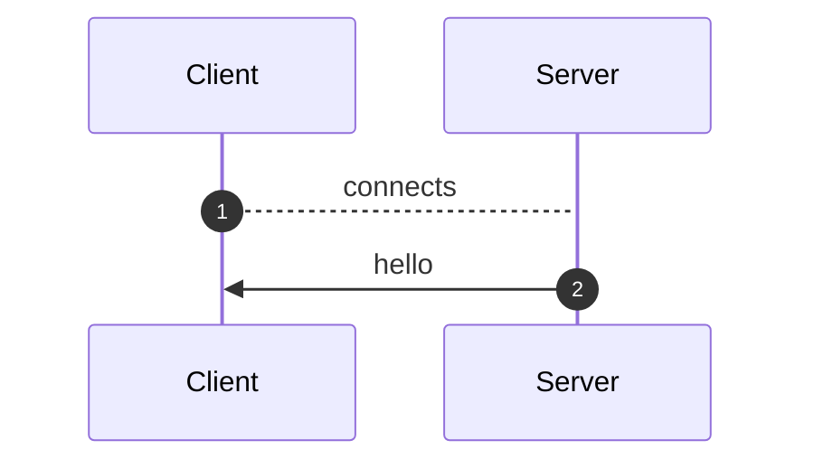
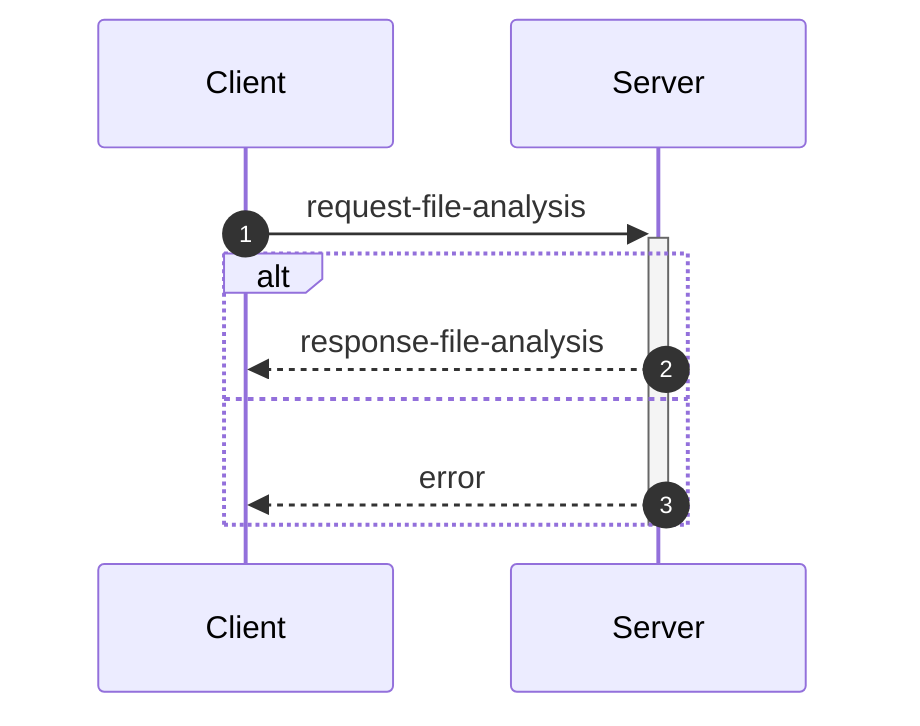
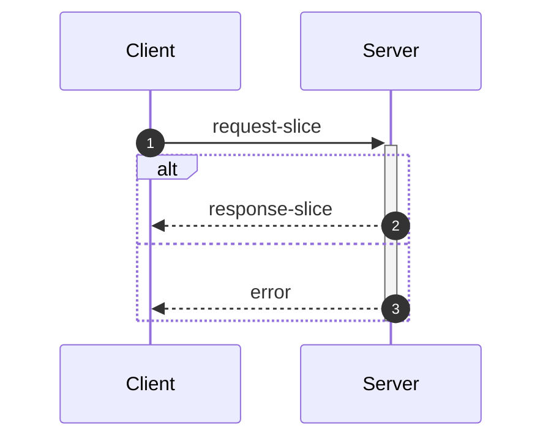
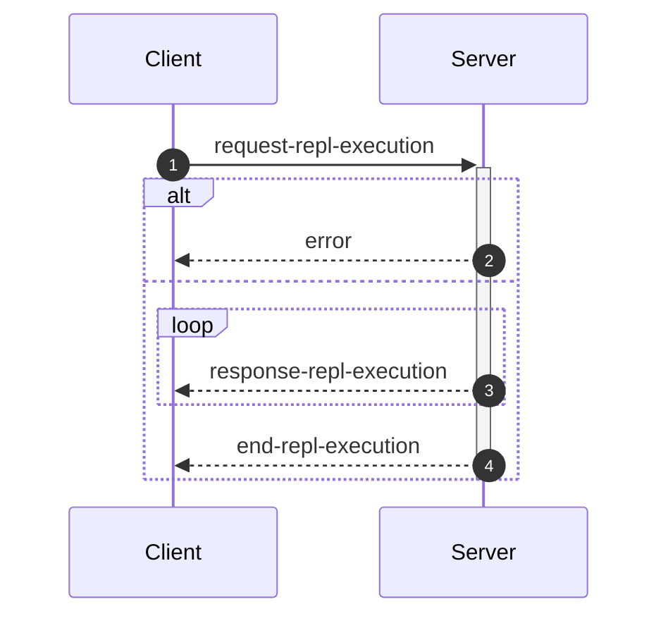

_<span title="an overview of flowR's interface">Generated</span> from '[wiki-interface.ts](https://github.com/flowr-analysis/flowr/tree/main/src/documentation/wiki-interface.ts "src/documentation/wiki-interface.ts")' on 2026-10-27, 11:19:03 UTC (v2.16.6, R v4.6.1), do not edit directly._

Although far from being as detailed as the in-depth explanation of [_flowR_](https://github.com/flowr-analysis/flowr/wiki/Core),
this wiki page explains how to interface with _flowR_ in more detail.
In general, command line arguments and other options provide short descriptions on hover over.

* [💻 Using the REPL](#using-the-repl)
* [⚙️ Configuring FlowR](#configuring-flowr)
* [⚒️ Writing Code](#writing-code)
* [💬 Communicating with the Server](#communicating-with-the-server)

<a id='using-the-repl'></a>
## 💻 Using the REPL

> [!NOTE]
> To execute arbitrary R commands with a repl request, _flowR_ has to be started explicitly with <span title="Description (Command Line Argument): Allow to access the underlying R session when using flowR (security warning: this allows the execution of arbitrary R code!)">`--r-session-access`</span>.
> Please be aware that this introduces a security risk and note that this relies on the [`r-shell` engine](https://github.com/flowr-analysis/flowr/wiki/Engines) .

Although primarily meant for users to explore,
there is nothing which forbids calling _flowR_ as a subprocess to use standard-in, -output, and -error
for communication (although you can access the REPL using the server as well,
with the [REPL Request](#message-request-repl-execution) message).

The read-eval-print loop&nbsp;(REPL) works relatively simple.
You can submit an expression (using <kbd>Enter</kbd>),
which is interpreted as an R&nbsp;expression by default but interpreted as a *command* if it starts with a colon (`:`).
The best command to get started with the REPL is <span title="Description (Repl Command): Show help information (aliases: :h, :?)">`:help`</span>.
Besides, you can leave the REPL either with the command <span title="Description (Repl Command): End the repl (aliases: :q, :exit)">`:quit`</span> or by pressing <kbd>Ctrl</kbd>+<kbd>C</kbd> twice.
When writing a *command*, you may press <kbd>Tab</kbd> to get a list of completions, if available.
Multiple commands can be entered in a single line by separating them with a semicolon (`;`), e.g. `:parse "x<-2"; :df*`.
If a command is given without R code, the REPL will re-use R code given in a previous command.
The prior example will hence return first the parsed AST of the program and then the dataflow graph for `"x <- 2"`.

> [!NOTE]
> If you develop flowR, you may want to launch the repl using the `npm run main-dev` command, this way, you get a non-minified version of flowR with debug information and hot-reloading of source files.

<details>
<summary>Available Commands</summary>

We currently offer the following commands (this with a `[*]` suffix are available with and without the star):

| Command | Description |
| ------- | ----------- |
| **<span title="Description (Repl Command): End the repl (aliases: :q, :exit)">:quit</span>** | End the repl (aliases: **:<span title="Alias of ':quit'. End the repl">q</span>**, **:<span title="Alias of ':quit'. End the repl">exit</span>**) |
| **<span title="Description (Repl Command): Execute the given code as R code. This requires the `--r-session-access` flag to be set and requires the r-shell engine. (aliases: :e, :r)">:execute</span>** | Execute the given code as R code. This requires the `--r-session-access` flag to be set and requires the r-shell engine. (aliases: **:<span title="Alias of ':execute'. Execute the given code as R code. This requires the `--r-session-access` flag to be set and requires the r-shell engine.">e</span>**, **:<span title="Alias of ':execute'. Execute the given code as R code. This requires the `--r-session-access` flag to be set and requires the r-shell engine.">r</span>**) |
| **<span title="Description (Repl Command): Get mermaid code for the control-flow graph of R code (aliases: :cfg, :cf)">:controlflow[*]</span>** | Get mermaid code for the control-flow graph of R code (star: Returns the URL to mermaid.live) (aliases: **:<span title="Alias of ':controlflow'. Get mermaid code for the control-flow graph of R code">cfg</span>**, **:<span title="Alias of ':controlflow'. Get mermaid code for the control-flow graph of R code">cf</span>**) |
| **<span title="Description (Repl Command): Get mermaid code for the control-flow graph with basic blocks (aliases: :cfgb, :cfb)">:controlflowbb[*]</span>** | Get mermaid code for the control-flow graph with basic blocks (star: Returns the URL to mermaid.live) (aliases: **:<span title="Alias of ':controlflowbb'. Get mermaid code for the control-flow graph with basic blocks">cfgb</span>**, **:<span title="Alias of ':controlflowbb'. Get mermaid code for the control-flow graph with basic blocks">cfb</span>**) |
| **<span title="Description (Repl Command): Get mermaid code for the dataflow graph (aliases: :d, :df)">:dataflow[*]</span>** | Get mermaid code for the dataflow graph (star: Returns the URL to mermaid.live) (aliases: **:<span title="Alias of ':dataflow'. Get mermaid code for the dataflow graph">d</span>**, **:<span title="Alias of ':dataflow'. Get mermaid code for the dataflow graph">df</span>**) |
| **<span title="Description (Repl Command): Get mermaid code for the normalized AST of R code (aliases: :n)">:normalize[*]</span>** | Get mermaid code for the normalized AST of R code (star: Returns the URL to mermaid.live) (alias: **:<span title="Alias of ':normalize'. Get mermaid code for the normalized AST of R code">n</span>**) |
| **<span title="Description (Repl Command): Get mermaid code for the simplified dataflow graph (aliases: :ds, :dfs)">:dataflowsimple[*]</span>** | Get mermaid code for the simplified dataflow graph (star: Returns the URL to mermaid.live) (aliases: **:<span title="Alias of ':dataflowsimple'. Get mermaid code for the simplified dataflow graph">ds</span>**, **:<span title="Alias of ':dataflowsimple'. Get mermaid code for the simplified dataflow graph">dfs</span>**) |
| **<span title="Description (Repl Command): Inspect and extend the signature database: `query` (identical to :query @signature), `info <name>` for where a function comes from (identical to :query @function-info), `add <path>` to mount another database/source, `download` to fetch the full-history database. (aliases: :sig)">:signature</span>** | Inspect and extend the signature database: `query` (identical to :query @signature), `info <name>` for where a function comes from (identical to :query @function-info), `add <path>` to mount another database/source, `download` to fetch the full-history database. (alias: **:<span title="Alias of ':signature'. Inspect and extend the signature database: `query` (identical to :query @signature), `info <name>` for where a function comes from (identical to :query @function-info), `add <path>` to mount another database/source, `download` to fetch the full-history database.">sig</span>**) |
| **<span title="Description (Repl Command): Just calculates the DFG, but only prints summary info (aliases: :d#, :df#)">:dataflowsilent</span>** | Just calculates the DFG, but only prints summary info (aliases: **:<span title="Alias of ':dataflowsilent'. Just calculates the DFG, but only prints summary info">d#</span>**, **:<span title="Alias of ':dataflowsilent'. Just calculates the DFG, but only prints summary info">df#</span>**) |
| **<span title="Description (Repl Command): Prints ASCII Art of the parsed, unmodified AST (aliases: :p)">:parse</span>** | Prints ASCII Art of the parsed, unmodified AST (alias: **:<span title="Alias of ':parse'. Prints ASCII Art of the parsed, unmodified AST">p</span>**) |
| **<span title="Description (Repl Command): Prints the version of flowR as well as the current version of R">:version</span>** | Prints the version of flowR as well as the current version of R
| **<span title="Description (Repl Command): Query the given R code (use 'help' for more information)">:query[*]</span>** | Query the given R code (use 'help' for more information) (star: Similar to query, but returns the output in json format.)
| **<span title="Description (Repl Command): Returns an ASCII representation of the dataflow graph (aliases: :df!)">:dataflowascii</span>** | Returns an ASCII representation of the dataflow graph (alias: **:<span title="Alias of ':dataflowascii'. Returns an ASCII representation of the dataflow graph">df!</span>**) |
| **<span title="Description (Repl Command): Returns summarization stats for the normalized AST (aliases: :n#)">:normalize#</span>** | Returns summarization stats for the normalized AST (alias: **:<span title="Alias of ':normalize#'. Returns summarization stats for the normalized AST">n#</span>**) |
| **<span title="Description (Repl Command): Show help information (aliases: :h, :?)">:help</span>** | Show help information (aliases: **:<span title="Alias of ':help'. Show help information">h</span>**, **:<span title="Alias of ':help'. Show help information">?</span>**) |

</details>

> [!TIP]
> 
> As indicated by the examples before, all REPL commands that operate on code keep track of the state.
> Hence, if you run a command like <span title="Description (Repl Command, starred version): Returns the URL to mermaid.live; Base Command: Get mermaid code for the dataflow graph (aliases: :d*, :df*)">`:dataflow*`</span> without providing R code,
> the REPL will re-use the R code provided in a previous command.
> Likewise, doing this will benefit from incrementality!
> If you request the dataflow graph with `:df* x <- 2 * y` and then want to see the parsed AST with `:parse`,
> the REPL will re-use previously obtained information and not re-parse the code again.
> 		

Generally, many commands offer shortcut versions in the REPL. Many queries, for example, offer a shortened format (see the example below).
Of special note, the [Config Query](https://github.com/flowr-analysis/flowr/wiki/%5BQuery%5D-Config)
can be used to also modify the currently active configuration of _flowR_ within the REPL (see the [wiki page](https://github.com/flowr-analysis/flowr/wiki/%5BQuery%5D-Config) for more information).

### Example: Retrieving the Dataflow Graph

To retrieve a URL to the [mermaid](https://mermaid.js.org/) diagram of the dataflow of a given expression,
use <span title="Description (Repl Command, starred version): Returns the URL to mermaid.live; Base Command: Get mermaid code for the dataflow graph (aliases: :d*, :df*)">`:dataflow*`</span> (or <span title="Description (Repl Command): Get mermaid code for the dataflow graph (aliases: :d, :df)">`:dataflow`</span> to get the mermaid code in the cli):

```shell
$ docker run -it --rm eagleoutice/flowr # or npm run flowr 
flowR repl v2.16.6, R grammar v14 (tree-sitter engine)
R> :dataflow* y <- 1 + x
```

<details>
<summary style='color:gray'>Output</summary>

```text
https://mermaid.live/view#base64:eyJjb2RlIjoiZmxvd2NoYXJ0IFREXG4gICAgMXt7XCJgKiM5MTtSTnVtYmVyIzkzOyogKioxKipcbiAgICAgICoxLjYqICgqKmlkOiAxKiopYFwifX1cbiAgICAyKFtcImAqIzkxO1JTeW1ib2wjOTM7KiAqKngqKlxuICAgICAgKjEuMTAqICgqKmlkOiAyKiopYFwiXSlcbiAgICAzW1tcImAqIzkxO1JCaW5hcnlPcCM5MzsqIGJhc2UjNTg7IzU4OyoqIzQzOyoqXG4gICAgICAqMS42LTEwKiAoKippZDogMyoqKVxuICAgIGFyZzogKDEsIDIpYFwiXV1cbiAgICBidWlsdC1pbjpfNDNfW1wiYEJ1aWx0LUluOlxuIzQzO2BcIl1cbiAgICBzdHlsZSBidWlsdC1pbjpfNDNfIHN0cm9rZTpncmF5LGZpbGw6Z3JheSxzdHJva2Utd2lkdGg6MnB4LG9wYWNpdHk6Ljg7XG4gICAgMFtcImAqIzkxO1JTeW1ib2wjOTM7KiAqKnkqKlxuICAgICAgKjEuMSogKCoqaWQ6IDAqKiwgdjogMylgXCJdXG4gICAgNFtbXCJgKiM5MTtSQmluYXJ5T3AjOTM7KiBiYXNlIzU4OyM1ODsqKiM2MDsjNDU7KipcbiAgICAgICoxLjEtMTAqICgqKmlkOiA0KiopXG4gICAgYXJnOiAoMCwgMylgXCJdXVxuICAgIGJ1aWx0LWluOl82MF8tW1wiYEJ1aWx0LUluOlxuIzYwOyM0NTtgXCJdXG4gICAgc3R5bGUgYnVpbHQtaW46XzYwXy0gc3Ryb2tlOmdyYXksZmlsbDpncmF5LHN0cm9rZS13aWR0aDoycHgsb3BhY2l0eTouODtcbiAgICAxIC0uLT58XCJmbG93XCJ8IDJcbiAgICBsaW5rU3R5bGUgMCBzdHJva2U6Z3JheSxjb2xvcjpncmF5O1xuICAgIDIgLS4tPnxcImZsb3dcInwgM1xuICAgIGxpbmtTdHlsZSAxIHN0cm9rZTpncmF5LGNvbG9yOmdyYXk7XG4gICAgMyAtLT58XCJyZWFkcywgYXJnXCJ8IDFcbiAgICAzIC0tPnxcInJlYWRzLCBhcmdcInwgMlxuICAgIDMgLS4tPnxcImZsb3dcInwgMFxuICAgIGxpbmtTdHlsZSA0IHN0cm9rZTpncmF5LGNvbG9yOmdyYXk7XG4gICAgMyAtLi0+fFwicmVhZHMsIGNhbGxzXCJ8IGJ1aWx0LWluOl80M19cbiAgICBsaW5rU3R5bGUgNSBzdHJva2U6Z3JheTtcbiAgICAwIC0tPnxcImRlZmluZWQtYnksIGZsb3dcInwgNFxuICAgIDAgLS0+fFwiZGVmaW5lZC1ieVwifCAzXG4gICAgNCAtLT58XCJyZWFkcywgYXJnXCJ8IDNcbiAgICA0IC0tPnxcInJldHVybnMsIGFyZ1wifCAwXG4gICAgNCAtLi0+fFwicmVhZHMsIGNhbGxzXCJ8IGJ1aWx0LWluOl82MF8tXG4gICAgbGlua1N0eWxlIDEwIHN0cm9rZTpncmF5OyIsIm1lcm1haWQiOnsiYXV0b1N5bmMiOnRydWV9fQ==
```

Retrieve the dataflow graph of the expression `y <- 1 + x`. It looks like this:


<details>

<summary style="color:gray">R Code of the Dataflow Graph</summary>

The analysis ran (parse and normalize with the [tree-sitter](https://github.com/flowr-analysis/flowr/wiki/Engines) engine) in the generation environment. No [signature database](https://github.com/flowr-analysis/flowr/wiki/Signature-Database) is mounted, so `library()` attaches no exports (base-R names are still qualified, e.g., `stats::acf`). 
We encountered no unknown side effects during the analysis.

```r
y <- 1 + x
```

</details>

</details>

For small graphs like this, <span title="Description (Repl Command): Returns an ASCII representation of the dataflow graph (aliases: :df!)">`:dataflowascii`</span> also provides an ASCII representation directly in the REPL:

```shell
$ docker run -it --rm eagleoutice/flowr # or npm run flowr 
flowR repl v2.16.6, R grammar v14 (tree-sitter engine)
R> :df! y <- 1 + x
```

<details open>
<summary style='color:gray'>Output</summary>

```text
                        v<0>v
 c<4>c──────────────────| y |
 |<- |     ┌────────────v---v
 c---c     │
    │   c<3>c   0<1>0
    └───| + |───| 1 |───u<2>u
        c---c   0---0   | x |
           └────────────u---u
Edges:
3 -> 1: reads, arg          3 -> 2: reads, arg
3 -> 0: flows-to            1 -> 2: flows-to
2 -> 3: flows-to            4 -> 3: reads, arg
4 -> 0: returns, arg        0 -> 4: defined-by, flows-to
0 -> 3: defined-by
```

Retrieve the dataflow graph of the expression `y <- 1 + x` as ASCII art.

</details>

For the slicing with <span title="Description (Repl Command): Static backwards executable slicer for R">`:slicer`</span>, you have access to the same [magic comments](#slice-magic-comments) as with the [slice request](#message-request-slice).
Pass `--inline` to splice resolvable `source()` calls into the reconstruction so the slice is a single self-contained R text (the same as the static slice query's `inlineSources` flag).
See `--help` for more flags!

### Example: Interfacing with the File System

Many commands that allow for an R-expression (like <span title="Description (Repl Command, starred version): Returns the URL to mermaid.live; Base Command: Get mermaid code for the dataflow graph (aliases: :d*, :df*)">`:dataflow*`</span>) allow for a file as well
if the argument starts with `file://`.
If you are working from the root directory of the _flowR_ repository, the following gives you the parsed AST of the example file using the <span title="Description (Repl Command): Prints ASCII Art of the parsed, unmodified AST (aliases: :p)">`:parse`</span> command:

> **Watch mode**: Replace `file://` with `watch://` to enter watch mode.
> flowR runs the command immediately and then re-runs it every time the file (or any file inside the folder) changes.
> Enter any other command to leave watch mode.
> For example: `:df watch://analysis.R`

```shell
$ docker run -it --rm eagleoutice/flowr # or npm run flowr 
flowR repl v2.16.6, R grammar v14 (tree-sitter engine)
R> :parse file://test/testfiles/example.R
```

<details>
<summary style='color:gray'>Output</summary>

```text
File: test/testfiles/example.R

program
├ binaryoperator
│ ├ identifier "sum" (1:1─4)
│ ├ <- "<-" (1:5─7)
│ ╰ float "0" (1:8─9)
├ binaryoperator
│ ├ identifier "product" (2:1─8)
│ ├ <- "<-" (2:9─11)
│ ╰ float "1" (2:12─13)
├ binaryoperator
│ ├ identifier "w" (3:1─2)
│ ├ <- "<-" (3:3─5)
│ ╰ float "7" (3:6─7)
├ binaryoperator
│ ├ identifier "N" (4:1─2)
│ ├ <- "<-" (4:3─5)
│ ╰ float "10" (4:6─8)
├ forstatement
│ ├ for "for" (6:1─4)
│ ├ ( "(" (6:5─6)
│ ├ identifier "i" (6:6─7)
│ ├ in "in" (6:8─10)
│ ├ binaryoperator
│ │ ├ float "1" (6:11─12)
│ │ ├ : ":" (6:12─13)
│ │ ╰ parenthesizedexpression
│ │   ├ ( "(" (6:13─14)
│ │   ├ binaryoperator
│ │   │ ├ identifier "N" (6:14─15)
│ │   │ ├ - "-" (6:15─16)
│ │   │ ╰ float "1" (6:16─17)
│ │   ╰ ) ")" (6:17─18)
│ ├ ) ")" (6:18─19)
│ ╰ bracedexpression
│   ├ { "{" (6:20─21)
│   ├ binaryoperator
│   │ ├ identifier "sum" (7:3─6)
│   │ ├ <- "<-" (7:7─9)
│   │ ╰ binaryoperator
│   │   ├ binaryoperator
│   │   │ ├ identifier "sum" (7:10─13)
│   │   │ ├ + "+" (7:14─15)
│   │   │ ╰ identifier "i" (7:16─17)
│   │   ├ + "+" (7:18─19)
│   │   ╰ identifier "w" (7:20─21)
│   ├ binaryoperator
│   │ ├ identifier "product" (8:3─10)
│   │ ├ <- "<-" (8:11─13)
│   │ ╰ binaryoperator
│   │   ├ identifier "product" (8:14─21)
│   │   ├  "" (8:22─23)
│   │   ╰ identifier "i" (8:24─25)
│   ╰ } "}" (9:1─2)
├ call
│ ├ identifier "cat" (11:1─4)
│ ╰ arguments
│   ├ ( "(" (11:4─5)
│   ├ argument
│   │ ╰ string
│   │   ├ stringopen "\"" (11:5─6)
│   │   ├ stringcontent "Sum:" (11:6─10)
│   │   ╰ stringclose "\"" (11:10─11)
│   ├ comma "," (11:11─12)
│   ├ argument
│   │ ╰ identifier "sum" (11:13─16)
│   ├ comma "," (11:16─17)
│   ├ argument
│   │ ╰ string
│   │   ├ stringopen "\"" (11:18─19)
│   │   ├ stringcontent
│   │   │ ╰ escapesequence "\\n" (11:19─21)
│   │   ╰ stringclose "\"" (11:21─22)
│   ╰ ) ")" (11:22─23)
╰ call
  ├ identifier "cat" (12:1─4)
  ╰ arguments
    ├ ( "(" (12:4─5)
    ├ argument
    │ ╰ string
    │   ├ stringopen "\"" (12:5─6)
    │   ├ stringcontent "Product:" (12:6─14)
    │   ╰ stringclose "\"" (12:14─15)
    ├ comma "," (12:15─16)
    ├ argument
    │ ╰ identifier "product" (12:17─24)
    ├ comma "," (12:24─25)
    ├ argument
    │ ╰ string
    │   ├ stringopen "\"" (12:26─27)
    │   ├ stringcontent
    │   │ ╰ escapesequence "\\n" (12:27─29)
    │   ╰ stringclose "\"" (12:29─30)
    ╰ ) ")" (12:30─31)
```

Retrieve the parsed AST of the example file.

<details>

<summary>File Content</summary>

```r
sum <- 0
product <- 1
w <- 7
N <- 10

for (i in 1:(N-1)) {
  sum <- sum + i + w
  product <- product * i
}

cat("Sum:", sum, "\n")
cat("Product:", product, "\n")
```

</details>

As _flowR_ directly transforms this AST the output focuses on being human-readable instead of being machine-readable.
		
</details>

### Example: Run a Query

You can run any query supported by _flowR_ using the <span title="Description (Repl Command): Query the given R code (use 'help' for more information)">`:query`</span> command.
For example, to obtain the shapes of all data frames in a given piece of code, you can run:

```shell
$ docker run -it --rm eagleoutice/flowr # or npm run flowr 
flowR repl v2.16.6, R grammar v14 (tree-sitter engine)
R> :query @absint df-shape "x <- data.frame(a = 1:10, b = 1:10)\ny <- x$a"
```

<details open>
<summary style='color:gray'>Output</summary>

```text
Query: absint (1 ms)
   ╰ $12: (colnames: [{"a", "b"}, {}], cols: [2, 2], rows: [10, 10])
   ╰ $0: (colnames: [{"a", "b"}, {}], cols: [2, 2], rows: [10, 10])
```

Retrieve the shapes of all data frames in the given code.

</details>

To run the linter on a file, you can use (in this example, we just issue the `dead-code` linter on a small piece of code):

```shell
$ docker run -it --rm eagleoutice/flowr # or npm run flowr 
flowR repl v2.16.6, R grammar v14 (tree-sitter engine)
R> :query @linter rules:dead-code "if(FALSE) x <- 2"
```

<details open>
<summary style='color:gray'>Output</summary>

```text
Query: linter (1 ms)
   ╰ Dead Code (dead-code):
       ╰ certain:
           ╰ Code at 1.11-16 (1 quick fix(es) available)
```

Run the linter on the given code, with only the `dead-code` rule enabled.

</details>

For more information on the available queries, please check out the [Query API](https://github.com/flowr-analysis/flowr/wiki/Query-API).

<a id='configuring-flowr'></a>
## ⚙️ Configuring FlowR

When running _flowR_, you may want to specify some behaviors with a dedicated configuration file.
By default, flowR looks for a file named `flowr.json` in the current working directory (or any higher directory).
You can also specify a different file with <span title="Description (Command Line Argument): The name of the configuration file to use">`--config-file`</span> or pass the configuration inline using <span title="Description (Command Line Argument): The flowR configuration to use, as a JSON string">`--config-json`</span>.
A `flowr.json` found this way belongs to the analyzed project, so flowR ignores its options that decide what flowR executes or loads
(`engines.*.wasmPath`, `engines.*.treeSitterWasmPath`, `engines.*.rPath`, `solver.sigdb.additionalPaths`, `solver.sigdb.downloadRepo`, `solver.sigdb.installedLibrary.paths`),
unless you pass <span title="Description (Command Line Argument): Keep the security-sensitive options (e.g., the R executable) of the flowr.json found in the working directory or a parent. Only use this for projects you trust.">`--trust-config`</span>.
To analyze code you do not trust, use the secure mode (<span title="Description (Command Line Argument): Run in secure mode for analyzing untrusted code: flowR does not start R (or any other process), does not access the network, does not search for project configs, and ignores security-sensitive options in every config. Cannot be disabled once enabled. Can also be enabled with the environment variable {italic FLOWR_SECURE_MODE=1}.">`--secure`</span>, see the [security policy](https://github.com/flowr-analysis/flowr/blob/main/.github/SECURITY.md)).
To inspect the current configuration, you can run flowr with the <span title="Description (Command Line Argument): Run with verbose logging (will be passed to the corresponding script)">`--verbose`</span> flag, or use the `config` [Query](https://github.com/flowr-analysis/flowr/wiki/Query-API).
Within the REPL this works by running the following:

```shell
:query @config
```

To work with the <a href="https://github.com/flowr-analysis/flowr/tree/main/src/config.ts#L119"><code><span title="The configuration file format for flowR.">FlowrConfig</span></code></a> you can use the provided helper objects alongside its methods like
<a href="https://github.com/flowr-analysis/flowr/tree/main/src/config.ts#L914"><code><span title="Creates a new flowr config that has the updated values.">FlowrConfig::<b>amend</b></span></code></a>.
The schema below documents every option; the ones you most likely want are:

- <a href="https://github.com/flowr-analysis/flowr/wiki/Interface#configuring-flowr" title="Configuration Option (boolean): Whether source calls should be ignored, causing {@link processSourceCall}&#39;s behavior to be skipped.">ignoreSourceCalls</a>: ignore source calls when analyzing the code, i.e., ignore the inclusion of other files.
- <a href="https://github.com/flowr-analysis/flowr/wiki/Interface#configuring-flowr" title="Configuration Option (boolean): Whether load calls should be ignored, causing {@link processLoadCall}&#39;s behavior to be skipped.">ignoreLoadCalls</a>: ignore load calls when analyzing the code, i.e., ignore the loading of r-data files.
- <a href="https://github.com/flowr-analysis/flowr/wiki/Interface#configuring-flowr" title="Configuration Option (object): Do you want to overwrite (parts) of the builtin definition?">semantics.environment.overwriteBuiltIns</a>: overwrite _flowR_'s handling of built-in functions, or clear the preset definitions entirely.
  See [Configure BuiltIn Semantics](#configure-builtin-semantics) for more information.
- <a href="https://github.com/flowr-analysis/flowr/wiki/Interface#configuring-flowr" title="Configuration Option (string): How to resolve variables and their values. (one of &quot;disabled&quot;, &quot;alias&quot;, &quot;builtin&quot;)">solver.variables</a>: how to resolve variables and their values (`disabled`, `alias`, `builtin`).
- <a href="https://github.com/flowr-analysis/flowr/wiki/Interface#configuring-flowr" title="Configuration Option (array): The engine or set of engines to use for interacting with R code. An empty array means all available engines will be used.">engines</a> and <a href="https://github.com/flowr-analysis/flowr/wiki/Interface#configuring-flowr" title="Configuration Option (string): The default engine to use for interacting with R code. If this is undefined, an arbitrary engine from the specified list will be used. (one of &quot;tree-sitter&quot;, &quot;r-shell&quot;)">defaultEngine</a>: the engines used to interact with R code, see the [Engines wiki page](https://github.com/flowr-analysis/flowr/wiki/Engines).
- <a href="https://github.com/flowr-analysis/flowr/wiki/Interface#configuring-flowr" title="Configuration Option (array): Files a framework loads on its own, without any source() call (e.g. global.R in a shiny app), in the order they are loaded; flowR orders the matching project files accordingly and analyzes them as one program. Entries are case-insensitive globs matched against the file path, a plain name matches any file with that name, and entries matching no project file are warned about. Usually set per project kind via specializeConfig.">project.implicitSources</a>: the files a framework loads without any `source()` call, in the order in which they are
  loaded. Entries are globs (e.g. `R/*.R`) matched against the file path ignoring capitalization; one matching no file is reported.
- <a href="https://github.com/flowr-analysis/flowr/wiki/Interface#configuring-flowr" title="Configuration Option (object): Overwrite (parts of) the configuration depending on the project kind flowR detects, e.g. to give a shiny app its implicit sources.">specializeConfig</a>: overwrite (parts of) the configuration depending on the kind of project _flowR_ detects
  (e.g. `shiny-app`), which is how a shiny app gets its implicit sources by default. What you configure directly wins.
- <a href="https://github.com/flowr-analysis/flowr/wiki/Interface#configuring-flowr" title="Configuration Option (string): Overwrite the project kind flowR would otherwise infer from the analyzed files, e.g. when auto-detection guesses wrong. (one of &quot;package&quot;, &quot;script&quot;, &quot;shiny-app&quot;, &quot;notebook&quot;, &quot;project&quot;, &quot;unknown&quot;)">project.useProjectType</a>: skip that detection and force a project kind yourself, when auto-detection guesses wrong.
- <a href="https://github.com/flowr-analysis/flowr/wiki/Interface#configuring-flowr" title="Configuration Option (array): The default plugins to load when creating a new instance of FlowrAnalyzer">defaultPlugins</a> and <a href="https://github.com/flowr-analysis/flowr/wiki/Interface#configuring-flowr" title="Configuration Option (array): The plugins to load in REPL mode">repl.plugins</a>: the plugins to load for a new <a href="https://github.com/flowr-analysis/flowr/tree/main/src/project/flowr-analyzer.ts#L205"><code><span title="Central class for conducting analyses with FlowR. Use the FlowrAnalyzerBuilder to create a new instance. If you want the original pattern of creating a pipeline and running all steps, you can still do this with FlowrAnalyzer#runFull . To inspect the context of the analyzer, use FlowrAnalyzer#inspectContext (if you are a plugin and need to modify it, use FlowrAnalyzer#context instead).">FlowrAnalyzer</span></code></a> and in the REPL
  (use `flowr:default` to reference the former).

So you can configure _flowR_ by adding a file like the following:

<details>

<summary>Example Configuration File</summary>

```json
{
  "ignoreSourceCalls": true,
  "ignoreLoadCalls": true,
  "semantics": {
    "environment": {
      "overwriteBuiltIns": {
        "definitions": [
          {
            "type": "function",
            "names": [
              "foo"
            ],
            "processor": "builtin:assign",
            "config": {}
          }
        ]
      }
    }
  },
  "defaultPlugins": [
    "file:description",
    "versions:description"
  ],
  "repl": {
    "quickStats": false,
    "dfProcessorHeat": false,
    "hints": true,
    "plugins": [
      "flowr:default"
    ]
  },
  "project": {
    "resolveUnknownPathsOnDisk": true,
    "implicitSources": [
      "global.R",
      "app.R"
    ]
  },
  "linter": {
    "disabledRules": []
  },
  "specializeConfig": {
    "shiny-app": {
      "project": {
        "implicitSources": [
          "global.R",
          "ui.R",
          "server.R",
          "app.R"
        ]
      }
    }
  },
  "engines": [
    {
      "type": "r-shell"
    }
  ],
  "solver": {
    "variables": "alias",
    "evalStrings": true,
    "trackEnvironments": true,
    "sigdb": {
      "enabled": true,
      "loadProjectDependencies": true,
      "eagerlyLoad": false,
      "eagerlyLoadExports": false,
      "linkBaseR": false,
      "linkDescriptionDependencies": false
    },
    "resolveSource": {
      "dropPaths": "no",
      "ignoreCapitalization": true,
      "inferWorkingDirectory": "active-script",
      "searchPath": []
    },
    "instrument": {},
    "slicer": {
      "threshold": 50
    }
  },
  "abstractInterpretation": {
    "wideningThreshold": 4,
    "followCalls": true,
    "dataFrame": {
      "maxColNames": 20,
      "readLoadedData": {
        "readExternalFiles": true,
        "maxReadLines": 1000000
      }
    }
  },
  "incremental": {
    "alwaysIncremental": false,
    "parsing": {
      "activated": false,
      "heuristics": {
        "activated": true,
        "mtime": true,
        "linesFrom": 500,
        "bytesFrom": 50000,
        "alwaysWithEdits": false,
        "minFiles": 1
      }
    }
  },
  "gas": {
    "thresholds": {
      "memory": {
        "problematic": 0.7,
        "critical": 0.9
      },
      "timeMs": {
        "problematic": 100000,
        "critical": 120000
      }
    },
    "features": {}
  }
}
```

</details>

<details>
<a id='configure-builtin-semantics'></a>
<summary>Configure Built-In Semantics</summary>

`semantics/environment/overwriteBuiltins` accepts two keys:

- `loadDefaults` (boolean, initially `true`): If set to `true`, the default built-in definitions are loaded before applying the custom definitions. Setting this flag to `false` explicitly disables the loading of the default definitions.
- `definitions` (array, initially empty): Allows to overwrite or define new built-in elements. Each object within must have a `type` which is one of the below. Furthermore, they may define a string array of `names` which specifies the identifiers to bind the definitions to. You may use `assumePrimitive` to specify whether _flowR_ should assume that this is a primitive non-library definition (so you probably just do not want to specify the key).

  | Type            | Description                                                                                                                                                                                                                                                                                              | Example                                                                                                    |
  | --------------- | -------------------------------------------------------------------------------------------------------------------------------------------------------------------------------------------------------------------------------------------------------------------------------------------------------- | ---------------------------------------------------------------------------------------------------------- |
  | `constant`    | Additionally allows for a `value` this should resolve to.                                                                                                                                                                                                                                                | `{ type: 'constant', names: ['NULL', 'NA'],  value: null }`                                                |
  | `function`    | Is a rather flexible way to define and bind built-in functions. For the time, we do not have extensive documentation to cover all the cases, so please either consult the sources with the `default-builtin-config.ts` or open a [new issue](https://github.com/flowr-analysis/flowr/issues/new/choose). | `{ type: 'function', names: ['next'], processor: 'builtin:d', config: { cfg: ExitPointType.Next } }` |
  | `replacement` | A comfortable way to specify replacement functions like `$<-` or `names<-`. `suffixes` describes the... suffixes to attach automatically. | `{ type: 'replacement', suffixes: ['<-', '<<-'], names: ['[', '[['] }` |

</details>

<details>

<summary style='color:gray'>Full Configuration-File Schema</summary>

- _The configuration file format for flowR._ (object)
    - **logLevel** [optional] _flowR's global minimum log level, applied when the config is loaded._ (string)
        Only allows: 'silly', 'trace', 'debug', 'info', 'warn', 'error', 'fatal'
    - **ignoreSourceCalls** [optional] _Whether source calls should be ignored, causing {@link processSourceCall}'s behavior to be skipped._ (boolean)
    - **ignoreLoadCalls** [optional] _Whether load calls should be ignored, causing {@link processLoadCall}'s behavior to be skipped._ (boolean)
    - **semantics** _Configure language semantics and how flowR handles them._ (object)
        - **environment** [optional] _Semantics regarding how to handle the R environment._ (object)
            - **overwriteBuiltIns** [optional] _Do you want to overwrite (parts) of the builtin definition?_ (object)
                - **loadDefaults** [optional] _Should the default configuration still be loaded?_ (boolean)
                - **definitions** [optional] _The definitions to load/overwrite._ (array)
                Valid item types:
                    - (object)
    - **defaultPlugins** [optional] _The default plugins to load when creating a new instance of FlowrAnalyzer_ (array)
    Valid item types:
        - (alternatives)
            - (string)
            - (array)
    - **repl** _Configuration options for the REPL._ (object)
        - **quickStats** [optional] _Whether to show quick stats in the REPL after each evaluation._ (boolean)
        - **dfProcessorHeat** [optional] _This instruments the dataflow processors to count how often each processor is called._ (boolean)
        - **hints** [optional] _Whether to show dim inline hints on the empty prompt (automatically disabled on non-interactive terminals)._ (boolean)
        - **plugins** [optional] _The plugins to load in REPL mode_ (array)
        Valid item types:
            - (alternatives)
                - (string)
                - (array)
        - **autoUseFileProtocol** [optional] _Prepend the file protocol to a repl input that looks like a path, instead of only warning about it._ (boolean)
        - **queryStats** [optional] _Whether `:query` closes with the line stating how long the queries took (`:query*` never prints it)._ (boolean)
        - **showPlugins** [optional] _Whether `:version` grays out the plugins that did not activate during the last analysis._ (boolean)
    - **project** _Project specific configuration options._ (object)
        - **resolveUnknownPathsOnDisk** [optional] _Whether to resolve unknown paths loaded by the r project disk when trying to source/analyze files._ (boolean)
        - **failOnInaccessiblePath** [optional] _Whether a directory that cannot be traversed during file discovery (e.g. due to permissions) aborts the analysis; when false (the default) such paths are logged and skipped._ (boolean)
        - **basePackages** [optional] _The packages considered part of R itself (base and recommended); if unset, flowR uses its built-in list._ (array)
        Valid item types:
            - (string)
        - **implicitSources** [optional] _Files a framework loads on its own, without any source() call (e.g. global.R in a shiny app), in the order they are loaded; flowR orders the matching project files accordingly and analyzes them as one program. Entries are case-insensitive globs matched against the file path, a plain name matches any file with that name, and entries matching no project file are warned about. Usually set per project kind via specializeConfig._ (array)
        Valid item types:
            - (string)
        - **useProjectType** [optional] _Overwrite the project kind flowR would otherwise infer from the analyzed files, e.g. when auto-detection guesses wrong._ (string)
            Only allows: 'package', 'script', 'shiny-app', 'notebook', 'project', 'unknown'
        - **assumeImplicitEcho** [optional] _Whether the top level of the analyzed code is echoed, so that every visible result printed there is collected as an output by the dependencies query (default true, false for a package)._ (boolean)
        - **discovery** [optional] _Scoping options for the default project discovery._ (object)
            - **full** [optional] _Collect every file below the project root (greedy) instead of only the files the detected project kind needs (default false)._ (boolean)
            - **perKind** [optional] _Per-kind include/exclude glob overrides layered on the default scoping._ (object)
            - **ignore** [optional] _Case-insensitive globs that drop matching files from the intelligent discovery, regardless of kind (e.g. .Renviron to ignore environment files)._ (array)
            Valid item types:
                - (string)
        - **classification** [optional] _Overrides for the signals flowR uses to classify the project kind._ (object)
            - **shinyDescriptionTypes** [optional] _DESCRIPTION Type: values that mark a shiny app._ (array)
            Valid item types:
                - (string)
            - **shinyEntryFiles** [optional] _File names a shiny app is assembled from._ (array)
            Valid item types:
                - (string)
            - **shinyUsagePattern** [optional] _Regex source evidencing shiny usage in an entry file._ (string)
            - **notebookExtensions** [optional] _File extensions marking a notebook._ (array)
            Valid item types:
                - (string)
    - **linter** _Linter configuration options._ (object)
        - **disabledRules** _Linting rule names excluded from the default rule set (a rule requested explicitly via a linter query still runs). Usually set per project kind via specializeConfig._ (array)
        Valid item types:
            - (string)
        - **disabledTags** [optional] _Linting rule tags whose rules are excluded from the default rule set (a rule requested explicitly via a linter query still runs). By default the cmd-check rules are disabled for everything but a package; a configured list replaces that default._ (array)
        Valid item types:
            - (string)
    - **inputSources** [optional] _Further frameworks the input-sources analysis should know about; entries are added to flowR's defaults._ (object)
        - **pure** [optional] _Functions that only pass the constantness of their arguments on._ (array)
        Valid item types:
            - (string)
        - **param** [optional] _Functions whose result is a 'param' input._ (array)
        Valid item types:
            - (string)
        - **file** [optional] _Functions whose result is a 'file' input._ (array)
        Valid item types:
            - (string)
        - **tempfile** [optional] _Functions whose result is a 'tempfile' input._ (array)
        Valid item types:
            - (string)
        - **glob** [optional] _Functions whose result is a 'glob' input._ (array)
        Valid item types:
            - (string)
        - **net** [optional] _Functions whose result is a 'net' input._ (array)
        Valid item types:
            - (string)
        - **rand** [optional] _Functions whose result is a 'rand' input._ (array)
        Valid item types:
            - (string)
        - **system** [optional] _Functions whose result is a 'system' input._ (array)
        Valid item types:
            - (string)
        - **ffi** [optional] _Functions whose result is a 'ffi' input._ (array)
        Valid item types:
            - (string)
        - **lang** [optional] _Functions whose result is a 'lang' input._ (array)
        Valid item types:
            - (string)
        - **options** [optional] _Functions whose result is a 'options' input._ (array)
        Valid item types:
            - (string)
        - **cmdline** [optional] _Functions whose result is a 'cmdline' input._ (array)
        Valid item types:
            - (string)
        - **user** [optional] _Functions whose result is a 'user' input._ (array)
        Valid item types:
            - (string)
        - **const** [optional] _Functions whose result is a 'const' input._ (array)
        Valid item types:
            - (string)
        - **scope** [optional] _Functions whose result is a 'scope' input._ (array)
        Valid item types:
            - (string)
        - **dconst** [optional] _Functions whose result is a 'dconst' input._ (array)
        Valid item types:
            - (string)
        - **unknown** [optional] _Functions whose result is a 'unknown' input._ (array)
        Valid item types:
            - (string)
        - **linkedObjects** [optional] _Objects a framework provides without a definition in the code, e.g. shiny's input._ (array)
        Valid item types:
            - (object)
        - **linkedEntryPoints** [optional] _Calls that hand a function to a framework, which binds its objects to the parameters by position._ (array)
        Valid item types:
            - (object)
    - **specializeConfig** [optional] _Overwrite (parts of) the configuration depending on the project kind flowR detects, e.g. to give a shiny app its implicit sources._ (object)
    - **engines** _The engine or set of engines to use for interacting with R code. An empty array means all available engines will be used._ (array)
    Valid item types:
        - (alternatives)
            - _The configuration for the tree sitter engine._ (object)
                - **type** [required] _Use the tree sitter engine._ (string)
                    Only allows: 'tree-sitter'
                - **wasmPath** [optional] _The path to the tree-sitter-r WASM binary to use. If this is undefined, this uses the default path._ (string)
                - **treeSitterWasmPath** [optional] _The path to the tree-sitter WASM binary to use. If this is undefined, this uses the default path._ (string)
                - **lax** [optional] _Whether to use the lax parser for parsing R code (allowing for syntax errors). If this is undefined, the strict parser will be used._ (boolean)
            - _The configuration for the R shell engine._ (object)
                - **type** [required] _Use the R shell engine._ (string)
                    Only allows: 'r-shell'
                - **rPath** [optional] _The path to the R executable to use. If this is undefined, this uses the default path._ (string)
                - **pipeBind** [optional] _Whether to enable R's experimental pipe-bind operator "=>" by setting _R_USE_PIPEBIND_ for the R session (default false); R itself keeps this off by default, as it is experimental and has never shipped in a release version of R._ (boolean)
    - **defaultEngine** [optional] _The default engine to use for interacting with R code. If this is undefined, an arbitrary engine from the specified list will be used._ (string)
        Only allows: 'tree-sitter', 'r-shell'
    - **solver** _How to resolve constants, constraints, cells, ..._ (object)
        - **variables** _How to resolve variables and their values._ (string)
            Only allows: 'disabled', 'alias', 'builtin'
        - **evalStrings** _Should we include eval(parse(text="...")) calls in the dataflow graph?_ (boolean)
        - **trackEnvironments** [optional] _Track user-created environments (new.env, assign/get/local with envir=, dollar-assign, attach). When false, all envir-style calls fall through conservatively._ (boolean)
        - **sigdb** _Resolving library exports from a signature database._ (object)
            - **enabled** [optional] _Resolve library()/use() exports from a signature database (default true); when false no database is consulted._ (boolean)
            - **loadProjectDependencies** [optional] _Load the project's declared dependencies from its metadata files (DESCRIPTION Imports/Depends, rproject.toml, uvr.toml, renv.lock, rv.lock, uvr.lock) (default true); when false these files are not read for dependencies._ (boolean)
            - **eagerlyLoad** [optional] _Parse the database up front rather than on the first package load (default false, ignored if disabled)._ (boolean)
            - **eagerlyLoadExports** [optional] _Add a vertex for every export on load rather than on demand (default false); keeps the dataflow graph small._ (boolean)
            - **assumedRVersion** [optional] _R version assumed when resolving versioned (base-R) exports: a pin like "4.5" or "auto" to detect the installed R (default "auto")._ (string)
            - **linkBaseR** [optional] _Eagerly attach base-R namespaces so bare base calls resolve without library() (default false)._ (boolean)
            - **linkBaseRCalls** [optional] _Add a lightweight Reads edge from a bare base-R call to its signature-database function vertex (default false; base-R qualification is edge-free otherwise)._ (boolean)
            - **linkPackageCalls** [optional] _Add a lightweight Reads edge from a resolved package call to its signature-database function vertex (default false)._ (boolean)
            - **linkDescriptionDependencies** [optional] _Eagerly attach the namespaces of the project's declared DESCRIPTION dependencies (Imports/Depends) so their exports resolve without an explicit library() (default false)._ (boolean)
            - **warmInBackground** [optional] _Decompress the hot shards (base + most-downloaded) in a background task on startup so the first library() lookup is warm (default false; for long-running servers/REPLs)._ (boolean)
            - **additionalPaths** [optional] _Extra directories or bundle/manifest files searched for signature databases (alongside the shipped default and $FLOWR_SIGDB_DIR); a downloaded full-history bundle placed here is mounted automatically._ (array)
            Valid item types:
                - (string)
            - **downloadRepo** [optional] _GitHub owner/repo the full-history bundle is downloaded from via ":signature download" (default "flowr-analysis/flowr", release tag "sigdb-v<flowR-version>")._ (string)
            - **autoSync** [optional] _On startup, re-download shards whose committed sigdb.remote.json hash no longer matches the cache, in the background (default false; opt-in network sync after a git pull)._ (boolean)
            - **installedLibrary** [optional] _Recovering packages no signature database knows from the copy installed on this machine._ (object)
                - **enabled** [required] _Recover packages no signature database knows from their installed copy (default false)._ (boolean)
                - **paths** [optional] _Library directories to search; when empty they are discovered from the environment and the project._ (array)
                Valid item types:
                    - (string)
                - **useEnvironment** [optional] _Search the libraries R_LIBS_USER/R_LIBS/R_LIBS_SITE name (default true)._ (boolean)
                - **useProjectLibrary** [optional] _Search a project-local renv/packrat library (default true)._ (boolean)
                - **maxDepth** [optional] _How far to descend into the nested layout of a project-local library (default 3)._ (number)
                - **packages** [optional] _Only recover packages whose name matches one of these regular expressions; empty means any._ (array)
                Valid item types:
                    - (string)
            - **blobCacheBudgetMb** [optional] _How many MiB of decoded package blobs every open bundle may hold together (default 16)._ (number)
            - **versionSelection** [optional] _When a project constrains a dependency, resolve to the newest (default), oldest, or system-installed version satisfying it; system needs R and falls back to newest. Base-R packages always resolve against the assumed R version._ (string)
                Only allows: 'newest', 'oldest', 'system'
            - **versionOverrides** [optional] _Force an exact version for specific packages (name -> version), overriding both the project constraint and the versionSelection policy (default {})._ (object)
        - **versionManagement** _Policies for reasoning about dependency versions._ (object)
            - **linkedVersionGroups** [optional] _Groups of packages that must resolve to the same version; version guessing intersects each group so its members stay mutually compatible (default [])._ (array)
            Valid item types:
                - (array)
                Valid item types:
                    - (string)
        - **assumeAttachedPackages** [optional] _Packages to treat as attached without a `library()` call, so what the built-in configuration states about them applies to the analyzed code. The base packages R attaches on startup already resolve without it._ (array)
        Valid item types:
            - (string)
        - **transitiveSideEffectRounds** [optional] _How many rounds the transitive side-effect fixpoint may run before it is cut off (default 32); the propagation stops on its own as soon as a round adds nothing._ (number)
        - **maxOverlayDepth** [optional] _How many binding overlays may stack on one environment frame before a write flattens them (default 4); a pure performance knob, trading lookup cost against copy cost without changing any result._ (number)
        - **instrument** (object)
            - **dataflowExtractors** [optional] _These keys are only intended for use within code, allowing to instrument the dataflow analyzer!_ (any)
        - **resolveSource** [optional] _If lax source calls are active, flowR searches for sourced files much more freely, based on the configurations you give it. This option is only in effect if `ignoreSourceCalls` is set to false._ (object)
            - **dropPaths** _Allow to drop the first or all parts of the sourced path, if it is relative._ (string)
                Only allows: 'no', 'once', 'all'
            - **ignoreCapitalization** _Search for filenames matching in the lowercase._ (boolean)
            - **inferWorkingDirectory** _Try to infer the working directory from the main or any script to analyze._ (string)
                Only allows: 'no', 'main-script', 'active-script', 'any-script'
            - **searchPath** _Additionally search in these paths._ (array)
            Valid item types:
                - (string)
            - **repeatedSourceLimit** [optional] _How often the same file can be sourced within a single run? Please be aware: in case of cyclic sources this may not reach a fixpoint so give this a sensible limit._ (number)
            - **applyReplacements** _Provide name replacements for loaded files_ (array)
            Valid item types:
                - (object)
            - **assumeFilesExist** [optional] _Assume a sourced file is always there, making what it defines certain instead of conditional on the source call._ (boolean)
        - **slicer** [optional] _The configuration for the slicer._ (object)
            - **threshold** [optional] _The maximum number of iterations to perform on a single function call during slicing._ (number)
            - **autoExtend** [optional] _If set, the slicer will gain an additional post-pass._ (boolean)
    - **abstractInterpretation** _The configuration options for abstract interpretation._ (object)
        - **wideningThreshold** _The threshold for the number of visitations of a node at which widening should be performed to ensure the termination of the fixpoint iteration._ (number)
        - **followCalls** _Whether the abstract interpretation is interprocedural, i.e. whether it steps into the functions a call may dispatch to._ (boolean)
        - **dataFrame** _The configuration of the shape inference for data frames._ (object)
            - **maxColNames** _The maximum number of columns names to infer for data frames before over-approximating the column names to top._ (number)
            - **readLoadedData** _Configuration options for reading data frame shapes from loaded external data files, such as CSV files._ (object)
                - **readExternalFiles** _Whether data frame shapes should be extracted from loaded external files, such as CSV files._ (boolean)
                - **maxReadLines** _The maximum number of lines to read when extracting data frame shapes from loaded files, such as CSV files._ (number)
    - **incremental** (object)
        - **alwaysIncremental** _Always take the incremental path, regardless of heuristics._ (boolean)
        - **parsing** (object)
            - **activated** _If set, incremental parsing will be used._ (boolean)
            - **heuristics** (object)
                - **activated** [optional] _If set, the heuristics for incremental parsing will be used._ (boolean)
                - **mtime** [optional] _Skip reparsing entirely if the file's modification time is unchanged since the last parse._ (boolean)
                - **linesFrom** [optional] _Only consider incremental parsing for files with at least this many lines._ (number)
                - **bytesFrom** [optional] _Only consider incremental parsing for files with at least this many bytes._ (number)
                - **alwaysWithEdits** [optional] _Always take the incremental path whenever there is a computed edit region, regardless of the other thresholds._ (boolean)
                - **minFiles** [optional] _Only apply these heuristics once the project has at least this many files loaded._ (number)
    - **gas** [optional] _Resource-usage guard (gas) configuration. All feature factors default to 0 (disabled). See https://github.com/flowr-analysis/flowr/wiki/Core#gas-resource-guard._ (object)
        - **thresholds** [optional] _Thresholds for all gas checks (scaled by per-feature factor), boundable per feature._ (object)
            - **memory** [optional] _Heap-usage fraction thresholds (0-1), either shared or given per feature key (with `default` covering the rest)._ (object)
                - **problematic** [optional] _Heap fraction (0-1) above which Problematic is returned, for every feature without an entry of its own._ (number)
                - **critical** [optional] _Heap fraction (0-1) above which Critical is returned, for every feature without an entry of its own._ (number)
            - **timeMs** [optional] _Elapsed analysis time thresholds in milliseconds, either shared or given per feature key (with `default` covering the rest)._ (object)
                - **problematic** [optional] _Elapsed ms above which Problematic is returned, for every feature without an entry of its own._ (number)
                - **critical** [optional] _Elapsed ms above which Critical is returned, for every feature without an entry of its own._ (number)
            - **steps** [optional] _Processed-AST-node thresholds, counted rather than sampled; only a key that arms a budget (`dataflow`) reads them._ (object)
                - **problematic** [optional] _Processed AST nodes above which Problematic is returned, for every feature without an entry of its own._ (number)
                - **critical** [optional] _Processed AST nodes above which the extraction is cut short, for every feature without an entry of its own._ (number)
            - **vertices** [optional] _Created-dataflow-vertex thresholds, counted like `steps`._ (object)
                - **problematic** [optional] _Created dataflow vertices above which Problematic is returned, for every feature without an entry of its own._ (number)
                - **critical** [optional] _Created dataflow vertices above which the extraction is cut short, for every feature without an entry of its own._ (number)
        - **features** [optional] _Per-feature sensitivity factors. 0 or absent disables gas checking for that feature. A factor of 2 makes the feature twice as sensitive. Recognised keys: `source`, `side-effect-linking`, `linter`, `slicer`, `dataflow`._ (object)
        - **countedCheckEvery** [optional] _How many counted steps pass between two accountings of an armed check, be it a dataflow budget or the slicer's traversal (default 128); trades overshoot against the cost of the check._ (number)
        - **heapProvider** [optional] _Custom heap statistics source (programmatic configs only), overriding the built-in v8/performance.memory detection._ (function)

</details>

<a id='writing-code'></a>
## ⚒️ Writing Code

_flowR_ can be used as a [module](https://www.npmjs.com/package/@eagleoutice/flowr) and offers several main classes and interfaces that are interesting for extension writers 
(see the [Visual Studio Code extension](https://marketplace.visualstudio.com/items?itemName=code-inspect.vscode-flowr) or the [Core](https://github.com/flowr-analysis/flowr/wiki/Core) wiki page for more information).

### Creating Analyses with _flowR_

Nowadays, instances of the <a href="https://github.com/flowr-analysis/flowr/tree/main/src/project/flowr-analyzer.ts#L205"><code><span title="Central class for conducting analyses with FlowR. Use the FlowrAnalyzerBuilder to create a new instance. If you want the original pattern of creating a pipeline and running all steps, you can still do this with FlowrAnalyzer#runFull . To inspect the context of the analyzer, use FlowrAnalyzer#inspectContext (if you are a plugin and need to modify it, use FlowrAnalyzer#context instead).">FlowrAnalyzer</span></code></a> should be used as central frontend to get analysis results from _flowR_.
The entry points an analysis is written against are re-exported from the package root (`import { FlowrAnalyzerBuilder } from '@eagleoutice/flowr'`);
everything else stays reachable under its own path, as in `@eagleoutice/flowr/dataflow/graph/graph`.
For example, a program slice can be created like this:

```ts
const analyzer = await new FlowrAnalyzerBuilder()
    .setEngine('tree-sitter')
    .build();
analyzer.addRequest('x <- 1\ny <- x\nx');
const result = await analyzer.query([
    {
        type:     'static-slice',
        criteria: ['3@x']
    }
]);
```

For more information, please have a look at the [Analyzer](https://github.com/flowr-analysis/flowr/wiki/Analyzer) wiki page, which explains how to construct and use the <a href="https://github.com/flowr-analysis/flowr/tree/main/src/project/flowr-analyzer.ts#L205"><code><span title="Central class for conducting analyses with FlowR. Use the FlowrAnalyzerBuilder to create a new instance. If you want the original pattern of creating a pipeline and running all steps, you can still do this with FlowrAnalyzer#runFull . To inspect the context of the analyzer, use FlowrAnalyzer#inspectContext (if you are a plugin and need to modify it, use FlowrAnalyzer#context instead).">FlowrAnalyzer</span></code></a> in more detail.
To work with specific perspectives, you can also consult the respective pages like the [Dataflow Graph](https://github.com/flowr-analysis/flowr/wiki/Dataflow-Graph) or the [Abstract Interpretation](https://github.com/flowr-analysis/flowr/wiki/Abstract-Interpretation) wiki pages.
### The Pipeline Executor (Low-Level Interface)

Once, in the beginning, _flowR_ was meant to produce a dataflow graph merely to provide *program slices*. 
However, with continuous updates, the [Dataflow Graph](https://github.com/flowr-analysis/flowr/wiki/Dataflow-Graph) repeatedly proves to be the more interesting part.
With this, we restructured _flowR_'s originally *hardcoded* pipeline to be far more flexible. 
Now, it can be theoretically extended or replaced with arbitrary steps, optional steps, and what we call 'decorations' of these steps. 
In short, a slicing pipeline using the <a href="https://github.com/flowr-analysis/flowr/tree/main/src/core/pipeline-executor.ts#L97"><code><span title="**Please note:** The PipelineExecutor is now considered to be a rather low-level API for flowR. While it still works and is the basis for all other layers, we strongly recommend using the FlowrAnalyzer and its builder to create and use an analyzer instance that is pre-configured for your use-case. The pipeline executor allows to execute arbitrary pipelines in a step-by-step fashion. If you are not...">PipelineExecutor</span></code></a> looks like this:

```ts

const slicer = new PipelineExecutor(DEFAULT_SLICING_PIPELINE, {
  parser:    new RShell(),
  request:   requestFromInput('x <- 1\nx + 1'),
  criterion: ['2@x']
})
const slice = await slicer.allRemainingSteps()
// console.log(slice.reconstruct.code)
```

<details><summary>More Information</summary>

If you compare this, with what you would have done with the old (and removed) `SteppingSlicer`, 
this essentially just requires you to replace the `SteppingSlicer` with the <a href="https://github.com/flowr-analysis/flowr/tree/main/src/core/pipeline-executor.ts#L97"><code><span title="**Please note:** The PipelineExecutor is now considered to be a rather low-level API for flowR. While it still works and is the basis for all other layers, we strongly recommend using the FlowrAnalyzer and its builder to create and use an analyzer instance that is pre-configured for your use-case. The pipeline executor allows to execute arbitrary pipelines in a step-by-step fashion. If you are not...">PipelineExecutor</span></code></a>
and to pass the <a href="https://github.com/flowr-analysis/flowr/tree/main/src/core/steps/pipeline/default-pipelines.ts#L18"><code>DEFAULT_SLICING_PIPELINE</code></a> as the first argument.
The <a href="https://github.com/flowr-analysis/flowr/tree/main/src/core/pipeline-executor.ts#L97"><code><span title="**Please note:** The PipelineExecutor is now considered to be a rather low-level API for flowR. While it still works and is the basis for all other layers, we strongly recommend using the FlowrAnalyzer and its builder to create and use an analyzer instance that is pre-configured for your use-case. The pipeline executor allows to execute arbitrary pipelines in a step-by-step fashion. If you are not...">PipelineExecutor</span></code></a>...

1. Provides structures to investigate the results of all intermediate steps
2. Can be executed step-by-step
3. Can repeat steps (e.g., to calculate multiple slices on the same input)

See the in-code documentation for more information.

</details>

### Using the <a href="https://github.com/flowr-analysis/flowr/tree/main/src/r-bridge/shell.ts#L144"><code><span title="The RShell represents an interactive session with the R interpreter. You can configure it by RShellOptions . At the moment we are using a live R session (and not networking etc.) to communicate with R easily, which allows us to install packages etc. However, this might and probably will change in the future (leaving this as a legacy mode :D)">RShell</span></code></a> to Interact with R

The <a href="https://github.com/flowr-analysis/flowr/tree/main/src/r-bridge/shell.ts#L144"><code><span title="The RShell represents an interactive session with the R interpreter. You can configure it by RShellOptions . At the moment we are using a live R session (and not networking etc.) to communicate with R easily, which allows us to install packages etc. However, this might and probably will change in the future (leaving this as a legacy mode :D)">RShell</span></code></a> class allows interfacing with the `R`&nbsp;ecosystem installed on the host system.
Please have a look at [flowR's Engines](https://github.com/flowr-analysis/flowr/wiki/Engines) for more information on alternatives (for example, the <a href="https://github.com/flowr-analysis/flowr/tree/main/src/r-bridge/lang-4.x/tree-sitter/tree-sitter-executor.ts#L29"><code><span title="Synchronous and (way) faster alternative to the RShell using tree-sitter.">TreeSitterExecutor</span></code></a>).

> [!IMPORTANT]
> 
> Each <a href="https://github.com/flowr-analysis/flowr/tree/main/src/r-bridge/shell.ts#L144"><code><span title="The RShell represents an interactive session with the R interpreter. You can configure it by RShellOptions . At the moment we are using a live R session (and not networking etc.) to communicate with R easily, which allows us to install packages etc. However, this might and probably will change in the future (leaving this as a legacy mode :D)">RShell</span></code></a> controls a new instance of the R&nbsp;interpreter, 
> make sure to call <code><a href="https://github.com/flowr-analysis/flowr/tree/main/src/r-bridge/shell.ts#L350"><span title="Close the current R session, makes the object effectively invalid (can no longer be reopened etc.)">RShell::<i>close</i></span></a>()</code> when you are done.

You can start a new "session" by constructing a new object with <code>new <a href="https://github.com/flowr-analysis/flowr/tree/main/src/r-bridge/shell.ts#L144"><span title="The RShell represents an interactive session with the R interpreter. You can configure it by RShellOptions . At the moment we are using a live R session (and not networking etc.) to communicate with R easily, which allows us to install packages etc. However, this might and probably will change in the future (leaving this as a legacy mode :D)">RShell</span></a>()</code>.

However, there are several options that may be of interest 
(e.g., to automatically revive the shell in case of errors or to control the name location of the R process on the system).

With a shell object (let's call it `shell`), you can execute R code by using <a href="https://github.com/flowr-analysis/flowr/tree/main/src/r-bridge/shell.ts#L213"><code><span title="sends the given command directly to the current R session will not do anything to alter input markers!">RShell::<i>sendCommand</i></span></code></a>,
for example <code>shell.<a href="https://github.com/flowr-analysis/flowr/tree/main/src/r-bridge/shell.ts#L213"><span title="sends the given command directly to the current R session will not do anything to alter input markers!">sendCommand</span></a>("1 + 1")</code>.
However, this does not return anything, so if you want to collect the output of your command, use
<a href="https://github.com/flowr-analysis/flowr/tree/main/src/r-bridge/shell.ts#L296"><code><span title="Send a command and collect the output">RShell::<i>sendCommandWithOutput</i></span></code></a> instead.

<a id='communicating-with-the-server'></a>
## 💬 Communicating with the Server

As explained in the [Overview](https://github.com/flowr-analysis/flowr/wiki/Overview), you can run the [TCP](https://de.wikipedia.org/wiki/Transmission_Control_Protocol)&nbsp;server by adding the <span title="Description (Command Line Argument): Do not drop into a repl, but instead start a server on the given port (default: 1042) and listen for messages.">`--server`</span> flag (and, due to the interactive mode, exit with the conventional <kbd>CTRL</kbd>+<kbd>C</kbd>).
Currently, every connection is handled by the same underlying `RShell` - so the server is not designed to handle many clients at a time.
Additionally, the server is not well guarded against attacks (e.g., you can theoretically spawn an arbitrary number of&nbsp;RShell sessions on the target machine).

Every message has to be given in a single line (i.e., without a newline in-between) and end with a newline character. Nevertheless, we will pretty-print example given in the following segments for the ease of reading.

> [!NOTE]
> 
> The default <span title="Description (Command Line Argument): Do not drop into a repl, but instead start a server on the given port (default: 1042) and listen for messages.">`--server`</span> uses a simple [TCP](https://de.wikipedia.org/wiki/Transmission_Control_Protocol)
> connection. If you want _flowR_ to expose a [WebSocket](https://de.wikipedia.org/wiki/WebSocket) server instead, add the <span title="Description (Command Line Argument): If the server flag is set, use websocket for messaging">`--ws`</span> flag (i.e., <span title="Description (Command Line Argument): Do not drop into a repl, but instead start a server on the given port (default: 1042) and listen for messages.">`--server`</span> <span title="Description (Command Line Argument): If the server flag is set, use websocket for messaging">`--ws`</span>) when starting _flowR_ from the command line.

<ul><li>
<a id="message-hello"></a>
<b>Hello</b> Message (<code>hello</code>) 
<details>

<summary style="color:gray"> View Details. <i>The server informs the client about the successful connection and provides Meta-Information.</i> </summary>



After launching _flowR_, for example, with <code>docker run -it --rm eagleoutice/flowr <span title="Description (Command Line Argument): Do not drop into a repl, but instead start a server on the given port (default: 1042) and listen for messages.">-<span/>-server</span></code>&nbsp;(🐳️), connecting should present you with a `hello` message, that amongst others should reveal the versions of&nbsp;_flowR_ and&nbsp;R, using the [semver 2.0](https://semver.org/spec/v2.0.0.html) versioning scheme.
The message looks like this:

```json
{
  "type": "hello",
  "clientName": "client-0",
  "versions": {
    "flowr": "2.16.6",
    "r": "4.6.1",
    "engine": "r-shell"
  }
}
```

There are currently a few messages that you can send after the hello message.
If you want to _slice_ a piece of R code you first have to send an [analysis request](#message-request-file-analysis), so that you can send one or multiple slice requests afterward.
Requests for the [REPL](#message-request-repl-execution) are independent of that.
	
<hr>

<details>
<summary style="color:gray">Message schema (<code>hello</code>)</summary>

For the definition of the hello message, please see it's implementation at [`./src/cli/repl/server/messages/message-hello.ts`](https://github.com/flowr-analysis/flowr/tree/main/src/cli/repl/server/messages/message-hello.ts).

- [required] (object)
    - **type** [required] _The type of the hello message._ (string)
        Only allows: 'hello'
    - **id** [forbidden] _The id of the message is always undefined (as it is the initial message and not requested)._ (any)
    - **clientName** [required] _A unique name that is assigned to each client. It has no semantic meaning and is only used/useful for debugging._ (string)
    - **versions** [required] (object)
        - **flowr** [required] _The version of the flowr server running in semver format._ (string)
        - **r** [required] _The version of the underlying R shell running in semver format._ (string)
        - **engine** [required] _The parser backend that is used to parse the R code._ (string)

</details>

<hr>

</details>
	</li>

<li>
<a id="message-request-file-analysis"></a>
<b>Analysis</b> Message (<code>request-file-analysis</code>) 
<details>

<summary style="color:gray"> View Details. <i>The server builds the dataflow graph for a given input file (or a set of files).</i> </summary>



The request allows the server to analyze a file and prepare it for slicing.
The message can contain a `filetoken`, which is used to identify the file in later slice or query requests (if you do not add one, the request will not be stored and therefore, it is not available for subsequent requests).

> **Please note!**\
> If you want to send and process a lot of analysis requests, but do not want to slice them, please do not pass the `filetoken` field. This will save the server a lot of memory allocation.

Furthermore, the request must contain either a `content` field to directly pass the file's content or a `filepath` field which contains the path to the file (this path must be accessible for the server to be useful).
If you add the `id` field, the answer will use the same `id` so you can match requests and the corresponding answers.
See the implementation of the request-file-analysis message for more information.

You can drop one or more stored file tokens by adding the `invalidateToken` field (a single token or an array of tokens).
The server frees the corresponding analyses _after_ it has answered the request.

> **Tip!**\
> If you only want to drop tokens, you do not need a separate message: send a `request-file-analysis` that contains _just_ the `invalidateToken` field (and no `content` or `filepath`).
> Such a request behaves like an empty file analysis and the server replies with an empty `results` object.
> Because invalidation happens after the response, you may even pass the _current_ `filetoken` in `invalidateToken` to analyze a file once and have the server forget it right after you received the results.

<details>
<summary>Example of the <code>request-file-analysis</code> Message</summary>

_Note:_ even though we pretty-print these messages, they are sent as a single line, ending with a newline.

The following lists all messages that were sent and received in case you want to reproduce the scenario:

<ol>
<li> <code>hello</code> (response)
<details> 

<summary> Show Details </summary>

The first message is always a hello message.

```json
{"type":"hello","clientName":"client-0","versions":{"flowr":"2.16.6","r":"4.6.1","engine":"r-shell"}}
```

</details>
</li>

<li> <b><code>request-file-analysis</code> (request)</b>
<details open> 

<summary> Show Details </summary>

Let's suppose you simply want to analyze the following script:
 
```r
x <- 1
x + 1
```

 For this, you can send the following request:

```json
{"type":"request-file-analysis","id":"1","filetoken":"x","content":"x <- 1\nx + 1"}
```

</details>
</li>

<li> <code>response-file-analysis</code> (response)
<details> 

<summary> Show Details </summary>

The `results` field of the response effectively contains three keys of importance:

- `parse`: which contains 1:1 the parse result in CSV format that we received from the `RShell` (i.e., the AST produced by the parser of the R interpreter).
- `normalize`: which contains the normalized AST, including ids (see the `info` field and the [Normalized AST](https://github.com/flowr-analysis/flowr/wiki/Normalized-AST) wiki page).
- `dataflow`: especially important is the `graph` field which contains the dataflow graph as a set of root vertices (see the [Dataflow Graph](https://github.com/flowr-analysis/flowr/wiki/Dataflow-Graph) wiki page).
			
_As the code is pretty long, we inhibit pretty printing and syntax highlighting (JSON, hiding built-in):_

```text
{"type":"response-file-analysis","format":"json","id":"1","results":{"parse":{"files":[{"parsed":"[1,1,1,6,7,0,\"expr\",false,\"x <- 1\"],[1,1,1,1,1,3,\"SYMBOL\",true,\"x\"],[1,1,1,1,3,7,\"expr\",false,\"x\"],[1,3,1,4,2,7,\"LEFT_ASSIGN\",true,\"<-\"],[1,6,1,6,4,5,\"NUM_CONST\",true,\"1\"],[1,6,1,6,5,7,\"expr\",false,\"1\"],[2,1,2,5,16,0,\"expr\",false,\"x + 1\"],[2,1,2,1,10,12,\"SYMBOL\",true,\"x\"],[2,1,2,1,12,16,\"expr\",false,\"x\"],[2,3,2,3,11,16,\"'+'\",true,\"+\"],[2,5,2,5,13,14,\"NUM_CONST\",true,\"1\"],[2,5,2,5,14,16,\"expr\",false,\"1\"]","filePath":"/tmp/tmp-3793009-cB7jvdwqp4dg-.R"}],".meta":{}},"normalize":{"ast":{"type":"RProject","files":[{"root":{"type":"RExpressionList","children":[{"type":"RBinaryOp","location":[1,3,1,4],"lhs":{"type":"RSymbol","location":[1,1,1,1],"content":"x","lexeme":"x","info":{"fullRange":[1,1,1,1],"adToks":[],"id":0,"parent":2,"role":"bin-l","index":0,"nest":0,"file":"/tmp/tmp-3793009-cB7jvdwqp4dg-.R"}},"rhs":{"location":[1,6,1,6],"lexeme":"1","info":{"fullRange":[1,6,1,6],"adToks":[],"id":1,"parent":2,"role":"bin-r","index":1,"nest":0,"file":"/tmp/tmp-3793009-cB7jvdwqp4dg-.R"},"type":"RNumber","content":{"num":1,"complexNumber":false,"markedAsInt":false}},"operator":"<-","lexeme":"<-","info":{"fullRange":[1,1,1,6],"adToks":[],"id":2,"parent":6,"nest":0,"file":"/tmp/tmp-3793009-cB7jvdwqp4dg-.R","index":0,"role":"el-c"}},{"type":"RBinaryOp","location":[2,3,2,3],"lhs":{"type":"RSymbol","location":[2,1,2,1],"content":"x","lexeme":"x","info":{"fullRange":[2,1,2,1],"adToks":[],"id":3,"parent":5,"role":"bin-l","index":0,"nest":0,"file":"/tmp/tmp-3793009-cB7jvdwqp4dg-.R"}},"rhs":{"location":[2,5,2,5],"lexeme":"1","info":{"fullRange":[2,5,2,5],"adToks":[],"id":4,"parent":5,"role":"bin-r","index":1,"nest":0,"file":"/tmp/tmp-3793009-cB7jvdwqp4dg-.R"},"type":"RNumber","content":{"num":1,"complexNumber":false,"markedAsInt":false}},"operator":"+","lexeme":"+","info":{"fullRange":[2,1,2,5],"adToks":[],"id":5,"parent":6,"nest":0,"file":"/tmp/tmp-3793009-cB7jvdwqp4dg-.R","index":1,"role":"el-c"}}],"info":{"adToks":[],"id":6,"nest":0,"file":"/tmp/tmp-3793009-cB7jvdwqp4dg-.R","role":"root","index":0}},"filePath":"/tmp/tmp-3793009-cB7jvdwqp4dg-.R"}],"info":{"id":7}},".meta":{}},"dataflow":{"unknownReferences":[],"in":[{"nodeId":2,"name":"<-","type":2},{"nodeId":5,"name":"+","type":2}],"out":[{"nodeId":0,"name":"x","type":4,"definedAt":2,"value":[1]}],"environment":{"current":{"id":1627,"parent":"<BuiltInEnvironment>","memory":[["x",[{"nodeId":0,"name":"x","type":4,"definedAt":2,"value":[1]}]]],"globalEnv":true},"level":0},"graph":{"rootVertices":[1,0,2,3,4,5],"vertexInformation":[[1,{"tag":"value","id":1}],[0,{"tag":"vdef","id":0,"source":[1]}],[2,{"tag":"fcall","id":2,"name":"<-","onlyBuiltin":true,"args":[{"nodeId":0,"type":32},{"nodeId":1,"type":32}],"origin":["builtin:assign"]}],[3,{"tag":"use","id":3}],[4,{"tag":"value","id":4}],[5,{"tag":"fcall","id":5,"name":"+","onlyBuiltin":true,"args":[{"nodeId":3,"type":32},{"nodeId":4,"type":32}],"origin":["builtin:d"]}]],"edgeInformation":[[2,[[1,{"types":65}],[0,{"types":72}],["built-in:<-",{"types":5}],[3,{"types":4096}]]],[1,[[0,{"types":4096}]]],[0,[[2,{"types":4098}],[1,{"types":2}]]],[5,[[3,{"types":65}],[4,{"types":65}],["built-in:+",{"types":5}]]],[3,[[0,{"types":1}],[4,{"types":4096}]]],[4,[[5,{"types":4096}]]]],"_unknownSideEffects":[]},"entryPoint":2,"cfgEntry":1,"exitPoints":[{"type":0,"nodeId":5}],"hooks":[],".meta":{}}}}
```

</details>
</li>
</ol>

The complete round-trip covers validating the messages as well as starting and stopping the internal mock server.

</details>

You receive an error if, for whatever reason, the analysis fails (e.g., the message or code you sent contained syntax errors).
It contains a human-readable description *why* the analysis failed (see the error message implementation for more details).

<details>
<summary>Example Error Message</summary>

_Note:_ even though we pretty-print these messages, they are sent as a single line, ending with a newline.

The following lists all messages that were sent and received in case you want to reproduce the scenario:

<ol>
<li> <code>hello</code> (response)
<details> 

<summary> Show Details </summary>

The first message is always a hello message.

```json
{"type":"hello","clientName":"client-0","versions":{"flowr":"2.16.6","r":"4.6.1","engine":"r-shell"}}
```

</details>
</li>

<li> <code>request-file-analysis</code> (request)
<details> 

<summary> Show Details </summary>

```json
{"type":"request-file-analysis","id":"1","filename":"sample.R","content":"x <-"}
```

</details>
</li>

<li> <b><code>error</code> (response)</b>
<details open> 

<summary> Show Details </summary>

```json
{
  "id": "1",
  "type": "error",
  "fatal": false,
  "reason": "Error while analyzing file sample.R: GuardError: unable to parse R code (see the log for more information) for request {\"request\":\"text\",\"content\":\"x <-\"}}\n Report a Bug: https://github.com/flowr-analysis/flowr/issues/new?body=%3C!%2D%2D%20Please%20describe%20your%20issue%20in%20more%20detail%20below!%20%2D%2D%3E%0A%0A%0A%3C!%2D%2D%20Automatically%20generated%20issue%20metadata%2C%20please%20do%20not%20edit%20or%20delete%20content%20below%20this%20line%20%2D%2D%3E%0A%2D%2D%2D%0A%0AflowR%20version%3A%202.16.6%0Anode%20version%3A%20v26.8.1%0Anode%20arch%3A%20x64%0Anode%20platform%3A%20linux%0Amessage%3A%20%60unable%20to%20parse%20R%20code%20%28see%20the%20log%20for%20more%20information%29%20for%20request%20%7B%22request%22%3A%22text%22%2C%22content%22%3A%22x%20%3C%2D%22%7D%7D%60%0Astack%20trace%3A%0A%60%60%60%0A%20%20%20%20at%20guard%20%28%3C%3E%2Fsrc%2Futil%2Fassert.ts%3A128%3A9%29%0A%20%20%20%20at%20guardRetrievedOutput%20%28%3C%3E%2Fsrc%2Fr%2Dbridge%2Fretriever.ts%3A155%3A7%29%0A%20%20%20%20at%20%2Fhome%2Fostwind%2Fgit%2Fphd%2Fflowr%2Dfield%2Fflowr%2Fsrc%2Fr%2Dbridge%2Fretriever.ts%3A122%3A4%0A%20%20%20%20at%20processTicksAndRejections%20%28node%3Ainternal%2Fprocess%2Ftask_queues%3A104%3A5%29%0A%20%20%20%20at%20async%20Object.parseRequests%20%5Bas%20processor%5D%20%28%3C%3E%2Fsrc%2Fr%2Dbridge%2Fparser.ts%3A108%3A19%29%0A%20%20%20%20at%20async%20PipelineExecutor.nextStep%20%28%3C%3E%2Fsrc%2Fcore%2Fpipeline%2Dexecutor.ts%3A192%3A25%29%0A%20%20%20%20at%20async%20FlowrAnalyzerCache.stepTapeUntil%20%28%3C%3E%2Fsrc%2Fproject%2Fcache%2Fflowr%2Danalyzer%2Dcache.ts%3A124%3A4%29%0A%60%60%60%0A%0A%2D%2D%2D%0A%09"
}
```

</details>
</li>
</ol>

The complete round-trip covers validating the messages as well as starting and stopping the internal mock server.

</details>

&nbsp;

<a id="analysis-include-cfg"></a>
**Including the Control Flow Graph**

The control flow graph is a view on the dataflow graph: the dataflow analysis records the control flow while it walks
the program, and the graph projects those edges on demand. The server can expose that structure as well (please create
a [new issue](https://github.com/flowr-analysis/flowr/issues/new/choose) for any bug you may encounter).
For this, the analysis request may add `cfg: true` to its list of options.

<details>
<summary>Requesting a Control Flow Graph</summary>

_Note:_ even though we pretty-print these messages, they are sent as a single line, ending with a newline.

The following lists all messages that were sent and received in case you want to reproduce the scenario:

<ol>
<li> <code>hello</code> (response)
<details> 

<summary> Show Details </summary>

The first message is always a hello message.

```json
{"type":"hello","clientName":"client-0","versions":{"flowr":"2.16.6","r":"4.6.1","engine":"r-shell"}}
```

</details>
</li>

<li> <b><code>request-file-analysis</code> (request)</b>
<details open> 

<summary> Show Details </summary>

```json
{
  "type": "request-file-analysis",
  "id": "1",
  "filetoken": "x",
  "content": "if(unknown > 0) { x <- 2 } else { x <- 5 }\nfor(i in 1:x) { print(x); print(i) }",
  "cfg": true
}
```

</details>
</li>

<li> <code>response-file-analysis</code> (response)
<details> 

<summary> Show Details </summary>

The response looks basically the same as a response sent without the `cfg` flag. However, additionally it contains a `cfg` field. 
If you are interested in a visual representation of the control flow graph, see the 
[visualization with mermaid](https://mermaid.live/view#base64:eyJjb2RlIjoiZmxvd2NoYXJ0IFREXG4gICAgbjAoW1wiYFJTeW1ib2wgKDApXG4qKnVua25vd24qKmBcIl0pXG4gICAgbjEoW1wiYFJOdW1iZXIgKDEpXG4qKjAqKmBcIl0pXG4gICAgbjIoW1wiYFJCaW5hcnlPcCAoMilcbioqdW5rbm93biAjNjI7IDAqKmBcIl0pXG4gICAgbjYoW1wiYFJOdW1iZXIgKDYpXG4qKjIqKmBcIl0pXG4gICAgbjUoW1wiYFJTeW1ib2wgKDUpXG4qKngqKmBcIl0pXG4gICAgbjdbXCJgUkJpbmFyeU9wICg3KVxuKip4ICM2MDsjNDU7IDIqKmBcIl1cbiAgICBuOChbXCJgUkV4cHJlc3Npb25MaXN0ICg4KWBcIl0pXG4gICAgbjEyKFtcImBSTnVtYmVyICgxMilcbioqNSoqYFwiXSlcbiAgICBuMTEoW1wiYFJTeW1ib2wgKDExKVxuKip4KipgXCJdKVxuICAgIG4xM1tcImBSQmluYXJ5T3AgKDEzKVxuKip4ICM2MDsjNDU7IDUqKmBcIl1cbiAgICBuMTQoW1wiYFJFeHByZXNzaW9uTGlzdCAoMTQpYFwiXSlcbiAgICBuMTVbXCJgUklmVGhlbkVsc2UgKDE1KVxuKippZih1bmtub3duICM2MjsgMCkgIzEyMzsgeCAjNjA7IzQ1OyAyICMxMjU7IGVsc2UgIzEyMzsgeCAjNjA7IzQ1OyA1ICMxMjU7KipgXCJdXG4gICAgbjE2KFtcImBSU3ltYm9sICgxNilcbioqaSoqYFwiXSlcbiAgICBuMTcoW1wiYFJOdW1iZXIgKDE3KVxuKioxKipgXCJdKVxuICAgIG4xOChbXCJgUlN5bWJvbCAoMTgpXG4qKngqKmBcIl0pXG4gICAgbjE5KFtcImBSQmluYXJ5T3AgKDE5KVxuKioxIzU4O3gqKmBcIl0pXG4gICAgbjIzKFtcImBSU3ltYm9sICgyMylcbioqeCoqYFwiXSlcbiAgICBuMjVbXCJgUkZ1bmN0aW9uQ2FsbCAoMjUpXG4qKnByaW50KHgpKipgXCJdXG4gICAgbjI3KFtcImBSU3ltYm9sICgyNylcbioqaSoqYFwiXSlcbiAgICBuMjlbXCJgUkZ1bmN0aW9uQ2FsbCAoMjkpXG4qKnByaW50KGkpKipgXCJdXG4gICAgbjMwKFtcImBSRXhwcmVzc2lvbkxpc3QgKDMwKWBcIl0pXG4gICAgbjMxW1wiYFJGb3JMb29wICgzMSlcbioqZm9yKGkgaW4gMSM1ODt4KSAjMTIzOyBwcmludCh4KTsgcHJpbnQoaSkgIzEyNTsqKmBcIl1cbiAgICBuMiAtLi0+fFwiYnJhbmNoIG9uIHVua25vd24gIzYyOyAwICgyKSBpZiBUXCJ8IG42XG4gICAgbjIgLS4tPnxcImJyYW5jaCBvbiB1bmtub3duICM2MjsgMCAoMikgaWYgRlwifCBuMTJcbiAgICBuMCAtLT58XCJmbG93cyB0b1wifCBuMVxuICAgIG4xIC0tPnxcImZsb3dzIHRvXCJ8IG4yXG4gICAgbjcgLS0+fFwiZmxvd3MgdG9cInwgbjhcbiAgICBuNiAtLT58XCJmbG93cyB0b1wifCBuNVxuICAgIG41IC0tPnxcImZsb3dzIHRvXCJ8IG43XG4gICAgbjggLS0+fFwiZmxvd3MgdG9cInwgbjE1XG4gICAgbjE1IC0tPnxcImZsb3dzIHRvXCJ8IG4xN1xuICAgIG4xMyAtLT58XCJmbG93cyB0b1wifCBuMTRcbiAgICBuMTIgLS0+fFwiZmxvd3MgdG9cInwgbjExXG4gICAgbjExIC0tPnxcImZsb3dzIHRvXCJ8IG4xM1xuICAgIG4xNCAtLT58XCJmbG93cyB0b1wifCBuMTVcbiAgICBuMTkgLS0+fFwiZmxvd3MgdG9cInwgbjE2XG4gICAgbjE4IC0tPnxcImZsb3dzIHRvXCJ8IG4xOVxuICAgIG4xNyAtLT58XCJmbG93cyB0b1wifCBuMThcbiAgICBuMjUgLS0+fFwiZmxvd3MgdG9cInwgbjI3XG4gICAgbjIzIC0tPnxcImZsb3dzIHRvXCJ8IG4yNVxuICAgIG4yOSAtLT58XCJmbG93cyB0b1wifCBuMzBcbiAgICBuMjcgLS0+fFwiZmxvd3MgdG9cInwgbjI5XG4gICAgbjMwIC0tPnxcImZsb3dzIHRvXCJ8IG4xNlxuICAgIG4xNiAtLi0+fFwiYnJhbmNoIG9uIGkgKDE2KSBpZiBUXCJ8IG4yM1xuICAgIG4xNiAtLi0+fFwiYnJhbmNoIG9uIGkgKDE2KSBpZiBGXCJ8IG4zMVxuICAgIHN0eWxlIG4wIHN0cm9rZTpjeWFuLHN0cm9rZS13aWR0aDo2LjVweDsgICAgc3R5bGUgbjMxIHN0cm9rZTpncmVlbixzdHJva2Utd2lkdGg6Ni41cHg7IiwibWVybWFpZCI6eyJhdXRvU3luYyI6dHJ1ZX19).
			
_As the code is pretty long, we inhibit pretty printing and syntax highlighting (JSON, hiding built-in):_

```text
{"type":"response-file-analysis","format":"json","id":"1","cfg":{"graph":{"roots":[0,1,2,6,5,7,8,12,11,13,14,15,16,17,18,19,23,25,27,29,30,31],"vtxInfos":[[0,[2,0]],[1,[2,1]],[2,[2,2]],[6,[2,6]],[5,[2,5]],[7,[1,7]],[8,[2,8]],[12,[2,12]],[11,[2,11]],[13,[1,13]],[14,[2,14]],[15,[1,15]],[16,[2,16]],[17,[2,17]],[18,[2,18]],[19,[2,19]],[23,[2,23]],[25,[1,25]],[27,[2,27]],[29,[1,29]],[30,[2,30]],[31,[1,31]]],"bbChildren":[],"edgeInfos":[[2,[[6,{"id":15,"when":true}],[12,{"id":15,"when":false}]]],[0,[[1,0]]],[1,[[2,0]]],[7,[[8,0]]],[6,[[5,0]]],[5,[[7,0]]],[8,[[15,0]]],[15,[[17,0]]],[13,[[14,0]]],[12,[[11,0]]],[11,[[13,0]]],[14,[[15,0]]],[19,[[16,0]]],[18,[[19,0]]],[17,[[18,0]]],[25,[[27,0]]],[23,[[25,0]]],[29,[[30,0]]],[27,[[29,0]]],[30,[[16,0]]],[16,[[23,{"id":31,"when":true}],[31,{"id":31,"when":false}]]]],"mayHaveBasicBlocks":false},"entryPoints":[0],"exitPoints":[31],"returns":[],"breaks":[],"nexts":[]},"results":{"parse":{"files":[{"parsed":"[1,1,1,42,38,0,\"expr\",false,\"if(unknown > 0) { x <- 2 } else { x <- 5 }\"],[1,1,1,2,1,38,\"IF\",true,\"if\"],[1,3,1,3,2,38,\"'('\",true,\"(\"],[1,4,1,14,9,38,\"expr\",false,\"unknown > 0\"],[1,4,1,10,3,5,\"SYMBOL\",true,\"unknown\"],[1,4,1,10,5,9,\"expr\",false,\"unknown\"],[1,12,1,12,4,9,\"GT\",true,\">\"],[1,14,1,14,6,7,\"NUM_CONST\",true,\"0\"],[1,14,1,14,7,9,\"expr\",false,\"0\"],[1,15,1,15,8,38,\"')'\",true,\")\"],[1,17,1,26,22,38,\"expr\",false,\"{ x <- 2 }\"],[1,17,1,17,12,22,\"'{'\",true,\"{\"],[1,19,1,24,19,22,\"expr\",false,\"x <- 2\"],[1,19,1,19,13,15,\"SYMBOL\",true,\"x\"],[1,19,1,19,15,19,\"expr\",false,\"x\"],[1,21,1,22,14,19,\"LEFT_ASSIGN\",true,\"<-\"],[1,24,1,24,16,17,\"NUM_CONST\",true,\"2\"],[1,24,1,24,17,19,\"expr\",false,\"2\"],[1,26,1,26,18,22,\"'}'\",true,\"}\"],[1,28,1,31,23,38,\"ELSE\",true,\"else\"],[1,33,1,42,35,38,\"expr\",false,\"{ x <- 5 }\"],[1,33,1,33,25,35,\"'{'\",true,\"{\"],[1,35,1,40,32,35,\"expr\",false,\"x <- 5\"],[1,35,1,35,26,28,\"SYMBOL\",true,\"x\"],[1,35,1,35,28,32,\"expr\",false,\"x\"],[1,37,1,38,27,32,\"LEFT_ASSIGN\",true,\"<-\"],[1,40,1,40,29,30,\"NUM_CONST\",true,\"5\"],[1,40,1,40,30,32,\"expr\",false,\"5\"],[1,42,1,42,31,35,\"'}'\",true,\"}\"],[2,1,2,36,84,0,\"expr\",false,\"for(i in 1:x) { print(x); print(i) }\"],[2,1,2,3,41,84,\"FOR\",true,\"for\"],[2,4,2,13,53,84,\"forcond\",false,\"(i in 1:x)\"],[2,4,2,4,42,53,\"'('\",true,\"(\"],[2,5,2,5,43,53,\"SYMBOL\",true,\"i\"],[2,7,2,8,44,53,\"IN\",true,\"in\"],[2,10,2,12,51,53,\"expr\",false,\"1:x\"],[2,10,2,10,45,46,\"NUM_CONST\",true,\"1\"],[2,10,2,10,46,51,\"expr\",false,\"1\"],[2,11,2,11,47,51,\"':'\",true,\":\"],[2,12,2,12,48,50,\"SYMBOL\",true,\"x\"],[2,12,2,12,50,51,\"expr\",false,\"x\"],[2,13,2,13,49,53,\"')'\",true,\")\"],[2,15,2,36,81,84,\"expr\",false,\"{ print(x); print(i) }\"],[2,15,2,15,54,81,\"'{'\",true,\"{\"],[2,17,2,24,64,81,\"expr\",false,\"print(x)\"],[2,17,2,21,55,57,\"SYMBOL_FUNCTION_CALL\",true,\"print\"],[2,17,2,21,57,64,\"expr\",false,\"print\"],[2,22,2,22,56,64,\"'('\",true,\"(\"],[2,23,2,23,58,60,\"SYMBOL\",true,\"x\"],[2,23,2,23,60,64,\"expr\",false,\"x\"],[2,24,2,24,59,64,\"')'\",true,\")\"],[2,25,2,25,65,81,\"';'\",true,\";\"],[2,27,2,34,77,81,\"expr\",false,\"print(i)\"],[2,27,2,31,68,70,\"SYMBOL_FUNCTION_CALL\",true,\"print\"],[2,27,2,31,70,77,\"expr\",false,\"print\"],[2,32,2,32,69,77,\"'('\",true,\"(\"],[2,33,2,33,71,73,\"SYMBOL\",true,\"i\"],[2,33,2,33,73,77,\"expr\",false,\"i\"],[2,34,2,34,72,77,\"')'\",true,\")\"],[2,36,2,36,78,81,\"'}'\",true,\"}\"]","filePath":"/tmp/tmp-3793009-2ANOMbjcBipT-.R"}],".meta":{}},"normalize":{"ast":{"type":"RProject","files":[{"root":{"type":"RExpressionList","children":[{"type":"RIfThenElse","condition":{"type":"RBinaryOp","location":[1,12,1,12],"lhs":{"type":"RSymbol","location":[1,4,1,10],"content":"unknown","lexeme":"unknown","info":{"fullRange":[1,4,1,10],"adToks":[],"id":0,"parent":2,"role":"bin-l","index":0,"nest":1,"file":"/tmp/tmp-3793009-2ANOMbjcBipT-.R"}},"rhs":{"location":[1,14,1,14],"lexeme":"0","info":{"fullRange":[1,14,1,14],"adToks":[],"id":1,"parent":2,"role":"bin-r","index":1,"nest":1,"file":"/tmp/tmp-3793009-2ANOMbjcBipT-.R"},"type":"RNumber","content":{"num":0,"complexNumber":false,"markedAsInt":false}},"operator":">","lexeme":">","info":{"fullRange":[1,4,1,14],"adToks":[],"id":2,"parent":15,"nest":1,"file":"/tmp/tmp-3793009-2ANOMbjcBipT-.R","role":"if-c"}},"then":{"type":"RExpressionList","children":[{"type":"RBinaryOp","location":[1,21,1,22],"lhs":{"type":"RSymbol","location":[1,19,1,19],"content":"x","lexeme":"x","info":{"fullRange":[1,19,1,19],"adToks":[],"id":5,"parent":7,"role":"bin-l","index":0,"nest":1,"file":"/tmp/tmp-3793009-2ANOMbjcBipT-.R"}},"rhs":{"location":[1,24,1,24],"lexeme":"2","info":{"fullRange":[1,24,1,24],"adToks":[],"id":6,"parent":7,"role":"bin-r","index":1,"nest":1,"file":"/tmp/tmp-3793009-2ANOMbjcBipT-.R"},"type":"RNumber","content":{"num":2,"complexNumber":false,"markedAsInt":false}},"operator":"<-","lexeme":"<-","info":{"fullRange":[1,19,1,24],"adToks":[],"id":7,"parent":8,"nest":1,"file":"/tmp/tmp-3793009-2ANOMbjcBipT-.R","index":0,"role":"el-c"}}],"grouping":[{"type":"RSymbol","location":[1,17,1,17],"content":"{","lexeme":"{","info":{"fullRange":[1,17,1,26],"adToks":[],"id":3,"role":"el-g","index":0,"nest":1,"file":"/tmp/tmp-3793009-2ANOMbjcBipT-.R"}},{"type":"RSymbol","location":[1,26,1,26],"content":"}","lexeme":"}","info":{"fullRange":[1,17,1,26],"adToks":[],"id":4,"role":"el-g","index":0,"nest":1,"file":"/tmp/tmp-3793009-2ANOMbjcBipT-.R"}}],"info":{"adToks":[],"id":8,"parent":15,"nest":1,"file":"/tmp/tmp-3793009-2ANOMbjcBipT-.R","index":1,"role":"if-then"}},"location":[1,1,1,2],"lexeme":"if","info":{"fullRange":[1,1,1,42],"adToks":[],"id":15,"parent":32,"nest":1,"file":"/tmp/tmp-3793009-2ANOMbjcBipT-.R","index":0,"role":"el-c"},"otherwise":{"type":"RExpressionList","children":[{"type":"RBinaryOp","location":[1,37,1,38],"lhs":{"type":"RSymbol","location":[1,35,1,35],"content":"x","lexeme":"x","info":{"fullRange":[1,35,1,35],"adToks":[],"id":11,"parent":13,"role":"bin-l","index":0,"nest":1,"file":"/tmp/tmp-3793009-2ANOMbjcBipT-.R"}},"rhs":{"location":[1,40,1,40],"lexeme":"5","info":{"fullRange":[1,40,1,40],"adToks":[],"id":12,"parent":13,"role":"bin-r","index":1,"nest":1,"file":"/tmp/tmp-3793009-2ANOMbjcBipT-.R"},"type":"RNumber","content":{"num":5,"complexNumber":false,"markedAsInt":false}},"operator":"<-","lexeme":"<-","info":{"fullRange":[1,35,1,40],"adToks":[],"id":13,"parent":14,"nest":1,"file":"/tmp/tmp-3793009-2ANOMbjcBipT-.R","index":0,"role":"el-c"}}],"grouping":[{"type":"RSymbol","location":[1,33,1,33],"content":"{","lexeme":"{","info":{"fullRange":[1,33,1,42],"adToks":[],"id":9,"role":"el-g","index":0,"nest":1,"file":"/tmp/tmp-3793009-2ANOMbjcBipT-.R"}},{"type":"RSymbol","location":[1,42,1,42],"content":"}","lexeme":"}","info":{"fullRange":[1,33,1,42],"adToks":[],"id":10,"role":"el-g","index":0,"nest":1,"file":"/tmp/tmp-3793009-2ANOMbjcBipT-.R"}}],"info":{"adToks":[],"id":14,"parent":15,"nest":1,"file":"/tmp/tmp-3793009-2ANOMbjcBipT-.R","index":2,"role":"if-other"}}},{"type":"RForLoop","variable":{"type":"RSymbol","location":[2,5,2,5],"content":"i","lexeme":"i","info":{"adToks":[],"id":16,"parent":31,"role":"for-var","index":0,"nest":1,"file":"/tmp/tmp-3793009-2ANOMbjcBipT-.R"}},"vector":{"type":"RBinaryOp","location":[2,11,2,11],"lhs":{"location":[2,10,2,10],"lexeme":"1","info":{"fullRange":[2,10,2,10],"adToks":[],"id":17,"parent":19,"role":"bin-l","index":0,"nest":1,"file":"/tmp/tmp-3793009-2ANOMbjcBipT-.R"},"type":"RNumber","content":{"num":1,"complexNumber":false,"markedAsInt":false}},"rhs":{"type":"RSymbol","location":[2,12,2,12],"content":"x","lexeme":"x","info":{"fullRange":[2,12,2,12],"adToks":[],"id":18,"parent":19,"role":"bin-r","index":1,"nest":1,"file":"/tmp/tmp-3793009-2ANOMbjcBipT-.R"}},"operator":":","lexeme":":","info":{"fullRange":[2,10,2,12],"adToks":[],"id":19,"parent":31,"nest":1,"file":"/tmp/tmp-3793009-2ANOMbjcBipT-.R","index":1,"role":"for-vec"}},"body":{"type":"RExpressionList","children":[{"type":"RFunctionCall","named":true,"location":[2,17,2,21],"lexeme":"print","functionName":{"type":"RSymbol","location":[2,17,2,21],"content":"print","lexeme":"print","info":{"fullRange":[2,17,2,24],"adToks":[],"id":22,"parent":25,"role":"call-name","index":0,"nest":1,"file":"/tmp/tmp-3793009-2ANOMbjcBipT-.R"}},"arguments":[{"type":"RArgument","location":[2,23,2,23],"lexeme":"x","value":{"type":"RSymbol","location":[2,23,2,23],"content":"x","lexeme":"x","info":{"fullRange":[2,23,2,23],"adToks":[],"id":23,"parent":24,"role":"arg-v","index":0,"nest":1,"file":"/tmp/tmp-3793009-2ANOMbjcBipT-.R"}},"info":{"fullRange":[2,23,2,23],"adToks":[],"id":24,"parent":25,"nest":1,"file":"/tmp/tmp-3793009-2ANOMbjcBipT-.R","index":1,"role":"call-arg"}}],"info":{"fullRange":[2,17,2,24],"adToks":[],"id":25,"parent":30,"nest":1,"file":"/tmp/tmp-3793009-2ANOMbjcBipT-.R","index":0,"role":"el-c"}},{"type":"RFunctionCall","named":true,"location":[2,27,2,31],"lexeme":"print","functionName":{"type":"RSymbol","location":[2,27,2,31],"content":"print","lexeme":"print","info":{"fullRange":[2,27,2,34],"adToks":[],"id":26,"parent":29,"role":"call-name","index":0,"nest":1,"file":"/tmp/tmp-3793009-2ANOMbjcBipT-.R"}},"arguments":[{"type":"RArgument","location":[2,33,2,33],"lexeme":"i","value":{"type":"RSymbol","location":[2,33,2,33],"content":"i","lexeme":"i","info":{"fullRange":[2,33,2,33],"adToks":[],"id":27,"parent":28,"role":"arg-v","index":0,"nest":1,"file":"/tmp/tmp-3793009-2ANOMbjcBipT-.R"}},"info":{"fullRange":[2,33,2,33],"adToks":[],"id":28,"parent":29,"nest":1,"file":"/tmp/tmp-3793009-2ANOMbjcBipT-.R","index":1,"role":"call-arg"}}],"info":{"fullRange":[2,27,2,34],"adToks":[],"id":29,"parent":30,"nest":1,"file":"/tmp/tmp-3793009-2ANOMbjcBipT-.R","index":1,"role":"el-c"}}],"grouping":[{"type":"RSymbol","location":[2,15,2,15],"content":"{","lexeme":"{","info":{"fullRange":[2,15,2,36],"adToks":[],"id":20,"role":"el-g","index":0,"nest":1,"file":"/tmp/tmp-3793009-2ANOMbjcBipT-.R"}},{"type":"RSymbol","location":[2,36,2,36],"content":"}","lexeme":"}","info":{"fullRange":[2,15,2,36],"adToks":[],"id":21,"role":"el-g","index":0,"nest":1,"file":"/tmp/tmp-3793009-2ANOMbjcBipT-.R"}}],"info":{"adToks":[],"id":30,"parent":31,"nest":1,"file":"/tmp/tmp-3793009-2ANOMbjcBipT-.R","index":2,"role":"for-b"}},"lexeme":"for","info":{"fullRange":[2,1,2,36],"adToks":[],"id":31,"parent":32,"nest":1,"file":"/tmp/tmp-3793009-2ANOMbjcBipT-.R","index":1,"role":"el-c"},"location":[2,1,2,3]}],"info":{"adToks":[],"id":32,"nest":0,"file":"/tmp/tmp-3793009-2ANOMbjcBipT-.R","role":"root","index":0}},"filePath":"/tmp/tmp-3793009-2ANOMbjcBipT-.R"}],"info":{"id":33}},".meta":{}},"dataflow":{"unknownReferences":[],"in":[{"nodeId":15,"name":"if","type":2},{"nodeId":0,"name":"unknown","type":1024},{"nodeId":2,"name":">","type":2},{"nodeId":7,"name":"<-","cds":[{"id":15,"when":true}],"type":2},{"nodeId":13,"name":"<-","cds":[{"id":15,"when":false}],"type":2},{"nodeId":8,"name":"{","cds":[{"id":15,"when":true}],"type":2},{"nodeId":14,"name":"{","cds":[{"id":15,"when":false}],"type":2},{"nodeId":31,"name":"for","type":2},{"nodeId":19,"name":":","type":2},{"nodeId":25,"name":"print","type":2},{"nodeId":29,"name":"print","type":2}],"out":[{"nodeId":5,"name":"x","type":4,"definedAt":7,"cds":[{"id":15,"when":true}],"value":[6]},{"nodeId":11,"name":"x","type":4,"definedAt":13,"cds":[{"id":15,"when":false}],"value":[12]},{"nodeId":16,"name":"i","type":1}],"environment":{"current":{"id":1649,"parent":"<BuiltInEnvironment>","memory":[["x",[{"nodeId":5,"name":"x","type":4,"definedAt":7,"cds":[{"id":15,"when":true}],"value":[6]},{"nodeId":11,"name":"x","type":4,"definedAt":13,"cds":[{"id":15,"when":false}],"value":[12]}]],["i",[{"nodeId":16,"name":"i","type":1,"definedAt":31,"value":[19],"iterated":true}]]],"globalEnv":true},"level":0},"graph":{"rootVertices":[0,1,2,6,5,7,8,12,11,13,14,15,16,17,18,19,23,25,27,29,30,31],"vertexInformation":[[0,{"tag":"use","id":0}],[1,{"tag":"value","id":1}],[2,{"tag":"fcall","id":2,"name":">","onlyBuiltin":true,"args":[{"nodeId":0,"type":32},{"nodeId":1,"type":32}],"origin":["builtin:d"]}],[6,{"tag":"value","id":6}],[5,{"tag":"vdef","id":5,"cds":[{"id":15,"when":true}],"source":[6]}],[7,{"tag":"fcall","id":7,"name":"<-","onlyBuiltin":true,"cds":[{"id":15,"when":true}],"args":[{"nodeId":5,"type":32},{"nodeId":6,"type":32}],"origin":["builtin:assign"]}],[8,{"tag":"fcall","id":8,"name":"{","onlyBuiltin":true,"cds":[{"id":15,"when":true}],"args":[{"nodeId":7,"type":32}],"origin":["builtin:el"]}],[12,{"tag":"value","id":12}],[11,{"tag":"vdef","id":11,"cds":[{"id":15,"when":false}],"source":[12]}],[13,{"tag":"fcall","id":13,"name":"<-","onlyBuiltin":true,"cds":[{"id":15,"when":false}],"args":[{"nodeId":11,"type":32},{"nodeId":12,"type":32}],"origin":["builtin:assign"]}],[14,{"tag":"fcall","id":14,"name":"{","onlyBuiltin":true,"cds":[{"id":15,"when":false}],"args":[{"nodeId":13,"type":32}],"origin":["builtin:el"]}],[15,{"tag":"fcall","id":15,"name":"if","onlyBuiltin":true,"args":[{"nodeId":2,"type":32},{"nodeId":8,"type":32},{"nodeId":14,"type":32}],"origin":["builtin:ite"]}],[16,{"tag":"vdef","id":16,"source":[19]}],[17,{"tag":"value","id":17}],[18,{"tag":"use","id":18}],[19,{"tag":"fcall","id":19,"name":":","onlyBuiltin":true,"args":[{"nodeId":17,"type":32},{"nodeId":18,"type":32}],"origin":["builtin:d"]}],[23,{"tag":"use","id":23,"cds":[{"id":31,"when":true}]}],[25,{"tag":"fcall","id":25,"name":"print","onlyBuiltin":true,"cds":[{"id":31,"when":true}],"args":[{"nodeId":23,"type":32}],"origin":["builtin:d"]}],[27,{"tag":"use","id":27,"cds":[{"id":31,"when":true}]}],[29,{"tag":"fcall","id":29,"name":"print","onlyBuiltin":true,"cds":[{"id":31,"when":true}],"args":[{"nodeId":27,"type":32}],"origin":["builtin:d"]}],[30,{"tag":"fcall","id":30,"name":"{","onlyBuiltin":true,"cds":[{"id":31,"when":true}],"args":[{"nodeId":25,"type":32},{"nodeId":29,"type":32}],"origin":["builtin:el"]}],[31,{"tag":"fcall","id":31,"name":"for","onlyBuiltin":true,"args":[{"nodeId":16,"type":32},{"nodeId":19,"type":32},{"nodeId":30,"type":32}],"origin":["builtin:fl"]}]],"edgeInformation":[[2,[[0,{"types":65}],[1,{"types":65}],[6,{"types":8192,"cd":{"id":15,"when":true}}],[12,{"types":8192,"cd":{"id":15,"when":false}}],["built-in:>",{"types":5}]]],[0,[[1,{"types":4096}]]],[1,[[2,{"types":4096}]]],[7,[[6,{"types":65}],[5,{"types":72}],["built-in:<-",{"types":5}],[8,{"types":4096}]]],[6,[[5,{"types":4096}]]],[5,[[7,{"types":4098}],[6,{"types":2}]]],[8,[[7,{"types":72}],["built-in:{",{"types":5}],[15,{"types":4096}]]],[15,[[8,{"types":72}],[14,{"types":72}],[2,{"types":65}],["built-in:if",{"types":5}],[17,{"types":4096}]]],[13,[[12,{"types":65}],[11,{"types":72}],["built-in:<-",{"types":5}],[14,{"types":4096}]]],[12,[[11,{"types":4096}]]],[11,[[13,{"types":4098}],[12,{"types":2}]]],[14,[[13,{"types":72}],["built-in:{",{"types":5}],[15,{"types":4096}]]],[19,[[17,{"types":65}],[18,{"types":65}],[16,{"types":4096}],["built-in::",{"types":5}]]],[18,[[5,{"types":1}],[11,{"types":1}],[19,{"types":4096}]]],[17,[[18,{"types":4096}]]],[25,[[23,{"types":73}],["built-in:print",{"types":5}],[27,{"types":4096}]]],[23,[[5,{"types":1}],[11,{"types":1}],[25,{"types":4096}]]],[29,[[27,{"types":73}],["built-in:print",{"types":5}],[30,{"types":4096}]]],[27,[[16,{"types":1}],[29,{"types":4096}]]],[30,[[25,{"types":64}],[29,{"types":72}],["built-in:{",{"types":5}],[16,{"types":4096}]]],[16,[[19,{"types":2}],[23,{"types":8192,"cd":{"id":31,"when":true}}],[31,{"types":8192,"cd":{"id":31,"when":false}}]]],[31,[[16,{"types":64}],[19,{"types":65}],[30,{"types":320}],["built-in:for",{"types":5}]]]],"_unknownSideEffects":[{"id":25,"linkTo":{"type":"link-to-last-call","callName":{}}},{"id":29,"linkTo":{"type":"link-to-last-call","callName":{}}}]},"entryPoint":15,"cfgEntry":0,"exitPoints":[{"type":0,"nodeId":31}],"hooks":[],".meta":{}}}}
```

</details>
</li>
</ol>

The complete round-trip covers validating the messages as well as starting and stopping the internal mock server.

</details>

&nbsp;

<a id="analysis-format-n-quads"></a>
**Retrieve the Output as RDF N-Quads**

The default response is formatted as JSON.
However, by specifying `format: "n-quads"`, you can retrieve the individual results (e.g., the [Normalized AST](https://github.com/flowr-analysis/flowr/wiki/Normalized-AST)),
as [RDF N-Quads](https://www.w3.org/TR/n-quads/).
This works with and without the control flow graph as described [above](#analysis-include-cfg).

<details>
<summary>Requesting RDF N-Quads</summary>

_Note:_ even though we pretty-print these messages, they are sent as a single line, ending with a newline.

The following lists all messages that were sent and received in case you want to reproduce the scenario:

<ol>
<li> <code>hello</code> (response)
<details> 

<summary> Show Details </summary>

The first message is always a hello message.

```json
{"type":"hello","clientName":"client-0","versions":{"flowr":"2.16.6","r":"4.6.1","engine":"r-shell"}}
```

</details>
</li>

<li> <b><code>request-file-analysis</code> (request)</b>
<details open> 

<summary> Show Details </summary>

```json
{"type":"request-file-analysis","id":"1","filetoken":"x","content":"x <- 1\nx + 1","format":"n-quads","cfg":true}
```

</details>
</li>

<li> <code>response-file-analysis</code> (response)
<details> 

<summary> Show Details </summary>

The base message format is still JSON, only the individual results get converted.
While the context is derived from the `filename`, we currently offer no way to customize other parts of the quads 
(please open a [new issue](https://github.com/flowr-analysis/flowr/issues/new/choose) if you require this).

_As the code is pretty long, we inhibit pretty printing and syntax highlighting (JSON, hiding built-in):_

```text
{"type":"response-file-analysis","format":"n-quads","id":"1","cfg":"<https://uni-ulm.de/r-ast/unknown/0> <https://uni-ulm.de/r-ast/rootIds> \"1\"^^<http://www.w3.org/2001/XMLSchema#integer> <unknown> .\n<https://uni-ulm.de/r-ast/unknown/0> <https://uni-ulm.de/r-ast/rootIds> \"0\"^^<http://www.w3.org/2001/XMLSchema#integer> <unknown> .\n<https://uni-ulm.de/r-ast/unknown/0> <https://uni-ulm.de/r-ast/rootIds> \"2\"^^<http://www.w3.org/2001/XMLSchema#integer> <unknown> .\n<https://uni-ulm.de/r-ast/unknown/0> <https://uni-ulm.de/r-ast/rootIds> \"3\"^^<http://www.w3.org/2001/XMLSchema#integer> <unknown> .\n<https://uni-ulm.de/r-ast/unknown/0> <https://uni-ulm.de/r-ast/rootIds> \"4\"^^<http://www.w3.org/2001/XMLSchema#integer> <unknown> .\n<https://uni-ulm.de/r-ast/unknown/0> <https://uni-ulm.de/r-ast/rootIds> \"5\"^^<http://www.w3.org/2001/XMLSchema#integer> <unknown> .\n<https://uni-ulm.de/r-ast/unknown/0> <https://uni-ulm.de/r-ast/vertices> <https://uni-ulm.de/r-ast/unknown/1> <unknown> .\n<https://uni-ulm.de/r-ast/unknown/1> <https://uni-ulm.de/r-ast/next> <https://uni-ulm.de/r-ast/unknown/2> <unknown> .\n<https://uni-ulm.de/r-ast/unknown/1> <https://uni-ulm.de/r-ast/id> \"1\"^^<http://www.w3.org/2001/XMLSchema#integer> <unknown> .\n<https://uni-ulm.de/r-ast/unknown/0> <https://uni-ulm.de/r-ast/vertices> <https://uni-ulm.de/r-ast/unknown/2> <unknown> .\n<https://uni-ulm.de/r-ast/unknown/2> <https://uni-ulm.de/r-ast/next> <https://uni-ulm.de/r-ast/unknown/3> <unknown> .\n<https://uni-ulm.de/r-ast/unknown/2> <https://uni-ulm.de/r-ast/id> \"0\"^^<http://www.w3.org/2001/XMLSchema#integer> <unknown> .\n<https://uni-ulm.de/r-ast/unknown/0> <https://uni-ulm.de/r-ast/vertices> <https://uni-ulm.de/r-ast/unknown/3> <unknown> .\n<https://uni-ulm.de/r-ast/unknown/3> <https://uni-ulm.de/r-ast/next> <https://uni-ulm.de/r-ast/unknown/4> <unknown> .\n<https://uni-ulm.de/r-ast/unknown/3> <https://uni-ulm.de/r-ast/id> \"2\"^^<http://www.w3.org/2001/XMLSchema#integer> <unknown> .\n<https://uni-ulm.de/r-ast/unknown/0> <https://uni-ulm.de/r-ast/vertices> <https://uni-ulm.de/r-ast/unknown/4> <unknown> .\n<https://uni-ulm.de/r-ast/unknown/4> <https://uni-ulm.de/r-ast/next> <https://uni-ulm.de/r-ast/unknown/5> <unknown> .\n<https://uni-ulm.de/r-ast/unknown/4> <https://uni-ulm.de/r-ast/id> \"3\"^^<http://www.w3.org/2001/XMLSchema#integer> <unknown> .\n<https://uni-ulm.de/r-ast/unknown/0> <https://uni-ulm.de/r-ast/vertices> <https://uni-ulm.de/r-ast/unknown/5> <unknown> .\n<https://uni-ulm.de/r-ast/unknown/5> <https://uni-ulm.de/r-ast/next> <https://uni-ulm.de/r-ast/unknown/6> <unknown> .\n<https://uni-ulm.de/r-ast/unknown/5> <https://uni-ulm.de/r-ast/id> \"4\"^^<http://www.w3.org/2001/XMLSchema#integer> <unknown> .\n<https://uni-ulm.de/r-ast/unknown/0> <https://uni-ulm.de/r-ast/vertices> <https://uni-ulm.de/r-ast/unknown/6> <unknown> .\n<https://uni-ulm.de/r-ast/unknown/6> <https://uni-ulm.de/r-ast/id> \"5\"^^<http://www.w3.org/2001/XMLSchema#integer> <unknown> .\n<https://uni-ulm.de/r-ast/unknown/0> <https://uni-ulm.de/r-ast/edges> <https://uni-ulm.de/r-ast/unknown/7> <unknown> .\n<https://uni-ulm.de/r-ast/unknown/7> <https://uni-ulm.de/r-ast/next> <https://uni-ulm.de/r-ast/unknown/8> <unknown> .\n<https://uni-ulm.de/r-ast/unknown/7> <https://uni-ulm.de/r-ast/from> \"2\"^^<http://www.w3.org/2001/XMLSchema#integer> <unknown> .\n<https://uni-ulm.de/r-ast/unknown/7> <https://uni-ulm.de/r-ast/to> \"3\"^^<http://www.w3.org/2001/XMLSchema#integer> <unknown> .\n<https://uni-ulm.de/r-ast/unknown/7> <https://uni-ulm.de/r-ast/type> \"0\"^^<http://www.w3.org/2001/XMLSchema#integer> <unknown> .\n<https://uni-ulm.de/r-ast/unknown/0> <https://uni-ulm.de/r-ast/edges> <https://uni-ulm.de/r-ast/unknown/8> <unknown> .\n<https://uni-ulm.de/r-ast/unknown/8> <https://uni-ulm.de/r-ast/next> <https://uni-ulm.de/r-ast/unknown/9> <unknown> .\n<https://uni-ulm.de/r-ast/unknown/8> <https://uni-ulm.de/r-ast/from> \"1\"^^<http://www.w3.org/2001/XMLSchema#integer> <unknown> .\n<https://uni-ulm.de/r-ast/unknown/8> <https://uni-ulm.de/r-ast/to> \"0\"^^<http://www.w3.org/2001/XMLSchema#integer> <unknown> .\n<https://uni-ulm.de/r-ast/unknown/8> <https://uni-ulm.de/r-ast/type> \"0\"^^<http://www.w3.org/2001/XMLSchema#integer> <unknown> .\n<https://uni-ulm.de/r-ast/unknown/0> <https://uni-ulm.de/r-ast/edges> <https://uni-ulm.de/r-ast/unknown/9> <unknown> .\n<https://uni-ulm.de/r-ast/unknown/9> <https://uni-ulm.de/r-ast/next> <https://uni-ulm.de/r-ast/unknown/10> <unknown> .\n<https://uni-ulm.de/r-ast/unknown/9> <https://uni-ulm.de/r-ast/from> \"0\"^^<http://www.w3.org/2001/XMLSchema#integer> <unknown> .\n<https://uni-ulm.de/r-ast/unknown/9> <https://uni-ulm.de/r-ast/to> \"2\"^^<http://www.w3.org/2001/XMLSchema#integer> <unknown> .\n<https://uni-ulm.de/r-ast/unknown/9> <https://uni-ulm.de/r-ast/type> \"0\"^^<http://www.w3.org/2001/XMLSchema#integer> <unknown> .\n<https://uni-ulm.de/r-ast/unknown/0> <https://uni-ulm.de/r-ast/edges> <https://uni-ulm.de/r-ast/unknown/10> <unknown> .\n<https://uni-ulm.de/r-ast/unknown/10> <https://uni-ulm.de/r-ast/next> <https://uni-ulm.de/r-ast/unknown/11> <unknown> .\n<https://uni-ulm.de/r-ast/unknown/10> <https://uni-ulm.de/r-ast/from> \"3\"^^<http://www.w3.org/2001/XMLSchema#integer> <unknown> .\n<https://uni-ulm.de/r-ast/unknown/10> <https://uni-ulm.de/r-ast/to> \"4\"^^<http://www.w3.org/2001/XMLSchema#integer> <unknown> .\n<https://uni-ulm.de/r-ast/unknown/10> <https://uni-ulm.de/r-ast/type> \"0\"^^<http://www.w3.org/2001/XMLSchema#integer> <unknown> .\n<https://uni-ulm.de/r-ast/unknown/0> <https://uni-ulm.de/r-ast/edges> <https://uni-ulm.de/r-ast/unknown/11> <unknown> .\n<https://uni-ulm.de/r-ast/unknown/11> <https://uni-ulm.de/r-ast/from> \"4\"^^<http://www.w3.org/2001/XMLSchema#integer> <unknown> .\n<https://uni-ulm.de/r-ast/unknown/11> <https://uni-ulm.de/r-ast/to> \"5\"^^<http://www.w3.org/2001/XMLSchema#integer> <unknown> .\n<https://uni-ulm.de/r-ast/unknown/11> <https://uni-ulm.de/r-ast/type> \"0\"^^<http://www.w3.org/2001/XMLSchema#integer> <unknown> .\n<https://uni-ulm.de/r-ast/unknown/0> <https://uni-ulm.de/r-ast/entryPoints> \"1\"^^<http://www.w3.org/2001/XMLSchema#integer> <unknown> .\n<https://uni-ulm.de/r-ast/unknown/0> <https://uni-ulm.de/r-ast/exitPoints> \"5\"^^<http://www.w3.org/2001/XMLSchema#integer> <unknown> .\n","results":{"parse":"<https://uni-ulm.de/r-ast/unknown/0> <https://uni-ulm.de/r-ast/token> \"exprlist\" <unknown> .\n<https://uni-ulm.de/r-ast/unknown/0> <https://uni-ulm.de/r-ast/text> \"\" <unknown> .\n<https://uni-ulm.de/r-ast/unknown/0> <https://uni-ulm.de/r-ast/id> \"0\"^^<http://www.w3.org/2001/XMLSchema#integer> <unknown> .\n<https://uni-ulm.de/r-ast/unknown/0> <https://uni-ulm.de/r-ast/parent> \"0\"^^<http://www.w3.org/2001/XMLSchema#integer> <unknown> .\n<https://uni-ulm.de/r-ast/unknown/0> <https://uni-ulm.de/r-ast/line1> \"1\"^^<http://www.w3.org/2001/XMLSchema#integer> <unknown> .\n<https://uni-ulm.de/r-ast/unknown/0> <https://uni-ulm.de/r-ast/col1> \"1\"^^<http://www.w3.org/2001/XMLSchema#integer> <unknown> .\n<https://uni-ulm.de/r-ast/unknown/0> <https://uni-ulm.de/r-ast/line2> \"2\"^^<http://www.w3.org/2001/XMLSchema#integer> <unknown> .\n<https://uni-ulm.de/r-ast/unknown/0> <https://uni-ulm.de/r-ast/col2> \"5\"^^<http://www.w3.org/2001/XMLSchema#integer> <unknown> .\n<https://uni-ulm.de/r-ast/unknown/0> <https://uni-ulm.de/r-ast/children> <https://uni-ulm.de/r-ast/unknown/1> <unknown> .\n<https://uni-ulm.de/r-ast/unknown/1> <https://uni-ulm.de/r-ast/next> <https://uni-ulm.de/r-ast/unknown/2> <unknown> .\n<https://uni-ulm.de/r-ast/unknown/1> <https://uni-ulm.de/r-ast/line1> \"1\"^^<http://www.w3.org/2001/XMLSchema#integer> <unknown> .\n<https://uni-ulm.de/r-ast/unknown/1> <https://uni-ulm.de/r-ast/col1> \"1\"^^<http://www.w3.org/2001/XMLSchema#integer> <unknown> .\n<https://uni-ulm.de/r-ast/unknown/1> <https://uni-ulm.de/r-ast/line2> \"1\"^^<http://www.w3.org/2001/XMLSchema#integer> <unknown> .\n<https://uni-ulm.de/r-ast/unknown/1> <https://uni-ulm.de/r-ast/col2> \"6\"^^<http://www.w3.org/2001/XMLSchema#integer> <unknown> .\n<https://uni-ulm.de/r-ast/unknown/1> <https://uni-ulm.de/r-ast/id> \"7\"^^<http://www.w3.org/2001/XMLSchema#integer> <unknown> .\n<https://uni-ulm.de/r-ast/unknown/1> <https://uni-ulm.de/r-ast/parent> \"0\"^^<http://www.w3.org/2001/XMLSchema#integer> <unknown> .\n<https://uni-ulm.de/r-ast/unknown/1> <https://uni-ulm.de/r-ast/token> \"expr\" <unknown> .\n<https://uni-ulm.de/r-ast/unknown/1> <https://uni-ulm.de/r-ast/terminal> \"false\"^^<http://www.w3.org/2001/XMLSchema#boolean> <unknown> .\n<https://uni-ulm.de/r-ast/unknown/1> <https://uni-ulm.de/r-ast/text> \"x <- 1\" <unknown> .\n<https://uni-ulm.de/r-ast/unknown/1> <https://uni-ulm.de/r-ast/children> <https://uni-ulm.de/r-ast/unknown/3> <unknown> .\n<https://uni-ulm.de/r-ast/unknown/3> <https://uni-ulm.de/r-ast/next> <https://uni-ulm.de/r-ast/unknown/4> <unknown> .\n<https://uni-ulm.de/r-ast/unknown/3> <https://uni-ulm.de/r-ast/line1> \"1\"^^<http://www.w3.org/2001/XMLSchema#integer> <unknown> .\n<https://uni-ulm.de/r-ast/unknown/3> <https://uni-ulm.de/r-ast/col1> \"1\"^^<http://www.w3.org/2001/XMLSchema#integer> <unknown> .\n<https://uni-ulm.de/r-ast/unknown/3> <https://uni-ulm.de/r-ast/line2> \"1\"^^<http://www.w3.org/2001/XMLSchema#integer> <unknown> .\n<https://uni-ulm.de/r-ast/unknown/3> <https://uni-ulm.de/r-ast/col2> \"1\"^^<http://www.w3.org/2001/XMLSchema#integer> <unknown> .\n<https://uni-ulm.de/r-ast/unknown/3> <https://uni-ulm.de/r-ast/id> \"3\"^^<http://www.w3.org/2001/XMLSchema#integer> <unknown> .\n<https://uni-ulm.de/r-ast/unknown/3> <https://uni-ulm.de/r-ast/parent> \"7\"^^<http://www.w3.org/2001/XMLSchema#integer> <unknown> .\n<https://uni-ulm.de/r-ast/unknown/3> <https://uni-ulm.de/r-ast/token> \"expr\" <unknown> .\n<https://uni-ulm.de/r-ast/unknown/3> <https://uni-ulm.de/r-ast/terminal> \"false\"^^<http://www.w3.org/2001/XMLSchema#boolean> <unknown> .\n<https://uni-ulm.de/r-ast/unknown/3> <https://uni-ulm.de/r-ast/text> \"x\" <unknown> .\n<https://uni-ulm.de/r-ast/unknown/3> <https://uni-ulm.de/r-ast/children> <https://uni-ulm.de/r-ast/unknown/5> <unknown> .\n<https://uni-ulm.de/r-ast/unknown/5> <https://uni-ulm.de/r-ast/line1> \"1\"^^<http://www.w3.org/2001/XMLSchema#integer> <unknown> .\n<https://uni-ulm.de/r-ast/unknown/5> <https://uni-ulm.de/r-ast/col1> \"1\"^^<http://www.w3.org/2001/XMLSchema#integer> <unknown> .\n<https://uni-ulm.de/r-ast/unknown/5> <https://uni-ulm.de/r-ast/line2> \"1\"^^<http://www.w3.org/2001/XMLSchema#integer> <unknown> .\n<https://uni-ulm.de/r-ast/unknown/5> <https://uni-ulm.de/r-ast/col2> \"1\"^^<http://www.w3.org/2001/XMLSchema#integer> <unknown> .\n<https://uni-ulm.de/r-ast/unknown/5> <https://uni-ulm.de/r-ast/id> \"1\"^^<http://www.w3.org/2001/XMLSchema#integer> <unknown> .\n<https://uni-ulm.de/r-ast/unknown/5> <https://uni-ulm.de/r-ast/parent> \"3\"^^<http://www.w3.org/2001/XMLSchema#integer> <unknown> .\n<https://uni-ulm.de/r-ast/unknown/5> <https://uni-ulm.de/r-ast/token> \"SYMBOL\" <unknown> .\n<https://uni-ulm.de/r-ast/unknown/5> <https://uni-ulm.de/r-ast/terminal> \"true\"^^<http://www.w3.org/2001/XMLSchema#boolean> <unknown> .\n<https://uni-ulm.de/r-ast/unknown/5> <https://uni-ulm.de/r-ast/text> \"x\" <unknown> .\n<https://uni-ulm.de/r-ast/unknown/1> <https://uni-ulm.de/r-ast/children> <https://uni-ulm.de/r-ast/unknown/4> <unknown> .\n<https://uni-ulm.de/r-ast/unknown/4> <https://uni-ulm.de/r-ast/next> <https://uni-ulm.de/r-ast/unknown/6> <unknown> .\n<https://uni-ulm.de/r-ast/unknown/4> <https://uni-ulm.de/r-ast/line1> \"1\"^^<http://www.w3.org/2001/XMLSchema#integer> <unknown> .\n<https://uni-ulm.de/r-ast/unknown/4> <https://uni-ulm.de/r-ast/col1> \"3\"^^<http://www.w3.org/2001/XMLSchema#integer> <unknown> .\n<https://uni-ulm.de/r-ast/unknown/4> <https://uni-ulm.de/r-ast/line2> \"1\"^^<http://www.w3.org/2001/XMLSchema#integer> <unknown> .\n<https://uni-ulm.de/r-ast/unknown/4> <https://uni-ulm.de/r-ast/col2> \"4\"^^<http://www.w3.org/2001/XMLSchema#integer> <unknown> .\n<https://uni-ulm.de/r-ast/unknown/4> <https://uni-ulm.de/r-ast/id> \"2\"^^<http://www.w3.org/2001/XMLSchema#integer> <unknown> .\n<https://uni-ulm.de/r-ast/unknown/4> <https://uni-ulm.de/r-ast/parent> \"7\"^^<http://www.w3.org/2001/XMLSchema#integer> <unknown> .\n<https://uni-ulm.de/r-ast/unknown/4> <https://uni-ulm.de/r-ast/token> \"LEFT_ASSIGN\" <unknown> .\n<https://uni-ulm.de/r-ast/unknown/4> <https://uni-ulm.de/r-ast/terminal> \"true\"^^<http://www.w3.org/2001/XMLSchema#boolean> <unknown> .\n<https://uni-ulm.de/r-ast/unknown/4> <https://uni-ulm.de/r-ast/text> \"<-\" <unknown> .\n<https://uni-ulm.de/r-ast/unknown/1> <https://uni-ulm.de/r-ast/children> <https://uni-ulm.de/r-ast/unknown/6> <unknown> .\n<https://uni-ulm.de/r-ast/unknown/6> <https://uni-ulm.de/r-ast/line1> \"1\"^^<http://www.w3.org/2001/XMLSchema#integer> <unknown> .\n<https://uni-ulm.de/r-ast/unknown/6> <https://uni-ulm.de/r-ast/col1> \"6\"^^<http://www.w3.org/2001/XMLSchema#integer> <unknown> .\n<https://uni-ulm.de/r-ast/unknown/6> <https://uni-ulm.de/r-ast/line2> \"1\"^^<http://www.w3.org/2001/XMLSchema#integer> <unknown> .\n<https://uni-ulm.de/r-ast/unknown/6> <https://uni-ulm.de/r-ast/col2> \"6\"^^<http://www.w3.org/2001/XMLSchema#integer> <unknown> .\n<https://uni-ulm.de/r-ast/unknown/6> <https://uni-ulm.de/r-ast/id> \"5\"^^<http://www.w3.org/2001/XMLSchema#integer> <unknown> .\n<https://uni-ulm.de/r-ast/unknown/6> <https://uni-ulm.de/r-ast/parent> \"7\"^^<http://www.w3.org/2001/XMLSchema#integer> <unknown> .\n<https://uni-ulm.de/r-ast/unknown/6> <https://uni-ulm.de/r-ast/token> \"expr\" <unknown> .\n<https://uni-ulm.de/r-ast/unknown/6> <https://uni-ulm.de/r-ast/terminal> \"false\"^^<http://www.w3.org/2001/XMLSchema#boolean> <unknown> .\n<https://uni-ulm.de/r-ast/unknown/6> <https://uni-ulm.de/r-ast/text> \"1\" <unknown> .\n<https://uni-ulm.de/r-ast/unknown/6> <https://uni-ulm.de/r-ast/children> <https://uni-ulm.de/r-ast/unknown/7> <unknown> .\n<https://uni-ulm.de/r-ast/unknown/7> <https://uni-ulm.de/r-ast/line1> \"1\"^^<http://www.w3.org/2001/XMLSchema#integer> <unknown> .\n<https://uni-ulm.de/r-ast/unknown/7> <https://uni-ulm.de/r-ast/col1> \"6\"^^<http://www.w3.org/2001/XMLSchema#integer> <unknown> .\n<https://uni-ulm.de/r-ast/unknown/7> <https://uni-ulm.de/r-ast/line2> \"1\"^^<http://www.w3.org/2001/XMLSchema#integer> <unknown> .\n<https://uni-ulm.de/r-ast/unknown/7> <https://uni-ulm.de/r-ast/col2> \"6\"^^<http://www.w3.org/2001/XMLSchema#integer> <unknown> .\n<https://uni-ulm.de/r-ast/unknown/7> <https://uni-ulm.de/r-ast/id> \"4\"^^<http://www.w3.org/2001/XMLSchema#integer> <unknown> .\n<https://uni-ulm.de/r-ast/unknown/7> <https://uni-ulm.de/r-ast/parent> \"5\"^^<http://www.w3.org/2001/XMLSchema#integer> <unknown> .\n<https://uni-ulm.de/r-ast/unknown/7> <https://uni-ulm.de/r-ast/token> \"NUM_CONST\" <unknown> .\n<https://uni-ulm.de/r-ast/unknown/7> <https://uni-ulm.de/r-ast/terminal> \"true\"^^<http://www.w3.org/2001/XMLSchema#boolean> <unknown> .\n<https://uni-ulm.de/r-ast/unknown/7> <https://uni-ulm.de/r-ast/text> \"1\" <unknown> .\n<https://uni-ulm.de/r-ast/unknown/0> <https://uni-ulm.de/r-ast/children> <https://uni-ulm.de/r-ast/unknown/2> <unknown> .\n<https://uni-ulm.de/r-ast/unknown/2> <https://uni-ulm.de/r-ast/line1> \"2\"^^<http://www.w3.org/2001/XMLSchema#integer> <unknown> .\n<https://uni-ulm.de/r-ast/unknown/2> <https://uni-ulm.de/r-ast/col1> \"1\"^^<http://www.w3.org/2001/XMLSchema#integer> <unknown> .\n<https://uni-ulm.de/r-ast/unknown/2> <https://uni-ulm.de/r-ast/line2> \"2\"^^<http://www.w3.org/2001/XMLSchema#integer> <unknown> .\n<https://uni-ulm.de/r-ast/unknown/2> <https://uni-ulm.de/r-ast/col2> \"5\"^^<http://www.w3.org/2001/XMLSchema#integer> <unknown> .\n<https://uni-ulm.de/r-ast/unknown/2> <https://uni-ulm.de/r-ast/id> \"16\"^^<http://www.w3.org/2001/XMLSchema#integer> <unknown> .\n<https://uni-ulm.de/r-ast/unknown/2> <https://uni-ulm.de/r-ast/parent> \"0\"^^<http://www.w3.org/2001/XMLSchema#integer> <unknown> .\n<https://uni-ulm.de/r-ast/unknown/2> <https://uni-ulm.de/r-ast/token> \"expr\" <unknown> .\n<https://uni-ulm.de/r-ast/unknown/2> <https://uni-ulm.de/r-ast/terminal> \"false\"^^<http://www.w3.org/2001/XMLSchema#boolean> <unknown> .\n<https://uni-ulm.de/r-ast/unknown/2> <https://uni-ulm.de/r-ast/text> \"x + 1\" <unknown> .\n<https://uni-ulm.de/r-ast/unknown/2> <https://uni-ulm.de/r-ast/children> <https://uni-ulm.de/r-ast/unknown/8> <unknown> .\n<https://uni-ulm.de/r-ast/unknown/8> <https://uni-ulm.de/r-ast/next> <https://uni-ulm.de/r-ast/unknown/9> <unknown> .\n<https://uni-ulm.de/r-ast/unknown/8> <https://uni-ulm.de/r-ast/line1> \"2\"^^<http://www.w3.org/2001/XMLSchema#integer> <unknown> .\n<https://uni-ulm.de/r-ast/unknown/8> <https://uni-ulm.de/r-ast/col1> \"1\"^^<http://www.w3.org/2001/XMLSchema#integer> <unknown> .\n<https://uni-ulm.de/r-ast/unknown/8> <https://uni-ulm.de/r-ast/line2> \"2\"^^<http://www.w3.org/2001/XMLSchema#integer> <unknown> .\n<https://uni-ulm.de/r-ast/unknown/8> <https://uni-ulm.de/r-ast/col2> \"1\"^^<http://www.w3.org/2001/XMLSchema#integer> <unknown> .\n<https://uni-ulm.de/r-ast/unknown/8> <https://uni-ulm.de/r-ast/id> \"12\"^^<http://www.w3.org/2001/XMLSchema#integer> <unknown> .\n<https://uni-ulm.de/r-ast/unknown/8> <https://uni-ulm.de/r-ast/parent> \"16\"^^<http://www.w3.org/2001/XMLSchema#integer> <unknown> .\n<https://uni-ulm.de/r-ast/unknown/8> <https://uni-ulm.de/r-ast/token> \"expr\" <unknown> .\n<https://uni-ulm.de/r-ast/unknown/8> <https://uni-ulm.de/r-ast/terminal> \"false\"^^<http://www.w3.org/2001/XMLSchema#boolean> <unknown> .\n<https://uni-ulm.de/r-ast/unknown/8> <https://uni-ulm.de/r-ast/text> \"x\" <unknown> .\n<https://uni-ulm.de/r-ast/unknown/8> <https://uni-ulm.de/r-ast/children> <https://uni-ulm.de/r-ast/unknown/10> <unknown> .\n<https://uni-ulm.de/r-ast/unknown/10> <https://uni-ulm.de/r-ast/line1> \"2\"^^<http://www.w3.org/2001/XMLSchema#integer> <unknown> .\n<https://uni-ulm.de/r-ast/unknown/10> <https://uni-ulm.de/r-ast/col1> \"1\"^^<http://www.w3.org/2001/XMLSchema#integer> <unknown> .\n<https://uni-ulm.de/r-ast/unknown/10> <https://uni-ulm.de/r-ast/line2> \"2\"^^<http://www.w3.org/2001/XMLSchema#integer> <unknown> .\n<https://uni-ulm.de/r-ast/unknown/10> <https://uni-ulm.de/r-ast/col2> \"1\"^^<http://www.w3.org/2001/XMLSchema#integer> <unknown> .\n<https://uni-ulm.de/r-ast/unknown/10> <https://uni-ulm.de/r-ast/id> \"10\"^^<http://www.w3.org/2001/XMLSchema#integer> <unknown> .\n<https://uni-ulm.de/r-ast/unknown/10> <https://uni-ulm.de/r-ast/parent> \"12\"^^<http://www.w3.org/2001/XMLSchema#integer> <unknown> .\n<https://uni-ulm.de/r-ast/unknown/10> <https://uni-ulm.de/r-ast/token> \"SYMBOL\" <unknown> .\n<https://uni-ulm.de/r-ast/unknown/10> <https://uni-ulm.de/r-ast/terminal> \"true\"^^<http://www.w3.org/2001/XMLSchema#boolean> <unknown> .\n<https://uni-ulm.de/r-ast/unknown/10> <https://uni-ulm.de/r-ast/text> \"x\" <unknown> .\n<https://uni-ulm.de/r-ast/unknown/2> <https://uni-ulm.de/r-ast/children> <https://uni-ulm.de/r-ast/unknown/9> <unknown> .\n<https://uni-ulm.de/r-ast/unknown/9> <https://uni-ulm.de/r-ast/next> <https://uni-ulm.de/r-ast/unknown/11> <unknown> .\n<https://uni-ulm.de/r-ast/unknown/9> <https://uni-ulm.de/r-ast/line1> \"2\"^^<http://www.w3.org/2001/XMLSchema#integer> <unknown> .\n<https://uni-ulm.de/r-ast/unknown/9> <https://uni-ulm.de/r-ast/col1> \"3\"^^<http://www.w3.org/2001/XMLSchema#integer> <unknown> .\n<https://uni-ulm.de/r-ast/unknown/9> <https://uni-ulm.de/r-ast/line2> \"2\"^^<http://www.w3.org/2001/XMLSchema#integer> <unknown> .\n<https://uni-ulm.de/r-ast/unknown/9> <https://uni-ulm.de/r-ast/col2> \"3\"^^<http://www.w3.org/2001/XMLSchema#integer> <unknown> .\n<https://uni-ulm.de/r-ast/unknown/9> <https://uni-ulm.de/r-ast/id> \"11\"^^<http://www.w3.org/2001/XMLSchema#integer> <unknown> .\n<https://uni-ulm.de/r-ast/unknown/9> <https://uni-ulm.de/r-ast/parent> \"16\"^^<http://www.w3.org/2001/XMLSchema#integer> <unk
... [23500 more characters cut, run the example to see the whole response]
```

</details>
</li>
</ol>

The complete round-trip covers validating the messages as well as starting and stopping the internal mock server.

</details>

<a id="analysis-format-compact"></a>
**Retrieve the Output in a Compacted Form**

The default JSON response can get very big quickly.
By specifying `format: "compact"`, you can retrieve the results heavily compacted (using [lz-string](https://www.npmjs.com/package/lz-string)).
This works with and without the control flow graph as described [above](#analysis-include-cfg).

<details>
<summary>Requesting Compacted Results</summary>

_Note:_ even though we pretty-print these messages, they are sent as a single line, ending with a newline.

The following lists all messages that were sent and received in case you want to reproduce the scenario:

<ol>
<li> <code>hello</code> (response)
<details> 

<summary> Show Details </summary>

The first message is always a hello message.

```json
{"type":"hello","clientName":"client-0","versions":{"flowr":"2.16.6","r":"4.6.1","engine":"r-shell"}}
```

</details>
</li>

<li> <b><code>request-file-analysis</code> (request)</b>
<details open> 

<summary> Show Details </summary>

```json
{"type":"request-file-analysis","id":"1","filetoken":"x","content":"x <- 1\nx + 1","format":"compact","cfg":true}
```

</details>
</li>

<li> <code>response-file-analysis</code> (response)
<details> 

<summary> Show Details </summary>

The base message format is still JSON, only the individual results are printed as binary objects.
			
_As the code is pretty long, we inhibit pretty printing and syntax highlighting (JSON, hiding built-in):_

```text
{"type":"response-file-analysis","format":"compact","id":"1","cfg":"ᯡ࡙䂼ࢀܠ墠⹰ₛ⨢灓䤦栱䀭&℡ᤨ೨‶™堥樲Wؠ㰤䠧〬檧ᅎŢ尵礻ᬅᜲ╌⋈夥峴獊嗳䧊彬⢳ʰfጡ䊐ŌŒlဢ䲙獑җ㘱瞠傱▊祵ᄨ咸䕍ᖳ䮦嗵㢔ᤉ㛎άᜀג䀢㰠ተ噧0䨫րٔᓺ僪ö⅞ᐭ䬱怫熆㢀⃒*呋བ༲⻱拐挗笧䉬ᙇؠᗢϧ玑ᥙℋ⹌ṧܴ眱䋴  ","results":"ᯡࠣ䄬Ԁ朥ᢠ⹰ڀ■㚑䤦檲ⲐŒ≎ĸó⻀ᬵǸ吠拀ຨ㠠禥Ꮚᐰᨀ㢦瀠‣怫₱⧠ᝪ劭᫺⨡䲂ƴŔƄ¤Ȅ„Ƞ峀˙憮牲凃㮓✾㸢䉧溔㤦⫋㗈L⨠ጳ౬怪ဣࠠ吡稠䄽ຠበเβ嫹籡㉮唦㴵᱀૦ᗨˈ඲â፼仂⃎晀吮㥳䰚呕睎⽟аⱊᔁ甥⏈兕ਦᬧ䲛敔Ⲱͳ敫玱畖Դ㎿Ⲏ㔊瀍吮❔ٕ垤柺㹃㻲䒦椾†犍倅㦩嬻䛈声←厯⩔ⵖ䏁᭸崹䰸㥍憅䱩玭፿ᯄ偬ₔଠH₶\"晠ȉᘠ᛬φᥒ⚱䀢㥔ᘫ໩䧒5啅⡱ಌ䀥ဠ㓠傠ಃဠ琠ከ%筈ₙ㺷ɸ၄ᐩ㇁瓔'〣䲰ਪ勊偠捠྅ϳ䉔%灣၀Цӑ畀■ԓǽ၂婪䄍繼͉窍ኖޥǣ㭯刈ڣ㉂嬳ැᠺގ᫬㑗呩䭉䱑ԣ䆭ӿ堾ܵ〈崧穬〱ᆣ媅੾㵼↢㕈⻈慉᱊㝸暔羝ဢ᧺ᢖ珝瀆砷ڮ哫秫૒侩涾ล喱层⓲䇻㺴ۡ䂁ન೾盈⺕∬≄皠᫴㷣喈⤱΃䂈ෙ၈䈣䍌٣✳⍃朻⊋࠾Ҡăⶠ匠᜺椦ⓩヶ⇩㤾⟪ց⩊▉❉ᕵⶉ䂱氈㭎悋᝞慳桁濚ཤȠ⠳沉伫斘潛檈ᾆῳί戙㼿栛⡠᥻ഴ樧䄀攧ഹԣ㢤Ლ္ኧட欺む泫ザ⛪㦎⯨Ձ≋䕉⭈ᖅ╥厚殰氹朣咻⇛攀ላൗᆉ㳛⣩ゎଇ崕ᢢ庛ȡᵈ༘䡴䌢㊙ᒣ⋋⎉浀攠⤧♢摝淠ྀ恵悾ẘ㵫涚澛招呱ᎈ彗標灉ሤ浢ఄ᡻⪥Ⴃᄤ㤃ᲆ焓ၥⴂᮅ䢧ᇆᄝᘥ枀朠〹͊⣊࿋䜮ჹᭈ˹嬻❥᝾殡㹣䧁ܺᙛ卍奘杙惛梾枠ນ仚㝿ᯘ໖᰻དྷ實⬞፵ԇ宑坦幄嫞曶ႍ୆粺佔ڰ˄悹嗇ჾ坔メ喧ۓᾦⳂᎆ䤛ᅤ㌊ᩚ䁣僧ຨ⣒壂廦㤎‖偠㡄὚㑑䔆奅惟渱懴墠ᇅᤧ⃯ሣ惹叆㈔ᢆユ➭炫ᡧⲲជ䣧ᎋᲬ渷✯ቻ弁㨣級⠴䀭戴碝㢍⋭䎉护屡ኴ劻勊ᖴ㳼头䂍䡷૒ဍ纪囯⪮㈬ᚎ㸮秶忭ဤ㧷؎寅儞咆熼ᾮ嘑屮㘉噶㒫㙌㣅勖⢿湶絆充揉㠘叙㺾ᖳᘠ䚢㛌⚲㗍ल罗ፔ㒧䧘湩⤶糎䛢㻎⛲㤆⯶㽽ၦ๮㖍⯊卣⊋䶟湯ࠪ℠倮怣嶝ඬ㗿㷄㾭⋇p޵ⲅ㲅۪䶏㐰晧絠燁¹楻ⷎ䑦婳㏔砇簨渜䳸ḟ已š出ඡ⚜ה့?柵㚧粞䢲痂ȫȷ‴ᆖՃ㐠܌႖˙ਭ⢍ૐ䡺Φ㇂樳㓖ᬥ’⊹‷硍ມ⩛႕ံノ஺槣ジঀ⥶ᆭҥၒქᛇ刧⠔㰫䁀཰昬恆त災Ȁ渑ᩤ凼ᄶᅒʉ࠭≔㒧䢛吙㘁娨࢜唷⤊ᑩ厫栰ᵱ忊؞㉕ࢬӐጼ㒆ᔂᩍ⢢ᕦ剆䒍㗱梻⟡紴↰Ⰳ織排Ɇⱦp爢军௠炲熎ᯱ䡔̲㣤剤⚤䪧Ԅ䅔ⷤተಱᅚʰل䀼☰橤ᣄ䠩㌺䣵ᐄ畁史㍇V⚀湭ⓞ䷉཈᧨恲ṅ˰⎩౿䞔䓩哘9啨傁ᅓᖸΩ⭦㚫◔䆩ᒵ䭉撧夸͒摃ᏽ҅汸昖ᕪ岹䶑砨⦾ᣒ㹔匢㞅恞斌仭瓋㌠僀㥱Ἁ䝏⏺㏆繯❄⡏˂◙憺ᨌ⋂ፉઘฅ晽䑌瞮ⴄ䰙ၼ઀厪䃒勑㊳․ͦ㓬㔍෱Ⱥ㥫ᗲ᝔妉㺷橪ᕸ廇⊧໅⹵屜厉潝搑㣅妜ᔪ乶犦䣉䱱Ù࣪䝙䰂⏅云ᖸ狍狛䩠ᬱ䂯ᆫ⩗⫥⼵੷䖊櫭櫥⣴没泎ᆡቚ≴ሷ᪚团痍ᤙₕ㭤畎埊棘樼㟶ᶐ䈦秈紙䪵ι㦡ᘻ绂᫄㊴咜儸ᮭ摬ঠ䠨纱墓兓歹⹗㖚㚆皍曘ҭဪ䘗။㥌尀୕㔮㗲喉⛈梵䭽祤巳෎ƻ㬢⮀㗺羏朗Ⱡ桲攩ᵋ燑ç⏔歿ᖄ䢈㚬澠櫾ᖿၫ廁᯷㷗⑽噄⋃呸䕵䋻ॐ屻㷔掯㔕Λ勨欎㳛歝份巑厛ŕ筳␢቙畢冉亲漉翴᦯塱俅⋠皇⎄啺洎欟毕碪䢆π激嬠猗➆噁睭∔ᮝ◿嘖澨ᡄ欨振牼ྖ慏㋠䫃㏲䌠㈊㢃⬁⺗戣病ϐ冧༃石ന㈧♛䜍╈偋๮倻懱ᰩ䥓推ࢊ傄Ĵ桯惯㑑戤⧛⦰畕䎌㫲埘۟ㄣ瓯ॉ䪿燼䣓⥑厔㯛暗⟖㋅䀺ͩ唈燇ᾓ╙儒䅡™䆘≀碆䅴 珒ḵ⧿ᢓ⾿␐将盎ᄲᅂ扂儈➽䧮ỵ哞䮹㓆⩍በ࣡ळℲ!लㄼরۨ≠2≩䡤䙈䒠DŽ䒢扠áप哺ঢቲ≄(剄散㑹㎈ゎ傩!咩#咩ɱा䄲\"檜叩⤜士槛ͽ傶亟㜪滵ぅ䂪丣㫆䦳癕瘘㪃រ皪珰屩ㄲ⤡僂⟓ီ㑖䵨灨䨙ࢳ彛ㄲ㧓壂❜ໄ␠ऋ湤䎖纨䢌Եऩ磺⿱E৔ᝣ孆化ṥ໗㡭㔜ᜳ氥纥ྲ䩯ᐰ൙去ᘾ笗㔍ᵲ͚㏗嬴㯤┑ܡ䴆栬ᨡॊ∐ᅁ௜㤠ㅦ㺍㖘挆怡搠琼Ѝࠡᢈ栋㭪畀ॶ冰丼⎿樃ᴫ凸纱᭓掕柬瞋圇ᎎ榶娉俓朇厧㥃䲲凜者䶿伥盡縐彠⦃௞Ӡ䦑ò筎⡾⹐᩾刲峸ㆂ䷕㫼ࣄⒺ禁绐沍ᝀ痡瀻ⓗ毧烯༻寑✏犣滩獮ዼ矻士媠Ж䦳䂫林ᎆ㫾䅧䓰ᮚ䀳嫄ᐥᨸɪᆓî晡䈶Ѡᝓ㟎È幙ぐ䡱ыȱଇ怼ᣠᒓᙆ䁥桢兞Ԍ᳠璣嗋♘䃴坲哯㾻祟堍ⶏ㭳V൙瀦᤬筨∧㼹渽旗⓿戞浢ᬿ㰧欴栧㹐絧湞⽢侧ࢇ捀ᄷ磚ƀ̸渒放綸ࠈࠥ࿎◌ޘᠣṃ傀̀㸁橁☇泂俀䖸★áণ偵њ丸䠁䀬ǯ攒ዲ徱႒ⴒ怬羭ථ揚⟔Ӏ䍠ដ䈮ᩑȽԮ瀗㟇㴠᪂椭䢃僠Ạࠪྨ糧挠ਐ₇减ಡб䠺ɳ榡帐娮ʕྡ枵⡩Љ١ਭ橚凈៸ᔵ紽͊⃡祢ゖ斯曡㐒䀥細毡啗塼䎤ᆎઓ交⏴ᕁ㜕羲䊼憡潄梏偯榁浆塾˟ࠈ᳁䡣䊼῜⨯瞭Ξ仨稬ふŊዡ䰯ょ΢ᷡ≲徭紘ᅾభ埃䳤ᢠὣ宧䦡䤎䷄⢟緜揱ⵡྡྷƛ溱哥摡Ȫᛁ䜯ၩ⏵঱㸓倠⍯懡⸪㌫⌢⶞᳇㑩呆ᡑࠓ垳䱮Ⴀ㭳悉克ઈ੢䱢䊲ᩑ䟗䧂Žទި桹⎆ᮁᔳ䑲掼ᡲ㖮烆戺Ꮡ敂Ⓥ⌮᫆ྨ沷抍จ੡恃粼朩箪湏璓↠㐢群瑦ኒភ䋖᎑ḑࠩ塾∡ᱱ䨭Ɱ緶ᘩ₩ѯЖᛱ啑ኇ≍⊖ắ㉶ን͈炒ಕ栩ኆ⼖榲ᐙᙩ彠劜抨ᑱ斩劋ːᨩ䕯ɳ⎖ᔩᙩ䉭䰤៩ũ\"Րʩ玮犎原⚜煨ੳ挟桩兯䋙卭ᵑᾯ樼挌ბ㥪ʍኵ᷄ඩ⪃Ꮊᇉ䐠᲍緕ዂ筫劾刭ቀ梪㿗ⓣᅉ㭴嘬‰⺸䅯㩐删ᔆ䓮♴捍侸᦮㩿搒ᭉ㤮剫䈹᷑㕬䉸䗁᰹縩⢶㉀ʹ㨑橅䂭ᷱ㞨㚚㇎ቢ䞯抓抍᳁䂰䀯㍅ᰑ䩫㩩㐅ᙹ彨噳጖ᠹ噩ڇ偧ᢩ᛫㙷ዾ᱙⮭㧈㊄ᘪ剭♥创቉䇬⁙吗᪱㳪㪎̫ᕩ⧬љ㌺᝙êٱ戼⺙ᱨ犍౗ᚆ࿭ች啜ޘ戧䩍拘⢙‖婩犼栥捦ƈ௞殹瀪䩫吞ᅙ刯幽≯櫉柮嚆压ᅾᡋ䅴à嚑盫ᧁ੠履删巜䌛ᤥ೩瑦Á梥糨塾粕䊥曮癗僰͈ᑬ㹤ፏ枥㟭撳ற曙棪㦸䬍⪈ㅏƚ㋦ᜑ奎ㅺ⏏ሩ浀熁㊱ႈṋ煣犇ᔙ罭慢狕᝹翓䥷୻᥅Ắ⦏疭Թ祎ṣ૾ᾅᒕ⥤ϴ卄楩檗ਭ߅䱌Ҍ犬堂᫩ও敼幅摮奫䫃ដ愂媒⊚ᔢ睈摽Ꮨ⨰ᘡ䤻䌷无⹄吥xհコ䀤⁆ж䋏硡䬤娱慍⦴Ӛᐙ浗笾䴲ὥ䕋᦬䅧ၠ㓎穦⫒向᳋䀾⯪呵䪱ᕹ⨪呵Ê沁䯵ᲅ埭⧇Ⰲ橁㞬畽吠ժ櫤嗜㎋ັ犾坌࿋ࢰ᪵भ⊊ᕶ᫲堅⋋卽䌀吺ᛊ䮻嫲ᙕ㸵᭷㔺↍☂洏կ嘍㕊庸㫬圽↝❼᫩圵⬊⍹⬚䘚⺊ⅸ竓ᘝ☊⭶㍯嗺䀠穿⠼厹㇟甾䔒享ǎ㹇ⷪ秶䛔異梦淵懊夨楒縴䵯ൈ洝㚹㇎樠Հ玖ᫀ叱⺊畻௲屭泋Ιᭁ噍᪊֜ᨾ僭ド⣟᮶嫭硷率᪉෭䝋㖋括懭㖈஁᪮剭傋᎕橉嗠⪉嵠䭋ᑅ妍⦮寵勭䮖榽実⻕巈▗檩᝚型歡橡卡㏉ᮘ嬣奍始卬娶唕柈㖊ᯔ渍㭰OṚ㳼狓ᩇ⟻ô✞唻⁛價㪩㙻✫瓱໓ᗇㅻ໿Ք痺䀡ѩ棶盵䳦帉櫨偕㏟渀棚敗珊啶槊䷕ᝑ嶅榨益ᯎ樠І➛⯔湝粎畦㨭前掍枇㮣偽篍֊䷇儍∎瓘笍╀ਊ殖丗卝䆍疐孩厽ࢋ杪篛塽焌⹹䮯嗝ᣭᣞ竧孽瞉捯⍧孽ᙋ⥡歓堍眬⽵箷崭ᄎ喓ጛ嚅 䒊Ꮯ咽㸈罽ఋ咝怉╡ᨠ㽝ఏ㞉實厝墊䭸㯷哙⤥羔㪵坚㈽级᯶廍倍獻授㾍ఽ侓㬈žҀ⽥⋢➮媭⾔婨㚅昻䄑劸㝣ᨹᩝٰ㈍孫产᫄㓽癌ᮙ≆ॱ䪱橔灀䍱ᢊ憍ᯍ屽ଐ⤑刍兣猏䤂䜍⇤㬍䤉珌㠝緈枇ڠ㎵ᐧشᲷ堈増à䞨㢭ଗ壹䟗媂ๆ坡窞坚⬊⣰孻尣忁礍竷怃፲䔀穿堲⢻媠ș慙眍⤄攚௰ຨ䅴ຠ䇲⧒䱠柚偘ㆳ⠴署ڥഘො❆ចⱳ↯ۦ忶磌ƺᏆ๐ܖ఻㯪⩍繖৺घ搽œۘ㒻㽢ᑽล㑚ِ纪笔揆䄌绉។沘盌⁣⌄湧嫏妵ᕾ㇦䍜⚱䲀岇ፓႉ䷖㮦ጠ姊䷿⡦ᘂ㧱න㭬ὗ㕂把ʱ䑻稦ೇ㭬罔璋ǀܽⱚ㺶皉⽂捞౻俼瓂䛿᧦Ɍ暋ၟᳺ䱘䰶Ùׯ仝⺔磑؃挜昡嘆爯጑ㄇ➷秓㍲疈⟿囫云ℶፕᦽӂ畦㐮䖷䵄稦ᘏ◊⼱⦶孓椁ⱬ⚶浗榺ᆔ熦暎姊⇙ⴇ͞备೾㸷倨䗮ⳬ旦Ḵ稔⹴奜瀭⾌桬፡杯旡ང懤䫗ᘑⴔ枆㑮◪⽾ᚶ二ᘗ⽒怦᫕㨖ⵂ殷㍚䗣Ⲃ漊㛘ᖳ⦚皜䅞䧤ͦ研罓洈戅Ṷ⃟Մ浦᭝ይע㘚涷嫑旛䴦罷Ὤ秿ೌ瓪䋑☄澆炶ㇱ䶺涆潉⻙教⢪䏶ዑ◖淲䏖㻔熨塃ῷטෝⳈ湇⇝㗟๦眷巓▖漇凶暇禾澒兖ᓑ汳⌑㡡ᷖ磟于算㐋䷿⸮渷㥀෽ⱜ溇Ꮡⷾ甂睅篗㑍涖ٗᲰ渂Ⲏ樗ߞ帙≾ᣱ冤穔湯㇗㿖㸠὎ῗ江䷢摾磖揘秾ⶦ罦矚姈汲瀗悝ⱔ亚紮悓☿洂╝䃜ί濪Ⴏ឴䋬మ梖ד㧫澒抗࢕ᷪ湓㚖撔ⱏ撨㊧嫏嶮ᴞ碡灅凾旽䅫߲Ρ῟学͕⏈Ế獷柒Ḛἦ枷旘䦨濾稄网Ꮑῶ箯嵅叡ᱡᗷ歇⥽潎抶⚘布潱洗慸变ᵾ摖䲛㶺仁涯ᚙᙸ洁繰ẓ縌⤢晧嵞㐙␙穇庽ύⷱ懮ಓ䫔ⵁ梦ⲗᛉ㎖沵Ⅻ吓഑敏囦▽杅繰㥥䞂ᶩ璮֖ఝ秩碖农䘅ṑ畯ќ妴ᵶ洯禑L㥎琶ᓚ⯷⼆ೱ婔⮨亅繰㶛ኼ杹癮㒓Лή瓖熜揦廑或ᓜᯉᶙ毖䎕幃ἅ磱ࣖ㐍ᮍ抆斛㏱䵭擗換஻淉窖᪚ᦽ征柃箒㹛Ⱎ缈䂜Ⰽ⭝椗⫓ᐅ๵杷冓Ⱃ彙猏চ匯必硇ņߛ⬄ᅰ☢孷尭疅ㄟࠉ᷐栏㒗簉嶽惶䄟⯌Ⳟⷯ捌䠐㷦显焛絼䃔˥綗䧵䥳焏犗㏊庽愮疗冤忭楏ᔞ〲㵙宾⅋䯟䴨՗ṣ⟃倉累㷚䷴㳢椏坙䞶㽾眿洐毷ᵕ涯䌗ⷛ帎牾⌟搝猞杉ޠ䟺㺸䭮ܖ燑䩡紿᎜栘ᵋ涾䭟䠙嘳獮ᓜ烣㵻総抑㟃㾎ⱄ罐琤ቶᰌ挗▪ⴧ缘ࡶᮻ㹥慿眔珧㺂竇壚瞵ਧ模䈒⁾㷍牞∛紳俸䜌戔獢羺竾ㅓ᮫布敞Ԟ埼䦷旔㨖磦翦ਏ昒〛德晾ⳛৠ㵇籖垖倞᪳世窚ㅂ缞䙰ᠥ璂縥慷媍Ό綵掦犚柞ⳙ畟瘜祅粐㧞暋徼F⊇ᐒ㠑㺸儷⠓濿㞃泖ᰜ߮㻉匟帚宮撿糶盁尬ʿ珞漵翋糧憌㬝熕⯫㼥岗玼ଞ堘ဉg给㮚஀㒁ⱆ১ɱᴱ畑ġᬡ္Ⱓḫ毪ॶ।㩖硺冞ి獷尡ᔲ〽䁮㋰֪Ⲩ㔢癳㛷㞘⨟㞽䖞ࣘᔇ㟃乊㤺瀑㤀䐩⢦㸩䵲⃕崈䪰ኦ在䅺ź槟ᶜᐭ娩䄍㳬斀㑼㮑ବᯓĭ珈ᗜ㬢氐㯥䀨䄧λ岡ⓙഡ悮䅪ߓ䷀姁㿁劬㸱祔໵໡ᠪ瀺⚣尥⨸ሠ珜䗶࿹悧̽䛴ኰဳ坎綳䅾䃘ᬞp栕ṭ繳䵈獧勞尘籆冷䇕磛淟┢儮篮㩸䎟⅟ᑞ稛厇ᵞ⅋简撍㉢㩖ᡌÄ屪೐⥌烣⣋䮱偸㬟斎ু┯ὼ傲Ͳ඙囶岳ᨿ徵䇵䇻䄠|⊒㥤䞍⢽ʥ䰎ҥ俇澺㓽մᝀ榣⌬౞ઉ䎟⁈傂嚧㓭墈滓Ӣ栣ቢ䬭䡝ᄙЖླྀ⺔䮥浦 懱ԙ侐瘜㚑᱗慪䋮ਐ⍁瀡ḻ⁲Ⱓۼ᧐䏢㴳屍オ緢珰⯁㞦䠳⿏⅓嬄䈨乙㼮ᑓホ⤓璐㯄㑥䄾⮷ۄ桴ᴨ䫝帯彫烬⏒໵റ殫ധ䝎成凾ൎ‣悩扒ࢴ䎶མ⥎婥⸽啛ᆛᬛ斏㕂珀篲澃㶾ຎ哖ત硥⡈⁳⢜ᑨ粢ʫ篣䤎䤅એᝎ䴹笈⢄懽ዊ႐籣㌕㱂ゑ⍅ਈ⁶毚灃厽⇑੓䧗ᡨ㊡⤠儑䍕坠い᭧悡桷䪼⧾∉⣃唰ᩊ⣒ϊ൳᧱塈ᔺㅀㆭ֤䔠ⷃ梨忲ᣌ⎮૙䏱ᖩ㴶硯兦䟉江҂⺯ᩛ⨬抣ෘ⯰䱩Ķ磄þ䎊᫥ẌႩ偯࣐䨀ߺἱ➙刹碜䇥䐶ᩨ睩䶯篭暜挀ƀੑ䂳嬳沌ㄺ娀ᷰ敨㖮㉚⣗䱭⠌㡑㻥㬳汽咑䏪ठ❬粮檱㤅捖㟄㬱ⓤ刹⤪ƒ䟜᠈䫣⪇⹂䡭䲱୼ヨ◥伵Ά䣙ض႟Ḃ太湘炤ᷴ㑸⨱哥ࠅ硬偯䝑↘睩㾬㡠ᑯ糼䗈㖑䁅䂰梋兵砨ᇈ⧢䞭㉀ᣈበ↼ㄠ⁄䨺ʝႠ䑡ሸ宱®੝ㅒ䊙㞜㸩俤夸汲⹠␱ဤ帳填ⱋԛ䎐䪔㼩皦挼⊃ໄ╶ᅤ䳂呭ㅋݶ挈倘㝎⽠䌏᷏㛙獑ἑᴍ䋂姰烾綀䬂℩ᡧ഼Ὲ䧋娖桄億㉨⻽⒋䕚疋埑楄嬆殫焼☣擄礲Ꭻ瑙牱፪独㯄㭆ಿ梿ᰯ䟓䀪²宩恭磊䓌䱢㊩啑㔪牶䦨ĥ᱐湽筑‾晉ፂ䰛௩䕆精Ჟ䧜⛉䬴娲業㾡桜☍ൡ墲ⳅ䬃䣍犈⨢⢸渜㱔咡й№⃰㩡䓆༲剺ㅿٔ⧧㑴暆㕋ヘŽ⊲㋐嶓抶⪎焿䕅ჴ砂ᜬ畍Ҿ勭ᙔഠ碐⡦牽剳⓭᩸耕ôᕜ㦂旰唔㿉㡄䴪Սᑢ㣽䦄僲Ҩ㙅ᓅ擯䚺㚉Ⴧ亸婡㹖Ў⽤㚜獯牎璼␾亯幩ϋ㲴埉ज़▲䟔嘠ݫ啎处綁॔㢠ះ㞅尢૔⠌ℬ寳㿅ड़ୠⲬ䱦㼶ᦤ甹犷楮㨽ὴ燳⃫⥂䭄㈩を㓤咆䦀䚛幜䜻敄梲䪪੏咿ፊ⑥䳶✙悵䨭ᡛ嫵ᱠ徳䍩ϩ㥺㋉䧀Ⲟ೚Ჹ♮傾稾࿄笼䒗⩍睱㏅䣃䳑俄ኽ晱樕䠃ᘐ梳撓⅋Ⳟ᳅仵䩜ᒄ⦀㙽ᄿⓍዌ想㣯⭕⓭㎭䮁ჹኇ㒰杝奪ᇺ䥨H皭⁂ベ㍬➖☐˄ⶶ≺奀擻ὀ忒ࡴ䙤ᄑ索✮㠔ᵠ⏤窖唑暝憬狒孩捘ೡ紙䭒奙㒒᪅๨奊ࡠľ㽥筕㥊Ⓧ⃫䴒⳹有ㆲ≸⓿搅攮◌䃪繛Ც祋䭠ᡉ浈ற߈⥄ƗḴ塨㍫帱匴Φ᜖ㇱ䐠䞿ሢ塸䗷᧤殒㱬乁戹狧䲪䫪暹䳦幢塲暋檻൓㬒毰䓀Ϟ䩾㫩㡦沴㺔幐朹῜庳㦗彈擇狑మ㮩ఄ䴲繨⥯敫ឿ⏳߯䨯紗即䰦丙故熺๻ᄱ窇政໓偊柬ᣪ䣨┷噹⨇ၺ炖ᨇ杅ዜ湩桍⹪ᕍ珔条㘜侄➰璉异ଠ哌栫槪惗䳧粷ᆠĪἆ媶ᓂ֢ѹ濲⒳⡈僘擿᷸䶅图礛㠸床奶撧ᣴ粣≯烄ᔉ૘⢞ⱄⶅ㾂綱妄㭈姬䨓猫䯶݌㴹䳖㍙摘䰻Ӈ盯墈宜劫♏个Ⲧⵥ㕱⛥᩸Ѷ瑰䕥嬈嚜墪و珨挞㉉㟑ⱶ猴籲ᗔ噂⟛梇㤒䊴佗䋺㍢⦢ㆾ揙㠳மḹ旗ტ妴兌䧨ⴏ敢ྶ㭮⭦⩮劊⺨≇Ὄ桽๎棄眤縋侑㥅⼶創䯙ᒨ䜫៼繫妐卝㝾峢⭬䉅琙ᶼ宲樇ᮀ♲籪ĔⓎ䊨ୄ⪡ⷅᇙ恹ᦎ☉礘实ᒳ瓖٬擡ଃ熑ㅾ䰷ឳ㉼斆姁ᓒ倌х扣勃旨⼉㹖瑘䴤㥬◟㯌兲挒孌彇㋣䩻ෞ⡾䮶ㅌ㎿㱳␶ᣒ末佋瓍⭤䊎ⴽ䑥େ⩿瑲犟᪾༒䙪岔ᝐቈ⫞⫙㗶瀀娳慹敫᝷ሢ䗬之Ⳅત䭞䄑㐡揦ⅿᥠ䧏ᖲ垅ுਪ䥘梊⫸఼⋎ಚ湺ը支ᒺᝪ抢Ⅼ狍䃷稁抠ᭉ⾆乳࢟ᖪ杍Ꭺ䉳泎࿦q⫰䦵⁵҄㿢䙲嗅ᛰ啊曒⫍䣉⪥扛^㴵只ྦྷ㑔幋ᑌᡪ硊Ⓥᥰ檻猺⮭䫵Զ⩨繆6թᤊ乄㘭⫇攕Ⰴඕ⋡Ⴤ絳ぴ䋖О撄牁䇈竌糏⪲甭⿥᭴剄ඊ栠⬐҄枠ㅌ竃紁米Ⲗㄠᓴ⻤綵橲⚎斕⚫ビ⫝᫏䌫⭢⋕島䴠⪱䦻嫶帺曪族䡞媡扢䶍⬲缑关䪍䙮㏯䖪甫掔䫙嫄帛⮵⯕忲㰯␾⩲╮垵ㆋⰔ㉞峨歴掽⴩㗷⭱⁞栥啞旚溢䯏峄㫵ᨋ⽷᜙᏶㭽浰嗙┄ᛤ䌊䎨䛈竦ஏⷞ⟎⨙洧ᾯ㕡㩏漚缋䏎惛㋼敧瓩㩙瑄罵კ㨚哄ⰴ䰃矊㛟竧䮐ᝅ㙕Ẩ甤Ṿ●唴婬䘺矈噐笘ᩭଔᨕ摖㝊綕戻䂞喚澊㴳劧竦⨯⬥▕纇䣳嚓෷ુ劬笺璋绞䊺䩋柾भ恗慾磛ා為Юᒲ㶔湆崕ⶐ梃㈕㍊⓾ᶑ僴䊟漚碻ႉ瑼䛉ᯑ⦳㺭㙷擱⼶䶈┹带犺⇋帻⛡殔漃ⲅᇅ⍱㍺ৈ㓉尲墺䛭㧋䛲氐框㷭夶ᓶ⍺䵈改分媊庌歈᛹੬椲⧭๔᳼ୣ痁㕨崶嚋粎㧜ᤘࢣೣい烡侥↘啤⚔ᥲ䪩筒滪斑૓䥩⋜泔㋲ੵ⸌ᘻ╔瑲᪋㱿嫔Ă亳ㅁ㴶婯潎አ晑僆型ⶏ໔栦実⓽仕⟺卶煪䑻况墂䑊晳෋᫑嫄Ꮌʆ渶㽰応ᓹ猿݄亻居䇙㪣ᩭ⛻ⶍ佛ࣶ㌩浧戻˖巳奡۞ɐĎ殫⸭ṗ曱梣浯㒥ᶾⷻ垉⩘䖚ⅆㄭ䀍䂖徻ॷě᫖⍀Ȣ㨮ೌ櫪䢯䍌ᑜ⺄呠䝱旍剟఼祻㲎ᷘເᬁⰎ∶•ဋ䯘吮煩ᩮ埜ろ䧅∭捑殻⋵ଐ⧴ᒍ祬璖ᑶ紨攊㗌暝䳀ėઽ㵖©榱ᖤ䔀崒ཚ㘇ᷛ献㮵଩ܘ⍅旼筭Ȥ狭娂寺⛀⯄ᓙ㩄旂䎍⊧㕩䠼ⅶ㠍嵮䠡䬎௄瓱㩴⁗⴩殕浠おহ㙀ྎ湻絎ᯀ⻓㯭⩢⦒枕傳睽呎ٛ倾主漋叕⺦㩭∯㜙ࢦ猄桞ダ牛嬾燁爎ߔ嬯㬚棏ᅝ攖澹佽䪡ᕒ歪庛㿍忾歰箩⬗⳪張傹⾇缂◎椎䚳㮊ᯁ䣲汫楷ⳝÅᝀ潹涢㘗ᗾ棻橍䄧㫫ફ桾嗝玔㖲浠綵啯尓㲪䙩䣟亶箽㕏⑽T摺祼綛᭤夎乪Î緭滅箅ㅿ⋽V矾䪔┩䨹ᤎ網⨎៙㻖筷档✝尅㬏f滧ᑡ⶚盉㵈惆䅑筝椏㿍皵ᓵ᥽哕娊寎䛃♇‡ᮖ宻淟䶜⦨容⥟縉璺䌡娲ᠹ౒恠ી޴ᥖ⍇䆋䄞̦犣僝㛼ͨ⡘纩筶ৠ懰ሬ捳潼㙤࿰ち哒ᠼ㯔⒮ޏ洋ㄣ儤Z㪍┬༿ 炦ⷕ旲塐Ʋ؉䣩䤯⑕Ⱘ絳㒠ྋ‪ࡆ傒ˇ糵枰恭粕掇წ䐍稠咈⃊摊翛剦玢䁜壕嗄效⣄犻⑏《⒀嬃䅝粤媲烐磣ฆ箷෇䐟䬅整簊㧆䅞弐恘ᗈ➣┭碀ᄅ嶶憤㰱䏚经䒓ҵ⌢Ἠ摃⥆Ⱖ䣢⍎瘢弡杻儻₁扌䞲ᤨ氍沬剖ॗ0๱嘚籉唽䂏㚭ᖈⳉჃ⏔ᱠ棺ঽ໯嶖ᚍ琉礨䀷ޫⰮⷃ眮哮奀捍☰冻ç瀢殮檓剀犲ㆃǵ狺㺆׍࿈㹒檸⬻⅗ㇷ秕ͪㇽ們๜ᣫ⍫熌㞆孅ܽ㗏瘷檎᪪⚼੡ᇱ⺓掶㗌㼡灊䪔݋⣪ࠍܥ䤽ῇἈ摟樑䁟办䈺¿Ṓ⺭䋾ᯨ⨳⍄䄵䤛揎皜㳪繋ㄏᕟ煫⋆᜿⍣◩ᅔ䝨⦤仅儊紌ࢿ埜䧘♜欘耎ᾬ煙㤛㥆凖慩忊咾⊇筅冪䕪ᇽ㾹㥔愸嗈伂姠炪ӊⴲ䇁סᧀ粃੻祜ȶ㖜䶀I叧䢾㭀๷䝵ẹ䆾婮屴㚶厐⚶ވ⼴悸䐥䁰䄑Ỹ榒⡭啖䊕卺䷑垘㺊崎榿䛂欷淟婃䪰碄⤎Ⓨ䴋᪦楴盂䄲恃煲ë㲽屪䍝⮛匫櫿䩤僘ᚺ岉㦀曃Ầ☳㧰卖೽ⵉ䲸ʢ搦㻬ҧ᧦䚻滼㜞㣭䉠䳬⌠㔶㚤䶆䆼䚂⠺䝬᫃⸂ᓮ᭜⳧揅仦㥡斆㺾㲭娋⪸᪓“筷⛹೮䂅䃀ঀ㕝亿䊥ᦩ杺溼煣㵭繘擥ⵆ叮㥙匆姌溑㦡㱋Ἴ殓䧐⍒ೢ獳乭䤱䬆灪懱ᧆ☼◼紓嫮མ峼砧䲦㾾ধ慎૘㧨晟Ṽ暢狭策ᴛ猣愎㰙䄐㉴䢐㻹朇◘䵼ᔄ䭘嶀旂代峘䣈㞺咒䇎樽Օ䯐ླᇾ'䣐⍀㋂㨠䕦綤䘝☀ɐ῰ⷠ滢湰టㅡ㚤尶情牺v撶旤嵭糭➴䒠啐Ƒ㿳㯆㪸泐圍礔✔緃岳磙挗ஒ唊E傷Ⓗᵶա᠄岗⫐戣哜ዼυ亩㞒塋⎩堪ᔂ㎏ὼ懤ⵌ瓝Ӱ獝ॹ㳅䝳寉䆛ᣕ㥽າ稄䤯䚺狡搐焙揩䒺瀥禆剗ᛦᲁか㽍♖ᆻ⨁⼥㦴䘠⮰䧎㠵旌ᾒ犡Ⓨ慺慾⨑ⷓ娈㙰㬍咓㛙椻ᄒჽ仯ឪଊ▙ⴋᕵ䌂爰刹糚圥Ỏڐ㐢粡ᴸ࠾擨໬侀⤀┿桜䖪樋㌼忣窍ᡲ燤⤒㗶䥺䮒䘥ำ⸂Ϝٰ罢䛣げㄑ䏊࿓⮉䢹ᠷ堶ŖᗎⰥẆ泷㴎␮௵㖺姶細䢍⸨垄᧚硋㩖勑櫸×ⶆ奁混⪉㓞庢䯱䱢玦⟌䩷畯歊佃ᤎ兓㽼皉׻粡ᛜ眎剅䈇ʔ焞䋽楥殝㶊㶜෻⛱䡦◹ᒆ燘童⮜㠃㭂湗⪈性⁛抬䬟䊻䜫睰ۼ灔渃妵崉哼厘罃焹嶰抆二৚箘㴮ቂ揭䵻峻㎀ᇙ怬Ē⊭曭橒朘宲淳㡭獆狺ၸ朅㚄ዸ⊆ঌ嗝㾆尒漓㲕䖷㥄⋫⸕㛾巶敻K篠儆䭶滌㑉挊佻䀶渕殽岢痫䞖壟紐ڈⲙƥ埆塾෇ְ尪⁂筈才䐲免㔜ฎᤫ⏳ᑹ᫦䗚ៃ彯䩤ཀ挠拳殾涆娍摢䌀䧝繂竎〾㈽梔氺䋥ᄈ⹰㔥安䪻䅋৉ㄣ峌ᡛ籎⣖༒㯤䋧ㅥ䒖呻䀱᷐♓屶懤怩数⻬䫣沛㹝渚䗸䏌䅲短ݎ欌徍⯟˭㰒亱ώ瘶䷻憉Ȏ盻塂沫㤏㯐伍ఝ注ᡝ湩␀លḁ瞓塠⣩䄫Ⱘ⼇૥滯ㄫᦗǭ䦂⨌禋ૌ愭ࠏ㯻僿㘏燿㮝尗檾㦈ƀ໠㪞烒᠍⇽Ȍᵻ䎐̸⤲昱ℌሹ米杒笽∍ₑᬒ屏嘀珀氙嘡牸燲๏ᆡ潂㠽某▝㮄Ề秽箖篿䞚䖳砈孞澻猔⯠䁹݁✐祣䤮汇㮂✋Ŝ忶竹䭬ᓶማ尜᳨相කᱻ暀嗝㬠侽创ᩯΐἜ࠘ ◣性ڏ⤀І㟕⎍创ℿ㏡獙ܢ唺㘍冷厉ޛϕ㪧廐ዧՌ沑猢㈻ᄂޕ傰挠⮟⏡݊漑翧㟌䊑᜻实ᱫ䈍巤㹘䤂⋄曬厢橇挿♛̌⠞ᶘ砃椧嵩Ԕ䈀窾壩罇᠕犐䶃禭Ⱶ䤎旷ᕘᔜ縇䧊㭢⇇殪ỵ勪᥍ὦ㟅号඲غ圓௺㯋㍂祢繘瞀柣ἶ唕森಺曒㎽ᴖ㔠䞝禿䚗⧱ⶫỿႤᗷ喬別㗕堏嫹疋ᛥ㜴竲㋻᳜庹砚筙洋Ꮘ⛡ᷩ瓰殼善椐可ჰ炣慮ᭇ崋旛仾ᮏ䱻政◘⬉䟦嚔糓溅ዡネᏠ⽧ᷬ䯉࠼䌳圹⼔漋丫呷忌ặង༹抶氓㌮䱡䘆喧Ტ瞫䩙䣚糾凭ඩ汱㻰㈰况☒斚⳸㐅ິ繷煤௛悕昬䒷≺㤻◢ᥒୠڠჯ㵤炏䰂ᔥ㽐俉⮻㓁描ੌ帤笱儥糛ଃŮ⻒ⵆ⑷Ž棑娅Ⓨဪ化ዎ䙩欒恝⽕㠮ⰽ⥾瓋ᗡ存ἄ䢋燎䋜奧戁晘寕磐啕灒㘗氎忺煋朵曞㌏⏋⾼㷩ΐ⽿䱂嗨ു怊珊垊ṧ權厼▦涭揷欭昇痬圡幨碳䖙ߡ䜔ᰅ⹄傥範᳾᎗丏璎᫕㱠Ꮑ䚣䜊┒湨ˍ湗ᓽ䶒泔堞⥝㝻斎瞤㜜ᯁᩛ㢍擷㭳弫い糢ö笫恨䏞➽硱澳㨕歪᛼ⶑ䷢❇⽜䥛䤎ᠦ眀宴、⍽窗෼ޛ䯇炃弑㯢刏㏟匕ᮥ瀝㲂洗筼算溍矎嵔ᄠᘣᒧ䞸箵ເᰩৰ埿從㸃本幰ᖛ窏౹缔塟漏㫽璷ܐ從П偱嵔ᒊ瀴Ộ坉ߦ漇㯨䵗㛼䆐儨һ尰巛䎘梘Ἐ㲻Օ䔯燿➶⏢ई㱾系澴ₚ㶄㳺ᾳ㿝湖ᙜ⤛樴䈿怜竃䪤璘Ȓ篦ῐ箵怭ᰭ夕Ϸឺ䑁瘲≠㘣疑嘽NJ撗㹯䕟ᔚ㘄埠㺩砻罗㥃⨎Ÿ₴祳懷ጾ䃠吁俦㼞䲢漿壙㚌昻‟㥌瀯䭊宙㘆㝋幧㴠㸿ᯬማ⩧Ῐ緫䤘䰠㜭恍侽ឞ㏱まᠥؐ⠇ᾤ窅榯ၿ⌛ఄ伤㽡緊੾皣؄䟜䰁㴀罏㎭㔒ᐛ俫帻㮄慿沛≾చ栞Ἣ攅᱾୒㑐⢑㺖シ宾䯚揈ᰞ枺翄߯䝼穂别⿙㳈䒀㙿疜翞栍ᣦ秫篷㵏嬘布୓䀕皇榩䮙ฒ汒悅⢻洡帶䬤ⱏ䭮㷕烧找㪘稜垵ਖ绻浏彜㌖凡濒㳧㒹኎䋝圈増㍫㴧㣏叞䬕毾倕῝猗墎劝⬐ኔƾ絍撁ṽ䇖昕᝿㼚緇濿甎焘煸㹙㤧搭⫿妔磯䣣䁠ո໾嵍Ṫ寍愑硇椏Ⅼ᜝㷦ᯃ敍ͪ㥟႟☚⟳ࡩ篇缿櫼㜟␬偈⇥࡯摾漲琇倏ṉ篨樇⁜䬙氒ἦἼⷯ䈁䌜㐖砆㿟㶷瞿ෟ猧1硱爓磷戡欜氞ޱ䀗溈簏ໞᣗ埶彗㰭眑㧞ܜ،ቨȈ☫縠燍㊭埴潩㌷ᔠᏟ⛕എ㟧仉穫汯єḕ矱ぞ紏䋗憏♁ࠛ澷㹾壻晟ㄝږ矬寺則紏䒾缙 ΐ廪绕稄甜⤙࿿侍䚛笿暞俟尌忄绒綻晹ᏽ乸〜僕绕祯䧿✘䴚怇㹻糗疏姦ḓ⿨〃㱇璉盤ᴝ㸊䟐ŧ紀岟煿朞瀂漳Ὧ羸㆞瞞䠙㿹绕㥱ᒰ剠吐ؗ⑛绗穏亞䤛߅ྦྷय縏機䂲〗㟻䰱繱烿樅㼛借澥翉礥星糽ᨚࠂ縄ᄟ乨㈾ਜ倘糤5勨羱彑㻎㴷窟眠ᬥᖟዞ䀝瀧,堊ᱹᥝћₛ縘箨⃠Ḹሠ峢栢墚倗㟄৤樲㉦撸̰ܟ烀ἆἠ䛾咔⼹⤔〲䓴⾴ᬣᙄ̿梺ᆀᚤ䞠巈ᘣ网䘴缀⳱ 䂢ቂⷱ᥉抚晀㐱ࡲᤢ㦑䉣࠶扪⒲䃛㚌ɘ॓慢浀ㄽ㵘ᾤ杛㩥⠵䒰ᗖ䎛盦ʄ᪈皑↩䤇ᦡ殍籘氫⇉⁸悐䂜愀ᵠޒ⊐ᇸ᷵ᔖ䤣羓Ⱟ䎬䠹恷䄛䜞̢޺Ȓ檀ㄼ㴒ᷤ劻煐⧈૮⫝̸⃻䌎哄䦠̐ᴫ࠘ᐰ彁怀䀢笪刡нЬ㩠ᄎ悠ɞ౥ஐ⦤䍁䓚䧃䘠眧䉂䂱噠煨䯛᠏२ᴧᕪ༰湡௦柫械偕ѳ瑵ŭ᧫惌૷ಢⷤ䛩ई几愣㐴偺ᴢ⩕ˍ燴ྦྷ⃰㊣㍡卡⴦⡓㢄࿤棊℅㣗ਕ怴ེ承婟Š峙粡̥㠼၊㲹悭䠢桒ە㘶ධ㝀礤仅䚺唧⴬⡆⃘゙恵ʭ召๗䣐┽㋡㡅⬧嘭㢄塮扇⃸੝̌Ȕི䁐
ᗬ憣㝑䘫!ᡗ瘼礲䆅̮ۿ搘ᕑ0䥡⁢䴥ᷓⰶ桟⋏笳⋷Ζՠ߸Ᲊ䫿ᦸ䩣㿃✤㈠㗹䡩穛䅹Ϻ奜࿨ᬐ⣀丨䱢䝈⨨͌䜺傁䡺䇆榢笰ȷ☲а楁℅ᔨℨ䔭桖≌Ⴞ唐䊦е攸Ꮄᔰ窎朁匥ㄭ㋁滷匢愑↤䏅ܲതᒲ冫ፁ疐笤帯で濱U僘狗ౣ⣚஄ድ䎰煡⹢皥⹇㰷摓灼aↀ䲑ڪ๔ὰ㉰捡㍢⴦攮煀呋偿炅↾䣒ᇊଧ⒨㍰磡ᵣڤ獀ذ㑗࢞儳ℱ䉶޺বḢ崏㺞羨溥ᣑ刿㑚翏∷⇏灨⁼ః昛儠ఠ䛣㜤㴨㰹摇叓患䆏Ϻ堦ਬᐐ⚢ẁ纠֥┬咣ᑃ゘჻₰䐓獢஠ˈ⯲ઁ䑢᪤搡∶䑗⢟Ⴤ盐畧ࠂࢴᅘ╤ᔁぢ䝹䬮瘉⁽塭偻℧֪̉➌᨟᏿᷀撠怣ࠤ㗆灏罃焇懏䉛ڄଌᘈ⟐睁䊢约㚦游౛炐僿䇁䐞ޮಬᥘ㣐甁牄熥ℬ☸咹ᢀ惴憋䉗چસᨤ㝐吱㱢づମ䘰䉍㧙ルタ䉿؝䛜᭨⇰垀䰢徥ⓥ屍籄㏓ࢹ㴌䌟ؒ༔៸㞰䠱䇣恦䮂䰿䑗ⱐᄘᆐ␯ۡୄᇰㅰ䊁庢䦦䜡⸹抭ᢚ烍↻䋓ڃ䟴ᝐ⺙Ⴑ縤䒧ࢫऺ㑝偤杶ᇴ⊋Լఌ⸘㜁㰊囨啩倣)糢ឮ彉绾䂀ù௒ᐘ㼀戨滢喢笩爼ɚ瑈ࣁ愰≧։ൖ䱄㝨䥁䨭扤䢯䨻ᱚ⑬䑹ᇈ␄䟁ർቐ㥨䚁㵈室猬椽冻⑪㊐儶䏣ؾழᔃ怏൚⭂⹧ࣃ㤵㱚䡯僻慩㇪䛙૿湀ᵂ⏚渠ⵥ墬瘹牟碗䣠ᇞ䈧ւప၄⑈塨ヂ冤⊯椸ⱄ碓ᅄሓ䉰䠔๪ᣄ㌨䪱求ᢥ㊭渼ᩃ⌮䣑儥⊶٭೔ᔕ䷈奤櫃喧ㄪ‸㩌ၩᵼ⑮䂼寞୓హ嬈箱佣ᱤ©稿汃灠椞ᅁ䊒䚥ૺᜤ⽨椲⣂卤披ᬯ౞ᑬკᄩ怶䘶≲ᖤ⍈媱㵣㌧嚮紲ᩗ瑱烱ᄠ戬䙩ચ澔㇒ᅀፃ❦耑挰凷᝛䲚⡢λҨെᒣ刈䜱၂屦粯田ᑓ瑢穡ᅟ⌒䞍පᠬ㋰䳱╢१暨∸婕ᒌᣩ䇋≔䕃ࡂኬ㶸忱燂ᣥ皭ೆ㱔咘~ᓴ掮䛵࢔ᕬㄨᳮሱ嘀㘒᥏䡇ⲉ䥘ى䏸䒐䜊ឰ㘈厰䆃䢧ᚭ标篼羣㹮刦挑䓵ড়ᄈ㽸䨰䟙㦐┠倣ᵪ䟗夙欔䖭䚕઴䝬☈眱畢䋤涩⎠䈯䀴〧䓄ĸ尛ຖኔ⻈崈│盃㠡笴㉳ᱠ㣃㈈≭䒧ဒὬ⠨䘱䤃楧⎫⮩ⰾೃ଼燩拵䛶෎ῠ㸨݌⍅䆚惁㜶Ѩ᲏烳㇯⊚䑻ࢮᶌ㳘埸䬂燥↴䰆㿺⾣䑖焢㡡楶࿎ᚄ㑠玑䂔盀䞰ૌ坪Ⓤ磫ê畔⦗ऒ᡼㡐㆑彣◦ޮ樷نᱵ㤘爃捨ۤ㓾ᷜ㼸檑浱㟦罣㜹⊼る㢳⃏捱֥旾ᛵ䳸侱ጂ⥤侭⤾㹔㲖㹦ᙏ扗׷ඖ᭸∤䪱栂ῥ㔡樥ᡅ⁢ӕ灘⌣䠇ฮᖔĘ墑彃䟧匭ἱ⹖Ვ㤉Ljኰ⒂࿞ᄈ☘戩Ё㯩̐缾༿旓¦ळⲺ夻爞᳢៘科焃硅劬ႼṘ䊅礐ौሾ姯ມნ☘挩⛂筃Ã煣׶瑾愯㉁㣻Ы⋙䎤♤帱撂灧䤔礩⋠磉ह剛ᴀ䩵ᓀ扨ᱛ㗂惀ʹ䒵தٖ元⡌৹ʄ☭ଚᅌ㭤炜眍穆䤒ᢺ≤扼॓਍泍䅸䱰ⷬ㙈桑㉑瀡唣㴂簹⊎屨爮䊄ⓤ䫤䗸ጕՑ㹍䥆呬煮元沪Ი҄࡭㏉ܶᾸ⮜㦂䆀ץ笧㖄煙䱨億ㅲ⋢⟅҂挄㡉ఊ璲幛≮ဣᐭ碅惾਩ᏺ◕凴⛂⌰䚩泃⹆⒬┼㝴剣䒪䦽Ⳋ♡૱ᩒ㑄呁窲兇Å璵狭剧⒮勱ተĿԉ᪲㯄助液絆壀ವᎨ㊁ⓑ慫昌➗ৌߨ㋄敡⃃䁒妬岰奞㡲撰⸩ጮ☇ᑔ伲℄仩䶳䐠澢䢩䁅ች佴绽ႄ☢䯁âᶡ㭀偀❄獃Ჺⶶ亥攖䅷጗䞴么ធ⡰剉ᯤ⣇晩̸奓い┗䤾敁✢䭹ဪ㚤㥉嚳䁱❒䴋䧫㉸枈ⴐ厛䎄丹ᑲ㔴柀䦳ᣇ♯岴ᩎ㊑⣍砤卾┲䲂戒ⲇᕾẩ拄ᥓ泦ɯⱼ員拐包焁୺ዾ侮ᾩස獅䩮搷扏䪑㶕⦬ᰥ⛦ঙᷰ⸄囡戙惪天Չ㕘䱸⒄ॴ㷰☼ዙ䮰Ⲣൈ塈劑㉩㸢䜵⪔ᮌ­⌠燴ࢦḨ䊄痩౳纤㺫檰庡Х⣻መ㡎⛴䱅ᰀᢴ秉⾤㡦澰愣እ桝咥ਐ六Ɔ䣤ᳪ㎪௉ᤠ滇ࠠ窸᥍䩢ᢽ懅姃⠚䢣䠺Ⲅ炉㑲佦碨䚽䕗橬㓛ᄡ勆儓జڊ㝯㷑枰秅卯栺ㄸ㩽Ҫ朙勵आ䣬敚⾝Ƅ㲩䗆䭯ᚺ㥒媎ࢢ⫕半䗦䢍ᒐ䄜ࢉ瑲㫅孮ص൏橶甎楢匇ں䴵ᶬ⺔涆寲᧦潭㔸絆⽓咾从加僎䡥ᛚ⟴䨉仳寄筭溸㼹媍᤟ᇚ叻✞䯍ᖧޔ烉⯲䧄殮㺻㹻䁝瓼岇懷䕱畣ᆲヒጉ࿲㦲㵮榎剑౭㓳槑可┦佋俚◔根⏳䎧„溲⍞婠ಸᦝ叏⒢烣ᖺ䌬䌂囕㄁引焢㺵穵゗樎厐摶䬕ၦ㫔䞉䡒䕅䣭⿡⍄ڐぐ᧧卩凱䬍ღ⌔山炳஦ᣗ‫捛粷೓⑰ǀ壮仵ૢī㘄繒㈰䭩憷悻⠱砧ₚ䤱⑩䭝᫆㩬弉⟌⚅癐ᦵ䒳堢⡫©瑰䊁柞渆㭰Ᾱ⳹彪ᚶ絒晰䴋᥁䴌曒䴳ᬮ䡁ઘᷲ╅ຒֻ獟ᡟ䳘樜ᷲ撥䠫႑䨠྄⠠㨣勭ᠸ⭃搩ⴞ⒫ᴫ▁䲫᳚❒ਰ壓煣拯憸䭊摴䳦樄㏌޵之᩶⭕㰠ồᖄ糪汊殯ᙼ㔎勃㍒暥䢣丶㛌䂹⣒旅㭤㢍᰹懚ܷᦧ焪㩭乔ֶⱌ䰚ⷒ㮇ᜢ䡣怣ᚖ洉奀刼䟛疨䲖Ⲍ塹璢塅㲭⤤䇿扗䠣姣ԅ玁享ᬮ䧣ὦᣃ⦄䆒㶳㭆㚍礠㥳㐒搤ㄌྥ䗵љ秳⟲శƳ湕婳ᤛ䦶挫፯枝ⶠƌ䐰墕幡ᡀ倩搾Ȿ㾓憶懁朹兇᨟ᨼ䡼傓掅⤓⎼知癹沸⧀⃪♓ଘᲮ⹾ⵙಓ疄ॱ掵•ᘾᴎ盢⍈媌࠽ᥜ㡗ՙ窒ƅ㍰玹❔癸᳛⤹Ⴓ፟ၷ᫠⣿᱙⹳⇄姫Ķ杖缯᳞㨘狔杋䲉梎㲼穙咡垢ǭᮅݔ溙峊㥝Ⳣ爟䋙䇮ぬ拹Ⰲ尧ࠀ玶㝃%峆㛕䉝擻䶷፬ʷፒ྅֢璣嶂簴Ẑズ妙ऐ携ਇᾨ⿻ન࿡淺㘕珎满簨Ы˄╇拹ඒຂ㶌油⻃㝆祯ƺ⚾ẉ婤祙ȥቱ㕯ᖧካڙ綹滋㏯㸫佁⹍⤤楂匀杌䲯ᐎ↘䲩ἓ罆ᬧᶰ毲癫䬷恣獐擧䤳᫶㓖㦙抲⟒௩岲ɋં䳃㒓牛曡䢩ᙊ⏹ԙソ搇娱労校䪣ᔂg犌⛭䪿᫚⅌洙杓ᶄ擯䎴彟摪粺ᥙ⧷朖七׾⒴䰀㐓⥙篨筃罟犂偪壳は攠ⱛാ㔋㔙䴲ዤ௨㾶൙㹩㳵秡⊊⟟䣳Ჺ⑼夡ƍⓇH劶À弰䢛ᅃ狡╿䁀奞㈢嘙ᨒ⹄㫯⮰㵊㉫炇ौ掦䒏亃᨞╔泂刪始ࠥၿ恋ࡠ糧㨡䌘ᗾ創ᘮ䕴䚱嘨㕀പ㶹⃮㺈熗㛄▯奇㞏ᜡㄔ剙匒䛱⑈᪊卖Ⅿ箃Ⲍᴴᑑ㕠忺ⅸ愉ᒕ㰷瑥瞶忰ሠ䌓ׯ拑܏䥰ខ㜕఺愪ⳅ⭮戼孕㚔䋻祔ୈ柩仃ᄒ❊㟹ᜭ⑩忩᪲惋㺔䃧՚ೈ╤ⷐ咒䀢缥Ɫवы䊹䥔ⲁ೻籡அڤ⻵᧎↢楔Ⲫ帵⃬ㆹ㵜ᆆ䳨䘑ਹ⧨੨寪帡ᜄ㰫䜻橉恸啕ᆁ㉱Թੜᔝ䱕ጡ㥢幥ᦲ㐲ੈ檲䃌ᅧ粨䕀岀Ŕⱛ̚劂噄ⷩ矹晉㑼啝ᆘ䴁抿䑰ᠺ䯕ᓡ㟂篱唪䠷‚噎壋φ持䕬㍦឴⼸僑㾧᳥堐宰紂㨣塪䞤抾撗ଐუ佲䄎ⵂ咼ῳ啄穉硷ፌ䀢䲷秄Ⳗᒬ⭠僲㜂懀垪狈⅏屳䫫堽䤄ˊൌƠͰ潾凒■䑫灃ᅍ≱㽜䆖パㇱϚᒒ䰰⿳巛⃙漌摘ో籴⽑຋ֵ᳕䑧ଢ⠵ᷳ嗇Ķ牫喪⢒⡺ӈ憁᳥㈐䩑ᕗ㋤助⌢ᱩ従梶ㅈ€ᓌ宵焾<㣑㡽乀嘯䙲眠㥪搴Ȑ偰㑌⢠ಲ䧻஫柰〈忑㯱॥畒㲵涭ா哔歌匇ᆭᶵᛊⴃᖠ࿫⼹㟜ຶ伥䎫䓂楫Ⳮ╦䰇搮摿ἡ⨜戥犧⃭ᑶ㣝Ƒ䌓╬䭭㋚⧔匉⫘㷅卹㦡崦㽅㱩ᥬ᳷Խ⷏昊ឭᯉ™绅䣳㢫㵎ぶೋ⚊㋷‹ⶋَ፬嵉⇲絀͡哨ᵪ幇Ⳑ桚㋯䕿勓ᛌ⻀宱➴纅穫ڷጶ᩷⥅䙻˄岫䖻ᝓ唽ᓉ㛒綅᳍䐡╉濏᳅ᅲ拏䖂ௗ恨⯁檂␲瞅烳㬵͏垄祘奸዇嚓䪑ᗌ犴叡⬅≥䯫ᩈ㹋㑼壘ᡴ䒣∛䫗ធ䧼坩⾂綮碂↴䵎๱䃖ᆠヾŸ䌂ᖎ޴૒⬒䠵お㞷ᝏ扱棉↡狼整㎗ᐤ⤹⌽䔂梅⏫䦙ㄭű奋᪠ㄌᖬ⊢禁⸹愁⤅ხ⦼側䑏年糓㦓ዲ┤⴬␶Ᏹᝁ⮜㜅婪嬅筌繴祏ኽ૪ᘬ⪗孶ᚂ墙㓲哞䰫㥁烋ഊᓂ≱હ⦤⭨嗨䶎ᖥ㹪塂寫᠄惉ⱷ˅禈㒵؏䬗ᓱ⸘媑〉䤅啐硵ᓈ㓭祆ʂ䪵ष䩠嗨䪔撆⃠斵ሰ溹恑⥷䓌⚛䊭ᗣ୸噁⧲岥⸽ᒅ横ٷӈ伺ዙ爩䫖慥啄噸ⴰᤅこ㗶梳䑵⤐⒴敉橻㋯☌劓ᝲⲟ᰸᨜徵硋岶罈䙺૞夲䒩ᘙ撞⑅⦲常䥤笘ι堈櫊ⴧ⫝楠⪻‮㌸ᖙ⶜垹㬜Dž圸₵ˌᕻ擄憆㊵䦭⮸入⩠Ᏺ㒊翩ᢲ癵㩫᳀䥖敺劶嗣⯀ᖖⴊ倹㟒䠅ᛋ徵ݍぷ糀ڢ檨啿ኺ㈟亩ᣕ⚴栵凋㍵癯䵰櫇ढ़ႇᘝዲ囕⮅Ẓ➔瞵᳋Ƶ狋畾䋘ᖕ碣喗⬭ɥ⽊學㊊緵㣊慀枯奧㐫㉼礸則硛ˣ⪳佨嗪硴᭒熆㊨ቻ㾽晾ᔃ᣾䃘哈䑡ᐰ尌Ʃ儱獚⣓炀㓮䩛夳}〨嬽䦤䑨❤恒乲ὴŏ硺⶧ඞᄈ榶)囥Шℎ咺歶甍巺⧉ѽ⛎Mᬔ秨ᴹ喺ຆ崴⻤䅵㷊䕶扒䍸䛖䩦ᄑ嗟糵哣⣶孒䐠㽀屨緑⒴᭸廣妤ʆ㧥ʱ׉-❏¼玁ᢸ☤澧屪⽇䠵碙ᐴ↿Ƭ˞ᆫ⧕䵅㟫緍緍Ɒ栵瀤␲㕣哯恙梐勺彁残㴉䈫孴ʸᑐሠ౧ᵃ呂╓歸㝐㵀ㄊὉ橎嬪竢⚯碒⣏ⱚ䒋䫖偷ۺ投ゕ直又឴㧤嵼㋨囱⩆ᘷⶪ恽㲴㳥殀㓤ᇯ礿໖涍㬄疮欻唗》ᓽ❋ႊ䇕堋亲Ჽ㲶ᵨࢡ畕櫎ㇷ⤾弒㚚瞦碲᯴ፇ娮傺绎竲嘶氎晷ⶋ䵽⸀儕眂毵ೊ⹫杲ᅞե㻟綏埤₰摗彋෵叨㦨叏㨱⻎ᵵ㪤瘇橷圯⶗ᄩ䓱⠕晉ዄ㭅㽵塪㾱べِᨾ㫑⁾忽〚愕䀻៷Ž䪃㻞Ά竰㗸᫜㥆埊偣㳚穉盌䯴Œ煪廃Ό℀乤ᩀ㖹䓌Һ䅒㷤穅㈻ᢊ㨫滟㱹Rൈ猒ተ欵ᛣ㴿သၔ␀羧ヰ䲠汅ʋ稲ᬉ㤊ቡ尸ᮦ劕琺拇⒉惷潅⍢㉎惏峉ॅ⳱婸ᓹⲭ搋㿶俏罳懈涰ۑ⧚ᭉͫ䏁埐勦毒ब垚∮畈燃䎖ӎൈ᮷呰潑塳䗦縕ࠃ惄岊ヷ+綗⥁ၿ殨㜟ੑ咜ച榭ཌྷ幗幫Ӿǃྰ䵩䑉樳ᅸ檛ⷴ䍆掚程ٖៈ磾⇐夿ۢ仹᫡㭄氎┠ᓆ团瀘矷㪱哷廂ᎇԜ䷦᭰㖘橱塳廆剭℺⥖㪎哵綾⥱̝縷砯぀淩吝㧆瑭ጻ੔᷊僵ᇲ嚨曵෱⨬栔櫸⮽℺࡭Ⓤ歔ệӷ㭜㎒ڶ䶾᪪㟤滞嚅ᇰᘀ涺嵔῎ࣵ姗垶憃⁰ᰗ呜沉埽㹦䅭墻疳ຏ浴罾玍曟ฑኞ㠜㋸⿺䃂◄Ⓥ䃕漣橫姄䍩竩䷍᪮㟔澙ḫ㴘⋭৊䣗䇠♨⃒㟂勤*嗟坢檩匳㪆綕䊽怙⺉⓽ᅗ㊈ᓁ䵹㔇唿⯹嬓℆慭帻ὔ嗈ᵷ符掜ᑈ$⯣ॽ占ɂ᯶㝲幻糖䳫勿䗂㎁ᚫ畓᫥┪瀂ʫ㈚䳍睸ল氕䢌嗏஄✑⵳ᭅ㜲澙᫋⭚徙敻圳绰䀮宭絵ᚼȏࢭ㒺涑婣⸆免Ⰺ彔ࣴ嫳从⭨ඞ⹮䃍㘮猪⁓⬶畍䐡澡㶎嫳ׂ⭺ۉⵯ⸝㘋㏵崵㱖䗖峘㢠猤ǫᵻᡙ䄹奻䔯抈Ԣ৹㖠㥁೴䧖猢ι᳛ᫎ㛇偹ᶟㅖǤ䜈ဇ᧍ᛢ眲䮎缮⷇ᎈ圕ⴡ䫗ザአŰ⻖禅㵅◑♀倧㕉猸⒕㹊䩥唚ⶳ䒞Ἥቼ᫺уᴠ囹秶宔眀疵ᅭЇ勃擛ざ淩㐁淗枎厥∡㴱⳹恍淛婆❆巽䫈㺙㰓⺇䞍⦪巛ᶹ➐拆娵᜚梉嚄哆㑡ྊ⩃㖲曶猶䚻盎`叽吧晳⵫ᓍ⿕ఄൖ亏繀ⷙ絠皵ᦶ狈箕㟬੓㇖卭罃 㫑䇴㾳嚃…䀠⅓㜖澅ⒷḮ槖Ⴥҕϩ⢩ᰦ㖶瀮桲◨甭更ୢඖ䠱呚絺Ẵ奨娱㨿⭪ヤ䇼㍯䄿իṨಠ䨙擡氳吮㸲籑倽ß䃋Ⅵይ䩘ਔᇢ癠暻∫懱繩ᜭ໯礔㫓⧉毃劺໴ഽ慪᪗⤏疄屡Ȧ伇䶼ᩘ䅑汓拧㭪ᬽ嶐Ე⼦燸䂷䝠匡ᴿ磈䌩洳功ɮ䈰墡劗⌥䧹̿䱲伒⇊㪬砉汽ஜ佮䦽ᵛ㦐椏ᩭ叞≼櫳撑㪄၅梃劧㭰ಠ晛䱈孅姶ܰ柇໗౉橘䈰ӡৄ忕Հ搥㥃༧ឤ澹爭⻁ᵾ䁤瑿̓奇㟮帐罚惤护፠叐ⱎະ巊ひ矉梫偻⢎婽嵚䚖㿤ᴭᵉᝳ䱍ᵦ崷̓⦮垳⍎羨泚ᯫ̦䷳䲾枅⡧⃪᷒癎惋偉⇤ϲ卡ੀẦࠬ㬼欮縧䒇㮖䈴䈐Ơᗤӄเ昡ᨣ␬焱坬†嶂㯜畩椋喅Ɛ帙廛䆗焌෹ᯛ⠶滔ጓ㫁瑭棃嚀ၨ᤾ޫ癶䱧䷰䟌栲Ẹ㦌橌皅潻徝㎎拽淚֔ᴎᗸ䊩ॄ歞嚄ì˄רධເ⩠没䲀碭ⷵ䯊杮⻏䓅懸眳添婯㯨㥝఩ᔖ弉号⟁佳ἕ‾㩺畿Л廷♮坽䛲⦧笋ϴ岭ྂỈ►㩁睮㕷尬ҁ⏺礑л㪓毲㺺ⱗ3HȂȁ抚ݔỤ⧝玛翐榡䁧揇㡜⁚䀣㈕ጺЂ宏⁌偝䁓嵠ំ㯰ᬸ⠫嫫㋬ࡏ䮔畸⯏㩼⸒毂惃沈愀㟛⍪Ỡ䡓硃琫♗厏⋾挰ᵁᡃ吋寳氡澒匮ᄞ竱換濹朠᏾縼澛斪縍፦嬷乸⑂絣nǵᄯ弦䱞爊礛ᗈ㰋濑溹д給简儐ǯ嘏⭞囀戛眗ᴈ素濍潧庬緝䄄畷浍䭿⯢નܛȗ氉㯿ᐾ㘺ಛ栯ƻ真㎏哙࿞䲝䰬帕橏矼⻟彬幔綆笇瑻ۗ実㝞纀級吔帎៻Έ羜绠帊⡓㓷氐䥲ඞ厝ㄴ⸕Д῰卧彵抴緭ᱯ皐㋟崫ܞ禝䮚忣㐌㿹䎥羐堰ó端䂟欗僟⟊⭥㗄瘸㚵ᕀ庶彰㻙⅀㭻癝厄▟⿇ਝ灔᠕⤑樧炢Ǜ綨ưද浠ㅟ㓰⏝㈠堬䰋ⶈ䂑䐾Ǐ␤ތᩌ╌䁪䲡嵲䨧 ⠿ѡ˜๹绐䡂炎䛭樈䛀畞愝᎛尮⸎™䂘ℑ傔͛䄞掀ᵏ咀湾汙łጣ堎P㿁℗嵼ㅹ哔ໂᅓ奻∖种ⱪූ紣す翝呟಑継筇璀ᠰ㎠拞梣ⲩ䀕ෆ⿶ण㘽㺠Ώ笻瞰ᣈ∠氆堣଑帮翮䕵䢗穜⁑ऋ㑔ො⟨㠂ߡ䟀㼦弔఺灔や惹S΢ۗɸ᳏徠曡牣䱌瘔Ṱ摙⌠儖⇄Ņٛチ䓬╄彁䝮ᵤᔬⰊ呙ᛏℓ纰䏆߿瑸ᾀ㤰璐㑣ᇣ㘭9揢忌о䤔洭斢䍲㍨㫫㸂⎣㍈⌭单妌⢅梽呲ℏ喑၆櫃涐睐㙹砦㨭ȼㄩᢕ焑䇹䎕ࠆനᱸ㸟◁乁㖧搮㱇ٍ墜䄟掝䌮ߵ憹ₘ㮐罖秣㍑ク焂礏㩼ᵲ⬘ᚰ擾ᐢὀ楡乇⛣ᴋ箰倣掣墉⾉暬⌯ⓜ嫂΅孎䒠ᘢပ㮙乱弮٣ຠ续ဿ߰ 槈㘐推㵣炧᜕ᘸђ晈ࣴᇄ屬䜉ශጴ㡰≣ྜྷ৒Ⱝ䘹㱝ᢗ塈绉䍼䞘ష湄А燁忣⺠㼖䮄౾₞晙ǣ粀䲟㠀䐑Őࠖ偢Ⲑ㿔⨳䡞䢘焅ⵅΰ㩴࿿炚抰㖤䃔त怠䰹ᠦ僻潤廿嶍㬜瘣澊朊帐ಠ洐っ猱ⴣἤ堬簰䑃჈䇨歀Ԃ⒮繽绌ณ㫵ᗀ⑒㒄ɐ干ዞ憆ᦺ本㺋⋶旍☕孄涌屴堮歁炭勵敼撜凙㩘ᙑ䯺Ҹ㴾䴁璟䂔I勩θԖḕ⴫௱促㽦犔̽㗳珘ᤇໞↁ䙃෺ʬ㸈ّ矌牃垠ጿጧ䶥憇੆提瑊ଚዸᒷᛜ濊尅ެ中⾣䰭⽥㦓揇ࢧ෠ͷɘ敐ᤃ⛛ẕ☊ِߚ㣨ࣹ掱䝐㭝䶬㘄ṑ叨䓧ෆ凉及態楻慝挮孬ॾᣌ僜◔ӥ涛̑ŭ昦㑱㊲৞⵫㪕ମᶸ㰈我翣✹Ტ悰䅘㢁Թ䨳ₔᆰ䳍恍噤棐㨳᳌␰夽圀琥䣬幌ᎊ䟗ā᫐㨅Ⴉ䃽◩瑬悾䕷抑ᬢࡹ爡䈇欩ᡔ੄攚⬳䞚ᱯᨹ僀䎨䔀櫂瑩㥄璩Ჯ啤籩湄夛ᕂ嫤㯋劅䔍爏⏸❧กᤴ⨆徑檸絇㟪嫤䑈筱᥀䬡掆䇝㑒ᦨ⮖廩勸䝇砱Ⓖᥟ㲊惱♰仆榭೽䁘㓄籚⤊㝆㦠㲽珅帢慲×碖❂亙ᵃ坞ɉ䜤ঌᰲ幎㥔⟨΢⧔台✰眚ڲぉ噩岽罇党ʼ意8ᓯথ᫉✔ᐅ᤾殴绉䙳⅁䥯抽䜱悼䡟ቷ䕚Ĵ墂⬠ິ縩䷮䞪畭㪾伄ሷ哧୛劣❒亚ᨒ㲄眩仃㋇Ṡ⪽俦Ӥᓹ勐厌䥦侦∊㟴窉䍳绒㭯㪸䵟媀㓣⧻䈽䅑㓙ᨓ֔恺㤃៧Ꭽ弿᧼僤桘㇏揱䙿ㄾ栜㻤ဩ漩憂ӈ⨳懿ⲏ楽̋砠柷༱ᧈ➔縔Ṁ砡㖥䅠䆈ាজ紴㎜㌖≸ɪ༰ᣰ፠壧ᕡ孤堬䠾Ո䩦㡫⃐4侓唘牾碽埧㌕岈焩粞㤗燅揿❷డ὆ࠢ₤婁ᷧ唳ƽ䎺ڇ妘ᧈ熋⁌乢卦㓥䢘屓㠡㖦ⅈ⅑⳻ែᨋ叹✦硋ᦦ㌚⌹噓ᲆ磮倠ፔ⚊䔩ᦣヷ䄭䇴ₚ㍬樉嵓僦潭朸⹓粙㣷槕搏᭺⅍ਾᏬ渁ὓ‚˭畊୔Ṓഈ⧐䓩䵵亡ザ㿢⩹涁姡㰡溼䑃戧㚴e㐗泯䈺勛⬼浹瑌厇匕✹㵘暆泫᧘掌枞䲓᫖ᗬ搯⡝ႆ瀵䆻炶䑗洆樟㏕⟃亽厮㵴㉹瑰洊৬掻䝔೺#㨒㪽晳䵚䣶㌠ᬹ湓睹磮ᾤ፜⚙爬繣㐄朔㧇᷆㧷㺹毳琁囯ᦺ絛亃#妡煥栜傷 㙼灹䖓瓼嗬䓉坘杧峰㦠㏁昷䔊瞎㮷ஏዓ纜暁澿嵕⚐ᤙ娙玶暷䲝ᱼ㫜瀑库㫱໬憮୚皟孰㓕㧩䙘䅘䢦㋇㕬ᐓ䜆⇯᮸⼴纕⛜䢘࠾ܦ㞺漒ถ峺激娆濬䌾ᐵ亅㴏熵搋柹䰠庖㿢㠥嬀倷ử㫈ὗ动糨⪳獪汰⻐䚖ᓼ玀⿙䷡⡍爱Ꭾ傝絯䱞௯柞睞᭖䀗⋹䄫⮆忮涽㍚↟ᴙג熴ᚗ䲛᯾㘌纥刜栶ҹѻ䃙屁̔⬌偙傉揞噎⍈௙唾԰ጶ磀㝓ិ̘䘗玲᝟䵓ᴚ㱢绹夫万橎ƽ獒ᷙㄍ֭嗾栘♐怚堹ᓡㆫ⬶櫬⾻棔䁂择䖻珵䑁ㆠ͑澝幅扫ᐉ㙌昏壓ᲊ⋳䘏獎᚞借ᾑ〬檥篓簧㹎㻏偵ƍ夔䝪光ឣ伈崁ボ㨽ɫ甼墳峡Ω㆑ᾋヶ䰐ⲣ仇ᦞㅘ滥縫䲷๏㎹罒Ↄ㴟槀௪ᙪ⻈寁ㅲ瑹䊺⺷噌≿哚滑㌄㦲ㆾ糒䱟ỳȿ䃉䟀㒶᧬ូნ熎泾☞⠪ᚠ✷Ử屲污楫ᓧᵹ晼䅛ଳ㌛ؘୋᚰ܌岄ᮄ☹䒆欷㵌䑾卞亙瓱旌䭃ធ⸟Ὑひ犅痫漶⁡湸䃐禘ⴀ◎ũ㣀䍸妁⦜穊婋疷喩⪴ᥓ禑煾ᘎ䮌፠<帥㈜縉癫ᤶ毯䙼獑熈匌ᖮА垦咘幥㈣㒕ᅋ瑶ቲㅻ䕙文ૻ䱋卮扦㨪外᱂栎罫璷͌㼽˔↔狤ᗌ䠷ᛗ䶡ᤡ㐤暅徫噷ᩍ䳄⭔ᖖ勮僨䯟緕⺪壮ቩᙜ⭱፶ㄅ䥸䣔ᦒ䫸ᗙ⮒᠒ⱬ妖㕒毲‘瀶ⳎṺ䍚医䁙嗷䮕វWਕ㨤峌啖嘱䥻᥯睘ẛⴑၽ㐃柿㚳ᩖㅬ瀼Ὣ䟆͏弿礼㦇ዽ嗺⮥栉⽚嫨䬊斎奫缷ᗮ㕼᧊ඇᥒ星⬫掟ଦ嫿ⲩ䎫ố擠㕏繿૒䶒⫺㗭嵒噮⻨廭㴬⊥睓㳷⎠୿勿㦜勲ᗲ歆値珶工寊捈绋ၔ収ቾ悎榈僵尪₟᜛䰢䓦ぜ歹焓ᶇ⏭疺ࢧඊ㴑姪㌠坿仆峮㗺獕例㜷ໍᑹ䋔൘㫸圕⬾圝倌◀擒硹佋思惒扽๋䏪䠮䂚ღ款ᘡ峄ద招ᥣ剷䧍䑿㛕㶘㌌嗻氒ᛁⵚ岝㫊歊䌓䠷揎⩹焎Β۹嫿⮚埾⳰࿣㈦憖䪨碑焀坸࣓梪䛦疽⊶噒⽪屣㷺暵帋㩷Վݺ‬綉孱㖭⯘㙭⏱孶ㆪ纕傺慖䣬⭐ჾ❨䍫㗱ୠ囍ⳑ姕㒦維䨻篶Ϗ僽Ὣ掙ޟ෗毵晟⻉䚼ѣ㋕籓Ⰷ౗ɴ灪ㆀ䫧◹粽䀸滑⊃㕊絕瘋橷㿯浼䋞厊猂庬ᮎ埐洛ᢽ㄂᛭喻琇忍䓺㓍墸ᛳ⣓惌ჯ€μ嶆疕皸棖峕朧䗓榐烃䶮殄S⻙嬹㇦杕圻䵗漵啽槓䎞㌖㝴௑㛲沀⅓㵌憘牻⫗翌槴૝怡ᾂⷄ塍㠔㑙嶣テ禭玻噖㟎哸㫙掚ଗ䷍ᭅ㝧⼶属〶縱❻≖珌䣹Ǎ喕图Ⅱ⬮ࣣ噂㍻㝁΍橫Ỗ班᳼盐ᮗᜋ䗕ᭃ㛰涭幋㦦糙庻搆ڌ॒淖㧆㽜涻墁㜃㎊彻㔖猉犀䯊䈣二淝箟ȫ瞓⏛㟯ⱪ屙ㅪ禙嬻㝗㷌ۗ盕玐奻姦⯺㙾㙭堳㹶檑⃋䂖羌瑾ᇕ⶟⌆᷻灠皺䞊庭ᅚ塵䁛氠攌汻淗䆋ᛣᦷ᭙柁瀅對㣂捭䗻ỉ䤌庻秐আ㛡㼢㮃咑汍寧㈒羽䔊ሽ倡㙹氏拯㋬෰㮍埡汘平㔮潍槻˗⎌ᇹ⫞ᮊ眞离孬ᜎ潨炷㴖昀⋻⅕匍影凕ⷄ⁦炛᯷䥒汁婷㡖榽櫛ᚗᝏ㞺ᗑ枂㛢ᗑ氞㜤沽櫪า瑍䧛引缎⓼⻿㢾泍⠯㜁睎ࢣ嶍㜦慽痋䢗༌嗾ූ垜盦帊୞㜫⻃巷㐲撩眤卡刌⎠⼸⾀泍⠹ᓆ䇣䱻崐㋸ポ喛弇ಌ槼廒ֈ眃ᶴ笾㛮汞徇㌊珽篋㋖住㕇綩⾐᳦Ʉƕ癧漞䑏㣲キ咛樗ᩩ擼˟宎伂禧㯧㛮ⱊ嵣㗾捝䷫糷㸏㧹ᛛ瞌䀴縒᮲惧溯䅟㜚䶤㖛琶ⶤ䎖❞䮑廼帘簄圵浇孿㽊瀉枛㚗對ᇻ濘䖇漚Ḁ悗矌ⵀภ翪种犀䏷⑊ⷺ佈嚊Ǹ嘙᭫砍淟宏㊖畝䯛╷Ṏᇺ㻗羛滯ᷣ筅㫎俠㡾ᜡ碹伥䛩侥⺼䯚ὁ敥ϥ㍒癠ǻ妏㫞産笛倖樍㟺㉉例⼏丟簘༠ΐ⯀畡澢〞劢䈿ጦ╕䀧夦‹筞寭㕨㩺Ύ戢ጧࢗ剎塘翐⺃Ȏ㘗㭝矕淈巯㊪稔㊦仅਽喺‰儆∘ωバ䪷ࡅ巃㟛ۣ劧ᰶ丏惾を䄔㋺ή笼࿟涐㧿㑚眣哻ط㴏ⱝ㱻ㄈᳲù㍞糌ᱬ㘍䏸ృ縓ᶜㄾㄇ䒐䄑㼍Ḅފ๜᷐㳰笮疽籛弯䀍瑝䳟澓欄ᔡ䛑๷禒媪䐚搭ቧ᪀⤽໬㨫ᄆ瓪ല噮ဖⳘ㡯㓆緣硋睖ᰎ㳻㯝澗㻱⏷歅࿿⼤弨䛱摭睋埖⤱♝ߑĐ䴂ͣᨍ㞪र㹸窱挕殧售哏呛璞愋∁ⷁ䠞๦ẵ堠灞羢㠠疮⡂柡௙ă㇠ઌዖ⎳⥜㽷Þ殃坧绖ⰽ㉘梘喛∑掾ᬡ໱汼㼀䂘ࣰ㑃怜悿Ṝ夾峄㎱厙ာ࿌Ǝ島㑜纐ओ浡瀼➿䛝Ẅ洇⎷箩睒ἔ㦧ヿ฽惧‖㑍Řᢞ斖ᙜᐌ揕㘱仲㲰玁ㇽᯊ⤓ᯌ⤡⊕඘⼦ᏸ毪ෑẾ婭㔞矍䇻泖ഌ繟沓䤄䧾⏒✥้Ẽ㧯㙑罭䓧◩Ⲽ凧劐幕⧼㦃奁嗕ῃṤ珚申䘀᣷竭ㅙỘ䶑䇾Ꮵ᭿ບᶆ庇㮱痽狋渮⩏敚篘ः⋡П䓚侇ⳝ娯㜻੢䬑碐ߵಲ凔ഏ⧧Ꭳ❼侭ᴾ射皉暙旇㻗ޏ㹚ኗ㔊⧣双޺瞽ἐ㯠炞恣珨ხ矶䴑咞᎐ᨄ⊋䑺ᨔ⍊善竂≕漋㑯篌祙᪜㶌䳠厫❢亰ᷘ㱄箉秽緇䰮ೌ灙㪗澜爉⏴䬅佭⾚㹗㱎砟◂૮眀㑈坁僝ⴞ叨殛埃ⰾ帄祜秓秇ᔯ『㭞⇞䄇娟搒❹癧⻚㸤籙揙̇畯兵歎檖榨⑘㍊Ṹȏἄ㕬͹烳穇㈇඼捜溗഍娚⎮柛࿥ἲ㬷⩩燳徧䁮ο矾䷑甘戓珃㭥伛䥞㶉敁ᜲ೽笮ដ僟♶紒᧺珏朻丳⼞㮯㱉禝乻㶯䁽૵ƞ䴉槧巨វຓᲢ㹛⦥縫泧ᑔ䱿⹁⩽ℛஈ慸ඁ俗⽎㯌站懓璇籎㢽佺ᆞ洇㈍嗝松༮Ή嶴粙昕姧縮౾˸熜挗槺ቕា␃憽渿ᝁ旐唞ᵎ⧗奛熛ⴈ樎ఁ᠜仗ῦ㤴置痝倷ᓮⁿ╛Ƙ⤋᧻厱㍊、৮ࠔ௅絫攇◗幾糞榘ష੪ℏ៨匷ᾦ䀂纅桫怀⛮Ѿ煛纜澒◪䷇㰛佳἖㼃㢠Ꮍ嘻㩏偾獛ᔿ༢ᗵ环䰁⺏ૼᖊ梩勋漷乮⮿㥜纙㌖ᨂⰑ᠟乲彋崐翱氝繧٫堼ᓛ燐唈㨘搜筳䗊微㡢眖狋垮ᜭ㥙ٗ۔崌旧珬⠑⽤帪㦊粵枓怷擯嶼㋜ẟጇ䈖㷳杴佡䡮樛ᙕ斫䞄㺬ܹ準温挗殜‹在俋῭㾜罹懋屷濮ॽ䓜ₚ欃㗴䯁孒ⸯᴼ㩜翕攓愇敏枿䠯㴃㬏昉䷶異漾帺槵䞭䤻䵷࣮畽⍟㶒ጅ娖玢➻⻛῅㪒皹濓彷ᵖͿ䇚ඖ摮䜬ᯚ寱⬴熂⊼୘ǪҺڎ玢ᅞ憞䜂昆ᯋឤ⿞忍㷦砕测䁗᷎䃽盜巖猌秥ᯖ⑌渼冽㣲緩᩻牳⩖喾ᷲ⮑ⴕด⯥堋俙录㸆緑砋橷眗ᵿ㱞疟泃᧭఑㝧⾭ॅ敶癙瑭峗㞨㛾⟊癅 溥燄嗮潽彾ᥒ筵恫絷◎ὼ囝㚖嬏⸟ᮣ㜽⸮ḣ㮲珵泻溧ஏા滾⪚㧃渘妲垯殳嵢⡬䓎ᙣᚗ疎୾廟箕䜚旲⮰矽ྗ”㩖筅絝棗玎ݽ䇟冑܀ⶮ㯹㠞⹲㖇㲢春੩ㅓ崎⽾ӛ㶐㚇秮寔䞜潫布㺲煽牛喗椏呾揝垕̈ᇬ௎短澁嶯忶㐹孏ǎ瘏巼烝䖟漓瘊毽㞿༳ᳺ㬾焽硻咗厏叿ٛ䞘ᬉ⨐氛暻溷峳㩠Ḽ檞ไ縶〽眓㾔笊ᗾ㯾眥濕嶝㨾牽竳妗䆏揽俜侑㼜ؖ⯪⠑漕湇㱓☝災俇ᜏ㸉㿞⻘攟⾒ዬཻ湙崏㵔灝瀧䟧籮⏼לᮚ㼐丆⮽ݷ澇帅㾾灵爢㘯塯࿾欫给䈛dž厸㹦嶹ṥ㵒珽濻囗⛎䑝䇹ᄒȔ㸙㮪༴⾼嵱㺡玵笍尯㴗㐺㢙ㄛʂ䡆反㇡氱ᔀၹ淌㾲啽ᐈ㢳✦捕ょฉߐ矹༞Ძ㪾糇☫绑㴿婝䑩儻ⱎ搘劼ȺἍɜㇱ砢叧休管⽭ಚ翳咍櫧ᴟ照捬㶨筁總牳支༶幣⇮㮹絝敫䯲␏᤽䒘竂ጌ⧧䌑綃楞⟺䜽爒䭭㶱Ǣ截㾟རᢃ磧矝悿儆䊚ሧ䚙⢞節ྦྷ潥Ό㫺灭橧媇㢿椄ኞল峖֌叾㭊ၪ㼄絶Ṃ㩊烯䞬ᩞ║䕈癒⧏䟰ဵἢ㳥Ε㌠ᡏ㉆媿ᙟ俙散恚䌀栃᣺挆㹰云筓牢Ѳ䞂⡣႓款㨋樀㣟ྫỌೌ筹穸·望Ἦ㐰皙夐戝汷參俹῎㹼磱笼ㅎ稷澹໥ƞ缷㨏䮅⟙ᶯᾑ፜縊ᓫ∧朧瞾㨤䁻洟噜ఈ柌俱⩑㱭Ꮥ ʨ擁᠏᎗䘶云ᥝ䁎堈⊳導慰䀦ጝૐ䯡挰曰ສ㸑㇓ጙ琠૯䳛㚇抢漮₾䉓㚛帛ⷐᎁ槍ὢᒨ癌凵泜ሮ㌛紮ᝳ偩硦★㿠❫尸ᔮ䶽ේ搠&ᇙŵ玈ᆉ⻰敌墴䰸׳јྂ交و၅㳞┫八᝷拏疚盜ᖟ⋿{⡍༟犯૽㿠ƃ唫㿋九缱᫔笈嬒ෞ嶉㚏⽄櫢⃗䣫⼭介܎⣾ᇞ䜰使ᐾᰕ堙呲庐ᮦ禵缋滍⋀媚⧞᷵朝䠿᯹亥珈㰟哺ޭ缰ᇮ延㰒冃㪡ܘ盔孞㞸澮䅧㭖绌Ⓕ緗䩯疔秞㌴毋渗ᢩᴰࢍ㙡㷮㘽科摧嵓ŧ婡厉ⱘ祎⸬ℕ᳈埧㴎㜽筵嗗南ݳ㇜ᡚゝḂ䁌瞡ᄫ幪䗆祜ⷛ燇ᨏ䃴淁Dz弛ྀ縐ᗙᵥ涎′偧⺕厁愤䠁㩄∤〨怬匸橁洶壟㴞籱⌸ᎁ䆃ⴡ搭༏椙墁ໝ碟緇⡁校秊ㇱ๴㼳␣濜狒劰愶巌畟渙䆋孳幎碒湮䚩⫾佁攌੎琸ӧ⭣灒㭬Ꮺᗼმ潼嗌珺ᮄ惜戗䐞⦨⦖ᾬᆠ䊮䑔礎幰㼿ɟ䇽ज׷䁵ሡ䁗梪比ዠ⏰伡ᯀ䞖琩塃姘ঘᐏ೺㐩ᾇ凵Ϫˬລ䞖㏨祡᪞੤ਐ洨栖倘䁹␪ኹ絨े磯溿徍䈢䫀ᨖ㐆栺個悿拱ݙ秓症痯綿底⏘ƺ稛㐚㕍㤬吱ㄖ㷙綝䂨筬⑿忰㪟႐㨒夔㯼璘徚㹥㝘㱃羛汯湂⍞ㅤ攝桯傡⟺ޅ`⻃⻥稫琇捰᾿㫻嚟̝㨑⬢堑侫ἢ哌繕绳絷燯浿䫟ᆜ㴟✆気柢〟Ἳ崢粉缓瓛呏䬠烞ま匜☖䉦㟰濘徵᳄䢹緝瓳歏勳᳞掝猚䁣 堜倏ࣥ㺕䃉縔๷璏嵿⫟Μ欟瘑吡培瀎忭㿄ᆕ篓禗珏痿Ở⎜㔡㨑㰍᠏⿝ᒍ㾥㵸⌫焷曇⸒፟⏀Ἒ娐ᐂနബ孖⽭㳥ܳ痗穯仿ᴨ瀲⟢ᘟℼ愲Ꮏ睝潮纝笻绷昏婇㯟䚞漟搞㰞⡔ 億翚粕磠ԇ撿皿呯㾝牄ᨐ⠀㟯澯後羢簣绨䐯窏啟㧟̞䝣吝㫃緹料徕嬾垕峫畛筏祢峟䤟报渖䠀慁瀜䓅㹷ḃ缇筯梿叿⚟笞崜ఖ簔、徻当灹綻粷瀷硹翿䱛紜ᢞ尟⠎㠉忞ἶ繏位纇熜硯帏㦞ᮜᘚ␕弿᠊徬㽪㺮纋絳缙熿䝟姞澝䨙气氒柿ᰳ㽤縹糳絇缏盿璟濟ঞ⸛尓ֱ䀣忯ᜦ㻝羞太⼗椵湼➟᜜ԛ吓〇濺濟㼨罖绹绻糏甿岿璞ޞ㈘恭䠏䏹⿈耉缩緅竗缿氏敟┟唜ᐞဘ䰍—耚徹级䓇紇疿梟潟ᅠ䘜ᯘ㚧〛瀈᾽羵羪兞糲撟笞而ರࡡి㺚⪖皶⥫羘柂䁶籒㌊ᠴ䆝߿俹ᾝ䏇৽ᮗ矾˟嫁✂᭟痃⑶君ሯ攊⃱⍒䌠ફ琡插抝炜ၨ燀焬❚悏癁狔牞甡睁睆ۧ内㍬㒟烬㌷≌㘺旬㌺挣犺戋◃兌㞠z栝䝌㍺憅搈偌匀牄哪堊厣᝝哼㏜吉瑰卼咚狁㊀భᏹ矂ٓ⟊斟ʙ爂數真┰ෘᕈ㠓灔Ȍ䗻狍癋冲ŕ䉪̬ٯ䛖䕹玥瓹䝌‷▨´Մһٝ癲㎄䒰ဋᒰ଑怴史熈烚烐࠶䄉᛾ƲɊ㞂ㅒㇴ㙰ঠհ൴䛖䓌ǐঃ瀷⊮朆܍甚圐੹围ցᚌ䋪ɩエफ़䖐ྐਨ䝰༞慌Š۾ж݌␟ѷ叹眔ʨற您భℽ眷畜䛐̋㛜䋱䜓ፀΩ惔爳ᛇŽן䎩映ࡿპ⑈ભ⟛勭⒈෨෦㄄撗⑈ྈ੄暥䅈ছ唸ک惈౻ወഠĒܬ̸ؖື䊽囜ɱȄ㍍号函僞䔩懦⏐㘤反呗僉䒅㌋ឣ⒈༨䗺܈৒暠஘䌈த抎ዄդ狾ҋǣᛇࠀ圂惘୔˘ೈࢀ琈༧Վԩ攔ּ2捘剭㊘စ܍噸ொ❿傎凸ຈ੼䍹瓄ߘൔҘุඪ㔰珘িӘ໘๪㍂ㄜΠǞԞ昄抱դཤఊ〶䁾䔒ĩᄠ๏煮慁ۤൢぴ拤ࡪǤࢍㅁ拪֋⟔ޠ໥哨ྒྷŠ҄ୋ䎽燪䗔㙊䌸Ǜ݀㇤ŐŻማᝀ㚻僔㘞憄ࢄ༨爁朞撴঎厪ㆴ஄ࡸ癦Ϲԥ儉㚼Ŵ࠶䆨࿌⛖䝴ࠥҥ剨ࠨ㉄૿特ô૞ヴછ䗴病⇙瑘⏐੠֦ɔಶ琿ベ甿㘟暔ฝԠҗ℔೜抾牐⃞✴扐猔੠ᔠӪ▁‚㒘啡㚂㚘㚿䇐ß玿募琫吂ビ盜[䃳ᎀ༰ㄔ冚唳ᇁğ砅በ星ӂ攴࿆呔暁斁឴Ҡౣ琝琀߂搣瓉䁢堃㈊冊坭傫L౻坯ᙌമ敌ཌ༣爄ૌࠣ眝痌੶匸刯攀䔬ࢋሁ悬ൣ燀Ⴜ࿆牻䚼๘撻厼๠ಽ瞾㚽狃疯ቄ݌ཙኌ࿏ᐝ劙䂨Ѷ勠෪嗬ࠣ皌༎擣珼౶冀਼ไி|഼வ⏜ઠʴ㌩űҗ▜ก煪߹䞀䉪؊㗱敬੘❒Ⅲ嘯偟冴̵䓘瞜੠ᅱϕǪ䎜ྜ஺烄Ԝහሜມ栜౬䝪柨㉺Ʋᇴひ❘掴ჺの珅̢ༀ䆢ສ凪䏕 ł᥄儭熔℮縩䀥縩框篳℮斀愫䗗ጓ你ᗅࣆᷦᯤ氬瑕ĭ化儮䕴儫媠 हᆩӱۡ⅁߱Ӂܱ简ρە㇑ש᤮匁ћ䌑ڧ民Ը㡩ݥ⦩ո捸慩ቀϸ捜᢯簞я↠Ϟ#䎢᥻抏䌢ԧ灹䨱Ԇ˲稹Ҩ㢡卙؉ࠉձ爹Թېᠬㅽ窵᪳⎹ٹї፹֌ө䡿ᏹڡٙԸ㦙әԩ僥ܜ戴磿墨୯⣫恏⎙Ν䂅⏒¤⡁榶ڤ现ᬨĀ㇤猛⣑禮椧獾⩼㣅Ѥ㮒橴䋕免ɣ䥱狵ܘ˼঒悚υְ͆琚ş̃䌦௺ư̕ߏ窶悚现᪕ؒ܌᭛⬟㎵Ԫ懿ŕъ㍭Ҝ䃩⏬犗㭵䨉㏐௟礎慛⮡礟篻狱儌᦭⌎סታ⩱ㆩ儡梐猟ゐ⥎⎽ۿ᎐⬅怰⠮ᅍٸǖ偨ૠ焆֍᎟箞笵␍ڱሽޗ㌽ִઽӵيܓ⯅偦硜厽Մ玊ǖ兽ѣڭ勽㯨㡐㨳∧檶恛䊱ᅙࡶۉ㐟秡ၻ窿挍ӳ兡姇䡄ᧅ〪凧ヹؚը䃍̻Άᡍ勢ҡ勥⌅憄⫣Ӗ௳ӏ扃ۿ捃ލݶҝ҃ڱᆃ޷愃ث剷〳ׯ䆅ጳܟ㋰䎳ԙɝ㫉䅓ֆ兓ѽ䂑恤9橞㯫ڹ榹ኤDŽՈ㎾Ӱ̟䌟㎱恋َ䁍卋ҭ步穳䈻ׂ狏䂐⡷Ꮍ՝ݰ烝с懝ܟ窋֝պ砱㋪ݥ学砡條焭㏗䡿ᆣҗችж毲ͽԒۊ⪉ゑ㮆᭢憘ڤӠϭ䍎䁟稡䡭惻ߍۡᏻو࢝爆ړު稘䯪᎖ٴ䎝қҽࠐ㊣ٌ灠֧ݳԩ兺⥹⎀㊶ʡ扸݋ᠫ燜ヷފ㇍߮ˣ偗棇ѵሚ䫒⢲ᤛܷҗၗ؞憃㋊〯׫ߊԧ䀶划椅ʢܚ窳㰚竓檕ߓ檂℃梧䉲èe㤍櫀ȍ檵橀䨽榖創椀့猍᪼⏛შ㤲˃нȒ槈冪憗删叹ⅈ䋵楟̃ҽᦖ䈑⮘䍿ࠆLܓ穐φߞ欋⦰⌆䎭ᤆ⁷に⨟ؿՍ䠥ڠ䞭֨出ᨼᨸ祅戸穯߉ᬻ׮䏠䘛䆘热ဪ秽㏀䑘筯Ӄ嫯؃櫑榰Ϡ͏ۏ܂䢠Ϗ֑檳榏ױ榢猏ܽ毢ၠ䘣䉈㪿۱吘穿Ҷ˷傪䃿؋毿؄␟բ⯊ßְǟۿҙ㦀惞榣友⢠䕟״祽䌠䒰䝨䖙ϛᐒⅨ䐠䐲刐䘬⃄᭴⍠䞬㫠䚈ㆀ䙮ܨ樥㊨䇘祥划≲Ȯ䏃史᧷ֹ䄠䚶x䙶䋊稰䜃槓檊祏՞ӏ׏ޓ梏ٰ䛲䎏Ӱ䜭刏ј䄱榿ܹ䄔琁䣰䎐ͦсΑŤ䚺揟׿Ҧ䏢搑ⅱƗ儍㈋歉ԱᎨ䕼扨䟨䛈䙕˨䚶ƒ䯈䖠䔻⊻㎰ᦿں᧋䅹ㆪ؞竤䙠䓇㋤䖐䘃䂳ߡ匈䠓ဴ䞸䑶䃾竨傔䟸䕾秀䜸䐮䆔䖦Ҕ婶Ј䘔䙦ؼᄷ扶䇄䛬ש櫄䒨䒄䟅ↄ䚑℄䜴䟐䕦ʞ̄䠐䔂䡈䚈䗜ᎈ䕊㧔䖲ᮬ䜬䐸䓄椸䐪硬䔅㏋⭼䞭僞Ǽ䒿⍬䗖䋬䕸ᡌ䟄䘎礈䇋׫懌䑠䞷㈌䛨ᤋؒ槠䜋⩜䟖劢䖼䝪⡀ௌ䕴珡;၈䚈側揓䥈䖌䟌䘖㨌砰䌡⃢䜉䭢䑠䛯兂℻ᦂ䚠䑓݅ӨℊȲ䟢䐠䟣ࠀᣌ䛃䣂䓈䔌䙞娌確2䖀IJ䕟׭ィ⡏࣒䞲䗒䙲䛭ᨆᅟ߭䂳䇼ᢔ嬴䜪䛠˽䧠ㅂ䖣刴䝈䞌䜣ς䓡㮪䒪䓭䦋⥍媠䑪䘆榤ܴ䠋䈞䪪䞨ڷ煟؊䙩䦢ც䙛䯲䑊䒴䝸祁祮አ䒺䕙䠩Ꮚ䔩匊䜱䣡榺⏵Ҕ墺怫⎧᧴œ䅌䙀ƟԜ䜟պ䓨䖸䔴䘜䜌䘄䞰ᤍᎿ秤䒨䙤Ģ䖻䆹⎚䟑䯭܅抵ũሟ͢捄䤸ǂӏ㊷䌙ʜ䙪፷楙掰ᨘ߿抠᮸ጭ勲稟ŀ࠵GℹᏀ惺׾Ȇ䓿Ƣ䋏㌫̶䞨䑁掶䘒䅐?歶䐩ቼ㬟⅀ੀ恹妳娿ါ宥䩬≸çܱ⁒㎛楚Ĺ熎⏻剶̍祸ᮑ砪ヘና梃СԖ䕋抌ᨘڡ礍ࠒࠍߗ䐇؝ف窔᤮䕠卮䠘冮兒磧Ԃ⁣刄ے笐功䍞䜞Ɖ᥍⬹䅏扆∴䋯憖倷歚⋮䟮䖗ᄉ慎䕧䅼Ԗ⇎䗠Ž䞛榎䞎Ď䘟箪磄䙵ᢷ䀩㣠Е㏇䈰䚤Ǟℎ䚐䌰σĸ㥔ɵᮿ⩶ŧ⩻梱䎞䚩᪟ڒӈ䆱䝏扆䜇Ы⮝䎰ᣡ箈稼䑇㨿應ōĽφ禞䛞䙣䇑䠘梀ᎊĩ䔞䕒窄²䗒箨䉂㩉०ï怡䟎䕉䜚΁䒶Ꮋy氁䒦䈱䟷±䘯娿憑Ä䚎̷შ␉䜞Ɖ͊ᤨ䙵ᨦポ⥱䙑ͅ掿⯉Ω䔋䩵ᨅ℺᧹䟴䘚Ī焞梎™Òᤞ歷ㄥ䑶㍏䋇ۡ窞橽燉䟹䄞欽䠩䤖Ȫژ⥥䛔䇺˧卻6᎑䟠笑䙱䐩䝼㏩䒩䕲̤ၚટ䃩䔸੸kㄵ䓒祅ש䙵䜳⯻䤬ॉ䔡ǖ℡䜭倪㈶É↡䠒牎䟬䛖䠆䒖䘶䜫ǧى㊰⮴ᬱ䒒ᮐ≑ੂ⍮ޭ䖉ʐᯨ棢䇢᧝䩷䍦䭕穴穰ᐁ䗴⏾㩒批䑭䕻業䞿⨿恁䕀䅹䟿殐≡碸䛔ᡡ竰䠈穴䝜刡悑䗇Ӵ䖙燼䅑䘏情䔰䗒䖪ќ儅䠑䞅䧤ࡵ䗑䘵䜳⦩䞨⎊ǵ䛁ᅒ篖䓯扟ɣ䝵䠉㢨ટ䃣䗖䏣䑕䛆ॕ䓉䙕Į䟕䗀ʕ䛬⎕䑎䙡䘕䜺ǖ䐶䞒㏛ȑ䊭䞊s㊹ㆉ̴ō⌀⋮䜘ᰍ䙬ᮜᤎ櫭䔱䟭䔸㧔䍍䞿⩀〯ᡚ䗯䆍䕱č䚪戍䘹䙼㭭䠝䅶ɒ拳䖱㐅ɓ䜽䓕ڽ䠍䓹䑹櫽䕽䘢ᣑ䙰ᆋ䕬⏽䟜剝䑥䖑䖤䋶䏝䓽䄞榝䙝ᆅ䔤娝䙙䜮䔐玊Ã䗣䜣䐤ᅵ䖣䛖୛䞳䗃䒬၅˄!愖ℯ䩗䥖ఄѼ⁠Л䘧䜗㏡Ȯ᫅⨳䑡䐭ǩ歎䓡䗠ǡ䑁䘕䝾ϱۭ䗩楁䟩Á䚹氋‾䔻⎁䕣䊌ᠯהᨍۚ䁾䓾䝮䖹⅚ɧ䛨ݧ䕩Ԥࠧѧ䟡䕧䜧䜰熼磯揯Յ+壬礗䙅˾䒲禠͟禁礶䘥樑⢵䯾ޛ歳䗮䔕䜳䘥歇䛎䔁㏇䘥欇䚃ᡘቀ℮䖶َ䈷䚶䔒或䠊䉤ɥ䈿窮炉殓ԏ䒉梼ȸӫ⋕䙛䙮少䜗䜯䝺䥟䔯䙞䒆䚆䕱煨Ά䘼Ꮵᢙȗ䜡䑯䔊ᬆ䐭䛣䑳䟑Ԭ愷䘿䖻䠖䙶䟄ᣟ䙼㤟䙓䟶䑖䜅惨ͯⅩႀ☂ڋ熠ͯ䕞ߡ䛡≄ͬ抠⎛檠ⓛ䑠␦䗙䜎槠⟔ᣔ䕶䛷䞐⎀⑏஀☉䊯⊀╱炀⚏⍢搟䕠Ƞ◕䜠⑃笀⠀♟Ɔ㌰❓䖰⠕䑰⛟窹᪮Ͱ⚳⁶䗰☮䙐╓Ɛ⛥ؗᇈ➒ቨ棥ሰኈ印◽ဠ┃䘨⛞梀珊䪡硐䔞樸秐䓅䘎毃䣝䛁䠞橴䀷䆛無⦆毒兾䇡慅惣ㆹ⢽⤂碴⇺䀠ưɅಱɄ׀栀崡晧埦湢ᔠ䜡ᛣ嶱ᚘ簦悲㊦䢱燢㊧炧悙䡂朣ℸ⯢䉅㍲䉅浠 簪ኬ䢪ዢቀBፗ⏂ᎂᐂᏞЃ䊲ኙrዪ備Dzኢⵒዒˬ兪ዓ⥪ጢቢዪቊᐟʐ䊪ㇻ倽䏭刀ጮ೺Ꮢቭ↢ጒ᎟↪ጽ椆ኅ燢ᎆ̃䌦ነ㇮偦᏶Ꮵΰᇺቋ怶ᎏ䦪ጪቘቚⰪᏘᐄ䦌䔀ũǠኢं汜䂹ႆ∏括Ŏ䄃䍃䎙椾፧ă䍧椅ㅖൊ㒎憝Ѐ槼悻ᅎᱮᏴጃㆡፙ僋內凄ずⱙ偁ቸヮኣŎዻ⇎Ꭳ点ჾढ़§⋾ᎊቾራ¾ጘ悞ሬǃԓ⎎䄹崜䵩冧NJ䲹䤅ㄞኣ砡ዧʹ䂁ፁቡኼ怹Ꮩ倷ए瓊㧹፲䍩准た㕖͋͜䁪ㆸၪ䉏䡰ƾԞ懅捙ኰѐ熱ඒ燸$Ä䤅጑ϙቧ憙፪゛ȥ፯戾⥥ᐐ↉㴵ሷ䔵ቷ䕫疣Ჭቯ儘呭㶴奟Ά䀠䃝೧托糛⎄ቍ/㲊̒䋵ሾ⤘嗍屭ቢ䧽ኣ᧽ጽ槇Ɲኅ热ᎆ෌奍ጬ揬ಖ㢶‣ኍ᎐粘縍Ꮠ䐐೭᧵䏓偽ፊく䠣ዬ初፝ቹ槝᐀ࣀ㦑ၬ瘃䱟恄䰫፭፫痭Ꮨ奣Ᏸↈ₀ᅋᎺᧃ዁┍ጶ䷚琮傽Ꮆ䶽哵ፋ挜ჽ፝ᎊ䲫ᐓ፮㢰⏟椓ቑᗉ౰᥻ɹᷧዸ䑺䍦ɳ↗⍓䈦Ɇ͒㨞Ϫ䱓䍜䇋扏䤫ɵᵇዯ⥻ˮˤβ絒硔壙ክ傁塈Ùǵኜ揙τ摏䧡ȯಯᎯค夗ᎴָⓉ¼ᕲ咪䧶䡪䠵ᇁ夨࣯ጂ挒䌡⏏᐀榏Ꭼ嗘墨椧ሬӠ勢ɝ䖗採㳣搎灕禀劵ክ儌ࢡ悟㒳䂝呣喳ᓼᎥ᐀桰䈕䉋悀卬疏䢨劂琤啌䁰M捬ш厏䇈厴唺搟⏑ԯ煐扔抐戯sನ䋕Ņ捆抹䇈卬搄䇬搌ࡀხ托ಬᵐⲤ吙挫怠፵拙揮抹䇰Ő䉱憼䃐䌷׾դ厁䅎Ჩ喪揽捡拚疳␷刈刭ഴ䏢␜括批␌Ꮤ卬剭戭捏⎑ღ䳵璍೔⎟妘搏ᷳ㵈合吙呝扪揝拈叨抄凣↚㄀叿⋮⦄傳₢厔४䋞㑍ႄŬ璲㤢厨别㓢劽∈瑛䷝㳈瓈秥⁵䉶䉏㖧Εᆂ刨剗᣼Ⅎ剀卬⃒勨勦儹#ĵ䉚ⰯČ䕚䌷⃉棂另ᐒ匂刨僊刺厕憏䤊及削剘⦀剿縅ᠠ⡗扚ࢋ㰸㵤䡦厲榅ᢃᎵᤓ৸₰剦㠤K䌺劒卸簸㱐制厩ᢶ劰删傆受O慔外各䀮劐榺匽ɀʮ卌n叚华剏慌䑉㇓怶勢尾勐ג匾㣢䎵⏿⢦㥾劭䊮ˬ悼䗞劖剖⸆剈紱᧖卡匘摈㖏䃐Ȝ甈糦↌䊏ɖ剁勖剡吅ࡶ梚㦢劊掘⧟壾厮Ⓛ劈綁卡刱厭ОᆒӚ别㒑匚厏ϰ燓䎹岉卉椮ॡ劀㶋嗁厈粩厐券㵔扅䧮⌛䣙卡卿悬瑈綄扟⌥匝瀸Ჹ勈絋)十槹匠擮劉㳅帉卹䨘㥥匀ࡐ㦕嘎≙㸗␋㶾呶呒咔⁸嗶嘋ȸΰᔑҬबᐦ咮≕厯⧍叡␝䠢叢叠抑ᦥ卢匢劽吖䡇㸅淶綻᎔ᴱՑ扜啪⏫燪≌ጴ⦨Ǟ憍挬ᱎ䋽刷揻▽⌛䦲厤ǽ劥Ӹ棬≘楳勵㒇䌇憼␇䍼⋓厨⍜⌐Ϝ⏔搖甜≀䗟䄈⋢咉⁐ၢ≝憋撅撓㥚璘∴炥ࡿ㲝$⍫畴厝䳀ሯ掠ㅻ劜扊⎢䎭炟㔋勲ᅾ䦠琯瑚⋹े厲楇匆㧳劆㷳剫㷺奌璓向璼␓卨⏨⊪疫勈⏪瘕掻劓ၢ⋯䇵嗸⎄䤐ᨂ⎞悸䳎甊痘䎿䉛劤≘⎃㡏勛叶ၡ畹䋍燰叟㓢↯反匙䎤⌭甙䌤䷛ȢȽ䔷勶㣷䅣懷㰺姐ⳀјㆤᒈቕᐑขӔOጳ⋕ᎎ᳆揅烅Ꮴ᧊咣Ǯ妒㤐㉩⶗☀㊶ς㥘㣞㕜撬ᵄᣗⲹዅⓊ⎤ʢ磫ð帀勾ᅱ桐䴞塨㋷易R䈺፰㐈ዞ㒯䁐㊹䃸㈺敤Ჸ㎇ᓐҟ丁喣复䲜䋹വ෰⇣ዕผෝ璫IJǽ䨃Ѓሧゕ厾䊳䎏焛叄ট憛㔒⣙ㄷ㷇ペ఼․炄㋀˽䕄㎃഍ℝ⍳拽拄䤼㋱拹ׇᎅ扰䆌⡘䇥戼⢒ҥ˕恘䄪ᗷ粩傐畩农㊹㇨ต෥͔Ǩᅆሼⅼ㋽扢䤲㋊扉熮擼㋄䦒Dz㊲㏲ќ㉂㊯洅掌⥒䀢㊗Ƣ㌞䁜䀴Љè揿⣊琣⊡僢㊭划㉲挦ᒼ刮⊂㌂㋙燒㍲㋓⣒㎰㦝捽㵌ǒĪ㈼⠢夦㎦㋏䏿ሦ娝剺扜㍎ᱝ性䊙അ惈䆍ਁ粱䉢䉛䎂拢↎ှ樌Ꮽ揨扲捘掌卛࠴⋍搗割捼Е憞涡沟㑂㍌൞挭ǩ⁲䅝䍰椿䅾⊐劮ࡏ䢀ĸ$瑕秷צ㏳㲦㋜㌜㋌卝损愡㌹ㄌ冕䔽楥Ɐ偵挞ᄄ刮挘吜厁梬匠卞㍢„ų⊷ႁ㋜匔压ҭⲎ䎢昖㐎䍜劓⍊䱮戱㋹托䈘刾⢀Q㋑㏡䎜昖㎑㎪掋Шᒉ㋖㊩㎇煎㊬䧹㊂掌ϩ㎄刬掘厣‰㏱㍑㐐塎䋙㉘႙㎔卹㉫淅㊀™㈶䍌”Ƥᱝ墉揵㊅焁㋟ʼn㍨掱㏥㈹㉋怨ᓵ㉄ᱡ搅㏦㵕㋭㍿惎䱌␏妍㏛烩㎇灉㎥㌱㍥㈭㐀椉㉅㌉ኧ堽㎵剡㉪挝㊞㠣燃䐈⁑ᖤȈ厞⨆惣㋨磝方㊽㉘ၽ㍤勉㉠å㍝㐉㍅㍨䵣㈥⦃㍜刣㊅䷓㏣㌃㎷烜㠴ₛᅃ㏱೫㌀ũ㊍̥㐁㍽㉳㋳㎧ɓ㊝㊭堯+愓㍤択Ⓥ㉙㎣敟恋㍦⏐ĵ㈥㎽㊥㎳㐕㉫㎉㉻㉮帛㎹㐓㌟文㍇㍙㐇承⊟≕㉷㎈抪ɀ႕㊋ǧ㌧治㏂叇㋏㑄掽Ƥ挅㍈ᓧ汯㍷㌈探⢭䡧㌳㋧㏵扇㌗焚՚ᑼ᧨൱㍧ࡁぼ᨟ፐ勇㏝㋀⧭㉏㋇ᶱɽ口爏㎤厕㍽㉕掩文焂唕౪㊜振烎刘㏦ኯ㍩⢠獝掀㒹㲲䂈厐爸剑抸勻႗㉑┗㏅揘甚Ԏၘ灩悘厺᥎ᷓ懯呹䗘疕拜゜投ቸ牢抮㉱榾拼ጭ㍓㊽揗ⵐ犜匤猳⤅ᑒ㋈硋䐊䷚㊅灂㎈牳㊅扨狵揌抬ᵎ揗ᇎ扣吢⌈≲拏ጘ獻㎾㥫䋼㉹㎠牠楄琚㏅ӝǤ牚ⴌब珁ㆄ狗挕㌧水猋㋀獤劀獴狖⇴獧࣮㍺㊞掔犲燌犲㐇㏂吢獲㉵㍌猭⋧⑁抒㌮ऌ牤卹抬᲼獧㐋㍼牴琗卿㏊Ҝ揼珔玼吟㊭㉭
ᔬ犢獏㊡换獽㲁剪琊掮ᣙᧃŒ犂珦㌄爲犮掼玗㊿㌧淼珲玞Ւ珜狱㏳㈠珎᧪猪狛㏓嗊牊狁揎壋㏢爯Ꮱ◻㎀揂犕ং特担挮揰抲牼獺獎᷺玗Ӛ獔猎抚玻㌚犏咆犼㏄犪猿咮独玄ᒹ㎸捦㊋㊺ᣈ絊䦴揑Ԙᠤზ挂㷙㏴扝Ŕ掐抔戨搌爻㎿㉐田刃䡌挞獎᱄剌勈䈄₫悳㏶珘ᅄ᢯㔤叒摴吔叾і狕㎱爷ҷד憼䆈父拨o懑珧ǩ䄬吖㏨ก犧㌱猠燰口ĩ牳წ匤剌劌፯㋷㊟㐼䉞控劘犟㒪旕␌Ꮝ揣勋确㋢ₔŔ#㍞揵㍰珦᳞㊄ȋ挣ԙ瘈য䤡捛㏜厦狎牿㈦㉍扤琭⋆珤捵牤ⳅ⌎猸匾狻ᆾ獖挪⁸剞獠Þ牘办猔挞狨珘႒⃈䁶ᦈ犀狁物恥䷨᧶㌩嗄劎ə獂扃剁ᣅ犅珥䋈࠵爤牕狆䢆敮牠椷㉘ᅕ献斒烒㉑჌⏖ⲅ∁ᇃ咕ࣤ᳠Ƌሠ䃘䲕抡͞㏞㎣猅猰ࣣ牭₳獓喏䡋獧ቴ↥≥燫ᒬ䤋珓〻牯僓犓獚敫ㄠ౅犵Უ狻扣琅狐㉋悻爽{牢䦧玨决ᕧ⃣ŗ䄻抬䨅LJ玬ᣰãⴄ㊧琴㌆䂴㋫痕ಂ䆸䊛၄ⅎ劯洢卯䐊ˈข㈻‷玎඲奡緯率獧⃽䆆簤紏父絹൷犺ఠ䁗犺ഄ䍘ᇒ夗爻ᎃኗ3厇怽ʵ᱌㈻ℿ犊糓⨅àગㄅ䐋硂犳痵◝ɏ屺ጿ桟㑵ᰰ૯⤕䦒炏䃄㋈秐੼⴮਎㷝畓㖪䌅占甃䖷೬儐ஷඏ䣈ૌ⨀थ叹ጉ劋䍅收዁㰲ዽ痉䲖娓憭Ŗ恜䄍—⌗㲽ኹ叭␑只狨ᆅ刷傖㰣玁ࡏ䑈ઘ㠸జบ搴ଅ搽⣉奆棘ᶰੁ᧘ᣬ儸ᤞ匷燪挍㋊狎匽㐇磿㎅Ըⅳ㲬ˢ妬வ剙㒒৕č㈥剃燋㦅ᒹ̎岬瑷祼ଢ଼县治籙劏˙卜ట㲴஼ஒ䐜ᤴ⢀ľ⌯䣡⏾ᶷ̡琺㷦剂ୁ⋆匎∶᧖料ৰ擲ఉ䦁綅籷ΚҀ峯䁅楪匢‪અ桊䨈⁢灑䱳犕碙桊૗ⱍⴁ絀Ᏽㇸʹ咲㴠抭叹咰呍厵嗮叾㇪଑ⵋ爫㒊చઋ牵悬畫÷悵㳦୉F୶籰Β૔㋀熺ૼ哼ᑺ揺੘䄡ᔘᆞ啍刳崏嶒₈痦ଲ᥂瓆੆୲ૣಬ䦯勾䷜ந崺ఖ梶੓Ϸ▿öਢ䕞䓏Ϯᐸ㱎ற㗸昌兎ਲ਼ᘒ炮牳ᐽᕋË㋎௻᳿籘˴嗑ҕᕐ淔嗸咚䋖௚ਵ厘䳏ࢡਫ憃ᕭぱ੧ᆞ଄䇲ਗ਼ⴷ৑૒ି汤緝叀啺஀ᗁఈϻ╾௣ᒚ੭ℑોÝ燳▱ఉ୅䤿䣏্泿⋑勮⤷৹੡ట᳡੺੶୳喝ᔋɚஜ哚௏ɩ勓Չ擠İ⌔ఁ⇙૒䇔䳃ᗸ煞஽ᕭヮஆஂ୶㍈啘́਷摥௶ਖ਼唧˾એ̷ࡕஔ搽ᓮஞ੹ᐿᶑ૏ࢍ૕厗㴢瑓ᒝⓁૐɖ௥੭୅ଷ࠽૱ਹ慩ᔁ瘅șĸૈ碈疣଴ષ˝厜કੁ୶૔呉ଁટᐱખ஍㲣୙ኮ੉㇣ੴକ捵ାᕎ੓劉ᑹ瑕㳷剘䃕㲚燱㔜䔜ᕚૈᘚǭ厭ષԶ௟䐁䐾ய΋஍⊧娓ఘ㢞஡勡劀㌆ࡘ▐⋓吜⇝簭㱻ƭd瘌↨8䊼䳌൧ୣ敟ÿRᷤ㳠㴞䳗化痆ㄽ畼疵南墢⋐҄⑏勈⅖㵀㳙μ半∍Ğ੿O厘玵⏯攪汞⵴঒炛拑ᔋ⣃憿୛䕐╡嵰瑁䵾㱭屯ௐᴖ㲿ઑᔏட礠䪺䑊䖏උ䍳犒ࢩ⳴׸⑟଴岼⎧઱ⲟઅ᲍≠㈤ႀ䪭淓啐䩭施秠䯍壍攐䭐䯿ਠ䃙㲰䪝䱰䮲㰤ɉ昐䨤䦠䩃㢈䪐䰀ࡏႦ熨䩄桸䮈䩁㲹斋峟ர䨦᳈䪀巹ᅸ䭋ƌ؈䭭汘䪸䫋禩惡叄䩨䮛浰畀DŽ䪯ற㶠ㄜ͞㴱华男壀◑㸏઴䬿ੇ䎻Š嘝@ℋ⠬䮖䂬䩬䭕ૃఆં䄨୷·敉ô䈥珃⍬ᏇnjᏫ≜䈗㓘狅கᲜ珏ਸ㱰⏬䮨Ƭ䪟䅋⣬䰀禢䩬䰑⎙␙⍺业᥹⎂䫹ᴩ஝粌䯯䈢㲎ஹ吝ㇱ喺救呒ᗽભૉ௰䩳堲䮪⍙⏬嗙⋩≍絪䮟™ਯჄ䦊䪨㉗ൠ䂢঳撙൴䃜଺䁜㊜㤆扥㋪ʷ፝ã匶琄厣0僑淭೰ᔺ䃇ᤍ䀱㌑猰ᇆ䭅䇦䪻Ꭹ獨㌼ጤद䩲戯䄛㇄ਥ・㑺䬕წ债䫰䢮䬆卝⌀ଟ硅泑౾৲ʏનð䤨dz⌂ⳀB‡焛ౚⰰࡾ䬤䄌㥍䧴䭅ਫ਼䭾䨨㠫㘞䫞䪤㠵䊫㒶᤾ᗌá䩚䲙猵检㷻઄壁䬃㖳㗂ᗓ咱䯡䫢Ϩ煫㗑◧䏝Ǒ䪲䬑叡௲哏Խ⃴⎑⑲昕௩గ䱾ఁ੅ઉ଍じ爑䫫䌰崹䯠䔖ㅓ䊂䨇ቀᘎદ⑩䰝⃩䭚ぉ䮥ૉ䫴ⲉ䪳ଉ䬱૬備槲䣰搔䬑䪙棠狄儹䨵䮟⏷̙䮹怷墡悥䭧㐭੹⳥䮖呅䩳ய⦵䭑糢䰅䭭䬣ல卆੉ネ䭁助䭓Ϣ⏬则䭕䪎懕䪄椝ᔼⓞ啝௉୅䩋悈疍䩢䨝䭩䫅䢐ઌ淛㈐ା㤯懞⊹⊀巴䦨ⵤ᥷䳅䦱䮁䮦剑䫢煭᡺₎䨲ஒ䊁䮖搫㑆勳䨿Х㒉摃䩫᥻ᏩᰤЃ䨫㔳䮢⡹䣊ਰʽ䤙椔姫䨦㶃䰆⡇ᒪ஬䤽王䩫扩ፘᢶ燅峪灻䫰䬖㵤䦛䩾熜梦焧䬭㓜䲉䥬㎫⦧䰁䪪䭝ȇ䯬⣙ㄆ㠾䰋䯑㒃䕎䪧䭢dz㕡痱㳵憗䭘ᖯ䬎䮖厝ነ簣ᐉ७ᧃ䫓䪏ˋ#኎劓ፁ哯䰀Ɲ䑚ⲗ䪨Ɠ䒺ᦏ䪳ቧ䮌㳿䨣兿捗䩬掿㥵ᥣ䯮䯍ᡜᶻ䭪ㇰ䈅ࡘව኷䬖㷀⫋䭛䭰⬵㘈௣䮫䯾䫦୫䭛ᤧㄈȀ⪾₅␏䬞䬐⯈ડ䩈⬈ோৈ⬵䰅巐⪅嵳㔀⮃0⭨⩋䬤䬈⨿̸⮲䳦ㆇ䫈礘⯉⌡儨⮨⯸䁜च瑘⨸㴤⫋榱ゼோ恁劸ઘ䇓䈷䩸⫘璾⇤⬯䭘⪜⦱剿⢬璴⭪ତ࡟㒉䥰એ䬳Ꮒ״䎃䭰௬⧕䠠冎₼㑄猌⬼⍫䅱‾ႄĤ⏷粽ጿ㴔㋻Ꮔࠬधŋ捓䎏掸ⵌ夼⫓⥀̱憌⭧㡐厳⦎⇏৸⇔ං⌏綧䷏紾榏紃Џ紘戋ጦ厦挘憗厎Ꮞ畮凾ϋŶႶ卨緸䇇㴟䬅煗η፟㳖䋯ୌઅ僛ʷᅀ̂⭘線厂⯂⬖ㆬ䫴⨝䢗槚⩯吇䢢悛匟૱㶌㸚⮍勶㧦Ⰽ匩㎬଻掩ጇń懘摷㐼௛›ሆ⩐Ķ⨪䣢絔⨸㰨ᓓ℆⯅嵖⯓塶⨮⬎䁖Ⰳᖂ璬琨ᒊ叮䰝䫲疃ࢩ傖⪏̎⭈痩卛䩾⭲华⬞⢶⩚Ⲉ璃ᐾ⩒傾⭅ଞ⫋䄽㴽ᗯō䯕Ǽ怱拌ˬ恾⯁⩷焾⪃䨸㸁⩨偓੠僁⫘ℍℵ×畵⍀䪕碑⫕␕猰墱⫨Ⰹ䮒℩⬑⩅එ⭅∳犥犬璇ᗍ䪦㡻ᔱ⬡⮱⮾⨹⩹⫡⬹⬣ઇᑽǵ碹⬙⨥⨡⨺㈠⩱⭙⫕ș⫧ᷱ⪥⮃惔዗䮝㑈჎䯸ㅩ⭄⪏ʵ⯲䣞ᆎࣸᆹ⨻ᓥ⊕⬹⩥⪡⯩⨫砭⫙⮩ᣭ⩹ਠ瑥ↂᰲ堺䏪᳃捹⭥⮰⪀崊Ჷ犙匃ヽ⭑આ⬵Ǚ狕牸㋬怨ᖝ⫉⫭⊰⩦⮖㰷嶽挝Ⰱഅ஀壃⫉⬣ਨ࢞⥣બ璳⮵⮶ೣ⪞䨱䮾₈瓳⯁畳⫕⪆⪯䂁⯌⏔怨ᖫ⪼⮅搜ₙ㳃㵭ș㳋䗓ㅽ䤏敵⭻䮖⯅㶮⮅㱵㍻lj摚Ⱘᗛ⮩⫦㐰䪜㍒用瑼戠ほ⫥⪏̛⯽≛Ⱋ⬉⨽⥌⒠偗⏞娈䦀冷⨷⢱⬽攷⮀傀䁋Ჵ∸㴢Ⓑ⭷䯋䯗⩽䇷䫐⮐
... [2155 more characters cut, run the example to see the whole response]
```

</details>
</li>
</ol>

The complete round-trip covers validating the messages as well as starting and stopping the internal mock server.

</details>

<hr>

<details>
<summary style="color:gray">Message schema (<code>request-file-analysis</code>)</summary>

For the definition of the hello message, please see it's implementation at [`./src/cli/repl/server/messages/message-analysis.ts`](https://github.com/flowr-analysis/flowr/tree/main/src/cli/repl/server/messages/message-analysis.ts).

- (object)
    - **type** [required] _The type of the message._ (string)
        Only allows: 'request-file-analysis'
    - **id** [optional] _You may pass an id to link requests with responses (they get the same id)._ (string)
    - **filetoken** [optional] _A unique token to identify the file for subsequent requests. Only use this if you plan to send more queries!_ (string)
    - **filename** [optional] _A human-readable name of the file, only for debugging purposes._ (string)
    - **content** [optional] _The content of the file or an R expression (either give this or the filepath)._ (string)
    - **filepath** [optional] _The path to the file(s) on the local machine (either give this or the content)._ (alternatives)
        - (string)
        - (array)
        Valid item types:
            - (string)
    - **cfg** [optional] _If you want to extract the control flow information of the file._ (boolean)
    - **format** [optional] _The format of the results, if missing we assume json._ (string)
        Only allows: 'json', 'n-quads', 'compact'
    - **invalidateToken** [optional] _One or more file tokens to drop from the server store after this request has been answered._ (alternatives)
        - (string)
        - (array)
        Valid item types:
            - (string)

</details>

<details>
<summary style="color:gray">Message schema (<code>response-file-analysis</code>)</summary>

For the definition of the hello message, please see it's implementation at [`./src/cli/repl/server/messages/message-analysis.ts`](https://github.com/flowr-analysis/flowr/tree/main/src/cli/repl/server/messages/message-analysis.ts).

- [required] _The response to a file analysis request (based on the `format` field)._ (alternatives)
    - _The response in JSON format._ (object)
        - **type** [required] _The type of the message._ (string)
            Only allows: 'response-file-analysis'
        - **id** [optional] _The id of the message, if you passed one in the request._ (string)
        - **format** [required] _The format of the results in json format._ (string)
            Only allows: 'json'
        - **results** [required] _The results of the analysis (one field per step)._ (object)
        - **cfg** [optional] _The control flow information of the file, only present if requested._ (object)
    - _The response as n-quads._ (object)
        - **type** [required] _The type of the message._ (string)
            Only allows: 'response-file-analysis'
        - **id** [optional] _The id of the message, if you passed one in the request._ (string)
        - **format** [required] _The format of the results in n-quads format._ (string)
            Only allows: 'n-quads'
        - **results** [required] _The results of the analysis (one field per step). Quads are presented as string._ (object)
        - **cfg** [optional] _The control flow information of the file, only present if requested._ (string)
    - (object)
        - **type** [required] _The type of the message._ (string)
            Only allows: 'response-file-analysis'
        - **id** [optional] _The id of the message, if you passed one in the request._ (string)
        - **format** [required] _The format of the results in compact format._ (string)
            Only allows: 'compact'
        - **results** [required] _The results of the analysis (one field per step)._ (string)
        - **cfg** [optional] _The control flow information of the file, only present if requested._ (string)

</details>

<hr>

</details>
	</li>

<li>
<a id="message-request-slice"></a>
<b>Slice</b> Message (<code>request-slice</code>) 
<details>

<summary style="color:gray"> View Details. <i>(<a href="https://github.com/flowr-analysis/flowr/wiki/Query%20API">deprecated</a>) The server slices a file based on the given criteria.</i> </summary>



**We deprecated the slice request in favor of the `static-slice` [Query](https://github.com/flowr-analysis/flowr/wiki/Query-API).**

To slice, you have to send a file analysis request first. The `filetoken` you assign is of use here as you can re-use it to repeatedly slice the same file.
Besides that, you only need to add an array of slicing criteria, using one of the formats described on the [terminology wiki page](https://github.com/flowr-analysis/flowr/wiki/Terminology#slicing-criterion) 
(however, instead of using `;`, you can pass separate array elements).
See the implementation of the request-slice message for more information.

Additionally, you may pass `"noMagicComments": true` to disable the automatic selection of elements based on magic comments (see below).

<details>
<summary>Example of the <code>request-slice</code> Message</summary>

_Note:_ even though we pretty-print these messages, they are sent as a single line, ending with a newline.

The following lists all messages that were sent and received in case you want to reproduce the scenario:

<ol>
<li> <code>hello</code> (response)
<details> 

<summary> Show Details </summary>

The first message is always a hello message.

```json
{"type":"hello","clientName":"client-0","versions":{"flowr":"2.16.6","r":"4.6.1","engine":"r-shell"}}
```

</details>
</li>

<li> <code>request-file-analysis</code> (request)
<details> 

<summary> Show Details </summary>

Let's assume you want to slice the following script:

```r
x <- 1
x + 1
```

For this we first request the analysis, using a `filetoken` of `x` to slice the file in the next request.

```json
{"type":"request-file-analysis","id":"1","filetoken":"x","content":"x <- 1\nx + 1"}
```

</details>
</li>

<li> <code>response-file-analysis</code> (response)
<details> 

<summary> Show Details </summary>

See [above](#message-request-file-analysis) for the general structure of the response.
			
_As the code is pretty long, we inhibit pretty printing and syntax highlighting (JSON, hiding built-in):_

```text
{"type":"response-file-analysis","format":"json","id":"1","results":{"parse":{"files":[{"parsed":"[1,1,1,6,7,0,\"expr\",false,\"x <- 1\"],[1,1,1,1,1,3,\"SYMBOL\",true,\"x\"],[1,1,1,1,3,7,\"expr\",false,\"x\"],[1,3,1,4,2,7,\"LEFT_ASSIGN\",true,\"<-\"],[1,6,1,6,4,5,\"NUM_CONST\",true,\"1\"],[1,6,1,6,5,7,\"expr\",false,\"1\"],[2,1,2,5,16,0,\"expr\",false,\"x + 1\"],[2,1,2,1,10,12,\"SYMBOL\",true,\"x\"],[2,1,2,1,12,16,\"expr\",false,\"x\"],[2,3,2,3,11,16,\"'+'\",true,\"+\"],[2,5,2,5,13,14,\"NUM_CONST\",true,\"1\"],[2,5,2,5,14,16,\"expr\",false,\"1\"]","filePath":"/tmp/tmp-3793009-UmkcAbfA7I6E-.R"}],".meta":{}},"normalize":{"ast":{"type":"RProject","files":[{"root":{"type":"RExpressionList","children":[{"type":"RBinaryOp","location":[1,3,1,4],"lhs":{"type":"RSymbol","location":[1,1,1,1],"content":"x","lexeme":"x","info":{"fullRange":[1,1,1,1],"adToks":[],"id":0,"parent":2,"role":"bin-l","index":0,"nest":0,"file":"/tmp/tmp-3793009-UmkcAbfA7I6E-.R"}},"rhs":{"location":[1,6,1,6],"lexeme":"1","info":{"fullRange":[1,6,1,6],"adToks":[],"id":1,"parent":2,"role":"bin-r","index":1,"nest":0,"file":"/tmp/tmp-3793009-UmkcAbfA7I6E-.R"},"type":"RNumber","content":{"num":1,"complexNumber":false,"markedAsInt":false}},"operator":"<-","lexeme":"<-","info":{"fullRange":[1,1,1,6],"adToks":[],"id":2,"parent":6,"nest":0,"file":"/tmp/tmp-3793009-UmkcAbfA7I6E-.R","index":0,"role":"el-c"}},{"type":"RBinaryOp","location":[2,3,2,3],"lhs":{"type":"RSymbol","location":[2,1,2,1],"content":"x","lexeme":"x","info":{"fullRange":[2,1,2,1],"adToks":[],"id":3,"parent":5,"role":"bin-l","index":0,"nest":0,"file":"/tmp/tmp-3793009-UmkcAbfA7I6E-.R"}},"rhs":{"location":[2,5,2,5],"lexeme":"1","info":{"fullRange":[2,5,2,5],"adToks":[],"id":4,"parent":5,"role":"bin-r","index":1,"nest":0,"file":"/tmp/tmp-3793009-UmkcAbfA7I6E-.R"},"type":"RNumber","content":{"num":1,"complexNumber":false,"markedAsInt":false}},"operator":"+","lexeme":"+","info":{"fullRange":[2,1,2,5],"adToks":[],"id":5,"parent":6,"nest":0,"file":"/tmp/tmp-3793009-UmkcAbfA7I6E-.R","index":1,"role":"el-c"}}],"info":{"adToks":[],"id":6,"nest":0,"file":"/tmp/tmp-3793009-UmkcAbfA7I6E-.R","role":"root","index":0}},"filePath":"/tmp/tmp-3793009-UmkcAbfA7I6E-.R"}],"info":{"id":7}},".meta":{}},"dataflow":{"unknownReferences":[],"in":[{"nodeId":2,"name":"<-","type":2},{"nodeId":5,"name":"+","type":2}],"out":[{"nodeId":0,"name":"x","type":4,"definedAt":2,"value":[1]}],"environment":{"current":{"id":1663,"parent":"<BuiltInEnvironment>","memory":[["x",[{"nodeId":0,"name":"x","type":4,"definedAt":2,"value":[1]}]]],"globalEnv":true},"level":0},"graph":{"rootVertices":[1,0,2,3,4,5],"vertexInformation":[[1,{"tag":"value","id":1}],[0,{"tag":"vdef","id":0,"source":[1]}],[2,{"tag":"fcall","id":2,"name":"<-","onlyBuiltin":true,"args":[{"nodeId":0,"type":32},{"nodeId":1,"type":32}],"origin":["builtin:assign"]}],[3,{"tag":"use","id":3}],[4,{"tag":"value","id":4}],[5,{"tag":"fcall","id":5,"name":"+","onlyBuiltin":true,"args":[{"nodeId":3,"type":32},{"nodeId":4,"type":32}],"origin":["builtin:d"]}]],"edgeInformation":[[2,[[1,{"types":65}],[0,{"types":72}],["built-in:<-",{"types":5}],[3,{"types":4096}]]],[1,[[0,{"types":4096}]]],[0,[[2,{"types":4098}],[1,{"types":2}]]],[5,[[3,{"types":65}],[4,{"types":65}],["built-in:+",{"types":5}]]],[3,[[0,{"types":1}],[4,{"types":4096}]]],[4,[[5,{"types":4096}]]]],"_unknownSideEffects":[]},"entryPoint":2,"cfgEntry":1,"exitPoints":[{"type":0,"nodeId":5}],"hooks":[],".meta":{}}}}
```

</details>
</li>

<li> <b><code>request-slice</code> (request)</b>
<details open> 

<summary> Show Details </summary>

The second slice criterion `2:1` is redundant for the input, as they refer to the same variable. It is only for demonstration purposes.

```json
{"type":"request-slice","id":"2","filetoken":"x","criterion":["2@x","2:1"]}
```

</details>
</li>

<li> <code>response-slice</code> (response)
<details> 

<summary> Show Details </summary>

The `results` field of the response contains two keys of importance:

- `slice`: which contains the result of the slicing (e.g., the ids included in the slice in `result`).
- `reconstruct`: contains the reconstructed code, as well as additional meta information. 
                   The automatically selected lines correspond to additional filters (e.g., magic comments) which force the unconditional inclusion of certain elements.

```json
{"type":"response-slice","id":"2","results":{}}
```

</details>
</li>
</ol>

The complete round-trip covers validating the messages as well as starting and stopping the internal mock server.

</details>

The semantics of the error message are similar. If, for example, the slicing criterion is invalid or the `filetoken` is unknown, _flowR_ will respond with an error.

&nbsp;

<a id="slice-magic-comments"></a>
**Magic Comments**

Within a document that is to be sliced, you can use magic comments to influence the slicing process:

- `# flowr@include_next_line` will cause the next line to be included, independent of if it is important for the slice.
- `# flowr@include_this_line` will cause the current line to be included, independent of if it is important for the slice.
- `# flowr@include_start` and `# flowr@include_end` will cause the lines between them to be included, independent of if they are important for the slice. These magic comments can be nested but should appear on a separate line.

<hr>

<details>
<summary style="color:gray">Message schema (<code>request-slice</code>)</summary>

For the definition of the hello message, please see it's implementation at [`./src/cli/repl/server/messages/message-slice.ts`](https://github.com/flowr-analysis/flowr/tree/main/src/cli/repl/server/messages/message-slice.ts).

- (object)
    - **type** [required] _The type of the message._ (string)
        Only allows: 'request-slice'
    - **id** [optional] _The id of the message, if you passed one in the request._ (string)
    - **filetoken** [required] _The filetoken of the file to slice must be the same as with the analysis request._ (string)
    - **criterion** [required] _The slicing criteria to use._ (array)
    Valid item types:
        - (string)
    - **direction** _The direction to slice in. Defaults to backward slicing if unset._ (string)
        Only allows: 'backward', 'forward'

</details>

<details>
<summary style="color:gray">Message schema (<code>response-slice</code>)</summary>

For the definition of the hello message, please see it's implementation at [`./src/cli/repl/server/messages/message-slice.ts`](https://github.com/flowr-analysis/flowr/tree/main/src/cli/repl/server/messages/message-slice.ts).

- _The response to a slice request._ (object)
    - **type** [required] _The type of the message._ (string)
        Only allows: 'response-slice'
    - **id** [optional] _The id of the message, if you passed one in the request._ (string)
    - **results** [required] _The results of the slice (one field per step slicing step)._ (object)

</details>

<hr>

</details>
	</li>

<li>
<a id="message-request-repl-execution"></a>
<b>REPL</b> Message (<code>request-repl-execution</code>) 
<details>

<summary style="color:gray"> View Details. <i>Access the read evaluate print loop of flowR.</i> </summary>



> [!WARNING]
> To execute arbitrary R commands with a request, the server has to be started explicitly with <span title="Description (Command Line Argument): Allow to access the underlying R session when using flowR (security warning: this allows the execution of arbitrary R code!)">`--r-session-access`</span>.
> Please be aware that this introduces a security risk.

The REPL execution message allows to send a REPL command to receive its output. 
For more on the REPL, see the [introduction](https://github.com/flowr-analysis/flowr/wiki/Overview#the-read-eval-print-loop-repl), or the [description below](#using-the-repl).
You only have to pass the command you want to execute in the `expression` field. 
Furthermore, you can set the `ansi` field to `true` if you are interested in output formatted using [ANSI escape codes](https://en.wikipedia.org/wiki/ANSI_escape_code).
We strongly recommend you to make use of the `id` field to link answers with requests as you can theoretically request the execution of multiple scripts at the same time, which then happens in parallel.

> [!WARNING]
> There is currently no automatic sandboxing or safeguarding against such requests. They execute the respective&nbsp;R code on your machine.
> Please be very careful (and do not use <span title="Description (Command Line Argument): Allow to access the underlying R session when using flowR (security warning: this allows the execution of arbitrary R code!)">`--r-session-access`</span> if you are unsure).

The answer on such a request is different from the other messages as the `response-repl-execution` message may be sent multiple times. 
This allows to better handle requests that require more time but already output intermediate results.
You can detect the end of the execution by receiving the `end-repl-execution` message.

The semantics of the error message are similar to that of the other messages.

<details>
<summary>Example of the <code>request-slice</code> Message</summary>

_Note:_ even though we pretty-print these messages, they are sent as a single line, ending with a newline.

The following lists all messages that were sent and received in case you want to reproduce the scenario:

<ol>
<li> <code>hello</code> (response)
<details> 

<summary> Show Details </summary>

The first message is always a hello message.

```json
{"type":"hello","clientName":"client-0","versions":{"flowr":"2.16.6","r":"4.6.1","engine":"r-shell"}}
```

</details>
</li>

<li> <b><code>request-repl-execution</code> (request)</b>
<details open> 

<summary> Show Details </summary>

```json
{"type":"request-repl-execution","id":"1","expression":":help"}
```

</details>
</li>

<li> <code>response-repl-execution</code> (response)
<details> 

<summary> Show Details </summary>

The `stream` field (either `stdout` or `stderr`) informs you of the output's origin: either the standard output or the standard error channel. After this message follows the end marker.

<details>
<summary>Pretty-Printed Result</summary>

```text

If enabled ('--r-session-access' and if using the 'r-shell' engine), you can just enter R expressions which get evaluated right away:
R> 1 + 1
[1] 2

Besides that, you can use the following commands. The scripts can accept further arguments. In general, those ending with [*] may be called with and without the star. 
There are the following basic commands:
  :controlflow[*]     Get mermaid code for the control-flow graph of R code (star: Returns the URL to mermaid.live) (aliases: :cfg, :cf)
     variants: :controlflowbb[*] (:cfgb, :cfb)
  :dataflow[*]        Get mermaid code for the dataflow graph (star: Returns the URL to mermaid.live) (aliases: :d, :df)
     variants: :dataflowascii (:df!), :dataflowsilent (:d#, :df#), :dataflowsimple[*] (:ds, :dfs)
  :execute            Execute the given code as R code. This requires the `--r-session-access` flag to be set and requires the r-shell engine. (aliases: :e, :r)
  :help               Show help information (aliases: :h, :?)
  :normalize[*]       Get mermaid code for the normalized AST of R code (star: Returns the URL to mermaid.live) (alias: :n)
     variants: :normalize# (:n#)
  :parse              Prints ASCII Art of the parsed, unmodified AST (alias: :p)
  :query[*]           Query the given R code (use 'help' for more information) (star: Similar to query, but returns the output in json format.)
  :quit               End the repl (aliases: :q, :exit)
  :signature          Inspect and extend the signature database: `query` (identical to :query @signature), `info <name>` for where a function comes from (identical to :query @function-info), `add <path>` to mount another database/source, `download` to fetch the full-history database. (alias: :sig)
  :version            Prints the version of flowR as well as the current version of R

Furthermore, you can directly call the following scripts which accept arguments. If you are unsure, try to add --help after the command.
  :benchmark          Benchmark the static backwards slicer
  :slicer             Static backwards executable slicer for R
  :summarizer         Summarize the results of the benchmark

You can combine commands by separating them with a semicolon ;.

Commands that accept a file path support two path prefixes:
  file://<path>   run the command once on the given file or folder
  watch://<path>  re-run the command whenever the file (or any file in the folder) changes
                     Press Ctrl+C or enter any other command to leave watch mode.

You are running flowR v2.16.6 (use :version for details). Check for newer releases and per-install upgrade steps (Docker, npm, source) at:
  https://github.com/flowr-analysis/flowr/releases
```

</details>
				
```json
{
  "type": "response-repl-execution",
  "id": "1",
  "result": "\nIf enabled ('--r-session-access' and if using the 'r-shell' engine), you can just enter R expressions which get evaluated right away:\nR> 1 + 1\n[1] 2\n\nBesides that, you can use the following commands. The scripts can accept further arguments. In general, those ending with [*] may be called with and without the star. \nThere are the following basic commands:\n  :controlflow[*]     Get mermaid code for the control-flow graph of R code (star: Returns the URL to mermaid.live) (aliases: :cfg, :cf)\n     variants: :controlflowbb[*] (:cfgb, :cfb)\n  :dataflow[*]        Get mermaid code for the dataflow graph (star: Returns the URL to mermaid.live) (aliases: :d, :df)\n     variants: :dataflowascii (:df!), :dataflowsilent (:d#, :df#), :dataflowsimple[*] (:ds, :dfs)\n  :execute            Execute the given code as R code. This requires the `--r-session-access` flag to be set and requires the r-shell engine. (aliases: :e, :r)\n  :help               Show help information (aliases: :h, :?)\n  :normalize[*]       Get mermaid code for the normalized AST of R code (star: Returns the URL to mermaid.live) (alias: :n)\n     variants: :normalize# (:n#)\n  :parse              Prints ASCII Art of the parsed, unmodified AST (alias: :p)\n  :query[*]           Query the given R code (use 'help' for more information) (star: Similar to query, but returns the output in json format.)\n  :quit               End the repl (aliases: :q, :exit)\n  :signature          Inspect and extend the signature database: `query` (identical to :query @signature), `info <name>` for where a function comes from (identical to :query @function-info), `add <path>` to mount another database/source, `download` to fetch the full-history database. (alias: :sig)\n  :version            Prints the version of flowR as well as the current version of R\n\nFurthermore, you can directly call the following scripts which accept arguments. If you are unsure, try to add --help after the command.\n  :benchmark          Benchmark the static backwards slicer\n  :slicer             Static backwards executable slicer for R\n  :summarizer         Summarize the results of the benchmark\n\nYou can combine commands by separating them with a semicolon ;.\n\nCommands that accept a file path support two path prefixes:\n  file://<path>   run the command once on the given file or folder\n  watch://<path>  re-run the command whenever the file (or any file in the folder) changes\n                     Press Ctrl+C or enter any other command to leave watch mode.\n\nYou are running flowR v2.16.6 (use :version for details). Check for newer releases and per-install upgrade steps (Docker, npm, source) at:\n  https://github.com/flowr-analysis/flowr/releases\n",
  "stream": "stdout"
}
```

</details>
</li>

<li> <code>end-repl-execution</code> (response)
<details> 

<summary> Show Details </summary>

```json
{"type":"end-repl-execution","id":"1"}
```

</details>
</li>
</ol>

The complete round-trip covers validating the messages as well as starting and stopping the internal mock server.

</details>

<hr>

<details>
<summary style="color:gray">Message schema (<code>request-repl-execution</code>)</summary>

For the definition of the hello message, please see it's implementation at [`./src/cli/repl/server/messages/message-repl.ts`](https://github.com/flowr-analysis/flowr/tree/main/src/cli/repl/server/messages/message-repl.ts).

- (object)
    - **type** [required] _The type of the message._ (string)
        Only allows: 'request-repl-execution'
    - **id** [optional] _The id of the message, will be the same for the request._ (string)
    - **ansi** [optional] _Should ansi formatting be enabled for the response? Is `false` by default._ (boolean)
    - **expression** [required] _The expression to execute._ (string)

</details>

<details>
<summary style="color:gray">Message schema (<code>response-repl-execution</code>)</summary>

For the definition of the hello message, please see it's implementation at [`./src/cli/repl/server/messages/message-repl.ts`](https://github.com/flowr-analysis/flowr/tree/main/src/cli/repl/server/messages/message-repl.ts).

- (object)
    - **type** [required] _The type of the message._ (string)
        Only allows: 'response-repl-execution'
    - **id** [optional] _The id of the message, will be the same for the request._ (string)
    - **stream** [required] _The stream the message is from._ (string)
        Only allows: 'stdout', 'stderr'
    - **result** [required] _The output of the execution._ (string)

</details>

<details>
<summary style="color:gray">Message schema (<code>end-repl-execution</code>)</summary>

For the definition of the hello message, please see it's implementation at [`./src/cli/repl/server/messages/message-repl.ts`](https://github.com/flowr-analysis/flowr/tree/main/src/cli/repl/server/messages/message-repl.ts).

- (object)
    - **type** [required] _The type of the message._ (string)
        Only allows: 'end-repl-execution'
    - **id** [optional] _The id of the message, will be the same for the request._ (string)

</details>

<hr>

</details>
	</li>

<li>
<a id="message-request-query"></a>
<b>Query</b> Message (<code>request-query</code>) 
<details>

<summary style="color:gray"> View Details. <i>Query an analysis result for specific information.</i> </summary>


To send queries, you have to send an [analysis request](#message-request-file-analysis) first. The `filetoken` you assign is of use here as you can re-use it to repeatedly query the same file.
This message provides direct access to _flowR_'s Query API. Please consult the [Query API documentation](https://github.com/flowr-analysis/flowr/wiki/Query-API) for more information.

<details>
<summary>Example of the <code>request-query</code> Message</summary>

_Note:_ even though we pretty-print these messages, they are sent as a single line, ending with a newline.

The following lists all messages that were sent and received in case you want to reproduce the scenario:

<ol>
<li> <code>hello</code> (response)
<details> 

<summary> Show Details </summary>

The first message is always a hello message.

```json
{"type":"hello","clientName":"client-0","versions":{"flowr":"2.16.6","r":"4.6.1","engine":"r-shell"}}
```

</details>
</li>

<li> <code>request-file-analysis</code> (request)
<details> 

<summary> Show Details </summary>

Let's assume you want to query the following script:

```r
library(ggplot)
library(dplyr)
library(readr)

# read data with read_csv
data <- read_csv('data.csv')
data2 <- read_csv('data2.csv')

m <- mean(data$x) 
print(m)

data %>%
	ggplot(aes(x = x, y = y)) +
	geom_point()
	
plot(data2$x, data2$y)
points(data2$x, data2$y)
	
print(mean(data2$k))
```
.

For this we first request the analysis, using a dummy `filetoken` of `x` to slice the file in the next request.

```json
{
  "type": "request-file-analysis",
  "id": "1",
  "filetoken": "x",
  "content": "library(ggplot)\nlibrary(dplyr)\nlibrary(readr)\n\n# read data with read_csv\ndata <- read_csv('data.csv')\ndata2 <- read_csv('data2.csv')\n\nm <- mean(data$x) \nprint(m)\n\ndata %>%\n\tggplot(aes(x = x, y = y)) +\n\tgeom_point()\n\t\nplot(data2$x, data2$y)\npoints(data2$x, data2$y)\n\t\nprint(mean(data2$k))"
}
```

</details>
</li>

<li> <code>response-file-analysis</code> (response)
<details> 

<summary> Show Details </summary>

See [above](#message-request-file-analysis) for the general structure of the response.
			
_As the code is pretty long, we inhibit pretty printing and syntax highlighting (JSON, hiding built-in):_

```text
{"type":"response-file-analysis","format":"json","id":"1","results":{"parse":{"files":[{"parsed":"[1,1,1,15,10,0,\"expr\",false,\"library(ggplot)\"],[1,1,1,7,1,3,\"SYMBOL_FUNCTION_CALL\",true,\"library\"],[1,1,1,7,3,10,\"expr\",false,\"library\"],[1,8,1,8,2,10,\"'('\",true,\"(\"],[1,9,1,14,4,6,\"SYMBOL\",true,\"ggplot\"],[1,9,1,14,6,10,\"expr\",false,\"ggplot\"],[1,15,1,15,5,10,\"')'\",true,\")\"],[2,1,2,14,23,0,\"expr\",false,\"library(dplyr)\"],[2,1,2,7,14,16,\"SYMBOL_FUNCTION_CALL\",true,\"library\"],[2,1,2,7,16,23,\"expr\",false,\"library\"],[2,8,2,8,15,23,\"'('\",true,\"(\"],[2,9,2,13,17,19,\"SYMBOL\",true,\"dplyr\"],[2,9,2,13,19,23,\"expr\",false,\"dplyr\"],[2,14,2,14,18,23,\"')'\",true,\")\"],[3,1,3,14,36,0,\"expr\",false,\"library(readr)\"],[3,1,3,7,27,29,\"SYMBOL_FUNCTION_CALL\",true,\"library\"],[3,1,3,7,29,36,\"expr\",false,\"library\"],[3,8,3,8,28,36,\"'('\",true,\"(\"],[3,9,3,13,30,32,\"SYMBOL\",true,\"readr\"],[3,9,3,13,32,36,\"expr\",false,\"readr\"],[3,14,3,14,31,36,\"')'\",true,\")\"],[5,1,5,25,42,-59,\"COMMENT\",true,\"# read data with read_csv\"],[6,1,6,28,59,0,\"expr\",false,\"data <- read_csv('data.csv')\"],[6,1,6,4,45,47,\"SYMBOL\",true,\"data\"],[6,1,6,4,47,59,\"expr\",false,\"data\"],[6,6,6,7,46,59,\"LEFT_ASSIGN\",true,\"<-\"],[6,9,6,28,57,59,\"expr\",false,\"read_csv('data.csv')\"],[6,9,6,16,48,50,\"SYMBOL_FUNCTION_CALL\",true,\"read_csv\"],[6,9,6,16,50,57,\"expr\",false,\"read_csv\"],[6,17,6,17,49,57,\"'('\",true,\"(\"],[6,18,6,27,51,53,\"STR_CONST\",true,\"'data.csv'\"],[6,18,6,27,53,57,\"expr\",false,\"'data.csv'\"],[6,28,6,28,52,57,\"')'\",true,\")\"],[7,1,7,30,76,0,\"expr\",false,\"data2 <- read_csv('data2.csv')\"],[7,1,7,5,62,64,\"SYMBOL\",true,\"data2\"],[7,1,7,5,64,76,\"expr\",false,\"data2\"],[7,7,7,8,63,76,\"LEFT_ASSIGN\",true,\"<-\"],[7,10,7,30,74,76,\"expr\",false,\"read_csv('data2.csv')\"],[7,10,7,17,65,67,\"SYMBOL_FUNCTION_CALL\",true,\"read_csv\"],[7,10,7,17,67,74,\"expr\",false,\"read_csv\"],[7,18,7,18,66,74,\"'('\",true,\"(\"],[7,19,7,29,68,70,\"STR_CONST\",true,\"'data2.csv'\"],[7,19,7,29,70,74,\"expr\",false,\"'data2.csv'\"],[7,30,7,30,69,74,\"')'\",true,\")\"],[9,1,9,17,98,0,\"expr\",false,\"m <- mean(data$x)\"],[9,1,9,1,81,83,\"SYMBOL\",true,\"m\"],[9,1,9,1,83,98,\"expr\",false,\"m\"],[9,3,9,4,82,98,\"LEFT_ASSIGN\",true,\"<-\"],[9,6,9,17,96,98,\"expr\",false,\"mean(data$x)\"],[9,6,9,9,84,86,\"SYMBOL_FUNCTION_CALL\",true,\"mean\"],[9,6,9,9,86,96,\"expr\",false,\"mean\"],[9,10,9,10,85,96,\"'('\",true,\"(\"],[9,11,9,16,91,96,\"expr\",false,\"data$x\"],[9,11,9,14,87,89,\"SYMBOL\",true,\"data\"],[9,11,9,14,89,91,\"expr\",false,\"data\"],[9,15,9,15,88,91,\"'$'\",true,\"$\"],[9,16,9,16,90,91,\"SYMBOL\",true,\"x\"],[9,17,9,17,92,96,\"')'\",true,\")\"],[10,1,10,8,110,0,\"expr\",false,\"print(m)\"],[10,1,10,5,101,103,\"SYMBOL_FUNCTION_CALL\",true,\"print\"],[10,1,10,5,103,110,\"expr\",false,\"print\"],[10,6,10,6,102,110,\"'('\",true,\"(\"],[10,7,10,7,104,106,\"SYMBOL\",true,\"m\"],[10,7,10,7,106,110,\"expr\",false,\"m\"],[10,8,10,8,105,110,\"')'\",true,\")\"],[12,1,14,20,158,0,\"expr\",false,\"data %>%\\n\\tggplot(aes(x = x, y = y)) +\\n\\tgeom_point()\"],[12,1,13,33,149,158,\"expr\",false,\"data %>%\\n\\tggplot(aes(x = x, y = y))\"],[12,1,12,4,116,118,\"SYMBOL\",true,\"data\"],[12,1,12,4,118,149,\"expr\",false,\"data\"],[12,6,12,8,117,149,\"SPECIAL\",true,\"%>%\"],[13,9,13,33,147,149,\"expr\",false,\"ggplot(aes(x = x, y = y))\"],[13,9,13,14,120,122,\"SYMBOL_FUNCTION_CALL\",true,\"ggplot\"],[13,9,13,14,122,147,\"expr\",false,\"ggplot\"],[13,15,13,15,121,147,\"'('\",true,\"(\"],[13,16,13,32,142,147,\"expr\",false,\"aes(x = x, y = y)\"],[13,16,13,18,123,125,\"SYMBOL_FUNCTION_CALL\",true,\"aes\"],[13,16,13,18,125,142,\"expr\",false,\"aes\"],[13,19,13,19,124,142,\"'('\",true,\"(\"],[13,20,13,20,126,142,\"SYMBOL_SUB\",true,\"x\"],[13,22,13,22,127,142,\"EQ_SUB\",true,\"=\"],[13,24,13,24,128,130,\"SYMBOL\",true,\"x\"],[13,24,13,24,130,142,\"expr\",false,\"x\"],[13,25,13,25,129,142,\"','\",true,\",\"],[13,27,13,27,134,142,\"SYMBOL_SUB\",true,\"y\"],[13,29,13,29,135,142,\"EQ_SUB\",true,\"=\"],[13,31,13,31,136,138,\"SYMBOL\",true,\"y\"],[13,31,13,31,138,142,\"expr\",false,\"y\"],[13,32,13,32,137,142,\"')'\",true,\")\"],[13,33,13,33,143,147,\"')'\",true,\")\"],[13,35,13,35,148,158,\"'+'\",true,\"+\"],[14,9,14,20,156,158,\"expr\",false,\"geom_point()\"],[14,9,14,18,151,153,\"SYMBOL_FUNCTION_CALL\",true,\"geom_point\"],[14,9,14,18,153,156,\"expr\",false,\"geom_point\"],[14,19,14,19,152,156,\"'('\",true,\"(\"],[14,20,14,20,154,156,\"')'\",true,\")\"],[16,1,16,22,184,0,\"expr\",false,\"plot(data2$x, data2$y)\"],[16,1,16,4,163,165,\"SYMBOL_FUNCTION_CALL\",true,\"plot\"],[16,1,16,4,165,184,\"expr\",false,\"plot\"],[16,5,16,5,164,184,\"'('\",true,\"(\"],[16,6,16,12,170,184,\"expr\",false,\"data2$x\"],[16,6,16,10,166,168,\"SYMBOL\",true,\"data2\"],[16,6,16,10,168,170,\"expr\",false,\"data2\"],[16,11,16,11,167,170,\"'$'\",true,\"$\"],[16,12,16,12,169,170,\"SYMBOL\",true,\"x\"],[16,13,16,13,171,184,\"','\",true,\",\"],[16,15,16,21,179,184,\"expr\",false,\"data2$y\"],[16,15,16,19,175,177,\"SYMBOL\",true,\"data2\"],[16,15,16,19,177,179,\"expr\",false,\"data2\"],[16,20,16,20,176,179,\"'$'\",true,\"$\"],[16,21,16,21,178,179,\"SYMBOL\",true,\"y\"],[16,22,16,22,180,184,\"')'\",true,\")\"],[17,1,17,24,209,0,\"expr\",false,\"points(data2$x, data2$y)\"],[17,1,17,6,188,190,\"SYMBOL_FUNCTION_CALL\",true,\"points\"],[17,1,17,6,190,209,\"expr\",false,\"points\"],[17,7,17,7,189,209,\"'('\",true,\"(\"],[17,8,17,14,195,209,\"expr\",false,\"data2$x\"],[17,8,17,12,191,193,\"SYMBOL\",true,\"data2\"],[17,8,17,12,193,195,\"expr\",false,\"data2\"],[17,13,17,13,192,195,\"'$'\",true,\"$\"],[17,14,17,14,194,195,\"SYMBOL\",true,\"x\"],[17,15,17,15,196,209,\"','\",true,\",\"],[17,17,17,23,204,209,\"expr\",false,\"data2$y\"],[17,17,17,21,200,202,\"SYMBOL\",true,\"data2\"],[17,17,17,21,202,204,\"expr\",false,\"data2\"],[17,22,17,22,201,204,\"'$'\",true,\"$\"],[17,23,17,23,203,204,\"SYMBOL\",true,\"y\"],[17,24,17,24,205,209,\"')'\",true,\")\"],[19,1,19,20,235,0,\"expr\",false,\"print(mean(data2$k))\"],[19,1,19,5,215,217,\"SYMBOL_FUNCTION_CALL\",true,\"print\"],[19,1,19,5,217,235,\"expr\",false,\"print\"],[19,6,19,6,216,235,\"'('\",true,\"(\"],[19,7,19,19,230,235,\"expr\",false,\"mean(data2$k)\"],[19,7,19,10,218,220,\"SYMBOL_FUNCTION_CALL\",true,\"mean\"],[19,7,19,10,220,230,\"expr\",false,\"mean\"],[19,11,19,11,219,230,\"'('\",true,\"(\"],[19,12,19,18,225,230,\"expr\",false,\"data2$k\"],[19,12,19,16,221,223,\"SYMBOL\",true,\"data2\"],[19,12,19,16,223,225,\"expr\",false,\"data2\"],[19,17,19,17,222,225,\"'$'\",true,\"$\"],[19,18,19,18,224,225,\"SYMBOL\",true,\"k\"],[19,19,19,19,226,230,\"')'\",true,\")\"],[19,20,19,20,231,235,\"')'\",true,\")\"]","filePath":"/tmp/tmp-3793009-X7pjazfzxNqg-.R"}],".meta":{}},"normalize":{"ast":{"type":"RProject","files":[{"root":{"type":"RExpressionList","children":[{"type":"RFunctionCall","named":true,"location":[1,1,1,7],"lexeme":"library","functionName":{"type":"RSymbol","location":[1,1,1,7],"content":"library","lexeme":"library","info":{"fullRange":[1,1,1,15],"adToks":[],"id":0,"parent":3,"role":"call-name","index":0,"nest":0,"file":"/tmp/tmp-3793009-X7pjazfzxNqg-.R"}},"arguments":[{"type":"RArgument","location":[1,9,1,14],"lexeme":"ggplot","value":{"type":"RSymbol","location":[1,9,1,14],"content":"ggplot","lexeme":"ggplot","info":{"fullRange":[1,9,1,14],"adToks":[],"id":1,"parent":2,"role":"arg-v","index":0,"nest":0,"file":"/tmp/tmp-3793009-X7pjazfzxNqg-.R"}},"info":{"fullRange":[1,9,1,14],"adToks":[],"id":2,"parent":3,"nest":0,"file":"/tmp/tmp-3793009-X7pjazfzxNqg-.R","index":1,"role":"call-arg"}}],"info":{"fullRange":[1,1,1,15],"adToks":[],"id":3,"parent":90,"nest":0,"file":"/tmp/tmp-3793009-X7pjazfzxNqg-.R","index":0,"role":"el-c"}},{"type":"RFunctionCall","named":true,"location":[2,1,2,7],"lexeme":"library","functionName":{"type":"RSymbol","location":[2,1,2,7],"content":"library","lexeme":"library","info":{"fullRange":[2,1,2,14],"adToks":[],"id":4,"parent":7,"role":"call-name","index":0,"nest":0,"file":"/tmp/tmp-3793009-X7pjazfzxNqg-.R"}},"arguments":[{"type":"RArgument","location":[2,9,2,13],"lexeme":"dplyr","value":{"type":"RSymbol","location":[2,9,2,13],"content":"dplyr","lexeme":"dplyr","info":{"fullRange":[2,9,2,13],"adToks":[],"id":5,"parent":6,"role":"arg-v","index":0,"nest":0,"file":"/tmp/tmp-3793009-X7pjazfzxNqg-.R"}},"info":{"fullRange":[2,9,2,13],"adToks":[],"id":6,"parent":7,"nest":0,"file":"/tmp/tmp-3793009-X7pjazfzxNqg-.R","index":1,"role":"call-arg"}}],"info":{"fullRange":[2,1,2,14],"adToks":[],"id":7,"parent":90,"nest":0,"file":"/tmp/tmp-3793009-X7pjazfzxNqg-.R","index":1,"role":"el-c"}},{"type":"RFunctionCall","named":true,"location":[3,1,3,7],"lexeme":"library","functionName":{"type":"RSymbol","location":[3,1,3,7],"content":"library","lexeme":"library","info":{"fullRange":[3,1,3,14],"adToks":[],"id":8,"parent":11,"role":"call-name","index":0,"nest":0,"file":"/tmp/tmp-3793009-X7pjazfzxNqg-.R"}},"arguments":[{"type":"RArgument","location":[3,9,3,13],"lexeme":"readr","value":{"type":"RSymbol","location":[3,9,3,13],"content":"readr","lexeme":"readr","info":{"fullRange":[3,9,3,13],"adToks":[],"id":9,"parent":10,"role":"arg-v","index":0,"nest":0,"file":"/tmp/tmp-3793009-X7pjazfzxNqg-.R"}},"info":{"fullRange":[3,9,3,13],"adToks":[],"id":10,"parent":11,"nest":0,"file":"/tmp/tmp-3793009-X7pjazfzxNqg-.R","index":1,"role":"call-arg"}}],"info":{"fullRange":[3,1,3,14],"adToks":[],"id":11,"parent":90,"nest":0,"file":"/tmp/tmp-3793009-X7pjazfzxNqg-.R","index":2,"role":"el-c"}},{"type":"RBinaryOp","location":[6,6,6,7],"lhs":{"type":"RSymbol","location":[6,1,6,4],"content":"data","lexeme":"data","info":{"fullRange":[6,1,6,4],"adToks":[],"id":12,"parent":17,"role":"bin-l","index":0,"nest":0,"file":"/tmp/tmp-3793009-X7pjazfzxNqg-.R"}},"rhs":{"type":"RFunctionCall","named":true,"location":[6,9,6,16],"lexeme":"read_csv","functionName":{"type":"RSymbol","location":[6,9,6,16],"content":"read_csv","lexeme":"read_csv","info":{"fullRange":[6,9,6,28],"adToks":[],"id":13,"parent":16,"role":"call-name","index":0,"nest":0,"file":"/tmp/tmp-3793009-X7pjazfzxNqg-.R"}},"arguments":[{"type":"RArgument","location":[6,18,6,27],"lexeme":"'data.csv'","value":{"type":"RString","location":[6,18,6,27],"content":{"str":"data.csv","quotes":"'"},"lexeme":"'data.csv'","info":{"fullRange":[6,18,6,27],"adToks":[],"id":14,"parent":15,"role":"arg-v","index":0,"nest":0,"file":"/tmp/tmp-3793009-X7pjazfzxNqg-.R"}},"info":{"fullRange":[6,18,6,27],"adToks":[],"id":15,"parent":16,"nest":0,"file":"/tmp/tmp-3793009-X7pjazfzxNqg-.R","index":1,"role":"call-arg"}}],"info":{"fullRange":[6,9,6,28],"adToks":[],"id":16,"parent":17,"nest":0,"file":"/tmp/tmp-3793009-X7pjazfzxNqg-.R","index":1,"role":"bin-r"}},"operator":"<-","lexeme":"<-","info":{"fullRange":[6,1,6,28],"adToks":[{"type":"RComment","location":[5,1,5,25],"lexeme":"# read data with read_csv","info":{"fullRange":[6,1,6,28],"adToks":[]}}],"id":17,"parent":90,"nest":0,"file":"/tmp/tmp-3793009-X7pjazfzxNqg-.R","index":3,"role":"el-c"}},{"type":"RBinaryOp","location":[7,7,7,8],"lhs":{"type":"RSymbol","location":[7,1,7,5],"content":"data2","lexeme":"data2","info":{"fullRange":[7,1,7,5],"adToks":[],"id":18,"parent":23,"role":"bin-l","index":0,"nest":0,"file":"/tmp/tmp-3793009-X7pjazfzxNqg-.R"}},"rhs":{"type":"RFunctionCall","named":true,"location":[7,10,7,17],"lexeme":"read_csv","functionName":{"type":"RSymbol","location":[7,10,7,17],"content":"read_csv","lexeme":"read_csv","info":{"fullRange":[7,10,7,30],"adToks":[],"id":19,"parent":22,"role":"call-name","index":0,"nest":0,"file":"/tmp/tmp-3793009-X7pjazfzxNqg-.R"}},"arguments":[{"type":"RArgument","location":[7,19,7,29],"lexeme":"'data2.csv'","value":{"type":"RString","location":[7,19,7,29],"content":{"str":"data2.csv","quotes":"'"},"lexeme":"'data2.csv'","info":{"fullRange":[7,19,7,29],"adToks":[],"id":20,"parent":21,"role":"arg-v","index":0,"nest":0,"file":"/tmp/tmp-3793009-X7pjazfzxNqg-.R"}},"info":{"fullRange":[7,19,7,29],"adToks":[],"id":21,"parent":22,"nest":0,"file":"/tmp/tmp-3793009-X7pjazfzxNqg-.R","index":1,"role":"call-arg"}}],"info":{"fullRange":[7,10,7,30],"adToks":[],"id":22,"parent":23,"nest":0,"file":"/tmp/tmp-3793009-X7pjazfzxNqg-.R","index":1,"role":"bin-r"}},"operator":"<-","lexeme":"<-","info":{"fullRange":[7,1,7,30],"adToks":[],"id":23,"parent":90,"nest":0,"file":"/tmp/tmp-3793009-X7pjazfzxNqg-.R","index":4,"role":"el-c"}},{"type":"RBinaryOp","location":[9,3,9,4],"lhs":{"type":"RSymbol","location":[9,1,9,1],"content":"m","lexeme":"m","info":{"fullRange":[9,1,9,1],"adToks":[],"id":24,"parent":32,"role":"bin-l","index":0,"nest":0,"file":"/tmp/tmp-3793009-X7pjazfzxNqg-.R"}},"rhs":{"type":"RFunctionCall","named":true,"location":[9,6,9,9],"lexeme":"mean","functionName":{"type":"RSymbol","location":[9,6,9,9],"content":"mean","lexeme":"mean","info":{"fullRange":[9,6,9,17],"adToks":[],"id":25,"parent":31,"role":"call-name","index":0,"nest":0,"file":"/tmp/tmp-3793009-X7pjazfzxNqg-.R"}},"arguments":[{"type":"RArgument","location":[9,11,9,16],"lexeme":"data$x","value":{"type":"RAccess","location":[9,15,9,15],"lexeme":"$","accessed":{"type":"RSymbol","location":[9,11,9,14],"content":"data","lexeme":"data","info":{"fullRange":[9,11,9,14],"adToks":[],"id":26,"parent":29,"role":"acc","index":0,"nest":0,"file":"/tmp/tmp-3793009-X7pjazfzxNqg-.R"}},"operator":"$","access":[{"type":"RArgument","location":[9,16,9,16],"lexeme":"x","value":{"type":"RSymbol","location":[9,16,9,16],"content":"x","lexeme":"x","info":{"fullRange":[9,16,9,16],"adToks":[],"id":27,"parent":28,"role":"arg-v","index":0,"nest":0,"file":"/tmp/tmp-3793009-X7pjazfzxNqg-.R"}},"info":{"fullRange":[9,16,9,16],"adToks":[],"id":28,"parent":29,"nest":0,"file":"/tmp/tmp-3793009-X7pjazfzxNqg-.R","index":1,"role":"idx-acc"}}],"info":{"fullRange":[9,11,9,16],"adToks":[],"id":29,"parent":30,"nest":0,"file":"/tmp/tmp-3793009-X7pjazfzxNqg-.R","index":0,"role":"arg-v"}},"info":{"fullRange":[9,11,9,16],"adToks":[],"id":30,"parent":31,"nest":0,"file":"/tmp/tmp-3793009-X7pjazfzxNqg-.R","index":1,"role":"call-arg"}}],"info":{"fullRange":[9,6,9,17],"adToks":[],"id":31,"parent":32,"nest":0,"file":"/tmp/tmp-3793009-X7pjazfzxNqg-.R","index":1,"role":"bin-r"}},"operator":"<-","lexeme":"<-","info":{"fullRange":[9,1,9,17],"adToks":[],"id":32,"parent":90,"nest":0,"file":"/tmp/tmp-3793009-X7pjazfzxNqg-.R","index":5,"role":"el-c"}},{"type":"RFunctionCall","named":true,"location":[10,1,10,5],"lexeme":"print","functionName":{"type":"RSymbol","location":[10,1,10,5],"content":"print","lexeme":"print","info":{"fullRange":[10,1,10,8],"adToks":[],"id":33,"parent":36,"role":"call-name","index":0,"nest":0,"file":"/tmp/tmp-3793009-X7pjazfzxNqg-.R"}},"arguments":[{"type":"RArgument","location":[10,7,10,7],"lexeme":"m","value":{"type":"RSymbol","location":[10,7,10,7],"content":"m","lexeme":"m","info":{"fullRange":[10,7,10,7],"adToks":[],"id":34,"parent":35,"role":"arg-v","index":0,"nest":0,"file":"/tmp/tmp-3793009-X7pjazfzxNqg-.R"}},"info":{"fullRange":[10,7,10,7],"adToks":[],"id":35,"parent":36,"nest":0,"file":"/tmp/tmp-3793009-X7pjazfzxNqg-.R","index":1,"role":"call-arg"}}],"info":{"fullRange":[10,1,10,8],"adToks":[],"id":36,"parent":90,"nest":0,"file":"/tmp/tmp-3793009-X7pjazfzxNqg-.R","index":6,"role":"el-c"}},{"type":"RBinaryOp","location":[13,35,13,35],"lhs":{"type":"RFunctionCall","named":true,"infixSpecial":true,"lexeme":"data %>%\n\tggplot(aes(x = x, y = y))","location":[12,6,12,8],"functionName":{"type":"RSymbol","location":[12,6,12,8],"lexeme":"%>%","content":"%>%","info":{"id":37,"parent":52,"role":"call-name","index":0,"nest":0,"file":"/tmp/tmp-3793009-X7pjazfzxNqg-.R"}},"arguments":[{"type":"RArgument","location":[12,1,12,4],"value":{"type":"RSymbol","location":[12,1,12,4],"content":"data","lexeme":"data","info":{"fullRange":[12,1,12,4],"adToks":[],"id":38,"parent":39,"role":"arg-v","index":0,"nest":0,"file":"/tmp/tmp-3793009-X7pjazfzxNqg-.R"}},"lexeme":"data","info":{"id":39,"parent":52,"nest":0,"file":"/tmp/tmp-3793009-X7pjazfzxNqg-.R","index":1,"role":"call-arg"}},{"type":"RArgument","location":[13,9,13,14],"value":{"type":"RFunctionCall","named":true,"location":[13,9,13,14],"lexeme":"ggplot","functionName":{"type":"RSymbol","location":[13,9,13,14],"content":"ggplot","lexeme":"ggplot","info":{"fullRange":[13,9,13,33],"adToks":[],"id":40,"parent":50,"role":"call-name","index":0,"nest":0,"file":"/tmp/tmp-3793009-X7pjazfzxNqg-.R"}},"arguments":[{"type":"RArgument","location":[13,16,13,32],"lexeme":"aes(x = x, y = y)","value":{"type":"RFunctionCall","named":true,"location":[13,16,13,18],"lexeme":"aes","functionName":{"type":"RSymbol","location":[13,16,13,18],"content":"aes","lexeme":"aes","info":{"fullRange":[13,16,13,32],"adToks":[],"id":41,"parent":48,"role":"call-name","index":0,"nest":0,"file":"/tmp/tmp-3793009-X7pjazfzxNqg-.R"}},"arguments":[{"type":"RArgument","location":[13,20,13,20],"lexeme":"x","name":{"type":"RSymbol","location":[13,20,13,20],"content":"x","lexeme":"x","info":{"fullRange":[13,20,13,20],"adToks":[],"id":42,"parent":44,"role":"arg-n","index":0,"nest":0,"file":"/tmp/tmp-3793009-X7pjazfzxNqg-.R"}},"value":{"type":"RSymbol","location":[13,24,13,24],"content":"x","lexeme":"x","info":{"fullRange":[13,24,13,24],"adToks":[],"id":43,"parent":44,"role":"arg-v","index":1,"nest":0,"file":"/tmp/tmp-3793009-X7pjazfzxNqg-.R"}},"info":{"fullRange":[13,20,13,20],"adToks":[],"id":44,"parent":48,"nest":0,"file":"/tmp/tmp-3793009-X7pjazfzxNqg-.R","index":1,"role":"call-arg"}},{"type":"RArgument","location":[13,27,13,27],"lexeme":"y","name":{"type":"RSymbol","location":[13,27,13,27],"content":"y","lexeme":"y","info":{"fullRange":[13,27,13,27],"adToks":[],"id":45,"parent":47,"role":"arg-n","index":0,"nest":0,"file":"/tmp/tmp-3793009-X7pjazfzxNqg-.R"}},"value":{"type":"RSymbol","location":[13,31,13,31],"content":"y","lexeme":"y","info":{"fullRange":[13,31,13,31],"adToks":[],"id":46,"parent":47,"role":"arg-v","index":1,"nest":0,"file":"/tmp/tmp-3793009-X7pjazfzxNqg-.R"}},"info":{"fullRange":[13,27,13,27],"adToks":[],"id":47,"parent":48,"nest":0,"file":"/tmp/tmp-3793009-X7pjazfzxNqg-.R","index":2,"role":"call-arg"}}],"info":{"fullRange":[13,16,13,32],"adToks":[],"id":48,"parent":49,"nest":0,"file":"/tmp/tmp-3793009-X7pjazfzxNqg-.R","index":0,"role":"arg-v"}},"info":{"fullRange":[13,16,13,32],"adToks":[],"id":49,"parent":50,"nest":0,"file":"/tmp/tmp-3793009-X7pjazfzxNqg-.R","index":1,"role":"call-arg"}}],"info":{"fullRange":[13,9,13,33],"adToks":[],"id":50,"parent":51,"nest":0,"file":"/tmp/tmp-3793009-X7pjazfzxNqg-.R","index":0,"role":"arg-v"}},"lexeme":"ggplot","info":{"id":51,"parent":52,"nest":0,"file":"/tmp/tmp-3793009-X7pjazfzxNqg-.R","index":2,"role":"call-arg"}}],"info":{"adToks":[],"id":52,"parent":55,"nest":0,"file":"/tmp/tmp-3793009-X7pjazfzxNqg-.R","role":"bin-l"}},"rhs":{"type":"RFunctionCall","named":true,"location":[14,9,14,18],"lexeme":"geom_point","functionName":{"type":"RSymbol","location":[14,9,14,18],"content":"geom_point","lexeme":"geom_point","info":{"fullRange":[14,9,14,20],"adToks":[],"id":53,"parent":54,"role":"call-name","index":0,"nest":0,"file":"/tmp/tmp-3793009-X7pjazfzxNqg-.R"}},"arguments":[],"info":{"fullRange":[14,9,14,20],"adToks":[],"id":54,"parent":55,"nest":0,"file":"/tmp/tmp-3793009-X7pjazfzxNqg-.R","index":1,"role":"bin-r"}},"operator":"+","lexeme":"+","info":{"fullRange":[12,1,14,20],"adToks":[],"id":55,"parent":90,"nest":0,"file":"/tmp/tmp-3793009-X7pjazfzxNqg-.R","index":7,"role":"el-c"}},{"type":"RFunctionCall","named":true,"location":[16,1,16,4],"lexeme":"plot","functionName":{"type":"RSymbol","location":[16,1,16,4],"content":"plot","lexeme":"plot","info":{"fullRange":[16,1,16,22],"adToks":[],"id":56,"parent":67,"role":"call-name","index":0,"nest":0,"file":"/tmp/tmp-3793009-X7pjazfzxNqg-.R"}},"arguments":[{"type":"RArgument","location":[16,6,16,12],"lexeme":"data2$x","value":{"type":"RAccess","location":[16,11,16,11],"lexeme":"$","accessed":{"t
... [769610 more characters cut, run the example to see the whole response]
```

</details>
</li>

<li> <b><code>request-query</code> (request)</b>
<details open> 

<summary> Show Details </summary>

```json
{
  "type": "request-query",
  "id": "2",
  "filetoken": "x",
  "query": [
    {
      "type": "compound",
      "query": "call-context",
      "commonArguments": {"kind":"visualize","subkind":"text","callTargets":"global"},
      "arguments": [{"callName":"^mean$"},{"callName":"^print$","callTargets":"local"}]
    }
  ]
}
```

</details>
</li>

<li> <code>response-query</code> (response)
<details> 

<summary> Show Details </summary>

```json
{
  "type": "response-query",
  "id": "2",
  "results": {
    "call-context": {".meta":{},"kinds":{"visualize":{"subkinds":{"text":[{"id":31,"name":"mean","calls":["built-in"]},{"id":87,"name":"mean","calls":["built-in"]}]}}}},
    ".meta": {}
  }
}
```

</details>
</li>
</ol>

The complete round-trip covers validating the messages as well as starting and stopping the internal mock server.

</details>

<hr>

<details>
<summary style="color:gray">Message schema (<code>request-query</code>)</summary>

For the definition of the hello message, please see it's implementation at [`./src/cli/repl/server/messages/message-query.ts`](https://github.com/flowr-analysis/flowr/tree/main/src/cli/repl/server/messages/message-query.ts).

- _Request a query to be run on the file analysis information._ (object)
    - **type** [required] _The type of the message._ (string)
        Only allows: 'request-query'
    - **id** [optional] _If you give the id, the response will be sent to the client with the same id._ (string)
    - **filetoken** [required] _The filetoken of the file/data retrieved from the analysis request._ (string)
    - **query** [required] _The query to run on the file analysis information._ (array)
    Valid item types:
        - _A virtual or an active query!_ (alternatives)
            - _Supported queries_ (alternatives)
                - _Call context query used to find calls in the dataflow graph_ (object)
                    - **type** [required] _The type of the query._ (string)
                        Only allows: 'call-context'
                    - **callName** [required] _Regex regarding the function name!_ (string)
                    - **callNameExact** [optional] _Should we automatically add the `^` and `$` anchors to the regex to make it an exact match?_ (boolean)
                    - **kind** [optional] _The kind of the call, this can be used to group calls together (e.g., linking `plot` to `visualize`). Defaults to `.`_ (string)
                    - **subkind** [optional] _The subkind of the call, this can be used to uniquely identify the respective call type when grouping the output (e.g., the normalized name, linking `ggplot` to `plot`). Defaults to `.`_ (string)
                    - **callTargets** [optional] _Call targets the function may have. This defaults to `any`. Request this specifically to gain all call targets we can resolve._ (string)
                        Only allows: 'global', 'must-include-global', 'local', 'must-include-local', 'any'
                    - **callTargetNamespace** [optional] _Only keep calls that resolve to (or are explicitly qualified with) this package (e.g. `bar` to find `bar::foo`)._ (string)
                    - **ignoreParameterValues** [optional] _Should we ignore default values for parameters in the results?_ (boolean)
                    - **includeAliases** [optional] _Consider a case like `f <- function_of_interest`, do you want uses of `f` to be included in the results?_ (boolean)
                    - **fileFilter** [optional] _Filter that, when set, a node's file attribute must match to be considered_ (object)
                        - **fileFilter** [required] _Regex that a node's file attribute must match to be considered_ (string)
                        - **includeUndefinedFiles** [optional] _If `fileFilter` is set, but a nodes `file` attribute is `undefined`, should we include it in the results? Defaults to `true`._ (boolean)
                    - **linkTo** [optional] _Links the current call to the last call of the given kind. This way, you can link a call like `points` to the latest graphics plot etc._ (alternatives)
                        - (alternatives)
                            - _Links the current call to the last call of the given kind. This way, you can link a call like `points` to the latest graphics plot etc._ (object)
                                - **type** [required] _The type of the linkTo sub-query._ (string)
                                    Only allows: 'link-to-last-call'
                                - **callName** [required] _Test regarding the function name of the last call. Similar to `callName`, strings are interpreted as a regular expression, and string arrays are checked for containment._ (alternatives)
                                    - (string)
                                    - (array)
                                    Valid item types:
                                        - (string)
                                - **ignoreIf** [optional] _Should we ignore this (source) call? Currently, there is no well working serialization for this._ (function)
                                - **cascadeIf** [optional] _Should we continue searching after the link was created? Currently, there is no well working serialization for this._ (function)
                                - **attachLinkInfo** [optional] _Additional information to attach to the link._ (object)
                            - _Allows to link nested calls to their parent calls. This way, you can link an `assert_equal` call to the parent `test_that` call etc._ (object)
                                - **type** [required] _The type of the linkTo sub-query._ (string)
                                    Only allows: 'link-to-nested-call'
                                - **callName** [required] _Test regarding the function name of the last call. Similar to `callName`, strings are interpreted as a regular expression, and string arrays are checked for containment._ (alternatives)
                                    - (string)
                                    - (array)
                                    Valid item types:
                                        - (string)
                                - **ignoreIf** [optional] _Should we ignore this (source) call? Currently, there is no well working serialization for this._ (function)
                                - **attachLinkInfo** [optional] _Additional information to attach to the link._ (object)
                        - (array)
                        Valid item types:
                            - (alternatives)
                                - _Links the current call to the last call of the given kind. This way, you can link a call like `points` to the latest graphics plot etc._ (object)
                                    - **type** [required] _The type of the linkTo sub-query._ (string)
                                        Only allows: 'link-to-last-call'
                                    - **callName** [required] _Test regarding the function name of the last call. Similar to `callName`, strings are interpreted as a regular expression, and string arrays are checked for containment._ (alternatives)
                                        - (string)
                                        - (array)
                                        Valid item types:
                                            - (string)
                                    - **ignoreIf** [optional] _Should we ignore this (source) call? Currently, there is no well working serialization for this._ (function)
                                    - **cascadeIf** [optional] _Should we continue searching after the link was created? Currently, there is no well working serialization for this._ (function)
                                    - **attachLinkInfo** [optional] _Additional information to attach to the link._ (object)
                                - _Allows to link nested calls to their parent calls. This way, you can link an `assert_equal` call to the parent `test_that` call etc._ (object)
                                    - **type** [required] _The type of the linkTo sub-query._ (string)
                                        Only allows: 'link-to-nested-call'
                                    - **callName** [required] _Test regarding the function name of the last call. Similar to `callName`, strings are interpreted as a regular expression, and string arrays are checked for containment._ (alternatives)
                                        - (string)
                                        - (array)
                                        Valid item types:
                                            - (string)
                                    - **ignoreIf** [optional] _Should we ignore this (source) call? Currently, there is no well working serialization for this._ (function)
                                    - **attachLinkInfo** [optional] _Additional information to attach to the link._ (object)
                - _The config query retrieves the current configuration of the flowR instance and optionally also updates it._ (object)
                    - **type** [required] _The type of the query._ (string)
                        Only allows: 'config'
                    - **update** [optional] _An optional partial configuration to update the current configuration with before returning it. Only the provided fields will be updated, all other fields will remain unchanged._ (object)
                    - **inspect** [optional] _An optional `.`-separated path (as a string array) to read a single configuration value instead of returning the whole configuration._ (array)
                    Valid item types:
                        - (string)
                    - **reset** [optional] _If true, discard every prior update and revert to the config the analyzer was created with, before returning it._ (boolean)
                - _The control flow query provides the control flow graph of the analysis, optionally simplified._ (object)
                    - **type** [required] _The type of the query._ (string)
                        Only allows: 'control-flow'
                    - **config** [optional] _Optional configuration for the control flow query._ (object)
                        - **simplificationPasses** _The simplification passes to apply to the control flow graph. If unset, the default simplification order will be used._ (array)
                        Valid item types:
                            - (string)
                                Only allows: 'unique-cf-sets', 'analyze-dead-code', 'remove-dead-code', 'to-basic-blocks'
                - _A query to compute the Call Graph of the analyzed project._ (object)
                    - **type** [required] _The type of the query._ (string)
                        Only allows: 'call-graph'
                    - **expandLibraryInternals** [optional] _Expand library/built-in leaf calls into their internal callees via the signature database (default false)._ (boolean)
                    - **reportUnreachable** [optional] _Also report the calls that top-level execution never reaches (default false)._ (boolean)
                - _The dataflow query simply returns the dataflow graph, there is no need to pass it multiple times!_ (object)
                    - **type** [required] _The type of the query._ (string)
                        Only allows: 'dataflow'
                    - **environments** [optional] _Whether to include the environments of the vertices and function definitions (default: true). They make up most of the answer, so leave them out if only the graph itself is of interest._ (boolean)
                - _Either returns all function definitions alongside whether they are recursive, or just those matching the filters._ (object)
                    - **type** [required] _The type of the query._ (string)
                        Only allows: 'does-call'
                    - **queryId** [optional] _An optional unique identifier for this query, to identify it in the output._ (string)
                    - **call** _The function from which calls are being made. This is a slicing criterion that resolves to a function definition node._ (string)
                    - **calls** [required] _The constraints on which functions are being called. This can be a combination of name-based or id-based constraints, combined with logical operators (and, or, one-of)._ (object)
                    - **expandLibraryInternals** [optional] _Expand a reached library/built-in leaf call into its internal callees via the signature database and match constraints against those too (default false)._ (boolean)
                - _The dataflow-lens query returns a simplified view on the dataflow graph_ (object)
                    - **type** [required] _The type of the query._ (string)
                        Only allows: 'dataflow-lens'
                - _The abstract interpretation query retrieves inferred abstract values_ (object)
                    - **type** [required] _The type of the query._ (string)
                        Only allows: 'absint'
                    - **inference** [required] _The type of abstract interpretation inference._ (string)
                        Only allows: 'df-shape'
                    - **criteria** [optional] _The slicing criteria of the nodes to get the inferred abstract values for._ (array)
                    Valid item types:
                        - (string)
                - _The file query finds files in the project based on their roles and path patterns._ (object)
                    - **type** [required] _The type of the query._ (string)
                        Only allows: 'files'
                    - **roles** [optional] _Optional roles of the files to query. If not provided, all roles are considered._ (array)
                    Valid item types:
                        - (string)
                            Only allows: 'description', 'namespace', 'news', 'vignette', 'test', 'install', 'data', 'documentation', 'license', 'virtual-env', 'manifest', 'startup', 'environment', 'source', 'other'
                    - **matchesPathRegex** [optional] _An optional regular expression to match the file paths against._ (string)
                - _The id map query retrieves the id map from the normalized AST._ (object)
                    - **type** [required] _The type of the query._ (string)
                        Only allows: 'id-map'
                - _The normalized AST query simply returns the normalized AST, there is no need to pass it multiple times!_ (object)
                    - **type** [required] _The type of the query._ (string)
                        Only allows: 'normalized-ast'
                - _The cluster query calculates and returns all clusters in the dataflow graph._ (object)
                    - **type** [required] _The type of the query._ (string)
                        Only allows: 'dataflow-cluster'
                - _Slice query used to slice the dataflow graph_ (object)
                    - **type** [required] _The type of the query._ (string)
                        Only allows: 'static-slice'
                    - **criteria** [required] _The slicing criteria to use._ (array)
                    Valid item types:
                        - (string)
                    - **direction** [optional] _The direction to slice in. Defaults to backward slicing if unset._ (string)
                        Only allows: 'backward', 'forward'
                    - **removal** [optional] _Compute the removal slice instead: the code that only exists for the criteria, which can go while the rest keeps working. The result holds the removed statements, the reconstruction the program without them._ (boolean)
                    - **name** [optional] _What to call this slice: the results are keyed by it instead of by the serialized query._ (string)
                    - **noReconstruction** [optional] _Do not reconstruct the slice into readable code._ (boolean)
                    - **noMagicComments** [optional] _Should the magic comments (force-including lines within the slice) be ignored?_ (boolean)
                    - **inlineSources** [optional] _Inline resolvable source() calls into the reconstruction so the result is a single self-contained R text; "banner" marks where each spliced file begins and ends with a banner comment naming it._ (alternatives)
                        - (boolean)
                        - (string)
                            Only allows: 'banner'
                    - **inlineFull** [optional] _Inline all files into the reconstruction, in flowR's loading order and independent of whether they are sourced explicitly; "banner" precedes every file with a banner comment naming it._ (alternatives)
                        - (boolean)
                        - (string)
                            Only allows: 'banner'
                    - **includeCallees** [optional] _If set (and slicing backward), continue the slice past a function-definition boundary, also including the definition's binding and call sites._ (boolean)
                    - **perFile** [optional] _Reconstruct the slice as the project's files, reported in `reconstruct.files` in loading order with their paths, instead of only the entry file._ (boolean)
                    - **reportPackages** [optional] _Also report the packages the slice calls into, i.e. what this selection needs installed rather than what the whole program loads._ (boolean)
                - _Provenance query definition_ (object)
                    - **type** [required] _The type of the query._ (string)
                        Only allows: 'provenance'
                    - **criterion** [required] _The slicing criterion to use._ (string)
                    - **restrictFdef** [required] _Whether to stop on fdef boundaries._ (boolean)
                - _Input Sources query definition_ (object)
                    - **type** [required] _The type of the query._ (string)
                        Only allows: 'input-sources'
                    - **criterion** [required] _The slicing criterion or array of criteria to use._ (alternatives)
                        - (string)
                        - (array)
                        Valid item types:
                            - (string)
                    - **config** [optional] (object)
                        - **pure** [optional] _Deterministic/pure functions: functions that preserve constantness of their inputs (e.g., arithmetic, parse)._ (array)
                        Valid item types:
                            - (string)
                        - **file** [optional] _Functions that read from the filesystem and produce data (e.g., read.csv, readRDS)._ (array)
                        Valid item types:
                            - (string)
                        - **tempfile** [optional] _Functions that produce a temporary file path, which on its own touches no file system (e.g., tempfile, tempdir)._ (array)
                        Valid item types:
                            - (string)
                        - **glob** [optional] _Functions that answer with the paths they match at run time (e.g., list.files, Sys.glob)._ (array)
                        Valid item types:
                            - (string)
                        - **net** [optional] _Functions that fetch data from the network (e.g., download.file, url connections)._ (array)
                        Valid item types:
                            - (string)
                        - **rand** [optional] _Functions that produce randomness (e.g., runif, rnorm)._ (array)
                        Valid item types:
                            - (string)
                        - **system** [optional] _Functions that execute system commands (e.g., system, system2, shell, pipe)._ (array)
                        Valid item types:
                            - (string)
                        - **ffi** [optional] _Functions that call native code via the R FFI (.C, .Call, .Fortran, .External, dyn.load)._ (array)
                        Valid item types:
                            - (string)
                        - **lang** [optional] _Functions that produce language objects (e.g., substitute, quote, bquote, expression)._ (array)
                        Valid item types:
                            - (string)
                        - **options** [optional] _Functions that access or set global options (e.g., options, getOption)._ (array)
                        Valid item types:
                            - (string)
                        - **cmdline** [optional] _Functions that hand back what the program was invoked with (e.g., commandArgs)._ (array)
                        Valid item types:
                            - (string)
                        - **user** [optional] _Functions that read interactive user input (e.g., file.choose, readline, menu, askYesNo)._ (array)
                        Valid item types:
                            - (string)
                        - **sanitizers** [optional] _Functions whose result counts as a derived constant whatever flows in (e.g., an escaping function)._ (array)
                        Valid item types:
                            - (string)
                        - **evaluating** [optional] _Functions that evaluate code or look up names at run time, whose result is unknown (e.g., eval, do.call, exists)._ (array)
                        Valid item types:
                            - (string)
                        - **editing** [optional] _Functions that cut or replace parts of a string, undoing what a sanitizer escaped (e.g., gsub, substr)._ (array)
                        Valid item types:
                            - (string)
                        - **linkedObjects** [optional] _Objects a framework provides without a definition in the code, e.g. shiny's input._ (array)
                        Valid item types:
                            - (object)
                                - **name** [required] _Name of the object, e.g. input._ (string)
                                - **type** [required] _How reads of the object (or of its fields) are classified._ (string)
                                    Only allows: 'param', 'file', 'tempfile', 'glob', 'net', 'rand', 'system', 'ffi', 'lang', 'options', 'cmdline', 'user', 'const', 'scope', 'dconst', 'unknown'
                                - **withParams** [optional] _Only link the object if the function binding it declares all of these parameters as well._ (array)
                                Valid item types:
                                    - (string)
                        - **linkedEntryPoints** [optional] _Calls that hand a function to a framework, which binds its objects to the parameters by position._ (array)
                        Valid item types:
                            - (object)
                                - **call** [required] _The call taking the function, e.g. shiny::shinyApp._ (string)
                                - **argName** [required] _Name of the argument holding the function._ (string)
                                - **argIdx** [required] _Index of that argument when it is passed positionally._ (number)
                                - **params** [required] _Which linkedObject the framework binds to each parameter, by position._ (array)
                                Valid item types:
                                    - (string)
                                        Only allows: 'null'
                - _The dependencies query retrieves and returns the set of all dependencies in the dataflow graph, which includes libraries, sourced files, read data, and written data._ (object)
                    - **type** [required] _The type of the query._ (string)
                        Only allows: 'dependencies'
                    - **ignoreDefaultFunctions** [optional] _Should the set of functions that are detected by default be ignored/skipped? Defaults to false._ (boolean)
                    - **libraryFunctions** [optional] _The set of library functions to search for._ (array)
                    Valid item types:
                        - (object)
                            - **name** [required] _The name of the library function._ (string)
                            - **package** [optional] _The package name of the library function_ (string)
                            - **argIdx** [optional] _The index of the argument that contains the library name._ (number)
                            - **argName** [optional] _The name of the argument that contains the library name._ (string)
                    - **remoteFunctions** [optional] _The set of remote functions to search for._ (array)
                    Valid item types:
                        - (object)
                            - **name** [required] _The name of the library function._ (string)
                            - **package** [optional] _The package name of the library function_ (string)
                            - **argIdx** [optional] _The index of the argument that contains the library name._ (number)
                            - **argName** [optional] _The name of the argument that contains the library name._ (string)
                    - **sourceFunctions** [optional] _The set of source functions to search for._ (array)
                    Valid item types:
                        - (object)
                            - **name** [required] _The name of the library function._ (string)
                            - **package** [optional] _The package name of the library function_ (string)
                            - **argIdx** [optional] _The index of the argument that contains the library name._ (number)
                            - **argName** [optional] _The name of the argument that contains the library name._ (string)
                    - **readFunctions** [optional] _The set of read functions to search for._ (array)
                    Valid item types:
                        - (object)
                            - **name** [required] _The name of the library function._ (string)
                            - **package** [optional] _The package name of the library function_ (string)
                            - **argIdx** [optional] _The index of the argument that contains the library name._ (number)
                            - **argName** [optional] _The name of the argument that contains the library name._ (string)
                    - **writeFunctions** [optional] _The set of write functions to search for._ (array)
                    Valid item types:
                        - (object)
                            - **name** [required] _The name of the library function._ (string)
                            - **package** [optional] _The package name of the library function_ (string)
                            - **argIdx** [optional] _The index of the argument that contains the library name._ (number)
                            - **argName** [optional] _The name of the argument that contains the library name._ (string)
                    - **visualizeFunctions** [optional] _The set of visualize functions to search for._ (array)
                    Valid item types:
                        - (object)
                            - **name** [required] _The name of the library function._ (string)
                            - **package** [optional] _The package name of the library function_ (string)
                            - **argIdx** [optional] _The index of the argument that contains the library name._ (number)
                            - **argName** [optional] _The name of the argument that contains the library name._ (string)
                    - **transformFunctions** [optional] _The set of transform functions to search for._ (array)
                    Valid item types:
                        - (object)
                            - **name** [required] _The name of the library function._ (string)
                            - **package** [optional] _The package name of the library function_ (string)
                            - **argIdx** [optional] _The index of the argument that contains the library name._ (number)
                            - **argName** [optional] _The name of the argument that contains the library name._ (string)
                    - **testFunctions** [optional] _The set of test functions to search for._ (array)
                    Valid item types:
                        - (object)
                            - **name** [required] _The name of the library function._ (string)
                            - **package** [optional] _The package name of the library function_ (string)
                            - **argIdx** [optional] _The index of the argument that contains the library name._ (number)
                            - **argName** [optional] _The name of the argument that contains the library name._ (string)
                    - **statisticsFunctions** [optional] _The set of statistics functions to search for._ (array)
                    Valid item types:
                        - (object)
                            - **name** [required] _The name of the library function._ (string)
                            - **package** [optional] _The package name of the library function_ (string)
                            - **argIdx** [optional] _The index of the argument that contains the library name._ (number)
                            - **argName** [optional] _The name of the argument that contains the library name._ (string)
                    - **enabledCategories** [optional] _A set of flags that determines what types of dependencies are searched for. If unset, all dependency types are searched for._ (array)
                    Valid item types:
                        - (string)
                    - **focus** [optional] _Focus on the dependencies at these slicing criteria: the result names every node taking part in them in `.meta.focus`._ (array)
                    Valid item types:
                        - (string)
                    - **assumedPackages** [optional] _Also report the base packages R attaches on startup (e.g. `stats` for a bare `sd()`) that the code uses but never asks for explicitly, as `library` entries marked `implicit`. `base` is reported too, additionally marked `alwaysAttached`. Defaults to false._ (boolean)
                    - **additionalCategories** [optional] _A set of additional, user-supplied dependency categories, whose results will be included in the query return value. Using the name of a built-in category extends it instead of replacing it._ (object)
                        Only allows: '[object Object]'
                - _The location map query retrieves the location of every id in the ast._ (object)
                    - **type** [required] _The type of the query._ (string)
                        Only allows: 'location-map'
                    - **ids** [optional] _Optional list of ids to filter the results by._ (array)
                    Valid item types:
                        - (string)
                    - **span** [optional] _How much of the source the reported range covers: the token itself (default), the whole subtree of the node, or the top-level statement it belongs to._ (string)
                        Only allows: 'token', 'full', 'statement'
                - _The search query searches the normalized AST and dataflow graph for nodes that match the given search query._ (object)
                    - **type** [required] _The type of the query._ (string)
                        Only allows: 'search'
                    - **search** [required] _The search query to execute._ (object)
                - _Happens-Before tracks whether a always happens before b._ (object)
                    - **type** [required] _The type of the query._ (string)
                        Only allows: 'happens-before'
                    - **a** [required] _The first slicing criterion._ (string)
                    - **b** [required] _The second slicing criterion._ (string)
                - _Query to inspect which functions throw exceptions._ (object)
                    - **type** [required] _The type of the query._ (string)
                        Only allows: 'inspect-exception'
                    - **filter** [optional] _If given, only function definitions that match one of the given slicing criteria are considered. Each criterion can be either `line:column`, `line@variable-name`, or `$id`, where the latter directly specifies the node id of the function definition to be considered._ (array)
                    Valid item types:
                        - [required] (string)
                - _Either returns all function definitions alongside whether they are higher-order functions, or just those matching the filters._ (object)
                    - **type** [required] _The type of the query._ (string)
                        Only allows: 'inspect-higher-order'
                    - **filter** [optional] _If given, only function definitions that match one of the given slicing criteria are considered. Each criterion can be either `line:column`, `line@variable-name`, or `$id`, where the latter directly specifies the node id of the function definition to be considered._ (array)
                    Valid item types:
                        - [required] (string)
                - _Either returns all function definitions alongside whether they are recursive, or just those matching the filters._ (object)
                    - **type** [required] _The type of the query._ (string)
                        Only allows: 'inspect-recursion'
                    - **filter** [optional] _If given, only function definitions that match one of the given slicing criteria are considered. Each criterion can be either `line:column`, `line@variable-name`, or `$id`, where the latter directly specifies the node id of the function definition to be considered._ (array)
                    Valid item types:
                        - [required] (string)
                - _Either returns all function definitions alongside what they and their formals do, or just those matching the filters._ (object)
                    - **type** [required] _The type of the query._ (string)
                        Only allows: 'inspect-fn-props'
                    - **filter** [optional] _If given, only function definitions that match one of the given slicing criteria are considered. Each criterion can be either `line:column`, `line@variable-name`, or `$id`, where the latter directly specifies the node id of the function definition to be considered._ (array)
                    Valid item types:
                        - [required] (string)
                    - **maxDepth** [optional] _How far a value is followed back through names and calls when deciding what a formal stands for (default 6)._ (number)
                    - **only** [optional] _Infer only what the formals do, or only what the function itself does; both are inferred when this is left out._ (string)
                        Only allows: 'arguments', 'function'
                    - **formals** [optional] _Keep only the formals written as one of these names._ (array)
                    Valid item types:
                        - (string)
                    - **props** [optional] _Keep only these properties, named as the ArgProp/CallProp/SemanticCallTag members they are._ (array)
                    Valid item types:
                        - (string)
                            Only allows: 'Forced', 'NoDefault', 'Alias', 'Value', 'Shape', 'Flag', 'Resource', 'Written', 'Nse', 'Callee', 'Presence', 'Bounds', 'Atomic', 'Handle', 'Lazy', 'Injectable', 'Deparsed', 'Pure', 'MayPure', 'Throws', 'Invisible', 'Generic', 'Method', 'Scope', 'NonDet', 'Ambient', 'Configures', 'Ffi', 'Lang', 'Strict', 'Concurrent', 'Primitive', 'Random', 'File', 'TempFile', 'Network', 'Process', 'User', 'CommandLine', 'Glob', 'Graphics', 'Database', 'Opens', 'Closes', 'Reads', 'Writes', 'Prints', 'Narrows', 'Edits', 'Statistics', 'Transforms', 'Deprecated', 'Eval', 'Html', 'JavaScript', 'LoadsPackage', 'AttachesPackage', 'ChecksPackage', 'Declares', 'Frames'
                - _The resolve value query used to get definitions of an identifier_ (object)
                    - **type** [required] _The type of the query._ (string)
                        Only allows: 'resolve-value'
                    - **criteria** [required] _The slicing criteria to use._ (array)
                    Valid item types:
                        - (string)
                - _The project query provides information on the analyzed project._ (object)
                    - **type** [required] _The type of the query._ (string)
                        Only allows: 'project'
                    - **withDf** [optional] _Whether to include Dataflow information in the result._ (boolean)
                - _Inspects the loaded signature database(s): loaded databases, a package, a function, or wildcard matches (optionally filtered by parameter name or required-parameter count). Names no database records are answered from flowR's own built-in configuration instead and marked as such._ (object)
                    - **type** [required] _The type of the query._ (string)
                        Only allows: 'signature'
                    - **package** [optional] _The package to inspect (glob wildcards allowed); omit for a summary of the loaded databases._ (string)
                    - **function** [optional] _A function/symbol to inspect (glob wildcards allowed)._ (string)
                    - **version** [optional] _A version spec: an exact version, a glob (3.*), a semver range (>=3.0.0, 3.x), or a release-date bound (<=2026, >=2021.05 in YYYY.MM.DD)._ (string)
                    - **parameters** [optional] _Keep only functions that have a parameter matching every one of these names (glob wildcards allowed, position-independent)._ (array)
                    Valid item types:
                        - (string)
                    - **requiredParameters** [optional] _Keep only functions with exactly this many required (no-default) parameters, excluding `...`._ (number)
                    - **flowr** [optional] _A spec over flowR's own built-in view: name(arg, [role], name[role], *) [prop], e.g. p*([alias]) [invisible]._ (string)
                    - **callGraph** [optional] _For a single function, also render its transitive call graph as a mermaid.live link (`--cg`)._ (boolean)
                    - **callGraphMaxNodes** [optional] _How many nodes the rendered call graph may hold before the expansion stops (default 300, `--cg-max <n>`)._ (number)
                - _The resolve value query used to get definitions of an identifier_ (object)
                    - **type** [required] _The type of the query._ (string)
                        Only allows: 'origin'
                    - **criterion** [required] _The slicing criteria to use_ (string)
                - _The linter query lints for the given set of rules and returns the result._ (object)
                    - **type** [required] _The type of the query._ (string)
                        Only allows: 'linter'
                    - **format** [optional] _Print the findings in a machine-readable format instead of the human-readable summary._ (string)
                        Only allows: 'text', 'sarif', 'github'
                    - **rules** _The rules to lint for. If unset, all rules will be included._ (array)
                    Valid item types:
                        - (string)
                            Only allows: 'deprecated-functions', 'file-path-validity', 'seeded-randomness', 'absolute-file-paths', 'unused-definitions', 'naming-convention', 'network-functions', 'dataframe-access-validation', 'dead-code', 'useless-loop', 'problematic-inputs', 'stop-call', 'roxygen-arguments', 'software-has-license', 'software-has-tests', 'no-leaked-credentials', 'undefined-symbol', 'unused-import', 'syntactically-valid', 'unclosed-connection', 'overwritten-file', 'unescaped-arguments', 'namespace-access', 'class-string-comparison', 'description-metadata', 'documentation-mismatch', 'non-ascii-code', 'true-false-abbreviation', 'bogus-return', 'package-hooks', 'global-environment-modification', 'namespace-tampering', 's3-method-consistency', 'foreign-function-calls', 'dependency-declaration', 'call-arguments', 'package-structure', 'compiled-code', 'package-metafiles', 'rd-files', 'package-data', 'package-runtime'
                        - (object)
                            - **name** [required] (string)
                                Only allows: 'deprecated-functions', 'file-path-validity', 'seeded-randomness', 'absolute-file-paths', 'unused-definitions', 'naming-convention', 'network-functions', 'dataframe-access-validation', 'dead-code', 'useless-loop', 'problematic-inputs', 'stop-call', 'roxygen-arguments', 'software-has-license', 'software-has-tests', 'no-leaked-credentials', 'undefined-symbol', 'unused-import', 'syntactically-valid', 'unclosed-connection', 'overwritten-file', 'unescaped-arguments', 'namespace-access', 'class-string-comparison', 'description-metadata', 'documentation-mismatch', 'non-ascii-code', 'true-false-abbreviation', 'bogus-return', 'package-hooks', 'global-environment-modification', 'namespace-tampering', 's3-method-consistency', 'foreign-function-calls', 'dependency-declaration', 'call-arguments', 'package-structure', 'compiled-code', 'package-metafiles', 'rd-files', 'package-data', 'package-runtime'
                            - **config** (object)
                    - **tags** [optional] _Lint for every rule carrying one of these tags, e.g. cmd-check for the R CMD check rules._ (array)
                    Valid item types:
                        - (string)
                            Only allows: 'bug', 'deprecated', 'documentation', 'experimental', 'performance', 'robustness', 'rver3', 'rver4', 'readability', 'reproducibility', 'security', 'shiny', 'smell', 'style', 'usability', 'cmd-check', 'quickfix'
                - _Dice query: selects only paths from the given start nodes that reach the given end nodes._ (object)
                    - **type** [required] _The type of the query._ (string)
                        Only allows: 'dice'
                    - **from** [required] _Slicing criteria for the start of the dice (forward slice seeds)._ (array)
                    Valid item types:
                        - (string)
                    - **to** [required] _Slicing criteria for the end of the dice (backward slice seeds)._ (array)
                    Valid item types:
                        - (string)
                    - **name** [optional] _What to call this slice: the results are keyed by it instead of by the serialized query._ (string)
                    - **noReconstruction** [optional] _Do not reconstruct the slice into readable code._ (boolean)
                    - **noMagicComments** [optional] _Should the magic comments (force-including lines within the slice) be ignored?_ (boolean)
                    - **inlineSources** [optional] _Inline resolvable source() calls into the reconstruction so the result is a single self-contained R text; "banner" marks where each spliced file begins and ends with a banner comment naming it._ (alternatives)
                        - (boolean)
                        - (string)
                            Only allows: 'banner'
                    - **inlineFull** [optional] _Inline all files into the reconstruction, in flowR's loading order and independent of whether they are sourced explicitly; "banner" precedes every file with a banner comment naming it._ (alternatives)
                        - (boolean)
                        - (string)
                            Only allows: 'banner'
                    - **includeCallees** [optional] _If set (and slicing backward), continue the slice past a function-definition boundary, also including the definition's binding and call sites._ (boolean)
                    - **perFile** [optional] _Reconstruct the slice as the project's files, reported in `reconstruct.files` in loading order with their paths, instead of only the entry file._ (boolean)
                    - **reportPackages** [optional] _Also report the packages the slice calls into, i.e. what this selection needs installed rather than what the whole program loads._ (boolean)
                - _Guesses the possible version range of every dependency from declared constraints and signature-database usage._ (object)
                    - **type** [required] _The type of the query._ (string)
                        Only allows: 'guess-dep-versions'
                    - **packages** [optional] _Restrict the guess to these packages; omit to guess for every declared and used dependency._ (array)
                    Valid item types:
                        - (string)
                    - **date** [optional] _Only consider versions released on or before this day, written YYYY.MM.DD (also YYYY or YYYY.MM)._ (string)
                    - **maxCandidates** [optional] _Cap the number of candidate versions listed per dependency._ (number)
                    - **maxIterations** [optional] _Bound both fixpoint loops (mutual transitive refinement and arc consistency)._ (number)
                    - **clean** [optional] _Ignore the project declared constraints (DESCRIPTION/lockfile/transitive); guess purely from code usage and the date/R bounds._ (boolean)
                    - **disabled** [optional] _Exclude these evidence sources from consideration entirely (repl: --disabled followed by their one-letter codes, e.g. --disabled ds for declared+signature)._ (array)
                    Valid item types:
                        - (string)
                            Only allows: 'declared', 'transitive', 'signature', 'date', 'base-r', 'available', 'indirect'
                    - **explode** [optional] _Also explode the guessed space into concrete per-dependency version assignments._ (object)
                        - **order** [optional] _Iterate each dependency newest-first (default) or oldest-first._ (string)
                            Only allows: 'newest', 'oldest'
                        - **prefer** [optional] _A version to prefer per dependency when it survives the constraints._ (object)
                        - **limit** [optional] _Cap the number of version combinations considered. Combinations whose versions cannot be loaded together are skipped, so fewer assignments may come out._ (number)
                - _Reports which packages export a function name, its signature/details in each, and whether flowR itself carries a built-in definition for it._ (object)
                    - **type** [required] _The type of the query._ (string)
                        Only allows: 'function-info'
                    - **name** [required] _The bare function/symbol name to look up._ (string)
                    - **packages** [optional] _Restrict the package list to these names; every exporting package is considered when omitted._ (array)
                    Valid item types:
                        - (string)
            - _Virtual queries (used for structure)_ (alternatives)
                - _Compound query used to combine queries of the same type_ (object)
                    - **type** [required] _The type of the query._ (string)
                        Only allows: 'compound'
                    - **query** [required] _The query to run on the file analysis information._ (string)
                    - **commonArguments** [required] _Common arguments for all queries._ (object)
                    - **arguments** [required] _Arguments for each query._ (array)
                    Valid item types:
                        - (object)

</details>

<details>
<summary style="color:gray">Message schema (<code>response-query</code>)</summary>

For the definition of the hello message, please see it's implementation at [`./src/cli/repl/server/messages/message-query.ts`](https://github.com/flowr-analysis/flowr/tree/main/src/cli/repl/server/messages/message-query.ts).

- _The response to a query request._ (object)
    - **type** [required] (string)
        Only allows: 'response-query'
    - **id** [optional] _The id of the message, will be the same for the request._ (string)
    - **results** [required] _The results of the query._ (object)

</details>

<hr>

</details>
	</li>

</ul>

### 📡 Ways of Connecting

If you are interested in clients that communicate with _flowR_, please check out the [R adapter](https://github.com/flowr-analysis/flowr-r-adapter)
as well as the [Visual Studio Code extension](https://github.com/flowr-analysis/vscode-flowr).

<ol>

<li>
<a id="using-netcat-without-websocket"></a>Using Netcat

<details>

<summary>Without Websocket</summary>

Suppose, you want to launch the server using a docker container. Then, start the server by (forwarding the internal default port):

```shell
docker run -p1042:1042 -it --rm eagleoutice/flowr --server
```

Now, using a tool like [_netcat_](https://linux.die.net/man/1/nc) to connect:

```shell
nc 127.0.0.1 1042
```

Within the started session, type the following message (as a single line) and press enter to see the response:

```json
{"type":"request-file-analysis","content":"x <- 1","id":"1"}
```

</details>
</li>

<li> Using Python
<details>
<summary>Without Websocket</summary>

In Python, a similar process would look like this. After starting the server as with using [netcat](#using-netcat-without-websocket), you can use the following script to connect:

```python

import socket

with socket.socket(socket.AF_INET, socket.SOCK_STREAM) as s:
    s.connect(('127.0.0.1', 1042))
    print(s.recv(4096))  # for the hello message

    s.send(b'{"type":"request-file-analysis","content":"x <- 1","id":"1"}\n')

    print(s.recv(65536))  # for the response (please use a more sophisticated mechanism)
```

</details>
</li>

</ol>
