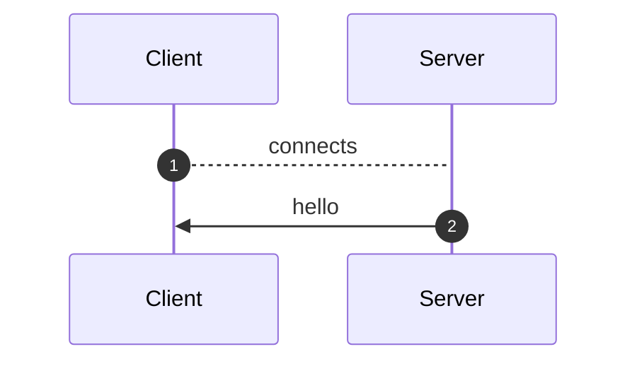
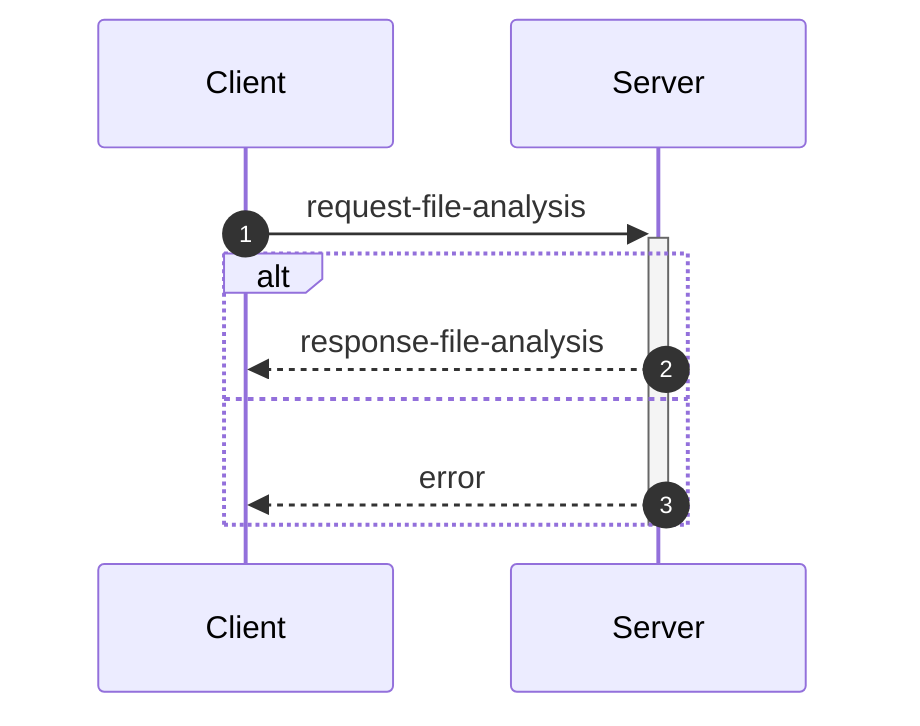
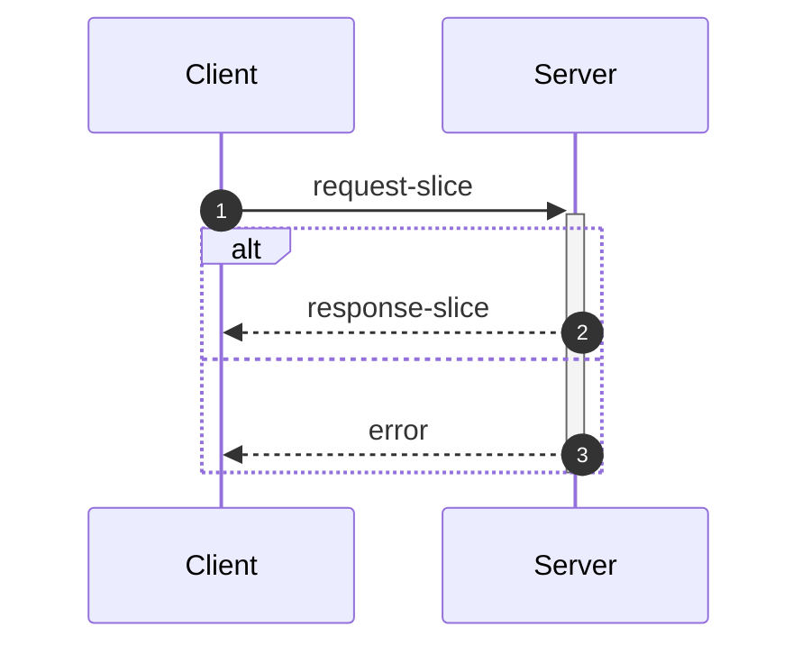
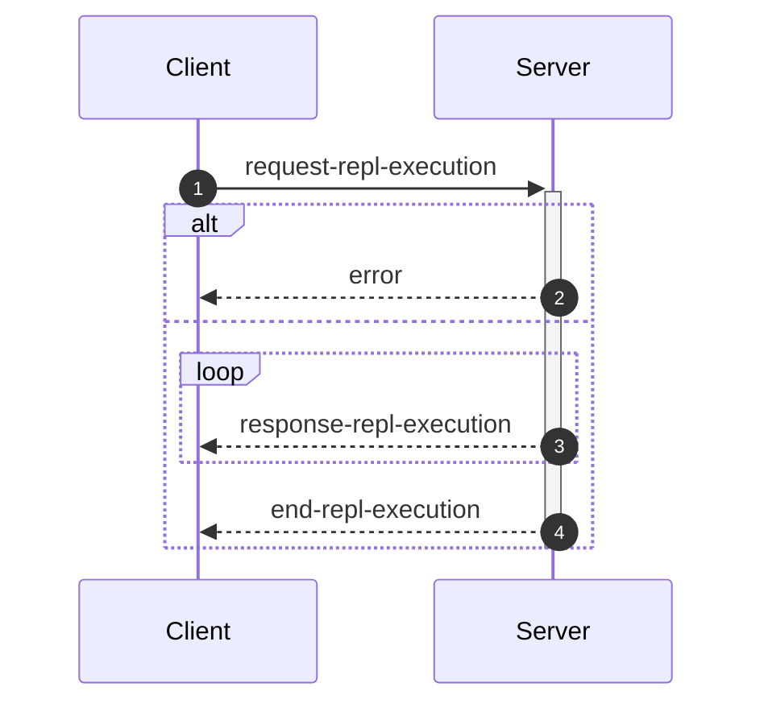

_<span title="an overview of flowR's interface">Generated</span> from '[wiki-interface.ts](https://github.com/flowr-analysis/flowr/tree/main/src/documentation/wiki-interface.ts "src/documentation/wiki-interface.ts")' on 2026-10-19, 07:43:23 UTC (v2.16.3, R v4.6.1), do not edit directly._

Although far from being as detailed as the in-depth explanation of [_flowR_](https://github.com/flowr-analysis/flowr/wiki/Core),
this wiki page explains how to interface with _flowR_ in more detail.
In general, command line arguments and other options provide short descriptions on hover over.

* [💻 Using the REPL](#using-the-repl)
* [⚙️ Configuring FlowR](#configuring-flowr)
* [⚒️ Writing Code](#writing-code)
* [💬 Communicating with the Server](#communicating-with-the-server)

<a id='using-the-repl'></a>
## 💻 Using the REPL

> [!NOTE]
> To execute arbitrary R commands with a repl request, _flowR_ has to be started explicitly with <span title="Description (Command Line Argument): Allow to access the underlying R session when using flowR (security warning: this allows the execution of arbitrary R code!)">`--r-session-access`</span>.
> Please be aware that this introduces a security risk and note that this relies on the [`r-shell` engine](https://github.com/flowr-analysis/flowr/wiki/Engines) .

Although primarily meant for users to explore,
there is nothing which forbids calling _flowR_ as a subprocess to use standard-in, -output, and -error
for communication (although you can access the REPL using the server as well,
with the [REPL Request](#message-request-repl-execution) message).

The read-eval-print loop&nbsp;(REPL) works relatively simple.
You can submit an expression (using <kbd>Enter</kbd>),
which is interpreted as an R&nbsp;expression by default but interpreted as a *command* if it starts with a colon (`:`).
The best command to get started with the REPL is <span title="Description (Repl Command): Show help information (aliases: :h, :?)">`:help`</span>.
Besides, you can leave the REPL either with the command <span title="Description (Repl Command): End the repl (aliases: :q, :exit)">`:quit`</span> or by pressing <kbd>Ctrl</kbd>+<kbd>C</kbd> twice.
When writing a *command*, you may press <kbd>Tab</kbd> to get a list of completions, if available.
Multiple commands can be entered in a single line by separating them with a semicolon (`;`), e.g. `:parse "x<-2"; :df*`.
If a command is given without R code, the REPL will re-use R code given in a previous command.
The prior example will hence return first the parsed AST of the program and then the dataflow graph for `"x <- 2"`.

> [!NOTE]
> If you develop flowR, you may want to launch the repl using the `npm run main-dev` command, this way, you get a non-minified version of flowR with debug information and hot-reloading of source files.

<details>
<summary>Available Commands</summary>

We currently offer the following commands (this with a `[*]` suffix are available with and without the star):

| Command | Description |
| ------- | ----------- |
| **<span title="Description (Repl Command): End the repl (aliases: :q, :exit)">:quit</span>** | End the repl (aliases: **:<span title="Alias of ':quit'. End the repl">q</span>**, **:<span title="Alias of ':quit'. End the repl">exit</span>**) |
| **<span title="Description (Repl Command): Execute the given code as R code. This requires the `--r-session-access` flag to be set and requires the r-shell engine. (aliases: :e, :r)">:execute</span>** | Execute the given code as R code. This requires the `--r-session-access` flag to be set and requires the r-shell engine. (aliases: **:<span title="Alias of ':execute'. Execute the given code as R code. This requires the `--r-session-access` flag to be set and requires the r-shell engine.">e</span>**, **:<span title="Alias of ':execute'. Execute the given code as R code. This requires the `--r-session-access` flag to be set and requires the r-shell engine.">r</span>**) |
| **<span title="Description (Repl Command): Get mermaid code for the control-flow graph of R code (aliases: :cfg, :cf)">:controlflow[*]</span>** | Get mermaid code for the control-flow graph of R code (star: Returns the URL to mermaid.live) (aliases: **:<span title="Alias of ':controlflow'. Get mermaid code for the control-flow graph of R code">cfg</span>**, **:<span title="Alias of ':controlflow'. Get mermaid code for the control-flow graph of R code">cf</span>**) |
| **<span title="Description (Repl Command): Get mermaid code for the control-flow graph with basic blocks (aliases: :cfgb, :cfb)">:controlflowbb[*]</span>** | Get mermaid code for the control-flow graph with basic blocks (star: Returns the URL to mermaid.live) (aliases: **:<span title="Alias of ':controlflowbb'. Get mermaid code for the control-flow graph with basic blocks">cfgb</span>**, **:<span title="Alias of ':controlflowbb'. Get mermaid code for the control-flow graph with basic blocks">cfb</span>**) |
| **<span title="Description (Repl Command): Get mermaid code for the dataflow graph (aliases: :d, :df)">:dataflow[*]</span>** | Get mermaid code for the dataflow graph (star: Returns the URL to mermaid.live) (aliases: **:<span title="Alias of ':dataflow'. Get mermaid code for the dataflow graph">d</span>**, **:<span title="Alias of ':dataflow'. Get mermaid code for the dataflow graph">df</span>**) |
| **<span title="Description (Repl Command): Get mermaid code for the normalized AST of R code (aliases: :n)">:normalize[*]</span>** | Get mermaid code for the normalized AST of R code (star: Returns the URL to mermaid.live) (alias: **:<span title="Alias of ':normalize'. Get mermaid code for the normalized AST of R code">n</span>**) |
| **<span title="Description (Repl Command): Get mermaid code for the simplified dataflow graph (aliases: :ds, :dfs)">:dataflowsimple[*]</span>** | Get mermaid code for the simplified dataflow graph (star: Returns the URL to mermaid.live) (aliases: **:<span title="Alias of ':dataflowsimple'. Get mermaid code for the simplified dataflow graph">ds</span>**, **:<span title="Alias of ':dataflowsimple'. Get mermaid code for the simplified dataflow graph">dfs</span>**) |
| **<span title="Description (Repl Command): Inspect and extend the signature database: `query` (identical to :query @signature), `info <name>` for where a function comes from (identical to :query @function-info), `add <path>` to mount another database/source, `download` to fetch the full-history database. (aliases: :sig)">:signature</span>** | Inspect and extend the signature database: `query` (identical to :query @signature), `info <name>` for where a function comes from (identical to :query @function-info), `add <path>` to mount another database/source, `download` to fetch the full-history database. (alias: **:<span title="Alias of ':signature'. Inspect and extend the signature database: `query` (identical to :query @signature), `info <name>` for where a function comes from (identical to :query @function-info), `add <path>` to mount another database/source, `download` to fetch the full-history database.">sig</span>**) |
| **<span title="Description (Repl Command): Just calculates the DFG, but only prints summary info (aliases: :d#, :df#)">:dataflowsilent</span>** | Just calculates the DFG, but only prints summary info (aliases: **:<span title="Alias of ':dataflowsilent'. Just calculates the DFG, but only prints summary info">d#</span>**, **:<span title="Alias of ':dataflowsilent'. Just calculates the DFG, but only prints summary info">df#</span>**) |
| **<span title="Description (Repl Command): Prints ASCII Art of the parsed, unmodified AST (aliases: :p)">:parse</span>** | Prints ASCII Art of the parsed, unmodified AST (alias: **:<span title="Alias of ':parse'. Prints ASCII Art of the parsed, unmodified AST">p</span>**) |
| **<span title="Description (Repl Command): Prints the version of flowR as well as the current version of R">:version</span>** | Prints the version of flowR as well as the current version of R
| **<span title="Description (Repl Command): Query the given R code (use 'help' for more information)">:query[*]</span>** | Query the given R code (use 'help' for more information) (star: Similar to query, but returns the output in json format.)
| **<span title="Description (Repl Command): Returns an ASCII representation of the dataflow graph (aliases: :df!)">:dataflowascii</span>** | Returns an ASCII representation of the dataflow graph (alias: **:<span title="Alias of ':dataflowascii'. Returns an ASCII representation of the dataflow graph">df!</span>**) |
| **<span title="Description (Repl Command): Returns summarization stats for the normalized AST (aliases: :n#)">:normalize#</span>** | Returns summarization stats for the normalized AST (alias: **:<span title="Alias of ':normalize#'. Returns summarization stats for the normalized AST">n#</span>**) |
| **<span title="Description (Repl Command): Show help information (aliases: :h, :?)">:help</span>** | Show help information (aliases: **:<span title="Alias of ':help'. Show help information">h</span>**, **:<span title="Alias of ':help'. Show help information">?</span>**) |

</details>

> [!TIP]
> 
> As indicated by the examples before, all REPL commands that operate on code keep track of the state.
> Hence, if you run a command like <span title="Description (Repl Command, starred version): Returns the URL to mermaid.live; Base Command: Get mermaid code for the dataflow graph (aliases: :d*, :df*)">`:dataflow*`</span> without providing R code,
> the REPL will re-use the R code provided in a previous command.
> Likewise, doing this will benefit from incrementality!
> If you request the dataflow graph with `:df* x <- 2 * y` and then want to see the parsed AST with `:parse`,
> the REPL will re-use previously obtained information and not re-parse the code again.
> 		

Generally, many commands offer shortcut versions in the REPL. Many queries, for example, offer a shortened format (see the example below).
Of special note, the [Config Query](https://github.com/flowr-analysis/flowr/wiki/%5BQuery%5D-Config)
can be used to also modify the currently active configuration of _flowR_ within the REPL (see the [wiki page](https://github.com/flowr-analysis/flowr/wiki/%5BQuery%5D-Config) for more information).

### Example: Retrieving the Dataflow Graph

To retrieve a URL to the [mermaid](https://mermaid.js.org/) diagram of the dataflow of a given expression,
use <span title="Description (Repl Command, starred version): Returns the URL to mermaid.live; Base Command: Get mermaid code for the dataflow graph (aliases: :d*, :df*)">`:dataflow*`</span> (or <span title="Description (Repl Command): Get mermaid code for the dataflow graph (aliases: :d, :df)">`:dataflow`</span> to get the mermaid code in the cli):

```shell
$ docker run -it --rm eagleoutice/flowr # or npm run flowr 
flowR repl v2.16.3, R grammar v14 (tree-sitter engine)
R> :dataflow* y <- 1 + x
```

<details>
<summary style='color:gray'>Output</summary>

```text
https://mermaid.live/view#base64:eyJjb2RlIjoiZmxvd2NoYXJ0IFREXG4gICAgMXt7XCJgKiM5MTtSTnVtYmVyIzkzOyogKioxKipcbiAgICAgICoxLjYqICgqKmlkOiAxKiopYFwifX1cbiAgICAyKFtcImAqIzkxO1JTeW1ib2wjOTM7KiAqKngqKlxuICAgICAgKjEuMTAqICgqKmlkOiAyKiopYFwiXSlcbiAgICAzW1tcImAqIzkxO1JCaW5hcnlPcCM5MzsqIGJhc2UjNTg7IzU4OyoqIzQzOyoqXG4gICAgICAqMS42LTEwKiAoKippZDogMyoqKVxuICAgIGFyZzogKDEsIDIpYFwiXV1cbiAgICBidWlsdC1pbjpfNDNfW1wiYEJ1aWx0LUluOlxuIzQzO2BcIl1cbiAgICBzdHlsZSBidWlsdC1pbjpfNDNfIHN0cm9rZTpncmF5LGZpbGw6Z3JheSxzdHJva2Utd2lkdGg6MnB4LG9wYWNpdHk6Ljg7XG4gICAgMFtcImAqIzkxO1JTeW1ib2wjOTM7KiAqKnkqKlxuICAgICAgKjEuMSogKCoqaWQ6IDAqKiwgdjogMylgXCJdXG4gICAgNFtbXCJgKiM5MTtSQmluYXJ5T3AjOTM7KiBiYXNlIzU4OyM1ODsqKiM2MDsjNDU7KipcbiAgICAgICoxLjEtMTAqICgqKmlkOiA0KiopXG4gICAgYXJnOiAoMCwgMylgXCJdXVxuICAgIGJ1aWx0LWluOl82MF8tW1wiYEJ1aWx0LUluOlxuIzYwOyM0NTtgXCJdXG4gICAgc3R5bGUgYnVpbHQtaW46XzYwXy0gc3Ryb2tlOmdyYXksZmlsbDpncmF5LHN0cm9rZS13aWR0aDoycHgsb3BhY2l0eTouODtcbiAgICAxIC0uLT58XCJmbG93XCJ8IDJcbiAgICBsaW5rU3R5bGUgMCBzdHJva2U6Z3JheSxjb2xvcjpncmF5O1xuICAgIDIgLS4tPnxcImZsb3dcInwgM1xuICAgIGxpbmtTdHlsZSAxIHN0cm9rZTpncmF5LGNvbG9yOmdyYXk7XG4gICAgMyAtLT58XCJyZWFkcywgYXJnXCJ8IDFcbiAgICAzIC0tPnxcInJlYWRzLCBhcmdcInwgMlxuICAgIDMgLS4tPnxcImZsb3dcInwgMFxuICAgIGxpbmtTdHlsZSA0IHN0cm9rZTpncmF5LGNvbG9yOmdyYXk7XG4gICAgMyAtLi0+fFwicmVhZHMsIGNhbGxzXCJ8IGJ1aWx0LWluOl80M19cbiAgICBsaW5rU3R5bGUgNSBzdHJva2U6Z3JheTtcbiAgICAwIC0tPnxcImRlZmluZWQtYnksIGZsb3dcInwgNFxuICAgIDAgLS0+fFwiZGVmaW5lZC1ieVwifCAzXG4gICAgNCAtLT58XCJyZWFkcywgYXJnXCJ8IDNcbiAgICA0IC0tPnxcInJldHVybnMsIGFyZ1wifCAwXG4gICAgNCAtLi0+fFwicmVhZHMsIGNhbGxzXCJ8IGJ1aWx0LWluOl82MF8tXG4gICAgbGlua1N0eWxlIDEwIHN0cm9rZTpncmF5OyIsIm1lcm1haWQiOnsiYXV0b1N5bmMiOnRydWV9fQ==
```

Retrieve the dataflow graph of the expression `y <- 1 + x`. It looks like this:


<details>

<summary style="color:gray">R Code of the Dataflow Graph</summary>

The analysis ran (including parse and normalize, using the [tree-sitter](https://github.com/flowr-analysis/flowr/wiki/Engines) engine) within the generation environment. No [signature database](https://github.com/flowr-analysis/flowr/wiki/Signature-Database) is mounted for these generated graphs, so `library()` calls attach no package exports; base-R names are still qualified via the generated base-package store (e.g. `acf` as `stats::acf`). 
We encountered no unknown side effects during the analysis.

```r
y <- 1 + x
```

</details>

</details>

For small graphs like this, <span title="Description (Repl Command): Returns an ASCII representation of the dataflow graph (aliases: :df!)">`:dataflowascii`</span> also provides an ASCII representation directly in the REPL:

```shell
$ docker run -it --rm eagleoutice/flowr # or npm run flowr 
flowR repl v2.16.3, R grammar v14 (tree-sitter engine)
R> :df! y <- 1 + x
```

<details open>
<summary style='color:gray'>Output</summary>

```text
                        v<0>v
 c<4>c──────────────────| y |
 |<- |     ┌────────────v---v
 c---c     │
    │   c<3>c   0<1>0
    └───| + |───| 1 |───u<2>u
        c---c   0---0   | x |
           └────────────u---u
Edges:
3 -> 1: reads, arg          3 -> 2: reads, arg
3 -> 0: flows-to            1 -> 2: flows-to
2 -> 3: flows-to            4 -> 3: reads, arg
4 -> 0: returns, arg        0 -> 4: defined-by, flows-to
0 -> 3: defined-by
```

Retrieve the dataflow graph of the expression `y <- 1 + x` as ASCII art.

</details>

For the slicing with <span title="Description (Repl Command): Static backwards executable slicer for R">`:slicer`</span>, you have access to the same [magic comments](#slice-magic-comments) as with the [slice request](#message-request-slice).
Pass `--inline` to splice resolvable `source()` calls into the reconstruction so the slice is a single self-contained R text (the same as the static slice query's `inlineSources` flag).
See `--help` for more flags!

### Example: Interfacing with the File System

Many commands that allow for an R-expression (like <span title="Description (Repl Command, starred version): Returns the URL to mermaid.live; Base Command: Get mermaid code for the dataflow graph (aliases: :d*, :df*)">`:dataflow*`</span>) allow for a file as well
if the argument starts with `file://`.
If you are working from the root directory of the _flowR_ repository, the following gives you the parsed AST of the example file using the <span title="Description (Repl Command): Prints ASCII Art of the parsed, unmodified AST (aliases: :p)">`:parse`</span> command:

> **Watch mode**: Replace `file://` with `watch://` to enter watch mode.
> flowR runs the command immediately and then re-runs it every time the file (or any file inside the folder) changes.
> Enter any other command to leave watch mode.
> For example: `:df watch://analysis.R`

```shell
$ docker run -it --rm eagleoutice/flowr # or npm run flowr 
flowR repl v2.16.3, R grammar v14 (tree-sitter engine)
R> :parse file://test/testfiles/example.R
```

<details>
<summary style='color:gray'>Output</summary>

```text
File: test/testfiles/example.R

program
├ binaryoperator
│ ├ identifier "sum" (1:1─4)
│ ├ <- "<-" (1:5─7)
│ ╰ float "0" (1:8─9)
├ binaryoperator
│ ├ identifier "product" (2:1─8)
│ ├ <- "<-" (2:9─11)
│ ╰ float "1" (2:12─13)
├ binaryoperator
│ ├ identifier "w" (3:1─2)
│ ├ <- "<-" (3:3─5)
│ ╰ float "7" (3:6─7)
├ binaryoperator
│ ├ identifier "N" (4:1─2)
│ ├ <- "<-" (4:3─5)
│ ╰ float "10" (4:6─8)
├ forstatement
│ ├ for "for" (6:1─4)
│ ├ ( "(" (6:5─6)
│ ├ identifier "i" (6:6─7)
│ ├ in "in" (6:8─10)
│ ├ binaryoperator
│ │ ├ float "1" (6:11─12)
│ │ ├ : ":" (6:12─13)
│ │ ╰ parenthesizedexpression
│ │   ├ ( "(" (6:13─14)
│ │   ├ binaryoperator
│ │   │ ├ identifier "N" (6:14─15)
│ │   │ ├ - "-" (6:15─16)
│ │   │ ╰ float "1" (6:16─17)
│ │   ╰ ) ")" (6:17─18)
│ ├ ) ")" (6:18─19)
│ ╰ bracedexpression
│   ├ { "{" (6:20─21)
│   ├ binaryoperator
│   │ ├ identifier "sum" (7:3─6)
│   │ ├ <- "<-" (7:7─9)
│   │ ╰ binaryoperator
│   │   ├ binaryoperator
│   │   │ ├ identifier "sum" (7:10─13)
│   │   │ ├ + "+" (7:14─15)
│   │   │ ╰ identifier "i" (7:16─17)
│   │   ├ + "+" (7:18─19)
│   │   ╰ identifier "w" (7:20─21)
│   ├ binaryoperator
│   │ ├ identifier "product" (8:3─10)
│   │ ├ <- "<-" (8:11─13)
│   │ ╰ binaryoperator
│   │   ├ identifier "product" (8:14─21)
│   │   ├  "" (8:22─23)
│   │   ╰ identifier "i" (8:24─25)
│   ╰ } "}" (9:1─2)
├ call
│ ├ identifier "cat" (11:1─4)
│ ╰ arguments
│   ├ ( "(" (11:4─5)
│   ├ argument
│   │ ╰ string
│   │   ├ " "\"" (11:5─6)
│   │   ├ stringcontent "Sum:" (11:6─10)
│   │   ╰ " "\"" (11:10─11)
│   ├ comma "," (11:11─12)
│   ├ argument
│   │ ╰ identifier "sum" (11:13─16)
│   ├ comma "," (11:16─17)
│   ├ argument
│   │ ╰ string
│   │   ├ " "\"" (11:18─19)
│   │   ├ stringcontent
│   │   │ ╰ escapesequence "\\n" (11:19─21)
│   │   ╰ " "\"" (11:21─22)
│   ╰ ) ")" (11:22─23)
╰ call
  ├ identifier "cat" (12:1─4)
  ╰ arguments
    ├ ( "(" (12:4─5)
    ├ argument
    │ ╰ string
    │   ├ " "\"" (12:5─6)
    │   ├ stringcontent "Product:" (12:6─14)
    │   ╰ " "\"" (12:14─15)
    ├ comma "," (12:15─16)
    ├ argument
    │ ╰ identifier "product" (12:17─24)
    ├ comma "," (12:24─25)
    ├ argument
    │ ╰ string
    │   ├ " "\"" (12:26─27)
    │   ├ stringcontent
    │   │ ╰ escapesequence "\\n" (12:27─29)
    │   ╰ " "\"" (12:29─30)
    ╰ ) ")" (12:30─31)
```

Retrieve the parsed AST of the example file.

<details>

<summary>File Content</summary>

```r
sum <- 0
product <- 1
w <- 7
N <- 10

for (i in 1:(N-1)) {
  sum <- sum + i + w
  product <- product * i
}

cat("Sum:", sum, "\n")
cat("Product:", product, "\n")
```

</details>

As _flowR_ directly transforms this AST the output focuses on being human-readable instead of being machine-readable.
		
</details>

### Example: Run a Query

You can run any query supported by _flowR_ using the <span title="Description (Repl Command): Query the given R code (use 'help' for more information)">`:query`</span> command.
For example, to obtain the shapes of all data frames in a given piece of code, you can run:

```shell
$ docker run -it --rm eagleoutice/flowr # or npm run flowr 
flowR repl v2.16.3, R grammar v14 (tree-sitter engine)
R> :query @absint df-shape "x <- data.frame(a = 1:10, b = 1:10)\ny <- x$a"
```

<details open>
<summary style='color:gray'>Output</summary>

```text
Query: absint (1 ms)
```

Retrieve the shapes of all data frames in the given code.

</details>

To run the linter on a file, you can use (in this example, we just issue the `dead-code` linter on a small piece of code):

```shell
$ docker run -it --rm eagleoutice/flowr # or npm run flowr 
flowR repl v2.16.3, R grammar v14 (tree-sitter engine)
R> :query @linter rules:dead-code "if(FALSE) x <- 2"
```

<details open>
<summary style='color:gray'>Output</summary>

```text
Query: linter (2 ms)
   ╰ Dead Code (dead-code):
       ╰ certain:
           ╰ Code at 1.11-16
```

Run the linter on the given code, with only the `dead-code` rule enabled.

</details>

For more information on the available queries, please check out the [Query API](https://github.com/flowr-analysis/flowr/wiki/Query-API).

<a id='configuring-flowr'></a>
## ⚙️ Configuring FlowR

When running _flowR_, you may want to specify some behaviors with a dedicated configuration file.
By default, flowR looks for a file named `flowr.json` in the current working directory (or any higher directory).
You can also specify a different file with <span title="Description (Command Line Argument): The name of the configuration file to use">`--config-file`</span> or pass the configuration inline using <span title="Description (Command Line Argument): The flowR configuration to use, as a JSON string">`--config-json`</span>.
A `flowr.json` found this way belongs to the analyzed project, so flowR ignores its options that decide what flowR executes or loads
(`engines.*.wasmPath`, `engines.*.treeSitterWasmPath`, `engines.*.rPath`, `solver.sigdb.additionalPaths`, `solver.sigdb.downloadRepo`, `solver.sigdb.installedLibrary.paths`),
unless you pass <span title="Description (Command Line Argument): Keep the security-sensitive options (e.g., the R executable) of the flowr.json found in the working directory or a parent. Only use this for projects you trust.">`--trust-config`</span>.
To analyze code you do not trust, use the secure mode (<span title="Description (Command Line Argument): Run in secure mode for analyzing untrusted code: flowR does not start R (or any other process), does not access the network, does not search for project configs, and ignores security-sensitive options in every config. Cannot be disabled once enabled. Can also be enabled with the environment variable {italic FLOWR_SECURE_MODE=1}.">`--secure`</span>, see the [security policy](https://github.com/flowr-analysis/flowr/blob/main/.github/SECURITY.md)).
To inspect the current configuration, you can run flowr with the <span title="Description (Command Line Argument): Run with verbose logging (will be passed to the corresponding script)">`--verbose`</span> flag, or use the `config` [Query](https://github.com/flowr-analysis/flowr/wiki/Query-API).
Within the REPL this works by running the following:

```shell
:query @config
```

To work with the <a href="https://github.com/flowr-analysis/flowr/tree/main/src/config.ts#L119"><code><span title="The configuration file format for flowR.">FlowrConfig</span></code></a> you can use the provided helper objects alongside its methods like
<a href="https://github.com/flowr-analysis/flowr/tree/main/src/config.ts#L914"><code><span title="Creates a new flowr config that has the updated values.">FlowrConfig::<b>amend</b></span></code></a>.
The schema below documents every option; the ones you most likely want are:

- <a href="https://github.com/flowr-analysis/flowr/wiki/Interface#configuring-flowr" title="Configuration Option (boolean): Whether source calls should be ignored, causing {@link processSourceCall}&#39;s behavior to be skipped.">ignoreSourceCalls</a>: ignore source calls when analyzing the code, i.e., ignore the inclusion of other files.
- <a href="https://github.com/flowr-analysis/flowr/wiki/Interface#configuring-flowr" title="Configuration Option (boolean): Whether load calls should be ignored, causing {@link processLoadCall}&#39;s behavior to be skipped.">ignoreLoadCalls</a>: ignore load calls when analyzing the code, i.e., ignore the loading of r-data files.
- <a href="https://github.com/flowr-analysis/flowr/wiki/Interface#configuring-flowr" title="Configuration Option (object): Do you want to overwrite (parts) of the builtin definition?">semantics.environment.overwriteBuiltIns</a>: overwrite _flowR_'s handling of built-in functions, or clear the preset definitions entirely.
  See [Configure BuiltIn Semantics](#configure-builtin-semantics) for more information.
- <a href="https://github.com/flowr-analysis/flowr/wiki/Interface#configuring-flowr" title="Configuration Option (string): How to resolve variables and their values. (one of &quot;disabled&quot;, &quot;alias&quot;, &quot;builtin&quot;)">solver.variables</a>: how to resolve variables and their values (`disabled`, `alias`, `builtin`).
- <a href="https://github.com/flowr-analysis/flowr/wiki/Interface#configuring-flowr" title="Configuration Option (array): The engine or set of engines to use for interacting with R code. An empty array means all available engines will be used.">engines</a> and <a href="https://github.com/flowr-analysis/flowr/wiki/Interface#configuring-flowr" title="Configuration Option (string): The default engine to use for interacting with R code. If this is undefined, an arbitrary engine from the specified list will be used. (one of &quot;tree-sitter&quot;, &quot;r-shell&quot;)">defaultEngine</a>: the engines used to interact with R code, see the [Engines wiki page](https://github.com/flowr-analysis/flowr/wiki/Engines).
- <a href="https://github.com/flowr-analysis/flowr/wiki/Interface#configuring-flowr" title="Configuration Option (array): Files a framework loads on its own, without any source() call (e.g. global.R in a shiny app), in the order they are loaded; flowR orders the matching project files accordingly and analyzes them as one program. Entries are case-insensitive globs matched against the file path, a plain name matches any file with that name, and entries matching no project file are warned about. Usually set per project kind via specializeConfig.">project.implicitSources</a>: the files a framework loads without any `source()` call, in the order in which they are
  loaded. Entries are globs (e.g. `R/*.R`) matched against the file path ignoring capitalization; one matching no file is reported.
- <a href="https://github.com/flowr-analysis/flowr/wiki/Interface#configuring-flowr" title="Configuration Option (object): Overwrite (parts of) the configuration depending on the project kind flowR detects, e.g. to give a shiny app its implicit sources.">specializeConfig</a>: overwrite (parts of) the configuration depending on the kind of project _flowR_ detects
  (e.g. `shiny-app`), which is how a shiny app gets its implicit sources by default. What you configure directly wins.
- <a href="https://github.com/flowr-analysis/flowr/wiki/Interface#configuring-flowr" title="Configuration Option (string): Overwrite the project kind flowR would otherwise infer from the analyzed files, e.g. when auto-detection guesses wrong. (one of &quot;package&quot;, &quot;script&quot;, &quot;shiny-app&quot;, &quot;notebook&quot;, &quot;project&quot;, &quot;unknown&quot;)">project.useProjectType</a>: skip that detection and force a project kind yourself, when auto-detection guesses wrong.
- <a href="https://github.com/flowr-analysis/flowr/wiki/Interface#configuring-flowr" title="Configuration Option (array): The default plugins to load when creating a new instance of FlowrAnalyzer">defaultPlugins</a> and <a href="https://github.com/flowr-analysis/flowr/wiki/Interface#configuring-flowr" title="Configuration Option (array): The plugins to load in REPL mode">repl.plugins</a>: the plugins to load for a new <a href="https://github.com/flowr-analysis/flowr/tree/main/src/project/flowr-analyzer.ts#L205"><code><span title="Central class for conducting analyses with FlowR. Use the FlowrAnalyzerBuilder to create a new instance. If you want the original pattern of creating a pipeline and running all steps, you can still do this with FlowrAnalyzer#runFull . To inspect the context of the analyzer, use FlowrAnalyzer#inspectContext (if you are a plugin and need to modify it, use FlowrAnalyzer#context instead).">FlowrAnalyzer</span></code></a> and in the REPL
  (use `flowr:default` to reference the former).

So you can configure _flowR_ by adding a file like the following:

<details>

<summary>Example Configuration File</summary>

```json
{
  "ignoreSourceCalls": true,
  "ignoreLoadCalls": true,
  "semantics": {
    "environment": {
      "overwriteBuiltIns": {
        "definitions": [
          {
            "type": "function",
            "names": [
              "foo"
            ],
            "processor": "builtin:assign",
            "config": {}
          }
        ]
      }
    }
  },
  "defaultPlugins": [
    "file:description",
    "versions:description"
  ],
  "repl": {
    "quickStats": false,
    "dfProcessorHeat": false,
    "hints": true,
    "plugins": [
      "flowr:default"
    ]
  },
  "project": {
    "resolveUnknownPathsOnDisk": true,
    "implicitSources": [
      "global.R",
      "app.R"
    ]
  },
  "linter": {
    "disabledRules": []
  },
  "specializeConfig": {
    "shiny-app": {
      "project": {
        "implicitSources": [
          "global.R",
          "ui.R",
          "server.R",
          "app.R"
        ]
      }
    }
  },
  "engines": [
    {
      "type": "r-shell"
    }
  ],
  "solver": {
    "variables": "alias",
    "evalStrings": true,
    "trackEnvironments": true,
    "sigdb": {
      "enabled": true,
      "loadProjectDependencies": true,
      "eagerlyLoad": false,
      "eagerlyLoadExports": false,
      "linkBaseR": false,
      "linkDescriptionDependencies": false
    },
    "resolveSource": {
      "dropPaths": "no",
      "ignoreCapitalization": true,
      "inferWorkingDirectory": "active-script",
      "searchPath": []
    },
    "instrument": {},
    "slicer": {
      "threshold": 50
    }
  },
  "abstractInterpretation": {
    "wideningThreshold": 4,
    "followCalls": true,
    "dataFrame": {
      "maxColNames": 20,
      "readLoadedData": {
        "readExternalFiles": true,
        "maxReadLines": 1000000
      }
    }
  },
  "incremental": {
    "alwaysIncremental": false,
    "parsing": {
      "activated": false,
      "heuristics": {
        "activated": true,
        "mtime": true,
        "linesFrom": 500,
        "bytesFrom": 50000,
        "alwaysWithEdits": false,
        "minFiles": 1
      }
    }
  },
  "gas": {
    "thresholds": {
      "memory": {
        "problematic": 0.7,
        "critical": 0.9
      },
      "timeMs": {
        "problematic": 100000,
        "critical": 120000
      }
    },
    "features": {}
  }
}
```

</details>

<details>
<a id='configure-builtin-semantics'></a>
<summary>Configure Built-In Semantics</summary>

`semantics/environment/overwriteBuiltins` accepts two keys:

- `loadDefaults` (boolean, initially `true`): If set to `true`, the default built-in definitions are loaded before applying the custom definitions. Setting this flag to `false` explicitly disables the loading of the default definitions.
- `definitions` (array, initially empty): Allows to overwrite or define new built-in elements. Each object within must have a `type` which is one of the below. Furthermore, they may define a string array of `names` which specifies the identifiers to bind the definitions to. You may use `assumePrimitive` to specify whether _flowR_ should assume that this is a primitive non-library definition (so you probably just do not want to specify the key).

  | Type            | Description                                                                                                                                                                                                                                                                                              | Example                                                                                                    |
  | --------------- | -------------------------------------------------------------------------------------------------------------------------------------------------------------------------------------------------------------------------------------------------------------------------------------------------------- | ---------------------------------------------------------------------------------------------------------- |
  | `constant`    | Additionally allows for a `value` this should resolve to.                                                                                                                                                                                                                                                | `{ type: 'constant', names: ['NULL', 'NA'],  value: null }`                                                |
  | `function`    | Is a rather flexible way to define and bind built-in functions. For the time, we do not have extensive documentation to cover all the cases, so please either consult the sources with the `default-builtin-config.ts` or open a [new issue](https://github.com/flowr-analysis/flowr/issues/new/choose). | `{ type: 'function', names: ['next'], processor: 'builtin:d', config: { cfg: ExitPointType.Next } }` |
  | `replacement` | A comfortable way to specify replacement functions like `$<-` or `names<-`. `suffixes` describes the... suffixes to attach automatically. | `{ type: 'replacement', suffixes: ['<-', '<<-'], names: ['[', '[['] }` |

</details>

<details>

<summary style='color:gray'>Full Configuration-File Schema</summary>

- _The configuration file format for flowR._ (object)
    - **logLevel** [optional] _flowR's global minimum log level, applied when the config is loaded._ (string)
        Only allows: 'silly', 'trace', 'debug', 'info', 'warn', 'error', 'fatal'
    - **ignoreSourceCalls** [optional] _Whether source calls should be ignored, causing {@link processSourceCall}'s behavior to be skipped._ (boolean)
    - **ignoreLoadCalls** [optional] _Whether load calls should be ignored, causing {@link processLoadCall}'s behavior to be skipped._ (boolean)
    - **semantics** _Configure language semantics and how flowR handles them._ (object)
        - **environment** [optional] _Semantics regarding how to handle the R environment._ (object)
            - **overwriteBuiltIns** [optional] _Do you want to overwrite (parts) of the builtin definition?_ (object)
                - **loadDefaults** [optional] _Should the default configuration still be loaded?_ (boolean)
                - **definitions** [optional] _The definitions to load/overwrite._ (array)
                Valid item types:
                    - (object)
    - **defaultPlugins** [optional] _The default plugins to load when creating a new instance of FlowrAnalyzer_ (array)
    Valid item types:
        - (alternatives)
            - (string)
            - (array)
    - **repl** _Configuration options for the REPL._ (object)
        - **quickStats** [optional] _Whether to show quick stats in the REPL after each evaluation._ (boolean)
        - **dfProcessorHeat** [optional] _This instruments the dataflow processors to count how often each processor is called._ (boolean)
        - **hints** [optional] _Whether to show dim inline hints on the empty prompt (automatically disabled on non-interactive terminals)._ (boolean)
        - **plugins** [optional] _The plugins to load in REPL mode_ (array)
        Valid item types:
            - (alternatives)
                - (string)
                - (array)
        - **autoUseFileProtocol** [optional] _Prepend the file protocol to a repl input that looks like a path, instead of only warning about it._ (boolean)
        - **queryStats** [optional] _Whether `:query` closes with the line stating how long the queries took (`:query*` never prints it)._ (boolean)
        - **showPlugins** [optional] _Whether `:version` grays out the plugins that did not activate during the last analysis._ (boolean)
    - **project** _Project specific configuration options._ (object)
        - **resolveUnknownPathsOnDisk** [optional] _Whether to resolve unknown paths loaded by the r project disk when trying to source/analyze files._ (boolean)
        - **failOnInaccessiblePath** [optional] _Whether a directory that cannot be traversed during file discovery (e.g. due to permissions) aborts the analysis; when false (the default) such paths are logged and skipped._ (boolean)
        - **basePackages** [optional] _The packages considered part of R itself (base and recommended); if unset, flowR uses its built-in list._ (array)
        Valid item types:
            - (string)
        - **implicitSources** [optional] _Files a framework loads on its own, without any source() call (e.g. global.R in a shiny app), in the order they are loaded; flowR orders the matching project files accordingly and analyzes them as one program. Entries are case-insensitive globs matched against the file path, a plain name matches any file with that name, and entries matching no project file are warned about. Usually set per project kind via specializeConfig._ (array)
        Valid item types:
            - (string)
        - **useProjectType** [optional] _Overwrite the project kind flowR would otherwise infer from the analyzed files, e.g. when auto-detection guesses wrong._ (string)
            Only allows: 'package', 'script', 'shiny-app', 'notebook', 'project', 'unknown'
        - **assumeImplicitEcho** [optional] _Whether the top level of the analyzed code is echoed, so that every visible result printed there is collected as an output by the dependencies query (default true, false for a package)._ (boolean)
        - **discovery** [optional] _Scoping options for the default project discovery._ (object)
            - **full** [optional] _Collect every file below the project root (greedy) instead of only the files the detected project kind needs (default false)._ (boolean)
            - **perKind** [optional] _Per-kind include/exclude glob overrides layered on the default scoping._ (object)
            - **ignore** [optional] _Case-insensitive globs that drop matching files from the intelligent discovery, regardless of kind (e.g. .Renviron to ignore environment files)._ (array)
            Valid item types:
                - (string)
        - **classification** [optional] _Overrides for the signals flowR uses to classify the project kind._ (object)
            - **shinyDescriptionTypes** [optional] _DESCRIPTION Type: values that mark a shiny app._ (array)
            Valid item types:
                - (string)
            - **shinyEntryFiles** [optional] _File names a shiny app is assembled from._ (array)
            Valid item types:
                - (string)
            - **shinyUsagePattern** [optional] _Regex source evidencing shiny usage in an entry file._ (string)
            - **notebookExtensions** [optional] _File extensions marking a notebook._ (array)
            Valid item types:
                - (string)
    - **linter** _Linter configuration options._ (object)
        - **disabledRules** _Linting rule names excluded from the default rule set (a rule requested explicitly via a linter query still runs). Usually set per project kind via specializeConfig._ (array)
        Valid item types:
            - (string)
        - **disabledTags** [optional] _Linting rule tags whose rules are excluded from the default rule set (a rule requested explicitly via a linter query still runs). By default the cmd-check rules are disabled for everything but a package; a configured list replaces that default._ (array)
        Valid item types:
            - (string)
    - **inputSources** [optional] _Further frameworks the input-sources analysis should know about; entries are added to flowR's defaults._ (object)
        - **pure** [optional] _Functions that only pass the constantness of their arguments on._ (array)
        Valid item types:
            - (string)
        - **param** [optional] _Functions whose result is a 'param' input._ (array)
        Valid item types:
            - (string)
        - **file** [optional] _Functions whose result is a 'file' input._ (array)
        Valid item types:
            - (string)
        - **tempfile** [optional] _Functions whose result is a 'tempfile' input._ (array)
        Valid item types:
            - (string)
        - **glob** [optional] _Functions whose result is a 'glob' input._ (array)
        Valid item types:
            - (string)
        - **net** [optional] _Functions whose result is a 'net' input._ (array)
        Valid item types:
            - (string)
        - **rand** [optional] _Functions whose result is a 'rand' input._ (array)
        Valid item types:
            - (string)
        - **system** [optional] _Functions whose result is a 'system' input._ (array)
        Valid item types:
            - (string)
        - **ffi** [optional] _Functions whose result is a 'ffi' input._ (array)
        Valid item types:
            - (string)
        - **lang** [optional] _Functions whose result is a 'lang' input._ (array)
        Valid item types:
            - (string)
        - **options** [optional] _Functions whose result is a 'options' input._ (array)
        Valid item types:
            - (string)
        - **cmdline** [optional] _Functions whose result is a 'cmdline' input._ (array)
        Valid item types:
            - (string)
        - **user** [optional] _Functions whose result is a 'user' input._ (array)
        Valid item types:
            - (string)
        - **const** [optional] _Functions whose result is a 'const' input._ (array)
        Valid item types:
            - (string)
        - **scope** [optional] _Functions whose result is a 'scope' input._ (array)
        Valid item types:
            - (string)
        - **dconst** [optional] _Functions whose result is a 'dconst' input._ (array)
        Valid item types:
            - (string)
        - **unknown** [optional] _Functions whose result is a 'unknown' input._ (array)
        Valid item types:
            - (string)
        - **linkedObjects** [optional] _Objects a framework provides without a definition in the code, e.g. shiny's input._ (array)
        Valid item types:
            - (object)
        - **linkedEntryPoints** [optional] _Calls that hand a function to a framework, which binds its objects to the parameters by position._ (array)
        Valid item types:
            - (object)
    - **specializeConfig** [optional] _Overwrite (parts of) the configuration depending on the project kind flowR detects, e.g. to give a shiny app its implicit sources._ (object)
    - **engines** _The engine or set of engines to use for interacting with R code. An empty array means all available engines will be used._ (array)
    Valid item types:
        - (alternatives)
            - _The configuration for the tree sitter engine._ (object)
                - **type** [required] _Use the tree sitter engine._ (string)
                    Only allows: 'tree-sitter'
                - **wasmPath** [optional] _The path to the tree-sitter-r WASM binary to use. If this is undefined, this uses the default path._ (string)
                - **treeSitterWasmPath** [optional] _The path to the tree-sitter WASM binary to use. If this is undefined, this uses the default path._ (string)
                - **lax** [optional] _Whether to use the lax parser for parsing R code (allowing for syntax errors). If this is undefined, the strict parser will be used._ (boolean)
            - _The configuration for the R shell engine._ (object)
                - **type** [required] _Use the R shell engine._ (string)
                    Only allows: 'r-shell'
                - **rPath** [optional] _The path to the R executable to use. If this is undefined, this uses the default path._ (string)
                - **pipeBind** [optional] _Whether to enable R's experimental pipe-bind operator "=>" by setting _R_USE_PIPEBIND_ for the R session (default false); R itself keeps this off by default, as it is experimental and has never shipped in a release version of R._ (boolean)
    - **defaultEngine** [optional] _The default engine to use for interacting with R code. If this is undefined, an arbitrary engine from the specified list will be used._ (string)
        Only allows: 'tree-sitter', 'r-shell'
    - **solver** _How to resolve constants, constraints, cells, ..._ (object)
        - **variables** _How to resolve variables and their values._ (string)
            Only allows: 'disabled', 'alias', 'builtin'
        - **evalStrings** _Should we include eval(parse(text="...")) calls in the dataflow graph?_ (boolean)
        - **trackEnvironments** [optional] _Track user-created environments (new.env, assign/get/local with envir=, dollar-assign, attach). When false, all envir-style calls fall through conservatively._ (boolean)
        - **sigdb** _Resolving library exports from a signature database._ (object)
            - **enabled** [optional] _Resolve library()/use() exports from a signature database (default true); when false no database is consulted._ (boolean)
            - **loadProjectDependencies** [optional] _Load the project's declared dependencies from its metadata files (DESCRIPTION Imports/Depends, rproject.toml, uvr.toml, renv.lock, rv.lock, uvr.lock) (default true); when false these files are not read for dependencies._ (boolean)
            - **eagerlyLoad** [optional] _Parse the database up front rather than on the first package load (default false, ignored if disabled)._ (boolean)
            - **eagerlyLoadExports** [optional] _Add a vertex for every export on load rather than on demand (default false); keeps the dataflow graph small._ (boolean)
            - **assumedRVersion** [optional] _R version assumed when resolving versioned (base-R) exports: a pin like "4.5" or "auto" to detect the installed R (default "auto")._ (string)
            - **linkBaseR** [optional] _Eagerly attach base-R namespaces so bare base calls resolve without library() (default false)._ (boolean)
            - **linkBaseRCalls** [optional] _Add a lightweight Reads edge from a bare base-R call to its signature-database function vertex (default false; base-R qualification is edge-free otherwise)._ (boolean)
            - **linkPackageCalls** [optional] _Add a lightweight Reads edge from a resolved package call to its signature-database function vertex (default false)._ (boolean)
            - **linkDescriptionDependencies** [optional] _Eagerly attach the namespaces of the project's declared DESCRIPTION dependencies (Imports/Depends) so their exports resolve without an explicit library() (default false)._ (boolean)
            - **warmInBackground** [optional] _Decompress the hot shards (base + most-downloaded) in a background task on startup so the first library() lookup is warm (default false; for long-running servers/REPLs)._ (boolean)
            - **additionalPaths** [optional] _Extra directories or bundle/manifest files searched for signature databases (alongside the shipped default and $FLOWR_SIGDB_DIR); a downloaded full-history bundle placed here is mounted automatically._ (array)
            Valid item types:
                - (string)
            - **downloadRepo** [optional] _GitHub owner/repo the full-history bundle is downloaded from via ":signature download" (default "flowr-analysis/flowr", release tag "sigdb-v<flowR-version>")._ (string)
            - **autoSync** [optional] _On startup, re-download shards whose committed sigdb.remote.json hash no longer matches the cache, in the background (default false; opt-in network sync after a git pull)._ (boolean)
            - **installedLibrary** [optional] _Recovering packages no signature database knows from the copy installed on this machine._ (object)
                - **enabled** [required] _Recover packages no signature database knows from their installed copy (default false)._ (boolean)
                - **paths** [optional] _Library directories to search; when empty they are discovered from the environment and the project._ (array)
                Valid item types:
                    - (string)
                - **useEnvironment** [optional] _Search the libraries R_LIBS_USER/R_LIBS/R_LIBS_SITE name (default true)._ (boolean)
                - **useProjectLibrary** [optional] _Search a project-local renv/packrat library (default true)._ (boolean)
                - **maxDepth** [optional] _How far to descend into the nested layout of a project-local library (default 3)._ (number)
                - **packages** [optional] _Only recover packages whose name matches one of these regular expressions; empty means any._ (array)
                Valid item types:
                    - (string)
            - **blobCacheBudgetMb** [optional] _How many MiB of decoded package blobs every open bundle may hold together (default 16)._ (number)
            - **versionSelection** [optional] _When a project constrains a dependency, resolve to the newest (default), oldest, or system-installed version satisfying it; system needs R and falls back to newest. Base-R packages always resolve against the assumed R version._ (string)
                Only allows: 'newest', 'oldest', 'system'
            - **versionOverrides** [optional] _Force an exact version for specific packages (name -> version), overriding both the project constraint and the versionSelection policy (default {})._ (object)
        - **versionManagement** _Policies for reasoning about dependency versions._ (object)
            - **linkedVersionGroups** [optional] _Groups of packages that must resolve to the same version; version guessing intersects each group so its members stay mutually compatible (default [])._ (array)
            Valid item types:
                - (array)
                Valid item types:
                    - (string)
        - **assumeAttachedPackages** [optional] _Packages to treat as attached without a `library()` call, so what the built-in configuration states about them applies to the analyzed code. The base packages R attaches on startup already resolve without it._ (array)
        Valid item types:
            - (string)
        - **transitiveSideEffectRounds** [optional] _How many rounds the transitive side-effect fixpoint may run before it is cut off (default 32); the propagation stops on its own as soon as a round adds nothing._ (number)
        - **maxOverlayDepth** [optional] _How many binding overlays may stack on one environment frame before a write flattens them (default 4); a pure performance knob, trading lookup cost against copy cost without changing any result._ (number)
        - **instrument** (object)
            - **dataflowExtractors** [optional] _These keys are only intended for use within code, allowing to instrument the dataflow analyzer!_ (any)
        - **resolveSource** [optional] _If lax source calls are active, flowR searches for sourced files much more freely, based on the configurations you give it. This option is only in effect if `ignoreSourceCalls` is set to false._ (object)
            - **dropPaths** _Allow to drop the first or all parts of the sourced path, if it is relative._ (string)
                Only allows: 'no', 'once', 'all'
            - **ignoreCapitalization** _Search for filenames matching in the lowercase._ (boolean)
            - **inferWorkingDirectory** _Try to infer the working directory from the main or any script to analyze._ (string)
                Only allows: 'no', 'main-script', 'active-script', 'any-script'
            - **searchPath** _Additionally search in these paths._ (array)
            Valid item types:
                - (string)
            - **repeatedSourceLimit** [optional] _How often the same file can be sourced within a single run? Please be aware: in case of cyclic sources this may not reach a fixpoint so give this a sensible limit._ (number)
            - **applyReplacements** _Provide name replacements for loaded files_ (array)
            Valid item types:
                - (object)
            - **assumeFilesExist** [optional] _Assume a sourced file is always there, making what it defines certain instead of conditional on the source call._ (boolean)
        - **slicer** [optional] _The configuration for the slicer._ (object)
            - **threshold** [optional] _The maximum number of iterations to perform on a single function call during slicing._ (number)
            - **autoExtend** [optional] _If set, the slicer will gain an additional post-pass._ (boolean)
    - **abstractInterpretation** _The configuration options for abstract interpretation._ (object)
        - **wideningThreshold** _The threshold for the number of visitations of a node at which widening should be performed to ensure the termination of the fixpoint iteration._ (number)
        - **followCalls** _Whether the abstract interpretation is interprocedural, i.e. whether it steps into the functions a call may dispatch to._ (boolean)
        - **dataFrame** _The configuration of the shape inference for data frames._ (object)
            - **maxColNames** _The maximum number of columns names to infer for data frames before over-approximating the column names to top._ (number)
            - **readLoadedData** _Configuration options for reading data frame shapes from loaded external data files, such as CSV files._ (object)
                - **readExternalFiles** _Whether data frame shapes should be extracted from loaded external files, such as CSV files._ (boolean)
                - **maxReadLines** _The maximum number of lines to read when extracting data frame shapes from loaded files, such as CSV files._ (number)
    - **incremental** (object)
        - **alwaysIncremental** _Always take the incremental path, regardless of heuristics._ (boolean)
        - **parsing** (object)
            - **activated** _If set, incremental parsing will be used._ (boolean)
            - **heuristics** (object)
                - **activated** [optional] _If set, the heuristics for incremental parsing will be used._ (boolean)
                - **mtime** [optional] _Skip reparsing entirely if the file's modification time is unchanged since the last parse._ (boolean)
                - **linesFrom** [optional] _Only consider incremental parsing for files with at least this many lines._ (number)
                - **bytesFrom** [optional] _Only consider incremental parsing for files with at least this many bytes._ (number)
                - **alwaysWithEdits** [optional] _Always take the incremental path whenever there is a computed edit region, regardless of the other thresholds._ (boolean)
                - **minFiles** [optional] _Only apply these heuristics once the project has at least this many files loaded._ (number)
    - **gas** [optional] _Resource-usage guard (gas) configuration. All feature factors default to 0 (disabled). See https://github.com/flowr-analysis/flowr/wiki/Core#gas-resource-guard._ (object)
        - **thresholds** [optional] _Thresholds for all gas checks (scaled by per-feature factor), boundable per feature._ (object)
            - **memory** [optional] _Heap-usage fraction thresholds (0-1), either shared or given per feature key (with `default` covering the rest)._ (object)
                - **problematic** [optional] _Heap fraction (0-1) above which Problematic is returned, for every feature without an entry of its own._ (number)
                - **critical** [optional] _Heap fraction (0-1) above which Critical is returned, for every feature without an entry of its own._ (number)
            - **timeMs** [optional] _Elapsed analysis time thresholds in milliseconds, either shared or given per feature key (with `default` covering the rest)._ (object)
                - **problematic** [optional] _Elapsed ms above which Problematic is returned, for every feature without an entry of its own._ (number)
                - **critical** [optional] _Elapsed ms above which Critical is returned, for every feature without an entry of its own._ (number)
            - **steps** [optional] _Processed-AST-node thresholds, counted rather than sampled; only a key that arms a budget (`dataflow`) reads them._ (object)
                - **problematic** [optional] _Processed AST nodes above which Problematic is returned, for every feature without an entry of its own._ (number)
                - **critical** [optional] _Processed AST nodes above which the extraction is cut short, for every feature without an entry of its own._ (number)
            - **vertices** [optional] _Created-dataflow-vertex thresholds, counted like `steps`._ (object)
                - **problematic** [optional] _Created dataflow vertices above which Problematic is returned, for every feature without an entry of its own._ (number)
                - **critical** [optional] _Created dataflow vertices above which the extraction is cut short, for every feature without an entry of its own._ (number)
        - **features** [optional] _Per-feature sensitivity factors. 0 or absent disables gas checking for that feature. A factor of 2 makes the feature twice as sensitive. Recognised keys: `source`, `side-effect-linking`, `linter`, `slicer`, `dataflow`._ (object)
        - **countedCheckEvery** [optional] _How many counted steps pass between two accountings of an armed check, be it a dataflow budget or the slicer's traversal (default 128); trades overshoot against the cost of the check._ (number)
        - **heapProvider** [optional] _Custom heap statistics source (programmatic configs only), overriding the built-in v8/performance.memory detection._ (function)

</details>

<a id='writing-code'></a>
## ⚒️ Writing Code

_flowR_ can be used as a [module](https://www.npmjs.com/package/@eagleoutice/flowr) and offers several main classes and interfaces that are interesting for extension writers 
(see the [Visual Studio Code extension](https://marketplace.visualstudio.com/items?itemName=code-inspect.vscode-flowr) or the [Core](https://github.com/flowr-analysis/flowr/wiki/Core) wiki page for more information).

### Creating Analyses with _flowR_

Nowadays, instances of the <a href="https://github.com/flowr-analysis/flowr/tree/main/src/project/flowr-analyzer.ts#L205"><code><span title="Central class for conducting analyses with FlowR. Use the FlowrAnalyzerBuilder to create a new instance. If you want the original pattern of creating a pipeline and running all steps, you can still do this with FlowrAnalyzer#runFull . To inspect the context of the analyzer, use FlowrAnalyzer#inspectContext (if you are a plugin and need to modify it, use FlowrAnalyzer#context instead).">FlowrAnalyzer</span></code></a> should be used as central frontend to get analysis results from _flowR_.
The entry points an analysis is written against are re-exported from the package root (`import { FlowrAnalyzerBuilder } from '@eagleoutice/flowr'`);
everything else stays reachable under its own path, as in `@eagleoutice/flowr/dataflow/graph/graph`.
For example, a program slice can be created like this:

```ts
const analyzer = await new FlowrAnalyzerBuilder()
    .setEngine('tree-sitter')
    .build();
analyzer.addRequest('x <- 1\ny <- x\nx');
const result = await analyzer.query([
    {
        type:     'static-slice',
        criteria: ['3@x']
    }
]);
```

For more information, please have a look at the [Analyzer](https://github.com/flowr-analysis/flowr/wiki/Analyzer) wiki page, which explains how to construct and use the <a href="https://github.com/flowr-analysis/flowr/tree/main/src/project/flowr-analyzer.ts#L205"><code><span title="Central class for conducting analyses with FlowR. Use the FlowrAnalyzerBuilder to create a new instance. If you want the original pattern of creating a pipeline and running all steps, you can still do this with FlowrAnalyzer#runFull . To inspect the context of the analyzer, use FlowrAnalyzer#inspectContext (if you are a plugin and need to modify it, use FlowrAnalyzer#context instead).">FlowrAnalyzer</span></code></a> in more detail.
To work with specific perspectives, you can also consult the respective pages like the [Dataflow Graph](https://github.com/flowr-analysis/flowr/wiki/Dataflow-Graph) or the [Abstract Interpretation](https://github.com/flowr-analysis/flowr/wiki/Abstract-Interpretation) wiki pages.
### The Pipeline Executor (Low-Level Interface)

Once, in the beginning, _flowR_ was meant to produce a dataflow graph merely to provide *program slices*. 
However, with continuous updates, the [Dataflow Graph](https://github.com/flowr-analysis/flowr/wiki/Dataflow-Graph) repeatedly proves to be the more interesting part.
With this, we restructured _flowR_'s originally *hardcoded* pipeline to be far more flexible. 
Now, it can be theoretically extended or replaced with arbitrary steps, optional steps, and what we call 'decorations' of these steps. 
In short, a slicing pipeline using the <a href="https://github.com/flowr-analysis/flowr/tree/main/src/core/pipeline-executor.ts#L97"><code><span title="**Please note:** The PipelineExecutor is now considered to be a rather low-level API for flowR. While it still works and is the basis for all other layers, we strongly recommend using the FlowrAnalyzer and its builder to create and use an analyzer instance that is pre-configured for your use-case. The pipeline executor allows to execute arbitrary pipelines in a step-by-step fashion. If you are not...">PipelineExecutor</span></code></a> looks like this:

```ts

const slicer = new PipelineExecutor(DEFAULT_SLICING_PIPELINE, {
  parser:    new RShell(),
  request:   requestFromInput('x <- 1\nx + 1'),
  criterion: ['2@x']
})
const slice = await slicer.allRemainingSteps()
// console.log(slice.reconstruct.code)
```

<details><summary>More Information</summary>

If you compare this, with what you would have done with the old (and removed) `SteppingSlicer`, 
this essentially just requires you to replace the `SteppingSlicer` with the <a href="https://github.com/flowr-analysis/flowr/tree/main/src/core/pipeline-executor.ts#L97"><code><span title="**Please note:** The PipelineExecutor is now considered to be a rather low-level API for flowR. While it still works and is the basis for all other layers, we strongly recommend using the FlowrAnalyzer and its builder to create and use an analyzer instance that is pre-configured for your use-case. The pipeline executor allows to execute arbitrary pipelines in a step-by-step fashion. If you are not...">PipelineExecutor</span></code></a>
and to pass the <a href="https://github.com/flowr-analysis/flowr/tree/main/src/core/steps/pipeline/default-pipelines.ts#L18"><code>DEFAULT_SLICING_PIPELINE</code></a> as the first argument.
The <a href="https://github.com/flowr-analysis/flowr/tree/main/src/core/pipeline-executor.ts#L97"><code><span title="**Please note:** The PipelineExecutor is now considered to be a rather low-level API for flowR. While it still works and is the basis for all other layers, we strongly recommend using the FlowrAnalyzer and its builder to create and use an analyzer instance that is pre-configured for your use-case. The pipeline executor allows to execute arbitrary pipelines in a step-by-step fashion. If you are not...">PipelineExecutor</span></code></a>...

1. Provides structures to investigate the results of all intermediate steps
2. Can be executed step-by-step
3. Can repeat steps (e.g., to calculate multiple slices on the same input)

See the in-code documentation for more information.

</details>

### Using the <a href="https://github.com/flowr-analysis/flowr/tree/main/src/r-bridge/shell.ts#L144"><code><span title="The RShell represents an interactive session with the R interpreter. You can configure it by RShellOptions . At the moment we are using a live R session (and not networking etc.) to communicate with R easily, which allows us to install packages etc. However, this might and probably will change in the future (leaving this as a legacy mode :D)">RShell</span></code></a> to Interact with R

The <a href="https://github.com/flowr-analysis/flowr/tree/main/src/r-bridge/shell.ts#L144"><code><span title="The RShell represents an interactive session with the R interpreter. You can configure it by RShellOptions . At the moment we are using a live R session (and not networking etc.) to communicate with R easily, which allows us to install packages etc. However, this might and probably will change in the future (leaving this as a legacy mode :D)">RShell</span></code></a> class allows interfacing with the `R`&nbsp;ecosystem installed on the host system.
Please have a look at [flowR's Engines](https://github.com/flowr-analysis/flowr/wiki/Engines) for more information on alternatives (for example, the <a href="https://github.com/flowr-analysis/flowr/tree/main/src/r-bridge/lang-4.x/tree-sitter/tree-sitter-executor.ts#L29"><code><span title="Synchronous and (way) faster alternative to the RShell using tree-sitter.">TreeSitterExecutor</span></code></a>).

> [!IMPORTANT]
> 
> Each <a href="https://github.com/flowr-analysis/flowr/tree/main/src/r-bridge/shell.ts#L144"><code><span title="The RShell represents an interactive session with the R interpreter. You can configure it by RShellOptions . At the moment we are using a live R session (and not networking etc.) to communicate with R easily, which allows us to install packages etc. However, this might and probably will change in the future (leaving this as a legacy mode :D)">RShell</span></code></a> controls a new instance of the R&nbsp;interpreter, 
> make sure to call <code><a href="https://github.com/flowr-analysis/flowr/tree/main/src/r-bridge/shell.ts#L350"><span title="Close the current R session, makes the object effectively invalid (can no longer be reopened etc.)">RShell::<i>close</i></span></a>()</code> when you are done.

You can start a new "session" by constructing a new object with <code>new <a href="https://github.com/flowr-analysis/flowr/tree/main/src/r-bridge/shell.ts#L144"><span title="The RShell represents an interactive session with the R interpreter. You can configure it by RShellOptions . At the moment we are using a live R session (and not networking etc.) to communicate with R easily, which allows us to install packages etc. However, this might and probably will change in the future (leaving this as a legacy mode :D)">RShell</span></a>()</code>.

However, there are several options that may be of interest 
(e.g., to automatically revive the shell in case of errors or to control the name location of the R process on the system).

With a shell object (let's call it `shell`), you can execute R code by using <a href="https://github.com/flowr-analysis/flowr/tree/main/src/r-bridge/shell.ts#L213"><code><span title="sends the given command directly to the current R session will not do anything to alter input markers!">RShell::<i>sendCommand</i></span></code></a>,
for example <code>shell.<a href="https://github.com/flowr-analysis/flowr/tree/main/src/r-bridge/shell.ts#L213"><span title="sends the given command directly to the current R session will not do anything to alter input markers!">sendCommand</span></a>("1 + 1")</code>.
However, this does not return anything, so if you want to collect the output of your command, use
<a href="https://github.com/flowr-analysis/flowr/tree/main/src/r-bridge/shell.ts#L296"><code><span title="Send a command and collect the output">RShell::<i>sendCommandWithOutput</i></span></code></a> instead.

<a id='communicating-with-the-server'></a>
## 💬 Communicating with the Server

As explained in the [Overview](https://github.com/flowr-analysis/flowr/wiki/Overview), you can run the [TCP](https://de.wikipedia.org/wiki/Transmission_Control_Protocol)&nbsp;server by adding the <span title="Description (Command Line Argument): Do not drop into a repl, but instead start a server on the given port (default: 1042) and listen for messages.">`--server`</span> flag (and, due to the interactive mode, exit with the conventional <kbd>CTRL</kbd>+<kbd>C</kbd>).
Currently, every connection is handled by the same underlying `RShell` - so the server is not designed to handle many clients at a time.
Additionally, the server is not well guarded against attacks (e.g., you can theoretically spawn an arbitrary number of&nbsp;RShell sessions on the target machine).

Every message has to be given in a single line (i.e., without a newline in-between) and end with a newline character. Nevertheless, we will pretty-print example given in the following segments for the ease of reading.

> [!NOTE]
> 
> The default <span title="Description (Command Line Argument): Do not drop into a repl, but instead start a server on the given port (default: 1042) and listen for messages.">`--server`</span> uses a simple [TCP](https://de.wikipedia.org/wiki/Transmission_Control_Protocol)
> connection. If you want _flowR_ to expose a [WebSocket](https://de.wikipedia.org/wiki/WebSocket) server instead, add the <span title="Description (Command Line Argument): If the server flag is set, use websocket for messaging">`--ws`</span> flag (i.e., <span title="Description (Command Line Argument): Do not drop into a repl, but instead start a server on the given port (default: 1042) and listen for messages.">`--server`</span> <span title="Description (Command Line Argument): If the server flag is set, use websocket for messaging">`--ws`</span>) when starting _flowR_ from the command line.

<ul><li>
<a id="message-hello"></a>
<b>Hello</b> Message (<code>hello</code>) 
<details>

<summary style="color:gray"> View Details. <i>The server informs the client about the successful connection and provides Meta-Information.</i> </summary>



After launching _flowR_, for example, with <code>docker run -it --rm eagleoutice/flowr <span title="Description (Command Line Argument): Do not drop into a repl, but instead start a server on the given port (default: 1042) and listen for messages.">-<span/>-server</span></code>&nbsp;(🐳️), connecting should present you with a `hello` message, that amongst others should reveal the versions of&nbsp;_flowR_ and&nbsp;R, using the [semver 2.0](https://semver.org/spec/v2.0.0.html) versioning scheme.
The message looks like this:

```json
{
  "type": "hello",
  "clientName": "client-0",
  "versions": {
    "flowr": "2.16.3",
    "r": "4.6.1",
    "engine": "r-shell"
  }
}
```

There are currently a few messages that you can send after the hello message.
If you want to _slice_ a piece of R code you first have to send an [analysis request](#message-request-file-analysis), so that you can send one or multiple slice requests afterward.
Requests for the [REPL](#message-request-repl-execution) are independent of that.
	
<hr>

<details>
<summary style="color:gray">Message schema (<code>hello</code>)</summary>

For the definition of the hello message, please see it's implementation at [`./src/cli/repl/server/messages/message-hello.ts`](https://github.com/flowr-analysis/flowr/tree/main/src/cli/repl/server/messages/message-hello.ts).

- [required] (object)
    - **type** [required] _The type of the hello message._ (string)
        Only allows: 'hello'
    - **id** [forbidden] _The id of the message is always undefined (as it is the initial message and not requested)._ (any)
    - **clientName** [required] _A unique name that is assigned to each client. It has no semantic meaning and is only used/useful for debugging._ (string)
    - **versions** [required] (object)
        - **flowr** [required] _The version of the flowr server running in semver format._ (string)
        - **r** [required] _The version of the underlying R shell running in semver format._ (string)
        - **engine** [required] _The parser backend that is used to parse the R code._ (string)

</details>

<hr>

</details>
	</li>

<li>
<a id="message-request-file-analysis"></a>
<b>Analysis</b> Message (<code>request-file-analysis</code>) 
<details>

<summary style="color:gray"> View Details. <i>The server builds the dataflow graph for a given input file (or a set of files).</i> </summary>



The request allows the server to analyze a file and prepare it for slicing.
The message can contain a `filetoken`, which is used to identify the file in later slice or query requests (if you do not add one, the request will not be stored and therefore, it is not available for subsequent requests).

> **Please note!**\
> If you want to send and process a lot of analysis requests, but do not want to slice them, please do not pass the `filetoken` field. This will save the server a lot of memory allocation.

Furthermore, the request must contain either a `content` field to directly pass the file's content or a `filepath` field which contains the path to the file (this path must be accessible for the server to be useful).
If you add the `id` field, the answer will use the same `id` so you can match requests and the corresponding answers.
See the implementation of the request-file-analysis message for more information.

You can drop one or more stored file tokens by adding the `invalidateToken` field (a single token or an array of tokens).
The server frees the corresponding analyses _after_ it has answered the request.

> **Tip!**\
> If you only want to drop tokens, you do not need a separate message: send a `request-file-analysis` that contains _just_ the `invalidateToken` field (and no `content` or `filepath`).
> Such a request behaves like an empty file analysis and the server replies with an empty `results` object.
> Because invalidation happens after the response, you may even pass the _current_ `filetoken` in `invalidateToken` to analyze a file once and have the server forget it right after you received the results.

<details>
<summary>Example of the <code>request-file-analysis</code> Message</summary>

_Note:_ even though we pretty-print these messages, they are sent as a single line, ending with a newline.

The following lists all messages that were sent and received in case you want to reproduce the scenario:

<ol>
<li> <code>hello</code> (response)
<details> 

<summary> Show Details </summary>

The first message is always a hello message.

```json
{"type":"hello","clientName":"client-0","versions":{"flowr":"2.16.3","r":"4.6.1","engine":"r-shell"}}
```

</details>
</li>

<li> <b><code>request-file-analysis</code> (request)</b>
<details open> 

<summary> Show Details </summary>

Let's suppose you simply want to analyze the following script:
 
```r
x <- 1
x + 1
```

 For this, you can send the following request:

```json
{"type":"request-file-analysis","id":"1","filetoken":"x","content":"x <- 1\nx + 1"}
```

</details>
</li>

<li> <code>response-file-analysis</code> (response)
<details> 

<summary> Show Details </summary>

The `results` field of the response effectively contains three keys of importance:

- `parse`: which contains 1:1 the parse result in CSV format that we received from the `RShell` (i.e., the AST produced by the parser of the R interpreter).
- `normalize`: which contains the normalized AST, including ids (see the `info` field and the [Normalized AST](https://github.com/flowr-analysis/flowr/wiki/Normalized-AST) wiki page).
- `dataflow`: especially important is the `graph` field which contains the dataflow graph as a set of root vertices (see the [Dataflow Graph](https://github.com/flowr-analysis/flowr/wiki/Dataflow-Graph) wiki page).
			
_As the code is pretty long, we inhibit pretty printing and syntax highlighting (JSON, hiding built-in):_

```text
{"type":"response-file-analysis","format":"json","id":"1","results":{"parse":{"files":[{"parsed":"[1,1,1,6,7,0,\"expr\",false,\"x <- 1\"],[1,1,1,1,1,3,\"SYMBOL\",true,\"x\"],[1,1,1,1,3,7,\"expr\",false,\"x\"],[1,3,1,4,2,7,\"LEFT_ASSIGN\",true,\"<-\"],[1,6,1,6,4,5,\"NUM_CONST\",true,\"1\"],[1,6,1,6,5,7,\"expr\",false,\"1\"],[2,1,2,5,16,0,\"expr\",false,\"x + 1\"],[2,1,2,1,10,12,\"SYMBOL\",true,\"x\"],[2,1,2,1,12,16,\"expr\",false,\"x\"],[2,3,2,3,11,16,\"'+'\",true,\"+\"],[2,5,2,5,13,14,\"NUM_CONST\",true,\"1\"],[2,5,2,5,14,16,\"expr\",false,\"1\"]","filePath":"/tmp/tmp-695208-qFlTBj3u3C7u-.R"}],".meta":{}},"normalize":{"ast":{"type":"RProject","files":[{"root":{"type":"RExpressionList","children":[{"type":"RBinaryOp","location":[1,3,1,4],"lhs":{"type":"RSymbol","location":[1,1,1,1],"content":"x","lexeme":"x","info":{"fullRange":[1,1,1,1],"adToks":[],"id":0,"parent":2,"role":"bin-l","index":0,"nest":0,"file":"/tmp/tmp-695208-qFlTBj3u3C7u-.R"}},"rhs":{"location":[1,6,1,6],"lexeme":"1","info":{"fullRange":[1,6,1,6],"adToks":[],"id":1,"parent":2,"role":"bin-r","index":1,"nest":0,"file":"/tmp/tmp-695208-qFlTBj3u3C7u-.R"},"type":"RNumber","content":{"num":1,"complexNumber":false,"markedAsInt":false}},"operator":"<-","lexeme":"<-","info":{"fullRange":[1,1,1,6],"adToks":[],"id":2,"parent":6,"nest":0,"file":"/tmp/tmp-695208-qFlTBj3u3C7u-.R","index":0,"role":"el-c"}},{"type":"RBinaryOp","location":[2,3,2,3],"lhs":{"type":"RSymbol","location":[2,1,2,1],"content":"x","lexeme":"x","info":{"fullRange":[2,1,2,1],"adToks":[],"id":3,"parent":5,"role":"bin-l","index":0,"nest":0,"file":"/tmp/tmp-695208-qFlTBj3u3C7u-.R"}},"rhs":{"location":[2,5,2,5],"lexeme":"1","info":{"fullRange":[2,5,2,5],"adToks":[],"id":4,"parent":5,"role":"bin-r","index":1,"nest":0,"file":"/tmp/tmp-695208-qFlTBj3u3C7u-.R"},"type":"RNumber","content":{"num":1,"complexNumber":false,"markedAsInt":false}},"operator":"+","lexeme":"+","info":{"fullRange":[2,1,2,5],"adToks":[],"id":5,"parent":6,"nest":0,"file":"/tmp/tmp-695208-qFlTBj3u3C7u-.R","index":1,"role":"el-c"}}],"info":{"adToks":[],"id":6,"nest":0,"file":"/tmp/tmp-695208-qFlTBj3u3C7u-.R","role":"root","index":0}},"filePath":"/tmp/tmp-695208-qFlTBj3u3C7u-.R"}],"info":{"id":7}},".meta":{}},"dataflow":{"unknownReferences":[],"in":[{"nodeId":2,"name":"<-","type":2},{"nodeId":5,"name":"+","type":2}],"out":[{"nodeId":0,"name":"x","type":4,"definedAt":2,"value":[1]}],"environment":{"current":{"id":1501,"parent":"<BuiltInEnvironment>","memory":[["x",[{"nodeId":0,"name":"x","type":4,"definedAt":2,"value":[1]}]]],"globalEnv":true},"level":0},"graph":{"rootVertices":[1,0,2,3,4,5],"vertexInformation":[[1,{"tag":"value","id":1}],[0,{"tag":"vdef","id":0,"source":[1]}],[2,{"tag":"fcall","id":2,"name":"<-","onlyBuiltin":true,"args":[{"nodeId":0,"type":32},{"nodeId":1,"type":32}],"origin":["builtin:assign"]}],[3,{"tag":"use","id":3}],[4,{"tag":"value","id":4}],[5,{"tag":"fcall","id":5,"name":"+","onlyBuiltin":true,"args":[{"nodeId":3,"type":32},{"nodeId":4,"type":32}],"origin":["builtin:d"]}]],"edgeInformation":[[2,[[1,{"types":65}],[0,{"types":72}],["built-in:<-",{"types":5}],[3,{"types":4096}]]],[1,[[0,{"types":4096}]]],[0,[[2,{"types":4098}],[1,{"types":2}]]],[5,[[3,{"types":65}],[4,{"types":65}],["built-in:+",{"types":5}]]],[3,[[0,{"types":1}],[4,{"types":4096}]]],[4,[[5,{"types":4096}]]]],"_unknownSideEffects":[]},"entryPoint":2,"cfgEntry":1,"exitPoints":[{"type":0,"nodeId":5}],"hooks":[],".meta":{}}}}
```

</details>
</li>
</ol>

The complete round-trip covers validating the messages as well as starting and stopping the internal mock server.

</details>

You receive an error if, for whatever reason, the analysis fails (e.g., the message or code you sent contained syntax errors).
It contains a human-readable description *why* the analysis failed (see the error message implementation for more details).

<details>
<summary>Example Error Message</summary>

_Note:_ even though we pretty-print these messages, they are sent as a single line, ending with a newline.

The following lists all messages that were sent and received in case you want to reproduce the scenario:

<ol>
<li> <code>hello</code> (response)
<details> 

<summary> Show Details </summary>

The first message is always a hello message.

```json
{"type":"hello","clientName":"client-0","versions":{"flowr":"2.16.3","r":"4.6.1","engine":"r-shell"}}
```

</details>
</li>

<li> <code>request-file-analysis</code> (request)
<details> 

<summary> Show Details </summary>

```json
{"type":"request-file-analysis","id":"1","filename":"sample.R","content":"x <-"}
```

</details>
</li>

<li> <b><code>error</code> (response)</b>
<details open> 

<summary> Show Details </summary>

```json
{
  "id": "1",
  "type": "error",
  "fatal": false,
  "reason": "Error while analyzing file sample.R: GuardError: unable to parse R code (see the log for more information) for request {\"request\":\"text\",\"content\":\"x <-\"}}\n Report a Bug: https://github.com/flowr-analysis/flowr/issues/new?body=%3C!%2D%2D%20Please%20describe%20your%20issue%20in%20more%20detail%20below!%20%2D%2D%3E%0A%0A%0A%3C!%2D%2D%20Automatically%20generated%20issue%20metadata%2C%20please%20do%20not%20edit%20or%20delete%20content%20below%20this%20line%20%2D%2D%3E%0A%2D%2D%2D%0A%0AflowR%20version%3A%202.16.3%0Anode%20version%3A%20v22.13.1%0Anode%20arch%3A%20x64%0Anode%20platform%3A%20linux%0Amessage%3A%20%60unable%20to%20parse%20R%20code%20%28see%20the%20log%20for%20more%20information%29%20for%20request%20%7B%22request%22%3A%22text%22%2C%22content%22%3A%22x%20%3C%2D%22%7D%7D%60%0Astack%20trace%3A%0A%60%60%60%0A%20%20%20%20at%20guard%20%28%3C%3E%2Fsrc%2Futil%2Fassert.ts%3A128%3A9%29%0A%20%20%20%20at%20guardRetrievedOutput%20%28%3C%3E%2Fsrc%2Fr%2Dbridge%2Fretriever.ts%3A155%3A7%29%0A%20%20%20%20at%20%2Fhome%2Fhappy%2Dfeet%2Fgit%2Fphd%2Fflowr%2Dfield%2Fflowr%2Fsrc%2Fr%2Dbridge%2Fretriever.ts%3A122%3A4%0A%20%20%20%20at%20processTicksAndRejections%20%28node%3Ainternal%2Fprocess%2Ftask_queues%3A105%3A5%29%0A%20%20%20%20at%20async%20Object.parseRequests%20%5Bas%20processor%5D%20%28%3C%3E%2Fsrc%2Fr%2Dbridge%2Fparser.ts%3A108%3A19%29%0A%20%20%20%20at%20async%20PipelineExecutor.nextStep%20%28%3C%3E%2Fsrc%2Fcore%2Fpipeline%2Dexecutor.ts%3A192%3A25%29%0A%20%20%20%20at%20async%20FlowrAnalyzerCache.stepTapeUntil%20%28%3C%3E%2Fsrc%2Fproject%2Fcache%2Fflowr%2Danalyzer%2Dcache.ts%3A117%3A4%29%0A%20%20%20%20at%20async%20FlowRServerConnection.sendFileAnalysisResponse%20%28%3C%3E%2Fsrc%2Fcli%2Frepl%2Fserver%2Fconnection.ts%3A206%3A53%29%0A%60%60%60%0A%0A%2D%2D%2D%0A%09"
}
```

</details>
</li>
</ol>

The complete round-trip covers validating the messages as well as starting and stopping the internal mock server.

</details>

&nbsp;

<a id="analysis-include-cfg"></a>
**Including the Control Flow Graph**

The control flow graph is a view on the dataflow graph: the dataflow analysis records the control flow while it walks
the program, and the graph projects those edges on demand. The server can expose that structure as well (please create
a [new issue](https://github.com/flowr-analysis/flowr/issues/new/choose) for any bug you may encounter).
For this, the analysis request may add `cfg: true` to its list of options.

<details>
<summary>Requesting a Control Flow Graph</summary>

_Note:_ even though we pretty-print these messages, they are sent as a single line, ending with a newline.

The following lists all messages that were sent and received in case you want to reproduce the scenario:

<ol>
<li> <code>hello</code> (response)
<details> 

<summary> Show Details </summary>

The first message is always a hello message.

```json
{"type":"hello","clientName":"client-0","versions":{"flowr":"2.16.3","r":"4.6.1","engine":"r-shell"}}
```

</details>
</li>

<li> <b><code>request-file-analysis</code> (request)</b>
<details open> 

<summary> Show Details </summary>

```json
{
  "type": "request-file-analysis",
  "id": "1",
  "filetoken": "x",
  "content": "if(unknown > 0) { x <- 2 } else { x <- 5 }\nfor(i in 1:x) { print(x); print(i) }",
  "cfg": true
}
```

</details>
</li>

<li> <code>response-file-analysis</code> (response)
<details> 

<summary> Show Details </summary>

The response looks basically the same as a response sent without the `cfg` flag. However, additionally it contains a `cfg` field. 
If you are interested in a visual representation of the control flow graph, see the 
[visualization with mermaid](https://mermaid.live/view#base64:eyJjb2RlIjoiZmxvd2NoYXJ0IFREXG4gICAgbjAoW1wiYFJTeW1ib2wgKDApXG4qKnVua25vd24qKmBcIl0pXG4gICAgbjEoW1wiYFJOdW1iZXIgKDEpXG4qKjAqKmBcIl0pXG4gICAgbjIoW1wiYFJCaW5hcnlPcCAoMilcbioqdW5rbm93biAjNjI7IDAqKmBcIl0pXG4gICAgbjYoW1wiYFJOdW1iZXIgKDYpXG4qKjIqKmBcIl0pXG4gICAgbjUoW1wiYFJTeW1ib2wgKDUpXG4qKngqKmBcIl0pXG4gICAgbjdbXCJgUkJpbmFyeU9wICg3KVxuKip4ICM2MDsjNDU7IDIqKmBcIl1cbiAgICBuOChbXCJgUkV4cHJlc3Npb25MaXN0ICg4KWBcIl0pXG4gICAgbjEyKFtcImBSTnVtYmVyICgxMilcbioqNSoqYFwiXSlcbiAgICBuMTEoW1wiYFJTeW1ib2wgKDExKVxuKip4KipgXCJdKVxuICAgIG4xM1tcImBSQmluYXJ5T3AgKDEzKVxuKip4ICM2MDsjNDU7IDUqKmBcIl1cbiAgICBuMTQoW1wiYFJFeHByZXNzaW9uTGlzdCAoMTQpYFwiXSlcbiAgICBuMTVbXCJgUklmVGhlbkVsc2UgKDE1KVxuKippZih1bmtub3duICM2MjsgMCkgIzEyMzsgeCAjNjA7IzQ1OyAyICMxMjU7IGVsc2UgIzEyMzsgeCAjNjA7IzQ1OyA1ICMxMjU7KipgXCJdXG4gICAgbjE2KFtcImBSU3ltYm9sICgxNilcbioqaSoqYFwiXSlcbiAgICBuMTcoW1wiYFJOdW1iZXIgKDE3KVxuKioxKipgXCJdKVxuICAgIG4xOChbXCJgUlN5bWJvbCAoMTgpXG4qKngqKmBcIl0pXG4gICAgbjE5KFtcImBSQmluYXJ5T3AgKDE5KVxuKioxIzU4O3gqKmBcIl0pXG4gICAgbjIzKFtcImBSU3ltYm9sICgyMylcbioqeCoqYFwiXSlcbiAgICBuMjVbXCJgUkZ1bmN0aW9uQ2FsbCAoMjUpXG4qKnByaW50KHgpKipgXCJdXG4gICAgbjI3KFtcImBSU3ltYm9sICgyNylcbioqaSoqYFwiXSlcbiAgICBuMjlbXCJgUkZ1bmN0aW9uQ2FsbCAoMjkpXG4qKnByaW50KGkpKipgXCJdXG4gICAgbjMwKFtcImBSRXhwcmVzc2lvbkxpc3QgKDMwKWBcIl0pXG4gICAgbjMxW1wiYFJGb3JMb29wICgzMSlcbioqZm9yKGkgaW4gMSM1ODt4KSAjMTIzOyBwcmludCh4KTsgcHJpbnQoaSkgIzEyNTsqKmBcIl1cbiAgICBuMiAtLi0+fFwiYnJhbmNoIG9uIHVua25vd24gIzYyOyAwICgyKSBpZiBUXCJ8IG42XG4gICAgbjIgLS4tPnxcImJyYW5jaCBvbiB1bmtub3duICM2MjsgMCAoMikgaWYgRlwifCBuMTJcbiAgICBuMCAtLT58XCJmbG93cyB0b1wifCBuMVxuICAgIG4xIC0tPnxcImZsb3dzIHRvXCJ8IG4yXG4gICAgbjcgLS0+fFwiZmxvd3MgdG9cInwgbjhcbiAgICBuNiAtLT58XCJmbG93cyB0b1wifCBuNVxuICAgIG41IC0tPnxcImZsb3dzIHRvXCJ8IG43XG4gICAgbjggLS0+fFwiZmxvd3MgdG9cInwgbjE1XG4gICAgbjE1IC0tPnxcImZsb3dzIHRvXCJ8IG4xN1xuICAgIG4xMyAtLT58XCJmbG93cyB0b1wifCBuMTRcbiAgICBuMTIgLS0+fFwiZmxvd3MgdG9cInwgbjExXG4gICAgbjExIC0tPnxcImZsb3dzIHRvXCJ8IG4xM1xuICAgIG4xNCAtLT58XCJmbG93cyB0b1wifCBuMTVcbiAgICBuMTkgLS0+fFwiZmxvd3MgdG9cInwgbjE2XG4gICAgbjE4IC0tPnxcImZsb3dzIHRvXCJ8IG4xOVxuICAgIG4xNyAtLT58XCJmbG93cyB0b1wifCBuMThcbiAgICBuMjUgLS0+fFwiZmxvd3MgdG9cInwgbjI3XG4gICAgbjIzIC0tPnxcImZsb3dzIHRvXCJ8IG4yNVxuICAgIG4yOSAtLT58XCJmbG93cyB0b1wifCBuMzBcbiAgICBuMjcgLS0+fFwiZmxvd3MgdG9cInwgbjI5XG4gICAgbjMwIC0tPnxcImZsb3dzIHRvXCJ8IG4xNlxuICAgIG4xNiAtLi0+fFwiYnJhbmNoIG9uIGkgKDE2KSBpZiBUXCJ8IG4yM1xuICAgIG4xNiAtLi0+fFwiYnJhbmNoIG9uIGkgKDE2KSBpZiBGXCJ8IG4zMVxuICAgIHN0eWxlIG4wIHN0cm9rZTpjeWFuLHN0cm9rZS13aWR0aDo2LjVweDsgICAgc3R5bGUgbjMxIHN0cm9rZTpncmVlbixzdHJva2Utd2lkdGg6Ni41cHg7IiwibWVybWFpZCI6eyJhdXRvU3luYyI6dHJ1ZX19).
			
_As the code is pretty long, we inhibit pretty printing and syntax highlighting (JSON, hiding built-in):_

```text
{"type":"response-file-analysis","format":"json","id":"1","cfg":{"graph":{"roots":[0,1,2,6,5,7,8,12,11,13,14,15,16,17,18,19,23,25,27,29,30,31],"vtxInfos":[[0,[2,0]],[1,[2,1]],[2,[2,2]],[6,[2,6]],[5,[2,5]],[7,[1,7]],[8,[2,8]],[12,[2,12]],[11,[2,11]],[13,[1,13]],[14,[2,14]],[15,[1,15]],[16,[2,16]],[17,[2,17]],[18,[2,18]],[19,[2,19]],[23,[2,23]],[25,[1,25]],[27,[2,27]],[29,[1,29]],[30,[2,30]],[31,[1,31]]],"bbChildren":[],"edgeInfos":[[2,[[6,{"id":15,"when":true}],[12,{"id":15,"when":false}]]],[0,[[1,0]]],[1,[[2,0]]],[7,[[8,0]]],[6,[[5,0]]],[5,[[7,0]]],[8,[[15,0]]],[15,[[17,0]]],[13,[[14,0]]],[12,[[11,0]]],[11,[[13,0]]],[14,[[15,0]]],[19,[[16,0]]],[18,[[19,0]]],[17,[[18,0]]],[25,[[27,0]]],[23,[[25,0]]],[29,[[30,0]]],[27,[[29,0]]],[30,[[16,0]]],[16,[[23,{"id":31,"when":true}],[31,{"id":31,"when":false}]]]],"mayHaveBasicBlocks":false},"entryPoints":[0],"exitPoints":[31],"returns":[],"breaks":[],"nexts":[]},"results":{"parse":{"files":[{"parsed":"[1,1,1,42,38,0,\"expr\",false,\"if(unknown > 0) { x <- 2 } else { x <- 5 }\"],[1,1,1,2,1,38,\"IF\",true,\"if\"],[1,3,1,3,2,38,\"'('\",true,\"(\"],[1,4,1,14,9,38,\"expr\",false,\"unknown > 0\"],[1,4,1,10,3,5,\"SYMBOL\",true,\"unknown\"],[1,4,1,10,5,9,\"expr\",false,\"unknown\"],[1,12,1,12,4,9,\"GT\",true,\">\"],[1,14,1,14,6,7,\"NUM_CONST\",true,\"0\"],[1,14,1,14,7,9,\"expr\",false,\"0\"],[1,15,1,15,8,38,\"')'\",true,\")\"],[1,17,1,26,22,38,\"expr\",false,\"{ x <- 2 }\"],[1,17,1,17,12,22,\"'{'\",true,\"{\"],[1,19,1,24,19,22,\"expr\",false,\"x <- 2\"],[1,19,1,19,13,15,\"SYMBOL\",true,\"x\"],[1,19,1,19,15,19,\"expr\",false,\"x\"],[1,21,1,22,14,19,\"LEFT_ASSIGN\",true,\"<-\"],[1,24,1,24,16,17,\"NUM_CONST\",true,\"2\"],[1,24,1,24,17,19,\"expr\",false,\"2\"],[1,26,1,26,18,22,\"'}'\",true,\"}\"],[1,28,1,31,23,38,\"ELSE\",true,\"else\"],[1,33,1,42,35,38,\"expr\",false,\"{ x <- 5 }\"],[1,33,1,33,25,35,\"'{'\",true,\"{\"],[1,35,1,40,32,35,\"expr\",false,\"x <- 5\"],[1,35,1,35,26,28,\"SYMBOL\",true,\"x\"],[1,35,1,35,28,32,\"expr\",false,\"x\"],[1,37,1,38,27,32,\"LEFT_ASSIGN\",true,\"<-\"],[1,40,1,40,29,30,\"NUM_CONST\",true,\"5\"],[1,40,1,40,30,32,\"expr\",false,\"5\"],[1,42,1,42,31,35,\"'}'\",true,\"}\"],[2,1,2,36,84,0,\"expr\",false,\"for(i in 1:x) { print(x); print(i) }\"],[2,1,2,3,41,84,\"FOR\",true,\"for\"],[2,4,2,13,53,84,\"forcond\",false,\"(i in 1:x)\"],[2,4,2,4,42,53,\"'('\",true,\"(\"],[2,5,2,5,43,53,\"SYMBOL\",true,\"i\"],[2,7,2,8,44,53,\"IN\",true,\"in\"],[2,10,2,12,51,53,\"expr\",false,\"1:x\"],[2,10,2,10,45,46,\"NUM_CONST\",true,\"1\"],[2,10,2,10,46,51,\"expr\",false,\"1\"],[2,11,2,11,47,51,\"':'\",true,\":\"],[2,12,2,12,48,50,\"SYMBOL\",true,\"x\"],[2,12,2,12,50,51,\"expr\",false,\"x\"],[2,13,2,13,49,53,\"')'\",true,\")\"],[2,15,2,36,81,84,\"expr\",false,\"{ print(x); print(i) }\"],[2,15,2,15,54,81,\"'{'\",true,\"{\"],[2,17,2,24,64,81,\"expr\",false,\"print(x)\"],[2,17,2,21,55,57,\"SYMBOL_FUNCTION_CALL\",true,\"print\"],[2,17,2,21,57,64,\"expr\",false,\"print\"],[2,22,2,22,56,64,\"'('\",true,\"(\"],[2,23,2,23,58,60,\"SYMBOL\",true,\"x\"],[2,23,2,23,60,64,\"expr\",false,\"x\"],[2,24,2,24,59,64,\"')'\",true,\")\"],[2,25,2,25,65,81,\"';'\",true,\";\"],[2,27,2,34,77,81,\"expr\",false,\"print(i)\"],[2,27,2,31,68,70,\"SYMBOL_FUNCTION_CALL\",true,\"print\"],[2,27,2,31,70,77,\"expr\",false,\"print\"],[2,32,2,32,69,77,\"'('\",true,\"(\"],[2,33,2,33,71,73,\"SYMBOL\",true,\"i\"],[2,33,2,33,73,77,\"expr\",false,\"i\"],[2,34,2,34,72,77,\"')'\",true,\")\"],[2,36,2,36,78,81,\"'}'\",true,\"}\"]","filePath":"/tmp/tmp-695208-2u10K7Nl5Pse-.R"}],".meta":{}},"normalize":{"ast":{"type":"RProject","files":[{"root":{"type":"RExpressionList","children":[{"type":"RIfThenElse","condition":{"type":"RBinaryOp","location":[1,12,1,12],"lhs":{"type":"RSymbol","location":[1,4,1,10],"content":"unknown","lexeme":"unknown","info":{"fullRange":[1,4,1,10],"adToks":[],"id":0,"parent":2,"role":"bin-l","index":0,"nest":1,"file":"/tmp/tmp-695208-2u10K7Nl5Pse-.R"}},"rhs":{"location":[1,14,1,14],"lexeme":"0","info":{"fullRange":[1,14,1,14],"adToks":[],"id":1,"parent":2,"role":"bin-r","index":1,"nest":1,"file":"/tmp/tmp-695208-2u10K7Nl5Pse-.R"},"type":"RNumber","content":{"num":0,"complexNumber":false,"markedAsInt":false}},"operator":">","lexeme":">","info":{"fullRange":[1,4,1,14],"adToks":[],"id":2,"parent":15,"nest":1,"file":"/tmp/tmp-695208-2u10K7Nl5Pse-.R","role":"if-c"}},"then":{"type":"RExpressionList","children":[{"type":"RBinaryOp","location":[1,21,1,22],"lhs":{"type":"RSymbol","location":[1,19,1,19],"content":"x","lexeme":"x","info":{"fullRange":[1,19,1,19],"adToks":[],"id":5,"parent":7,"role":"bin-l","index":0,"nest":1,"file":"/tmp/tmp-695208-2u10K7Nl5Pse-.R"}},"rhs":{"location":[1,24,1,24],"lexeme":"2","info":{"fullRange":[1,24,1,24],"adToks":[],"id":6,"parent":7,"role":"bin-r","index":1,"nest":1,"file":"/tmp/tmp-695208-2u10K7Nl5Pse-.R"},"type":"RNumber","content":{"num":2,"complexNumber":false,"markedAsInt":false}},"operator":"<-","lexeme":"<-","info":{"fullRange":[1,19,1,24],"adToks":[],"id":7,"parent":8,"nest":1,"file":"/tmp/tmp-695208-2u10K7Nl5Pse-.R","index":0,"role":"el-c"}}],"grouping":[{"type":"RSymbol","location":[1,17,1,17],"content":"{","lexeme":"{","info":{"fullRange":[1,17,1,26],"adToks":[],"id":3,"role":"el-g","index":0,"nest":1,"file":"/tmp/tmp-695208-2u10K7Nl5Pse-.R"}},{"type":"RSymbol","location":[1,26,1,26],"content":"}","lexeme":"}","info":{"fullRange":[1,17,1,26],"adToks":[],"id":4,"role":"el-g","index":0,"nest":1,"file":"/tmp/tmp-695208-2u10K7Nl5Pse-.R"}}],"info":{"adToks":[],"id":8,"parent":15,"nest":1,"file":"/tmp/tmp-695208-2u10K7Nl5Pse-.R","index":1,"role":"if-then"}},"location":[1,1,1,2],"lexeme":"if","info":{"fullRange":[1,1,1,42],"adToks":[],"id":15,"parent":32,"nest":1,"file":"/tmp/tmp-695208-2u10K7Nl5Pse-.R","index":0,"role":"el-c"},"otherwise":{"type":"RExpressionList","children":[{"type":"RBinaryOp","location":[1,37,1,38],"lhs":{"type":"RSymbol","location":[1,35,1,35],"content":"x","lexeme":"x","info":{"fullRange":[1,35,1,35],"adToks":[],"id":11,"parent":13,"role":"bin-l","index":0,"nest":1,"file":"/tmp/tmp-695208-2u10K7Nl5Pse-.R"}},"rhs":{"location":[1,40,1,40],"lexeme":"5","info":{"fullRange":[1,40,1,40],"adToks":[],"id":12,"parent":13,"role":"bin-r","index":1,"nest":1,"file":"/tmp/tmp-695208-2u10K7Nl5Pse-.R"},"type":"RNumber","content":{"num":5,"complexNumber":false,"markedAsInt":false}},"operator":"<-","lexeme":"<-","info":{"fullRange":[1,35,1,40],"adToks":[],"id":13,"parent":14,"nest":1,"file":"/tmp/tmp-695208-2u10K7Nl5Pse-.R","index":0,"role":"el-c"}}],"grouping":[{"type":"RSymbol","location":[1,33,1,33],"content":"{","lexeme":"{","info":{"fullRange":[1,33,1,42],"adToks":[],"id":9,"role":"el-g","index":0,"nest":1,"file":"/tmp/tmp-695208-2u10K7Nl5Pse-.R"}},{"type":"RSymbol","location":[1,42,1,42],"content":"}","lexeme":"}","info":{"fullRange":[1,33,1,42],"adToks":[],"id":10,"role":"el-g","index":0,"nest":1,"file":"/tmp/tmp-695208-2u10K7Nl5Pse-.R"}}],"info":{"adToks":[],"id":14,"parent":15,"nest":1,"file":"/tmp/tmp-695208-2u10K7Nl5Pse-.R","index":2,"role":"if-other"}}},{"type":"RForLoop","variable":{"type":"RSymbol","location":[2,5,2,5],"content":"i","lexeme":"i","info":{"adToks":[],"id":16,"parent":31,"role":"for-var","index":0,"nest":1,"file":"/tmp/tmp-695208-2u10K7Nl5Pse-.R"}},"vector":{"type":"RBinaryOp","location":[2,11,2,11],"lhs":{"location":[2,10,2,10],"lexeme":"1","info":{"fullRange":[2,10,2,10],"adToks":[],"id":17,"parent":19,"role":"bin-l","index":0,"nest":1,"file":"/tmp/tmp-695208-2u10K7Nl5Pse-.R"},"type":"RNumber","content":{"num":1,"complexNumber":false,"markedAsInt":false}},"rhs":{"type":"RSymbol","location":[2,12,2,12],"content":"x","lexeme":"x","info":{"fullRange":[2,12,2,12],"adToks":[],"id":18,"parent":19,"role":"bin-r","index":1,"nest":1,"file":"/tmp/tmp-695208-2u10K7Nl5Pse-.R"}},"operator":":","lexeme":":","info":{"fullRange":[2,10,2,12],"adToks":[],"id":19,"parent":31,"nest":1,"file":"/tmp/tmp-695208-2u10K7Nl5Pse-.R","index":1,"role":"for-vec"}},"body":{"type":"RExpressionList","children":[{"type":"RFunctionCall","named":true,"location":[2,17,2,21],"lexeme":"print","functionName":{"type":"RSymbol","location":[2,17,2,21],"content":"print","lexeme":"print","info":{"fullRange":[2,17,2,24],"adToks":[],"id":22,"parent":25,"role":"call-name","index":0,"nest":1,"file":"/tmp/tmp-695208-2u10K7Nl5Pse-.R"}},"arguments":[{"type":"RArgument","location":[2,23,2,23],"lexeme":"x","value":{"type":"RSymbol","location":[2,23,2,23],"content":"x","lexeme":"x","info":{"fullRange":[2,23,2,23],"adToks":[],"id":23,"parent":24,"role":"arg-v","index":0,"nest":1,"file":"/tmp/tmp-695208-2u10K7Nl5Pse-.R"}},"info":{"fullRange":[2,23,2,23],"adToks":[],"id":24,"parent":25,"nest":1,"file":"/tmp/tmp-695208-2u10K7Nl5Pse-.R","index":1,"role":"call-arg"}}],"info":{"fullRange":[2,17,2,24],"adToks":[],"id":25,"parent":30,"nest":1,"file":"/tmp/tmp-695208-2u10K7Nl5Pse-.R","index":0,"role":"el-c"}},{"type":"RFunctionCall","named":true,"location":[2,27,2,31],"lexeme":"print","functionName":{"type":"RSymbol","location":[2,27,2,31],"content":"print","lexeme":"print","info":{"fullRange":[2,27,2,34],"adToks":[],"id":26,"parent":29,"role":"call-name","index":0,"nest":1,"file":"/tmp/tmp-695208-2u10K7Nl5Pse-.R"}},"arguments":[{"type":"RArgument","location":[2,33,2,33],"lexeme":"i","value":{"type":"RSymbol","location":[2,33,2,33],"content":"i","lexeme":"i","info":{"fullRange":[2,33,2,33],"adToks":[],"id":27,"parent":28,"role":"arg-v","index":0,"nest":1,"file":"/tmp/tmp-695208-2u10K7Nl5Pse-.R"}},"info":{"fullRange":[2,33,2,33],"adToks":[],"id":28,"parent":29,"nest":1,"file":"/tmp/tmp-695208-2u10K7Nl5Pse-.R","index":1,"role":"call-arg"}}],"info":{"fullRange":[2,27,2,34],"adToks":[],"id":29,"parent":30,"nest":1,"file":"/tmp/tmp-695208-2u10K7Nl5Pse-.R","index":1,"role":"el-c"}}],"grouping":[{"type":"RSymbol","location":[2,15,2,15],"content":"{","lexeme":"{","info":{"fullRange":[2,15,2,36],"adToks":[],"id":20,"role":"el-g","index":0,"nest":1,"file":"/tmp/tmp-695208-2u10K7Nl5Pse-.R"}},{"type":"RSymbol","location":[2,36,2,36],"content":"}","lexeme":"}","info":{"fullRange":[2,15,2,36],"adToks":[],"id":21,"role":"el-g","index":0,"nest":1,"file":"/tmp/tmp-695208-2u10K7Nl5Pse-.R"}}],"info":{"adToks":[],"id":30,"parent":31,"nest":1,"file":"/tmp/tmp-695208-2u10K7Nl5Pse-.R","index":2,"role":"for-b"}},"lexeme":"for","info":{"fullRange":[2,1,2,36],"adToks":[],"id":31,"parent":32,"nest":1,"file":"/tmp/tmp-695208-2u10K7Nl5Pse-.R","index":1,"role":"el-c"},"location":[2,1,2,3]}],"info":{"adToks":[],"id":32,"nest":0,"file":"/tmp/tmp-695208-2u10K7Nl5Pse-.R","role":"root","index":0}},"filePath":"/tmp/tmp-695208-2u10K7Nl5Pse-.R"}],"info":{"id":33}},".meta":{}},"dataflow":{"unknownReferences":[],"in":[{"nodeId":15,"name":"if","type":2},{"nodeId":0,"name":"unknown","type":1024},{"nodeId":2,"name":">","type":2},{"nodeId":7,"name":"<-","cds":[{"id":15,"when":true}],"type":2},{"nodeId":13,"name":"<-","cds":[{"id":15,"when":false}],"type":2},{"nodeId":8,"name":"{","cds":[{"id":15,"when":true}],"type":2},{"nodeId":14,"name":"{","cds":[{"id":15,"when":false}],"type":2},{"nodeId":31,"name":"for","type":2},{"nodeId":19,"name":":","type":2},{"nodeId":25,"name":"print","type":2},{"nodeId":29,"name":"print","type":2}],"out":[{"nodeId":5,"name":"x","type":4,"definedAt":7,"cds":[{"id":15,"when":true}],"value":[6]},{"nodeId":11,"name":"x","type":4,"definedAt":13,"cds":[{"id":15,"when":false}],"value":[12]},{"nodeId":16,"name":"i","type":1}],"environment":{"current":{"id":1523,"parent":"<BuiltInEnvironment>","memory":[["x",[{"nodeId":5,"name":"x","type":4,"definedAt":7,"cds":[{"id":15,"when":true}],"value":[6]},{"nodeId":11,"name":"x","type":4,"definedAt":13,"cds":[{"id":15,"when":false}],"value":[12]}]],["i",[{"nodeId":16,"name":"i","type":1,"definedAt":31,"value":[19],"iterated":true}]]],"globalEnv":true},"level":0},"graph":{"rootVertices":[0,1,2,6,5,7,8,12,11,13,14,15,16,17,18,19,23,25,27,29,30,31],"vertexInformation":[[0,{"tag":"use","id":0}],[1,{"tag":"value","id":1}],[2,{"tag":"fcall","id":2,"name":">","onlyBuiltin":true,"args":[{"nodeId":0,"type":32},{"nodeId":1,"type":32}],"origin":["builtin:d"]}],[6,{"tag":"value","id":6}],[5,{"tag":"vdef","id":5,"cds":[{"id":15,"when":true}],"source":[6]}],[7,{"tag":"fcall","id":7,"name":"<-","onlyBuiltin":true,"cds":[{"id":15,"when":true}],"args":[{"nodeId":5,"type":32},{"nodeId":6,"type":32}],"origin":["builtin:assign"]}],[8,{"tag":"fcall","id":8,"name":"{","onlyBuiltin":true,"cds":[{"id":15,"when":true}],"args":[{"nodeId":7,"type":32}],"origin":["builtin:el"]}],[12,{"tag":"value","id":12}],[11,{"tag":"vdef","id":11,"cds":[{"id":15,"when":false}],"source":[12]}],[13,{"tag":"fcall","id":13,"name":"<-","onlyBuiltin":true,"cds":[{"id":15,"when":false}],"args":[{"nodeId":11,"type":32},{"nodeId":12,"type":32}],"origin":["builtin:assign"]}],[14,{"tag":"fcall","id":14,"name":"{","onlyBuiltin":true,"cds":[{"id":15,"when":false}],"args":[{"nodeId":13,"type":32}],"origin":["builtin:el"]}],[15,{"tag":"fcall","id":15,"name":"if","onlyBuiltin":true,"args":[{"nodeId":2,"type":32},{"nodeId":8,"type":32},{"nodeId":14,"type":32}],"origin":["builtin:ite"]}],[16,{"tag":"vdef","id":16,"source":[19]}],[17,{"tag":"value","id":17}],[18,{"tag":"use","id":18}],[19,{"tag":"fcall","id":19,"name":":","onlyBuiltin":true,"args":[{"nodeId":17,"type":32},{"nodeId":18,"type":32}],"origin":["builtin:d"]}],[23,{"tag":"use","id":23,"cds":[{"id":31,"when":true}]}],[25,{"tag":"fcall","id":25,"name":"print","onlyBuiltin":true,"cds":[{"id":31,"when":true}],"args":[{"nodeId":23,"type":32}],"origin":["builtin:d"]}],[27,{"tag":"use","id":27,"cds":[{"id":31,"when":true}]}],[29,{"tag":"fcall","id":29,"name":"print","onlyBuiltin":true,"cds":[{"id":31,"when":true}],"args":[{"nodeId":27,"type":32}],"origin":["builtin:d"]}],[30,{"tag":"fcall","id":30,"name":"{","onlyBuiltin":true,"cds":[{"id":31,"when":true}],"args":[{"nodeId":25,"type":32},{"nodeId":29,"type":32}],"origin":["builtin:el"]}],[31,{"tag":"fcall","id":31,"name":"for","onlyBuiltin":true,"args":[{"nodeId":16,"type":32},{"nodeId":19,"type":32},{"nodeId":30,"type":32}],"origin":["builtin:fl"]}]],"edgeInformation":[[2,[[0,{"types":65}],[1,{"types":65}],[6,{"types":8192,"cd":{"id":15,"when":true}}],[12,{"types":8192,"cd":{"id":15,"when":false}}],["built-in:>",{"types":5}]]],[0,[[1,{"types":4096}]]],[1,[[2,{"types":4096}]]],[7,[[6,{"types":65}],[5,{"types":72}],["built-in:<-",{"types":5}],[8,{"types":4096}]]],[6,[[5,{"types":4096}]]],[5,[[7,{"types":4098}],[6,{"types":2}]]],[8,[[7,{"types":72}],["built-in:{",{"types":5}],[15,{"types":4096}]]],[15,[[8,{"types":72}],[14,{"types":72}],[2,{"types":65}],["built-in:if",{"types":5}],[17,{"types":4096}]]],[13,[[12,{"types":65}],[11,{"types":72}],["built-in:<-",{"types":5}],[14,{"types":4096}]]],[12,[[11,{"types":4096}]]],[11,[[13,{"types":4098}],[12,{"types":2}]]],[14,[[13,{"types":72}],["built-in:{",{"types":5}],[15,{"types":4096}]]],[19,[[17,{"types":65}],[18,{"types":65}],[16,{"types":4096}],["built-in::",{"types":5}]]],[18,[[5,{"types":1}],[11,{"types":1}],[19,{"types":4096}]]],[17,[[18,{"types":4096}]]],[25,[[23,{"types":73}],["built-in:print",{"types":5}],[27,{"types":4096}]]],[23,[[5,{"types":1}],[11,{"types":1}],[25,{"types":4096}]]],[29,[[27,{"types":73}],["built-in:print",{"types":5}],[30,{"types":4096}]]],[27,[[16,{"types":1}],[29,{"types":4096}]]],[30,[[25,{"types":64}],[29,{"types":72}],["built-in:{",{"types":5}],[16,{"types":4096}]]],[16,[[19,{"types":2}],[23,{"types":8192,"cd":{"id":31,"when":true}}],[31,{"types":8192,"cd":{"id":31,"when":false}}]]],[31,[[16,{"types":64}],[19,{"types":65}],[30,{"types":320}],["built-in:for",{"types":5}]]]],"_unknownSideEffects":[{"id":25,"linkTo":{"type":"link-to-last-call","callName":{}}},{"id":29,"linkTo":{"type":"link-to-last-call","callName":{}}}]},"entryPoint":15,"cfgEntry":0,"exitPoints":[{"type":0,"nodeId":31}],"hooks":[],".meta":{}}}}
```

</details>
</li>
</ol>

The complete round-trip covers validating the messages as well as starting and stopping the internal mock server.

</details>

&nbsp;

<a id="analysis-format-n-quads"></a>
**Retrieve the Output as RDF N-Quads**

The default response is formatted as JSON.
However, by specifying `format: "n-quads"`, you can retrieve the individual results (e.g., the [Normalized AST](https://github.com/flowr-analysis/flowr/wiki/Normalized-AST)),
as [RDF N-Quads](https://www.w3.org/TR/n-quads/).
This works with and without the control flow graph as described [above](#analysis-include-cfg).

<details>
<summary>Requesting RDF N-Quads</summary>

_Note:_ even though we pretty-print these messages, they are sent as a single line, ending with a newline.

The following lists all messages that were sent and received in case you want to reproduce the scenario:

<ol>
<li> <code>hello</code> (response)
<details> 

<summary> Show Details </summary>

The first message is always a hello message.

```json
{"type":"hello","clientName":"client-0","versions":{"flowr":"2.16.3","r":"4.6.1","engine":"r-shell"}}
```

</details>
</li>

<li> <b><code>request-file-analysis</code> (request)</b>
<details open> 

<summary> Show Details </summary>

```json
{"type":"request-file-analysis","id":"1","filetoken":"x","content":"x <- 1\nx + 1","format":"n-quads","cfg":true}
```

</details>
</li>

<li> <code>response-file-analysis</code> (response)
<details> 

<summary> Show Details </summary>

The base message format is still JSON, only the individual results get converted.
While the context is derived from the `filename`, we currently offer no way to customize other parts of the quads 
(please open a [new issue](https://github.com/flowr-analysis/flowr/issues/new/choose) if you require this).

_As the code is pretty long, we inhibit pretty printing and syntax highlighting (JSON, hiding built-in):_

```text
{"type":"response-file-analysis","format":"n-quads","id":"1","cfg":"<https://uni-ulm.de/r-ast/unknown/0> <https://uni-ulm.de/r-ast/rootIds> \"1\"^^<http://www.w3.org/2001/XMLSchema#integer> <unknown> .\n<https://uni-ulm.de/r-ast/unknown/0> <https://uni-ulm.de/r-ast/rootIds> \"0\"^^<http://www.w3.org/2001/XMLSchema#integer> <unknown> .\n<https://uni-ulm.de/r-ast/unknown/0> <https://uni-ulm.de/r-ast/rootIds> \"2\"^^<http://www.w3.org/2001/XMLSchema#integer> <unknown> .\n<https://uni-ulm.de/r-ast/unknown/0> <https://uni-ulm.de/r-ast/rootIds> \"3\"^^<http://www.w3.org/2001/XMLSchema#integer> <unknown> .\n<https://uni-ulm.de/r-ast/unknown/0> <https://uni-ulm.de/r-ast/rootIds> \"4\"^^<http://www.w3.org/2001/XMLSchema#integer> <unknown> .\n<https://uni-ulm.de/r-ast/unknown/0> <https://uni-ulm.de/r-ast/rootIds> \"5\"^^<http://www.w3.org/2001/XMLSchema#integer> <unknown> .\n<https://uni-ulm.de/r-ast/unknown/0> <https://uni-ulm.de/r-ast/vertices> <https://uni-ulm.de/r-ast/unknown/1> <unknown> .\n<https://uni-ulm.de/r-ast/unknown/1> <https://uni-ulm.de/r-ast/next> <https://uni-ulm.de/r-ast/unknown/2> <unknown> .\n<https://uni-ulm.de/r-ast/unknown/1> <https://uni-ulm.de/r-ast/id> \"1\"^^<http://www.w3.org/2001/XMLSchema#integer> <unknown> .\n<https://uni-ulm.de/r-ast/unknown/0> <https://uni-ulm.de/r-ast/vertices> <https://uni-ulm.de/r-ast/unknown/2> <unknown> .\n<https://uni-ulm.de/r-ast/unknown/2> <https://uni-ulm.de/r-ast/next> <https://uni-ulm.de/r-ast/unknown/3> <unknown> .\n<https://uni-ulm.de/r-ast/unknown/2> <https://uni-ulm.de/r-ast/id> \"0\"^^<http://www.w3.org/2001/XMLSchema#integer> <unknown> .\n<https://uni-ulm.de/r-ast/unknown/0> <https://uni-ulm.de/r-ast/vertices> <https://uni-ulm.de/r-ast/unknown/3> <unknown> .\n<https://uni-ulm.de/r-ast/unknown/3> <https://uni-ulm.de/r-ast/next> <https://uni-ulm.de/r-ast/unknown/4> <unknown> .\n<https://uni-ulm.de/r-ast/unknown/3> <https://uni-ulm.de/r-ast/id> \"2\"^^<http://www.w3.org/2001/XMLSchema#integer> <unknown> .\n<https://uni-ulm.de/r-ast/unknown/0> <https://uni-ulm.de/r-ast/vertices> <https://uni-ulm.de/r-ast/unknown/4> <unknown> .\n<https://uni-ulm.de/r-ast/unknown/4> <https://uni-ulm.de/r-ast/next> <https://uni-ulm.de/r-ast/unknown/5> <unknown> .\n<https://uni-ulm.de/r-ast/unknown/4> <https://uni-ulm.de/r-ast/id> \"3\"^^<http://www.w3.org/2001/XMLSchema#integer> <unknown> .\n<https://uni-ulm.de/r-ast/unknown/0> <https://uni-ulm.de/r-ast/vertices> <https://uni-ulm.de/r-ast/unknown/5> <unknown> .\n<https://uni-ulm.de/r-ast/unknown/5> <https://uni-ulm.de/r-ast/next> <https://uni-ulm.de/r-ast/unknown/6> <unknown> .\n<https://uni-ulm.de/r-ast/unknown/5> <https://uni-ulm.de/r-ast/id> \"4\"^^<http://www.w3.org/2001/XMLSchema#integer> <unknown> .\n<https://uni-ulm.de/r-ast/unknown/0> <https://uni-ulm.de/r-ast/vertices> <https://uni-ulm.de/r-ast/unknown/6> <unknown> .\n<https://uni-ulm.de/r-ast/unknown/6> <https://uni-ulm.de/r-ast/id> \"5\"^^<http://www.w3.org/2001/XMLSchema#integer> <unknown> .\n<https://uni-ulm.de/r-ast/unknown/0> <https://uni-ulm.de/r-ast/edges> <https://uni-ulm.de/r-ast/unknown/7> <unknown> .\n<https://uni-ulm.de/r-ast/unknown/7> <https://uni-ulm.de/r-ast/next> <https://uni-ulm.de/r-ast/unknown/8> <unknown> .\n<https://uni-ulm.de/r-ast/unknown/7> <https://uni-ulm.de/r-ast/from> \"2\"^^<http://www.w3.org/2001/XMLSchema#integer> <unknown> .\n<https://uni-ulm.de/r-ast/unknown/7> <https://uni-ulm.de/r-ast/to> \"3\"^^<http://www.w3.org/2001/XMLSchema#integer> <unknown> .\n<https://uni-ulm.de/r-ast/unknown/7> <https://uni-ulm.de/r-ast/type> \"0\"^^<http://www.w3.org/2001/XMLSchema#integer> <unknown> .\n<https://uni-ulm.de/r-ast/unknown/0> <https://uni-ulm.de/r-ast/edges> <https://uni-ulm.de/r-ast/unknown/8> <unknown> .\n<https://uni-ulm.de/r-ast/unknown/8> <https://uni-ulm.de/r-ast/next> <https://uni-ulm.de/r-ast/unknown/9> <unknown> .\n<https://uni-ulm.de/r-ast/unknown/8> <https://uni-ulm.de/r-ast/from> \"1\"^^<http://www.w3.org/2001/XMLSchema#integer> <unknown> .\n<https://uni-ulm.de/r-ast/unknown/8> <https://uni-ulm.de/r-ast/to> \"0\"^^<http://www.w3.org/2001/XMLSchema#integer> <unknown> .\n<https://uni-ulm.de/r-ast/unknown/8> <https://uni-ulm.de/r-ast/type> \"0\"^^<http://www.w3.org/2001/XMLSchema#integer> <unknown> .\n<https://uni-ulm.de/r-ast/unknown/0> <https://uni-ulm.de/r-ast/edges> <https://uni-ulm.de/r-ast/unknown/9> <unknown> .\n<https://uni-ulm.de/r-ast/unknown/9> <https://uni-ulm.de/r-ast/next> <https://uni-ulm.de/r-ast/unknown/10> <unknown> .\n<https://uni-ulm.de/r-ast/unknown/9> <https://uni-ulm.de/r-ast/from> \"0\"^^<http://www.w3.org/2001/XMLSchema#integer> <unknown> .\n<https://uni-ulm.de/r-ast/unknown/9> <https://uni-ulm.de/r-ast/to> \"2\"^^<http://www.w3.org/2001/XMLSchema#integer> <unknown> .\n<https://uni-ulm.de/r-ast/unknown/9> <https://uni-ulm.de/r-ast/type> \"0\"^^<http://www.w3.org/2001/XMLSchema#integer> <unknown> .\n<https://uni-ulm.de/r-ast/unknown/0> <https://uni-ulm.de/r-ast/edges> <https://uni-ulm.de/r-ast/unknown/10> <unknown> .\n<https://uni-ulm.de/r-ast/unknown/10> <https://uni-ulm.de/r-ast/next> <https://uni-ulm.de/r-ast/unknown/11> <unknown> .\n<https://uni-ulm.de/r-ast/unknown/10> <https://uni-ulm.de/r-ast/from> \"3\"^^<http://www.w3.org/2001/XMLSchema#integer> <unknown> .\n<https://uni-ulm.de/r-ast/unknown/10> <https://uni-ulm.de/r-ast/to> \"4\"^^<http://www.w3.org/2001/XMLSchema#integer> <unknown> .\n<https://uni-ulm.de/r-ast/unknown/10> <https://uni-ulm.de/r-ast/type> \"0\"^^<http://www.w3.org/2001/XMLSchema#integer> <unknown> .\n<https://uni-ulm.de/r-ast/unknown/0> <https://uni-ulm.de/r-ast/edges> <https://uni-ulm.de/r-ast/unknown/11> <unknown> .\n<https://uni-ulm.de/r-ast/unknown/11> <https://uni-ulm.de/r-ast/from> \"4\"^^<http://www.w3.org/2001/XMLSchema#integer> <unknown> .\n<https://uni-ulm.de/r-ast/unknown/11> <https://uni-ulm.de/r-ast/to> \"5\"^^<http://www.w3.org/2001/XMLSchema#integer> <unknown> .\n<https://uni-ulm.de/r-ast/unknown/11> <https://uni-ulm.de/r-ast/type> \"0\"^^<http://www.w3.org/2001/XMLSchema#integer> <unknown> .\n<https://uni-ulm.de/r-ast/unknown/0> <https://uni-ulm.de/r-ast/entryPoints> \"1\"^^<http://www.w3.org/2001/XMLSchema#integer> <unknown> .\n<https://uni-ulm.de/r-ast/unknown/0> <https://uni-ulm.de/r-ast/exitPoints> \"5\"^^<http://www.w3.org/2001/XMLSchema#integer> <unknown> .\n","results":{"parse":"<https://uni-ulm.de/r-ast/unknown/0> <https://uni-ulm.de/r-ast/token> \"exprlist\" <unknown> .\n<https://uni-ulm.de/r-ast/unknown/0> <https://uni-ulm.de/r-ast/text> \"\" <unknown> .\n<https://uni-ulm.de/r-ast/unknown/0> <https://uni-ulm.de/r-ast/id> \"0\"^^<http://www.w3.org/2001/XMLSchema#integer> <unknown> .\n<https://uni-ulm.de/r-ast/unknown/0> <https://uni-ulm.de/r-ast/parent> \"0\"^^<http://www.w3.org/2001/XMLSchema#integer> <unknown> .\n<https://uni-ulm.de/r-ast/unknown/0> <https://uni-ulm.de/r-ast/line1> \"1\"^^<http://www.w3.org/2001/XMLSchema#integer> <unknown> .\n<https://uni-ulm.de/r-ast/unknown/0> <https://uni-ulm.de/r-ast/col1> \"1\"^^<http://www.w3.org/2001/XMLSchema#integer> <unknown> .\n<https://uni-ulm.de/r-ast/unknown/0> <https://uni-ulm.de/r-ast/line2> \"2\"^^<http://www.w3.org/2001/XMLSchema#integer> <unknown> .\n<https://uni-ulm.de/r-ast/unknown/0> <https://uni-ulm.de/r-ast/col2> \"5\"^^<http://www.w3.org/2001/XMLSchema#integer> <unknown> .\n<https://uni-ulm.de/r-ast/unknown/0> <https://uni-ulm.de/r-ast/children> <https://uni-ulm.de/r-ast/unknown/1> <unknown> .\n<https://uni-ulm.de/r-ast/unknown/1> <https://uni-ulm.de/r-ast/next> <https://uni-ulm.de/r-ast/unknown/2> <unknown> .\n<https://uni-ulm.de/r-ast/unknown/1> <https://uni-ulm.de/r-ast/line1> \"1\"^^<http://www.w3.org/2001/XMLSchema#integer> <unknown> .\n<https://uni-ulm.de/r-ast/unknown/1> <https://uni-ulm.de/r-ast/col1> \"1\"^^<http://www.w3.org/2001/XMLSchema#integer> <unknown> .\n<https://uni-ulm.de/r-ast/unknown/1> <https://uni-ulm.de/r-ast/line2> \"1\"^^<http://www.w3.org/2001/XMLSchema#integer> <unknown> .\n<https://uni-ulm.de/r-ast/unknown/1> <https://uni-ulm.de/r-ast/col2> \"6\"^^<http://www.w3.org/2001/XMLSchema#integer> <unknown> .\n<https://uni-ulm.de/r-ast/unknown/1> <https://uni-ulm.de/r-ast/id> \"7\"^^<http://www.w3.org/2001/XMLSchema#integer> <unknown> .\n<https://uni-ulm.de/r-ast/unknown/1> <https://uni-ulm.de/r-ast/parent> \"0\"^^<http://www.w3.org/2001/XMLSchema#integer> <unknown> .\n<https://uni-ulm.de/r-ast/unknown/1> <https://uni-ulm.de/r-ast/token> \"expr\" <unknown> .\n<https://uni-ulm.de/r-ast/unknown/1> <https://uni-ulm.de/r-ast/terminal> \"false\"^^<http://www.w3.org/2001/XMLSchema#boolean> <unknown> .\n<https://uni-ulm.de/r-ast/unknown/1> <https://uni-ulm.de/r-ast/text> \"x <- 1\" <unknown> .\n<https://uni-ulm.de/r-ast/unknown/1> <https://uni-ulm.de/r-ast/children> <https://uni-ulm.de/r-ast/unknown/3> <unknown> .\n<https://uni-ulm.de/r-ast/unknown/3> <https://uni-ulm.de/r-ast/next> <https://uni-ulm.de/r-ast/unknown/4> <unknown> .\n<https://uni-ulm.de/r-ast/unknown/3> <https://uni-ulm.de/r-ast/line1> \"1\"^^<http://www.w3.org/2001/XMLSchema#integer> <unknown> .\n<https://uni-ulm.de/r-ast/unknown/3> <https://uni-ulm.de/r-ast/col1> \"1\"^^<http://www.w3.org/2001/XMLSchema#integer> <unknown> .\n<https://uni-ulm.de/r-ast/unknown/3> <https://uni-ulm.de/r-ast/line2> \"1\"^^<http://www.w3.org/2001/XMLSchema#integer> <unknown> .\n<https://uni-ulm.de/r-ast/unknown/3> <https://uni-ulm.de/r-ast/col2> \"1\"^^<http://www.w3.org/2001/XMLSchema#integer> <unknown> .\n<https://uni-ulm.de/r-ast/unknown/3> <https://uni-ulm.de/r-ast/id> \"3\"^^<http://www.w3.org/2001/XMLSchema#integer> <unknown> .\n<https://uni-ulm.de/r-ast/unknown/3> <https://uni-ulm.de/r-ast/parent> \"7\"^^<http://www.w3.org/2001/XMLSchema#integer> <unknown> .\n<https://uni-ulm.de/r-ast/unknown/3> <https://uni-ulm.de/r-ast/token> \"expr\" <unknown> .\n<https://uni-ulm.de/r-ast/unknown/3> <https://uni-ulm.de/r-ast/terminal> \"false\"^^<http://www.w3.org/2001/XMLSchema#boolean> <unknown> .\n<https://uni-ulm.de/r-ast/unknown/3> <https://uni-ulm.de/r-ast/text> \"x\" <unknown> .\n<https://uni-ulm.de/r-ast/unknown/3> <https://uni-ulm.de/r-ast/children> <https://uni-ulm.de/r-ast/unknown/5> <unknown> .\n<https://uni-ulm.de/r-ast/unknown/5> <https://uni-ulm.de/r-ast/line1> \"1\"^^<http://www.w3.org/2001/XMLSchema#integer> <unknown> .\n<https://uni-ulm.de/r-ast/unknown/5> <https://uni-ulm.de/r-ast/col1> \"1\"^^<http://www.w3.org/2001/XMLSchema#integer> <unknown> .\n<https://uni-ulm.de/r-ast/unknown/5> <https://uni-ulm.de/r-ast/line2> \"1\"^^<http://www.w3.org/2001/XMLSchema#integer> <unknown> .\n<https://uni-ulm.de/r-ast/unknown/5> <https://uni-ulm.de/r-ast/col2> \"1\"^^<http://www.w3.org/2001/XMLSchema#integer> <unknown> .\n<https://uni-ulm.de/r-ast/unknown/5> <https://uni-ulm.de/r-ast/id> \"1\"^^<http://www.w3.org/2001/XMLSchema#integer> <unknown> .\n<https://uni-ulm.de/r-ast/unknown/5> <https://uni-ulm.de/r-ast/parent> \"3\"^^<http://www.w3.org/2001/XMLSchema#integer> <unknown> .\n<https://uni-ulm.de/r-ast/unknown/5> <https://uni-ulm.de/r-ast/token> \"SYMBOL\" <unknown> .\n<https://uni-ulm.de/r-ast/unknown/5> <https://uni-ulm.de/r-ast/terminal> \"true\"^^<http://www.w3.org/2001/XMLSchema#boolean> <unknown> .\n<https://uni-ulm.de/r-ast/unknown/5> <https://uni-ulm.de/r-ast/text> \"x\" <unknown> .\n<https://uni-ulm.de/r-ast/unknown/1> <https://uni-ulm.de/r-ast/children> <https://uni-ulm.de/r-ast/unknown/4> <unknown> .\n<https://uni-ulm.de/r-ast/unknown/4> <https://uni-ulm.de/r-ast/next> <https://uni-ulm.de/r-ast/unknown/6> <unknown> .\n<https://uni-ulm.de/r-ast/unknown/4> <https://uni-ulm.de/r-ast/line1> \"1\"^^<http://www.w3.org/2001/XMLSchema#integer> <unknown> .\n<https://uni-ulm.de/r-ast/unknown/4> <https://uni-ulm.de/r-ast/col1> \"3\"^^<http://www.w3.org/2001/XMLSchema#integer> <unknown> .\n<https://uni-ulm.de/r-ast/unknown/4> <https://uni-ulm.de/r-ast/line2> \"1\"^^<http://www.w3.org/2001/XMLSchema#integer> <unknown> .\n<https://uni-ulm.de/r-ast/unknown/4> <https://uni-ulm.de/r-ast/col2> \"4\"^^<http://www.w3.org/2001/XMLSchema#integer> <unknown> .\n<https://uni-ulm.de/r-ast/unknown/4> <https://uni-ulm.de/r-ast/id> \"2\"^^<http://www.w3.org/2001/XMLSchema#integer> <unknown> .\n<https://uni-ulm.de/r-ast/unknown/4> <https://uni-ulm.de/r-ast/parent> \"7\"^^<http://www.w3.org/2001/XMLSchema#integer> <unknown> .\n<https://uni-ulm.de/r-ast/unknown/4> <https://uni-ulm.de/r-ast/token> \"LEFT_ASSIGN\" <unknown> .\n<https://uni-ulm.de/r-ast/unknown/4> <https://uni-ulm.de/r-ast/terminal> \"true\"^^<http://www.w3.org/2001/XMLSchema#boolean> <unknown> .\n<https://uni-ulm.de/r-ast/unknown/4> <https://uni-ulm.de/r-ast/text> \"<-\" <unknown> .\n<https://uni-ulm.de/r-ast/unknown/1> <https://uni-ulm.de/r-ast/children> <https://uni-ulm.de/r-ast/unknown/6> <unknown> .\n<https://uni-ulm.de/r-ast/unknown/6> <https://uni-ulm.de/r-ast/line1> \"1\"^^<http://www.w3.org/2001/XMLSchema#integer> <unknown> .\n<https://uni-ulm.de/r-ast/unknown/6> <https://uni-ulm.de/r-ast/col1> \"6\"^^<http://www.w3.org/2001/XMLSchema#integer> <unknown> .\n<https://uni-ulm.de/r-ast/unknown/6> <https://uni-ulm.de/r-ast/line2> \"1\"^^<http://www.w3.org/2001/XMLSchema#integer> <unknown> .\n<https://uni-ulm.de/r-ast/unknown/6> <https://uni-ulm.de/r-ast/col2> \"6\"^^<http://www.w3.org/2001/XMLSchema#integer> <unknown> .\n<https://uni-ulm.de/r-ast/unknown/6> <https://uni-ulm.de/r-ast/id> \"5\"^^<http://www.w3.org/2001/XMLSchema#integer> <unknown> .\n<https://uni-ulm.de/r-ast/unknown/6> <https://uni-ulm.de/r-ast/parent> \"7\"^^<http://www.w3.org/2001/XMLSchema#integer> <unknown> .\n<https://uni-ulm.de/r-ast/unknown/6> <https://uni-ulm.de/r-ast/token> \"expr\" <unknown> .\n<https://uni-ulm.de/r-ast/unknown/6> <https://uni-ulm.de/r-ast/terminal> \"false\"^^<http://www.w3.org/2001/XMLSchema#boolean> <unknown> .\n<https://uni-ulm.de/r-ast/unknown/6> <https://uni-ulm.de/r-ast/text> \"1\" <unknown> .\n<https://uni-ulm.de/r-ast/unknown/6> <https://uni-ulm.de/r-ast/children> <https://uni-ulm.de/r-ast/unknown/7> <unknown> .\n<https://uni-ulm.de/r-ast/unknown/7> <https://uni-ulm.de/r-ast/line1> \"1\"^^<http://www.w3.org/2001/XMLSchema#integer> <unknown> .\n<https://uni-ulm.de/r-ast/unknown/7> <https://uni-ulm.de/r-ast/col1> \"6\"^^<http://www.w3.org/2001/XMLSchema#integer> <unknown> .\n<https://uni-ulm.de/r-ast/unknown/7> <https://uni-ulm.de/r-ast/line2> \"1\"^^<http://www.w3.org/2001/XMLSchema#integer> <unknown> .\n<https://uni-ulm.de/r-ast/unknown/7> <https://uni-ulm.de/r-ast/col2> \"6\"^^<http://www.w3.org/2001/XMLSchema#integer> <unknown> .\n<https://uni-ulm.de/r-ast/unknown/7> <https://uni-ulm.de/r-ast/id> \"4\"^^<http://www.w3.org/2001/XMLSchema#integer> <unknown> .\n<https://uni-ulm.de/r-ast/unknown/7> <https://uni-ulm.de/r-ast/parent> \"5\"^^<http://www.w3.org/2001/XMLSchema#integer> <unknown> .\n<https://uni-ulm.de/r-ast/unknown/7> <https://uni-ulm.de/r-ast/token> \"NUM_CONST\" <unknown> .\n<https://uni-ulm.de/r-ast/unknown/7> <https://uni-ulm.de/r-ast/terminal> \"true\"^^<http://www.w3.org/2001/XMLSchema#boolean> <unknown> .\n<https://uni-ulm.de/r-ast/unknown/7> <https://uni-ulm.de/r-ast/text> \"1\" <unknown> .\n<https://uni-ulm.de/r-ast/unknown/0> <https://uni-ulm.de/r-ast/children> <https://uni-ulm.de/r-ast/unknown/2> <unknown> .\n<https://uni-ulm.de/r-ast/unknown/2> <https://uni-ulm.de/r-ast/line1> \"2\"^^<http://www.w3.org/2001/XMLSchema#integer> <unknown> .\n<https://uni-ulm.de/r-ast/unknown/2> <https://uni-ulm.de/r-ast/col1> \"1\"^^<http://www.w3.org/2001/XMLSchema#integer> <unknown> .\n<https://uni-ulm.de/r-ast/unknown/2> <https://uni-ulm.de/r-ast/line2> \"2\"^^<http://www.w3.org/2001/XMLSchema#integer> <unknown> .\n<https://uni-ulm.de/r-ast/unknown/2> <https://uni-ulm.de/r-ast/col2> \"5\"^^<http://www.w3.org/2001/XMLSchema#integer> <unknown> .\n<https://uni-ulm.de/r-ast/unknown/2> <https://uni-ulm.de/r-ast/id> \"16\"^^<http://www.w3.org/2001/XMLSchema#integer> <unknown> .\n<https://uni-ulm.de/r-ast/unknown/2> <https://uni-ulm.de/r-ast/parent> \"0\"^^<http://www.w3.org/2001/XMLSchema#integer> <unknown> .\n<https://uni-ulm.de/r-ast/unknown/2> <https://uni-ulm.de/r-ast/token> \"expr\" <unknown> .\n<https://uni-ulm.de/r-ast/unknown/2> <https://uni-ulm.de/r-ast/terminal> \"false\"^^<http://www.w3.org/2001/XMLSchema#boolean> <unknown> .\n<https://uni-ulm.de/r-ast/unknown/2> <https://uni-ulm.de/r-ast/text> \"x + 1\" <unknown> .\n<https://uni-ulm.de/r-ast/unknown/2> <https://uni-ulm.de/r-ast/children> <https://uni-ulm.de/r-ast/unknown/8> <unknown> .\n<https://uni-ulm.de/r-ast/unknown/8> <https://uni-ulm.de/r-ast/next> <https://uni-ulm.de/r-ast/unknown/9> <unknown> .\n<https://uni-ulm.de/r-ast/unknown/8> <https://uni-ulm.de/r-ast/line1> \"2\"^^<http://www.w3.org/2001/XMLSchema#integer> <unknown> .\n<https://uni-ulm.de/r-ast/unknown/8> <https://uni-ulm.de/r-ast/col1> \"1\"^^<http://www.w3.org/2001/XMLSchema#integer> <unknown> .\n<https://uni-ulm.de/r-ast/unknown/8> <https://uni-ulm.de/r-ast/line2> \"2\"^^<http://www.w3.org/2001/XMLSchema#integer> <unknown> .\n<https://uni-ulm.de/r-ast/unknown/8> <https://uni-ulm.de/r-ast/col2> \"1\"^^<http://www.w3.org/2001/XMLSchema#integer> <unknown> .\n<https://uni-ulm.de/r-ast/unknown/8> <https://uni-ulm.de/r-ast/id> \"12\"^^<http://www.w3.org/2001/XMLSchema#integer> <unknown> .\n<https://uni-ulm.de/r-ast/unknown/8> <https://uni-ulm.de/r-ast/parent> \"16\"^^<http://www.w3.org/2001/XMLSchema#integer> <unknown> .\n<https://uni-ulm.de/r-ast/unknown/8> <https://uni-ulm.de/r-ast/token> \"expr\" <unknown> .\n<https://uni-ulm.de/r-ast/unknown/8> <https://uni-ulm.de/r-ast/terminal> \"false\"^^<http://www.w3.org/2001/XMLSchema#boolean> <unknown> .\n<https://uni-ulm.de/r-ast/unknown/8> <https://uni-ulm.de/r-ast/text> \"x\" <unknown> .\n<https://uni-ulm.de/r-ast/unknown/8> <https://uni-ulm.de/r-ast/children> <https://uni-ulm.de/r-ast/unknown/10> <unknown> .\n<https://uni-ulm.de/r-ast/unknown/10> <https://uni-ulm.de/r-ast/line1> \"2\"^^<http://www.w3.org/2001/XMLSchema#integer> <unknown> .\n<https://uni-ulm.de/r-ast/unknown/10> <https://uni-ulm.de/r-ast/col1> \"1\"^^<http://www.w3.org/2001/XMLSchema#integer> <unknown> .\n<https://uni-ulm.de/r-ast/unknown/10> <https://uni-ulm.de/r-ast/line2> \"2\"^^<http://www.w3.org/2001/XMLSchema#integer> <unknown> .\n<https://uni-ulm.de/r-ast/unknown/10> <https://uni-ulm.de/r-ast/col2> \"1\"^^<http://www.w3.org/2001/XMLSchema#integer> <unknown> .\n<https://uni-ulm.de/r-ast/unknown/10> <https://uni-ulm.de/r-ast/id> \"10\"^^<http://www.w3.org/2001/XMLSchema#integer> <unknown> .\n<https://uni-ulm.de/r-ast/unknown/10> <https://uni-ulm.de/r-ast/parent> \"12\"^^<http://www.w3.org/2001/XMLSchema#integer> <unknown> .\n<https://uni-ulm.de/r-ast/unknown/10> <https://uni-ulm.de/r-ast/token> \"SYMBOL\" <unknown> .\n<https://uni-ulm.de/r-ast/unknown/10> <https://uni-ulm.de/r-ast/terminal> \"true\"^^<http://www.w3.org/2001/XMLSchema#boolean> <unknown> .\n<https://uni-ulm.de/r-ast/unknown/10> <https://uni-ulm.de/r-ast/text> \"x\" <unknown> .\n<https://uni-ulm.de/r-ast/unknown/2> <https://uni-ulm.de/r-ast/children> <https://uni-ulm.de/r-ast/unknown/9> <unknown> .\n<https://uni-ulm.de/r-ast/unknown/9> <https://uni-ulm.de/r-ast/next> <https://uni-ulm.de/r-ast/unknown/11> <unknown> .\n<https://uni-ulm.de/r-ast/unknown/9> <https://uni-ulm.de/r-ast/line1> \"2\"^^<http://www.w3.org/2001/XMLSchema#integer> <unknown> .\n<https://uni-ulm.de/r-ast/unknown/9> <https://uni-ulm.de/r-ast/col1> \"3\"^^<http://www.w3.org/2001/XMLSchema#integer> <unknown> .\n<https://uni-ulm.de/r-ast/unknown/9> <https://uni-ulm.de/r-ast/line2> \"2\"^^<http://www.w3.org/2001/XMLSchema#integer> <unknown> .\n<https://uni-ulm.de/r-ast/unknown/9> <https://uni-ulm.de/r-ast/col2> \"3\"^^<http://www.w3.org/2001/XMLSchema#integer> <unknown> .\n<https://uni-ulm.de/r-ast/unknown/9> <https://uni-ulm.de/r-ast/id> \"11\"^^<http://www.w3.org/2001/XMLSchema#integer> <unknown> .\n<https://uni-ulm.de/r-ast/unknown/9> <https://uni-ulm.de/r-ast/parent> \"16\"^^<http://www.w3.org/2001/XMLSchema#integer> <unk
... [23500 more characters cut, run the example to see the whole response]
```

</details>
</li>
</ol>

The complete round-trip covers validating the messages as well as starting and stopping the internal mock server.

</details>

<a id="analysis-format-compact"></a>
**Retrieve the Output in a Compacted Form**

The default JSON response can get very big quickly.
By specifying `format: "compact"`, you can retrieve the results heavily compacted (using [lz-string](https://www.npmjs.com/package/lz-string)).
This works with and without the control flow graph as described [above](#analysis-include-cfg).

<details>
<summary>Requesting Compacted Results</summary>

_Note:_ even though we pretty-print these messages, they are sent as a single line, ending with a newline.

The following lists all messages that were sent and received in case you want to reproduce the scenario:

<ol>
<li> <code>hello</code> (response)
<details> 

<summary> Show Details </summary>

The first message is always a hello message.

```json
{"type":"hello","clientName":"client-0","versions":{"flowr":"2.16.3","r":"4.6.1","engine":"r-shell"}}
```

</details>
</li>

<li> <b><code>request-file-analysis</code> (request)</b>
<details open> 

<summary> Show Details </summary>

```json
{"type":"request-file-analysis","id":"1","filetoken":"x","content":"x <- 1\nx + 1","format":"compact","cfg":true}
```

</details>
</li>

<li> <code>response-file-analysis</code> (response)
<details> 

<summary> Show Details </summary>

The base message format is still JSON, only the individual results are printed as binary objects.
			
_As the code is pretty long, we inhibit pretty printing and syntax highlighting (JSON, hiding built-in):_

```text
{"type":"response-file-analysis","format":"compact","id":"1","cfg":"ᯡ࡙䂼ࢀܠ墠⹰ₛ⨢灓䤦栱䀭&℡ᤨ೨‶™堥樲Wؠ㰤䠧〬檧ᅎŢ尵礻ᬅᜲ╌⋈夥峴獊嗳䧊彬⢳ʰfጡ䊐ŌŒlဢ䲙獑җ㘱瞠傱▊祵ᄨ咸䕍ᖳ䮦嗵㢔ᤉ㛎άᜀג䀢㰠ተ噧0䨫րٔᓺ僪ö⅞ᐭ䬱怫熆㢀⃒*呋བ༲⻱拐挗笧䉬ᙇؠᗢϧ玑ᥙℋ⹌ṧܴ眱䋴  ","results":"ᯡࠣ䄬Ԁ朥ᢠ⹰ڀ■㚑䤦檲ⲐŒ≎ĸó⻀ᬵǸ吠拀ຨ㠠禥Ꮚᐰᨀ㢦瀠‣怫₱⧠ᝪ劭᫺⨡䲂ƴŔƄ¤Ȅ„Ƞ峀˙憮牲凃㮓✾㸢䉧溔㤦⫋㗈L⨠ጳ౬怪ဣࠠ吡稠䄽ຠበเβ嫹籡㉮唦㴵᱀૦ᗨˈ඲â፼仂⃎晀吮㥳䰚呕睎⽟аⱊᔁ甥⏈兕ਦᬧ䲛敔Ⲱͳ敫玱畖Դ㎿Ⲏ㔊瀍吮❔ٕ垤柺㹃㻲䒦椾†犍倅㦩嬻䛈声←厯⩔ⵖ䏁᭸崹䰸㥍憅䱩玭፿ᯄ偬ₔଠH₶\"晠ȉᘠ᛬φᥒᴠԂ呂ᘠǣቐᐠѬ4òᠽ$窈ಹ'‡ᑠO奢˫瓘ዡŁയ◀[<撤梵╵Ȥᨠ筈ẼᇀOȹĠ⁐▧⤢ⰲ堵椣旄否校ⴀQ䯵㒳塜ᐢ೺廗㟿疱狸䲍䃠栻ヶ㇁Ể≙⚁䑈ศ㟦㻟 ᔸ䜈ɲㆠ䒬۱౳㧊焬৉ⅵ〈─⧺絓偫璠ࣦ棡嬽垏ᯠ屔⫂ᯮⲵ犜⎌碐ی䜁०䨦演偖أ޴⁆毕→唰ㄱᇔöሎોⅨ䐻ฦ䁻䤢䑀ђ悄઒ᩒຒ婦墡灨—᫸ᥗ绑嚰㉬匭㈼䮵猜䡵ଂ䩱䨪奴嫀㢖笍叓橫埐唔႓渧儡4ᤔ᫇崔廷圖ᬗ冯瑯䘗㺿尕维(嚦契ƀ⁔䆦䙢䂼㸪Ẩ੮Ⅵ們䚸V㉸▷㊼䞳犢塳લ婷劒兰凉仕摖᪓䃊⫷⻒⠫㪦䗪⁲㶔㉸ᮦ㧎㕬⃏ỡ.䨣㹄ᕁ䂹ᙪ₱⋲婖忲䀴仳გព焛䁓旐⮫Ẏ䌒幗伖⼊ᡪ嫯嘐纘ɮŶ傦礬᫱↨⽯ƌレᥘ㓯愶⢮姄ㅱᘊ⟍Ǔ䁓䀸٠䜄⪥檃䶯嚭䨦㛍䫱冫䟕恿ᄄ梣䪭ຉ䎈仳嚗仔㯓性ẃ⸻審溛▨٧䓎爅㞪唢㈍峋廍७㟑㖨᭦䧾⛅䶝␢⧰⵨⇚⯉榈㽨憬傉ᦘ㳬ᅶ⒭妄ⵌ元吧涔ㄈ䊫ᦨᗌ㶬營㔧縜㼕卣Ѭ㘂㘭缁ؾ▨ุ⤰⨯㥀อ⍺㯋␈㿌懘眫ᤤ㋮ᅖ⻮⩶凯⛁⪓㧥嘊ீ៯匞⏩婡➣欦扌汶䙋䗤Ŋ◩啈儹ⷮ昁␦洙ニ႞栋ᗌ狏㍠憂珀枾㖜椣䐍⡼痺㔭甦ㅾ憘敽൤捻ᅳ㩺嫂涨⵫㲮绅㯰㖂㙜䯟奝䮸愸ඹ祹ඤ絸䵤壝䵩䔸楌ಽ䜄䪶捦Ⱒธ畻෤獹⫡篱繨ᆣᐊ卶橉彲᫆倓Ꮴʰ䁈᷐Ď潦戺㟶欿䍾⧠ᐭ晶࣮ᡣዚ嫺硓ጞၐ桠䚘哶䯁ࢶ䊌㚣綟ุ翃ᤧ-㩀൴᭣ラ価嚴̀ᐘ曄֝ᅁ此6硎䃨ⴌ牪栠෸ℌᦒᑜ禐⇁ეĬ䍡哦戠ᆦ惀٫ፈŏ⚲呭ڦ䔉憕捔厦慐ዡዌ⋰刦≈僴穧㐲䞡㠤Ȋೡ䰤捀丫停௞⍯ૻ䉂扆₭ᄢ咚䚰礭㩿ዜ⭩䆘˂甭⊩ઐ㴢ˊ㰓⃿摦儱䂶ಃڴ挼㵤唰⃈橠棕哚洵㔘ែ䑂Ҝ⿤䲎⎤䖨怪๠ੇ㇝䘳乕掚ԥ䁢┸牯Ұ䥰ゼ䡦䧘ɪƲɄ恲ͤ䠥䓢൨̸䨞᪃⤪勜囇橺⒄瀢擿矜䪽⦐࿲神*⏧偻ਸ澪璴三᪶猕ṳ䩅㉋ᡠچ䟍㍭㔝้►⧩ϒᠠ㉠ಧ劋匬涭ഛ໹㠫姳ᜃ㙕І㯤䩠❜毬泪䰪〬છᤳ⺰玔ⷄ㩯枔牢ʰ⩄᮴᥃᫤孇吁➡⹫䓬箬糏౹Ⓕ稈妍䃓வᅢ䉪撶㐠䁈杹ڵ党ၣ䝁㍚ⴇ⥶⧲嵬⋫৴ᑶᥴ奨㓋䫑㽆煱⛒䱌ଁ⳼湰יġ㤡䨮⦵抛Ⓖ慍ᣥ⨅宴䃶ᆠཕੴ㭵ⵖៜ慬碭⹹浰ג䶱涥扐ቤ䢒啤櫊䋋⥑㭰痢ഊ㫙ଭⲇ㵭剚忍᫑⤙ॽ秇ဳ䇔᫄㛵ో䑊䛁䁨ʞヿ妎匳Ⴥ䯃㍶攲㟠઎悔殠ヽ㧜妳Ǟ挫㥖䙺㛲禊䤐槥䣹㖲医࠮宫⇕䭿噆殬曐⪉睷䴤嗲㷙婽ゅ溟ᛶ冎仗䶹㱹痑壚ς䩊ㅃ攽⋤⯏ˑ澩仹啛埛绕梄⛔特砎殏᫙俥㙰ৗ幫⅑ု㒔玓᜾纊璯涽椸⣷峂‘ృ⋵㹤璸䠈̘䕨㌣傗喻ߛ竵㨵㮜แ希国⯖籭㒯Ꮂ墉޷㱴㭿璸䤿滘ᴝ䐡՟廊⟋吂̔勝娱凍㈛楽⣽̡᫦Éᑰຬᤚ෎戦৖ᱠ絲̀Ն㲜䛀稖⓷৞䕩䠥ᥣ⿲槙尛粑Ŕ浮ì休Ჺᦱᱳ盼卐冇檙⋠ഢ䓱畑攸ӧẳ䴫ᐴਰᐪ價Ɂ桏մ㝃㉦΄梍䤮㔆嚒ڿ☴㳠ᗤ≤⑸䞴ᴬ玈㈋䲄掲畏匔佈橩CɄ⚤␢䑨㢛䙠ᭁठiॆℲ\"䤲ࣂናठ̤⑪喈☨䥩ࢰB䢲⚨…嗃ǚ䉄&剄.剄!剄㴤␠׋ᥤ㳂禍ᝆ簭孼Ⱪ廸ᖠ⫠䬫ᕘˀ⏞䙼挮㕥浽慿㪇์≪⁶䂠ㆨ䥭૳⥌ल⢂቗掌≦㛖ᑨ枭咩\"ᷛ䢳⻯儲ඤ⋂╞⭭穀ࣂ嚩槖棵ỻ䥃姍熪ᡓ䊛Ė㴴᮲䦅ȡ✴犅溼ㆧ嬉礻ዔ罯ഄ枴◎漱Ꮴᰦ琎庠≪䢜Ѩآ‘搠嬙竕昃஻ЛৗÛ∠☪ᦚ曰杨*⒇揑侇⩧✬癧嚞ᛛ㣾㧹尢痝䩛৛䚷㭹㹚⪞漽眬㊏Ỿජ㘡㨷嬯睶䕎値壥澢い彫䋞℥㣠ᦚ䣪玀䖪梔ൾ㜸⤲⛜堰桖⭫䡚翙竢⸕標㐛䔍畘玧㲙壘紲㈏ཀਠ࿮䙮᮲帞䳉官孎፠Ḋ®檰倸梀ʼn◬śᤦ࠸ᄠ᳣廘ೂ㤂჊ຢ䊜䟡వ『⋽瀢ಀə䬳⇙ᑃ杮✗懸㻵槫¶漠匠㘪㨀ᩓ㔆䡤➞㐑ᷟ䐨翯秉ۯ潡筥ᨠ澢ὑ硯䏱吆批磨Ѥ繎䁸ͦᾜᥤ㾆ĚȠ搏ㆋ˾ء➯㐸èᾘ媠⤥祈帉㰁⥹⍰⊁㰅⅙᨟䘝朌㬿穐•Ã䃣∀⻰ᄆ缮禗嗬ډ愎ߺဣ栬ā窯岜〩ᾈߚଐ瀸䄹ɀ㕜⠸㾟Ꮐ⭰堳䦁ࠀ㺱мℍ⋊ಣ㶬冏剰㥥吻ᑺѲ崝䩋傾ݐ⇜䀀烱׻䷩ä眼ఐⰝ妆獤Šᒝ徂慜推㯰娹簿ↅ஢稰ィ瀴価⠿牚Ǹ㩈Ḽࢲ㥉勽᫈࣠〢匣䚡ⲃ⁲ᰌ簱缡ۓ䓤Դ⢲䖨₝愹䃨䛘㽢䐿ࣵ≄㵣ᩢ䣙᭴㊅㔵㑯⁲ܠ失፾䜴㎐唁ⰸĪ䵐帾娿Լ寜ヅᢹ䜤㏨愲䱦䞀㩂∲棣ؤᕂ⬱y䟯䭱ᘬ᢫㡩䤂榠Հ熴㐝ସႵ᭠嶃甶琮䔿孤ⰥሳՏ䮠ᱩ⠪Ðુⅇ(䁬៭䂻ベ᭠千ᜳ罟〢䙡渎⣿כ囬甼¯䝄㑁弰ᣗ䘜⸠¹Ұ⑴䰲ႴҰ⟰㎬捌䔚磿忣䢰ԠŰ允熚㊘䱊奏帻ࡀȚ㹗य़ࡄ犩ू䥰䭄硆Ŋ৴䪫ࠣ㥊组燓ដ奀੔䎄䕤⓭⥜䮘彅ቋ冢俤挘䕘䦴䴤擄䥚॔俑ᛄᕄㅟ獴䁈/⻉㑪ⱷ㖽᷉Ɐ牮጑὞慯籸卩቉獭ᩬ勋戉孯䊟䎽ဪ%ዦ◳༹⢠䯦㌳庭䔝✚㠃䚸೓✆ⱒ䛊䴚☑䕭⦷಺⁆⺃ᝠ墮❆ㄡㆱⳔ柜㯳ᦴᓃ␦⩲䆵怰杪㕂ඹ⳨擐㿣綵➆➒㼂᪳网敖㝳ᴶ洒ڪ㏒禴岢斬媓䖶✵᭮‴+懼抆歂⚛䦼媤Ջ᨞䱼䗄╟ᧉ๜䜅ᕓ⫧䠥\"ਗᕹ坡噫᱄欙Ꮸ暒怭᠉盬庉叏ዙ咩纝珒ᗲῨʠĘ޵粿篡㏳榲洟枾⠪⚾ᔀ擾⹭䡸ᴇ࠘㸪Åဤស忣⑲䌆昊㴫玺ギ敾✪恷፪ᐱ↲ڊ⋘ᗞ⊓⺹擎櫡⸒ℴôᓱⰂ瑸Ⓦᖖ㲳䱵㒼䠩⧣汲厙ᒱ㮫㞉紒ᒑに⼵瓱ᐡ㭒౲ˆᑺ㖓癅ၡᗢ⢓᩵❸杒㋒㱴䲩᣹ₓ婲ዙ旰Ԝ烯匏凒ᑄ㤃犳ᔄ䧪ੲⲸ⤥⹒䚧㋕ᛂ⇪䀋ನ圞⴫ھℏᚤ䭰厮ɊЙ⿓煹˧៥‴汮紟፥ㄒ䀈⫁ᜒ㔓䤱狄埱┠↡ݦᔚᨽ䙺䤒呹オچ户斱⿢ڌ粤圉⌫䥻䋹ᝈ䂋㥳缡吢䀡糝⽤垉曊䗀߲挆埽㻀⽺旆敉㕀ѡ☠⹒敊㎺秺⬸棃扊簛契؞ૠী⻂啚䫊殇㖫ㅙሞ㬨洸粤ຠᘧ౟槿⃀⌣㛊店⽚䁙壄ᕽ匦椐Ÿ䄚䞺密㕾ര璚亵峀Ա࿑ߴ䌻畒ؚ懵㳂だ椦凈凘ᖻ䦥㥔Ű夊䃄ᐡ倻甖ⵊ羦槁棶҆惴㇗楸澚琢燇畲ീ䁗৘ഡ⹱᭗槓䶳ⶆ䰡槃䵧䇆峖䶭撈ٺ◷哏啊㗆䫔᧝ⶈ涒娅Ⓑ䷪ᇦ埶׏痕Ⱈ恕䗕ᅚ榒⫗痃喪⦥㷖ɍ⵴熦唰㗄啗⽇᧵⤩๎⻂宴櫃Ǻൖ罗䷟ൢ瀚箄淔቉玠⶚卢゜ᕆ壩㷘丰㔊䪹㏊伖櫜≕磓⪥殿ゖ杓熁楖愺㻏ത渶粖䗃Ḗፎ䕔Ὃ劍橶泀䡲ᣙ瞒㍕緛ⶒ渎咀犹㗯⹟㝁憦嶆濎沕ⷌ懭漶擐䟏布沦敕㭶䷃瀎䆕旃䫔喵㆕歖䶧欅᝕⯚㷏⢮涔׆ᶶ氢䣴栶涒㍞僊㥸絒桓㰔敠泽澌㇁嗘⁇梳ⵖ˜Ѕ洨叵罝旷漮摥柂涤椶䰔寇ጀ᧔ီ㬮㻮檦榕旂͘῾泀⼰桱䂚࿗⻃◣流稐⢉㠳涡疕廒ᶕ湡掗ῄ䵋淆夬ᢊ壿淁弯⦤䌸ьⰙ⋚䍺涖愯䒒緵⾡洕⏞㶯橆娬碖⏊௡圔࢖⢂ᩌ㞗ࠡ̉ⵈ撮❖ⷒ䉑吘㋀流櫞䴖墎緱梎岕㢕綃⵾斯ಆ揺ᤎ䦪槊捆᥁䓪橴͟痆䡯珶掵桱䎮濉̯楡厗咎涒沩䓒粊؞᭩彫翋㨲桞䥋ʬጶᣥᙘ⯒㶐ᮩ戯ᒃ䏎ῂ䊔㒖⢅ᾎ噬ɬ絥ᡢ㞕㊣ຣ槁䲮攧吒ᬈ䬯抖厩ᴁ䍯៕Ꭳᢠٚ㟏損᮶僯㯇ᡆ䃪彯⒛㶒歹燀沂召ᱱ掬ኅ掫澚㜬暗㍞᧮䯗㚖⡷ᡠJഷ൅ᡓ㏭㻘㏦湙磮争絳ᥩ岻庞㎹ᢳ၍⧼䏗⋁禭庝㡰Ḳ嶯䶡ϸ標䌕纚淳ᰥ汎媔୸徵㳀䰩㙰市嶆爿த庩攔濆同ᢹ絯冀ାᵅ䅏ㆇ繬婻㳈娼抻᡺曊爳䮿᫅牌榗玊ᣙ岹禜恌怐䓏ɿᎾᨰᤔߌ揤嬡峔ᖏ㵬ᱪ前秘⯈崵箮敗䍧棾䡏䊍⯦嵲↬ྴ䍹⁜ᅌ拂掦৕嶘⦏禢姵縔䖕΂夑䁯⶞啎嵕描綖殯᮵浕派е䔛㝍ᇓ嶒沭䐒㻵歺婱滎咛欦嫏ҍ‪᭄ʵ倔᎗᭩嫇੖ぺ监奎坩䮁媿ᬲ姮᪕ᅕ嵮悭⧟⤅弥涏涅䶏ᬍ䪍ۜ╫梅泄㮕孽儍䁈⌣>䃍狌ᶀ晳妽嶍䏟Ⰸṱ⌌总ᵧ㗮䱈㞇 嗦椎⮎妧對䇭㖕㭋浝䮌ᚍ厨۝岂➖㡧宽侌哶௃怍崄ᮃାᤝ徍΁㯯巍䐛ᄪᢌᕑ珚㗇䭽ᔔⶣ䄂堢孥斤Ծᆹ⴩ᖤ☫ᔬଣ斠℀孊㎣䶠ᄌᯁᝁ䠖庅✄㴷⛎䓔㏴崕廎㎕ᖃ䝣䕪柫畉፮槰⩮ᒊ猃嚢亥㷴㣩䷯炋剂㫇ǂ㞛㲴㦥㒾皙㰐ᴵ䬠∠㡋桳沽䞇ᆥ䑳䁉ռ㻃玳垈ജŨ㿲揙ō➋夠⦽ഁ沺䓄⠪໇㭆㤔ᦼ`擽娾䱊῵ง堽姮ㄝ݋氓䄾紏搠周䲎徇杽嚫嶍瓟槡㻣䞬ጛ❽ၫ巙സ杚㠱堍෈᝔फ橤ിហ㾗๽淢l涫罭ⷦ垩㸺紴匆朮䋧տ攑圧弮㞿欓⫱ഐ䅼結㮊䙋橾敐㜹ଳ亭㩪㝴猠᥾猓ᝫ㷃梗ᔙ᠃㧓拼猃ᝆᇻ喁⌝埫㿻燽圞捥㻐䥽擱㞭㯻箻ༀ઩婵吾緟坽᚛劾㳓㝷㢻喚㼞瞨ԛ繦ധ໧崸桝㼒睸㧓渀旳坽厧榌䎎开稟ᏌΎ毣㳲㑟⼃挸紭硽㭠俭玵䒁ᒦ៏㪱䰼䱼侐⊋埮濙冑ी嵎ⱋ㝋毇懃ᎁྺ匇椠ྂ佇㠩ᐡ؜睃㾕綤癖ᇍඇ湝缈櫂翇恝ᘛ伫㤔ӥ笋㎺咠⟁噚Ј棛爽䜗矁ហ⻰ᘌ㋚糷渌⓺濄㣉㷜堸⾨ʗ呟ต圵᝗䱜埍澠算䁊挶⢰Ú婟籈ὁ碦䁿圛砍䴗犨倻澘綴䒜⤢ො笉⪞懌低⌫囜樀ዌ៰垿㈖䕟它筞专俙祏䚞樆徆撽䮳匌Ἣ序䢃᎚ᾥ㹗䩵⡃俉੏穾渇纣礏啙ఌ矍羝䮱伔怕娏䱝簊弣禿巿ࠟ愳缋亟椵㝳緽䴞眎㽩㹩侵᠇潋秿戝氐弧籛峌㴹匿橞纙砑༧檟䘗䘅甫磏䧟倇刏稟⩇㜍㝔檡羓疯埨妆㦸帀羰晿禷搟⨝ᘗ翣捘ʀధ崡吃屏杞㺑墸䇈⸣☗⎄̟癯䫜䈧䬃ᯂ昡ࣜ䞟⡩烱′晷綱占ᦡ侸䠺䆹Ǎ㣏ⓠ方氐ᦿ䃊㢀ϔɦ⪛ↈ⎸䆼޷晠簰ᆡ沱❡᱐砏䆢椦Ȋၴ~䀾朠ഉⰫ䷷₹ʰ॰㦞㥐⬫坕缗娸ဪ㨐栥䎢䉜ˋㅑᛡ笧瘏֬⚺←ኟ⡨䚢ʦ䨳෎戀㕡༸尰炀䅊㊤ᄏ㊩䐡堸઀ൗӇ寢㟛㘍ⷌↂ᫱ྻȢ帮㽬䃿ɩ⠐⬠䂤䰺䂌剑פᆰ作㐫廬儔䉪့乶焥ሽ⟞ġፀ◿ڥ㈮ᑂ䃃⦰ᓐ㭡簙旎暣᫕㡨ዋဘဒౚⶂ͚ୟ寁ㆰ☵ᚧ⹵ڬ⡐拢唀㿤佛⸔ૈ乺䶥尹⪿狹ࠜ晠湔⧳䘷缬凉䄡奡妦⸏ㄦ慈禃榀䏢媦㫠硈̔㎱凡㫨‏冻Ω稻⇰熣㜭䏳⍾䎶༸ⰱ疥族暬㳿ӌᝮ㬨炮䱘ࢴ̆࿘☱⑧戁ҟ䈯竢ᣂ㺼⽄⑞ㆄ䈫瑠ኰ≥఺⁷↗Ԅ䅨琀⤃樤⁥┏㟄㻁哈‥ཛྷᅎ઒ᜫǢ桲ᱞ䭀䍬ऑ䭰⹥盄摫什֔䙈崁渷䍷č䈢⃴ű糛娹灬憱樬愮㪔₨槤䁔¨స崂ᙦᯠ㒟ᰠ司ᮘፃ႒㑒₸⣍඲ସⲦ㔾₍ᇪቚᎈ托朲䩜✳ढ़૦Ё畻䟄咂/符ᅌ㫃⎕短ग⏽ݕ其⊙䀰䱾窡硺挏҃暖灆䢻ᵓధ卑ྦྷἉ䢈ㄯ礶᧿B࣑揵ࣗ⍡ප೑ⓥ㩪ⲑ㛱女䙢௼皫౟慖拓༐⽱咫㬰᢯准䔟䷸䐙䒮噴䢶䎟杌㷡䩻⬻悊≐͆沈濃㎑ᢩ㤈⎅ݩ嘡Ჹ噩౥ㄾـᚻ⌼᧕癖᣺揗ೠ㞑䦱犊ॏ慸᩠揘庬ྮსę綯ຑ䦮㏤欲廝燸᭼Ḱ䱈羬㹃烽㑝圄㜱斈᷇嚣Ẳ祘拃ቬ㤩晗磈ᏽ劖䜱͐ ʒ栿ؤ懓ᵼ⤩汋掋ถড䴪矧㺎䷂১ۣ݁᪱幖䷤ß∢⟂⒩䷤媁ʆথ᥻๳ȃᕔ捲䒳揈䨴㚩'᪉榲慬◎ዤ眳Ⓞ⭠ㄛ䷗䟢㒁秸哠羣晦ҞႤ擬≫癌⒭ዏ౲㶆⢦㲃縫幚殊ܘ䂲捒兇Ⓛ洃࣒⇑沺毢↡҈ʋ樸漬䚧㥔䓣㱅盵䶦ⅅ沾稣䦊宙ᎏ▢幬ᨧ攀丛暪⏩Ʌ䤱়⥑╹Ꮽ₳ᾭṉӆ䱯ܪㆩ氓ᢸ䁒⦎⑬ⷽတɔ祙ⵂ˃ࣂ⛩⃅娂੭丶❰ᕄ洣䵯˩栮⡽瑔Ꮙਖ਼弿⎰圕⚔᱇⽲㒔Ŝ㭱卍㎵䘠墑㐲瞬榓◅ᴸ䥢嘀ⵜࣶ匏㍺㶁栒怳婲槣◱។磲怩浐ᾖ恣౪⪑␀洡庭⧧箅᪱㗲⛐慅♇勆䴩ਘ䰡㔊ಇ概ᢺତ熣ᴓ䀫生匡瘚㙮ส氮↫廨䍣῔恓⤵䍝ҭ剄扦⪼传币䚜᧴䓏▬燲嵀捜癌൅ᔬ〦䥩ဌ殨䥋榳ᔄ䁨㓪ፘ桀⑽琡䦹沇㌽♶ی栃ኂ୓伐㾠㸪华䪐⁄ؑ唷抁曑硝სÓ㓭羦Ⲡ⥜߄2僦ᖰҼ繋寓᪱⫓㋮歁䲪Ɩ䕆㎹疐檱嚗䄼晓Ỏ▢Ⳮ㘿䳡㉴䮝埮䐘䶱容妫䕿挔插న咽㡹渍䮫侾᭡ώᚙ৆敫᠛ₓ㋩筊乍ℍ䤌㕩ᡰ掾瞮ᦨ攰៰䗂̭淤壕䲳䳶‡瞄冹ѵ⼗祧᧤媲◯⭅泐玅ᗅə䰥⎿䣂㧅攡᣼䖓ዩ兗碶玾౮㛹’䌶妴㻡旱楼箒滬ᨽἯ㋛⠎㲞䄆箴ᙽ㉞搯᭘䓒ݫ䦡㳨犇亮㜐娅綾箩䑑晏Ῠ儒淪卅᳑玅俾㨱⍣㞷๣妏祿Ꮌ毒秫Ὂ礛琒፾⧙䒛徺湪禈֟ᴐ嬒෪潖«琚举┙Ẩ䁽晫ष搾悢᫜Ῠ෮ʹ振伆妉怛懄Ʃ刈䔄䈸㨑ᔨ᝟慼૵砆㣰棄堷Ṥ䳂某ာ畂ᕀ惝擂䍢瀶㪥ധᡲጣ᧬斀换皂ᕁᎻ̅ठ㖶づส朥窫縴ᓘ⩂爐兖㭘紛ኌ痯Ԙ⢹稵ᆍ焵ጇ䬰晰ヨ€Mୠ⮱㇉ᘈ㑻冒䔳暊䲂嚫ჯ樻甸㈹埄ۥХ悰㒙扒ǡ歇Ͳㆩ8籲懣懘㥤漴粸洳硋└គ䎪偌‣䶛గ㎵䳴䞒䌷५囒ᖼ椿ࡪ捄Ⓣ烓૚⃩ⓩ碉 ।䘞਄娎㉫䜕ⓟ䊶䨈┗ዡ抶䨊्硎硔忂姬礀哉动䨺⨳អ䊴೩䡟亣擧拲婫癃瓖⳱䨡⁐ᐤរ♼䅹१攬兲䳫㋪Ⳁ੓ᰰ⬉අ瀇ช楼ㆻᙸሇ᳌䴣昸ຕ䩬≙ヰᎵ㙿劮敖㮼妒斢睏˺Ԑ፣໢∙爩㷌ᦛ櫯ᝃၴ璳⚃⅜㼯糟刚㠵ᤴٴ㟞䪿ᑴ儠榪ш⻬ଗ削≁嬁䎇缷摼斣᜻洪岂⣍惫ኾ㉿ड䚺岻嬲⒓⇢攵ᩪ篫瑱拉唊⬡盼⸺ل帇䊏䦠䒬昢䂪ǰήᣖ⮅倅⟎庸穲卜ŷ᠚❪嘌ᠨ䓅㎉労䷔㲵筦➿ᕯㄿᔒ嘒犨٨䓃⒠⦗僚➙䉄ɧ喞煫撧ᗪ留灦燴ቩⰛཾ堡㾶格㕴临䇶ᔠྔ܅᳙⢷⬍ޕ㽺⣥二秂细毋✸筕⻍竖Ⳑ檝ⴾ厑❶㵶౺窩䝔嵸朙徇❥ӿ⩕ォ∞❴琶Rₗ⣛慸㺋׎⛖䌎Ⰾ嗇Ĥ棡挼ⵡ㖵䋫᝺憊佐䀮墣℺౵㏑廹孾犆䦮᭓歏ᆤ村ڼᡍ㦟灼〶囶ⶫ涀煣ମ တ㷏瑃環慗㆏䑵巺坶䴸纅唐峞ۊⱂ滈㽫ȴమ㮕⦴㡊㵺畛嚦ᦀᘋ柍䳏擮⨬ⴑ⿪Է潼㵡ᗍҞ噟I尧櫆紟㋚⠝⓵ᐵ࿪瑻畋梡孌琺Ⓤ嶯嶓ዜ䉀ಕ匘⃰㵤擨㟍ᄊ希ᢏ䀫⸻ς䲁呑嬦ᢊ䎕ㆰ㛄≦䭳墈䦪䚱͕ذ㹕᠒᣶⎙㗸瀾峦笢Ȭ塓䚮ϊ珝㬙价掰殠与禉ᝳ⯂楰敬䃻⇹嘑㝁ࡺᤠ⢙懁呲ం䑪犎刨睕ᬤ梼⊵㫪漊᎒㘂㛲楆絙劎淳⛹㌬漯ኖဉ⳿൧ᐮ㖌劆埍循䧛癘押槳㉙答糽溢梥⍅༺浕Ɗタ烳⪈厢┆⿤ᝃȹŬࡴ娶嘡憍䭙ᛀ宷⣉፭䑥绪ಖ⷟⥁欆汻瑰ᗗ缲悍Ͷ崁⹢䈪占䵙㙦叆絻Lᨤ䲭欱熮㲹劷瓆絥⑉⢗ᮘ㥒巨්乨ᅌٞᕀ破ቾ犘渐ឪ廹▲搮玮ᣱ媆濡⚭‐囱ᮛᇜ᝭劀᥊窊⫓⨵嬖槅。ז䉤孭仧㟺彚䆹垉ේ㜅堠樳㜙⏖ỻ㩤ᗑᦼ準漪߉ⷉ皻嬍᠐怍᳀Ţ孮䃅䃀ঀᝌ涋㷌㚨㯸ວ㔍攰绺㚿淳㑃售坹ᘯϒໄ㫡棧⼽䧁⛿ݱᷨ盝䰟­䮌Ꮡ༑墑槇⨽筂扽ᮁ㰽吽嗺䪸⮍㏜伓婷匇⿘䂛秹䮒䒥ো䌤⢃⌎ʬ⚬叔䢊⑞奱⧺े䔢旺ಽ➀㍃磜Wႀ䗴⅞䚊㈻坾欐ĸň✁垇⛕ᅩ㰑⾥╬⮔䐵吶䅐M伄溺ᾴ乒䫡䔽溗∊劵૵䩭ম硶ຠύந㯜熏㯧䧗㟮ㄕᷲ瞚᧼竧娿ⱚӨ⟂Ἁ㬊䳪㡩礵㸃こDz槦᥸ㄡ਌䟝㜟ԫ湏㊂㖑୵⽲榧ࣷ半喚ဃ䀶ํ探氎㧝圔⋶ͨ溫䒗嵲ⳓ瀡㟟座禇؎庉列她Ɒ᪫䑯偞洛礴攻劣⫩๘䷨纶⋷Ც硝੏孌欚渳䫯K⁓਀䤝ਊ義ɗ䣗㊡Ѩ䲡ᜮ瘩๘偅Ҩ庥ⰵ㱳簣欍㬧惭ほᕌ惇㍨悱扮幀寠⌡ᑐ汖ņܸ⫁烴㚠⚳›о෈Ŧ崱ᵧ䚧疁宖毲⠎௚绐ś滏⼣缗瑷⾁͟癸ᱺ縦俑煅漮፻䠿䉩瘇⡟掐慎穬ᯤ䜛჏穿ㅪ㩾㓇⬶怙✡ᑏΦ睖拆孼欬ϭ䈕䋑ච♣戬穇ᄖ㕒൞憠ມ㨑傖㡕ࠔጛ庣唯呖چ䐊໠岜ᚧ㻬Ǘ㲱㳞啐杣㌥ⱟ僬喖ྈ㋁䆡琫ᢅ盀ᮉ疼ף尨汞๦þඐ⻜羧⸼䱫甠䛼ᾇ㡭䐷ྮए䎳㦤㈱䫜ह碁ⲡ砻⾭㠹Ł䖱愌♺旄㵦昦ツ撁媠⥅榗䳃巷孏᝻䢪眕吺擑⑍⯙厜䥕泪ݽṛᑤ䔺㔽༲࿎柹܊❤滓㫍⣉ࣰ弊ᚱ㝼䰵౤噱枽崃睉纔筂ᚑア㜷纷ᝥဪ矴㱺甍昂ķ羅㬺ᣌᧃඖ෶棨掚琵࿱佧̽ᯜ烩䙜㐟䖮䩔礜㖃牌㲆掬⬽㣃䶕䙲⳸曃涭䗴浊ⴧ࿴㋎燧欎璔ና䝕港⃽ᮯ෷㤙嵢㩻圑䳦伻䲎ޙ势懤氃專繖変倾៴㨎䶊朕枢漻ᴸᛐᨃ树楝䓿揙㝇廘幇䲺Ⲟ扂♙ᢊ㎐渠⥑⤪䈢䰨减ܻ沾翅⸾ᯥᢦ㪉次卦ᆻᶎ砉奢峆焪矓ૃ㲋圄扳惆㱿ᓬ疄т㶑汇嬈岈滘¦Ῐ洳ᱚ怦哠緊䱊㾎笨㘋睚悂欂ᵺⷳ笔磵瓭妄碟❩掺ƽǃ⧏娢䬀Ḻ᜷ॐ㣊秡伙崠⍇㊺桂圙双ׯٌ㧕Ⴛ慫⎑䗡溹緇䦺㦧₡ღۏⓓও摑熱≘䉖厘榇┾嚔娗䜻ᣌ溣⦬存ݴ㈦㊫幹剋䩄㚃櫰戧ᰕ㐍柵毲⳧唭瑮㎤瓳ህ䤼䌅竇໽㫄ĥ㫿璪Ĕ䌪㐘挂玼堻䛏殟旼綥Зぞ⭜㘈඾㛹娧➽䭂稕䉬ⲻ㖳ᙄ὘絧ᔴDZጙ漛Ᾰ灼暥⭂ᶛ♱忮㺂买⚠碙僗ș㊧ƞ᪮䓀娢愡咪惝ˤ╨ⴡ㜭%燏䄽⧇毿᮳ଫŷ塍᪅ᄀ๠㽔然္寪ᣥ揨嵂捡ᩎ䪷ᖱ⊺㞼ᑙ擩䱺݇ᇊ拕Წ疃ṯ䝞挍㏦䀩㔛㻺䪼᷋劕恣᧢纣ঀ圸⣷㒲⽯ៀ吇ࠧ⸷⹊᝷䧷ᯱ㧵ǴΫ咟嗅ℱ墶ᴉ䊿䨚㡘式㍨咩䳔㩼䯚ⳉ䎅䱪瞭娬䉸ɼ峒┱ᬋാᆺ嫣ৱἅ皶⚯妈Ҡ噡熠ᨠ㐡⃝橜㗘ࡥ㔵檤冬桱掏᝝ؒ晓㐥㡇ૹ巨৹㗹媳᥸㍾ᖼټ⋰⨌⋌市⬅䂅⾅㟺渔⥻樢ᡟᜄ擊立棎乃勾⭐僕㧈□敹জ嗧᪝⧊旱烯櫖䬇ṣⷕ㮵凵㯔䶀挣竤㕁ⷨǎ䌴㸠姫⼭㨅牶朱禑嘔噳瑺礨㝶㛝ᬋ人凍㓕燷嵤ߡ䴲=є֋ᕏ櫆䀽毗䀭㗕嵶㭽▏㖵疾嶚戋Ꮝܼ૷㒟⼰ྕ彶狓㸶恉禤Қ熓䩵⇒伻烐溍㢵尲捹綕ᅤ㚁壠ḋ叏┲ㅖᯨ漃㍵䁈ᾣ䎜懣⬰݆画凭ǎ䛷欭ⵕ㈃ൖ卺Γ嗎楹徺掜ࠣउ␢㰴濘ㆁ䁥㳹ᘠⷺ㝘忆璋䚏䛚⯈尜汪ޭ策㍸㗯丑㟎宵幤倲ן糧䏪䓽ᱠ㯶棾䮋墏垹嶴䭻䎎Ǒ櫪孙࠻ㄭ桨嚯䄧⸃ᛂᬉ৻攈◙㋴孾Ⳬ㦭岸Ỻ⮆淓埽尗᧻劌ᨲ眑⫪䳘⒍嵖䥼綔淆㠖嫏់殍ˑ朙䔮澎䎀␛疁栲嚘欲׮渠ॣ珘⻧殱ࢃ㺍喙䗻枀巠坷ව⻛匏䯚沔q浽⹅䦨涫䞒ⶤ盋尖曛⍲篞仳㮗媯㇍桩䟤怽㢎ś庣䪑ᨌ〧ỿ㯾氯㾂㖖⧺᪹㷵盧徲獴希洯Ụ㮗䖉㌵稖撍箉᷹㚚ᓞ缻䋄‥勡᷒㑏㼎嶄䩤嬭㷰曘建望羌㲉缝ၡ沇㮍癪䚢羔綪䢬ٞ減ᤏ籃ǩ箍〚劍廀曾澌㉤๠㼾扬ⰽ₞巉こ◠緽憝љ㟋涿眹琾耛戍䙢ⱁ㄄ᷓ㰽䅗⑘ㄛᷝ㯆ჺ穋嗎ଡ⑵欩ⷳロ䴮ᡟ墽nဘ㧪祻ᄌ䱦ᇿࠌᲠ‵粋睹殣斴࿏孡祛൚漢刃㬧淓䷃殷喒礨㠨ŋف擫ۛಔᔹ䜴ᴁ㑃䚯㟸磾痭恬㧑榧倿⒕畵䟆ᰣ㕝噺ᆦΩᒓ໽塀⁇締㯛ㇻ琖Ἅ㭣綩璣Ԉᐝ瞡姨䅇ࢽ粜儾ゐ̿ൎのyᢳᐌ伵岩檝梿傒庡❙ᵄ禽䟽䡤ᔞ⏨Ȉ↾縠〔㊫䧾寎窒ᔠ፯䧲↙ϡ཰㦩摧Ჰ᪕樁そṡ㕳堯箔甛厶伐ῡ怨䚽䚕˻⟢沬筓媖絜䮔叭༰妹禇䶾呀缟昋᰼罳绯䵚ᾉϴ祣൙猇娎悜⨁煛Ṙ等ᷯ䧲崛ϝ࿆㩹缇ᘎẞ䨘5㚎枸⫮哻8௱Μ㠱箇ƽ䪘䌄ៀ幬稃毝ࣞ䌇DzⅩ̥沱䱿㿗ㇼ៛ᷩ䮫牎ⱜ‸䯠⾚㧙敫䩿フৡ៏ᵷ䍫溯䥜既㎪⹆㦲ૻ渿⦑昁㶘已练惯㼕猛住乹㿻䑷⹿㧕瞬挔ჺණ匇㋙ؿ䮲倉㠡癲榫็ᗸ埵῎ᓋ糎୘ӗ拰抭㡞㊧⪻⋲䖿櫉઺筌淎Åᬎ䴱䍉孄ㇷ娚緳᝽♖崘孮ⴝᘫ㬋㾉皝㽴ፙᕍ嶔白ᬶ徦㌶痎犇܀刑⸢➭纭墓死๰孴港嚻杆Ổ柈㏭⮻滭捡䋿᭽᪁㟢Ȇ˩籖疲朂寰㉼洕皶弖厗⸄匧件绸㿲丏䎩䜆竉ਛ䎭㻿டܴ⻀曼罻䕭栉㶈ⱗ硠Ԗᥨ硁桬ঐӮ熘僭✁䨷椩ຝᖃҗࡌ樏忻斈␴䐯䥨ᜆய㑥女ᄀ佌ຆ䈪ੌ㢯䕨珁ֈ㈑毚䂌獽漋柽拄ᨏࠡ㪹Ň强ڛ絧⠻㴞寢䘕扽搗⦿峥淼囁䐚ջ䯎厬−㈳擇㼒ᚗ秽ࡋ傅⵺慿圛侳ᯜᑑຕ栔䏽毒㿼Ĝ㸆⍀㾮忿☎窶弜᧻漑傝氠⟽ढ緺瞡ᜥᘛ巌㿟磐簚䚠翃硱ϵ儒坄྘㵟Σ倘劙ෑ䠪垴筟㪐槽ၥ㽮ྫ态狛丩㲘漖ᢍ濨篚尗⩜䔛羸倇幑璡猾岡弇厛滒䔃测㔃凮緶㷝ູ硇禿翚ἂ剋ὠ縨㙲⧢唒,俰㿩簮犾ᰲ燆೘廴磟⚗ⵟ素希侯ᫍ૛儿ښ漌䠖搤缛࡯㠕級ᏽ࿶㽏擧杤ⲙ坭䟇Ἷ㶓毯悫㌓Ϯ眴㶹炛䥿᚛ᘈឱ⎅ᏴΡ⭠⌙⭴⽢৥焞ऩ䢘朌䢸F磣絯ⱜ匙ⱎ࿰㰱疷簎⒟᱘漢幆ɋ窯罟ᑨ௣༵㻹畷綿Ⲝ㨆‮Ộ箓瘗ཟ礖毯伽㳱瀷睾䞘燖㟡廀ʣ碏澼䖻ᰄ皽ᳺರᠡ䐠⺅ߪ⭛ε砿傝朔䰆俋徉纷櫿窞㘃㠃‒碛烏彟ἐ㰋漲㲵楷䤁喜㣶埫徼绛燏睝礐檖瀝΃翗涼礝ॏ筠㿁砰⢏㥞缚匋ὀ缾㬩䱞へం䭬ᾲ硧畏旞甙䯪​㴹瞷礤⿚ᘇⱎ彯㫼澏ở倈⠜㢇㳵熗嗾඙爙埯ḵ笌䥿䁝ᨛ緥倘緦ᯯ濸徟☄㞵ᢍ窫偙玨ᐶ䀸ª佧㉣橏ạ䀭澯㾁磳竐絞ሒ対個‹眠ᩞ猛啹棥㽸獗敿窭嘖篡὇㴳総䥟㬟ᐟ〇⍃穗湟᎜ᐛ⏲㿟磇疏盼⼛簁䴠罞缛玿䓼縚短㽘ྐر㲊渟呱ៀ羛ѻ浏ㄝ☑ညῒ纞硿䬽㌴⠘ߵ㽍緂㍿憂㐛㻉ᾚ縍㎗纟瞘敾ᾩ繫窿祟᨝璱燇㿲㷻礷坟࠘㷁䢃䑊徒⇰掅碲᠜ὁ羫珇猏М崲 罧磿棟⸜弚⿹ȅ绯睯族怐ໞ㯼攛欑〉⟶矕Ὧ繸緧窙囿湇䨏͞ぜ嘂䛱怋㟾徬༴⼈͏祥捶䟩䗾⎸㩱氺⫇怌࿢Ὲ㽩㺤㲅笅疠Ꮧ尟ȡ怜㰙䰓瀎㱪䈼羂㺫緓硠ຝ枿僿㬞㠣橋ఖ〴䁂濇⼪绞砨сϏ澏䮿ㄡ䈣桸䡠㮥䧵䫎䄵ȓ᧵࣑着ᆔPᔡ᠝枙䀮》১ቂ眭Ƹ̄ٗ獐᭳䪼㋸ਡ䫨哓堶噫⁹漽Ɲ籅砸ഠủ䝟␡础簢⌣呏䷤3䂫Ň紻碤ఝ⾀◾㜠⢢怓㐯丌愱羲澇縹㴬ޘ฀ሖർրત䄤戫⭁査‰᝜䅴炇宓杖䌏ᓀ冬炴⸧缣㠶៹ၲἧၹ粬Ԙ੧ࠀ㭀恡ᘉᔧ䨭䠶ࡗ⮲㝘ᄅ͍ਛ䋰⫲呑ᗂ冣䍓戫䐎ࢲ䁳罦䄮㱺҄৭က❀䬔ণᘢ婷،㿧矃㼭䆘瀽㤺ִ֗䋀凡Ꭲ焦尨␸ᄩ႟㽩㺉̊磙瘐ᖰ⁀䉢₣┧ฯᐊࡗゟ⃤ďɮؼ࢚懈୰ఎ፼䜥Ĭἧ俦傝⡋䇓˿簈൨ᘀ∀䕞皢⼧玂琶ѝ㰯༢䄮粁⏜༤Ấ0堚∭₤ổ溅ᡒ灬惽Ƅȁ֋ߘḠ㈀孡枢欤涒ᰶ⑗傗惸ở͹ޟ几插჻⍶敍嗙⹂ቌ榦㞩爺瑜㴙з猟歧娐㺘䎔䨑䠷塋⋮₧啣⚸Ǻᢝᓖึ刞഼䤣傦⤭伇摃羶潑繏㴅ߙt፾䥰䔶☣儩唭Ң␳⢗妍ⅻ䆕ߙҰወໝ㐀兣㬃盆㉈濯䢏傱ʽ䇳㬋㘶栏嫉ἲॢ稙┪ሥ°䄲㩵ၔ糧积犾䁌ݠ凁ᰔ␚䴩䨱恑㣈ァ窥䊔चเĸిᓾ⧤䆥䬭⺍౑捄僂⋲䊤ߐਠ᧪䍐䱁弝⯛ഩ昺毦⡿ㅋ求䊋۶㕌Ṹ㋝࿁ᐡ䟠⬯ص⛨ᡤ烺懓䒃Ӹ掬ኸ⿐䮁睠ᶥ㌮㸢㑗墓ㄍ昣䏧ٮ಄ₕிⴁ䏢▧ࠥ弫℮⮸ヷ㚙ᱥ焲ᓜᝢƤ㌌Ð灨ᬮ㸩珼励⽾Ȧ䊛窎เෘ㿲᠁⻨៛㴨帹Ⱙ碉ඒد䉀䝾଼ᢍ䨽㰶噍控ა哨屘ᅒ焚Ɣ綰䬞ࡻ旸㭐崡峣㮦䂫ᡂᑑ҈஖嘾ᵩ㫮༢札᧞⭊穂Ᏻ傪同ᣡ咿憚䛦粐䙴慟໸ヰ䴡扜㶤╲籎呕㡾烆沬≂⣤ᆫ悞姱༮綸疦濇伈₨⩗ḻഏ䊫棑ঋ旡嬠㿞ᄹ塥匫䃫扏碟ࢼ廄㳮㏡ۏ漏佨缎糢犀礔塀⑎⭑假⁀䉴孙ਃ暤㇦኱ᤠ⩧ࠣ⤻౑墆䣯Ḷ⎔䙰懒᫸㵐渱冝匘Ҭᄿ劤ᑫ㽐兴䣝լ㆒ឿ勡㮱䃥ㅉ劮⥎ߣ綮⣩竚䃜䛅癲ᮘ࿨灤畂䤀Ш㕀䩊摲⣝碧᢬䘁প᪄㎏㱱ᵃ०ᢁ夲䩐Ρ⣹㉳䄚䘞吊ᇿ墈䕌ᬉ幦粯礴屐ᒔöሆ≚䗵ଊᕩɈ憱⣂မࠕ倶㉘潍⢯㼕⎌䐿町ᦀ宠⃱㥹柡䘩⦆㩜⢑⣪情⍴䑵ࠪመ⡈灲᷃噧ᚮ焺㼭㑥×绣紂䞉೒ᯔ⦈涤ᘉᝦȄ崸྽䃔᰾໼₸䝽଀䐄Ⳉ哱ూ㍥堑唰婀ౠ䚐刏⊺䝥᬴ࣺ⮈筱翃⽥Ƭ㵁ٖ秉ᢻɰǥ桽ೆᖔㅨ䥱碂睥दΩ᭮案᱂炡⍱䘳௺ዔ➨攺᪃⃤榩࿁మᑅ䂓䫨∘㎯嘶ᧈ౸徔䨸捦憭崾⩉䲆傃烌換䂓୙䔇ᕜ♑䛂㐉▭ଷ䰼Ȿ䤍⨽䁥䓫ࢶᓾ䨠㣦ᴡ⛤プ㟅㙍搭夝㇔捂ၭࡦᰱᦸ櫑壁櫦Ẩ㕅噚ᠮ壓⪇瀸ᇙۖᮌ⌣⎞砠໥•㬲ᙒㄼ暓㆚⊧ᡇౖᭌ㒭➱㪂㝤ᦪ⬰橤㪢ര屜捯戼Ⅾᢈࣸ峑爬◥䮪⸡悧䀡売熉抏֛烑溂囘抑㦃Ꮨ㬯㠷擯扇䡊熧㤀䧛ಆᮼ⪐⤊੬٦禫䦭湍屴ࢣ晳捳䑻େ仸ͽ࿲☃էể⧩穊䡻࠿凄㲺ۿ⊽䠼嬠㚑灀൪㲥偡•ᙓό␧払桤凞ኄ弘碲笂ዦᳵ⼴繏屫炰႕ɺ䕧疷柜㉂㸑䖂⟥亃ἵ※䠥碾䙪紭櫀੕ज㟘䎑䤄濧恨⼸瑝ቔ戬抈ይ㥞僾Ộ㊰䦱怃㦘⢧楪Ŝʅ磿嚸ᎏᡰ䲽䫜㕀ᘀ樃ĺ徬Ἳ⅃]ҫᙟ浟惷␡ᲜⷤĜᨲ瑇枮匥嶴庢癞ौሤ⟿垢ၸ᭨㖚柠剆㜐朹ࢲ咐⥰॥㶊ᢄ玆ᢎ孇㹪㍭࿢䁢槠䭭硛徇Ⴚ䏧䒝෡ᲄ㼨圁䅃涰呪癦兎㮦䒾䙺ሤ㈻嗱ἭᐹƩ⌳ଃᐷ洹ᮨ䢼䓁े䐜☈䊒慲ྰ䎀䜂巻ᮨᡌ簢ቫ壱ฯ≔䚿ద᪂㬸竱㠝嶦纩墲䥇呿䓸䨙斤⚪剄✲㴐占㻅䡧ࠣᒶᩡ≢┉凞扠Ⓞ䱎ᚲⰈ䂀䲳磧絅墼♔䒓灊䦽䵙ؒฉἤ㹰À䧐ᕇ٨ᶣ⥇ሲ䒵憐Ͳ⚏လᠤ⌿ẁ岲嘁礯಼᱂硨擲氢⅝祤䤩怲ᢠ໩碲卆ቪ㘰恏㹆ニ窍ዺ䒹疹ዒⲺᇩ䂙݆ࣖ侎締ብ⃗䥁፟䗞ကភ䤣㕨佝巧橔璵瞺梂㪄⛣ಜ⟬信ᣒ㲢၉㋕æ䅮劁⤶燄ᒫ㩽͞❨䰧䳷帄䏎矼煇捶㘀╝ⳋ焐昦紎笯ാᰪ㇄禩曃㣦媯␎₯ᱸ畒ʽ᎜╷䉅ၲ⮿❉⾅繋徔ಸ╟䩿⤲⥀↸䛭૲ỹᦴ圆㙳僅圓挳㥒⩨礜燌劒⒂䨒⁊≅㍾䆲က‥睮奉䛎哘Ě剥├䧑䵴㢕ዉᙳ຦匭䪳繖ઝ੉⤼⍳߼䬹ี佴囩ഥۇ噩檶ὠ檏咳⦄厞ⓠग䗗ᤵケ歲禦浯劰⅝剼㹰椢ᗣ☪㚕ᨷჴ䄚哲㻇Ꮗ権䂯种焖于卓⑚Ȼ仈䎤綁⃲獥ࢯᲴ簣㡬ᔋ਒綳♎ᑕᗘ僔繲⺝秅᭮暾Ᾰ焾຃䛵哠ɀ䇀旺∮ᶂ䐰緆榔汫㺼䪐㔝ᔑ磀Ե癘䪷壳ァ妨થ浒䊻╇ಗ棭優叨ხ䴂ủᐓ⛚⠲㴻畖䘮䕀㽀璾楃君╺ࠔᎨⅫ؉攉㷇筯̵䀶⠯‘౦ⲻ䠌䢪࿄ด眠࿳䝅痳咴䥗ཀ㣁狭፛ࠉ盙ᣪ◎ㅼ滃㽺罯㺻矬䲋瓄᥆䑿⚆䳎ນ堔䨀梑狤❭᲼੸᜸ക尰㈶⛶䶣ᖗḬ䥑埳㢄僬憽戣ڂ䤷‹䖟┆ƃጬ€瀹佝䒅庬岹ㅀѥ೟䓜㋚◀㎃ᴈה掞ℙ沄䲲ߩ峿⠮㓏榗䊟⛞侳ᖯኄ倹⒃畄䍪冷捚婠䴛⧢㌀杅ࡣ᫆⽰♪⤔⃺罫⦻䥴㪋ᕛ᨝╩▪䭿瀒㙨➾伵ᱥ⭫焷ᕁ䩬㽽ኺ㍋ⓚ俑ౠǬ撱㭒磆励ᬎ緸㌩㓎ᥭ㴞⠏䀥ᯉ䧴撉痳楄̡漽嵀Ạⴝᅡ㊒⍕珕洶≌最䬹⎦թ祊⭞㢅䭸妪ያ⑪䫬掶㌸缹㭲䊇㏴㖲㍆毛睪妥㉊攮๋ᨍ䤨墎⻓⡦䝑喻⥞ᙴ瓝櫓勛Ꮾ䱏⚉奰曜⭣咹㳨墲歋ባⴉ妗䐯☻偻ጩ䤴䛞仒ᖇვ庽敘㙺୙Ⳮ㶣޵䥋၈♌槉৓旅壴禵൓㪜咸᨞㍖柒䧾时㜌三䥥➄⫭嶿歗梋ⵁ⅟煎搪ഋ⩖㼌叱剭䀓ừ▲楌䁆ⴗ妍㍞昅䰅ᠮ⚏㥒Ꮣธ⇮掿Ɏ׈ପ䥤琄䑎്ᷦだ斉៓ⵄࢭ䚷ⵙ㊞烋㜐ⱅାబቈ㚨挶䇢ୠᇇ䛍ⱇ亚絪哮㍐䑶俲፮Ⲡ㐹㽓涆䓫撸㛫㹏ᳶ㤡䊞ࠓ䬱䣿஼俁䢒㉇礨Ꮉ捖嚅Ჹ䧴猱晡䢯楎⬨甹溳嬄䡡掿筝书岢㨇䍌〫䴧឴㡰榁➓…‮忍升㢁崆奆猉斅䰘䨆⌼埙㦓漅绫㎼坛亊崐⓬嗏䏖᭄ܼ╫ᕡ䍠਄Ⴌ䈽ݚ᮪壕㇋緭✻掁ֱ̤࣏㷬暧ᑢȴ玳瘭傷囇劚᫆嘥᭪ʱঠ໑ᬊ殪攪⯢桱⅝⌂珗䖎䵧៕Ᾰ写ᑀ篅䯬㧥᥷罝䆊禆䴋斵傏ᜠড়亩繬清㬐瞾埠侳㙏哉犍ɇ䧑䮮⠀䪙㔓⑑㊭Ҫఽ撨ᔵᙇ獎探喼⸜≟ᬾᕀ巙悶䑤ㆬ氼Შ䂮䏳ૐϜ⽂ᴘ㒀ᘠ㚐⿪罡ॠź䕭⬚䅏Д␎☡㪖┶㰝ᷦ垓徿䥴桟礛࡯獍䁄❂✌庰㠥ᮙ䝚栱春䃚ũ䦐噶成ᠺ䥀呡塿ᰥ絜࠴`ڊ䃅繳⒦樄૨ᯖ瘞੪ኣ㓲㘫㥦⬨篅惍㱭糗織રᙟ䭊ᚡ╔嗐㓲ሴ྅塅᱗᪐孈㉌ᕈᘀ侠右Ἔ炥㨫∴忬ᱣკ䯒岽ԧ妍ʨ␇ᢁぼ叴Īơэ刳⺾䅰ℜ䪮ই⥱ొ➁㾝⡨喘栵秪Ĉ࿲纪䋙䲊ૌᙘ懐喛Ꮲ䎥㯲Β㱈ỡװ報㕨䖌ᎠᎸ⭀ঁ㤢个䴫㘴才桿楍ᅮ䅾õ痒ភ眐嵡㕢戥缫㟲ɋ埋䣒䒈⊣˹ਯ㌴⇿䦄䢓ⵥݠ帶ር徸⣖䆕䊴䕷夺ᒙ㗠垛ᒜ【⚫̓垢ᛏ嘤䄾⊶䖢ૺៈ⤈噰⭢妢冪㴵⒖儰壒ㅇぞ㚀硴妧䞶捎Ϙ犥ʫ㸵੊⑿泳冁払䕅䂅挔⫘䚑㊰ł䙍瑘暲ᛏ㣇宲䊾繷甲ᒨⶸ宁⨂穥ᑼ戁䢔䱠ሽ慣⋘Ď੾᠄ⶈ傑㷂䁥Ꭺ昪ō⍩㣇縰≔ԧ墎ᘈ刼檩⬜夡⨪Ⴗྣ硴㣔Ьዊ昸䮄奌⪐屩㊂ؠጪ䗊⥏塶ӂㅥ䋉䗥ୂኴ⭐⍩⣢䕥Ꮲ沵嗭㡱Ƴ穾攅ᦴ房૤⫎ඩ㊂摅榫傶㹊廫擇熕ࢹ┧堨ᘊֳ⑺兲䐮匪然䕈㉾ᓉ䥪ˢ△㥵ᝊ⤨劘⃲牅䙍ڣɊຎ㓍⦓⌋䅘䬑ᒜ⺟ᮁ⫲懅๫Ƨᵍ᩺烔Ⳕ≖ㅣ䳝᛾Άᝩ㛲壅屫ܴᵋࡸ㢯楥硹╮ୃᚣ䁝䯒㆛╊䗅ƶ愪橲ೊ३⋝○ፄ㭐犐寨㙢効皼倡⫫᡹品ᆃጜ╌䫋ᠨၤ塢便ᡩ椴栠䑢ᝧ村妓㊬⨺䬖ᗺ⴬凁⩲懤㛫㱣⍏糅槸೛㋩䑷Ძ⡮⼸吹ⵒ緅廫ີ⾂乺瓙⹤猜䒖ᕻⰀⶰ斺ㅩ㫅ᅪ嶷͋乳ᣁ㥽ক敛䪧ᛰႪ愈ഒ奖⨤粶ፋ噦簶祭勴昅䯕ᙶ⫬咊ሒ扦旫Ქ㽉⒇ᖧࡖなొ擓é杮᝭唜⚠၁叇ଃ羻䙴ծ〹熶㍕∡⬢寪㬝㇀䐒㿡䒁㨪ደ妜䋩䡸⬽́⺜嗜〉碬㝁ᯛト䦹㖬獗氪®䎩劤䓩瀚⛜䍱℃掹ࣉ慷հ劒扢ᔤᆨ咠⼫滍ɽआ氒斵墢䍅⋐▅᱂ਞ䧦ᣮ՘揱䪂ض䎔ᕠ䱬ふ᣷犷ᾃ⁓䵼ᕏ冗ᢩ㞒唚洰氂爃羶ൕḥ䪧ᣕ旌哰䊜ᅐ໪嘒喈塉惌ᱪ䚼䇗ኪ䢗甓Ǿ⾞慆ߪ䌩ᓪ摴忥忎䙟㬤⤞ₔȟá⫛䃥㳇㡵妅Ŷ䉮⢡᰿细瀶棁䓲埼擴Ĥ┒Ƽ㪠១⾤ᨣ倧硙㒆ʝ桧ž䓉䛨֠Ð壊䱴埆敲缯ᖀẆ嗙⨳⇪曪府׊晵ᕍ嵵㡀畾勯䒡⫂唻獪埡֨ŵ⩐ᕵ恐㕵櫍揯૕ᄠ櫾唶Яᣍ⨺啮᷊啶ס尷✫ቍ嫟㐹ᳪ哃⭏䎭⭊啕㼘೵⁐崣曏啰᷵㠳⫇穙⪖唀撳ᐐㄊ滵ፅ奶䝭㕵䫙疏檶栴奮圵⢺幵⬊䧂䢴獴㍁㈀櫑疒檠㖨ᅺ呤刚咭㏊桨淊昣碣箩炿疚⫌㕆䂑嗏द底㊊瓵䢋啴懋ḇۉ㕼䱬㗸橛◕⺚匞º燀⊋今瑰➪惾㩷᪩瑲懘¸Š༰Ầࢬ㒁ᡂ׎୾↺䱘ȧ㑢恠Ϥψ߶ྊ⇀巓ዴ▪䍻㫐獇⢝ᐪ欚慴Řװ亢᳖事墫჏椂㛓洯᪭䖀玎养⥜俭≺䣕߀喫䗊୴盏ᠬ嫴媌↕哃䅶守⵺棕䪊曋㗏穪嬬ʈ␿㕣-囬ቖ坆᪖ו䂙燷ť屺ब䈢㫰抉殳埻⼇䏠ᇺ哕枊婢䙣板憳浻桨痪歵埛⨌н⢙࢕盨懴ⱇ䭸囂ぞ嫗礵ᆕ囪ֻ¦ᴔϠ䎊㚒㏍獱ॠ㵪㫏㲖樭⑇⣅䄍ⷺ纕穁״㔦᝽ᛔ㹌嬍愅毯䉷⦾嵽㨺䮄桋⇴汇㝼滊ᵻ㫔⋑款᦯⻵➍↝ᚕᣌᏴ⪂佰໙涗硂痳橫問⬖哽⥺嬕羊嗴滊䔡䲧㶝㪩䁧毨৙⻿▝㭕ו῭槴哒樣㻏䒽笏疨Ŀ埯⺞壝ⶺ尕嘊绶⁗彿∦嶇⊟瘄ࣣ唠渫䈣㑱ᨕ㔄ၕ斂䮠㙥▵܌瘊‷坛⩢ԝ㬦懀匊狴д罵䇁Ύڱ愘ᬊ僗⺮岝⛮ⴭ䂙㑕ἂ⍷䋟䦛➊檸䪾叠棾嫴ڲ̭ྋ⿵䯈ά⻋絢䚭㗟毗喼悎娲ᶌ㢕縊競ҏ၂㻖⤬䛞䥈嵌㕳䞨قᱥ෕͐癖籥䣼¾⎚嫆෨᩸㗐滼ǣ㌦最ᘺ㿶嬫烴ཀ⍰ܓі㦼㘠Ⳑ┳⡪嶭䟭๔哧䓺糭桛䛱㖾ᬇ擀漌ЃⲠᾭ瘋櫴碌⣳巬፲嵝瘝䵫祡⭃䦌߭㢕ᘉ䥖斷哰Դ䡀㦗ዠ⩴孔槬ಌ㜚井Ɗ套梠擼凕䎊䜖ෞ氒㘧⫾埉ц䊜ኺ甹ಏᓲ恒卥⑹ᩕᯬ㕷䄉嫳⤪漵⻱歔䒃曋⡡ᓂ⛞ᘅؚᎃ抹嶈ểආ㦺纱ʧぃ䜲占焃䴱␯ᤌ㞨⊄團ౢ悵燋庎ᇦ幍ᎃ۠梣᪒㗑ϩ姃⃆䓭㰻Ῐ䪉⽭秓獧┲_ᰃ䕠汙嗺᧯ᠭ溻瑕窉瘧ồ᎗䜁䷞᭦㚢漹姍㡚䗉⩳ᄢᣏዽ発㭆皓䊖Ⱀ⌘䒒岛䐆⠙妤⑖✃ჼ秂絼噖⇗ᲙҾ␃䘠ߦ䦠绳婗绠稨⫌疕硐㖷⭊哞⮂ࠔ丐ಠ崑偠㘂⴫Ἰ塌簲梜偈䏤Ⲳ厞奊䡘匍倈ߠノ䜢枨ʙ皌䎟桐凪夠⠣〭ࠦ㚦ແ䂂ྤ塜ͤဴ℟含ǎ䯙巬䮕Ⰳ೙福篧旁比ˆ劃峣㦦櫳䅫v働ᅻ啴䧊䫱㫜䵥ᡵ渪媵㓺ŵ娈൶䮅ᘱ᫕ࣦ಩痄Ჳ䳧ೞ媨朵晪᜻䩖綎罽嗕၌殍䰱䵾ⵦ浥匘䫦毥屋㥐ʍ煺捵ᎋ፱ەᮞ侔淪寉㔗ཱུ刄ὖ欰䋻ⶥ䛮ഃ摇䙥㛖屍対嚒൭ี佂㢌⯢㦣৩⦆ᣰ堳㌃啯⧻㗀櫼৻⡆眱࣑昒⮍童巀筪皴⺛寗㞡Я䞈ᐆ櫶基毧ྎ⽶㷔⭼煕೷婳炞淜搧⚺㰰❥㺣䲳Ƿ吢ݤ穏渁㒟㘴櫌〛⧉ᐽ睅⛵㚍ᝪ䏂ݴ⺖怩䰜唟䘥N堺侍䥺╷ᎈ໷ᗄP盬淃媓㞷Ⓗ坚ἲ匞嚣旕拏ㅹᧂٵ撻竦ɶ䇅旣峚༰㰠䜝Ҕ灒暻䛗㮓㔑⅛ᅌEި࢈ী㫍狀䷂Ⱖ␨⢻䈨厝ぷ䀭䍲⑭噧㿖泍㉋咕㎋໻䷇̦MⶹႸ甐ࢄ᫧㇊灭乚ڄ礋ጨ㖲➇澅䆱℻禩楒⍘ហ㼽磴㺔䔊䧲礦❬Yᴪ㪫光檞ˇ⵮瀀൚ୡ〦☱∷➔嚴涴㪬盱歓凋⬐ֽ槺璤礈㕌ாᖝ仭煼㫗ՙ浨䀷⿮盡睛ᬢᰔ嗷渳朷ࡅੰĢ畑坞ඔ婥୽⫚ᕓጏᇰ㏊绚⻵ⶹ㩇㞅桍噬ᄰ絁⹜֗ଂᗾ幁杴എᵌ㮼盍ឋ峷㗎畽᭛ʕ怤䜺富⊷⺦巑ᗀ˕桩⒗㯎璁楛㊗攌⧺䀹➊亦㓑㫈石䞫巇⥎䤽傊綗⻌᧴㐱⭨盁布嬓㚭檽幗㧀穡᭛厕夋倃䅗⮈㳩嶉ⶶ町䅊滗➮国㫛➔༎ἅ硴ᣁݑ槀ƚ砉洛偗㰎䚍捚璕㌏᧶ᯊ杲惐㶫⯸瘀澻怎Ⳏ勽咩外渑嗻瀱徫ệ泒‰≨濜兆Ꮸڪ⥍庡爏Ϳ母᭱ỿ巹宦琣潇启㊾桝⧚㔖∏叱䥑㝦℘㶔᱗ē涇姗⏮信ƛ嬕⌂Ꭽ⇙୮広㸙⫾皳ⴷ偯㱾䘐抚ᦗ缋᧳䯘ྗÊ㶪窔旹殻剷㇮卝ᯙ朕崍毻⯇炆⡔桲㤣䪒Ⴌಗ╫㲨烌櫳圉痹㟏宕廨㖤笍癫楓彧〾挽䖢ଗ䛒⯼⯈溉⺠ህ㬄惧梯咯▮䩝ᾢ昕搏燺Φ徧ᑜḐᰬ懘匠ࣿ⋾䰠ॻ澗爉⟻㟇睭ໟ巆㨸瞊槯咨⽞䟝䟊ؗ∎ᨲ⿑熧ᩖ紡䲕睽珷姨㗞箝ࠑ຃Ⴂ䟺㟖݆绑㩤㨳皗渍埇㥞愍झΕ☌㯼ῒ枈绸㵟⸓疛汏吏㵾伆㴰ᘕ娊৳硍ᨻ绚緼孚㨙⺏夏怞䞝⼚圔斉寴᷂⽠绫絣竓璯毫勧㰾柝⽻弔ᜌ㏲翆睐Ơ緫窣皒ह抵㰠⸽猢べ࠹報Ấ⾘Ǿ綰۳睠ᣯ噯㧾糝㈛研⠍䷱䲳織绕㵖㩕矸䄳屠掎丣皛䈖䠽⠷絿⦼㰮纂ީ噇楟奠洞尞చ琬䜍䯽俁æ⃄γ箾叐ᢲ匯㚞泄渡ር᠍㨂必௞䇘䊑炻灛ী曢ῴ娱௛↕⼈䗳㯊᝽漕ᶯ㭔瑅潪慠畎埽ᨦ┗☊㯱⟖羞⺧綌ݰ౓湏小〖㖣悩䤗ఽጊ愲愓ᔡᨩ䵹⥆ޏ幠穡䩽ਗ਼㸯簋硕㿎í绵ϴ穸໳椼׀羒浙琦尯埮⑜䳖ᄎƴ⹦ᦊഀ㞆䷟リ群嚦枔ᜫ塖௚瞑ၻ嵑㰌⍮析㌗ⱶ初剚夭䘎偛䢁澌ȅАن眤᥈㝟峁毥栛售䰈刮翐ᾀ䇵浻ޟ疻拶敨ݠⴰ㐒㰗圲᱙␤焀ፁ㶎䃜྄ᵯ卐炞暝禧Ԯᘼ⁒ࢅ奊成◊竊එ眀㎲ؠ◣殧᠄▧呛墅ரᆻ勧ݮഩ⶧ମශ伥㫩炯搉൹䢃睵ȓ絰ܒ෬ᢀ㐰搁狣᧺愮縸䑑䂃挪ᇊ嶒ⳋ皒ࣄ㺯㞥⹥ҵ收ဍT俖⃺⼌⏓پขᩈ㼏⚺楣␡弯楈䮹悟烥⼒䘀䝟皒઼൱₁⢢䤚纕㎳䩚䒖㣝應䍸䞜ຒ῀㠰枱礝㹦⬯़呚⒃ヺİ⼒䚨瑪ỻ吐⚖ހ䃚⿕塥ḡ䀤ᙢ凇噜稽൚ᡟ嚨粁瞝君沬㔾㱕咎⾞ᇕοܕሪᦼ屈瀁屝䟅⺮朧㩜䂢棴䲸掮䞍ྒ橀㷠᫺筣͑㰯匹\\㿒ヤȕ⍯ڀඒỴ㼐硑慃䴦ڬ⌺ᩚᒆ眺ㆹ㠩䚤െִθ朮玃㴩怵ࠪၑ沚㭎ㆩ䌸䜄దp㩯⥡睃㋧䔭町ቔ翍í㇈掕䟻ഐ┌㶠棡䍣剽㰬笾樦沗嗞Ѿ㘬婨བ᧼㦘ܾ涼瑦㸖ܻာᲟ愕综布䞙ౝⶀ㘐櫑廍䣦筸ĸ㦤ₐ磾爞͋䙁෎ᤜ㞜ទ並带ᙤ斷湝岛Hਂᵾ䛠྘Ი㾏㿱椃勦ℕᠸ⻱ߊ㣧Ʒ搛夰尞ᴶ⢀斟ᱣ䋅䁬₽჏㝺 ȏ㺾疥ᗼᵜ㐈杁簳拦Ƭ吽幛咞礟ᇤ䝈瓯沨㇋䇽ቘ䛧Ⱆ碾佈䒟㕴熕惪䙮哱ᮄ㝤絞䤃ᦚ掯Ⴛ忺䊙ă爉搁ܴ休滞ᆴ૎缳ᑼ扬฼㯡⭭晱ãᏏ疌༥泛帷⺐⑽䵠⸬Ἆ౜篑᝸憶⍒ހ丗濂㣀湩刳垛㨗ᠼ乘翃Ԍ燷挨岲李ῢ㫘炩䦳Ȧ罨壑⦍ઊ䔎倾䌮ی䵘᧒㡐杄㶳ⵛ๬伾䅚撕攔戗Ꮢ☢ฦ᧴㰄疩狝⟦㨯㢽ͥ祔ᔕ氢ᐟᔂ佧ᗎጬ姉匱䓇ᙯ传౟㯈ン滬厾݄丅᱌ぴ欑䅣᯦੭ᘻ祒䂕ⓩሕᎏ䚝˕Ἔ㘴砑慲⁳ᚪ懢剿ൾࣦ槑刍✚ొ敪㷴絉潳༦㪔ڸ㱖犆ⓨ槷䎃⟜䳁ᷓ净檉䁳姇⤱㚽創⒞唍ŷ华௸珅⏱௔婉偽੠᙭皺畚炃ᓩ槷嵙♼侽Ὺ㦔罁痳ល個ⴋ幗്ԅ㈉厦䞾䴔☚㹀熉嵳烇罋䳳絗㜾੾⶘⥛⟬俸ᤊ㶄穎懳㣚絮人䍟䲓ज䆮⌨❜伵Ẃ㩴甹犳僦ᕭ㢻ቑ㛼䳮䧲⺻䶺亽⋨湘乢啖Ⱑዮƹ׻梑感∇Ή⠉䱣᪒㞸悑濃⋦ṭ઺ㅞ᪀䤄榵፯➔ຣ⇜⭖䑹慲妆玆挒喈半⎐守ᶧ宠፸ӆ㣌祉狓φ惯ຽౝ䪙攓ᨓ搒嫹䱑ᱢ㧬惹禃⎆糬ㆾ噕䚔⣛䤻ಶ栞⥛ᥒ⍷ੂ䱶翳煭≃㭔䪓哪姚㎎ؼ倕᪆㗌穩洣䋇垮ᆾּ䚅䓯ᦧ另柔ఫṔ㵼䍙帳粇䭮হ㝜矡ṑ偂᫴嶇jȎ㶱䡼滳▇筮榾筒ᢋᔊ冢揌朝ಧᤆ㿌眉窳甦ྭ⎹᭕⪈樤ណ珄㔳仰ዾぜ竘睍缇敊準ὖ侾ⴐ᧱珀朌䴛᪾㚔浱洓ᶇ旮䚼坚ず崗ᦽ楓㫸䲑ᭂ壼监婼㐆ི瞻廯底ዞě㎜稨瓝マ㕬搹库ਇ׮ᦿ筒⺎Ӽ᧼⍾⚱䷛槎㨜洹档椇侮ʺ慓㮺̍⦷䀤朗你姰♚喫਺㍆䃮恺彟Ɔ約秂珨ᛯྋḺ㼬繩匓৆敯傸㝒ᒎ㣵㎜熘曨⿗᷀ⶰ✣㰠⅌宣䢾䒾屭䗌䖸ఎ枓䶛ẁ㢢爹嬫婇⡍䮺嵝憓˯䧅᎕曷䰨峢㇄疉⊫⍇⑏⤼䉙㆝ڝ纖೒థ午姮㍬盩佳ᘶ䡎㖿ペ⺇ࣩ㇐獜ᜭ丐彦㻜灹喘媹ⷭ䑼䩒䗢ዣ籩恓䆹॑垩㭘ፙ毓稶⩍屽⭐⺁䴆䘏௺ᙎ伈嬁ㆢ櫙嘫ဇᒆ禼瑣纈後㦭⻩ᜲ⺨姑㩫䘠ᵫȧ炬Ƽ浛ܽ勥ᨔ䯎ᙲ侯ά㎲捹羃ἶ㩍籼ㅐ墜᳤爀䮘ᝢⵗ᫏۲瀉凅䚷ըᙿᡘ拣⼻䡞䩭孖ᒌ媠ג痖督洇哭穿㣔㪓挎☁䰙ខ临彡〲惥巳ᘇ忯禼ࣔઌ惎昝䭑݋璝ᰈ弒牮璥䧜≭ፎ⮢熘猇娞䬾ᙔ⴬弔㕄璅曃儇௯湾⽒ಒ匓旓ஓ➌Ŀ焟妈翄灋۬䯣᭗拝榁ⴏ◐⯇ᛵ伛Ế㋬梑炓嶆ᗮᠺ⋑Ⲇ㌉䗢ఆᚭ∬ố㸒扬⃣ゕ䟸⫕狖檈狼וର圦⸛ᯩ㌪情士硶ፎɸ䝝ᦞ峥↸珆昱砒墉㧪掍⽋樳漘桓࣫㿰狯◰⮃曩⾄彶㙊猅䓋殶勌ឹ䫘䖗䌍㧵獈堐⹵ᬩ㬢㝵摫斷罉➆櫟捲ᅵ䗜婻݂䲢娵㸪洅摋㍷僎ڼ㽙憖狢ᖲ䮦᠎䱚孈㪪斵峳嚧nj㥿თ㶭᫲ⴞ᪭⚴㡲ϭ㑪猙䟓⍶奏䆸募㺆㴕ᗙ珔噿俲寕㎢担劋❶翭Ѹ宀ⶆ哺嗬殭灛⽨䩰ᳱ䏿㸼䱍樦㬤໘䎢㴸䙉悒㯯㙲尮㕧⚵琓҇痍ɿ嫓㎬悈瘎榿ᛐٴ⥑໚戔榌產㚠ܕنえ竩㋇櫍欖䅖⺽㰛⿼尞簂Ḥ㌑嚾孜匜᫵⃓噘ⷀ怑㬺渙楫℉⯥o崶㕂䩲廆沧嘦箌໽㗯唕强❃ⴥ欶Ỗ牞۹瘒∟䅇⳾廊垚恐Ћᒣ熤⌉䢮࿵皏䳰ᰏ坋⵲壜ペ潥煫忷燌㲠ǝ慛䞽ⳃ௔橜㌸ࡣ㻯䞀䎞ᾢ沌僿盘䭤笚䃤嫸祏⿮媽㧝㜊瑝ᠠ㏸Ӵ㻓哆䛣旓䳖币嘁㐳ㆥ刭斡㸓⪌灖堺檀✒䄄ᄜ䳆߼Գㆦ溊撻楖▢擾⻗ᖝ夲䶶ᯅ״й徬㧦烀慲ᵗڏ筿砸ᑓᣪ䱓ž㚬没ݣ㹆橈㦻睅ᚎ烾姕ᦖ曯坦喀㞴࠙径ᗦ现徻猤唀 僛惫㬧⸠᫘㣺巗䆌炌䦠ݱరy㝙҅媏♖䩹縵䳼⫤劍揶⎖㖑ᚺᑱ⪂喐㟁࡛䫍䄚㫗璊竗䀬ⱥ▫簼喹֢啿唪叹㘦⵵潻ኴᝋᳯ殒庈④ਐᒄ梿嗦擖憍椕ራ殎㫾ූ孵媆偽孴爅̄ۨූ氆䧻㏗⎎垗ෟⷽ㜜…吾婶䚥䔊ҙⱢ姬㏖⮏津䎁箌漿˹ 㟁㑽幷䇲䠽焪墵⁀㌺≑ጦ㡑=䖾䛔⵩ᱣ兠ሪ姭㈸羈⇿由䞅筷淤䰏媑溇ᤝ㰛〒ਜ਼俽猀⩴῏⦁撊涢ࣿ͘㝠洅Հ磙侫櫊媸湦Ս煴练㫺㰒䉂ɐҀǕѲ⬵㔉㴏移幍ఱ嵻ქ䷀୨⡲Ƚ㣽㯥А㊺ᆸ杷峸䙡伙禕㬪擏ѐ䌤拌孽庀ぬ偬ᇾ硝⫓ཋ偯硛峩溰䨳䧅⏦ⰱᶗ笸≷寐㞈э吮向喅ϛ婗㹊擽峵槲⥀ణ庯犡汈ʐӲ঄ᐆ春形ᕢᩫ扷⃎㷼⧹゠἞瑵⃒䅓K儡䎲ᙰ㊛ʱἎ歡柚侞း䆈䔙睲ȧ巯㺾曃゠灨娌௺娠侊砧悬䇕盫泇忏㥾罅ⱖṚ⸏䯾剨㡷ॗၴ䐭矍梁沽Ǵ直ޛ汊⼑叿犅⾃妐廦將尝滗娗䈾癈ᢛ䠨吂⏽璄䂻Ȩ禯㏣睫漗徏㭞珝喳┖Ⰾ叿ᖣ澍建偂筺ѫ泿壏㪞笪䶛గ䠍唤奔澆杳練箳盛泑渟㑻◍䄛∗而䟺球ᾃỼ兙ⲙ癝湾㚄㐎筁畵昗昌னn徊ⅆ緙Ѣ䴗渪婶㢞砝䨛栮䠎濻柔ℎ缑㸞㠴ເᷯ実㛈ໝ栛娑怍㤑傞ą䇺⭀ޱ⭠ᷩ䎠焲佝淈簗ᰳ⟺࢒⾃ჳ᷺ፈྲ焇彠祁Ȣತ⠩導灞欯徛桁З箄࿠Ằ㷯㶞捣溛儯吽瑛習羚弖䏋篬࿛洸㹀睞掣延ⸯᏲᠡ炑熶⠡䎤湟ɼᵰ㽢孡洝珙⢖䀃㱝㿗沂ᬒϟ㯲๷滨㴯㖡慣圛⼱䨽㎸᫗條⇣ϫ篶໯涸㿏㯁祃䠛༮ဎౚ撙億懦š߹癲ᵐ㲏㦁罃琛栯㘾≁ᒛ澘Ȇ絇ߒ䠢Ẹ㰧䋱棃啘或㔿⟺翜䟛漙嗿㯗⭰ᴧ寿݁籝抧墯刏၅䟜ⶍ∕᧋ފ䃔ᳰ㳨睱沣殧璯ାਫ਼ᒘ愋凥⏵䝵ຌḌ㡏ヱ洢፧⬑㬾Ⰿ炛椉㞌Жߨ筣௔㼈繁磽䡧↮愽偞ߑ䄌Ĵ⎨箳ྗ泈㿠炞纃敧挮␿ᙘ沓䤘⇻ύ䜰俎ὗ塸礑椃昛Ꭾᨱ乚᪨䔒爅䄬⠊稠嗓壨枩犚礬璱灠墎卒䄓⊸䅲➪㭂䅺5崊ᬐ埕ᚗ弹姸㕉㧊տḀ㒄䧕汼橄筼吃滑㥑㨨´塄ᔆǧ楳穟╯气㸨焜竕吓⩗䕭ヹ䝐㗖䧱圀奆孿棇烕周⠝చ耔盗怦Ž↱殄͆囯堉曞夲ធ㲘䦍㣒佦峭ćۊ樀⳵牲乯⤿傟Ɔ痽ൻ槜庼ㄑ㣹澏⡏㩐簗㛰ᕶቮ䂴ᡐހ泠㥠佧⹇甐屡䕸䃫ㅩɭ׬悹筵ῇᴥ巆≬䃘ⅳ⠻с獯⧫ԏʲܧ㔖粍㧊ᆼ怢䚗Ᏻ₦吳࠵䂓ᴲپⲏ௃㿍É堋᭚䞼洔ܦ⡴朝乇卶㷌猹柸ň痤咻ଡ‣帠ⱁ昫㮅❣樮㻵⥙爹⑛䁶疳Ⱓ䏛ᱽᕉ壒·ᩯ෽ೇൺ᣾◭繮ᱶ➮洡垄㵴帩‪㪬櫾固ޙ絭լᷯ䋥睚㚀㴜呱珰Ž⁣ě؜燝j嘀䔰刏ナ獷ወԳ㎜㻍母□㥿۞ඩ突㖗㞼檈䓉崉秶䴫奎界侏ߋ༌㊼ⅉ汏㐂烟憙井稈ᰲ瀿倉憨ᄼͩ琓䉽઀ၼᝂ䆕桦؊Ⓐⅴ䂐岺Ϣ碙灄幙≎垠䣝熐⺶䉛灃⥈⁲ಥ唲眴᜘㥆Ꮹ穰㴪焰ᔆ筩ё្⻣槅嚲繅湫徇䝐⠢洢㟱⊊䧛ģឿᣮ㜰洤䙐ᬌိᱠ☢⵮䘤Lj疃ᛰ峦〔崱樔憴ӫ嵃攰厠癡穲勷旫搠攵ᦧᲦό笹罔ন䃎ဣ˞亘凙☖⑤ゞ⺹䚲皪眹⹶Ꮋ滄୬⪁ᚖ㐶漂⯬坟͒尢䔠༺哋暆埶泔䫿ᖒ䗴(絖࢔矮ಫሇ嬫㯆唌ᬠⒽ⯋ኗ᫟ij硂筷䁞㐁䔰ƛ㑴䕙ⵒᩥ㻡㊕䉊֗ၣ㩮⹻枵協毙且幇⦗⌡砧ᯂឝ㸪泚⥓❺敠঺睕瞊亩䗏ⴸ礩⶝㡭㗮ၭ垜矖岧䴰⃵编卫ᛎ䐷ᧉ㶟ᩭ瘃毀䝐❾ᴈ檮㱎㤸棇⪒娠㿥㢽攆䀤䝪丨⸹䧫ᢕ柃㷛抉ჼ旭ⵉ笌ḳ毢勭ᚖ㏝㠥ೂṕṗ≶䥣懃䨀䨧‧ፁ垟⽰⣀㙋䫓ㆸŗᑽ䩂燛掚౯焠喪⁤澦窳㽆睥檂Ԛ㬺ୢ缢⏟ᾭ䛐⹺㜡䅹庒ఘ䀪 फ幹㞌濤⎓攆猠಻仆忻㳼〥睯朑椙相ഗ◒敺⒨¥珓糗乣㋼Š ᆗ䖍慻䝗኎⫿䧞啱國ⷫ欽㝤盭⣞埈椎ஊ➇ᮏᲥⷘᕨ⪴ᣂ’哽᫡ᷱ㿲䘠ฐῸ※廾ნ᤾㼩Y⨴⹁滉悧㨮狅嵛皕の刽⩖䞘nj䜽㱗稌⿏ⅇ㹮穫䭛䵔˪໭⧔⡱⦸䉾は壘䣹Ê䬀䠚⋓ိ愡㵺⺋䅿䬄圂䊧渕䩅叿ؐຄ䒛渑䧼䋱崤礥焳㖤傇烸煖竺̀ೝ攳刽罩䍹依㌊卡㮾ഃ湑怜垀⃔ڄ⥦㮂湥哸笈⓪㗯纖➜瞁᫷ዚ縭没㔙䎕乷垕⊃㎱牬挷䤵႖❛枘槈'䎎氎⁑懫徙攄⥓箭磈ჭᯟ㵕姎䯫弆␴ߋ翝䭆䈜瘼䘏樕ᚊ䢩壓䝾ಡю䷏₳₟㇨澔㬺氊䛺ዎ㚈ᖘር曮╛ϭ䲩ἇ妕䈙♴哬珐ᤐ䀚⒗ࡣ爛䶷刾⤋䢚盩∆烠䙦痔ḭ欷㵨䇣楊欯侉扐∣絻ઑ␒᫛勁ȇᾞᑦ焭汻僣唾䃵⶷椟勳ⷃ擜嫿滏彌㇞盃ȧ䤯݋䀒忙璄䈔砾Ԩ⚃摼嚟㣳丝狡㵀⎲૨㎺惂ˀ٤穆枥亀˭䋍ݥ痓歛〿昐沝缇懭᪠䟛ྦ䴩珰竫⬣焧宯ဎ囋惊Ԕ瞟握Ȍ媈砓ⷵ噉疝妳䱯掙ᇵ抟娷矮㚝ߍ໅ứ沉咋⚮紌ᎅⳁឿ捴仙樋㨅䭦Ã⾏凇䱀人᤻ჼ䶭㐄䚝劦᨜橄㰉侬檨㛡⢁燳硜Ѫế缀琰侾ᶕ䖶柕熚滬垦㘹獀ᒇ捕睡គ⚞ᴟᨈ婥ᆁㅳᾥ䒖䣸澓珢⋯⯘啾ᘆ㟊ᄼ㫣㵽個׮㲶ōв䈥總層罞⤠̖ⴤ祌ᕈĐ೙埛㷲䂓曚ᇯᎿ捞䆚Ἴ䘖㏯޽眦⟎懲歷๾冶奄渡浾⵴勱ᚨ䧧⯧槉牷拣攥縫槔⼚婾緃榜洙税=៦坞㜘圌羅盜㳖ᦈ᡾ⁿ⫊䌐ᘗ⸙॰䀨弼ㅂ站监܇䠀䮾作㆚咍ᘀ帋ᚻᰵ䇙㵒綥崤⍷檈ࡾ䓫ἡ猙慠氆埾⽆幥㼞渵畫瑷溴ാ灩▘⬜੽௪埔⊏ὓ冏乀ࢋ煚篏䍿惦䖒㬝䍏氒埏紋⤀䢶Ҭ݋槷揫ѓǜᶟ晇ȸὒ垲⪣ࣔ瘻㝥監緇ᇀ擾堢厞䬙戛㵤堝燒弎㳬硭㽪䭗䤠Ӿ૞Q害硓᯶倴澵庆㰰ὥ策ࢼ᭭⛎ᵘᖝ㜛=岈猰瀁䳣㻼羵牻橗廮⻾淞䣵澷䂚Ⱇ㟤ᘈ⯱䀋䌆᯼揗䌏㒂嵕箘ᜐň尐瞧俀㝐ొ籽稴㊗䶏槾ߝ垘㴣べ㱥梩瞜⒜痴ƹܫ珂ï㭿滟஝ᴑᨌ᯻矠クṫ㺲粶๫移Ẁ庋剝擢❫ᙬߩਗ਼Ⓛ䘟䄅㷜Ҁᱫ灈偭幡ןଗ⻙細ܖ杬ǰ㌴τ䧨⽈⼄ម婱碵ؿЖ籂࿝䙢恰簼筱䆧瞴ᘿ仯ɰ冗湥wӬ⬹᱄⚁䔤ⓐำ憺ံ忺ມ䯔᪹ᥢ堸㸓淮眸↎͓䉼᰻缲機⡒ᯌ我ស䐍䞮孚ẜ঄硡竎怡⬿泵沟僉㾮਌⍄㍕柲柆窊ѓ琘മ䘾㵞廵પ爓搐械⚞ῲ焐弗☳眠ᑯ瀍煟憉┟奱殂䐾癒砾曑庇䍀̠ᑀፑ冰劝㡦ဠḴ巳₊ⴱ⯏歠⺖宦ዯ瘽団俟฀☔嶯簙㳑祠ᨵ澮嶕秝峯揀损愂䟩ƺ忌埱俋᾵㝒φ碬ᧈᇏ摏䓞䆟㴡؟尬៤⿠棱㼋䇥網䋢ᅏ䜰Þᮢ㤲灯氇砦䢌ⶄė㋧來኷纨⬔婢ᦱ㌞Ⴒᰙ氐澹沲䢠㜭㏒廘෨⟭㭊㬻榙㋳猇฽䫂忿〮翕篞k災䙵㧾白䦋勳㐨犵塭㱅㼡ೕ穧ྷ竏涫焰Ь忡㢅␬㺛㵫À繋杹紶⸶䃐ᱰک皜⋓爔ᘎߢ࿽䘹㗸怱䂗⒒㕆汿ర▏塰౮笏࿦䡄ശୁ₌瀎ᆊ嬠㸛᯷᫈⌞剥䣱洴瀜㾂欩绲௽䨇礤㓿䑹ॾ䖵䯘䎺䉑⛟漢罗ⱝ縐䕯殏痿ঞ崸猜满᠞P䁬䋿㸫㩣立祷氿䁟⚷᪡∘廆ⷲ怹ྫྷ㾚翊泷㭓碏搳ᐐ᎞ㄜֳ䐖䀡ဆ扄㿜㺼练籔੧狿晟એ⽱㤛⢇佣␮ဌࣟ⠠ኳ硇磬ࢿ紘ኞ㆝䨝រ椪⿥ࡴ櫁㬍ϳ羿࣯抨㍟㶉ⴞܜ▞ဝῺ婿㿡疒䌁笇畝枿孟姞污䘟懬᠝㦶濪翥㼸ੳ篲ᡷ慇泟䬱猜熛ᯢ礻ᰓ䯾稶翨締ۗ焇୿伋ᆅ᪡บ㚭㠚圼⡴䀴ᦛ偤侑ဪ瓯唂ݡ吞栘媇Ⱥᮇ䣇㾮㼚䍵⠳笇悟櫚佟⤝⼡⮒⠚喗俩ὦ㧄缋䟹皧纪㍫࢑෷ઙ䆕攆㨧㲑ۋ纣῏究獻ℓଟཞ㘞稞ᥬܞ槸税枀㵞㔢〡磀䠡泖㖐穮ޖ䩞㧊巒ᮂ⿎忺Პ㋞枞帞㧊縞⅞␞⨎ఞ綖फ़奀彞᧸Ƅ㟲₊㰞猘婞嵰⎎䜊兮ਡ᧰㈤㈡刴䘡⒎㹴׀榐ᠡᵞ᪴両瀡Ӏ屆ቈ拀桞ᡞ㹄䠐䳀ġ实摞㧊቞璞⑞␡曖ಈ㥞撸ᨡܤ⳸䀀耀ᑼ⤠籞㥸ᤠ摈僤㴡祎沼〠吡璎ⷔ䒠℞糖寊夡爞ਫ਼⬡䪎ᇠ痞祊㩞䠾矀ၞ⇞䌡ᾢ䌡⑨塈紡ᕌ㴡籈笎墤㝀䤡刴䙮㾖挡匡⠀猡䬡珺ᬡྞ炡䔡䜡㎺䱞圡激眡䓎¡ᓎ䋄ⲡ㢈㑘᏶㑘沘஖悡⠠傡戡笡獊歴⾤খ⃾㭊䧶柤疈㭊Պ䐂ঞ派㭊⌐⺼棒倒㸤䊡⧾䚦碨p ㉡䂷㲁䂳撉汇⁡⽙啱➙₁急堪⊀孤枒粆睒ȼ㢆睽༼䡑䃠㱑䂠⠠?⻠䯜㻠磠䐠ⓠ墿෨Ⳡ叚ˠ噟ヷ⮇᪬ૠ澴фଠᭀ۠犨ᇠ恜ᇠ僠棠燠槠域㼲╒ຄᓄ⮠璴⑄㪠壨࣠盠啘Ǡ粊ᑀ䕌Ӡ䠷⑯ᣏ㿠䆴ଠ၀侄⡀綨ీ斢Ǡ廠徠䞏⻠恠磒㯞ᰠ⥀ٟᎼ⏃᮰ֽࠠᗨଠ纀㧰བྷƇ㹪ᦠᵀ䜸ᑊ㟔⎕ᐠ㟔㪼⊗㹀癠翪ཀ岄㐄ⰴ⑴ޏⲄ⃀玴⅀翀ी厈᥀和╀嗼㲂⣒ፀ洷ܸ࡯⍀獀䄸݀䲤૞㰿㗰ɫጛӊᭀ殥❀瘿⣀僀潀洢⧀䊄ₜ㠕㨆ව䕌㺴⿴㬱ᇗÛ㫷㮰༘㲗ԑჿガ᳑੎㟀戓⡨㬠 ⢂₀粷㿄⏀埢ᛴ⅏ޗࡸ㘿ࢀ信ࢀ烡ⴶ㣡ⷁ਄⻹ྭ㆚ᅗ⩐䀀ᵇᄠ扠䎠羰ज़ਇᎆ࿗௳઀恜⻹ࣺր羽ᖀ䕌᪀幍ڀ佭೰✭Ӥ˨඀亀搱㥠痏ḭᵵ⚯㌷㒀巷㍶඀乚ր卆㮲ቕ⹆͆ᤀ䰥ⴂᶀ䨍᮹Қ⚀惿б㠤⌀扌㮀䍇㒠剠䆀桠ᐵᴵㆀ䈷ᰟඤ⡼㭆ᔀ戗ḥ਀帼̶㗊ㇷ㝯฀烞ᔗဇᒨฟ⪿⯀簇Әጷ㴴◭ᒴ㡗ࠟݒⰂ᫯ㇷ⇡ኚޏ㒻ᘩ❿ᜦᨼԠ⚠ᶵ◭௯㎷૱ܷচ㝉Ლူ榀⺇くƸ⠰䒎㥙፜㓜༤ଡ଼ᄊ㛱␰琰斷ޗᝢ⾗╬∰坉㼷ᕀᆒ᤼᙮ᬠ粊⵮⌰緀翄ƼXᶵ¨⋟ҹ㰰噑⩤㌰牕▢°穕⡉ןਠ㮟㳲᤟ḐҰ䔔ⁿ⒀みᐚ⡿⒵㻔☨⚟⢟€Ұ壿Ⲱӿ↼ᮭ᭟㥟᳿㣿⚏ⵁᲨঘ㝟ᒟὟ⅟⯗ӷన⃗Ⅰ଎⽟ᑐ⦗㿿῿ᕿ፻ᰠཱ㺴ರ倭㨠×ޟு㚰熰秿ᩤㄟӟ೟ば簯■㥀ⲏᶵַ⡼ᒰ碰承⛟֙ट〘ɰ暰厱࿈ᷴ㞻ᾧ㾤Ử࢈㋟ၕ㏒ゑ⬻ᙰ悰䈆㹰揈ṵᡚ⮨㊯ޏᧈ᪯⒎⟀䡾⵰䆯ȆͰ䢰䣄⍀⿀ᵰ杏ឈ㼀ߞ㴗ᅰ印冑⃇㝰僰嫵᧕নð佰杰粂⌠䜀定શМ☟ယᷲଠ∦ৃ˰戠䒑ᗃ᳔⫰倳‰Ⲱ⌰淮ᇰ瞗ヰ擖ʗ☣ܨର斢¨ᬠ呼᧰寢၏‣ɸᏰ姛ኼ॰寮㯰橯ਸ਼࿰嵪ᰟ⋰斠ᛍ٦⺀圀ࡐ䖒៰喘ǰ䑐䣇ᡐ沰ᛍ㏞᳔⺘ৰ従㉐糎⍰旰獰捎ₒᐶِ孰哰箸⹐䩐異䍢㴎๰笇⩒㥐柰扒㕐堶㕐屫ᫌ⩯ᾒ㏵߰䔔߰笳ᾗᇈᙗ㏰䄚⭐慜⍐珰卿⚎㽐娌ἲݐ栘ɷ⩗ፐ䀼㮎⣐檔㻏⧟ẇ㥘㯏≼✏㣹࿑㕿࿙㽠㪼㞙ౝ㻷˞ᝀ䝒͂៏͂Βᛀ㇎㋰桏㟩㇜ݛηЗ㾰撔᷌ᗿᢍᐑ᫶㗵㝠崲㗐昢㗐癛㈚ⷣ૴㎠寀䲀桉ྎɗㆀ䟀棰埀䜔⿀桚᝙㿀Ӈ⛥ṏᓇ㶗؄ᎆෛἰ榗ㆊぽ㧀彥㊐並jỵጟ╊←嬑Η㰪㷠咀寀撐呐捐⦐源䒸㶐獊㍦அ਋㳎㾣ᰭ཭⃭ᎀ羭ᰠ␏ᘔ௻կᴀͲ᷐眼̵࠘㬼ეժᆬஐ䐧ᖡ㮐竍H㸏ğ۟㲊ଐ感㸀皤⠠⺟㋰ᬰ⼐员㶷㕁ሐ嬗㨴᭻㮄Ȑ怏⏉㥍ଔܐ嬐䑪Ḑ囟ᕘ⹠ⶑ℟⢂ఐ罆✐攗㜐硾▀⏔ᤠ☐崎ሐ嬰⏉԰਀᮰⢇㵀ɿₒ㸼Đ俄㨐礤☐筠刐灰屰橤ࠐ竟ᐐ恜ب攟ǟ㙠‐䰲⾎■㸨凶㠲ᜐ檍ŷௌᩛき㳘԰՜㮰䂊ᆗΟ▸ᶵⅤສ⮟ⷨರ嗿டば翏ᶵᶟ෿㡉޿ఠ㻘Ⴀሃӟ⼐恭ば縥⥈ተἮ㮲ࠦᴙᗏ㝠䈰䢑ㄨ䄨夨䮰绻㪨椨庵ይ⪡ጰ䆨䕌㆟Ҕְ筟⍐ٰ姬㞰礰䶼ᤣࡰ䩰坞ඡᨗ⣑ተ怯ந湿ㆨ承㦰䃿㪰夠ٰ旚㓑⮨綨玼ີ⁨匌㎨箟⢨祦ᡨ朌ᑨ沰垨䦟ᦨ䙭ᾨ剰䢙໩⑨緿ᄟΨ掞㩨巿ᄗ【斠ຠ⸽バ奂໩ᅨ劀⚓ন栀ቨ籿⩨䬔ᥨ煨牰䡨乨曀㥨綫᧜⸽O㳲❨壐洂ᕨ疀⎰牨嬰㾨䌤ཨ丌ᚨ撑ᣨ搌㢌ᡯ㴨Ḽ゠ರ敲⳸᳨忘଩ၨ乷ɨ榨侨禨䚰嵨橬㋨嚢⫨䲰灨盟ⅲↀǨ糨嫨硨坙㲨⾔⋨劐淨尠㇨䛨䴌㞨惨浨痨嶚⏨燨䓨咙㟨嵨殥㘠౨䥨喁၈箨䋟㱨毨扨盨僨䠠ࣨ炫ఘ࿨宰偩≈䁈怗⵿㩿ি࿇ᔂ໩ֿտ⑈朌ᯨ孟ⱈ籈泄⹈祿ᖿᙨ獨眻و䕿ᐢ༂᭿ᑈ囨掰禟᱈嵨楍㺑ိ㖨埜ݔᤊర憻⟐䀢፨槨慓ģ᪓╲⍈慈瑈䭈榗㳿㥈݈夊ိ᳈丐橬ト橰呥╻ɰ⒰䡽Ⓢ溰畨䱈榗㵴⧅㭑ာỜⰠ᪰䯕ॻ⺘ⵁ༎ϻ‏㗈怏㸨᛿⧿ㇿႎ⋛⃈揦⛀ᛈ啈䣈帥ៈ䄣ᨹತᬐ息⿞᠐弲⼐䗈汈碟㽨极ೈ僿¨糈图⶟Ò⃟₨櫏⹯⢈縐濨杁₈渨爎߀ᰐ䪶Ƽᢈ洂҈瘟൨埀束⛨终岈罟ઈ磟㖟㹾㊈䳛㣟⨨勯ଔㆈ嚈版䝝ƈ䛟㎨憈䞏໩ঈ整ᦈ庰嚟ݟ㖈䃨妟⦗ʈ授糞㎈倐⮈汰箈䁨昨瑟࿈橰儈很妎ᘠᒀĈ彰曈㰠Ἀ笈夙Ռ⤈挐ㅈ懈喈午䶈䴈粈綈喟൞⌈檈䓟ᨨ䢑ਈ朐皈涫⠈伈恈揨䈈湰䆸ր8縐䕬؈䢟໨湭จ哈獈縈嶈䮈合摍⣟␈綟㪈埨冘᠈瞈忨昸怈械編䞏⩈䞨䕬ᶙ⁃⍟ᴻഌݿᯀ᝿᧐֟⽿ൄ⒈䟨䋟ᚰ壂⓿㦈僿Ýະ䦰熘ࡠ瓈簸䥻ㆊવ㚰燑⎰ᶰ嶠଎㽟⍨盐ⶀᢸ䞰匾⺘⎰׈䆰嬰≤ʸ夀ᥐឰ殨倭₸偈炸攬✰䢀᪸泤ǿᆰ䌩፠䕈䰽ᶵⵈᶇᡰ伨占䔏¬㼨垟૟ⱆⵠ䙕⚠ᚨ璨咸䙠䖫㡈殰桰撑え潻㮟ⅵ㮏∈氼え桸砵ⴂ⤸䍟ŨᲰ唌❿⊰睿ᴸ摿ۀ⌸僿ᶨ԰ᔺ׈歈榰兘⼽㸯᷌ိ㹸䄷㜨篈櫟㴘⑸愺㹼㠈仟Ᾰ呸稵ఐ磤௰矞㍸䧭լᰎ㇤⬀婐ᯌኈ戕඼㭸叭⅐榨ὤᘀ䕨⮏⋌༰粊⓸羔㓸䕌᝸堠ླྀ耀ὸ仕ȕᬷ⩤⳸巀㳸斢ᛸ䍔ହⷈむᜐ㠟㔛ᇸ箊ᨠඣ➐䙍㾐耀㎀徐眭ᳵ㏗ᨨ⇀Ƞ䯛᳕╰䀲ᓐ穇᧸歭㿉ᙇ࿸䧸淈⯐ᴛ㔛じ婧ὕថ晍ྐ壭㏕Ꮧ㘠ԚҨ㱐眀߸崘៸傈ᡘ唛᭧٘煊᳌Ꮐ楒២շᆹᗼ௠紋ᚬጯᲬH⸐ヽ⢂ᕘ揝ἲၻ㻀涓԰婘綨ⵘ溍▢᭘壇ៜ⭐䷀䭐嫌᷀䕬͘瀍㨐⤽㰦↘⇀۸᮰වᒿቛↀ䝐羏㺴ኻ╸佐忀宧⬝མ䊭┌ദ㜪ⶓक़皵⎞Ẩ嫟ᝨ儨燘欺㿄㘐䲺ј⺆⛀⧘涅஝ෘ䠼㓲㏵⡎㰉↷㲫࣒㏘䏶⯘矷⹳⿷ᝐ毉⟘怉ഊ㛊ₘ矘吢⟏ᚒ⟏㓇࿷ƽĻ\"ᒘ珢ఠ࿏⧱⦑⩜ױ⪘窹㱛ሧⲘ綰栿ژ娀希㨐ᙸ峌Ṫ㍬㒽⭸篘戠⦘䊢ぽ⍛௧ຘ淵㎹ẙ⍱Ố䩙㥈ᎌ㴨ᦘ涘䃊➘䶘浤H㙵ঀ✘௜℘敀ㄘ珧㚘柽ፇ᷇㣉⇴஘凙ⴎᮘ䢙⤘礘䩕㏵ᄘ统⊔⪙㟽௜㨐ˍ࿘瑓Θ呰᎘䠻ᙑ⮘澙㮘庘缘桑㜘咅ጹ࠸冘⬹ⰉИ旸䫃⌛㨠壷ⱙ፩㨘对☘墹㐘缀␘岏$揨啘ႜರ᪘䞏㠤斀ቪᚘ䃧Ῐ悉〻ら㴘瑗㰞‑⦹㊔Ф䖹⤛ಮ〉ᘤ油〉ᢳᙈ姟ᗲℤ䙰ὯᏴ⅛㔘廙Ϲాਤ纹᫹⼑ؤ碲ᠠ㨽᝞ႜᄤ堤瀉㘘岱㊔㘘璘濘刘䱙ⴘ稥㠹ဘ澹࢙ႜ㼤䎱㜤优匹⳹ɭ㡸渤氉ʤ絻㢋ಘ唘峵ਘ爤傑㢤䲉㓨䴹㊔⪤紹ᵘ㠆᝵㏵⢀⽘罵֤䃘尤䳇⚤掘栘䢤价܉ٹؘ猘䶤䊭ፕ᳔▤曘峊ᒅጺ༘䔘簤傤䣷イ䩑᧙⻐䌘秇ₙ⍹ᇐ椒…༺Ფ思⽝ذ倣珴㓡᫣㺾⡵ὧ⮢㛰㰦ⅵ☨ㄠ⫗㜐̨䠠㹤䓀ᒩࠀⰀ⠋෫㠋㛍⑻੓⎋ば淀⃬ᅂဿ◿㛼ᣲዣ੎℠◕Ӏ㖊㍒㓘ფ䗡ⵡ㚣⹤勽ႃᑻ୤綻⡔ࣤ瘉⢫⎞ᠠ僤䐘඘穦ᾒ㫤冇؋Ձ㙤䒞ⓤ竝㓤獤氋᳤睐囤摫⒑㧤甩∑㷬㧤挩㍮㖞๻㛤䝊ᙤ俣€Ǥ圣ᇤ瘫৤䶼␑⏤穦ዤ绝ᰑ㿤线᫆ⷤ䖀ۤ惻ᡄ䡄䁻ճߤ翣៤奫ᅘ汻̤㑄巤恄欝ᩄ䑄紏㋟☙ᄡ⹄甀斶⯤僃֟⛀◯⅘᲻㑢㰓➾☿⧤嗜ń國ڻ㔏Մ筯⾷ᎀ▬Ӏ␨㍒૯㛰݄坄灤綤䕕ᳵი溗㤤ঀᲗ⏜ႏ⎷ᎅ͠囿㍠䛚ᶵႜ⭳ଈ毯㋯᭄潄汛㽄嫯ང拖⛄瀐ࢷᚏ⎏㚉ࡈ敊ᶏ㌧᪏Ș䂓㨍ࣄ䅻Ã㑺㚙㟑⺙⨘樤匘伬ᜤ㶏⹖ׄ䒙ዙ❁ᧄ掛ׄ叼៘僛㲊௘炄灕ෲԷㅀ㊰㟘絰Ѐ氀搸汈䶆ໍㄠ　ᦨ歈琀㊌⠃ᯐ⛠ໍᑚⷐᦨ犸節Ẅ䓐ᚄ倕ڸ媐䖆ᖸ䪄䓟∐᠔㍘稇ެ⢄炘斢ᎄ懰儠㹄箄敦ⳤ睤构忰箄綝Ѡ㔌ҍℸ疠℄缰㥚ⅽെ⤄億宎ࣸ尼ᤄ簾╆ᐠኯȵᡸ倸愼⤄樵ᴏԄ堓ஷ㌄圄禑㮎✄欄翀斵⽶ञ㹘柀∙ᛱڹ⟙ᲁ⃾ψ⏏㨓ᣙᨘ瑤䆹㨤橤ῢ㘄曾↯ᘄ稤挢⪿਋ఀ渄助Є䢈ᐄ䗴हᘔ᤹㕫ࠄ帶ఀ䵪㾿⹘碬▬㒛㝄嘄幪⩫Ꭴ梙ἳ␄䛦␴寱㴤瞹ഃ㒞࢙᠄昴傪਴䔴䄘珵╰䤘洴搄滙ې筑⏱ᠴ捘㸴矔ᐴ䊬ఴ簄愩Ᏽ᳔ᴴ瞤燡␄䟢㕘狰䈔ᵘ擖⨘⷏㋣ᴲҴ筘䈆㠢ጐ䊲Ȅ猏ኤ䲲㮗ᓤ㜄炏ଠ㍨ểᲴ暴倵⛭᝞૰䨄稵ᢴ䞏ސ咴伀禷⼄稉ʴ䣸晽⠲␤窴䊊᧢⟬ↀ纴墲㕪⊴啲㯢ʲ␟Ề嬿㷬ᵫ޴䶴式ᛰ恴摌⺿ࡴ䷰᝘䩚㔐䦂㔐榜➴䌇ʦᘤ☢ე㨶℠ᘏޏᾡᤳữᨴ⩴欋ἢ᫘Ŵ䄶๴䦲▀ᖀ廛඀竂㕺⾀俤湒⾐仒୴癴䅴䎡Ṵ奴儠㎡ᾏྀ䑴䎻╴嫒⼠僴珊ᵺִ殴発ᖴ矖㔔㑵ಀ⅜∭㊠瞄捯ঀᴐ䍺㣴犴姜㬘礍὘嫴䈢⳴娰˴䋘婴揦㛴䎴两䟘粴籴紘᧴湛⃻ⷴ序ഴǴ糴儸ㇴ䥴挂ϴ彐嗴䄣ߴٴ毪Δ㻴嬘⇴儸ᖼ㷵㯴攊㉴傰䎔⃐地㍐練狔᭐䩴偔䯴欰⡔䃴瓐䏘≔伺㏵ⱔ䁐傯♝㋰叀槭㽴䔝ঀ佤ᅔ珢㬱˒෨ྎ૒ൔ椵ᘚ⣇Ῐ܎⻹Üѱↀ瑯ऐ开䖆Ἠ⪼Ā⁐抷⹒㵔恜⣇ऎ⹇ⱖᜰ繇Ӕ姰皕ㅏ㷸䜕㝷ყՇᚢᕇѽᴷ㬀仰痠瀕ൈ၁Հ涌๨㼇ᖀ㭤᧰緻ᄸ∽ʹ厪ᖯք旁ࣛ⮠拚ე瓔䜨໒෨ʏᏔ屔❄琂৐䨋ߔ媙✢ě㩔奔࿔櫐叩႔姐厱Ϙ砟⻀洀ジ⑑ؗぐ垀⾔ᒔ䘠ಔ忔佀”壨໩ˈ⒔嵫ઔ恜⚔䊔尠ኔ䪔䴴䂴曵㲊㙵໩♐矖ᴠ៤㪔綨֔妔嬘榔䙵ㆯٕ㏵ᴹ㦔箔嘹ᴜⶔ沴嵕ប瑑᎔殚⌹㦤玔掸ዐ婤䱈Δ斠㤔嶌⾔垴䞬㔔洔傴仩ⴔ玨爐Ԕ毰垈໩ܔ崔湄ᶔ乨༔廻୨坻╘枕θ捪㨔侏㑸疔純䧴泄㳀ᘔ皴䝪ᐔ䘏⤔吶ʹ㴴牐栔専Ḕ硔挔珵㦹Ƙ䒸㙵ာ囵‬䊹Ꮐ♮᠔䠔䛀ᐬ湓൲—狴䉕㠔尬琬傴倬簬湪Х㊙ݸ撎ሬ却厌৭൪㾘睍ᡷⰬ䖘砉≤ҀԬ弔䈨愬䷼㤬堬炍ހ⴬尺័ᬟ∺Ⳉሔ׸慴梴Ĭ牄犻ญ㜬本捊ሺ༬多㎨糀㣦㚴䓚᤟ಬ澏✶᯴爬哦㲬䘔应媬瘔稵㙵⨼ǭ⮴京帬劬勴䌬䀬峔⺬瀬倘Ƭ磸䣚⛀஀ኑᲔ嶬抬噅⋋㼐奄恵⫿㤲¬婂ᵄ綨໩⎬熴䨔羬禴盁ᥱ⢿⃶ᵥ㝜ᡬ侔缔䄏࡬睜㐰ῳ⤏⚶Ѭ珐⑔䈆⁰㷶⩬嘤⍐桿ቫỜㆵᅱ⸔㔬皀㊩ᱬ罦ⷔ窿ᛦ∯ᇦ㊔⟀ᖬᬵ⣦൬緬■ᒌ◁Ꭹ❂ͬ奏ιɺᎼ㈐ㄉഔ戨ᶂ϶➰⢢ٴ᫷᥼ᜐீ㥬窿ᴨᐍ≯⩴ʹ⣤娇㠹ߴ繬埴桿๬缀⾧═欤㉸絀ᑙะ摤ㅬ䋟㉩੬烛݇Ḃ㔐䵯⧤㵬奆୬瀇ᷬ箩ዛᇀ㝬涯㧬縗『ݬ唙㞲ǀᓬ烛೬缍⠶᫷ာ勬䶐櫬暘⃺᳐繬沙ᄶ㱽ᤶ᱌匴崍㒇৬䠩㵀㥬䗬䳎Ɍ懆㔌Ὸʺᕬ暩៬戉໤℥ᔙઘ■˸ນ᫷఩⯉Ղ㧴殉ⵌ痴朮⎛ἀࢵ⃻͌怉┆⸄燬姩ࡗ⳷㗆⏦㭌䭌䄚⃌䅰⇘砠ᅀ儡ӌ扌䙮㵑⓱つ㝌珱㨏⌬㱗㌵⩾ຩь̟⬛⚐婼ᓌ䨶ӌ稁㭫թᝫ⸄䊁ಠኁ⦏গカ㐀ᝫ㐱㗌煓ಱⰉ㥺ୠ瘹⏌厼㏌縹⑤⧌秌咏㿘磹␜ෲ⸑ತ毌䂌䪓ᔘẠ㘠↘༂ᰀ㢌劘帹ৌ唘⊁ᒑ׌岴璌䒌帹ὠ楎ᐤಌ撌嶺ࢌ砄䧄紒ᯌ獮ກ㲌峏㟌䈔䄮Ẍ亁ڌ慲Ꮜ熌弴䟲ᆌ犔Ṫദᎌ樴䙤䶔៌劌剬怌ᮌ䮌矄橰嶌玌刴䜘▀⩘ኮᤌ䟙ឌ皽֌婤⾰ሁ࿄䩎ጨ⩘᎚ਈ柢ᕎℸ恺ᒀ㬌爃➌䊌姌瞌洌爈徔༌䌌橰爌県啔嘷⇀À⇂‬⥤焄殴楡⸌䖎㇀Ќ䫘⦌抌䴌徔䞬㐌希嘬㰌娌爰丌而尌䝆Aఌ悪ℷ࠼氌唌缌禌倌泄‌氼䄌瀼搼圪එ⍀⮱ޏ⚘ᠠޱʱ፤ð䛾׌濌交ð綱ⴑ㤼则㪪ð羌渊ⴼ瀴䄼瘤ᄼ稰࿌盌彾̼喭⥎⸼䮌湗゠䪶⸠⢠洂ὁᷗ㐐∽㍨ീ簽♰㟐↟㡘౷ğ㓘㻐ᦄ榗㵗⥎₼卄᳌₼缼䞏ᚼ冟ἲࢼ勗❞ᰨ䯘ˀ咠沰஀័ἔᬰ㚠渿 哘Ӏኼ皭⊗⪼慲⺼啘ጘ㚼殴䞼庼炼兂⢼祤䚄Ҽ䶿⨍㒼喼䂟࢛ᱰ㶼掼岘僿ӗ͗㪼箼宼繗ቼ䕌Ƽ煗ᢼ淄䦼撼䡼於䑷඼岼摼押昈⺘汼䮼翪޼亠憗⪈➼笄䱈㦌Ⴜ整᩼俾ㆼ偼江๼噰᡼耐ᶼ兼犼䞬⠌ᑔ畼䚼啼瘠㹼匰䎈⣼橼徼憼䙼圀噼灼禼桼幼坼粼呼煼碸攊ฌü䣼敼崪㮌㣼吿㊙Ỽ惼䨄፼冼碼䚁㳼斠ּ䝼幼涼䫼佼厼簴絀㽼䈆⢦ఠ໼瑢ᇼ盼䇼年埼篼䍼叴⧼䳼纀峼孼䋼湼俐Ӽ睼䎼嫼䞰叼䯼䣸导繼秐䍔㰤ࣼ俼殴曦⩜剕㯼侼捼哼穼䁼䮄⭼妼嗼拼摜巼慼䱜潼疒◸㙜摉㚊ᵜ厅๜䟼姯ݔᩜ翼䙜浼筺㭜䭜䁜瀤ၜ兜廄ड़塠筼䲼疼狼啜瑼䥼浜潜䍜垒᳜矼濯㖠ർ们䡏૜幜恜䅜獼秼絰◼痼磜硼䠤ᓜ汜埐悆⍜䛜狜吠⣼䦂ᵜ䓼䕬⃜垀䤀ࣜ祠䇜杼擜䊼畜揼娢ᵜ䍏૜歜弌⫝̸熐紒≿㽜矀⏜䭼䗼塜奜䑜沼䑼柜瓜竼怌ၨ䨊⢜僼啍ഌො䪶ₜ墜寀Ҝ滜榼棜硜䷼摜䟜櫼䵜喘Ἄ∩⚜歜嘠⾔ࢠႜ癈敊ᶜ䨗⺜䊀㛜姼晼䯜咼沜疼敜䊜槜岕⺢ਗႪㄜ䎜窜睊㶜杜獒ᤜ甜灯ޜ灜殁㞜壜篜羜禜矜泄ஜ振ࣸ圜甜熦㵼坜嫜瀸䜙㻼䧼䌜僜杤㌜熜懜妜䏼䱼籦㘐Ⳑ䣸䐌⹜桦␜畼掜䤤劅ਜ䠜曜䃜稜叜亸㙼瘜欜䅼䄜䖜拜လ倄班ᐢ弜奜〼ㇼ惶╅⨜紜琀㾼怢桜楜寜淼堢笜縜斜䈢琢掴愢氜䪦㵼栜狐簌ढ緜纼䀢撜廜璜瘢榜嬜帜䳜䄢爢曼穬產歜䇰䔢攔罰剘宜梙㨢索憜毜祜岜燜砢䜜瑐剘歴䞀硺༢悢弢圔䨵㊢怜碜崢䆜瀢䲜䦜湰⸜埜縢凈ǰ粢偐牜湘佊ઢ矞។Ⴂ纜垜咜嘢䒢徜渢欢劜朜竊⊕▢䔜唽▢喢斘䶢涢嚢綢䌢探澜煠Ƣ抜屜䞬㑊᫯⾢瞢䩔ᾢ砉ɢ䚢府偢泼嘜溢东䬢憢嬢奔˙∴絀⭜䉢扢犹ㅢ䩢箜娢瓼䘜珜䎢农晢栢粜帢湢壨㥔Ꮹ㻀㦢䗺ћॢ筮౛Ӏ⁢敢慜䘢䑠㶡⩛ᗛ⪕ᴿḗ㛷ࡢ嵢匢撢瑜摢䕽⃚ٛᝢ瞢潢嚜絰坢罢焠ࢢ秔䣢楛㢯㣢洠擢䗩㻜厢硢癢䋢獶ዢ䑪᫢歜䕛Ⱌ稆㕛ᛢ仢晼烢熻◛Ǣ䕨☿㇢吀⧢塢䑢愜瘆㹛〽㹛ᷢ叢睢烖㷢䴢澼䃢仜毢廢图ᣢ埢䓢囷ৢ挢姢呜緼乢客喘㷢䡂䏀Μ歜瓗т啖ㅂ祢炢啢囔匜浢碢翢䗢恂扷⧗੎᥂啘ㅂ䥂奂ᭂ祂䒜䉀烜䵂侜庢䓜終䐢䂀ፂ楎❂啘ח㭂唂Ⓜ坂崢佂昜彂䬜丢换殢呢扷ῗ੎ೂ䓂竢殴擂珢敂濠恼拂䠢勼僂䲢捐ۂ楎Ể瞢䥀᧣⮴淂殭ᵎᏹ㶭⊷ᙺᬐ䋁᥵➙㬌㴨⬨㔌᭬窿dž⺂ூ稅Ḍς徆⧤ெ⃻✀ịკ⦍㴍ひט姜ᢳ᷁㴘᯵㵦Ṫȩᅌ姿ˁ㒂埂䠠᭑⺆㒂䢂䫆⎚⪃㭷܌殴灈㦂漌䥞ፁ❡㘳㖂疺ଖᨩฦᙕᰉ㹦௜ᮂ煦㏤礉㐚ᶂ毡ଔគ䞂恜ᄂ噦፳ฤ㝥୳Ԃ䃥⪮ጼ榡㾂婁≒⛀ᙰ│堶㌂昤ം䋼ᜀ܂嵥ᄡ㜂欂䟌灹̂椠⿜㼂朂翜ᨂ漂揰䋏⏙ጏ㨰檢晼㓏⸂刏ྂ慬徂櫡㶂缏೯㐂東᫘彤吂䯱ᰔ桨㝥ᇪⱛ㥦ം栲䔤䯓ⶂ䠂䄂旚в痢䙱Ȳ堲冮Ửㅀ瓏ࡐ翋ㆲ㑰䳯ѐ渄䩁㍁⛣㘲䘲悌䀟㼰᥀ल羴䘼᫩߉ϧല䓩ᴂ緁ⰲ挂漧㴲泒㭤琀㟉Ⱗ㺉㻉ϧ༲䟉∂紂猲䨂儛㼲䇸ᙇᢲ咼㼀⟢㮊ƌ姂〮⫙ȯ₲匲䝡ᰲ榝㒲抲氚㞯ڲ燸䵛㛰⥵ᷴᯘ砉✇Ʋ換㸲爂偡ল䔾⻰杁ᖲ憲璒͛㯍㲊㝛Ꮂ犲溸ゲ斲掲怂眼垲䎲厈⃕㖗┢䊒⎲䐻㦲䞲冪ࡲ缆ࣸ䮲氻ⱆ㧷⇿܆⊐䬏㱲䷀Ḑ㭔ߙIJ栂婼ੲ婲寇Ȇ㋷ɲ穲䡜મ᠄䘠Ƶ㝜堢㮶⥲䅬款ֲ瀂ᕲ䨴奲漚Ͳ嘄卲秸〮㨠⽶㻈㍒ݲ箲Ϙ℅㓌箲檲䬲瑢潲坲䃲嫯ᣲ署冔㭲泀━ὲ睲睯〮㳲磲榽⌲僲橁ࢲ岕㋲杲瓲紐信ᥲ峲滲睲楦⇲燲䃲䓚᧲䋲䓲塲烲囲楰哲拲䳦ᗲ櫲痴斠ᰀҀᩌ䱒߲埲惲晲媲棂࿲爔信㯲柲盺㶤ᰀႜⳂ㟲呒潂ٲ嵲扒⑒瀉㑒堶ቒ氉㑒䜤ᩒ焌橤䐂弒ᙒ箌籒硲扒傜㾌娷㹒漼䍢ᰀ㴎㟲畒忲䉒攑ᕒ嫌橒畒晒縑㟲孒嵒兒䍒䝒奒孒晒椉Ჲ䮤ᰀÒ慒已斲烒戨ἷࡒ䓒筨窪ᑖ╂㎲糒䧐宲翲䣲彾ዒ灒液䛒击ㄠぞ㥴埭⻒整棒曲偡㳀⇒绒䝪㧒羄懪㳀⩠⹠ᇄ䂰⃒群፠ⷒ緒埄䫒絒䞬௒巒䏒儢䗴戠㟒寒溏ᕘᏀ㯞㠄怉ⵛᆲ犹⢒带ዄ挙ሔ㇒愲䞬ಒ碒殙ʒ恜઒岒撒夁ᕑޏר⊒噲幩㻲罩ស✂㺒灴禒䟒坒困斒折䜲痴浔㦒敲㶒䆒䁒懌㋬⦒捊ޒ乘䘼Ĩຏⲏϧᾒ濒殒嫒秧ᄒ翏㼧㤒抏Ⱗ⒜ㄒ䟛ⴒ䔒淲䧒䬔ʏ৘Ԓ噇̒甒桨 nj㈥富㉖祫幎禞禁禇᥸妇㏑祡祣㡯籅禁票⑕ሼ䐢䑓穒ѓ䉌ᑶᰮѝ求䛛㎣ࠧ¾簪᱿呗并纃淟ǘ㺔ᇗ㞣⭓硊䀻Q桕⁊偘挿ጬ㩷淈媲籕A♹Fྰ䐵䬰※:ջࠩг呼㠺ᠣ毚ᯅќ砱栴彆Ɏ⛔廗с㊟硇≱䁂␮⹍痔ᒋ禔䲅栴ત䱭籑婚栧֜Уᨰف桄⮬䥎ধª䁖䁎֙卑灏灙倰⁘․䕦֗й簰‭․䕪U֘щ㯔ѝփւ悛倫խ籔ᠮЧֆ⽓䉗嚯ռњ⡟ճկ䮮䕵㱡戾簩 䡂֛ᩓ媲簴‪֋罓砰ⰹծլђ⁹ե਽ሸᐱἹ֘䕿䕲S㮪∥ᐰ⁕2籏䖃䠨灄▝祪䀻;䖇䖂╳悀綬▚▐ࡒ▎-′簸╢╳␵‹ռ䖘▝౉╥浓戤恐▜㠾▖䀼╮╶ժ䁙░▎г恴▞♘′簪䕥╲▔▊偒
岀劘䠥࠶灖桓⛟㵂ڧ䡔珄䑆珂ᙋ屴敱䧑峅栲࠭簵▟氤㊏ᠺ偘ი∶硟椵䬥倰  "}
```

</details>
</li>
</ol>

The complete round-trip covers validating the messages as well as starting and stopping the internal mock server.

</details>

<hr>

<details>
<summary style="color:gray">Message schema (<code>request-file-analysis</code>)</summary>

For the definition of the hello message, please see it's implementation at [`./src/cli/repl/server/messages/message-analysis.ts`](https://github.com/flowr-analysis/flowr/tree/main/src/cli/repl/server/messages/message-analysis.ts).

- (object)
    - **type** [required] _The type of the message._ (string)
        Only allows: 'request-file-analysis'
    - **id** [optional] _You may pass an id to link requests with responses (they get the same id)._ (string)
    - **filetoken** [optional] _A unique token to identify the file for subsequent requests. Only use this if you plan to send more queries!_ (string)
    - **filename** [optional] _A human-readable name of the file, only for debugging purposes._ (string)
    - **content** [optional] _The content of the file or an R expression (either give this or the filepath)._ (string)
    - **filepath** [optional] _The path to the file(s) on the local machine (either give this or the content)._ (alternatives)
        - (string)
        - (array)
        Valid item types:
            - (string)
    - **cfg** [optional] _If you want to extract the control flow information of the file._ (boolean)
    - **format** [optional] _The format of the results, if missing we assume json._ (string)
        Only allows: 'json', 'n-quads', 'compact'
    - **invalidateToken** [optional] _One or more file tokens to drop from the server store after this request has been answered._ (alternatives)
        - (string)
        - (array)
        Valid item types:
            - (string)

</details>

<details>
<summary style="color:gray">Message schema (<code>response-file-analysis</code>)</summary>

For the definition of the hello message, please see it's implementation at [`./src/cli/repl/server/messages/message-analysis.ts`](https://github.com/flowr-analysis/flowr/tree/main/src/cli/repl/server/messages/message-analysis.ts).

- [required] _The response to a file analysis request (based on the `format` field)._ (alternatives)
    - _The response in JSON format._ (object)
        - **type** [required] _The type of the message._ (string)
            Only allows: 'response-file-analysis'
        - **id** [optional] _The id of the message, if you passed one in the request._ (string)
        - **format** [required] _The format of the results in json format._ (string)
            Only allows: 'json'
        - **results** [required] _The results of the analysis (one field per step)._ (object)
        - **cfg** [optional] _The control flow information of the file, only present if requested._ (object)
    - _The response as n-quads._ (object)
        - **type** [required] _The type of the message._ (string)
            Only allows: 'response-file-analysis'
        - **id** [optional] _The id of the message, if you passed one in the request._ (string)
        - **format** [required] _The format of the results in n-quads format._ (string)
            Only allows: 'n-quads'
        - **results** [required] _The results of the analysis (one field per step). Quads are presented as string._ (object)
        - **cfg** [optional] _The control flow information of the file, only present if requested._ (string)
    - (object)
        - **type** [required] _The type of the message._ (string)
            Only allows: 'response-file-analysis'
        - **id** [optional] _The id of the message, if you passed one in the request._ (string)
        - **format** [required] _The format of the results in compact format._ (string)
            Only allows: 'compact'
        - **results** [required] _The results of the analysis (one field per step)._ (string)
        - **cfg** [optional] _The control flow information of the file, only present if requested._ (string)

</details>

<hr>

</details>
	</li>

<li>
<a id="message-request-slice"></a>
<b>Slice</b> Message (<code>request-slice</code>) 
<details>

<summary style="color:gray"> View Details. <i>(<a href="https://github.com/flowr-analysis/flowr/wiki/Query%20API">deprecated</a>) The server slices a file based on the given criteria.</i> </summary>



**We deprecated the slice request in favor of the `static-slice` [Query](https://github.com/flowr-analysis/flowr/wiki/Query-API).**

To slice, you have to send a file analysis request first. The `filetoken` you assign is of use here as you can re-use it to repeatedly slice the same file.
Besides that, you only need to add an array of slicing criteria, using one of the formats described on the [terminology wiki page](https://github.com/flowr-analysis/flowr/wiki/Terminology#slicing-criterion) 
(however, instead of using `;`, you can pass separate array elements).
See the implementation of the request-slice message for more information.

Additionally, you may pass `"noMagicComments": true` to disable the automatic selection of elements based on magic comments (see below).

<details>
<summary>Example of the <code>request-slice</code> Message</summary>

_Note:_ even though we pretty-print these messages, they are sent as a single line, ending with a newline.

The following lists all messages that were sent and received in case you want to reproduce the scenario:

<ol>
<li> <code>hello</code> (response)
<details> 

<summary> Show Details </summary>

The first message is always a hello message.

```json
{"type":"hello","clientName":"client-0","versions":{"flowr":"2.16.3","r":"4.6.1","engine":"r-shell"}}
```

</details>
</li>

<li> <code>request-file-analysis</code> (request)
<details> 

<summary> Show Details </summary>

Let's assume you want to slice the following script:

```r
x <- 1
x + 1
```

For this we first request the analysis, using a `filetoken` of `x` to slice the file in the next request.

```json
{"type":"request-file-analysis","id":"1","filetoken":"x","content":"x <- 1\nx + 1"}
```

</details>
</li>

<li> <code>response-file-analysis</code> (response)
<details> 

<summary> Show Details </summary>

See [above](#message-request-file-analysis) for the general structure of the response.
			
_As the code is pretty long, we inhibit pretty printing and syntax highlighting (JSON, hiding built-in):_

```text
{"type":"response-file-analysis","format":"json","id":"1","results":{"parse":{"files":[{"parsed":"[1,1,1,6,7,0,\"expr\",false,\"x <- 1\"],[1,1,1,1,1,3,\"SYMBOL\",true,\"x\"],[1,1,1,1,3,7,\"expr\",false,\"x\"],[1,3,1,4,2,7,\"LEFT_ASSIGN\",true,\"<-\"],[1,6,1,6,4,5,\"NUM_CONST\",true,\"1\"],[1,6,1,6,5,7,\"expr\",false,\"1\"],[2,1,2,5,16,0,\"expr\",false,\"x + 1\"],[2,1,2,1,10,12,\"SYMBOL\",true,\"x\"],[2,1,2,1,12,16,\"expr\",false,\"x\"],[2,3,2,3,11,16,\"'+'\",true,\"+\"],[2,5,2,5,13,14,\"NUM_CONST\",true,\"1\"],[2,5,2,5,14,16,\"expr\",false,\"1\"]","filePath":"/tmp/tmp-695208-PwZJU9MfFNBb-.R"}],".meta":{}},"normalize":{"ast":{"type":"RProject","files":[{"root":{"type":"RExpressionList","children":[{"type":"RBinaryOp","location":[1,3,1,4],"lhs":{"type":"RSymbol","location":[1,1,1,1],"content":"x","lexeme":"x","info":{"fullRange":[1,1,1,1],"adToks":[],"id":0,"parent":2,"role":"bin-l","index":0,"nest":0,"file":"/tmp/tmp-695208-PwZJU9MfFNBb-.R"}},"rhs":{"location":[1,6,1,6],"lexeme":"1","info":{"fullRange":[1,6,1,6],"adToks":[],"id":1,"parent":2,"role":"bin-r","index":1,"nest":0,"file":"/tmp/tmp-695208-PwZJU9MfFNBb-.R"},"type":"RNumber","content":{"num":1,"complexNumber":false,"markedAsInt":false}},"operator":"<-","lexeme":"<-","info":{"fullRange":[1,1,1,6],"adToks":[],"id":2,"parent":6,"nest":0,"file":"/tmp/tmp-695208-PwZJU9MfFNBb-.R","index":0,"role":"el-c"}},{"type":"RBinaryOp","location":[2,3,2,3],"lhs":{"type":"RSymbol","location":[2,1,2,1],"content":"x","lexeme":"x","info":{"fullRange":[2,1,2,1],"adToks":[],"id":3,"parent":5,"role":"bin-l","index":0,"nest":0,"file":"/tmp/tmp-695208-PwZJU9MfFNBb-.R"}},"rhs":{"location":[2,5,2,5],"lexeme":"1","info":{"fullRange":[2,5,2,5],"adToks":[],"id":4,"parent":5,"role":"bin-r","index":1,"nest":0,"file":"/tmp/tmp-695208-PwZJU9MfFNBb-.R"},"type":"RNumber","content":{"num":1,"complexNumber":false,"markedAsInt":false}},"operator":"+","lexeme":"+","info":{"fullRange":[2,1,2,5],"adToks":[],"id":5,"parent":6,"nest":0,"file":"/tmp/tmp-695208-PwZJU9MfFNBb-.R","index":1,"role":"el-c"}}],"info":{"adToks":[],"id":6,"nest":0,"file":"/tmp/tmp-695208-PwZJU9MfFNBb-.R","role":"root","index":0}},"filePath":"/tmp/tmp-695208-PwZJU9MfFNBb-.R"}],"info":{"id":7}},".meta":{}},"dataflow":{"unknownReferences":[],"in":[{"nodeId":2,"name":"<-","type":2},{"nodeId":5,"name":"+","type":2}],"out":[{"nodeId":0,"name":"x","type":4,"definedAt":2,"value":[1]}],"environment":{"current":{"id":1537,"parent":"<BuiltInEnvironment>","memory":[["x",[{"nodeId":0,"name":"x","type":4,"definedAt":2,"value":[1]}]]],"globalEnv":true},"level":0},"graph":{"rootVertices":[1,0,2,3,4,5],"vertexInformation":[[1,{"tag":"value","id":1}],[0,{"tag":"vdef","id":0,"source":[1]}],[2,{"tag":"fcall","id":2,"name":"<-","onlyBuiltin":true,"args":[{"nodeId":0,"type":32},{"nodeId":1,"type":32}],"origin":["builtin:assign"]}],[3,{"tag":"use","id":3}],[4,{"tag":"value","id":4}],[5,{"tag":"fcall","id":5,"name":"+","onlyBuiltin":true,"args":[{"nodeId":3,"type":32},{"nodeId":4,"type":32}],"origin":["builtin:d"]}]],"edgeInformation":[[2,[[1,{"types":65}],[0,{"types":72}],["built-in:<-",{"types":5}],[3,{"types":4096}]]],[1,[[0,{"types":4096}]]],[0,[[2,{"types":4098}],[1,{"types":2}]]],[5,[[3,{"types":65}],[4,{"types":65}],["built-in:+",{"types":5}]]],[3,[[0,{"types":1}],[4,{"types":4096}]]],[4,[[5,{"types":4096}]]]],"_unknownSideEffects":[]},"entryPoint":2,"cfgEntry":1,"exitPoints":[{"type":0,"nodeId":5}],"hooks":[],".meta":{}}}}
```

</details>
</li>

<li> <b><code>request-slice</code> (request)</b>
<details open> 

<summary> Show Details </summary>

The second slice criterion `2:1` is redundant for the input, as they refer to the same variable. It is only for demonstration purposes.

```json
{"type":"request-slice","id":"2","filetoken":"x","criterion":["2@x","2:1"]}
```

</details>
</li>

<li> <code>response-slice</code> (response)
<details> 

<summary> Show Details </summary>

The `results` field of the response contains two keys of importance:

- `slice`: which contains the result of the slicing (e.g., the ids included in the slice in `result`).
- `reconstruct`: contains the reconstructed code, as well as additional meta information. 
                   The automatically selected lines correspond to additional filters (e.g., magic comments) which force the unconditional inclusion of certain elements.

```json
{"type":"response-slice","id":"2","results":{}}
```

</details>
</li>
</ol>

The complete round-trip covers validating the messages as well as starting and stopping the internal mock server.

</details>

The semantics of the error message are similar. If, for example, the slicing criterion is invalid or the `filetoken` is unknown, _flowR_ will respond with an error.

&nbsp;

<a id="slice-magic-comments"></a>
**Magic Comments**

Within a document that is to be sliced, you can use magic comments to influence the slicing process:

- `# flowr@include_next_line` will cause the next line to be included, independent of if it is important for the slice.
- `# flowr@include_this_line` will cause the current line to be included, independent of if it is important for the slice.
- `# flowr@include_start` and `# flowr@include_end` will cause the lines between them to be included, independent of if they are important for the slice. These magic comments can be nested but should appear on a separate line.

<hr>

<details>
<summary style="color:gray">Message schema (<code>request-slice</code>)</summary>

For the definition of the hello message, please see it's implementation at [`./src/cli/repl/server/messages/message-slice.ts`](https://github.com/flowr-analysis/flowr/tree/main/src/cli/repl/server/messages/message-slice.ts).

- (object)
    - **type** [required] _The type of the message._ (string)
        Only allows: 'request-slice'
    - **id** [optional] _The id of the message, if you passed one in the request._ (string)
    - **filetoken** [required] _The filetoken of the file to slice must be the same as with the analysis request._ (string)
    - **criterion** [required] _The slicing criteria to use._ (array)
    Valid item types:
        - (string)
    - **direction** _The direction to slice in. Defaults to backward slicing if unset._ (string)
        Only allows: 'backward', 'forward'

</details>

<details>
<summary style="color:gray">Message schema (<code>response-slice</code>)</summary>

For the definition of the hello message, please see it's implementation at [`./src/cli/repl/server/messages/message-slice.ts`](https://github.com/flowr-analysis/flowr/tree/main/src/cli/repl/server/messages/message-slice.ts).

- _The response to a slice request._ (object)
    - **type** [required] _The type of the message._ (string)
        Only allows: 'response-slice'
    - **id** [optional] _The id of the message, if you passed one in the request._ (string)
    - **results** [required] _The results of the slice (one field per step slicing step)._ (object)

</details>

<hr>

</details>
	</li>

<li>
<a id="message-request-repl-execution"></a>
<b>REPL</b> Message (<code>request-repl-execution</code>) 
<details>

<summary style="color:gray"> View Details. <i>Access the read evaluate print loop of flowR.</i> </summary>



> [!WARNING]
> To execute arbitrary R commands with a request, the server has to be started explicitly with <span title="Description (Command Line Argument): Allow to access the underlying R session when using flowR (security warning: this allows the execution of arbitrary R code!)">`--r-session-access`</span>.
> Please be aware that this introduces a security risk.

The REPL execution message allows to send a REPL command to receive its output. 
For more on the REPL, see the [introduction](https://github.com/flowr-analysis/flowr/wiki/Overview#the-read-eval-print-loop-repl), or the [description below](#using-the-repl).
You only have to pass the command you want to execute in the `expression` field. 
Furthermore, you can set the `ansi` field to `true` if you are interested in output formatted using [ANSI escape codes](https://en.wikipedia.org/wiki/ANSI_escape_code).
We strongly recommend you to make use of the `id` field to link answers with requests as you can theoretically request the execution of multiple scripts at the same time, which then happens in parallel.

> [!WARNING]
> There is currently no automatic sandboxing or safeguarding against such requests. They execute the respective&nbsp;R code on your machine.
> Please be very careful (and do not use <span title="Description (Command Line Argument): Allow to access the underlying R session when using flowR (security warning: this allows the execution of arbitrary R code!)">`--r-session-access`</span> if you are unsure).

The answer on such a request is different from the other messages as the `response-repl-execution` message may be sent multiple times. 
This allows to better handle requests that require more time but already output intermediate results.
You can detect the end of the execution by receiving the `end-repl-execution` message.

The semantics of the error message are similar to that of the other messages.

<details>
<summary>Example of the <code>request-slice</code> Message</summary>

_Note:_ even though we pretty-print these messages, they are sent as a single line, ending with a newline.

The following lists all messages that were sent and received in case you want to reproduce the scenario:

<ol>
<li> <code>hello</code> (response)
<details> 

<summary> Show Details </summary>

The first message is always a hello message.

```json
{"type":"hello","clientName":"client-0","versions":{"flowr":"2.16.3","r":"4.6.1","engine":"r-shell"}}
```

</details>
</li>

<li> <b><code>request-repl-execution</code> (request)</b>
<details open> 

<summary> Show Details </summary>

```json
{"type":"request-repl-execution","id":"1","expression":":help"}
```

</details>
</li>

<li> <code>response-repl-execution</code> (response)
<details> 

<summary> Show Details </summary>

The `stream` field (either `stdout` or `stderr`) informs you of the output's origin: either the standard output or the standard error channel. After this message follows the end marker.

<details>
<summary>Pretty-Printed Result</summary>

```text

If enabled ('--r-session-access' and if using the 'r-shell' engine), you can just enter R expressions which get evaluated right away:
R> 1 + 1
[1] 2

Besides that, you can use the following commands. The scripts can accept further arguments. In general, those ending with [*] may be called with and without the star. 
There are the following basic commands:
  :controlflow[*]     Get mermaid code for the control-flow graph of R code (star: Returns the URL to mermaid.live) (aliases: :cfg, :cf)
     variants: :controlflowbb[*] (:cfgb, :cfb)
  :dataflow[*]        Get mermaid code for the dataflow graph (star: Returns the URL to mermaid.live) (aliases: :d, :df)
     variants: :dataflowascii (:df!), :dataflowsilent (:d#, :df#), :dataflowsimple[*] (:ds, :dfs)
  :execute            Execute the given code as R code. This requires the `--r-session-access` flag to be set and requires the r-shell engine. (aliases: :e, :r)
  :help               Show help information (aliases: :h, :?)
  :normalize[*]       Get mermaid code for the normalized AST of R code (star: Returns the URL to mermaid.live) (alias: :n)
     variants: :normalize# (:n#)
  :parse              Prints ASCII Art of the parsed, unmodified AST (alias: :p)
  :query[*]           Query the given R code (use 'help' for more information) (star: Similar to query, but returns the output in json format.)
  :quit               End the repl (aliases: :q, :exit)
  :signature          Inspect and extend the signature database: `query` (identical to :query @signature), `info <name>` for where a function comes from (identical to :query @function-info), `add <path>` to mount
                      another database/source, `download` to fetch the full-history database. (alias: :sig)
  :version            Prints the version of flowR as well as the current version of R

Furthermore, you can directly call the following scripts which accept arguments. If you are unsure, try to add --help after the command.
  :benchmark          Benchmark the static backwards slicer
  :slicer             Static backwards executable slicer for R
  :summarizer         Summarize the results of the benchmark

You can combine commands by separating them with a semicolon ;.

Commands that accept a file path support two path prefixes:
  file://<path>   run the command once on the given file or folder
  watch://<path>  re-run the command whenever the file (or any file in the folder) changes
                     Press Ctrl+C or enter any other command to leave watch mode.

You are running flowR v2.16.3 (use :version for details). Check for newer releases and per-install upgrade steps (Docker, npm, source) at:
  https://github.com/flowr-analysis/flowr/releases
```

</details>
				
```json
{
  "type": "response-repl-execution",
  "id": "1",
  "result": "\nIf enabled ('--r-session-access' and if using the 'r-shell' engine), you can just enter R expressions which get evaluated right away:\nR> 1 + 1\n[1] 2\n\nBesides that, you can use the following commands. The scripts can accept further arguments. In general, those ending with [*] may be called with and without the star. \nThere are the following basic commands:\n  :controlflow[*]     Get mermaid code for the control-flow graph of R code (star: Returns the URL to mermaid.live) (aliases: :cfg, :cf)\n     variants: :controlflowbb[*] (:cfgb, :cfb)\n  :dataflow[*]        Get mermaid code for the dataflow graph (star: Returns the URL to mermaid.live) (aliases: :d, :df)\n     variants: :dataflowascii (:df!), :dataflowsilent (:d#, :df#), :dataflowsimple[*] (:ds, :dfs)\n  :execute            Execute the given code as R code. This requires the `--r-session-access` flag to be set and requires the r-shell engine. (aliases: :e, :r)\n  :help               Show help information (aliases: :h, :?)\n  :normalize[*]       Get mermaid code for the normalized AST of R code (star: Returns the URL to mermaid.live) (alias: :n)\n     variants: :normalize# (:n#)\n  :parse              Prints ASCII Art of the parsed, unmodified AST (alias: :p)\n  :query[*]           Query the given R code (use 'help' for more information) (star: Similar to query, but returns the output in json format.)\n  :quit               End the repl (aliases: :q, :exit)\n  :signature          Inspect and extend the signature database: `query` (identical to :query @signature), `info <name>` for where a function comes from (identical to :query @function-info), `add <path>` to mount\n                      another database/source, `download` to fetch the full-history database. (alias: :sig)\n  :version            Prints the version of flowR as well as the current version of R\n\nFurthermore, you can directly call the following scripts which accept arguments. If you are unsure, try to add --help after the command.\n  :benchmark          Benchmark the static backwards slicer\n  :slicer             Static backwards executable slicer for R\n  :summarizer         Summarize the results of the benchmark\n\nYou can combine commands by separating them with a semicolon ;.\n\nCommands that accept a file path support two path prefixes:\n  file://<path>   run the command once on the given file or folder\n  watch://<path>  re-run the command whenever the file (or any file in the folder) changes\n                     Press Ctrl+C or enter any other command to leave watch mode.\n\nYou are running flowR v2.16.3 (use :version for details). Check for newer releases and per-install upgrade steps (Docker, npm, source) at:\n  https://github.com/flowr-analysis/flowr/releases\n",
  "stream": "stdout"
}
```

</details>
</li>

<li> <code>end-repl-execution</code> (response)
<details> 

<summary> Show Details </summary>

```json
{"type":"end-repl-execution","id":"1"}
```

</details>
</li>
</ol>

The complete round-trip covers validating the messages as well as starting and stopping the internal mock server.

</details>

<hr>

<details>
<summary style="color:gray">Message schema (<code>request-repl-execution</code>)</summary>

For the definition of the hello message, please see it's implementation at [`./src/cli/repl/server/messages/message-repl.ts`](https://github.com/flowr-analysis/flowr/tree/main/src/cli/repl/server/messages/message-repl.ts).

- (object)
    - **type** [required] _The type of the message._ (string)
        Only allows: 'request-repl-execution'
    - **id** [optional] _The id of the message, will be the same for the request._ (string)
    - **ansi** [optional] _Should ansi formatting be enabled for the response? Is `false` by default._ (boolean)
    - **expression** [required] _The expression to execute._ (string)

</details>

<details>
<summary style="color:gray">Message schema (<code>response-repl-execution</code>)</summary>

For the definition of the hello message, please see it's implementation at [`./src/cli/repl/server/messages/message-repl.ts`](https://github.com/flowr-analysis/flowr/tree/main/src/cli/repl/server/messages/message-repl.ts).

- (object)
    - **type** [required] _The type of the message._ (string)
        Only allows: 'response-repl-execution'
    - **id** [optional] _The id of the message, will be the same for the request._ (string)
    - **stream** [required] _The stream the message is from._ (string)
        Only allows: 'stdout', 'stderr'
    - **result** [required] _The output of the execution._ (string)

</details>

<details>
<summary style="color:gray">Message schema (<code>end-repl-execution</code>)</summary>

For the definition of the hello message, please see it's implementation at [`./src/cli/repl/server/messages/message-repl.ts`](https://github.com/flowr-analysis/flowr/tree/main/src/cli/repl/server/messages/message-repl.ts).

- (object)
    - **type** [required] _The type of the message._ (string)
        Only allows: 'end-repl-execution'
    - **id** [optional] _The id of the message, will be the same for the request._ (string)

</details>

<hr>

</details>
	</li>

<li>
<a id="message-request-query"></a>
<b>Query</b> Message (<code>request-query</code>) 
<details>

<summary style="color:gray"> View Details. <i>Query an analysis result for specific information.</i> </summary>


To send queries, you have to send an [analysis request](#message-request-file-analysis) first. The `filetoken` you assign is of use here as you can re-use it to repeatedly query the same file.
This message provides direct access to _flowR_'s Query API. Please consult the [Query API documentation](https://github.com/flowr-analysis/flowr/wiki/Query-API) for more information.

<details>
<summary>Example of the <code>request-query</code> Message</summary>

_Note:_ even though we pretty-print these messages, they are sent as a single line, ending with a newline.

The following lists all messages that were sent and received in case you want to reproduce the scenario:

<ol>
<li> <code>hello</code> (response)
<details> 

<summary> Show Details </summary>

The first message is always a hello message.

```json
{"type":"hello","clientName":"client-0","versions":{"flowr":"2.16.3","r":"4.6.1","engine":"r-shell"}}
```

</details>
</li>

<li> <code>request-file-analysis</code> (request)
<details> 

<summary> Show Details </summary>

Let's assume you want to query the following script:

```r
library(ggplot)
library(dplyr)
library(readr)

# read data with read_csv
data <- read_csv('data.csv')
data2 <- read_csv('data2.csv')

m <- mean(data$x) 
print(m)

data %>%
	ggplot(aes(x = x, y = y)) +
	geom_point()
	
plot(data2$x, data2$y)
points(data2$x, data2$y)
	
print(mean(data2$k))
```
.

For this we first request the analysis, using a dummy `filetoken` of `x` to slice the file in the next request.

```json
{
  "type": "request-file-analysis",
  "id": "1",
  "filetoken": "x",
  "content": "library(ggplot)\nlibrary(dplyr)\nlibrary(readr)\n\n# read data with read_csv\ndata <- read_csv('data.csv')\ndata2 <- read_csv('data2.csv')\n\nm <- mean(data$x) \nprint(m)\n\ndata %>%\n\tggplot(aes(x = x, y = y)) +\n\tgeom_point()\n\t\nplot(data2$x, data2$y)\npoints(data2$x, data2$y)\n\t\nprint(mean(data2$k))"
}
```

</details>
</li>

<li> <code>response-file-analysis</code> (response)
<details> 

<summary> Show Details </summary>

See [above](#message-request-file-analysis) for the general structure of the response.
			
_As the code is pretty long, we inhibit pretty printing and syntax highlighting (JSON, hiding built-in):_

```text
{"type":"response-file-analysis","format":"json","id":"1","results":{"parse":{"files":[{"parsed":"[1,1,1,15,10,0,\"expr\",false,\"library(ggplot)\"],[1,1,1,7,1,3,\"SYMBOL_FUNCTION_CALL\",true,\"library\"],[1,1,1,7,3,10,\"expr\",false,\"library\"],[1,8,1,8,2,10,\"'('\",true,\"(\"],[1,9,1,14,4,6,\"SYMBOL\",true,\"ggplot\"],[1,9,1,14,6,10,\"expr\",false,\"ggplot\"],[1,15,1,15,5,10,\"')'\",true,\")\"],[2,1,2,14,23,0,\"expr\",false,\"library(dplyr)\"],[2,1,2,7,14,16,\"SYMBOL_FUNCTION_CALL\",true,\"library\"],[2,1,2,7,16,23,\"expr\",false,\"library\"],[2,8,2,8,15,23,\"'('\",true,\"(\"],[2,9,2,13,17,19,\"SYMBOL\",true,\"dplyr\"],[2,9,2,13,19,23,\"expr\",false,\"dplyr\"],[2,14,2,14,18,23,\"')'\",true,\")\"],[3,1,3,14,36,0,\"expr\",false,\"library(readr)\"],[3,1,3,7,27,29,\"SYMBOL_FUNCTION_CALL\",true,\"library\"],[3,1,3,7,29,36,\"expr\",false,\"library\"],[3,8,3,8,28,36,\"'('\",true,\"(\"],[3,9,3,13,30,32,\"SYMBOL\",true,\"readr\"],[3,9,3,13,32,36,\"expr\",false,\"readr\"],[3,14,3,14,31,36,\"')'\",true,\")\"],[5,1,5,25,42,-59,\"COMMENT\",true,\"# read data with read_csv\"],[6,1,6,28,59,0,\"expr\",false,\"data <- read_csv('data.csv')\"],[6,1,6,4,45,47,\"SYMBOL\",true,\"data\"],[6,1,6,4,47,59,\"expr\",false,\"data\"],[6,6,6,7,46,59,\"LEFT_ASSIGN\",true,\"<-\"],[6,9,6,28,57,59,\"expr\",false,\"read_csv('data.csv')\"],[6,9,6,16,48,50,\"SYMBOL_FUNCTION_CALL\",true,\"read_csv\"],[6,9,6,16,50,57,\"expr\",false,\"read_csv\"],[6,17,6,17,49,57,\"'('\",true,\"(\"],[6,18,6,27,51,53,\"STR_CONST\",true,\"'data.csv'\"],[6,18,6,27,53,57,\"expr\",false,\"'data.csv'\"],[6,28,6,28,52,57,\"')'\",true,\")\"],[7,1,7,30,76,0,\"expr\",false,\"data2 <- read_csv('data2.csv')\"],[7,1,7,5,62,64,\"SYMBOL\",true,\"data2\"],[7,1,7,5,64,76,\"expr\",false,\"data2\"],[7,7,7,8,63,76,\"LEFT_ASSIGN\",true,\"<-\"],[7,10,7,30,74,76,\"expr\",false,\"read_csv('data2.csv')\"],[7,10,7,17,65,67,\"SYMBOL_FUNCTION_CALL\",true,\"read_csv\"],[7,10,7,17,67,74,\"expr\",false,\"read_csv\"],[7,18,7,18,66,74,\"'('\",true,\"(\"],[7,19,7,29,68,70,\"STR_CONST\",true,\"'data2.csv'\"],[7,19,7,29,70,74,\"expr\",false,\"'data2.csv'\"],[7,30,7,30,69,74,\"')'\",true,\")\"],[9,1,9,17,98,0,\"expr\",false,\"m <- mean(data$x)\"],[9,1,9,1,81,83,\"SYMBOL\",true,\"m\"],[9,1,9,1,83,98,\"expr\",false,\"m\"],[9,3,9,4,82,98,\"LEFT_ASSIGN\",true,\"<-\"],[9,6,9,17,96,98,\"expr\",false,\"mean(data$x)\"],[9,6,9,9,84,86,\"SYMBOL_FUNCTION_CALL\",true,\"mean\"],[9,6,9,9,86,96,\"expr\",false,\"mean\"],[9,10,9,10,85,96,\"'('\",true,\"(\"],[9,11,9,16,91,96,\"expr\",false,\"data$x\"],[9,11,9,14,87,89,\"SYMBOL\",true,\"data\"],[9,11,9,14,89,91,\"expr\",false,\"data\"],[9,15,9,15,88,91,\"'$'\",true,\"$\"],[9,16,9,16,90,91,\"SYMBOL\",true,\"x\"],[9,17,9,17,92,96,\"')'\",true,\")\"],[10,1,10,8,110,0,\"expr\",false,\"print(m)\"],[10,1,10,5,101,103,\"SYMBOL_FUNCTION_CALL\",true,\"print\"],[10,1,10,5,103,110,\"expr\",false,\"print\"],[10,6,10,6,102,110,\"'('\",true,\"(\"],[10,7,10,7,104,106,\"SYMBOL\",true,\"m\"],[10,7,10,7,106,110,\"expr\",false,\"m\"],[10,8,10,8,105,110,\"')'\",true,\")\"],[12,1,14,20,158,0,\"expr\",false,\"data %>%\\n\\tggplot(aes(x = x, y = y)) +\\n\\tgeom_point()\"],[12,1,13,33,149,158,\"expr\",false,\"data %>%\\n\\tggplot(aes(x = x, y = y))\"],[12,1,12,4,116,118,\"SYMBOL\",true,\"data\"],[12,1,12,4,118,149,\"expr\",false,\"data\"],[12,6,12,8,117,149,\"SPECIAL\",true,\"%>%\"],[13,9,13,33,147,149,\"expr\",false,\"ggplot(aes(x = x, y = y))\"],[13,9,13,14,120,122,\"SYMBOL_FUNCTION_CALL\",true,\"ggplot\"],[13,9,13,14,122,147,\"expr\",false,\"ggplot\"],[13,15,13,15,121,147,\"'('\",true,\"(\"],[13,16,13,32,142,147,\"expr\",false,\"aes(x = x, y = y)\"],[13,16,13,18,123,125,\"SYMBOL_FUNCTION_CALL\",true,\"aes\"],[13,16,13,18,125,142,\"expr\",false,\"aes\"],[13,19,13,19,124,142,\"'('\",true,\"(\"],[13,20,13,20,126,142,\"SYMBOL_SUB\",true,\"x\"],[13,22,13,22,127,142,\"EQ_SUB\",true,\"=\"],[13,24,13,24,128,130,\"SYMBOL\",true,\"x\"],[13,24,13,24,130,142,\"expr\",false,\"x\"],[13,25,13,25,129,142,\"','\",true,\",\"],[13,27,13,27,134,142,\"SYMBOL_SUB\",true,\"y\"],[13,29,13,29,135,142,\"EQ_SUB\",true,\"=\"],[13,31,13,31,136,138,\"SYMBOL\",true,\"y\"],[13,31,13,31,138,142,\"expr\",false,\"y\"],[13,32,13,32,137,142,\"')'\",true,\")\"],[13,33,13,33,143,147,\"')'\",true,\")\"],[13,35,13,35,148,158,\"'+'\",true,\"+\"],[14,9,14,20,156,158,\"expr\",false,\"geom_point()\"],[14,9,14,18,151,153,\"SYMBOL_FUNCTION_CALL\",true,\"geom_point\"],[14,9,14,18,153,156,\"expr\",false,\"geom_point\"],[14,19,14,19,152,156,\"'('\",true,\"(\"],[14,20,14,20,154,156,\"')'\",true,\")\"],[16,1,16,22,184,0,\"expr\",false,\"plot(data2$x, data2$y)\"],[16,1,16,4,163,165,\"SYMBOL_FUNCTION_CALL\",true,\"plot\"],[16,1,16,4,165,184,\"expr\",false,\"plot\"],[16,5,16,5,164,184,\"'('\",true,\"(\"],[16,6,16,12,170,184,\"expr\",false,\"data2$x\"],[16,6,16,10,166,168,\"SYMBOL\",true,\"data2\"],[16,6,16,10,168,170,\"expr\",false,\"data2\"],[16,11,16,11,167,170,\"'$'\",true,\"$\"],[16,12,16,12,169,170,\"SYMBOL\",true,\"x\"],[16,13,16,13,171,184,\"','\",true,\",\"],[16,15,16,21,179,184,\"expr\",false,\"data2$y\"],[16,15,16,19,175,177,\"SYMBOL\",true,\"data2\"],[16,15,16,19,177,179,\"expr\",false,\"data2\"],[16,20,16,20,176,179,\"'$'\",true,\"$\"],[16,21,16,21,178,179,\"SYMBOL\",true,\"y\"],[16,22,16,22,180,184,\"')'\",true,\")\"],[17,1,17,24,209,0,\"expr\",false,\"points(data2$x, data2$y)\"],[17,1,17,6,188,190,\"SYMBOL_FUNCTION_CALL\",true,\"points\"],[17,1,17,6,190,209,\"expr\",false,\"points\"],[17,7,17,7,189,209,\"'('\",true,\"(\"],[17,8,17,14,195,209,\"expr\",false,\"data2$x\"],[17,8,17,12,191,193,\"SYMBOL\",true,\"data2\"],[17,8,17,12,193,195,\"expr\",false,\"data2\"],[17,13,17,13,192,195,\"'$'\",true,\"$\"],[17,14,17,14,194,195,\"SYMBOL\",true,\"x\"],[17,15,17,15,196,209,\"','\",true,\",\"],[17,17,17,23,204,209,\"expr\",false,\"data2$y\"],[17,17,17,21,200,202,\"SYMBOL\",true,\"data2\"],[17,17,17,21,202,204,\"expr\",false,\"data2\"],[17,22,17,22,201,204,\"'$'\",true,\"$\"],[17,23,17,23,203,204,\"SYMBOL\",true,\"y\"],[17,24,17,24,205,209,\"')'\",true,\")\"],[19,1,19,20,235,0,\"expr\",false,\"print(mean(data2$k))\"],[19,1,19,5,215,217,\"SYMBOL_FUNCTION_CALL\",true,\"print\"],[19,1,19,5,217,235,\"expr\",false,\"print\"],[19,6,19,6,216,235,\"'('\",true,\"(\"],[19,7,19,19,230,235,\"expr\",false,\"mean(data2$k)\"],[19,7,19,10,218,220,\"SYMBOL_FUNCTION_CALL\",true,\"mean\"],[19,7,19,10,220,230,\"expr\",false,\"mean\"],[19,11,19,11,219,230,\"'('\",true,\"(\"],[19,12,19,18,225,230,\"expr\",false,\"data2$k\"],[19,12,19,16,221,223,\"SYMBOL\",true,\"data2\"],[19,12,19,16,223,225,\"expr\",false,\"data2\"],[19,17,19,17,222,225,\"'$'\",true,\"$\"],[19,18,19,18,224,225,\"SYMBOL\",true,\"k\"],[19,19,19,19,226,230,\"')'\",true,\")\"],[19,20,19,20,231,235,\"')'\",true,\")\"]","filePath":"/tmp/tmp-695208-KR5MPd11kMoE-.R"}],".meta":{}},"normalize":{"ast":{"type":"RProject","files":[{"root":{"type":"RExpressionList","children":[{"type":"RFunctionCall","named":true,"location":[1,1,1,7],"lexeme":"library","functionName":{"type":"RSymbol","location":[1,1,1,7],"content":"library","lexeme":"library","info":{"fullRange":[1,1,1,15],"adToks":[],"id":0,"parent":3,"role":"call-name","index":0,"nest":0,"file":"/tmp/tmp-695208-KR5MPd11kMoE-.R"}},"arguments":[{"type":"RArgument","location":[1,9,1,14],"lexeme":"ggplot","value":{"type":"RSymbol","location":[1,9,1,14],"content":"ggplot","lexeme":"ggplot","info":{"fullRange":[1,9,1,14],"adToks":[],"id":1,"parent":2,"role":"arg-v","index":0,"nest":0,"file":"/tmp/tmp-695208-KR5MPd11kMoE-.R"}},"info":{"fullRange":[1,9,1,14],"adToks":[],"id":2,"parent":3,"nest":0,"file":"/tmp/tmp-695208-KR5MPd11kMoE-.R","index":1,"role":"call-arg"}}],"info":{"fullRange":[1,1,1,15],"adToks":[],"id":3,"parent":90,"nest":0,"file":"/tmp/tmp-695208-KR5MPd11kMoE-.R","index":0,"role":"el-c"}},{"type":"RFunctionCall","named":true,"location":[2,1,2,7],"lexeme":"library","functionName":{"type":"RSymbol","location":[2,1,2,7],"content":"library","lexeme":"library","info":{"fullRange":[2,1,2,14],"adToks":[],"id":4,"parent":7,"role":"call-name","index":0,"nest":0,"file":"/tmp/tmp-695208-KR5MPd11kMoE-.R"}},"arguments":[{"type":"RArgument","location":[2,9,2,13],"lexeme":"dplyr","value":{"type":"RSymbol","location":[2,9,2,13],"content":"dplyr","lexeme":"dplyr","info":{"fullRange":[2,9,2,13],"adToks":[],"id":5,"parent":6,"role":"arg-v","index":0,"nest":0,"file":"/tmp/tmp-695208-KR5MPd11kMoE-.R"}},"info":{"fullRange":[2,9,2,13],"adToks":[],"id":6,"parent":7,"nest":0,"file":"/tmp/tmp-695208-KR5MPd11kMoE-.R","index":1,"role":"call-arg"}}],"info":{"fullRange":[2,1,2,14],"adToks":[],"id":7,"parent":90,"nest":0,"file":"/tmp/tmp-695208-KR5MPd11kMoE-.R","index":1,"role":"el-c"}},{"type":"RFunctionCall","named":true,"location":[3,1,3,7],"lexeme":"library","functionName":{"type":"RSymbol","location":[3,1,3,7],"content":"library","lexeme":"library","info":{"fullRange":[3,1,3,14],"adToks":[],"id":8,"parent":11,"role":"call-name","index":0,"nest":0,"file":"/tmp/tmp-695208-KR5MPd11kMoE-.R"}},"arguments":[{"type":"RArgument","location":[3,9,3,13],"lexeme":"readr","value":{"type":"RSymbol","location":[3,9,3,13],"content":"readr","lexeme":"readr","info":{"fullRange":[3,9,3,13],"adToks":[],"id":9,"parent":10,"role":"arg-v","index":0,"nest":0,"file":"/tmp/tmp-695208-KR5MPd11kMoE-.R"}},"info":{"fullRange":[3,9,3,13],"adToks":[],"id":10,"parent":11,"nest":0,"file":"/tmp/tmp-695208-KR5MPd11kMoE-.R","index":1,"role":"call-arg"}}],"info":{"fullRange":[3,1,3,14],"adToks":[],"id":11,"parent":90,"nest":0,"file":"/tmp/tmp-695208-KR5MPd11kMoE-.R","index":2,"role":"el-c"}},{"type":"RBinaryOp","location":[6,6,6,7],"lhs":{"type":"RSymbol","location":[6,1,6,4],"content":"data","lexeme":"data","info":{"fullRange":[6,1,6,4],"adToks":[],"id":12,"parent":17,"role":"bin-l","index":0,"nest":0,"file":"/tmp/tmp-695208-KR5MPd11kMoE-.R"}},"rhs":{"type":"RFunctionCall","named":true,"location":[6,9,6,16],"lexeme":"read_csv","functionName":{"type":"RSymbol","location":[6,9,6,16],"content":"read_csv","lexeme":"read_csv","info":{"fullRange":[6,9,6,28],"adToks":[],"id":13,"parent":16,"role":"call-name","index":0,"nest":0,"file":"/tmp/tmp-695208-KR5MPd11kMoE-.R"}},"arguments":[{"type":"RArgument","location":[6,18,6,27],"lexeme":"'data.csv'","value":{"type":"RString","location":[6,18,6,27],"content":{"str":"data.csv","quotes":"'"},"lexeme":"'data.csv'","info":{"fullRange":[6,18,6,27],"adToks":[],"id":14,"parent":15,"role":"arg-v","index":0,"nest":0,"file":"/tmp/tmp-695208-KR5MPd11kMoE-.R"}},"info":{"fullRange":[6,18,6,27],"adToks":[],"id":15,"parent":16,"nest":0,"file":"/tmp/tmp-695208-KR5MPd11kMoE-.R","index":1,"role":"call-arg"}}],"info":{"fullRange":[6,9,6,28],"adToks":[],"id":16,"parent":17,"nest":0,"file":"/tmp/tmp-695208-KR5MPd11kMoE-.R","index":1,"role":"bin-r"}},"operator":"<-","lexeme":"<-","info":{"fullRange":[6,1,6,28],"adToks":[{"type":"RComment","location":[5,1,5,25],"lexeme":"# read data with read_csv","info":{"fullRange":[6,1,6,28],"adToks":[]}}],"id":17,"parent":90,"nest":0,"file":"/tmp/tmp-695208-KR5MPd11kMoE-.R","index":3,"role":"el-c"}},{"type":"RBinaryOp","location":[7,7,7,8],"lhs":{"type":"RSymbol","location":[7,1,7,5],"content":"data2","lexeme":"data2","info":{"fullRange":[7,1,7,5],"adToks":[],"id":18,"parent":23,"role":"bin-l","index":0,"nest":0,"file":"/tmp/tmp-695208-KR5MPd11kMoE-.R"}},"rhs":{"type":"RFunctionCall","named":true,"location":[7,10,7,17],"lexeme":"read_csv","functionName":{"type":"RSymbol","location":[7,10,7,17],"content":"read_csv","lexeme":"read_csv","info":{"fullRange":[7,10,7,30],"adToks":[],"id":19,"parent":22,"role":"call-name","index":0,"nest":0,"file":"/tmp/tmp-695208-KR5MPd11kMoE-.R"}},"arguments":[{"type":"RArgument","location":[7,19,7,29],"lexeme":"'data2.csv'","value":{"type":"RString","location":[7,19,7,29],"content":{"str":"data2.csv","quotes":"'"},"lexeme":"'data2.csv'","info":{"fullRange":[7,19,7,29],"adToks":[],"id":20,"parent":21,"role":"arg-v","index":0,"nest":0,"file":"/tmp/tmp-695208-KR5MPd11kMoE-.R"}},"info":{"fullRange":[7,19,7,29],"adToks":[],"id":21,"parent":22,"nest":0,"file":"/tmp/tmp-695208-KR5MPd11kMoE-.R","index":1,"role":"call-arg"}}],"info":{"fullRange":[7,10,7,30],"adToks":[],"id":22,"parent":23,"nest":0,"file":"/tmp/tmp-695208-KR5MPd11kMoE-.R","index":1,"role":"bin-r"}},"operator":"<-","lexeme":"<-","info":{"fullRange":[7,1,7,30],"adToks":[],"id":23,"parent":90,"nest":0,"file":"/tmp/tmp-695208-KR5MPd11kMoE-.R","index":4,"role":"el-c"}},{"type":"RBinaryOp","location":[9,3,9,4],"lhs":{"type":"RSymbol","location":[9,1,9,1],"content":"m","lexeme":"m","info":{"fullRange":[9,1,9,1],"adToks":[],"id":24,"parent":32,"role":"bin-l","index":0,"nest":0,"file":"/tmp/tmp-695208-KR5MPd11kMoE-.R"}},"rhs":{"type":"RFunctionCall","named":true,"location":[9,6,9,9],"lexeme":"mean","functionName":{"type":"RSymbol","location":[9,6,9,9],"content":"mean","lexeme":"mean","info":{"fullRange":[9,6,9,17],"adToks":[],"id":25,"parent":31,"role":"call-name","index":0,"nest":0,"file":"/tmp/tmp-695208-KR5MPd11kMoE-.R"}},"arguments":[{"type":"RArgument","location":[9,11,9,16],"lexeme":"data$x","value":{"type":"RAccess","location":[9,15,9,15],"lexeme":"$","accessed":{"type":"RSymbol","location":[9,11,9,14],"content":"data","lexeme":"data","info":{"fullRange":[9,11,9,14],"adToks":[],"id":26,"parent":29,"role":"acc","index":0,"nest":0,"file":"/tmp/tmp-695208-KR5MPd11kMoE-.R"}},"operator":"$","access":[{"type":"RArgument","location":[9,16,9,16],"lexeme":"x","value":{"type":"RSymbol","location":[9,16,9,16],"content":"x","lexeme":"x","info":{"fullRange":[9,16,9,16],"adToks":[],"id":27,"parent":28,"role":"arg-v","index":0,"nest":0,"file":"/tmp/tmp-695208-KR5MPd11kMoE-.R"}},"info":{"fullRange":[9,16,9,16],"adToks":[],"id":28,"parent":29,"nest":0,"file":"/tmp/tmp-695208-KR5MPd11kMoE-.R","index":1,"role":"idx-acc"}}],"info":{"fullRange":[9,11,9,16],"adToks":[],"id":29,"parent":30,"nest":0,"file":"/tmp/tmp-695208-KR5MPd11kMoE-.R","index":0,"role":"arg-v"}},"info":{"fullRange":[9,11,9,16],"adToks":[],"id":30,"parent":31,"nest":0,"file":"/tmp/tmp-695208-KR5MPd11kMoE-.R","index":1,"role":"call-arg"}}],"info":{"fullRange":[9,6,9,17],"adToks":[],"id":31,"parent":32,"nest":0,"file":"/tmp/tmp-695208-KR5MPd11kMoE-.R","index":1,"role":"bin-r"}},"operator":"<-","lexeme":"<-","info":{"fullRange":[9,1,9,17],"adToks":[],"id":32,"parent":90,"nest":0,"file":"/tmp/tmp-695208-KR5MPd11kMoE-.R","index":5,"role":"el-c"}},{"type":"RFunctionCall","named":true,"location":[10,1,10,5],"lexeme":"print","functionName":{"type":"RSymbol","location":[10,1,10,5],"content":"print","lexeme":"print","info":{"fullRange":[10,1,10,8],"adToks":[],"id":33,"parent":36,"role":"call-name","index":0,"nest":0,"file":"/tmp/tmp-695208-KR5MPd11kMoE-.R"}},"arguments":[{"type":"RArgument","location":[10,7,10,7],"lexeme":"m","value":{"type":"RSymbol","location":[10,7,10,7],"content":"m","lexeme":"m","info":{"fullRange":[10,7,10,7],"adToks":[],"id":34,"parent":35,"role":"arg-v","index":0,"nest":0,"file":"/tmp/tmp-695208-KR5MPd11kMoE-.R"}},"info":{"fullRange":[10,7,10,7],"adToks":[],"id":35,"parent":36,"nest":0,"file":"/tmp/tmp-695208-KR5MPd11kMoE-.R","index":1,"role":"call-arg"}}],"info":{"fullRange":[10,1,10,8],"adToks":[],"id":36,"parent":90,"nest":0,"file":"/tmp/tmp-695208-KR5MPd11kMoE-.R","index":6,"role":"el-c"}},{"type":"RBinaryOp","location":[13,35,13,35],"lhs":{"type":"RFunctionCall","named":true,"infixSpecial":true,"lexeme":"data %>%\n\tggplot(aes(x = x, y = y))","location":[12,6,12,8],"functionName":{"type":"RSymbol","location":[12,6,12,8],"lexeme":"%>%","content":"%>%","info":{"id":37,"parent":52,"role":"call-name","index":0,"nest":0,"file":"/tmp/tmp-695208-KR5MPd11kMoE-.R"}},"arguments":[{"type":"RArgument","location":[12,1,12,4],"value":{"type":"RSymbol","location":[12,1,12,4],"content":"data","lexeme":"data","info":{"fullRange":[12,1,12,4],"adToks":[],"id":38,"parent":39,"role":"arg-v","index":0,"nest":0,"file":"/tmp/tmp-695208-KR5MPd11kMoE-.R"}},"lexeme":"data","info":{"id":39,"parent":52,"nest":0,"file":"/tmp/tmp-695208-KR5MPd11kMoE-.R","index":1,"role":"call-arg"}},{"type":"RArgument","location":[13,9,13,14],"value":{"type":"RFunctionCall","named":true,"location":[13,9,13,14],"lexeme":"ggplot","functionName":{"type":"RSymbol","location":[13,9,13,14],"content":"ggplot","lexeme":"ggplot","info":{"fullRange":[13,9,13,33],"adToks":[],"id":40,"parent":50,"role":"call-name","index":0,"nest":0,"file":"/tmp/tmp-695208-KR5MPd11kMoE-.R"}},"arguments":[{"type":"RArgument","location":[13,16,13,32],"lexeme":"aes(x = x, y = y)","value":{"type":"RFunctionCall","named":true,"location":[13,16,13,18],"lexeme":"aes","functionName":{"type":"RSymbol","location":[13,16,13,18],"content":"aes","lexeme":"aes","info":{"fullRange":[13,16,13,32],"adToks":[],"id":41,"parent":48,"role":"call-name","index":0,"nest":0,"file":"/tmp/tmp-695208-KR5MPd11kMoE-.R"}},"arguments":[{"type":"RArgument","location":[13,20,13,20],"lexeme":"x","name":{"type":"RSymbol","location":[13,20,13,20],"content":"x","lexeme":"x","info":{"fullRange":[13,20,13,20],"adToks":[],"id":42,"parent":44,"role":"arg-n","index":0,"nest":0,"file":"/tmp/tmp-695208-KR5MPd11kMoE-.R"}},"value":{"type":"RSymbol","location":[13,24,13,24],"content":"x","lexeme":"x","info":{"fullRange":[13,24,13,24],"adToks":[],"id":43,"parent":44,"role":"arg-v","index":1,"nest":0,"file":"/tmp/tmp-695208-KR5MPd11kMoE-.R"}},"info":{"fullRange":[13,20,13,20],"adToks":[],"id":44,"parent":48,"nest":0,"file":"/tmp/tmp-695208-KR5MPd11kMoE-.R","index":1,"role":"call-arg"}},{"type":"RArgument","location":[13,27,13,27],"lexeme":"y","name":{"type":"RSymbol","location":[13,27,13,27],"content":"y","lexeme":"y","info":{"fullRange":[13,27,13,27],"adToks":[],"id":45,"parent":47,"role":"arg-n","index":0,"nest":0,"file":"/tmp/tmp-695208-KR5MPd11kMoE-.R"}},"value":{"type":"RSymbol","location":[13,31,13,31],"content":"y","lexeme":"y","info":{"fullRange":[13,31,13,31],"adToks":[],"id":46,"parent":47,"role":"arg-v","index":1,"nest":0,"file":"/tmp/tmp-695208-KR5MPd11kMoE-.R"}},"info":{"fullRange":[13,27,13,27],"adToks":[],"id":47,"parent":48,"nest":0,"file":"/tmp/tmp-695208-KR5MPd11kMoE-.R","index":2,"role":"call-arg"}}],"info":{"fullRange":[13,16,13,32],"adToks":[],"id":48,"parent":49,"nest":0,"file":"/tmp/tmp-695208-KR5MPd11kMoE-.R","index":0,"role":"arg-v"}},"info":{"fullRange":[13,16,13,32],"adToks":[],"id":49,"parent":50,"nest":0,"file":"/tmp/tmp-695208-KR5MPd11kMoE-.R","index":1,"role":"call-arg"}}],"info":{"fullRange":[13,9,13,33],"adToks":[],"id":50,"parent":51,"nest":0,"file":"/tmp/tmp-695208-KR5MPd11kMoE-.R","index":0,"role":"arg-v"}},"lexeme":"ggplot","info":{"id":51,"parent":52,"nest":0,"file":"/tmp/tmp-695208-KR5MPd11kMoE-.R","index":2,"role":"call-arg"}}],"info":{"adToks":[],"id":52,"parent":55,"nest":0,"file":"/tmp/tmp-695208-KR5MPd11kMoE-.R","role":"bin-l"}},"rhs":{"type":"RFunctionCall","named":true,"location":[14,9,14,18],"lexeme":"geom_point","functionName":{"type":"RSymbol","location":[14,9,14,18],"content":"geom_point","lexeme":"geom_point","info":{"fullRange":[14,9,14,20],"adToks":[],"id":53,"parent":54,"role":"call-name","index":0,"nest":0,"file":"/tmp/tmp-695208-KR5MPd11kMoE-.R"}},"arguments":[],"info":{"fullRange":[14,9,14,20],"adToks":[],"id":54,"parent":55,"nest":0,"file":"/tmp/tmp-695208-KR5MPd11kMoE-.R","index":1,"role":"bin-r"}},"operator":"+","lexeme":"+","info":{"fullRange":[12,1,14,20],"adToks":[],"id":55,"parent":90,"nest":0,"file":"/tmp/tmp-695208-KR5MPd11kMoE-.R","index":7,"role":"el-c"}},{"type":"RFunctionCall","named":true,"location":[16,1,16,4],"lexeme":"plot","functionName":{"type":"RSymbol","location":[16,1,16,4],"content":"plot","lexeme":"plot","info":{"fullRange":[16,1,16,22],"adToks":[],"id":56,"parent":67,"role":"call-name","index":0,"nest":0,"file":"/tmp/tmp-695208-KR5MPd11kMoE-.R"}},"arguments":[{"type":"RArgument","location":[16,6,16,12],"lexeme":"data2$x","value":{"type":"RAccess","location":[16,11,16,11],"lexeme":"$","accessed":{"type":"RSymbol","location":[16,6,16,10],"content":"data2","
... [760258 more characters cut, run the example to see the whole response]
```

</details>
</li>

<li> <b><code>request-query</code> (request)</b>
<details open> 

<summary> Show Details </summary>

```json
{
  "type": "request-query",
  "id": "2",
  "filetoken": "x",
  "query": [
    {
      "type": "compound",
      "query": "call-context",
      "commonArguments": {"kind":"visualize","subkind":"text","callTargets":"global"},
      "arguments": [{"callName":"^mean$"},{"callName":"^print$","callTargets":"local"}]
    }
  ]
}
```

</details>
</li>

<li> <code>response-query</code> (response)
<details> 

<summary> Show Details </summary>

```json
{
  "type": "response-query",
  "id": "2",
  "results": {
    "call-context": {".meta":{},"kinds":{"visualize":{"subkinds":{"text":[{"id":31,"name":"mean","calls":["built-in"]},{"id":87,"name":"mean","calls":["built-in"]}]}}}},
    ".meta": {}
  }
}
```

</details>
</li>
</ol>

The complete round-trip covers validating the messages as well as starting and stopping the internal mock server.

</details>

<hr>

<details>
<summary style="color:gray">Message schema (<code>request-query</code>)</summary>

For the definition of the hello message, please see it's implementation at [`./src/cli/repl/server/messages/message-query.ts`](https://github.com/flowr-analysis/flowr/tree/main/src/cli/repl/server/messages/message-query.ts).

- _Request a query to be run on the file analysis information._ (object)
    - **type** [required] _The type of the message._ (string)
        Only allows: 'request-query'
    - **id** [optional] _If you give the id, the response will be sent to the client with the same id._ (string)
    - **filetoken** [required] _The filetoken of the file/data retrieved from the analysis request._ (string)
    - **query** [required] _The query to run on the file analysis information._ (array)
    Valid item types:
        - _A virtual or an active query!_ (alternatives)
            - _Supported queries_ (alternatives)
                - _Call context query used to find calls in the dataflow graph_ (object)
                    - **type** [required] _The type of the query._ (string)
                        Only allows: 'call-context'
                    - **callName** [required] _Regex regarding the function name!_ (string)
                    - **callNameExact** [optional] _Should we automatically add the `^` and `$` anchors to the regex to make it an exact match?_ (boolean)
                    - **kind** [optional] _The kind of the call, this can be used to group calls together (e.g., linking `plot` to `visualize`). Defaults to `.`_ (string)
                    - **subkind** [optional] _The subkind of the call, this can be used to uniquely identify the respective call type when grouping the output (e.g., the normalized name, linking `ggplot` to `plot`). Defaults to `.`_ (string)
                    - **callTargets** [optional] _Call targets the function may have. This defaults to `any`. Request this specifically to gain all call targets we can resolve._ (string)
                        Only allows: 'global', 'must-include-global', 'local', 'must-include-local', 'any'
                    - **callTargetNamespace** [optional] _Only keep calls that resolve to (or are explicitly qualified with) this package (e.g. `bar` to find `bar::foo`)._ (string)
                    - **ignoreParameterValues** [optional] _Should we ignore default values for parameters in the results?_ (boolean)
                    - **includeAliases** [optional] _Consider a case like `f <- function_of_interest`, do you want uses of `f` to be included in the results?_ (boolean)
                    - **fileFilter** [optional] _Filter that, when set, a node's file attribute must match to be considered_ (object)
                        - **fileFilter** [required] _Regex that a node's file attribute must match to be considered_ (string)
                        - **includeUndefinedFiles** [optional] _If `fileFilter` is set, but a nodes `file` attribute is `undefined`, should we include it in the results? Defaults to `true`._ (boolean)
                    - **linkTo** [optional] _Links the current call to the last call of the given kind. This way, you can link a call like `points` to the latest graphics plot etc._ (alternatives)
                        - (alternatives)
                            - _Links the current call to the last call of the given kind. This way, you can link a call like `points` to the latest graphics plot etc._ (object)
                                - **type** [required] _The type of the linkTo sub-query._ (string)
                                    Only allows: 'link-to-last-call'
                                - **callName** [required] _Test regarding the function name of the last call. Similar to `callName`, strings are interpreted as a regular expression, and string arrays are checked for containment._ (alternatives)
                                    - (string)
                                    - (array)
                                    Valid item types:
                                        - (string)
                                - **ignoreIf** [optional] _Should we ignore this (source) call? Currently, there is no well working serialization for this._ (function)
                                - **cascadeIf** [optional] _Should we continue searching after the link was created? Currently, there is no well working serialization for this._ (function)
                                - **attachLinkInfo** [optional] _Additional information to attach to the link._ (object)
                            - _Allows to link nested calls to their parent calls. This way, you can link an `assert_equal` call to the parent `test_that` call etc._ (object)
                                - **type** [required] _The type of the linkTo sub-query._ (string)
                                    Only allows: 'link-to-nested-call'
                                - **callName** [required] _Test regarding the function name of the last call. Similar to `callName`, strings are interpreted as a regular expression, and string arrays are checked for containment._ (alternatives)
                                    - (string)
                                    - (array)
                                    Valid item types:
                                        - (string)
                                - **ignoreIf** [optional] _Should we ignore this (source) call? Currently, there is no well working serialization for this._ (function)
                                - **attachLinkInfo** [optional] _Additional information to attach to the link._ (object)
                        - (array)
                        Valid item types:
                            - (alternatives)
                                - _Links the current call to the last call of the given kind. This way, you can link a call like `points` to the latest graphics plot etc._ (object)
                                    - **type** [required] _The type of the linkTo sub-query._ (string)
                                        Only allows: 'link-to-last-call'
                                    - **callName** [required] _Test regarding the function name of the last call. Similar to `callName`, strings are interpreted as a regular expression, and string arrays are checked for containment._ (alternatives)
                                        - (string)
                                        - (array)
                                        Valid item types:
                                            - (string)
                                    - **ignoreIf** [optional] _Should we ignore this (source) call? Currently, there is no well working serialization for this._ (function)
                                    - **cascadeIf** [optional] _Should we continue searching after the link was created? Currently, there is no well working serialization for this._ (function)
                                    - **attachLinkInfo** [optional] _Additional information to attach to the link._ (object)
                                - _Allows to link nested calls to their parent calls. This way, you can link an `assert_equal` call to the parent `test_that` call etc._ (object)
                                    - **type** [required] _The type of the linkTo sub-query._ (string)
                                        Only allows: 'link-to-nested-call'
                                    - **callName** [required] _Test regarding the function name of the last call. Similar to `callName`, strings are interpreted as a regular expression, and string arrays are checked for containment._ (alternatives)
                                        - (string)
                                        - (array)
                                        Valid item types:
                                            - (string)
                                    - **ignoreIf** [optional] _Should we ignore this (source) call? Currently, there is no well working serialization for this._ (function)
                                    - **attachLinkInfo** [optional] _Additional information to attach to the link._ (object)
                - _The config query retrieves the current configuration of the flowR instance and optionally also updates it._ (object)
                    - **type** [required] _The type of the query._ (string)
                        Only allows: 'config'
                    - **update** [optional] _An optional partial configuration to update the current configuration with before returning it. Only the provided fields will be updated, all other fields will remain unchanged._ (object)
                    - **inspect** [optional] _An optional `.`-separated path (as a string array) to read a single configuration value instead of returning the whole configuration._ (array)
                    Valid item types:
                        - (string)
                    - **reset** [optional] _If true, discard every prior update and revert to the config the analyzer was created with, before returning it._ (boolean)
                - _The control flow query provides the control flow graph of the analysis, optionally simplified._ (object)
                    - **type** [required] _The type of the query._ (string)
                        Only allows: 'control-flow'
                    - **config** [optional] _Optional configuration for the control flow query._ (object)
                        - **simplificationPasses** _The simplification passes to apply to the control flow graph. If unset, the default simplification order will be used._ (array)
                        Valid item types:
                            - (string)
                                Only allows: 'unique-cf-sets', 'analyze-dead-code', 'remove-dead-code', 'to-basic-blocks'
                - _A query to compute the Call Graph of the analyzed project._ (object)
                    - **type** [required] _The type of the query._ (string)
                        Only allows: 'call-graph'
                    - **expandLibraryInternals** [optional] _Expand library/built-in leaf calls into their internal callees via the signature database (default false)._ (boolean)
                    - **reportUnreachable** [optional] _Also report the calls that top-level execution never reaches (default false)._ (boolean)
                - _The dataflow query simply returns the dataflow graph, there is no need to pass it multiple times!_ (object)
                    - **type** [required] _The type of the query._ (string)
                        Only allows: 'dataflow'
                    - **environments** [optional] _Whether to include the environments of the vertices and function definitions (default: true). They make up most of the answer, so leave them out if only the graph itself is of interest._ (boolean)
                - _Either returns all function definitions alongside whether they are recursive, or just those matching the filters._ (object)
                    - **type** [required] _The type of the query._ (string)
                        Only allows: 'does-call'
                    - **queryId** [optional] _An optional unique identifier for this query, to identify it in the output._ (string)
                    - **call** _The function from which calls are being made. This is a slicing criterion that resolves to a function definition node._ (string)
                    - **calls** [required] _The constraints on which functions are being called. This can be a combination of name-based or id-based constraints, combined with logical operators (and, or, one-of)._ (object)
                    - **expandLibraryInternals** [optional] _Expand a reached library/built-in leaf call into its internal callees via the signature database and match constraints against those too (default false)._ (boolean)
                - _The dataflow-lens query returns a simplified view on the dataflow graph_ (object)
                    - **type** [required] _The type of the query._ (string)
                        Only allows: 'dataflow-lens'
                - _The abstract interpretation query retrieves inferred abstract values_ (object)
                    - **type** [required] _The type of the query._ (string)
                        Only allows: 'absint'
                    - **inference** [required] _The type of abstract interpretation inference._ (string)
                        Only allows: 'df-shape'
                    - **criteria** [optional] _The slicing criteria of the nodes to get the inferred abstract values for._ (array)
                    Valid item types:
                        - (string)
                - _The file query finds files in the project based on their roles and path patterns._ (object)
                    - **type** [required] _The type of the query._ (string)
                        Only allows: 'files'
                    - **roles** [optional] _Optional roles of the files to query. If not provided, all roles are considered._ (array)
                    Valid item types:
                        - (string)
                            Only allows: 'description', 'namespace', 'news', 'vignette', 'test', 'install', 'data', 'documentation', 'license', 'virtual-env', 'manifest', 'startup', 'environment', 'source', 'other'
                    - **matchesPathRegex** [optional] _An optional regular expression to match the file paths against._ (string)
                - _The id map query retrieves the id map from the normalized AST._ (object)
                    - **type** [required] _The type of the query._ (string)
                        Only allows: 'id-map'
                - _The normalized AST query simply returns the normalized AST, there is no need to pass it multiple times!_ (object)
                    - **type** [required] _The type of the query._ (string)
                        Only allows: 'normalized-ast'
                - _The cluster query calculates and returns all clusters in the dataflow graph._ (object)
                    - **type** [required] _The type of the query._ (string)
                        Only allows: 'dataflow-cluster'
                - _Slice query used to slice the dataflow graph_ (object)
                    - **type** [required] _The type of the query._ (string)
                        Only allows: 'static-slice'
                    - **criteria** [required] _The slicing criteria to use._ (array)
                    Valid item types:
                        - (string)
                    - **direction** [optional] _The direction to slice in. Defaults to backward slicing if unset._ (string)
                        Only allows: 'backward', 'forward'
                    - **name** [optional] _What to call this slice: the results are keyed by it instead of by the serialized query._ (string)
                    - **noReconstruction** [optional] _Do not reconstruct the slice into readable code._ (boolean)
                    - **noMagicComments** [optional] _Should the magic comments (force-including lines within the slice) be ignored?_ (boolean)
                    - **inlineSources** [optional] _Inline resolvable source() calls into the reconstruction so the result is a single self-contained R text._ (boolean)
                    - **inlineFull** [optional] _Inline all files into the reconstruction, in flowR's loading order and independent of whether they are sourced explicitly; "banner" precedes every file with a banner comment naming it._ (alternatives)
                        - (boolean)
                        - (string)
                            Only allows: 'banner'
                    - **includeCallees** [optional] _If set (and slicing backward), continue the slice past a function-definition boundary, also including the definition's binding and call sites._ (boolean)
                    - **perFile** [optional] _Reconstruct the slice as the project's files, reported in `reconstruct.files` in loading order with their paths, instead of only the entry file._ (boolean)
                    - **reportPackages** [optional] _Also report the packages the slice calls into, i.e. what this selection needs installed rather than what the whole program loads._ (boolean)
                - _Provenance query definition_ (object)
                    - **type** [required] _The type of the query._ (string)
                        Only allows: 'provenance'
                    - **criterion** [required] _The slicing criterion to use._ (string)
                    - **restrictFdef** [required] _Whether to stop on fdef boundaries._ (boolean)
                - _Input Sources query definition_ (object)
                    - **type** [required] _The type of the query._ (string)
                        Only allows: 'input-sources'
                    - **criterion** [required] _The slicing criterion or array of criteria to use._ (alternatives)
                        - (string)
                        - (array)
                        Valid item types:
                            - (string)
                    - **config** [optional] (object)
                        - **pure** [optional] _Deterministic/pure functions: functions that preserve constantness of their inputs (e.g., arithmetic, parse)._ (array)
                        Valid item types:
                            - (string)
                        - **file** [optional] _Functions that read from the filesystem and produce data (e.g., read.csv, readRDS)._ (array)
                        Valid item types:
                            - (string)
                        - **tempfile** [optional] _Functions that produce a temporary file path, which on its own touches no file system (e.g., tempfile, tempdir)._ (array)
                        Valid item types:
                            - (string)
                        - **glob** [optional] _Functions that answer with the paths they match at run time (e.g., list.files, Sys.glob)._ (array)
                        Valid item types:
                            - (string)
                        - **net** [optional] _Functions that fetch data from the network (e.g., download.file, url connections)._ (array)
                        Valid item types:
                            - (string)
                        - **rand** [optional] _Functions that produce randomness (e.g., runif, rnorm)._ (array)
                        Valid item types:
                            - (string)
                        - **system** [optional] _Functions that execute system commands (e.g., system, system2, shell, pipe)._ (array)
                        Valid item types:
                            - (string)
                        - **ffi** [optional] _Functions that call native code via the R FFI (.C, .Call, .Fortran, .External, dyn.load)._ (array)
                        Valid item types:
                            - (string)
                        - **lang** [optional] _Functions that produce language objects (e.g., substitute, quote, bquote, expression)._ (array)
                        Valid item types:
                            - (string)
                        - **options** [optional] _Functions that access or set global options (e.g., options, getOption)._ (array)
                        Valid item types:
                            - (string)
                        - **cmdline** [optional] _Functions that hand back what the program was invoked with (e.g., commandArgs)._ (array)
                        Valid item types:
                            - (string)
                        - **user** [optional] _Functions that read interactive user input (e.g., file.choose, readline, menu, askYesNo)._ (array)
                        Valid item types:
                            - (string)
                        - **sanitizers** [optional] _Functions whose result counts as a derived constant whatever flows in (e.g., an escaping function)._ (array)
                        Valid item types:
                            - (string)
                        - **evaluating** [optional] _Functions that evaluate code or look up names at run time, whose result is unknown (e.g., eval, do.call, exists)._ (array)
                        Valid item types:
                            - (string)
                        - **editing** [optional] _Functions that cut or replace parts of a string, undoing what a sanitizer escaped (e.g., gsub, substr)._ (array)
                        Valid item types:
                            - (string)
                        - **linkedObjects** [optional] _Objects a framework provides without a definition in the code, e.g. shiny's input._ (array)
                        Valid item types:
                            - (object)
                                - **name** [required] _Name of the object, e.g. input._ (string)
                                - **type** [required] _How reads of the object (or of its fields) are classified._ (string)
                                    Only allows: 'param', 'file', 'tempfile', 'glob', 'net', 'rand', 'system', 'ffi', 'lang', 'options', 'cmdline', 'user', 'const', 'scope', 'dconst', 'unknown'
                                - **withParams** [optional] _Only link the object if the function binding it declares all of these parameters as well._ (array)
                                Valid item types:
                                    - (string)
                        - **linkedEntryPoints** [optional] _Calls that hand a function to a framework, which binds its objects to the parameters by position._ (array)
                        Valid item types:
                            - (object)
                                - **call** [required] _The call taking the function, e.g. shiny::shinyApp._ (string)
                                - **argName** [required] _Name of the argument holding the function._ (string)
                                - **argIdx** [required] _Index of that argument when it is passed positionally._ (number)
                                - **params** [required] _Which linkedObject the framework binds to each parameter, by position._ (array)
                                Valid item types:
                                    - (string)
                                        Only allows: 'null'
                - _The dependencies query retrieves and returns the set of all dependencies in the dataflow graph, which includes libraries, sourced files, read data, and written data._ (object)
                    - **type** [required] _The type of the query._ (string)
                        Only allows: 'dependencies'
                    - **ignoreDefaultFunctions** [optional] _Should the set of functions that are detected by default be ignored/skipped? Defaults to false._ (boolean)
                    - **libraryFunctions** [optional] _The set of library functions to search for._ (array)
                    Valid item types:
                        - (object)
                            - **name** [required] _The name of the library function._ (string)
                            - **package** [optional] _The package name of the library function_ (string)
                            - **argIdx** [optional] _The index of the argument that contains the library name._ (number)
                            - **argName** [optional] _The name of the argument that contains the library name._ (string)
                    - **remoteFunctions** [optional] _The set of remote functions to search for._ (array)
                    Valid item types:
                        - (object)
                            - **name** [required] _The name of the library function._ (string)
                            - **package** [optional] _The package name of the library function_ (string)
                            - **argIdx** [optional] _The index of the argument that contains the library name._ (number)
                            - **argName** [optional] _The name of the argument that contains the library name._ (string)
                    - **sourceFunctions** [optional] _The set of source functions to search for._ (array)
                    Valid item types:
                        - (object)
                            - **name** [required] _The name of the library function._ (string)
                            - **package** [optional] _The package name of the library function_ (string)
                            - **argIdx** [optional] _The index of the argument that contains the library name._ (number)
                            - **argName** [optional] _The name of the argument that contains the library name._ (string)
                    - **readFunctions** [optional] _The set of read functions to search for._ (array)
                    Valid item types:
                        - (object)
                            - **name** [required] _The name of the library function._ (string)
                            - **package** [optional] _The package name of the library function_ (string)
                            - **argIdx** [optional] _The index of the argument that contains the library name._ (number)
                            - **argName** [optional] _The name of the argument that contains the library name._ (string)
                    - **writeFunctions** [optional] _The set of write functions to search for._ (array)
                    Valid item types:
                        - (object)
                            - **name** [required] _The name of the library function._ (string)
                            - **package** [optional] _The package name of the library function_ (string)
                            - **argIdx** [optional] _The index of the argument that contains the library name._ (number)
                            - **argName** [optional] _The name of the argument that contains the library name._ (string)
                    - **visualizeFunctions** [optional] _The set of visualize functions to search for._ (array)
                    Valid item types:
                        - (object)
                            - **name** [required] _The name of the library function._ (string)
                            - **package** [optional] _The package name of the library function_ (string)
                            - **argIdx** [optional] _The index of the argument that contains the library name._ (number)
                            - **argName** [optional] _The name of the argument that contains the library name._ (string)
                    - **transformFunctions** [optional] _The set of transform functions to search for._ (array)
                    Valid item types:
                        - (object)
                            - **name** [required] _The name of the library function._ (string)
                            - **package** [optional] _The package name of the library function_ (string)
                            - **argIdx** [optional] _The index of the argument that contains the library name._ (number)
                            - **argName** [optional] _The name of the argument that contains the library name._ (string)
                    - **testFunctions** [optional] _The set of test functions to search for._ (array)
                    Valid item types:
                        - (object)
                            - **name** [required] _The name of the library function._ (string)
                            - **package** [optional] _The package name of the library function_ (string)
                            - **argIdx** [optional] _The index of the argument that contains the library name._ (number)
                            - **argName** [optional] _The name of the argument that contains the library name._ (string)
                    - **statisticsFunctions** [optional] _The set of statistics functions to search for._ (array)
                    Valid item types:
                        - (object)
                            - **name** [required] _The name of the library function._ (string)
                            - **package** [optional] _The package name of the library function_ (string)
                            - **argIdx** [optional] _The index of the argument that contains the library name._ (number)
                            - **argName** [optional] _The name of the argument that contains the library name._ (string)
                    - **enabledCategories** [optional] _A set of flags that determines what types of dependencies are searched for. If unset, all dependency types are searched for._ (array)
                    Valid item types:
                        - (string)
                    - **assumedPackages** [optional] _Also report the base packages R attaches on startup (e.g. `stats` for a bare `sd()`) that the code uses but never asks for explicitly, as `library` entries marked `implicit`. `base` is reported too, additionally marked `alwaysAttached`. Defaults to false._ (boolean)
                    - **additionalCategories** [optional] _A set of additional, user-supplied dependency categories, whose results will be included in the query return value. Using the name of a built-in category extends it instead of replacing it._ (object)
                        Only allows: '[object Object]'
                - _The location map query retrieves the location of every id in the ast._ (object)
                    - **type** [required] _The type of the query._ (string)
                        Only allows: 'location-map'
                    - **ids** [optional] _Optional list of ids to filter the results by._ (array)
                    Valid item types:
                        - (string)
                    - **span** [optional] _How much of the source the reported range covers: the token itself (default), the whole subtree of the node, or the top-level statement it belongs to._ (string)
                        Only allows: 'token', 'full', 'statement'
                - _The search query searches the normalized AST and dataflow graph for nodes that match the given search query._ (object)
                    - **type** [required] _The type of the query._ (string)
                        Only allows: 'search'
                    - **search** [required] _The search query to execute._ (object)
                - _Happens-Before tracks whether a always happens before b._ (object)
                    - **type** [required] _The type of the query._ (string)
                        Only allows: 'happens-before'
                    - **a** [required] _The first slicing criterion._ (string)
                    - **b** [required] _The second slicing criterion._ (string)
                - _Query to inspect which functions throw exceptions._ (object)
                    - **type** [required] _The type of the query._ (string)
                        Only allows: 'inspect-exception'
                    - **filter** [optional] _If given, only function definitions that match one of the given slicing criteria are considered. Each criterion can be either `line:column`, `line@variable-name`, or `$id`, where the latter directly specifies the node id of the function definition to be considered._ (array)
                    Valid item types:
                        - [required] (string)
                - _Either returns all function definitions alongside whether they are higher-order functions, or just those matching the filters._ (object)
                    - **type** [required] _The type of the query._ (string)
                        Only allows: 'inspect-higher-order'
                    - **filter** [optional] _If given, only function definitions that match one of the given slicing criteria are considered. Each criterion can be either `line:column`, `line@variable-name`, or `$id`, where the latter directly specifies the node id of the function definition to be considered._ (array)
                    Valid item types:
                        - [required] (string)
                - _Either returns all function definitions alongside whether they are recursive, or just those matching the filters._ (object)
                    - **type** [required] _The type of the query._ (string)
                        Only allows: 'inspect-recursion'
                    - **filter** [optional] _If given, only function definitions that match one of the given slicing criteria are considered. Each criterion can be either `line:column`, `line@variable-name`, or `$id`, where the latter directly specifies the node id of the function definition to be considered._ (array)
                    Valid item types:
                        - [required] (string)
                - _Either returns all function definitions alongside what they and their formals do, or just those matching the filters._ (object)
                    - **type** [required] _The type of the query._ (string)
                        Only allows: 'inspect-fn-props'
                    - **filter** [optional] _If given, only function definitions that match one of the given slicing criteria are considered. Each criterion can be either `line:column`, `line@variable-name`, or `$id`, where the latter directly specifies the node id of the function definition to be considered._ (array)
                    Valid item types:
                        - [required] (string)
                    - **maxDepth** [optional] _How far a value is followed back through names and calls when deciding what a formal stands for (default 6)._ (number)
                    - **only** [optional] _Infer only what the formals do, or only what the function itself does; both are inferred when this is left out._ (string)
                        Only allows: 'arguments', 'function'
                    - **formals** [optional] _Keep only the formals written as one of these names._ (array)
                    Valid item types:
                        - (string)
                    - **props** [optional] _Keep only these properties, named as the ArgProp/CallProp/SemanticCallTag members they are._ (array)
                    Valid item types:
                        - (string)
                            Only allows: 'Forced', 'NoDefault', 'Alias', 'Value', 'Shape', 'Flag', 'Resource', 'Written', 'Nse', 'Callee', 'Presence', 'Bounds', 'Atomic', 'Handle', 'Lazy', 'Injectable', 'Pure', 'MayPure', 'Throws', 'Invisible', 'Generic', 'Method', 'Scope', 'NonDet', 'Ambient', 'Configures', 'Ffi', 'Lang', 'Strict', 'Concurrent', 'Primitive', 'Random', 'File', 'TempFile', 'Network', 'Process', 'User', 'CommandLine', 'Glob', 'Graphics', 'Database', 'Opens', 'Closes', 'Reads', 'Writes', 'Prints', 'Narrows', 'Edits', 'Statistics', 'Transforms', 'Deprecated', 'Eval', 'Html', 'JavaScript', 'LoadsPackage', 'AttachesPackage', 'ChecksPackage'
                - _The resolve value query used to get definitions of an identifier_ (object)
                    - **type** [required] _The type of the query._ (string)
                        Only allows: 'resolve-value'
                    - **criteria** [required] _The slicing criteria to use._ (array)
                    Valid item types:
                        - (string)
                - _The project query provides information on the analyzed project._ (object)
                    - **type** [required] _The type of the query._ (string)
                        Only allows: 'project'
                    - **withDf** [optional] _Whether to include Dataflow information in the result._ (boolean)
                - _Inspects the loaded signature database(s): loaded databases, a package, a function, or wildcard matches (optionally filtered by parameter name or required-parameter count). Names no database records are answered from flowR's own built-in configuration instead and marked as such._ (object)
                    - **type** [required] _The type of the query._ (string)
                        Only allows: 'signature'
                    - **package** [optional] _The package to inspect (glob wildcards allowed); omit for a summary of the loaded databases._ (string)
                    - **function** [optional] _A function/symbol to inspect (glob wildcards allowed)._ (string)
                    - **version** [optional] _A version spec: an exact version, a glob (3.*), a semver range (>=3.0.0, 3.x), or a release-date bound (<=2026, >=2021.05 in YYYY.MM.DD)._ (string)
                    - **parameters** [optional] _Keep only functions that have a parameter matching every one of these names (glob wildcards allowed, position-independent)._ (array)
                    Valid item types:
                        - (string)
                    - **requiredParameters** [optional] _Keep only functions with exactly this many required (no-default) parameters, excluding `...`._ (number)
                    - **callGraph** [optional] _For a single function, also render its transitive call graph as a mermaid.live link (`--cg`)._ (boolean)
                    - **callGraphMaxNodes** [optional] _How many nodes the rendered call graph may hold before the expansion stops (default 300, `--cg-max <n>`)._ (number)
                - _The resolve value query used to get definitions of an identifier_ (object)
                    - **type** [required] _The type of the query._ (string)
                        Only allows: 'origin'
                    - **criterion** [required] _The slicing criteria to use_ (string)
                - _The linter query lints for the given set of rules and returns the result._ (object)
                    - **type** [required] _The type of the query._ (string)
                        Only allows: 'linter'
                    - **format** [optional] _Print the findings in a machine-readable format instead of the human-readable summary._ (string)
                        Only allows: 'text', 'sarif', 'github'
                    - **rules** _The rules to lint for. If unset, all rules will be included._ (array)
                    Valid item types:
                        - (string)
                            Only allows: 'deprecated-functions', 'file-path-validity', 'seeded-randomness', 'absolute-file-paths', 'unused-definitions', 'naming-convention', 'network-functions', 'dataframe-access-validation', 'dead-code', 'useless-loop', 'problematic-inputs', 'stop-call', 'roxygen-arguments', 'software-has-license', 'software-has-tests', 'no-leaked-credentials', 'undefined-symbol', 'unused-import', 'syntactically-valid', 'unclosed-connection', 'unescaped-arguments', 'namespace-access', 'class-string-comparison', 'description-metadata', 'documentation-mismatch', 'non-ascii-code', 'true-false-abbreviation', 'bogus-return', 'package-hooks', 'global-environment-modification', 'namespace-tampering', 's3-method-consistency', 'foreign-function-calls', 'dependency-declaration', 'call-arguments', 'package-structure', 'compiled-code', 'package-metafiles', 'rd-files', 'package-data', 'package-runtime'
                        - (object)
                            - **name** [required] (string)
                                Only allows: 'deprecated-functions', 'file-path-validity', 'seeded-randomness', 'absolute-file-paths', 'unused-definitions', 'naming-convention', 'network-functions', 'dataframe-access-validation', 'dead-code', 'useless-loop', 'problematic-inputs', 'stop-call', 'roxygen-arguments', 'software-has-license', 'software-has-tests', 'no-leaked-credentials', 'undefined-symbol', 'unused-import', 'syntactically-valid', 'unclosed-connection', 'unescaped-arguments', 'namespace-access', 'class-string-comparison', 'description-metadata', 'documentation-mismatch', 'non-ascii-code', 'true-false-abbreviation', 'bogus-return', 'package-hooks', 'global-environment-modification', 'namespace-tampering', 's3-method-consistency', 'foreign-function-calls', 'dependency-declaration', 'call-arguments', 'package-structure', 'compiled-code', 'package-metafiles', 'rd-files', 'package-data', 'package-runtime'
                            - **config** (object)
                    - **tags** [optional] _Lint for every rule carrying one of these tags, e.g. cmd-check for the R CMD check rules._ (array)
                    Valid item types:
                        - (string)
                            Only allows: 'bug', 'deprecated', 'documentation', 'experimental', 'performance', 'robustness', 'rver3', 'rver4', 'readability', 'reproducibility', 'security', 'shiny', 'smell', 'style', 'usability', 'cmd-check', 'quickfix'
                - _Dice query: selects only paths from the given start nodes that reach the given end nodes._ (object)
                    - **type** [required] _The type of the query._ (string)
                        Only allows: 'dice'
                    - **from** [required] _Slicing criteria for the start of the dice (forward slice seeds)._ (array)
                    Valid item types:
                        - (string)
                    - **to** [required] _Slicing criteria for the end of the dice (backward slice seeds)._ (array)
                    Valid item types:
                        - (string)
                    - **name** [optional] _What to call this slice: the results are keyed by it instead of by the serialized query._ (string)
                    - **noReconstruction** [optional] _Do not reconstruct the slice into readable code._ (boolean)
                    - **noMagicComments** [optional] _Should the magic comments (force-including lines within the slice) be ignored?_ (boolean)
                    - **inlineSources** [optional] _Inline resolvable source() calls into the reconstruction so the result is a single self-contained R text._ (boolean)
                    - **inlineFull** [optional] _Inline all files into the reconstruction, in flowR's loading order and independent of whether they are sourced explicitly; "banner" precedes every file with a banner comment naming it._ (alternatives)
                        - (boolean)
                        - (string)
                            Only allows: 'banner'
                    - **includeCallees** [optional] _If set (and slicing backward), continue the slice past a function-definition boundary, also including the definition's binding and call sites._ (boolean)
                    - **perFile** [optional] _Reconstruct the slice as the project's files, reported in `reconstruct.files` in loading order with their paths, instead of only the entry file._ (boolean)
                    - **reportPackages** [optional] _Also report the packages the slice calls into, i.e. what this selection needs installed rather than what the whole program loads._ (boolean)
                - _Guesses the possible version range of every dependency from declared constraints and signature-database usage._ (object)
                    - **type** [required] _The type of the query._ (string)
                        Only allows: 'guess-dep-versions'
                    - **packages** [optional] _Restrict the guess to these packages; omit to guess for every declared and used dependency._ (array)
                    Valid item types:
                        - (string)
                    - **date** [optional] _Only consider versions released on or before this day, written YYYY.MM.DD (also YYYY or YYYY.MM)._ (string)
                    - **maxCandidates** [optional] _Cap the number of candidate versions listed per dependency._ (number)
                    - **maxIterations** [optional] _Bound both fixpoint loops (mutual transitive refinement and arc consistency)._ (number)
                    - **clean** [optional] _Ignore the project declared constraints (DESCRIPTION/lockfile/transitive); guess purely from code usage and the date/R bounds._ (boolean)
                    - **disabled** [optional] _Exclude these evidence sources from consideration entirely (repl: --disabled followed by their one-letter codes, e.g. --disabled ds for declared+signature)._ (array)
                    Valid item types:
                        - (string)
                            Only allows: 'declared', 'transitive', 'signature', 'date', 'base-r', 'available', 'indirect'
                    - **explode** [optional] _Also explode the guessed space into concrete per-dependency version assignments._ (object)
                        - **order** [optional] _Iterate each dependency newest-first (default) or oldest-first._ (string)
                            Only allows: 'newest', 'oldest'
                        - **prefer** [optional] _A version to prefer per dependency when it survives the constraints._ (object)
                        - **limit** [optional] _Cap the number of version combinations considered. Combinations whose versions cannot be loaded together are skipped, so fewer assignments may come out._ (number)
                - _Reports which packages export a function name, its signature/details in each, and whether flowR itself carries a built-in definition for it._ (object)
                    - **type** [required] _The type of the query._ (string)
                        Only allows: 'function-info'
                    - **name** [required] _The bare function/symbol name to look up._ (string)
                    - **packages** [optional] _Restrict the package list to these names; every exporting package is considered when omitted._ (array)
                    Valid item types:
                        - (string)
            - _Virtual queries (used for structure)_ (alternatives)
                - _Compound query used to combine queries of the same type_ (object)
                    - **type** [required] _The type of the query._ (string)
                        Only allows: 'compound'
                    - **query** [required] _The query to run on the file analysis information._ (string)
                    - **commonArguments** [required] _Common arguments for all queries._ (object)
                    - **arguments** [required] _Arguments for each query._ (array)
                    Valid item types:
                        - (object)

</details>

<details>
<summary style="color:gray">Message schema (<code>response-query</code>)</summary>

For the definition of the hello message, please see it's implementation at [`./src/cli/repl/server/messages/message-query.ts`](https://github.com/flowr-analysis/flowr/tree/main/src/cli/repl/server/messages/message-query.ts).

- _The response to a query request._ (object)
    - **type** [required] (string)
        Only allows: 'response-query'
    - **id** [optional] _The id of the message, will be the same for the request._ (string)
    - **results** [required] _The results of the query._ (object)

</details>

<hr>

</details>
	</li>

</ul>

### 📡 Ways of Connecting

If you are interested in clients that communicate with _flowR_, please check out the [R adapter](https://github.com/flowr-analysis/flowr-r-adapter)
as well as the [Visual Studio Code extension](https://github.com/flowr-analysis/vscode-flowr).

<ol>

<li>
<a id="using-netcat-without-websocket"></a>Using Netcat

<details>

<summary>Without Websocket</summary>

Suppose, you want to launch the server using a docker container. Then, start the server by (forwarding the internal default port):

```shell
docker run -p1042:1042 -it --rm eagleoutice/flowr --server
```

Now, using a tool like [_netcat_](https://linux.die.net/man/1/nc) to connect:

```shell
nc 127.0.0.1 1042
```

Within the started session, type the following message (as a single line) and press enter to see the response:

```json
{"type":"request-file-analysis","content":"x <- 1","id":"1"}
```

</details>
</li>

<li> Using Python
<details>
<summary>Without Websocket</summary>

In Python, a similar process would look like this. After starting the server as with using [netcat](#using-netcat-without-websocket), you can use the following script to connect:

```python

import socket

with socket.socket(socket.AF_INET, socket.SOCK_STREAM) as s:
    s.connect(('127.0.0.1', 1042))
    print(s.recv(4096))  # for the hello message

    s.send(b'{"type":"request-file-analysis","content":"x <- 1","id":"1"}\n')

    print(s.recv(65536))  # for the response (please use a more sophisticated mechanism)
```

</details>
</li>

</ol>
