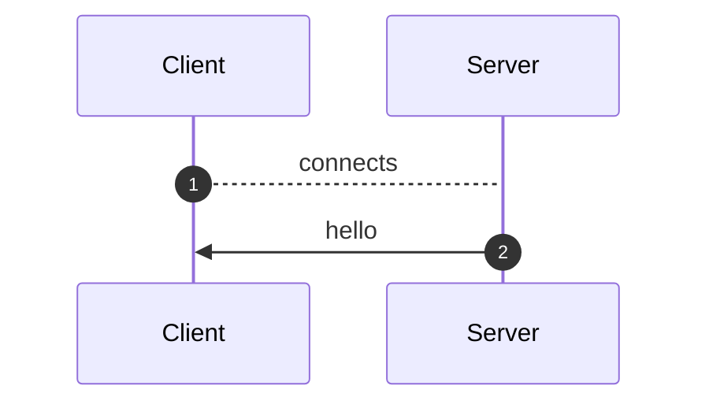
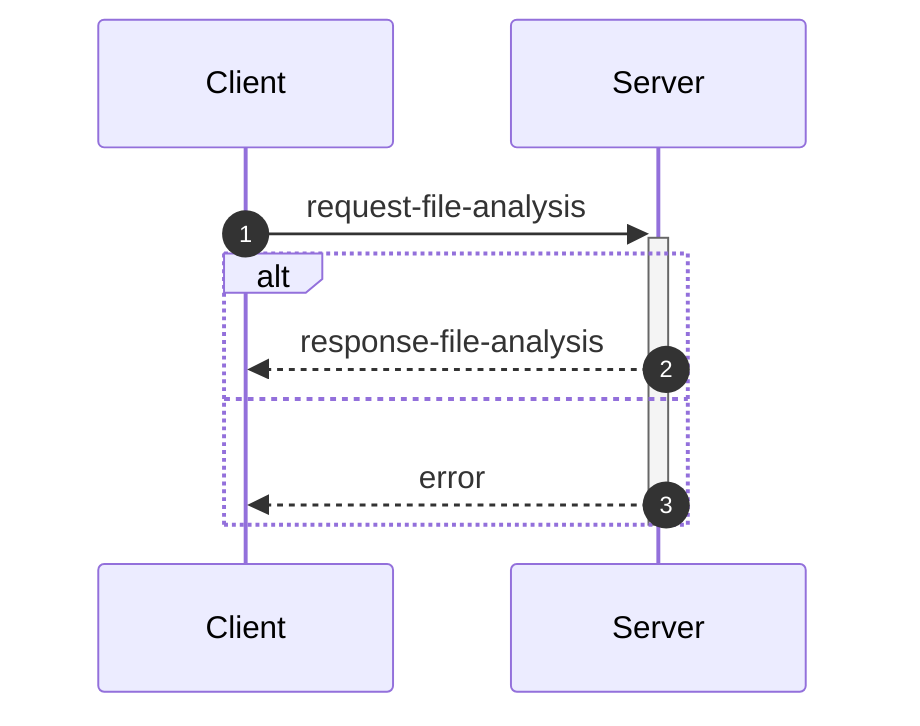
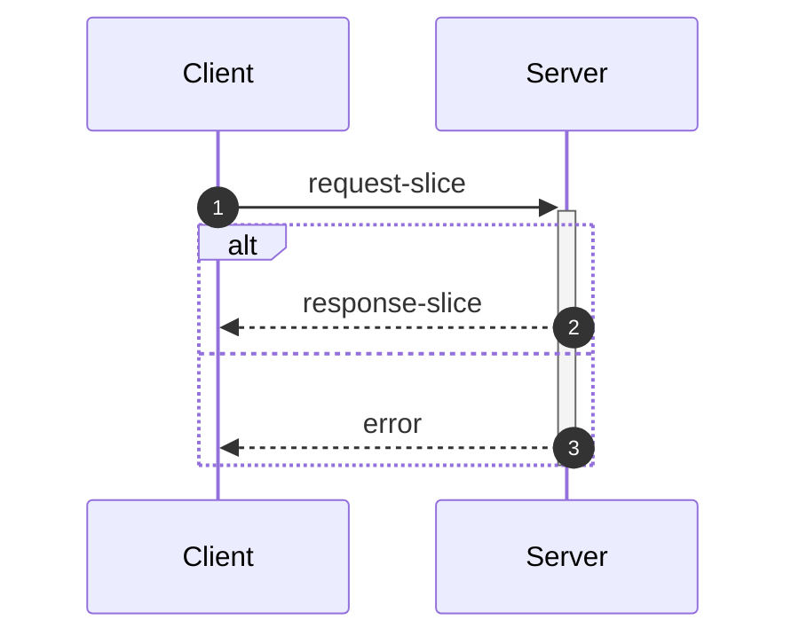
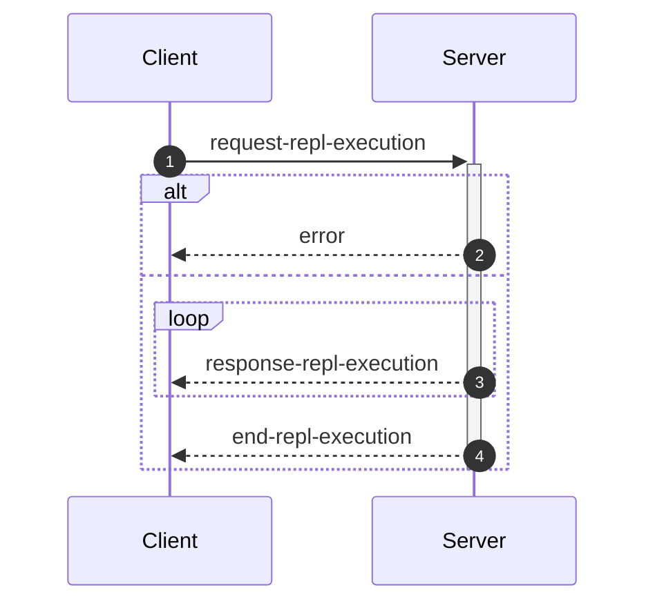

_<span title="an overview of flowR's interface">Generated</span> from '[wiki-interface.ts](https://github.com/flowr-analysis/flowr/tree/main/src/documentation/wiki-interface.ts "src/documentation/wiki-interface.ts")' on 2026-10-16, 17:37:29 UTC (v2.16.1, R v4.5.0), do not edit directly._

Although far from being as detailed as the in-depth explanation of [_flowR_](https://github.com/flowr-analysis/flowr/wiki/Core),
this wiki page explains how to interface with _flowR_ in more detail.
In general, command line arguments and other options provide short descriptions on hover over.

* [💻 Using the REPL](#using-the-repl)
* [⚙️ Configuring FlowR](#configuring-flowr)
* [⚒️ Writing Code](#writing-code)
* [💬 Communicating with the Server](#communicating-with-the-server)

<a id='using-the-repl'></a>
## 💻 Using the REPL

> [!NOTE]
> To execute arbitrary R commands with a repl request, _flowR_ has to be started explicitly with <span title="Description (Command Line Argument): Allow to access the underlying R session when using flowR (security warning: this allows the execution of arbitrary R code!)">`--r-session-access`</span>.
> Please be aware that this introduces a security risk and note that this relies on the [`r-shell` engine](https://github.com/flowr-analysis/flowr/wiki/Engines) .

Although primarily meant for users to explore,
there is nothing which forbids calling _flowR_ as a subprocess to use standard-in, -output, and -error
for communication (although you can access the REPL using the server as well,
with the [REPL Request](#message-request-repl-execution) message).

The read-eval-print loop&nbsp;(REPL) works relatively simple.
You can submit an expression (using <kbd>Enter</kbd>),
which is interpreted as an R&nbsp;expression by default but interpreted as a *command* if it starts with a colon (`:`).
The best command to get started with the REPL is <span title="Description (Repl Command): Show help information (aliases: :h, :?)">`:help`</span>.
Besides, you can leave the REPL either with the command <span title="Description (Repl Command): End the repl (aliases: :q, :exit)">`:quit`</span> or by pressing <kbd>Ctrl</kbd>+<kbd>C</kbd> twice.
When writing a *command*, you may press <kbd>Tab</kbd> to get a list of completions, if available.
Multiple commands can be entered in a single line by separating them with a semicolon (`;`), e.g. `:parse "x<-2"; :df*`.
If a command is given without R code, the REPL will re-use R code given in a previous command.
The prior example will hence return first the parsed AST of the program and then the dataflow graph for `"x <- 2"`.

> [!NOTE]
> If you develop flowR, you may want to launch the repl using the `npm run main-dev` command, this way, you get a non-minified version of flowR with debug information and hot-reloading of source files.

<details>
<summary>Available Commands</summary>

We currently offer the following commands (this with a `[*]` suffix are available with and without the star):

| Command | Description |
| ------- | ----------- |
| **<span title="Description (Repl Command): End the repl (aliases: :q, :exit)">:quit</span>** | End the repl (aliases: **:<span title="Alias of ':quit'. End the repl">q</span>**, **:<span title="Alias of ':quit'. End the repl">exit</span>**) |
| **<span title="Description (Repl Command): Execute the given code as R code. This requires the `--r-session-access` flag to be set and requires the r-shell engine. (aliases: :e, :r)">:execute</span>** | Execute the given code as R code. This requires the `--r-session-access` flag to be set and requires the r-shell engine. (aliases: **:<span title="Alias of ':execute'. Execute the given code as R code. This requires the `--r-session-access` flag to be set and requires the r-shell engine.">e</span>**, **:<span title="Alias of ':execute'. Execute the given code as R code. This requires the `--r-session-access` flag to be set and requires the r-shell engine.">r</span>**) |
| **<span title="Description (Repl Command): Get mermaid code for the control-flow graph of R code (aliases: :cfg, :cf)">:controlflow[*]</span>** | Get mermaid code for the control-flow graph of R code (star: Returns the URL to mermaid.live) (aliases: **:<span title="Alias of ':controlflow'. Get mermaid code for the control-flow graph of R code">cfg</span>**, **:<span title="Alias of ':controlflow'. Get mermaid code for the control-flow graph of R code">cf</span>**) |
| **<span title="Description (Repl Command): Get mermaid code for the control-flow graph with basic blocks (aliases: :cfgb, :cfb)">:controlflowbb[*]</span>** | Get mermaid code for the control-flow graph with basic blocks (star: Returns the URL to mermaid.live) (aliases: **:<span title="Alias of ':controlflowbb'. Get mermaid code for the control-flow graph with basic blocks">cfgb</span>**, **:<span title="Alias of ':controlflowbb'. Get mermaid code for the control-flow graph with basic blocks">cfb</span>**) |
| **<span title="Description (Repl Command): Get mermaid code for the dataflow graph (aliases: :d, :df)">:dataflow[*]</span>** | Get mermaid code for the dataflow graph (star: Returns the URL to mermaid.live) (aliases: **:<span title="Alias of ':dataflow'. Get mermaid code for the dataflow graph">d</span>**, **:<span title="Alias of ':dataflow'. Get mermaid code for the dataflow graph">df</span>**) |
| **<span title="Description (Repl Command): Get mermaid code for the normalized AST of R code (aliases: :n)">:normalize[*]</span>** | Get mermaid code for the normalized AST of R code (star: Returns the URL to mermaid.live) (alias: **:<span title="Alias of ':normalize'. Get mermaid code for the normalized AST of R code">n</span>**) |
| **<span title="Description (Repl Command): Get mermaid code for the simplified dataflow graph (aliases: :ds, :dfs)">:dataflowsimple[*]</span>** | Get mermaid code for the simplified dataflow graph (star: Returns the URL to mermaid.live) (aliases: **:<span title="Alias of ':dataflowsimple'. Get mermaid code for the simplified dataflow graph">ds</span>**, **:<span title="Alias of ':dataflowsimple'. Get mermaid code for the simplified dataflow graph">dfs</span>**) |
| **<span title="Description (Repl Command): Inspect and extend the signature database: `query` (identical to :query @signature), `info <name>` for where a function comes from (identical to :query @function-info), `add <path>` to mount another database/source, `download` to fetch the full-history database. (aliases: :sig)">:signature</span>** | Inspect and extend the signature database: `query` (identical to :query @signature), `info <name>` for where a function comes from (identical to :query @function-info), `add <path>` to mount another database/source, `download` to fetch the full-history database. (alias: **:<span title="Alias of ':signature'. Inspect and extend the signature database: `query` (identical to :query @signature), `info <name>` for where a function comes from (identical to :query @function-info), `add <path>` to mount another database/source, `download` to fetch the full-history database.">sig</span>**) |
| **<span title="Description (Repl Command): Just calculates the DFG, but only prints summary info (aliases: :d#, :df#)">:dataflowsilent</span>** | Just calculates the DFG, but only prints summary info (aliases: **:<span title="Alias of ':dataflowsilent'. Just calculates the DFG, but only prints summary info">d#</span>**, **:<span title="Alias of ':dataflowsilent'. Just calculates the DFG, but only prints summary info">df#</span>**) |
| **<span title="Description (Repl Command): Prints ASCII Art of the parsed, unmodified AST (aliases: :p)">:parse</span>** | Prints ASCII Art of the parsed, unmodified AST (alias: **:<span title="Alias of ':parse'. Prints ASCII Art of the parsed, unmodified AST">p</span>**) |
| **<span title="Description (Repl Command): Prints the version of flowR as well as the current version of R">:version</span>** | Prints the version of flowR as well as the current version of R
| **<span title="Description (Repl Command): Query the given R code (use 'help' for more information)">:query[*]</span>** | Query the given R code (use 'help' for more information) (star: Similar to query, but returns the output in json format.)
| **<span title="Description (Repl Command): Returns an ASCII representation of the dataflow graph (aliases: :df!)">:dataflowascii</span>** | Returns an ASCII representation of the dataflow graph (alias: **:<span title="Alias of ':dataflowascii'. Returns an ASCII representation of the dataflow graph">df!</span>**) |
| **<span title="Description (Repl Command): Returns summarization stats for the normalized AST (aliases: :n#)">:normalize#</span>** | Returns summarization stats for the normalized AST (alias: **:<span title="Alias of ':normalize#'. Returns summarization stats for the normalized AST">n#</span>**) |
| **<span title="Description (Repl Command): Show help information (aliases: :h, :?)">:help</span>** | Show help information (aliases: **:<span title="Alias of ':help'. Show help information">h</span>**, **:<span title="Alias of ':help'. Show help information">?</span>**) |

</details>

> [!TIP]
> 
> As indicated by the examples before, all REPL commands that operate on code keep track of the state.
> Hence, if you run a command like <span title="Description (Repl Command, starred version): Returns the URL to mermaid.live; Base Command: Get mermaid code for the dataflow graph (aliases: :d*, :df*)">`:dataflow*`</span> without providing R code,
> the REPL will re-use the R code provided in a previous command.
> Likewise, doing this will benefit from incrementality!
> If you request the dataflow graph with `:df* x <- 2 * y` and then want to see the parsed AST with `:parse`,
> the REPL will re-use previously obtained information and not re-parse the code again.
> 		

Generally, many commands offer shortcut versions in the REPL. Many queries, for example, offer a shortened format (see the example below).
Of special note, the [Config Query](https://github.com/flowr-analysis/flowr/wiki/%5BQuery%5D-Config)
can be used to also modify the currently active configuration of _flowR_ within the REPL (see the [wiki page](https://github.com/flowr-analysis/flowr/wiki/%5BQuery%5D-Config) for more information).

### Example: Retrieving the Dataflow Graph

To retrieve a URL to the [mermaid](https://mermaid.js.org/) diagram of the dataflow of a given expression,
use <span title="Description (Repl Command, starred version): Returns the URL to mermaid.live; Base Command: Get mermaid code for the dataflow graph (aliases: :d*, :df*)">`:dataflow*`</span> (or <span title="Description (Repl Command): Get mermaid code for the dataflow graph (aliases: :d, :df)">`:dataflow`</span> to get the mermaid code in the cli):

```shell
$ docker run -it --rm eagleoutice/flowr # or npm run flowr 
flowR repl v2.16.1, R grammar v14 (tree-sitter engine)
R> :dataflow* y <- 1 + x
```

<details>
<summary style='color:gray'>Output</summary>

```text
https://mermaid.live/view#base64:eyJjb2RlIjoiZmxvd2NoYXJ0IFREXG4gICAgMXt7XCJgKiM5MTtSTnVtYmVyIzkzOyogKioxKipcbiAgICAgICoxLjYqICgqKmlkOiAxKiopYFwifX1cbiAgICAyKFtcImAqIzkxO1JTeW1ib2wjOTM7KiAqKngqKlxuICAgICAgKjEuMTAqICgqKmlkOiAyKiopYFwiXSlcbiAgICAzW1tcImAqIzkxO1JCaW5hcnlPcCM5MzsqIGJhc2UjNTg7IzU4OyoqIzQzOyoqXG4gICAgICAqMS42LTEwKiAoKippZDogMyoqKVxuICAgIGFyZzogKDEsIDIpYFwiXV1cbiAgICBidWlsdC1pbjpfNDNfW1wiYEJ1aWx0LUluOlxuIzQzO2BcIl1cbiAgICBzdHlsZSBidWlsdC1pbjpfNDNfIHN0cm9rZTpncmF5LGZpbGw6Z3JheSxzdHJva2Utd2lkdGg6MnB4LG9wYWNpdHk6Ljg7XG4gICAgMFtcImAqIzkxO1JTeW1ib2wjOTM7KiAqKnkqKlxuICAgICAgKjEuMSogKCoqaWQ6IDAqKiwgdjogMylgXCJdXG4gICAgNFtbXCJgKiM5MTtSQmluYXJ5T3AjOTM7KiBiYXNlIzU4OyM1ODsqKiM2MDsjNDU7KipcbiAgICAgICoxLjEtMTAqICgqKmlkOiA0KiopXG4gICAgYXJnOiAoMCwgMylgXCJdXVxuICAgIGJ1aWx0LWluOl82MF8tW1wiYEJ1aWx0LUluOlxuIzYwOyM0NTtgXCJdXG4gICAgc3R5bGUgYnVpbHQtaW46XzYwXy0gc3Ryb2tlOmdyYXksZmlsbDpncmF5LHN0cm9rZS13aWR0aDoycHgsb3BhY2l0eTouODtcbiAgICAxIC0uLT58XCJmbG93XCJ8IDJcbiAgICBsaW5rU3R5bGUgMCBzdHJva2U6Z3JheSxjb2xvcjpncmF5O1xuICAgIDIgLS4tPnxcImZsb3dcInwgM1xuICAgIGxpbmtTdHlsZSAxIHN0cm9rZTpncmF5LGNvbG9yOmdyYXk7XG4gICAgMyAtLT58XCJyZWFkcywgYXJnXCJ8IDFcbiAgICAzIC0tPnxcInJlYWRzLCBhcmdcInwgMlxuICAgIDMgLS4tPnxcImZsb3dcInwgMFxuICAgIGxpbmtTdHlsZSA0IHN0cm9rZTpncmF5LGNvbG9yOmdyYXk7XG4gICAgMyAtLi0+fFwicmVhZHMsIGNhbGxzXCJ8IGJ1aWx0LWluOl80M19cbiAgICBsaW5rU3R5bGUgNSBzdHJva2U6Z3JheTtcbiAgICAwIC0tPnxcImRlZmluZWQtYnksIGZsb3dcInwgNFxuICAgIDAgLS0+fFwiZGVmaW5lZC1ieVwifCAzXG4gICAgNCAtLT58XCJyZWFkcywgYXJnXCJ8IDNcbiAgICA0IC0tPnxcInJldHVybnMsIGFyZ1wifCAwXG4gICAgNCAtLi0+fFwicmVhZHMsIGNhbGxzXCJ8IGJ1aWx0LWluOl82MF8tXG4gICAgbGlua1N0eWxlIDEwIHN0cm9rZTpncmF5OyIsIm1lcm1haWQiOnsiYXV0b1N5bmMiOnRydWV9fQ==
```

Retrieve the dataflow graph of the expression `y <- 1 + x`. It looks like this:


<details>

<summary style="color:gray">R Code of the Dataflow Graph</summary>

The analysis ran (including parse and normalize, using the [tree-sitter](https://github.com/flowr-analysis/flowr/wiki/Engines) engine) within the generation environment. No [signature database](https://github.com/flowr-analysis/flowr/wiki/Signature-Database) is mounted for these generated graphs, so `library()` calls attach no package exports; base-R names are still qualified via the generated base-package store (e.g. `acf` as `stats::acf`). 
We encountered no unknown side effects during the analysis.

```r
y <- 1 + x
```

</details>

</details>

For small graphs like this, <span title="Description (Repl Command): Returns an ASCII representation of the dataflow graph (aliases: :df!)">`:dataflowascii`</span> also provides an ASCII representation directly in the REPL:

```shell
$ docker run -it --rm eagleoutice/flowr # or npm run flowr 
flowR repl v2.16.1, R grammar v14 (tree-sitter engine)
R> :df! y <- 1 + x
```

<details open>
<summary style='color:gray'>Output</summary>

```text
                        v<0>v
 c<4>c──────────────────| y |
 |<- |     ┌────────────v---v
 c---c     │
    │   c<3>c   0<1>0
    └───| + |───| 1 |───u<2>u
        c---c   0---0   | x |
           └────────────u---u
Edges:
3 -> 1: reads, arg          3 -> 2: reads, arg
3 -> 0: flows-to            1 -> 2: flows-to
2 -> 3: flows-to            4 -> 3: reads, arg
4 -> 0: returns, arg        0 -> 4: defined-by, flows-to
0 -> 3: defined-by
```

Retrieve the dataflow graph of the expression `y <- 1 + x` as ASCII art.

</details>

For the slicing with <span title="Description (Repl Command): Static backwards executable slicer for R">`:slicer`</span>, you have access to the same [magic comments](#slice-magic-comments) as with the [slice request](#message-request-slice).
Pass `--inline` to splice resolvable `source()` calls into the reconstruction so the slice is a single self-contained R text (the same as the static slice query's `inlineSources` flag).
See `--help` for more flags!

### Example: Interfacing with the File System

Many commands that allow for an R-expression (like <span title="Description (Repl Command, starred version): Returns the URL to mermaid.live; Base Command: Get mermaid code for the dataflow graph (aliases: :d*, :df*)">`:dataflow*`</span>) allow for a file as well
if the argument starts with `file://`.
If you are working from the root directory of the _flowR_ repository, the following gives you the parsed AST of the example file using the <span title="Description (Repl Command): Prints ASCII Art of the parsed, unmodified AST (aliases: :p)">`:parse`</span> command:

> **Watch mode**: Replace `file://` with `watch://` to enter watch mode.
> flowR runs the command immediately and then re-runs it every time the file (or any file inside the folder) changes.
> Enter any other command to leave watch mode.
> For example: `:df watch://analysis.R`

```shell
$ docker run -it --rm eagleoutice/flowr # or npm run flowr 
flowR repl v2.16.1, R grammar v14 (tree-sitter engine)
R> :parse file://test/testfiles/example.R
```

<details>
<summary style='color:gray'>Output</summary>

```text
File: test/testfiles/example.R

program
├ binaryoperator
│ ├ identifier "sum" (1:1─4)
│ ├ <- "<-" (1:5─7)
│ ╰ float "0" (1:8─9)
├ binaryoperator
│ ├ identifier "product" (2:1─8)
│ ├ <- "<-" (2:9─11)
│ ╰ float "1" (2:12─13)
├ binaryoperator
│ ├ identifier "w" (3:1─2)
│ ├ <- "<-" (3:3─5)
│ ╰ float "7" (3:6─7)
├ binaryoperator
│ ├ identifier "N" (4:1─2)
│ ├ <- "<-" (4:3─5)
│ ╰ float "10" (4:6─8)
├ forstatement
│ ├ for "for" (6:1─4)
│ ├ ( "(" (6:5─6)
│ ├ identifier "i" (6:6─7)
│ ├ in "in" (6:8─10)
│ ├ binaryoperator
│ │ ├ float "1" (6:11─12)
│ │ ├ : ":" (6:12─13)
│ │ ╰ parenthesizedexpression
│ │   ├ ( "(" (6:13─14)
│ │   ├ binaryoperator
│ │   │ ├ identifier "N" (6:14─15)
│ │   │ ├ - "-" (6:15─16)
│ │   │ ╰ float "1" (6:16─17)
│ │   ╰ ) ")" (6:17─18)
│ ├ ) ")" (6:18─19)
│ ╰ bracedexpression
│   ├ { "{" (6:20─21)
│   ├ binaryoperator
│   │ ├ identifier "sum" (7:3─6)
│   │ ├ <- "<-" (7:7─9)
│   │ ╰ binaryoperator
│   │   ├ binaryoperator
│   │   │ ├ identifier "sum" (7:10─13)
│   │   │ ├ + "+" (7:14─15)
│   │   │ ╰ identifier "i" (7:16─17)
│   │   ├ + "+" (7:18─19)
│   │   ╰ identifier "w" (7:20─21)
│   ├ binaryoperator
│   │ ├ identifier "product" (8:3─10)
│   │ ├ <- "<-" (8:11─13)
│   │ ╰ binaryoperator
│   │   ├ identifier "product" (8:14─21)
│   │   ├  "" (8:22─23)
│   │   ╰ identifier "i" (8:24─25)
│   ╰ } "}" (9:1─2)
├ call
│ ├ identifier "cat" (11:1─4)
│ ╰ arguments
│   ├ ( "(" (11:4─5)
│   ├ argument
│   │ ╰ string
│   │   ├ " "\"" (11:5─6)
│   │   ├ stringcontent "Sum:" (11:6─10)
│   │   ╰ " "\"" (11:10─11)
│   ├ comma "," (11:11─12)
│   ├ argument
│   │ ╰ identifier "sum" (11:13─16)
│   ├ comma "," (11:16─17)
│   ├ argument
│   │ ╰ string
│   │   ├ " "\"" (11:18─19)
│   │   ├ stringcontent
│   │   │ ╰ escapesequence "\\n" (11:19─21)
│   │   ╰ " "\"" (11:21─22)
│   ╰ ) ")" (11:22─23)
╰ call
  ├ identifier "cat" (12:1─4)
  ╰ arguments
    ├ ( "(" (12:4─5)
    ├ argument
    │ ╰ string
    │   ├ " "\"" (12:5─6)
    │   ├ stringcontent "Product:" (12:6─14)
    │   ╰ " "\"" (12:14─15)
    ├ comma "," (12:15─16)
    ├ argument
    │ ╰ identifier "product" (12:17─24)
    ├ comma "," (12:24─25)
    ├ argument
    │ ╰ string
    │   ├ " "\"" (12:26─27)
    │   ├ stringcontent
    │   │ ╰ escapesequence "\\n" (12:27─29)
    │   ╰ " "\"" (12:29─30)
    ╰ ) ")" (12:30─31)
```

Retrieve the parsed AST of the example file.

<details>

<summary>File Content</summary>

```r
sum <- 0
product <- 1
w <- 7
N <- 10

for (i in 1:(N-1)) {
  sum <- sum + i + w
  product <- product * i
}

cat("Sum:", sum, "\n")
cat("Product:", product, "\n")
```

</details>

As _flowR_ directly transforms this AST the output focuses on being human-readable instead of being machine-readable.
		
</details>

### Example: Run a Query

You can run any query supported by _flowR_ using the <span title="Description (Repl Command): Query the given R code (use 'help' for more information)">`:query`</span> command.
For example, to obtain the shapes of all data frames in a given piece of code, you can run:

```shell
$ docker run -it --rm eagleoutice/flowr # or npm run flowr 
flowR repl v2.16.1, R grammar v14 (tree-sitter engine)
R> :query @absint df-shape "x <- data.frame(a = 1:10, b = 1:10)\ny <- x$a"
```

<details open>
<summary style='color:gray'>Output</summary>

```text
Query: absint (1 ms)
```

Retrieve the shapes of all data frames in the given code.

</details>

To run the linter on a file, you can use (in this example, we just issue the `dead-code` linter on a small piece of code):

```shell
$ docker run -it --rm eagleoutice/flowr # or npm run flowr 
flowR repl v2.16.1, R grammar v14 (tree-sitter engine)
R> :query @linter rules:dead-code "if(FALSE) x <- 2"
```

<details open>
<summary style='color:gray'>Output</summary>

```text
Query: linter (2 ms)
   ╰ Dead Code (dead-code):
       ╰ certain:
           ╰ Code at 1.11-16
```

Run the linter on the given code, with only the `dead-code` rule enabled.

</details>

For more information on the available queries, please check out the [Query API](https://github.com/flowr-analysis/flowr/wiki/Query-API).

<a id='configuring-flowr'></a>
## ⚙️ Configuring FlowR

When running _flowR_, you may want to specify some behaviors with a dedicated configuration file.
By default, flowR looks for a file named `flowr.json` in the current working directory (or any higher directory).
You can also specify a different file with <span title="Description (Command Line Argument): The name of the configuration file to use">`--config-file`</span> or pass the configuration inline using <span title="Description (Command Line Argument): The flowR configuration to use, as a JSON string">`--config-json`</span>.
A `flowr.json` found this way belongs to the analyzed project, so flowR ignores its options that decide what flowR executes or loads
(`engines.*.wasmPath`, `engines.*.treeSitterWasmPath`, `engines.*.rPath`, `solver.sigdb.additionalPaths`, `solver.sigdb.downloadRepo`, `solver.sigdb.installedLibrary.paths`),
unless you pass <span title="Description (Command Line Argument): Keep the security-sensitive options (e.g., the R executable) of the flowr.json found in the working directory or a parent. Only use this for projects you trust.">`--trust-config`</span>.
To analyze code you do not trust, use the secure mode (<span title="Description (Command Line Argument): Run in secure mode for analyzing untrusted code: flowR does not start R (or any other process), does not access the network, does not search for project configs, and ignores security-sensitive options in every config. Cannot be disabled once enabled. Can also be enabled with the environment variable {italic FLOWR_SECURE_MODE=1}.">`--secure`</span>, see the [security policy](https://github.com/flowr-analysis/flowr/blob/main/.github/SECURITY.md)).
To inspect the current configuration, you can run flowr with the <span title="Description (Command Line Argument): Run with verbose logging (will be passed to the corresponding script)">`--verbose`</span> flag, or use the `config` [Query](https://github.com/flowr-analysis/flowr/wiki/Query-API).
Within the REPL this works by running the following:

```shell
:query @config
```

To work with the <a href="https://github.com/flowr-analysis/flowr/tree/main/src/config.ts#L119"><code><span title="The configuration file format for flowR.">FlowrConfig</span></code></a> you can use the provided helper objects alongside its methods like
<a href="https://github.com/flowr-analysis/flowr/tree/main/src/config.ts#L905"><code><span title="Creates a new flowr config that has the updated values.">FlowrConfig::<b>amend</b></span></code></a>.
The schema below documents every option; the ones you most likely want are:

- <a href="https://github.com/flowr-analysis/flowr/wiki/Interface#configuring-flowr" title="Configuration Option (boolean): Whether source calls should be ignored, causing {@link processSourceCall}&#39;s behavior to be skipped.">ignoreSourceCalls</a>: ignore source calls when analyzing the code, i.e., ignore the inclusion of other files.
- <a href="https://github.com/flowr-analysis/flowr/wiki/Interface#configuring-flowr" title="Configuration Option (boolean): Whether load calls should be ignored, causing {@link processLoadCall}&#39;s behavior to be skipped.">ignoreLoadCalls</a>: ignore load calls when analyzing the code, i.e., ignore the loading of r-data files.
- <a href="https://github.com/flowr-analysis/flowr/wiki/Interface#configuring-flowr" title="Configuration Option (object): Do you want to overwrite (parts) of the builtin definition?">semantics.environment.overwriteBuiltIns</a>: overwrite _flowR_'s handling of built-in functions, or clear the preset definitions entirely.
  See [Configure BuiltIn Semantics](#configure-builtin-semantics) for more information.
- <a href="https://github.com/flowr-analysis/flowr/wiki/Interface#configuring-flowr" title="Configuration Option (string): How to resolve variables and their values. (one of &quot;disabled&quot;, &quot;alias&quot;, &quot;builtin&quot;)">solver.variables</a>: how to resolve variables and their values (`disabled`, `alias`, `builtin`).
- <a href="https://github.com/flowr-analysis/flowr/wiki/Interface#configuring-flowr" title="Configuration Option (array): The engine or set of engines to use for interacting with R code. An empty array means all available engines will be used.">engines</a> and <a href="https://github.com/flowr-analysis/flowr/wiki/Interface#configuring-flowr" title="Configuration Option (string): The default engine to use for interacting with R code. If this is undefined, an arbitrary engine from the specified list will be used. (one of &quot;tree-sitter&quot;, &quot;r-shell&quot;)">defaultEngine</a>: the engines used to interact with R code, see the [Engines wiki page](https://github.com/flowr-analysis/flowr/wiki/Engines).
- <a href="https://github.com/flowr-analysis/flowr/wiki/Interface#configuring-flowr" title="Configuration Option (array): Files a framework loads on its own, without any source() call (e.g. global.R in a shiny app), in the order they are loaded; flowR orders the matching project files accordingly and analyzes them as one program. Entries are case-insensitive globs matched against the file path, a plain name matches any file with that name, and entries matching no project file are warned about. Usually set per project kind via specializeConfig.">project.implicitSources</a>: the files a framework loads without any `source()` call, in the order in which they are
  loaded. Entries are globs (e.g. `R/*.R`) matched against the file path ignoring capitalization; one matching no file is reported.
- <a href="https://github.com/flowr-analysis/flowr/wiki/Interface#configuring-flowr" title="Configuration Option (object): Overwrite (parts of) the configuration depending on the project kind flowR detects, e.g. to give a shiny app its implicit sources.">specializeConfig</a>: overwrite (parts of) the configuration depending on the kind of project _flowR_ detects
  (e.g. `shiny-app`), which is how a shiny app gets its implicit sources by default. What you configure directly wins.
- <a href="https://github.com/flowr-analysis/flowr/wiki/Interface#configuring-flowr" title="Configuration Option (string): Overwrite the project kind flowR would otherwise infer from the analyzed files, e.g. when auto-detection guesses wrong. (one of &quot;package&quot;, &quot;script&quot;, &quot;shiny-app&quot;, &quot;notebook&quot;, &quot;project&quot;, &quot;unknown&quot;)">project.useProjectType</a>: skip that detection and force a project kind yourself, when auto-detection guesses wrong.
- <a href="https://github.com/flowr-analysis/flowr/wiki/Interface#configuring-flowr" title="Configuration Option (array): The default plugins to load when creating a new instance of FlowrAnalyzer">defaultPlugins</a> and <a href="https://github.com/flowr-analysis/flowr/wiki/Interface#configuring-flowr" title="Configuration Option (array): The plugins to load in REPL mode">repl.plugins</a>: the plugins to load for a new <a href="https://github.com/flowr-analysis/flowr/tree/main/src/project/flowr-analyzer.ts#L205"><code><span title="Central class for conducting analyses with FlowR. Use the FlowrAnalyzerBuilder to create a new instance. If you want the original pattern of creating a pipeline and running all steps, you can still do this with FlowrAnalyzer#runFull . To inspect the context of the analyzer, use FlowrAnalyzer#inspectContext (if you are a plugin and need to modify it, use FlowrAnalyzer#context instead).">FlowrAnalyzer</span></code></a> and in the REPL
  (use `flowr:default` to reference the former).

So you can configure _flowR_ by adding a file like the following:

<details>

<summary>Example Configuration File</summary>

```json
{
  "ignoreSourceCalls": true,
  "ignoreLoadCalls": true,
  "semantics": {
    "environment": {
      "overwriteBuiltIns": {
        "definitions": [
          {
            "type": "function",
            "names": [
              "foo"
            ],
            "processor": "builtin:assign",
            "config": {}
          }
        ]
      }
    }
  },
  "defaultPlugins": [
    "file:description",
    "versions:description"
  ],
  "repl": {
    "quickStats": false,
    "dfProcessorHeat": false,
    "hints": true,
    "plugins": [
      "flowr:default"
    ]
  },
  "project": {
    "resolveUnknownPathsOnDisk": true,
    "implicitSources": [
      "global.R",
      "app.R"
    ]
  },
  "linter": {
    "disabledRules": []
  },
  "specializeConfig": {
    "shiny-app": {
      "project": {
        "implicitSources": [
          "global.R",
          "ui.R",
          "server.R",
          "app.R"
        ]
      }
    }
  },
  "engines": [
    {
      "type": "r-shell"
    }
  ],
  "solver": {
    "variables": "alias",
    "evalStrings": true,
    "trackEnvironments": true,
    "sigdb": {
      "enabled": true,
      "loadProjectDependencies": true,
      "eagerlyLoad": false,
      "eagerlyLoadExports": false,
      "linkBaseR": false,
      "linkDescriptionDependencies": false
    },
    "resolveSource": {
      "dropPaths": "no",
      "ignoreCapitalization": true,
      "inferWorkingDirectory": "active-script",
      "searchPath": []
    },
    "instrument": {},
    "slicer": {
      "threshold": 50
    }
  },
  "abstractInterpretation": {
    "wideningThreshold": 4,
    "followCalls": true,
    "dataFrame": {
      "maxColNames": 20,
      "readLoadedData": {
        "readExternalFiles": true,
        "maxReadLines": 1000000
      }
    }
  },
  "incremental": {
    "alwaysIncremental": false,
    "parsing": {
      "activated": false,
      "heuristics": {
        "activated": true,
        "mtime": true,
        "linesFrom": 500,
        "bytesFrom": 50000,
        "alwaysWithEdits": false,
        "minFiles": 1
      }
    }
  },
  "gas": {
    "thresholds": {
      "memory": {
        "problematic": 0.7,
        "critical": 0.9
      },
      "timeMs": {
        "problematic": 100000,
        "critical": 120000
      }
    },
    "features": {}
  }
}
```

</details>

<details>
<a id='configure-builtin-semantics'></a>
<summary>Configure Built-In Semantics</summary>

`semantics/environment/overwriteBuiltins` accepts two keys:

- `loadDefaults` (boolean, initially `true`): If set to `true`, the default built-in definitions are loaded before applying the custom definitions. Setting this flag to `false` explicitly disables the loading of the default definitions.
- `definitions` (array, initially empty): Allows to overwrite or define new built-in elements. Each object within must have a `type` which is one of the below. Furthermore, they may define a string array of `names` which specifies the identifiers to bind the definitions to. You may use `assumePrimitive` to specify whether _flowR_ should assume that this is a primitive non-library definition (so you probably just do not want to specify the key).

  | Type            | Description                                                                                                                                                                                                                                                                                              | Example                                                                                                    |
  | --------------- | -------------------------------------------------------------------------------------------------------------------------------------------------------------------------------------------------------------------------------------------------------------------------------------------------------- | ---------------------------------------------------------------------------------------------------------- |
  | `constant`    | Additionally allows for a `value` this should resolve to.                                                                                                                                                                                                                                                | `{ type: 'constant', names: ['NULL', 'NA'],  value: null }`                                                |
  | `function`    | Is a rather flexible way to define and bind built-in functions. For the time, we do not have extensive documentation to cover all the cases, so please either consult the sources with the `default-builtin-config.ts` or open a [new issue](https://github.com/flowr-analysis/flowr/issues/new/choose). | `{ type: 'function', names: ['next'], processor: 'builtin:d', config: { cfg: ExitPointType.Next } }` |
  | `replacement` | A comfortable way to specify replacement functions like `$<-` or `names<-`. `suffixes` describes the... suffixes to attach automatically. | `{ type: 'replacement', suffixes: ['<-', '<<-'], names: ['[', '[['] }` |

</details>

<details>

<summary style='color:gray'>Full Configuration-File Schema</summary>

- _The configuration file format for flowR._ (object)
    - **logLevel** [optional] _flowR's global minimum log level, applied when the config is loaded._ (string)
        Only allows: 'silly', 'trace', 'debug', 'info', 'warn', 'error', 'fatal'
    - **ignoreSourceCalls** [optional] _Whether source calls should be ignored, causing {@link processSourceCall}'s behavior to be skipped._ (boolean)
    - **ignoreLoadCalls** [optional] _Whether load calls should be ignored, causing {@link processLoadCall}'s behavior to be skipped._ (boolean)
    - **semantics** _Configure language semantics and how flowR handles them._ (object)
        - **environment** [optional] _Semantics regarding how to handle the R environment._ (object)
            - **overwriteBuiltIns** [optional] _Do you want to overwrite (parts) of the builtin definition?_ (object)
                - **loadDefaults** [optional] _Should the default configuration still be loaded?_ (boolean)
                - **definitions** [optional] _The definitions to load/overwrite._ (array)
                Valid item types:
                    - (object)
    - **defaultPlugins** [optional] _The default plugins to load when creating a new instance of FlowrAnalyzer_ (array)
    Valid item types:
        - (alternatives)
            - (string)
            - (array)
    - **repl** _Configuration options for the REPL._ (object)
        - **quickStats** [optional] _Whether to show quick stats in the REPL after each evaluation._ (boolean)
        - **dfProcessorHeat** [optional] _This instruments the dataflow processors to count how often each processor is called._ (boolean)
        - **hints** [optional] _Whether to show dim inline hints on the empty prompt (automatically disabled on non-interactive terminals)._ (boolean)
        - **plugins** [optional] _The plugins to load in REPL mode_ (array)
        Valid item types:
            - (alternatives)
                - (string)
                - (array)
        - **autoUseFileProtocol** [optional] _Prepend the file protocol to a repl input that looks like a path, instead of only warning about it._ (boolean)
        - **queryStats** [optional] _Whether `:query` closes with the line stating how long the queries took (`:query*` never prints it)._ (boolean)
        - **showPlugins** [optional] _Whether `:version` grays out the plugins that did not activate during the last analysis._ (boolean)
    - **project** _Project specific configuration options._ (object)
        - **resolveUnknownPathsOnDisk** [optional] _Whether to resolve unknown paths loaded by the r project disk when trying to source/analyze files._ (boolean)
        - **failOnInaccessiblePath** [optional] _Whether a directory that cannot be traversed during file discovery (e.g. due to permissions) aborts the analysis; when false (the default) such paths are logged and skipped._ (boolean)
        - **basePackages** [optional] _The packages considered part of R itself (base and recommended); if unset, flowR uses its built-in list._ (array)
        Valid item types:
            - (string)
        - **implicitSources** [optional] _Files a framework loads on its own, without any source() call (e.g. global.R in a shiny app), in the order they are loaded; flowR orders the matching project files accordingly and analyzes them as one program. Entries are case-insensitive globs matched against the file path, a plain name matches any file with that name, and entries matching no project file are warned about. Usually set per project kind via specializeConfig._ (array)
        Valid item types:
            - (string)
        - **useProjectType** [optional] _Overwrite the project kind flowR would otherwise infer from the analyzed files, e.g. when auto-detection guesses wrong._ (string)
            Only allows: 'package', 'script', 'shiny-app', 'notebook', 'project', 'unknown'
        - **assumeImplicitEcho** [optional] _Whether the top level of the analyzed code is echoed, so that every visible result printed there is collected as an output by the dependencies query (default true, false for a package)._ (boolean)
        - **discovery** [optional] _Scoping options for the default project discovery._ (object)
            - **full** [optional] _Collect every file below the project root (greedy) instead of only the files the detected project kind needs (default false)._ (boolean)
            - **perKind** [optional] _Per-kind include/exclude glob overrides layered on the default scoping._ (object)
            - **ignore** [optional] _Case-insensitive globs that drop matching files from the intelligent discovery, regardless of kind (e.g. .Renviron to ignore environment files)._ (array)
            Valid item types:
                - (string)
        - **classification** [optional] _Overrides for the signals flowR uses to classify the project kind._ (object)
            - **shinyDescriptionTypes** [optional] _DESCRIPTION Type: values that mark a shiny app._ (array)
            Valid item types:
                - (string)
            - **shinyEntryFiles** [optional] _File names a shiny app is assembled from._ (array)
            Valid item types:
                - (string)
            - **shinyUsagePattern** [optional] _Regex source evidencing shiny usage in an entry file._ (string)
            - **notebookExtensions** [optional] _File extensions marking a notebook._ (array)
            Valid item types:
                - (string)
    - **linter** _Linter configuration options._ (object)
        - **disabledRules** _Linting rule names excluded from the default rule set (a rule requested explicitly via a linter query still runs). Usually set per project kind via specializeConfig._ (array)
        Valid item types:
            - (string)
    - **inputSources** [optional] _Further frameworks the input-sources analysis should know about; entries are added to flowR's defaults._ (object)
        - **pure** [optional] _Functions that only pass the constantness of their arguments on._ (array)
        Valid item types:
            - (string)
        - **param** [optional] _Functions whose result is a 'param' input._ (array)
        Valid item types:
            - (string)
        - **file** [optional] _Functions whose result is a 'file' input._ (array)
        Valid item types:
            - (string)
        - **tempfile** [optional] _Functions whose result is a 'tempfile' input._ (array)
        Valid item types:
            - (string)
        - **glob** [optional] _Functions whose result is a 'glob' input._ (array)
        Valid item types:
            - (string)
        - **net** [optional] _Functions whose result is a 'net' input._ (array)
        Valid item types:
            - (string)
        - **rand** [optional] _Functions whose result is a 'rand' input._ (array)
        Valid item types:
            - (string)
        - **system** [optional] _Functions whose result is a 'system' input._ (array)
        Valid item types:
            - (string)
        - **ffi** [optional] _Functions whose result is a 'ffi' input._ (array)
        Valid item types:
            - (string)
        - **lang** [optional] _Functions whose result is a 'lang' input._ (array)
        Valid item types:
            - (string)
        - **options** [optional] _Functions whose result is a 'options' input._ (array)
        Valid item types:
            - (string)
        - **cmdline** [optional] _Functions whose result is a 'cmdline' input._ (array)
        Valid item types:
            - (string)
        - **user** [optional] _Functions whose result is a 'user' input._ (array)
        Valid item types:
            - (string)
        - **const** [optional] _Functions whose result is a 'const' input._ (array)
        Valid item types:
            - (string)
        - **scope** [optional] _Functions whose result is a 'scope' input._ (array)
        Valid item types:
            - (string)
        - **dconst** [optional] _Functions whose result is a 'dconst' input._ (array)
        Valid item types:
            - (string)
        - **unknown** [optional] _Functions whose result is a 'unknown' input._ (array)
        Valid item types:
            - (string)
        - **linkedObjects** [optional] _Objects a framework provides without a definition in the code, e.g. shiny's input._ (array)
        Valid item types:
            - (object)
        - **linkedEntryPoints** [optional] _Calls that hand a function to a framework, which binds its objects to the parameters by position._ (array)
        Valid item types:
            - (object)
    - **specializeConfig** [optional] _Overwrite (parts of) the configuration depending on the project kind flowR detects, e.g. to give a shiny app its implicit sources._ (object)
    - **engines** _The engine or set of engines to use for interacting with R code. An empty array means all available engines will be used._ (array)
    Valid item types:
        - (alternatives)
            - _The configuration for the tree sitter engine._ (object)
                - **type** [required] _Use the tree sitter engine._ (string)
                    Only allows: 'tree-sitter'
                - **wasmPath** [optional] _The path to the tree-sitter-r WASM binary to use. If this is undefined, this uses the default path._ (string)
                - **treeSitterWasmPath** [optional] _The path to the tree-sitter WASM binary to use. If this is undefined, this uses the default path._ (string)
                - **lax** [optional] _Whether to use the lax parser for parsing R code (allowing for syntax errors). If this is undefined, the strict parser will be used._ (boolean)
            - _The configuration for the R shell engine._ (object)
                - **type** [required] _Use the R shell engine._ (string)
                    Only allows: 'r-shell'
                - **rPath** [optional] _The path to the R executable to use. If this is undefined, this uses the default path._ (string)
                - **pipeBind** [optional] _Whether to enable R's experimental pipe-bind operator "=>" by setting _R_USE_PIPEBIND_ for the R session (default false); R itself keeps this off by default, as it is experimental and has never shipped in a release version of R._ (boolean)
    - **defaultEngine** [optional] _The default engine to use for interacting with R code. If this is undefined, an arbitrary engine from the specified list will be used._ (string)
        Only allows: 'tree-sitter', 'r-shell'
    - **solver** _How to resolve constants, constraints, cells, ..._ (object)
        - **variables** _How to resolve variables and their values._ (string)
            Only allows: 'disabled', 'alias', 'builtin'
        - **evalStrings** _Should we include eval(parse(text="...")) calls in the dataflow graph?_ (boolean)
        - **trackEnvironments** [optional] _Track user-created environments (new.env, assign/get/local with envir=, dollar-assign, attach). When false, all envir-style calls fall through conservatively._ (boolean)
        - **sigdb** _Resolving library exports from a signature database._ (object)
            - **enabled** [optional] _Resolve library()/use() exports from a signature database (default true); when false no database is consulted._ (boolean)
            - **loadProjectDependencies** [optional] _Load the project's declared dependencies from its metadata files (DESCRIPTION Imports/Depends, rproject.toml, uvr.toml, renv.lock, rv.lock, uvr.lock) (default true); when false these files are not read for dependencies._ (boolean)
            - **eagerlyLoad** [optional] _Parse the database up front rather than on the first package load (default false, ignored if disabled)._ (boolean)
            - **eagerlyLoadExports** [optional] _Add a vertex for every export on load rather than on demand (default false); keeps the dataflow graph small._ (boolean)
            - **assumedRVersion** [optional] _R version assumed when resolving versioned (base-R) exports: a pin like "4.5" or "auto" to detect the installed R (default "auto")._ (string)
            - **linkBaseR** [optional] _Eagerly attach base-R namespaces so bare base calls resolve without library() (default false)._ (boolean)
            - **linkBaseRCalls** [optional] _Add a lightweight Reads edge from a bare base-R call to its signature-database function vertex (default false; base-R qualification is edge-free otherwise)._ (boolean)
            - **linkPackageCalls** [optional] _Add a lightweight Reads edge from a resolved package call to its signature-database function vertex (default false)._ (boolean)
            - **linkDescriptionDependencies** [optional] _Eagerly attach the namespaces of the project's declared DESCRIPTION dependencies (Imports/Depends) so their exports resolve without an explicit library() (default false)._ (boolean)
            - **warmInBackground** [optional] _Decompress the hot shards (base + most-downloaded) in a background task on startup so the first library() lookup is warm (default false; for long-running servers/REPLs)._ (boolean)
            - **additionalPaths** [optional] _Extra directories or bundle/manifest files searched for signature databases (alongside the shipped default and $FLOWR_SIGDB_DIR); a downloaded full-history bundle placed here is mounted automatically._ (array)
            Valid item types:
                - (string)
            - **downloadRepo** [optional] _GitHub owner/repo the full-history bundle is downloaded from via ":signature download" (default "flowr-analysis/flowr", release tag "sigdb-v<flowR-version>")._ (string)
            - **autoSync** [optional] _On startup, re-download shards whose committed sigdb.remote.json hash no longer matches the cache, in the background (default false; opt-in network sync after a git pull)._ (boolean)
            - **installedLibrary** [optional] _Recovering packages no signature database knows from the copy installed on this machine._ (object)
                - **enabled** [required] _Recover packages no signature database knows from their installed copy (default false)._ (boolean)
                - **paths** [optional] _Library directories to search; when empty they are discovered from the environment and the project._ (array)
                Valid item types:
                    - (string)
                - **useEnvironment** [optional] _Search the libraries R_LIBS_USER/R_LIBS/R_LIBS_SITE name (default true)._ (boolean)
                - **useProjectLibrary** [optional] _Search a project-local renv/packrat library (default true)._ (boolean)
                - **maxDepth** [optional] _How far to descend into the nested layout of a project-local library (default 3)._ (number)
                - **packages** [optional] _Only recover packages whose name matches one of these regular expressions; empty means any._ (array)
                Valid item types:
                    - (string)
            - **blobCacheBudgetMb** [optional] _How many MiB of decoded package blobs every open bundle may hold together (default 16)._ (number)
            - **versionSelection** [optional] _When a project constrains a dependency, resolve to the newest (default), oldest, or system-installed version satisfying it; system needs R and falls back to newest. Base-R packages always resolve against the assumed R version._ (string)
                Only allows: 'newest', 'oldest', 'system'
            - **versionOverrides** [optional] _Force an exact version for specific packages (name -> version), overriding both the project constraint and the versionSelection policy (default {})._ (object)
        - **versionManagement** _Policies for reasoning about dependency versions._ (object)
            - **linkedVersionGroups** [optional] _Groups of packages that must resolve to the same version; version guessing intersects each group so its members stay mutually compatible (default [])._ (array)
            Valid item types:
                - (array)
                Valid item types:
                    - (string)
        - **assumeAttachedPackages** [optional] _Packages to treat as attached without a `library()` call, so what the built-in configuration states about them applies to the analyzed code. The base packages R attaches on startup already resolve without it._ (array)
        Valid item types:
            - (string)
        - **transitiveSideEffectRounds** [optional] _How many rounds the transitive side-effect fixpoint may run before it is cut off (default 32); the propagation stops on its own as soon as a round adds nothing._ (number)
        - **maxOverlayDepth** [optional] _How many binding overlays may stack on one environment frame before a write flattens them (default 4); a pure performance knob, trading lookup cost against copy cost without changing any result._ (number)
        - **instrument** (object)
            - **dataflowExtractors** [optional] _These keys are only intended for use within code, allowing to instrument the dataflow analyzer!_ (any)
        - **resolveSource** [optional] _If lax source calls are active, flowR searches for sourced files much more freely, based on the configurations you give it. This option is only in effect if `ignoreSourceCalls` is set to false._ (object)
            - **dropPaths** _Allow to drop the first or all parts of the sourced path, if it is relative._ (string)
                Only allows: 'no', 'once', 'all'
            - **ignoreCapitalization** _Search for filenames matching in the lowercase._ (boolean)
            - **inferWorkingDirectory** _Try to infer the working directory from the main or any script to analyze._ (string)
                Only allows: 'no', 'main-script', 'active-script', 'any-script'
            - **searchPath** _Additionally search in these paths._ (array)
            Valid item types:
                - (string)
            - **repeatedSourceLimit** [optional] _How often the same file can be sourced within a single run? Please be aware: in case of cyclic sources this may not reach a fixpoint so give this a sensible limit._ (number)
            - **applyReplacements** _Provide name replacements for loaded files_ (array)
            Valid item types:
                - (object)
            - **assumeFilesExist** [optional] _Assume a sourced file is always there, making what it defines certain instead of conditional on the source call._ (boolean)
        - **slicer** [optional] _The configuration for the slicer._ (object)
            - **threshold** [optional] _The maximum number of iterations to perform on a single function call during slicing._ (number)
            - **autoExtend** [optional] _If set, the slicer will gain an additional post-pass._ (boolean)
    - **abstractInterpretation** _The configuration options for abstract interpretation._ (object)
        - **wideningThreshold** _The threshold for the number of visitations of a node at which widening should be performed to ensure the termination of the fixpoint iteration._ (number)
        - **followCalls** _Whether the abstract interpretation is interprocedural, i.e. whether it steps into the functions a call may dispatch to._ (boolean)
        - **dataFrame** _The configuration of the shape inference for data frames._ (object)
            - **maxColNames** _The maximum number of columns names to infer for data frames before over-approximating the column names to top._ (number)
            - **readLoadedData** _Configuration options for reading data frame shapes from loaded external data files, such as CSV files._ (object)
                - **readExternalFiles** _Whether data frame shapes should be extracted from loaded external files, such as CSV files._ (boolean)
                - **maxReadLines** _The maximum number of lines to read when extracting data frame shapes from loaded files, such as CSV files._ (number)
    - **incremental** (object)
        - **alwaysIncremental** _Always take the incremental path, regardless of heuristics._ (boolean)
        - **parsing** (object)
            - **activated** _If set, incremental parsing will be used._ (boolean)
            - **heuristics** (object)
                - **activated** [optional] _If set, the heuristics for incremental parsing will be used._ (boolean)
                - **mtime** [optional] _Skip reparsing entirely if the file's modification time is unchanged since the last parse._ (boolean)
                - **linesFrom** [optional] _Only consider incremental parsing for files with at least this many lines._ (number)
                - **bytesFrom** [optional] _Only consider incremental parsing for files with at least this many bytes._ (number)
                - **alwaysWithEdits** [optional] _Always take the incremental path whenever there is a computed edit region, regardless of the other thresholds._ (boolean)
                - **minFiles** [optional] _Only apply these heuristics once the project has at least this many files loaded._ (number)
    - **gas** [optional] _Resource-usage guard (gas) configuration. All feature factors default to 0 (disabled). See https://github.com/flowr-analysis/flowr/wiki/Core#gas-resource-guard._ (object)
        - **thresholds** [optional] _Thresholds for all gas checks (scaled by per-feature factor), boundable per feature._ (object)
            - **memory** [optional] _Heap-usage fraction thresholds (0-1), either shared or given per feature key (with `default` covering the rest)._ (object)
                - **problematic** [optional] _Heap fraction (0-1) above which Problematic is returned, for every feature without an entry of its own._ (number)
                - **critical** [optional] _Heap fraction (0-1) above which Critical is returned, for every feature without an entry of its own._ (number)
            - **timeMs** [optional] _Elapsed analysis time thresholds in milliseconds, either shared or given per feature key (with `default` covering the rest)._ (object)
                - **problematic** [optional] _Elapsed ms above which Problematic is returned, for every feature without an entry of its own._ (number)
                - **critical** [optional] _Elapsed ms above which Critical is returned, for every feature without an entry of its own._ (number)
            - **steps** [optional] _Processed-AST-node thresholds, counted rather than sampled; only a key that arms a budget (`dataflow`) reads them._ (object)
                - **problematic** [optional] _Processed AST nodes above which Problematic is returned, for every feature without an entry of its own._ (number)
                - **critical** [optional] _Processed AST nodes above which the extraction is cut short, for every feature without an entry of its own._ (number)
            - **vertices** [optional] _Created-dataflow-vertex thresholds, counted like `steps`._ (object)
                - **problematic** [optional] _Created dataflow vertices above which Problematic is returned, for every feature without an entry of its own._ (number)
                - **critical** [optional] _Created dataflow vertices above which the extraction is cut short, for every feature without an entry of its own._ (number)
        - **features** [optional] _Per-feature sensitivity factors. 0 or absent disables gas checking for that feature. A factor of 2 makes the feature twice as sensitive. Recognised keys: `source`, `side-effect-linking`, `linter`, `slicer`, `dataflow`._ (object)
        - **countedCheckEvery** [optional] _How many counted steps pass between two accountings of an armed check, be it a dataflow budget or the slicer's traversal (default 128); trades overshoot against the cost of the check._ (number)
        - **heapProvider** [optional] _Custom heap statistics source (programmatic configs only), overriding the built-in v8/performance.memory detection._ (function)

</details>

<a id='writing-code'></a>
## ⚒️ Writing Code

_flowR_ can be used as a [module](https://www.npmjs.com/package/@eagleoutice/flowr) and offers several main classes and interfaces that are interesting for extension writers 
(see the [Visual Studio Code extension](https://marketplace.visualstudio.com/items?itemName=code-inspect.vscode-flowr) or the [Core](https://github.com/flowr-analysis/flowr/wiki/Core) wiki page for more information).

### Creating Analyses with _flowR_

Nowadays, instances of the <a href="https://github.com/flowr-analysis/flowr/tree/main/src/project/flowr-analyzer.ts#L205"><code><span title="Central class for conducting analyses with FlowR. Use the FlowrAnalyzerBuilder to create a new instance. If you want the original pattern of creating a pipeline and running all steps, you can still do this with FlowrAnalyzer#runFull . To inspect the context of the analyzer, use FlowrAnalyzer#inspectContext (if you are a plugin and need to modify it, use FlowrAnalyzer#context instead).">FlowrAnalyzer</span></code></a> should be used as central frontend to get analysis results from _flowR_.
The entry points an analysis is written against are re-exported from the package root (`import { FlowrAnalyzerBuilder } from '@eagleoutice/flowr'`);
everything else stays reachable under its own path, as in `@eagleoutice/flowr/dataflow/graph/graph`.
For example, a program slice can be created like this:

```ts
const analyzer = await new FlowrAnalyzerBuilder()
    .setEngine('tree-sitter')
    .build();
analyzer.addRequest('x <- 1\ny <- x\nx');
const result = await analyzer.query([
    {
        type:     'static-slice',
        criteria: ['3@x']
    }
]);
```

For more information, please have a look at the [Analyzer](https://github.com/flowr-analysis/flowr/wiki/Analyzer) wiki page, which explains how to construct and use the <a href="https://github.com/flowr-analysis/flowr/tree/main/src/project/flowr-analyzer.ts#L205"><code><span title="Central class for conducting analyses with FlowR. Use the FlowrAnalyzerBuilder to create a new instance. If you want the original pattern of creating a pipeline and running all steps, you can still do this with FlowrAnalyzer#runFull . To inspect the context of the analyzer, use FlowrAnalyzer#inspectContext (if you are a plugin and need to modify it, use FlowrAnalyzer#context instead).">FlowrAnalyzer</span></code></a> in more detail.
To work with specific perspectives, you can also consult the respective pages like the [Dataflow Graph](https://github.com/flowr-analysis/flowr/wiki/Dataflow-Graph) or the [Abstract Interpretation](https://github.com/flowr-analysis/flowr/wiki/Abstract-Interpretation) wiki pages.
### The Pipeline Executor (Low-Level Interface)

Once, in the beginning, _flowR_ was meant to produce a dataflow graph merely to provide *program slices*. 
However, with continuous updates, the [Dataflow Graph](https://github.com/flowr-analysis/flowr/wiki/Dataflow-Graph) repeatedly proves to be the more interesting part.
With this, we restructured _flowR_'s originally *hardcoded* pipeline to be far more flexible. 
Now, it can be theoretically extended or replaced with arbitrary steps, optional steps, and what we call 'decorations' of these steps. 
In short, a slicing pipeline using the <a href="https://github.com/flowr-analysis/flowr/tree/main/src/core/pipeline-executor.ts#L97"><code><span title="**Please note:** The PipelineExecutor is now considered to be a rather low-level API for flowR. While it still works and is the basis for all other layers, we strongly recommend using the FlowrAnalyzer and its builder to create and use an analyzer instance that is pre-configured for your use-case. The pipeline executor allows to execute arbitrary pipelines in a step-by-step fashion. If you are not...">PipelineExecutor</span></code></a> looks like this:

```ts

const slicer = new PipelineExecutor(DEFAULT_SLICING_PIPELINE, {
  parser:    new RShell(),
  request:   requestFromInput('x <- 1\nx + 1'),
  criterion: ['2@x']
})
const slice = await slicer.allRemainingSteps()
// console.log(slice.reconstruct.code)
```

<details><summary>More Information</summary>

If you compare this, with what you would have done with the old (and removed) `SteppingSlicer`, 
this essentially just requires you to replace the `SteppingSlicer` with the <a href="https://github.com/flowr-analysis/flowr/tree/main/src/core/pipeline-executor.ts#L97"><code><span title="**Please note:** The PipelineExecutor is now considered to be a rather low-level API for flowR. While it still works and is the basis for all other layers, we strongly recommend using the FlowrAnalyzer and its builder to create and use an analyzer instance that is pre-configured for your use-case. The pipeline executor allows to execute arbitrary pipelines in a step-by-step fashion. If you are not...">PipelineExecutor</span></code></a>
and to pass the <a href="https://github.com/flowr-analysis/flowr/tree/main/src/core/steps/pipeline/default-pipelines.ts#L18"><code>DEFAULT_SLICING_PIPELINE</code></a> as the first argument.
The <a href="https://github.com/flowr-analysis/flowr/tree/main/src/core/pipeline-executor.ts#L97"><code><span title="**Please note:** The PipelineExecutor is now considered to be a rather low-level API for flowR. While it still works and is the basis for all other layers, we strongly recommend using the FlowrAnalyzer and its builder to create and use an analyzer instance that is pre-configured for your use-case. The pipeline executor allows to execute arbitrary pipelines in a step-by-step fashion. If you are not...">PipelineExecutor</span></code></a>...

1. Provides structures to investigate the results of all intermediate steps
2. Can be executed step-by-step
3. Can repeat steps (e.g., to calculate multiple slices on the same input)

See the in-code documentation for more information.

</details>

### Using the <a href="https://github.com/flowr-analysis/flowr/tree/main/src/r-bridge/shell.ts#L144"><code><span title="The RShell represents an interactive session with the R interpreter. You can configure it by RShellOptions . At the moment we are using a live R session (and not networking etc.) to communicate with R easily, which allows us to install packages etc. However, this might and probably will change in the future (leaving this as a legacy mode :D)">RShell</span></code></a> to Interact with R

The <a href="https://github.com/flowr-analysis/flowr/tree/main/src/r-bridge/shell.ts#L144"><code><span title="The RShell represents an interactive session with the R interpreter. You can configure it by RShellOptions . At the moment we are using a live R session (and not networking etc.) to communicate with R easily, which allows us to install packages etc. However, this might and probably will change in the future (leaving this as a legacy mode :D)">RShell</span></code></a> class allows interfacing with the `R`&nbsp;ecosystem installed on the host system.
Please have a look at [flowR's Engines](https://github.com/flowr-analysis/flowr/wiki/Engines) for more information on alternatives (for example, the <a href="https://github.com/flowr-analysis/flowr/tree/main/src/r-bridge/lang-4.x/tree-sitter/tree-sitter-executor.ts#L29"><code><span title="Synchronous and (way) faster alternative to the RShell using tree-sitter.">TreeSitterExecutor</span></code></a>).

> [!IMPORTANT]
> 
> Each <a href="https://github.com/flowr-analysis/flowr/tree/main/src/r-bridge/shell.ts#L144"><code><span title="The RShell represents an interactive session with the R interpreter. You can configure it by RShellOptions . At the moment we are using a live R session (and not networking etc.) to communicate with R easily, which allows us to install packages etc. However, this might and probably will change in the future (leaving this as a legacy mode :D)">RShell</span></code></a> controls a new instance of the R&nbsp;interpreter, 
> make sure to call <code><a href="https://github.com/flowr-analysis/flowr/tree/main/src/r-bridge/shell.ts#L354"><span title="Close the current R session, makes the object effectively invalid (can no longer be reopened etc.)">RShell::<i>close</i></span></a>()</code> when you are done.

You can start a new "session" by constructing a new object with <code>new <a href="https://github.com/flowr-analysis/flowr/tree/main/src/r-bridge/shell.ts#L144"><span title="The RShell represents an interactive session with the R interpreter. You can configure it by RShellOptions . At the moment we are using a live R session (and not networking etc.) to communicate with R easily, which allows us to install packages etc. However, this might and probably will change in the future (leaving this as a legacy mode :D)">RShell</span></a>()</code>.

However, there are several options that may be of interest 
(e.g., to automatically revive the shell in case of errors or to control the name location of the R process on the system).

With a shell object (let's call it `shell`), you can execute R code by using <a href="https://github.com/flowr-analysis/flowr/tree/main/src/r-bridge/shell.ts#L213"><code><span title="sends the given command directly to the current R session will not do anything to alter input markers!">RShell::<i>sendCommand</i></span></code></a>,
for example <code>shell.<a href="https://github.com/flowr-analysis/flowr/tree/main/src/r-bridge/shell.ts#L213"><span title="sends the given command directly to the current R session will not do anything to alter input markers!">sendCommand</span></a>("1 + 1")</code>.
However, this does not return anything, so if you want to collect the output of your command, use
<a href="https://github.com/flowr-analysis/flowr/tree/main/src/r-bridge/shell.ts#L296"><code><span title="Send a command and collect the output">RShell::<i>sendCommandWithOutput</i></span></code></a> instead.

<a id='communicating-with-the-server'></a>
## 💬 Communicating with the Server

As explained in the [Overview](https://github.com/flowr-analysis/flowr/wiki/Overview), you can run the [TCP](https://de.wikipedia.org/wiki/Transmission_Control_Protocol)&nbsp;server by adding the <span title="Description (Command Line Argument): Do not drop into a repl, but instead start a server on the given port (default: 1042) and listen for messages.">`--server`</span> flag (and, due to the interactive mode, exit with the conventional <kbd>CTRL</kbd>+<kbd>C</kbd>).
Currently, every connection is handled by the same underlying `RShell` - so the server is not designed to handle many clients at a time.
Additionally, the server is not well guarded against attacks (e.g., you can theoretically spawn an arbitrary number of&nbsp;RShell sessions on the target machine).

Every message has to be given in a single line (i.e., without a newline in-between) and end with a newline character. Nevertheless, we will pretty-print example given in the following segments for the ease of reading.

> [!NOTE]
> 
> The default <span title="Description (Command Line Argument): Do not drop into a repl, but instead start a server on the given port (default: 1042) and listen for messages.">`--server`</span> uses a simple [TCP](https://de.wikipedia.org/wiki/Transmission_Control_Protocol)
> connection. If you want _flowR_ to expose a [WebSocket](https://de.wikipedia.org/wiki/WebSocket) server instead, add the <span title="Description (Command Line Argument): If the server flag is set, use websocket for messaging">`--ws`</span> flag (i.e., <span title="Description (Command Line Argument): Do not drop into a repl, but instead start a server on the given port (default: 1042) and listen for messages.">`--server`</span> <span title="Description (Command Line Argument): If the server flag is set, use websocket for messaging">`--ws`</span>) when starting _flowR_ from the command line.

<ul><li>
<a id="message-hello"></a>
<b>Hello</b> Message (<code>hello</code>) 
<details>

<summary style="color:gray"> View Details. <i>The server informs the client about the successful connection and provides Meta-Information.</i> </summary>



After launching _flowR_, for example, with <code>docker run -it --rm eagleoutice/flowr <span title="Description (Command Line Argument): Do not drop into a repl, but instead start a server on the given port (default: 1042) and listen for messages.">-<span/>-server</span></code>&nbsp;(🐳️), connecting should present you with a `hello` message, that amongst others should reveal the versions of&nbsp;_flowR_ and&nbsp;R, using the [semver 2.0](https://semver.org/spec/v2.0.0.html) versioning scheme.
The message looks like this:

```json
{
  "type": "hello",
  "clientName": "client-0",
  "versions": {
    "flowr": "2.16.1",
    "r": "4.5.0",
    "engine": "r-shell"
  }
}
```

There are currently a few messages that you can send after the hello message.
If you want to _slice_ a piece of R code you first have to send an [analysis request](#message-request-file-analysis), so that you can send one or multiple slice requests afterward.
Requests for the [REPL](#message-request-repl-execution) are independent of that.
	
<hr>

<details>
<summary style="color:gray">Message schema (<code>hello</code>)</summary>

For the definition of the hello message, please see it's implementation at [`./src/cli/repl/server/messages/message-hello.ts`](https://github.com/flowr-analysis/flowr/tree/main/src/cli/repl/server/messages/message-hello.ts).

- [required] (object)
    - **type** [required] _The type of the hello message._ (string)
        Only allows: 'hello'
    - **id** [forbidden] _The id of the message is always undefined (as it is the initial message and not requested)._ (any)
    - **clientName** [required] _A unique name that is assigned to each client. It has no semantic meaning and is only used/useful for debugging._ (string)
    - **versions** [required] (object)
        - **flowr** [required] _The version of the flowr server running in semver format._ (string)
        - **r** [required] _The version of the underlying R shell running in semver format._ (string)
        - **engine** [required] _The parser backend that is used to parse the R code._ (string)

</details>

<hr>

</details>
	</li>

<li>
<a id="message-request-file-analysis"></a>
<b>Analysis</b> Message (<code>request-file-analysis</code>) 
<details>

<summary style="color:gray"> View Details. <i>The server builds the dataflow graph for a given input file (or a set of files).</i> </summary>



The request allows the server to analyze a file and prepare it for slicing.
The message can contain a `filetoken`, which is used to identify the file in later slice or query requests (if you do not add one, the request will not be stored and therefore, it is not available for subsequent requests).

> **Please note!**\
> If you want to send and process a lot of analysis requests, but do not want to slice them, please do not pass the `filetoken` field. This will save the server a lot of memory allocation.

Furthermore, the request must contain either a `content` field to directly pass the file's content or a `filepath` field which contains the path to the file (this path must be accessible for the server to be useful).
If you add the `id` field, the answer will use the same `id` so you can match requests and the corresponding answers.
See the implementation of the request-file-analysis message for more information.

You can drop one or more stored file tokens by adding the `invalidateToken` field (a single token or an array of tokens).
The server frees the corresponding analyses _after_ it has answered the request.

> **Tip!**\
> If you only want to drop tokens, you do not need a separate message: send a `request-file-analysis` that contains _just_ the `invalidateToken` field (and no `content` or `filepath`).
> Such a request behaves like an empty file analysis and the server replies with an empty `results` object.
> Because invalidation happens after the response, you may even pass the _current_ `filetoken` in `invalidateToken` to analyze a file once and have the server forget it right after you received the results.

<details>
<summary>Example of the <code>request-file-analysis</code> Message</summary>

_Note:_ even though we pretty-print these messages, they are sent as a single line, ending with a newline.

The following lists all messages that were sent and received in case you want to reproduce the scenario:

<ol>
<li> <code>hello</code> (response)
<details> 

<summary> Show Details </summary>

The first message is always a hello message.

```json
{"type":"hello","clientName":"client-0","versions":{"flowr":"2.16.1","r":"4.5.0","engine":"r-shell"}}
```

</details>
</li>

<li> <b><code>request-file-analysis</code> (request)</b>
<details open> 

<summary> Show Details </summary>

Let's suppose you simply want to analyze the following script:
 
```r
x <- 1
x + 1
```

 For this, you can send the following request:

```json
{"type":"request-file-analysis","id":"1","filetoken":"x","content":"x <- 1\nx + 1"}
```

</details>
</li>

<li> <code>response-file-analysis</code> (response)
<details> 

<summary> Show Details </summary>

The `results` field of the response effectively contains three keys of importance:

- `parse`: which contains 1:1 the parse result in CSV format that we received from the `RShell` (i.e., the AST produced by the parser of the R interpreter).
- `normalize`: which contains the normalized AST, including ids (see the `info` field and the [Normalized AST](https://github.com/flowr-analysis/flowr/wiki/Normalized-AST) wiki page).
- `dataflow`: especially important is the `graph` field which contains the dataflow graph as a set of root vertices (see the [Dataflow Graph](https://github.com/flowr-analysis/flowr/wiki/Dataflow-Graph) wiki page).
			
_As the code is pretty long, we inhibit pretty printing and syntax highlighting (JSON, hiding built-in):_

```text
{"type":"response-file-analysis","format":"json","id":"1","results":{"parse":{"files":[{"parsed":"[1,1,1,6,7,0,\"expr\",false,\"x <- 1\"],[1,1,1,1,1,3,\"SYMBOL\",true,\"x\"],[1,1,1,1,3,7,\"expr\",false,\"x\"],[1,3,1,4,2,7,\"LEFT_ASSIGN\",true,\"<-\"],[1,6,1,6,4,5,\"NUM_CONST\",true,\"1\"],[1,6,1,6,5,7,\"expr\",false,\"1\"],[2,1,2,5,16,0,\"expr\",false,\"x + 1\"],[2,1,2,1,10,12,\"SYMBOL\",true,\"x\"],[2,1,2,1,12,16,\"expr\",false,\"x\"],[2,3,2,3,11,16,\"'+'\",true,\"+\"],[2,5,2,5,13,14,\"NUM_CONST\",true,\"1\"],[2,5,2,5,14,16,\"expr\",false,\"1\"]","filePath":"/tmp/tmp-22634-Zjso8YhMw0j2-.R"}],".meta":{}},"normalize":{"ast":{"type":"RProject","files":[{"root":{"type":"RExpressionList","children":[{"type":"RBinaryOp","location":[1,3,1,4],"lhs":{"type":"RSymbol","location":[1,1,1,1],"content":"x","lexeme":"x","info":{"fullRange":[1,1,1,1],"adToks":[],"id":0,"parent":2,"role":"bin-l","index":0,"nest":0,"file":"/tmp/tmp-22634-Zjso8YhMw0j2-.R"}},"rhs":{"location":[1,6,1,6],"lexeme":"1","info":{"fullRange":[1,6,1,6],"adToks":[],"id":1,"parent":2,"role":"bin-r","index":1,"nest":0,"file":"/tmp/tmp-22634-Zjso8YhMw0j2-.R"},"type":"RNumber","content":{"num":1,"complexNumber":false,"markedAsInt":false}},"operator":"<-","lexeme":"<-","info":{"fullRange":[1,1,1,6],"adToks":[],"id":2,"parent":6,"nest":0,"file":"/tmp/tmp-22634-Zjso8YhMw0j2-.R","index":0,"role":"el-c"}},{"type":"RBinaryOp","location":[2,3,2,3],"lhs":{"type":"RSymbol","location":[2,1,2,1],"content":"x","lexeme":"x","info":{"fullRange":[2,1,2,1],"adToks":[],"id":3,"parent":5,"role":"bin-l","index":0,"nest":0,"file":"/tmp/tmp-22634-Zjso8YhMw0j2-.R"}},"rhs":{"location":[2,5,2,5],"lexeme":"1","info":{"fullRange":[2,5,2,5],"adToks":[],"id":4,"parent":5,"role":"bin-r","index":1,"nest":0,"file":"/tmp/tmp-22634-Zjso8YhMw0j2-.R"},"type":"RNumber","content":{"num":1,"complexNumber":false,"markedAsInt":false}},"operator":"+","lexeme":"+","info":{"fullRange":[2,1,2,5],"adToks":[],"id":5,"parent":6,"nest":0,"file":"/tmp/tmp-22634-Zjso8YhMw0j2-.R","index":1,"role":"el-c"}}],"info":{"adToks":[],"id":6,"nest":0,"file":"/tmp/tmp-22634-Zjso8YhMw0j2-.R","role":"root","index":0}},"filePath":"/tmp/tmp-22634-Zjso8YhMw0j2-.R"}],"info":{"id":7}},".meta":{}},"dataflow":{"unknownReferences":[],"in":[{"nodeId":2,"name":"<-","type":2},{"nodeId":5,"name":"+","type":2}],"out":[{"nodeId":0,"name":"x","type":4,"definedAt":2,"value":[1]}],"environment":{"current":{"id":918,"parent":"<BuiltInEnvironment>","memory":[["x",[{"nodeId":0,"name":"x","type":4,"definedAt":2,"value":[1]}]]],"globalEnv":true},"level":0},"graph":{"rootVertices":[1,0,2,3,4,5],"vertexInformation":[[1,{"tag":"value","id":1}],[0,{"tag":"vdef","id":0,"source":[1]}],[2,{"tag":"fcall","id":2,"name":"<-","onlyBuiltin":true,"args":[{"nodeId":0,"type":32},{"nodeId":1,"type":32}],"origin":["builtin:assign"]}],[3,{"tag":"use","id":3}],[4,{"tag":"value","id":4}],[5,{"tag":"fcall","id":5,"name":"+","onlyBuiltin":true,"args":[{"nodeId":3,"type":32},{"nodeId":4,"type":32}],"origin":["builtin:d"]}]],"edgeInformation":[[2,[[1,{"types":65}],[0,{"types":72}],["built-in:<-",{"types":5}],[3,{"types":4096}]]],[1,[[0,{"types":4096}]]],[0,[[2,{"types":4098}],[1,{"types":2}]]],[5,[[3,{"types":65}],[4,{"types":65}],["built-in:+",{"types":5}]]],[3,[[0,{"types":1}],[4,{"types":4096}]]],[4,[[5,{"types":4096}]]]],"_unknownSideEffects":[]},"entryPoint":2,"cfgEntry":1,"exitPoints":[{"type":0,"nodeId":5}],"hooks":[],".meta":{}}}}
```

</details>
</li>
</ol>

The complete round-trip covers validating the messages as well as starting and stopping the internal mock server.

</details>

You receive an error if, for whatever reason, the analysis fails (e.g., the message or code you sent contained syntax errors).
It contains a human-readable description *why* the analysis failed (see the error message implementation for more details).

<details>
<summary>Example Error Message</summary>

_Note:_ even though we pretty-print these messages, they are sent as a single line, ending with a newline.

The following lists all messages that were sent and received in case you want to reproduce the scenario:

<ol>
<li> <code>hello</code> (response)
<details> 

<summary> Show Details </summary>

The first message is always a hello message.

```json
{"type":"hello","clientName":"client-0","versions":{"flowr":"2.16.1","r":"4.5.0","engine":"r-shell"}}
```

</details>
</li>

<li> <code>request-file-analysis</code> (request)
<details> 

<summary> Show Details </summary>

```json
{"type":"request-file-analysis","id":"1","filename":"sample.R","content":"x <-"}
```

</details>
</li>

<li> <b><code>error</code> (response)</b>
<details open> 

<summary> Show Details </summary>

```json
{
  "id": "1",
  "type": "error",
  "fatal": false,
  "reason": "Error while analyzing file sample.R: GuardError: unable to parse R code (see the log for more information) for request {\"request\":\"text\",\"content\":\"x <-\"}}\n Report a Bug: https://github.com/flowr-analysis/flowr/issues/new?body=%3C!%2D%2D%20Please%20describe%20your%20issue%20in%20more%20detail%20below!%20%2D%2D%3E%0A%0A%0A%3C!%2D%2D%20Automatically%20generated%20issue%20metadata%2C%20please%20do%20not%20edit%20or%20delete%20content%20below%20this%20line%20%2D%2D%3E%0A%2D%2D%2D%0A%0AflowR%20version%3A%202.16.1%0Anode%20version%3A%20v25.6.1%0Anode%20arch%3A%20x64%0Anode%20platform%3A%20linux%0Amessage%3A%20%60unable%20to%20parse%20R%20code%20%28see%20the%20log%20for%20more%20information%29%20for%20request%20%7B%22request%22%3A%22text%22%2C%22content%22%3A%22x%20%3C%2D%22%7D%7D%60%0Astack%20trace%3A%0A%60%60%60%0A%20%20%20%20at%20guard%20%28%3C%3E%2Fsrc%2Futil%2Fassert.ts%3A128%3A9%29%0A%20%20%20%20at%20guardRetrievedOutput%20%28%3C%3E%2Fsrc%2Fr%2Dbridge%2Fretriever.ts%3A167%3A7%29%0A%20%20%20%20at%20%2Fhome%2Frunner%2Fwork%2Fflowr%2Fflowr%2Fsrc%2Fr%2Dbridge%2Fretriever.ts%3A123%3A4%0A%20%20%20%20at%20processTicksAndRejections%20%28node%3Ainternal%2Fprocess%2Ftask_queues%3A104%3A5%29%0A%20%20%20%20at%20async%20Object.parseRequests%20%5Bas%20processor%5D%20%28%3C%3E%2Fsrc%2Fr%2Dbridge%2Fparser.ts%3A108%3A19%29%0A%20%20%20%20at%20async%20PipelineExecutor.nextStep%20%28%3C%3E%2Fsrc%2Fcore%2Fpipeline%2Dexecutor.ts%3A192%3A25%29%0A%20%20%20%20at%20async%20FlowrAnalyzerCache.stepTapeUntil%20%28%3C%3E%2Fsrc%2Fproject%2Fcache%2Fflowr%2Danalyzer%2Dcache.ts%3A117%3A4%29%0A%20%20%20%20at%20async%20FlowRServerConnection.sendFileAnalysisResponse%20%28%3C%3E%2Fsrc%2Fcli%2Frepl%2Fserver%2Fconnection.ts%3A216%3A53%29%0A%60%60%60%0A%0A%2D%2D%2D%0A%09"
}
```

</details>
</li>
</ol>

The complete round-trip covers validating the messages as well as starting and stopping the internal mock server.

</details>

&nbsp;

<a id="analysis-include-cfg"></a>
**Including the Control Flow Graph**

The control flow graph is a view on the dataflow graph: the dataflow analysis records the control flow while it walks
the program, and the graph projects those edges on demand. The server can expose that structure as well (please create
a [new issue](https://github.com/flowr-analysis/flowr/issues/new/choose) for any bug you may encounter).
For this, the analysis request may add `cfg: true` to its list of options.

<details>
<summary>Requesting a Control Flow Graph</summary>

_Note:_ even though we pretty-print these messages, they are sent as a single line, ending with a newline.

The following lists all messages that were sent and received in case you want to reproduce the scenario:

<ol>
<li> <code>hello</code> (response)
<details> 

<summary> Show Details </summary>

The first message is always a hello message.

```json
{"type":"hello","clientName":"client-0","versions":{"flowr":"2.16.1","r":"4.5.0","engine":"r-shell"}}
```

</details>
</li>

<li> <b><code>request-file-analysis</code> (request)</b>
<details open> 

<summary> Show Details </summary>

```json
{
  "type": "request-file-analysis",
  "id": "1",
  "filetoken": "x",
  "content": "if(unknown > 0) { x <- 2 } else { x <- 5 }\nfor(i in 1:x) { print(x); print(i) }",
  "cfg": true
}
```

</details>
</li>

<li> <code>response-file-analysis</code> (response)
<details> 

<summary> Show Details </summary>

The response looks basically the same as a response sent without the `cfg` flag. However, additionally it contains a `cfg` field. 
If you are interested in a visual representation of the control flow graph, see the 
[visualization with mermaid](https://mermaid.live/view#base64:eyJjb2RlIjoiZmxvd2NoYXJ0IFREXG4gICAgbjAoW1wiYFJTeW1ib2wgKDApXG4qKnVua25vd24qKmBcIl0pXG4gICAgbjEoW1wiYFJOdW1iZXIgKDEpXG4qKjAqKmBcIl0pXG4gICAgbjIoW1wiYFJCaW5hcnlPcCAoMilcbioqdW5rbm93biAjNjI7IDAqKmBcIl0pXG4gICAgbjYoW1wiYFJOdW1iZXIgKDYpXG4qKjIqKmBcIl0pXG4gICAgbjUoW1wiYFJTeW1ib2wgKDUpXG4qKngqKmBcIl0pXG4gICAgbjdbXCJgUkJpbmFyeU9wICg3KVxuKip4ICM2MDsjNDU7IDIqKmBcIl1cbiAgICBuOChbXCJgUkV4cHJlc3Npb25MaXN0ICg4KWBcIl0pXG4gICAgbjEyKFtcImBSTnVtYmVyICgxMilcbioqNSoqYFwiXSlcbiAgICBuMTEoW1wiYFJTeW1ib2wgKDExKVxuKip4KipgXCJdKVxuICAgIG4xM1tcImBSQmluYXJ5T3AgKDEzKVxuKip4ICM2MDsjNDU7IDUqKmBcIl1cbiAgICBuMTQoW1wiYFJFeHByZXNzaW9uTGlzdCAoMTQpYFwiXSlcbiAgICBuMTVbXCJgUklmVGhlbkVsc2UgKDE1KVxuKippZih1bmtub3duICM2MjsgMCkgIzEyMzsgeCAjNjA7IzQ1OyAyICMxMjU7IGVsc2UgIzEyMzsgeCAjNjA7IzQ1OyA1ICMxMjU7KipgXCJdXG4gICAgbjE2KFtcImBSU3ltYm9sICgxNilcbioqaSoqYFwiXSlcbiAgICBuMTcoW1wiYFJOdW1iZXIgKDE3KVxuKioxKipgXCJdKVxuICAgIG4xOChbXCJgUlN5bWJvbCAoMTgpXG4qKngqKmBcIl0pXG4gICAgbjE5KFtcImBSQmluYXJ5T3AgKDE5KVxuKioxIzU4O3gqKmBcIl0pXG4gICAgbjIzKFtcImBSU3ltYm9sICgyMylcbioqeCoqYFwiXSlcbiAgICBuMjVbXCJgUkZ1bmN0aW9uQ2FsbCAoMjUpXG4qKnByaW50KHgpKipgXCJdXG4gICAgbjI3KFtcImBSU3ltYm9sICgyNylcbioqaSoqYFwiXSlcbiAgICBuMjlbXCJgUkZ1bmN0aW9uQ2FsbCAoMjkpXG4qKnByaW50KGkpKipgXCJdXG4gICAgbjMwKFtcImBSRXhwcmVzc2lvbkxpc3QgKDMwKWBcIl0pXG4gICAgbjMxW1wiYFJGb3JMb29wICgzMSlcbioqZm9yKGkgaW4gMSM1ODt4KSAjMTIzOyBwcmludCh4KTsgcHJpbnQoaSkgIzEyNTsqKmBcIl1cbiAgICBuMiAtLi0+fFwiYnJhbmNoIG9uIHVua25vd24gIzYyOyAwICgyKSBpZiBUXCJ8IG42XG4gICAgbjIgLS4tPnxcImJyYW5jaCBvbiB1bmtub3duICM2MjsgMCAoMikgaWYgRlwifCBuMTJcbiAgICBuMCAtLT58XCJmbG93cyB0b1wifCBuMVxuICAgIG4xIC0tPnxcImZsb3dzIHRvXCJ8IG4yXG4gICAgbjcgLS0+fFwiZmxvd3MgdG9cInwgbjhcbiAgICBuNiAtLT58XCJmbG93cyB0b1wifCBuNVxuICAgIG41IC0tPnxcImZsb3dzIHRvXCJ8IG43XG4gICAgbjggLS0+fFwiZmxvd3MgdG9cInwgbjE1XG4gICAgbjE1IC0tPnxcImZsb3dzIHRvXCJ8IG4xN1xuICAgIG4xMyAtLT58XCJmbG93cyB0b1wifCBuMTRcbiAgICBuMTIgLS0+fFwiZmxvd3MgdG9cInwgbjExXG4gICAgbjExIC0tPnxcImZsb3dzIHRvXCJ8IG4xM1xuICAgIG4xNCAtLT58XCJmbG93cyB0b1wifCBuMTVcbiAgICBuMTkgLS0+fFwiZmxvd3MgdG9cInwgbjE2XG4gICAgbjE4IC0tPnxcImZsb3dzIHRvXCJ8IG4xOVxuICAgIG4xNyAtLT58XCJmbG93cyB0b1wifCBuMThcbiAgICBuMjUgLS0+fFwiZmxvd3MgdG9cInwgbjI3XG4gICAgbjIzIC0tPnxcImZsb3dzIHRvXCJ8IG4yNVxuICAgIG4yOSAtLT58XCJmbG93cyB0b1wifCBuMzBcbiAgICBuMjcgLS0+fFwiZmxvd3MgdG9cInwgbjI5XG4gICAgbjMwIC0tPnxcImZsb3dzIHRvXCJ8IG4xNlxuICAgIG4xNiAtLi0+fFwiYnJhbmNoIG9uIGkgKDE2KSBpZiBUXCJ8IG4yM1xuICAgIG4xNiAtLi0+fFwiYnJhbmNoIG9uIGkgKDE2KSBpZiBGXCJ8IG4zMVxuICAgIHN0eWxlIG4wIHN0cm9rZTpjeWFuLHN0cm9rZS13aWR0aDo2LjVweDsgICAgc3R5bGUgbjMxIHN0cm9rZTpncmVlbixzdHJva2Utd2lkdGg6Ni41cHg7IiwibWVybWFpZCI6eyJhdXRvU3luYyI6dHJ1ZX19).
			
_As the code is pretty long, we inhibit pretty printing and syntax highlighting (JSON, hiding built-in):_

```text
{"type":"response-file-analysis","format":"json","id":"1","cfg":{"graph":{"roots":[0,1,2,6,5,7,8,12,11,13,14,15,16,17,18,19,23,25,27,29,30,31],"vtxInfos":[[0,[2,0]],[1,[2,1]],[2,[2,2]],[6,[2,6]],[5,[2,5]],[7,[1,7]],[8,[2,8]],[12,[2,12]],[11,[2,11]],[13,[1,13]],[14,[2,14]],[15,[1,15]],[16,[2,16]],[17,[2,17]],[18,[2,18]],[19,[2,19]],[23,[2,23]],[25,[1,25]],[27,[2,27]],[29,[1,29]],[30,[2,30]],[31,[1,31]]],"bbChildren":[],"edgeInfos":[[2,[[6,{"id":15,"when":true}],[12,{"id":15,"when":false}]]],[0,[[1,0]]],[1,[[2,0]]],[7,[[8,0]]],[6,[[5,0]]],[5,[[7,0]]],[8,[[15,0]]],[15,[[17,0]]],[13,[[14,0]]],[12,[[11,0]]],[11,[[13,0]]],[14,[[15,0]]],[19,[[16,0]]],[18,[[19,0]]],[17,[[18,0]]],[25,[[27,0]]],[23,[[25,0]]],[29,[[30,0]]],[27,[[29,0]]],[30,[[16,0]]],[16,[[23,{"id":31,"when":true}],[31,{"id":31,"when":false}]]]],"mayHaveBasicBlocks":false},"entryPoints":[0],"exitPoints":[31],"returns":[],"breaks":[],"nexts":[]},"results":{"parse":{"files":[{"parsed":"[1,1,1,42,38,0,\"expr\",false,\"if(unknown > 0) { x <- 2 } else { x <- 5 }\"],[1,1,1,2,1,38,\"IF\",true,\"if\"],[1,3,1,3,2,38,\"'('\",true,\"(\"],[1,4,1,14,9,38,\"expr\",false,\"unknown > 0\"],[1,4,1,10,3,5,\"SYMBOL\",true,\"unknown\"],[1,4,1,10,5,9,\"expr\",false,\"unknown\"],[1,12,1,12,4,9,\"GT\",true,\">\"],[1,14,1,14,6,7,\"NUM_CONST\",true,\"0\"],[1,14,1,14,7,9,\"expr\",false,\"0\"],[1,15,1,15,8,38,\"')'\",true,\")\"],[1,17,1,26,22,38,\"expr\",false,\"{ x <- 2 }\"],[1,17,1,17,12,22,\"'{'\",true,\"{\"],[1,19,1,24,19,22,\"expr\",false,\"x <- 2\"],[1,19,1,19,13,15,\"SYMBOL\",true,\"x\"],[1,19,1,19,15,19,\"expr\",false,\"x\"],[1,21,1,22,14,19,\"LEFT_ASSIGN\",true,\"<-\"],[1,24,1,24,16,17,\"NUM_CONST\",true,\"2\"],[1,24,1,24,17,19,\"expr\",false,\"2\"],[1,26,1,26,18,22,\"'}'\",true,\"}\"],[1,28,1,31,23,38,\"ELSE\",true,\"else\"],[1,33,1,42,35,38,\"expr\",false,\"{ x <- 5 }\"],[1,33,1,33,25,35,\"'{'\",true,\"{\"],[1,35,1,40,32,35,\"expr\",false,\"x <- 5\"],[1,35,1,35,26,28,\"SYMBOL\",true,\"x\"],[1,35,1,35,28,32,\"expr\",false,\"x\"],[1,37,1,38,27,32,\"LEFT_ASSIGN\",true,\"<-\"],[1,40,1,40,29,30,\"NUM_CONST\",true,\"5\"],[1,40,1,40,30,32,\"expr\",false,\"5\"],[1,42,1,42,31,35,\"'}'\",true,\"}\"],[2,1,2,36,84,0,\"expr\",false,\"for(i in 1:x) { print(x); print(i) }\"],[2,1,2,3,41,84,\"FOR\",true,\"for\"],[2,4,2,13,53,84,\"forcond\",false,\"(i in 1:x)\"],[2,4,2,4,42,53,\"'('\",true,\"(\"],[2,5,2,5,43,53,\"SYMBOL\",true,\"i\"],[2,7,2,8,44,53,\"IN\",true,\"in\"],[2,10,2,12,51,53,\"expr\",false,\"1:x\"],[2,10,2,10,45,46,\"NUM_CONST\",true,\"1\"],[2,10,2,10,46,51,\"expr\",false,\"1\"],[2,11,2,11,47,51,\"':'\",true,\":\"],[2,12,2,12,48,50,\"SYMBOL\",true,\"x\"],[2,12,2,12,50,51,\"expr\",false,\"x\"],[2,13,2,13,49,53,\"')'\",true,\")\"],[2,15,2,36,81,84,\"expr\",false,\"{ print(x); print(i) }\"],[2,15,2,15,54,81,\"'{'\",true,\"{\"],[2,17,2,24,64,81,\"expr\",false,\"print(x)\"],[2,17,2,21,55,57,\"SYMBOL_FUNCTION_CALL\",true,\"print\"],[2,17,2,21,57,64,\"expr\",false,\"print\"],[2,22,2,22,56,64,\"'('\",true,\"(\"],[2,23,2,23,58,60,\"SYMBOL\",true,\"x\"],[2,23,2,23,60,64,\"expr\",false,\"x\"],[2,24,2,24,59,64,\"')'\",true,\")\"],[2,25,2,25,65,81,\"';'\",true,\";\"],[2,27,2,34,77,81,\"expr\",false,\"print(i)\"],[2,27,2,31,68,70,\"SYMBOL_FUNCTION_CALL\",true,\"print\"],[2,27,2,31,70,77,\"expr\",false,\"print\"],[2,32,2,32,69,77,\"'('\",true,\"(\"],[2,33,2,33,71,73,\"SYMBOL\",true,\"i\"],[2,33,2,33,73,77,\"expr\",false,\"i\"],[2,34,2,34,72,77,\"')'\",true,\")\"],[2,36,2,36,78,81,\"'}'\",true,\"}\"]","filePath":"/tmp/tmp-22634-PROd3socIC65-.R"}],".meta":{}},"normalize":{"ast":{"type":"RProject","files":[{"root":{"type":"RExpressionList","children":[{"type":"RIfThenElse","condition":{"type":"RBinaryOp","location":[1,12,1,12],"lhs":{"type":"RSymbol","location":[1,4,1,10],"content":"unknown","lexeme":"unknown","info":{"fullRange":[1,4,1,10],"adToks":[],"id":0,"parent":2,"role":"bin-l","index":0,"nest":1,"file":"/tmp/tmp-22634-PROd3socIC65-.R"}},"rhs":{"location":[1,14,1,14],"lexeme":"0","info":{"fullRange":[1,14,1,14],"adToks":[],"id":1,"parent":2,"role":"bin-r","index":1,"nest":1,"file":"/tmp/tmp-22634-PROd3socIC65-.R"},"type":"RNumber","content":{"num":0,"complexNumber":false,"markedAsInt":false}},"operator":">","lexeme":">","info":{"fullRange":[1,4,1,14],"adToks":[],"id":2,"parent":15,"nest":1,"file":"/tmp/tmp-22634-PROd3socIC65-.R","role":"if-c"}},"then":{"type":"RExpressionList","children":[{"type":"RBinaryOp","location":[1,21,1,22],"lhs":{"type":"RSymbol","location":[1,19,1,19],"content":"x","lexeme":"x","info":{"fullRange":[1,19,1,19],"adToks":[],"id":5,"parent":7,"role":"bin-l","index":0,"nest":1,"file":"/tmp/tmp-22634-PROd3socIC65-.R"}},"rhs":{"location":[1,24,1,24],"lexeme":"2","info":{"fullRange":[1,24,1,24],"adToks":[],"id":6,"parent":7,"role":"bin-r","index":1,"nest":1,"file":"/tmp/tmp-22634-PROd3socIC65-.R"},"type":"RNumber","content":{"num":2,"complexNumber":false,"markedAsInt":false}},"operator":"<-","lexeme":"<-","info":{"fullRange":[1,19,1,24],"adToks":[],"id":7,"parent":8,"nest":1,"file":"/tmp/tmp-22634-PROd3socIC65-.R","index":0,"role":"el-c"}}],"grouping":[{"type":"RSymbol","location":[1,17,1,17],"content":"{","lexeme":"{","info":{"fullRange":[1,17,1,26],"adToks":[],"id":3,"role":"el-g","index":0,"nest":1,"file":"/tmp/tmp-22634-PROd3socIC65-.R"}},{"type":"RSymbol","location":[1,26,1,26],"content":"}","lexeme":"}","info":{"fullRange":[1,17,1,26],"adToks":[],"id":4,"role":"el-g","index":0,"nest":1,"file":"/tmp/tmp-22634-PROd3socIC65-.R"}}],"info":{"adToks":[],"id":8,"parent":15,"nest":1,"file":"/tmp/tmp-22634-PROd3socIC65-.R","index":1,"role":"if-then"}},"location":[1,1,1,2],"lexeme":"if","info":{"fullRange":[1,1,1,42],"adToks":[],"id":15,"parent":32,"nest":1,"file":"/tmp/tmp-22634-PROd3socIC65-.R","index":0,"role":"el-c"},"otherwise":{"type":"RExpressionList","children":[{"type":"RBinaryOp","location":[1,37,1,38],"lhs":{"type":"RSymbol","location":[1,35,1,35],"content":"x","lexeme":"x","info":{"fullRange":[1,35,1,35],"adToks":[],"id":11,"parent":13,"role":"bin-l","index":0,"nest":1,"file":"/tmp/tmp-22634-PROd3socIC65-.R"}},"rhs":{"location":[1,40,1,40],"lexeme":"5","info":{"fullRange":[1,40,1,40],"adToks":[],"id":12,"parent":13,"role":"bin-r","index":1,"nest":1,"file":"/tmp/tmp-22634-PROd3socIC65-.R"},"type":"RNumber","content":{"num":5,"complexNumber":false,"markedAsInt":false}},"operator":"<-","lexeme":"<-","info":{"fullRange":[1,35,1,40],"adToks":[],"id":13,"parent":14,"nest":1,"file":"/tmp/tmp-22634-PROd3socIC65-.R","index":0,"role":"el-c"}}],"grouping":[{"type":"RSymbol","location":[1,33,1,33],"content":"{","lexeme":"{","info":{"fullRange":[1,33,1,42],"adToks":[],"id":9,"role":"el-g","index":0,"nest":1,"file":"/tmp/tmp-22634-PROd3socIC65-.R"}},{"type":"RSymbol","location":[1,42,1,42],"content":"}","lexeme":"}","info":{"fullRange":[1,33,1,42],"adToks":[],"id":10,"role":"el-g","index":0,"nest":1,"file":"/tmp/tmp-22634-PROd3socIC65-.R"}}],"info":{"adToks":[],"id":14,"parent":15,"nest":1,"file":"/tmp/tmp-22634-PROd3socIC65-.R","index":2,"role":"if-other"}}},{"type":"RForLoop","variable":{"type":"RSymbol","location":[2,5,2,5],"content":"i","lexeme":"i","info":{"adToks":[],"id":16,"parent":31,"role":"for-var","index":0,"nest":1,"file":"/tmp/tmp-22634-PROd3socIC65-.R"}},"vector":{"type":"RBinaryOp","location":[2,11,2,11],"lhs":{"location":[2,10,2,10],"lexeme":"1","info":{"fullRange":[2,10,2,10],"adToks":[],"id":17,"parent":19,"role":"bin-l","index":0,"nest":1,"file":"/tmp/tmp-22634-PROd3socIC65-.R"},"type":"RNumber","content":{"num":1,"complexNumber":false,"markedAsInt":false}},"rhs":{"type":"RSymbol","location":[2,12,2,12],"content":"x","lexeme":"x","info":{"fullRange":[2,12,2,12],"adToks":[],"id":18,"parent":19,"role":"bin-r","index":1,"nest":1,"file":"/tmp/tmp-22634-PROd3socIC65-.R"}},"operator":":","lexeme":":","info":{"fullRange":[2,10,2,12],"adToks":[],"id":19,"parent":31,"nest":1,"file":"/tmp/tmp-22634-PROd3socIC65-.R","index":1,"role":"for-vec"}},"body":{"type":"RExpressionList","children":[{"type":"RFunctionCall","named":true,"location":[2,17,2,21],"lexeme":"print","functionName":{"type":"RSymbol","location":[2,17,2,21],"content":"print","lexeme":"print","info":{"fullRange":[2,17,2,24],"adToks":[],"id":22,"parent":25,"role":"call-name","index":0,"nest":1,"file":"/tmp/tmp-22634-PROd3socIC65-.R"}},"arguments":[{"type":"RArgument","location":[2,23,2,23],"lexeme":"x","value":{"type":"RSymbol","location":[2,23,2,23],"content":"x","lexeme":"x","info":{"fullRange":[2,23,2,23],"adToks":[],"id":23,"parent":24,"role":"arg-v","index":0,"nest":1,"file":"/tmp/tmp-22634-PROd3socIC65-.R"}},"info":{"fullRange":[2,23,2,23],"adToks":[],"id":24,"parent":25,"nest":1,"file":"/tmp/tmp-22634-PROd3socIC65-.R","index":1,"role":"call-arg"}}],"info":{"fullRange":[2,17,2,24],"adToks":[],"id":25,"parent":30,"nest":1,"file":"/tmp/tmp-22634-PROd3socIC65-.R","index":0,"role":"el-c"}},{"type":"RFunctionCall","named":true,"location":[2,27,2,31],"lexeme":"print","functionName":{"type":"RSymbol","location":[2,27,2,31],"content":"print","lexeme":"print","info":{"fullRange":[2,27,2,34],"adToks":[],"id":26,"parent":29,"role":"call-name","index":0,"nest":1,"file":"/tmp/tmp-22634-PROd3socIC65-.R"}},"arguments":[{"type":"RArgument","location":[2,33,2,33],"lexeme":"i","value":{"type":"RSymbol","location":[2,33,2,33],"content":"i","lexeme":"i","info":{"fullRange":[2,33,2,33],"adToks":[],"id":27,"parent":28,"role":"arg-v","index":0,"nest":1,"file":"/tmp/tmp-22634-PROd3socIC65-.R"}},"info":{"fullRange":[2,33,2,33],"adToks":[],"id":28,"parent":29,"nest":1,"file":"/tmp/tmp-22634-PROd3socIC65-.R","index":1,"role":"call-arg"}}],"info":{"fullRange":[2,27,2,34],"adToks":[],"id":29,"parent":30,"nest":1,"file":"/tmp/tmp-22634-PROd3socIC65-.R","index":1,"role":"el-c"}}],"grouping":[{"type":"RSymbol","location":[2,15,2,15],"content":"{","lexeme":"{","info":{"fullRange":[2,15,2,36],"adToks":[],"id":20,"role":"el-g","index":0,"nest":1,"file":"/tmp/tmp-22634-PROd3socIC65-.R"}},{"type":"RSymbol","location":[2,36,2,36],"content":"}","lexeme":"}","info":{"fullRange":[2,15,2,36],"adToks":[],"id":21,"role":"el-g","index":0,"nest":1,"file":"/tmp/tmp-22634-PROd3socIC65-.R"}}],"info":{"adToks":[],"id":30,"parent":31,"nest":1,"file":"/tmp/tmp-22634-PROd3socIC65-.R","index":2,"role":"for-b"}},"lexeme":"for","info":{"fullRange":[2,1,2,36],"adToks":[],"id":31,"parent":32,"nest":1,"file":"/tmp/tmp-22634-PROd3socIC65-.R","index":1,"role":"el-c"},"location":[2,1,2,3]}],"info":{"adToks":[],"id":32,"nest":0,"file":"/tmp/tmp-22634-PROd3socIC65-.R","role":"root","index":0}},"filePath":"/tmp/tmp-22634-PROd3socIC65-.R"}],"info":{"id":33}},".meta":{}},"dataflow":{"unknownReferences":[],"in":[{"nodeId":15,"name":"if","type":2},{"nodeId":0,"name":"unknown","type":1024},{"nodeId":2,"name":">","type":2},{"nodeId":7,"name":"<-","cds":[{"id":15,"when":true}],"type":2},{"nodeId":13,"name":"<-","cds":[{"id":15,"when":false}],"type":2},{"nodeId":8,"name":"{","cds":[{"id":15,"when":true}],"type":2},{"nodeId":14,"name":"{","cds":[{"id":15,"when":false}],"type":2},{"nodeId":31,"name":"for","type":2},{"nodeId":19,"name":":","type":2},{"nodeId":25,"name":"print","type":2},{"nodeId":29,"name":"print","type":2}],"out":[{"nodeId":5,"name":"x","type":4,"definedAt":7,"cds":[{"id":15,"when":true}],"value":[6]},{"nodeId":11,"name":"x","type":4,"definedAt":13,"cds":[{"id":15,"when":false}],"value":[12]},{"nodeId":16,"name":"i","type":1}],"environment":{"current":{"id":940,"parent":"<BuiltInEnvironment>","memory":[["x",[{"nodeId":5,"name":"x","type":4,"definedAt":7,"cds":[{"id":15,"when":true}],"value":[6]},{"nodeId":11,"name":"x","type":4,"definedAt":13,"cds":[{"id":15,"when":false}],"value":[12]}]],["i",[{"nodeId":16,"name":"i","type":1,"definedAt":31,"value":[19],"iterated":true}]]],"globalEnv":true},"level":0},"graph":{"rootVertices":[0,1,2,6,5,7,8,12,11,13,14,15,16,17,18,19,23,25,27,29,30,31],"vertexInformation":[[0,{"tag":"use","id":0}],[1,{"tag":"value","id":1}],[2,{"tag":"fcall","id":2,"name":">","onlyBuiltin":true,"args":[{"nodeId":0,"type":32},{"nodeId":1,"type":32}],"origin":["builtin:d"]}],[6,{"tag":"value","id":6}],[5,{"tag":"vdef","id":5,"cds":[{"id":15,"when":true}],"source":[6]}],[7,{"tag":"fcall","id":7,"name":"<-","onlyBuiltin":true,"cds":[{"id":15,"when":true}],"args":[{"nodeId":5,"type":32},{"nodeId":6,"type":32}],"origin":["builtin:assign"]}],[8,{"tag":"fcall","id":8,"name":"{","onlyBuiltin":true,"cds":[{"id":15,"when":true}],"args":[{"nodeId":7,"type":32}],"origin":["builtin:el"]}],[12,{"tag":"value","id":12}],[11,{"tag":"vdef","id":11,"cds":[{"id":15,"when":false}],"source":[12]}],[13,{"tag":"fcall","id":13,"name":"<-","onlyBuiltin":true,"cds":[{"id":15,"when":false}],"args":[{"nodeId":11,"type":32},{"nodeId":12,"type":32}],"origin":["builtin:assign"]}],[14,{"tag":"fcall","id":14,"name":"{","onlyBuiltin":true,"cds":[{"id":15,"when":false}],"args":[{"nodeId":13,"type":32}],"origin":["builtin:el"]}],[15,{"tag":"fcall","id":15,"name":"if","onlyBuiltin":true,"args":[{"nodeId":2,"type":32},{"nodeId":8,"type":32},{"nodeId":14,"type":32}],"origin":["builtin:ite"]}],[16,{"tag":"vdef","id":16,"source":[19]}],[17,{"tag":"value","id":17}],[18,{"tag":"use","id":18}],[19,{"tag":"fcall","id":19,"name":":","onlyBuiltin":true,"args":[{"nodeId":17,"type":32},{"nodeId":18,"type":32}],"origin":["builtin:d"]}],[23,{"tag":"use","id":23,"cds":[{"id":31,"when":true}]}],[25,{"tag":"fcall","id":25,"name":"print","onlyBuiltin":true,"cds":[{"id":31,"when":true}],"args":[{"nodeId":23,"type":32}],"origin":["builtin:d"]}],[27,{"tag":"use","id":27,"cds":[{"id":31,"when":true}]}],[29,{"tag":"fcall","id":29,"name":"print","onlyBuiltin":true,"cds":[{"id":31,"when":true}],"args":[{"nodeId":27,"type":32}],"origin":["builtin:d"]}],[30,{"tag":"fcall","id":30,"name":"{","onlyBuiltin":true,"cds":[{"id":31,"when":true}],"args":[{"nodeId":25,"type":32},{"nodeId":29,"type":32}],"origin":["builtin:el"]}],[31,{"tag":"fcall","id":31,"name":"for","onlyBuiltin":true,"args":[{"nodeId":16,"type":32},{"nodeId":19,"type":32},{"nodeId":30,"type":32}],"origin":["builtin:fl"]}]],"edgeInformation":[[2,[[0,{"types":65}],[1,{"types":65}],[6,{"types":8192,"cd":{"id":15,"when":true}}],[12,{"types":8192,"cd":{"id":15,"when":false}}],["built-in:>",{"types":5}]]],[0,[[1,{"types":4096}]]],[1,[[2,{"types":4096}]]],[7,[[6,{"types":65}],[5,{"types":72}],["built-in:<-",{"types":5}],[8,{"types":4096}]]],[6,[[5,{"types":4096}]]],[5,[[7,{"types":4098}],[6,{"types":2}]]],[8,[[7,{"types":72}],["built-in:{",{"types":5}],[15,{"types":4096}]]],[15,[[8,{"types":72}],[14,{"types":72}],[2,{"types":65}],["built-in:if",{"types":5}],[17,{"types":4096}]]],[13,[[12,{"types":65}],[11,{"types":72}],["built-in:<-",{"types":5}],[14,{"types":4096}]]],[12,[[11,{"types":4096}]]],[11,[[13,{"types":4098}],[12,{"types":2}]]],[14,[[13,{"types":72}],["built-in:{",{"types":5}],[15,{"types":4096}]]],[19,[[17,{"types":65}],[18,{"types":65}],[16,{"types":4096}],["built-in::",{"types":5}]]],[18,[[5,{"types":1}],[11,{"types":1}],[19,{"types":4096}]]],[17,[[18,{"types":4096}]]],[25,[[23,{"types":73}],["built-in:print",{"types":5}],[27,{"types":4096}]]],[23,[[5,{"types":1}],[11,{"types":1}],[25,{"types":4096}]]],[29,[[27,{"types":73}],["built-in:print",{"types":5}],[30,{"types":4096}]]],[27,[[16,{"types":1}],[29,{"types":4096}]]],[30,[[25,{"types":64}],[29,{"types":72}],["built-in:{",{"types":5}],[16,{"types":4096}]]],[16,[[19,{"types":2}],[23,{"types":8192,"cd":{"id":31,"when":true}}],[31,{"types":8192,"cd":{"id":31,"when":false}}]]],[31,[[16,{"types":64}],[19,{"types":65}],[30,{"types":320}],["built-in:for",{"types":5}]]]],"_unknownSideEffects":[{"id":25,"linkTo":{"type":"link-to-last-call","callName":{}}},{"id":29,"linkTo":{"type":"link-to-last-call","callName":{}}}]},"entryPoint":15,"cfgEntry":0,"exitPoints":[{"type":0,"nodeId":31}],"hooks":[],".meta":{}}}}
```

</details>
</li>
</ol>

The complete round-trip covers validating the messages as well as starting and stopping the internal mock server.

</details>

&nbsp;

<a id="analysis-format-n-quads"></a>
**Retrieve the Output as RDF N-Quads**

The default response is formatted as JSON.
However, by specifying `format: "n-quads"`, you can retrieve the individual results (e.g., the [Normalized AST](https://github.com/flowr-analysis/flowr/wiki/Normalized-AST)),
as [RDF N-Quads](https://www.w3.org/TR/n-quads/).
This works with and without the control flow graph as described [above](#analysis-include-cfg).

<details>
<summary>Requesting RDF N-Quads</summary>

_Note:_ even though we pretty-print these messages, they are sent as a single line, ending with a newline.

The following lists all messages that were sent and received in case you want to reproduce the scenario:

<ol>
<li> <code>hello</code> (response)
<details> 

<summary> Show Details </summary>

The first message is always a hello message.

```json
{"type":"hello","clientName":"client-0","versions":{"flowr":"2.16.1","r":"4.5.0","engine":"r-shell"}}
```

</details>
</li>

<li> <b><code>request-file-analysis</code> (request)</b>
<details open> 

<summary> Show Details </summary>

```json
{"type":"request-file-analysis","id":"1","filetoken":"x","content":"x <- 1\nx + 1","format":"n-quads","cfg":true}
```

</details>
</li>

<li> <code>response-file-analysis</code> (response)
<details> 

<summary> Show Details </summary>

The base message format is still JSON, only the individual results get converted.
While the context is derived from the `filename`, we currently offer no way to customize other parts of the quads 
(please open a [new issue](https://github.com/flowr-analysis/flowr/issues/new/choose) if you require this).

_As the code is pretty long, we inhibit pretty printing and syntax highlighting (JSON, hiding built-in):_

```text
{"type":"response-file-analysis","format":"n-quads","id":"1","cfg":"<https://uni-ulm.de/r-ast/unknown/0> <https://uni-ulm.de/r-ast/rootIds> \"1\"^^<http://www.w3.org/2001/XMLSchema#integer> <unknown> .\n<https://uni-ulm.de/r-ast/unknown/0> <https://uni-ulm.de/r-ast/rootIds> \"0\"^^<http://www.w3.org/2001/XMLSchema#integer> <unknown> .\n<https://uni-ulm.de/r-ast/unknown/0> <https://uni-ulm.de/r-ast/rootIds> \"2\"^^<http://www.w3.org/2001/XMLSchema#integer> <unknown> .\n<https://uni-ulm.de/r-ast/unknown/0> <https://uni-ulm.de/r-ast/rootIds> \"3\"^^<http://www.w3.org/2001/XMLSchema#integer> <unknown> .\n<https://uni-ulm.de/r-ast/unknown/0> <https://uni-ulm.de/r-ast/rootIds> \"4\"^^<http://www.w3.org/2001/XMLSchema#integer> <unknown> .\n<https://uni-ulm.de/r-ast/unknown/0> <https://uni-ulm.de/r-ast/rootIds> \"5\"^^<http://www.w3.org/2001/XMLSchema#integer> <unknown> .\n<https://uni-ulm.de/r-ast/unknown/0> <https://uni-ulm.de/r-ast/vertices> <https://uni-ulm.de/r-ast/unknown/1> <unknown> .\n<https://uni-ulm.de/r-ast/unknown/1> <https://uni-ulm.de/r-ast/next> <https://uni-ulm.de/r-ast/unknown/2> <unknown> .\n<https://uni-ulm.de/r-ast/unknown/1> <https://uni-ulm.de/r-ast/id> \"1\"^^<http://www.w3.org/2001/XMLSchema#integer> <unknown> .\n<https://uni-ulm.de/r-ast/unknown/0> <https://uni-ulm.de/r-ast/vertices> <https://uni-ulm.de/r-ast/unknown/2> <unknown> .\n<https://uni-ulm.de/r-ast/unknown/2> <https://uni-ulm.de/r-ast/next> <https://uni-ulm.de/r-ast/unknown/3> <unknown> .\n<https://uni-ulm.de/r-ast/unknown/2> <https://uni-ulm.de/r-ast/id> \"0\"^^<http://www.w3.org/2001/XMLSchema#integer> <unknown> .\n<https://uni-ulm.de/r-ast/unknown/0> <https://uni-ulm.de/r-ast/vertices> <https://uni-ulm.de/r-ast/unknown/3> <unknown> .\n<https://uni-ulm.de/r-ast/unknown/3> <https://uni-ulm.de/r-ast/next> <https://uni-ulm.de/r-ast/unknown/4> <unknown> .\n<https://uni-ulm.de/r-ast/unknown/3> <https://uni-ulm.de/r-ast/id> \"2\"^^<http://www.w3.org/2001/XMLSchema#integer> <unknown> .\n<https://uni-ulm.de/r-ast/unknown/0> <https://uni-ulm.de/r-ast/vertices> <https://uni-ulm.de/r-ast/unknown/4> <unknown> .\n<https://uni-ulm.de/r-ast/unknown/4> <https://uni-ulm.de/r-ast/next> <https://uni-ulm.de/r-ast/unknown/5> <unknown> .\n<https://uni-ulm.de/r-ast/unknown/4> <https://uni-ulm.de/r-ast/id> \"3\"^^<http://www.w3.org/2001/XMLSchema#integer> <unknown> .\n<https://uni-ulm.de/r-ast/unknown/0> <https://uni-ulm.de/r-ast/vertices> <https://uni-ulm.de/r-ast/unknown/5> <unknown> .\n<https://uni-ulm.de/r-ast/unknown/5> <https://uni-ulm.de/r-ast/next> <https://uni-ulm.de/r-ast/unknown/6> <unknown> .\n<https://uni-ulm.de/r-ast/unknown/5> <https://uni-ulm.de/r-ast/id> \"4\"^^<http://www.w3.org/2001/XMLSchema#integer> <unknown> .\n<https://uni-ulm.de/r-ast/unknown/0> <https://uni-ulm.de/r-ast/vertices> <https://uni-ulm.de/r-ast/unknown/6> <unknown> .\n<https://uni-ulm.de/r-ast/unknown/6> <https://uni-ulm.de/r-ast/id> \"5\"^^<http://www.w3.org/2001/XMLSchema#integer> <unknown> .\n<https://uni-ulm.de/r-ast/unknown/0> <https://uni-ulm.de/r-ast/edges> <https://uni-ulm.de/r-ast/unknown/7> <unknown> .\n<https://uni-ulm.de/r-ast/unknown/7> <https://uni-ulm.de/r-ast/next> <https://uni-ulm.de/r-ast/unknown/8> <unknown> .\n<https://uni-ulm.de/r-ast/unknown/7> <https://uni-ulm.de/r-ast/from> \"2\"^^<http://www.w3.org/2001/XMLSchema#integer> <unknown> .\n<https://uni-ulm.de/r-ast/unknown/7> <https://uni-ulm.de/r-ast/to> \"3\"^^<http://www.w3.org/2001/XMLSchema#integer> <unknown> .\n<https://uni-ulm.de/r-ast/unknown/7> <https://uni-ulm.de/r-ast/type> \"0\"^^<http://www.w3.org/2001/XMLSchema#integer> <unknown> .\n<https://uni-ulm.de/r-ast/unknown/0> <https://uni-ulm.de/r-ast/edges> <https://uni-ulm.de/r-ast/unknown/8> <unknown> .\n<https://uni-ulm.de/r-ast/unknown/8> <https://uni-ulm.de/r-ast/next> <https://uni-ulm.de/r-ast/unknown/9> <unknown> .\n<https://uni-ulm.de/r-ast/unknown/8> <https://uni-ulm.de/r-ast/from> \"1\"^^<http://www.w3.org/2001/XMLSchema#integer> <unknown> .\n<https://uni-ulm.de/r-ast/unknown/8> <https://uni-ulm.de/r-ast/to> \"0\"^^<http://www.w3.org/2001/XMLSchema#integer> <unknown> .\n<https://uni-ulm.de/r-ast/unknown/8> <https://uni-ulm.de/r-ast/type> \"0\"^^<http://www.w3.org/2001/XMLSchema#integer> <unknown> .\n<https://uni-ulm.de/r-ast/unknown/0> <https://uni-ulm.de/r-ast/edges> <https://uni-ulm.de/r-ast/unknown/9> <unknown> .\n<https://uni-ulm.de/r-ast/unknown/9> <https://uni-ulm.de/r-ast/next> <https://uni-ulm.de/r-ast/unknown/10> <unknown> .\n<https://uni-ulm.de/r-ast/unknown/9> <https://uni-ulm.de/r-ast/from> \"0\"^^<http://www.w3.org/2001/XMLSchema#integer> <unknown> .\n<https://uni-ulm.de/r-ast/unknown/9> <https://uni-ulm.de/r-ast/to> \"2\"^^<http://www.w3.org/2001/XMLSchema#integer> <unknown> .\n<https://uni-ulm.de/r-ast/unknown/9> <https://uni-ulm.de/r-ast/type> \"0\"^^<http://www.w3.org/2001/XMLSchema#integer> <unknown> .\n<https://uni-ulm.de/r-ast/unknown/0> <https://uni-ulm.de/r-ast/edges> <https://uni-ulm.de/r-ast/unknown/10> <unknown> .\n<https://uni-ulm.de/r-ast/unknown/10> <https://uni-ulm.de/r-ast/next> <https://uni-ulm.de/r-ast/unknown/11> <unknown> .\n<https://uni-ulm.de/r-ast/unknown/10> <https://uni-ulm.de/r-ast/from> \"3\"^^<http://www.w3.org/2001/XMLSchema#integer> <unknown> .\n<https://uni-ulm.de/r-ast/unknown/10> <https://uni-ulm.de/r-ast/to> \"4\"^^<http://www.w3.org/2001/XMLSchema#integer> <unknown> .\n<https://uni-ulm.de/r-ast/unknown/10> <https://uni-ulm.de/r-ast/type> \"0\"^^<http://www.w3.org/2001/XMLSchema#integer> <unknown> .\n<https://uni-ulm.de/r-ast/unknown/0> <https://uni-ulm.de/r-ast/edges> <https://uni-ulm.de/r-ast/unknown/11> <unknown> .\n<https://uni-ulm.de/r-ast/unknown/11> <https://uni-ulm.de/r-ast/from> \"4\"^^<http://www.w3.org/2001/XMLSchema#integer> <unknown> .\n<https://uni-ulm.de/r-ast/unknown/11> <https://uni-ulm.de/r-ast/to> \"5\"^^<http://www.w3.org/2001/XMLSchema#integer> <unknown> .\n<https://uni-ulm.de/r-ast/unknown/11> <https://uni-ulm.de/r-ast/type> \"0\"^^<http://www.w3.org/2001/XMLSchema#integer> <unknown> .\n<https://uni-ulm.de/r-ast/unknown/0> <https://uni-ulm.de/r-ast/entryPoints> \"1\"^^<http://www.w3.org/2001/XMLSchema#integer> <unknown> .\n<https://uni-ulm.de/r-ast/unknown/0> <https://uni-ulm.de/r-ast/exitPoints> \"5\"^^<http://www.w3.org/2001/XMLSchema#integer> <unknown> .\n","results":{"parse":"<https://uni-ulm.de/r-ast/unknown/0> <https://uni-ulm.de/r-ast/token> \"exprlist\" <unknown> .\n<https://uni-ulm.de/r-ast/unknown/0> <https://uni-ulm.de/r-ast/text> \"\" <unknown> .\n<https://uni-ulm.de/r-ast/unknown/0> <https://uni-ulm.de/r-ast/id> \"0\"^^<http://www.w3.org/2001/XMLSchema#integer> <unknown> .\n<https://uni-ulm.de/r-ast/unknown/0> <https://uni-ulm.de/r-ast/parent> \"0\"^^<http://www.w3.org/2001/XMLSchema#integer> <unknown> .\n<https://uni-ulm.de/r-ast/unknown/0> <https://uni-ulm.de/r-ast/line1> \"1\"^^<http://www.w3.org/2001/XMLSchema#integer> <unknown> .\n<https://uni-ulm.de/r-ast/unknown/0> <https://uni-ulm.de/r-ast/col1> \"1\"^^<http://www.w3.org/2001/XMLSchema#integer> <unknown> .\n<https://uni-ulm.de/r-ast/unknown/0> <https://uni-ulm.de/r-ast/line2> \"2\"^^<http://www.w3.org/2001/XMLSchema#integer> <unknown> .\n<https://uni-ulm.de/r-ast/unknown/0> <https://uni-ulm.de/r-ast/col2> \"5\"^^<http://www.w3.org/2001/XMLSchema#integer> <unknown> .\n<https://uni-ulm.de/r-ast/unknown/0> <https://uni-ulm.de/r-ast/children> <https://uni-ulm.de/r-ast/unknown/1> <unknown> .\n<https://uni-ulm.de/r-ast/unknown/1> <https://uni-ulm.de/r-ast/next> <https://uni-ulm.de/r-ast/unknown/2> <unknown> .\n<https://uni-ulm.de/r-ast/unknown/1> <https://uni-ulm.de/r-ast/line1> \"1\"^^<http://www.w3.org/2001/XMLSchema#integer> <unknown> .\n<https://uni-ulm.de/r-ast/unknown/1> <https://uni-ulm.de/r-ast/col1> \"1\"^^<http://www.w3.org/2001/XMLSchema#integer> <unknown> .\n<https://uni-ulm.de/r-ast/unknown/1> <https://uni-ulm.de/r-ast/line2> \"1\"^^<http://www.w3.org/2001/XMLSchema#integer> <unknown> .\n<https://uni-ulm.de/r-ast/unknown/1> <https://uni-ulm.de/r-ast/col2> \"6\"^^<http://www.w3.org/2001/XMLSchema#integer> <unknown> .\n<https://uni-ulm.de/r-ast/unknown/1> <https://uni-ulm.de/r-ast/id> \"7\"^^<http://www.w3.org/2001/XMLSchema#integer> <unknown> .\n<https://uni-ulm.de/r-ast/unknown/1> <https://uni-ulm.de/r-ast/parent> \"0\"^^<http://www.w3.org/2001/XMLSchema#integer> <unknown> .\n<https://uni-ulm.de/r-ast/unknown/1> <https://uni-ulm.de/r-ast/token> \"expr\" <unknown> .\n<https://uni-ulm.de/r-ast/unknown/1> <https://uni-ulm.de/r-ast/terminal> \"false\"^^<http://www.w3.org/2001/XMLSchema#boolean> <unknown> .\n<https://uni-ulm.de/r-ast/unknown/1> <https://uni-ulm.de/r-ast/text> \"x <- 1\" <unknown> .\n<https://uni-ulm.de/r-ast/unknown/1> <https://uni-ulm.de/r-ast/children> <https://uni-ulm.de/r-ast/unknown/3> <unknown> .\n<https://uni-ulm.de/r-ast/unknown/3> <https://uni-ulm.de/r-ast/next> <https://uni-ulm.de/r-ast/unknown/4> <unknown> .\n<https://uni-ulm.de/r-ast/unknown/3> <https://uni-ulm.de/r-ast/line1> \"1\"^^<http://www.w3.org/2001/XMLSchema#integer> <unknown> .\n<https://uni-ulm.de/r-ast/unknown/3> <https://uni-ulm.de/r-ast/col1> \"1\"^^<http://www.w3.org/2001/XMLSchema#integer> <unknown> .\n<https://uni-ulm.de/r-ast/unknown/3> <https://uni-ulm.de/r-ast/line2> \"1\"^^<http://www.w3.org/2001/XMLSchema#integer> <unknown> .\n<https://uni-ulm.de/r-ast/unknown/3> <https://uni-ulm.de/r-ast/col2> \"1\"^^<http://www.w3.org/2001/XMLSchema#integer> <unknown> .\n<https://uni-ulm.de/r-ast/unknown/3> <https://uni-ulm.de/r-ast/id> \"3\"^^<http://www.w3.org/2001/XMLSchema#integer> <unknown> .\n<https://uni-ulm.de/r-ast/unknown/3> <https://uni-ulm.de/r-ast/parent> \"7\"^^<http://www.w3.org/2001/XMLSchema#integer> <unknown> .\n<https://uni-ulm.de/r-ast/unknown/3> <https://uni-ulm.de/r-ast/token> \"expr\" <unknown> .\n<https://uni-ulm.de/r-ast/unknown/3> <https://uni-ulm.de/r-ast/terminal> \"false\"^^<http://www.w3.org/2001/XMLSchema#boolean> <unknown> .\n<https://uni-ulm.de/r-ast/unknown/3> <https://uni-ulm.de/r-ast/text> \"x\" <unknown> .\n<https://uni-ulm.de/r-ast/unknown/3> <https://uni-ulm.de/r-ast/children> <https://uni-ulm.de/r-ast/unknown/5> <unknown> .\n<https://uni-ulm.de/r-ast/unknown/5> <https://uni-ulm.de/r-ast/line1> \"1\"^^<http://www.w3.org/2001/XMLSchema#integer> <unknown> .\n<https://uni-ulm.de/r-ast/unknown/5> <https://uni-ulm.de/r-ast/col1> \"1\"^^<http://www.w3.org/2001/XMLSchema#integer> <unknown> .\n<https://uni-ulm.de/r-ast/unknown/5> <https://uni-ulm.de/r-ast/line2> \"1\"^^<http://www.w3.org/2001/XMLSchema#integer> <unknown> .\n<https://uni-ulm.de/r-ast/unknown/5> <https://uni-ulm.de/r-ast/col2> \"1\"^^<http://www.w3.org/2001/XMLSchema#integer> <unknown> .\n<https://uni-ulm.de/r-ast/unknown/5> <https://uni-ulm.de/r-ast/id> \"1\"^^<http://www.w3.org/2001/XMLSchema#integer> <unknown> .\n<https://uni-ulm.de/r-ast/unknown/5> <https://uni-ulm.de/r-ast/parent> \"3\"^^<http://www.w3.org/2001/XMLSchema#integer> <unknown> .\n<https://uni-ulm.de/r-ast/unknown/5> <https://uni-ulm.de/r-ast/token> \"SYMBOL\" <unknown> .\n<https://uni-ulm.de/r-ast/unknown/5> <https://uni-ulm.de/r-ast/terminal> \"true\"^^<http://www.w3.org/2001/XMLSchema#boolean> <unknown> .\n<https://uni-ulm.de/r-ast/unknown/5> <https://uni-ulm.de/r-ast/text> \"x\" <unknown> .\n<https://uni-ulm.de/r-ast/unknown/1> <https://uni-ulm.de/r-ast/children> <https://uni-ulm.de/r-ast/unknown/4> <unknown> .\n<https://uni-ulm.de/r-ast/unknown/4> <https://uni-ulm.de/r-ast/next> <https://uni-ulm.de/r-ast/unknown/6> <unknown> .\n<https://uni-ulm.de/r-ast/unknown/4> <https://uni-ulm.de/r-ast/line1> \"1\"^^<http://www.w3.org/2001/XMLSchema#integer> <unknown> .\n<https://uni-ulm.de/r-ast/unknown/4> <https://uni-ulm.de/r-ast/col1> \"3\"^^<http://www.w3.org/2001/XMLSchema#integer> <unknown> .\n<https://uni-ulm.de/r-ast/unknown/4> <https://uni-ulm.de/r-ast/line2> \"1\"^^<http://www.w3.org/2001/XMLSchema#integer> <unknown> .\n<https://uni-ulm.de/r-ast/unknown/4> <https://uni-ulm.de/r-ast/col2> \"4\"^^<http://www.w3.org/2001/XMLSchema#integer> <unknown> .\n<https://uni-ulm.de/r-ast/unknown/4> <https://uni-ulm.de/r-ast/id> \"2\"^^<http://www.w3.org/2001/XMLSchema#integer> <unknown> .\n<https://uni-ulm.de/r-ast/unknown/4> <https://uni-ulm.de/r-ast/parent> \"7\"^^<http://www.w3.org/2001/XMLSchema#integer> <unknown> .\n<https://uni-ulm.de/r-ast/unknown/4> <https://uni-ulm.de/r-ast/token> \"LEFT_ASSIGN\" <unknown> .\n<https://uni-ulm.de/r-ast/unknown/4> <https://uni-ulm.de/r-ast/terminal> \"true\"^^<http://www.w3.org/2001/XMLSchema#boolean> <unknown> .\n<https://uni-ulm.de/r-ast/unknown/4> <https://uni-ulm.de/r-ast/text> \"<-\" <unknown> .\n<https://uni-ulm.de/r-ast/unknown/1> <https://uni-ulm.de/r-ast/children> <https://uni-ulm.de/r-ast/unknown/6> <unknown> .\n<https://uni-ulm.de/r-ast/unknown/6> <https://uni-ulm.de/r-ast/line1> \"1\"^^<http://www.w3.org/2001/XMLSchema#integer> <unknown> .\n<https://uni-ulm.de/r-ast/unknown/6> <https://uni-ulm.de/r-ast/col1> \"6\"^^<http://www.w3.org/2001/XMLSchema#integer> <unknown> .\n<https://uni-ulm.de/r-ast/unknown/6> <https://uni-ulm.de/r-ast/line2> \"1\"^^<http://www.w3.org/2001/XMLSchema#integer> <unknown> .\n<https://uni-ulm.de/r-ast/unknown/6> <https://uni-ulm.de/r-ast/col2> \"6\"^^<http://www.w3.org/2001/XMLSchema#integer> <unknown> .\n<https://uni-ulm.de/r-ast/unknown/6> <https://uni-ulm.de/r-ast/id> \"5\"^^<http://www.w3.org/2001/XMLSchema#integer> <unknown> .\n<https://uni-ulm.de/r-ast/unknown/6> <https://uni-ulm.de/r-ast/parent> \"7\"^^<http://www.w3.org/2001/XMLSchema#integer> <unknown> .\n<https://uni-ulm.de/r-ast/unknown/6> <https://uni-ulm.de/r-ast/token> \"expr\" <unknown> .\n<https://uni-ulm.de/r-ast/unknown/6> <https://uni-ulm.de/r-ast/terminal> \"false\"^^<http://www.w3.org/2001/XMLSchema#boolean> <unknown> .\n<https://uni-ulm.de/r-ast/unknown/6> <https://uni-ulm.de/r-ast/text> \"1\" <unknown> .\n<https://uni-ulm.de/r-ast/unknown/6> <https://uni-ulm.de/r-ast/children> <https://uni-ulm.de/r-ast/unknown/7> <unknown> .\n<https://uni-ulm.de/r-ast/unknown/7> <https://uni-ulm.de/r-ast/line1> \"1\"^^<http://www.w3.org/2001/XMLSchema#integer> <unknown> .\n<https://uni-ulm.de/r-ast/unknown/7> <https://uni-ulm.de/r-ast/col1> \"6\"^^<http://www.w3.org/2001/XMLSchema#integer> <unknown> .\n<https://uni-ulm.de/r-ast/unknown/7> <https://uni-ulm.de/r-ast/line2> \"1\"^^<http://www.w3.org/2001/XMLSchema#integer> <unknown> .\n<https://uni-ulm.de/r-ast/unknown/7> <https://uni-ulm.de/r-ast/col2> \"6\"^^<http://www.w3.org/2001/XMLSchema#integer> <unknown> .\n<https://uni-ulm.de/r-ast/unknown/7> <https://uni-ulm.de/r-ast/id> \"4\"^^<http://www.w3.org/2001/XMLSchema#integer> <unknown> .\n<https://uni-ulm.de/r-ast/unknown/7> <https://uni-ulm.de/r-ast/parent> \"5\"^^<http://www.w3.org/2001/XMLSchema#integer> <unknown> .\n<https://uni-ulm.de/r-ast/unknown/7> <https://uni-ulm.de/r-ast/token> \"NUM_CONST\" <unknown> .\n<https://uni-ulm.de/r-ast/unknown/7> <https://uni-ulm.de/r-ast/terminal> \"true\"^^<http://www.w3.org/2001/XMLSchema#boolean> <unknown> .\n<https://uni-ulm.de/r-ast/unknown/7> <https://uni-ulm.de/r-ast/text> \"1\" <unknown> .\n<https://uni-ulm.de/r-ast/unknown/0> <https://uni-ulm.de/r-ast/children> <https://uni-ulm.de/r-ast/unknown/2> <unknown> .\n<https://uni-ulm.de/r-ast/unknown/2> <https://uni-ulm.de/r-ast/line1> \"2\"^^<http://www.w3.org/2001/XMLSchema#integer> <unknown> .\n<https://uni-ulm.de/r-ast/unknown/2> <https://uni-ulm.de/r-ast/col1> \"1\"^^<http://www.w3.org/2001/XMLSchema#integer> <unknown> .\n<https://uni-ulm.de/r-ast/unknown/2> <https://uni-ulm.de/r-ast/line2> \"2\"^^<http://www.w3.org/2001/XMLSchema#integer> <unknown> .\n<https://uni-ulm.de/r-ast/unknown/2> <https://uni-ulm.de/r-ast/col2> \"5\"^^<http://www.w3.org/2001/XMLSchema#integer> <unknown> .\n<https://uni-ulm.de/r-ast/unknown/2> <https://uni-ulm.de/r-ast/id> \"16\"^^<http://www.w3.org/2001/XMLSchema#integer> <unknown> .\n<https://uni-ulm.de/r-ast/unknown/2> <https://uni-ulm.de/r-ast/parent> \"0\"^^<http://www.w3.org/2001/XMLSchema#integer> <unknown> .\n<https://uni-ulm.de/r-ast/unknown/2> <https://uni-ulm.de/r-ast/token> \"expr\" <unknown> .\n<https://uni-ulm.de/r-ast/unknown/2> <https://uni-ulm.de/r-ast/terminal> \"false\"^^<http://www.w3.org/2001/XMLSchema#boolean> <unknown> .\n<https://uni-ulm.de/r-ast/unknown/2> <https://uni-ulm.de/r-ast/text> \"x + 1\" <unknown> .\n<https://uni-ulm.de/r-ast/unknown/2> <https://uni-ulm.de/r-ast/children> <https://uni-ulm.de/r-ast/unknown/8> <unknown> .\n<https://uni-ulm.de/r-ast/unknown/8> <https://uni-ulm.de/r-ast/next> <https://uni-ulm.de/r-ast/unknown/9> <unknown> .\n<https://uni-ulm.de/r-ast/unknown/8> <https://uni-ulm.de/r-ast/line1> \"2\"^^<http://www.w3.org/2001/XMLSchema#integer> <unknown> .\n<https://uni-ulm.de/r-ast/unknown/8> <https://uni-ulm.de/r-ast/col1> \"1\"^^<http://www.w3.org/2001/XMLSchema#integer> <unknown> .\n<https://uni-ulm.de/r-ast/unknown/8> <https://uni-ulm.de/r-ast/line2> \"2\"^^<http://www.w3.org/2001/XMLSchema#integer> <unknown> .\n<https://uni-ulm.de/r-ast/unknown/8> <https://uni-ulm.de/r-ast/col2> \"1\"^^<http://www.w3.org/2001/XMLSchema#integer> <unknown> .\n<https://uni-ulm.de/r-ast/unknown/8> <https://uni-ulm.de/r-ast/id> \"12\"^^<http://www.w3.org/2001/XMLSchema#integer> <unknown> .\n<https://uni-ulm.de/r-ast/unknown/8> <https://uni-ulm.de/r-ast/parent> \"16\"^^<http://www.w3.org/2001/XMLSchema#integer> <unknown> .\n<https://uni-ulm.de/r-ast/unknown/8> <https://uni-ulm.de/r-ast/token> \"expr\" <unknown> .\n<https://uni-ulm.de/r-ast/unknown/8> <https://uni-ulm.de/r-ast/terminal> \"false\"^^<http://www.w3.org/2001/XMLSchema#boolean> <unknown> .\n<https://uni-ulm.de/r-ast/unknown/8> <https://uni-ulm.de/r-ast/text> \"x\" <unknown> .\n<https://uni-ulm.de/r-ast/unknown/8> <https://uni-ulm.de/r-ast/children> <https://uni-ulm.de/r-ast/unknown/10> <unknown> .\n<https://uni-ulm.de/r-ast/unknown/10> <https://uni-ulm.de/r-ast/line1> \"2\"^^<http://www.w3.org/2001/XMLSchema#integer> <unknown> .\n<https://uni-ulm.de/r-ast/unknown/10> <https://uni-ulm.de/r-ast/col1> \"1\"^^<http://www.w3.org/2001/XMLSchema#integer> <unknown> .\n<https://uni-ulm.de/r-ast/unknown/10> <https://uni-ulm.de/r-ast/line2> \"2\"^^<http://www.w3.org/2001/XMLSchema#integer> <unknown> .\n<https://uni-ulm.de/r-ast/unknown/10> <https://uni-ulm.de/r-ast/col2> \"1\"^^<http://www.w3.org/2001/XMLSchema#integer> <unknown> .\n<https://uni-ulm.de/r-ast/unknown/10> <https://uni-ulm.de/r-ast/id> \"10\"^^<http://www.w3.org/2001/XMLSchema#integer> <unknown> .\n<https://uni-ulm.de/r-ast/unknown/10> <https://uni-ulm.de/r-ast/parent> \"12\"^^<http://www.w3.org/2001/XMLSchema#integer> <unknown> .\n<https://uni-ulm.de/r-ast/unknown/10> <https://uni-ulm.de/r-ast/token> \"SYMBOL\" <unknown> .\n<https://uni-ulm.de/r-ast/unknown/10> <https://uni-ulm.de/r-ast/terminal> \"true\"^^<http://www.w3.org/2001/XMLSchema#boolean> <unknown> .\n<https://uni-ulm.de/r-ast/unknown/10> <https://uni-ulm.de/r-ast/text> \"x\" <unknown> .\n<https://uni-ulm.de/r-ast/unknown/2> <https://uni-ulm.de/r-ast/children> <https://uni-ulm.de/r-ast/unknown/9> <unknown> .\n<https://uni-ulm.de/r-ast/unknown/9> <https://uni-ulm.de/r-ast/next> <https://uni-ulm.de/r-ast/unknown/11> <unknown> .\n<https://uni-ulm.de/r-ast/unknown/9> <https://uni-ulm.de/r-ast/line1> \"2\"^^<http://www.w3.org/2001/XMLSchema#integer> <unknown> .\n<https://uni-ulm.de/r-ast/unknown/9> <https://uni-ulm.de/r-ast/col1> \"3\"^^<http://www.w3.org/2001/XMLSchema#integer> <unknown> .\n<https://uni-ulm.de/r-ast/unknown/9> <https://uni-ulm.de/r-ast/line2> \"2\"^^<http://www.w3.org/2001/XMLSchema#integer> <unknown> .\n<https://uni-ulm.de/r-ast/unknown/9> <https://uni-ulm.de/r-ast/col2> \"3\"^^<http://www.w3.org/2001/XMLSchema#integer> <unknown> .\n<https://uni-ulm.de/r-ast/unknown/9> <https://uni-ulm.de/r-ast/id> \"11\"^^<http://www.w3.org/2001/XMLSchema#integer> <unknown> .\n<https://uni-ulm.de/r-ast/unknown/9> <https://uni-ulm.de/r-ast/parent> \"16\"^^<http://www.w3.org/2001/XMLSchema#integer> <unk
... [23500 more characters cut, run the example to see the whole response]
```

</details>
</li>
</ol>

The complete round-trip covers validating the messages as well as starting and stopping the internal mock server.

</details>

<a id="analysis-format-compact"></a>
**Retrieve the Output in a Compacted Form**

The default JSON response can get very big quickly.
By specifying `format: "compact"`, you can retrieve the results heavily compacted (using [lz-string](https://www.npmjs.com/package/lz-string)).
This works with and without the control flow graph as described [above](#analysis-include-cfg).

<details>
<summary>Requesting Compacted Results</summary>

_Note:_ even though we pretty-print these messages, they are sent as a single line, ending with a newline.

The following lists all messages that were sent and received in case you want to reproduce the scenario:

<ol>
<li> <code>hello</code> (response)
<details> 

<summary> Show Details </summary>

The first message is always a hello message.

```json
{"type":"hello","clientName":"client-0","versions":{"flowr":"2.16.1","r":"4.5.0","engine":"r-shell"}}
```

</details>
</li>

<li> <b><code>request-file-analysis</code> (request)</b>
<details open> 

<summary> Show Details </summary>

```json
{"type":"request-file-analysis","id":"1","filetoken":"x","content":"x <- 1\nx + 1","format":"compact","cfg":true}
```

</details>
</li>

<li> <code>response-file-analysis</code> (response)
<details> 

<summary> Show Details </summary>

The base message format is still JSON, only the individual results are printed as binary objects.
			
_As the code is pretty long, we inhibit pretty printing and syntax highlighting (JSON, hiding built-in):_

```text
{"type":"response-file-analysis","format":"compact","id":"1","cfg":"ᯡ࡙䂼ࢀܠ墠⹰ₛ⨢灓䤦栱䀭&℡ᤨ೨‶™堥樲Wؠ㰤䠧〬檧ᅎŢ尵礻ᬅᜲ╌⋈夥峴獊嗳䧊彬⢳ʰfጡ䊐ŌŒlဢ䲙獑җ㘱瞠傱▊祵ᄨ咸䕍ᖳ䮦嗵㢔ᤉ㛎άᜀג䀢㰠ተ噧0䨫րٔᓺ僪ö⅞ᐭ䬱怫熆㢀⃒*呋བ༲⻱拐挗笧䉬ᙇؠᗢϧ玑ᥙℋ⹌ṧܴ眱䋴  ","results":"ᯡࠣ䄬Ԁ朥ᢠ⹰ڀ■㚑䤦檲ⲐŒ≎ĸó⻀ᬵǸ吠拀ຨ㠠禥Ꮚᐰᨀ㢦瀠‣怫₱⧠ᝪ劭᫺⨡䲂ƴŔƄ¤Ȅ„Ƞ峀˙憮牲凃㮓✾㸢䉧溔㤦⫋㗈L⨠ጳ౬怪ဣࠠ吡稠䄽ຠበเβ嫹籡㉮唦㴵᱀૦ᗨˈ඲â፼仂⃎晀吮㥳䰚呕睎⽟аⱊᔁ甥⏈兕ਦᬧ䲛敔Ⲱͳ敫玱畖Դ㎿Ⲏ㔊瀍吮❔ٕ垤柺㹃㻲䒦椾†犍倅㦩嬻䛈声←厯⩔ⵖ䏁᭸崹䰸㥍憅䱩玭፿ᯄ偬ₔଠH₶\"晠ȉᘠ᛬φᥒѢᏂ㓁ಭ\"㡸G䈣ʄ㲠໠ڰüع'‡ᑠO奢˫瓘ዡŁയ◁⊠ᳩÁᕪ唤ԴĖ⡝᱃†⼤ᤢīᘽ␩㐒怷␯ᚲ傋‥㎠æ྅剮愐倰㶈筽澏噧䮂㇖̣⇍兹䚡䅃း㥬憨⠼੍䛝὿彊᤭桟ኃ©ౕ嘸叓䬂ళ⥢啦३悳ᬊ㏇琉1嫱䋗淮杗䃘㑵ⱓ乸ᗤ籪洐瀭ⲭ愳ڴ᫹瓀㘬̯ᑡ䚷㕢狊ႂᅍ㐡団渵⭢䢨ᬼڢ㝄԰䁀斡䡩梈摹榊ංϡၟ橋つ栛⍺⃩᤬᫫奮ⷩ祡ⱉ䕉⍈ᖅↈ䃁樉嬮柊᜾慳校毛睤Ƞ⡃橈体憙⼻撉漦ῲᾇ朘㽏搛⢟湺䕤氦䃟Ω䔹Ԡ㣘ᢚၩᒤତᔺた⳪ザ⛨㥎⯨Ձ≈▉❊ᖒᲺ歼䎁❘ˆⵕ捆÷⩉ᳳ✇ⵦ▣㡧ᴄ哤ଓ氰ྉ⁷扢劁⍅႐床ⶋⰉ‪⮉䡹ϛ㡝栋㊸᧦佷⺚⾋殙ផцⵇ挛彜ๅë⡢㲦֋Ⴝᱩ甔ᣨഌኅ焓ᡥⲲᣊ૕᧷擒ܠ〹ع䣊ொ䝶᝸ᭈӸ孫ⵤណ殡㹣䧀ݪቘ匵幙✹杘棎枠ນ䫛坯ᷙ㜆᠊ར嗤䪾ṷ磻宐场則檾棶ႍՆ㲺䈤朥ᤧ₰ଧ惿榉㒴ᯅ䃶ႅ笃ᮥ䲢ᦇࢻე⤁樣㛺ᯔⅥ䓦状ᛤ㣯媣㻞យ⧁䱅櫑ጤ羐䄬ዤԭ⛶ᣇᓵᒮ㒮岭㪬㈡㇌Ꭾ䴜ᆅऋᩥ洅怋˩挅গᇛ称ง楿ᑻ糐࠵㖽㘶㙫┴挂ܶ㊞㒷䣴匄㋰刣㘼垵䢏㈗૆㙴姟僓姠㧬ᬎ㒡↶忭嫴㧵僬ㆧㆼᣍڢ㫍䚤㩈⚭ᦉ׎ୗ朓☙૯⭶䓈炬缤祎儎劾笙㺾ܜ㋎䛂⑿换梯咶ಷ◘๩⤾墅䂞宭ᘁ塭嘒磮毄࣡ࠕ⧋㕄濊ളⰙࠂŨ‴۸—⟃ㅥⰃ㖯棏ᔀਢ牋ᢃౡ慵ⲍ᰹䢟〺ᑀᵐ⯋⧰䐫⑖歡繟䔬㿮丝䀤崰ۊ㗁塤柠⭪Ɛਝᵲ˾䢳沲᰷̓⁄႖奉㒲䱀瘩㤴ղⴥ㉪ᨢٱ⃴΄ⱖԡ剱ᥠᰑုᅴ 䞖੾⦉᱖ডᘩ涂ᑲ┲͂Ѱ檚◔繧䃘ȡ甬惬ʃၮـᴣ惛瑔壅屢ቃ岴⤰ե呩ְ䯆祫慦怇㳪᝱⩈䥇ࡰ၊叟ᨩ縰ё఩ユ᪃ํ≵ࡃᒊ⏈勵ᶍ೔簷兤ḥ䉗搜㝁䉥䒀㤮ₒᓡ㰪৮ᬃ㴥ˠ㹅ಁ劸塮ҵԩ撨㐻俤倹ᇢ☥ဴ⒠౬ჴ䁑ҷ煅Ჲ啃斊㻆劚✠♫夌䨉檷ĝ᮳瀿ቜ㴧ׇ╄橥璺䦒窾⥪Ᏻ斸…⍧ᛓ⛔纪ᓤ伉施夸R‴䋲◳ڍ䓑⛫᳘ǹ榶煈檣獛挶㔇቙柌抡Ҿ䭼Ã惛ᄲ⺠玔ⷄ㪑Ⓒ偋᭠哙殴᥃ᄓᕘ௭吶庌撜垩磎䮥斱䖨峈Â务㊳․f᫨㓭ಥȴ㤫ᬫ╙ᆫ઴楽┲㉍峴⿑ੱ攻䗫ᚥ抆㷦熑搲歏㌔唅羸԰ர瓟㊔ㆵ抓ᒼ屌⬎ⳑ␭ㄸྒྷ糛⩥⽇䖁⒊响撍⣹㕭䢍䌂ᠼ⍄╣䅳⛊汯㓩】奧㗶䄊仇⪎❱禖┚緎ࠠ楕ㅾ稆嘒Ⳍᬝ≔⒉ᒤ泂ᡷ૕ൣ°ԝᇏ㍂㷷ⅷ咴媈曛໭橷±喓㫃ጭ㑗厜ʆ瘡曊湭⣶礥ᨃ䗄捫⧗䮋㐦䷋盖溕糱֥哪燓⬰җ⭯ᜦ綉癕⒍函䖆巺ᛛ歷⢕䥲䙄㳃呸䙵˽॰啛磟戯⤖Κ❨匏滣湝໳䗑妚╚箯⛶ሩ瑮娋⫯⫽࿻㵎侚嚴㎷⠔彦皜簉ᢿ槕碪䢆ρ俜㫽䀔㵬ᓮ刹∇槍⃽㜘並棗ݰ綔掆睮哋ᇏ毽ုࣟ冦ⵜ篵㪯粃ฬ䯇ԧ梃੕淐㸒♑䚍⧸倳ඈ攋㇘ᱠㅒΚ句㲎⟀犮ӫᗩ䷉䢅ὣ䥙䍥否♋❘幮ၞ圑冿঵ᠳ㱴ᎨƆ⧂勠ഠⓣᖁ侌⁇ᥓ䴫ᐴਰᐪ備ᶱ⩆䅴 焒⌡犐㋩旹獶㝒㚅䭜曵扂≄Ⱨ䨽Ɠ⥘Ќ㉳⦝ᝒ擭ᑪ⒠ᆢቆ䉄\"ቄ籙捀ධ䒠D䒳Ⴉ!⒩ᱱख़䒠ƢቅⳔጤⓄ䑨1⑨㧫ᝍਬ䀽Ⅎ#⤲'⤲ 椲Ảሠ˵䲨ᩱˑ䯳㸃⛕✲暖໱⳺嘤塁⧠᝸槚㋦›ۅ✍漑ⷚ㎭歂╀樴Ⓐ㈠⚲槉ةॐㄲⰅ㙂♖ᒄⓇ䳴䒠Ľ巨䨎毱भ䎒充Ὣ➚ဠ冶䤈箍௾旫刈嚖䉿㧒㶠ݔ冒ፅᒶ⡀ኒ❖⸉䘍姦㫄ᚖ枿㻶㞨䨂ร娅倸㐢ቴ䐀≡ឤ爡涜籚挑◭䌣䠡桘Ӻဢ〱䁗嚹橠૏䌩Ὸ佞㏶㬷Ꮭ෶㼇朏俹曷淶⑝絉旷怑枚᥼㶳̛攻᡾䘍䀧磞䂂抷㸩䃒無猑⺰奼ぜ廄᫙墍ᓔ䶖;䈴䒷⽌࿴病匄Ǜ溍㖒⎞౅珍湟㝂嶓᧫彻啘䪣ᱠ⾟屖倠縲㊑↓俄盭㯿䪑ᨡ潰ϖ咥f䌠煢⺀ỹ䡐䏣ᚁ潼ɱ䊑ࡵݠⅎ⌀娨㠈ⶲ砢ِؼ斩僁㨰⇙㬧燞彵೩垙媸ǐ䧯±䏆㸏徒景​纊⻑晚ŧ椴栥㸤糇捞Ⅷ俋ष捀ℳ磚ƀࡸ㸥╉綸Ƞ昔⣓栯慲奣恤怯楢幕羻縘浮ᜑ႟粍ⶀᯡ䀩焍෾ࢥ矓泼拾ᨭ਽΍ମ历࿐ϧ楞樑䁌緀ᜈ䯣䂂҄ࢡ㔒Ὴͭມ䰩瘲䗾䎡┳悌倨ဪⰒ⣛͘ს磖㞾ⱬ⏁種ᬭ嘝䈞☪羧屪ⴢ睂‡偰ኞ卦梫ń䃁嘒灛ॊŠᘢ吨─İণ秏䍔᯦栴厽糴捚澄槃θᢒ缑㊬䀠ᯡܮΈ籼ᜁሒ恼Üᰱ㼨咠⊢ᐁ㼪ၩฌⲱ紫㻍䶲ᎊ\"凤⫣満棁篸㗱ั䣰䋘㋱渴兼䜴⑃ԸएҤⳂㆄ儶䛿䘭枅ᔦ䓺䚱ല愝ᨸㄠ଺椌䟔㵃丵棌䓏係礲⤟ܬ㽃ℾ⤌䧌⪂枎猥䓺䀠窫ࡨ砚泾爋ภ䝧㙛儸ࣸ䞧穄ㄥఈ燦์ㅕ熘旦淥弗৕\"䣁ᄑ噒㱫ᒁ኱㚨ံ扔䦱Ắ粞戦‑⸤ʈ拔ሠ⑪咝綌撩桩剌፽泔倒ⱷᴱᥩ摨沊ᎄẩᶬ找捜Ꭹ⎮犐ዱ┩䙩ቴ⋅⁉塯呫≌ἱ确塩䔊ᥑ㬮㉬䊼ၼ⾬犏扮ᑑ幬ቼ勨ႁᥑ橭吠௨㓘ⓝ巭䚴擗䗂㦁沺咼䐼もµ哾᡺⡲㌿焫⓺䀡ц仄槲楑煒䱠࿆ⵍᇌ䧔柦穋䦟਄䲅神扁䮔箸䍆樠Ѕ᪋ɶẹ垫ڒ剃ᯑ筮犆匃ᡩ泫ʙ˓Ὦ抠暒抄敀僬沘㉑ញ䔮䙦劽ቹ幗噲㉻潹㓭窄劺ዾ哭穯ɱᓉ京䙶ዻᢑ择Ნ㏒≙嵮呫ᒷᎊ⤠຋呔䦁㩬⑬瑗ჹᙫ暓㋃ỉ姨皜猩႙ứⱡ珁᝱⩬ຎ爱ፚ⡨㺁片ᴁ琒䌴㏾䏨ႴᏟ爷᳚㟪劙㌕ᙩ矮䊁儿ᗙî䪛䳁ጥ࿯㱪原ᅐ翨咶兇ؤ⨢Ɓኰ婈え䒔挰岥᭵ㄿ剽༥㍩㟅૧ᣉ呋Ὲⲟᵙᐢٌ᷻ᘈҔ序จ剥⮫兵㋝፹穩亨䪓᣹揭媚୛ᚑ旰䦘੷ṅ⫨_ᑪ箵ᖕᙩ㐡➵炭福壒ٺ㤑䒠᭪
䅬Āᒪ⸎匋塶ࣰ揥⋳ℎげ㔀狇ᑑ⫲䶻㓍Ⅿ孄㿪憋⌿ؠ㈭Ÿᛊᙪᐨ怳ᓷ䬡䚩犡អ▃煸猊⃺墡窡劷敪卋尰唏ᝩ㐂繱粐ᤥ⑊慰ᄜ䥥♋䁴兜坎㒲Ⳁ檻ⰆᵰᒥTϝ਒湲潖基᫠嵲䌋❖ⓊŽ@恵㱋噱擌ߝᩋㅶ䖞咕⢊㞳ᎅ嘭ㄑ⵳y℻ר栯᪇ណ⩳㑲壖嘍㏋ݵ狼普㉨捼嵠噭㑋卽⬉柭㛋Ҿ㫇ᐍ⬊䥱ⴕ唍⌊ݵ⳴啲Ἄ㵰䊶窣㊨㩹純➞㋱睴內圥㨊啹૗呬Ɗᕊ佘̍㳔ጩ偣凵␡僱❳孅♬擵ⳏ噾ᭊ䆻✘〵✊徲拤㑠Ὺཱ᫴㙵≋㍺洗噍㻥೸欁⠘䑻孻ᑩ⎦ཝ⹡۳吣⩺㋹䩸㕑⎰泵琮㚵┺卾䜞㒘ぺ⓶欉㑦պ䩴檹欻㥺⩩ᚹ⭲䡵瓾獖嗻㎵䍴沤㚋㎻䣽曽㘓◒۵䚯圑姻ᓋᔧ㗍㛬⇸ᔽ㉫ⷐ䚠㬁ɛ⿊㭷຤畓〣౲᪯㕃Ⳋ佻暹堛⥣Ǵᜌ䧕㕚ᶯٟ呡▴旽㒘瑷⚺㭾㱱⁦܈䝳⋬晋㧛ⷸ屵㖇⍺㧳囔㘛⛊◼嵖垗⊹⋾璲䡯㴘㷹ⱸ砆Ḝ灺狨㖽╛䯶眃枇⭻捾⬁琷㒚䛹弉շ㥪勆⻍癫㢠ࡃ䊤ϗ⶚ૹຽ囿☝㡽㫉ᒄ㞚廻亾㓝⌻Ჸ㛯囟⼚῾㺫㙿㐧濰䁩㑬囄䧱廹⏠惝ῴ㴏琯⾚峰㼜盝⠧䗲㼄ด唦ၖ᛹甍┦㛿⎇㑂帩࿲㫮瓟㙱䓇⇔෣㦪僨ế㘿⼦獰↰ཐ皧礊↹璸䚦⃅嬊഍㵉㤏ᛦ೷㩦ါ䝖෋⠛嫽懼ภ澦㐤༙ᕈ䷊㉝ệ㙈甙ድ䲃⌁⹧㖴戓ഺЛ䳵绶㚐欧廳䆠ဋ⣚㩖Ἕ഍㛧恑✟哸箘恣㕱≭ㄦ㊆਀垏㔝泻绁皈揧你媲㕤祦≞獔䵶◛ᝯ⇁擌❇槺䣧ೊ⮦湗团睄睧♸⧃೗囆㛋䢙₸ᖌ祜糀敔旆ㅒ㙒万㷧ᕜǾ᪔症曶⇘⭔疍൒梓ॸ汫ᛍᨎ亴旦翻盃皃⯦⓻䠥䱧▴孞て盪ࡡ⛷ᛵ瑐竦੘㨛㖻⇧桓樅䱄翇䟰ᇃ仫⻆䡒秬僿ℙݞ䪝懔矊䡟幍ℜ篼⩝㓘俈糆⏾妴䰨栶ဢן京瑧ࠦ欘⹂瘦剛ᑻ⇡᳐羋᧭ឫ➊㣐繟妢籒ჟ廞䱴樇䇼◈̂撠潘嚲⸂櫒祹䆐㚼罆㊁斢㘗⟪县䆭串⾶姌旻ᦪ晑⅟斢ⴅ㿥᳘娜敄炆穞⤒㓻偆Ⳉ喻⦦̠䊥旧増㴆㏇喣ⵊ絻ⱼᗸ⼑䳶〡嗆硿㿤盓䀻⩭ㅷ罞庹ᯚ羷擗䲵【瞬㻞ᖽ䳮塗募⍕悀϶狔ೈ沚濷ㅐ᧠淊繗㻑䦶秆籶倌䐨惐䈛㇞猢拸བྷ斤嗄仪ૌߡ䋴氀⼫幑䃼湸ὖዒ斂泸ᓗᣒश皧≇㚃淩㠪枛ᡟভ๜昶ㅵ䋱揶担ఌ଄䨳ㄈᕃ੍㡎歡䓸⒡涷䍖Փᕊ携ỷ寧涶⠾盦ᛑ盈哐Ɂ綢⛳派瑖勇㸃ⅶ㊵吉ᾃ泮嘗怾ⷪ䳛䟣埐淏濞盹᪩⑰࠷⭷῔ᒏ浟䟩Ờ绖淡煖ἰ⳶旈⛖⓼美Ԏ栜㹣㔴ࠂ箷浞猢ᱺ晫厾䐚河㒮࿟煲ᵛ僰Ῐ緦ᴮ眊ᗗ⸜ᜑ䃱ᖫ⎲䮑羖ိ櫂ᰢ晭皯䜻俐攒ᒑ掦涩痖㏇Ꮧⲧḯ牖ฅὁ液䋕䃪ẑ海楡⩾Ჸ彯㽫嗥ሱ棶俺叉⦦೮撕叔ᳩ撺㚛ʙό目滛㎵Ჺ橴倩玭Ὂ狆㪐淿᳙烯ࠢ௜煶Ⱑ粕珙䷱晏纙㘖Ὲ⪯ҽஶὂ撯粟䏙ụ炶╍௡ι捺冴ఊἅ獎⸈⯩ತ営䲟煚廑槧䦑䏢♕狎⬷⮻⣾Ⴝג漾張櫷媘珢␭汎Α䬏俑㯼綒夔⽭椶ኔ抶廅瞭玛禧璕瞶厑寈忚×䊕痻᩠Ñᮔ尞甭懮⦙䋅௠ᎉ㪚㊳岎ᗮ璟寝庽斡疐Ⱍ庝槏烲Ⰹώ摄瞚毾ᥝ渡㾕尃崝櫓冫ᑨř㚎㊇ޤ㺣兎៘޺汴䔠ℚ寕ⳃ抰椓䏻ᠳ沙㫔牌ᶝ擤憡⟄᾽灷⢐ູ滈⒏㛛⠌ᰤ竛⛞柊擳熰䆮㏭଺湎╇枺ṅ粯䋓㯕⋓畖乮᠂㳒䱾̛柇ጅ椿㚇枪忳棋ങ爉㶵炲嬔⯐弻曎ᕅ垶᲋楾欑䮽㷑祗䴓ៀ㵙盾㲕޻㿲᭏璄ᒆວ㻺؍㞹欛旻懱᠛ᵓ惿㌚㊰耛痻掓嫰糧⟾♕⟤̛烦羐௹ᕧ旿⎚侤绪ღ伌社ᴧ爗☔嘙ߌ睟№喭Å䱎ธ弚᪅┡ᚎ〟ৗ瀽眗Ⴀ浛烾殖䂖糝擅帕Ⲹ˺֚ᚖ㦱㲸办倨Ȿ粉᫞匒क़ᆦᮄ柞巺渇碢吚’簿淶瀦ᵣ屁汗⠕〞绷漿♾Ᵽ㩋猟ቃ㖓燀ऽ摇䰙Ⲵ丞‖㮬瘵⚡ผ⅄ᨣ੊⨏埛᜞ߘ毫翇績磮䬠垌ᕆဦ悓〳僼ၾᩪⴍ玷㻈Ҁຠ卌娕⿻⎉㵠ୖᰡⰢ※徽㻆⣀ᚠ䴱Я䁗ᕜȨീ᪢㔙᠀kᩋ笠ᮡ㒜㘄ᘩ罉⡝܋䞊NJ㫄Ꭼ繜嫹䰏㢣⭷秸䂡㓑熇侞㕺搲嫐䚼祚扲㪣᭲噷澕岆睟䫮缰ళ寈᛫筥⯠助፷捤ᮉ㵲䃆ᅚḙ砺偬㻏殸ᒫႣ☨硘ଥ岰ੱ៾簥叩澮䇇檐ᱳⷬ㰬㯪¦沢૾僞悤䐲侫᳌ყ䚿⿜፷⑈䄋ν燀⛜䲥刿᝗䆁ۄẴʨ㛄刹牬Нᛠ⺞䐡⨴籕繑ݰស඙ഫዲ攱łᅥ䏁⫩㔥༷繡䠬ᑳ㤄䱴⡒ὶ䏀୥ҁ䲑甭桭䩋૬ቿ♵ตф戭ⅶྗ勡ধ瘍涢ᚚळ═沼␣‱彦汉£䮾ଙ㘵ⲧ繗䏬႗ᒣ䒑㞾点ᇚ䇨◁圧父䔻憯׃䗈■圮桄扟䏚䔰㌆掸㈴溵暅牸᮰愜権䉊࣢籞㋁䑄㑥吉䑶㸨䠐ᚪ㙂䰯碳ࢨ⍹㑀㶁甛榈方ᜐ䖜ዀ俣癅篴䣒ⱪ॑ᆱٺ䦅ⳉч᭜ቇⶸ岩继ᾃ䉩堄⟂䁧Ĺǟ䔜䕟䍰甴甯旾㾊⋘ॉ佾柂戹䎹ᘥ䉼Ᏸ册氩⑒䎈⊨㕹ั╥∰௏✟棲捿Ⴣ稔ᩒ㈲೔ࢴ㓁絤ℾ⻓䈄䔤᝽᪔皓嵾獑浍୿封㚥兡璝㫮زᩰ毃㎠䉈ൣ嗽ద尊䯋㴹◖۴孢怸嵂䆨㉞᢭ℳ౏䙑紧₏㺡冏椶ᖿ⣵㺪䋭㎔挒೬㭄̥䂉宫ᄴ䛪ɸ䡬⤩ヲ⃁㴅༟喱䔙҄䲇媰嫆ᕸ䤣嚭熤ᾞ挫焌⃑奡粄硷㇓篪᳸崃䴯ᩕ㍾಴࠿伱⳦朼ৃㄮ䖬泘异ݑ缭ᾓ嗕͌㟪૧ܱ岄憤᪾ᘷ㨂ݐႭ‡岦๑儆䍢弿翄↲㥾ᩛ▃㞫汐䌷拿༬ⱦ✉㼼箼ۣ犪ธ娂ᑕ䅞ӫ措囜⋱㓦䜸⇑灰⠎᧋㗢䓒ჴҠ䈱䐦䶁挤瀾⇞᫻Һ᠘樲i幋⍭揆ึ咩瞙ᬾ㱫㻽婚ߛ㰃畖煗孒拴㋅崩ᇥᢰ淈儜☮渤榹ቯ≂券±摿䵞Յᒲ䉪冟䡖拄悢ީ⋫┝Ϳ惨⃩㕇2⛋ᰮ宊ῷƲ㛂Ἲ栵㗩৒㬆ᩅ嗉ំত䡙ᷛຳ溇㥗佘Őߝ岱⠁粼緑䥍ՙ氄縣䅮䥐ᒨ剭ۀ因ᜈ㠿ੵ檶թ曟ॕ䢠╌ᜬ卫䟃Ꮰ㔙犲઀兄栵ᵄ平垃坸㆒⌃嘸属畇椽䥕⦧穀ࣴ祲䚡硭὘痺䱊⫱ኊ㪹޳㆝⑯扞ᦝ摯呙㺊᎟൱䀾㓆ॎᩳ⦓⓺䨀㵀帷቉㓏ױ皺㗩幑嚴橮槍⑰৔ᕲ痰ᵐ㜳ጩᔊ㭼LJາ氳籶窭ᓘ禭❭Ֆ㒬岻ಚ㝶止඀岔䅪窝ᔔ兲䜓絔潟又ፂ➱⏘奥吤榃ѽ暔漸僪㕁ೱ̎伦⌞⥱ԧ㞳䧐杝Ṙ揲ਔㇻ坕惞䫠㆑ủ各⚟楝⚭慬磼ᓮ痡೾ቶၞᨹ䴋巉婸䧆⑓ᵄ獒䍭਴ຒ⏬㍧䕉ಘ暼⃁偤窙ᅡ㣓㴔絟䴛勩䩆⡹ⲅ妹㮽熠擠Ō帲€‱ⴞ䊏ζ㔹ጤ䩥ٲ妳➃ာ籓竬⍊洄㌙交㩹䅇妶嚎᤮枓ᡌ纣㫬㍆⚊⦅䳆㑹㔦㶽暎娔敻ᘌ䲢⛫筋㓕Ƀ伻䉙㝸ၩஸ㥌儦ຜ⋂曨㏷წ嘃判㻉旰厸五䨙朊ᰯン䐖⥔岾綵䷷卙ሒ張₆ี柭᣼歲ᵫ坠㣡≊₨囑旱揄檏㧴࣮వ₝狮౐㴃煰㘶⧹恆े伩礖䖋ᤈ冤揮⟤ቜ祰୪Ρб䀡広姊杯Ἤ園㯮䥍㴍牷䫢及穠䋈䪞偷攂ᡘ癩✪Ɇ₂沯㒂㊁ળྡྷⱘ㱎Ո䨜砂ᗂ㼷ᴍя䷞㤙ံ嶏⍅ᱎ玲ᔢ䖢嗨惯㴟悼嚂㭄堵㰹ᙪ抈ᜱᦵᐡ偉ཝ昼਻撾ㄥ咙r椽Э煖ᡢ棨㛅弭὚஗䩩墼漅ᑠ憔䦔ᚩ䬮㥃ᤧ敾̆嵊㚁┥旰硴橨䕖倸ਢ᪜ቋ❆ವ㊸⭁㩥⛆ᑳ㕗癩擮䫂䛳ࡌࣁ嬭઻ণ庬⚠猡ܺ䕲券婈ㆫᩏ䣅䊰ì⣑⧑嬷㊀䲐ᩆᑊ攂牲籏緱̈㓨⿬ⱎ糦疇࿘㨡☤兜䞪᱒⓻挋ળ焒↙䏧≲ۇ儭棘割⒃ᇭ㙲዁઴╩ⱎ咶嫌⇗ᇿⓜᚕ㹪楈硣ኦ渕ಜⓅೈᬶ俋ㅟ䛨屛ឪṵγ኶䦊⬫廅⫪㐎⒆㺶ᙴ湲䥔絊㙘徚ᡷ๩㺞揥澵ೀ敏⑸殤揍௬‥㢻⡭喙䊅䐡噸犚㥭ᕄ揞Д䜨咶㋾ᣖ⦩ㆅ䏦买Ꮕ䃸奠Ӎⲃ硉㞠㔻䬎⠴㪒セᐵ㑁檍ᕜ守௪丐刹犳㒇೙⎅徘䅿楧㤬狀䣛ᱢ㭷ˉ壐⯍圉⭼撣拆俙む˂典⥪笪᳅匌ⴰ⍁⌵Ⱶ墱䆗噈嗂卋㙌ڦ俰勾⏕づ忨埧ᨵಿ品䈋䗘客㘁缺䬆⭥૴ㆁ䢺ᥳ▏ṡ䏺捧r拎暥⽦உࡇಥ业㺽ᖄ䗆祪彧㴹ᘤ⫝̸⪹⯩೵⵵ᥴⅵ㑥⒠⡖柊勊ଓዖ晓⯕ⲱ⛴渡沰祪挖场Ꮢ劍჏䫚指⪺䬕⽅㯐旆㱧䡤’怇⹢⛊᭰ᬘƣ⾂≕罶怇ʏ㬄䗟毽ࢊ狋ې䥄歩ⶩ┶೴⠉员縻ᗟ侺䪋滋⛘䅜殧琧ฉ狴䠄眥ჿ枲ၕ㠓絋⹇䍗玑⻰喼屋☃㑃㗍ᒠᎳ⍀ᐩ䘺拾檺䴽❎㫴භ╤ᥓ刵槊槓ൈ⃙᣷స䷨㬪⻴ᮇᵳ㕭䖎庵⒍⇵ໃ㊹⤯⺍⴩痥孺咊禽呟⛲爋Ꮚ㕎笙樮ㆺ཈Ӏ㙶檫疬ၤᣚ巭瑩ैԂ灞ⵀ嫥࿵〥絳⧀㛞岰眙Ꮝ⑘ฦ殀漪䠖ᛶ኉⦲൮笶ඈǵ䏈䐥䁰䇞Ᵽ㠮楆筷Ξ䅰晵ᤊ矓撉拃欉㱔䴆✐᫄ᅽ⍭吰≸ಜ⩡৩䃕碮ᨫ乁⥆௧☆᜻▌㜑峨旊ⳅ৓䜂獛䨃ⓠʴ䦳穬瓂㟩卦悺ⅆু嬵᫮⣒㌥㥕撴先䶋ず墌䔲♂᧛㊿歜⠳␅䵔䧁㍮䶢囹䄆喅⊉栤場Ōƹ劭杔磾玐繾㗉划似⊋秃曠嫢玓㱍₲⁶ୠⶃ⎑廦羻ẉ朿䛔ᮢ歁⩍磕᪵䭪ⷎ㔑呾ⵋઊᓆ♱ᬪ樫㫥㋔ጣ䭡ⷵ㓺䒈ً偧ቁ囍㥦ආ㞅簄匿絥用礪䈶䡨ᩨ咸㓻ℑ儌ڄ 䀢牔ࢧᕈ亠⹰羁䷂斘¬ࠄΐ篑า⚫⸆慕ᗖ咂捊樱㼸ƶ斜⪕拗楳ᵆ冧㜽娅᩺⢏໺壞Ɣ⟃㚉ϕĽ㮆娇ᜉᬖ出➊噢墂ž汧䟭ᙳ绸ݢ瘍㕎姶䬋嶍摙纖絶厉㐽矖皷丸ᷨ嘽ᰮ昝嬁╇ㅢ⑑⪊㼽⠑怤䝁凪✳婮媳㍯Ꮪ劙叉桪ਜ᧣◌劃ᴭᑣ坁Ⳳⴏ䵓伎峲䌁㌽璆秵⿈溢瞭桎疲尰别ࢩ㯟ⱴ堘ࡂ㲥岨ࣵӨऀ垁椁䔿䡲哓䯎✼濢㳆Ꮬẽ⧞幢皓㹗ؽ๼㘂ǜ౐繡䛣〢け䋊঵։珉ᠻ塡熺䛔垁䯶̶楩䊲疥瀎琺ᕀ拂仾䫕惇㍥㲔⏳❸⻁瓳刔䒬樖乗㳠㊳渦⥝嫵琱奼䈂㦤咷╭烖לፇ㶊㊗劐繠䯸孴圕昲⮾夊ᨯ案催䎻浯㲑圗㦼潧椸Ĉů㊚㎥矞䢔㦨Ⱖ⟝㼗ƶὰ緽ᜥ⡞煓㔭ፈᥩ喇氻伽ᨗ䟸⹺絳瞗傀⦜琍䩁㼗ᣃㇿ㚢ᘖ涃᱑紼࡞庞漛后ἢ绝穼偟◜䧋濺㽾仡⫟圾䠚㠌ⵄ㺌⩖⸒㾨ᚆ4燁አဟ婴怛ᱨ咫㛔綀ᶵ⩒廔岯步⒣㠈撈ශ斦ワሩ嫲䚻⦖┰ᝡ᭼涤ٍ宭ૺ殉䋈㚩ࡼ䒬΍䉫恝ኌϐ㦫䁌䰘佩東糰呿亝䟍੡竱禃ⶵ厡唏ᨦ࣠悄㜌ߦ汻⼣⨮曵櫉്̤圠ԧ䏏傘䆖ۢ瘟૒⨒㑜殖䏒嚐㦵ᐒ㰹ᨯ䇻妰ᰰ痍愮ªყ旣㖀㙖䇪䨽䢘䆥ض橰粣嗕呑巏೚ൻ䓸羦ᐑ㾸宅ቢỐΣ方㡜纀櫜໣嬖债稇巳┐䜼氲䖂ረ≒愉䎁ໟ䬱站㞊䒘戎ࠒᠣ⎐渢⌭឴䊵ತ俋᪘浌撈漕㣾䵨椖ᳺ怦䁱⸓畉啊ㆍ姇恆⺰ߌ檧⮠抬扔棠ංန㟪啧渻䢒㛈Ȑᤩ௣䨬砉䏕䃳ྉᖺ册ᬼ璂㾋ȑ桍℃ⶑ忺㋑㚧ཀྵẑ䧦Ŏ䀢ᇃ正变甕怋≓䣳丯හ㥭⛝漿沑㽌᮴仐ཛྷ材ၔ㖁䵘౔〩忦娸䊙昳縘䌸ᴵ㭧慖潾亨䳫䜾橆ڊμ塘⛱ẋ㬳ᱢ乓⼫ⵘ䲜㤧ᓉ䒸ኖ৽戎ⵓ㻁籮犮熋嗀ദ梩䧙梻䊄湇祃憲Ϟ纗籭ᖕ⒵敒㱑咄⠧刦凿㭔伄狠䫴⓱㮔吂㎫垈Ձᖀ泈ỵ⛃渃ᵳ⛇㕓枏偼㘒㏀樒粋Ә⼝⟤滸翎捬擱涉㇚坾哋ഒ຺敁樜ᶯ斴ᶕ秥仳ᵴ咮࢚㴉羼榗㪓槆匝᤬捊耐㙷ɀ揼ֺۗ⒇剮䚂㽪ℍ梗㥩ᓯ淶ʅ䇓⒆㚹嚧㦾䅞䚌➛⸽㱝⍠䭜ὸ◫嚬㝼磧⿮䟜姩殧ⱎ㊄૬新厗⍅㚋榆孚ᩤ͌幭⊓䪓㠉䱭圦㿍፫䖮㤉娛܄ຜ⣘䨭拌䋃㍅同峱䦡休䛙穘玽槆♍栔৔ᒤದད㱢䇵丮㳝ǵ噵෤禠∥⽨篹寯㬁惔ˆšㇴ⡊⾼畽稉Җཛྷ瀱䯭䌭㴘煿䷞㛖憀㮾ຘὰ᚟ḯ㐳䘛廫˺㹎၁㧈㗫恽⹙㌫昫˜灀䉨僙あସ〒呙䐇亍岈䖮偞䷙㢫Æ繼⋹獃ཱྀ㟈ံ硻ῆ䖯晎ൂ球ᇭო㊞ĸ೙ҥ嫆ɺ℣䗿曢⽠䝚晎烒⚱磣┩ュ搶摹㊾◡៤客碰仈䠯㑈僢⿹᷅無㩾঑䘉ᘠ姢疫㥎೜㋲䮂䜎㉯㖶㞣熞䙷憌οᡠ絎൒ㅋ䯉狞ȅ䌶羺㆜斶ហ孵䟫睌〢㌒䭜ⳮ丵德ᅸ憆檗慜墼油擌˙ጟ玽䁹㨵榵楼熚ᗒ⠜⟪筨嫴㮉⑂㱉⽮嚬柘ဧᖒ喬垥᫐⡋泌䋖挝㺕⼶õ䅶発䆑筮噊怄᧫渒沼‵⯾䳵㟧⣶♼֌时垄寏㪋孏潓ଃ癫⵱㽦㷢灧ඓ娓嫅⋺漺䛍⳼櫼殚䄅㻵榴ݺ䖗喵ᚇ⋚煋൴盟彯␞Ꮑ㧥泶塾ց㘘㏎奺棋掇ۑ⥂⁖‹哶ຠ㖀泘෰㟡峢砚᥎Ⳙ⒴ᮐВح䑖屿亅ୄ㙱妦疅校Ộ罫歅ᆒፕ晶⵻ᶍ嘁⌑幺箫翌䱬⛣歁ጿঠᬁ尧掘畢㙬⊆挠ᚌ䧔櫴䮿⿭キ漸峹玚䶬㟼愶竰嚌᧛᷂珀嗫㊺槷}斀傥㜪忢❡䗮壸㑟䢌漫擘抱㫺ᶗ妿⌁嬚桻㕺ෟ⑏歔沋㺆仗囹䮉≃Å寶篑⃨川᜛歵䶳㳍䗶㘄箆渑㙻搮槻⋠䬠剻孯瓌ⱸ㺀┎ᮈㇳ㝪垦敻㑲揙໸尖ⵋ愽粖᭸扟ᡊ䉔嫤⃛䕏㷔櫶Ⰴ澝㾯খ䗹ᆘᶵ䗰ö㓛勏棫勡尷䑁宙帒䫿ᶖ笻懻寜盻涅寔㴍㔾∮Ġր凸玕帧䊆䓅છԎ捑⻿宝澯ポ康᧻疖嘕睇峾潛ળ椦లࡱ⍯㗹䨍䟻渪䷒瞮奾矛㬖⿚㻶篗⹞椝瘖ⷽ嗩҃炃捞澋ۙ㿓绲篪䗿ㅭ孼Z඙緵堟宠ᰛ࠼࿔兄”ᅓ㼠⇛⥥羇槷岰㿬༺レ濒㛨ݵ湝愠ᘮ⡝愚↕㟕䱡樠搼炜ജࠟ䂰碕稯፹ᢪ䎺๝Ḇ眛徏濖ߑߴᾀ燣搯㓸禯䐖໾夞燬儼ҙᛷ孁֙㉃振㊡䤓䐜࿘㴡瞧䔿ᒔᇽ嬪‐犣嚯瑛+ܛⲓځ棹嘿ಙ῞笲⾷㛃愮㘂᤟ᡋຣ嫮皕䬾䲖༉Ⴤ䆸皆戠幙⤑ᶢํ嵒忧洿㖺ਁ䞔ᷨ窵傄摙䚘ϛྡྷ㢑橇ࡌ滕ǡ⹉ᵥ氹環捽冞⏐暒㠩禛䒾叟ㄡ⠟㓘緝䙮桞堢叐癕䢠৬⃠粖᪅ᑭὺѳ䉮㷿⤍⬦俺㳉昛繭媗℧➁渟ὺ粯损ϑᶢ笎潦傲⦽᪸姭味῕⧸䓷晜‵㐍㸓樲⯍珴ᚕ纓ᰵ㥖ᷓ兼⭚ᴝ⠴㏊峹箇䲅᫛᧹痍嘼炕㇯⽫䪊⩛俀ᷛ墽ት䧴䜿枦൜秃ᕚÛ⋋⇿佉⬹㠇愠猯Μ䠐\"笫摳Ի绀珒檱㮌቉⫶㆗؎㕈瀶屮䭋ᤖ壑௺㩱柣塉牥䀢䗭঒痀਄ຸ‣㬩⑘ᆈ␡㠤䟐䀬㹇⨻䉨⟄㜆汳椥湚Ƒኆ碠搴䉥⡨粴䁪ㆸ縵⪥Ⅺ偼ᯋᭌ०僈᫸槷稈燁ঈཏ翨ǚᠱ⻥㯷⿕ળ▔㑌圿ᙂᤗ⑲ඎᮽ䯧㬦㡋娖̫᭳瑜ᝑῙ伋擨ᾷ匑䯥㩹㦰භ汗ᔨ娷᠚帒紸⃏Ჲᬛ湱⼹嵕搅୽⶙斋⺪巂ⳋ怀㧳⬂啭⻠۵怼ྦྷ㦛旳垵᧦砓ʎῪ✉漴漅㧌ⷅ὿嗯㘉绸㟷㍆ᎏ⺌㈹؎澁堕羸♽Β෧᠁庈䉻砃糜偍แ。垭擷ॽ䶔儽㟶岭憻歄姝⬆⌭⿲䁍眫璂㜉෹㟂伪睛抎௞✐Ǵ滵࿢矗ⱬᶖ渋䝲剮෻甤ᗈ灍篞滇…悗䃿畜ซ㝃幋墛攏䶾἖㯪瀇㲵糷䯿殘㞺矪䢎牑溏寚欏㰁炑敍瑩༨⮐纵㟟擶絏㌎槞壏⠱絍ƍ燷盽⵶緳粲䊚玓澮〣刏每渣㬅梗^悊ᷦ壠㽦絛沎⟘䈌篈ặ㦣斗㴛愜᱂ཙ嶎獀㺏ן漃ޣ⹏⧣技㱟㦐⏴垂㼱烱猿撚䀾篇烈箍妯嵹碝㑒₀̰௩埏᧗ᨒ栋Ṹ羷⠗癝羜᷷འ㺶爧䲎堵⨟偨ἷ㤠ࢯ毾┓ส坨㻩罇娿㫟༒䆵ἤ緣恏௼斛Ж燹႖ɓ䎿Ā刁篊俉矓櫯䕯棨⯺㹅㺞紇利㿘嘿篧⻣㴓抗㹝ኋ嘚佘ዶ緇瓝拙ਁ寭բ砶ᱏᥟ喗Ꮾ眪㿁矋昿ۘ籅堉洨羋硯䃜涐爃倚㸹登炮▟懳瓀⍗獠፜勞㜓V濛㾵縛敿⺞嘝柚幃㬓燏狾✛䓋⽓㳅爒板玝⼓漕瀚繹夯⇞儚挂侃㽉瓷巿⯮下⟇庽熛籯㈵ಐⰡ澽⤽瞛朿䚛㤖࿣彔开Ợප㈝䣑澌㶮燧浿᳛༗䞡〘縓砿⧸匦氘Ἵ㺉祉攩㶞䨋矨徦纫磗䏽ㄟᄎੳ㵳礗族痜䐇➦淑纍惯⒞ᾟ焨怙㑒ࣳ爷⾯娻໚⽸禓缿㝞㤙㰑ῷ㺳琯睟瞝К޺㼆窧畎䚞㼛绗潱㸝穗汾䟙休ឰ㾙笧羿柝樟ᗶ丒绫糗磞禜‭䚥㻂灚峃勞К憤伝庽竏秿欚ᐇ䟍㻇㧷绿䪜潴矵睦紫烯篾࢛ᰋ⺶㾞秵綿營挛埣忩簻紏䑟⼞瘚䜰耑懫棯জଃ⿵㊋ば˔粮⸟ⵙ㽊䈎Δ᥿縲␚昔㾻席福楯奀砈䡚罶秱抟ᖾ悪䚺㹬渇ß忽帞ļ`‧秋瑗㭃ᨒ​Ὡ᷂䓟渕⁊候࿯倇竞⛴箦᠌憙ᅗ繸ೢ䚼氙唯忭繕䁇枟戝玐㿸翫偟生䴟Ξ偤㘢湖Ꭱೲ⡎樸ຕᕯ煠๱䗿䟟ܞᏀ红䀑༁௿㾾㾟㚈價㧠ಿ晏劯〡䐠㠥㿖⋄簹䌳༤⚄ʠ娻䂳䎽ُ㛨”᎛ఖ䈄簠幂浼㳲硟爆㚷䇟Ѕी▬ᜓ粢织瞰㬺具縵㳋Ʈ炀ḇ䲿⮄曝㢰㨳〴僣䁨⑎Ə䒘ג㖸杭ʍえ愢㱨䌖䟅⁂䂅偎䌇縜⁐ཀጟಅހᇅ㚘㉑報粮䂑㜦Ȉ烀እ◦䋄ࣟ㷞廝䱲禢‴旺潐Ỿɵ˭႐ᗁ䇠䨜㈣䐡䌡娀揮䧕ℶ拑̼݌柀ᵰ县⣾畜斒㐐惧灍羯づ㪡ϕ竽皀ᜏ䆿↡㇌ㄦ敔媂墢恵⃲ƃⱰ̿Ψᇓ埧֡⚢䊻䝂㠱纥恳ä纅Ϥҽ環ᇌࣀ粞ኣ紥Ⱅв擬䁧⃙䉶⤨ߔຈჰ㜘Ҩᆽ㘧截⹀恅ろҚࡉΟ凄જư㒥㾾Ⅴ㤦姃搱၀偷᝱䇀㷇ጼ૨᫛䋀盡㖢ԋ⨶㰻塊ႃ₰昻ᗺޜ஁䷰㎎⽡⼢檚煆搻濲灠℅㩡̍碢໔⑒兀枺ìᑙᙵ簺瓵彜幚䨸䎁倢ੳ朷䉅ɢⴢጥ䄪䵁㡈ふ惭㸭㶪Ӭ偄᾽哀擡ኈ⠪澒僁䑚撧憛ዥ嶈݌憅樵ኴẐဈܦᠨЇ䑐廖T㺍栳㤘ྲྀ䩨⼿Ⲟ䩢挥⍃䄧ߧ㞴稳䈅˕ᬶ犌⚤ọ⏀嵽䶈用爳≧ᵗႹÜ䎨ВຐẰ㜰淞乩થ䔭睡ᑌ炟溉⅊綅զ狄ᵙᛰ籞ᕢእ☫⫤㐿⢟䘺䅒㈝֊ಡ‸⯳⻶఼╂✧ط塔啑僳∆䊚ٺ਴ᶈ⬢⟁散抦䩄㨻灐ぬ僳偖粄Մ惬ᦾ୐佾籍ㆦ⋵䘷㕲墙ᆎµ䐞֒࿴揨✐ᧁ䷘ʧ几琀ͤ増儌憲㧯捚ࢯ欈⸠ᆁᅢ䪦䬯娺⢷梉䪚慑㲻૮༤⽦ᴘḞ礽䮥挮撠䱕塲ムⅉ䊍碄਌ᙸ㉰䄁㳢⺤଩ᐏᑃ梈像↧䏇ӠႲ⓴䶐歁⹀檻ࠀ⎨汗絆烞∍䉍ؼ૔Ῐ⬐暁䧣ࠀ䤩Ḵ᱌硼㽻䅖䈠䑮ਃ䐈⹫Ⰱᵬࡦ怄Ⲇ侥䈻ⶀѦ䎻Һૼ᧗न㬺孠儂த娱㵠硰ࣃ愷燳⣁ଫ䚤⊞㮀ᣁᘡ䱲℠庹亸゚ᆬ⊅凗➜Ἰ⬨抁屃᪣ྠᄽ游䑲♐Ᲊ瀽ࠖࣂ῟ᖨ曀癃䱥㑓儳ቇᠳࣉ瑤瓀ͫ⊠πŨ坦柍柸⻱㤮剓⒔䤘仚䂻Ѷƌᘘ⢰ḱŃ兡ҭ縱㵴⒄ゑᅄ䋉槉঒ࢄ㺨浚坂ᩥ㒮瓄冶⑪僾䪞⊴䒑๭⧨␐伱᱂‰奷竅⎧ᡴ僜㩡⍥͉ംቒ先牱䗡吰砠ㄼ੎⒎啌刞⍘䖧矨ᕷ䥨㥦㼱湣劬⽭ⳳ硻ト决䇹⣴㝂ᦞḹ㹱᳂⪧ྵ㔴䩄ᒗ杂悍䇦栥ᐊ᫮䢃㘌偃瀛䂫䨽ᖺ妾噯勸ǐ䑹ࣝ⼄¢Ԡ⣐措厄ര絽㒎噡冢ᣚ䜅ྱ浔┧ձ滃柒˥഼䁌䁙烩元మ䛭ขဦ冈唠僑䭥ᑕ㘈孡㞺㮍內⌄䕥ᔚᛴ✈㼶唑➊〈ㄆਭሦ奥䱃⏡ֲ࿋月⪗㤰⣨ཥẩⴷዬ౧浢ŧ愡䜓携᪰ጐű᳠ဋ姕椽㎻ಎᣟ刘挶㍐⇮䎔㳨浱❘ⓤ〣挹㽴潝ᣦ㄰ᑢ⁐௬ׄአ焠亃䶹䊭ᕡ汞瑰ࢪ䡈಴⇞޸渝圥㳦䠁⁃澆䯧ἧ㟃䡅䙭⋮䙢જ੘ℸ烑撈Ὃ䖨䷉ᙇ䝂洹ㆹ⦢䯫ග࣌╼᫦寢检㦫梮㉧澭壎ㆿЋόඈႰ⨐㏑痣䯂֨ⴶ≎ᒑ烈㈙䌝üਓ櫹Ȉ就ઢủ兗㬰♨姕ⅆ䀢◣楞ޮᕄ徸癨澂䥑䎫瘲ɀᲉ烀煰䏽ڒ⓮Ṹ㪀焠攃Ⓒ璐〶⹙ふⲉ墩推Ϫǎᨌ⮿༁㭂ਚ愩⬳乌Ѿ㤕ㇰ䈤笷獴ኩ䨐Α提⍉帬㜱䪿䑖䢢㙤招牯઎ᶏ䠰宑啣⫦ਯ朱㱏屨₦↓捚⧯ॹ橻垸䅑綌擪ྐἲ㩘Юჴ戈燅ᢄ୊ሒ䣘粲Ꭼ伐噑碈㼿恬ᢱ懝拐ዿࣣ◌⌢␑榙俧困滢⚤粍壅伛拠☏༜⤼㲱∎䤃椒亩ಃ௫塥疈儼嗅焷ಜྰ⦷◱ᄂḱ偯圉䅊沝䑘ਏᲣ۹䕁Ᏼㄗᖑඵ呄Ұ₾㹕ၡ㽠㺵ᠨ◿ถ᧼㢀磱境ၥぃコ繖Ѵ炰৅岈❩Ꮑ᥎ਜР榉䏧ᒲ䢷&⊀䥤ष挗׵ࢊ០㠿ᘩࡣ濤㖮乯慐䢛㤂৹ႀǨ䡱ᦑ䓤礑ㆴ牆摪㏈兑䊞愆ৢ䍪烩扙⍨㬾کᘂ垘⚫悶知抝⍺↻掆䥸䫰斂㉤瓔搹皢纠ᛇᅜቧᩁ凼Չ䕐䤞䊢⦘碱㠃Ṅ确碹䡈⊀ⓐ䨚䆂⟭ᚩឲ⓮⒌䚽䷑ぐ₩〬Aᕃ櫅ᐓ〲哉ᵲ⮨媑ܲ榥⼇⢷⑑叙厙䛏⎴،㍸戂⊰䙩夢ḱ̃㢱楚槗┉洌̚⟰㊓䭲㳄戨⪳֢䰬ေ氳ḽ⒪䥫ᎁ爉ִϠᦚ∑瞌幨癫治߾㲚㣠岕墼䠗␼ᗢ㯘焠ᴳᲲ⤇ܾ呋N攎ěጰ䛜䥙Ꮌ喰毩揠ः夫粱⸻ࢂⒶ熬ɏ⥜䫮ᶒ₄䣡㘃㱅婭⨸ㅋ汮攟䦿጑勂丙ឭ୐㏀挍⽇ㅫ䒴䰴ઍ䤐⥋㥲➀䵾ᏼ⃘烼ᓙ佇⯓抴琡㋚ᢽ䨘取⛜伴濈ɐ亱䀌╁戇㊸宰桱ᓂᇍ扎⓲䰌ᚲ⩠屉䲳Ⴧ஫劷䚯䪃ᒿ㻜匕ϗ䖏䗒⩓᫉س喻ၯฉ睺刦⃑ܒͿ䞲佩ሜ⪴墲ㆲŅ圀檵Ⅻ㉴ӗ拐፫㡳૵ዲ⬘凚湍滊൬梶⑇ɤ࣬䤦剔╂丞⤊ⱎ∎⫩ߙሩ㐼ٖ珉㜨楮劰ⓚ䲸滲㯠䱉渳⛇垭แ㕀抐䔏拑剣ⓦ俈ដㄋ㏆ݲ㧅縮⿠䥞扲ⓢ给ԭ⛮悹ᅖ䵠玦悙翥൪梲㕁牦㔆燐䌋▔䢍ᦹ䧔䐑撬Ϧ䳇ڷ硅㉯影榈䌹壦什ᣟ䚔熡൘ᗄ֨⚱㵿檟㢴榞䆐✬侍▲♴䤉秳܃䝮㬉曠穸㒣椴㔌ө䜭ᵠ⛉㦉杲嗄塨窾煓䊙ᄁ愽叭▖䱥ᶺ⎐□᫄䟇劑ẳ䵆穣℟⚖丄㡸୍၊㋔塉ಣỄ㝫ာ๛㪎甁楕灀搦㠝᱃䴬冂侢ⶨ暢散硑ႎ粜ᥭᎱ❆ีᰰ㷘簹噁ࢄ剮撲⹗ڞƎи㉋䘱䯣᪁ᙘ冡䥠ោ㘫ፁじ٨ᔈ᧤厀杞伵ᬪ㊴窉㤢LJ愬熷絞ス䂲䢜㊸稤⇣ᑦ㺰㜹垃ᬦ壬ㆻ㵊ڒ瓒᥄另ٱ䦝ᛌ㼄树䥓緦ͪ⯍ࡍ䚌䴙䈖拔栊ٳ᫿ᡊ⣀㛠㌥夯䤂㿵暕傗ᨖᦔ搥⠂ᡄ䀏઩௴㑤丮⁌䈶婣ᱰ᱊啘ܨ䒬棖待ḑ橰唨䰦疡᭫ᒚ⠫滌̉揇狃ᡸⳬ䞤ビ檚ᔩ䪁⟺ᙵၸ姊Ђ旰㉰撶⌭੹㠠榇▨咅䭍垮Ⳋ̔経料䮓ᣰ㣗㌹涄㶄糫疶汤ቐぷ扡ᘄ㮭䣐挊岒ሡ䖕㧛ᒥ㬍⳿❍窃ニ剆dä⬨䊀ଠႱ㿠Ꮄ䘧孄䵔泐籭䕮斿ᗛ俈̐Հ乳叧㥬䳏␦癶㍅㺷ȶ擨扻᬴䖌殁罁祁嗁㵄筟⬸঄↧䓓ȣ䷛ᅟ᠘♈ㄔࣙ⇪ʼ㉅窛泅ಿ㋣㢬㕻ᰖ⧈恩ၱሉ庳䎾䕞仅䒰⣒ኩ會犁ٛ册渪⿒椄绯ⶵ䝓ਡⓂ㦎壿牦䬅ᔸ⣮㍙❝僥㦐厼孚互罺㥡塙旷へᇮⷶ☦㺕ំ泥情悳乢嶎㤿㍉曃䧮亮⁼庼熓ϻ擪᧮坃朣宔⩶涅斳䣶Ϯ⪼狙᪒堧池䗫筘⺝夝㦎夼㠼亮渋Ỽ䇙缜䜄ᗭ玺㝟亙崌䡰ƽ杻九ḷ᧼䨜帠ࢸ䏭Ꮊ着墑峅㧫ᡵ枛䯮≴䐼䩌狠∅嶂ᨫ績桚ᕔ祾祯ᤵ஛὎㤼拙帝㿲揪೅佃ẟ岠ᨁ㣫枊ē仜ོ嶙焒捥索䞴⽔唩㳜㫺惕‹䡸᧾⛜円໡敺笇ư὘塜屼祼珩柛䥗ጾ⳼僪ሓᒣ旤➾猪\\粪䌝犓寂坮恫䶦㳹紓䟠凭㞳睖㹾ᵍ秽琍䚿䵯ᜠૼ潪繀圄矮ᔷ彀纗泏㧅狏析≿ᴞ圜笹皂ఄ瞵瓋罔ዏ煽禳爫撛䦿ጞ⼽%Ǭ楚リ䁽楺ᬬ岿䄨ଔ᏿䯯ሡ㾜憙栒殅揩塌䃝繬ʪ熘ఀᚚ႗፝冃थធ丅䠡㞵䃃๾ᵴ瓻䰨ឋᝀ弽ම䢚䂒窠筷⋁惗⺃㴓凌₈ᘓ仠呒䞢圥ଓᢆ䑍綶᝟⹯惱⁒୰ᑯ䮗ᨡ㪜熙搒䇑摍灾䛡て䋎֎姦䰉摂᯲形一䉂ਵ旯⁴罈ⅽˀ泦੏䆿䠯ᬠᢉƥ溴另ন㶾஡ຐ˅Ըૠᛈ⢠吻ᕇῶଃ᩹‡㎿㭍亘⹮䇒琿摸Ⳡ喁㕼縜䂐 横ᘎ晜㲺AࣺΚ⯄⳨庤㋘౥漫ᘶ㷮ࡷ䝧ᅯֵ࢛珈㬙ᗨ已䙧㩊㪪簵ᇩ硲働幺䋝ᰭ૔៻ை巷̙Ɍを⸉牭湋慨š⋨祳珃昘⥈廾傂罥焪㩚彗娤ᣊ奋炆糄ઇ䒴䅸厞凂搙㢫䔷ⱋ֊壂冐䝭䕇甶䢆ѝ䂺幧เ䳡ե䉰復倸г䒴峧㋠ᮼ⫬಺䧑㗥ப㵧ㅔ繃縿Ó倮曌牡䜜⡁Ĉဲ攥縪䬊塊ય旿煣ᒻ㑩ᠿ偰ä▭ᐛứ嫓䁧⹨㚇磜জ祯嫫獆⌂⠤妖⠼െṒ䆱ത㊇᭔ㅰ㤓炐䬑ᗳ䞦ᵙᵨ甀椬䨻䬦Lj孴呒壟ㆲ⌝ܝℙ瀂લ睪঒ᒷ៮౼㫻≆簵岛㎜┽䤩̯垌群喣⹡敏棧晿㔮㥶á㡙现乮⸞⋄⫚犂ᭋൊ㌶バ湡プ硊璀䛚懬ᣠᦀ ➪梴䧃᩷㙀ṻ勊攃䃭氋ܼ湉◜㟅姥᪠桠繪綮倥硋烂䂔Ξˍ໿ٺ㄀ぐ櫱礥猬瓅㠩᩠斏灣ᖥ惬尹㥔෈䃫柢㍏㚮①奧ɼ敔ʈ䦦⢬匆㩒尰墠熴⌠♸⠮ᒒ㊵屈䯳ᚋ喴ࡹ㳒卲勪䖵Ⱙң䳐䗜火ഒᲧឍГᰘ䫒昐᫪ㆷ歏弨泊≓㋩᳍䩥ⓚⱄ乙⒒䋉ē᮴⯆ᅈ೉㉶㊲施䬯៖䎁䵙㉒涅壪ழ玴
䳓ᯘ⽴昍䩗ᒾⱡֹ㩩ȅ㟪禷棢๶〯䑈è䧧䪝ᘞ⹔%₴栠௫㎵歈㙻㳞祧潇╄嶿ᜑ䘜怙㽄皅仪瀀䃊ᨦˀ❖祤碉砵箻̿፤忘ঠᐡ焣柂佥ᘳȹપᕍ桉䎠✚俬Ƭᵠ䇐ᙲ䔤㚷⋙䑽猅敳⓺䅦➨૥⊀ᬞ嚥б毴璿䋟犾૕秕ౄ唯䲷ዪὶ㒵࿩⑷䣌关㨥⤭૕ᘔ⫛ɑ⼣⫤ၪ嬵琁ᱷ哋儧˘㭟ଉ搻ㄾ䒤䑒居─⢵۸䩵࣋睇ዓ䢻䪭䫄ᆴ団╲嗥⪪暰㬱㑶䳍ਧ勉琽䪳ļⰛ☙⣲庅⌦▵乩噴呁ㅸᬤ╥④ᗒ䀶捁䇝Đᇪ敖潋剩㳉㥹ᅛ敠夯ᖌᦜ圥⥖ׅ㩊亀僋䱷䋏ㅲ㋇╹䫾ᖈ䤾ᕹ⣰䚵⡪僠݋Ʃ䓎ၦ⫗ຒ䫝⚲⯽అ⢳䅵㧊瞀瀁ŷ㓈⽧⫋㠣⬃ᕱ⭊唑⬈ܭ᷊䉵䷓⴨幏๏䫁ૐ檭⨾Ⰽᮭ⥂垼ޠၵ⧊䵣䩄嵿᫒㸳૥嗽⬺响⫚囕≈⨴䷊堳Ⳋ涸౷㕺噍ℛ⪥᜻᎒幂叿㥂঑ଚ缴䵽拑ь檺啁Ⰾ堉⹄মቊ䏚碊䮷囈絴毾敯檬挝⫵っ⩱⭏䛴թ戄ੴ来፻᭑⥔᫊ᕓ⩕˽⢂墭ⱊ叵旊棶囍䕽㫊᥂⪰䡻れ喕⥪寵⼺䎌䪊䵨䗌↢ᄬ䶟劵䔑E啳⸠䍭⍪汕窊獶᧎慴䛐๋᪭愈櫾噚ച址✺䃺ന⓰旍碯䓐䁩媧㔂樭᮳⧃਷᳊秵渠೶ᗌ᪤盖啳ᬆᔺ歱喋⾆嫵㖲ổ汜۶偔畳ぼྣ挎洞∏⣹⹖垍⧑ೕ䣘㛂䤤絊籭嵙ᅤ畹䇺䑭⢖嬍㷽௕ᖋ㩷巊温盉喗મ㖨ȝ园吮娃ॊ杴猜懴䖨䝴絪ᶁቔ痩橞ᔣ⥑˽╨沑稤ᄄࣩ睲筘⧙㫋‿ᐩᨓ⫛ဴᢞ⅘ㄋ炧篎湹⣕嚡Ŋ擗恰ਠ價ⳝ⏖㠵崀橣㏈悧ۘᕢ櫒e橾咷⸖峉࢚斸ᅊ⓳埍⽾慤䀦竿ᅅ⯠斵ⳮ川⽚崰Ë䫷懈ὺ戨絻᫷嗅殸句Ⰱὴ♈湕撋ᄠ䉡㫬ᵽ⦓汿࣪䯭㭤懴尕㡎⃵看憐䇎ᘆ畔垶۸㑋壠M⥐ࡪ䝺偾Ⅱ憴李弥㳞㦜㋊׌⁂䫞ư޾ਨ㯀㧁ం疤⾬洸ᩙࡏԥ䏄ښⳔǎ䭽ⶒ浪᪛侕嬨Ꮀ滌㴳㪕撣ᕻ瓗ⶎ国㾉̉伈ሆᘦ睡љ࠯嗜悓卿౭Ḽೀ傆䤺㯉らⴍ.ҵᝩ仆ᰏ㇐握偣⢦堸䡊ᑕ杉䅺☫䮽ڦ෶䂸㐶Ɓ巀⣐㬭ࡑ䍀㒊杤兙㌮䚨⦕壇ܫ㓑嶫䴦绑㚭ⷺ㌣ⅰ浡ᎄ┋ඐÕ拸汬ྃ㒦疅䜻側潉㣶ᷭ掃ۚ䜅⍸㗙Б勤F揁◳奂䊉ⷡ৞归⛙痢᳓⌸义Ὼ嚤 げ㛷䗅ⰵ槒㦘爻ഥ欨㚄浞帝ੌ㾜ڻ♲ത瓱䣐ᡡዞ咝ᬆ㜱ៀ䫝㻩ⷀᰊኑڋ⭹尤㍦ᬗ嘀夽煬槏૓㧆亮厺㓱悧㱍琬碵曝⁗ᮐ㗄濡屓⻦壭ᎁ㉳ຊⵧ㧕磑⅔൑䯎㓩ⲓ۸ᗢ刑墽䃖䍎擾⇊ᥳ䜜䵔᭩刺߁屳㦦䖔⚈ᕖ祤ᾼ崢濏缠᪴㧻ᖽࣅᾒ㒟⩙習愓䆉㺧䐾/従ゕ㗈つ䯛ᜁ≂兩下㕘⤣䔯࠴⠳⁶൅⅋≸٨ö厤ྒ嚐㍡〤砾∡掔ᛜ䷴᫁ᔴ椑剳㯦橍䯠᱔㉠拿⪷῎睫ᚍ䭻♈⨁峎䢶恭⛩ά榋怹䁂䭼?㹬孼楫㛅别㄄䮘槡㰡䦏簽夲总ᚮ⵼孰Ē氅姵ࠐᙪⅻឡ⯣ૹג祬ᛉⶪ璅㚘浉吃┶勍⪻栤耔怶৅᜾ᛤ㧷Ε㞂濵岙Ἣᗍ䝺䓖䶉簏㗚殐⍮႓斝斲殀汻⢙⦍櫕ン䖌僼燎஘㛙ⵈ嫸㙊瀑呜㲍畺ᤦ熊櫾ヌ⚁᜔涑⎆䮿ǒ⹜䫖憀峻慠縖㾡ⷌ㮁㛶᫰ī㒌兢擛⧶珨᝺〣妌狷⚻䭳硾⸜媝㚳␕剋㷋ⶍ჻ஷ█⋾燂ᮜ嚶洸ƒ㟖毿槻プ⊍ᝫ磖厏⬷嗈㮏వ浙寑㘆栯ᰛ⚶哎ҥ撨⏐⎶㷒⭥盐海媱㖘溍平㗖敭䟻朙喉㻹嗋橿㚽⶿嬧㙩摄丧㣶垍ឡᬠ縐ᇱೣ䄯暸Ĵ㨾㞾⨭唥㬒梍圻ゖ斎⋶⧗捲༔ⷿ籰礱涝嚹㸖䓉ᱛᠤ㎈摪ᖬ撅༁㤠㭋敼潮堫⥤Ốа䂷䉉̿Ꮕ䈤ᚸ„ᮣ㕡淜匧⌘㘍⛺沗⎋㛲嗅刺໹ᘸ㰘砖樛摧㡮玤䂄㉠ᔌᇰ只㭠㲵ᶸ䳲䎆䕋湮ሺ礄䡚ಗℊㇻ収ބ㚥⸗媬疑櫓座ⶒ弽ᓺʔފ৽緍⭛伍㢳婨琧䩫忛ᐉㄮム䯔᭴旰㪵㭤乿ᵴᰜ瘴溃厛℮笽僛䢗ഊ拰䷜杬⻫ᵿ嬐疑揫嶷〖䧍杛ᘅ摦ᢿ䯜஛⌽幒傍㙛䷓̜䰠⃽㕚᪗椎ᗽ叀គᚶḐ㨬痂洁帷⢶漽擻展湨䗻䋦枚ሷ嬐緦砉焋媷㋜棽燚岹瑡旰䗩昲ࠢ嶵䬈眄氓南㓎恽秛䆕澈㻳⯔杦囈帋㮉ᑁ䭭強㧎潮毛ⶋ⮊抄㯗恔皰㸓宪稐獸弁⪧▆⧫瞔▌㷰⧃ⱃ㛶ᵱ媶睊楻嶫ⶎ澍䭫ᮕᬉዸ䯎ྃ仝溽㫶箳濣䰫㜠䛪死甖椏⧳䧕ྔ演㴥䍑瑍滧凧㦎岍湛ᆕὌᏱམ侚㛔岔穨ؽ橃奇ⶏӝ栢盋♗䞥䟱⾆竂帕孏㓝潋壗㞾湝纚宗㼊௹䏈侟满᷶㬩᎐ŷ兯』ᕝᴼ᜕倷䞮➵撒㴶ࡖዷ㛒泽國➖䟍㷺廔֍竽嘿殈嚰㡈笋㛢棷块⭾佝⫛Ვ瘍ⷿ⯃㝩廘嶆竹煛檷唇㤎炮᪘伔橷介㣮劢〣巬筆瑝澇僻Ⳏ纽⤚ᾕ爋嗳篘⽼ᜉƚ孥〷梘斏㼌ෝ䇓丕琊柉㯇卿ส⃗㮟࣒棽嗛㷶煀佺ߔ᪶ỰෘὫỈⷁ笸睝梯兿⑎喝夛礗搋緽⍀ྒ㺮嚵ᏺ睫澏哒䂊ౝ悘娃繓渡ᯕ侜纲崸篫疃楿嘷⶞䶝䎚ᚗㄊ⟸ⷨ㰹捓綉等璇槱檗ჲ淼㤰ঢ⤡栣∲㚏㼙糠ۉƠ 校⟮䢝珺侖瀌毼忝瞃纮洢竬盷橗剏ㅞ绝坹㍫‽^•̪⻨㴡犀̰ᶠ㍖⼁ቘἚ勴擢⎯ₑ殁⻤ͺ㩙瘚̇圗ㄮ璝㺛ᠬ࠹拷⶷睺˦嶂箘捐ᵽ叙䙾亮䤦綖⁳޳Ŭṱ㻋絨ݘධ܀㮛㞡欝Ħ爔瀽㿺ៈ➞அЄ݉㘡楯኿ኞ᭽櫺熩ⰸ࿰䂖㾆仔㶅筰࿿潠㵷㫞伽ป∭怌࡙翀傩䞋̳尟㘿汜₋᷐ਝ沘ઔ传怬‡䃦䳒㉇䁸⃤ᮨ㫠漎掣⧛欔甊⿶炛⃦LJ浸ح癁⯏唩⇞碣粙儬朥⑖ߔ惹嚠祩ݢᕴᲨィ亾眠祋య༅㑜⋙ས↲絹ކ瘉淨㥷❡䅣䄦Ԗ瀿埽心羘庤惒䃺໗湃兠狜捝禧㔖昹ᡣ㭔垽ậ䐚奏痯歰㌀杁睝ࠚḭ 硟傁垏䇦緄寶ඐ⓸㐟㫾思䨽嬭渽汖墚狞њ嚐ᨹ痳洘㆘Ȯ笣朧或ؾᱞ炆ᾎ䈕紷س疏浗嵐朁䟣㰀弯ȸ䏶゙ㄏ懤␟ۂ珂ᮺ␐皁拁懄笭᰽៼҈᝶䈁䐙ݰ璀མ㌟㌁憣ḛྒྷㄸቐ碍彳懅䪬簑ಀ㟸洠Ḿ䑥䯔䤔᰾៶柟儂纰⍜ߩຼᢤ㴟㣁䓣劦匯㜉㷍撁レ䈍㊜䚅䯤᪭ᰃ䶐㶣䕨欕䐎摚ᒌ䤁亩⏃ܔೲẤ㖆㸞糃㐕⯖樹簅咞ℂ勌ᩒₙಣ಑洈燠珍坻寖朥滹吷澁眝Ⱑ穯㖴◴ミ┡凣ㅦ䚯䄹ᩙҌ椆纫⎞ز癝抔㱃㛱婽ᓦ氵㉳±奢ᒿᣣ↾䙝瞚᭜๟㯶攝⃧吔䢍瑔ᒏ⣠懲⌵㫃တ᦬㕈爄炣ኦӖጺϺ㊷ᤚ᱔掵珛နዪᇠ傑癁˦␕㸋࿳矂㾀園捡筋สở岠玾帝偦礯഼剜緛üㆿΔ䙟畆ᠰⱘ簾䈝噧ު澮怄䜽⹦斆̷䛽眯洗合篾心⧧缗ֈ噚ಆ署燷͋䟥སὼ㡰篖殃ᥧ涬䨉൨⒪礂ˍת䚶⦡ᢀ䷷ܪẨ䍅㦬㴿⻵璔㽱晧揅䟇ೞᶼ㜘熑圣旧ᆬ爍䛹ᒚ䤔冣Иߎ෈Ꭲ㓏ㄑ窝▧䉚㭷䅔眻籣㖏煗䙰侮᭢㿛〈球䄛⟖ľ቟咎外廞Ϛ箨丫浂㭨粩祣卉抸༽癒槔礝ౌ`ಅॉ泹泄耍ሳ瞚掯漸乞䊏潱皹掜⛋౎ὰ㭣㼩懃䉆⢔琒剞ኅ売㛖挿孍໑㠐㩮໱ƒ祆㩘㒿䝱啵磈狨Η䬜佒洼㞘磑攃湇٭ゾᥟᲀ烩ᇷ嶶⚕由᪌㉤绩對䥆ク᲼ၟ٨ᓲ凰䍈娎㚭䶽伒◱曮䅙禡㒽幔ⲗ棷ণᎡ䛂䲦 㱈籑䇃竦噮㼍奙岂┙凒䍦ߧଵᷪ㲘收ᥳ䳧怠朧爤㐲煠⧃ຩ灆传㓿戴櫉䐃᫆ƭ⠎慘檆壨凁Ꮅ穉೹᣼㑰畉瑽滆犬岻◦᪖㓠槚ፚ᷆侭ᣪᱷ䲉燡橽睮਀啞抗┇ਟ⎅䠊並楒㬴灩米囇९Ⲿ撫⯅ᔕᓔ卧➁ൺᱫ唔珪➳䨼ロ睴⩰旸ῐ⨄Ꭵ䝰䲶᷊㫔穉檣วܬ媾॒ᢗ磸戏Ϻ媗ൣᲛ䲬禱拣呦殛ᆹῡ敼Ố㕺ī♑侥᫦㒄應俳㲆煮␉᱓粗㓿燁̮✠䵙ᰐ㴾塕᱓ᑣ㇋↗ᚉ尤唃ྲྀ朒晾促ᤂ㦬斉杓濆ㅬ离絗暌ः㈂㏆䛚俦ᨊ㽨曜㰠㦇溯⦼䅚݉ⴛ冾䕯⡻橛᤼㚬杩塳絆᫭㺹俽嚈ऎ委ϋ䘥伣ᬛ怘摹夳ೇ拯寶㭓⊗羅樍㋼ᡇ灮ڼ෰䃕⊓᧡粮ᕂ࿺窝洒槯叜⛙䴛ᠲ㭸耉慓᷆䇬㪿浖ڐ瓩娃卹➚㫇Ṯ㴼爁沓▴〣殹൜悑ԅ燄㢽書介ᮚ㻌睙炃ⶇ㣮綺᝗嚀᳡姡㍄曁ཷᲦ㊔扡瞓硆ን犿㦡溑䓱㎝屰˜⩄檞媗ங凍ជ婮䊾啑窓Ӿ㨁琛ڕ䶯‖㸘犙妓㷆⇯䆽余䪘䱝繭珻晲㕫ᱜ⺴ྙ䠓扅㘣椐⑘彭⸪姗㍇暿๥὞㸌撙憓䷇䗯㚻⹕Ẉ泡榱΄曄伕᯳䈢竹䬓栔⁏櫵ᙑ奢㾁秪厌晝丯ᶜ㻔汑䠃ࣦ६䒺╘㚖ᤑ娍搈᛭䷂䉁㣼斱玓䏤ᐖ売䮌䋯䌑׌琀ᙂ䷵᪡㝘春即樶Ӭၼݙ䗘ᴐ姇珬៣䱱ᵒ例⌉浓ᴼ橍㚩渌使×京珌曵俓ᴖ㙂朩妳硻ᾬࢼ͞檁糢䗊獪ᘳೈ姏ߋݥ瘫䇇ࠉ瑺峆璛⥢൪䤹䝠⼿᩺㪜枩儓样៮䞻䃞ẖ紈䨄厖❋什嫣幬纙漝漶㶬䈿㣘祿徟䗌笝䚓桲ש㯼氥偫࠷≎䉿ࣞখ̓⧍吜朏䷨彎㤜绥娫攷剬毠ൠ⦋糪ᙖ䮰፻狠୹ᙲ㺶桍ȵ㵏晬潿䁲㡛᜝䶁ᚩ๨寢㦂皥兓␷ౌ偸㛣䁏勫㙏㸤ʝ竌夹㻫ᘠ痀㉝撨瀯法ࣈㆫ羘⸃៛ơ䔳ၸ✈眞䁝淆૨晌糕⠹䘜㏵᠕䳤墁㊋㟈䳱᪃宥缫壔䋍⬱旒Ẩ絖Ⱗ䤥㪱☣〞汸ݏ撕ဋք猗œ䮃ᙆ⼰滙㠈ᜅ䗾ᫀ㯗②䠊䵝穨撠፴ᇪ⽬壺㕲縥䵫侷୏㹾匷ᩖ咐ⴄ䥘ظᣢ幙㞠▏⛙䐠࣍奸䀴ೈ㝬笼Ǡ㖿礗略㦒禒秃ᠠ䳻杳峕揬烼◶撫ᳳᚩ沠ᑊ栠囫堣␲祺℡⣦„č⬨犵㢪壨嚪欅粃䥷⾫ଡ䫑ᣆ䬈ᦥ⭧᷷៦㏵㝄缠湾ࡷ〧畽泙Q皿勀ୣᛝⱟ摹䊪磵壋痊ው╼嫑㯦拰妫檪嚡⻰ᖠḊ綵矞㝷绍、媠\"䚿ፕ揭璺⽖䚌捾㙽㍇曟⃹坋暆婇⻦啩䍍ႂ瀃ྡ䣃咒䋥皠മ䬈A⧔ᝢಥⶋ୬୔㉗焳㓯粕斘„䐱㪊Ȭ壠岜扫㈡嚵扊♷䍶䆚泄䱣圞捫捖ᢼ寕Ӛ䣍⯏᝾ϧ䝖⠶痮毃嚷⻳吽㚳㿕糀岡夣睻⽱㶊童勜ό⇇⹥ዽ㼰Ϊ㪭㣃憁媣汰嶒匵瘕毪䵗⺥架ᯚ砕䎌珷៌揋⃶Ο㬏؂čޝⷺ洡෰恱䒫ㄚW湏ὴ圲囂඼嫸㚵᯺ٮ㻓䀕窓怩⽏ࢊㅮ䎉埆ෟ㨻埽ᙷ倗ⷰ义█䓄䲌殌㛛˙㦇΋䠠㕟䠧剪卡ਘ⮰ޫఢᠤᥧ梽牽̨䃢㝤淚Ҭҵ㩳⅔〻捨⤧Ⳕ䫓粣碀畕䱄溺喵ړ㭹㼻扄㑁嘩ࢊ婵⥮〱يي⿋欣က䤠㌤六ᢍᆮ፧擙呺噣ᰔᇬ溜ⵓモဨㄈ⋦ᭊ攣科㎌䫴囐ᣅ㦲‸ڝХ౦瑰瀩ȳт㋣绎䉔䉬玝杝%嬅嫁ᱍ爈啡㊣匣痈亹㩌偌尙ဢ溦䙋㎶繀ᔜ絘斎删䗞櫼シ≰墤䧲洘檌⋶澍⪈㳗䠹崷䤋䮂凗ⷜ䗎䅨溥壃䱶癈䠤ᣖȲ⁃侠䮋吲ʌࢦប俕始㝶杍坻尴֎㋽嗝䮒桉ⷢ尅㞖湵屿䵶羍盻竖弊᫾㗞実煳⥞尙㙚漀╴湨响欻溆䂬䛼㲶ᮊᛤ淐ѳ㚤ᅠ▻㵱䆍毓䂶檡⪺淚宗㜕淭宊䀮涣奻㏖浰ᇻ瘨ए仿٨怲眏ష寲╪漮䙧㵶翭繛玤氭廾ቑ箛✷淣礜ࡀᐝ妻㘂࠽扔䗖榏䇽䏖㮍㜟ⶭ孞䙁湃寻㷮操兛巁ⴎ囹淽ળ໺噹•瞎湫屺◦怣ⳛ箊竐氣䄯ۊ唈⸕牳硵涒樃Ƞ༦又⍗ṡ䃤燘亢竈竁ᯢ㙵ᔌा勽࿈䘼杖总旼籵掌柟ᘕ䘙㰡ຳ妹㇀择䁓㨶䏠ㅿ恗懇⼒᭡ෆ疕檨椠䫭幭瑨℺朊撏䀥㝥崢䚧㫠ⷔ♜弋榺Ⱄ忑悻ʆ⾪ሧ⧊ឞ䓤⧖堣楥ᒷ┞᱕偑恫᭛䵼㝳彔浦淝⃲概泞帛ዉ᜺ᱰ䃡涢㌤攡㔤刭㷆橳┰⫤ͻ੨ಈͦଗ獨⟹ῦ⥅汦冤䅓癟ዤ৾ॄᮆ䏵㶻䑗对䀩澈枢繩⠪㍕Ð䞗䡞楆ᄦ拷羔៸㡰㾊Ɱ㙴償ඏ滣⓿㷞篝某籰縍ቕ欢䀧㱏ᡉ劖㟅ೝ域㦑帝屲㡖琍᜶堤䎑⤮ਗ਼ᇳ₱ᢰ欜ᝮ໔╬刋徏Ჯ䍎娱೚Ѐ޼嬻圊坺ඡ槕Ҽ⠯Ɽ恛⊇č塢ϰN₣ʛˀ皍ల昀Աএ繏慼操⤲፻糉Ⰴ᭐㽿৞ଲ孒᝗♳䁟悖䙇澰䐛檓糉ΚỾӶܨ湹堲➉⑞ᨣᄞȑ෯⁤ແ拑Ծ圈᪐⇺䓀㛡䡙ૺ☵䇮⊖ߍՏ嗻帶惁熜㒧夯㒏Ғ䫙␱⇱傅ࠄ๦䳬殜ག㤨ẝ矴ቀ㱝弩㭡๴㉷ႂɄ䐨㧏༁晈㾧Ҭ啊┣碕焉⒭緇ᡈÛ徐偸ᕈㄜᒮ䫑ߌ凣LJ࡝汐൘䁬 椅☣⊒狅疬᤿ቛ϶穩ᇆ␀ᶽ旖∸⾱楘ৃ䠄䠖䆠矹矝⌺᡻⏗Ⴟ矎囀㾲丂࿃料嚯佁⇥ӬᲜ䢧嗸㑫皰Σȸ猶໋᷈ĒỌ浥!女㈁唣原⮶ᾌ㸱樠ƽନ㖺ࣘᔌ泶㫑⼒帀嗊瞷ᚼ泋㦘ᩆᄸ儡綧㏻榳͈䡉纃㭫戾ᚥ䑻⹱捌昺禭劺癭䯗⻌⛿•媲㙤沴ᥓᡪ琔濧羮⎷▪ʛ䃭檈ᐇ̀佦ɢ㡳㕆澔秓环㪌宼ነ亗挩Ꮄ玄乮ị殃㓹⃕歄᪻⒄㹞傥掘ࡶ䁆Ҧ捵ᖃ₨ถ翽碓㔗㫚ᅚ⢆王䧢坹券⯩Ṽ㜴畩櫒ከඵ㊼漺㬩䪨枼⠽Å඾᰼森❊劮㹕斯犿Ғ⢣㔣愼吙❌柷㙊㮍拉浳盛乪ⴈ旉䴣簠Ί⥮楕䒕ᱡ䝀߉杧ޤ᭰ 䣳猚㹁㺉祳䰠啮ጻࢉ媑䀺ⴽ司䎳ឈ䧵ᕏ⸎ᣪ〴အ纾⯭窓㔠 䵞⚇î秠ⵞږ唌٘㏨本巃ᶱ屍㵸䗼⊇Ⱀ‣㍜垹䴂䕅઒⊨Ȉ劇⿛㟁碬∦埡䄁䂌嚗愘㬸⏚ロ佌䔈爼烹燓粮曮ⶽ介㚜⇓娗㐝䊟ᣖ暃䩽Ҡ࢓䂙䧮㓱䉎囙姬峌ᩭㆩ據ᄒáᾬ⸄婆〻䈣⹵ོ㭂成揽枵狫䫕⟞ఀ഑ᐇ燔㰅⫅㨮爫戣ஞ⃯怩捖㇔٠ါ䣛Ⓓ䑹䂍纐⤜ᶖ櫃㓏亩Ḿᘿ䍔ڄ㵺䣭䶈ፕ⌊⪫爌瀭妌侤湮恡搬䬳烇➙疆ᛷ୅哈ɣ㚍煬ೈᏱ䒾ᰗᔫ斠䢙桼ᾱ㊟澬滾௎¼侨形傻♥瞷Է⇕唼敐❍嶓㛆傞劈ᬈ岣⁶㽰䇙䩲㎶冰左䯤响䧥嶮歮礷懸፰昣⤣ᓑ㈊ᠱ⠅ႄ崜璽䏏ፃ☨ⓩ㩼ↅ拶ʷ㞵弃ᓘᆘ⤋䘔幭᜾壑Ἁ㨃䒵↞آ՗䋴䩞ࣴ決昕沅琱¯៨牨⨵洒乚傡䀏⬲ᆓ漩敨Ⱇ攣⒲從⻿ො⇕ᔷ晏䯂ポ棾挍☐⎱嚐∆᯴㸲窼廣⛅繎ナ澂冔汾䡎磼勥⚜⵼⪊竁痰㦀ᨖ〠ᛥ嚭垘绨捼埸〒岟ᑎ悒䧫旛➘㚎哜ᾃ挔䘅⮽㪶揖䫕㷺ⓕ歝ㆀ䎹ᢎ类⶜溹ڴ⍶឵᧢唭㿊䩈㍩檷㼍珋囜曃涔❌ඍ埡⽺Ყ䋊↱㵈㨧㿙డ汭ᕫ歔ᔮ㑟ᙉᰘᩕ䬚絪ࠋ枈䐭ý僋û䤑ᘝ殷埲ⓦ⽝㶳哎䐞ᴨƷ㛖樮Ꮜᄬ孅焹╃൞峨ܚ皥♭囀拡㍥燙⓴✕䑠᯶ሙጘᩳ㲩ḭ滖ủ呒棽ᇝ㰸䜌孝ᥢ㞴䆻†噦籗▴ῷ拠峾孤⿒४;嶜ᖅ亜冃㧮䎭撻曼纎唨⧚ΐͩ䱮䯀㉐ᬀ䎺㟛ޱ箠ᗧࠈ恖䀳⒭嫧ᡄ䬃᠃䖎情䰶狦箹㧗Ǝρ᣹Ὺ朎E寳䜡⟫ɛ㺖秝㎶⮈㆏ఽ䃦䓃眆ᨓ䥉㟫ᢅ庣㵆異岻湗ㄏ䃽渮䞝嫙Μᄗ㞖溏嚯੮疺ࡻ祲⟠Ỿ宲果伓淾㮠矤ᰝ廙世眓ⶲ౷櫭⇼槙䞙撶⸜㮬戬潩挭仮玲姛店液秣戃䞒籓巽㯟尦⣆䑧㾜Խ竛恋۸с䛓瞝ቢ㷷㯱瞙ᕕచ沾紽狫奒䍠௽〢⾝⼍嗴℡矷⊧幋㫆熧㐊ܤⵡ௾柚Α㝮⚁Õ矇湗徿㶩ቔ登䋸犐⧷犖䞜缑憈⢯૛滉䠏㤾瓍粁婼砎⿿፰බ撘Ї箾凒澭掮ࠪ᜝竛䰯㭢獬䪁羜妬丐篚瞠ᾘ㡀红ỴⰧ戂栿㡟纪⸿橕㡻珢ݲ洊ì䂶糉ᧄ㓗懒߾给宐土縁篪䲝瀕彻婷㞭᣻笘۹㣰Ἢ↟⌠呙ᆟ瀲㢌ԸԐ續ۣ㽐䝯℡㇝䥦Lj䇕♗⠟憤㮅ɔ䚿ᒒ㢯ᯡ቞澦䤔縿╼䞥ဋᢴ㼊䊀ٝР⤄愼⚲䐱扛ら䤃ラ確䇚底ₔ汣㻰੖㤲ቋ䬥䗓഍曹䷭惿奔ᶑ㰜⊃硶ት∬犎᳘ᖕ攉ᕿఙ埳氓焂ᮖ⃔娷■滏砫౑•⾑⳦➧⃹Ἕ㨾惠濅ⓨ环精湝ର礓༦∔娿ྐĜ㼰栩縆晨は乏ᜏ䢡㫬㜯⭇偶猠ۇ⺤Ӓគᡇ䜨戠Ϡ坚㐧⣮楲嵀㤺⨨掞Ӄ受⸋剬䦿曐₌ᾃ୏瘸ەᬸ漻忸䎟঳憇䴽ൡᖄ೮ऀ㨀吂栔侹w崦⎟Γ熝哯溿㩭窛῰綐㐁吱俕懦㼬㦕令Ꮗ笀戼ᰱ㺞縮刣綆ᗉ俪㊨䛬篂ɤ墶婄斿ᕑ纟垛橀歐扐෤Ⲁ㗎ƒ૝☦傦屾᪊ৡ䃳威紶ះ侗戀㖩忶༑㑰ㅧ㔲䡗櫆娨ㅤ਻煝佦ፕ\\礣䪓玵緯ᇆ瀀矵ᴖ❲怠埐ᴕ垠်昺☚佐౰丝慰岝㺎爏渎䟉ယ夬㺙۷ゖ亘毀偿㯵榤⪃梤䨖埑俷⮶Ổ䖎啴㛜⋁⏖棎漄ഖ⢨Ư樰⿦忈嗚㿵窫绶⍯搰㫞㓋㪔原匉ᒌ㘋Ỏ撀㙳㯓綞ᑈ獾⣜䦜匐⌮恊栛ⱑ怀̨р⛫禔㽏䶾㄂㚙猙吤Ⰽ喔倚ή㷠׭畺炅䔤䵠מ⭦᜔⨜㒴埔R弩➴綑皐䫇勏兠穟ⱓ⬜瘿∆埭⃝瘁毉وॱ፺㥯佡廝ᗋ稦瘒㽔參《℉块䢭狄㛸⨨䷻㚠涘恧㘜䐣埫呮庞㽌㮕痛愊ᾏ㧔奡ޙ㫩瘔㏸឵枞幻ゲ崴披笗墏࣓⁩密洒ᬆᯯᒘ潺澻❆簛઻标■૾信⮚猚ᘛᯠྮ潥幓㻶冪રᗚ㓔枃䛦}–♾栬࿘Ὂ඀䅸洄᣻慷䮏旫Ṟ檚ᜒ᭱史埫惡伭㶡䚉瘚䷇簅ℎ䁖孅㝛ܩᖖ殾喃⼂㻩悠ڧ燝䘿峯兗畈⧩搁吚ྤᾑᯣ䀊昜焌ᣇ洛岿甪矡䞫ਪ⟧牽㭾㚬㽎ⲍᧄ㪗懛㥾ᕟᮘ挦̠䠗䠂Ἷ佈糉稩缛آᒿ嶲枵椟矦㈈ᩄ⁐夞ৎⅹ纕̅狯嚅Ꭰ浉攘䨗ਥᏵԹ儒㽄緄礩Հѧ粮僟⟜梶㾦䨷栄垣㯫䩄㳊禱羺捳璴炿婑洜翢刏簺䞽ั㻋შ۬乨像䠄䥷൘㔙⾰樏᱂₍ὑ伲縡窣⠽愷儕政۴₊⚒Ⰰṩ⿭ᣉ䢪翨瑋癹ɮ㑿ᝁ㆜䪟䘞嫌埸*彯懄棵礽瑽祷䍿啞璿ᕄ⌕ವ埰㬖念並缮㻶⏗犎យ⣭嗑睝⁂ᰊ⠒澨僉䪀㕄ჳ㟽笏䙥奡呣徙㤦擔䰌➦⿬巴䚦䧴僨㤏䖴Ⰾ孏⮁媠,䰯浞⡟࿩竒ᴥឞ嫓؜偁惫ナࢦ嵫礮噪∇榙Ԃཝ㪖䔢࿸⸨㽖倠Ęਛ⟤⠒࿤ˆ䀞῎⏣穛⒯緓䯧㻎検堢Ẑʨᄳ‌䀖ᅩ綥敇爯簿奟ટ檽抩㥊沬礫.ᝥࡦᎅ翑د漿善択ᭉ昛ュࠑ䈏⮱呢纞ၚ⌷義ቿ癨֞䶫ਜᐗ氀ᓡῡ彮⒖碯э瘧ᙁ䮰╺•⹠䬑䃬恑梋❷瞓ś翰獒䘺㖕ᢈ㟓⭞ᰛ尉㊿怈⑾䥳ዡ‪㔩ᡟ場◘朞䤠尕⢚濻厴岎䃄繛縼ഏ暝䪟㪞ᅡ•ภ〥ោ䠓偩暃Მ翛؏缌࿟ᗯ戜䐟簘㱲忸劚ᢳ楿尥ᢏ瘝砑ᒄ烈㞜ᴞ䧚ở㸿㏼䇵侻翛昱恟櫒㬠ġ撪䠝ᘝᲽ忢Ↄᒥࢱᤗ穬煟恜䔟氝緅各㚱粱婢櫐㪪亱䈞ٳ珐ぇ沯㌎ᐠ⣺₟‗䇩ᨭ羁㡗绑囟猢嬟嬬⸞״砘㭹樳ⵢ䡧缧耕漿祻籘ᜭ֗㨟ᨇ☟㸶␟ᎂ─⸟ᣪ㡦Ⰲᰅ⹦ึ㎌ĕ㤄㐟໭㏃㯺⼟࿯ന㠤㨠䧐㠟㮻㣿੟⧀᨟⨄؟ស㮈㭟ᆩ㐠䈠尷⺲┠氠祲ቪᇲቪ㰇❔┧㊈࡯㣷㙇ധ㱆ㆧミቆ⹄㱷ጤᎵ㉇⮗Δҧ▛᪳⾮Χ┟ශㇿԠ⚠㛗ᨇ໵⾟ⶽ▧≴౭⿺ᢠ痮㰻૤Χ㷮㤄ˁⲠ粠群㴟አ擁ˮ৺ᤩᗷԩ֠佱᠖ி᪜ᶠ簅ჿ㔄Ⰼ⡘భἨ⊏͉էง൬మ㶠循ᾠ䢅֋⸐ਠ⠏჏ࡠ塠峧㥏཯⯀⯯؝㔹ᗴ☨༏⻏῀ᡠ䁏ರ၏ᰌ㳕㏏ᴏᤠỐ♠橙Ⲩ⦘㨏㟯ᕵ⯏ই⃁నχⅠ❎㟏㑸ᯇ৯⠿⚏㝏㻭⿁ᒄ①堭㨠㷇᠏₡٠嬗ಏ⍠砼ಏ㒏߿ɯ■㥀⤗߿ї☼㦏Ḑ①摰ᚏ℡ᰘѠ哯຦㢈㱴࿋㈿╅㫠厠滮㽅⦴ᶬ⊈۠仺໠婷➒⮨ᡷs╘⻠䏮ā㸶נ娅㠠䏠䄅Ⅴ⍀㟀◠䝣࡚ᯠ瀇ᑷỠ䄇㶨ἀ⚘࿠搜ᨭ⁀篠姠恢໴ᔿⶦᲂிဟNj⫟ଠߚቂ᱀帠燚Ɋᑀ榿ř⋅0ರ㾠畎⹀昇⿠淠绠䎮⅀羠璲Ἠ㶠縼㥀擷ŀ嬨ٌㅼ㿠浭ⵀ滼᡼ᕀ䶻⋲ᙀ斠ܭ&㝀潀䛲㍀乷㽀桌➻∟୯ཀ䴪ᷳ໴ẘ㹀繮⟲߆ݮ෠哅ᷠ塜ˀ泀牷ᨭ౞⋀畀䛊୎⛠䲿ᠧ㻀區䴒㇀噲㇀吘➅ᵀ䉎ᗀ孀嬬ර∠㌤ዧ㧓ⷀ检娭Ὧ⍀旀厔ۼⷯᆌ⯀䢌㷀滼⏀侠䯀矀窌㯀翀䒌ⵦヹທᣏⲆ㓅⠋⃉׃ス㝞ฌ㹹ഹ↹㽠࿟⽲ಀ殗።㭗੹٢㌯㒠嘤༻⒀⫗འ矔Ῥㅏ⦭໱㲶⌅࿿ࢀ炂ㆀ沒ݗⱜ঺⟠䴈㴤ঀ殄ࣂྟБŎჇঠ猇ョ㞀絣⟬㞕㬍Ɇ⿀ছ㎠嬧ᩆᎻ⡧㖇يᔀ昛ഀ暶‒㾳➀柮ঀí⋄㼇Ὸ㩟ㆠ抠䤀狧✀渱ຮ㨀筌ݮȽ⇫฀䆽᧵Ⱅ㛕 ࠟ㛕⏇㨘⊀珦ỷᒄᦀ挌ጤ੅ⴌᕴ㖪⸔㘦⭻ᨭ࠰玍෈ᔯ␿⃏۪㐰瀿㌠䮭ȏ㳰⬰㈰籘㾷ᤠᬩࣛதᮋᘤᨰ傏㍎ذ囿⼸㰰䚏᡼⤰惏⍬ᙱ〿㥂⹠㔰夰戰柀ᨰ樰䖀࿴㨰媩⬰ᘰ䟰ர஛㵀⓯⟲஌യ┄⸰殄㸰䰭㼩భ㓠慄ᴰ䕦Ȱ厂ರ烏ᐿ㩯㙠⬰溂Ò⛀ર墶㎪⌰垰ᯇΘ㛷ပዘ㤰ᦼⵇ◿ᶷ⌇㢏▸భͺᜒ㰏▨①煏ᰏ߿᷿঒࢏㿏߿✛㇘Ⴀ♃߿㈰穕߿ᡙ♈Ꮠ↖Ⰲ㗚፹গ㞠枃㧓ڰ檰皰惠姯䀝౰嚰乲㞌㐡۪ⓝᬬᨏࠇ៏㏏㤏ᤠ᩠䘊ݠ榠朌ᩰ䋠䭠俞ड㈷̱⫠愫ಱ൰晰哯ॠ夏ӯ⫠方┑㳠籰杋㭰歰洷ᵰ䇌ឰ尦ὰ緌ð呠䇌፰湰䭰秌᭰僰䰠ࣰ奰占俞㝰罰䕏ᕰ亠き⿀䮘┑᫰䊀㜗㯏ᙠ䠀؏੠繰佰䌦⾏㫰獠䋰䂙ᛰ称吘き᝗㊲ᷰ濌㢯⍰癰懰䯏ᵐŰ泲⏰䂀杰勠矰咀僺᝷ᴨ㎌゠①祂㺀˸ぐ校͑㵰珰声毰楠篰橠䧰嵌⑐挜㑐䝰拠种ၐ穐桐佰筑ἀ㆘ᡐ砹⅐瓔㳠屐䟏ɐ獰烧⟰䭆Შᥐ絰濰綹㵐尠Ű䅐尘ㅐ毗㘠೰揯㱐埔ᯰ幰欰ⵐ䩆ݐ捐噐昛⣐哰潰繯ᙯ㢽̷⇯Ⅿ⣰敐罐扐惐䶪੐忁㳏Ⳑ燯㣐料┑ː嗯㻹۰卒⻰噰䫐矏㡏ㇰ哐剬㼩ᠭᅰ粲⃴݊㛗˅⦲㩘ፐ䂙Ⴠ⎔Ȳ⽐狐䇰扐旐欰ௌᎹැ儰堭႐琷ࠬװ僠癐溊܍჏ᱰ࿐绰喀㕐式Ⰻो㙆㌔㥘㉠俏ᵐẘ⩙⣆Ⰻİ庐䄰縨੏㹏᯿ヷ㪻࿿ᕚᲐ䠿㒐攣⛀ʐ姥㻩ര䭷ஐ䌰䒼㈰皐嫐寏᧐忐䗐嘏ヲ⢏♌₏⊻ᄐ箰撰絗Ό㟩Ⴄ̰篐料ഐ喏╢Ⴠ⮐䁳ⰌȰ析汰墀㞐䬇⾐䯰秐珏櫄တ㿏⸏᬴㸏㤐竫┐珥‼ଐ崐滐炮㬐劰䡨┑⬐眀烅ຏސ䴲ថ禿Ð漐橙ᾐ犐成愐宰丏ાؐ栨搏Η┷⠐氰糰綐廐氨棏⺊ᘠҀᰐ皠倘ఊᨨ堐瀂တ癠漏⯏(缐羐瀨烧Џऐ禎Ш䨐嘐煰妊⨨抰尨紐积ᘨ䌨爨䨜୐稨因慅ܨ丨礄Ḩ椏Ӱ椀儨彐䤨昏ᤨ昐字㠨䄰礨䲏ᒰ嵐熘Ȱ匨䬹༨攰穯❐簐徛ཐ汔ቹ᪏᷏᮰㑠䯯⛚ᯯ㬏ჯۀ༐䵐歰儘âく【濯⁏㽠礰ᅠ䣿ᕐ椨狧ي❅✀໰㘨඀㕠嶠❎㋧ఠ㧰扔ྨ歠嬎ẘ㶰㚐湠欰ਤ㡨椀ᄐ㭠䵰堭㮨睐䙠䫁㮠傀ⱨ啞ᙏ㶨卑భ㗨ᇯᅏ㻹ᢀ༛ム厰幨䠯༼భ኏ܗಏர䕨ຠ⚠⿰䁰偨槗⽮ᚨ簨䉰䫃ཐ䖋⠏㢅⎟ڨ紜೰彨䮟㤄ຨ淏㹨ᝯ㢀↨罯㯯⦨䍯ⶨ䪐庰䴪ѵ㺕㸨奠嵐Ꭸ卅༠䞤⾇ۯࡰ▀睎ᥨ暲შ粊㯜ከ坨異䇌ヨ佱ᴰ媙㷉㲮ⷨ澕ᬬཎ⍮㘠哐㋼┨欿Ό⏨堲㲰擨љ෈㐗㇬ហ䛪၈泔ࡈ珨伎ᯨ漨⇭µ㝵☕⅄ᡈ淀ш厂ቈ杴้ㄈ₀ᜐ㜿᪜Ⳁᙈ䵊ᨠ⯝క׵ᰕຕ㏵―ਕ㫵ᆇᨨ⣀ớᩀ圀⇠䏈ẛ㙅ᙛ㹈犕⯝᭻ᭈ么焈Ꮠᮇ㾻⽈䃻વᚕ⥈簟៕ᰠᰀ猅㕈墨㝀夠⍈墂㏀婈ⳀÈ杛ⷻ㋈䷻ぷ㑮è獲ɢ໧▓㤠侒່䩷Ү⬪㢀ᥭ㥂⸐㶃ല⣋ᆟॎ㘇ጀ漸׈嬽ᎂ⏈嵔ៀ䗷ựs߀焟ⱔ㗈䜛⭝ᯚᆘ⣀㛸ர㗀はᨻ⡠ϥᒀႀ漗က緋㖐焤ᗀ敵ᚦ⊈嗵⻌㊚㮒ॎ㻈岽ЊⲐ緰慎Ⓚ䂀䵂⭊ᄰ瞊ⱘͦ⛀Ẉ来ΐ䆈䁐淼➅⦮م㊲㶈庶⎈毻Ɠᖻਟ㱱ʈ煌ஈ碻㳲㎈審㍊⢢஗ᲂ஗ၻ♣⨻ൠ湒ᤈ䙀皗ᲊḪs㨐ᄪ㩣㮈攈徨漸ገ寀缿ᓈ✈䫉㬜ᴨ㌬㏍བྷËȈ朜㬍㕇ߛᬈ䑰㊩ፋ㚑⽇Ź⥞㝹⨈刈卲ส∈稈埅➅ㆀ༘᪜₅㠈䫊㤈彣ᘈ縉Ȏ㖉⡧㹹ᜉ▹ 敀ဈ稵⊜స序㋦⮹ɍ⨱㈸嶥ᮈ䨻ࡻܻኀ済瑉ㆹ⪛␈䥔㨐ᴭЁᨸ擧㶟໩㦀୐湉Ṕᔸ熘⅃Ԉ嘸竵จ堸师燉⃩᪉Ҍ᮲┸楐甠凩⯩ᴸ博♉ᆜրᆢ᎟༸猈佣⬈匸瘈丸欸常縈搸簱¸梸稪㜈兂Ҹ哀義€ᠠ๯Ҡ絢ᱜᛃЧऻേಇସ䬩ᬸ安ܸ䲡▹↸橰⿭㪸佉໩ᆸ歉Ṕस䰁⯩㮸怸疃ಸ䠸䁋ޑ⊸濉⥈㜸枸䨸悚໩स炸杩৷⁉Ṕ㑸䧆ᒸ昸压㘸些ࡹ㎻и偸涸仩㱸瞋ፉ⯩๸栈仴むኈ倵Ⳁㅸ嗵ظ斻〸粉Љチ⁸垩へ爵➅㥸矱ᎂ₅୸垕঒㨸䃒ᡸ瞸榳፿㯔ᯧ㍩⵸歩㘾⓾᪀縸䏫ᧉ᣸檀繇ᩈ㦬⦥᯲ਸ䵀抽㜇⾮℠₋∡᧋⛀₣◀“㫰ᯚ㢅☨ㄠࢇ㜐⦰廸嶠㫰❑㰀ఀᯫ╋߫mᒋ㔓ᗿ㢕ࢸ吀⼯էုᦘả㕝♆㢿թݲಘX欞ᛸ䎫㗅፽ᢳ❳㋫⽲ၘ捩࿸垳ⱘ暶⛦ⴂᨈ耚Ò❦੘禀Цȡ㬞㛸徨ј汫ᑘ籫ᓆæ♘婭㯜㱘䫃٘属㥘䔜⩘璿㺸䏲㵘書湘塘仸䅘埫ⷋᅋ࣓ᡡᙘ䕘摃㧯㍘囱ೱᥘ婘绱㛱൘癘䞪᧫Ӌ㭘渽⑘䖓ɉ᲋㎫Ә獘畓᷃⫘彘廼ᥘ⥾㊏֦୘墓ċᒗ໘司爫ᘤᄦ㋘婈␠໘䛫⯋㋣Ộ憆ⵦ᏷⎀ஂ㽀␨ݲ㏘竰⯘篘數灻㉸竵⿈祛⢑╀⻨䈮㞗ᥧϿ᏿İ歅ೱಏᱜ㄃㘐柸漸ⱗ௘氻࿘䱗⟘僶᪘瀐ൔਗ⚷ⳗ㇐竴ẘ昀㸗㼰⻰烻㌅ₘ妗͇㉔⁹න⍋ᠸ絸僩▹ท㺘猗᳡ˢ™⮘䦘䆘善Έ很槅⾈彊㨅ⶲڧㅀኰ⮈寀ࠇ┧㱆ഏᇰ暧㜠恐ကᯰ刐吀᥌ΰᰭ㫇ᜭ➺ᗐᯰ周寀༘妘ܘ䩿㱨甄ᘇ㻹ㄠ』㻹∘摰䋈綨㾘焘恷ᄘ暶℠⤯ᓳ㝃✕͟‛⼮ᄠ⢆࠘俦Ѡ㻌㦭⟈疠․弰ഺྍ㫦ᐠᠤ弿ᖠ完⠤値汲㻺㐤埥൏㿦ਤ寥ⷥी截␤廽⡷☤宕⎸紜⠤樤焯Ꮨ䆀⠂㲞⏷Ԥ䷾⪑⍇Ⴙ┞㷈:㷡ᑉ㼧㪀擉⍸嫌ቢ┤玆ᇈ痪Ἶٴ㪷⇫㪷ह⠉㊀挤忈㌤珳㌑㠸擸汽ම䍁ࢤ唪ދۈ䟣ቻߘ䔤个⻰犩⽡㤾ጤ禦⡘ᗩᬤ岤施¤潲㌔ஂ㪤乪֤嚤慸泀⍈瀈枅Τ䂹㯧̤庤撤䆤緸ᆤ羇㬤碹᜸卸仴㎤䠅Ꭴ匤䑂⸀粮࢜Ѐ卶ؘ†懝ෂսـ栰䏻⑀樇❅ᨤ桊ᑀ䄤爯༗ଠ㍨ᱤ湒⩤䷥ℤ尤炜♤揺㟥⽜ᧈ绱ᑤ燶ᄠ砘檌Ꮘ娭␰䩢̈囈濜Ⓒ浤䒈乧ㅋŤ攪ᨭ㭤嚸洌⾬㶓ǂ⌿↟᚜ᵤ瑘䷂ᣤ湬ᯒⴂࣤ佥㾴⡊ူ羼ⓤ煘榲૤䉊ᕴ҆Ⱈ爈毛ᄡᛘ䀘䓤坤列㲆⻤氈懤瀘址縟ᗥᣈ䑑Ḻⱷ㫤堦ᷤ塼ր␠碏⻤实sۗ࠘枞㠗Ϥ槤灋◤簠㫲㾿⟤嗪᫷㡤䁳ऺ◈瑤朘⨰㒈穿ዘ䜿㧷ɤ娭ౄ欭ᯈ呄囈䟀汄浤籄咈䐸ಈ絤姦᠈捤儤狪᥄毈壪ᕄ䄻ව抜⌘⻰礻ń嚶ᅄ剄睘䏋ᶓ̈́夿㾈睄䌻㴸⁴ዤ䳧௴Ӥ䭄䏀而અॄ睊ࣄ璲⃄彏➅✰ᭀ䃒˄擷⫤壄傀䓄恄楄恔⫄寲ૄ滼㝼ޟ㯂ޟڼ 揤䉉ᖇ㤂ৄ䉊෿೛゠Ŏ⫲㗨㜙ԋ㇝⚧㉈ⷹಠ⎉ᬢກ᨟ᇛᘷቅቆᅔᘌ㾀Ⅴ㎷㔐叄滲҄巄摶ޠ峛޶Ⲅ䋛⇗㣈䷧ᝍ᫛㜒ۛ઄伍㛛⸠刟⊀⽷ᕈ৯㲟㣌๷Ⱗ▀⋎⅀䰋и⦕ᧄ疆÷„䌀瑇ܷ㽺ㅲ㎿ʄ換㲄慀筌ᯘ揿⺀懫㞄潹ᖜ⍻ᛄ䶘᪘侄卢❪㾄䲀啰嗈㜿ƟഀᢸI㱋ֈ枀㓔ᴄ䘠̄愄䬠㧄䝄勋ᾦ㌄洄經܄塼┑ഄ慈尠ᬄ䜄纅Ꭴ侅۪₅┑㋀䧖ᴠத㄄婈Ḅ丄灤恤侅ᘄ戲㐁⥸橉ᦂ㐄獋d愲ᰁ᭸枅ىစ㘄敩✨⸄吴厸ᲀ狂ᐄ坤ఄ綨ᰄ琴湸俞ᨴ簴亦ᾋ⃰斋׌‴繤曐縴爄渴洪ٵը紪Դ搯Ĵ爴倴嫌㳀㔴穤笪ጴ夤絨枅㋉Ụ箥₅✴洴䢰伄旘樴䜴䝉⾅ゴ弈笴䳀䝉⏀຀᜴䑥༴咴䲴弴䨴癨㲴䛀㒴申ᠴ撴媴抴䇿Ⲵ䡑၌⠘䣴ℴ哄瘡Ꮸ唪H昭㮀߆ࢴ䍝❧㖴罉Ϯㆴ哤塜ᶴ漴筀殴䢴濊㯐㨿Š჈㷔ᨄ労紴瓭₊㾴䝈忭ࡴ侴啰糀㪱㩤䌷㑴攴羗㭄叫న䀿౴䩱Ⓑ㦏ᩴ淳℅➅ᖌ㷨䁳₅Ṵ憴忕ቴ䶂₴䪴湴妴娭ⅴ䖴䰐曀㎀ᰯs┑ʹ嘤䵅Ϋ┑ළ⌏ⒼᎴ古弄斠୴煤愡㍴䰱೒㚙ẐᾯሊႡ⮁Ӵ扼‴啑ᓴ庐ᐰ㰳ᘯ⪌˴䏐⛤卤嫴徯ៀ砝㋄罯த浭❧⚀ბᣴ䋺⎄羊¦⼷Ҧᘦƀᰔ♅ჺ㗴噉■⹌₻ኦ㠖Ὂ⳷᫉㳑ᠼ㈐㵩ዩ㙌Ặ㮰├⸴ᙇ㜼ᜐ㏀᧴䝭㺀㋭⾷ᘴ݉じ䨧ୈ坄砝Ⓡ㽯໴开㪹ᜨ䔤ᆨ䙔紑ਤ२俑⧴湇㧛‰勤懷⎌ᷴ扦௴啔䬼㱯⣀៴䗛ㅔ䜷㯴練䍘᠂ǀє汔䛅Ⳮ⦂ᙇ✴䉔犠叁ᣇ#ጺҀ䣔犆ネ㪆ⓔ䇴汸ᇴ䊏˱㵀᧴渷ぜᕢ㚡ᕦ㻌じ⤢₊Ǒ᯴焮⭔埀㺼⁨澕≹⪘■㋸ၹᙇ㯱㻯⫔斔㯀䷔䓔䦘畆ᓔ揔䍆Ṕ峔䪀棷ῧ⾦⽮ු審ᭆ◦⿔叔縼᧟ゞᕞ⢤獎ѱֱ㯾Ŕ熁ᄯ⾔⃇⵼㻆㓑๬∿ⷛ㷈扽࢔筀䢔柡➓ᶑྒྷᴤ摀焗ޡᤗ⨀捗᐀ྒྷ⤑㦔笓㚸昺Ⲙ䞸棺ᠼᶔ碔审ಠ㆔磣ᎀ綨↸掔將⛁㎸瞔焲ᐤẠ㘠ᆘ㑂Ⰰᄔ䰠औ䳔憔管㰠➡㊴猈℔焔封㸯ჳᴘ㤔䤔䁪ⶲਮ⍾な᜔幔ⴤ羹̔崘ഔ喘㴔岽㾔伤昗ᶹ஽ؔ妤搭ؔ个㊚Д䢤䆔功ᆔ洔䦔凜㐔妘ଔ戚㠔缌րᙘບ‬紑ஔ宔娔䋠瞰ޘ杋⌨ᙘᅚ㴨揿⠽ऋȬ䧄气堬䠔䫴姦ନ戬璤〔妏ਬ瘔㴸ጞᕸ᧢Ე⧸瀤囈焬椬嶔㤬䅦∔甔殔䘬䐬唬汎ᇀ⴬琬愡ବ夬楦ᴞ⣀ब欬挞⇀㼬澒ᔔ尔䨔崔側䶘ᜬ宒ড_™㒬判欒⁀滁㲮ᚘᠠ౾Ⱄ媬䠾ঔ䞔癨᪬崁ᨭ㺬持ኬ捀␔䛪᪬妬碔嚬娰㮔窔悧⁀斬厂֬䪤紸⸠᡿sᮬ摿。̡₇㐐⦕㍨㷟Ӏ玀㯐⯬⬰䀐⨿ᆏಘ㛐⭠䬇߇㛒➬䳇㹿᳇ቬ嬬ྫྷ溇㶞Ⴐ猸堊ぬ穰⡬煠㡬悿᳘㑬寵㖇ᱬ勪ᮬ䚯⮬䉬燇᢯ലᩬ勇ᾬ妗l秿⻭ᩰߐਏౘᅬ呬核ᔈ烧ᇇ▙⬘ᕬ䡨წ箬囈棬垬礄ͬ䐎♬司㙬孬䡬睧੬䑬煬潬笈罬祬戂Ӭ癬㦈ᣬ䘨羌⻬擬拄㓬䙬羬御⭬䲰⹬䝬塬儏૬佬䱬嫌ʌᎂ❌レ䣑⻬廬噔䅬㯬凬瀤৬卬怟ᙬ䗬罴筬繬独睬罀६幋⼸Ꮼ娭௬毬絴㻀௬敤イ絀ቌ䠄Ῥ秸屔୬䶏ˬ幬勬淬硌摌彬洢≌碀䕄䶚㱌礪⩌矬嵪⥌嚈੬䒼ٌ䃸洯㧬乌旬䡌勬慬䱰⫬䏬䥌界䂀犤罌瘠㹿㭗❴㰤ヌ牌䑤淸ᣌ尅ఠᵬ瞬畢⾬晌樴㙌屿㭌括某ᝌ摬䑌嫬尠⣼㓌䙥Ⳍ卲㼦ೌ嫺╌䧌懌姌䟬懀奒׌磌峌糌哬拌穬翬䄠峬偌嗬桌囌佌楬姗⃴㷌燌䇌緌䣌俜㓌痌捘淌墌俬柀ፌ泬櫌壿㫌幌曌䅌睌緬濌璒⏦㌺㖠㧌墌碌嫸絢ৌ䍌絬珌捬狌婄㲌偬䝌曌矌媌呌䚌禑Დ⺌浤⒌ᓯẌ榏ಖ⮌璌筷ঌ䳬姬䵰ߌ喌杬墭⪌仌潌䫘嫯࿱nj╌䯌ቬ䃱ᔌ揌燬侌槬獬歌嫌灌䛌噰ඌ椌窌榴ௌ۱㴌玌浦⨜∷ᮌ䩗ᕔ㈌䢠̌濬匌毌揁֌乬愌䷬坬䤌兌竬垃،榷㛒ᘠ㓔☌戌幊ဌ䏌擌䁳㠌䨌嘌䲌丌妌歄㸌湌痬䅬䪌盌氌廌犘䠌徒ࠌ䢌筑ஹ⇬穊☼経垌岀м獌焀㐼抌氼圌戼欚㘐᥌䥤侼฼䓌渚᱌值囈碌‼穌䄼岌欌䊌笌劌朌簼俌嶌縜ⴼ栌䩁₼稼悡㒌ᘼ擴碼渼欼吀ዌ愼恌孌圼椼漼涌煌玫ഀౌ䕄嚌ᴼ瞚̼羚ᒼ烌堼瞌沼䯌搼䭌羌押柌杌䪼県缼窼䆼傼䌆μ梼彤㝀樌潗ഈ㑀䲰ᆼ縼䦼榌粼篌於搌意㐌䈼滌珤磀䞻⡀宼怌殼摼最ⴌ淤籼瞼侼䗃᲼笼䖼嬌喼疌䶼礼盲ೈ毤宼敌瑔㮼䴖ॼ帼婼榼䁼焼劼桌湼硼爼䉴ࢧ™㥼䡔୪≼瀼筼橼沌後功ၼ䜌塬夼䍼圤䭪⨼卼䮼啌楼绤年㝼嬼潼糬䤼嵼桼弼媼瘡ㄹ⃌敌䳼哼箥᛼䕼佼䬌晼朼發似狼檼尌䤄竼砰绀Ӽ甀ⰻ㛼䑥ⷼ罀⳼徼澌妗Ѡ⮞ػ➷ࡨᄦ᧛᜘␀Č䃼䡼焌塼夌婈⏼主᷼汼瞨∻ݼ囈揼册䋌䯼猌䁌妕߼攻៼䕨࿼瑇ῼ懼斌恜塌䰌烼檫㘻⑺౜敌紻᳌挼绬檶഻㏼焠㩼疄婜禎λ㟼禯⿼民\\眼同灜䫼秼繂഻ໆⵜ呜䕜汜畜垀浜嵜䍜导卜綻ٜ愦᭜癜䝜罼坜尼槼涼櫼枔䃜悚Ӝ呜矇㷼䡑Ờ廼嬼䫟ᐼ䜼幜䫜僼桜忀ઇギ⇜善Ờ络曮Ϝ凜剜琐ড়禼彼噼灼䅜䡜伌寇ො亮㏜善㪇⏜澮࢜䯜絜啼䃟ᙌ姜䐌繜絼嗜夠ⶇギ㢜炜棜柬䲸࢜擜咜篜儼沜䰼埌䊜応嵐㊜亮᚜烜法⹉ᢜᆈ䡆㓐㢔㓜㱰糦 ⋁ḑᴨ൜㻌⯴羊೦㤗▜峥㛒ी◕㻺␑Ò܀㺫ر࡭ᯉ١ẩぜᛃ⦞ⷼἅߪสㇱӺ㺻᎜検杹ከℱ㡆␑ᖈ䧽⤜善 ƴቚ㎴ሡ繺㸱繩繹纈䙦寙〣ʼn2㎥纉纕㾪ᙃ繹纐␹≌䑜䑖䙒љȺ增᱆䑛展檢瑝ࠣὁ簼咃吻}㙨๯凒ႜ伬㚍䤦⟍̬暊䀻^桕⁊做䣙⌢犒匵૊籕)䢮硌㟆渠嚹倰※!ŹD偉㢔㠴場矅⾥ео案眧ᩁ窥⺠回粟硏ޱ䁇⑃๚ᖢᢏ纐⒉栣拟䒓㰽橒桐䆜Э㫏Ɓ䴯Əㄼ椦㽎V䀥Ƌࠠ䞭Ɔ䁃Ƙ⁒䅱ű瀯ᡃŭ‶䅪;ƘЪ珔зƌ䅬㎫樵惙ɘᡆ䑐䆘㝙ȶ䛘䅼Ъ⠴䆀巋綩䑝纙⑈损ࡖŠ樦䫊簴‾Ɨཏ倱๵⁃ƙŬѐ瀻毃ƍ牅≘ᐴ佃Ų䆄↎г᾽[繿⁊簤↝䡐灁玺ⅠᐹŪ䀳ƜⅪⅯဳⶰ⁞ƒⅹ㫚↎-⁊簲↖ⅳ␸ⅰ⁆䆅ↈ圬Ⅼ䱟塑Ⅰ塕↖䁆←↓硉Ū䀫ⅣↂN↕↘⁊籞䆅ⅸ憞↊偒⁙砵ⱴ囇灙ࡆ灚桂㪭ᴹ㫟⎱偘䑘Ω堦ዚ憛凋瓉桂ࡓ㰳Ⅸ᱈籷ᠺ倩枦硎倶硓瘿㍙倰  "}
```

</details>
</li>
</ol>

The complete round-trip covers validating the messages as well as starting and stopping the internal mock server.

</details>

<hr>

<details>
<summary style="color:gray">Message schema (<code>request-file-analysis</code>)</summary>

For the definition of the hello message, please see it's implementation at [`./src/cli/repl/server/messages/message-analysis.ts`](https://github.com/flowr-analysis/flowr/tree/main/src/cli/repl/server/messages/message-analysis.ts).

- (object)
    - **type** [required] _The type of the message._ (string)
        Only allows: 'request-file-analysis'
    - **id** [optional] _You may pass an id to link requests with responses (they get the same id)._ (string)
    - **filetoken** [optional] _A unique token to identify the file for subsequent requests. Only use this if you plan to send more queries!_ (string)
    - **filename** [optional] _A human-readable name of the file, only for debugging purposes._ (string)
    - **content** [optional] _The content of the file or an R expression (either give this or the filepath)._ (string)
    - **filepath** [optional] _The path to the file(s) on the local machine (either give this or the content)._ (alternatives)
        - (string)
        - (array)
        Valid item types:
            - (string)
    - **cfg** [optional] _If you want to extract the control flow information of the file._ (boolean)
    - **format** [optional] _The format of the results, if missing we assume json._ (string)
        Only allows: 'json', 'n-quads', 'compact'
    - **invalidateToken** [optional] _One or more file tokens to drop from the server store after this request has been answered._ (alternatives)
        - (string)
        - (array)
        Valid item types:
            - (string)

</details>

<details>
<summary style="color:gray">Message schema (<code>response-file-analysis</code>)</summary>

For the definition of the hello message, please see it's implementation at [`./src/cli/repl/server/messages/message-analysis.ts`](https://github.com/flowr-analysis/flowr/tree/main/src/cli/repl/server/messages/message-analysis.ts).

- [required] _The response to a file analysis request (based on the `format` field)._ (alternatives)
    - _The response in JSON format._ (object)
        - **type** [required] _The type of the message._ (string)
            Only allows: 'response-file-analysis'
        - **id** [optional] _The id of the message, if you passed one in the request._ (string)
        - **format** [required] _The format of the results in json format._ (string)
            Only allows: 'json'
        - **results** [required] _The results of the analysis (one field per step)._ (object)
        - **cfg** [optional] _The control flow information of the file, only present if requested._ (object)
    - _The response as n-quads._ (object)
        - **type** [required] _The type of the message._ (string)
            Only allows: 'response-file-analysis'
        - **id** [optional] _The id of the message, if you passed one in the request._ (string)
        - **format** [required] _The format of the results in n-quads format._ (string)
            Only allows: 'n-quads'
        - **results** [required] _The results of the analysis (one field per step). Quads are presented as string._ (object)
        - **cfg** [optional] _The control flow information of the file, only present if requested._ (string)
    - (object)
        - **type** [required] _The type of the message._ (string)
            Only allows: 'response-file-analysis'
        - **id** [optional] _The id of the message, if you passed one in the request._ (string)
        - **format** [required] _The format of the results in bson format._ (string)
            Only allows: 'bson'
        - **results** [required] _The results of the analysis (one field per step)._ (string)
        - **cfg** [optional] _The control flow information of the file, only present if requested._ (string)

</details>

<hr>

</details>
	</li>

<li>
<a id="message-request-slice"></a>
<b>Slice</b> Message (<code>request-slice</code>) 
<details>

<summary style="color:gray"> View Details. <i>(<a href="https://github.com/flowr-analysis/flowr/wiki/Query%20API">deprecated</a>) The server slices a file based on the given criteria.</i> </summary>



**We deprecated the slice request in favor of the `static-slice` [Query](https://github.com/flowr-analysis/flowr/wiki/Query-API).**

To slice, you have to send a file analysis request first. The `filetoken` you assign is of use here as you can re-use it to repeatedly slice the same file.
Besides that, you only need to add an array of slicing criteria, using one of the formats described on the [terminology wiki page](https://github.com/flowr-analysis/flowr/wiki/Terminology#slicing-criterion) 
(however, instead of using `;`, you can pass separate array elements).
See the implementation of the request-slice message for more information.

Additionally, you may pass `"noMagicComments": true` to disable the automatic selection of elements based on magic comments (see below).

<details>
<summary>Example of the <code>request-slice</code> Message</summary>

_Note:_ even though we pretty-print these messages, they are sent as a single line, ending with a newline.

The following lists all messages that were sent and received in case you want to reproduce the scenario:

<ol>
<li> <code>hello</code> (response)
<details> 

<summary> Show Details </summary>

The first message is always a hello message.

```json
{"type":"hello","clientName":"client-0","versions":{"flowr":"2.16.1","r":"4.5.0","engine":"r-shell"}}
```

</details>
</li>

<li> <code>request-file-analysis</code> (request)
<details> 

<summary> Show Details </summary>

Let's assume you want to slice the following script:

```r
x <- 1
x + 1
```

For this we first request the analysis, using a `filetoken` of `x` to slice the file in the next request.

```json
{"type":"request-file-analysis","id":"1","filetoken":"x","content":"x <- 1\nx + 1"}
```

</details>
</li>

<li> <code>response-file-analysis</code> (response)
<details> 

<summary> Show Details </summary>

See [above](#message-request-file-analysis) for the general structure of the response.
			
_As the code is pretty long, we inhibit pretty printing and syntax highlighting (JSON, hiding built-in):_

```text
{"type":"response-file-analysis","format":"json","id":"1","results":{"parse":{"files":[{"parsed":"[1,1,1,6,7,0,\"expr\",false,\"x <- 1\"],[1,1,1,1,1,3,\"SYMBOL\",true,\"x\"],[1,1,1,1,3,7,\"expr\",false,\"x\"],[1,3,1,4,2,7,\"LEFT_ASSIGN\",true,\"<-\"],[1,6,1,6,4,5,\"NUM_CONST\",true,\"1\"],[1,6,1,6,5,7,\"expr\",false,\"1\"],[2,1,2,5,16,0,\"expr\",false,\"x + 1\"],[2,1,2,1,10,12,\"SYMBOL\",true,\"x\"],[2,1,2,1,12,16,\"expr\",false,\"x\"],[2,3,2,3,11,16,\"'+'\",true,\"+\"],[2,5,2,5,13,14,\"NUM_CONST\",true,\"1\"],[2,5,2,5,14,16,\"expr\",false,\"1\"]","filePath":"/tmp/tmp-22634-ZlSsx9uovKTd-.R"}],".meta":{}},"normalize":{"ast":{"type":"RProject","files":[{"root":{"type":"RExpressionList","children":[{"type":"RBinaryOp","location":[1,3,1,4],"lhs":{"type":"RSymbol","location":[1,1,1,1],"content":"x","lexeme":"x","info":{"fullRange":[1,1,1,1],"adToks":[],"id":0,"parent":2,"role":"bin-l","index":0,"nest":0,"file":"/tmp/tmp-22634-ZlSsx9uovKTd-.R"}},"rhs":{"location":[1,6,1,6],"lexeme":"1","info":{"fullRange":[1,6,1,6],"adToks":[],"id":1,"parent":2,"role":"bin-r","index":1,"nest":0,"file":"/tmp/tmp-22634-ZlSsx9uovKTd-.R"},"type":"RNumber","content":{"num":1,"complexNumber":false,"markedAsInt":false}},"operator":"<-","lexeme":"<-","info":{"fullRange":[1,1,1,6],"adToks":[],"id":2,"parent":6,"nest":0,"file":"/tmp/tmp-22634-ZlSsx9uovKTd-.R","index":0,"role":"el-c"}},{"type":"RBinaryOp","location":[2,3,2,3],"lhs":{"type":"RSymbol","location":[2,1,2,1],"content":"x","lexeme":"x","info":{"fullRange":[2,1,2,1],"adToks":[],"id":3,"parent":5,"role":"bin-l","index":0,"nest":0,"file":"/tmp/tmp-22634-ZlSsx9uovKTd-.R"}},"rhs":{"location":[2,5,2,5],"lexeme":"1","info":{"fullRange":[2,5,2,5],"adToks":[],"id":4,"parent":5,"role":"bin-r","index":1,"nest":0,"file":"/tmp/tmp-22634-ZlSsx9uovKTd-.R"},"type":"RNumber","content":{"num":1,"complexNumber":false,"markedAsInt":false}},"operator":"+","lexeme":"+","info":{"fullRange":[2,1,2,5],"adToks":[],"id":5,"parent":6,"nest":0,"file":"/tmp/tmp-22634-ZlSsx9uovKTd-.R","index":1,"role":"el-c"}}],"info":{"adToks":[],"id":6,"nest":0,"file":"/tmp/tmp-22634-ZlSsx9uovKTd-.R","role":"root","index":0}},"filePath":"/tmp/tmp-22634-ZlSsx9uovKTd-.R"}],"info":{"id":7}},".meta":{}},"dataflow":{"unknownReferences":[],"in":[{"nodeId":2,"name":"<-","type":2},{"nodeId":5,"name":"+","type":2}],"out":[{"nodeId":0,"name":"x","type":4,"definedAt":2,"value":[1]}],"environment":{"current":{"id":954,"parent":"<BuiltInEnvironment>","memory":[["x",[{"nodeId":0,"name":"x","type":4,"definedAt":2,"value":[1]}]]],"globalEnv":true},"level":0},"graph":{"rootVertices":[1,0,2,3,4,5],"vertexInformation":[[1,{"tag":"value","id":1}],[0,{"tag":"vdef","id":0,"source":[1]}],[2,{"tag":"fcall","id":2,"name":"<-","onlyBuiltin":true,"args":[{"nodeId":0,"type":32},{"nodeId":1,"type":32}],"origin":["builtin:assign"]}],[3,{"tag":"use","id":3}],[4,{"tag":"value","id":4}],[5,{"tag":"fcall","id":5,"name":"+","onlyBuiltin":true,"args":[{"nodeId":3,"type":32},{"nodeId":4,"type":32}],"origin":["builtin:d"]}]],"edgeInformation":[[2,[[1,{"types":65}],[0,{"types":72}],["built-in:<-",{"types":5}],[3,{"types":4096}]]],[1,[[0,{"types":4096}]]],[0,[[2,{"types":4098}],[1,{"types":2}]]],[5,[[3,{"types":65}],[4,{"types":65}],["built-in:+",{"types":5}]]],[3,[[0,{"types":1}],[4,{"types":4096}]]],[4,[[5,{"types":4096}]]]],"_unknownSideEffects":[]},"entryPoint":2,"cfgEntry":1,"exitPoints":[{"type":0,"nodeId":5}],"hooks":[],".meta":{}}}}
```

</details>
</li>

<li> <b><code>request-slice</code> (request)</b>
<details open> 

<summary> Show Details </summary>

The second slice criterion `2:1` is redundant for the input, as they refer to the same variable. It is only for demonstration purposes.

```json
{"type":"request-slice","id":"2","filetoken":"x","criterion":["2@x","2:1"]}
```

</details>
</li>

<li> <code>response-slice</code> (response)
<details> 

<summary> Show Details </summary>

The `results` field of the response contains two keys of importance:

- `slice`: which contains the result of the slicing (e.g., the ids included in the slice in `result`).
- `reconstruct`: contains the reconstructed code, as well as additional meta information. 
                   The automatically selected lines correspond to additional filters (e.g., magic comments) which force the unconditional inclusion of certain elements.

```json
{"type":"response-slice","id":"2","results":{}}
```

</details>
</li>
</ol>

The complete round-trip covers validating the messages as well as starting and stopping the internal mock server.

</details>

The semantics of the error message are similar. If, for example, the slicing criterion is invalid or the `filetoken` is unknown, _flowR_ will respond with an error.

&nbsp;

<a id="slice-magic-comments"></a>
**Magic Comments**

Within a document that is to be sliced, you can use magic comments to influence the slicing process:

- `# flowr@include_next_line` will cause the next line to be included, independent of if it is important for the slice.
- `# flowr@include_this_line` will cause the current line to be included, independent of if it is important for the slice.
- `# flowr@include_start` and `# flowr@include_end` will cause the lines between them to be included, independent of if they are important for the slice. These magic comments can be nested but should appear on a separate line.

<hr>

<details>
<summary style="color:gray">Message schema (<code>request-slice</code>)</summary>

For the definition of the hello message, please see it's implementation at [`./src/cli/repl/server/messages/message-slice.ts`](https://github.com/flowr-analysis/flowr/tree/main/src/cli/repl/server/messages/message-slice.ts).

- (object)
    - **type** [required] _The type of the message._ (string)
        Only allows: 'request-slice'
    - **id** [optional] _The id of the message, if you passed one in the request._ (string)
    - **filetoken** [required] _The filetoken of the file to slice must be the same as with the analysis request._ (string)
    - **criterion** [required] _The slicing criteria to use._ (array)
    Valid item types:
        - (string)
    - **direction** _The direction to slice in. Defaults to backward slicing if unset._ (string)
        Only allows: 'backward', 'forward'

</details>

<details>
<summary style="color:gray">Message schema (<code>response-slice</code>)</summary>

For the definition of the hello message, please see it's implementation at [`./src/cli/repl/server/messages/message-slice.ts`](https://github.com/flowr-analysis/flowr/tree/main/src/cli/repl/server/messages/message-slice.ts).

- _The response to a slice request._ (object)
    - **type** [required] _The type of the message._ (string)
        Only allows: 'response-slice'
    - **id** [optional] _The id of the message, if you passed one in the request._ (string)
    - **results** [required] _The results of the slice (one field per step slicing step)._ (object)

</details>

<hr>

</details>
	</li>

<li>
<a id="message-request-repl-execution"></a>
<b>REPL</b> Message (<code>request-repl-execution</code>) 
<details>

<summary style="color:gray"> View Details. <i>Access the read evaluate print loop of flowR.</i> </summary>



> [!WARNING]
> To execute arbitrary R commands with a request, the server has to be started explicitly with <span title="Description (Command Line Argument): Allow to access the underlying R session when using flowR (security warning: this allows the execution of arbitrary R code!)">`--r-session-access`</span>.
> Please be aware that this introduces a security risk.

The REPL execution message allows to send a REPL command to receive its output. 
For more on the REPL, see the [introduction](https://github.com/flowr-analysis/flowr/wiki/Overview#the-read-eval-print-loop-repl), or the [description below](#using-the-repl).
You only have to pass the command you want to execute in the `expression` field. 
Furthermore, you can set the `ansi` field to `true` if you are interested in output formatted using [ANSI escape codes](https://en.wikipedia.org/wiki/ANSI_escape_code).
We strongly recommend you to make use of the `id` field to link answers with requests as you can theoretically request the execution of multiple scripts at the same time, which then happens in parallel.

> [!WARNING]
> There is currently no automatic sandboxing or safeguarding against such requests. They execute the respective&nbsp;R code on your machine.
> Please be very careful (and do not use <span title="Description (Command Line Argument): Allow to access the underlying R session when using flowR (security warning: this allows the execution of arbitrary R code!)">`--r-session-access`</span> if you are unsure).

The answer on such a request is different from the other messages as the `response-repl-execution` message may be sent multiple times. 
This allows to better handle requests that require more time but already output intermediate results.
You can detect the end of the execution by receiving the `end-repl-execution` message.

The semantics of the error message are similar to that of the other messages.

<details>
<summary>Example of the <code>request-slice</code> Message</summary>

_Note:_ even though we pretty-print these messages, they are sent as a single line, ending with a newline.

The following lists all messages that were sent and received in case you want to reproduce the scenario:

<ol>
<li> <code>hello</code> (response)
<details> 

<summary> Show Details </summary>

The first message is always a hello message.

```json
{"type":"hello","clientName":"client-0","versions":{"flowr":"2.16.1","r":"4.5.0","engine":"r-shell"}}
```

</details>
</li>

<li> <b><code>request-repl-execution</code> (request)</b>
<details open> 

<summary> Show Details </summary>

```json
{"type":"request-repl-execution","id":"1","expression":":help"}
```

</details>
</li>

<li> <code>response-repl-execution</code> (response)
<details> 

<summary> Show Details </summary>

The `stream` field (either `stdout` or `stderr`) informs you of the output's origin: either the standard output or the standard error channel. After this message follows the end marker.

<details>
<summary>Pretty-Printed Result</summary>

```text

If enabled ('--r-session-access' and if using the 'r-shell' engine), you can just enter R expressions which get evaluated right away:
R> 1 + 1
[1] 2

Besides that, you can use the following commands. The scripts can accept further arguments. In general, those ending with [*] may be called with and without the star. 
There are the following basic commands:
  :controlflow[*]     Get mermaid code for the control-flow graph of R code (star: Returns the URL to mermaid.live) (aliases: :cfg, :cf)
     variants: :controlflowbb[*] (:cfgb, :cfb)
  :dataflow[*]        Get mermaid code for the dataflow graph (star: Returns the URL to mermaid.live) (aliases: :d, :df)
     variants: :dataflowascii (:df!), :dataflowsilent (:d#, :df#), :dataflowsimple[*] (:ds, :dfs)
  :execute            Execute the given code as R code. This requires the `--r-session-access` flag to be set and requires the r-shell engine. (aliases: :e, :r)
  :help               Show help information (aliases: :h, :?)
  :normalize[*]       Get mermaid code for the normalized AST of R code (star: Returns the URL to mermaid.live) (alias: :n)
     variants: :normalize# (:n#)
  :parse              Prints ASCII Art of the parsed, unmodified AST (alias: :p)
  :query[*]           Query the given R code (use 'help' for more information) (star: Similar to query, but returns the output in json format.)
  :quit               End the repl (aliases: :q, :exit)
  :signature          Inspect and extend the signature database: `query` (identical to :query @signature), `info <name>` for where a function comes from (identical to :query @function-info), `add <path>` to mount another database/source, `download` to fetch the full-history database. (alias: :sig)
  :version            Prints the version of flowR as well as the current version of R

Furthermore, you can directly call the following scripts which accept arguments. If you are unsure, try to add --help after the command.
  :benchmark          Benchmark the static backwards slicer
  :slicer             Static backwards executable slicer for R
  :summarizer         Summarize the results of the benchmark

You can combine commands by separating them with a semicolon ;.

Commands that accept a file path support two path prefixes:
  file://<path>   run the command once on the given file or folder
  watch://<path>  re-run the command whenever the file (or any file in the folder) changes
                     Press Ctrl+C or enter any other command to leave watch mode.

You are running flowR v2.16.1 (use :version for details). Check for newer releases and per-install upgrade steps (Docker, npm, source) at:
  https://github.com/flowr-analysis/flowr/releases
```

</details>
				
```json
{
  "type": "response-repl-execution",
  "id": "1",
  "result": "\nIf enabled ('--r-session-access' and if using the 'r-shell' engine), you can just enter R expressions which get evaluated right away:\nR> 1 + 1\n[1] 2\n\nBesides that, you can use the following commands. The scripts can accept further arguments. In general, those ending with [*] may be called with and without the star. \nThere are the following basic commands:\n  :controlflow[*]     Get mermaid code for the control-flow graph of R code (star: Returns the URL to mermaid.live) (aliases: :cfg, :cf)\n     variants: :controlflowbb[*] (:cfgb, :cfb)\n  :dataflow[*]        Get mermaid code for the dataflow graph (star: Returns the URL to mermaid.live) (aliases: :d, :df)\n     variants: :dataflowascii (:df!), :dataflowsilent (:d#, :df#), :dataflowsimple[*] (:ds, :dfs)\n  :execute            Execute the given code as R code. This requires the `--r-session-access` flag to be set and requires the r-shell engine. (aliases: :e, :r)\n  :help               Show help information (aliases: :h, :?)\n  :normalize[*]       Get mermaid code for the normalized AST of R code (star: Returns the URL to mermaid.live) (alias: :n)\n     variants: :normalize# (:n#)\n  :parse              Prints ASCII Art of the parsed, unmodified AST (alias: :p)\n  :query[*]           Query the given R code (use 'help' for more information) (star: Similar to query, but returns the output in json format.)\n  :quit               End the repl (aliases: :q, :exit)\n  :signature          Inspect and extend the signature database: `query` (identical to :query @signature), `info <name>` for where a function comes from (identical to :query @function-info), `add <path>` to mount another database/source, `download` to fetch the full-history database. (alias: :sig)\n  :version            Prints the version of flowR as well as the current version of R\n\nFurthermore, you can directly call the following scripts which accept arguments. If you are unsure, try to add --help after the command.\n  :benchmark          Benchmark the static backwards slicer\n  :slicer             Static backwards executable slicer for R\n  :summarizer         Summarize the results of the benchmark\n\nYou can combine commands by separating them with a semicolon ;.\n\nCommands that accept a file path support two path prefixes:\n  file://<path>   run the command once on the given file or folder\n  watch://<path>  re-run the command whenever the file (or any file in the folder) changes\n                     Press Ctrl+C or enter any other command to leave watch mode.\n\nYou are running flowR v2.16.1 (use :version for details). Check for newer releases and per-install upgrade steps (Docker, npm, source) at:\n  https://github.com/flowr-analysis/flowr/releases\n",
  "stream": "stdout"
}
```

</details>
</li>

<li> <code>end-repl-execution</code> (response)
<details> 

<summary> Show Details </summary>

```json
{"type":"end-repl-execution","id":"1"}
```

</details>
</li>
</ol>

The complete round-trip covers validating the messages as well as starting and stopping the internal mock server.

</details>

<hr>

<details>
<summary style="color:gray">Message schema (<code>request-repl-execution</code>)</summary>

For the definition of the hello message, please see it's implementation at [`./src/cli/repl/server/messages/message-repl.ts`](https://github.com/flowr-analysis/flowr/tree/main/src/cli/repl/server/messages/message-repl.ts).

- (object)
    - **type** [required] _The type of the message._ (string)
        Only allows: 'request-repl-execution'
    - **id** [optional] _The id of the message, will be the same for the request._ (string)
    - **ansi** [optional] _Should ansi formatting be enabled for the response? Is `false` by default._ (boolean)
    - **expression** [required] _The expression to execute._ (string)

</details>

<details>
<summary style="color:gray">Message schema (<code>response-repl-execution</code>)</summary>

For the definition of the hello message, please see it's implementation at [`./src/cli/repl/server/messages/message-repl.ts`](https://github.com/flowr-analysis/flowr/tree/main/src/cli/repl/server/messages/message-repl.ts).

- (object)
    - **type** [required] _The type of the message._ (string)
        Only allows: 'response-repl-execution'
    - **id** [optional] _The id of the message, will be the same for the request._ (string)
    - **stream** [required] _The stream the message is from._ (string)
        Only allows: 'stdout', 'stderr'
    - **result** [required] _The output of the execution._ (string)

</details>

<details>
<summary style="color:gray">Message schema (<code>end-repl-execution</code>)</summary>

For the definition of the hello message, please see it's implementation at [`./src/cli/repl/server/messages/message-repl.ts`](https://github.com/flowr-analysis/flowr/tree/main/src/cli/repl/server/messages/message-repl.ts).

- (object)
    - **type** [required] _The type of the message._ (string)
        Only allows: 'end-repl-execution'
    - **id** [optional] _The id of the message, will be the same for the request._ (string)

</details>

<hr>

</details>
	</li>

<li>
<a id="message-request-query"></a>
<b>Query</b> Message (<code>request-query</code>) 
<details>

<summary style="color:gray"> View Details. <i>Query an analysis result for specific information.</i> </summary>


To send queries, you have to send an [analysis request](#message-request-file-analysis) first. The `filetoken` you assign is of use here as you can re-use it to repeatedly query the same file.
This message provides direct access to _flowR_'s Query API. Please consult the [Query API documentation](https://github.com/flowr-analysis/flowr/wiki/Query-API) for more information.

<details>
<summary>Example of the <code>request-query</code> Message</summary>

_Note:_ even though we pretty-print these messages, they are sent as a single line, ending with a newline.

The following lists all messages that were sent and received in case you want to reproduce the scenario:

<ol>
<li> <code>hello</code> (response)
<details> 

<summary> Show Details </summary>

The first message is always a hello message.

```json
{"type":"hello","clientName":"client-0","versions":{"flowr":"2.16.1","r":"4.5.0","engine":"r-shell"}}
```

</details>
</li>

<li> <code>request-file-analysis</code> (request)
<details> 

<summary> Show Details </summary>

Let's assume you want to query the following script:

```r
library(ggplot)
library(dplyr)
library(readr)

# read data with read_csv
data <- read_csv('data.csv')
data2 <- read_csv('data2.csv')

m <- mean(data$x) 
print(m)

data %>%
	ggplot(aes(x = x, y = y)) +
	geom_point()
	
plot(data2$x, data2$y)
points(data2$x, data2$y)
	
print(mean(data2$k))
```
.

For this we first request the analysis, using a dummy `filetoken` of `x` to slice the file in the next request.

```json
{
  "type": "request-file-analysis",
  "id": "1",
  "filetoken": "x",
  "content": "library(ggplot)\nlibrary(dplyr)\nlibrary(readr)\n\n# read data with read_csv\ndata <- read_csv('data.csv')\ndata2 <- read_csv('data2.csv')\n\nm <- mean(data$x) \nprint(m)\n\ndata %>%\n\tggplot(aes(x = x, y = y)) +\n\tgeom_point()\n\t\nplot(data2$x, data2$y)\npoints(data2$x, data2$y)\n\t\nprint(mean(data2$k))"
}
```

</details>
</li>

<li> <code>response-file-analysis</code> (response)
<details> 

<summary> Show Details </summary>

See [above](#message-request-file-analysis) for the general structure of the response.
			
_As the code is pretty long, we inhibit pretty printing and syntax highlighting (JSON, hiding built-in):_

```text
{"type":"response-file-analysis","format":"json","id":"1","results":{"parse":{"files":[{"parsed":"[1,1,1,15,10,0,\"expr\",false,\"library(ggplot)\"],[1,1,1,7,1,3,\"SYMBOL_FUNCTION_CALL\",true,\"library\"],[1,1,1,7,3,10,\"expr\",false,\"library\"],[1,8,1,8,2,10,\"'('\",true,\"(\"],[1,9,1,14,4,6,\"SYMBOL\",true,\"ggplot\"],[1,9,1,14,6,10,\"expr\",false,\"ggplot\"],[1,15,1,15,5,10,\"')'\",true,\")\"],[2,1,2,14,23,0,\"expr\",false,\"library(dplyr)\"],[2,1,2,7,14,16,\"SYMBOL_FUNCTION_CALL\",true,\"library\"],[2,1,2,7,16,23,\"expr\",false,\"library\"],[2,8,2,8,15,23,\"'('\",true,\"(\"],[2,9,2,13,17,19,\"SYMBOL\",true,\"dplyr\"],[2,9,2,13,19,23,\"expr\",false,\"dplyr\"],[2,14,2,14,18,23,\"')'\",true,\")\"],[3,1,3,14,36,0,\"expr\",false,\"library(readr)\"],[3,1,3,7,27,29,\"SYMBOL_FUNCTION_CALL\",true,\"library\"],[3,1,3,7,29,36,\"expr\",false,\"library\"],[3,8,3,8,28,36,\"'('\",true,\"(\"],[3,9,3,13,30,32,\"SYMBOL\",true,\"readr\"],[3,9,3,13,32,36,\"expr\",false,\"readr\"],[3,14,3,14,31,36,\"')'\",true,\")\"],[5,1,5,25,42,-59,\"COMMENT\",true,\"# read data with read_csv\"],[6,1,6,28,59,0,\"expr\",false,\"data <- read_csv('data.csv')\"],[6,1,6,4,45,47,\"SYMBOL\",true,\"data\"],[6,1,6,4,47,59,\"expr\",false,\"data\"],[6,6,6,7,46,59,\"LEFT_ASSIGN\",true,\"<-\"],[6,9,6,28,57,59,\"expr\",false,\"read_csv('data.csv')\"],[6,9,6,16,48,50,\"SYMBOL_FUNCTION_CALL\",true,\"read_csv\"],[6,9,6,16,50,57,\"expr\",false,\"read_csv\"],[6,17,6,17,49,57,\"'('\",true,\"(\"],[6,18,6,27,51,53,\"STR_CONST\",true,\"'data.csv'\"],[6,18,6,27,53,57,\"expr\",false,\"'data.csv'\"],[6,28,6,28,52,57,\"')'\",true,\")\"],[7,1,7,30,76,0,\"expr\",false,\"data2 <- read_csv('data2.csv')\"],[7,1,7,5,62,64,\"SYMBOL\",true,\"data2\"],[7,1,7,5,64,76,\"expr\",false,\"data2\"],[7,7,7,8,63,76,\"LEFT_ASSIGN\",true,\"<-\"],[7,10,7,30,74,76,\"expr\",false,\"read_csv('data2.csv')\"],[7,10,7,17,65,67,\"SYMBOL_FUNCTION_CALL\",true,\"read_csv\"],[7,10,7,17,67,74,\"expr\",false,\"read_csv\"],[7,18,7,18,66,74,\"'('\",true,\"(\"],[7,19,7,29,68,70,\"STR_CONST\",true,\"'data2.csv'\"],[7,19,7,29,70,74,\"expr\",false,\"'data2.csv'\"],[7,30,7,30,69,74,\"')'\",true,\")\"],[9,1,9,17,98,0,\"expr\",false,\"m <- mean(data$x)\"],[9,1,9,1,81,83,\"SYMBOL\",true,\"m\"],[9,1,9,1,83,98,\"expr\",false,\"m\"],[9,3,9,4,82,98,\"LEFT_ASSIGN\",true,\"<-\"],[9,6,9,17,96,98,\"expr\",false,\"mean(data$x)\"],[9,6,9,9,84,86,\"SYMBOL_FUNCTION_CALL\",true,\"mean\"],[9,6,9,9,86,96,\"expr\",false,\"mean\"],[9,10,9,10,85,96,\"'('\",true,\"(\"],[9,11,9,16,91,96,\"expr\",false,\"data$x\"],[9,11,9,14,87,89,\"SYMBOL\",true,\"data\"],[9,11,9,14,89,91,\"expr\",false,\"data\"],[9,15,9,15,88,91,\"'$'\",true,\"$\"],[9,16,9,16,90,91,\"SYMBOL\",true,\"x\"],[9,17,9,17,92,96,\"')'\",true,\")\"],[10,1,10,8,110,0,\"expr\",false,\"print(m)\"],[10,1,10,5,101,103,\"SYMBOL_FUNCTION_CALL\",true,\"print\"],[10,1,10,5,103,110,\"expr\",false,\"print\"],[10,6,10,6,102,110,\"'('\",true,\"(\"],[10,7,10,7,104,106,\"SYMBOL\",true,\"m\"],[10,7,10,7,106,110,\"expr\",false,\"m\"],[10,8,10,8,105,110,\"')'\",true,\")\"],[12,1,14,20,158,0,\"expr\",false,\"data %>%\\n\\tggplot(aes(x = x, y = y)) +\\n\\tgeom_point()\"],[12,1,13,33,149,158,\"expr\",false,\"data %>%\\n\\tggplot(aes(x = x, y = y))\"],[12,1,12,4,116,118,\"SYMBOL\",true,\"data\"],[12,1,12,4,118,149,\"expr\",false,\"data\"],[12,6,12,8,117,149,\"SPECIAL\",true,\"%>%\"],[13,9,13,33,147,149,\"expr\",false,\"ggplot(aes(x = x, y = y))\"],[13,9,13,14,120,122,\"SYMBOL_FUNCTION_CALL\",true,\"ggplot\"],[13,9,13,14,122,147,\"expr\",false,\"ggplot\"],[13,15,13,15,121,147,\"'('\",true,\"(\"],[13,16,13,32,142,147,\"expr\",false,\"aes(x = x, y = y)\"],[13,16,13,18,123,125,\"SYMBOL_FUNCTION_CALL\",true,\"aes\"],[13,16,13,18,125,142,\"expr\",false,\"aes\"],[13,19,13,19,124,142,\"'('\",true,\"(\"],[13,20,13,20,126,142,\"SYMBOL_SUB\",true,\"x\"],[13,22,13,22,127,142,\"EQ_SUB\",true,\"=\"],[13,24,13,24,128,130,\"SYMBOL\",true,\"x\"],[13,24,13,24,130,142,\"expr\",false,\"x\"],[13,25,13,25,129,142,\"','\",true,\",\"],[13,27,13,27,134,142,\"SYMBOL_SUB\",true,\"y\"],[13,29,13,29,135,142,\"EQ_SUB\",true,\"=\"],[13,31,13,31,136,138,\"SYMBOL\",true,\"y\"],[13,31,13,31,138,142,\"expr\",false,\"y\"],[13,32,13,32,137,142,\"')'\",true,\")\"],[13,33,13,33,143,147,\"')'\",true,\")\"],[13,35,13,35,148,158,\"'+'\",true,\"+\"],[14,9,14,20,156,158,\"expr\",false,\"geom_point()\"],[14,9,14,18,151,153,\"SYMBOL_FUNCTION_CALL\",true,\"geom_point\"],[14,9,14,18,153,156,\"expr\",false,\"geom_point\"],[14,19,14,19,152,156,\"'('\",true,\"(\"],[14,20,14,20,154,156,\"')'\",true,\")\"],[16,1,16,22,184,0,\"expr\",false,\"plot(data2$x, data2$y)\"],[16,1,16,4,163,165,\"SYMBOL_FUNCTION_CALL\",true,\"plot\"],[16,1,16,4,165,184,\"expr\",false,\"plot\"],[16,5,16,5,164,184,\"'('\",true,\"(\"],[16,6,16,12,170,184,\"expr\",false,\"data2$x\"],[16,6,16,10,166,168,\"SYMBOL\",true,\"data2\"],[16,6,16,10,168,170,\"expr\",false,\"data2\"],[16,11,16,11,167,170,\"'$'\",true,\"$\"],[16,12,16,12,169,170,\"SYMBOL\",true,\"x\"],[16,13,16,13,171,184,\"','\",true,\",\"],[16,15,16,21,179,184,\"expr\",false,\"data2$y\"],[16,15,16,19,175,177,\"SYMBOL\",true,\"data2\"],[16,15,16,19,177,179,\"expr\",false,\"data2\"],[16,20,16,20,176,179,\"'$'\",true,\"$\"],[16,21,16,21,178,179,\"SYMBOL\",true,\"y\"],[16,22,16,22,180,184,\"')'\",true,\")\"],[17,1,17,24,209,0,\"expr\",false,\"points(data2$x, data2$y)\"],[17,1,17,6,188,190,\"SYMBOL_FUNCTION_CALL\",true,\"points\"],[17,1,17,6,190,209,\"expr\",false,\"points\"],[17,7,17,7,189,209,\"'('\",true,\"(\"],[17,8,17,14,195,209,\"expr\",false,\"data2$x\"],[17,8,17,12,191,193,\"SYMBOL\",true,\"data2\"],[17,8,17,12,193,195,\"expr\",false,\"data2\"],[17,13,17,13,192,195,\"'$'\",true,\"$\"],[17,14,17,14,194,195,\"SYMBOL\",true,\"x\"],[17,15,17,15,196,209,\"','\",true,\",\"],[17,17,17,23,204,209,\"expr\",false,\"data2$y\"],[17,17,17,21,200,202,\"SYMBOL\",true,\"data2\"],[17,17,17,21,202,204,\"expr\",false,\"data2\"],[17,22,17,22,201,204,\"'$'\",true,\"$\"],[17,23,17,23,203,204,\"SYMBOL\",true,\"y\"],[17,24,17,24,205,209,\"')'\",true,\")\"],[19,1,19,20,235,0,\"expr\",false,\"print(mean(data2$k))\"],[19,1,19,5,215,217,\"SYMBOL_FUNCTION_CALL\",true,\"print\"],[19,1,19,5,217,235,\"expr\",false,\"print\"],[19,6,19,6,216,235,\"'('\",true,\"(\"],[19,7,19,19,230,235,\"expr\",false,\"mean(data2$k)\"],[19,7,19,10,218,220,\"SYMBOL_FUNCTION_CALL\",true,\"mean\"],[19,7,19,10,220,230,\"expr\",false,\"mean\"],[19,11,19,11,219,230,\"'('\",true,\"(\"],[19,12,19,18,225,230,\"expr\",false,\"data2$k\"],[19,12,19,16,221,223,\"SYMBOL\",true,\"data2\"],[19,12,19,16,223,225,\"expr\",false,\"data2\"],[19,17,19,17,222,225,\"'$'\",true,\"$\"],[19,18,19,18,224,225,\"SYMBOL\",true,\"k\"],[19,19,19,19,226,230,\"')'\",true,\")\"],[19,20,19,20,231,235,\"')'\",true,\")\"]","filePath":"/tmp/tmp-22634-oQ6VfTUnN0OB-.R"}],".meta":{}},"normalize":{"ast":{"type":"RProject","files":[{"root":{"type":"RExpressionList","children":[{"type":"RFunctionCall","named":true,"location":[1,1,1,7],"lexeme":"library","functionName":{"type":"RSymbol","location":[1,1,1,7],"content":"library","lexeme":"library","info":{"fullRange":[1,1,1,15],"adToks":[],"id":0,"parent":3,"role":"call-name","index":0,"nest":0,"file":"/tmp/tmp-22634-oQ6VfTUnN0OB-.R"}},"arguments":[{"type":"RArgument","location":[1,9,1,14],"lexeme":"ggplot","value":{"type":"RSymbol","location":[1,9,1,14],"content":"ggplot","lexeme":"ggplot","info":{"fullRange":[1,9,1,14],"adToks":[],"id":1,"parent":2,"role":"arg-v","index":0,"nest":0,"file":"/tmp/tmp-22634-oQ6VfTUnN0OB-.R"}},"info":{"fullRange":[1,9,1,14],"adToks":[],"id":2,"parent":3,"nest":0,"file":"/tmp/tmp-22634-oQ6VfTUnN0OB-.R","index":1,"role":"call-arg"}}],"info":{"fullRange":[1,1,1,15],"adToks":[],"id":3,"parent":90,"nest":0,"file":"/tmp/tmp-22634-oQ6VfTUnN0OB-.R","index":0,"role":"el-c"}},{"type":"RFunctionCall","named":true,"location":[2,1,2,7],"lexeme":"library","functionName":{"type":"RSymbol","location":[2,1,2,7],"content":"library","lexeme":"library","info":{"fullRange":[2,1,2,14],"adToks":[],"id":4,"parent":7,"role":"call-name","index":0,"nest":0,"file":"/tmp/tmp-22634-oQ6VfTUnN0OB-.R"}},"arguments":[{"type":"RArgument","location":[2,9,2,13],"lexeme":"dplyr","value":{"type":"RSymbol","location":[2,9,2,13],"content":"dplyr","lexeme":"dplyr","info":{"fullRange":[2,9,2,13],"adToks":[],"id":5,"parent":6,"role":"arg-v","index":0,"nest":0,"file":"/tmp/tmp-22634-oQ6VfTUnN0OB-.R"}},"info":{"fullRange":[2,9,2,13],"adToks":[],"id":6,"parent":7,"nest":0,"file":"/tmp/tmp-22634-oQ6VfTUnN0OB-.R","index":1,"role":"call-arg"}}],"info":{"fullRange":[2,1,2,14],"adToks":[],"id":7,"parent":90,"nest":0,"file":"/tmp/tmp-22634-oQ6VfTUnN0OB-.R","index":1,"role":"el-c"}},{"type":"RFunctionCall","named":true,"location":[3,1,3,7],"lexeme":"library","functionName":{"type":"RSymbol","location":[3,1,3,7],"content":"library","lexeme":"library","info":{"fullRange":[3,1,3,14],"adToks":[],"id":8,"parent":11,"role":"call-name","index":0,"nest":0,"file":"/tmp/tmp-22634-oQ6VfTUnN0OB-.R"}},"arguments":[{"type":"RArgument","location":[3,9,3,13],"lexeme":"readr","value":{"type":"RSymbol","location":[3,9,3,13],"content":"readr","lexeme":"readr","info":{"fullRange":[3,9,3,13],"adToks":[],"id":9,"parent":10,"role":"arg-v","index":0,"nest":0,"file":"/tmp/tmp-22634-oQ6VfTUnN0OB-.R"}},"info":{"fullRange":[3,9,3,13],"adToks":[],"id":10,"parent":11,"nest":0,"file":"/tmp/tmp-22634-oQ6VfTUnN0OB-.R","index":1,"role":"call-arg"}}],"info":{"fullRange":[3,1,3,14],"adToks":[],"id":11,"parent":90,"nest":0,"file":"/tmp/tmp-22634-oQ6VfTUnN0OB-.R","index":2,"role":"el-c"}},{"type":"RBinaryOp","location":[6,6,6,7],"lhs":{"type":"RSymbol","location":[6,1,6,4],"content":"data","lexeme":"data","info":{"fullRange":[6,1,6,4],"adToks":[],"id":12,"parent":17,"role":"bin-l","index":0,"nest":0,"file":"/tmp/tmp-22634-oQ6VfTUnN0OB-.R"}},"rhs":{"type":"RFunctionCall","named":true,"location":[6,9,6,16],"lexeme":"read_csv","functionName":{"type":"RSymbol","location":[6,9,6,16],"content":"read_csv","lexeme":"read_csv","info":{"fullRange":[6,9,6,28],"adToks":[],"id":13,"parent":16,"role":"call-name","index":0,"nest":0,"file":"/tmp/tmp-22634-oQ6VfTUnN0OB-.R"}},"arguments":[{"type":"RArgument","location":[6,18,6,27],"lexeme":"'data.csv'","value":{"type":"RString","location":[6,18,6,27],"content":{"str":"data.csv","quotes":"'"},"lexeme":"'data.csv'","info":{"fullRange":[6,18,6,27],"adToks":[],"id":14,"parent":15,"role":"arg-v","index":0,"nest":0,"file":"/tmp/tmp-22634-oQ6VfTUnN0OB-.R"}},"info":{"fullRange":[6,18,6,27],"adToks":[],"id":15,"parent":16,"nest":0,"file":"/tmp/tmp-22634-oQ6VfTUnN0OB-.R","index":1,"role":"call-arg"}}],"info":{"fullRange":[6,9,6,28],"adToks":[],"id":16,"parent":17,"nest":0,"file":"/tmp/tmp-22634-oQ6VfTUnN0OB-.R","index":1,"role":"bin-r"}},"operator":"<-","lexeme":"<-","info":{"fullRange":[6,1,6,28],"adToks":[{"type":"RComment","location":[5,1,5,25],"lexeme":"# read data with read_csv","info":{"fullRange":[6,1,6,28],"adToks":[]}}],"id":17,"parent":90,"nest":0,"file":"/tmp/tmp-22634-oQ6VfTUnN0OB-.R","index":3,"role":"el-c"}},{"type":"RBinaryOp","location":[7,7,7,8],"lhs":{"type":"RSymbol","location":[7,1,7,5],"content":"data2","lexeme":"data2","info":{"fullRange":[7,1,7,5],"adToks":[],"id":18,"parent":23,"role":"bin-l","index":0,"nest":0,"file":"/tmp/tmp-22634-oQ6VfTUnN0OB-.R"}},"rhs":{"type":"RFunctionCall","named":true,"location":[7,10,7,17],"lexeme":"read_csv","functionName":{"type":"RSymbol","location":[7,10,7,17],"content":"read_csv","lexeme":"read_csv","info":{"fullRange":[7,10,7,30],"adToks":[],"id":19,"parent":22,"role":"call-name","index":0,"nest":0,"file":"/tmp/tmp-22634-oQ6VfTUnN0OB-.R"}},"arguments":[{"type":"RArgument","location":[7,19,7,29],"lexeme":"'data2.csv'","value":{"type":"RString","location":[7,19,7,29],"content":{"str":"data2.csv","quotes":"'"},"lexeme":"'data2.csv'","info":{"fullRange":[7,19,7,29],"adToks":[],"id":20,"parent":21,"role":"arg-v","index":0,"nest":0,"file":"/tmp/tmp-22634-oQ6VfTUnN0OB-.R"}},"info":{"fullRange":[7,19,7,29],"adToks":[],"id":21,"parent":22,"nest":0,"file":"/tmp/tmp-22634-oQ6VfTUnN0OB-.R","index":1,"role":"call-arg"}}],"info":{"fullRange":[7,10,7,30],"adToks":[],"id":22,"parent":23,"nest":0,"file":"/tmp/tmp-22634-oQ6VfTUnN0OB-.R","index":1,"role":"bin-r"}},"operator":"<-","lexeme":"<-","info":{"fullRange":[7,1,7,30],"adToks":[],"id":23,"parent":90,"nest":0,"file":"/tmp/tmp-22634-oQ6VfTUnN0OB-.R","index":4,"role":"el-c"}},{"type":"RBinaryOp","location":[9,3,9,4],"lhs":{"type":"RSymbol","location":[9,1,9,1],"content":"m","lexeme":"m","info":{"fullRange":[9,1,9,1],"adToks":[],"id":24,"parent":32,"role":"bin-l","index":0,"nest":0,"file":"/tmp/tmp-22634-oQ6VfTUnN0OB-.R"}},"rhs":{"type":"RFunctionCall","named":true,"location":[9,6,9,9],"lexeme":"mean","functionName":{"type":"RSymbol","location":[9,6,9,9],"content":"mean","lexeme":"mean","info":{"fullRange":[9,6,9,17],"adToks":[],"id":25,"parent":31,"role":"call-name","index":0,"nest":0,"file":"/tmp/tmp-22634-oQ6VfTUnN0OB-.R"}},"arguments":[{"type":"RArgument","location":[9,11,9,16],"lexeme":"data$x","value":{"type":"RAccess","location":[9,15,9,15],"lexeme":"$","accessed":{"type":"RSymbol","location":[9,11,9,14],"content":"data","lexeme":"data","info":{"fullRange":[9,11,9,14],"adToks":[],"id":26,"parent":29,"role":"acc","index":0,"nest":0,"file":"/tmp/tmp-22634-oQ6VfTUnN0OB-.R"}},"operator":"$","access":[{"type":"RArgument","location":[9,16,9,16],"lexeme":"x","value":{"type":"RSymbol","location":[9,16,9,16],"content":"x","lexeme":"x","info":{"fullRange":[9,16,9,16],"adToks":[],"id":27,"parent":28,"role":"arg-v","index":0,"nest":0,"file":"/tmp/tmp-22634-oQ6VfTUnN0OB-.R"}},"info":{"fullRange":[9,16,9,16],"adToks":[],"id":28,"parent":29,"nest":0,"file":"/tmp/tmp-22634-oQ6VfTUnN0OB-.R","index":1,"role":"idx-acc"}}],"info":{"fullRange":[9,11,9,16],"adToks":[],"id":29,"parent":30,"nest":0,"file":"/tmp/tmp-22634-oQ6VfTUnN0OB-.R","index":0,"role":"arg-v"}},"info":{"fullRange":[9,11,9,16],"adToks":[],"id":30,"parent":31,"nest":0,"file":"/tmp/tmp-22634-oQ6VfTUnN0OB-.R","index":1,"role":"call-arg"}}],"info":{"fullRange":[9,6,9,17],"adToks":[],"id":31,"parent":32,"nest":0,"file":"/tmp/tmp-22634-oQ6VfTUnN0OB-.R","index":1,"role":"bin-r"}},"operator":"<-","lexeme":"<-","info":{"fullRange":[9,1,9,17],"adToks":[],"id":32,"parent":90,"nest":0,"file":"/tmp/tmp-22634-oQ6VfTUnN0OB-.R","index":5,"role":"el-c"}},{"type":"RFunctionCall","named":true,"location":[10,1,10,5],"lexeme":"print","functionName":{"type":"RSymbol","location":[10,1,10,5],"content":"print","lexeme":"print","info":{"fullRange":[10,1,10,8],"adToks":[],"id":33,"parent":36,"role":"call-name","index":0,"nest":0,"file":"/tmp/tmp-22634-oQ6VfTUnN0OB-.R"}},"arguments":[{"type":"RArgument","location":[10,7,10,7],"lexeme":"m","value":{"type":"RSymbol","location":[10,7,10,7],"content":"m","lexeme":"m","info":{"fullRange":[10,7,10,7],"adToks":[],"id":34,"parent":35,"role":"arg-v","index":0,"nest":0,"file":"/tmp/tmp-22634-oQ6VfTUnN0OB-.R"}},"info":{"fullRange":[10,7,10,7],"adToks":[],"id":35,"parent":36,"nest":0,"file":"/tmp/tmp-22634-oQ6VfTUnN0OB-.R","index":1,"role":"call-arg"}}],"info":{"fullRange":[10,1,10,8],"adToks":[],"id":36,"parent":90,"nest":0,"file":"/tmp/tmp-22634-oQ6VfTUnN0OB-.R","index":6,"role":"el-c"}},{"type":"RBinaryOp","location":[13,35,13,35],"lhs":{"type":"RFunctionCall","named":true,"infixSpecial":true,"lexeme":"data %>%\n\tggplot(aes(x = x, y = y))","location":[12,6,12,8],"functionName":{"type":"RSymbol","location":[12,6,12,8],"lexeme":"%>%","content":"%>%","info":{"id":37,"parent":52,"role":"call-name","index":0,"nest":0,"file":"/tmp/tmp-22634-oQ6VfTUnN0OB-.R"}},"arguments":[{"type":"RArgument","location":[12,1,12,4],"value":{"type":"RSymbol","location":[12,1,12,4],"content":"data","lexeme":"data","info":{"fullRange":[12,1,12,4],"adToks":[],"id":38,"parent":39,"role":"arg-v","index":0,"nest":0,"file":"/tmp/tmp-22634-oQ6VfTUnN0OB-.R"}},"lexeme":"data","info":{"id":39,"parent":52,"nest":0,"file":"/tmp/tmp-22634-oQ6VfTUnN0OB-.R","index":1,"role":"call-arg"}},{"type":"RArgument","location":[13,9,13,14],"value":{"type":"RFunctionCall","named":true,"location":[13,9,13,14],"lexeme":"ggplot","functionName":{"type":"RSymbol","location":[13,9,13,14],"content":"ggplot","lexeme":"ggplot","info":{"fullRange":[13,9,13,33],"adToks":[],"id":40,"parent":50,"role":"call-name","index":0,"nest":0,"file":"/tmp/tmp-22634-oQ6VfTUnN0OB-.R"}},"arguments":[{"type":"RArgument","location":[13,16,13,32],"lexeme":"aes(x = x, y = y)","value":{"type":"RFunctionCall","named":true,"location":[13,16,13,18],"lexeme":"aes","functionName":{"type":"RSymbol","location":[13,16,13,18],"content":"aes","lexeme":"aes","info":{"fullRange":[13,16,13,32],"adToks":[],"id":41,"parent":48,"role":"call-name","index":0,"nest":0,"file":"/tmp/tmp-22634-oQ6VfTUnN0OB-.R"}},"arguments":[{"type":"RArgument","location":[13,20,13,20],"lexeme":"x","name":{"type":"RSymbol","location":[13,20,13,20],"content":"x","lexeme":"x","info":{"fullRange":[13,20,13,20],"adToks":[],"id":42,"parent":44,"role":"arg-n","index":0,"nest":0,"file":"/tmp/tmp-22634-oQ6VfTUnN0OB-.R"}},"value":{"type":"RSymbol","location":[13,24,13,24],"content":"x","lexeme":"x","info":{"fullRange":[13,24,13,24],"adToks":[],"id":43,"parent":44,"role":"arg-v","index":1,"nest":0,"file":"/tmp/tmp-22634-oQ6VfTUnN0OB-.R"}},"info":{"fullRange":[13,20,13,20],"adToks":[],"id":44,"parent":48,"nest":0,"file":"/tmp/tmp-22634-oQ6VfTUnN0OB-.R","index":1,"role":"call-arg"}},{"type":"RArgument","location":[13,27,13,27],"lexeme":"y","name":{"type":"RSymbol","location":[13,27,13,27],"content":"y","lexeme":"y","info":{"fullRange":[13,27,13,27],"adToks":[],"id":45,"parent":47,"role":"arg-n","index":0,"nest":0,"file":"/tmp/tmp-22634-oQ6VfTUnN0OB-.R"}},"value":{"type":"RSymbol","location":[13,31,13,31],"content":"y","lexeme":"y","info":{"fullRange":[13,31,13,31],"adToks":[],"id":46,"parent":47,"role":"arg-v","index":1,"nest":0,"file":"/tmp/tmp-22634-oQ6VfTUnN0OB-.R"}},"info":{"fullRange":[13,27,13,27],"adToks":[],"id":47,"parent":48,"nest":0,"file":"/tmp/tmp-22634-oQ6VfTUnN0OB-.R","index":2,"role":"call-arg"}}],"info":{"fullRange":[13,16,13,32],"adToks":[],"id":48,"parent":49,"nest":0,"file":"/tmp/tmp-22634-oQ6VfTUnN0OB-.R","index":0,"role":"arg-v"}},"info":{"fullRange":[13,16,13,32],"adToks":[],"id":49,"parent":50,"nest":0,"file":"/tmp/tmp-22634-oQ6VfTUnN0OB-.R","index":1,"role":"call-arg"}}],"info":{"fullRange":[13,9,13,33],"adToks":[],"id":50,"parent":51,"nest":0,"file":"/tmp/tmp-22634-oQ6VfTUnN0OB-.R","index":0,"role":"arg-v"}},"lexeme":"ggplot","info":{"id":51,"parent":52,"nest":0,"file":"/tmp/tmp-22634-oQ6VfTUnN0OB-.R","index":2,"role":"call-arg"}}],"info":{"adToks":[],"id":52,"parent":55,"nest":0,"file":"/tmp/tmp-22634-oQ6VfTUnN0OB-.R","role":"bin-l"}},"rhs":{"type":"RFunctionCall","named":true,"location":[14,9,14,18],"lexeme":"geom_point","functionName":{"type":"RSymbol","location":[14,9,14,18],"content":"geom_point","lexeme":"geom_point","info":{"fullRange":[14,9,14,20],"adToks":[],"id":53,"parent":54,"role":"call-name","index":0,"nest":0,"file":"/tmp/tmp-22634-oQ6VfTUnN0OB-.R"}},"arguments":[],"info":{"fullRange":[14,9,14,20],"adToks":[],"id":54,"parent":55,"nest":0,"file":"/tmp/tmp-22634-oQ6VfTUnN0OB-.R","index":1,"role":"bin-r"}},"operator":"+","lexeme":"+","info":{"fullRange":[12,1,14,20],"adToks":[],"id":55,"parent":90,"nest":0,"file":"/tmp/tmp-22634-oQ6VfTUnN0OB-.R","index":7,"role":"el-c"}},{"type":"RFunctionCall","named":true,"location":[16,1,16,4],"lexeme":"plot","functionName":{"type":"RSymbol","location":[16,1,16,4],"content":"plot","lexeme":"plot","info":{"fullRange":[16,1,16,22],"adToks":[],"id":56,"parent":67,"role":"call-name","index":0,"nest":0,"file":"/tmp/tmp-22634-oQ6VfTUnN0OB-.R"}},"arguments":[{"type":"RArgument","location":[16,6,16,12],"lexeme":"data2$x","value":{"type":"RAccess","location":[16,11,16,11],"lexeme":"$","accessed":{"type":"RSymbol","location":[16,6,16,10],"content":"data2","lexeme":"data2","info":{"fullRange":[16,6,16,10],"adToks":
... [739877 more characters cut, run the example to see the whole response]
```

</details>
</li>

<li> <b><code>request-query</code> (request)</b>
<details open> 

<summary> Show Details </summary>

```json
{
  "type": "request-query",
  "id": "2",
  "filetoken": "x",
  "query": [
    {
      "type": "compound",
      "query": "call-context",
      "commonArguments": {"kind":"visualize","subkind":"text","callTargets":"global"},
      "arguments": [{"callName":"^mean$"},{"callName":"^print$","callTargets":"local"}]
    }
  ]
}
```

</details>
</li>

<li> <code>response-query</code> (response)
<details> 

<summary> Show Details </summary>

```json
{
  "type": "response-query",
  "id": "2",
  "results": {
    "call-context": {".meta":{},"kinds":{"visualize":{"subkinds":{"text":[{"id":31,"name":"mean","calls":["built-in"]},{"id":87,"name":"mean","calls":["built-in"]}]}}}},
    ".meta": {}
  }
}
```

</details>
</li>
</ol>

The complete round-trip covers validating the messages as well as starting and stopping the internal mock server.

</details>

<hr>

<details>
<summary style="color:gray">Message schema (<code>request-query</code>)</summary>

For the definition of the hello message, please see it's implementation at [`./src/cli/repl/server/messages/message-query.ts`](https://github.com/flowr-analysis/flowr/tree/main/src/cli/repl/server/messages/message-query.ts).

- _Request a query to be run on the file analysis information._ (object)
    - **type** [required] _The type of the message._ (string)
        Only allows: 'request-query'
    - **id** [optional] _If you give the id, the response will be sent to the client with the same id._ (string)
    - **filetoken** [required] _The filetoken of the file/data retrieved from the analysis request._ (string)
    - **query** [required] _The query to run on the file analysis information._ (array)
    Valid item types:
        - _A virtual or an active query!_ (alternatives)
            - _Supported queries_ (alternatives)
                - _Call context query used to find calls in the dataflow graph_ (object)
                    - **type** [required] _The type of the query._ (string)
                        Only allows: 'call-context'
                    - **callName** [required] _Regex regarding the function name!_ (string)
                    - **callNameExact** [optional] _Should we automatically add the `^` and `$` anchors to the regex to make it an exact match?_ (boolean)
                    - **kind** [optional] _The kind of the call, this can be used to group calls together (e.g., linking `plot` to `visualize`). Defaults to `.`_ (string)
                    - **subkind** [optional] _The subkind of the call, this can be used to uniquely identify the respective call type when grouping the output (e.g., the normalized name, linking `ggplot` to `plot`). Defaults to `.`_ (string)
                    - **callTargets** [optional] _Call targets the function may have. This defaults to `any`. Request this specifically to gain all call targets we can resolve._ (string)
                        Only allows: 'global', 'must-include-global', 'local', 'must-include-local', 'any'
                    - **callTargetNamespace** [optional] _Only keep calls that resolve to (or are explicitly qualified with) this package (e.g. `bar` to find `bar::foo`)._ (string)
                    - **ignoreParameterValues** [optional] _Should we ignore default values for parameters in the results?_ (boolean)
                    - **includeAliases** [optional] _Consider a case like `f <- function_of_interest`, do you want uses of `f` to be included in the results?_ (boolean)
                    - **fileFilter** [optional] _Filter that, when set, a node's file attribute must match to be considered_ (object)
                        - **fileFilter** [required] _Regex that a node's file attribute must match to be considered_ (string)
                        - **includeUndefinedFiles** [optional] _If `fileFilter` is set, but a nodes `file` attribute is `undefined`, should we include it in the results? Defaults to `true`._ (boolean)
                    - **linkTo** [optional] _Links the current call to the last call of the given kind. This way, you can link a call like `points` to the latest graphics plot etc._ (alternatives)
                        - (alternatives)
                            - _Links the current call to the last call of the given kind. This way, you can link a call like `points` to the latest graphics plot etc._ (object)
                                - **type** [required] _The type of the linkTo sub-query._ (string)
                                    Only allows: 'link-to-last-call'
                                - **callName** [required] _Test regarding the function name of the last call. Similar to `callName`, strings are interpreted as a regular expression, and string arrays are checked for containment._ (alternatives)
                                    - (string)
                                    - (array)
                                    Valid item types:
                                        - (string)
                                - **ignoreIf** [optional] _Should we ignore this (source) call? Currently, there is no well working serialization for this._ (function)
                                - **cascadeIf** [optional] _Should we continue searching after the link was created? Currently, there is no well working serialization for this._ (function)
                                - **attachLinkInfo** [optional] _Additional information to attach to the link._ (object)
                            - _Allows to link nested calls to their parent calls. This way, you can link an `assert_equal` call to the parent `test_that` call etc._ (object)
                                - **type** [required] _The type of the linkTo sub-query._ (string)
                                    Only allows: 'link-to-nested-call'
                                - **callName** [required] _Test regarding the function name of the last call. Similar to `callName`, strings are interpreted as a regular expression, and string arrays are checked for containment._ (alternatives)
                                    - (string)
                                    - (array)
                                    Valid item types:
                                        - (string)
                                - **ignoreIf** [optional] _Should we ignore this (source) call? Currently, there is no well working serialization for this._ (function)
                                - **attachLinkInfo** [optional] _Additional information to attach to the link._ (object)
                        - (array)
                        Valid item types:
                            - (alternatives)
                                - _Links the current call to the last call of the given kind. This way, you can link a call like `points` to the latest graphics plot etc._ (object)
                                    - **type** [required] _The type of the linkTo sub-query._ (string)
                                        Only allows: 'link-to-last-call'
                                    - **callName** [required] _Test regarding the function name of the last call. Similar to `callName`, strings are interpreted as a regular expression, and string arrays are checked for containment._ (alternatives)
                                        - (string)
                                        - (array)
                                        Valid item types:
                                            - (string)
                                    - **ignoreIf** [optional] _Should we ignore this (source) call? Currently, there is no well working serialization for this._ (function)
                                    - **cascadeIf** [optional] _Should we continue searching after the link was created? Currently, there is no well working serialization for this._ (function)
                                    - **attachLinkInfo** [optional] _Additional information to attach to the link._ (object)
                                - _Allows to link nested calls to their parent calls. This way, you can link an `assert_equal` call to the parent `test_that` call etc._ (object)
                                    - **type** [required] _The type of the linkTo sub-query._ (string)
                                        Only allows: 'link-to-nested-call'
                                    - **callName** [required] _Test regarding the function name of the last call. Similar to `callName`, strings are interpreted as a regular expression, and string arrays are checked for containment._ (alternatives)
                                        - (string)
                                        - (array)
                                        Valid item types:
                                            - (string)
                                    - **ignoreIf** [optional] _Should we ignore this (source) call? Currently, there is no well working serialization for this._ (function)
                                    - **attachLinkInfo** [optional] _Additional information to attach to the link._ (object)
                - _The config query retrieves the current configuration of the flowR instance and optionally also updates it._ (object)
                    - **type** [required] _The type of the query._ (string)
                        Only allows: 'config'
                    - **update** [optional] _An optional partial configuration to update the current configuration with before returning it. Only the provided fields will be updated, all other fields will remain unchanged._ (object)
                    - **inspect** [optional] _An optional `.`-separated path (as a string array) to read a single configuration value instead of returning the whole configuration._ (array)
                    Valid item types:
                        - (string)
                    - **reset** [optional] _If true, discard every prior update and revert to the config the analyzer was created with, before returning it._ (boolean)
                - _The control flow query provides the control flow graph of the analysis, optionally simplified._ (object)
                    - **type** [required] _The type of the query._ (string)
                        Only allows: 'control-flow'
                    - **config** [optional] _Optional configuration for the control flow query._ (object)
                        - **simplificationPasses** _The simplification passes to apply to the control flow graph. If unset, the default simplification order will be used._ (array)
                        Valid item types:
                            - (string)
                                Only allows: 'unique-cf-sets', 'analyze-dead-code', 'remove-dead-code', 'to-basic-blocks'
                - _A query to compute the Call Graph of the analyzed project._ (object)
                    - **type** [required] _The type of the query._ (string)
                        Only allows: 'call-graph'
                    - **expandLibraryInternals** [optional] _Expand library/built-in leaf calls into their internal callees via the signature database (default false)._ (boolean)
                    - **reportUnreachable** [optional] _Also report the calls that top-level execution never reaches (default false)._ (boolean)
                - _The dataflow query simply returns the dataflow graph, there is no need to pass it multiple times!_ (object)
                    - **type** [required] _The type of the query._ (string)
                        Only allows: 'dataflow'
                    - **environments** [optional] _Whether to include the environments of the vertices and function definitions (default: true). They make up most of the answer, so leave them out if only the graph itself is of interest._ (boolean)
                - _Either returns all function definitions alongside whether they are recursive, or just those matching the filters._ (object)
                    - **type** [required] _The type of the query._ (string)
                        Only allows: 'does-call'
                    - **queryId** [optional] _An optional unique identifier for this query, to identify it in the output._ (string)
                    - **call** _The function from which calls are being made. This is a slicing criterion that resolves to a function definition node._ (string)
                    - **calls** [required] _The constraints on which functions are being called. This can be a combination of name-based or id-based constraints, combined with logical operators (and, or, one-of)._ (object)
                    - **expandLibraryInternals** [optional] _Expand a reached library/built-in leaf call into its internal callees via the signature database and match constraints against those too (default false)._ (boolean)
                - _The dataflow-lens query returns a simplified view on the dataflow graph_ (object)
                    - **type** [required] _The type of the query._ (string)
                        Only allows: 'dataflow-lens'
                - _The abstract interpretation query retrieves inferred abstract values_ (object)
                    - **type** [required] _The type of the query._ (string)
                        Only allows: 'absint'
                    - **inference** [required] _The type of abstract interpretation inference._ (string)
                        Only allows: 'df-shape'
                    - **criteria** [optional] _The slicing criteria of the nodes to get the inferred abstract values for._ (array)
                    Valid item types:
                        - (string)
                - _The file query finds files in the project based on their roles and path patterns._ (object)
                    - **type** [required] _The type of the query._ (string)
                        Only allows: 'files'
                    - **roles** [optional] _Optional roles of the files to query. If not provided, all roles are considered._ (array)
                    Valid item types:
                        - (string)
                            Only allows: 'description', 'namespace', 'news', 'vignette', 'test', 'install', 'data', 'documentation', 'license', 'virtual-env', 'manifest', 'startup', 'environment', 'source', 'other'
                    - **matchesPathRegex** [optional] _An optional regular expression to match the file paths against._ (string)
                - _The id map query retrieves the id map from the normalized AST._ (object)
                    - **type** [required] _The type of the query._ (string)
                        Only allows: 'id-map'
                - _The normalized AST query simply returns the normalized AST, there is no need to pass it multiple times!_ (object)
                    - **type** [required] _The type of the query._ (string)
                        Only allows: 'normalized-ast'
                - _The cluster query calculates and returns all clusters in the dataflow graph._ (object)
                    - **type** [required] _The type of the query._ (string)
                        Only allows: 'dataflow-cluster'
                - _Slice query used to slice the dataflow graph_ (object)
                    - **type** [required] _The type of the query._ (string)
                        Only allows: 'static-slice'
                    - **criteria** [required] _The slicing criteria to use._ (array)
                    Valid item types:
                        - (string)
                    - **direction** [optional] _The direction to slice in. Defaults to backward slicing if unset._ (string)
                        Only allows: 'backward', 'forward'
                    - **name** [optional] _What to call this slice: the results are keyed by it instead of by the serialized query._ (string)
                    - **noReconstruction** [optional] _Do not reconstruct the slice into readable code._ (boolean)
                    - **noMagicComments** [optional] _Should the magic comments (force-including lines within the slice) be ignored?_ (boolean)
                    - **inlineSources** [optional] _Inline resolvable source() calls into the reconstruction so the result is a single self-contained R text._ (boolean)
                    - **inlineFull** [optional] _Inline all files into the reconstruction, in flowR's loading order and independent of whether they are sourced explicitly; "banner" precedes every file with a banner comment naming it._ (alternatives)
                        - (boolean)
                        - (string)
                            Only allows: 'banner'
                    - **includeCallees** [optional] _If set (and slicing backward), continue the slice past a function-definition boundary, also including the definition's binding and call sites._ (boolean)
                    - **perFile** [optional] _Reconstruct the slice as the project's files, reported in `reconstruct.files` in loading order with their paths, instead of only the entry file._ (boolean)
                    - **reportPackages** [optional] _Also report the packages the slice calls into, i.e. what this selection needs installed rather than what the whole program loads._ (boolean)
                - _Provenance query definition_ (object)
                    - **type** [required] _The type of the query._ (string)
                        Only allows: 'provenance'
                    - **criterion** [required] _The slicing criterion to use._ (string)
                    - **restrictFdef** [required] _Whether to stop on fdef boundaries._ (boolean)
                - _Input Sources query definition_ (object)
                    - **type** [required] _The type of the query._ (string)
                        Only allows: 'input-sources'
                    - **criterion** [required] _The slicing criterion or array of criteria to use._ (alternatives)
                        - (string)
                        - (array)
                        Valid item types:
                            - (string)
                    - **config** [optional] (object)
                        - **pure** [optional] _Deterministic/pure functions: functions that preserve constantness of their inputs (e.g., arithmetic, parse)._ (array)
                        Valid item types:
                            - (string)
                        - **file** [optional] _Functions that read from the filesystem and produce data (e.g., read.csv, readRDS)._ (array)
                        Valid item types:
                            - (string)
                        - **tempfile** [optional] _Functions that produce a temporary file path, which on its own touches no file system (e.g., tempfile, tempdir)._ (array)
                        Valid item types:
                            - (string)
                        - **glob** [optional] _Functions that answer with the paths they match at run time (e.g., list.files, Sys.glob)._ (array)
                        Valid item types:
                            - (string)
                        - **net** [optional] _Functions that fetch data from the network (e.g., download.file, url connections)._ (array)
                        Valid item types:
                            - (string)
                        - **rand** [optional] _Functions that produce randomness (e.g., runif, rnorm)._ (array)
                        Valid item types:
                            - (string)
                        - **system** [optional] _Functions that execute system commands (e.g., system, system2, shell, pipe)._ (array)
                        Valid item types:
                            - (string)
                        - **ffi** [optional] _Functions that call native code via the R FFI (.C, .Call, .Fortran, .External, dyn.load)._ (array)
                        Valid item types:
                            - (string)
                        - **lang** [optional] _Functions that produce language objects (e.g., substitute, quote, bquote, expression)._ (array)
                        Valid item types:
                            - (string)
                        - **options** [optional] _Functions that access or set global options (e.g., options, getOption)._ (array)
                        Valid item types:
                            - (string)
                        - **cmdline** [optional] _Functions that hand back what the program was invoked with (e.g., commandArgs)._ (array)
                        Valid item types:
                            - (string)
                        - **user** [optional] _Functions that read interactive user input (e.g., file.choose, readline, menu, askYesNo)._ (array)
                        Valid item types:
                            - (string)
                        - **sanitizers** [optional] _Functions whose result counts as a derived constant whatever flows in (e.g., an escaping function)._ (array)
                        Valid item types:
                            - (string)
                        - **evaluating** [optional] _Functions that evaluate code or look up names at run time, whose result is unknown (e.g., eval, do.call, exists)._ (array)
                        Valid item types:
                            - (string)
                        - **editing** [optional] _Functions that cut or replace parts of a string, undoing what a sanitizer escaped (e.g., gsub, substr)._ (array)
                        Valid item types:
                            - (string)
                        - **linkedObjects** [optional] _Objects a framework provides without a definition in the code, e.g. shiny's input._ (array)
                        Valid item types:
                            - (object)
                                - **name** [required] _Name of the object, e.g. input._ (string)
                                - **type** [required] _How reads of the object (or of its fields) are classified._ (string)
                                    Only allows: 'param', 'file', 'tempfile', 'glob', 'net', 'rand', 'system', 'ffi', 'lang', 'options', 'cmdline', 'user', 'const', 'scope', 'dconst', 'unknown'
                                - **withParams** [optional] _Only link the object if the function binding it declares all of these parameters as well._ (array)
                                Valid item types:
                                    - (string)
                        - **linkedEntryPoints** [optional] _Calls that hand a function to a framework, which binds its objects to the parameters by position._ (array)
                        Valid item types:
                            - (object)
                                - **call** [required] _The call taking the function, e.g. shiny::shinyApp._ (string)
                                - **argName** [required] _Name of the argument holding the function._ (string)
                                - **argIdx** [required] _Index of that argument when it is passed positionally._ (number)
                                - **params** [required] _Which linkedObject the framework binds to each parameter, by position._ (array)
                                Valid item types:
                                    - (string)
                                        Only allows: 'null'
                - _The dependencies query retrieves and returns the set of all dependencies in the dataflow graph, which includes libraries, sourced files, read data, and written data._ (object)
                    - **type** [required] _The type of the query._ (string)
                        Only allows: 'dependencies'
                    - **ignoreDefaultFunctions** [optional] _Should the set of functions that are detected by default be ignored/skipped? Defaults to false._ (boolean)
                    - **libraryFunctions** [optional] _The set of library functions to search for._ (array)
                    Valid item types:
                        - (object)
                            - **name** [required] _The name of the library function._ (string)
                            - **package** [optional] _The package name of the library function_ (string)
                            - **argIdx** [optional] _The index of the argument that contains the library name._ (number)
                            - **argName** [optional] _The name of the argument that contains the library name._ (string)
                    - **remoteFunctions** [optional] _The set of remote functions to search for._ (array)
                    Valid item types:
                        - (object)
                            - **name** [required] _The name of the library function._ (string)
                            - **package** [optional] _The package name of the library function_ (string)
                            - **argIdx** [optional] _The index of the argument that contains the library name._ (number)
                            - **argName** [optional] _The name of the argument that contains the library name._ (string)
                    - **sourceFunctions** [optional] _The set of source functions to search for._ (array)
                    Valid item types:
                        - (object)
                            - **name** [required] _The name of the library function._ (string)
                            - **package** [optional] _The package name of the library function_ (string)
                            - **argIdx** [optional] _The index of the argument that contains the library name._ (number)
                            - **argName** [optional] _The name of the argument that contains the library name._ (string)
                    - **readFunctions** [optional] _The set of read functions to search for._ (array)
                    Valid item types:
                        - (object)
                            - **name** [required] _The name of the library function._ (string)
                            - **package** [optional] _The package name of the library function_ (string)
                            - **argIdx** [optional] _The index of the argument that contains the library name._ (number)
                            - **argName** [optional] _The name of the argument that contains the library name._ (string)
                    - **writeFunctions** [optional] _The set of write functions to search for._ (array)
                    Valid item types:
                        - (object)
                            - **name** [required] _The name of the library function._ (string)
                            - **package** [optional] _The package name of the library function_ (string)
                            - **argIdx** [optional] _The index of the argument that contains the library name._ (number)
                            - **argName** [optional] _The name of the argument that contains the library name._ (string)
                    - **visualizeFunctions** [optional] _The set of visualize functions to search for._ (array)
                    Valid item types:
                        - (object)
                            - **name** [required] _The name of the library function._ (string)
                            - **package** [optional] _The package name of the library function_ (string)
                            - **argIdx** [optional] _The index of the argument that contains the library name._ (number)
                            - **argName** [optional] _The name of the argument that contains the library name._ (string)
                    - **testFunctions** [optional] _The set of test functions to search for._ (array)
                    Valid item types:
                        - (object)
                            - **name** [required] _The name of the library function._ (string)
                            - **package** [optional] _The package name of the library function_ (string)
                            - **argIdx** [optional] _The index of the argument that contains the library name._ (number)
                            - **argName** [optional] _The name of the argument that contains the library name._ (string)
                    - **statisticsFunctions** [optional] _The set of statistics functions to search for._ (array)
                    Valid item types:
                        - (object)
                            - **name** [required] _The name of the library function._ (string)
                            - **package** [optional] _The package name of the library function_ (string)
                            - **argIdx** [optional] _The index of the argument that contains the library name._ (number)
                            - **argName** [optional] _The name of the argument that contains the library name._ (string)
                    - **enabledCategories** [optional] _A set of flags that determines what types of dependencies are searched for. If unset, all dependency types are searched for._ (array)
                    Valid item types:
                        - (string)
                    - **assumedPackages** [optional] _Also report the base packages R attaches on startup (e.g. `stats` for a bare `sd()`) that the code uses but never asks for explicitly, as `library` entries marked `implicit`. `base` is reported too, additionally marked `alwaysAttached`. Defaults to false._ (boolean)
                    - **additionalCategories** [optional] _A set of additional, user-supplied dependency categories, whose results will be included in the query return value. Using the name of a built-in category extends it instead of replacing it._ (object)
                        Only allows: '[object Object]'
                - _The location map query retrieves the location of every id in the ast._ (object)
                    - **type** [required] _The type of the query._ (string)
                        Only allows: 'location-map'
                    - **ids** [optional] _Optional list of ids to filter the results by._ (array)
                    Valid item types:
                        - (string)
                    - **span** [optional] _How much of the source the reported range covers: the token itself (default), the whole subtree of the node, or the top-level statement it belongs to._ (string)
                        Only allows: 'token', 'full', 'statement'
                - _The search query searches the normalized AST and dataflow graph for nodes that match the given search query._ (object)
                    - **type** [required] _The type of the query._ (string)
                        Only allows: 'search'
                    - **search** [required] _The search query to execute._ (object)
                - _Happens-Before tracks whether a always happens before b._ (object)
                    - **type** [required] _The type of the query._ (string)
                        Only allows: 'happens-before'
                    - **a** [required] _The first slicing criterion._ (string)
                    - **b** [required] _The second slicing criterion._ (string)
                - _Query to inspect which functions throw exceptions._ (object)
                    - **type** [required] _The type of the query._ (string)
                        Only allows: 'inspect-exception'
                    - **filter** [optional] _If given, only function definitions that match one of the given slicing criteria are considered. Each criterion can be either `line:column`, `line@variable-name`, or `$id`, where the latter directly specifies the node id of the function definition to be considered._ (array)
                    Valid item types:
                        - [required] (string)
                - _Either returns all function definitions alongside whether they are higher-order functions, or just those matching the filters._ (object)
                    - **type** [required] _The type of the query._ (string)
                        Only allows: 'inspect-higher-order'
                    - **filter** [optional] _If given, only function definitions that match one of the given slicing criteria are considered. Each criterion can be either `line:column`, `line@variable-name`, or `$id`, where the latter directly specifies the node id of the function definition to be considered._ (array)
                    Valid item types:
                        - [required] (string)
                - _Either returns all function definitions alongside whether they are recursive, or just those matching the filters._ (object)
                    - **type** [required] _The type of the query._ (string)
                        Only allows: 'inspect-recursion'
                    - **filter** [optional] _If given, only function definitions that match one of the given slicing criteria are considered. Each criterion can be either `line:column`, `line@variable-name`, or `$id`, where the latter directly specifies the node id of the function definition to be considered._ (array)
                    Valid item types:
                        - [required] (string)
                - _Either returns all function definitions alongside what they and their formals do, or just those matching the filters._ (object)
                    - **type** [required] _The type of the query._ (string)
                        Only allows: 'inspect-fn-props'
                    - **filter** [optional] _If given, only function definitions that match one of the given slicing criteria are considered. Each criterion can be either `line:column`, `line@variable-name`, or `$id`, where the latter directly specifies the node id of the function definition to be considered._ (array)
                    Valid item types:
                        - [required] (string)
                    - **maxDepth** [optional] _How far a value is followed back through names and calls when deciding what a formal stands for (default 6)._ (number)
                    - **only** [optional] _Infer only what the formals do, or only what the function itself does; both are inferred when this is left out._ (string)
                        Only allows: 'arguments', 'function'
                    - **formals** [optional] _Keep only the formals written as one of these names._ (array)
                    Valid item types:
                        - (string)
                    - **props** [optional] _Keep only these properties, named as the ArgProp/CallProp/SemanticCallTag members they are._ (array)
                    Valid item types:
                        - (string)
                            Only allows: 'Forced', 'NoDefault', 'Alias', 'Value', 'Shape', 'Flag', 'Resource', 'Written', 'Nse', 'Callee', 'Presence', 'Bounds', 'Atomic', 'Handle', 'Lazy', 'Injectable', 'Pure', 'MayPure', 'Throws', 'Invisible', 'Generic', 'Method', 'Scope', 'NonDet', 'Ambient', 'Configures', 'Ffi', 'Lang', 'Strict', 'Concurrent', 'Primitive', 'Random', 'File', 'TempFile', 'Network', 'Process', 'User', 'CommandLine', 'Glob', 'Graphics', 'Database', 'Opens', 'Closes', 'Reads', 'Writes', 'Prints', 'Narrows', 'Edits', 'Statistics', 'Deprecated', 'Eval', 'Html', 'JavaScript', 'LoadsPackage', 'AttachesPackage', 'ChecksPackage'
                - _The resolve value query used to get definitions of an identifier_ (object)
                    - **type** [required] _The type of the query._ (string)
                        Only allows: 'resolve-value'
                    - **criteria** [required] _The slicing criteria to use._ (array)
                    Valid item types:
                        - (string)
                - _The project query provides information on the analyzed project._ (object)
                    - **type** [required] _The type of the query._ (string)
                        Only allows: 'project'
                    - **withDf** [optional] _Whether to include Dataflow information in the result._ (boolean)
                - _Inspects the loaded signature database(s): loaded databases, a package, a function, or wildcard matches (optionally filtered by parameter name or required-parameter count). Names no database records are answered from flowR's own built-in configuration instead and marked as such._ (object)
                    - **type** [required] _The type of the query._ (string)
                        Only allows: 'signature'
                    - **package** [optional] _The package to inspect (glob wildcards allowed); omit for a summary of the loaded databases._ (string)
                    - **function** [optional] _A function/symbol to inspect (glob wildcards allowed)._ (string)
                    - **version** [optional] _A version spec: an exact version, a glob (3.*), a semver range (>=3.0.0, 3.x), or a release-date bound (<=2026, >=2021.05 in YYYY.MM.DD)._ (string)
                    - **parameters** [optional] _Keep only functions that have a parameter matching every one of these names (glob wildcards allowed, position-independent)._ (array)
                    Valid item types:
                        - (string)
                    - **requiredParameters** [optional] _Keep only functions with exactly this many required (no-default) parameters, excluding `...`._ (number)
                    - **callGraph** [optional] _For a single function, also render its transitive call graph as a mermaid.live link (`--cg`)._ (boolean)
                    - **callGraphMaxNodes** [optional] _How many nodes the rendered call graph may hold before the expansion stops (default 300, `--cg-max <n>`)._ (number)
                - _The resolve value query used to get definitions of an identifier_ (object)
                    - **type** [required] _The type of the query._ (string)
                        Only allows: 'origin'
                    - **criterion** [required] _The slicing criteria to use_ (string)
                - _The linter query lints for the given set of rules and returns the result._ (object)
                    - **type** [required] _The type of the query._ (string)
                        Only allows: 'linter'
                    - **format** [optional] _Print the findings in a machine-readable format instead of the human-readable summary._ (string)
                        Only allows: 'text', 'sarif', 'github'
                    - **rules** _The rules to lint for. If unset, all rules will be included._ (array)
                    Valid item types:
                        - (string)
                            Only allows: 'deprecated-functions', 'file-path-validity', 'seeded-randomness', 'absolute-file-paths', 'unused-definitions', 'naming-convention', 'network-functions', 'dataframe-access-validation', 'dead-code', 'useless-loop', 'problematic-inputs', 'stop-call', 'roxygen-arguments', 'software-has-license', 'software-has-tests', 'no-leaked-credentials', 'undefined-symbol', 'unused-import', 'syntactically-valid', 'unclosed-connection', 'unescaped-arguments', 'namespace-access'
                        - (object)
                            - **name** [required] (string)
                                Only allows: 'deprecated-functions', 'file-path-validity', 'seeded-randomness', 'absolute-file-paths', 'unused-definitions', 'naming-convention', 'network-functions', 'dataframe-access-validation', 'dead-code', 'useless-loop', 'problematic-inputs', 'stop-call', 'roxygen-arguments', 'software-has-license', 'software-has-tests', 'no-leaked-credentials', 'undefined-symbol', 'unused-import', 'syntactically-valid', 'unclosed-connection', 'unescaped-arguments', 'namespace-access'
                            - **config** (object)
                - _Dice query: selects only paths from the given start nodes that reach the given end nodes._ (object)
                    - **type** [required] _The type of the query._ (string)
                        Only allows: 'dice'
                    - **from** [required] _Slicing criteria for the start of the dice (forward slice seeds)._ (array)
                    Valid item types:
                        - (string)
                    - **to** [required] _Slicing criteria for the end of the dice (backward slice seeds)._ (array)
                    Valid item types:
                        - (string)
                    - **name** [optional] _What to call this slice: the results are keyed by it instead of by the serialized query._ (string)
                    - **noReconstruction** [optional] _Do not reconstruct the slice into readable code._ (boolean)
                    - **noMagicComments** [optional] _Should the magic comments (force-including lines within the slice) be ignored?_ (boolean)
                    - **inlineSources** [optional] _Inline resolvable source() calls into the reconstruction so the result is a single self-contained R text._ (boolean)
                    - **inlineFull** [optional] _Inline all files into the reconstruction, in flowR's loading order and independent of whether they are sourced explicitly; "banner" precedes every file with a banner comment naming it._ (alternatives)
                        - (boolean)
                        - (string)
                            Only allows: 'banner'
                    - **includeCallees** [optional] _If set (and slicing backward), continue the slice past a function-definition boundary, also including the definition's binding and call sites._ (boolean)
                    - **perFile** [optional] _Reconstruct the slice as the project's files, reported in `reconstruct.files` in loading order with their paths, instead of only the entry file._ (boolean)
                    - **reportPackages** [optional] _Also report the packages the slice calls into, i.e. what this selection needs installed rather than what the whole program loads._ (boolean)
                - _Guesses the possible version range of every dependency from declared constraints and signature-database usage._ (object)
                    - **type** [required] _The type of the query._ (string)
                        Only allows: 'guess-dep-versions'
                    - **packages** [optional] _Restrict the guess to these packages; omit to guess for every declared and used dependency._ (array)
                    Valid item types:
                        - (string)
                    - **date** [optional] _Only consider versions released on or before this day, written YYYY.MM.DD (also YYYY or YYYY.MM)._ (string)
                    - **maxCandidates** [optional] _Cap the number of candidate versions listed per dependency._ (number)
                    - **maxIterations** [optional] _Bound both fixpoint loops (mutual transitive refinement and arc consistency)._ (number)
                    - **clean** [optional] _Ignore the project declared constraints (DESCRIPTION/lockfile/transitive); guess purely from code usage and the date/R bounds._ (boolean)
                    - **disabled** [optional] _Exclude these evidence sources from consideration entirely (repl: --disabled followed by their one-letter codes, e.g. --disabled ds for declared+signature)._ (array)
                    Valid item types:
                        - (string)
                            Only allows: 'declared', 'transitive', 'signature', 'date', 'base-r', 'available', 'indirect'
                    - **explode** [optional] _Also explode the guessed space into concrete per-dependency version assignments._ (object)
                        - **order** [optional] _Iterate each dependency newest-first (default) or oldest-first._ (string)
                            Only allows: 'newest', 'oldest'
                        - **prefer** [optional] _A version to prefer per dependency when it survives the constraints._ (object)
                        - **limit** [optional] _Cap the number of version combinations considered. Combinations whose versions cannot be loaded together are skipped, so fewer assignments may come out._ (number)
                - _Reports which packages export a function name, its signature/details in each, and whether flowR itself carries a built-in definition for it._ (object)
                    - **type** [required] _The type of the query._ (string)
                        Only allows: 'function-info'
                    - **name** [required] _The bare function/symbol name to look up._ (string)
                    - **packages** [optional] _Restrict the package list to these names; every exporting package is considered when omitted._ (array)
                    Valid item types:
                        - (string)
            - _Virtual queries (used for structure)_ (alternatives)
                - _Compound query used to combine queries of the same type_ (object)
                    - **type** [required] _The type of the query._ (string)
                        Only allows: 'compound'
                    - **query** [required] _The query to run on the file analysis information._ (string)
                    - **commonArguments** [required] _Common arguments for all queries._ (object)
                    - **arguments** [required] _Arguments for each query._ (array)
                    Valid item types:
                        - (object)

</details>

<details>
<summary style="color:gray">Message schema (<code>response-query</code>)</summary>

For the definition of the hello message, please see it's implementation at [`./src/cli/repl/server/messages/message-query.ts`](https://github.com/flowr-analysis/flowr/tree/main/src/cli/repl/server/messages/message-query.ts).

- _The response to a query request._ (object)
    - **type** [required] (string)
        Only allows: 'response-query'
    - **id** [optional] _The id of the message, will be the same for the request._ (string)
    - **results** [required] _The results of the query._ (object)

</details>

<hr>

</details>
	</li>

</ul>

### 📡 Ways of Connecting

If you are interested in clients that communicate with _flowR_, please check out the [R adapter](https://github.com/flowr-analysis/flowr-r-adapter)
as well as the [Visual Studio Code extension](https://github.com/flowr-analysis/vscode-flowr).

<ol>

<li>
<a id="using-netcat-without-websocket"></a>Using Netcat

<details>

<summary>Without Websocket</summary>

Suppose, you want to launch the server using a docker container. Then, start the server by (forwarding the internal default port):

```shell
docker run -p1042:1042 -it --rm eagleoutice/flowr --server
```

Now, using a tool like [_netcat_](https://linux.die.net/man/1/nc) to connect:

```shell
nc 127.0.0.1 1042
```

Within the started session, type the following message (as a single line) and press enter to see the response:

```json
{"type":"request-file-analysis","content":"x <- 1","id":"1"}
```

</details>
</li>

<li> Using Python
<details>
<summary>Without Websocket</summary>

In Python, a similar process would look like this. After starting the server as with using [netcat](#using-netcat-without-websocket), you can use the following script to connect:

```python

import socket

with socket.socket(socket.AF_INET, socket.SOCK_STREAM) as s:
    s.connect(('127.0.0.1', 1042))
    print(s.recv(4096))  # for the hello message

    s.send(b'{"type":"request-file-analysis","content":"x <- 1","id":"1"}\n')

    print(s.recv(65536))  # for the response (please use a more sophisticated mechanism)
```

</details>
</li>

</ol>
