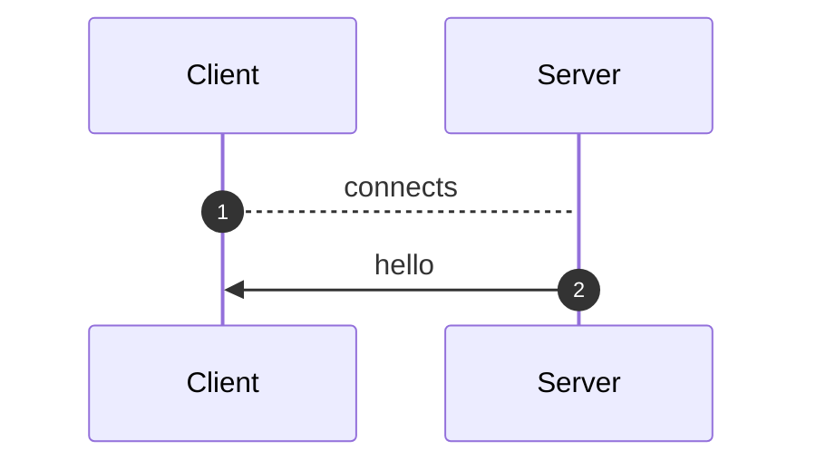
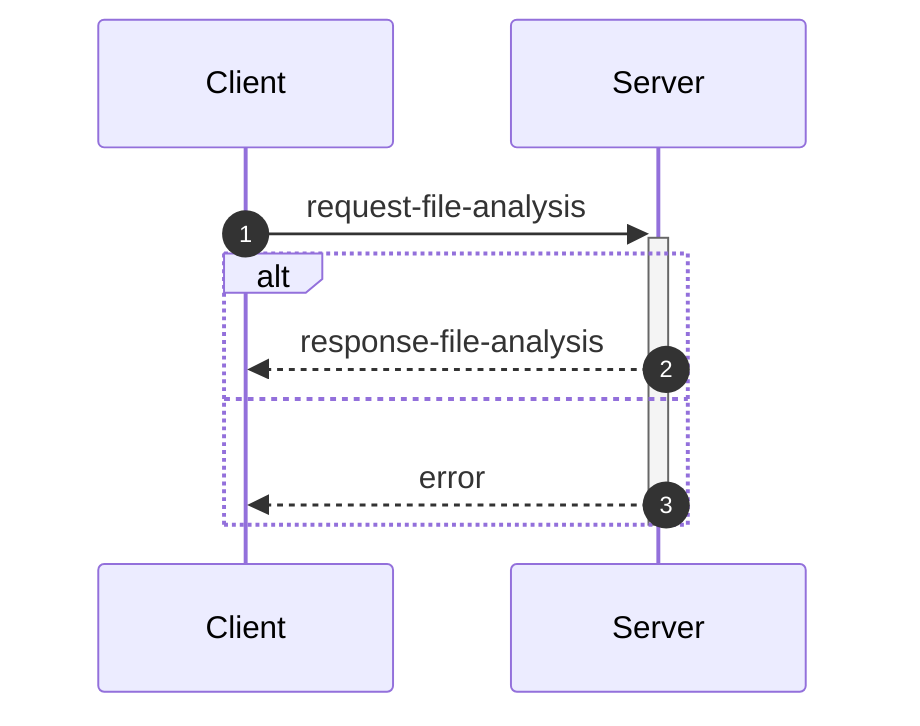
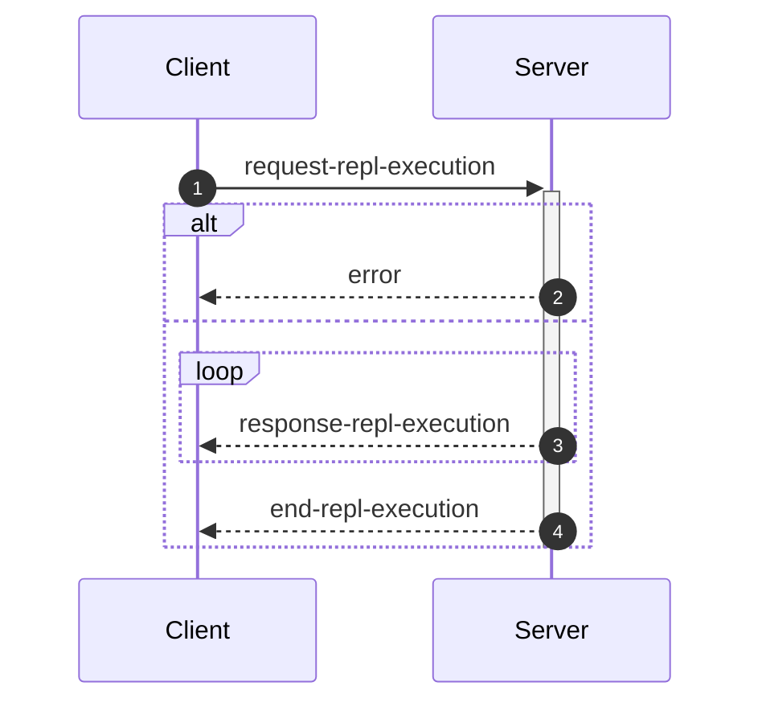
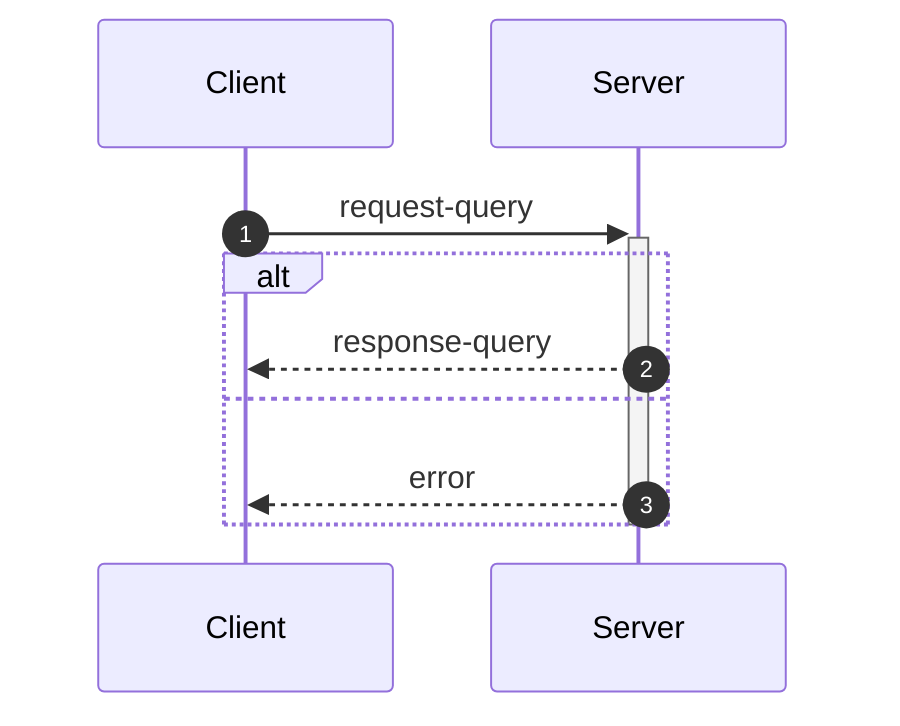

_<span title="an overview of flowR's interface">Generated</span> from '[wiki-interface.ts](https://github.com/flowr-analysis/flowr/tree/main/src/documentation/wiki-interface.ts "src/documentation/wiki-interface.ts")' on 2026-11-21, 19:58:49 UTC (v2.17.9, R v4.6.1), do not edit directly._

Although far from being as detailed as the in-depth explanation of [_flowR_](https://github.com/flowr-analysis/flowr/wiki/Core),
this wiki page explains how to interface with _flowR_ in more detail.
In general, command line arguments and other options provide short descriptions on hover over.

* [💻 Using the REPL](#using-the-repl)
* [⚙️ Configuring FlowR](#configuring-flowr)
* [⚒️ Writing Code](#writing-code)
* [💬 Communicating with the Server](#communicating-with-the-server)

<a id='using-the-repl'></a>
## 💻 Using the REPL

> [!NOTE]
> To execute arbitrary R commands with a repl request, _flowR_ has to be started explicitly with <span title="Description (Command Line Argument): Allow to access the underlying R session when using flowR (security warning: this allows the execution of arbitrary R code!)">`--r-session-access`</span>.
> Please be aware that this introduces a security risk and note that this relies on the [`r-shell` engine](https://github.com/flowr-analysis/flowr/wiki/Engines) .

Although primarily meant for users to explore,
there is nothing which forbids calling _flowR_ as a subprocess to use standard-in, -output, and -error
for communication (although you can access the REPL using the server as well,
with the [REPL Request](#message-request-repl-execution) message).

The read-eval-print loop&nbsp;(REPL) works relatively simple.
You can submit an expression (using <kbd>Enter</kbd>),
which is interpreted as an R&nbsp;expression by default but interpreted as a *command* if it starts with a colon (`:`).
The best command to get started with the REPL is <span title="Description (Repl Command): Show help information (aliases: :h, :?)">`:help`</span>.
Besides, you can leave the REPL either with the command <span title="Description (Repl Command): End the repl (aliases: :q, :exit)">`:quit`</span> or by pressing <kbd>Ctrl</kbd>+<kbd>C</kbd> twice.
When writing a *command*, you may press <kbd>Tab</kbd> to get a list of completions, if available.
Multiple commands can be entered in a single line by separating them with a semicolon (`;`), e.g. `:parse "x<-2"; :df*`.
If a command is given without R code, the REPL will re-use R code given in a previous command.
The prior example will hence return first the parsed AST of the program and then the dataflow graph for `"x <- 2"`.

> [!NOTE]
> If you develop flowR, you may want to launch the repl using the `npm run main-dev` command, this way, you get a non-minified version of flowR with debug information and hot-reloading of source files.

<details>
<summary>Available Commands</summary>

We currently offer the following commands (this with a `[*]` suffix are available with and without the star):

| Command | Description |
| ------- | ----------- |
| **<span title="Description (Repl Command): End the repl (aliases: :q, :exit)">:quit</span>** | End the repl (aliases: **:<span title="Alias of ':quit'. End the repl">q</span>**, **:<span title="Alias of ':quit'. End the repl">exit</span>**) |
| **<span title="Description (Repl Command): Execute the given code as R code. This requires the `--r-session-access` flag to be set and requires the r-shell engine. (aliases: :e, :r)">:execute</span>** | Execute the given code as R code. This requires the `--r-session-access` flag to be set and requires the r-shell engine. (aliases: **:<span title="Alias of ':execute'. Execute the given code as R code. This requires the `--r-session-access` flag to be set and requires the r-shell engine.">e</span>**, **:<span title="Alias of ':execute'. Execute the given code as R code. This requires the `--r-session-access` flag to be set and requires the r-shell engine.">r</span>**) |
| **<span title="Description (Repl Command): Get mermaid code for the control-flow graph of R code (aliases: :cfg, :cf)">:controlflow[*]</span>** | Get mermaid code for the control-flow graph of R code (star: Returns the URL to mermaid.live) (aliases: **:<span title="Alias of ':controlflow'. Get mermaid code for the control-flow graph of R code">cfg</span>**, **:<span title="Alias of ':controlflow'. Get mermaid code for the control-flow graph of R code">cf</span>**) |
| **<span title="Description (Repl Command): Get mermaid code for the control-flow graph with basic blocks (aliases: :cfgb, :cfb)">:controlflowbb[*]</span>** | Get mermaid code for the control-flow graph with basic blocks (star: Returns the URL to mermaid.live) (aliases: **:<span title="Alias of ':controlflowbb'. Get mermaid code for the control-flow graph with basic blocks">cfgb</span>**, **:<span title="Alias of ':controlflowbb'. Get mermaid code for the control-flow graph with basic blocks">cfb</span>**) |
| **<span title="Description (Repl Command): Get mermaid code for the dataflow graph (aliases: :d, :df)">:dataflow[*]</span>** | Get mermaid code for the dataflow graph (star: Returns the URL to mermaid.live) (aliases: **:<span title="Alias of ':dataflow'. Get mermaid code for the dataflow graph">d</span>**, **:<span title="Alias of ':dataflow'. Get mermaid code for the dataflow graph">df</span>**) |
| **<span title="Description (Repl Command): Get mermaid code for the normalized AST of R code (aliases: :n)">:normalize[*]</span>** | Get mermaid code for the normalized AST of R code (star: Returns the URL to mermaid.live) (alias: **:<span title="Alias of ':normalize'. Get mermaid code for the normalized AST of R code">n</span>**) |
| **<span title="Description (Repl Command): Get mermaid code for the simplified dataflow graph (aliases: :ds, :dfs)">:dataflowsimple[*]</span>** | Get mermaid code for the simplified dataflow graph (star: Returns the URL to mermaid.live) (aliases: **:<span title="Alias of ':dataflowsimple'. Get mermaid code for the simplified dataflow graph">ds</span>**, **:<span title="Alias of ':dataflowsimple'. Get mermaid code for the simplified dataflow graph">dfs</span>**) |
| **<span title="Description (Repl Command): Inspect and extend the signature database: `query` (identical to :query @signature), `info <name>` for where a function comes from (identical to :query @function-info), `add <path>` to mount another database/source, `download` to fetch the full-history database. (aliases: :sig)">:signature</span>** | Inspect and extend the signature database: `query` (identical to :query @signature), `info <name>` for where a function comes from (identical to :query @function-info), `add <path>` to mount another database/source, `download` to fetch the full-history database. (alias: **:<span title="Alias of ':signature'. Inspect and extend the signature database: `query` (identical to :query @signature), `info <name>` for where a function comes from (identical to :query @function-info), `add <path>` to mount another database/source, `download` to fetch the full-history database.">sig</span>**) |
| **<span title="Description (Repl Command): Just calculates the DFG, but only prints summary info (aliases: :d#, :df#)">:dataflowsilent</span>** | Just calculates the DFG, but only prints summary info (aliases: **:<span title="Alias of ':dataflowsilent'. Just calculates the DFG, but only prints summary info">d#</span>**, **:<span title="Alias of ':dataflowsilent'. Just calculates the DFG, but only prints summary info">df#</span>**) |
| **<span title="Description (Repl Command): Prints ASCII Art of the parsed, unmodified AST (aliases: :p)">:parse</span>** | Prints ASCII Art of the parsed, unmodified AST (alias: **:<span title="Alias of ':parse'. Prints ASCII Art of the parsed, unmodified AST">p</span>**) |
| **<span title="Description (Repl Command): Prints the version of flowR as well as the current version of R">:version</span>** | Prints the version of flowR as well as the current version of R
| **<span title="Description (Repl Command): Query the given R code (use 'help' for more information)">:query[*]</span>** | Query the given R code (use 'help' for more information) (star: Similar to query, but returns the output in json format.)
| **<span title="Description (Repl Command): Returns an ASCII representation of the dataflow graph (aliases: :df!)">:dataflowascii</span>** | Returns an ASCII representation of the dataflow graph (alias: **:<span title="Alias of ':dataflowascii'. Returns an ASCII representation of the dataflow graph">df!</span>**) |
| **<span title="Description (Repl Command): Returns summarization stats for the normalized AST (aliases: :n#)">:normalize#</span>** | Returns summarization stats for the normalized AST (alias: **:<span title="Alias of ':normalize#'. Returns summarization stats for the normalized AST">n#</span>**) |
| **<span title="Description (Repl Command): Show help information (aliases: :h, :?)">:help</span>** | Show help information (aliases: **:<span title="Alias of ':help'. Show help information">h</span>**, **:<span title="Alias of ':help'. Show help information">?</span>**) |

</details>

> [!TIP]
> 
> As indicated by the examples before, all REPL commands that operate on code keep track of the state.
> Hence, if you run a command like <span title="Description (Repl Command, starred version): Returns the URL to mermaid.live; Base Command: Get mermaid code for the dataflow graph (aliases: :d*, :df*)">`:dataflow*`</span> without providing R code,
> the REPL will re-use the R code provided in a previous command.
> Likewise, doing this will benefit from incrementality!
> If you request the dataflow graph with `:df* x <- 2 * y` and then want to see the parsed AST with `:parse`,
> the REPL will re-use previously obtained information and not re-parse the code again.
> 		

Generally, many commands offer shortcut versions in the REPL. Many queries, for example, offer a shortened format (see the example below).
Of special note, the [Config Query](https://github.com/flowr-analysis/flowr/wiki/%5BQuery%5D-Config)
can be used to also modify the currently active configuration of _flowR_ within the REPL (see the [wiki page](https://github.com/flowr-analysis/flowr/wiki/%5BQuery%5D-Config) for more information).

### Example: Retrieving the Dataflow Graph

To retrieve a URL to the [mermaid](https://mermaid.js.org/) diagram of the dataflow of a given expression,
use <span title="Description (Repl Command, starred version): Returns the URL to mermaid.live; Base Command: Get mermaid code for the dataflow graph (aliases: :d*, :df*)">`:dataflow*`</span> (or <span title="Description (Repl Command): Get mermaid code for the dataflow graph (aliases: :d, :df)">`:dataflow`</span> to get the mermaid code in the cli):

```shell
$ docker run -it --rm eagleoutice/flowr # or npm run flowr 
flowR repl v2.17.9, R grammar v14 (tree-sitter engine)
R> :dataflow* y <- 1 + x
```

<details>
<summary style='color:gray'>Output</summary>

```text
https://mermaid.live/view#base64:eyJjb2RlIjoiZmxvd2NoYXJ0IFREXG4gICAgMXt7XCJgKiM5MTtSTnVtYmVyIzkzOyogKioxKipcbiAgICAgICoxLjYqICgqKmlkOiAxKiopYFwifX1cbiAgICAyKFtcImAqIzkxO1JTeW1ib2wjOTM7KiAqKngqKlxuICAgICAgKjEuMTAqICgqKmlkOiAyKiopYFwiXSlcbiAgICAzW1tcImAqIzkxO1JCaW5hcnlPcCM5MzsqIGJhc2UjNTg7IzU4OyoqIzQzOyoqXG4gICAgICAqMS42LTEwKiAoKippZDogMyoqKVxuICAgIGFyZzogKDEsIDIpYFwiXV1cbiAgICBidWlsdC1pbjpfNDNfW1wiYEJ1aWx0LUluOlxuIzQzO2BcIl1cbiAgICBzdHlsZSBidWlsdC1pbjpfNDNfIHN0cm9rZTpncmF5LGZpbGw6Z3JheSxzdHJva2Utd2lkdGg6MnB4LG9wYWNpdHk6Ljg7XG4gICAgMFtcImAqIzkxO1JTeW1ib2wjOTM7KiAqKnkqKlxuICAgICAgKjEuMSogKCoqaWQ6IDAqKiwgdjogMylgXCJdXG4gICAgNFtbXCJgKiM5MTtSQmluYXJ5T3AjOTM7KiBiYXNlIzU4OyM1ODsqKiM2MDsjNDU7KipcbiAgICAgICoxLjEtMTAqICgqKmlkOiA0KiopXG4gICAgYXJnOiAoMCwgMylgXCJdXVxuICAgIGJ1aWx0LWluOl82MF8tW1wiYEJ1aWx0LUluOlxuIzYwOyM0NTtgXCJdXG4gICAgc3R5bGUgYnVpbHQtaW46XzYwXy0gc3Ryb2tlOmdyYXksZmlsbDpncmF5LHN0cm9rZS13aWR0aDoycHgsb3BhY2l0eTouODtcbiAgICAxIC0uLT58XCJmbG93XCJ8IDJcbiAgICBsaW5rU3R5bGUgMCBzdHJva2U6Z3JheSxjb2xvcjpncmF5O1xuICAgIDIgLS4tPnxcImZsb3dcInwgM1xuICAgIGxpbmtTdHlsZSAxIHN0cm9rZTpncmF5LGNvbG9yOmdyYXk7XG4gICAgMyAtLT58XCJyZWFkcywgYXJnXCJ8IDFcbiAgICAzIC0tPnxcInJlYWRzLCBhcmdcInwgMlxuICAgIDMgLS4tPnxcImZsb3dcInwgMFxuICAgIGxpbmtTdHlsZSA0IHN0cm9rZTpncmF5LGNvbG9yOmdyYXk7XG4gICAgMyAtLi0+fFwicmVhZHMsIGNhbGxzXCJ8IGJ1aWx0LWluOl80M19cbiAgICBsaW5rU3R5bGUgNSBzdHJva2U6Z3JheTtcbiAgICAwIC0tPnxcImRlZmluZWQtYnksIGZsb3dcInwgNFxuICAgIDAgLS0+fFwiZGVmaW5lZC1ieVwifCAzXG4gICAgNCAtLT58XCJyZWFkcywgYXJnXCJ8IDNcbiAgICA0IC0tPnxcInJldHVybnMsIGFyZ1wifCAwXG4gICAgNCAtLi0+fFwicmVhZHMsIGNhbGxzXCJ8IGJ1aWx0LWluOl82MF8tXG4gICAgbGlua1N0eWxlIDEwIHN0cm9rZTpncmF5OyIsIm1lcm1haWQiOnsiYXV0b1N5bmMiOnRydWV9fQ==
```

Retrieve the dataflow graph of the expression `y <- 1 + x`. It looks like this:


<details>

<summary style="color:gray">R Code of the Dataflow Graph</summary>

The analysis ran (parse and normalize with the [tree-sitter](https://github.com/flowr-analysis/flowr/wiki/Engines) engine) in the generation environment. No [signature database](https://github.com/flowr-analysis/flowr/wiki/Signature-Database) is mounted, so `library()` attaches no exports (base-R names are still qualified, e.g., `stats::acf`). 
We encountered no unknown side effects during the analysis.

```r
y <- 1 + x
```

</details>

</details>

For small graphs like this, <span title="Description (Repl Command): Returns an ASCII representation of the dataflow graph (aliases: :df!)">`:dataflowascii`</span> also provides an ASCII representation directly in the REPL:

```shell
$ docker run -it --rm eagleoutice/flowr # or npm run flowr 
flowR repl v2.17.9, R grammar v14 (tree-sitter engine)
R> :df! y <- 1 + x
```

<details open>
<summary style='color:gray'>Output</summary>

```text
                        v<0>v
 c<4>c──────────────────| y |
 |<- |     ┌────────────v---v
 c---c     │
    │   c<3>c   0<1>0
    └───| + |───| 1 |───u<2>u
        c---c   0---0   | x |
           └────────────u---u
Edges:
3 -> 1: reads, arg          3 -> 2: reads, arg
3 -> 0: flows-to            1 -> 2: flows-to
2 -> 3: flows-to            4 -> 3: reads, arg
4 -> 0: returns, arg        0 -> 4: defined-by, flows-to
0 -> 3: defined-by
```

Retrieve the dataflow graph of the expression `y <- 1 + x` as ASCII art.

</details>

For the slicing with <span title="Description (Repl Command): Static backwards executable slicer for R">`:slicer`</span>, you have access to the same [magic comments](#slice-magic-comments) as with the [slice request](#message-request-slice).
Pass `--inline` to splice resolvable `source()` calls into the reconstruction so the slice is a single self-contained R text (the same as the static slice query's `inlineSources` flag).
See `--help` for more flags!

### Example: Interfacing with the File System

Many commands that allow for an R-expression (like <span title="Description (Repl Command, starred version): Returns the URL to mermaid.live; Base Command: Get mermaid code for the dataflow graph (aliases: :d*, :df*)">`:dataflow*`</span>) allow for a file as well
if the argument starts with `file://`.
If you are working from the root directory of the _flowR_ repository, the following gives you the parsed AST of the example file using the <span title="Description (Repl Command): Prints ASCII Art of the parsed, unmodified AST (aliases: :p)">`:parse`</span> command:

> **Watch mode**: Replace `file://` with `watch://` to enter watch mode.
> flowR runs the command immediately and then re-runs it every time the file (or any file inside the folder) changes.
> Enter any other command to leave watch mode.
> For example: `:df watch://analysis.R`

```shell
$ docker run -it --rm eagleoutice/flowr # or npm run flowr 
flowR repl v2.17.9, R grammar v14 (tree-sitter engine)
R> :parse file://test/testfiles/example.R
```

<details>
<summary style='color:gray'>Output</summary>

```text
File: test/testfiles/example.R

program
├ binaryoperator
│ ├ identifier "sum" (1:1─4)
│ ├ <- "<-" (1:5─7)
│ ╰ float "0" (1:8─9)
├ binaryoperator
│ ├ identifier "product" (2:1─8)
│ ├ <- "<-" (2:9─11)
│ ╰ float "1" (2:12─13)
├ binaryoperator
│ ├ identifier "w" (3:1─2)
│ ├ <- "<-" (3:3─5)
│ ╰ float "7" (3:6─7)
├ binaryoperator
│ ├ identifier "N" (4:1─2)
│ ├ <- "<-" (4:3─5)
│ ╰ float "10" (4:6─8)
├ forstatement
│ ├ for "for" (6:1─4)
│ ├ ( "(" (6:5─6)
│ ├ identifier "i" (6:6─7)
│ ├ in "in" (6:8─10)
│ ├ binaryoperator
│ │ ├ float "1" (6:11─12)
│ │ ├ : ":" (6:12─13)
│ │ ╰ parenthesizedexpression
│ │   ├ ( "(" (6:13─14)
│ │   ├ binaryoperator
│ │   │ ├ identifier "N" (6:14─15)
│ │   │ ├ - "-" (6:15─16)
│ │   │ ╰ float "1" (6:16─17)
│ │   ╰ ) ")" (6:17─18)
│ ├ ) ")" (6:18─19)
│ ╰ bracedexpression
│   ├ { "{" (6:20─21)
│   ├ binaryoperator
│   │ ├ identifier "sum" (7:3─6)
│   │ ├ <- "<-" (7:7─9)
│   │ ╰ binaryoperator
│   │   ├ binaryoperator
│   │   │ ├ identifier "sum" (7:10─13)
│   │   │ ├ + "+" (7:14─15)
│   │   │ ╰ identifier "i" (7:16─17)
│   │   ├ + "+" (7:18─19)
│   │   ╰ identifier "w" (7:20─21)
│   ├ binaryoperator
│   │ ├ identifier "product" (8:3─10)
│   │ ├ <- "<-" (8:11─13)
│   │ ╰ binaryoperator
│   │   ├ identifier "product" (8:14─21)
│   │   ├  "" (8:22─23)
│   │   ╰ identifier "i" (8:24─25)
│   ╰ } "}" (9:1─2)
├ call
│ ├ identifier "cat" (11:1─4)
│ ╰ arguments
│   ├ ( "(" (11:4─5)
│   ├ argument
│   │ ╰ string
│   │   ├ stringopen "\"" (11:5─6)
│   │   ├ stringcontent "Sum:" (11:6─10)
│   │   ╰ stringclose "\"" (11:10─11)
│   ├ comma "," (11:11─12)
│   ├ argument
│   │ ╰ identifier "sum" (11:13─16)
│   ├ comma "," (11:16─17)
│   ├ argument
│   │ ╰ string
│   │   ├ stringopen "\"" (11:18─19)
│   │   ├ stringcontent
│   │   │ ╰ escapesequence "\\n" (11:19─21)
│   │   ╰ stringclose "\"" (11:21─22)
│   ╰ ) ")" (11:22─23)
╰ call
  ├ identifier "cat" (12:1─4)
  ╰ arguments
    ├ ( "(" (12:4─5)
    ├ argument
    │ ╰ string
    │   ├ stringopen "\"" (12:5─6)
    │   ├ stringcontent "Product:" (12:6─14)
    │   ╰ stringclose "\"" (12:14─15)
    ├ comma "," (12:15─16)
    ├ argument
    │ ╰ identifier "product" (12:17─24)
    ├ comma "," (12:24─25)
    ├ argument
    │ ╰ string
    │   ├ stringopen "\"" (12:26─27)
    │   ├ stringcontent
    │   │ ╰ escapesequence "\\n" (12:27─29)
    │   ╰ stringclose "\"" (12:29─30)
    ╰ ) ")" (12:30─31)
```

Retrieve the parsed AST of the example file.

<details>

<summary>File Content</summary>

```r
sum <- 0
product <- 1
w <- 7
N <- 10

for (i in 1:(N-1)) {
  sum <- sum + i + w
  product <- product * i
}

cat("Sum:", sum, "\n")
cat("Product:", product, "\n")
```

</details>

As _flowR_ directly transforms this AST the output focuses on being human-readable instead of being machine-readable.
		
</details>

### Example: Run a Query

You can run any query supported by _flowR_ using the <span title="Description (Repl Command): Query the given R code (use 'help' for more information)">`:query`</span> command.
For example, to obtain the shapes of all data frames in a given piece of code, you can run:

```shell
$ docker run -it --rm eagleoutice/flowr # or npm run flowr 
flowR repl v2.17.9, R grammar v14 (tree-sitter engine)
R> :query @absint df-shape "x <- data.frame(a = 1:10, b = 1:10)\ny <- x$a"
```

<details open>
<summary style='color:gray'>Output</summary>

```text
Query: absint (5 ms)
   ╰ $12: (colnames: [{"a", "b"}, {}], cols: [2, 2], rows: [10, 10])
   ╰ $0: (colnames: [{"a", "b"}, {}], cols: [2, 2], rows: [10, 10])
```

Retrieve the shapes of all data frames in the given code.

</details>

To run the linter on a file, you can use (in this example, we just issue the `dead-code` linter on a small piece of code):

```shell
$ docker run -it --rm eagleoutice/flowr # or npm run flowr 
flowR repl v2.17.9, R grammar v14 (tree-sitter engine)
R> :query @linter rules:dead-code "if(FALSE) x <- 2"
```

<details open>
<summary style='color:gray'>Output</summary>

```text
Query: linter (9 ms)
   ╰ Dead Code (dead-code):
       ╰ certain:
           ╰ Code at 1.11-16 (1 quick fix(es) available)
```

Run the linter on the given code, with only the `dead-code` rule enabled.

</details>

For more information on the available queries, please check out the [Query API](https://github.com/flowr-analysis/flowr/wiki/Query-API).

<a id='configuring-flowr'></a>
## ⚙️ Configuring FlowR

When running _flowR_, you may want to specify some behaviors with a dedicated configuration file.
By default, flowR looks for a file named `flowr.json` in the current working directory (or any higher directory).
You can also specify a different file with <span title="Description (Command Line Argument): The name of the configuration file to use">`--config-file`</span> or pass the configuration inline using <span title="Description (Command Line Argument): The flowR configuration to use, as a JSON string">`--config-json`</span>.
A `flowr.json` found this way belongs to the analyzed project, so flowR ignores its options that decide what flowR executes or loads
(`defaultPlugins.*.1`, `repl.plugins.*.1`, `engines.*.wasmPath`, `engines.*.treeSitterWasmPath`, `engines.*.rPath`, `solver.sigdb.additionalPaths`, `solver.sigdb.downloadRepo`, `solver.sigdb.autoSync`, `solver.sigdb.installedLibrary.paths`, `solver.sigdb.onDemand.enabled`, `solver.sigdb.onDemand.repositories`, `solver.sigdb.onDemand.cranMirror`, `solver.sigdb.onDemand.bioconductorMirror`, `solver.sigdb.onDemand.cacheDir`, `solver.instrument.dataflowExtractors`),
unless you pass <span title="Description (Command Line Argument): Keep the security-sensitive options (e.g., the R executable) of the flowr.json found in the working directory or a parent. Only use this for projects you trust.">`--trust-config`</span>.
To analyze code you do not trust, use the secure mode (<span title="Description (Command Line Argument): Run in secure mode for analyzing untrusted code: flowR does not start R (or any other process), does not access the network, does not search for project configs, and ignores security-sensitive options in every config. Cannot be disabled once enabled. Can also be enabled with the environment variable {italic FLOWR_SECURE_MODE=1}.">`--secure`</span>, see the [security policy](https://github.com/flowr-analysis/flowr/blob/main/.github/SECURITY.md)).
To inspect the current configuration, you can run flowr with the <span title="Description (Command Line Argument): Run with verbose logging (will be passed to the corresponding script)">`--verbose`</span> flag, or use the `config` [Query](https://github.com/flowr-analysis/flowr/wiki/Query-API).
Within the REPL this works by running the following:

```shell
:query @config
```

To work with the <a href="https://github.com/flowr-analysis/flowr/tree/main/src/config.ts#L131"><code><span title="The configuration file format for flowR.">FlowrConfig</span></code></a> you can use the provided helper objects alongside its methods like
<a href="https://github.com/flowr-analysis/flowr/tree/main/src/config.ts#L977"><code><span title="Creates a new flowr config that has the updated values.">FlowrConfig::<b>amend</b></span></code></a>.
The schema below documents every option; the ones you most likely want are:

- <a href="https://github.com/flowr-analysis/flowr/wiki/Interface#configuring-flowr" title="Configuration Option (boolean): Whether source calls should be ignored, causing {@link processSourceCall}&#39;s behavior to be skipped.">ignoreSourceCalls</a>: ignore source calls when analyzing the code, i.e., ignore the inclusion of other files.
- <a href="https://github.com/flowr-analysis/flowr/wiki/Interface#configuring-flowr" title="Configuration Option (boolean): Whether load calls should be ignored, causing {@link processLoadCall}&#39;s behavior to be skipped.">ignoreLoadCalls</a>: ignore load calls when analyzing the code, i.e., ignore the loading of r-data files.
- <a href="https://github.com/flowr-analysis/flowr/wiki/Interface#configuring-flowr" title="Configuration Option (object): Do you want to overwrite (parts) of the builtin definition?">semantics.environment.overwriteBuiltIns</a>: overwrite _flowR_'s handling of built-in functions, or clear the preset definitions entirely.
  See [Configure BuiltIn Semantics](#configure-builtin-semantics) for more information.
- <a href="https://github.com/flowr-analysis/flowr/wiki/Interface#configuring-flowr" title="Configuration Option (boolean): Whether calls drawing on a graphics device (e.g., `plot`) count as writing to it, which the ambient state queries then report.">semantics.ambient.drawingWritesDevice</a>: whether calls drawing on a graphics device (e.g., `plot`) count as writing the device in the ambient state queries.
- <a href="https://github.com/flowr-analysis/flowr/wiki/Interface#configuring-flowr" title="Configuration Option (string): How to resolve variables and their values. (one of &quot;disabled&quot;, &quot;alias&quot;, &quot;builtin&quot;)">solver.variables</a>: how to resolve variables and their values (`disabled`, `alias`, `builtin`).
- <a href="https://github.com/flowr-analysis/flowr/wiki/Interface#configuring-flowr" title="Configuration Option (array): The engine or set of engines to use for interacting with R code. An empty array means all available engines will be used.">engines</a> and <a href="https://github.com/flowr-analysis/flowr/wiki/Interface#configuring-flowr" title="Configuration Option (string): The default engine to use for interacting with R code. If this is undefined, an arbitrary engine from the specified list will be used. (one of &quot;tree-sitter&quot;, &quot;r-shell&quot;)">defaultEngine</a>: the engines used to interact with R code, see the [Engines wiki page](https://github.com/flowr-analysis/flowr/wiki/Engines).
- <a href="https://github.com/flowr-analysis/flowr/wiki/Interface#configuring-flowr" title="Configuration Option (array): Files a framework loads on its own, without any source() call (e.g. global.R in a shiny app), in the order they are loaded; flowR orders the matching project files accordingly and analyzes them as one program. Entries are case-insensitive globs matched against the file path, a plain name matches any file with that name, and entries matching no project file are warned about. Usually set per project kind via specializeConfig.">project.implicitSources</a>: the files a framework loads without any `source()` call, in the order in which they are
  loaded. Entries are globs (e.g. `R/*.R`) matched against the file path ignoring capitalization; one matching no file is reported.
- <a href="https://github.com/flowr-analysis/flowr/wiki/Interface#configuring-flowr" title="Configuration Option (object): Overwrite (parts of) the configuration depending on the project kind flowR detects, e.g. to give a shiny app its implicit sources.">specializeConfig</a>: overwrite (parts of) the configuration depending on the kind of project _flowR_ detects
  (e.g. `shiny-app`), which is how a shiny app gets its implicit sources by default. What you configure directly wins.
- <a href="https://github.com/flowr-analysis/flowr/wiki/Interface#configuring-flowr" title="Configuration Option (string): Overwrite the project kind flowR would otherwise infer from the analyzed files, e.g. when auto-detection guesses wrong. (one of &quot;package&quot;, &quot;script&quot;, &quot;shiny-app&quot;, &quot;notebook&quot;, &quot;project&quot;, &quot;unknown&quot;)">project.useProjectType</a>: skip that detection and force a project kind yourself, when auto-detection guesses wrong.
- <a href="https://github.com/flowr-analysis/flowr/wiki/Interface#configuring-flowr" title="Configuration Option (array): The default plugins to load when creating a new instance of FlowrAnalyzer">defaultPlugins</a> and <a href="https://github.com/flowr-analysis/flowr/wiki/Interface#configuring-flowr" title="Configuration Option (array): The plugins to load in REPL mode">repl.plugins</a>: the plugins to load for a new <a href="https://github.com/flowr-analysis/flowr/tree/main/src/project/flowr-analyzer.ts#L237"><code><span title="Central class for conducting analyses with FlowR. Use the FlowrAnalyzerBuilder to create a new instance. If you want the original pattern of creating a pipeline and running all steps, you can still do this with FlowrAnalyzer#runFull . To inspect the context of the analyzer, use FlowrAnalyzer#inspectContext (if you are a plugin and need to modify it, use FlowrAnalyzer#context instead).">FlowrAnalyzer</span></code></a> and in the REPL
  (use `flowr:default` to reference the former).

So you can configure _flowR_ by adding a file like the following:

<details>

<summary>Example Configuration File</summary>

```json
{
  "ignoreSourceCalls": true,
  "ignoreLoadCalls": true,
  "semantics": {
    "environment": {
      "overwriteBuiltIns": {
        "definitions": [
          {
            "type": "function",
            "names": [
              "foo"
            ],
            "processor": "builtin:assign",
            "config": {}
          }
        ]
      }
    }
  },
  "defaultPlugins": [
    "file:description",
    "versions:description"
  ],
  "repl": {
    "quickStats": false,
    "dfProcessorHeat": false,
    "hints": true,
    "plugins": [
      "flowr:default"
    ]
  },
  "project": {
    "resolveUnknownPathsOnDisk": true,
    "implicitSources": [
      "global.R",
      "app.R"
    ]
  },
  "linter": {
    "disabledRules": []
  },
  "specializeConfig": {
    "shiny-app": {
      "project": {
        "implicitSources": [
          "global.R",
          "ui.R",
          "server.R",
          "app.R"
        ]
      }
    }
  },
  "engines": [
    {
      "type": "r-shell"
    }
  ],
  "solver": {
    "variables": "alias",
    "evalStrings": true,
    "trackEnvironments": true,
    "sigdb": {
      "enabled": true,
      "loadProjectDependencies": true,
      "eagerlyLoad": false,
      "eagerlyLoadExports": false,
      "linkBaseR": false,
      "linkDescriptionDependencies": false
    },
    "resolveSource": {
      "dropPaths": "no",
      "ignoreCapitalization": true,
      "inferWorkingDirectory": "active-script",
      "searchPath": []
    },
    "instrument": {},
    "slicer": {
      "threshold": 50
    }
  },
  "abstractInterpretation": {
    "wideningThreshold": 4,
    "followCalls": true,
    "dataFrame": {
      "maxColNames": 20,
      "readLoadedData": {
        "readExternalFiles": true,
        "maxReadLines": 1000000
      }
    }
  },
  "incremental": {
    "alwaysIncremental": false,
    "parsing": {
      "activated": false,
      "heuristics": {
        "activated": true,
        "mtime": true,
        "linesFrom": 500,
        "bytesFrom": 50000,
        "alwaysWithEdits": false,
        "minFiles": 1
      }
    },
    "dataflow": {
      "activated": false,
      "checkpoints": 2,
      "minStatements": 0
    }
  },
  "gas": {
    "thresholds": {
      "memory": {
        "problematic": 0.7,
        "critical": 0.9
      },
      "timeMs": {
        "problematic": 100000,
        "critical": 120000
      }
    },
    "features": {}
  }
}
```

</details>

<details>
<a id='configure-builtin-semantics'></a>
<summary>Configure Built-In Semantics</summary>

`semantics/environment/overwriteBuiltins` accepts two keys:

- `loadDefaults` (boolean, initially `true`): If set to `true`, the default built-in definitions are loaded before applying the custom definitions. Setting this flag to `false` explicitly disables the loading of the default definitions.
- `definitions` (array, initially empty): Allows to overwrite or define new built-in elements. Each object within must have a `type` which is one of the below. Furthermore, they may define a string array of `names` which specifies the identifiers to bind the definitions to. You may use `assumePrimitive` to specify whether _flowR_ should assume that this is a primitive non-library definition (so you probably just do not want to specify the key).

  | Type            | Description                                                                                                                                                                                                                                                                                              | Example                                                                                                    |
  | --------------- | -------------------------------------------------------------------------------------------------------------------------------------------------------------------------------------------------------------------------------------------------------------------------------------------------------- | ---------------------------------------------------------------------------------------------------------- |
  | `constant`    | Additionally allows for a `value` this should resolve to.                                                                                                                                                                                                                                                | `{ type: 'constant', names: ['NULL', 'NA'],  value: null }`                                                |
  | `function`    | Is a rather flexible way to define and bind built-in functions. For the time, we do not have extensive documentation to cover all the cases, so please either consult the sources with the `default-builtin-config/` folder or open a [new issue](https://github.com/flowr-analysis/flowr/issues/new/choose). | `{ type: 'function', names: ['next'], processor: 'builtin:d', config: { cfg: ExitPointType.Next } }` |
  | `replacement` | A comfortable way to specify replacement functions like `$<-` or `names<-`. `suffixes` describes the... suffixes to attach automatically. | `{ type: 'replacement', suffixes: ['<-', '<<-'], names: ['[', '[['] }` |

</details>

<details>

<summary style='color:gray'>Full Configuration-File Schema</summary>

- _The configuration file format for flowR._ (object)
    - **logLevel** [optional] _flowR's global minimum log level, applied when the config is loaded._ (string)
        Only allows: 'silly', 'trace', 'debug', 'info', 'warn', 'error', 'fatal'
    - **ignoreSourceCalls** [optional] _Whether source calls should be ignored, causing {@link processSourceCall}'s behavior to be skipped._ (boolean)
    - **ignoreLoadCalls** [optional] _Whether load calls should be ignored, causing {@link processLoadCall}'s behavior to be skipped._ (boolean)
    - **semantics** _Configure language semantics and how flowR handles them._ (object)
        - **environment** [optional] _Semantics regarding how to handle the R environment._ (object)
            - **overwriteBuiltIns** [optional] _Do you want to overwrite (parts) of the builtin definition?_ (object)
                - **loadDefaults** [optional] _Should the default configuration still be loaded?_ (boolean)
                - **definitions** [optional] _The definitions to load/overwrite._ (array)
                Valid item types:
                    - (object)
        - **ambient** [optional] _Semantics regarding the global state (options, devices, files, ...) calls access._ (object)
            - **drawingWritesDevice** [optional] _Whether calls drawing on a graphics device (e.g., `plot`) count as writing to it, which the ambient state queries then report._ (boolean)
    - **defaultPlugins** [optional] _The default plugins to load when creating a new instance of FlowrAnalyzer_ (array)
    Valid item types:
        - (alternatives)
            - (string)
            - (array)
    - **repl** _Configuration options for the REPL._ (object)
        - **quickStats** [optional] _Whether to show quick stats in the REPL after each evaluation._ (boolean)
        - **dfProcessorHeat** [optional] _This instruments the dataflow processors to count how often each processor is called._ (boolean)
        - **hints** [optional] _Whether to show dim inline hints on the empty prompt (automatically disabled on non-interactive terminals)._ (boolean)
        - **plugins** [optional] _The plugins to load in REPL mode_ (array)
        Valid item types:
            - (alternatives)
                - (string)
                - (array)
        - **autoUseFileProtocol** [optional] _Prepend the file protocol to a repl input that looks like a path, instead of only warning about it._ (boolean)
        - **queryStats** [optional] _Whether `:query` closes with the line stating how long the queries took (`:query*` never prints it)._ (boolean)
        - **showPlugins** [optional] _Whether `:version` grays out the plugins that did not activate during the last analysis._ (boolean)
    - **project** _Project specific configuration options._ (object)
        - **resolveUnknownPathsOnDisk** [optional] _Whether to resolve unknown paths loaded by the r project disk when trying to source/analyze files._ (boolean)
        - **failOnInaccessiblePath** [optional] _Whether a directory that cannot be traversed during file discovery (e.g. due to permissions) aborts the analysis; when false (the default) such paths are logged and skipped._ (boolean)
        - **basePackages** [optional] _The packages considered part of R itself (base and recommended); if unset, flowR uses its built-in list._ (array)
        Valid item types:
            - (string)
        - **implicitSources** [optional] _Files a framework loads on its own, without any source() call (e.g. global.R in a shiny app), in the order they are loaded; flowR orders the matching project files accordingly and analyzes them as one program. Entries are case-insensitive globs matched against the file path, a plain name matches any file with that name, and entries matching no project file are warned about. Usually set per project kind via specializeConfig._ (array)
        Valid item types:
            - (string)
        - **useProjectType** [optional] _Overwrite the project kind flowR would otherwise infer from the analyzed files, e.g. when auto-detection guesses wrong._ (string)
            Only allows: 'package', 'script', 'shiny-app', 'notebook', 'project', 'unknown'
        - **assumeImplicitEcho** [optional] _Whether the top level of the analyzed code is echoed, so that every visible result printed there is collected as an output by the dependencies query (default true, false for a package)._ (boolean)
        - **discovery** [optional] _Scoping options for the default project discovery._ (object)
            - **full** [optional] _Collect every file below the project root (greedy) instead of only the files the detected project kind needs (default false)._ (boolean)
            - **perKind** [optional] _Per-kind include/exclude glob overrides layered on the default scoping._ (object)
            - **ignore** [optional] _Case-insensitive globs that drop matching files from the intelligent discovery, regardless of kind (e.g. .Renviron to ignore environment files)._ (array)
            Valid item types:
                - (string)
        - **classification** [optional] _Overrides for the signals flowR uses to classify the project kind._ (object)
            - **shinyDescriptionTypes** [optional] _DESCRIPTION Type: values that mark a shiny app._ (array)
            Valid item types:
                - (string)
            - **shinyEntryFiles** [optional] _File names a shiny app is assembled from._ (array)
            Valid item types:
                - (string)
            - **shinyUsagePattern** [optional] _Regex source evidencing shiny usage in an entry file._ (string)
            - **notebookExtensions** [optional] _File extensions marking a notebook._ (array)
            Valid item types:
                - (string)
    - **linter** _Linter configuration options._ (object)
        - **disabledRules** _Linting rule names excluded from the default rule set (a rule requested explicitly via a linter query still runs). Usually set per project kind via specializeConfig._ (array)
        Valid item types:
            - (string)
        - **disabledTags** [optional] _Linting rule tags whose rules are excluded from the default rule set (a rule requested explicitly via a linter query still runs). By default the cmd-check rules are disabled for everything but a package; a configured list replaces that default._ (array)
        Valid item types:
            - (string)
    - **inputSources** [optional] _Further frameworks the input-sources analysis should know about; entries are added to flowR's defaults._ (object)
        - **pure** [optional] _Functions that only pass the constantness of their arguments on._ (array)
        Valid item types:
            - (string)
        - **param** [optional] _Functions whose result is a 'param' input._ (array)
        Valid item types:
            - (string)
        - **file** [optional] _Functions whose result is a 'file' input._ (array)
        Valid item types:
            - (string)
        - **tempfile** [optional] _Functions whose result is a 'tempfile' input._ (array)
        Valid item types:
            - (string)
        - **glob** [optional] _Functions whose result is a 'glob' input._ (array)
        Valid item types:
            - (string)
        - **net** [optional] _Functions whose result is a 'net' input._ (array)
        Valid item types:
            - (string)
        - **rand** [optional] _Functions whose result is a 'rand' input._ (array)
        Valid item types:
            - (string)
        - **system** [optional] _Functions whose result is a 'system' input._ (array)
        Valid item types:
            - (string)
        - **ffi** [optional] _Functions whose result is a 'ffi' input._ (array)
        Valid item types:
            - (string)
        - **lang** [optional] _Functions whose result is a 'lang' input._ (array)
        Valid item types:
            - (string)
        - **options** [optional] _Functions whose result is a 'options' input._ (array)
        Valid item types:
            - (string)
        - **cmdline** [optional] _Functions whose result is a 'cmdline' input._ (array)
        Valid item types:
            - (string)
        - **user** [optional] _Functions whose result is a 'user' input._ (array)
        Valid item types:
            - (string)
        - **const** [optional] _Functions whose result is a 'const' input._ (array)
        Valid item types:
            - (string)
        - **scope** [optional] _Functions whose result is a 'scope' input._ (array)
        Valid item types:
            - (string)
        - **dconst** [optional] _Functions whose result is a 'dconst' input._ (array)
        Valid item types:
            - (string)
        - **unknown** [optional] _Functions whose result is a 'unknown' input._ (array)
        Valid item types:
            - (string)
        - **linkedObjects** [optional] _Objects a framework provides without a definition in the code, e.g. shiny's input._ (array)
        Valid item types:
            - (object)
        - **linkedEntryPoints** [optional] _Calls that hand a function to a framework, which binds its objects to the parameters by position._ (array)
        Valid item types:
            - (object)
    - **specializeConfig** [optional] _Overwrite (parts of) the configuration depending on the project kind flowR detects, e.g. to give a shiny app its implicit sources._ (object)
    - **engines** _The engine or set of engines to use for interacting with R code. An empty array means all available engines will be used._ (array)
    Valid item types:
        - (alternatives)
            - _The configuration for the tree sitter engine._ (object)
                - **type** [required] _Use the tree sitter engine._ (string)
                    Only allows: 'tree-sitter'
                - **wasmPath** [optional] _The path to the tree-sitter-r WASM binary to use. If this is undefined, this uses the default path._ (string)
                - **treeSitterWasmPath** [optional] _The path to the tree-sitter WASM binary to use. If this is undefined, this uses the default path._ (string)
                - **lax** [optional] _Whether to use the lax parser for parsing R code (allowing for syntax errors). If this is undefined, the strict parser will be used._ (boolean)
            - _The configuration for the R shell engine._ (object)
                - **type** [required] _Use the R shell engine._ (string)
                    Only allows: 'r-shell'
                - **rPath** [optional] _The path to the R executable to use. If this is undefined, this uses the default path._ (string)
                - **pipeBind** [optional] _Whether to enable R's experimental pipe-bind operator "=>" by setting _R_USE_PIPEBIND_ for the R session (default false); R itself keeps this off by default, as it is experimental and has never shipped in a release version of R._ (boolean)
    - **defaultEngine** [optional] _The default engine to use for interacting with R code. If this is undefined, an arbitrary engine from the specified list will be used._ (string)
        Only allows: 'tree-sitter', 'r-shell'
    - **solver** _How to resolve constants, constraints, cells, ..._ (object)
        - **variables** _How to resolve variables and their values._ (string)
            Only allows: 'disabled', 'alias', 'builtin'
        - **evalStrings** _Should we include eval(parse(text="...")) calls in the dataflow graph?_ (boolean)
        - **trackEnvironments** [optional] _Track user-created environments (new.env, assign/get/local with envir=, dollar-assign, attach). When false, all envir-style calls fall through conservatively._ (boolean)
        - **sigdb** _Resolving library exports from a signature database._ (object)
            - **enabled** [optional] _Resolve library()/use() exports from a signature database (default true); when false no database is consulted._ (boolean)
            - **loadProjectDependencies** [optional] _Load the project's declared dependencies from its metadata files (DESCRIPTION Imports/Depends, rproject.toml, uvr.toml, rig rproj.toml and script blocks, renv.lock, rv.lock, uvr.lock, rig lockfiles) (default true); when false these files are not read for dependencies._ (boolean)
            - **eagerlyLoad** [optional] _Parse the database up front rather than on the first package load (default false, ignored if disabled)._ (boolean)
            - **eagerlyLoadExports** [optional] _Add a vertex for every export on load rather than on demand (default false); keeps the dataflow graph small._ (boolean)
            - **assumedRVersion** [optional] _R version assumed when resolving versioned (base-R) exports: a pin like "4.5" or "auto" to detect the installed R (default "auto")._ (string)
            - **linkBaseR** [optional] _Eagerly attach base-R namespaces so bare base calls resolve without library() (default false)._ (boolean)
            - **linkBaseRCalls** [optional] _Add a lightweight Reads edge from a bare base-R call to its signature-database function vertex (default false; base-R qualification is edge-free otherwise)._ (boolean)
            - **linkPackageCalls** [optional] _Add a lightweight Reads edge from a resolved package call to its signature-database function vertex (default false)._ (boolean)
            - **linkDescriptionDependencies** [optional] _Eagerly attach the namespaces of the project's declared DESCRIPTION dependencies (Imports/Depends) so their exports resolve without an explicit library() (default false)._ (boolean)
            - **warmInBackground** [optional] _Decompress the hot shards (base + most-downloaded) in a background task on startup so the first library() lookup is warm (default false; for long-running servers/REPLs)._ (boolean)
            - **additionalPaths** [optional] _Extra directories or bundle/manifest files searched for signature databases (alongside the shipped default and $FLOWR_SIGDB_DIR); a downloaded full-history bundle placed here is mounted automatically._ (array)
            Valid item types:
                - (string)
            - **downloadRepo** [optional] _GitHub owner/repo the full-history bundle is downloaded from via ":signature download" (default "flowr-analysis/flowr"; the release tag comes from the committed sigdb.remote.json unless a version is given)._ (string)
            - **autoSync** [optional] _On startup, re-download shards whose committed sigdb.remote.json hash no longer matches the cache, in the background (default false; opt-in network sync after a git pull)._ (boolean)
            - **installedLibrary** [optional] _Recovering packages no signature database knows from the copy installed on this machine._ (object)
                - **enabled** [required] _Recover packages no signature database knows from their installed copy (default false)._ (boolean)
                - **paths** [optional] _Library directories to search; when empty they are discovered from the environment and the project._ (array)
                Valid item types:
                    - (string)
                - **useEnvironment** [optional] _Search the libraries R_LIBS_USER/R_LIBS/R_LIBS_SITE name (default true)._ (boolean)
                - **useProjectLibrary** [optional] _Search a project-local renv/packrat library (default true)._ (boolean)
                - **maxDepth** [optional] _How far to descend into the nested layout of a project-local library (default 3)._ (number)
                - **packages** [optional] _Only recover packages whose name matches one of these regular expressions; empty means any._ (array)
                Valid item types:
                    - (string)
            - **onDemand** [optional] _Recovering packages no signature database knows from their sources on CRAN, Bioconductor, or GitHub._ (object)
                - **enabled** [required] _Fetch and recover the sources of packages no signature database knows when the analyzed code uses them (default false, accesses the network)._ (boolean)
                - **sources** [optional] _Where to look, in order: github, cran, bioconductor, or a source a plugin adds (default ["github", "cran", "bioconductor"])._ (array)
                Valid item types:
                    - (string)
                - **repositories** [optional] _GitHub repositories (owner/repo[/subdir][@ref]) to fetch packages from, by package name. The analyzed project may name more (DESCRIPTION Remotes, install_github calls)._ (object)
                - **packages** [optional] _Only recover packages whose name matches one of these regular expressions, empty means any._ (array)
                Valid item types:
                    - (string)
                - **cranMirror** [optional] _The CRAN src/contrib/ to fetch from, over https (default https://cloud.r-project.org/src/contrib/). It may be on the local network._ (string)
                - **bioconductorMirror** [optional] _The Bioconductor host, over https (default https://bioconductor.org). It may be on the local network._ (string)
                - **bioconductorRelease** [optional] _The Bioconductor release to fetch from: release, devel, or a number like 3.20 (default release)._ (string)
                - **githubMirrors** [optional] _Use the GitHub mirrors of CRAN (cran/<pkg>) and Bioconductor (bioc/<pkg>) (default true)._ (boolean)
                - **maxPackages** [optional] _The most packages to fetch for one analysis (default 25)._ (number)
                - **maxArchiveMb** [optional] _The most MiB a package archive may have (default 32). It may unpack to three times that, at most 128 MiB._ (number)
                - **offline** [optional] _Only use what was fetched before, never the network (default false)._ (boolean)
                - **retryAfterHours** [optional] _How many hours to wait before asking again for a package no source had (default 24)._ (number)
                - **cacheDir** [optional] _Where to cache what was fetched (default the on-demand directory of the signature cache)._ (string)
            - **blobCacheBudgetMb** [optional] _How many MiB of decoded package blobs every open bundle may hold together (default 16)._ (number)
            - **versionSelection** [optional] _When a project constrains a dependency, resolve to the newest (default), oldest, or system-installed version satisfying it; system needs R and falls back to newest. Base-R packages always resolve against the assumed R version._ (string)
                Only allows: 'newest', 'oldest', 'system'
            - **versionOverrides** [optional] _Force an exact version for specific packages (name -> version), overriding both the project constraint and the versionSelection policy (default {})._ (object)
        - **versionManagement** _Policies for reasoning about dependency versions._ (object)
            - **linkedVersionGroups** [optional] _Groups of packages that must resolve to the same version; version guessing intersects each group so its members stay mutually compatible (default [])._ (array)
            Valid item types:
                - (array)
                Valid item types:
                    - (string)
        - **assumeAttachedPackages** [optional] _Packages to treat as attached without a `library()` call, so what the built-in configuration states about them applies to the analyzed code. The base packages R attaches on startup already resolve without it._ (array)
        Valid item types:
            - (string)
        - **transitiveSideEffectRounds** [optional] _How many rounds the transitive side-effect fixpoint may run before it is cut off (default 32); the propagation stops on its own as soon as a round adds nothing._ (number)
        - **maxOverlayDepth** [optional] _How many binding overlays may stack on one environment frame before a write flattens them (default 4); a pure performance knob, trading lookup cost against copy cost without changing any result._ (number)
        - **instrument** (object)
            - **dataflowExtractors** [optional] _These keys are only intended for use within code, allowing to instrument the dataflow analyzer!_ (any)
        - **resolveSource** [optional] _If lax source calls are active, flowR searches for sourced files much more freely, based on the configurations you give it. This option is only in effect if `ignoreSourceCalls` is set to false._ (object)
            - **dropPaths** _Allow to drop the first or all parts of the sourced path, if it is relative._ (string)
                Only allows: 'no', 'once', 'all'
            - **ignoreCapitalization** _Search for filenames matching in the lowercase._ (boolean)
            - **inferWorkingDirectory** _Try to infer the working directory from the main or any script to analyze._ (string)
                Only allows: 'no', 'main-script', 'active-script', 'any-script'
            - **searchPath** _Additionally search in these paths._ (array)
            Valid item types:
                - (string)
            - **repeatedSourceLimit** [optional] _How often the same file can be sourced within a single run? Please be aware: in case of cyclic sources this may not reach a fixpoint so give this a sensible limit._ (number)
            - **applyReplacements** _Provide name replacements for loaded files_ (array)
            Valid item types:
                - (object)
            - **assumeFilesExist** [optional] _Assume a sourced file is always there, making what it defines certain instead of conditional on the source call._ (boolean)
        - **slicer** [optional] _The configuration for the slicer._ (object)
            - **threshold** [optional] _The maximum number of iterations to perform on a single function call during slicing._ (number)
            - **autoExtend** [optional] _If set, the slicer will gain an additional post-pass._ (boolean)
    - **abstractInterpretation** _The configuration options for abstract interpretation._ (object)
        - **wideningThreshold** _The threshold for the number of visitations of a node at which widening should be performed to ensure the termination of the fixpoint iteration._ (number)
        - **followCalls** _Whether the abstract interpretation is interprocedural, i.e. whether it steps into the functions a call may dispatch to._ (boolean)
        - **dataFrame** _The configuration of the shape inference for data frames._ (object)
            - **maxColNames** _The maximum number of columns names to infer for data frames before over-approximating the column names to top._ (number)
            - **readLoadedData** _Configuration options for reading data frame shapes from loaded external data files, such as CSV files._ (object)
                - **readExternalFiles** _Whether data frame shapes should be extracted from loaded external files, such as CSV files._ (boolean)
                - **maxReadLines** _The maximum number of lines to read when extracting data frame shapes from loaded files, such as CSV files._ (number)
    - **incremental** (object)
        - **alwaysIncremental** _Always take the incremental path, regardless of heuristics._ (boolean)
        - **parsing** (object)
            - **activated** _If set, incremental parsing will be used._ (boolean)
            - **heuristics** (object)
                - **activated** [optional] _If set, the heuristics for incremental parsing will be used._ (boolean)
                - **mtime** [optional] _Skip reparsing entirely if the file's modification time is unchanged since the last parse._ (boolean)
                - **linesFrom** [optional] _Only consider incremental parsing for files with at least this many lines._ (number)
                - **bytesFrom** [optional] _Only consider incremental parsing for files with at least this many bytes._ (number)
                - **alwaysWithEdits** [optional] _Always take the incremental path whenever there is a computed edit region, regardless of the other thresholds._ (boolean)
                - **minFiles** [optional] _Only apply these heuristics once the project has at least this many files loaded._ (number)
        - **dataflow** (object)
            - **activated** _Reuse the last dataflow analysis where the files did not change._ (boolean)
            - **checkpoints** [optional] _After how many of the last top-level statements to keep a checkpoint to resume from (each copies the graph)._ (number)
            - **minStatements** [optional] _Keep checkpoints only for files with at least this many top-level statements._ (number)
    - **gas** [optional] _Resource-usage guard (gas) configuration. All feature factors default to 0 (disabled). See https://github.com/flowr-analysis/flowr/wiki/Core#gas-resource-guard._ (object)
        - **thresholds** [optional] _Thresholds for all gas checks (scaled by per-feature factor), boundable per feature._ (object)
            - **memory** [optional] _Heap-usage fraction thresholds (0-1), either shared or given per feature key (with `default` covering the rest)._ (object)
                - **problematic** [optional] _Heap fraction (0-1) above which Problematic is returned, for every feature without an entry of its own._ (number)
                - **critical** [optional] _Heap fraction (0-1) above which Critical is returned, for every feature without an entry of its own._ (number)
            - **timeMs** [optional] _Elapsed analysis time thresholds in milliseconds, either shared or given per feature key (with `default` covering the rest)._ (object)
                - **problematic** [optional] _Elapsed ms above which Problematic is returned, for every feature without an entry of its own._ (number)
                - **critical** [optional] _Elapsed ms above which Critical is returned, for every feature without an entry of its own._ (number)
            - **steps** [optional] _Processed-AST-node thresholds, counted rather than sampled; only a key that arms a budget (`dataflow`) reads them._ (object)
                - **problematic** [optional] _Processed AST nodes above which Problematic is returned, for every feature without an entry of its own._ (number)
                - **critical** [optional] _Processed AST nodes above which the extraction is cut short, for every feature without an entry of its own._ (number)
            - **vertices** [optional] _Created-dataflow-vertex thresholds, counted like `steps`._ (object)
                - **problematic** [optional] _Created dataflow vertices above which Problematic is returned, for every feature without an entry of its own._ (number)
                - **critical** [optional] _Created dataflow vertices above which the extraction is cut short, for every feature without an entry of its own._ (number)
        - **features** [optional] _Per-feature sensitivity factors. 0 or absent disables gas checking for that feature. A factor of 2 makes the feature twice as sensitive. Recognised keys: `source`, `side-effect-linking`, `linter`, `slicer`, `dataflow`._ (object)
        - **countedCheckEvery** [optional] _How many counted steps pass between two accountings of an armed check, be it a dataflow budget or the slicer's traversal (default 128); trades overshoot against the cost of the check._ (number)
        - **heapProvider** [optional] _Custom heap statistics source (programmatic configs only), overriding the built-in v8/performance.memory detection._ (function)

</details>

<a id='writing-code'></a>
## ⚒️ Writing Code

_flowR_ can be used as a [module](https://www.npmjs.com/package/@eagleoutice/flowr) and offers several main classes and interfaces that are interesting for extension writers 
(see the [Visual Studio Code extension](https://marketplace.visualstudio.com/items?itemName=code-inspect.vscode-flowr) or the [Core](https://github.com/flowr-analysis/flowr/wiki/Core) wiki page for more information).

### Creating Analyses with _flowR_

Nowadays, instances of the <a href="https://github.com/flowr-analysis/flowr/tree/main/src/project/flowr-analyzer.ts#L237"><code><span title="Central class for conducting analyses with FlowR. Use the FlowrAnalyzerBuilder to create a new instance. If you want the original pattern of creating a pipeline and running all steps, you can still do this with FlowrAnalyzer#runFull . To inspect the context of the analyzer, use FlowrAnalyzer#inspectContext (if you are a plugin and need to modify it, use FlowrAnalyzer#context instead).">FlowrAnalyzer</span></code></a> should be used as central frontend to get analysis results from _flowR_.
The entry points an analysis is written against are re-exported from the package root (`import { FlowrAnalyzerBuilder } from '@eagleoutice/flowr'`);
everything else stays reachable under its own path, as in `@eagleoutice/flowr/dataflow/graph/graph`.
For example, a program slice can be created like this:

```ts
const analyzer = await new FlowrAnalyzerBuilder()
    .setEngine('tree-sitter')
    .build();
analyzer.addRequest('x <- 1\ny <- x\nx');
const { slice, reconstruct } = await analyzer.query({ type: 'static-slice', criteria: ['3@x'] });
```

For more information, please have a look at the [Analyzer](https://github.com/flowr-analysis/flowr/wiki/Analyzer) wiki page, which explains how to construct and use the <a href="https://github.com/flowr-analysis/flowr/tree/main/src/project/flowr-analyzer.ts#L237"><code><span title="Central class for conducting analyses with FlowR. Use the FlowrAnalyzerBuilder to create a new instance. If you want the original pattern of creating a pipeline and running all steps, you can still do this with FlowrAnalyzer#runFull . To inspect the context of the analyzer, use FlowrAnalyzer#inspectContext (if you are a plugin and need to modify it, use FlowrAnalyzer#context instead).">FlowrAnalyzer</span></code></a> in more detail.
To work with specific perspectives, you can also consult the respective pages like the [Dataflow Graph](https://github.com/flowr-analysis/flowr/wiki/Dataflow-Graph) or the [Abstract Interpretation](https://github.com/flowr-analysis/flowr/wiki/Abstract-Interpretation) wiki pages.
### The Pipeline Executor (Low-Level Interface)

Once, in the beginning, _flowR_ was meant to produce a dataflow graph merely to provide *program slices*. 
However, with continuous updates, the [Dataflow Graph](https://github.com/flowr-analysis/flowr/wiki/Dataflow-Graph) repeatedly proves to be the more interesting part.
With this, we restructured _flowR_'s originally *hardcoded* pipeline to be far more flexible. 
Now, it can be theoretically extended or replaced with arbitrary steps, optional steps, and what we call 'decorations' of these steps. 
In short, a slicing pipeline using the <a href="https://github.com/flowr-analysis/flowr/tree/main/src/core/pipeline-executor.ts#L97"><code><span title="**Please note:** The PipelineExecutor is now considered to be a rather low-level API for flowR. While it still works and is the basis for all other layers, we strongly recommend using the FlowrAnalyzer and its builder to create and use an analyzer instance that is pre-configured for your use-case. The pipeline executor allows to execute arbitrary pipelines in a step-by-step fashion. If you are not...">PipelineExecutor</span></code></a> looks like this:

```ts

const slicer = new PipelineExecutor(DEFAULT_SLICING_PIPELINE, {
  parser:    new RShell(),
  request:   requestFromInput('x <- 1\nx + 1'),
  criterion: ['2@x']
})
const slice = await slicer.allRemainingSteps()
// console.log(slice.reconstruct.code)
```

<details><summary>More Information</summary>

If you compare this, with what you would have done with the old (and removed) `SteppingSlicer`, 
this essentially just requires you to replace the `SteppingSlicer` with the <a href="https://github.com/flowr-analysis/flowr/tree/main/src/core/pipeline-executor.ts#L97"><code><span title="**Please note:** The PipelineExecutor is now considered to be a rather low-level API for flowR. While it still works and is the basis for all other layers, we strongly recommend using the FlowrAnalyzer and its builder to create and use an analyzer instance that is pre-configured for your use-case. The pipeline executor allows to execute arbitrary pipelines in a step-by-step fashion. If you are not...">PipelineExecutor</span></code></a>
and to pass the <a href="https://github.com/flowr-analysis/flowr/tree/main/src/core/steps/pipeline/default-pipelines.ts#L15"><code>DEFAULT_SLICING_PIPELINE</code></a> as the first argument.
The <a href="https://github.com/flowr-analysis/flowr/tree/main/src/core/pipeline-executor.ts#L97"><code><span title="**Please note:** The PipelineExecutor is now considered to be a rather low-level API for flowR. While it still works and is the basis for all other layers, we strongly recommend using the FlowrAnalyzer and its builder to create and use an analyzer instance that is pre-configured for your use-case. The pipeline executor allows to execute arbitrary pipelines in a step-by-step fashion. If you are not...">PipelineExecutor</span></code></a>...

1. Provides structures to investigate the results of all intermediate steps
2. Can be executed step-by-step
3. Can repeat steps (e.g., to calculate multiple slices on the same input)

See the in-code documentation for more information.

</details>

### Using the <a href="https://github.com/flowr-analysis/flowr/tree/main/src/r-bridge/shell.ts#L133"><code><span title="The RShell represents an interactive session with the R interpreter. You can configure it by RShellOptions . At the moment we are using a live R session (and not networking etc.) to communicate with R easily, which allows us to install packages etc. However, this might and probably will change in the future (leaving this as a legacy mode :D)">RShell</span></code></a> to Interact with R

The <a href="https://github.com/flowr-analysis/flowr/tree/main/src/r-bridge/shell.ts#L133"><code><span title="The RShell represents an interactive session with the R interpreter. You can configure it by RShellOptions . At the moment we are using a live R session (and not networking etc.) to communicate with R easily, which allows us to install packages etc. However, this might and probably will change in the future (leaving this as a legacy mode :D)">RShell</span></code></a> class allows interfacing with the `R`&nbsp;ecosystem installed on the host system.
Please have a look at [flowR's Engines](https://github.com/flowr-analysis/flowr/wiki/Engines) for more information on alternatives (for example, the <a href="https://github.com/flowr-analysis/flowr/tree/main/src/r-bridge/lang-4.x/tree-sitter/tree-sitter-executor.ts#L26"><code><span title="Synchronous and (way) faster alternative to the RShell using tree-sitter.">TreeSitterExecutor</span></code></a>).

> [!IMPORTANT]
> 
> Each <a href="https://github.com/flowr-analysis/flowr/tree/main/src/r-bridge/shell.ts#L133"><code><span title="The RShell represents an interactive session with the R interpreter. You can configure it by RShellOptions . At the moment we are using a live R session (and not networking etc.) to communicate with R easily, which allows us to install packages etc. However, this might and probably will change in the future (leaving this as a legacy mode :D)">RShell</span></code></a> controls a new instance of the R&nbsp;interpreter, 
> make sure to call <code><a href="https://github.com/flowr-analysis/flowr/tree/main/src/r-bridge/shell.ts#L328"><span title="Close the current R session, makes the object effectively invalid (can no longer be reopened etc.)">RShell::<i>close</i></span></a>()</code> when you are done.

You can start a new "session" by constructing a new object with <code>new <a href="https://github.com/flowr-analysis/flowr/tree/main/src/r-bridge/shell.ts#L133"><span title="The RShell represents an interactive session with the R interpreter. You can configure it by RShellOptions . At the moment we are using a live R session (and not networking etc.) to communicate with R easily, which allows us to install packages etc. However, this might and probably will change in the future (leaving this as a legacy mode :D)">RShell</span></a>()</code>.

However, there are several options that may be of interest 
(e.g., to automatically revive the shell in case of errors or to control the name location of the R process on the system).

With a shell object (let's call it `shell`), you can execute R code by using <a href="https://github.com/flowr-analysis/flowr/tree/main/src/r-bridge/shell.ts#L199"><code><span title="sends the given command directly to the current R session will not do anything to alter input markers!">RShell::<i>sendCommand</i></span></code></a>,
for example <code>shell.<a href="https://github.com/flowr-analysis/flowr/tree/main/src/r-bridge/shell.ts#L199"><span title="sends the given command directly to the current R session will not do anything to alter input markers!">sendCommand</span></a>("1 + 1")</code>.
However, this does not return anything, so if you want to collect the output of your command, use
<a href="https://github.com/flowr-analysis/flowr/tree/main/src/r-bridge/shell.ts#L279"><code><span title="Send a command and collect the output">RShell::<i>sendCommandWithOutput</i></span></code></a> instead.

<a id='communicating-with-the-server'></a>
## 💬 Communicating with the Server

As explained in the [Overview](https://github.com/flowr-analysis/flowr/wiki/Overview), you can run the [TCP](https://de.wikipedia.org/wiki/Transmission_Control_Protocol)&nbsp;server by adding the <span title="Description (Command Line Argument): Do not drop into a repl, but instead start a server on the given port (default: 1042) and listen for messages.">`--server`</span> flag (and, due to the interactive mode, exit with the conventional <kbd>CTRL</kbd>+<kbd>C</kbd>).
Currently, every connection is handled by the same underlying `RShell` - so the server is not designed to handle many clients at a time.
Additionally, the server is not well guarded against attacks (e.g., you can theoretically spawn an arbitrary number of&nbsp;RShell sessions on the target machine).

Every message has to be given in a single line (i.e., without a newline in-between) and end with a newline character. Nevertheless, we will pretty-print example given in the following segments for the ease of reading.

> [!NOTE]
> 
> The default <span title="Description (Command Line Argument): Do not drop into a repl, but instead start a server on the given port (default: 1042) and listen for messages.">`--server`</span> uses a simple [TCP](https://de.wikipedia.org/wiki/Transmission_Control_Protocol)
> connection. If you want _flowR_ to expose a [WebSocket](https://de.wikipedia.org/wiki/WebSocket) server instead, add the <span title="Description (Command Line Argument): If the server flag is set, use websocket for messaging">`--ws`</span> flag (i.e., <span title="Description (Command Line Argument): Do not drop into a repl, but instead start a server on the given port (default: 1042) and listen for messages.">`--server`</span> <span title="Description (Command Line Argument): If the server flag is set, use websocket for messaging">`--ws`</span>) when starting _flowR_ from the command line.

<ul><li>
<a id="message-hello"></a>
<b>Hello</b> Message (<code>hello</code>) 
<details>

<summary style="color:gray"> View Details. <i>The server informs the client about the successful connection and provides Meta-Information.</i> </summary>



After launching _flowR_, for example, with <code>docker run -it --rm eagleoutice/flowr <span title="Description (Command Line Argument): Do not drop into a repl, but instead start a server on the given port (default: 1042) and listen for messages.">-<span/>-server</span></code>&nbsp;(🐳️), connecting should present you with a `hello` message, that amongst others should reveal the versions of&nbsp;_flowR_ and&nbsp;R, using the [semver 2.0](https://semver.org/spec/v2.0.0.html) versioning scheme.
The message looks like this:

```json
{
  "type": "hello",
  "clientName": "client-0",
  "versions": {
    "flowr": "2.17.9",
    "r": "4.6.1",
    "engine": "r-shell"
  }
}
```

There are currently a few messages that you can send after the hello message.
If you want to _slice_ a piece of R code you first have to send an [analysis request](#message-request-file-analysis), so that you can send one or multiple slice requests afterward.
Requests for the [REPL](#message-request-repl-execution) are independent of that.
	
<hr>

<details>
<summary style="color:gray">Message schema (<code>hello</code>)</summary>

For the definition of the hello message, please see it's implementation at [`./src/cli/repl/server/messages/message-hello.ts`](https://github.com/flowr-analysis/flowr/tree/main/src/cli/repl/server/messages/message-hello.ts).

- [required] (object)
    - **type** [required] _The type of the hello message._ (string)
        Only allows: 'hello'
    - **id** [forbidden] _The id of the message is always undefined (as it is the initial message and not requested)._ (any)
    - **clientName** [required] _A unique name that is assigned to each client. It has no semantic meaning and is only used/useful for debugging._ (string)
    - **versions** [required] (object)
        - **flowr** [required] _The version of the flowr server running in semver format._ (string)
        - **r** [required] _The version of the underlying R shell running in semver format._ (string)
        - **engine** [required] _The parser backend that is used to parse the R code._ (string)

</details>

<hr>

</details>
	</li>

<li>
<a id="message-request-file-analysis"></a>
<b>Analysis</b> Message (<code>request-file-analysis</code>) 
<details>

<summary style="color:gray"> View Details. <i>The server builds the dataflow graph for a given input file (or a set of files).</i> </summary>



The request allows the server to analyze a file and prepare it for slicing.
The message can contain a `filetoken`, which is used to identify the file in later slice or query requests (if you do not add one, the request will not be stored and therefore, it is not available for subsequent requests).

> **Please note!**\
> If you want to send and process a lot of analysis requests, but do not want to slice them, please do not pass the `filetoken` field. This will save the server a lot of memory allocation.

Furthermore, the request must contain either a `content` field to directly pass the file's content or a `filepath` field which contains the path to the file (this path must be accessible for the server to be useful).
If you add the `id` field, the answer will use the same `id` so you can match requests and the corresponding answers.
See the implementation of the request-file-analysis message for more information.

You can drop one or more stored file tokens by adding the `invalidateToken` field (a single token or an array of tokens).
The server frees the corresponding analyses _after_ it has answered the request.

> **Tip!**\
> If you only want to drop tokens, you do not need a separate message: send a `request-file-analysis` that contains _just_ the `invalidateToken` field (and no `content` or `filepath`).
> Such a request behaves like an empty file analysis and the server replies with an empty `results` object.
> Because invalidation happens after the response, you may even pass the _current_ `filetoken` in `invalidateToken` to analyze a file once and have the server forget it right after you received the results.

<details>
<summary>Example of the <code>request-file-analysis</code> Message</summary>

_Note:_ even though we pretty-print these messages, they are sent as a single line, ending with a newline.

The following lists all messages that were sent and received in case you want to reproduce the scenario:

<ol>
<li> <code>hello</code> (response)
<details> 

<summary> Show Details </summary>

The first message is always a hello message.

```json
{"type":"hello","clientName":"client-0","versions":{"flowr":"2.17.9","r":"4.6.1","engine":"r-shell"}}
```

</details>
</li>

<li> <b><code>request-file-analysis</code> (request)</b>
<details open> 

<summary> Show Details </summary>

Let's suppose you simply want to analyze the following script:
 
```r
x <- 1
x + 1
```

 For this, you can send the following request:

```json
{"type":"request-file-analysis","id":"1","filetoken":"x","content":"x <- 1\nx + 1"}
```

</details>
</li>

<li> <code>response-file-analysis</code> (response)
<details> 

<summary> Show Details </summary>

The `results` field of the response effectively contains three keys of importance:

- `parse`: which contains 1:1 the parse result in CSV format that we received from the `RShell` (i.e., the AST produced by the parser of the R interpreter).
- `normalize`: which contains the normalized AST, including ids (see the `info` field and the [Normalized AST](https://github.com/flowr-analysis/flowr/wiki/Normalized-AST) wiki page).
- `dataflow`: especially important is the `graph` field which contains the dataflow graph as a set of root vertices (see the [Dataflow Graph](https://github.com/flowr-analysis/flowr/wiki/Dataflow-Graph) wiki page).
			
_As the code is pretty long, we inhibit pretty printing and syntax highlighting (JSON, hiding built-in):_

```text
{"type":"response-file-analysis","format":"json","id":"1","results":{"parse":{"files":[{"parsed":"[1,1,1,6,7,0,\"expr\",false,\"x <- 1\"],[1,1,1,1,1,3,\"SYMBOL\",true,\"x\"],[1,1,1,1,3,7,\"expr\",false,\"x\"],[1,3,1,4,2,7,\"LEFT_ASSIGN\",true,\"<-\"],[1,6,1,6,4,5,\"NUM_CONST\",true,\"1\"],[1,6,1,6,5,7,\"expr\",false,\"1\"],[2,1,2,5,16,0,\"expr\",false,\"x + 1\"],[2,1,2,1,10,12,\"SYMBOL\",true,\"x\"],[2,1,2,1,12,16,\"expr\",false,\"x\"],[2,3,2,3,11,16,\"'+'\",true,\"+\"],[2,5,2,5,13,14,\"NUM_CONST\",true,\"1\"],[2,5,2,5,14,16,\"expr\",false,\"1\"]","filePath":"/tmp/tmp-1989454-THjNt8jDOGj9-.R"}],".meta":{}},"normalize":{"ast":{"type":"RProject","files":[{"root":{"type":"RExpressionList","children":[{"type":"RBinaryOp","location":[1,3,1,4],"lhs":{"type":"RSymbol","location":[1,1,1,1],"content":"x","lexeme":"x","info":{"fullRange":[1,1,1,1],"adToks":[],"id":0,"parent":2,"role":"bin-l","index":0,"nest":0,"file":"/tmp/tmp-1989454-THjNt8jDOGj9-.R"}},"rhs":{"location":[1,6,1,6],"lexeme":"1","info":{"fullRange":[1,6,1,6],"adToks":[],"id":1,"parent":2,"role":"bin-r","index":1,"nest":0,"file":"/tmp/tmp-1989454-THjNt8jDOGj9-.R"},"type":"RNumber","content":{"num":1,"complexNumber":false,"markedAsInt":false}},"operator":"<-","lexeme":"<-","info":{"fullRange":[1,1,1,6],"adToks":[],"id":2,"parent":6,"nest":0,"file":"/tmp/tmp-1989454-THjNt8jDOGj9-.R","index":0,"role":"el-c"}},{"type":"RBinaryOp","location":[2,3,2,3],"lhs":{"type":"RSymbol","location":[2,1,2,1],"content":"x","lexeme":"x","info":{"fullRange":[2,1,2,1],"adToks":[],"id":3,"parent":5,"role":"bin-l","index":0,"nest":0,"file":"/tmp/tmp-1989454-THjNt8jDOGj9-.R"}},"rhs":{"location":[2,5,2,5],"lexeme":"1","info":{"fullRange":[2,5,2,5],"adToks":[],"id":4,"parent":5,"role":"bin-r","index":1,"nest":0,"file":"/tmp/tmp-1989454-THjNt8jDOGj9-.R"},"type":"RNumber","content":{"num":1,"complexNumber":false,"markedAsInt":false}},"operator":"+","lexeme":"+","info":{"fullRange":[2,1,2,5],"adToks":[],"id":5,"parent":6,"nest":0,"file":"/tmp/tmp-1989454-THjNt8jDOGj9-.R","index":1,"role":"el-c"}}],"info":{"adToks":[],"id":6,"nest":0,"file":"/tmp/tmp-1989454-THjNt8jDOGj9-.R","role":"root","index":0}},"filePath":"/tmp/tmp-1989454-THjNt8jDOGj9-.R"}],"info":{"id":7}},".meta":{}},"dataflow":{"unknownReferences":[],"in":[{"nodeId":2,"name":"<-","type":2},{"nodeId":5,"name":"+","type":2}],"out":[{"nodeId":0,"name":"x","type":4,"definedAt":2,"value":[1]}],"environment":{"level":0,"current":{"id":25,"parent":"<BuiltInEnvironment>","memory":[["x",[{"nodeId":0,"name":"x","type":4,"definedAt":2,"value":[1]}]],["#sink:output",[{"nodeId":5,"name":"#sink:output","type":4,"definedAt":5,"cds":[]}]]],"globalEnv":true}},"graph":{"rootVertices":[1,0,2,3,4,5],"vertexInformation":[[1,{"tag":"value","id":1}],[0,{"tag":"vdef","id":0,"source":[1]}],[2,{"tag":"fcall","id":2,"name":"<-","onlyBuiltin":true,"args":[{"nodeId":0,"type":32},{"nodeId":1,"type":32}],"origin":["builtin:assign"]}],[3,{"tag":"use","id":3}],[4,{"tag":"value","id":4}],[5,{"tag":"fcall","id":5,"name":"+","onlyBuiltin":true,"args":[{"nodeId":3,"type":32},{"nodeId":4,"type":32}],"origin":["builtin:d"]}]],"edgeInformation":[[2,[[1,{"types":65}],[0,{"types":72}],["built-in:<-",{"types":5}],[3,{"types":4096}]]],[1,[[0,{"types":4096}]]],[0,[[2,{"types":4098}],[1,{"types":2}]]],[5,[[3,{"types":65}],[4,{"types":65}],["built-in:+",{"types":5}]]],[3,[[0,{"types":1}],[4,{"types":4096}]]],[4,[[5,{"types":4096}]]]],"_unknownSideEffects":[],"_ambientAccess":[[5,{"reads":["#options","#sink"],"writes":["#sink:output"],"assumed":[],"local":[],"kills":[]}]]},"entryPoint":2,"cfgEntry":1,"exitPoints":[{"type":0,"nodeId":5}],"hooks":[],".meta":{}}}}
```

</details>
</li>
</ol>

The complete round-trip covers validating the messages as well as starting and stopping the internal mock server.

</details>

You receive an error if, for whatever reason, the analysis fails (e.g., the message or code you sent contained syntax errors).
It contains a human-readable description *why* the analysis failed (see the error message implementation for more details).

<details>
<summary>Example Error Message</summary>

_Note:_ even though we pretty-print these messages, they are sent as a single line, ending with a newline.

The following lists all messages that were sent and received in case you want to reproduce the scenario:

<ol>
<li> <code>hello</code> (response)
<details> 

<summary> Show Details </summary>

The first message is always a hello message.

```json
{"type":"hello","clientName":"client-0","versions":{"flowr":"2.17.9","r":"4.6.1","engine":"r-shell"}}
```

</details>
</li>

<li> <code>request-file-analysis</code> (request)
<details> 

<summary> Show Details </summary>

```json
{"type":"request-file-analysis","id":"1","filename":"sample.R","content":"x <-"}
```

</details>
</li>

<li> <b><code>error</code> (response)</b>
<details open> 

<summary> Show Details </summary>

```json
{"id":"1","type":"error","fatal":false,"reason":"Error while analyzing file sample.R: GuardError: unable to parse R code (see the log for more information) for request {\"request\":\"text\",\"content\":\"x <-\"}}\n Report a Bug: https://github.com/flowr-analysis/flowr/issues/new?body=%3C!%2D%2D%20Please%20describe%20your%20issue%20in%20more%20detail%20below!%20%2D%2D%3E%0A%0A%0A%3C!%2D%2D%20Automatically%20generated%20issue%20metadata%2C%20please%20do%20not%20edit%20or%20delete%20content%20below%20this%20line%20%2D%2D%3E%0A%2D%2D%2D%0A%0AflowR%20version%3A%202.17.9%0Anode%20version%3A%20v26.10.0%0Anode%20arch%3A%20x64%0Anode%20platform%3A%20linux%0Amessage%3A%20%60unable%20to%20parse%20R%20code%20%28see%20the%20log%20for%20more%20information%29%20for%20request%20%7B%22request%22%3A%22text%22%2C%22content%22%3A%22x%20%3C%2D%22%7D%7D%60%0Astack%20trace%3A%0A%60%60%60%0A%20%20%20%20at%20guard%20%28%3C%3E%2Fsrc%2Futil%2Fassert.ts%3A125%3A9%29%0A%20%20%20%20at%20guardRetrievedOutput%20%28%3C%3E%2Fsrc%2Fr%2Dbridge%2Fretriever.ts%3A137%3A7%29%0A%20%20%20%20at%20%2Fhome%2Fostwind%2Fgit%2Fphd%2Fflowr%2Dfield%2Fflowr%2Fsrc%2Fr%2Dbridge%2Fretriever.ts%3A106%3A4%0A%20%20%20%20at%20processTicksAndRejections%20%28node%3Ainternal%2Fprocess%2Ftask_queues%3A104%3A5%29%0A%20%20%20%20at%20async%20Object.parseRequests%20%5Bas%20processor%5D%20%28%3C%3E%2Fsrc%2Fr%2Dbridge%2Fparser.ts%3A110%3A19%29%0A%20%20%20%20at%20async%20PipelineExecutor.nextStep%20%28%3C%3E%2Fsrc%2Fcore%2Fpipeline%2Dexecutor.ts%3A189%3A25%29%0A%20%20%20%20at%20async%20FlowrAnalyzerCache.stepTapeUntil%20%28%3C%3E%2Fsrc%2Fproject%2Fcache%2Fflowr%2Danalyzer%2Dcache.ts%3A124%3A4%29%0A%60%60%60%0A%0A%2D%2D%2D%0A%09"}
```

</details>
</li>
</ol>

The complete round-trip covers validating the messages as well as starting and stopping the internal mock server.

</details>

&nbsp;

<a id="analysis-include-cfg"></a>
**Including the Control Flow Graph**

The control flow graph is a view on the dataflow graph: the dataflow analysis records the control flow while it walks
the program, and the graph projects those edges on demand. The server can expose that structure as well (please create
a [new issue](https://github.com/flowr-analysis/flowr/issues/new/choose) for any bug you may encounter).
For this, the analysis request may add `cfg: true` to its list of options.

<details>
<summary>Requesting a Control Flow Graph</summary>

_Note:_ even though we pretty-print these messages, they are sent as a single line, ending with a newline.

The following lists all messages that were sent and received in case you want to reproduce the scenario:

<ol>
<li> <code>hello</code> (response)
<details> 

<summary> Show Details </summary>

The first message is always a hello message.

```json
{"type":"hello","clientName":"client-0","versions":{"flowr":"2.17.9","r":"4.6.1","engine":"r-shell"}}
```

</details>
</li>

<li> <b><code>request-file-analysis</code> (request)</b>
<details open> 

<summary> Show Details </summary>

```json
{"type":"request-file-analysis","id":"1","filetoken":"x","content":"if(unknown > 0) { x <- 2 } else { x <- 5 }\nfor(i in 1:x) { print(x); print(i) }","cfg":true}
```

</details>
</li>

<li> <code>response-file-analysis</code> (response)
<details> 

<summary> Show Details </summary>

The response looks basically the same as a response sent without the `cfg` flag. However, additionally it contains a `cfg` field. 
If you are interested in a visual representation of the control flow graph, see the 
[visualization with mermaid](https://mermaid.live/view#base64:eyJjb2RlIjoiZmxvd2NoYXJ0IFREXG4gICAgbjAoW1wiYFJTeW1ib2wgKDApXG4qKnVua25vd24qKmBcIl0pXG4gICAgbjEoW1wiYFJOdW1iZXIgKDEpXG4qKjAqKmBcIl0pXG4gICAgbjIoW1wiYFJCaW5hcnlPcCAoMilcbioqdW5rbm93biAjNjI7IDAqKmBcIl0pXG4gICAgbjYoW1wiYFJOdW1iZXIgKDYpXG4qKjIqKmBcIl0pXG4gICAgbjUoW1wiYFJTeW1ib2wgKDUpXG4qKngqKmBcIl0pXG4gICAgbjdbXCJgUkJpbmFyeU9wICg3KVxuKip4ICM2MDsjNDU7IDIqKmBcIl1cbiAgICBuOChbXCJgUkV4cHJlc3Npb25MaXN0ICg4KWBcIl0pXG4gICAgbjEyKFtcImBSTnVtYmVyICgxMilcbioqNSoqYFwiXSlcbiAgICBuMTEoW1wiYFJTeW1ib2wgKDExKVxuKip4KipgXCJdKVxuICAgIG4xM1tcImBSQmluYXJ5T3AgKDEzKVxuKip4ICM2MDsjNDU7IDUqKmBcIl1cbiAgICBuMTQoW1wiYFJFeHByZXNzaW9uTGlzdCAoMTQpYFwiXSlcbiAgICBuMTVbXCJgUklmVGhlbkVsc2UgKDE1KVxuKippZih1bmtub3duICM2MjsgMCkgIzEyMzsgeCAjNjA7IzQ1OyAyICMxMjU7IGVsc2UgIzEyMzsgeCAjNjA7IzQ1OyA1ICMxMjU7KipgXCJdXG4gICAgbjE2KFtcImBSU3ltYm9sICgxNilcbioqaSoqYFwiXSlcbiAgICBuMTcoW1wiYFJOdW1iZXIgKDE3KVxuKioxKipgXCJdKVxuICAgIG4xOChbXCJgUlN5bWJvbCAoMTgpXG4qKngqKmBcIl0pXG4gICAgbjE5KFtcImBSQmluYXJ5T3AgKDE5KVxuKioxIzU4O3gqKmBcIl0pXG4gICAgbjIzKFtcImBSU3ltYm9sICgyMylcbioqeCoqYFwiXSlcbiAgICBuMjVbXCJgUkZ1bmN0aW9uQ2FsbCAoMjUpXG4qKnByaW50KHgpKipgXCJdXG4gICAgbjI3KFtcImBSU3ltYm9sICgyNylcbioqaSoqYFwiXSlcbiAgICBuMjlbXCJgUkZ1bmN0aW9uQ2FsbCAoMjkpXG4qKnByaW50KGkpKipgXCJdXG4gICAgbjMwKFtcImBSRXhwcmVzc2lvbkxpc3QgKDMwKWBcIl0pXG4gICAgbjMxW1wiYFJGb3JMb29wICgzMSlcbioqZm9yKGkgaW4gMSM1ODt4KSAjMTIzOyBwcmludCh4KTsgcHJpbnQoaSkgIzEyNTsqKmBcIl1cbiAgICBuMiAtLi0+fFwiYnJhbmNoIG9uIHVua25vd24gIzYyOyAwICgyKSBpZiBUXCJ8IG42XG4gICAgbjIgLS4tPnxcImJyYW5jaCBvbiB1bmtub3duICM2MjsgMCAoMikgaWYgRlwifCBuMTJcbiAgICBuMCAtLT58XCJmbG93cyB0b1wifCBuMVxuICAgIG4xIC0tPnxcImZsb3dzIHRvXCJ8IG4yXG4gICAgbjcgLS0+fFwiZmxvd3MgdG9cInwgbjhcbiAgICBuNiAtLT58XCJmbG93cyB0b1wifCBuNVxuICAgIG41IC0tPnxcImZsb3dzIHRvXCJ8IG43XG4gICAgbjggLS0+fFwiZmxvd3MgdG9cInwgbjE1XG4gICAgbjE1IC0tPnxcImZsb3dzIHRvXCJ8IG4xN1xuICAgIG4xMyAtLT58XCJmbG93cyB0b1wifCBuMTRcbiAgICBuMTIgLS0+fFwiZmxvd3MgdG9cInwgbjExXG4gICAgbjExIC0tPnxcImZsb3dzIHRvXCJ8IG4xM1xuICAgIG4xNCAtLT58XCJmbG93cyB0b1wifCBuMTVcbiAgICBuMTkgLS0+fFwiZmxvd3MgdG9cInwgbjE2XG4gICAgbjE4IC0tPnxcImZsb3dzIHRvXCJ8IG4xOVxuICAgIG4xNyAtLT58XCJmbG93cyB0b1wifCBuMThcbiAgICBuMjUgLS0+fFwiZmxvd3MgdG9cInwgbjI3XG4gICAgbjIzIC0tPnxcImZsb3dzIHRvXCJ8IG4yNVxuICAgIG4yOSAtLT58XCJmbG93cyB0b1wifCBuMzBcbiAgICBuMjcgLS0+fFwiZmxvd3MgdG9cInwgbjI5XG4gICAgbjMwIC0tPnxcImZsb3dzIHRvXCJ8IG4xNlxuICAgIG4xNiAtLi0+fFwiYnJhbmNoIG9uIGkgKDE2KSBpZiBUXCJ8IG4yM1xuICAgIG4xNiAtLi0+fFwiYnJhbmNoIG9uIGkgKDE2KSBpZiBGXCJ8IG4zMVxuICAgIHN0eWxlIG4wIHN0cm9rZTpjeWFuLHN0cm9rZS13aWR0aDo2LjVweDsgICAgc3R5bGUgbjMxIHN0cm9rZTpncmVlbixzdHJva2Utd2lkdGg6Ni41cHg7IiwibWVybWFpZCI6eyJhdXRvU3luYyI6dHJ1ZX19).
			
_As the code is pretty long, we inhibit pretty printing and syntax highlighting (JSON, hiding built-in):_

```text
{"type":"response-file-analysis","format":"json","id":"1","cfg":{"graph":{"roots":[0,1,2,6,5,7,8,12,11,13,14,15,16,17,18,19,23,25,27,29,30,31],"vtxInfos":[[0,[2,0]],[1,[2,1]],[2,[2,2]],[6,[2,6]],[5,[2,5]],[7,[1,7]],[8,[2,8]],[12,[2,12]],[11,[2,11]],[13,[1,13]],[14,[2,14]],[15,[1,15]],[16,[2,16]],[17,[2,17]],[18,[2,18]],[19,[2,19]],[23,[2,23]],[25,[1,25]],[27,[2,27]],[29,[1,29]],[30,[2,30]],[31,[1,31]]],"bbChildren":[],"edgeInfos":[[2,[[6,{"id":15,"when":true}],[12,{"id":15,"when":false}]]],[0,[[1,0]]],[1,[[2,0]]],[7,[[8,0]]],[6,[[5,0]]],[5,[[7,0]]],[8,[[15,0]]],[15,[[17,0]]],[13,[[14,0]]],[12,[[11,0]]],[11,[[13,0]]],[14,[[15,0]]],[19,[[16,0]]],[18,[[19,0]]],[17,[[18,0]]],[25,[[27,0]]],[23,[[25,0]]],[29,[[30,0]]],[27,[[29,0]]],[30,[[16,0]]],[16,[[23,{"id":31,"when":true}],[31,{"id":31,"when":false}]]]],"mayHaveBasicBlocks":false},"entryPoints":[0],"exitPoints":[31],"returns":[],"breaks":[],"nexts":[]},"results":{"parse":{"files":[{"parsed":"[1,1,1,42,38,0,\"expr\",false,\"if(unknown > 0) { x <- 2 } else { x <- 5 }\"],[1,1,1,2,1,38,\"IF\",true,\"if\"],[1,3,1,3,2,38,\"'('\",true,\"(\"],[1,4,1,14,9,38,\"expr\",false,\"unknown > 0\"],[1,4,1,10,3,5,\"SYMBOL\",true,\"unknown\"],[1,4,1,10,5,9,\"expr\",false,\"unknown\"],[1,12,1,12,4,9,\"GT\",true,\">\"],[1,14,1,14,6,7,\"NUM_CONST\",true,\"0\"],[1,14,1,14,7,9,\"expr\",false,\"0\"],[1,15,1,15,8,38,\"')'\",true,\")\"],[1,17,1,26,22,38,\"expr\",false,\"{ x <- 2 }\"],[1,17,1,17,12,22,\"'{'\",true,\"{\"],[1,19,1,24,19,22,\"expr\",false,\"x <- 2\"],[1,19,1,19,13,15,\"SYMBOL\",true,\"x\"],[1,19,1,19,15,19,\"expr\",false,\"x\"],[1,21,1,22,14,19,\"LEFT_ASSIGN\",true,\"<-\"],[1,24,1,24,16,17,\"NUM_CONST\",true,\"2\"],[1,24,1,24,17,19,\"expr\",false,\"2\"],[1,26,1,26,18,22,\"'}'\",true,\"}\"],[1,28,1,31,23,38,\"ELSE\",true,\"else\"],[1,33,1,42,35,38,\"expr\",false,\"{ x <- 5 }\"],[1,33,1,33,25,35,\"'{'\",true,\"{\"],[1,35,1,40,32,35,\"expr\",false,\"x <- 5\"],[1,35,1,35,26,28,\"SYMBOL\",true,\"x\"],[1,35,1,35,28,32,\"expr\",false,\"x\"],[1,37,1,38,27,32,\"LEFT_ASSIGN\",true,\"<-\"],[1,40,1,40,29,30,\"NUM_CONST\",true,\"5\"],[1,40,1,40,30,32,\"expr\",false,\"5\"],[1,42,1,42,31,35,\"'}'\",true,\"}\"],[2,1,2,36,84,0,\"expr\",false,\"for(i in 1:x) { print(x); print(i) }\"],[2,1,2,3,41,84,\"FOR\",true,\"for\"],[2,4,2,13,53,84,\"forcond\",false,\"(i in 1:x)\"],[2,4,2,4,42,53,\"'('\",true,\"(\"],[2,5,2,5,43,53,\"SYMBOL\",true,\"i\"],[2,7,2,8,44,53,\"IN\",true,\"in\"],[2,10,2,12,51,53,\"expr\",false,\"1:x\"],[2,10,2,10,45,46,\"NUM_CONST\",true,\"1\"],[2,10,2,10,46,51,\"expr\",false,\"1\"],[2,11,2,11,47,51,\"':'\",true,\":\"],[2,12,2,12,48,50,\"SYMBOL\",true,\"x\"],[2,12,2,12,50,51,\"expr\",false,\"x\"],[2,13,2,13,49,53,\"')'\",true,\")\"],[2,15,2,36,81,84,\"expr\",false,\"{ print(x); print(i) }\"],[2,15,2,15,54,81,\"'{'\",true,\"{\"],[2,17,2,24,64,81,\"expr\",false,\"print(x)\"],[2,17,2,21,55,57,\"SYMBOL_FUNCTION_CALL\",true,\"print\"],[2,17,2,21,57,64,\"expr\",false,\"print\"],[2,22,2,22,56,64,\"'('\",true,\"(\"],[2,23,2,23,58,60,\"SYMBOL\",true,\"x\"],[2,23,2,23,60,64,\"expr\",false,\"x\"],[2,24,2,24,59,64,\"')'\",true,\")\"],[2,25,2,25,65,81,\"';'\",true,\";\"],[2,27,2,34,77,81,\"expr\",false,\"print(i)\"],[2,27,2,31,68,70,\"SYMBOL_FUNCTION_CALL\",true,\"print\"],[2,27,2,31,70,77,\"expr\",false,\"print\"],[2,32,2,32,69,77,\"'('\",true,\"(\"],[2,33,2,33,71,73,\"SYMBOL\",true,\"i\"],[2,33,2,33,73,77,\"expr\",false,\"i\"],[2,34,2,34,72,77,\"')'\",true,\")\"],[2,36,2,36,78,81,\"'}'\",true,\"}\"]","filePath":"/tmp/tmp-1989454-PZKsA73evPzf-.R"}],".meta":{}},"normalize":{"ast":{"type":"RProject","files":[{"root":{"type":"RExpressionList","children":[{"type":"RIfThenElse","condition":{"type":"RBinaryOp","location":[1,12,1,12],"lhs":{"type":"RSymbol","location":[1,4,1,10],"content":"unknown","lexeme":"unknown","info":{"fullRange":[1,4,1,10],"adToks":[],"id":0,"parent":2,"role":"bin-l","index":0,"nest":1,"file":"/tmp/tmp-1989454-PZKsA73evPzf-.R"}},"rhs":{"location":[1,14,1,14],"lexeme":"0","info":{"fullRange":[1,14,1,14],"adToks":[],"id":1,"parent":2,"role":"bin-r","index":1,"nest":1,"file":"/tmp/tmp-1989454-PZKsA73evPzf-.R"},"type":"RNumber","content":{"num":0,"complexNumber":false,"markedAsInt":false}},"operator":">","lexeme":">","info":{"fullRange":[1,4,1,14],"adToks":[],"id":2,"parent":15,"nest":1,"file":"/tmp/tmp-1989454-PZKsA73evPzf-.R","role":"if-c"}},"then":{"type":"RExpressionList","children":[{"type":"RBinaryOp","location":[1,21,1,22],"lhs":{"type":"RSymbol","location":[1,19,1,19],"content":"x","lexeme":"x","info":{"fullRange":[1,19,1,19],"adToks":[],"id":5,"parent":7,"role":"bin-l","index":0,"nest":1,"file":"/tmp/tmp-1989454-PZKsA73evPzf-.R"}},"rhs":{"location":[1,24,1,24],"lexeme":"2","info":{"fullRange":[1,24,1,24],"adToks":[],"id":6,"parent":7,"role":"bin-r","index":1,"nest":1,"file":"/tmp/tmp-1989454-PZKsA73evPzf-.R"},"type":"RNumber","content":{"num":2,"complexNumber":false,"markedAsInt":false}},"operator":"<-","lexeme":"<-","info":{"fullRange":[1,19,1,24],"adToks":[],"id":7,"parent":8,"nest":1,"file":"/tmp/tmp-1989454-PZKsA73evPzf-.R","index":0,"role":"el-c"}}],"grouping":[{"type":"RSymbol","location":[1,17,1,17],"content":"{","lexeme":"{","info":{"fullRange":[1,17,1,26],"adToks":[],"id":3,"parent":8,"role":"el-g","index":0,"nest":1,"file":"/tmp/tmp-1989454-PZKsA73evPzf-.R"}},{"type":"RSymbol","location":[1,26,1,26],"content":"}","lexeme":"}","info":{"fullRange":[1,17,1,26],"adToks":[],"id":4,"parent":8,"role":"el-g","index":0,"nest":1,"file":"/tmp/tmp-1989454-PZKsA73evPzf-.R"}}],"info":{"adToks":[],"id":8,"parent":15,"nest":1,"file":"/tmp/tmp-1989454-PZKsA73evPzf-.R","index":1,"role":"if-then"}},"location":[1,1,1,2],"lexeme":"if","info":{"fullRange":[1,1,1,42],"adToks":[],"id":15,"parent":32,"nest":1,"file":"/tmp/tmp-1989454-PZKsA73evPzf-.R","index":0,"role":"el-c"},"otherwise":{"type":"RExpressionList","children":[{"type":"RBinaryOp","location":[1,37,1,38],"lhs":{"type":"RSymbol","location":[1,35,1,35],"content":"x","lexeme":"x","info":{"fullRange":[1,35,1,35],"adToks":[],"id":11,"parent":13,"role":"bin-l","index":0,"nest":1,"file":"/tmp/tmp-1989454-PZKsA73evPzf-.R"}},"rhs":{"location":[1,40,1,40],"lexeme":"5","info":{"fullRange":[1,40,1,40],"adToks":[],"id":12,"parent":13,"role":"bin-r","index":1,"nest":1,"file":"/tmp/tmp-1989454-PZKsA73evPzf-.R"},"type":"RNumber","content":{"num":5,"complexNumber":false,"markedAsInt":false}},"operator":"<-","lexeme":"<-","info":{"fullRange":[1,35,1,40],"adToks":[],"id":13,"parent":14,"nest":1,"file":"/tmp/tmp-1989454-PZKsA73evPzf-.R","index":0,"role":"el-c"}}],"grouping":[{"type":"RSymbol","location":[1,33,1,33],"content":"{","lexeme":"{","info":{"fullRange":[1,33,1,42],"adToks":[],"id":9,"parent":14,"role":"el-g","index":0,"nest":1,"file":"/tmp/tmp-1989454-PZKsA73evPzf-.R"}},{"type":"RSymbol","location":[1,42,1,42],"content":"}","lexeme":"}","info":{"fullRange":[1,33,1,42],"adToks":[],"id":10,"parent":14,"role":"el-g","index":0,"nest":1,"file":"/tmp/tmp-1989454-PZKsA73evPzf-.R"}}],"info":{"adToks":[],"id":14,"parent":15,"nest":1,"file":"/tmp/tmp-1989454-PZKsA73evPzf-.R","index":2,"role":"if-other"}}},{"type":"RForLoop","variable":{"type":"RSymbol","location":[2,5,2,5],"content":"i","lexeme":"i","info":{"adToks":[],"id":16,"parent":31,"role":"for-var","index":0,"nest":1,"file":"/tmp/tmp-1989454-PZKsA73evPzf-.R"}},"vector":{"type":"RBinaryOp","location":[2,11,2,11],"lhs":{"location":[2,10,2,10],"lexeme":"1","info":{"fullRange":[2,10,2,10],"adToks":[],"id":17,"parent":19,"role":"bin-l","index":0,"nest":1,"file":"/tmp/tmp-1989454-PZKsA73evPzf-.R"},"type":"RNumber","content":{"num":1,"complexNumber":false,"markedAsInt":false}},"rhs":{"type":"RSymbol","location":[2,12,2,12],"content":"x","lexeme":"x","info":{"fullRange":[2,12,2,12],"adToks":[],"id":18,"parent":19,"role":"bin-r","index":1,"nest":1,"file":"/tmp/tmp-1989454-PZKsA73evPzf-.R"}},"operator":":","lexeme":":","info":{"fullRange":[2,10,2,12],"adToks":[],"id":19,"parent":31,"nest":1,"file":"/tmp/tmp-1989454-PZKsA73evPzf-.R","index":1,"role":"for-vec"}},"body":{"type":"RExpressionList","children":[{"type":"RFunctionCall","named":true,"location":[2,17,2,21],"lexeme":"print","functionName":{"type":"RSymbol","location":[2,17,2,21],"content":"print","lexeme":"print","info":{"fullRange":[2,17,2,24],"adToks":[],"id":22,"parent":25,"role":"call-name","index":0,"nest":1,"file":"/tmp/tmp-1989454-PZKsA73evPzf-.R"}},"arguments":[{"type":"RArgument","location":[2,23,2,23],"lexeme":"x","value":{"type":"RSymbol","location":[2,23,2,23],"content":"x","lexeme":"x","info":{"fullRange":[2,23,2,23],"adToks":[],"id":23,"parent":24,"role":"arg-v","index":0,"nest":1,"file":"/tmp/tmp-1989454-PZKsA73evPzf-.R"}},"info":{"fullRange":[2,23,2,23],"adToks":[],"id":24,"parent":25,"nest":1,"file":"/tmp/tmp-1989454-PZKsA73evPzf-.R","index":1,"role":"call-arg"}}],"info":{"fullRange":[2,17,2,24],"adToks":[],"id":25,"parent":30,"nest":1,"file":"/tmp/tmp-1989454-PZKsA73evPzf-.R","index":0,"role":"el-c"}},{"type":"RFunctionCall","named":true,"location":[2,27,2,31],"lexeme":"print","functionName":{"type":"RSymbol","location":[2,27,2,31],"content":"print","lexeme":"print","info":{"fullRange":[2,27,2,34],"adToks":[],"id":26,"parent":29,"role":"call-name","index":0,"nest":1,"file":"/tmp/tmp-1989454-PZKsA73evPzf-.R"}},"arguments":[{"type":"RArgument","location":[2,33,2,33],"lexeme":"i","value":{"type":"RSymbol","location":[2,33,2,33],"content":"i","lexeme":"i","info":{"fullRange":[2,33,2,33],"adToks":[],"id":27,"parent":28,"role":"arg-v","index":0,"nest":1,"file":"/tmp/tmp-1989454-PZKsA73evPzf-.R"}},"info":{"fullRange":[2,33,2,33],"adToks":[],"id":28,"parent":29,"nest":1,"file":"/tmp/tmp-1989454-PZKsA73evPzf-.R","index":1,"role":"call-arg"}}],"info":{"fullRange":[2,27,2,34],"adToks":[],"id":29,"parent":30,"nest":1,"file":"/tmp/tmp-1989454-PZKsA73evPzf-.R","index":1,"role":"el-c"}}],"grouping":[{"type":"RSymbol","location":[2,15,2,15],"content":"{","lexeme":"{","info":{"fullRange":[2,15,2,36],"adToks":[],"id":20,"parent":30,"role":"el-g","index":0,"nest":1,"file":"/tmp/tmp-1989454-PZKsA73evPzf-.R"}},{"type":"RSymbol","location":[2,36,2,36],"content":"}","lexeme":"}","info":{"fullRange":[2,15,2,36],"adToks":[],"id":21,"parent":30,"role":"el-g","index":0,"nest":1,"file":"/tmp/tmp-1989454-PZKsA73evPzf-.R"}}],"info":{"adToks":[],"id":30,"parent":31,"nest":1,"file":"/tmp/tmp-1989454-PZKsA73evPzf-.R","index":2,"role":"for-b"}},"lexeme":"for","info":{"fullRange":[2,1,2,36],"adToks":[],"id":31,"parent":32,"nest":1,"file":"/tmp/tmp-1989454-PZKsA73evPzf-.R","index":1,"role":"el-c"},"location":[2,1,2,3]}],"info":{"adToks":[],"id":32,"nest":0,"file":"/tmp/tmp-1989454-PZKsA73evPzf-.R","role":"root","index":0}},"filePath":"/tmp/tmp-1989454-PZKsA73evPzf-.R"}],"info":{"id":33}},".meta":{}},"dataflow":{"unknownReferences":[],"in":[{"nodeId":15,"name":"if","type":2},{"nodeId":0,"name":"unknown","type":1024},{"nodeId":2,"name":">","type":2},{"nodeId":7,"name":"<-","cds":[{"id":15,"when":true}],"type":2},{"nodeId":13,"name":"<-","cds":[{"id":15,"when":false}],"type":2},{"nodeId":8,"name":"{","cds":[{"id":15,"when":true}],"type":2},{"nodeId":14,"name":"{","cds":[{"id":15,"when":false}],"type":2},{"nodeId":31,"name":"for","type":2},{"nodeId":19,"name":":","type":2},{"nodeId":25,"name":"print","type":2},{"nodeId":29,"name":"print","type":2}],"out":[{"nodeId":5,"name":"x","type":4,"definedAt":7,"cds":[{"id":15,"when":true}],"value":[6]},{"nodeId":11,"name":"x","type":4,"definedAt":13,"cds":[{"id":15,"when":false}],"value":[12]},{"nodeId":16,"name":"i","type":1}],"environment":{"level":0,"current":{"id":53,"parent":"<BuiltInEnvironment>","memory":[["x",[{"nodeId":5,"name":"x","type":4,"definedAt":7,"cds":[{"id":15,"when":true}],"value":[6]},{"nodeId":11,"name":"x","type":4,"definedAt":13,"cds":[{"id":15,"when":false}],"value":[12]}]],["#sink:output",[{"nodeId":15,"name":"#sink:output","type":4,"definedAt":15,"cds":[]},{"nodeId":25,"name":"#sink:output","type":4,"definedAt":25,"cds":[]},{"nodeId":29,"name":"#sink:output","type":4,"definedAt":29,"cds":[]}]],["i",[{"nodeId":16,"name":"i","type":1,"definedAt":31,"value":[19],"iterated":true}]]],"globalEnv":true}},"graph":{"rootVertices":[0,1,2,6,5,7,8,12,11,13,14,15,16,17,18,19,23,25,27,29,30,31],"vertexInformation":[[0,{"tag":"use","id":0}],[1,{"tag":"value","id":1}],[2,{"tag":"fcall","id":2,"name":">","onlyBuiltin":true,"args":[{"nodeId":0,"type":32},{"nodeId":1,"type":32}],"origin":["builtin:d"]}],[6,{"tag":"value","id":6}],[5,{"tag":"vdef","id":5,"cds":[{"id":15,"when":true}],"source":[6]}],[7,{"tag":"fcall","id":7,"name":"<-","onlyBuiltin":true,"cds":[{"id":15,"when":true}],"args":[{"nodeId":5,"type":32},{"nodeId":6,"type":32}],"origin":["builtin:assign"]}],[8,{"tag":"fcall","id":8,"name":"{","onlyBuiltin":true,"cds":[{"id":15,"when":true}],"args":[{"nodeId":7,"type":32}],"origin":["builtin:el"]}],[12,{"tag":"value","id":12}],[11,{"tag":"vdef","id":11,"cds":[{"id":15,"when":false}],"source":[12]}],[13,{"tag":"fcall","id":13,"name":"<-","onlyBuiltin":true,"cds":[{"id":15,"when":false}],"args":[{"nodeId":11,"type":32},{"nodeId":12,"type":32}],"origin":["builtin:assign"]}],[14,{"tag":"fcall","id":14,"name":"{","onlyBuiltin":true,"cds":[{"id":15,"when":false}],"args":[{"nodeId":13,"type":32}],"origin":["builtin:el"]}],[15,{"tag":"fcall","id":15,"name":"if","onlyBuiltin":true,"args":[{"nodeId":2,"type":32},{"nodeId":8,"type":32},{"nodeId":14,"type":32}],"origin":["builtin:ite"]}],[16,{"tag":"vdef","id":16,"source":[19]}],[17,{"tag":"value","id":17}],[18,{"tag":"use","id":18}],[19,{"tag":"fcall","id":19,"name":":","onlyBuiltin":true,"args":[{"nodeId":17,"type":32},{"nodeId":18,"type":32}],"origin":["builtin:d"]}],[23,{"tag":"use","id":23,"cds":[{"id":31,"when":true}]}],[25,{"tag":"fcall","id":25,"name":"print","onlyBuiltin":true,"cds":[{"id":31,"when":true}],"args":[{"nodeId":23,"type":32}],"origin":["builtin:d"]}],[27,{"tag":"use","id":27,"cds":[{"id":31,"when":true}]}],[29,{"tag":"fcall","id":29,"name":"print","onlyBuiltin":true,"cds":[{"id":31,"when":true}],"args":[{"nodeId":27,"type":32}],"origin":["builtin:d"]}],[30,{"tag":"fcall","id":30,"name":"{","onlyBuiltin":true,"cds":[{"id":31,"when":true}],"args":[{"nodeId":25,"type":32},{"nodeId":29,"type":32}],"origin":["builtin:el"]}],[31,{"tag":"fcall","id":31,"name":"for","onlyBuiltin":true,"args":[{"nodeId":16,"type":32},{"nodeId":19,"type":32},{"nodeId":30,"type":32}],"origin":["builtin:fl"]}]],"edgeInformation":[[2,[[0,{"types":65}],[1,{"types":65}],[6,{"types":8192,"cd":{"id":15,"when":true}}],[12,{"types":8192,"cd":{"id":15,"when":false}}],["built-in:>",{"types":5}]]],[0,[[1,{"types":4096}]]],[1,[[2,{"types":4096}]]],[7,[[6,{"types":65}],[5,{"types":72}],["built-in:<-",{"types":5}],[8,{"types":4096}]]],[6,[[5,{"types":4096}]]],[5,[[7,{"types":4098}],[6,{"types":2}]]],[8,[[7,{"types":72}],["built-in:{",{"types":5}],[15,{"types":4096}]]],[15,[[8,{"types":72}],[14,{"types":72}],[2,{"types":65}],["built-in:if",{"types":5}],[17,{"types":4096}]]],[13,[[12,{"types":65}],[11,{"types":72}],["built-in:<-",{"types":5}],[14,{"types":4096}]]],[12,[[11,{"types":4096}]]],[11,[[13,{"types":4098}],[12,{"types":2}]]],[14,[[13,{"types":72}],["built-in:{",{"types":5}],[15,{"types":4096}]]],[19,[[17,{"types":65}],[18,{"types":65}],[16,{"types":4096}],["built-in::",{"types":5}]]],[18,[[5,{"types":1}],[11,{"types":1}],[19,{"types":4096}]]],[17,[[18,{"types":4096}]]],[25,[[23,{"types":73}],["built-in:print",{"types":5}],[27,{"types":4096}]]],[23,[[5,{"types":1}],[11,{"types":1}],[25,{"types":4096}]]],[29,[[27,{"types":73}],["built-in:print",{"types":5}],[30,{"types":4096}]]],[27,[[16,{"types":1}],[29,{"types":4096}]]],[30,[[25,{"types":64}],[29,{"types":72}],["built-in:{",{"types":5}],[16,{"types":4096}]]],[16,[[19,{"types":2}],[23,{"types":8192,"cd":{"id":31,"when":true}}],[31,{"types":8192,"cd":{"id":31,"when":false}}]]],[31,[[16,{"types":64}],[19,{"types":65}],[30,{"types":320}],["built-in:for",{"types":5}]]]],"_unknownSideEffects":[],"_ambientAccess":[[15,{"reads":["#options","#sink"],"writes":["#sink:output"],"assumed":[],"local":[],"kills":[]}],[25,{"reads":["#option:digits","#option:width","#option:max.print","#option:digits.secs","#option:useFancyQuotes","#option:scipen","#option:OutDec","#option:*","#sink"],"writes":["#sink:output"],"assumed":[],"local":[],"kills":[]}],[29,{"reads":["#options","#sink"],"writes":["#sink:output"],"assumed":[],"local":[],"kills":[]}]]},"entryPoint":15,"cfgEntry":0,"exitPoints":[{"type":0,"nodeId":31}],"hooks":[],".meta":{}}}}
```

</details>
</li>
</ol>

The complete round-trip covers validating the messages as well as starting and stopping the internal mock server.

</details>

&nbsp;

<a id="analysis-format-n-quads"></a>
**Retrieve the Output as RDF N-Quads**

The default response is formatted as JSON.
However, by specifying `format: "n-quads"`, you can retrieve the individual results (e.g., the [Normalized AST](https://github.com/flowr-analysis/flowr/wiki/Normalized-AST)),
as [RDF N-Quads](https://www.w3.org/TR/n-quads/).
This works with and without the control flow graph as described [above](#analysis-include-cfg).

<details>
<summary>Requesting RDF N-Quads</summary>

_Note:_ even though we pretty-print these messages, they are sent as a single line, ending with a newline.

The following lists all messages that were sent and received in case you want to reproduce the scenario:

<ol>
<li> <code>hello</code> (response)
<details> 

<summary> Show Details </summary>

The first message is always a hello message.

```json
{"type":"hello","clientName":"client-0","versions":{"flowr":"2.17.9","r":"4.6.1","engine":"r-shell"}}
```

</details>
</li>

<li> <b><code>request-file-analysis</code> (request)</b>
<details open> 

<summary> Show Details </summary>

```json
{"type":"request-file-analysis","id":"1","filetoken":"x","content":"x <- 1\nx + 1","format":"n-quads","cfg":true}
```

</details>
</li>

<li> <code>response-file-analysis</code> (response)
<details> 

<summary> Show Details </summary>

The base message format is still JSON, only the individual results get converted.
While the context is derived from the `filename`, we currently offer no way to customize other parts of the quads 
(please open a [new issue](https://github.com/flowr-analysis/flowr/issues/new/choose) if you require this).

_As the code is pretty long, we inhibit pretty printing and syntax highlighting (JSON, hiding built-in):_

```text
{"type":"response-file-analysis","format":"n-quads","id":"1","cfg":"<https://uni-ulm.de/r-ast/unknown/0> <https://uni-ulm.de/r-ast/rootIds> \"1\"^^<http://www.w3.org/2001/XMLSchema#integer> <unknown> .\n<https://uni-ulm.de/r-ast/unknown/0> <https://uni-ulm.de/r-ast/rootIds> \"0\"^^<http://www.w3.org/2001/XMLSchema#integer> <unknown> .\n<https://uni-ulm.de/r-ast/unknown/0> <https://uni-ulm.de/r-ast/rootIds> \"2\"^^<http://www.w3.org/2001/XMLSchema#integer> <unknown> .\n<https://uni-ulm.de/r-ast/unknown/0> <https://uni-ulm.de/r-ast/rootIds> \"3\"^^<http://www.w3.org/2001/XMLSchema#integer> <unknown> .\n<https://uni-ulm.de/r-ast/unknown/0> <https://uni-ulm.de/r-ast/rootIds> \"4\"^^<http://www.w3.org/2001/XMLSchema#integer> <unknown> .\n<https://uni-ulm.de/r-ast/unknown/0> <https://uni-ulm.de/r-ast/rootIds> \"5\"^^<http://www.w3.org/2001/XMLSchema#integer> <unknown> .\n<https://uni-ulm.de/r-ast/unknown/0> <https://uni-ulm.de/r-ast/vertices> <https://uni-ulm.de/r-ast/unknown/1> <unknown> .\n<https://uni-ulm.de/r-ast/unknown/1> <https://uni-ulm.de/r-ast/next> <https://uni-ulm.de/r-ast/unknown/2> <unknown> .\n<https://uni-ulm.de/r-ast/unknown/1> <https://uni-ulm.de/r-ast/id> \"1\"^^<http://www.w3.org/2001/XMLSchema#integer> <unknown> .\n<https://uni-ulm.de/r-ast/unknown/0> <https://uni-ulm.de/r-ast/vertices> <https://uni-ulm.de/r-ast/unknown/2> <unknown> .\n<https://uni-ulm.de/r-ast/unknown/2> <https://uni-ulm.de/r-ast/next> <https://uni-ulm.de/r-ast/unknown/3> <unknown> .\n<https://uni-ulm.de/r-ast/unknown/2> <https://uni-ulm.de/r-ast/id> \"0\"^^<http://www.w3.org/2001/XMLSchema#integer> <unknown> .\n<https://uni-ulm.de/r-ast/unknown/0> <https://uni-ulm.de/r-ast/vertices> <https://uni-ulm.de/r-ast/unknown/3> <unknown> .\n<https://uni-ulm.de/r-ast/unknown/3> <https://uni-ulm.de/r-ast/next> <https://uni-ulm.de/r-ast/unknown/4> <unknown> .\n<https://uni-ulm.de/r-ast/unknown/3> <https://uni-ulm.de/r-ast/id> \"2\"^^<http://www.w3.org/2001/XMLSchema#integer> <unknown> .\n<https://uni-ulm.de/r-ast/unknown/0> <https://uni-ulm.de/r-ast/vertices> <https://uni-ulm.de/r-ast/unknown/4> <unknown> .\n<https://uni-ulm.de/r-ast/unknown/4> <https://uni-ulm.de/r-ast/next> <https://uni-ulm.de/r-ast/unknown/5> <unknown> .\n<https://uni-ulm.de/r-ast/unknown/4> <https://uni-ulm.de/r-ast/id> \"3\"^^<http://www.w3.org/2001/XMLSchema#integer> <unknown> .\n<https://uni-ulm.de/r-ast/unknown/0> <https://uni-ulm.de/r-ast/vertices> <https://uni-ulm.de/r-ast/unknown/5> <unknown> .\n<https://uni-ulm.de/r-ast/unknown/5> <https://uni-ulm.de/r-ast/next> <https://uni-ulm.de/r-ast/unknown/6> <unknown> .\n<https://uni-ulm.de/r-ast/unknown/5> <https://uni-ulm.de/r-ast/id> \"4\"^^<http://www.w3.org/2001/XMLSchema#integer> <unknown> .\n<https://uni-ulm.de/r-ast/unknown/0> <https://uni-ulm.de/r-ast/vertices> <https://uni-ulm.de/r-ast/unknown/6> <unknown> .\n<https://uni-ulm.de/r-ast/unknown/6> <https://uni-ulm.de/r-ast/id> \"5\"^^<http://www.w3.org/2001/XMLSchema#integer> <unknown> .\n<https://uni-ulm.de/r-ast/unknown/0> <https://uni-ulm.de/r-ast/edges> <https://uni-ulm.de/r-ast/unknown/7> <unknown> .\n<https://uni-ulm.de/r-ast/unknown/7> <https://uni-ulm.de/r-ast/next> <https://uni-ulm.de/r-ast/unknown/8> <unknown> .\n<https://uni-ulm.de/r-ast/unknown/7> <https://uni-ulm.de/r-ast/from> \"2\"^^<http://www.w3.org/2001/XMLSchema#integer> <unknown> .\n<https://uni-ulm.de/r-ast/unknown/7> <https://uni-ulm.de/r-ast/to> \"3\"^^<http://www.w3.org/2001/XMLSchema#integer> <unknown> .\n<https://uni-ulm.de/r-ast/unknown/7> <https://uni-ulm.de/r-ast/type> \"0\"^^<http://www.w3.org/2001/XMLSchema#integer> <unknown> .\n<https://uni-ulm.de/r-ast/unknown/0> <https://uni-ulm.de/r-ast/edges> <https://uni-ulm.de/r-ast/unknown/8> <unknown> .\n<https://uni-ulm.de/r-ast/unknown/8> <https://uni-ulm.de/r-ast/next> <https://uni-ulm.de/r-ast/unknown/9> <unknown> .\n<https://uni-ulm.de/r-ast/unknown/8> <https://uni-ulm.de/r-ast/from> \"1\"^^<http://www.w3.org/2001/XMLSchema#integer> <unknown> .\n<https://uni-ulm.de/r-ast/unknown/8> <https://uni-ulm.de/r-ast/to> \"0\"^^<http://www.w3.org/2001/XMLSchema#integer> <unknown> .\n<https://uni-ulm.de/r-ast/unknown/8> <https://uni-ulm.de/r-ast/type> \"0\"^^<http://www.w3.org/2001/XMLSchema#integer> <unknown> .\n<https://uni-ulm.de/r-ast/unknown/0> <https://uni-ulm.de/r-ast/edges> <https://uni-ulm.de/r-ast/unknown/9> <unknown> .\n<https://uni-ulm.de/r-ast/unknown/9> <https://uni-ulm.de/r-ast/next> <https://uni-ulm.de/r-ast/unknown/10> <unknown> .\n<https://uni-ulm.de/r-ast/unknown/9> <https://uni-ulm.de/r-ast/from> \"0\"^^<http://www.w3.org/2001/XMLSchema#integer> <unknown> .\n<https://uni-ulm.de/r-ast/unknown/9> <https://uni-ulm.de/r-ast/to> \"2\"^^<http://www.w3.org/2001/XMLSchema#integer> <unknown> .\n<https://uni-ulm.de/r-ast/unknown/9> <https://uni-ulm.de/r-ast/type> \"0\"^^<http://www.w3.org/2001/XMLSchema#integer> <unknown> .\n<https://uni-ulm.de/r-ast/unknown/0> <https://uni-ulm.de/r-ast/edges> <https://uni-ulm.de/r-ast/unknown/10> <unknown> .\n<https://uni-ulm.de/r-ast/unknown/10> <https://uni-ulm.de/r-ast/next> <https://uni-ulm.de/r-ast/unknown/11> <unknown> .\n<https://uni-ulm.de/r-ast/unknown/10> <https://uni-ulm.de/r-ast/from> \"3\"^^<http://www.w3.org/2001/XMLSchema#integer> <unknown> .\n<https://uni-ulm.de/r-ast/unknown/10> <https://uni-ulm.de/r-ast/to> \"4\"^^<http://www.w3.org/2001/XMLSchema#integer> <unknown> .\n<https://uni-ulm.de/r-ast/unknown/10> <https://uni-ulm.de/r-ast/type> \"0\"^^<http://www.w3.org/2001/XMLSchema#integer> <unknown> .\n<https://uni-ulm.de/r-ast/unknown/0> <https://uni-ulm.de/r-ast/edges> <https://uni-ulm.de/r-ast/unknown/11> <unknown> .\n<https://uni-ulm.de/r-ast/unknown/11> <https://uni-ulm.de/r-ast/from> \"4\"^^<http://www.w3.org/2001/XMLSchema#integer> <unknown> .\n<https://uni-ulm.de/r-ast/unknown/11> <https://uni-ulm.de/r-ast/to> \"5\"^^<http://www.w3.org/2001/XMLSchema#integer> <unknown> .\n<https://uni-ulm.de/r-ast/unknown/11> <https://uni-ulm.de/r-ast/type> \"0\"^^<http://www.w3.org/2001/XMLSchema#integer> <unknown> .\n<https://uni-ulm.de/r-ast/unknown/0> <https://uni-ulm.de/r-ast/entryPoints> \"1\"^^<http://www.w3.org/2001/XMLSchema#integer> <unknown> .\n<https://uni-ulm.de/r-ast/unknown/0> <https://uni-ulm.de/r-ast/exitPoints> \"5\"^^<http://www.w3.org/2001/XMLSchema#integer> <unknown> .\n","results":{"parse":"<https://uni-ulm.de/r-ast/unknown/0> <https://uni-ulm.de/r-ast/token> \"exprlist\" <unknown> .\n<https://uni-ulm.de/r-ast/unknown/0> <https://uni-ulm.de/r-ast/text> \"\" <unknown> .\n<https://uni-ulm.de/r-ast/unknown/0> <https://uni-ulm.de/r-ast/id> \"0\"^^<http://www.w3.org/2001/XMLSchema#integer> <unknown> .\n<https://uni-ulm.de/r-ast/unknown/0> <https://uni-ulm.de/r-ast/parent> \"0\"^^<http://www.w3.org/2001/XMLSchema#integer> <unknown> .\n<https://uni-ulm.de/r-ast/unknown/0> <https://uni-ulm.de/r-ast/line1> \"1\"^^<http://www.w3.org/2001/XMLSchema#integer> <unknown> .\n<https://uni-ulm.de/r-ast/unknown/0> <https://uni-ulm.de/r-ast/col1> \"1\"^^<http://www.w3.org/2001/XMLSchema#integer> <unknown> .\n<https://uni-ulm.de/r-ast/unknown/0> <https://uni-ulm.de/r-ast/line2> \"2\"^^<http://www.w3.org/2001/XMLSchema#integer> <unknown> .\n<https://uni-ulm.de/r-ast/unknown/0> <https://uni-ulm.de/r-ast/col2> \"5\"^^<http://www.w3.org/2001/XMLSchema#integer> <unknown> .\n<https://uni-ulm.de/r-ast/unknown/0> <https://uni-ulm.de/r-ast/children> <https://uni-ulm.de/r-ast/unknown/1> <unknown> .\n<https://uni-ulm.de/r-ast/unknown/1> <https://uni-ulm.de/r-ast/next> <https://uni-ulm.de/r-ast/unknown/2> <unknown> .\n<https://uni-ulm.de/r-ast/unknown/1> <https://uni-ulm.de/r-ast/line1> \"1\"^^<http://www.w3.org/2001/XMLSchema#integer> <unknown> .\n<https://uni-ulm.de/r-ast/unknown/1> <https://uni-ulm.de/r-ast/col1> \"1\"^^<http://www.w3.org/2001/XMLSchema#integer> <unknown> .\n<https://uni-ulm.de/r-ast/unknown/1> <https://uni-ulm.de/r-ast/line2> \"1\"^^<http://www.w3.org/2001/XMLSchema#integer> <unknown> .\n<https://uni-ulm.de/r-ast/unknown/1> <https://uni-ulm.de/r-ast/col2> \"6\"^^<http://www.w3.org/2001/XMLSchema#integer> <unknown> .\n<https://uni-ulm.de/r-ast/unknown/1> <https://uni-ulm.de/r-ast/id> \"7\"^^<http://www.w3.org/2001/XMLSchema#integer> <unknown> .\n<https://uni-ulm.de/r-ast/unknown/1> <https://uni-ulm.de/r-ast/parent> \"0\"^^<http://www.w3.org/2001/XMLSchema#integer> <unknown> .\n<https://uni-ulm.de/r-ast/unknown/1> <https://uni-ulm.de/r-ast/token> \"expr\" <unknown> .\n<https://uni-ulm.de/r-ast/unknown/1> <https://uni-ulm.de/r-ast/terminal> \"false\"^^<http://www.w3.org/2001/XMLSchema#boolean> <unknown> .\n<https://uni-ulm.de/r-ast/unknown/1> <https://uni-ulm.de/r-ast/text> \"x <- 1\" <unknown> .\n<https://uni-ulm.de/r-ast/unknown/1> <https://uni-ulm.de/r-ast/children> <https://uni-ulm.de/r-ast/unknown/3> <unknown> .\n<https://uni-ulm.de/r-ast/unknown/3> <https://uni-ulm.de/r-ast/next> <https://uni-ulm.de/r-ast/unknown/4> <unknown> .\n<https://uni-ulm.de/r-ast/unknown/3> <https://uni-ulm.de/r-ast/line1> \"1\"^^<http://www.w3.org/2001/XMLSchema#integer> <unknown> .\n<https://uni-ulm.de/r-ast/unknown/3> <https://uni-ulm.de/r-ast/col1> \"1\"^^<http://www.w3.org/2001/XMLSchema#integer> <unknown> .\n<https://uni-ulm.de/r-ast/unknown/3> <https://uni-ulm.de/r-ast/line2> \"1\"^^<http://www.w3.org/2001/XMLSchema#integer> <unknown> .\n<https://uni-ulm.de/r-ast/unknown/3> <https://uni-ulm.de/r-ast/col2> \"1\"^^<http://www.w3.org/2001/XMLSchema#integer> <unknown> .\n<https://uni-ulm.de/r-ast/unknown/3> <https://uni-ulm.de/r-ast/id> \"3\"^^<http://www.w3.org/2001/XMLSchema#integer> <unknown> .\n<https://uni-ulm.de/r-ast/unknown/3> <https://uni-ulm.de/r-ast/parent> \"7\"^^<http://www.w3.org/2001/XMLSchema#integer> <unknown> .\n<https://uni-ulm.de/r-ast/unknown/3> <https://uni-ulm.de/r-ast/token> \"expr\" <unknown> .\n<https://uni-ulm.de/r-ast/unknown/3> <https://uni-ulm.de/r-ast/terminal> \"false\"^^<http://www.w3.org/2001/XMLSchema#boolean> <unknown> .\n<https://uni-ulm.de/r-ast/unknown/3> <https://uni-ulm.de/r-ast/text> \"x\" <unknown> .\n<https://uni-ulm.de/r-ast/unknown/3> <https://uni-ulm.de/r-ast/children> <https://uni-ulm.de/r-ast/unknown/5> <unknown> .\n<https://uni-ulm.de/r-ast/unknown/5> <https://uni-ulm.de/r-ast/line1> \"1\"^^<http://www.w3.org/2001/XMLSchema#integer> <unknown> .\n<https://uni-ulm.de/r-ast/unknown/5> <https://uni-ulm.de/r-ast/col1> \"1\"^^<http://www.w3.org/2001/XMLSchema#integer> <unknown> .\n<https://uni-ulm.de/r-ast/unknown/5> <https://uni-ulm.de/r-ast/line2> \"1\"^^<http://www.w3.org/2001/XMLSchema#integer> <unknown> .\n<https://uni-ulm.de/r-ast/unknown/5> <https://uni-ulm.de/r-ast/col2> \"1\"^^<http://www.w3.org/2001/XMLSchema#integer> <unknown> .\n<https://uni-ulm.de/r-ast/unknown/5> <https://uni-ulm.de/r-ast/id> \"1\"^^<http://www.w3.org/2001/XMLSchema#integer> <unknown> .\n<https://uni-ulm.de/r-ast/unknown/5> <https://uni-ulm.de/r-ast/parent> \"3\"^^<http://www.w3.org/2001/XMLSchema#integer> <unknown> .\n<https://uni-ulm.de/r-ast/unknown/5> <https://uni-ulm.de/r-ast/token> \"SYMBOL\" <unknown> .\n<https://uni-ulm.de/r-ast/unknown/5> <https://uni-ulm.de/r-ast/terminal> \"true\"^^<http://www.w3.org/2001/XMLSchema#boolean> <unknown> .\n<https://uni-ulm.de/r-ast/unknown/5> <https://uni-ulm.de/r-ast/text> \"x\" <unknown> .\n<https://uni-ulm.de/r-ast/unknown/1> <https://uni-ulm.de/r-ast/children> <https://uni-ulm.de/r-ast/unknown/4> <unknown> .\n<https://uni-ulm.de/r-ast/unknown/4> <https://uni-ulm.de/r-ast/next> <https://uni-ulm.de/r-ast/unknown/6> <unknown> .\n<https://uni-ulm.de/r-ast/unknown/4> <https://uni-ulm.de/r-ast/line1> \"1\"^^<http://www.w3.org/2001/XMLSchema#integer> <unknown> .\n<https://uni-ulm.de/r-ast/unknown/4> <https://uni-ulm.de/r-ast/col1> \"3\"^^<http://www.w3.org/2001/XMLSchema#integer> <unknown> .\n<https://uni-ulm.de/r-ast/unknown/4> <https://uni-ulm.de/r-ast/line2> \"1\"^^<http://www.w3.org/2001/XMLSchema#integer> <unknown> .\n<https://uni-ulm.de/r-ast/unknown/4> <https://uni-ulm.de/r-ast/col2> \"4\"^^<http://www.w3.org/2001/XMLSchema#integer> <unknown> .\n<https://uni-ulm.de/r-ast/unknown/4> <https://uni-ulm.de/r-ast/id> \"2\"^^<http://www.w3.org/2001/XMLSchema#integer> <unknown> .\n<https://uni-ulm.de/r-ast/unknown/4> <https://uni-ulm.de/r-ast/parent> \"7\"^^<http://www.w3.org/2001/XMLSchema#integer> <unknown> .\n<https://uni-ulm.de/r-ast/unknown/4> <https://uni-ulm.de/r-ast/token> \"LEFT_ASSIGN\" <unknown> .\n<https://uni-ulm.de/r-ast/unknown/4> <https://uni-ulm.de/r-ast/terminal> \"true\"^^<http://www.w3.org/2001/XMLSchema#boolean> <unknown> .\n<https://uni-ulm.de/r-ast/unknown/4> <https://uni-ulm.de/r-ast/text> \"<-\" <unknown> .\n<https://uni-ulm.de/r-ast/unknown/1> <https://uni-ulm.de/r-ast/children> <https://uni-ulm.de/r-ast/unknown/6> <unknown> .\n<https://uni-ulm.de/r-ast/unknown/6> <https://uni-ulm.de/r-ast/line1> \"1\"^^<http://www.w3.org/2001/XMLSchema#integer> <unknown> .\n<https://uni-ulm.de/r-ast/unknown/6> <https://uni-ulm.de/r-ast/col1> \"6\"^^<http://www.w3.org/2001/XMLSchema#integer> <unknown> .\n<https://uni-ulm.de/r-ast/unknown/6> <https://uni-ulm.de/r-ast/line2> \"1\"^^<http://www.w3.org/2001/XMLSchema#integer> <unknown> .\n<https://uni-ulm.de/r-ast/unknown/6> <https://uni-ulm.de/r-ast/col2> \"6\"^^<http://www.w3.org/2001/XMLSchema#integer> <unknown> .\n<https://uni-ulm.de/r-ast/unknown/6> <https://uni-ulm.de/r-ast/id> \"5\"^^<http://www.w3.org/2001/XMLSchema#integer> <unknown> .\n<https://uni-ulm.de/r-ast/unknown/6> <https://uni-ulm.de/r-ast/parent> \"7\"^^<http://www.w3.org/2001/XMLSchema#integer> <unknown> .\n<https://uni-ulm.de/r-ast/unknown/6> <https://uni-ulm.de/r-ast/token> \"expr\" <unknown> .\n<https://uni-ulm.de/r-ast/unknown/6> <https://uni-ulm.de/r-ast/terminal> \"false\"^^<http://www.w3.org/2001/XMLSchema#boolean> <unknown> .\n<https://uni-ulm.de/r-ast/unknown/6> <https://uni-ulm.de/r-ast/text> \"1\" <unknown> .\n<https://uni-ulm.de/r-ast/unknown/6> <https://uni-ulm.de/r-ast/children> <https://uni-ulm.de/r-ast/unknown/7> <unknown> .\n<https://uni-ulm.de/r-ast/unknown/7> <https://uni-ulm.de/r-ast/line1> \"1\"^^<http://www.w3.org/2001/XMLSchema#integer> <unknown> .\n<https://uni-ulm.de/r-ast/unknown/7> <https://uni-ulm.de/r-ast/col1> \"6\"^^<http://www.w3.org/2001/XMLSchema#integer> <unknown> .\n<https://uni-ulm.de/r-ast/unknown/7> <https://uni-ulm.de/r-ast/line2> \"1\"^^<http://www.w3.org/2001/XMLSchema#integer> <unknown> .\n<https://uni-ulm.de/r-ast/unknown/7> <https://uni-ulm.de/r-ast/col2> \"6\"^^<http://www.w3.org/2001/XMLSchema#integer> <unknown> .\n<https://uni-ulm.de/r-ast/unknown/7> <https://uni-ulm.de/r-ast/id> \"4\"^^<http://www.w3.org/2001/XMLSchema#integer> <unknown> .\n<https://uni-ulm.de/r-ast/unknown/7> <https://uni-ulm.de/r-ast/parent> \"5\"^^<http://www.w3.org/2001/XMLSchema#integer> <unknown> .\n<https://uni-ulm.de/r-ast/unknown/7> <https://uni-ulm.de/r-ast/token> \"NUM_CONST\" <unknown> .\n<https://uni-ulm.de/r-ast/unknown/7> <https://uni-ulm.de/r-ast/terminal> \"true\"^^<http://www.w3.org/2001/XMLSchema#boolean> <unknown> .\n<https://uni-ulm.de/r-ast/unknown/7> <https://uni-ulm.de/r-ast/text> \"1\" <unknown> .\n<https://uni-ulm.de/r-ast/unknown/0> <https://uni-ulm.de/r-ast/children> <https://uni-ulm.de/r-ast/unknown/2> <unknown> .\n<https://uni-ulm.de/r-ast/unknown/2> <https://uni-ulm.de/r-ast/line1> \"2\"^^<http://www.w3.org/2001/XMLSchema#integer> <unknown> .\n<https://uni-ulm.de/r-ast/unknown/2> <https://uni-ulm.de/r-ast/col1> \"1\"^^<http://www.w3.org/2001/XMLSchema#integer> <unknown> .\n<https://uni-ulm.de/r-ast/unknown/2> <https://uni-ulm.de/r-ast/line2> \"2\"^^<http://www.w3.org/2001/XMLSchema#integer> <unknown> .\n<https://uni-ulm.de/r-ast/unknown/2> <https://uni-ulm.de/r-ast/col2> \"5\"^^<http://www.w3.org/2001/XMLSchema#integer> <unknown> .\n<https://uni-ulm.de/r-ast/unknown/2> <https://uni-ulm.de/r-ast/id> \"16\"^^<http://www.w3.org/2001/XMLSchema#integer> <unknown> .\n<https://uni-ulm.de/r-ast/unknown/2> <https://uni-ulm.de/r-ast/parent> \"0\"^^<http://www.w3.org/2001/XMLSchema#integer> <unknown> .\n<https://uni-ulm.de/r-ast/unknown/2> <https://uni-ulm.de/r-ast/token> \"expr\" <unknown> .\n<https://uni-ulm.de/r-ast/unknown/2> <https://uni-ulm.de/r-ast/terminal> \"false\"^^<http://www.w3.org/2001/XMLSchema#boolean> <unknown> .\n<https://uni-ulm.de/r-ast/unknown/2> <https://uni-ulm.de/r-ast/text> \"x + 1\" <unknown> .\n<https://uni-ulm.de/r-ast/unknown/2> <https://uni-ulm.de/r-ast/children> <https://uni-ulm.de/r-ast/unknown/8> <unknown> .\n<https://uni-ulm.de/r-ast/unknown/8> <https://uni-ulm.de/r-ast/next> <https://uni-ulm.de/r-ast/unknown/9> <unknown> .\n<https://uni-ulm.de/r-ast/unknown/8> <https://uni-ulm.de/r-ast/line1> \"2\"^^<http://www.w3.org/2001/XMLSchema#integer> <unknown> .\n<https://uni-ulm.de/r-ast/unknown/8> <https://uni-ulm.de/r-ast/col1> \"1\"^^<http://www.w3.org/2001/XMLSchema#integer> <unknown> .\n<https://uni-ulm.de/r-ast/unknown/8> <https://uni-ulm.de/r-ast/line2> \"2\"^^<http://www.w3.org/2001/XMLSchema#integer> <unknown> .\n<https://uni-ulm.de/r-ast/unknown/8> <https://uni-ulm.de/r-ast/col2> \"1\"^^<http://www.w3.org/2001/XMLSchema#integer> <unknown> .\n<https://uni-ulm.de/r-ast/unknown/8> <https://uni-ulm.de/r-ast/id> \"12\"^^<http://www.w3.org/2001/XMLSchema#integer> <unknown> .\n<https://uni-ulm.de/r-ast/unknown/8> <https://uni-ulm.de/r-ast/parent> \"16\"^^<http://www.w3.org/2001/XMLSchema#integer> <unknown> .\n<https://uni-ulm.de/r-ast/unknown/8> <https://uni-ulm.de/r-ast/token> \"expr\" <unknown> .\n<https://uni-ulm.de/r-ast/unknown/8> <https://uni-ulm.de/r-ast/terminal> \"false\"^^<http://www.w3.org/2001/XMLSchema#boolean> <unknown> .\n<https://uni-ulm.de/r-ast/unknown/8> <https://uni-ulm.de/r-ast/text> \"x\" <unknown> .\n<https://uni-ulm.de/r-ast/unknown/8> <https://uni-ulm.de/r-ast/children> <https://uni-ulm.de/r-ast/unknown/10> <unknown> .\n<https://uni-ulm.de/r-ast/unknown/10> <https://uni-ulm.de/r-ast/line1> \"2\"^^<http://www.w3.org/2001/XMLSchema#integer> <unknown> .\n<https://uni-ulm.de/r-ast/unknown/10> <https://uni-ulm.de/r-ast/col1> \"1\"^^<http://www.w3.org/2001/XMLSchema#integer> <unknown> .\n<https://uni-ulm.de/r-ast/unknown/10> <https://uni-ulm.de/r-ast/line2> \"2\"^^<http://www.w3.org/2001/XMLSchema#integer> <unknown> .\n<https://uni-ulm.de/r-ast/unknown/10> <https://uni-ulm.de/r-ast/col2> \"1\"^^<http://www.w3.org/2001/XMLSchema#integer> <unknown> .\n<https://uni-ulm.de/r-ast/unknown/10> <https://uni-ulm.de/r-ast/id> \"10\"^^<http://www.w3.org/2001/XMLSchema#integer> <unknown> .\n<https://uni-ulm.de/r-ast/unknown/10> <https://uni-ulm.de/r-ast/parent> \"12\"^^<http://www.w3.org/2001/XMLSchema#integer> <unknown> .\n<https://uni-ulm.de/r-ast/unknown/10> <https://uni-ulm.de/r-ast/token> \"SYMBOL\" <unknown> .\n<https://uni-ulm.de/r-ast/unknown/10> <https://uni-ulm.de/r-ast/terminal> \"true\"^^<http://www.w3.org/2001/XMLSchema#boolean> <unknown> .\n<https://uni-ulm.de/r-ast/unknown/10> <https://uni-ulm.de/r-ast/text> \"x\" <unknown> .\n<https://uni-ulm.de/r-ast/unknown/2> <https://uni-ulm.de/r-ast/children> <https://uni-ulm.de/r-ast/unknown/9> <unknown> .\n<https://uni-ulm.de/r-ast/unknown/9> <https://uni-ulm.de/r-ast/next> <https://uni-ulm.de/r-ast/unknown/11> <unknown> .\n<https://uni-ulm.de/r-ast/unknown/9> <https://uni-ulm.de/r-ast/line1> \"2\"^^<http://www.w3.org/2001/XMLSchema#integer> <unknown> .\n<https://uni-ulm.de/r-ast/unknown/9> <https://uni-ulm.de/r-ast/col1> \"3\"^^<http://www.w3.org/2001/XMLSchema#integer> <unknown> .\n<https://uni-ulm.de/r-ast/unknown/9> <https://uni-ulm.de/r-ast/line2> \"2\"^^<http://www.w3.org/2001/XMLSchema#integer> <unknown> .\n<https://uni-ulm.de/r-ast/unknown/9> <https://uni-ulm.de/r-ast/col2> \"3\"^^<http://www.w3.org/2001/XMLSchema#integer> <unknown> .\n<https://uni-ulm.de/r-ast/unknown/9> <https://uni-ulm.de/r-ast/id> \"11\"^^<http://www.w3.org/2001/XMLSchema#integer> <unknown> .\n<https://uni-ulm.de/r-ast/unknown/9> <https://uni-ulm.de/r-ast/parent> \"16\"^^<http://www.w3.org/2001/XMLSchema#integer> <unk
... [23500 more characters cut, run the example to see the whole response]
```

</details>
</li>
</ol>

The complete round-trip covers validating the messages as well as starting and stopping the internal mock server.

</details>

<a id="analysis-format-compact"></a>
**Retrieve the Output in a Compacted Form**

The default JSON response can get very big quickly.
By specifying `format: "compact"`, you can retrieve the results heavily compacted (using [lz-string](https://www.npmjs.com/package/lz-string)).
This works with and without the control flow graph as described [above](#analysis-include-cfg).

<details>
<summary>Requesting Compacted Results</summary>

_Note:_ even though we pretty-print these messages, they are sent as a single line, ending with a newline.

The following lists all messages that were sent and received in case you want to reproduce the scenario:

<ol>
<li> <code>hello</code> (response)
<details> 

<summary> Show Details </summary>

The first message is always a hello message.

```json
{"type":"hello","clientName":"client-0","versions":{"flowr":"2.17.9","r":"4.6.1","engine":"r-shell"}}
```

</details>
</li>

<li> <b><code>request-file-analysis</code> (request)</b>
<details open> 

<summary> Show Details </summary>

```json
{"type":"request-file-analysis","id":"1","filetoken":"x","content":"x <- 1\nx + 1","format":"compact","cfg":true}
```

</details>
</li>

<li> <code>response-file-analysis</code> (response)
<details> 

<summary> Show Details </summary>

The base message format is still JSON, only the individual results are printed as binary objects.
			
_As the code is pretty long, we inhibit pretty printing and syntax highlighting (JSON, hiding built-in):_

```text
{"type":"response-file-analysis","format":"compact","id":"1","cfg":"ᯡ࡙䂼ࢀܠ墠⹰ₛ⨢灓䤦栱䀭&℡ᤨ೨‶™堥樲Wؠ㰤䠧〬檧ᅎŢ尵礻ᬅᜲ╌⋈夥峴獊嗳䧊彬⢳ʰfጡ䊐ŌŒlဢ䲙獑җ㘱瞠傱▊祵ᄨ咸䕍ᖳ䮦嗵㢔ᤉ㛎άᜀג䀢㰠ተ噧0䨫րٔᓺ僪ö⅞ᐭ䬱怫熆㢀⃒*呋བ༲⻱拐挗笧䉬ᙇؠᗢϧ玑ᥙℋ⹌ṧܴ眱䋴  ","results":"ᯡࠣ䄬Ԁ朥ᢠ⹰ڀ■㚑䤦檲ⲐŒ≎ĸó⻀ᬵǸ吠拀ຨ㠠禥Ꮚᐰᨀ㢦瀠‣怫₱⧠ᝪ劭᫺⨡䲂ƴŔƄ¤Ȅ„Ƞ峀˙憮牲凃㮓✾㸢䉧溔㤦⫋㗈L⨠ጳ౬怪ဣࠠ吡稠䄽ຠበเβ嫹籡㉮唦㴵᱀૦ᗨˈ඲â፼仂⃎晀吮㥳䰚呕睎⽟аⱊᔁ甥⏈兕ਦᬧ䲛敔Ⲱͳ敫玱畖Դ㎿Ⲏ㔊瀍吮❔ٕ垤柺㹃㻲䒦椾†犍倅㦩嬻䛈声←厯⩔ⵖ䏁᭸崹䰸㥍憅䱩玭፿ᯄ偬ₔଠH₶\"晠ȉᘠ᛬φᥒԠԀX泰䫊ࣨU♯‡ᕩᭃධ兒䲠຃ဠ瓢䠠ؖ⡠禝ᜤ塀⑈ঃ∉㐠ރᕀᑭ᥼啰⁃ ㊣槢ᨠ̐↰ဤ̤妕၅䀤禠溰ᑵ˺Kᰠٖ篍ኖޥţ宗式笣㉐嬳ැᠺஊ᫬㐷呬䝉䱑ԣ䂭ԏ债ޥ⍑崣穬〱ᆥ孃੾㵼↢㕈⛈慉᱊㝸暔㾝ဢ᫺ᢖ珝瀆砷ڦ噧秫૒侩涾ษ喱层㣲䋺㺴ۡ䂁䊨Ӷ盈⹕∬≅㚠᫴㷡喈⤱΃䂈ෙ၈䈢䍌٣➃⍃枋ⲋ࠾ҠÃⶠ匠᜺椦ⓩヶ⧫㥾⁉ձ⹊▉❊ᔵ▉䂱搈㭎濋᝞慳桁濚ཤȠ⠳撉伫斘潛捈ᾆῳί戙㼿栛⡠᥹ഴ樧䃀攥ഹԣ㢤Ლ္ኧட欺぀泫ザ⻩㤾⟪Ա♈╉⭈ᕅ╥厚殰氹朣唋⇛攀Ἁൗᚉ㳻⣩ゎଇ崕ᢢ庛Ȣᵈ༘䡴䌢㊙ᒣ⋫ⶊ浠攠⦛♢摝淠ཀ恵悾ẛ嵫涚澛招呱ᶈ彗標灉ሧⵢఄᠻ⪥Ⴃᄤ㤃ᲆ焓ၥⴂᮅ䢧ᇆᄝᘥ杀朠〹ऺ⣊ߋ䜮ჹᭈ˹宋❥᝾殡㹣䧁ܺᙛ卍奘杙惛梾枠ນ仚㝿ᯘ໖ᐻདྷ實⬞፵ԇ宑坦幄嫞曶ႍ୆粺佔ڰ˄悹嗇ჾ坔メ喧ۓᾦⳂᎆ䤛ᅤ㌊ᩚ䁣僧ຨ⣒壂廦㤎‖偠㡄὚㑑䔆奅惟渱懴墠ᇅᤧ⃯ሣ惹叆㈔ᢆユ➭炫ᡧⲲជ䣧ᶋᲬ渷✯ቻ弁㨣級⠴䀭戴碝㢍⋭䶉护屡ኴ劻勊ᖴ㳼头䂍䡷૒ဍ纪囯⪮㈬ᚎ㸮秶忭ဤ㧷؎寅儞咆熼ᾮ嘑屮㘉噶㒫㙌㣅勖⢿湴絆充揉㠘叙㺾ᖳᘠ䚢㛌⚲㗍ल罗ፔ㒧䧘湩⤶糎䛢㻎⛲㤆⯶㽽ၦ๬㕍⏊匣Ⲋ䶟湯ࠪ℠倮怣岝ඤ㗿᷄㺭デp޵ⵃ㲅۪䶇㐰晧絠凁¹楻ⷎ䑢婳㗔砇簨渜䳸ḟ䷲z勺ඡ⚜ǔ့?柴㚧粞䢲痂ȫȷ‴ᆖՍ㐠܌႖˙ਵ⧍ૐ䡺ʦᇄ樳ㄠⰢⅫ⺣ᆦ惀๨午̞ሣ偤爢昿憓ⵘ㘳ŌՊ戱傰刦∸哴穯㒞䞡㠤 ࿢グ✤丧፺㸮ᩤ凼焹ᅒಉࠫ⊢䞩偖窠Ꮥ⑈ƴᠤ䨦ਉ们䆤ᘨ䁎㎏⸧⣵඀₫ੈᬤᄱ⃵ྡ㋈獌⚠牡ㆴᬭä७ᩇ楋ዡ㡱勄玵๰䆀㙧₶乬兑粀أ济⊀搰䢬ߴ⍨䃤ۄ㪺桀∑劕卮⟀⁕⎞吷糨歳ᘼ戺⭦啐✧ຬ浝ࡑ射ㅤ፲時拀㯫倽䞠⢃8䯀粳ዞᛂ尫䕊ʠ堵⌤尠䐩䔨Ꮆ㦊䢳䥕ᐝ巳岊◠ᜳ癤掠(炱䫪䦗䫂Ὂⵧᠷ改墙ᨥⵀล㈤ⴒ䇸㊲தճ嚬ᒑ᱊子Ԫᑷ慀圫繺硵દᶮだぐ煛╲灵°允倱ኸ㋠⑅䋺ҡ⦆悰⾃䩌奍䐨奀ዢ䬳硈瑌嘿俁⠊ 卸䖶઀ష碱ዺਣၞ⽖桸扼ও嚲䤇Մ経埂糈ጏ๵啰㒋⨡ᣈӨ\"禍⥴啿バ喁䩑獴ᙳ璺冓໏}⓳嶅匲汵ጒ⹡啊娖䤉厫ĉ㮤‿儀Ư犪∵凢ᗈ噋㽒⩝ࣲŲ׺⼫⋰⥕影把妋䗃૜✴䁗垊䠥檬ߵ睨㕅壋ᥩ橠˔㋈϶兂㚶櫆坶Ḽ╀໇ⱊ䊢箅嬥❷攩母❾典;咣正他笶営䬉༕樭⩉唅ᙪ䆭⪀ɣࡋᘶ䒤㩡Ⳅ晹⒐Ł⯍樿㥶㦔灦㒂቞⦠Ŷ丒ᡱ呇㪡⭔▟昆䳋挃⮒ࡵ׈固烁઱㺓ⅲ࿪晎挔ᦣո◊䒛⇈᥉♣⦍៲尿䦆ⶅ登媼嶴㻷穳㼗֐ຆ矮曨῭屷ᖘ㪊巇孱㯵຃㘊橨懞᭍滱㕓嶋ᖮ欷⳷ᶋ矚攊笍殙巿疏報߄䩯ⱔ䤄㑚С䜇溠᳈䵬䀛⧉篳ⶮ㺘嘜疒䇀ⱍͻ䏅姻曝⪐瞭㭞ഩ䚹ৡ漳佑浫吇ᗘ☧Ɱ棞瑎瘪仹ᮽ᭶ᶪ㳛媕➝᎔挗佉䉺傢ῳᠪ㵞㆚埂₏⼖䭃睞䪿㺴ԝ濳ೲ㎆Ⲟ朌ᣎ枃၀欺瘋↰欃°模᪌٘戬崗൶氼樺⡣Ṕ㘐安ࣀឋ≭㄂ਙ狽ᜎ幝勘㐙䩦炁㜃↷㝕ි仳窚἖ṽ㌠㞆䂀㜼环✔༑垼䘒榳⃖⁞及熕寢炷猔伙橋䧀柕ⵐ毝η檀฻⥭睺眉绺ᇒɓ糦㱆㚆燒暳ⷍ἟ⷠ⣌万ẙ坐ⴣ戮徂ᚴ戾⮆泶䛈榦洫ཐ枀琗䴆㰛⠿ᮊ⟣空◓Ⅻ䙦䯥ƶ绞๗⤾䮪ẅ糛榰桓㏰㐵㶛䦶箌滌從皒卽婏檬囗緄秷攍⢝⊍ᳮ㝪偈䧒ᱻ姒宋㲪㮔૖礓㸞ᙊ晘氌㹛垞㮴㓪Ⳛ矟亭㦃ཆ筼Ǥí㟕᯴獖⼑两瀍箐⻥烞珽嫯⣙᠓凥ㄟᛱ杬ᘛ刅俺埠樯䏜⏧㲇凖ᩌ慗ਅ廹奘厧㬃堇❫㻻㴉些㿾・”榑؀㤿ĖΌ礯㨀༇惟嵈峫磞楲纷燷ޥ㛇㘏Ὃ歌ཱི㶵濿劍㫋嶓⬯啩疈湟㓼嬃漗痞痬Ⰻ〝㐠լ᭱娼䛑悅❉⣳䆜玏̭嬁䔭殉ᾙ⌛嘢㴆䎀栽䬝懂㮙宱䧤ህ㭺᫽乜ྀ佋㣝岽沀Ἧ孛吽粂⼹礎䡼䏎瞏宯䙭働ܥᨿ崼㘊彅㮐㫜欁䃃塦圼凊㌮篦䫭␹羒ࠗ帍樄ὂ檇䦜☈䂠姁䆣Ċጭ祠㉭愁Ὅړ庝栈䮃筮䎣⦏ፑ㦿幽䠇惦߷哢䖎䃌㭿圝喏均稻䶕䜌殓㢟䏌爻㝫䯻䅢ေ侐夀ⷼ኏Ï㩁圭䠸䃝嫘㡜ᓊཱི嬀⌌咅ར׽宴祣Ⴠ䝇䇬恩❧㩠▣䘍㽺槷䮽甄⽵Ӵ⾝嘲*祘⻣ं㽕砨㇝⤼漰窨㳉礉Ⴢ㨤⥜⨆⣊وⷭ䐅⣆䠓嵣吀热ᥐⱍ⠵፣ӌ㶝䰵弣箸◂╫ᜢ夐㻢寃棻ص䡢渱ܯ߿䯢促烗樘⸜Ĵ⢩䜡塔䀅屟碠ڰ䀺禗䥀䰢ᔹࢦ㭤┣䮇࣭؈⥂ऱ士碨㬣炎ས⠰✍礿༲㫨Ⓝ⾅ᤐ䜆䰳ഷ℆䔸㽝䰲傲♌⨼嘳ރ䑗嶔朸ᜮ䕼ㄲ⸄ᣜ㯗峬刽澆ᢜ⼲₸ό䝈㚣ᬾ愘❍䍣㔱枒⟌㢲抲従䠐ⶃ熎䜻֔⋢㒵᝶䠌△✵梵䝋乽ⲿ棬޾匔㬄攧砻䇌⼶㜿毜㨍㢳㜺ત㠳攴ᓄઇ䈳࠽Ө┛井墁ᓱ秀ガ椵䃐硱䴳㤱䔂ش㬳䔹ᣡ❰⯳⊰ゼ祊␢⪰械摊㋕᰾⾚❘⦳⠇員גも⭦Ⴑ䞒ⲃື潪в⧽㔂ᒭ䟆ㅳⴈ஍䛪ポ㦾洈媶㻃䏆唍砼㋣媴㣾䙒⃳ᦺ壒昔ⱒ̾炫◿䫲༼罿۟廲ᜇ擇⒪䰂珋罙ݺ 稠䨔㣻嵚ㄱഛᆘ絘᧨㕻⨻絃ડ任І惿ۆ䩤撅灚ᥔ㖬䌸䡁᨜䣀檛䁐䧗䰌彚Ӱ楝䧬挙⥋ㅝ㍏᭥୓冾圈狇杂绿侄喇ً䦤猏㣥睔凩䦸䮆筑֙䦽➄慖㧦෰糥ნ⦐⻬焄瓽⦸⳴嗊楌慘⡧☷壐╎౼姅㗥㦾࿝හ忤滻䵂徘䉔ľ䥬度工稒吔窥彏渿䲳և削䪹ಬ⩆⻦ᥑ牀倷捇庩佂檶⣝◵ဇᚤ癎⧰⮀拄୍ճ䨲湺䭕໮໘碄燰䔲෌䤷歏缀ⴤ劧⣓秌⤌执ᙖ㦎⾪纤惍䗉⾢朶䝴㤺䱘䂶˃؞⣘梷ˉ㧗લ緤擛懖䫼簙⋘ᅴ✘䎄䀠Ä盏ẛ兏ጵ佪㦝猔᷅絋䉳䫟ṅῩ᥹䪒ဥ䭌抐஌娥礫➭犈᛹䳏⪹ቘ勥婏ຊ௺ᱵ␑亓ጮ叡ૌ悈⭙ḵ扎䡨૨偉ݍ⵵ਰ債巉൪⮹ᑙ᷏癠岅ᷕ㶬⺯ପ廉収垩㎱氅ㅉᖤ䪏浵㗭喃搊彅䛋嵲䭽ዅ毬䅺欏ጡ彪㹢ɦ寅䵈᥾ୋᰙ沬䟌橙✹幵湣㌚囅濈涔勪嘕䩫㵿ੇᗡ䮯檐䯒叭狭፱䨨喕ʔ矍欶徕く扪櫑崕㇌╫ᶲ嗹纉桥ዳ᳭忍㍩䈡叞幉↞緰咕㺋埈ᨷᴭヷ᪅ⷄ孶㫋䦟䈽᪭【ẏⲞᲙ້刷⮾≖䁨捳㍊ḉ岏榐殁ᑭ撬ް婃ᕕ⣯᥵ᮃ涅媌➴家儥曨⮍૖囍睉兯欖嵎ω⯑孪嶥㎍慤氐图每ஏኳ彭ᦍ➅⏼挕ೌ祲尜戕㿊枚⭸᳞Ǩ䎟樲淥擓杮劭寭挌㢉㩑椽⮌婾就凙枨㕻抽就璋Ҍ嫳啱䇏㮨㯽橕᷌ᥴ㯂ᵕ䪎䟕ᨳ壅棏垌⯑刅式㏖宸廭崊檞櫧嘭揈ց㫮咝䯏ࡸ媙ᖝ揨㎃䮰⫹祭㾌ቛ唝疏ⶋ㫕孞᳍ᡰ穅扝䧨஖Ɑ帝捭罬筄嶍ᫍ宂ᰍ嬑䞌䭲䩺墙㞎㪑⑚䨸㊰咴Ê⓬匳咥䒺⎴≣㒿哀◲砠⎿⓰⇤㘾೒撩ⰲ⇑⠦槎䍒滳䳁ղʂ↱ೂÄ㭚ᬷⲴⓖ⚈ᶱ〾斌ₒ單峉旮ⷊጽ峕刎┠昪㲴咝写ó樦吽⇏掜⍣嶌㵏❿穒ኝᤉ䶙簃徖ᭋ厕穈匃⚈℆㫹凍п℗᭤席ጉ羀寫她䬌ý㍷季䛬澃㬆ጝ䶊ⱪ孞劁抸┌⚕塝糊΂♡嚳ⰸ侖䋇唭疔喌筷Ὕ戼⽵ᄍክਾ㮚竏‍≯㚮箂ሃٌ涸㰔励ಾஙᰐᆅ఍Ԃ㫨ឳ朻䮚㪞嬅搼哣稺㐅䰾亖۪図珊≶❦ᤵ岺⚃檖㸣漎㦒ఈ勭␾涁更ΐȉຎ吊㜝䎌䍪⛓ṵ␊瓭嬿扣䷮⍪窦㳵⃅㭻⪦渍怭畭簚川㜽澔枩傝皋礑䨢㠙夎ӵ䯶㰣ⶼ挃ᯞ㩩ᅋ䔜ڮ㐫嚨ណݟ库咿㌙婚㆕圖噱ோ啫޼捶窻寓኿㵹❛士䠼䫣ᚊ䀓䂎ཫᙐ㲳』瞘᠐㬭䈿䎏⚾ῳ昏ᄘ⛷娦冸ᔘ昣楓㠫拮䯜㱭ָ实ஶ䀙牿䵸➋儳䞺潽ᙼ巹⾿䔓᝙弝ၸ欇曕㣓Ⱙ峤⩅劋橼䓳查㴳⃿潬ߣ㭋簉紟四姞媸˪垣㰫去禂峡㦓ࡸჼ篍ឍ塸㭮獝㢫ᑊṾ♠ࠡ㑽筦稻妋栨ⷑᬗ孓筿ޘ檽㙭植ደ✒፭慿妈嘣堻稨⬓簇㳱掻㋩扙㋳⍯⻯ឤᅽź坰ں弻潼ᓤݓ㋛⥸㆙⚷㓫⳼㆒ޕ噙啺ᕳ⛮㧛䢊崆岕㕻痨ᬃⴋ㵛⻖⦇㞏媹灩拴杝捓䒫䴏䝃剦᝻ጄ睏咛ᅻ೴ઓ姍徹曤囊㡻噸羓❫㝙狿䈟ᛢ嶳㮸⌑瞇㍖⓽竻枵喛䇨唒矉ᶻ⿌㻡⮮㯉㚽˩ཿ㵝䣼䋱߁㟳翻ᄝ㝖㿙⨾⌏搞ỻ䜻筥噐珻䡳眍圩塛禸䞄㘰癛એ≼櫇㪧᧿⇽筐猳䗻䃼圐炍ɝ܇ᝇ塇皽漆⠗㥧壸㛭࿬罍擻弛朿嶥೼姪㟏㯑㳾⫺޿㣳湻㼑໗ラ⅙༒玕㏳ㅛ绠栁㜻緩ഖ暝㔱࡙嫴ထ㬧䐋ሑᙱᠳ㐎∅ᝬ焕婝⧫㨿嶧ო㵴ࠌ睩䝙㓨䵨矇牝஍曜絇㍙⨐剾パ䙟㞔垀㶽盟䬊存礷㶎Ξ⬘瘻㋹㨇矪札瓝䦍㝄砧ᮕ䧸ƻㆺဣẂ亚唃᩻Ā㮛㞭ዛ嫶ᗿᜧ络嗹淊璇㖸ᑦ暑ᚧ㇛ȍ乺綇㧞㗽矜四ⓝ炝瞫㬇ᮯ罭㊎卽ᇘ㘏侠⚛僘׳๞㤁㛟ϥ睡竉⹋員㝚猛㣙ᛶ஼祯碟٨伕ㆷ⒈ȝ⹽ᚋ糛优฾簽䵚磫溜㹷矞⊇濧㍷䁋嘝杦痻⛙睢眶竧导ᐙἫ᷷扝痶溩㉍:෪„畏偘揤漵坥Ლ׸᠑筏▛咂噩羻棟懺埶甇ŝ吖潲琛،旱囄矏⁙᷹滸懵⾏多ᚎ炻˚琚伾紙柚ٻ湲粝⫝గ湢㰗⏙❡怜罫墙懶㿸糏Ꮏ⬓弲琵䶞䜒ῳ羳榟ณ㭍羿䃞哭瞡瞛烙௒溿ㄏઞ漜⿉竳ඞ櫽挹翗☋䌑埜箷皝巴⠎甿ẚ㷶候焋嵘⠞乩㢇喽⟶Ꮘ瀯欚Й眝㽏✟瀒ୁ硧἞替⹷灗涙䜎弌嚯䂜ᰍ㽾㖵ܘ燢徻疏ᙞㅷ༡㧿壞矪伫縛瘳勖溻⮃֨繌穫栏ቍ➑僼瞖啝圊䲌ㄘ侍涢哶嬑俻ఽ媗䟷䭩哷煹乚੹吊枦㹸塑憹⮜䜐獠彈㶫჻俞垙䰁玮庵碓杧ᅬ沒䷲⥔洑焟夞Ⳉ栻䶲噋㤑暟ဢ㨔忠䃏洧珻䛖⠦༎ₐ༆嬏欃㝝湗俯佘紥狟䐎ⲫ࠶疩乐ݫ⸿❝‐Ὼ潃糑牷唞喚簎垫ĵ㦋撯Ⴭ搪埳ᾚᲘඟ哾囚лゞ㻶ѥ晀䞜ؕ燥枞᲼ఠ⺾亹䀵א约媯搏㸝䞓䁀὎塪₁䝐䪳⩢ᆰ搼᭔䷣ṣ橇⣿䌾䥺Ⅱᡦ䆱ᙠ椰洃჈ૻ㚨㉓㨮⍣ऴ㙱囁䐢Mㄺ摞䎈淒⻩嚧沯墕ব㇙೦⮰☷㤲⑖ᩜ䊠䠤ₔ偐坭Α㛰㾚㋚ং炂ำ宫晠榢ᐭ勧惭咩皟劎ⳋ氷ߟๅ立䫠䔽氨硓䃘哮๗哆晚㖁㞫纪䢨᮵㕁⡕澢₧ɤ冰ⷮ瞛䀻緓Ừмᫀ叢ᚓ⧦ᆂ岃灿坡ⶥ؃塸廦㣁悐枣䬬⯪意粌爰⯪繈嘅㡳DZݣ朏ᒌ氭忣䃉紳㜀⼱帤緯恼犿޼Ḑ䅂渕ћ䜸島璨㲱࿸⮍緘ᆾ穢Ⴥણ缐⁐ὴⱣ焍䵡䴘栀䒖ǜ碌ហ庣㈭໨䃷ⶊ矸㮞続焹れਖ਼篒ᬐ彂఩ᕡᝁ≼ཏ巡汦愷玵ũ⭭漐灼į䷮朿䉰㕇廾炦␳ީ橀ч惯ʣဪ⑚ĝ⊠珫庱घ燊墄๨䔈ᬗۃ€⟤⾕籨ྕ倎咦ื㯑懘秒Ἀ䅝稔屈弾巍਷囱䏻洳ಉ盔ҕ期∝Ҭљր䏙෗䩎e礱ࢍṱѶ᰸籣⊔⑂✩⏁઴ⷊ㛹攴厲慧٧泈呅⪨໱㽁浣៰㡾䌤男塶繙㠺᭘凃吩䫨壚籯煄マ➛徇޵ᆨ稪浸撂是⁙烼ᱳ㒌⯱❥篆瑯缍笒‟㽃㶪う炳╠ऴ⅁䔧䌵ѽ煀ㇻ䃈懂ፒᗥ⤕䊷।㑲䶛儲俉ǻ䞯毘庂䲨Ṗ㞚戶界㴑㖛笹咐婵䔄愤乃೶硇ԇ⌘঻嵖⏥㸾粙幖稅➏គ㾩癆პ捏ิ㹡ࠧ䔅䮸终秄ᓻ㓂΃籡ガⷬ࣠⍪椘ৄ䱠廈䗎᪤䜝桨ⵧ㢧練௯壱埧猺宥入楺៤䷂㒨埱烺拘೧䏱查簺㡳煍稾ᨘ佂耓穈उʣൂ⫊㓚ҵ矒∉磢ᖄ䳜♰槡Ӽη৳墖潆堄侦㇦ւᥤ䏃๮柭夜ጌ瑂ⁱ枘⤺⾹䨗۲ᦄ河ྭ楗悷∫୪䘁㨥劺ၧ㈂ޖ 漲ᇐ๘Ӂ捠䤼ゆⵅ䒺櫏抷㥮ᶗ㊼㩪⩌ᓤ拵ಪ㼡哦抾䱱䇚䒁ᩄ溃吐ᥑ徆掌䢧唑⍇䟂㉳⥑❿最渃ᵯ䵁䢻Ꭻຄ㫔لгな楿碜ᛤ忢㺬煝擒⎫煂㕑ქ精ᑧ⦸╦ᥟᅲ炬恎ҥ揢倓ᎁ摇㘰㏔楻䚉ᨔ縃ඕ絘磼ጸ䣚㤉஥嚰檀准♶Ẅ巂䥮Ն弴吋矒⧑゙憹摾ॕ⟑᧸绕并煚ས剡৘嘉ࡦ䢊ᱤॎ毠ᛵ❵剫⁆ೝ糍㠚㐴ᰥƾ呪䧻␸᪅៽橪晎䢿劙䳚㼱毆ᆼ⚞㉈撙ᠸ玢ᣯ敂撺揅䪟伹Ꮕ⟦㪖䋆䕵ᴄ䡣㕫ъ䳴㊾佦㧉ņᦰ㯓ᨛ┥᷌癍熬≑⓱劰䡤吹浥ᄁ٧嚓╱ᶤ缂✬፝ᒴ浒䰜㭉柄ሃ婭焴⠍ᠼ呬㑮ݍ嶚፽ංⅹ晆ႁ争娄旵ᗤ旓斮孛撦㋥આ␉㧆妱䡥Ⱦ欧戈έ絩么᳸፽侢⒉䑇ጼᙤ樞᧥Ḭ時጖捙泗拭瑖⦩๥ᖵ曉ᆅ䚍ᝬ䡵㇨Ỿ᳈㈮䬵冱ᔄ丆⩨祬⭍ᒬ䥒ᾭ杖璮ፉ䵜㪹䘥ⶵ婫榣䔯更炲⤪⵩沧掁䴪Ⅹ伸㶹湨ᦈ䖣᧘羒窨❙ᒲ剣今㝹撆➶㱶⥥枿ጼ䝄㠔歐㲧猽ࡒ⸁狄຀䆟䅎▻Ḙ䏳召㡚ᴚ㵏䴬⡩澚ʾᱷ籹ږΰ猬礩呝䌦䥘ㆉ̤癃呣梒᣽ረ数䃩≕⣰Ħ䏴⠘婦栱䴡࡞䔒ᠰ䲂⋨畅⣷䊭ചྔ崹س煁䛃ֆↃⓣ䝅ᣦェ䢝ϑ廙儘ڸ呪懓禈Ỽ䑳ữ䩥ӯ玝伞㚉徛↾䟟礥䖏ᑬ嚓⯔ᝆ㳏Ꮫ䪡㞉䘄η纒㥤䛇የ䇓๋݉攙㐗䠲䷩஄喹滌禑ӕᖜ境浮早㴛珙䣰ュ㖧౸ᙸ楉䙠廘壓䨐䭄惸૲⿑⒙ૅ|⑨؋⒎汤熒ṍ㡎᳊ᶟ䧦㸥婄ɺ㪚㦥䚇Ṝ皓嵏ӟ烃牠⥞㋱氷橿♾֏➷Ჲ斓䑏㭶⢽అఞ⢉标ℍ䦉䗙䮸同滢噌䍇拶䭊⢑㤥皶಺熏㸠☀滌惼ժ歎ʽ㋪ⱡ㎙掵垴祿月ᙤ岜姫䂯㣂㌘䰐〒≑䞇⌴ṡ䘓䠓ᣘ䦪濪筃納䩑ਛ嫥᳦Ꮄ秐秈តᣌ槫先峧狙獜⪉㢎ᬷិⲅ⤭䐳ᠢ䏫⣏㙏ᴓ㍞⳥㱖墴懋㙹㨖摷ၪ喒ቩ坒㣥䯇ຢ⾑ᜄ㉰䲛夽杉Ἔ檲ᙉ泞૝䨩⩥㙑缶幻俐祎ᛲ卯ౢ垯体杛粶嚵⢵䎷垶乱攡墼坊勽⹫Ꮺዧ剏ࢡ㜥㾵♼敬旌圢垒䯓糋㭅糁⪷皪⇅㕆㌼⥫╀咼兪䡪瘮⭜櫚䭍Ⳋ嬑؇ᩴ并嗶☦徬䜒ǎ዁㝒⮟畕⚵ჵ䙶ൣᗛ㣺哀䏒⥋䳅嬥ᴚ䵠⽥ᡆ禺湠᥹ᙪⰬ瑋⋍䋍ө㌪䲕┵݇䥳籭╤㮼厢碊櫈㱖狲䬜⦌㓉㵵൶ṹ再囆專姊塎糍ⲻ㊓⯖⽕ᙴ猺䥽䕋ᗯ浺䂄䋩ૄⴜ䭯咍⟵棷ᙸ媛繝ᑮ彠埫⫷勚獬㌖九℅枹፷㎫煼䗦嫸尊擨ὂ䳵屦⹒㍕᯵搸嵳ᗫ嗺嫚憋枕畋䫦犙⺎⋕杵宸ᖄᗢ嗶埚埊२བྷ檶歯⥔㲕㨤⎳抟煝嘒殪撋磌⋗拵玅ⲙ⦉✶究ᵺմ咀博儳巏ೊ櫦Ⱅ㞚Ⱝ㰄ᵺ⥦畦ᕁ廒告晎筗峏牅〖⩵᏷絶㵺ᗮឺᖚ槕壍盔䜕⫅䲕⢕妅疴䃋ᄵ៖娼堊ᅋ⛘㋅᪐ㅵ㾩恕㣽ᥨ䧌呡堿ݒ垕ᛉ岥匇ฺ⡭᫴睺䎇喂嗢姟Ⓤᒌ㻕嫼ᯯ⿣㡕姶㲿ᵾ瘄╦忒珒媉潃匝㋚⸩㨕ヘ䶹▗瘙暀嫦崊ᚈ࿪曆㲌淞㥚㗶 畸ᖯ䨣ᨆ乪巫擝ڹ刢泵♭㘆፳喂唹圠ᔶ䍪㆏ᇙ囧樲潥⚭㥕棱㵪㕿䒜媆勊⼗旈Ӯ᪪淕㛭灗刾敵ࡨ׷ጒ㝊ⶋ狒囍ᑁ⸳┭兔慾ᎅ䖲㞆ῶ忋ⶋ㛁⫥ᯆ棙㵆㗦竱喒㩑圵᎖琬䅎㳚䛺ᮩ犃㊍呉罱婻൹噻⥒匊息曒峞᯷ⴥ㷭坷ჾ疊熈㜙墚扲墏燇ے⯾泝㪍᳆渷䪕敐ៃ垂惺ઈ緋匝ᯑ漻⓵槷危ஒ䷽㜜彖焂㟪Ⴥ㛞票ⲁ坁嘸ਲ਼ⅱ⇍Ⴔᕄ杨ⱍ璭䋑૤ら 渴⼌梟׺∨孒ࢪେ摋僓斚౱₠䶲ؿ凐憪᠘䳂䓣ബΥ⊭ଆ૱㎹㋶祿Ύ派熎嬙ឺ䞏囄眑Ⱌ檳き䯖敳筺ⷋ❴嚆曍㧣Ⳍ㎩潋㒽穖⾏喜啈᙮兖䦺ċ篋䭹娷⸒㰽⒵᛻掗槸㗙嫒楼༌泌⛉剄涗㴍ៗ㛼ᵠֿ埕宖杻埉⧄䛦䫨溛⻚磕⣾⽲ⷚ㐻᥮璛ڍ籘曺㫆槏↽└䮶ݨര瓎垜綻ቨⳓ㚸᫫澤⸽㖴櫱奭੻᝛堆䚲漈巋ị婢澳㱝໴ᏼ喅ᆗس尾䐊⸊ᵈ㚨稸濿ⲍೖ绵䮕ᔣ石匲嶛ℎ嫕Ỷ㩴ວ㳍Ŗ㉱玖痕㜎吆䎊䕋⏂纽筝椻㸕怴䎈ᾙ䵇琳崢稚熌槕弍ᩧⰩ⊽⿕寷榞䵳埽ዦ堫⇈ߌࢰጲ⼟ⲑ皖繉斌緮㛡嬆岂ࢊ囐ț㮠ἓ㻍ᒗ䁙䎄̸盩埞棺憍篎眂ᮏ⨯㼕㐮ݱ䄂ⷚ垀㤾凒ᶒ穐䇁䰃洰維㢷᧽㺁՟皇忡猦㜈୙㺱ᰓ湛ポ受௱厞䏰ഗ傆䄺㓫⍄ໝ汄ἑ㩭ǔ摝㾙ᵨᐺ匒孻庬ὗ竃窆橠溍䋔姳儕Ђ◕ⱺ琺ి俏瓪毡⻋⠣ᘖ廆徙䍎皏剾玚倻悋滊笯潰槣䄕俹჻䎷盠㝤粧㠊ࢉ↧窬氹ぃ⊭䡓牧延㙍剶婔稹䏛ử櫸᳣ᛕ䞗ᇶė唰൨㏱漚夎矞懳珠⦈払畗᭽ჵ綄盆槾渧ᠽ潇ᳬ嬛橀溽峖毸杧ඁྈ〴擂㐿㭪ܚܶಀ礵墔珻ྩ䏋琷凘䖦夺墂ㆻࠔ䱕㫝堗緾羓䏅໘㼎稦⬸῍ㆴ婖ᶰ曃䠖癚僱㚟็刱犚洸ⷔܔ筪渟ら箭穟ݡ涨甲䚁毧᤺㛀㫯䜒ᦠ篽⃴䑐䃶ᕧ້僾拦撽߃懵䝿ⵆ⃃嬬呔植᎔吢㏗ચ搋⟓切㓇槎㇭ዴ湟ज䧘䵏励另椹㲀匘区櫿㓝⃖ㇿ⤇ፓຬ垶片冋廘਍箶᳈緝⥨慕⓰ⅺ倘㐚恃㲾ῗᓰ䜥ᾈ紳ᅮ䶅ʔ卯曪㮾䜦䌽㻴㮘Ἰ瀝䵬㥗ㄘⴧയ忉佻ڽ䗜凰❭᮰珅漭⏳礅Ꮭ癔㞉扇ᮗ力ᬇ⛱Ἷ➭動䕖宒Ů㕪㇉潧ʋ折懣孬᪗⍃ถ䥒⦙Ꮋై㞦䝼㪿经⧧✾涬濍畬⩙㓮丆倄ゆ犧㈏矍∛➸฿⌙倕Օ⃫᥸倈啹䀦㖿䪎娇䚩Ṵ濙㏔㹒ೠ䍳ෆ㎮䴆礌ŏ妷܃ᤤ擳懭ぜ䴙╰亘㗩攆笹㿒᧤ޛ᤿↓ᝮ୑䔅ط໰槮礪ⱖ⤷仦䨙濁㷄㖗ᡰᇈ巀Ꭻ嫃ᨅ匈獏䋽࠵渱㺄┺ბㅊ୲ᒋ凒㑨牉毁⋟ࣦਖ਼ե⎗䲍ᡵ䛓۸憎䮺眻⺀⪭柸ᵨ撺ཱིᷬ惯禜໖㭁备夊皈຾树櫙┣㊬潒➋᐀俒㟜浧䧎媛䧌晟‘睓ပ㑙⃤⏫侔㢙䆧ఉ窝䗧ⶦᠬ箫ѷൗ挚ᖞษㄹ䤦犌䔞暻欕圓乮擝夂㎯䷜堖岚ࢹ⦏䧕ᚠ濬籃㎮≝檜攬⻼㍊痛穼㲋㧥❘弶㒃⃯捝ュᎢಙ㰑徶ຽ঒秀⟏ὒ斳ぬ⽶猈私㗴㘲仧ᦿ啙创᝺ᴴ㠓慮ʲ崙㔫瑜㲨䋆ᱸ㚘䧆暯⸬笳⏮⯾೭ᏹ伤㘙䲆垸ງᆷᘬ楊毝Ꮿ⧾祯䯃欃噁恷⢾֐ઢ欠彛亣܅扙⳾䮍ⵉၩ穧嵼ڇ䗞坷Ჸ竳歏ە䬌珱丄唖䈆㩫ߘ嗲⪎式⊓᪕彝᳨気㔎擮䧧֛᩹▯☮姻♋盍拙欑䮭侽㚅愇㤻㚓旴果᱈洓嗌䩞ዱ卨潭㶮泶侽ⲁ㘏ᛇḒ盫⻕杔۰⯇ຍ㭒盷ȑ䒚熹Ꮁ塨斣⒭淰᣾㷻䶕㯙军漺Ⲃ旌爤庸曫䤄⵿᣿㕗ᓖ㡵䙶常媓䨏圶孆禋᧬ǖ⺪ᐕⰶ㣵溧惸篚ᗃ坿䦦棫罯懚㋳⶘洫㯲喷⋻嶂䷣䛉姥ㆳ维旚笔䰏ⱆ庹礇ͺ⦚嗬㙔ᯬ綋媏䂸癩㏇䡥㨉嘣ⰽㆋ䷿⠋ᮦ洋玍啕᫵實碫㊙傷㕎ϒⷕ᩽夯ⷻ⋍栲⬊ⶪ湉㬙籇⫿綋ฒݺ䤦溻筴瓟欁毾以㊕勆屺▂疴坳壮䯻寏恒ᬙ玷ᜅ㎭繷᛽䮎秊䘿᧖纋ᾏ䯓攀篵淵ㅡ䄫⃽ށ䷩ቅᶨ拓綎嫒演ᮍ汅㡲林ࣹ➗●䝞壮汻䉕侳伓寲瀇㘀篖䗸綂嗙㟲墈漉଎ḏ㜊妮溈㰭欗痽⻙嗋㬗廌湳㙌㫒㛷̓ಁ嗽撷査▘稔㝯᱾恛焭狙ᬓ䭲⸷㉪柗㘺収㶿域嬏䇣⤄ゖ嫶嬻ⲧ㗕呧㼷ⷂᶨ㘭忾礋ᗦज़曧㰐ế㎣刮⣿➕Ϭ盛⤲挓ͬ⛔狨܎฀烗㆖䓿ʉⷲ㞞彆类㜴ːᓰ㮕滰甮掖坼䎐淗⯸㵚澻㞯᭘绫Ⱌ⸗㮍䄗睺ཱྀ监໐㢱柮਎峚绢ᦗ眻ᘹ濖שⶒ䐕࿈㸮爽㭔㟞❐అ᎓嘥撩Ԫ烠⺦ણ牄᳁嘴გ垘䗘ⶕ⊥爢桾䲣ؖ䍤⹩扽䐢ᢞ坶䙺眱ゃᤶ܍ᣪ䗉䏴ⷂ獥督㑼曷ᥢ浧㇭罦䠴ಞᷳ㜳奞拻㐍ᯑ㻻箳汯ᶃ瀖瀋⤁昑๾媞穧៶岞㪛䠅ⷩ㬩啷幛⮉㷲爺婼栵ᴿ䲓ᓤܦ⽠糟ʗ䙙ኗ嘎眘㣑炧⬿珄ऍ䞠浛㴕惗乙䶎㐞䰄崔㢧斍ᒙ⻭䠋ắ姓嚷毿儜ᘒ晹嵪簧痮ₛ༁䭧ᶔ犓佶挿ᴟ各ཏ就笛爼◛⫢掙漑㴓䅗⽙ល淡乓ᬞ憛篏嗜䯗猺ⴠ痃䎖竽㎏㏨⸮㹖瘷堼䳓樒㯜ὂ翣斮埻宅⏛៦㻄㊇➼௞缁᭞ྜྷ嘍垮㦍എ䨟眣怑獧䂿᛼׫㛛⼈壥呶კㆊఖ俙循玧䓏㢛槷៚᳂籫僶⍘଄␁砌㴾笧䤽ݒ燡߿ເ烃君䲏沎⯄⛦廆捧᩼喑依᠀巓㢁绻㖼ᾈ氃癭㴅槷ٿכ旺᠜峿㝑噎勺Ꮧ௑⺦㩬祍ᓮᑐ匇䠓潉㐋了૟⦐Π⮉㵵汋⋵ᢛ廸㝰淐甴剚烚焕⨌䛭㷹煗ဏ㕞䘌揊ᾶ砩䏏๙濺㐑⸩㮱缝䭼斜⃭垱㔮砃䬖嗚ܓঽ仠㲍罧Җಞ漑圽嵬緻痖䧚䬍Ͽ侜㢹懧Ͽ⢼缞߃哯㼋柯੝ᄀ¬⽨᷊掇涍㚗∍㞰㟶炻䭮喌玟⯘皙幙緗㾆㮟จ㞶⽽嶓䎼歟Ἐ⯫潥㼽杗懖箔◲枿氤㉻紎翼㶘熺㞵㢿⶗ჿ᪗暀ྍᰲ戡孎書猒߇࿙㳙攧ᏽҞ㾣嬤㱒㤓獇姙㬎簃漐ᵦ磵⾿ᾛ粊㞏崪爛䴯⯘ƍ⯤ɖ毺枛翼⤗宒⍰᳒爊洿嵝䜁䟑漯㭮瘯㹿⶞ᐖ㰉弇ㄝ嚏⢛爚冡๯㤕渳㉾䮐竿垤㰦狛䤾崻ሂ珦⾕㺅橗そ瞑ϵ瞐㔒疓冾㝙礘冫湧㸫楙᯼撚秼欯崶牣掾碜纇ᗊ⽋㼃䀓兯ʚⳢ侺幥ㆀ庯ⱚᮟ柖漢緹⹗䙟䶚௻埌䀖築䌏Ჟ埛䟷㛌禙痷命洖⼊⿘㲹箋嶯玾匝柂杜箔剛ᕞ淵⏧⟀㹵猻缎⢟樗巐徳㹓瘗䅾ឝ௷䖃渔秷繏嶛ڈ䎴幤筫炏๜崐DZྡ岙瞷岿䂅ԉ䍰៥檩溥ḻᵨ⨌ଵ݀䒳唫祜ㄚ⼟碚હᙦ沼ᒋ䨟澼ᕐ嫒ķ㉎椹䁲ᚬヂ烽ㆧ⣞兵ࣅႡ㥢梬澞ᑖ᐀䀂㤷㋁㿜㡱ㅁῲ瑷䨯正愚⯛ל佴㞈嘿抽ࣝ刾䚅ὃ絳姨啛⣒挰nj㚀嘼偽᪙廁ᓘ柛䦘ᇁ冢㴦㨤守⟁ὐ䙰⮩඼䱥䐆ŀ ᔖ倠ॡေ〲Ơஈ㥨栠ᎿᠬƎ揧ິᙲദᙱ僤Þ䑸⒘疥་ӆئ㫣濗ᓾ㜔ᰝ杼㹙㬷懲Ꮪḃ濬 㳊璷ǟ㸒毵澪彎玷寇㑓ᗕᵑ㻺⹻ቿ榟ᜫ៬䐒籐䓏啃⬘咨桭㺕篷挔䎟บ㟱儆籨এ湰㜛劮澧㻝څ᧿ğ㖜搀氝汥耍呾䢙䘙㠋溆㯒㡟睍儗焌矾必罋歾ᗙ希㟼弻㈝灞\"࠽☷狽枰吟㥤䴉糳ॺ᳟㉀Ⱁ䊀ሓ竐䵿⌜㘚怎怚羷箸▟嘝堚瀒᤻磠ᇿ᜞̢砖䦕㲗禋垟炚垑ߖᜫặⳑ㇝㆞扟哋ˮ䋼∘⠗㺄珢䯌ⅸ绕涎箭瘹仛原㴀熜㰙侠栍Ⱛᾱ椼纪籯礿⁏滏匟ⷈ氜昙ณ怋ബ澥徛⁶綢䍟矗欟姟⹨㜜▘ⶓ㤎秼Ჳ⾎暷㵒箭㙣揧䄏㞚ॼ棺笕Ḅ緼瞴㽈晑綇秙瞯曮䈏⒲ 粟嵥㆏犝⟁សೞ桰࠙桥栌⁒ᵉ«绊͈л盀኏嚠喞稢倢ᠯ堇㰥䁻羖nj种ƿߴঠ␠⡠祠㸤堥嚮ྫ⁢⵽ƹ縔އ瑟撀㕈㸡瓈〡✥並䌬ၱ榓♄˯稷瓷満㓟□ଜ㘤‐〷⿹䁳㽇㸿粮猋劷搸ߠ御¢৙ྐ戇翫圢ཾ繠͓㢠ి搿徯ⵡ⿌継伔䠀ᷴ柄侟亿崡㣄唡憠⸍⸸Ⴂ砦ሯ╨⁘羴₴䇺䧯範࣐ᮟ嫠琈㨢㘙爪䀋㟹恻ö纎ɠ˜ೠ٠ˀ糀缣䯩ȩ䢁ᡟ㿘⃣Ť̆ۂ䁫⬰⼈ɡޢ㈻ሩᠺ䡌䁦₻繶Џ秸࢐ၰ㖠兡磡符猣ᐼ㡗悉惊䇰㲛㣑琳榵䧯ᷮඍ盚眔㬋⯴œ⽹丰ʲ穨ༀ᳓䉟ῖ琽㸙┐ԇ㯱㿕ٖ哊˷穪㌥擹̀凲⮣儧ᯁ䰷俾めe䄺糉݌ธᎰ䀀繡涣ԧ怑Ⱥぽ悜䡃䄼ּີ⽨㵊⍁⦣䲤∫尽琩䡾䉇䈑ώՄஇۨ㨠݁⹣ᤤ嘫簱塞悟Ⴆ繛Ρڟ熪ب㈘с䪣Ӊ撵䈳毾ࡦᬠƭɓ㫀㉥橀┓Ⲯ䥼交ㄕ䀷竼䮿朿暣˷嬬འᕊٰ玔㥣⼤ࠬ⨻ᡙ⢖傺⢉͙Ѱ࿴Ꮸⶀ涡⍢¤Ԫȴᑂ梈僯Ŗ䋁޼ೠᪿ吴㒁渝㢀央ဳెၼℛ偊䉁ᭋ灯䪀㵀檁ᾣ夤㌭搼㑋ら僡⇎ɥш圤ᅈ㈰品佬㔥愩⎁歨䡽箖庆ᵺ֯瞶澛地椞ቼ㢚फἌ⑀ゔ佒↩糣嬴ðᝨ㓐斁幐ᖧ㐯㮭ⱎで悥䇩䋄Βഌ᧪ፐ搞☢㦤尫永᱐灷䃩⇰䊯֬൜Ꭰ⾟⎁॑ឤጭ嘼溭⡣ㄙ−洳Ғ௜ᚸ∐竡柣ฤ怓㸼⡔࢑傋⅃䎍۝咞⅘ㇰ唁Ѣ吚綔࠴竿澠罐ಀΏ㣹瑓沷䘠熎෣瀥̭ค偗ⷄ漸抱䊔С௰ᘤ⽢࠱曣幪嬨氇Ƀ塭Î憜䎛՘ဌἘ⼑Ɓ煣带䜩縺៸碙焌Ų素䕡ࣜ᜸㖰伱瞐ၤ帩Ḻᵦҍ焛懂⌿ޖ໬៸㝐䄁᥂䎦ク䤽䉜㡡何庭㳝笔ೆ损増⩁ୢ皥缭ℎ၀宧杉ƾ帞歈烛杀⒨殾╼⠤᠓渿䯺校粕繺屘䑫猂ᨰ❨瀱ⵃ䘤嘔簱㿼㨩䣵䆆⏤䓞೒᪤㡰䶱俢䖥䜯ㄼ剘ႊ⣩䈉⋋څ࿘ႄ㐴ằൣ楳帮攳㱌䁾⤘ᇆ⌰䚌๊᥄⫨璱仅┥沮縳牗ѳ䢦廞䋸票៣潀㏨幊潂㡥䬭稽瑂₏儛ṋᶅ㤱໪橃䒏㙾拔䵻䌨稬䩕⒎Ė優䎎ߦဂ᪸偨潱ᅂդک瘴ᩅҎ惔ᄿ䋥֞ࡲቸ㟨禁㫃坦碪㔺Ʌ呼ᑖ兠⍭焹ਊỸ⪠䈱⟣ͧႫᨷ䱄傍䤒䆟⋶䔊噼᝔⾠炶ģݦ䢩ଂ၃ࡰ羌㳸䋇㢘珤ᶧ図̱緃⍸⊮师偄璙挵Łᵑ箄ጩ慢䞽⑮㺕兙⃓窮梡Ꮬஞ䡘ⰺ⋣䚷⫟噽㨶ℴ㥛ᗲ䐁ㄪⱱ➞䉅᳹篨儸⿎岁╮㒜崘≥唆㝽栰强⅂綳磵೘ᐬ⨸漸㹃⠛㪨怂⿹璁僄ᆠ䍪䛍ಒ᫗嚈䄱杣Ʀ+㨱ዠ嗏ཎ弍ɝ䝢㌼瀈㑈没ㆽ宛៖‿ῡᾤ繏Ệ戡䗢䍜ႀ⤟⭁毣沧ጯ嬿ٟ咂ᣗ凨拄䖝ऋ拗來¾侃⟚ᄪ⾄桝梂ܠ熧㲣䚗甈ᐴ⇯ཡ曝慦ব䔷࿥䲈⬪⇟ࣅ䙅ಪ憔㲀䗑ൂᥦ溯✵橓ᱹË纝≾䘇࣒᱔◸䜡筢硦耓䈏⡅梌烒ᅄ户ݹ皾捤▐搡焝殦嚔漾緻㢉ჴȎ䳸䘤ୖშ⒘䍱⮃⃧溩屨ቆ㱣壾ⅹ䉭ُചᙴ㺐䡾”哦㸐渆牀䱽坁ȝ粗䑱೤ᱟ䇘燾✂䁄浖旇ᷬᑦ⼮煬拂䛧๰ᓟ䵠戁╂䧧敡✳㡍ᱶ⢶慙⊶ۯಖᒬ㧸瀑糢ܤ纬唸剑ᱶā熊⏘䞣ྵඌ㒘游䢃屄㞱䌶たᑵԜ煔Ꮽ׃૔ᆬ⇨献竝硤䎪笸扇沙來䄾䍩䗔ໂᇰ㚛എ穃⟧㶪渼ే㡵磤繃Ƀ׿පᄜ⎤糀⸲᧤甮☽硇ᱼ礓ᇿ扞䖨俸ᅴ⬨熁楣♅⌯ᢲ剑咘確愶᎘♟౒ᶂ⥐埡ℳῥᶭ㸻⅜≦ࣩाዽ䚷ຒᮬ㗨宑㐳恅ম࠼⹗㲀㤕঳䌄ⓞ㠋杬㔤甞◂䯘掩ㄳ湎❛婊↘Ꮈ⟍ుᐂ㕘摡ӣⅆ甫䌵䡗ᲃ䒩ᇮ፱䛘䢁ἂ⫈渑ȳ犡࡭䘿煙咏䓾ᡡቌ⚕ୁᮌⷐ䑩ㅂ忤穩⌽㉌㒚ᣦॳ⊅䨠䬯漝庈䂂䤂ṧ㇒礼幄㊓獭儡⏲榈䩉ᏂⅤ庩晃工䇑弽疨㲟烖উ≌╸䲾ᎂⰀ䝩ͣᅇ⡮䒲煛璁メ䥬ጽ懜䭯擲㢤䭩悃㩧欯椵᥄ቯ擐䦆О⟆ొዒ㸈嫩凂僫䚯䒴ᥚ偬棦爁㸟窎૾ᱬ㭄琩㊂䬓粨皍U㡲ԇ稡䍋䙁煄ᱧ僤䲼㣂ޤޯ日Ր౧攚兿Ꮏ䓻ા᮴⦄噉⢲╤扯璶՞摢┊元ዦ❬വ២㦌೩摳唸Ѭ氌቞抐䒥燝᏶⠂䳹Ḫ㮄癑Ђ⥄䁫Ⓔ勪Ვ㣟㈃洋䖨ಽ搈㳘仱ɢ睇榨‵④䪔⣘熿ব➽଑᧤⡴籉㈂⑅⼭⊻ɒ⪋棣⧘劫䒌䮑჊⢴暡惲⥦䍬嬼嬫䊐⓶冨勣❣உᲄ㊤恉ᄳ䃅穬ัᅋ㉶ᣒ䩘揫䐼䷆⚇弛㊩嬃ấ粬☉♑㎳ᓐ煟᳹⑜乚ᇱ嬤澑瞈१ඨ瀂ㅙ⩬ᔑ䤱卺╦䷜ᆪℸ睩ᱳץ義᪴䵒㒇䒩椹叵⚢䛭ᠲ⽔暉浳׆憩䚿ṉ抜㒵槂␩╶䱩ᖧዴ嶉㲂姸縖∱Ŕ犙ࣘ廔吃⧠䤯抗亨淩㷂╇ࢯ₴䁁኿哳儩捁◆䳚Ễ❔屈澳獇䕭檿ᵋ剱⢢煃∳⛎䠹Ჺ∴翨ų䧦❭⪱᥌౶咨㈛受⑞ㇵᑄ⤬䎩ᑓ≇䭩夹ⵌ檕㔀嬙Ꮏ᯶䲐楪⭄耑矲橇瞮Ⓐ畑篐⣅噟渉䕂೅撔⺟╩ᚄ▹἗Ԋ篯䲛潡㩪揞穄甶ჯ典䏈榕樦㊓Ћᙂ࿜壒㸭ე栁ㆇ揃൸䤶ඃ摺疩琂㝿Ⲁ徊⇻涉ࠀ䦁ἒ⬈䈉塒櫅ཫ嬵⍀橹甅槎揄✌䩞ῒ∔炮椝೥嬖漽╛䚂烆愪浣礥䧆Ტ㊟9ς᥆㮨咴祛㏘಼ᦰ㍸⛙䭃᧢⏬洉㈣姦㩮冽䕕ٲ磗楬ⷎ寠䭅ᇜ⊴掉㧣ᚚ呩䖿╌嗃ᓗ优䉯䠞䢮ᩲ㱌䊡䰳ኅƑ悳⹿岈瓄凙㉼条䤵ᡦ☘碄㠃庄䭫䚷獌犔椗㇒፸撥侃棔₌狱䜔殄ᩨᒹ㥁䪀⣿槽Ϊ☕䰣ᚶ⌤垑dzⱥ䝪ڹ嵟ᙬೢ妓㋥✜䣟漜㽴狹归梄⽩⢱左޿ಢ䦌㉈㫚ੱ፼㿸殉ᏽ涅‫ᶵ浛⊏⳰਍抎朡候ⱖ㰗ᄉ᛹樥祪⪼獚੶瓷妶ኪ柡䴛ᅢ␘狩楲㿤䅯ᔹ䍝㪟ᓉ妤牾曭亽Ὰ㪄椹抒獄үႹ摄窂瓪姒剋◤仝ံ㠼炑ⷓ⥇砭涴͓τӈ妡糺據䫺ῦ✄䗹佲⦇ᴓ涾⥄ٶҧ妳㎾擭乃᜖ⶼ䟹㑲ᔄ绪厴Ն⪍᳤樔獑䙓䱗Ợ㣼䥙矒և攤檰䭻乣棾㦖ዪ攙䵹᫖㴨焁ⱓ曄歫᜺ݛ㙢椔䧣㵒⟫䬃ᣎ⾘庎⅝➇⹬₽浘⚆峱ᦨ̦旽䶔桚㫄乙筓൚ứ嚠❐⩫Ჷ㦐㊙摌䥬΅⚬妉捳ះ桯䪰束๱沵⥗⍭柛䴗ᜐ⭰枹䖳䗅ⷭᚳ㝎䙦撦ᧁ犸暦㜝Ờ⥆⺩๓爄嫩撿⹏ኆ洂㙽τۗືᒒⳄ䶖嶓ᤇ㒖施⸷ڃⓂ㧌猁▻侉὾⋌洹✒㙊播紵ᅘ㊙㳜ᦇ狋旊乇᯾㍰縸੒窦⧪䪽㝆乸粳⤳狻摖眷ᩪ㶏㞞᧢䶆⋨➲幣穨獝ᨽ博搰㉧ኢ⬌妎掲簄㇬斵䝐庙湉•ቀ敛䴙἞ⷼ䄙⅃堇⧪᪷䕙幺璧㨍牌⚗䤦ᜎ㐜杙妳縇૨䪴ὀŨ糀֗獲ॾ䲃᎚⫮ک⠫擇湨⾺絊ʔⳄ礽畁᫚䡉Ἂ⟌䘥ᒒ㰇㗩恻䵯租哏剧獦ӟ䵟᥾㧄勁秓ᕲẮ偸Ö䆚ചؖ犿曜䪇ᅾ⣼䦥㯂溇敢羱橋䅹ᴓ㥴஘ᛦ䰛ᕶ㡼䢙〫䓄㛫喱Ⴡ嚏㔉Ջ⌮摸䣙Ỻ⥢理ኍʄ嗔枹䃁䲌峊ນ犔ᐷ䮆ⰑҔ䎹ᎂ␶్ಿ䍋幥粪᥯⍍昐⥻‖⺤䌥笫⧆䡎ા⃛庛̇䈌牱➘ⶢᓖ㢜浥䂫璄䗩ࡶᝁ桺礚妓狄ᛠ⫅ἡ㭵⹩幒ጇ埫⮹归皚䋻⧸௃䠏䯠增☄卥ኪⰶ㒨偽惑څ䌞׶ਡ攨⦏ᝄ⑂滥༒收塋㑷嵃养䊥ֆ୐ቝจ危⁂僙䆫䄶ᡏzᣑɽ₩䕂㋋䜛෦濗嗌粥凬ህቈল湅ㅭ唟ᙱ掝☋䫉ឱ⹢ಹ溂ᅛ⡰䆏晃矚䑃᧢扩竉䡶ᢆ≦⍢媳媄樕榷⟳傪❣ᦫ冹磋ඇ泐ᵸ廚䭓㴚呱妿柮䗊⑃ㆥ୫撿䵈圞◢䔑溪姤㹏硸ཎ册⌐稂੼䝺仿ᛑ㞜從ᤪ଄၉熼佖柖梭祉௞㧄⵸嶖㙜穹䶫瞇ℴڶ⽖煨勸⧆୏摪⥘忱㰂䳥ᘂⓇ䉈⩽Ñ噰垛⨀䫛㭏井ᅬㅂ拥甓样ዯ⑽佇橥磮⥑⏙◓ૂ๖⁲䇙㶪眴๎瞹⃛皟峿姲䨦᝚⤪⫝̸⚜磥⨅琅♌熴彆䪆劷䖑㊟☌䱫ዪ㱘懅哓䚶滨斶㓙犀勧׏玬ᓺⶐ兦㵒䁉㺪弶淭ᙶ矫䁳ᓀ▥䫂᜶ⱿደⳒ務ê⬇ᑋ䉻婍ↂዌՊ䩱ᐿ䨩欹㫰⹙৓ϧ孊᡼烋奸劺礨㌙昘ⵝᖹ⧲䘹園缴ᱎ㑹棇㩧糧䘊䎾ល䶞ᰎ⇲䄅怫丆䁍平яᦕ㌀ा䭆ᖚ⬤埗埲䴅⡫Ⲫ঒噰䭍㢍᢭㨉௝♹傳ᗑ⺷໥忢䦷ⵊ亱⣒䅿峞斿୏ᘮⷐ厙㇂昵⭫ᶴ烍婳潃䅫峗攫㉟ើ⠷ᮞ⺢縙即ᐆ䑉Ϣݒ⺂匜㇈猻ᑥ亸呙ㅜ峥⵪サ͌⎷絙㥲勄☋௷ᗁ⧍涮㴎⵩㲓倄⣌ṵ⋛奾૩┷䪷⓪⮵ᖑ〒礵昫䦷䍨呾棅禛崚ᘆ஝攉⺂壾㖪䗥忪摷㴐ɸˊ毐૏⧀䭁摚䢤堉⯰狙⮳⅋仮ⱸ䋞奶峬䕚玐ᓖ⫫ᆥ⧬窵枓⊶䡩Ṿ❎平દ秃猤ᚡ₟ᩎ⵪䦵汊҄ṉ㮱烙嵕䫗䗖⭟ᔱ⼜囥㧪拉羪u㫩䖶ݍᯈિᕞ䫀笀睌崩㮪䒵䛋灵ያ䀲ӝ䪄㋰᧌捦敱ɀ嫅⼒嘵䩋ն烊ᱻ烟繴勝ᗹ䯏ᘹ⦒彲㽊泵犫呴Ⳍ䄵杋慪⪿֚剓᠖⫊喵⩺ゥ๊⌴᫉䅻὜㥷䫥७勁晚䦧ᇔお檙惋湴㏫ᄎ૙ա⵴ᕑ⫣ࠈ⼽ፕ⍪峵橋ᐴ仈ᅼ嫐⺑૖ᔭଊ坭⡪噡⥊擩䞣㑵㷬ᵳ睖应᫬⧐橸哸⧊呑㬊絵坫·滍Ä᫂ຓ櫿ᔰ⬄ᚩ⣌孺→玑◫↷䋏ٲ䋙䱰ᬚ㙻䯗慭⧘嗕㰺仵ⵊ୵⩍ᵸ⋅㕵犲ᘋ⪱嘫⦗ῑ⳪滵柫筶㡉羵ێ敦⪡֮⯒埑⻘叽䥄䋥灭䵶ޗⱽ瓜է⫝̸⼞䫟⟙ⶢ填䠊䰎㿊䱧筯枿坏㦝猇䗵犑嚾⼶匭㝪展櫊᜶ᇉ⚼㋁ⶉ䫟॥⩑啜⫒嶭㸒湕䶊㠄᳊፴狄䶞嫷ᔭ⪑պ䴒喾㯪浕盋梧糋㚷᳈ᕵ榀敲⯹哎⣨嚮㝜玅垊梷⮳僨⋫亶ዙ᧘䨴曤瓄峆⑸畢͓ࠢ橮䯄⃊䥠䔺╸ⴉ᠄琾岆㦲榹噫暇奈唍柧ⲇዳ㪖㎨ᔅ䤖弎⯺岕叫▅総她䫇ⶋ檲燗吅ᖇⲰ夕⚺獹槪೴埯䱶彞⏎匘▁⭋堝⪔淭⻚殅䓪⣴婋⍳ᵜ⥩Ⲥ畔௯⠙䭆嘱⊺䆅⪊㧵Ọ彸ݒփᬎ啌㎚嗀⽎塕㈦徉䂋濴䛪⥲忸庂佧ᦻ⫣吵⤶岙㯺橵廫磷緌፾㣚๱竑զ橏⢻ⰈដⰪ婁㵝׶懨統歁๼ଆ⥾屰㕁⺖庣❂寕䞒惶ዊṼ䫄䍯䋒ഫ動喼⸡娱ヺ搥睪柶傎䑰㭚噦勹敖欚埥䩡廎㤼斕亊õ忊ࣿ⻕㛖狵痧琗ᜪ⻺徑㺊怕䄳楶Ꮟ潼仗ⶐ㬌᥶᯷圳䷽ᱵ㌺徙疊୷烏ჷ廛ⶋ䛫喚檬埇⽆宍㊺枊᷒ᨶ⋉渃ࣃ⎌抻疂⩯囋䤪埉㑯⁚䟲憆ኈ汽ૃΐ᫘嘘ᮊ䘰毑夭う敵⦋烵ϋ塷ᛔᶙ⛻൉䯬哋⩥ᖭ⁆䎭ஒዴ৊❵⇜ᎍ⪰畱᭠㚮ⶩ宓坚琭ᛳႵ悎⁸ೞ綋᪯⤦᪄囎⳰塳㭢他㌻ᒤ炊ᘂᇋ絣猗ᦧ௚㗅⩺兣㿆絥ڻ䍕䪏ᬱ⧕厒嫿෱樮喔橚喞⧦怭ℒ䄴⚬䓴揢Ÿ抨䗠䭕擟⤾曉❒䥥碪ဥ滌梵䧑綒曞ᔩᯋ善ⷎ媃␚篕儻⣷䒌䚼㧏纕⋞䵎ᨦ㖳䇪屑⽊䄭ᚺ䫷㭋浱槟换ℍᕕᨣ命⡅儳⎊砞徺恗纈㵺凒㥨ᜁᖺᫀ埌㞹嵛䳚纭楊烗竨ᓿ዇䶆猑嘑⍌㐸⿹娍㒼䯭⋳❔䊋䣶䙝掟棔ⷿ橑㔱䪮妅⨆畍ㆋ㓖⢋傴ᧃ捠Ҷⵑᯠ㗤溯᳉ⶆ秕ᘻ⼘䓋⓴曎穫ᬈⶌ欘㕛⸺忂㌘璅ò杦ⵊ୶ᇓ░ۍ痉⬑哨溑娳㼶痘䉻⓷ᇊ۾䗄᭠⒧䶚嫵吺湙儻㤬咍啻䈅㺊㋳⇋䕢܃㕱献⚪桥劒㥆沥❻囶埫㩳哑㎊䊪畋᫋吩⧎媉㣆潕⥻糶睋泸䷋⮒㛬ⶪ宯◜櫐吣⵶旭㍻⃵斈潴糕ᮊ嫚ᗑ樸埧⩕库㙄濥˺䄅峎烶᳂Οۈඐ௙㛄淍宝〆我箊↶㶎㽰ᇄ掆暴⶝婩㜫ⳉ婍㍖䀭ㇺὕ槭ᅸ槞ᖟ㚣䵆狺㟮泅帞⍖焍峂濖乏໷䷐䩴皺娎糦㕺梹傛⡪嘕᫺ŷௌ絺⻒╰圆浂宄嗎⤺媩⩬繾䱪⾙犓搃৽判竂◟㱩᜗⩀偝⊔㕞戋ଊ䟋ସ䀷⤳ኹ૊抇咓牱◌↚挤湪̙祉泴奩䆃眀洰橿㚡湏渧ㇲ嵭樺寖滉ⁱ䩴宕慩䶧婰甒涹娖徶啑濋៖奯ὲ棼⮇㜔ᖍ䫜㞿䫉岓➚灭夻႗⮏㠁㗇⎎看ⶅ嬐痺溁彃㼻਍璻䗔֊懺૖୾✞ᗞ緱撌欝旻⬦撲磪☆㿍绿ᗈ獬伒Nj嬑㞙桖岝⺦炦幊↗憋㛿孉䧚匃消㯔㙢淂ႇ㤦冽䁺㟕ۨ⥼෴厑⊹淾ᨵ㙨椄ᵃ㭖篭絋ຖ㠩䢿ⷞ穴峼᷋ᨪ㟺潫喍Ⓨ嶍噻ߥ璊׼ᗗយ㜜嵱⩂甬ફ偡ぞ༅ӫ⣕ᬊ姽Ꮥ垍䓴己婎㖞櫙壷ⅎ洍㘫浕羈噻罟㞎㛯䷰㫣村䯞彣⵮儺⑚▵㔎ᗴ⻔坪仔礵㯐畾榍含⭏₭㯻ㅴⴌ櫹㯓㶒盳敡ᭃ㚕浺卍㈜砍殻矦溋ዽ剂瞋狅浖⮋曣椋弛⯎俥系䤗ᦎ滹仟坮⻰姁㮿◧䬅列㙕ᚭ৛炗䬉棰盌➸㊺巹ୡ砀⽤呾♶甍叛䶕ግ混祆督仯淒殮痏⢧墷㉚䲦ዋ偤榍໱σ箘糴痿᭩睉毳姹䘎渖乺嗕ଈ㏻旑↜狸╫௒㓨କ嚣㜖摽獛熔┊⛵ᏔᮔỴ嗸定㖼歫兛⤎䰽䃺༔ފ㯲䷗⭢目䵀㩥矂䬷嫏␢竝䷻曕䨉緳睲侜✙嶁㬅旳榡嶝㟮䯍Ịୖ։䷳䏎㝧仑ⴤ㩗ᙉ⵻奄劊澍煛䵕ᾋ峳富ᮑ檨綤笍枛棵嗗㗂䀽ℚ䂖㱎㳶࿗⪃㺤㷤橗㒳汍坏୎仝ǚؔᭉ⟰⯇௝ἓ䦌䱘㟣丛巣ⶾ湭⪚禗⠌ⷵ罹㝽廭嶢篖睛槧名㿞瓕ҋᏖ小濾濞率㻫嶅⫣⁸⹷彇ず滕卺ྗ⟮㏼凒ᆕ᫕ඥ㭡㔽伥巃㲾寍䃚᜕㟬෺淓㽶䌍緁䉶眓汀婇⮍ᖝᮻⓔ⏏壼䯗浽亼渂箻癫樗呉ㅺ樣氛猕粎Ǻ磞羏Წΐ稩琯楮呟⩾劽梺㯗䚉喊櫏ᵥ媢痐ᮽ㟠檛忇▞憽㫫埗㶌㲱ᗄΠ㜜Ё檿䜫濏叱┞䊽炻櫔㝩䯶㯎⽱椥㷑㍊ᗩ欜彫㙖捍戚మ䚉㧼悇徯绹縉筰疝檇墀樶䠣᡻㎗堎⟳⟄楱✄ⶸ᫫矓࿁䙢䮸椽翝撔֮㪫咺䝰䚖੊ᡌ‿䅢瀞ொᄕ禔⏴㨳ㇾ檢ჱ塭౳毕欑濷Ⱄධと䂰᤯៍⒯࢐埊⑍ქ㸍С畳搧䥂⒔䅨喀䳁别眾㴭ᒎT䃸⍦Ϩᩏᒎ叉幐矃樹ㅈषἢ⵮䎈ĝ悂卟Տ弈㮽ဠ㴮˂ᨪత簮㲹緼䡉厙୴͖ 䥣᧜ㇻĖ憡⢃椵∈䑕ޔ凴ᠸ㣰糼ୣ֧䨤䅃縮儷瑘憤㤃⩨甃眢止弿㭨㲦䔙惖ታ滄უ␷䍈ⶭɤ᪃崰斮汣㕒弮縼⑝ᅳ⺫ዽ㬅ᷲ༤䛴چʀ㙣孓㤮䄿㨪᭚栦⑌䡙ᅻ穀̞ಸᝀ⩠౪眬禩扸碂䝿咖哀䞥槜ᧃ刐毁Ճ⍠楙疯⢡截჻⅝ᨔ絩ᙀƄ㥝⮮䭅㨠煀ᆠ妼␴ᡙ塮▭՝⅏⩤㐈Ψ㦆ᐠ⊮Ừ澩滈ഢ㹏尿再Ᏸᶯ嫐棣✆籹ᒣ†䀭ర求ɣ屧樑ೲˉரᔚᅈ搑㜺ᔹ绂咙Ἲ凃㠺䞧ᔊ熕⟋媯㾸㵦㥢ി⤬㒁╉凴䄆䙀ɺị䇣䶸穃ⵡ᢬紧〿᝸刧ᣯϯ㸎༓எ唐濴㝃䂦挋ĺ牞ⓝ≒羉ㅹᲂ๣瘎徸祸潃樋洙ℸᲫ稨➏኿ℙ䟫ᨴᰞ┇⯳㻮圍࠰犡Ἤ⬤䯛≬ᑌ¯区́ଟ廿㣒燠捷⌉䔡䒊V␸揸䜈Εȹ䊀ᮔ⃣≧墷橥♖⒙橉㇎瘏ޢඔ៬㵎䀠㼡ㆽᦠ䞫ຜᱠಘ泑栠Ⅷ⬰∢吧‵⋝燧握僑禘Ṭ㉨爫㹅ဠ垬ฬ砳䀻嵾爚▷䞓༴ʱ倐涱浅㙚翢㤊媧㰨怼;灸倭༵ضÂϡ䖃ṡ嵡Խ紮ऱ傰熪࡬B⁆Ẏ帀眿ͨ佡㹃⬤湖ʛ䌶㇮⌥ⅉ碾Ễ嚘罬䘃䙫㤀࣒瘤㐡ӲবH⚵筚⃢㡐䈑喃┵㡯ɠᅐ䀨䔋燮ㅩ䞩࿎᳂㮂᪩徣㚨瑮䨗ㅚʊ⁉⠨Ꮤ絸瞆Ỳ㻃ᘩ侨ᬡ奡ኢ兘ኝԅ墘Ꭸ✀́Პ঄烀コ㤵≭ሗ॑ᠯԚ䑉ጳĸ̱ᤐ㩤搑抳掜㊠咸縌⠯簰∈Ꭼ⚹ಠư׆㝩冃㙆崩抻ɐ⋦1砨€”Ϡ䊠जᕀᷞ䒡瓁㔧ၥ爦擿ডᏞ⃌俣璀ਤࡱ瞳≇നⒽ䥘䲖♹ສᏡ❢买兪㯘涮䩳榔煯抹㑌揓ְᇮ⌣❲俌䆠઄揨㦳敇๭㨡碡䪋ᓮ⧜匥⚪䳆˒㷤瞩嶳繆๮⪺㥘⋴晭⧑ᐚ瘊伙ᲊ㈄濩厕沜੬Ɫ⥒ઍᣧ࢑卝⟓ྭặ†ಽ甓ਁ厒扙༗ⴚㅔ皨Р条Áⲻ䀤Ი⠨瀠Ċ⟱㶡⪾燿撃䡀凙畕䘪₄ᲈ⠲ὄ❀㶂㲵檕 ڝ核Ⴙ⁸䅭ᯉɴ泂♨槦墯਩扜ᡠᙔ—㓷಻థ仴㋣姗Ấ፧ᇲܺ㨯㟯灗_䁢䌕礷砆ㅀᐉ䒠㽠缠愎犀侯灍剻⡵ㄥ伺°ǘϨ⒀Ỡ垁斾䳡埢䁖彉㍷⪜ڈٌᓐ瓜佽㖦竘紖漏劫䴄㘾㏣䙄ȜҶ㑌祹棓熇ይढἫڋ樷㑋䎍㤲̪ψରከDzᦇ幩斺ᮠ嚈栲姂绊枒䲋᪯׌樮໓㶆䒢罊᭟灚桇姊惾暯Œ㠖㠼硙典嗧ⷴ怡䠫᰿㐿䈕ࠠ曉ഝ璪㶸怹瓚 㺭柞䰢᤺㺘毁㎓䂇ᰃƽ͐㪜ഐ䁨㍐侇ῖྨᄉ盨Ŧ❮⸺岦䚓ᄌ稌㍙ڝƗ᱆㗜ҹ瘠⯠຺᭬乓ᲊ琳硺匬杂䎽暆㪌挡᭓㝧碻紿㾠Ზ≏ᦧ㌢枽䲫Ჰ೼批哓ᄇ珺斿䭘嚘⳪姻₊栃仒䑮㪦ᥙ结ࢻ槯ⴾ展嗬洙秭渧泏䰤⇞㑘砐ϓ➇习羽୒纝洆㧏㏕炝䲌㞨રೠຠ℆瑓㚅ݚ䱼ᴏ䉨珱枟借ί悼稲ࠫ唇欗䁾惚ẏ娾׷⤤ᚨⲰ屝ࣽ⸑粳㗦ᙂ䮿᝘窝∷㦺獊㎉༡ᬎ㈔痙搳絇Ჭ㺾幒愷峺⠧〳杪㭯ᣉ溔熚䦬彆䯯崢結ᛜ䟂⍪Ἃݝཌྷ䔌ㅷ䜂ㄤỠេ§㯾㉕渵7棳ᥙ⏸෈㷀狺俭淺斖䀈˿巂綆仓Ϻ㫘ཡ⾯妧⾡敽ħĖ㨊⋽柛ㆉ禰剺䙃㤊ᤌㄠ௑䮎烧⦩汿映熒堳䘟䅎᛼ⵡ愑㰜篦㐝䐋種ᒋ痹ག㾝䇢紵媲㟈漋咏❮並涛⠴ᾇ灓浛羙碿⵱䮔ᖕႼ㕤י䦫坋⥍唖䌁櫺拮睨沙្⇦䚝௝㣅䦴圷傳䩺磐㻏斌㻍㷆筶ᡐ檝ᙆ㚾䇝䀚焴᠈䋹ঊ槙廻Й笺ⵯ沐㓹⏖䮣ኻ䥎ᾲ䳖⢎㟜呙䯹ᚯ剌塉㋒猡旞኷ᭌᠮ泖ৗ㌋几奠ژ垇⤇圗⪒桫俛汗儌烼忚㞈Ƥ╍媬㛟ⷋ剀犝ㄽቆ㝭Ѹ㒢ᆋᐸ䖰êᚗೲᨢ㾳䰉厓礶穮䚽睲溅⌟র㐊៧俣爃巂歸溫䅚❀౺䩔㆟侌༖㍬巻ဉ☙㹔囥倴笷䭍੺昺֝挘ᘝ䏾ᙘར库怂甚堝櫛࣍后䳶懝畵旎䭼ᩏ㓤尉㿊竾繋㍛∬䇏૑㺚ᶧ刏䰒䂅⼄圬䀪煵櫫敷歎䩽↥妝⫮昚㖮嚁⽼奜⃲楞卫ךⵎ耊Ỿ榜ዿᚣ䭙窌ಚ櫋傪曵坝宛☕怼߮ᦒ彪戉幐ᝌ⺢䞕㝶叵糋粷廏Ÿ〲喌勺嗪䬺坸㘌岀㏊抾籋⮚☯.⋐䶓ᾗǓ洭寽㕌毐㔺爅䧫✦䮔怽濵ᯬ按⇹带峽⺄姑ㅺ缌ˋ䜶㻌䅻竖֓拰㗨⭁噻ಇ⼭㜡䏕憭൛䢔筿俳ዡᆒ㖠巌箚ⰺⵝ㑀旺毫堦෷஻㕘䀼䫥㨏掌嚉ⷷᴄ㋼攫ⷀ㾦䍭宽絖ổ⍛⪀᯽晁཯⻱〠͡ऐ⑝h㞺䰥ᷚ㽆㊵吻䢦翏梽睽䎔ԛ⪎@㜅案妅㆘梭主捆㳌ჺ⇘桥۵Œ䏤埿ಁ壼㥼揊ㄻ垧㗭烸凙掚⺴樉愐ƒEᶂ㠔挑䂻⅖ゎ抦䀮簱打䑷ऎၨʘ䛜ټ愤ಠ琡〢嫡狘䟻⡓䑟⣶ďàԄ䩼澘㛀Ґ㡬☠爬ा⠭䷫᭷☤⻕ᨐ㍢劵䒻拇቎»ㇺ玙⡬⦣᯹ᅙᅒ屪㙆毁⾻⍖凁⓸㢤焥戬Wࡃゴ沑̑૆碄ڻ拡乬ሑ欦┫硏值傞㛃₹忾ຆ溚牠卖ⵁ⳼㑃㎞⠽䷔᭄坻嚰Ӽ㻂э羻睖⽮㤸㗖ச⻜沀ヌ䞹ⲗḢㇶ穩佃㵠ᦏ瓾旚஁栾ⷓ᮱ေ侈帚ˠẙ偨㋗㚍ɢ嗒掔䫻ฏ掝㛘浨寅㫃΍瓚㉰㊢⬡䨡␺ⓨ世獩➠倍屛㲖橭溻䳗ⶍ䛹䠬⮁ฯᘌፈ晆˭塻ㅶ榍猻䄶㖍㼼௉㮎1淍惉柕ɸ\"㳶矚恛悖ࠣ磾権ఽ砠ⷱᬰ㞤⿣屧㋂眍烻䍗䚎ỿ旙ᮏ䤔渗寶㜶滭幻㰖搕楃癖庠ി⏗粓$᷺⮾㛱溡᭞൮愽剛㏖䆏½㏜枃໰渇⤗㚏挃墻㪶欰᮳㒦䔎㻺Ꮦ➑朙৕客璙泳婄¢ẽ囻㙛ଏ姿燕䔭P䷰ᮄ㚚瀄砝ଟ嗌ㆳ䲖̌䛹揔箟໥㇢㰓㟴⃊䏗㷺ᎄⓛ由斏◹緛ខ焟淸书皕溍夓㶸矽瞻悰罁甿☥殐ᛪᶦ䣁睒倕嵗㿮绍䗛峗䌌産⨤ᒉ眃巒ࣛ⃗䃛夠ɢఴ☨⓰ᾏ櫸ᨠẓ摑㸚灹瞓漞ɏ㬨瓝涛䚤ᖠ⥼㯗攲堵棧㭈₯䇚巔׾淄Λ由瀣皠埔ྜྷ漟䨊嬴矝濔䆯㸾柤ᡛڗ翎篎俛ކᓤV࠼矠淑浿㜾玩竨㎗ਏㇾ⟕㞖滥㷗㮮砂Ǵרਫ਼笉䫻㿖碴ǻ⿜ᡮ㻺希捻癹澄䛷㯎璭睻珗祚姸翓㮁Ỷⶣ笯㚯澫嬒㹢ᩩ䖛ޖᘍ᯺࿟㎎┇嶴掴矟ฟ幗䀎爽䘃吮缏◴砤灞⠡渞࠱瞱淑淠瞏弣䵈嫖Ύ紤˜វ㜊㸍ே癋氠ڵ䐫࠴䡜倳•IJϪըࢰΌ亠崖庠楡ᨥஞအ冾⣕皅泗⢿㞞癇⤧戡搾࡝懑劋僜䏥߄Dž梀Դ㪖掝皃⴮劌棾傗厙橕ḝ⁾䅁⁓娴㧩ଐ୨ᠯ禎᷺秛侈簼{ࢴ䇡漇弞཈ᱣ台䞗᪡⤡«侙∢ࡸဵ皆淭壏㘒᳝灨⊆㘽‧䨡簷἗䠣᭾䈛济䅠ॆ燽挧砮ⵯ⑚㧟ពᏞ䏧笴䈇洑嬈⿁穽ㅓ洮笏㿺珟䧲凡䐎ḉ㞬ᰯ嬧㤏䋣䅻犽嘿碽柔ူ桙彼笹癋潘㶐缁懣䶠䅖溌⯼碝焙㠣䐍⁰ƒw孾൮憃恧ᬠ⬾ᙞҬ唽ሄ搀䡩࿠䈤㴩࠱歰⻈嫗ℾ珼Ҭᾋ㱌␘䠈癋瀌㴔ੑ攝䥛沯梎图ₘ᝾凱␗ܡ睙࿴㺷╿䥔ວ癦刎ဤʐ椒ࣱ䏬密໺ṦӐ睝⯃涧悱̿≟䲙夑僞搛傮瞤êߔώ犰⣃ଖڏ⴫಑ᤝਚ䒁䝒䃼Ễ㺸绾拝偧瘱༏ྤᬨ瞔攖⡼筹ໄᶱᬗ㭁緄㡇澮┼呞ŞԚ⺶ᐡ灤ཙ溢㬴犎枝疐᧠栢粢₫椓@ᒐ=䅺怺ᲁ䙠ငᛀᰡ僃ᕟ璑戰䀱ၭ❙䇕ᷠƜ߉甴LJ啯အ〤堢ޑ呄き✼⅋ɺ㢡㟞槽晫匆ގ㊻ᘧԃ刕ㆩ䀴Ć沦㪷㛘᫽椀ࢡ℠㷽撗ធ䈗爉➻㜑Ϡؘ篽⥓瓚䣡䐡ፘ䪛儓䣶㎼杴ຟ䅡Ѵ窠࠘ે㈡־䵟ᒮ㔈⛵叒枝ྍṓ᪔猉泂㯇絯斾൜į㔑槧傇➆佽ᱺ㿵ȦᏳ䖀潮㈢絛/甞ਔሀ柤盞沦㲬爤ٓ夛ᰖᔎ⥸᚞唈䡄琉杏Ŗdž㣜㧙悘㓚͠斂獙ʖ揔稇ⷊ߶MṸɪ༰ࣰ፠㌒斾ᾤ堬䠠䇥懵ଦ懏Ȼح౹慳烐╯ᶾ浚溒洀㧧傂Ě僸⼖ՠ࿤箘␷മᶾ᭜嚖̏娋㎽⟃ဈ▀nj祴ḫ枨⡏ᗀ浜嚜洝פௗ⟣俍Ს㥂珹翍疇ၰᑽ畘窨Č㧱砿❙⃇῔㭯㜖永⯛䗗ா勾䚛ഛ䧲Ϫ⭷倚洎㾈犹渠ȇ⺥找䂽丫怬ؐᏈᏹ䜴帶㵗㜉缓䰠䟯侽䘕㺕吣秥ϙ㣆ザ䆀ݲမ繳榇扡命൛↟⌀䘔ரy枀弲ߢ缶炫䴈扎癿䕛ᆛ䌌儽㐅㭵簧ᷡ㭅अ梫涷奀⚿筟禘挖婗䰎杺䆛᱙㰼绹禫獧⽮汼❘熛崛䘌現᠊䈘崃ᾧ摅疓祛㲮া׷⦖䌒◠㐉្⾠併㹜猴檉估普倠獙⦘冗嶋⯣灝癜䂉㶴紒૫倷ۮᖼ糘檓ଁ䘖}⠑⽂强㼢笵梓綇᭎⡽൞ࠤ䬎䗴氓➉⺺ẅ嶂绥濳圷宖憽磘⺜⬕ⲉⰋ簅〃᳙孞ߵ秣䝷ᫎ㥽ⓞ䔠欐漝氖圹亂䶶ū㗵粭坢忎㊽ሾඒⴔ㘊民垊侜峅㠪筕礫摗׎繿⛟㚕⌍㘂⮧❻⹐彍㤔狥珑懷乎ƽ狚ڐ⬔绠䯭୘䙷ώ㱠牨犵偗淮⽽櫛㶑䄐ฃ彰፩ຒ俏壜綸綻在⥖Ⳙ▕ⴛ㘀珠堐滛ṃ㦦眵汻厇婏兽㇝涕ԏ模氌坧⼩岽㾼睙榓䕗慏Ŭ㢀溙尣䷵䘦㝩傹幓弆炍瞻棇ཁ翂㧝⦙撛ᐭ宵జ濡師㿒籍瘻箧榎⑾▤䮝䜋渚毹㞫⾱弮㽪翕漻䫗ʎ㎿ঢ়ᶘ⬜痶寋圮㜃ᱜ᳅ㄍ拙海ᎏ箿᧞Ś伔Ԓ䑲墰党彴㲯㛧⽛䐠̎桿ಾ㮘䄬㘘寗㝸潥廃㡦穥矻䩗ᬎ㋾㛛䮞⌏済㯅㠁濳带㾒㉭棋粗䪏ৼ䓙厗⮄቞㯨悥倛念㫮羳哛禗曏⢼楣*ⰺG綹㇤༣潸͠ໝ篱灗灦Ạ䛞垑ܖ帔ᰗ㞸⹶師㺎疝濻掗熎᭼㇜瞔嬁⸈珞矦渧屫娾眽火椗Ю䧾䓜侔ᄟ㷦篵䝦潵岇㸐༕畦⠯Џ᯾䂿纤㄰巷縂瞡盠À磎瑕橴⨗᫡⻾⿟垗ܑ緳㎿㠗潻徿㾎猝桛价ᄎ签篟ຟ漈一箸矄湎廓灮砣粛笃䫎㼎゙ÅἋ縜篓㞼䞰㰨竼穉泛氠宏嵼⼼䀯ℸ久㯜འ倨㹭㩁稍撧矗堏䇼濟䶜缙ᘙߚྪ澽⍋㪁绍籓套ዎ\\牞焗園㸜䠉ྰὃ帎㦡烝畦ί♏䅁₥ℝ弒⧻༏࿸ṡ开符皝畧皯嫯䑝寚椓∕ᘅை伡湛峤箌璃搛振』䱜翝ㄜ἟緮寶ᯜῺ․縒突稧檇㜾ᙂઞߘ桦Dな恛⟥”㡗㜣曇尠㪾䟼࣒垟䈞㗽㯎眭瀂㵥㩩畍獧䉯樾䣾梚㆟∄搇篈࿿溇伟㳶玳泋畗Ḿ⺏᪝㔚ޘ凫䟲佂ẚ廌缚瘃稠ྯ䋦㯾㤺璤笗昆䯛术亿᳞㧒眙棫梨ᗱ♾罘妕∣只䟎侤Ṁ峞ʒ猅挐㮷䑎ᅽ凚ஞ刘丹砼៉ᄯ䆥㤒璥梇罯冿ㅞ璚̟刓෷㰗矘滲㽬磩绂ਔࣧ㧮ᙟ墝ᦹ戆搎將᮳潮㸨纹籃憝䘃牾ቜ抾䪖Ԯ)碓枖濳Ὴ㲅糫棓犯恎䃟㪚⶛樒䐔⠘⿩ἱ㵗㰮籋橻侗䦾ᣟᲘ攕圃䡎⠗䝉濹㺗忆祫瓻畏⺤ೞ喞䯂␫\"䎾㞾›㴟嵱䟋撠㭮祁۽㦙ԙ樗䰇栞⾱ἥ㿍㭁罍湇叏璎ٞ嶟ജ㈝≉䠔倆Ḣ∂罱ഈࡗ碠堝⊬換種ดᰓ傈漥⽸⅍ɭ̽硋嬨ᄡ⇜㜠瘧ऎ樂➸眹彣㱒翴ঀȨŷپအઢ✜डᐿ備₥徫㳧㫍瘁糗梏ۿ㎠沁㊓༓桞核矼ë㱶磦㯻瑗缳㻿橁䮙ȳ༎⤆ҙ⁙仒㸟㽆烋熇倯ਏ沍䶘ᬑ㜒ⰼ箭⿅ྠ䳎磕狪ዻ䱳渡㼌傡䤐ܘԁ砍㯧庽徒簉簫柇描導⻞军㬛㼜⯫㮴倈廒嶸笠稔቗梏ᠠ戏Ⓓ䞕瘺䓬㯪悀„⍡㦮童瑗殏сṢ玚抓Ḟ㏼知⽕㝉⾾綟榛羿Ⴏ䷾䊿犐戔ㄴӣ៤❇强㱸䙃町ۣ彗毿滞澘㬑分篽篏⾓⺱㻞籑縋畇栏罿忝墟䬚䐝㨝䠖⽄㺼㼎㫅痛罇Կݠ咞㍚炠羘氍⏵಼Ⴠ_姜病欇康䰢ٿ彜纒㌇稙䯽᢭₈綤穩縓碼⿯㱎僜ƚ禑稍⏽矌ក幢巙㳓縓瀷厗䟾濿ᾛ椖搙䟨环瀘澒帒嬸਻湱灰僾ኯ᎝ܒ琀嘎堢埼˜㋥耂㵘ᑗ咏卑Ϟ囥ܝ怮᯲ྨ柉㠇㵳㱽糓犛势ᕞᯞ㏞洘㴖⠒縄⟩䇠㶏㩙砃筑嘈篱࡝⾙嬞税氍倚ῂ庿忙秱狧汷扯ॿ巼⚝笕ᨖ⯠㠏枩彣㰽御σË䳀ഖ䂜倡沓ణ寱倰ῡႛ㾐ջ簲ʗ曀⧾恼揘⊮丑Щ㟫h८糧㡞絗笏䅷槡⚠૘朘⢦ᷬ假怐㾢₀Λ熷歏灨䝡䚣㼝☐⬅៲⿙余㹰籎緑穫維卿嫞櫟Მਗ䐕⌬ΰ矙湉ȼ絜ヷ玱师䇎䅝㋼崓匚琞䯻侦⺔罉䊙翇狫孿Ṿࣽ禙ʪ㐃泮װ在⹼罹礋縳摻泷兣惝纞㨙猟淼ៗ濽㻈㺚窝燧濯䒗ß忞纥缝ఌ㣱瀟₣庯䋵婛畸᥿灨寞࢞悥朙㰋揣瀎澩㾲簻硫熊࠿俿䚥䞞䈘眘⌀嗻шÓ䀤ㆣ羧枷沛䥏䚱ᓏ㈞㶞嘌堆埾守缉㽤㹱ಸኰຠ穀审කវ㨇嘀㿊⁁繉Ƨ练畯朗浟ࢾಞ椚㈚᠟埳簏Ἱ羜粅㰕禫抏恨擾⩠愚㠴㸷砸硧従䂒䉒ԭ畐烿㇀冯₝㔠箴娼港䏋必䁮罫篸碧瘱力ፐ簘䮚ᰉ〴䡚厠2孠़ጜЙจ瀞徳㾓缷纍砽琯疟癿䬿⫧Ḛ焚砟᏿吸ñ羣级禄綧毿殯狞崨ယ倓ဘ翿冸卿პ⏃禂㦯矚䐟Ჟ䟽庞向㼓堔殡⼯忹粪窇笫磂碙禫稇禭穫硹夣簆篒稛壯碣积端碋㥷礑Ϣ䎣ᩒ㡁竀߲䁶稑硣笏穲姟私㬴窌磩㦴硔䈰ӏ㩔፮̐ʱ確箴磰ە稡㪤磹砠ݿ㤠Ԫ稫篐ܬ碫窠ԃ㮠Ӫ穠ׯ⢦砵㨶䆗砵㮷笰ɷ磧㦇塨ը֌㡀䊁稡笤䊨ٲʬ䤚ᧅ程禘篺ǡ簆筠̮笪ᩮ筮笤䌊䃲䍚ʎ͂䀵㧾穔ᅥ碖礍祴笊䌗娷嬈Ӂ€ʬ䡈篸߈䉠˘ߢ䉜㪦笑笅簑硵㩲孰ׇ㤁箛箩竈护ڡᩱ᪖ş礝ᦓ㪒᫤ӯ㨤碟礹磐Ь磭㫇簟窄Ѱ磞稭窐܇禧㠨ܽ㥫篆稗祴穠²㣧㨝筸ټᯯ窄ᡔ܀ࠅ穣秛穯㭄Ѳ篣笁竱桾ᢔࠛ穔ᆾƐ䆾͖䏤֡婄ܗ⨬ՠ̬ކ㫄ߔ範ד窄؟稈笕禬禐Қ碠ؕ礴ѐ禑砷禴շ窆箴ۀц禋竂㧋穔ᇥɂ䇴Ԙ䅴Ո޼ַ㥼߲¥筒磴ӀȆ穛福礤۽㩯㩬ݬڔک箔ݨ射焜؊䈌穔ၒ箐Ȥ䏩祪㯒硢ч祐ۺ磳篺笟篾筌ېџ㩑箇笐֌ݪ礌ޭ祫礷竢᧫篋禨߫砲҂㡴߈䏽算穋禼ֽ㭁祛窜݇㨩筆Ϫˢҩ竝㡤ك箱磢ۈ䊪㯒簀䁠ʏ᫰щ箒ӒЪԪِЫ㢄ԭ祌Ղ磌т秌ކ碬稴ժ窭碴׋㨌ӫ磧㣥硏硦穔ݏ箻篅篦砺Ί䃴߼؞箬㠣础ٔՀӸߍ穥祖砵㨍秠=箪㥽秾ōϘډ壘ښԮ窘߷ᆖ窍礽妠ɖ竪䄣符ڦࠈФޣ磔ࠀݒ޽箪޳ᯒٓ㪒Ԕ֊簒ۿȪ޳ᨒ֪ހ͉ᬪݢ܆ձ᧢ժьӪӂתׂ؄֙破ߑ稐ܴ܂بࠅ㦊܍禿ʦ積筀Տ稊ٕᡔ҃ᬖ߈䋴٥碭䂅禶簚ڮ簈ލ穢䏃媏竓玏笲稄筊礶ࠆ݆Ҵ窰ѿ箇㢆ܶף娈жՓ夎٪ӛ㭪ܛ㫪י祶ڙ竑競ԙ竊څ㰙窴ՠޮ碖䃧㭴碍㪦礅Ȓ䏌㨮祜簈ݳϸ姷筬᧷秜Ӌ祼і秱͖秠Ͷ穅祭砵㡖笐˲֦砺Ф䆻篻嫟炦١׆砵㫑㫗磪ɒ䐈҆禁ԁ޴טӌ㬁׮Ϣ䄸䐈ޮܥ磷磚Ը׼ࠝ砵㠩奺ػ竺߈䉟ė箻祋種硋童禠ǡץɥ筻祽稽窖в窮Ǯל㧁碠篬㬳䊵箿礛稻孩ד㦅͉㡧磟稾㭉޼礀碿㩇竱筇碓箄ۂ܄޾Э筊׶ނ׊ٖ׾т㩱箔㢁߸㣝秀ǐ䄺ϪũᰈޘҀҧ夗墱ҀǙîᡑ٘ࠀ㩙އᰌࠆ碲ࠌ秤㥲ߠݑݺմ箬㭴秏㥗笤䆶私ࠈֻ;ϝ穔ዺ˻簑ᨦԖсެ᥁ۧ㯲Ҝ؀юԵ碉ە䋩֌篩ى硵ڡᩗ箛̀૚׵碃稆㬗⡕Ԛᣳ͕ҶؾֶܾѶھԹԫ磱㩾ԇ签ࠇ稂ԁ᪬䮨㭝簗磁᭭ݔᢅ߈䈜䈻玄䋼߻姖۫箧壋礩ǻ熥礚ᣚׁܥ砬᥉奥ڻ磑еࠅ״䆲ۑѲޠƥٕᬑخ礣寪ɥԍ۝ޑޖ簊ϓ嫥窮њ֮碩ݔӛ禵ߑ墕Ӭ㭙ض㬰у秆ܡᦣՕڢߵ墙¥ϴ竉וѾᦧ筃ה篌䊟祇祂Ӈ笭ݚ禾гߌԳ߶ތ۾ҊԪᡒ㢼ٗ对޼䁤ଈь㧀̨ǚ娆ס۸ʈު᥃ࠈћ簋窹䐈ܣ簈خࠌӶ祃Ӳګњȱۗ禑ݶ笓ҝ祋筫ҫݙ䉝礋禢ѝ۽Ա߲Ǩ޻簚›䦋ݲQޘ؋ދҮ笮е㯌㣚Ԩɍ׀ۆ礓ؿ稻簅۱ࠏ夅塚˒࠘ބ磦ܣՊ穯㢃٣՟季آۈ挛ࠔ֘ۺɗ礢㫃ެר禧ߩɈ禉۾㡲ω磼祻ҳ笹㦳稉稞㫜篬قԟ穙㬳ѫ㦹ۢ祊ԐڌޭѠչݖأь竦ңن㣧ց㥵׎ӵޱ篷ژ箻箱܎؈㢗҃姉砳碉硾Áᮉ秇ٜ碇Ӝ稹礉ܹ笪篳簓砷ԙ礷݂窳޹Ӿѫ硷ݧ㥷޳㤲硩Щ篑婈өޤש٤Ѹ䌏ڡᦎ΍窗ӕ夐ƃӦᬗ܉㭇د߼禞㧁ѳ禇ѯԾߛ㭯߯ߪؠӯяԭֳԂѳէ㣐篏ո穒ܠ篑媿ٵࠏݵؿє䉠䚡ᡟ秺ɫӒ竨禔ቀ䖥夗ࠃ竿Գ磇ԯќ穭筜砹箉ߢߕ礇Рҟّ禟ج碂ڭւַߊԠ䠋僽ԵߜҐ筸福ܤٯ㯀䝀䛯墌砧ލ塸䎐䟊䏲篒箷移焗宿ג磒֨䕾䊒硼穇ؗ׿׼窳碯ֹ㪇ޯҰ䖟窡㨃ݢ簇߇禂߯ڂڷҭ筏֞礁ᨵզ祽ԺҖ穛㢏窩ՀΩޯ媐䟑塒磨䑨䓎Ұ۠窪޽秘䖖ᣏ壦䈱磀䚾簄灨∤䛉禀䘳窉笳稀䙟޳篈䜰䚶ְ䒹祡㨈䕰䟂ׇ礸䛌ՏѭՖм䃔䃧㣥ނ窦秨䀵㨽宴ۿʦ碘࡛姸䔣ԏ竷У堤䖁穗֘䑱ᩔ䕵箼ߠ䔤䖱硔䆋ٿӽ壿٤䐯݈䜯а䝟҈䙄䞟箰䓄䙊ࠈ䚌ظ䛰䜸䔚窸䞑礪᪔䕞ܞύӐ䈤䔡稕䅍ҚƮܰƦ̈ؼ䝲ҥ՚ڎϛۮ硒ڵޛߑ嬔䖿Ҙ䠐䒷㯠䚈㤣嫋穨䑾ᦀٰ̍㯨䞉㮀䕤䜀䑟܉秈䖯ф䜕Մ䕯ݬ䔟ׄ䝶ѾڹվҸ䔄䛏ܠ䒃᭝ޜ䜽֣䊋磡箈ߖ碝窝߫סҋ祅ҺǶ筂㥶̆Ђ䕰ٲ䙲ړٲۺΐϢ䊑׽篲䟢䍲䝃Ò䘡ߋ箽秝،㫋֘޽科ࠆ箽碀Œ䞖禦ό㰚ؚΪ䓅宖篪•۸䚄᧪䔙ˠ̅Ү碼䝥穿ߪ˨лފڊ䚒䖓ލ窬䡼䐵㢍孥砽Ӡך݈ࠊ䞂稂㬨ފԋ媲䙔ጺ„㮖祝ݥ硚䓚ݺ䜚š䖘㯊䟺䔶窚䘒䞚䐦䔺䛅Qӝێ䌵ۮ֠䕎箞ᦜ䟜䙜䐢Ш䑔䏦䘍ݫ勶碽婧ے篃Қ䠔䑤䠗ٵϿӈ䚬䟤䔃܉Ԉ䙁㫄䙏߬䟢䖭ق䞷ٳׯ⬫՞ٺֽـش䖌䙾礌䟧穻篸䙀ɘ䗎㭘䞞ᢆ䗣簜ۆاѸ䂮䘍宐Ʀբڏ壮䗧܃硇؜䘬䘶䜬䠀䕟ڶ䞇٬䝄䜹ԕ筶䓰䛶䗰䟶䑐䓬硈偁ɥ簚Ӆ֥祮خ箌䟋礻犦篠䄖䞮笺䚲ӲޫޝӕƼ䚋磶祮ࠈ؊ᨚ䟋磞ļ䟭窅ᩦټ䕦䚹䠮䓽㥒ߑ妶禦ڿ禔ޮ䝆䙀A䗗ڧ޻猂㭱᧮䞆ᨻ熁䛬㮤䑈䠜䔬䛇Ҏ䗤䚢䖶䙯ӣ㡰䗇磢䘎䜠ُ߰䙹ٖ䙷ۂ䒁޲䔋子䘩ɚ䗲䗖稌䖚䝽١䕚ڀ€¸š㫤řա䖩Ӧ䘵磘䗮Ț΁䚮䒒п֒є䐁䙉䚇珲硉䐪䀻܁䟻㤉䑲;Ա䓎䐶䖉礢䟇Ң䔰䕱䗟ۖ㫱䔄ԭ竢䒹ҷք䝑䘠䖾䟑ئ筒䠑䘱ӫ۞վʌ䝦ݼ䓷ۼ䗷޻猉䝉䓆ۉ䓣ѩ稹䖯ʪ㡊㢜䖊穅䚀䜱䛎䞹䜶䚎䙱䞎䞈䜇܈䓬䟱䘈䚄䑊ބ䑖䙐䛬礽禞ڦ碰ĩЈמ׀žٝ秱Ϟη秫՚䔺ċ妘㢲䚌䑁΄䆑䙥箕䜙䞙䔈ߦ秒䝖䒠䒵ҥ䙩Ә䓅䕁䖮䝥䑮䟉䙅䝫凗壕ݟ秃֔ው䘆䗅䖹䝤䑹䛈䘰䙳窈䜃؅䙶䐵䐾䒄䑌䛙䒾䓑䞵䖦竿ɪ䛮Z㪥童磲䅲㩪䓒䋊䟨戕䗒䔑䚌䖚䛡笂䔋ݐ䒪䗡ԥ䙭䖛ݭ䞞ᦍ䙆䓁䗑榍䠑夣報֔䗰ֲ奃䞎Ɏ䜿㭎䕇Ԁ䔶䒬䖅䝹䔅䛁㡶䟹䘹ٙ䑑䒭Ծ䙌䚑篙䖂箨‡ᩦ硓䚍礼䉦磓䜗磳ӎ䇒䚣䜩䓮ݡ䛩䗸祳寃䛧٥䛎Ӕ䚞夫䚛㣏宐䆙Յ䑽孫䗑㮍䚹䕈䖱䛤䚯س䛟ؕߟբ䚟ѽ䠄ճ䝽䕌䕂䛑䝶ᥓ䒃᪻䙼᧓䒃᩻䕅扸ح䕷硾䔞䘂䒣䚪䑭䝦䓼䕣䐣寫䘏ֿ磠䗉䗁䖛䕀穂䡧׀穧箩大䙋䔃䐢䘃䞱䗋䔽䑬䜅䕬䑳䘳؟ԟܵ䞟י䓏ܻ䓂䖙䜆篰䉦ā㨞礜䄡ǵ䞻䈝䔓ىݥ神䁚̥Ɗͻ㮂䕉㭆Јҁଢ଼䉸ة܍竲䝃—䚅硽ܣ窦箭䘅ޖفࠅޣ䗛䕭䞏ޞᨉ஛䝁䑍䛁䙯䑀䖜䉈۫䠄灟穏䛅䕋䜃䟎䛋䕹䗧䞢䔎䙢䕇䐫稷ؾ䓙䒵䒇䖸䗯⭐䜵媙䗕䈏㮨䄯祽窦ȩ媦禜䄊ۛ䘓䟛䞯䘫像䖤䕣Ն䗑殟䜾磍䙜㢙ʄɚʕ尉䙏嬠╠ʠ▾㢹䙧䚱䓤䜢䘽䓟ܽ䞶䚽䚳䙶Ӈ䓶䒿䟇䓽䛳䞈審㡅硝䝅祝䝻炅秝䗘㭅窝䐭䜳᪌䒕ࠁ䝽嬖䛴䟮ڥ䘫儅ƚ ■⑩㭠䕗۠䙀ϐ▧磠✣Í䓸]硠⑾ᢓѧ䙈䒏䓋䕀▬䖢䝐ڋ䗹䞋䙰䜋䓶ࠋ䚿䘀⚇䗽䝿䖞䜆˚Ȟ碌䒞䙛䙔Ꭺ䇙壴䘤ҟ䔮䗐⚨⒫䚘䖰ࠐ⛸⑴㬹㣃䒪є䄉秏䟠◎䛨♹䝀➬䜏䑇䜎䕶䖀✿䒌л䓳䞈▾䔺Ϳ䕡䂸⚓䝛䗡٭䁂䋅ٗ禸͸䘖䓡䕌砫䞞ᢘ◭䓉䜛䓥䛈愉筫剉㥏䕤߲䕨⒱䞘♀✘⟨⓹䕈▜磈◱䗈◢䔀♪禈➿䞴犛ᩢ䄊䕛䔓䒄⠓䕣箞᪴⛣䓯䠘硴⚆㣁ִ⑸䐇䠏㩴⟅䘍䚅䑱䟋䛀❱䖋䐿䛯ԇ简▤⚈☻䖵䒙䝻䞨ʺڄᨼ☚̼❐⒐䖜ߑ嫬▤ԛ䜐☛䓼⛃穸W笫䛘⚢㮃竗߬✍䘢䕌⛧䓀⟧䜳䟀╔⑙䘴ތ║䒔Ⓦ䔑㣖ުᤲܣ䜸⚗笔➲ғ䓐䜓䓩䕸╼⟍姃窜⚬␴♍䙀œ➧՜✿לⒷ㡲̲◠❨╧䚏䗨▎䒋䑢䓱䜢△䚢⚤➢☌⚾䗳䝿䝐䛟䗢⟦磛䗋ق⒋ࠔ⑼╘䒂☫凾䎲❔䑘➪⒗ݫ傋獬⑔䇪Ⓢ塅ǹ᧩塧䂸@䁳ᣝ奯ᨌؓ猩椚Ǫ♖᫕ƪ㉦ᥳᬏᢚʫ挧ᯂ◡䖥ᩊ⟎ࠄ燪Ⓧ䕦᭮ᯪ⠐╚ⓉᬹᩦÀΏé͊■ˊ♒䏊▏ᡍ᡻ՅʲȠ竗⤏ᤲƊ╃ᮈ寵᫼䈬◔ۉᩦ⑘♦⒴◚㯃宨▔፮φ╩墦ⓠƦ┄㫗⮆⑺㫳媚➏ʡͦ⟐䒪❺┃焆⑘✶①Ƀ堢㨔䒲➆ᣁ\\䕰㦶╀ˣɶ⑆☏硲䃖◺⛈揖♴篈䊠˖⚒ᮮ╰㭦❃᮴犿娮ƒ㫛穒㫉᥮❗є䊠ͫ又䁮✗⦎Ⓓ䓅Ȓ䆴䅅Ĉȏ㢺ƒ媨γ㬒娌߃᧲հŹ娸媠͒ᩪビᬲ歷橩椰樧欰᭧⩧≩战⇀宵媄ࣾ䆙姢ᬶ禌械偆⚊㩝᮰ωᨴ⑸䏈䊎▎⚆✡ᰋ减䠎♢䎀ľⒾ➏ͥɦᡴ䂀ǐ䏤J㭖䊊⑃᧒Ⰵ㭾ⓐ䗾⒪塞♞➏㍞⑆樛橽欐䮞➎⌞◶hО⠋爡◥Յ㮥⌄⧞审❚㩡❁┮⛡◡ⓥᠠ°嵆Ⓞ僅渑僅⋻ཇћ㞡ⲹ繡朣烆ࣅ缣憹示䣇৛䣇挛Ἰ熹畇崢Ⓠ൅⁸嵊止縈ⓡ对㡢猡埻巩攩⡢⏃䓅㌲㈩涻ၻ╩ᨸ⑙磆図役牘⃄梻Ⓞ䓄ᩢⓇ◰ ѽዢ劄刯Ᏸ劀4劓沤䰢嵴匀(劶䁔刮䲇ᎍ涔及⅂?బ匋෽â危൦Ⲝ包洜却䱂匢匰â叅梓෗቏ಊ勈ᱚ䏟䅐א叟㳠ǿ>絜䰥䕂ě⎂∂″Ꮢ₄<岈上勷ዙౘ䇊劊匰吒㣦勄洺厱∂劥೺剚厴˒叢⃕嶚勋ጧ⌅氦劦却䲆刼ኆ副᰽泆却ヰ=泈Ქො䆊泑䷨叜䅘⒢線劌̊⅌␾卩浥洱䰲ℒ匘₽ⅅᣎ刵ඊサ඲怽ബ爕碽ගᅽţDž䱟䷜䧜჎劕汕䴕౏↍ᅴ؄Ƹ⶞ᑂĔജ䁜ᢕǩ䅳भƭ硭DÄ䱄Ó䴪⸓䶂‰ǘⶨⳊ恺㰰䅈ᶟᑑ剽ಾㄍಗ愠↩旟䃨ಣȑ助䲩剀ᱩ勋掿⇩卉匨ⷉ剰䁨Ů䍎ᖞ䔹匩ᨘⴊ⍶沕渚波䳮叀匑Ꮅ劻䴦䱣拴䍛䲬旈渗崀ç籰䴧⁜䇜඲mᱚ䳬Ŏ䁺劗䱍卧z劥ට³Ⅺ涶䊈䅊ƒ匑䱠Ļ䷶疎ళፐ㲇波䵝創印戣厕㲡䖊勚࣎Ѵⲥฉ₡ќ䲒劭栾吏ൈ剏቞刳ተľ汊⊈䱃削匹҂䷸$n剌ℓ勄泃劼₃叒匿ฃ匘ƃ匏፳右叮勢䲫刼ካ厕㴪ါ刺ℑ恁᱋ൔùƊ䴇哋淒劽劜⇞⁆Ǯ䅋卜䃶勈厩Ē䇫ᣋ涿䂧勞⇡瓻璟唸剨ෛ畣璎ᅼ名礑恕禕硛Ò䁄Ȁž‿䆷渃್ታയ䅀剛刼ቛ匽ጣI}ዠ紏ᵛ升䲛匢糋勔ž᷋ታೀǜ⃢䴿吏剳ጌ䲿叅槚Ꭻ㳻匰Š㏗涑糕፿叟㴞半ć䳧华丏Ꮌ峫&䆞吓N೨Ⱑ名ො䣞煡劺憍၁可ǿ䵲砳熁卐㐁叵礱卒灱剤怹卑匂ᒑ千㇙勗䆙劜䎿Ⅹ匥刣䱉勉厂‰句吉叵病勣摹厯惹劸㍙勨Ÿ㌩厩勘㉄¥匘㈤㌉劢岏ᑤ㊫䰳ኯ䆟午⥀㌣勸疔㏅槤劔䳓⍰⎠䲬㊬䳔䉈嵰勪⃯ኂ䂽簠䄬占Ǭ㈶ई吅啿ጽ痠䕨斸剺慸匣Ǹ劌氠厕悠厘卅৩䈎七ջʼnョ∊ਜ匔㏓඼㌬㌬䳄劲㉴Ⳍ㎄劌㋧䷯ᐌ㍇厼㉬北琸厾ᒸ制ⱸ剟℟ሢ㍘劢㏘刽ᱢ㋧࣢㉚䰣ፏ僧ℸ䶂㈼ኬ㏂䶢⁢厬㍕剖掠䵚㉌㎑糲㋂厍剔ⷒ㎑䰭䒼㈪䄒㈿㗼㐝畜㋟Ꭺ㊜㍪㋸剘剏⃘勩ᶠ吚泄攊㉌䷗ł㋳燂㉱⃪匂㍙ച㍠䵚㋚㎜㲚㐒㧮㐚㎯崦㌄厌㎒簼㋞剠ƒ㊿ጷ协璏瓉࢟኶㌜㉶㏚ㆢ㐁ൢ㍾㸊㎖㌺㏢䲂㊮㈼኎㍠䰠-浰ⅳ浱ヒ⺳烓࣓䣒紌稜癬渍䞍␡ல祝ᐌ搡⣒䣓䝓㷴䓓䣓匉甠映昡ⷬ㭁∂崩ᓓ哓⑀ြ䠠⛁ᏼ೓格ᕳ泒ᓒҬ儭㓒嫳䁭碬䒡幭䠠呡徭˒䶍᳒ҭ峓䤠ൢ䉠倡⛳㳒础凣瓓⤠㋒㹠狒૒稍䳒⋒泓⫓㋒ṡ᫓᦬缃碬櫒宠᫓⛒溼ᠠ૓缬糒坓⩑ᛒᚽ囒䋓嫓䀡⋓̉໓䈡ۓ䔙ዓ䤠囓⛳勓㼀㛓₌盓䫒˓⫒䇒⻒᱓㪡滓ㅘ⛓ᇒዓ⍳燓㩰ǒㅭ燓庭戼ے㓒䫓姂⫓䤡恝᧓狒凒ᑀ㫓沍槓窭㺭廓咬䧒ᇒ᧓ᗒᛒ↭姒瓒˓ි䳓凒悽籠泓ⷓ䨼ひീᚭ犡夠ᶠ嵀ᠠ㉀╃㛒㧓♓祙ϓ䏓䈠揓䗒溠滓ᏼ㏓✀珓㉀᳓⍲⯒⏓珓匉犠䘡嵁⁸㚁࿡珓૓䷓叓篓瀡ߒ㜢⟒嫓淒䯓沌篒ߓ؍埓毓৒簳࿓៓俒⡬㯒ㅬῒ瀠⟒Ꮢ染⩐習㟓䋓矓徬ₓ⿒㷒碳႒牁匉擲䷓糓祘࢒淒◒噭徬⢓傓⢂࢓炓࢓盒ᙁठ௒ᓬᢒᯒ簳ғ匈籒碒懓祙ᒓ⢒溠⵳徭㒒墒沕ᒒᒒ咓㧓䁭焠䒓ᥒㅡಓ⒒缂岓匈⥡䝲⇓Ꮣ䅃⩑䊓岓ⳓ沍ኒ濒缃ና絭㊓’䢓⩐㈡㊓㟒◓劓徬檒㱡粓㷒橐ઓ瓜校沒叓湝䚒璓嶳犠ᐡ址唠㷳Ɂᨠ唠岡ఠ没メঽ暓䲒碃䚓匈焠簽ㄡ䊠Ƚ⟒⪒ᙀ㺓ठ纒ƒ᪓浀㳒†䘠䒠䴠䒠 ≤䁡曶䁼㧶䃹d䄃繤䂹d䀠r≠☮≠䙹ဠ̠≠䰖歠ጠ≠剠≠ 䕂⁅₋ₐ峢ᴋ⁚䁂₞⁂⁈㍂⁤ᮋ…ᬰ M€⃚ࡼ塼庼幄僼羼栳ⴷ⎯㊼縼䪈曷⎯Ѽ忈ᴪ࡟◐〈ᅀ㽻㧴䏿⎈਀ᅀ⠸䠠ⵛ㞨⣃වወᒄ兀̔穃⪓㘨㋛჌䟓ᅀᗣལ࢏⽨⃚⓼煘ᇌ纼珼溗✀⪠榸࡟㓼甼任⟼垧㔀㋼烌窨๼帀ᅀ㱠ᰠ㋼宨ⓐ⩠㰔煼䊈⹼曰䠠๼嘀ᅀ⩠ⶤ䍼嶳ᅀঠ⏔⹠ᙰ䉼咀ü汮㊨㲰៼停䣼樸楜啀⁜剿㭻\\籿⿼䜼挗͜噴䋼珈ᡜ羰㎀ќ呜涠㝜痀౜墠䠠ᱜ䵈㞨ᮨལ⩜嘿⩜罧㗀ٜ扨੻ࠠຠᶳᜀѰ๜獣㩰楼噰䈀ۜ痀㱼咀㛜怇┗㕜檠籿޼噟⭜戀㪈䯄嘐禃౨ົധğმ⠧ᐠ医ᨔ栃⽇㺻╜嬽⤄䷀䀀墔烇῜甄捧የ䲘㓣⦓㘠䞸炇ニ⹬⿏য়⌢⎬濜䒨節⛀⟀ᜨᐐව㼰⼴棌序㊜䗇ᓳᕘڜ瘀᚜痀⹠ダঠݼ溜檜䆜兓аᔰ⹠ୠ㕌斜纜窜䶜汛ㅴ佇㮕὇ₜ毼幄哣Ҩ䁇ᯠ砬䣣㞨㔻゜柇⢜垰惴摻⒜䴠㒜甼Ⲝ懼杤ʜ徜䨐᎜媜䡈ৈ㆜䷀ຜ綨ẜ笜癘⚜籃ᶜ妜䖜漜喜䮜嬓ⱛজ䎜俀જ玜䡈⮜旄夘䕷Ō珈ㄜ埜宄序Ռ䨜䯄榜禜琔䗐㤜䖸├䒜䝄咜乓㴜獘៰㻄㌜耀嬜䆜朜刜歨༜䢈㨜䜜戜涜䦜倜簢䘜惸嶜东丢䐜昜吜摘䲧➜忈“䝼岼纼攢䗌东翜繮㶜禠\"皰ন䔜噷⠢䧷ᴜ岌̜开ఢ䯬䬜渜弜䈢䘢嘜眜緰™䈜农刢䠠ⴢ撢䜰␜縢猢粢儁ⴤ䤢峔減㤢珈ጢ兼侜樸亢䓼䉸̢檬㱘ફ௻㲪ဢ埘唜庻ᠢ洜寔磬䨬᨜縜夠⊢犈㧐ⅴ宣ৄ璃ἓ⤀㠨ṃŃ㱴䜀ޡՓ⌃㌃᫰⡈㽣ᚰ⛚ठቈ࡛㯀῀ᐐ㱨⡠㝰㺘攳ठᰀհ⚠Ѡ⌠ᴠ㌐⒃Ϙ᠇㈀よ㑶᜽ౢ細⌌磣ᐐ㷠᫇㧀恢儏㰠㢰♢癢湢唰㧣Ὲᅢ泔䬤暢敋⦢姜澕㱘㓚ֈㆢ䜬Ნ検嚴䤶▢墜疢交砢䨬棘Ꭲ缜䊢焢唰ֈޢ溋˳༓൓ᐐᾢ斠⃌恢簨ᨳdz⡢溓㥐᱈③䫑ᥢ痻㱢扢桠㉢垰㵢穢唟㞄獢幢且Ⅲ儨䥢瑢䈄嗢栠ɢ䱨ք缳㿿ᵢ婢换珢乢毢孢珈ݢ箜刧Ⱌ漢產幄侈౳᧢䕀ᝣモ䍨ੂ弗ᗣᣢ昳Ӣ性㬢碜甜涢䔠㒜䊜糢樢玢勢帢客俀ᩃ╓㞢䭢⾢敢⻢䁢曳Ǣ傄䱰㇢䜰⃣ᰰ㳈㧢楢矢屢濢䷢巢旐Ϣ桂䱐௢止祤㯢煢䌚Â汢䕢忢䂪ݰ⁂屓dz⩢票⏢卢硂瓂䅢筢䙘ᾄ层䑢橂䃣ࠜ权♂坣ਇ̚㩂戠㑶ᦢ䤴幂䙷ł瓢䴜䥂綢䃪ˢ疜狢䵂嫢疒អ畓ⴃⵓ໢廢孂灢籴坂漀⧢彂槂呢䛨◢僂敢墰淢䩢磂䙢塂䭢繢皈Ⳃ唰⟢粂惂勂啢䁂浢曳᪂叢擂滂嚂䓈ຂ䱂篜嚢窨㷂形䘃ǖ౳͸゘旬忼刐缈♘属⏂䲰ⓢ䠢兂圢灨א䆛㈈औ称Ṍ篧㇂宂秂罢瞂絰筼㠬昼โ攓಄䢜瀢䜢儂曀楂䯬䴴˂祢俀㋂欢棠㢧㯔⑂䴓᳂䮰燣⑰២拂刂䣂睰㈳၂䣈⺂昸ᶌ粟Ȃ俢劂珢䴨ྏဈ஌؂漀ᘂ忄᠂抂爂栰༠ᨂ怲䳂䇂嘂嗡ᠲ憂澢畢吲䀲曳ឨ⼴䰲绂呂䟢嚴⭗∲䐂椀ᱨ⃐⨲䝂廂皂尲専糀ᘈ㣧㨬纂縂痢墰怂琲秼ဲ䝢潂勈姌巐Ḃ戂挲删ल耂伀ม㣂懬嬲渲䛣⳰༲砂爂壛⤲稂氲串嘂疫IJ弲戠Ὄ岲嘲䔲抲唲搜哬歪⒔ᨫ✠⮜朠Ҡᨐǀ௼⍈ठဓᴐ㤲疂攲涂伯㇂昼Ả昇⋆とوࠂ䭇㌂簂䖌侈傜彃㛄䄂圂䶢焂䨬缂咲砲啢猲娲悜ᢲ嘂䞴甔䑲刲䎨䪂櫂䦂揾ܲ䆌濃ע䆂愲瀂樂䱲撲ᱲ唲栲割干嵓Ų夲喂斀ຂ䜲䈲奲檲啠ਲ悲䕓ڤ☲欲䊲昂䥲縲䍲烂儲籨㑲啲寢攲䜲䴲籃લ彲䎨惲粲瘲坲䜲绌渂紲漲擲渨㓲䜰ゲ䡂梲杲瀲唲爤Ӳ倂孞᫲䝲泲仲䜲犲潲䇲窲䭲暲嶲皲䜲溲篬榴凄礬嬴冲昜䦲妲痐▲緞㋓඲畲屻ᝲ䎲澣㠃޲澲䨟ல皃⡒杰凃㉂崋֠瞲秓ଢ潴䉐ၲ慂䡲伂䟂塸Ⓒ㻲䲲凲汲盲笲案ɲ拲张ʂ牲羈橲䵢䰂䙲俘➲䥒䵲䌲䫲噢幒兲䅒碲楲勲璲缓୒䶒ㅲ嵲偑๒盢獲䬲䛂䘲磲燲嚲峲罒ི杒摲署䂲䣒歒䧲慒屈ᣲ崲楒湲檲傪ڲ䓒淲哒屈˲乲捒䇲䋒䀲紩⛂䍢囲狒碲廲䗲䲲睰໒繒痒劲匋⃒椀ᗲ拒潒孒嘂䏲洴篫㠀⒌↲檢嘠߲䝸埲眀ᖲ濲碃ㅲ偒昻┗㦫㞨ђ䗂屒娤㮲䈅ྦྷɒ嚔欂溬⁲繂朂婒䳢嶢塲毴ᯒ䗐⏒勒擒槲兒丂凒狲䇲剢吂嫂䙅♲嵒涒坒儲搲痲滒䵲䣲歮㳴巒睒敲䳲斒䫒窒挰Ē爲枒柒楳㒢䃰㞒䁒喒爸೒䛒燒爂焲佒液侒已案᫒䕢䬒嶒爂盒垒叒䤒碲懒榒櫲儒竲哞ࢲ朒䌒椒䒲岂缒箒溬ܒ翲浲榋⯒䔒䂨⧒僲归歱ㄢ庲瓒Ʋ毲炒尠⢒禲嘠㟲疲璒矒杢旤䞜墷ᤒ䪳ኒ筰爪挂夰忷ব碼䖨ጒ䋜皒孞⺒珂纒毂煂漂篔硲泒祒䲰㦒埒珒唲煒宒峒䩲棂琂竂晢ஒ塒絒奒祲獒嘒紒䠒䊒匪祒唒慲崪樒簲䃒砒䣐ヒ墪䴒承ᴒ䨒廒挒帲庰㒪笒缪努園绒糈⼒炪祲划柒帒悪糈㨒璪瀒夠۲囂䚧㰒澒窾㺪檲沲爒䖒犪䐒秲唪祲䟒墪熪嶪箥‪揲兣㏲䱔株熲䠠⦲墒䖲䒒俲冞ῲ烲皲沒繧㭨Ḫ歸⨪玂檪俜櫒簨၌䉒庪䏂䁲笂橒椪桲攔攪琒猪䨂洪侪眒屈〉䘒䎒婲畒䜪浒圪䎪卒梪怒尪䜲䝒奪䢪尒屪亪䶭἞ؒ卲筪歲壒抪䮪皪䪪昪冈ཪ漪䃲暪擪縒碲庪嵪彪耒䇒竌眲䞪檲䖪瘒䗒劻ᕪ䃪淒仪䫲厪冪涪番俫᠒槪旲廪䂪澪䟙㾪忒史呐ₒ䡪篲塪柲摪侰㑪䒠ⱪ䲒凂䟜珈♪洲罻⩪岷⺪噪涜汒朲寨碟㝬枂䙂榪囪擐Ī牒嬢䤪朢䙒熒癒璪䴪玪碪殪碲浪璪絪啒笪䡮✪瑒眪曒孪竪杪徒周峪檲棪䷲哪䐒絲淪爂䣪佒粪筲嚪狪䠲猒䍒䈒吐ڪ敪旪䃪櫪奊䍊紪糲橊歪䧒嫲秒渒哊瓪䧪䭊姪䏒慊凪瓪箪囊巪峊䒪亲珪䨓⯪䂒䯲徬寲睸䐪碒濪䰪睸⁊寜掲灊䎂䩊圲擐ъ汐䟊籊䘪爤ⷂ綪幪垔䅪庒喢癊縀礪䎢楪棊䰒䕪滊竊䐒楊睊搂䍪敊璂判⮒䘒弪擊罪瓪睪沊祪孊䏪嗪惪台リ沪䝂罊磒惊䦪䳪勊嬒䋪溊䛪告塊䎊扢燊煊嘂妪䪊幨૊喪旒廊䐒曊憊甪今䗪床宪䷪懊爂垪䝪糊䀪惸倪尪ࠪ痊堪巊俪圀Ὺ䁊尪䉪䟧Ɱႊ厂摊搒䘪
... [47536 more characters cut, run the example to see the whole response]
```

</details>
</li>
</ol>

The complete round-trip covers validating the messages as well as starting and stopping the internal mock server.

</details>

<hr>

<details>
<summary style="color:gray">Message schema (<code>request-file-analysis</code>)</summary>

For the definition of the hello message, please see it's implementation at [`./src/cli/repl/server/messages/message-analysis.ts`](https://github.com/flowr-analysis/flowr/tree/main/src/cli/repl/server/messages/message-analysis.ts).

- (object)
    - **type** [required] _The type of the message._ (string)
        Only allows: 'request-file-analysis'
    - **id** [optional] _You may pass an id to link requests with responses (they get the same id)._ (string)
    - **filetoken** [optional] _A unique token to identify the file for subsequent requests. Only use this if you plan to send more queries!_ (string)
    - **filename** [optional] _A human-readable name of the file, only for debugging purposes._ (string)
    - **content** [optional] _The content of the file or an R expression (either give this or the filepath)._ (string)
    - **filepath** [optional] _The path to the file(s) on the local machine (either give this or the content)._ (alternatives)
        - (string)
        - (array)
        Valid item types:
            - (string)
    - **cfg** [optional] _If you want to extract the control flow information of the file._ (boolean)
    - **format** [optional] _The format of the results, if missing we assume json._ (string)
        Only allows: 'json', 'n-quads', 'compact'
    - **invalidateToken** [optional] _One or more file tokens to drop from the server store after this request has been answered._ (alternatives)
        - (string)
        - (array)
        Valid item types:
            - (string)

</details>

<details>
<summary style="color:gray">Message schema (<code>response-file-analysis</code>)</summary>

For the definition of the hello message, please see it's implementation at [`./src/cli/repl/server/messages/message-analysis.ts`](https://github.com/flowr-analysis/flowr/tree/main/src/cli/repl/server/messages/message-analysis.ts).

- [required] _The response to a file analysis request (based on the `format` field)._ (alternatives)
    - _The response in JSON format._ (object)
        - **type** [required] _The type of the message._ (string)
            Only allows: 'response-file-analysis'
        - **id** [optional] _The id of the message, if you passed one in the request._ (string)
        - **format** [required] _The format of the results in json format._ (string)
            Only allows: 'json'
        - **results** [required] _The results of the analysis (one field per step)._ (object)
        - **cfg** [optional] _The control flow information of the file, only present if requested._ (object)
    - _The response as n-quads._ (object)
        - **type** [required] _The type of the message._ (string)
            Only allows: 'response-file-analysis'
        - **id** [optional] _The id of the message, if you passed one in the request._ (string)
        - **format** [required] _The format of the results in n-quads format._ (string)
            Only allows: 'n-quads'
        - **results** [required] _The results of the analysis (one field per step). Quads are presented as string._ (object)
        - **cfg** [optional] _The control flow information of the file, only present if requested._ (string)
    - (object)
        - **type** [required] _The type of the message._ (string)
            Only allows: 'response-file-analysis'
        - **id** [optional] _The id of the message, if you passed one in the request._ (string)
        - **format** [required] _The format of the results in compact format._ (string)
            Only allows: 'compact'
        - **results** [required] _The results of the analysis (one field per step)._ (string)
        - **cfg** [optional] _The control flow information of the file, only present if requested._ (string)

</details>

<hr>

</details>
	</li>

<li>
<a id="message-request-slice"></a>
<b>Slice</b> Message (<code>request-slice</code>) 
<details>

<summary style="color:gray"> View Details. <i>(<a href="https://github.com/flowr-analysis/flowr/wiki/Query%20API">deprecated</a>) The server slices a file based on the given criteria.</i> </summary>


**We deprecated the slice request in favor of the `static-slice` [Query](https://github.com/flowr-analysis/flowr/wiki/Query-API).**

To slice, you have to send a file analysis request first. The `filetoken` you assign is of use here as you can re-use it to repeatedly slice the same file.
Besides that, you only need to add an array of slicing criteria, using one of the formats described on the [terminology wiki page](https://github.com/flowr-analysis/flowr/wiki/Terminology#slicing-criterion) 
(however, instead of using `;`, you can pass separate array elements).
See the implementation of the request-slice message for more information.

Additionally, you may pass `"noMagicComments": true` to disable the automatic selection of elements based on magic comments (see below).

<details>
<summary>Example of the <code>request-slice</code> Message</summary>

_Note:_ even though we pretty-print these messages, they are sent as a single line, ending with a newline.

The following lists all messages that were sent and received in case you want to reproduce the scenario:

<ol>
<li> <code>hello</code> (response)
<details> 

<summary> Show Details </summary>

The first message is always a hello message.

```json
{"type":"hello","clientName":"client-0","versions":{"flowr":"2.17.9","r":"4.6.1","engine":"r-shell"}}
```

</details>
</li>

<li> <code>request-file-analysis</code> (request)
<details> 

<summary> Show Details </summary>

Let's assume you want to slice the following script:

```r
x <- 1
x + 1
```

For this we first request the analysis, using a `filetoken` of `x` to slice the file in the next request.

```json
{"type":"request-file-analysis","id":"1","filetoken":"x","content":"x <- 1\nx + 1"}
```

</details>
</li>

<li> <code>response-file-analysis</code> (response)
<details> 

<summary> Show Details </summary>

See [above](#message-request-file-analysis) for the general structure of the response.
			
_As the code is pretty long, we inhibit pretty printing and syntax highlighting (JSON, hiding built-in):_

```text
{"type":"response-file-analysis","format":"json","id":"1","results":{"parse":{"files":[{"parsed":"[1,1,1,6,7,0,\"expr\",false,\"x <- 1\"],[1,1,1,1,1,3,\"SYMBOL\",true,\"x\"],[1,1,1,1,3,7,\"expr\",false,\"x\"],[1,3,1,4,2,7,\"LEFT_ASSIGN\",true,\"<-\"],[1,6,1,6,4,5,\"NUM_CONST\",true,\"1\"],[1,6,1,6,5,7,\"expr\",false,\"1\"],[2,1,2,5,16,0,\"expr\",false,\"x + 1\"],[2,1,2,1,10,12,\"SYMBOL\",true,\"x\"],[2,1,2,1,12,16,\"expr\",false,\"x\"],[2,3,2,3,11,16,\"'+'\",true,\"+\"],[2,5,2,5,13,14,\"NUM_CONST\",true,\"1\"],[2,5,2,5,14,16,\"expr\",false,\"1\"]","filePath":"/tmp/tmp-1989454-cqovq8EEK7M5-.R"}],".meta":{}},"normalize":{"ast":{"type":"RProject","files":[{"root":{"type":"RExpressionList","children":[{"type":"RBinaryOp","location":[1,3,1,4],"lhs":{"type":"RSymbol","location":[1,1,1,1],"content":"x","lexeme":"x","info":{"fullRange":[1,1,1,1],"adToks":[],"id":0,"parent":2,"role":"bin-l","index":0,"nest":0,"file":"/tmp/tmp-1989454-cqovq8EEK7M5-.R"}},"rhs":{"location":[1,6,1,6],"lexeme":"1","info":{"fullRange":[1,6,1,6],"adToks":[],"id":1,"parent":2,"role":"bin-r","index":1,"nest":0,"file":"/tmp/tmp-1989454-cqovq8EEK7M5-.R"},"type":"RNumber","content":{"num":1,"complexNumber":false,"markedAsInt":false}},"operator":"<-","lexeme":"<-","info":{"fullRange":[1,1,1,6],"adToks":[],"id":2,"parent":6,"nest":0,"file":"/tmp/tmp-1989454-cqovq8EEK7M5-.R","index":0,"role":"el-c"}},{"type":"RBinaryOp","location":[2,3,2,3],"lhs":{"type":"RSymbol","location":[2,1,2,1],"content":"x","lexeme":"x","info":{"fullRange":[2,1,2,1],"adToks":[],"id":3,"parent":5,"role":"bin-l","index":0,"nest":0,"file":"/tmp/tmp-1989454-cqovq8EEK7M5-.R"}},"rhs":{"location":[2,5,2,5],"lexeme":"1","info":{"fullRange":[2,5,2,5],"adToks":[],"id":4,"parent":5,"role":"bin-r","index":1,"nest":0,"file":"/tmp/tmp-1989454-cqovq8EEK7M5-.R"},"type":"RNumber","content":{"num":1,"complexNumber":false,"markedAsInt":false}},"operator":"+","lexeme":"+","info":{"fullRange":[2,1,2,5],"adToks":[],"id":5,"parent":6,"nest":0,"file":"/tmp/tmp-1989454-cqovq8EEK7M5-.R","index":1,"role":"el-c"}}],"info":{"adToks":[],"id":6,"nest":0,"file":"/tmp/tmp-1989454-cqovq8EEK7M5-.R","role":"root","index":0}},"filePath":"/tmp/tmp-1989454-cqovq8EEK7M5-.R"}],"info":{"id":7}},".meta":{}},"dataflow":{"unknownReferences":[],"in":[{"nodeId":2,"name":"<-","type":2},{"nodeId":5,"name":"+","type":2}],"out":[{"nodeId":0,"name":"x","type":4,"definedAt":2,"value":[1]}],"environment":{"level":0,"current":{"id":70,"parent":"<BuiltInEnvironment>","memory":[["x",[{"nodeId":0,"name":"x","type":4,"definedAt":2,"value":[1]}]],["#sink:output",[{"nodeId":5,"name":"#sink:output","type":4,"definedAt":5,"cds":[]}]]],"globalEnv":true}},"graph":{"rootVertices":[1,0,2,3,4,5],"vertexInformation":[[1,{"tag":"value","id":1}],[0,{"tag":"vdef","id":0,"source":[1]}],[2,{"tag":"fcall","id":2,"name":"<-","onlyBuiltin":true,"args":[{"nodeId":0,"type":32},{"nodeId":1,"type":32}],"origin":["builtin:assign"]}],[3,{"tag":"use","id":3}],[4,{"tag":"value","id":4}],[5,{"tag":"fcall","id":5,"name":"+","onlyBuiltin":true,"args":[{"nodeId":3,"type":32},{"nodeId":4,"type":32}],"origin":["builtin:d"]}]],"edgeInformation":[[2,[[1,{"types":65}],[0,{"types":72}],["built-in:<-",{"types":5}],[3,{"types":4096}]]],[1,[[0,{"types":4096}]]],[0,[[2,{"types":4098}],[1,{"types":2}]]],[5,[[3,{"types":65}],[4,{"types":65}],["built-in:+",{"types":5}]]],[3,[[0,{"types":1}],[4,{"types":4096}]]],[4,[[5,{"types":4096}]]]],"_unknownSideEffects":[],"_ambientAccess":[[5,{"reads":["#options","#sink"],"writes":["#sink:output"],"assumed":[],"local":[],"kills":[]}]]},"entryPoint":2,"cfgEntry":1,"exitPoints":[{"type":0,"nodeId":5}],"hooks":[],".meta":{}}}}
```

</details>
</li>

<li> <b><code>request-slice</code> (request)</b>
<details open> 

<summary> Show Details </summary>

The second slice criterion `2:1` is redundant for the input, as they refer to the same variable. It is only for demonstration purposes.

```json
{"type":"request-slice","id":"2","filetoken":"x","criterion":["2@x","2:1"]}
```

</details>
</li>

<li> <code>response-slice</code> (response)
<details> 

<summary> Show Details </summary>

The `results` field of the response contains two keys of importance:

- `slice`: which contains the result of the slicing (e.g., the ids included in the slice in `result`).
- `reconstruct`: contains the reconstructed code, as well as additional meta information. 
                   The automatically selected lines correspond to additional filters (e.g., magic comments) which force the unconditional inclusion of certain elements.

```json
{"type":"response-slice","id":"2","results":{"slice":{"timesHitThreshold":0,"result":[3,0,2,1],"slicedFor":[3,3],"freeNames":[],".meta":{}},"reconstruct":{"code":"x <- 1\nx","files":[{"path":"/tmp/tmp-1989454-cqovq8EEK7M5-.R","code":"x <- 1\nx"}],"linesWithAutoSelected":0,".meta":{}}}}
```

</details>
</li>
</ol>

The complete round-trip covers validating the messages as well as starting and stopping the internal mock server.

</details>

The semantics of the error message are similar. If, for example, the slicing criterion is invalid or the `filetoken` is unknown, _flowR_ will respond with an error.

&nbsp;

<a id="slice-magic-comments"></a>
**Magic Comments**

Within a document that is to be sliced, you can use magic comments to influence the slicing process:

- `# flowr@include_next_line` will cause the next line to be included, independent of if it is important for the slice.
- `# flowr@include_this_line` will cause the current line to be included, independent of if it is important for the slice.
- `# flowr@include_start` and `# flowr@include_end` will cause the lines between them to be included, independent of if they are important for the slice. These magic comments can be nested but should appear on a separate line.

<hr>

<details>
<summary style="color:gray">Message schema (<code>request-slice</code>)</summary>

For the definition of the hello message, please see it's implementation at [`./src/cli/repl/server/messages/message-slice.ts`](https://github.com/flowr-analysis/flowr/tree/main/src/cli/repl/server/messages/message-slice.ts).

- (object)
    - **type** [required] _The type of the message._ (string)
        Only allows: 'request-slice'
    - **id** [optional] _The id of the message, if you passed one in the request._ (string)
    - **filetoken** [required] _The filetoken of the file to slice must be the same as with the analysis request._ (string)
    - **criterion** [required] _The slicing criteria to use._ (array)
    Valid item types:
        - (string)
    - **direction** _The direction to slice in. Defaults to backward slicing if unset._ (string)
        Only allows: 'backward', 'forward'

</details>

<details>
<summary style="color:gray">Message schema (<code>response-slice</code>)</summary>

For the definition of the hello message, please see it's implementation at [`./src/cli/repl/server/messages/message-slice.ts`](https://github.com/flowr-analysis/flowr/tree/main/src/cli/repl/server/messages/message-slice.ts).

- _The response to a slice request._ (object)
    - **type** [required] _The type of the message._ (string)
        Only allows: 'response-slice'
    - **id** [optional] _The id of the message, if you passed one in the request._ (string)
    - **results** [required] _The results of the slice (one field per step slicing step)._ (object)

</details>

<hr>

</details>
	</li>

<li>
<a id="message-request-repl-execution"></a>
<b>REPL</b> Message (<code>request-repl-execution</code>) 
<details>

<summary style="color:gray"> View Details. <i>Access the read evaluate print loop of flowR.</i> </summary>



> [!WARNING]
> To execute arbitrary R commands with a request, the server has to be started explicitly with <span title="Description (Command Line Argument): Allow to access the underlying R session when using flowR (security warning: this allows the execution of arbitrary R code!)">`--r-session-access`</span>.
> Please be aware that this introduces a security risk.

The REPL execution message allows to send a REPL command to receive its output. 
For more on the REPL, see the [introduction](https://github.com/flowr-analysis/flowr/wiki/Overview#the-read-eval-print-loop-repl), or the [description below](#using-the-repl).
You only have to pass the command you want to execute in the `expression` field. 
Furthermore, you can set the `ansi` field to `true` if you are interested in output formatted using [ANSI escape codes](https://en.wikipedia.org/wiki/ANSI_escape_code).
We strongly recommend you to make use of the `id` field to link answers with requests as you can theoretically request the execution of multiple scripts at the same time, which then happens in parallel.

> [!WARNING]
> There is currently no automatic sandboxing or safeguarding against such requests. They execute the respective&nbsp;R code on your machine.
> Please be very careful (and do not use <span title="Description (Command Line Argument): Allow to access the underlying R session when using flowR (security warning: this allows the execution of arbitrary R code!)">`--r-session-access`</span> if you are unsure).

The answer on such a request is different from the other messages as the `response-repl-execution` message may be sent multiple times. 
This allows to better handle requests that require more time but already output intermediate results.
You can detect the end of the execution by receiving the `end-repl-execution` message.

The semantics of the error message are similar to that of the other messages.

<details>
<summary>Example of the <code>request-slice</code> Message</summary>

_Note:_ even though we pretty-print these messages, they are sent as a single line, ending with a newline.

The following lists all messages that were sent and received in case you want to reproduce the scenario:

<ol>
<li> <code>hello</code> (response)
<details> 

<summary> Show Details </summary>

The first message is always a hello message.

```json
{"type":"hello","clientName":"client-0","versions":{"flowr":"2.17.9","r":"4.6.1","engine":"r-shell"}}
```

</details>
</li>

<li> <b><code>request-repl-execution</code> (request)</b>
<details open> 

<summary> Show Details </summary>

```json
{"type":"request-repl-execution","id":"1","expression":":help"}
```

</details>
</li>

<li> <code>response-repl-execution</code> (response)
<details> 

<summary> Show Details </summary>

The `stream` field (either `stdout` or `stderr`) informs you of the output's origin: either the standard output or the standard error channel. After this message follows the end marker.

<details>
<summary>Pretty-Printed Result</summary>

```text

If enabled ('--r-session-access' and if using the 'r-shell' engine), you can just enter R expressions which get evaluated right away:
R> 1 + 1
[1] 2

Besides that, you can use the following commands. The scripts can accept further arguments. In general, those ending with [*] may be called with and without the star. 
There are the following basic commands:
  :controlflow[*]     Get mermaid code for the control-flow graph of R code (star: Returns the URL to mermaid.live) (aliases: :cfg, :cf)
     variants: :controlflowbb[*] (:cfgb, :cfb)
  :dataflow[*]        Get mermaid code for the dataflow graph (star: Returns the URL to mermaid.live) (aliases: :d, :df)
     variants: :dataflowascii (:df!), :dataflowsilent (:d#, :df#), :dataflowsimple[*] (:ds, :dfs)
  :execute            Execute the given code as R code. This requires the `--r-session-access` flag to be set and requires the r-shell engine. (aliases: :e, :r)
  :help               Show help information (aliases: :h, :?)
  :normalize[*]       Get mermaid code for the normalized AST of R code (star: Returns the URL to mermaid.live) (alias: :n)
     variants: :normalize# (:n#)
  :parse              Prints ASCII Art of the parsed, unmodified AST (alias: :p)
  :query[*]           Query the given R code (use 'help' for more information) (star: Similar to query, but returns the output in json format.)
  :quit               End the repl (aliases: :q, :exit)
  :signature          Inspect and extend the signature database: `query` (identical to :query @signature), `info <name>` for where a function comes from (identical to :query @function-info), `add <path>` to mount another database/source, `download` to fetch the full-history database. (alias: :sig)
  :version            Prints the version of flowR as well as the current version of R

Furthermore, you can directly call the following scripts which accept arguments. If you are unsure, try to add --help after the command.
  :benchmark          Benchmark the static backwards slicer
  :slicer             Static backwards executable slicer for R
  :summarizer         Summarize the results of the benchmark

You can combine commands by separating them with a semicolon ;.

Commands that accept a file path support two path prefixes:
  file://<path>   run the command once on the given file or folder
  watch://<path>  re-run the command whenever the file (or any file in the folder) changes
                     Press Ctrl+C or enter any other command to leave watch mode.

You are running flowR v2.17.9 (use :version for details). Check for newer releases and per-install upgrade steps (Docker, npm, source) at:
  https://github.com/flowr-analysis/flowr/releases
```

</details>
				
```json
{"type":"response-repl-execution","id":"1","result":"\nIf enabled ('--r-session-access' and if using the 'r-shell' engine), you can just enter R expressions which get evaluated right away:\nR> 1 + 1\n[1] 2\n\nBesides that, you can use the following commands. The scripts can accept further arguments. In general, those ending with [*] may be called with and without the star. \nThere are the following basic commands:\n  :controlflow[*]     Get mermaid code for the control-flow graph of R code (star: Returns the URL to mermaid.live) (aliases: :cfg, :cf)\n     variants: :controlflowbb[*] (:cfgb, :cfb)\n  :dataflow[*]        Get mermaid code for the dataflow graph (star: Returns the URL to mermaid.live) (aliases: :d, :df)\n     variants: :dataflowascii (:df!), :dataflowsilent (:d#, :df#), :dataflowsimple[*] (:ds, :dfs)\n  :execute            Execute the given code as R code. This requires the `--r-session-access` flag to be set and requires the r-shell engine. (aliases: :e, :r)\n  :help               Show help information (aliases: :h, :?)\n  :normalize[*]       Get mermaid code for the normalized AST of R code (star: Returns the URL to mermaid.live) (alias: :n)\n     variants: :normalize# (:n#)\n  :parse              Prints ASCII Art of the parsed, unmodified AST (alias: :p)\n  :query[*]           Query the given R code (use 'help' for more information) (star: Similar to query, but returns the output in json format.)\n  :quit               End the repl (aliases: :q, :exit)\n  :signature          Inspect and extend the signature database: `query` (identical to :query @signature), `info <name>` for where a function comes from (identical to :query @function-info), `add <path>` to mount another database/source, `download` to fetch the full-history database. (alias: :sig)\n  :version            Prints the version of flowR as well as the current version of R\n\nFurthermore, you can directly call the following scripts which accept arguments. If you are unsure, try to add --help after the command.\n  :benchmark          Benchmark the static backwards slicer\n  :slicer             Static backwards executable slicer for R\n  :summarizer         Summarize the results of the benchmark\n\nYou can combine commands by separating them with a semicolon ;.\n\nCommands that accept a file path support two path prefixes:\n  file://<path>   run the command once on the given file or folder\n  watch://<path>  re-run the command whenever the file (or any file in the folder) changes\n                     Press Ctrl+C or enter any other command to leave watch mode.\n\nYou are running flowR v2.17.9 (use :version for details). Check for newer releases and per-install upgrade steps (Docker, npm, source) at:\n  https://github.com/flowr-analysis/flowr/releases\n","stream":"stdout"}
```

</details>
</li>

<li> <code>end-repl-execution</code> (response)
<details> 

<summary> Show Details </summary>

```json
{"type":"end-repl-execution","id":"1"}
```

</details>
</li>
</ol>

The complete round-trip covers validating the messages as well as starting and stopping the internal mock server.

</details>

<hr>

<details>
<summary style="color:gray">Message schema (<code>request-repl-execution</code>)</summary>

For the definition of the hello message, please see it's implementation at [`./src/cli/repl/server/messages/message-repl.ts`](https://github.com/flowr-analysis/flowr/tree/main/src/cli/repl/server/messages/message-repl.ts).

- (object)
    - **type** [required] _The type of the message._ (string)
        Only allows: 'request-repl-execution'
    - **id** [optional] _The id of the message, will be the same for the request._ (string)
    - **ansi** [optional] _Should ansi formatting be enabled for the response? Is `false` by default._ (boolean)
    - **expression** [required] _The expression to execute._ (string)

</details>

<details>
<summary style="color:gray">Message schema (<code>response-repl-execution</code>)</summary>

For the definition of the hello message, please see it's implementation at [`./src/cli/repl/server/messages/message-repl.ts`](https://github.com/flowr-analysis/flowr/tree/main/src/cli/repl/server/messages/message-repl.ts).

- (object)
    - **type** [required] _The type of the message._ (string)
        Only allows: 'response-repl-execution'
    - **id** [optional] _The id of the message, will be the same for the request._ (string)
    - **stream** [required] _The stream the message is from._ (string)
        Only allows: 'stdout', 'stderr'
    - **result** [required] _The output of the execution._ (string)

</details>

<details>
<summary style="color:gray">Message schema (<code>end-repl-execution</code>)</summary>

For the definition of the hello message, please see it's implementation at [`./src/cli/repl/server/messages/message-repl.ts`](https://github.com/flowr-analysis/flowr/tree/main/src/cli/repl/server/messages/message-repl.ts).

- (object)
    - **type** [required] _The type of the message._ (string)
        Only allows: 'end-repl-execution'
    - **id** [optional] _The id of the message, will be the same for the request._ (string)

</details>

<hr>

</details>
	</li>

<li>
<a id="message-request-query"></a>
<b>Query</b> Message (<code>request-query</code>) 
<details>

<summary style="color:gray"> View Details. <i>Query an analysis result for specific information.</i> </summary>



To send queries, you have to send an [analysis request](#message-request-file-analysis) first. The `filetoken` you assign is of use here as you can re-use it to repeatedly query the same file.
This message provides direct access to _flowR_'s Query API. Please consult the [Query API documentation](https://github.com/flowr-analysis/flowr/wiki/Query-API) for more information.

<details>
<summary>Example of the <code>request-query</code> Message</summary>

_Note:_ even though we pretty-print these messages, they are sent as a single line, ending with a newline.

The following lists all messages that were sent and received in case you want to reproduce the scenario:

<ol>
<li> <code>hello</code> (response)
<details> 

<summary> Show Details </summary>

The first message is always a hello message.

```json
{"type":"hello","clientName":"client-0","versions":{"flowr":"2.17.9","r":"4.6.1","engine":"r-shell"}}
```

</details>
</li>

<li> <code>request-file-analysis</code> (request)
<details> 

<summary> Show Details </summary>

Let's assume you want to query the following script:

```r
library(ggplot)
library(dplyr)
library(readr)

# read data with read_csv
data <- read_csv('data.csv')
data2 <- read_csv('data2.csv')

m <- mean(data$x) 
print(m)

data %>%
	ggplot(aes(x = x, y = y)) +
	geom_point()
	
plot(data2$x, data2$y)
points(data2$x, data2$y)
	
print(mean(data2$k))
```
.

For this we first request the analysis, using a dummy `filetoken` of `x` to slice the file in the next request.

```json
{"type":"request-file-analysis","id":"1","filetoken":"x","content":"library(ggplot)\nlibrary(dplyr)\nlibrary(readr)\n\n# read data with read_csv\ndata <- read_csv('data.csv')\ndata2 <- read_csv('data2.csv')\n\nm <- mean(data$x) \nprint(m)\n\ndata %>%\n\tggplot(aes(x = x, y = y)) +\n\tgeom_point()\n\t\nplot(data2$x, data2$y)\npoints(data2$x, data2$y)\n\t\nprint(mean(data2$k))"}
```

</details>
</li>

<li> <code>response-file-analysis</code> (response)
<details> 

<summary> Show Details </summary>

See [above](#message-request-file-analysis) for the general structure of the response.
			
_As the code is pretty long, we inhibit pretty printing and syntax highlighting (JSON, hiding built-in):_

```text
{"type":"response-file-analysis","format":"json","id":"1","results":{"parse":{"files":[{"parsed":"[1,1,1,15,10,0,\"expr\",false,\"library(ggplot)\"],[1,1,1,7,1,3,\"SYMBOL_FUNCTION_CALL\",true,\"library\"],[1,1,1,7,3,10,\"expr\",false,\"library\"],[1,8,1,8,2,10,\"'('\",true,\"(\"],[1,9,1,14,4,6,\"SYMBOL\",true,\"ggplot\"],[1,9,1,14,6,10,\"expr\",false,\"ggplot\"],[1,15,1,15,5,10,\"')'\",true,\")\"],[2,1,2,14,23,0,\"expr\",false,\"library(dplyr)\"],[2,1,2,7,14,16,\"SYMBOL_FUNCTION_CALL\",true,\"library\"],[2,1,2,7,16,23,\"expr\",false,\"library\"],[2,8,2,8,15,23,\"'('\",true,\"(\"],[2,9,2,13,17,19,\"SYMBOL\",true,\"dplyr\"],[2,9,2,13,19,23,\"expr\",false,\"dplyr\"],[2,14,2,14,18,23,\"')'\",true,\")\"],[3,1,3,14,36,0,\"expr\",false,\"library(readr)\"],[3,1,3,7,27,29,\"SYMBOL_FUNCTION_CALL\",true,\"library\"],[3,1,3,7,29,36,\"expr\",false,\"library\"],[3,8,3,8,28,36,\"'('\",true,\"(\"],[3,9,3,13,30,32,\"SYMBOL\",true,\"readr\"],[3,9,3,13,32,36,\"expr\",false,\"readr\"],[3,14,3,14,31,36,\"')'\",true,\")\"],[5,1,5,25,42,-59,\"COMMENT\",true,\"# read data with read_csv\"],[6,1,6,28,59,0,\"expr\",false,\"data <- read_csv('data.csv')\"],[6,1,6,4,45,47,\"SYMBOL\",true,\"data\"],[6,1,6,4,47,59,\"expr\",false,\"data\"],[6,6,6,7,46,59,\"LEFT_ASSIGN\",true,\"<-\"],[6,9,6,28,57,59,\"expr\",false,\"read_csv('data.csv')\"],[6,9,6,16,48,50,\"SYMBOL_FUNCTION_CALL\",true,\"read_csv\"],[6,9,6,16,50,57,\"expr\",false,\"read_csv\"],[6,17,6,17,49,57,\"'('\",true,\"(\"],[6,18,6,27,51,53,\"STR_CONST\",true,\"'data.csv'\"],[6,18,6,27,53,57,\"expr\",false,\"'data.csv'\"],[6,28,6,28,52,57,\"')'\",true,\")\"],[7,1,7,30,76,0,\"expr\",false,\"data2 <- read_csv('data2.csv')\"],[7,1,7,5,62,64,\"SYMBOL\",true,\"data2\"],[7,1,7,5,64,76,\"expr\",false,\"data2\"],[7,7,7,8,63,76,\"LEFT_ASSIGN\",true,\"<-\"],[7,10,7,30,74,76,\"expr\",false,\"read_csv('data2.csv')\"],[7,10,7,17,65,67,\"SYMBOL_FUNCTION_CALL\",true,\"read_csv\"],[7,10,7,17,67,74,\"expr\",false,\"read_csv\"],[7,18,7,18,66,74,\"'('\",true,\"(\"],[7,19,7,29,68,70,\"STR_CONST\",true,\"'data2.csv'\"],[7,19,7,29,70,74,\"expr\",false,\"'data2.csv'\"],[7,30,7,30,69,74,\"')'\",true,\")\"],[9,1,9,17,98,0,\"expr\",false,\"m <- mean(data$x)\"],[9,1,9,1,81,83,\"SYMBOL\",true,\"m\"],[9,1,9,1,83,98,\"expr\",false,\"m\"],[9,3,9,4,82,98,\"LEFT_ASSIGN\",true,\"<-\"],[9,6,9,17,96,98,\"expr\",false,\"mean(data$x)\"],[9,6,9,9,84,86,\"SYMBOL_FUNCTION_CALL\",true,\"mean\"],[9,6,9,9,86,96,\"expr\",false,\"mean\"],[9,10,9,10,85,96,\"'('\",true,\"(\"],[9,11,9,16,91,96,\"expr\",false,\"data$x\"],[9,11,9,14,87,89,\"SYMBOL\",true,\"data\"],[9,11,9,14,89,91,\"expr\",false,\"data\"],[9,15,9,15,88,91,\"'$'\",true,\"$\"],[9,16,9,16,90,91,\"SYMBOL\",true,\"x\"],[9,17,9,17,92,96,\"')'\",true,\")\"],[10,1,10,8,110,0,\"expr\",false,\"print(m)\"],[10,1,10,5,101,103,\"SYMBOL_FUNCTION_CALL\",true,\"print\"],[10,1,10,5,103,110,\"expr\",false,\"print\"],[10,6,10,6,102,110,\"'('\",true,\"(\"],[10,7,10,7,104,106,\"SYMBOL\",true,\"m\"],[10,7,10,7,106,110,\"expr\",false,\"m\"],[10,8,10,8,105,110,\"')'\",true,\")\"],[12,1,14,20,158,0,\"expr\",false,\"data %>%\\n\\tggplot(aes(x = x, y = y)) +\\n\\tgeom_point()\"],[12,1,13,33,149,158,\"expr\",false,\"data %>%\\n\\tggplot(aes(x = x, y = y))\"],[12,1,12,4,116,118,\"SYMBOL\",true,\"data\"],[12,1,12,4,118,149,\"expr\",false,\"data\"],[12,6,12,8,117,149,\"SPECIAL\",true,\"%>%\"],[13,9,13,33,147,149,\"expr\",false,\"ggplot(aes(x = x, y = y))\"],[13,9,13,14,120,122,\"SYMBOL_FUNCTION_CALL\",true,\"ggplot\"],[13,9,13,14,122,147,\"expr\",false,\"ggplot\"],[13,15,13,15,121,147,\"'('\",true,\"(\"],[13,16,13,32,142,147,\"expr\",false,\"aes(x = x, y = y)\"],[13,16,13,18,123,125,\"SYMBOL_FUNCTION_CALL\",true,\"aes\"],[13,16,13,18,125,142,\"expr\",false,\"aes\"],[13,19,13,19,124,142,\"'('\",true,\"(\"],[13,20,13,20,126,142,\"SYMBOL_SUB\",true,\"x\"],[13,22,13,22,127,142,\"EQ_SUB\",true,\"=\"],[13,24,13,24,128,130,\"SYMBOL\",true,\"x\"],[13,24,13,24,130,142,\"expr\",false,\"x\"],[13,25,13,25,129,142,\"','\",true,\",\"],[13,27,13,27,134,142,\"SYMBOL_SUB\",true,\"y\"],[13,29,13,29,135,142,\"EQ_SUB\",true,\"=\"],[13,31,13,31,136,138,\"SYMBOL\",true,\"y\"],[13,31,13,31,138,142,\"expr\",false,\"y\"],[13,32,13,32,137,142,\"')'\",true,\")\"],[13,33,13,33,143,147,\"')'\",true,\")\"],[13,35,13,35,148,158,\"'+'\",true,\"+\"],[14,9,14,20,156,158,\"expr\",false,\"geom_point()\"],[14,9,14,18,151,153,\"SYMBOL_FUNCTION_CALL\",true,\"geom_point\"],[14,9,14,18,153,156,\"expr\",false,\"geom_point\"],[14,19,14,19,152,156,\"'('\",true,\"(\"],[14,20,14,20,154,156,\"')'\",true,\")\"],[16,1,16,22,184,0,\"expr\",false,\"plot(data2$x, data2$y)\"],[16,1,16,4,163,165,\"SYMBOL_FUNCTION_CALL\",true,\"plot\"],[16,1,16,4,165,184,\"expr\",false,\"plot\"],[16,5,16,5,164,184,\"'('\",true,\"(\"],[16,6,16,12,170,184,\"expr\",false,\"data2$x\"],[16,6,16,10,166,168,\"SYMBOL\",true,\"data2\"],[16,6,16,10,168,170,\"expr\",false,\"data2\"],[16,11,16,11,167,170,\"'$'\",true,\"$\"],[16,12,16,12,169,170,\"SYMBOL\",true,\"x\"],[16,13,16,13,171,184,\"','\",true,\",\"],[16,15,16,21,179,184,\"expr\",false,\"data2$y\"],[16,15,16,19,175,177,\"SYMBOL\",true,\"data2\"],[16,15,16,19,177,179,\"expr\",false,\"data2\"],[16,20,16,20,176,179,\"'$'\",true,\"$\"],[16,21,16,21,178,179,\"SYMBOL\",true,\"y\"],[16,22,16,22,180,184,\"')'\",true,\")\"],[17,1,17,24,209,0,\"expr\",false,\"points(data2$x, data2$y)\"],[17,1,17,6,188,190,\"SYMBOL_FUNCTION_CALL\",true,\"points\"],[17,1,17,6,190,209,\"expr\",false,\"points\"],[17,7,17,7,189,209,\"'('\",true,\"(\"],[17,8,17,14,195,209,\"expr\",false,\"data2$x\"],[17,8,17,12,191,193,\"SYMBOL\",true,\"data2\"],[17,8,17,12,193,195,\"expr\",false,\"data2\"],[17,13,17,13,192,195,\"'$'\",true,\"$\"],[17,14,17,14,194,195,\"SYMBOL\",true,\"x\"],[17,15,17,15,196,209,\"','\",true,\",\"],[17,17,17,23,204,209,\"expr\",false,\"data2$y\"],[17,17,17,21,200,202,\"SYMBOL\",true,\"data2\"],[17,17,17,21,202,204,\"expr\",false,\"data2\"],[17,22,17,22,201,204,\"'$'\",true,\"$\"],[17,23,17,23,203,204,\"SYMBOL\",true,\"y\"],[17,24,17,24,205,209,\"')'\",true,\")\"],[19,1,19,20,235,0,\"expr\",false,\"print(mean(data2$k))\"],[19,1,19,5,215,217,\"SYMBOL_FUNCTION_CALL\",true,\"print\"],[19,1,19,5,217,235,\"expr\",false,\"print\"],[19,6,19,6,216,235,\"'('\",true,\"(\"],[19,7,19,19,230,235,\"expr\",false,\"mean(data2$k)\"],[19,7,19,10,218,220,\"SYMBOL_FUNCTION_CALL\",true,\"mean\"],[19,7,19,10,220,230,\"expr\",false,\"mean\"],[19,11,19,11,219,230,\"'('\",true,\"(\"],[19,12,19,18,225,230,\"expr\",false,\"data2$k\"],[19,12,19,16,221,223,\"SYMBOL\",true,\"data2\"],[19,12,19,16,223,225,\"expr\",false,\"data2\"],[19,17,19,17,222,225,\"'$'\",true,\"$\"],[19,18,19,18,224,225,\"SYMBOL\",true,\"k\"],[19,19,19,19,226,230,\"')'\",true,\")\"],[19,20,19,20,231,235,\"')'\",true,\")\"]","filePath":"/tmp/tmp-1989454-Zp3xAUtqe3Lh-.R"}],".meta":{}},"normalize":{"ast":{"type":"RProject","files":[{"root":{"type":"RExpressionList","children":[{"type":"RFunctionCall","named":true,"location":[1,1,1,7],"lexeme":"library","functionName":{"type":"RSymbol","location":[1,1,1,7],"content":"library","lexeme":"library","info":{"fullRange":[1,1,1,15],"adToks":[],"id":0,"parent":3,"role":"call-name","index":0,"nest":0,"file":"/tmp/tmp-1989454-Zp3xAUtqe3Lh-.R"}},"arguments":[{"type":"RArgument","location":[1,9,1,14],"lexeme":"ggplot","value":{"type":"RSymbol","location":[1,9,1,14],"content":"ggplot","lexeme":"ggplot","info":{"fullRange":[1,9,1,14],"adToks":[],"id":1,"parent":2,"role":"arg-v","index":0,"nest":0,"file":"/tmp/tmp-1989454-Zp3xAUtqe3Lh-.R"}},"info":{"fullRange":[1,9,1,14],"adToks":[],"id":2,"parent":3,"nest":0,"file":"/tmp/tmp-1989454-Zp3xAUtqe3Lh-.R","index":1,"role":"call-arg"}}],"info":{"fullRange":[1,1,1,15],"adToks":[],"id":3,"parent":90,"nest":0,"file":"/tmp/tmp-1989454-Zp3xAUtqe3Lh-.R","index":0,"role":"el-c"}},{"type":"RFunctionCall","named":true,"location":[2,1,2,7],"lexeme":"library","functionName":{"type":"RSymbol","location":[2,1,2,7],"content":"library","lexeme":"library","info":{"fullRange":[2,1,2,14],"adToks":[],"id":4,"parent":7,"role":"call-name","index":0,"nest":0,"file":"/tmp/tmp-1989454-Zp3xAUtqe3Lh-.R"}},"arguments":[{"type":"RArgument","location":[2,9,2,13],"lexeme":"dplyr","value":{"type":"RSymbol","location":[2,9,2,13],"content":"dplyr","lexeme":"dplyr","info":{"fullRange":[2,9,2,13],"adToks":[],"id":5,"parent":6,"role":"arg-v","index":0,"nest":0,"file":"/tmp/tmp-1989454-Zp3xAUtqe3Lh-.R"}},"info":{"fullRange":[2,9,2,13],"adToks":[],"id":6,"parent":7,"nest":0,"file":"/tmp/tmp-1989454-Zp3xAUtqe3Lh-.R","index":1,"role":"call-arg"}}],"info":{"fullRange":[2,1,2,14],"adToks":[],"id":7,"parent":90,"nest":0,"file":"/tmp/tmp-1989454-Zp3xAUtqe3Lh-.R","index":1,"role":"el-c"}},{"type":"RFunctionCall","named":true,"location":[3,1,3,7],"lexeme":"library","functionName":{"type":"RSymbol","location":[3,1,3,7],"content":"library","lexeme":"library","info":{"fullRange":[3,1,3,14],"adToks":[],"id":8,"parent":11,"role":"call-name","index":0,"nest":0,"file":"/tmp/tmp-1989454-Zp3xAUtqe3Lh-.R"}},"arguments":[{"type":"RArgument","location":[3,9,3,13],"lexeme":"readr","value":{"type":"RSymbol","location":[3,9,3,13],"content":"readr","lexeme":"readr","info":{"fullRange":[3,9,3,13],"adToks":[],"id":9,"parent":10,"role":"arg-v","index":0,"nest":0,"file":"/tmp/tmp-1989454-Zp3xAUtqe3Lh-.R"}},"info":{"fullRange":[3,9,3,13],"adToks":[],"id":10,"parent":11,"nest":0,"file":"/tmp/tmp-1989454-Zp3xAUtqe3Lh-.R","index":1,"role":"call-arg"}}],"info":{"fullRange":[3,1,3,14],"adToks":[],"id":11,"parent":90,"nest":0,"file":"/tmp/tmp-1989454-Zp3xAUtqe3Lh-.R","index":2,"role":"el-c"}},{"type":"RBinaryOp","location":[6,6,6,7],"lhs":{"type":"RSymbol","location":[6,1,6,4],"content":"data","lexeme":"data","info":{"fullRange":[6,1,6,4],"adToks":[],"id":12,"parent":17,"role":"bin-l","index":0,"nest":0,"file":"/tmp/tmp-1989454-Zp3xAUtqe3Lh-.R"}},"rhs":{"type":"RFunctionCall","named":true,"location":[6,9,6,16],"lexeme":"read_csv","functionName":{"type":"RSymbol","location":[6,9,6,16],"content":"read_csv","lexeme":"read_csv","info":{"fullRange":[6,9,6,28],"adToks":[],"id":13,"parent":16,"role":"call-name","index":0,"nest":0,"file":"/tmp/tmp-1989454-Zp3xAUtqe3Lh-.R"}},"arguments":[{"type":"RArgument","location":[6,18,6,27],"lexeme":"'data.csv'","value":{"type":"RString","location":[6,18,6,27],"content":{"str":"data.csv","quotes":"'"},"lexeme":"'data.csv'","info":{"fullRange":[6,18,6,27],"adToks":[],"id":14,"parent":15,"role":"arg-v","index":0,"nest":0,"file":"/tmp/tmp-1989454-Zp3xAUtqe3Lh-.R"}},"info":{"fullRange":[6,18,6,27],"adToks":[],"id":15,"parent":16,"nest":0,"file":"/tmp/tmp-1989454-Zp3xAUtqe3Lh-.R","index":1,"role":"call-arg"}}],"info":{"fullRange":[6,9,6,28],"adToks":[],"id":16,"parent":17,"nest":0,"file":"/tmp/tmp-1989454-Zp3xAUtqe3Lh-.R","index":1,"role":"bin-r"}},"operator":"<-","lexeme":"<-","info":{"fullRange":[6,1,6,28],"adToks":[{"type":"RComment","location":[5,1,5,25],"lexeme":"# read data with read_csv","info":{"fullRange":[6,1,6,28],"adToks":[]}}],"id":17,"parent":90,"nest":0,"file":"/tmp/tmp-1989454-Zp3xAUtqe3Lh-.R","index":3,"role":"el-c"}},{"type":"RBinaryOp","location":[7,7,7,8],"lhs":{"type":"RSymbol","location":[7,1,7,5],"content":"data2","lexeme":"data2","info":{"fullRange":[7,1,7,5],"adToks":[],"id":18,"parent":23,"role":"bin-l","index":0,"nest":0,"file":"/tmp/tmp-1989454-Zp3xAUtqe3Lh-.R"}},"rhs":{"type":"RFunctionCall","named":true,"location":[7,10,7,17],"lexeme":"read_csv","functionName":{"type":"RSymbol","location":[7,10,7,17],"content":"read_csv","lexeme":"read_csv","info":{"fullRange":[7,10,7,30],"adToks":[],"id":19,"parent":22,"role":"call-name","index":0,"nest":0,"file":"/tmp/tmp-1989454-Zp3xAUtqe3Lh-.R"}},"arguments":[{"type":"RArgument","location":[7,19,7,29],"lexeme":"'data2.csv'","value":{"type":"RString","location":[7,19,7,29],"content":{"str":"data2.csv","quotes":"'"},"lexeme":"'data2.csv'","info":{"fullRange":[7,19,7,29],"adToks":[],"id":20,"parent":21,"role":"arg-v","index":0,"nest":0,"file":"/tmp/tmp-1989454-Zp3xAUtqe3Lh-.R"}},"info":{"fullRange":[7,19,7,29],"adToks":[],"id":21,"parent":22,"nest":0,"file":"/tmp/tmp-1989454-Zp3xAUtqe3Lh-.R","index":1,"role":"call-arg"}}],"info":{"fullRange":[7,10,7,30],"adToks":[],"id":22,"parent":23,"nest":0,"file":"/tmp/tmp-1989454-Zp3xAUtqe3Lh-.R","index":1,"role":"bin-r"}},"operator":"<-","lexeme":"<-","info":{"fullRange":[7,1,7,30],"adToks":[],"id":23,"parent":90,"nest":0,"file":"/tmp/tmp-1989454-Zp3xAUtqe3Lh-.R","index":4,"role":"el-c"}},{"type":"RBinaryOp","location":[9,3,9,4],"lhs":{"type":"RSymbol","location":[9,1,9,1],"content":"m","lexeme":"m","info":{"fullRange":[9,1,9,1],"adToks":[],"id":24,"parent":32,"role":"bin-l","index":0,"nest":0,"file":"/tmp/tmp-1989454-Zp3xAUtqe3Lh-.R"}},"rhs":{"type":"RFunctionCall","named":true,"location":[9,6,9,9],"lexeme":"mean","functionName":{"type":"RSymbol","location":[9,6,9,9],"content":"mean","lexeme":"mean","info":{"fullRange":[9,6,9,17],"adToks":[],"id":25,"parent":31,"role":"call-name","index":0,"nest":0,"file":"/tmp/tmp-1989454-Zp3xAUtqe3Lh-.R"}},"arguments":[{"type":"RArgument","location":[9,11,9,16],"lexeme":"data$x","value":{"type":"RAccess","location":[9,15,9,15],"lexeme":"$","accessed":{"type":"RSymbol","location":[9,11,9,14],"content":"data","lexeme":"data","info":{"fullRange":[9,11,9,14],"adToks":[],"id":26,"parent":29,"role":"acc","index":0,"nest":0,"file":"/tmp/tmp-1989454-Zp3xAUtqe3Lh-.R"}},"operator":"$","access":[{"type":"RArgument","location":[9,16,9,16],"lexeme":"x","value":{"type":"RSymbol","location":[9,16,9,16],"content":"x","lexeme":"x","info":{"fullRange":[9,16,9,16],"adToks":[],"id":27,"parent":28,"role":"arg-v","index":0,"nest":0,"file":"/tmp/tmp-1989454-Zp3xAUtqe3Lh-.R"}},"info":{"fullRange":[9,16,9,16],"adToks":[],"id":28,"parent":29,"nest":0,"file":"/tmp/tmp-1989454-Zp3xAUtqe3Lh-.R","index":1,"role":"idx-acc"}}],"info":{"fullRange":[9,11,9,16],"adToks":[],"id":29,"parent":30,"nest":0,"file":"/tmp/tmp-1989454-Zp3xAUtqe3Lh-.R","index":0,"role":"arg-v"}},"info":{"fullRange":[9,11,9,16],"adToks":[],"id":30,"parent":31,"nest":0,"file":"/tmp/tmp-1989454-Zp3xAUtqe3Lh-.R","index":1,"role":"call-arg"}}],"info":{"fullRange":[9,6,9,17],"adToks":[],"id":31,"parent":32,"nest":0,"file":"/tmp/tmp-1989454-Zp3xAUtqe3Lh-.R","index":1,"role":"bin-r"}},"operator":"<-","lexeme":"<-","info":{"fullRange":[9,1,9,17],"adToks":[],"id":32,"parent":90,"nest":0,"file":"/tmp/tmp-1989454-Zp3xAUtqe3Lh-.R","index":5,"role":"el-c"}},{"type":"RFunctionCall","named":true,"location":[10,1,10,5],"lexeme":"print","functionName":{"type":"RSymbol","location":[10,1,10,5],"content":"print","lexeme":"print","info":{"fullRange":[10,1,10,8],"adToks":[],"id":33,"parent":36,"role":"call-name","index":0,"nest":0,"file":"/tmp/tmp-1989454-Zp3xAUtqe3Lh-.R"}},"arguments":[{"type":"RArgument","location":[10,7,10,7],"lexeme":"m","value":{"type":"RSymbol","location":[10,7,10,7],"content":"m","lexeme":"m","info":{"fullRange":[10,7,10,7],"adToks":[],"id":34,"parent":35,"role":"arg-v","index":0,"nest":0,"file":"/tmp/tmp-1989454-Zp3xAUtqe3Lh-.R"}},"info":{"fullRange":[10,7,10,7],"adToks":[],"id":35,"parent":36,"nest":0,"file":"/tmp/tmp-1989454-Zp3xAUtqe3Lh-.R","index":1,"role":"call-arg"}}],"info":{"fullRange":[10,1,10,8],"adToks":[],"id":36,"parent":90,"nest":0,"file":"/tmp/tmp-1989454-Zp3xAUtqe3Lh-.R","index":6,"role":"el-c"}},{"type":"RBinaryOp","location":[13,35,13,35],"lhs":{"type":"RFunctionCall","named":true,"infixSpecial":true,"lexeme":"data %>%\n\tggplot(aes(x = x, y = y))","location":[12,6,12,8],"functionName":{"type":"RSymbol","location":[12,6,12,8],"lexeme":"%>%","content":"%>%","info":{"id":37,"parent":52,"role":"call-name","index":0,"nest":0,"file":"/tmp/tmp-1989454-Zp3xAUtqe3Lh-.R"}},"arguments":[{"type":"RArgument","location":[12,1,12,4],"value":{"type":"RSymbol","location":[12,1,12,4],"content":"data","lexeme":"data","info":{"fullRange":[12,1,12,4],"adToks":[],"id":38,"parent":39,"role":"arg-v","index":0,"nest":0,"file":"/tmp/tmp-1989454-Zp3xAUtqe3Lh-.R"}},"lexeme":"data","info":{"id":39,"parent":52,"nest":0,"file":"/tmp/tmp-1989454-Zp3xAUtqe3Lh-.R","index":1,"role":"call-arg"}},{"type":"RArgument","location":[13,9,13,14],"value":{"type":"RFunctionCall","named":true,"location":[13,9,13,14],"lexeme":"ggplot","functionName":{"type":"RSymbol","location":[13,9,13,14],"content":"ggplot","lexeme":"ggplot","info":{"fullRange":[13,9,13,33],"adToks":[],"id":40,"parent":50,"role":"call-name","index":0,"nest":0,"file":"/tmp/tmp-1989454-Zp3xAUtqe3Lh-.R"}},"arguments":[{"type":"RArgument","location":[13,16,13,32],"lexeme":"aes(x = x, y = y)","value":{"type":"RFunctionCall","named":true,"location":[13,16,13,18],"lexeme":"aes","functionName":{"type":"RSymbol","location":[13,16,13,18],"content":"aes","lexeme":"aes","info":{"fullRange":[13,16,13,32],"adToks":[],"id":41,"parent":48,"role":"call-name","index":0,"nest":0,"file":"/tmp/tmp-1989454-Zp3xAUtqe3Lh-.R"}},"arguments":[{"type":"RArgument","location":[13,20,13,20],"lexeme":"x","name":{"type":"RSymbol","location":[13,20,13,20],"content":"x","lexeme":"x","info":{"fullRange":[13,20,13,20],"adToks":[],"id":42,"parent":44,"role":"arg-n","index":0,"nest":0,"file":"/tmp/tmp-1989454-Zp3xAUtqe3Lh-.R"}},"value":{"type":"RSymbol","location":[13,24,13,24],"content":"x","lexeme":"x","info":{"fullRange":[13,24,13,24],"adToks":[],"id":43,"parent":44,"role":"arg-v","index":1,"nest":0,"file":"/tmp/tmp-1989454-Zp3xAUtqe3Lh-.R"}},"info":{"fullRange":[13,20,13,20],"adToks":[],"id":44,"parent":48,"nest":0,"file":"/tmp/tmp-1989454-Zp3xAUtqe3Lh-.R","index":1,"role":"call-arg"}},{"type":"RArgument","location":[13,27,13,27],"lexeme":"y","name":{"type":"RSymbol","location":[13,27,13,27],"content":"y","lexeme":"y","info":{"fullRange":[13,27,13,27],"adToks":[],"id":45,"parent":47,"role":"arg-n","index":0,"nest":0,"file":"/tmp/tmp-1989454-Zp3xAUtqe3Lh-.R"}},"value":{"type":"RSymbol","location":[13,31,13,31],"content":"y","lexeme":"y","info":{"fullRange":[13,31,13,31],"adToks":[],"id":46,"parent":47,"role":"arg-v","index":1,"nest":0,"file":"/tmp/tmp-1989454-Zp3xAUtqe3Lh-.R"}},"info":{"fullRange":[13,27,13,27],"adToks":[],"id":47,"parent":48,"nest":0,"file":"/tmp/tmp-1989454-Zp3xAUtqe3Lh-.R","index":2,"role":"call-arg"}}],"info":{"fullRange":[13,16,13,32],"adToks":[],"id":48,"parent":49,"nest":0,"file":"/tmp/tmp-1989454-Zp3xAUtqe3Lh-.R","index":0,"role":"arg-v"}},"info":{"fullRange":[13,16,13,32],"adToks":[],"id":49,"parent":50,"nest":0,"file":"/tmp/tmp-1989454-Zp3xAUtqe3Lh-.R","index":1,"role":"call-arg"}}],"info":{"fullRange":[13,9,13,33],"adToks":[],"id":50,"parent":51,"nest":0,"file":"/tmp/tmp-1989454-Zp3xAUtqe3Lh-.R","index":0,"role":"arg-v"}},"lexeme":"ggplot","info":{"id":51,"parent":52,"nest":0,"file":"/tmp/tmp-1989454-Zp3xAUtqe3Lh-.R","index":2,"role":"call-arg"}}],"info":{"adToks":[],"id":52,"parent":55,"nest":0,"file":"/tmp/tmp-1989454-Zp3xAUtqe3Lh-.R","role":"bin-l"}},"rhs":{"type":"RFunctionCall","named":true,"location":[14,9,14,18],"lexeme":"geom_point","functionName":{"type":"RSymbol","location":[14,9,14,18],"content":"geom_point","lexeme":"geom_point","info":{"fullRange":[14,9,14,20],"adToks":[],"id":53,"parent":54,"role":"call-name","index":0,"nest":0,"file":"/tmp/tmp-1989454-Zp3xAUtqe3Lh-.R"}},"arguments":[],"info":{"fullRange":[14,9,14,20],"adToks":[],"id":54,"parent":55,"nest":0,"file":"/tmp/tmp-1989454-Zp3xAUtqe3Lh-.R","index":1,"role":"bin-r"}},"operator":"+","lexeme":"+","info":{"fullRange":[12,1,14,20],"adToks":[],"id":55,"parent":90,"nest":0,"file":"/tmp/tmp-1989454-Zp3xAUtqe3Lh-.R","index":7,"role":"el-c"}},{"type":"RFunctionCall","named":true,"location":[16,1,16,4],"lexeme":"plot","functionName":{"type":"RSymbol","location":[16,1,16,4],"content":"plot","lexeme":"plot","info":{"fullRange":[16,1,16,22],"adToks":[],"id":56,"parent":67,"role":"call-name","index":0,"nest":0,"file":"/tmp/tmp-1989454-Zp3xAUtqe3Lh-.R"}},"arguments":[{"type":"RArgument","location":[16,6,16,12],"lexeme":"data2$x","value":{"type":"RAccess","location":[16,11,16,11],"lexeme":"$","accessed":{"t
... [1010584 more characters cut, run the example to see the whole response]
```

</details>
</li>

<li> <b><code>request-query</code> (request)</b>
<details open> 

<summary> Show Details </summary>

```json
{"type":"request-query","id":"2","filetoken":"x","query":[{"type":"compound","query":"call-context","commonArguments":{"kind":"visualize","subkind":"text","callTargets":"global"},"arguments":[{"callName":"^mean$"},{"callName":"^print$","callTargets":"local"}]}]}
```

</details>
</li>

<li> <code>response-query</code> (response)
<details> 

<summary> Show Details </summary>

```json
{"type":"response-query","id":"2","results":{"call-context":{".meta":{},"kinds":{"visualize":{"subkinds":{"text":[{"id":31,"name":"mean","calls":["built-in"]},{"id":87,"name":"mean","calls":["built-in"]}]}}}},".meta":{}}}
```

</details>
</li>
</ol>

The complete round-trip covers validating the messages as well as starting and stopping the internal mock server.

</details>

<hr>

<details>
<summary style="color:gray">Message schema (<code>request-query</code>)</summary>

For the definition of the hello message, please see it's implementation at [`./src/cli/repl/server/messages/message-query.ts`](https://github.com/flowr-analysis/flowr/tree/main/src/cli/repl/server/messages/message-query.ts).

- _Request a query to be run on the file analysis information._ (object)
    - **type** [required] _The type of the message._ (string)
        Only allows: 'request-query'
    - **id** [optional] _If you give the id, the response will be sent to the client with the same id._ (string)
    - **filetoken** [required] _The filetoken of the file/data retrieved from the analysis request._ (string)
    - **query** [required] _The query to run on the file analysis information._ (array)
    Valid item types:
        - _A virtual or an active query!_ (alternatives)
            - _Supported queries_ (alternatives)
                - _Call context query used to find calls in the dataflow graph_ (object)
                    - **type** [required] _The type of the query._ (string)
                        Only allows: 'call-context'
                    - **callName** [required] _Regex regarding the function name!_ (string)
                    - **callNameExact** [optional] _Should we automatically add the `^` and `$` anchors to the regex to make it an exact match?_ (boolean)
                    - **kind** [optional] _The kind of the call, this can be used to group calls together (e.g., linking `plot` to `visualize`). Defaults to `.`_ (string)
                    - **subkind** [optional] _The subkind of the call, this can be used to uniquely identify the respective call type when grouping the output (e.g., the normalized name, linking `ggplot` to `plot`). Defaults to `.`_ (string)
                    - **callTargets** [optional] _Call targets the function may have. This defaults to `any`. Request this specifically to gain all call targets we can resolve._ (string)
                        Only allows: 'global', 'must-include-global', 'local', 'must-include-local', 'any'
                    - **callTargetNamespace** [optional] _Only keep calls that resolve to (or are explicitly qualified with) this package (e.g. `bar` to find `bar::foo`)._ (string)
                    - **ignoreParameterValues** [optional] _Should we ignore default values for parameters in the results?_ (boolean)
                    - **includeAliases** [optional] _Consider a case like `f <- function_of_interest`, do you want uses of `f` to be included in the results?_ (boolean)
                    - **fileFilter** [optional] _Filter that, when set, a node's file attribute must match to be considered_ (object)
                        - **fileFilter** [required] _Regex that a node's file attribute must match to be considered_ (string)
                        - **includeUndefinedFiles** [optional] _If `fileFilter` is set, but a nodes `file` attribute is `undefined`, should we include it in the results? Defaults to `true`._ (boolean)
                    - **linkTo** [optional] _Links the current call to the last call of the given kind. This way, you can link a call like `points` to the latest graphics plot etc._ (alternatives)
                        - (alternatives)
                            - _Links the current call to the last call of the given kind. This way, you can link a call like `points` to the latest graphics plot etc._ (object)
                                - **type** [required] _The type of the linkTo sub-query._ (string)
                                    Only allows: 'link-to-last-call'
                                - **callName** [required] _Test regarding the function name of the last call. Similar to `callName`, strings are interpreted as a regular expression, and string arrays are checked for containment._ (alternatives)
                                    - (string)
                                    - (array)
                                    Valid item types:
                                        - (string)
                                - **ignoreIf** [optional] _Should we ignore this (source) call? Currently, there is no well working serialization for this._ (function)
                                - **cascadeIf** [optional] _Should we continue searching after the link was created? Currently, there is no well working serialization for this._ (function)
                                - **attachLinkInfo** [optional] _Additional information to attach to the link._ (object)
                            - _Allows to link nested calls to their parent calls. This way, you can link an `assert_equal` call to the parent `test_that` call etc._ (object)
                                - **type** [required] _The type of the linkTo sub-query._ (string)
                                    Only allows: 'link-to-nested-call'
                                - **callName** [required] _Test regarding the function name of the last call. Similar to `callName`, strings are interpreted as a regular expression, and string arrays are checked for containment._ (alternatives)
                                    - (string)
                                    - (array)
                                    Valid item types:
                                        - (string)
                                - **ignoreIf** [optional] _Should we ignore this (source) call? Currently, there is no well working serialization for this._ (function)
                                - **attachLinkInfo** [optional] _Additional information to attach to the link._ (object)
                        - (array)
                        Valid item types:
                            - (alternatives)
                                - _Links the current call to the last call of the given kind. This way, you can link a call like `points` to the latest graphics plot etc._ (object)
                                    - **type** [required] _The type of the linkTo sub-query._ (string)
                                        Only allows: 'link-to-last-call'
                                    - **callName** [required] _Test regarding the function name of the last call. Similar to `callName`, strings are interpreted as a regular expression, and string arrays are checked for containment._ (alternatives)
                                        - (string)
                                        - (array)
                                        Valid item types:
                                            - (string)
                                    - **ignoreIf** [optional] _Should we ignore this (source) call? Currently, there is no well working serialization for this._ (function)
                                    - **cascadeIf** [optional] _Should we continue searching after the link was created? Currently, there is no well working serialization for this._ (function)
                                    - **attachLinkInfo** [optional] _Additional information to attach to the link._ (object)
                                - _Allows to link nested calls to their parent calls. This way, you can link an `assert_equal` call to the parent `test_that` call etc._ (object)
                                    - **type** [required] _The type of the linkTo sub-query._ (string)
                                        Only allows: 'link-to-nested-call'
                                    - **callName** [required] _Test regarding the function name of the last call. Similar to `callName`, strings are interpreted as a regular expression, and string arrays are checked for containment._ (alternatives)
                                        - (string)
                                        - (array)
                                        Valid item types:
                                            - (string)
                                    - **ignoreIf** [optional] _Should we ignore this (source) call? Currently, there is no well working serialization for this._ (function)
                                    - **attachLinkInfo** [optional] _Additional information to attach to the link._ (object)
                - _The config query retrieves the current configuration of the flowR instance and optionally also updates it._ (object)
                    - **type** [required] _The type of the query._ (string)
                        Only allows: 'config'
                    - **update** [optional] _An optional partial configuration to update the current configuration with before returning it. Only the provided fields will be updated, all other fields will remain unchanged._ (object)
                    - **inspect** [optional] _An optional `.`-separated path (as a string array) to read a single configuration value instead of returning the whole configuration._ (array)
                    Valid item types:
                        - (string)
                    - **reset** [optional] _If true, discard every prior update and revert to the config the analyzer was created with, before returning it._ (boolean)
                - _The control flow query provides the control flow graph of the analysis, optionally simplified._ (object)
                    - **type** [required] _The type of the query._ (string)
                        Only allows: 'control-flow'
                    - **config** [optional] _Optional configuration for the control flow query._ (object)
                        - **simplificationPasses** _The simplification passes to apply to the control flow graph. If unset, the default simplification order will be used._ (array)
                        Valid item types:
                            - (string)
                                Only allows: 'unique-cf-sets', 'analyze-dead-code', 'remove-dead-code', 'to-basic-blocks'
                - _A query to compute the Call Graph of the analyzed project._ (object)
                    - **type** [required] _The type of the query._ (string)
                        Only allows: 'call-graph'
                    - **expandLibraryInternals** [optional] _Expand library/built-in leaf calls into their internal callees via the signature database (default false)._ (boolean)
                    - **reportUnreachable** [optional] _Also report the calls that top-level execution never reaches (default false)._ (boolean)
                - _The dataflow query simply returns the dataflow graph, there is no need to pass it multiple times!_ (object)
                    - **type** [required] _The type of the query._ (string)
                        Only allows: 'dataflow'
                    - **environments** [optional] _Whether to include the environments of the vertices and function definitions (default: true). They make up most of the answer, so leave them out if only the graph itself is of interest._ (boolean)
                - _Either returns all function definitions alongside whether they are recursive, or just those matching the filters._ (object)
                    - **type** [required] _The type of the query._ (string)
                        Only allows: 'does-call'
                    - **queryId** [optional] _An optional unique identifier for this query, to identify it in the output._ (string)
                    - **call** _The function from which calls are being made. This is a slicing criterion that resolves to a function definition node._ (string)
                    - **calls** [required] _The constraints on which functions are being called. This can be a combination of name-based or id-based constraints, combined with logical operators (and, or, one-of)._ (object)
                    - **expandLibraryInternals** [optional] _Expand a reached library/built-in leaf call into its internal callees via the signature database and match constraints against those too (default false)._ (boolean)
                - _The dataflow-lens query returns a simplified view on the dataflow graph_ (object)
                    - **type** [required] _The type of the query._ (string)
                        Only allows: 'dataflow-lens'
                - _The abstract interpretation query retrieves inferred abstract values_ (object)
                    - **type** [required] _The type of the query._ (string)
                        Only allows: 'absint'
                    - **inference** [required] _The type of abstract interpretation inference._ (string)
                        Only allows: 'df-shape'
                    - **criteria** [optional] _The slicing criteria of the nodes to get the inferred abstract values for._ (array)
                    Valid item types:
                        - (string)
                - _The taint query conducts taint analyses and returns their results._ (object)
                    - **type** [required] _The type of the query._ (string)
                        Only allows: 'taint'
                    - **defs** _The taint analyses to run._ (array)
                - _The file query finds files in the project based on their roles and path patterns._ (object)
                    - **type** [required] _The type of the query._ (string)
                        Only allows: 'files'
                    - **roles** [optional] _Optional roles of the files to query. If not provided, all roles are considered._ (array)
                    Valid item types:
                        - (string)
                            Only allows: 'description', 'namespace', 'news', 'vignette', 'test', 'install', 'data', 'documentation', 'license', 'virtual-env', 'manifest', 'startup', 'environment', 'source', 'other'
                    - **matchesPathRegex** [optional] _An optional regular expression to match the file paths against._ (string)
                - _The id map query retrieves the id map from the normalized AST._ (object)
                    - **type** [required] _The type of the query._ (string)
                        Only allows: 'id-map'
                - _The normalized AST query simply returns the normalized AST, there is no need to pass it multiple times!_ (object)
                    - **type** [required] _The type of the query._ (string)
                        Only allows: 'normalized-ast'
                - _The cluster query calculates and returns all clusters in the dataflow graph._ (object)
                    - **type** [required] _The type of the query._ (string)
                        Only allows: 'dataflow-cluster'
                - _Slice query used to slice the dataflow graph_ (object)
                    - **type** [required] _The type of the query._ (string)
                        Only allows: 'static-slice'
                    - **criteria** [required] _The slicing criteria to use._ (array)
                    Valid item types:
                        - (string)
                    - **direction** [optional] _The direction to slice in. Defaults to backward slicing if unset._ (string)
                        Only allows: 'backward', 'forward'
                    - **removal** [optional] _Compute the removal slice instead: the code that only exists for the criteria, which can go while the rest keeps working. The result holds the removed statements, the reconstruction the program without them._ (boolean)
                    - **name** [optional] _What to call this slice: the results are keyed by it instead of by the serialized query._ (string)
                    - **noReconstruction** [optional] _Do not reconstruct the slice into readable code._ (boolean)
                    - **noMagicComments** [optional] _Should the magic comments (force-including lines within the slice) be ignored?_ (boolean)
                    - **inlineSources** [optional] _Inline resolvable source() calls into the reconstruction so the result is a single self-contained R text; "banner" marks where each spliced file begins and ends with a banner comment naming it._ (alternatives)
                        - (boolean)
                        - (string)
                            Only allows: 'banner'
                    - **inlineFull** [optional] _Inline all files into the reconstruction, in flowR's loading order and independent of whether they are sourced explicitly; "banner" precedes every file with a banner comment naming it._ (alternatives)
                        - (boolean)
                        - (string)
                            Only allows: 'banner'
                    - **includeCallees** [optional] _If set (and slicing backward), continue the slice past a function-definition boundary, also including the definition's binding and call sites._ (boolean)
                    - **perFile** [optional] _Reconstruct the slice as the project's files, reported in `reconstruct.files` in loading order with their paths, instead of only the entry file._ (boolean)
                    - **reportPackages** [optional] _Also report the packages the slice calls into, i.e. what this selection needs installed rather than what the whole program loads._ (boolean)
                - _Provenance query definition_ (object)
                    - **type** [required] _The type of the query._ (string)
                        Only allows: 'provenance'
                    - **criterion** [required] _The slicing criterion to use._ (string)
                    - **restrictFdef** [required] _Whether to stop on fdef boundaries._ (boolean)
                - _Input Sources query definition_ (object)
                    - **type** [required] _The type of the query._ (string)
                        Only allows: 'input-sources'
                    - **criterion** [required] _The slicing criterion or array of criteria to use._ (alternatives)
                        - (string)
                        - (array)
                        Valid item types:
                            - (string)
                    - **config** [optional] (object)
                        - **pure** [optional] _Deterministic/pure functions: functions that preserve constantness of their inputs (e.g., arithmetic, parse)._ (array)
                        Valid item types:
                            - (string)
                        - **file** [optional] _Functions that read from the filesystem and produce data (e.g., read.csv, readRDS)._ (array)
                        Valid item types:
                            - (string)
                        - **tempfile** [optional] _Functions that produce a temporary file path, which on its own touches no file system (e.g., tempfile, tempdir)._ (array)
                        Valid item types:
                            - (string)
                        - **glob** [optional] _Functions that answer with the paths they match at run time (e.g., list.files, Sys.glob)._ (array)
                        Valid item types:
                            - (string)
                        - **net** [optional] _Functions that fetch data from the network (e.g., download.file, url connections)._ (array)
                        Valid item types:
                            - (string)
                        - **rand** [optional] _Functions that produce randomness (e.g., runif, rnorm)._ (array)
                        Valid item types:
                            - (string)
                        - **system** [optional] _Functions that execute system commands (e.g., system, system2, shell, pipe)._ (array)
                        Valid item types:
                            - (string)
                        - **ffi** [optional] _Functions that call native code via the R FFI (.C, .Call, .Fortran, .External, dyn.load)._ (array)
                        Valid item types:
                            - (string)
                        - **lang** [optional] _Functions that produce language objects (e.g., substitute, quote, bquote, expression)._ (array)
                        Valid item types:
                            - (string)
                        - **options** [optional] _Functions that access or set global options (e.g., options, getOption)._ (array)
                        Valid item types:
                            - (string)
                        - **cmdline** [optional] _Functions that hand back what the program was invoked with (e.g., commandArgs)._ (array)
                        Valid item types:
                            - (string)
                        - **user** [optional] _Functions that read interactive user input (e.g., file.choose, readline, menu, askYesNo)._ (array)
                        Valid item types:
                            - (string)
                        - **sanitizers** [optional] _Functions whose result counts as a derived constant whatever flows in (e.g., an escaping function)._ (array)
                        Valid item types:
                            - (string)
                        - **evaluating** [optional] _Functions that evaluate code or look up names at run time, whose result is unknown (e.g., eval, do.call, exists)._ (array)
                        Valid item types:
                            - (string)
                        - **editing** [optional] _Functions that cut or replace parts of a string, undoing what a sanitizer escaped (e.g., gsub, substr)._ (array)
                        Valid item types:
                            - (string)
                        - **linkedObjects** [optional] _Objects a framework provides without a definition in the code, e.g. shiny's input._ (array)
                        Valid item types:
                            - (object)
                                - **name** [required] _Name of the object, e.g. input._ (string)
                                - **type** [required] _How reads of the object (or of its fields) are classified._ (string)
                                    Only allows: 'param', 'file', 'tempfile', 'glob', 'net', 'rand', 'system', 'ffi', 'lang', 'options', 'cmdline', 'user', 'const', 'scope', 'dconst', 'unknown'
                                - **withParams** [optional] _Only link the object if the function binding it declares all of these parameters as well._ (array)
                                Valid item types:
                                    - (string)
                        - **linkedEntryPoints** [optional] _Calls that hand a function to a framework, which binds its objects to the parameters by position._ (array)
                        Valid item types:
                            - (object)
                                - **call** [required] _The call taking the function, e.g. shiny::shinyApp._ (string)
                                - **argName** [required] _Name of the argument holding the function._ (string)
                                - **argIdx** [required] _Index of that argument when it is passed positionally._ (number)
                                - **params** [required] _Which linkedObject the framework binds to each parameter, by position._ (array)
                                Valid item types:
                                    - (string)
                                        Only allows: 'null'
                - _The dependencies query retrieves and returns the set of all dependencies in the dataflow graph, which includes libraries, sourced files, read data, and written data._ (object)
                    - **type** [required] _The type of the query._ (string)
                        Only allows: 'dependencies'
                    - **ignoreDefaultFunctions** [optional] _Should the set of functions that are detected by default be ignored/skipped? Defaults to false._ (boolean)
                    - **libraryFunctions** [optional] _The set of library functions to search for._ (array)
                    Valid item types:
                        - (object)
                            - **name** [required] _The name of the library function._ (string)
                            - **package** [optional] _The package name of the library function_ (string)
                            - **argIdx** [optional] _The index of the argument that contains the library name._ (number)
                            - **argName** [optional] _The name of the argument that contains the library name._ (string)
                    - **remoteFunctions** [optional] _The set of remote functions to search for._ (array)
                    Valid item types:
                        - (object)
                            - **name** [required] _The name of the library function._ (string)
                            - **package** [optional] _The package name of the library function_ (string)
                            - **argIdx** [optional] _The index of the argument that contains the library name._ (number)
                            - **argName** [optional] _The name of the argument that contains the library name._ (string)
                    - **sourceFunctions** [optional] _The set of source functions to search for._ (array)
                    Valid item types:
                        - (object)
                            - **name** [required] _The name of the library function._ (string)
                            - **package** [optional] _The package name of the library function_ (string)
                            - **argIdx** [optional] _The index of the argument that contains the library name._ (number)
                            - **argName** [optional] _The name of the argument that contains the library name._ (string)
                    - **readFunctions** [optional] _The set of read functions to search for._ (array)
                    Valid item types:
                        - (object)
                            - **name** [required] _The name of the library function._ (string)
                            - **package** [optional] _The package name of the library function_ (string)
                            - **argIdx** [optional] _The index of the argument that contains the library name._ (number)
                            - **argName** [optional] _The name of the argument that contains the library name._ (string)
                    - **writeFunctions** [optional] _The set of write functions to search for._ (array)
                    Valid item types:
                        - (object)
                            - **name** [required] _The name of the library function._ (string)
                            - **package** [optional] _The package name of the library function_ (string)
                            - **argIdx** [optional] _The index of the argument that contains the library name._ (number)
                            - **argName** [optional] _The name of the argument that contains the library name._ (string)
                    - **visualizeFunctions** [optional] _The set of visualize functions to search for._ (array)
                    Valid item types:
                        - (object)
                            - **name** [required] _The name of the library function._ (string)
                            - **package** [optional] _The package name of the library function_ (string)
                            - **argIdx** [optional] _The index of the argument that contains the library name._ (number)
                            - **argName** [optional] _The name of the argument that contains the library name._ (string)
                    - **transformFunctions** [optional] _The set of transform functions to search for._ (array)
                    Valid item types:
                        - (object)
                            - **name** [required] _The name of the library function._ (string)
                            - **package** [optional] _The package name of the library function_ (string)
                            - **argIdx** [optional] _The index of the argument that contains the library name._ (number)
                            - **argName** [optional] _The name of the argument that contains the library name._ (string)
                    - **testFunctions** [optional] _The set of test functions to search for._ (array)
                    Valid item types:
                        - (object)
                            - **name** [required] _The name of the library function._ (string)
                            - **package** [optional] _The package name of the library function_ (string)
                            - **argIdx** [optional] _The index of the argument that contains the library name._ (number)
                            - **argName** [optional] _The name of the argument that contains the library name._ (string)
                    - **statisticsFunctions** [optional] _The set of statistics functions to search for._ (array)
                    Valid item types:
                        - (object)
                            - **name** [required] _The name of the library function._ (string)
                            - **package** [optional] _The package name of the library function_ (string)
                            - **argIdx** [optional] _The index of the argument that contains the library name._ (number)
                            - **argName** [optional] _The name of the argument that contains the library name._ (string)
                    - **interactiveFunctions** [optional] _The set of interactive functions to search for._ (array)
                    Valid item types:
                        - (object)
                            - **name** [required] _The name of the library function._ (string)
                            - **package** [optional] _The package name of the library function_ (string)
                            - **argIdx** [optional] _The index of the argument that contains the library name._ (number)
                            - **argName** [optional] _The name of the argument that contains the library name._ (string)
                    - **enabledCategories** [optional] _A set of flags that determines what types of dependencies are searched for. If unset, all dependency types are searched for._ (array)
                    Valid item types:
                        - (string)
                    - **focus** [optional] _Focus on the dependencies at these slicing criteria: the result names every node taking part in them in `.meta.focus`._ (array)
                    Valid item types:
                        - (string)
                    - **assumedPackages** [optional] _Also report the base packages R attaches on startup (e.g. `stats` for a bare `sd()`) that the code uses but never asks for explicitly, as `library` entries marked `implicit`. `base` is reported too, additionally marked `alwaysAttached`. Defaults to false._ (boolean)
                    - **additionalCategories** [optional] _A set of additional, user-supplied dependency categories, whose results will be included in the query return value. Using the name of a built-in category extends it instead of replacing it._ (object)
                        Only allows: '[object Object]'
                - _The location map query retrieves the location of every id in the ast._ (object)
                    - **type** [required] _The type of the query._ (string)
                        Only allows: 'location-map'
                    - **ids** [optional] _Optional list of ids to filter the results by._ (array)
                    Valid item types:
                        - (string)
                    - **span** [optional] _How much of the source the reported range covers: the token itself (default), the whole subtree of the node, or the top-level statement it belongs to._ (string)
                        Only allows: 'token', 'full', 'statement'
                - _The search query searches the normalized AST and dataflow graph for nodes that match the given search query._ (object)
                    - **type** [required] _The type of the query._ (string)
                        Only allows: 'search'
                    - **search** [required] _The search query to execute._ (object)
                - _Happens-Before tracks whether a always happens before b._ (object)
                    - **type** [required] _The type of the query._ (string)
                        Only allows: 'happens-before'
                    - **a** [required] _The first slicing criterion._ (string)
                    - **b** [required] _The second slicing criterion._ (string)
                - _Query to inspect which functions throw exceptions._ (object)
                    - **type** [required] _The type of the query._ (string)
                        Only allows: 'inspect-exception'
                    - **filter** [optional] _If given, only function definitions that match one of the given slicing criteria are considered. Each criterion can be either `line:column`, `line@variable-name`, or `$id`, where the latter directly specifies the node id of the function definition to be considered._ (array)
                    Valid item types:
                        - [required] (string)
                - _Either returns all function definitions alongside whether they are higher-order functions, or just those matching the filters._ (object)
                    - **type** [required] _The type of the query._ (string)
                        Only allows: 'inspect-higher-order'
                    - **filter** [optional] _If given, only function definitions that match one of the given slicing criteria are considered. Each criterion can be either `line:column`, `line@variable-name`, or `$id`, where the latter directly specifies the node id of the function definition to be considered._ (array)
                    Valid item types:
                        - [required] (string)
                - _Either returns all function definitions alongside whether they are recursive, or just those matching the filters._ (object)
                    - **type** [required] _The type of the query._ (string)
                        Only allows: 'inspect-recursion'
                    - **filter** [optional] _If given, only function definitions that match one of the given slicing criteria are considered. Each criterion can be either `line:column`, `line@variable-name`, or `$id`, where the latter directly specifies the node id of the function definition to be considered._ (array)
                    Valid item types:
                        - [required] (string)
                - _Either returns all function definitions alongside what they and their formals do, or just those matching the filters._ (object)
                    - **type** [required] _The type of the query._ (string)
                        Only allows: 'inspect-fn-props'
                    - **filter** [optional] _If given, only function definitions that match one of the given slicing criteria are considered. Each criterion can be either `line:column`, `line@variable-name`, or `$id`, where the latter directly specifies the node id of the function definition to be considered._ (array)
                    Valid item types:
                        - [required] (string)
                    - **natives** [optional] _The native routines of the analyzed package (as the signature database records them), whose purity and concurrency the calls to them inherit._ (array)
                    Valid item types:
                        - (object)
                    - **maxDepth** [optional] _How far a value is followed back through names and calls when deciding what a formal stands for (default 6)._ (number)
                    - **only** [optional] _Infer only what the formals do, or only what the function itself does; both are inferred when this is left out._ (string)
                        Only allows: 'arguments', 'function'
                    - **formals** [optional] _Keep only the formals written as one of these names._ (array)
                    Valid item types:
                        - (string)
                    - **props** [optional] _Keep only these properties, named as the ArgProp/CallProp/SemanticCallTag members they are._ (array)
                    Valid item types:
                        - (string)
                            Only allows: 'Forced', 'NoDefault', 'Alias', 'Value', 'Shape', 'Flag', 'Resource', 'Written', 'Nse', 'Callee', 'Presence', 'Bounds', 'Atomic', 'Handle', 'Lazy', 'Injectable', 'Deparsed', 'Optional', 'Required', 'Guarded', 'Pure', 'MayPure', 'Throws', 'Invisible', 'Generic', 'Method', 'Scope', 'NonDet', 'Ambient', 'Configures', 'Ffi', 'Lang', 'Strict', 'Concurrent', 'Primitive', 'Random', 'File', 'TempFile', 'Network', 'Process', 'User', 'Interactive', 'CommandLine', 'Glob', 'Graphics', 'Console', 'Database', 'Opens', 'Closes', 'Reads', 'Writes', 'Prints', 'Narrows', 'Edits', 'Statistics', 'Transforms', 'Deprecated', 'Eval', 'Html', 'JavaScript', 'LoadsPackage', 'AttachesPackage', 'ChecksPackage', 'DetachesPackage', 'Declares', 'Frames'
                - _Returns what function definitions ask of the calls they return from, for all of them or just those matching the filter._ (object)
                    - **type** [required] _The type of the query._ (string)
                        Only allows: 'inspect-fn-guards'
                    - **filter** [optional] _If given, only function definitions that match one of the given slicing criteria are considered. Each criterion can be either `line:column`, `line@variable-name`, or `$id`, where the latter directly specifies the node id of the function definition to be considered._ (array)
                    Valid item types:
                        - [required] (string)
                    - **kind** [optional] _Keep only the conditions the function checks itself, or only those R checks for it._ (string)
                        Only allows: 'explicit', 'implicit'
                    - **onlyPure** [optional] _Keep only the conditions failing before any side effect._ (boolean)
                    - **formals** [optional] _Keep only what is said about the formals written as one of these names._ (array)
                    Valid item types:
                        - (string)
                    - **builtIns** [optional] _Also state what these functions of R ask for, written `name` or `pkg::name`._ (array)
                    Valid item types:
                        - (string)
                    - **natives** [optional] _The native routines of the analyzed package (as the signature database records them), whose contracts the calls to them inherit._ (array)
                    Valid item types:
                        - (object)
                - _What code reads and writes of the global state (options, environment variables, devices, ...)._ (object)
                    - **type** [required] _The type of the query._ (string)
                        Only allows: 'ambient-access'
                    - **criteria** [optional] _The code to ask for, each slicing criterion with all the code its node spans. Without, every file and the whole project._ (array)
                    Valid item types:
                        - (string)
                    - **functions** [optional] _Also answer for every function definition the code writes._ (boolean)
                    - **includeCallees** [optional] _Whether what the called functions access counts as well (default true)._ (boolean)
                - _The resolve value query used to get definitions of an identifier_ (object)
                    - **type** [required] _The type of the query._ (string)
                        Only allows: 'resolve-value'
                    - **criteria** [required] _The slicing criteria to use._ (array)
                    Valid item types:
                        - (string)
                - _The project query provides information on the analyzed project._ (object)
                    - **type** [required] _The type of the query._ (string)
                        Only allows: 'project'
                    - **withDf** [optional] _Whether to include Dataflow information in the result._ (boolean)
                    - **showFiles** [optional] _Whether to include the list of files in the result._ (boolean)
                - _Inspects the loaded signature database(s): loaded databases, a package, a function, or wildcard matches (optionally filtered by parameter name or required-parameter count). Names no database records are answered from flowR's own built-in configuration instead and marked as such._ (object)
                    - **type** [required] _The type of the query._ (string)
                        Only allows: 'signature'
                    - **package** [optional] _The package to inspect (glob wildcards allowed); omit for a summary of the loaded databases._ (string)
                    - **function** [optional] _A function/symbol to inspect (glob wildcards allowed)._ (string)
                    - **version** [optional] _A version spec: an exact version, a glob (3.*), a semver range (>=3.0.0, 3.x), or a release-date bound (<=2026, >=2021.05 in YYYY.MM.DD)._ (string)
                    - **parameters** [optional] _Keep only functions that have a parameter matching every one of these names (glob wildcards allowed, position-independent)._ (array)
                    Valid item types:
                        - (string)
                    - **requiredParameters** [optional] _Keep only functions with exactly this many required (no-default) parameters, excluding `...`._ (number)
                    - **flowr** [optional] _A spec over flowR's own built-in view: name(arg, [role], name[role], *) [prop], e.g. p*([alias]) [invisible]._ (string)
                    - **callGraph** [optional] _For a single function, also render its transitive call graph as a mermaid.live link (`--cg`)._ (boolean)
                    - **callGraphMaxNodes** [optional] _How many nodes the rendered call graph may hold before the expansion stops (default 300, `--cg-max <n>`)._ (number)
                - _The resolve value query used to get definitions of an identifier_ (object)
                    - **type** [required] _The type of the query._ (string)
                        Only allows: 'origin'
                    - **criterion** [required] _The slicing criteria to use_ (string)
                - _The linter query lints for the given set of rules and returns the result._ (object)
                    - **type** [required] _The type of the query._ (string)
                        Only allows: 'linter'
                    - **format** [optional] _Print the findings in a machine-readable format instead of the human-readable summary._ (string)
                        Only allows: 'text', 'sarif', 'github'
                    - **rules** _The rules to lint for. If unset, all rules will be included._ (array)
                    Valid item types:
                        - (string)
                            Only allows: 'deprecated-functions', 'file-path-validity', 'seeded-randomness', 'absolute-file-paths', 'unused-definitions', 'naming-convention', 'network-functions', 'dataframe-access-validation', 'dead-code', 'useless-loop', 'problematic-inputs', 'stop-call', 'roxygen-arguments', 'software-has-license', 'software-has-tests', 'no-leaked-credentials', 'undefined-symbol', 'unused-import', 'syntactically-valid', 'unclosed-connection', 'overwritten-file', 'unescaped-arguments', 'namespace-access', 'class-string-comparison', 'description-metadata', 'documentation-mismatch', 'non-ascii-code', 'true-false-abbreviation', 'bogus-return', 'package-hooks', 'global-environment-modification', 'namespace-tampering', 's3-method-consistency', 'foreign-function-calls', 'dependency-declaration', 'call-arguments', 'package-structure', 'compiled-code', 'package-metafiles', 'rd-files', 'package-data', 'package-runtime', 'secret-exfiltration', 'process-state-in-session', 'code-clones', 'call-contracts', 'interactive-functions', 'autoload-files'
                        - (object)
                            - **name** [required] (string)
                                Only allows: 'deprecated-functions', 'file-path-validity', 'seeded-randomness', 'absolute-file-paths', 'unused-definitions', 'naming-convention', 'network-functions', 'dataframe-access-validation', 'dead-code', 'useless-loop', 'problematic-inputs', 'stop-call', 'roxygen-arguments', 'software-has-license', 'software-has-tests', 'no-leaked-credentials', 'undefined-symbol', 'unused-import', 'syntactically-valid', 'unclosed-connection', 'overwritten-file', 'unescaped-arguments', 'namespace-access', 'class-string-comparison', 'description-metadata', 'documentation-mismatch', 'non-ascii-code', 'true-false-abbreviation', 'bogus-return', 'package-hooks', 'global-environment-modification', 'namespace-tampering', 's3-method-consistency', 'foreign-function-calls', 'dependency-declaration', 'call-arguments', 'package-structure', 'compiled-code', 'package-metafiles', 'rd-files', 'package-data', 'package-runtime', 'secret-exfiltration', 'process-state-in-session', 'code-clones', 'call-contracts', 'interactive-functions', 'autoload-files'
                            - **config** (object)
                    - **tags** [optional] _Lint for every rule carrying one of these tags, e.g. cmd-check for the R CMD check rules._ (array)
                    Valid item types:
                        - (string)
                            Only allows: 'bug', 'deprecated', 'documentation', 'experimental', 'performance', 'robustness', 'rver3', 'rver4', 'readability', 'reproducibility', 'security', 'shiny', 'smell', 'style', 'usability', 'cmd-check', 'quickfix'
                - _Dice query: selects only paths from the given start nodes that reach the given end nodes._ (object)
                    - **type** [required] _The type of the query._ (string)
                        Only allows: 'dice'
                    - **from** [required] _Slicing criteria for the start of the dice (forward slice seeds)._ (array)
                    Valid item types:
                        - (string)
                    - **to** [required] _Slicing criteria for the end of the dice (backward slice seeds)._ (array)
                    Valid item types:
                        - (string)
                    - **name** [optional] _What to call this slice: the results are keyed by it instead of by the serialized query._ (string)
                    - **noReconstruction** [optional] _Do not reconstruct the slice into readable code._ (boolean)
                    - **noMagicComments** [optional] _Should the magic comments (force-including lines within the slice) be ignored?_ (boolean)
                    - **inlineSources** [optional] _Inline resolvable source() calls into the reconstruction so the result is a single self-contained R text; "banner" marks where each spliced file begins and ends with a banner comment naming it._ (alternatives)
                        - (boolean)
                        - (string)
                            Only allows: 'banner'
                    - **inlineFull** [optional] _Inline all files into the reconstruction, in flowR's loading order and independent of whether they are sourced explicitly; "banner" precedes every file with a banner comment naming it._ (alternatives)
                        - (boolean)
                        - (string)
                            Only allows: 'banner'
                    - **includeCallees** [optional] _If set (and slicing backward), continue the slice past a function-definition boundary, also including the definition's binding and call sites._ (boolean)
                    - **perFile** [optional] _Reconstruct the slice as the project's files, reported in `reconstruct.files` in loading order with their paths, instead of only the entry file._ (boolean)
                    - **reportPackages** [optional] _Also report the packages the slice calls into, i.e. what this selection needs installed rather than what the whole program loads._ (boolean)
                - _Guesses the possible version range of every dependency from declared constraints and signature-database usage._ (object)
                    - **type** [required] _The type of the query._ (string)
                        Only allows: 'guess-dep-versions'
                    - **packages** [optional] _Restrict the guess to these packages; omit to guess for every declared and used dependency._ (array)
                    Valid item types:
                        - (string)
                    - **date** [optional] _Only consider versions released on or before this day, written YYYY.MM.DD (also YYYY or YYYY.MM)._ (string)
                    - **maxCandidates** [optional] _Cap the number of candidate versions listed per dependency._ (number)
                    - **maxIterations** [optional] _Bound both fixpoint loops (mutual transitive refinement and arc consistency)._ (number)
                    - **clean** [optional] _Ignore the project declared constraints (DESCRIPTION/lockfile/transitive); guess purely from code usage and the date/R bounds._ (boolean)
                    - **disabled** [optional] _Exclude these evidence sources from consideration entirely (repl: --disabled followed by their one-letter codes, e.g. --disabled ds for declared+signature)._ (array)
                    Valid item types:
                        - (string)
                            Only allows: 'declared', 'transitive', 'signature', 'date', 'base-r', 'available', 'indirect'
                    - **explode** [optional] _Also explode the guessed space into concrete per-dependency version assignments._ (object)
                        - **order** [optional] _Iterate each dependency newest-first (default) or oldest-first._ (string)
                            Only allows: 'newest', 'oldest'
                        - **prefer** [optional] _A version to prefer per dependency when it survives the constraints._ (object)
                        - **limit** [optional] _Cap the number of version combinations considered. Combinations whose versions cannot be loaded together are skipped, so fewer assignments may come out._ (number)
                - _Reports which packages export a function name, its signature/details in each, and whether flowR itself carries a built-in definition for it._ (object)
                    - **type** [required] _The type of the query._ (string)
                        Only allows: 'function-info'
                    - **name** [required] _The bare function/symbol name to look up._ (string)
                    - **packages** [optional] _Restrict the package list to these names; every exporting package is considered when omitted._ (array)
                    Valid item types:
                        - (string)
                - _Finds code clones with a configurable selection of algorithms (AST, token, and fingerprint based)._ (object)
                    - **type** [required] _The type of the query._ (string)
                        Only allows: 'code-clones'
                    - **algorithms** [optional] _The clone detection algorithms to run (default: gst)._ (array)
                    Valid item types:
                        - (string)
                            Only allows: 'baxter', 'gst', 'winnowing'
                    - **perspective** [optional] _How the code is presented to the algorithms: as written (syntax), with sugar and newer R features rewritten (canonical, default), or additionally with single-use temporaries inlined along the dataflow (dataflow)._ (string)
                        Only allows: 'syntax', 'canonical', 'dataflow'
                    - **config** [optional] _Thresholds and options of the algorithms, merged into the defaults._ (object)
                        - **scope** [optional] (string)
                            Only allows: 'all', 'cross-file'
                        - **maxPairs** [optional] (number)
                        - **gst** [optional] (object)
                            - **tokens** (string)
                                Only allows: 'normalized', 'exact'
                            - **minimumMatchLength** (number)
                            - **threshold** (number)
                            - **unit** (string)
                                Only allows: 'function', 'file'
                        - **winnowing** [optional] (object)
                            - **tokens** (string)
                                Only allows: 'normalized', 'exact'
                            - **k** (number)
                            - **t** (number)
                            - **threshold** (number)
                            - **maxDocumentFrequency** (number)
                            - **unit** (string)
                                Only allows: 'function', 'file'
                        - **baxter** [optional] (object)
                            - **massThreshold** (number)
                            - **similarityThreshold** (number)
                    - **exportIndex** [optional] _Also return the clone index of the analyzed files, to search against it later._ (boolean)
                    - **against** [optional] _Previously exported clone indices to search the analyzed files against. They must use the same perspective as the query._ (array)
                    Valid item types:
                        - (object)
                            - **format** [required] (string)
                                Only allows: 'flowr-clone-index'
                            - **version** [required] (number)
                                Only allows: '1'
                            - **perspective** [required] (string)
                                Only allows: 'syntax', 'canonical', 'dataflow'
                            - **files** [required] (array)
                            Valid item types:
                                - (object)
                - _The data columns query returns the columns of a data frame that can be written at a position, after `df$` or within the arguments a call evaluates within its data._ (object)
                    - **type** [required] _The type of the query._ (string)
                        Only allows: 'data-columns'
                    - **positions** [required] _The positions to ask about, as `line:column` of the cursor._ (array)
                    Valid item types:
                        - (string)
                    - **file** [optional] _The file the positions are in, if the analysis holds more than one._ (string)
            - _Virtual queries (used for structure)_ (alternatives)
                - _Compound query used to combine queries of the same type_ (object)
                    - **type** [required] _The type of the query._ (string)
                        Only allows: 'compound'
                    - **query** [required] _The query to run on the file analysis information._ (string)
                    - **commonArguments** [required] _Common arguments for all queries._ (object)
                    - **arguments** [required] _Arguments for each query._ (array)
                    Valid item types:
                        - (object)

</details>

<details>
<summary style="color:gray">Message schema (<code>response-query</code>)</summary>

For the definition of the hello message, please see it's implementation at [`./src/cli/repl/server/messages/message-query.ts`](https://github.com/flowr-analysis/flowr/tree/main/src/cli/repl/server/messages/message-query.ts).

- _The response to a query request._ (object)
    - **type** [required] (string)
        Only allows: 'response-query'
    - **id** [optional] _The id of the message, will be the same for the request._ (string)
    - **results** [required] _The results of the query._ (object)

</details>

<hr>

</details>
	</li>

</ul>

### 📡 Ways of Connecting

If you are interested in clients that communicate with _flowR_, please check out the [R adapter](https://github.com/flowr-analysis/flowr-r-adapter)
as well as the [Visual Studio Code extension](https://github.com/flowr-analysis/vscode-flowr).

<ol>

<li>
<a id="using-netcat-without-websocket"></a>Using Netcat

<details>

<summary>Without Websocket</summary>

Suppose, you want to launch the server using a docker container. Then, start the server by (forwarding the internal default port):

```shell
docker run -p1042:1042 -it --rm eagleoutice/flowr --server
```

Now, using a tool like [_netcat_](https://linux.die.net/man/1/nc) to connect:

```shell
nc 127.0.0.1 1042
```

Within the started session, type the following message (as a single line) and press enter to see the response:

```json
{"type":"request-file-analysis","content":"x <- 1","id":"1"}
```

</details>
</li>

<li> Using Python
<details>
<summary>Without Websocket</summary>

In Python, a similar process would look like this. After starting the server as with using [netcat](#using-netcat-without-websocket), you can use the following script to connect:

```python

import socket

with socket.socket(socket.AF_INET, socket.SOCK_STREAM) as s:
    s.connect(('127.0.0.1', 1042))
    print(s.recv(4096))  # for the hello message

    s.send(b'{"type":"request-file-analysis","content":"x <- 1","id":"1"}\n')

    print(s.recv(65536))  # for the response (please use a more sophisticated mechanism)
```

</details>
</li>

</ol>
