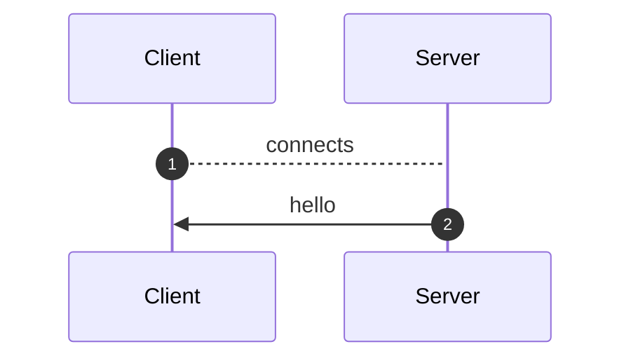
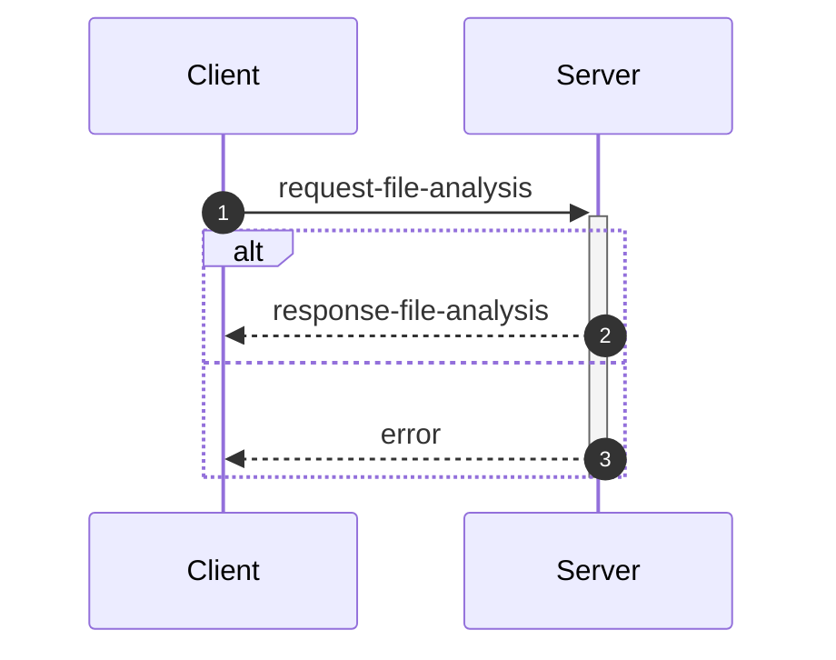
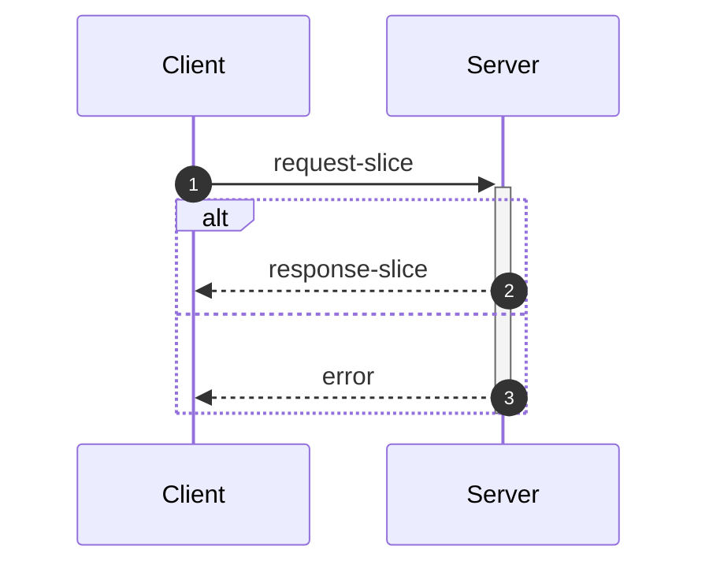
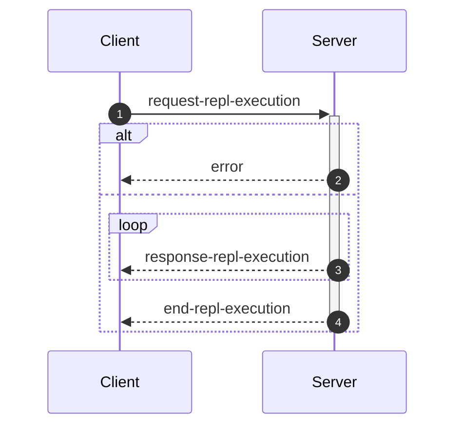

_<span title="an overview of flowR's interface">Generated</span> from '[wiki-interface.ts](https://github.com/flowr-analysis/flowr/tree/main/src/documentation/wiki-interface.ts "src/documentation/wiki-interface.ts")' on 2026-10-25, 14:18:49 UTC (v2.16.6, R v4.6.1), do not edit directly._

Although far from being as detailed as the in-depth explanation of [_flowR_](https://github.com/flowr-analysis/flowr/wiki/Core),
this wiki page explains how to interface with _flowR_ in more detail.
In general, command line arguments and other options provide short descriptions on hover over.

* [💻 Using the REPL](#using-the-repl)
* [⚙️ Configuring FlowR](#configuring-flowr)
* [⚒️ Writing Code](#writing-code)
* [💬 Communicating with the Server](#communicating-with-the-server)

<a id='using-the-repl'></a>
## 💻 Using the REPL

> [!NOTE]
> To execute arbitrary R commands with a repl request, _flowR_ has to be started explicitly with <span title="Description (Command Line Argument): Allow to access the underlying R session when using flowR (security warning: this allows the execution of arbitrary R code!)">`--r-session-access`</span>.
> Please be aware that this introduces a security risk and note that this relies on the [`r-shell` engine](https://github.com/flowr-analysis/flowr/wiki/Engines) .

Although primarily meant for users to explore,
there is nothing which forbids calling _flowR_ as a subprocess to use standard-in, -output, and -error
for communication (although you can access the REPL using the server as well,
with the [REPL Request](#message-request-repl-execution) message).

The read-eval-print loop&nbsp;(REPL) works relatively simple.
You can submit an expression (using <kbd>Enter</kbd>),
which is interpreted as an R&nbsp;expression by default but interpreted as a *command* if it starts with a colon (`:`).
The best command to get started with the REPL is <span title="Description (Repl Command): Show help information (aliases: :h, :?)">`:help`</span>.
Besides, you can leave the REPL either with the command <span title="Description (Repl Command): End the repl (aliases: :q, :exit)">`:quit`</span> or by pressing <kbd>Ctrl</kbd>+<kbd>C</kbd> twice.
When writing a *command*, you may press <kbd>Tab</kbd> to get a list of completions, if available.
Multiple commands can be entered in a single line by separating them with a semicolon (`;`), e.g. `:parse "x<-2"; :df*`.
If a command is given without R code, the REPL will re-use R code given in a previous command.
The prior example will hence return first the parsed AST of the program and then the dataflow graph for `"x <- 2"`.

> [!NOTE]
> If you develop flowR, you may want to launch the repl using the `npm run main-dev` command, this way, you get a non-minified version of flowR with debug information and hot-reloading of source files.

<details>
<summary>Available Commands</summary>

We currently offer the following commands (this with a `[*]` suffix are available with and without the star):

| Command | Description |
| ------- | ----------- |
| **<span title="Description (Repl Command): End the repl (aliases: :q, :exit)">:quit</span>** | End the repl (aliases: **:<span title="Alias of ':quit'. End the repl">q</span>**, **:<span title="Alias of ':quit'. End the repl">exit</span>**) |
| **<span title="Description (Repl Command): Execute the given code as R code. This requires the `--r-session-access` flag to be set and requires the r-shell engine. (aliases: :e, :r)">:execute</span>** | Execute the given code as R code. This requires the `--r-session-access` flag to be set and requires the r-shell engine. (aliases: **:<span title="Alias of ':execute'. Execute the given code as R code. This requires the `--r-session-access` flag to be set and requires the r-shell engine.">e</span>**, **:<span title="Alias of ':execute'. Execute the given code as R code. This requires the `--r-session-access` flag to be set and requires the r-shell engine.">r</span>**) |
| **<span title="Description (Repl Command): Get mermaid code for the control-flow graph of R code (aliases: :cfg, :cf)">:controlflow[*]</span>** | Get mermaid code for the control-flow graph of R code (star: Returns the URL to mermaid.live) (aliases: **:<span title="Alias of ':controlflow'. Get mermaid code for the control-flow graph of R code">cfg</span>**, **:<span title="Alias of ':controlflow'. Get mermaid code for the control-flow graph of R code">cf</span>**) |
| **<span title="Description (Repl Command): Get mermaid code for the control-flow graph with basic blocks (aliases: :cfgb, :cfb)">:controlflowbb[*]</span>** | Get mermaid code for the control-flow graph with basic blocks (star: Returns the URL to mermaid.live) (aliases: **:<span title="Alias of ':controlflowbb'. Get mermaid code for the control-flow graph with basic blocks">cfgb</span>**, **:<span title="Alias of ':controlflowbb'. Get mermaid code for the control-flow graph with basic blocks">cfb</span>**) |
| **<span title="Description (Repl Command): Get mermaid code for the dataflow graph (aliases: :d, :df)">:dataflow[*]</span>** | Get mermaid code for the dataflow graph (star: Returns the URL to mermaid.live) (aliases: **:<span title="Alias of ':dataflow'. Get mermaid code for the dataflow graph">d</span>**, **:<span title="Alias of ':dataflow'. Get mermaid code for the dataflow graph">df</span>**) |
| **<span title="Description (Repl Command): Get mermaid code for the normalized AST of R code (aliases: :n)">:normalize[*]</span>** | Get mermaid code for the normalized AST of R code (star: Returns the URL to mermaid.live) (alias: **:<span title="Alias of ':normalize'. Get mermaid code for the normalized AST of R code">n</span>**) |
| **<span title="Description (Repl Command): Get mermaid code for the simplified dataflow graph (aliases: :ds, :dfs)">:dataflowsimple[*]</span>** | Get mermaid code for the simplified dataflow graph (star: Returns the URL to mermaid.live) (aliases: **:<span title="Alias of ':dataflowsimple'. Get mermaid code for the simplified dataflow graph">ds</span>**, **:<span title="Alias of ':dataflowsimple'. Get mermaid code for the simplified dataflow graph">dfs</span>**) |
| **<span title="Description (Repl Command): Inspect and extend the signature database: `query` (identical to :query @signature), `info <name>` for where a function comes from (identical to :query @function-info), `add <path>` to mount another database/source, `download` to fetch the full-history database. (aliases: :sig)">:signature</span>** | Inspect and extend the signature database: `query` (identical to :query @signature), `info <name>` for where a function comes from (identical to :query @function-info), `add <path>` to mount another database/source, `download` to fetch the full-history database. (alias: **:<span title="Alias of ':signature'. Inspect and extend the signature database: `query` (identical to :query @signature), `info <name>` for where a function comes from (identical to :query @function-info), `add <path>` to mount another database/source, `download` to fetch the full-history database.">sig</span>**) |
| **<span title="Description (Repl Command): Just calculates the DFG, but only prints summary info (aliases: :d#, :df#)">:dataflowsilent</span>** | Just calculates the DFG, but only prints summary info (aliases: **:<span title="Alias of ':dataflowsilent'. Just calculates the DFG, but only prints summary info">d#</span>**, **:<span title="Alias of ':dataflowsilent'. Just calculates the DFG, but only prints summary info">df#</span>**) |
| **<span title="Description (Repl Command): Prints ASCII Art of the parsed, unmodified AST (aliases: :p)">:parse</span>** | Prints ASCII Art of the parsed, unmodified AST (alias: **:<span title="Alias of ':parse'. Prints ASCII Art of the parsed, unmodified AST">p</span>**) |
| **<span title="Description (Repl Command): Prints the version of flowR as well as the current version of R">:version</span>** | Prints the version of flowR as well as the current version of R
| **<span title="Description (Repl Command): Query the given R code (use 'help' for more information)">:query[*]</span>** | Query the given R code (use 'help' for more information) (star: Similar to query, but returns the output in json format.)
| **<span title="Description (Repl Command): Returns an ASCII representation of the dataflow graph (aliases: :df!)">:dataflowascii</span>** | Returns an ASCII representation of the dataflow graph (alias: **:<span title="Alias of ':dataflowascii'. Returns an ASCII representation of the dataflow graph">df!</span>**) |
| **<span title="Description (Repl Command): Returns summarization stats for the normalized AST (aliases: :n#)">:normalize#</span>** | Returns summarization stats for the normalized AST (alias: **:<span title="Alias of ':normalize#'. Returns summarization stats for the normalized AST">n#</span>**) |
| **<span title="Description (Repl Command): Show help information (aliases: :h, :?)">:help</span>** | Show help information (aliases: **:<span title="Alias of ':help'. Show help information">h</span>**, **:<span title="Alias of ':help'. Show help information">?</span>**) |

</details>

> [!TIP]
> 
> As indicated by the examples before, all REPL commands that operate on code keep track of the state.
> Hence, if you run a command like <span title="Description (Repl Command, starred version): Returns the URL to mermaid.live; Base Command: Get mermaid code for the dataflow graph (aliases: :d*, :df*)">`:dataflow*`</span> without providing R code,
> the REPL will re-use the R code provided in a previous command.
> Likewise, doing this will benefit from incrementality!
> If you request the dataflow graph with `:df* x <- 2 * y` and then want to see the parsed AST with `:parse`,
> the REPL will re-use previously obtained information and not re-parse the code again.
> 		

Generally, many commands offer shortcut versions in the REPL. Many queries, for example, offer a shortened format (see the example below).
Of special note, the [Config Query](https://github.com/flowr-analysis/flowr/wiki/%5BQuery%5D-Config)
can be used to also modify the currently active configuration of _flowR_ within the REPL (see the [wiki page](https://github.com/flowr-analysis/flowr/wiki/%5BQuery%5D-Config) for more information).

### Example: Retrieving the Dataflow Graph

To retrieve a URL to the [mermaid](https://mermaid.js.org/) diagram of the dataflow of a given expression,
use <span title="Description (Repl Command, starred version): Returns the URL to mermaid.live; Base Command: Get mermaid code for the dataflow graph (aliases: :d*, :df*)">`:dataflow*`</span> (or <span title="Description (Repl Command): Get mermaid code for the dataflow graph (aliases: :d, :df)">`:dataflow`</span> to get the mermaid code in the cli):

```shell
$ docker run -it --rm eagleoutice/flowr # or npm run flowr 
flowR repl v2.16.6, R grammar v14 (tree-sitter engine)
R> :dataflow* y <- 1 + x
```

<details>
<summary style='color:gray'>Output</summary>

```text
https://mermaid.live/view#base64:eyJjb2RlIjoiZmxvd2NoYXJ0IFREXG4gICAgMXt7XCJgKiM5MTtSTnVtYmVyIzkzOyogKioxKipcbiAgICAgICoxLjYqICgqKmlkOiAxKiopYFwifX1cbiAgICAyKFtcImAqIzkxO1JTeW1ib2wjOTM7KiAqKngqKlxuICAgICAgKjEuMTAqICgqKmlkOiAyKiopYFwiXSlcbiAgICAzW1tcImAqIzkxO1JCaW5hcnlPcCM5MzsqIGJhc2UjNTg7IzU4OyoqIzQzOyoqXG4gICAgICAqMS42LTEwKiAoKippZDogMyoqKVxuICAgIGFyZzogKDEsIDIpYFwiXV1cbiAgICBidWlsdC1pbjpfNDNfW1wiYEJ1aWx0LUluOlxuIzQzO2BcIl1cbiAgICBzdHlsZSBidWlsdC1pbjpfNDNfIHN0cm9rZTpncmF5LGZpbGw6Z3JheSxzdHJva2Utd2lkdGg6MnB4LG9wYWNpdHk6Ljg7XG4gICAgMFtcImAqIzkxO1JTeW1ib2wjOTM7KiAqKnkqKlxuICAgICAgKjEuMSogKCoqaWQ6IDAqKiwgdjogMylgXCJdXG4gICAgNFtbXCJgKiM5MTtSQmluYXJ5T3AjOTM7KiBiYXNlIzU4OyM1ODsqKiM2MDsjNDU7KipcbiAgICAgICoxLjEtMTAqICgqKmlkOiA0KiopXG4gICAgYXJnOiAoMCwgMylgXCJdXVxuICAgIGJ1aWx0LWluOl82MF8tW1wiYEJ1aWx0LUluOlxuIzYwOyM0NTtgXCJdXG4gICAgc3R5bGUgYnVpbHQtaW46XzYwXy0gc3Ryb2tlOmdyYXksZmlsbDpncmF5LHN0cm9rZS13aWR0aDoycHgsb3BhY2l0eTouODtcbiAgICAxIC0uLT58XCJmbG93XCJ8IDJcbiAgICBsaW5rU3R5bGUgMCBzdHJva2U6Z3JheSxjb2xvcjpncmF5O1xuICAgIDIgLS4tPnxcImZsb3dcInwgM1xuICAgIGxpbmtTdHlsZSAxIHN0cm9rZTpncmF5LGNvbG9yOmdyYXk7XG4gICAgMyAtLT58XCJyZWFkcywgYXJnXCJ8IDFcbiAgICAzIC0tPnxcInJlYWRzLCBhcmdcInwgMlxuICAgIDMgLS4tPnxcImZsb3dcInwgMFxuICAgIGxpbmtTdHlsZSA0IHN0cm9rZTpncmF5LGNvbG9yOmdyYXk7XG4gICAgMyAtLi0+fFwicmVhZHMsIGNhbGxzXCJ8IGJ1aWx0LWluOl80M19cbiAgICBsaW5rU3R5bGUgNSBzdHJva2U6Z3JheTtcbiAgICAwIC0tPnxcImRlZmluZWQtYnksIGZsb3dcInwgNFxuICAgIDAgLS0+fFwiZGVmaW5lZC1ieVwifCAzXG4gICAgNCAtLT58XCJyZWFkcywgYXJnXCJ8IDNcbiAgICA0IC0tPnxcInJldHVybnMsIGFyZ1wifCAwXG4gICAgNCAtLi0+fFwicmVhZHMsIGNhbGxzXCJ8IGJ1aWx0LWluOl82MF8tXG4gICAgbGlua1N0eWxlIDEwIHN0cm9rZTpncmF5OyIsIm1lcm1haWQiOnsiYXV0b1N5bmMiOnRydWV9fQ==
```

Retrieve the dataflow graph of the expression `y <- 1 + x`. It looks like this:


<details>

<summary style="color:gray">R Code of the Dataflow Graph</summary>

The analysis ran (parse and normalize with the [tree-sitter](https://github.com/flowr-analysis/flowr/wiki/Engines) engine) in the generation environment. No [signature database](https://github.com/flowr-analysis/flowr/wiki/Signature-Database) is mounted, so `library()` attaches no exports (base-R names are still qualified, e.g., `stats::acf`). 
We encountered no unknown side effects during the analysis.

```r
y <- 1 + x
```

</details>

</details>

For small graphs like this, <span title="Description (Repl Command): Returns an ASCII representation of the dataflow graph (aliases: :df!)">`:dataflowascii`</span> also provides an ASCII representation directly in the REPL:

```shell
$ docker run -it --rm eagleoutice/flowr # or npm run flowr 
flowR repl v2.16.6, R grammar v14 (tree-sitter engine)
R> :df! y <- 1 + x
```

<details open>
<summary style='color:gray'>Output</summary>

```text
                        v<0>v
 c<4>c──────────────────| y |
 |<- |     ┌────────────v---v
 c---c     │
    │   c<3>c   0<1>0
    └───| + |───| 1 |───u<2>u
        c---c   0---0   | x |
           └────────────u---u
Edges:
3 -> 1: reads, arg          3 -> 2: reads, arg
3 -> 0: flows-to            1 -> 2: flows-to
2 -> 3: flows-to            4 -> 3: reads, arg
4 -> 0: returns, arg        0 -> 4: defined-by, flows-to
0 -> 3: defined-by
```

Retrieve the dataflow graph of the expression `y <- 1 + x` as ASCII art.

</details>

For the slicing with <span title="Description (Repl Command): Static backwards executable slicer for R">`:slicer`</span>, you have access to the same [magic comments](#slice-magic-comments) as with the [slice request](#message-request-slice).
Pass `--inline` to splice resolvable `source()` calls into the reconstruction so the slice is a single self-contained R text (the same as the static slice query's `inlineSources` flag).
See `--help` for more flags!

### Example: Interfacing with the File System

Many commands that allow for an R-expression (like <span title="Description (Repl Command, starred version): Returns the URL to mermaid.live; Base Command: Get mermaid code for the dataflow graph (aliases: :d*, :df*)">`:dataflow*`</span>) allow for a file as well
if the argument starts with `file://`.
If you are working from the root directory of the _flowR_ repository, the following gives you the parsed AST of the example file using the <span title="Description (Repl Command): Prints ASCII Art of the parsed, unmodified AST (aliases: :p)">`:parse`</span> command:

> **Watch mode**: Replace `file://` with `watch://` to enter watch mode.
> flowR runs the command immediately and then re-runs it every time the file (or any file inside the folder) changes.
> Enter any other command to leave watch mode.
> For example: `:df watch://analysis.R`

```shell
$ docker run -it --rm eagleoutice/flowr # or npm run flowr 
flowR repl v2.16.6, R grammar v14 (tree-sitter engine)
R> :parse file://test/testfiles/example.R
```

<details>
<summary style='color:gray'>Output</summary>

```text
File: test/testfiles/example.R

program
├ binaryoperator
│ ├ identifier "sum" (1:1─4)
│ ├ <- "<-" (1:5─7)
│ ╰ float "0" (1:8─9)
├ binaryoperator
│ ├ identifier "product" (2:1─8)
│ ├ <- "<-" (2:9─11)
│ ╰ float "1" (2:12─13)
├ binaryoperator
│ ├ identifier "w" (3:1─2)
│ ├ <- "<-" (3:3─5)
│ ╰ float "7" (3:6─7)
├ binaryoperator
│ ├ identifier "N" (4:1─2)
│ ├ <- "<-" (4:3─5)
│ ╰ float "10" (4:6─8)
├ forstatement
│ ├ for "for" (6:1─4)
│ ├ ( "(" (6:5─6)
│ ├ identifier "i" (6:6─7)
│ ├ in "in" (6:8─10)
│ ├ binaryoperator
│ │ ├ float "1" (6:11─12)
│ │ ├ : ":" (6:12─13)
│ │ ╰ parenthesizedexpression
│ │   ├ ( "(" (6:13─14)
│ │   ├ binaryoperator
│ │   │ ├ identifier "N" (6:14─15)
│ │   │ ├ - "-" (6:15─16)
│ │   │ ╰ float "1" (6:16─17)
│ │   ╰ ) ")" (6:17─18)
│ ├ ) ")" (6:18─19)
│ ╰ bracedexpression
│   ├ { "{" (6:20─21)
│   ├ binaryoperator
│   │ ├ identifier "sum" (7:3─6)
│   │ ├ <- "<-" (7:7─9)
│   │ ╰ binaryoperator
│   │   ├ binaryoperator
│   │   │ ├ identifier "sum" (7:10─13)
│   │   │ ├ + "+" (7:14─15)
│   │   │ ╰ identifier "i" (7:16─17)
│   │   ├ + "+" (7:18─19)
│   │   ╰ identifier "w" (7:20─21)
│   ├ binaryoperator
│   │ ├ identifier "product" (8:3─10)
│   │ ├ <- "<-" (8:11─13)
│   │ ╰ binaryoperator
│   │   ├ identifier "product" (8:14─21)
│   │   ├  "" (8:22─23)
│   │   ╰ identifier "i" (8:24─25)
│   ╰ } "}" (9:1─2)
├ call
│ ├ identifier "cat" (11:1─4)
│ ╰ arguments
│   ├ ( "(" (11:4─5)
│   ├ argument
│   │ ╰ string
│   │   ├ stringopen "\"" (11:5─6)
│   │   ├ stringcontent "Sum:" (11:6─10)
│   │   ╰ stringclose "\"" (11:10─11)
│   ├ comma "," (11:11─12)
│   ├ argument
│   │ ╰ identifier "sum" (11:13─16)
│   ├ comma "," (11:16─17)
│   ├ argument
│   │ ╰ string
│   │   ├ stringopen "\"" (11:18─19)
│   │   ├ stringcontent
│   │   │ ╰ escapesequence "\\n" (11:19─21)
│   │   ╰ stringclose "\"" (11:21─22)
│   ╰ ) ")" (11:22─23)
╰ call
  ├ identifier "cat" (12:1─4)
  ╰ arguments
    ├ ( "(" (12:4─5)
    ├ argument
    │ ╰ string
    │   ├ stringopen "\"" (12:5─6)
    │   ├ stringcontent "Product:" (12:6─14)
    │   ╰ stringclose "\"" (12:14─15)
    ├ comma "," (12:15─16)
    ├ argument
    │ ╰ identifier "product" (12:17─24)
    ├ comma "," (12:24─25)
    ├ argument
    │ ╰ string
    │   ├ stringopen "\"" (12:26─27)
    │   ├ stringcontent
    │   │ ╰ escapesequence "\\n" (12:27─29)
    │   ╰ stringclose "\"" (12:29─30)
    ╰ ) ")" (12:30─31)
```

Retrieve the parsed AST of the example file.

<details>

<summary>File Content</summary>

```r
sum <- 0
product <- 1
w <- 7
N <- 10

for (i in 1:(N-1)) {
  sum <- sum + i + w
  product <- product * i
}

cat("Sum:", sum, "\n")
cat("Product:", product, "\n")
```

</details>

As _flowR_ directly transforms this AST the output focuses on being human-readable instead of being machine-readable.
		
</details>

### Example: Run a Query

You can run any query supported by _flowR_ using the <span title="Description (Repl Command): Query the given R code (use 'help' for more information)">`:query`</span> command.
For example, to obtain the shapes of all data frames in a given piece of code, you can run:

```shell
$ docker run -it --rm eagleoutice/flowr # or npm run flowr 
flowR repl v2.16.6, R grammar v14 (tree-sitter engine)
R> :query @absint df-shape "x <- data.frame(a = 1:10, b = 1:10)\ny <- x$a"
```

<details open>
<summary style='color:gray'>Output</summary>

```text
Query: absint (0 ms)
```

Retrieve the shapes of all data frames in the given code.

</details>

To run the linter on a file, you can use (in this example, we just issue the `dead-code` linter on a small piece of code):

```shell
$ docker run -it --rm eagleoutice/flowr # or npm run flowr 
flowR repl v2.16.6, R grammar v14 (tree-sitter engine)
R> :query @linter rules:dead-code "if(FALSE) x <- 2"
```

<details open>
<summary style='color:gray'>Output</summary>

```text
Query: linter (2 ms)
   ╰ Dead Code (dead-code):
       ╰ certain:
           ╰ Code at 1.11-16
```

Run the linter on the given code, with only the `dead-code` rule enabled.

</details>

For more information on the available queries, please check out the [Query API](https://github.com/flowr-analysis/flowr/wiki/Query-API).

<a id='configuring-flowr'></a>
## ⚙️ Configuring FlowR

When running _flowR_, you may want to specify some behaviors with a dedicated configuration file.
By default, flowR looks for a file named `flowr.json` in the current working directory (or any higher directory).
You can also specify a different file with <span title="Description (Command Line Argument): The name of the configuration file to use">`--config-file`</span> or pass the configuration inline using <span title="Description (Command Line Argument): The flowR configuration to use, as a JSON string">`--config-json`</span>.
A `flowr.json` found this way belongs to the analyzed project, so flowR ignores its options that decide what flowR executes or loads
(`engines.*.wasmPath`, `engines.*.treeSitterWasmPath`, `engines.*.rPath`, `solver.sigdb.additionalPaths`, `solver.sigdb.downloadRepo`, `solver.sigdb.installedLibrary.paths`),
unless you pass <span title="Description (Command Line Argument): Keep the security-sensitive options (e.g., the R executable) of the flowr.json found in the working directory or a parent. Only use this for projects you trust.">`--trust-config`</span>.
To analyze code you do not trust, use the secure mode (<span title="Description (Command Line Argument): Run in secure mode for analyzing untrusted code: flowR does not start R (or any other process), does not access the network, does not search for project configs, and ignores security-sensitive options in every config. Cannot be disabled once enabled. Can also be enabled with the environment variable {italic FLOWR_SECURE_MODE=1}.">`--secure`</span>, see the [security policy](https://github.com/flowr-analysis/flowr/blob/main/.github/SECURITY.md)).
To inspect the current configuration, you can run flowr with the <span title="Description (Command Line Argument): Run with verbose logging (will be passed to the corresponding script)">`--verbose`</span> flag, or use the `config` [Query](https://github.com/flowr-analysis/flowr/wiki/Query-API).
Within the REPL this works by running the following:

```shell
:query @config
```

To work with the <a href="https://github.com/flowr-analysis/flowr/tree/main/src/config.ts#L119"><code><span title="The configuration file format for flowR.">FlowrConfig</span></code></a> you can use the provided helper objects alongside its methods like
<a href="https://github.com/flowr-analysis/flowr/tree/main/src/config.ts#L914"><code><span title="Creates a new flowr config that has the updated values.">FlowrConfig::<b>amend</b></span></code></a>.
The schema below documents every option; the ones you most likely want are:

- <a href="https://github.com/flowr-analysis/flowr/wiki/Interface#configuring-flowr" title="Configuration Option (boolean): Whether source calls should be ignored, causing {@link processSourceCall}&#39;s behavior to be skipped.">ignoreSourceCalls</a>: ignore source calls when analyzing the code, i.e., ignore the inclusion of other files.
- <a href="https://github.com/flowr-analysis/flowr/wiki/Interface#configuring-flowr" title="Configuration Option (boolean): Whether load calls should be ignored, causing {@link processLoadCall}&#39;s behavior to be skipped.">ignoreLoadCalls</a>: ignore load calls when analyzing the code, i.e., ignore the loading of r-data files.
- <a href="https://github.com/flowr-analysis/flowr/wiki/Interface#configuring-flowr" title="Configuration Option (object): Do you want to overwrite (parts) of the builtin definition?">semantics.environment.overwriteBuiltIns</a>: overwrite _flowR_'s handling of built-in functions, or clear the preset definitions entirely.
  See [Configure BuiltIn Semantics](#configure-builtin-semantics) for more information.
- <a href="https://github.com/flowr-analysis/flowr/wiki/Interface#configuring-flowr" title="Configuration Option (string): How to resolve variables and their values. (one of &quot;disabled&quot;, &quot;alias&quot;, &quot;builtin&quot;)">solver.variables</a>: how to resolve variables and their values (`disabled`, `alias`, `builtin`).
- <a href="https://github.com/flowr-analysis/flowr/wiki/Interface#configuring-flowr" title="Configuration Option (array): The engine or set of engines to use for interacting with R code. An empty array means all available engines will be used.">engines</a> and <a href="https://github.com/flowr-analysis/flowr/wiki/Interface#configuring-flowr" title="Configuration Option (string): The default engine to use for interacting with R code. If this is undefined, an arbitrary engine from the specified list will be used. (one of &quot;tree-sitter&quot;, &quot;r-shell&quot;)">defaultEngine</a>: the engines used to interact with R code, see the [Engines wiki page](https://github.com/flowr-analysis/flowr/wiki/Engines).
- <a href="https://github.com/flowr-analysis/flowr/wiki/Interface#configuring-flowr" title="Configuration Option (array): Files a framework loads on its own, without any source() call (e.g. global.R in a shiny app), in the order they are loaded; flowR orders the matching project files accordingly and analyzes them as one program. Entries are case-insensitive globs matched against the file path, a plain name matches any file with that name, and entries matching no project file are warned about. Usually set per project kind via specializeConfig.">project.implicitSources</a>: the files a framework loads without any `source()` call, in the order in which they are
  loaded. Entries are globs (e.g. `R/*.R`) matched against the file path ignoring capitalization; one matching no file is reported.
- <a href="https://github.com/flowr-analysis/flowr/wiki/Interface#configuring-flowr" title="Configuration Option (object): Overwrite (parts of) the configuration depending on the project kind flowR detects, e.g. to give a shiny app its implicit sources.">specializeConfig</a>: overwrite (parts of) the configuration depending on the kind of project _flowR_ detects
  (e.g. `shiny-app`), which is how a shiny app gets its implicit sources by default. What you configure directly wins.
- <a href="https://github.com/flowr-analysis/flowr/wiki/Interface#configuring-flowr" title="Configuration Option (string): Overwrite the project kind flowR would otherwise infer from the analyzed files, e.g. when auto-detection guesses wrong. (one of &quot;package&quot;, &quot;script&quot;, &quot;shiny-app&quot;, &quot;notebook&quot;, &quot;project&quot;, &quot;unknown&quot;)">project.useProjectType</a>: skip that detection and force a project kind yourself, when auto-detection guesses wrong.
- <a href="https://github.com/flowr-analysis/flowr/wiki/Interface#configuring-flowr" title="Configuration Option (array): The default plugins to load when creating a new instance of FlowrAnalyzer">defaultPlugins</a> and <a href="https://github.com/flowr-analysis/flowr/wiki/Interface#configuring-flowr" title="Configuration Option (array): The plugins to load in REPL mode">repl.plugins</a>: the plugins to load for a new <a href="https://github.com/flowr-analysis/flowr/tree/main/src/project/flowr-analyzer.ts#L205"><code><span title="Central class for conducting analyses with FlowR. Use the FlowrAnalyzerBuilder to create a new instance. If you want the original pattern of creating a pipeline and running all steps, you can still do this with FlowrAnalyzer#runFull . To inspect the context of the analyzer, use FlowrAnalyzer#inspectContext (if you are a plugin and need to modify it, use FlowrAnalyzer#context instead).">FlowrAnalyzer</span></code></a> and in the REPL
  (use `flowr:default` to reference the former).

So you can configure _flowR_ by adding a file like the following:

<details>

<summary>Example Configuration File</summary>

```json
{
  "ignoreSourceCalls": true,
  "ignoreLoadCalls": true,
  "semantics": {
    "environment": {
      "overwriteBuiltIns": {
        "definitions": [
          {
            "type": "function",
            "names": [
              "foo"
            ],
            "processor": "builtin:assign",
            "config": {}
          }
        ]
      }
    }
  },
  "defaultPlugins": [
    "file:description",
    "versions:description"
  ],
  "repl": {
    "quickStats": false,
    "dfProcessorHeat": false,
    "hints": true,
    "plugins": [
      "flowr:default"
    ]
  },
  "project": {
    "resolveUnknownPathsOnDisk": true,
    "implicitSources": [
      "global.R",
      "app.R"
    ]
  },
  "linter": {
    "disabledRules": []
  },
  "specializeConfig": {
    "shiny-app": {
      "project": {
        "implicitSources": [
          "global.R",
          "ui.R",
          "server.R",
          "app.R"
        ]
      }
    }
  },
  "engines": [
    {
      "type": "r-shell"
    }
  ],
  "solver": {
    "variables": "alias",
    "evalStrings": true,
    "trackEnvironments": true,
    "sigdb": {
      "enabled": true,
      "loadProjectDependencies": true,
      "eagerlyLoad": false,
      "eagerlyLoadExports": false,
      "linkBaseR": false,
      "linkDescriptionDependencies": false
    },
    "resolveSource": {
      "dropPaths": "no",
      "ignoreCapitalization": true,
      "inferWorkingDirectory": "active-script",
      "searchPath": []
    },
    "instrument": {},
    "slicer": {
      "threshold": 50
    }
  },
  "abstractInterpretation": {
    "wideningThreshold": 4,
    "followCalls": true,
    "dataFrame": {
      "maxColNames": 20,
      "readLoadedData": {
        "readExternalFiles": true,
        "maxReadLines": 1000000
      }
    }
  },
  "incremental": {
    "alwaysIncremental": false,
    "parsing": {
      "activated": false,
      "heuristics": {
        "activated": true,
        "mtime": true,
        "linesFrom": 500,
        "bytesFrom": 50000,
        "alwaysWithEdits": false,
        "minFiles": 1
      }
    }
  },
  "gas": {
    "thresholds": {
      "memory": {
        "problematic": 0.7,
        "critical": 0.9
      },
      "timeMs": {
        "problematic": 100000,
        "critical": 120000
      }
    },
    "features": {}
  }
}
```

</details>

<details>
<a id='configure-builtin-semantics'></a>
<summary>Configure Built-In Semantics</summary>

`semantics/environment/overwriteBuiltins` accepts two keys:

- `loadDefaults` (boolean, initially `true`): If set to `true`, the default built-in definitions are loaded before applying the custom definitions. Setting this flag to `false` explicitly disables the loading of the default definitions.
- `definitions` (array, initially empty): Allows to overwrite or define new built-in elements. Each object within must have a `type` which is one of the below. Furthermore, they may define a string array of `names` which specifies the identifiers to bind the definitions to. You may use `assumePrimitive` to specify whether _flowR_ should assume that this is a primitive non-library definition (so you probably just do not want to specify the key).

  | Type            | Description                                                                                                                                                                                                                                                                                              | Example                                                                                                    |
  | --------------- | -------------------------------------------------------------------------------------------------------------------------------------------------------------------------------------------------------------------------------------------------------------------------------------------------------- | ---------------------------------------------------------------------------------------------------------- |
  | `constant`    | Additionally allows for a `value` this should resolve to.                                                                                                                                                                                                                                                | `{ type: 'constant', names: ['NULL', 'NA'],  value: null }`                                                |
  | `function`    | Is a rather flexible way to define and bind built-in functions. For the time, we do not have extensive documentation to cover all the cases, so please either consult the sources with the `default-builtin-config.ts` or open a [new issue](https://github.com/flowr-analysis/flowr/issues/new/choose). | `{ type: 'function', names: ['next'], processor: 'builtin:d', config: { cfg: ExitPointType.Next } }` |
  | `replacement` | A comfortable way to specify replacement functions like `$<-` or `names<-`. `suffixes` describes the... suffixes to attach automatically. | `{ type: 'replacement', suffixes: ['<-', '<<-'], names: ['[', '[['] }` |

</details>

<details>

<summary style='color:gray'>Full Configuration-File Schema</summary>

- _The configuration file format for flowR._ (object)
    - **logLevel** [optional] _flowR's global minimum log level, applied when the config is loaded._ (string)
        Only allows: 'silly', 'trace', 'debug', 'info', 'warn', 'error', 'fatal'
    - **ignoreSourceCalls** [optional] _Whether source calls should be ignored, causing {@link processSourceCall}'s behavior to be skipped._ (boolean)
    - **ignoreLoadCalls** [optional] _Whether load calls should be ignored, causing {@link processLoadCall}'s behavior to be skipped._ (boolean)
    - **semantics** _Configure language semantics and how flowR handles them._ (object)
        - **environment** [optional] _Semantics regarding how to handle the R environment._ (object)
            - **overwriteBuiltIns** [optional] _Do you want to overwrite (parts) of the builtin definition?_ (object)
                - **loadDefaults** [optional] _Should the default configuration still be loaded?_ (boolean)
                - **definitions** [optional] _The definitions to load/overwrite._ (array)
                Valid item types:
                    - (object)
    - **defaultPlugins** [optional] _The default plugins to load when creating a new instance of FlowrAnalyzer_ (array)
    Valid item types:
        - (alternatives)
            - (string)
            - (array)
    - **repl** _Configuration options for the REPL._ (object)
        - **quickStats** [optional] _Whether to show quick stats in the REPL after each evaluation._ (boolean)
        - **dfProcessorHeat** [optional] _This instruments the dataflow processors to count how often each processor is called._ (boolean)
        - **hints** [optional] _Whether to show dim inline hints on the empty prompt (automatically disabled on non-interactive terminals)._ (boolean)
        - **plugins** [optional] _The plugins to load in REPL mode_ (array)
        Valid item types:
            - (alternatives)
                - (string)
                - (array)
        - **autoUseFileProtocol** [optional] _Prepend the file protocol to a repl input that looks like a path, instead of only warning about it._ (boolean)
        - **queryStats** [optional] _Whether `:query` closes with the line stating how long the queries took (`:query*` never prints it)._ (boolean)
        - **showPlugins** [optional] _Whether `:version` grays out the plugins that did not activate during the last analysis._ (boolean)
    - **project** _Project specific configuration options._ (object)
        - **resolveUnknownPathsOnDisk** [optional] _Whether to resolve unknown paths loaded by the r project disk when trying to source/analyze files._ (boolean)
        - **failOnInaccessiblePath** [optional] _Whether a directory that cannot be traversed during file discovery (e.g. due to permissions) aborts the analysis; when false (the default) such paths are logged and skipped._ (boolean)
        - **basePackages** [optional] _The packages considered part of R itself (base and recommended); if unset, flowR uses its built-in list._ (array)
        Valid item types:
            - (string)
        - **implicitSources** [optional] _Files a framework loads on its own, without any source() call (e.g. global.R in a shiny app), in the order they are loaded; flowR orders the matching project files accordingly and analyzes them as one program. Entries are case-insensitive globs matched against the file path, a plain name matches any file with that name, and entries matching no project file are warned about. Usually set per project kind via specializeConfig._ (array)
        Valid item types:
            - (string)
        - **useProjectType** [optional] _Overwrite the project kind flowR would otherwise infer from the analyzed files, e.g. when auto-detection guesses wrong._ (string)
            Only allows: 'package', 'script', 'shiny-app', 'notebook', 'project', 'unknown'
        - **assumeImplicitEcho** [optional] _Whether the top level of the analyzed code is echoed, so that every visible result printed there is collected as an output by the dependencies query (default true, false for a package)._ (boolean)
        - **discovery** [optional] _Scoping options for the default project discovery._ (object)
            - **full** [optional] _Collect every file below the project root (greedy) instead of only the files the detected project kind needs (default false)._ (boolean)
            - **perKind** [optional] _Per-kind include/exclude glob overrides layered on the default scoping._ (object)
            - **ignore** [optional] _Case-insensitive globs that drop matching files from the intelligent discovery, regardless of kind (e.g. .Renviron to ignore environment files)._ (array)
            Valid item types:
                - (string)
        - **classification** [optional] _Overrides for the signals flowR uses to classify the project kind._ (object)
            - **shinyDescriptionTypes** [optional] _DESCRIPTION Type: values that mark a shiny app._ (array)
            Valid item types:
                - (string)
            - **shinyEntryFiles** [optional] _File names a shiny app is assembled from._ (array)
            Valid item types:
                - (string)
            - **shinyUsagePattern** [optional] _Regex source evidencing shiny usage in an entry file._ (string)
            - **notebookExtensions** [optional] _File extensions marking a notebook._ (array)
            Valid item types:
                - (string)
    - **linter** _Linter configuration options._ (object)
        - **disabledRules** _Linting rule names excluded from the default rule set (a rule requested explicitly via a linter query still runs). Usually set per project kind via specializeConfig._ (array)
        Valid item types:
            - (string)
        - **disabledTags** [optional] _Linting rule tags whose rules are excluded from the default rule set (a rule requested explicitly via a linter query still runs). By default the cmd-check rules are disabled for everything but a package; a configured list replaces that default._ (array)
        Valid item types:
            - (string)
    - **inputSources** [optional] _Further frameworks the input-sources analysis should know about; entries are added to flowR's defaults._ (object)
        - **pure** [optional] _Functions that only pass the constantness of their arguments on._ (array)
        Valid item types:
            - (string)
        - **param** [optional] _Functions whose result is a 'param' input._ (array)
        Valid item types:
            - (string)
        - **file** [optional] _Functions whose result is a 'file' input._ (array)
        Valid item types:
            - (string)
        - **tempfile** [optional] _Functions whose result is a 'tempfile' input._ (array)
        Valid item types:
            - (string)
        - **glob** [optional] _Functions whose result is a 'glob' input._ (array)
        Valid item types:
            - (string)
        - **net** [optional] _Functions whose result is a 'net' input._ (array)
        Valid item types:
            - (string)
        - **rand** [optional] _Functions whose result is a 'rand' input._ (array)
        Valid item types:
            - (string)
        - **system** [optional] _Functions whose result is a 'system' input._ (array)
        Valid item types:
            - (string)
        - **ffi** [optional] _Functions whose result is a 'ffi' input._ (array)
        Valid item types:
            - (string)
        - **lang** [optional] _Functions whose result is a 'lang' input._ (array)
        Valid item types:
            - (string)
        - **options** [optional] _Functions whose result is a 'options' input._ (array)
        Valid item types:
            - (string)
        - **cmdline** [optional] _Functions whose result is a 'cmdline' input._ (array)
        Valid item types:
            - (string)
        - **user** [optional] _Functions whose result is a 'user' input._ (array)
        Valid item types:
            - (string)
        - **const** [optional] _Functions whose result is a 'const' input._ (array)
        Valid item types:
            - (string)
        - **scope** [optional] _Functions whose result is a 'scope' input._ (array)
        Valid item types:
            - (string)
        - **dconst** [optional] _Functions whose result is a 'dconst' input._ (array)
        Valid item types:
            - (string)
        - **unknown** [optional] _Functions whose result is a 'unknown' input._ (array)
        Valid item types:
            - (string)
        - **linkedObjects** [optional] _Objects a framework provides without a definition in the code, e.g. shiny's input._ (array)
        Valid item types:
            - (object)
        - **linkedEntryPoints** [optional] _Calls that hand a function to a framework, which binds its objects to the parameters by position._ (array)
        Valid item types:
            - (object)
    - **specializeConfig** [optional] _Overwrite (parts of) the configuration depending on the project kind flowR detects, e.g. to give a shiny app its implicit sources._ (object)
    - **engines** _The engine or set of engines to use for interacting with R code. An empty array means all available engines will be used._ (array)
    Valid item types:
        - (alternatives)
            - _The configuration for the tree sitter engine._ (object)
                - **type** [required] _Use the tree sitter engine._ (string)
                    Only allows: 'tree-sitter'
                - **wasmPath** [optional] _The path to the tree-sitter-r WASM binary to use. If this is undefined, this uses the default path._ (string)
                - **treeSitterWasmPath** [optional] _The path to the tree-sitter WASM binary to use. If this is undefined, this uses the default path._ (string)
                - **lax** [optional] _Whether to use the lax parser for parsing R code (allowing for syntax errors). If this is undefined, the strict parser will be used._ (boolean)
            - _The configuration for the R shell engine._ (object)
                - **type** [required] _Use the R shell engine._ (string)
                    Only allows: 'r-shell'
                - **rPath** [optional] _The path to the R executable to use. If this is undefined, this uses the default path._ (string)
                - **pipeBind** [optional] _Whether to enable R's experimental pipe-bind operator "=>" by setting _R_USE_PIPEBIND_ for the R session (default false); R itself keeps this off by default, as it is experimental and has never shipped in a release version of R._ (boolean)
    - **defaultEngine** [optional] _The default engine to use for interacting with R code. If this is undefined, an arbitrary engine from the specified list will be used._ (string)
        Only allows: 'tree-sitter', 'r-shell'
    - **solver** _How to resolve constants, constraints, cells, ..._ (object)
        - **variables** _How to resolve variables and their values._ (string)
            Only allows: 'disabled', 'alias', 'builtin'
        - **evalStrings** _Should we include eval(parse(text="...")) calls in the dataflow graph?_ (boolean)
        - **trackEnvironments** [optional] _Track user-created environments (new.env, assign/get/local with envir=, dollar-assign, attach). When false, all envir-style calls fall through conservatively._ (boolean)
        - **sigdb** _Resolving library exports from a signature database._ (object)
            - **enabled** [optional] _Resolve library()/use() exports from a signature database (default true); when false no database is consulted._ (boolean)
            - **loadProjectDependencies** [optional] _Load the project's declared dependencies from its metadata files (DESCRIPTION Imports/Depends, rproject.toml, uvr.toml, renv.lock, rv.lock, uvr.lock) (default true); when false these files are not read for dependencies._ (boolean)
            - **eagerlyLoad** [optional] _Parse the database up front rather than on the first package load (default false, ignored if disabled)._ (boolean)
            - **eagerlyLoadExports** [optional] _Add a vertex for every export on load rather than on demand (default false); keeps the dataflow graph small._ (boolean)
            - **assumedRVersion** [optional] _R version assumed when resolving versioned (base-R) exports: a pin like "4.5" or "auto" to detect the installed R (default "auto")._ (string)
            - **linkBaseR** [optional] _Eagerly attach base-R namespaces so bare base calls resolve without library() (default false)._ (boolean)
            - **linkBaseRCalls** [optional] _Add a lightweight Reads edge from a bare base-R call to its signature-database function vertex (default false; base-R qualification is edge-free otherwise)._ (boolean)
            - **linkPackageCalls** [optional] _Add a lightweight Reads edge from a resolved package call to its signature-database function vertex (default false)._ (boolean)
            - **linkDescriptionDependencies** [optional] _Eagerly attach the namespaces of the project's declared DESCRIPTION dependencies (Imports/Depends) so their exports resolve without an explicit library() (default false)._ (boolean)
            - **warmInBackground** [optional] _Decompress the hot shards (base + most-downloaded) in a background task on startup so the first library() lookup is warm (default false; for long-running servers/REPLs)._ (boolean)
            - **additionalPaths** [optional] _Extra directories or bundle/manifest files searched for signature databases (alongside the shipped default and $FLOWR_SIGDB_DIR); a downloaded full-history bundle placed here is mounted automatically._ (array)
            Valid item types:
                - (string)
            - **downloadRepo** [optional] _GitHub owner/repo the full-history bundle is downloaded from via ":signature download" (default "flowr-analysis/flowr", release tag "sigdb-v<flowR-version>")._ (string)
            - **autoSync** [optional] _On startup, re-download shards whose committed sigdb.remote.json hash no longer matches the cache, in the background (default false; opt-in network sync after a git pull)._ (boolean)
            - **installedLibrary** [optional] _Recovering packages no signature database knows from the copy installed on this machine._ (object)
                - **enabled** [required] _Recover packages no signature database knows from their installed copy (default false)._ (boolean)
                - **paths** [optional] _Library directories to search; when empty they are discovered from the environment and the project._ (array)
                Valid item types:
                    - (string)
                - **useEnvironment** [optional] _Search the libraries R_LIBS_USER/R_LIBS/R_LIBS_SITE name (default true)._ (boolean)
                - **useProjectLibrary** [optional] _Search a project-local renv/packrat library (default true)._ (boolean)
                - **maxDepth** [optional] _How far to descend into the nested layout of a project-local library (default 3)._ (number)
                - **packages** [optional] _Only recover packages whose name matches one of these regular expressions; empty means any._ (array)
                Valid item types:
                    - (string)
            - **blobCacheBudgetMb** [optional] _How many MiB of decoded package blobs every open bundle may hold together (default 16)._ (number)
            - **versionSelection** [optional] _When a project constrains a dependency, resolve to the newest (default), oldest, or system-installed version satisfying it; system needs R and falls back to newest. Base-R packages always resolve against the assumed R version._ (string)
                Only allows: 'newest', 'oldest', 'system'
            - **versionOverrides** [optional] _Force an exact version for specific packages (name -> version), overriding both the project constraint and the versionSelection policy (default {})._ (object)
        - **versionManagement** _Policies for reasoning about dependency versions._ (object)
            - **linkedVersionGroups** [optional] _Groups of packages that must resolve to the same version; version guessing intersects each group so its members stay mutually compatible (default [])._ (array)
            Valid item types:
                - (array)
                Valid item types:
                    - (string)
        - **assumeAttachedPackages** [optional] _Packages to treat as attached without a `library()` call, so what the built-in configuration states about them applies to the analyzed code. The base packages R attaches on startup already resolve without it._ (array)
        Valid item types:
            - (string)
        - **transitiveSideEffectRounds** [optional] _How many rounds the transitive side-effect fixpoint may run before it is cut off (default 32); the propagation stops on its own as soon as a round adds nothing._ (number)
        - **maxOverlayDepth** [optional] _How many binding overlays may stack on one environment frame before a write flattens them (default 4); a pure performance knob, trading lookup cost against copy cost without changing any result._ (number)
        - **instrument** (object)
            - **dataflowExtractors** [optional] _These keys are only intended for use within code, allowing to instrument the dataflow analyzer!_ (any)
        - **resolveSource** [optional] _If lax source calls are active, flowR searches for sourced files much more freely, based on the configurations you give it. This option is only in effect if `ignoreSourceCalls` is set to false._ (object)
            - **dropPaths** _Allow to drop the first or all parts of the sourced path, if it is relative._ (string)
                Only allows: 'no', 'once', 'all'
            - **ignoreCapitalization** _Search for filenames matching in the lowercase._ (boolean)
            - **inferWorkingDirectory** _Try to infer the working directory from the main or any script to analyze._ (string)
                Only allows: 'no', 'main-script', 'active-script', 'any-script'
            - **searchPath** _Additionally search in these paths._ (array)
            Valid item types:
                - (string)
            - **repeatedSourceLimit** [optional] _How often the same file can be sourced within a single run? Please be aware: in case of cyclic sources this may not reach a fixpoint so give this a sensible limit._ (number)
            - **applyReplacements** _Provide name replacements for loaded files_ (array)
            Valid item types:
                - (object)
            - **assumeFilesExist** [optional] _Assume a sourced file is always there, making what it defines certain instead of conditional on the source call._ (boolean)
        - **slicer** [optional] _The configuration for the slicer._ (object)
            - **threshold** [optional] _The maximum number of iterations to perform on a single function call during slicing._ (number)
            - **autoExtend** [optional] _If set, the slicer will gain an additional post-pass._ (boolean)
    - **abstractInterpretation** _The configuration options for abstract interpretation._ (object)
        - **wideningThreshold** _The threshold for the number of visitations of a node at which widening should be performed to ensure the termination of the fixpoint iteration._ (number)
        - **followCalls** _Whether the abstract interpretation is interprocedural, i.e. whether it steps into the functions a call may dispatch to._ (boolean)
        - **dataFrame** _The configuration of the shape inference for data frames._ (object)
            - **maxColNames** _The maximum number of columns names to infer for data frames before over-approximating the column names to top._ (number)
            - **readLoadedData** _Configuration options for reading data frame shapes from loaded external data files, such as CSV files._ (object)
                - **readExternalFiles** _Whether data frame shapes should be extracted from loaded external files, such as CSV files._ (boolean)
                - **maxReadLines** _The maximum number of lines to read when extracting data frame shapes from loaded files, such as CSV files._ (number)
    - **incremental** (object)
        - **alwaysIncremental** _Always take the incremental path, regardless of heuristics._ (boolean)
        - **parsing** (object)
            - **activated** _If set, incremental parsing will be used._ (boolean)
            - **heuristics** (object)
                - **activated** [optional] _If set, the heuristics for incremental parsing will be used._ (boolean)
                - **mtime** [optional] _Skip reparsing entirely if the file's modification time is unchanged since the last parse._ (boolean)
                - **linesFrom** [optional] _Only consider incremental parsing for files with at least this many lines._ (number)
                - **bytesFrom** [optional] _Only consider incremental parsing for files with at least this many bytes._ (number)
                - **alwaysWithEdits** [optional] _Always take the incremental path whenever there is a computed edit region, regardless of the other thresholds._ (boolean)
                - **minFiles** [optional] _Only apply these heuristics once the project has at least this many files loaded._ (number)
    - **gas** [optional] _Resource-usage guard (gas) configuration. All feature factors default to 0 (disabled). See https://github.com/flowr-analysis/flowr/wiki/Core#gas-resource-guard._ (object)
        - **thresholds** [optional] _Thresholds for all gas checks (scaled by per-feature factor), boundable per feature._ (object)
            - **memory** [optional] _Heap-usage fraction thresholds (0-1), either shared or given per feature key (with `default` covering the rest)._ (object)
                - **problematic** [optional] _Heap fraction (0-1) above which Problematic is returned, for every feature without an entry of its own._ (number)
                - **critical** [optional] _Heap fraction (0-1) above which Critical is returned, for every feature without an entry of its own._ (number)
            - **timeMs** [optional] _Elapsed analysis time thresholds in milliseconds, either shared or given per feature key (with `default` covering the rest)._ (object)
                - **problematic** [optional] _Elapsed ms above which Problematic is returned, for every feature without an entry of its own._ (number)
                - **critical** [optional] _Elapsed ms above which Critical is returned, for every feature without an entry of its own._ (number)
            - **steps** [optional] _Processed-AST-node thresholds, counted rather than sampled; only a key that arms a budget (`dataflow`) reads them._ (object)
                - **problematic** [optional] _Processed AST nodes above which Problematic is returned, for every feature without an entry of its own._ (number)
                - **critical** [optional] _Processed AST nodes above which the extraction is cut short, for every feature without an entry of its own._ (number)
            - **vertices** [optional] _Created-dataflow-vertex thresholds, counted like `steps`._ (object)
                - **problematic** [optional] _Created dataflow vertices above which Problematic is returned, for every feature without an entry of its own._ (number)
                - **critical** [optional] _Created dataflow vertices above which the extraction is cut short, for every feature without an entry of its own._ (number)
        - **features** [optional] _Per-feature sensitivity factors. 0 or absent disables gas checking for that feature. A factor of 2 makes the feature twice as sensitive. Recognised keys: `source`, `side-effect-linking`, `linter`, `slicer`, `dataflow`._ (object)
        - **countedCheckEvery** [optional] _How many counted steps pass between two accountings of an armed check, be it a dataflow budget or the slicer's traversal (default 128); trades overshoot against the cost of the check._ (number)
        - **heapProvider** [optional] _Custom heap statistics source (programmatic configs only), overriding the built-in v8/performance.memory detection._ (function)

</details>

<a id='writing-code'></a>
## ⚒️ Writing Code

_flowR_ can be used as a [module](https://www.npmjs.com/package/@eagleoutice/flowr) and offers several main classes and interfaces that are interesting for extension writers 
(see the [Visual Studio Code extension](https://marketplace.visualstudio.com/items?itemName=code-inspect.vscode-flowr) or the [Core](https://github.com/flowr-analysis/flowr/wiki/Core) wiki page for more information).

### Creating Analyses with _flowR_

Nowadays, instances of the <a href="https://github.com/flowr-analysis/flowr/tree/main/src/project/flowr-analyzer.ts#L205"><code><span title="Central class for conducting analyses with FlowR. Use the FlowrAnalyzerBuilder to create a new instance. If you want the original pattern of creating a pipeline and running all steps, you can still do this with FlowrAnalyzer#runFull . To inspect the context of the analyzer, use FlowrAnalyzer#inspectContext (if you are a plugin and need to modify it, use FlowrAnalyzer#context instead).">FlowrAnalyzer</span></code></a> should be used as central frontend to get analysis results from _flowR_.
The entry points an analysis is written against are re-exported from the package root (`import { FlowrAnalyzerBuilder } from '@eagleoutice/flowr'`);
everything else stays reachable under its own path, as in `@eagleoutice/flowr/dataflow/graph/graph`.
For example, a program slice can be created like this:

```ts
const analyzer = await new FlowrAnalyzerBuilder()
    .setEngine('tree-sitter')
    .build();
analyzer.addRequest('x <- 1\ny <- x\nx');
const result = await analyzer.query([
    {
        type:     'static-slice',
        criteria: ['3@x']
    }
]);
```

For more information, please have a look at the [Analyzer](https://github.com/flowr-analysis/flowr/wiki/Analyzer) wiki page, which explains how to construct and use the <a href="https://github.com/flowr-analysis/flowr/tree/main/src/project/flowr-analyzer.ts#L205"><code><span title="Central class for conducting analyses with FlowR. Use the FlowrAnalyzerBuilder to create a new instance. If you want the original pattern of creating a pipeline and running all steps, you can still do this with FlowrAnalyzer#runFull . To inspect the context of the analyzer, use FlowrAnalyzer#inspectContext (if you are a plugin and need to modify it, use FlowrAnalyzer#context instead).">FlowrAnalyzer</span></code></a> in more detail.
To work with specific perspectives, you can also consult the respective pages like the [Dataflow Graph](https://github.com/flowr-analysis/flowr/wiki/Dataflow-Graph) or the [Abstract Interpretation](https://github.com/flowr-analysis/flowr/wiki/Abstract-Interpretation) wiki pages.
### The Pipeline Executor (Low-Level Interface)

Once, in the beginning, _flowR_ was meant to produce a dataflow graph merely to provide *program slices*. 
However, with continuous updates, the [Dataflow Graph](https://github.com/flowr-analysis/flowr/wiki/Dataflow-Graph) repeatedly proves to be the more interesting part.
With this, we restructured _flowR_'s originally *hardcoded* pipeline to be far more flexible. 
Now, it can be theoretically extended or replaced with arbitrary steps, optional steps, and what we call 'decorations' of these steps. 
In short, a slicing pipeline using the <a href="https://github.com/flowr-analysis/flowr/tree/main/src/core/pipeline-executor.ts#L97"><code><span title="**Please note:** The PipelineExecutor is now considered to be a rather low-level API for flowR. While it still works and is the basis for all other layers, we strongly recommend using the FlowrAnalyzer and its builder to create and use an analyzer instance that is pre-configured for your use-case. The pipeline executor allows to execute arbitrary pipelines in a step-by-step fashion. If you are not...">PipelineExecutor</span></code></a> looks like this:

```ts

const slicer = new PipelineExecutor(DEFAULT_SLICING_PIPELINE, {
  parser:    new RShell(),
  request:   requestFromInput('x <- 1\nx + 1'),
  criterion: ['2@x']
})
const slice = await slicer.allRemainingSteps()
// console.log(slice.reconstruct.code)
```

<details><summary>More Information</summary>

If you compare this, with what you would have done with the old (and removed) `SteppingSlicer`, 
this essentially just requires you to replace the `SteppingSlicer` with the <a href="https://github.com/flowr-analysis/flowr/tree/main/src/core/pipeline-executor.ts#L97"><code><span title="**Please note:** The PipelineExecutor is now considered to be a rather low-level API for flowR. While it still works and is the basis for all other layers, we strongly recommend using the FlowrAnalyzer and its builder to create and use an analyzer instance that is pre-configured for your use-case. The pipeline executor allows to execute arbitrary pipelines in a step-by-step fashion. If you are not...">PipelineExecutor</span></code></a>
and to pass the <a href="https://github.com/flowr-analysis/flowr/tree/main/src/core/steps/pipeline/default-pipelines.ts#L18"><code>DEFAULT_SLICING_PIPELINE</code></a> as the first argument.
The <a href="https://github.com/flowr-analysis/flowr/tree/main/src/core/pipeline-executor.ts#L97"><code><span title="**Please note:** The PipelineExecutor is now considered to be a rather low-level API for flowR. While it still works and is the basis for all other layers, we strongly recommend using the FlowrAnalyzer and its builder to create and use an analyzer instance that is pre-configured for your use-case. The pipeline executor allows to execute arbitrary pipelines in a step-by-step fashion. If you are not...">PipelineExecutor</span></code></a>...

1. Provides structures to investigate the results of all intermediate steps
2. Can be executed step-by-step
3. Can repeat steps (e.g., to calculate multiple slices on the same input)

See the in-code documentation for more information.

</details>

### Using the <a href="https://github.com/flowr-analysis/flowr/tree/main/src/r-bridge/shell.ts#L144"><code><span title="The RShell represents an interactive session with the R interpreter. You can configure it by RShellOptions . At the moment we are using a live R session (and not networking etc.) to communicate with R easily, which allows us to install packages etc. However, this might and probably will change in the future (leaving this as a legacy mode :D)">RShell</span></code></a> to Interact with R

The <a href="https://github.com/flowr-analysis/flowr/tree/main/src/r-bridge/shell.ts#L144"><code><span title="The RShell represents an interactive session with the R interpreter. You can configure it by RShellOptions . At the moment we are using a live R session (and not networking etc.) to communicate with R easily, which allows us to install packages etc. However, this might and probably will change in the future (leaving this as a legacy mode :D)">RShell</span></code></a> class allows interfacing with the `R`&nbsp;ecosystem installed on the host system.
Please have a look at [flowR's Engines](https://github.com/flowr-analysis/flowr/wiki/Engines) for more information on alternatives (for example, the <a href="https://github.com/flowr-analysis/flowr/tree/main/src/r-bridge/lang-4.x/tree-sitter/tree-sitter-executor.ts#L29"><code><span title="Synchronous and (way) faster alternative to the RShell using tree-sitter.">TreeSitterExecutor</span></code></a>).

> [!IMPORTANT]
> 
> Each <a href="https://github.com/flowr-analysis/flowr/tree/main/src/r-bridge/shell.ts#L144"><code><span title="The RShell represents an interactive session with the R interpreter. You can configure it by RShellOptions . At the moment we are using a live R session (and not networking etc.) to communicate with R easily, which allows us to install packages etc. However, this might and probably will change in the future (leaving this as a legacy mode :D)">RShell</span></code></a> controls a new instance of the R&nbsp;interpreter, 
> make sure to call <code><a href="https://github.com/flowr-analysis/flowr/tree/main/src/r-bridge/shell.ts#L350"><span title="Close the current R session, makes the object effectively invalid (can no longer be reopened etc.)">RShell::<i>close</i></span></a>()</code> when you are done.

You can start a new "session" by constructing a new object with <code>new <a href="https://github.com/flowr-analysis/flowr/tree/main/src/r-bridge/shell.ts#L144"><span title="The RShell represents an interactive session with the R interpreter. You can configure it by RShellOptions . At the moment we are using a live R session (and not networking etc.) to communicate with R easily, which allows us to install packages etc. However, this might and probably will change in the future (leaving this as a legacy mode :D)">RShell</span></a>()</code>.

However, there are several options that may be of interest 
(e.g., to automatically revive the shell in case of errors or to control the name location of the R process on the system).

With a shell object (let's call it `shell`), you can execute R code by using <a href="https://github.com/flowr-analysis/flowr/tree/main/src/r-bridge/shell.ts#L213"><code><span title="sends the given command directly to the current R session will not do anything to alter input markers!">RShell::<i>sendCommand</i></span></code></a>,
for example <code>shell.<a href="https://github.com/flowr-analysis/flowr/tree/main/src/r-bridge/shell.ts#L213"><span title="sends the given command directly to the current R session will not do anything to alter input markers!">sendCommand</span></a>("1 + 1")</code>.
However, this does not return anything, so if you want to collect the output of your command, use
<a href="https://github.com/flowr-analysis/flowr/tree/main/src/r-bridge/shell.ts#L296"><code><span title="Send a command and collect the output">RShell::<i>sendCommandWithOutput</i></span></code></a> instead.

<a id='communicating-with-the-server'></a>
## 💬 Communicating with the Server

As explained in the [Overview](https://github.com/flowr-analysis/flowr/wiki/Overview), you can run the [TCP](https://de.wikipedia.org/wiki/Transmission_Control_Protocol)&nbsp;server by adding the <span title="Description (Command Line Argument): Do not drop into a repl, but instead start a server on the given port (default: 1042) and listen for messages.">`--server`</span> flag (and, due to the interactive mode, exit with the conventional <kbd>CTRL</kbd>+<kbd>C</kbd>).
Currently, every connection is handled by the same underlying `RShell` - so the server is not designed to handle many clients at a time.
Additionally, the server is not well guarded against attacks (e.g., you can theoretically spawn an arbitrary number of&nbsp;RShell sessions on the target machine).

Every message has to be given in a single line (i.e., without a newline in-between) and end with a newline character. Nevertheless, we will pretty-print example given in the following segments for the ease of reading.

> [!NOTE]
> 
> The default <span title="Description (Command Line Argument): Do not drop into a repl, but instead start a server on the given port (default: 1042) and listen for messages.">`--server`</span> uses a simple [TCP](https://de.wikipedia.org/wiki/Transmission_Control_Protocol)
> connection. If you want _flowR_ to expose a [WebSocket](https://de.wikipedia.org/wiki/WebSocket) server instead, add the <span title="Description (Command Line Argument): If the server flag is set, use websocket for messaging">`--ws`</span> flag (i.e., <span title="Description (Command Line Argument): Do not drop into a repl, but instead start a server on the given port (default: 1042) and listen for messages.">`--server`</span> <span title="Description (Command Line Argument): If the server flag is set, use websocket for messaging">`--ws`</span>) when starting _flowR_ from the command line.

<ul><li>
<a id="message-hello"></a>
<b>Hello</b> Message (<code>hello</code>) 
<details>

<summary style="color:gray"> View Details. <i>The server informs the client about the successful connection and provides Meta-Information.</i> </summary>



After launching _flowR_, for example, with <code>docker run -it --rm eagleoutice/flowr <span title="Description (Command Line Argument): Do not drop into a repl, but instead start a server on the given port (default: 1042) and listen for messages.">-<span/>-server</span></code>&nbsp;(🐳️), connecting should present you with a `hello` message, that amongst others should reveal the versions of&nbsp;_flowR_ and&nbsp;R, using the [semver 2.0](https://semver.org/spec/v2.0.0.html) versioning scheme.
The message looks like this:

```json
{
  "type": "hello",
  "clientName": "client-0",
  "versions": {
    "flowr": "2.16.6",
    "r": "4.6.1",
    "engine": "r-shell"
  }
}
```

There are currently a few messages that you can send after the hello message.
If you want to _slice_ a piece of R code you first have to send an [analysis request](#message-request-file-analysis), so that you can send one or multiple slice requests afterward.
Requests for the [REPL](#message-request-repl-execution) are independent of that.
	
<hr>

<details>
<summary style="color:gray">Message schema (<code>hello</code>)</summary>

For the definition of the hello message, please see it's implementation at [`./src/cli/repl/server/messages/message-hello.ts`](https://github.com/flowr-analysis/flowr/tree/main/src/cli/repl/server/messages/message-hello.ts).

- [required] (object)
    - **type** [required] _The type of the hello message._ (string)
        Only allows: 'hello'
    - **id** [forbidden] _The id of the message is always undefined (as it is the initial message and not requested)._ (any)
    - **clientName** [required] _A unique name that is assigned to each client. It has no semantic meaning and is only used/useful for debugging._ (string)
    - **versions** [required] (object)
        - **flowr** [required] _The version of the flowr server running in semver format._ (string)
        - **r** [required] _The version of the underlying R shell running in semver format._ (string)
        - **engine** [required] _The parser backend that is used to parse the R code._ (string)

</details>

<hr>

</details>
	</li>

<li>
<a id="message-request-file-analysis"></a>
<b>Analysis</b> Message (<code>request-file-analysis</code>) 
<details>

<summary style="color:gray"> View Details. <i>The server builds the dataflow graph for a given input file (or a set of files).</i> </summary>



The request allows the server to analyze a file and prepare it for slicing.
The message can contain a `filetoken`, which is used to identify the file in later slice or query requests (if you do not add one, the request will not be stored and therefore, it is not available for subsequent requests).

> **Please note!**\
> If you want to send and process a lot of analysis requests, but do not want to slice them, please do not pass the `filetoken` field. This will save the server a lot of memory allocation.

Furthermore, the request must contain either a `content` field to directly pass the file's content or a `filepath` field which contains the path to the file (this path must be accessible for the server to be useful).
If you add the `id` field, the answer will use the same `id` so you can match requests and the corresponding answers.
See the implementation of the request-file-analysis message for more information.

You can drop one or more stored file tokens by adding the `invalidateToken` field (a single token or an array of tokens).
The server frees the corresponding analyses _after_ it has answered the request.

> **Tip!**\
> If you only want to drop tokens, you do not need a separate message: send a `request-file-analysis` that contains _just_ the `invalidateToken` field (and no `content` or `filepath`).
> Such a request behaves like an empty file analysis and the server replies with an empty `results` object.
> Because invalidation happens after the response, you may even pass the _current_ `filetoken` in `invalidateToken` to analyze a file once and have the server forget it right after you received the results.

<details>
<summary>Example of the <code>request-file-analysis</code> Message</summary>

_Note:_ even though we pretty-print these messages, they are sent as a single line, ending with a newline.

The following lists all messages that were sent and received in case you want to reproduce the scenario:

<ol>
<li> <code>hello</code> (response)
<details> 

<summary> Show Details </summary>

The first message is always a hello message.

```json
{"type":"hello","clientName":"client-0","versions":{"flowr":"2.16.6","r":"4.6.1","engine":"r-shell"}}
```

</details>
</li>

<li> <b><code>request-file-analysis</code> (request)</b>
<details open> 

<summary> Show Details </summary>

Let's suppose you simply want to analyze the following script:
 
```r
x <- 1
x + 1
```

 For this, you can send the following request:

```json
{"type":"request-file-analysis","id":"1","filetoken":"x","content":"x <- 1\nx + 1"}
```

</details>
</li>

<li> <code>response-file-analysis</code> (response)
<details> 

<summary> Show Details </summary>

The `results` field of the response effectively contains three keys of importance:

- `parse`: which contains 1:1 the parse result in CSV format that we received from the `RShell` (i.e., the AST produced by the parser of the R interpreter).
- `normalize`: which contains the normalized AST, including ids (see the `info` field and the [Normalized AST](https://github.com/flowr-analysis/flowr/wiki/Normalized-AST) wiki page).
- `dataflow`: especially important is the `graph` field which contains the dataflow graph as a set of root vertices (see the [Dataflow Graph](https://github.com/flowr-analysis/flowr/wiki/Dataflow-Graph) wiki page).
			
_As the code is pretty long, we inhibit pretty printing and syntax highlighting (JSON, hiding built-in):_

```text
{"type":"response-file-analysis","format":"json","id":"1","results":{"parse":{"files":[{"parsed":"[1,1,1,6,7,0,\"expr\",false,\"x <- 1\"],[1,1,1,1,1,3,\"SYMBOL\",true,\"x\"],[1,1,1,1,3,7,\"expr\",false,\"x\"],[1,3,1,4,2,7,\"LEFT_ASSIGN\",true,\"<-\"],[1,6,1,6,4,5,\"NUM_CONST\",true,\"1\"],[1,6,1,6,5,7,\"expr\",false,\"1\"],[2,1,2,5,16,0,\"expr\",false,\"x + 1\"],[2,1,2,1,10,12,\"SYMBOL\",true,\"x\"],[2,1,2,1,12,16,\"expr\",false,\"x\"],[2,3,2,3,11,16,\"'+'\",true,\"+\"],[2,5,2,5,13,14,\"NUM_CONST\",true,\"1\"],[2,5,2,5,14,16,\"expr\",false,\"1\"]","filePath":"/tmp/tmp-2267752-Xx1k473Ma6CQ-.R"}],".meta":{}},"normalize":{"ast":{"type":"RProject","files":[{"root":{"type":"RExpressionList","children":[{"type":"RBinaryOp","location":[1,3,1,4],"lhs":{"type":"RSymbol","location":[1,1,1,1],"content":"x","lexeme":"x","info":{"fullRange":[1,1,1,1],"adToks":[],"id":0,"parent":2,"role":"bin-l","index":0,"nest":0,"file":"/tmp/tmp-2267752-Xx1k473Ma6CQ-.R"}},"rhs":{"location":[1,6,1,6],"lexeme":"1","info":{"fullRange":[1,6,1,6],"adToks":[],"id":1,"parent":2,"role":"bin-r","index":1,"nest":0,"file":"/tmp/tmp-2267752-Xx1k473Ma6CQ-.R"},"type":"RNumber","content":{"num":1,"complexNumber":false,"markedAsInt":false}},"operator":"<-","lexeme":"<-","info":{"fullRange":[1,1,1,6],"adToks":[],"id":2,"parent":6,"nest":0,"file":"/tmp/tmp-2267752-Xx1k473Ma6CQ-.R","index":0,"role":"el-c"}},{"type":"RBinaryOp","location":[2,3,2,3],"lhs":{"type":"RSymbol","location":[2,1,2,1],"content":"x","lexeme":"x","info":{"fullRange":[2,1,2,1],"adToks":[],"id":3,"parent":5,"role":"bin-l","index":0,"nest":0,"file":"/tmp/tmp-2267752-Xx1k473Ma6CQ-.R"}},"rhs":{"location":[2,5,2,5],"lexeme":"1","info":{"fullRange":[2,5,2,5],"adToks":[],"id":4,"parent":5,"role":"bin-r","index":1,"nest":0,"file":"/tmp/tmp-2267752-Xx1k473Ma6CQ-.R"},"type":"RNumber","content":{"num":1,"complexNumber":false,"markedAsInt":false}},"operator":"+","lexeme":"+","info":{"fullRange":[2,1,2,5],"adToks":[],"id":5,"parent":6,"nest":0,"file":"/tmp/tmp-2267752-Xx1k473Ma6CQ-.R","index":1,"role":"el-c"}}],"info":{"adToks":[],"id":6,"nest":0,"file":"/tmp/tmp-2267752-Xx1k473Ma6CQ-.R","role":"root","index":0}},"filePath":"/tmp/tmp-2267752-Xx1k473Ma6CQ-.R"}],"info":{"id":7}},".meta":{}},"dataflow":{"unknownReferences":[],"in":[{"nodeId":2,"name":"<-","type":2},{"nodeId":5,"name":"+","type":2}],"out":[{"nodeId":0,"name":"x","type":4,"definedAt":2,"value":[1]}],"environment":{"current":{"id":1532,"parent":"<BuiltInEnvironment>","memory":[["x",[{"nodeId":0,"name":"x","type":4,"definedAt":2,"value":[1]}]]],"globalEnv":true},"level":0},"graph":{"rootVertices":[1,0,2,3,4,5],"vertexInformation":[[1,{"tag":"value","id":1}],[0,{"tag":"vdef","id":0,"source":[1]}],[2,{"tag":"fcall","id":2,"name":"<-","onlyBuiltin":true,"args":[{"nodeId":0,"type":32},{"nodeId":1,"type":32}],"origin":["builtin:assign"]}],[3,{"tag":"use","id":3}],[4,{"tag":"value","id":4}],[5,{"tag":"fcall","id":5,"name":"+","onlyBuiltin":true,"args":[{"nodeId":3,"type":32},{"nodeId":4,"type":32}],"origin":["builtin:d"]}]],"edgeInformation":[[2,[[1,{"types":65}],[0,{"types":72}],["built-in:<-",{"types":5}],[3,{"types":4096}]]],[1,[[0,{"types":4096}]]],[0,[[2,{"types":4098}],[1,{"types":2}]]],[5,[[3,{"types":65}],[4,{"types":65}],["built-in:+",{"types":5}]]],[3,[[0,{"types":1}],[4,{"types":4096}]]],[4,[[5,{"types":4096}]]]],"_unknownSideEffects":[]},"entryPoint":2,"cfgEntry":1,"exitPoints":[{"type":0,"nodeId":5}],"hooks":[],".meta":{}}}}
```

</details>
</li>
</ol>

The complete round-trip covers validating the messages as well as starting and stopping the internal mock server.

</details>

You receive an error if, for whatever reason, the analysis fails (e.g., the message or code you sent contained syntax errors).
It contains a human-readable description *why* the analysis failed (see the error message implementation for more details).

<details>
<summary>Example Error Message</summary>

_Note:_ even though we pretty-print these messages, they are sent as a single line, ending with a newline.

The following lists all messages that were sent and received in case you want to reproduce the scenario:

<ol>
<li> <code>hello</code> (response)
<details> 

<summary> Show Details </summary>

The first message is always a hello message.

```json
{"type":"hello","clientName":"client-0","versions":{"flowr":"2.16.6","r":"4.6.1","engine":"r-shell"}}
```

</details>
</li>

<li> <code>request-file-analysis</code> (request)
<details> 

<summary> Show Details </summary>

```json
{"type":"request-file-analysis","id":"1","filename":"sample.R","content":"x <-"}
```

</details>
</li>

<li> <b><code>error</code> (response)</b>
<details open> 

<summary> Show Details </summary>

```json
{
  "id": "1",
  "type": "error",
  "fatal": false,
  "reason": "Error while analyzing file sample.R: GuardError: unable to parse R code (see the log for more information) for request {\"request\":\"text\",\"content\":\"x <-\"}}\n Report a Bug: https://github.com/flowr-analysis/flowr/issues/new?body=%3C!%2D%2D%20Please%20describe%20your%20issue%20in%20more%20detail%20below!%20%2D%2D%3E%0A%0A%0A%3C!%2D%2D%20Automatically%20generated%20issue%20metadata%2C%20please%20do%20not%20edit%20or%20delete%20content%20below%20this%20line%20%2D%2D%3E%0A%2D%2D%2D%0A%0AflowR%20version%3A%202.16.6%0Anode%20version%3A%20v26.8.1%0Anode%20arch%3A%20x64%0Anode%20platform%3A%20linux%0Amessage%3A%20%60unable%20to%20parse%20R%20code%20%28see%20the%20log%20for%20more%20information%29%20for%20request%20%7B%22request%22%3A%22text%22%2C%22content%22%3A%22x%20%3C%2D%22%7D%7D%60%0Astack%20trace%3A%0A%60%60%60%0A%20%20%20%20at%20guard%20%28%3C%3E%2Fsrc%2Futil%2Fassert.ts%3A128%3A9%29%0A%20%20%20%20at%20guardRetrievedOutput%20%28%3C%3E%2Fsrc%2Fr%2Dbridge%2Fretriever.ts%3A155%3A7%29%0A%20%20%20%20at%20%2Fhome%2Fostwind%2Fgit%2Fphd%2Fflowr%2Dfield%2Fflowr%2Fsrc%2Fr%2Dbridge%2Fretriever.ts%3A122%3A4%0A%20%20%20%20at%20processTicksAndRejections%20%28node%3Ainternal%2Fprocess%2Ftask_queues%3A104%3A5%29%0A%20%20%20%20at%20async%20Object.parseRequests%20%5Bas%20processor%5D%20%28%3C%3E%2Fsrc%2Fr%2Dbridge%2Fparser.ts%3A108%3A19%29%0A%20%20%20%20at%20async%20PipelineExecutor.nextStep%20%28%3C%3E%2Fsrc%2Fcore%2Fpipeline%2Dexecutor.ts%3A192%3A25%29%0A%20%20%20%20at%20async%20FlowrAnalyzerCache.stepTapeUntil%20%28%3C%3E%2Fsrc%2Fproject%2Fcache%2Fflowr%2Danalyzer%2Dcache.ts%3A117%3A4%29%0A%20%20%20%20at%20async%20FlowRServerConnection.sendFileAnalysisResponse%20%28%3C%3E%2Fsrc%2Fcli%2Frepl%2Fserver%2Fconnection.ts%3A206%3A53%29%0A%60%60%60%0A%0A%2D%2D%2D%0A%09"
}
```

</details>
</li>
</ol>

The complete round-trip covers validating the messages as well as starting and stopping the internal mock server.

</details>

&nbsp;

<a id="analysis-include-cfg"></a>
**Including the Control Flow Graph**

The control flow graph is a view on the dataflow graph: the dataflow analysis records the control flow while it walks
the program, and the graph projects those edges on demand. The server can expose that structure as well (please create
a [new issue](https://github.com/flowr-analysis/flowr/issues/new/choose) for any bug you may encounter).
For this, the analysis request may add `cfg: true` to its list of options.

<details>
<summary>Requesting a Control Flow Graph</summary>

_Note:_ even though we pretty-print these messages, they are sent as a single line, ending with a newline.

The following lists all messages that were sent and received in case you want to reproduce the scenario:

<ol>
<li> <code>hello</code> (response)
<details> 

<summary> Show Details </summary>

The first message is always a hello message.

```json
{"type":"hello","clientName":"client-0","versions":{"flowr":"2.16.6","r":"4.6.1","engine":"r-shell"}}
```

</details>
</li>

<li> <b><code>request-file-analysis</code> (request)</b>
<details open> 

<summary> Show Details </summary>

```json
{
  "type": "request-file-analysis",
  "id": "1",
  "filetoken": "x",
  "content": "if(unknown > 0) { x <- 2 } else { x <- 5 }\nfor(i in 1:x) { print(x); print(i) }",
  "cfg": true
}
```

</details>
</li>

<li> <code>response-file-analysis</code> (response)
<details> 

<summary> Show Details </summary>

The response looks basically the same as a response sent without the `cfg` flag. However, additionally it contains a `cfg` field. 
If you are interested in a visual representation of the control flow graph, see the 
[visualization with mermaid](https://mermaid.live/view#base64:eyJjb2RlIjoiZmxvd2NoYXJ0IFREXG4gICAgbjAoW1wiYFJTeW1ib2wgKDApXG4qKnVua25vd24qKmBcIl0pXG4gICAgbjEoW1wiYFJOdW1iZXIgKDEpXG4qKjAqKmBcIl0pXG4gICAgbjIoW1wiYFJCaW5hcnlPcCAoMilcbioqdW5rbm93biAjNjI7IDAqKmBcIl0pXG4gICAgbjYoW1wiYFJOdW1iZXIgKDYpXG4qKjIqKmBcIl0pXG4gICAgbjUoW1wiYFJTeW1ib2wgKDUpXG4qKngqKmBcIl0pXG4gICAgbjdbXCJgUkJpbmFyeU9wICg3KVxuKip4ICM2MDsjNDU7IDIqKmBcIl1cbiAgICBuOChbXCJgUkV4cHJlc3Npb25MaXN0ICg4KWBcIl0pXG4gICAgbjEyKFtcImBSTnVtYmVyICgxMilcbioqNSoqYFwiXSlcbiAgICBuMTEoW1wiYFJTeW1ib2wgKDExKVxuKip4KipgXCJdKVxuICAgIG4xM1tcImBSQmluYXJ5T3AgKDEzKVxuKip4ICM2MDsjNDU7IDUqKmBcIl1cbiAgICBuMTQoW1wiYFJFeHByZXNzaW9uTGlzdCAoMTQpYFwiXSlcbiAgICBuMTVbXCJgUklmVGhlbkVsc2UgKDE1KVxuKippZih1bmtub3duICM2MjsgMCkgIzEyMzsgeCAjNjA7IzQ1OyAyICMxMjU7IGVsc2UgIzEyMzsgeCAjNjA7IzQ1OyA1ICMxMjU7KipgXCJdXG4gICAgbjE2KFtcImBSU3ltYm9sICgxNilcbioqaSoqYFwiXSlcbiAgICBuMTcoW1wiYFJOdW1iZXIgKDE3KVxuKioxKipgXCJdKVxuICAgIG4xOChbXCJgUlN5bWJvbCAoMTgpXG4qKngqKmBcIl0pXG4gICAgbjE5KFtcImBSQmluYXJ5T3AgKDE5KVxuKioxIzU4O3gqKmBcIl0pXG4gICAgbjIzKFtcImBSU3ltYm9sICgyMylcbioqeCoqYFwiXSlcbiAgICBuMjVbXCJgUkZ1bmN0aW9uQ2FsbCAoMjUpXG4qKnByaW50KHgpKipgXCJdXG4gICAgbjI3KFtcImBSU3ltYm9sICgyNylcbioqaSoqYFwiXSlcbiAgICBuMjlbXCJgUkZ1bmN0aW9uQ2FsbCAoMjkpXG4qKnByaW50KGkpKipgXCJdXG4gICAgbjMwKFtcImBSRXhwcmVzc2lvbkxpc3QgKDMwKWBcIl0pXG4gICAgbjMxW1wiYFJGb3JMb29wICgzMSlcbioqZm9yKGkgaW4gMSM1ODt4KSAjMTIzOyBwcmludCh4KTsgcHJpbnQoaSkgIzEyNTsqKmBcIl1cbiAgICBuMiAtLi0+fFwiYnJhbmNoIG9uIHVua25vd24gIzYyOyAwICgyKSBpZiBUXCJ8IG42XG4gICAgbjIgLS4tPnxcImJyYW5jaCBvbiB1bmtub3duICM2MjsgMCAoMikgaWYgRlwifCBuMTJcbiAgICBuMCAtLT58XCJmbG93cyB0b1wifCBuMVxuICAgIG4xIC0tPnxcImZsb3dzIHRvXCJ8IG4yXG4gICAgbjcgLS0+fFwiZmxvd3MgdG9cInwgbjhcbiAgICBuNiAtLT58XCJmbG93cyB0b1wifCBuNVxuICAgIG41IC0tPnxcImZsb3dzIHRvXCJ8IG43XG4gICAgbjggLS0+fFwiZmxvd3MgdG9cInwgbjE1XG4gICAgbjE1IC0tPnxcImZsb3dzIHRvXCJ8IG4xN1xuICAgIG4xMyAtLT58XCJmbG93cyB0b1wifCBuMTRcbiAgICBuMTIgLS0+fFwiZmxvd3MgdG9cInwgbjExXG4gICAgbjExIC0tPnxcImZsb3dzIHRvXCJ8IG4xM1xuICAgIG4xNCAtLT58XCJmbG93cyB0b1wifCBuMTVcbiAgICBuMTkgLS0+fFwiZmxvd3MgdG9cInwgbjE2XG4gICAgbjE4IC0tPnxcImZsb3dzIHRvXCJ8IG4xOVxuICAgIG4xNyAtLT58XCJmbG93cyB0b1wifCBuMThcbiAgICBuMjUgLS0+fFwiZmxvd3MgdG9cInwgbjI3XG4gICAgbjIzIC0tPnxcImZsb3dzIHRvXCJ8IG4yNVxuICAgIG4yOSAtLT58XCJmbG93cyB0b1wifCBuMzBcbiAgICBuMjcgLS0+fFwiZmxvd3MgdG9cInwgbjI5XG4gICAgbjMwIC0tPnxcImZsb3dzIHRvXCJ8IG4xNlxuICAgIG4xNiAtLi0+fFwiYnJhbmNoIG9uIGkgKDE2KSBpZiBUXCJ8IG4yM1xuICAgIG4xNiAtLi0+fFwiYnJhbmNoIG9uIGkgKDE2KSBpZiBGXCJ8IG4zMVxuICAgIHN0eWxlIG4wIHN0cm9rZTpjeWFuLHN0cm9rZS13aWR0aDo2LjVweDsgICAgc3R5bGUgbjMxIHN0cm9rZTpncmVlbixzdHJva2Utd2lkdGg6Ni41cHg7IiwibWVybWFpZCI6eyJhdXRvU3luYyI6dHJ1ZX19).
			
_As the code is pretty long, we inhibit pretty printing and syntax highlighting (JSON, hiding built-in):_

```text
{"type":"response-file-analysis","format":"json","id":"1","cfg":{"graph":{"roots":[0,1,2,6,5,7,8,12,11,13,14,15,16,17,18,19,23,25,27,29,30,31],"vtxInfos":[[0,[2,0]],[1,[2,1]],[2,[2,2]],[6,[2,6]],[5,[2,5]],[7,[1,7]],[8,[2,8]],[12,[2,12]],[11,[2,11]],[13,[1,13]],[14,[2,14]],[15,[1,15]],[16,[2,16]],[17,[2,17]],[18,[2,18]],[19,[2,19]],[23,[2,23]],[25,[1,25]],[27,[2,27]],[29,[1,29]],[30,[2,30]],[31,[1,31]]],"bbChildren":[],"edgeInfos":[[2,[[6,{"id":15,"when":true}],[12,{"id":15,"when":false}]]],[0,[[1,0]]],[1,[[2,0]]],[7,[[8,0]]],[6,[[5,0]]],[5,[[7,0]]],[8,[[15,0]]],[15,[[17,0]]],[13,[[14,0]]],[12,[[11,0]]],[11,[[13,0]]],[14,[[15,0]]],[19,[[16,0]]],[18,[[19,0]]],[17,[[18,0]]],[25,[[27,0]]],[23,[[25,0]]],[29,[[30,0]]],[27,[[29,0]]],[30,[[16,0]]],[16,[[23,{"id":31,"when":true}],[31,{"id":31,"when":false}]]]],"mayHaveBasicBlocks":false},"entryPoints":[0],"exitPoints":[31],"returns":[],"breaks":[],"nexts":[]},"results":{"parse":{"files":[{"parsed":"[1,1,1,42,38,0,\"expr\",false,\"if(unknown > 0) { x <- 2 } else { x <- 5 }\"],[1,1,1,2,1,38,\"IF\",true,\"if\"],[1,3,1,3,2,38,\"'('\",true,\"(\"],[1,4,1,14,9,38,\"expr\",false,\"unknown > 0\"],[1,4,1,10,3,5,\"SYMBOL\",true,\"unknown\"],[1,4,1,10,5,9,\"expr\",false,\"unknown\"],[1,12,1,12,4,9,\"GT\",true,\">\"],[1,14,1,14,6,7,\"NUM_CONST\",true,\"0\"],[1,14,1,14,7,9,\"expr\",false,\"0\"],[1,15,1,15,8,38,\"')'\",true,\")\"],[1,17,1,26,22,38,\"expr\",false,\"{ x <- 2 }\"],[1,17,1,17,12,22,\"'{'\",true,\"{\"],[1,19,1,24,19,22,\"expr\",false,\"x <- 2\"],[1,19,1,19,13,15,\"SYMBOL\",true,\"x\"],[1,19,1,19,15,19,\"expr\",false,\"x\"],[1,21,1,22,14,19,\"LEFT_ASSIGN\",true,\"<-\"],[1,24,1,24,16,17,\"NUM_CONST\",true,\"2\"],[1,24,1,24,17,19,\"expr\",false,\"2\"],[1,26,1,26,18,22,\"'}'\",true,\"}\"],[1,28,1,31,23,38,\"ELSE\",true,\"else\"],[1,33,1,42,35,38,\"expr\",false,\"{ x <- 5 }\"],[1,33,1,33,25,35,\"'{'\",true,\"{\"],[1,35,1,40,32,35,\"expr\",false,\"x <- 5\"],[1,35,1,35,26,28,\"SYMBOL\",true,\"x\"],[1,35,1,35,28,32,\"expr\",false,\"x\"],[1,37,1,38,27,32,\"LEFT_ASSIGN\",true,\"<-\"],[1,40,1,40,29,30,\"NUM_CONST\",true,\"5\"],[1,40,1,40,30,32,\"expr\",false,\"5\"],[1,42,1,42,31,35,\"'}'\",true,\"}\"],[2,1,2,36,84,0,\"expr\",false,\"for(i in 1:x) { print(x); print(i) }\"],[2,1,2,3,41,84,\"FOR\",true,\"for\"],[2,4,2,13,53,84,\"forcond\",false,\"(i in 1:x)\"],[2,4,2,4,42,53,\"'('\",true,\"(\"],[2,5,2,5,43,53,\"SYMBOL\",true,\"i\"],[2,7,2,8,44,53,\"IN\",true,\"in\"],[2,10,2,12,51,53,\"expr\",false,\"1:x\"],[2,10,2,10,45,46,\"NUM_CONST\",true,\"1\"],[2,10,2,10,46,51,\"expr\",false,\"1\"],[2,11,2,11,47,51,\"':'\",true,\":\"],[2,12,2,12,48,50,\"SYMBOL\",true,\"x\"],[2,12,2,12,50,51,\"expr\",false,\"x\"],[2,13,2,13,49,53,\"')'\",true,\")\"],[2,15,2,36,81,84,\"expr\",false,\"{ print(x); print(i) }\"],[2,15,2,15,54,81,\"'{'\",true,\"{\"],[2,17,2,24,64,81,\"expr\",false,\"print(x)\"],[2,17,2,21,55,57,\"SYMBOL_FUNCTION_CALL\",true,\"print\"],[2,17,2,21,57,64,\"expr\",false,\"print\"],[2,22,2,22,56,64,\"'('\",true,\"(\"],[2,23,2,23,58,60,\"SYMBOL\",true,\"x\"],[2,23,2,23,60,64,\"expr\",false,\"x\"],[2,24,2,24,59,64,\"')'\",true,\")\"],[2,25,2,25,65,81,\"';'\",true,\";\"],[2,27,2,34,77,81,\"expr\",false,\"print(i)\"],[2,27,2,31,68,70,\"SYMBOL_FUNCTION_CALL\",true,\"print\"],[2,27,2,31,70,77,\"expr\",false,\"print\"],[2,32,2,32,69,77,\"'('\",true,\"(\"],[2,33,2,33,71,73,\"SYMBOL\",true,\"i\"],[2,33,2,33,73,77,\"expr\",false,\"i\"],[2,34,2,34,72,77,\"')'\",true,\")\"],[2,36,2,36,78,81,\"'}'\",true,\"}\"]","filePath":"/tmp/tmp-2267752-hKuJVuaMwiOd-.R"}],".meta":{}},"normalize":{"ast":{"type":"RProject","files":[{"root":{"type":"RExpressionList","children":[{"type":"RIfThenElse","condition":{"type":"RBinaryOp","location":[1,12,1,12],"lhs":{"type":"RSymbol","location":[1,4,1,10],"content":"unknown","lexeme":"unknown","info":{"fullRange":[1,4,1,10],"adToks":[],"id":0,"parent":2,"role":"bin-l","index":0,"nest":1,"file":"/tmp/tmp-2267752-hKuJVuaMwiOd-.R"}},"rhs":{"location":[1,14,1,14],"lexeme":"0","info":{"fullRange":[1,14,1,14],"adToks":[],"id":1,"parent":2,"role":"bin-r","index":1,"nest":1,"file":"/tmp/tmp-2267752-hKuJVuaMwiOd-.R"},"type":"RNumber","content":{"num":0,"complexNumber":false,"markedAsInt":false}},"operator":">","lexeme":">","info":{"fullRange":[1,4,1,14],"adToks":[],"id":2,"parent":15,"nest":1,"file":"/tmp/tmp-2267752-hKuJVuaMwiOd-.R","role":"if-c"}},"then":{"type":"RExpressionList","children":[{"type":"RBinaryOp","location":[1,21,1,22],"lhs":{"type":"RSymbol","location":[1,19,1,19],"content":"x","lexeme":"x","info":{"fullRange":[1,19,1,19],"adToks":[],"id":5,"parent":7,"role":"bin-l","index":0,"nest":1,"file":"/tmp/tmp-2267752-hKuJVuaMwiOd-.R"}},"rhs":{"location":[1,24,1,24],"lexeme":"2","info":{"fullRange":[1,24,1,24],"adToks":[],"id":6,"parent":7,"role":"bin-r","index":1,"nest":1,"file":"/tmp/tmp-2267752-hKuJVuaMwiOd-.R"},"type":"RNumber","content":{"num":2,"complexNumber":false,"markedAsInt":false}},"operator":"<-","lexeme":"<-","info":{"fullRange":[1,19,1,24],"adToks":[],"id":7,"parent":8,"nest":1,"file":"/tmp/tmp-2267752-hKuJVuaMwiOd-.R","index":0,"role":"el-c"}}],"grouping":[{"type":"RSymbol","location":[1,17,1,17],"content":"{","lexeme":"{","info":{"fullRange":[1,17,1,26],"adToks":[],"id":3,"role":"el-g","index":0,"nest":1,"file":"/tmp/tmp-2267752-hKuJVuaMwiOd-.R"}},{"type":"RSymbol","location":[1,26,1,26],"content":"}","lexeme":"}","info":{"fullRange":[1,17,1,26],"adToks":[],"id":4,"role":"el-g","index":0,"nest":1,"file":"/tmp/tmp-2267752-hKuJVuaMwiOd-.R"}}],"info":{"adToks":[],"id":8,"parent":15,"nest":1,"file":"/tmp/tmp-2267752-hKuJVuaMwiOd-.R","index":1,"role":"if-then"}},"location":[1,1,1,2],"lexeme":"if","info":{"fullRange":[1,1,1,42],"adToks":[],"id":15,"parent":32,"nest":1,"file":"/tmp/tmp-2267752-hKuJVuaMwiOd-.R","index":0,"role":"el-c"},"otherwise":{"type":"RExpressionList","children":[{"type":"RBinaryOp","location":[1,37,1,38],"lhs":{"type":"RSymbol","location":[1,35,1,35],"content":"x","lexeme":"x","info":{"fullRange":[1,35,1,35],"adToks":[],"id":11,"parent":13,"role":"bin-l","index":0,"nest":1,"file":"/tmp/tmp-2267752-hKuJVuaMwiOd-.R"}},"rhs":{"location":[1,40,1,40],"lexeme":"5","info":{"fullRange":[1,40,1,40],"adToks":[],"id":12,"parent":13,"role":"bin-r","index":1,"nest":1,"file":"/tmp/tmp-2267752-hKuJVuaMwiOd-.R"},"type":"RNumber","content":{"num":5,"complexNumber":false,"markedAsInt":false}},"operator":"<-","lexeme":"<-","info":{"fullRange":[1,35,1,40],"adToks":[],"id":13,"parent":14,"nest":1,"file":"/tmp/tmp-2267752-hKuJVuaMwiOd-.R","index":0,"role":"el-c"}}],"grouping":[{"type":"RSymbol","location":[1,33,1,33],"content":"{","lexeme":"{","info":{"fullRange":[1,33,1,42],"adToks":[],"id":9,"role":"el-g","index":0,"nest":1,"file":"/tmp/tmp-2267752-hKuJVuaMwiOd-.R"}},{"type":"RSymbol","location":[1,42,1,42],"content":"}","lexeme":"}","info":{"fullRange":[1,33,1,42],"adToks":[],"id":10,"role":"el-g","index":0,"nest":1,"file":"/tmp/tmp-2267752-hKuJVuaMwiOd-.R"}}],"info":{"adToks":[],"id":14,"parent":15,"nest":1,"file":"/tmp/tmp-2267752-hKuJVuaMwiOd-.R","index":2,"role":"if-other"}}},{"type":"RForLoop","variable":{"type":"RSymbol","location":[2,5,2,5],"content":"i","lexeme":"i","info":{"adToks":[],"id":16,"parent":31,"role":"for-var","index":0,"nest":1,"file":"/tmp/tmp-2267752-hKuJVuaMwiOd-.R"}},"vector":{"type":"RBinaryOp","location":[2,11,2,11],"lhs":{"location":[2,10,2,10],"lexeme":"1","info":{"fullRange":[2,10,2,10],"adToks":[],"id":17,"parent":19,"role":"bin-l","index":0,"nest":1,"file":"/tmp/tmp-2267752-hKuJVuaMwiOd-.R"},"type":"RNumber","content":{"num":1,"complexNumber":false,"markedAsInt":false}},"rhs":{"type":"RSymbol","location":[2,12,2,12],"content":"x","lexeme":"x","info":{"fullRange":[2,12,2,12],"adToks":[],"id":18,"parent":19,"role":"bin-r","index":1,"nest":1,"file":"/tmp/tmp-2267752-hKuJVuaMwiOd-.R"}},"operator":":","lexeme":":","info":{"fullRange":[2,10,2,12],"adToks":[],"id":19,"parent":31,"nest":1,"file":"/tmp/tmp-2267752-hKuJVuaMwiOd-.R","index":1,"role":"for-vec"}},"body":{"type":"RExpressionList","children":[{"type":"RFunctionCall","named":true,"location":[2,17,2,21],"lexeme":"print","functionName":{"type":"RSymbol","location":[2,17,2,21],"content":"print","lexeme":"print","info":{"fullRange":[2,17,2,24],"adToks":[],"id":22,"parent":25,"role":"call-name","index":0,"nest":1,"file":"/tmp/tmp-2267752-hKuJVuaMwiOd-.R"}},"arguments":[{"type":"RArgument","location":[2,23,2,23],"lexeme":"x","value":{"type":"RSymbol","location":[2,23,2,23],"content":"x","lexeme":"x","info":{"fullRange":[2,23,2,23],"adToks":[],"id":23,"parent":24,"role":"arg-v","index":0,"nest":1,"file":"/tmp/tmp-2267752-hKuJVuaMwiOd-.R"}},"info":{"fullRange":[2,23,2,23],"adToks":[],"id":24,"parent":25,"nest":1,"file":"/tmp/tmp-2267752-hKuJVuaMwiOd-.R","index":1,"role":"call-arg"}}],"info":{"fullRange":[2,17,2,24],"adToks":[],"id":25,"parent":30,"nest":1,"file":"/tmp/tmp-2267752-hKuJVuaMwiOd-.R","index":0,"role":"el-c"}},{"type":"RFunctionCall","named":true,"location":[2,27,2,31],"lexeme":"print","functionName":{"type":"RSymbol","location":[2,27,2,31],"content":"print","lexeme":"print","info":{"fullRange":[2,27,2,34],"adToks":[],"id":26,"parent":29,"role":"call-name","index":0,"nest":1,"file":"/tmp/tmp-2267752-hKuJVuaMwiOd-.R"}},"arguments":[{"type":"RArgument","location":[2,33,2,33],"lexeme":"i","value":{"type":"RSymbol","location":[2,33,2,33],"content":"i","lexeme":"i","info":{"fullRange":[2,33,2,33],"adToks":[],"id":27,"parent":28,"role":"arg-v","index":0,"nest":1,"file":"/tmp/tmp-2267752-hKuJVuaMwiOd-.R"}},"info":{"fullRange":[2,33,2,33],"adToks":[],"id":28,"parent":29,"nest":1,"file":"/tmp/tmp-2267752-hKuJVuaMwiOd-.R","index":1,"role":"call-arg"}}],"info":{"fullRange":[2,27,2,34],"adToks":[],"id":29,"parent":30,"nest":1,"file":"/tmp/tmp-2267752-hKuJVuaMwiOd-.R","index":1,"role":"el-c"}}],"grouping":[{"type":"RSymbol","location":[2,15,2,15],"content":"{","lexeme":"{","info":{"fullRange":[2,15,2,36],"adToks":[],"id":20,"role":"el-g","index":0,"nest":1,"file":"/tmp/tmp-2267752-hKuJVuaMwiOd-.R"}},{"type":"RSymbol","location":[2,36,2,36],"content":"}","lexeme":"}","info":{"fullRange":[2,15,2,36],"adToks":[],"id":21,"role":"el-g","index":0,"nest":1,"file":"/tmp/tmp-2267752-hKuJVuaMwiOd-.R"}}],"info":{"adToks":[],"id":30,"parent":31,"nest":1,"file":"/tmp/tmp-2267752-hKuJVuaMwiOd-.R","index":2,"role":"for-b"}},"lexeme":"for","info":{"fullRange":[2,1,2,36],"adToks":[],"id":31,"parent":32,"nest":1,"file":"/tmp/tmp-2267752-hKuJVuaMwiOd-.R","index":1,"role":"el-c"},"location":[2,1,2,3]}],"info":{"adToks":[],"id":32,"nest":0,"file":"/tmp/tmp-2267752-hKuJVuaMwiOd-.R","role":"root","index":0}},"filePath":"/tmp/tmp-2267752-hKuJVuaMwiOd-.R"}],"info":{"id":33}},".meta":{}},"dataflow":{"unknownReferences":[],"in":[{"nodeId":15,"name":"if","type":2},{"nodeId":0,"name":"unknown","type":1024},{"nodeId":2,"name":">","type":2},{"nodeId":7,"name":"<-","cds":[{"id":15,"when":true}],"type":2},{"nodeId":13,"name":"<-","cds":[{"id":15,"when":false}],"type":2},{"nodeId":8,"name":"{","cds":[{"id":15,"when":true}],"type":2},{"nodeId":14,"name":"{","cds":[{"id":15,"when":false}],"type":2},{"nodeId":31,"name":"for","type":2},{"nodeId":19,"name":":","type":2},{"nodeId":25,"name":"print","type":2},{"nodeId":29,"name":"print","type":2}],"out":[{"nodeId":5,"name":"x","type":4,"definedAt":7,"cds":[{"id":15,"when":true}],"value":[6]},{"nodeId":11,"name":"x","type":4,"definedAt":13,"cds":[{"id":15,"when":false}],"value":[12]},{"nodeId":16,"name":"i","type":1}],"environment":{"current":{"id":1554,"parent":"<BuiltInEnvironment>","memory":[["x",[{"nodeId":5,"name":"x","type":4,"definedAt":7,"cds":[{"id":15,"when":true}],"value":[6]},{"nodeId":11,"name":"x","type":4,"definedAt":13,"cds":[{"id":15,"when":false}],"value":[12]}]],["i",[{"nodeId":16,"name":"i","type":1,"definedAt":31,"value":[19],"iterated":true}]]],"globalEnv":true},"level":0},"graph":{"rootVertices":[0,1,2,6,5,7,8,12,11,13,14,15,16,17,18,19,23,25,27,29,30,31],"vertexInformation":[[0,{"tag":"use","id":0}],[1,{"tag":"value","id":1}],[2,{"tag":"fcall","id":2,"name":">","onlyBuiltin":true,"args":[{"nodeId":0,"type":32},{"nodeId":1,"type":32}],"origin":["builtin:d"]}],[6,{"tag":"value","id":6}],[5,{"tag":"vdef","id":5,"cds":[{"id":15,"when":true}],"source":[6]}],[7,{"tag":"fcall","id":7,"name":"<-","onlyBuiltin":true,"cds":[{"id":15,"when":true}],"args":[{"nodeId":5,"type":32},{"nodeId":6,"type":32}],"origin":["builtin:assign"]}],[8,{"tag":"fcall","id":8,"name":"{","onlyBuiltin":true,"cds":[{"id":15,"when":true}],"args":[{"nodeId":7,"type":32}],"origin":["builtin:el"]}],[12,{"tag":"value","id":12}],[11,{"tag":"vdef","id":11,"cds":[{"id":15,"when":false}],"source":[12]}],[13,{"tag":"fcall","id":13,"name":"<-","onlyBuiltin":true,"cds":[{"id":15,"when":false}],"args":[{"nodeId":11,"type":32},{"nodeId":12,"type":32}],"origin":["builtin:assign"]}],[14,{"tag":"fcall","id":14,"name":"{","onlyBuiltin":true,"cds":[{"id":15,"when":false}],"args":[{"nodeId":13,"type":32}],"origin":["builtin:el"]}],[15,{"tag":"fcall","id":15,"name":"if","onlyBuiltin":true,"args":[{"nodeId":2,"type":32},{"nodeId":8,"type":32},{"nodeId":14,"type":32}],"origin":["builtin:ite"]}],[16,{"tag":"vdef","id":16,"source":[19]}],[17,{"tag":"value","id":17}],[18,{"tag":"use","id":18}],[19,{"tag":"fcall","id":19,"name":":","onlyBuiltin":true,"args":[{"nodeId":17,"type":32},{"nodeId":18,"type":32}],"origin":["builtin:d"]}],[23,{"tag":"use","id":23,"cds":[{"id":31,"when":true}]}],[25,{"tag":"fcall","id":25,"name":"print","onlyBuiltin":true,"cds":[{"id":31,"when":true}],"args":[{"nodeId":23,"type":32}],"origin":["builtin:d"]}],[27,{"tag":"use","id":27,"cds":[{"id":31,"when":true}]}],[29,{"tag":"fcall","id":29,"name":"print","onlyBuiltin":true,"cds":[{"id":31,"when":true}],"args":[{"nodeId":27,"type":32}],"origin":["builtin:d"]}],[30,{"tag":"fcall","id":30,"name":"{","onlyBuiltin":true,"cds":[{"id":31,"when":true}],"args":[{"nodeId":25,"type":32},{"nodeId":29,"type":32}],"origin":["builtin:el"]}],[31,{"tag":"fcall","id":31,"name":"for","onlyBuiltin":true,"args":[{"nodeId":16,"type":32},{"nodeId":19,"type":32},{"nodeId":30,"type":32}],"origin":["builtin:fl"]}]],"edgeInformation":[[2,[[0,{"types":65}],[1,{"types":65}],[6,{"types":8192,"cd":{"id":15,"when":true}}],[12,{"types":8192,"cd":{"id":15,"when":false}}],["built-in:>",{"types":5}]]],[0,[[1,{"types":4096}]]],[1,[[2,{"types":4096}]]],[7,[[6,{"types":65}],[5,{"types":72}],["built-in:<-",{"types":5}],[8,{"types":4096}]]],[6,[[5,{"types":4096}]]],[5,[[7,{"types":4098}],[6,{"types":2}]]],[8,[[7,{"types":72}],["built-in:{",{"types":5}],[15,{"types":4096}]]],[15,[[8,{"types":72}],[14,{"types":72}],[2,{"types":65}],["built-in:if",{"types":5}],[17,{"types":4096}]]],[13,[[12,{"types":65}],[11,{"types":72}],["built-in:<-",{"types":5}],[14,{"types":4096}]]],[12,[[11,{"types":4096}]]],[11,[[13,{"types":4098}],[12,{"types":2}]]],[14,[[13,{"types":72}],["built-in:{",{"types":5}],[15,{"types":4096}]]],[19,[[17,{"types":65}],[18,{"types":65}],[16,{"types":4096}],["built-in::",{"types":5}]]],[18,[[5,{"types":1}],[11,{"types":1}],[19,{"types":4096}]]],[17,[[18,{"types":4096}]]],[25,[[23,{"types":73}],["built-in:print",{"types":5}],[27,{"types":4096}]]],[23,[[5,{"types":1}],[11,{"types":1}],[25,{"types":4096}]]],[29,[[27,{"types":73}],["built-in:print",{"types":5}],[30,{"types":4096}]]],[27,[[16,{"types":1}],[29,{"types":4096}]]],[30,[[25,{"types":64}],[29,{"types":72}],["built-in:{",{"types":5}],[16,{"types":4096}]]],[16,[[19,{"types":2}],[23,{"types":8192,"cd":{"id":31,"when":true}}],[31,{"types":8192,"cd":{"id":31,"when":false}}]]],[31,[[16,{"types":64}],[19,{"types":65}],[30,{"types":320}],["built-in:for",{"types":5}]]]],"_unknownSideEffects":[{"id":25,"linkTo":{"type":"link-to-last-call","callName":{}}},{"id":29,"linkTo":{"type":"link-to-last-call","callName":{}}}]},"entryPoint":15,"cfgEntry":0,"exitPoints":[{"type":0,"nodeId":31}],"hooks":[],".meta":{}}}}
```

</details>
</li>
</ol>

The complete round-trip covers validating the messages as well as starting and stopping the internal mock server.

</details>

&nbsp;

<a id="analysis-format-n-quads"></a>
**Retrieve the Output as RDF N-Quads**

The default response is formatted as JSON.
However, by specifying `format: "n-quads"`, you can retrieve the individual results (e.g., the [Normalized AST](https://github.com/flowr-analysis/flowr/wiki/Normalized-AST)),
as [RDF N-Quads](https://www.w3.org/TR/n-quads/).
This works with and without the control flow graph as described [above](#analysis-include-cfg).

<details>
<summary>Requesting RDF N-Quads</summary>

_Note:_ even though we pretty-print these messages, they are sent as a single line, ending with a newline.

The following lists all messages that were sent and received in case you want to reproduce the scenario:

<ol>
<li> <code>hello</code> (response)
<details> 

<summary> Show Details </summary>

The first message is always a hello message.

```json
{"type":"hello","clientName":"client-0","versions":{"flowr":"2.16.6","r":"4.6.1","engine":"r-shell"}}
```

</details>
</li>

<li> <b><code>request-file-analysis</code> (request)</b>
<details open> 

<summary> Show Details </summary>

```json
{"type":"request-file-analysis","id":"1","filetoken":"x","content":"x <- 1\nx + 1","format":"n-quads","cfg":true}
```

</details>
</li>

<li> <code>response-file-analysis</code> (response)
<details> 

<summary> Show Details </summary>

The base message format is still JSON, only the individual results get converted.
While the context is derived from the `filename`, we currently offer no way to customize other parts of the quads 
(please open a [new issue](https://github.com/flowr-analysis/flowr/issues/new/choose) if you require this).

_As the code is pretty long, we inhibit pretty printing and syntax highlighting (JSON, hiding built-in):_

```text
{"type":"response-file-analysis","format":"n-quads","id":"1","cfg":"<https://uni-ulm.de/r-ast/unknown/0> <https://uni-ulm.de/r-ast/rootIds> \"1\"^^<http://www.w3.org/2001/XMLSchema#integer> <unknown> .\n<https://uni-ulm.de/r-ast/unknown/0> <https://uni-ulm.de/r-ast/rootIds> \"0\"^^<http://www.w3.org/2001/XMLSchema#integer> <unknown> .\n<https://uni-ulm.de/r-ast/unknown/0> <https://uni-ulm.de/r-ast/rootIds> \"2\"^^<http://www.w3.org/2001/XMLSchema#integer> <unknown> .\n<https://uni-ulm.de/r-ast/unknown/0> <https://uni-ulm.de/r-ast/rootIds> \"3\"^^<http://www.w3.org/2001/XMLSchema#integer> <unknown> .\n<https://uni-ulm.de/r-ast/unknown/0> <https://uni-ulm.de/r-ast/rootIds> \"4\"^^<http://www.w3.org/2001/XMLSchema#integer> <unknown> .\n<https://uni-ulm.de/r-ast/unknown/0> <https://uni-ulm.de/r-ast/rootIds> \"5\"^^<http://www.w3.org/2001/XMLSchema#integer> <unknown> .\n<https://uni-ulm.de/r-ast/unknown/0> <https://uni-ulm.de/r-ast/vertices> <https://uni-ulm.de/r-ast/unknown/1> <unknown> .\n<https://uni-ulm.de/r-ast/unknown/1> <https://uni-ulm.de/r-ast/next> <https://uni-ulm.de/r-ast/unknown/2> <unknown> .\n<https://uni-ulm.de/r-ast/unknown/1> <https://uni-ulm.de/r-ast/id> \"1\"^^<http://www.w3.org/2001/XMLSchema#integer> <unknown> .\n<https://uni-ulm.de/r-ast/unknown/0> <https://uni-ulm.de/r-ast/vertices> <https://uni-ulm.de/r-ast/unknown/2> <unknown> .\n<https://uni-ulm.de/r-ast/unknown/2> <https://uni-ulm.de/r-ast/next> <https://uni-ulm.de/r-ast/unknown/3> <unknown> .\n<https://uni-ulm.de/r-ast/unknown/2> <https://uni-ulm.de/r-ast/id> \"0\"^^<http://www.w3.org/2001/XMLSchema#integer> <unknown> .\n<https://uni-ulm.de/r-ast/unknown/0> <https://uni-ulm.de/r-ast/vertices> <https://uni-ulm.de/r-ast/unknown/3> <unknown> .\n<https://uni-ulm.de/r-ast/unknown/3> <https://uni-ulm.de/r-ast/next> <https://uni-ulm.de/r-ast/unknown/4> <unknown> .\n<https://uni-ulm.de/r-ast/unknown/3> <https://uni-ulm.de/r-ast/id> \"2\"^^<http://www.w3.org/2001/XMLSchema#integer> <unknown> .\n<https://uni-ulm.de/r-ast/unknown/0> <https://uni-ulm.de/r-ast/vertices> <https://uni-ulm.de/r-ast/unknown/4> <unknown> .\n<https://uni-ulm.de/r-ast/unknown/4> <https://uni-ulm.de/r-ast/next> <https://uni-ulm.de/r-ast/unknown/5> <unknown> .\n<https://uni-ulm.de/r-ast/unknown/4> <https://uni-ulm.de/r-ast/id> \"3\"^^<http://www.w3.org/2001/XMLSchema#integer> <unknown> .\n<https://uni-ulm.de/r-ast/unknown/0> <https://uni-ulm.de/r-ast/vertices> <https://uni-ulm.de/r-ast/unknown/5> <unknown> .\n<https://uni-ulm.de/r-ast/unknown/5> <https://uni-ulm.de/r-ast/next> <https://uni-ulm.de/r-ast/unknown/6> <unknown> .\n<https://uni-ulm.de/r-ast/unknown/5> <https://uni-ulm.de/r-ast/id> \"4\"^^<http://www.w3.org/2001/XMLSchema#integer> <unknown> .\n<https://uni-ulm.de/r-ast/unknown/0> <https://uni-ulm.de/r-ast/vertices> <https://uni-ulm.de/r-ast/unknown/6> <unknown> .\n<https://uni-ulm.de/r-ast/unknown/6> <https://uni-ulm.de/r-ast/id> \"5\"^^<http://www.w3.org/2001/XMLSchema#integer> <unknown> .\n<https://uni-ulm.de/r-ast/unknown/0> <https://uni-ulm.de/r-ast/edges> <https://uni-ulm.de/r-ast/unknown/7> <unknown> .\n<https://uni-ulm.de/r-ast/unknown/7> <https://uni-ulm.de/r-ast/next> <https://uni-ulm.de/r-ast/unknown/8> <unknown> .\n<https://uni-ulm.de/r-ast/unknown/7> <https://uni-ulm.de/r-ast/from> \"2\"^^<http://www.w3.org/2001/XMLSchema#integer> <unknown> .\n<https://uni-ulm.de/r-ast/unknown/7> <https://uni-ulm.de/r-ast/to> \"3\"^^<http://www.w3.org/2001/XMLSchema#integer> <unknown> .\n<https://uni-ulm.de/r-ast/unknown/7> <https://uni-ulm.de/r-ast/type> \"0\"^^<http://www.w3.org/2001/XMLSchema#integer> <unknown> .\n<https://uni-ulm.de/r-ast/unknown/0> <https://uni-ulm.de/r-ast/edges> <https://uni-ulm.de/r-ast/unknown/8> <unknown> .\n<https://uni-ulm.de/r-ast/unknown/8> <https://uni-ulm.de/r-ast/next> <https://uni-ulm.de/r-ast/unknown/9> <unknown> .\n<https://uni-ulm.de/r-ast/unknown/8> <https://uni-ulm.de/r-ast/from> \"1\"^^<http://www.w3.org/2001/XMLSchema#integer> <unknown> .\n<https://uni-ulm.de/r-ast/unknown/8> <https://uni-ulm.de/r-ast/to> \"0\"^^<http://www.w3.org/2001/XMLSchema#integer> <unknown> .\n<https://uni-ulm.de/r-ast/unknown/8> <https://uni-ulm.de/r-ast/type> \"0\"^^<http://www.w3.org/2001/XMLSchema#integer> <unknown> .\n<https://uni-ulm.de/r-ast/unknown/0> <https://uni-ulm.de/r-ast/edges> <https://uni-ulm.de/r-ast/unknown/9> <unknown> .\n<https://uni-ulm.de/r-ast/unknown/9> <https://uni-ulm.de/r-ast/next> <https://uni-ulm.de/r-ast/unknown/10> <unknown> .\n<https://uni-ulm.de/r-ast/unknown/9> <https://uni-ulm.de/r-ast/from> \"0\"^^<http://www.w3.org/2001/XMLSchema#integer> <unknown> .\n<https://uni-ulm.de/r-ast/unknown/9> <https://uni-ulm.de/r-ast/to> \"2\"^^<http://www.w3.org/2001/XMLSchema#integer> <unknown> .\n<https://uni-ulm.de/r-ast/unknown/9> <https://uni-ulm.de/r-ast/type> \"0\"^^<http://www.w3.org/2001/XMLSchema#integer> <unknown> .\n<https://uni-ulm.de/r-ast/unknown/0> <https://uni-ulm.de/r-ast/edges> <https://uni-ulm.de/r-ast/unknown/10> <unknown> .\n<https://uni-ulm.de/r-ast/unknown/10> <https://uni-ulm.de/r-ast/next> <https://uni-ulm.de/r-ast/unknown/11> <unknown> .\n<https://uni-ulm.de/r-ast/unknown/10> <https://uni-ulm.de/r-ast/from> \"3\"^^<http://www.w3.org/2001/XMLSchema#integer> <unknown> .\n<https://uni-ulm.de/r-ast/unknown/10> <https://uni-ulm.de/r-ast/to> \"4\"^^<http://www.w3.org/2001/XMLSchema#integer> <unknown> .\n<https://uni-ulm.de/r-ast/unknown/10> <https://uni-ulm.de/r-ast/type> \"0\"^^<http://www.w3.org/2001/XMLSchema#integer> <unknown> .\n<https://uni-ulm.de/r-ast/unknown/0> <https://uni-ulm.de/r-ast/edges> <https://uni-ulm.de/r-ast/unknown/11> <unknown> .\n<https://uni-ulm.de/r-ast/unknown/11> <https://uni-ulm.de/r-ast/from> \"4\"^^<http://www.w3.org/2001/XMLSchema#integer> <unknown> .\n<https://uni-ulm.de/r-ast/unknown/11> <https://uni-ulm.de/r-ast/to> \"5\"^^<http://www.w3.org/2001/XMLSchema#integer> <unknown> .\n<https://uni-ulm.de/r-ast/unknown/11> <https://uni-ulm.de/r-ast/type> \"0\"^^<http://www.w3.org/2001/XMLSchema#integer> <unknown> .\n<https://uni-ulm.de/r-ast/unknown/0> <https://uni-ulm.de/r-ast/entryPoints> \"1\"^^<http://www.w3.org/2001/XMLSchema#integer> <unknown> .\n<https://uni-ulm.de/r-ast/unknown/0> <https://uni-ulm.de/r-ast/exitPoints> \"5\"^^<http://www.w3.org/2001/XMLSchema#integer> <unknown> .\n","results":{"parse":"<https://uni-ulm.de/r-ast/unknown/0> <https://uni-ulm.de/r-ast/token> \"exprlist\" <unknown> .\n<https://uni-ulm.de/r-ast/unknown/0> <https://uni-ulm.de/r-ast/text> \"\" <unknown> .\n<https://uni-ulm.de/r-ast/unknown/0> <https://uni-ulm.de/r-ast/id> \"0\"^^<http://www.w3.org/2001/XMLSchema#integer> <unknown> .\n<https://uni-ulm.de/r-ast/unknown/0> <https://uni-ulm.de/r-ast/parent> \"0\"^^<http://www.w3.org/2001/XMLSchema#integer> <unknown> .\n<https://uni-ulm.de/r-ast/unknown/0> <https://uni-ulm.de/r-ast/line1> \"1\"^^<http://www.w3.org/2001/XMLSchema#integer> <unknown> .\n<https://uni-ulm.de/r-ast/unknown/0> <https://uni-ulm.de/r-ast/col1> \"1\"^^<http://www.w3.org/2001/XMLSchema#integer> <unknown> .\n<https://uni-ulm.de/r-ast/unknown/0> <https://uni-ulm.de/r-ast/line2> \"2\"^^<http://www.w3.org/2001/XMLSchema#integer> <unknown> .\n<https://uni-ulm.de/r-ast/unknown/0> <https://uni-ulm.de/r-ast/col2> \"5\"^^<http://www.w3.org/2001/XMLSchema#integer> <unknown> .\n<https://uni-ulm.de/r-ast/unknown/0> <https://uni-ulm.de/r-ast/children> <https://uni-ulm.de/r-ast/unknown/1> <unknown> .\n<https://uni-ulm.de/r-ast/unknown/1> <https://uni-ulm.de/r-ast/next> <https://uni-ulm.de/r-ast/unknown/2> <unknown> .\n<https://uni-ulm.de/r-ast/unknown/1> <https://uni-ulm.de/r-ast/line1> \"1\"^^<http://www.w3.org/2001/XMLSchema#integer> <unknown> .\n<https://uni-ulm.de/r-ast/unknown/1> <https://uni-ulm.de/r-ast/col1> \"1\"^^<http://www.w3.org/2001/XMLSchema#integer> <unknown> .\n<https://uni-ulm.de/r-ast/unknown/1> <https://uni-ulm.de/r-ast/line2> \"1\"^^<http://www.w3.org/2001/XMLSchema#integer> <unknown> .\n<https://uni-ulm.de/r-ast/unknown/1> <https://uni-ulm.de/r-ast/col2> \"6\"^^<http://www.w3.org/2001/XMLSchema#integer> <unknown> .\n<https://uni-ulm.de/r-ast/unknown/1> <https://uni-ulm.de/r-ast/id> \"7\"^^<http://www.w3.org/2001/XMLSchema#integer> <unknown> .\n<https://uni-ulm.de/r-ast/unknown/1> <https://uni-ulm.de/r-ast/parent> \"0\"^^<http://www.w3.org/2001/XMLSchema#integer> <unknown> .\n<https://uni-ulm.de/r-ast/unknown/1> <https://uni-ulm.de/r-ast/token> \"expr\" <unknown> .\n<https://uni-ulm.de/r-ast/unknown/1> <https://uni-ulm.de/r-ast/terminal> \"false\"^^<http://www.w3.org/2001/XMLSchema#boolean> <unknown> .\n<https://uni-ulm.de/r-ast/unknown/1> <https://uni-ulm.de/r-ast/text> \"x <- 1\" <unknown> .\n<https://uni-ulm.de/r-ast/unknown/1> <https://uni-ulm.de/r-ast/children> <https://uni-ulm.de/r-ast/unknown/3> <unknown> .\n<https://uni-ulm.de/r-ast/unknown/3> <https://uni-ulm.de/r-ast/next> <https://uni-ulm.de/r-ast/unknown/4> <unknown> .\n<https://uni-ulm.de/r-ast/unknown/3> <https://uni-ulm.de/r-ast/line1> \"1\"^^<http://www.w3.org/2001/XMLSchema#integer> <unknown> .\n<https://uni-ulm.de/r-ast/unknown/3> <https://uni-ulm.de/r-ast/col1> \"1\"^^<http://www.w3.org/2001/XMLSchema#integer> <unknown> .\n<https://uni-ulm.de/r-ast/unknown/3> <https://uni-ulm.de/r-ast/line2> \"1\"^^<http://www.w3.org/2001/XMLSchema#integer> <unknown> .\n<https://uni-ulm.de/r-ast/unknown/3> <https://uni-ulm.de/r-ast/col2> \"1\"^^<http://www.w3.org/2001/XMLSchema#integer> <unknown> .\n<https://uni-ulm.de/r-ast/unknown/3> <https://uni-ulm.de/r-ast/id> \"3\"^^<http://www.w3.org/2001/XMLSchema#integer> <unknown> .\n<https://uni-ulm.de/r-ast/unknown/3> <https://uni-ulm.de/r-ast/parent> \"7\"^^<http://www.w3.org/2001/XMLSchema#integer> <unknown> .\n<https://uni-ulm.de/r-ast/unknown/3> <https://uni-ulm.de/r-ast/token> \"expr\" <unknown> .\n<https://uni-ulm.de/r-ast/unknown/3> <https://uni-ulm.de/r-ast/terminal> \"false\"^^<http://www.w3.org/2001/XMLSchema#boolean> <unknown> .\n<https://uni-ulm.de/r-ast/unknown/3> <https://uni-ulm.de/r-ast/text> \"x\" <unknown> .\n<https://uni-ulm.de/r-ast/unknown/3> <https://uni-ulm.de/r-ast/children> <https://uni-ulm.de/r-ast/unknown/5> <unknown> .\n<https://uni-ulm.de/r-ast/unknown/5> <https://uni-ulm.de/r-ast/line1> \"1\"^^<http://www.w3.org/2001/XMLSchema#integer> <unknown> .\n<https://uni-ulm.de/r-ast/unknown/5> <https://uni-ulm.de/r-ast/col1> \"1\"^^<http://www.w3.org/2001/XMLSchema#integer> <unknown> .\n<https://uni-ulm.de/r-ast/unknown/5> <https://uni-ulm.de/r-ast/line2> \"1\"^^<http://www.w3.org/2001/XMLSchema#integer> <unknown> .\n<https://uni-ulm.de/r-ast/unknown/5> <https://uni-ulm.de/r-ast/col2> \"1\"^^<http://www.w3.org/2001/XMLSchema#integer> <unknown> .\n<https://uni-ulm.de/r-ast/unknown/5> <https://uni-ulm.de/r-ast/id> \"1\"^^<http://www.w3.org/2001/XMLSchema#integer> <unknown> .\n<https://uni-ulm.de/r-ast/unknown/5> <https://uni-ulm.de/r-ast/parent> \"3\"^^<http://www.w3.org/2001/XMLSchema#integer> <unknown> .\n<https://uni-ulm.de/r-ast/unknown/5> <https://uni-ulm.de/r-ast/token> \"SYMBOL\" <unknown> .\n<https://uni-ulm.de/r-ast/unknown/5> <https://uni-ulm.de/r-ast/terminal> \"true\"^^<http://www.w3.org/2001/XMLSchema#boolean> <unknown> .\n<https://uni-ulm.de/r-ast/unknown/5> <https://uni-ulm.de/r-ast/text> \"x\" <unknown> .\n<https://uni-ulm.de/r-ast/unknown/1> <https://uni-ulm.de/r-ast/children> <https://uni-ulm.de/r-ast/unknown/4> <unknown> .\n<https://uni-ulm.de/r-ast/unknown/4> <https://uni-ulm.de/r-ast/next> <https://uni-ulm.de/r-ast/unknown/6> <unknown> .\n<https://uni-ulm.de/r-ast/unknown/4> <https://uni-ulm.de/r-ast/line1> \"1\"^^<http://www.w3.org/2001/XMLSchema#integer> <unknown> .\n<https://uni-ulm.de/r-ast/unknown/4> <https://uni-ulm.de/r-ast/col1> \"3\"^^<http://www.w3.org/2001/XMLSchema#integer> <unknown> .\n<https://uni-ulm.de/r-ast/unknown/4> <https://uni-ulm.de/r-ast/line2> \"1\"^^<http://www.w3.org/2001/XMLSchema#integer> <unknown> .\n<https://uni-ulm.de/r-ast/unknown/4> <https://uni-ulm.de/r-ast/col2> \"4\"^^<http://www.w3.org/2001/XMLSchema#integer> <unknown> .\n<https://uni-ulm.de/r-ast/unknown/4> <https://uni-ulm.de/r-ast/id> \"2\"^^<http://www.w3.org/2001/XMLSchema#integer> <unknown> .\n<https://uni-ulm.de/r-ast/unknown/4> <https://uni-ulm.de/r-ast/parent> \"7\"^^<http://www.w3.org/2001/XMLSchema#integer> <unknown> .\n<https://uni-ulm.de/r-ast/unknown/4> <https://uni-ulm.de/r-ast/token> \"LEFT_ASSIGN\" <unknown> .\n<https://uni-ulm.de/r-ast/unknown/4> <https://uni-ulm.de/r-ast/terminal> \"true\"^^<http://www.w3.org/2001/XMLSchema#boolean> <unknown> .\n<https://uni-ulm.de/r-ast/unknown/4> <https://uni-ulm.de/r-ast/text> \"<-\" <unknown> .\n<https://uni-ulm.de/r-ast/unknown/1> <https://uni-ulm.de/r-ast/children> <https://uni-ulm.de/r-ast/unknown/6> <unknown> .\n<https://uni-ulm.de/r-ast/unknown/6> <https://uni-ulm.de/r-ast/line1> \"1\"^^<http://www.w3.org/2001/XMLSchema#integer> <unknown> .\n<https://uni-ulm.de/r-ast/unknown/6> <https://uni-ulm.de/r-ast/col1> \"6\"^^<http://www.w3.org/2001/XMLSchema#integer> <unknown> .\n<https://uni-ulm.de/r-ast/unknown/6> <https://uni-ulm.de/r-ast/line2> \"1\"^^<http://www.w3.org/2001/XMLSchema#integer> <unknown> .\n<https://uni-ulm.de/r-ast/unknown/6> <https://uni-ulm.de/r-ast/col2> \"6\"^^<http://www.w3.org/2001/XMLSchema#integer> <unknown> .\n<https://uni-ulm.de/r-ast/unknown/6> <https://uni-ulm.de/r-ast/id> \"5\"^^<http://www.w3.org/2001/XMLSchema#integer> <unknown> .\n<https://uni-ulm.de/r-ast/unknown/6> <https://uni-ulm.de/r-ast/parent> \"7\"^^<http://www.w3.org/2001/XMLSchema#integer> <unknown> .\n<https://uni-ulm.de/r-ast/unknown/6> <https://uni-ulm.de/r-ast/token> \"expr\" <unknown> .\n<https://uni-ulm.de/r-ast/unknown/6> <https://uni-ulm.de/r-ast/terminal> \"false\"^^<http://www.w3.org/2001/XMLSchema#boolean> <unknown> .\n<https://uni-ulm.de/r-ast/unknown/6> <https://uni-ulm.de/r-ast/text> \"1\" <unknown> .\n<https://uni-ulm.de/r-ast/unknown/6> <https://uni-ulm.de/r-ast/children> <https://uni-ulm.de/r-ast/unknown/7> <unknown> .\n<https://uni-ulm.de/r-ast/unknown/7> <https://uni-ulm.de/r-ast/line1> \"1\"^^<http://www.w3.org/2001/XMLSchema#integer> <unknown> .\n<https://uni-ulm.de/r-ast/unknown/7> <https://uni-ulm.de/r-ast/col1> \"6\"^^<http://www.w3.org/2001/XMLSchema#integer> <unknown> .\n<https://uni-ulm.de/r-ast/unknown/7> <https://uni-ulm.de/r-ast/line2> \"1\"^^<http://www.w3.org/2001/XMLSchema#integer> <unknown> .\n<https://uni-ulm.de/r-ast/unknown/7> <https://uni-ulm.de/r-ast/col2> \"6\"^^<http://www.w3.org/2001/XMLSchema#integer> <unknown> .\n<https://uni-ulm.de/r-ast/unknown/7> <https://uni-ulm.de/r-ast/id> \"4\"^^<http://www.w3.org/2001/XMLSchema#integer> <unknown> .\n<https://uni-ulm.de/r-ast/unknown/7> <https://uni-ulm.de/r-ast/parent> \"5\"^^<http://www.w3.org/2001/XMLSchema#integer> <unknown> .\n<https://uni-ulm.de/r-ast/unknown/7> <https://uni-ulm.de/r-ast/token> \"NUM_CONST\" <unknown> .\n<https://uni-ulm.de/r-ast/unknown/7> <https://uni-ulm.de/r-ast/terminal> \"true\"^^<http://www.w3.org/2001/XMLSchema#boolean> <unknown> .\n<https://uni-ulm.de/r-ast/unknown/7> <https://uni-ulm.de/r-ast/text> \"1\" <unknown> .\n<https://uni-ulm.de/r-ast/unknown/0> <https://uni-ulm.de/r-ast/children> <https://uni-ulm.de/r-ast/unknown/2> <unknown> .\n<https://uni-ulm.de/r-ast/unknown/2> <https://uni-ulm.de/r-ast/line1> \"2\"^^<http://www.w3.org/2001/XMLSchema#integer> <unknown> .\n<https://uni-ulm.de/r-ast/unknown/2> <https://uni-ulm.de/r-ast/col1> \"1\"^^<http://www.w3.org/2001/XMLSchema#integer> <unknown> .\n<https://uni-ulm.de/r-ast/unknown/2> <https://uni-ulm.de/r-ast/line2> \"2\"^^<http://www.w3.org/2001/XMLSchema#integer> <unknown> .\n<https://uni-ulm.de/r-ast/unknown/2> <https://uni-ulm.de/r-ast/col2> \"5\"^^<http://www.w3.org/2001/XMLSchema#integer> <unknown> .\n<https://uni-ulm.de/r-ast/unknown/2> <https://uni-ulm.de/r-ast/id> \"16\"^^<http://www.w3.org/2001/XMLSchema#integer> <unknown> .\n<https://uni-ulm.de/r-ast/unknown/2> <https://uni-ulm.de/r-ast/parent> \"0\"^^<http://www.w3.org/2001/XMLSchema#integer> <unknown> .\n<https://uni-ulm.de/r-ast/unknown/2> <https://uni-ulm.de/r-ast/token> \"expr\" <unknown> .\n<https://uni-ulm.de/r-ast/unknown/2> <https://uni-ulm.de/r-ast/terminal> \"false\"^^<http://www.w3.org/2001/XMLSchema#boolean> <unknown> .\n<https://uni-ulm.de/r-ast/unknown/2> <https://uni-ulm.de/r-ast/text> \"x + 1\" <unknown> .\n<https://uni-ulm.de/r-ast/unknown/2> <https://uni-ulm.de/r-ast/children> <https://uni-ulm.de/r-ast/unknown/8> <unknown> .\n<https://uni-ulm.de/r-ast/unknown/8> <https://uni-ulm.de/r-ast/next> <https://uni-ulm.de/r-ast/unknown/9> <unknown> .\n<https://uni-ulm.de/r-ast/unknown/8> <https://uni-ulm.de/r-ast/line1> \"2\"^^<http://www.w3.org/2001/XMLSchema#integer> <unknown> .\n<https://uni-ulm.de/r-ast/unknown/8> <https://uni-ulm.de/r-ast/col1> \"1\"^^<http://www.w3.org/2001/XMLSchema#integer> <unknown> .\n<https://uni-ulm.de/r-ast/unknown/8> <https://uni-ulm.de/r-ast/line2> \"2\"^^<http://www.w3.org/2001/XMLSchema#integer> <unknown> .\n<https://uni-ulm.de/r-ast/unknown/8> <https://uni-ulm.de/r-ast/col2> \"1\"^^<http://www.w3.org/2001/XMLSchema#integer> <unknown> .\n<https://uni-ulm.de/r-ast/unknown/8> <https://uni-ulm.de/r-ast/id> \"12\"^^<http://www.w3.org/2001/XMLSchema#integer> <unknown> .\n<https://uni-ulm.de/r-ast/unknown/8> <https://uni-ulm.de/r-ast/parent> \"16\"^^<http://www.w3.org/2001/XMLSchema#integer> <unknown> .\n<https://uni-ulm.de/r-ast/unknown/8> <https://uni-ulm.de/r-ast/token> \"expr\" <unknown> .\n<https://uni-ulm.de/r-ast/unknown/8> <https://uni-ulm.de/r-ast/terminal> \"false\"^^<http://www.w3.org/2001/XMLSchema#boolean> <unknown> .\n<https://uni-ulm.de/r-ast/unknown/8> <https://uni-ulm.de/r-ast/text> \"x\" <unknown> .\n<https://uni-ulm.de/r-ast/unknown/8> <https://uni-ulm.de/r-ast/children> <https://uni-ulm.de/r-ast/unknown/10> <unknown> .\n<https://uni-ulm.de/r-ast/unknown/10> <https://uni-ulm.de/r-ast/line1> \"2\"^^<http://www.w3.org/2001/XMLSchema#integer> <unknown> .\n<https://uni-ulm.de/r-ast/unknown/10> <https://uni-ulm.de/r-ast/col1> \"1\"^^<http://www.w3.org/2001/XMLSchema#integer> <unknown> .\n<https://uni-ulm.de/r-ast/unknown/10> <https://uni-ulm.de/r-ast/line2> \"2\"^^<http://www.w3.org/2001/XMLSchema#integer> <unknown> .\n<https://uni-ulm.de/r-ast/unknown/10> <https://uni-ulm.de/r-ast/col2> \"1\"^^<http://www.w3.org/2001/XMLSchema#integer> <unknown> .\n<https://uni-ulm.de/r-ast/unknown/10> <https://uni-ulm.de/r-ast/id> \"10\"^^<http://www.w3.org/2001/XMLSchema#integer> <unknown> .\n<https://uni-ulm.de/r-ast/unknown/10> <https://uni-ulm.de/r-ast/parent> \"12\"^^<http://www.w3.org/2001/XMLSchema#integer> <unknown> .\n<https://uni-ulm.de/r-ast/unknown/10> <https://uni-ulm.de/r-ast/token> \"SYMBOL\" <unknown> .\n<https://uni-ulm.de/r-ast/unknown/10> <https://uni-ulm.de/r-ast/terminal> \"true\"^^<http://www.w3.org/2001/XMLSchema#boolean> <unknown> .\n<https://uni-ulm.de/r-ast/unknown/10> <https://uni-ulm.de/r-ast/text> \"x\" <unknown> .\n<https://uni-ulm.de/r-ast/unknown/2> <https://uni-ulm.de/r-ast/children> <https://uni-ulm.de/r-ast/unknown/9> <unknown> .\n<https://uni-ulm.de/r-ast/unknown/9> <https://uni-ulm.de/r-ast/next> <https://uni-ulm.de/r-ast/unknown/11> <unknown> .\n<https://uni-ulm.de/r-ast/unknown/9> <https://uni-ulm.de/r-ast/line1> \"2\"^^<http://www.w3.org/2001/XMLSchema#integer> <unknown> .\n<https://uni-ulm.de/r-ast/unknown/9> <https://uni-ulm.de/r-ast/col1> \"3\"^^<http://www.w3.org/2001/XMLSchema#integer> <unknown> .\n<https://uni-ulm.de/r-ast/unknown/9> <https://uni-ulm.de/r-ast/line2> \"2\"^^<http://www.w3.org/2001/XMLSchema#integer> <unknown> .\n<https://uni-ulm.de/r-ast/unknown/9> <https://uni-ulm.de/r-ast/col2> \"3\"^^<http://www.w3.org/2001/XMLSchema#integer> <unknown> .\n<https://uni-ulm.de/r-ast/unknown/9> <https://uni-ulm.de/r-ast/id> \"11\"^^<http://www.w3.org/2001/XMLSchema#integer> <unknown> .\n<https://uni-ulm.de/r-ast/unknown/9> <https://uni-ulm.de/r-ast/parent> \"16\"^^<http://www.w3.org/2001/XMLSchema#integer> <unk
... [23500 more characters cut, run the example to see the whole response]
```

</details>
</li>
</ol>

The complete round-trip covers validating the messages as well as starting and stopping the internal mock server.

</details>

<a id="analysis-format-compact"></a>
**Retrieve the Output in a Compacted Form**

The default JSON response can get very big quickly.
By specifying `format: "compact"`, you can retrieve the results heavily compacted (using [lz-string](https://www.npmjs.com/package/lz-string)).
This works with and without the control flow graph as described [above](#analysis-include-cfg).

<details>
<summary>Requesting Compacted Results</summary>

_Note:_ even though we pretty-print these messages, they are sent as a single line, ending with a newline.

The following lists all messages that were sent and received in case you want to reproduce the scenario:

<ol>
<li> <code>hello</code> (response)
<details> 

<summary> Show Details </summary>

The first message is always a hello message.

```json
{"type":"hello","clientName":"client-0","versions":{"flowr":"2.16.6","r":"4.6.1","engine":"r-shell"}}
```

</details>
</li>

<li> <b><code>request-file-analysis</code> (request)</b>
<details open> 

<summary> Show Details </summary>

```json
{"type":"request-file-analysis","id":"1","filetoken":"x","content":"x <- 1\nx + 1","format":"compact","cfg":true}
```

</details>
</li>

<li> <code>response-file-analysis</code> (response)
<details> 

<summary> Show Details </summary>

The base message format is still JSON, only the individual results are printed as binary objects.
			
_As the code is pretty long, we inhibit pretty printing and syntax highlighting (JSON, hiding built-in):_

```text
{"type":"response-file-analysis","format":"compact","id":"1","cfg":"ᯡ࡙䂼ࢀܠ墠⹰ₛ⨢灓䤦栱䀭&℡ᤨ೨‶™堥樲Wؠ㰤䠧〬檧ᅎŢ尵礻ᬅᜲ╌⋈夥峴獊嗳䧊彬⢳ʰfጡ䊐ŌŒlဢ䲙獑җ㘱瞠傱▊祵ᄨ咸䕍ᖳ䮦嗵㢔ᤉ㛎άᜀג䀢㰠ተ噧0䨫րٔᓺ僪ö⅞ᐭ䬱怫熆㢀⃒*呋བ༲⻱拐挗笧䉬ᙇؠᗢϧ玑ᥙℋ⹌ṧܴ眱䋴  ","results":"ᯡࠣ䄬Ԁ朥ᢠ⹰ڀ■㚑䤦檲ⲐŒ≎ĸó⻀ᬵǸ吠拀ຨ㠠禥Ꮚᐰᨀ㢦瀠‣怫₱⧠ᝪ劭᫺⨡䲂ƴŔƄ¤Ȅ„Ƞ峀˙憮牲凃㮓✾㸢䉧溔㤦⫋㗈L⨠ጳ౬怪ဣࠠ吡稠䄽ຠበเβ嫹籡㉮唦㴵᱀૦ᗨˈ඲â፼仂⃎晀吮㥳䰚呕睎⽟аⱊᔁ甥⏈兕ਦᬧ䲛敔Ⲱͳ敫玱畖Դ㎿Ⲏ㔊瀍吮❔ٕ垤柺㹃㻲䒦椾†犍倅㦩嬻䛈声←厯⩔ⵖ䏁᭸崹䰸㥍憅䱩玭፿ᯄ偬ₔଠH₶\"晠ȉᘠ᛬φᥒѢᏂ᢬ᕢᆱ䀠㗜․⣡⒣&咁樠➽⍀ĈEࠠؖ⡠㦝ᜤ塀⑈ঃ∉㐠ހιၵ㋙⫀䁦䀾攧厤㐠؀䍀
ة㌊੶ǚ‥㒵˺Kᰠٖ篍ኖޥţ宗弋稣㈢嬳ැᠺஊ᫬㐷呬䝉䱑ԣ䂭ԏ怌ص⍑崢䩬〱ᆥ孃੾㵼↢㕈⛈慉᱊㝸暔⦝ဢ᫺ᢖ珝瀆砷ڦ噧秫૒侩涾ษ喱层㣲䋺㺴ۡ䂀નᓶ盈⹕∬≅㛞㒛䇊桲ᄦ採偖牠儨Ԭ堹ڽ䚬䞽囑噀㰲ࠜ䛖ŭ羼㗄ಳᓣⳛᔅ峏ဵ䋈債勌呴⪵唢⎯儌州噼綥⟀䏞瑝ࠨÀ➱卜឵燜瞩傜䲟⚝⿛甝忏盀…㉔⦨ଣDŽ੔㈴̃炑瑡劒์翌㓡Ǔዢⲻᄄ岯᠄䊨圵ኬ垴䫅୭痎⇐㎼ͳ嚦玲䂛剕⹲ڲᯃዡ尫䮒檂֙瘨Ҕ倿ᅁ⤬Ө牲ʫᛕ嗔ƴÅ皹ְ篗]Ǟⶣ岙瞕៕痝瞪睰⊕农澧珡ነ໕Я䢀㚪ౣ窘ྂ䙱䧢暞೒䑭䵃皚䡢窈஽Ƽà㉄ヂ吾圽汣㊌倫㎍囍੽㷎̙݆䈽呸睭ᮄ熼玢珂㶾Y獚瓼㺎矻Ⲁ㙝╯࣊粕ⰲ侍捼൸亊緋ⱡ娬䨒㔼瀊⁒亣历䩢㶌潢Ά਻♾࣓ҕ䥂皙ཪ咈甠ޝਗ਼Ⴢ憃ջं屿浠à䢝㓰攲䵤䶣㿘▦⦂ާ੤ઢṨ΢㎖䣦桡䣣೎ᷣ晡૓䒍䭂ຕ劒ᦸ⺽湩㎚䌈Г璠ⴓ㛐⨀竡岫᭕喫熑ѫ䥪㍫ᒆ⾒㥤⤡嬡⩊搿帛斋᫋洐ᡸ峸ᨆ⵿ὕ涀ਸ਼嵮䵢綁䧧塾᥶捱᣶厉⣳曢᡺䭪法徹⨕඘䶯ጏ癯㋺㡷䙸ػ礊弻䔆婅⌛੬㇄婕׿獆燙ዅ䷲夺Ӻ墺ⓣ䣎⳽㩡హᣴ媮啬ۑ協␅เᒤŠᶠޑ穖ࣳ犖䔚ᨪ両ℎ⫔䜑刽ᕕ价䆹᠑Ŧ䈤㍅㛑⺤ⅺ৕婯瘜碋纬搽M榠⵲洭䃆㸡婐஠》橖䠝彨䢕儠לீ㈶㮙ᛔ&瘰㬢岪ૉ嚪壨ⴢ䌱劊㇑h懐⠫቉䨠㾠ᓊຠ֧⫐漭䶉懐䰩ラ⬰䚬䊰ᤳ⋆史㷂䩜נု⢆ڀጥ̐⁧ⵁܺɱ湑ࢱ᤬㒨ǂ婜䍈ⷱ糕獺ᐨ㺕ை䴴⓳䨈࠭⡟崦缲ᮨ䘤塓੔ଲ煺᫈䄽⍲᭧嚵樈䠠ᤂ൨挿熡ẃ㤪Ꮜ⌡⢒ɱ⎫恨䮑༻棈Ḣၥኢ⋥⊘Ⓢ⑮⒃⋼䅅éളぉĂⅅ౹⚸婭⑚伒䚼榹ᶳ䀷Ꮠ㽇剿⑔箴ೄ㉉⼶䄸Ụ♀ቊ⊇橼,䫄⠨䢹䫬ႣᏂ᭽吏僤䡷Ⓦ佮⑝䣠ᦱⅹᜈ⍁拦⿒檕擬箯䂂休䖷燽ᰳ㭎Ȗ⮄皏┥ᠡԣ䦩㝬㥤᧲䭜华ⰴⅱᇼ热ೖ፱঴䕜༒獁戶㟧ᚊ⠜桌宐⧥恳⥸奩倢ǃ᪄媎䐰䧬┄䰙䪼䣅䭫瓉剱⛦畚ᕘ畎狍昅歡禾ᾫ╞௹㡷㊯᝔畬抨ר䙴㧬嬪杆⩎䀄啿៼刣墬ʙ౾冚幊磄劜㴇॥䘊勏⪌䄌眱䃲ᭂ⨪ૺ⍶乲⓺䕫䩇ⷔ᝶瘚嚪⛉戣㧷Ш㑺柯䴉⸙ᵸ䂱吻准⍉ⵥ攱䂘湦悸Ҡ栃ටᬳ廕䬝㳥㍮㘆䆋䀸椠呰禢徳ᗞƓ㍳獽ᛶ窍䛩⫕ᾴ☞嶻ⷚ孛⑔ᵫ㖖篎ᜈⵍ㡸䷖党痁娥㱗᭰癮慫䛉⻕浰帋噛孆匲ű橌⇊䦏梶⮽Ǿ㇧媛⇍樄㖔幽疾侊粢⽍悺紹刡़窇㌖㖏圎䕯绁䲝䊬綊ḧ㍋㬛ゴᆗ眞籥⑓ǰ㟽ᵾ否㻍䪳㔯僻矶罋宜⋡印⌸㧛㷛猰綶⣹瑚籠Ȍᾩ⯵嘓关䲂ݲ廻䣳䞑尹凯洣猼挮岴⠥䜰ض烷癀Ⓒ㻣Ⰲ桒ª㼛燇㭘糦ᓣ哨㪺憹ᶽ๓㷡ῇ屩✰ࣶ唙䵩䚾漞橣䐫㏟嘠栺➄泖䔐◙於桙⃀傡⁵!ᴌ䕱ᨪ倠Τ᜸ь憾ⓜ澿妤ᾳ彐疑ࢱशဵݠ㴑䲡皾Ӭ廫峙㎊ᆲ
悩ুठ©ऱษ癢ሠ²ቬ䉄%ቄ-ቄ⬲&ѩ⫚桬ࢲ䤱ሪᅂ⪋⏫歫ΕѨ抨䠠ᵨ䠠ͨ䤔ࢰ6䰇Ṻ䒵乿䷁ᤝӺ㎨ಖ斁櫐ዢ䕮š歪ᦼᬓ⋘䂗ㄗ斃棼ⓑॉǰ元妰͔歭ⓐ⑨憨䤙᷑ह塘兇ẖ剄(爎≨篞䑨㘥઩ഛ⴯梠મ媇⁛卹簎⦮ዜ盔猌⨌̞劫䥪⎴࠭ᳳ侷⾚窼榽⥋ΐ矺痛扄碧<綈غ©ᕁ砱ቫ煙N壞滕㳲玁℄”ม皨¸㒁෻➕ဧ⭱䙮乗乹涿䗹溉掿㊫䀇ຐ甮瞲侉䫙擬稆烓毞ᆣ⦙↗狭䉎挖憣承⁉㍫弤恙㢠֔埨⋎ᠡ⽲ᵼ汑㇭盚源剄㶙ち傍嚷ᄭ愓疤墻琕柏౛ᣍ瞒䰏唖漈楔巸摚䀣筩䧢䖯㱋䯕漶淤样㵠ᇺ刴ºత╩㦠➆⃢̤‷ᦗ圡咑᳐Ѫ⤘ᆢࢨ㸀ਸ怴㦶፡⌈≱ἤ瘼柔㛴剉ẃ䐵⒕ᕮ߭屙䮝嫎碕ᠣン传ㆰ晝琏Ḻ浧纟狴⇓ߴ㹑⚠ὀ⟪㹓甔㴛墱㹒̱倶#擟መʹ䃞䂠ᔛ牺悗䆠ᨀᴦR^㛃੥㻊ᄚᑸ≮⣬ࢸ⌤桽品䚞ఠ怦绯ួЙऱᚊጠ耛⣦亖牭ࢤ⁁橄੔ᤧ派ຠࢨ⾙壸ـࣉⲧ摁械འ㐧䟲㻳熠ⴛ၃棷䍠刨搳ƹ灟♳࿿Ǻ䉀䯪㑜䈔䓀甤甭⢔ఌ᪨纱䅕 峂塛㈷甀瘙‶繖倰檻᱁ↂຏ㲸扛⇮瞒ၑ巣㑠൰岻㳱º䒿ȡ߷⅞䂐栂紻ᒒঐ宦ྸ剘๟ᴠ䉊综฀捑ॡ繯琰涚牕ᆏ畫㙦㩁.呀䧂⬤栴䟨劤呃劾瞅⃧ٔㅚिᅦࡄ冩ඐ唥⩍⡕ࠪᵤ㡁兜༨弤婘ኯ盪㭦䵦ㄻᎸ痁㴢䡘ި癧乄ㅻ䘝▀怦䬉䍨嗰㉒㈝犓௥幟ᆌ៬Ⅶ匩㇤ୈ嚦噝憡߈圥療ᇛ喈䧦哯焰ޘ猛㔲惗ྟ㲸兝ᠮ刮㣧^♐ጒい࠰绕നଣ⒫憋猀✲⨢䁌ˈѩ怢ဳȫ㍇ɇ㇐䪈帘⑱৯砃㹨恩廸仨忑瓻廪੄癤搾ㇰ೸嚰Ѻ䥷ࡸ瞧楃䥬䦄䵩奋⥼侀䶦祟㇭࿟ᇥ婆暑༴篻敁樠ˆ䩤揸搑癰㩡⏵ṩ嬪汵኉ỉ㩫䀣ፙᏉ㔳檃ርጩク䊟ϭᒩ慩㲻叚᭦祐㩣咉उ奯㶺㏽ᣉ੮窊厷栉წږ卹ứラ㊁协沉⣬ᲂƮᑉ℩6㌳ቆ䳭纠ĕ榹䣗婽叓妳瑅❌߲檺彂栊㡒尦Ⳁ枒⣳ᆰ㣓◶⋲熶兞擖⌌争沧⠠ᒫ㥽优窧䱧㤪䠼溇ᕘ㤥䴼曇䭔娃䦼喅杔椢䦬䎆毨祉㉬癥ཛ㥔䗼䟥崫燮䡜灩㝇秧侔℄啗榷䠬渆畊㥅䳌桦ᩄ樜䠩⃆义所⸜嬆槩晸⸝᷅嵐䧽伇⯄ፔ䤾䧐渥㒤㨔ঢ瘅惖禨ⷸ彆≙礸⿩ℵⵇ刏㌂䏈7俥㷬Ɯ䴤嘥佮兰琓᭩㇨ㅨ㐀帹Ṩ㺊క໥啓ছ獻ᦖㅈ㪠Ĩ䉷粠僪⒪匴䶝ឩ⪫ᒽዢ敾㪓౽㴆᝶㺒侸峸晖㳫᩾崖⮹⇴'昲媧擿昝伢樅Ⓤ֔⹌均泚㦮⹲嬶峅秆嘪临⑖欞⢕ᒠˋሏ㋪䡴Ⓤ攱⣴紵泞╬⢬爴歁㨕䤂䯩狕ᔿ烉ᙵ糀旤⿼側೐॰ड़埅佚旰⪪䔆䍖ᔵ⮤玵働◫䤠⾶㫌⥜ⳛ೶罪⃍ⴕᚳೝ嗹๺䖴⃜祒ⷒ䦄拁׃ⶂ䉆⛑奻ⴒ渷奫㗻䯔瀅嫄▿䯚盵䋎䃇瞦Ỵ纤ᘱᙇ㟵拒嘃⵲扶櫍≻亚旵勂劀淼眇ാ痋⠢恶㽎൏⸊兵楋由ᛴ㔃䂪䂟⹚䨴዆嗊㋼䩔⇑喧䥦䏋墰斋⪔剗廦䵽⭄斵㙝痔⣴䨢䌾໅⸔ቘ䛉┠沜䓷Ǖ♬殺䠆᧗竚⻪侅᳦⸙ⶆ彷凇戅ⰶ壷׈෤檺䋔᫞♒梕#禅婥⓶ᮂ嬖彥ࢧ炭獂΍翈歪䯰嫆玉2Ր֩秊㧑宎數፠位ᬱ厵㪓筠㮹奥᷏暑␒Ⱌ丵娩祈ᴠ∬硭䪞䅠䘣干ଽ呭◬㙶ŭؽঊ楳专怍橠㫑-ʍ卍嫅㰁渽ᳫ⎄௕䨩឵䞈〳區┌箇橆ຽ䴉ㆁ᭮婍⧋垗୅妖㈈㪱さŨ⠣ 栾僭䯑侃凌Ý和䦓㨨ᤁ㔷㞜㬳傁娭❿㩓儍Ꮞ䙨笻᫝㨈澙ᰄ掝瘎Ṕ窀þ均㤺v䠽痌㶛沇媌ည罣㪚嗝珮䝻㯀ǽ䐎❧ᩑ媝Ȋ㦆宽啕耏㾜窠㑽⽊⛊ޒ᨝念᝵ᄾ擝愉ឈ㯈䣍ࡏ㍮穪῝伎瞑筏ᚽഉ咦㴀þ㳰䱆䃮亝∌徖嬓噣⪔媤筨ぽ橁㽻篏ൽᝮ愋窭⧝媪儘ܗ夣Њ睱穳壣砹烵⩼忣嬕⃴䠏嶱䌿两䛨┸̐祑܅廪ᨈ夔㆒䅣埊⤋㩴㜽㨸椌ݵ占㐈ᎎ䙥心卷夅䚼㟍ጽ㽣䛌㰚ᨊ狜啥ⵃ⁌⁌⚉⼳⌖Ĉ⪻嬃帊悧䟀㏽ᐍ磢ࠂ屝₺㢪♥⺳䰺嶌䜅ܳ㩰ⓤ䙛ʈ倎ࡂ☿嬝暽㓲籈壽⸎擭ݴ㨃ᠸ庝ʸ㱳↊㭹樬㧳孡㓷シ浳䢏᢬竚ビᢽ㾅炭സ䟆羝ᩨ㞃䶸弮枷ഃⲺ䗜ᦴ㮳⠿⣨枛味ᴼΒߏ咓涾単箫墓㥢泩柋ӳ⋠b᪟峝❕Ⳡᘴ㛭ஹ㝮➈㾳ػഖ䠜㔓榾ԇ⟡㲃䀋⌑い㱠䐱捸抡㿓嬽唎ស殭ಸᖄᝎ㜃殻⤝ݔカ޺⋲ٱ㹳堍ጞᙞ㖣孱佧០䅃疴㓛♂㝈䅿┏♠㣃⡾僬㪦㜫ٸ檘朾㋫Ⰹ䴈堚╳愼納⛥㛄ा拂笩ㆹᘍ㽡噁㳉ƽ䫾➎びⴺ㌚婏孹㊿擌⛩∴⹹哯᝭㜋р䤖⨑掃厊竼初㺋ᐖ䫵极㎋硼⬂ᘽ㯣❽杺坣ㆫ፹ۤï䅃峥ᩎᬣ㍽઱侖㙭๫ॼ攟♃㍫⣿北䙞俽敺䴊坱㝈⋿ዲ晉尲䋹潟ᜯ⟝༎ଛ沭߻㎼䦔ᜦ㶋櫽ഌ㠍㭙䦹杻䮋桛礈笒枢⣛䳹盭偗̤㳹䤍嗖㞔懾Ὲ盍㎓৿峽㞹・杻㝶瞷㻻⭕廣喒Èጧⶾ枭㔆柽㻸㞯ㄣ燺礄眀㵛篭伉⚳㪊⿻㼘⟾椧念搫⃌⏛Ⓙ䈙䂟㍋㿽Ỡ࿯㠃磸Ӷ寠瑊ћ弜䱰瘲෹佰䄼㶃⍹ᦎ瘫㧓ڻԉ㝉㍥瑟㤆༎㡳௽戒᜻㛫澼㇤壻ㇳŚ処朅༁澾敁燿㭧Ⓗ猁磄癒䏺ᝄ㜅㴻պȗງ㶽た仳㝄痭敞䇺㜬絇纯ላ簍༤䫠β๤綇䠀Υᚵ嵄㕟缇།㷇ၝ槿ب猋⭚䀭乨౧ᅼ㨍侟❽䜲ჭ๖弖⣘烪侵卻╼廼皲唂ӟ㛈。炈棝绞⾄眷䯔ᗫ佃勍嫹懮伽㵵罘䄖⽳㔆糘㫄ぐਈᣞ㶰㮩㮊囟㗸㛾嵋汘䴏伳㿇✵瘗ʒ禖৙怣呛塷筞撜漲癷ド◼㟊炻嫛พ▶烷፝粜㮺燛ⷸ⸌⾟嵗㧥ᘓོ绗恚杭⼔㝷㔵ᷪ澤綱埞昗綱സะጇ⾡ん䤩縅䄞皧㷋䨽Ⳋឭ☩ぬ​㺷ႏ⊍䆞祸⧚㦷偱稯㒘㫖杲㿻ዛ䔟⽍ㆧ㩺懷ྸ㛂ᶁ䏭┷漽璴烹梊⼴涐㏶䇘㚷㵘旬㪩磷癳援嶽摸⋸Ꮿᶥ珜抜෷๸İ䇠⏷ằ碈渨䯿ύ湏卥纭ᗇ楞冟㊶怀ḯ᭍㮳ᎅ籗䟜ԓ湠࿏ᶘ㬶光آ侉ࣾ彝瀗礱⹎熯瞝ⷳ㮖厅¨䱞᪘狋毾ࢗ忾编–ᬣ問枇珙̛ᖃ翷㾜幠䀁积㽙淲ⵣഇज嶲㺥絸྘⟺庫琏倿疝˳琿䷛戓晚ᲈ璟寃㾽愠䍸ϱᚣㅲ䝤Ꭽ濪獻欛᯶溾疿㔱石㽻替枯ݑ㺡箊㊪瑿㽾势⬛䏭㺜纏籝ဈࢇ炗癰⿥乂☠䍢᠂濾沟䜚☘㙞怏㘚࿽㽹㾲ఛ៾㺼洟块ဌ翚煲搚俵縦玟⪜砗䯳ᾎ㲲攟侞⓲而约省㬋撺ᰣ耒僢ྀɓ画䰡㔲္咐Ь⒈ㅘ栔嶮砥㢷睙倡嘚Ɏ俐㹷婻池䔝㛃偂嵥Წ熳傡❑䴌㏉Ń娡榺⨣听⏵☮ʄ盠⋄Ωဃ⥄リ⇧懿ࠍ泄䡎҄糃凅䖂䪨桉叏ƴߏ愗ㄜ᜖濾⃁爈ࣉὡ刡朅ႜȓ禸‟ᠭ䨯ɢ兕䓴࠿価嬚礊࿈ࢶҨẂᐠ昩䟳桇䓟猏峤䠡㴠ҷŲ宰ᇉℜ㕇䀯㑍̧傟侮⠚簰Ӌ纩祄ᬆቢⰧᡇ缬䍅眨⺲䢧э址㼗磘ᦏၢ室摕⽻⧪஠ፁݱ挧ᑄ!槐Ừ͢䴯μ彐䌼೰≄ᐣ∼⡨ȈՃ曰䕀ᴩ⑉ᨱ䉇䆋嗨⤙㈾ㅛӎ஛樰庄ᖔ捿慇ɗ燰⮞థ塣ᢘ㹺宒撀廣刑᷵摄縜࿭庁㎤琈傊懥ߌᏰ惣宑汁ㄓ䉜ษᘁᮧ☿⑇繍Ն䃐䐣䬮◧䂯凞傘₁㐧Ḵ䞠ᆟ篜ᢠూ〨䒠࣫紞਋嗨ᐚ渷㮸ᄺѢῠ䋝⪆≅缣䍝㉘⠁᜘㞉琽⛉ᡔ摾⩂ᕄ剞匾⥑तⶁᱥ⠼灨㻔ں浨卂唯剛䣪䴕ツ㘚ᓹ椾ㅅᅉ媔ዐ噃ㄔ㱒ࢱ粖ࢴ⍖䌧䔲ᒒ凩ଫ䆐崽晄樳⣉⋔䟠弆汧唡墖䈑ۘᯈ元炂㯵幠⤞ヽ勚ᐡ泦ᑱ抈Śᘻ⇃Ֆᩐ㽇䈵੧凱悓䘻⺻兲㎟侈⁌㈫䧾♝䐧䈤㵚ᥤ橯Ʉ゛Ⴋ滯ⳃ㢨牆䄍粃ॴ㡄᳥朇4甑积慲▀䜃䙓棛ⷝൔ⹁劧㠆ⲎㆨVᄊؐ校⎪䉍⊲㖌㷑ႥŁຸ⪵䙒沈燀情势୧始ழ⼱倥ል汧㆐䗮Ṁ媩䐡堼੶䳗ڰ⼤⻘ȴ㣊焸ώሷᘝΪ仸㤝洹̼⬠১匾撆戆䙻拘嬂瑤Ṏࢧ搗જⓡ෸⌵岀ỿ箸䬸徂絓塡ᣖ⎂ౡ䭑ᶤޤ౦䋟割ᛝ㴕渖繓彫䎢▢㜚弘¹ᖾˠⒺᕘ暂Ȫ䵵Ӈ画ూ㸩ᡇ妌悙亓ӁṤ盀䪖ࡂ夌ቛ垁䇎捦㊭☻⚉䞢᎘姂疬⩆䒨Ĉ乨㢱ᗺဩ⑸䆄◪࿘暘⺭ोட揚卍䠩ᙧ渲ɩ↼䞏楨咳ၮफ़筭Ꮱ〸嘚䠻揥⊌䧌犐䲄刃塩穞⣽̘䭒㭈֑₺咝䧦⑚䥨⁉ᮯ⑧碽挰ޒ☐ཥⲳⱸਘ♖⠄玽滱࠼↛波丝᭰夒㬰䢤đ⠊Ἰ犲㔕⥗棻኱玪⦜ࣆḍ嗍呙♓䉠ᨡ᪩䥓⡪甕ࢂⵉ捦羢ොᱼ᭾ᨤ䥬㎭⦢哲勫盘匲⣇擮檐尮取ម㻁㧖ᙗ礀䤦䮲Ṹ䭄檴橺䨀╃慔烲²畟ᓣ䏬⑺㹸͆䔍ঢ⨗ࡑ晇ᘝŭ慖磾኱瓄㊮᷅愾㪀仟偽ᔃಲ睨䬮ᣃ剓ग़㵩ᶦẸ沇楻➥梘䲳ᒭ絙枇劆䬂㧉做媰⊀⻡㬇揄粸êש板案⛃剑拙ᳬ䚁幵䛭ᦴ盢䤐捊焬╶䥄㳤ಇ㿩犇拾❁ᢠఠ䃨慑Ⓜ炭໦⛩岆哣♦Ფ攕ᶱ᭒孭櫤擪⎙䫐⥡᡻唆㶷公杮ᑐ檹糨櫨❸㌖併䪄Ⅴ≩剼曽ᨓ᭓㳬ᱩ╛㶗᱘痕䢑熅炿䒄ᦲ⛋ồὃ乫Ⳮ卍删㝡嵹㠊炄Ƽㅚ晶扌祜壭͎㒰压擄㛹㰸ⶽ≣妠ᡩ៫㿽࡭䡉ᩑ጑ㅍ亹ᙛ䋋緛ຄ窙悌柒㣯埬熖ⷃ䨲㫱ˇ礱Ꮆ㤲►比篸಩竽ҥጃ䦖㡹ཛ疲㲁妏⟭ᕌ矌囤Ꭹ擠狭㋺◖ㄅ㲴䊖冡斗ဴ嬽㓖೶峀ᵇක➩矅人纠礡暹ၜ䒭㿡ᥟ絁▽仐㫙㶄掆ṷ姦擜滣⎂⯯২䉔Ĝল⊮捠侻汥㧎㥷ᙛ✓樭ɇ㲨㌗乞⿡㡧侴㑅稂㪾Ɯ樓⍩祆㴿獟䮞⶙ↅ澴予神ᦣ቗ᑃ⪄Ø㺀௓丳ඉ໺忄ŷ禫斵“啒⯫៴˗ᵽ䧎⮙⠵Ᾱᙪڒᨊ᛼牬ᑏ婂ቃ↽؇䙩稶稍噩ẩ撯ᱢ搒槬㿭崦఑玾㦥粛㿢䜴䔗ᄼ栤≏䥅䶞粆企⅁ឰ急ᆃㅪᚨ匤怘糨棐ⳛ䏘䷌⪙⦅㑵㩦䘕Җྔ瘪緬䔴拇厃䧞▞㬇摺炑磖䆤敢厫㥡㗮lu熲㨘⼴㘍公儮ᙻ氂缃繋䉄ኩ㲄ᗐᮆፇᄣॠ▒ᝓẼ厨煈惮ⴗ奲⸝Ꮰፇ㉰䦃ᥡត殲屃奍嶮㍒撄争䳒涅汽幡╛ٴ壸䍫╉ᨩ䤳Ꮊ㖉⽅ㆅ橴䟛▵ע᯲瀈Ⰵῼ拄䲦ⷨぅ⒴硼Ⴈ籶䝀屬庂㍊擗䂚‹ᆲ㏠ᖷ䙸䥤姐ᕭ⻒䍅䕎ⳓ䒆䩈Ϻ˅㦸乹妞△ᑈ囂㭪㬂僎狡䩱ह㩑䰚塵ា᧽ᛓᜒ唫姕纣㠮巣䪬␎孢㇬皒Ž᝼嬀䁋ඩ䋆⅌ୱ䴗嶴浡灳ㆅؿᐻᘒ哴⣌㙇ણᎾⱥⓞإ繴䁦ᘖᕢ嗨俫楊၏犡䒁⹎⢡穷幷䡩ո噖❪⡋䑫䋂䢼⨹⪓ᄘ呷⾾䕫ᕼᑲ凄潊坫拃㮌淡憲♵䮶ⅽ奿凿ᔺِ畊ᤖᨼ崳嵡ⶵ★ၶ幀喇斂哜Ꮚ汋⛏䋕⫸䬏Ĉ㰵㉶橼㖖⧶圂唊繋ᛋ狚㆙⭩⤵㌺㙴綹畵樒嗲媊篋ᇨˆ櫔⩼㏕㖵ݵ▶൷ᘆ唒唊䢊఩⋜᫁⭃⼕⊙㴶᮰⊊㗤☆块∨خ⛔壂殉佭㟾䬙殸䱨籇敾ᰊ槉↠弦಼牰⪌ⳕ➴䴩纓冚噧捒寃䲬㍆媶䷚䷱㡉帆毤ᥠ疓敮娸䜍䵓㓎㍡櫥䧉᪼ㇴ媶ⅾ㩫嗯ლ䲤玧䝶䣾歎恏ᔘ煸⍶⁤敪喅ᴱ㼊⟤櫵嬙䬰ŝℕ▄橠⽊煹⋤墢ᠡῊ竒竃㎿䷏ḕῷ潷ᥨ䧠㚞唲䇀৵䓞㶚₀汚⢙዆ㅃ၆Ḳ硟᫨䠠⟣ᘪṮዴ⛣㌙໳ᾥ䶘疠㚺仝㰺䉐㻜ۘ᪀梕ɴ垐撰掇ȇ垶扊筢⒈滇㋦斸渰⪥幕᜿ृҬ㔾廠為Ⲉ囍䚺汘潽㰹䷶毩⺴­珊廪⊺祀㪮簳ፔ氝␱劒擳ƒ啳⮉在暺ኄ⡴✖⥒ߎ囵ᅵ瓽Ɔ绩᠄䖆掃予㪠恐࡬侓㳕ᤴ㍳ⶽ䷄ទ孾ុථׁ樣㱫⽑ᱍ晵糹捼䶡㚺䔶唫⼐滩傜惁悫㡄哕മ䮔ⷚ㛥傆瘊卲旇ᛊப桋䴦羅ᡱ⭳姌㖔ረ䄭愇始ョ᫻囋㇑㾅䮢㮯ᄩᢅ弨睺柌䧎囝吺濫⇭⦵塯殌姴㟾棨捭珋ᭃ䓓䭕䨉囍⩸殂ᮞ䶃㓼删ᗓ୑⧉᩽媂ㆶ㦙揔瓼᭹ۃ㝕幖䃓濮᷂崢玚洮ヵ稨㛴歽燻祝坜叺玖⩗囩⊌潻⌍䷕⻽宄兴ᚦ渞ឍ巨南峱䫁泦☍ₕ建㩪嗥奀姬徊㧔৊ፓ଩⥌Ⓓ傻ⱸ᭺浀䞏侱⍲㕅㷀ᛣᬻᇧ⪍し澇➃ᰴ䇪ྈ᳀๑᥍㵶㫀އ㓼䑕盈ᶪ䦻婽弖仢崋㏃仙珥樇⎽ⷅ᧻殅ሒ眅呚夜桄㏺仢对ⲩ傽扇㗶Ꭱㆀ̈́྽঳ᖤᯘ滓婷ⷙⲦ嚕ၢᝪᵳ⪻咎喁ඬ㯘滼㰤䳖ԙፅ檹瞔䘝䗃⾁ඣ␳塊ध犣€ὼ瓄炷㞞䕳⤛墈Đ⭨揄圯㨳瀙㑐渫丳煦㸙僼ᆎ䟓氁䟇᫦斳ഥ㝝ཕ枺⾆㵿ڞᕾ禛擯繲䲫ୌϏ⸁”䆸⾐᷂瞅᫾庚炩㟇Ả籗㜀᜽⁵冾攨絤甙嚭㘳㽰毅䳉啇沌⦝樋㲤⁄㶇族张⒚⥭俈式㎢㋿㋦Ѕ࿿圫ㆿ暼捄殃❕濃廂㨗梽㓴氖晼佳䳯瘬嗈‚♯羫缞㭍濟⯝箖ᭃ罨ㅊ᚟娡殜⸍櫏໑劒Ⴤᜭ峖疱Ƈָ㞃⮭⵳ᛧ䂑嚨䡧୅̑磢[ྃ㊋桀㕢䤦嫊ῼ䆳᎟犠玅␬㡱䍰嶈ငⲮ儧㘁傔䈝寊ી旎咹⡛歼✜เ㡢縓塮め绒᯦琀欣塷⑛⃤䚫ℵʴ⽺㏴⢅䉟㬠䵳䑣搬Ᾰ娰巂ਰ㱾嫌樺Į㳵ېݰ禽⠭䲺ݙ⥸೸㚧㴧狑囩ᵁ㭫הᐚȬ∢恈⃌സ㪊㤦ฺ䯞懷ئᅥ㳅ୖ⎾ओ洺䧯卲࿊㇍曎硊䫈⠵㶲穔侲㹊⃥啑妱癧序篊⚰⎿晔㱼㼬࿴煄ࢶƄ㱺层唹咃碨䨊ᥐԹ㈕ᅴ䵓⍳瘴㑖䶴┺㒂∙᭭┈燑憬㉝⣦泃瞨尪篹甸䲋凭ٍ㊭⠌⤕䩟Ὣⶊዬ㌂圦ᕄ沕窭䝒᧰೐ᐢⰨ䏄⏖叴㢑寂✹䒎䥞䚊≏峃䠖⩐㣱揷෯ᆑ毦撒㒅燋䞆旨竃䮯๛᭒川ഫ儑嫧授粗熱䚞ᨤ研窬䯦ᅬᴲᔌ㦱扆㜻⢯冦殾Ỉ紳瞭兜䱏瑣஋䷛᧦ᕆኜਗ਼ߔᢀ穭੢䕮Ԝ⍢瓬很ᬬ嶤粯ܐǼ䆢ʽ㔳倨⨠ᱜ䷛⼠ᆠ劢渱癦发Ῡʳ㷗⛿ፔ厣ដੂ䰡⮁὚ǖ䚩⣉ᬂ╬啖໛㵮ಉ涤张❀⒊窥箠ᱴ猲ᵭ啻ᓷᤶ佊㫉噪䏧媙僒⟬⋌ᢠ杭卽ά␚享ၾ猘㘢㩎絧䝄Ῡᷳ佮ᬾ೵可ऴ᠖沇啎剱ᇦ敭榗⣁瀑怢䜢姿璆㖹皪䦼仇ᨚ䣠ᳬ棓ヤ〡㇗經䁶㒘纇⛁灼娔㬎ᒯ䫓䅖兎牙䵐ങ᛹皤㖽᪝ㆯ⃒䟎啃䇮溰傥၆ⓘ⹙拔翤䄧摵啠䄒♠㙄笩䝜⡲䂴⥽ऋᤁἧ硐璛璈㺚攭ӵ崓㙱䊃䫣㱠瞤䘪⡡₌٬Ṑ㕢⯁洴̖͆ˠ㵥ቶṛ㳴王᪑ና浄浞筟獑䶠ஹ䲳✍暙䫿枖盷ራ炖惚ⴖ啍撹ᑼ吶綿෕׊ਜ਼䣽丩㰉汔⊞㸔ॢ┾嬌悽廥㇉₧㐴歎Ȭ䍘ᤙ岈♖ᮥ扃㔗᥀䃷♰䮂睁桌幤㊃䧻ྪᗥ䭼玡栦ゴᙤ嬲毵Ṍ弁ጋ䊆咀੅岷׉ἱ◠⫆Ἷ⥔༊哝挚ீ矧ⷅ崒婻ঘ▬,ϔ⵫摯♙㯉䰆ⴉ〦紷祂滬旲؄庒湢枫揆狥䮭監厩➷㙺䦗◷ɛ匒旽罌峐畇䖢⌬姹啒兾㯐ᘛ᠂檑ṋ᠕᭙㭊⭤䳆㯶䕆ᢸľ皗္᥁⛄普⬧⦱␼䶅෩卜橆⺣䧞✯ఴ疦ᅭ䕞坩⭒Ꮩ̸Ӈ剹λᗘ⎒宗屼㥶翥⓮⛨㙰⚦䛜࿪㑞䧁㭭残䫜匯ഹ䎉⯌䱵㡉啶浽犁㵦嚊娴渠ᛌ࡝櫰⮶禠⋂䣶ໂ侤㖼囮姳⬆燎僾庴比䰵㓆島Ⓖ皲懈究嬍△狏契嫷፻⼲ϕ䃆签㖔⧃噙煚箞⯏ⷥⅼᮣᜟ䦯㠛䣾場㖲䐾岺泰䘭⏵哬ユ䖚঴ç䥿撤↔㚇⭦澃í翤笍䌼⽳ᕭ䫝䈻ඒ崴ᯑ崁⮐渠৛梃ҹ猺ᛷ㽖Ⴞ淜䷣晕昙⦻ඛ㼋:煨䴙㊩禩ᤗ暿㢭ݐ䱸窶嚍歸竸孈ဈ㭍僚ൻΈ罀㙙ᢦ痋㓦╘冕䃪涛博痗竾䮛ᗙ⯌Њ曭Ỏ㈇欏敎淆㗶琠ᓹ磕ጪ㙹峦涻্槝Ҭ᭏ا㽮氚爮䞁⧱ੜ἟㫠̓峨⌕㔻౵㝥楖囼➍ᷘ⍑畮晓䅁䘢㝦摘䇹ー䕦べព⹣៫嵎猋憨⯓䬓㯅湅㕽另劻㞎帞嚛廆淛㺗䃐滿ᶈⵅ㍮涙ϻⓐ׫壇崼懰੢櫫殟獫涯㧽梆⽁⾋瓑杌׋‚ၔ牐朊ሡ䋴㜸佷䟿㪘䒣眺ᮝⶼᇆ拜潽筷枚㲞ཷ戻作↸累掴ḛ᥄灃绳箁夕䀝簖炩ĐΪ瑀ᒛ⨧ᓄ竟Ƞବ矩伣惫ᒥ庞稏筰㯜搥嗕㒮眆ࠈᳮ徣古֩ᨼ䆢ާ嵁欣Ȯ濿㬈㯺濁叵烤摚凑υ屖⚁者䦮ⳑ勯⹬㤀煠ྲྀᮠ䬩ἔ嚼戱玧⋤῔䦦焅䠐硃懙泩屶ḟ䈴㢕ᮻ㚓㳔㋏䯹ை碂娗ᇺ⏷⏬㡤㻔匌⌼悷㐥Ҝ晸竜缯ȉ擫咠ⵟ嗘崛ᬾᒝ檈䟳৘瞠䰡倣‧綾倵殰俧¿ⱍ⩵暮ᶚഃ䒗揼毇洀倇唩煝ຆ㲙๢⠞ᶪ㸈㴺综綩Ꮃᏼ┱㝇䲾ޱ০ቮṦ̃䆯⪀ᔒ恂伢㽤䥧咿乓䧶傶Ȅ籅佛䕘ࢍ从乲俑擂䢿甡⧬⠋汙㌒Ⴎ祘ፑ右໤㨉柈ጴ晾牄术⠎ᗺ勯㵟Ԇ䭡係㳖瞳喿Ⴉ樝❆ᶛ⫰绯歟䴃㭎㓰ŀᇰ⍣ᚐ曵杗᷾॓彮২㔟⡈侦㷹碰稉ẗ㨏⟧ᳺᮊ⏯䐥崝厭洙אຜ愣溕ሜ䲰岇䟨౎᭛复琍仞㨊愷桼〢稀៙枸䖫剎㣞ᔁ樯憁㽴缽悱䦒䘑ᴦ䗂癳柯ᕝ䔌槺秉㩙敇ᦿ奦昖ᙘⱠ΀⦀⨇ጝ☖䞍⒔ᾷ䩢֓◫筸┯ẫ协⍙枌㽞⸥㪴᜷๼亙Ῐ垲屼痞㎫䐢ଛ䎱⿛珵昇䶼Ა旰栒幯 秘⛘̝⯀⾭㬡᰷ࢲڿȡ堒浹㔆ᯎ汒䬛冹⽪㼌ᆷᆿ⶝⻫摞巊絓䛏㛀䜄䯯扝㫱慻悱媗痢揉☦爓旎⇞曌ᯊ㵃㤑玷⓰厓嗱瑖ǎ㫶ຠඅ痑ၒ漀ʴ˗⫾庛ᗥ坛ᴕ㍻福ᗟ㤈䲱ᏻ㯍懗⒇†䷽ᩩ幀ಬ槏⣞㜈ᯌ濞㬽绷⣾ᶒ⚀瞑層䏙䘠ᮦ瀨㰍拉䵽綗燾榞䷶杍岂畳哴㯝娣㯙渫㺭拄㏼⾒⸆ጪ᱋夛䴯ߚ伕害濹⺝漷㛴‪処盪≻৛厚䥐Ȟ䡝濅㶃䍗犽ⶓ䷷㭏ኡ羻瞏矐∙㮺䢬ݝ栯洿廮䏽瞁‐罫小䟞㌟妼ἰ繱直剞儒箹なᚁ牛榀䖤暕ᯕ㘨⽕炯ᡞ䣶ᨕྫྷ㶱瓳冢㒚㈞箰㝾᝙穩޽ମ犁枘䀎灧暏濞ሜ㜔d窳祇秿熜ल侲㳚獲ⷯ܆㾮懗༰檣硗澾甕ㇴ杷屎簲ᦾ㪥㟻撁恀ˌຯ⽿淤᪂桔兙糧絓ႝ㼎⟂ḵ㢾恃㝜ᴙ琛ដ㷖宓圀↟紈⠚⅃٢ᙈ杜碝濜⼧䅎罳灓䚞伇嗘帲罫竢濾ύ䯺⽊㼞侸ᰠ⟧䞩ៃ⿬❋狏啽㴗ຌ俰㾆秧拎‣嘊埫溰羳Ꮟ۝ԙCћ俠™晱喘檐Ⴤ勀ػ润ြ㌟䐄瞞㲑痦恾乄บ㟂憆缞篏牟㈴ᰆ濃㺡㕧䀱箙ธ寑ἁ㻨嶏᧜翞П坞㷑瓗歾⮛䔔檋帮罛畯䭟唘䁛澇㾉盂῾汕弜㟪⾞窻朏႞ᬛ㯂潍㾜琯峀儛؛矖樱穧枷␘㱘梬⼷㱲笡堠夙灧࿵㟜綃悇⏿᜗ஊ潯稳羸⼿מ呖倂㾟╄ᒰ傞恚柽澉录犇佷ᴙ渏䠓ਙ砻箏䂽翚᠔估㶳癭䕟侚吕矕幅笛柏⯝ᘚ獖濒␊痳磞掞堽槎㹸稇筏࿿塑堞弢籓琟᧞䏠Й㹗䔸◔ᶿ὆幊䒣弦纳璏精ƘⰌ丛㽣߇笗䖍縘砑漤㜁卄增庿帚罗介ヱ䟋䤞ᬸ俣咱绯₤烎᎞ҵῠ␘㠠㙟㞇Ꮐ修ൌ灠ᕢ皞向⠘徭
⯧柩洝幷唕ᐒ夷稝ঞ哉侉暚羈⪨⍓➔招⿵ᨐÃ䟿䙖⟑條淾翭桎犟林卜‐䄙䏳㦗撝㸘「ዦ繗伿擿㫮堑永◟ᜏ磟䠚椅痈㿡牰๚㑗㡞ਲ䀔羈烧瀂怗氙壆㨋亥䑓Ϗᐍ⡈ⲇ䍊䇍ഖᘺ稈客ⱀ᤬㇦攼ぷ㢔Gᄎ㙀=ᣱ㮲ሑᒠ秕❀焵摙㰰屯唪˰䉶䷨‐ᗬૠ᧒⡂౪䒧ۆᲔჶ䁯䄠࢜捻Ƞ犼⠢⯚睖悃⤡i偄Ţ痌䮏獻昲䢂৘ذ尲眔хᛣ㬸〠恫簧硸儰ᇒ˪Ⱎὀ‚㶡⤯ȯ䂟⊟纘ᄠٿᄠᦘ䌼㠡́ဧ‬〴ᝥ䁻È穞䕰ޥàὂᬠ勄尢潘ࠬ睬⁌IÀ㡳⓴ەゞ⭠♮㴡᪰〥怨䒨すf⤾嚲ɕ愐ਟ濠みと₣為ᤧ攍࡚㦬灗绨ሇᯨ༟擀〟㴆䨣樥挣9㲽悞≯Ș㘔է吐Ỡ㠡⦡琣㾠Ⱘ汪㲺恰祻Ťϒ䁘ຩ擼ʠ唡䠴⃻珃倷偖sÕࣥάԥᆛ拫䢃ⱡ廍㰦㱑Ⰳ᣺ၬ䉰۝㘕ϚᎨ᭙帟ቡ〝ਦ耑 C႐Ì䅺ʒԈഈრ㯀䆡⣌䘧䞷䏦⡑ೆÛ¶ϊޘ㇐​Ề䤡⚣洤ń氽⁄࣎₩䄙ː樴ྠᲐ㿠璚䌭㧚紡䰺ᡔၻ惋ṯ呀᭪十ـ⍟ᡞᠠェ␯䐻ၙふ〴䆋ɴҍƐᜠ͠甮㷈ἧ稢琳灙䁿悲䆯׮ѥ擘ᜠᬀ潴᪣砧温䠯け悓ℌ↍ȩ֜༐Ᏸ⫾⥁纣᠚愐澌Ⴑ࢕倰䅪Ɇٽ䁤ᚈ׎ᓾ孡䤡䀦ဣ浹㿔溉⇒䐅Ղ౸ᢰ†牡喣䒋嘭⠺硗࢖ℚԌ䊩֒ఈ᪐《Ձ猢堥⨭刻㡖偣჆ⅯϨےഁⲈ℀煁庢㲧䴮஍չ⡼儀㡂䏦Шघ⠈㕰䲜啣㶋紫⨰䡆塊䃍ↀ䋲Ҍીႈ➀凁⧄弧⨅簸䁟炇გ℣ՍѴ໔Ꮡ᪪ᵁ᩸甦ᤨ㐼摙灾ᱶ䇎䏳Ѯ⓬ᰀ⯰篁⹢ᰤᔖ淅ౘ⡴Q䆁͍稤ጬᇛ¿ៀᠡ䦩倣'ᛱ᮫佈ˀ啑ኮ༼ᴸ┰曁ᖢদ甪房呛ねĚ慸槧Ĵຌᘀ⠀癒ˢ牁଩怷㑞䢁ª憯Φ㣒඘ᛨ⮐尊ᷢ妦堩昰㱇秇º㻣䌇ЯЬ᯸たྸ᧢⎧柇丶凰兏ⶎÀ≼烨੸ᓘⴰ盁攣椧ጨ渾硞硵ṧ慭䏓ԫ嗬ᯨ㽐䷀㐢ᜦ⨮ᘺᰴ塮⚒憮䏏ݶঈᡦ仐湔ೢ桤䤨愵ཫҗ儏伀∶ᆖ਌Ḩ⠏⬱䥣翘侴㨪㥡䶵⎞ᄫ䏀䗦๼᪰㖐嗰汢⦦㜩儰汎䒇傦ᇦ䒸䘾෢ バ嗡᭢▥伫ᘰ瑒塳儇Ǘ䏈䘄ྲἑਐ䧡ᛢ禦Į怄䘯䒊ቂ 䍘䗖刲ᾄ♞⠔⺍吻岨℠塆᡿ぴKɷڂલỘ㐠檁予⡦婥渴剒撖࣓䆊⏪ܾೲᡤ㳰ັቂ穥⼫း㉖塻䂨冭䐈䝞ೢᬘ⁀簁ⓐ幦৤㤶ᑍ缹⣨岥䐻恵煒⣀⻈繘絤㔥₮炣ɀᑤ䣛䄷䋨䙳灋⑐㍎⵱摁䵤⪮طⲨ㒝⢧⠻えˌ傆浔㾅၂囃䢦塣ऻɐᒝ傾刚⏨䟡ɔ漘乿㽱续獤Ხ瘶ђ咛ᑃ冊ᲆ䒹ᜀ֔⥎ዱ畢䔱ㄯ䘵橃㑽䃍冸炖䙶Ϻዤ㜈桁兢捤溪᳁嶧㦰砣瑆②䜂恣⋴⻰孱䟂剧Ẩ戺穁炃ℍ出烞䚬╀ณ䈸塑癃❥䚮挷⍣㭀楱ચ㒄䬳೐߆娸耀境ᝢ̠⌳呛呻梬刟ヱ䕦æ῔⮍⮢犃ᓦ䚯и䀻䲏琰㆒䂹ޣ๔ౌ㋐秌篃㹧粯∰晉ಅ炴ㄿ⍹䞝࡯晌⑸湑翂糥֩ଲ俬Ⲇ傍℄Ƀ程ࣾഈㆈ䱑旃浦嚬甸䙜硳ᣥㅌ掖䟓૦᲌⃸玡庂綥㐑㬴㸳㓐ᣑㅑ熴᤻௙瀌Ⓙ଼⦂玸㪭䬼偞ⲏ⢧㈈扗࢓ध⬀䡸炑揂ᱥ亪⚬乐禶✭沛ሕ㡴璱湀⥆⺑㪸ࢤⳂ峬瑗ᱽ烙ᅭ䉿ķ䐴濰䩝㮂Ƚ䚩ጰᮉ䀺喲ᅫㄊ೉५䖪ᆈ⏰ב壢墦玩䤼䉚屩ჺ焾∋䛦㙔⓼⿡஑㺕䚨䤠眱ၫ岖瀾焾↸䔾ൃ༠ᕰ⌮ང◥෣敆ᩘ岞㣡䩽䈛秢ච托⫉ඪ猃並⮪ሤ䂲䅋ٕၙ⏋䖉વ䁌ڸ䠞ሂ䡧焪渵焯҅ე僿᲏䗅ㄖᵬ䌘䲆០ኒ⌠⨸⹇ड礂Đያ䓲惎ሄ䫘䦱啃棋㾬༷牀磰凒⏐Ⓚྪᆐ㐤缑堲⡆̰ঌस屭Ҹਚ屰¿aᖜ⟩㆑ᘳ䄀漇弾▱粛磲ह␺䐀丞ᣙ怘皡爂䉇䡩¹堯㱩⣕ࢼ፸➃䘺⺼㺞ȑ⸲䱅澡䢠矲粁坬繭䑜䦈䢁Ӣᢾᡸ㞼ᡄ弣㐳፫灩䂡焯∨⛈ੁᧀ☋㡘ᬳ┧⑨怹⅞≢猷恦ኔ⛆㘑ὢῤ䆂堳䜺“䚊॔ίԔय捐✹ഘᅙᛤ們秬久焨䢸ᅀ࢟㣳〩⊗䝲༙槢㐧ⅾᅄՄₐ㩆㡡咙ⓥ㓜ቾޅཻ⺫ঘ䑱嬳㡇ѯ墱翤ᒓ䔚嬕᎙婨䳩῞᭄䔩夳彘圱వⅸ㉻゚䉳␾䭘ຩᎳṠ攤ᩰ䏣䦀墱瓦塵ࢧ猐℠䖮ྙ䡨㾜㍩㬳㹥婬ℼ⅄ࢦ擏懛ᨈԠ佲᯦០Ჩ監๋ᰭ㣃療ሩ傇₦戹壜䵖វ⚶ᳩᤠେࠢⲻ॒把擷ŕ奮┡໹ᆒ㥈拦㰳ⵄႬ搼㥏㔸ᓍ䨇ቋᎏ଑ធ㋾ߩ޲瑆ဢ抽涩凋擩䦢〈ⓧᛞ▓ࠄ忩r籅扬儲Մ犖S䧇᥁⓿ᕟ̪℄屉ⶢࣄ泂⊾᱅੿─াጦ┕㚼ɪ㇓␩ᅳ桡咕ઽ㩚⩵┏䥇渆◾࠙ဩᦄ眆媳瓆㙭犴敕੫ᓓ硍ᏹ╆ྥᇲㄴ䍉灲糆⹩撾䕛澠検䣼ƅ◢Ꮥ᥊⎖ؐ劂೸嵫₻᥁⪏擅⥴刡቟ළᜐ⓴曉ࡲ㫅癮Ⓒ㕓䪑唎⧆厱➊倅ᖒ㝄淩歳綻嵫低畂㉯ࢅ皎䒱惙杅ᘊ㊴䫉䁲⭄ͫ㐳敄᪎擨檌匷؊ਖ਼ᔺ㌒ᦉ獲棅ծ碾䀳᩼ᅶ樇䁻ॠՄ棈⸝㞉ི┰⥩窰ҹѕ⎛⁐燍А䴥ጺ⭴农晳㡄竐炣ᓵ䏛汅榣ᕛϥ׾澸ᤨ⿬䫭ᆢ㝪旃嵛㊎㔙⥵䄵♌䤽ᗈԘ㤉ἀ煄ᾷ審伾㪅㔗㘻動Ⱦ䳑䯓ÛⰉⷲ䚡ཬ㴮䳪%䙈Zǟ➆㐣ἄЬ缉ᠼ㍆ݯ暼ᵐℵ璻榳匏⓶悝ጸਔ秬琑幇性Ƽ͔٬疗ၠ㍀暎亿䊜Ḕ漉㿔᧓䣮ẳ͟ሰ璫榼ᗣ欿厪ლ㯤翌橓ῇ䇲冽嵃窒瀹ќŸ☞䳟⃭䮻₹幓ˈ姁匳ᙔ⚒栾᧛匼䊾䮰上↬墚槠ለ秔缹֫٦ᔍ糂㉘擿勁⟆⹬篬ᛘᶣ契磆㍙緝潹㴚口䓶䩕ἸŬ乬囙⃋〦⦼啓䊷䡶дȂ揷ዟ恈ⶤ▹塴䆆䳭㦷⦸暎昫ᦁ㋜䄩䢳ᴿ上ᦩ網皅圭嚸獍玫䴘ć剜摟ጓᕠੌྐྵ㷍唒Փ㘼䵃ׅ䴐姟古朥享ᄶ⾬旮Ⲱۋ័㖵࿡ㆭ䳄奋≲摙䶻䍻ᝌ繹当彛ྠ枭㓥㪅污夦啢柠ը඘Ὤ箶ĭᚅ⛨怣ᭌમܵѷᡒ旙䡍Ⴜ㯝ł秓历櫭䶾ॷ㚂洝姓㢓䒙ᑌτ೛ఀ௓呚棬澄ⵍ傎ⳏ䅥ⱚ确䰴楷下݆⠀恀嘄ᎇ搬㡫䠮熺㏁⛹䴲ᱜⱤ坉䯨侄❁㶾簸ට泂粢䷞晷⠑⠖‼櫘஌䷄湯撾㭐戫ܳ燘獎撤乀ࣸᝤ柎擝Ḩ㲵Ꮀᵟቊ哯ᦑ厡枦拍ᘮ⩨橩䍢᪳⇯䚹㕙婮䲽䋙揉柷㆜൮㢼占縵䏸弥஻湄穮♚㥙㈹敢䪇ᨮ⍰掩࢒症桄玱㕀㊖᳊৤Ņ擧㐆ᮼ⽼暩㫑玃䗮ဠ吤湭ᴛ姴务␨䡩ᅺ㌬務∃ⴆ嗫Ⓕ塃籶᳽煘玜♻䰷Ẏ㋼䖔䅀Ꭷޒ主⺨ṵ崍噖牶◻䧹ᴘѤ䩩垓洅楇ြ敟剬䔍㧾ᎨΧ䬛⸾╟ᔡᯓᩘ䏨厵俿Ṿᳳी⇊✢仁氼ⷀ梹㜬燄簑䑁ब涴ᮝ礁同晦䮗ὡໜ咚亓ฅױ㞾ᓻ䍇峜䤩絫晽䮾⬐⃜惑⨢̄␕侰濷ῆ䁤妵牫♑䭳᳦㣱ۙ➒ๆ㫬瞴体¦糨穻琅撘东֊㿬圾汢̅愵㰼᝘౵Ã㧝㕾՟䶁⋞♄祌⍃⪇哯垷ᵇ⪛㳝祘䏤♾⊃Პ㏘怙⺒嬅㷫ྐྵ㹵繹㽧祢ᗅ⡠Ñ䆎㓼䍖弼⠶緫㾱⽃繭ⓕ䥕奠᠜९„㹜䒉‫ᄇ桄ၶ湃湹紋䧰ௐ杀⮠ડ╥⌥昫怂ᡎ翁惉Û粹㥹␐ᒢ၈⏖䯄䵨截渆䡈瞾⃍⹤⅛粴疤ᙧ仡᧎㵜紥庒䤐かષ籚䲧̖Զᥥ㉚ը䝊冢溥䈨嚄ᙕⶻ䃊并ԛ㦑玁▰ⴾဢ⚢媙䅲ᨄ呍㍈ダ桑䊶՚௼ᔣʴṘ『ේ䬠怢淰ࢊ䒻༻٤ࢡ஢ᝫ䥈䴈Ⱌ睢横᥄⿖ᛈᓨ噾欻㙽⶧柕乷ᠡ⻢渜Ấ∴⊪⑴㛡碛抚爚浑曰Ɑḓ䯐ᾥ㋌ᄵɈ༬㹏䱭⋐䔡਺᛽ၒ݈ޠL䌒寘Ɒ㑍棘㡤㲪ᅞᏃ柤⶯჎₎㍙沪⼄弥摴r䃊㲡⨇犙暵任⁑㮠ཥ⿅ᴶَ畁᥋Z噬楳ሮᚾǭព㹢渉宓挴ワ᛭ᣙ満ざ㦁␒ৣ扸傺⌜罁Ⱂപ乎汲㣒属拖೙䅽n㔈堩ⓢ拤帪刅娫⟬敀ƌ拧磠ੈॸ⤿ᒺ㌜签ڥ₴繈ɲ琰⚣↚ℚ䅸ன灘垩⃰ᡅၨႵ絩↰Ⴥ煩ʻՊ猆ᑂ⺰壑❴接ᖫ丵噏岴ⓟচ䊨⇘䫙ᙥ枈外䁲瘥猲簷䷐ᾯ⤭傆൱׶ਭ⑨⾸劼䌂䓥䪫漵嬖吂礸䀰勱䨍ଓ斟᚟ᕠ㳶ᦥ牪ᘵड垻囪Ổ劽禧ዚ敜⹊棉㘂睙㙫⢵問懏哒㺞劽╻䄀◐䯱ᘯ嘀埅ͪ⊶㿯⪲坢䑬጑ՙਹឞ㏔峩㦂崥刓幅経ザ瓒糟劯◞巢⟯䥬唲▌悅㰪瓄䍍ࡻ➺緐᭙爄瓲ᓯର孩≒䔥഍↴❂ᑲⳋι㊨䠭拒⛦⫈匡㏲栮⚫၅経羀罅᥹磝▣䭫䕅摔匱㑲悉耔ᚵ㉏屶‽剷㳺敓䩹ᗦ⥤刑㷏῅⇪滰呯挵⁐籬粱斄၂ᬖ侅৙ℰ啪⁥掶槬乹ᓁᅲዹ旛玢䛅䡟ᤜ䃂䎥盪⪶د皆㳈禒䒯㓛䬯ោ㍛ᬢ㠛͖挃妵䥯᡼䍊煸碥ֶ䨳柲⧌岾〤牅澒嬛䉮湿糀湡礞攱း♍ˎ䄲㽷༘䉋儷⽌䉿ॉ⦌ኧ䖩犍ᗶⲠ品㹒䮥ޕ䡄࣏坣泃↞ଝ扇Ԑ吿࿮Კㄤ嬮堳籷ٍ䮲⅞禕૒¯௤啊⥼凹ⶬ張珪羶⊶慼ዉ░Ჩ᲌⨤埐䫆◥⃰؅⾲䚷⃋౻˂▘㋘☒䯢䟞⮘嫑⧲俞ឰ穷椢品拂ࢃ䫀ᔱᅁ䔺Čਲ⢴䨅⓱ṷ㳎ソ᥇ᥰ祱槷匂䅘ਬ忡⾊ᬉᶳন傤ᙶᾮ漥㵹爂Ⴠ㨪㍇✁亴㮲ጡ綁㻮玄䒷炄磋抄ፄ埑|匙㙊埡ඳᘢዉ䔬䫀๊⬋丹க㯡˪婸ภ⹵悌ʆૉ圳㎤啴䓙ᖿ䰅磺佴咗၊矬朢⹴缐ջ㐧斞ᒺ䢁䁯䤕冲ⓕ㘋ࢱ䮂墦氭⤥᛭玹≼Ⲇ憑娏䄰厔喠㋒┰០挤澭秭㕯ⵘ⋗⨭䉣埄֘ጂ᳊͠⽷ゖ彅ፀ–櫅᪲䌖啊䳖൱ᘊ㯖矊涑徲ᒿ㶷ᡓ欐㖢㖜㥻̢溡〘㥈䡌㞓㻍⠻竗㕰禝啠欹敬⾖沭㠂䈮㇃烴凌ↂ泐䶔ᶒ㥕㴓ੳ⣺圬ぐ♕翋壶njᵰ⛊氫ʮ㖓㥻ச⻆忂㩅㔊䡃硇杒㍷翥䶈ᣖ㖌㊙喖煞ᵍ⺎᷀ử恸ᗎ姂翸ⵯ欟ⱛ⮹啼懦奍㦪犆斊㋴෨᭺へ栰᫟嫀㸉図ୀ੍⧬䥤ᶊ宅T侁㛂柊䓲戶欆瀳牌ʎ叺狹⿊櫴㇈歷竌ⶖ嫶㔮櫸ᩖ刖墍㈤吠䤊֪砣ត໇撒ⳉᅖ模呫⬮压䘫⊕瞽⻶⧯䝷ᮤㄯ憝Ẁ⬫噚Ӗ前ず噕ᄋ槷牭᝴ᒲ൮ቚ痯ਕ䃰❖凜᳚竕೹᫷ω勯㛟ቫ㬚甮岞禘ណ块ௐ㣎癌繷标ེⰤ䃊嬛व櫛唧ⷖ寗ᑚ繩ᨋᒠᗠ㝴宣㵪䑑產㱭桑牱⇽⁚匕⬋㷵埌㄄㻖翖笗塰Ǐ坜␲ڍ㰫ᐕᖊ维៌睲㸻嵪窧ᖷ櫸曟⪮姥…峼下㿋䃕ð᭲⚟嫍喵櫕呿⧎壣䈦炮∊淉•⃼碣!嫟媸ᮂᅇ⤋ኽ㘦侕Ჸ緶ᢑ想泧ᵩ磒൜⪊⎖䵶⯱㠯ไ⺹㻵₈罺㻋綒竔甧⩓唢ශ勳ᣧਭ䟵㱕㷋䷣ە╓竐ᗂ᭭嗟⦁嵌㐚砕主㣶ᢔ䣷㐾嵍竹盪᪡埫⺖响㧺僕嘺さ俋䃼⇏絾嫩癦䆔㗈渘亃⩦珤↴攰❯Ƈ㇎砤瓝ි᫸㟨漶嗣㽄厭䰁V峉磳ܮ㝐㳞䕥扣䑞Ȿ廣㴚熭к沇ᘑἽ乏֏᫩懥犻ஐ侾圃⃦摭⌺直䲏㉹㞪Pᱫป礇⨁⯝⚠౤ᆬ灌敔⪉ⷎ练፡ۣ൤᪒㓤浑壺嫆弰㼻䏷媊䣧᮶箩嵞䶘᭖呔櫩哳㖚䭭㲻疨ڈ僰㝏占托ᨢ◁嘓ឹ峻ᒪ婕栻䍔㲎坵燜緒曥䵎櫦䘘璔˓㪦媨㹡ᚫ梊戉㬬獠⭷෩欹嘰樞僂㝆嶵凋❗二瓶浺獤⬭汘䂓ɥ䢆氓㥾บ㣤栂㐡ġ㿢さ檾嚠宓9䧥ጫ䀔姹፡፶羧湊琵冮䪫ૣࡱ㕚ݥ劝㰼弭兰…冎扷喦孞∪Ýԛ偤䝋槑◊幕噲僉ሆ拴ℷஈഢ㧨孹㗂沚凛Ӱ᠔᥄糗熍㎱㸸䭻ᚦ㢴№儡䶼-例௤瓊筺⪢ιᣑ䭰⭄㲢嬇䨪椱劎婦籹傡籃䙌澫დṁ因㺼哮圊⛱ሄӶ愐䥜痊↎எ⇙ᦰ猼⥩ঀ૮䣙剛妓㺀昻ᑳ凊房缩㧛囑㖣䤸͌ࠜīⶐΪ⒘廔໪僃ු癤⑩恓擕ϰ䅒Ⓕ㔓ᜀ滰⺑㘃吩㸺簱倽_䆋⅚ᓑ䩘ਔฒა㸻䙌勵෕♚㜟磉嬇䯶業庺Ǵ㪍ఀ෗㭡䥎淎Å㛹໷撓㘆橛䡻㸨Ⱡዻ冡䮊䆡ⷊ孵ዪɕ媹㗶潼杈ϖ徍䛤㷖㮍䢦淉㮟簣儗洤埝䚍孳冐⥉ᚉϕ⾦໴ⷌ㭣砩涩⏂䁡Ⓧ偌ɖ納啻ௗᎊỰ妻䥯潣淛嬤毆梈壻㯖匍翺委漃ỿ䷄㮑㜋淽Ⓣբ䧈ᔛ⟰剜㿺䡂ᮋ䉄䏓ᮆ皭沧嫬)ǐȁ㟍ᘽᱚ碗㎌稫䷜筭砨ᵷ孫㛾涣垈㸮涍⧈Җ䴥懵梪䋃ຳ⃬㬤民༥ढ़㾖旸⹚⨀Ⳃ䬭怤怪˜䃧᧾㋭ґɇⱮ寬ỡ瀳忂ଢ>ွⁱ墎梭ʶ⦳寚☮滉⻀筳ᔍඥ⠤灕煖ӷᖯ婋晞恇㡃ညś㞀ⴉ燹䗉ጻ⺋ᶓ每䤩溳幇㈈⬼⥛⊔㴏是Ꮢ懛᷸࢝燴畖ⳳ兇㳖穊嵚㙱㛣斱नᝰ恃ᵼ⑬眉㍓嫆৮眽䚴皔ޖ㧲㉢䈮⻥㒎㪜盩梂හᬤ㮽拚䚣紏㴯்❦仿ᷝ䁂癦劫妙َ徤㔱熖എᵾ毅❼偑₈㈏⁜ٓ屍啎哴㳚ᦕ枳ෳ㏉ƞ⺣ؙ㩼爵欫娇㓎曀狛㽑⬌⧳⯂簽⺪巴㪵厢溫吱ۄݽ䓚沫ጏ㘲ᯘƶ⺹橹㰗宭瀚❗✎˽竚浣磥ⷽ☽㝮灭嵁㰏ᩍ梂ࣷ㟊㻽ᛚጡ㬈ȵׅᝯ畓劓㮧ᢅ澥⍗⑬嗽秚䏠砣㷹珇簹⻂嶋㭇恉洛勇㡎盽ⵛ羗⣄Ͽ₦ᝨỔ粀篮瑣溨䂯レ䷽෹ጀҪ佱⤡侀仄㷢㩑瑩橢ຯ㠎敽ⲚƗण揺௙瞖仅ⓤ筙偬ԋ呗㹥׽⃕癥枱㏰產ᆁ畆㷕㶰矬㈔ԗ➎戠㒚⮔㨋䧷柚垎Ἃ⁻㪥疋汇婘౾嵄囚ᅀ盥䗴㯈澄廄巣㫉畭≷忎㈤寝ᑐቃᘍ燴猾ၗ引㸎䅕疉欇寏➾䟽㈡䄀三緼ៜ潫漜Ⅎ穮瑐⚗収ᇒ㿝±法禯⟷᭮ᝢ䅾嬞筯壸嘯姯㱔੝㽚ܖᔊ䟽篋㠯ỽ巂窈ه椧封༪䌱ぺ瑊さ傋௚⽫廔継笁࠷槞曂ᒰ⡊ᐅ罔嘎Ҭῗᠭೂ綌竫痞㕏埏㳞笽纚嘗爏׵ᷞ徛惦紱ᆻ瓰涏刯╦䲦⼛⚔簍垩῔㽼ᚮ缌凯璹䭛ᤘ嘊堵ቬޫ䶄寷庨⺫㭖崥䦢䇚ᙇۿ㺮犆⠚侪南忼⇣㬽砵拤㖚殠 橩➤ⴝ䘛琖弈⁑࿝䑊绳㴤穗皾▟偏ⅎ弘漛⨖毦䁙„暩8ϳ礁瞯檌₯㈎簣嬚店㨏嗲䂇č⼔Ћ竚ĉ桀咞♐࡝㭐℔最ႍ㗐䈠⒛ⷬʷ㎺殄Ⅿⶂ䳝䛴㔔嶋叴㾫ᲕͥΪ桹熠ě劀᛽㚽ず៖䞏໽Ϟ㧈╞⁒+捡ؐⳔᆜঀ䘑炰䙤儧痂斜㜈㢕屗᫶唽⸐㄀䏐㜘޹ୗ梢炙ᮙࢫ晷䲏ᥖⴖ䔙䧁⦀埭ࡠ㽐寰ᘪ獉勼㚩ሦҭ⪨䕕՘崒ᔂ⨛․罈翡䶢ᴆ㙗㥴࿈ᳰ㹻㭡礽䯺稬⦠8゘愍偳;䇬സ掁ր稄ඣ敺㰴䩃䑞ᣂ夢盳溹޹妷瘈㑀⮜຀㱛敫ؼ⿣ㅠ僥㻫:ٳ̴᥃呛㓁溣⡚ᔮ吪呒ゐⷀ␥䱝ᢺෑƈ㓍଒皜५᱉吂瑒緊㕛㑿์㪑⑼ᤐ嫞䆤⺀乸⨻㑨㱒㷒䕄戅緻䂆෷榑伶༎⧣㮲䤓ധ属⧕嬮ᓀ⍥䁡ം⿔ठ戉㑃堦‣帾揵碄⽺湔匟߹ᜬᎤ㷝弚悺⋻፩紦⽏ȿ࣫亶㒨䟴ᭂᮯ嫧ἆ㩃ុ䤯⿂቟吠䣹䌦⍇攗咎攋௶䎱䮼㉧Ἥ਼恓Ὣ㊠ᇵ᡼䛈⪕䎗䐚䘂㋆Ʀ䐲倐绉ᒕ㙔冿࢙ⷰ෩Ä㕛㋺㮖৩簮ợᷱ䒕䲼冼怪䚴椏ߧ៬⠜Ӄ䍧ભᇐ婝悬旗ʃԾ季暊ご㮈沁淹দ瀣㗤ᑛᢝ⣭䨶発䜥媅䨨借㊕௃⌨溮䴼䂾㒈構创⎢″㕤ጬ㹨ᾔ熥ᴠᚺ圳婙㢜䏚˄掔傱㨩ͬ㠍䍑䒃ୈ⪯☻牞悃⣽㬠損㠨ᬊ᷄㒑ᕢ溃ᓦ֯医)䲁椙欻⍂䄓ໆᮌㇸ繑殸໡䅔ᢊ希ᲂ攩↢涅޶౓⭀ې曁䛣窧嬯⼦塖☶沒ᣧį擳烶檥ᛶ⻡䴵㦪㇥䦣橒䢜㤛瑜ℐę䞢䑄浝ར啕撺㓷ኃ幖⹏㉅䁤儑­ŔÐㅴᏔ■撠䌰䑥峆朱㐶W熴ⅇ౱潈㭘綨㴃媧ᬬⰼ礣墑婃朘䤉␍䖎ᮧ䏘澎工⮊緢ᝒṝ梚絓燎懬扏෠Іḁねⴀ帠枭᣷Ἅ㲌፾弪ℏ䝟ྞᵠఘ耑純忠䁯疦帠㘰椤ਉ捴㮐䴨Ⳟ൰温匃䬦⮯ᨻ⹛剓㒓᢬᎓娽攳槢ゥ㈜ij㎦㲋梻ṛ櫴䓴⡞ㇴ☸䵃㜂ચ䙚洳᳦♬彲ᥘ嚰⓲戁ጦޭĸὸ㚀殁咳డ⮬傽ᄾ穘焆ਅᏱڗ旉ᡶᤀ㤑䎃㫨䶮ⲻ廆㊐䦩ਛㆄ⛭౿ʑ⤴棩癮⣆⎮⺊㦠⧺攎㓷捌⛟൨戜㴜ထ䀳湆㮋»煖ʌ๜懒ᵳ䜌䳾椲㬤熑殳䑇剮瘽䥖䩞┚ਊ涞➠䋉᱁ᾤ篩䡳痪穑ሄ敓劆ᱼ⨑⧰Ʋ䲎懃暴撗ⳳ০啯䄊ॗ⪁擸䨇᎕ں乔ᦊ㲤熸䜃ᶼ嵯ǫ湞姀礚䦡厤➋恍ᦪ㳨㽩搩ׇ䉹撤₡䗇榌͏ᄏ唣皠ג㤧㻩散䝇扮᪸⅝媝擬䧯ᎈ❗฽᷼㯴溲姳暃ͮ啌ӭѳ㠳樃冚❖͔⩦㇢ᗬ╘䚛㼖ᐆ捘媆I༅叕⠔༝ὺヘ早恓ⶦṭ皺Ր㪖㮕ᛃ印柡显὚㧄綣㹓毆䴦溸桵䨿ᩃᱰ⩩╃͹Ὂ⡌琚ᙳ做䭬琾絚媌䳳䦪㎻⛉䵁ᠵਬ揉硓ڇᇖ↸՗檕䴌ᦫ匡೥伫ᬺ㸄抉䚥┱㹛䖿๝᛬㡼♙卮䜵寏⌠஌悹兓榇ᒖ施ⱗ窃㔜দ䏴晡仳᦮ᣄ熹囓為㫬憿嬷ڋ禃ㇶ㊮枽䶓ỜᏬ戰娺➇Ǻٳ㦬䈤ⴚ̔獄䷂伱汆バ曉䳓劇ữ䦸䥕媏洋⧵㎖揵䷱椮㿘橪罳㶇泭歖杕䪜㔂㦿弙儬⍭᩟䕗凱䩭痜䪬索絞皘島Ⴆ厴枝佋᧩ռ羉埮ࢇ塯㖾䍗⚘㏄㧄䏱晲ทᥦ㬴揙橞⸆㈓ܺ㔽⃰紐梷㌥杀䳮Ὴ㘌慹俓旧䃮⮸ݝ犈ᴆ娝䍫晹侧Ḫ㿌涏ਓ竃燮ụ潘絡䓱秕๖河憡ഡ㼨撙吳Ⰷ◬ƺ体媅ⴃ禥ጫ暵჈⟎㞤睹䒓〇㛄⁾潓㪍ഄԎØំ஡䥢懢᫓㙳䁰澬怠繗䪞㠡⧍₼✠亵Ḃ㨤晇ᐫ䰆歯斻᝔嚁ˬ秄஽♕䶁ᵡ㜜拪䚳Ⅶ即塥თ纅瀡֭ղᙋ᯽加栍䇈犀㤆秮嶼ⱔ⺅ㄘ程獜᠀⿿᷺㴼⨙䨫叨桌亸㝙䆓紓㧬岊ᝳ䳨嵖ㄨ㜶㊫㔵်㎼偖庢⳽碼協᝸倅ᾂ㡴榥䥳㛙ⱏ碿ŕᚋ⌈禽୲≇之ᡑ㍬磥爫ℷ嵮ဧᣟ凌⋻ᦩ௤౉Ǘᥖ〢摩➫⮇勉ᑦ☩␧‽࠵嘈੪⵲݉㝩刦攴ึ㽬䮾烗Ǝ糢☕捋曁᜙ḧᚲ细槳亷⭡㉼仍⦌勥☔䴍朄ⵇ᤹㭲綊䃲ᒑ湎熺⚢䜾㋮䧩㐙柊䱿᪉㯂瘥攓㚷绮ቼࣛ⺕紈㨅琂ᙯ๖♹㖴楝⎫῝ᝍ੺㒈仉䛖㫕䮺ᜫ䵤庢㩄旅滫㝇浍撾坟⚈狨䖳䰏昦⷏ᡚᇜ枭㚕ষ㸠ಿ杼ᑧ䄱娈吟┺ቂ嬩売揹盫⾶煍癸㽐㦆峾⌀珧៰⺬ⴥ㶢瞫ੋ岷⣬慼䂾殳堯㦱կ⛯€ô庄犡娀ะ䳌好杒禜糪槑獑᜔⻔娙㿒揅悓匷㵲穻峹ㆃ純❐⮼捑ಒ宼ת簐幫䦶㾛奸ᓴ喞䬀ὣ珼Ȍ瓝ᨒ␢潵娓බ糏≼ثখ紐嗼⯂噬⽄娉㩂翅姫僇互ᭂ᫐场ଅ燨਎嚧ཆܙ䃁؊爓㽶⸲͹契঍猔׎ట⟞⽕᱑㢢漵䁋ɶ⿭žዒṙ櫰榤㏊゠Ⲧ宋䞢箹嫋咝߬獽娈᱐紁ў⻢ֶ݃忞ź洵碋䶶ᣌչ泝䖚櫱䗻⭩ᜡⶸ岕㵊璵䶫⠙嗍Т帢喊䫷嗾㌣型⼚安懒ㆅᖋ㽷反㭱᫜⚛⋧旫⮲➃⼜徊䀒纙緋⡳ዏ炊㫙䦜猛Ί殃ᐼ〄忝䐢纕瞞愩઻箼㹕哨㴛傔Ⱌ噍⸪妭㐬掕䜆ょৌᙌዒ䶂拦ֹ⯋曩⳾庠মᏵ礳⣧㟎㢐Ⳑ珞☦灏ଣ尋ⶺ好㜚旕笋ᅶ罍枺瓔劁欐ᖬ䭭暦⺺䁣㲌撕搻礷ᥣ湹咩盎␽瘝॔㝼ഐ䨑㭢涩煀็䕯牡Ӓʌጅ⨕䭫埾Ⳡ嫥㖊挭䷋ⱖ͏ιࣕ䂙䳡෌஝嚲悘㗃㞺慙䆋䀶ઍ癏仆⽗囈▗⎄厸渘忁〲熥䜻ឰ岏䪿ボ䎄䴙嗙授㞤沞峣㧚笭侳屖痬ùዞ䶞೶娾䪺㞔䴏ᥳ㉄孭䊃⪘ʆ扶ו⥏⛽֫愌㛘云孊㛢恩䖻旷ʏ⍿⇗㎔⛣丑ᰂ噴侖尣㯺梭䩪僖㺏灾勑僎幼旌඄扱憀況㳤知䑻ض䕯⋹᧛இ䛵帤嬢㛃⾛᭽㪶淕墻ㅶ㯎ឿ懐㶐䛱痳⣫ᛊ潼彝㽆಍汤ƨ㣲౤棍厅磵׼双㝈焹岋㏤箭䕳囖粍嶼䛗ᚙᜍ䶪獝㟲渕崍ㅊ筍宻䏶⻍亳䷖Ɛ圞㘂嬰䌏寭店Ͼ㳉ྙ櫗呌壿磖掐጑䷭宆㠂漍岩㿖秅懻⻗䞏捿㛘㦉ᬄ䶫宣㚛⿙媮㘴淉⟻ࡖ糥煎כ皺ᖣ㴧搚ዐ̃婻㍶栍䆻㿗殏᡽᧗ஜየᶨ殼ᘮ溕彎㵜澁䱛籷㿏፺盘䞇ᜒḕ珈盆刳峞暚濭縌Ɩث☭唏㲈広燦⏏߀ᅑἛ㿆牍翻ූⱍ㛿᧛➁嫫瘋ᯭ嚮潓宊㘚浹個䑪ᴌᇽ⛘準⛾⸂ч早ゃ岡ፎ痓⛥㩖愙専筶ங㜍ⷵ孱㝉潕廻㴚櫭䰳᭗ᄍ痽佑䮟土瘔䭣㙍沭媑̎簭櫋⟖㾚揽㦧ᰪ⠩傁ᦴة磇䍯㜶⹽硻侗䬏㷽ӛ瞍囸ᷬ⬰皹渐妇㯶滵移橈篍ڌ䟝㆒漜䷌筗疍漓᥯㶾祝䪘ᥔ翸叹䧅箅㜏淕嬭㜫淋帧㬒獽翛侷明硻䛟憁ᬖ痺篃䈋沜孭㶖捕枻⳷縎䘲⧟纘⻺ⰽ筳ԧݼ甒Ἠ繽儛㊖␍ɹ䗔⾝⼄綴᭩㜹淯崝㾲௩䞋㢖⥎培फ़徘㛭淌毇皥汇嵧檞惑ܚ䠚㰉᣿㯚➉⻥Ḁ䭞砏漒峓㪦杽傛䬗笍忾绔従绾ී㭶ចⲡ塼揞川段搕榺䢖渤瞚粛ݪߤ瘵淵屓㩞縣帛ਖ䠾ዸ痓㺍Ȝ緊篇㚋洀㷽㦖砝咛耖即怠傘厈Ȉ痄獔༴淬檡䓓㹣寛ኗଏ櫹忔殅䇭ᶧ篨຿源㣏㷡挣竅Ⱞ㢍罼珗䄈܌湢ޒ夗滨帠礚䫣砘⧡㎢⊵ 焎㡃痝ₙ瞧涛庀繞獣嬧盖എ瑙㿟㎀滶瘃݆看渨㽗㓾穝奖圯丼Ỿ⧛㄄⒬˜䞡㙠͌屻㯶千系┯琿珻䂛㾗戏෍ࠌ༢ 姥㊖瑃掻ॖ怍≟悜Ύ⛺䐼䠗㙆氿廨䋱灭㙰悤倡ౖ⳱ˉ჏␂Ꭳ癝涘㡏㐁栽徧卷娼㡘咚涚༕㶯簌码湤㬇㖖瀝望㩧ᏺٛ璕梤䈐窽䟯䟙团ࡕ㯅㵼ᴧ䰗〽ᡚᒙᤄ刟䏲筭嚤涐㶟㢁烽瘧斮甽噚࢓ऄ−㎓䞲࿨滙⽘瓽垤⮖偮⌼恝⢐ޕ⼍掽寅ยᾣ废㼲摃昧㞯愼噙⿟⤜戀旸䝏ၘ氢㰆ᇦ纭㨎粼Ⓗ牜岕ԅ⻵ᶶ实癰ᵜ㯰猑禑ᆧ❖☾䷽㧝礀䇳⏄や伲‏幨粧䒳榹㇢⡻眱殥ę⇣В㯷࿴ἴ㮤羑纽扇₯䢽勾咚ྙ㻲管⚙澢將㉾味疧᮶淊嬆ખ熍⛵οኾ᛭ᱼ㴸疞篣䷧檖眿♛ᒘ唎㇨䷊䟈仢᳒㢨禩氃瑧乯不ᖔѵ㔀䨄ӫ❧݀ᠥ崇Ⅸቓ祇᭮圽呜ϐ甎⧳厤➅皱Ṵ㡸篡榃燛౮᪽ㅝ旛䔐᧬㏾❖ໄᴝ獾䤹爧ᤨ狍㔶◹Ӵ䇶呫⋐㲪樗୮Ĝ㯗㚳产坯嶎㍝⪖㮇ȁϦ六仱炋ਬ៬⢓桥゘喾姷䰳ቱ咍備䅍␎Ĩ⮌烷⪖煋痓ᇥ䗌皛ᤈ⫻叾朾似溙ӓᖶ㟴燅媮↮䵧亘崝汦䌋杅᪊⌕়璳⩽纩⟮஽劍匃⡕娛㐍ᴻ佌斎㢊ྴ拠揇繖༾彽ₐ攅਋揯⟧佼暾㱍ᔵ㽒䄇⹯澼潙ᴹ噒ɺ஧柫䖊䐸㎼瞥稬丮仛筣䪍纞ⷘ䫬=晰೗Ყ怌禙ᅟ⒍䇯Ѽ啻✶ᩑ咈䊉柨⇙塕ࢺᏥ漈猇΅殿堼冝⌔塍஡஌砈ቑ㺝倹涬㖇湏ⱽ熯ທ持᎜⬊杦䰫䗡廨䣴㍫擑䅎摿Ӟ䔪ጄ糘䯘ᇃ᪀峴㧍䍅愮悢嫂穾䝝縴熞易ㄭ氠H♨㳙⡙璍⃴懕␌ޥ⨜᷒眹Рិപṿ卖咇䞕稜჋椥වቱ㫴̀᱊翹占吲ᡤᏇ廁⺈㛚ā寙♐䅆汔疹ᱷ〬兼㿳㔏/瓚ˍ⃇䶿ৌ梯㙠V䜭槺ㄯ悊磳ⶲ嘃⪨䣉⻚忼㌼掫䟋约䪊犢۞夷憵Ⅽ⯮埅⾊帯樬ரᭀ⣷᥄ણ曝ඛ㧟㬃⯄坡母ĕ㾨෭ቁ擥ᣐ嵡㚍捳ⶴ㗦̥瘣⼓瘳㘺皕硋掄旎୽簊僀笐㘑ᐂĚ圙喣疼༕熕廻䰇ᒬ⠥˽䂋㍁⯬歳⧞怑㋟凱䰤ᭃ庥絿䵚卉᳡ᇯᖴ柰ᘡ崣㧀᳎ಋ双䱦᝾⌸桴䜝ᇩȸ⍂㐅≠奏䀕檖緶㮱᱋ヲ争翘䷽㢨䂼䄈˒⏅姣ᦻ挠嚏㔐挤翺䢍彴ℹ䨴䆻ẟ滣⤜ᄎ䢄㚌᳽滚dž✗઼寨嚶尓Ɲ㍹Ⓧ禤⦦ഷ犿ҿᛲ恭株䊜ⅸ漚暄ⶃᝅ桄匨⿍䕉嗜墎ᴢᜏⵙ⃖潕廃㳆祸翾㩨̠濃箯桠䂨愲Ȭŀ泐ጀ䔐癮绻砃䳰滽佣⨧ᐫᡝፖ䱏ᄅΧ㹉ྍ秔ʗ䤏焣䌳ᑬ伕ၛ寤矱漪嬨ބ䜽敛痀ᄏ垣䖮㌸⼋ᷤ㰂矙溴棢熮ᅽ筛猴俬咱⋤႒⼙㩸椖矟僃従㏮珺ㆅ䌈ᬏ⣖绝Ϝ眚ᐤḤ瞑⋝常♐䠍櫢Đఖ熿崢瞐漊帚偁矑滣幷㱮筶ᖛ抗㔏≈㏛澙༃㷦\"睻漻強㯁㙽绸爗欏㷾毙挏⼂緤㯈䎘ࡻ巗㵞磸䟛䲗㌸ᯑᏛ定廥෸௑眣祇庛㶠伡ڛ濗弱現Ϟ䂒儔*箷睙渿弯㯞终ល䨯唏槿נ愓缏帙簕⁥潐㹏䇞礀㼧樗爿兛࿛㾐㑣緷Ꭰྐ䒳微䁞筁ө᳀㘾᧽䍸毘羜孤簍睳潀㰸①䝞ປ彖؎䇼紦ℜ∛㷩篔ྻ澄㹿㳡禽祧术尾䝡ᒛ⾐∑緱࠘瞒ỏ嶰纞痃甧瀗樿䍚梞斐戎☚䟣瞴ᒑ⛸羁繚ᔛ皵厮ᙈ璝⋰㋉܏ࠍࠜώ帨碡眴ਧ梯ጨ灟㖢䤜弎圖ࠛ矟潴㾈竡犃朧嶯䴿穝咙㤗ਇ㷱䠏ᎴḴ㵟㻩綣溧窔欿ֿ埝攒䣡搚➻㝹Ὠ䳩ណ纃緣犇ဿ嫾紽⟮ȟ㹔箰倂ḣ徤硡祉晧橯派忿炘┐᨟㷦䞬倒ᾟ师祁睳磧棯䦾緿檘䴘⨑䁑⟿䟕熆㲻ẁ綝椑耗⨿据檟洕娘Ͽ氆低潺㰤羉籃篻洗堾቟悘䪚掟召柁俱Ṵ䀀笁瞣渇䞯紎፞ಝភᨅ琎⟅侶ὼ狌禀૽熧凯則䱟↘䝓秆丏ⵢ扺撈໕懐༤޾嵻績Ή䌴挝粊ᑖ殿ណ傔␥潍嵭淆⺦県惖㤤句怲殛缍䲆㊐䒻㭸岫榜⎄㙿ᆸ槚䨷㚅፽࠱瞔盖⹜㶿㳉棥奵ቶฮট⺆羗惾ᱢ䅐ࡗ㫄Ṝ杺唓㾣砡ុ㚂џ㳲厧ᓩ֫䮾᠄⺬僥⧢埙嚦㠵೉㨱您焓禦䤿挨‒糏⹙尜ᢷ㕭婾␁㬝၃ᾍ㰝‶ᣀ㼍㨦嫧ᖦ≰სϰዂ冚㌃僀⮰⋑V抲ֻල䣋梧ཾ㏈㶘ᙍ䞬亞᷐㺵䇳㱹➡ᯜᩨᦃ罏兡Ιਭ偡ᕖ㞮ࢅ磃㹪瀅׬ጓ䴵᳿凵㔤圐哸䷉缢碂二⢶礭粉౗䞏ዠ⠢瞤ࢩൿⷪ௙ᝤ渎⤂䢽笴䞈ⰺቧᑰ燀溶‥巋ⶫ椬炒⎲澎濼▷桳欠ଂᭃ漟᜖෻甽偿䝛瓩ᏽ皛愣෼䗿篇ស㞊帙⪚矰ĎⅣě֝瘳ஶ䂽否䶣⼢斒ѥ巉惧㷻⵱㙹滖䫭憶娘段ߟ≅ἔ㿟庼မ۞拉ǰ姾૶ᢔ䍘栓⪺儝ᨮ䐍㯣⟻潐燸䃎箇ุ咐ŏ䟿⦠䫷璋㰕煩㶰㿔旌⦣窛嬯挘㑞ᢟ燘䈽⌒䠮ླₘ㺿㿄㨤㼘ঢ䨰ᔶ伭䡡ਗ㸿ඥ䩝咻抐❞䬄籇繈㒿୬⠊┙⨖ᐕ挔售澎䔍̒翝㯇攠㺿ヹ堯䨋㎗怱瘨Ẽ⁆Ø༣梩௛㻶粪৾窞玿᪉䨵树᫓⍦㹬翱叹ăと羿୉川䮞཭ᰨ᠇䡡潏㪗㺌㢥ゑɏ䚥烟Âʈ滨匛溡ⶻ岙庰ãƫ爆殃捐㓟၅匘㪪7囉⾰✌眅獼台洚Р㥿ࡣ‡䌰炢✒䃯ʆ怐䙧঄䃥罷⬷唍爩信叞帤嶷ቹ埼斷஫▐dž猾ⰶ呸䅭ຝ㻯㢌۸ᱷ⋤⼢湣ᆬܴ槭戯簵ㄇᙷჍ捣ᰎ㠑眎喫㽊妇ॻ燤䶏棠䭞᳼姞ᬚ擙ⅺ拖彘䝴ᕝṀ㰒丏展添ᾟ㿶縞氀⯴縏䌨睷暬⳧৫窏犤⒓瓜栠䐯湜Ⱄ䫳ᕺŁ縍㍖矽ᘿ緿嗫痝扙佃簆㪿澷弮僴⌕則瘖祈▔⸩ॡ匹殂ᰖ抵㕈攠䐋໥紲⤸ࠦ≸爡Ȱ缓⢨⠈俬䥚⒙໩羬ೇ總䚿䯤᛭编ᚠ椷㷙㼽Ώ┬羦瓓緊习ҿ䑁㩨ເ!Ⴙჷ翯梘⃟ᠠ唜☆槺᠁姘怆⭠繋焈嗊ⳇᰯ糟嚞簱㘘桱堁樠!লស嬟䨞怤᠚候㛃㼶ᡭ繫繵哑匭⯘殟匔ᘝ嘖砃Ⅻ怊㑔梄䩀ʆ䍠癇䵟㷉粢䇠῵㠅ዳᴋ䩪㌉⋢⑷缿掿宊̞㈞搘㎏ခῬ组羞὏዇翓羑䍟挿洟ৰ娙是倀怄Ԓ网᡿ῶ㥑䨙斺Ỵ⽀ā⥁֢㽎ℷ⌖癀箤ǔ熎涕た匿僇㪴䋜ୱр㫔稧烞Ʒ䯏羄椤⤚㯀䈞搢窒䨢縨乕ݛ₄ï縴种䗳䐾刟⭟渗洟䣈怚紶翯涍哽੍ԙক䨧Í≏篙琒⇅ᰇ㮭☉搩䟩尊播ࠌ㑩䫁擩啡纪ᵬ㫮汍佅᪨䀰䛭Ⴋ旅吩⡣耉〧楡忩䛨6䩬;☊䠅ཥ8ᓣ4Dὃ䃬㐌䰮斌ⵠ丂ᚨ䀸沤ཇ楢䀵䀿䆠䜁ㅬ䜋俢⌂Ѫ眬㑤ᱍᜁ㗌ㅄᝦ∈⮥㰃᫨⫡ᜌ弮౨櫧䂍Ⰳᄫፍ爡ᄏ枅搃篩੨埅悎怴䦨⃀樁ʭ怰ᝬ厧怶㗅㰄‼㑢း䮦့⦉等翃ౣြᛯ℠倹䷊炈沭倸汢瀻㬠֡ࠠπ曥剩瀲ϋ俪ࠪࠪḏ瓤″漬ᛣ瀲䏇亡瀲䏀祥࠺淃䋭低⩨䀳䀶೧䀿㦠‾4ြ‶坭5※⫁浥ས‷㗁㛭㥠怱梬䀽㢋佃秈瞊ᵦ奭⠰樁⸄卣&ᐢ⌡␅ฎ☏ᰫ䛮䠵灉Ꮾ❭㐁;桩≤䠊櫌泎櫫㗇=۠䀳ǡ昇⠹ೣᠹêⰭ禥䜏䋠堲܄㏣▮ࠃ⶯௅栻䌂᱈ជ翂⠵ᠱ梯リ堷Ѩ࣢܎瀾ఎ༡⥮⧍䨫Ḅ䮨怮㘂⢨ૉ₠⴯䲀ҧ⓭䫆獊砱烍᫫沊䢦⟇ީႊઊ洅玉㠷㠿楣㠼༠Ɱ污䬆⻣вᴍ⥯嗄Ṭ砻搧砾砿㬩砲砶䐲Ⱞ牯嵅䐲沋洢倍䐹࠭㱤д栂м䒡䳮ᄠ䐿˯к泡䐺Ⱛ㼤⍧ⴊᲂ⹠搹␤搳⴫三᭪糭縀܀ᄤ䐵㦢䐽砵梡砱櫏䐶砹慫ᭂߏ怾ႆ挢㻬ⵍ㗃怦䘆櫂␾櫢吾ࣅ狌✫ျ勡␻䵭吨搲ᴮ簃䕆ᐱ搴㐵椅␱䬉搹洧н␷-㐼₃㮭ண⴫搲儭友᭮爪琶㠉⒨ᐳ▬ᐼ␱᭥డ簪䐰␹慢ᐿ䢠й⁦␷䰌ध吰‡␰琺耈ᇉ㐹Ⱘ䰿䆧ᫌ…䰵厁䰵䰲玬琹津琾琳搵吽琽璨࠶积琺఻砺శ吱ႆ࠾⧃楣䰾㐸楤氾津搱᥃㟮఼Ӊ氰ఴѮЎ䭋䐼వ氱㴈℄ℯ嗥氷Ṧ᰸桭䐺彭㢧抎ᰶ䐹倰级Ⴍ启᰽ᰰ␳倵䂋琼獈ᰱᐳ砸㪈ℌ㐧ᰵ䀠就尼勋仁涢尸弢‮尶砾䤎శᐩ✦῀Ἅ䡠␸簻)絇氽尲⢡櫇䐲హᐲᰵ攀簴簳㽭᫇庆簲Ƚ㶀Ƞ␲㜬ൌ簶瘏侦䐻ȸ敃來囯水ṫ簴᰽䐸ȷጎ఼䈶㕊ȳ峅㲄䈳ᵋ㿌潎㍆畍怃㸎㷧⠩礢䒋檠砱ⰱ䰷尺ᐾ搵砽䈻ⓣⰲ߉氎䘉吶Џⰽ㜨沪憨汬ሹ䪯ᒫ歠ĩ䰇㰤〪ᐎԩ竣爯搷嗌毈斢߇⫥⮥ႌ垠嶋Ⰰġя䨠ኢ㉩檥ሴ㐣ሷ㸧ሸ嫤ᘨ刴䐿㦪刻⸎刺઎殣ᶂଉ檡фአ㉪㶌䖊㶂㵇䢩〬栿Ẩǭ又琯ⷨ惎獩Ⱕȋ密㜌圍尠㞬␍ࠋㅥ㈸⦩翇⫧朄〷根䠺࠺ᠻ6=៉制⾥坩爺䣣䨾⬌栿屦曡笉不℃爴琪⨼ᣄ䱦殢碬⤠爵浠ே吤亥含爺⩩斠ਿ༮䐁ㆢ਷&਽叁ਾ圇ር਷☄္∣ᮩ⼦➊䤌ࡦ㘮戣*ࠡ䊭ਲ਼愬…䘫Ⰴ栨ಆᛉⰮۉ珇眣簪撌්㲨戲ѡ娷殫ⰿ⫅␡⽢߆ᜂᴍల䞃᮪刨娨㨡ᬉ⨲⨰㨻㞩㨲㋍ᄊ稿娰⒉ଉ䠤尵晥吠س⨵ధ⨶硉ᨶس琣ᨳ伨欈娾ബ娷⸦娲ଃᮤ㥤ἧ੧Ⴈ䘳簩刬寈ణᮮ䣬䍃娰戩ᘭ歄嚬㨰 ಀ撧悈ಆⲢ߅槭㗁尮爩㗏᫣㐷ᐽᰡ弢巣栲ႂ箨ಂ㜧㌤吻漇Ⴃ氫㐃罇ᐻ䖪䭥㘧灧㨻枀稽娼稼⬉ᄩ䜯噏㞥稹溌ؾ䤏缦㋩稽䳩〭嘺嘺ػ殯⨼簣䨾僨Ⱟਨ墭爾樿爾ⷁ㹂㈱竮㈶瘧挨哮ང࿊娹䄦栊౥㢣簆瘹刣埈曂攡㿇禠瘦䄣↏㐫紌Ⴈ娸㒭૨ƥ䘾瘹Ꮗ悥瘸୎殠ᨲ䄭䘴⸦栄ᥬᜃ䞦灇」ᥥ浭丿䢨ႈ฽奍㨽昷ᐰ洪㨹ᮧᐿ,ဨ㱣ᘳ唇ᘴ稼㵌å启嘱⽡㨺嘱㰽♦渰櫎⬊㈰嫧.渽ଃ瀂忩〠ḹ洬Ḹ㘾ع皨樼ᨲ㣦䀡㘲ҥ㘷燣㘵᷇㘻ሸḰு␂瘵吪ዤ೩刬⠮ሰ₭爱埏ฺ࿈త丼簌⍫瘲篆栀䤤ึᛆ❦ี!฼弥ู∣฾䆧฼䘹瘶ᛅ縹纯帷擧䨬㸳᮪串娳䘻Ⰵ丶ࣅ夠濎㨽ļ洌⸺繫妦⸾ᜁ⸳ㄥ⸸笭㗋⸲㰴琍㥤渴☻䨰ⳮḰ瘴ḷ渱稵渲⛅吡Ḽ縥Ḻ澯ਪ䠣妡ㆪ❂䝂㤉笋è琠愴愰㫧ȧ䢅祂帷爹樾ⷈਲ਼樴Ḳ擠ᨻ㘸弧堃瘾ⷄᨾ僪ᨲ䏃媯ਹ㲪䤏ܩ翊堼Іᨶ䠈栃఻ቩ爽䦅愳瘃愳堏忭㢁(ㄶ䀬愻愸ᢏ૆殤䀌瘨⨽ǧ㄰䨨焽撄★㜀刵᷊Ⳃ͏簍友帹⨸ᄿ樬ᄽ樼ਾᄻ怋ᄱ焲ᨳ垢䂣䨵棅䷄儼刵ᶣ㈰㔧㚩翆昇ा甪〻स淂㠧‴ڧḿ瑤稿ㄸ䨯䨳䕃弯༢然ᥩ䪢⨣ብဩሳㅮ㒎爢⤳ᥪ☎帽ሹ帿ሱ㈿撊Ƭ儲刱द刼ᯊ然标⤼㸻刷刱嶣ာણቩ᤻ᐉ⯦#焳䒏䣨䠪樳璎悁帳ℴ僪夵᠀戽䂀ᤸ擢␽䨿儷患᤹Ńᤷ匫犥ᤰ曩ᤲ䪣㮨椵,椴樹焹ⲇᤰ夼縤夲夻寎夺℺椰଄㨻夻㈳忀耊㏄᤼㤱㤸〈絭㤹஭ާᴍޯ呯圊層椺㘴社ἄ䶍㗅剩ေᰶ䔾⧊㙥纭㗅ᗊ獃昶ᨰ⬇ᐺ⼭ᯪ瓀渹晅㴫㦯瑫Զȸ絥Ҡ甠&⒅॒⚅࣒䎋䚔Δන௙tļջޒ≒琯瓭ⓈƀĿ爚䄄䔵ৱ१㓀䖼@㕕΅ா⎅࢕ Ȗ⪩᥅⪯㊨䀤犯ԩ犫犨ફ䙲ફ左ဖᩆᎦဒ䪭珑䪫㜒䵠檫佀檪㊭㊬檮檩吕䣄孢䕤ဨ⥣太㐔媫䪪㢡㊬⪭纣⪭痄ک㧠犫㨭㐮䰐嗡ᕢ㉧㪯橤窭梮窪⏦ڪ僃⪩⪬岬偖⪩岫⋃ำ䀥ሤ༯實㋗㤢䙡䲣伫ᠠ崠刐㐨ᘣᚫ熦෇ფ翳⃴㶢嘕榃㦣≣㐐暯ʩृ㚮湥楥祧䍤偒湦皮慣矦暭暬皧暩姢䙤偀稡攭ᚯሓ熠嚩亨᪯ጠᠦ昱䤩崢㢕深嚩橓慷ფ㚯㘶㚩ຳ灧皩皯㚯廢ẩ䍤崆㷶⾄庩㧣浢❧⊫学玗⸓垆季っ倖峁…耆Τ笮庩牶㷰㪧〠ࠡ䥀ƭ䨕璄侧庮尕橠倖䖦஀纬ႤⰖƬ䂶ƨൂ㙱᥅ᙰ奥ᙰ練窃ᐑ䴧縥⡖጗ᮖ⊨⮰掐Ȓ䆨䈖峃↭⦠冫䉃↯净冪㇂冩巠憪䱒憫㏴悦䟲㱢Ⲣ冫憬䒪沭湑碂Ы入ᆮஂ冩燂冯燁冮䫃⎁὆⇵⎅历䦬統㍢ㆨ籕凒媆憮⌯傧䁣⦪ᜦ熮ᢴ䔪璭粫⍦ᆪ噐礠䆩٦皧᪩檑ভٓ䦭ϣ㽀䮁妩䦭ᓇᭃ᳇ᭁ瀔㡡㼗⚡䔬搮帗㼔㞄漖噐搮ክЯ䣇丗珖ḑ滆ḕ欱㪄偑爑Ư嚶䏠値栤ମ㺭ሬ栖汧㘵䖭⦤断徰㪂䖫ᘠ朑䖕䂁爔⾴䅱擡⡇塀硥ʰ▪▨娑᦭▫捶峆斬㙦ᖨ䂰桱㖨ᗠ嘀撯☑ἢ疨孡奢毧Φ嫲ࢢ嵱㙶扲㨓㺭榆™更㙦വ疫䉅䶭⛴䖓弡․悭欮ⶭⶫ䪱ᄳ̬Ĥ筤䌭㗦䌯⺅䌫眥尔模缨笫灥ⶨ䴬渢╄挮䒨䂫弫灣㵑嶭ጬ⢧ឧª⌨本✮崆㋔探㤤䰗ⰷ✮䌥嘑⬨㯣䎠㕴仴椱刔幠涩灖綬⨯p挪悪౔紪⎮琫₮嫴ᐬ堦♔䨫䨯ᨗ䣀㴮䖁㴯ⶬ洨傭Ϋᩖ傯弤嶭狲䚧杢榓㤒ⓦᛥ⚥厬䯧倒窨ᨪᡐ䐭垤㎩㪦䐩抶玫圫䐪㒀碢砬偐䪡⇵嫅㎯䚯㎩䠤玪ಆப曷燇䮨懵㉤㈣稡ன㸫㪅⮪–砫耑⫷㘶屧溱䮮䶭垠ḧึ殪ᮢ僅᮫⮬஭句㽣䢭ᢆ⋐撩ጐ殕Ç㺂犔則宪Ẁᔪ㮨ᆩ┡硂炥疫羄✦們殪䰇捲Įޫ䶪僆ඪ疯箯⼵殖傄䞨➭ዄ䮩⏕㫗も➬ఫĄ枯㞡糱熨䑢⌗枨䧃ޫ殩ᔔ箬堠ឬ宕榯伨䑡䟥ˁ羄㰇⮨Å㿧垨ឣ䶨䮬႒ะ㞪䞩抲瞫㞬ⶬ繇䠳厯ォ祀眗ப⾲䈒犓ྨ⮩抶侮⮪䑂⻶➫䫄⾪枩巠➭ⓐ䶯༑⾮᧥糆澬Ḡ㢔泧᧤̬䟣澩槑㍧⾩⡥易➭⡵ᾩ⠫㛁䴬े⒔մ⻇祂塆縯ᅰ剱䅷塳搳䯡渖⽔䙳婵羮⩵奷ረ昬㘭㾯瓃l嶁厮嬯แ᥇玨急䁨璱ᴕྒྷᴖ沭ⲗ怶涮ᬩ囤ᗡ䨮ሮ嫱㸠Π劬✳⫱䁭⼫䁮᯲ᄪ憓ၬҬ㦱狀ᨭ㬗厫䍇㈯ា妑劦灕,ክ㮦嫰⎰営ἧ㤲⎮䯱な䭆࡬䫀は侀亃焆彁圑᦮䆩码 ␐倓▭ឭՖἤⰗၡắ䦠桨ᯂ僓កآ亁庭刓垆ᮔ⨗㘷皵嘕ᯅ桪㜗桫⦗懃ᘣ滶㞭ṷ塯䉐ဗ昢ပમᩁ㞃恔澫ⱱἧ㌓灠ᇇዦ爖㡬䗤㰂㕓亓Ѫ卑俰椣俳ㆮ埳䀣偗爭ᾢᶗⰭ␩奣厐摶⡤勵ㆁ䩓撯੅ῲ应䑨㑕ಲᑫ羐䒥儫Ⴉ欭痀呪伮亅瀕 ©ⴧㄤ㑬⎣娗ㄢ側ᔑ⩣斔幡㑯ᴪ偰Ხ峁䀤栢偡窯撡呯Ⴋ䉇౩欪㻠঵呩䥅搥䱨䱫⍷呩΢嘦݆㑫Ⱬ孀攣㑨瘃娔儥ḧ㤧笗删洭˃ϧ儨埦瑯健瑮嫷瑮嫳掬౮౨橲⏠Ɱ玅呫䉁㱫欫眬䖖搤汬嗆喔堡籨ᴇ筃ᅷ⩲恫㰷僥礣灥管Ε⁖⮤儢䡀䎩⊬幡ࠐ祷弤ኪ౦组ኬ圩Ꭹ灯ᜪද恭ඨᜩ䂫䨩᜗猨仓䨬㑭埱在ᨧኦ┣ప庄畱ᘫᵰ㖭榁䀤〡䠦ഴ㈵籩ᶪ㢧群ɮ݅Ꭻ⬯循樧牫孅揥罒ヅ网㧣­瀓✯Ἧ⴬洮怳浡䎯喬౭С䠦भ⦥ὔ੮眭ὒ耕澁Ꭼ怨涮䩬ٗ㶬Ψ弫ဢ厫⩨橮瀔〫㺱Ꭼ眫Ꭺ憗婫痧橬悯猯䁩㩮灠穬⭡䩭潧嶨✬㌢婭㉯⩬橪‪穩䀡穬㩪੬㻂޷㩫≯橩栦๖ᾬ嶢޲♮☠㔓穬縠٨婯ㄦٯ殭٭婪玫漮♫Ω⎫ള♭᙮羦๒㈮翁噩ⷤ昕ᩭ䩩晨⩭㩮㨔ᙨẫ嚇噯淡Ω䙩⒖癫偩悂㐬ゥϦࠠ涫὆๭ࣅ懴ⶰ㩬㙩✮㙨綬٬ا晪㸐癬ɔ乭๩乫ᴮ䙮眪ᘣਡ๮乪厭煲⢠壧๬㿱ṫ䀦ᩫ乮灣ᩯ䩩֑⹭Ր⴩婬癪㢤嘠幮ᩭ癮眫㹭អṩ僶怠䙫ជ羢幩壂晩嘧ᩭ㙬䷣⹷䚫⹬刪Ũ㩬繨Ꮃ䅫㙮㲳㔪唯㴬怮ᔭ累伖䁥ŨႷů幬⩯㙮㹫⫵Ⅻ㴪㉑湨噭ᅪ慫ᅇ⭅朒㙯穬⹭挬婬ᅬ灓଩ϱ⩪䑇⽤䟄଩ඪᅫ٪毃ᙬ傫猴稠泦⽄景兮晬ㅭ嘗挭䂩ɇ瑮匯㗥匮ஂ㹯煩䳤४㩨桶ࣶ䫂樤┥欭楬涨溃ɭ涨䥫ū幬笫涖怶ౠˤ厣ᶯ偔㌠ឣ୷戳涗ᴨ㥯ᴫ䆯ᴭ㌮㌪猯⎮⥩䅭࢑楮⬯Ϊ傮僒ⳁ瑳䱨˳含㱩巤㑭奭晨௰䴩ᥫ慯䜪ㅯ䴪஑䂪⩯3木幥缦ቫ屬ȭ祮ᅭ⦥汷ْ周八猶ᕫ傩䵔稧լ偒毢䕩壁䕫嶬⹫䕪✭慫䩬䂩֐₩末䂩ϲ番ᜭ⩩٬ᕪ䵣啨䱨Ⅻ猱൮䱫‬籪呬怯啮彄㕮䁧慫缨╯乨ㅬΩ╮敬ᜭ䥨⟷䂫╬₨൨ᙪ൫婮䵨ᬩ橬兩ᵨ秇⚂怦䘡啨殫晄⢁嵪ⱨ㕮牭䕭嘕㕬╯㕬綬㌣畮浬敭浪ቯ浪煆ၯ䑁⥪ᙩ瀆嵨嵮㧣൪䙐㵬䍩䚀幭嵬㡬榀ḥឣ䵩㍠⵫Ἥ缬✫୳㕨٨浩絨敩搲敩絭掯敫煫ͭ㹩⍭甭൪ծ慰⍪籮楨ᩫᴫ䫀Ũᥫ㿒᥮ᒤ整⣂䜮ẗ㗢䴨ᶭ䴫䌪⴪㕪⵨嶬⩯⌮㶬⌫㐒㶪Ḫ㼫អ㒨⹯⵨塭㌷䀣䤠⬭䂧綯耄札᙮欣嘧綩娰អ㤥奯笫ဤ徤᭯รጦ⩩Ꭹϵᯃ䫳⭮沲තا᭯㱠㌮嶭䭯₫ᅬ猭叡㠖圭扩祩咢Ƶ䋲៦悬ʥ悫䨬抬⛴栠Ⅹ圩歩樯殯㉬炩戲礤揧猄嵅㜪㍮圫ᕩ䍨杬欨䙭曷䄪な̩杯杮˴ᥴᥪᬫ㰲獬䜮ᒣ涮䴬ᶨḢ୨〈୫ᥪ䉯㞦ᯰ必珴⵮╮ί䭯૲䎯偡≩樅睭⎫塩祮㨐❯ᢪ❮竱ϣӧ❬悩ᝫ៦䍨桲Ⅾ灠⽫䇠屣罄偐ⱬ㱧䉔倵≢榭䴤๣䂨㈔౨佯䔠⠩❨ᵂ䵦潬屧㱨潬ৄ㸪凣ත痄㽪壦㽩㧣潫 Ὧ縢ὩɆᷳ䝪㸓Ὢ佩⸪揥佭垥㽯娧㽪僀䃯佢ɷມئ漢ᢨ焐⃨⟄墨瘕偖௷縧ㆨ⑭䟲仵簗₢ᨧ憫榩渠⁩᩵ᡪ䡐ᑨ䚡⃭࿰僒僃䨦僪⃯ລ㬣瞐焖レ㾕㏱䑨⁓䑫⿴秱簖怡㚂䢡熫ဥჩ硯夬僮㚣ヮྒྷ佃䨤䣮孀槕搂⍭媧庨嘖ᯐ妪淆⣬䐮塡䐨搁咣弧Ѩ㎃棪䑮彂ঐ溭⊮⡬侫ᡫ㌰㑗嶒壨瞓猴ᣩ瓶䫄⾬庮⾭㳠冱ڬᦕ淰弦啕㺁អᨥ涧㤥娦䔯⎕У˵䘤兆毵璨橤㆖ͭ燧⌶壬仆㣩淳搓㣫ᄨ䡁ↆ⻇㏓⣩ς⯁ៅ䋇ᖕ噭 樤ᓭ心浧瑭啇䎣摫䘑瀀垩ⷢᓴ䡦ᓨ烠ᾭ㏃崆瑰ᨗ械㾫吃㓨Г焖璪缴႔瓭㓯㎑ⓩ㓯ဒ節᥂昮⋕昩ଓ啑Ɠ䦔稥昨ᔫ☯῁ৄ偐弥管䳬В刴႐泩澩抳泯澨㩄ィ哥㹑㈯╕⧁ᳮ♂僗᎑礔◓ጒ䅱㨴㈓羮噰璲൱m梯➪庒峫ᳬ㙄⧅ᳩ峭级⛵ᘦ澣⛲⻱˨眪泭瓯けГ䑵檱慒婷澴ࡠ繰糮徭㻲剅˪㛷ˬ別˯ῄᡑ᥀弧择焗䊓⎒厔㳫䋫ڷᥴؠ啶⋩奴㩲㐒糪㢤ዬ㥑प祱㋯籱ۢ卯ᳩༀ㑆繨僒䋭礓የ嬐勬嚱㳪㹶婵ⅵฬ瑳狪☩ॅ狪狨瑰ᱵ䤦⧦ᱳユ⫯允壄皐㳮૯⪴勪噷૪⋬䫪犗䫮⧂䎖̆䫪嘥枮璵㊄攣ᔬᖩ祀㑀⇖慮ཐ厓ณ⾶㳨㹴⋫欔控㳯勬糮ౄ瑲㫬扷ֳ&἗䡴䥁㋪暰ᱲዬ㮒㔓䳪૨乲↓㰳櫭䩵㳭‑⋯竫⋪䵠㑅䛬㲱䛯㋬崄瑰㙶䛫メ᛫䛭ᴐ⛩䋯ይ櫭૪竭欕༳竬㸗ⴕ᪠㑇ᛯ曫ᛮᙲ滵㽣ء㣨㎇⛵目ⓨ园囮䔥䋯⪷଑勪᫫䦐໮庭ㇲ⻴໯䦶䫂䛫㵵磶ዪ殕໭ฒཅ䑶ٷ⒴簲l仮㹳共➲j㛪ㅱᔖ曡㣵糄᛭睖㵑ྪ卄ဤ䬷ᬰ㖗䴪▗൐撓堡津㺅更㢦ဧ氕ᨤ≮娡癁洠嶰縣㸣劑ଐ暑体冓炗㏖嫳娤狩㸧昤姵䓩ߢ⏤㻩䣖ᄮ厃墨䑳㓇䞥懫崶㻫瓐涔ҢṔ䦒ᯔ㉴㍔႑懪䑳痐䈱凭塮⾦峨▃䫆㇭℮稃ܷⶕ㻭ᇨൗᇯ㲑暑䮓嚃㇮墓ᩖ২䶰ɶ৫䶳ִĴ穗㇭ܲᇪ䫖燭˓燯⊔৯෧ᖱ䧨▁ᚖ㑰槫৮䫅䮆㛤䧫䫀᧬槫䧩怶⺔░燭䍑⧪窕䦐廩᧬䧮槪䙐㧬嘥倄ำ在ᖄ➨厢㻮匵㧐۴䀦秩䇮暐橣喃姩㛫⸀秫㽅庐䈰׭㔄৅㚕尭⬇㶒䂣㓄䈩洠䧢䨡◯⻪㮓㫩⺗ᆑ㔗⮴判ཬІሩϵ㚑抪敯抯㊆嫰汱ඪͫ⧬燓◪◬旫缤㓂㗨早◭中⸩指ة♭ˢ席ផ痩瓬૯けᣯᱩ窔䛤↰䕱帰仪勯乲Ữ仩ᔒḮ痭帬癔偪慴䂶ⷫᄒ෬⯲೭宁䥂瓮೮曶㣂ሖሡ⤦瓨㔡ⱨ垅弪⹯引䮥塖ဥ縣捭嘔ၩ㌴໖ࡔ⚰㔦ᲅ嬠٩᭩⁦編䬧ᛒ໕廴孪ᡪ嫶⭄㷬ኪἡ病倗䋮峂䀥粱ᷮ䛳淪稐篱⏯⑂ဤ➬揯➀ᬒ凨䞮揮枬揮䮀䐣㗦摕㘖堡Ꮸण斆湐㗭构叭᢫᫬檀叭Ꮹ焱㙰叨⋷⟓嵮升㏮昢˳᧮圓༐廩珩䙒ݩ⣆௬䩔⋰㨐ˤ䵶㢶尪稡䯫ᾬ兡З窱Φ㪣ح濒⩵⛮嚱˒ℳỪ䅮曬棫㔂ℶ棪ᯭ԰坦ካ亖ኩɬ⩵А㤳⯭簨ݡ屲缳૯瓕毬曮㛨㋯穂寭ರᖗ㠯䯬⧃痯㊢楀䧣玅॰㶳寪ڧ⯬㯭ڳ囯䐕兴ⷯ׬㗯篭ߩ滆䯨ߪ˪⻶玫˭㽢柫㍮宴羨丒柨㯯ტ㯪榱㯩盓㯫勨篨ۯ⋭柭⇴柫⯪浇棬偐㉂ᣪ䰃ᾧᘯ嫔墕᫤͖箭㥒浀珨ᖭ༩勇ထ௬縩愆碃䒣凶短࿨䯬忱භ狃宭班௪䨴哰㎇᝗焂᦬௬⟯അ矩抷矮੆ㅆ狯孔݄泬濭ӫᨖ瓑俭᫨⿨竂Ῠ䥅⢯⺨⯁佇䒓ۢ濨粒搗ዖ㛥㿫佄剄㿫崣䳱䩗終ὢ忧㿨৬翬抁J嵂ὤ䄄ဠ儬偑洳Ǘ䉔๣L凪㆒犔⁈Ꮽಶ殢⁌㪃冨˷䑩㿷熨Ḫ犒嘣য䋴၍䁊⁍䴰⁉恊ဠⴰ修၊矨恋偏䀧泆恋䁉䅧䰩㎦㟪珬Ҁ濯漀峥斗Ӯ㲧℮俪犗灋濬㏩橇墀Ῡ㙷˨⅕㣯ᖅ答濯炣℠䓫ࡎ濬篭㍀⡎ᑪ伕桋ᑨ⾩矮帤߬䡠ᡌ測ᦫ⡉ࡋㄤ案翨೯ᡉ⣀㡏㯁Jデ僥J塉紆㲡ᯤ㻲桉埫䟃㡏䶯僦㓮焤ప⡉юឮ䠂ࡏ⡊硉䯡硋塊犐㾯ы燇桋䣠➨౧庯絆⣫瘪え䛵ࠔ墖⣭⒇⊬䖃岡 ⳁᑊ૰ⴥ⊥ౡ䠥ᙱᡂᆨ快㴀氩ᆮᡪ▭ᯤ࠮ኪ哭檑ᮯᑋ佃㌗怀⌑䌆ඩ擃岦个炥㏰樫挖Ɨ⩑挕ࣄ䱏僐刑榮㮪ଥ㐭劧欴ᚨ烡㲡⼖嘠汦ޭ涖㲤剖碄矯㐬烁㞆氩娥Βͤ猒ᕩొ్瑉屎ެ䗤旭ᭅ㾫互㱎㾪ṁ㞑။䦖◮㱉㛅忯祳㱊䁪䵭暢᢫⺫两䦢⎤怩ɋ⃫Ɉ怠䉈穄籎か䦒޶䉈壥䉏䉈櫴㓭ɏ䒗䉎目ଵ⻷懴柨቎歁⩢籉ᔗ⛲޵玮䡎Ҡ前⻳扎籴ቋ⃄圧翥ቊ≏ቊ⻰㉏埪㉉焣扊޳㦡༭㈬嶥剌ѷʖ㭅㉏ࡉ仪቉ੋ籋ശ੏牍纠⨥痴䄪槂⩈縭ᝫ耗੍硈ᯬၕ⩍௫佄⩏㸩⿬懲⻳牴㉉羁ቷ痤橏䑌䩍㽥ᩊ牏ᩊᳬ⛱ᩉቶ㨧ᘆ柨㩋䀥㩏巓੊剣቉濫⢧⛲牲積䫯廤ى㩋㩊い潪珮偦⁍㵢婏Lຕ彭ಳ䱢羄瘠穊⡓♋婉穌屫⁋׮桉⑔灧♋⑔ᙋ牵⿅ઠ㓣⃩᷇ᙎ炬婍穋㉏穌༦噊⃫ᢃ⿀噌⣒䵨⨤ݨᝯ廨壂޴癎⩊◥塈♍↖傪癏俯ᵯ癋⩊䄯⛲䏢䙌⣨咡乍彪縬⒭揯⁉婌䏢♉抴⹍QⅫᖑ斁ᖔ೰糒޶▗ັ漧▒紲壧缐䅧䙍晍叫⢢ޱἡ䩌ኑᖗ橭㘦沴怫㹏࿫哴⧭ⱬҡ䛴ᴪ㝡幍⹋晋硎ᵬ繏๎㹎䱕亴焂ᝲ༣Ԯ甅䅎㬢䁎晏▲眲⪶䄧䷑愩ᔒԥ崂ⅉ䩗Ӄ⅋䅉䁊㣬୩㢕ᅎ審槧厴⅍帑/㖅䶆䀭綃ᖂ稥ዡ㕱ᖄㅈɴ堡姢伳涄嘅宅ဪᨠੴᎇ寡疯呲₥೮❯䴠ࠫ࿠彄ᨥ㨠આ焮㱔䉒䥎ȴ樠ᇮ漗შ㙉䌨㝩⓭䌨ᾩ枥㤑癍ೇ坪㥶౱秢免慉免匓㡋ᱎㅋ⥋㏪煏梄煌忤翶ᨤै搬奉⼂╅ㅎ䥌罅䥍堯㖆ɔ㱒帒牳奌㠐⑎᥏ᔖ剎區䕉℁Ő愃䕋柬Ђ杤禷刧䥉匑㙷㥂ᣢ⼳㗥Υṇ兏㶲祎΄桥䍶Ά㵲稥ⶢ↲帑ᖴ楌敋壪䙕啍䕍ភ渧狷⁵問ပ྇ᱴ先䐕丐䰨廫㕎㕉⣇界ᔤ痂ῦ暬礳≤畏冰禷⭤烀㚵᳤ḓ涇䠶畷滥ギ㌐楏晋㫓ോ⑓ൎᎲ撓᮲撐兎㼶㹫㼴旗瓪犕朰ᵏ䆁㸤ⷐ狯㢀ክᛪ剆㣂儫ᝯ撢ᵍ㼵姯ᣭ➭珔㋨羬㵏嵏㚲ۯ寠ከ᥃爣栦怡ឧ⭅͏͋ᱱ㵏ዖد㵊慈㙊⁣͉䀠䍏ⷩ⥱勓価⍈䍍炂㵋ム渰ރ捈⯨㔒峣㵉憰絈䁈䷂ፊℳ助ृ嵉ฆ氵捋ִ⧁ↂ͉ก㍌╊亯䍏ፌ⍈浍垧卋ム獌慰捏䣓㍌୍篩憂嘡接痁ウ䭌ᵋ価㼱獋穋獈҂䭏ḫവ䭈翀䍬䛨⣬ᝩ〆歊摍䍌技⭎ᵈ午೭䍩歌㑲偮⽨孊ᑍ笲ᨣ喥ᕆ㓧绫クᔫ堆ᨤ㭈、ᨡ㭎౳ፏ煖⭍ō垡̴筎㭏އ⍎眮݊㭋䳡筍欰㭊䝍㭏嫮漀筏䝍等ᭈ⍈ݎ橍᪤䝊筏⭊欶❉杏熴㈣㲴偑枣$粵ᖮⱥᮭ戰卍ࣩ⭏旒ᝎ抲䕍ᝊ㪲捥ᮨ獈弓㝊寬畍ᝎ坈底坌ݏᇄ睏㯱ᗒཌྷ纥怡咨㎇ཌྷ©壅朰గ瀷෭ㆣ伯ቒ攦笡«䎤佯䮧次ϭ嘖Ⱄ琗ನ䒧཈佌偔὎低彅佉気佌剓䒢⽌籑⽎䓧ㄡಯ⽏䔤潌䆢就潌桮摡Ὃཊ佉᥃⾧咫Ὀ祃佉㼢彎缲⊭⩓彍攠㽎Ἤ❩㽎潉֓琐桳罍婠滣罊Ὂ班⃍Ὁ㍧Ὀ簔Ǫ⭦彋Ê䅊笧彎ᐠ¡䃏䞢潉泩潍潋㛀惈ᗣ暣⃏乏ᢦ䗧罊惌È彎Ë瓬⽈Ⴭ㘢჌䃊Ἢ㽊༯Ⴭ㽎刲橫㷡抶ノ⃋僇僈ニ歉⟇㚤㽌⭦惊ذ⽉㶢亪ೆ⽍烉笠⣉䁦㽊࣋䃉䶫࣊䕎ハ潉囇删䣈㔳旧僌惌兢⣌彌烍⣉彏Ì棋⽈硕棊䨠像䳬㙡冃徯劬壏䣌䣍ᣎᣏब寫ᣎ䣎壎䁥壈烈᦮內惏⣍彎㣈㽍჈潋棌働ལ磎儁篭ӏ䣉ᣌ抇嶧佧⁦怡䣌᥎は⽠ᓉ䀡ド壋ド惍ᘨ㣎烈䃊棎䃎Ⓩ㣎࣊㚥熃擏ᓶ⇱磉ृ劇擌瓉擈稧㓋ᓈ⣏組ೋ瓈哈䓊哎⣉È㔣哈Ⓣ჌㓋㣈磊怱࡭ᓌ瓏曅ⳋ઄㽋҆堢ᓋ㭊十瓏೉稤䓍惊⩥䓉㒯䓎攦჊Ⓦⳉ㓉Ⳏཎ㷓擏瓈᳍泌❈壆㳏ӊ᳌䳋壎䓍ร᳌㲪㣌峋烎棋჎㓏棉筃擏Ⳋ䀢泉ّᷤ㳎࿫अ䋈糏㨦᳉哋糏伩烌ˈ㓈࣍䃍Ⓥ檖湪憄⋏糅䋋䋌ੈ⋏㗦棉巡⋉⣋⋈棌拋攦峌࣍ˍ拏獈㩨ዏዏ瓊怠壡ࠡወ峨᷄ᙀ耔᳎⋊糊䓏糍Ë䓈ˍ⽊䃎拉Ⓦ磍垤狈耔㓇狎狈ӊ寂狏ᓉ狉ༀ⫎狌ૌ☦ૉ᳍ṡ勈峊䫏䳉䫊㋋䫏Ꭶ⫊瓉௒嫎䋋慲ᷢ壉ᯀ㫏磈奢勎䳋⣏᳌䫊峈Ⳍ㋊ⳋ㽈㯆㫈擉㫴ۏᓍ⫋䴡弣ӊ㫈䛎擊⋋櫉㸢Èᫍ畢᫊竊ˈ㋉拈嫍㹩ۋֆ䛌ᓏ瓌緤ᓎӏ⿪巤㫌⣏櫍⋏ૌ竌჋勎䫍㣍竍峌䣖ᛏ淢憄㛈ᛌ焄惴䛎甇㛉䛍㫋ᛎ勈囏糊囉ᫎˊ㓋竉ࣈ㛊益ۊ䕏曈櫋ۏឬ櫉Ῥ‣仍䛍౰⛏ᛉ䳈䫌໎立ᫍໍ㓋᦮垨宔宩熯瓋仏仉⓱Ỏ⻋㫏
... [1225 more characters cut, run the example to see the whole response]
```

</details>
</li>
</ol>

The complete round-trip covers validating the messages as well as starting and stopping the internal mock server.

</details>

<hr>

<details>
<summary style="color:gray">Message schema (<code>request-file-analysis</code>)</summary>

For the definition of the hello message, please see it's implementation at [`./src/cli/repl/server/messages/message-analysis.ts`](https://github.com/flowr-analysis/flowr/tree/main/src/cli/repl/server/messages/message-analysis.ts).

- (object)
    - **type** [required] _The type of the message._ (string)
        Only allows: 'request-file-analysis'
    - **id** [optional] _You may pass an id to link requests with responses (they get the same id)._ (string)
    - **filetoken** [optional] _A unique token to identify the file for subsequent requests. Only use this if you plan to send more queries!_ (string)
    - **filename** [optional] _A human-readable name of the file, only for debugging purposes._ (string)
    - **content** [optional] _The content of the file or an R expression (either give this or the filepath)._ (string)
    - **filepath** [optional] _The path to the file(s) on the local machine (either give this or the content)._ (alternatives)
        - (string)
        - (array)
        Valid item types:
            - (string)
    - **cfg** [optional] _If you want to extract the control flow information of the file._ (boolean)
    - **format** [optional] _The format of the results, if missing we assume json._ (string)
        Only allows: 'json', 'n-quads', 'compact'
    - **invalidateToken** [optional] _One or more file tokens to drop from the server store after this request has been answered._ (alternatives)
        - (string)
        - (array)
        Valid item types:
            - (string)

</details>

<details>
<summary style="color:gray">Message schema (<code>response-file-analysis</code>)</summary>

For the definition of the hello message, please see it's implementation at [`./src/cli/repl/server/messages/message-analysis.ts`](https://github.com/flowr-analysis/flowr/tree/main/src/cli/repl/server/messages/message-analysis.ts).

- [required] _The response to a file analysis request (based on the `format` field)._ (alternatives)
    - _The response in JSON format._ (object)
        - **type** [required] _The type of the message._ (string)
            Only allows: 'response-file-analysis'
        - **id** [optional] _The id of the message, if you passed one in the request._ (string)
        - **format** [required] _The format of the results in json format._ (string)
            Only allows: 'json'
        - **results** [required] _The results of the analysis (one field per step)._ (object)
        - **cfg** [optional] _The control flow information of the file, only present if requested._ (object)
    - _The response as n-quads._ (object)
        - **type** [required] _The type of the message._ (string)
            Only allows: 'response-file-analysis'
        - **id** [optional] _The id of the message, if you passed one in the request._ (string)
        - **format** [required] _The format of the results in n-quads format._ (string)
            Only allows: 'n-quads'
        - **results** [required] _The results of the analysis (one field per step). Quads are presented as string._ (object)
        - **cfg** [optional] _The control flow information of the file, only present if requested._ (string)
    - (object)
        - **type** [required] _The type of the message._ (string)
            Only allows: 'response-file-analysis'
        - **id** [optional] _The id of the message, if you passed one in the request._ (string)
        - **format** [required] _The format of the results in compact format._ (string)
            Only allows: 'compact'
        - **results** [required] _The results of the analysis (one field per step)._ (string)
        - **cfg** [optional] _The control flow information of the file, only present if requested._ (string)

</details>

<hr>

</details>
	</li>

<li>
<a id="message-request-slice"></a>
<b>Slice</b> Message (<code>request-slice</code>) 
<details>

<summary style="color:gray"> View Details. <i>(<a href="https://github.com/flowr-analysis/flowr/wiki/Query%20API">deprecated</a>) The server slices a file based on the given criteria.</i> </summary>



**We deprecated the slice request in favor of the `static-slice` [Query](https://github.com/flowr-analysis/flowr/wiki/Query-API).**

To slice, you have to send a file analysis request first. The `filetoken` you assign is of use here as you can re-use it to repeatedly slice the same file.
Besides that, you only need to add an array of slicing criteria, using one of the formats described on the [terminology wiki page](https://github.com/flowr-analysis/flowr/wiki/Terminology#slicing-criterion) 
(however, instead of using `;`, you can pass separate array elements).
See the implementation of the request-slice message for more information.

Additionally, you may pass `"noMagicComments": true` to disable the automatic selection of elements based on magic comments (see below).

<details>
<summary>Example of the <code>request-slice</code> Message</summary>

_Note:_ even though we pretty-print these messages, they are sent as a single line, ending with a newline.

The following lists all messages that were sent and received in case you want to reproduce the scenario:

<ol>
<li> <code>hello</code> (response)
<details> 

<summary> Show Details </summary>

The first message is always a hello message.

```json
{"type":"hello","clientName":"client-0","versions":{"flowr":"2.16.6","r":"4.6.1","engine":"r-shell"}}
```

</details>
</li>

<li> <code>request-file-analysis</code> (request)
<details> 

<summary> Show Details </summary>

Let's assume you want to slice the following script:

```r
x <- 1
x + 1
```

For this we first request the analysis, using a `filetoken` of `x` to slice the file in the next request.

```json
{"type":"request-file-analysis","id":"1","filetoken":"x","content":"x <- 1\nx + 1"}
```

</details>
</li>

<li> <code>response-file-analysis</code> (response)
<details> 

<summary> Show Details </summary>

See [above](#message-request-file-analysis) for the general structure of the response.
			
_As the code is pretty long, we inhibit pretty printing and syntax highlighting (JSON, hiding built-in):_

```text
{"type":"response-file-analysis","format":"json","id":"1","results":{"parse":{"files":[{"parsed":"[1,1,1,6,7,0,\"expr\",false,\"x <- 1\"],[1,1,1,1,1,3,\"SYMBOL\",true,\"x\"],[1,1,1,1,3,7,\"expr\",false,\"x\"],[1,3,1,4,2,7,\"LEFT_ASSIGN\",true,\"<-\"],[1,6,1,6,4,5,\"NUM_CONST\",true,\"1\"],[1,6,1,6,5,7,\"expr\",false,\"1\"],[2,1,2,5,16,0,\"expr\",false,\"x + 1\"],[2,1,2,1,10,12,\"SYMBOL\",true,\"x\"],[2,1,2,1,12,16,\"expr\",false,\"x\"],[2,3,2,3,11,16,\"'+'\",true,\"+\"],[2,5,2,5,13,14,\"NUM_CONST\",true,\"1\"],[2,5,2,5,14,16,\"expr\",false,\"1\"]","filePath":"/tmp/tmp-2267752-4Tk9qOLEGJV4-.R"}],".meta":{}},"normalize":{"ast":{"type":"RProject","files":[{"root":{"type":"RExpressionList","children":[{"type":"RBinaryOp","location":[1,3,1,4],"lhs":{"type":"RSymbol","location":[1,1,1,1],"content":"x","lexeme":"x","info":{"fullRange":[1,1,1,1],"adToks":[],"id":0,"parent":2,"role":"bin-l","index":0,"nest":0,"file":"/tmp/tmp-2267752-4Tk9qOLEGJV4-.R"}},"rhs":{"location":[1,6,1,6],"lexeme":"1","info":{"fullRange":[1,6,1,6],"adToks":[],"id":1,"parent":2,"role":"bin-r","index":1,"nest":0,"file":"/tmp/tmp-2267752-4Tk9qOLEGJV4-.R"},"type":"RNumber","content":{"num":1,"complexNumber":false,"markedAsInt":false}},"operator":"<-","lexeme":"<-","info":{"fullRange":[1,1,1,6],"adToks":[],"id":2,"parent":6,"nest":0,"file":"/tmp/tmp-2267752-4Tk9qOLEGJV4-.R","index":0,"role":"el-c"}},{"type":"RBinaryOp","location":[2,3,2,3],"lhs":{"type":"RSymbol","location":[2,1,2,1],"content":"x","lexeme":"x","info":{"fullRange":[2,1,2,1],"adToks":[],"id":3,"parent":5,"role":"bin-l","index":0,"nest":0,"file":"/tmp/tmp-2267752-4Tk9qOLEGJV4-.R"}},"rhs":{"location":[2,5,2,5],"lexeme":"1","info":{"fullRange":[2,5,2,5],"adToks":[],"id":4,"parent":5,"role":"bin-r","index":1,"nest":0,"file":"/tmp/tmp-2267752-4Tk9qOLEGJV4-.R"},"type":"RNumber","content":{"num":1,"complexNumber":false,"markedAsInt":false}},"operator":"+","lexeme":"+","info":{"fullRange":[2,1,2,5],"adToks":[],"id":5,"parent":6,"nest":0,"file":"/tmp/tmp-2267752-4Tk9qOLEGJV4-.R","index":1,"role":"el-c"}}],"info":{"adToks":[],"id":6,"nest":0,"file":"/tmp/tmp-2267752-4Tk9qOLEGJV4-.R","role":"root","index":0}},"filePath":"/tmp/tmp-2267752-4Tk9qOLEGJV4-.R"}],"info":{"id":7}},".meta":{}},"dataflow":{"unknownReferences":[],"in":[{"nodeId":2,"name":"<-","type":2},{"nodeId":5,"name":"+","type":2}],"out":[{"nodeId":0,"name":"x","type":4,"definedAt":2,"value":[1]}],"environment":{"current":{"id":1568,"parent":"<BuiltInEnvironment>","memory":[["x",[{"nodeId":0,"name":"x","type":4,"definedAt":2,"value":[1]}]]],"globalEnv":true},"level":0},"graph":{"rootVertices":[1,0,2,3,4,5],"vertexInformation":[[1,{"tag":"value","id":1}],[0,{"tag":"vdef","id":0,"source":[1]}],[2,{"tag":"fcall","id":2,"name":"<-","onlyBuiltin":true,"args":[{"nodeId":0,"type":32},{"nodeId":1,"type":32}],"origin":["builtin:assign"]}],[3,{"tag":"use","id":3}],[4,{"tag":"value","id":4}],[5,{"tag":"fcall","id":5,"name":"+","onlyBuiltin":true,"args":[{"nodeId":3,"type":32},{"nodeId":4,"type":32}],"origin":["builtin:d"]}]],"edgeInformation":[[2,[[1,{"types":65}],[0,{"types":72}],["built-in:<-",{"types":5}],[3,{"types":4096}]]],[1,[[0,{"types":4096}]]],[0,[[2,{"types":4098}],[1,{"types":2}]]],[5,[[3,{"types":65}],[4,{"types":65}],["built-in:+",{"types":5}]]],[3,[[0,{"types":1}],[4,{"types":4096}]]],[4,[[5,{"types":4096}]]]],"_unknownSideEffects":[]},"entryPoint":2,"cfgEntry":1,"exitPoints":[{"type":0,"nodeId":5}],"hooks":[],".meta":{}}}}
```

</details>
</li>

<li> <b><code>request-slice</code> (request)</b>
<details open> 

<summary> Show Details </summary>

The second slice criterion `2:1` is redundant for the input, as they refer to the same variable. It is only for demonstration purposes.

```json
{"type":"request-slice","id":"2","filetoken":"x","criterion":["2@x","2:1"]}
```

</details>
</li>

<li> <code>response-slice</code> (response)
<details> 

<summary> Show Details </summary>

The `results` field of the response contains two keys of importance:

- `slice`: which contains the result of the slicing (e.g., the ids included in the slice in `result`).
- `reconstruct`: contains the reconstructed code, as well as additional meta information. 
                   The automatically selected lines correspond to additional filters (e.g., magic comments) which force the unconditional inclusion of certain elements.

```json
{"type":"response-slice","id":"2","results":{}}
```

</details>
</li>
</ol>

The complete round-trip covers validating the messages as well as starting and stopping the internal mock server.

</details>

The semantics of the error message are similar. If, for example, the slicing criterion is invalid or the `filetoken` is unknown, _flowR_ will respond with an error.

&nbsp;

<a id="slice-magic-comments"></a>
**Magic Comments**

Within a document that is to be sliced, you can use magic comments to influence the slicing process:

- `# flowr@include_next_line` will cause the next line to be included, independent of if it is important for the slice.
- `# flowr@include_this_line` will cause the current line to be included, independent of if it is important for the slice.
- `# flowr@include_start` and `# flowr@include_end` will cause the lines between them to be included, independent of if they are important for the slice. These magic comments can be nested but should appear on a separate line.

<hr>

<details>
<summary style="color:gray">Message schema (<code>request-slice</code>)</summary>

For the definition of the hello message, please see it's implementation at [`./src/cli/repl/server/messages/message-slice.ts`](https://github.com/flowr-analysis/flowr/tree/main/src/cli/repl/server/messages/message-slice.ts).

- (object)
    - **type** [required] _The type of the message._ (string)
        Only allows: 'request-slice'
    - **id** [optional] _The id of the message, if you passed one in the request._ (string)
    - **filetoken** [required] _The filetoken of the file to slice must be the same as with the analysis request._ (string)
    - **criterion** [required] _The slicing criteria to use._ (array)
    Valid item types:
        - (string)
    - **direction** _The direction to slice in. Defaults to backward slicing if unset._ (string)
        Only allows: 'backward', 'forward'

</details>

<details>
<summary style="color:gray">Message schema (<code>response-slice</code>)</summary>

For the definition of the hello message, please see it's implementation at [`./src/cli/repl/server/messages/message-slice.ts`](https://github.com/flowr-analysis/flowr/tree/main/src/cli/repl/server/messages/message-slice.ts).

- _The response to a slice request._ (object)
    - **type** [required] _The type of the message._ (string)
        Only allows: 'response-slice'
    - **id** [optional] _The id of the message, if you passed one in the request._ (string)
    - **results** [required] _The results of the slice (one field per step slicing step)._ (object)

</details>

<hr>

</details>
	</li>

<li>
<a id="message-request-repl-execution"></a>
<b>REPL</b> Message (<code>request-repl-execution</code>) 
<details>

<summary style="color:gray"> View Details. <i>Access the read evaluate print loop of flowR.</i> </summary>



> [!WARNING]
> To execute arbitrary R commands with a request, the server has to be started explicitly with <span title="Description (Command Line Argument): Allow to access the underlying R session when using flowR (security warning: this allows the execution of arbitrary R code!)">`--r-session-access`</span>.
> Please be aware that this introduces a security risk.

The REPL execution message allows to send a REPL command to receive its output. 
For more on the REPL, see the [introduction](https://github.com/flowr-analysis/flowr/wiki/Overview#the-read-eval-print-loop-repl), or the [description below](#using-the-repl).
You only have to pass the command you want to execute in the `expression` field. 
Furthermore, you can set the `ansi` field to `true` if you are interested in output formatted using [ANSI escape codes](https://en.wikipedia.org/wiki/ANSI_escape_code).
We strongly recommend you to make use of the `id` field to link answers with requests as you can theoretically request the execution of multiple scripts at the same time, which then happens in parallel.

> [!WARNING]
> There is currently no automatic sandboxing or safeguarding against such requests. They execute the respective&nbsp;R code on your machine.
> Please be very careful (and do not use <span title="Description (Command Line Argument): Allow to access the underlying R session when using flowR (security warning: this allows the execution of arbitrary R code!)">`--r-session-access`</span> if you are unsure).

The answer on such a request is different from the other messages as the `response-repl-execution` message may be sent multiple times. 
This allows to better handle requests that require more time but already output intermediate results.
You can detect the end of the execution by receiving the `end-repl-execution` message.

The semantics of the error message are similar to that of the other messages.

<details>
<summary>Example of the <code>request-slice</code> Message</summary>

_Note:_ even though we pretty-print these messages, they are sent as a single line, ending with a newline.

The following lists all messages that were sent and received in case you want to reproduce the scenario:

<ol>
<li> <code>hello</code> (response)
<details> 

<summary> Show Details </summary>

The first message is always a hello message.

```json
{"type":"hello","clientName":"client-0","versions":{"flowr":"2.16.6","r":"4.6.1","engine":"r-shell"}}
```

</details>
</li>

<li> <b><code>request-repl-execution</code> (request)</b>
<details open> 

<summary> Show Details </summary>

```json
{"type":"request-repl-execution","id":"1","expression":":help"}
```

</details>
</li>

<li> <code>response-repl-execution</code> (response)
<details> 

<summary> Show Details </summary>

The `stream` field (either `stdout` or `stderr`) informs you of the output's origin: either the standard output or the standard error channel. After this message follows the end marker.

<details>
<summary>Pretty-Printed Result</summary>

```text

If enabled ('--r-session-access' and if using the 'r-shell' engine), you can just enter R expressions which get evaluated right away:
R> 1 + 1
[1] 2

Besides that, you can use the following commands. The scripts can accept further arguments. In general, those ending with [*] may be called with and without the star. 
There are the following basic commands:
  :controlflow[*]     Get mermaid code for the control-flow graph of R code (star: Returns the URL to mermaid.live) (aliases: :cfg, :cf)
     variants: :controlflowbb[*] (:cfgb, :cfb)
  :dataflow[*]        Get mermaid code for the dataflow graph (star: Returns the URL to mermaid.live) (aliases: :d, :df)
     variants: :dataflowascii (:df!), :dataflowsilent (:d#, :df#), :dataflowsimple[*] (:ds, :dfs)
  :execute            Execute the given code as R code. This requires the `--r-session-access` flag to be set and requires the r-shell engine. (aliases: :e, :r)
  :help               Show help information (aliases: :h, :?)
  :normalize[*]       Get mermaid code for the normalized AST of R code (star: Returns the URL to mermaid.live) (alias: :n)
     variants: :normalize# (:n#)
  :parse              Prints ASCII Art of the parsed, unmodified AST (alias: :p)
  :query[*]           Query the given R code (use 'help' for more information) (star: Similar to query, but returns the output in json format.)
  :quit               End the repl (aliases: :q, :exit)
  :signature          Inspect and extend the signature database: `query` (identical to :query @signature), `info <name>` for where a function comes from (identical to :query @function-info), `add <path>` to mount another database/source, `download` to fetch the full-history database. (alias: :sig)
  :version            Prints the version of flowR as well as the current version of R

Furthermore, you can directly call the following scripts which accept arguments. If you are unsure, try to add --help after the command.
  :benchmark          Benchmark the static backwards slicer
  :slicer             Static backwards executable slicer for R
  :summarizer         Summarize the results of the benchmark

You can combine commands by separating them with a semicolon ;.

Commands that accept a file path support two path prefixes:
  file://<path>   run the command once on the given file or folder
  watch://<path>  re-run the command whenever the file (or any file in the folder) changes
                     Press Ctrl+C or enter any other command to leave watch mode.

You are running flowR v2.16.6 (use :version for details). Check for newer releases and per-install upgrade steps (Docker, npm, source) at:
  https://github.com/flowr-analysis/flowr/releases
```

</details>
				
```json
{
  "type": "response-repl-execution",
  "id": "1",
  "result": "\nIf enabled ('--r-session-access' and if using the 'r-shell' engine), you can just enter R expressions which get evaluated right away:\nR> 1 + 1\n[1] 2\n\nBesides that, you can use the following commands. The scripts can accept further arguments. In general, those ending with [*] may be called with and without the star. \nThere are the following basic commands:\n  :controlflow[*]     Get mermaid code for the control-flow graph of R code (star: Returns the URL to mermaid.live) (aliases: :cfg, :cf)\n     variants: :controlflowbb[*] (:cfgb, :cfb)\n  :dataflow[*]        Get mermaid code for the dataflow graph (star: Returns the URL to mermaid.live) (aliases: :d, :df)\n     variants: :dataflowascii (:df!), :dataflowsilent (:d#, :df#), :dataflowsimple[*] (:ds, :dfs)\n  :execute            Execute the given code as R code. This requires the `--r-session-access` flag to be set and requires the r-shell engine. (aliases: :e, :r)\n  :help               Show help information (aliases: :h, :?)\n  :normalize[*]       Get mermaid code for the normalized AST of R code (star: Returns the URL to mermaid.live) (alias: :n)\n     variants: :normalize# (:n#)\n  :parse              Prints ASCII Art of the parsed, unmodified AST (alias: :p)\n  :query[*]           Query the given R code (use 'help' for more information) (star: Similar to query, but returns the output in json format.)\n  :quit               End the repl (aliases: :q, :exit)\n  :signature          Inspect and extend the signature database: `query` (identical to :query @signature), `info <name>` for where a function comes from (identical to :query @function-info), `add <path>` to mount another database/source, `download` to fetch the full-history database. (alias: :sig)\n  :version            Prints the version of flowR as well as the current version of R\n\nFurthermore, you can directly call the following scripts which accept arguments. If you are unsure, try to add --help after the command.\n  :benchmark          Benchmark the static backwards slicer\n  :slicer             Static backwards executable slicer for R\n  :summarizer         Summarize the results of the benchmark\n\nYou can combine commands by separating them with a semicolon ;.\n\nCommands that accept a file path support two path prefixes:\n  file://<path>   run the command once on the given file or folder\n  watch://<path>  re-run the command whenever the file (or any file in the folder) changes\n                     Press Ctrl+C or enter any other command to leave watch mode.\n\nYou are running flowR v2.16.6 (use :version for details). Check for newer releases and per-install upgrade steps (Docker, npm, source) at:\n  https://github.com/flowr-analysis/flowr/releases\n",
  "stream": "stdout"
}
```

</details>
</li>

<li> <code>end-repl-execution</code> (response)
<details> 

<summary> Show Details </summary>

```json
{"type":"end-repl-execution","id":"1"}
```

</details>
</li>
</ol>

The complete round-trip covers validating the messages as well as starting and stopping the internal mock server.

</details>

<hr>

<details>
<summary style="color:gray">Message schema (<code>request-repl-execution</code>)</summary>

For the definition of the hello message, please see it's implementation at [`./src/cli/repl/server/messages/message-repl.ts`](https://github.com/flowr-analysis/flowr/tree/main/src/cli/repl/server/messages/message-repl.ts).

- (object)
    - **type** [required] _The type of the message._ (string)
        Only allows: 'request-repl-execution'
    - **id** [optional] _The id of the message, will be the same for the request._ (string)
    - **ansi** [optional] _Should ansi formatting be enabled for the response? Is `false` by default._ (boolean)
    - **expression** [required] _The expression to execute._ (string)

</details>

<details>
<summary style="color:gray">Message schema (<code>response-repl-execution</code>)</summary>

For the definition of the hello message, please see it's implementation at [`./src/cli/repl/server/messages/message-repl.ts`](https://github.com/flowr-analysis/flowr/tree/main/src/cli/repl/server/messages/message-repl.ts).

- (object)
    - **type** [required] _The type of the message._ (string)
        Only allows: 'response-repl-execution'
    - **id** [optional] _The id of the message, will be the same for the request._ (string)
    - **stream** [required] _The stream the message is from._ (string)
        Only allows: 'stdout', 'stderr'
    - **result** [required] _The output of the execution._ (string)

</details>

<details>
<summary style="color:gray">Message schema (<code>end-repl-execution</code>)</summary>

For the definition of the hello message, please see it's implementation at [`./src/cli/repl/server/messages/message-repl.ts`](https://github.com/flowr-analysis/flowr/tree/main/src/cli/repl/server/messages/message-repl.ts).

- (object)
    - **type** [required] _The type of the message._ (string)
        Only allows: 'end-repl-execution'
    - **id** [optional] _The id of the message, will be the same for the request._ (string)

</details>

<hr>

</details>
	</li>

<li>
<a id="message-request-query"></a>
<b>Query</b> Message (<code>request-query</code>) 
<details>

<summary style="color:gray"> View Details. <i>Query an analysis result for specific information.</i> </summary>


To send queries, you have to send an [analysis request](#message-request-file-analysis) first. The `filetoken` you assign is of use here as you can re-use it to repeatedly query the same file.
This message provides direct access to _flowR_'s Query API. Please consult the [Query API documentation](https://github.com/flowr-analysis/flowr/wiki/Query-API) for more information.

<details>
<summary>Example of the <code>request-query</code> Message</summary>

_Note:_ even though we pretty-print these messages, they are sent as a single line, ending with a newline.

The following lists all messages that were sent and received in case you want to reproduce the scenario:

<ol>
<li> <code>hello</code> (response)
<details> 

<summary> Show Details </summary>

The first message is always a hello message.

```json
{"type":"hello","clientName":"client-0","versions":{"flowr":"2.16.6","r":"4.6.1","engine":"r-shell"}}
```

</details>
</li>

<li> <code>request-file-analysis</code> (request)
<details> 

<summary> Show Details </summary>

Let's assume you want to query the following script:

```r
library(ggplot)
library(dplyr)
library(readr)

# read data with read_csv
data <- read_csv('data.csv')
data2 <- read_csv('data2.csv')

m <- mean(data$x) 
print(m)

data %>%
	ggplot(aes(x = x, y = y)) +
	geom_point()
	
plot(data2$x, data2$y)
points(data2$x, data2$y)
	
print(mean(data2$k))
```
.

For this we first request the analysis, using a dummy `filetoken` of `x` to slice the file in the next request.

```json
{
  "type": "request-file-analysis",
  "id": "1",
  "filetoken": "x",
  "content": "library(ggplot)\nlibrary(dplyr)\nlibrary(readr)\n\n# read data with read_csv\ndata <- read_csv('data.csv')\ndata2 <- read_csv('data2.csv')\n\nm <- mean(data$x) \nprint(m)\n\ndata %>%\n\tggplot(aes(x = x, y = y)) +\n\tgeom_point()\n\t\nplot(data2$x, data2$y)\npoints(data2$x, data2$y)\n\t\nprint(mean(data2$k))"
}
```

</details>
</li>

<li> <code>response-file-analysis</code> (response)
<details> 

<summary> Show Details </summary>

See [above](#message-request-file-analysis) for the general structure of the response.
			
_As the code is pretty long, we inhibit pretty printing and syntax highlighting (JSON, hiding built-in):_

```text
{"type":"response-file-analysis","format":"json","id":"1","results":{"parse":{"files":[{"parsed":"[1,1,1,15,10,0,\"expr\",false,\"library(ggplot)\"],[1,1,1,7,1,3,\"SYMBOL_FUNCTION_CALL\",true,\"library\"],[1,1,1,7,3,10,\"expr\",false,\"library\"],[1,8,1,8,2,10,\"'('\",true,\"(\"],[1,9,1,14,4,6,\"SYMBOL\",true,\"ggplot\"],[1,9,1,14,6,10,\"expr\",false,\"ggplot\"],[1,15,1,15,5,10,\"')'\",true,\")\"],[2,1,2,14,23,0,\"expr\",false,\"library(dplyr)\"],[2,1,2,7,14,16,\"SYMBOL_FUNCTION_CALL\",true,\"library\"],[2,1,2,7,16,23,\"expr\",false,\"library\"],[2,8,2,8,15,23,\"'('\",true,\"(\"],[2,9,2,13,17,19,\"SYMBOL\",true,\"dplyr\"],[2,9,2,13,19,23,\"expr\",false,\"dplyr\"],[2,14,2,14,18,23,\"')'\",true,\")\"],[3,1,3,14,36,0,\"expr\",false,\"library(readr)\"],[3,1,3,7,27,29,\"SYMBOL_FUNCTION_CALL\",true,\"library\"],[3,1,3,7,29,36,\"expr\",false,\"library\"],[3,8,3,8,28,36,\"'('\",true,\"(\"],[3,9,3,13,30,32,\"SYMBOL\",true,\"readr\"],[3,9,3,13,32,36,\"expr\",false,\"readr\"],[3,14,3,14,31,36,\"')'\",true,\")\"],[5,1,5,25,42,-59,\"COMMENT\",true,\"# read data with read_csv\"],[6,1,6,28,59,0,\"expr\",false,\"data <- read_csv('data.csv')\"],[6,1,6,4,45,47,\"SYMBOL\",true,\"data\"],[6,1,6,4,47,59,\"expr\",false,\"data\"],[6,6,6,7,46,59,\"LEFT_ASSIGN\",true,\"<-\"],[6,9,6,28,57,59,\"expr\",false,\"read_csv('data.csv')\"],[6,9,6,16,48,50,\"SYMBOL_FUNCTION_CALL\",true,\"read_csv\"],[6,9,6,16,50,57,\"expr\",false,\"read_csv\"],[6,17,6,17,49,57,\"'('\",true,\"(\"],[6,18,6,27,51,53,\"STR_CONST\",true,\"'data.csv'\"],[6,18,6,27,53,57,\"expr\",false,\"'data.csv'\"],[6,28,6,28,52,57,\"')'\",true,\")\"],[7,1,7,30,76,0,\"expr\",false,\"data2 <- read_csv('data2.csv')\"],[7,1,7,5,62,64,\"SYMBOL\",true,\"data2\"],[7,1,7,5,64,76,\"expr\",false,\"data2\"],[7,7,7,8,63,76,\"LEFT_ASSIGN\",true,\"<-\"],[7,10,7,30,74,76,\"expr\",false,\"read_csv('data2.csv')\"],[7,10,7,17,65,67,\"SYMBOL_FUNCTION_CALL\",true,\"read_csv\"],[7,10,7,17,67,74,\"expr\",false,\"read_csv\"],[7,18,7,18,66,74,\"'('\",true,\"(\"],[7,19,7,29,68,70,\"STR_CONST\",true,\"'data2.csv'\"],[7,19,7,29,70,74,\"expr\",false,\"'data2.csv'\"],[7,30,7,30,69,74,\"')'\",true,\")\"],[9,1,9,17,98,0,\"expr\",false,\"m <- mean(data$x)\"],[9,1,9,1,81,83,\"SYMBOL\",true,\"m\"],[9,1,9,1,83,98,\"expr\",false,\"m\"],[9,3,9,4,82,98,\"LEFT_ASSIGN\",true,\"<-\"],[9,6,9,17,96,98,\"expr\",false,\"mean(data$x)\"],[9,6,9,9,84,86,\"SYMBOL_FUNCTION_CALL\",true,\"mean\"],[9,6,9,9,86,96,\"expr\",false,\"mean\"],[9,10,9,10,85,96,\"'('\",true,\"(\"],[9,11,9,16,91,96,\"expr\",false,\"data$x\"],[9,11,9,14,87,89,\"SYMBOL\",true,\"data\"],[9,11,9,14,89,91,\"expr\",false,\"data\"],[9,15,9,15,88,91,\"'$'\",true,\"$\"],[9,16,9,16,90,91,\"SYMBOL\",true,\"x\"],[9,17,9,17,92,96,\"')'\",true,\")\"],[10,1,10,8,110,0,\"expr\",false,\"print(m)\"],[10,1,10,5,101,103,\"SYMBOL_FUNCTION_CALL\",true,\"print\"],[10,1,10,5,103,110,\"expr\",false,\"print\"],[10,6,10,6,102,110,\"'('\",true,\"(\"],[10,7,10,7,104,106,\"SYMBOL\",true,\"m\"],[10,7,10,7,106,110,\"expr\",false,\"m\"],[10,8,10,8,105,110,\"')'\",true,\")\"],[12,1,14,20,158,0,\"expr\",false,\"data %>%\\n\\tggplot(aes(x = x, y = y)) +\\n\\tgeom_point()\"],[12,1,13,33,149,158,\"expr\",false,\"data %>%\\n\\tggplot(aes(x = x, y = y))\"],[12,1,12,4,116,118,\"SYMBOL\",true,\"data\"],[12,1,12,4,118,149,\"expr\",false,\"data\"],[12,6,12,8,117,149,\"SPECIAL\",true,\"%>%\"],[13,9,13,33,147,149,\"expr\",false,\"ggplot(aes(x = x, y = y))\"],[13,9,13,14,120,122,\"SYMBOL_FUNCTION_CALL\",true,\"ggplot\"],[13,9,13,14,122,147,\"expr\",false,\"ggplot\"],[13,15,13,15,121,147,\"'('\",true,\"(\"],[13,16,13,32,142,147,\"expr\",false,\"aes(x = x, y = y)\"],[13,16,13,18,123,125,\"SYMBOL_FUNCTION_CALL\",true,\"aes\"],[13,16,13,18,125,142,\"expr\",false,\"aes\"],[13,19,13,19,124,142,\"'('\",true,\"(\"],[13,20,13,20,126,142,\"SYMBOL_SUB\",true,\"x\"],[13,22,13,22,127,142,\"EQ_SUB\",true,\"=\"],[13,24,13,24,128,130,\"SYMBOL\",true,\"x\"],[13,24,13,24,130,142,\"expr\",false,\"x\"],[13,25,13,25,129,142,\"','\",true,\",\"],[13,27,13,27,134,142,\"SYMBOL_SUB\",true,\"y\"],[13,29,13,29,135,142,\"EQ_SUB\",true,\"=\"],[13,31,13,31,136,138,\"SYMBOL\",true,\"y\"],[13,31,13,31,138,142,\"expr\",false,\"y\"],[13,32,13,32,137,142,\"')'\",true,\")\"],[13,33,13,33,143,147,\"')'\",true,\")\"],[13,35,13,35,148,158,\"'+'\",true,\"+\"],[14,9,14,20,156,158,\"expr\",false,\"geom_point()\"],[14,9,14,18,151,153,\"SYMBOL_FUNCTION_CALL\",true,\"geom_point\"],[14,9,14,18,153,156,\"expr\",false,\"geom_point\"],[14,19,14,19,152,156,\"'('\",true,\"(\"],[14,20,14,20,154,156,\"')'\",true,\")\"],[16,1,16,22,184,0,\"expr\",false,\"plot(data2$x, data2$y)\"],[16,1,16,4,163,165,\"SYMBOL_FUNCTION_CALL\",true,\"plot\"],[16,1,16,4,165,184,\"expr\",false,\"plot\"],[16,5,16,5,164,184,\"'('\",true,\"(\"],[16,6,16,12,170,184,\"expr\",false,\"data2$x\"],[16,6,16,10,166,168,\"SYMBOL\",true,\"data2\"],[16,6,16,10,168,170,\"expr\",false,\"data2\"],[16,11,16,11,167,170,\"'$'\",true,\"$\"],[16,12,16,12,169,170,\"SYMBOL\",true,\"x\"],[16,13,16,13,171,184,\"','\",true,\",\"],[16,15,16,21,179,184,\"expr\",false,\"data2$y\"],[16,15,16,19,175,177,\"SYMBOL\",true,\"data2\"],[16,15,16,19,177,179,\"expr\",false,\"data2\"],[16,20,16,20,176,179,\"'$'\",true,\"$\"],[16,21,16,21,178,179,\"SYMBOL\",true,\"y\"],[16,22,16,22,180,184,\"')'\",true,\")\"],[17,1,17,24,209,0,\"expr\",false,\"points(data2$x, data2$y)\"],[17,1,17,6,188,190,\"SYMBOL_FUNCTION_CALL\",true,\"points\"],[17,1,17,6,190,209,\"expr\",false,\"points\"],[17,7,17,7,189,209,\"'('\",true,\"(\"],[17,8,17,14,195,209,\"expr\",false,\"data2$x\"],[17,8,17,12,191,193,\"SYMBOL\",true,\"data2\"],[17,8,17,12,193,195,\"expr\",false,\"data2\"],[17,13,17,13,192,195,\"'$'\",true,\"$\"],[17,14,17,14,194,195,\"SYMBOL\",true,\"x\"],[17,15,17,15,196,209,\"','\",true,\",\"],[17,17,17,23,204,209,\"expr\",false,\"data2$y\"],[17,17,17,21,200,202,\"SYMBOL\",true,\"data2\"],[17,17,17,21,202,204,\"expr\",false,\"data2\"],[17,22,17,22,201,204,\"'$'\",true,\"$\"],[17,23,17,23,203,204,\"SYMBOL\",true,\"y\"],[17,24,17,24,205,209,\"')'\",true,\")\"],[19,1,19,20,235,0,\"expr\",false,\"print(mean(data2$k))\"],[19,1,19,5,215,217,\"SYMBOL_FUNCTION_CALL\",true,\"print\"],[19,1,19,5,217,235,\"expr\",false,\"print\"],[19,6,19,6,216,235,\"'('\",true,\"(\"],[19,7,19,19,230,235,\"expr\",false,\"mean(data2$k)\"],[19,7,19,10,218,220,\"SYMBOL_FUNCTION_CALL\",true,\"mean\"],[19,7,19,10,220,230,\"expr\",false,\"mean\"],[19,11,19,11,219,230,\"'('\",true,\"(\"],[19,12,19,18,225,230,\"expr\",false,\"data2$k\"],[19,12,19,16,221,223,\"SYMBOL\",true,\"data2\"],[19,12,19,16,223,225,\"expr\",false,\"data2\"],[19,17,19,17,222,225,\"'$'\",true,\"$\"],[19,18,19,18,224,225,\"SYMBOL\",true,\"k\"],[19,19,19,19,226,230,\"')'\",true,\")\"],[19,20,19,20,231,235,\"')'\",true,\")\"]","filePath":"/tmp/tmp-2267752-khodv2OFXvqp-.R"}],".meta":{}},"normalize":{"ast":{"type":"RProject","files":[{"root":{"type":"RExpressionList","children":[{"type":"RFunctionCall","named":true,"location":[1,1,1,7],"lexeme":"library","functionName":{"type":"RSymbol","location":[1,1,1,7],"content":"library","lexeme":"library","info":{"fullRange":[1,1,1,15],"adToks":[],"id":0,"parent":3,"role":"call-name","index":0,"nest":0,"file":"/tmp/tmp-2267752-khodv2OFXvqp-.R"}},"arguments":[{"type":"RArgument","location":[1,9,1,14],"lexeme":"ggplot","value":{"type":"RSymbol","location":[1,9,1,14],"content":"ggplot","lexeme":"ggplot","info":{"fullRange":[1,9,1,14],"adToks":[],"id":1,"parent":2,"role":"arg-v","index":0,"nest":0,"file":"/tmp/tmp-2267752-khodv2OFXvqp-.R"}},"info":{"fullRange":[1,9,1,14],"adToks":[],"id":2,"parent":3,"nest":0,"file":"/tmp/tmp-2267752-khodv2OFXvqp-.R","index":1,"role":"call-arg"}}],"info":{"fullRange":[1,1,1,15],"adToks":[],"id":3,"parent":90,"nest":0,"file":"/tmp/tmp-2267752-khodv2OFXvqp-.R","index":0,"role":"el-c"}},{"type":"RFunctionCall","named":true,"location":[2,1,2,7],"lexeme":"library","functionName":{"type":"RSymbol","location":[2,1,2,7],"content":"library","lexeme":"library","info":{"fullRange":[2,1,2,14],"adToks":[],"id":4,"parent":7,"role":"call-name","index":0,"nest":0,"file":"/tmp/tmp-2267752-khodv2OFXvqp-.R"}},"arguments":[{"type":"RArgument","location":[2,9,2,13],"lexeme":"dplyr","value":{"type":"RSymbol","location":[2,9,2,13],"content":"dplyr","lexeme":"dplyr","info":{"fullRange":[2,9,2,13],"adToks":[],"id":5,"parent":6,"role":"arg-v","index":0,"nest":0,"file":"/tmp/tmp-2267752-khodv2OFXvqp-.R"}},"info":{"fullRange":[2,9,2,13],"adToks":[],"id":6,"parent":7,"nest":0,"file":"/tmp/tmp-2267752-khodv2OFXvqp-.R","index":1,"role":"call-arg"}}],"info":{"fullRange":[2,1,2,14],"adToks":[],"id":7,"parent":90,"nest":0,"file":"/tmp/tmp-2267752-khodv2OFXvqp-.R","index":1,"role":"el-c"}},{"type":"RFunctionCall","named":true,"location":[3,1,3,7],"lexeme":"library","functionName":{"type":"RSymbol","location":[3,1,3,7],"content":"library","lexeme":"library","info":{"fullRange":[3,1,3,14],"adToks":[],"id":8,"parent":11,"role":"call-name","index":0,"nest":0,"file":"/tmp/tmp-2267752-khodv2OFXvqp-.R"}},"arguments":[{"type":"RArgument","location":[3,9,3,13],"lexeme":"readr","value":{"type":"RSymbol","location":[3,9,3,13],"content":"readr","lexeme":"readr","info":{"fullRange":[3,9,3,13],"adToks":[],"id":9,"parent":10,"role":"arg-v","index":0,"nest":0,"file":"/tmp/tmp-2267752-khodv2OFXvqp-.R"}},"info":{"fullRange":[3,9,3,13],"adToks":[],"id":10,"parent":11,"nest":0,"file":"/tmp/tmp-2267752-khodv2OFXvqp-.R","index":1,"role":"call-arg"}}],"info":{"fullRange":[3,1,3,14],"adToks":[],"id":11,"parent":90,"nest":0,"file":"/tmp/tmp-2267752-khodv2OFXvqp-.R","index":2,"role":"el-c"}},{"type":"RBinaryOp","location":[6,6,6,7],"lhs":{"type":"RSymbol","location":[6,1,6,4],"content":"data","lexeme":"data","info":{"fullRange":[6,1,6,4],"adToks":[],"id":12,"parent":17,"role":"bin-l","index":0,"nest":0,"file":"/tmp/tmp-2267752-khodv2OFXvqp-.R"}},"rhs":{"type":"RFunctionCall","named":true,"location":[6,9,6,16],"lexeme":"read_csv","functionName":{"type":"RSymbol","location":[6,9,6,16],"content":"read_csv","lexeme":"read_csv","info":{"fullRange":[6,9,6,28],"adToks":[],"id":13,"parent":16,"role":"call-name","index":0,"nest":0,"file":"/tmp/tmp-2267752-khodv2OFXvqp-.R"}},"arguments":[{"type":"RArgument","location":[6,18,6,27],"lexeme":"'data.csv'","value":{"type":"RString","location":[6,18,6,27],"content":{"str":"data.csv","quotes":"'"},"lexeme":"'data.csv'","info":{"fullRange":[6,18,6,27],"adToks":[],"id":14,"parent":15,"role":"arg-v","index":0,"nest":0,"file":"/tmp/tmp-2267752-khodv2OFXvqp-.R"}},"info":{"fullRange":[6,18,6,27],"adToks":[],"id":15,"parent":16,"nest":0,"file":"/tmp/tmp-2267752-khodv2OFXvqp-.R","index":1,"role":"call-arg"}}],"info":{"fullRange":[6,9,6,28],"adToks":[],"id":16,"parent":17,"nest":0,"file":"/tmp/tmp-2267752-khodv2OFXvqp-.R","index":1,"role":"bin-r"}},"operator":"<-","lexeme":"<-","info":{"fullRange":[6,1,6,28],"adToks":[{"type":"RComment","location":[5,1,5,25],"lexeme":"# read data with read_csv","info":{"fullRange":[6,1,6,28],"adToks":[]}}],"id":17,"parent":90,"nest":0,"file":"/tmp/tmp-2267752-khodv2OFXvqp-.R","index":3,"role":"el-c"}},{"type":"RBinaryOp","location":[7,7,7,8],"lhs":{"type":"RSymbol","location":[7,1,7,5],"content":"data2","lexeme":"data2","info":{"fullRange":[7,1,7,5],"adToks":[],"id":18,"parent":23,"role":"bin-l","index":0,"nest":0,"file":"/tmp/tmp-2267752-khodv2OFXvqp-.R"}},"rhs":{"type":"RFunctionCall","named":true,"location":[7,10,7,17],"lexeme":"read_csv","functionName":{"type":"RSymbol","location":[7,10,7,17],"content":"read_csv","lexeme":"read_csv","info":{"fullRange":[7,10,7,30],"adToks":[],"id":19,"parent":22,"role":"call-name","index":0,"nest":0,"file":"/tmp/tmp-2267752-khodv2OFXvqp-.R"}},"arguments":[{"type":"RArgument","location":[7,19,7,29],"lexeme":"'data2.csv'","value":{"type":"RString","location":[7,19,7,29],"content":{"str":"data2.csv","quotes":"'"},"lexeme":"'data2.csv'","info":{"fullRange":[7,19,7,29],"adToks":[],"id":20,"parent":21,"role":"arg-v","index":0,"nest":0,"file":"/tmp/tmp-2267752-khodv2OFXvqp-.R"}},"info":{"fullRange":[7,19,7,29],"adToks":[],"id":21,"parent":22,"nest":0,"file":"/tmp/tmp-2267752-khodv2OFXvqp-.R","index":1,"role":"call-arg"}}],"info":{"fullRange":[7,10,7,30],"adToks":[],"id":22,"parent":23,"nest":0,"file":"/tmp/tmp-2267752-khodv2OFXvqp-.R","index":1,"role":"bin-r"}},"operator":"<-","lexeme":"<-","info":{"fullRange":[7,1,7,30],"adToks":[],"id":23,"parent":90,"nest":0,"file":"/tmp/tmp-2267752-khodv2OFXvqp-.R","index":4,"role":"el-c"}},{"type":"RBinaryOp","location":[9,3,9,4],"lhs":{"type":"RSymbol","location":[9,1,9,1],"content":"m","lexeme":"m","info":{"fullRange":[9,1,9,1],"adToks":[],"id":24,"parent":32,"role":"bin-l","index":0,"nest":0,"file":"/tmp/tmp-2267752-khodv2OFXvqp-.R"}},"rhs":{"type":"RFunctionCall","named":true,"location":[9,6,9,9],"lexeme":"mean","functionName":{"type":"RSymbol","location":[9,6,9,9],"content":"mean","lexeme":"mean","info":{"fullRange":[9,6,9,17],"adToks":[],"id":25,"parent":31,"role":"call-name","index":0,"nest":0,"file":"/tmp/tmp-2267752-khodv2OFXvqp-.R"}},"arguments":[{"type":"RArgument","location":[9,11,9,16],"lexeme":"data$x","value":{"type":"RAccess","location":[9,15,9,15],"lexeme":"$","accessed":{"type":"RSymbol","location":[9,11,9,14],"content":"data","lexeme":"data","info":{"fullRange":[9,11,9,14],"adToks":[],"id":26,"parent":29,"role":"acc","index":0,"nest":0,"file":"/tmp/tmp-2267752-khodv2OFXvqp-.R"}},"operator":"$","access":[{"type":"RArgument","location":[9,16,9,16],"lexeme":"x","value":{"type":"RSymbol","location":[9,16,9,16],"content":"x","lexeme":"x","info":{"fullRange":[9,16,9,16],"adToks":[],"id":27,"parent":28,"role":"arg-v","index":0,"nest":0,"file":"/tmp/tmp-2267752-khodv2OFXvqp-.R"}},"info":{"fullRange":[9,16,9,16],"adToks":[],"id":28,"parent":29,"nest":0,"file":"/tmp/tmp-2267752-khodv2OFXvqp-.R","index":1,"role":"idx-acc"}}],"info":{"fullRange":[9,11,9,16],"adToks":[],"id":29,"parent":30,"nest":0,"file":"/tmp/tmp-2267752-khodv2OFXvqp-.R","index":0,"role":"arg-v"}},"info":{"fullRange":[9,11,9,16],"adToks":[],"id":30,"parent":31,"nest":0,"file":"/tmp/tmp-2267752-khodv2OFXvqp-.R","index":1,"role":"call-arg"}}],"info":{"fullRange":[9,6,9,17],"adToks":[],"id":31,"parent":32,"nest":0,"file":"/tmp/tmp-2267752-khodv2OFXvqp-.R","index":1,"role":"bin-r"}},"operator":"<-","lexeme":"<-","info":{"fullRange":[9,1,9,17],"adToks":[],"id":32,"parent":90,"nest":0,"file":"/tmp/tmp-2267752-khodv2OFXvqp-.R","index":5,"role":"el-c"}},{"type":"RFunctionCall","named":true,"location":[10,1,10,5],"lexeme":"print","functionName":{"type":"RSymbol","location":[10,1,10,5],"content":"print","lexeme":"print","info":{"fullRange":[10,1,10,8],"adToks":[],"id":33,"parent":36,"role":"call-name","index":0,"nest":0,"file":"/tmp/tmp-2267752-khodv2OFXvqp-.R"}},"arguments":[{"type":"RArgument","location":[10,7,10,7],"lexeme":"m","value":{"type":"RSymbol","location":[10,7,10,7],"content":"m","lexeme":"m","info":{"fullRange":[10,7,10,7],"adToks":[],"id":34,"parent":35,"role":"arg-v","index":0,"nest":0,"file":"/tmp/tmp-2267752-khodv2OFXvqp-.R"}},"info":{"fullRange":[10,7,10,7],"adToks":[],"id":35,"parent":36,"nest":0,"file":"/tmp/tmp-2267752-khodv2OFXvqp-.R","index":1,"role":"call-arg"}}],"info":{"fullRange":[10,1,10,8],"adToks":[],"id":36,"parent":90,"nest":0,"file":"/tmp/tmp-2267752-khodv2OFXvqp-.R","index":6,"role":"el-c"}},{"type":"RBinaryOp","location":[13,35,13,35],"lhs":{"type":"RFunctionCall","named":true,"infixSpecial":true,"lexeme":"data %>%\n\tggplot(aes(x = x, y = y))","location":[12,6,12,8],"functionName":{"type":"RSymbol","location":[12,6,12,8],"lexeme":"%>%","content":"%>%","info":{"id":37,"parent":52,"role":"call-name","index":0,"nest":0,"file":"/tmp/tmp-2267752-khodv2OFXvqp-.R"}},"arguments":[{"type":"RArgument","location":[12,1,12,4],"value":{"type":"RSymbol","location":[12,1,12,4],"content":"data","lexeme":"data","info":{"fullRange":[12,1,12,4],"adToks":[],"id":38,"parent":39,"role":"arg-v","index":0,"nest":0,"file":"/tmp/tmp-2267752-khodv2OFXvqp-.R"}},"lexeme":"data","info":{"id":39,"parent":52,"nest":0,"file":"/tmp/tmp-2267752-khodv2OFXvqp-.R","index":1,"role":"call-arg"}},{"type":"RArgument","location":[13,9,13,14],"value":{"type":"RFunctionCall","named":true,"location":[13,9,13,14],"lexeme":"ggplot","functionName":{"type":"RSymbol","location":[13,9,13,14],"content":"ggplot","lexeme":"ggplot","info":{"fullRange":[13,9,13,33],"adToks":[],"id":40,"parent":50,"role":"call-name","index":0,"nest":0,"file":"/tmp/tmp-2267752-khodv2OFXvqp-.R"}},"arguments":[{"type":"RArgument","location":[13,16,13,32],"lexeme":"aes(x = x, y = y)","value":{"type":"RFunctionCall","named":true,"location":[13,16,13,18],"lexeme":"aes","functionName":{"type":"RSymbol","location":[13,16,13,18],"content":"aes","lexeme":"aes","info":{"fullRange":[13,16,13,32],"adToks":[],"id":41,"parent":48,"role":"call-name","index":0,"nest":0,"file":"/tmp/tmp-2267752-khodv2OFXvqp-.R"}},"arguments":[{"type":"RArgument","location":[13,20,13,20],"lexeme":"x","name":{"type":"RSymbol","location":[13,20,13,20],"content":"x","lexeme":"x","info":{"fullRange":[13,20,13,20],"adToks":[],"id":42,"parent":44,"role":"arg-n","index":0,"nest":0,"file":"/tmp/tmp-2267752-khodv2OFXvqp-.R"}},"value":{"type":"RSymbol","location":[13,24,13,24],"content":"x","lexeme":"x","info":{"fullRange":[13,24,13,24],"adToks":[],"id":43,"parent":44,"role":"arg-v","index":1,"nest":0,"file":"/tmp/tmp-2267752-khodv2OFXvqp-.R"}},"info":{"fullRange":[13,20,13,20],"adToks":[],"id":44,"parent":48,"nest":0,"file":"/tmp/tmp-2267752-khodv2OFXvqp-.R","index":1,"role":"call-arg"}},{"type":"RArgument","location":[13,27,13,27],"lexeme":"y","name":{"type":"RSymbol","location":[13,27,13,27],"content":"y","lexeme":"y","info":{"fullRange":[13,27,13,27],"adToks":[],"id":45,"parent":47,"role":"arg-n","index":0,"nest":0,"file":"/tmp/tmp-2267752-khodv2OFXvqp-.R"}},"value":{"type":"RSymbol","location":[13,31,13,31],"content":"y","lexeme":"y","info":{"fullRange":[13,31,13,31],"adToks":[],"id":46,"parent":47,"role":"arg-v","index":1,"nest":0,"file":"/tmp/tmp-2267752-khodv2OFXvqp-.R"}},"info":{"fullRange":[13,27,13,27],"adToks":[],"id":47,"parent":48,"nest":0,"file":"/tmp/tmp-2267752-khodv2OFXvqp-.R","index":2,"role":"call-arg"}}],"info":{"fullRange":[13,16,13,32],"adToks":[],"id":48,"parent":49,"nest":0,"file":"/tmp/tmp-2267752-khodv2OFXvqp-.R","index":0,"role":"arg-v"}},"info":{"fullRange":[13,16,13,32],"adToks":[],"id":49,"parent":50,"nest":0,"file":"/tmp/tmp-2267752-khodv2OFXvqp-.R","index":1,"role":"call-arg"}}],"info":{"fullRange":[13,9,13,33],"adToks":[],"id":50,"parent":51,"nest":0,"file":"/tmp/tmp-2267752-khodv2OFXvqp-.R","index":0,"role":"arg-v"}},"lexeme":"ggplot","info":{"id":51,"parent":52,"nest":0,"file":"/tmp/tmp-2267752-khodv2OFXvqp-.R","index":2,"role":"call-arg"}}],"info":{"adToks":[],"id":52,"parent":55,"nest":0,"file":"/tmp/tmp-2267752-khodv2OFXvqp-.R","role":"bin-l"}},"rhs":{"type":"RFunctionCall","named":true,"location":[14,9,14,18],"lexeme":"geom_point","functionName":{"type":"RSymbol","location":[14,9,14,18],"content":"geom_point","lexeme":"geom_point","info":{"fullRange":[14,9,14,20],"adToks":[],"id":53,"parent":54,"role":"call-name","index":0,"nest":0,"file":"/tmp/tmp-2267752-khodv2OFXvqp-.R"}},"arguments":[],"info":{"fullRange":[14,9,14,20],"adToks":[],"id":54,"parent":55,"nest":0,"file":"/tmp/tmp-2267752-khodv2OFXvqp-.R","index":1,"role":"bin-r"}},"operator":"+","lexeme":"+","info":{"fullRange":[12,1,14,20],"adToks":[],"id":55,"parent":90,"nest":0,"file":"/tmp/tmp-2267752-khodv2OFXvqp-.R","index":7,"role":"el-c"}},{"type":"RFunctionCall","named":true,"location":[16,1,16,4],"lexeme":"plot","functionName":{"type":"RSymbol","location":[16,1,16,4],"content":"plot","lexeme":"plot","info":{"fullRange":[16,1,16,22],"adToks":[],"id":56,"parent":67,"role":"call-name","index":0,"nest":0,"file":"/tmp/tmp-2267752-khodv2OFXvqp-.R"}},"arguments":[{"type":"RArgument","location":[16,6,16,12],"lexeme":"data2$x","value":{"type":"RAccess","location":[16,11,16,11],"lexeme":"$","accessed":{"t
... [764365 more characters cut, run the example to see the whole response]
```

</details>
</li>

<li> <b><code>request-query</code> (request)</b>
<details open> 

<summary> Show Details </summary>

```json
{
  "type": "request-query",
  "id": "2",
  "filetoken": "x",
  "query": [
    {
      "type": "compound",
      "query": "call-context",
      "commonArguments": {"kind":"visualize","subkind":"text","callTargets":"global"},
      "arguments": [{"callName":"^mean$"},{"callName":"^print$","callTargets":"local"}]
    }
  ]
}
```

</details>
</li>

<li> <code>response-query</code> (response)
<details> 

<summary> Show Details </summary>

```json
{
  "type": "response-query",
  "id": "2",
  "results": {
    "call-context": {".meta":{},"kinds":{"visualize":{"subkinds":{"text":[{"id":31,"name":"mean","calls":["built-in"]},{"id":87,"name":"mean","calls":["built-in"]}]}}}},
    ".meta": {}
  }
}
```

</details>
</li>
</ol>

The complete round-trip covers validating the messages as well as starting and stopping the internal mock server.

</details>

<hr>

<details>
<summary style="color:gray">Message schema (<code>request-query</code>)</summary>

For the definition of the hello message, please see it's implementation at [`./src/cli/repl/server/messages/message-query.ts`](https://github.com/flowr-analysis/flowr/tree/main/src/cli/repl/server/messages/message-query.ts).

- _Request a query to be run on the file analysis information._ (object)
    - **type** [required] _The type of the message._ (string)
        Only allows: 'request-query'
    - **id** [optional] _If you give the id, the response will be sent to the client with the same id._ (string)
    - **filetoken** [required] _The filetoken of the file/data retrieved from the analysis request._ (string)
    - **query** [required] _The query to run on the file analysis information._ (array)
    Valid item types:
        - _A virtual or an active query!_ (alternatives)
            - _Supported queries_ (alternatives)
                - _Call context query used to find calls in the dataflow graph_ (object)
                    - **type** [required] _The type of the query._ (string)
                        Only allows: 'call-context'
                    - **callName** [required] _Regex regarding the function name!_ (string)
                    - **callNameExact** [optional] _Should we automatically add the `^` and `$` anchors to the regex to make it an exact match?_ (boolean)
                    - **kind** [optional] _The kind of the call, this can be used to group calls together (e.g., linking `plot` to `visualize`). Defaults to `.`_ (string)
                    - **subkind** [optional] _The subkind of the call, this can be used to uniquely identify the respective call type when grouping the output (e.g., the normalized name, linking `ggplot` to `plot`). Defaults to `.`_ (string)
                    - **callTargets** [optional] _Call targets the function may have. This defaults to `any`. Request this specifically to gain all call targets we can resolve._ (string)
                        Only allows: 'global', 'must-include-global', 'local', 'must-include-local', 'any'
                    - **callTargetNamespace** [optional] _Only keep calls that resolve to (or are explicitly qualified with) this package (e.g. `bar` to find `bar::foo`)._ (string)
                    - **ignoreParameterValues** [optional] _Should we ignore default values for parameters in the results?_ (boolean)
                    - **includeAliases** [optional] _Consider a case like `f <- function_of_interest`, do you want uses of `f` to be included in the results?_ (boolean)
                    - **fileFilter** [optional] _Filter that, when set, a node's file attribute must match to be considered_ (object)
                        - **fileFilter** [required] _Regex that a node's file attribute must match to be considered_ (string)
                        - **includeUndefinedFiles** [optional] _If `fileFilter` is set, but a nodes `file` attribute is `undefined`, should we include it in the results? Defaults to `true`._ (boolean)
                    - **linkTo** [optional] _Links the current call to the last call of the given kind. This way, you can link a call like `points` to the latest graphics plot etc._ (alternatives)
                        - (alternatives)
                            - _Links the current call to the last call of the given kind. This way, you can link a call like `points` to the latest graphics plot etc._ (object)
                                - **type** [required] _The type of the linkTo sub-query._ (string)
                                    Only allows: 'link-to-last-call'
                                - **callName** [required] _Test regarding the function name of the last call. Similar to `callName`, strings are interpreted as a regular expression, and string arrays are checked for containment._ (alternatives)
                                    - (string)
                                    - (array)
                                    Valid item types:
                                        - (string)
                                - **ignoreIf** [optional] _Should we ignore this (source) call? Currently, there is no well working serialization for this._ (function)
                                - **cascadeIf** [optional] _Should we continue searching after the link was created? Currently, there is no well working serialization for this._ (function)
                                - **attachLinkInfo** [optional] _Additional information to attach to the link._ (object)
                            - _Allows to link nested calls to their parent calls. This way, you can link an `assert_equal` call to the parent `test_that` call etc._ (object)
                                - **type** [required] _The type of the linkTo sub-query._ (string)
                                    Only allows: 'link-to-nested-call'
                                - **callName** [required] _Test regarding the function name of the last call. Similar to `callName`, strings are interpreted as a regular expression, and string arrays are checked for containment._ (alternatives)
                                    - (string)
                                    - (array)
                                    Valid item types:
                                        - (string)
                                - **ignoreIf** [optional] _Should we ignore this (source) call? Currently, there is no well working serialization for this._ (function)
                                - **attachLinkInfo** [optional] _Additional information to attach to the link._ (object)
                        - (array)
                        Valid item types:
                            - (alternatives)
                                - _Links the current call to the last call of the given kind. This way, you can link a call like `points` to the latest graphics plot etc._ (object)
                                    - **type** [required] _The type of the linkTo sub-query._ (string)
                                        Only allows: 'link-to-last-call'
                                    - **callName** [required] _Test regarding the function name of the last call. Similar to `callName`, strings are interpreted as a regular expression, and string arrays are checked for containment._ (alternatives)
                                        - (string)
                                        - (array)
                                        Valid item types:
                                            - (string)
                                    - **ignoreIf** [optional] _Should we ignore this (source) call? Currently, there is no well working serialization for this._ (function)
                                    - **cascadeIf** [optional] _Should we continue searching after the link was created? Currently, there is no well working serialization for this._ (function)
                                    - **attachLinkInfo** [optional] _Additional information to attach to the link._ (object)
                                - _Allows to link nested calls to their parent calls. This way, you can link an `assert_equal` call to the parent `test_that` call etc._ (object)
                                    - **type** [required] _The type of the linkTo sub-query._ (string)
                                        Only allows: 'link-to-nested-call'
                                    - **callName** [required] _Test regarding the function name of the last call. Similar to `callName`, strings are interpreted as a regular expression, and string arrays are checked for containment._ (alternatives)
                                        - (string)
                                        - (array)
                                        Valid item types:
                                            - (string)
                                    - **ignoreIf** [optional] _Should we ignore this (source) call? Currently, there is no well working serialization for this._ (function)
                                    - **attachLinkInfo** [optional] _Additional information to attach to the link._ (object)
                - _The config query retrieves the current configuration of the flowR instance and optionally also updates it._ (object)
                    - **type** [required] _The type of the query._ (string)
                        Only allows: 'config'
                    - **update** [optional] _An optional partial configuration to update the current configuration with before returning it. Only the provided fields will be updated, all other fields will remain unchanged._ (object)
                    - **inspect** [optional] _An optional `.`-separated path (as a string array) to read a single configuration value instead of returning the whole configuration._ (array)
                    Valid item types:
                        - (string)
                    - **reset** [optional] _If true, discard every prior update and revert to the config the analyzer was created with, before returning it._ (boolean)
                - _The control flow query provides the control flow graph of the analysis, optionally simplified._ (object)
                    - **type** [required] _The type of the query._ (string)
                        Only allows: 'control-flow'
                    - **config** [optional] _Optional configuration for the control flow query._ (object)
                        - **simplificationPasses** _The simplification passes to apply to the control flow graph. If unset, the default simplification order will be used._ (array)
                        Valid item types:
                            - (string)
                                Only allows: 'unique-cf-sets', 'analyze-dead-code', 'remove-dead-code', 'to-basic-blocks'
                - _A query to compute the Call Graph of the analyzed project._ (object)
                    - **type** [required] _The type of the query._ (string)
                        Only allows: 'call-graph'
                    - **expandLibraryInternals** [optional] _Expand library/built-in leaf calls into their internal callees via the signature database (default false)._ (boolean)
                    - **reportUnreachable** [optional] _Also report the calls that top-level execution never reaches (default false)._ (boolean)
                - _The dataflow query simply returns the dataflow graph, there is no need to pass it multiple times!_ (object)
                    - **type** [required] _The type of the query._ (string)
                        Only allows: 'dataflow'
                    - **environments** [optional] _Whether to include the environments of the vertices and function definitions (default: true). They make up most of the answer, so leave them out if only the graph itself is of interest._ (boolean)
                - _Either returns all function definitions alongside whether they are recursive, or just those matching the filters._ (object)
                    - **type** [required] _The type of the query._ (string)
                        Only allows: 'does-call'
                    - **queryId** [optional] _An optional unique identifier for this query, to identify it in the output._ (string)
                    - **call** _The function from which calls are being made. This is a slicing criterion that resolves to a function definition node._ (string)
                    - **calls** [required] _The constraints on which functions are being called. This can be a combination of name-based or id-based constraints, combined with logical operators (and, or, one-of)._ (object)
                    - **expandLibraryInternals** [optional] _Expand a reached library/built-in leaf call into its internal callees via the signature database and match constraints against those too (default false)._ (boolean)
                - _The dataflow-lens query returns a simplified view on the dataflow graph_ (object)
                    - **type** [required] _The type of the query._ (string)
                        Only allows: 'dataflow-lens'
                - _The abstract interpretation query retrieves inferred abstract values_ (object)
                    - **type** [required] _The type of the query._ (string)
                        Only allows: 'absint'
                    - **inference** [required] _The type of abstract interpretation inference._ (string)
                        Only allows: 'df-shape'
                    - **criteria** [optional] _The slicing criteria of the nodes to get the inferred abstract values for._ (array)
                    Valid item types:
                        - (string)
                - _The file query finds files in the project based on their roles and path patterns._ (object)
                    - **type** [required] _The type of the query._ (string)
                        Only allows: 'files'
                    - **roles** [optional] _Optional roles of the files to query. If not provided, all roles are considered._ (array)
                    Valid item types:
                        - (string)
                            Only allows: 'description', 'namespace', 'news', 'vignette', 'test', 'install', 'data', 'documentation', 'license', 'virtual-env', 'manifest', 'startup', 'environment', 'source', 'other'
                    - **matchesPathRegex** [optional] _An optional regular expression to match the file paths against._ (string)
                - _The id map query retrieves the id map from the normalized AST._ (object)
                    - **type** [required] _The type of the query._ (string)
                        Only allows: 'id-map'
                - _The normalized AST query simply returns the normalized AST, there is no need to pass it multiple times!_ (object)
                    - **type** [required] _The type of the query._ (string)
                        Only allows: 'normalized-ast'
                - _The cluster query calculates and returns all clusters in the dataflow graph._ (object)
                    - **type** [required] _The type of the query._ (string)
                        Only allows: 'dataflow-cluster'
                - _Slice query used to slice the dataflow graph_ (object)
                    - **type** [required] _The type of the query._ (string)
                        Only allows: 'static-slice'
                    - **criteria** [required] _The slicing criteria to use._ (array)
                    Valid item types:
                        - (string)
                    - **direction** [optional] _The direction to slice in. Defaults to backward slicing if unset._ (string)
                        Only allows: 'backward', 'forward'
                    - **removal** [optional] _Compute the removal slice instead: the code that only exists for the criteria, which can go while the rest keeps working. The result holds the removed statements, the reconstruction the program without them._ (boolean)
                    - **name** [optional] _What to call this slice: the results are keyed by it instead of by the serialized query._ (string)
                    - **noReconstruction** [optional] _Do not reconstruct the slice into readable code._ (boolean)
                    - **noMagicComments** [optional] _Should the magic comments (force-including lines within the slice) be ignored?_ (boolean)
                    - **inlineSources** [optional] _Inline resolvable source() calls into the reconstruction so the result is a single self-contained R text; "banner" marks where each spliced file begins and ends with a banner comment naming it._ (alternatives)
                        - (boolean)
                        - (string)
                            Only allows: 'banner'
                    - **inlineFull** [optional] _Inline all files into the reconstruction, in flowR's loading order and independent of whether they are sourced explicitly; "banner" precedes every file with a banner comment naming it._ (alternatives)
                        - (boolean)
                        - (string)
                            Only allows: 'banner'
                    - **includeCallees** [optional] _If set (and slicing backward), continue the slice past a function-definition boundary, also including the definition's binding and call sites._ (boolean)
                    - **perFile** [optional] _Reconstruct the slice as the project's files, reported in `reconstruct.files` in loading order with their paths, instead of only the entry file._ (boolean)
                    - **reportPackages** [optional] _Also report the packages the slice calls into, i.e. what this selection needs installed rather than what the whole program loads._ (boolean)
                - _Provenance query definition_ (object)
                    - **type** [required] _The type of the query._ (string)
                        Only allows: 'provenance'
                    - **criterion** [required] _The slicing criterion to use._ (string)
                    - **restrictFdef** [required] _Whether to stop on fdef boundaries._ (boolean)
                - _Input Sources query definition_ (object)
                    - **type** [required] _The type of the query._ (string)
                        Only allows: 'input-sources'
                    - **criterion** [required] _The slicing criterion or array of criteria to use._ (alternatives)
                        - (string)
                        - (array)
                        Valid item types:
                            - (string)
                    - **config** [optional] (object)
                        - **pure** [optional] _Deterministic/pure functions: functions that preserve constantness of their inputs (e.g., arithmetic, parse)._ (array)
                        Valid item types:
                            - (string)
                        - **file** [optional] _Functions that read from the filesystem and produce data (e.g., read.csv, readRDS)._ (array)
                        Valid item types:
                            - (string)
                        - **tempfile** [optional] _Functions that produce a temporary file path, which on its own touches no file system (e.g., tempfile, tempdir)._ (array)
                        Valid item types:
                            - (string)
                        - **glob** [optional] _Functions that answer with the paths they match at run time (e.g., list.files, Sys.glob)._ (array)
                        Valid item types:
                            - (string)
                        - **net** [optional] _Functions that fetch data from the network (e.g., download.file, url connections)._ (array)
                        Valid item types:
                            - (string)
                        - **rand** [optional] _Functions that produce randomness (e.g., runif, rnorm)._ (array)
                        Valid item types:
                            - (string)
                        - **system** [optional] _Functions that execute system commands (e.g., system, system2, shell, pipe)._ (array)
                        Valid item types:
                            - (string)
                        - **ffi** [optional] _Functions that call native code via the R FFI (.C, .Call, .Fortran, .External, dyn.load)._ (array)
                        Valid item types:
                            - (string)
                        - **lang** [optional] _Functions that produce language objects (e.g., substitute, quote, bquote, expression)._ (array)
                        Valid item types:
                            - (string)
                        - **options** [optional] _Functions that access or set global options (e.g., options, getOption)._ (array)
                        Valid item types:
                            - (string)
                        - **cmdline** [optional] _Functions that hand back what the program was invoked with (e.g., commandArgs)._ (array)
                        Valid item types:
                            - (string)
                        - **user** [optional] _Functions that read interactive user input (e.g., file.choose, readline, menu, askYesNo)._ (array)
                        Valid item types:
                            - (string)
                        - **sanitizers** [optional] _Functions whose result counts as a derived constant whatever flows in (e.g., an escaping function)._ (array)
                        Valid item types:
                            - (string)
                        - **evaluating** [optional] _Functions that evaluate code or look up names at run time, whose result is unknown (e.g., eval, do.call, exists)._ (array)
                        Valid item types:
                            - (string)
                        - **editing** [optional] _Functions that cut or replace parts of a string, undoing what a sanitizer escaped (e.g., gsub, substr)._ (array)
                        Valid item types:
                            - (string)
                        - **linkedObjects** [optional] _Objects a framework provides without a definition in the code, e.g. shiny's input._ (array)
                        Valid item types:
                            - (object)
                                - **name** [required] _Name of the object, e.g. input._ (string)
                                - **type** [required] _How reads of the object (or of its fields) are classified._ (string)
                                    Only allows: 'param', 'file', 'tempfile', 'glob', 'net', 'rand', 'system', 'ffi', 'lang', 'options', 'cmdline', 'user', 'const', 'scope', 'dconst', 'unknown'
                                - **withParams** [optional] _Only link the object if the function binding it declares all of these parameters as well._ (array)
                                Valid item types:
                                    - (string)
                        - **linkedEntryPoints** [optional] _Calls that hand a function to a framework, which binds its objects to the parameters by position._ (array)
                        Valid item types:
                            - (object)
                                - **call** [required] _The call taking the function, e.g. shiny::shinyApp._ (string)
                                - **argName** [required] _Name of the argument holding the function._ (string)
                                - **argIdx** [required] _Index of that argument when it is passed positionally._ (number)
                                - **params** [required] _Which linkedObject the framework binds to each parameter, by position._ (array)
                                Valid item types:
                                    - (string)
                                        Only allows: 'null'
                - _The dependencies query retrieves and returns the set of all dependencies in the dataflow graph, which includes libraries, sourced files, read data, and written data._ (object)
                    - **type** [required] _The type of the query._ (string)
                        Only allows: 'dependencies'
                    - **ignoreDefaultFunctions** [optional] _Should the set of functions that are detected by default be ignored/skipped? Defaults to false._ (boolean)
                    - **libraryFunctions** [optional] _The set of library functions to search for._ (array)
                    Valid item types:
                        - (object)
                            - **name** [required] _The name of the library function._ (string)
                            - **package** [optional] _The package name of the library function_ (string)
                            - **argIdx** [optional] _The index of the argument that contains the library name._ (number)
                            - **argName** [optional] _The name of the argument that contains the library name._ (string)
                    - **remoteFunctions** [optional] _The set of remote functions to search for._ (array)
                    Valid item types:
                        - (object)
                            - **name** [required] _The name of the library function._ (string)
                            - **package** [optional] _The package name of the library function_ (string)
                            - **argIdx** [optional] _The index of the argument that contains the library name._ (number)
                            - **argName** [optional] _The name of the argument that contains the library name._ (string)
                    - **sourceFunctions** [optional] _The set of source functions to search for._ (array)
                    Valid item types:
                        - (object)
                            - **name** [required] _The name of the library function._ (string)
                            - **package** [optional] _The package name of the library function_ (string)
                            - **argIdx** [optional] _The index of the argument that contains the library name._ (number)
                            - **argName** [optional] _The name of the argument that contains the library name._ (string)
                    - **readFunctions** [optional] _The set of read functions to search for._ (array)
                    Valid item types:
                        - (object)
                            - **name** [required] _The name of the library function._ (string)
                            - **package** [optional] _The package name of the library function_ (string)
                            - **argIdx** [optional] _The index of the argument that contains the library name._ (number)
                            - **argName** [optional] _The name of the argument that contains the library name._ (string)
                    - **writeFunctions** [optional] _The set of write functions to search for._ (array)
                    Valid item types:
                        - (object)
                            - **name** [required] _The name of the library function._ (string)
                            - **package** [optional] _The package name of the library function_ (string)
                            - **argIdx** [optional] _The index of the argument that contains the library name._ (number)
                            - **argName** [optional] _The name of the argument that contains the library name._ (string)
                    - **visualizeFunctions** [optional] _The set of visualize functions to search for._ (array)
                    Valid item types:
                        - (object)
                            - **name** [required] _The name of the library function._ (string)
                            - **package** [optional] _The package name of the library function_ (string)
                            - **argIdx** [optional] _The index of the argument that contains the library name._ (number)
                            - **argName** [optional] _The name of the argument that contains the library name._ (string)
                    - **transformFunctions** [optional] _The set of transform functions to search for._ (array)
                    Valid item types:
                        - (object)
                            - **name** [required] _The name of the library function._ (string)
                            - **package** [optional] _The package name of the library function_ (string)
                            - **argIdx** [optional] _The index of the argument that contains the library name._ (number)
                            - **argName** [optional] _The name of the argument that contains the library name._ (string)
                    - **testFunctions** [optional] _The set of test functions to search for._ (array)
                    Valid item types:
                        - (object)
                            - **name** [required] _The name of the library function._ (string)
                            - **package** [optional] _The package name of the library function_ (string)
                            - **argIdx** [optional] _The index of the argument that contains the library name._ (number)
                            - **argName** [optional] _The name of the argument that contains the library name._ (string)
                    - **statisticsFunctions** [optional] _The set of statistics functions to search for._ (array)
                    Valid item types:
                        - (object)
                            - **name** [required] _The name of the library function._ (string)
                            - **package** [optional] _The package name of the library function_ (string)
                            - **argIdx** [optional] _The index of the argument that contains the library name._ (number)
                            - **argName** [optional] _The name of the argument that contains the library name._ (string)
                    - **enabledCategories** [optional] _A set of flags that determines what types of dependencies are searched for. If unset, all dependency types are searched for._ (array)
                    Valid item types:
                        - (string)
                    - **assumedPackages** [optional] _Also report the base packages R attaches on startup (e.g. `stats` for a bare `sd()`) that the code uses but never asks for explicitly, as `library` entries marked `implicit`. `base` is reported too, additionally marked `alwaysAttached`. Defaults to false._ (boolean)
                    - **additionalCategories** [optional] _A set of additional, user-supplied dependency categories, whose results will be included in the query return value. Using the name of a built-in category extends it instead of replacing it._ (object)
                        Only allows: '[object Object]'
                - _The location map query retrieves the location of every id in the ast._ (object)
                    - **type** [required] _The type of the query._ (string)
                        Only allows: 'location-map'
                    - **ids** [optional] _Optional list of ids to filter the results by._ (array)
                    Valid item types:
                        - (string)
                    - **span** [optional] _How much of the source the reported range covers: the token itself (default), the whole subtree of the node, or the top-level statement it belongs to._ (string)
                        Only allows: 'token', 'full', 'statement'
                - _The search query searches the normalized AST and dataflow graph for nodes that match the given search query._ (object)
                    - **type** [required] _The type of the query._ (string)
                        Only allows: 'search'
                    - **search** [required] _The search query to execute._ (object)
                - _Happens-Before tracks whether a always happens before b._ (object)
                    - **type** [required] _The type of the query._ (string)
                        Only allows: 'happens-before'
                    - **a** [required] _The first slicing criterion._ (string)
                    - **b** [required] _The second slicing criterion._ (string)
                - _Query to inspect which functions throw exceptions._ (object)
                    - **type** [required] _The type of the query._ (string)
                        Only allows: 'inspect-exception'
                    - **filter** [optional] _If given, only function definitions that match one of the given slicing criteria are considered. Each criterion can be either `line:column`, `line@variable-name`, or `$id`, where the latter directly specifies the node id of the function definition to be considered._ (array)
                    Valid item types:
                        - [required] (string)
                - _Either returns all function definitions alongside whether they are higher-order functions, or just those matching the filters._ (object)
                    - **type** [required] _The type of the query._ (string)
                        Only allows: 'inspect-higher-order'
                    - **filter** [optional] _If given, only function definitions that match one of the given slicing criteria are considered. Each criterion can be either `line:column`, `line@variable-name`, or `$id`, where the latter directly specifies the node id of the function definition to be considered._ (array)
                    Valid item types:
                        - [required] (string)
                - _Either returns all function definitions alongside whether they are recursive, or just those matching the filters._ (object)
                    - **type** [required] _The type of the query._ (string)
                        Only allows: 'inspect-recursion'
                    - **filter** [optional] _If given, only function definitions that match one of the given slicing criteria are considered. Each criterion can be either `line:column`, `line@variable-name`, or `$id`, where the latter directly specifies the node id of the function definition to be considered._ (array)
                    Valid item types:
                        - [required] (string)
                - _Either returns all function definitions alongside what they and their formals do, or just those matching the filters._ (object)
                    - **type** [required] _The type of the query._ (string)
                        Only allows: 'inspect-fn-props'
                    - **filter** [optional] _If given, only function definitions that match one of the given slicing criteria are considered. Each criterion can be either `line:column`, `line@variable-name`, or `$id`, where the latter directly specifies the node id of the function definition to be considered._ (array)
                    Valid item types:
                        - [required] (string)
                    - **maxDepth** [optional] _How far a value is followed back through names and calls when deciding what a formal stands for (default 6)._ (number)
                    - **only** [optional] _Infer only what the formals do, or only what the function itself does; both are inferred when this is left out._ (string)
                        Only allows: 'arguments', 'function'
                    - **formals** [optional] _Keep only the formals written as one of these names._ (array)
                    Valid item types:
                        - (string)
                    - **props** [optional] _Keep only these properties, named as the ArgProp/CallProp/SemanticCallTag members they are._ (array)
                    Valid item types:
                        - (string)
                            Only allows: 'Forced', 'NoDefault', 'Alias', 'Value', 'Shape', 'Flag', 'Resource', 'Written', 'Nse', 'Callee', 'Presence', 'Bounds', 'Atomic', 'Handle', 'Lazy', 'Injectable', 'Pure', 'MayPure', 'Throws', 'Invisible', 'Generic', 'Method', 'Scope', 'NonDet', 'Ambient', 'Configures', 'Ffi', 'Lang', 'Strict', 'Concurrent', 'Primitive', 'Random', 'File', 'TempFile', 'Network', 'Process', 'User', 'CommandLine', 'Glob', 'Graphics', 'Database', 'Opens', 'Closes', 'Reads', 'Writes', 'Prints', 'Narrows', 'Edits', 'Statistics', 'Transforms', 'Deprecated', 'Eval', 'Html', 'JavaScript', 'LoadsPackage', 'AttachesPackage', 'ChecksPackage', 'Declares'
                - _The resolve value query used to get definitions of an identifier_ (object)
                    - **type** [required] _The type of the query._ (string)
                        Only allows: 'resolve-value'
                    - **criteria** [required] _The slicing criteria to use._ (array)
                    Valid item types:
                        - (string)
                - _The project query provides information on the analyzed project._ (object)
                    - **type** [required] _The type of the query._ (string)
                        Only allows: 'project'
                    - **withDf** [optional] _Whether to include Dataflow information in the result._ (boolean)
                - _Inspects the loaded signature database(s): loaded databases, a package, a function, or wildcard matches (optionally filtered by parameter name or required-parameter count). Names no database records are answered from flowR's own built-in configuration instead and marked as such._ (object)
                    - **type** [required] _The type of the query._ (string)
                        Only allows: 'signature'
                    - **package** [optional] _The package to inspect (glob wildcards allowed); omit for a summary of the loaded databases._ (string)
                    - **function** [optional] _A function/symbol to inspect (glob wildcards allowed)._ (string)
                    - **version** [optional] _A version spec: an exact version, a glob (3.*), a semver range (>=3.0.0, 3.x), or a release-date bound (<=2026, >=2021.05 in YYYY.MM.DD)._ (string)
                    - **parameters** [optional] _Keep only functions that have a parameter matching every one of these names (glob wildcards allowed, position-independent)._ (array)
                    Valid item types:
                        - (string)
                    - **requiredParameters** [optional] _Keep only functions with exactly this many required (no-default) parameters, excluding `...`._ (number)
                    - **flowr** [optional] _A spec over flowR's own built-in view: name(arg, [role], name[role], *) [prop], e.g. p*([alias]) [invisible]._ (string)
                    - **callGraph** [optional] _For a single function, also render its transitive call graph as a mermaid.live link (`--cg`)._ (boolean)
                    - **callGraphMaxNodes** [optional] _How many nodes the rendered call graph may hold before the expansion stops (default 300, `--cg-max <n>`)._ (number)
                - _The resolve value query used to get definitions of an identifier_ (object)
                    - **type** [required] _The type of the query._ (string)
                        Only allows: 'origin'
                    - **criterion** [required] _The slicing criteria to use_ (string)
                - _The linter query lints for the given set of rules and returns the result._ (object)
                    - **type** [required] _The type of the query._ (string)
                        Only allows: 'linter'
                    - **format** [optional] _Print the findings in a machine-readable format instead of the human-readable summary._ (string)
                        Only allows: 'text', 'sarif', 'github'
                    - **rules** _The rules to lint for. If unset, all rules will be included._ (array)
                    Valid item types:
                        - (string)
                            Only allows: 'deprecated-functions', 'file-path-validity', 'seeded-randomness', 'absolute-file-paths', 'unused-definitions', 'naming-convention', 'network-functions', 'dataframe-access-validation', 'dead-code', 'useless-loop', 'problematic-inputs', 'stop-call', 'roxygen-arguments', 'software-has-license', 'software-has-tests', 'no-leaked-credentials', 'undefined-symbol', 'unused-import', 'syntactically-valid', 'unclosed-connection', 'unescaped-arguments', 'namespace-access', 'class-string-comparison', 'description-metadata', 'documentation-mismatch', 'non-ascii-code', 'true-false-abbreviation', 'bogus-return', 'package-hooks', 'global-environment-modification', 'namespace-tampering', 's3-method-consistency', 'foreign-function-calls', 'dependency-declaration', 'call-arguments', 'package-structure', 'compiled-code', 'package-metafiles', 'rd-files', 'package-data', 'package-runtime'
                        - (object)
                            - **name** [required] (string)
                                Only allows: 'deprecated-functions', 'file-path-validity', 'seeded-randomness', 'absolute-file-paths', 'unused-definitions', 'naming-convention', 'network-functions', 'dataframe-access-validation', 'dead-code', 'useless-loop', 'problematic-inputs', 'stop-call', 'roxygen-arguments', 'software-has-license', 'software-has-tests', 'no-leaked-credentials', 'undefined-symbol', 'unused-import', 'syntactically-valid', 'unclosed-connection', 'unescaped-arguments', 'namespace-access', 'class-string-comparison', 'description-metadata', 'documentation-mismatch', 'non-ascii-code', 'true-false-abbreviation', 'bogus-return', 'package-hooks', 'global-environment-modification', 'namespace-tampering', 's3-method-consistency', 'foreign-function-calls', 'dependency-declaration', 'call-arguments', 'package-structure', 'compiled-code', 'package-metafiles', 'rd-files', 'package-data', 'package-runtime'
                            - **config** (object)
                    - **tags** [optional] _Lint for every rule carrying one of these tags, e.g. cmd-check for the R CMD check rules._ (array)
                    Valid item types:
                        - (string)
                            Only allows: 'bug', 'deprecated', 'documentation', 'experimental', 'performance', 'robustness', 'rver3', 'rver4', 'readability', 'reproducibility', 'security', 'shiny', 'smell', 'style', 'usability', 'cmd-check', 'quickfix'
                - _Dice query: selects only paths from the given start nodes that reach the given end nodes._ (object)
                    - **type** [required] _The type of the query._ (string)
                        Only allows: 'dice'
                    - **from** [required] _Slicing criteria for the start of the dice (forward slice seeds)._ (array)
                    Valid item types:
                        - (string)
                    - **to** [required] _Slicing criteria for the end of the dice (backward slice seeds)._ (array)
                    Valid item types:
                        - (string)
                    - **name** [optional] _What to call this slice: the results are keyed by it instead of by the serialized query._ (string)
                    - **noReconstruction** [optional] _Do not reconstruct the slice into readable code._ (boolean)
                    - **noMagicComments** [optional] _Should the magic comments (force-including lines within the slice) be ignored?_ (boolean)
                    - **inlineSources** [optional] _Inline resolvable source() calls into the reconstruction so the result is a single self-contained R text; "banner" marks where each spliced file begins and ends with a banner comment naming it._ (alternatives)
                        - (boolean)
                        - (string)
                            Only allows: 'banner'
                    - **inlineFull** [optional] _Inline all files into the reconstruction, in flowR's loading order and independent of whether they are sourced explicitly; "banner" precedes every file with a banner comment naming it._ (alternatives)
                        - (boolean)
                        - (string)
                            Only allows: 'banner'
                    - **includeCallees** [optional] _If set (and slicing backward), continue the slice past a function-definition boundary, also including the definition's binding and call sites._ (boolean)
                    - **perFile** [optional] _Reconstruct the slice as the project's files, reported in `reconstruct.files` in loading order with their paths, instead of only the entry file._ (boolean)
                    - **reportPackages** [optional] _Also report the packages the slice calls into, i.e. what this selection needs installed rather than what the whole program loads._ (boolean)
                - _Guesses the possible version range of every dependency from declared constraints and signature-database usage._ (object)
                    - **type** [required] _The type of the query._ (string)
                        Only allows: 'guess-dep-versions'
                    - **packages** [optional] _Restrict the guess to these packages; omit to guess for every declared and used dependency._ (array)
                    Valid item types:
                        - (string)
                    - **date** [optional] _Only consider versions released on or before this day, written YYYY.MM.DD (also YYYY or YYYY.MM)._ (string)
                    - **maxCandidates** [optional] _Cap the number of candidate versions listed per dependency._ (number)
                    - **maxIterations** [optional] _Bound both fixpoint loops (mutual transitive refinement and arc consistency)._ (number)
                    - **clean** [optional] _Ignore the project declared constraints (DESCRIPTION/lockfile/transitive); guess purely from code usage and the date/R bounds._ (boolean)
                    - **disabled** [optional] _Exclude these evidence sources from consideration entirely (repl: --disabled followed by their one-letter codes, e.g. --disabled ds for declared+signature)._ (array)
                    Valid item types:
                        - (string)
                            Only allows: 'declared', 'transitive', 'signature', 'date', 'base-r', 'available', 'indirect'
                    - **explode** [optional] _Also explode the guessed space into concrete per-dependency version assignments._ (object)
                        - **order** [optional] _Iterate each dependency newest-first (default) or oldest-first._ (string)
                            Only allows: 'newest', 'oldest'
                        - **prefer** [optional] _A version to prefer per dependency when it survives the constraints._ (object)
                        - **limit** [optional] _Cap the number of version combinations considered. Combinations whose versions cannot be loaded together are skipped, so fewer assignments may come out._ (number)
                - _Reports which packages export a function name, its signature/details in each, and whether flowR itself carries a built-in definition for it._ (object)
                    - **type** [required] _The type of the query._ (string)
                        Only allows: 'function-info'
                    - **name** [required] _The bare function/symbol name to look up._ (string)
                    - **packages** [optional] _Restrict the package list to these names; every exporting package is considered when omitted._ (array)
                    Valid item types:
                        - (string)
            - _Virtual queries (used for structure)_ (alternatives)
                - _Compound query used to combine queries of the same type_ (object)
                    - **type** [required] _The type of the query._ (string)
                        Only allows: 'compound'
                    - **query** [required] _The query to run on the file analysis information._ (string)
                    - **commonArguments** [required] _Common arguments for all queries._ (object)
                    - **arguments** [required] _Arguments for each query._ (array)
                    Valid item types:
                        - (object)

</details>

<details>
<summary style="color:gray">Message schema (<code>response-query</code>)</summary>

For the definition of the hello message, please see it's implementation at [`./src/cli/repl/server/messages/message-query.ts`](https://github.com/flowr-analysis/flowr/tree/main/src/cli/repl/server/messages/message-query.ts).

- _The response to a query request._ (object)
    - **type** [required] (string)
        Only allows: 'response-query'
    - **id** [optional] _The id of the message, will be the same for the request._ (string)
    - **results** [required] _The results of the query._ (object)

</details>

<hr>

</details>
	</li>

</ul>

### 📡 Ways of Connecting

If you are interested in clients that communicate with _flowR_, please check out the [R adapter](https://github.com/flowr-analysis/flowr-r-adapter)
as well as the [Visual Studio Code extension](https://github.com/flowr-analysis/vscode-flowr).

<ol>

<li>
<a id="using-netcat-without-websocket"></a>Using Netcat

<details>

<summary>Without Websocket</summary>

Suppose, you want to launch the server using a docker container. Then, start the server by (forwarding the internal default port):

```shell
docker run -p1042:1042 -it --rm eagleoutice/flowr --server
```

Now, using a tool like [_netcat_](https://linux.die.net/man/1/nc) to connect:

```shell
nc 127.0.0.1 1042
```

Within the started session, type the following message (as a single line) and press enter to see the response:

```json
{"type":"request-file-analysis","content":"x <- 1","id":"1"}
```

</details>
</li>

<li> Using Python
<details>
<summary>Without Websocket</summary>

In Python, a similar process would look like this. After starting the server as with using [netcat](#using-netcat-without-websocket), you can use the following script to connect:

```python

import socket

with socket.socket(socket.AF_INET, socket.SOCK_STREAM) as s:
    s.connect(('127.0.0.1', 1042))
    print(s.recv(4096))  # for the hello message

    s.send(b'{"type":"request-file-analysis","content":"x <- 1","id":"1"}\n')

    print(s.recv(65536))  # for the response (please use a more sophisticated mechanism)
```

</details>
</li>

</ol>
