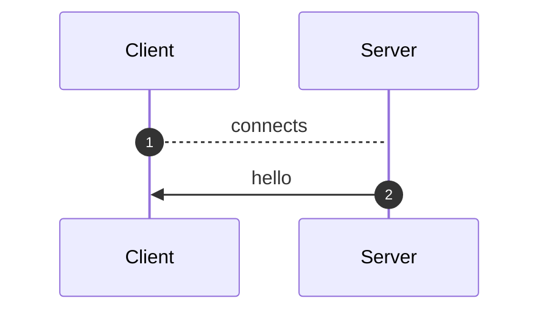
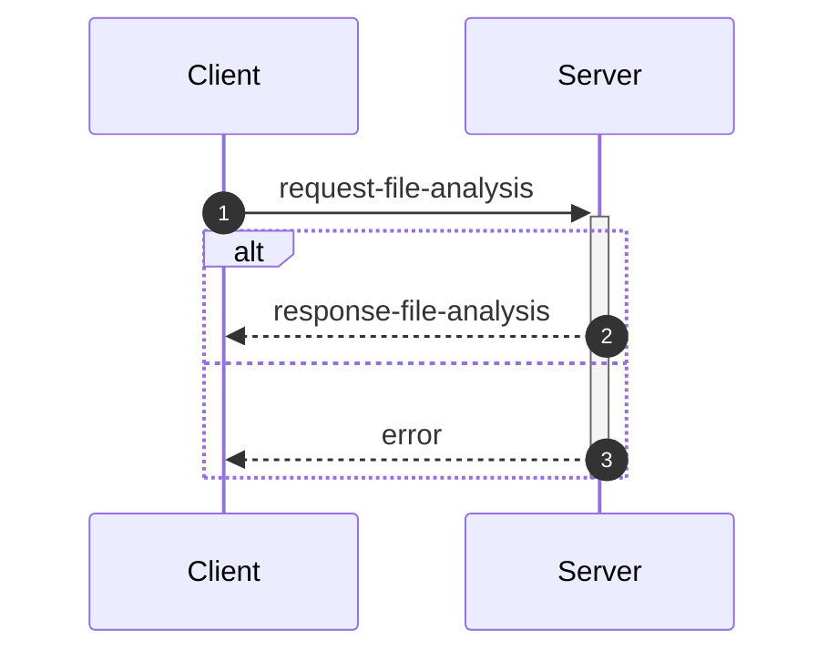
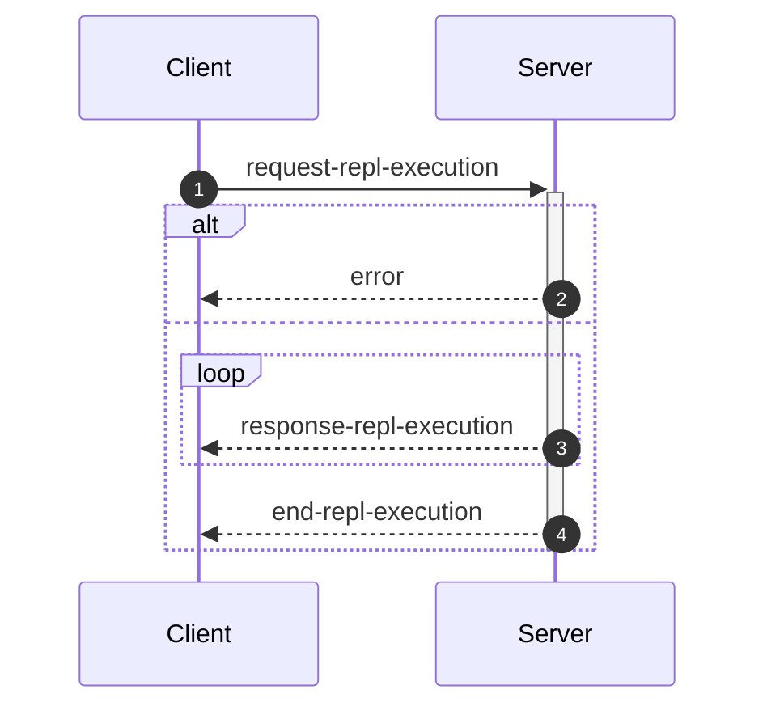
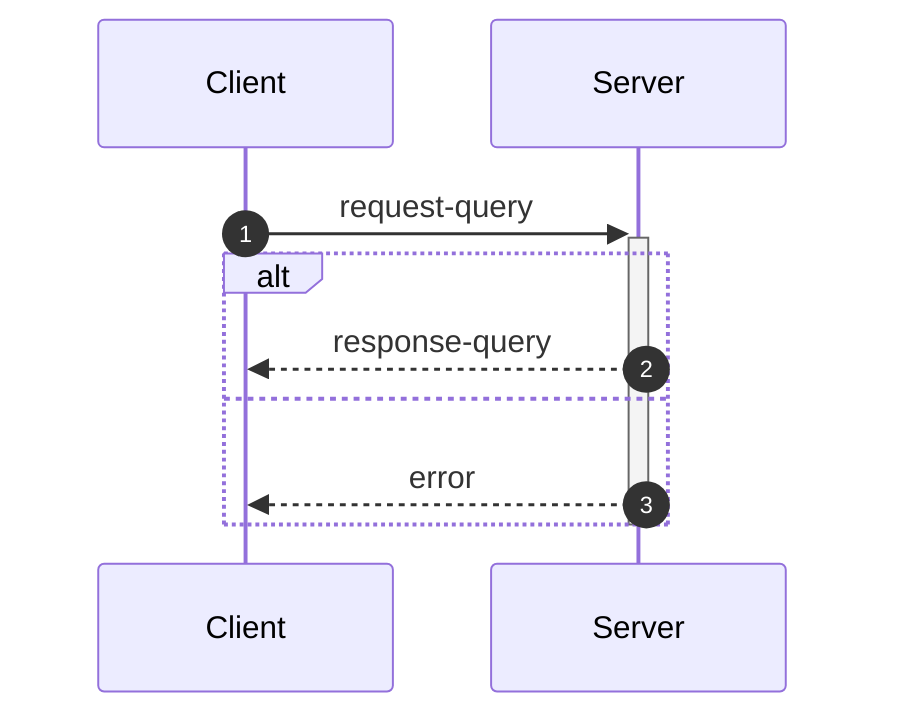

_<span title="an overview of flowR's interface">Generated</span> from '[wiki-interface.ts](https://github.com/flowr-analysis/flowr/tree/main/src/documentation/wiki-interface.ts "src/documentation/wiki-interface.ts")' on 2026-11-06, 17:58:55 UTC (v2.17.3, R v4.6.1), do not edit directly._

Although far from being as detailed as the in-depth explanation of [_flowR_](https://github.com/flowr-analysis/flowr/wiki/Core),
this wiki page explains how to interface with _flowR_ in more detail.
In general, command line arguments and other options provide short descriptions on hover over.

* [💻 Using the REPL](#using-the-repl)
* [⚙️ Configuring FlowR](#configuring-flowr)
* [⚒️ Writing Code](#writing-code)
* [💬 Communicating with the Server](#communicating-with-the-server)

<a id='using-the-repl'></a>
## 💻 Using the REPL

> [!NOTE]
> To execute arbitrary R commands with a repl request, _flowR_ has to be started explicitly with <span title="Description (Command Line Argument): Allow to access the underlying R session when using flowR (security warning: this allows the execution of arbitrary R code!)">`--r-session-access`</span>.
> Please be aware that this introduces a security risk and note that this relies on the [`r-shell` engine](https://github.com/flowr-analysis/flowr/wiki/Engines) .

Although primarily meant for users to explore,
there is nothing which forbids calling _flowR_ as a subprocess to use standard-in, -output, and -error
for communication (although you can access the REPL using the server as well,
with the [REPL Request](#message-request-repl-execution) message).

The read-eval-print loop&nbsp;(REPL) works relatively simple.
You can submit an expression (using <kbd>Enter</kbd>),
which is interpreted as an R&nbsp;expression by default but interpreted as a *command* if it starts with a colon (`:`).
The best command to get started with the REPL is <span title="Description (Repl Command): Show help information (aliases: :h, :?)">`:help`</span>.
Besides, you can leave the REPL either with the command <span title="Description (Repl Command): End the repl (aliases: :q, :exit)">`:quit`</span> or by pressing <kbd>Ctrl</kbd>+<kbd>C</kbd> twice.
When writing a *command*, you may press <kbd>Tab</kbd> to get a list of completions, if available.
Multiple commands can be entered in a single line by separating them with a semicolon (`;`), e.g. `:parse "x<-2"; :df*`.
If a command is given without R code, the REPL will re-use R code given in a previous command.
The prior example will hence return first the parsed AST of the program and then the dataflow graph for `"x <- 2"`.

> [!NOTE]
> If you develop flowR, you may want to launch the repl using the `npm run main-dev` command, this way, you get a non-minified version of flowR with debug information and hot-reloading of source files.

<details>
<summary>Available Commands</summary>

We currently offer the following commands (this with a `[*]` suffix are available with and without the star):

| Command | Description |
| ------- | ----------- |
| **<span title="Description (Repl Command): End the repl (aliases: :q, :exit)">:quit</span>** | End the repl (aliases: **:<span title="Alias of ':quit'. End the repl">q</span>**, **:<span title="Alias of ':quit'. End the repl">exit</span>**) |
| **<span title="Description (Repl Command): Execute the given code as R code. This requires the `--r-session-access` flag to be set and requires the r-shell engine. (aliases: :e, :r)">:execute</span>** | Execute the given code as R code. This requires the `--r-session-access` flag to be set and requires the r-shell engine. (aliases: **:<span title="Alias of ':execute'. Execute the given code as R code. This requires the `--r-session-access` flag to be set and requires the r-shell engine.">e</span>**, **:<span title="Alias of ':execute'. Execute the given code as R code. This requires the `--r-session-access` flag to be set and requires the r-shell engine.">r</span>**) |
| **<span title="Description (Repl Command): Get mermaid code for the control-flow graph of R code (aliases: :cfg, :cf)">:controlflow[*]</span>** | Get mermaid code for the control-flow graph of R code (star: Returns the URL to mermaid.live) (aliases: **:<span title="Alias of ':controlflow'. Get mermaid code for the control-flow graph of R code">cfg</span>**, **:<span title="Alias of ':controlflow'. Get mermaid code for the control-flow graph of R code">cf</span>**) |
| **<span title="Description (Repl Command): Get mermaid code for the control-flow graph with basic blocks (aliases: :cfgb, :cfb)">:controlflowbb[*]</span>** | Get mermaid code for the control-flow graph with basic blocks (star: Returns the URL to mermaid.live) (aliases: **:<span title="Alias of ':controlflowbb'. Get mermaid code for the control-flow graph with basic blocks">cfgb</span>**, **:<span title="Alias of ':controlflowbb'. Get mermaid code for the control-flow graph with basic blocks">cfb</span>**) |
| **<span title="Description (Repl Command): Get mermaid code for the dataflow graph (aliases: :d, :df)">:dataflow[*]</span>** | Get mermaid code for the dataflow graph (star: Returns the URL to mermaid.live) (aliases: **:<span title="Alias of ':dataflow'. Get mermaid code for the dataflow graph">d</span>**, **:<span title="Alias of ':dataflow'. Get mermaid code for the dataflow graph">df</span>**) |
| **<span title="Description (Repl Command): Get mermaid code for the normalized AST of R code (aliases: :n)">:normalize[*]</span>** | Get mermaid code for the normalized AST of R code (star: Returns the URL to mermaid.live) (alias: **:<span title="Alias of ':normalize'. Get mermaid code for the normalized AST of R code">n</span>**) |
| **<span title="Description (Repl Command): Get mermaid code for the simplified dataflow graph (aliases: :ds, :dfs)">:dataflowsimple[*]</span>** | Get mermaid code for the simplified dataflow graph (star: Returns the URL to mermaid.live) (aliases: **:<span title="Alias of ':dataflowsimple'. Get mermaid code for the simplified dataflow graph">ds</span>**, **:<span title="Alias of ':dataflowsimple'. Get mermaid code for the simplified dataflow graph">dfs</span>**) |
| **<span title="Description (Repl Command): Inspect and extend the signature database: `query` (identical to :query @signature), `info <name>` for where a function comes from (identical to :query @function-info), `add <path>` to mount another database/source, `download` to fetch the full-history database. (aliases: :sig)">:signature</span>** | Inspect and extend the signature database: `query` (identical to :query @signature), `info <name>` for where a function comes from (identical to :query @function-info), `add <path>` to mount another database/source, `download` to fetch the full-history database. (alias: **:<span title="Alias of ':signature'. Inspect and extend the signature database: `query` (identical to :query @signature), `info <name>` for where a function comes from (identical to :query @function-info), `add <path>` to mount another database/source, `download` to fetch the full-history database.">sig</span>**) |
| **<span title="Description (Repl Command): Just calculates the DFG, but only prints summary info (aliases: :d#, :df#)">:dataflowsilent</span>** | Just calculates the DFG, but only prints summary info (aliases: **:<span title="Alias of ':dataflowsilent'. Just calculates the DFG, but only prints summary info">d#</span>**, **:<span title="Alias of ':dataflowsilent'. Just calculates the DFG, but only prints summary info">df#</span>**) |
| **<span title="Description (Repl Command): Prints ASCII Art of the parsed, unmodified AST (aliases: :p)">:parse</span>** | Prints ASCII Art of the parsed, unmodified AST (alias: **:<span title="Alias of ':parse'. Prints ASCII Art of the parsed, unmodified AST">p</span>**) |
| **<span title="Description (Repl Command): Prints the version of flowR as well as the current version of R">:version</span>** | Prints the version of flowR as well as the current version of R
| **<span title="Description (Repl Command): Query the given R code (use 'help' for more information)">:query[*]</span>** | Query the given R code (use 'help' for more information) (star: Similar to query, but returns the output in json format.)
| **<span title="Description (Repl Command): Returns an ASCII representation of the dataflow graph (aliases: :df!)">:dataflowascii</span>** | Returns an ASCII representation of the dataflow graph (alias: **:<span title="Alias of ':dataflowascii'. Returns an ASCII representation of the dataflow graph">df!</span>**) |
| **<span title="Description (Repl Command): Returns summarization stats for the normalized AST (aliases: :n#)">:normalize#</span>** | Returns summarization stats for the normalized AST (alias: **:<span title="Alias of ':normalize#'. Returns summarization stats for the normalized AST">n#</span>**) |
| **<span title="Description (Repl Command): Show help information (aliases: :h, :?)">:help</span>** | Show help information (aliases: **:<span title="Alias of ':help'. Show help information">h</span>**, **:<span title="Alias of ':help'. Show help information">?</span>**) |

</details>

> [!TIP]
> 
> As indicated by the examples before, all REPL commands that operate on code keep track of the state.
> Hence, if you run a command like <span title="Description (Repl Command, starred version): Returns the URL to mermaid.live; Base Command: Get mermaid code for the dataflow graph (aliases: :d*, :df*)">`:dataflow*`</span> without providing R code,
> the REPL will re-use the R code provided in a previous command.
> Likewise, doing this will benefit from incrementality!
> If you request the dataflow graph with `:df* x <- 2 * y` and then want to see the parsed AST with `:parse`,
> the REPL will re-use previously obtained information and not re-parse the code again.
> 		

Generally, many commands offer shortcut versions in the REPL. Many queries, for example, offer a shortened format (see the example below).
Of special note, the [Config Query](https://github.com/flowr-analysis/flowr/wiki/%5BQuery%5D-Config)
can be used to also modify the currently active configuration of _flowR_ within the REPL (see the [wiki page](https://github.com/flowr-analysis/flowr/wiki/%5BQuery%5D-Config) for more information).

### Example: Retrieving the Dataflow Graph

To retrieve a URL to the [mermaid](https://mermaid.js.org/) diagram of the dataflow of a given expression,
use <span title="Description (Repl Command, starred version): Returns the URL to mermaid.live; Base Command: Get mermaid code for the dataflow graph (aliases: :d*, :df*)">`:dataflow*`</span> (or <span title="Description (Repl Command): Get mermaid code for the dataflow graph (aliases: :d, :df)">`:dataflow`</span> to get the mermaid code in the cli):

```shell
$ docker run -it --rm eagleoutice/flowr # or npm run flowr 
flowR repl v2.17.3, R grammar v14 (tree-sitter engine)
R> :dataflow* y <- 1 + x
```

<details>
<summary style='color:gray'>Output</summary>

```text
https://mermaid.live/view#base64:eyJjb2RlIjoiZmxvd2NoYXJ0IFREXG4gICAgMXt7XCJgKiM5MTtSTnVtYmVyIzkzOyogKioxKipcbiAgICAgICoxLjYqICgqKmlkOiAxKiopYFwifX1cbiAgICAyKFtcImAqIzkxO1JTeW1ib2wjOTM7KiAqKngqKlxuICAgICAgKjEuMTAqICgqKmlkOiAyKiopYFwiXSlcbiAgICAzW1tcImAqIzkxO1JCaW5hcnlPcCM5MzsqIGJhc2UjNTg7IzU4OyoqIzQzOyoqXG4gICAgICAqMS42LTEwKiAoKippZDogMyoqKVxuICAgIGFyZzogKDEsIDIpYFwiXV1cbiAgICBidWlsdC1pbjpfNDNfW1wiYEJ1aWx0LUluOlxuIzQzO2BcIl1cbiAgICBzdHlsZSBidWlsdC1pbjpfNDNfIHN0cm9rZTpncmF5LGZpbGw6Z3JheSxzdHJva2Utd2lkdGg6MnB4LG9wYWNpdHk6Ljg7XG4gICAgMFtcImAqIzkxO1JTeW1ib2wjOTM7KiAqKnkqKlxuICAgICAgKjEuMSogKCoqaWQ6IDAqKiwgdjogMylgXCJdXG4gICAgNFtbXCJgKiM5MTtSQmluYXJ5T3AjOTM7KiBiYXNlIzU4OyM1ODsqKiM2MDsjNDU7KipcbiAgICAgICoxLjEtMTAqICgqKmlkOiA0KiopXG4gICAgYXJnOiAoMCwgMylgXCJdXVxuICAgIGJ1aWx0LWluOl82MF8tW1wiYEJ1aWx0LUluOlxuIzYwOyM0NTtgXCJdXG4gICAgc3R5bGUgYnVpbHQtaW46XzYwXy0gc3Ryb2tlOmdyYXksZmlsbDpncmF5LHN0cm9rZS13aWR0aDoycHgsb3BhY2l0eTouODtcbiAgICAxIC0uLT58XCJmbG93XCJ8IDJcbiAgICBsaW5rU3R5bGUgMCBzdHJva2U6Z3JheSxjb2xvcjpncmF5O1xuICAgIDIgLS4tPnxcImZsb3dcInwgM1xuICAgIGxpbmtTdHlsZSAxIHN0cm9rZTpncmF5LGNvbG9yOmdyYXk7XG4gICAgMyAtLT58XCJyZWFkcywgYXJnXCJ8IDFcbiAgICAzIC0tPnxcInJlYWRzLCBhcmdcInwgMlxuICAgIDMgLS4tPnxcImZsb3dcInwgMFxuICAgIGxpbmtTdHlsZSA0IHN0cm9rZTpncmF5LGNvbG9yOmdyYXk7XG4gICAgMyAtLi0+fFwicmVhZHMsIGNhbGxzXCJ8IGJ1aWx0LWluOl80M19cbiAgICBsaW5rU3R5bGUgNSBzdHJva2U6Z3JheTtcbiAgICAwIC0tPnxcImRlZmluZWQtYnksIGZsb3dcInwgNFxuICAgIDAgLS0+fFwiZGVmaW5lZC1ieVwifCAzXG4gICAgNCAtLT58XCJyZWFkcywgYXJnXCJ8IDNcbiAgICA0IC0tPnxcInJldHVybnMsIGFyZ1wifCAwXG4gICAgNCAtLi0+fFwicmVhZHMsIGNhbGxzXCJ8IGJ1aWx0LWluOl82MF8tXG4gICAgbGlua1N0eWxlIDEwIHN0cm9rZTpncmF5OyIsIm1lcm1haWQiOnsiYXV0b1N5bmMiOnRydWV9fQ==
```

Retrieve the dataflow graph of the expression `y <- 1 + x`. It looks like this:


<details>

<summary style="color:gray">R Code of the Dataflow Graph</summary>

The analysis ran (parse and normalize with the [tree-sitter](https://github.com/flowr-analysis/flowr/wiki/Engines) engine) in the generation environment. No [signature database](https://github.com/flowr-analysis/flowr/wiki/Signature-Database) is mounted, so `library()` attaches no exports (base-R names are still qualified, e.g., `stats::acf`). 
We encountered no unknown side effects during the analysis.

```r
y <- 1 + x
```

</details>

</details>

For small graphs like this, <span title="Description (Repl Command): Returns an ASCII representation of the dataflow graph (aliases: :df!)">`:dataflowascii`</span> also provides an ASCII representation directly in the REPL:

```shell
$ docker run -it --rm eagleoutice/flowr # or npm run flowr 
flowR repl v2.17.3, R grammar v14 (tree-sitter engine)
R> :df! y <- 1 + x
```

<details open>
<summary style='color:gray'>Output</summary>

```text
                        v<0>v
 c<4>c──────────────────| y |
 |<- |     ┌────────────v---v
 c---c     │
    │   c<3>c   0<1>0
    └───| + |───| 1 |───u<2>u
        c---c   0---0   | x |
           └────────────u---u
Edges:
3 -> 1: reads, arg          3 -> 2: reads, arg
3 -> 0: flows-to            1 -> 2: flows-to
2 -> 3: flows-to            4 -> 3: reads, arg
4 -> 0: returns, arg        0 -> 4: defined-by, flows-to
0 -> 3: defined-by
```

Retrieve the dataflow graph of the expression `y <- 1 + x` as ASCII art.

</details>

For the slicing with <span title="Description (Repl Command): Static backwards executable slicer for R">`:slicer`</span>, you have access to the same [magic comments](#slice-magic-comments) as with the [slice request](#message-request-slice).
Pass `--inline` to splice resolvable `source()` calls into the reconstruction so the slice is a single self-contained R text (the same as the static slice query's `inlineSources` flag).
See `--help` for more flags!

### Example: Interfacing with the File System

Many commands that allow for an R-expression (like <span title="Description (Repl Command, starred version): Returns the URL to mermaid.live; Base Command: Get mermaid code for the dataflow graph (aliases: :d*, :df*)">`:dataflow*`</span>) allow for a file as well
if the argument starts with `file://`.
If you are working from the root directory of the _flowR_ repository, the following gives you the parsed AST of the example file using the <span title="Description (Repl Command): Prints ASCII Art of the parsed, unmodified AST (aliases: :p)">`:parse`</span> command:

> **Watch mode**: Replace `file://` with `watch://` to enter watch mode.
> flowR runs the command immediately and then re-runs it every time the file (or any file inside the folder) changes.
> Enter any other command to leave watch mode.
> For example: `:df watch://analysis.R`

```shell
$ docker run -it --rm eagleoutice/flowr # or npm run flowr 
flowR repl v2.17.3, R grammar v14 (tree-sitter engine)
R> :parse file://test/testfiles/example.R
```

<details>
<summary style='color:gray'>Output</summary>

```text
File: test/testfiles/example.R

program
├ binaryoperator
│ ├ identifier "sum" (1:1─4)
│ ├ <- "<-" (1:5─7)
│ ╰ float "0" (1:8─9)
├ binaryoperator
│ ├ identifier "product" (2:1─8)
│ ├ <- "<-" (2:9─11)
│ ╰ float "1" (2:12─13)
├ binaryoperator
│ ├ identifier "w" (3:1─2)
│ ├ <- "<-" (3:3─5)
│ ╰ float "7" (3:6─7)
├ binaryoperator
│ ├ identifier "N" (4:1─2)
│ ├ <- "<-" (4:3─5)
│ ╰ float "10" (4:6─8)
├ forstatement
│ ├ for "for" (6:1─4)
│ ├ ( "(" (6:5─6)
│ ├ identifier "i" (6:6─7)
│ ├ in "in" (6:8─10)
│ ├ binaryoperator
│ │ ├ float "1" (6:11─12)
│ │ ├ : ":" (6:12─13)
│ │ ╰ parenthesizedexpression
│ │   ├ ( "(" (6:13─14)
│ │   ├ binaryoperator
│ │   │ ├ identifier "N" (6:14─15)
│ │   │ ├ - "-" (6:15─16)
│ │   │ ╰ float "1" (6:16─17)
│ │   ╰ ) ")" (6:17─18)
│ ├ ) ")" (6:18─19)
│ ╰ bracedexpression
│   ├ { "{" (6:20─21)
│   ├ binaryoperator
│   │ ├ identifier "sum" (7:3─6)
│   │ ├ <- "<-" (7:7─9)
│   │ ╰ binaryoperator
│   │   ├ binaryoperator
│   │   │ ├ identifier "sum" (7:10─13)
│   │   │ ├ + "+" (7:14─15)
│   │   │ ╰ identifier "i" (7:16─17)
│   │   ├ + "+" (7:18─19)
│   │   ╰ identifier "w" (7:20─21)
│   ├ binaryoperator
│   │ ├ identifier "product" (8:3─10)
│   │ ├ <- "<-" (8:11─13)
│   │ ╰ binaryoperator
│   │   ├ identifier "product" (8:14─21)
│   │   ├  "" (8:22─23)
│   │   ╰ identifier "i" (8:24─25)
│   ╰ } "}" (9:1─2)
├ call
│ ├ identifier "cat" (11:1─4)
│ ╰ arguments
│   ├ ( "(" (11:4─5)
│   ├ argument
│   │ ╰ string
│   │   ├ stringopen "\"" (11:5─6)
│   │   ├ stringcontent "Sum:" (11:6─10)
│   │   ╰ stringclose "\"" (11:10─11)
│   ├ comma "," (11:11─12)
│   ├ argument
│   │ ╰ identifier "sum" (11:13─16)
│   ├ comma "," (11:16─17)
│   ├ argument
│   │ ╰ string
│   │   ├ stringopen "\"" (11:18─19)
│   │   ├ stringcontent
│   │   │ ╰ escapesequence "\\n" (11:19─21)
│   │   ╰ stringclose "\"" (11:21─22)
│   ╰ ) ")" (11:22─23)
╰ call
  ├ identifier "cat" (12:1─4)
  ╰ arguments
    ├ ( "(" (12:4─5)
    ├ argument
    │ ╰ string
    │   ├ stringopen "\"" (12:5─6)
    │   ├ stringcontent "Product:" (12:6─14)
    │   ╰ stringclose "\"" (12:14─15)
    ├ comma "," (12:15─16)
    ├ argument
    │ ╰ identifier "product" (12:17─24)
    ├ comma "," (12:24─25)
    ├ argument
    │ ╰ string
    │   ├ stringopen "\"" (12:26─27)
    │   ├ stringcontent
    │   │ ╰ escapesequence "\\n" (12:27─29)
    │   ╰ stringclose "\"" (12:29─30)
    ╰ ) ")" (12:30─31)
```

Retrieve the parsed AST of the example file.

<details>

<summary>File Content</summary>

```r
sum <- 0
product <- 1
w <- 7
N <- 10

for (i in 1:(N-1)) {
  sum <- sum + i + w
  product <- product * i
}

cat("Sum:", sum, "\n")
cat("Product:", product, "\n")
```

</details>

As _flowR_ directly transforms this AST the output focuses on being human-readable instead of being machine-readable.
		
</details>

### Example: Run a Query

You can run any query supported by _flowR_ using the <span title="Description (Repl Command): Query the given R code (use 'help' for more information)">`:query`</span> command.
For example, to obtain the shapes of all data frames in a given piece of code, you can run:

```shell
$ docker run -it --rm eagleoutice/flowr # or npm run flowr 
flowR repl v2.17.3, R grammar v14 (tree-sitter engine)
R> :query @absint df-shape "x <- data.frame(a = 1:10, b = 1:10)\ny <- x$a"
```

<details open>
<summary style='color:gray'>Output</summary>

```text
Query: absint (2 ms)
   ╰ $12: (colnames: [{"a", "b"}, {}], cols: [2, 2], rows: [10, 10])
   ╰ $0: (colnames: [{"a", "b"}, {}], cols: [2, 2], rows: [10, 10])
```

Retrieve the shapes of all data frames in the given code.

</details>

To run the linter on a file, you can use (in this example, we just issue the `dead-code` linter on a small piece of code):

```shell
$ docker run -it --rm eagleoutice/flowr # or npm run flowr 
flowR repl v2.17.3, R grammar v14 (tree-sitter engine)
R> :query @linter rules:dead-code "if(FALSE) x <- 2"
```

<details open>
<summary style='color:gray'>Output</summary>

```text
Query: linter (2 ms)
   ╰ Dead Code (dead-code):
       ╰ certain:
           ╰ Code at 1.11-16 (1 quick fix(es) available)
```

Run the linter on the given code, with only the `dead-code` rule enabled.

</details>

For more information on the available queries, please check out the [Query API](https://github.com/flowr-analysis/flowr/wiki/Query-API).

<a id='configuring-flowr'></a>
## ⚙️ Configuring FlowR

When running _flowR_, you may want to specify some behaviors with a dedicated configuration file.
By default, flowR looks for a file named `flowr.json` in the current working directory (or any higher directory).
You can also specify a different file with <span title="Description (Command Line Argument): The name of the configuration file to use">`--config-file`</span> or pass the configuration inline using <span title="Description (Command Line Argument): The flowR configuration to use, as a JSON string">`--config-json`</span>.
A `flowr.json` found this way belongs to the analyzed project, so flowR ignores its options that decide what flowR executes or loads
(`engines.*.wasmPath`, `engines.*.treeSitterWasmPath`, `engines.*.rPath`, `solver.sigdb.additionalPaths`, `solver.sigdb.downloadRepo`, `solver.sigdb.installedLibrary.paths`, `solver.sigdb.onDemand.enabled`, `solver.sigdb.onDemand.repositories`, `solver.sigdb.onDemand.cranMirror`, `solver.sigdb.onDemand.bioconductorMirror`, `solver.sigdb.onDemand.cacheDir`),
unless you pass <span title="Description (Command Line Argument): Keep the security-sensitive options (e.g., the R executable) of the flowr.json found in the working directory or a parent. Only use this for projects you trust.">`--trust-config`</span>.
To analyze code you do not trust, use the secure mode (<span title="Description (Command Line Argument): Run in secure mode for analyzing untrusted code: flowR does not start R (or any other process), does not access the network, does not search for project configs, and ignores security-sensitive options in every config. Cannot be disabled once enabled. Can also be enabled with the environment variable {italic FLOWR_SECURE_MODE=1}.">`--secure`</span>, see the [security policy](https://github.com/flowr-analysis/flowr/blob/main/.github/SECURITY.md)).
To inspect the current configuration, you can run flowr with the <span title="Description (Command Line Argument): Run with verbose logging (will be passed to the corresponding script)">`--verbose`</span> flag, or use the `config` [Query](https://github.com/flowr-analysis/flowr/wiki/Query-API).
Within the REPL this works by running the following:

```shell
:query @config
```

To work with the <a href="https://github.com/flowr-analysis/flowr/tree/main/src/config.ts#L119"><code><span title="The configuration file format for flowR.">FlowrConfig</span></code></a> you can use the provided helper objects alongside its methods like
<a href="https://github.com/flowr-analysis/flowr/tree/main/src/config.ts#L966"><code><span title="Creates a new flowr config that has the updated values.">FlowrConfig::<b>amend</b></span></code></a>.
The schema below documents every option; the ones you most likely want are:

- <a href="https://github.com/flowr-analysis/flowr/wiki/Interface#configuring-flowr" title="Configuration Option (boolean): Whether source calls should be ignored, causing {@link processSourceCall}&#39;s behavior to be skipped.">ignoreSourceCalls</a>: ignore source calls when analyzing the code, i.e., ignore the inclusion of other files.
- <a href="https://github.com/flowr-analysis/flowr/wiki/Interface#configuring-flowr" title="Configuration Option (boolean): Whether load calls should be ignored, causing {@link processLoadCall}&#39;s behavior to be skipped.">ignoreLoadCalls</a>: ignore load calls when analyzing the code, i.e., ignore the loading of r-data files.
- <a href="https://github.com/flowr-analysis/flowr/wiki/Interface#configuring-flowr" title="Configuration Option (object): Do you want to overwrite (parts) of the builtin definition?">semantics.environment.overwriteBuiltIns</a>: overwrite _flowR_'s handling of built-in functions, or clear the preset definitions entirely.
  See [Configure BuiltIn Semantics](#configure-builtin-semantics) for more information.
- <a href="https://github.com/flowr-analysis/flowr/wiki/Interface#configuring-flowr" title="Configuration Option (string): How to resolve variables and their values. (one of &quot;disabled&quot;, &quot;alias&quot;, &quot;builtin&quot;)">solver.variables</a>: how to resolve variables and their values (`disabled`, `alias`, `builtin`).
- <a href="https://github.com/flowr-analysis/flowr/wiki/Interface#configuring-flowr" title="Configuration Option (array): The engine or set of engines to use for interacting with R code. An empty array means all available engines will be used.">engines</a> and <a href="https://github.com/flowr-analysis/flowr/wiki/Interface#configuring-flowr" title="Configuration Option (string): The default engine to use for interacting with R code. If this is undefined, an arbitrary engine from the specified list will be used. (one of &quot;tree-sitter&quot;, &quot;r-shell&quot;)">defaultEngine</a>: the engines used to interact with R code, see the [Engines wiki page](https://github.com/flowr-analysis/flowr/wiki/Engines).
- <a href="https://github.com/flowr-analysis/flowr/wiki/Interface#configuring-flowr" title="Configuration Option (array): Files a framework loads on its own, without any source() call (e.g. global.R in a shiny app), in the order they are loaded; flowR orders the matching project files accordingly and analyzes them as one program. Entries are case-insensitive globs matched against the file path, a plain name matches any file with that name, and entries matching no project file are warned about. Usually set per project kind via specializeConfig.">project.implicitSources</a>: the files a framework loads without any `source()` call, in the order in which they are
  loaded. Entries are globs (e.g. `R/*.R`) matched against the file path ignoring capitalization; one matching no file is reported.
- <a href="https://github.com/flowr-analysis/flowr/wiki/Interface#configuring-flowr" title="Configuration Option (object): Overwrite (parts of) the configuration depending on the project kind flowR detects, e.g. to give a shiny app its implicit sources.">specializeConfig</a>: overwrite (parts of) the configuration depending on the kind of project _flowR_ detects
  (e.g. `shiny-app`), which is how a shiny app gets its implicit sources by default. What you configure directly wins.
- <a href="https://github.com/flowr-analysis/flowr/wiki/Interface#configuring-flowr" title="Configuration Option (string): Overwrite the project kind flowR would otherwise infer from the analyzed files, e.g. when auto-detection guesses wrong. (one of &quot;package&quot;, &quot;script&quot;, &quot;shiny-app&quot;, &quot;notebook&quot;, &quot;project&quot;, &quot;unknown&quot;)">project.useProjectType</a>: skip that detection and force a project kind yourself, when auto-detection guesses wrong.
- <a href="https://github.com/flowr-analysis/flowr/wiki/Interface#configuring-flowr" title="Configuration Option (array): The default plugins to load when creating a new instance of FlowrAnalyzer">defaultPlugins</a> and <a href="https://github.com/flowr-analysis/flowr/wiki/Interface#configuring-flowr" title="Configuration Option (array): The plugins to load in REPL mode">repl.plugins</a>: the plugins to load for a new <a href="https://github.com/flowr-analysis/flowr/tree/main/src/project/flowr-analyzer.ts#L210"><code><span title="Central class for conducting analyses with FlowR. Use the FlowrAnalyzerBuilder to create a new instance. If you want the original pattern of creating a pipeline and running all steps, you can still do this with FlowrAnalyzer#runFull . To inspect the context of the analyzer, use FlowrAnalyzer#inspectContext (if you are a plugin and need to modify it, use FlowrAnalyzer#context instead).">FlowrAnalyzer</span></code></a> and in the REPL
  (use `flowr:default` to reference the former).

So you can configure _flowR_ by adding a file like the following:

<details>

<summary>Example Configuration File</summary>

```json
{
  "ignoreSourceCalls": true,
  "ignoreLoadCalls": true,
  "semantics": {
    "environment": {
      "overwriteBuiltIns": {
        "definitions": [
          {
            "type": "function",
            "names": [
              "foo"
            ],
            "processor": "builtin:assign",
            "config": {}
          }
        ]
      }
    }
  },
  "defaultPlugins": [
    "file:description",
    "versions:description"
  ],
  "repl": {
    "quickStats": false,
    "dfProcessorHeat": false,
    "hints": true,
    "plugins": [
      "flowr:default"
    ]
  },
  "project": {
    "resolveUnknownPathsOnDisk": true,
    "implicitSources": [
      "global.R",
      "app.R"
    ]
  },
  "linter": {
    "disabledRules": []
  },
  "specializeConfig": {
    "shiny-app": {
      "project": {
        "implicitSources": [
          "global.R",
          "ui.R",
          "server.R",
          "app.R"
        ]
      }
    }
  },
  "engines": [
    {
      "type": "r-shell"
    }
  ],
  "solver": {
    "variables": "alias",
    "evalStrings": true,
    "trackEnvironments": true,
    "sigdb": {
      "enabled": true,
      "loadProjectDependencies": true,
      "eagerlyLoad": false,
      "eagerlyLoadExports": false,
      "linkBaseR": false,
      "linkDescriptionDependencies": false
    },
    "resolveSource": {
      "dropPaths": "no",
      "ignoreCapitalization": true,
      "inferWorkingDirectory": "active-script",
      "searchPath": []
    },
    "instrument": {},
    "slicer": {
      "threshold": 50
    }
  },
  "abstractInterpretation": {
    "wideningThreshold": 4,
    "followCalls": true,
    "dataFrame": {
      "maxColNames": 20,
      "readLoadedData": {
        "readExternalFiles": true,
        "maxReadLines": 1000000
      }
    }
  },
  "incremental": {
    "alwaysIncremental": false,
    "parsing": {
      "activated": false,
      "heuristics": {
        "activated": true,
        "mtime": true,
        "linesFrom": 500,
        "bytesFrom": 50000,
        "alwaysWithEdits": false,
        "minFiles": 1
      }
    }
  },
  "gas": {
    "thresholds": {
      "memory": {
        "problematic": 0.7,
        "critical": 0.9
      },
      "timeMs": {
        "problematic": 100000,
        "critical": 120000
      }
    },
    "features": {}
  }
}
```

</details>

<details>
<a id='configure-builtin-semantics'></a>
<summary>Configure Built-In Semantics</summary>

`semantics/environment/overwriteBuiltins` accepts two keys:

- `loadDefaults` (boolean, initially `true`): If set to `true`, the default built-in definitions are loaded before applying the custom definitions. Setting this flag to `false` explicitly disables the loading of the default definitions.
- `definitions` (array, initially empty): Allows to overwrite or define new built-in elements. Each object within must have a `type` which is one of the below. Furthermore, they may define a string array of `names` which specifies the identifiers to bind the definitions to. You may use `assumePrimitive` to specify whether _flowR_ should assume that this is a primitive non-library definition (so you probably just do not want to specify the key).

  | Type            | Description                                                                                                                                                                                                                                                                                              | Example                                                                                                    |
  | --------------- | -------------------------------------------------------------------------------------------------------------------------------------------------------------------------------------------------------------------------------------------------------------------------------------------------------- | ---------------------------------------------------------------------------------------------------------- |
  | `constant`    | Additionally allows for a `value` this should resolve to.                                                                                                                                                                                                                                                | `{ type: 'constant', names: ['NULL', 'NA'],  value: null }`                                                |
  | `function`    | Is a rather flexible way to define and bind built-in functions. For the time, we do not have extensive documentation to cover all the cases, so please either consult the sources with the `default-builtin-config.ts` or open a [new issue](https://github.com/flowr-analysis/flowr/issues/new/choose). | `{ type: 'function', names: ['next'], processor: 'builtin:d', config: { cfg: ExitPointType.Next } }` |
  | `replacement` | A comfortable way to specify replacement functions like `$<-` or `names<-`. `suffixes` describes the... suffixes to attach automatically. | `{ type: 'replacement', suffixes: ['<-', '<<-'], names: ['[', '[['] }` |

</details>

<details>

<summary style='color:gray'>Full Configuration-File Schema</summary>

- _The configuration file format for flowR._ (object)
    - **logLevel** [optional] _flowR's global minimum log level, applied when the config is loaded._ (string)
        Only allows: 'silly', 'trace', 'debug', 'info', 'warn', 'error', 'fatal'
    - **ignoreSourceCalls** [optional] _Whether source calls should be ignored, causing {@link processSourceCall}'s behavior to be skipped._ (boolean)
    - **ignoreLoadCalls** [optional] _Whether load calls should be ignored, causing {@link processLoadCall}'s behavior to be skipped._ (boolean)
    - **semantics** _Configure language semantics and how flowR handles them._ (object)
        - **environment** [optional] _Semantics regarding how to handle the R environment._ (object)
            - **overwriteBuiltIns** [optional] _Do you want to overwrite (parts) of the builtin definition?_ (object)
                - **loadDefaults** [optional] _Should the default configuration still be loaded?_ (boolean)
                - **definitions** [optional] _The definitions to load/overwrite._ (array)
                Valid item types:
                    - (object)
    - **defaultPlugins** [optional] _The default plugins to load when creating a new instance of FlowrAnalyzer_ (array)
    Valid item types:
        - (alternatives)
            - (string)
            - (array)
    - **repl** _Configuration options for the REPL._ (object)
        - **quickStats** [optional] _Whether to show quick stats in the REPL after each evaluation._ (boolean)
        - **dfProcessorHeat** [optional] _This instruments the dataflow processors to count how often each processor is called._ (boolean)
        - **hints** [optional] _Whether to show dim inline hints on the empty prompt (automatically disabled on non-interactive terminals)._ (boolean)
        - **plugins** [optional] _The plugins to load in REPL mode_ (array)
        Valid item types:
            - (alternatives)
                - (string)
                - (array)
        - **autoUseFileProtocol** [optional] _Prepend the file protocol to a repl input that looks like a path, instead of only warning about it._ (boolean)
        - **queryStats** [optional] _Whether `:query` closes with the line stating how long the queries took (`:query*` never prints it)._ (boolean)
        - **showPlugins** [optional] _Whether `:version` grays out the plugins that did not activate during the last analysis._ (boolean)
    - **project** _Project specific configuration options._ (object)
        - **resolveUnknownPathsOnDisk** [optional] _Whether to resolve unknown paths loaded by the r project disk when trying to source/analyze files._ (boolean)
        - **failOnInaccessiblePath** [optional] _Whether a directory that cannot be traversed during file discovery (e.g. due to permissions) aborts the analysis; when false (the default) such paths are logged and skipped._ (boolean)
        - **basePackages** [optional] _The packages considered part of R itself (base and recommended); if unset, flowR uses its built-in list._ (array)
        Valid item types:
            - (string)
        - **implicitSources** [optional] _Files a framework loads on its own, without any source() call (e.g. global.R in a shiny app), in the order they are loaded; flowR orders the matching project files accordingly and analyzes them as one program. Entries are case-insensitive globs matched against the file path, a plain name matches any file with that name, and entries matching no project file are warned about. Usually set per project kind via specializeConfig._ (array)
        Valid item types:
            - (string)
        - **useProjectType** [optional] _Overwrite the project kind flowR would otherwise infer from the analyzed files, e.g. when auto-detection guesses wrong._ (string)
            Only allows: 'package', 'script', 'shiny-app', 'notebook', 'project', 'unknown'
        - **assumeImplicitEcho** [optional] _Whether the top level of the analyzed code is echoed, so that every visible result printed there is collected as an output by the dependencies query (default true, false for a package)._ (boolean)
        - **discovery** [optional] _Scoping options for the default project discovery._ (object)
            - **full** [optional] _Collect every file below the project root (greedy) instead of only the files the detected project kind needs (default false)._ (boolean)
            - **perKind** [optional] _Per-kind include/exclude glob overrides layered on the default scoping._ (object)
            - **ignore** [optional] _Case-insensitive globs that drop matching files from the intelligent discovery, regardless of kind (e.g. .Renviron to ignore environment files)._ (array)
            Valid item types:
                - (string)
        - **classification** [optional] _Overrides for the signals flowR uses to classify the project kind._ (object)
            - **shinyDescriptionTypes** [optional] _DESCRIPTION Type: values that mark a shiny app._ (array)
            Valid item types:
                - (string)
            - **shinyEntryFiles** [optional] _File names a shiny app is assembled from._ (array)
            Valid item types:
                - (string)
            - **shinyUsagePattern** [optional] _Regex source evidencing shiny usage in an entry file._ (string)
            - **notebookExtensions** [optional] _File extensions marking a notebook._ (array)
            Valid item types:
                - (string)
    - **linter** _Linter configuration options._ (object)
        - **disabledRules** _Linting rule names excluded from the default rule set (a rule requested explicitly via a linter query still runs). Usually set per project kind via specializeConfig._ (array)
        Valid item types:
            - (string)
        - **disabledTags** [optional] _Linting rule tags whose rules are excluded from the default rule set (a rule requested explicitly via a linter query still runs). By default the cmd-check rules are disabled for everything but a package; a configured list replaces that default._ (array)
        Valid item types:
            - (string)
    - **inputSources** [optional] _Further frameworks the input-sources analysis should know about; entries are added to flowR's defaults._ (object)
        - **pure** [optional] _Functions that only pass the constantness of their arguments on._ (array)
        Valid item types:
            - (string)
        - **param** [optional] _Functions whose result is a 'param' input._ (array)
        Valid item types:
            - (string)
        - **file** [optional] _Functions whose result is a 'file' input._ (array)
        Valid item types:
            - (string)
        - **tempfile** [optional] _Functions whose result is a 'tempfile' input._ (array)
        Valid item types:
            - (string)
        - **glob** [optional] _Functions whose result is a 'glob' input._ (array)
        Valid item types:
            - (string)
        - **net** [optional] _Functions whose result is a 'net' input._ (array)
        Valid item types:
            - (string)
        - **rand** [optional] _Functions whose result is a 'rand' input._ (array)
        Valid item types:
            - (string)
        - **system** [optional] _Functions whose result is a 'system' input._ (array)
        Valid item types:
            - (string)
        - **ffi** [optional] _Functions whose result is a 'ffi' input._ (array)
        Valid item types:
            - (string)
        - **lang** [optional] _Functions whose result is a 'lang' input._ (array)
        Valid item types:
            - (string)
        - **options** [optional] _Functions whose result is a 'options' input._ (array)
        Valid item types:
            - (string)
        - **cmdline** [optional] _Functions whose result is a 'cmdline' input._ (array)
        Valid item types:
            - (string)
        - **user** [optional] _Functions whose result is a 'user' input._ (array)
        Valid item types:
            - (string)
        - **const** [optional] _Functions whose result is a 'const' input._ (array)
        Valid item types:
            - (string)
        - **scope** [optional] _Functions whose result is a 'scope' input._ (array)
        Valid item types:
            - (string)
        - **dconst** [optional] _Functions whose result is a 'dconst' input._ (array)
        Valid item types:
            - (string)
        - **unknown** [optional] _Functions whose result is a 'unknown' input._ (array)
        Valid item types:
            - (string)
        - **linkedObjects** [optional] _Objects a framework provides without a definition in the code, e.g. shiny's input._ (array)
        Valid item types:
            - (object)
        - **linkedEntryPoints** [optional] _Calls that hand a function to a framework, which binds its objects to the parameters by position._ (array)
        Valid item types:
            - (object)
    - **specializeConfig** [optional] _Overwrite (parts of) the configuration depending on the project kind flowR detects, e.g. to give a shiny app its implicit sources._ (object)
    - **engines** _The engine or set of engines to use for interacting with R code. An empty array means all available engines will be used._ (array)
    Valid item types:
        - (alternatives)
            - _The configuration for the tree sitter engine._ (object)
                - **type** [required] _Use the tree sitter engine._ (string)
                    Only allows: 'tree-sitter'
                - **wasmPath** [optional] _The path to the tree-sitter-r WASM binary to use. If this is undefined, this uses the default path._ (string)
                - **treeSitterWasmPath** [optional] _The path to the tree-sitter WASM binary to use. If this is undefined, this uses the default path._ (string)
                - **lax** [optional] _Whether to use the lax parser for parsing R code (allowing for syntax errors). If this is undefined, the strict parser will be used._ (boolean)
            - _The configuration for the R shell engine._ (object)
                - **type** [required] _Use the R shell engine._ (string)
                    Only allows: 'r-shell'
                - **rPath** [optional] _The path to the R executable to use. If this is undefined, this uses the default path._ (string)
                - **pipeBind** [optional] _Whether to enable R's experimental pipe-bind operator "=>" by setting _R_USE_PIPEBIND_ for the R session (default false); R itself keeps this off by default, as it is experimental and has never shipped in a release version of R._ (boolean)
    - **defaultEngine** [optional] _The default engine to use for interacting with R code. If this is undefined, an arbitrary engine from the specified list will be used._ (string)
        Only allows: 'tree-sitter', 'r-shell'
    - **solver** _How to resolve constants, constraints, cells, ..._ (object)
        - **variables** _How to resolve variables and their values._ (string)
            Only allows: 'disabled', 'alias', 'builtin'
        - **evalStrings** _Should we include eval(parse(text="...")) calls in the dataflow graph?_ (boolean)
        - **trackEnvironments** [optional] _Track user-created environments (new.env, assign/get/local with envir=, dollar-assign, attach). When false, all envir-style calls fall through conservatively._ (boolean)
        - **sigdb** _Resolving library exports from a signature database._ (object)
            - **enabled** [optional] _Resolve library()/use() exports from a signature database (default true); when false no database is consulted._ (boolean)
            - **loadProjectDependencies** [optional] _Load the project's declared dependencies from its metadata files (DESCRIPTION Imports/Depends, rproject.toml, uvr.toml, rig rproj.toml and script blocks, renv.lock, rv.lock, uvr.lock, rig lockfiles) (default true); when false these files are not read for dependencies._ (boolean)
            - **eagerlyLoad** [optional] _Parse the database up front rather than on the first package load (default false, ignored if disabled)._ (boolean)
            - **eagerlyLoadExports** [optional] _Add a vertex for every export on load rather than on demand (default false); keeps the dataflow graph small._ (boolean)
            - **assumedRVersion** [optional] _R version assumed when resolving versioned (base-R) exports: a pin like "4.5" or "auto" to detect the installed R (default "auto")._ (string)
            - **linkBaseR** [optional] _Eagerly attach base-R namespaces so bare base calls resolve without library() (default false)._ (boolean)
            - **linkBaseRCalls** [optional] _Add a lightweight Reads edge from a bare base-R call to its signature-database function vertex (default false; base-R qualification is edge-free otherwise)._ (boolean)
            - **linkPackageCalls** [optional] _Add a lightweight Reads edge from a resolved package call to its signature-database function vertex (default false)._ (boolean)
            - **linkDescriptionDependencies** [optional] _Eagerly attach the namespaces of the project's declared DESCRIPTION dependencies (Imports/Depends) so their exports resolve without an explicit library() (default false)._ (boolean)
            - **warmInBackground** [optional] _Decompress the hot shards (base + most-downloaded) in a background task on startup so the first library() lookup is warm (default false; for long-running servers/REPLs)._ (boolean)
            - **additionalPaths** [optional] _Extra directories or bundle/manifest files searched for signature databases (alongside the shipped default and $FLOWR_SIGDB_DIR); a downloaded full-history bundle placed here is mounted automatically._ (array)
            Valid item types:
                - (string)
            - **downloadRepo** [optional] _GitHub owner/repo the full-history bundle is downloaded from via ":signature download" (default "flowr-analysis/flowr"; the release tag comes from the committed sigdb.remote.json unless a version is given)._ (string)
            - **autoSync** [optional] _On startup, re-download shards whose committed sigdb.remote.json hash no longer matches the cache, in the background (default false; opt-in network sync after a git pull)._ (boolean)
            - **installedLibrary** [optional] _Recovering packages no signature database knows from the copy installed on this machine._ (object)
                - **enabled** [required] _Recover packages no signature database knows from their installed copy (default false)._ (boolean)
                - **paths** [optional] _Library directories to search; when empty they are discovered from the environment and the project._ (array)
                Valid item types:
                    - (string)
                - **useEnvironment** [optional] _Search the libraries R_LIBS_USER/R_LIBS/R_LIBS_SITE name (default true)._ (boolean)
                - **useProjectLibrary** [optional] _Search a project-local renv/packrat library (default true)._ (boolean)
                - **maxDepth** [optional] _How far to descend into the nested layout of a project-local library (default 3)._ (number)
                - **packages** [optional] _Only recover packages whose name matches one of these regular expressions; empty means any._ (array)
                Valid item types:
                    - (string)
            - **onDemand** [optional] _Recovering packages no signature database knows from their sources on CRAN, Bioconductor, or GitHub._ (object)
                - **enabled** [required] _Fetch and recover the sources of packages no signature database knows when the analyzed code uses them (default false, accesses the network)._ (boolean)
                - **sources** [optional] _Where to look, in order: github, cran, bioconductor, or a source a plugin adds (default ["github", "cran", "bioconductor"])._ (array)
                Valid item types:
                    - (string)
                - **repositories** [optional] _GitHub repositories (owner/repo[/subdir][@ref]) to fetch packages from, by package name. The analyzed project may name more (DESCRIPTION Remotes, install_github calls)._ (object)
                - **packages** [optional] _Only recover packages whose name matches one of these regular expressions, empty means any._ (array)
                Valid item types:
                    - (string)
                - **cranMirror** [optional] _The CRAN src/contrib/ to fetch from, over https (default https://cloud.r-project.org/src/contrib/). It may be on the local network._ (string)
                - **bioconductorMirror** [optional] _The Bioconductor host, over https (default https://bioconductor.org). It may be on the local network._ (string)
                - **bioconductorRelease** [optional] _The Bioconductor release to fetch from: release, devel, or a number like 3.20 (default release)._ (string)
                - **githubMirrors** [optional] _Use the GitHub mirrors of CRAN (cran/<pkg>) and Bioconductor (bioc/<pkg>) (default true)._ (boolean)
                - **maxPackages** [optional] _The most packages to fetch for one analysis (default 25)._ (number)
                - **maxArchiveMb** [optional] _The most MiB a package archive may have (default 32). It may unpack to three times that, at most 128 MiB._ (number)
                - **offline** [optional] _Only use what was fetched before, never the network (default false)._ (boolean)
                - **retryAfterHours** [optional] _How many hours to wait before asking again for a package no source had (default 24)._ (number)
                - **cacheDir** [optional] _Where to cache what was fetched (default the on-demand directory of the signature cache)._ (string)
            - **blobCacheBudgetMb** [optional] _How many MiB of decoded package blobs every open bundle may hold together (default 16)._ (number)
            - **versionSelection** [optional] _When a project constrains a dependency, resolve to the newest (default), oldest, or system-installed version satisfying it; system needs R and falls back to newest. Base-R packages always resolve against the assumed R version._ (string)
                Only allows: 'newest', 'oldest', 'system'
            - **versionOverrides** [optional] _Force an exact version for specific packages (name -> version), overriding both the project constraint and the versionSelection policy (default {})._ (object)
        - **versionManagement** _Policies for reasoning about dependency versions._ (object)
            - **linkedVersionGroups** [optional] _Groups of packages that must resolve to the same version; version guessing intersects each group so its members stay mutually compatible (default [])._ (array)
            Valid item types:
                - (array)
                Valid item types:
                    - (string)
        - **assumeAttachedPackages** [optional] _Packages to treat as attached without a `library()` call, so what the built-in configuration states about them applies to the analyzed code. The base packages R attaches on startup already resolve without it._ (array)
        Valid item types:
            - (string)
        - **transitiveSideEffectRounds** [optional] _How many rounds the transitive side-effect fixpoint may run before it is cut off (default 32); the propagation stops on its own as soon as a round adds nothing._ (number)
        - **maxOverlayDepth** [optional] _How many binding overlays may stack on one environment frame before a write flattens them (default 4); a pure performance knob, trading lookup cost against copy cost without changing any result._ (number)
        - **instrument** (object)
            - **dataflowExtractors** [optional] _These keys are only intended for use within code, allowing to instrument the dataflow analyzer!_ (any)
        - **resolveSource** [optional] _If lax source calls are active, flowR searches for sourced files much more freely, based on the configurations you give it. This option is only in effect if `ignoreSourceCalls` is set to false._ (object)
            - **dropPaths** _Allow to drop the first or all parts of the sourced path, if it is relative._ (string)
                Only allows: 'no', 'once', 'all'
            - **ignoreCapitalization** _Search for filenames matching in the lowercase._ (boolean)
            - **inferWorkingDirectory** _Try to infer the working directory from the main or any script to analyze._ (string)
                Only allows: 'no', 'main-script', 'active-script', 'any-script'
            - **searchPath** _Additionally search in these paths._ (array)
            Valid item types:
                - (string)
            - **repeatedSourceLimit** [optional] _How often the same file can be sourced within a single run? Please be aware: in case of cyclic sources this may not reach a fixpoint so give this a sensible limit._ (number)
            - **applyReplacements** _Provide name replacements for loaded files_ (array)
            Valid item types:
                - (object)
            - **assumeFilesExist** [optional] _Assume a sourced file is always there, making what it defines certain instead of conditional on the source call._ (boolean)
        - **slicer** [optional] _The configuration for the slicer._ (object)
            - **threshold** [optional] _The maximum number of iterations to perform on a single function call during slicing._ (number)
            - **autoExtend** [optional] _If set, the slicer will gain an additional post-pass._ (boolean)
    - **abstractInterpretation** _The configuration options for abstract interpretation._ (object)
        - **wideningThreshold** _The threshold for the number of visitations of a node at which widening should be performed to ensure the termination of the fixpoint iteration._ (number)
        - **followCalls** _Whether the abstract interpretation is interprocedural, i.e. whether it steps into the functions a call may dispatch to._ (boolean)
        - **dataFrame** _The configuration of the shape inference for data frames._ (object)
            - **maxColNames** _The maximum number of columns names to infer for data frames before over-approximating the column names to top._ (number)
            - **readLoadedData** _Configuration options for reading data frame shapes from loaded external data files, such as CSV files._ (object)
                - **readExternalFiles** _Whether data frame shapes should be extracted from loaded external files, such as CSV files._ (boolean)
                - **maxReadLines** _The maximum number of lines to read when extracting data frame shapes from loaded files, such as CSV files._ (number)
    - **incremental** (object)
        - **alwaysIncremental** _Always take the incremental path, regardless of heuristics._ (boolean)
        - **parsing** (object)
            - **activated** _If set, incremental parsing will be used._ (boolean)
            - **heuristics** (object)
                - **activated** [optional] _If set, the heuristics for incremental parsing will be used._ (boolean)
                - **mtime** [optional] _Skip reparsing entirely if the file's modification time is unchanged since the last parse._ (boolean)
                - **linesFrom** [optional] _Only consider incremental parsing for files with at least this many lines._ (number)
                - **bytesFrom** [optional] _Only consider incremental parsing for files with at least this many bytes._ (number)
                - **alwaysWithEdits** [optional] _Always take the incremental path whenever there is a computed edit region, regardless of the other thresholds._ (boolean)
                - **minFiles** [optional] _Only apply these heuristics once the project has at least this many files loaded._ (number)
    - **gas** [optional] _Resource-usage guard (gas) configuration. All feature factors default to 0 (disabled). See https://github.com/flowr-analysis/flowr/wiki/Core#gas-resource-guard._ (object)
        - **thresholds** [optional] _Thresholds for all gas checks (scaled by per-feature factor), boundable per feature._ (object)
            - **memory** [optional] _Heap-usage fraction thresholds (0-1), either shared or given per feature key (with `default` covering the rest)._ (object)
                - **problematic** [optional] _Heap fraction (0-1) above which Problematic is returned, for every feature without an entry of its own._ (number)
                - **critical** [optional] _Heap fraction (0-1) above which Critical is returned, for every feature without an entry of its own._ (number)
            - **timeMs** [optional] _Elapsed analysis time thresholds in milliseconds, either shared or given per feature key (with `default` covering the rest)._ (object)
                - **problematic** [optional] _Elapsed ms above which Problematic is returned, for every feature without an entry of its own._ (number)
                - **critical** [optional] _Elapsed ms above which Critical is returned, for every feature without an entry of its own._ (number)
            - **steps** [optional] _Processed-AST-node thresholds, counted rather than sampled; only a key that arms a budget (`dataflow`) reads them._ (object)
                - **problematic** [optional] _Processed AST nodes above which Problematic is returned, for every feature without an entry of its own._ (number)
                - **critical** [optional] _Processed AST nodes above which the extraction is cut short, for every feature without an entry of its own._ (number)
            - **vertices** [optional] _Created-dataflow-vertex thresholds, counted like `steps`._ (object)
                - **problematic** [optional] _Created dataflow vertices above which Problematic is returned, for every feature without an entry of its own._ (number)
                - **critical** [optional] _Created dataflow vertices above which the extraction is cut short, for every feature without an entry of its own._ (number)
        - **features** [optional] _Per-feature sensitivity factors. 0 or absent disables gas checking for that feature. A factor of 2 makes the feature twice as sensitive. Recognised keys: `source`, `side-effect-linking`, `linter`, `slicer`, `dataflow`._ (object)
        - **countedCheckEvery** [optional] _How many counted steps pass between two accountings of an armed check, be it a dataflow budget or the slicer's traversal (default 128); trades overshoot against the cost of the check._ (number)
        - **heapProvider** [optional] _Custom heap statistics source (programmatic configs only), overriding the built-in v8/performance.memory detection._ (function)

</details>

<a id='writing-code'></a>
## ⚒️ Writing Code

_flowR_ can be used as a [module](https://www.npmjs.com/package/@eagleoutice/flowr) and offers several main classes and interfaces that are interesting for extension writers 
(see the [Visual Studio Code extension](https://marketplace.visualstudio.com/items?itemName=code-inspect.vscode-flowr) or the [Core](https://github.com/flowr-analysis/flowr/wiki/Core) wiki page for more information).

### Creating Analyses with _flowR_

Nowadays, instances of the <a href="https://github.com/flowr-analysis/flowr/tree/main/src/project/flowr-analyzer.ts#L210"><code><span title="Central class for conducting analyses with FlowR. Use the FlowrAnalyzerBuilder to create a new instance. If you want the original pattern of creating a pipeline and running all steps, you can still do this with FlowrAnalyzer#runFull . To inspect the context of the analyzer, use FlowrAnalyzer#inspectContext (if you are a plugin and need to modify it, use FlowrAnalyzer#context instead).">FlowrAnalyzer</span></code></a> should be used as central frontend to get analysis results from _flowR_.
The entry points an analysis is written against are re-exported from the package root (`import { FlowrAnalyzerBuilder } from '@eagleoutice/flowr'`);
everything else stays reachable under its own path, as in `@eagleoutice/flowr/dataflow/graph/graph`.
For example, a program slice can be created like this:

```ts
const analyzer = await new FlowrAnalyzerBuilder()
    .setEngine('tree-sitter')
    .build();
analyzer.addRequest('x <- 1\ny <- x\nx');
const result = await analyzer.query([
    {
        type:     'static-slice',
        criteria: ['3@x']
    }
]);
```

For more information, please have a look at the [Analyzer](https://github.com/flowr-analysis/flowr/wiki/Analyzer) wiki page, which explains how to construct and use the <a href="https://github.com/flowr-analysis/flowr/tree/main/src/project/flowr-analyzer.ts#L210"><code><span title="Central class for conducting analyses with FlowR. Use the FlowrAnalyzerBuilder to create a new instance. If you want the original pattern of creating a pipeline and running all steps, you can still do this with FlowrAnalyzer#runFull . To inspect the context of the analyzer, use FlowrAnalyzer#inspectContext (if you are a plugin and need to modify it, use FlowrAnalyzer#context instead).">FlowrAnalyzer</span></code></a> in more detail.
To work with specific perspectives, you can also consult the respective pages like the [Dataflow Graph](https://github.com/flowr-analysis/flowr/wiki/Dataflow-Graph) or the [Abstract Interpretation](https://github.com/flowr-analysis/flowr/wiki/Abstract-Interpretation) wiki pages.
### The Pipeline Executor (Low-Level Interface)

Once, in the beginning, _flowR_ was meant to produce a dataflow graph merely to provide *program slices*. 
However, with continuous updates, the [Dataflow Graph](https://github.com/flowr-analysis/flowr/wiki/Dataflow-Graph) repeatedly proves to be the more interesting part.
With this, we restructured _flowR_'s originally *hardcoded* pipeline to be far more flexible. 
Now, it can be theoretically extended or replaced with arbitrary steps, optional steps, and what we call 'decorations' of these steps. 
In short, a slicing pipeline using the <a href="https://github.com/flowr-analysis/flowr/tree/main/src/core/pipeline-executor.ts#L97"><code><span title="**Please note:** The PipelineExecutor is now considered to be a rather low-level API for flowR. While it still works and is the basis for all other layers, we strongly recommend using the FlowrAnalyzer and its builder to create and use an analyzer instance that is pre-configured for your use-case. The pipeline executor allows to execute arbitrary pipelines in a step-by-step fashion. If you are not...">PipelineExecutor</span></code></a> looks like this:

```ts

const slicer = new PipelineExecutor(DEFAULT_SLICING_PIPELINE, {
  parser:    new RShell(),
  request:   requestFromInput('x <- 1\nx + 1'),
  criterion: ['2@x']
})
const slice = await slicer.allRemainingSteps()
// console.log(slice.reconstruct.code)
```

<details><summary>More Information</summary>

If you compare this, with what you would have done with the old (and removed) `SteppingSlicer`, 
this essentially just requires you to replace the `SteppingSlicer` with the <a href="https://github.com/flowr-analysis/flowr/tree/main/src/core/pipeline-executor.ts#L97"><code><span title="**Please note:** The PipelineExecutor is now considered to be a rather low-level API for flowR. While it still works and is the basis for all other layers, we strongly recommend using the FlowrAnalyzer and its builder to create and use an analyzer instance that is pre-configured for your use-case. The pipeline executor allows to execute arbitrary pipelines in a step-by-step fashion. If you are not...">PipelineExecutor</span></code></a>
and to pass the <a href="https://github.com/flowr-analysis/flowr/tree/main/src/core/steps/pipeline/default-pipelines.ts#L18"><code>DEFAULT_SLICING_PIPELINE</code></a> as the first argument.
The <a href="https://github.com/flowr-analysis/flowr/tree/main/src/core/pipeline-executor.ts#L97"><code><span title="**Please note:** The PipelineExecutor is now considered to be a rather low-level API for flowR. While it still works and is the basis for all other layers, we strongly recommend using the FlowrAnalyzer and its builder to create and use an analyzer instance that is pre-configured for your use-case. The pipeline executor allows to execute arbitrary pipelines in a step-by-step fashion. If you are not...">PipelineExecutor</span></code></a>...

1. Provides structures to investigate the results of all intermediate steps
2. Can be executed step-by-step
3. Can repeat steps (e.g., to calculate multiple slices on the same input)

See the in-code documentation for more information.

</details>

### Using the <a href="https://github.com/flowr-analysis/flowr/tree/main/src/r-bridge/shell.ts#L144"><code><span title="The RShell represents an interactive session with the R interpreter. You can configure it by RShellOptions . At the moment we are using a live R session (and not networking etc.) to communicate with R easily, which allows us to install packages etc. However, this might and probably will change in the future (leaving this as a legacy mode :D)">RShell</span></code></a> to Interact with R

The <a href="https://github.com/flowr-analysis/flowr/tree/main/src/r-bridge/shell.ts#L144"><code><span title="The RShell represents an interactive session with the R interpreter. You can configure it by RShellOptions . At the moment we are using a live R session (and not networking etc.) to communicate with R easily, which allows us to install packages etc. However, this might and probably will change in the future (leaving this as a legacy mode :D)">RShell</span></code></a> class allows interfacing with the `R`&nbsp;ecosystem installed on the host system.
Please have a look at [flowR's Engines](https://github.com/flowr-analysis/flowr/wiki/Engines) for more information on alternatives (for example, the <a href="https://github.com/flowr-analysis/flowr/tree/main/src/r-bridge/lang-4.x/tree-sitter/tree-sitter-executor.ts#L29"><code><span title="Synchronous and (way) faster alternative to the RShell using tree-sitter.">TreeSitterExecutor</span></code></a>).

> [!IMPORTANT]
> 
> Each <a href="https://github.com/flowr-analysis/flowr/tree/main/src/r-bridge/shell.ts#L144"><code><span title="The RShell represents an interactive session with the R interpreter. You can configure it by RShellOptions . At the moment we are using a live R session (and not networking etc.) to communicate with R easily, which allows us to install packages etc. However, this might and probably will change in the future (leaving this as a legacy mode :D)">RShell</span></code></a> controls a new instance of the R&nbsp;interpreter, 
> make sure to call <code><a href="https://github.com/flowr-analysis/flowr/tree/main/src/r-bridge/shell.ts#L350"><span title="Close the current R session, makes the object effectively invalid (can no longer be reopened etc.)">RShell::<i>close</i></span></a>()</code> when you are done.

You can start a new "session" by constructing a new object with <code>new <a href="https://github.com/flowr-analysis/flowr/tree/main/src/r-bridge/shell.ts#L144"><span title="The RShell represents an interactive session with the R interpreter. You can configure it by RShellOptions . At the moment we are using a live R session (and not networking etc.) to communicate with R easily, which allows us to install packages etc. However, this might and probably will change in the future (leaving this as a legacy mode :D)">RShell</span></a>()</code>.

However, there are several options that may be of interest 
(e.g., to automatically revive the shell in case of errors or to control the name location of the R process on the system).

With a shell object (let's call it `shell`), you can execute R code by using <a href="https://github.com/flowr-analysis/flowr/tree/main/src/r-bridge/shell.ts#L213"><code><span title="sends the given command directly to the current R session will not do anything to alter input markers!">RShell::<i>sendCommand</i></span></code></a>,
for example <code>shell.<a href="https://github.com/flowr-analysis/flowr/tree/main/src/r-bridge/shell.ts#L213"><span title="sends the given command directly to the current R session will not do anything to alter input markers!">sendCommand</span></a>("1 + 1")</code>.
However, this does not return anything, so if you want to collect the output of your command, use
<a href="https://github.com/flowr-analysis/flowr/tree/main/src/r-bridge/shell.ts#L296"><code><span title="Send a command and collect the output">RShell::<i>sendCommandWithOutput</i></span></code></a> instead.

<a id='communicating-with-the-server'></a>
## 💬 Communicating with the Server

As explained in the [Overview](https://github.com/flowr-analysis/flowr/wiki/Overview), you can run the [TCP](https://de.wikipedia.org/wiki/Transmission_Control_Protocol)&nbsp;server by adding the <span title="Description (Command Line Argument): Do not drop into a repl, but instead start a server on the given port (default: 1042) and listen for messages.">`--server`</span> flag (and, due to the interactive mode, exit with the conventional <kbd>CTRL</kbd>+<kbd>C</kbd>).
Currently, every connection is handled by the same underlying `RShell` - so the server is not designed to handle many clients at a time.
Additionally, the server is not well guarded against attacks (e.g., you can theoretically spawn an arbitrary number of&nbsp;RShell sessions on the target machine).

Every message has to be given in a single line (i.e., without a newline in-between) and end with a newline character. Nevertheless, we will pretty-print example given in the following segments for the ease of reading.

> [!NOTE]
> 
> The default <span title="Description (Command Line Argument): Do not drop into a repl, but instead start a server on the given port (default: 1042) and listen for messages.">`--server`</span> uses a simple [TCP](https://de.wikipedia.org/wiki/Transmission_Control_Protocol)
> connection. If you want _flowR_ to expose a [WebSocket](https://de.wikipedia.org/wiki/WebSocket) server instead, add the <span title="Description (Command Line Argument): If the server flag is set, use websocket for messaging">`--ws`</span> flag (i.e., <span title="Description (Command Line Argument): Do not drop into a repl, but instead start a server on the given port (default: 1042) and listen for messages.">`--server`</span> <span title="Description (Command Line Argument): If the server flag is set, use websocket for messaging">`--ws`</span>) when starting _flowR_ from the command line.

<ul><li>
<a id="message-hello"></a>
<b>Hello</b> Message (<code>hello</code>) 
<details>

<summary style="color:gray"> View Details. <i>The server informs the client about the successful connection and provides Meta-Information.</i> </summary>



After launching _flowR_, for example, with <code>docker run -it --rm eagleoutice/flowr <span title="Description (Command Line Argument): Do not drop into a repl, but instead start a server on the given port (default: 1042) and listen for messages.">-<span/>-server</span></code>&nbsp;(🐳️), connecting should present you with a `hello` message, that amongst others should reveal the versions of&nbsp;_flowR_ and&nbsp;R, using the [semver 2.0](https://semver.org/spec/v2.0.0.html) versioning scheme.
The message looks like this:

```json
{
  "type": "hello",
  "clientName": "client-0",
  "versions": {
    "flowr": "2.17.3",
    "r": "4.6.1",
    "engine": "r-shell"
  }
}
```

There are currently a few messages that you can send after the hello message.
If you want to _slice_ a piece of R code you first have to send an [analysis request](#message-request-file-analysis), so that you can send one or multiple slice requests afterward.
Requests for the [REPL](#message-request-repl-execution) are independent of that.
	
<hr>

<details>
<summary style="color:gray">Message schema (<code>hello</code>)</summary>

For the definition of the hello message, please see it's implementation at [`./src/cli/repl/server/messages/message-hello.ts`](https://github.com/flowr-analysis/flowr/tree/main/src/cli/repl/server/messages/message-hello.ts).

- [required] (object)
    - **type** [required] _The type of the hello message._ (string)
        Only allows: 'hello'
    - **id** [forbidden] _The id of the message is always undefined (as it is the initial message and not requested)._ (any)
    - **clientName** [required] _A unique name that is assigned to each client. It has no semantic meaning and is only used/useful for debugging._ (string)
    - **versions** [required] (object)
        - **flowr** [required] _The version of the flowr server running in semver format._ (string)
        - **r** [required] _The version of the underlying R shell running in semver format._ (string)
        - **engine** [required] _The parser backend that is used to parse the R code._ (string)

</details>

<hr>

</details>
	</li>

<li>
<a id="message-request-file-analysis"></a>
<b>Analysis</b> Message (<code>request-file-analysis</code>) 
<details>

<summary style="color:gray"> View Details. <i>The server builds the dataflow graph for a given input file (or a set of files).</i> </summary>



The request allows the server to analyze a file and prepare it for slicing.
The message can contain a `filetoken`, which is used to identify the file in later slice or query requests (if you do not add one, the request will not be stored and therefore, it is not available for subsequent requests).

> **Please note!**\
> If you want to send and process a lot of analysis requests, but do not want to slice them, please do not pass the `filetoken` field. This will save the server a lot of memory allocation.

Furthermore, the request must contain either a `content` field to directly pass the file's content or a `filepath` field which contains the path to the file (this path must be accessible for the server to be useful).
If you add the `id` field, the answer will use the same `id` so you can match requests and the corresponding answers.
See the implementation of the request-file-analysis message for more information.

You can drop one or more stored file tokens by adding the `invalidateToken` field (a single token or an array of tokens).
The server frees the corresponding analyses _after_ it has answered the request.

> **Tip!**\
> If you only want to drop tokens, you do not need a separate message: send a `request-file-analysis` that contains _just_ the `invalidateToken` field (and no `content` or `filepath`).
> Such a request behaves like an empty file analysis and the server replies with an empty `results` object.
> Because invalidation happens after the response, you may even pass the _current_ `filetoken` in `invalidateToken` to analyze a file once and have the server forget it right after you received the results.

<details>
<summary>Example of the <code>request-file-analysis</code> Message</summary>

_Note:_ even though we pretty-print these messages, they are sent as a single line, ending with a newline.

The following lists all messages that were sent and received in case you want to reproduce the scenario:

<ol>
<li> <code>hello</code> (response)
<details> 

<summary> Show Details </summary>

The first message is always a hello message.

```json
{"type":"hello","clientName":"client-0","versions":{"flowr":"2.17.3","r":"4.6.1","engine":"r-shell"}}
```

</details>
</li>

<li> <b><code>request-file-analysis</code> (request)</b>
<details open> 

<summary> Show Details </summary>

Let's suppose you simply want to analyze the following script:
 
```r
x <- 1
x + 1
```

 For this, you can send the following request:

```json
{"type":"request-file-analysis","id":"1","filetoken":"x","content":"x <- 1\nx + 1"}
```

</details>
</li>

<li> <code>response-file-analysis</code> (response)
<details> 

<summary> Show Details </summary>

The `results` field of the response effectively contains three keys of importance:

- `parse`: which contains 1:1 the parse result in CSV format that we received from the `RShell` (i.e., the AST produced by the parser of the R interpreter).
- `normalize`: which contains the normalized AST, including ids (see the `info` field and the [Normalized AST](https://github.com/flowr-analysis/flowr/wiki/Normalized-AST) wiki page).
- `dataflow`: especially important is the `graph` field which contains the dataflow graph as a set of root vertices (see the [Dataflow Graph](https://github.com/flowr-analysis/flowr/wiki/Dataflow-Graph) wiki page).
			
_As the code is pretty long, we inhibit pretty printing and syntax highlighting (JSON, hiding built-in):_

```text
{"type":"response-file-analysis","format":"json","id":"1","results":{"parse":{"files":[{"parsed":"[1,1,1,6,7,0,\"expr\",false,\"x <- 1\"],[1,1,1,1,1,3,\"SYMBOL\",true,\"x\"],[1,1,1,1,3,7,\"expr\",false,\"x\"],[1,3,1,4,2,7,\"LEFT_ASSIGN\",true,\"<-\"],[1,6,1,6,4,5,\"NUM_CONST\",true,\"1\"],[1,6,1,6,5,7,\"expr\",false,\"1\"],[2,1,2,5,16,0,\"expr\",false,\"x + 1\"],[2,1,2,1,10,12,\"SYMBOL\",true,\"x\"],[2,1,2,1,12,16,\"expr\",false,\"x\"],[2,3,2,3,11,16,\"'+'\",true,\"+\"],[2,5,2,5,13,14,\"NUM_CONST\",true,\"1\"],[2,5,2,5,14,16,\"expr\",false,\"1\"]","filePath":"/tmp/tmp-1024070-b7E5N30F2vqK-.R"}],".meta":{}},"normalize":{"ast":{"type":"RProject","files":[{"root":{"type":"RExpressionList","children":[{"type":"RBinaryOp","location":[1,3,1,4],"lhs":{"type":"RSymbol","location":[1,1,1,1],"content":"x","lexeme":"x","info":{"fullRange":[1,1,1,1],"adToks":[],"id":0,"parent":2,"role":"bin-l","index":0,"nest":0,"file":"/tmp/tmp-1024070-b7E5N30F2vqK-.R"}},"rhs":{"location":[1,6,1,6],"lexeme":"1","info":{"fullRange":[1,6,1,6],"adToks":[],"id":1,"parent":2,"role":"bin-r","index":1,"nest":0,"file":"/tmp/tmp-1024070-b7E5N30F2vqK-.R"},"type":"RNumber","content":{"num":1,"complexNumber":false,"markedAsInt":false}},"operator":"<-","lexeme":"<-","info":{"fullRange":[1,1,1,6],"adToks":[],"id":2,"parent":6,"nest":0,"file":"/tmp/tmp-1024070-b7E5N30F2vqK-.R","index":0,"role":"el-c"}},{"type":"RBinaryOp","location":[2,3,2,3],"lhs":{"type":"RSymbol","location":[2,1,2,1],"content":"x","lexeme":"x","info":{"fullRange":[2,1,2,1],"adToks":[],"id":3,"parent":5,"role":"bin-l","index":0,"nest":0,"file":"/tmp/tmp-1024070-b7E5N30F2vqK-.R"}},"rhs":{"location":[2,5,2,5],"lexeme":"1","info":{"fullRange":[2,5,2,5],"adToks":[],"id":4,"parent":5,"role":"bin-r","index":1,"nest":0,"file":"/tmp/tmp-1024070-b7E5N30F2vqK-.R"},"type":"RNumber","content":{"num":1,"complexNumber":false,"markedAsInt":false}},"operator":"+","lexeme":"+","info":{"fullRange":[2,1,2,5],"adToks":[],"id":5,"parent":6,"nest":0,"file":"/tmp/tmp-1024070-b7E5N30F2vqK-.R","index":1,"role":"el-c"}}],"info":{"adToks":[],"id":6,"nest":0,"file":"/tmp/tmp-1024070-b7E5N30F2vqK-.R","role":"root","index":0}},"filePath":"/tmp/tmp-1024070-b7E5N30F2vqK-.R"}],"info":{"id":7}},".meta":{}},"dataflow":{"unknownReferences":[],"in":[{"nodeId":2,"name":"<-","type":2},{"nodeId":5,"name":"+","type":2}],"out":[{"nodeId":0,"name":"x","type":4,"definedAt":2,"value":[1]}],"environment":{"current":{"id":2354,"parent":"<BuiltInEnvironment>","memory":[["x",[{"nodeId":0,"name":"x","type":4,"definedAt":2,"value":[1]}]]],"globalEnv":true},"level":0},"graph":{"rootVertices":[1,0,2,3,4,5],"vertexInformation":[[1,{"tag":"value","id":1}],[0,{"tag":"vdef","id":0,"source":[1]}],[2,{"tag":"fcall","id":2,"name":"<-","onlyBuiltin":true,"args":[{"nodeId":0,"type":32},{"nodeId":1,"type":32}],"origin":["builtin:assign"]}],[3,{"tag":"use","id":3}],[4,{"tag":"value","id":4}],[5,{"tag":"fcall","id":5,"name":"+","onlyBuiltin":true,"args":[{"nodeId":3,"type":32},{"nodeId":4,"type":32}],"origin":["builtin:d"]}]],"edgeInformation":[[2,[[1,{"types":65}],[0,{"types":72}],["built-in:<-",{"types":5}],[3,{"types":4096}]]],[1,[[0,{"types":4096}]]],[0,[[2,{"types":4098}],[1,{"types":2}]]],[5,[[3,{"types":65}],[4,{"types":65}],["built-in:+",{"types":5}]]],[3,[[0,{"types":1}],[4,{"types":4096}]]],[4,[[5,{"types":4096}]]]],"_unknownSideEffects":[]},"entryPoint":2,"cfgEntry":1,"exitPoints":[{"type":0,"nodeId":5}],"hooks":[],".meta":{}}}}
```

</details>
</li>
</ol>

The complete round-trip covers validating the messages as well as starting and stopping the internal mock server.

</details>

You receive an error if, for whatever reason, the analysis fails (e.g., the message or code you sent contained syntax errors).
It contains a human-readable description *why* the analysis failed (see the error message implementation for more details).

<details>
<summary>Example Error Message</summary>

_Note:_ even though we pretty-print these messages, they are sent as a single line, ending with a newline.

The following lists all messages that were sent and received in case you want to reproduce the scenario:

<ol>
<li> <code>hello</code> (response)
<details> 

<summary> Show Details </summary>

The first message is always a hello message.

```json
{"type":"hello","clientName":"client-0","versions":{"flowr":"2.17.3","r":"4.6.1","engine":"r-shell"}}
```

</details>
</li>

<li> <code>request-file-analysis</code> (request)
<details> 

<summary> Show Details </summary>

```json
{"type":"request-file-analysis","id":"1","filename":"sample.R","content":"x <-"}
```

</details>
</li>

<li> <b><code>error</code> (response)</b>
<details open> 

<summary> Show Details </summary>

```json
{
  "id": "1",
  "type": "error",
  "fatal": false,
  "reason": "Error while analyzing file sample.R: GuardError: unable to parse R code (see the log for more information) for request {\"request\":\"text\",\"content\":\"x <-\"}}\n Report a Bug: https://github.com/flowr-analysis/flowr/issues/new?body=%3C!%2D%2D%20Please%20describe%20your%20issue%20in%20more%20detail%20below!%20%2D%2D%3E%0A%0A%0A%3C!%2D%2D%20Automatically%20generated%20issue%20metadata%2C%20please%20do%20not%20edit%20or%20delete%20content%20below%20this%20line%20%2D%2D%3E%0A%2D%2D%2D%0A%0AflowR%20version%3A%202.17.3%0Anode%20version%3A%20v26.10.0%0Anode%20arch%3A%20x64%0Anode%20platform%3A%20linux%0Amessage%3A%20%60unable%20to%20parse%20R%20code%20%28see%20the%20log%20for%20more%20information%29%20for%20request%20%7B%22request%22%3A%22text%22%2C%22content%22%3A%22x%20%3C%2D%22%7D%7D%60%0Astack%20trace%3A%0A%60%60%60%0A%20%20%20%20at%20guard%20%28%3C%3E%2Fsrc%2Futil%2Fassert.ts%3A128%3A9%29%0A%20%20%20%20at%20guardRetrievedOutput%20%28%3C%3E%2Fsrc%2Fr%2Dbridge%2Fretriever.ts%3A155%3A7%29%0A%20%20%20%20at%20%2Fhome%2Fostwind%2Fgit%2Fphd%2Fflowr%2Dfield%2Fflowr%2Fsrc%2Fr%2Dbridge%2Fretriever.ts%3A122%3A4%0A%20%20%20%20at%20processTicksAndRejections%20%28node%3Ainternal%2Fprocess%2Ftask_queues%3A104%3A5%29%0A%20%20%20%20at%20async%20Object.parseRequests%20%5Bas%20processor%5D%20%28%3C%3E%2Fsrc%2Fr%2Dbridge%2Fparser.ts%3A108%3A19%29%0A%20%20%20%20at%20async%20PipelineExecutor.nextStep%20%28%3C%3E%2Fsrc%2Fcore%2Fpipeline%2Dexecutor.ts%3A192%3A25%29%0A%20%20%20%20at%20async%20FlowrAnalyzerCache.stepTapeUntil%20%28%3C%3E%2Fsrc%2Fproject%2Fcache%2Fflowr%2Danalyzer%2Dcache.ts%3A125%3A4%29%0A%60%60%60%0A%0A%2D%2D%2D%0A%09"
}
```

</details>
</li>
</ol>

The complete round-trip covers validating the messages as well as starting and stopping the internal mock server.

</details>

&nbsp;

<a id="analysis-include-cfg"></a>
**Including the Control Flow Graph**

The control flow graph is a view on the dataflow graph: the dataflow analysis records the control flow while it walks
the program, and the graph projects those edges on demand. The server can expose that structure as well (please create
a [new issue](https://github.com/flowr-analysis/flowr/issues/new/choose) for any bug you may encounter).
For this, the analysis request may add `cfg: true` to its list of options.

<details>
<summary>Requesting a Control Flow Graph</summary>

_Note:_ even though we pretty-print these messages, they are sent as a single line, ending with a newline.

The following lists all messages that were sent and received in case you want to reproduce the scenario:

<ol>
<li> <code>hello</code> (response)
<details> 

<summary> Show Details </summary>

The first message is always a hello message.

```json
{"type":"hello","clientName":"client-0","versions":{"flowr":"2.17.3","r":"4.6.1","engine":"r-shell"}}
```

</details>
</li>

<li> <b><code>request-file-analysis</code> (request)</b>
<details open> 

<summary> Show Details </summary>

```json
{
  "type": "request-file-analysis",
  "id": "1",
  "filetoken": "x",
  "content": "if(unknown > 0) { x <- 2 } else { x <- 5 }\nfor(i in 1:x) { print(x); print(i) }",
  "cfg": true
}
```

</details>
</li>

<li> <code>response-file-analysis</code> (response)
<details> 

<summary> Show Details </summary>

The response looks basically the same as a response sent without the `cfg` flag. However, additionally it contains a `cfg` field. 
If you are interested in a visual representation of the control flow graph, see the 
[visualization with mermaid](https://mermaid.live/view#base64:eyJjb2RlIjoiZmxvd2NoYXJ0IFREXG4gICAgbjAoW1wiYFJTeW1ib2wgKDApXG4qKnVua25vd24qKmBcIl0pXG4gICAgbjEoW1wiYFJOdW1iZXIgKDEpXG4qKjAqKmBcIl0pXG4gICAgbjIoW1wiYFJCaW5hcnlPcCAoMilcbioqdW5rbm93biAjNjI7IDAqKmBcIl0pXG4gICAgbjYoW1wiYFJOdW1iZXIgKDYpXG4qKjIqKmBcIl0pXG4gICAgbjUoW1wiYFJTeW1ib2wgKDUpXG4qKngqKmBcIl0pXG4gICAgbjdbXCJgUkJpbmFyeU9wICg3KVxuKip4ICM2MDsjNDU7IDIqKmBcIl1cbiAgICBuOChbXCJgUkV4cHJlc3Npb25MaXN0ICg4KWBcIl0pXG4gICAgbjEyKFtcImBSTnVtYmVyICgxMilcbioqNSoqYFwiXSlcbiAgICBuMTEoW1wiYFJTeW1ib2wgKDExKVxuKip4KipgXCJdKVxuICAgIG4xM1tcImBSQmluYXJ5T3AgKDEzKVxuKip4ICM2MDsjNDU7IDUqKmBcIl1cbiAgICBuMTQoW1wiYFJFeHByZXNzaW9uTGlzdCAoMTQpYFwiXSlcbiAgICBuMTVbXCJgUklmVGhlbkVsc2UgKDE1KVxuKippZih1bmtub3duICM2MjsgMCkgIzEyMzsgeCAjNjA7IzQ1OyAyICMxMjU7IGVsc2UgIzEyMzsgeCAjNjA7IzQ1OyA1ICMxMjU7KipgXCJdXG4gICAgbjE2KFtcImBSU3ltYm9sICgxNilcbioqaSoqYFwiXSlcbiAgICBuMTcoW1wiYFJOdW1iZXIgKDE3KVxuKioxKipgXCJdKVxuICAgIG4xOChbXCJgUlN5bWJvbCAoMTgpXG4qKngqKmBcIl0pXG4gICAgbjE5KFtcImBSQmluYXJ5T3AgKDE5KVxuKioxIzU4O3gqKmBcIl0pXG4gICAgbjIzKFtcImBSU3ltYm9sICgyMylcbioqeCoqYFwiXSlcbiAgICBuMjVbXCJgUkZ1bmN0aW9uQ2FsbCAoMjUpXG4qKnByaW50KHgpKipgXCJdXG4gICAgbjI3KFtcImBSU3ltYm9sICgyNylcbioqaSoqYFwiXSlcbiAgICBuMjlbXCJgUkZ1bmN0aW9uQ2FsbCAoMjkpXG4qKnByaW50KGkpKipgXCJdXG4gICAgbjMwKFtcImBSRXhwcmVzc2lvbkxpc3QgKDMwKWBcIl0pXG4gICAgbjMxW1wiYFJGb3JMb29wICgzMSlcbioqZm9yKGkgaW4gMSM1ODt4KSAjMTIzOyBwcmludCh4KTsgcHJpbnQoaSkgIzEyNTsqKmBcIl1cbiAgICBuMiAtLi0+fFwiYnJhbmNoIG9uIHVua25vd24gIzYyOyAwICgyKSBpZiBUXCJ8IG42XG4gICAgbjIgLS4tPnxcImJyYW5jaCBvbiB1bmtub3duICM2MjsgMCAoMikgaWYgRlwifCBuMTJcbiAgICBuMCAtLT58XCJmbG93cyB0b1wifCBuMVxuICAgIG4xIC0tPnxcImZsb3dzIHRvXCJ8IG4yXG4gICAgbjcgLS0+fFwiZmxvd3MgdG9cInwgbjhcbiAgICBuNiAtLT58XCJmbG93cyB0b1wifCBuNVxuICAgIG41IC0tPnxcImZsb3dzIHRvXCJ8IG43XG4gICAgbjggLS0+fFwiZmxvd3MgdG9cInwgbjE1XG4gICAgbjE1IC0tPnxcImZsb3dzIHRvXCJ8IG4xN1xuICAgIG4xMyAtLT58XCJmbG93cyB0b1wifCBuMTRcbiAgICBuMTIgLS0+fFwiZmxvd3MgdG9cInwgbjExXG4gICAgbjExIC0tPnxcImZsb3dzIHRvXCJ8IG4xM1xuICAgIG4xNCAtLT58XCJmbG93cyB0b1wifCBuMTVcbiAgICBuMTkgLS0+fFwiZmxvd3MgdG9cInwgbjE2XG4gICAgbjE4IC0tPnxcImZsb3dzIHRvXCJ8IG4xOVxuICAgIG4xNyAtLT58XCJmbG93cyB0b1wifCBuMThcbiAgICBuMjUgLS0+fFwiZmxvd3MgdG9cInwgbjI3XG4gICAgbjIzIC0tPnxcImZsb3dzIHRvXCJ8IG4yNVxuICAgIG4yOSAtLT58XCJmbG93cyB0b1wifCBuMzBcbiAgICBuMjcgLS0+fFwiZmxvd3MgdG9cInwgbjI5XG4gICAgbjMwIC0tPnxcImZsb3dzIHRvXCJ8IG4xNlxuICAgIG4xNiAtLi0+fFwiYnJhbmNoIG9uIGkgKDE2KSBpZiBUXCJ8IG4yM1xuICAgIG4xNiAtLi0+fFwiYnJhbmNoIG9uIGkgKDE2KSBpZiBGXCJ8IG4zMVxuICAgIHN0eWxlIG4wIHN0cm9rZTpjeWFuLHN0cm9rZS13aWR0aDo2LjVweDsgICAgc3R5bGUgbjMxIHN0cm9rZTpncmVlbixzdHJva2Utd2lkdGg6Ni41cHg7IiwibWVybWFpZCI6eyJhdXRvU3luYyI6dHJ1ZX19).
			
_As the code is pretty long, we inhibit pretty printing and syntax highlighting (JSON, hiding built-in):_

```text
{"type":"response-file-analysis","format":"json","id":"1","cfg":{"graph":{"roots":[0,1,2,6,5,7,8,12,11,13,14,15,16,17,18,19,23,25,27,29,30,31],"vtxInfos":[[0,[2,0]],[1,[2,1]],[2,[2,2]],[6,[2,6]],[5,[2,5]],[7,[1,7]],[8,[2,8]],[12,[2,12]],[11,[2,11]],[13,[1,13]],[14,[2,14]],[15,[1,15]],[16,[2,16]],[17,[2,17]],[18,[2,18]],[19,[2,19]],[23,[2,23]],[25,[1,25]],[27,[2,27]],[29,[1,29]],[30,[2,30]],[31,[1,31]]],"bbChildren":[],"edgeInfos":[[2,[[6,{"id":15,"when":true}],[12,{"id":15,"when":false}]]],[0,[[1,0]]],[1,[[2,0]]],[7,[[8,0]]],[6,[[5,0]]],[5,[[7,0]]],[8,[[15,0]]],[15,[[17,0]]],[13,[[14,0]]],[12,[[11,0]]],[11,[[13,0]]],[14,[[15,0]]],[19,[[16,0]]],[18,[[19,0]]],[17,[[18,0]]],[25,[[27,0]]],[23,[[25,0]]],[29,[[30,0]]],[27,[[29,0]]],[30,[[16,0]]],[16,[[23,{"id":31,"when":true}],[31,{"id":31,"when":false}]]]],"mayHaveBasicBlocks":false},"entryPoints":[0],"exitPoints":[31],"returns":[],"breaks":[],"nexts":[]},"results":{"parse":{"files":[{"parsed":"[1,1,1,42,38,0,\"expr\",false,\"if(unknown > 0) { x <- 2 } else { x <- 5 }\"],[1,1,1,2,1,38,\"IF\",true,\"if\"],[1,3,1,3,2,38,\"'('\",true,\"(\"],[1,4,1,14,9,38,\"expr\",false,\"unknown > 0\"],[1,4,1,10,3,5,\"SYMBOL\",true,\"unknown\"],[1,4,1,10,5,9,\"expr\",false,\"unknown\"],[1,12,1,12,4,9,\"GT\",true,\">\"],[1,14,1,14,6,7,\"NUM_CONST\",true,\"0\"],[1,14,1,14,7,9,\"expr\",false,\"0\"],[1,15,1,15,8,38,\"')'\",true,\")\"],[1,17,1,26,22,38,\"expr\",false,\"{ x <- 2 }\"],[1,17,1,17,12,22,\"'{'\",true,\"{\"],[1,19,1,24,19,22,\"expr\",false,\"x <- 2\"],[1,19,1,19,13,15,\"SYMBOL\",true,\"x\"],[1,19,1,19,15,19,\"expr\",false,\"x\"],[1,21,1,22,14,19,\"LEFT_ASSIGN\",true,\"<-\"],[1,24,1,24,16,17,\"NUM_CONST\",true,\"2\"],[1,24,1,24,17,19,\"expr\",false,\"2\"],[1,26,1,26,18,22,\"'}'\",true,\"}\"],[1,28,1,31,23,38,\"ELSE\",true,\"else\"],[1,33,1,42,35,38,\"expr\",false,\"{ x <- 5 }\"],[1,33,1,33,25,35,\"'{'\",true,\"{\"],[1,35,1,40,32,35,\"expr\",false,\"x <- 5\"],[1,35,1,35,26,28,\"SYMBOL\",true,\"x\"],[1,35,1,35,28,32,\"expr\",false,\"x\"],[1,37,1,38,27,32,\"LEFT_ASSIGN\",true,\"<-\"],[1,40,1,40,29,30,\"NUM_CONST\",true,\"5\"],[1,40,1,40,30,32,\"expr\",false,\"5\"],[1,42,1,42,31,35,\"'}'\",true,\"}\"],[2,1,2,36,84,0,\"expr\",false,\"for(i in 1:x) { print(x); print(i) }\"],[2,1,2,3,41,84,\"FOR\",true,\"for\"],[2,4,2,13,53,84,\"forcond\",false,\"(i in 1:x)\"],[2,4,2,4,42,53,\"'('\",true,\"(\"],[2,5,2,5,43,53,\"SYMBOL\",true,\"i\"],[2,7,2,8,44,53,\"IN\",true,\"in\"],[2,10,2,12,51,53,\"expr\",false,\"1:x\"],[2,10,2,10,45,46,\"NUM_CONST\",true,\"1\"],[2,10,2,10,46,51,\"expr\",false,\"1\"],[2,11,2,11,47,51,\"':'\",true,\":\"],[2,12,2,12,48,50,\"SYMBOL\",true,\"x\"],[2,12,2,12,50,51,\"expr\",false,\"x\"],[2,13,2,13,49,53,\"')'\",true,\")\"],[2,15,2,36,81,84,\"expr\",false,\"{ print(x); print(i) }\"],[2,15,2,15,54,81,\"'{'\",true,\"{\"],[2,17,2,24,64,81,\"expr\",false,\"print(x)\"],[2,17,2,21,55,57,\"SYMBOL_FUNCTION_CALL\",true,\"print\"],[2,17,2,21,57,64,\"expr\",false,\"print\"],[2,22,2,22,56,64,\"'('\",true,\"(\"],[2,23,2,23,58,60,\"SYMBOL\",true,\"x\"],[2,23,2,23,60,64,\"expr\",false,\"x\"],[2,24,2,24,59,64,\"')'\",true,\")\"],[2,25,2,25,65,81,\"';'\",true,\";\"],[2,27,2,34,77,81,\"expr\",false,\"print(i)\"],[2,27,2,31,68,70,\"SYMBOL_FUNCTION_CALL\",true,\"print\"],[2,27,2,31,70,77,\"expr\",false,\"print\"],[2,32,2,32,69,77,\"'('\",true,\"(\"],[2,33,2,33,71,73,\"SYMBOL\",true,\"i\"],[2,33,2,33,73,77,\"expr\",false,\"i\"],[2,34,2,34,72,77,\"')'\",true,\")\"],[2,36,2,36,78,81,\"'}'\",true,\"}\"]","filePath":"/tmp/tmp-1024070-sRMK35r5bo0j-.R"}],".meta":{}},"normalize":{"ast":{"type":"RProject","files":[{"root":{"type":"RExpressionList","children":[{"type":"RIfThenElse","condition":{"type":"RBinaryOp","location":[1,12,1,12],"lhs":{"type":"RSymbol","location":[1,4,1,10],"content":"unknown","lexeme":"unknown","info":{"fullRange":[1,4,1,10],"adToks":[],"id":0,"parent":2,"role":"bin-l","index":0,"nest":1,"file":"/tmp/tmp-1024070-sRMK35r5bo0j-.R"}},"rhs":{"location":[1,14,1,14],"lexeme":"0","info":{"fullRange":[1,14,1,14],"adToks":[],"id":1,"parent":2,"role":"bin-r","index":1,"nest":1,"file":"/tmp/tmp-1024070-sRMK35r5bo0j-.R"},"type":"RNumber","content":{"num":0,"complexNumber":false,"markedAsInt":false}},"operator":">","lexeme":">","info":{"fullRange":[1,4,1,14],"adToks":[],"id":2,"parent":15,"nest":1,"file":"/tmp/tmp-1024070-sRMK35r5bo0j-.R","role":"if-c"}},"then":{"type":"RExpressionList","children":[{"type":"RBinaryOp","location":[1,21,1,22],"lhs":{"type":"RSymbol","location":[1,19,1,19],"content":"x","lexeme":"x","info":{"fullRange":[1,19,1,19],"adToks":[],"id":5,"parent":7,"role":"bin-l","index":0,"nest":1,"file":"/tmp/tmp-1024070-sRMK35r5bo0j-.R"}},"rhs":{"location":[1,24,1,24],"lexeme":"2","info":{"fullRange":[1,24,1,24],"adToks":[],"id":6,"parent":7,"role":"bin-r","index":1,"nest":1,"file":"/tmp/tmp-1024070-sRMK35r5bo0j-.R"},"type":"RNumber","content":{"num":2,"complexNumber":false,"markedAsInt":false}},"operator":"<-","lexeme":"<-","info":{"fullRange":[1,19,1,24],"adToks":[],"id":7,"parent":8,"nest":1,"file":"/tmp/tmp-1024070-sRMK35r5bo0j-.R","index":0,"role":"el-c"}}],"grouping":[{"type":"RSymbol","location":[1,17,1,17],"content":"{","lexeme":"{","info":{"fullRange":[1,17,1,26],"adToks":[],"id":3,"role":"el-g","index":0,"nest":1,"file":"/tmp/tmp-1024070-sRMK35r5bo0j-.R"}},{"type":"RSymbol","location":[1,26,1,26],"content":"}","lexeme":"}","info":{"fullRange":[1,17,1,26],"adToks":[],"id":4,"role":"el-g","index":0,"nest":1,"file":"/tmp/tmp-1024070-sRMK35r5bo0j-.R"}}],"info":{"adToks":[],"id":8,"parent":15,"nest":1,"file":"/tmp/tmp-1024070-sRMK35r5bo0j-.R","index":1,"role":"if-then"}},"location":[1,1,1,2],"lexeme":"if","info":{"fullRange":[1,1,1,42],"adToks":[],"id":15,"parent":32,"nest":1,"file":"/tmp/tmp-1024070-sRMK35r5bo0j-.R","index":0,"role":"el-c"},"otherwise":{"type":"RExpressionList","children":[{"type":"RBinaryOp","location":[1,37,1,38],"lhs":{"type":"RSymbol","location":[1,35,1,35],"content":"x","lexeme":"x","info":{"fullRange":[1,35,1,35],"adToks":[],"id":11,"parent":13,"role":"bin-l","index":0,"nest":1,"file":"/tmp/tmp-1024070-sRMK35r5bo0j-.R"}},"rhs":{"location":[1,40,1,40],"lexeme":"5","info":{"fullRange":[1,40,1,40],"adToks":[],"id":12,"parent":13,"role":"bin-r","index":1,"nest":1,"file":"/tmp/tmp-1024070-sRMK35r5bo0j-.R"},"type":"RNumber","content":{"num":5,"complexNumber":false,"markedAsInt":false}},"operator":"<-","lexeme":"<-","info":{"fullRange":[1,35,1,40],"adToks":[],"id":13,"parent":14,"nest":1,"file":"/tmp/tmp-1024070-sRMK35r5bo0j-.R","index":0,"role":"el-c"}}],"grouping":[{"type":"RSymbol","location":[1,33,1,33],"content":"{","lexeme":"{","info":{"fullRange":[1,33,1,42],"adToks":[],"id":9,"role":"el-g","index":0,"nest":1,"file":"/tmp/tmp-1024070-sRMK35r5bo0j-.R"}},{"type":"RSymbol","location":[1,42,1,42],"content":"}","lexeme":"}","info":{"fullRange":[1,33,1,42],"adToks":[],"id":10,"role":"el-g","index":0,"nest":1,"file":"/tmp/tmp-1024070-sRMK35r5bo0j-.R"}}],"info":{"adToks":[],"id":14,"parent":15,"nest":1,"file":"/tmp/tmp-1024070-sRMK35r5bo0j-.R","index":2,"role":"if-other"}}},{"type":"RForLoop","variable":{"type":"RSymbol","location":[2,5,2,5],"content":"i","lexeme":"i","info":{"adToks":[],"id":16,"parent":31,"role":"for-var","index":0,"nest":1,"file":"/tmp/tmp-1024070-sRMK35r5bo0j-.R"}},"vector":{"type":"RBinaryOp","location":[2,11,2,11],"lhs":{"location":[2,10,2,10],"lexeme":"1","info":{"fullRange":[2,10,2,10],"adToks":[],"id":17,"parent":19,"role":"bin-l","index":0,"nest":1,"file":"/tmp/tmp-1024070-sRMK35r5bo0j-.R"},"type":"RNumber","content":{"num":1,"complexNumber":false,"markedAsInt":false}},"rhs":{"type":"RSymbol","location":[2,12,2,12],"content":"x","lexeme":"x","info":{"fullRange":[2,12,2,12],"adToks":[],"id":18,"parent":19,"role":"bin-r","index":1,"nest":1,"file":"/tmp/tmp-1024070-sRMK35r5bo0j-.R"}},"operator":":","lexeme":":","info":{"fullRange":[2,10,2,12],"adToks":[],"id":19,"parent":31,"nest":1,"file":"/tmp/tmp-1024070-sRMK35r5bo0j-.R","index":1,"role":"for-vec"}},"body":{"type":"RExpressionList","children":[{"type":"RFunctionCall","named":true,"location":[2,17,2,21],"lexeme":"print","functionName":{"type":"RSymbol","location":[2,17,2,21],"content":"print","lexeme":"print","info":{"fullRange":[2,17,2,24],"adToks":[],"id":22,"parent":25,"role":"call-name","index":0,"nest":1,"file":"/tmp/tmp-1024070-sRMK35r5bo0j-.R"}},"arguments":[{"type":"RArgument","location":[2,23,2,23],"lexeme":"x","value":{"type":"RSymbol","location":[2,23,2,23],"content":"x","lexeme":"x","info":{"fullRange":[2,23,2,23],"adToks":[],"id":23,"parent":24,"role":"arg-v","index":0,"nest":1,"file":"/tmp/tmp-1024070-sRMK35r5bo0j-.R"}},"info":{"fullRange":[2,23,2,23],"adToks":[],"id":24,"parent":25,"nest":1,"file":"/tmp/tmp-1024070-sRMK35r5bo0j-.R","index":1,"role":"call-arg"}}],"info":{"fullRange":[2,17,2,24],"adToks":[],"id":25,"parent":30,"nest":1,"file":"/tmp/tmp-1024070-sRMK35r5bo0j-.R","index":0,"role":"el-c"}},{"type":"RFunctionCall","named":true,"location":[2,27,2,31],"lexeme":"print","functionName":{"type":"RSymbol","location":[2,27,2,31],"content":"print","lexeme":"print","info":{"fullRange":[2,27,2,34],"adToks":[],"id":26,"parent":29,"role":"call-name","index":0,"nest":1,"file":"/tmp/tmp-1024070-sRMK35r5bo0j-.R"}},"arguments":[{"type":"RArgument","location":[2,33,2,33],"lexeme":"i","value":{"type":"RSymbol","location":[2,33,2,33],"content":"i","lexeme":"i","info":{"fullRange":[2,33,2,33],"adToks":[],"id":27,"parent":28,"role":"arg-v","index":0,"nest":1,"file":"/tmp/tmp-1024070-sRMK35r5bo0j-.R"}},"info":{"fullRange":[2,33,2,33],"adToks":[],"id":28,"parent":29,"nest":1,"file":"/tmp/tmp-1024070-sRMK35r5bo0j-.R","index":1,"role":"call-arg"}}],"info":{"fullRange":[2,27,2,34],"adToks":[],"id":29,"parent":30,"nest":1,"file":"/tmp/tmp-1024070-sRMK35r5bo0j-.R","index":1,"role":"el-c"}}],"grouping":[{"type":"RSymbol","location":[2,15,2,15],"content":"{","lexeme":"{","info":{"fullRange":[2,15,2,36],"adToks":[],"id":20,"role":"el-g","index":0,"nest":1,"file":"/tmp/tmp-1024070-sRMK35r5bo0j-.R"}},{"type":"RSymbol","location":[2,36,2,36],"content":"}","lexeme":"}","info":{"fullRange":[2,15,2,36],"adToks":[],"id":21,"role":"el-g","index":0,"nest":1,"file":"/tmp/tmp-1024070-sRMK35r5bo0j-.R"}}],"info":{"adToks":[],"id":30,"parent":31,"nest":1,"file":"/tmp/tmp-1024070-sRMK35r5bo0j-.R","index":2,"role":"for-b"}},"lexeme":"for","info":{"fullRange":[2,1,2,36],"adToks":[],"id":31,"parent":32,"nest":1,"file":"/tmp/tmp-1024070-sRMK35r5bo0j-.R","index":1,"role":"el-c"},"location":[2,1,2,3]}],"info":{"adToks":[],"id":32,"nest":0,"file":"/tmp/tmp-1024070-sRMK35r5bo0j-.R","role":"root","index":0}},"filePath":"/tmp/tmp-1024070-sRMK35r5bo0j-.R"}],"info":{"id":33}},".meta":{}},"dataflow":{"unknownReferences":[],"in":[{"nodeId":15,"name":"if","type":2},{"nodeId":0,"name":"unknown","type":1024},{"nodeId":2,"name":">","type":2},{"nodeId":7,"name":"<-","cds":[{"id":15,"when":true}],"type":2},{"nodeId":13,"name":"<-","cds":[{"id":15,"when":false}],"type":2},{"nodeId":8,"name":"{","cds":[{"id":15,"when":true}],"type":2},{"nodeId":14,"name":"{","cds":[{"id":15,"when":false}],"type":2},{"nodeId":31,"name":"for","type":2},{"nodeId":19,"name":":","type":2},{"nodeId":25,"name":"print","type":2},{"nodeId":29,"name":"print","type":2}],"out":[{"nodeId":5,"name":"x","type":4,"definedAt":7,"cds":[{"id":15,"when":true}],"value":[6]},{"nodeId":11,"name":"x","type":4,"definedAt":13,"cds":[{"id":15,"when":false}],"value":[12]},{"nodeId":16,"name":"i","type":1}],"environment":{"current":{"id":2376,"parent":"<BuiltInEnvironment>","memory":[["x",[{"nodeId":5,"name":"x","type":4,"definedAt":7,"cds":[{"id":15,"when":true}],"value":[6]},{"nodeId":11,"name":"x","type":4,"definedAt":13,"cds":[{"id":15,"when":false}],"value":[12]}]],["i",[{"nodeId":16,"name":"i","type":1,"definedAt":31,"value":[19],"iterated":true}]]],"globalEnv":true},"level":0},"graph":{"rootVertices":[0,1,2,6,5,7,8,12,11,13,14,15,16,17,18,19,23,25,27,29,30,31],"vertexInformation":[[0,{"tag":"use","id":0}],[1,{"tag":"value","id":1}],[2,{"tag":"fcall","id":2,"name":">","onlyBuiltin":true,"args":[{"nodeId":0,"type":32},{"nodeId":1,"type":32}],"origin":["builtin:d"]}],[6,{"tag":"value","id":6}],[5,{"tag":"vdef","id":5,"cds":[{"id":15,"when":true}],"source":[6]}],[7,{"tag":"fcall","id":7,"name":"<-","onlyBuiltin":true,"cds":[{"id":15,"when":true}],"args":[{"nodeId":5,"type":32},{"nodeId":6,"type":32}],"origin":["builtin:assign"]}],[8,{"tag":"fcall","id":8,"name":"{","onlyBuiltin":true,"cds":[{"id":15,"when":true}],"args":[{"nodeId":7,"type":32}],"origin":["builtin:el"]}],[12,{"tag":"value","id":12}],[11,{"tag":"vdef","id":11,"cds":[{"id":15,"when":false}],"source":[12]}],[13,{"tag":"fcall","id":13,"name":"<-","onlyBuiltin":true,"cds":[{"id":15,"when":false}],"args":[{"nodeId":11,"type":32},{"nodeId":12,"type":32}],"origin":["builtin:assign"]}],[14,{"tag":"fcall","id":14,"name":"{","onlyBuiltin":true,"cds":[{"id":15,"when":false}],"args":[{"nodeId":13,"type":32}],"origin":["builtin:el"]}],[15,{"tag":"fcall","id":15,"name":"if","onlyBuiltin":true,"args":[{"nodeId":2,"type":32},{"nodeId":8,"type":32},{"nodeId":14,"type":32}],"origin":["builtin:ite"]}],[16,{"tag":"vdef","id":16,"source":[19]}],[17,{"tag":"value","id":17}],[18,{"tag":"use","id":18}],[19,{"tag":"fcall","id":19,"name":":","onlyBuiltin":true,"args":[{"nodeId":17,"type":32},{"nodeId":18,"type":32}],"origin":["builtin:d"]}],[23,{"tag":"use","id":23,"cds":[{"id":31,"when":true}]}],[25,{"tag":"fcall","id":25,"name":"print","onlyBuiltin":true,"cds":[{"id":31,"when":true}],"args":[{"nodeId":23,"type":32}],"origin":["builtin:d"]}],[27,{"tag":"use","id":27,"cds":[{"id":31,"when":true}]}],[29,{"tag":"fcall","id":29,"name":"print","onlyBuiltin":true,"cds":[{"id":31,"when":true}],"args":[{"nodeId":27,"type":32}],"origin":["builtin:d"]}],[30,{"tag":"fcall","id":30,"name":"{","onlyBuiltin":true,"cds":[{"id":31,"when":true}],"args":[{"nodeId":25,"type":32},{"nodeId":29,"type":32}],"origin":["builtin:el"]}],[31,{"tag":"fcall","id":31,"name":"for","onlyBuiltin":true,"args":[{"nodeId":16,"type":32},{"nodeId":19,"type":32},{"nodeId":30,"type":32}],"origin":["builtin:fl"]}]],"edgeInformation":[[2,[[0,{"types":65}],[1,{"types":65}],[6,{"types":8192,"cd":{"id":15,"when":true}}],[12,{"types":8192,"cd":{"id":15,"when":false}}],["built-in:>",{"types":5}]]],[0,[[1,{"types":4096}]]],[1,[[2,{"types":4096}]]],[7,[[6,{"types":65}],[5,{"types":72}],["built-in:<-",{"types":5}],[8,{"types":4096}]]],[6,[[5,{"types":4096}]]],[5,[[7,{"types":4098}],[6,{"types":2}]]],[8,[[7,{"types":72}],["built-in:{",{"types":5}],[15,{"types":4096}]]],[15,[[8,{"types":72}],[14,{"types":72}],[2,{"types":65}],["built-in:if",{"types":5}],[17,{"types":4096}]]],[13,[[12,{"types":65}],[11,{"types":72}],["built-in:<-",{"types":5}],[14,{"types":4096}]]],[12,[[11,{"types":4096}]]],[11,[[13,{"types":4098}],[12,{"types":2}]]],[14,[[13,{"types":72}],["built-in:{",{"types":5}],[15,{"types":4096}]]],[19,[[17,{"types":65}],[18,{"types":65}],[16,{"types":4096}],["built-in::",{"types":5}]]],[18,[[5,{"types":1}],[11,{"types":1}],[19,{"types":4096}]]],[17,[[18,{"types":4096}]]],[25,[[23,{"types":73}],["built-in:print",{"types":5}],[27,{"types":4096}]]],[23,[[5,{"types":1}],[11,{"types":1}],[25,{"types":4096}]]],[29,[[27,{"types":73}],["built-in:print",{"types":5}],[30,{"types":4096}]]],[27,[[16,{"types":1}],[29,{"types":4096}]]],[30,[[25,{"types":64}],[29,{"types":72}],["built-in:{",{"types":5}],[16,{"types":4096}]]],[16,[[19,{"types":2}],[23,{"types":8192,"cd":{"id":31,"when":true}}],[31,{"types":8192,"cd":{"id":31,"when":false}}]]],[31,[[16,{"types":64}],[19,{"types":65}],[30,{"types":320}],["built-in:for",{"types":5}]]]],"_unknownSideEffects":[{"id":25,"linkTo":{"type":"link-to-last-call","callName":{}}},{"id":29,"linkTo":{"type":"link-to-last-call","callName":{}}}]},"entryPoint":15,"cfgEntry":0,"exitPoints":[{"type":0,"nodeId":31}],"hooks":[],".meta":{}}}}
```

</details>
</li>
</ol>

The complete round-trip covers validating the messages as well as starting and stopping the internal mock server.

</details>

&nbsp;

<a id="analysis-format-n-quads"></a>
**Retrieve the Output as RDF N-Quads**

The default response is formatted as JSON.
However, by specifying `format: "n-quads"`, you can retrieve the individual results (e.g., the [Normalized AST](https://github.com/flowr-analysis/flowr/wiki/Normalized-AST)),
as [RDF N-Quads](https://www.w3.org/TR/n-quads/).
This works with and without the control flow graph as described [above](#analysis-include-cfg).

<details>
<summary>Requesting RDF N-Quads</summary>

_Note:_ even though we pretty-print these messages, they are sent as a single line, ending with a newline.

The following lists all messages that were sent and received in case you want to reproduce the scenario:

<ol>
<li> <code>hello</code> (response)
<details> 

<summary> Show Details </summary>

The first message is always a hello message.

```json
{"type":"hello","clientName":"client-0","versions":{"flowr":"2.17.3","r":"4.6.1","engine":"r-shell"}}
```

</details>
</li>

<li> <b><code>request-file-analysis</code> (request)</b>
<details open> 

<summary> Show Details </summary>

```json
{"type":"request-file-analysis","id":"1","filetoken":"x","content":"x <- 1\nx + 1","format":"n-quads","cfg":true}
```

</details>
</li>

<li> <code>response-file-analysis</code> (response)
<details> 

<summary> Show Details </summary>

The base message format is still JSON, only the individual results get converted.
While the context is derived from the `filename`, we currently offer no way to customize other parts of the quads 
(please open a [new issue](https://github.com/flowr-analysis/flowr/issues/new/choose) if you require this).

_As the code is pretty long, we inhibit pretty printing and syntax highlighting (JSON, hiding built-in):_

```text
{"type":"response-file-analysis","format":"n-quads","id":"1","cfg":"<https://uni-ulm.de/r-ast/unknown/0> <https://uni-ulm.de/r-ast/rootIds> \"1\"^^<http://www.w3.org/2001/XMLSchema#integer> <unknown> .\n<https://uni-ulm.de/r-ast/unknown/0> <https://uni-ulm.de/r-ast/rootIds> \"0\"^^<http://www.w3.org/2001/XMLSchema#integer> <unknown> .\n<https://uni-ulm.de/r-ast/unknown/0> <https://uni-ulm.de/r-ast/rootIds> \"2\"^^<http://www.w3.org/2001/XMLSchema#integer> <unknown> .\n<https://uni-ulm.de/r-ast/unknown/0> <https://uni-ulm.de/r-ast/rootIds> \"3\"^^<http://www.w3.org/2001/XMLSchema#integer> <unknown> .\n<https://uni-ulm.de/r-ast/unknown/0> <https://uni-ulm.de/r-ast/rootIds> \"4\"^^<http://www.w3.org/2001/XMLSchema#integer> <unknown> .\n<https://uni-ulm.de/r-ast/unknown/0> <https://uni-ulm.de/r-ast/rootIds> \"5\"^^<http://www.w3.org/2001/XMLSchema#integer> <unknown> .\n<https://uni-ulm.de/r-ast/unknown/0> <https://uni-ulm.de/r-ast/vertices> <https://uni-ulm.de/r-ast/unknown/1> <unknown> .\n<https://uni-ulm.de/r-ast/unknown/1> <https://uni-ulm.de/r-ast/next> <https://uni-ulm.de/r-ast/unknown/2> <unknown> .\n<https://uni-ulm.de/r-ast/unknown/1> <https://uni-ulm.de/r-ast/id> \"1\"^^<http://www.w3.org/2001/XMLSchema#integer> <unknown> .\n<https://uni-ulm.de/r-ast/unknown/0> <https://uni-ulm.de/r-ast/vertices> <https://uni-ulm.de/r-ast/unknown/2> <unknown> .\n<https://uni-ulm.de/r-ast/unknown/2> <https://uni-ulm.de/r-ast/next> <https://uni-ulm.de/r-ast/unknown/3> <unknown> .\n<https://uni-ulm.de/r-ast/unknown/2> <https://uni-ulm.de/r-ast/id> \"0\"^^<http://www.w3.org/2001/XMLSchema#integer> <unknown> .\n<https://uni-ulm.de/r-ast/unknown/0> <https://uni-ulm.de/r-ast/vertices> <https://uni-ulm.de/r-ast/unknown/3> <unknown> .\n<https://uni-ulm.de/r-ast/unknown/3> <https://uni-ulm.de/r-ast/next> <https://uni-ulm.de/r-ast/unknown/4> <unknown> .\n<https://uni-ulm.de/r-ast/unknown/3> <https://uni-ulm.de/r-ast/id> \"2\"^^<http://www.w3.org/2001/XMLSchema#integer> <unknown> .\n<https://uni-ulm.de/r-ast/unknown/0> <https://uni-ulm.de/r-ast/vertices> <https://uni-ulm.de/r-ast/unknown/4> <unknown> .\n<https://uni-ulm.de/r-ast/unknown/4> <https://uni-ulm.de/r-ast/next> <https://uni-ulm.de/r-ast/unknown/5> <unknown> .\n<https://uni-ulm.de/r-ast/unknown/4> <https://uni-ulm.de/r-ast/id> \"3\"^^<http://www.w3.org/2001/XMLSchema#integer> <unknown> .\n<https://uni-ulm.de/r-ast/unknown/0> <https://uni-ulm.de/r-ast/vertices> <https://uni-ulm.de/r-ast/unknown/5> <unknown> .\n<https://uni-ulm.de/r-ast/unknown/5> <https://uni-ulm.de/r-ast/next> <https://uni-ulm.de/r-ast/unknown/6> <unknown> .\n<https://uni-ulm.de/r-ast/unknown/5> <https://uni-ulm.de/r-ast/id> \"4\"^^<http://www.w3.org/2001/XMLSchema#integer> <unknown> .\n<https://uni-ulm.de/r-ast/unknown/0> <https://uni-ulm.de/r-ast/vertices> <https://uni-ulm.de/r-ast/unknown/6> <unknown> .\n<https://uni-ulm.de/r-ast/unknown/6> <https://uni-ulm.de/r-ast/id> \"5\"^^<http://www.w3.org/2001/XMLSchema#integer> <unknown> .\n<https://uni-ulm.de/r-ast/unknown/0> <https://uni-ulm.de/r-ast/edges> <https://uni-ulm.de/r-ast/unknown/7> <unknown> .\n<https://uni-ulm.de/r-ast/unknown/7> <https://uni-ulm.de/r-ast/next> <https://uni-ulm.de/r-ast/unknown/8> <unknown> .\n<https://uni-ulm.de/r-ast/unknown/7> <https://uni-ulm.de/r-ast/from> \"2\"^^<http://www.w3.org/2001/XMLSchema#integer> <unknown> .\n<https://uni-ulm.de/r-ast/unknown/7> <https://uni-ulm.de/r-ast/to> \"3\"^^<http://www.w3.org/2001/XMLSchema#integer> <unknown> .\n<https://uni-ulm.de/r-ast/unknown/7> <https://uni-ulm.de/r-ast/type> \"0\"^^<http://www.w3.org/2001/XMLSchema#integer> <unknown> .\n<https://uni-ulm.de/r-ast/unknown/0> <https://uni-ulm.de/r-ast/edges> <https://uni-ulm.de/r-ast/unknown/8> <unknown> .\n<https://uni-ulm.de/r-ast/unknown/8> <https://uni-ulm.de/r-ast/next> <https://uni-ulm.de/r-ast/unknown/9> <unknown> .\n<https://uni-ulm.de/r-ast/unknown/8> <https://uni-ulm.de/r-ast/from> \"1\"^^<http://www.w3.org/2001/XMLSchema#integer> <unknown> .\n<https://uni-ulm.de/r-ast/unknown/8> <https://uni-ulm.de/r-ast/to> \"0\"^^<http://www.w3.org/2001/XMLSchema#integer> <unknown> .\n<https://uni-ulm.de/r-ast/unknown/8> <https://uni-ulm.de/r-ast/type> \"0\"^^<http://www.w3.org/2001/XMLSchema#integer> <unknown> .\n<https://uni-ulm.de/r-ast/unknown/0> <https://uni-ulm.de/r-ast/edges> <https://uni-ulm.de/r-ast/unknown/9> <unknown> .\n<https://uni-ulm.de/r-ast/unknown/9> <https://uni-ulm.de/r-ast/next> <https://uni-ulm.de/r-ast/unknown/10> <unknown> .\n<https://uni-ulm.de/r-ast/unknown/9> <https://uni-ulm.de/r-ast/from> \"0\"^^<http://www.w3.org/2001/XMLSchema#integer> <unknown> .\n<https://uni-ulm.de/r-ast/unknown/9> <https://uni-ulm.de/r-ast/to> \"2\"^^<http://www.w3.org/2001/XMLSchema#integer> <unknown> .\n<https://uni-ulm.de/r-ast/unknown/9> <https://uni-ulm.de/r-ast/type> \"0\"^^<http://www.w3.org/2001/XMLSchema#integer> <unknown> .\n<https://uni-ulm.de/r-ast/unknown/0> <https://uni-ulm.de/r-ast/edges> <https://uni-ulm.de/r-ast/unknown/10> <unknown> .\n<https://uni-ulm.de/r-ast/unknown/10> <https://uni-ulm.de/r-ast/next> <https://uni-ulm.de/r-ast/unknown/11> <unknown> .\n<https://uni-ulm.de/r-ast/unknown/10> <https://uni-ulm.de/r-ast/from> \"3\"^^<http://www.w3.org/2001/XMLSchema#integer> <unknown> .\n<https://uni-ulm.de/r-ast/unknown/10> <https://uni-ulm.de/r-ast/to> \"4\"^^<http://www.w3.org/2001/XMLSchema#integer> <unknown> .\n<https://uni-ulm.de/r-ast/unknown/10> <https://uni-ulm.de/r-ast/type> \"0\"^^<http://www.w3.org/2001/XMLSchema#integer> <unknown> .\n<https://uni-ulm.de/r-ast/unknown/0> <https://uni-ulm.de/r-ast/edges> <https://uni-ulm.de/r-ast/unknown/11> <unknown> .\n<https://uni-ulm.de/r-ast/unknown/11> <https://uni-ulm.de/r-ast/from> \"4\"^^<http://www.w3.org/2001/XMLSchema#integer> <unknown> .\n<https://uni-ulm.de/r-ast/unknown/11> <https://uni-ulm.de/r-ast/to> \"5\"^^<http://www.w3.org/2001/XMLSchema#integer> <unknown> .\n<https://uni-ulm.de/r-ast/unknown/11> <https://uni-ulm.de/r-ast/type> \"0\"^^<http://www.w3.org/2001/XMLSchema#integer> <unknown> .\n<https://uni-ulm.de/r-ast/unknown/0> <https://uni-ulm.de/r-ast/entryPoints> \"1\"^^<http://www.w3.org/2001/XMLSchema#integer> <unknown> .\n<https://uni-ulm.de/r-ast/unknown/0> <https://uni-ulm.de/r-ast/exitPoints> \"5\"^^<http://www.w3.org/2001/XMLSchema#integer> <unknown> .\n","results":{"parse":"<https://uni-ulm.de/r-ast/unknown/0> <https://uni-ulm.de/r-ast/token> \"exprlist\" <unknown> .\n<https://uni-ulm.de/r-ast/unknown/0> <https://uni-ulm.de/r-ast/text> \"\" <unknown> .\n<https://uni-ulm.de/r-ast/unknown/0> <https://uni-ulm.de/r-ast/id> \"0\"^^<http://www.w3.org/2001/XMLSchema#integer> <unknown> .\n<https://uni-ulm.de/r-ast/unknown/0> <https://uni-ulm.de/r-ast/parent> \"0\"^^<http://www.w3.org/2001/XMLSchema#integer> <unknown> .\n<https://uni-ulm.de/r-ast/unknown/0> <https://uni-ulm.de/r-ast/line1> \"1\"^^<http://www.w3.org/2001/XMLSchema#integer> <unknown> .\n<https://uni-ulm.de/r-ast/unknown/0> <https://uni-ulm.de/r-ast/col1> \"1\"^^<http://www.w3.org/2001/XMLSchema#integer> <unknown> .\n<https://uni-ulm.de/r-ast/unknown/0> <https://uni-ulm.de/r-ast/line2> \"2\"^^<http://www.w3.org/2001/XMLSchema#integer> <unknown> .\n<https://uni-ulm.de/r-ast/unknown/0> <https://uni-ulm.de/r-ast/col2> \"5\"^^<http://www.w3.org/2001/XMLSchema#integer> <unknown> .\n<https://uni-ulm.de/r-ast/unknown/0> <https://uni-ulm.de/r-ast/children> <https://uni-ulm.de/r-ast/unknown/1> <unknown> .\n<https://uni-ulm.de/r-ast/unknown/1> <https://uni-ulm.de/r-ast/next> <https://uni-ulm.de/r-ast/unknown/2> <unknown> .\n<https://uni-ulm.de/r-ast/unknown/1> <https://uni-ulm.de/r-ast/line1> \"1\"^^<http://www.w3.org/2001/XMLSchema#integer> <unknown> .\n<https://uni-ulm.de/r-ast/unknown/1> <https://uni-ulm.de/r-ast/col1> \"1\"^^<http://www.w3.org/2001/XMLSchema#integer> <unknown> .\n<https://uni-ulm.de/r-ast/unknown/1> <https://uni-ulm.de/r-ast/line2> \"1\"^^<http://www.w3.org/2001/XMLSchema#integer> <unknown> .\n<https://uni-ulm.de/r-ast/unknown/1> <https://uni-ulm.de/r-ast/col2> \"6\"^^<http://www.w3.org/2001/XMLSchema#integer> <unknown> .\n<https://uni-ulm.de/r-ast/unknown/1> <https://uni-ulm.de/r-ast/id> \"7\"^^<http://www.w3.org/2001/XMLSchema#integer> <unknown> .\n<https://uni-ulm.de/r-ast/unknown/1> <https://uni-ulm.de/r-ast/parent> \"0\"^^<http://www.w3.org/2001/XMLSchema#integer> <unknown> .\n<https://uni-ulm.de/r-ast/unknown/1> <https://uni-ulm.de/r-ast/token> \"expr\" <unknown> .\n<https://uni-ulm.de/r-ast/unknown/1> <https://uni-ulm.de/r-ast/terminal> \"false\"^^<http://www.w3.org/2001/XMLSchema#boolean> <unknown> .\n<https://uni-ulm.de/r-ast/unknown/1> <https://uni-ulm.de/r-ast/text> \"x <- 1\" <unknown> .\n<https://uni-ulm.de/r-ast/unknown/1> <https://uni-ulm.de/r-ast/children> <https://uni-ulm.de/r-ast/unknown/3> <unknown> .\n<https://uni-ulm.de/r-ast/unknown/3> <https://uni-ulm.de/r-ast/next> <https://uni-ulm.de/r-ast/unknown/4> <unknown> .\n<https://uni-ulm.de/r-ast/unknown/3> <https://uni-ulm.de/r-ast/line1> \"1\"^^<http://www.w3.org/2001/XMLSchema#integer> <unknown> .\n<https://uni-ulm.de/r-ast/unknown/3> <https://uni-ulm.de/r-ast/col1> \"1\"^^<http://www.w3.org/2001/XMLSchema#integer> <unknown> .\n<https://uni-ulm.de/r-ast/unknown/3> <https://uni-ulm.de/r-ast/line2> \"1\"^^<http://www.w3.org/2001/XMLSchema#integer> <unknown> .\n<https://uni-ulm.de/r-ast/unknown/3> <https://uni-ulm.de/r-ast/col2> \"1\"^^<http://www.w3.org/2001/XMLSchema#integer> <unknown> .\n<https://uni-ulm.de/r-ast/unknown/3> <https://uni-ulm.de/r-ast/id> \"3\"^^<http://www.w3.org/2001/XMLSchema#integer> <unknown> .\n<https://uni-ulm.de/r-ast/unknown/3> <https://uni-ulm.de/r-ast/parent> \"7\"^^<http://www.w3.org/2001/XMLSchema#integer> <unknown> .\n<https://uni-ulm.de/r-ast/unknown/3> <https://uni-ulm.de/r-ast/token> \"expr\" <unknown> .\n<https://uni-ulm.de/r-ast/unknown/3> <https://uni-ulm.de/r-ast/terminal> \"false\"^^<http://www.w3.org/2001/XMLSchema#boolean> <unknown> .\n<https://uni-ulm.de/r-ast/unknown/3> <https://uni-ulm.de/r-ast/text> \"x\" <unknown> .\n<https://uni-ulm.de/r-ast/unknown/3> <https://uni-ulm.de/r-ast/children> <https://uni-ulm.de/r-ast/unknown/5> <unknown> .\n<https://uni-ulm.de/r-ast/unknown/5> <https://uni-ulm.de/r-ast/line1> \"1\"^^<http://www.w3.org/2001/XMLSchema#integer> <unknown> .\n<https://uni-ulm.de/r-ast/unknown/5> <https://uni-ulm.de/r-ast/col1> \"1\"^^<http://www.w3.org/2001/XMLSchema#integer> <unknown> .\n<https://uni-ulm.de/r-ast/unknown/5> <https://uni-ulm.de/r-ast/line2> \"1\"^^<http://www.w3.org/2001/XMLSchema#integer> <unknown> .\n<https://uni-ulm.de/r-ast/unknown/5> <https://uni-ulm.de/r-ast/col2> \"1\"^^<http://www.w3.org/2001/XMLSchema#integer> <unknown> .\n<https://uni-ulm.de/r-ast/unknown/5> <https://uni-ulm.de/r-ast/id> \"1\"^^<http://www.w3.org/2001/XMLSchema#integer> <unknown> .\n<https://uni-ulm.de/r-ast/unknown/5> <https://uni-ulm.de/r-ast/parent> \"3\"^^<http://www.w3.org/2001/XMLSchema#integer> <unknown> .\n<https://uni-ulm.de/r-ast/unknown/5> <https://uni-ulm.de/r-ast/token> \"SYMBOL\" <unknown> .\n<https://uni-ulm.de/r-ast/unknown/5> <https://uni-ulm.de/r-ast/terminal> \"true\"^^<http://www.w3.org/2001/XMLSchema#boolean> <unknown> .\n<https://uni-ulm.de/r-ast/unknown/5> <https://uni-ulm.de/r-ast/text> \"x\" <unknown> .\n<https://uni-ulm.de/r-ast/unknown/1> <https://uni-ulm.de/r-ast/children> <https://uni-ulm.de/r-ast/unknown/4> <unknown> .\n<https://uni-ulm.de/r-ast/unknown/4> <https://uni-ulm.de/r-ast/next> <https://uni-ulm.de/r-ast/unknown/6> <unknown> .\n<https://uni-ulm.de/r-ast/unknown/4> <https://uni-ulm.de/r-ast/line1> \"1\"^^<http://www.w3.org/2001/XMLSchema#integer> <unknown> .\n<https://uni-ulm.de/r-ast/unknown/4> <https://uni-ulm.de/r-ast/col1> \"3\"^^<http://www.w3.org/2001/XMLSchema#integer> <unknown> .\n<https://uni-ulm.de/r-ast/unknown/4> <https://uni-ulm.de/r-ast/line2> \"1\"^^<http://www.w3.org/2001/XMLSchema#integer> <unknown> .\n<https://uni-ulm.de/r-ast/unknown/4> <https://uni-ulm.de/r-ast/col2> \"4\"^^<http://www.w3.org/2001/XMLSchema#integer> <unknown> .\n<https://uni-ulm.de/r-ast/unknown/4> <https://uni-ulm.de/r-ast/id> \"2\"^^<http://www.w3.org/2001/XMLSchema#integer> <unknown> .\n<https://uni-ulm.de/r-ast/unknown/4> <https://uni-ulm.de/r-ast/parent> \"7\"^^<http://www.w3.org/2001/XMLSchema#integer> <unknown> .\n<https://uni-ulm.de/r-ast/unknown/4> <https://uni-ulm.de/r-ast/token> \"LEFT_ASSIGN\" <unknown> .\n<https://uni-ulm.de/r-ast/unknown/4> <https://uni-ulm.de/r-ast/terminal> \"true\"^^<http://www.w3.org/2001/XMLSchema#boolean> <unknown> .\n<https://uni-ulm.de/r-ast/unknown/4> <https://uni-ulm.de/r-ast/text> \"<-\" <unknown> .\n<https://uni-ulm.de/r-ast/unknown/1> <https://uni-ulm.de/r-ast/children> <https://uni-ulm.de/r-ast/unknown/6> <unknown> .\n<https://uni-ulm.de/r-ast/unknown/6> <https://uni-ulm.de/r-ast/line1> \"1\"^^<http://www.w3.org/2001/XMLSchema#integer> <unknown> .\n<https://uni-ulm.de/r-ast/unknown/6> <https://uni-ulm.de/r-ast/col1> \"6\"^^<http://www.w3.org/2001/XMLSchema#integer> <unknown> .\n<https://uni-ulm.de/r-ast/unknown/6> <https://uni-ulm.de/r-ast/line2> \"1\"^^<http://www.w3.org/2001/XMLSchema#integer> <unknown> .\n<https://uni-ulm.de/r-ast/unknown/6> <https://uni-ulm.de/r-ast/col2> \"6\"^^<http://www.w3.org/2001/XMLSchema#integer> <unknown> .\n<https://uni-ulm.de/r-ast/unknown/6> <https://uni-ulm.de/r-ast/id> \"5\"^^<http://www.w3.org/2001/XMLSchema#integer> <unknown> .\n<https://uni-ulm.de/r-ast/unknown/6> <https://uni-ulm.de/r-ast/parent> \"7\"^^<http://www.w3.org/2001/XMLSchema#integer> <unknown> .\n<https://uni-ulm.de/r-ast/unknown/6> <https://uni-ulm.de/r-ast/token> \"expr\" <unknown> .\n<https://uni-ulm.de/r-ast/unknown/6> <https://uni-ulm.de/r-ast/terminal> \"false\"^^<http://www.w3.org/2001/XMLSchema#boolean> <unknown> .\n<https://uni-ulm.de/r-ast/unknown/6> <https://uni-ulm.de/r-ast/text> \"1\" <unknown> .\n<https://uni-ulm.de/r-ast/unknown/6> <https://uni-ulm.de/r-ast/children> <https://uni-ulm.de/r-ast/unknown/7> <unknown> .\n<https://uni-ulm.de/r-ast/unknown/7> <https://uni-ulm.de/r-ast/line1> \"1\"^^<http://www.w3.org/2001/XMLSchema#integer> <unknown> .\n<https://uni-ulm.de/r-ast/unknown/7> <https://uni-ulm.de/r-ast/col1> \"6\"^^<http://www.w3.org/2001/XMLSchema#integer> <unknown> .\n<https://uni-ulm.de/r-ast/unknown/7> <https://uni-ulm.de/r-ast/line2> \"1\"^^<http://www.w3.org/2001/XMLSchema#integer> <unknown> .\n<https://uni-ulm.de/r-ast/unknown/7> <https://uni-ulm.de/r-ast/col2> \"6\"^^<http://www.w3.org/2001/XMLSchema#integer> <unknown> .\n<https://uni-ulm.de/r-ast/unknown/7> <https://uni-ulm.de/r-ast/id> \"4\"^^<http://www.w3.org/2001/XMLSchema#integer> <unknown> .\n<https://uni-ulm.de/r-ast/unknown/7> <https://uni-ulm.de/r-ast/parent> \"5\"^^<http://www.w3.org/2001/XMLSchema#integer> <unknown> .\n<https://uni-ulm.de/r-ast/unknown/7> <https://uni-ulm.de/r-ast/token> \"NUM_CONST\" <unknown> .\n<https://uni-ulm.de/r-ast/unknown/7> <https://uni-ulm.de/r-ast/terminal> \"true\"^^<http://www.w3.org/2001/XMLSchema#boolean> <unknown> .\n<https://uni-ulm.de/r-ast/unknown/7> <https://uni-ulm.de/r-ast/text> \"1\" <unknown> .\n<https://uni-ulm.de/r-ast/unknown/0> <https://uni-ulm.de/r-ast/children> <https://uni-ulm.de/r-ast/unknown/2> <unknown> .\n<https://uni-ulm.de/r-ast/unknown/2> <https://uni-ulm.de/r-ast/line1> \"2\"^^<http://www.w3.org/2001/XMLSchema#integer> <unknown> .\n<https://uni-ulm.de/r-ast/unknown/2> <https://uni-ulm.de/r-ast/col1> \"1\"^^<http://www.w3.org/2001/XMLSchema#integer> <unknown> .\n<https://uni-ulm.de/r-ast/unknown/2> <https://uni-ulm.de/r-ast/line2> \"2\"^^<http://www.w3.org/2001/XMLSchema#integer> <unknown> .\n<https://uni-ulm.de/r-ast/unknown/2> <https://uni-ulm.de/r-ast/col2> \"5\"^^<http://www.w3.org/2001/XMLSchema#integer> <unknown> .\n<https://uni-ulm.de/r-ast/unknown/2> <https://uni-ulm.de/r-ast/id> \"16\"^^<http://www.w3.org/2001/XMLSchema#integer> <unknown> .\n<https://uni-ulm.de/r-ast/unknown/2> <https://uni-ulm.de/r-ast/parent> \"0\"^^<http://www.w3.org/2001/XMLSchema#integer> <unknown> .\n<https://uni-ulm.de/r-ast/unknown/2> <https://uni-ulm.de/r-ast/token> \"expr\" <unknown> .\n<https://uni-ulm.de/r-ast/unknown/2> <https://uni-ulm.de/r-ast/terminal> \"false\"^^<http://www.w3.org/2001/XMLSchema#boolean> <unknown> .\n<https://uni-ulm.de/r-ast/unknown/2> <https://uni-ulm.de/r-ast/text> \"x + 1\" <unknown> .\n<https://uni-ulm.de/r-ast/unknown/2> <https://uni-ulm.de/r-ast/children> <https://uni-ulm.de/r-ast/unknown/8> <unknown> .\n<https://uni-ulm.de/r-ast/unknown/8> <https://uni-ulm.de/r-ast/next> <https://uni-ulm.de/r-ast/unknown/9> <unknown> .\n<https://uni-ulm.de/r-ast/unknown/8> <https://uni-ulm.de/r-ast/line1> \"2\"^^<http://www.w3.org/2001/XMLSchema#integer> <unknown> .\n<https://uni-ulm.de/r-ast/unknown/8> <https://uni-ulm.de/r-ast/col1> \"1\"^^<http://www.w3.org/2001/XMLSchema#integer> <unknown> .\n<https://uni-ulm.de/r-ast/unknown/8> <https://uni-ulm.de/r-ast/line2> \"2\"^^<http://www.w3.org/2001/XMLSchema#integer> <unknown> .\n<https://uni-ulm.de/r-ast/unknown/8> <https://uni-ulm.de/r-ast/col2> \"1\"^^<http://www.w3.org/2001/XMLSchema#integer> <unknown> .\n<https://uni-ulm.de/r-ast/unknown/8> <https://uni-ulm.de/r-ast/id> \"12\"^^<http://www.w3.org/2001/XMLSchema#integer> <unknown> .\n<https://uni-ulm.de/r-ast/unknown/8> <https://uni-ulm.de/r-ast/parent> \"16\"^^<http://www.w3.org/2001/XMLSchema#integer> <unknown> .\n<https://uni-ulm.de/r-ast/unknown/8> <https://uni-ulm.de/r-ast/token> \"expr\" <unknown> .\n<https://uni-ulm.de/r-ast/unknown/8> <https://uni-ulm.de/r-ast/terminal> \"false\"^^<http://www.w3.org/2001/XMLSchema#boolean> <unknown> .\n<https://uni-ulm.de/r-ast/unknown/8> <https://uni-ulm.de/r-ast/text> \"x\" <unknown> .\n<https://uni-ulm.de/r-ast/unknown/8> <https://uni-ulm.de/r-ast/children> <https://uni-ulm.de/r-ast/unknown/10> <unknown> .\n<https://uni-ulm.de/r-ast/unknown/10> <https://uni-ulm.de/r-ast/line1> \"2\"^^<http://www.w3.org/2001/XMLSchema#integer> <unknown> .\n<https://uni-ulm.de/r-ast/unknown/10> <https://uni-ulm.de/r-ast/col1> \"1\"^^<http://www.w3.org/2001/XMLSchema#integer> <unknown> .\n<https://uni-ulm.de/r-ast/unknown/10> <https://uni-ulm.de/r-ast/line2> \"2\"^^<http://www.w3.org/2001/XMLSchema#integer> <unknown> .\n<https://uni-ulm.de/r-ast/unknown/10> <https://uni-ulm.de/r-ast/col2> \"1\"^^<http://www.w3.org/2001/XMLSchema#integer> <unknown> .\n<https://uni-ulm.de/r-ast/unknown/10> <https://uni-ulm.de/r-ast/id> \"10\"^^<http://www.w3.org/2001/XMLSchema#integer> <unknown> .\n<https://uni-ulm.de/r-ast/unknown/10> <https://uni-ulm.de/r-ast/parent> \"12\"^^<http://www.w3.org/2001/XMLSchema#integer> <unknown> .\n<https://uni-ulm.de/r-ast/unknown/10> <https://uni-ulm.de/r-ast/token> \"SYMBOL\" <unknown> .\n<https://uni-ulm.de/r-ast/unknown/10> <https://uni-ulm.de/r-ast/terminal> \"true\"^^<http://www.w3.org/2001/XMLSchema#boolean> <unknown> .\n<https://uni-ulm.de/r-ast/unknown/10> <https://uni-ulm.de/r-ast/text> \"x\" <unknown> .\n<https://uni-ulm.de/r-ast/unknown/2> <https://uni-ulm.de/r-ast/children> <https://uni-ulm.de/r-ast/unknown/9> <unknown> .\n<https://uni-ulm.de/r-ast/unknown/9> <https://uni-ulm.de/r-ast/next> <https://uni-ulm.de/r-ast/unknown/11> <unknown> .\n<https://uni-ulm.de/r-ast/unknown/9> <https://uni-ulm.de/r-ast/line1> \"2\"^^<http://www.w3.org/2001/XMLSchema#integer> <unknown> .\n<https://uni-ulm.de/r-ast/unknown/9> <https://uni-ulm.de/r-ast/col1> \"3\"^^<http://www.w3.org/2001/XMLSchema#integer> <unknown> .\n<https://uni-ulm.de/r-ast/unknown/9> <https://uni-ulm.de/r-ast/line2> \"2\"^^<http://www.w3.org/2001/XMLSchema#integer> <unknown> .\n<https://uni-ulm.de/r-ast/unknown/9> <https://uni-ulm.de/r-ast/col2> \"3\"^^<http://www.w3.org/2001/XMLSchema#integer> <unknown> .\n<https://uni-ulm.de/r-ast/unknown/9> <https://uni-ulm.de/r-ast/id> \"11\"^^<http://www.w3.org/2001/XMLSchema#integer> <unknown> .\n<https://uni-ulm.de/r-ast/unknown/9> <https://uni-ulm.de/r-ast/parent> \"16\"^^<http://www.w3.org/2001/XMLSchema#integer> <unk
... [23500 more characters cut, run the example to see the whole response]
```

</details>
</li>
</ol>

The complete round-trip covers validating the messages as well as starting and stopping the internal mock server.

</details>

<a id="analysis-format-compact"></a>
**Retrieve the Output in a Compacted Form**

The default JSON response can get very big quickly.
By specifying `format: "compact"`, you can retrieve the results heavily compacted (using [lz-string](https://www.npmjs.com/package/lz-string)).
This works with and without the control flow graph as described [above](#analysis-include-cfg).

<details>
<summary>Requesting Compacted Results</summary>

_Note:_ even though we pretty-print these messages, they are sent as a single line, ending with a newline.

The following lists all messages that were sent and received in case you want to reproduce the scenario:

<ol>
<li> <code>hello</code> (response)
<details> 

<summary> Show Details </summary>

The first message is always a hello message.

```json
{"type":"hello","clientName":"client-0","versions":{"flowr":"2.17.3","r":"4.6.1","engine":"r-shell"}}
```

</details>
</li>

<li> <b><code>request-file-analysis</code> (request)</b>
<details open> 

<summary> Show Details </summary>

```json
{"type":"request-file-analysis","id":"1","filetoken":"x","content":"x <- 1\nx + 1","format":"compact","cfg":true}
```

</details>
</li>

<li> <code>response-file-analysis</code> (response)
<details> 

<summary> Show Details </summary>

The base message format is still JSON, only the individual results are printed as binary objects.
			
_As the code is pretty long, we inhibit pretty printing and syntax highlighting (JSON, hiding built-in):_

```text
{"type":"response-file-analysis","format":"compact","id":"1","cfg":"ᯡ࡙䂼ࢀܠ墠⹰ₛ⨢灓䤦栱䀭&℡ᤨ೨‶™堥樲Wؠ㰤䠧〬檧ᅎŢ尵礻ᬅᜲ╌⋈夥峴獊嗳䧊彬⢳ʰfጡ䊐ŌŒlဢ䲙獑җ㘱瞠傱▊祵ᄨ咸䕍ᖳ䮦嗵㢔ᤉ㛎άᜀג䀢㰠ተ噧0䨫րٔᓺ僪ö⅞ᐭ䬱怫熆㢀⃒*呋བ༲⻱拐挗笧䉬ᙇؠᗢϧ玑ᥙℋ⹌ṧܴ眱䋴  ","results":"ᯡࠣ䄬Ԁ朥ᢠ⹰ڀ■㚑䤦檲ⲐŒ≎ĸó⻀ᬵǸ吠拀ຨ㠠禥Ꮚᐰᨀ㢦瀠‣怫₱⧠ᝪ劭᫺⨡䲂ƴŔƄ¤Ȅ„Ƞ峀˙憮牲凃㮓✾㸢䉧溔㤦⫋㗈L⨠ጳ౬怪ဣࠠ吡稠䄽ຠበเβ嫹籡㉮唦㴵᱀૦ᗨˈ඲â፼仂⃎晀吮㥳䰚呕睎⽟аⱊᔁ甥⏈兕ਦᬧ䲛敔Ⲱͳ敫玱畖Դ㎿Ⲏ㔊瀍吮❔ٕ垤柺㹃㻲䒦椾†犍倅㦩嬻䛈声←厯⩔ⵖ䏁᭸崹䰸㥍憅䱩玭፿ᯄ偬ₔଠH₶\"晠ȉᘠ᛬φᥒԥ䂪䉌⌥䆱悈㭅䂠–⪠Հə⨠ㆬ䀣倠䩀7況ƅ穼ঀ䂰偅䚧勰Ⅰຄ䁤䫅⪢Ī›ᐾ丱倠អಡ@ᡅ䏉ŌG䰢璡狲⨭㐠嚐ᓓ泔䧸Ḵįⶾ毗瀕䤒汬㛠悈㗈⭑倾兊Ⳇヤᐮȵ揾忀᾵ದ琧楑䁤䘺檴⥙斑ة品⫃ӄ烩䶍᧰縔䀨消慻眇㮻恼ᩊ啍杌૲㹅㚘㠦噦炩䍪ඊ穰ᬦƧ䮥⍫嫁㥵ࡑࢶ娠殁眪嗁⑤ථ͡ᯉ哔↶́Ꮑ冱㏅呕䐯ɠ羰因䦿熭㒣ኅ梋ច᳗ᘅ粤␴⊤嚴狂坕䁰猔涧㏵யド琠痽篂Ġᐱ爴➹烜垭珜ಟ⒝侻焜徯盁翙㈴䦴℠⁠㜢䊬䊠᲌ౝࠤ䱣׏皭ᠠ㚄ᡫᎄᲷሄ粠嘴拄冴૒哔⧍㗨㘴玠⪅卽劀ඔ䋓䩠ቺ璄塗ʒ⹪䱡⽝䄡皴֜⑊↡ᥔ䩠ᆙड囟加ᓍ十㈮眀箠㗫傇൝⻙瓝埑堃橀䳔侫瞜砸䨣ቷ䢀嚲ྣ㪈ං١䫢⚎དྷ҅乂㚂噊橷⮲㎠㎠ᠬ䊵䪥嗵⏋ௌපʌⷅ囂ௗ㗠彁擰υऽ⧚漼厬玼㑷㏠ݜ敽殷份㮓࠭ߑ⬂敯ೋ㞣淘⮽⸳൯㚋ࡖ䖊䦂Lj㍯⤡઄൲灮䤋婪௲梃᠋䙮୓碁૒⒍䵪倹洠箍࡚Ⴢ抃祫ஂᱯ浠罿ధ悰戲ඈ亢㿘⚦䦼ᾲ恤ஒ‬൧᪇⭧⢏⽣㤖൒硥䩃嚉௓喥氬ↄ疒䖫榧 俄纛仕ů׷笘⳹ᛔⶫ䑜ⱪ䦪⣔楦⫪慨۸祡⭁㼗测⳥⾆㷃欆⃯᪊糲ΧлⳔ媒་穢峢礒帺䓸棷፴帣㍹޻ஒ欜╷埊≬㢶㿛⹯卼夠給㩶䎁ᴻ欍䱎࣢㊬ደ劻㿊⦭撵ᛧٸ;磪夺櫩ᭃ旫᷎䡃ի櫆囵䧞呔⛐羗䐥Ⴀ⠻〡湾䛢૏䛵ὢ平䁈ᗨ噲噗ϥ⫑嫐㍁绒⡰䂬棉㖫冺ᔦᮋ⌞ῧڟ棭Ǩͭղⵕ僸ኇ恋✡㠭绳ⴣὨ䠼䤠׌ீ∲㬹ᓔ&瘰㬤岪¢尨⣨ⴠ䌰傊ᇑI⇐⠥ቩ䨡徴楔 㧺䅚墏׃━塬Ӑ䓋औᒡ䢲ᑕẲ洯刀⸡š䍐㌡ᣈឣ࠮䀨√഼⦎㢬䢹є䐡兺ṣᑅ梜匑Ꮯ秾㪫呭੄䧮琨ૉΰʟᄸ⑦ɸ㦪੫එⴲ呡ໃ⤻⍶䌋璅到冩აဩ₱㇙ല㙃È㤣巖؀ᑯ㣯จ㐱ʼnᚃ楚ቂ╡⊒∺܅幈٨ᢷƚႂ䑘揪ぇʅ䛄ᵬ祦争ⲳ䧠޲乀剒㿄᪋䤬扖ᔏཡ䰺拆ᷳᕊ㌀ႇᕂ䉤擯ᚁȹᴶ嬑ሡक़䍲Ӧ副✌尧泂⃁沲瓃ᤂⱭ⏎㜆ⴧ䟠३磅們લএᆡ䵚卾⿄ʸĥǭ䒷♙厹槫ᦒ歜ୁ⼆汮冬䯭唄⨀妹祾ᒽ୏扶ⵄŸᑻщ拍䧹べ⓰ġᆦ㉺㝦憁䖼䗯糾乨拧┬哳⣁珱㨇ᲄ枒晵狼⾹ɶ⤨凪⋖䫥⎑票ៈ䐥摆⩙皴䨇ᗲⓒ捵㾴犝䒀჈䴝⤙䥺⧞Ꮚ坟⮵㙳㈻゘䘡䣒ཱུ㢹喌嶊ᙞ欽㡠嵡噜䙎㢿⻔❿瘆嘒୚⬞㖄䉨㖦沫嫃ԑ岤煐ठ⿼ᬮ㷴ኋ២䲍櫹♭砪䴺亻瓎ǣ␣湨攦䅪ᚴ歭೹ⷒᄻ磒殞㢴穣㒶厈土⩭伵䷰咠ⳃ厲♶掂Ė䮍㬁䰭፳沊䱻㏈千⩵ⶄ瘶䬈།䧉䒯ᒕର滆੝㽕㭥䐾刈ۙై䗶具岚淛猩⯴䊃畲缉ự歝ৰⵝᢰ㟑Ȅ㼔䁀ཞ和漟泝俶刑ર昧₿㭖侎㞮益溾侣䑔緵嚫㛿࣍ᲅពു嬏㚿䩅䑲ৄ㲛䫞ᇟⷅ僶埒唈㈙湪㮄⎸廦獝㩛⪬㥣ཊ扱⁦ᬽᙖ綨੆䂈歠晬⃦皖甾䧮ᖣဣဪ㊦㿙䝝㌬Ⲇ䷉䜼⁙ἃ朸㎂㣆ʊ♌絭䀺Ω瀈戈ᤩ答κୈᐴ၈ીGɁ栵⊈ᕧ烿ᲀ录ܙᓚ溊杈橭崒嗤≤⑸䞴ᴨ珚㺚⪉ᙲ浍ú䚄䠢ᡂ⊈≠B≫䏜㶰䒠D䒳Ⴉᑱठͩॕ䒠ƢቕⳔጤⓄ䑨1⑨፤Dz狳䃨ǴᅀUᅀ•ᅀ-ᅃ桂†ⶏ乃㔳䯉㹖粂䝿㽬䊎清狊恫ѵᰢ偃哦❏ᬟ⌔䉥浽繻㪗ੌ≪₶䂡冨䡭ዳ⥔ल⢂ቷ斌≪㙩摩➲梖䐣䔱Ꭻ㗾穂⇐㮴┇榈彤t㋲ᴶ溂䯽㤴㯥៽൯㢡䔖Ǵ楧ⓅዪФ乩惫篞䏌㯊甊䤹禽弈匪ᅇ䑘Ƈ䭠ヰѩ⤯䂩౽燨ʪ☒㖫悷ᬠރ㜡焄慃ᯏⴼ璠᥸䙢㺑⺐杬牎ޜ什犿෯᳓狎尜䧛嚱᎚㌇࠾濦㣭咟ᴙ⎄ఁ㷐徚៰౸ጏ䅐᩼⁌快戴⮬ַ咢坖ࡹᚧ⇵排䊱ኋ斥ܝ㓔岣垛䟍拿⹿䍟㲖浥㬀㎧㽗䡜匼式箹⨠࿱䙮ᾦ㌃泉殟᭮፠㸊.檰倨梀ṉ䗬ɛᤦࡈᄠ泧廘ۂ礅䅂⥦悴ࡤἏ0挠懬堢ᨱ滯䇻୒浉㑉⩨夂ٲ浪͝签䪐⛇㗟ᕬø┇䁈曳ു࠽盯ኘ皨Οࠚ㔠沝瀿ᑳ‵磣甿㤛崪㻌↿ಣ䑨ገ֠㾓࿷㺞⚀㟀‴㸥ᛐダ怤碖䆠ಢྫ⡅ឿ⪩庿䊱ᖴ̤☮䅔Ꭷࢀ徦P͟ㄸ୪繤䊫᪫S缄プ㶙❰⇀๵℥Ը䇖䊧㠛寳廮㓇ᒤ摎梀འХߤ㺃熠Ԙ၍梷䙠爨搭ǩ盿㩱矧ź䟠匈呄䈔䍀䔧㔵⣴਌᪩㺮䅕ႀ況ᡛ㉧玀標‼繚嘀根汖⇢௏ᐚ畼ᆊರ定翱ℼ爉㾐㲣ⅾ䓠斧沯Ŀ䜔♳⑞憮ਫ਼ᔧ篦䅿☓㴦ᡊ䀵ঀ禧塓䅡ༀ煉⿦纜࣏㾑䧪ᅲ㔔ᷚ岠ಮ痱ʧ翥湶琈濹塷ᤉ๬๤࡟ᇊ࢐礧੕⢹ఒᴣ籄縼଀捓ᩄዷ瓪᭦ㅣ⡃眸杦Ὺ♧ࠦ㋉灈椅䉔Ղ绾↩ุ噸㥺燗࿘窦䩚ㅖୱⱤᙉ慅ᅸ䚱噕䄻࢈灥㝥创ണᯤ㙣熶䄔Հ瀫冠ඤ巤㜽✉僠ᨡ㿶癣஥ម㥫क़䴘䐧ⱗᆟੈ攧ᙇ㺛焤嵦ɂड़෸武䃸䤽ࣕᱺ]䦸䫴ᓃ䇠ㆋ⟤䏹ᑅ⚨倄楅㴼䧓ੀ慦ᙚ䧀䫠灇噞养ࣟ⒩⅖纆ぉ㣄Մèᓠ㉅乛䦜伧㋊⾷⤩టņ䕃䨶䵔擇㹂䦓ழ䁄楂懋ॴ捅ᩒ繌交盅᝾樔叴䇄䐤⇱ਉႄ╙⬅䆠ⵊ匰⤷☴筙⓶ᨑ伸婥㹗⡓ැ䯆摊䧮ଔ曦ᩛ㇞䱠ụ㕟䆒⛠㪅ऱশɔ疺Mᤰլᗥ䡡熘䪘䷇ቂ戰Č揇㍇熙ප纇敐姀䵴䦇啐ኺ䡘玫筜㈕䲌坆己㨊ピ䑈䥑᥎䙬䀦巳㧸䵨擥㍗ǣ䳄礆Ȩ娀䨔䛅絒夵瑜眄Ῡ大亰圄穏㪊ᔐッ࠶⡗ก༅粻奂丌䡨罐㴟䪠‴♜Ų䧬濥獔䆷䷈爙❉䥛ཌ歄͛秜؜吴惔燏䳇е罀ׄݛᲥ㭚槀⪳ء⇶ճࡀⵅ䶬秙࿌䆁甪⣨仜嫄䉞稓䡉㴵歋⠭伬崶䶹⩦䘲倴翦䕉䰠璴ᣓᤰਤ䒳╉㨼⤔ᨣ㣊禳伔榅潋؞䫌労䓉ਂⱲ炷ᕨ⢁䶲弄䙅⛖⥧઴㉅䔺⛨焅㓋䕜⿲熄ヌ夵䰲匋᳜斂⥤毚䋙⪡撘粷睒仐ᖒ毁哟≌²⮦៫䄌Ⓢᭁ⨲ነ¨ӣ㳥䂙ⵢ䁧糖秓䠲栺恨䗋䡪窸搪楩৓ℇ䱉⧫Ԅ㩵㹓ᖐ۪煵狆別⩊湵籏敗䱒啷ು禸劊汹໵湭⹵!⦺崑䉪今殛擥盋剷⨱Ᏽ濯疈檦塵᳉ᕸ樹ᅵ䧋橕⪐删ⷉ㺝⩴櫕敱刺檛ᕆ矎涉牲忕㨔ᵶ⩦冕収Ή⮘嵙繎䶐⫴⸕⟈ⶅ᷾峊#條㚫:䚿囉㷫ᵶ䪣呏䤊惿䫓吭㌊桰㊹曽㨻₉䜘㑳䕭⣼唠ʱ᧍പ⶗୕嫏疘栦䅕ǜ疣⼜䥖䛌喀䰂摅滊妼澺絔㥳䷬槄⭗泄،泇ፖᗋ䵘浪睵秏啤洦䃕䧜唳Ⳇ崆䃽⵪毆旘哢渊㙺囶担喠࿖曔㵃旜槀廖ව淄洶稶⫊䵡ⴣ௔旚洼冖狈7䤽㚏䕪䷃嬍໎殞᭝岕ႊୱᬝ六⢊ޝ樳娽儭檢㮵†䈸睋⹋๱敒癇⾊㳱䫢㞛⍛۵伋嚻㉺ᘃ⺢瑦⋤㗼唠Ȓ揊嵳吾噕峍淘槶檗痙州梦䁵೗ᵵ䴾嗖ே劣湵ᒡ߅煳勾夗ዋ⸟⢎罖䧇浂澾䂕䷞疛浾侔䉫㴣潎揗囖楃潎挶绐縕氦埖俖㸇漺磗ᥚ丗『簕櫁ൊ㌡窹␩練⪖毚悖巋ਫ਼倕叐⵼ض䗶寄浙滢喅ႛ嵲㉡獗ᛉⷯ洚急᧌䏨Ḥ䂩憸縅಩Ṙ橂絗⫞哔梈䍴ᧁ獖഼䐐ᦞ堶ဩ东᷁唕屍琵৉ᛂ✴ӵ੖壖⇂ⵀ᪶墯㢃䶂ṵ⬰⯁δ燱䠗㇂㶔߁䪖⒅A䊧‗㴶ຓ氡犯‰㴵灑䐮旊㫌╎眔㛗⩅漱犔㷒⍿⏑嗶炅⍮᳥⾬㒒仞ṵ#磜㬝嵷䔞筠ಝ⾈䐵℈౭ঠ擶⚐㐣䱏ԓ䖲㿉㵣٤⭉漳珐嘱凧䯃℻六✊㢃爊➟橔囂䀄烕兯䙡栧恫䌡嘔ਤあ䠝廣༊Ꮃ⚡殝䚾ᩘ禵Ⱡ絠┐䚶㳅Ꮺ᣻⚙凳≖甏⚄࿳䛬ヤ恦㙓洋Ԟً曓䢮᪋巎㳊˧⨥ᇀ嘔ਿ⎋崾㾈欣‮Ჲ峥挿㓢஖㈸綼ᳩ⌙屓冿擣䜪㦓䱴紓暞㎓扉⦢៞㢘޹䁌偭䬄ᵉ⳴䴾㎫桊⴪➖劣涺˷♡㟳洯˹≮㔫㘿㞊䙋桫杅择ឆ㠡㙺᱾៊㽓䩇唅ݽ斠Ź㥦杺㝩医ㅡⓉ㏳᩸೹䝒夫䢲➼Ǒ㚺ত栩槁ポ⧊ᓰ䯆㩮乬䃧ᕥ㭳䩄挖ᚘ侫湺拱唜㵋ᶻ䬈ញ㡓ࡸ㋹曻垣ፍ㌝嚍㔳呿笅燴椓໬䙖⢥㼓䪓ۤ㇓湌㾻ዽ࠘✬松䁕ᘮ㜋╿㢇垕㦝䦾㣌㙃㹌圻ݴ璫㼻僺挈嘉⣊學紕㠅⭻崑㓡箬㔋䩿✜坓㣋¾⬎㚹㐋᧌ᜃ㚙❻䃸狃暋㯪⫽䨻キυ愧囬㛑㽛䗽係㙲击懩㫢嚮㑓ǿ壾圣圫ᇻ伕倷ㇸ娕᛺穌⤓㗺弌矯ш䣧崴㝵吻奦㼋眷੫ⷹ✇䮒ᯛỿ滧嚈࣫⏿曫᠁㖫濾卒ើ奛塜弯睋֋汮➻晟㒧㧼熃嘠獋჊看垛㲓灚笈✼㪛ʷ廾็㹻嗻懵垨Ң㤼皋␼叝嵴㳫࿿潃囿糲㯗㐧扛滽ᜢ㢛Ⴘᔀ⯈瓚ṝ㈟ຏ㞝䐧䧿ะ֋窰泎㳐眽ᱜ樃☐窻任泸俽㽫牛曤柀皛絙㛲丩㖫孙⤵埑⬓䄾૪瞅ଇ䍜Ȍ坤爧煟盥伧㆓役䇷俩␴ѝ᫣โ禌౺繤壑㦴ⲑ樐篘粷ࠢ掠亳㿞ɛ⛩丢皇फ़؄໌炋㥜昖「瞋奡☌矓ಈ礻◷ບ⤓䛞䥦㉅㛻⅟昑乓㘫拚؉杌糫૛⣛⾗䣇፻㣦⾅Ƿ偁奨ិ㔅旛绮ᮜ瑧䋜ถ㛾䉗ლ凸⾼⑈㗚猄⮶玅㗢䄫⿜㏲៹嵚湇姗亿秮漛㎻勚䧬ᚄ璗奺帔⾆瞗翞⫎∅ʀ䗗㼎仇⨯炟ओ澡㷻㟛ሞ滪癗奝㲸ṁ皗䪑䐂污狰欱市⛎㢜ᇫ濖疻矛淤ໞ粛ุ城Ⅹ罧嵲㐙䂿㭻䣺ᐐ䜾㑀拻Ꮱ⸦畯撝吙ᯝ㨷懹刌ཙ牻᧛᛼漙祻晚ἷ睒俘䢟◻⻑㔁喘箮⻴弯恚⏡睞癏䩝䌏潊筈ᶘ壾床烻殙Ⰽ庻梷䞽婌৫ถ溘㨌函甜濗毦濩炯ቝș乱睯⡟ෲ⾝甠ྙဠ 痏够䟥ଲ盓氶巗张ᆿ䵼㷶晄㱗冞ᮔ伷庯Ꮇ橆㼳箛嶬堆嚌垿洜䕾㼣瀫瀋Ǥ㻭穿絿៵㹹瞗笜◴偐༈ⴟ㨔㙴江则稕ṵ㩗⇹䍻ѧ燡欞⧴繷猹ẻ石㽉戫㼝㟧⮖睟Ϙ射康⟟ᜟ導绗硟䢲帖翧綧⧷快㽗㐿ᆘ列㹯㦏㔱㿹㕷畆”ㆥ㾹ࡨ恘➃傂ᖉ∋唧僖ƠṸᥝ䟵䨬嚂䐴㌐䫂嘺刀徻ዀٸภ䀢⚳䁏¤͎瞵֎๰徆₞㹲娕換⯽䌑᯴猹൧͠ⵤᨐ突䤶噇⃴䬴㫙ᰪ栧⬳粞獟叆兰࠹સ䆖瀶Ƿ㤢叀ᨣ䅽炇癧嬨倛㼆⾯繱⍨ᣀ羜ᙇ䡆℅⦉⌿Ҝ夦畨ぬʨأℎṑ⨯叠嬢䣬๐㻸䵢⤮Ī牑㪸Ἀ㦣々礣⽶屌⎟ᶆ㡈笇⻁㺊᎘⅐☣ሗᗼ张䏤ೇᙁ敳࿥矃绰Ԕ䒰徭⡓獼Ⴅง炷冞璤琺猨ら竏䢈ঢ㵀ᨲ墊ϩ㔨⵰త氵࿙㺵פ዆㍢眀䀭朮᳀೷坡຤㈾澭˹٤ᗿ᪢㸐桞格㣏疈⿁ᣫ妫炍渶ᐄ⿱Ȝℭ淨ウ䏂ࣰ⦁Ꭹ昃⿂û׹䳰糣䔐墬C䉶൸婶␧樻䢁湂ޠຐ哢᳃᱌僤䉆཈㔁瞧⨼䶣ڠ毌ᮐ樝礪籛༵ᣮসㅎ㾙岣循䲰䕈᠐䷢䈯⡞烸〉ౠᘱ⮩ԧ䝔ᇏંᜨ噢ࢪ恏Ⴘ░൤㡰ᔲᚄ瞺帰Ԫⷰ徣㬴剏⽗精盇孁䃑⨪ࡘ᪤䗼ᣟො咩㑃䩾⏦⒰䦼曘刳桨ⓒᰑ擨戜Ⲫ呭䢮≖୧䍡䥤瘿捂๳僊Ệᓁ੦⑋僪甉ౠ᭱ᡃ稾劰ᘷ䧚⛐峂唧㉓䣈䊵࿘⣱䈃礼羮刊ㅠଈ燣䉗㩘椏䍇垧峱▪ⴳ烟⃶䑊ဨ炣ఖ穉棴⋃ै⛄䠠㴭⑲㋔䑌ᬆ㯀ᢵ穄挢᷎ฬ㩦ī嗡ࢂ凸߽₸䚂₮㱝ᤕᴲ界⸠ᘠ㸶䲂㆕䚆ᖐ籃㦬䒾=冦ॏ咁瀛渳ⱳ㈅䕮俸窸ㆥ䨲Z䷑ઽᒑ燤暍ᑭǟࠂᛸ䵨⠠癐夐抱౿媑੠暄硴熚↮ᷘ囃乥䑓棠ίਐ⌁恪㈾㎾㆕זỘ壢ຯṁ䕽掕➁Ǣ彃ᕮ籡↳䗞ᴄţឫ穖㽢揰࿜ㄱ䟦᠍粑⇮䘞ᣨ㐲微㤫烿抚➜㠱㧤樴㾨ঁвឈ熂喵⅏僴∨䡫伞䑅䨺㲀ˈ➱ᠤ羬撕幟焐᎛ಢⲩ⪦ܻɻ↩㯚؇ᎌ㏐免㥱氵↍崩⯤ز⯝क़⒬ᮀ疼Ղ煚㮑泸䨉ᙩṅ殅㢵⼕䙀פ絽᦮幌⓪䓠䬄〱ᡩ咺⑺䧝ࠫ䟤棥晬ŇŚጔ䭼ㆩښใ㥋৏䑴ᴄ窸䭑′暄ዏ捠௩焸沲㟘䨚✁ᑨ緵Ṭ妡⓿ᐜ䶟ᛰ屩男冸劑␥ 刵缴٘ӶЎ抴྄ᤤз㉮℮◸ᧅ㉳⢨㑳票䧫νߩႱ⪲䪆⧡⟹ႄ䒃₃商ᣘŽ❔䡰㐣䔥℥䥊㉿ϴ彳噭╔㦄ᑍࢊ㉄䍣䅧┻໷㉕ᡴ獲ᮭư㓾卵౛ှଲ嚵⅂晖Ǝ⍤ʝ絨੏㔌␮䠯塩ᆺサ䪔樄勭ᖠ㳲ժ癉⍉Ꮓ癀ԉ䗸㜠࿋䥷珝ᚔ窸屪糥玕ሡ䱥堆滚ԅ䣄槀╕ᨴ睂䙪㳽ସጴ䫥倹⑺咸瞶僚篋捴䚳嬐㉝⼱勁䭱жൻ者䪚⣴慎澴瑓୭䍐攛哘䰴₹濄䉨暞᥵䙤䗤䘽煬䁟⣴掑䷣䳢ெʶ΢楯➬澈挜峫凪ᓶ㌸瑌ᴹ瓺⏬ٶᙪ曫䱌嗲拪ᙌᓊ擘䭶⤹㻪喹慒夦Ӽ䯈潓२犲䡓㐊䷒⚹熇亇ڝ櫶敞ڮᥬ測浄ሷ㌃ธ䈠焑ັ呿夻宣᮷࣒㞬㵛ⳇ㋋ዴΌ劺൉㋋屑曮௱ይ晩捃⡴獸䣶⢹≑欅ݖ嘱摞ᓤ核᧫‪攅搳䴸卙畒窼ᐹ♩䜎⊸䧢ⅅ坚⑌㆝ମ㝩箆⎿♵㋍柷ᘵߒ䨐墿峌ㇱ䱷䮾ㅤവ扤礩墧ႏຒ౪ⵂԘ㎇䡖⹹⿸昂ᱶ礡朊䛜濃᫬ᝈ唉኷⟾㙹它税䚄ᆧ┃ᗤ瘓杯佝罀劯乾㣙څ㆏㺚礢暟᳊Ԩ傪佟䳟牌ശ☙㪄媿㪰Ԩ䪩⑜廢䁍㾼沺⌙于⠢ࠅȱڋખ极ሴ撳ന框 籋䣉䱲ᾅ崨玠擺㠠岢圲云ᩐ澚ͨ皞㯙⌆Ჰ岹׳ያ曈箣䣭䨦䌔㈿㋆㜙嗸⾎巍ס礻惠䠪䱎὚὎㎤ⲝ䓩珺⾄巚ᥤ娂毜眫⩌狢生ഥ瑧䉥焅⑺繫Ւ⠚毫❌⳨୓⌟叕灳䇙恉ၼᇃ᧖ᚨ寂條Ɛ緫ⴆப䮀⛥㕙㾴煿䘈枙滂懒熐劬೔ஒ燱㿎㴴᡹ᅶՐ攀姐緣㉬䗮Х௜睦↎㬵擉㙴瑼➄彴殫⚔ὐ拐ஶ侞㺎⧛嚹⹪䰥᝴孛‑橬ያ⦍ଡ㏀㊾㢷䎵煩礳㯺旉֪ⵊ㻰格⒒ⴃ徹庘䙶ⱻ┴墔呏ᝫ㩩瓚Ὡ䯚䭌ゅ塙♱晭⒯ᬾ৒獪摊Ⴔ㊷ં⮑⢎༴箾ŵ㉛ᘗ䫒䵪䑋槦狃䫍㐞ુᲄ婵亃禍窺ᝒ汪戔Ⳛ⌒緾⬞⠵ᭊᴦၨ╁ᄪت唢㑮৯杮䬞⨫䇹熙⎱⼴ᘀ垿Ẫ夣〇ਪ>㌰⯩☡屷ཉগ᫕Ր擒䱣䓊罆Š⫎ᄟᠹٷ㒺ቲᔷᑴ富卋柪㎧…⡯䛔ኙӄ᪈¿ᖱ壱Ꮔ歋ᓈ桄⪮੖举⑄極㔷摖ዦ䏉ጜ☡娫ૅ䬓䭅⢔⥵൴ⱶ喒商䉨⮀఍橮∬欆⯩Ⱪ㯑ះ䰁㖙䗛݉愊窹ḧ⥍櫋⬯䧵㆞ཷ侶疙氷妽⎬紌杴櫚櫺㊲Ⲷ㐬ჵ㾳ൠ㕦䇒ໄ納ৌ竒㔏⯃⣝䕕琇፷ⲋ紝狜奢炭琀糔䫍㑻ड㵕篋୳▞㗎圐ཨ㙴㣬砡嫜⏚⠥⍡曷㋇疝㘌⏦兠໱䇌曞ຍ௫⮍⣥漴䀬䶜ᰶᕮ妩㤲㣬㗵嬟䯧⸉›ᝅᵵፂ畿䝺ٟ⃊Ẕ俧㫅橅⾍⇱䏵ࢸ㶐儥嘎兟݈媡ᛇ㖟氷ଽ㳅ᘇ滇㵷稏囉὚憊劇㨺䒱毓ພ㋕嶆ᝲ㊋憼◎௚䗒䋋⹲ۃ毕⥝⩹㡖䤷͵挏呢凄稻ヌǂ嫤᪁ዣ⋥␁儈䯃⹠灎墈ⴃὍ痩笅橿⮞⫒剔歴ᑕ჻嗦⫊伋ᒍᛝ嬼ᮿⲭ⼩଒⃳屦疴⒑廆Ḋ撉绐Ƒᰀ檱䶵執⎼ᐰ䶼᚛ᰦ⊻噈凅ⲭᮻਃ㚭㹔疱⼿痬㠘壦嗥ʎ͌服᪈湝▕ᤴ⳵敹䶈㗉冦儻ᲈ㻌媽ᯌ毃㣥◰峿熔䶻穿¢犂ํ♩ʈ拣ⵉⵤ▸ឆኤ㗖圀徐䢁Ɗ罉ᛇ⌓⩔ᯉ潆⓺睑㖞⚨妢䖜ㆈ㵘ڪ禒沪⋥㋗哯ᶲ㔷尅壢媨攃䗙璤嬷盋㔱櫖⑃ᰯ☴᝾唟౤嶍ἨⓊᰇକ⼭㟴۷㏐䶩摭崇≽娃浃ᒓ⪰⌠ᆍ䭖䛳㎝嗫㛍府糺⮏欤欝↚㝕㨪穡໰㺐㹄Ă♡Ⱓਫ᳖⚺䥯䅌ќ檅周箈昅僟Ί獻䥌⿻獳宭㙳⹵恐仴㮒咘偛䎬硛ಮි炯᫴↼Ⰽই磹䔴ᷬ敭奮⩚孊䗑䈨㯒泇আ⠠毠͵丐瘾ᓶ剛窌抠人硌⻇⡱䓛澮劃ᶋ㝳恮㥛໭睂庆㯯䲇⑬⩊竺䡥䒹Ȥᜆ眺┉-伄⯭瓙⋜憕㾷ធ否Π仄勛⡍௚䛽嵅殳㺭଒嗵繾巪厸ᆦ凛墏ோ⺲孑⅗⋥⼦ጄ桎ダ炁垎僀།ᯓ⻤㩙榷㌴➔己㆗帊ㅸ冦䂛⼎叼歚䳅欟寭亻妌▷祶ᖞ᳄佻傏滃䩙ኦ欃⍽ᄗ⚎睪ᖼ皂䪾䳋㕉⟁ỹ孂⠁㬎㲔哦⽬䷁産举侃ሌ从⋊㏓⪏㥙垛䡿繠市䓉懾疚娏㏇ữ㬫㘏㔱帷同煦ො㧑柾䃍娎䯝䫋䱇潞⪝䗚ጅ剮᥺✧岝ක琈䟂㫭穌⿋何⛙䙴湱㔭ួ州羚瘋嫏ʫ篯䱉㠙㣸մ佭畳厦楻୛䟳⾷瘢犊⇿₝稗擱⼧緂呸娡䦚㕂糶ό⇣㝲㨣孢恐㝅綶י஘旊㠉㗄岪₀ᮠ由Э․䃲椈摠㋌儧 濞囪禀䌀㭽ܕ㢺⃢䗄೦⻎㉡⋗⥜塐øᣌ٭☻翽᧏廨ጏ彾缛ⰿゝ哎߸ᢏ埾ͣ煼஁ᔣ磨㴙㚒㭐ف⦊㵣✬୼ⳅ឵獤疟慈㿼Å㝔厠憫どጜ⑐ศ缱⽪㵶࿆䴤堚吹ヮ䆩檒䧽⇣斕ࢿㄚ↲௘㶁掦㣬堿懯۵洞䱽䣖燬ᄍ縗ܤ㐁掦㮉җ懤巘Ɵ₵ᡖ⧪䣼稉瘏䤱䮦ᜎ㢫ᇏ犪ᢙ叨∣㑖祹␐Έ㠤幧儺悞畭ᷪᤄ倽㶥ᩝ⣥⥕ርᰛ๓崿廜ᆹ∪濨沍⫩穕繸描犊Ĵ窳 䲅Ș䫂ᰠ澝嗶晗犙⸈疪║嫧㔀刹眔玖ᶓ₃ᇕ䑿ↂᘇᓨ扈濹核嬠燌ሧ䆺㍈㧇橓箖ϡ൉孊廢彑ޭ烻䙐欤⸃ᨛੴ⯄⎺䕌㉁欋缾㷜糨♸樿年⾬⓵潡凂偂㠩䧪╉杔৬پῚ䔳徯侷䓠፶寭tተᢌ㳤䦶ࡩ⽷㝃Ꭼᅾ煷p⋾ᑁᡆㄼ⿢䧌Éḥ⬶䩮®桻掬牘ῑ䃇結௽਀⟉甴歉拣ⴣ勌ケÐਰ㙆减嵡ৡ❵惑⵳兮᳴ᐰ㗖င垚梋䔍淥憺䡉⤸惭䍭糼ᑁ⪀甂⪜⩡冬䏞槧⛢᳹夃搊濫㱨峪佃崂㠱ᘠ㪜ᚫਣᨬ撥僬䰩澋綝㔔䄹癦㒽䏜⻏❂∔痣嗵捕繦㎖並㓖ᩧ爸撅♰枓ᾬ椃䓮県䳭Ⓣ䰴ひᆆ怸沃䩺杀ᢋ㻳ᴠ䬢䁅䂤簊㯊⢇ⶻ祃妹ᩋᴉ娃ᕭ⭃泻㐝仂ᙙ徇慄◪㨖晆䚔灓廯材᳽捵ܚ㥮翆⶿ດ㘰柗ᰌ熘ᓯ浟似䎭撥堡⢆➽⺕䦦䝧Ṝ煐䳯潙棺䑗ோ乾則糭㺂੔⚞ⵙ㞎燦ᕮ崄⒜౭憶淁櫐瘫爷寠֒ਨ䀕呮䁞⣿㏡㿉㰠䘡稣㢋堫仌榔⿯⾏⳴璘⼒ⴠ΅玁扱ਈ朥椩ᄲ㱴怦⌓⛦䷲㽒姧瞏䏜塤ឧᰔ杲ⵢ棟⌛接疨⏥椷摽㫐㱚ᙤ壣⋐戣䓐括ᵟװ彩巺⁻侦恏኱㇜朳⫩ⓓጟగᕮ䷅弶溨ᙃۮ٭ࣔ猴卌⑙䒼Ă䄐噩䌊㙻妚䧲晤䣀ᳫ朳怫㌝⑔噙㸅汲ᠠ๣ۮТ嬋䝃氫峓咬炡ⱟ唵噚溠政仪៛涌嗨ᆔ峒ᦤ⭞㑅䀂癷㳍䡢䢕ᐌ၊璶考䂥牍泵䥞̀Ւ嶡⎶ᐿ→ᚫ⬍䲓㼬榤憃䝡♩慺垏䷢ᠴ㣵㞨ᡰ⥠紨ᬭ䂩䋦ૈይ旃㲄悎恸ݸ䏊伆奶⥾䷈嚂䑵䭦Ἶ⧣㗃ᛠʒ掣疓盙㎆⯤昽㸅䒧签滞ពᯎ幚掍ധɰ⓺╄╠㨬簦潺㢏䴠ⓒ䥛䟆㗯缅䪄灞䇍报溜擨溍㗃㡞彞㔹៍堼㙶ᅽ义Ⴍ憼❻㨥ෲ≱廽⌠ᴣ༾据ᮘ淽㟁權垕掁慏獩實玞吁䧕Κ⏩畮䈫ⵗ⣿嶑ᚾ䶹妬㶻⪍ࠃᰡ䃮◳㾹䍖澭玟䶶㞩庯䬎㺍ࡁ⛨寲潳㕍璤᰹瓡⸑Ⳣ娘ⴻၸ嗒䮒寂潊䟨⸀埊▀椝㚘ᩆ疋崗ᱢ㜚痍ཉ斍窸徿⥁淯嚈ဢ痨⁍䵗㤞㘀⶙汲㐶ᥣ䆛䃕ࢋ☟せ扠纈㩪ஊ寁㦥洧孏債摈懐学槻琄ᷝ灨尫域䐙湥ឈ㙦※婵⯛㗻䊕湙惨绅爡ִ状廿ᘧ淈ᙰ怖癛я䏜䌈㭱沁㽉劗⳼⿸ĺ⫓媲埛ౖ䟥仫ᵛᬇ㶖短׿纂䡠ᝫ宜拔⹭⯙相௕湡㈽摩෾䆑֨盻孢換ⱎн漈ೣ涻䆂䨗ᢷ㾶¹䝏廐᭛ʳ䟟伄筆䅉㞑䴶冦㊛Ṯ拳ắ偢對䪳㻳㍊ⲟ䔝瘗䁜疕⹦ᛧ婹佛̏Ί宦烼ϟ㤲⦤䡟翝ᣮ᝗᧴䀧絴࣓–݊咠ᬠࠄ㌾堧䥱皡ゞ瘧ٯᓖ∍燻滗㇝氶䷽↎ˆ睛属类ᢦ䢜⇹⧼ᴾ⯩✩䙸⻚恫᝭武瘡儼⫲ᇡ㈑璱㔹絖瀋㹞⩟瞣檡欍䠏䂗勇ܯ⽈灾庶䩛䤀␌砼截章挾硗㤃ⴰ汻㷥幋㊹勌搛๸ᷜಀό岕᜹少㚉ㅾⷤ㢡○❷ໄ嘑痧∏ʑ燸䝧濽⬙箮穙ᢅ⚈伜㺑瞐ቸ㟰਒̱ᾈ碶婯້宕ᦌ乧࿪狠勐ヱ嬑✹Ά㑞䅩╚罚友䔖檔椻㻫檖甄嚞⇃㫹㿁䆽愑┆伌懿ᙰ偬熹䂠枷ྨ暭烯₾䊟叭⌶㔠劝㦾¶䜌ࢻⰩ㯊㋯ᢴ刴㘑嚆᳹沋榵擖猄✬㜌緓奲❘批掤⠅ᵩ棰⮾嗐䴛媊᳠爣丷❽崀爙⟯䷘伇ⵥ獖㳢䌶ᇎɹ篆浚ᴀ⛱⮬ᥥ䕝泃㝽⪃❁ᇎ௎ײ棼⌐㳵买䧷ᵬ䐿㥾劖ូ坂瘫晈磙⎲క⎕♅耉᭠⡬ٵ៍ᐼ疁၍幱楷敬仅䷅洷紾ᒾ旦ᅐ͠ڠïᵦ㧚⅞⸥㨶㺷碙ᦛ勋枎䌪紥⣎䘾䃝௞斅䀅猫柭晧䕫洒忉ሂ⛏᪤堻⮮牅㴲厪晽㒑⧢絈璱㗋嫎᳛䔁娋〕㻵箕䈮涑䍰ឦ帳ᏓⓎⳘ嬘ǜ笰ᮕ溜䕾㦘؀㞽⌒嶩ٻ⹤ᬇಳ爓⦭桗ᔮᦒ㘖䩲巃㼻璏⻜ଘ᮫ᕣ㾵⩗䑃㎐嚂⸶ᧀɠ㷀䊥䜞ఐ净働硰使᎕狊㝞⮺瘃䤆ᘃ᜞寊溣㵅殥଱㮜⁅㟮幅欘ⶡᐆ࠺宯枰⬽楜埢➔丘埡礚盻矺ᷜ抶㮩湐ԕ濗ᕖ㞟Ḗ矖彊优ᔎ䛿獄篥滵峚㦗᛽䶝ᗥ睙弎琮䐎◝⾢;ƫίᔗԼ捛桧瞴䆞禛䏯埞笖簔漩㪦耗䁞ᾒฝ垒ߞ稛俀⏝⾿䫟擽㽮㔯䛽រЇら弚绻圶䯂⢼Ƚ澀窥湡䱝྘䯍㧐⎞硍抮㵁初⭀ῲ墅秗属宝ᗳ࿄㸆眧滉岚划ሣ⿰种硯᳽ᮞ抸ဘ㷎硧濤㲟կ䞴䖰翽۠竎櫣倥ⰸ㙄ે尠㺧⨓⟏⹳㤃漗㒏㔖另侖徱篊ᦿ㪟樝♟猈耙惓๰ᴒ揨᜺⇑祇熿悝㌔ٷẀ縃櫯ẳ級緣涸ǎ෠⎿癈̄ታ燢绔቏㝞媑琑埾㽩煮摖Ճ䘃(怄禡㥮泞猘Ꮽ␰ʂ紆奿㔹弍៵湒科柭૝ᾗ墉⾽⛮㢈א冝擙柉椴䞋楏悦壃䏾傘㳵爎旎容娾䡜庵㤩ߏ䧟ଖ儱䀩㲕繒爫ஜ☜➣佲稻环㒍圕ᰞ㞨ȍ罗嬨▥務㟓笠൛盫㻟偸秱俻㲹焧䅩䖠ᘺ瞠帴稫瀷⯟ᔜ滼㊩帪眻䆁囮᜙昗῞⬓戏Ὕ經垚歠耝皁⍿孻䐄྽䟹㣣㋗ᶑ榕㷶濆嵣灧昮䒞ਲ਼࿫ứ㣈⢿橿娹牀瀰vທ稇⼄圃㢊㾉秛睎Ჟܝᘃ–⋲䋯篿禟ᱮ崎㺉稍扗䓛椥ᑂࣱ⇳猷寘ጛ渺Lῑ立爿瓞䜟痱岒絫篻夿┝桓⾥㾮緬ภ吂⏭៷⿚儻犏刿ⴘ⽐㟼㽵簿ⲏʲ⸚㠖御㼋爲௟圝ః㷟㋀Ϋ縠໏劦㟰安؛瀿竌ፘ渉⿛㹙缹籟ˢ␝᧿ῳ㹀ठ⌨ሚࠏ㘃忳耗煟Ƽ䐐搉愩縧癇壎㈟帞澱弽罷惄崞㐖⿢堎耖皸䚟稜㠎昲翵㑋榏ᅟ➜ᇝ䀙紗绗禟䂟㐇㟇忂挏癰戟眘向㾍縧筟亟㊼汤⿬᲋㬠ᖟ丫堚ࠒ　羑㵷瓎尞䡗ᡙ罞經ᮟ㐟༚⑉Ⴅ缞爲⸟ଛမ⿊翅㪟淿࿜㸘䀧罞翦Ჿ䜞缝熀+瀏毮矛༵㻵粠ᣣ皑Կ䄿ໞ᜜樘䀫甌࿺怴䮛繴Ⲱۀલڧ婟ఞ夜ᐚ紑ᙍ᧧™羏縳ᵨܽ玬䫹ᆤ㗀ణ帋⠯妢హ翚⮑纯㲨ܼ燀᳠㐟㽞湩熲栩縂-皾挺滢̮ᦣ独⒇᠓⦼㒌戥㾳䠼唬⁳普䊇嶰⥈ୢₓ剠䊶晌倧ᙖ䟮偐䓙礣Ɛ沤՝傇Ґ䜹㪡翵ᨥ慲淣做⮵䄋㙻Ⳅ托໒湈ᮣ⇖´ᠦ㳐砷㻮悏敽Ȁ䲟壹㘐ᙴ䑀咦ቔ℧Х映ܡ旛䄈䅊嗨㭨ੋ乃䩀宀䒢ဉ利䐶灆ㆭ䭻㋍䑐㪅瓲䞰ⱀ托䒥थڐ搸䶴嗙㜸ヿ灝䁶݀䇴乳ᶰ્⟣⃀渢ク␪ᰳづ瀳猣匈൯ِϘ䃑ᅁ挖ဦིቕ妞碴䅰㡄告⼉ॲᕠɁ焑䬢旦₦煋㉇婈煰䉺ވ἖䆳メྑ⌥䌐䰻⽪ゞ孹䆗ඔ᭣炏☠̀䷤綐ృ塅⠏㡘櫂⹰愞䆂Ӷ甘ᇒ්ൡ⽁甧劤㐻ȹ炚买࣍ႤҔ஠װ㼉ἤ杀紤缡Ƥᡏ␨悬ഃ͆Ӵ䚸ᒈ଀亦ѥଧܦⰷ簧㌺愝䲻ˠΌ੄ௐ⨰䇡㯔䜧嘁᰺筵嗙惌↷̆׾ᑈ᝷䵤⿡喑༧ᨩ㰰㯧䢚䱩悬䂕㪪ॊ敘ᛀ䨨્䂥ᒥȲ桅㑄ᄝ䆽ʃĔࡤ‏᜔⃡搉璦绤㈴ၙ䡽掌⇘䍜⫰䈤䑨㖀䩼ඣᥠ⤫ᬊ丳๔Ⴖᙚ䉆Ȋࣤየⵤᇁ癢㜧爒ᐰ歼⡨^ↀ䎘ۛ䄴ዸቢ㛦౔窣粰䨶⫮偬僮乭ˡ۔ੴᴨ㘰柮庢᪤ج䔭呕࢑愔Ω䋒䢚໘ᾨㅲ⅁ᖣ䈒䤪娵塖桸㮞ᳪ䉆嬍抔ሸ䲀纁寥֥焮惍瑋䢗傐戞䋀Ŝழ搸㥢㛦堐摃㸪=撴㢟惩↠䌃ҢငḨⷀ䪁啣炦䊧琼䑛ᢈ噼懭䋮غ஄ᑸⰩŁ㤀斤䤬娳ြ䢅მ↛Ƚؼ৬შ⽐企ˢ箧嬬爹⧳╄烫‡䈧ۇ熠क़Ⱁ῞歡䤡䀦ဥ䭼㢋尮惔̠䜡઼ጸ㩰摁奢তᔨ䈻儦䡪儎䅋䌱ڊ૬ᠭᇐ䯁ᛢᜤ昬稼ⱉ᭙儒懇䏯ݶໄ᝸ㇰ渁嵣瞦ㄯ㨴籄梄罿紟䍀䙥ᔜ၈㺟Ɏ噂䁥䓤⑅ɏ熠䢼尠䎃סྫྷὈ㐍⋁摂疦匫⨺屉ࡽ琴−ᤕ؀䒜ၤ⼃⯁緣癪༭䌬㱈ଥビ懶䉏Ӷ༸䕤✐犱హ⩦嬬ㄽ属䑧Ⴍᜋ嶀ԩंὸ⌟᪞⡃न睰㙣䩭8s曱㷭秄ጒጠߨ徱桂劥⬦ℿɂ③焄懃ᖄ䟁࣬Ộ㬨箒ᕂⰫⲯ⤵䩳⒓炥䅅䊯ܲ࿲ᙤ⣨䔱眄⡦岨渻≈⟚⤜ᅘ䏹ޅંᇠ⋜᜞འⅧ⃃Ա籏墜烡懀䖢䚥ཱུ淠ᵂغǃ┳⌨䔳氶㡼儙慩䏄䕎ୢᒼᵰ柜䱂ඦ劬夽⩕䢆⣻挕⊯䤉ूኘ㶀憱⫣㩲⼫ᔽ≂摵⢤搹⎊䒉௢ዕ叐氁眩ͦ笯瘹才撐椗䅧䰹˖⇵掩Ựㄊᄄ≦悪䔾ቊ㑴䣕傅∲䟭ྲᓔ⥨敱昤ᝤ檮ᨻ㉍條䣶౛⌔䜮⁒Ṥ⤈䦱筣㒧ᚫᴷي熢ᣚ兗␆ݸ矚᢬ࠈ埱ໃ佦岮耀೷瑽䰽ᐨᷴ䯹䂅IJ䞊Q䣂惧⊩̴䉌౬䤅憰扐䚆࿦ᬬ㠂᫱ق᭥ᆪ椻䩘䒚ᣦ噥⌮䔌ൊᚄ⺰䫱珂䓧嚪崵䩔䱪ᤏ眅磹䓓৆ᗴ㘀獑㡁㍙䡦括㟽Ⓢᄋㇹ㦤䢱ଆẔP⽑䓣满皫ሼ⩏ྫྷ伢㹱㑚䯻ရ৴ぐ檞㮃ࡣ侦⪤嬢䁃㔺湱招⩛ୌᴌ⊈䈱䥂ᚧ皪挲䜶п(愗२ͪ玮ᐼ㚸睱๰קᕦ瀭๗஥㤏䉮揇ې䈦᝘㷸媑⾃䫥㻧⮮Ⱟ瓔垒煽呼䜷ઽ׼㵬᱾䈁狓咴༲掬盅焺煐⋅ᄓฦ᣼㒨窑澃᧥宩朹穰ၻ፰ᣃ控䒻म႗厘桚橜㘠䣓㏃䙶岾ᕖ㨳挳䛷༁ل⇘戱稃䷤洮挵九岎㣕燗䱋抿೐ຜ⟘檞倂Ԃᐬᨥʫと磠ਇ䎈㉯଺᲼♈曐侃ᖦᾪ⼽乃岌䃰०⌫䚻෾ኢ㠤䀩⫼᪡㔥氹ぐʎԃ烅∳䘞ɮ᎜㊈崑堲ݧ恭㜸䅕籣䃢঻應ԟ࣡Ꭲ㦤夒䓙Ϥ㫗ᶀ⅊宸㱎囄ጊ䅿຾᷌෸帑樲᧥桩㼺幑䊟Ӯ圝慸░ౠ෢⁤竎㶰羳㣃䌊ɗ㼹奏ᱟ䋺儌曄ᇂ㔈磑အ廪珡↊屫ᓏ⥳仗䖀䂲揁榠[Ḝ஀咻㢷ண䩆児䓉爃⍁҈䢦ᖈƈ罡ࣀ拧ᴨ惡ㅍ搵䔃ᛗ䖌⒆៑Ს䧤䢌桌ţ屯˂㑚⮦䔝৚煣጗෵ֲ⭤晄໡ḧ椐䀄¸劁䓀⳦ይ䣃䞠䙡൶ર疃牐⠤栭๓‴ᙜ凩堥䍛࿈ဲ⡸偩⢂҂䐡䌲㦵剫ⓦⳲ屢䕹჋ⅲ▣᐀殘加䂭⠵瑯⊑e䦵Ꭷ፴䪜ં㱄憒亲禓㩩ࢷ煙ѿⓙ儣ብ䚤䤹ᓸ⩥♩喳歇媷䲶奏䑺絝ैů䅌䬐᷾䭄審䣅৑౭ᔲㅜ摹䔟䉞ዦ䜔䭖⠲㵐拱↲塥秅氷呁䓍攙䥟ዽ䯧ၛ渒㸄冶⟡矣桥倲⥉柈㽥䊆撑⑐䊁۵ͤ橠䯠〳妆䤬᰹ࢁ䅚䁷悏䄪ǰธዔឲ㣸瓆ᒩ╫猱⧈ᒹ憰䍟扟㞤䮻䌲⬰!䐵䃨≀֚俬㭸჉竨䮲䓀ةᕑᨼ咠惇ጁܫ࣬ᦒ㤚ɚ殲擥籅⨯祟䝀ᓂ的琱⑩Ꮪᣝቑㅉ⥲磇粖抿㕌䩼擟攍䵦㢹㖙ᥓ倄啩r㕅ŭ沴慿䪈䢳䤰吚╢䤩ᗦˈ悉䍲㑁ᅫ㪹᧱྾➄⥓ᷳ琞ᗖẺ㒶㦀戥到曧憩㥋㭟䲘㲴⏏׽圆➑帴䘬ၲ溡๯吸ᙌ牤㒿惚匡厶䫪⥺㮈爒寡緡⭃㵇瑖仚㓾⬍攡祪ᄮ⏓ᙰ夤婱ϣ礂沽ዷ౬㭛嫐ⅺ䜙ྣ䓸❨䇩想ä֭䴵啜牮哈榠椷☕஝䩐⹔䚎勂ᙊ傢䥨琿ɭ㝃⃷剨⚮䨥乚♠┉戡叅絮沷ᵜ呡甌g原ゾ俹ᖸ億澩㫳寅匮Ҵ浟㩷歿榍≷Ⓘ䥴ಽ弔瓼岽ੱძ䖉ᰭٮ坬ᧄ壧⚔炽ᰙḔ槉署垥熮叨㵖ڑ瓲咠㈯悎伆᷌Ổ伉䛳ᲂࣦὮ⍙㪅ೃ⦈汐杲ब榦Ⳙ瘹ᲅ尣ラ旫䍂塞೉樃ࢇⓃ䍶ᯗඬ徱๒毅í冼㥋㪜⤐椰㎸本䶃ጦ㶬耉炉ᷧӨ壄ፒ窂⹫烧抋㦹䣹᮱ᨔ氉䉓挲ũᆿᵖ♮䴙ᦚ㋗搞昣ᘪ㆐媹۲᪄慮㦴嵕晵↘᧲嵌曂ᓓᡚ⮨८㽅㄀䓪㺷䍅穡೩᤿厇♙伝ᴦが尹⩒先棩嚲͛暊ࣦᦞ㎻⒅䰝ᰶ㽬娉⣓柫倢焮㒪[玅䥲じ⌧ᒩ⩆㩢≹॒簲㔥Ἣ㐯⤹咠妅㎖♉䡟ڭ姌磦竓ᢳ嬥䔤⧷ᡂࡴ᱓ೆ暊ʗ❖▔屹懨㚅ዪ疸೷噲Ჟ⦗㑼େ䀣Ꮆ㾤∘時琂ᛩ䶴ᐥ㙻瘸圜䢶曭䮭侔ኃᐠ໨倠琠嶻䡅皋䢗妗㍠Ԯ⛓Ⴖ㛬磤䑁宄报涹絟㙷䣁姴㉮曄ଛ᜖␌塡碒㾇⛫㩅䮹㚃沾䙕屲炃侻Ꭶ㹌墹໒濇学Ὡ僮ᬺ焸㧇㌺䑹㝧ᄖ⼼埮媒垆㇮ᇎ汲恏ຟᆽ㴩❱㎇ᒢဌ炜ཁ䅻孠禽ᅧ嶯᳁᷹ۜ朒℗佃哄瞡㚓⹣Ɨ䅬Რ⹱㢁姐犌檫亷ᄃ䭼䠢▹磄ʪ玴­井䃶奠塵暡ͷᕮ㜀滤䶓呩⒓殶፧䁅洋奸犔Ⓣ䁡洎㦼硱狌ᑄ搠箸娮亜ฯㄤ珺攣䢄普㭣㞩插圇⵭堋ォ溎ᳵ夶ᑝ晇䪛Ṟ團ᮀ禲ᧃ枕帠ᛠ䩱㽽䑻祓昞⛯ឡᐇ⊌汩Ꭳ戦瘬䑙歗ⲽ姧⊄杳挠ଘἢᙲ䗳䜅岤媿㱹⚈ಿᥥ㌦⒵䦖櫾∉൨༒Ԉ捯欺㵃⺈౑燖⧍Ƈ丬䙾㿋㯒儂䘄៩឴彗ẚ䱹∊▗果ᄄ౺㕸榉巘ṡᡀ擪ᦨ᩾ⳏᦑ〉枡䰿ᔦ⚢ᨙ⨡籀⿨皶㭟㺙祽禳ഀ*ₒ氞㚦∙愘◆䣮Ὤ罕繵科厛搵䦤Ệ∜䬹䂉怵忩岺䡀Ÿ₠ת内ѥ抇ឮ✹㘥ཀ⼇穐䠹倨媐̃秀ર᜞悠唡⪜䰥尒瀶糨⁵半䅵℺؏珉杘䁀堾✌䖪渫㠵Ϫ࿦氪֮ᦁ籛啢塜爠幢⚈羙急焑䑏䀮ፘ乣᎐ԴB抠囗ቭ塢巪攲ਵ拓桳䃈䆊喍֦૝杖ፀ嵁㕬帙ṵ爷㑊⡱㝔纕˕ׁ浴䓁㌔ᰌ⟰匜焫☷槨᫂バ䅷峨湩灈媜䡔⊜ᡂ急佒㼄摎塹嘬ų䌕ײ巢ᗑ啤ⲱ㘳Ḝ洫ᓄ〥➻䰯ṡ岢禦䕒ᙾǨ壍封‘ᶸ稷汊碢䗨冖⊾י੉嫴⥈只䘄吀糠婠໓㑴ㄾ珉爳⨖㌖晘⫈⋲ⷄ津瞌橁弦㄂㟤巔இ焀ᇔ୒㖜ఄ⧨ன䮓琶䍪喏Â犃糩೯玦ឬ䲩ّⵈÄᑌ匵⨱↋ᣏ⹠ᰥ䕫વ搅ᚿ᧡⃄ک皫὚࿳ᭌ磅内⥓㌕䈕暓䡈凂㰂喹⪼⦄壖㾴㭃智拐ㆺ吏斌Ⱡ埭ᐲ䕹㏓缵淮甄╉砠ዷ⥭Èૄ犜঩㏤嫹岨劄呋㦺壚繠唕䗷煖ᘎ䶤唞㢲䈹䑪曪煍䔆牃⊃ዌ⧤ȅƵ䜻ඩ㶲杅䁫⟫ňں嵒乤ግば䬄䓢⦀圪⍸緥䴫刐㑨牿嬵熖ᓾ▫ᣛ⛻୴微㎄䃅⚳ᕦἥ嚱⫬⦂⤈⥣珬㍪⯄儑⦔ㄠ൫䰉啌⠽ѝ煨礛◽ଽㆰⰈ嘚┼᪩ᙌἅ湕汶ᥝ力ㄸ䧊夗壧㏘剉⁐̹桪咶╉偭瓚⧏癝䘞䪊⍸䷜⻽䑒劖ܢ亴㩍≇ⱁ楽勱䨠䩐槶ࡌ嬪嗲濉嫢⠄㑔严僽䢜ው硝ᎀᙢ之᷑㍊ҙ᫫㒴㍏晼䓅ڋ层昀㓦ݢ඄塹ₒ䱊ᇵ▵㕏ᙹ⃏䵋㊿◤䫣ᖰ¬幉⩒汉ᨩ厵捏ᖹ捌白メ敦Χឫ䖟ࣙŲ䳦ϫ㲷䱍䤦瓍ᙫ୵敩᎞恆⤉ᩩ⑔喥䘪Є╎⹹ᆪ禒ޖ狗䩗ᑺ⠰䲙ㅲ䩅橌羶ㅇ⹤૤ծ⹬粩∋ⅴⒽ➧ᢌ夅ɪᐵ᳭䩄屭≋㔋旰琏ᚎ促ᘦ㆒燅曫ۇ翳凮䋕㪙勹║Ӡ呵坼俙⏒༪筡細᝴⹫⋌庍ڒ䖅䭬䑶⺭ᑉ㌪崹烪㡵ൌ䚽ⓔ楹梹◑狉兪䠯ᨄᚴ侖䙋窣ᣋᕃዎ䖞䋶擤׵㌓䬠๎㑢犵瀥ȺⰧ⥷杜祩梦✋ַઞⰔ孡⏇ᒶ昽⸶䏓ᄍ䋮㦋ࠥ昜⭀昩⳪䲅㧛㍩㍋ᳪ窖䆍㋝墯ޔ效峔囷㍲幎⹙㥬崪䅶哎₧勄㣞焾¼⤒᜜⭉ᩘ幊䭱㹫湷穈䎴ౣ֘ጎᕊ㍥ᖦ䪀匙㭊䤵⒪煷㠠╳⧼喅⫡楸Č奥丽ịᤐⱹέ掶㋍亷㭵䣖⳼嘕䰜☵⺜哙Ⓤ䡹㏲畷᫊啺᫂屒咑惩㣭䭊吟፻媊嵼始ڡ畅㕰䋈䙶⬄ᕙ⯼楤⢜偵⎂兵䇊孶䫋⎈嫃≼櫏犇⮶啿֪坵㭐㏀䋍箫滈䡻棍䖘Ხ啣⯒朕⽄壹㦢氅坊嚫㽋ᅵᕩ畳倽֎⍧ଢ଼ⷚ廋ẰỀ沄㗚䜵䍿吥畹቗嗠…᜽⩛ḕ㈲罵䣪硴峏䰼ᫌ皂᫘㘀毟碳⹦刄冤Ⳁ哋ㆈ熰Ꮓ⛂啺⫭☋⯺哑㟵ᘩ➊綵䫌ᒶ໏捽೒⌧᪤╟䩋爰㗆倮姠亜檋拷⇌㎥ᐾ元櫚嘔倵哓⨤凕␊畜㼘窤翵傂ⓛඞ櫾㔣Ⱉ堝⦛䙬孺稨嶋⑶䓈㟊ᱹ⵶ゑ嘊复咏敍柄᥀ᾞ䛓䋊巍㐀㋟噦䌽偈Ⳟ䈊௧֭㽲彵ϊ䛴ӈ୲泟消㭠甸ᦣ圫⸦徐䙐ᯕ᳽㥆向❼㯦栽倧⃮䃧䂤⶷᷾孚緀汨秵䧶ऴ㥂喷㒹]㊂䌏݀䣢᨝ᛰ䶀⥲勆侇㉐㱬…籠灰寲ɯঀẌΙ⼌⋷்杷?ᶌ㶜囅毧嘾ᑹ䌵㊝㴕ዪ枵凌᥺悾别அᛛ˟ᘊ⿫ს㠊煵ᴄ寶㳉ॱ烋墑e痔璂嘆⣬⦀㨰䬵␒Ꮄ䍎澮廚䎥㔉◼欼垊乖失巔䨕嫜ᓥ欯䠷㻚続噇䦮䭦⡌丙ᝅ喪孵睫⿵孭ᥲᣎ妈㪸䕯䬑噧⥖嫥䜸摀␺翵嘑䀵䯺ࢄۀര᫠㒠椹浞䢒䐭潳偔῏ㅹ᳀抦⫱䥨ᩪ箙⥢朲㶛ኅ䃪㯴濭⃿廈畡ⵃ界᫸৐洮懣㦧㊅₋围❳嘱⇟䝚㫽煤᭳⠖⢡塲⪦䜀河矷䡌㽾䭑䎖܍甿欘喟⣡吝ㄦ绥㰺㘘ࢊ⺫ᇍ⍸⫝̸䥝ႌ㐸佁嗂⽳ᯙ๱๕䡢᪋⇛⎝ۄᖢ᫬㠚⨁噩㈒缭瀋ߴʈ䲻၈䍫䛴⨁⫼䒘淔櫱⴯߉湪牔凊⮺曝畮擎ᘚ橕✃ⷢ劃⬄兕ᆊ奆⚐⣼兔厈杷⧶稆䍌攕ᤒ㛆婶咋し凌浹拄ᶎ窿喴䫢㟔汮嵃㖕ᙩ瘐畕沍⠈᧑卻ጌ䧎ᩝ四䁉ᐘ⯦槙ᚺ㳷㊈瓻懇඘㬔෮⫃啐楚彩㺄䱭䭡敗᥋梳৚印朚⁳᭢᠓ጹ嶩ᴆ穵氺䭖Չ⳼ী消⛢䷝᫄㚿⣆ᶓ㽰⢊䎻怛㺍峸妽㺒ᓁ楕崇朷䬝䄚⵻భ⁙瘅䇮ᴰ獐敽浑夦后悚˾廁⨣㎢⼭ㅄ④䴋滂涔厚⣶摬Ǖ䆸墣娲㖱⟠│斪䞻䧌䁁匃ර᭐㓂毴ᇾ⮚䑠寥㡄尶綫䗜寂㭰癚檩㜶Π੫㦧Ꮩ䩺ᜧ⦉厥煌㔣㌎䶏ᬡ僂检लᶶ栅䱺橃㦉拹ष哟ᜆ๢宏࢖ĵ噋㲶愤巣勖䟭䚵㛓獳彫◠嫽⚵ఙ墠㰶䜙䡻Ⰺ≥أ䒼㬮᥯⶷ン檓೎夨㒰犰Ƚ焓牁㇪㘥緄₄๛摷悵牱জ੐ଘ楽㻗撰壊䷟㚩ඝ‷䈁Ꮁ后剟ᾇ⑪䬫嫣ΌᏌ㕬ᮏ爫゠䣕厨盭偻⥴玞ᕕ妣玈籯峒氱欦ᘍ寮塷⸑ᅵ哖梍愙懕⮌宾ᇿ簥ᑃ嘯瓧㑭⽵毫勸ህ㧻⍧≋̿淜宀盪涱孧㑎沽坛♒⃲ླ״വ᫇䭱㭽㤅浉㡣㛎槹䑛⎖扅㷺┚ဪỼ祒哑㪮ُ婯㝿๢ዛ☤偌毺濧㲐妆緔⪝䛥䉏媃ይ焀渧㸖梩à志Ϯ๫緓ኄເ᷃ᯠ瓦⅟梵▏ែ瑛弆侉᛾㷌宗眘ḋ嬟㙙ಘ嶧⨥⎍ₔ倣ㄉる怠疽່ᵎ拨ˡ棍呜✖䥭彴䧇ᭇ竆彮煝ႛ‼ഘ琩沃埻㼮䄍⯻䒖㉪৵咫䝬有ᶎ䔕䉰⅒棇⬿建䇕䔌廳緒❦嬵ḗ婴毚ᓾ܈䏐䀎䒌湖᧑᧼ⰽⳟ棠涿孔瘱淨䂧⍻▽䩡㌂攍濢珜䢺紷廔员ᤙ汧ɇ⍮噼௺ຖṉ槸䓟枞今ᶱ㪃ዾˍ劅乎卭䬁㚕侎װ⏎ރ伐嵅ᬲ略毸ⲑ૖䲄坛⮈㟲ᗿ痔祑㚸Ḗ㩒疥殃剧㙯Ჰ勛䤀ဨ᧸母梦W活痺瑤␫垇ⵎ碽浛㖖㉪痶傢䝷缧淣㭄减卽䆧⌏㎄槚㢔㾍◺㸤ផ⼓籹㪳噦ុ婗㠮浲秚ㆳ玍嵯௃㺡滖幩㭽u溃啷㖮䒍㫚绥撡ᷱ᯷ធ乛‷䄮癭溝大⎝Ⴠ⑛唤匋懷毋❱໡崺淞皽檛媹ᐾ揽ᣩ䗋片䵾㏟ቬἁ⃋⪌矉渋峗㵎痽懺᫺ሉ嵽寔㍮ồ⒋瑙暁浬䟮⌎欰ᙚ毗Ȍ≴濬㝡伕ਛ尓斴䪠ԣ⣖忽䫚Ė䌋ⷽ⟄厄⦗ᵊべ痚ᐻ⚠ᱤ㉩ต䌖䘉㖶叒ɰ⼔㸝㪡瓽泩ᅏ⁖㈽瑳䬔䎁䙬ΰ䆶庾嵫㩶皃澃凗㗉ໝ喚ᕕ㘊屢㭢5╤嚷᫈⩻滗僗㨮旽些⮗ষⷿ槆⋝弆渀筱ᆛ湹䲛䍰㓖ౕ⾢Ѝᑳ淆⽺Ἕ㵴笵痃ㄯ婍伾䇾㤚狺ጁ戥䰭笳㕬怪֟㈡ᅛᧀᙨຂᲹᥓ㿑竉俛ᡖ㺫ૉ竓瓓䧉஑ሶ怐樊㌅ᨌ总⿈䈸童㨇㯹瑒棹৥ᗨᝡ笚惷ᴅ淣㳙Ω晨䡦籊吪澓Ꮥ⑼歲ධ瘕小礄㐾㽣㼛㙉ᶏ█內儿㈲昐㼚渔汎只筚㡝㭰监䨑㚧㝊ˑ㊼䴝⢼㥚◍㮤㐸䆺紻㴧嫎㖽淛槵ፆॵ㣻⡵椆翾,窿缇⤳ğ瑱嗥䬶奖爒ᇛ睱‼῎篆刭⬦䔸㐰ට減媯ⰸ僉搧簕哄〬堯砡㺵恫ᔷ犀ᬞⱠ檊䍶廌ᮢ孡捈嫓縴哧㵬㭸䄪俊梔呴峰困‣櫖ส䀲捔簱硔劢ⅷ敪Ϫ⾴燵ᕻЮ䃡偙吮䄊ᅩδٺ穤䑺埅㩡産爦䨯堽⁕忞⪆倹ìب⭊乎໠玡娀ḧ࠱砺劃ူ⃢歲憘تаở啹ᅡ爨椧柪᰻䡞匱㕥剉ʹض垰ᴐ㜀睾嚣₱㨭䋃せ在惹⠳β₼⏩ᙍⅨἡገ䏡昃耀⑕㲪愊找⤢成ඨῐㅾϡ璤⼧㬀ⱳ摛ₑᩂ⹹ΛⅥ௣樉๰纐उ㚚栮ȹ桛句䄂哒5ߦᎤἀ㕻㖨℠梦ⷒ戹⥼篾焱傅ࣗ↤q䓵䓚ĉࣣ朋⪠簠怡焢⥋ࡓmòǘ䕪ê⦴圜噳ぢ戠犹ఫ䪀愁ιތ྄ᦿᾕہ嘌㊋ࠦ⸿౞炜䄇籓W䄯䟱⨐㖫ሁ珣㥋戗Ẉؤ悙僾䆯䓌⇺ඣ䗳无碰④ƒ矋箧喆‬恊⁼䃹Ċ˄ۨݦᐸ捣悧⎖䈹ɐ櫸愗⇸ᒨ䣚壢Ṹ㼨焱牃呧⪢㘾弭墍䩾懧瀧߁䖺ୌᖰ磞䒣ާ᪡Ḿᨢ碚烪䵹̼䚭ƒ᧸拖乜㯶Ⅷ嚖≴䬭怤怪˜䁈㨀燃ۡՈ晱䰌檁哅㥕ㄯ࠮倯ⲝ③䁘㕊Άᩌ㤌筰搈᪬竢吢㠠哓ʃ爽ᴷ猝ࢥ୎፳ݮ慧枂ᴻ᧽᧒丨繱⎍⡅๊ᶴ㾔᷺˃楧㺮猥⩚稤棺᰽⎛ᴀȊ᮴㲨䀖ᇃ䂈⮀忬䒦ಈす冺㊶䙷⭺ậ⌈癕຃怄㦬ヰ傩璔䭗几揪䜝ຉʑЈ糑炃㌧↮㔿ٛ咈ᣭ㴎⨎㘃ณ⑬㨁ฬ΃哧ᰀ橡ᩛᐦ㘢ಋ栯Mෆ㋬ㄢ䃑稒⋦皯Îᙐ拘壮⹲揱䙋പ䛌㪧ё䱐ဠ⦯㔺㙓ⲅ壱戗ᔙ稳༘⠌㏸泱徃禢᦯৐乐捪㤅૯⎕ᶇཙ呼㢻ᦑ玃ᛀƬ圽噟撍⤖熾換䝃ྞᡜ㤴࠲㌕珨楨ୀ㊈䲒礝䢨ι䙶楫ᑼ㡦刑峺˦䄹✻㹘ḧ䁚燙⏟惋බ᣼㝸殑伃䰀箯甽䙔㲔㒡≑搳▯僡ᡊ⼤朑戳ォ瞬Í⧊䊒ሸ尡橕巘䶚Ợ㥈炩峃рѯ¼湕尲ᒹীጿ䘭ඡᢌᅐ̑夃ẵ㞮痶匾㹯䓶ˇέ簒ᖴ万ᙷ∢㰃緧ᾮ䒾㙞ኌ䁉ন搃ⶠ䱒᫂㵯Ꮡ摨㗐䦭伽ᩖ䲊礘熶ᐗ⤔䵒⼟昄絬㱠䤱ਊ渎࣯犐቞䧏₦⠕಩ᣴத毐ᦳ噁ቮⲸ渭㊖┍䨍K❼仰➒㼮૒ࡳ㓻汮犼曼䲇梮ᦟᐁ㓐䷉ƪ㝤੉棍ⅇㅯࢸ䥘沚⓱䦴厎榯෢佪㬤揢╲䳂稔้岀өᤒ䦯ፙ⚝ிᕊ㉢咰༊ᱩ樔殔䵝䰵㚙⦼Ꮥ⛊䷎Ṻ㑈้煀䛆噬撼党檞┏㈀ᛇ䞩䤕ᶢㅗ堃㘃䴪⩮ㅣ䵝᪜徛঻厢୞᠍ᗭ嶮⸓߲璺急媹偨㣏掳䦡Ԛ䃗Ⴠϧ௴籡琣㟆ݫ粖㵑㧡亩/滇瘉穳䟞ܔ名ঃŇᕭ曕ⵖኞ哹$各⚃໖᯺㑐⏉噳䘘䣭憺罆⚒⑺綔ᏸ獐䲧Ⴊ㝈狑瑳㗆᭮熺㕑⊀䴏⺖捋䫋ឳ亭峘䝆٥则犹而Ⴈसô惟囌ĸ䲳ᶊ⛤篒漜㳧喨ᑭ㌲嚔䭏ŐĂ♬Ĩご㥨禴代癲璭䓀こˊ簿崋₰⇳੍ƿѸڜф冱滣䨉獽⫨ᙽ⭰⌥Ⴚ嫥埴ᄘ㈢⑾㔲徃篡疍⣿嗜a噏塦婦᲌䕕岑ㆀ姍灡刼․Ç㍇匘൵勍⓺濵侰䵹哮㽌屇…畁⡔₞㦭⪩塕䶋᧶㽪㷰⍉⩧㟠ල剙敉潰ᆵ嘆杍䲚ۖ㲲ⶤᷓ扐໯⣯䅷⿡≫஌䋖䖅ᙏ敘厣䅹䪸㈆љ䘒昧ዝ᳌稅䋅最ϋ䝎㒸ዙ䰠欇竬椿汜㚂喼檶珫碢ⅾ惽䗼斨ྒྷ⓸プ箹㽹櫊児禯㵖䘷侒ᨧ♺ិ◤眔ృ㌤價⣣糨廚䍛⣫俵Ỷ㛜玹哌࣐坩澸杘ຽ䧎ᓯ珨㌏瓦憡㰜湋तᒆ燚洡⍓䮠̏燭恠ᚌ佒ፃ䄢耚䷉偐⡍Ά汊↔ᭌࡖ狞䆺⥰寴͢絹猓䶇L⮹Ñ䅤潁؜ශऺ᧰姤侈綩孉樶庖≤㖡䍴⌆׆ோ朐⸬㈣⎰猴㢫ଵඃ㰱ⷋಮ䗑㨃⁓㨱䶪⁻⫂續㪫㜒ቌ垹ボƋ⡯稰丸᧷版⸐䨬憭ຫⳠ穎৵漡ᛛ硽䖮Юᘫ倀♱㶼⎢ὖษ䰇⿑⣕䰷挋稒祁擐【ᷡよ浆㦫ↆᰳ敐嵟㺍䥋䗽ү枼ⰽ玟࠲查橫఍᥌性ሯ撬幮䁁᚛▢〘娪沲罅亙㠠䕌䣑ᓝ䦑䋱䘌௲⅂⽅෶䌲曄▫碶ⲭ⭰哕彚匑◐Åៗ栟㗩㥲烅䃫↷䀫⬳㘬⟖㞋尨⠯䵩㈋Ễ㯐枙塃摃篯㏥㝔㺆洛䡳玡兽璼䉶᭢✙炂ㄧᵅ⑌矺戠ቴ䓁Ωᙫ࣬帰䞨ḠǾַ櫚操㱕⢎筂䫣ছᅌϥۏᓰ۹奰૱ᘣሧᅤኩ乜桌­ᏽ䍌巎㷜棹竫ゃᭌⶼ὞溄紅炛㏉⅄♏੒啱ᴅ劌䮶ഭ犊喋㦎⌁㘿䬽≻䝜宠—䐅稹Ӝ潌疒㋘禇ٿ斠⭢䂡Ⲧ愥㌜వ䑋◰␑疤帯嘶兜ᖶ⦨嘻䲻ᵥ㷒挵淓ⱷ巬煼ᔰ幅岉旱絚⎩⺈ᵅ㶞Ჵ秣凭Ⳏᙽ瘳▂ᐡ澉惜ľ⾘ᔂڜᗨ㍋状囏㫶凶文᝘嗚王᜻亻ᶜœ櫹爓祶ᠣㅼ᳙䙏ૺ喢̷ព噍榙寊类ྖ䰀糊۴㫘㖊⊍ᘔ䭑埍⿦彵毋囵摚校㛌䓨狓0ଐᗴÀ埡⽡∜થ⨵䣋塷ā⮺汐䖕㋲ᘗ⭒埱ⴚ对ナ洙勋ಃ䝎⤮ۘ▌Ӹ㘗⭗ᜑⷼ岡㷢璓㚋❷ৌ䵾⢱䶂欂⹳廓ᛔ⵻ᆶ⢻׵擋穧勏ᮺ泜涗㌇㧖欧ᚻ䗠伍㉵㟕刃绶⛮ݹ㜼ᶈ䌆㧰ᤓ嚣䜺峸—伕眊楀䡃㒺╹䁃摜涖緀ŷ⿶媵㟜玕婋潶㯏྿竐㶆䉱痱ͳ筺䶾塔優㉕䤓偐忍彿廛ⅉᬎ䌕惈㜲ࢳ䈂㘒痬⸻㛈翎මǙщ嫨ථ玀㜵Ⱖ嬍㞛夕䰻╩ᫍឈ䛔ᶂ䫽㽢᯴埰浮宒ᆴᵔⵘᷴ绩┤曓ⷩ≏᜽ᑙ噷⳶姎ㅊ耕笋䁖曭㝸凙䖏欕ඨ᭲ኛⱑ帼Ӧ眮盋䡖曙⽺烓㝄岠丑ᬳ圑ⲁ宒ᩆ灭獋䈽㹦䕠⻓៦皸›᭤㛄涏ᶳ㯜沭倻奶ⷎ睹⧞涆䛪喳䰔㙕ⷡ嬮及疭廋動当᳾⤆䎂碗ฏ繮㙼滟䟓ࢤᡭ縻
榍彔᫙ᎃ㴍㖹᭄㜄涙塳㰦淙澻⩖ƍ哺ےஔᬒ䴘ᮄ坂浦宄䶶杕攋䟷䩇卢ᢣ㎚墿彭୒經礔⢠䱦给煻භ序㝼凟妝ੀ⶧煰㞹ລ忋㸶潭溴͗ᙖ䝺㔷殞ᜍ僤宨̦漪ฒᛪ秳һᄄ⎍嵸滚⮇月ฉ寙ᆆ渾寃㴦熍幵ۖᆎ⽻㇔崼Ю㖪父㠉䘽墜欞݉ጫ⏖㗚媪ϛ䮔盻䶵䭥㝜澭峛㥖祭砻簃瞍▕嗔▌ᛯ櫤ᰗᘸ樣姫㭯㬌⻻⛺㤌竸澃ᦐ᱿捲㰁捼瀅庳㬊懕䗻佷એ䫾巗嶆㜕ⷵ⯈皡ሟ䊖㆚皤嫻栢ᮎㅣ㳖➈櫷ථ孜㙉泻୎ᱩٜჱ榖Ὦ罼䏗⶚༒ᘍ㄄㚹浭妇㮖涽灻䟗ᵅ㧺峜皓໨痃ᰗ⧘ǫ廻㒔₽做㎖宰揠ⅅ筕⪧҈嚟ጓⰶ娅㑺澵䦋儱族չ䋕凬盽ḙᬬ盪洌壷䀆羕剛ᗗϬॼ槔䀿⻩ᗎ維㛾浥寯┎粂㭻张ޛ塠㯔׍熩୻ㆩ䁼浌屷㡶璍䱛ᑶᎍᓽ竘䞗ଛ᷽㬷暶沃媋㒦籉↛㣗᲌ዻ௝翥䜾㷜⩛ඔ圣峫㘓ԍ歹垖峎୾ሬⶀ⫯师⯂圁ⲷ巇㩦瘽炛⯖戌毾⫗ᮁ盢淝㮭盶㛝帇㼖獶䕀㛗暍ⷼ粌㾖㬛ㆂṴ䂔ñܕ刮笝敀尖㏹䊽㨠ྉ㻥㷘㭵睻⾧嶇㤾絭䝛睉爍㕼⟟徒䡿ᷝŝ洿潟尕幌͝䯫仗倽濼ᕓ⤼⡘倬宎䙴懀㤿㏕ḝ壻倖Ⰿ懾埚原续⸚箼瞗泑幯㳶缊㘧❷徍俾⧧℟県猦ᶰ琸睚塿㛚糝櫛䬗欌ᇹႛ⾇⼖綦篯㞶活廝㔢琬─ฯ瀽楾仗⏕ⓇɁᮣ睐Ờ⓸䋁簽摪㰮㰼̣⯚ྀ⇵ⷲޕ癤ᱰ㬰瓾窣䮛ၕ䨼俸㻙侙⊈纖惤瞷৞奜Ơᴚ檧⃆劀传炦焃懶䏼ݼ๜泋寰矡惣焧⌮䈿曽ᱛྑPІᯚ㙄ḹ彌䧘嗣䴀缯੆俺矘䁇懫ἔ䟮ခ檳开ଈ毣怤↗䔽⧼潕ތ廨⏖䎁༅ⴟ彿㧺桍瑧䗥櫌矿ᢗ徊ἒ栴篐ʪừ䎰笒翃嶸劗瘰玍㌺ᤖ⅘搂篴矼潋岍㽱拍䷻理儽㟹䒓剞ᇮ䷰߽เᴤ࿨⥑明䤜஗礏㉙⧄ឌㇱ揤䋄眨⏞眶㹮煐൭℡⾖⩘ᗘ徟ȏϏ簜โᱧ嵸犮粣倧䨯ि᯺揔橚燣硻䞹༌᱀㼷ㄑ會珧⮯タ〥囏㤀毂甄➼྆ὴ㽛㐾毵埧䚯ȼ㟾⏝ྌ猌⏭䠁嚡Ṹ㤤硎氳疊༖㮎乚τឍ০ⶂᙒ室㭠Ȼ㘈ݣ浧✇Ἷ䉟抙ऐ䨗⎭ᬻ༡ᾌ㩨绖擽䌺Ṍ⤂ٜ痓ᔗ玦ϲ䞀⏲䅚寫㕱楽䵧֮粼ᩛ秔椑Ⱬ⏕䞍๣⺨㼇ウ砳燛ᒯ䢎啘⛕䤞懻䣕急ဝ׼♖╴ᇻேΤ㌼㕝៝䔄圁Џ箚丩ὔ㳿㠑瓣䁇亮吼࿽璖
栧叙䊎⎃ᵋ᎔畅ࣰ᧋╮〗ၵ䚖䴍⧤ᷬ➺依὏巤翩灓惇惮䒿煹ኚᔂ᧥Ꮘ杔ໂ捚㻬碊簟ᚇͷ櫚捚䲻ĝ槧㐙ጊ佾ᾐ㨄爊棓滇䫖㼽՘Ÿ礍洹Ꭱ氆佉Ṻ㠯佹緓爧熁䶾䟢⺛秳䉚㏆緽璡㧆妘獮翓盇置碼䭝ຖⴘ⨀ϩ枂俎ⳮ㷌疁箢༇᳷怘὜忟౦㋷巀婻中ড়徜矙溃囇窖䎽ᙜ毒夌㧹ϐ枷俋ᾪ㣔祁恽䂀濮჏ᑯ䆚ⶀ㲕僠ᅓ᠚渥࣑໰㗒ᨷ䓡Ჽ忺ҟᤀ؃Ḃ权伟漜㹄绱瓳䇛ẗ怿建䈳䌍狯⃤Ǹ⻘ᥑ㫋⇴庈✇ᵇᠥ〠癡䀧ȉ犎➧传当帟㗎磣炧疮ᴽ䵚⟛㴊䧾䏮ᜢ⺽⾟琂痥易䓼䕊措㱘暓枫☀䰁室〟ᴂ㥂籙禃䞋ͮ↾⣙᪖ㄖ◸Нᰔ⸹⾉㪌碠⧫叇⚭㗑㬦㦐玓ר␯ៈ㧜弞㫤砾濳梷㘖䆾ⳟᚒᔆ◭஻枔⿃ᷩ捈樅洟៻䕼㾎峚▐ଉ樂呠傫ᚢ᫅げ痩棫䆇Ȯ慾ౝẙଜ秤珅⑳俯ⷥ㢒炵砂ŷ種楾ᡞ瑬欅䇩ᷤ惩Ÿ桕乴祮ᰓ潷⃏禼䋜ᚚ㌈ؘ䮰ជ俧ᾡ㧊疙烽琷撯玿㡄ඞ䄶㹙×杣⼕少渒Ἂ䞋忱洯䕾䛝ᖞᬌ☞厯㏔㝣Ὡ㻂炾笓岷磎疿㡃渠㐻ᔂć埛⽜䓟Ⱈ歉䩪筋᮱罏獿࿞瞒㼇帉箳呋⸛嬵㒕搝䟧⏯⑿䳛巕⬖㗶且㭽ๅ–媴瓴⠋埓㥮㲏㇘籸⋋ᦐ㖇▟⹉ʒ弅㭘឵曀`ˌ⇛保ⶏ᧯吃埐滪徜㽂稥擣痷㻷獾棘㖘笈丩᮱㮽砍ỉ㺔奁ৼ秊এ⓼Ǜ㯙✃漕ᯐ㝢垇浶彑ᴭ縃桧ᵮ፿仜婹㬚早痸᭜瀊廍屟㸈੻僗穮⋾ီ穼唭ǧ⺺滖濚眆怚繭抝彜֏䡾槝篟✕⸃ᯗ䟚༊ẋ㭚焵挋懇⯏䚿痜㇚䜒᧣毛枸倽嵠ᢀ烩澁㲗㠦氩撂ᢨ敹⫝̸巜䓮漡屳㭜՞揻䴛䫷缍嗟箛攎෹䰀᜶⹣嵹㣌略盫汷篎糾揘⹮伆⼙寫㭩澴炪ხ瞎ᙒ窒壪份䧛枚眐帗帐㝾湵弩㹂爾櫛擷ᬎ㫾䏛殚┐渓㰃㞭⻂䄯㷦縟嘺䓗檸۸㽙熝潫A篿䯙澅尷㴦瑽犛狗匏㻼ཝ侚徜嘛ᰉ垀⻙徦㯒珑擻樗䭊璽㯜宒卷緺ⵙ婘䥊෈㣴☣筛娡ሏ៽⧟狓㼉ⷩ㯈㜯澢Ჩ㵚縵瓓敷᧎ῼ⃚羞䜒Ǹ≈࿧๾Η㼈䱣欂ፕ悄呟◙㮜܍淢ީ睨ὁ忯嵡瑥擫崗ⶏ䇽៛垝ଆ痨ϛ堖⹗怓㡼䍣珛䧧䀾䄈㨰ᘧ㌦㠯倱䍟੩疴㮱烃紛氯₎狼䇟㮔戎且篒眣倔`㻶甶坻綗᭏´ᯚओ敤淶罘磊‟屨纤繠╧挀佂爃番ഇሟ⪐箹㜺ỏ很筍㮝礧欯潮综ಜⲔ་Ѝ㯈圷伆幡㰱縝玛涯㽡旴矛淕爖㶕㆒滌插㻰紾罣粛息昿廼柘焜缍䷤䮪ឆṃ弮׊猖煇䢯㬝㥟䒝ᄙሏポ䱘圍抜帻䬉盃矧纗砾㓿௙ㄐ朔ᐃ篒佤ลᱵ㺩璭眧屯簿୾╚媖چ冺➣Ḅ獆᫼瓼ƥ烼簠⶿㽼粛儙刁䏰柀佃ẝ嶬筡甝犇䨇堏塟忟ޚ弞Ꮲ毹材⽑庂䏹畩噳巇✿ࠦ㺞洟穤材᥀⾙ἀ㿫㲁瑳睧縗䮿汞䋘愒缒叧ᯉឯị᱌継瓕橹ࡏᚿ楼哵৩䒢㡔灛ᐫ吩㳮ߢ篈ಝ䃯灿❟છ椖战旼៮ྱῆ㴐禩絵盇嬗⬾㴾᪜楢☎敖៖埼䦙㰳㭱ڡ歛窲兾᧾䆛礘ᨑⷴ឴ཐ怉㶭㲅禣禷䦯昏啝ẛ⌟ጎ㨂縩⼽漳巔窀繈౷波䓤倣׳佛⚌毥埥珃剉㶯㻞珃檛瑏㻮坜⚘ږ⌑௻篮㝈庂廽㦙緋渇狯⫩ᥣ⶚募昌䐓㉪挆庞⼎欼ᄣ罄䫘㺾䝟粘䌙֙氜執⿐庵㾴窹瞓暇丯彿籜ቚ䆞䘉㐒殫ᙩ帼㻔縙炇⥗偮䁈㣨ნᴟ䨘琁⠔澗潓䀎㮕烫睗淯⽿睜綜ృྕఅ䞦俍渪⍖筹琮䈵塚ӜⳌ㦭瑿㘀吃埨⼹幢㶆籵犕祷䉏⧏ϟᆞ༙ⴏ毠䞠潑渴島㞽絻朷做㍶媫ㅃ懐丅ӝ砄濍彳㽲箵燛篗皏淾緞㶛漐⸁琁瞦眶”㼓㸱煛檁琏⯾˝䂮㼟擤翏氁☨㻝䳛壞絋檷泏痿⍞㞙ᖒ朞௥⠟潌徆㴶粎稧棻疯丏䐏燙ᄝ㸜缎䬊“䳓崌硈嘓য䰏ま婝厜箙渓篿珼Ἲ潋嶐窩瑧烗倿猾硝䞘ᄗ夕熻ဈᾱ帹硲΃禌⟻ᾱ簥獙ⶨ瘪吁Éᙪ秵珁䚴縍玓瀗挗㕿㱜䋹ᮗ㙓⠀戍煿䈮穹粪刄䁘痀⣣瓵ᴚ䘱Ṟ瀬૊祀⠆师⥮Ḩ⌇丿暎ʞ姛朐Ḁ߭ᗏ֪઩旹䮡剉拯宿癃䇦洞⢷㙙柳皺䠹掝烙緝ᣜ㭏歝޼⑦甙稜稏栔Ӛ停堄⌑縪猭摏縿ミҞ䴟᚞爮慬〄奚᩷峸壏ַ絏娩ḃ䩄笙䕎侠Ზ㷻ㅃ㹘∠ⴟ嘇潯䇃空फ़娼扖‼⪔Ӕ⏚㘶绐᩻猴ⴱᕀ䳻嬎婛ਖ㢛䰟墭ἳ㺌糝༏㹗瀧᷑図⺝ⶭ㚹㱷ፎ栱㵓㾱׭纖㻗痁䓉ᗟ櫇㙘縟傋砜焍忠糖∍穔炗篅侉ă瞝ᑫ㤽㰉䝐濋ㅰ毴絴傚傞⪏煿梂澜ɫ縘҄R濞㈕ẑ綪䯧痗煐た娰啟挜澗㙉࿳椔৉㸣䕣⹳秇榼㫊㵡坙䆉บ沵俱犒溄庩⿃纛牷欿䑉⊞⫇㼜ᐟ傑㟠ῐⅠ羖繩㿻祃ᭁ⇿࡟䞜唙琝᪓玬ᾫ强㿙羡؇畒當损㦽㞜⠿¹球ဌ澣㭐Ă秜㠓痯⧏焿ᨨ爥氾吜㠓ᇱ㣰爎缼絻ౢࢣ䲏濟㎏໤⸚ఙ䠚瀍怂愖缱庩粱䌏敿稏䭪ǥ縘簟⠖࿲䀝眨繚墕ု疿椷Ჶ௦侟㴛ࠟ瘆濮ቨ翿㸵綣綯皀㵵䉿⮃姦痦氜痀ᱣ䀕ᠠI橨㰘㓜憉包䀶䮌᠄媅ᔁ㹻硊ࠠ⼞湤㰜䲈೨緧疦ǽ㉺㢗洉庠筡涕䖫䚠ᯊ甚ᢕ㠖接ⷬ宄晐䂸࣠ၡᬉᰦ琠બ⳻盕䙡翆<ᵵ緯䞿琅媟緣ⱹ乣恇⥁炞桄粚̵ⰵ╫磻煊㘟䰟勰ඉஈྫូ屩儁丠ř妀́垎ö䈿坁埡吟佲ࣁ䤠⸟䪟埋ܙн印ጠ↟吠৹䡴䌾䩅ᘠ㩞墖垎Ḡᄉᜑඟ垶俉䝚宗᪠㘛ખ嵶Ơ⇨䝚ߛܠ⊠Ⰹᶩ吜ᜠ㵬Ṱı嘌䳞內亅儹䁠Ⓖ܌䍡䓗冡孡䂮勰᪠㹀ӡ庋Ꮔ垈䂎兾垎ತଛᖠⱆᒹ䱠㘠អ嶩徠㭀ၠⵜ剄რ■✹ೠ㒉剠⮃婠⡄ᙠ⎡䘨Š㯁䥠⩅ᑌ᷈ɮ傎垎֠㬃ຠ㙰ᯠ㷑ঠ⿠⟱Ჸ墥弊ዠ⯇ʙ䎴᱀㱓ᰤӃ坫䩬᪐ᢠ౱偃亷崍垉䏊᝞䰉峦żୠ㇦ᆞᅀ㾥剀㯏ᙀ⃇ຠ㦯奊䪚徿䚛嵀⾜ፀ⇐䝀⑀✕弊࣋ྷ䌔勀㵬ᜮነ὚峀㌠叀㯀㳿器 㭡䱿䦏勜䙠ڑԼР⟰ఠ㤤Ƞ㌨巸ᤚኽ嬉᭄ؖᚯẉ嶛௏匴࿀㮑൅奤宀⪰ᡷ䷰ᢠᨐḢʻ冁举列俒ᤀㅀᔀ⚜ᴀ㢋䦻䩵䛀⹘Ꮿ䵉啑呛ᰋᴣϼᇀ⩣䆹ᬀ㜀㌐ἀ㒱 ㊜ഀ㡒᫫ዠᛌ᾵̀㿋厃ሰ㨰∀ⱇ婥傰嘀〺סฐᡂ୉ᡛᵉ呛᥋䴂土䅟彑Ḱ⊂䱀墰ゾ䡯౴ḹ䙿Ⴂ̥埓䰗怓囜䊧ἄƳልᣋ௑䒒ؘ੄䉀ᆠᆠ୆ࢊʞ䭶᮰㞰㎹੐ᶰ㿹䭠ᘩ䂁䵯嶰㈍ਘउ䮠ᨧၰ℠㌴ڰⲥ姵ኰ㑫ᒴ坐ᆛ৕᜴䦤ᆛ̳䅷䵀ㅨ䓤䅠㢬ᤰ姾װጙ崞Șଠā䓢ྱະ䝀㾤᧢噃䄄䓻姴孰㋛࿵཰⯰⥈໴Ὓ䌭ᙰၐヰ⡏䨀ㅨ䤡̈́àਔੜ䭢ᘢᝢḢ῀䱛ᴢᜤᦗ卧塐㠵䱁੐㤔ᕰᙰ͐ါখঔᙰ᭐Ⓞᡐ㻔Ӑ㝐㹀้ὂ᳐㕀ᩐ㓐㽐ⷻᡠ჊࣐⋐㋰͐㌐ࠤ嚤嗐⻐❐㷐㇐ソኗ੤䟐㻐㑺ᆋᎰᾤӻ䏐㼫ࣀピὛ仴㻞嵩ཐㄧ৐⩾䡫彧娸剐㟐⊼刢وآݢརॐ┧ᕐ⴯劷䵰‡䭐➐㝐㆐バ⬐㒐㷐㓌Ґ⿐⵰ૐ⼵ې㨐⇐㖐ゐ⌠א㼐☐㪐⯐㊰吐✐㰐㻞䠨⳷Ш㨠ㆠʐ⪐㜐⚐㸥䕬֐⃐ⷝẢᣇܹ೐⯳䱐㶕嗅傁Ӑ❁ỸਢĐ⸢ኜᤐㆤೢا忇䊝媐㛐∐⵰Ḩ㚨
⨐䀐㓐⸐⩢ᆨⰐ┨【⵰ැ⌐⚜Ȩ㝪Ш㿐Ⱘ⢐⼵䨨㾄䘨■ነ㎛匨㴙೐⻴ඨ⛐⡐ㅨ⫩ະ⾯亽在⥿弨㙐⢨㭢Ҩ㽢Ԑ㻨൐⯰ڨ⡨㺨⑨㊻䖨㝐㦨➨㬐㷐╨℈ᛨ⺨㤨ⶐ㮨㣐⻨⾨㏐㢐⫨㡨┨⁨㝂ᷨ㒐㨨㘨♨⇨Ⱉᙰై←⋨⌆幀〢ר⠐㺆䕀⣰⍨≐、᭨⮜๐ㄐㅐ⿤შ❛嵧崐㓨⟨㳨┨⎨㫨㓈㻨㫐⁼೨㹈㻞䷨㞨〨㯨⧨
㸨㿨㓈㡈⩨⸨㩈㱈㸨ㅆ䴨㾨ㅕ䌨⊻嗈⬨㺰㣰㓥䭁ᵈ㕰ፈ㽨Ⲩ═⣨ⴐ㪨㌐⧈㎨ⶐ㳈⌐ⶈ≈㋈㇨え㧈⯈㫈⢈㇈➈█⠐㗈㱨㑙ш⤏叨㮗ᅕ乨℈⢕兎ۈ㑨⚵䌨◈✈⵨⛏䜨㕈⊈➐₨⾐㨢ཨ⅐㒨❈㲨㿘ከ╗嗰჈㦈㐨Ⓢ㾈⎈ⱈ㫈⟈⎈⼈◘䄸⋨㔈⫨㷈㩨㌈㈈㬈㳭乨㘈㼈㽊ᦰ㉫ᢸ⦑䖀⛠ᘨᠩ䂇嶐䆍้સ㠵匄䍹䗴༴䵱冰㢒ωখ།᠉佞䞰㚢䠡䭉ᨘᡢ垐㡼䖕θ㶋䋜౸Ⱉቸ【寇䃂䚨ᄰ㲇僯䏷䄻宺䁄墡习㷹勲偙䯹孈培䞤䯋ᏹ币俋഼ᑙ䢋ə岋៪Ṷ侺其壳墪定哰䳕࿙徲䏏䢰ՙ塕仸㤚䓻幸⢩Ëᘜɟ䃚吓徹ᓟ䂉塨呉傐⽰ϒĐ⧠㓸᷺൶Ṉᡐ०਺ᡘ⨳ሕណᙀঌᒰʈࠀ㘫䝲Ὸ⚵མ▣ݔ䄋ࣘ㒶ᆄ侘ɨ᱅䪳῟傀乘⽅寑਺᭔䎤ᖩᕘ℞䴴ஸᎀ⽆䓘⤆䣘␡ᵈҧ࿘㒶ᛘ⅘⪒क़㐛࣐Ԡ྘x‖လƍ䓻䏰˜∝ಘ⓵เじ㤥᫠᥀㔒๦ઌ壘чᕻ䉬䚼ᝄ࢞䑇ੜ䑸㢻ᶘ㠍᧚唱ᴘ㦘⠵䂉䡃ஈ᜘⨳ᅖ஘⦁咀᱇࠼䄘㐠ż孈ᖨᰘ㱸ᗞ匐դṉ䇐ဤ⹂䳥䏧Ɖᅩ䓪廞塱剀ࣞ䒖䖕ᴘⱂȘ㼳ᥜ䔤⢳த岫ʻ垘ᛌौ䶳呠䬤⚜ܤ⼤㾿䘘㰼᠘㞘⦼้ᢐጄ䐘⮡䆀㰤ⴣÉᅩ䄤ⴘ㌘㼊᛿劰ᬤ㣰ᜤ㾘㞀㹆傤㌐ᢤ⾤㑖ẤฐภἘปᧅ౤㙈ቤ⡫්ᤚত⬜唘⼟僰ತᱤ⹤㽝咝٤≤⤨Ὕ埘㻬Ԡ۰ᙸⳄ庘ヤ㣤㱦ୀ›塑အ䲀ᬌᘩ䜰Ӡឹ季ᘩ䋁䉹䟅೤⿩ˤ✡ᵈ௤ヵ䩧៤⣤㏋勓྄ذ㙈㡐呄ⷊ࢘㻘╦ነቄ㷨ʘ◈դ⅟儸Ṅⷨ乄✄Ჰ⛄ᥟ嵩݄㓘ㅄ㈸ଞ䅋䏈῿奤䝄㥴ᐠ̭ዄ㊣ᣳ忐߅Ẉᒟ嫄㰟ᐠᙉΤᔥ䐽丕嚰㺹岸㊸㧑媸ㅨ咥䫐㌐ဋῬ䝌䧸㮆䈆䠌ᦰ❲偰㾤ԫ෤⚂䙳ᦧ൤䚺墸㟉徰⾠ଫࡰ⽆ᕸ㽆䧪卬匦垀佞亄㑛Ƅ㴂䦄⿻Ť善⪹ᶄ㜪ᎄば➰⽆᫶䡗厢හ㠼响Ꮔ⵰㎕ᐄ㼷币䠄⡋ȁ怄Ⲹ㢞ʸ⩑俄㠵夰䩴刪堘⽰㗸㱓䟺墬䮠᪄ⱄ䉰┄㽊ᘴ⚠Ꮆ夦䦟䘆垟䄄┴㤄㴂䌴─ᔸ夙ᘄ⨠̥䆭ဴ⸄⚵᪴⊴⹋൤̭ᆴ⟧先আᶢṈࣅ卧ᒄⲵቃᭁŅ勳奺咟妴㰟൤ᥴፊ঴㦴㔯䊰ᖴₐ䎴␧ᒄ㙒ᙋῩ庈Ũ儑䰅឴⫂ᾴ⡗側㆔Რᡴㄠ半ᥴ ҽ⒤橚ⷦ⩝䩆3䩑₠棱⩄ᖹ⩝懹ࡃҧᲡ渷ጼ㣾⵴㿬橍摤橙⨠ ⻄倊Ẋᡜ୊ᖊὊᲨ➊ᇹĊ᫊ᨤ漆乎䳅䬊ἢᖈ戊ᯊᠺᜄ《᷃σά䢠ƒ֤挬኉⦵˾‮ઔ戎৞ૢᧁ⻶┍⏰ⷡය១ࢠ⍺ᆺᦺ፻䶺Ꮊᷲጬᧄၺ᫾⡌液ቺᜈᐦⲜ䅺Ὅ⾍⯊ᳺ᭺዆䉚ᄓ࣯ⲝ悈䲛⎷༱ⴸ䧨ఆࢋ⮱⣭∃䬤汀‹䰔治⑲ᱭ䒒䯊ፚḟ䞶䅚ὔɁ⍻䠄䲚ᶽ昫ଈȄࠂл䐈ଜமڸ⩴ڢ˽├䟭܋䬤枚ᾂ៴桌揲䯚ᣱ䤜ఀప䀦ᘒՅʏ殚⃓䤣䓨᧬ᖔ䏬Ꮸᇝ䚚䮒ᝢ੪➑䑋⊥䨠懰₝䚹䶉⪅Ó䚝䅁ࢷ׺⓸䓻槈X䤦ỬᲪᦴ䬦៬ᆪᗫ⡫⚦᳦䘠榦᷒䐲ᦀЁ洸䶼ሲඦ᷷扦ᘜ䡦ᕶ䏰ኝ濯抵槍⸐ἦᗒẪᲦᖴ俤៿ࢦᱽ䛡⻸䜴䄽䩺Ნ久☚怫洺俢᫅梐᫹⁆ႈ䯆᠃ɆᣐᙆἸ䂦ᄂ፦᧬䧸ᭆᬤ潆ὈṴ䳆ᚹ䛆ᢌ،敹†᪨䂆ẖ৥İೀ捻䷬丆Ề槀⨰ਰ͜ᕡ俬Ỿڹ䠆ᴀ敹शỠ捚䘆ᝠ枎lj⺼䶉♦Ꮍ䅦ᙧզ᥆ᶟ武፡䴥䠂᫦ᘶ䍠᜽䰯䳵䞑⧺⃓䕹ཨඉ⧉䮉⊿⓭❭⍻䍍►⧈Ӽጠ޺⁊෪ᬺἯौᔻ⦶ᄖ䰯䰞了ᕆᝣ䟨䅈ኧ䮶ὦቶᬶ䱝⧁◦ᦪӶ᷺䍵♏䂑䘛ΰ᱉䱸૖ᱡ⿟䷶Ặᠭʸ揬ገᒏ戴⠝戬湶᷺ⅾۉ䴛؜䦖჎ਆᜲᠾ౭澖ỢᶀᖥⰐ淀憨瀟澟氾२๐ṽ⧰渨枨毰殢⿰澺䜰悠䕟䁲泐䶌䁅欌ᚚ䘇溛ׂ䱾䰏அ˂Ұ欜੮䤮Ỻǣ⠂྾䲮ᔈ淟潗栟樗枯晐ᅐሯ撻࣠ฤ殱౾♡੾Ⳑ䍝䱫ⶠఖ᦮ჩ䝮ᰖତ涰䓤槁⥾⫶䉏⦴໢᜶ᔖ᱂捿⎅䅂෇檳䯋⷇渐柕✖ᐰ瀐戰晠༠ถᰖᳳဖᆃ࠮ᝪమᲮਮᡐ愮ᕲ摨മἮ೴⫸ɏ₮ᑸҮ᮸ై暮᮱ۮቲථᙠமᦎṨ䁮἗摮‗扮቏⋎ᦋࣆ⇨伀ᐫͮᳮ῎᝴খ࣮᭮៲溎ᄸ༘࠾᳥⺊⋮Ῥ潐◮ῳ⏮᭟⥎ᘒᷧ⪾—䈾ᱸພȖ䕨ᰅ榦䟩२ξᳺའ潰⠐枚ဨ汯擎ᅪᐖḃ曎ᤰ搮ᕀ淎ᆶ䘮Თȉ✮ᖼⷅ䑨ϠȪ᮶ᾑ䫐᫅⊮ᢎЧϥ̎ᶯ朎ᮯ湊⩮ᏐṮι䭕䱈拴曳՗揓>ᮎ᰾᡾ᓮᮎព䩱⎆ဠ撏槳䪶⮂᯾Ữᕔ䏲ᡞᬢ዆ዚ䲾წ䖾ᑾ៺Ƣ桦䮞᱾ᅺ҅䪾ᴞỲᦶ湸ܞᾞᶽ榿೺ཞᐢᲨ❞ᑞᣞ៕ೞ‎ᇞ☾᜾ኗ䤾ᔡ῎ᬾᐾᇮᕱך឵⸪╵䉐ᅊⵞ႐ᗒಜ䶞ሻ橎᣽⼞ᚾፓ⁡Ṹѡᕶ䇞⹡ᆦ䱾╡ḥ␞အᴬⰡპᴐᖘ䰶Ἧ૞ḾႡᝅ⒡ᎂᶪ᫓⌓↡ሎᥘ؎ዱ⮡቏⫶䥡ᐞᬺ䥁ᙺɾᡚ⤥۞ᠯ䃁Ḿᚯ栎᳎ⶌ俩ܡጾẇ槝摢৞ⴡᆚ⌤˜䋮ᩱ䢩Ɋ濁ᕲ柆ᅒ䵁׈ກᲁᦁᥗ曁᮱ɋ⧁ᴾာկ榔ᢈځᖠƁᙲ打⽪掁፞ɠཱྀ 械䟲捖เᬎ⦐ᚸ䦮ᄱៀᶿⱄ䤗濮⇁ᔾᗞᏁᦔᛮᜱᑀᬳ⏗⚿丱ᤱᵿ↮ᕲ濎শ⍔榶曮ቱᡖ⫁ὁ⊱ᗁἁằស慱ጆ⫖┋⚑柲楱ᅦ⬃檆⊚ᦶ曋۵ڊ杰ؒਡ᫜ծᑅडᜁṑîቋ❱ቮ⠭۞ᬤ浔䁞ឮឮ੺ᯒạᅞᱯ敞ᨎ᙮ᴒᲱ枡ᤙԥ亜䟱᧝ݕά䠢ࢻ౲⒀ூᄪÝ䘄ˡሟⷬ扷ତ涨ᓠ๘惀䋩毊ᠢฟ䮴Խໄ伝Ƒ᱈֑ᾜΑᅽ䌬ྑῂ՗晧഑᛼᱿Jἑ᫤佹漝ฟ䌽Ӂ沩桂䭩朶ⲑঀ޺ⴥ੓䂈澈߇䣙ӎ乸˜ᴬ⨈᳢৘຀䌪ᕆᔲ䰎ᖔ仨጑ᙈᚆᖶᜄึᱶᣦᓈ᳄漩ᕌ䷩ኄ䵺䕟滶Ḙߢ殰ⶩᄈണ䇜ᳳ⣵䄸ɟହɲ੟ྺ䛈涹֩Ꭹᙼ䵞侩᤾஢ᇹ౩ᜠ੩ႈ湩ᕩ䕩ᒦ႟漌ং找ৃ挠õ亾࣎ᨰཙթᏢౠໄ൴晠Ӱ೟࿟⹸{⠈枦ඩ้ጚᜍ८ᯗ̉ᵟ༾ᔴණ⸖ତ歈᷇梾ᦉ概泄པ࿔໠ᩉḉ᱉ᔀ䕨଀丘⧈ࡉᐉᕟ榰ցᲢ䨞ιនℂ⍉ᬄ⪉ᵉᘈƉᢸ䌼᝞Ήᑊމ᭼उᯊᦂ毺䯾̼䵁ݹḘໄӬ怸ং殉亭∉ᝤҷఉᓉဉᵯӹᗺᰟଉᚕତ朋䠟⛘଄ʬ栟♽䌞ᵌ楹䳞ِ⁖ᅌ懲欉῎আஂᥠ摀ᔂᵹ⧙ᔶ䶈ގ䦌Ƹ䔹ᐻ挹ἉἹᛩৈyኹᏫ⮱Ᾱᢐ᨞߭䪹፟擃掶䧈༙Ꮻ◃≨ⵉဤࣹཉᆶ䕩侸଴༥೉៫䞩ᐡᠩᶑṽ䩩䬌צϥ䛉⬈ǹᖢ෡ߤ₩Вᚥᄉᲄ棬઒ஔ暧ྌຢྺ殈͗恁Ή᭱䇫໹ឥὈ榥᧌ং毉᪢ລ 淡Ոበ䝨⹙ᯭࠜඇ橌櫪ѥᏥᄹᰖࠟⰽ䠹ዟ˙Ᾰ乐渖ঙᲱ涙᜹᫖⃦䐙ᨹ᤮ਹᴙዅሙᄨᰩႥᰙᘁ䄅䦀υᅺ߅ហᩁ急ᕟ୉ᤘ༩ᘥᚠĥᵑԥᮩᛉᬥᑈЩὝ䨩ᒥᡦʥᧈ஭䛅仄౰ݕ஡֩Ḵ潥ᔉἴ朱⎥ᾉỄྤ恥ᡅᐾ≥ᣚ✘ᅥᵹᗃ䍥ᱫݥჹ္৔漌વᏅЅᇥ䫤ຑᬉዥᤵ᫥ཹ槥ᕸ俔楈Ꮞᛇ恅ᢒ䋚⸹ᇙᕅᘉកŅᶖࠟⓎᐁἂᲜ䃅ΌႩ᩶䧈҅ጜʅᛅሙᇅᢅᜅᜠౕỰ䬴રଛǹฑ⦑⼕䍕᝕᫣䌤ɼ椚℅᫉Ᏼನ⁩ᧉᥕḥ䯉ᬥᦘ֊Ꭵᤪᰈᅩᵄࢉᴀ栕ऩᠭƉᔮ໨ᖖ႔摕ૺึᗩᆩ᥶ᄠೕᄼ᫕᰺ᆰ℈渕ᚠཕᛕᵜ撏扟žἴ୩欇渭᜴௩ᢂ映೬Ὲទᣄ⇣⼖⍪ႈ昅ᩉᤅᷕᣄ⯕ᑩ႕᭫߉ẕႉᲀ䢡༩፭⻠掕ᤑᐷഩ၊ܢỨᙌᅭ᝚஘䈥ᕻ䵀扪ᜑሕᖓܹᄭᜭ᭮䏭ᬭῩᢷՀѴڑẑሼ䆲欄भ჉Ჭᡐ⦑ἥᮑᘩၟ愑ᖔ䭭៴䬩᷊ᜭό才ဵḑᐑᢷ̀੝ά䢍Ⴢ኏䘠ڭὪᬉ䎐ᐵႈ潍ᡕᢥᔊᢠəᲝ̑᭡☔ঞ᎘旍ᷡʍ᳂⊍᳊ࢍᒍ፻䀽Ⴢ។䕍ᶅ᭍ᖸ⚍ᆍጜ֍ῳਡ஍ᜥᾍ᫬ၟ洍ᠭ଍ᢔ活⼕ẩ潹氽ᰍ´ǝ຿ઠ佭⪠䦘䴍ᨽᔠ്ᨥᄽᘟ⩾䝧و዁᠟⥾⚎ᓵᢟ⹁ⲙᒉᜄࠟ⁾ဏ䞝ⵌ擒䞺ϻϨ䉽᫱ᐮ䀩ೊ ٮẾ剩Ặ檢ᾨ琨¸剆ᘿᐤᰯᬭ㙢Ⰲ渶⎠崻㱧䜠崵唼䤆₭ᰭ䪁⼣Ẻ䑣Ẽ唠#睞佲ⓞ䶾䢠޾䭄俙پ䯂捾俥๛Ꭽ੊䆀ѽກ䄞专Ͼ䩹灞䡾ૌ䇞䵤⇞䢾亾䷞俞䴋ཱུ໇䘞䎄Іૡ䃶俾习䐡乞䬞⊾䣞仞䢡䨡ࡍጞ䗈□䬄۩䝚䑡倞乡䩞䳥˞䤡佳ݞ䰮䳫㛁䬆䘒᜾偢䦐➐疒ʄ䖹ֆ䭐͚әᒎే━䧁࿢咽␵䞄ཆۛω๞⟓l䓪䯁乱Ꮑ了䅎䠎䀱䓫㊆䞱䳖䓽䂁䵄ʁ佨疁伀䘬╁♍␁䶞䨁䯬́䬃ı䡐Bዘ䫚х狼঍ሱ䳊␵䌱䥽₱侙ಆٱ䡱䴽ਧ⎑䶆䘅ℜㅉ昑䶽ద䠉䖍᎕ࣹஒé䚀䛽೰兠ʈᒪ⟌玣䇛ᝆ儜㙵ހ0ǦⅩ䡱఩䤿ة䩏唩䱏吞䣦眪Ʃ䴿睩乱ᝩ䧖璬㜵烉䵅䄁傠ం斅൦Мʆๆ从䷫䏈ড䤩掕ਉ✱唣܉佞✱匧✉䲧☉䱭䇉俊ㇲ柉䣪䪲㛹晹؉䪉䫴ࣚ䥑ㆭඊ㑴愫உ㕽౭ॽ☉䴼昉䤬栉䥃⇞懤䊐㔡曲䏠⑍出䔹丏眹䠲㚺ʵᆠ䂹䶂䎹䦆উ䭲䎉亩㝹䰄༜䖍ߩ乸拹䵋⁙䵙乀侨⠙䩙䠭➱␽➱☲ᑆ䬞නۄ仟玞༖ѩ扞ऑ惡䌫ฟ«෈グ䢥䦽⃥䠡Ⴜ⁁඲撩▃ᕠ↉ᗑཹ侄ഇญ๞━ാゲ扐ᄲ日䥌ذ౽㊽ԁॗᇺ䕰撢ㅢ䖳ᙅ䳰Յ䬩䤫ƶ㑳ዅ䷅䫌䖅䪐ᕯ挵倗♗抆䷩ີ亐㑭䙞䑐∧П嘱ɭ垌⌦垑಩倉呢ހ㋌䜮ᆵ䵤⟵䡫ನ᜺䥠֊䤴俞͕䶔倜俲ᐢ䳒䦋甿䍔佌䳔䯼…唅䛡ݪ䣢䲆ݕ䥔佼Ж⎌䵆䥊䱮㒌䰕䬐䳶ѱɏي俌䵊䳢位析照’ڭ౴ᎂ䲫܀䋵啫ᄬ䴺侸෈䙞䝕丬你ŵஊ䶑ᚲࠕ䩍䫥勭䪊䤲侎佣৤䌹㠈䐟僅䨉↬䡖恬䳕䯭䳭䪜佬䵕䨕䡃ตԵ䛱ᚨ䱠ڲ䔭ܸ〫૝損ॽ◴䘄׵伋琍亐㍞掽䵈ㅬ攑ȓ೫㏥޵䧐᝷ᙆ抽䪫࣏ݽ䶫ྂ㟽侰㈺䒄ؔս䰽䯼ВᏝଽ丣悽份䵔䚽䷷˲敝仝䱈㞂㓝䭝䩽䥋戄暉俒懍挂⟴伔হ←௟瀣丝䥹恛挣侹䬄挨䬁U䨹怢ڲU代↯ᇵ産յ乣䣑⃣乕䦄䰔೐Ӥ෴ຣ䳼Ӥॣ䤔༣䥃䣏坃俇✳࠹揀᝝䶤ຘ⇽◃乣䠣╣䨭烍疠ኃ仯ӣ侂㚊ᚃ䧣侬④䡕擔ආሳ䫦⚡爝嗔അ႔༹͍ౄశܳ䬞⃣䤳䴋┉怽䢃䣴▴Ꮿ灹咓劳俔ळ䮳䭣伻⍳䤝⋳丙౳䠥ඣ䔻৫䄳䮨猭右䯮恓䫵䩓䫅૓䯗䜀ཀㅳ䥃┓䫄◬䩍∓䶟䄮◓仔൚慞ڳ䪓亯Ꮎࠫ䭆₟⚫䱗砟⃿ᇋ▖⛲✠䣟烦垉叉୸䱖價喞䣫䤙刭癏Ⴐ乫䦏▖⊲䐍䥴䳘搓䪳ؽ䪕Ë䪘愺ི༬୵ன睒乌䦂搏䇓ࢎ䴆♘ଊ䳾燋丰ϋ䧽ᄾ䯸⠋䣠л侫䮀◟ฦ⊻䠨㖷ઈハࡷະ๷௏೶ଈ㋌䲏ন㛊伧ඛ◅à䎧৏՘几垭柄㛗ఓ䁆▄ഔմߗ೬ᘽ㉿ໆ䧻乊旿୍䵖唲䬸៮㉛䵚✠㜼ㆻ䧟౏ఓ␛䬊⇀䪰䣣ⓞȧ䶰乼亷ང瑷ྛྷື猛৏ଗ໤㌤㝷ཻ䳷એௌ䋻䮏฿ඵ䔿ణᅀࠢ䣿স䢄效厲位瓾ʤ攸枿ኜ׀䣑┧䦰仠ΰ主琛侹暇䲧䨂嚧䮷ࡻ䮧仏ಯ煻䧤エヷૄ⓻䦏෷ছ䶧ည拇佚⃗ਿຬݡジ㙨㌷䫛䲬㇧ື俧ਛ瑇वᙇ༵ሇ䷏೩珧䤰ぇ䴯ࢸ乇䤗ŵ䯿ଈ撷䩴उ㕷並㖢チ㌻ဎ䶇䲧疇倆䠧䵍搙抽ဆ⅀䆔勑ਮ攑ᜩ䠬倫售昚ㄖ䪩伶ಆܗ乱᜗䦀栔ي敩斯䰇ᑍᘗ侥䫵䍬悻ᗵഀ栚焑䯫坷˯䱰ᅌܡ烳䷵Λ␞㝪慑䍀厽༛˾俪䄉䭬敞ܯ伬偏丧ᆂ犏䤒⏀ᆍ㟆垏䴣㜉࣊㍺㚺ʹ䩪ㇺ㑲၌Ѩۖ⠉຋䧀⊐俞旻ఆ䃛䬀☟ŵ克旅䗨ೢ䋚㚑ƃ䈖愎㗇⌏䣷呫䐸䲺䵲䣣⟿为䥊报倔჌ą䆬烟䦯②ڑૼڼ嚠൪䇐㐆䇪䥅䖢㕼唯倉冠Ӱ݀䍁云ٟ䱟佞†⫲䤧䊗ᅟ䧦◨̠Ⱐ⻈፟䶟䫟䩍捱⍪ϟ䭀Ÿ会֒ڮঔ䧽➨㜤䴄ڟ䧀䎠⪊䵼傍习䭬期丟䱿䒠ⱡ慟佞ⓀⳐʺ䥕仨۟䭱⁒䲀⡠⣿凳䤖㏕䶒ᓝ๖܀䇏˛ྪ㗛ङƢҠ෻䖕੗痼䲩ǘ䙻➎伲仕䳍䲊䥵䬋䩬哧侎䷎ৼ䢤瞎䶟仒㊊亍僅Ѫʻ਺攵冷䥠䥪䍅ಀÐ㙗捜ኀ⾕倊䳐րⳟ䲜䭬佩㓴⦯⇒䇖ᐯ┐⧫䚂䱆䶂䤪䷵਍䠬侰⨀下份䴨ưЈ䴣ɸऍ亐⭉ಷぃ੻ឰ⹃੉枰⨐⩊䰐⨭䴪䤠ȍ䭅ࢨ⪨⪩扨⨬䶨⣶嚌版⺖劰⽈⦠Ǽ䲖拈⧈ⵎࣨ⨘䋨Ⱘ⻕䷸倞俨ⱘ䧣൨ⲕ䢞ĺ䴍䡛挍ᖊ䧈ⴣ೐ǰݢ痈ⴸ⼸⢈ⴿ䊭䮂仨ⷨⲽ䤈⦑云̍ጸ⯢琈⮨⡬眒伸⶟ƹ㇯স揸Ⱛ䲩☐⪈⺭䢂伕䶈⤑੸⨎摘⦫佭亜䷘⢻䩫䆻ҁϠ☰ϭ䮙⎋඘ⱞᛨ卨⣘䲈⤜ڈ⳪䡸⼨ⲨⴈⰕ䆘⯥∘⾍俘ⵯ恌Ҥ⮘⸘⺿䆀扱Č䄘⶚㕤⮠ލ倘⦸⳨⭘⾸Ⳙ⯨⬤⹸Ⲙ叼OƤ⽲䴹卄⭤Ⳙⴘ唟ݤⴟ໠ˈ⮊䅘Ⱔ⿤⦈⹤⫘⹄ⷕោ⭨ⶤ⽥ኄ⼈⣈Ⳬ烬䬴乬䥨ⳬ乬佨ⷤⵘ⮸⤄⺖剄⡈⬈Ⲵ⢁ㅈⷨ䬍ᅴ⸷਑ⅶↄ⠤⫌΂䬌五䳘ⷻ䄟䲩ϭ䲴༙䛰揼䬨⳰冠ۘ⩒⃸ⵈⱠបˍ䟹◴⦴⮄⡔Ⲍ䲼佇േᙠ⸬䨌䨝౴⼤⦣䒔ⷨ䦱犿瞪Ĵ䪬⭈啸ጀⲌ䖄⿴⠨⳪䥧佇ෘ䈏喠ԕ侂䲆ۯ̡஥ሀ㘬䷬⸬䱁Ȃ䩼䡼佼䮴ఎ丬⥄⹈ဦ猬⬍䪬⯶柋३㋲䲲暌⻀Ɑ䖟䫬⻨⫢䩿䄔⩬ⴌ䷵ཊ且⻢ሂ丼⪊䲍仌⥏偪囀〄⹱᜶埀⪸បܠ⧍摐ℌ⤮⌌Ⱝ侄⥬⪂䯴Ⱁጔ⳪丼ⷁΘ૊䤷䧊䰵䪼ⷝ㙼Ⱐ⮼⮒፼⵲䤸⥼Ⳬ㌍᝼ⲩ⓼⡒㙬⮩䷼「⿼⿂䱔Ⲁ㕰⹜ⴼ⸬似⹀⸀䬄⩴⼃ீ⧜Ⳅ⠸Ⳳ䰜䲸揔ຢⶌ⢒扢⶜⧺䞜⸪䣪䬜⥔䯼【ⰼⱜⰢ⼂䤢⵰⢼⥀⢢⤬⤒慄撬ּⶢⴋ㛂⹢⡢⦙ᓤ⪜ⰽ佌Ƃ⺠⣼⧐⼌ⷵฌⱬ⸜⡂⭊䩂Ⳋ併䭜Ⲭ䣜ⱸ⼄⶿儂ⶌ⭴⫄⦲⪂⠬刴⫋伄䚄ⶬ⽌ឬ⥉Ƕ哲䋂䢕䤀䊕䶔Ì䫔䲀㇌䭓Ȃ⸤ⶈ⦌䵍䯌俌猝㕍伭䱏ʶ䯤⡜⿌甀敟免䵻ᑭ侸ࢤፊ䪸⨡ɭ侔䛯’ˬ⺪䮢焬Ȫⴼժ׭䤨⪚㞒⥕昝䅵伪ⱬƀ▼䴭䥇䲩ߙȴ䢁㐟响ྎ䫍䦎䡈侎䤊䱚≰⮯ట凰Ӱ֤ⷰ⪸ⴟ䳔熠Ð⿔֪²喠ℝ惀晲乲⿌⦐⤊⪿疊䲅ፈ䰽丄ⴿ䐊⡨休喋䨢䫲⣖凲⥉Ռ丿䚕䳌仔䷔䫼⮴⳪俩ޖЈ括〜⤬䴪Ã申ཷ䖢キ䧅偰Ⳍⵇ䡉俊⦰Ҋ⦤ᒤ㉀┵➊⸊⼊⛯嗜⩫㋈⸺ⱈ佱Τ䇞凍撠⽤䛮疂矙䭦~⎘ঁཐ⽚⬚䳚ⷨ嗠⇚ⲇ䞚Ⱕ䥳̚ⶍ呫䂨乍䃵䣣⑦⾭䙦⧫䘚⻙倚⶝ী䅬㈦ⲽ䢊⴦⺊⢦⹼烏զⷔݦ⣑❆⺢䂚叕جǾȚ乼࿆ⶰ戦仮炆㐔㐜?䬥ຊ㜭໠֪暱ܣ䦬琍䮥༃⎃乨獿俍چ⺺㚪惑▴ʶⲆ⯕Ɩպਬ੶⨜ဂ㘏乪㔆ⱪ㜆⤆㐸Ⴍ࣡ȴѦ䯣䨶⤽䶿٩࠵ฺハִն⩼൤⛖⭈扼ഓఠᐽ俛璂柠㜙伤柛皫শ⎫ഫ捱ߞď䧍怮⼏䲩ⓗ瞍࡯ญऻᅽ↞ᄎ㋌䘮⫿䡐৮ᗿ侌┓丑久癣䉒ㇳ甯灔㓞ڳ㖺柯ȴݻ֒۔˄俘䮉䷓䩨䫝傓䭀䂫乞䆗煚⹸憮⢏䧴䕮ⳮⶫ䣮⾻ጜ╵⏋♔焖⪲⒀旤惆悤࿸⨪擴ľⳋ搔⩜䨚抧ăอ珐⼾〇剄䌾⷟䉬址㍟枪兑༐፾⮆䠴ࢋ䤚๖㜤䪮Ⳛ࣌乧ಆ嚜䃋⛾⭞⽵枔ˀ䰱◀侚ऺ犋䪠೾燞⸧䬅↠݀䬊◧☈䫛ᚧ⑚畨४ௐŖ瓞LJ➂ㄡ⻃䬿ᛆ吧㆚㓫ゆ嚡⭙䭏䵀唸亖ฑ嗱吶僕፮㘬Ω㑑喰偉叿皏ს⡊╛ີ採Ⱉㆦ⠴⊡⭁⣼䗒䅺坲┧䷁ⵜ叁厫狚⏴ណᄁ۬Ъ摣࿗䱣ൂ䔄䧡ⶨ劅嗫䥗䖁⢬ށⶆ⫗䡢掷䢱⮞ผ䔄䮈⡉亯䟁ⷧ剘䧁⧚區㒍䍿ޟ着㙌ӱⲁ⨑嚁⡁⻠䵥啣ජ㍵䙨Р๘啸䵠䫖ࢮ埡⯵ᆿ๑⯃൑⾠ݑ⹠ற⺵摺凱⬐憐㛱Ⳅӱⷊ傢拁⺫Ꮚ垡⢳䱹劏០㏴Ꭼ䈉䞑㊑㐁⺯᠁⭡叡⨱⹔犩⦐╞֩⣱㞑⤺吩〚睁⯼℩⫁⠩⩺哤ⱶ坵䞂⡏v૙玆೩僜囍唶Ⱪ⶙嚅垱ⱁ皈࿼⃉⦶⾂㔼℉⮪摺唬ͮ⮘㖴ࠉ⮎⢞Ⲙചసၒ劏᎛甞嗽ᙖ冉⺳烘㝀㘹⸐垂㐉⩩䦖儩⽪žഗ乡┼⒔炴䣩卶历偑⻴၌⥲ᖧ֔ྠ㖛ᐡ医ष໯㄁ⰻඑጠɣ慑⪙⩣惀䒙⯶兡匈珥ഹ൙⾫坙⥙䋥૙ⶒǙⱣ஁⯰ഁⶢ㟹⽴ʑ⮙⣦┙⦗হ⪃ᐙ⻢၌Ɀ丘䃙⣵卪ۙ⸎伥ⴱⲥⲙ⤉㋹ⶥ⢻ລ⥅⤙⻩ⷰ俼⟹⢖傫䚙ⶶ僚嘩⽵䊅⿤剙⫩兙⭥⠥Ⳓዥ⴮朎䬥ⶢゥ⢙⺱⦥⶙⹅⺙⡥⾩⨊圙ⷥ໖௑⬅⪧Х⳥ො⠅⯥ⰵ⡅⸵ⷙ⸟䅅⬵⻵⢵ⳅ⢗䩥⩑喹⧖ী䕬⸦ӥ⥙䛥⵵ⷽ࿥⿙⼱⫵⢸䂵ⷵ⪕⾙⾤䙁⥖甼▅ⱐ䯊僚噉⿚䪅Ⲋ垻䂼օ⭺垅ⶉ僭䢩⡵ⲿቌⳙ⼸嗥ⷕ⽵⿕⪥⾥⦕⦥⡕⻡⡩⻑⹻㘙⿭ࡢ捙⨅⨥⥵⡭⣬⏕⬱⥭⼵⦙⮥ⳍⲵⱕ⽷伦ᗭ⠱何⣥⧑䋕Ⰵ⥍⩅ⵚ晭ⴍⶕⵅ⨍⽭⾕⥳ऎਖ਼⸭⿄ܕ⬉⪚儭ⷁ⹉⪲ėȭⶽ⡆┹⩤ࣦ䥾呥劭⿬⼅⨳昅Ⲯ⥛ያ䪉⥩⭕⡍⫽⩍⮵叾咍⡆倧ધƍ
... [3783 more characters cut, run the example to see the whole response]
```

</details>
</li>
</ol>

The complete round-trip covers validating the messages as well as starting and stopping the internal mock server.

</details>

<hr>

<details>
<summary style="color:gray">Message schema (<code>request-file-analysis</code>)</summary>

For the definition of the hello message, please see it's implementation at [`./src/cli/repl/server/messages/message-analysis.ts`](https://github.com/flowr-analysis/flowr/tree/main/src/cli/repl/server/messages/message-analysis.ts).

- (object)
    - **type** [required] _The type of the message._ (string)
        Only allows: 'request-file-analysis'
    - **id** [optional] _You may pass an id to link requests with responses (they get the same id)._ (string)
    - **filetoken** [optional] _A unique token to identify the file for subsequent requests. Only use this if you plan to send more queries!_ (string)
    - **filename** [optional] _A human-readable name of the file, only for debugging purposes._ (string)
    - **content** [optional] _The content of the file or an R expression (either give this or the filepath)._ (string)
    - **filepath** [optional] _The path to the file(s) on the local machine (either give this or the content)._ (alternatives)
        - (string)
        - (array)
        Valid item types:
            - (string)
    - **cfg** [optional] _If you want to extract the control flow information of the file._ (boolean)
    - **format** [optional] _The format of the results, if missing we assume json._ (string)
        Only allows: 'json', 'n-quads', 'compact'
    - **invalidateToken** [optional] _One or more file tokens to drop from the server store after this request has been answered._ (alternatives)
        - (string)
        - (array)
        Valid item types:
            - (string)

</details>

<details>
<summary style="color:gray">Message schema (<code>response-file-analysis</code>)</summary>

For the definition of the hello message, please see it's implementation at [`./src/cli/repl/server/messages/message-analysis.ts`](https://github.com/flowr-analysis/flowr/tree/main/src/cli/repl/server/messages/message-analysis.ts).

- [required] _The response to a file analysis request (based on the `format` field)._ (alternatives)
    - _The response in JSON format._ (object)
        - **type** [required] _The type of the message._ (string)
            Only allows: 'response-file-analysis'
        - **id** [optional] _The id of the message, if you passed one in the request._ (string)
        - **format** [required] _The format of the results in json format._ (string)
            Only allows: 'json'
        - **results** [required] _The results of the analysis (one field per step)._ (object)
        - **cfg** [optional] _The control flow information of the file, only present if requested._ (object)
    - _The response as n-quads._ (object)
        - **type** [required] _The type of the message._ (string)
            Only allows: 'response-file-analysis'
        - **id** [optional] _The id of the message, if you passed one in the request._ (string)
        - **format** [required] _The format of the results in n-quads format._ (string)
            Only allows: 'n-quads'
        - **results** [required] _The results of the analysis (one field per step). Quads are presented as string._ (object)
        - **cfg** [optional] _The control flow information of the file, only present if requested._ (string)
    - (object)
        - **type** [required] _The type of the message._ (string)
            Only allows: 'response-file-analysis'
        - **id** [optional] _The id of the message, if you passed one in the request._ (string)
        - **format** [required] _The format of the results in compact format._ (string)
            Only allows: 'compact'
        - **results** [required] _The results of the analysis (one field per step)._ (string)
        - **cfg** [optional] _The control flow information of the file, only present if requested._ (string)

</details>

<hr>

</details>
	</li>

<li>
<a id="message-request-slice"></a>
<b>Slice</b> Message (<code>request-slice</code>) 
<details>

<summary style="color:gray"> View Details. <i>(<a href="https://github.com/flowr-analysis/flowr/wiki/Query%20API">deprecated</a>) The server slices a file based on the given criteria.</i> </summary>


**We deprecated the slice request in favor of the `static-slice` [Query](https://github.com/flowr-analysis/flowr/wiki/Query-API).**

To slice, you have to send a file analysis request first. The `filetoken` you assign is of use here as you can re-use it to repeatedly slice the same file.
Besides that, you only need to add an array of slicing criteria, using one of the formats described on the [terminology wiki page](https://github.com/flowr-analysis/flowr/wiki/Terminology#slicing-criterion) 
(however, instead of using `;`, you can pass separate array elements).
See the implementation of the request-slice message for more information.

Additionally, you may pass `"noMagicComments": true` to disable the automatic selection of elements based on magic comments (see below).

<details>
<summary>Example of the <code>request-slice</code> Message</summary>

_Note:_ even though we pretty-print these messages, they are sent as a single line, ending with a newline.

The following lists all messages that were sent and received in case you want to reproduce the scenario:

<ol>
<li> <code>hello</code> (response)
<details> 

<summary> Show Details </summary>

The first message is always a hello message.

```json
{"type":"hello","clientName":"client-0","versions":{"flowr":"2.17.3","r":"4.6.1","engine":"r-shell"}}
```

</details>
</li>

<li> <code>request-file-analysis</code> (request)
<details> 

<summary> Show Details </summary>

Let's assume you want to slice the following script:

```r
x <- 1
x + 1
```

For this we first request the analysis, using a `filetoken` of `x` to slice the file in the next request.

```json
{"type":"request-file-analysis","id":"1","filetoken":"x","content":"x <- 1\nx + 1"}
```

</details>
</li>

<li> <code>response-file-analysis</code> (response)
<details> 

<summary> Show Details </summary>

See [above](#message-request-file-analysis) for the general structure of the response.
			
_As the code is pretty long, we inhibit pretty printing and syntax highlighting (JSON, hiding built-in):_

```text
{"type":"response-file-analysis","format":"json","id":"1","results":{"parse":{"files":[{"parsed":"[1,1,1,6,7,0,\"expr\",false,\"x <- 1\"],[1,1,1,1,1,3,\"SYMBOL\",true,\"x\"],[1,1,1,1,3,7,\"expr\",false,\"x\"],[1,3,1,4,2,7,\"LEFT_ASSIGN\",true,\"<-\"],[1,6,1,6,4,5,\"NUM_CONST\",true,\"1\"],[1,6,1,6,5,7,\"expr\",false,\"1\"],[2,1,2,5,16,0,\"expr\",false,\"x + 1\"],[2,1,2,1,10,12,\"SYMBOL\",true,\"x\"],[2,1,2,1,12,16,\"expr\",false,\"x\"],[2,3,2,3,11,16,\"'+'\",true,\"+\"],[2,5,2,5,13,14,\"NUM_CONST\",true,\"1\"],[2,5,2,5,14,16,\"expr\",false,\"1\"]","filePath":"/tmp/tmp-1024070-F7ZOeP8bi88t-.R"}],".meta":{}},"normalize":{"ast":{"type":"RProject","files":[{"root":{"type":"RExpressionList","children":[{"type":"RBinaryOp","location":[1,3,1,4],"lhs":{"type":"RSymbol","location":[1,1,1,1],"content":"x","lexeme":"x","info":{"fullRange":[1,1,1,1],"adToks":[],"id":0,"parent":2,"role":"bin-l","index":0,"nest":0,"file":"/tmp/tmp-1024070-F7ZOeP8bi88t-.R"}},"rhs":{"location":[1,6,1,6],"lexeme":"1","info":{"fullRange":[1,6,1,6],"adToks":[],"id":1,"parent":2,"role":"bin-r","index":1,"nest":0,"file":"/tmp/tmp-1024070-F7ZOeP8bi88t-.R"},"type":"RNumber","content":{"num":1,"complexNumber":false,"markedAsInt":false}},"operator":"<-","lexeme":"<-","info":{"fullRange":[1,1,1,6],"adToks":[],"id":2,"parent":6,"nest":0,"file":"/tmp/tmp-1024070-F7ZOeP8bi88t-.R","index":0,"role":"el-c"}},{"type":"RBinaryOp","location":[2,3,2,3],"lhs":{"type":"RSymbol","location":[2,1,2,1],"content":"x","lexeme":"x","info":{"fullRange":[2,1,2,1],"adToks":[],"id":3,"parent":5,"role":"bin-l","index":0,"nest":0,"file":"/tmp/tmp-1024070-F7ZOeP8bi88t-.R"}},"rhs":{"location":[2,5,2,5],"lexeme":"1","info":{"fullRange":[2,5,2,5],"adToks":[],"id":4,"parent":5,"role":"bin-r","index":1,"nest":0,"file":"/tmp/tmp-1024070-F7ZOeP8bi88t-.R"},"type":"RNumber","content":{"num":1,"complexNumber":false,"markedAsInt":false}},"operator":"+","lexeme":"+","info":{"fullRange":[2,1,2,5],"adToks":[],"id":5,"parent":6,"nest":0,"file":"/tmp/tmp-1024070-F7ZOeP8bi88t-.R","index":1,"role":"el-c"}}],"info":{"adToks":[],"id":6,"nest":0,"file":"/tmp/tmp-1024070-F7ZOeP8bi88t-.R","role":"root","index":0}},"filePath":"/tmp/tmp-1024070-F7ZOeP8bi88t-.R"}],"info":{"id":7}},".meta":{}},"dataflow":{"unknownReferences":[],"in":[{"nodeId":2,"name":"<-","type":2},{"nodeId":5,"name":"+","type":2}],"out":[{"nodeId":0,"name":"x","type":4,"definedAt":2,"value":[1]}],"environment":{"current":{"id":2390,"parent":"<BuiltInEnvironment>","memory":[["x",[{"nodeId":0,"name":"x","type":4,"definedAt":2,"value":[1]}]]],"globalEnv":true},"level":0},"graph":{"rootVertices":[1,0,2,3,4,5],"vertexInformation":[[1,{"tag":"value","id":1}],[0,{"tag":"vdef","id":0,"source":[1]}],[2,{"tag":"fcall","id":2,"name":"<-","onlyBuiltin":true,"args":[{"nodeId":0,"type":32},{"nodeId":1,"type":32}],"origin":["builtin:assign"]}],[3,{"tag":"use","id":3}],[4,{"tag":"value","id":4}],[5,{"tag":"fcall","id":5,"name":"+","onlyBuiltin":true,"args":[{"nodeId":3,"type":32},{"nodeId":4,"type":32}],"origin":["builtin:d"]}]],"edgeInformation":[[2,[[1,{"types":65}],[0,{"types":72}],["built-in:<-",{"types":5}],[3,{"types":4096}]]],[1,[[0,{"types":4096}]]],[0,[[2,{"types":4098}],[1,{"types":2}]]],[5,[[3,{"types":65}],[4,{"types":65}],["built-in:+",{"types":5}]]],[3,[[0,{"types":1}],[4,{"types":4096}]]],[4,[[5,{"types":4096}]]]],"_unknownSideEffects":[]},"entryPoint":2,"cfgEntry":1,"exitPoints":[{"type":0,"nodeId":5}],"hooks":[],".meta":{}}}}
```

</details>
</li>

<li> <b><code>request-slice</code> (request)</b>
<details open> 

<summary> Show Details </summary>

The second slice criterion `2:1` is redundant for the input, as they refer to the same variable. It is only for demonstration purposes.

```json
{"type":"request-slice","id":"2","filetoken":"x","criterion":["2@x","2:1"]}
```

</details>
</li>

<li> <code>response-slice</code> (response)
<details> 

<summary> Show Details </summary>

The `results` field of the response contains two keys of importance:

- `slice`: which contains the result of the slicing (e.g., the ids included in the slice in `result`).
- `reconstruct`: contains the reconstructed code, as well as additional meta information. 
                   The automatically selected lines correspond to additional filters (e.g., magic comments) which force the unconditional inclusion of certain elements.

```json
{"type":"response-slice","id":"2","results":{}}
```

</details>
</li>
</ol>

The complete round-trip covers validating the messages as well as starting and stopping the internal mock server.

</details>

The semantics of the error message are similar. If, for example, the slicing criterion is invalid or the `filetoken` is unknown, _flowR_ will respond with an error.

&nbsp;

<a id="slice-magic-comments"></a>
**Magic Comments**

Within a document that is to be sliced, you can use magic comments to influence the slicing process:

- `# flowr@include_next_line` will cause the next line to be included, independent of if it is important for the slice.
- `# flowr@include_this_line` will cause the current line to be included, independent of if it is important for the slice.
- `# flowr@include_start` and `# flowr@include_end` will cause the lines between them to be included, independent of if they are important for the slice. These magic comments can be nested but should appear on a separate line.

<hr>

<details>
<summary style="color:gray">Message schema (<code>request-slice</code>)</summary>

For the definition of the hello message, please see it's implementation at [`./src/cli/repl/server/messages/message-slice.ts`](https://github.com/flowr-analysis/flowr/tree/main/src/cli/repl/server/messages/message-slice.ts).

- (object)
    - **type** [required] _The type of the message._ (string)
        Only allows: 'request-slice'
    - **id** [optional] _The id of the message, if you passed one in the request._ (string)
    - **filetoken** [required] _The filetoken of the file to slice must be the same as with the analysis request._ (string)
    - **criterion** [required] _The slicing criteria to use._ (array)
    Valid item types:
        - (string)
    - **direction** _The direction to slice in. Defaults to backward slicing if unset._ (string)
        Only allows: 'backward', 'forward'

</details>

<details>
<summary style="color:gray">Message schema (<code>response-slice</code>)</summary>

For the definition of the hello message, please see it's implementation at [`./src/cli/repl/server/messages/message-slice.ts`](https://github.com/flowr-analysis/flowr/tree/main/src/cli/repl/server/messages/message-slice.ts).

- _The response to a slice request._ (object)
    - **type** [required] _The type of the message._ (string)
        Only allows: 'response-slice'
    - **id** [optional] _The id of the message, if you passed one in the request._ (string)
    - **results** [required] _The results of the slice (one field per step slicing step)._ (object)

</details>

<hr>

</details>
	</li>

<li>
<a id="message-request-repl-execution"></a>
<b>REPL</b> Message (<code>request-repl-execution</code>) 
<details>

<summary style="color:gray"> View Details. <i>Access the read evaluate print loop of flowR.</i> </summary>



> [!WARNING]
> To execute arbitrary R commands with a request, the server has to be started explicitly with <span title="Description (Command Line Argument): Allow to access the underlying R session when using flowR (security warning: this allows the execution of arbitrary R code!)">`--r-session-access`</span>.
> Please be aware that this introduces a security risk.

The REPL execution message allows to send a REPL command to receive its output. 
For more on the REPL, see the [introduction](https://github.com/flowr-analysis/flowr/wiki/Overview#the-read-eval-print-loop-repl), or the [description below](#using-the-repl).
You only have to pass the command you want to execute in the `expression` field. 
Furthermore, you can set the `ansi` field to `true` if you are interested in output formatted using [ANSI escape codes](https://en.wikipedia.org/wiki/ANSI_escape_code).
We strongly recommend you to make use of the `id` field to link answers with requests as you can theoretically request the execution of multiple scripts at the same time, which then happens in parallel.

> [!WARNING]
> There is currently no automatic sandboxing or safeguarding against such requests. They execute the respective&nbsp;R code on your machine.
> Please be very careful (and do not use <span title="Description (Command Line Argument): Allow to access the underlying R session when using flowR (security warning: this allows the execution of arbitrary R code!)">`--r-session-access`</span> if you are unsure).

The answer on such a request is different from the other messages as the `response-repl-execution` message may be sent multiple times. 
This allows to better handle requests that require more time but already output intermediate results.
You can detect the end of the execution by receiving the `end-repl-execution` message.

The semantics of the error message are similar to that of the other messages.

<details>
<summary>Example of the <code>request-slice</code> Message</summary>

_Note:_ even though we pretty-print these messages, they are sent as a single line, ending with a newline.

The following lists all messages that were sent and received in case you want to reproduce the scenario:

<ol>
<li> <code>hello</code> (response)
<details> 

<summary> Show Details </summary>

The first message is always a hello message.

```json
{"type":"hello","clientName":"client-0","versions":{"flowr":"2.17.3","r":"4.6.1","engine":"r-shell"}}
```

</details>
</li>

<li> <b><code>request-repl-execution</code> (request)</b>
<details open> 

<summary> Show Details </summary>

```json
{"type":"request-repl-execution","id":"1","expression":":help"}
```

</details>
</li>

<li> <code>response-repl-execution</code> (response)
<details> 

<summary> Show Details </summary>

The `stream` field (either `stdout` or `stderr`) informs you of the output's origin: either the standard output or the standard error channel. After this message follows the end marker.

<details>
<summary>Pretty-Printed Result</summary>

```text

If enabled ('--r-session-access' and if using the 'r-shell' engine), you can just enter R expressions which get evaluated right away:
R> 1 + 1
[1] 2

Besides that, you can use the following commands. The scripts can accept further arguments. In general, those ending with [*] may be called with and without the star. 
There are the following basic commands:
  :controlflow[*]     Get mermaid code for the control-flow graph of R code (star: Returns the URL to mermaid.live) (aliases: :cfg, :cf)
     variants: :controlflowbb[*] (:cfgb, :cfb)
  :dataflow[*]        Get mermaid code for the dataflow graph (star: Returns the URL to mermaid.live) (aliases: :d, :df)
     variants: :dataflowascii (:df!), :dataflowsilent (:d#, :df#), :dataflowsimple[*] (:ds, :dfs)
  :execute            Execute the given code as R code. This requires the `--r-session-access` flag to be set and requires the r-shell engine. (aliases: :e, :r)
  :help               Show help information (aliases: :h, :?)
  :normalize[*]       Get mermaid code for the normalized AST of R code (star: Returns the URL to mermaid.live) (alias: :n)
     variants: :normalize# (:n#)
  :parse              Prints ASCII Art of the parsed, unmodified AST (alias: :p)
  :query[*]           Query the given R code (use 'help' for more information) (star: Similar to query, but returns the output in json format.)
  :quit               End the repl (aliases: :q, :exit)
  :signature          Inspect and extend the signature database: `query` (identical to :query @signature), `info <name>` for where a function comes from (identical to :query @function-info), `add <path>` to mount another database/source, `download` to fetch the full-history database. (alias: :sig)
  :version            Prints the version of flowR as well as the current version of R

Furthermore, you can directly call the following scripts which accept arguments. If you are unsure, try to add --help after the command.
  :benchmark          Benchmark the static backwards slicer
  :slicer             Static backwards executable slicer for R
  :summarizer         Summarize the results of the benchmark

You can combine commands by separating them with a semicolon ;.

Commands that accept a file path support two path prefixes:
  file://<path>   run the command once on the given file or folder
  watch://<path>  re-run the command whenever the file (or any file in the folder) changes
                     Press Ctrl+C or enter any other command to leave watch mode.

You are running flowR v2.17.3 (use :version for details). Check for newer releases and per-install upgrade steps (Docker, npm, source) at:
  https://github.com/flowr-analysis/flowr/releases
```

</details>
				
```json
{
  "type": "response-repl-execution",
  "id": "1",
  "result": "\nIf enabled ('--r-session-access' and if using the 'r-shell' engine), you can just enter R expressions which get evaluated right away:\nR> 1 + 1\n[1] 2\n\nBesides that, you can use the following commands. The scripts can accept further arguments. In general, those ending with [*] may be called with and without the star. \nThere are the following basic commands:\n  :controlflow[*]     Get mermaid code for the control-flow graph of R code (star: Returns the URL to mermaid.live) (aliases: :cfg, :cf)\n     variants: :controlflowbb[*] (:cfgb, :cfb)\n  :dataflow[*]        Get mermaid code for the dataflow graph (star: Returns the URL to mermaid.live) (aliases: :d, :df)\n     variants: :dataflowascii (:df!), :dataflowsilent (:d#, :df#), :dataflowsimple[*] (:ds, :dfs)\n  :execute            Execute the given code as R code. This requires the `--r-session-access` flag to be set and requires the r-shell engine. (aliases: :e, :r)\n  :help               Show help information (aliases: :h, :?)\n  :normalize[*]       Get mermaid code for the normalized AST of R code (star: Returns the URL to mermaid.live) (alias: :n)\n     variants: :normalize# (:n#)\n  :parse              Prints ASCII Art of the parsed, unmodified AST (alias: :p)\n  :query[*]           Query the given R code (use 'help' for more information) (star: Similar to query, but returns the output in json format.)\n  :quit               End the repl (aliases: :q, :exit)\n  :signature          Inspect and extend the signature database: `query` (identical to :query @signature), `info <name>` for where a function comes from (identical to :query @function-info), `add <path>` to mount another database/source, `download` to fetch the full-history database. (alias: :sig)\n  :version            Prints the version of flowR as well as the current version of R\n\nFurthermore, you can directly call the following scripts which accept arguments. If you are unsure, try to add --help after the command.\n  :benchmark          Benchmark the static backwards slicer\n  :slicer             Static backwards executable slicer for R\n  :summarizer         Summarize the results of the benchmark\n\nYou can combine commands by separating them with a semicolon ;.\n\nCommands that accept a file path support two path prefixes:\n  file://<path>   run the command once on the given file or folder\n  watch://<path>  re-run the command whenever the file (or any file in the folder) changes\n                     Press Ctrl+C or enter any other command to leave watch mode.\n\nYou are running flowR v2.17.3 (use :version for details). Check for newer releases and per-install upgrade steps (Docker, npm, source) at:\n  https://github.com/flowr-analysis/flowr/releases\n",
  "stream": "stdout"
}
```

</details>
</li>

<li> <code>end-repl-execution</code> (response)
<details> 

<summary> Show Details </summary>

```json
{"type":"end-repl-execution","id":"1"}
```

</details>
</li>
</ol>

The complete round-trip covers validating the messages as well as starting and stopping the internal mock server.

</details>

<hr>

<details>
<summary style="color:gray">Message schema (<code>request-repl-execution</code>)</summary>

For the definition of the hello message, please see it's implementation at [`./src/cli/repl/server/messages/message-repl.ts`](https://github.com/flowr-analysis/flowr/tree/main/src/cli/repl/server/messages/message-repl.ts).

- (object)
    - **type** [required] _The type of the message._ (string)
        Only allows: 'request-repl-execution'
    - **id** [optional] _The id of the message, will be the same for the request._ (string)
    - **ansi** [optional] _Should ansi formatting be enabled for the response? Is `false` by default._ (boolean)
    - **expression** [required] _The expression to execute._ (string)

</details>

<details>
<summary style="color:gray">Message schema (<code>response-repl-execution</code>)</summary>

For the definition of the hello message, please see it's implementation at [`./src/cli/repl/server/messages/message-repl.ts`](https://github.com/flowr-analysis/flowr/tree/main/src/cli/repl/server/messages/message-repl.ts).

- (object)
    - **type** [required] _The type of the message._ (string)
        Only allows: 'response-repl-execution'
    - **id** [optional] _The id of the message, will be the same for the request._ (string)
    - **stream** [required] _The stream the message is from._ (string)
        Only allows: 'stdout', 'stderr'
    - **result** [required] _The output of the execution._ (string)

</details>

<details>
<summary style="color:gray">Message schema (<code>end-repl-execution</code>)</summary>

For the definition of the hello message, please see it's implementation at [`./src/cli/repl/server/messages/message-repl.ts`](https://github.com/flowr-analysis/flowr/tree/main/src/cli/repl/server/messages/message-repl.ts).

- (object)
    - **type** [required] _The type of the message._ (string)
        Only allows: 'end-repl-execution'
    - **id** [optional] _The id of the message, will be the same for the request._ (string)

</details>

<hr>

</details>
	</li>

<li>
<a id="message-request-query"></a>
<b>Query</b> Message (<code>request-query</code>) 
<details>

<summary style="color:gray"> View Details. <i>Query an analysis result for specific information.</i> </summary>



To send queries, you have to send an [analysis request](#message-request-file-analysis) first. The `filetoken` you assign is of use here as you can re-use it to repeatedly query the same file.
This message provides direct access to _flowR_'s Query API. Please consult the [Query API documentation](https://github.com/flowr-analysis/flowr/wiki/Query-API) for more information.

<details>
<summary>Example of the <code>request-query</code> Message</summary>

_Note:_ even though we pretty-print these messages, they are sent as a single line, ending with a newline.

The following lists all messages that were sent and received in case you want to reproduce the scenario:

<ol>
<li> <code>hello</code> (response)
<details> 

<summary> Show Details </summary>

The first message is always a hello message.

```json
{"type":"hello","clientName":"client-0","versions":{"flowr":"2.17.3","r":"4.6.1","engine":"r-shell"}}
```

</details>
</li>

<li> <code>request-file-analysis</code> (request)
<details> 

<summary> Show Details </summary>

Let's assume you want to query the following script:

```r
library(ggplot)
library(dplyr)
library(readr)

# read data with read_csv
data <- read_csv('data.csv')
data2 <- read_csv('data2.csv')

m <- mean(data$x) 
print(m)

data %>%
	ggplot(aes(x = x, y = y)) +
	geom_point()
	
plot(data2$x, data2$y)
points(data2$x, data2$y)
	
print(mean(data2$k))
```
.

For this we first request the analysis, using a dummy `filetoken` of `x` to slice the file in the next request.

```json
{
  "type": "request-file-analysis",
  "id": "1",
  "filetoken": "x",
  "content": "library(ggplot)\nlibrary(dplyr)\nlibrary(readr)\n\n# read data with read_csv\ndata <- read_csv('data.csv')\ndata2 <- read_csv('data2.csv')\n\nm <- mean(data$x) \nprint(m)\n\ndata %>%\n\tggplot(aes(x = x, y = y)) +\n\tgeom_point()\n\t\nplot(data2$x, data2$y)\npoints(data2$x, data2$y)\n\t\nprint(mean(data2$k))"
}
```

</details>
</li>

<li> <code>response-file-analysis</code> (response)
<details> 

<summary> Show Details </summary>

See [above](#message-request-file-analysis) for the general structure of the response.
			
_As the code is pretty long, we inhibit pretty printing and syntax highlighting (JSON, hiding built-in):_

```text
{"type":"response-file-analysis","format":"json","id":"1","results":{"parse":{"files":[{"parsed":"[1,1,1,15,10,0,\"expr\",false,\"library(ggplot)\"],[1,1,1,7,1,3,\"SYMBOL_FUNCTION_CALL\",true,\"library\"],[1,1,1,7,3,10,\"expr\",false,\"library\"],[1,8,1,8,2,10,\"'('\",true,\"(\"],[1,9,1,14,4,6,\"SYMBOL\",true,\"ggplot\"],[1,9,1,14,6,10,\"expr\",false,\"ggplot\"],[1,15,1,15,5,10,\"')'\",true,\")\"],[2,1,2,14,23,0,\"expr\",false,\"library(dplyr)\"],[2,1,2,7,14,16,\"SYMBOL_FUNCTION_CALL\",true,\"library\"],[2,1,2,7,16,23,\"expr\",false,\"library\"],[2,8,2,8,15,23,\"'('\",true,\"(\"],[2,9,2,13,17,19,\"SYMBOL\",true,\"dplyr\"],[2,9,2,13,19,23,\"expr\",false,\"dplyr\"],[2,14,2,14,18,23,\"')'\",true,\")\"],[3,1,3,14,36,0,\"expr\",false,\"library(readr)\"],[3,1,3,7,27,29,\"SYMBOL_FUNCTION_CALL\",true,\"library\"],[3,1,3,7,29,36,\"expr\",false,\"library\"],[3,8,3,8,28,36,\"'('\",true,\"(\"],[3,9,3,13,30,32,\"SYMBOL\",true,\"readr\"],[3,9,3,13,32,36,\"expr\",false,\"readr\"],[3,14,3,14,31,36,\"')'\",true,\")\"],[5,1,5,25,42,-59,\"COMMENT\",true,\"# read data with read_csv\"],[6,1,6,28,59,0,\"expr\",false,\"data <- read_csv('data.csv')\"],[6,1,6,4,45,47,\"SYMBOL\",true,\"data\"],[6,1,6,4,47,59,\"expr\",false,\"data\"],[6,6,6,7,46,59,\"LEFT_ASSIGN\",true,\"<-\"],[6,9,6,28,57,59,\"expr\",false,\"read_csv('data.csv')\"],[6,9,6,16,48,50,\"SYMBOL_FUNCTION_CALL\",true,\"read_csv\"],[6,9,6,16,50,57,\"expr\",false,\"read_csv\"],[6,17,6,17,49,57,\"'('\",true,\"(\"],[6,18,6,27,51,53,\"STR_CONST\",true,\"'data.csv'\"],[6,18,6,27,53,57,\"expr\",false,\"'data.csv'\"],[6,28,6,28,52,57,\"')'\",true,\")\"],[7,1,7,30,76,0,\"expr\",false,\"data2 <- read_csv('data2.csv')\"],[7,1,7,5,62,64,\"SYMBOL\",true,\"data2\"],[7,1,7,5,64,76,\"expr\",false,\"data2\"],[7,7,7,8,63,76,\"LEFT_ASSIGN\",true,\"<-\"],[7,10,7,30,74,76,\"expr\",false,\"read_csv('data2.csv')\"],[7,10,7,17,65,67,\"SYMBOL_FUNCTION_CALL\",true,\"read_csv\"],[7,10,7,17,67,74,\"expr\",false,\"read_csv\"],[7,18,7,18,66,74,\"'('\",true,\"(\"],[7,19,7,29,68,70,\"STR_CONST\",true,\"'data2.csv'\"],[7,19,7,29,70,74,\"expr\",false,\"'data2.csv'\"],[7,30,7,30,69,74,\"')'\",true,\")\"],[9,1,9,17,98,0,\"expr\",false,\"m <- mean(data$x)\"],[9,1,9,1,81,83,\"SYMBOL\",true,\"m\"],[9,1,9,1,83,98,\"expr\",false,\"m\"],[9,3,9,4,82,98,\"LEFT_ASSIGN\",true,\"<-\"],[9,6,9,17,96,98,\"expr\",false,\"mean(data$x)\"],[9,6,9,9,84,86,\"SYMBOL_FUNCTION_CALL\",true,\"mean\"],[9,6,9,9,86,96,\"expr\",false,\"mean\"],[9,10,9,10,85,96,\"'('\",true,\"(\"],[9,11,9,16,91,96,\"expr\",false,\"data$x\"],[9,11,9,14,87,89,\"SYMBOL\",true,\"data\"],[9,11,9,14,89,91,\"expr\",false,\"data\"],[9,15,9,15,88,91,\"'$'\",true,\"$\"],[9,16,9,16,90,91,\"SYMBOL\",true,\"x\"],[9,17,9,17,92,96,\"')'\",true,\")\"],[10,1,10,8,110,0,\"expr\",false,\"print(m)\"],[10,1,10,5,101,103,\"SYMBOL_FUNCTION_CALL\",true,\"print\"],[10,1,10,5,103,110,\"expr\",false,\"print\"],[10,6,10,6,102,110,\"'('\",true,\"(\"],[10,7,10,7,104,106,\"SYMBOL\",true,\"m\"],[10,7,10,7,106,110,\"expr\",false,\"m\"],[10,8,10,8,105,110,\"')'\",true,\")\"],[12,1,14,20,158,0,\"expr\",false,\"data %>%\\n\\tggplot(aes(x = x, y = y)) +\\n\\tgeom_point()\"],[12,1,13,33,149,158,\"expr\",false,\"data %>%\\n\\tggplot(aes(x = x, y = y))\"],[12,1,12,4,116,118,\"SYMBOL\",true,\"data\"],[12,1,12,4,118,149,\"expr\",false,\"data\"],[12,6,12,8,117,149,\"SPECIAL\",true,\"%>%\"],[13,9,13,33,147,149,\"expr\",false,\"ggplot(aes(x = x, y = y))\"],[13,9,13,14,120,122,\"SYMBOL_FUNCTION_CALL\",true,\"ggplot\"],[13,9,13,14,122,147,\"expr\",false,\"ggplot\"],[13,15,13,15,121,147,\"'('\",true,\"(\"],[13,16,13,32,142,147,\"expr\",false,\"aes(x = x, y = y)\"],[13,16,13,18,123,125,\"SYMBOL_FUNCTION_CALL\",true,\"aes\"],[13,16,13,18,125,142,\"expr\",false,\"aes\"],[13,19,13,19,124,142,\"'('\",true,\"(\"],[13,20,13,20,126,142,\"SYMBOL_SUB\",true,\"x\"],[13,22,13,22,127,142,\"EQ_SUB\",true,\"=\"],[13,24,13,24,128,130,\"SYMBOL\",true,\"x\"],[13,24,13,24,130,142,\"expr\",false,\"x\"],[13,25,13,25,129,142,\"','\",true,\",\"],[13,27,13,27,134,142,\"SYMBOL_SUB\",true,\"y\"],[13,29,13,29,135,142,\"EQ_SUB\",true,\"=\"],[13,31,13,31,136,138,\"SYMBOL\",true,\"y\"],[13,31,13,31,138,142,\"expr\",false,\"y\"],[13,32,13,32,137,142,\"')'\",true,\")\"],[13,33,13,33,143,147,\"')'\",true,\")\"],[13,35,13,35,148,158,\"'+'\",true,\"+\"],[14,9,14,20,156,158,\"expr\",false,\"geom_point()\"],[14,9,14,18,151,153,\"SYMBOL_FUNCTION_CALL\",true,\"geom_point\"],[14,9,14,18,153,156,\"expr\",false,\"geom_point\"],[14,19,14,19,152,156,\"'('\",true,\"(\"],[14,20,14,20,154,156,\"')'\",true,\")\"],[16,1,16,22,184,0,\"expr\",false,\"plot(data2$x, data2$y)\"],[16,1,16,4,163,165,\"SYMBOL_FUNCTION_CALL\",true,\"plot\"],[16,1,16,4,165,184,\"expr\",false,\"plot\"],[16,5,16,5,164,184,\"'('\",true,\"(\"],[16,6,16,12,170,184,\"expr\",false,\"data2$x\"],[16,6,16,10,166,168,\"SYMBOL\",true,\"data2\"],[16,6,16,10,168,170,\"expr\",false,\"data2\"],[16,11,16,11,167,170,\"'$'\",true,\"$\"],[16,12,16,12,169,170,\"SYMBOL\",true,\"x\"],[16,13,16,13,171,184,\"','\",true,\",\"],[16,15,16,21,179,184,\"expr\",false,\"data2$y\"],[16,15,16,19,175,177,\"SYMBOL\",true,\"data2\"],[16,15,16,19,177,179,\"expr\",false,\"data2\"],[16,20,16,20,176,179,\"'$'\",true,\"$\"],[16,21,16,21,178,179,\"SYMBOL\",true,\"y\"],[16,22,16,22,180,184,\"')'\",true,\")\"],[17,1,17,24,209,0,\"expr\",false,\"points(data2$x, data2$y)\"],[17,1,17,6,188,190,\"SYMBOL_FUNCTION_CALL\",true,\"points\"],[17,1,17,6,190,209,\"expr\",false,\"points\"],[17,7,17,7,189,209,\"'('\",true,\"(\"],[17,8,17,14,195,209,\"expr\",false,\"data2$x\"],[17,8,17,12,191,193,\"SYMBOL\",true,\"data2\"],[17,8,17,12,193,195,\"expr\",false,\"data2\"],[17,13,17,13,192,195,\"'$'\",true,\"$\"],[17,14,17,14,194,195,\"SYMBOL\",true,\"x\"],[17,15,17,15,196,209,\"','\",true,\",\"],[17,17,17,23,204,209,\"expr\",false,\"data2$y\"],[17,17,17,21,200,202,\"SYMBOL\",true,\"data2\"],[17,17,17,21,202,204,\"expr\",false,\"data2\"],[17,22,17,22,201,204,\"'$'\",true,\"$\"],[17,23,17,23,203,204,\"SYMBOL\",true,\"y\"],[17,24,17,24,205,209,\"')'\",true,\")\"],[19,1,19,20,235,0,\"expr\",false,\"print(mean(data2$k))\"],[19,1,19,5,215,217,\"SYMBOL_FUNCTION_CALL\",true,\"print\"],[19,1,19,5,217,235,\"expr\",false,\"print\"],[19,6,19,6,216,235,\"'('\",true,\"(\"],[19,7,19,19,230,235,\"expr\",false,\"mean(data2$k)\"],[19,7,19,10,218,220,\"SYMBOL_FUNCTION_CALL\",true,\"mean\"],[19,7,19,10,220,230,\"expr\",false,\"mean\"],[19,11,19,11,219,230,\"'('\",true,\"(\"],[19,12,19,18,225,230,\"expr\",false,\"data2$k\"],[19,12,19,16,221,223,\"SYMBOL\",true,\"data2\"],[19,12,19,16,223,225,\"expr\",false,\"data2\"],[19,17,19,17,222,225,\"'$'\",true,\"$\"],[19,18,19,18,224,225,\"SYMBOL\",true,\"k\"],[19,19,19,19,226,230,\"')'\",true,\")\"],[19,20,19,20,231,235,\"')'\",true,\")\"]","filePath":"/tmp/tmp-1024070-QQ0AQraEF8eS-.R"}],".meta":{}},"normalize":{"ast":{"type":"RProject","files":[{"root":{"type":"RExpressionList","children":[{"type":"RFunctionCall","named":true,"location":[1,1,1,7],"lexeme":"library","functionName":{"type":"RSymbol","location":[1,1,1,7],"content":"library","lexeme":"library","info":{"fullRange":[1,1,1,15],"adToks":[],"id":0,"parent":3,"role":"call-name","index":0,"nest":0,"file":"/tmp/tmp-1024070-QQ0AQraEF8eS-.R"}},"arguments":[{"type":"RArgument","location":[1,9,1,14],"lexeme":"ggplot","value":{"type":"RSymbol","location":[1,9,1,14],"content":"ggplot","lexeme":"ggplot","info":{"fullRange":[1,9,1,14],"adToks":[],"id":1,"parent":2,"role":"arg-v","index":0,"nest":0,"file":"/tmp/tmp-1024070-QQ0AQraEF8eS-.R"}},"info":{"fullRange":[1,9,1,14],"adToks":[],"id":2,"parent":3,"nest":0,"file":"/tmp/tmp-1024070-QQ0AQraEF8eS-.R","index":1,"role":"call-arg"}}],"info":{"fullRange":[1,1,1,15],"adToks":[],"id":3,"parent":90,"nest":0,"file":"/tmp/tmp-1024070-QQ0AQraEF8eS-.R","index":0,"role":"el-c"}},{"type":"RFunctionCall","named":true,"location":[2,1,2,7],"lexeme":"library","functionName":{"type":"RSymbol","location":[2,1,2,7],"content":"library","lexeme":"library","info":{"fullRange":[2,1,2,14],"adToks":[],"id":4,"parent":7,"role":"call-name","index":0,"nest":0,"file":"/tmp/tmp-1024070-QQ0AQraEF8eS-.R"}},"arguments":[{"type":"RArgument","location":[2,9,2,13],"lexeme":"dplyr","value":{"type":"RSymbol","location":[2,9,2,13],"content":"dplyr","lexeme":"dplyr","info":{"fullRange":[2,9,2,13],"adToks":[],"id":5,"parent":6,"role":"arg-v","index":0,"nest":0,"file":"/tmp/tmp-1024070-QQ0AQraEF8eS-.R"}},"info":{"fullRange":[2,9,2,13],"adToks":[],"id":6,"parent":7,"nest":0,"file":"/tmp/tmp-1024070-QQ0AQraEF8eS-.R","index":1,"role":"call-arg"}}],"info":{"fullRange":[2,1,2,14],"adToks":[],"id":7,"parent":90,"nest":0,"file":"/tmp/tmp-1024070-QQ0AQraEF8eS-.R","index":1,"role":"el-c"}},{"type":"RFunctionCall","named":true,"location":[3,1,3,7],"lexeme":"library","functionName":{"type":"RSymbol","location":[3,1,3,7],"content":"library","lexeme":"library","info":{"fullRange":[3,1,3,14],"adToks":[],"id":8,"parent":11,"role":"call-name","index":0,"nest":0,"file":"/tmp/tmp-1024070-QQ0AQraEF8eS-.R"}},"arguments":[{"type":"RArgument","location":[3,9,3,13],"lexeme":"readr","value":{"type":"RSymbol","location":[3,9,3,13],"content":"readr","lexeme":"readr","info":{"fullRange":[3,9,3,13],"adToks":[],"id":9,"parent":10,"role":"arg-v","index":0,"nest":0,"file":"/tmp/tmp-1024070-QQ0AQraEF8eS-.R"}},"info":{"fullRange":[3,9,3,13],"adToks":[],"id":10,"parent":11,"nest":0,"file":"/tmp/tmp-1024070-QQ0AQraEF8eS-.R","index":1,"role":"call-arg"}}],"info":{"fullRange":[3,1,3,14],"adToks":[],"id":11,"parent":90,"nest":0,"file":"/tmp/tmp-1024070-QQ0AQraEF8eS-.R","index":2,"role":"el-c"}},{"type":"RBinaryOp","location":[6,6,6,7],"lhs":{"type":"RSymbol","location":[6,1,6,4],"content":"data","lexeme":"data","info":{"fullRange":[6,1,6,4],"adToks":[],"id":12,"parent":17,"role":"bin-l","index":0,"nest":0,"file":"/tmp/tmp-1024070-QQ0AQraEF8eS-.R"}},"rhs":{"type":"RFunctionCall","named":true,"location":[6,9,6,16],"lexeme":"read_csv","functionName":{"type":"RSymbol","location":[6,9,6,16],"content":"read_csv","lexeme":"read_csv","info":{"fullRange":[6,9,6,28],"adToks":[],"id":13,"parent":16,"role":"call-name","index":0,"nest":0,"file":"/tmp/tmp-1024070-QQ0AQraEF8eS-.R"}},"arguments":[{"type":"RArgument","location":[6,18,6,27],"lexeme":"'data.csv'","value":{"type":"RString","location":[6,18,6,27],"content":{"str":"data.csv","quotes":"'"},"lexeme":"'data.csv'","info":{"fullRange":[6,18,6,27],"adToks":[],"id":14,"parent":15,"role":"arg-v","index":0,"nest":0,"file":"/tmp/tmp-1024070-QQ0AQraEF8eS-.R"}},"info":{"fullRange":[6,18,6,27],"adToks":[],"id":15,"parent":16,"nest":0,"file":"/tmp/tmp-1024070-QQ0AQraEF8eS-.R","index":1,"role":"call-arg"}}],"info":{"fullRange":[6,9,6,28],"adToks":[],"id":16,"parent":17,"nest":0,"file":"/tmp/tmp-1024070-QQ0AQraEF8eS-.R","index":1,"role":"bin-r"}},"operator":"<-","lexeme":"<-","info":{"fullRange":[6,1,6,28],"adToks":[{"type":"RComment","location":[5,1,5,25],"lexeme":"# read data with read_csv","info":{"fullRange":[6,1,6,28],"adToks":[]}}],"id":17,"parent":90,"nest":0,"file":"/tmp/tmp-1024070-QQ0AQraEF8eS-.R","index":3,"role":"el-c"}},{"type":"RBinaryOp","location":[7,7,7,8],"lhs":{"type":"RSymbol","location":[7,1,7,5],"content":"data2","lexeme":"data2","info":{"fullRange":[7,1,7,5],"adToks":[],"id":18,"parent":23,"role":"bin-l","index":0,"nest":0,"file":"/tmp/tmp-1024070-QQ0AQraEF8eS-.R"}},"rhs":{"type":"RFunctionCall","named":true,"location":[7,10,7,17],"lexeme":"read_csv","functionName":{"type":"RSymbol","location":[7,10,7,17],"content":"read_csv","lexeme":"read_csv","info":{"fullRange":[7,10,7,30],"adToks":[],"id":19,"parent":22,"role":"call-name","index":0,"nest":0,"file":"/tmp/tmp-1024070-QQ0AQraEF8eS-.R"}},"arguments":[{"type":"RArgument","location":[7,19,7,29],"lexeme":"'data2.csv'","value":{"type":"RString","location":[7,19,7,29],"content":{"str":"data2.csv","quotes":"'"},"lexeme":"'data2.csv'","info":{"fullRange":[7,19,7,29],"adToks":[],"id":20,"parent":21,"role":"arg-v","index":0,"nest":0,"file":"/tmp/tmp-1024070-QQ0AQraEF8eS-.R"}},"info":{"fullRange":[7,19,7,29],"adToks":[],"id":21,"parent":22,"nest":0,"file":"/tmp/tmp-1024070-QQ0AQraEF8eS-.R","index":1,"role":"call-arg"}}],"info":{"fullRange":[7,10,7,30],"adToks":[],"id":22,"parent":23,"nest":0,"file":"/tmp/tmp-1024070-QQ0AQraEF8eS-.R","index":1,"role":"bin-r"}},"operator":"<-","lexeme":"<-","info":{"fullRange":[7,1,7,30],"adToks":[],"id":23,"parent":90,"nest":0,"file":"/tmp/tmp-1024070-QQ0AQraEF8eS-.R","index":4,"role":"el-c"}},{"type":"RBinaryOp","location":[9,3,9,4],"lhs":{"type":"RSymbol","location":[9,1,9,1],"content":"m","lexeme":"m","info":{"fullRange":[9,1,9,1],"adToks":[],"id":24,"parent":32,"role":"bin-l","index":0,"nest":0,"file":"/tmp/tmp-1024070-QQ0AQraEF8eS-.R"}},"rhs":{"type":"RFunctionCall","named":true,"location":[9,6,9,9],"lexeme":"mean","functionName":{"type":"RSymbol","location":[9,6,9,9],"content":"mean","lexeme":"mean","info":{"fullRange":[9,6,9,17],"adToks":[],"id":25,"parent":31,"role":"call-name","index":0,"nest":0,"file":"/tmp/tmp-1024070-QQ0AQraEF8eS-.R"}},"arguments":[{"type":"RArgument","location":[9,11,9,16],"lexeme":"data$x","value":{"type":"RAccess","location":[9,15,9,15],"lexeme":"$","accessed":{"type":"RSymbol","location":[9,11,9,14],"content":"data","lexeme":"data","info":{"fullRange":[9,11,9,14],"adToks":[],"id":26,"parent":29,"role":"acc","index":0,"nest":0,"file":"/tmp/tmp-1024070-QQ0AQraEF8eS-.R"}},"operator":"$","access":[{"type":"RArgument","location":[9,16,9,16],"lexeme":"x","value":{"type":"RSymbol","location":[9,16,9,16],"content":"x","lexeme":"x","info":{"fullRange":[9,16,9,16],"adToks":[],"id":27,"parent":28,"role":"arg-v","index":0,"nest":0,"file":"/tmp/tmp-1024070-QQ0AQraEF8eS-.R"}},"info":{"fullRange":[9,16,9,16],"adToks":[],"id":28,"parent":29,"nest":0,"file":"/tmp/tmp-1024070-QQ0AQraEF8eS-.R","index":1,"role":"idx-acc"}}],"info":{"fullRange":[9,11,9,16],"adToks":[],"id":29,"parent":30,"nest":0,"file":"/tmp/tmp-1024070-QQ0AQraEF8eS-.R","index":0,"role":"arg-v"}},"info":{"fullRange":[9,11,9,16],"adToks":[],"id":30,"parent":31,"nest":0,"file":"/tmp/tmp-1024070-QQ0AQraEF8eS-.R","index":1,"role":"call-arg"}}],"info":{"fullRange":[9,6,9,17],"adToks":[],"id":31,"parent":32,"nest":0,"file":"/tmp/tmp-1024070-QQ0AQraEF8eS-.R","index":1,"role":"bin-r"}},"operator":"<-","lexeme":"<-","info":{"fullRange":[9,1,9,17],"adToks":[],"id":32,"parent":90,"nest":0,"file":"/tmp/tmp-1024070-QQ0AQraEF8eS-.R","index":5,"role":"el-c"}},{"type":"RFunctionCall","named":true,"location":[10,1,10,5],"lexeme":"print","functionName":{"type":"RSymbol","location":[10,1,10,5],"content":"print","lexeme":"print","info":{"fullRange":[10,1,10,8],"adToks":[],"id":33,"parent":36,"role":"call-name","index":0,"nest":0,"file":"/tmp/tmp-1024070-QQ0AQraEF8eS-.R"}},"arguments":[{"type":"RArgument","location":[10,7,10,7],"lexeme":"m","value":{"type":"RSymbol","location":[10,7,10,7],"content":"m","lexeme":"m","info":{"fullRange":[10,7,10,7],"adToks":[],"id":34,"parent":35,"role":"arg-v","index":0,"nest":0,"file":"/tmp/tmp-1024070-QQ0AQraEF8eS-.R"}},"info":{"fullRange":[10,7,10,7],"adToks":[],"id":35,"parent":36,"nest":0,"file":"/tmp/tmp-1024070-QQ0AQraEF8eS-.R","index":1,"role":"call-arg"}}],"info":{"fullRange":[10,1,10,8],"adToks":[],"id":36,"parent":90,"nest":0,"file":"/tmp/tmp-1024070-QQ0AQraEF8eS-.R","index":6,"role":"el-c"}},{"type":"RBinaryOp","location":[13,35,13,35],"lhs":{"type":"RFunctionCall","named":true,"infixSpecial":true,"lexeme":"data %>%\n\tggplot(aes(x = x, y = y))","location":[12,6,12,8],"functionName":{"type":"RSymbol","location":[12,6,12,8],"lexeme":"%>%","content":"%>%","info":{"id":37,"parent":52,"role":"call-name","index":0,"nest":0,"file":"/tmp/tmp-1024070-QQ0AQraEF8eS-.R"}},"arguments":[{"type":"RArgument","location":[12,1,12,4],"value":{"type":"RSymbol","location":[12,1,12,4],"content":"data","lexeme":"data","info":{"fullRange":[12,1,12,4],"adToks":[],"id":38,"parent":39,"role":"arg-v","index":0,"nest":0,"file":"/tmp/tmp-1024070-QQ0AQraEF8eS-.R"}},"lexeme":"data","info":{"id":39,"parent":52,"nest":0,"file":"/tmp/tmp-1024070-QQ0AQraEF8eS-.R","index":1,"role":"call-arg"}},{"type":"RArgument","location":[13,9,13,14],"value":{"type":"RFunctionCall","named":true,"location":[13,9,13,14],"lexeme":"ggplot","functionName":{"type":"RSymbol","location":[13,9,13,14],"content":"ggplot","lexeme":"ggplot","info":{"fullRange":[13,9,13,33],"adToks":[],"id":40,"parent":50,"role":"call-name","index":0,"nest":0,"file":"/tmp/tmp-1024070-QQ0AQraEF8eS-.R"}},"arguments":[{"type":"RArgument","location":[13,16,13,32],"lexeme":"aes(x = x, y = y)","value":{"type":"RFunctionCall","named":true,"location":[13,16,13,18],"lexeme":"aes","functionName":{"type":"RSymbol","location":[13,16,13,18],"content":"aes","lexeme":"aes","info":{"fullRange":[13,16,13,32],"adToks":[],"id":41,"parent":48,"role":"call-name","index":0,"nest":0,"file":"/tmp/tmp-1024070-QQ0AQraEF8eS-.R"}},"arguments":[{"type":"RArgument","location":[13,20,13,20],"lexeme":"x","name":{"type":"RSymbol","location":[13,20,13,20],"content":"x","lexeme":"x","info":{"fullRange":[13,20,13,20],"adToks":[],"id":42,"parent":44,"role":"arg-n","index":0,"nest":0,"file":"/tmp/tmp-1024070-QQ0AQraEF8eS-.R"}},"value":{"type":"RSymbol","location":[13,24,13,24],"content":"x","lexeme":"x","info":{"fullRange":[13,24,13,24],"adToks":[],"id":43,"parent":44,"role":"arg-v","index":1,"nest":0,"file":"/tmp/tmp-1024070-QQ0AQraEF8eS-.R"}},"info":{"fullRange":[13,20,13,20],"adToks":[],"id":44,"parent":48,"nest":0,"file":"/tmp/tmp-1024070-QQ0AQraEF8eS-.R","index":1,"role":"call-arg"}},{"type":"RArgument","location":[13,27,13,27],"lexeme":"y","name":{"type":"RSymbol","location":[13,27,13,27],"content":"y","lexeme":"y","info":{"fullRange":[13,27,13,27],"adToks":[],"id":45,"parent":47,"role":"arg-n","index":0,"nest":0,"file":"/tmp/tmp-1024070-QQ0AQraEF8eS-.R"}},"value":{"type":"RSymbol","location":[13,31,13,31],"content":"y","lexeme":"y","info":{"fullRange":[13,31,13,31],"adToks":[],"id":46,"parent":47,"role":"arg-v","index":1,"nest":0,"file":"/tmp/tmp-1024070-QQ0AQraEF8eS-.R"}},"info":{"fullRange":[13,27,13,27],"adToks":[],"id":47,"parent":48,"nest":0,"file":"/tmp/tmp-1024070-QQ0AQraEF8eS-.R","index":2,"role":"call-arg"}}],"info":{"fullRange":[13,16,13,32],"adToks":[],"id":48,"parent":49,"nest":0,"file":"/tmp/tmp-1024070-QQ0AQraEF8eS-.R","index":0,"role":"arg-v"}},"info":{"fullRange":[13,16,13,32],"adToks":[],"id":49,"parent":50,"nest":0,"file":"/tmp/tmp-1024070-QQ0AQraEF8eS-.R","index":1,"role":"call-arg"}}],"info":{"fullRange":[13,9,13,33],"adToks":[],"id":50,"parent":51,"nest":0,"file":"/tmp/tmp-1024070-QQ0AQraEF8eS-.R","index":0,"role":"arg-v"}},"lexeme":"ggplot","info":{"id":51,"parent":52,"nest":0,"file":"/tmp/tmp-1024070-QQ0AQraEF8eS-.R","index":2,"role":"call-arg"}}],"info":{"adToks":[],"id":52,"parent":55,"nest":0,"file":"/tmp/tmp-1024070-QQ0AQraEF8eS-.R","role":"bin-l"}},"rhs":{"type":"RFunctionCall","named":true,"location":[14,9,14,18],"lexeme":"geom_point","functionName":{"type":"RSymbol","location":[14,9,14,18],"content":"geom_point","lexeme":"geom_point","info":{"fullRange":[14,9,14,20],"adToks":[],"id":53,"parent":54,"role":"call-name","index":0,"nest":0,"file":"/tmp/tmp-1024070-QQ0AQraEF8eS-.R"}},"arguments":[],"info":{"fullRange":[14,9,14,20],"adToks":[],"id":54,"parent":55,"nest":0,"file":"/tmp/tmp-1024070-QQ0AQraEF8eS-.R","index":1,"role":"bin-r"}},"operator":"+","lexeme":"+","info":{"fullRange":[12,1,14,20],"adToks":[],"id":55,"parent":90,"nest":0,"file":"/tmp/tmp-1024070-QQ0AQraEF8eS-.R","index":7,"role":"el-c"}},{"type":"RFunctionCall","named":true,"location":[16,1,16,4],"lexeme":"plot","functionName":{"type":"RSymbol","location":[16,1,16,4],"content":"plot","lexeme":"plot","info":{"fullRange":[16,1,16,22],"adToks":[],"id":56,"parent":67,"role":"call-name","index":0,"nest":0,"file":"/tmp/tmp-1024070-QQ0AQraEF8eS-.R"}},"arguments":[{"type":"RArgument","location":[16,6,16,12],"lexeme":"data2$x","value":{"type":"RAccess","location":[16,11,16,11],"lexeme":"$","accessed":{"t
... [841406 more characters cut, run the example to see the whole response]
```

</details>
</li>

<li> <b><code>request-query</code> (request)</b>
<details open> 

<summary> Show Details </summary>

```json
{
  "type": "request-query",
  "id": "2",
  "filetoken": "x",
  "query": [
    {
      "type": "compound",
      "query": "call-context",
      "commonArguments": {"kind":"visualize","subkind":"text","callTargets":"global"},
      "arguments": [{"callName":"^mean$"},{"callName":"^print$","callTargets":"local"}]
    }
  ]
}
```

</details>
</li>

<li> <code>response-query</code> (response)
<details> 

<summary> Show Details </summary>

```json
{
  "type": "response-query",
  "id": "2",
  "results": {
    "call-context": {".meta":{},"kinds":{"visualize":{"subkinds":{"text":[{"id":31,"name":"mean","calls":["built-in"]},{"id":87,"name":"mean","calls":["built-in"]}]}}}},
    ".meta": {}
  }
}
```

</details>
</li>
</ol>

The complete round-trip covers validating the messages as well as starting and stopping the internal mock server.

</details>

<hr>

<details>
<summary style="color:gray">Message schema (<code>request-query</code>)</summary>

For the definition of the hello message, please see it's implementation at [`./src/cli/repl/server/messages/message-query.ts`](https://github.com/flowr-analysis/flowr/tree/main/src/cli/repl/server/messages/message-query.ts).

- _Request a query to be run on the file analysis information._ (object)
    - **type** [required] _The type of the message._ (string)
        Only allows: 'request-query'
    - **id** [optional] _If you give the id, the response will be sent to the client with the same id._ (string)
    - **filetoken** [required] _The filetoken of the file/data retrieved from the analysis request._ (string)
    - **query** [required] _The query to run on the file analysis information._ (array)
    Valid item types:
        - _A virtual or an active query!_ (alternatives)
            - _Supported queries_ (alternatives)
                - _Call context query used to find calls in the dataflow graph_ (object)
                    - **type** [required] _The type of the query._ (string)
                        Only allows: 'call-context'
                    - **callName** [required] _Regex regarding the function name!_ (string)
                    - **callNameExact** [optional] _Should we automatically add the `^` and `$` anchors to the regex to make it an exact match?_ (boolean)
                    - **kind** [optional] _The kind of the call, this can be used to group calls together (e.g., linking `plot` to `visualize`). Defaults to `.`_ (string)
                    - **subkind** [optional] _The subkind of the call, this can be used to uniquely identify the respective call type when grouping the output (e.g., the normalized name, linking `ggplot` to `plot`). Defaults to `.`_ (string)
                    - **callTargets** [optional] _Call targets the function may have. This defaults to `any`. Request this specifically to gain all call targets we can resolve._ (string)
                        Only allows: 'global', 'must-include-global', 'local', 'must-include-local', 'any'
                    - **callTargetNamespace** [optional] _Only keep calls that resolve to (or are explicitly qualified with) this package (e.g. `bar` to find `bar::foo`)._ (string)
                    - **ignoreParameterValues** [optional] _Should we ignore default values for parameters in the results?_ (boolean)
                    - **includeAliases** [optional] _Consider a case like `f <- function_of_interest`, do you want uses of `f` to be included in the results?_ (boolean)
                    - **fileFilter** [optional] _Filter that, when set, a node's file attribute must match to be considered_ (object)
                        - **fileFilter** [required] _Regex that a node's file attribute must match to be considered_ (string)
                        - **includeUndefinedFiles** [optional] _If `fileFilter` is set, but a nodes `file` attribute is `undefined`, should we include it in the results? Defaults to `true`._ (boolean)
                    - **linkTo** [optional] _Links the current call to the last call of the given kind. This way, you can link a call like `points` to the latest graphics plot etc._ (alternatives)
                        - (alternatives)
                            - _Links the current call to the last call of the given kind. This way, you can link a call like `points` to the latest graphics plot etc._ (object)
                                - **type** [required] _The type of the linkTo sub-query._ (string)
                                    Only allows: 'link-to-last-call'
                                - **callName** [required] _Test regarding the function name of the last call. Similar to `callName`, strings are interpreted as a regular expression, and string arrays are checked for containment._ (alternatives)
                                    - (string)
                                    - (array)
                                    Valid item types:
                                        - (string)
                                - **ignoreIf** [optional] _Should we ignore this (source) call? Currently, there is no well working serialization for this._ (function)
                                - **cascadeIf** [optional] _Should we continue searching after the link was created? Currently, there is no well working serialization for this._ (function)
                                - **attachLinkInfo** [optional] _Additional information to attach to the link._ (object)
                            - _Allows to link nested calls to their parent calls. This way, you can link an `assert_equal` call to the parent `test_that` call etc._ (object)
                                - **type** [required] _The type of the linkTo sub-query._ (string)
                                    Only allows: 'link-to-nested-call'
                                - **callName** [required] _Test regarding the function name of the last call. Similar to `callName`, strings are interpreted as a regular expression, and string arrays are checked for containment._ (alternatives)
                                    - (string)
                                    - (array)
                                    Valid item types:
                                        - (string)
                                - **ignoreIf** [optional] _Should we ignore this (source) call? Currently, there is no well working serialization for this._ (function)
                                - **attachLinkInfo** [optional] _Additional information to attach to the link._ (object)
                        - (array)
                        Valid item types:
                            - (alternatives)
                                - _Links the current call to the last call of the given kind. This way, you can link a call like `points` to the latest graphics plot etc._ (object)
                                    - **type** [required] _The type of the linkTo sub-query._ (string)
                                        Only allows: 'link-to-last-call'
                                    - **callName** [required] _Test regarding the function name of the last call. Similar to `callName`, strings are interpreted as a regular expression, and string arrays are checked for containment._ (alternatives)
                                        - (string)
                                        - (array)
                                        Valid item types:
                                            - (string)
                                    - **ignoreIf** [optional] _Should we ignore this (source) call? Currently, there is no well working serialization for this._ (function)
                                    - **cascadeIf** [optional] _Should we continue searching after the link was created? Currently, there is no well working serialization for this._ (function)
                                    - **attachLinkInfo** [optional] _Additional information to attach to the link._ (object)
                                - _Allows to link nested calls to their parent calls. This way, you can link an `assert_equal` call to the parent `test_that` call etc._ (object)
                                    - **type** [required] _The type of the linkTo sub-query._ (string)
                                        Only allows: 'link-to-nested-call'
                                    - **callName** [required] _Test regarding the function name of the last call. Similar to `callName`, strings are interpreted as a regular expression, and string arrays are checked for containment._ (alternatives)
                                        - (string)
                                        - (array)
                                        Valid item types:
                                            - (string)
                                    - **ignoreIf** [optional] _Should we ignore this (source) call? Currently, there is no well working serialization for this._ (function)
                                    - **attachLinkInfo** [optional] _Additional information to attach to the link._ (object)
                - _The config query retrieves the current configuration of the flowR instance and optionally also updates it._ (object)
                    - **type** [required] _The type of the query._ (string)
                        Only allows: 'config'
                    - **update** [optional] _An optional partial configuration to update the current configuration with before returning it. Only the provided fields will be updated, all other fields will remain unchanged._ (object)
                    - **inspect** [optional] _An optional `.`-separated path (as a string array) to read a single configuration value instead of returning the whole configuration._ (array)
                    Valid item types:
                        - (string)
                    - **reset** [optional] _If true, discard every prior update and revert to the config the analyzer was created with, before returning it._ (boolean)
                - _The control flow query provides the control flow graph of the analysis, optionally simplified._ (object)
                    - **type** [required] _The type of the query._ (string)
                        Only allows: 'control-flow'
                    - **config** [optional] _Optional configuration for the control flow query._ (object)
                        - **simplificationPasses** _The simplification passes to apply to the control flow graph. If unset, the default simplification order will be used._ (array)
                        Valid item types:
                            - (string)
                                Only allows: 'unique-cf-sets', 'analyze-dead-code', 'remove-dead-code', 'to-basic-blocks'
                - _A query to compute the Call Graph of the analyzed project._ (object)
                    - **type** [required] _The type of the query._ (string)
                        Only allows: 'call-graph'
                    - **expandLibraryInternals** [optional] _Expand library/built-in leaf calls into their internal callees via the signature database (default false)._ (boolean)
                    - **reportUnreachable** [optional] _Also report the calls that top-level execution never reaches (default false)._ (boolean)
                - _The dataflow query simply returns the dataflow graph, there is no need to pass it multiple times!_ (object)
                    - **type** [required] _The type of the query._ (string)
                        Only allows: 'dataflow'
                    - **environments** [optional] _Whether to include the environments of the vertices and function definitions (default: true). They make up most of the answer, so leave them out if only the graph itself is of interest._ (boolean)
                - _Either returns all function definitions alongside whether they are recursive, or just those matching the filters._ (object)
                    - **type** [required] _The type of the query._ (string)
                        Only allows: 'does-call'
                    - **queryId** [optional] _An optional unique identifier for this query, to identify it in the output._ (string)
                    - **call** _The function from which calls are being made. This is a slicing criterion that resolves to a function definition node._ (string)
                    - **calls** [required] _The constraints on which functions are being called. This can be a combination of name-based or id-based constraints, combined with logical operators (and, or, one-of)._ (object)
                    - **expandLibraryInternals** [optional] _Expand a reached library/built-in leaf call into its internal callees via the signature database and match constraints against those too (default false)._ (boolean)
                - _The dataflow-lens query returns a simplified view on the dataflow graph_ (object)
                    - **type** [required] _The type of the query._ (string)
                        Only allows: 'dataflow-lens'
                - _The abstract interpretation query retrieves inferred abstract values_ (object)
                    - **type** [required] _The type of the query._ (string)
                        Only allows: 'absint'
                    - **inference** [required] _The type of abstract interpretation inference._ (string)
                        Only allows: 'df-shape'
                    - **criteria** [optional] _The slicing criteria of the nodes to get the inferred abstract values for._ (array)
                    Valid item types:
                        - (string)
                - _The taint query conducts taint analyses and returns their results._ (object)
                    - **type** [required] _The type of the query._ (string)
                        Only allows: 'taint'
                    - **defs** _The taint analyses to run._ (array)
                - _The file query finds files in the project based on their roles and path patterns._ (object)
                    - **type** [required] _The type of the query._ (string)
                        Only allows: 'files'
                    - **roles** [optional] _Optional roles of the files to query. If not provided, all roles are considered._ (array)
                    Valid item types:
                        - (string)
                            Only allows: 'description', 'namespace', 'news', 'vignette', 'test', 'install', 'data', 'documentation', 'license', 'virtual-env', 'manifest', 'startup', 'environment', 'source', 'other'
                    - **matchesPathRegex** [optional] _An optional regular expression to match the file paths against._ (string)
                - _The id map query retrieves the id map from the normalized AST._ (object)
                    - **type** [required] _The type of the query._ (string)
                        Only allows: 'id-map'
                - _The normalized AST query simply returns the normalized AST, there is no need to pass it multiple times!_ (object)
                    - **type** [required] _The type of the query._ (string)
                        Only allows: 'normalized-ast'
                - _The cluster query calculates and returns all clusters in the dataflow graph._ (object)
                    - **type** [required] _The type of the query._ (string)
                        Only allows: 'dataflow-cluster'
                - _Slice query used to slice the dataflow graph_ (object)
                    - **type** [required] _The type of the query._ (string)
                        Only allows: 'static-slice'
                    - **criteria** [required] _The slicing criteria to use._ (array)
                    Valid item types:
                        - (string)
                    - **direction** [optional] _The direction to slice in. Defaults to backward slicing if unset._ (string)
                        Only allows: 'backward', 'forward'
                    - **removal** [optional] _Compute the removal slice instead: the code that only exists for the criteria, which can go while the rest keeps working. The result holds the removed statements, the reconstruction the program without them._ (boolean)
                    - **name** [optional] _What to call this slice: the results are keyed by it instead of by the serialized query._ (string)
                    - **noReconstruction** [optional] _Do not reconstruct the slice into readable code._ (boolean)
                    - **noMagicComments** [optional] _Should the magic comments (force-including lines within the slice) be ignored?_ (boolean)
                    - **inlineSources** [optional] _Inline resolvable source() calls into the reconstruction so the result is a single self-contained R text; "banner" marks where each spliced file begins and ends with a banner comment naming it._ (alternatives)
                        - (boolean)
                        - (string)
                            Only allows: 'banner'
                    - **inlineFull** [optional] _Inline all files into the reconstruction, in flowR's loading order and independent of whether they are sourced explicitly; "banner" precedes every file with a banner comment naming it._ (alternatives)
                        - (boolean)
                        - (string)
                            Only allows: 'banner'
                    - **includeCallees** [optional] _If set (and slicing backward), continue the slice past a function-definition boundary, also including the definition's binding and call sites._ (boolean)
                    - **perFile** [optional] _Reconstruct the slice as the project's files, reported in `reconstruct.files` in loading order with their paths, instead of only the entry file._ (boolean)
                    - **reportPackages** [optional] _Also report the packages the slice calls into, i.e. what this selection needs installed rather than what the whole program loads._ (boolean)
                - _Provenance query definition_ (object)
                    - **type** [required] _The type of the query._ (string)
                        Only allows: 'provenance'
                    - **criterion** [required] _The slicing criterion to use._ (string)
                    - **restrictFdef** [required] _Whether to stop on fdef boundaries._ (boolean)
                - _Input Sources query definition_ (object)
                    - **type** [required] _The type of the query._ (string)
                        Only allows: 'input-sources'
                    - **criterion** [required] _The slicing criterion or array of criteria to use._ (alternatives)
                        - (string)
                        - (array)
                        Valid item types:
                            - (string)
                    - **config** [optional] (object)
                        - **pure** [optional] _Deterministic/pure functions: functions that preserve constantness of their inputs (e.g., arithmetic, parse)._ (array)
                        Valid item types:
                            - (string)
                        - **file** [optional] _Functions that read from the filesystem and produce data (e.g., read.csv, readRDS)._ (array)
                        Valid item types:
                            - (string)
                        - **tempfile** [optional] _Functions that produce a temporary file path, which on its own touches no file system (e.g., tempfile, tempdir)._ (array)
                        Valid item types:
                            - (string)
                        - **glob** [optional] _Functions that answer with the paths they match at run time (e.g., list.files, Sys.glob)._ (array)
                        Valid item types:
                            - (string)
                        - **net** [optional] _Functions that fetch data from the network (e.g., download.file, url connections)._ (array)
                        Valid item types:
                            - (string)
                        - **rand** [optional] _Functions that produce randomness (e.g., runif, rnorm)._ (array)
                        Valid item types:
                            - (string)
                        - **system** [optional] _Functions that execute system commands (e.g., system, system2, shell, pipe)._ (array)
                        Valid item types:
                            - (string)
                        - **ffi** [optional] _Functions that call native code via the R FFI (.C, .Call, .Fortran, .External, dyn.load)._ (array)
                        Valid item types:
                            - (string)
                        - **lang** [optional] _Functions that produce language objects (e.g., substitute, quote, bquote, expression)._ (array)
                        Valid item types:
                            - (string)
                        - **options** [optional] _Functions that access or set global options (e.g., options, getOption)._ (array)
                        Valid item types:
                            - (string)
                        - **cmdline** [optional] _Functions that hand back what the program was invoked with (e.g., commandArgs)._ (array)
                        Valid item types:
                            - (string)
                        - **user** [optional] _Functions that read interactive user input (e.g., file.choose, readline, menu, askYesNo)._ (array)
                        Valid item types:
                            - (string)
                        - **sanitizers** [optional] _Functions whose result counts as a derived constant whatever flows in (e.g., an escaping function)._ (array)
                        Valid item types:
                            - (string)
                        - **evaluating** [optional] _Functions that evaluate code or look up names at run time, whose result is unknown (e.g., eval, do.call, exists)._ (array)
                        Valid item types:
                            - (string)
                        - **editing** [optional] _Functions that cut or replace parts of a string, undoing what a sanitizer escaped (e.g., gsub, substr)._ (array)
                        Valid item types:
                            - (string)
                        - **linkedObjects** [optional] _Objects a framework provides without a definition in the code, e.g. shiny's input._ (array)
                        Valid item types:
                            - (object)
                                - **name** [required] _Name of the object, e.g. input._ (string)
                                - **type** [required] _How reads of the object (or of its fields) are classified._ (string)
                                    Only allows: 'param', 'file', 'tempfile', 'glob', 'net', 'rand', 'system', 'ffi', 'lang', 'options', 'cmdline', 'user', 'const', 'scope', 'dconst', 'unknown'
                                - **withParams** [optional] _Only link the object if the function binding it declares all of these parameters as well._ (array)
                                Valid item types:
                                    - (string)
                        - **linkedEntryPoints** [optional] _Calls that hand a function to a framework, which binds its objects to the parameters by position._ (array)
                        Valid item types:
                            - (object)
                                - **call** [required] _The call taking the function, e.g. shiny::shinyApp._ (string)
                                - **argName** [required] _Name of the argument holding the function._ (string)
                                - **argIdx** [required] _Index of that argument when it is passed positionally._ (number)
                                - **params** [required] _Which linkedObject the framework binds to each parameter, by position._ (array)
                                Valid item types:
                                    - (string)
                                        Only allows: 'null'
                - _The dependencies query retrieves and returns the set of all dependencies in the dataflow graph, which includes libraries, sourced files, read data, and written data._ (object)
                    - **type** [required] _The type of the query._ (string)
                        Only allows: 'dependencies'
                    - **ignoreDefaultFunctions** [optional] _Should the set of functions that are detected by default be ignored/skipped? Defaults to false._ (boolean)
                    - **libraryFunctions** [optional] _The set of library functions to search for._ (array)
                    Valid item types:
                        - (object)
                            - **name** [required] _The name of the library function._ (string)
                            - **package** [optional] _The package name of the library function_ (string)
                            - **argIdx** [optional] _The index of the argument that contains the library name._ (number)
                            - **argName** [optional] _The name of the argument that contains the library name._ (string)
                    - **remoteFunctions** [optional] _The set of remote functions to search for._ (array)
                    Valid item types:
                        - (object)
                            - **name** [required] _The name of the library function._ (string)
                            - **package** [optional] _The package name of the library function_ (string)
                            - **argIdx** [optional] _The index of the argument that contains the library name._ (number)
                            - **argName** [optional] _The name of the argument that contains the library name._ (string)
                    - **sourceFunctions** [optional] _The set of source functions to search for._ (array)
                    Valid item types:
                        - (object)
                            - **name** [required] _The name of the library function._ (string)
                            - **package** [optional] _The package name of the library function_ (string)
                            - **argIdx** [optional] _The index of the argument that contains the library name._ (number)
                            - **argName** [optional] _The name of the argument that contains the library name._ (string)
                    - **readFunctions** [optional] _The set of read functions to search for._ (array)
                    Valid item types:
                        - (object)
                            - **name** [required] _The name of the library function._ (string)
                            - **package** [optional] _The package name of the library function_ (string)
                            - **argIdx** [optional] _The index of the argument that contains the library name._ (number)
                            - **argName** [optional] _The name of the argument that contains the library name._ (string)
                    - **writeFunctions** [optional] _The set of write functions to search for._ (array)
                    Valid item types:
                        - (object)
                            - **name** [required] _The name of the library function._ (string)
                            - **package** [optional] _The package name of the library function_ (string)
                            - **argIdx** [optional] _The index of the argument that contains the library name._ (number)
                            - **argName** [optional] _The name of the argument that contains the library name._ (string)
                    - **visualizeFunctions** [optional] _The set of visualize functions to search for._ (array)
                    Valid item types:
                        - (object)
                            - **name** [required] _The name of the library function._ (string)
                            - **package** [optional] _The package name of the library function_ (string)
                            - **argIdx** [optional] _The index of the argument that contains the library name._ (number)
                            - **argName** [optional] _The name of the argument that contains the library name._ (string)
                    - **transformFunctions** [optional] _The set of transform functions to search for._ (array)
                    Valid item types:
                        - (object)
                            - **name** [required] _The name of the library function._ (string)
                            - **package** [optional] _The package name of the library function_ (string)
                            - **argIdx** [optional] _The index of the argument that contains the library name._ (number)
                            - **argName** [optional] _The name of the argument that contains the library name._ (string)
                    - **testFunctions** [optional] _The set of test functions to search for._ (array)
                    Valid item types:
                        - (object)
                            - **name** [required] _The name of the library function._ (string)
                            - **package** [optional] _The package name of the library function_ (string)
                            - **argIdx** [optional] _The index of the argument that contains the library name._ (number)
                            - **argName** [optional] _The name of the argument that contains the library name._ (string)
                    - **statisticsFunctions** [optional] _The set of statistics functions to search for._ (array)
                    Valid item types:
                        - (object)
                            - **name** [required] _The name of the library function._ (string)
                            - **package** [optional] _The package name of the library function_ (string)
                            - **argIdx** [optional] _The index of the argument that contains the library name._ (number)
                            - **argName** [optional] _The name of the argument that contains the library name._ (string)
                    - **enabledCategories** [optional] _A set of flags that determines what types of dependencies are searched for. If unset, all dependency types are searched for._ (array)
                    Valid item types:
                        - (string)
                    - **focus** [optional] _Focus on the dependencies at these slicing criteria: the result names every node taking part in them in `.meta.focus`._ (array)
                    Valid item types:
                        - (string)
                    - **assumedPackages** [optional] _Also report the base packages R attaches on startup (e.g. `stats` for a bare `sd()`) that the code uses but never asks for explicitly, as `library` entries marked `implicit`. `base` is reported too, additionally marked `alwaysAttached`. Defaults to false._ (boolean)
                    - **additionalCategories** [optional] _A set of additional, user-supplied dependency categories, whose results will be included in the query return value. Using the name of a built-in category extends it instead of replacing it._ (object)
                        Only allows: '[object Object]'
                - _The location map query retrieves the location of every id in the ast._ (object)
                    - **type** [required] _The type of the query._ (string)
                        Only allows: 'location-map'
                    - **ids** [optional] _Optional list of ids to filter the results by._ (array)
                    Valid item types:
                        - (string)
                    - **span** [optional] _How much of the source the reported range covers: the token itself (default), the whole subtree of the node, or the top-level statement it belongs to._ (string)
                        Only allows: 'token', 'full', 'statement'
                - _The search query searches the normalized AST and dataflow graph for nodes that match the given search query._ (object)
                    - **type** [required] _The type of the query._ (string)
                        Only allows: 'search'
                    - **search** [required] _The search query to execute._ (object)
                - _Happens-Before tracks whether a always happens before b._ (object)
                    - **type** [required] _The type of the query._ (string)
                        Only allows: 'happens-before'
                    - **a** [required] _The first slicing criterion._ (string)
                    - **b** [required] _The second slicing criterion._ (string)
                - _Query to inspect which functions throw exceptions._ (object)
                    - **type** [required] _The type of the query._ (string)
                        Only allows: 'inspect-exception'
                    - **filter** [optional] _If given, only function definitions that match one of the given slicing criteria are considered. Each criterion can be either `line:column`, `line@variable-name`, or `$id`, where the latter directly specifies the node id of the function definition to be considered._ (array)
                    Valid item types:
                        - [required] (string)
                - _Either returns all function definitions alongside whether they are higher-order functions, or just those matching the filters._ (object)
                    - **type** [required] _The type of the query._ (string)
                        Only allows: 'inspect-higher-order'
                    - **filter** [optional] _If given, only function definitions that match one of the given slicing criteria are considered. Each criterion can be either `line:column`, `line@variable-name`, or `$id`, where the latter directly specifies the node id of the function definition to be considered._ (array)
                    Valid item types:
                        - [required] (string)
                - _Either returns all function definitions alongside whether they are recursive, or just those matching the filters._ (object)
                    - **type** [required] _The type of the query._ (string)
                        Only allows: 'inspect-recursion'
                    - **filter** [optional] _If given, only function definitions that match one of the given slicing criteria are considered. Each criterion can be either `line:column`, `line@variable-name`, or `$id`, where the latter directly specifies the node id of the function definition to be considered._ (array)
                    Valid item types:
                        - [required] (string)
                - _Either returns all function definitions alongside what they and their formals do, or just those matching the filters._ (object)
                    - **type** [required] _The type of the query._ (string)
                        Only allows: 'inspect-fn-props'
                    - **filter** [optional] _If given, only function definitions that match one of the given slicing criteria are considered. Each criterion can be either `line:column`, `line@variable-name`, or `$id`, where the latter directly specifies the node id of the function definition to be considered._ (array)
                    Valid item types:
                        - [required] (string)
                    - **maxDepth** [optional] _How far a value is followed back through names and calls when deciding what a formal stands for (default 6)._ (number)
                    - **only** [optional] _Infer only what the formals do, or only what the function itself does; both are inferred when this is left out._ (string)
                        Only allows: 'arguments', 'function'
                    - **formals** [optional] _Keep only the formals written as one of these names._ (array)
                    Valid item types:
                        - (string)
                    - **props** [optional] _Keep only these properties, named as the ArgProp/CallProp/SemanticCallTag members they are._ (array)
                    Valid item types:
                        - (string)
                            Only allows: 'Forced', 'NoDefault', 'Alias', 'Value', 'Shape', 'Flag', 'Resource', 'Written', 'Nse', 'Callee', 'Presence', 'Bounds', 'Atomic', 'Handle', 'Lazy', 'Injectable', 'Deparsed', 'Optional', 'Pure', 'MayPure', 'Throws', 'Invisible', 'Generic', 'Method', 'Scope', 'NonDet', 'Ambient', 'Configures', 'Ffi', 'Lang', 'Strict', 'Concurrent', 'Primitive', 'Random', 'File', 'TempFile', 'Network', 'Process', 'User', 'CommandLine', 'Glob', 'Graphics', 'Console', 'Database', 'Opens', 'Closes', 'Reads', 'Writes', 'Prints', 'Narrows', 'Edits', 'Statistics', 'Transforms', 'Deprecated', 'Eval', 'Html', 'JavaScript', 'LoadsPackage', 'AttachesPackage', 'ChecksPackage', 'DetachesPackage', 'Declares', 'Frames'
                - _The resolve value query used to get definitions of an identifier_ (object)
                    - **type** [required] _The type of the query._ (string)
                        Only allows: 'resolve-value'
                    - **criteria** [required] _The slicing criteria to use._ (array)
                    Valid item types:
                        - (string)
                - _The project query provides information on the analyzed project._ (object)
                    - **type** [required] _The type of the query._ (string)
                        Only allows: 'project'
                    - **withDf** [optional] _Whether to include Dataflow information in the result._ (boolean)
                    - **showFiles** [optional] _Whether to include the list of files in the result._ (boolean)
                - _Inspects the loaded signature database(s): loaded databases, a package, a function, or wildcard matches (optionally filtered by parameter name or required-parameter count). Names no database records are answered from flowR's own built-in configuration instead and marked as such._ (object)
                    - **type** [required] _The type of the query._ (string)
                        Only allows: 'signature'
                    - **package** [optional] _The package to inspect (glob wildcards allowed); omit for a summary of the loaded databases._ (string)
                    - **function** [optional] _A function/symbol to inspect (glob wildcards allowed)._ (string)
                    - **version** [optional] _A version spec: an exact version, a glob (3.*), a semver range (>=3.0.0, 3.x), or a release-date bound (<=2026, >=2021.05 in YYYY.MM.DD)._ (string)
                    - **parameters** [optional] _Keep only functions that have a parameter matching every one of these names (glob wildcards allowed, position-independent)._ (array)
                    Valid item types:
                        - (string)
                    - **requiredParameters** [optional] _Keep only functions with exactly this many required (no-default) parameters, excluding `...`._ (number)
                    - **flowr** [optional] _A spec over flowR's own built-in view: name(arg, [role], name[role], *) [prop], e.g. p*([alias]) [invisible]._ (string)
                    - **callGraph** [optional] _For a single function, also render its transitive call graph as a mermaid.live link (`--cg`)._ (boolean)
                    - **callGraphMaxNodes** [optional] _How many nodes the rendered call graph may hold before the expansion stops (default 300, `--cg-max <n>`)._ (number)
                - _The resolve value query used to get definitions of an identifier_ (object)
                    - **type** [required] _The type of the query._ (string)
                        Only allows: 'origin'
                    - **criterion** [required] _The slicing criteria to use_ (string)
                - _The linter query lints for the given set of rules and returns the result._ (object)
                    - **type** [required] _The type of the query._ (string)
                        Only allows: 'linter'
                    - **format** [optional] _Print the findings in a machine-readable format instead of the human-readable summary._ (string)
                        Only allows: 'text', 'sarif', 'github'
                    - **rules** _The rules to lint for. If unset, all rules will be included._ (array)
                    Valid item types:
                        - (string)
                            Only allows: 'deprecated-functions', 'file-path-validity', 'seeded-randomness', 'absolute-file-paths', 'unused-definitions', 'naming-convention', 'network-functions', 'dataframe-access-validation', 'dead-code', 'useless-loop', 'problematic-inputs', 'stop-call', 'roxygen-arguments', 'software-has-license', 'software-has-tests', 'no-leaked-credentials', 'undefined-symbol', 'unused-import', 'syntactically-valid', 'unclosed-connection', 'overwritten-file', 'unescaped-arguments', 'namespace-access', 'class-string-comparison', 'description-metadata', 'documentation-mismatch', 'non-ascii-code', 'true-false-abbreviation', 'bogus-return', 'package-hooks', 'global-environment-modification', 'namespace-tampering', 's3-method-consistency', 'foreign-function-calls', 'dependency-declaration', 'call-arguments', 'package-structure', 'compiled-code', 'package-metafiles', 'rd-files', 'package-data', 'package-runtime', 'secret-exfiltration', 'process-state-in-session'
                        - (object)
                            - **name** [required] (string)
                                Only allows: 'deprecated-functions', 'file-path-validity', 'seeded-randomness', 'absolute-file-paths', 'unused-definitions', 'naming-convention', 'network-functions', 'dataframe-access-validation', 'dead-code', 'useless-loop', 'problematic-inputs', 'stop-call', 'roxygen-arguments', 'software-has-license', 'software-has-tests', 'no-leaked-credentials', 'undefined-symbol', 'unused-import', 'syntactically-valid', 'unclosed-connection', 'overwritten-file', 'unescaped-arguments', 'namespace-access', 'class-string-comparison', 'description-metadata', 'documentation-mismatch', 'non-ascii-code', 'true-false-abbreviation', 'bogus-return', 'package-hooks', 'global-environment-modification', 'namespace-tampering', 's3-method-consistency', 'foreign-function-calls', 'dependency-declaration', 'call-arguments', 'package-structure', 'compiled-code', 'package-metafiles', 'rd-files', 'package-data', 'package-runtime', 'secret-exfiltration', 'process-state-in-session'
                            - **config** (object)
                    - **tags** [optional] _Lint for every rule carrying one of these tags, e.g. cmd-check for the R CMD check rules._ (array)
                    Valid item types:
                        - (string)
                            Only allows: 'bug', 'deprecated', 'documentation', 'experimental', 'performance', 'robustness', 'rver3', 'rver4', 'readability', 'reproducibility', 'security', 'shiny', 'smell', 'style', 'usability', 'cmd-check', 'quickfix'
                - _Dice query: selects only paths from the given start nodes that reach the given end nodes._ (object)
                    - **type** [required] _The type of the query._ (string)
                        Only allows: 'dice'
                    - **from** [required] _Slicing criteria for the start of the dice (forward slice seeds)._ (array)
                    Valid item types:
                        - (string)
                    - **to** [required] _Slicing criteria for the end of the dice (backward slice seeds)._ (array)
                    Valid item types:
                        - (string)
                    - **name** [optional] _What to call this slice: the results are keyed by it instead of by the serialized query._ (string)
                    - **noReconstruction** [optional] _Do not reconstruct the slice into readable code._ (boolean)
                    - **noMagicComments** [optional] _Should the magic comments (force-including lines within the slice) be ignored?_ (boolean)
                    - **inlineSources** [optional] _Inline resolvable source() calls into the reconstruction so the result is a single self-contained R text; "banner" marks where each spliced file begins and ends with a banner comment naming it._ (alternatives)
                        - (boolean)
                        - (string)
                            Only allows: 'banner'
                    - **inlineFull** [optional] _Inline all files into the reconstruction, in flowR's loading order and independent of whether they are sourced explicitly; "banner" precedes every file with a banner comment naming it._ (alternatives)
                        - (boolean)
                        - (string)
                            Only allows: 'banner'
                    - **includeCallees** [optional] _If set (and slicing backward), continue the slice past a function-definition boundary, also including the definition's binding and call sites._ (boolean)
                    - **perFile** [optional] _Reconstruct the slice as the project's files, reported in `reconstruct.files` in loading order with their paths, instead of only the entry file._ (boolean)
                    - **reportPackages** [optional] _Also report the packages the slice calls into, i.e. what this selection needs installed rather than what the whole program loads._ (boolean)
                - _Guesses the possible version range of every dependency from declared constraints and signature-database usage._ (object)
                    - **type** [required] _The type of the query._ (string)
                        Only allows: 'guess-dep-versions'
                    - **packages** [optional] _Restrict the guess to these packages; omit to guess for every declared and used dependency._ (array)
                    Valid item types:
                        - (string)
                    - **date** [optional] _Only consider versions released on or before this day, written YYYY.MM.DD (also YYYY or YYYY.MM)._ (string)
                    - **maxCandidates** [optional] _Cap the number of candidate versions listed per dependency._ (number)
                    - **maxIterations** [optional] _Bound both fixpoint loops (mutual transitive refinement and arc consistency)._ (number)
                    - **clean** [optional] _Ignore the project declared constraints (DESCRIPTION/lockfile/transitive); guess purely from code usage and the date/R bounds._ (boolean)
                    - **disabled** [optional] _Exclude these evidence sources from consideration entirely (repl: --disabled followed by their one-letter codes, e.g. --disabled ds for declared+signature)._ (array)
                    Valid item types:
                        - (string)
                            Only allows: 'declared', 'transitive', 'signature', 'date', 'base-r', 'available', 'indirect'
                    - **explode** [optional] _Also explode the guessed space into concrete per-dependency version assignments._ (object)
                        - **order** [optional] _Iterate each dependency newest-first (default) or oldest-first._ (string)
                            Only allows: 'newest', 'oldest'
                        - **prefer** [optional] _A version to prefer per dependency when it survives the constraints._ (object)
                        - **limit** [optional] _Cap the number of version combinations considered. Combinations whose versions cannot be loaded together are skipped, so fewer assignments may come out._ (number)
                - _Reports which packages export a function name, its signature/details in each, and whether flowR itself carries a built-in definition for it._ (object)
                    - **type** [required] _The type of the query._ (string)
                        Only allows: 'function-info'
                    - **name** [required] _The bare function/symbol name to look up._ (string)
                    - **packages** [optional] _Restrict the package list to these names; every exporting package is considered when omitted._ (array)
                    Valid item types:
                        - (string)
            - _Virtual queries (used for structure)_ (alternatives)
                - _Compound query used to combine queries of the same type_ (object)
                    - **type** [required] _The type of the query._ (string)
                        Only allows: 'compound'
                    - **query** [required] _The query to run on the file analysis information._ (string)
                    - **commonArguments** [required] _Common arguments for all queries._ (object)
                    - **arguments** [required] _Arguments for each query._ (array)
                    Valid item types:
                        - (object)

</details>

<details>
<summary style="color:gray">Message schema (<code>response-query</code>)</summary>

For the definition of the hello message, please see it's implementation at [`./src/cli/repl/server/messages/message-query.ts`](https://github.com/flowr-analysis/flowr/tree/main/src/cli/repl/server/messages/message-query.ts).

- _The response to a query request._ (object)
    - **type** [required] (string)
        Only allows: 'response-query'
    - **id** [optional] _The id of the message, will be the same for the request._ (string)
    - **results** [required] _The results of the query._ (object)

</details>

<hr>

</details>
	</li>

</ul>

### 📡 Ways of Connecting

If you are interested in clients that communicate with _flowR_, please check out the [R adapter](https://github.com/flowr-analysis/flowr-r-adapter)
as well as the [Visual Studio Code extension](https://github.com/flowr-analysis/vscode-flowr).

<ol>

<li>
<a id="using-netcat-without-websocket"></a>Using Netcat

<details>

<summary>Without Websocket</summary>

Suppose, you want to launch the server using a docker container. Then, start the server by (forwarding the internal default port):

```shell
docker run -p1042:1042 -it --rm eagleoutice/flowr --server
```

Now, using a tool like [_netcat_](https://linux.die.net/man/1/nc) to connect:

```shell
nc 127.0.0.1 1042
```

Within the started session, type the following message (as a single line) and press enter to see the response:

```json
{"type":"request-file-analysis","content":"x <- 1","id":"1"}
```

</details>
</li>

<li> Using Python
<details>
<summary>Without Websocket</summary>

In Python, a similar process would look like this. After starting the server as with using [netcat](#using-netcat-without-websocket), you can use the following script to connect:

```python

import socket

with socket.socket(socket.AF_INET, socket.SOCK_STREAM) as s:
    s.connect(('127.0.0.1', 1042))
    print(s.recv(4096))  # for the hello message

    s.send(b'{"type":"request-file-analysis","content":"x <- 1","id":"1"}\n')

    print(s.recv(65536))  # for the response (please use a more sophisticated mechanism)
```

</details>
</li>

</ol>
