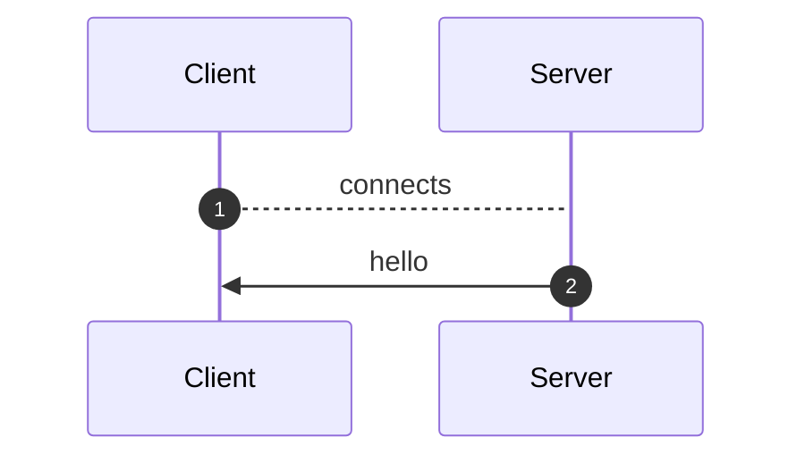
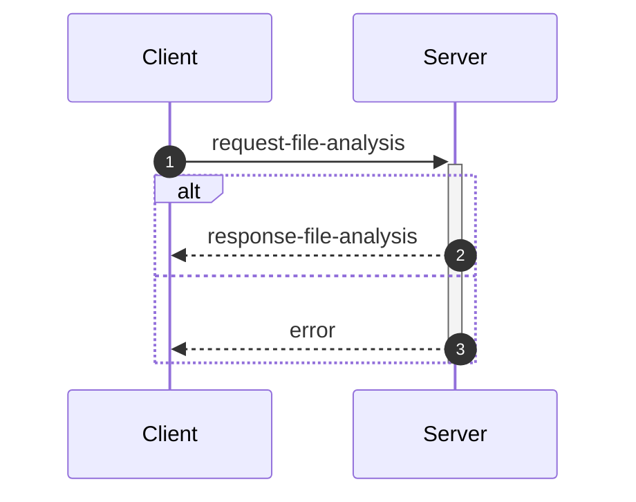
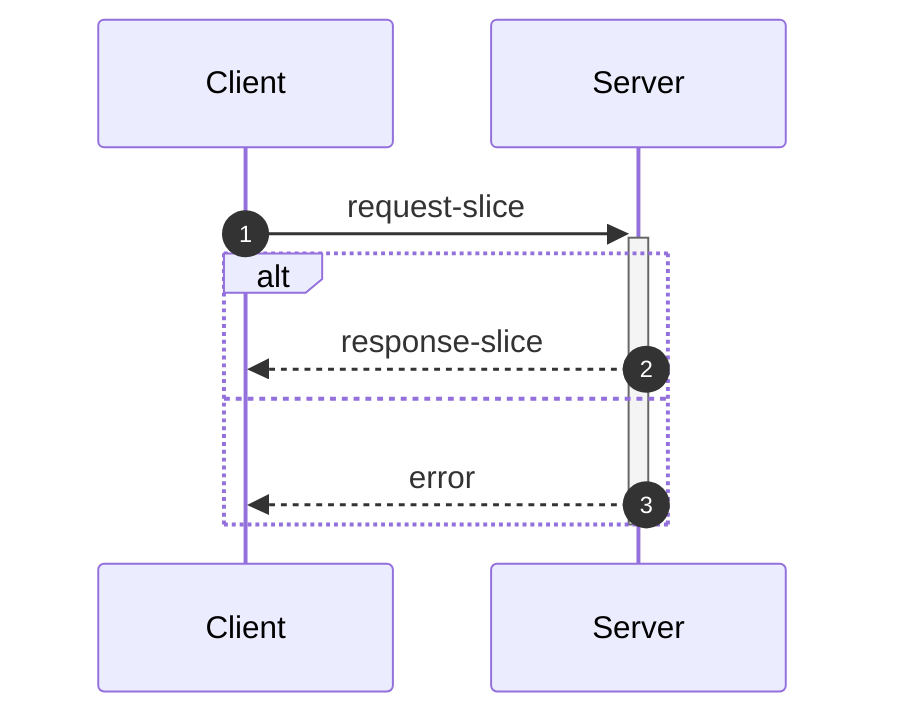
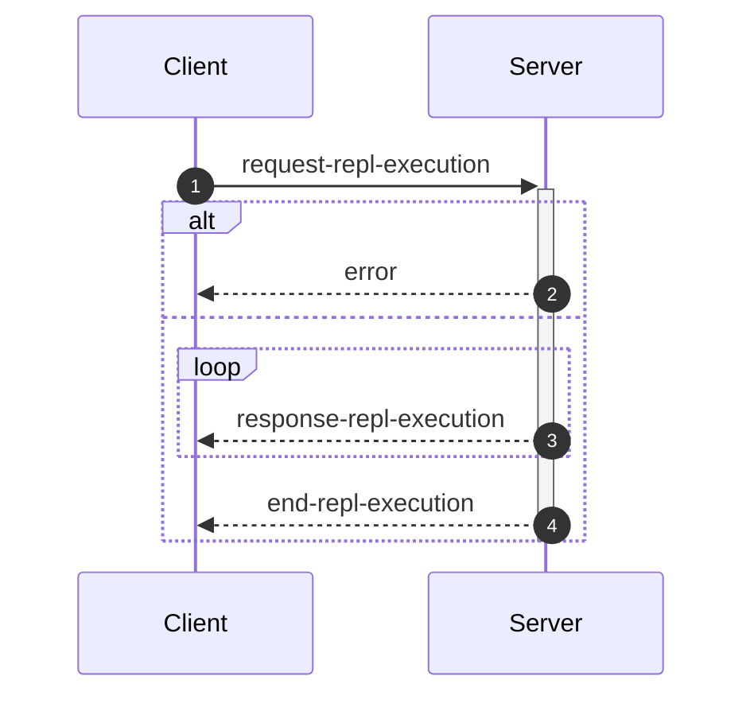

_<span title="an overview of flowR's interface">Generated</span> from '[wiki-interface.ts](https://github.com/flowr-analysis/flowr/tree/main/src/documentation/wiki-interface.ts "src/documentation/wiki-interface.ts")' on 2026-10-18, 21:39:50 UTC (v2.16.2, R v4.6.1), do not edit directly._

Although far from being as detailed as the in-depth explanation of [_flowR_](https://github.com/flowr-analysis/flowr/wiki/Core),
this wiki page explains how to interface with _flowR_ in more detail.
In general, command line arguments and other options provide short descriptions on hover over.

* [💻 Using the REPL](#using-the-repl)
* [⚙️ Configuring FlowR](#configuring-flowr)
* [⚒️ Writing Code](#writing-code)
* [💬 Communicating with the Server](#communicating-with-the-server)

<a id='using-the-repl'></a>
## 💻 Using the REPL

> [!NOTE]
> To execute arbitrary R commands with a repl request, _flowR_ has to be started explicitly with <span title="Description (Command Line Argument): Allow to access the underlying R session when using flowR (security warning: this allows the execution of arbitrary R code!)">`--r-session-access`</span>.
> Please be aware that this introduces a security risk and note that this relies on the [`r-shell` engine](https://github.com/flowr-analysis/flowr/wiki/Engines) .

Although primarily meant for users to explore,
there is nothing which forbids calling _flowR_ as a subprocess to use standard-in, -output, and -error
for communication (although you can access the REPL using the server as well,
with the [REPL Request](#message-request-repl-execution) message).

The read-eval-print loop&nbsp;(REPL) works relatively simple.
You can submit an expression (using <kbd>Enter</kbd>),
which is interpreted as an R&nbsp;expression by default but interpreted as a *command* if it starts with a colon (`:`).
The best command to get started with the REPL is <span title="Description (Repl Command): Show help information (aliases: :h, :?)">`:help`</span>.
Besides, you can leave the REPL either with the command <span title="Description (Repl Command): End the repl (aliases: :q, :exit)">`:quit`</span> or by pressing <kbd>Ctrl</kbd>+<kbd>C</kbd> twice.
When writing a *command*, you may press <kbd>Tab</kbd> to get a list of completions, if available.
Multiple commands can be entered in a single line by separating them with a semicolon (`;`), e.g. `:parse "x<-2"; :df*`.
If a command is given without R code, the REPL will re-use R code given in a previous command.
The prior example will hence return first the parsed AST of the program and then the dataflow graph for `"x <- 2"`.

> [!NOTE]
> If you develop flowR, you may want to launch the repl using the `npm run main-dev` command, this way, you get a non-minified version of flowR with debug information and hot-reloading of source files.

<details>
<summary>Available Commands</summary>

We currently offer the following commands (this with a `[*]` suffix are available with and without the star):

| Command | Description |
| ------- | ----------- |
| **<span title="Description (Repl Command): End the repl (aliases: :q, :exit)">:quit</span>** | End the repl (aliases: **:<span title="Alias of ':quit'. End the repl">q</span>**, **:<span title="Alias of ':quit'. End the repl">exit</span>**) |
| **<span title="Description (Repl Command): Execute the given code as R code. This requires the `--r-session-access` flag to be set and requires the r-shell engine. (aliases: :e, :r)">:execute</span>** | Execute the given code as R code. This requires the `--r-session-access` flag to be set and requires the r-shell engine. (aliases: **:<span title="Alias of ':execute'. Execute the given code as R code. This requires the `--r-session-access` flag to be set and requires the r-shell engine.">e</span>**, **:<span title="Alias of ':execute'. Execute the given code as R code. This requires the `--r-session-access` flag to be set and requires the r-shell engine.">r</span>**) |
| **<span title="Description (Repl Command): Get mermaid code for the control-flow graph of R code (aliases: :cfg, :cf)">:controlflow[*]</span>** | Get mermaid code for the control-flow graph of R code (star: Returns the URL to mermaid.live) (aliases: **:<span title="Alias of ':controlflow'. Get mermaid code for the control-flow graph of R code">cfg</span>**, **:<span title="Alias of ':controlflow'. Get mermaid code for the control-flow graph of R code">cf</span>**) |
| **<span title="Description (Repl Command): Get mermaid code for the control-flow graph with basic blocks (aliases: :cfgb, :cfb)">:controlflowbb[*]</span>** | Get mermaid code for the control-flow graph with basic blocks (star: Returns the URL to mermaid.live) (aliases: **:<span title="Alias of ':controlflowbb'. Get mermaid code for the control-flow graph with basic blocks">cfgb</span>**, **:<span title="Alias of ':controlflowbb'. Get mermaid code for the control-flow graph with basic blocks">cfb</span>**) |
| **<span title="Description (Repl Command): Get mermaid code for the dataflow graph (aliases: :d, :df)">:dataflow[*]</span>** | Get mermaid code for the dataflow graph (star: Returns the URL to mermaid.live) (aliases: **:<span title="Alias of ':dataflow'. Get mermaid code for the dataflow graph">d</span>**, **:<span title="Alias of ':dataflow'. Get mermaid code for the dataflow graph">df</span>**) |
| **<span title="Description (Repl Command): Get mermaid code for the normalized AST of R code (aliases: :n)">:normalize[*]</span>** | Get mermaid code for the normalized AST of R code (star: Returns the URL to mermaid.live) (alias: **:<span title="Alias of ':normalize'. Get mermaid code for the normalized AST of R code">n</span>**) |
| **<span title="Description (Repl Command): Get mermaid code for the simplified dataflow graph (aliases: :ds, :dfs)">:dataflowsimple[*]</span>** | Get mermaid code for the simplified dataflow graph (star: Returns the URL to mermaid.live) (aliases: **:<span title="Alias of ':dataflowsimple'. Get mermaid code for the simplified dataflow graph">ds</span>**, **:<span title="Alias of ':dataflowsimple'. Get mermaid code for the simplified dataflow graph">dfs</span>**) |
| **<span title="Description (Repl Command): Inspect and extend the signature database: `query` (identical to :query @signature), `info <name>` for where a function comes from (identical to :query @function-info), `add <path>` to mount another database/source, `download` to fetch the full-history database. (aliases: :sig)">:signature</span>** | Inspect and extend the signature database: `query` (identical to :query @signature), `info <name>` for where a function comes from (identical to :query @function-info), `add <path>` to mount another database/source, `download` to fetch the full-history database. (alias: **:<span title="Alias of ':signature'. Inspect and extend the signature database: `query` (identical to :query @signature), `info <name>` for where a function comes from (identical to :query @function-info), `add <path>` to mount another database/source, `download` to fetch the full-history database.">sig</span>**) |
| **<span title="Description (Repl Command): Just calculates the DFG, but only prints summary info (aliases: :d#, :df#)">:dataflowsilent</span>** | Just calculates the DFG, but only prints summary info (aliases: **:<span title="Alias of ':dataflowsilent'. Just calculates the DFG, but only prints summary info">d#</span>**, **:<span title="Alias of ':dataflowsilent'. Just calculates the DFG, but only prints summary info">df#</span>**) |
| **<span title="Description (Repl Command): Prints ASCII Art of the parsed, unmodified AST (aliases: :p)">:parse</span>** | Prints ASCII Art of the parsed, unmodified AST (alias: **:<span title="Alias of ':parse'. Prints ASCII Art of the parsed, unmodified AST">p</span>**) |
| **<span title="Description (Repl Command): Prints the version of flowR as well as the current version of R">:version</span>** | Prints the version of flowR as well as the current version of R
| **<span title="Description (Repl Command): Query the given R code (use 'help' for more information)">:query[*]</span>** | Query the given R code (use 'help' for more information) (star: Similar to query, but returns the output in json format.)
| **<span title="Description (Repl Command): Returns an ASCII representation of the dataflow graph (aliases: :df!)">:dataflowascii</span>** | Returns an ASCII representation of the dataflow graph (alias: **:<span title="Alias of ':dataflowascii'. Returns an ASCII representation of the dataflow graph">df!</span>**) |
| **<span title="Description (Repl Command): Returns summarization stats for the normalized AST (aliases: :n#)">:normalize#</span>** | Returns summarization stats for the normalized AST (alias: **:<span title="Alias of ':normalize#'. Returns summarization stats for the normalized AST">n#</span>**) |
| **<span title="Description (Repl Command): Show help information (aliases: :h, :?)">:help</span>** | Show help information (aliases: **:<span title="Alias of ':help'. Show help information">h</span>**, **:<span title="Alias of ':help'. Show help information">?</span>**) |

</details>

> [!TIP]
> 
> As indicated by the examples before, all REPL commands that operate on code keep track of the state.
> Hence, if you run a command like <span title="Description (Repl Command, starred version): Returns the URL to mermaid.live; Base Command: Get mermaid code for the dataflow graph (aliases: :d*, :df*)">`:dataflow*`</span> without providing R code,
> the REPL will re-use the R code provided in a previous command.
> Likewise, doing this will benefit from incrementality!
> If you request the dataflow graph with `:df* x <- 2 * y` and then want to see the parsed AST with `:parse`,
> the REPL will re-use previously obtained information and not re-parse the code again.
> 		

Generally, many commands offer shortcut versions in the REPL. Many queries, for example, offer a shortened format (see the example below).
Of special note, the [Config Query](https://github.com/flowr-analysis/flowr/wiki/%5BQuery%5D-Config)
can be used to also modify the currently active configuration of _flowR_ within the REPL (see the [wiki page](https://github.com/flowr-analysis/flowr/wiki/%5BQuery%5D-Config) for more information).

### Example: Retrieving the Dataflow Graph

To retrieve a URL to the [mermaid](https://mermaid.js.org/) diagram of the dataflow of a given expression,
use <span title="Description (Repl Command, starred version): Returns the URL to mermaid.live; Base Command: Get mermaid code for the dataflow graph (aliases: :d*, :df*)">`:dataflow*`</span> (or <span title="Description (Repl Command): Get mermaid code for the dataflow graph (aliases: :d, :df)">`:dataflow`</span> to get the mermaid code in the cli):

```shell
$ docker run -it --rm eagleoutice/flowr # or npm run flowr 
flowR repl v2.16.2, R grammar v14 (tree-sitter engine)
R> :dataflow* y <- 1 + x
```

<details>
<summary style='color:gray'>Output</summary>

```text
https://mermaid.live/view#base64:eyJjb2RlIjoiZmxvd2NoYXJ0IFREXG4gICAgMXt7XCJgKiM5MTtSTnVtYmVyIzkzOyogKioxKipcbiAgICAgICoxLjYqICgqKmlkOiAxKiopYFwifX1cbiAgICAyKFtcImAqIzkxO1JTeW1ib2wjOTM7KiAqKngqKlxuICAgICAgKjEuMTAqICgqKmlkOiAyKiopYFwiXSlcbiAgICAzW1tcImAqIzkxO1JCaW5hcnlPcCM5MzsqIGJhc2UjNTg7IzU4OyoqIzQzOyoqXG4gICAgICAqMS42LTEwKiAoKippZDogMyoqKVxuICAgIGFyZzogKDEsIDIpYFwiXV1cbiAgICBidWlsdC1pbjpfNDNfW1wiYEJ1aWx0LUluOlxuIzQzO2BcIl1cbiAgICBzdHlsZSBidWlsdC1pbjpfNDNfIHN0cm9rZTpncmF5LGZpbGw6Z3JheSxzdHJva2Utd2lkdGg6MnB4LG9wYWNpdHk6Ljg7XG4gICAgMFtcImAqIzkxO1JTeW1ib2wjOTM7KiAqKnkqKlxuICAgICAgKjEuMSogKCoqaWQ6IDAqKiwgdjogMylgXCJdXG4gICAgNFtbXCJgKiM5MTtSQmluYXJ5T3AjOTM7KiBiYXNlIzU4OyM1ODsqKiM2MDsjNDU7KipcbiAgICAgICoxLjEtMTAqICgqKmlkOiA0KiopXG4gICAgYXJnOiAoMCwgMylgXCJdXVxuICAgIGJ1aWx0LWluOl82MF8tW1wiYEJ1aWx0LUluOlxuIzYwOyM0NTtgXCJdXG4gICAgc3R5bGUgYnVpbHQtaW46XzYwXy0gc3Ryb2tlOmdyYXksZmlsbDpncmF5LHN0cm9rZS13aWR0aDoycHgsb3BhY2l0eTouODtcbiAgICAxIC0uLT58XCJmbG93XCJ8IDJcbiAgICBsaW5rU3R5bGUgMCBzdHJva2U6Z3JheSxjb2xvcjpncmF5O1xuICAgIDIgLS4tPnxcImZsb3dcInwgM1xuICAgIGxpbmtTdHlsZSAxIHN0cm9rZTpncmF5LGNvbG9yOmdyYXk7XG4gICAgMyAtLT58XCJyZWFkcywgYXJnXCJ8IDFcbiAgICAzIC0tPnxcInJlYWRzLCBhcmdcInwgMlxuICAgIDMgLS4tPnxcImZsb3dcInwgMFxuICAgIGxpbmtTdHlsZSA0IHN0cm9rZTpncmF5LGNvbG9yOmdyYXk7XG4gICAgMyAtLi0+fFwicmVhZHMsIGNhbGxzXCJ8IGJ1aWx0LWluOl80M19cbiAgICBsaW5rU3R5bGUgNSBzdHJva2U6Z3JheTtcbiAgICAwIC0tPnxcImRlZmluZWQtYnksIGZsb3dcInwgNFxuICAgIDAgLS0+fFwiZGVmaW5lZC1ieVwifCAzXG4gICAgNCAtLT58XCJyZWFkcywgYXJnXCJ8IDNcbiAgICA0IC0tPnxcInJldHVybnMsIGFyZ1wifCAwXG4gICAgNCAtLi0+fFwicmVhZHMsIGNhbGxzXCJ8IGJ1aWx0LWluOl82MF8tXG4gICAgbGlua1N0eWxlIDEwIHN0cm9rZTpncmF5OyIsIm1lcm1haWQiOnsiYXV0b1N5bmMiOnRydWV9fQ==
```

Retrieve the dataflow graph of the expression `y <- 1 + x`. It looks like this:


<details>

<summary style="color:gray">R Code of the Dataflow Graph</summary>

The analysis ran (including parse and normalize, using the [tree-sitter](https://github.com/flowr-analysis/flowr/wiki/Engines) engine) within the generation environment. No [signature database](https://github.com/flowr-analysis/flowr/wiki/Signature-Database) is mounted for these generated graphs, so `library()` calls attach no package exports; base-R names are still qualified via the generated base-package store (e.g. `acf` as `stats::acf`). 
We encountered no unknown side effects during the analysis.

```r
y <- 1 + x
```

</details>

</details>

For small graphs like this, <span title="Description (Repl Command): Returns an ASCII representation of the dataflow graph (aliases: :df!)">`:dataflowascii`</span> also provides an ASCII representation directly in the REPL:

```shell
$ docker run -it --rm eagleoutice/flowr # or npm run flowr 
flowR repl v2.16.2, R grammar v14 (tree-sitter engine)
R> :df! y <- 1 + x
```

<details open>
<summary style='color:gray'>Output</summary>

```text
                        v<0>v
 c<4>c──────────────────| y |
 |<- |     ┌────────────v---v
 c---c     │
    │   c<3>c   0<1>0
    └───| + |───| 1 |───u<2>u
        c---c   0---0   | x |
           └────────────u---u
Edges:
3 -> 1: reads, arg          3 -> 2: reads, arg
3 -> 0: flows-to            1 -> 2: flows-to
2 -> 3: flows-to            4 -> 3: reads, arg
4 -> 0: returns, arg        0 -> 4: defined-by, flows-to
0 -> 3: defined-by
```

Retrieve the dataflow graph of the expression `y <- 1 + x` as ASCII art.

</details>

For the slicing with <span title="Description (Repl Command): Static backwards executable slicer for R">`:slicer`</span>, you have access to the same [magic comments](#slice-magic-comments) as with the [slice request](#message-request-slice).
Pass `--inline` to splice resolvable `source()` calls into the reconstruction so the slice is a single self-contained R text (the same as the static slice query's `inlineSources` flag).
See `--help` for more flags!

### Example: Interfacing with the File System

Many commands that allow for an R-expression (like <span title="Description (Repl Command, starred version): Returns the URL to mermaid.live; Base Command: Get mermaid code for the dataflow graph (aliases: :d*, :df*)">`:dataflow*`</span>) allow for a file as well
if the argument starts with `file://`.
If you are working from the root directory of the _flowR_ repository, the following gives you the parsed AST of the example file using the <span title="Description (Repl Command): Prints ASCII Art of the parsed, unmodified AST (aliases: :p)">`:parse`</span> command:

> **Watch mode**: Replace `file://` with `watch://` to enter watch mode.
> flowR runs the command immediately and then re-runs it every time the file (or any file inside the folder) changes.
> Enter any other command to leave watch mode.
> For example: `:df watch://analysis.R`

```shell
$ docker run -it --rm eagleoutice/flowr # or npm run flowr 
flowR repl v2.16.2, R grammar v14 (tree-sitter engine)
R> :parse file://test/testfiles/example.R
```

<details>
<summary style='color:gray'>Output</summary>

```text
File: test/testfiles/example.R

program
├ binaryoperator
│ ├ identifier "sum" (1:1─4)
│ ├ <- "<-" (1:5─7)
│ ╰ float "0" (1:8─9)
├ binaryoperator
│ ├ identifier "product" (2:1─8)
│ ├ <- "<-" (2:9─11)
│ ╰ float "1" (2:12─13)
├ binaryoperator
│ ├ identifier "w" (3:1─2)
│ ├ <- "<-" (3:3─5)
│ ╰ float "7" (3:6─7)
├ binaryoperator
│ ├ identifier "N" (4:1─2)
│ ├ <- "<-" (4:3─5)
│ ╰ float "10" (4:6─8)
├ forstatement
│ ├ for "for" (6:1─4)
│ ├ ( "(" (6:5─6)
│ ├ identifier "i" (6:6─7)
│ ├ in "in" (6:8─10)
│ ├ binaryoperator
│ │ ├ float "1" (6:11─12)
│ │ ├ : ":" (6:12─13)
│ │ ╰ parenthesizedexpression
│ │   ├ ( "(" (6:13─14)
│ │   ├ binaryoperator
│ │   │ ├ identifier "N" (6:14─15)
│ │   │ ├ - "-" (6:15─16)
│ │   │ ╰ float "1" (6:16─17)
│ │   ╰ ) ")" (6:17─18)
│ ├ ) ")" (6:18─19)
│ ╰ bracedexpression
│   ├ { "{" (6:20─21)
│   ├ binaryoperator
│   │ ├ identifier "sum" (7:3─6)
│   │ ├ <- "<-" (7:7─9)
│   │ ╰ binaryoperator
│   │   ├ binaryoperator
│   │   │ ├ identifier "sum" (7:10─13)
│   │   │ ├ + "+" (7:14─15)
│   │   │ ╰ identifier "i" (7:16─17)
│   │   ├ + "+" (7:18─19)
│   │   ╰ identifier "w" (7:20─21)
│   ├ binaryoperator
│   │ ├ identifier "product" (8:3─10)
│   │ ├ <- "<-" (8:11─13)
│   │ ╰ binaryoperator
│   │   ├ identifier "product" (8:14─21)
│   │   ├  "" (8:22─23)
│   │   ╰ identifier "i" (8:24─25)
│   ╰ } "}" (9:1─2)
├ call
│ ├ identifier "cat" (11:1─4)
│ ╰ arguments
│   ├ ( "(" (11:4─5)
│   ├ argument
│   │ ╰ string
│   │   ├ " "\"" (11:5─6)
│   │   ├ stringcontent "Sum:" (11:6─10)
│   │   ╰ " "\"" (11:10─11)
│   ├ comma "," (11:11─12)
│   ├ argument
│   │ ╰ identifier "sum" (11:13─16)
│   ├ comma "," (11:16─17)
│   ├ argument
│   │ ╰ string
│   │   ├ " "\"" (11:18─19)
│   │   ├ stringcontent
│   │   │ ╰ escapesequence "\\n" (11:19─21)
│   │   ╰ " "\"" (11:21─22)
│   ╰ ) ")" (11:22─23)
╰ call
  ├ identifier "cat" (12:1─4)
  ╰ arguments
    ├ ( "(" (12:4─5)
    ├ argument
    │ ╰ string
    │   ├ " "\"" (12:5─6)
    │   ├ stringcontent "Product:" (12:6─14)
    │   ╰ " "\"" (12:14─15)
    ├ comma "," (12:15─16)
    ├ argument
    │ ╰ identifier "product" (12:17─24)
    ├ comma "," (12:24─25)
    ├ argument
    │ ╰ string
    │   ├ " "\"" (12:26─27)
    │   ├ stringcontent
    │   │ ╰ escapesequence "\\n" (12:27─29)
    │   ╰ " "\"" (12:29─30)
    ╰ ) ")" (12:30─31)
```

Retrieve the parsed AST of the example file.

<details>

<summary>File Content</summary>

```r
sum <- 0
product <- 1
w <- 7
N <- 10

for (i in 1:(N-1)) {
  sum <- sum + i + w
  product <- product * i
}

cat("Sum:", sum, "\n")
cat("Product:", product, "\n")
```

</details>

As _flowR_ directly transforms this AST the output focuses on being human-readable instead of being machine-readable.
		
</details>

### Example: Run a Query

You can run any query supported by _flowR_ using the <span title="Description (Repl Command): Query the given R code (use 'help' for more information)">`:query`</span> command.
For example, to obtain the shapes of all data frames in a given piece of code, you can run:

```shell
$ docker run -it --rm eagleoutice/flowr # or npm run flowr 
flowR repl v2.16.2, R grammar v14 (tree-sitter engine)
R> :query @absint df-shape "x <- data.frame(a = 1:10, b = 1:10)\ny <- x$a"
```

<details open>
<summary style='color:gray'>Output</summary>

```text
Query: absint (1 ms)
```

Retrieve the shapes of all data frames in the given code.

</details>

To run the linter on a file, you can use (in this example, we just issue the `dead-code` linter on a small piece of code):

```shell
$ docker run -it --rm eagleoutice/flowr # or npm run flowr 
flowR repl v2.16.2, R grammar v14 (tree-sitter engine)
R> :query @linter rules:dead-code "if(FALSE) x <- 2"
```

<details open>
<summary style='color:gray'>Output</summary>

```text
Query: linter (3 ms)
   ╰ Dead Code (dead-code):
       ╰ certain:
           ╰ Code at 1.11-16
```

Run the linter on the given code, with only the `dead-code` rule enabled.

</details>

For more information on the available queries, please check out the [Query API](https://github.com/flowr-analysis/flowr/wiki/Query-API).

<a id='configuring-flowr'></a>
## ⚙️ Configuring FlowR

When running _flowR_, you may want to specify some behaviors with a dedicated configuration file.
By default, flowR looks for a file named `flowr.json` in the current working directory (or any higher directory).
You can also specify a different file with <span title="Description (Command Line Argument): The name of the configuration file to use">`--config-file`</span> or pass the configuration inline using <span title="Description (Command Line Argument): The flowR configuration to use, as a JSON string">`--config-json`</span>.
A `flowr.json` found this way belongs to the analyzed project, so flowR ignores its options that decide what flowR executes or loads
(`engines.*.wasmPath`, `engines.*.treeSitterWasmPath`, `engines.*.rPath`, `solver.sigdb.additionalPaths`, `solver.sigdb.downloadRepo`, `solver.sigdb.installedLibrary.paths`),
unless you pass <span title="Description (Command Line Argument): Keep the security-sensitive options (e.g., the R executable) of the flowr.json found in the working directory or a parent. Only use this for projects you trust.">`--trust-config`</span>.
To analyze code you do not trust, use the secure mode (<span title="Description (Command Line Argument): Run in secure mode for analyzing untrusted code: flowR does not start R (or any other process), does not access the network, does not search for project configs, and ignores security-sensitive options in every config. Cannot be disabled once enabled. Can also be enabled with the environment variable {italic FLOWR_SECURE_MODE=1}.">`--secure`</span>, see the [security policy](https://github.com/flowr-analysis/flowr/blob/main/.github/SECURITY.md)).
To inspect the current configuration, you can run flowr with the <span title="Description (Command Line Argument): Run with verbose logging (will be passed to the corresponding script)">`--verbose`</span> flag, or use the `config` [Query](https://github.com/flowr-analysis/flowr/wiki/Query-API).
Within the REPL this works by running the following:

```shell
:query @config
```

To work with the <a href="https://github.com/flowr-analysis/flowr/tree/main/src/config.ts#L119"><code><span title="The configuration file format for flowR.">FlowrConfig</span></code></a> you can use the provided helper objects alongside its methods like
<a href="https://github.com/flowr-analysis/flowr/tree/main/src/config.ts#L914"><code><span title="Creates a new flowr config that has the updated values.">FlowrConfig::<b>amend</b></span></code></a>.
The schema below documents every option; the ones you most likely want are:

- <a href="https://github.com/flowr-analysis/flowr/wiki/Interface#configuring-flowr" title="Configuration Option (boolean): Whether source calls should be ignored, causing {@link processSourceCall}&#39;s behavior to be skipped.">ignoreSourceCalls</a>: ignore source calls when analyzing the code, i.e., ignore the inclusion of other files.
- <a href="https://github.com/flowr-analysis/flowr/wiki/Interface#configuring-flowr" title="Configuration Option (boolean): Whether load calls should be ignored, causing {@link processLoadCall}&#39;s behavior to be skipped.">ignoreLoadCalls</a>: ignore load calls when analyzing the code, i.e., ignore the loading of r-data files.
- <a href="https://github.com/flowr-analysis/flowr/wiki/Interface#configuring-flowr" title="Configuration Option (object): Do you want to overwrite (parts) of the builtin definition?">semantics.environment.overwriteBuiltIns</a>: overwrite _flowR_'s handling of built-in functions, or clear the preset definitions entirely.
  See [Configure BuiltIn Semantics](#configure-builtin-semantics) for more information.
- <a href="https://github.com/flowr-analysis/flowr/wiki/Interface#configuring-flowr" title="Configuration Option (string): How to resolve variables and their values. (one of &quot;disabled&quot;, &quot;alias&quot;, &quot;builtin&quot;)">solver.variables</a>: how to resolve variables and their values (`disabled`, `alias`, `builtin`).
- <a href="https://github.com/flowr-analysis/flowr/wiki/Interface#configuring-flowr" title="Configuration Option (array): The engine or set of engines to use for interacting with R code. An empty array means all available engines will be used.">engines</a> and <a href="https://github.com/flowr-analysis/flowr/wiki/Interface#configuring-flowr" title="Configuration Option (string): The default engine to use for interacting with R code. If this is undefined, an arbitrary engine from the specified list will be used. (one of &quot;tree-sitter&quot;, &quot;r-shell&quot;)">defaultEngine</a>: the engines used to interact with R code, see the [Engines wiki page](https://github.com/flowr-analysis/flowr/wiki/Engines).
- <a href="https://github.com/flowr-analysis/flowr/wiki/Interface#configuring-flowr" title="Configuration Option (array): Files a framework loads on its own, without any source() call (e.g. global.R in a shiny app), in the order they are loaded; flowR orders the matching project files accordingly and analyzes them as one program. Entries are case-insensitive globs matched against the file path, a plain name matches any file with that name, and entries matching no project file are warned about. Usually set per project kind via specializeConfig.">project.implicitSources</a>: the files a framework loads without any `source()` call, in the order in which they are
  loaded. Entries are globs (e.g. `R/*.R`) matched against the file path ignoring capitalization; one matching no file is reported.
- <a href="https://github.com/flowr-analysis/flowr/wiki/Interface#configuring-flowr" title="Configuration Option (object): Overwrite (parts of) the configuration depending on the project kind flowR detects, e.g. to give a shiny app its implicit sources.">specializeConfig</a>: overwrite (parts of) the configuration depending on the kind of project _flowR_ detects
  (e.g. `shiny-app`), which is how a shiny app gets its implicit sources by default. What you configure directly wins.
- <a href="https://github.com/flowr-analysis/flowr/wiki/Interface#configuring-flowr" title="Configuration Option (string): Overwrite the project kind flowR would otherwise infer from the analyzed files, e.g. when auto-detection guesses wrong. (one of &quot;package&quot;, &quot;script&quot;, &quot;shiny-app&quot;, &quot;notebook&quot;, &quot;project&quot;, &quot;unknown&quot;)">project.useProjectType</a>: skip that detection and force a project kind yourself, when auto-detection guesses wrong.
- <a href="https://github.com/flowr-analysis/flowr/wiki/Interface#configuring-flowr" title="Configuration Option (array): The default plugins to load when creating a new instance of FlowrAnalyzer">defaultPlugins</a> and <a href="https://github.com/flowr-analysis/flowr/wiki/Interface#configuring-flowr" title="Configuration Option (array): The plugins to load in REPL mode">repl.plugins</a>: the plugins to load for a new <a href="https://github.com/flowr-analysis/flowr/tree/main/src/project/flowr-analyzer.ts#L205"><code><span title="Central class for conducting analyses with FlowR. Use the FlowrAnalyzerBuilder to create a new instance. If you want the original pattern of creating a pipeline and running all steps, you can still do this with FlowrAnalyzer#runFull . To inspect the context of the analyzer, use FlowrAnalyzer#inspectContext (if you are a plugin and need to modify it, use FlowrAnalyzer#context instead).">FlowrAnalyzer</span></code></a> and in the REPL
  (use `flowr:default` to reference the former).

So you can configure _flowR_ by adding a file like the following:

<details>

<summary>Example Configuration File</summary>

```json
{
  "ignoreSourceCalls": true,
  "ignoreLoadCalls": true,
  "semantics": {
    "environment": {
      "overwriteBuiltIns": {
        "definitions": [
          {
            "type": "function",
            "names": [
              "foo"
            ],
            "processor": "builtin:assign",
            "config": {}
          }
        ]
      }
    }
  },
  "defaultPlugins": [
    "file:description",
    "versions:description"
  ],
  "repl": {
    "quickStats": false,
    "dfProcessorHeat": false,
    "hints": true,
    "plugins": [
      "flowr:default"
    ]
  },
  "project": {
    "resolveUnknownPathsOnDisk": true,
    "implicitSources": [
      "global.R",
      "app.R"
    ]
  },
  "linter": {
    "disabledRules": []
  },
  "specializeConfig": {
    "shiny-app": {
      "project": {
        "implicitSources": [
          "global.R",
          "ui.R",
          "server.R",
          "app.R"
        ]
      }
    }
  },
  "engines": [
    {
      "type": "r-shell"
    }
  ],
  "solver": {
    "variables": "alias",
    "evalStrings": true,
    "trackEnvironments": true,
    "sigdb": {
      "enabled": true,
      "loadProjectDependencies": true,
      "eagerlyLoad": false,
      "eagerlyLoadExports": false,
      "linkBaseR": false,
      "linkDescriptionDependencies": false
    },
    "resolveSource": {
      "dropPaths": "no",
      "ignoreCapitalization": true,
      "inferWorkingDirectory": "active-script",
      "searchPath": []
    },
    "instrument": {},
    "slicer": {
      "threshold": 50
    }
  },
  "abstractInterpretation": {
    "wideningThreshold": 4,
    "followCalls": true,
    "dataFrame": {
      "maxColNames": 20,
      "readLoadedData": {
        "readExternalFiles": true,
        "maxReadLines": 1000000
      }
    }
  },
  "incremental": {
    "alwaysIncremental": false,
    "parsing": {
      "activated": false,
      "heuristics": {
        "activated": true,
        "mtime": true,
        "linesFrom": 500,
        "bytesFrom": 50000,
        "alwaysWithEdits": false,
        "minFiles": 1
      }
    }
  },
  "gas": {
    "thresholds": {
      "memory": {
        "problematic": 0.7,
        "critical": 0.9
      },
      "timeMs": {
        "problematic": 100000,
        "critical": 120000
      }
    },
    "features": {}
  }
}
```

</details>

<details>
<a id='configure-builtin-semantics'></a>
<summary>Configure Built-In Semantics</summary>

`semantics/environment/overwriteBuiltins` accepts two keys:

- `loadDefaults` (boolean, initially `true`): If set to `true`, the default built-in definitions are loaded before applying the custom definitions. Setting this flag to `false` explicitly disables the loading of the default definitions.
- `definitions` (array, initially empty): Allows to overwrite or define new built-in elements. Each object within must have a `type` which is one of the below. Furthermore, they may define a string array of `names` which specifies the identifiers to bind the definitions to. You may use `assumePrimitive` to specify whether _flowR_ should assume that this is a primitive non-library definition (so you probably just do not want to specify the key).

  | Type            | Description                                                                                                                                                                                                                                                                                              | Example                                                                                                    |
  | --------------- | -------------------------------------------------------------------------------------------------------------------------------------------------------------------------------------------------------------------------------------------------------------------------------------------------------- | ---------------------------------------------------------------------------------------------------------- |
  | `constant`    | Additionally allows for a `value` this should resolve to.                                                                                                                                                                                                                                                | `{ type: 'constant', names: ['NULL', 'NA'],  value: null }`                                                |
  | `function`    | Is a rather flexible way to define and bind built-in functions. For the time, we do not have extensive documentation to cover all the cases, so please either consult the sources with the `default-builtin-config.ts` or open a [new issue](https://github.com/flowr-analysis/flowr/issues/new/choose). | `{ type: 'function', names: ['next'], processor: 'builtin:d', config: { cfg: ExitPointType.Next } }` |
  | `replacement` | A comfortable way to specify replacement functions like `$<-` or `names<-`. `suffixes` describes the... suffixes to attach automatically. | `{ type: 'replacement', suffixes: ['<-', '<<-'], names: ['[', '[['] }` |

</details>

<details>

<summary style='color:gray'>Full Configuration-File Schema</summary>

- _The configuration file format for flowR._ (object)
    - **logLevel** [optional] _flowR's global minimum log level, applied when the config is loaded._ (string)
        Only allows: 'silly', 'trace', 'debug', 'info', 'warn', 'error', 'fatal'
    - **ignoreSourceCalls** [optional] _Whether source calls should be ignored, causing {@link processSourceCall}'s behavior to be skipped._ (boolean)
    - **ignoreLoadCalls** [optional] _Whether load calls should be ignored, causing {@link processLoadCall}'s behavior to be skipped._ (boolean)
    - **semantics** _Configure language semantics and how flowR handles them._ (object)
        - **environment** [optional] _Semantics regarding how to handle the R environment._ (object)
            - **overwriteBuiltIns** [optional] _Do you want to overwrite (parts) of the builtin definition?_ (object)
                - **loadDefaults** [optional] _Should the default configuration still be loaded?_ (boolean)
                - **definitions** [optional] _The definitions to load/overwrite._ (array)
                Valid item types:
                    - (object)
    - **defaultPlugins** [optional] _The default plugins to load when creating a new instance of FlowrAnalyzer_ (array)
    Valid item types:
        - (alternatives)
            - (string)
            - (array)
    - **repl** _Configuration options for the REPL._ (object)
        - **quickStats** [optional] _Whether to show quick stats in the REPL after each evaluation._ (boolean)
        - **dfProcessorHeat** [optional] _This instruments the dataflow processors to count how often each processor is called._ (boolean)
        - **hints** [optional] _Whether to show dim inline hints on the empty prompt (automatically disabled on non-interactive terminals)._ (boolean)
        - **plugins** [optional] _The plugins to load in REPL mode_ (array)
        Valid item types:
            - (alternatives)
                - (string)
                - (array)
        - **autoUseFileProtocol** [optional] _Prepend the file protocol to a repl input that looks like a path, instead of only warning about it._ (boolean)
        - **queryStats** [optional] _Whether `:query` closes with the line stating how long the queries took (`:query*` never prints it)._ (boolean)
        - **showPlugins** [optional] _Whether `:version` grays out the plugins that did not activate during the last analysis._ (boolean)
    - **project** _Project specific configuration options._ (object)
        - **resolveUnknownPathsOnDisk** [optional] _Whether to resolve unknown paths loaded by the r project disk when trying to source/analyze files._ (boolean)
        - **failOnInaccessiblePath** [optional] _Whether a directory that cannot be traversed during file discovery (e.g. due to permissions) aborts the analysis; when false (the default) such paths are logged and skipped._ (boolean)
        - **basePackages** [optional] _The packages considered part of R itself (base and recommended); if unset, flowR uses its built-in list._ (array)
        Valid item types:
            - (string)
        - **implicitSources** [optional] _Files a framework loads on its own, without any source() call (e.g. global.R in a shiny app), in the order they are loaded; flowR orders the matching project files accordingly and analyzes them as one program. Entries are case-insensitive globs matched against the file path, a plain name matches any file with that name, and entries matching no project file are warned about. Usually set per project kind via specializeConfig._ (array)
        Valid item types:
            - (string)
        - **useProjectType** [optional] _Overwrite the project kind flowR would otherwise infer from the analyzed files, e.g. when auto-detection guesses wrong._ (string)
            Only allows: 'package', 'script', 'shiny-app', 'notebook', 'project', 'unknown'
        - **assumeImplicitEcho** [optional] _Whether the top level of the analyzed code is echoed, so that every visible result printed there is collected as an output by the dependencies query (default true, false for a package)._ (boolean)
        - **discovery** [optional] _Scoping options for the default project discovery._ (object)
            - **full** [optional] _Collect every file below the project root (greedy) instead of only the files the detected project kind needs (default false)._ (boolean)
            - **perKind** [optional] _Per-kind include/exclude glob overrides layered on the default scoping._ (object)
            - **ignore** [optional] _Case-insensitive globs that drop matching files from the intelligent discovery, regardless of kind (e.g. .Renviron to ignore environment files)._ (array)
            Valid item types:
                - (string)
        - **classification** [optional] _Overrides for the signals flowR uses to classify the project kind._ (object)
            - **shinyDescriptionTypes** [optional] _DESCRIPTION Type: values that mark a shiny app._ (array)
            Valid item types:
                - (string)
            - **shinyEntryFiles** [optional] _File names a shiny app is assembled from._ (array)
            Valid item types:
                - (string)
            - **shinyUsagePattern** [optional] _Regex source evidencing shiny usage in an entry file._ (string)
            - **notebookExtensions** [optional] _File extensions marking a notebook._ (array)
            Valid item types:
                - (string)
    - **linter** _Linter configuration options._ (object)
        - **disabledRules** _Linting rule names excluded from the default rule set (a rule requested explicitly via a linter query still runs). Usually set per project kind via specializeConfig._ (array)
        Valid item types:
            - (string)
        - **disabledTags** [optional] _Linting rule tags whose rules are excluded from the default rule set (a rule requested explicitly via a linter query still runs). By default the cmd-check rules are disabled for everything but a package; a configured list replaces that default._ (array)
        Valid item types:
            - (string)
    - **inputSources** [optional] _Further frameworks the input-sources analysis should know about; entries are added to flowR's defaults._ (object)
        - **pure** [optional] _Functions that only pass the constantness of their arguments on._ (array)
        Valid item types:
            - (string)
        - **param** [optional] _Functions whose result is a 'param' input._ (array)
        Valid item types:
            - (string)
        - **file** [optional] _Functions whose result is a 'file' input._ (array)
        Valid item types:
            - (string)
        - **tempfile** [optional] _Functions whose result is a 'tempfile' input._ (array)
        Valid item types:
            - (string)
        - **glob** [optional] _Functions whose result is a 'glob' input._ (array)
        Valid item types:
            - (string)
        - **net** [optional] _Functions whose result is a 'net' input._ (array)
        Valid item types:
            - (string)
        - **rand** [optional] _Functions whose result is a 'rand' input._ (array)
        Valid item types:
            - (string)
        - **system** [optional] _Functions whose result is a 'system' input._ (array)
        Valid item types:
            - (string)
        - **ffi** [optional] _Functions whose result is a 'ffi' input._ (array)
        Valid item types:
            - (string)
        - **lang** [optional] _Functions whose result is a 'lang' input._ (array)
        Valid item types:
            - (string)
        - **options** [optional] _Functions whose result is a 'options' input._ (array)
        Valid item types:
            - (string)
        - **cmdline** [optional] _Functions whose result is a 'cmdline' input._ (array)
        Valid item types:
            - (string)
        - **user** [optional] _Functions whose result is a 'user' input._ (array)
        Valid item types:
            - (string)
        - **const** [optional] _Functions whose result is a 'const' input._ (array)
        Valid item types:
            - (string)
        - **scope** [optional] _Functions whose result is a 'scope' input._ (array)
        Valid item types:
            - (string)
        - **dconst** [optional] _Functions whose result is a 'dconst' input._ (array)
        Valid item types:
            - (string)
        - **unknown** [optional] _Functions whose result is a 'unknown' input._ (array)
        Valid item types:
            - (string)
        - **linkedObjects** [optional] _Objects a framework provides without a definition in the code, e.g. shiny's input._ (array)
        Valid item types:
            - (object)
        - **linkedEntryPoints** [optional] _Calls that hand a function to a framework, which binds its objects to the parameters by position._ (array)
        Valid item types:
            - (object)
    - **specializeConfig** [optional] _Overwrite (parts of) the configuration depending on the project kind flowR detects, e.g. to give a shiny app its implicit sources._ (object)
    - **engines** _The engine or set of engines to use for interacting with R code. An empty array means all available engines will be used._ (array)
    Valid item types:
        - (alternatives)
            - _The configuration for the tree sitter engine._ (object)
                - **type** [required] _Use the tree sitter engine._ (string)
                    Only allows: 'tree-sitter'
                - **wasmPath** [optional] _The path to the tree-sitter-r WASM binary to use. If this is undefined, this uses the default path._ (string)
                - **treeSitterWasmPath** [optional] _The path to the tree-sitter WASM binary to use. If this is undefined, this uses the default path._ (string)
                - **lax** [optional] _Whether to use the lax parser for parsing R code (allowing for syntax errors). If this is undefined, the strict parser will be used._ (boolean)
            - _The configuration for the R shell engine._ (object)
                - **type** [required] _Use the R shell engine._ (string)
                    Only allows: 'r-shell'
                - **rPath** [optional] _The path to the R executable to use. If this is undefined, this uses the default path._ (string)
                - **pipeBind** [optional] _Whether to enable R's experimental pipe-bind operator "=>" by setting _R_USE_PIPEBIND_ for the R session (default false); R itself keeps this off by default, as it is experimental and has never shipped in a release version of R._ (boolean)
    - **defaultEngine** [optional] _The default engine to use for interacting with R code. If this is undefined, an arbitrary engine from the specified list will be used._ (string)
        Only allows: 'tree-sitter', 'r-shell'
    - **solver** _How to resolve constants, constraints, cells, ..._ (object)
        - **variables** _How to resolve variables and their values._ (string)
            Only allows: 'disabled', 'alias', 'builtin'
        - **evalStrings** _Should we include eval(parse(text="...")) calls in the dataflow graph?_ (boolean)
        - **trackEnvironments** [optional] _Track user-created environments (new.env, assign/get/local with envir=, dollar-assign, attach). When false, all envir-style calls fall through conservatively._ (boolean)
        - **sigdb** _Resolving library exports from a signature database._ (object)
            - **enabled** [optional] _Resolve library()/use() exports from a signature database (default true); when false no database is consulted._ (boolean)
            - **loadProjectDependencies** [optional] _Load the project's declared dependencies from its metadata files (DESCRIPTION Imports/Depends, rproject.toml, uvr.toml, renv.lock, rv.lock, uvr.lock) (default true); when false these files are not read for dependencies._ (boolean)
            - **eagerlyLoad** [optional] _Parse the database up front rather than on the first package load (default false, ignored if disabled)._ (boolean)
            - **eagerlyLoadExports** [optional] _Add a vertex for every export on load rather than on demand (default false); keeps the dataflow graph small._ (boolean)
            - **assumedRVersion** [optional] _R version assumed when resolving versioned (base-R) exports: a pin like "4.5" or "auto" to detect the installed R (default "auto")._ (string)
            - **linkBaseR** [optional] _Eagerly attach base-R namespaces so bare base calls resolve without library() (default false)._ (boolean)
            - **linkBaseRCalls** [optional] _Add a lightweight Reads edge from a bare base-R call to its signature-database function vertex (default false; base-R qualification is edge-free otherwise)._ (boolean)
            - **linkPackageCalls** [optional] _Add a lightweight Reads edge from a resolved package call to its signature-database function vertex (default false)._ (boolean)
            - **linkDescriptionDependencies** [optional] _Eagerly attach the namespaces of the project's declared DESCRIPTION dependencies (Imports/Depends) so their exports resolve without an explicit library() (default false)._ (boolean)
            - **warmInBackground** [optional] _Decompress the hot shards (base + most-downloaded) in a background task on startup so the first library() lookup is warm (default false; for long-running servers/REPLs)._ (boolean)
            - **additionalPaths** [optional] _Extra directories or bundle/manifest files searched for signature databases (alongside the shipped default and $FLOWR_SIGDB_DIR); a downloaded full-history bundle placed here is mounted automatically._ (array)
            Valid item types:
                - (string)
            - **downloadRepo** [optional] _GitHub owner/repo the full-history bundle is downloaded from via ":signature download" (default "flowr-analysis/flowr", release tag "sigdb-v<flowR-version>")._ (string)
            - **autoSync** [optional] _On startup, re-download shards whose committed sigdb.remote.json hash no longer matches the cache, in the background (default false; opt-in network sync after a git pull)._ (boolean)
            - **installedLibrary** [optional] _Recovering packages no signature database knows from the copy installed on this machine._ (object)
                - **enabled** [required] _Recover packages no signature database knows from their installed copy (default false)._ (boolean)
                - **paths** [optional] _Library directories to search; when empty they are discovered from the environment and the project._ (array)
                Valid item types:
                    - (string)
                - **useEnvironment** [optional] _Search the libraries R_LIBS_USER/R_LIBS/R_LIBS_SITE name (default true)._ (boolean)
                - **useProjectLibrary** [optional] _Search a project-local renv/packrat library (default true)._ (boolean)
                - **maxDepth** [optional] _How far to descend into the nested layout of a project-local library (default 3)._ (number)
                - **packages** [optional] _Only recover packages whose name matches one of these regular expressions; empty means any._ (array)
                Valid item types:
                    - (string)
            - **blobCacheBudgetMb** [optional] _How many MiB of decoded package blobs every open bundle may hold together (default 16)._ (number)
            - **versionSelection** [optional] _When a project constrains a dependency, resolve to the newest (default), oldest, or system-installed version satisfying it; system needs R and falls back to newest. Base-R packages always resolve against the assumed R version._ (string)
                Only allows: 'newest', 'oldest', 'system'
            - **versionOverrides** [optional] _Force an exact version for specific packages (name -> version), overriding both the project constraint and the versionSelection policy (default {})._ (object)
        - **versionManagement** _Policies for reasoning about dependency versions._ (object)
            - **linkedVersionGroups** [optional] _Groups of packages that must resolve to the same version; version guessing intersects each group so its members stay mutually compatible (default [])._ (array)
            Valid item types:
                - (array)
                Valid item types:
                    - (string)
        - **assumeAttachedPackages** [optional] _Packages to treat as attached without a `library()` call, so what the built-in configuration states about them applies to the analyzed code. The base packages R attaches on startup already resolve without it._ (array)
        Valid item types:
            - (string)
        - **transitiveSideEffectRounds** [optional] _How many rounds the transitive side-effect fixpoint may run before it is cut off (default 32); the propagation stops on its own as soon as a round adds nothing._ (number)
        - **maxOverlayDepth** [optional] _How many binding overlays may stack on one environment frame before a write flattens them (default 4); a pure performance knob, trading lookup cost against copy cost without changing any result._ (number)
        - **instrument** (object)
            - **dataflowExtractors** [optional] _These keys are only intended for use within code, allowing to instrument the dataflow analyzer!_ (any)
        - **resolveSource** [optional] _If lax source calls are active, flowR searches for sourced files much more freely, based on the configurations you give it. This option is only in effect if `ignoreSourceCalls` is set to false._ (object)
            - **dropPaths** _Allow to drop the first or all parts of the sourced path, if it is relative._ (string)
                Only allows: 'no', 'once', 'all'
            - **ignoreCapitalization** _Search for filenames matching in the lowercase._ (boolean)
            - **inferWorkingDirectory** _Try to infer the working directory from the main or any script to analyze._ (string)
                Only allows: 'no', 'main-script', 'active-script', 'any-script'
            - **searchPath** _Additionally search in these paths._ (array)
            Valid item types:
                - (string)
            - **repeatedSourceLimit** [optional] _How often the same file can be sourced within a single run? Please be aware: in case of cyclic sources this may not reach a fixpoint so give this a sensible limit._ (number)
            - **applyReplacements** _Provide name replacements for loaded files_ (array)
            Valid item types:
                - (object)
            - **assumeFilesExist** [optional] _Assume a sourced file is always there, making what it defines certain instead of conditional on the source call._ (boolean)
        - **slicer** [optional] _The configuration for the slicer._ (object)
            - **threshold** [optional] _The maximum number of iterations to perform on a single function call during slicing._ (number)
            - **autoExtend** [optional] _If set, the slicer will gain an additional post-pass._ (boolean)
    - **abstractInterpretation** _The configuration options for abstract interpretation._ (object)
        - **wideningThreshold** _The threshold for the number of visitations of a node at which widening should be performed to ensure the termination of the fixpoint iteration._ (number)
        - **followCalls** _Whether the abstract interpretation is interprocedural, i.e. whether it steps into the functions a call may dispatch to._ (boolean)
        - **dataFrame** _The configuration of the shape inference for data frames._ (object)
            - **maxColNames** _The maximum number of columns names to infer for data frames before over-approximating the column names to top._ (number)
            - **readLoadedData** _Configuration options for reading data frame shapes from loaded external data files, such as CSV files._ (object)
                - **readExternalFiles** _Whether data frame shapes should be extracted from loaded external files, such as CSV files._ (boolean)
                - **maxReadLines** _The maximum number of lines to read when extracting data frame shapes from loaded files, such as CSV files._ (number)
    - **incremental** (object)
        - **alwaysIncremental** _Always take the incremental path, regardless of heuristics._ (boolean)
        - **parsing** (object)
            - **activated** _If set, incremental parsing will be used._ (boolean)
            - **heuristics** (object)
                - **activated** [optional] _If set, the heuristics for incremental parsing will be used._ (boolean)
                - **mtime** [optional] _Skip reparsing entirely if the file's modification time is unchanged since the last parse._ (boolean)
                - **linesFrom** [optional] _Only consider incremental parsing for files with at least this many lines._ (number)
                - **bytesFrom** [optional] _Only consider incremental parsing for files with at least this many bytes._ (number)
                - **alwaysWithEdits** [optional] _Always take the incremental path whenever there is a computed edit region, regardless of the other thresholds._ (boolean)
                - **minFiles** [optional] _Only apply these heuristics once the project has at least this many files loaded._ (number)
    - **gas** [optional] _Resource-usage guard (gas) configuration. All feature factors default to 0 (disabled). See https://github.com/flowr-analysis/flowr/wiki/Core#gas-resource-guard._ (object)
        - **thresholds** [optional] _Thresholds for all gas checks (scaled by per-feature factor), boundable per feature._ (object)
            - **memory** [optional] _Heap-usage fraction thresholds (0-1), either shared or given per feature key (with `default` covering the rest)._ (object)
                - **problematic** [optional] _Heap fraction (0-1) above which Problematic is returned, for every feature without an entry of its own._ (number)
                - **critical** [optional] _Heap fraction (0-1) above which Critical is returned, for every feature without an entry of its own._ (number)
            - **timeMs** [optional] _Elapsed analysis time thresholds in milliseconds, either shared or given per feature key (with `default` covering the rest)._ (object)
                - **problematic** [optional] _Elapsed ms above which Problematic is returned, for every feature without an entry of its own._ (number)
                - **critical** [optional] _Elapsed ms above which Critical is returned, for every feature without an entry of its own._ (number)
            - **steps** [optional] _Processed-AST-node thresholds, counted rather than sampled; only a key that arms a budget (`dataflow`) reads them._ (object)
                - **problematic** [optional] _Processed AST nodes above which Problematic is returned, for every feature without an entry of its own._ (number)
                - **critical** [optional] _Processed AST nodes above which the extraction is cut short, for every feature without an entry of its own._ (number)
            - **vertices** [optional] _Created-dataflow-vertex thresholds, counted like `steps`._ (object)
                - **problematic** [optional] _Created dataflow vertices above which Problematic is returned, for every feature without an entry of its own._ (number)
                - **critical** [optional] _Created dataflow vertices above which the extraction is cut short, for every feature without an entry of its own._ (number)
        - **features** [optional] _Per-feature sensitivity factors. 0 or absent disables gas checking for that feature. A factor of 2 makes the feature twice as sensitive. Recognised keys: `source`, `side-effect-linking`, `linter`, `slicer`, `dataflow`._ (object)
        - **countedCheckEvery** [optional] _How many counted steps pass between two accountings of an armed check, be it a dataflow budget or the slicer's traversal (default 128); trades overshoot against the cost of the check._ (number)
        - **heapProvider** [optional] _Custom heap statistics source (programmatic configs only), overriding the built-in v8/performance.memory detection._ (function)

</details>

<a id='writing-code'></a>
## ⚒️ Writing Code

_flowR_ can be used as a [module](https://www.npmjs.com/package/@eagleoutice/flowr) and offers several main classes and interfaces that are interesting for extension writers 
(see the [Visual Studio Code extension](https://marketplace.visualstudio.com/items?itemName=code-inspect.vscode-flowr) or the [Core](https://github.com/flowr-analysis/flowr/wiki/Core) wiki page for more information).

### Creating Analyses with _flowR_

Nowadays, instances of the <a href="https://github.com/flowr-analysis/flowr/tree/main/src/project/flowr-analyzer.ts#L205"><code><span title="Central class for conducting analyses with FlowR. Use the FlowrAnalyzerBuilder to create a new instance. If you want the original pattern of creating a pipeline and running all steps, you can still do this with FlowrAnalyzer#runFull . To inspect the context of the analyzer, use FlowrAnalyzer#inspectContext (if you are a plugin and need to modify it, use FlowrAnalyzer#context instead).">FlowrAnalyzer</span></code></a> should be used as central frontend to get analysis results from _flowR_.
The entry points an analysis is written against are re-exported from the package root (`import { FlowrAnalyzerBuilder } from '@eagleoutice/flowr'`);
everything else stays reachable under its own path, as in `@eagleoutice/flowr/dataflow/graph/graph`.
For example, a program slice can be created like this:

```ts
const analyzer = await new FlowrAnalyzerBuilder()
    .setEngine('tree-sitter')
    .build();
analyzer.addRequest('x <- 1\ny <- x\nx');
const result = await analyzer.query([
    {
        type:     'static-slice',
        criteria: ['3@x']
    }
]);
```

For more information, please have a look at the [Analyzer](https://github.com/flowr-analysis/flowr/wiki/Analyzer) wiki page, which explains how to construct and use the <a href="https://github.com/flowr-analysis/flowr/tree/main/src/project/flowr-analyzer.ts#L205"><code><span title="Central class for conducting analyses with FlowR. Use the FlowrAnalyzerBuilder to create a new instance. If you want the original pattern of creating a pipeline and running all steps, you can still do this with FlowrAnalyzer#runFull . To inspect the context of the analyzer, use FlowrAnalyzer#inspectContext (if you are a plugin and need to modify it, use FlowrAnalyzer#context instead).">FlowrAnalyzer</span></code></a> in more detail.
To work with specific perspectives, you can also consult the respective pages like the [Dataflow Graph](https://github.com/flowr-analysis/flowr/wiki/Dataflow-Graph) or the [Abstract Interpretation](https://github.com/flowr-analysis/flowr/wiki/Abstract-Interpretation) wiki pages.
### The Pipeline Executor (Low-Level Interface)

Once, in the beginning, _flowR_ was meant to produce a dataflow graph merely to provide *program slices*. 
However, with continuous updates, the [Dataflow Graph](https://github.com/flowr-analysis/flowr/wiki/Dataflow-Graph) repeatedly proves to be the more interesting part.
With this, we restructured _flowR_'s originally *hardcoded* pipeline to be far more flexible. 
Now, it can be theoretically extended or replaced with arbitrary steps, optional steps, and what we call 'decorations' of these steps. 
In short, a slicing pipeline using the <a href="https://github.com/flowr-analysis/flowr/tree/main/src/core/pipeline-executor.ts#L97"><code><span title="**Please note:** The PipelineExecutor is now considered to be a rather low-level API for flowR. While it still works and is the basis for all other layers, we strongly recommend using the FlowrAnalyzer and its builder to create and use an analyzer instance that is pre-configured for your use-case. The pipeline executor allows to execute arbitrary pipelines in a step-by-step fashion. If you are not...">PipelineExecutor</span></code></a> looks like this:

```ts

const slicer = new PipelineExecutor(DEFAULT_SLICING_PIPELINE, {
  parser:    new RShell(),
  request:   requestFromInput('x <- 1\nx + 1'),
  criterion: ['2@x']
})
const slice = await slicer.allRemainingSteps()
// console.log(slice.reconstruct.code)
```

<details><summary>More Information</summary>

If you compare this, with what you would have done with the old (and removed) `SteppingSlicer`, 
this essentially just requires you to replace the `SteppingSlicer` with the <a href="https://github.com/flowr-analysis/flowr/tree/main/src/core/pipeline-executor.ts#L97"><code><span title="**Please note:** The PipelineExecutor is now considered to be a rather low-level API for flowR. While it still works and is the basis for all other layers, we strongly recommend using the FlowrAnalyzer and its builder to create and use an analyzer instance that is pre-configured for your use-case. The pipeline executor allows to execute arbitrary pipelines in a step-by-step fashion. If you are not...">PipelineExecutor</span></code></a>
and to pass the <a href="https://github.com/flowr-analysis/flowr/tree/main/src/core/steps/pipeline/default-pipelines.ts#L18"><code>DEFAULT_SLICING_PIPELINE</code></a> as the first argument.
The <a href="https://github.com/flowr-analysis/flowr/tree/main/src/core/pipeline-executor.ts#L97"><code><span title="**Please note:** The PipelineExecutor is now considered to be a rather low-level API for flowR. While it still works and is the basis for all other layers, we strongly recommend using the FlowrAnalyzer and its builder to create and use an analyzer instance that is pre-configured for your use-case. The pipeline executor allows to execute arbitrary pipelines in a step-by-step fashion. If you are not...">PipelineExecutor</span></code></a>...

1. Provides structures to investigate the results of all intermediate steps
2. Can be executed step-by-step
3. Can repeat steps (e.g., to calculate multiple slices on the same input)

See the in-code documentation for more information.

</details>

### Using the <a href="https://github.com/flowr-analysis/flowr/tree/main/src/r-bridge/shell.ts#L144"><code><span title="The RShell represents an interactive session with the R interpreter. You can configure it by RShellOptions . At the moment we are using a live R session (and not networking etc.) to communicate with R easily, which allows us to install packages etc. However, this might and probably will change in the future (leaving this as a legacy mode :D)">RShell</span></code></a> to Interact with R

The <a href="https://github.com/flowr-analysis/flowr/tree/main/src/r-bridge/shell.ts#L144"><code><span title="The RShell represents an interactive session with the R interpreter. You can configure it by RShellOptions . At the moment we are using a live R session (and not networking etc.) to communicate with R easily, which allows us to install packages etc. However, this might and probably will change in the future (leaving this as a legacy mode :D)">RShell</span></code></a> class allows interfacing with the `R`&nbsp;ecosystem installed on the host system.
Please have a look at [flowR's Engines](https://github.com/flowr-analysis/flowr/wiki/Engines) for more information on alternatives (for example, the <a href="https://github.com/flowr-analysis/flowr/tree/main/src/r-bridge/lang-4.x/tree-sitter/tree-sitter-executor.ts#L29"><code><span title="Synchronous and (way) faster alternative to the RShell using tree-sitter.">TreeSitterExecutor</span></code></a>).

> [!IMPORTANT]
> 
> Each <a href="https://github.com/flowr-analysis/flowr/tree/main/src/r-bridge/shell.ts#L144"><code><span title="The RShell represents an interactive session with the R interpreter. You can configure it by RShellOptions . At the moment we are using a live R session (and not networking etc.) to communicate with R easily, which allows us to install packages etc. However, this might and probably will change in the future (leaving this as a legacy mode :D)">RShell</span></code></a> controls a new instance of the R&nbsp;interpreter, 
> make sure to call <code><a href="https://github.com/flowr-analysis/flowr/tree/main/src/r-bridge/shell.ts#L350"><span title="Close the current R session, makes the object effectively invalid (can no longer be reopened etc.)">RShell::<i>close</i></span></a>()</code> when you are done.

You can start a new "session" by constructing a new object with <code>new <a href="https://github.com/flowr-analysis/flowr/tree/main/src/r-bridge/shell.ts#L144"><span title="The RShell represents an interactive session with the R interpreter. You can configure it by RShellOptions . At the moment we are using a live R session (and not networking etc.) to communicate with R easily, which allows us to install packages etc. However, this might and probably will change in the future (leaving this as a legacy mode :D)">RShell</span></a>()</code>.

However, there are several options that may be of interest 
(e.g., to automatically revive the shell in case of errors or to control the name location of the R process on the system).

With a shell object (let's call it `shell`), you can execute R code by using <a href="https://github.com/flowr-analysis/flowr/tree/main/src/r-bridge/shell.ts#L213"><code><span title="sends the given command directly to the current R session will not do anything to alter input markers!">RShell::<i>sendCommand</i></span></code></a>,
for example <code>shell.<a href="https://github.com/flowr-analysis/flowr/tree/main/src/r-bridge/shell.ts#L213"><span title="sends the given command directly to the current R session will not do anything to alter input markers!">sendCommand</span></a>("1 + 1")</code>.
However, this does not return anything, so if you want to collect the output of your command, use
<a href="https://github.com/flowr-analysis/flowr/tree/main/src/r-bridge/shell.ts#L296"><code><span title="Send a command and collect the output">RShell::<i>sendCommandWithOutput</i></span></code></a> instead.

<a id='communicating-with-the-server'></a>
## 💬 Communicating with the Server

As explained in the [Overview](https://github.com/flowr-analysis/flowr/wiki/Overview), you can run the [TCP](https://de.wikipedia.org/wiki/Transmission_Control_Protocol)&nbsp;server by adding the <span title="Description (Command Line Argument): Do not drop into a repl, but instead start a server on the given port (default: 1042) and listen for messages.">`--server`</span> flag (and, due to the interactive mode, exit with the conventional <kbd>CTRL</kbd>+<kbd>C</kbd>).
Currently, every connection is handled by the same underlying `RShell` - so the server is not designed to handle many clients at a time.
Additionally, the server is not well guarded against attacks (e.g., you can theoretically spawn an arbitrary number of&nbsp;RShell sessions on the target machine).

Every message has to be given in a single line (i.e., without a newline in-between) and end with a newline character. Nevertheless, we will pretty-print example given in the following segments for the ease of reading.

> [!NOTE]
> 
> The default <span title="Description (Command Line Argument): Do not drop into a repl, but instead start a server on the given port (default: 1042) and listen for messages.">`--server`</span> uses a simple [TCP](https://de.wikipedia.org/wiki/Transmission_Control_Protocol)
> connection. If you want _flowR_ to expose a [WebSocket](https://de.wikipedia.org/wiki/WebSocket) server instead, add the <span title="Description (Command Line Argument): If the server flag is set, use websocket for messaging">`--ws`</span> flag (i.e., <span title="Description (Command Line Argument): Do not drop into a repl, but instead start a server on the given port (default: 1042) and listen for messages.">`--server`</span> <span title="Description (Command Line Argument): If the server flag is set, use websocket for messaging">`--ws`</span>) when starting _flowR_ from the command line.

<ul><li>
<a id="message-hello"></a>
<b>Hello</b> Message (<code>hello</code>) 
<details>

<summary style="color:gray"> View Details. <i>The server informs the client about the successful connection and provides Meta-Information.</i> </summary>



After launching _flowR_, for example, with <code>docker run -it --rm eagleoutice/flowr <span title="Description (Command Line Argument): Do not drop into a repl, but instead start a server on the given port (default: 1042) and listen for messages.">-<span/>-server</span></code>&nbsp;(🐳️), connecting should present you with a `hello` message, that amongst others should reveal the versions of&nbsp;_flowR_ and&nbsp;R, using the [semver 2.0](https://semver.org/spec/v2.0.0.html) versioning scheme.
The message looks like this:

```json
{
  "type": "hello",
  "clientName": "client-0",
  "versions": {
    "flowr": "2.16.2",
    "r": "4.6.1",
    "engine": "r-shell"
  }
}
```

There are currently a few messages that you can send after the hello message.
If you want to _slice_ a piece of R code you first have to send an [analysis request](#message-request-file-analysis), so that you can send one or multiple slice requests afterward.
Requests for the [REPL](#message-request-repl-execution) are independent of that.
	
<hr>

<details>
<summary style="color:gray">Message schema (<code>hello</code>)</summary>

For the definition of the hello message, please see it's implementation at [`./src/cli/repl/server/messages/message-hello.ts`](https://github.com/flowr-analysis/flowr/tree/main/src/cli/repl/server/messages/message-hello.ts).

- [required] (object)
    - **type** [required] _The type of the hello message._ (string)
        Only allows: 'hello'
    - **id** [forbidden] _The id of the message is always undefined (as it is the initial message and not requested)._ (any)
    - **clientName** [required] _A unique name that is assigned to each client. It has no semantic meaning and is only used/useful for debugging._ (string)
    - **versions** [required] (object)
        - **flowr** [required] _The version of the flowr server running in semver format._ (string)
        - **r** [required] _The version of the underlying R shell running in semver format._ (string)
        - **engine** [required] _The parser backend that is used to parse the R code._ (string)

</details>

<hr>

</details>
	</li>

<li>
<a id="message-request-file-analysis"></a>
<b>Analysis</b> Message (<code>request-file-analysis</code>) 
<details>

<summary style="color:gray"> View Details. <i>The server builds the dataflow graph for a given input file (or a set of files).</i> </summary>



The request allows the server to analyze a file and prepare it for slicing.
The message can contain a `filetoken`, which is used to identify the file in later slice or query requests (if you do not add one, the request will not be stored and therefore, it is not available for subsequent requests).

> **Please note!**\
> If you want to send and process a lot of analysis requests, but do not want to slice them, please do not pass the `filetoken` field. This will save the server a lot of memory allocation.

Furthermore, the request must contain either a `content` field to directly pass the file's content or a `filepath` field which contains the path to the file (this path must be accessible for the server to be useful).
If you add the `id` field, the answer will use the same `id` so you can match requests and the corresponding answers.
See the implementation of the request-file-analysis message for more information.

You can drop one or more stored file tokens by adding the `invalidateToken` field (a single token or an array of tokens).
The server frees the corresponding analyses _after_ it has answered the request.

> **Tip!**\
> If you only want to drop tokens, you do not need a separate message: send a `request-file-analysis` that contains _just_ the `invalidateToken` field (and no `content` or `filepath`).
> Such a request behaves like an empty file analysis and the server replies with an empty `results` object.
> Because invalidation happens after the response, you may even pass the _current_ `filetoken` in `invalidateToken` to analyze a file once and have the server forget it right after you received the results.

<details>
<summary>Example of the <code>request-file-analysis</code> Message</summary>

_Note:_ even though we pretty-print these messages, they are sent as a single line, ending with a newline.

The following lists all messages that were sent and received in case you want to reproduce the scenario:

<ol>
<li> <code>hello</code> (response)
<details> 

<summary> Show Details </summary>

The first message is always a hello message.

```json
{"type":"hello","clientName":"client-0","versions":{"flowr":"2.16.2","r":"4.6.1","engine":"r-shell"}}
```

</details>
</li>

<li> <b><code>request-file-analysis</code> (request)</b>
<details open> 

<summary> Show Details </summary>

Let's suppose you simply want to analyze the following script:
 
```r
x <- 1
x + 1
```

 For this, you can send the following request:

```json
{"type":"request-file-analysis","id":"1","filetoken":"x","content":"x <- 1\nx + 1"}
```

</details>
</li>

<li> <code>response-file-analysis</code> (response)
<details> 

<summary> Show Details </summary>

The `results` field of the response effectively contains three keys of importance:

- `parse`: which contains 1:1 the parse result in CSV format that we received from the `RShell` (i.e., the AST produced by the parser of the R interpreter).
- `normalize`: which contains the normalized AST, including ids (see the `info` field and the [Normalized AST](https://github.com/flowr-analysis/flowr/wiki/Normalized-AST) wiki page).
- `dataflow`: especially important is the `graph` field which contains the dataflow graph as a set of root vertices (see the [Dataflow Graph](https://github.com/flowr-analysis/flowr/wiki/Dataflow-Graph) wiki page).
			
_As the code is pretty long, we inhibit pretty printing and syntax highlighting (JSON, hiding built-in):_

```text
{"type":"response-file-analysis","format":"json","id":"1","results":{"parse":{"files":[{"parsed":"[1,1,1,6,7,0,\"expr\",false,\"x <- 1\"],[1,1,1,1,1,3,\"SYMBOL\",true,\"x\"],[1,1,1,1,3,7,\"expr\",false,\"x\"],[1,3,1,4,2,7,\"LEFT_ASSIGN\",true,\"<-\"],[1,6,1,6,4,5,\"NUM_CONST\",true,\"1\"],[1,6,1,6,5,7,\"expr\",false,\"1\"],[2,1,2,5,16,0,\"expr\",false,\"x + 1\"],[2,1,2,1,10,12,\"SYMBOL\",true,\"x\"],[2,1,2,1,12,16,\"expr\",false,\"x\"],[2,3,2,3,11,16,\"'+'\",true,\"+\"],[2,5,2,5,13,14,\"NUM_CONST\",true,\"1\"],[2,5,2,5,14,16,\"expr\",false,\"1\"]","filePath":"/tmp/tmp-477872-2mBXz73SyCLh-.R"}],".meta":{}},"normalize":{"ast":{"type":"RProject","files":[{"root":{"type":"RExpressionList","children":[{"type":"RBinaryOp","location":[1,3,1,4],"lhs":{"type":"RSymbol","location":[1,1,1,1],"content":"x","lexeme":"x","info":{"fullRange":[1,1,1,1],"adToks":[],"id":0,"parent":2,"role":"bin-l","index":0,"nest":0,"file":"/tmp/tmp-477872-2mBXz73SyCLh-.R"}},"rhs":{"location":[1,6,1,6],"lexeme":"1","info":{"fullRange":[1,6,1,6],"adToks":[],"id":1,"parent":2,"role":"bin-r","index":1,"nest":0,"file":"/tmp/tmp-477872-2mBXz73SyCLh-.R"},"type":"RNumber","content":{"num":1,"complexNumber":false,"markedAsInt":false}},"operator":"<-","lexeme":"<-","info":{"fullRange":[1,1,1,6],"adToks":[],"id":2,"parent":6,"nest":0,"file":"/tmp/tmp-477872-2mBXz73SyCLh-.R","index":0,"role":"el-c"}},{"type":"RBinaryOp","location":[2,3,2,3],"lhs":{"type":"RSymbol","location":[2,1,2,1],"content":"x","lexeme":"x","info":{"fullRange":[2,1,2,1],"adToks":[],"id":3,"parent":5,"role":"bin-l","index":0,"nest":0,"file":"/tmp/tmp-477872-2mBXz73SyCLh-.R"}},"rhs":{"location":[2,5,2,5],"lexeme":"1","info":{"fullRange":[2,5,2,5],"adToks":[],"id":4,"parent":5,"role":"bin-r","index":1,"nest":0,"file":"/tmp/tmp-477872-2mBXz73SyCLh-.R"},"type":"RNumber","content":{"num":1,"complexNumber":false,"markedAsInt":false}},"operator":"+","lexeme":"+","info":{"fullRange":[2,1,2,5],"adToks":[],"id":5,"parent":6,"nest":0,"file":"/tmp/tmp-477872-2mBXz73SyCLh-.R","index":1,"role":"el-c"}}],"info":{"adToks":[],"id":6,"nest":0,"file":"/tmp/tmp-477872-2mBXz73SyCLh-.R","role":"root","index":0}},"filePath":"/tmp/tmp-477872-2mBXz73SyCLh-.R"}],"info":{"id":7}},".meta":{}},"dataflow":{"unknownReferences":[],"in":[{"nodeId":2,"name":"<-","type":2},{"nodeId":5,"name":"+","type":2}],"out":[{"nodeId":0,"name":"x","type":4,"definedAt":2,"value":[1]}],"environment":{"current":{"id":1485,"parent":"<BuiltInEnvironment>","memory":[["x",[{"nodeId":0,"name":"x","type":4,"definedAt":2,"value":[1]}]]],"globalEnv":true},"level":0},"graph":{"rootVertices":[1,0,2,3,4,5],"vertexInformation":[[1,{"tag":"value","id":1}],[0,{"tag":"vdef","id":0,"source":[1]}],[2,{"tag":"fcall","id":2,"name":"<-","onlyBuiltin":true,"args":[{"nodeId":0,"type":32},{"nodeId":1,"type":32}],"origin":["builtin:assign"]}],[3,{"tag":"use","id":3}],[4,{"tag":"value","id":4}],[5,{"tag":"fcall","id":5,"name":"+","onlyBuiltin":true,"args":[{"nodeId":3,"type":32},{"nodeId":4,"type":32}],"origin":["builtin:d"]}]],"edgeInformation":[[2,[[1,{"types":65}],[0,{"types":72}],["built-in:<-",{"types":5}],[3,{"types":4096}]]],[1,[[0,{"types":4096}]]],[0,[[2,{"types":4098}],[1,{"types":2}]]],[5,[[3,{"types":65}],[4,{"types":65}],["built-in:+",{"types":5}]]],[3,[[0,{"types":1}],[4,{"types":4096}]]],[4,[[5,{"types":4096}]]]],"_unknownSideEffects":[]},"entryPoint":2,"cfgEntry":1,"exitPoints":[{"type":0,"nodeId":5}],"hooks":[],".meta":{}}}}
```

</details>
</li>
</ol>

The complete round-trip covers validating the messages as well as starting and stopping the internal mock server.

</details>

You receive an error if, for whatever reason, the analysis fails (e.g., the message or code you sent contained syntax errors).
It contains a human-readable description *why* the analysis failed (see the error message implementation for more details).

<details>
<summary>Example Error Message</summary>

_Note:_ even though we pretty-print these messages, they are sent as a single line, ending with a newline.

The following lists all messages that were sent and received in case you want to reproduce the scenario:

<ol>
<li> <code>hello</code> (response)
<details> 

<summary> Show Details </summary>

The first message is always a hello message.

```json
{"type":"hello","clientName":"client-0","versions":{"flowr":"2.16.2","r":"4.6.1","engine":"r-shell"}}
```

</details>
</li>

<li> <code>request-file-analysis</code> (request)
<details> 

<summary> Show Details </summary>

```json
{"type":"request-file-analysis","id":"1","filename":"sample.R","content":"x <-"}
```

</details>
</li>

<li> <b><code>error</code> (response)</b>
<details open> 

<summary> Show Details </summary>

```json
{
  "id": "1",
  "type": "error",
  "fatal": false,
  "reason": "Error while analyzing file sample.R: GuardError: unable to parse R code (see the log for more information) for request {\"request\":\"text\",\"content\":\"x <-\"}}\n Report a Bug: https://github.com/flowr-analysis/flowr/issues/new?body=%3C!%2D%2D%20Please%20describe%20your%20issue%20in%20more%20detail%20below!%20%2D%2D%3E%0A%0A%0A%3C!%2D%2D%20Automatically%20generated%20issue%20metadata%2C%20please%20do%20not%20edit%20or%20delete%20content%20below%20this%20line%20%2D%2D%3E%0A%2D%2D%2D%0A%0AflowR%20version%3A%202.16.2%0Anode%20version%3A%20v26.8.1%0Anode%20arch%3A%20x64%0Anode%20platform%3A%20linux%0Amessage%3A%20%60unable%20to%20parse%20R%20code%20%28see%20the%20log%20for%20more%20information%29%20for%20request%20%7B%22request%22%3A%22text%22%2C%22content%22%3A%22x%20%3C%2D%22%7D%7D%60%0Astack%20trace%3A%0A%60%60%60%0A%20%20%20%20at%20guard%20%28%3C%3E%2Fsrc%2Futil%2Fassert.ts%3A128%3A9%29%0A%20%20%20%20at%20guardRetrievedOutput%20%28%3C%3E%2Fsrc%2Fr%2Dbridge%2Fretriever.ts%3A155%3A7%29%0A%20%20%20%20at%20%2Fhome%2Fostwind%2Fgit%2Fphd%2Fflowr%2Dfield%2Fflowr%2Fsrc%2Fr%2Dbridge%2Fretriever.ts%3A122%3A4%0A%20%20%20%20at%20processTicksAndRejections%20%28node%3Ainternal%2Fprocess%2Ftask_queues%3A104%3A5%29%0A%20%20%20%20at%20async%20Object.parseRequests%20%5Bas%20processor%5D%20%28%3C%3E%2Fsrc%2Fr%2Dbridge%2Fparser.ts%3A108%3A19%29%0A%20%20%20%20at%20async%20PipelineExecutor.nextStep%20%28%3C%3E%2Fsrc%2Fcore%2Fpipeline%2Dexecutor.ts%3A192%3A25%29%0A%20%20%20%20at%20async%20FlowrAnalyzerCache.stepTapeUntil%20%28%3C%3E%2Fsrc%2Fproject%2Fcache%2Fflowr%2Danalyzer%2Dcache.ts%3A117%3A4%29%0A%20%20%20%20at%20async%20FlowRServerConnection.sendFileAnalysisResponse%20%28%3C%3E%2Fsrc%2Fcli%2Frepl%2Fserver%2Fconnection.ts%3A206%3A53%29%0A%60%60%60%0A%0A%2D%2D%2D%0A%09"
}
```

</details>
</li>
</ol>

The complete round-trip covers validating the messages as well as starting and stopping the internal mock server.

</details>

&nbsp;

<a id="analysis-include-cfg"></a>
**Including the Control Flow Graph**

The control flow graph is a view on the dataflow graph: the dataflow analysis records the control flow while it walks
the program, and the graph projects those edges on demand. The server can expose that structure as well (please create
a [new issue](https://github.com/flowr-analysis/flowr/issues/new/choose) for any bug you may encounter).
For this, the analysis request may add `cfg: true` to its list of options.

<details>
<summary>Requesting a Control Flow Graph</summary>

_Note:_ even though we pretty-print these messages, they are sent as a single line, ending with a newline.

The following lists all messages that were sent and received in case you want to reproduce the scenario:

<ol>
<li> <code>hello</code> (response)
<details> 

<summary> Show Details </summary>

The first message is always a hello message.

```json
{"type":"hello","clientName":"client-0","versions":{"flowr":"2.16.2","r":"4.6.1","engine":"r-shell"}}
```

</details>
</li>

<li> <b><code>request-file-analysis</code> (request)</b>
<details open> 

<summary> Show Details </summary>

```json
{
  "type": "request-file-analysis",
  "id": "1",
  "filetoken": "x",
  "content": "if(unknown > 0) { x <- 2 } else { x <- 5 }\nfor(i in 1:x) { print(x); print(i) }",
  "cfg": true
}
```

</details>
</li>

<li> <code>response-file-analysis</code> (response)
<details> 

<summary> Show Details </summary>

The response looks basically the same as a response sent without the `cfg` flag. However, additionally it contains a `cfg` field. 
If you are interested in a visual representation of the control flow graph, see the 
[visualization with mermaid](https://mermaid.live/view#base64:eyJjb2RlIjoiZmxvd2NoYXJ0IFREXG4gICAgbjAoW1wiYFJTeW1ib2wgKDApXG4qKnVua25vd24qKmBcIl0pXG4gICAgbjEoW1wiYFJOdW1iZXIgKDEpXG4qKjAqKmBcIl0pXG4gICAgbjIoW1wiYFJCaW5hcnlPcCAoMilcbioqdW5rbm93biAjNjI7IDAqKmBcIl0pXG4gICAgbjYoW1wiYFJOdW1iZXIgKDYpXG4qKjIqKmBcIl0pXG4gICAgbjUoW1wiYFJTeW1ib2wgKDUpXG4qKngqKmBcIl0pXG4gICAgbjdbXCJgUkJpbmFyeU9wICg3KVxuKip4ICM2MDsjNDU7IDIqKmBcIl1cbiAgICBuOChbXCJgUkV4cHJlc3Npb25MaXN0ICg4KWBcIl0pXG4gICAgbjEyKFtcImBSTnVtYmVyICgxMilcbioqNSoqYFwiXSlcbiAgICBuMTEoW1wiYFJTeW1ib2wgKDExKVxuKip4KipgXCJdKVxuICAgIG4xM1tcImBSQmluYXJ5T3AgKDEzKVxuKip4ICM2MDsjNDU7IDUqKmBcIl1cbiAgICBuMTQoW1wiYFJFeHByZXNzaW9uTGlzdCAoMTQpYFwiXSlcbiAgICBuMTVbXCJgUklmVGhlbkVsc2UgKDE1KVxuKippZih1bmtub3duICM2MjsgMCkgIzEyMzsgeCAjNjA7IzQ1OyAyICMxMjU7IGVsc2UgIzEyMzsgeCAjNjA7IzQ1OyA1ICMxMjU7KipgXCJdXG4gICAgbjE2KFtcImBSU3ltYm9sICgxNilcbioqaSoqYFwiXSlcbiAgICBuMTcoW1wiYFJOdW1iZXIgKDE3KVxuKioxKipgXCJdKVxuICAgIG4xOChbXCJgUlN5bWJvbCAoMTgpXG4qKngqKmBcIl0pXG4gICAgbjE5KFtcImBSQmluYXJ5T3AgKDE5KVxuKioxIzU4O3gqKmBcIl0pXG4gICAgbjIzKFtcImBSU3ltYm9sICgyMylcbioqeCoqYFwiXSlcbiAgICBuMjVbXCJgUkZ1bmN0aW9uQ2FsbCAoMjUpXG4qKnByaW50KHgpKipgXCJdXG4gICAgbjI3KFtcImBSU3ltYm9sICgyNylcbioqaSoqYFwiXSlcbiAgICBuMjlbXCJgUkZ1bmN0aW9uQ2FsbCAoMjkpXG4qKnByaW50KGkpKipgXCJdXG4gICAgbjMwKFtcImBSRXhwcmVzc2lvbkxpc3QgKDMwKWBcIl0pXG4gICAgbjMxW1wiYFJGb3JMb29wICgzMSlcbioqZm9yKGkgaW4gMSM1ODt4KSAjMTIzOyBwcmludCh4KTsgcHJpbnQoaSkgIzEyNTsqKmBcIl1cbiAgICBuMiAtLi0+fFwiYnJhbmNoIG9uIHVua25vd24gIzYyOyAwICgyKSBpZiBUXCJ8IG42XG4gICAgbjIgLS4tPnxcImJyYW5jaCBvbiB1bmtub3duICM2MjsgMCAoMikgaWYgRlwifCBuMTJcbiAgICBuMCAtLT58XCJmbG93cyB0b1wifCBuMVxuICAgIG4xIC0tPnxcImZsb3dzIHRvXCJ8IG4yXG4gICAgbjcgLS0+fFwiZmxvd3MgdG9cInwgbjhcbiAgICBuNiAtLT58XCJmbG93cyB0b1wifCBuNVxuICAgIG41IC0tPnxcImZsb3dzIHRvXCJ8IG43XG4gICAgbjggLS0+fFwiZmxvd3MgdG9cInwgbjE1XG4gICAgbjE1IC0tPnxcImZsb3dzIHRvXCJ8IG4xN1xuICAgIG4xMyAtLT58XCJmbG93cyB0b1wifCBuMTRcbiAgICBuMTIgLS0+fFwiZmxvd3MgdG9cInwgbjExXG4gICAgbjExIC0tPnxcImZsb3dzIHRvXCJ8IG4xM1xuICAgIG4xNCAtLT58XCJmbG93cyB0b1wifCBuMTVcbiAgICBuMTkgLS0+fFwiZmxvd3MgdG9cInwgbjE2XG4gICAgbjE4IC0tPnxcImZsb3dzIHRvXCJ8IG4xOVxuICAgIG4xNyAtLT58XCJmbG93cyB0b1wifCBuMThcbiAgICBuMjUgLS0+fFwiZmxvd3MgdG9cInwgbjI3XG4gICAgbjIzIC0tPnxcImZsb3dzIHRvXCJ8IG4yNVxuICAgIG4yOSAtLT58XCJmbG93cyB0b1wifCBuMzBcbiAgICBuMjcgLS0+fFwiZmxvd3MgdG9cInwgbjI5XG4gICAgbjMwIC0tPnxcImZsb3dzIHRvXCJ8IG4xNlxuICAgIG4xNiAtLi0+fFwiYnJhbmNoIG9uIGkgKDE2KSBpZiBUXCJ8IG4yM1xuICAgIG4xNiAtLi0+fFwiYnJhbmNoIG9uIGkgKDE2KSBpZiBGXCJ8IG4zMVxuICAgIHN0eWxlIG4wIHN0cm9rZTpjeWFuLHN0cm9rZS13aWR0aDo2LjVweDsgICAgc3R5bGUgbjMxIHN0cm9rZTpncmVlbixzdHJva2Utd2lkdGg6Ni41cHg7IiwibWVybWFpZCI6eyJhdXRvU3luYyI6dHJ1ZX19).
			
_As the code is pretty long, we inhibit pretty printing and syntax highlighting (JSON, hiding built-in):_

```text
{"type":"response-file-analysis","format":"json","id":"1","cfg":{"graph":{"roots":[0,1,2,6,5,7,8,12,11,13,14,15,16,17,18,19,23,25,27,29,30,31],"vtxInfos":[[0,[2,0]],[1,[2,1]],[2,[2,2]],[6,[2,6]],[5,[2,5]],[7,[1,7]],[8,[2,8]],[12,[2,12]],[11,[2,11]],[13,[1,13]],[14,[2,14]],[15,[1,15]],[16,[2,16]],[17,[2,17]],[18,[2,18]],[19,[2,19]],[23,[2,23]],[25,[1,25]],[27,[2,27]],[29,[1,29]],[30,[2,30]],[31,[1,31]]],"bbChildren":[],"edgeInfos":[[2,[[6,{"id":15,"when":true}],[12,{"id":15,"when":false}]]],[0,[[1,0]]],[1,[[2,0]]],[7,[[8,0]]],[6,[[5,0]]],[5,[[7,0]]],[8,[[15,0]]],[15,[[17,0]]],[13,[[14,0]]],[12,[[11,0]]],[11,[[13,0]]],[14,[[15,0]]],[19,[[16,0]]],[18,[[19,0]]],[17,[[18,0]]],[25,[[27,0]]],[23,[[25,0]]],[29,[[30,0]]],[27,[[29,0]]],[30,[[16,0]]],[16,[[23,{"id":31,"when":true}],[31,{"id":31,"when":false}]]]],"mayHaveBasicBlocks":false},"entryPoints":[0],"exitPoints":[31],"returns":[],"breaks":[],"nexts":[]},"results":{"parse":{"files":[{"parsed":"[1,1,1,42,38,0,\"expr\",false,\"if(unknown > 0) { x <- 2 } else { x <- 5 }\"],[1,1,1,2,1,38,\"IF\",true,\"if\"],[1,3,1,3,2,38,\"'('\",true,\"(\"],[1,4,1,14,9,38,\"expr\",false,\"unknown > 0\"],[1,4,1,10,3,5,\"SYMBOL\",true,\"unknown\"],[1,4,1,10,5,9,\"expr\",false,\"unknown\"],[1,12,1,12,4,9,\"GT\",true,\">\"],[1,14,1,14,6,7,\"NUM_CONST\",true,\"0\"],[1,14,1,14,7,9,\"expr\",false,\"0\"],[1,15,1,15,8,38,\"')'\",true,\")\"],[1,17,1,26,22,38,\"expr\",false,\"{ x <- 2 }\"],[1,17,1,17,12,22,\"'{'\",true,\"{\"],[1,19,1,24,19,22,\"expr\",false,\"x <- 2\"],[1,19,1,19,13,15,\"SYMBOL\",true,\"x\"],[1,19,1,19,15,19,\"expr\",false,\"x\"],[1,21,1,22,14,19,\"LEFT_ASSIGN\",true,\"<-\"],[1,24,1,24,16,17,\"NUM_CONST\",true,\"2\"],[1,24,1,24,17,19,\"expr\",false,\"2\"],[1,26,1,26,18,22,\"'}'\",true,\"}\"],[1,28,1,31,23,38,\"ELSE\",true,\"else\"],[1,33,1,42,35,38,\"expr\",false,\"{ x <- 5 }\"],[1,33,1,33,25,35,\"'{'\",true,\"{\"],[1,35,1,40,32,35,\"expr\",false,\"x <- 5\"],[1,35,1,35,26,28,\"SYMBOL\",true,\"x\"],[1,35,1,35,28,32,\"expr\",false,\"x\"],[1,37,1,38,27,32,\"LEFT_ASSIGN\",true,\"<-\"],[1,40,1,40,29,30,\"NUM_CONST\",true,\"5\"],[1,40,1,40,30,32,\"expr\",false,\"5\"],[1,42,1,42,31,35,\"'}'\",true,\"}\"],[2,1,2,36,84,0,\"expr\",false,\"for(i in 1:x) { print(x); print(i) }\"],[2,1,2,3,41,84,\"FOR\",true,\"for\"],[2,4,2,13,53,84,\"forcond\",false,\"(i in 1:x)\"],[2,4,2,4,42,53,\"'('\",true,\"(\"],[2,5,2,5,43,53,\"SYMBOL\",true,\"i\"],[2,7,2,8,44,53,\"IN\",true,\"in\"],[2,10,2,12,51,53,\"expr\",false,\"1:x\"],[2,10,2,10,45,46,\"NUM_CONST\",true,\"1\"],[2,10,2,10,46,51,\"expr\",false,\"1\"],[2,11,2,11,47,51,\"':'\",true,\":\"],[2,12,2,12,48,50,\"SYMBOL\",true,\"x\"],[2,12,2,12,50,51,\"expr\",false,\"x\"],[2,13,2,13,49,53,\"')'\",true,\")\"],[2,15,2,36,81,84,\"expr\",false,\"{ print(x); print(i) }\"],[2,15,2,15,54,81,\"'{'\",true,\"{\"],[2,17,2,24,64,81,\"expr\",false,\"print(x)\"],[2,17,2,21,55,57,\"SYMBOL_FUNCTION_CALL\",true,\"print\"],[2,17,2,21,57,64,\"expr\",false,\"print\"],[2,22,2,22,56,64,\"'('\",true,\"(\"],[2,23,2,23,58,60,\"SYMBOL\",true,\"x\"],[2,23,2,23,60,64,\"expr\",false,\"x\"],[2,24,2,24,59,64,\"')'\",true,\")\"],[2,25,2,25,65,81,\"';'\",true,\";\"],[2,27,2,34,77,81,\"expr\",false,\"print(i)\"],[2,27,2,31,68,70,\"SYMBOL_FUNCTION_CALL\",true,\"print\"],[2,27,2,31,70,77,\"expr\",false,\"print\"],[2,32,2,32,69,77,\"'('\",true,\"(\"],[2,33,2,33,71,73,\"SYMBOL\",true,\"i\"],[2,33,2,33,73,77,\"expr\",false,\"i\"],[2,34,2,34,72,77,\"')'\",true,\")\"],[2,36,2,36,78,81,\"'}'\",true,\"}\"]","filePath":"/tmp/tmp-477872-qcSEwxoMayNG-.R"}],".meta":{}},"normalize":{"ast":{"type":"RProject","files":[{"root":{"type":"RExpressionList","children":[{"type":"RIfThenElse","condition":{"type":"RBinaryOp","location":[1,12,1,12],"lhs":{"type":"RSymbol","location":[1,4,1,10],"content":"unknown","lexeme":"unknown","info":{"fullRange":[1,4,1,10],"adToks":[],"id":0,"parent":2,"role":"bin-l","index":0,"nest":1,"file":"/tmp/tmp-477872-qcSEwxoMayNG-.R"}},"rhs":{"location":[1,14,1,14],"lexeme":"0","info":{"fullRange":[1,14,1,14],"adToks":[],"id":1,"parent":2,"role":"bin-r","index":1,"nest":1,"file":"/tmp/tmp-477872-qcSEwxoMayNG-.R"},"type":"RNumber","content":{"num":0,"complexNumber":false,"markedAsInt":false}},"operator":">","lexeme":">","info":{"fullRange":[1,4,1,14],"adToks":[],"id":2,"parent":15,"nest":1,"file":"/tmp/tmp-477872-qcSEwxoMayNG-.R","role":"if-c"}},"then":{"type":"RExpressionList","children":[{"type":"RBinaryOp","location":[1,21,1,22],"lhs":{"type":"RSymbol","location":[1,19,1,19],"content":"x","lexeme":"x","info":{"fullRange":[1,19,1,19],"adToks":[],"id":5,"parent":7,"role":"bin-l","index":0,"nest":1,"file":"/tmp/tmp-477872-qcSEwxoMayNG-.R"}},"rhs":{"location":[1,24,1,24],"lexeme":"2","info":{"fullRange":[1,24,1,24],"adToks":[],"id":6,"parent":7,"role":"bin-r","index":1,"nest":1,"file":"/tmp/tmp-477872-qcSEwxoMayNG-.R"},"type":"RNumber","content":{"num":2,"complexNumber":false,"markedAsInt":false}},"operator":"<-","lexeme":"<-","info":{"fullRange":[1,19,1,24],"adToks":[],"id":7,"parent":8,"nest":1,"file":"/tmp/tmp-477872-qcSEwxoMayNG-.R","index":0,"role":"el-c"}}],"grouping":[{"type":"RSymbol","location":[1,17,1,17],"content":"{","lexeme":"{","info":{"fullRange":[1,17,1,26],"adToks":[],"id":3,"role":"el-g","index":0,"nest":1,"file":"/tmp/tmp-477872-qcSEwxoMayNG-.R"}},{"type":"RSymbol","location":[1,26,1,26],"content":"}","lexeme":"}","info":{"fullRange":[1,17,1,26],"adToks":[],"id":4,"role":"el-g","index":0,"nest":1,"file":"/tmp/tmp-477872-qcSEwxoMayNG-.R"}}],"info":{"adToks":[],"id":8,"parent":15,"nest":1,"file":"/tmp/tmp-477872-qcSEwxoMayNG-.R","index":1,"role":"if-then"}},"location":[1,1,1,2],"lexeme":"if","info":{"fullRange":[1,1,1,42],"adToks":[],"id":15,"parent":32,"nest":1,"file":"/tmp/tmp-477872-qcSEwxoMayNG-.R","index":0,"role":"el-c"},"otherwise":{"type":"RExpressionList","children":[{"type":"RBinaryOp","location":[1,37,1,38],"lhs":{"type":"RSymbol","location":[1,35,1,35],"content":"x","lexeme":"x","info":{"fullRange":[1,35,1,35],"adToks":[],"id":11,"parent":13,"role":"bin-l","index":0,"nest":1,"file":"/tmp/tmp-477872-qcSEwxoMayNG-.R"}},"rhs":{"location":[1,40,1,40],"lexeme":"5","info":{"fullRange":[1,40,1,40],"adToks":[],"id":12,"parent":13,"role":"bin-r","index":1,"nest":1,"file":"/tmp/tmp-477872-qcSEwxoMayNG-.R"},"type":"RNumber","content":{"num":5,"complexNumber":false,"markedAsInt":false}},"operator":"<-","lexeme":"<-","info":{"fullRange":[1,35,1,40],"adToks":[],"id":13,"parent":14,"nest":1,"file":"/tmp/tmp-477872-qcSEwxoMayNG-.R","index":0,"role":"el-c"}}],"grouping":[{"type":"RSymbol","location":[1,33,1,33],"content":"{","lexeme":"{","info":{"fullRange":[1,33,1,42],"adToks":[],"id":9,"role":"el-g","index":0,"nest":1,"file":"/tmp/tmp-477872-qcSEwxoMayNG-.R"}},{"type":"RSymbol","location":[1,42,1,42],"content":"}","lexeme":"}","info":{"fullRange":[1,33,1,42],"adToks":[],"id":10,"role":"el-g","index":0,"nest":1,"file":"/tmp/tmp-477872-qcSEwxoMayNG-.R"}}],"info":{"adToks":[],"id":14,"parent":15,"nest":1,"file":"/tmp/tmp-477872-qcSEwxoMayNG-.R","index":2,"role":"if-other"}}},{"type":"RForLoop","variable":{"type":"RSymbol","location":[2,5,2,5],"content":"i","lexeme":"i","info":{"adToks":[],"id":16,"parent":31,"role":"for-var","index":0,"nest":1,"file":"/tmp/tmp-477872-qcSEwxoMayNG-.R"}},"vector":{"type":"RBinaryOp","location":[2,11,2,11],"lhs":{"location":[2,10,2,10],"lexeme":"1","info":{"fullRange":[2,10,2,10],"adToks":[],"id":17,"parent":19,"role":"bin-l","index":0,"nest":1,"file":"/tmp/tmp-477872-qcSEwxoMayNG-.R"},"type":"RNumber","content":{"num":1,"complexNumber":false,"markedAsInt":false}},"rhs":{"type":"RSymbol","location":[2,12,2,12],"content":"x","lexeme":"x","info":{"fullRange":[2,12,2,12],"adToks":[],"id":18,"parent":19,"role":"bin-r","index":1,"nest":1,"file":"/tmp/tmp-477872-qcSEwxoMayNG-.R"}},"operator":":","lexeme":":","info":{"fullRange":[2,10,2,12],"adToks":[],"id":19,"parent":31,"nest":1,"file":"/tmp/tmp-477872-qcSEwxoMayNG-.R","index":1,"role":"for-vec"}},"body":{"type":"RExpressionList","children":[{"type":"RFunctionCall","named":true,"location":[2,17,2,21],"lexeme":"print","functionName":{"type":"RSymbol","location":[2,17,2,21],"content":"print","lexeme":"print","info":{"fullRange":[2,17,2,24],"adToks":[],"id":22,"parent":25,"role":"call-name","index":0,"nest":1,"file":"/tmp/tmp-477872-qcSEwxoMayNG-.R"}},"arguments":[{"type":"RArgument","location":[2,23,2,23],"lexeme":"x","value":{"type":"RSymbol","location":[2,23,2,23],"content":"x","lexeme":"x","info":{"fullRange":[2,23,2,23],"adToks":[],"id":23,"parent":24,"role":"arg-v","index":0,"nest":1,"file":"/tmp/tmp-477872-qcSEwxoMayNG-.R"}},"info":{"fullRange":[2,23,2,23],"adToks":[],"id":24,"parent":25,"nest":1,"file":"/tmp/tmp-477872-qcSEwxoMayNG-.R","index":1,"role":"call-arg"}}],"info":{"fullRange":[2,17,2,24],"adToks":[],"id":25,"parent":30,"nest":1,"file":"/tmp/tmp-477872-qcSEwxoMayNG-.R","index":0,"role":"el-c"}},{"type":"RFunctionCall","named":true,"location":[2,27,2,31],"lexeme":"print","functionName":{"type":"RSymbol","location":[2,27,2,31],"content":"print","lexeme":"print","info":{"fullRange":[2,27,2,34],"adToks":[],"id":26,"parent":29,"role":"call-name","index":0,"nest":1,"file":"/tmp/tmp-477872-qcSEwxoMayNG-.R"}},"arguments":[{"type":"RArgument","location":[2,33,2,33],"lexeme":"i","value":{"type":"RSymbol","location":[2,33,2,33],"content":"i","lexeme":"i","info":{"fullRange":[2,33,2,33],"adToks":[],"id":27,"parent":28,"role":"arg-v","index":0,"nest":1,"file":"/tmp/tmp-477872-qcSEwxoMayNG-.R"}},"info":{"fullRange":[2,33,2,33],"adToks":[],"id":28,"parent":29,"nest":1,"file":"/tmp/tmp-477872-qcSEwxoMayNG-.R","index":1,"role":"call-arg"}}],"info":{"fullRange":[2,27,2,34],"adToks":[],"id":29,"parent":30,"nest":1,"file":"/tmp/tmp-477872-qcSEwxoMayNG-.R","index":1,"role":"el-c"}}],"grouping":[{"type":"RSymbol","location":[2,15,2,15],"content":"{","lexeme":"{","info":{"fullRange":[2,15,2,36],"adToks":[],"id":20,"role":"el-g","index":0,"nest":1,"file":"/tmp/tmp-477872-qcSEwxoMayNG-.R"}},{"type":"RSymbol","location":[2,36,2,36],"content":"}","lexeme":"}","info":{"fullRange":[2,15,2,36],"adToks":[],"id":21,"role":"el-g","index":0,"nest":1,"file":"/tmp/tmp-477872-qcSEwxoMayNG-.R"}}],"info":{"adToks":[],"id":30,"parent":31,"nest":1,"file":"/tmp/tmp-477872-qcSEwxoMayNG-.R","index":2,"role":"for-b"}},"lexeme":"for","info":{"fullRange":[2,1,2,36],"adToks":[],"id":31,"parent":32,"nest":1,"file":"/tmp/tmp-477872-qcSEwxoMayNG-.R","index":1,"role":"el-c"},"location":[2,1,2,3]}],"info":{"adToks":[],"id":32,"nest":0,"file":"/tmp/tmp-477872-qcSEwxoMayNG-.R","role":"root","index":0}},"filePath":"/tmp/tmp-477872-qcSEwxoMayNG-.R"}],"info":{"id":33}},".meta":{}},"dataflow":{"unknownReferences":[],"in":[{"nodeId":15,"name":"if","type":2},{"nodeId":0,"name":"unknown","type":1024},{"nodeId":2,"name":">","type":2},{"nodeId":7,"name":"<-","cds":[{"id":15,"when":true}],"type":2},{"nodeId":13,"name":"<-","cds":[{"id":15,"when":false}],"type":2},{"nodeId":8,"name":"{","cds":[{"id":15,"when":true}],"type":2},{"nodeId":14,"name":"{","cds":[{"id":15,"when":false}],"type":2},{"nodeId":31,"name":"for","type":2},{"nodeId":19,"name":":","type":2},{"nodeId":25,"name":"print","type":2},{"nodeId":29,"name":"print","type":2}],"out":[{"nodeId":5,"name":"x","type":4,"definedAt":7,"cds":[{"id":15,"when":true}],"value":[6]},{"nodeId":11,"name":"x","type":4,"definedAt":13,"cds":[{"id":15,"when":false}],"value":[12]},{"nodeId":16,"name":"i","type":1}],"environment":{"current":{"id":1507,"parent":"<BuiltInEnvironment>","memory":[["x",[{"nodeId":5,"name":"x","type":4,"definedAt":7,"cds":[{"id":15,"when":true}],"value":[6]},{"nodeId":11,"name":"x","type":4,"definedAt":13,"cds":[{"id":15,"when":false}],"value":[12]}]],["i",[{"nodeId":16,"name":"i","type":1,"definedAt":31,"value":[19],"iterated":true}]]],"globalEnv":true},"level":0},"graph":{"rootVertices":[0,1,2,6,5,7,8,12,11,13,14,15,16,17,18,19,23,25,27,29,30,31],"vertexInformation":[[0,{"tag":"use","id":0}],[1,{"tag":"value","id":1}],[2,{"tag":"fcall","id":2,"name":">","onlyBuiltin":true,"args":[{"nodeId":0,"type":32},{"nodeId":1,"type":32}],"origin":["builtin:d"]}],[6,{"tag":"value","id":6}],[5,{"tag":"vdef","id":5,"cds":[{"id":15,"when":true}],"source":[6]}],[7,{"tag":"fcall","id":7,"name":"<-","onlyBuiltin":true,"cds":[{"id":15,"when":true}],"args":[{"nodeId":5,"type":32},{"nodeId":6,"type":32}],"origin":["builtin:assign"]}],[8,{"tag":"fcall","id":8,"name":"{","onlyBuiltin":true,"cds":[{"id":15,"when":true}],"args":[{"nodeId":7,"type":32}],"origin":["builtin:el"]}],[12,{"tag":"value","id":12}],[11,{"tag":"vdef","id":11,"cds":[{"id":15,"when":false}],"source":[12]}],[13,{"tag":"fcall","id":13,"name":"<-","onlyBuiltin":true,"cds":[{"id":15,"when":false}],"args":[{"nodeId":11,"type":32},{"nodeId":12,"type":32}],"origin":["builtin:assign"]}],[14,{"tag":"fcall","id":14,"name":"{","onlyBuiltin":true,"cds":[{"id":15,"when":false}],"args":[{"nodeId":13,"type":32}],"origin":["builtin:el"]}],[15,{"tag":"fcall","id":15,"name":"if","onlyBuiltin":true,"args":[{"nodeId":2,"type":32},{"nodeId":8,"type":32},{"nodeId":14,"type":32}],"origin":["builtin:ite"]}],[16,{"tag":"vdef","id":16,"source":[19]}],[17,{"tag":"value","id":17}],[18,{"tag":"use","id":18}],[19,{"tag":"fcall","id":19,"name":":","onlyBuiltin":true,"args":[{"nodeId":17,"type":32},{"nodeId":18,"type":32}],"origin":["builtin:d"]}],[23,{"tag":"use","id":23,"cds":[{"id":31,"when":true}]}],[25,{"tag":"fcall","id":25,"name":"print","onlyBuiltin":true,"cds":[{"id":31,"when":true}],"args":[{"nodeId":23,"type":32}],"origin":["builtin:d"]}],[27,{"tag":"use","id":27,"cds":[{"id":31,"when":true}]}],[29,{"tag":"fcall","id":29,"name":"print","onlyBuiltin":true,"cds":[{"id":31,"when":true}],"args":[{"nodeId":27,"type":32}],"origin":["builtin:d"]}],[30,{"tag":"fcall","id":30,"name":"{","onlyBuiltin":true,"cds":[{"id":31,"when":true}],"args":[{"nodeId":25,"type":32},{"nodeId":29,"type":32}],"origin":["builtin:el"]}],[31,{"tag":"fcall","id":31,"name":"for","onlyBuiltin":true,"args":[{"nodeId":16,"type":32},{"nodeId":19,"type":32},{"nodeId":30,"type":32}],"origin":["builtin:fl"]}]],"edgeInformation":[[2,[[0,{"types":65}],[1,{"types":65}],[6,{"types":8192,"cd":{"id":15,"when":true}}],[12,{"types":8192,"cd":{"id":15,"when":false}}],["built-in:>",{"types":5}]]],[0,[[1,{"types":4096}]]],[1,[[2,{"types":4096}]]],[7,[[6,{"types":65}],[5,{"types":72}],["built-in:<-",{"types":5}],[8,{"types":4096}]]],[6,[[5,{"types":4096}]]],[5,[[7,{"types":4098}],[6,{"types":2}]]],[8,[[7,{"types":72}],["built-in:{",{"types":5}],[15,{"types":4096}]]],[15,[[8,{"types":72}],[14,{"types":72}],[2,{"types":65}],["built-in:if",{"types":5}],[17,{"types":4096}]]],[13,[[12,{"types":65}],[11,{"types":72}],["built-in:<-",{"types":5}],[14,{"types":4096}]]],[12,[[11,{"types":4096}]]],[11,[[13,{"types":4098}],[12,{"types":2}]]],[14,[[13,{"types":72}],["built-in:{",{"types":5}],[15,{"types":4096}]]],[19,[[17,{"types":65}],[18,{"types":65}],[16,{"types":4096}],["built-in::",{"types":5}]]],[18,[[5,{"types":1}],[11,{"types":1}],[19,{"types":4096}]]],[17,[[18,{"types":4096}]]],[25,[[23,{"types":73}],["built-in:print",{"types":5}],[27,{"types":4096}]]],[23,[[5,{"types":1}],[11,{"types":1}],[25,{"types":4096}]]],[29,[[27,{"types":73}],["built-in:print",{"types":5}],[30,{"types":4096}]]],[27,[[16,{"types":1}],[29,{"types":4096}]]],[30,[[25,{"types":64}],[29,{"types":72}],["built-in:{",{"types":5}],[16,{"types":4096}]]],[16,[[19,{"types":2}],[23,{"types":8192,"cd":{"id":31,"when":true}}],[31,{"types":8192,"cd":{"id":31,"when":false}}]]],[31,[[16,{"types":64}],[19,{"types":65}],[30,{"types":320}],["built-in:for",{"types":5}]]]],"_unknownSideEffects":[{"id":25,"linkTo":{"type":"link-to-last-call","callName":{}}},{"id":29,"linkTo":{"type":"link-to-last-call","callName":{}}}]},"entryPoint":15,"cfgEntry":0,"exitPoints":[{"type":0,"nodeId":31}],"hooks":[],".meta":{}}}}
```

</details>
</li>
</ol>

The complete round-trip covers validating the messages as well as starting and stopping the internal mock server.

</details>

&nbsp;

<a id="analysis-format-n-quads"></a>
**Retrieve the Output as RDF N-Quads**

The default response is formatted as JSON.
However, by specifying `format: "n-quads"`, you can retrieve the individual results (e.g., the [Normalized AST](https://github.com/flowr-analysis/flowr/wiki/Normalized-AST)),
as [RDF N-Quads](https://www.w3.org/TR/n-quads/).
This works with and without the control flow graph as described [above](#analysis-include-cfg).

<details>
<summary>Requesting RDF N-Quads</summary>

_Note:_ even though we pretty-print these messages, they are sent as a single line, ending with a newline.

The following lists all messages that were sent and received in case you want to reproduce the scenario:

<ol>
<li> <code>hello</code> (response)
<details> 

<summary> Show Details </summary>

The first message is always a hello message.

```json
{"type":"hello","clientName":"client-0","versions":{"flowr":"2.16.2","r":"4.6.1","engine":"r-shell"}}
```

</details>
</li>

<li> <b><code>request-file-analysis</code> (request)</b>
<details open> 

<summary> Show Details </summary>

```json
{"type":"request-file-analysis","id":"1","filetoken":"x","content":"x <- 1\nx + 1","format":"n-quads","cfg":true}
```

</details>
</li>

<li> <code>response-file-analysis</code> (response)
<details> 

<summary> Show Details </summary>

The base message format is still JSON, only the individual results get converted.
While the context is derived from the `filename`, we currently offer no way to customize other parts of the quads 
(please open a [new issue](https://github.com/flowr-analysis/flowr/issues/new/choose) if you require this).

_As the code is pretty long, we inhibit pretty printing and syntax highlighting (JSON, hiding built-in):_

```text
{"type":"response-file-analysis","format":"n-quads","id":"1","cfg":"<https://uni-ulm.de/r-ast/unknown/0> <https://uni-ulm.de/r-ast/rootIds> \"1\"^^<http://www.w3.org/2001/XMLSchema#integer> <unknown> .\n<https://uni-ulm.de/r-ast/unknown/0> <https://uni-ulm.de/r-ast/rootIds> \"0\"^^<http://www.w3.org/2001/XMLSchema#integer> <unknown> .\n<https://uni-ulm.de/r-ast/unknown/0> <https://uni-ulm.de/r-ast/rootIds> \"2\"^^<http://www.w3.org/2001/XMLSchema#integer> <unknown> .\n<https://uni-ulm.de/r-ast/unknown/0> <https://uni-ulm.de/r-ast/rootIds> \"3\"^^<http://www.w3.org/2001/XMLSchema#integer> <unknown> .\n<https://uni-ulm.de/r-ast/unknown/0> <https://uni-ulm.de/r-ast/rootIds> \"4\"^^<http://www.w3.org/2001/XMLSchema#integer> <unknown> .\n<https://uni-ulm.de/r-ast/unknown/0> <https://uni-ulm.de/r-ast/rootIds> \"5\"^^<http://www.w3.org/2001/XMLSchema#integer> <unknown> .\n<https://uni-ulm.de/r-ast/unknown/0> <https://uni-ulm.de/r-ast/vertices> <https://uni-ulm.de/r-ast/unknown/1> <unknown> .\n<https://uni-ulm.de/r-ast/unknown/1> <https://uni-ulm.de/r-ast/next> <https://uni-ulm.de/r-ast/unknown/2> <unknown> .\n<https://uni-ulm.de/r-ast/unknown/1> <https://uni-ulm.de/r-ast/id> \"1\"^^<http://www.w3.org/2001/XMLSchema#integer> <unknown> .\n<https://uni-ulm.de/r-ast/unknown/0> <https://uni-ulm.de/r-ast/vertices> <https://uni-ulm.de/r-ast/unknown/2> <unknown> .\n<https://uni-ulm.de/r-ast/unknown/2> <https://uni-ulm.de/r-ast/next> <https://uni-ulm.de/r-ast/unknown/3> <unknown> .\n<https://uni-ulm.de/r-ast/unknown/2> <https://uni-ulm.de/r-ast/id> \"0\"^^<http://www.w3.org/2001/XMLSchema#integer> <unknown> .\n<https://uni-ulm.de/r-ast/unknown/0> <https://uni-ulm.de/r-ast/vertices> <https://uni-ulm.de/r-ast/unknown/3> <unknown> .\n<https://uni-ulm.de/r-ast/unknown/3> <https://uni-ulm.de/r-ast/next> <https://uni-ulm.de/r-ast/unknown/4> <unknown> .\n<https://uni-ulm.de/r-ast/unknown/3> <https://uni-ulm.de/r-ast/id> \"2\"^^<http://www.w3.org/2001/XMLSchema#integer> <unknown> .\n<https://uni-ulm.de/r-ast/unknown/0> <https://uni-ulm.de/r-ast/vertices> <https://uni-ulm.de/r-ast/unknown/4> <unknown> .\n<https://uni-ulm.de/r-ast/unknown/4> <https://uni-ulm.de/r-ast/next> <https://uni-ulm.de/r-ast/unknown/5> <unknown> .\n<https://uni-ulm.de/r-ast/unknown/4> <https://uni-ulm.de/r-ast/id> \"3\"^^<http://www.w3.org/2001/XMLSchema#integer> <unknown> .\n<https://uni-ulm.de/r-ast/unknown/0> <https://uni-ulm.de/r-ast/vertices> <https://uni-ulm.de/r-ast/unknown/5> <unknown> .\n<https://uni-ulm.de/r-ast/unknown/5> <https://uni-ulm.de/r-ast/next> <https://uni-ulm.de/r-ast/unknown/6> <unknown> .\n<https://uni-ulm.de/r-ast/unknown/5> <https://uni-ulm.de/r-ast/id> \"4\"^^<http://www.w3.org/2001/XMLSchema#integer> <unknown> .\n<https://uni-ulm.de/r-ast/unknown/0> <https://uni-ulm.de/r-ast/vertices> <https://uni-ulm.de/r-ast/unknown/6> <unknown> .\n<https://uni-ulm.de/r-ast/unknown/6> <https://uni-ulm.de/r-ast/id> \"5\"^^<http://www.w3.org/2001/XMLSchema#integer> <unknown> .\n<https://uni-ulm.de/r-ast/unknown/0> <https://uni-ulm.de/r-ast/edges> <https://uni-ulm.de/r-ast/unknown/7> <unknown> .\n<https://uni-ulm.de/r-ast/unknown/7> <https://uni-ulm.de/r-ast/next> <https://uni-ulm.de/r-ast/unknown/8> <unknown> .\n<https://uni-ulm.de/r-ast/unknown/7> <https://uni-ulm.de/r-ast/from> \"2\"^^<http://www.w3.org/2001/XMLSchema#integer> <unknown> .\n<https://uni-ulm.de/r-ast/unknown/7> <https://uni-ulm.de/r-ast/to> \"3\"^^<http://www.w3.org/2001/XMLSchema#integer> <unknown> .\n<https://uni-ulm.de/r-ast/unknown/7> <https://uni-ulm.de/r-ast/type> \"0\"^^<http://www.w3.org/2001/XMLSchema#integer> <unknown> .\n<https://uni-ulm.de/r-ast/unknown/0> <https://uni-ulm.de/r-ast/edges> <https://uni-ulm.de/r-ast/unknown/8> <unknown> .\n<https://uni-ulm.de/r-ast/unknown/8> <https://uni-ulm.de/r-ast/next> <https://uni-ulm.de/r-ast/unknown/9> <unknown> .\n<https://uni-ulm.de/r-ast/unknown/8> <https://uni-ulm.de/r-ast/from> \"1\"^^<http://www.w3.org/2001/XMLSchema#integer> <unknown> .\n<https://uni-ulm.de/r-ast/unknown/8> <https://uni-ulm.de/r-ast/to> \"0\"^^<http://www.w3.org/2001/XMLSchema#integer> <unknown> .\n<https://uni-ulm.de/r-ast/unknown/8> <https://uni-ulm.de/r-ast/type> \"0\"^^<http://www.w3.org/2001/XMLSchema#integer> <unknown> .\n<https://uni-ulm.de/r-ast/unknown/0> <https://uni-ulm.de/r-ast/edges> <https://uni-ulm.de/r-ast/unknown/9> <unknown> .\n<https://uni-ulm.de/r-ast/unknown/9> <https://uni-ulm.de/r-ast/next> <https://uni-ulm.de/r-ast/unknown/10> <unknown> .\n<https://uni-ulm.de/r-ast/unknown/9> <https://uni-ulm.de/r-ast/from> \"0\"^^<http://www.w3.org/2001/XMLSchema#integer> <unknown> .\n<https://uni-ulm.de/r-ast/unknown/9> <https://uni-ulm.de/r-ast/to> \"2\"^^<http://www.w3.org/2001/XMLSchema#integer> <unknown> .\n<https://uni-ulm.de/r-ast/unknown/9> <https://uni-ulm.de/r-ast/type> \"0\"^^<http://www.w3.org/2001/XMLSchema#integer> <unknown> .\n<https://uni-ulm.de/r-ast/unknown/0> <https://uni-ulm.de/r-ast/edges> <https://uni-ulm.de/r-ast/unknown/10> <unknown> .\n<https://uni-ulm.de/r-ast/unknown/10> <https://uni-ulm.de/r-ast/next> <https://uni-ulm.de/r-ast/unknown/11> <unknown> .\n<https://uni-ulm.de/r-ast/unknown/10> <https://uni-ulm.de/r-ast/from> \"3\"^^<http://www.w3.org/2001/XMLSchema#integer> <unknown> .\n<https://uni-ulm.de/r-ast/unknown/10> <https://uni-ulm.de/r-ast/to> \"4\"^^<http://www.w3.org/2001/XMLSchema#integer> <unknown> .\n<https://uni-ulm.de/r-ast/unknown/10> <https://uni-ulm.de/r-ast/type> \"0\"^^<http://www.w3.org/2001/XMLSchema#integer> <unknown> .\n<https://uni-ulm.de/r-ast/unknown/0> <https://uni-ulm.de/r-ast/edges> <https://uni-ulm.de/r-ast/unknown/11> <unknown> .\n<https://uni-ulm.de/r-ast/unknown/11> <https://uni-ulm.de/r-ast/from> \"4\"^^<http://www.w3.org/2001/XMLSchema#integer> <unknown> .\n<https://uni-ulm.de/r-ast/unknown/11> <https://uni-ulm.de/r-ast/to> \"5\"^^<http://www.w3.org/2001/XMLSchema#integer> <unknown> .\n<https://uni-ulm.de/r-ast/unknown/11> <https://uni-ulm.de/r-ast/type> \"0\"^^<http://www.w3.org/2001/XMLSchema#integer> <unknown> .\n<https://uni-ulm.de/r-ast/unknown/0> <https://uni-ulm.de/r-ast/entryPoints> \"1\"^^<http://www.w3.org/2001/XMLSchema#integer> <unknown> .\n<https://uni-ulm.de/r-ast/unknown/0> <https://uni-ulm.de/r-ast/exitPoints> \"5\"^^<http://www.w3.org/2001/XMLSchema#integer> <unknown> .\n","results":{"parse":"<https://uni-ulm.de/r-ast/unknown/0> <https://uni-ulm.de/r-ast/token> \"exprlist\" <unknown> .\n<https://uni-ulm.de/r-ast/unknown/0> <https://uni-ulm.de/r-ast/text> \"\" <unknown> .\n<https://uni-ulm.de/r-ast/unknown/0> <https://uni-ulm.de/r-ast/id> \"0\"^^<http://www.w3.org/2001/XMLSchema#integer> <unknown> .\n<https://uni-ulm.de/r-ast/unknown/0> <https://uni-ulm.de/r-ast/parent> \"0\"^^<http://www.w3.org/2001/XMLSchema#integer> <unknown> .\n<https://uni-ulm.de/r-ast/unknown/0> <https://uni-ulm.de/r-ast/line1> \"1\"^^<http://www.w3.org/2001/XMLSchema#integer> <unknown> .\n<https://uni-ulm.de/r-ast/unknown/0> <https://uni-ulm.de/r-ast/col1> \"1\"^^<http://www.w3.org/2001/XMLSchema#integer> <unknown> .\n<https://uni-ulm.de/r-ast/unknown/0> <https://uni-ulm.de/r-ast/line2> \"2\"^^<http://www.w3.org/2001/XMLSchema#integer> <unknown> .\n<https://uni-ulm.de/r-ast/unknown/0> <https://uni-ulm.de/r-ast/col2> \"5\"^^<http://www.w3.org/2001/XMLSchema#integer> <unknown> .\n<https://uni-ulm.de/r-ast/unknown/0> <https://uni-ulm.de/r-ast/children> <https://uni-ulm.de/r-ast/unknown/1> <unknown> .\n<https://uni-ulm.de/r-ast/unknown/1> <https://uni-ulm.de/r-ast/next> <https://uni-ulm.de/r-ast/unknown/2> <unknown> .\n<https://uni-ulm.de/r-ast/unknown/1> <https://uni-ulm.de/r-ast/line1> \"1\"^^<http://www.w3.org/2001/XMLSchema#integer> <unknown> .\n<https://uni-ulm.de/r-ast/unknown/1> <https://uni-ulm.de/r-ast/col1> \"1\"^^<http://www.w3.org/2001/XMLSchema#integer> <unknown> .\n<https://uni-ulm.de/r-ast/unknown/1> <https://uni-ulm.de/r-ast/line2> \"1\"^^<http://www.w3.org/2001/XMLSchema#integer> <unknown> .\n<https://uni-ulm.de/r-ast/unknown/1> <https://uni-ulm.de/r-ast/col2> \"6\"^^<http://www.w3.org/2001/XMLSchema#integer> <unknown> .\n<https://uni-ulm.de/r-ast/unknown/1> <https://uni-ulm.de/r-ast/id> \"7\"^^<http://www.w3.org/2001/XMLSchema#integer> <unknown> .\n<https://uni-ulm.de/r-ast/unknown/1> <https://uni-ulm.de/r-ast/parent> \"0\"^^<http://www.w3.org/2001/XMLSchema#integer> <unknown> .\n<https://uni-ulm.de/r-ast/unknown/1> <https://uni-ulm.de/r-ast/token> \"expr\" <unknown> .\n<https://uni-ulm.de/r-ast/unknown/1> <https://uni-ulm.de/r-ast/terminal> \"false\"^^<http://www.w3.org/2001/XMLSchema#boolean> <unknown> .\n<https://uni-ulm.de/r-ast/unknown/1> <https://uni-ulm.de/r-ast/text> \"x <- 1\" <unknown> .\n<https://uni-ulm.de/r-ast/unknown/1> <https://uni-ulm.de/r-ast/children> <https://uni-ulm.de/r-ast/unknown/3> <unknown> .\n<https://uni-ulm.de/r-ast/unknown/3> <https://uni-ulm.de/r-ast/next> <https://uni-ulm.de/r-ast/unknown/4> <unknown> .\n<https://uni-ulm.de/r-ast/unknown/3> <https://uni-ulm.de/r-ast/line1> \"1\"^^<http://www.w3.org/2001/XMLSchema#integer> <unknown> .\n<https://uni-ulm.de/r-ast/unknown/3> <https://uni-ulm.de/r-ast/col1> \"1\"^^<http://www.w3.org/2001/XMLSchema#integer> <unknown> .\n<https://uni-ulm.de/r-ast/unknown/3> <https://uni-ulm.de/r-ast/line2> \"1\"^^<http://www.w3.org/2001/XMLSchema#integer> <unknown> .\n<https://uni-ulm.de/r-ast/unknown/3> <https://uni-ulm.de/r-ast/col2> \"1\"^^<http://www.w3.org/2001/XMLSchema#integer> <unknown> .\n<https://uni-ulm.de/r-ast/unknown/3> <https://uni-ulm.de/r-ast/id> \"3\"^^<http://www.w3.org/2001/XMLSchema#integer> <unknown> .\n<https://uni-ulm.de/r-ast/unknown/3> <https://uni-ulm.de/r-ast/parent> \"7\"^^<http://www.w3.org/2001/XMLSchema#integer> <unknown> .\n<https://uni-ulm.de/r-ast/unknown/3> <https://uni-ulm.de/r-ast/token> \"expr\" <unknown> .\n<https://uni-ulm.de/r-ast/unknown/3> <https://uni-ulm.de/r-ast/terminal> \"false\"^^<http://www.w3.org/2001/XMLSchema#boolean> <unknown> .\n<https://uni-ulm.de/r-ast/unknown/3> <https://uni-ulm.de/r-ast/text> \"x\" <unknown> .\n<https://uni-ulm.de/r-ast/unknown/3> <https://uni-ulm.de/r-ast/children> <https://uni-ulm.de/r-ast/unknown/5> <unknown> .\n<https://uni-ulm.de/r-ast/unknown/5> <https://uni-ulm.de/r-ast/line1> \"1\"^^<http://www.w3.org/2001/XMLSchema#integer> <unknown> .\n<https://uni-ulm.de/r-ast/unknown/5> <https://uni-ulm.de/r-ast/col1> \"1\"^^<http://www.w3.org/2001/XMLSchema#integer> <unknown> .\n<https://uni-ulm.de/r-ast/unknown/5> <https://uni-ulm.de/r-ast/line2> \"1\"^^<http://www.w3.org/2001/XMLSchema#integer> <unknown> .\n<https://uni-ulm.de/r-ast/unknown/5> <https://uni-ulm.de/r-ast/col2> \"1\"^^<http://www.w3.org/2001/XMLSchema#integer> <unknown> .\n<https://uni-ulm.de/r-ast/unknown/5> <https://uni-ulm.de/r-ast/id> \"1\"^^<http://www.w3.org/2001/XMLSchema#integer> <unknown> .\n<https://uni-ulm.de/r-ast/unknown/5> <https://uni-ulm.de/r-ast/parent> \"3\"^^<http://www.w3.org/2001/XMLSchema#integer> <unknown> .\n<https://uni-ulm.de/r-ast/unknown/5> <https://uni-ulm.de/r-ast/token> \"SYMBOL\" <unknown> .\n<https://uni-ulm.de/r-ast/unknown/5> <https://uni-ulm.de/r-ast/terminal> \"true\"^^<http://www.w3.org/2001/XMLSchema#boolean> <unknown> .\n<https://uni-ulm.de/r-ast/unknown/5> <https://uni-ulm.de/r-ast/text> \"x\" <unknown> .\n<https://uni-ulm.de/r-ast/unknown/1> <https://uni-ulm.de/r-ast/children> <https://uni-ulm.de/r-ast/unknown/4> <unknown> .\n<https://uni-ulm.de/r-ast/unknown/4> <https://uni-ulm.de/r-ast/next> <https://uni-ulm.de/r-ast/unknown/6> <unknown> .\n<https://uni-ulm.de/r-ast/unknown/4> <https://uni-ulm.de/r-ast/line1> \"1\"^^<http://www.w3.org/2001/XMLSchema#integer> <unknown> .\n<https://uni-ulm.de/r-ast/unknown/4> <https://uni-ulm.de/r-ast/col1> \"3\"^^<http://www.w3.org/2001/XMLSchema#integer> <unknown> .\n<https://uni-ulm.de/r-ast/unknown/4> <https://uni-ulm.de/r-ast/line2> \"1\"^^<http://www.w3.org/2001/XMLSchema#integer> <unknown> .\n<https://uni-ulm.de/r-ast/unknown/4> <https://uni-ulm.de/r-ast/col2> \"4\"^^<http://www.w3.org/2001/XMLSchema#integer> <unknown> .\n<https://uni-ulm.de/r-ast/unknown/4> <https://uni-ulm.de/r-ast/id> \"2\"^^<http://www.w3.org/2001/XMLSchema#integer> <unknown> .\n<https://uni-ulm.de/r-ast/unknown/4> <https://uni-ulm.de/r-ast/parent> \"7\"^^<http://www.w3.org/2001/XMLSchema#integer> <unknown> .\n<https://uni-ulm.de/r-ast/unknown/4> <https://uni-ulm.de/r-ast/token> \"LEFT_ASSIGN\" <unknown> .\n<https://uni-ulm.de/r-ast/unknown/4> <https://uni-ulm.de/r-ast/terminal> \"true\"^^<http://www.w3.org/2001/XMLSchema#boolean> <unknown> .\n<https://uni-ulm.de/r-ast/unknown/4> <https://uni-ulm.de/r-ast/text> \"<-\" <unknown> .\n<https://uni-ulm.de/r-ast/unknown/1> <https://uni-ulm.de/r-ast/children> <https://uni-ulm.de/r-ast/unknown/6> <unknown> .\n<https://uni-ulm.de/r-ast/unknown/6> <https://uni-ulm.de/r-ast/line1> \"1\"^^<http://www.w3.org/2001/XMLSchema#integer> <unknown> .\n<https://uni-ulm.de/r-ast/unknown/6> <https://uni-ulm.de/r-ast/col1> \"6\"^^<http://www.w3.org/2001/XMLSchema#integer> <unknown> .\n<https://uni-ulm.de/r-ast/unknown/6> <https://uni-ulm.de/r-ast/line2> \"1\"^^<http://www.w3.org/2001/XMLSchema#integer> <unknown> .\n<https://uni-ulm.de/r-ast/unknown/6> <https://uni-ulm.de/r-ast/col2> \"6\"^^<http://www.w3.org/2001/XMLSchema#integer> <unknown> .\n<https://uni-ulm.de/r-ast/unknown/6> <https://uni-ulm.de/r-ast/id> \"5\"^^<http://www.w3.org/2001/XMLSchema#integer> <unknown> .\n<https://uni-ulm.de/r-ast/unknown/6> <https://uni-ulm.de/r-ast/parent> \"7\"^^<http://www.w3.org/2001/XMLSchema#integer> <unknown> .\n<https://uni-ulm.de/r-ast/unknown/6> <https://uni-ulm.de/r-ast/token> \"expr\" <unknown> .\n<https://uni-ulm.de/r-ast/unknown/6> <https://uni-ulm.de/r-ast/terminal> \"false\"^^<http://www.w3.org/2001/XMLSchema#boolean> <unknown> .\n<https://uni-ulm.de/r-ast/unknown/6> <https://uni-ulm.de/r-ast/text> \"1\" <unknown> .\n<https://uni-ulm.de/r-ast/unknown/6> <https://uni-ulm.de/r-ast/children> <https://uni-ulm.de/r-ast/unknown/7> <unknown> .\n<https://uni-ulm.de/r-ast/unknown/7> <https://uni-ulm.de/r-ast/line1> \"1\"^^<http://www.w3.org/2001/XMLSchema#integer> <unknown> .\n<https://uni-ulm.de/r-ast/unknown/7> <https://uni-ulm.de/r-ast/col1> \"6\"^^<http://www.w3.org/2001/XMLSchema#integer> <unknown> .\n<https://uni-ulm.de/r-ast/unknown/7> <https://uni-ulm.de/r-ast/line2> \"1\"^^<http://www.w3.org/2001/XMLSchema#integer> <unknown> .\n<https://uni-ulm.de/r-ast/unknown/7> <https://uni-ulm.de/r-ast/col2> \"6\"^^<http://www.w3.org/2001/XMLSchema#integer> <unknown> .\n<https://uni-ulm.de/r-ast/unknown/7> <https://uni-ulm.de/r-ast/id> \"4\"^^<http://www.w3.org/2001/XMLSchema#integer> <unknown> .\n<https://uni-ulm.de/r-ast/unknown/7> <https://uni-ulm.de/r-ast/parent> \"5\"^^<http://www.w3.org/2001/XMLSchema#integer> <unknown> .\n<https://uni-ulm.de/r-ast/unknown/7> <https://uni-ulm.de/r-ast/token> \"NUM_CONST\" <unknown> .\n<https://uni-ulm.de/r-ast/unknown/7> <https://uni-ulm.de/r-ast/terminal> \"true\"^^<http://www.w3.org/2001/XMLSchema#boolean> <unknown> .\n<https://uni-ulm.de/r-ast/unknown/7> <https://uni-ulm.de/r-ast/text> \"1\" <unknown> .\n<https://uni-ulm.de/r-ast/unknown/0> <https://uni-ulm.de/r-ast/children> <https://uni-ulm.de/r-ast/unknown/2> <unknown> .\n<https://uni-ulm.de/r-ast/unknown/2> <https://uni-ulm.de/r-ast/line1> \"2\"^^<http://www.w3.org/2001/XMLSchema#integer> <unknown> .\n<https://uni-ulm.de/r-ast/unknown/2> <https://uni-ulm.de/r-ast/col1> \"1\"^^<http://www.w3.org/2001/XMLSchema#integer> <unknown> .\n<https://uni-ulm.de/r-ast/unknown/2> <https://uni-ulm.de/r-ast/line2> \"2\"^^<http://www.w3.org/2001/XMLSchema#integer> <unknown> .\n<https://uni-ulm.de/r-ast/unknown/2> <https://uni-ulm.de/r-ast/col2> \"5\"^^<http://www.w3.org/2001/XMLSchema#integer> <unknown> .\n<https://uni-ulm.de/r-ast/unknown/2> <https://uni-ulm.de/r-ast/id> \"16\"^^<http://www.w3.org/2001/XMLSchema#integer> <unknown> .\n<https://uni-ulm.de/r-ast/unknown/2> <https://uni-ulm.de/r-ast/parent> \"0\"^^<http://www.w3.org/2001/XMLSchema#integer> <unknown> .\n<https://uni-ulm.de/r-ast/unknown/2> <https://uni-ulm.de/r-ast/token> \"expr\" <unknown> .\n<https://uni-ulm.de/r-ast/unknown/2> <https://uni-ulm.de/r-ast/terminal> \"false\"^^<http://www.w3.org/2001/XMLSchema#boolean> <unknown> .\n<https://uni-ulm.de/r-ast/unknown/2> <https://uni-ulm.de/r-ast/text> \"x + 1\" <unknown> .\n<https://uni-ulm.de/r-ast/unknown/2> <https://uni-ulm.de/r-ast/children> <https://uni-ulm.de/r-ast/unknown/8> <unknown> .\n<https://uni-ulm.de/r-ast/unknown/8> <https://uni-ulm.de/r-ast/next> <https://uni-ulm.de/r-ast/unknown/9> <unknown> .\n<https://uni-ulm.de/r-ast/unknown/8> <https://uni-ulm.de/r-ast/line1> \"2\"^^<http://www.w3.org/2001/XMLSchema#integer> <unknown> .\n<https://uni-ulm.de/r-ast/unknown/8> <https://uni-ulm.de/r-ast/col1> \"1\"^^<http://www.w3.org/2001/XMLSchema#integer> <unknown> .\n<https://uni-ulm.de/r-ast/unknown/8> <https://uni-ulm.de/r-ast/line2> \"2\"^^<http://www.w3.org/2001/XMLSchema#integer> <unknown> .\n<https://uni-ulm.de/r-ast/unknown/8> <https://uni-ulm.de/r-ast/col2> \"1\"^^<http://www.w3.org/2001/XMLSchema#integer> <unknown> .\n<https://uni-ulm.de/r-ast/unknown/8> <https://uni-ulm.de/r-ast/id> \"12\"^^<http://www.w3.org/2001/XMLSchema#integer> <unknown> .\n<https://uni-ulm.de/r-ast/unknown/8> <https://uni-ulm.de/r-ast/parent> \"16\"^^<http://www.w3.org/2001/XMLSchema#integer> <unknown> .\n<https://uni-ulm.de/r-ast/unknown/8> <https://uni-ulm.de/r-ast/token> \"expr\" <unknown> .\n<https://uni-ulm.de/r-ast/unknown/8> <https://uni-ulm.de/r-ast/terminal> \"false\"^^<http://www.w3.org/2001/XMLSchema#boolean> <unknown> .\n<https://uni-ulm.de/r-ast/unknown/8> <https://uni-ulm.de/r-ast/text> \"x\" <unknown> .\n<https://uni-ulm.de/r-ast/unknown/8> <https://uni-ulm.de/r-ast/children> <https://uni-ulm.de/r-ast/unknown/10> <unknown> .\n<https://uni-ulm.de/r-ast/unknown/10> <https://uni-ulm.de/r-ast/line1> \"2\"^^<http://www.w3.org/2001/XMLSchema#integer> <unknown> .\n<https://uni-ulm.de/r-ast/unknown/10> <https://uni-ulm.de/r-ast/col1> \"1\"^^<http://www.w3.org/2001/XMLSchema#integer> <unknown> .\n<https://uni-ulm.de/r-ast/unknown/10> <https://uni-ulm.de/r-ast/line2> \"2\"^^<http://www.w3.org/2001/XMLSchema#integer> <unknown> .\n<https://uni-ulm.de/r-ast/unknown/10> <https://uni-ulm.de/r-ast/col2> \"1\"^^<http://www.w3.org/2001/XMLSchema#integer> <unknown> .\n<https://uni-ulm.de/r-ast/unknown/10> <https://uni-ulm.de/r-ast/id> \"10\"^^<http://www.w3.org/2001/XMLSchema#integer> <unknown> .\n<https://uni-ulm.de/r-ast/unknown/10> <https://uni-ulm.de/r-ast/parent> \"12\"^^<http://www.w3.org/2001/XMLSchema#integer> <unknown> .\n<https://uni-ulm.de/r-ast/unknown/10> <https://uni-ulm.de/r-ast/token> \"SYMBOL\" <unknown> .\n<https://uni-ulm.de/r-ast/unknown/10> <https://uni-ulm.de/r-ast/terminal> \"true\"^^<http://www.w3.org/2001/XMLSchema#boolean> <unknown> .\n<https://uni-ulm.de/r-ast/unknown/10> <https://uni-ulm.de/r-ast/text> \"x\" <unknown> .\n<https://uni-ulm.de/r-ast/unknown/2> <https://uni-ulm.de/r-ast/children> <https://uni-ulm.de/r-ast/unknown/9> <unknown> .\n<https://uni-ulm.de/r-ast/unknown/9> <https://uni-ulm.de/r-ast/next> <https://uni-ulm.de/r-ast/unknown/11> <unknown> .\n<https://uni-ulm.de/r-ast/unknown/9> <https://uni-ulm.de/r-ast/line1> \"2\"^^<http://www.w3.org/2001/XMLSchema#integer> <unknown> .\n<https://uni-ulm.de/r-ast/unknown/9> <https://uni-ulm.de/r-ast/col1> \"3\"^^<http://www.w3.org/2001/XMLSchema#integer> <unknown> .\n<https://uni-ulm.de/r-ast/unknown/9> <https://uni-ulm.de/r-ast/line2> \"2\"^^<http://www.w3.org/2001/XMLSchema#integer> <unknown> .\n<https://uni-ulm.de/r-ast/unknown/9> <https://uni-ulm.de/r-ast/col2> \"3\"^^<http://www.w3.org/2001/XMLSchema#integer> <unknown> .\n<https://uni-ulm.de/r-ast/unknown/9> <https://uni-ulm.de/r-ast/id> \"11\"^^<http://www.w3.org/2001/XMLSchema#integer> <unknown> .\n<https://uni-ulm.de/r-ast/unknown/9> <https://uni-ulm.de/r-ast/parent> \"16\"^^<http://www.w3.org/2001/XMLSchema#integer> <unk
... [23500 more characters cut, run the example to see the whole response]
```

</details>
</li>
</ol>

The complete round-trip covers validating the messages as well as starting and stopping the internal mock server.

</details>

<a id="analysis-format-compact"></a>
**Retrieve the Output in a Compacted Form**

The default JSON response can get very big quickly.
By specifying `format: "compact"`, you can retrieve the results heavily compacted (using [lz-string](https://www.npmjs.com/package/lz-string)).
This works with and without the control flow graph as described [above](#analysis-include-cfg).

<details>
<summary>Requesting Compacted Results</summary>

_Note:_ even though we pretty-print these messages, they are sent as a single line, ending with a newline.

The following lists all messages that were sent and received in case you want to reproduce the scenario:

<ol>
<li> <code>hello</code> (response)
<details> 

<summary> Show Details </summary>

The first message is always a hello message.

```json
{"type":"hello","clientName":"client-0","versions":{"flowr":"2.16.2","r":"4.6.1","engine":"r-shell"}}
```

</details>
</li>

<li> <b><code>request-file-analysis</code> (request)</b>
<details open> 

<summary> Show Details </summary>

```json
{"type":"request-file-analysis","id":"1","filetoken":"x","content":"x <- 1\nx + 1","format":"compact","cfg":true}
```

</details>
</li>

<li> <code>response-file-analysis</code> (response)
<details> 

<summary> Show Details </summary>

The base message format is still JSON, only the individual results are printed as binary objects.
			
_As the code is pretty long, we inhibit pretty printing and syntax highlighting (JSON, hiding built-in):_

```text
{"type":"response-file-analysis","format":"compact","id":"1","cfg":"ᯡ࡙䂼ࢀܠ墠⹰ₛ⨢灓䤦栱䀭&℡ᤨ೨‶™堥樲Wؠ㰤䠧〬檧ᅎŢ尵礻ᬅᜲ╌⋈夥峴獊嗳䧊彬⢳ʰfጡ䊐ŌŒlဢ䲙獑җ㘱瞠傱▊祵ᄨ咸䕍ᖳ䮦嗵㢔ᤉ㛎άᜀג䀢㰠ተ噧0䨫րٔᓺ僪ö⅞ᐭ䬱怫熆㢀⃒*呋བ༲⻱拐挗笧䉬ᙇؠᗢϧ玑ᥙℋ⹌ṧܴ眱䋴  ","results":"ᯡࠣ䄬Ԁ朥ᢠ⹰ڀ■㚑䤦檲ⲐŒ≎ĸó⻀ᬵǸ吠拀ຨ㠠禥Ꮚᐰᨀ㢦瀠‣怫₱⧠ᝪ劭᫺⨡䲂ƴŔƄ¤Ȅ„Ƞ峀˙憮牲凃㮓✾㸢䉧溔㤦⫋㗈L⨠ጳ౬怪ဣࠠ吡稠䄽ຠበเβ嫹籡㉮唦㴵᱀૦ᗨˈ඲â፼仂⃎晀吮㥳䰚呕睎⽟аⱊᔁ甥⏈兕ਦᬧ䲛敔Ⲱͳ敫玱畖Դ㎿Ⲏ㔊瀍吮❔ٕ垤柺㹃㻲䒦椾†犍倅㦩嬻䛈声←厯⩔ⵖ䏁᭸崹䰸㥍憅䱩玭፿ᯄ偬ₔଠH₶\"晠ȉᘠ᛬φᥒ⡱䒀<䘤⫫偬㩝ᕶဠ眠ɳᙁ䁒.䀢⢠㊤ڷ榐▢ɢ䂶ᨾ䭠–Y䤩偊૊Я吡癰㵘⍠~ђȠ䂀䬶判堠佐᧲˫Ⓢ૰Ź怠ㆧ冉Ꮠ㱈఺婝ᝯ堋ᆅ墸涡䃰⮞嚃⇽⊘㥬憨⠼࿋䛝徟孊ᠭ桗劃©వ常劓䬂ళ⥢敦३憳᫺㏆簉1䫱䋗淮睗䃘㒅㱛乸ᗄ籪洐灕ⲭ愲ڴૹ瓀㘬̫ᑠ䜇㕢獊ႂᅅ㐡団渹⭢䢨ᬼڢ㝄԰䂀斡䡩悈摹憈ංϡၟ濋い栘捺⃩᤬᫫奎⏪䉞⁉Ցⅉ╙⣋䴰ᑚ㵖懸略揸⪚Z瞝梠䀪қ申暘⽋掚൛棧穧洙弯昘羊ရ䮝Ⓕð ℝ⍁ᜦཤՅტ氛⍬ဋᥬዩ奮ⷪ禞⡈䖑⥈料Ⅴ卺殰汉朢咫⛚擠ጋ疇ᒡⓕ棩ゎԄ峵ᢢ庛ȡ浈ଘ䡴䌢㉹ᒠ⋓↉ⵟ┠⤻♢搽淡瞟⮴惎᪘嶓榛⽻擛咁ᆉἷ漙瀩ᐤⵢ؄ᡫⲤოᘥ壣ᢇンឤ࣫ᱤ泒ᱷ唎判枟✠〹฻䣊්䝖᝸ᭈӸ嬫⍤ណ殡㹣䧀݊ቚ厕幙✹杚棎枠ນ䫛坏ᷚ皶 ྂ工䫾ᥴҧ宐坚婆᪾泶ႍ൅㲺䍖窰Ӆ⃕ἦ瓮叆儝Ầᤡ劆焓ᡥⲲᮇᛪᱚ䁝坤ຨ⣓ᤜ嫧壮ᐖ偟忥澊㑐䒦幄悿渳⇄墢憥Ḧ⃗ሢ悴㗅㫴㚥窬Ꭼ烓ᾤⳂᶆ䣛ᆈ᳔戶❷ᑸ庡㨠級⠇峋⠴砽㟏䋭䆋⋸屣拤咸努Ặ峌嘴䂍䞴૒Џ㻲峬⫶㠬ᘮ㈭㧆叭ၸ㛴֮巄傾傇旌ᮭᖱ嫍঩幏畉姄ⶁ㛧曥幥㼲娋櫑ᴿ䖿梿▬㼯笔磏ڵ㡯䜙⑾曒¹⍜灼塴屫甒╩㇃ᕈ㐖灭䜕㣈⯆㝽ၦɞ喕⧋፽₋൭቟ࠪ℠偖汊㴻࿊律ⱋ畹✠偷ᅻ䍸港૊涉悩⋶⴨཭ଊ憔ᄼ梭䫲㾯狣㻅羟‮<瑠᳈嚦悳ἢⵈנ᠕⍨࿆⿋Ũ߬災°凹撥倠ᯐ䇸ጄ⡅⃔૪ↈహ窭⤭䐣䌭䅠ಲ♰ܜ㽅⠴ೡ糫䉷唺✭䊀▤╸䟴刴䃨䤴檾䢍ᯱ灎 㵣ᡓ¸ᐵ嚨ݡ硞簭้㝈䞨䲠ᩤݱ䴶ℴᴈ㹲硍ଥ漺䗴ڪቩ掔Ь吿溢㾡೤⌢ⰹ䠊֩㣭ੴ₦凉׃⭢甔⋰ࢁ䜰砷磠佑岥৶ᆡᑙH凥灄◘䞭瑴ଡ撺ㆉᔳ慅⅂㥀ദ瀩ᐦ⒈䷡崿冤ᒂ敀ኢ⋦前⚙ͪ㓬仩怫䥰ᾳ楏吊㗪٢ᤴ垫€఑犼ळᝲ瀠㌷䉄⚙㌨⃮棕厩ဠ䥤᪱䙅Ꮪ㮅恎攲㤪攇ℹܶᥝ䍲㭃†㷧恑➘择ᣎ䣉撪祭ᕳ⩂㈢䰡ʾ擤珄ᴃ䤉㙋秉ዓ㵌ੁ✄汶劬欱̄⽖灳意ᝒแ㎜ℴ⹮ᑻ㜢˥˹摹⓰ġᆺ㎺❤慡䒼姮Ⲿ乨拯▬売棎牑㈅ㅭ┒晳犢ⴙ禺⨐库罌⨹⎓禐ᗈ䐥撆⡙㚸䧇᧳ࣂ拵⁷㉽䒀ナ㣼䁕ୡ禾ᑪ㋉㌞▄൪坪㙣㚗࣠⤳ᅊԪ䠵䯺⥆文᝚毎࠯ⱕ箹䕮ᐺ嚭正㋶३┘滎瓈榭椹姵ᵈ䘣揭⵰恄͟ⲏ泸䫵癴丆ᦻ姊̓↵恌㒠ⷮನ濩૿Y嶡秖嫳⹕╭噆䂏嫤ƍ㠦淵偺槉櫓㸢஗囔籫㋘⯕㵴ᶕ僻懔殻㊖㮇囬侈⚿䮵悼布嵫啑ᆅໂ戦圶崋窽」㵶㴷嘻㉐凷㨆ᾅ瞖痋溲⡝䐡縉嫃प篁ⓔញី瀺ഇ⎱㟴Υᯛ彗筙㠬喜⋄ᦡ桯橍偓㷺凪ϝݐ琗殚ᓻ㹁缱⩃ⱐ䏿咦旘Ꮘ猕僨ച堿童漉碬縄㩁ᒉ揘氕㺑ᑑ戦熵ⱪᐪ揓咓珃䙀硆⓯༺尹Eᨳ楷涼㺂䪅⪄ᵬ烻ก榏弎俳⹌叜⫇暊♔矗瞇ᓹ怿Tڳ彿䏂㘡⺚٭ᩰ⡈⁰ᕠnѣ偊䓰⪡摡㣠䆊ഒ㨅㴍༩淈⧤ѫᕷࢩࢱㄶ⢔෯壽瞉灬昌巫Ṛ儹ሠ䘨䢺ࢰ(䢰䤀䲠㙢ቱ≄䲤␠Մ␠ൄ⑶ሠب䧵⋰䰱ኲᅀeᅆ眰ϫ୥̀ݰ䒠ô䒠Ǵ䒠T䒯₩!㓞⨆呩ⴅ䋹滚ᤳ卞ㆇ㙶⫋Ōॴ瀷哔箹ᧂ屠䟜簅㬈湈墩ᒢ桱ዹ䠦ᨫ⛄ᡄ⑁䑩⾵墩Ӹᱱኾ⭲ሠҒቑ㆛⽤⑖Β䒬籍ܧᑥ做ㇹଏ嶒沕㗩㗇⦒侀᧮ᒌ䩲㓀䁩撼糜㐀㠛䴊䣹掾绷⳾ᅇ䑘ԇୠヰѩ⤯䂩੼䧨ƕ䘖疫憷ᬮࠓ㜠㭤lቐ䛵厎嵸䚒㪑㺚栌煏ព丼悗䷠库䫏寜䶛ᙰ⬤㟋伌㊜稇ׯ䩖⣟௻/䦝å䍎簳ȅ戢ᘒ嵁⫘恥㵨ඓゥ䆈㨻⹗ᑉा幸㒋欫◨䎗峚晍䜙緓毤仴⯎⭙㰋㳳宙矕絈祅⨠࿺♮γ㨜丞枛᭎፠㸊Ė檰倰梀ṉ◬[ᤦ࢈ᄠ泧廘ૂ│჊ຠ⊂䗡㐰澮⅝瀬ಀౙ䬳⁙ᑁᮓ搯䎟娄ᠽ伒啐΁ᎾÃხ㒤℗沽庯㼉栚羕␋࢜␅ઈ˞Ოᐍὗ⇯䶨ఃၱਤ崡〠ṞυᔜɁ呩簄嫠㞣3拺ؠ㈨㸭⌴妜⩆稣碆婱务ᠣ筰啬6罄婗弜竄惀ӊ圣窯䂻≃䐝帋潢嫅宣㰻㒀߀ᐢ搁Ὁ磠ڝ〺瑫恀⤤㈬䃔礿崢繩䂨΀㨅∰ℚℰ⒣᪬咒Ԗᕤ彥⃵ࣰ㚢启⃋竈形簲惛窩䧣戴睷ဣᗼ歨Ⴟ碙䜍䅆吩础ႝሹ瑌Ҟ௱ᥣ患Ը⤙䕆䂳稙ຠี੏ڤ㜜㿊ᎀ䐣մ㨸㒒戺ʱℰ჏礨〝晀⣂䒴≣䐁ࢽդ㷣ؼ₤䝊ृ⠊䣵᭴㶅㔱㒗⁲ܡⰺጾ䜴⎑于ⰸDz啐㸱㩟ۢ保᳉ᤉ䚄⏩愼䱦䔀♂戲椃ؤൃ䬱9䕏䍱ᘤ᣷ؤㄡܺ䰵⠧ೃ怀夁؞䘤欿⢷ₔ╃™恉ᆸ㖜尡扪䁰֠唡क़dʀƌԊ⧄☤㔌ᣫ䔛ཬ帎⤟ҝ啌㈧⣰Ҝ㍨積礞䗜。瀠Ө⒢㫄悱Ӏ⒢↣粏䤬◹孃ᜱ䒵⠠હयளᏦ㥵䦁஘䄣࿳兿ਘ䅆周䤴䪤奇䅐॰仄籺呻䥹࿃◦奅⩔䎄䕦䓵⥜䫤罆㹏५瘴翥䕔䥂䲴䥇⅕⚺䡴痺㻵⥊倠Ẻ危Ꮾ买㩶卝ඩ斤ઞቷ扉扬劈፭ ᥮埋勍኶㿰㩪吠੥೧♜㋃䅃೬⟚❲㢵甝┚ヲ劼㓎Ȧ㩲椴䴚♊㐌䦽಺⋦㚃亯᢮⑆ㄠ冾ⴄ柜㕓ặ哿䜚⣲Ʊ洀撪廒ᖶ೚㨞埓二攎⟼㵲䪿ᓷ䞊㍣ס䲪ڪ㭓ᶸ崎敘䒒⸰擯姎╴+曼岄歔⛛䲌彄杅奢䳬䌅䵂⥽䭨刅୚槉㉜䫈0䟙䫫礪ᐃᩆ埮Ṧ䎲ᚹ囨᪅琝ᶙ旫⑯琏ḹ乱繪吠߯峿窩帪溴泳朂㴓玷甑Ⓔ✓⪌䌞敗寅灲啉A⁃ᾊ⊴ᒾ䀒枽瓬ᒖ㐪暲崜䩱₪氽楲ᗡ⸒掴瓥䐮嘪澺慼揌㪪ʸʫ斁❓撶˜ᘩ⸲᜹笡᝙䩡屳ᶊ晁㌂⩻粯⟁⺫昵䳋攁♪㒼祍ᙡₓ᳅匈杒⋒㱵糫䕦⛫婼泚ο嘸涶穀塤䒼幼指䩙⿓牱峴堥㧬冰㑻ᗉ㐒ް犨坙㔒穷磏写㫄᪩᱐ᅰ៪ַଓᘱ㳥慿呸擊䶩澹羖⒉㐌╴ኰӆ⴪湸䫵ࣀᡑई㋏⃃䦪椵⫀圶㕌汢糒ᗂ〕便઺ᜉ⺓穵種囉墋㥾挓ଭ╴/怺珄ݹ㕴⼺慄Ń㹻產价䵄旊᝺䠡ၳćส怋ᛁ瘵䑔Ԓ䫝☄⿇෵滚啂Ⱌ墵⒲ሙᒡܩⴸ⡤ຠ㘦䱀楿⠁Ƕ敄xɔ௷㫁禟劦混⤥⫤״૵磏⩈汧⯶祝痚䴚曧ṧ痡䠚䲢ǜ甾⴦挣䇚庸潼併罶䵊偌⫀⤪ˆ̚ᶴ拓盬比㖣姄㔿⳶Ŗ周䶟⠦䲥䡄ള̦徶呧䷌瀆泶䓾⶜汜ፔ怵廮▒ᨡᚾ痱⣊橻᧘泺淶癗❔㘉䬚慗‸丂樦䍵度ⶉ੖囕委淐檢䄈巘ᅚ溓ɕ⤥皼桖籗Ị䐻⧲絵㴸ⵟ昚䥕䧒ⶹ䳆䑪叮Í狍Ӣ㐤瓒沦梗⧾ᬔ洅㿕⢽ⶺ泜ᩖ㥋洺湕Ô剒ᵶ椶䷕䗔䴲渦抗◊䷹榖妕ᗒ煽涼খ䡢ᢙ玒႖ỏ竬氾撃㊼ᵎ⯎璖䗎ᵍ梖劖㯃ⶳ渾嵕懓䨳樾癰䯁⪜坎涇ᧀ絪凎久柗ℭ涮巗䧊ⵔĎ珔㗔紥玂狗῎䬂卞䦕嬰桚渰ሗ忚⣟瀞挙❖嗃Ⳟ呤៖紩检䬕ῘͶ䐞䞂៣洶Ⳏ刬傀ͅ潜㻂⌾璚潊夗㟃⶘ᡁ挀柎唼䖦㶔揖淭濖更ⱝ巴椵㍗䢒䲻洖廈㢂簴᳌နଽ繱⹁惶䢘Ϣ὞娘梈⵷濁厗揕帐ᶁ欖⒝∈ᯪ火ᧃr᥎焢ၽᗅറ礇㧃⴦ᦟٵ䷂νડ矶ᯑ㵬ᣆ檮ႂ捦ἁ䘮碜掦ᬢক噡加Ḏ䛗粕縀ᵢ搮撊Ḓᦡ挭濍崯殁厫ᧄᎂ擱峷㒘ᐝ᏶㼖煨ᒡ᭑瓀兾Ѵᢩ洯柁提ṱ䓴岕♇淩煭忈ᎥΈ嫔佮ⴺ泪⅚䟜⎸ᴉ璮峒᎔ᦩ劯ំ厧⼶ݬ‰亭ᡉ彬䯛ᡦ䃪睮囋揲䁹懁ⲌᏂⷎ惯䪆緑ᮡ畬ኍ␋᫑婭”猨ŵ㻃য়Ꮙ㇙忷⒎⏰ᣉ䇭⪉ᖃᢦ䏯⚜玷༙玻炆瑤ᵑ緭圬Ϣ⧦䟇ẞ搛᤹献᷑緊㐥娯珋㴣噥玺父⡆˻ぎ磂嶚勥乍Ẋፏᶥ北憁ϊ㉅湌暕ᙔ峥䭡ⱹ㐈棙ፌ䦈㏏ᮥ环ຍᇙޅ侖㻿䰆ړܮᕺ㵌塅睩䖊㶂拹湖杓䰄媑縕ᷖ厄ἵ橮冇䏲壵泎䖜捧暴፷㷲⯧汕䛃ඓᔛ䅉樛↚淪宩䪮禝⯲䙐嗏㷮䰃棕䐠㶟㡅槔ᰳ䬨ຆ娡悎ᾨ໶Ἡ巎䦆ବἅ櫎ᆜ㏬漭炌㲋⎨ŭ吡΄䃮㓦措τ搘巌纏取殘洹䯏䚔寙坭穮ဦ寑䛙妎䎏玅媭盬Ãէ᭵磬எ寂㠍䫋䌣Ž䑍䭨ệ厚儽夏窒ᵜ帍䑔枆™汣ᩏ➔㭋墸忷箏ఖⴛㅖ瞃嬪弍䟭⮂ට徍濬྇㰉渽䴂瞕宿㌥刏斊ழ崙疘徊篺崑睫㾖孯癤⒃塸挳忶䤬ݽ棖ģ禀䦃旲䏋ɦ㋂ቖࢸᙶᡘ޶ԣ䄎⹚ݖ֣嗭媒梂叙怋炓經巹瑭㦂䬫嫆橶䜥ߵၿῷ剣ᵇ⛉ⱳ㗽䝺ˮ婤⤚⺢崥攽ᷠ夋ᭃ杉甥㯛拃箶喅䀱ࠌ㚗│⟢㸇㢾攅⪔势Ԛ─㩚㲠簼൅湠䩳扯牰枚㯖㫂⤴̇⡎䆽崨杯瘒Ἅ㧕ᛯ狦尌峝ᤨ㧀稼ⴙ牾㷣柸䌅⪈भ冏瞕ᚱ䀉徼്݈㻮屿唓䪑㬳斃崘ᵲ㡔㱿䓂䅩㣣磭甫᝾巫悯ऎ格溫䞾秢Xሓ娴ጓᥥ㨫檫⬔៉㔋䫈扛慯嵫὾噂ఆ氶籍嬛ᵣ㬋怉✂ៅ㿳廉䀾㠅壞摯紖懥㢦勽猍ᜣ囻敼≩㜭㡻睩༑坃㧑仯攕圡㹫婥会㠉㨋焾厄砆ᖛ䫼撚瞥㷛替⯣砅㠽⯿牟⡄瀻怈漱⹭㵉䏔✍ᆰ粛䄈ሙ൦奕䷏䈓䬎孧烼櫚ᯆ朻濿嬈狈绕晧⾕ᙸ絇玻䌩⑱㼣墬嚟篔翫繗撙刑ീ篯ⱐ俹槇氲ሚ㯬縋獟㌒ޚ加ࣟ྇▶溮筞婓俐稇䇦☜体㨷焾‽梀㧱┎᨜抺缸柼ڛ砚⮋畫性㒟㤵ǝ䨗笹姗玸清䂏㸩Ꮭ攑⼻㢩מ̅ណ䃼㏞眑㞞箠㏜啦ᣲ䒠ᷴ㈀㬁粯摙☖㶋㱫慟⩥þ篛檺搂䤑絷杉㐂㳣庒ࡾ䘊㰟婏宼ᐙ圥㩙䩷㨓濜罏噖琀㪌ᑐ澲఑䣡䏇仜℔怆ᖏ橾Ⰲ淵筝涜唩⿊〿垜،徽紡㕟Ჳ坅篷灪尉㽣笻位䠎ླ籿燾Ж㿯㢩ᬜ眚ῳ屿仼㠂嬿広嶜縍ᅇ筋玟倞䤓㿨䠖祬緫綅啤䀋緁ᣛ伾⻺⮍徤缃᧚ࡳ⠕ૅ㽹美䡀ঞ啨砛┧槗繲嬟沠哬ⴑUݐɁ傠┡䂙畯䂆ƾࢫ䪠涄檣၊罭ဤ⋿䜡笙剉⁳纖篶擠庌校‶晓線Ⅶ厡椺栿㻈Ĭۉ䯠桙〯ᢴℇᢀǔѦ窘䆇絔䅰/യإ堮咮Ґ悖⍳博稧瀈悬䅓箸䣀䟁㶓䀳檎Ϭ❌ᮔᔥ㑆偽縹箬斀憣䅂㡅⨫烰ͧኤ爦䓮炇䅘秝∉£煓࿠桐⨉≑䘌℥琾᧏䅾ذᷲⱢ䒐䒸䀻ǡ⠞䎐漚籋澪縭嫄ᯃⴱ㧔編ᄇⱢథ冰炥〩ࢎ䄮ѣ⊰婢Ԭ䛼℀䤊࿨Ⓜ刡㡂矂êؠ᧻㼨瘯࿸ℑ䰧䊈⯁材※暻ᩕ㧨ᱻࣤ᫰䱑ⶊ̚য়䩁ᪧ⯮ᡢ婘ႬỐ櫔挩端殍㳒ࢇ䠞悰‹⟇噖Ӱ῰煔槵囶缰Dz䓆&㹛⨵㞳䓇ҳ樋ᛢ笮揷ㄕ඄ਏ䤁㐤丱囎䜊ࡼᓐ崣吴౏°⋄た崡偤䰼⎤Ŗ棧䧰䩂᱃≈儞䊗眠⍺呦ᗥ硻Ჸ䝈䷇ᗩᤫ䱻ᄃ䌰ӄᲱ縤焻䂕㳔䕞மເ∡宾宆⏺ใ䍰⤓㰹㣏ሀ嬃毰煢㘑㱈佡⍹୚䎱㜨‥ཇ䉈榰ᆀ偤␣‪䄐⍥ി䉄䠳း䜮䅰䝤ᄭ᫁ફᗠㅓ䒅೘壱㕤།⥇䅗䇒႐敃­噮棹ᅑ䛤㦁照㏊瑣兤䆺ᄇ㬍嵁穓ౄʤߵ徱俐‶౦窿㡒ᴨ嫢竑䙞ᄔσ௾墮哤䟋⮮⹑窊沇ぢ庫④ᤇʍ䟵䤡哺਼咂0޶᤻㡂熬ᩁᤉ₋์㫑泸⎌獙ҹ䝬ጷ ᶫ晄傢捴搌㿂厨̳嗙䒝䕟䅨善咪ɑ8Ƌਈ┖竦嘲ᔢ熞䚮ᆈ塽岨䒢´䷱೩䪄㥹᜽ើ剪實杧₣Ϋ扚⢝搁ฤ㜑Ⲻြ䑨ᇨ᪠悘嘭澪᯦⼺ᴽ㑙䭱ͦ圶碋燸ᣂ曛㤂ྩõͿ䎭厖䐑塆緍籹熛᡾ዋ㺃m㱟ረȰ侖䖡妦㗃皲桨ט擓ᚂ挓䁛捫ผಥ埮摆缺䉳嚂䒁ᑯ⧢㹕导ӟ淰ू⥁ᙛῂ榧煥ᮽ汈䨌捷ṑ⍫揰俐㌩枳怿抝煵䘑ᅪ⿣ᝐ繅⒯⋤䲑冩E⒲扦媊❆ᄘ䪲◴䂳僃㕕ɢ㖾㉸ᢿ籫٠⠄䚄熂๭惠桔ĭ瓌⎦ᝆจ墈䥈➩ᚤ䄂橔Ⴕ攖ዎ悢㍖㈺㲳抛⚯䔥ᜄ夲縐擦ᓨ勐ත䇶歅㨉犱ứ᤯俈び๬擶ᓈ剆㍮䭎睅⯎呩燔♹᜻ᾲ婭奚┈區⚀⎩೹䲳㑨娮䊱愸緭ᵬ凨潛ೲ䷊⛩䳇㏏呏⥢㠹ᢠᣳ⒒㾭ๅ͚ঠຉ溧Һ㲉眕┳棔糳牬浉ࣽ捿杤㾉େ〽仛᳋媥᧤䧣筫߭堩⸂䧨┘⭣⟍牫⸡☶᎔囌ⵯ囡瓔掯玠ጠ奛㪷絓礟┺ʴ崣㴓絗⍰㐄並⨹捡㡋ぞڽ݂Ҭ凳Ắ来೼፞䮐儹≇उ灇ℤ旃Ḭ婤䓬䵀䲧妰㒴勑怊╌穨缋➇⭬熃䳬卐桀╚พ䎹抅⼴暒ۼ晭ᗬ條䒖⾴哛叉ശ㷾璅剉ᚖ槣珕ᩐዼ´噓悚‡ᜒ㺖庆䦻怺姥䛋ᇤ᭒ᐡ洦䴞㊕朤㣾揅剅普屃ݻᕀ樝拫乁㍉㉩䲀匞ᆧᶿ㷘瘠䟨᧪ᬁ备᭓ⴜ掙狔ഉⷦ勯皓䰺䆫᷸嵽᳆䝅泍㍴恮㹩ԇ怀皌㧹䔰ᴌ署䨖ݞ༼獆䮔ཎ粪⎸ڇᐬ劧ᢼ纓崳ᝈ峨琒ᅮ㋑␁䬈๾㧏➔⊼冒槩ୀ桨㥋ࡹ幞㜄丅咖㪣朶Ṝ埓緬㭖妟㊧䳊㪦ሆᦰ翈㥙稁ᦑᴒ凩帺㳬珨佑ᩙ稄嚸侲祃◄ₜ熃柯❟⠽犝䦸㌂指⾽⹧㦘䘗ዸ攓䢬潜峄㵟䣶㷙ㅤ亳繶憻晗ᷜ穃柭杄約呸伡㯙倶笈䅞㢽ܦƜ⌂䟪埭㓬叴฿ᗩ⪦✀䆃∋擾抢緓ڥ敋䂹獤收⎡ゅ⼵䅿笆䗹᰷㳓呋䭔䌊ૹ䴆㤦ᨶⒽ㝃׊ጟ⋬圪就丯產祋௯ᔘ%偳ߔ姩撨屈ణщࡾ⌌䲙ౡఠೃᆾ円䔰ᙻᝂ橢㩌䵏ḣ୴⢩ྺ穣绌䙻ᨶᐧნ䴵监੥൓䒄ڣ噮೅⁽⥐偅䎧䴐枪■渴㩰䐺亨坰䬶厽ㆅ䕊兺䌎▃兏ᱎ拻ട䰘乞ۤ䕧७嚳⟄呴䩔倡䓂䋫䒒⿏ᢙވ剷慱搬᏷䉐慪捁⪮籮䌊ⷱ㸶㊑䩰榄榕ᑩ信㹫ᾄ搻朤䫎炖姅悴穼Ⲑ敊倸ཟ᠒竇ೕʠ䎯䠹㕅✳♼Ⱳ敊儹楒睨歍罄糡䪩瓹⒁᝛ऄ桎ぐ珌庂ᇫ窡᳋㌙䫪⽙㌅ᆦ湰׋媨♶Ꭴ吓穲ᝡ㌏咾⫦㴉೺幼ᶴƧ檼嫟⁊怒峞ଯ䫪⡠㣑桵妵籩姀◜堑⑋䅊䅉烡㋿ຢ⦺⟦䲳䖃┾⣂喴幋፯湙ൖፚ༂⤵縶䏉禓撴埩ᥪ潽ᠮˊ熆⯡⡅⚵㊴࠲᡼曝晌椈䴃京僗㱭䴚ⶼ䎵梊⇬ঞ䤾撪呴笕㝭潁ᓤ5⹜㩥䒴侳彈⌚䝲奊测⩅⫘壣⪽惄৑⠣┩ệ⇜榺冊䧙ㆯ䋦獠巊╦㡅歴洫㕯昁柵榀෋ᛊ⁐檶⩀࠭㶵娴㬆䄧໚⒚咸元䛎ᇼ塐Ʋʦ䤥涒፱ⰵᖸᜊ墭ᎂ䡇櫄д檳⾲㹕哴ᖳ咙壎⚔᩺廁䭭䳔禍ӹ相乂禘䱀盔㒁䐋䞐湂录竬媡爝କ㎴䫷䭼᷐か嫅楸暣⇫暺㾜⭣⤠ߪ⊘❺ᶔ疳♎啚紜尵⻌㫎䩤ᓽ㦕抶㴽⥜甸朎兒冪⟉湚劎ĵⷞ⟑乱⽶啭㘖ᐾ回⺋矎ᙍ笌⮾戾圵⿷學墟Ⅷ坛⨄ᄠ翉్㈰ᮖ仉ᷡ䨺⬽΋㦂咀刂䰊敋䇘壴ᪿ杴ቡᙵ忥䎟痯嗮宺为ᰫࡉ⊥͐湃⦼੠籹ⲏᩞអ凄敭紫╣ᕑ緍׃⩵ࢲ䈻䔥⇑䆴廦熃粋䷪䚻献ถ⾎繖ᩰ捻晬㟓䋦兜䞔堮䚱䈴漯5栠⓾ᶇ稲㟱射暳䍪⇊ᶗು⫳㡭ᡴ䳸卲᫤㭓⽔Ű䥡㋚曌Ƹ⛍⚩ӊ劽㻚⤮毭Ԋ檩䰳ᓁ曻ᮦൃ≦᭕᳹⍥䷤䞣䍦為ᆈ狷⛦ᰁ㐦寭嘱洃囏റÐਰ⯋册◞┖᪂椡㽰檇㝱ߔ㦔栎刅㴋៍曅峚㋖ോ㧬ࡂⰬᑊ₨ᓒ壶獻ⶉۓᦓዧ炷ᡅ盔嫰↖ᦷ࠭墢呫⹮ਤ恎抏⮮ₔ盕⛾䵯ⴱሕ呯㳺Ὥ糞孕娺梻㮌毶䓷㺇洍㜍儚䮺㉈祩㜊䡶滮䤍⟄䘳㮓燫㑭叀ঀ⠤堹䮂孙➋㨍ล廸孲⵹㰕唖䯻㾏䥋眀㫢♃䰽ῗ㮫॰ᷰ瘝垐䁛⮋䏕盙夎楧㋠㭂⇱᭱㴟ࠍ定峺㤌☡໠㪺淧㣑盗䧲啁⋺獡ॸ䵛惂䭊⚤浓ᒯ䥴⒕⫷㢜奖䋇⇸⟩㹍⢣ᒈ႕ⴾὈₐ䗲亱䃾䀤儺皔ഋŃ㛱ᨅ檰⍰┤怡孋䥂㕚ᙆ笥⬋ᱣ⺷嘗⺇≩ǧ⩧怡䑰ᖯ៎竛ᬈ佚溣㭌洤彘ᮕ␁筠琵䌰̎戓࿈櫁报ഔ澑⥍栒㠸囐┾疛埌珚༈䱻⺄櫭䡣㴪Ϊ揸ⶌ㴸㗃䤘幛嬈ᷓ杘dz毉־ᦆ珱佤祥砇唞ഁϰⵂ弊፦狰䙹欔➰澞∹⊔哊乢䜵㤷匕⬋漈䗝ᛥ篶྿ȴ䊔ႁㄚ᭵缢яႇ⏭⨐ᤠḵ汖᳑⎚Ա੕瑎掸⢏恾囋䉞㚉泾⥺綋ᡦථક無帼ᢏ⃆懐ᅐ壣ᔢ䛕㐶㒸෸ㄑⵦ㙳⤕厸仮咝䃗۹笷絑疠౾䭋燌‹㋄稠`╝瀭ኯ㶲䥌嘩ᝇଓ〹⻟䒳⪖অ㺁⅄緿榜᚛੃宓≚惒◒㢏∐ᤷ㇖尶ᠱ塠䵴င≨穂琸䃞༦ګ䯀编ఠ琤⿇ↀ墐㢁ȧᐑ丧䇐琁᚝䁣丯恼ᑀ䍨ᘝ⥁挧⪆፦⇩各ᬰ碮へథ㤯ɼ೮ہ帤簿೵∕ڤᡲ䉙⴬ౝ巐僺ಈ㐡忴ᘽ壛廵峊X嫣匮୴烮䍊初၄ಒ㎊杛刯۳ⶰ粆㼯᪸垅扡ཙ䃮杢ᄹ仕亪⇹橫⃭溗䬨⦱␢瞠଄ホᲐ᫝ੴ䟰̷≕⡗急ᝬ巉఺࡝ᛲ㨫䯞ᬂ扂ᶓ䉼Ȅ忤枔㫊䝘嬂桒ᥫ㏕搮㭴➭㒖଒§㡢⏄ᔓ岱罚⌊௟ᇦ嗹呈≽䊯◻捥⍒摔㷔䍧唈rᇕ䝄檈槥∪婜㑛⏑ດ㒶佦㗅׀㇄嬲ḇ╃ㆯ剑ᤈ巳ຄ㊕⳧䔸ⲕ♩碶Ჺ⸃䞐䖲罔ห├㶀⍧牖㒇㇞㓺 ₂ⷅ䠎瑚⢤㠜㻖羊傓䊊⃘☡俈瘜偮㗤㝶捘ᓘ冩烲ᮦ瀪ᡑ糴ቄ扄䷺䥖ṪᏰ晭ᓡṆ䂕䀭წ笥⧷䀜次獫凓䷕矸㠎灇㢽濏㈐✹ᩫ㝃箮༃㤊⎲痬㌖௧捖䇽䨒毖䮄桳穭⩝䎕䃊亠㦧ܩ䨉劝⧴穴ᴞ䀳㠮൒㭷፿㤒㷑彆湈㿤槓ᯀ$纳㴓㳠ẕ䁮俆傆䵘敎䇭槥⚴૔ᗬ匤Ҧᡒ㕡䷫䀱䘍歁戸壂䓃ệ♓惬女➈㏆乽澁婤䦺䚞⒬枣ᰬ瞐嶊⬿೽喺乘᤹繱Ỏ࢐㝲晭抟ቜ奃䡶潤姕乸ਮ㥺ڱ‾䡲♟榶⧓ቔ翹环㏮㆟孶୊䎽梂൱栄䴼秝㽢嫼湦䔾睨漯㴇ᶊ汙㦫欼ᖳ⁵࿩հᒆ玫佇៙檒箸䗸纉↸櫼泊ᙯ瘊㴙琛侬撱ᨇ޼䵁移枱删䖵㡂㥚䳥‰ઞ㱸怆倄刲缋稶䨢欝⽇䄳ᙸୀ⾍ᴥ磥ƿ㇗䚢柶③監Ⱞᖍ䓫⎘乭报炻㲌⢗֫᪻ㅰ澍ⴔ৽ᶳ榰【㖮✂ᖺ͇甊䣷ݐⷽ੏ⰰ䍪移刖坥忓܆㦰䧳博ဂ焉䖥剄጖ᱼⴸ㠚ᢶ挮娼䊔⎄归ㆁ㫵≆㒐䙚椬⼯ʶᮬౡূ˔大䘠校倦㳷⢡唐⒅䦶您⇙☜䥴徔ᵫ綫㩎㋻᪶⼖孥撶ᗮ㦘斠䭀浱ᷤ┧㻪猇∞⹸࠵侷璫㧄煮戌弬ͫ啐䋖ଉ䭱⾺ᷥ峻皼▐墛淭⼪渣睴狔勿嶖ⴊଵ掶稻斉ᖩᙎ刂筋⻃⺿ᚋ䡡Ⲯ㯃⤪ൿ斃⣢坮፲擋倗᫔䈭Ⰺੵ㤇Ỉ⟧喟嗿ឩΆ䒠㭣用欅ㅭ⧀Օ丁൸ᖒᗂ嘼崟㊋戣⛜嬀殡䞸何拶㍿օ⩷憌ֿᡠ姌壝楉毉狞ƕ孷噸疚ᘂ圂弹䜋珌〣嬛䭵Ⱞ伕巷὾ᶘ䞗慎墌溑悌ỗヲ憔᧍㷵婥惸喛痁城壶倻渐†⏅Ⴉ炣㸁弒䄷⎘塌㙁形樻椈懚竱刘溃㸈៶㩽▓湪㜩巊櫎䟇࠭䜞ᷓ㝗䨢㋷浽ⶓ喸埩廏ᅤ⺏狛嫸⥢滓㪭淂㘢㸵ᴼ坋௔⸨溎ớ朓氋ⷄ⃍泖ࣽ厃斡桕娪殢㚍䣑朗⑞唳㪖檢⫹樿䷲噁啖死ᓌ痗唽容⼱械ච䰍ਧ…塹⮖揻⾌⋝ۿ᭏⳻㵾⿖瀦稳渏㞲嬼⌉翳州༄㬽䝠ࢍ獇娍癙ᷓ㛭᧒硎ℍ嗔ᱦ㰖泧ㆻ➃竾ᇣ㺬÷܀՛淭⽜ख़㮵测㤭皖㺍枖෵ᨋ嫔૛ᆎᇗ嫽㮸W㥍檨ဥ熐᪱眐氮畻㜏䀶Ἀ寑漯㍂㣺沎垒秔睞桔᳸䜏৔竵寡潽廝絀㓸㮇痝⢴䃾炛⫒㯜弎廴䔸ঝ暗徾澋喡㙥◞毛䌎瓝楋篅漿扸⋲埽乖㳿石濞校櫄珙ἓ筮ጶx〯濻原筀࿟嵯䃐婥䛒Ὢߍⵅ㝸旖俹ބ⪔Æᓡ悋Ἅ䊰∊ݨᲕ掘⇙晪䗋☛⩇姾潛ዙ⢗የ燺漿㷲㓷呜凓摡恀Ì‛ᷮ㻭᫦炜ᰨ爣潣࿾宅➛␆䏅ᱧ㠾ᷙ戌䞂ᴽ㓭眙憢℺ᑡྋ屠Ằ䴽眠⻵䮰浨篝挢ٞ椛帖ັ彑ὧⴽಞᬎゐ̪̾ຯ⯺ϩз࿉墱禑᰿⒖䢳䝾ḿ㑽綍ŝ㤜編8⃿㸠ḗ劦爙ே㧪ᔠ㑯⧱㺋Τ᭬㪁殎Ⓖ力ৠͶᴿ㎃毜㥘ᘵᎻ柴㭗Ⓡᢿᷔ擭㰎ᴧ攳楮枼澜渜㰸㷡矾䚿⪜১簚祴筍䔯羢甕ᴮ盿孯ዑ䢿ኔ樈杍ᶺ㦳唗奞ച⠹个㤩珬线᚟滽笵ḫ怉䬍㦧䔘渝㴖㺰ⵧ挽㟗燹䟊ㆠʓ䇯⭝甕潻仮㼺環剢ຓ焙䓏Ử焝旮奞垫琛倀㴙渇ࢿ䪞᧵毷䷤球簍浟礚珐⻼廑矛㓐ᆘ瞭獒㪅䓯棘篛珰ဆ㲡罄៬㆓槰៎礂羼⃮匲ᱡ䉋⇾㷦纑榪榗䘄䟟᱌絾㕎庆ش䯅ຬઅ箷琍㱳嚶巉汄纂჎璊択䓁叓債涙㻭罧ᘓ䲒峓═乗䫉⬝㽉⻌䦵浂䵿砉᪞埍ᡤ䧋䚓櫙摔氘ᭁ壖㉋憸寇嘗䗌獍梋描⪡ᝄ⳼箫⡺㏷˴瓽ᗠ㶥痃䘋盲㻛⛍ἄ䆤׬ቍࡿɯ0㞱彲㷋䵲ǜび殤潕愖ⵗ㛢䆶侗圸炚ỗ℻㨉ៃศ巁䢹煗◤⟰嫠堿珼ፙ焤昭◑⠵偺℠ᡰ㚈㜪僞䤂ⷖ㿄௘憁ᬓ㺮ᯊ◄㢜䩢㭓劕ԍ૆╰㩺缋ᘪ㍂Ԫቘ寥沑傡㐧㟡◵ᩜᑕ弄༓持溲欽烰৽ዹ涕㲀Ͳ㡱㇙瑆㼭㏫䓏㾦㢮ს紭จᯕ䫞绒々嗚礮尗ㆴ䎢༗⮺宓兛㞽巠෻敢纫眏㮻Ⱟ㵱Ν戡滆ᾩ瞇岖哏എ㎳伏硚ഷ㥆䖗〡垒ݛ刀㾎籔䲀ϙ晩޴Ṃ⍣犗Ʀ獵縆屗嵖羛䏯ࠦ㈁囦↢娃粝⧠殜䅔素㹖簧䮏吊漋宸憛㳬劯緿⤔㷽戔㾾禧䰛墟伒ᘜᾷ㳪ࢯ݌厠✤ཛ巩缧䊿䢙༕⊅Ṑ羬ⵅ㹝䇥M矉㑞碖伾尰凅䪽℘ဃ犝嫿Ԑ淰࿭张䛻撿႞䨆߹‛㾳梗㍟ྑ焚ཋօ▧耄㢘⼓厍ί㯳瞗䲫̔㏤⽆㵥筧椏㆘㈂箱⡜紧ᖯ恝ᴒႥ൯犰伛秎ያ嘇管἟㸓拐兜̚Ϻ梄㵩珻塾ᐶᨔᄤΏ㱳甯⋜唐悂⿣䍅秇橾㈤መ䠝ὗ㱓抯峝ܚ㏡⼶㾭疇愺䶘娢埧Ṙ禠৏懹ን㑒₀̰ཹ䍾玨瘶䮫廎纋篯⅝宒ᐟ俯掩琷䐾傟憃敡幆ػ暯獜䀩㐜⿰䥭笼ھ碛丁㞬幗㨋朝ދ缟栦濠纣綘匌枘㸜堛Ỹ籧控缙㈙㯴䰱㩝狪煞侜ਊ塐Ỿ篧琏た̓篬伣㿚᱗囐䪞渌㽀㹆翟䈿䆁∝ຶ倓㴉磗晾ڟሃᒭ滹窃䲏燼ᤝ柮澅ᑳ翗湟ᖘ爂侨嵣䭘卡㐡䀫⧪箂幜缈ఠ㬛氒俶彾簓溿䃜᨝簈⽨结玹㭟㌝἞⿱師ఇ暏條វ᠚⽅ⵍ炯乾᥶䰆ㄷ㼂翫砿ዝᱣ㨑忆簯—笾擛▫⾳㻹南整渣䉂斆䀕ঙ畯侀涜Ț濎幎䁧榿统瓅៳归緱积䒞㴛巳澡䀄㈷瘿羝䘜寤弮缧絿梟㘛䰉ᚥ㻡绮䝟ᙞ嘘㯲㿃羍僨ᇥ䅽㥎梘箤丝柯䮟嬞篨༲㷻矷瞟殛ᣆ忢帧篘⢟ྜྷ唔䰓㽋瓣牏屟⒞昕㞾缗簏感垞ࠞ矷㐑⿯筟䫞ຜ⠗䰀䤺桿燾໔ɭᴩ㳤㊩䃧൒缷幔糍禩燗混冿㷞硸嘘‒ӏ濹羱罷繳岈⁊挗桏匟῞痼㠘圔䰈知l⽣繼結ّ牷搠⇆ʞ粜䕙勥值㗺剖氪ê撃㩀΀Ọ䌁೾䠢ᄳ㬕吋Eឯ彖纤嶾⎐੄འ⫏ 䤢⫀㟷朦ᚳ傢䂣ಁᗈਐঋ拢ᨠ嬞挝㎚䐪怎旤⨪䃅ſ紑磨അಀ㉅ㄼ㭤䨫᩷䮍ᛶ悙稭ǯ㰤ڷ爰᧷你䄾̣戦呡堹〹劽侏縬α㨘େܙ咤⮘朼ᓉ䰴䐽ᦷ䁦侞ȇ∝Ϙछ澄༠纡Ȣ硙ᱢȋࡊₘ缿縤綺ࣤ഑挾䨐Ⅼ揝䧉䨭䖆拸Ⓗژ㹛ᅝ槿痿桷䙻᮰ᆕ樑䠄硃ˬ㼦䆁⚸Rᬿ杖Ԇ刡Ⴜ戜畢㐪䀽毡備㼽縠粓ᆒ၏໰㥝❡灍⠧吳嫌⓿傍挠僣˚䬯牴Ҿ䫀䕡ୡ❳夲⠀桜偢笱㈽䃜ᯓㄙ欻䜀瀄㪣⒘ᨮ掣¨䄪㩵၄Џ稓熱䟬ᅀ嶎榣ࠥ缕ွᷦⳃ愍劯ͬ঴เุᬏᷡټᜦ愩㚄屹灵䙷䅭֚̆ᕟ梲怀䓡檜匧䤱䰴䁔䁷㌼ᙐ䌁ݦ㝄✋ኰ瑁嚌⠣ԧ䈴㛾灵把ℬ䉱۴ຮ佰㲱႞暢叛䘩㠰⿭宰ᄍ繄䐏禲ౘὨㆰ哂㎣䀚夫ᐾ摔傑[烲ᆉ㫼ຄᢨ㲱ુ稱ు极֧睻䡳瀽滅ᖦ硭怴᾿倰允恢ڰ䴩晧޼䢒僚ࢊ䋉՞۴ᴈ⺰燌寬䀹太稼㶭ࢆ∬⇿̙ݰฒ予⋿ᠾᅣ傚昩␁矲⢇僇曓汓ぼඛⲙ墮੢㹝ᖫ匬〆窿梘弹㨹┱ਔ༴Ῠ⑩㨘㱣ʥ殐›ᑀ䪼ᅭ䇥䉣ޣ瘜洄۹ၺǰ妦ݗ㩇᫴䟜噚ఠ㲨ᇲ䟮փჰ捡伝禤᷃䄪俷⾷ظ懟Ȧ㎶ࣔ᧟塉ㅁ཈Ꭵ搔შᷬࢆ㹲ṃӰ䍳傔Ǜ庽㼁滣⢧⏃瘳ဠ㢑A慏ʙ؆࿧拘㬠ᬁ䨸ᮤ焩泯ᱜᢜÍ繱䊐ᡞ୯浘⎐䇡垬䞥亅㘷唰栰ࣂ劳䇠䜥㊢ᇕ័䴆绢㞢⼬摬ᱝ㻑đ慟䋇ߎૄ䌘㖎ᰁᘝ㜙ᜮ娹䲵㢏烌ᆭ䐂壡೩┤⍟ఱ䫥尢⢩瘺㱞ҙ烤ᅷ䏱Ӿ഼ម⃲ऱ䱂侧キᘱ㼬ᢞࢯ憤⏋ޑ࣢៏䲨朁熹瑧我ోቄᣑห炖݉͘ઘᓤ⋐ȱ䇣䡧⼪ᨻ㱇㮯ࣩᆜ⌯恧␲ᬈἰ僁Ƀ㶙㼯帹᱈摶⺟懹棴䟩፲ᘿΡ੘⻣屢您椳悥䒖䢲Ἄ⌔䚑ࡒᅄ【缱卂硦☭᠅ⱆ撘䣛ᆁ⏨䞬杠؄㊉㉱叠温‣及剓ᒚ䤙ಇ䉏ո扢Ӷ䛰᱘⌀㞤㊴ᤰ䩖㡹ピ䔌ဵ梑珊ᕀ巐Ɒ䬡杉Ⴀࣥ⽼ᠫ⣖兣椨㈚਒ᗄ⤨兀⋃䊠䪬掮⩁洽乔磯䈤䙿䟰◴㵰ཱໃ孫᪬ⴻ䰽呷جᩰêᤈպ῏嬛Ꮢ址㭥皭攵ࢿᒋ࣬䑃⋦䖵௲ᆴ䪈咀ᧂᅦ௶洺爷㑢椏穁ೢ焽කኔ⦵ダ◃厤୒䳠ُ咃ࣜ凬∪䞞䄒䫺尕㉼᱂缤ๆ̾婗咅٥٨搕࿚סޠ⭱撃䭧䑱挲ٕಜ噤䆥粄2㐩Ȅጸ挀㒣惦㒫礴ᩃᒬᤖ櫁䎆䖿ᑆឬ㪐冪ຂᣤ冨⭂ᶴᲥ猣凓擻Г囀Ⓡࡨ储⭂↙笕匵ࢠⲜa冀⁒䢙π䅠ᙌٞ⿹⋤䊰爀噈咾夆䳜搑䚐ࡖᕬ⾸廁恁ⓥ㼕ऽϮⲞ⑝ㅪ拁䐺╶ខᵸ䏦皜⌉␗嬽噐沕ᤀ䛚抝䖻ऊᶔ啜࣎㪽ܛ䊢撥ᢼ紤夓ᆢ䌷ݹઍ䄍׸䝀㞂䔐侥ܼⱣᲔ㤁泺捲ɾɆᦁ岕ẑ᳤̃៷Ὥ缮䌣墦㇪房炷࣠ࡼャⅡ䐠竧玨㜶⹗ᠮZ∙䇔䉴เϼ㼫ᡑ⢨⡧ڱ㬼ᯫ凝慲兂瑼㬄嗘攜ᐤR⡭⾢瘒㤠ᡚ呹䢠⇳畃ܝ皖ᲄ㧵ቺ㟡㜸枪既᝾㱪᪈㉫扷䗋䚘ⵄ≓᐀Ȃ䷦ᠨ㐰繉⢝ゕ⇂岮㣘ᝄ✜㔈繨ሂ⫧ಯ⼹ੀ䢉㾍燬縔冯ૄ䀤ⓓ᐀ ⨊息㬁ड偳⁞勨ⲿÀ䢺⑜〘溱䚢DᲯԸ侸ʅ䣢⇓璨䑰⒡ᢴ⼘焠ళ炻丯ቃⅉ⢌做堫ヰ❊ກᰜ㨄䀑棣ས࡬䬲ş核Ҫ纟রۿ໏ð⦤䗸Ṵ媧塮⍠ሿ㑠ݱᣤĄ⒐䲸栴㜤眩繃ᯧԪ娶ቜឯ愈৕ִ⑒噱ὀ∯఑ᙵ䆛䱨歏呒ᗜύ繏甊ℎ烆ᒶ䊤秜斣䧱ṗ䲅亯䊑Ԉ冿䊗䚆⚑ថ嗤侺眲Թ怢ᒅ煒䊕㱫দᄿ䝂疩᯼㓤灲㠳ᖫ̓䂽ㅘю㄀凣▹䑑烁ᤘ˨斁缳恅繃撲煐ɡ䒸䤰㱒⒬ᝩᢢ㏥оزᙅᩫ畉䥀桱Î缐姪✤䰡ᐂ㣄䷑²ᐰ穫࿠⥊剱䃶䤳┊♬䢛⺏Ƞ℔ल୫晫䀨奟咭䔌䦡綒♮΍⃧䑤罩Ԃ㋦抬晢᥂ረ䔑䥮ᄬ塌侁ᷔ妄择⠑䭅ᙬ埆奋ቷხ䦃䈩犛曉ࡸ⼁ứ㤂஧ⶬ✺⥇Ⓑ擺懇፡޼䷒愒✄斚箳ϲ漳娯殳䂅擴瓚䂔ჷ啬楼㘄喬尜䆥ㄬᒱⱀ犒烸ớ絤◎ᙹἪⴴ䔒牳⣅牁⢄㢻ܲ⍤ࢶàĆ厠潪㐮㚊晳ⳇ窯䣧ㅍѧ擂懡䊮ხ㜷⼌⦮㭡Ⅼ㟧癨ʸ㥈㊉帴糊እ◎㗘戌∃㳆⣠଺稇㊸敉ȫᒡ烇Ϭӗ曵᪽঴廉໢堣┡瀬ᆻ沢ᄅ⬁磍✻煱ᇿ䚝㪩Ų㎧憫丽ᕂᡮ䓃䥟㦌቙ౌ⿄ዴ眠歲姥ͨ㪾㑭摥唃怾⍘ާ憭ᔊ⮤寉ḳ呑࡬娺⅗≿哜⤰単┦䡭ᥙ佔斐⣳⧳㌢㨮䇢檉㔔⤻ঙ─䧽撷ڈ嚩潲ᧆ絯䪿畊ʇ絀榵勣⑶䲔Ѵ属ކ嵠䋤ᑬ屯浇⠦╌৙勴◶䷛䃺⣄圑ὲ狅繇嚾浐ᩥ咡椹ᒗԦ佽ᶲ䳴䠆巳浆汫㲿䋩妮眣᫟ጻ⒩థᑂ㸝⋉泳姲┦犵⥬檒ⓘ刿嵤挥烎ᇲ㬴䫾ܳ㉢佬ષ䕋檅瓹⥠剓⢗瀭ỽ䈯ㆂ࿲⿆叆∼偂ޭႮ∈ⵑ⓶伝ᗲ㈱⸉睲罇弫碸ᥔٹ甐⧒崰柡侲ⰷ䤬狎䑒庥剪冴糢烊ഁ照吟├䵄ᑝ奴橦⺣ܑᘬ寨㼢穾ೋ樝ְӑ枃቎厬益㕳湆䥪㢮⍗桡咮Ṓ㍳Һ瑣ᵰℬ灲䮣ῆ཯↾祓ژ೭ও劅┲䨁⚒㢬媹ᕒ✥头᪷唼䙪䳸ᦷʪ槞䳘䶆㤏᥺ㅴಇな榵扈暈Ⴠ᨜㉠松䬣ᲆ⽷㊹杒㊦ⳮ璤獔䉘ሯ⇴㍘Ѽดᅚ⬬䯉幣„烮ऺŁ㪈ೠ妒෉۩䣓ᇧ乌抹檰䢧暥⍭瑆ࡩⳎ穙䋑␦ࢺᙈ⒴侹IJᦇ糪斳ŕ䷎籲奇⤒旰佋ᯃӸ߁檣的漕噡㡀㚂㓺榸䏐昑䲋ᳺ㆔嘹ࡓⶅ泭ֿ䭚䢈沯∍㐉ȭ䷕Ꮀ壌潹ᝓᲥ僩喻㩃⊏ഝᥭ厨ȹ䦇濂⇰富૒瓩擮疶歖百㘽沍䀵ږഀᫀ㽰⯹穣䞥汓㦸⚽⡈梸倡⋒簒䤒䣴♐竡睠䊄㬅姡ᥥぢ欭⤯ೕ⣘䢅୨䓠㽸咬㣦㊡䘊桊傧紦妄‚䛭䥚䎴㈼檨ৣ䶺壯⑥␾๤⑯ʨ玎ᣃ丩ᚮ⸠ٙ㨃Ҹ燨琇䝁徢⽿晏㋍ǝ䫑侖⹰柹濓䛒ᒨ䒢వ撷繪拲犾慨厚䖌Ⱟ㸾ᕀ㧙緱䑠ㆤ汀㵨䃇᎓ૐ׼⣂̘ᒀᘠ䔓旫˂᡼溉䖓㳚䁏Ȕ‾⮎㒖ж⫼ᙧ⟵⮻䥾ದ峤ሆ愲კ↶⤎⿂㒖⏜ȇ惑ୋ縯ੀ̡猁珃☏兆ᬎ⷗㯙疓ᅺ㗩箴ņⳔ㲴⦛瑝䢇乏⾒⋸ዩ紒稙⟰➹榭⺇崄秾珕柇䱏፩䍜䓤眤䲤㾩㈸䙥䋑皅㧽㴳枷䯁䊾⫝̸岦ܓ婺ખ⌂潄侼㖋ℂࢠ᦯䳋ᄠ㹜䫙匒ἄ宐垸偗広䅩礣狢晸ᕿᱏᾛሪ同吆䁇㞺⿳幢紎禵狒ࠄ䂷䷞⶧ℙツ᠅声䱣㧠堲ԧ禈⷇柧ॏᕓ೜爙椈㸅修㲥9繺紜夠୬ଐ٭⨡⣜嚡༒琅Ꮹᾴ彗纗⍒㊩䐋㎶Ԡ寷ᣂⰜᨽㆇ偋娮㟲Ɓ紈ս珟暿䲻䶡ㅫሥ児ᐂ羡恼ឳ㰮糺԰ૅ䕠⤟὞⻸怙戫䬓桊޾㡗ⱉɾ尽䁑妣斫ῡ㣐ᑜធ瀆柮びÈ䅼˩峢୉ɋ䝀妑ਠᲥ剤燋ₔⵄ䅽↞㝖祓犸ᜪԟ᫡㯃㬥㤬娶O᰺ネż?㥠త䍸⧰幁⽢䆥⾒㈴ๅ塵䚱Ⅱ癗Գ਄ᔈ偌搁ㅼ氙紜漄ࡊ羿ᆧ纄溟Քⲱ㣿䲨兑̠⬙‭焷᱀ぺ灟栱糣Հ↬ᙘቨ幞⮢峁䳃ᰅ捱ã㕃⢒啬冏䑿栏䷰御㉢愥オ头⾆ᑶミᅳ⋾崔䁏Ċϟᐡ巂䁨䰓瘵ɏ㾿僅䆓䋍㨐੠䄔ⴈ垁⏢惼ফ将笇樫彉ʢ拞䖑爼ᓴ⨸啁㻂䮥㤭䬵㩋摼湗ዂ拾峂撂ኵࡌ抑✐⥱纫䘄⑈汷⣊ᅘ⊣䐷୏䍔⡘崑⸼⽼礲䉚܂纂琠繺⊰䔹ାᗨ㑥涞㙛㳲廙ง䎬缵㢹ڀ⊻䖮஦ᙏ䴸套ᐼ㓥᧘␅ၨ⣆䀴≗㨢書䮑ᔪቷᵱ′浥傪༴ᩋࢰⓗ䑋拇燴䫫匕改撢䦲䩥⒢搣剉౺佀焫ጝ䖔䫖㣐ਾ涂埶㚀圔䎄䙂੶妣嚊抡䗗઼ᝂ⬄己ɲ䣅婫䣙೓娩ᓏ噰ᭆɅ઻摒疜෉㜢挥疪状恉≷۠極紕秡ሕᚸ㞐榸ٮ఺丢㢡㌥̰䍢繆䂀Ⴅ尭枇⚔儉㿸办彫妠榫䛎夢⺄ѽ౮䇆榍仄⑱౒緀䣫ڶ剋眮夸⍋䢎漁䮛♀ᔓⵍᔄ亅檰乘䍪⎲㉐䉲㵣ₑ䩃ᙈ偵擑ᑒ愨磫圆呤ᨯ䳳䂃㋤斌䫸䉃ᝬ坹ㆼ԰཈攻✥ಀ磲ㅛ猱㬅⃷䒚䧊ᬑ峓᳁ᛪ洵ၳ澽糯≆簯㰳ŭ撢䭯૙㞇௸෪尢唫㤭峏峖娦૆獆煗愢ᷲϢ௼筂㪷ⅉ㈿έ岋㌉窏焇楾⡿ᠰ妀 ⽪ᐡਃ幹ヲ㒯狎燤㧧ȉ᝴ݢᏁဵ䐔ᮡ㭦ợ厮偅碋焚䂔Ξ׍ৠ䢚㄀塐≩ˠ旌峅㡖㪐ᖏ煠埩Ꮲ別㤔Ѩ灊៣烊皩ⱬ䕯ʂᕕ˾僡⮢叛ᄪ尰墠⡶⌣ⅺ紣ն૗⥿䮐坏嚴๥㚪熂橊ᑵ⸭ᅿ拍績桲ሮ㍞愱⴪潘ᑵゲي埡ᣊⅺ拁籛ષ桽Ø嘓Ԝ呯๪咵ᶂ䨘ೈ⥴⩼վ咢ᕴⰘ呹⪢彋ᥪ簵晋䡴㓏ᩅ桳䖖ሹ庚⬘咋⇒巚ҁ㦵␱⁴啣䥶〿䑔孤⥒⭲挥⴪奪⎊㶵啊Ⱶ壉㥾䋝敦佯ᖉࣂ唺̪咅⹰䙵䍠奶⣰棈伪櫐哂唻⡅䎐ŐʠṀ㼬⸹ᡁ⁤啽⫟ͅᡨѺ栥䂠ިݰᒌ৴絠抆᫈町狛▉䢮倾⡚嚭䐁İ᫁㶤啐ఛ䅤ቆ㳖掩⫵ք䴶嚓ᅺ噵㽘༠ۊ㕷溥乨焫㕳⫎恍⭢槑Ժ宮ߊ櫡㻋㕷ዌ⟬ᫀ楎汛бᅮ唬Řॕ⢾⤌䋊獵⭈ຮ竖㕲㬯喽ר␝⽺廄ᾊ罵ⵁ畵⫎浻䰨疋桇嗽⮚啣⼌ඕ㪦ⷵ䳩睵ⱇ㕹櫂じ櫧喽⯅ˍ䃣ԚȀ⯵洉ö经䥆⛈喝擀㕱犡圾杊娭㛊硕㕡೶່侪櫋㠼᪫瀨樮埱٦怙Ᏺ巵㨩㣵䛉㵸ɪ㖌单嗕琞坮㕊坙岺絕්ᕶ⇍獽永о檵㔢ᢁ嗕⬆底㬝◵᷋糷ܤ୶䛂〤櫠ዧ䪷ᡋ⵼氕⮢᫵焴勷斀㍹囖喚媨㔦毁埓⹚妭⯊睕ோࣵ㓌䔭䒤浥ʛ嘆氌੻⡜杭⒁ۀᦋ䒑◦ᭉ恁ᶏ犇㔾檿檺䖆娍⽊矕傐绷痈ݰ᫈ᶊ㈰疵緑喫⿐⅍∺㊕祅䧴啢㊶ᅳ䂝㪴晎䅳吷⮖勭◺孕洋ヵ㇉᰷囃㠺㫠畘≫嘜❦儲ᾌϵ檰佴燏୽糀ᖍәⅭ殼揤ܱý≊怈ᘊŀɍj滕ⶔ栭㖉毕喎׮忽⸠ℕ䌋䏵ሓ᝾໒䄱ṭ甶理噑䕾孒㕤କ姭ᰥ忉䳃䚷㶟⫤ᄎ欱唿⭀ʝ➺罵⎋忡编影ल愲ӣ績䯕஻Փℕ㭚⠕拤⡔啥ሪ๵擁٪戸ᯓƓખ响㍚窕繐䑖‹ㄬǟ浾窫甪塧噕⒡姮䌺孔琢灗ᵰ⃱㍸ⶖ㩼൸᭱䒬ጁ委⑒絢箓ㆆ槷⑅ⵓ孍۫⁩㕓ᢃ⤴嚰䔠क़㠺㡺Ҋ祅ᅙ⍱⥛灉ў磒僱偧౦愐䷋᷷梣罱滐絷嫷倴ᰓ啰次墠ɦ涸᲋姰璊棶楤䁎䚩䔖殂晛⩼␝⦺䚕䌻窡䢎ሦ㫄͵櫗ᕗ⩻⮌䶦᎝㛬ต旹૤坎⑏㸠ቜ⛱溯ᠭ摻⩇䏇嫺搕噴燶༅濅磗⎳㍿擼㣠Ŀ⥐κ媦屵ᰁ๷响ⅴ䳍䐴᥷愄拍šЗ䣔Ɯᆀؐ淀ㅠ儯磙ᦌ綟旐燣壏囡⃢䒏㑾㮀ඐ矰䂏彧ˁ綖繇瓯桿啸ẕ༝⒜拡ဈႠ儬໏䰽س樚㗑嚋໗侳㣑ᅭ礣倢犷ᜉ恘籠ᦃ汅᫪㑴潢啳K媵䓊擡宔㓼槕厛傖䷽楸↔檙ɒᮆ洔疳凳皈敄䮪ʛ㬫䷗ᬊⓢ槭敷୐౵ᩔ䣗㱃峷;⸣曄息᫽ˡ⥲嵳㘆玵瞺悚㺋枭秒䱧✗ဠ學䄢槢‖ぽ㹭槳㘱↉ᗪ䗛ᖓ㣼梦ⶉ⚑啴ᶸ࣭㮲幺㢶ᓋ㵯㧌掌䢒䷸孢㗵▫ॻֶ䑔劬֡֏㋸恁⭿᛿ഉ䒍ƈ殺構⽦棍漋拖Ẋ䫴絧䬼圊砤ࢼ㔎৵婋ศᯂὡ♨涉樧㗃㔾嚮㔲媧團煕喴䇶殲俋ὦෆ竷㗂᜻〢丕ᵮ猦渜䴓⛆寭窻ჰഢ㓶◜䧏曐೴寣₄ⶏ渀㢉ቼ幋䏵࡯亻Ὤ⁩ᡍ崁媤戂ޠҿ尴ㅚ⚈ࣅݮ籾Ẻ孳悽䢶Ȃ䏤ߴӰφ奰᫱ᘣሤᑣ愹版白シ䄕䍲⒭填⻆宅壻១㺌⛺䆹ᮅ炎䵙ჳ㠀ෳ淵嬪皍ᨻ㧗㑯曱䷄㱜圚浊絒ڶ殠ҿ䚴䐱伌ᗔ䎈䜽᰷䁑㛟↭宻㛖澍媠Ꮦ瞍㚈㾣硷㎯ᨫ7悪၃娲唲榭婫◆甍䩻罕枌˲ḻ澷䃬䄰宎燎槹吂⽖秹˺㯗⯢廾㷏ၡ皨偩糰瞦涓䗤ብ䀙拻画焍ࣈ⏘仌⫼ⶬ⨩㘞欽嵞倮祍⓻ᵕ䄉勱ϝၴ༅浬媓ᘓ疮៳㷒允摛ସ䤈⣆⏞ᾦ㛣浩綿愩涒ວ⩅㐠瑚涉攉廳汎筬6涍嫫傖溞׻⟖對䢈ῖގ绱ܲ䞞ᚷ䵔㭔垮濃尧〆䴍移㓖㰫☁揓ᮌ༂敓䢘璲〉咧㮖婤罍犕洔懹堻ނ仪淤㦟塾榤娷≖熽݋⏗䴋凷්㭻⚹浬㩐˹涃勿䦖焾ᡛ㘱愎᝱巌皏彧ᵈ㩥⁥濽备㱮峁ࣛ矒撤₥೔兮ℯღᖻ嚠؝唅㚮䟭磚৖ጉdz㏜ނ皬䆮㫒疑槭傧㎖枽䲢䖕ₗ⸣⯃ݹ⻌ᶒ䈺睭梫䕮ᅚ笕瓙䮖⌉䀧䗚᝹亷ᖑ㭇㚕標咷⪶猽哺∧夌旺巅杠嫜嵄ዦ瘵濛仗㓎拾㧛䷤㊣暤朴᲼冐愒㪈檝槶䰇⻪命磋ⶖ挏㗿寈ݷ⼋ᵉ媚㖽梓冗➪嗽掊㞗勪滾ᯑ䂿漏嵗娫㞵椅冯♮䣒㺈怡䕣ײ摕抱ợ☻㫖眣淉娯Ⓐ䝽࢛ޗ㬎䏰巖ཡ⼘㶾⮦盅䩔嵖⼎焾৛㙺਎Ᏻᯙ睠⻙ↄ窥瓶㑑З⤴垸⑀ĕᜱ㗳⟗㝸Ἐ洬穉㕣楛匯㻮孝痍ភ㤎⏳柇⽩⮞㷡㦅盳坃堇㚎棝朂私☍懱垩Ꮥ犣㹐䭆㩴ⴔ࣏㩖䖽窚ಕ།Dz䯗型Ả涣㪐嚓渃匊⣾垑篙༗؋樂篑䂋廧㳡宒޳牯剰⊮曽⩛⚔䈎⯷⟜཯廆㶺穹瞋樯埏⺶䣽糚ʗ⺕⟵ࡉ瞌㼋㸑篋疿ï潉幜㚞᜚穔㸏绵矏ή仹渞穸瘕潛寏ℾ彞瀐戗☬埳ቝ彬㼟㺑箱㮐ڿ塿؈圦瘰但澊岤淕❣皭ᵯ嫔瓞渍弛ₖ堍勍ḕ嬍柺域ὦ弞緇㮫璆港厷⚒ᤝ睚粖刏巻徹㾍㻹縕箱㧐䙿噪䋭㷆ੵড؏⟵⟚䞖㼂ⷽ㵌癣氏媷ゞ屝戚ᴔᖂ㿶壐澄绺䋠ى皟榛ݟⱉƬ&Ⴕ⬀刭៕㝽岂ͪ㭱Ӊ歳夛㢰㐍ᵛ祃箌维᷇筰ἐͪ筀ື皠㣯⬞尣䄚砖䰎⁞⿖睤㻢涢淨౻滧宠癛⽔粚弑ג刣倶䑌峄⨒݉Ɉᡘ擷␿⬣ⴛ氬Ď篻濙តǻ緰㨤ྂⅠ㍉㡡稣๽⨯吸⮶ᘲ℗绐剐Œൈῌ删഼ᩘሦ抶⹀硟៉▖䇈浽笖瑿桐㲗㬞囝䡚ࠬ垉࿶⿋佬㚩絾㭴挘᧝基䜾挡撧䆗ᛷ{ॼƔઠ䍑㪓畠῰㌠烡䂝挦Ζ䰽♮め४Ỿ㴮Ɑ瘙㗨㄀矠㘽吪⾫␴揾⏙峞杮䏟஺砄᧻几翰ᜣ疛〭䨼䑒႞羂Ễõܐᗀᱨ㞨䏁澽暦旕攫໮氶ℊ㸺嵇䁐ɪɃ场㮁䴀㶦᜖Ȉ柲㏐ჹ绂䍝穪ඤᩐㅐ擞䱣䄦焯䞈⑖䟓ὁ懽䏫ۤ畨ᣭ䊘ᶤ໣控捻侎䨭怰↉ǥ屩筡๳泯冐皾嗣Ⴆ㜭縋屖揊ᄇະ絯ߧ砑桸㑻ㅐࡃ䖐⬭ྋ䨼Ҋࣰ㛼⌦ऍ撠੯幨璖㑃玦ԭػဢᢑ䞍我䍈䝆๴Ჟ呀盁䢣ڧ怡⤻灡⒛ë恧ϑ涡ི᳴੨柵Ĩ璌䥔名扝ᒃ再ል崰ܔོἀ㙐悞弣ጧ༭䰺牟ᢍ焝獄紪䞅๻椷勰梱凃簀㊭ļ婛ᙢ㏍则㉪䟉皛渨シ㵱楣䵧支娎⟭䯚㄂y䏼穜甒Ί䄈璥ഝᰦ⊯清ِ噢঳弁ㆴᕵ槛榔ટ⸱朣抧溬夼穟㢟䃮凊䎚䚣൸᭼⢸籑烃獦㜗ି廥炚ᦍ澔倴ࠜ඼Ṵ㯀篞䉃೦䢮夿◿毛棭湿⏃簓೟毈㲏▙៣罚斮ᠫ⸩増㏃䒰Ȟ䴟⑖棿徛㵮洀䵛檣砍槸悀杩纡䍊䞻ේᴸ㈈朞皃浦䠯愎㱘䏘ᤕ朹掃ᨩྶ泜〥ⲳᱩ亄ྮ悪偝忉㤎纵搔ܛ㠉湟屛⮑厃坦ޕ眼晐㲍䣣戃揙㬛ྦྷ汌㔂ਹ㸶毦犦悻幚䪧ಒᤴᏯ䠇ඏ汼㚘ມ氍ا徯ᠺ᧰沙棰↵㷛䞹ූ᫬㨤村砳坚ܔା扝⼨኉凚緃䞱㭘䥵Ȁ慂糖㒐ष堈删岆䃸ㄯ揘⛟ി桂㗀梩嬣ᝧ⑮¿ᅓ毒䓧㇁緱ڈ佽沢㬐渞磬乇䤵ϫ⑒ࡇ䔓䊜䔉⤬‽ᖢ㝘義昳䅆㡬ဋ槶ነ杤䧐͚߄便歂㰏㹩䠳䕇⢭ᴉ癛࢓ऋ绞㸐碬仗溂㘟㖩塲奕䙭ᷢҳ⍩䔒京Ᏼڗ盰᯿娘焞匣㭆⦮਻♖咈ӥਗጷ絛เᨔ㑗⌱琝⡆౬䕠皆䊘ᓤㇰ史߸伱拠ਁ媑ฅټ൬᝗⅞㊞ᓻ燤叢⟌俎᨜㋠物掳ቇ乮撽㥜柎极熪䏙䝙຾ᴻ庘粆⭳仕灯ᮬⵞ峫桋䦉ᗾݞ扚渵厭᫠ᱳ埧塭ኹ॒䪃㤏燡叐䙒伬Ὤ㶴淩䑣⩆䞮િ≛咖㓥㻒卮႖亄♺㣠㐉壢ჲ熯ݬ䙏窌攆绮卧⚚䷎ῢ㚴瀑厳硦⹬ఏє⿒㓷㇌槯✓ໝ᳐㼔欩こⅧ㩭䊾͙埱ṁ偧☀䝮烮ܔ౬櫷ກ៦塯᜾槲㪆攊⧭挷⠉໊ᦌ㮔粉婽㳆䩭儸㿿粠ᤜ⇌⌦䛖玳᳆㉸漹棃冇䆶༇ፚ⥢㏌娌籀昤䱅ᨲ㽬矉呓暆๮⺸㉐槆瓼䧮㐐߹཭ 㛄桹䚳ᆇਂ䩲啚ⲕㄋ溥㌥硕灍ㄠᔌ緉桓䏆瓮圻慛㊓ⳬᇶ㍛䝦䱃Ṥ㈄棹䪳懠ˬ帻᭟犚玫娋㌲栍煛ᵐ⻺夫 壆ᵯ嶿㹖嚒ഗ娓卺朝䰡᭷忌烞䓳߆卮䎹䱚㚏攝⇄窟嗞䴯伝↦僰Ꮊ‡㗖㥧䀨溓㠲㈍⁔杌伽ὶ㶼悉溓䆦泯憹灞沛䴇䧉䏝䙑侒Ả㮅䔫ޓ熆㼯殃㝔溌キ窚ۖ梵䱹᥶㖄歙卓ᴇ㻭޿筐⺌㓱㧎㐙ᇳ㙝Ἄ㑴昉澳ǧሖᕌ潛䚉㴘勭獯灇ͮބⶦ䐙䴀伇儰ຽ卑亓洈䨝猣术侎΅㦟⍱湳ఆᦔા彖䚆㓽稙匰梀ğᬞ㬼昙帼琶䡮簫⎪㊅䪧䆢ஜ⛽丠弊㦼毹栫䉇Ϭ⁹䥒㺐᳸秸ఙ➴䵝ᰆ㘼拙縓儦⋁ࡾᥙ㓆洁ሆ煜᠃慒勷䔠߅㉍༻≏䑻⋺五䋯㦨㎴ᛮ䶠寄㒜爥档᳇睯λŚ憏椘㧓揓書ᕨ寽妢牑爥愘扏殍痡圩˕䗷㏪曚介ḡ㪔翉甫瀷羭桺䃟岓⌘禰獚ᛇ佀塑㷱囥䦫᫆䦧ⱻ䚃愱᧎৛௻昼⼏ᱱ㌂绩宫墇᥯妼᝘䚘島䘊᎞᚜䲵ὲ㔼粆㴣标♍ᗵ慕ॳ巐⬪䭑ᛡ䲛Ṫ㣬楥殫ᔷ㑌䚿僚ẁ⓯䘍ନᛸ⾷Ế㿈糹樽⪶ⅎ涼〵㷚低䘵嵻♃䮬嫾㍲栥嵫㻇扯効歑᷍ጉ禬䰇有⧠妁㗲睥䜫ᐶ嫦瘔⽒⦃㳔旴د率࿀㙀㮘暅窓父乏橼ⓔ妘㳠㧖䭐᝖⽐帆㯒矅紳憆戯᥮峜⦔ጋŋ䭳䝰ᩁṊ娵䨑䤫笷惬⡹Ð榉ዳ☗୍᝜⼡ἑ㓢枹垳ᰇ棬ɺ捜礷䵘ᗠ⯣ឱ㠲墜㸰㥃Ở᱘Ᾰ戨瘩▎ܦ橽ಳ䁻㟚檙㲜电䚫⒆◬冽㚵揗禭ᘃ⦙ʢպ⢍俪溵癪ᢢ嚢㴔昱ᖓ柚䄛䃑媹ⵃⴂ啖Ⲡốໝ⤤䰗稬❔ٶ㜐㺭᜻ೄ廚㖴絅傓ຶ抖塦欸癄ພ䣌⭘⬙Ɽವ㎯䡵䜾Უ໏䉖破汪⬓㊯⮎噶热璅㳪窦䫋㙀櫏堒ሮ淎∼ÿᤷ㊙ⷺ年૪浥扃㯇᳍㉸ự㖐Ⱶ喠繘匕矆㈕㭊穠䜾ㄣỎㅏⰱࡗ曔嗒氏䴅⼡-㓊筪墝ᠠᰈ⳷⫒ϫ検֪Ѫ崍Ⲩᆨᰆ偀妡᝶㷎㡃☼⡍ӥ㗨䆤䲼ߪ巍㼋⇕压拠⷏䥈拑ẁ浇㗾ᘖ埧⺩溕㒿䝀到৷擏䷶ㆊ⚂€₣殳嚋ⴂⰭ㺥㚕殲秶懎඼瓑涑每ᘎ欱ͯ⺸୷淚攕殢托 ⥚ਞ底冫㓆壍䬠滗⢍᤹Ű獿䨰 㞻䘞壣⓶䧉珝力ą㿍j斚掟җ昃䈸ℶ瑣㉾弭䈻䐔ᖩᅯ⨬⎍۵㠲卯䪱ᔉⓢ寓㩢䩅މ瀢ਲ਼࿬幕囋ു窿⳸洣䊤掾㮭帻牖Ҏӽ哋䠻ၟญෂ㟤潼⮸㙠᪭畆湗焣᫂泱畊ᘧ⡳◉爽厩夃㮈̋ᚻ⾘粏稁㓉᎐曻▃ᮃ㕁檠䌤㥒瀔㔀戡∷欹僔沓ܛ勻ൊ烪⫹帕凧䏭愆乗䷮璕࿁䆔焃䷯㷮㝢š⩧朆硅{碳⑚糺䝎ᔦ宎䝼Ѯ᪢潄嬏庥⺦ᦢ8ᥩ㱳࿁䛙ᜂ您䄌䆖傪⑌冽࣍挠዗⺡⌠捴⧋‭竱㈴䃉ⲃ⬑⤜᡺奄✵斌┰◑㹧圛䍽旙䅮ᣋျ㓢ῃṣᚆ䟯僉籏璂ᛶ⹴焺拳曉䊔ᣢᔃ㥒ᇗ↉ᵢ慒敺⠶渑寡㟲溑⡣亲à⠈嚃刱⁃䡣·᭙ڦऊਖ䷇ᭁ㏖緖疤揗ៃᔦ䨡䰽亠ڇ䣲䅾漴䇻㳺ဍ篻碠㈨扄Ϛ䠤真淯宽ඤ΢∛㐮拰ᏻ䯡加ஏ䏑ލ眂Ḉ㯙ᑎ嫃妛㺮瓋⁢⾨Ს剂⏟⩉Έḇᠿ㜩ᣣ嫪ᒚ焔ᙛ烪亭Ⓒᷝ勈眞ᷘㆀࢂ䉠▰佁ᬍ椐ᐨ䒣滻䣐䪂仺ᷨ㰏㘹澝寧㹎焽浸㆖ᤌ唡ϔ偬༜巈㯴矑沀Χ㵎慽楛ᒖ᧖嗸䯞垜᥾巬䄦瞡㛶則㉮牽奛㥢唍㻿睬⎠༖渁暛㛲涮潢囮爽䝛珖㴍⻽碢⓰⼗㦱㯔柕淋志㸮晽䫀㦗∏ǽϒᜠ漆᷃㯐癃洋屼㊎燮䊛ᕡ圏叾ሆ㞞ಃk㯊ソ湭ဧ㔊ॽ眤亥劣䯻Ϛ漙亯㮩㤞澛张䷮稢ⴘ㺖Ȏ㖢ߕ檔⻬㷤簁睓氣尿㵾繝徛ⴖ䨎㗹⟟箍Ἆᶵ
矧濻姯ㄅ佝䨌̖Ⱓ৺្ᾟ榍巍箴矍溍䯋嵨份䵛㷓瑴憹㏙ਲ਼漉淣硞盻汈┏䀜戍䴣弖琏燼ᯐᾌ㻰緯篛眧瀏媿㼖暝绛倗娎柽緖羜滭੕笻矦㌿壷㭶孆氧烪円᷼㷒壎希㷎皱ⲥ屛㣾綽姻᜖㈱濸矛㮀㰰嶸⭎䁿涠㲯㢡橽氛ᨯ刏桙毓羘Ǥ緍㭬࿇汏䉿㉵堝䔛渮儳⡛㷑ăŁ㶸߈໪璷弰矯ㇽ䠧ㅛ栾摛⛚䮛ǥ緸㱭瘨ᶓ婀禖緝翛刯Ȍ~㿒ྃ䈛綺㰟瞅溸㱷㜾愈ᆧ编⠏䱘悔Ě懢綺㰜ဟ漨㫰䩁戺ⴧ俍ᠼ䘲碒焝懍摢㊡࿶咮懐ܤ൚浓ྖو搰䒞淂ᐥ倲䴾僵ܽ⣫㓱偃䙲䳬ặ夠㇢ᒷ㥴䜜ೂ抝玮⣟੬塃祒䂯➘䨈㌋∩仰槫䏉ᙧ你嫷尺籞惭ү䍔⾽೾影➸Ɋ皕㞆㖼➹岞帠⨚簹䭗⿳䖈╌䊌㗚慄叐ѧ┥傖⛵瀉␌庶晞暹ᾬ㺪疁穯焇⶧๣ル凕下澔ဥ㟎揓吰㵗ᷥ᭞率Ⴧ➪и᷐ 況矁ళ沔␢ۣ婸䃻ㅩΗڵ✑箉ᯧ匤ೇ微㕖⣝⡛ъ㍘椁؏ʲ̋⧭ᠻ瑊眼怠㲟㷱⃎呫̀侇䜴㥞⫚ਭ嘘㳵䂿ګ坘┈ܬፕ⚄侯ㅂ㥤甑毸Ɉ⌤稁䶱‧帯䱉䤏碉⭐灲㤖⃩繍喻櫧㖳Ⱗ姖窽ᕓ⣒¹䳔ྉಇβᏭʆ嚂佧Ꮂ洫殉㖊⩍傍寸㟙煴碣㤖デ⻃⊼ፗઔ䉒⨈wს䃝䌺㪚⭹㌐㊨ᯗ憵⧎䪖೥ガ竩䙖俷抏䐔ガ㹳矀啮䪋㊈ક甑滁睊₫䞗䊪Úᣮˤ曚⃮䚠䍘䪗纛⧼ᰲ炚俹惨ᘼ༱罳堍㊀㶵Á䪝⡾掑⏙刃ᢻ⹲Ҭ碈ᩓ䇇ᣗㇺ୞ᚚⴝᨈ嚉࢏䁶❁Р㾆仓汰㰀Ⴙ稿䋦爬ほ᣺䱍主ῖ㲒⟹淓廚ᖕ楠㠶娥⤙⫔ፏᡈGὨ悱咷ᮒ乀័㟴無ᠡঢ়媭竉ᘑᫍ榮㶼熏⮳弇㧮先癣ᱹ恒㡉珿摴侣˂㺘磚᳤؇⮰圷⅞缧ᔄ攢ᡫ枒䌿ᱠĘ屧ផ攇Ქ羾罁㺙د᨞Ꮐធ䊠峊䔠˪䘫坺咇ᇷ彛䆘恔Y㶖ࡺ媱⓵楫㘃⃃塧㐋ࣶ≜煾㗌絬灳烩↍䊶౸磦⪔兀ⳗ㎢煯嗑搤⻖珌㧥䁱憬㟩妊㡃䬭勖簣═嗕弿ટ攜巳ྤ⟚ᄔ哥戃ଷ吂汾湒㚅按炯௥㊁仒ṵ庩ᛘ䬫狍摽别僚ᕆ䆏Ⓠ䮥刲⬬廷幰缎棶笫䵓ބ䜪瀮䤚ᡤ䯳熙ຈdֆዱ灤綷】๼甮䭢猝◥攃៚⹇䠥㹰呴啤୊ノ⑎ኡ⍯㷾ᐮ䁜⛜カ埀兼⥽⨄㤠≮慪呡⪧碼ᗤ⯹ୱ⼼童㾪窹犂㖚ᘋ獠缤懖ᪧ♲⸴堔懒彗ఘ䋊 ेℶ城栒峥㦠ܵ羳㯍ዎᠢ߃ᖛ墝殊榞䉎爖卡宊糼○䫈 ʽԆ忕㿮u毋籷瑊絼ۘⶄᬜۼ斜᪃⽽ὡ塺糼⺋煴ዉᖪဢ啠⇀㼊㎯ᒀſΣ䇞噕淳崁籯板勝䞊笄瘉毮ȇ⹎崁㠿ヾ疽᷷㎋媫㷠䵸宝积毗圹奁嵓⊤傑祵⮙祸Ṱ㲢Υ碨ᙈ擮燡勣᣿⸰Њ卓㈅ぎ濃䖥΢嗄嫼娧烞Ŭ䡳㬶ቬ≺ீᒎ搣狖稢縮㫞஋₄ǹ巘㼵₉݋ต暎⮿悎Ι溺䷶䯐刼؆䊜䛇⼙庽ᖋ⓽佁棘᳿⮛ᇬ娞ᝮ痜巼ᚇ቎䄒枎業粒幒囒ᡤ抑๙ड碅幸/䠋䩂˗ᶓ⩼牙湾圌㽆宧䛺源⫼㜼碸ခ笻⊘⛿⩗⨬ᙬ䦿䷰渆ᄢ汇场儍׼ᤜᤜ嶍䥂㦖ᾫ䈎癅᜽೑᳨榰ⵑ䰻嗒狮᧓夳坱崁䋅ㅜ䦟暔冧㢕⸎ቛ喒竖櫾烻屏༌孂㮭Γ㛝狇㼷⺽畬Ɨ拤淼Ủ࣡࠲文ä⋽澌呇唨ਰඳ洊旖㹾櫙䅕漀䖀奉睄⯊⏲ɑ፦䣤旗粱图⮅宙⼋娖粐橅ทὖ㟡⺑嬙∅嶎䔐៘ᮝ䧌縘欨榡湃䝿㸜乸ᠳ䰠嗐撂単粙૭㷭縭瞞ᓺ汷㦮焍甄啜怎應患㮔㼇⸌嶍㋁各䧿㵠汸᣶ᮻ⣕憉炅䗄Ӯ昜ᙇ啿湉摞ஊ㣃㊣ሯ㝗፩狶ℙ漂秨㰺㉘䭒䁊㥻䷨࿽㟹∩私滓⋻ࣵ亝ަ⢬ẽ䓤㌊ጵ✚指㟊ᑜ䏡侚∁⨉䄦㨔垰媨篱嵏঒摶㨾㈠ᢙ䕽⮃⡑れ’Ỹ㱈繱痴㖧圯笻㒝ѣ或睂ந昲ỉҸ粎Ⓝ犰ई໰恈Ⲛ夓ⴸ؈ᕷႯ璪垍㺋䵃溦ⲯ社䱝ỡㄚ刏␐楫ٗ櫃巄櫡牊⮒桄渡ℼ䂝殽⤴Ⴖ⑥㛙䅪哗㼠␃磐ᶯ୻套ᢛ┕ⴺ揨䟑अ䇲㹅娮瘜≧慯忨א㭦㤕㔝բŊ俣⾜珘纮䨃浧䲫婥ᩝ粟ㄜᩫ搞䠊䉦Ụ✇埩籚݇綯ᔕ╟ڝ␿⪐⺑R佌嗞擬繝䅳曔ᵯ樻㕝㻮唑㌓煐篺ཱིỔ㺔緱秳晇䒕㟊卟暝孂㨜㏿㓸ေ硺㴴碮ᡢᖻ㝯ᤃൟ撀椞簣吅ᓩ玡卉㩜硍ḓ朇涇Ʃϔẙ崓㼆ॡ偠⽸ơ㸈籎籽㨇糑㚾潞ẜ紛洂௩‹俰庶朾樀䇈࠷穏瘿㡏缣椚嬪乖ۮǽᾩ㻠֔垁䞊Ὶ垿㭜㺙曝㧦珥ៀ斅㡥曝溅牫穹敮㴿䜃抭጗➍ᘭ柞⾯䍁ᶒ㇅礵亷篯ᴿ೟潖ଚ੏咛᠘縒怙㾒統ʽᏁۏ෈埕樤粪爟礭޹ཛ῅㺄⋩筨康䳏硸㽜濋䔗䌉墺柁㟕⋥䒬ჵ牥າ▂老狐渪ᠠ洜਩捏Ⴕ⽢ͨ稅䎝㜳匠⃙䔡楆㜻䨧㥇Ⅱᑾ序Ě篞ࠋ濃Ð䃿䇟濅ܝ䣩᭜ⰰ¢⤸؎➟䞈玠夌䝧幤䉄堬缍䴾玊ඖ䁃孌伹⹸ᮽ篍旗Ύ㜢᧢⸩旨䥀濈殽ゃ⬭筶糛劷㈏乼㇉㮐慷З∹ᲁ䠄䪶第ウ稛溬✵㲾࿼ᴹ⸞桒瞿滳彦消ద仈૗嫂眹㗜握ژằ导†濴᭻㴎窍埇Ꮧ瞷ੁㅗ䯢畟匋Ṍ䷰䃣⋀ₖ缁ౠͨㆭ罠䴢㞂眶⩉湮櫲ᡫ庝㛞⵬䢋揪‿姹ݜ槫姤ܦ綋⸚⮝ỷఎ磽礧曮ⵙ坳థ忤⼝簲ߢ෬䃀幰汨䐞㔛扐ఏ昔濝墡䀡縔橗矚炟庩廤桖⡞ឱ༤晟徠㒦㍿琶፴Ⲱ‛⃨ɟ䬆猧秸倿淉䠑Ĝ䩣㻇ᗖ狕惎⃔㞎⹘拇禍क़淫⢞䉄⨔И湍䱅柴皘ᆖݼ珒㥆䕙⭠䝈ⶤᯮ䐂犚偲Ἠ焁昁绲羇悷尘㔭㢟㶔堡琉߶矱㉮㘓˥ˆ䅻愗䶏ᪿ৞綝璀୼䗥౵㫪ቻ圞翾媵撿㽤䍎জ㒧㝶䣍䩗ۡಖ惰⋉槔࠺柭ࠏ橩Ḹ䷁爘䰎喝ᠴ弶囧㉾祡௧缾⺏䛖೅ं彰䐅埵ᘍ旧႒缣㼞皧扄⬈㡞寐䊚⾥㤲௮珢竾㺼繙緣籊緯䳿ї䧝⌙稑ᥠ㳚傅录其籱尘巛恏娠⃞ᬰ䌚ᦆఓ䖗埨怞帥䋆㮫终Σ࢚ുᇞ׻演ᄱ埵〟⁕㺔岥㴔ଗ獏筅泟᭥猘临垈埲簲弴⃪緛⃋竧縓䵿࢞㫱漝撃䨪ᰌ✚彟弘紳㴋眧ᬠ䐭ໟ狩᫸พ塖ᓁشῈᲔ縭科౗籇宩愡Ԫ洛余䝶亶澹彘㺰翭磻磯稘㛿䩕ㅢ删შậ粙礚府互ᄞ㣝矯扄氰宻౧༞圔㸝ս㟳澐ǯ㹾缫禘ோ婿瑋埝ᳰ真㜝燣⟾瀚⣰⹃䃦岣稊欇⻱市保ఛ栂燤必埴䱦৺ȇ繏恿嚼懷⏓᧜㬭帚ၧ忘僾缠澋䉨狖恗朵ㅓ㭦˞僳㰝㰌忾儒繯㱖稇⋏玪囟盾矞崦漙㕊մ䞣㾇壓㸪䒨शᐲⷨ䴟ề揘栐⋄灐╽硑焝绫ᒺ⵿珿籰䦄⑱ઠ笙瘉㣓簬偭者䣄㭛焷玏檏䥻ͷ瘜囧個悮㟴坲ȟ䉐િ瓩᢮ಠ摉ᖨ᠝繨消煘㾰垣㔲͝羕店悟瑿絿䎠├晦ฎ混梄俙德緪๿矆ᘪ⌟丢ట烂⎚䡵摗㿲૝罹泘猠ໟ稘✟渞⭟簘琗瀖売‐偡‒䃴㬒᎐䀒䎗团䀩⏥ၠ纆⇦偃㊖䀒䀥䀑弗㫲究湶粵嗗紕ด㋒⃥武湳癴ଷᨗ宒垖湶ឦ│䆶穵纄‪⬖⌃污⪠#ᅐڔაܞ⊮恚ό箉⧱㫪Į䋲ᇶ婅㦽叿⇃㦯悳䇃㡯㰄䏐ߩᏐӊ䀠ě搦㨲ᐤ㠤‡㠤定湡砧嗲Ф挙磡忘禁䐧㳀⅀堡ˡ␧Ṡ吧撰吧ᠥ堦吧吤ዘ㵨庳瓃À堡淛Ⓜ⅀⠘䕢堦搧᳡ᐤ奲簧ྂ㠥ⵚ忙⪲㳱ヂ尥獀㰥ᱣ簤䘱ᐤᐥ瀚֛搦‘伲瘑怢䤡⌙洂瘺岣枈䀠晡枙猡亣૚ㅛ爤単⣘ॱ䏂ᢉ䏃ᔃ煚ሧ…䓠樧⍃ὂ惂⋂֙⍂ᨥ筁往別判歠㈥΃㈦汃吚䖱䰠ਤ⣘Ῐ⅙ؤ䨤⣡‡ܠడ昐継⺢㾸〤ൂܠ廠⨤廡⨥৚娥ᨦ樤᳁娦ݐψ䝓瘧ྃ仰⟣㹫盁䥀ፓ矡Ộ❈戚ฦᠪ㢁ㆫः堠Т⬱Ḥ堘ൂǂ並嵛丧㇚ఛ⃺帥攪帤㢺嘪㨱䓪罁䓩࿉㷱⋘冡缢ቛ囸䐛ࠚ佀峹浙岣䛛嗓ħ撲䄥≲䄥嫳ㄧྃ䄤䃺℥ᗋ⚡珋䙃慢焦愤甩宙厘㚘沈㋰䟘⽀⸧盛㴊焥滲ㄧ㹓兒岰ˉ繐㤧㄃ᷫҳ焧疋痲㗱℧∙桢⁀䔧爀⤧ቛ愧Ц信ᄧ憂㍑並牚㵡䰤糳繒㤤咋㊊楐㔥ર壘䶳₳䟱槙൙卣澙⯛ᓚ留既㍘ᤥ䍑Ⓛ᳚⸙禰തㅱㅱ䯒淳䍚෰㰛㢫ᄀ⠢㐢ഛ㇚窙ộ疒崦ඒ淳搪㗱䶓ؚᳩ䌥䖘ᩃ歱灂᭱癀⪩㴤紤⊙紧劊未̥⤣嶳㊊୘ᩨ䗃Ა䰘⭳猧⟙ᇘീ甂⇣㝋掠䷩㸂筨睚৙箁ଥ⃈䘲㲐ଥ᜛澢⨙㴙澠倣嬤㛁⤘䞂㴢徙眡箢䷂ᱡ∙ጛ榣嬦ᾛ圡攳㤙澙创㾢玘ᬋ✧ě剂䊢刘夙ᬛጚ㛘泘Რ⫚ਢ̒弙拢務唡朚朚娚ϋ愙ę笚♓䫙⨚呢ᜧ䆚䠧༥伦䜛㔚䠧䞛䤣粚䜚碙䞳娙㬥⼤娛洁༑缤✧ෛ͡⇂ཻ⳺㥠㚃⍠樘ߛⶓ⸤⇀悥嵣⟚ෛ䂦ˊ⇰㱠篚֙ⵣତᏲႦ儉ウᬧ㊊炥柘䕂ᤠ紣ゥ₧巰⢧᧛悧৓ộ᛺梦傧㊉眡瘑梥䓊碰䰛┥泳㨻㢧К揪ߘ堣῰漰吙㏪㊘㗁䒥ĸ¢撠ଧ䨐撥燛梦媒炩␊㡡撧ὐᒤ嬤ḉ咤縳撤璦š羳獛㊓璦㸳㊊⬧瘳᳡⒧㪈奱ⲧ扰Ⴄ䩙᛹愦撣ⲥ固⤤澛㪊㘐凑榑⢤⌦㻠搑体㲥ᒥ䵒ᢧ潒䎰ʧ咧ᓱ䊥珡㒥䱰Ē₦粧ᑰ村棋ᒧ嵙ر护⾳劧徹䢂˜޳磊璧ྃ⛻㿡彚偹犤ತ㶲䪤橰䖰⪦渲犧㊧它斂થ欤䪥檦渰楓⪧࣑䥑⚚㡰夳㼱憛峫ⳛያ稣ᔂ৫笸捹䓛Б⨥禰窤ㅰ夳䲙凨沛暧Ṩ坹楡⌡ʛ䯛㝈巡㔘⺊ඨ䛒㓈栦㮰Ⲙ嬲力絚᫂䣒畉浪⣐㴧မԂ⸥屫玐Ṓᔥ⸤Ფ戙ằ渤ᣐ၉紡䟳გ㺤㭘㳂㉙ấದ勛捰㠋㘤ྃ㗠䆧搨䬢㚸ኦᖑ↥璋ᇚ猢凘䰥䠂ầ䇚玙֒નቩ憧ừቑ煈㻩榒岸烘䇉粋द俋俊⫛信哹剛㋻ᚥ䟲㏁㿡㽈夀◁䩰ಂ熤添᮪妥ገ啢疙ᘛᨚ⬰禥㨚ദ瑂䀡戙ᚡ墢䖧ᇢ珙䠣䩩㧘孀㽈ീ▤ᄘ穫倛⯠֧ᨚ⚱喦㴘啢爠熪֦⬰疦॒֥審ഥ䇠⬠䷁䠢ᖧ渱▥墠斧㺢岣⹛椢Ě䎰焀ယ畃斦㍂ᖤ⠥▧㼦ಙ਀ට✚㴛撳綥㨘჻㈡䶥悳ン唡䎥竒Ⴓට֧彛毣ႛ䢈嗠⢢樀㣊姸䴂䇘ኈഘ≢੃呲䠥ܘ¥㔚䨚䠤纛㝊㈙䨛䉫抣甛ⴺ䠦䖦ߊ䜚撉〢ኢ傒岱俱姨ᶛ㵈㵩✛⎧䶦§ᴙ᰹⎧䎦緃⺀氈幰氋ྀ则様ᬚ⬛羙䠢䂤᷃㬤ಚ汁樘ǫ⚃ἥ¥ᐐ䨩◚媨¥䷛㬦➥ę圦弙枥墢䂧卒ᚨ¦ᄚ㞧❊⾦枀瞦⨛甚≑澤垁ᾤ笥ྦྷ➥朥弛枥⼤獨ᭈ徤怡徧⾤ަ揑摪ᾧ澣䉒漛Ή䤘ᦑ摨琣⁧Ø㾥⿁㾦侤䀣侧痚Ⱓ恦ጣ㇠㞤䁤㎁恤ၥΰΈ䝠ᚳࡧ檥ᜱ➧ၧ圧㾥侦羥䞱䡦媦灧朘ᡤ㪦抙Ῐᡣ㄃У㬥䪲因㡧◐ᮩ⾥㶙ၤ㼠健৛偧ᎃ塥ᐳ硤ྥᡤ㤐ଢ硥⑥㡥桥ၩ眣௣㡧Ҋᑢ߀ྥѥ欚㾧⡦偧䑤⍒㑥怠摥ᴛջ䬣౦䂤呥忣呦֙݊瞧愚ྦ瑥⡤侥䑥桥Ᏸ汥⾦摥桪㱧澧ේㄘℙᶉ䷚च㞛徧ᱤ䑧瑥履籤⾧垚ɦᗣ㱦澦扥चΈ弰༲ၧ䉥⬢弛礘羥籧䊉䴘ᄙឥ㸁秃孲ങ⬤亰灥䱤㤑崠ං䲲⤛Ѧ㉦⬛㉤䍺攚ឡ牦⊈攙䞁攙㊰⩤伧ྉ崛唣抡㴚٥䉤垃ྦ枥৙ᫀ緫〩ੂ半怢䜦益務珠៩缑ᓸᄙᙤᄘࡣ⼥獰厚⮦ᄐ䮧皦敐٤穥伤┉๦ⲧ纹乁疥ᵈ⹥摃喧斂䖧晦偤欚⡤≥㉤㈙爚嬚婥ဩ㙤⮦䠤缦ₛฑඤቧ᮫⿘䎤䌉崡⹦֘甁ට湧ާ䌢Ṥ♤៨幤ᩧ创彚繧㈙子繤㹥㬛紧㏃Ⅷ喧Ŧᠫ煥㖧籤Φ級ፓ唠慥ᜰṦ朦≤戙ᅧ橥ԩ幥內ㅥ㈚☑ㅦ䡳爚癧⠪垧羥䥦佲१ᆑ摩䅥㸀泲⌢Ⅷ⢧塁䕧祤眘䖥慤ᅧ楦ᾚᥤ枦內ᬚ奥嬛㹦爚㥦㹤綤垤㚳╥Ŧ⩦乥〣䕦᜘䍋౤╤憧⭈ⵥ湧⥧敦楦屦ᕧ岣ᕥ㾥ᩤ㍂⁢㹤ㅦ攐㥤㵤煥匥Ᏸ浦Χg䱦呥侙䵦䕤ᱤ䜛圚⍥羸凫̀䬛ᵥ䞃ᾛ符椚ܧ椚ᤛ磠ᕦ玘✦㤙ᜧᤘᜥ✦ἤ⢠ᑢ䯡䙦啥Ƨ㗡݊撠䔚㖠欢眥氢̓ᬘၦ步紣步怣晛̡珠Უ晦缙墡偁㭦䜠䞢⼧愘濋捱⭦㫒⢀⬦㭦ጡᤂᔚ୦ⱑࠥㄙᶋ㝈ᥢ党䠥弦䜙䩒妚䠧怠標Ǡ⬦瀧㝈琢㐢摦ᮧ᭤喤ㄘ捦伤澤済e␰f惈֚╧翠ὦ犳঩ᜱ捧ଛ੢笤椙㘀䶣卦㾙唡㍦務寡築㯋㼚ᩥ৘䭥⧠䦠㳂ớ柘䯠惦弧癦祥䜘捦ὦ冪զާ僥彤ᖰ疥䙂溘態烦ϫ斀㮑เ┦冣往爛沉禂穂㔥㻊ঁ棥ળচ斀欤奰壧߁壧ཱྀ䣥䀠⣥缡⣤ൃ⟈廋㏀㣤洡㣤䘲䓥姁䭩ᵡ̠瞢渚⯺擥⭱倡堈ࢋধ俉缠䤧烙Ⲋ㣋四偣甡Й⤥㜣Ⴇ关ધ⯣┢ᓥら堊籘⳧擥ᵣᶠ䱛㛻泤㗸及࢈䦦冢㓧䦤瓧〣⯲②Ქ೧䂥瘚卨䧹᳦᧻撳┠䋤炃檹愳䢛亐劤涑㵊唦授㒃㊊ପ橰⌢⦊⬱澢ধҳ❻⢊〤ƥ剁㋤䄈䘱૤᥉⪥䢃瘦檧悙矈᥸⽹Х篈䴊῱௣甠໢岡ⴠ㮚䋻䋸⛑Ṡ▘㳂㭺僧瓛⫧ᚩ媤⫥矋ށ㡓㡲冺ዥ❋ᮩ熰⍤䡦⎦Ⱐᛥ烳↫㶦売ᇣ╳唣ᛧ兊容㛥澃䫧涛ͨᕑ⫤ຑ⵨㭘ヸ椦劧᪦໥以˘㗂以䫻怀暛㨻暙ᑘ൸⿸ல亘⒥䪙尰ㆪ䶂咩继䝨ᘋ俻䳘᭦哠⾢⩳㊈⇦⪧ሰᡢંᮊࣤ夨牳懤㠈㰈䇧毺㣈㙫㍺暨䚥䰒䌑羧䩳䵲㐲凧网懧০橁ˋ磋ଠ矡䃉⧦⤠槦䳛廦䇦⊡㇧票⊪燧㕺ឣ勉槤᧦⚳䃋⧧坱ᒩ㻩掊㖛פ幊᧧ࢻ᧥㽪䇩㩫姧Ḹ٩⽨৤⾢᪉僱䗦罙䅨⵨Ⱨ௣䭪叁㗤哧Ǥ⛻㜺剙ᙘ物h㧤䩩㧥㜪㗦䍦䗚揓䐁痦⺛ⷥ牲֛淤⬡沥俺෥ᳺ㇧⫨浹䷧日♚斨㭩ᷦ䲤ᣧ㩢工寣匱ͫ䜸垛产溱⏧劢՘燀⻧㓊姦旦硫緤೫燥Ϧ称Ꮷ㭨珥䀡ᕚᕪ⒃䗥㬨⵨嗤◧᧹◥Ⳛ緥獛䷧烪ⷥኩͫ䯦助ᯤ䗧୩姣壪䯦參թ媹す᧤㇤古緦䷦毤㏧▫䰐১䐀篤坓㊊⟧ᕪ⧤㗀䌢⫦㠫䃊៤櫥篦◤ߤ姥ߦ㙩Ӛ烩㕸ⷤ৤埦ล糋磊埧Ω祱佚֘ᚃ὘෧盹⯤ᙘ幨䷤矧㡫ڦ䟧é䚥曪⚧緫䗤楑寧㒤䀪ど䕳ᰨⰺ䰑Ὂす簱㚢ῲ惊ᱣࠣ㫚瞣厦⊠⁇㴠箫张弣Ṻ婹ᩘឋ潻㉸ၸ㚥榐ᨪኚ㔛擰⚰ḻᖘ忉甋㴡ᥪ囊⡇㥫戩缠᭻唠礹㔺䮹籹ⶰ握⡅Թᐐ㸙⡅ΰ১籐ޱ硇⌥3D樻紡䁇㞋ᡇ㥹ᝫᴉ䞲ф䬸┉摆玪֩嚁摅恐綪吐ㆉц㮀䑄擻椚ᡇᄊ⑇孺捹坺⠃呆呇ⶹᐐඨ㑅䎐䖲ᥐ呇䬣硄昈㥓汆㑅佺₻䑇䜊ే㙺冸䱆救汇ⱅ䬂䡇㓛籆ᑄḊ⧠G䉅絸ሩ⣺ᡆ‣䉇ぅ⾺䀧㉒籇㊒≅筸㽹स樘ᗩ緃碙㚡嶃㴡ぢἹқ⧑泺੄⯥橚㟦皡櫦ᘦ㍃ଣ惦ײ瀥㝘煈ࠥ㙧ࠧ秳㝋浨❺畦✚哢᥺⢘䩄੆羠妲牄نੇㅰ↙熙全恤ᇛ㆙㡛㪙羻Ꮶ⊢狧ⲋ榊㪣ફǩ㍻票婚㧤১䆘熚㻓晆㆙攩癅晄䆛᳠ủ໦ᯈ曒滦拊ẳ捛णᒠ湆崠䶥⍓匙䜥暠獐䆠缢嵥৙ἢ⎃സ嶢㘢窊廳ⶡ㾦筦崠䅅䖠Ň伥ⴧ杀ፐ坧ࠣ睦眲ⅆ欤筛䚀⹄㺨㤐ㅆḃ‣称⚒煆⒘盛奙料ࠢ予ॄ嗱†∢䞁⺉⿧Ⱑ⥇碣卲畹ⷲ⥇⥄㎑㔥楆奄⥇㯛测㝥啒⥆͉⦘ᢥΰ籄㚱楄Մ碋奇祄祄ḧ漻崠◩⌨拤絲ဨያᵨㄫ眒嵡㪚ᖻラ日峙᫨০ᄳ敇烒涳҂ൄঘ牰⥱䴤啄䞫啇⍢㕅滀卨⊁卩伹㏦网䴥⩲烺㯙敄牳♄爰േ㵅䛨棘浆㧣癓浄ࡪ卪燦ѫ畄䵇絇撱絆滻᳣䃋Ⴆ槤㗁ፇ㲩ῥ啅䇠㕄䍅䏀ᵆ焨⍅畅㳈凸㕆࣋磉ፅေ༉碧㋧৐⿡㚘䠈ற妥徰ᭅဳ䕄䅛懛寲⒧╇彧⦘堢๣ॄ愱㇚♂祅ர㭇䷱絋⨀㋤䶫㬉嵉䋸᝘摄 ૧㊉㦤弰渲ᇤᦓコ巤劧攥筆ᬲ⇦䏧倰⏦眱璳偺咳ཆ㼁㝆塅➙嚂佇݅⽇⺠᷺眳ᦧ᮳ᦦᘳ佄癸亳ὅ㘰◁归ࠡ煄㻫㗣䥅佄杆斚樳罆䥄ᥲ䃆◛熲俊঳⃄圃勲歇㝄䕠⬠夦墧⃇㽄ॄ㠪֙悠罄ᝃ䖩椧Ä槀⃆烅⩱ࣄන࠻䋰⭆㠩狱⭆㝆㟢傡⨀沈㎙彅炙悚縊ḛ⋱ᝅ㸁⧤❅⿧㣇ⴉ嵉棇⌠ᣆ竤⽆救磇妧焛䓅␳䓄組▰擇⒀梁栣棄童ᣄ䕅䞳擇㚳擇ᮂ὆㠨练ぁ但Ӈ㫦墡䴂瓊䓅㭰㽇㊉瓅崛磉㢠犥ᅨ泇犧䄲ᓇᓇೆᔂ䳇ᣆᡀ᳅䪥㔥㳄懤夃㹫᮳㹩烄ჅẺ儧㩁˅㘲勧熲湣玐喰拄Ὁ宑棛◑㮑䓫娳憫攦㋹備纤ፒ㏁峆㟚獱棛㑈䘲૆ⲧచ⬥ɘ⻓䫄䉛抙㓤҂ࣚ姻≙ᐲ托㔊卙┤Ҧń⣢ࠡ⁡ᕠ䡧旙畚⬣婀ᒦᓹṣⲋ惆噄㿛㋅䍒゚⒉䩱棛⺚㡡疱䫄ᒥ玀੅ႀ窦㌪囇㻫砱৸ࣄ䕢䩅囅۱綈ᧂ㛅㪤瞧䵢減昤朢ⓢ捪֙摫仇ᓥ怢⻄〣⻇㛇基盅ᱡ滆㬢߁Ễ廅㍑盤⻇偸廇柤凹ӈ奲ፆ䇇㲲煃廇牣䇆⃊糋㊊懄ェ䓈ર滇ὧ䱣䃋獪⇅㹃⇇Ṡ㇆⮠䭄凄ፆ䭇唡㳡჻挺⹂懆䧇突⇅歆哢⧆≹秧েᥨ硠瞧ԡ䧆ƺ勡摩姇⧇㇆槆੺僺線ࣻं攣燉㦚孇䧆㻠䗄妚Յ拤槆Ⴥᱡ◅䗇ଲᗆ⦙喛曣磉䝪均ᕳ䃊㗄秇嶥哇㧤凒ݫӈ㗇෇dž㗄ᴡᲓፅ佒ݪⷅʻ䶱旅䳇⯠痆淅ⷄৄ淅唡淇㉱҉ツ䣤Ᏺ᷄㳇⮂ϩ⩰⧤㘀潘㷅㗄爱偃䌠⏅痄燄ᦋ嬢揇撳⏆揆㽰㶣䘘罳叇擥฀τෆ筙ᕢᕠỆݘ௄㏄瞦攡㝥ὥⵤݡ摫䯅ᗅ惆哇ే㷘㜘⯄╅睇ɠ毄寄ᖳ䃉ᄂ彩凇ɣ㯅緇⦘ᯇ⑄笺ෆᄃτᇇ磈篅઱摫ᬢƫᭋ唡柄旅⩊倸ⶦᡄ罉ℙ僂珆ᯅ旲ះ沪ׅៅ嗄瘪Ⴋᮚ狐か玢俅㇆焓⏃࿇玡₣಻ᆙ䫓俆ᶠⳅ寄宩ب俅㽇䫥徛㾹罥ᵫ⏅㌢䞨㿆嫳⛇䃰侫ّᷙቓ崠ⲁ୊抚₄䭪Ⱑ΁娨Ṑ岐ᕑ㗛產睩⅑洃Ԣ㥩番໤㲣␰㋁ᓚ䬀瞡ᴣᯘ禋桡喋㕳攚ݨ㡆敘䭊㳅翆㓅翅㊥㏠࿺揥擅罦俹皹䆈潚„kῇ䫻ᗙᦧ瓇⛇₅梅੥ႅϲႄ省䞘ゆ奨冥㭣⛆傆悄㬀岱甡䢇⏙旂։ೱᓚ㗄⒅冤㦒卤㛩滥墅␲椱熥⿤ⲅै碇撀…㞀喫椣ᯛ҄糳ⲇՒ䞃䇢䨱扒剐咄啫㙁ᷫ䓫㟢叢Ⱐ㛣⺩ᓙ㶫́岆惒㾋䲆㾋ͩ浰޳ⲇ抆䷀啇沆ڤ᳙痚救ኅ獐➳㊅䭒(晀⚐別ᵫ享粩唑坤⪨ᖚ⢀㊄≠đ枪Ƃؙਖ਼充㜃ઇᏇઅ椨ࡺ填ࡸ啇帨搢㸪浻㩸咧㋩ἣࡹ⑨䚄⊺⏤⵩壘䠤䝑⏥洀暄祩≂窇窆➹᪥䶉暆ẳᶘ柤㚄䠧怂弡琣〡௠༳皆ຄ凢ᚅゲ柠㸫怡㸫揇吘亄怡ງ䳫┱ᐐ恀ຄẇ动൒㚆參渒㓱㺆䵅ᵫᚇ⺄ڄᝳ暄抒ါ栥䊳⚅䆆Ϥ翑纇䵇൑憆ⵄ伫撂ƅފ溅ↅ惩䴤ↆ提ㆅ嶀㵆ᆈ粡⵰⬡燡卅ᚆ⺅窅Ɔ῅ളঅไ㦈榄ヰ䵤絰ˆ䣺ᦅ縰Ƈ䦄嚆溇怢妅ˇㆄ㎃㦅߁妆䌧甡櫡唲翁恄楅篆ဠᐪ䖆⎒ഠ▆ㅓᆅ䦅庚㦅秄⇀斅䖇ႀᖆ榆ᠨ㖅文㖇ֆ斄ѳ䍘䖆㖆ᖇ盫ᖅ⺅内善扨ഡඅ㡱Ẇ攫ᮩ疄ѳㆪᤠ༪㠩㏡䀣成啅㶄缓Ɔಆ䬑墥撨絛Ά◫Ⴚᤣ憄প⎅ᆄⶄ灁墧綆嚇᪆ᢹ墧憇㦨掇䡆瀢尚㠩㎇ሙᜰᨨ㫘徣Ⲋ๡爧慘㊢㶡መᇢ䘘ᗢ疣伥৘⋚ᠪ率᳡㎇㎆֘宅率Ұஅᛛ夒嶤擢䮆㜣ᬠ㶠㟁墢栙⮆抠殄惡眧殆䆦勣宇ᮅᮄ狛尚㮇䤲஄၄炨䮅眘އ䮇ކἚ⚋䞄揢殆ோ煛櫚ᮅᮅ㋙枆ចច廁㮇⋙஄椤㞇紙㞅ޅ潚䞅瞅ᘘ྆➅䇧彘侇ᆒ埢䞇ᮂ獢宅▄஁⾄燀澆༒箄ᾄ簙ᾆ㊠瞇羡ḛ徇㴢྆⍹ᆀ羁忄䄅栘䇚ąą⯅畠䄆䄆䁃䄄箇இ縪㞇䖋㞄徇愇⮄㾅殅箁儅ໄݱ⭣羅匪甠㄄ⵇ椡处㛁अ澄ᄧ罁℅怘愄⮄䞅⎘ᄄ➆椆樲备椄嵺┆Ćㄅば㤅ᤄ焆垘䮀攇〢徇ྃ㤅垄ᖃ礄澚ކ愆⤄䔇⤅ᄆ㾇孤䐲唆㏛殃䡓ᤆ眱ỡ姂၁唇嶘䮚洄煈ˈ怠आ㴢㔇檘杀甅䮇ᾅ㶡⤇瞇ഇ䔅嘳ᴇ洄ⴄ䙂䌆崄掛ᄲ⌄ɲ徇᮲挅唇崄崢㴆℆䤆ᾇ䤅約犠̆ᄇᄅ➄劙私䌅຦ଅ⌇⌄洇Ⱑᔄ㢅朲扑‣ጇ挠垇㮄礆攥ೠا℆㌇甇紆ആ̅猅㾅瀲洇ଆ欅攅ߒ洇挅ᴄ⬅欄嵪垅㴅礇包嬆䃸⤇約猅䔅྄຤់ᮨ欇ⴆᣑĚ⬆䅛欋㜄㮇⾄ᬆ澅㔇ㅀ紆ԅ愅㬆猄䴅殪ᱤ䘲抉䬅㜅䞂䜆֛漄✆匄䤅檡䤇朅㌄䞅ᜄ椄圅瑑⾥漇㜄ἇ⥲߀䐠眅孇⤱〣䈅崄༅䄅༄℄㼆嬄ԇ嬅Ԇ瞅䁃㬇⼆穅䰰◘妲爄∅܄珂戇ἅ▄戄◛唇斃弇澆朆切㼄㬇㌆⼇ᜄ億ᚸਇ䌆⹃䨄∆䈄暠澡ᤆᴅ汦澂攇濚ሇऄ樆㼄㌇樇刅缅̄Ȅ⾂؅േ㊊⾁؇䑓焇稅▅ᘅጇ戆ऄ䘅ᬇ垆樆甄ᜆᨅ䞅⼇̄䕠㘇娄澂稇ㄅ਄Āᴆ㑓扉稇؅ἡ✅匇䘅朅甅★ᨇ缄娅កᾁ┆ⱅ縇ᘄ䣐ḇ⸇渆嘅ḇࠠ帇ሇ箅刅愇☄笆䴅䫐䐄ᘅ忆清崇㨅⒦∄◆勢㐅㘄㴄瘄伆十伆搄待㸄昄縇⯡⒦⏱岥ᳰ㐅糦䨆焆籓氅弄ఇ✇ܣఆ★搅䰄ᐆ䦱糧Ⰴ碦Ⱒ㜆㍱⤡㐄㧄䏂╰將Ḇᬆఇ㴇瘆約ᨇԇงᨇ猄⇂ⅲֲ䏃㨅ீᰇᔆ䓡㠆⠆␇⠅射嬄搆㰄അ᠇㸄堇⯡堆涰㠇㨆㇂䠄容嬪産砅␅䘄刄ค缄㈆䔄〆笄槀㫫嵇椡瀇  璓瀄怆ဆ帇怇栅☇搇㈇⮃耇㊉䀵਄㳸䀷ચဠ倵琄匆将箄∣堪峸ᯛ⩡䎚哚ә帅樄㸄⼇倇䰆々割⳸⧲⳻㨄倶倶⾋样䀷༅င沉瀶曻嫹㉓琛࠶磩㼇䠵倅徇᠆耄栵泹栵泹ࠇढ糹ᠴ態⋺堵ሄ椦瀷敹缑峻箛㉑砶ἠжฆ᠇д耆ᐇ䝑拺❐搵ਇ搶搴天䰶〷欅⠅場瀶㠵ဩ吷䨚破ӛ破☆жᜇ㰅怶ఴ瓸ぺⶈ簷吅ਅ᫛䰴ᦑȵⰶ✄‷Ȧ栆䠴䀄᠅䀅ഄ簅৚⛚ᠪ䈷᳡ȷȷᕱ刵䈶匆∴朇∷‵㰆⠴ሷ彙ሷᆒ㈷᳠曛刴爰⨵㈷〴爷尅标伆䰆ਵ㰶勚໚ᠫ⨷䨷㠅⬆歀⨴ᐴ箅樷ဇ㐶䀇唇䀅⠶䐷紡娷ᆒ稶䰷Ή䭩䅳ゐ瓨䤡䀂ᷛᨛ娩჋燫漤ᡡ塢䞃ႄ禈ᕑ⋺昵硹ᐑᘵ尹㘀♺ᰇ楘畒劆ᦉ㙫牥⅓䜹嘨糲傂Ḷ১䶪剐ૺ湑临㘴䀢䪫╰㜠痠盥℃縷᳠ ೃႆ峃ၡ୚࣡ੁુ୩㉏䵋⏲扒ট摠ୁઇ㌟⃱ુ௢⇉ဴ₴↽ばℵᅰ⊐ₔ⇽懟䆑᰸䇇㤯憬揽ɹ獙玴浭౜猾䥋㵼䆪塿䅴ø®䇊Ƶêᠩ᧎劔涊啷懈Ǖ”შã㶤₟ᢢøťଗ䈋⅖⊃䅱䅞籞祉ઈ℮䅠磥௨㖝疛㗡ᐟ䄨ኬrℒ炣ⴔ⊩੻⎽]ᔻ⏎慞僶䁍ਰ₸㒭ଜ夭஡ॅ䧇㡴ǔƅ૨Õ㶤Ⅽ¢Ǣ]૸䁅஛㕏悢ŠȝனǕ௠₩岀∕ઽઇⱭ௎惁䂔⁍୻㤵ᆖ㒍ఀ⃲䈍ૌᴉᶺਖᄯ恨$䀥ங傖啷惂ƥ୕ⷻ爼ᧅੋ୷䁓ଽୌ儉Ⴡ⇆磵௽஀↧ñ嵲ᇉ₢Ljŷ悅ૻଐ͛ૺヸūઋରń˵੥ఛઌ㒑ੴŠŷ慻਼䅋૵ଝேૢ惵୞怣䂻ஃ䆇ஐǔƛ૧ૅੴŷષਧઢ悧஝ੴƐţேਜ਼ઑவƲO䃬巬畟H䅗Ö䁐㘓梌㗼䂹᳄‥ḑ烮损இග▽İ䇎惋ੁ愎Ꮩ䁵Ư˗䇕—䅡䨗䃭   "}
```

</details>
</li>
</ol>

The complete round-trip covers validating the messages as well as starting and stopping the internal mock server.

</details>

<hr>

<details>
<summary style="color:gray">Message schema (<code>request-file-analysis</code>)</summary>

For the definition of the hello message, please see it's implementation at [`./src/cli/repl/server/messages/message-analysis.ts`](https://github.com/flowr-analysis/flowr/tree/main/src/cli/repl/server/messages/message-analysis.ts).

- (object)
    - **type** [required] _The type of the message._ (string)
        Only allows: 'request-file-analysis'
    - **id** [optional] _You may pass an id to link requests with responses (they get the same id)._ (string)
    - **filetoken** [optional] _A unique token to identify the file for subsequent requests. Only use this if you plan to send more queries!_ (string)
    - **filename** [optional] _A human-readable name of the file, only for debugging purposes._ (string)
    - **content** [optional] _The content of the file or an R expression (either give this or the filepath)._ (string)
    - **filepath** [optional] _The path to the file(s) on the local machine (either give this or the content)._ (alternatives)
        - (string)
        - (array)
        Valid item types:
            - (string)
    - **cfg** [optional] _If you want to extract the control flow information of the file._ (boolean)
    - **format** [optional] _The format of the results, if missing we assume json._ (string)
        Only allows: 'json', 'n-quads', 'compact'
    - **invalidateToken** [optional] _One or more file tokens to drop from the server store after this request has been answered._ (alternatives)
        - (string)
        - (array)
        Valid item types:
            - (string)

</details>

<details>
<summary style="color:gray">Message schema (<code>response-file-analysis</code>)</summary>

For the definition of the hello message, please see it's implementation at [`./src/cli/repl/server/messages/message-analysis.ts`](https://github.com/flowr-analysis/flowr/tree/main/src/cli/repl/server/messages/message-analysis.ts).

- [required] _The response to a file analysis request (based on the `format` field)._ (alternatives)
    - _The response in JSON format._ (object)
        - **type** [required] _The type of the message._ (string)
            Only allows: 'response-file-analysis'
        - **id** [optional] _The id of the message, if you passed one in the request._ (string)
        - **format** [required] _The format of the results in json format._ (string)
            Only allows: 'json'
        - **results** [required] _The results of the analysis (one field per step)._ (object)
        - **cfg** [optional] _The control flow information of the file, only present if requested._ (object)
    - _The response as n-quads._ (object)
        - **type** [required] _The type of the message._ (string)
            Only allows: 'response-file-analysis'
        - **id** [optional] _The id of the message, if you passed one in the request._ (string)
        - **format** [required] _The format of the results in n-quads format._ (string)
            Only allows: 'n-quads'
        - **results** [required] _The results of the analysis (one field per step). Quads are presented as string._ (object)
        - **cfg** [optional] _The control flow information of the file, only present if requested._ (string)
    - (object)
        - **type** [required] _The type of the message._ (string)
            Only allows: 'response-file-analysis'
        - **id** [optional] _The id of the message, if you passed one in the request._ (string)
        - **format** [required] _The format of the results in compact format._ (string)
            Only allows: 'compact'
        - **results** [required] _The results of the analysis (one field per step)._ (string)
        - **cfg** [optional] _The control flow information of the file, only present if requested._ (string)

</details>

<hr>

</details>
	</li>

<li>
<a id="message-request-slice"></a>
<b>Slice</b> Message (<code>request-slice</code>) 
<details>

<summary style="color:gray"> View Details. <i>(<a href="https://github.com/flowr-analysis/flowr/wiki/Query%20API">deprecated</a>) The server slices a file based on the given criteria.</i> </summary>



**We deprecated the slice request in favor of the `static-slice` [Query](https://github.com/flowr-analysis/flowr/wiki/Query-API).**

To slice, you have to send a file analysis request first. The `filetoken` you assign is of use here as you can re-use it to repeatedly slice the same file.
Besides that, you only need to add an array of slicing criteria, using one of the formats described on the [terminology wiki page](https://github.com/flowr-analysis/flowr/wiki/Terminology#slicing-criterion) 
(however, instead of using `;`, you can pass separate array elements).
See the implementation of the request-slice message for more information.

Additionally, you may pass `"noMagicComments": true` to disable the automatic selection of elements based on magic comments (see below).

<details>
<summary>Example of the <code>request-slice</code> Message</summary>

_Note:_ even though we pretty-print these messages, they are sent as a single line, ending with a newline.

The following lists all messages that were sent and received in case you want to reproduce the scenario:

<ol>
<li> <code>hello</code> (response)
<details> 

<summary> Show Details </summary>

The first message is always a hello message.

```json
{"type":"hello","clientName":"client-0","versions":{"flowr":"2.16.2","r":"4.6.1","engine":"r-shell"}}
```

</details>
</li>

<li> <code>request-file-analysis</code> (request)
<details> 

<summary> Show Details </summary>

Let's assume you want to slice the following script:

```r
x <- 1
x + 1
```

For this we first request the analysis, using a `filetoken` of `x` to slice the file in the next request.

```json
{"type":"request-file-analysis","id":"1","filetoken":"x","content":"x <- 1\nx + 1"}
```

</details>
</li>

<li> <code>response-file-analysis</code> (response)
<details> 

<summary> Show Details </summary>

See [above](#message-request-file-analysis) for the general structure of the response.
			
_As the code is pretty long, we inhibit pretty printing and syntax highlighting (JSON, hiding built-in):_

```text
{"type":"response-file-analysis","format":"json","id":"1","results":{"parse":{"files":[{"parsed":"[1,1,1,6,7,0,\"expr\",false,\"x <- 1\"],[1,1,1,1,1,3,\"SYMBOL\",true,\"x\"],[1,1,1,1,3,7,\"expr\",false,\"x\"],[1,3,1,4,2,7,\"LEFT_ASSIGN\",true,\"<-\"],[1,6,1,6,4,5,\"NUM_CONST\",true,\"1\"],[1,6,1,6,5,7,\"expr\",false,\"1\"],[2,1,2,5,16,0,\"expr\",false,\"x + 1\"],[2,1,2,1,10,12,\"SYMBOL\",true,\"x\"],[2,1,2,1,12,16,\"expr\",false,\"x\"],[2,3,2,3,11,16,\"'+'\",true,\"+\"],[2,5,2,5,13,14,\"NUM_CONST\",true,\"1\"],[2,5,2,5,14,16,\"expr\",false,\"1\"]","filePath":"/tmp/tmp-477872-GLasrU4fUpmy-.R"}],".meta":{}},"normalize":{"ast":{"type":"RProject","files":[{"root":{"type":"RExpressionList","children":[{"type":"RBinaryOp","location":[1,3,1,4],"lhs":{"type":"RSymbol","location":[1,1,1,1],"content":"x","lexeme":"x","info":{"fullRange":[1,1,1,1],"adToks":[],"id":0,"parent":2,"role":"bin-l","index":0,"nest":0,"file":"/tmp/tmp-477872-GLasrU4fUpmy-.R"}},"rhs":{"location":[1,6,1,6],"lexeme":"1","info":{"fullRange":[1,6,1,6],"adToks":[],"id":1,"parent":2,"role":"bin-r","index":1,"nest":0,"file":"/tmp/tmp-477872-GLasrU4fUpmy-.R"},"type":"RNumber","content":{"num":1,"complexNumber":false,"markedAsInt":false}},"operator":"<-","lexeme":"<-","info":{"fullRange":[1,1,1,6],"adToks":[],"id":2,"parent":6,"nest":0,"file":"/tmp/tmp-477872-GLasrU4fUpmy-.R","index":0,"role":"el-c"}},{"type":"RBinaryOp","location":[2,3,2,3],"lhs":{"type":"RSymbol","location":[2,1,2,1],"content":"x","lexeme":"x","info":{"fullRange":[2,1,2,1],"adToks":[],"id":3,"parent":5,"role":"bin-l","index":0,"nest":0,"file":"/tmp/tmp-477872-GLasrU4fUpmy-.R"}},"rhs":{"location":[2,5,2,5],"lexeme":"1","info":{"fullRange":[2,5,2,5],"adToks":[],"id":4,"parent":5,"role":"bin-r","index":1,"nest":0,"file":"/tmp/tmp-477872-GLasrU4fUpmy-.R"},"type":"RNumber","content":{"num":1,"complexNumber":false,"markedAsInt":false}},"operator":"+","lexeme":"+","info":{"fullRange":[2,1,2,5],"adToks":[],"id":5,"parent":6,"nest":0,"file":"/tmp/tmp-477872-GLasrU4fUpmy-.R","index":1,"role":"el-c"}}],"info":{"adToks":[],"id":6,"nest":0,"file":"/tmp/tmp-477872-GLasrU4fUpmy-.R","role":"root","index":0}},"filePath":"/tmp/tmp-477872-GLasrU4fUpmy-.R"}],"info":{"id":7}},".meta":{}},"dataflow":{"unknownReferences":[],"in":[{"nodeId":2,"name":"<-","type":2},{"nodeId":5,"name":"+","type":2}],"out":[{"nodeId":0,"name":"x","type":4,"definedAt":2,"value":[1]}],"environment":{"current":{"id":1521,"parent":"<BuiltInEnvironment>","memory":[["x",[{"nodeId":0,"name":"x","type":4,"definedAt":2,"value":[1]}]]],"globalEnv":true},"level":0},"graph":{"rootVertices":[1,0,2,3,4,5],"vertexInformation":[[1,{"tag":"value","id":1}],[0,{"tag":"vdef","id":0,"source":[1]}],[2,{"tag":"fcall","id":2,"name":"<-","onlyBuiltin":true,"args":[{"nodeId":0,"type":32},{"nodeId":1,"type":32}],"origin":["builtin:assign"]}],[3,{"tag":"use","id":3}],[4,{"tag":"value","id":4}],[5,{"tag":"fcall","id":5,"name":"+","onlyBuiltin":true,"args":[{"nodeId":3,"type":32},{"nodeId":4,"type":32}],"origin":["builtin:d"]}]],"edgeInformation":[[2,[[1,{"types":65}],[0,{"types":72}],["built-in:<-",{"types":5}],[3,{"types":4096}]]],[1,[[0,{"types":4096}]]],[0,[[2,{"types":4098}],[1,{"types":2}]]],[5,[[3,{"types":65}],[4,{"types":65}],["built-in:+",{"types":5}]]],[3,[[0,{"types":1}],[4,{"types":4096}]]],[4,[[5,{"types":4096}]]]],"_unknownSideEffects":[]},"entryPoint":2,"cfgEntry":1,"exitPoints":[{"type":0,"nodeId":5}],"hooks":[],".meta":{}}}}
```

</details>
</li>

<li> <b><code>request-slice</code> (request)</b>
<details open> 

<summary> Show Details </summary>

The second slice criterion `2:1` is redundant for the input, as they refer to the same variable. It is only for demonstration purposes.

```json
{"type":"request-slice","id":"2","filetoken":"x","criterion":["2@x","2:1"]}
```

</details>
</li>

<li> <code>response-slice</code> (response)
<details> 

<summary> Show Details </summary>

The `results` field of the response contains two keys of importance:

- `slice`: which contains the result of the slicing (e.g., the ids included in the slice in `result`).
- `reconstruct`: contains the reconstructed code, as well as additional meta information. 
                   The automatically selected lines correspond to additional filters (e.g., magic comments) which force the unconditional inclusion of certain elements.

```json
{"type":"response-slice","id":"2","results":{}}
```

</details>
</li>
</ol>

The complete round-trip covers validating the messages as well as starting and stopping the internal mock server.

</details>

The semantics of the error message are similar. If, for example, the slicing criterion is invalid or the `filetoken` is unknown, _flowR_ will respond with an error.

&nbsp;

<a id="slice-magic-comments"></a>
**Magic Comments**

Within a document that is to be sliced, you can use magic comments to influence the slicing process:

- `# flowr@include_next_line` will cause the next line to be included, independent of if it is important for the slice.
- `# flowr@include_this_line` will cause the current line to be included, independent of if it is important for the slice.
- `# flowr@include_start` and `# flowr@include_end` will cause the lines between them to be included, independent of if they are important for the slice. These magic comments can be nested but should appear on a separate line.

<hr>

<details>
<summary style="color:gray">Message schema (<code>request-slice</code>)</summary>

For the definition of the hello message, please see it's implementation at [`./src/cli/repl/server/messages/message-slice.ts`](https://github.com/flowr-analysis/flowr/tree/main/src/cli/repl/server/messages/message-slice.ts).

- (object)
    - **type** [required] _The type of the message._ (string)
        Only allows: 'request-slice'
    - **id** [optional] _The id of the message, if you passed one in the request._ (string)
    - **filetoken** [required] _The filetoken of the file to slice must be the same as with the analysis request._ (string)
    - **criterion** [required] _The slicing criteria to use._ (array)
    Valid item types:
        - (string)
    - **direction** _The direction to slice in. Defaults to backward slicing if unset._ (string)
        Only allows: 'backward', 'forward'

</details>

<details>
<summary style="color:gray">Message schema (<code>response-slice</code>)</summary>

For the definition of the hello message, please see it's implementation at [`./src/cli/repl/server/messages/message-slice.ts`](https://github.com/flowr-analysis/flowr/tree/main/src/cli/repl/server/messages/message-slice.ts).

- _The response to a slice request._ (object)
    - **type** [required] _The type of the message._ (string)
        Only allows: 'response-slice'
    - **id** [optional] _The id of the message, if you passed one in the request._ (string)
    - **results** [required] _The results of the slice (one field per step slicing step)._ (object)

</details>

<hr>

</details>
	</li>

<li>
<a id="message-request-repl-execution"></a>
<b>REPL</b> Message (<code>request-repl-execution</code>) 
<details>

<summary style="color:gray"> View Details. <i>Access the read evaluate print loop of flowR.</i> </summary>



> [!WARNING]
> To execute arbitrary R commands with a request, the server has to be started explicitly with <span title="Description (Command Line Argument): Allow to access the underlying R session when using flowR (security warning: this allows the execution of arbitrary R code!)">`--r-session-access`</span>.
> Please be aware that this introduces a security risk.

The REPL execution message allows to send a REPL command to receive its output. 
For more on the REPL, see the [introduction](https://github.com/flowr-analysis/flowr/wiki/Overview#the-read-eval-print-loop-repl), or the [description below](#using-the-repl).
You only have to pass the command you want to execute in the `expression` field. 
Furthermore, you can set the `ansi` field to `true` if you are interested in output formatted using [ANSI escape codes](https://en.wikipedia.org/wiki/ANSI_escape_code).
We strongly recommend you to make use of the `id` field to link answers with requests as you can theoretically request the execution of multiple scripts at the same time, which then happens in parallel.

> [!WARNING]
> There is currently no automatic sandboxing or safeguarding against such requests. They execute the respective&nbsp;R code on your machine.
> Please be very careful (and do not use <span title="Description (Command Line Argument): Allow to access the underlying R session when using flowR (security warning: this allows the execution of arbitrary R code!)">`--r-session-access`</span> if you are unsure).

The answer on such a request is different from the other messages as the `response-repl-execution` message may be sent multiple times. 
This allows to better handle requests that require more time but already output intermediate results.
You can detect the end of the execution by receiving the `end-repl-execution` message.

The semantics of the error message are similar to that of the other messages.

<details>
<summary>Example of the <code>request-slice</code> Message</summary>

_Note:_ even though we pretty-print these messages, they are sent as a single line, ending with a newline.

The following lists all messages that were sent and received in case you want to reproduce the scenario:

<ol>
<li> <code>hello</code> (response)
<details> 

<summary> Show Details </summary>

The first message is always a hello message.

```json
{"type":"hello","clientName":"client-0","versions":{"flowr":"2.16.2","r":"4.6.1","engine":"r-shell"}}
```

</details>
</li>

<li> <b><code>request-repl-execution</code> (request)</b>
<details open> 

<summary> Show Details </summary>

```json
{"type":"request-repl-execution","id":"1","expression":":help"}
```

</details>
</li>

<li> <code>response-repl-execution</code> (response)
<details> 

<summary> Show Details </summary>

The `stream` field (either `stdout` or `stderr`) informs you of the output's origin: either the standard output or the standard error channel. After this message follows the end marker.

<details>
<summary>Pretty-Printed Result</summary>

```text

If enabled ('--r-session-access' and if using the 'r-shell' engine), you can just enter R expressions which get evaluated right away:
R> 1 + 1
[1] 2

Besides that, you can use the following commands. The scripts can accept further arguments. In general, those ending with [*] may be called with and without the star. 
There are the following basic commands:
  :controlflow[*]     Get mermaid code for the control-flow graph of R code (star: Returns the URL to mermaid.live) (aliases: :cfg, :cf)
     variants: :controlflowbb[*] (:cfgb, :cfb)
  :dataflow[*]        Get mermaid code for the dataflow graph (star: Returns the URL to mermaid.live) (aliases: :d, :df)
     variants: :dataflowascii (:df!), :dataflowsilent (:d#, :df#), :dataflowsimple[*] (:ds, :dfs)
  :execute            Execute the given code as R code. This requires the `--r-session-access` flag to be set and requires the r-shell engine. (aliases: :e, :r)
  :help               Show help information (aliases: :h, :?)
  :normalize[*]       Get mermaid code for the normalized AST of R code (star: Returns the URL to mermaid.live) (alias: :n)
     variants: :normalize# (:n#)
  :parse              Prints ASCII Art of the parsed, unmodified AST (alias: :p)
  :query[*]           Query the given R code (use 'help' for more information) (star: Similar to query, but returns the output in json format.)
  :quit               End the repl (aliases: :q, :exit)
  :signature          Inspect and extend the signature database: `query` (identical to :query @signature), `info <name>` for where a function comes from (identical to :query @function-info), `add <path>` to mount another database/source, `download` to fetch the full-history database. (alias: :sig)
  :version            Prints the version of flowR as well as the current version of R

Furthermore, you can directly call the following scripts which accept arguments. If you are unsure, try to add --help after the command.
  :benchmark          Benchmark the static backwards slicer
  :slicer             Static backwards executable slicer for R
  :summarizer         Summarize the results of the benchmark

You can combine commands by separating them with a semicolon ;.

Commands that accept a file path support two path prefixes:
  file://<path>   run the command once on the given file or folder
  watch://<path>  re-run the command whenever the file (or any file in the folder) changes
                     Press Ctrl+C or enter any other command to leave watch mode.

You are running flowR v2.16.2 (use :version for details). Check for newer releases and per-install upgrade steps (Docker, npm, source) at:
  https://github.com/flowr-analysis/flowr/releases
```

</details>
				
```json
{
  "type": "response-repl-execution",
  "id": "1",
  "result": "\nIf enabled ('--r-session-access' and if using the 'r-shell' engine), you can just enter R expressions which get evaluated right away:\nR> 1 + 1\n[1] 2\n\nBesides that, you can use the following commands. The scripts can accept further arguments. In general, those ending with [*] may be called with and without the star. \nThere are the following basic commands:\n  :controlflow[*]     Get mermaid code for the control-flow graph of R code (star: Returns the URL to mermaid.live) (aliases: :cfg, :cf)\n     variants: :controlflowbb[*] (:cfgb, :cfb)\n  :dataflow[*]        Get mermaid code for the dataflow graph (star: Returns the URL to mermaid.live) (aliases: :d, :df)\n     variants: :dataflowascii (:df!), :dataflowsilent (:d#, :df#), :dataflowsimple[*] (:ds, :dfs)\n  :execute            Execute the given code as R code. This requires the `--r-session-access` flag to be set and requires the r-shell engine. (aliases: :e, :r)\n  :help               Show help information (aliases: :h, :?)\n  :normalize[*]       Get mermaid code for the normalized AST of R code (star: Returns the URL to mermaid.live) (alias: :n)\n     variants: :normalize# (:n#)\n  :parse              Prints ASCII Art of the parsed, unmodified AST (alias: :p)\n  :query[*]           Query the given R code (use 'help' for more information) (star: Similar to query, but returns the output in json format.)\n  :quit               End the repl (aliases: :q, :exit)\n  :signature          Inspect and extend the signature database: `query` (identical to :query @signature), `info <name>` for where a function comes from (identical to :query @function-info), `add <path>` to mount another database/source, `download` to fetch the full-history database. (alias: :sig)\n  :version            Prints the version of flowR as well as the current version of R\n\nFurthermore, you can directly call the following scripts which accept arguments. If you are unsure, try to add --help after the command.\n  :benchmark          Benchmark the static backwards slicer\n  :slicer             Static backwards executable slicer for R\n  :summarizer         Summarize the results of the benchmark\n\nYou can combine commands by separating them with a semicolon ;.\n\nCommands that accept a file path support two path prefixes:\n  file://<path>   run the command once on the given file or folder\n  watch://<path>  re-run the command whenever the file (or any file in the folder) changes\n                     Press Ctrl+C or enter any other command to leave watch mode.\n\nYou are running flowR v2.16.2 (use :version for details). Check for newer releases and per-install upgrade steps (Docker, npm, source) at:\n  https://github.com/flowr-analysis/flowr/releases\n",
  "stream": "stdout"
}
```

</details>
</li>

<li> <code>end-repl-execution</code> (response)
<details> 

<summary> Show Details </summary>

```json
{"type":"end-repl-execution","id":"1"}
```

</details>
</li>
</ol>

The complete round-trip covers validating the messages as well as starting and stopping the internal mock server.

</details>

<hr>

<details>
<summary style="color:gray">Message schema (<code>request-repl-execution</code>)</summary>

For the definition of the hello message, please see it's implementation at [`./src/cli/repl/server/messages/message-repl.ts`](https://github.com/flowr-analysis/flowr/tree/main/src/cli/repl/server/messages/message-repl.ts).

- (object)
    - **type** [required] _The type of the message._ (string)
        Only allows: 'request-repl-execution'
    - **id** [optional] _The id of the message, will be the same for the request._ (string)
    - **ansi** [optional] _Should ansi formatting be enabled for the response? Is `false` by default._ (boolean)
    - **expression** [required] _The expression to execute._ (string)

</details>

<details>
<summary style="color:gray">Message schema (<code>response-repl-execution</code>)</summary>

For the definition of the hello message, please see it's implementation at [`./src/cli/repl/server/messages/message-repl.ts`](https://github.com/flowr-analysis/flowr/tree/main/src/cli/repl/server/messages/message-repl.ts).

- (object)
    - **type** [required] _The type of the message._ (string)
        Only allows: 'response-repl-execution'
    - **id** [optional] _The id of the message, will be the same for the request._ (string)
    - **stream** [required] _The stream the message is from._ (string)
        Only allows: 'stdout', 'stderr'
    - **result** [required] _The output of the execution._ (string)

</details>

<details>
<summary style="color:gray">Message schema (<code>end-repl-execution</code>)</summary>

For the definition of the hello message, please see it's implementation at [`./src/cli/repl/server/messages/message-repl.ts`](https://github.com/flowr-analysis/flowr/tree/main/src/cli/repl/server/messages/message-repl.ts).

- (object)
    - **type** [required] _The type of the message._ (string)
        Only allows: 'end-repl-execution'
    - **id** [optional] _The id of the message, will be the same for the request._ (string)

</details>

<hr>

</details>
	</li>

<li>
<a id="message-request-query"></a>
<b>Query</b> Message (<code>request-query</code>) 
<details>

<summary style="color:gray"> View Details. <i>Query an analysis result for specific information.</i> </summary>


To send queries, you have to send an [analysis request](#message-request-file-analysis) first. The `filetoken` you assign is of use here as you can re-use it to repeatedly query the same file.
This message provides direct access to _flowR_'s Query API. Please consult the [Query API documentation](https://github.com/flowr-analysis/flowr/wiki/Query-API) for more information.

<details>
<summary>Example of the <code>request-query</code> Message</summary>

_Note:_ even though we pretty-print these messages, they are sent as a single line, ending with a newline.

The following lists all messages that were sent and received in case you want to reproduce the scenario:

<ol>
<li> <code>hello</code> (response)
<details> 

<summary> Show Details </summary>

The first message is always a hello message.

```json
{"type":"hello","clientName":"client-0","versions":{"flowr":"2.16.2","r":"4.6.1","engine":"r-shell"}}
```

</details>
</li>

<li> <code>request-file-analysis</code> (request)
<details> 

<summary> Show Details </summary>

Let's assume you want to query the following script:

```r
library(ggplot)
library(dplyr)
library(readr)

# read data with read_csv
data <- read_csv('data.csv')
data2 <- read_csv('data2.csv')

m <- mean(data$x) 
print(m)

data %>%
	ggplot(aes(x = x, y = y)) +
	geom_point()
	
plot(data2$x, data2$y)
points(data2$x, data2$y)
	
print(mean(data2$k))
```
.

For this we first request the analysis, using a dummy `filetoken` of `x` to slice the file in the next request.

```json
{
  "type": "request-file-analysis",
  "id": "1",
  "filetoken": "x",
  "content": "library(ggplot)\nlibrary(dplyr)\nlibrary(readr)\n\n# read data with read_csv\ndata <- read_csv('data.csv')\ndata2 <- read_csv('data2.csv')\n\nm <- mean(data$x) \nprint(m)\n\ndata %>%\n\tggplot(aes(x = x, y = y)) +\n\tgeom_point()\n\t\nplot(data2$x, data2$y)\npoints(data2$x, data2$y)\n\t\nprint(mean(data2$k))"
}
```

</details>
</li>

<li> <code>response-file-analysis</code> (response)
<details> 

<summary> Show Details </summary>

See [above](#message-request-file-analysis) for the general structure of the response.
			
_As the code is pretty long, we inhibit pretty printing and syntax highlighting (JSON, hiding built-in):_

```text
{"type":"response-file-analysis","format":"json","id":"1","results":{"parse":{"files":[{"parsed":"[1,1,1,15,10,0,\"expr\",false,\"library(ggplot)\"],[1,1,1,7,1,3,\"SYMBOL_FUNCTION_CALL\",true,\"library\"],[1,1,1,7,3,10,\"expr\",false,\"library\"],[1,8,1,8,2,10,\"'('\",true,\"(\"],[1,9,1,14,4,6,\"SYMBOL\",true,\"ggplot\"],[1,9,1,14,6,10,\"expr\",false,\"ggplot\"],[1,15,1,15,5,10,\"')'\",true,\")\"],[2,1,2,14,23,0,\"expr\",false,\"library(dplyr)\"],[2,1,2,7,14,16,\"SYMBOL_FUNCTION_CALL\",true,\"library\"],[2,1,2,7,16,23,\"expr\",false,\"library\"],[2,8,2,8,15,23,\"'('\",true,\"(\"],[2,9,2,13,17,19,\"SYMBOL\",true,\"dplyr\"],[2,9,2,13,19,23,\"expr\",false,\"dplyr\"],[2,14,2,14,18,23,\"')'\",true,\")\"],[3,1,3,14,36,0,\"expr\",false,\"library(readr)\"],[3,1,3,7,27,29,\"SYMBOL_FUNCTION_CALL\",true,\"library\"],[3,1,3,7,29,36,\"expr\",false,\"library\"],[3,8,3,8,28,36,\"'('\",true,\"(\"],[3,9,3,13,30,32,\"SYMBOL\",true,\"readr\"],[3,9,3,13,32,36,\"expr\",false,\"readr\"],[3,14,3,14,31,36,\"')'\",true,\")\"],[5,1,5,25,42,-59,\"COMMENT\",true,\"# read data with read_csv\"],[6,1,6,28,59,0,\"expr\",false,\"data <- read_csv('data.csv')\"],[6,1,6,4,45,47,\"SYMBOL\",true,\"data\"],[6,1,6,4,47,59,\"expr\",false,\"data\"],[6,6,6,7,46,59,\"LEFT_ASSIGN\",true,\"<-\"],[6,9,6,28,57,59,\"expr\",false,\"read_csv('data.csv')\"],[6,9,6,16,48,50,\"SYMBOL_FUNCTION_CALL\",true,\"read_csv\"],[6,9,6,16,50,57,\"expr\",false,\"read_csv\"],[6,17,6,17,49,57,\"'('\",true,\"(\"],[6,18,6,27,51,53,\"STR_CONST\",true,\"'data.csv'\"],[6,18,6,27,53,57,\"expr\",false,\"'data.csv'\"],[6,28,6,28,52,57,\"')'\",true,\")\"],[7,1,7,30,76,0,\"expr\",false,\"data2 <- read_csv('data2.csv')\"],[7,1,7,5,62,64,\"SYMBOL\",true,\"data2\"],[7,1,7,5,64,76,\"expr\",false,\"data2\"],[7,7,7,8,63,76,\"LEFT_ASSIGN\",true,\"<-\"],[7,10,7,30,74,76,\"expr\",false,\"read_csv('data2.csv')\"],[7,10,7,17,65,67,\"SYMBOL_FUNCTION_CALL\",true,\"read_csv\"],[7,10,7,17,67,74,\"expr\",false,\"read_csv\"],[7,18,7,18,66,74,\"'('\",true,\"(\"],[7,19,7,29,68,70,\"STR_CONST\",true,\"'data2.csv'\"],[7,19,7,29,70,74,\"expr\",false,\"'data2.csv'\"],[7,30,7,30,69,74,\"')'\",true,\")\"],[9,1,9,17,98,0,\"expr\",false,\"m <- mean(data$x)\"],[9,1,9,1,81,83,\"SYMBOL\",true,\"m\"],[9,1,9,1,83,98,\"expr\",false,\"m\"],[9,3,9,4,82,98,\"LEFT_ASSIGN\",true,\"<-\"],[9,6,9,17,96,98,\"expr\",false,\"mean(data$x)\"],[9,6,9,9,84,86,\"SYMBOL_FUNCTION_CALL\",true,\"mean\"],[9,6,9,9,86,96,\"expr\",false,\"mean\"],[9,10,9,10,85,96,\"'('\",true,\"(\"],[9,11,9,16,91,96,\"expr\",false,\"data$x\"],[9,11,9,14,87,89,\"SYMBOL\",true,\"data\"],[9,11,9,14,89,91,\"expr\",false,\"data\"],[9,15,9,15,88,91,\"'$'\",true,\"$\"],[9,16,9,16,90,91,\"SYMBOL\",true,\"x\"],[9,17,9,17,92,96,\"')'\",true,\")\"],[10,1,10,8,110,0,\"expr\",false,\"print(m)\"],[10,1,10,5,101,103,\"SYMBOL_FUNCTION_CALL\",true,\"print\"],[10,1,10,5,103,110,\"expr\",false,\"print\"],[10,6,10,6,102,110,\"'('\",true,\"(\"],[10,7,10,7,104,106,\"SYMBOL\",true,\"m\"],[10,7,10,7,106,110,\"expr\",false,\"m\"],[10,8,10,8,105,110,\"')'\",true,\")\"],[12,1,14,20,158,0,\"expr\",false,\"data %>%\\n\\tggplot(aes(x = x, y = y)) +\\n\\tgeom_point()\"],[12,1,13,33,149,158,\"expr\",false,\"data %>%\\n\\tggplot(aes(x = x, y = y))\"],[12,1,12,4,116,118,\"SYMBOL\",true,\"data\"],[12,1,12,4,118,149,\"expr\",false,\"data\"],[12,6,12,8,117,149,\"SPECIAL\",true,\"%>%\"],[13,9,13,33,147,149,\"expr\",false,\"ggplot(aes(x = x, y = y))\"],[13,9,13,14,120,122,\"SYMBOL_FUNCTION_CALL\",true,\"ggplot\"],[13,9,13,14,122,147,\"expr\",false,\"ggplot\"],[13,15,13,15,121,147,\"'('\",true,\"(\"],[13,16,13,32,142,147,\"expr\",false,\"aes(x = x, y = y)\"],[13,16,13,18,123,125,\"SYMBOL_FUNCTION_CALL\",true,\"aes\"],[13,16,13,18,125,142,\"expr\",false,\"aes\"],[13,19,13,19,124,142,\"'('\",true,\"(\"],[13,20,13,20,126,142,\"SYMBOL_SUB\",true,\"x\"],[13,22,13,22,127,142,\"EQ_SUB\",true,\"=\"],[13,24,13,24,128,130,\"SYMBOL\",true,\"x\"],[13,24,13,24,130,142,\"expr\",false,\"x\"],[13,25,13,25,129,142,\"','\",true,\",\"],[13,27,13,27,134,142,\"SYMBOL_SUB\",true,\"y\"],[13,29,13,29,135,142,\"EQ_SUB\",true,\"=\"],[13,31,13,31,136,138,\"SYMBOL\",true,\"y\"],[13,31,13,31,138,142,\"expr\",false,\"y\"],[13,32,13,32,137,142,\"')'\",true,\")\"],[13,33,13,33,143,147,\"')'\",true,\")\"],[13,35,13,35,148,158,\"'+'\",true,\"+\"],[14,9,14,20,156,158,\"expr\",false,\"geom_point()\"],[14,9,14,18,151,153,\"SYMBOL_FUNCTION_CALL\",true,\"geom_point\"],[14,9,14,18,153,156,\"expr\",false,\"geom_point\"],[14,19,14,19,152,156,\"'('\",true,\"(\"],[14,20,14,20,154,156,\"')'\",true,\")\"],[16,1,16,22,184,0,\"expr\",false,\"plot(data2$x, data2$y)\"],[16,1,16,4,163,165,\"SYMBOL_FUNCTION_CALL\",true,\"plot\"],[16,1,16,4,165,184,\"expr\",false,\"plot\"],[16,5,16,5,164,184,\"'('\",true,\"(\"],[16,6,16,12,170,184,\"expr\",false,\"data2$x\"],[16,6,16,10,166,168,\"SYMBOL\",true,\"data2\"],[16,6,16,10,168,170,\"expr\",false,\"data2\"],[16,11,16,11,167,170,\"'$'\",true,\"$\"],[16,12,16,12,169,170,\"SYMBOL\",true,\"x\"],[16,13,16,13,171,184,\"','\",true,\",\"],[16,15,16,21,179,184,\"expr\",false,\"data2$y\"],[16,15,16,19,175,177,\"SYMBOL\",true,\"data2\"],[16,15,16,19,177,179,\"expr\",false,\"data2\"],[16,20,16,20,176,179,\"'$'\",true,\"$\"],[16,21,16,21,178,179,\"SYMBOL\",true,\"y\"],[16,22,16,22,180,184,\"')'\",true,\")\"],[17,1,17,24,209,0,\"expr\",false,\"points(data2$x, data2$y)\"],[17,1,17,6,188,190,\"SYMBOL_FUNCTION_CALL\",true,\"points\"],[17,1,17,6,190,209,\"expr\",false,\"points\"],[17,7,17,7,189,209,\"'('\",true,\"(\"],[17,8,17,14,195,209,\"expr\",false,\"data2$x\"],[17,8,17,12,191,193,\"SYMBOL\",true,\"data2\"],[17,8,17,12,193,195,\"expr\",false,\"data2\"],[17,13,17,13,192,195,\"'$'\",true,\"$\"],[17,14,17,14,194,195,\"SYMBOL\",true,\"x\"],[17,15,17,15,196,209,\"','\",true,\",\"],[17,17,17,23,204,209,\"expr\",false,\"data2$y\"],[17,17,17,21,200,202,\"SYMBOL\",true,\"data2\"],[17,17,17,21,202,204,\"expr\",false,\"data2\"],[17,22,17,22,201,204,\"'$'\",true,\"$\"],[17,23,17,23,203,204,\"SYMBOL\",true,\"y\"],[17,24,17,24,205,209,\"')'\",true,\")\"],[19,1,19,20,235,0,\"expr\",false,\"print(mean(data2$k))\"],[19,1,19,5,215,217,\"SYMBOL_FUNCTION_CALL\",true,\"print\"],[19,1,19,5,217,235,\"expr\",false,\"print\"],[19,6,19,6,216,235,\"'('\",true,\"(\"],[19,7,19,19,230,235,\"expr\",false,\"mean(data2$k)\"],[19,7,19,10,218,220,\"SYMBOL_FUNCTION_CALL\",true,\"mean\"],[19,7,19,10,220,230,\"expr\",false,\"mean\"],[19,11,19,11,219,230,\"'('\",true,\"(\"],[19,12,19,18,225,230,\"expr\",false,\"data2$k\"],[19,12,19,16,221,223,\"SYMBOL\",true,\"data2\"],[19,12,19,16,223,225,\"expr\",false,\"data2\"],[19,17,19,17,222,225,\"'$'\",true,\"$\"],[19,18,19,18,224,225,\"SYMBOL\",true,\"k\"],[19,19,19,19,226,230,\"')'\",true,\")\"],[19,20,19,20,231,235,\"')'\",true,\")\"]","filePath":"/tmp/tmp-477872-6GEvxT5I1SAv-.R"}],".meta":{}},"normalize":{"ast":{"type":"RProject","files":[{"root":{"type":"RExpressionList","children":[{"type":"RFunctionCall","named":true,"location":[1,1,1,7],"lexeme":"library","functionName":{"type":"RSymbol","location":[1,1,1,7],"content":"library","lexeme":"library","info":{"fullRange":[1,1,1,15],"adToks":[],"id":0,"parent":3,"role":"call-name","index":0,"nest":0,"file":"/tmp/tmp-477872-6GEvxT5I1SAv-.R"}},"arguments":[{"type":"RArgument","location":[1,9,1,14],"lexeme":"ggplot","value":{"type":"RSymbol","location":[1,9,1,14],"content":"ggplot","lexeme":"ggplot","info":{"fullRange":[1,9,1,14],"adToks":[],"id":1,"parent":2,"role":"arg-v","index":0,"nest":0,"file":"/tmp/tmp-477872-6GEvxT5I1SAv-.R"}},"info":{"fullRange":[1,9,1,14],"adToks":[],"id":2,"parent":3,"nest":0,"file":"/tmp/tmp-477872-6GEvxT5I1SAv-.R","index":1,"role":"call-arg"}}],"info":{"fullRange":[1,1,1,15],"adToks":[],"id":3,"parent":90,"nest":0,"file":"/tmp/tmp-477872-6GEvxT5I1SAv-.R","index":0,"role":"el-c"}},{"type":"RFunctionCall","named":true,"location":[2,1,2,7],"lexeme":"library","functionName":{"type":"RSymbol","location":[2,1,2,7],"content":"library","lexeme":"library","info":{"fullRange":[2,1,2,14],"adToks":[],"id":4,"parent":7,"role":"call-name","index":0,"nest":0,"file":"/tmp/tmp-477872-6GEvxT5I1SAv-.R"}},"arguments":[{"type":"RArgument","location":[2,9,2,13],"lexeme":"dplyr","value":{"type":"RSymbol","location":[2,9,2,13],"content":"dplyr","lexeme":"dplyr","info":{"fullRange":[2,9,2,13],"adToks":[],"id":5,"parent":6,"role":"arg-v","index":0,"nest":0,"file":"/tmp/tmp-477872-6GEvxT5I1SAv-.R"}},"info":{"fullRange":[2,9,2,13],"adToks":[],"id":6,"parent":7,"nest":0,"file":"/tmp/tmp-477872-6GEvxT5I1SAv-.R","index":1,"role":"call-arg"}}],"info":{"fullRange":[2,1,2,14],"adToks":[],"id":7,"parent":90,"nest":0,"file":"/tmp/tmp-477872-6GEvxT5I1SAv-.R","index":1,"role":"el-c"}},{"type":"RFunctionCall","named":true,"location":[3,1,3,7],"lexeme":"library","functionName":{"type":"RSymbol","location":[3,1,3,7],"content":"library","lexeme":"library","info":{"fullRange":[3,1,3,14],"adToks":[],"id":8,"parent":11,"role":"call-name","index":0,"nest":0,"file":"/tmp/tmp-477872-6GEvxT5I1SAv-.R"}},"arguments":[{"type":"RArgument","location":[3,9,3,13],"lexeme":"readr","value":{"type":"RSymbol","location":[3,9,3,13],"content":"readr","lexeme":"readr","info":{"fullRange":[3,9,3,13],"adToks":[],"id":9,"parent":10,"role":"arg-v","index":0,"nest":0,"file":"/tmp/tmp-477872-6GEvxT5I1SAv-.R"}},"info":{"fullRange":[3,9,3,13],"adToks":[],"id":10,"parent":11,"nest":0,"file":"/tmp/tmp-477872-6GEvxT5I1SAv-.R","index":1,"role":"call-arg"}}],"info":{"fullRange":[3,1,3,14],"adToks":[],"id":11,"parent":90,"nest":0,"file":"/tmp/tmp-477872-6GEvxT5I1SAv-.R","index":2,"role":"el-c"}},{"type":"RBinaryOp","location":[6,6,6,7],"lhs":{"type":"RSymbol","location":[6,1,6,4],"content":"data","lexeme":"data","info":{"fullRange":[6,1,6,4],"adToks":[],"id":12,"parent":17,"role":"bin-l","index":0,"nest":0,"file":"/tmp/tmp-477872-6GEvxT5I1SAv-.R"}},"rhs":{"type":"RFunctionCall","named":true,"location":[6,9,6,16],"lexeme":"read_csv","functionName":{"type":"RSymbol","location":[6,9,6,16],"content":"read_csv","lexeme":"read_csv","info":{"fullRange":[6,9,6,28],"adToks":[],"id":13,"parent":16,"role":"call-name","index":0,"nest":0,"file":"/tmp/tmp-477872-6GEvxT5I1SAv-.R"}},"arguments":[{"type":"RArgument","location":[6,18,6,27],"lexeme":"'data.csv'","value":{"type":"RString","location":[6,18,6,27],"content":{"str":"data.csv","quotes":"'"},"lexeme":"'data.csv'","info":{"fullRange":[6,18,6,27],"adToks":[],"id":14,"parent":15,"role":"arg-v","index":0,"nest":0,"file":"/tmp/tmp-477872-6GEvxT5I1SAv-.R"}},"info":{"fullRange":[6,18,6,27],"adToks":[],"id":15,"parent":16,"nest":0,"file":"/tmp/tmp-477872-6GEvxT5I1SAv-.R","index":1,"role":"call-arg"}}],"info":{"fullRange":[6,9,6,28],"adToks":[],"id":16,"parent":17,"nest":0,"file":"/tmp/tmp-477872-6GEvxT5I1SAv-.R","index":1,"role":"bin-r"}},"operator":"<-","lexeme":"<-","info":{"fullRange":[6,1,6,28],"adToks":[{"type":"RComment","location":[5,1,5,25],"lexeme":"# read data with read_csv","info":{"fullRange":[6,1,6,28],"adToks":[]}}],"id":17,"parent":90,"nest":0,"file":"/tmp/tmp-477872-6GEvxT5I1SAv-.R","index":3,"role":"el-c"}},{"type":"RBinaryOp","location":[7,7,7,8],"lhs":{"type":"RSymbol","location":[7,1,7,5],"content":"data2","lexeme":"data2","info":{"fullRange":[7,1,7,5],"adToks":[],"id":18,"parent":23,"role":"bin-l","index":0,"nest":0,"file":"/tmp/tmp-477872-6GEvxT5I1SAv-.R"}},"rhs":{"type":"RFunctionCall","named":true,"location":[7,10,7,17],"lexeme":"read_csv","functionName":{"type":"RSymbol","location":[7,10,7,17],"content":"read_csv","lexeme":"read_csv","info":{"fullRange":[7,10,7,30],"adToks":[],"id":19,"parent":22,"role":"call-name","index":0,"nest":0,"file":"/tmp/tmp-477872-6GEvxT5I1SAv-.R"}},"arguments":[{"type":"RArgument","location":[7,19,7,29],"lexeme":"'data2.csv'","value":{"type":"RString","location":[7,19,7,29],"content":{"str":"data2.csv","quotes":"'"},"lexeme":"'data2.csv'","info":{"fullRange":[7,19,7,29],"adToks":[],"id":20,"parent":21,"role":"arg-v","index":0,"nest":0,"file":"/tmp/tmp-477872-6GEvxT5I1SAv-.R"}},"info":{"fullRange":[7,19,7,29],"adToks":[],"id":21,"parent":22,"nest":0,"file":"/tmp/tmp-477872-6GEvxT5I1SAv-.R","index":1,"role":"call-arg"}}],"info":{"fullRange":[7,10,7,30],"adToks":[],"id":22,"parent":23,"nest":0,"file":"/tmp/tmp-477872-6GEvxT5I1SAv-.R","index":1,"role":"bin-r"}},"operator":"<-","lexeme":"<-","info":{"fullRange":[7,1,7,30],"adToks":[],"id":23,"parent":90,"nest":0,"file":"/tmp/tmp-477872-6GEvxT5I1SAv-.R","index":4,"role":"el-c"}},{"type":"RBinaryOp","location":[9,3,9,4],"lhs":{"type":"RSymbol","location":[9,1,9,1],"content":"m","lexeme":"m","info":{"fullRange":[9,1,9,1],"adToks":[],"id":24,"parent":32,"role":"bin-l","index":0,"nest":0,"file":"/tmp/tmp-477872-6GEvxT5I1SAv-.R"}},"rhs":{"type":"RFunctionCall","named":true,"location":[9,6,9,9],"lexeme":"mean","functionName":{"type":"RSymbol","location":[9,6,9,9],"content":"mean","lexeme":"mean","info":{"fullRange":[9,6,9,17],"adToks":[],"id":25,"parent":31,"role":"call-name","index":0,"nest":0,"file":"/tmp/tmp-477872-6GEvxT5I1SAv-.R"}},"arguments":[{"type":"RArgument","location":[9,11,9,16],"lexeme":"data$x","value":{"type":"RAccess","location":[9,15,9,15],"lexeme":"$","accessed":{"type":"RSymbol","location":[9,11,9,14],"content":"data","lexeme":"data","info":{"fullRange":[9,11,9,14],"adToks":[],"id":26,"parent":29,"role":"acc","index":0,"nest":0,"file":"/tmp/tmp-477872-6GEvxT5I1SAv-.R"}},"operator":"$","access":[{"type":"RArgument","location":[9,16,9,16],"lexeme":"x","value":{"type":"RSymbol","location":[9,16,9,16],"content":"x","lexeme":"x","info":{"fullRange":[9,16,9,16],"adToks":[],"id":27,"parent":28,"role":"arg-v","index":0,"nest":0,"file":"/tmp/tmp-477872-6GEvxT5I1SAv-.R"}},"info":{"fullRange":[9,16,9,16],"adToks":[],"id":28,"parent":29,"nest":0,"file":"/tmp/tmp-477872-6GEvxT5I1SAv-.R","index":1,"role":"idx-acc"}}],"info":{"fullRange":[9,11,9,16],"adToks":[],"id":29,"parent":30,"nest":0,"file":"/tmp/tmp-477872-6GEvxT5I1SAv-.R","index":0,"role":"arg-v"}},"info":{"fullRange":[9,11,9,16],"adToks":[],"id":30,"parent":31,"nest":0,"file":"/tmp/tmp-477872-6GEvxT5I1SAv-.R","index":1,"role":"call-arg"}}],"info":{"fullRange":[9,6,9,17],"adToks":[],"id":31,"parent":32,"nest":0,"file":"/tmp/tmp-477872-6GEvxT5I1SAv-.R","index":1,"role":"bin-r"}},"operator":"<-","lexeme":"<-","info":{"fullRange":[9,1,9,17],"adToks":[],"id":32,"parent":90,"nest":0,"file":"/tmp/tmp-477872-6GEvxT5I1SAv-.R","index":5,"role":"el-c"}},{"type":"RFunctionCall","named":true,"location":[10,1,10,5],"lexeme":"print","functionName":{"type":"RSymbol","location":[10,1,10,5],"content":"print","lexeme":"print","info":{"fullRange":[10,1,10,8],"adToks":[],"id":33,"parent":36,"role":"call-name","index":0,"nest":0,"file":"/tmp/tmp-477872-6GEvxT5I1SAv-.R"}},"arguments":[{"type":"RArgument","location":[10,7,10,7],"lexeme":"m","value":{"type":"RSymbol","location":[10,7,10,7],"content":"m","lexeme":"m","info":{"fullRange":[10,7,10,7],"adToks":[],"id":34,"parent":35,"role":"arg-v","index":0,"nest":0,"file":"/tmp/tmp-477872-6GEvxT5I1SAv-.R"}},"info":{"fullRange":[10,7,10,7],"adToks":[],"id":35,"parent":36,"nest":0,"file":"/tmp/tmp-477872-6GEvxT5I1SAv-.R","index":1,"role":"call-arg"}}],"info":{"fullRange":[10,1,10,8],"adToks":[],"id":36,"parent":90,"nest":0,"file":"/tmp/tmp-477872-6GEvxT5I1SAv-.R","index":6,"role":"el-c"}},{"type":"RBinaryOp","location":[13,35,13,35],"lhs":{"type":"RFunctionCall","named":true,"infixSpecial":true,"lexeme":"data %>%\n\tggplot(aes(x = x, y = y))","location":[12,6,12,8],"functionName":{"type":"RSymbol","location":[12,6,12,8],"lexeme":"%>%","content":"%>%","info":{"id":37,"parent":52,"role":"call-name","index":0,"nest":0,"file":"/tmp/tmp-477872-6GEvxT5I1SAv-.R"}},"arguments":[{"type":"RArgument","location":[12,1,12,4],"value":{"type":"RSymbol","location":[12,1,12,4],"content":"data","lexeme":"data","info":{"fullRange":[12,1,12,4],"adToks":[],"id":38,"parent":39,"role":"arg-v","index":0,"nest":0,"file":"/tmp/tmp-477872-6GEvxT5I1SAv-.R"}},"lexeme":"data","info":{"id":39,"parent":52,"nest":0,"file":"/tmp/tmp-477872-6GEvxT5I1SAv-.R","index":1,"role":"call-arg"}},{"type":"RArgument","location":[13,9,13,14],"value":{"type":"RFunctionCall","named":true,"location":[13,9,13,14],"lexeme":"ggplot","functionName":{"type":"RSymbol","location":[13,9,13,14],"content":"ggplot","lexeme":"ggplot","info":{"fullRange":[13,9,13,33],"adToks":[],"id":40,"parent":50,"role":"call-name","index":0,"nest":0,"file":"/tmp/tmp-477872-6GEvxT5I1SAv-.R"}},"arguments":[{"type":"RArgument","location":[13,16,13,32],"lexeme":"aes(x = x, y = y)","value":{"type":"RFunctionCall","named":true,"location":[13,16,13,18],"lexeme":"aes","functionName":{"type":"RSymbol","location":[13,16,13,18],"content":"aes","lexeme":"aes","info":{"fullRange":[13,16,13,32],"adToks":[],"id":41,"parent":48,"role":"call-name","index":0,"nest":0,"file":"/tmp/tmp-477872-6GEvxT5I1SAv-.R"}},"arguments":[{"type":"RArgument","location":[13,20,13,20],"lexeme":"x","name":{"type":"RSymbol","location":[13,20,13,20],"content":"x","lexeme":"x","info":{"fullRange":[13,20,13,20],"adToks":[],"id":42,"parent":44,"role":"arg-n","index":0,"nest":0,"file":"/tmp/tmp-477872-6GEvxT5I1SAv-.R"}},"value":{"type":"RSymbol","location":[13,24,13,24],"content":"x","lexeme":"x","info":{"fullRange":[13,24,13,24],"adToks":[],"id":43,"parent":44,"role":"arg-v","index":1,"nest":0,"file":"/tmp/tmp-477872-6GEvxT5I1SAv-.R"}},"info":{"fullRange":[13,20,13,20],"adToks":[],"id":44,"parent":48,"nest":0,"file":"/tmp/tmp-477872-6GEvxT5I1SAv-.R","index":1,"role":"call-arg"}},{"type":"RArgument","location":[13,27,13,27],"lexeme":"y","name":{"type":"RSymbol","location":[13,27,13,27],"content":"y","lexeme":"y","info":{"fullRange":[13,27,13,27],"adToks":[],"id":45,"parent":47,"role":"arg-n","index":0,"nest":0,"file":"/tmp/tmp-477872-6GEvxT5I1SAv-.R"}},"value":{"type":"RSymbol","location":[13,31,13,31],"content":"y","lexeme":"y","info":{"fullRange":[13,31,13,31],"adToks":[],"id":46,"parent":47,"role":"arg-v","index":1,"nest":0,"file":"/tmp/tmp-477872-6GEvxT5I1SAv-.R"}},"info":{"fullRange":[13,27,13,27],"adToks":[],"id":47,"parent":48,"nest":0,"file":"/tmp/tmp-477872-6GEvxT5I1SAv-.R","index":2,"role":"call-arg"}}],"info":{"fullRange":[13,16,13,32],"adToks":[],"id":48,"parent":49,"nest":0,"file":"/tmp/tmp-477872-6GEvxT5I1SAv-.R","index":0,"role":"arg-v"}},"info":{"fullRange":[13,16,13,32],"adToks":[],"id":49,"parent":50,"nest":0,"file":"/tmp/tmp-477872-6GEvxT5I1SAv-.R","index":1,"role":"call-arg"}}],"info":{"fullRange":[13,9,13,33],"adToks":[],"id":50,"parent":51,"nest":0,"file":"/tmp/tmp-477872-6GEvxT5I1SAv-.R","index":0,"role":"arg-v"}},"lexeme":"ggplot","info":{"id":51,"parent":52,"nest":0,"file":"/tmp/tmp-477872-6GEvxT5I1SAv-.R","index":2,"role":"call-arg"}}],"info":{"adToks":[],"id":52,"parent":55,"nest":0,"file":"/tmp/tmp-477872-6GEvxT5I1SAv-.R","role":"bin-l"}},"rhs":{"type":"RFunctionCall","named":true,"location":[14,9,14,18],"lexeme":"geom_point","functionName":{"type":"RSymbol","location":[14,9,14,18],"content":"geom_point","lexeme":"geom_point","info":{"fullRange":[14,9,14,20],"adToks":[],"id":53,"parent":54,"role":"call-name","index":0,"nest":0,"file":"/tmp/tmp-477872-6GEvxT5I1SAv-.R"}},"arguments":[],"info":{"fullRange":[14,9,14,20],"adToks":[],"id":54,"parent":55,"nest":0,"file":"/tmp/tmp-477872-6GEvxT5I1SAv-.R","index":1,"role":"bin-r"}},"operator":"+","lexeme":"+","info":{"fullRange":[12,1,14,20],"adToks":[],"id":55,"parent":90,"nest":0,"file":"/tmp/tmp-477872-6GEvxT5I1SAv-.R","index":7,"role":"el-c"}},{"type":"RFunctionCall","named":true,"location":[16,1,16,4],"lexeme":"plot","functionName":{"type":"RSymbol","location":[16,1,16,4],"content":"plot","lexeme":"plot","info":{"fullRange":[16,1,16,22],"adToks":[],"id":56,"parent":67,"role":"call-name","index":0,"nest":0,"file":"/tmp/tmp-477872-6GEvxT5I1SAv-.R"}},"arguments":[{"type":"RArgument","location":[16,6,16,12],"lexeme":"data2$x","value":{"type":"RAccess","location":[16,11,16,11],"lexeme":"$","accessed":{"type":"RSymbol","location":[16,6,16,10],"content":"data2","
... [760258 more characters cut, run the example to see the whole response]
```

</details>
</li>

<li> <b><code>request-query</code> (request)</b>
<details open> 

<summary> Show Details </summary>

```json
{
  "type": "request-query",
  "id": "2",
  "filetoken": "x",
  "query": [
    {
      "type": "compound",
      "query": "call-context",
      "commonArguments": {"kind":"visualize","subkind":"text","callTargets":"global"},
      "arguments": [{"callName":"^mean$"},{"callName":"^print$","callTargets":"local"}]
    }
  ]
}
```

</details>
</li>

<li> <code>response-query</code> (response)
<details> 

<summary> Show Details </summary>

```json
{
  "type": "response-query",
  "id": "2",
  "results": {
    "call-context": {".meta":{},"kinds":{"visualize":{"subkinds":{"text":[{"id":31,"name":"mean","calls":["built-in"]},{"id":87,"name":"mean","calls":["built-in"]}]}}}},
    ".meta": {}
  }
}
```

</details>
</li>
</ol>

The complete round-trip covers validating the messages as well as starting and stopping the internal mock server.

</details>

<hr>

<details>
<summary style="color:gray">Message schema (<code>request-query</code>)</summary>

For the definition of the hello message, please see it's implementation at [`./src/cli/repl/server/messages/message-query.ts`](https://github.com/flowr-analysis/flowr/tree/main/src/cli/repl/server/messages/message-query.ts).

- _Request a query to be run on the file analysis information._ (object)
    - **type** [required] _The type of the message._ (string)
        Only allows: 'request-query'
    - **id** [optional] _If you give the id, the response will be sent to the client with the same id._ (string)
    - **filetoken** [required] _The filetoken of the file/data retrieved from the analysis request._ (string)
    - **query** [required] _The query to run on the file analysis information._ (array)
    Valid item types:
        - _A virtual or an active query!_ (alternatives)
            - _Supported queries_ (alternatives)
                - _Call context query used to find calls in the dataflow graph_ (object)
                    - **type** [required] _The type of the query._ (string)
                        Only allows: 'call-context'
                    - **callName** [required] _Regex regarding the function name!_ (string)
                    - **callNameExact** [optional] _Should we automatically add the `^` and `$` anchors to the regex to make it an exact match?_ (boolean)
                    - **kind** [optional] _The kind of the call, this can be used to group calls together (e.g., linking `plot` to `visualize`). Defaults to `.`_ (string)
                    - **subkind** [optional] _The subkind of the call, this can be used to uniquely identify the respective call type when grouping the output (e.g., the normalized name, linking `ggplot` to `plot`). Defaults to `.`_ (string)
                    - **callTargets** [optional] _Call targets the function may have. This defaults to `any`. Request this specifically to gain all call targets we can resolve._ (string)
                        Only allows: 'global', 'must-include-global', 'local', 'must-include-local', 'any'
                    - **callTargetNamespace** [optional] _Only keep calls that resolve to (or are explicitly qualified with) this package (e.g. `bar` to find `bar::foo`)._ (string)
                    - **ignoreParameterValues** [optional] _Should we ignore default values for parameters in the results?_ (boolean)
                    - **includeAliases** [optional] _Consider a case like `f <- function_of_interest`, do you want uses of `f` to be included in the results?_ (boolean)
                    - **fileFilter** [optional] _Filter that, when set, a node's file attribute must match to be considered_ (object)
                        - **fileFilter** [required] _Regex that a node's file attribute must match to be considered_ (string)
                        - **includeUndefinedFiles** [optional] _If `fileFilter` is set, but a nodes `file` attribute is `undefined`, should we include it in the results? Defaults to `true`._ (boolean)
                    - **linkTo** [optional] _Links the current call to the last call of the given kind. This way, you can link a call like `points` to the latest graphics plot etc._ (alternatives)
                        - (alternatives)
                            - _Links the current call to the last call of the given kind. This way, you can link a call like `points` to the latest graphics plot etc._ (object)
                                - **type** [required] _The type of the linkTo sub-query._ (string)
                                    Only allows: 'link-to-last-call'
                                - **callName** [required] _Test regarding the function name of the last call. Similar to `callName`, strings are interpreted as a regular expression, and string arrays are checked for containment._ (alternatives)
                                    - (string)
                                    - (array)
                                    Valid item types:
                                        - (string)
                                - **ignoreIf** [optional] _Should we ignore this (source) call? Currently, there is no well working serialization for this._ (function)
                                - **cascadeIf** [optional] _Should we continue searching after the link was created? Currently, there is no well working serialization for this._ (function)
                                - **attachLinkInfo** [optional] _Additional information to attach to the link._ (object)
                            - _Allows to link nested calls to their parent calls. This way, you can link an `assert_equal` call to the parent `test_that` call etc._ (object)
                                - **type** [required] _The type of the linkTo sub-query._ (string)
                                    Only allows: 'link-to-nested-call'
                                - **callName** [required] _Test regarding the function name of the last call. Similar to `callName`, strings are interpreted as a regular expression, and string arrays are checked for containment._ (alternatives)
                                    - (string)
                                    - (array)
                                    Valid item types:
                                        - (string)
                                - **ignoreIf** [optional] _Should we ignore this (source) call? Currently, there is no well working serialization for this._ (function)
                                - **attachLinkInfo** [optional] _Additional information to attach to the link._ (object)
                        - (array)
                        Valid item types:
                            - (alternatives)
                                - _Links the current call to the last call of the given kind. This way, you can link a call like `points` to the latest graphics plot etc._ (object)
                                    - **type** [required] _The type of the linkTo sub-query._ (string)
                                        Only allows: 'link-to-last-call'
                                    - **callName** [required] _Test regarding the function name of the last call. Similar to `callName`, strings are interpreted as a regular expression, and string arrays are checked for containment._ (alternatives)
                                        - (string)
                                        - (array)
                                        Valid item types:
                                            - (string)
                                    - **ignoreIf** [optional] _Should we ignore this (source) call? Currently, there is no well working serialization for this._ (function)
                                    - **cascadeIf** [optional] _Should we continue searching after the link was created? Currently, there is no well working serialization for this._ (function)
                                    - **attachLinkInfo** [optional] _Additional information to attach to the link._ (object)
                                - _Allows to link nested calls to their parent calls. This way, you can link an `assert_equal` call to the parent `test_that` call etc._ (object)
                                    - **type** [required] _The type of the linkTo sub-query._ (string)
                                        Only allows: 'link-to-nested-call'
                                    - **callName** [required] _Test regarding the function name of the last call. Similar to `callName`, strings are interpreted as a regular expression, and string arrays are checked for containment._ (alternatives)
                                        - (string)
                                        - (array)
                                        Valid item types:
                                            - (string)
                                    - **ignoreIf** [optional] _Should we ignore this (source) call? Currently, there is no well working serialization for this._ (function)
                                    - **attachLinkInfo** [optional] _Additional information to attach to the link._ (object)
                - _The config query retrieves the current configuration of the flowR instance and optionally also updates it._ (object)
                    - **type** [required] _The type of the query._ (string)
                        Only allows: 'config'
                    - **update** [optional] _An optional partial configuration to update the current configuration with before returning it. Only the provided fields will be updated, all other fields will remain unchanged._ (object)
                    - **inspect** [optional] _An optional `.`-separated path (as a string array) to read a single configuration value instead of returning the whole configuration._ (array)
                    Valid item types:
                        - (string)
                    - **reset** [optional] _If true, discard every prior update and revert to the config the analyzer was created with, before returning it._ (boolean)
                - _The control flow query provides the control flow graph of the analysis, optionally simplified._ (object)
                    - **type** [required] _The type of the query._ (string)
                        Only allows: 'control-flow'
                    - **config** [optional] _Optional configuration for the control flow query._ (object)
                        - **simplificationPasses** _The simplification passes to apply to the control flow graph. If unset, the default simplification order will be used._ (array)
                        Valid item types:
                            - (string)
                                Only allows: 'unique-cf-sets', 'analyze-dead-code', 'remove-dead-code', 'to-basic-blocks'
                - _A query to compute the Call Graph of the analyzed project._ (object)
                    - **type** [required] _The type of the query._ (string)
                        Only allows: 'call-graph'
                    - **expandLibraryInternals** [optional] _Expand library/built-in leaf calls into their internal callees via the signature database (default false)._ (boolean)
                    - **reportUnreachable** [optional] _Also report the calls that top-level execution never reaches (default false)._ (boolean)
                - _The dataflow query simply returns the dataflow graph, there is no need to pass it multiple times!_ (object)
                    - **type** [required] _The type of the query._ (string)
                        Only allows: 'dataflow'
                    - **environments** [optional] _Whether to include the environments of the vertices and function definitions (default: true). They make up most of the answer, so leave them out if only the graph itself is of interest._ (boolean)
                - _Either returns all function definitions alongside whether they are recursive, or just those matching the filters._ (object)
                    - **type** [required] _The type of the query._ (string)
                        Only allows: 'does-call'
                    - **queryId** [optional] _An optional unique identifier for this query, to identify it in the output._ (string)
                    - **call** _The function from which calls are being made. This is a slicing criterion that resolves to a function definition node._ (string)
                    - **calls** [required] _The constraints on which functions are being called. This can be a combination of name-based or id-based constraints, combined with logical operators (and, or, one-of)._ (object)
                    - **expandLibraryInternals** [optional] _Expand a reached library/built-in leaf call into its internal callees via the signature database and match constraints against those too (default false)._ (boolean)
                - _The dataflow-lens query returns a simplified view on the dataflow graph_ (object)
                    - **type** [required] _The type of the query._ (string)
                        Only allows: 'dataflow-lens'
                - _The abstract interpretation query retrieves inferred abstract values_ (object)
                    - **type** [required] _The type of the query._ (string)
                        Only allows: 'absint'
                    - **inference** [required] _The type of abstract interpretation inference._ (string)
                        Only allows: 'df-shape'
                    - **criteria** [optional] _The slicing criteria of the nodes to get the inferred abstract values for._ (array)
                    Valid item types:
                        - (string)
                - _The file query finds files in the project based on their roles and path patterns._ (object)
                    - **type** [required] _The type of the query._ (string)
                        Only allows: 'files'
                    - **roles** [optional] _Optional roles of the files to query. If not provided, all roles are considered._ (array)
                    Valid item types:
                        - (string)
                            Only allows: 'description', 'namespace', 'news', 'vignette', 'test', 'install', 'data', 'documentation', 'license', 'virtual-env', 'manifest', 'startup', 'environment', 'source', 'other'
                    - **matchesPathRegex** [optional] _An optional regular expression to match the file paths against._ (string)
                - _The id map query retrieves the id map from the normalized AST._ (object)
                    - **type** [required] _The type of the query._ (string)
                        Only allows: 'id-map'
                - _The normalized AST query simply returns the normalized AST, there is no need to pass it multiple times!_ (object)
                    - **type** [required] _The type of the query._ (string)
                        Only allows: 'normalized-ast'
                - _The cluster query calculates and returns all clusters in the dataflow graph._ (object)
                    - **type** [required] _The type of the query._ (string)
                        Only allows: 'dataflow-cluster'
                - _Slice query used to slice the dataflow graph_ (object)
                    - **type** [required] _The type of the query._ (string)
                        Only allows: 'static-slice'
                    - **criteria** [required] _The slicing criteria to use._ (array)
                    Valid item types:
                        - (string)
                    - **direction** [optional] _The direction to slice in. Defaults to backward slicing if unset._ (string)
                        Only allows: 'backward', 'forward'
                    - **name** [optional] _What to call this slice: the results are keyed by it instead of by the serialized query._ (string)
                    - **noReconstruction** [optional] _Do not reconstruct the slice into readable code._ (boolean)
                    - **noMagicComments** [optional] _Should the magic comments (force-including lines within the slice) be ignored?_ (boolean)
                    - **inlineSources** [optional] _Inline resolvable source() calls into the reconstruction so the result is a single self-contained R text._ (boolean)
                    - **inlineFull** [optional] _Inline all files into the reconstruction, in flowR's loading order and independent of whether they are sourced explicitly; "banner" precedes every file with a banner comment naming it._ (alternatives)
                        - (boolean)
                        - (string)
                            Only allows: 'banner'
                    - **includeCallees** [optional] _If set (and slicing backward), continue the slice past a function-definition boundary, also including the definition's binding and call sites._ (boolean)
                    - **perFile** [optional] _Reconstruct the slice as the project's files, reported in `reconstruct.files` in loading order with their paths, instead of only the entry file._ (boolean)
                    - **reportPackages** [optional] _Also report the packages the slice calls into, i.e. what this selection needs installed rather than what the whole program loads._ (boolean)
                - _Provenance query definition_ (object)
                    - **type** [required] _The type of the query._ (string)
                        Only allows: 'provenance'
                    - **criterion** [required] _The slicing criterion to use._ (string)
                    - **restrictFdef** [required] _Whether to stop on fdef boundaries._ (boolean)
                - _Input Sources query definition_ (object)
                    - **type** [required] _The type of the query._ (string)
                        Only allows: 'input-sources'
                    - **criterion** [required] _The slicing criterion or array of criteria to use._ (alternatives)
                        - (string)
                        - (array)
                        Valid item types:
                            - (string)
                    - **config** [optional] (object)
                        - **pure** [optional] _Deterministic/pure functions: functions that preserve constantness of their inputs (e.g., arithmetic, parse)._ (array)
                        Valid item types:
                            - (string)
                        - **file** [optional] _Functions that read from the filesystem and produce data (e.g., read.csv, readRDS)._ (array)
                        Valid item types:
                            - (string)
                        - **tempfile** [optional] _Functions that produce a temporary file path, which on its own touches no file system (e.g., tempfile, tempdir)._ (array)
                        Valid item types:
                            - (string)
                        - **glob** [optional] _Functions that answer with the paths they match at run time (e.g., list.files, Sys.glob)._ (array)
                        Valid item types:
                            - (string)
                        - **net** [optional] _Functions that fetch data from the network (e.g., download.file, url connections)._ (array)
                        Valid item types:
                            - (string)
                        - **rand** [optional] _Functions that produce randomness (e.g., runif, rnorm)._ (array)
                        Valid item types:
                            - (string)
                        - **system** [optional] _Functions that execute system commands (e.g., system, system2, shell, pipe)._ (array)
                        Valid item types:
                            - (string)
                        - **ffi** [optional] _Functions that call native code via the R FFI (.C, .Call, .Fortran, .External, dyn.load)._ (array)
                        Valid item types:
                            - (string)
                        - **lang** [optional] _Functions that produce language objects (e.g., substitute, quote, bquote, expression)._ (array)
                        Valid item types:
                            - (string)
                        - **options** [optional] _Functions that access or set global options (e.g., options, getOption)._ (array)
                        Valid item types:
                            - (string)
                        - **cmdline** [optional] _Functions that hand back what the program was invoked with (e.g., commandArgs)._ (array)
                        Valid item types:
                            - (string)
                        - **user** [optional] _Functions that read interactive user input (e.g., file.choose, readline, menu, askYesNo)._ (array)
                        Valid item types:
                            - (string)
                        - **sanitizers** [optional] _Functions whose result counts as a derived constant whatever flows in (e.g., an escaping function)._ (array)
                        Valid item types:
                            - (string)
                        - **evaluating** [optional] _Functions that evaluate code or look up names at run time, whose result is unknown (e.g., eval, do.call, exists)._ (array)
                        Valid item types:
                            - (string)
                        - **editing** [optional] _Functions that cut or replace parts of a string, undoing what a sanitizer escaped (e.g., gsub, substr)._ (array)
                        Valid item types:
                            - (string)
                        - **linkedObjects** [optional] _Objects a framework provides without a definition in the code, e.g. shiny's input._ (array)
                        Valid item types:
                            - (object)
                                - **name** [required] _Name of the object, e.g. input._ (string)
                                - **type** [required] _How reads of the object (or of its fields) are classified._ (string)
                                    Only allows: 'param', 'file', 'tempfile', 'glob', 'net', 'rand', 'system', 'ffi', 'lang', 'options', 'cmdline', 'user', 'const', 'scope', 'dconst', 'unknown'
                                - **withParams** [optional] _Only link the object if the function binding it declares all of these parameters as well._ (array)
                                Valid item types:
                                    - (string)
                        - **linkedEntryPoints** [optional] _Calls that hand a function to a framework, which binds its objects to the parameters by position._ (array)
                        Valid item types:
                            - (object)
                                - **call** [required] _The call taking the function, e.g. shiny::shinyApp._ (string)
                                - **argName** [required] _Name of the argument holding the function._ (string)
                                - **argIdx** [required] _Index of that argument when it is passed positionally._ (number)
                                - **params** [required] _Which linkedObject the framework binds to each parameter, by position._ (array)
                                Valid item types:
                                    - (string)
                                        Only allows: 'null'
                - _The dependencies query retrieves and returns the set of all dependencies in the dataflow graph, which includes libraries, sourced files, read data, and written data._ (object)
                    - **type** [required] _The type of the query._ (string)
                        Only allows: 'dependencies'
                    - **ignoreDefaultFunctions** [optional] _Should the set of functions that are detected by default be ignored/skipped? Defaults to false._ (boolean)
                    - **libraryFunctions** [optional] _The set of library functions to search for._ (array)
                    Valid item types:
                        - (object)
                            - **name** [required] _The name of the library function._ (string)
                            - **package** [optional] _The package name of the library function_ (string)
                            - **argIdx** [optional] _The index of the argument that contains the library name._ (number)
                            - **argName** [optional] _The name of the argument that contains the library name._ (string)
                    - **remoteFunctions** [optional] _The set of remote functions to search for._ (array)
                    Valid item types:
                        - (object)
                            - **name** [required] _The name of the library function._ (string)
                            - **package** [optional] _The package name of the library function_ (string)
                            - **argIdx** [optional] _The index of the argument that contains the library name._ (number)
                            - **argName** [optional] _The name of the argument that contains the library name._ (string)
                    - **sourceFunctions** [optional] _The set of source functions to search for._ (array)
                    Valid item types:
                        - (object)
                            - **name** [required] _The name of the library function._ (string)
                            - **package** [optional] _The package name of the library function_ (string)
                            - **argIdx** [optional] _The index of the argument that contains the library name._ (number)
                            - **argName** [optional] _The name of the argument that contains the library name._ (string)
                    - **readFunctions** [optional] _The set of read functions to search for._ (array)
                    Valid item types:
                        - (object)
                            - **name** [required] _The name of the library function._ (string)
                            - **package** [optional] _The package name of the library function_ (string)
                            - **argIdx** [optional] _The index of the argument that contains the library name._ (number)
                            - **argName** [optional] _The name of the argument that contains the library name._ (string)
                    - **writeFunctions** [optional] _The set of write functions to search for._ (array)
                    Valid item types:
                        - (object)
                            - **name** [required] _The name of the library function._ (string)
                            - **package** [optional] _The package name of the library function_ (string)
                            - **argIdx** [optional] _The index of the argument that contains the library name._ (number)
                            - **argName** [optional] _The name of the argument that contains the library name._ (string)
                    - **visualizeFunctions** [optional] _The set of visualize functions to search for._ (array)
                    Valid item types:
                        - (object)
                            - **name** [required] _The name of the library function._ (string)
                            - **package** [optional] _The package name of the library function_ (string)
                            - **argIdx** [optional] _The index of the argument that contains the library name._ (number)
                            - **argName** [optional] _The name of the argument that contains the library name._ (string)
                    - **transformFunctions** [optional] _The set of transform functions to search for._ (array)
                    Valid item types:
                        - (object)
                            - **name** [required] _The name of the library function._ (string)
                            - **package** [optional] _The package name of the library function_ (string)
                            - **argIdx** [optional] _The index of the argument that contains the library name._ (number)
                            - **argName** [optional] _The name of the argument that contains the library name._ (string)
                    - **testFunctions** [optional] _The set of test functions to search for._ (array)
                    Valid item types:
                        - (object)
                            - **name** [required] _The name of the library function._ (string)
                            - **package** [optional] _The package name of the library function_ (string)
                            - **argIdx** [optional] _The index of the argument that contains the library name._ (number)
                            - **argName** [optional] _The name of the argument that contains the library name._ (string)
                    - **statisticsFunctions** [optional] _The set of statistics functions to search for._ (array)
                    Valid item types:
                        - (object)
                            - **name** [required] _The name of the library function._ (string)
                            - **package** [optional] _The package name of the library function_ (string)
                            - **argIdx** [optional] _The index of the argument that contains the library name._ (number)
                            - **argName** [optional] _The name of the argument that contains the library name._ (string)
                    - **enabledCategories** [optional] _A set of flags that determines what types of dependencies are searched for. If unset, all dependency types are searched for._ (array)
                    Valid item types:
                        - (string)
                    - **assumedPackages** [optional] _Also report the base packages R attaches on startup (e.g. `stats` for a bare `sd()`) that the code uses but never asks for explicitly, as `library` entries marked `implicit`. `base` is reported too, additionally marked `alwaysAttached`. Defaults to false._ (boolean)
                    - **additionalCategories** [optional] _A set of additional, user-supplied dependency categories, whose results will be included in the query return value. Using the name of a built-in category extends it instead of replacing it._ (object)
                        Only allows: '[object Object]'
                - _The location map query retrieves the location of every id in the ast._ (object)
                    - **type** [required] _The type of the query._ (string)
                        Only allows: 'location-map'
                    - **ids** [optional] _Optional list of ids to filter the results by._ (array)
                    Valid item types:
                        - (string)
                    - **span** [optional] _How much of the source the reported range covers: the token itself (default), the whole subtree of the node, or the top-level statement it belongs to._ (string)
                        Only allows: 'token', 'full', 'statement'
                - _The search query searches the normalized AST and dataflow graph for nodes that match the given search query._ (object)
                    - **type** [required] _The type of the query._ (string)
                        Only allows: 'search'
                    - **search** [required] _The search query to execute._ (object)
                - _Happens-Before tracks whether a always happens before b._ (object)
                    - **type** [required] _The type of the query._ (string)
                        Only allows: 'happens-before'
                    - **a** [required] _The first slicing criterion._ (string)
                    - **b** [required] _The second slicing criterion._ (string)
                - _Query to inspect which functions throw exceptions._ (object)
                    - **type** [required] _The type of the query._ (string)
                        Only allows: 'inspect-exception'
                    - **filter** [optional] _If given, only function definitions that match one of the given slicing criteria are considered. Each criterion can be either `line:column`, `line@variable-name`, or `$id`, where the latter directly specifies the node id of the function definition to be considered._ (array)
                    Valid item types:
                        - [required] (string)
                - _Either returns all function definitions alongside whether they are higher-order functions, or just those matching the filters._ (object)
                    - **type** [required] _The type of the query._ (string)
                        Only allows: 'inspect-higher-order'
                    - **filter** [optional] _If given, only function definitions that match one of the given slicing criteria are considered. Each criterion can be either `line:column`, `line@variable-name`, or `$id`, where the latter directly specifies the node id of the function definition to be considered._ (array)
                    Valid item types:
                        - [required] (string)
                - _Either returns all function definitions alongside whether they are recursive, or just those matching the filters._ (object)
                    - **type** [required] _The type of the query._ (string)
                        Only allows: 'inspect-recursion'
                    - **filter** [optional] _If given, only function definitions that match one of the given slicing criteria are considered. Each criterion can be either `line:column`, `line@variable-name`, or `$id`, where the latter directly specifies the node id of the function definition to be considered._ (array)
                    Valid item types:
                        - [required] (string)
                - _Either returns all function definitions alongside what they and their formals do, or just those matching the filters._ (object)
                    - **type** [required] _The type of the query._ (string)
                        Only allows: 'inspect-fn-props'
                    - **filter** [optional] _If given, only function definitions that match one of the given slicing criteria are considered. Each criterion can be either `line:column`, `line@variable-name`, or `$id`, where the latter directly specifies the node id of the function definition to be considered._ (array)
                    Valid item types:
                        - [required] (string)
                    - **maxDepth** [optional] _How far a value is followed back through names and calls when deciding what a formal stands for (default 6)._ (number)
                    - **only** [optional] _Infer only what the formals do, or only what the function itself does; both are inferred when this is left out._ (string)
                        Only allows: 'arguments', 'function'
                    - **formals** [optional] _Keep only the formals written as one of these names._ (array)
                    Valid item types:
                        - (string)
                    - **props** [optional] _Keep only these properties, named as the ArgProp/CallProp/SemanticCallTag members they are._ (array)
                    Valid item types:
                        - (string)
                            Only allows: 'Forced', 'NoDefault', 'Alias', 'Value', 'Shape', 'Flag', 'Resource', 'Written', 'Nse', 'Callee', 'Presence', 'Bounds', 'Atomic', 'Handle', 'Lazy', 'Injectable', 'Pure', 'MayPure', 'Throws', 'Invisible', 'Generic', 'Method', 'Scope', 'NonDet', 'Ambient', 'Configures', 'Ffi', 'Lang', 'Strict', 'Concurrent', 'Primitive', 'Random', 'File', 'TempFile', 'Network', 'Process', 'User', 'CommandLine', 'Glob', 'Graphics', 'Database', 'Opens', 'Closes', 'Reads', 'Writes', 'Prints', 'Narrows', 'Edits', 'Statistics', 'Transforms', 'Deprecated', 'Eval', 'Html', 'JavaScript', 'LoadsPackage', 'AttachesPackage', 'ChecksPackage'
                - _The resolve value query used to get definitions of an identifier_ (object)
                    - **type** [required] _The type of the query._ (string)
                        Only allows: 'resolve-value'
                    - **criteria** [required] _The slicing criteria to use._ (array)
                    Valid item types:
                        - (string)
                - _The project query provides information on the analyzed project._ (object)
                    - **type** [required] _The type of the query._ (string)
                        Only allows: 'project'
                    - **withDf** [optional] _Whether to include Dataflow information in the result._ (boolean)
                - _Inspects the loaded signature database(s): loaded databases, a package, a function, or wildcard matches (optionally filtered by parameter name or required-parameter count). Names no database records are answered from flowR's own built-in configuration instead and marked as such._ (object)
                    - **type** [required] _The type of the query._ (string)
                        Only allows: 'signature'
                    - **package** [optional] _The package to inspect (glob wildcards allowed); omit for a summary of the loaded databases._ (string)
                    - **function** [optional] _A function/symbol to inspect (glob wildcards allowed)._ (string)
                    - **version** [optional] _A version spec: an exact version, a glob (3.*), a semver range (>=3.0.0, 3.x), or a release-date bound (<=2026, >=2021.05 in YYYY.MM.DD)._ (string)
                    - **parameters** [optional] _Keep only functions that have a parameter matching every one of these names (glob wildcards allowed, position-independent)._ (array)
                    Valid item types:
                        - (string)
                    - **requiredParameters** [optional] _Keep only functions with exactly this many required (no-default) parameters, excluding `...`._ (number)
                    - **callGraph** [optional] _For a single function, also render its transitive call graph as a mermaid.live link (`--cg`)._ (boolean)
                    - **callGraphMaxNodes** [optional] _How many nodes the rendered call graph may hold before the expansion stops (default 300, `--cg-max <n>`)._ (number)
                - _The resolve value query used to get definitions of an identifier_ (object)
                    - **type** [required] _The type of the query._ (string)
                        Only allows: 'origin'
                    - **criterion** [required] _The slicing criteria to use_ (string)
                - _The linter query lints for the given set of rules and returns the result._ (object)
                    - **type** [required] _The type of the query._ (string)
                        Only allows: 'linter'
                    - **format** [optional] _Print the findings in a machine-readable format instead of the human-readable summary._ (string)
                        Only allows: 'text', 'sarif', 'github'
                    - **rules** _The rules to lint for. If unset, all rules will be included._ (array)
                    Valid item types:
                        - (string)
                            Only allows: 'deprecated-functions', 'file-path-validity', 'seeded-randomness', 'absolute-file-paths', 'unused-definitions', 'naming-convention', 'network-functions', 'dataframe-access-validation', 'dead-code', 'useless-loop', 'problematic-inputs', 'stop-call', 'roxygen-arguments', 'software-has-license', 'software-has-tests', 'no-leaked-credentials', 'undefined-symbol', 'unused-import', 'syntactically-valid', 'unclosed-connection', 'unescaped-arguments', 'namespace-access', 'class-string-comparison', 'description-metadata', 'documentation-mismatch', 'non-ascii-code', 'true-false-abbreviation', 'bogus-return', 'package-hooks', 'global-environment-modification', 'namespace-tampering', 's3-method-consistency', 'foreign-function-calls', 'dependency-declaration', 'call-arguments', 'package-structure', 'compiled-code', 'obsolete-functions', 'package-metafiles', 'rd-files', 'package-data', 'package-runtime'
                        - (object)
                            - **name** [required] (string)
                                Only allows: 'deprecated-functions', 'file-path-validity', 'seeded-randomness', 'absolute-file-paths', 'unused-definitions', 'naming-convention', 'network-functions', 'dataframe-access-validation', 'dead-code', 'useless-loop', 'problematic-inputs', 'stop-call', 'roxygen-arguments', 'software-has-license', 'software-has-tests', 'no-leaked-credentials', 'undefined-symbol', 'unused-import', 'syntactically-valid', 'unclosed-connection', 'unescaped-arguments', 'namespace-access', 'class-string-comparison', 'description-metadata', 'documentation-mismatch', 'non-ascii-code', 'true-false-abbreviation', 'bogus-return', 'package-hooks', 'global-environment-modification', 'namespace-tampering', 's3-method-consistency', 'foreign-function-calls', 'dependency-declaration', 'call-arguments', 'package-structure', 'compiled-code', 'obsolete-functions', 'package-metafiles', 'rd-files', 'package-data', 'package-runtime'
                            - **config** (object)
                - _Dice query: selects only paths from the given start nodes that reach the given end nodes._ (object)
                    - **type** [required] _The type of the query._ (string)
                        Only allows: 'dice'
                    - **from** [required] _Slicing criteria for the start of the dice (forward slice seeds)._ (array)
                    Valid item types:
                        - (string)
                    - **to** [required] _Slicing criteria for the end of the dice (backward slice seeds)._ (array)
                    Valid item types:
                        - (string)
                    - **name** [optional] _What to call this slice: the results are keyed by it instead of by the serialized query._ (string)
                    - **noReconstruction** [optional] _Do not reconstruct the slice into readable code._ (boolean)
                    - **noMagicComments** [optional] _Should the magic comments (force-including lines within the slice) be ignored?_ (boolean)
                    - **inlineSources** [optional] _Inline resolvable source() calls into the reconstruction so the result is a single self-contained R text._ (boolean)
                    - **inlineFull** [optional] _Inline all files into the reconstruction, in flowR's loading order and independent of whether they are sourced explicitly; "banner" precedes every file with a banner comment naming it._ (alternatives)
                        - (boolean)
                        - (string)
                            Only allows: 'banner'
                    - **includeCallees** [optional] _If set (and slicing backward), continue the slice past a function-definition boundary, also including the definition's binding and call sites._ (boolean)
                    - **perFile** [optional] _Reconstruct the slice as the project's files, reported in `reconstruct.files` in loading order with their paths, instead of only the entry file._ (boolean)
                    - **reportPackages** [optional] _Also report the packages the slice calls into, i.e. what this selection needs installed rather than what the whole program loads._ (boolean)
                - _Guesses the possible version range of every dependency from declared constraints and signature-database usage._ (object)
                    - **type** [required] _The type of the query._ (string)
                        Only allows: 'guess-dep-versions'
                    - **packages** [optional] _Restrict the guess to these packages; omit to guess for every declared and used dependency._ (array)
                    Valid item types:
                        - (string)
                    - **date** [optional] _Only consider versions released on or before this day, written YYYY.MM.DD (also YYYY or YYYY.MM)._ (string)
                    - **maxCandidates** [optional] _Cap the number of candidate versions listed per dependency._ (number)
                    - **maxIterations** [optional] _Bound both fixpoint loops (mutual transitive refinement and arc consistency)._ (number)
                    - **clean** [optional] _Ignore the project declared constraints (DESCRIPTION/lockfile/transitive); guess purely from code usage and the date/R bounds._ (boolean)
                    - **disabled** [optional] _Exclude these evidence sources from consideration entirely (repl: --disabled followed by their one-letter codes, e.g. --disabled ds for declared+signature)._ (array)
                    Valid item types:
                        - (string)
                            Only allows: 'declared', 'transitive', 'signature', 'date', 'base-r', 'available', 'indirect'
                    - **explode** [optional] _Also explode the guessed space into concrete per-dependency version assignments._ (object)
                        - **order** [optional] _Iterate each dependency newest-first (default) or oldest-first._ (string)
                            Only allows: 'newest', 'oldest'
                        - **prefer** [optional] _A version to prefer per dependency when it survives the constraints._ (object)
                        - **limit** [optional] _Cap the number of version combinations considered. Combinations whose versions cannot be loaded together are skipped, so fewer assignments may come out._ (number)
                - _Reports which packages export a function name, its signature/details in each, and whether flowR itself carries a built-in definition for it._ (object)
                    - **type** [required] _The type of the query._ (string)
                        Only allows: 'function-info'
                    - **name** [required] _The bare function/symbol name to look up._ (string)
                    - **packages** [optional] _Restrict the package list to these names; every exporting package is considered when omitted._ (array)
                    Valid item types:
                        - (string)
            - _Virtual queries (used for structure)_ (alternatives)
                - _Compound query used to combine queries of the same type_ (object)
                    - **type** [required] _The type of the query._ (string)
                        Only allows: 'compound'
                    - **query** [required] _The query to run on the file analysis information._ (string)
                    - **commonArguments** [required] _Common arguments for all queries._ (object)
                    - **arguments** [required] _Arguments for each query._ (array)
                    Valid item types:
                        - (object)

</details>

<details>
<summary style="color:gray">Message schema (<code>response-query</code>)</summary>

For the definition of the hello message, please see it's implementation at [`./src/cli/repl/server/messages/message-query.ts`](https://github.com/flowr-analysis/flowr/tree/main/src/cli/repl/server/messages/message-query.ts).

- _The response to a query request._ (object)
    - **type** [required] (string)
        Only allows: 'response-query'
    - **id** [optional] _The id of the message, will be the same for the request._ (string)
    - **results** [required] _The results of the query._ (object)

</details>

<hr>

</details>
	</li>

</ul>

### 📡 Ways of Connecting

If you are interested in clients that communicate with _flowR_, please check out the [R adapter](https://github.com/flowr-analysis/flowr-r-adapter)
as well as the [Visual Studio Code extension](https://github.com/flowr-analysis/vscode-flowr).

<ol>

<li>
<a id="using-netcat-without-websocket"></a>Using Netcat

<details>

<summary>Without Websocket</summary>

Suppose, you want to launch the server using a docker container. Then, start the server by (forwarding the internal default port):

```shell
docker run -p1042:1042 -it --rm eagleoutice/flowr --server
```

Now, using a tool like [_netcat_](https://linux.die.net/man/1/nc) to connect:

```shell
nc 127.0.0.1 1042
```

Within the started session, type the following message (as a single line) and press enter to see the response:

```json
{"type":"request-file-analysis","content":"x <- 1","id":"1"}
```

</details>
</li>

<li> Using Python
<details>
<summary>Without Websocket</summary>

In Python, a similar process would look like this. After starting the server as with using [netcat](#using-netcat-without-websocket), you can use the following script to connect:

```python

import socket

with socket.socket(socket.AF_INET, socket.SOCK_STREAM) as s:
    s.connect(('127.0.0.1', 1042))
    print(s.recv(4096))  # for the hello message

    s.send(b'{"type":"request-file-analysis","content":"x <- 1","id":"1"}\n')

    print(s.recv(65536))  # for the response (please use a more sophisticated mechanism)
```

</details>
</li>

</ol>
