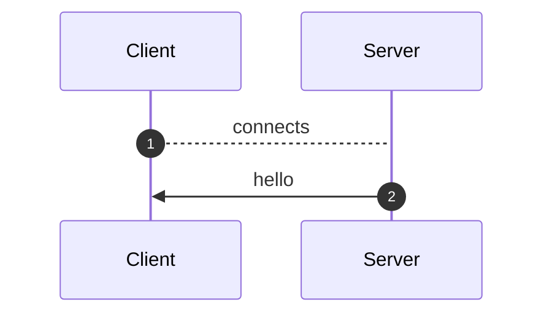
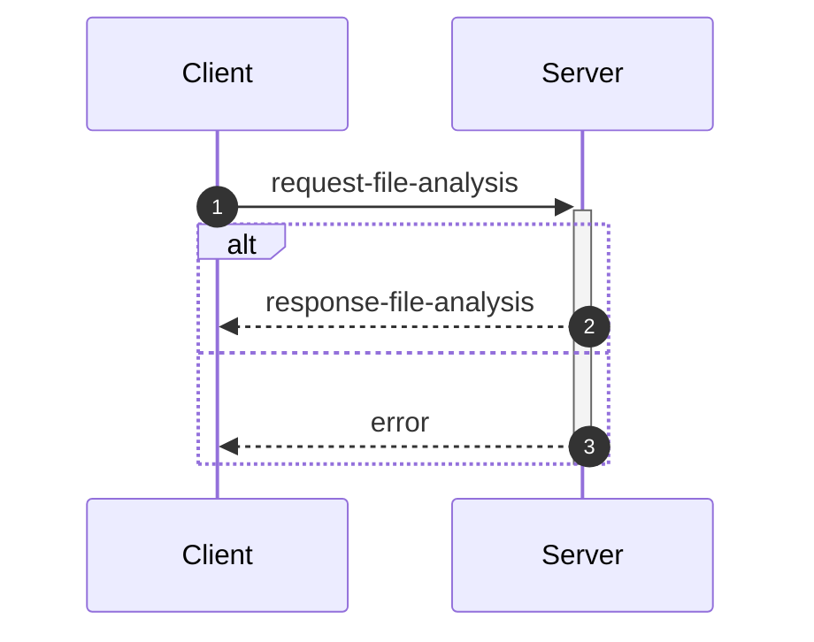
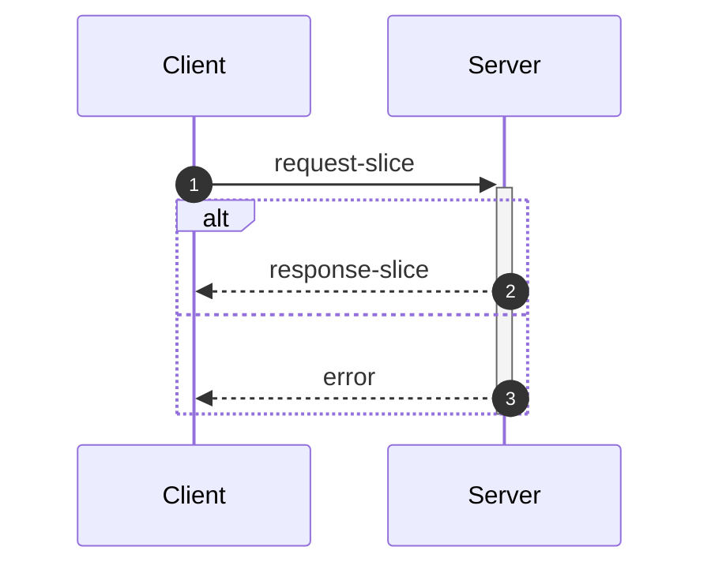
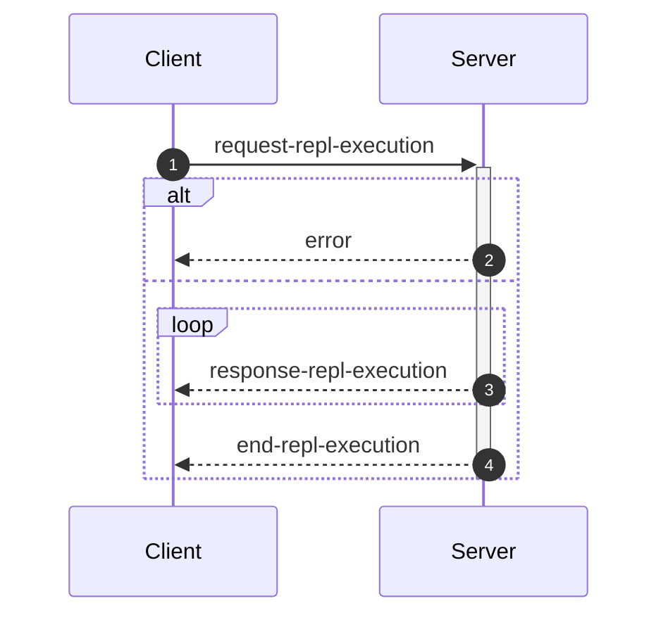

_<span title="an overview of flowR's interface">Generated</span> from '[wiki-interface.ts](https://github.com/flowr-analysis/flowr/tree/main/src/documentation/wiki-interface.ts "src/documentation/wiki-interface.ts")' on 2026-10-18, 19:24:09 UTC (v2.16.2, R v4.5.0), do not edit directly._

Although far from being as detailed as the in-depth explanation of [_flowR_](https://github.com/flowr-analysis/flowr/wiki/Core),
this wiki page explains how to interface with _flowR_ in more detail.
In general, command line arguments and other options provide short descriptions on hover over.

* [💻 Using the REPL](#using-the-repl)
* [⚙️ Configuring FlowR](#configuring-flowr)
* [⚒️ Writing Code](#writing-code)
* [💬 Communicating with the Server](#communicating-with-the-server)

<a id='using-the-repl'></a>
## 💻 Using the REPL

> [!NOTE]
> To execute arbitrary R commands with a repl request, _flowR_ has to be started explicitly with <span title="Description (Command Line Argument): Allow to access the underlying R session when using flowR (security warning: this allows the execution of arbitrary R code!)">`--r-session-access`</span>.
> Please be aware that this introduces a security risk and note that this relies on the [`r-shell` engine](https://github.com/flowr-analysis/flowr/wiki/Engines) .

Although primarily meant for users to explore,
there is nothing which forbids calling _flowR_ as a subprocess to use standard-in, -output, and -error
for communication (although you can access the REPL using the server as well,
with the [REPL Request](#message-request-repl-execution) message).

The read-eval-print loop&nbsp;(REPL) works relatively simple.
You can submit an expression (using <kbd>Enter</kbd>),
which is interpreted as an R&nbsp;expression by default but interpreted as a *command* if it starts with a colon (`:`).
The best command to get started with the REPL is <span title="Description (Repl Command): Show help information (aliases: :h, :?)">`:help`</span>.
Besides, you can leave the REPL either with the command <span title="Description (Repl Command): End the repl (aliases: :q, :exit)">`:quit`</span> or by pressing <kbd>Ctrl</kbd>+<kbd>C</kbd> twice.
When writing a *command*, you may press <kbd>Tab</kbd> to get a list of completions, if available.
Multiple commands can be entered in a single line by separating them with a semicolon (`;`), e.g. `:parse "x<-2"; :df*`.
If a command is given without R code, the REPL will re-use R code given in a previous command.
The prior example will hence return first the parsed AST of the program and then the dataflow graph for `"x <- 2"`.

> [!NOTE]
> If you develop flowR, you may want to launch the repl using the `npm run main-dev` command, this way, you get a non-minified version of flowR with debug information and hot-reloading of source files.

<details>
<summary>Available Commands</summary>

We currently offer the following commands (this with a `[*]` suffix are available with and without the star):

| Command | Description |
| ------- | ----------- |
| **<span title="Description (Repl Command): End the repl (aliases: :q, :exit)">:quit</span>** | End the repl (aliases: **:<span title="Alias of ':quit'. End the repl">q</span>**, **:<span title="Alias of ':quit'. End the repl">exit</span>**) |
| **<span title="Description (Repl Command): Execute the given code as R code. This requires the `--r-session-access` flag to be set and requires the r-shell engine. (aliases: :e, :r)">:execute</span>** | Execute the given code as R code. This requires the `--r-session-access` flag to be set and requires the r-shell engine. (aliases: **:<span title="Alias of ':execute'. Execute the given code as R code. This requires the `--r-session-access` flag to be set and requires the r-shell engine.">e</span>**, **:<span title="Alias of ':execute'. Execute the given code as R code. This requires the `--r-session-access` flag to be set and requires the r-shell engine.">r</span>**) |
| **<span title="Description (Repl Command): Get mermaid code for the control-flow graph of R code (aliases: :cfg, :cf)">:controlflow[*]</span>** | Get mermaid code for the control-flow graph of R code (star: Returns the URL to mermaid.live) (aliases: **:<span title="Alias of ':controlflow'. Get mermaid code for the control-flow graph of R code">cfg</span>**, **:<span title="Alias of ':controlflow'. Get mermaid code for the control-flow graph of R code">cf</span>**) |
| **<span title="Description (Repl Command): Get mermaid code for the control-flow graph with basic blocks (aliases: :cfgb, :cfb)">:controlflowbb[*]</span>** | Get mermaid code for the control-flow graph with basic blocks (star: Returns the URL to mermaid.live) (aliases: **:<span title="Alias of ':controlflowbb'. Get mermaid code for the control-flow graph with basic blocks">cfgb</span>**, **:<span title="Alias of ':controlflowbb'. Get mermaid code for the control-flow graph with basic blocks">cfb</span>**) |
| **<span title="Description (Repl Command): Get mermaid code for the dataflow graph (aliases: :d, :df)">:dataflow[*]</span>** | Get mermaid code for the dataflow graph (star: Returns the URL to mermaid.live) (aliases: **:<span title="Alias of ':dataflow'. Get mermaid code for the dataflow graph">d</span>**, **:<span title="Alias of ':dataflow'. Get mermaid code for the dataflow graph">df</span>**) |
| **<span title="Description (Repl Command): Get mermaid code for the normalized AST of R code (aliases: :n)">:normalize[*]</span>** | Get mermaid code for the normalized AST of R code (star: Returns the URL to mermaid.live) (alias: **:<span title="Alias of ':normalize'. Get mermaid code for the normalized AST of R code">n</span>**) |
| **<span title="Description (Repl Command): Get mermaid code for the simplified dataflow graph (aliases: :ds, :dfs)">:dataflowsimple[*]</span>** | Get mermaid code for the simplified dataflow graph (star: Returns the URL to mermaid.live) (aliases: **:<span title="Alias of ':dataflowsimple'. Get mermaid code for the simplified dataflow graph">ds</span>**, **:<span title="Alias of ':dataflowsimple'. Get mermaid code for the simplified dataflow graph">dfs</span>**) |
| **<span title="Description (Repl Command): Inspect and extend the signature database: `query` (identical to :query @signature), `info <name>` for where a function comes from (identical to :query @function-info), `add <path>` to mount another database/source, `download` to fetch the full-history database. (aliases: :sig)">:signature</span>** | Inspect and extend the signature database: `query` (identical to :query @signature), `info <name>` for where a function comes from (identical to :query @function-info), `add <path>` to mount another database/source, `download` to fetch the full-history database. (alias: **:<span title="Alias of ':signature'. Inspect and extend the signature database: `query` (identical to :query @signature), `info <name>` for where a function comes from (identical to :query @function-info), `add <path>` to mount another database/source, `download` to fetch the full-history database.">sig</span>**) |
| **<span title="Description (Repl Command): Just calculates the DFG, but only prints summary info (aliases: :d#, :df#)">:dataflowsilent</span>** | Just calculates the DFG, but only prints summary info (aliases: **:<span title="Alias of ':dataflowsilent'. Just calculates the DFG, but only prints summary info">d#</span>**, **:<span title="Alias of ':dataflowsilent'. Just calculates the DFG, but only prints summary info">df#</span>**) |
| **<span title="Description (Repl Command): Prints ASCII Art of the parsed, unmodified AST (aliases: :p)">:parse</span>** | Prints ASCII Art of the parsed, unmodified AST (alias: **:<span title="Alias of ':parse'. Prints ASCII Art of the parsed, unmodified AST">p</span>**) |
| **<span title="Description (Repl Command): Prints the version of flowR as well as the current version of R">:version</span>** | Prints the version of flowR as well as the current version of R
| **<span title="Description (Repl Command): Query the given R code (use 'help' for more information)">:query[*]</span>** | Query the given R code (use 'help' for more information) (star: Similar to query, but returns the output in json format.)
| **<span title="Description (Repl Command): Returns an ASCII representation of the dataflow graph (aliases: :df!)">:dataflowascii</span>** | Returns an ASCII representation of the dataflow graph (alias: **:<span title="Alias of ':dataflowascii'. Returns an ASCII representation of the dataflow graph">df!</span>**) |
| **<span title="Description (Repl Command): Returns summarization stats for the normalized AST (aliases: :n#)">:normalize#</span>** | Returns summarization stats for the normalized AST (alias: **:<span title="Alias of ':normalize#'. Returns summarization stats for the normalized AST">n#</span>**) |
| **<span title="Description (Repl Command): Show help information (aliases: :h, :?)">:help</span>** | Show help information (aliases: **:<span title="Alias of ':help'. Show help information">h</span>**, **:<span title="Alias of ':help'. Show help information">?</span>**) |

</details>

> [!TIP]
> 
> As indicated by the examples before, all REPL commands that operate on code keep track of the state.
> Hence, if you run a command like <span title="Description (Repl Command, starred version): Returns the URL to mermaid.live; Base Command: Get mermaid code for the dataflow graph (aliases: :d*, :df*)">`:dataflow*`</span> without providing R code,
> the REPL will re-use the R code provided in a previous command.
> Likewise, doing this will benefit from incrementality!
> If you request the dataflow graph with `:df* x <- 2 * y` and then want to see the parsed AST with `:parse`,
> the REPL will re-use previously obtained information and not re-parse the code again.
> 		

Generally, many commands offer shortcut versions in the REPL. Many queries, for example, offer a shortened format (see the example below).
Of special note, the [Config Query](https://github.com/flowr-analysis/flowr/wiki/%5BQuery%5D-Config)
can be used to also modify the currently active configuration of _flowR_ within the REPL (see the [wiki page](https://github.com/flowr-analysis/flowr/wiki/%5BQuery%5D-Config) for more information).

### Example: Retrieving the Dataflow Graph

To retrieve a URL to the [mermaid](https://mermaid.js.org/) diagram of the dataflow of a given expression,
use <span title="Description (Repl Command, starred version): Returns the URL to mermaid.live; Base Command: Get mermaid code for the dataflow graph (aliases: :d*, :df*)">`:dataflow*`</span> (or <span title="Description (Repl Command): Get mermaid code for the dataflow graph (aliases: :d, :df)">`:dataflow`</span> to get the mermaid code in the cli):

```shell
$ docker run -it --rm eagleoutice/flowr # or npm run flowr 
flowR repl v2.16.2, R grammar v14 (tree-sitter engine)
R> :dataflow* y <- 1 + x
```

<details>
<summary style='color:gray'>Output</summary>

```text
https://mermaid.live/view#base64:eyJjb2RlIjoiZmxvd2NoYXJ0IFREXG4gICAgMXt7XCJgKiM5MTtSTnVtYmVyIzkzOyogKioxKipcbiAgICAgICoxLjYqICgqKmlkOiAxKiopYFwifX1cbiAgICAyKFtcImAqIzkxO1JTeW1ib2wjOTM7KiAqKngqKlxuICAgICAgKjEuMTAqICgqKmlkOiAyKiopYFwiXSlcbiAgICAzW1tcImAqIzkxO1JCaW5hcnlPcCM5MzsqIGJhc2UjNTg7IzU4OyoqIzQzOyoqXG4gICAgICAqMS42LTEwKiAoKippZDogMyoqKVxuICAgIGFyZzogKDEsIDIpYFwiXV1cbiAgICBidWlsdC1pbjpfNDNfW1wiYEJ1aWx0LUluOlxuIzQzO2BcIl1cbiAgICBzdHlsZSBidWlsdC1pbjpfNDNfIHN0cm9rZTpncmF5LGZpbGw6Z3JheSxzdHJva2Utd2lkdGg6MnB4LG9wYWNpdHk6Ljg7XG4gICAgMFtcImAqIzkxO1JTeW1ib2wjOTM7KiAqKnkqKlxuICAgICAgKjEuMSogKCoqaWQ6IDAqKiwgdjogMylgXCJdXG4gICAgNFtbXCJgKiM5MTtSQmluYXJ5T3AjOTM7KiBiYXNlIzU4OyM1ODsqKiM2MDsjNDU7KipcbiAgICAgICoxLjEtMTAqICgqKmlkOiA0KiopXG4gICAgYXJnOiAoMCwgMylgXCJdXVxuICAgIGJ1aWx0LWluOl82MF8tW1wiYEJ1aWx0LUluOlxuIzYwOyM0NTtgXCJdXG4gICAgc3R5bGUgYnVpbHQtaW46XzYwXy0gc3Ryb2tlOmdyYXksZmlsbDpncmF5LHN0cm9rZS13aWR0aDoycHgsb3BhY2l0eTouODtcbiAgICAxIC0uLT58XCJmbG93XCJ8IDJcbiAgICBsaW5rU3R5bGUgMCBzdHJva2U6Z3JheSxjb2xvcjpncmF5O1xuICAgIDIgLS4tPnxcImZsb3dcInwgM1xuICAgIGxpbmtTdHlsZSAxIHN0cm9rZTpncmF5LGNvbG9yOmdyYXk7XG4gICAgMyAtLT58XCJyZWFkcywgYXJnXCJ8IDFcbiAgICAzIC0tPnxcInJlYWRzLCBhcmdcInwgMlxuICAgIDMgLS4tPnxcImZsb3dcInwgMFxuICAgIGxpbmtTdHlsZSA0IHN0cm9rZTpncmF5LGNvbG9yOmdyYXk7XG4gICAgMyAtLi0+fFwicmVhZHMsIGNhbGxzXCJ8IGJ1aWx0LWluOl80M19cbiAgICBsaW5rU3R5bGUgNSBzdHJva2U6Z3JheTtcbiAgICAwIC0tPnxcImRlZmluZWQtYnksIGZsb3dcInwgNFxuICAgIDAgLS0+fFwiZGVmaW5lZC1ieVwifCAzXG4gICAgNCAtLT58XCJyZWFkcywgYXJnXCJ8IDNcbiAgICA0IC0tPnxcInJldHVybnMsIGFyZ1wifCAwXG4gICAgNCAtLi0+fFwicmVhZHMsIGNhbGxzXCJ8IGJ1aWx0LWluOl82MF8tXG4gICAgbGlua1N0eWxlIDEwIHN0cm9rZTpncmF5OyIsIm1lcm1haWQiOnsiYXV0b1N5bmMiOnRydWV9fQ==
```

Retrieve the dataflow graph of the expression `y <- 1 + x`. It looks like this:


<details>

<summary style="color:gray">R Code of the Dataflow Graph</summary>

The analysis ran (including parse and normalize, using the [tree-sitter](https://github.com/flowr-analysis/flowr/wiki/Engines) engine) within the generation environment. No [signature database](https://github.com/flowr-analysis/flowr/wiki/Signature-Database) is mounted for these generated graphs, so `library()` calls attach no package exports; base-R names are still qualified via the generated base-package store (e.g. `acf` as `stats::acf`). 
We encountered no unknown side effects during the analysis.

```r
y <- 1 + x
```

</details>

</details>

For small graphs like this, <span title="Description (Repl Command): Returns an ASCII representation of the dataflow graph (aliases: :df!)">`:dataflowascii`</span> also provides an ASCII representation directly in the REPL:

```shell
$ docker run -it --rm eagleoutice/flowr # or npm run flowr 
flowR repl v2.16.2, R grammar v14 (tree-sitter engine)
R> :df! y <- 1 + x
```

<details open>
<summary style='color:gray'>Output</summary>

```text
                        v<0>v
 c<4>c──────────────────| y |
 |<- |     ┌────────────v---v
 c---c     │
    │   c<3>c   0<1>0
    └───| + |───| 1 |───u<2>u
        c---c   0---0   | x |
           └────────────u---u
Edges:
3 -> 1: reads, arg          3 -> 2: reads, arg
3 -> 0: flows-to            1 -> 2: flows-to
2 -> 3: flows-to            4 -> 3: reads, arg
4 -> 0: returns, arg        0 -> 4: defined-by, flows-to
0 -> 3: defined-by
```

Retrieve the dataflow graph of the expression `y <- 1 + x` as ASCII art.

</details>

For the slicing with <span title="Description (Repl Command): Static backwards executable slicer for R">`:slicer`</span>, you have access to the same [magic comments](#slice-magic-comments) as with the [slice request](#message-request-slice).
Pass `--inline` to splice resolvable `source()` calls into the reconstruction so the slice is a single self-contained R text (the same as the static slice query's `inlineSources` flag).
See `--help` for more flags!

### Example: Interfacing with the File System

Many commands that allow for an R-expression (like <span title="Description (Repl Command, starred version): Returns the URL to mermaid.live; Base Command: Get mermaid code for the dataflow graph (aliases: :d*, :df*)">`:dataflow*`</span>) allow for a file as well
if the argument starts with `file://`.
If you are working from the root directory of the _flowR_ repository, the following gives you the parsed AST of the example file using the <span title="Description (Repl Command): Prints ASCII Art of the parsed, unmodified AST (aliases: :p)">`:parse`</span> command:

> **Watch mode**: Replace `file://` with `watch://` to enter watch mode.
> flowR runs the command immediately and then re-runs it every time the file (or any file inside the folder) changes.
> Enter any other command to leave watch mode.
> For example: `:df watch://analysis.R`

```shell
$ docker run -it --rm eagleoutice/flowr # or npm run flowr 
flowR repl v2.16.2, R grammar v14 (tree-sitter engine)
R> :parse file://test/testfiles/example.R
```

<details>
<summary style='color:gray'>Output</summary>

```text
File: test/testfiles/example.R

program
├ binaryoperator
│ ├ identifier "sum" (1:1─4)
│ ├ <- "<-" (1:5─7)
│ ╰ float "0" (1:8─9)
├ binaryoperator
│ ├ identifier "product" (2:1─8)
│ ├ <- "<-" (2:9─11)
│ ╰ float "1" (2:12─13)
├ binaryoperator
│ ├ identifier "w" (3:1─2)
│ ├ <- "<-" (3:3─5)
│ ╰ float "7" (3:6─7)
├ binaryoperator
│ ├ identifier "N" (4:1─2)
│ ├ <- "<-" (4:3─5)
│ ╰ float "10" (4:6─8)
├ forstatement
│ ├ for "for" (6:1─4)
│ ├ ( "(" (6:5─6)
│ ├ identifier "i" (6:6─7)
│ ├ in "in" (6:8─10)
│ ├ binaryoperator
│ │ ├ float "1" (6:11─12)
│ │ ├ : ":" (6:12─13)
│ │ ╰ parenthesizedexpression
│ │   ├ ( "(" (6:13─14)
│ │   ├ binaryoperator
│ │   │ ├ identifier "N" (6:14─15)
│ │   │ ├ - "-" (6:15─16)
│ │   │ ╰ float "1" (6:16─17)
│ │   ╰ ) ")" (6:17─18)
│ ├ ) ")" (6:18─19)
│ ╰ bracedexpression
│   ├ { "{" (6:20─21)
│   ├ binaryoperator
│   │ ├ identifier "sum" (7:3─6)
│   │ ├ <- "<-" (7:7─9)
│   │ ╰ binaryoperator
│   │   ├ binaryoperator
│   │   │ ├ identifier "sum" (7:10─13)
│   │   │ ├ + "+" (7:14─15)
│   │   │ ╰ identifier "i" (7:16─17)
│   │   ├ + "+" (7:18─19)
│   │   ╰ identifier "w" (7:20─21)
│   ├ binaryoperator
│   │ ├ identifier "product" (8:3─10)
│   │ ├ <- "<-" (8:11─13)
│   │ ╰ binaryoperator
│   │   ├ identifier "product" (8:14─21)
│   │   ├  "" (8:22─23)
│   │   ╰ identifier "i" (8:24─25)
│   ╰ } "}" (9:1─2)
├ call
│ ├ identifier "cat" (11:1─4)
│ ╰ arguments
│   ├ ( "(" (11:4─5)
│   ├ argument
│   │ ╰ string
│   │   ├ " "\"" (11:5─6)
│   │   ├ stringcontent "Sum:" (11:6─10)
│   │   ╰ " "\"" (11:10─11)
│   ├ comma "," (11:11─12)
│   ├ argument
│   │ ╰ identifier "sum" (11:13─16)
│   ├ comma "," (11:16─17)
│   ├ argument
│   │ ╰ string
│   │   ├ " "\"" (11:18─19)
│   │   ├ stringcontent
│   │   │ ╰ escapesequence "\\n" (11:19─21)
│   │   ╰ " "\"" (11:21─22)
│   ╰ ) ")" (11:22─23)
╰ call
  ├ identifier "cat" (12:1─4)
  ╰ arguments
    ├ ( "(" (12:4─5)
    ├ argument
    │ ╰ string
    │   ├ " "\"" (12:5─6)
    │   ├ stringcontent "Product:" (12:6─14)
    │   ╰ " "\"" (12:14─15)
    ├ comma "," (12:15─16)
    ├ argument
    │ ╰ identifier "product" (12:17─24)
    ├ comma "," (12:24─25)
    ├ argument
    │ ╰ string
    │   ├ " "\"" (12:26─27)
    │   ├ stringcontent
    │   │ ╰ escapesequence "\\n" (12:27─29)
    │   ╰ " "\"" (12:29─30)
    ╰ ) ")" (12:30─31)
```

Retrieve the parsed AST of the example file.

<details>

<summary>File Content</summary>

```r
sum <- 0
product <- 1
w <- 7
N <- 10

for (i in 1:(N-1)) {
  sum <- sum + i + w
  product <- product * i
}

cat("Sum:", sum, "\n")
cat("Product:", product, "\n")
```

</details>

As _flowR_ directly transforms this AST the output focuses on being human-readable instead of being machine-readable.
		
</details>

### Example: Run a Query

You can run any query supported by _flowR_ using the <span title="Description (Repl Command): Query the given R code (use 'help' for more information)">`:query`</span> command.
For example, to obtain the shapes of all data frames in a given piece of code, you can run:

```shell
$ docker run -it --rm eagleoutice/flowr # or npm run flowr 
flowR repl v2.16.2, R grammar v14 (tree-sitter engine)
R> :query @absint df-shape "x <- data.frame(a = 1:10, b = 1:10)\ny <- x$a"
```

<details open>
<summary style='color:gray'>Output</summary>

```text
Query: absint (1 ms)
```

Retrieve the shapes of all data frames in the given code.

</details>

To run the linter on a file, you can use (in this example, we just issue the `dead-code` linter on a small piece of code):

```shell
$ docker run -it --rm eagleoutice/flowr # or npm run flowr 
flowR repl v2.16.2, R grammar v14 (tree-sitter engine)
R> :query @linter rules:dead-code "if(FALSE) x <- 2"
```

<details open>
<summary style='color:gray'>Output</summary>

```text
Query: linter (2 ms)
   ╰ Dead Code (dead-code):
       ╰ certain:
           ╰ Code at 1.11-16
```

Run the linter on the given code, with only the `dead-code` rule enabled.

</details>

For more information on the available queries, please check out the [Query API](https://github.com/flowr-analysis/flowr/wiki/Query-API).

<a id='configuring-flowr'></a>
## ⚙️ Configuring FlowR

When running _flowR_, you may want to specify some behaviors with a dedicated configuration file.
By default, flowR looks for a file named `flowr.json` in the current working directory (or any higher directory).
You can also specify a different file with <span title="Description (Command Line Argument): The name of the configuration file to use">`--config-file`</span> or pass the configuration inline using <span title="Description (Command Line Argument): The flowR configuration to use, as a JSON string">`--config-json`</span>.
A `flowr.json` found this way belongs to the analyzed project, so flowR ignores its options that decide what flowR executes or loads
(`engines.*.wasmPath`, `engines.*.treeSitterWasmPath`, `engines.*.rPath`, `solver.sigdb.additionalPaths`, `solver.sigdb.downloadRepo`, `solver.sigdb.installedLibrary.paths`),
unless you pass <span title="Description (Command Line Argument): Keep the security-sensitive options (e.g., the R executable) of the flowr.json found in the working directory or a parent. Only use this for projects you trust.">`--trust-config`</span>.
To analyze code you do not trust, use the secure mode (<span title="Description (Command Line Argument): Run in secure mode for analyzing untrusted code: flowR does not start R (or any other process), does not access the network, does not search for project configs, and ignores security-sensitive options in every config. Cannot be disabled once enabled. Can also be enabled with the environment variable {italic FLOWR_SECURE_MODE=1}.">`--secure`</span>, see the [security policy](https://github.com/flowr-analysis/flowr/blob/main/.github/SECURITY.md)).
To inspect the current configuration, you can run flowr with the <span title="Description (Command Line Argument): Run with verbose logging (will be passed to the corresponding script)">`--verbose`</span> flag, or use the `config` [Query](https://github.com/flowr-analysis/flowr/wiki/Query-API).
Within the REPL this works by running the following:

```shell
:query @config
```

To work with the <a href="https://github.com/flowr-analysis/flowr/tree/main/src/config.ts#L119"><code><span title="The configuration file format for flowR.">FlowrConfig</span></code></a> you can use the provided helper objects alongside its methods like
<a href="https://github.com/flowr-analysis/flowr/tree/main/src/config.ts#L905"><code><span title="Creates a new flowr config that has the updated values.">FlowrConfig::<b>amend</b></span></code></a>.
The schema below documents every option; the ones you most likely want are:

- <a href="https://github.com/flowr-analysis/flowr/wiki/Interface#configuring-flowr" title="Configuration Option (boolean): Whether source calls should be ignored, causing {@link processSourceCall}&#39;s behavior to be skipped.">ignoreSourceCalls</a>: ignore source calls when analyzing the code, i.e., ignore the inclusion of other files.
- <a href="https://github.com/flowr-analysis/flowr/wiki/Interface#configuring-flowr" title="Configuration Option (boolean): Whether load calls should be ignored, causing {@link processLoadCall}&#39;s behavior to be skipped.">ignoreLoadCalls</a>: ignore load calls when analyzing the code, i.e., ignore the loading of r-data files.
- <a href="https://github.com/flowr-analysis/flowr/wiki/Interface#configuring-flowr" title="Configuration Option (object): Do you want to overwrite (parts) of the builtin definition?">semantics.environment.overwriteBuiltIns</a>: overwrite _flowR_'s handling of built-in functions, or clear the preset definitions entirely.
  See [Configure BuiltIn Semantics](#configure-builtin-semantics) for more information.
- <a href="https://github.com/flowr-analysis/flowr/wiki/Interface#configuring-flowr" title="Configuration Option (string): How to resolve variables and their values. (one of &quot;disabled&quot;, &quot;alias&quot;, &quot;builtin&quot;)">solver.variables</a>: how to resolve variables and their values (`disabled`, `alias`, `builtin`).
- <a href="https://github.com/flowr-analysis/flowr/wiki/Interface#configuring-flowr" title="Configuration Option (array): The engine or set of engines to use for interacting with R code. An empty array means all available engines will be used.">engines</a> and <a href="https://github.com/flowr-analysis/flowr/wiki/Interface#configuring-flowr" title="Configuration Option (string): The default engine to use for interacting with R code. If this is undefined, an arbitrary engine from the specified list will be used. (one of &quot;tree-sitter&quot;, &quot;r-shell&quot;)">defaultEngine</a>: the engines used to interact with R code, see the [Engines wiki page](https://github.com/flowr-analysis/flowr/wiki/Engines).
- <a href="https://github.com/flowr-analysis/flowr/wiki/Interface#configuring-flowr" title="Configuration Option (array): Files a framework loads on its own, without any source() call (e.g. global.R in a shiny app), in the order they are loaded; flowR orders the matching project files accordingly and analyzes them as one program. Entries are case-insensitive globs matched against the file path, a plain name matches any file with that name, and entries matching no project file are warned about. Usually set per project kind via specializeConfig.">project.implicitSources</a>: the files a framework loads without any `source()` call, in the order in which they are
  loaded. Entries are globs (e.g. `R/*.R`) matched against the file path ignoring capitalization; one matching no file is reported.
- <a href="https://github.com/flowr-analysis/flowr/wiki/Interface#configuring-flowr" title="Configuration Option (object): Overwrite (parts of) the configuration depending on the project kind flowR detects, e.g. to give a shiny app its implicit sources.">specializeConfig</a>: overwrite (parts of) the configuration depending on the kind of project _flowR_ detects
  (e.g. `shiny-app`), which is how a shiny app gets its implicit sources by default. What you configure directly wins.
- <a href="https://github.com/flowr-analysis/flowr/wiki/Interface#configuring-flowr" title="Configuration Option (string): Overwrite the project kind flowR would otherwise infer from the analyzed files, e.g. when auto-detection guesses wrong. (one of &quot;package&quot;, &quot;script&quot;, &quot;shiny-app&quot;, &quot;notebook&quot;, &quot;project&quot;, &quot;unknown&quot;)">project.useProjectType</a>: skip that detection and force a project kind yourself, when auto-detection guesses wrong.
- <a href="https://github.com/flowr-analysis/flowr/wiki/Interface#configuring-flowr" title="Configuration Option (array): The default plugins to load when creating a new instance of FlowrAnalyzer">defaultPlugins</a> and <a href="https://github.com/flowr-analysis/flowr/wiki/Interface#configuring-flowr" title="Configuration Option (array): The plugins to load in REPL mode">repl.plugins</a>: the plugins to load for a new <a href="https://github.com/flowr-analysis/flowr/tree/main/src/project/flowr-analyzer.ts#L205"><code><span title="Central class for conducting analyses with FlowR. Use the FlowrAnalyzerBuilder to create a new instance. If you want the original pattern of creating a pipeline and running all steps, you can still do this with FlowrAnalyzer#runFull . To inspect the context of the analyzer, use FlowrAnalyzer#inspectContext (if you are a plugin and need to modify it, use FlowrAnalyzer#context instead).">FlowrAnalyzer</span></code></a> and in the REPL
  (use `flowr:default` to reference the former).

So you can configure _flowR_ by adding a file like the following:

<details>

<summary>Example Configuration File</summary>

```json
{
  "ignoreSourceCalls": true,
  "ignoreLoadCalls": true,
  "semantics": {
    "environment": {
      "overwriteBuiltIns": {
        "definitions": [
          {
            "type": "function",
            "names": [
              "foo"
            ],
            "processor": "builtin:assign",
            "config": {}
          }
        ]
      }
    }
  },
  "defaultPlugins": [
    "file:description",
    "versions:description"
  ],
  "repl": {
    "quickStats": false,
    "dfProcessorHeat": false,
    "hints": true,
    "plugins": [
      "flowr:default"
    ]
  },
  "project": {
    "resolveUnknownPathsOnDisk": true,
    "implicitSources": [
      "global.R",
      "app.R"
    ]
  },
  "linter": {
    "disabledRules": []
  },
  "specializeConfig": {
    "shiny-app": {
      "project": {
        "implicitSources": [
          "global.R",
          "ui.R",
          "server.R",
          "app.R"
        ]
      }
    }
  },
  "engines": [
    {
      "type": "r-shell"
    }
  ],
  "solver": {
    "variables": "alias",
    "evalStrings": true,
    "trackEnvironments": true,
    "sigdb": {
      "enabled": true,
      "loadProjectDependencies": true,
      "eagerlyLoad": false,
      "eagerlyLoadExports": false,
      "linkBaseR": false,
      "linkDescriptionDependencies": false
    },
    "resolveSource": {
      "dropPaths": "no",
      "ignoreCapitalization": true,
      "inferWorkingDirectory": "active-script",
      "searchPath": []
    },
    "instrument": {},
    "slicer": {
      "threshold": 50
    }
  },
  "abstractInterpretation": {
    "wideningThreshold": 4,
    "followCalls": true,
    "dataFrame": {
      "maxColNames": 20,
      "readLoadedData": {
        "readExternalFiles": true,
        "maxReadLines": 1000000
      }
    }
  },
  "incremental": {
    "alwaysIncremental": false,
    "parsing": {
      "activated": false,
      "heuristics": {
        "activated": true,
        "mtime": true,
        "linesFrom": 500,
        "bytesFrom": 50000,
        "alwaysWithEdits": false,
        "minFiles": 1
      }
    }
  },
  "gas": {
    "thresholds": {
      "memory": {
        "problematic": 0.7,
        "critical": 0.9
      },
      "timeMs": {
        "problematic": 100000,
        "critical": 120000
      }
    },
    "features": {}
  }
}
```

</details>

<details>
<a id='configure-builtin-semantics'></a>
<summary>Configure Built-In Semantics</summary>

`semantics/environment/overwriteBuiltins` accepts two keys:

- `loadDefaults` (boolean, initially `true`): If set to `true`, the default built-in definitions are loaded before applying the custom definitions. Setting this flag to `false` explicitly disables the loading of the default definitions.
- `definitions` (array, initially empty): Allows to overwrite or define new built-in elements. Each object within must have a `type` which is one of the below. Furthermore, they may define a string array of `names` which specifies the identifiers to bind the definitions to. You may use `assumePrimitive` to specify whether _flowR_ should assume that this is a primitive non-library definition (so you probably just do not want to specify the key).

  | Type            | Description                                                                                                                                                                                                                                                                                              | Example                                                                                                    |
  | --------------- | -------------------------------------------------------------------------------------------------------------------------------------------------------------------------------------------------------------------------------------------------------------------------------------------------------- | ---------------------------------------------------------------------------------------------------------- |
  | `constant`    | Additionally allows for a `value` this should resolve to.                                                                                                                                                                                                                                                | `{ type: 'constant', names: ['NULL', 'NA'],  value: null }`                                                |
  | `function`    | Is a rather flexible way to define and bind built-in functions. For the time, we do not have extensive documentation to cover all the cases, so please either consult the sources with the `default-builtin-config.ts` or open a [new issue](https://github.com/flowr-analysis/flowr/issues/new/choose). | `{ type: 'function', names: ['next'], processor: 'builtin:d', config: { cfg: ExitPointType.Next } }` |
  | `replacement` | A comfortable way to specify replacement functions like `$<-` or `names<-`. `suffixes` describes the... suffixes to attach automatically. | `{ type: 'replacement', suffixes: ['<-', '<<-'], names: ['[', '[['] }` |

</details>

<details>

<summary style='color:gray'>Full Configuration-File Schema</summary>

- _The configuration file format for flowR._ (object)
    - **logLevel** [optional] _flowR's global minimum log level, applied when the config is loaded._ (string)
        Only allows: 'silly', 'trace', 'debug', 'info', 'warn', 'error', 'fatal'
    - **ignoreSourceCalls** [optional] _Whether source calls should be ignored, causing {@link processSourceCall}'s behavior to be skipped._ (boolean)
    - **ignoreLoadCalls** [optional] _Whether load calls should be ignored, causing {@link processLoadCall}'s behavior to be skipped._ (boolean)
    - **semantics** _Configure language semantics and how flowR handles them._ (object)
        - **environment** [optional] _Semantics regarding how to handle the R environment._ (object)
            - **overwriteBuiltIns** [optional] _Do you want to overwrite (parts) of the builtin definition?_ (object)
                - **loadDefaults** [optional] _Should the default configuration still be loaded?_ (boolean)
                - **definitions** [optional] _The definitions to load/overwrite._ (array)
                Valid item types:
                    - (object)
    - **defaultPlugins** [optional] _The default plugins to load when creating a new instance of FlowrAnalyzer_ (array)
    Valid item types:
        - (alternatives)
            - (string)
            - (array)
    - **repl** _Configuration options for the REPL._ (object)
        - **quickStats** [optional] _Whether to show quick stats in the REPL after each evaluation._ (boolean)
        - **dfProcessorHeat** [optional] _This instruments the dataflow processors to count how often each processor is called._ (boolean)
        - **hints** [optional] _Whether to show dim inline hints on the empty prompt (automatically disabled on non-interactive terminals)._ (boolean)
        - **plugins** [optional] _The plugins to load in REPL mode_ (array)
        Valid item types:
            - (alternatives)
                - (string)
                - (array)
        - **autoUseFileProtocol** [optional] _Prepend the file protocol to a repl input that looks like a path, instead of only warning about it._ (boolean)
        - **queryStats** [optional] _Whether `:query` closes with the line stating how long the queries took (`:query*` never prints it)._ (boolean)
        - **showPlugins** [optional] _Whether `:version` grays out the plugins that did not activate during the last analysis._ (boolean)
    - **project** _Project specific configuration options._ (object)
        - **resolveUnknownPathsOnDisk** [optional] _Whether to resolve unknown paths loaded by the r project disk when trying to source/analyze files._ (boolean)
        - **failOnInaccessiblePath** [optional] _Whether a directory that cannot be traversed during file discovery (e.g. due to permissions) aborts the analysis; when false (the default) such paths are logged and skipped._ (boolean)
        - **basePackages** [optional] _The packages considered part of R itself (base and recommended); if unset, flowR uses its built-in list._ (array)
        Valid item types:
            - (string)
        - **implicitSources** [optional] _Files a framework loads on its own, without any source() call (e.g. global.R in a shiny app), in the order they are loaded; flowR orders the matching project files accordingly and analyzes them as one program. Entries are case-insensitive globs matched against the file path, a plain name matches any file with that name, and entries matching no project file are warned about. Usually set per project kind via specializeConfig._ (array)
        Valid item types:
            - (string)
        - **useProjectType** [optional] _Overwrite the project kind flowR would otherwise infer from the analyzed files, e.g. when auto-detection guesses wrong._ (string)
            Only allows: 'package', 'script', 'shiny-app', 'notebook', 'project', 'unknown'
        - **assumeImplicitEcho** [optional] _Whether the top level of the analyzed code is echoed, so that every visible result printed there is collected as an output by the dependencies query (default true, false for a package)._ (boolean)
        - **discovery** [optional] _Scoping options for the default project discovery._ (object)
            - **full** [optional] _Collect every file below the project root (greedy) instead of only the files the detected project kind needs (default false)._ (boolean)
            - **perKind** [optional] _Per-kind include/exclude glob overrides layered on the default scoping._ (object)
            - **ignore** [optional] _Case-insensitive globs that drop matching files from the intelligent discovery, regardless of kind (e.g. .Renviron to ignore environment files)._ (array)
            Valid item types:
                - (string)
        - **classification** [optional] _Overrides for the signals flowR uses to classify the project kind._ (object)
            - **shinyDescriptionTypes** [optional] _DESCRIPTION Type: values that mark a shiny app._ (array)
            Valid item types:
                - (string)
            - **shinyEntryFiles** [optional] _File names a shiny app is assembled from._ (array)
            Valid item types:
                - (string)
            - **shinyUsagePattern** [optional] _Regex source evidencing shiny usage in an entry file._ (string)
            - **notebookExtensions** [optional] _File extensions marking a notebook._ (array)
            Valid item types:
                - (string)
    - **linter** _Linter configuration options._ (object)
        - **disabledRules** _Linting rule names excluded from the default rule set (a rule requested explicitly via a linter query still runs). Usually set per project kind via specializeConfig._ (array)
        Valid item types:
            - (string)
    - **inputSources** [optional] _Further frameworks the input-sources analysis should know about; entries are added to flowR's defaults._ (object)
        - **pure** [optional] _Functions that only pass the constantness of their arguments on._ (array)
        Valid item types:
            - (string)
        - **param** [optional] _Functions whose result is a 'param' input._ (array)
        Valid item types:
            - (string)
        - **file** [optional] _Functions whose result is a 'file' input._ (array)
        Valid item types:
            - (string)
        - **tempfile** [optional] _Functions whose result is a 'tempfile' input._ (array)
        Valid item types:
            - (string)
        - **glob** [optional] _Functions whose result is a 'glob' input._ (array)
        Valid item types:
            - (string)
        - **net** [optional] _Functions whose result is a 'net' input._ (array)
        Valid item types:
            - (string)
        - **rand** [optional] _Functions whose result is a 'rand' input._ (array)
        Valid item types:
            - (string)
        - **system** [optional] _Functions whose result is a 'system' input._ (array)
        Valid item types:
            - (string)
        - **ffi** [optional] _Functions whose result is a 'ffi' input._ (array)
        Valid item types:
            - (string)
        - **lang** [optional] _Functions whose result is a 'lang' input._ (array)
        Valid item types:
            - (string)
        - **options** [optional] _Functions whose result is a 'options' input._ (array)
        Valid item types:
            - (string)
        - **cmdline** [optional] _Functions whose result is a 'cmdline' input._ (array)
        Valid item types:
            - (string)
        - **user** [optional] _Functions whose result is a 'user' input._ (array)
        Valid item types:
            - (string)
        - **const** [optional] _Functions whose result is a 'const' input._ (array)
        Valid item types:
            - (string)
        - **scope** [optional] _Functions whose result is a 'scope' input._ (array)
        Valid item types:
            - (string)
        - **dconst** [optional] _Functions whose result is a 'dconst' input._ (array)
        Valid item types:
            - (string)
        - **unknown** [optional] _Functions whose result is a 'unknown' input._ (array)
        Valid item types:
            - (string)
        - **linkedObjects** [optional] _Objects a framework provides without a definition in the code, e.g. shiny's input._ (array)
        Valid item types:
            - (object)
        - **linkedEntryPoints** [optional] _Calls that hand a function to a framework, which binds its objects to the parameters by position._ (array)
        Valid item types:
            - (object)
    - **specializeConfig** [optional] _Overwrite (parts of) the configuration depending on the project kind flowR detects, e.g. to give a shiny app its implicit sources._ (object)
    - **engines** _The engine or set of engines to use for interacting with R code. An empty array means all available engines will be used._ (array)
    Valid item types:
        - (alternatives)
            - _The configuration for the tree sitter engine._ (object)
                - **type** [required] _Use the tree sitter engine._ (string)
                    Only allows: 'tree-sitter'
                - **wasmPath** [optional] _The path to the tree-sitter-r WASM binary to use. If this is undefined, this uses the default path._ (string)
                - **treeSitterWasmPath** [optional] _The path to the tree-sitter WASM binary to use. If this is undefined, this uses the default path._ (string)
                - **lax** [optional] _Whether to use the lax parser for parsing R code (allowing for syntax errors). If this is undefined, the strict parser will be used._ (boolean)
            - _The configuration for the R shell engine._ (object)
                - **type** [required] _Use the R shell engine._ (string)
                    Only allows: 'r-shell'
                - **rPath** [optional] _The path to the R executable to use. If this is undefined, this uses the default path._ (string)
                - **pipeBind** [optional] _Whether to enable R's experimental pipe-bind operator "=>" by setting _R_USE_PIPEBIND_ for the R session (default false); R itself keeps this off by default, as it is experimental and has never shipped in a release version of R._ (boolean)
    - **defaultEngine** [optional] _The default engine to use for interacting with R code. If this is undefined, an arbitrary engine from the specified list will be used._ (string)
        Only allows: 'tree-sitter', 'r-shell'
    - **solver** _How to resolve constants, constraints, cells, ..._ (object)
        - **variables** _How to resolve variables and their values._ (string)
            Only allows: 'disabled', 'alias', 'builtin'
        - **evalStrings** _Should we include eval(parse(text="...")) calls in the dataflow graph?_ (boolean)
        - **trackEnvironments** [optional] _Track user-created environments (new.env, assign/get/local with envir=, dollar-assign, attach). When false, all envir-style calls fall through conservatively._ (boolean)
        - **sigdb** _Resolving library exports from a signature database._ (object)
            - **enabled** [optional] _Resolve library()/use() exports from a signature database (default true); when false no database is consulted._ (boolean)
            - **loadProjectDependencies** [optional] _Load the project's declared dependencies from its metadata files (DESCRIPTION Imports/Depends, rproject.toml, uvr.toml, renv.lock, rv.lock, uvr.lock) (default true); when false these files are not read for dependencies._ (boolean)
            - **eagerlyLoad** [optional] _Parse the database up front rather than on the first package load (default false, ignored if disabled)._ (boolean)
            - **eagerlyLoadExports** [optional] _Add a vertex for every export on load rather than on demand (default false); keeps the dataflow graph small._ (boolean)
            - **assumedRVersion** [optional] _R version assumed when resolving versioned (base-R) exports: a pin like "4.5" or "auto" to detect the installed R (default "auto")._ (string)
            - **linkBaseR** [optional] _Eagerly attach base-R namespaces so bare base calls resolve without library() (default false)._ (boolean)
            - **linkBaseRCalls** [optional] _Add a lightweight Reads edge from a bare base-R call to its signature-database function vertex (default false; base-R qualification is edge-free otherwise)._ (boolean)
            - **linkPackageCalls** [optional] _Add a lightweight Reads edge from a resolved package call to its signature-database function vertex (default false)._ (boolean)
            - **linkDescriptionDependencies** [optional] _Eagerly attach the namespaces of the project's declared DESCRIPTION dependencies (Imports/Depends) so their exports resolve without an explicit library() (default false)._ (boolean)
            - **warmInBackground** [optional] _Decompress the hot shards (base + most-downloaded) in a background task on startup so the first library() lookup is warm (default false; for long-running servers/REPLs)._ (boolean)
            - **additionalPaths** [optional] _Extra directories or bundle/manifest files searched for signature databases (alongside the shipped default and $FLOWR_SIGDB_DIR); a downloaded full-history bundle placed here is mounted automatically._ (array)
            Valid item types:
                - (string)
            - **downloadRepo** [optional] _GitHub owner/repo the full-history bundle is downloaded from via ":signature download" (default "flowr-analysis/flowr", release tag "sigdb-v<flowR-version>")._ (string)
            - **autoSync** [optional] _On startup, re-download shards whose committed sigdb.remote.json hash no longer matches the cache, in the background (default false; opt-in network sync after a git pull)._ (boolean)
            - **installedLibrary** [optional] _Recovering packages no signature database knows from the copy installed on this machine._ (object)
                - **enabled** [required] _Recover packages no signature database knows from their installed copy (default false)._ (boolean)
                - **paths** [optional] _Library directories to search; when empty they are discovered from the environment and the project._ (array)
                Valid item types:
                    - (string)
                - **useEnvironment** [optional] _Search the libraries R_LIBS_USER/R_LIBS/R_LIBS_SITE name (default true)._ (boolean)
                - **useProjectLibrary** [optional] _Search a project-local renv/packrat library (default true)._ (boolean)
                - **maxDepth** [optional] _How far to descend into the nested layout of a project-local library (default 3)._ (number)
                - **packages** [optional] _Only recover packages whose name matches one of these regular expressions; empty means any._ (array)
                Valid item types:
                    - (string)
            - **blobCacheBudgetMb** [optional] _How many MiB of decoded package blobs every open bundle may hold together (default 16)._ (number)
            - **versionSelection** [optional] _When a project constrains a dependency, resolve to the newest (default), oldest, or system-installed version satisfying it; system needs R and falls back to newest. Base-R packages always resolve against the assumed R version._ (string)
                Only allows: 'newest', 'oldest', 'system'
            - **versionOverrides** [optional] _Force an exact version for specific packages (name -> version), overriding both the project constraint and the versionSelection policy (default {})._ (object)
        - **versionManagement** _Policies for reasoning about dependency versions._ (object)
            - **linkedVersionGroups** [optional] _Groups of packages that must resolve to the same version; version guessing intersects each group so its members stay mutually compatible (default [])._ (array)
            Valid item types:
                - (array)
                Valid item types:
                    - (string)
        - **assumeAttachedPackages** [optional] _Packages to treat as attached without a `library()` call, so what the built-in configuration states about them applies to the analyzed code. The base packages R attaches on startup already resolve without it._ (array)
        Valid item types:
            - (string)
        - **transitiveSideEffectRounds** [optional] _How many rounds the transitive side-effect fixpoint may run before it is cut off (default 32); the propagation stops on its own as soon as a round adds nothing._ (number)
        - **maxOverlayDepth** [optional] _How many binding overlays may stack on one environment frame before a write flattens them (default 4); a pure performance knob, trading lookup cost against copy cost without changing any result._ (number)
        - **instrument** (object)
            - **dataflowExtractors** [optional] _These keys are only intended for use within code, allowing to instrument the dataflow analyzer!_ (any)
        - **resolveSource** [optional] _If lax source calls are active, flowR searches for sourced files much more freely, based on the configurations you give it. This option is only in effect if `ignoreSourceCalls` is set to false._ (object)
            - **dropPaths** _Allow to drop the first or all parts of the sourced path, if it is relative._ (string)
                Only allows: 'no', 'once', 'all'
            - **ignoreCapitalization** _Search for filenames matching in the lowercase._ (boolean)
            - **inferWorkingDirectory** _Try to infer the working directory from the main or any script to analyze._ (string)
                Only allows: 'no', 'main-script', 'active-script', 'any-script'
            - **searchPath** _Additionally search in these paths._ (array)
            Valid item types:
                - (string)
            - **repeatedSourceLimit** [optional] _How often the same file can be sourced within a single run? Please be aware: in case of cyclic sources this may not reach a fixpoint so give this a sensible limit._ (number)
            - **applyReplacements** _Provide name replacements for loaded files_ (array)
            Valid item types:
                - (object)
            - **assumeFilesExist** [optional] _Assume a sourced file is always there, making what it defines certain instead of conditional on the source call._ (boolean)
        - **slicer** [optional] _The configuration for the slicer._ (object)
            - **threshold** [optional] _The maximum number of iterations to perform on a single function call during slicing._ (number)
            - **autoExtend** [optional] _If set, the slicer will gain an additional post-pass._ (boolean)
    - **abstractInterpretation** _The configuration options for abstract interpretation._ (object)
        - **wideningThreshold** _The threshold for the number of visitations of a node at which widening should be performed to ensure the termination of the fixpoint iteration._ (number)
        - **followCalls** _Whether the abstract interpretation is interprocedural, i.e. whether it steps into the functions a call may dispatch to._ (boolean)
        - **dataFrame** _The configuration of the shape inference for data frames._ (object)
            - **maxColNames** _The maximum number of columns names to infer for data frames before over-approximating the column names to top._ (number)
            - **readLoadedData** _Configuration options for reading data frame shapes from loaded external data files, such as CSV files._ (object)
                - **readExternalFiles** _Whether data frame shapes should be extracted from loaded external files, such as CSV files._ (boolean)
                - **maxReadLines** _The maximum number of lines to read when extracting data frame shapes from loaded files, such as CSV files._ (number)
    - **incremental** (object)
        - **alwaysIncremental** _Always take the incremental path, regardless of heuristics._ (boolean)
        - **parsing** (object)
            - **activated** _If set, incremental parsing will be used._ (boolean)
            - **heuristics** (object)
                - **activated** [optional] _If set, the heuristics for incremental parsing will be used._ (boolean)
                - **mtime** [optional] _Skip reparsing entirely if the file's modification time is unchanged since the last parse._ (boolean)
                - **linesFrom** [optional] _Only consider incremental parsing for files with at least this many lines._ (number)
                - **bytesFrom** [optional] _Only consider incremental parsing for files with at least this many bytes._ (number)
                - **alwaysWithEdits** [optional] _Always take the incremental path whenever there is a computed edit region, regardless of the other thresholds._ (boolean)
                - **minFiles** [optional] _Only apply these heuristics once the project has at least this many files loaded._ (number)
    - **gas** [optional] _Resource-usage guard (gas) configuration. All feature factors default to 0 (disabled). See https://github.com/flowr-analysis/flowr/wiki/Core#gas-resource-guard._ (object)
        - **thresholds** [optional] _Thresholds for all gas checks (scaled by per-feature factor), boundable per feature._ (object)
            - **memory** [optional] _Heap-usage fraction thresholds (0-1), either shared or given per feature key (with `default` covering the rest)._ (object)
                - **problematic** [optional] _Heap fraction (0-1) above which Problematic is returned, for every feature without an entry of its own._ (number)
                - **critical** [optional] _Heap fraction (0-1) above which Critical is returned, for every feature without an entry of its own._ (number)
            - **timeMs** [optional] _Elapsed analysis time thresholds in milliseconds, either shared or given per feature key (with `default` covering the rest)._ (object)
                - **problematic** [optional] _Elapsed ms above which Problematic is returned, for every feature without an entry of its own._ (number)
                - **critical** [optional] _Elapsed ms above which Critical is returned, for every feature without an entry of its own._ (number)
            - **steps** [optional] _Processed-AST-node thresholds, counted rather than sampled; only a key that arms a budget (`dataflow`) reads them._ (object)
                - **problematic** [optional] _Processed AST nodes above which Problematic is returned, for every feature without an entry of its own._ (number)
                - **critical** [optional] _Processed AST nodes above which the extraction is cut short, for every feature without an entry of its own._ (number)
            - **vertices** [optional] _Created-dataflow-vertex thresholds, counted like `steps`._ (object)
                - **problematic** [optional] _Created dataflow vertices above which Problematic is returned, for every feature without an entry of its own._ (number)
                - **critical** [optional] _Created dataflow vertices above which the extraction is cut short, for every feature without an entry of its own._ (number)
        - **features** [optional] _Per-feature sensitivity factors. 0 or absent disables gas checking for that feature. A factor of 2 makes the feature twice as sensitive. Recognised keys: `source`, `side-effect-linking`, `linter`, `slicer`, `dataflow`._ (object)
        - **countedCheckEvery** [optional] _How many counted steps pass between two accountings of an armed check, be it a dataflow budget or the slicer's traversal (default 128); trades overshoot against the cost of the check._ (number)
        - **heapProvider** [optional] _Custom heap statistics source (programmatic configs only), overriding the built-in v8/performance.memory detection._ (function)

</details>

<a id='writing-code'></a>
## ⚒️ Writing Code

_flowR_ can be used as a [module](https://www.npmjs.com/package/@eagleoutice/flowr) and offers several main classes and interfaces that are interesting for extension writers 
(see the [Visual Studio Code extension](https://marketplace.visualstudio.com/items?itemName=code-inspect.vscode-flowr) or the [Core](https://github.com/flowr-analysis/flowr/wiki/Core) wiki page for more information).

### Creating Analyses with _flowR_

Nowadays, instances of the <a href="https://github.com/flowr-analysis/flowr/tree/main/src/project/flowr-analyzer.ts#L205"><code><span title="Central class for conducting analyses with FlowR. Use the FlowrAnalyzerBuilder to create a new instance. If you want the original pattern of creating a pipeline and running all steps, you can still do this with FlowrAnalyzer#runFull . To inspect the context of the analyzer, use FlowrAnalyzer#inspectContext (if you are a plugin and need to modify it, use FlowrAnalyzer#context instead).">FlowrAnalyzer</span></code></a> should be used as central frontend to get analysis results from _flowR_.
The entry points an analysis is written against are re-exported from the package root (`import { FlowrAnalyzerBuilder } from '@eagleoutice/flowr'`);
everything else stays reachable under its own path, as in `@eagleoutice/flowr/dataflow/graph/graph`.
For example, a program slice can be created like this:

```ts
const analyzer = await new FlowrAnalyzerBuilder()
    .setEngine('tree-sitter')
    .build();
analyzer.addRequest('x <- 1\ny <- x\nx');
const result = await analyzer.query([
    {
        type:     'static-slice',
        criteria: ['3@x']
    }
]);
```

For more information, please have a look at the [Analyzer](https://github.com/flowr-analysis/flowr/wiki/Analyzer) wiki page, which explains how to construct and use the <a href="https://github.com/flowr-analysis/flowr/tree/main/src/project/flowr-analyzer.ts#L205"><code><span title="Central class for conducting analyses with FlowR. Use the FlowrAnalyzerBuilder to create a new instance. If you want the original pattern of creating a pipeline and running all steps, you can still do this with FlowrAnalyzer#runFull . To inspect the context of the analyzer, use FlowrAnalyzer#inspectContext (if you are a plugin and need to modify it, use FlowrAnalyzer#context instead).">FlowrAnalyzer</span></code></a> in more detail.
To work with specific perspectives, you can also consult the respective pages like the [Dataflow Graph](https://github.com/flowr-analysis/flowr/wiki/Dataflow-Graph) or the [Abstract Interpretation](https://github.com/flowr-analysis/flowr/wiki/Abstract-Interpretation) wiki pages.
### The Pipeline Executor (Low-Level Interface)

Once, in the beginning, _flowR_ was meant to produce a dataflow graph merely to provide *program slices*. 
However, with continuous updates, the [Dataflow Graph](https://github.com/flowr-analysis/flowr/wiki/Dataflow-Graph) repeatedly proves to be the more interesting part.
With this, we restructured _flowR_'s originally *hardcoded* pipeline to be far more flexible. 
Now, it can be theoretically extended or replaced with arbitrary steps, optional steps, and what we call 'decorations' of these steps. 
In short, a slicing pipeline using the <a href="https://github.com/flowr-analysis/flowr/tree/main/src/core/pipeline-executor.ts#L97"><code><span title="**Please note:** The PipelineExecutor is now considered to be a rather low-level API for flowR. While it still works and is the basis for all other layers, we strongly recommend using the FlowrAnalyzer and its builder to create and use an analyzer instance that is pre-configured for your use-case. The pipeline executor allows to execute arbitrary pipelines in a step-by-step fashion. If you are not...">PipelineExecutor</span></code></a> looks like this:

```ts

const slicer = new PipelineExecutor(DEFAULT_SLICING_PIPELINE, {
  parser:    new RShell(),
  request:   requestFromInput('x <- 1\nx + 1'),
  criterion: ['2@x']
})
const slice = await slicer.allRemainingSteps()
// console.log(slice.reconstruct.code)
```

<details><summary>More Information</summary>

If you compare this, with what you would have done with the old (and removed) `SteppingSlicer`, 
this essentially just requires you to replace the `SteppingSlicer` with the <a href="https://github.com/flowr-analysis/flowr/tree/main/src/core/pipeline-executor.ts#L97"><code><span title="**Please note:** The PipelineExecutor is now considered to be a rather low-level API for flowR. While it still works and is the basis for all other layers, we strongly recommend using the FlowrAnalyzer and its builder to create and use an analyzer instance that is pre-configured for your use-case. The pipeline executor allows to execute arbitrary pipelines in a step-by-step fashion. If you are not...">PipelineExecutor</span></code></a>
and to pass the <a href="https://github.com/flowr-analysis/flowr/tree/main/src/core/steps/pipeline/default-pipelines.ts#L18"><code>DEFAULT_SLICING_PIPELINE</code></a> as the first argument.
The <a href="https://github.com/flowr-analysis/flowr/tree/main/src/core/pipeline-executor.ts#L97"><code><span title="**Please note:** The PipelineExecutor is now considered to be a rather low-level API for flowR. While it still works and is the basis for all other layers, we strongly recommend using the FlowrAnalyzer and its builder to create and use an analyzer instance that is pre-configured for your use-case. The pipeline executor allows to execute arbitrary pipelines in a step-by-step fashion. If you are not...">PipelineExecutor</span></code></a>...

1. Provides structures to investigate the results of all intermediate steps
2. Can be executed step-by-step
3. Can repeat steps (e.g., to calculate multiple slices on the same input)

See the in-code documentation for more information.

</details>

### Using the <a href="https://github.com/flowr-analysis/flowr/tree/main/src/r-bridge/shell.ts#L144"><code><span title="The RShell represents an interactive session with the R interpreter. You can configure it by RShellOptions . At the moment we are using a live R session (and not networking etc.) to communicate with R easily, which allows us to install packages etc. However, this might and probably will change in the future (leaving this as a legacy mode :D)">RShell</span></code></a> to Interact with R

The <a href="https://github.com/flowr-analysis/flowr/tree/main/src/r-bridge/shell.ts#L144"><code><span title="The RShell represents an interactive session with the R interpreter. You can configure it by RShellOptions . At the moment we are using a live R session (and not networking etc.) to communicate with R easily, which allows us to install packages etc. However, this might and probably will change in the future (leaving this as a legacy mode :D)">RShell</span></code></a> class allows interfacing with the `R`&nbsp;ecosystem installed on the host system.
Please have a look at [flowR's Engines](https://github.com/flowr-analysis/flowr/wiki/Engines) for more information on alternatives (for example, the <a href="https://github.com/flowr-analysis/flowr/tree/main/src/r-bridge/lang-4.x/tree-sitter/tree-sitter-executor.ts#L29"><code><span title="Synchronous and (way) faster alternative to the RShell using tree-sitter.">TreeSitterExecutor</span></code></a>).

> [!IMPORTANT]
> 
> Each <a href="https://github.com/flowr-analysis/flowr/tree/main/src/r-bridge/shell.ts#L144"><code><span title="The RShell represents an interactive session with the R interpreter. You can configure it by RShellOptions . At the moment we are using a live R session (and not networking etc.) to communicate with R easily, which allows us to install packages etc. However, this might and probably will change in the future (leaving this as a legacy mode :D)">RShell</span></code></a> controls a new instance of the R&nbsp;interpreter, 
> make sure to call <code><a href="https://github.com/flowr-analysis/flowr/tree/main/src/r-bridge/shell.ts#L354"><span title="Close the current R session, makes the object effectively invalid (can no longer be reopened etc.)">RShell::<i>close</i></span></a>()</code> when you are done.

You can start a new "session" by constructing a new object with <code>new <a href="https://github.com/flowr-analysis/flowr/tree/main/src/r-bridge/shell.ts#L144"><span title="The RShell represents an interactive session with the R interpreter. You can configure it by RShellOptions . At the moment we are using a live R session (and not networking etc.) to communicate with R easily, which allows us to install packages etc. However, this might and probably will change in the future (leaving this as a legacy mode :D)">RShell</span></a>()</code>.

However, there are several options that may be of interest 
(e.g., to automatically revive the shell in case of errors or to control the name location of the R process on the system).

With a shell object (let's call it `shell`), you can execute R code by using <a href="https://github.com/flowr-analysis/flowr/tree/main/src/r-bridge/shell.ts#L213"><code><span title="sends the given command directly to the current R session will not do anything to alter input markers!">RShell::<i>sendCommand</i></span></code></a>,
for example <code>shell.<a href="https://github.com/flowr-analysis/flowr/tree/main/src/r-bridge/shell.ts#L213"><span title="sends the given command directly to the current R session will not do anything to alter input markers!">sendCommand</span></a>("1 + 1")</code>.
However, this does not return anything, so if you want to collect the output of your command, use
<a href="https://github.com/flowr-analysis/flowr/tree/main/src/r-bridge/shell.ts#L296"><code><span title="Send a command and collect the output">RShell::<i>sendCommandWithOutput</i></span></code></a> instead.

<a id='communicating-with-the-server'></a>
## 💬 Communicating with the Server

As explained in the [Overview](https://github.com/flowr-analysis/flowr/wiki/Overview), you can run the [TCP](https://de.wikipedia.org/wiki/Transmission_Control_Protocol)&nbsp;server by adding the <span title="Description (Command Line Argument): Do not drop into a repl, but instead start a server on the given port (default: 1042) and listen for messages.">`--server`</span> flag (and, due to the interactive mode, exit with the conventional <kbd>CTRL</kbd>+<kbd>C</kbd>).
Currently, every connection is handled by the same underlying `RShell` - so the server is not designed to handle many clients at a time.
Additionally, the server is not well guarded against attacks (e.g., you can theoretically spawn an arbitrary number of&nbsp;RShell sessions on the target machine).

Every message has to be given in a single line (i.e., without a newline in-between) and end with a newline character. Nevertheless, we will pretty-print example given in the following segments for the ease of reading.

> [!NOTE]
> 
> The default <span title="Description (Command Line Argument): Do not drop into a repl, but instead start a server on the given port (default: 1042) and listen for messages.">`--server`</span> uses a simple [TCP](https://de.wikipedia.org/wiki/Transmission_Control_Protocol)
> connection. If you want _flowR_ to expose a [WebSocket](https://de.wikipedia.org/wiki/WebSocket) server instead, add the <span title="Description (Command Line Argument): If the server flag is set, use websocket for messaging">`--ws`</span> flag (i.e., <span title="Description (Command Line Argument): Do not drop into a repl, but instead start a server on the given port (default: 1042) and listen for messages.">`--server`</span> <span title="Description (Command Line Argument): If the server flag is set, use websocket for messaging">`--ws`</span>) when starting _flowR_ from the command line.

<ul><li>
<a id="message-hello"></a>
<b>Hello</b> Message (<code>hello</code>) 
<details>

<summary style="color:gray"> View Details. <i>The server informs the client about the successful connection and provides Meta-Information.</i> </summary>



After launching _flowR_, for example, with <code>docker run -it --rm eagleoutice/flowr <span title="Description (Command Line Argument): Do not drop into a repl, but instead start a server on the given port (default: 1042) and listen for messages.">-<span/>-server</span></code>&nbsp;(🐳️), connecting should present you with a `hello` message, that amongst others should reveal the versions of&nbsp;_flowR_ and&nbsp;R, using the [semver 2.0](https://semver.org/spec/v2.0.0.html) versioning scheme.
The message looks like this:

```json
{
  "type": "hello",
  "clientName": "client-0",
  "versions": {
    "flowr": "2.16.2",
    "r": "4.5.0",
    "engine": "r-shell"
  }
}
```

There are currently a few messages that you can send after the hello message.
If you want to _slice_ a piece of R code you first have to send an [analysis request](#message-request-file-analysis), so that you can send one or multiple slice requests afterward.
Requests for the [REPL](#message-request-repl-execution) are independent of that.
	
<hr>

<details>
<summary style="color:gray">Message schema (<code>hello</code>)</summary>

For the definition of the hello message, please see it's implementation at [`./src/cli/repl/server/messages/message-hello.ts`](https://github.com/flowr-analysis/flowr/tree/main/src/cli/repl/server/messages/message-hello.ts).

- [required] (object)
    - **type** [required] _The type of the hello message._ (string)
        Only allows: 'hello'
    - **id** [forbidden] _The id of the message is always undefined (as it is the initial message and not requested)._ (any)
    - **clientName** [required] _A unique name that is assigned to each client. It has no semantic meaning and is only used/useful for debugging._ (string)
    - **versions** [required] (object)
        - **flowr** [required] _The version of the flowr server running in semver format._ (string)
        - **r** [required] _The version of the underlying R shell running in semver format._ (string)
        - **engine** [required] _The parser backend that is used to parse the R code._ (string)

</details>

<hr>

</details>
	</li>

<li>
<a id="message-request-file-analysis"></a>
<b>Analysis</b> Message (<code>request-file-analysis</code>) 
<details>

<summary style="color:gray"> View Details. <i>The server builds the dataflow graph for a given input file (or a set of files).</i> </summary>



The request allows the server to analyze a file and prepare it for slicing.
The message can contain a `filetoken`, which is used to identify the file in later slice or query requests (if you do not add one, the request will not be stored and therefore, it is not available for subsequent requests).

> **Please note!**\
> If you want to send and process a lot of analysis requests, but do not want to slice them, please do not pass the `filetoken` field. This will save the server a lot of memory allocation.

Furthermore, the request must contain either a `content` field to directly pass the file's content or a `filepath` field which contains the path to the file (this path must be accessible for the server to be useful).
If you add the `id` field, the answer will use the same `id` so you can match requests and the corresponding answers.
See the implementation of the request-file-analysis message for more information.

You can drop one or more stored file tokens by adding the `invalidateToken` field (a single token or an array of tokens).
The server frees the corresponding analyses _after_ it has answered the request.

> **Tip!**\
> If you only want to drop tokens, you do not need a separate message: send a `request-file-analysis` that contains _just_ the `invalidateToken` field (and no `content` or `filepath`).
> Such a request behaves like an empty file analysis and the server replies with an empty `results` object.
> Because invalidation happens after the response, you may even pass the _current_ `filetoken` in `invalidateToken` to analyze a file once and have the server forget it right after you received the results.

<details>
<summary>Example of the <code>request-file-analysis</code> Message</summary>

_Note:_ even though we pretty-print these messages, they are sent as a single line, ending with a newline.

The following lists all messages that were sent and received in case you want to reproduce the scenario:

<ol>
<li> <code>hello</code> (response)
<details> 

<summary> Show Details </summary>

The first message is always a hello message.

```json
{"type":"hello","clientName":"client-0","versions":{"flowr":"2.16.2","r":"4.5.0","engine":"r-shell"}}
```

</details>
</li>

<li> <b><code>request-file-analysis</code> (request)</b>
<details open> 

<summary> Show Details </summary>

Let's suppose you simply want to analyze the following script:
 
```r
x <- 1
x + 1
```

 For this, you can send the following request:

```json
{"type":"request-file-analysis","id":"1","filetoken":"x","content":"x <- 1\nx + 1"}
```

</details>
</li>

<li> <code>response-file-analysis</code> (response)
<details> 

<summary> Show Details </summary>

The `results` field of the response effectively contains three keys of importance:

- `parse`: which contains 1:1 the parse result in CSV format that we received from the `RShell` (i.e., the AST produced by the parser of the R interpreter).
- `normalize`: which contains the normalized AST, including ids (see the `info` field and the [Normalized AST](https://github.com/flowr-analysis/flowr/wiki/Normalized-AST) wiki page).
- `dataflow`: especially important is the `graph` field which contains the dataflow graph as a set of root vertices (see the [Dataflow Graph](https://github.com/flowr-analysis/flowr/wiki/Dataflow-Graph) wiki page).
			
_As the code is pretty long, we inhibit pretty printing and syntax highlighting (JSON, hiding built-in):_

```text
{"type":"response-file-analysis","format":"json","id":"1","results":{"parse":{"files":[{"parsed":"[1,1,1,6,7,0,\"expr\",false,\"x <- 1\"],[1,1,1,1,1,3,\"SYMBOL\",true,\"x\"],[1,1,1,1,3,7,\"expr\",false,\"x\"],[1,3,1,4,2,7,\"LEFT_ASSIGN\",true,\"<-\"],[1,6,1,6,4,5,\"NUM_CONST\",true,\"1\"],[1,6,1,6,5,7,\"expr\",false,\"1\"],[2,1,2,5,16,0,\"expr\",false,\"x + 1\"],[2,1,2,1,10,12,\"SYMBOL\",true,\"x\"],[2,1,2,1,12,16,\"expr\",false,\"x\"],[2,3,2,3,11,16,\"'+'\",true,\"+\"],[2,5,2,5,13,14,\"NUM_CONST\",true,\"1\"],[2,5,2,5,14,16,\"expr\",false,\"1\"]","filePath":"/tmp/tmp-22553-1y8zmxx13guB-.R"}],".meta":{}},"normalize":{"ast":{"type":"RProject","files":[{"root":{"type":"RExpressionList","children":[{"type":"RBinaryOp","location":[1,3,1,4],"lhs":{"type":"RSymbol","location":[1,1,1,1],"content":"x","lexeme":"x","info":{"fullRange":[1,1,1,1],"adToks":[],"id":0,"parent":2,"role":"bin-l","index":0,"nest":0,"file":"/tmp/tmp-22553-1y8zmxx13guB-.R"}},"rhs":{"location":[1,6,1,6],"lexeme":"1","info":{"fullRange":[1,6,1,6],"adToks":[],"id":1,"parent":2,"role":"bin-r","index":1,"nest":0,"file":"/tmp/tmp-22553-1y8zmxx13guB-.R"},"type":"RNumber","content":{"num":1,"complexNumber":false,"markedAsInt":false}},"operator":"<-","lexeme":"<-","info":{"fullRange":[1,1,1,6],"adToks":[],"id":2,"parent":6,"nest":0,"file":"/tmp/tmp-22553-1y8zmxx13guB-.R","index":0,"role":"el-c"}},{"type":"RBinaryOp","location":[2,3,2,3],"lhs":{"type":"RSymbol","location":[2,1,2,1],"content":"x","lexeme":"x","info":{"fullRange":[2,1,2,1],"adToks":[],"id":3,"parent":5,"role":"bin-l","index":0,"nest":0,"file":"/tmp/tmp-22553-1y8zmxx13guB-.R"}},"rhs":{"location":[2,5,2,5],"lexeme":"1","info":{"fullRange":[2,5,2,5],"adToks":[],"id":4,"parent":5,"role":"bin-r","index":1,"nest":0,"file":"/tmp/tmp-22553-1y8zmxx13guB-.R"},"type":"RNumber","content":{"num":1,"complexNumber":false,"markedAsInt":false}},"operator":"+","lexeme":"+","info":{"fullRange":[2,1,2,5],"adToks":[],"id":5,"parent":6,"nest":0,"file":"/tmp/tmp-22553-1y8zmxx13guB-.R","index":1,"role":"el-c"}}],"info":{"adToks":[],"id":6,"nest":0,"file":"/tmp/tmp-22553-1y8zmxx13guB-.R","role":"root","index":0}},"filePath":"/tmp/tmp-22553-1y8zmxx13guB-.R"}],"info":{"id":7}},".meta":{}},"dataflow":{"unknownReferences":[],"in":[{"nodeId":2,"name":"<-","type":2},{"nodeId":5,"name":"+","type":2}],"out":[{"nodeId":0,"name":"x","type":4,"definedAt":2,"value":[1]}],"environment":{"current":{"id":973,"parent":"<BuiltInEnvironment>","memory":[["x",[{"nodeId":0,"name":"x","type":4,"definedAt":2,"value":[1]}]]],"globalEnv":true},"level":0},"graph":{"rootVertices":[1,0,2,3,4,5],"vertexInformation":[[1,{"tag":"value","id":1}],[0,{"tag":"vdef","id":0,"source":[1]}],[2,{"tag":"fcall","id":2,"name":"<-","onlyBuiltin":true,"args":[{"nodeId":0,"type":32},{"nodeId":1,"type":32}],"origin":["builtin:assign"]}],[3,{"tag":"use","id":3}],[4,{"tag":"value","id":4}],[5,{"tag":"fcall","id":5,"name":"+","onlyBuiltin":true,"args":[{"nodeId":3,"type":32},{"nodeId":4,"type":32}],"origin":["builtin:d"]}]],"edgeInformation":[[2,[[1,{"types":65}],[0,{"types":72}],["built-in:<-",{"types":5}],[3,{"types":4096}]]],[1,[[0,{"types":4096}]]],[0,[[2,{"types":4098}],[1,{"types":2}]]],[5,[[3,{"types":65}],[4,{"types":65}],["built-in:+",{"types":5}]]],[3,[[0,{"types":1}],[4,{"types":4096}]]],[4,[[5,{"types":4096}]]]],"_unknownSideEffects":[]},"entryPoint":2,"cfgEntry":1,"exitPoints":[{"type":0,"nodeId":5}],"hooks":[],".meta":{}}}}
```

</details>
</li>
</ol>

The complete round-trip covers validating the messages as well as starting and stopping the internal mock server.

</details>

You receive an error if, for whatever reason, the analysis fails (e.g., the message or code you sent contained syntax errors).
It contains a human-readable description *why* the analysis failed (see the error message implementation for more details).

<details>
<summary>Example Error Message</summary>

_Note:_ even though we pretty-print these messages, they are sent as a single line, ending with a newline.

The following lists all messages that were sent and received in case you want to reproduce the scenario:

<ol>
<li> <code>hello</code> (response)
<details> 

<summary> Show Details </summary>

The first message is always a hello message.

```json
{"type":"hello","clientName":"client-0","versions":{"flowr":"2.16.2","r":"4.5.0","engine":"r-shell"}}
```

</details>
</li>

<li> <code>request-file-analysis</code> (request)
<details> 

<summary> Show Details </summary>

```json
{"type":"request-file-analysis","id":"1","filename":"sample.R","content":"x <-"}
```

</details>
</li>

<li> <b><code>error</code> (response)</b>
<details open> 

<summary> Show Details </summary>

```json
{
  "id": "1",
  "type": "error",
  "fatal": false,
  "reason": "Error while analyzing file sample.R: GuardError: unable to parse R code (see the log for more information) for request {\"request\":\"text\",\"content\":\"x <-\"}}\n Report a Bug: https://github.com/flowr-analysis/flowr/issues/new?body=%3C!%2D%2D%20Please%20describe%20your%20issue%20in%20more%20detail%20below!%20%2D%2D%3E%0A%0A%0A%3C!%2D%2D%20Automatically%20generated%20issue%20metadata%2C%20please%20do%20not%20edit%20or%20delete%20content%20below%20this%20line%20%2D%2D%3E%0A%2D%2D%2D%0A%0AflowR%20version%3A%202.16.2%0Anode%20version%3A%20v25.6.1%0Anode%20arch%3A%20x64%0Anode%20platform%3A%20linux%0Amessage%3A%20%60unable%20to%20parse%20R%20code%20%28see%20the%20log%20for%20more%20information%29%20for%20request%20%7B%22request%22%3A%22text%22%2C%22content%22%3A%22x%20%3C%2D%22%7D%7D%60%0Astack%20trace%3A%0A%60%60%60%0A%20%20%20%20at%20guard%20%28%3C%3E%2Fsrc%2Futil%2Fassert.ts%3A128%3A9%29%0A%20%20%20%20at%20guardRetrievedOutput%20%28%3C%3E%2Fsrc%2Fr%2Dbridge%2Fretriever.ts%3A155%3A7%29%0A%20%20%20%20at%20%2Fhome%2Frunner%2Fwork%2Fflowr%2Fflowr%2Fsrc%2Fr%2Dbridge%2Fretriever.ts%3A122%3A4%0A%20%20%20%20at%20processTicksAndRejections%20%28node%3Ainternal%2Fprocess%2Ftask_queues%3A104%3A5%29%0A%20%20%20%20at%20async%20Object.parseRequests%20%5Bas%20processor%5D%20%28%3C%3E%2Fsrc%2Fr%2Dbridge%2Fparser.ts%3A108%3A19%29%0A%20%20%20%20at%20async%20PipelineExecutor.nextStep%20%28%3C%3E%2Fsrc%2Fcore%2Fpipeline%2Dexecutor.ts%3A192%3A25%29%0A%20%20%20%20at%20async%20FlowrAnalyzerCache.stepTapeUntil%20%28%3C%3E%2Fsrc%2Fproject%2Fcache%2Fflowr%2Danalyzer%2Dcache.ts%3A117%3A4%29%0A%20%20%20%20at%20async%20FlowRServerConnection.sendFileAnalysisResponse%20%28%3C%3E%2Fsrc%2Fcli%2Frepl%2Fserver%2Fconnection.ts%3A216%3A53%29%0A%60%60%60%0A%0A%2D%2D%2D%0A%09"
}
```

</details>
</li>
</ol>

The complete round-trip covers validating the messages as well as starting and stopping the internal mock server.

</details>

&nbsp;

<a id="analysis-include-cfg"></a>
**Including the Control Flow Graph**

The control flow graph is a view on the dataflow graph: the dataflow analysis records the control flow while it walks
the program, and the graph projects those edges on demand. The server can expose that structure as well (please create
a [new issue](https://github.com/flowr-analysis/flowr/issues/new/choose) for any bug you may encounter).
For this, the analysis request may add `cfg: true` to its list of options.

<details>
<summary>Requesting a Control Flow Graph</summary>

_Note:_ even though we pretty-print these messages, they are sent as a single line, ending with a newline.

The following lists all messages that were sent and received in case you want to reproduce the scenario:

<ol>
<li> <code>hello</code> (response)
<details> 

<summary> Show Details </summary>

The first message is always a hello message.

```json
{"type":"hello","clientName":"client-0","versions":{"flowr":"2.16.2","r":"4.5.0","engine":"r-shell"}}
```

</details>
</li>

<li> <b><code>request-file-analysis</code> (request)</b>
<details open> 

<summary> Show Details </summary>

```json
{
  "type": "request-file-analysis",
  "id": "1",
  "filetoken": "x",
  "content": "if(unknown > 0) { x <- 2 } else { x <- 5 }\nfor(i in 1:x) { print(x); print(i) }",
  "cfg": true
}
```

</details>
</li>

<li> <code>response-file-analysis</code> (response)
<details> 

<summary> Show Details </summary>

The response looks basically the same as a response sent without the `cfg` flag. However, additionally it contains a `cfg` field. 
If you are interested in a visual representation of the control flow graph, see the 
[visualization with mermaid](https://mermaid.live/view#base64:eyJjb2RlIjoiZmxvd2NoYXJ0IFREXG4gICAgbjAoW1wiYFJTeW1ib2wgKDApXG4qKnVua25vd24qKmBcIl0pXG4gICAgbjEoW1wiYFJOdW1iZXIgKDEpXG4qKjAqKmBcIl0pXG4gICAgbjIoW1wiYFJCaW5hcnlPcCAoMilcbioqdW5rbm93biAjNjI7IDAqKmBcIl0pXG4gICAgbjYoW1wiYFJOdW1iZXIgKDYpXG4qKjIqKmBcIl0pXG4gICAgbjUoW1wiYFJTeW1ib2wgKDUpXG4qKngqKmBcIl0pXG4gICAgbjdbXCJgUkJpbmFyeU9wICg3KVxuKip4ICM2MDsjNDU7IDIqKmBcIl1cbiAgICBuOChbXCJgUkV4cHJlc3Npb25MaXN0ICg4KWBcIl0pXG4gICAgbjEyKFtcImBSTnVtYmVyICgxMilcbioqNSoqYFwiXSlcbiAgICBuMTEoW1wiYFJTeW1ib2wgKDExKVxuKip4KipgXCJdKVxuICAgIG4xM1tcImBSQmluYXJ5T3AgKDEzKVxuKip4ICM2MDsjNDU7IDUqKmBcIl1cbiAgICBuMTQoW1wiYFJFeHByZXNzaW9uTGlzdCAoMTQpYFwiXSlcbiAgICBuMTVbXCJgUklmVGhlbkVsc2UgKDE1KVxuKippZih1bmtub3duICM2MjsgMCkgIzEyMzsgeCAjNjA7IzQ1OyAyICMxMjU7IGVsc2UgIzEyMzsgeCAjNjA7IzQ1OyA1ICMxMjU7KipgXCJdXG4gICAgbjE2KFtcImBSU3ltYm9sICgxNilcbioqaSoqYFwiXSlcbiAgICBuMTcoW1wiYFJOdW1iZXIgKDE3KVxuKioxKipgXCJdKVxuICAgIG4xOChbXCJgUlN5bWJvbCAoMTgpXG4qKngqKmBcIl0pXG4gICAgbjE5KFtcImBSQmluYXJ5T3AgKDE5KVxuKioxIzU4O3gqKmBcIl0pXG4gICAgbjIzKFtcImBSU3ltYm9sICgyMylcbioqeCoqYFwiXSlcbiAgICBuMjVbXCJgUkZ1bmN0aW9uQ2FsbCAoMjUpXG4qKnByaW50KHgpKipgXCJdXG4gICAgbjI3KFtcImBSU3ltYm9sICgyNylcbioqaSoqYFwiXSlcbiAgICBuMjlbXCJgUkZ1bmN0aW9uQ2FsbCAoMjkpXG4qKnByaW50KGkpKipgXCJdXG4gICAgbjMwKFtcImBSRXhwcmVzc2lvbkxpc3QgKDMwKWBcIl0pXG4gICAgbjMxW1wiYFJGb3JMb29wICgzMSlcbioqZm9yKGkgaW4gMSM1ODt4KSAjMTIzOyBwcmludCh4KTsgcHJpbnQoaSkgIzEyNTsqKmBcIl1cbiAgICBuMiAtLi0+fFwiYnJhbmNoIG9uIHVua25vd24gIzYyOyAwICgyKSBpZiBUXCJ8IG42XG4gICAgbjIgLS4tPnxcImJyYW5jaCBvbiB1bmtub3duICM2MjsgMCAoMikgaWYgRlwifCBuMTJcbiAgICBuMCAtLT58XCJmbG93cyB0b1wifCBuMVxuICAgIG4xIC0tPnxcImZsb3dzIHRvXCJ8IG4yXG4gICAgbjcgLS0+fFwiZmxvd3MgdG9cInwgbjhcbiAgICBuNiAtLT58XCJmbG93cyB0b1wifCBuNVxuICAgIG41IC0tPnxcImZsb3dzIHRvXCJ8IG43XG4gICAgbjggLS0+fFwiZmxvd3MgdG9cInwgbjE1XG4gICAgbjE1IC0tPnxcImZsb3dzIHRvXCJ8IG4xN1xuICAgIG4xMyAtLT58XCJmbG93cyB0b1wifCBuMTRcbiAgICBuMTIgLS0+fFwiZmxvd3MgdG9cInwgbjExXG4gICAgbjExIC0tPnxcImZsb3dzIHRvXCJ8IG4xM1xuICAgIG4xNCAtLT58XCJmbG93cyB0b1wifCBuMTVcbiAgICBuMTkgLS0+fFwiZmxvd3MgdG9cInwgbjE2XG4gICAgbjE4IC0tPnxcImZsb3dzIHRvXCJ8IG4xOVxuICAgIG4xNyAtLT58XCJmbG93cyB0b1wifCBuMThcbiAgICBuMjUgLS0+fFwiZmxvd3MgdG9cInwgbjI3XG4gICAgbjIzIC0tPnxcImZsb3dzIHRvXCJ8IG4yNVxuICAgIG4yOSAtLT58XCJmbG93cyB0b1wifCBuMzBcbiAgICBuMjcgLS0+fFwiZmxvd3MgdG9cInwgbjI5XG4gICAgbjMwIC0tPnxcImZsb3dzIHRvXCJ8IG4xNlxuICAgIG4xNiAtLi0+fFwiYnJhbmNoIG9uIGkgKDE2KSBpZiBUXCJ8IG4yM1xuICAgIG4xNiAtLi0+fFwiYnJhbmNoIG9uIGkgKDE2KSBpZiBGXCJ8IG4zMVxuICAgIHN0eWxlIG4wIHN0cm9rZTpjeWFuLHN0cm9rZS13aWR0aDo2LjVweDsgICAgc3R5bGUgbjMxIHN0cm9rZTpncmVlbixzdHJva2Utd2lkdGg6Ni41cHg7IiwibWVybWFpZCI6eyJhdXRvU3luYyI6dHJ1ZX19).
			
_As the code is pretty long, we inhibit pretty printing and syntax highlighting (JSON, hiding built-in):_

```text
{"type":"response-file-analysis","format":"json","id":"1","cfg":{"graph":{"roots":[0,1,2,6,5,7,8,12,11,13,14,15,16,17,18,19,23,25,27,29,30,31],"vtxInfos":[[0,[2,0]],[1,[2,1]],[2,[2,2]],[6,[2,6]],[5,[2,5]],[7,[1,7]],[8,[2,8]],[12,[2,12]],[11,[2,11]],[13,[1,13]],[14,[2,14]],[15,[1,15]],[16,[2,16]],[17,[2,17]],[18,[2,18]],[19,[2,19]],[23,[2,23]],[25,[1,25]],[27,[2,27]],[29,[1,29]],[30,[2,30]],[31,[1,31]]],"bbChildren":[],"edgeInfos":[[2,[[6,{"id":15,"when":true}],[12,{"id":15,"when":false}]]],[0,[[1,0]]],[1,[[2,0]]],[7,[[8,0]]],[6,[[5,0]]],[5,[[7,0]]],[8,[[15,0]]],[15,[[17,0]]],[13,[[14,0]]],[12,[[11,0]]],[11,[[13,0]]],[14,[[15,0]]],[19,[[16,0]]],[18,[[19,0]]],[17,[[18,0]]],[25,[[27,0]]],[23,[[25,0]]],[29,[[30,0]]],[27,[[29,0]]],[30,[[16,0]]],[16,[[23,{"id":31,"when":true}],[31,{"id":31,"when":false}]]]],"mayHaveBasicBlocks":false},"entryPoints":[0],"exitPoints":[31],"returns":[],"breaks":[],"nexts":[]},"results":{"parse":{"files":[{"parsed":"[1,1,1,42,38,0,\"expr\",false,\"if(unknown > 0) { x <- 2 } else { x <- 5 }\"],[1,1,1,2,1,38,\"IF\",true,\"if\"],[1,3,1,3,2,38,\"'('\",true,\"(\"],[1,4,1,14,9,38,\"expr\",false,\"unknown > 0\"],[1,4,1,10,3,5,\"SYMBOL\",true,\"unknown\"],[1,4,1,10,5,9,\"expr\",false,\"unknown\"],[1,12,1,12,4,9,\"GT\",true,\">\"],[1,14,1,14,6,7,\"NUM_CONST\",true,\"0\"],[1,14,1,14,7,9,\"expr\",false,\"0\"],[1,15,1,15,8,38,\"')'\",true,\")\"],[1,17,1,26,22,38,\"expr\",false,\"{ x <- 2 }\"],[1,17,1,17,12,22,\"'{'\",true,\"{\"],[1,19,1,24,19,22,\"expr\",false,\"x <- 2\"],[1,19,1,19,13,15,\"SYMBOL\",true,\"x\"],[1,19,1,19,15,19,\"expr\",false,\"x\"],[1,21,1,22,14,19,\"LEFT_ASSIGN\",true,\"<-\"],[1,24,1,24,16,17,\"NUM_CONST\",true,\"2\"],[1,24,1,24,17,19,\"expr\",false,\"2\"],[1,26,1,26,18,22,\"'}'\",true,\"}\"],[1,28,1,31,23,38,\"ELSE\",true,\"else\"],[1,33,1,42,35,38,\"expr\",false,\"{ x <- 5 }\"],[1,33,1,33,25,35,\"'{'\",true,\"{\"],[1,35,1,40,32,35,\"expr\",false,\"x <- 5\"],[1,35,1,35,26,28,\"SYMBOL\",true,\"x\"],[1,35,1,35,28,32,\"expr\",false,\"x\"],[1,37,1,38,27,32,\"LEFT_ASSIGN\",true,\"<-\"],[1,40,1,40,29,30,\"NUM_CONST\",true,\"5\"],[1,40,1,40,30,32,\"expr\",false,\"5\"],[1,42,1,42,31,35,\"'}'\",true,\"}\"],[2,1,2,36,84,0,\"expr\",false,\"for(i in 1:x) { print(x); print(i) }\"],[2,1,2,3,41,84,\"FOR\",true,\"for\"],[2,4,2,13,53,84,\"forcond\",false,\"(i in 1:x)\"],[2,4,2,4,42,53,\"'('\",true,\"(\"],[2,5,2,5,43,53,\"SYMBOL\",true,\"i\"],[2,7,2,8,44,53,\"IN\",true,\"in\"],[2,10,2,12,51,53,\"expr\",false,\"1:x\"],[2,10,2,10,45,46,\"NUM_CONST\",true,\"1\"],[2,10,2,10,46,51,\"expr\",false,\"1\"],[2,11,2,11,47,51,\"':'\",true,\":\"],[2,12,2,12,48,50,\"SYMBOL\",true,\"x\"],[2,12,2,12,50,51,\"expr\",false,\"x\"],[2,13,2,13,49,53,\"')'\",true,\")\"],[2,15,2,36,81,84,\"expr\",false,\"{ print(x); print(i) }\"],[2,15,2,15,54,81,\"'{'\",true,\"{\"],[2,17,2,24,64,81,\"expr\",false,\"print(x)\"],[2,17,2,21,55,57,\"SYMBOL_FUNCTION_CALL\",true,\"print\"],[2,17,2,21,57,64,\"expr\",false,\"print\"],[2,22,2,22,56,64,\"'('\",true,\"(\"],[2,23,2,23,58,60,\"SYMBOL\",true,\"x\"],[2,23,2,23,60,64,\"expr\",false,\"x\"],[2,24,2,24,59,64,\"')'\",true,\")\"],[2,25,2,25,65,81,\"';'\",true,\";\"],[2,27,2,34,77,81,\"expr\",false,\"print(i)\"],[2,27,2,31,68,70,\"SYMBOL_FUNCTION_CALL\",true,\"print\"],[2,27,2,31,70,77,\"expr\",false,\"print\"],[2,32,2,32,69,77,\"'('\",true,\"(\"],[2,33,2,33,71,73,\"SYMBOL\",true,\"i\"],[2,33,2,33,73,77,\"expr\",false,\"i\"],[2,34,2,34,72,77,\"')'\",true,\")\"],[2,36,2,36,78,81,\"'}'\",true,\"}\"]","filePath":"/tmp/tmp-22553-FrjWHOw7NrTc-.R"}],".meta":{}},"normalize":{"ast":{"type":"RProject","files":[{"root":{"type":"RExpressionList","children":[{"type":"RIfThenElse","condition":{"type":"RBinaryOp","location":[1,12,1,12],"lhs":{"type":"RSymbol","location":[1,4,1,10],"content":"unknown","lexeme":"unknown","info":{"fullRange":[1,4,1,10],"adToks":[],"id":0,"parent":2,"role":"bin-l","index":0,"nest":1,"file":"/tmp/tmp-22553-FrjWHOw7NrTc-.R"}},"rhs":{"location":[1,14,1,14],"lexeme":"0","info":{"fullRange":[1,14,1,14],"adToks":[],"id":1,"parent":2,"role":"bin-r","index":1,"nest":1,"file":"/tmp/tmp-22553-FrjWHOw7NrTc-.R"},"type":"RNumber","content":{"num":0,"complexNumber":false,"markedAsInt":false}},"operator":">","lexeme":">","info":{"fullRange":[1,4,1,14],"adToks":[],"id":2,"parent":15,"nest":1,"file":"/tmp/tmp-22553-FrjWHOw7NrTc-.R","role":"if-c"}},"then":{"type":"RExpressionList","children":[{"type":"RBinaryOp","location":[1,21,1,22],"lhs":{"type":"RSymbol","location":[1,19,1,19],"content":"x","lexeme":"x","info":{"fullRange":[1,19,1,19],"adToks":[],"id":5,"parent":7,"role":"bin-l","index":0,"nest":1,"file":"/tmp/tmp-22553-FrjWHOw7NrTc-.R"}},"rhs":{"location":[1,24,1,24],"lexeme":"2","info":{"fullRange":[1,24,1,24],"adToks":[],"id":6,"parent":7,"role":"bin-r","index":1,"nest":1,"file":"/tmp/tmp-22553-FrjWHOw7NrTc-.R"},"type":"RNumber","content":{"num":2,"complexNumber":false,"markedAsInt":false}},"operator":"<-","lexeme":"<-","info":{"fullRange":[1,19,1,24],"adToks":[],"id":7,"parent":8,"nest":1,"file":"/tmp/tmp-22553-FrjWHOw7NrTc-.R","index":0,"role":"el-c"}}],"grouping":[{"type":"RSymbol","location":[1,17,1,17],"content":"{","lexeme":"{","info":{"fullRange":[1,17,1,26],"adToks":[],"id":3,"role":"el-g","index":0,"nest":1,"file":"/tmp/tmp-22553-FrjWHOw7NrTc-.R"}},{"type":"RSymbol","location":[1,26,1,26],"content":"}","lexeme":"}","info":{"fullRange":[1,17,1,26],"adToks":[],"id":4,"role":"el-g","index":0,"nest":1,"file":"/tmp/tmp-22553-FrjWHOw7NrTc-.R"}}],"info":{"adToks":[],"id":8,"parent":15,"nest":1,"file":"/tmp/tmp-22553-FrjWHOw7NrTc-.R","index":1,"role":"if-then"}},"location":[1,1,1,2],"lexeme":"if","info":{"fullRange":[1,1,1,42],"adToks":[],"id":15,"parent":32,"nest":1,"file":"/tmp/tmp-22553-FrjWHOw7NrTc-.R","index":0,"role":"el-c"},"otherwise":{"type":"RExpressionList","children":[{"type":"RBinaryOp","location":[1,37,1,38],"lhs":{"type":"RSymbol","location":[1,35,1,35],"content":"x","lexeme":"x","info":{"fullRange":[1,35,1,35],"adToks":[],"id":11,"parent":13,"role":"bin-l","index":0,"nest":1,"file":"/tmp/tmp-22553-FrjWHOw7NrTc-.R"}},"rhs":{"location":[1,40,1,40],"lexeme":"5","info":{"fullRange":[1,40,1,40],"adToks":[],"id":12,"parent":13,"role":"bin-r","index":1,"nest":1,"file":"/tmp/tmp-22553-FrjWHOw7NrTc-.R"},"type":"RNumber","content":{"num":5,"complexNumber":false,"markedAsInt":false}},"operator":"<-","lexeme":"<-","info":{"fullRange":[1,35,1,40],"adToks":[],"id":13,"parent":14,"nest":1,"file":"/tmp/tmp-22553-FrjWHOw7NrTc-.R","index":0,"role":"el-c"}}],"grouping":[{"type":"RSymbol","location":[1,33,1,33],"content":"{","lexeme":"{","info":{"fullRange":[1,33,1,42],"adToks":[],"id":9,"role":"el-g","index":0,"nest":1,"file":"/tmp/tmp-22553-FrjWHOw7NrTc-.R"}},{"type":"RSymbol","location":[1,42,1,42],"content":"}","lexeme":"}","info":{"fullRange":[1,33,1,42],"adToks":[],"id":10,"role":"el-g","index":0,"nest":1,"file":"/tmp/tmp-22553-FrjWHOw7NrTc-.R"}}],"info":{"adToks":[],"id":14,"parent":15,"nest":1,"file":"/tmp/tmp-22553-FrjWHOw7NrTc-.R","index":2,"role":"if-other"}}},{"type":"RForLoop","variable":{"type":"RSymbol","location":[2,5,2,5],"content":"i","lexeme":"i","info":{"adToks":[],"id":16,"parent":31,"role":"for-var","index":0,"nest":1,"file":"/tmp/tmp-22553-FrjWHOw7NrTc-.R"}},"vector":{"type":"RBinaryOp","location":[2,11,2,11],"lhs":{"location":[2,10,2,10],"lexeme":"1","info":{"fullRange":[2,10,2,10],"adToks":[],"id":17,"parent":19,"role":"bin-l","index":0,"nest":1,"file":"/tmp/tmp-22553-FrjWHOw7NrTc-.R"},"type":"RNumber","content":{"num":1,"complexNumber":false,"markedAsInt":false}},"rhs":{"type":"RSymbol","location":[2,12,2,12],"content":"x","lexeme":"x","info":{"fullRange":[2,12,2,12],"adToks":[],"id":18,"parent":19,"role":"bin-r","index":1,"nest":1,"file":"/tmp/tmp-22553-FrjWHOw7NrTc-.R"}},"operator":":","lexeme":":","info":{"fullRange":[2,10,2,12],"adToks":[],"id":19,"parent":31,"nest":1,"file":"/tmp/tmp-22553-FrjWHOw7NrTc-.R","index":1,"role":"for-vec"}},"body":{"type":"RExpressionList","children":[{"type":"RFunctionCall","named":true,"location":[2,17,2,21],"lexeme":"print","functionName":{"type":"RSymbol","location":[2,17,2,21],"content":"print","lexeme":"print","info":{"fullRange":[2,17,2,24],"adToks":[],"id":22,"parent":25,"role":"call-name","index":0,"nest":1,"file":"/tmp/tmp-22553-FrjWHOw7NrTc-.R"}},"arguments":[{"type":"RArgument","location":[2,23,2,23],"lexeme":"x","value":{"type":"RSymbol","location":[2,23,2,23],"content":"x","lexeme":"x","info":{"fullRange":[2,23,2,23],"adToks":[],"id":23,"parent":24,"role":"arg-v","index":0,"nest":1,"file":"/tmp/tmp-22553-FrjWHOw7NrTc-.R"}},"info":{"fullRange":[2,23,2,23],"adToks":[],"id":24,"parent":25,"nest":1,"file":"/tmp/tmp-22553-FrjWHOw7NrTc-.R","index":1,"role":"call-arg"}}],"info":{"fullRange":[2,17,2,24],"adToks":[],"id":25,"parent":30,"nest":1,"file":"/tmp/tmp-22553-FrjWHOw7NrTc-.R","index":0,"role":"el-c"}},{"type":"RFunctionCall","named":true,"location":[2,27,2,31],"lexeme":"print","functionName":{"type":"RSymbol","location":[2,27,2,31],"content":"print","lexeme":"print","info":{"fullRange":[2,27,2,34],"adToks":[],"id":26,"parent":29,"role":"call-name","index":0,"nest":1,"file":"/tmp/tmp-22553-FrjWHOw7NrTc-.R"}},"arguments":[{"type":"RArgument","location":[2,33,2,33],"lexeme":"i","value":{"type":"RSymbol","location":[2,33,2,33],"content":"i","lexeme":"i","info":{"fullRange":[2,33,2,33],"adToks":[],"id":27,"parent":28,"role":"arg-v","index":0,"nest":1,"file":"/tmp/tmp-22553-FrjWHOw7NrTc-.R"}},"info":{"fullRange":[2,33,2,33],"adToks":[],"id":28,"parent":29,"nest":1,"file":"/tmp/tmp-22553-FrjWHOw7NrTc-.R","index":1,"role":"call-arg"}}],"info":{"fullRange":[2,27,2,34],"adToks":[],"id":29,"parent":30,"nest":1,"file":"/tmp/tmp-22553-FrjWHOw7NrTc-.R","index":1,"role":"el-c"}}],"grouping":[{"type":"RSymbol","location":[2,15,2,15],"content":"{","lexeme":"{","info":{"fullRange":[2,15,2,36],"adToks":[],"id":20,"role":"el-g","index":0,"nest":1,"file":"/tmp/tmp-22553-FrjWHOw7NrTc-.R"}},{"type":"RSymbol","location":[2,36,2,36],"content":"}","lexeme":"}","info":{"fullRange":[2,15,2,36],"adToks":[],"id":21,"role":"el-g","index":0,"nest":1,"file":"/tmp/tmp-22553-FrjWHOw7NrTc-.R"}}],"info":{"adToks":[],"id":30,"parent":31,"nest":1,"file":"/tmp/tmp-22553-FrjWHOw7NrTc-.R","index":2,"role":"for-b"}},"lexeme":"for","info":{"fullRange":[2,1,2,36],"adToks":[],"id":31,"parent":32,"nest":1,"file":"/tmp/tmp-22553-FrjWHOw7NrTc-.R","index":1,"role":"el-c"},"location":[2,1,2,3]}],"info":{"adToks":[],"id":32,"nest":0,"file":"/tmp/tmp-22553-FrjWHOw7NrTc-.R","role":"root","index":0}},"filePath":"/tmp/tmp-22553-FrjWHOw7NrTc-.R"}],"info":{"id":33}},".meta":{}},"dataflow":{"unknownReferences":[],"in":[{"nodeId":15,"name":"if","type":2},{"nodeId":0,"name":"unknown","type":1024},{"nodeId":2,"name":">","type":2},{"nodeId":7,"name":"<-","cds":[{"id":15,"when":true}],"type":2},{"nodeId":13,"name":"<-","cds":[{"id":15,"when":false}],"type":2},{"nodeId":8,"name":"{","cds":[{"id":15,"when":true}],"type":2},{"nodeId":14,"name":"{","cds":[{"id":15,"when":false}],"type":2},{"nodeId":31,"name":"for","type":2},{"nodeId":19,"name":":","type":2},{"nodeId":25,"name":"print","type":2},{"nodeId":29,"name":"print","type":2}],"out":[{"nodeId":5,"name":"x","type":4,"definedAt":7,"cds":[{"id":15,"when":true}],"value":[6]},{"nodeId":11,"name":"x","type":4,"definedAt":13,"cds":[{"id":15,"when":false}],"value":[12]},{"nodeId":16,"name":"i","type":1}],"environment":{"current":{"id":995,"parent":"<BuiltInEnvironment>","memory":[["x",[{"nodeId":5,"name":"x","type":4,"definedAt":7,"cds":[{"id":15,"when":true}],"value":[6]},{"nodeId":11,"name":"x","type":4,"definedAt":13,"cds":[{"id":15,"when":false}],"value":[12]}]],["i",[{"nodeId":16,"name":"i","type":1,"definedAt":31,"value":[19],"iterated":true}]]],"globalEnv":true},"level":0},"graph":{"rootVertices":[0,1,2,6,5,7,8,12,11,13,14,15,16,17,18,19,23,25,27,29,30,31],"vertexInformation":[[0,{"tag":"use","id":0}],[1,{"tag":"value","id":1}],[2,{"tag":"fcall","id":2,"name":">","onlyBuiltin":true,"args":[{"nodeId":0,"type":32},{"nodeId":1,"type":32}],"origin":["builtin:d"]}],[6,{"tag":"value","id":6}],[5,{"tag":"vdef","id":5,"cds":[{"id":15,"when":true}],"source":[6]}],[7,{"tag":"fcall","id":7,"name":"<-","onlyBuiltin":true,"cds":[{"id":15,"when":true}],"args":[{"nodeId":5,"type":32},{"nodeId":6,"type":32}],"origin":["builtin:assign"]}],[8,{"tag":"fcall","id":8,"name":"{","onlyBuiltin":true,"cds":[{"id":15,"when":true}],"args":[{"nodeId":7,"type":32}],"origin":["builtin:el"]}],[12,{"tag":"value","id":12}],[11,{"tag":"vdef","id":11,"cds":[{"id":15,"when":false}],"source":[12]}],[13,{"tag":"fcall","id":13,"name":"<-","onlyBuiltin":true,"cds":[{"id":15,"when":false}],"args":[{"nodeId":11,"type":32},{"nodeId":12,"type":32}],"origin":["builtin:assign"]}],[14,{"tag":"fcall","id":14,"name":"{","onlyBuiltin":true,"cds":[{"id":15,"when":false}],"args":[{"nodeId":13,"type":32}],"origin":["builtin:el"]}],[15,{"tag":"fcall","id":15,"name":"if","onlyBuiltin":true,"args":[{"nodeId":2,"type":32},{"nodeId":8,"type":32},{"nodeId":14,"type":32}],"origin":["builtin:ite"]}],[16,{"tag":"vdef","id":16,"source":[19]}],[17,{"tag":"value","id":17}],[18,{"tag":"use","id":18}],[19,{"tag":"fcall","id":19,"name":":","onlyBuiltin":true,"args":[{"nodeId":17,"type":32},{"nodeId":18,"type":32}],"origin":["builtin:d"]}],[23,{"tag":"use","id":23,"cds":[{"id":31,"when":true}]}],[25,{"tag":"fcall","id":25,"name":"print","onlyBuiltin":true,"cds":[{"id":31,"when":true}],"args":[{"nodeId":23,"type":32}],"origin":["builtin:d"]}],[27,{"tag":"use","id":27,"cds":[{"id":31,"when":true}]}],[29,{"tag":"fcall","id":29,"name":"print","onlyBuiltin":true,"cds":[{"id":31,"when":true}],"args":[{"nodeId":27,"type":32}],"origin":["builtin:d"]}],[30,{"tag":"fcall","id":30,"name":"{","onlyBuiltin":true,"cds":[{"id":31,"when":true}],"args":[{"nodeId":25,"type":32},{"nodeId":29,"type":32}],"origin":["builtin:el"]}],[31,{"tag":"fcall","id":31,"name":"for","onlyBuiltin":true,"args":[{"nodeId":16,"type":32},{"nodeId":19,"type":32},{"nodeId":30,"type":32}],"origin":["builtin:fl"]}]],"edgeInformation":[[2,[[0,{"types":65}],[1,{"types":65}],[6,{"types":8192,"cd":{"id":15,"when":true}}],[12,{"types":8192,"cd":{"id":15,"when":false}}],["built-in:>",{"types":5}]]],[0,[[1,{"types":4096}]]],[1,[[2,{"types":4096}]]],[7,[[6,{"types":65}],[5,{"types":72}],["built-in:<-",{"types":5}],[8,{"types":4096}]]],[6,[[5,{"types":4096}]]],[5,[[7,{"types":4098}],[6,{"types":2}]]],[8,[[7,{"types":72}],["built-in:{",{"types":5}],[15,{"types":4096}]]],[15,[[8,{"types":72}],[14,{"types":72}],[2,{"types":65}],["built-in:if",{"types":5}],[17,{"types":4096}]]],[13,[[12,{"types":65}],[11,{"types":72}],["built-in:<-",{"types":5}],[14,{"types":4096}]]],[12,[[11,{"types":4096}]]],[11,[[13,{"types":4098}],[12,{"types":2}]]],[14,[[13,{"types":72}],["built-in:{",{"types":5}],[15,{"types":4096}]]],[19,[[17,{"types":65}],[18,{"types":65}],[16,{"types":4096}],["built-in::",{"types":5}]]],[18,[[5,{"types":1}],[11,{"types":1}],[19,{"types":4096}]]],[17,[[18,{"types":4096}]]],[25,[[23,{"types":73}],["built-in:print",{"types":5}],[27,{"types":4096}]]],[23,[[5,{"types":1}],[11,{"types":1}],[25,{"types":4096}]]],[29,[[27,{"types":73}],["built-in:print",{"types":5}],[30,{"types":4096}]]],[27,[[16,{"types":1}],[29,{"types":4096}]]],[30,[[25,{"types":64}],[29,{"types":72}],["built-in:{",{"types":5}],[16,{"types":4096}]]],[16,[[19,{"types":2}],[23,{"types":8192,"cd":{"id":31,"when":true}}],[31,{"types":8192,"cd":{"id":31,"when":false}}]]],[31,[[16,{"types":64}],[19,{"types":65}],[30,{"types":320}],["built-in:for",{"types":5}]]]],"_unknownSideEffects":[{"id":25,"linkTo":{"type":"link-to-last-call","callName":{}}},{"id":29,"linkTo":{"type":"link-to-last-call","callName":{}}}]},"entryPoint":15,"cfgEntry":0,"exitPoints":[{"type":0,"nodeId":31}],"hooks":[],".meta":{}}}}
```

</details>
</li>
</ol>

The complete round-trip covers validating the messages as well as starting and stopping the internal mock server.

</details>

&nbsp;

<a id="analysis-format-n-quads"></a>
**Retrieve the Output as RDF N-Quads**

The default response is formatted as JSON.
However, by specifying `format: "n-quads"`, you can retrieve the individual results (e.g., the [Normalized AST](https://github.com/flowr-analysis/flowr/wiki/Normalized-AST)),
as [RDF N-Quads](https://www.w3.org/TR/n-quads/).
This works with and without the control flow graph as described [above](#analysis-include-cfg).

<details>
<summary>Requesting RDF N-Quads</summary>

_Note:_ even though we pretty-print these messages, they are sent as a single line, ending with a newline.

The following lists all messages that were sent and received in case you want to reproduce the scenario:

<ol>
<li> <code>hello</code> (response)
<details> 

<summary> Show Details </summary>

The first message is always a hello message.

```json
{"type":"hello","clientName":"client-0","versions":{"flowr":"2.16.2","r":"4.5.0","engine":"r-shell"}}
```

</details>
</li>

<li> <b><code>request-file-analysis</code> (request)</b>
<details open> 

<summary> Show Details </summary>

```json
{"type":"request-file-analysis","id":"1","filetoken":"x","content":"x <- 1\nx + 1","format":"n-quads","cfg":true}
```

</details>
</li>

<li> <code>response-file-analysis</code> (response)
<details> 

<summary> Show Details </summary>

The base message format is still JSON, only the individual results get converted.
While the context is derived from the `filename`, we currently offer no way to customize other parts of the quads 
(please open a [new issue](https://github.com/flowr-analysis/flowr/issues/new/choose) if you require this).

_As the code is pretty long, we inhibit pretty printing and syntax highlighting (JSON, hiding built-in):_

```text
{"type":"response-file-analysis","format":"n-quads","id":"1","cfg":"<https://uni-ulm.de/r-ast/unknown/0> <https://uni-ulm.de/r-ast/rootIds> \"1\"^^<http://www.w3.org/2001/XMLSchema#integer> <unknown> .\n<https://uni-ulm.de/r-ast/unknown/0> <https://uni-ulm.de/r-ast/rootIds> \"0\"^^<http://www.w3.org/2001/XMLSchema#integer> <unknown> .\n<https://uni-ulm.de/r-ast/unknown/0> <https://uni-ulm.de/r-ast/rootIds> \"2\"^^<http://www.w3.org/2001/XMLSchema#integer> <unknown> .\n<https://uni-ulm.de/r-ast/unknown/0> <https://uni-ulm.de/r-ast/rootIds> \"3\"^^<http://www.w3.org/2001/XMLSchema#integer> <unknown> .\n<https://uni-ulm.de/r-ast/unknown/0> <https://uni-ulm.de/r-ast/rootIds> \"4\"^^<http://www.w3.org/2001/XMLSchema#integer> <unknown> .\n<https://uni-ulm.de/r-ast/unknown/0> <https://uni-ulm.de/r-ast/rootIds> \"5\"^^<http://www.w3.org/2001/XMLSchema#integer> <unknown> .\n<https://uni-ulm.de/r-ast/unknown/0> <https://uni-ulm.de/r-ast/vertices> <https://uni-ulm.de/r-ast/unknown/1> <unknown> .\n<https://uni-ulm.de/r-ast/unknown/1> <https://uni-ulm.de/r-ast/next> <https://uni-ulm.de/r-ast/unknown/2> <unknown> .\n<https://uni-ulm.de/r-ast/unknown/1> <https://uni-ulm.de/r-ast/id> \"1\"^^<http://www.w3.org/2001/XMLSchema#integer> <unknown> .\n<https://uni-ulm.de/r-ast/unknown/0> <https://uni-ulm.de/r-ast/vertices> <https://uni-ulm.de/r-ast/unknown/2> <unknown> .\n<https://uni-ulm.de/r-ast/unknown/2> <https://uni-ulm.de/r-ast/next> <https://uni-ulm.de/r-ast/unknown/3> <unknown> .\n<https://uni-ulm.de/r-ast/unknown/2> <https://uni-ulm.de/r-ast/id> \"0\"^^<http://www.w3.org/2001/XMLSchema#integer> <unknown> .\n<https://uni-ulm.de/r-ast/unknown/0> <https://uni-ulm.de/r-ast/vertices> <https://uni-ulm.de/r-ast/unknown/3> <unknown> .\n<https://uni-ulm.de/r-ast/unknown/3> <https://uni-ulm.de/r-ast/next> <https://uni-ulm.de/r-ast/unknown/4> <unknown> .\n<https://uni-ulm.de/r-ast/unknown/3> <https://uni-ulm.de/r-ast/id> \"2\"^^<http://www.w3.org/2001/XMLSchema#integer> <unknown> .\n<https://uni-ulm.de/r-ast/unknown/0> <https://uni-ulm.de/r-ast/vertices> <https://uni-ulm.de/r-ast/unknown/4> <unknown> .\n<https://uni-ulm.de/r-ast/unknown/4> <https://uni-ulm.de/r-ast/next> <https://uni-ulm.de/r-ast/unknown/5> <unknown> .\n<https://uni-ulm.de/r-ast/unknown/4> <https://uni-ulm.de/r-ast/id> \"3\"^^<http://www.w3.org/2001/XMLSchema#integer> <unknown> .\n<https://uni-ulm.de/r-ast/unknown/0> <https://uni-ulm.de/r-ast/vertices> <https://uni-ulm.de/r-ast/unknown/5> <unknown> .\n<https://uni-ulm.de/r-ast/unknown/5> <https://uni-ulm.de/r-ast/next> <https://uni-ulm.de/r-ast/unknown/6> <unknown> .\n<https://uni-ulm.de/r-ast/unknown/5> <https://uni-ulm.de/r-ast/id> \"4\"^^<http://www.w3.org/2001/XMLSchema#integer> <unknown> .\n<https://uni-ulm.de/r-ast/unknown/0> <https://uni-ulm.de/r-ast/vertices> <https://uni-ulm.de/r-ast/unknown/6> <unknown> .\n<https://uni-ulm.de/r-ast/unknown/6> <https://uni-ulm.de/r-ast/id> \"5\"^^<http://www.w3.org/2001/XMLSchema#integer> <unknown> .\n<https://uni-ulm.de/r-ast/unknown/0> <https://uni-ulm.de/r-ast/edges> <https://uni-ulm.de/r-ast/unknown/7> <unknown> .\n<https://uni-ulm.de/r-ast/unknown/7> <https://uni-ulm.de/r-ast/next> <https://uni-ulm.de/r-ast/unknown/8> <unknown> .\n<https://uni-ulm.de/r-ast/unknown/7> <https://uni-ulm.de/r-ast/from> \"2\"^^<http://www.w3.org/2001/XMLSchema#integer> <unknown> .\n<https://uni-ulm.de/r-ast/unknown/7> <https://uni-ulm.de/r-ast/to> \"3\"^^<http://www.w3.org/2001/XMLSchema#integer> <unknown> .\n<https://uni-ulm.de/r-ast/unknown/7> <https://uni-ulm.de/r-ast/type> \"0\"^^<http://www.w3.org/2001/XMLSchema#integer> <unknown> .\n<https://uni-ulm.de/r-ast/unknown/0> <https://uni-ulm.de/r-ast/edges> <https://uni-ulm.de/r-ast/unknown/8> <unknown> .\n<https://uni-ulm.de/r-ast/unknown/8> <https://uni-ulm.de/r-ast/next> <https://uni-ulm.de/r-ast/unknown/9> <unknown> .\n<https://uni-ulm.de/r-ast/unknown/8> <https://uni-ulm.de/r-ast/from> \"1\"^^<http://www.w3.org/2001/XMLSchema#integer> <unknown> .\n<https://uni-ulm.de/r-ast/unknown/8> <https://uni-ulm.de/r-ast/to> \"0\"^^<http://www.w3.org/2001/XMLSchema#integer> <unknown> .\n<https://uni-ulm.de/r-ast/unknown/8> <https://uni-ulm.de/r-ast/type> \"0\"^^<http://www.w3.org/2001/XMLSchema#integer> <unknown> .\n<https://uni-ulm.de/r-ast/unknown/0> <https://uni-ulm.de/r-ast/edges> <https://uni-ulm.de/r-ast/unknown/9> <unknown> .\n<https://uni-ulm.de/r-ast/unknown/9> <https://uni-ulm.de/r-ast/next> <https://uni-ulm.de/r-ast/unknown/10> <unknown> .\n<https://uni-ulm.de/r-ast/unknown/9> <https://uni-ulm.de/r-ast/from> \"0\"^^<http://www.w3.org/2001/XMLSchema#integer> <unknown> .\n<https://uni-ulm.de/r-ast/unknown/9> <https://uni-ulm.de/r-ast/to> \"2\"^^<http://www.w3.org/2001/XMLSchema#integer> <unknown> .\n<https://uni-ulm.de/r-ast/unknown/9> <https://uni-ulm.de/r-ast/type> \"0\"^^<http://www.w3.org/2001/XMLSchema#integer> <unknown> .\n<https://uni-ulm.de/r-ast/unknown/0> <https://uni-ulm.de/r-ast/edges> <https://uni-ulm.de/r-ast/unknown/10> <unknown> .\n<https://uni-ulm.de/r-ast/unknown/10> <https://uni-ulm.de/r-ast/next> <https://uni-ulm.de/r-ast/unknown/11> <unknown> .\n<https://uni-ulm.de/r-ast/unknown/10> <https://uni-ulm.de/r-ast/from> \"3\"^^<http://www.w3.org/2001/XMLSchema#integer> <unknown> .\n<https://uni-ulm.de/r-ast/unknown/10> <https://uni-ulm.de/r-ast/to> \"4\"^^<http://www.w3.org/2001/XMLSchema#integer> <unknown> .\n<https://uni-ulm.de/r-ast/unknown/10> <https://uni-ulm.de/r-ast/type> \"0\"^^<http://www.w3.org/2001/XMLSchema#integer> <unknown> .\n<https://uni-ulm.de/r-ast/unknown/0> <https://uni-ulm.de/r-ast/edges> <https://uni-ulm.de/r-ast/unknown/11> <unknown> .\n<https://uni-ulm.de/r-ast/unknown/11> <https://uni-ulm.de/r-ast/from> \"4\"^^<http://www.w3.org/2001/XMLSchema#integer> <unknown> .\n<https://uni-ulm.de/r-ast/unknown/11> <https://uni-ulm.de/r-ast/to> \"5\"^^<http://www.w3.org/2001/XMLSchema#integer> <unknown> .\n<https://uni-ulm.de/r-ast/unknown/11> <https://uni-ulm.de/r-ast/type> \"0\"^^<http://www.w3.org/2001/XMLSchema#integer> <unknown> .\n<https://uni-ulm.de/r-ast/unknown/0> <https://uni-ulm.de/r-ast/entryPoints> \"1\"^^<http://www.w3.org/2001/XMLSchema#integer> <unknown> .\n<https://uni-ulm.de/r-ast/unknown/0> <https://uni-ulm.de/r-ast/exitPoints> \"5\"^^<http://www.w3.org/2001/XMLSchema#integer> <unknown> .\n","results":{"parse":"<https://uni-ulm.de/r-ast/unknown/0> <https://uni-ulm.de/r-ast/token> \"exprlist\" <unknown> .\n<https://uni-ulm.de/r-ast/unknown/0> <https://uni-ulm.de/r-ast/text> \"\" <unknown> .\n<https://uni-ulm.de/r-ast/unknown/0> <https://uni-ulm.de/r-ast/id> \"0\"^^<http://www.w3.org/2001/XMLSchema#integer> <unknown> .\n<https://uni-ulm.de/r-ast/unknown/0> <https://uni-ulm.de/r-ast/parent> \"0\"^^<http://www.w3.org/2001/XMLSchema#integer> <unknown> .\n<https://uni-ulm.de/r-ast/unknown/0> <https://uni-ulm.de/r-ast/line1> \"1\"^^<http://www.w3.org/2001/XMLSchema#integer> <unknown> .\n<https://uni-ulm.de/r-ast/unknown/0> <https://uni-ulm.de/r-ast/col1> \"1\"^^<http://www.w3.org/2001/XMLSchema#integer> <unknown> .\n<https://uni-ulm.de/r-ast/unknown/0> <https://uni-ulm.de/r-ast/line2> \"2\"^^<http://www.w3.org/2001/XMLSchema#integer> <unknown> .\n<https://uni-ulm.de/r-ast/unknown/0> <https://uni-ulm.de/r-ast/col2> \"5\"^^<http://www.w3.org/2001/XMLSchema#integer> <unknown> .\n<https://uni-ulm.de/r-ast/unknown/0> <https://uni-ulm.de/r-ast/children> <https://uni-ulm.de/r-ast/unknown/1> <unknown> .\n<https://uni-ulm.de/r-ast/unknown/1> <https://uni-ulm.de/r-ast/next> <https://uni-ulm.de/r-ast/unknown/2> <unknown> .\n<https://uni-ulm.de/r-ast/unknown/1> <https://uni-ulm.de/r-ast/line1> \"1\"^^<http://www.w3.org/2001/XMLSchema#integer> <unknown> .\n<https://uni-ulm.de/r-ast/unknown/1> <https://uni-ulm.de/r-ast/col1> \"1\"^^<http://www.w3.org/2001/XMLSchema#integer> <unknown> .\n<https://uni-ulm.de/r-ast/unknown/1> <https://uni-ulm.de/r-ast/line2> \"1\"^^<http://www.w3.org/2001/XMLSchema#integer> <unknown> .\n<https://uni-ulm.de/r-ast/unknown/1> <https://uni-ulm.de/r-ast/col2> \"6\"^^<http://www.w3.org/2001/XMLSchema#integer> <unknown> .\n<https://uni-ulm.de/r-ast/unknown/1> <https://uni-ulm.de/r-ast/id> \"7\"^^<http://www.w3.org/2001/XMLSchema#integer> <unknown> .\n<https://uni-ulm.de/r-ast/unknown/1> <https://uni-ulm.de/r-ast/parent> \"0\"^^<http://www.w3.org/2001/XMLSchema#integer> <unknown> .\n<https://uni-ulm.de/r-ast/unknown/1> <https://uni-ulm.de/r-ast/token> \"expr\" <unknown> .\n<https://uni-ulm.de/r-ast/unknown/1> <https://uni-ulm.de/r-ast/terminal> \"false\"^^<http://www.w3.org/2001/XMLSchema#boolean> <unknown> .\n<https://uni-ulm.de/r-ast/unknown/1> <https://uni-ulm.de/r-ast/text> \"x <- 1\" <unknown> .\n<https://uni-ulm.de/r-ast/unknown/1> <https://uni-ulm.de/r-ast/children> <https://uni-ulm.de/r-ast/unknown/3> <unknown> .\n<https://uni-ulm.de/r-ast/unknown/3> <https://uni-ulm.de/r-ast/next> <https://uni-ulm.de/r-ast/unknown/4> <unknown> .\n<https://uni-ulm.de/r-ast/unknown/3> <https://uni-ulm.de/r-ast/line1> \"1\"^^<http://www.w3.org/2001/XMLSchema#integer> <unknown> .\n<https://uni-ulm.de/r-ast/unknown/3> <https://uni-ulm.de/r-ast/col1> \"1\"^^<http://www.w3.org/2001/XMLSchema#integer> <unknown> .\n<https://uni-ulm.de/r-ast/unknown/3> <https://uni-ulm.de/r-ast/line2> \"1\"^^<http://www.w3.org/2001/XMLSchema#integer> <unknown> .\n<https://uni-ulm.de/r-ast/unknown/3> <https://uni-ulm.de/r-ast/col2> \"1\"^^<http://www.w3.org/2001/XMLSchema#integer> <unknown> .\n<https://uni-ulm.de/r-ast/unknown/3> <https://uni-ulm.de/r-ast/id> \"3\"^^<http://www.w3.org/2001/XMLSchema#integer> <unknown> .\n<https://uni-ulm.de/r-ast/unknown/3> <https://uni-ulm.de/r-ast/parent> \"7\"^^<http://www.w3.org/2001/XMLSchema#integer> <unknown> .\n<https://uni-ulm.de/r-ast/unknown/3> <https://uni-ulm.de/r-ast/token> \"expr\" <unknown> .\n<https://uni-ulm.de/r-ast/unknown/3> <https://uni-ulm.de/r-ast/terminal> \"false\"^^<http://www.w3.org/2001/XMLSchema#boolean> <unknown> .\n<https://uni-ulm.de/r-ast/unknown/3> <https://uni-ulm.de/r-ast/text> \"x\" <unknown> .\n<https://uni-ulm.de/r-ast/unknown/3> <https://uni-ulm.de/r-ast/children> <https://uni-ulm.de/r-ast/unknown/5> <unknown> .\n<https://uni-ulm.de/r-ast/unknown/5> <https://uni-ulm.de/r-ast/line1> \"1\"^^<http://www.w3.org/2001/XMLSchema#integer> <unknown> .\n<https://uni-ulm.de/r-ast/unknown/5> <https://uni-ulm.de/r-ast/col1> \"1\"^^<http://www.w3.org/2001/XMLSchema#integer> <unknown> .\n<https://uni-ulm.de/r-ast/unknown/5> <https://uni-ulm.de/r-ast/line2> \"1\"^^<http://www.w3.org/2001/XMLSchema#integer> <unknown> .\n<https://uni-ulm.de/r-ast/unknown/5> <https://uni-ulm.de/r-ast/col2> \"1\"^^<http://www.w3.org/2001/XMLSchema#integer> <unknown> .\n<https://uni-ulm.de/r-ast/unknown/5> <https://uni-ulm.de/r-ast/id> \"1\"^^<http://www.w3.org/2001/XMLSchema#integer> <unknown> .\n<https://uni-ulm.de/r-ast/unknown/5> <https://uni-ulm.de/r-ast/parent> \"3\"^^<http://www.w3.org/2001/XMLSchema#integer> <unknown> .\n<https://uni-ulm.de/r-ast/unknown/5> <https://uni-ulm.de/r-ast/token> \"SYMBOL\" <unknown> .\n<https://uni-ulm.de/r-ast/unknown/5> <https://uni-ulm.de/r-ast/terminal> \"true\"^^<http://www.w3.org/2001/XMLSchema#boolean> <unknown> .\n<https://uni-ulm.de/r-ast/unknown/5> <https://uni-ulm.de/r-ast/text> \"x\" <unknown> .\n<https://uni-ulm.de/r-ast/unknown/1> <https://uni-ulm.de/r-ast/children> <https://uni-ulm.de/r-ast/unknown/4> <unknown> .\n<https://uni-ulm.de/r-ast/unknown/4> <https://uni-ulm.de/r-ast/next> <https://uni-ulm.de/r-ast/unknown/6> <unknown> .\n<https://uni-ulm.de/r-ast/unknown/4> <https://uni-ulm.de/r-ast/line1> \"1\"^^<http://www.w3.org/2001/XMLSchema#integer> <unknown> .\n<https://uni-ulm.de/r-ast/unknown/4> <https://uni-ulm.de/r-ast/col1> \"3\"^^<http://www.w3.org/2001/XMLSchema#integer> <unknown> .\n<https://uni-ulm.de/r-ast/unknown/4> <https://uni-ulm.de/r-ast/line2> \"1\"^^<http://www.w3.org/2001/XMLSchema#integer> <unknown> .\n<https://uni-ulm.de/r-ast/unknown/4> <https://uni-ulm.de/r-ast/col2> \"4\"^^<http://www.w3.org/2001/XMLSchema#integer> <unknown> .\n<https://uni-ulm.de/r-ast/unknown/4> <https://uni-ulm.de/r-ast/id> \"2\"^^<http://www.w3.org/2001/XMLSchema#integer> <unknown> .\n<https://uni-ulm.de/r-ast/unknown/4> <https://uni-ulm.de/r-ast/parent> \"7\"^^<http://www.w3.org/2001/XMLSchema#integer> <unknown> .\n<https://uni-ulm.de/r-ast/unknown/4> <https://uni-ulm.de/r-ast/token> \"LEFT_ASSIGN\" <unknown> .\n<https://uni-ulm.de/r-ast/unknown/4> <https://uni-ulm.de/r-ast/terminal> \"true\"^^<http://www.w3.org/2001/XMLSchema#boolean> <unknown> .\n<https://uni-ulm.de/r-ast/unknown/4> <https://uni-ulm.de/r-ast/text> \"<-\" <unknown> .\n<https://uni-ulm.de/r-ast/unknown/1> <https://uni-ulm.de/r-ast/children> <https://uni-ulm.de/r-ast/unknown/6> <unknown> .\n<https://uni-ulm.de/r-ast/unknown/6> <https://uni-ulm.de/r-ast/line1> \"1\"^^<http://www.w3.org/2001/XMLSchema#integer> <unknown> .\n<https://uni-ulm.de/r-ast/unknown/6> <https://uni-ulm.de/r-ast/col1> \"6\"^^<http://www.w3.org/2001/XMLSchema#integer> <unknown> .\n<https://uni-ulm.de/r-ast/unknown/6> <https://uni-ulm.de/r-ast/line2> \"1\"^^<http://www.w3.org/2001/XMLSchema#integer> <unknown> .\n<https://uni-ulm.de/r-ast/unknown/6> <https://uni-ulm.de/r-ast/col2> \"6\"^^<http://www.w3.org/2001/XMLSchema#integer> <unknown> .\n<https://uni-ulm.de/r-ast/unknown/6> <https://uni-ulm.de/r-ast/id> \"5\"^^<http://www.w3.org/2001/XMLSchema#integer> <unknown> .\n<https://uni-ulm.de/r-ast/unknown/6> <https://uni-ulm.de/r-ast/parent> \"7\"^^<http://www.w3.org/2001/XMLSchema#integer> <unknown> .\n<https://uni-ulm.de/r-ast/unknown/6> <https://uni-ulm.de/r-ast/token> \"expr\" <unknown> .\n<https://uni-ulm.de/r-ast/unknown/6> <https://uni-ulm.de/r-ast/terminal> \"false\"^^<http://www.w3.org/2001/XMLSchema#boolean> <unknown> .\n<https://uni-ulm.de/r-ast/unknown/6> <https://uni-ulm.de/r-ast/text> \"1\" <unknown> .\n<https://uni-ulm.de/r-ast/unknown/6> <https://uni-ulm.de/r-ast/children> <https://uni-ulm.de/r-ast/unknown/7> <unknown> .\n<https://uni-ulm.de/r-ast/unknown/7> <https://uni-ulm.de/r-ast/line1> \"1\"^^<http://www.w3.org/2001/XMLSchema#integer> <unknown> .\n<https://uni-ulm.de/r-ast/unknown/7> <https://uni-ulm.de/r-ast/col1> \"6\"^^<http://www.w3.org/2001/XMLSchema#integer> <unknown> .\n<https://uni-ulm.de/r-ast/unknown/7> <https://uni-ulm.de/r-ast/line2> \"1\"^^<http://www.w3.org/2001/XMLSchema#integer> <unknown> .\n<https://uni-ulm.de/r-ast/unknown/7> <https://uni-ulm.de/r-ast/col2> \"6\"^^<http://www.w3.org/2001/XMLSchema#integer> <unknown> .\n<https://uni-ulm.de/r-ast/unknown/7> <https://uni-ulm.de/r-ast/id> \"4\"^^<http://www.w3.org/2001/XMLSchema#integer> <unknown> .\n<https://uni-ulm.de/r-ast/unknown/7> <https://uni-ulm.de/r-ast/parent> \"5\"^^<http://www.w3.org/2001/XMLSchema#integer> <unknown> .\n<https://uni-ulm.de/r-ast/unknown/7> <https://uni-ulm.de/r-ast/token> \"NUM_CONST\" <unknown> .\n<https://uni-ulm.de/r-ast/unknown/7> <https://uni-ulm.de/r-ast/terminal> \"true\"^^<http://www.w3.org/2001/XMLSchema#boolean> <unknown> .\n<https://uni-ulm.de/r-ast/unknown/7> <https://uni-ulm.de/r-ast/text> \"1\" <unknown> .\n<https://uni-ulm.de/r-ast/unknown/0> <https://uni-ulm.de/r-ast/children> <https://uni-ulm.de/r-ast/unknown/2> <unknown> .\n<https://uni-ulm.de/r-ast/unknown/2> <https://uni-ulm.de/r-ast/line1> \"2\"^^<http://www.w3.org/2001/XMLSchema#integer> <unknown> .\n<https://uni-ulm.de/r-ast/unknown/2> <https://uni-ulm.de/r-ast/col1> \"1\"^^<http://www.w3.org/2001/XMLSchema#integer> <unknown> .\n<https://uni-ulm.de/r-ast/unknown/2> <https://uni-ulm.de/r-ast/line2> \"2\"^^<http://www.w3.org/2001/XMLSchema#integer> <unknown> .\n<https://uni-ulm.de/r-ast/unknown/2> <https://uni-ulm.de/r-ast/col2> \"5\"^^<http://www.w3.org/2001/XMLSchema#integer> <unknown> .\n<https://uni-ulm.de/r-ast/unknown/2> <https://uni-ulm.de/r-ast/id> \"16\"^^<http://www.w3.org/2001/XMLSchema#integer> <unknown> .\n<https://uni-ulm.de/r-ast/unknown/2> <https://uni-ulm.de/r-ast/parent> \"0\"^^<http://www.w3.org/2001/XMLSchema#integer> <unknown> .\n<https://uni-ulm.de/r-ast/unknown/2> <https://uni-ulm.de/r-ast/token> \"expr\" <unknown> .\n<https://uni-ulm.de/r-ast/unknown/2> <https://uni-ulm.de/r-ast/terminal> \"false\"^^<http://www.w3.org/2001/XMLSchema#boolean> <unknown> .\n<https://uni-ulm.de/r-ast/unknown/2> <https://uni-ulm.de/r-ast/text> \"x + 1\" <unknown> .\n<https://uni-ulm.de/r-ast/unknown/2> <https://uni-ulm.de/r-ast/children> <https://uni-ulm.de/r-ast/unknown/8> <unknown> .\n<https://uni-ulm.de/r-ast/unknown/8> <https://uni-ulm.de/r-ast/next> <https://uni-ulm.de/r-ast/unknown/9> <unknown> .\n<https://uni-ulm.de/r-ast/unknown/8> <https://uni-ulm.de/r-ast/line1> \"2\"^^<http://www.w3.org/2001/XMLSchema#integer> <unknown> .\n<https://uni-ulm.de/r-ast/unknown/8> <https://uni-ulm.de/r-ast/col1> \"1\"^^<http://www.w3.org/2001/XMLSchema#integer> <unknown> .\n<https://uni-ulm.de/r-ast/unknown/8> <https://uni-ulm.de/r-ast/line2> \"2\"^^<http://www.w3.org/2001/XMLSchema#integer> <unknown> .\n<https://uni-ulm.de/r-ast/unknown/8> <https://uni-ulm.de/r-ast/col2> \"1\"^^<http://www.w3.org/2001/XMLSchema#integer> <unknown> .\n<https://uni-ulm.de/r-ast/unknown/8> <https://uni-ulm.de/r-ast/id> \"12\"^^<http://www.w3.org/2001/XMLSchema#integer> <unknown> .\n<https://uni-ulm.de/r-ast/unknown/8> <https://uni-ulm.de/r-ast/parent> \"16\"^^<http://www.w3.org/2001/XMLSchema#integer> <unknown> .\n<https://uni-ulm.de/r-ast/unknown/8> <https://uni-ulm.de/r-ast/token> \"expr\" <unknown> .\n<https://uni-ulm.de/r-ast/unknown/8> <https://uni-ulm.de/r-ast/terminal> \"false\"^^<http://www.w3.org/2001/XMLSchema#boolean> <unknown> .\n<https://uni-ulm.de/r-ast/unknown/8> <https://uni-ulm.de/r-ast/text> \"x\" <unknown> .\n<https://uni-ulm.de/r-ast/unknown/8> <https://uni-ulm.de/r-ast/children> <https://uni-ulm.de/r-ast/unknown/10> <unknown> .\n<https://uni-ulm.de/r-ast/unknown/10> <https://uni-ulm.de/r-ast/line1> \"2\"^^<http://www.w3.org/2001/XMLSchema#integer> <unknown> .\n<https://uni-ulm.de/r-ast/unknown/10> <https://uni-ulm.de/r-ast/col1> \"1\"^^<http://www.w3.org/2001/XMLSchema#integer> <unknown> .\n<https://uni-ulm.de/r-ast/unknown/10> <https://uni-ulm.de/r-ast/line2> \"2\"^^<http://www.w3.org/2001/XMLSchema#integer> <unknown> .\n<https://uni-ulm.de/r-ast/unknown/10> <https://uni-ulm.de/r-ast/col2> \"1\"^^<http://www.w3.org/2001/XMLSchema#integer> <unknown> .\n<https://uni-ulm.de/r-ast/unknown/10> <https://uni-ulm.de/r-ast/id> \"10\"^^<http://www.w3.org/2001/XMLSchema#integer> <unknown> .\n<https://uni-ulm.de/r-ast/unknown/10> <https://uni-ulm.de/r-ast/parent> \"12\"^^<http://www.w3.org/2001/XMLSchema#integer> <unknown> .\n<https://uni-ulm.de/r-ast/unknown/10> <https://uni-ulm.de/r-ast/token> \"SYMBOL\" <unknown> .\n<https://uni-ulm.de/r-ast/unknown/10> <https://uni-ulm.de/r-ast/terminal> \"true\"^^<http://www.w3.org/2001/XMLSchema#boolean> <unknown> .\n<https://uni-ulm.de/r-ast/unknown/10> <https://uni-ulm.de/r-ast/text> \"x\" <unknown> .\n<https://uni-ulm.de/r-ast/unknown/2> <https://uni-ulm.de/r-ast/children> <https://uni-ulm.de/r-ast/unknown/9> <unknown> .\n<https://uni-ulm.de/r-ast/unknown/9> <https://uni-ulm.de/r-ast/next> <https://uni-ulm.de/r-ast/unknown/11> <unknown> .\n<https://uni-ulm.de/r-ast/unknown/9> <https://uni-ulm.de/r-ast/line1> \"2\"^^<http://www.w3.org/2001/XMLSchema#integer> <unknown> .\n<https://uni-ulm.de/r-ast/unknown/9> <https://uni-ulm.de/r-ast/col1> \"3\"^^<http://www.w3.org/2001/XMLSchema#integer> <unknown> .\n<https://uni-ulm.de/r-ast/unknown/9> <https://uni-ulm.de/r-ast/line2> \"2\"^^<http://www.w3.org/2001/XMLSchema#integer> <unknown> .\n<https://uni-ulm.de/r-ast/unknown/9> <https://uni-ulm.de/r-ast/col2> \"3\"^^<http://www.w3.org/2001/XMLSchema#integer> <unknown> .\n<https://uni-ulm.de/r-ast/unknown/9> <https://uni-ulm.de/r-ast/id> \"11\"^^<http://www.w3.org/2001/XMLSchema#integer> <unknown> .\n<https://uni-ulm.de/r-ast/unknown/9> <https://uni-ulm.de/r-ast/parent> \"16\"^^<http://www.w3.org/2001/XMLSchema#integer> <unk
... [23500 more characters cut, run the example to see the whole response]
```

</details>
</li>
</ol>

The complete round-trip covers validating the messages as well as starting and stopping the internal mock server.

</details>

<a id="analysis-format-compact"></a>
**Retrieve the Output in a Compacted Form**

The default JSON response can get very big quickly.
By specifying `format: "compact"`, you can retrieve the results heavily compacted (using [lz-string](https://www.npmjs.com/package/lz-string)).
This works with and without the control flow graph as described [above](#analysis-include-cfg).

<details>
<summary>Requesting Compacted Results</summary>

_Note:_ even though we pretty-print these messages, they are sent as a single line, ending with a newline.

The following lists all messages that were sent and received in case you want to reproduce the scenario:

<ol>
<li> <code>hello</code> (response)
<details> 

<summary> Show Details </summary>

The first message is always a hello message.

```json
{"type":"hello","clientName":"client-0","versions":{"flowr":"2.16.2","r":"4.5.0","engine":"r-shell"}}
```

</details>
</li>

<li> <b><code>request-file-analysis</code> (request)</b>
<details open> 

<summary> Show Details </summary>

```json
{"type":"request-file-analysis","id":"1","filetoken":"x","content":"x <- 1\nx + 1","format":"compact","cfg":true}
```

</details>
</li>

<li> <code>response-file-analysis</code> (response)
<details> 

<summary> Show Details </summary>

The base message format is still JSON, only the individual results are printed as binary objects.
			
_As the code is pretty long, we inhibit pretty printing and syntax highlighting (JSON, hiding built-in):_

```text
{"type":"response-file-analysis","format":"compact","id":"1","cfg":"ᯡ࡙䂼ࢀܠ墠⹰ₛ⨢灓䤦栱䀭&℡ᤨ೨‶™堥樲Wؠ㰤䠧〬檧ᅎŢ尵礻ᬅᜲ╌⋈夥峴獊嗳䧊彬⢳ʰfጡ䊐ŌŒlဢ䲙獑җ㘱瞠傱▊祵ᄨ咸䕍ᖳ䮦嗵㢔ᤉ㛎άᜀג䀢㰠ተ噧0䨫րٔᓺ僪ö⅞ᐭ䬱怫熆㢀⃒*呋བ༲⻱拐挗笧䉬ᙇؠᗢϧ玑ᥙℋ⹌ṧܴ眱䋴  ","results":"ᯡࠣ䄬Ԁ朥ᢠ⹰ڀ■㚑䤦檲ⲐŒ≎ĸó⻀ᬵǸ吠拀ຨ㠠禥Ꮚᐰᨀ㢦瀠‣怫₱⧠ᝪ劭᫺⨡䲂ƴŔƄ¤Ȅ„Ƞ峀˙憮牲凃㮓✾㸢䉧溔㤦⫋㗈L⨠ጳ౬怪ဣࠠ吡稠䄽ຠበเβ嫹籡㉮唦㴵᱀૦ᗨˈ඲â፼仂⃎晀吮㥳䰚呕睎⽟аⱊᔁ甥⏈兕ਦᬧ䲛敔Ⲱͳ敫玱畖Դ㎿Ⲏ㔊瀍吮❔ٕ垤柺㹃㻲䒦椾†犍倅㦩嬻䛈声←厯⩔ⵖ䏁᭸崹䰸㥍憅䱩玭፿ᯄ偬ₔଠH₶\"晠ȉᘠ᛬φᥒѢዉ⪺ಠٔ劬Y庳!皆жႩ⁒.䀢⢠㊤ڷ榐▢ɢ䂶ᨾ䭠–繲İ⨵⨨࿎ી窐䚠ÜࢄСáᙍ␩〡Ẁ⏄ֶ䥰ダ˓䇙㞙剮愐偀㱋㪽⽯噥䮂㇖̣↥絹䚥㪩庆ౢ䄀綔㈎箝奱䂎䅝ጸѨ憥湥ᦽᜰ悺䨶⩐䩮¸垳ᵇ彨­䊬ᇜ滖姜ף⍋峌狢⿧扦枧NJ撎ࢰ㓁䌗┣む᡹∨㙛⨷ᥱ̱ঁ‭㠎烪娴䑡夀㐵㹗䶡嘦Ⅷǃᅇ㧀㖨༤䃟㻍䈃᠉ඉ̈́新歎教ཇ攥ࣆᑅᓇᔵᧂÀᾎ璻ஃ喇ށ⨈ྉ巗∢HἏ启ሂ㳯؏擏ി榏㸄籿ᰁ緈㠌⸕㲅ন䔋疠练ჀହΗ∪ᎀ庉籃☫疹ਲ擹݅料Äᕥ㣉ᒅ㳄⌳▋䢌ᤇĴ秄屄瀄瘕㶴䅤匈擐㜧㈼抸䅾㶢ᐨ籨⩣ŒҴ䁢槎㖥࿅Iᗆↄ܍惗⿉䯠欸㲽㈊㷯☇ᷴἾ㔏Ќ紐シ糤宰恍᰽˔怸掔溶䌬昲㊐禿䐅㹼勺璱櫘أ攨唭唧⌵ⲋᐧⰻ㧎⊇㮋䃞⇩傛⤰Ჳ˼᳧ԅ᱈宇䀮㳨嶷ᮾ島紻疗㹶抪䜺⯘旻㠷ᕰᎊ䞏⬰㚨欂戣⧦沲ˠ䠡ˀ暲橔䈽劰捍樬䘼㏐妷䍌䳼␖栮孈曱Զᴽ䨸匲捾樮竘嘊⚦㼳⪤砱緢࡟෡䀹ࠄ厳ࠕ⣺叭㪿Ϻ亼䋱稴㋐榻䉌䄽㐆忀୧⎿䶎桚\\絅玼烋犘⫞垢曮㗢摼⇂汿ల儼䬼婴੠㛥䪒太百慻♪絕稶፛穹嵶暰㡘₺䣚氁戹歅樾䚅罽䘵烰ᚥ梳曨ᰥᯙℶ簪篍⬤䢓ٟ㍺ᛦ沒Ú䊝᜚噟ᚦ充伸沎ෳ屒愲煍叩ᕂ䜔堣橑泐᪑拐⺉妔䄸ྚ嗵⛀䶕DŽ㕟ྜ⁉Т䂻.瞔㙞咝ᛎ翵㊼š๩㜄冠Ὺ旅咣ᤧ犳窤ӆ禙㑚⛌棕䊳礜炆纴樌忱桭ᥳԭ䏦㸣缠଺怴穤䎄䠣䵀崢悵婩㧀Wィ塙摰╮㑅䎢栰ᨕ൱㖨Βජ䂑ឬ倮籾⋠ⰼᲟᪧᢜ᪮ඤ恫֪墯员ᒡ䢴ᓵằⵇ刀⸡š䍐㌡ᣐኣ࠮䃰⌘ഴ⧎༫点T䐧ᄪᮣ硑桜唐䗛祾ⲫ咙੄凢琨೉࿮ƿ䠪硦ɸ⺯檝໑Դ呡ୃ⤱⌆儊咙叀䚪惷ৱ㴻䢡ᒂᠠ䎰ࢪၾ$涯壾䎡朱籀ස湓搔ぅ籪䀤牠ᨵ朂⠬䡡ᘢ䠴በ᱆りↈ宨碸䵨㊺犵ᵳ煑Ꭰ᥄Ⲋ⛤杨哧ሉ岱䦮”奊ᐒ㷄䙼Δ拄⢟ู括ၝᓃ獾区㍦晻▘嫫䀭䩄㰰䦮俳晁䒄⤄亙凸簤擇঑䙇䤧ᡳ䤽㉐᫇੭撔侳_ᓹ悸瑛Ể䵅参ㄇ繡娢伧೓䰉ƽ㧅ဪ䃝ጾ⪇悋曔䅮೔⾥斺娟ᥩ倢ã಄檒䖢䘫沼⪥ྻ撄兪啔玬⭳ᆅ䠂楍┶⼹ް煂浒⽗᎑㺅ᦏᓎ⭍糹ࢠ岥◻ᛃ㓒ᐉ⺆๼嗒秪⁳࣠⮵攺従ፈ⯑㑴ᦎ₊䳎䪌䊌㬱䂢᱂⨤ଊ⥴⊓⠌䅪媻⸰筹啨埋⥓殥ᛴ綁嚂燉䳵⾙䃼ൢᑪ╚⢬ủ䵺僠␡弰櫹Ⴒ田弊穁᪳⋦厙ᗠࢉd⣙买ඩ弡䧛óⓖ授㘪噩૗䤕櫷Õ呻槖᭍⏔㍳哈皋勳⭵䐯丐੻旃䰝⏐啟㙖䓫ڶ槩㛷䴫层㋑ᆅໂ戢喆塯ʱ歽⼽巛尋ິ⎇♥佾畖叮૵欵右嶛嗛篔஧╶䞛晄؉࣢䛝ဧ縗喪ᇇ稪〔斜⋄ᦡ桛泭俸㷪國ᇀ劀渭潹㟒槗戫␹㧱䐐ㆫ䷙犿↵ࣻ瓌䥯䐯溕摚疰噛㒗匽щëൎ椼㻼欑婓ᗑ⊠璈㨸杕僾䘩而‽⨣䥚Ё嫻俑ń晴搼乁紸㓃漝ᏸ䂊㫤劆⠐攷瓰俩䬍燝ᥳ橓ᆀڡ䊆䬸狭泴予㓀偰䃀⪠¼ࢧ₼䕰#万఻枡䕅杫侹夾㨛ᦵ㢨䢩଱㊧‼氖僤จ䉺▴媳ᤷीҀ䒩傩 䒩ମ㤖Ⅎ 䤲♢ሠʲሠڲባठ̤┒庈☨䥩ࢰB䢱及⾺࠹Z䉄&剄.剄!剄㴤␠ׄ礤㍃妙ᛦ殬Ὡ圉份方⫠䬥ᕘऋ㕄⛔攭ᤛ施䗻昇◑糤Ⓞɢ䒬晠ࣳ䵕Ꭱᅂق⒜䛤ⓚ扌䒰秭ᖈ䀠ɘ宱ች䟂ሻՙ≯弆䴔‪⏭໲㛪ᙝ掲⎡⡛灛厤笠燆≄≪⥔偠⤅๔崳援協畩甑侾燌⼱Ꮴᰢ㐓⁐栤Ⓣߠ䒸⺑搢ᬁ祕䨅஻؛ဣ傐̮☬᧚硰ᵨʵ梇揫྇㪐枢翖悑☹ヾ㧳ᳪ旙Ⓥ廅瓟㬥ᮏ͕䝲➼㳍㈓䃝塏㨷栫擂矡ᠢ⹀੼昌৫䘢䯴䑷ᬧ䴆䋎急㤢䢳嘅䄦竗᩼䋷ⷦ圜毎㟵Ἴ⮍䋒燳川ᮥὃㇲ矻䍊/汆✰ᙹ杭ᓳ䀋⬳⁕甠ஊ䡰࿨〺ᖥ昢ⶹ̨㑐晕痠ᤳ䠌䝡繂⍀䰫奀⽱砤ِࠌ斩傡㨱ᗎ㭛櫜ⴘ䶘厙䪸ǐ凯ā䇇⩢ᅻ眍᳹繀ᘙ怕⃶漛澁ⴡྠ㺧扞ᝧ࿃े捀Ḱ磚ƀǼ㸦┮綸Ȉࠢ࿊◌Ƙᠠṕ傀̀一橆◇浂篇⿜㗅ൈধ⾱Ҡ漞少ᇉᷭ晚⨬羬啰Ὲ琪婘ḏ拾㜐旎䶸᫡止翚Ÿ濾䈖ྫྷŧ戡来Ṙπ⍀⠨⟆紀ᘄШ橒̇⯡ప੖˗䞡ἐ႓梨ፂርၵǨᢞᤷ⡻ʈᚎᬗ㲥䐘ᎎ䝄絝帆䧡栓৆Ⳝ⛈䈐‷㴤Ἀᔩ㸧兲䋡പ恮͕ೈ堮澷䤈ځツ㡯䉯挶堒碇梅⒡繦ᙟ၉Ёฬ㾷ʽ柂ಪ摮∤ᯁӢ₀⌌ᧁ炬撴⊗欱⁖ᒂ敪Ẉ坠刮njᦆ暮摪烉汤氥ኲㆼᢔ圭泛㰹ⱸᠢಂ≼䠁ભ⢙䎢១᪮桥ά概⦩䲂᱕ঀ亮埅䳖ᄠⓡ䫇夒ᔞ熮灲䵠❑犨ံ簺ᨰᘥफ़ɛ͂㠦ㅅ⁈ۢ缳䀤⁆ਆᾯⱤⲄ⨢ኒ璋絽䫆朗摻䍹惪ᤣᑯ縊ጱ➩㲙⎇无侬ɵ↞‑⾪ɼ⌱ᴶṕ㿂ኅ†⨸⑼㭬地敊✘⼂਽ࣵወ娂洱䔗䞂㰃㢲⥟䐢➲⭇ࢦ╄㒲Ḹ䁊⓪䚱咰⣫᭪ㆳ䢰磴⟒␡⼹䒯䐪⠂粿䒼┪⠭犺ᓣ奉婲㋀]೅慂ㆃ坔䋇崥ৌ䭤䝄柫䦺丄篤畐⧠䵏ෆൌ乪㝔䳈4䠹୬岁⋜ⰹ⑫婲刽ዉ㕩㩡ዽᗠཬተൃቩ⍨㋄㊣፨ჩಃ僦᭩烬⁀㎓ᔹ❧媒愽᫉乪抋匑ό⽩⋉㌓ᰉ㨯㲫㐚ᅩٯ᲌卿淹狯岂䎥䍹杫嚂㈻ᅙ⛬墠牓᠉穬䩭䱠 庅暦⣓ᚊ峡杒㈂熻ⲭ⑮㭳භ࣍旮㷒Յ岹⠠Ⴍ㨙䬒ⱅ䍒晗仼斅奝ঃ䡜滅ཊ㦑ຜ娄汀勯䦵!秷ព䭕ƍ剋ጹ⫫湧珙ᗉ睮Ṱീ囹K棈અ╀ぉ㿘叐唥⇩㊌௿ၡ俬ગ玕ᵙ咷慺ୌ涥၍序㍍ᝩㇶƍ犈▸禬ᆎ牨圑燪繲ટእ癏ɡ捿曥纪䡃ଧ⡹灍㾴䩿ጥ㟪㪉ਰ咹繪०揈剅⍵ι૷ᐹ੫晳ିᬞ䃪ᦂ䮧ᯞ䃗͜㐎丆缱掣䫈坚獍㚈䬔密㝏璀㈭ಅ᥈㹦独堅䭊ᅪ䬘崔݉ᒦ內ࠤ⨦㥼⎜忈睍榒⏥ᒵჩ䫃एᄞᩫ䦘叒凥瀖䙵䬈ߞ孍噪ģฮň稴ᵈ圱䋈祺⮔棤毩憛䎔料僉熘⭑ᴔۊǗⰟᔙ纨_ϋ炶ᴩ吱㒓⩱ᠥ穮ㆊ⹳ᄹ咠ᨥᠯ壯ᕉ䊋➂Ⲟ ݋㉻䌒㰍ㄊ䕵抽杊㑨ĺ䥗珰塱㯥䄈̀㥰發稪ɐི婷ᵌȺᴋ䵶ᓳ堝㪰㋌⁽≭⫳潎ܐ㡽⦳⾽⳻嗮弋Ƥ窹Ý⮋潱ᡯ垝␲ുڱ囟䘻紻䱵⁲ਠ栬稳ᔥ㱳⓳㒋ɳ⟋坾㑄㓨䔻ོ窱ԈⲒή窵哣ؠ擰曌㨣㍒揇✒㙓♵⓳噧ᇀམ䝸ଜ圉䙻癧ᚥ㗣ㅳ╸䛪䗽㨡⣹曷嘕♥㳻䛲立⯣狵パᛳほ㋱⛜爍␻ឍ✅㕉倊ݺ≹回㳊⳻圄㠋⎻棵曗囶㓺╏མͪᄥញ偽吓⏺咬❴唣㷺杺⊉㗻⎩ჲ挗䫋㔐䳺擿㙀ㆃ碀竔㒃㮺稽䛞㗤㽛僪᜙枫⭚׹伉℀呐ᨄ牷㒽⥭⓱滐揅᯺䩼⻶㖷⃻䇴㛙呥⛚曲䖞皗⢛㑺缥瘯ㅨ深ᖒ⥪䝛䖺⛭瓒僛噾ّ矓⋚⇼㜛儃㾺篳敍疇妛㛽ᒝ瞏ⷚ䶯撙㜨ޛᚊ⛗璟㨹㜵囂ᖵ⛪绺⻳瘻㌺懻Ἃ瘫㠚ⶠ溴疫⽛ぜᒗ矠撻˼㲝↦̉૷䫾瑒咺塓䇹振㓋⏿盖㘧ⴚ叵䚺˷⠬䑘㸲ຶႻ࿼∂む穰ᠫ䱛砥㼧ᵷ滸༐焛䁜㻪ྯ⡛ᗺ຾㝠滛䉟ღ瞾⽤㿲ᇖ眰ਥㅻ䤞ถ㈚ᩝ㽘嚋Ⓤ䁑⇐཰戦嗳Ἒ෯㋥⓿凍ཻ㮋ј᜛มෛ效奌礗で九ᐯ๴呧♘ऐ๯㈧㉝ㆸธ毅矴刔ᖘ咻繞嘭盢俨忲廡㐲䬼\\ㆦ䔤潻旱ㆹཷ≇牔纴䵡ඦ⫱䨒伎ෛ⥡䞏൭㤧劯⧠䲠擛䅞ㇰ乸翊牘懡㛔狆䉒榨Џේᦨ㑘噔樺Պ⚩倒ყ奝̒࿔攚嵝ᆫ皻㉇獘ㇸ侟ぺ㭐䀹Ⰺᔺ楞ᒳ九ㄛ⁙榢侔棆噕㻘䑼挼࿻厇倔㬧❧䇽ො榑翹挘㓡㬇祑ậ佯㟆╔ͯ䱀禔⵴厈〔㝁㊢〥宜禫䖴䖴⵼揆⃕ሓ瞢擺絓窻䭂男⽔卬ⱍ䙵㤢档୬睚磋☌ⷌ眆惗⇧䴡䚷昨燘ⶺ䦶淴ၕ疼櫇动ᗎ睒扦⅖旈๢碶˺ᗍ畏⾇楐嗁⿈殙⋚䪍懂瓪穑嗊四䣧䭖઼Ⱗ㖷磞斦෪滧竕嗤䝊潶᪩嗡䧗⫱ၬⰯ寲瞛˶痋炝䣷屷噳⵰糷㑓ᖮ⽺柶倮疲Ē畛㹛疯〔☺ㇼᗅᣆ烕≝Ⳬ⳸畄᧒䵘浀情秕ಃ了杶㓶稒氦欋ㆻ抨ⱦ漻⧔ᦦ⫆晵岡䀷⃛❧棙㌮涖淆ᕾ০溷忖〬仸⿦沔揓䀹⫃㧖廘㣧坖曗ᖹ姂⸃㺗嗐痽ᦎ惗淑ᰥ洖睷㪇禵浌灖⎳丞㖾算ࡔ漗䫾羖䮺瑻Ʀລ婝㮃唘纣䢮縂掂滫努⮍ߥ㿤䘱ᠤ噰〗ᘡ緢汞情⿓ゟ洼榓塓敔滖扵Ϝד⺢拷懕笈嘮మ╉ὧ囤䊀燿煨勋劮娯໇侁旖揎䎱㣻坑獙䏺窑疘㢐◫瓐Ɂ嶯曝⎮澮Ⲟ祑ᶑ晵Ⓦὡ箑縄犐àỶ⻽弼ᏼ淮奮ઞ㚕≲‘孻旑椉棱᠉爪淛↴堋ګ滶碪៱ϐ–⛯炜减૙晵〹瘃湶業底䷘ᐰ⧮傗ᖠ幩惄Ƒ揶๎敂ڨచ游⒣႕吊㯥扎穇呲惻䈠哻珋ỷ坎ঘ琄彙湂㚢᜛濙焠ᖟ椀䕘㙏抿⯹䐢瀧㵰Ꮀ廅碨绡䯏୕翂急䯥ṥ梎摒㈖䴡瓏↗䛡必粶ೋᰌ嵎ゎ䖙㎢ථ䖎奚殼䳤㣛᎜ㄉ康厎溗৤̽晵ড়ᯝ੽沏㥑᯺暕羺㞟ᯑ橽絃窣䝦弉䌐匇㎿㟽沓ྗࢿ岽篂ᾜ䷻⻛䰏槙ࠍ⻎栶ᶕᯎ徤㧶焓嶸㵚惷瘄崎⇩߮忔圕幞漿䖜ව䗀㑂娻䄛亂⠾䂋䞨ኣ瘜ഘᙚ岳涎㿞祈ϓ縿嫲哑睴ⱂ欲⮣嶕箿ഛ毤Ϋ疾庒瑞䒓槇ᆗា張㣶瞔Ḁ嵃擅瀪婣峂刡⺯㗊庽惾紻៣㳐଎幊㟘ɻ眏㮐߭㺫筿⬂䰞㓻滾⾞礯䀔㉑助c坣憴缐ဟ嬓粎ᬗ拮岴䔠㬖矘䒧抰戞䠀羉῾䨟棺पˮ䈝ḛዙ绾痞已ᵅ瑾㟟侫ᶛ惄娙玼㿹ᱏ㨘縚縦ῶ羔匌泪橋☟ယ㽗耘䴞ᓌ絥滟璫⮥㳬潤娖‐翕溦帒呄㾷璟⮕⿩翹ᛏ淞怔幗竞尚憹罓ᅾϥ緤⪞玒俜纯繏椱䧻琿㲞೔⣛罒宛ؐ珃糅碢昜޷繪䙇䜖瑯罛痷剼䗰ᆸ᪏䮱ḥᎠᡓȜ䘔翤弥粟犈䂆冸ࠍ箺ƃ᥎⛈⽙ဖᙷĝ系狒䄢㨘倂䁼嚤Ҁᛮ㇨䮗碼ഴì懿佤ا㻬ⁱૄڗ湠侜狕ず䂦⤘೟૰㸸਀ᇂ庚ႪԠޑ氯䁸徙絀䜄ᶄ⹘ᤍ恹⺴ନῠ紤ᨫ仮'⦸ఋ坡䐊㠾ড়纔秪汸㛙᠒珰悹⤯䍠ᘼȳ瀹㌽䄮Ӌ榕▅䘮ᓾ㼣‡⍅୦䯒䰺㾰౎٘᫟ឨℭ⇾䂻ġ℞䖐粛ᑭ緘䅾ጰര伬ᑥ䛽罯ˌ㜐㐆䙡簵䀠⇊؋概੢ㄯ⑟歋Ϋ㕨㙁壹ᡅ㟂òލ曏ኤ爪ᑋ圮煊௱෰尙ׁ⚾⻂Ԝ擆㠣瓳瑈惶䏟爀⼺憦◉⯄癥孟毰哔怩㣶཯氲ే厾ᠤ嘹䞽嚃ـὟ⩕凷᛾㾄冩䔞䕡থ吷ᗘň禃撏᳢࢐ⱖ烽䊚ਁ䅜紦ီ{憭ۋ榛⟵挮矪烉䈴ㄈ〡堑㸶凒戔珰䘾㵣怯歶࣬䈡๠㊁匓愳Ѵ岽֘亨橰剅䧸犘䉼ჸ⥁䐢⤠⑾憄ټᱰ橨撫帥฽⁤׀唎婦䠤悤A煘ᬞۀᲯ䁟焝䋺ဆ宱梀㛈摤ጂ䤪῱᫁想恃烉⋰Ϡ㞱Ⲥ↏Ά硍ᮣ䵧ᕂ嶓䩁⤖䔖ኄ㋬浥栲⤣䄷䁒ᛐ兂戨俫戳≄䙦ऱ繦㔿暭円䔌⇱㻃〆㩙ా䋥㈾䐁瀤紿昬䅡婲ᠨ畂珇穑⮞パഘ㌦䣦縇ಇሂ䠦᫇ঢʨ⟡ᣐ䍭䍵䨱䓸㈷瑴㙑嫗擰忣䢫ᡘउ↓ࣈⰱ煫䀹ⲟ⊘᎗┠曢穀㙅ᣏ˳ਣᗑ㚪癄㎴眏ዖᦞ⅃⌶ቊ棗碫ธ㻮勥ȷᖬĞ嬊᯸糢ẕ㉊ࣤ䴻࠸㟖灦׊岉Ṍ封昻⪃ອ翪፱䣃໌㌡揦㲊Ÿ䑿ۀ栝᱂⡓⃼烾⎴升䩶ɘ༺౷⹗䙞ጫ㜹ன䙛䍻揰㈈㻺⮊ጾ㲈ऺ椦Ⴀ漂磗湝壣捰ຮ䵺ފ㐾祘ư⠔⎐暬卒㙄䤌ሬ㎐〶㺘滉ᗚ朏䑁ᨘ罔Ѩ㣲⼺ዼ㊤㍆篥䪈㘶渳䑃⿯ᤳ⇓Ӳ䒴⊡୤㫆噅債填ঐ勴攨懭䱬䥞棸ኈ㈂㭁໧⸰㧊磛ᦾᑐ犳ፔ䑄刹㕕ܢ㢆㠀眵找爒❊ᗷຳ䉩⣮浭‥ごഠ禘㸴⇍䨒筞Ꮝ᦭屩瓰䮞ᐇ員䧩箥缸碜♞⠊ބ嚲㉀⓻庀同䯢㒑烄ぢઁ䦎✹ሄ綴晪湂ᔘ卅疪㟩⸹徣௔⥯稥ᒐ儣䖯姥磹ጪ㖈㉆峄Ⲹ⪕⧧᧺೧ߣ窠㕃ޗ糤㗣䑖Ⓞ樉牸ㆌ棕቎ⓝ䵮懲繸㣄࿈☠凄績炛㹡㡉ጇ⓲㕫㾡㔔䒏掤㖉㛄㰊䲕਋⚆ხⴌ䮱漸⡿␒乌儉☋₱羹Ȝ榽᪘䏣喑嵓὘Ő³䐁ᰃẸ㑉ṷ▿攔伬Ὤ䯭瓿勬牼夰氻樲ٴॅ⒑ᢷੳʭ場೩㷡倈叠窧ᆱ媌槆⠓⪬暃䣭ᶵΜ⑞ஞ弲ᝇ决橷⺤晍Ṭ湓粦籾僗璉䭦㨹搘Ꮚ䇝ᦹ䗳ᦏ☘㸃敝㢳沴暿ᣉ癄䟈瞼榑ఓᣔ壒㋄砾䡯䑞શ㐂查眅悆᧜ͫᣔ峓紳单㐢㉹䦧̉盇礼暕ᥐ獦᧌罤ፗൎ㝝㌵䫺㑹ఙ咽㎭繘笪෻དྷ纐㊩㡄㣍丶⌹㐛ᶸ婧娝ࢊ෬竣ᚨᕁ傥⋝䲯䟹⁑θ媌㧗箏抔倣᛬䍈Ⳉ獩仂㳹㩇䶾䢠㦚⑒乪ῒ浮孝夊ጓ䷺⁙璪掿乸瑻怫ᵔ䫭槩䍘ྊ玖侮☖ͣ绡硤暁穧ᥴ淓窦⟾洚՛䳯姹⼅Ꮌ柘稜㦝Ὧ㔓置位䣡狡䣜៙唆ᮿ湬㧋旧ᷜ䊓䯩坝Ҿ犇䩶㠞切㎺Ẏ㨓昚ሌ嬓˨潀洀㲏䱺ベ榩ゴ๤秎搵溤簓䟩孉儿猈䨞⺖⠲娀㹡⒡䈿๘䎒䁔浗䔐㗿叴⯩䶨䁵ⱽ槇㡠协ޓ粦Չ䃩珥᠆ⴠ㘧垳ũ᥉⒴伢嶳ԩ㧫䳢௥䧁⡬⪆榺䇇楼Ҵ䉮ራ⥃㽢䴆સႼሊ⼹灳悿כ揿⟼䐒㇮ࣀÔୌ惯྘ⒻƵĸI↣ᣂ犫䗮筃᳘䑓暨ⵥ䳧㑴农䘞ၓ⽨Ᏼ惨卤拯㎨⧿ω⸣䇇墬䃏娑淴太㉅漲䢙㘞惴㗥眴圭洯䋝┤⯈⦪࣯ᣔ抹⠥⏗Ёࢶආᅽ䫁竂ኪ㑪椖ཝ牄䭢俦䨠䢶Ѿ䷙ҵ狤孹㱪᱋亼൬䬭㚬Ⓟᒰ敮㹝⇵ៈ哼幘䕉䢶勬揊⠳ᶢ沴ᥩ䡍乶ᑛ潲䉫ᙂ瓑㓡䪅⁐῞〵瑪ᥴפ⑧憝ͪŌ䳑㒥䪅ⅳ岅⼰噰噦䕀Ǭ嗷㫫冩⧦⩆䃓ȧᖅ䐢๿呑攻ᘔ売䠠杈峚᣻䩞ㅢⰩ⛅ṱٽ祓ᐩ梽㿸Ō慐㓷䭓矟丞埆źᅯ╥檌嘒罫⥆㽪⌟Ꮚ熥⬑኱悎㢖奟䜟ၡ⑋坎⋗礗⏥ᛥⒺ梹圲຀憤ᨲ庪張ᣈӛ㣬勩⬦䜩獧ܺຑ㋎ᤱᛷ⽪៴務ྚ⬶䦅⻎琤乷ž▃䪒忭ᰣ冭㓳䳭ቍ䪵㸞๷叅ռ瓲⚆᥄䳈Ϸ૤狕⯮䬥⤚ఋ៣炷䕀ª圱⛋㝫䋔眳⭅ࣄˑ⠣寇圩昔歺宊寫偎壀✳䳟玆䅺´ᵵ㐳喫┚厊䄔塬ୢ檳䯠ഭ㌅摥畵⏃๨⑦崸碋௴⋆⊂惠٨ည窦卾䵩㄄嚹ᒪ窔ᖮ䂡⪴歵曭㾞煶䭱䵹㘵䘊ɀ煊ᮯ᳢:欌䯸⁾斪⨋⣓䕡傦ǎሢ断឵⢣ほ⼌ⷱㅥ⮌涗⅘稦๛Μᵎ仺㫴桻痭㒹኱᳅毂䇮晎噒暂ᯉ仉㫆֗⫽⢑˨䜶຅䂧垥椺䏂理ᛃ栫檷⡦㼕缘敭恑榿杠ែⰋƮ櫙ࣕ氙匝ㆉW◊爱Ý呙ሦ簡㷍牗竻橜㔣㐱椴埁·㬝৸ᩣߢ梏坚㋷⩣໧᜕䱖ᚰ⎅紊䈐ኒ渙⒎䇚竜ᯎ⽃ゥ濓⌻⎃ƶ垾刜綋㳨客䡠礊⧑⸑硄ᒽણᲑ⣊ႌ✻彏碧惸⨒બᬅ窉㣹䲌䷀歍惆絢⮑㇟䞒匎㙤♊⅕㬊卼䷱䘉壆羨዆⧄犳᭤潳⣩㡄䲲嶙䊢㠘廚佉⚉滉暫᫻凮݈㣀乺⚧䵴ᅭᶦ傌᪎䫣祐ሇ盀嬅ὕ〧玂榱㚙奚匙⊎䉗癹⌲榚䉶䓇⳼䩺⵨ܒై㳕劈䐥䁰䇝⵫㝮祖䫴ڕ煡栃᝚砒អፈ⪢ӷ⥉হᜇ櫼纕⸝ଡঀ⼑⤥Êዛ᎚洡⬕㭊璿῀尡ផ呖横曌妪㛞宷ထઍጡॱ㑩ᖃ卍帚篫欐彬㛅宏⳻ㆉ䏗䉸ᮂ沏嗑圌䛻➊櫛㜖⨤珻ⶥϗ⻺㖎ᗚㅭ嚖犋㥄෇ₗੰӐຶ嫔੥᭯涤᠝峚䯸䠭ヲ㜏实欧㉾悖懻焲爨皣屔ú㶉Ϗ盔焺氂䈍㚉ự䞌ᶉ捦ኮ噚嶌෇Ṛ櫶梍⸍ક挮ݾ渜業奮出甏䗄剬䕵挢Ё亖ũ㍦ⶒ❅ဿᓈ儏碸羍Ꮠ⫔ਗ਼ᛢṡ㢍䲮↡Š稡奠綠櫨璬Ԕ៥ᣵ㬋杮ᖃ啉䯎姒᪢䡆Y夌䶃㪽癖羍>抆瞽♂偺ᑯ燖暂憵淝㷂᎕淴Ẃธ᜻宎秚䣬଴溠穮⥌ᢠ愗淽喞妮瘑垺䲨堄け䶋䫣梯㯽姖忢佷嶕㫛恊些䓨倮ᅴ欶䩏㢭墓༾᩼…瞴䂷⣓ᘏ្⾘Ë殪ࡡఠ㯎ᩤ炍的ᩌ䞚繭㷏䲾竐䥪᷅矷ᬽ䑰給ܣ湞崳搉䪣K∊ி㿭–徬Ȼ䢣倬➘ಡ✫㘩๨兝Ш䊥䐴䀫幛焇⡵瀏Ք序捡ʣ䵣ɧቚ碠⼭摇傣ヸܸᒁ䪧ͨ娶ᩬތᯘ梐惄咍䶜␤壞拲怹桌š穞൭㻝䮶௺圼̵啠㵾䈌䉫ᧆ卡涝你枕䰬猌ᛝ⅃Շ剖涅㔴䏔獨㬞ㄕ㝄你⡐㕩㙴឵捐翋䰿④ࣘ⏸ᯉ㠾丮皾惡瘸Ĉ྿㵢罔࢈⡌܇䠰档؆⑖ᄐכ抨㌌䗺忯Ñ甥ߤὐ㕣⤮㌺䚺䐜సୠ抧ᜌ巑笩戔᭠嵣㲉纆ル̞暸め嵽ྲྀ墐懦⯶欇凣笭㡔͊ᩮ༷弁禧ዩ瞧᫰笢᫣ⶵ灵⨧ࢳ槼⎶劲䅨儹曆⩾㰊੨箭ś׸版嵍㝰㗬哚俰撮⼐5滷Ⓞ槰ੜ坦↊矠ǎ囚Ըᨣ嵑剴ဆ䕃䳥቞㏀峽板修恤␤僁抦㑞云㵃䲷⡚䶇㙥猞Ҡ磚慬䯘塜䞅桕╈䖖皣࿅ᨵཌ㍂㫛ᬎ䧚䜷ᵚᢏ㏃䒯忬䣱揉ද⏱綫่ಂ絁䝒᥍〴拳⋹ᤖ⍓ཫ徱䋦䔻ᒕㇵ㯶ὺ䫃ⶮ揋ർ噣爌㋱処洽㻼㔋硁ᵘ扦玭ぉ㣱僮ᕬ㫉Ί吽㨹ᒗ㫁ỐᱹⱮ㻵⃟⏩㘣兀湆ኒ廌燛ఁᡄ祉ᗣ㠮౜纒৲䀂➌਀ӟ৫窵悃⒳࿆⿭お㑜ᥳ匁䵚糭犆Ⴥ窖眨曥㡭穞攒⧨丒㱚絆弾ᒞ⻈¶‑ᎃ᪬癚ᙨ吜侫Ꮙ䮊㲿傧Ἆ珌ɏ㏣᧦䵗佣බ䱖໻ཉ墻᧞槍婽⯛㲳庬ᅘ࠹繮倛ḉ懆ᨇ妬䜋ȝἧ㤳瘶奔೾⶚䵨᤹亣屣ళ᫯ฃὔ玖䓯䗩ា≘䐔⧮岆榹珃ᧄ栀ᨣ᭓䳮☌ⴜ㏑于Íధ঻嫐娓ʋ᣶䋕㣭痩㽐㰲⌀剞䥃௏ᒨ䋻婅ᠳ䔠穢ᥘ䉬熍乸ས汦ራກ䊣勸ჄӌᎶ៰峽㎘楎㸡崇ᘡᖽᄣచ橄沝ὣ۱㪄紧䳭埾䆒㮼ⷀ⛺቞໳㖵煬௵庍চ៹偗᜙劥庅⛗晟ᾟ乂⢫归約废䲞㘭⠘❌䄬⨆䍴䎨尫Ṷᡂ緅჏矟幔䈶瀎㥈秪Ѱ婢懝䱍丄岶∪㝩嵹惁⊎䧒䛗♎᫄瑵䖰࣑ᷚ㵭㭱㉥绳䚏᷈戅݇燛◳⡍枿晜熇佮溴Ȍ稫溑E懕杢湶兎崷咞帎斋俱ⵆ筯呁▽古實奫⒒磓ዸ甊ⶁᦈḨ炫榗ⓥ⊌ⷴ㞦禊㩌߁䭲ⱎဴ柢噿㷦ˆðޜ痈ヴ塄狫䰒ࡽ᳁ҭ♽㨼旯⚺ធ抺佌㮩勭嫿㬥㴅澫洉䢮扉̾攪绁磎Ⱘ䫬⯍圙㯑ᦷ岠妈ش囲嶒攳凴⋔卞Ⰺ䉸ҵ䈌㛏▃Ȋ圪弒擫ⳏ糓䬀⬲⼚卵具剹ᖖ◚圓ֿ➦氶Ფ䬂猣⻡௵䐶缩禔嵟ᚕƊ笉凍ۑ欘⭮᦮䏜ᝓ୽㔶㺪㑨ǔὰ懌㸵⪺[Ȿౕ熶攑䶀ᘋ取幀ឋ叏ᛜ㏛撧⼽㟕究㋄㸶恑禤ߺ硫矏揨簷欽ⱕ㺕卷㍽斎⭿坞壠་ụ磞礤ᰟⵣ㬕包侦經姱扱尦筵⧎Ɂ㫼殑ࢃ㡵緶綨ᒠ䷞嚐ࢠ᤮䩣⏪䛲䌿嚘Ⅽ潁哼掏姞⋧嗦氻㲈洩⛳ᮤ泣㗅咼೺厓桪嚐ਗ਼㢠᪎壗⛭⺂溽㐭孖⃼嶜圹㚶将篋嬓ᗙ嫲牆䙡ō惆圏㲻ⷈ疹崂疻䳎嬬櫧ᯅ爻㴭煶⭸ᮆ恛悭島棥嶌佴敬䗒涃㣵秗⃽㖏പ噵巖戋ʰϜ盩⒩øߞ䵸㨧ᖤ犨盃妮捋槌ᗗ䛰഑淠ਈ㒗ㇼ疆昊巳峮煛啷‪眝猎滟䃸柖⳾掕ኖ㜝嵏˛䄍㫗㛡␭涧㬂映䮦瀤巼啼ᡉԝఢ㯙⻩寵湊劽旖⣇瞐㷦瞓嵛力慡㯔䜕熒ⶦ峝夶曹樢淚癱₠ᖛ⊏缳弆瓨琺Œ㞗भ๎␳瞭堫⒒禌緘图⯧濲΍厗䇻梢緇眷奉࣠税俚㶑㋿汏㽵個䃻徕ᷙⰠ㺞暛䭐ₙ绬䐥䁭ᰝ妗З㣁ϋ盢ᵂ㥛倿䟙ㅜޅ睯㬭疜⡛愍巾燆ჺ縁慏倦∘氉㔃㙝圗ᙂ儌䢺๧⦞碻㴱ᢞ∌⯟煹㾊䘀嬂ᦂ甏㙗帖瑮縿瓚懴݉ந綄祗⹥瘢2愰㸎獎卤玪┲䞈῾㱃癷塝Ⓑ㖵怴㳱瞻ℏ墟✜䜺᳝㉣絁岥䄼ᒅລᣗᛧⷣ௕刄ସᷰ疣䌯穞㤞搜မ店៧圼䢕䰼Û憧䄃绖ՅԜᐁ㛼㥌␧ᄿ濗ᖬ✱‘盍篩⥛䔄䏨Ǩ⅟㸠గኩ਑䍪稄箸ᒔ䁺ą䶽བྷ得嶱⠣犑⧷獆᷐耘湮ൟᔐ又ހ㼜ೇʾ䏑⇺ᮁ柔磳簆䏾徃掺砈㯉濇⎎ₐ⇾䑃Ẕ灓眮䭘ᔎ㷠༦㷆璝㏛檚᧦栃῀獳梯㾻洓厣俲㺎熇㎿嚑滯筝ᶠ޶礌妦ᔍ䘋㲾㤴૧⽏›㻲➀᳭戓䯯᝝㾝珮Ს㥁環剢底ᜄឧᾈ碳溯幛亶ఀ⻬㱠ԷᲿ᪕娄孛Ṵ縓畮ࣝ唗秌⻢嵶欇殘䦚糱⟶Ƨ崫湎徿़⸘佇౅攇⁑Ø昜朡Ṍ烫济㵞䱸熒থυ毓↩֗؛䟧ὄ瞭Î的ث䮬估猵繷ẽ山熝↊巩儎喻̏獳⯔稶㬑ί纫疖⛟⇻Ჲ᪋甝嫘ௐ単䓍㥿婑ݿ䒿焵垩攬籹ᯏℿ庚ẽ⼍㨣௷䗆Κ⽹㔵監䨻䱇㛛島弐湓⢏㋝僼䎜ံイ䲚禆⎛䤦✏瓒✝㺭犢ӽ㎑攄猾㠶瓸㝆⿔埌᮪∾皼♷䫿掟ܷ亟⒜ᘠ㚎皑⿈痰㈏愠Ǹ祂₦ℭ碪䌟ೂ㈚ᓱ⸶↍ၔ峊孨㮓糪瘉綂㒴䙨侙ᒦຊ䔂ঋ㋈Ⴭᬵପᦶʹ଼⼂䭷拧⎬㮯穏咬ᚗⓨ俼⁁欓筎翨⬏吿盟⾌潒ᗷ—珿䦖㯙㠞ᄦЈ⪎ᛝ๟篥䧗ᄍ淨滾箝䃎䈙㔮绞漐柘伀僤㧇㰚嗼㧼䩣㷽砞ၞ甛律⠔䑦᥍滟̾垗㒈ྖ1睨牁ຈȾⅩ姗屔῕ャ緛対នᅎྋ岠㗷࠾䬇㼆޻烄㼴垯⻖᤬䫸俓⮡痻笚傟眖ߓ∀籣牐⧽䝉㸚࿷屎絡朿俘ሀȁ斨秽细緾助⏠⭇廱皛䌾檞㈃⟖Ổ窨漯䂤⠷䛈瀲㴝䔠ࠏ禊਍监ẸᏃⰹ罞┖᱇㝐ჩ炙琿Ί䈚癱湢䩣璫㭋ⴓ炫࿧皉璠皿碙翰䠝ῗ㭇䲯捞ྖ㐃ྩৱ痎玫ঘ䰹៌Ὸ礠ᵏ❞潳吳ฆ䐑稛瞾䪀㘆㨟ࢀǡုᱽ㭝毸࿡㱡瘷䦀ᆟ䨘㰅な箠๏ᕜࡎⰟ⃖㾁瓛䎾岚ϫា␬緫棯ᤠ⤕⏷沖䓥穷䘎㏟⨞㯛Ỳ繻杯杞䯥毿༾㰩瘛䡎瀇瘝定侥٨ఠ戠㭔ϸ㥍䄪缗柾Ν⿚⠈径翛橏ᇾ✝ᯪ࿊㼽率槿஘爂瞬怃獻翐ෞ䤕寮澥㳱炗堎ঝ䐉ឥ忊緋煩䬮弟簗泭㶙碋䢷攘縃垲䨉祳‿⃝Ț௨ 㷩硛䊿农䐙⠈㾆篔㥏ᐳ伒巷ཱུ㹽犯庿殙昃࿝濖祓瞏獞爕㏰彩䢫羛剟琐䰙ဋ䪹窋漏ᛜ樔柷仮昌⣀娡䨁⧌澸M竗疿ო䬢Ḉᾱ㴓焯势Ꮨఏ䔺ᾥ祃卿㆟⡓埽⾅㫃瘼Ⳟቓ昁⾢徯㩋甗穟ኳ砚從紁痏籟喙㼒执佽ח抺箟崙琀俦系瞏眯尣硤狒羔႗梏ຜ䜕柱會㸽ய呞䞛䕷瀁䘝粝籿哟А䫈㾀控穽⒞夙䠇࿩彵箏楟༜吐࿲š纳穾▟㞘᠁矔⺷罇↰掫዗㉭僚撵ᕇ筟伜琌࿗㹆礗礯圞ਔ㆒㽫㻯総侞榯砝ྨ网籷笿緟䠐俺忷罯箟垟Ș䀂᳥枮罍縦籷竕炅෶垟ü禈㒸哵䀱⦦嬡罇㻪恽禭瑳欷徿☞૜吘ᳳ耈班ῄ弰绲糱稯灟⬟婟㔾ဝᚙ䀔倃翯‚Ὓ纤Ε砤叓Ū଼ᕞ䌝峛⸀′痤剂氪R斤堨ྶⴤ䎏㈡ρ㺡倮琈㏾⾨罝ຓ偤ԲԀ᫟怑ኡᥰ⠊֠獡嗢і䃢紂̦筰䉟板䔟ⲡ牜瀛纕ឩ偃⍐▜缗㱀֮䛐᷀♴ূ⤤ൈ㸵㠹〡勜ģƌ縜ዀ๟欏䳠繾卝ᘤ兤砽灅⁣䄛㙖甑悡㇡ഽే㵢绽त広࠳䯢ₐ潞滆͖秨࣐Ⴠ♤੡塀⽑∩各⡉ၮ䅛息棚硆㋈Ꮅ䱫ॲ㈈㤛噧ߋ⁊羲潧㙮‭⧧扠℀䬫㲢㭵સீᒃ爯暳究勝籗恨།拰◟Ć瀜ᴧ嶆⪊咧Ờ繞䈒砦֚堑ɨ൳२冣⮣䘨൉ᡈ䈵୚䅕ϭªᚨḢ䂱㕡䐍ᶘ嬦݋毴㣍弨犭Ʉ㍔ࡄ⒮ᠢᘤ䤉੡䬖耏濺攧ᢉ䈋疆րྸᝠ─棒ޣ拨愬吾ᛸ䁗၏幯ˣ䣔ິࢨ㟓◴⚣箘娨倎桊䒩§㳠䌬ؿ癶ب㏿㘡秝ဘၒ吱䑘庭惚∐䍥㌏٤៍䓇Ẩ㑢⠠央湭䑐捎ზ䅘ȥॵńአ⧟㥁జႧ焮爅ы憭惎⇿ㅎӳ甄ᷨ㸰稐ℰ䋚ḫ㈶秪⼡ᅕↄ၈∤易΂䐀帀ٝՋጔ㷬ᑏ恧ばℤ䔆פ僯䕨ㄑ⧡戠窤㔯刷㰭桡僆↟㐠孶㋈ᰈ⨓ᶼ幣ळ礯簷⁑梵僧㹖䏂箪ྫ檧䩰櫾ᩣ拺̬ᣧ延旇ᄀᙫ䡲ࡩ焘⎸⾟Ԃტ爚༔糂ᆩÂ㽁⇅┗挲໔᷻便Ձ勢ⲻ㘨ⰾ巿䵞ゾ⬕禝燺ၚ濗塐䒬廼堲䥤ନㆤ梋₫ἑ綼⩡ǯ榏厦ᕁ䁣䁐欮䘷ⱜ翜パ摳䉫笀掽捈⹶๞棥ࡢቓ娣⏧仁烾憏ͫ倮রј㢠ँᱣἧଫ搊⃻&烲౻䌩ޢ呼፿巿☡ۢ癳圭栋᱋㡲偘䔜䁯ۉሗ⯆Ш缁撕⁤ᥳ㮂凫扈瀸ᅜ䐛о㐼ᆘᬐ扤凢䤂䀔临籟碆烼┓䏋զജ᚟尐䓁忢硤木ᄴᒩ亲घ㩨≿⯱घⷠẨ䶌㈈ឥ⼩帷摎碘炲憴⏇݇䇂ᑤ㾜ऱ悜徧䞗Ȱ቙碋٠ሟ哸䝦ᖂᔤ㵳㍲窥ߣ㰫瘾㱕҅焔ᇼ⍣ܑॷ沴倐由៣ѥ弪ȶቔ䡳㾚愴⌿ةࠢᡤ⠨灢啃ጓ咪瘶戱㧁Ո㤌≰䒶͢᱘㌨渁卣瞤ᤖᤴቔ摦粟尿䏤䖱ಲᐘ⻨䲱䅣宦坒社õᒍ䅵⚊⍒䛭ℂ᷄⮨扤塀㶉ⴡί簮碎छᇢ⏬䑎ந䝢ཽ⋎㴱㕥䶶㘩ਲ਼㦶へ၌᧻殒Ɗᚒ巈洁ὂ婥粩椰ੈ䡁⣽烥≻䆵ࣞ䂇ŜⰁ⫣簃㯲甾吧咇㩼೪喺䕍ஊዔ㚐ㄺ⠡甸琧ⴰᓮ҃䞚Ү№䐽๢ၔ▢ჱూ⍧唣റਢ㒐⤇૳⏣˭પ᭾垈掰緃୤ჳ冋匾G棈ÿ≺䘒嗾೔⏈䃊冹惥窬椸ࢳ䒎䤆梖⧛⣁嚓䕴㫐憚⢃᭤↮梉䙟⡏⢫偬࢘˕௦ᗔ㍰凱⢼崩ম䌺婝宨僩ƄÀ磲ㄑ̄Ἰ盱ᬵ烧ڪ益ᰧ嫃ጱᄧ炃䥳૦៴㩑ፑ檃孤爂㘫᝵瓄壛暰ⶤ特တᶄ▐洌᬴ᷓᶶ怭㩐ѓ䔷ႄࡈƥ䁿抪൸泚ᷴ㋦㐁䬶⦤䱤ᤉ㈊才䛓༕漃䳊ᇁ杠瓤〫䔼䏺搤䙃ㄺ搒䝅ᇶኁླྀ俦ᆜۈ㐖䋎㙅䲉᤟㊁报䐳࡚₲ᘙࣶ礑㟪㣗䬼癚梋壉弜粨䇹␖ᠶX坼ḁ১䁓䜴㍯ぬ壴䃇䃥䓸㍓♼⋘璑ⳡᙉ筒㾦ẫ沟䢻兗墋䒀ӎ᭥䚿៑猃ᷥ殩墏чᡚ䡺䇤Ƨ䚱㖦᪲ନ濑ࣂ╂湑眂⩀櫘➁䘥ා䐟³䘶刐◞㭀檹禨⬳ౄ㮼ス府⤝䝅瞾ᔘᦀ猑嘸ۉ垯ͧ穳㲖礙㢭಼䟶㏜๜㯘眡ᵢ濤㑢ㆂ⤥傕げ㇅渀䖟เ\"⌈恤樃嫤⊫漺义㢍僭穲⎋኿ಒገⰤ窆ɤ恇愪㐪橿梑Œण☚䑠䨪᫰⨤沱㍂獧⊪夻琨籷彬ⓨᎈ䝆࿡጖吘䭡☳娊㴭ᖦᬷʌ偮਀዇䜰䯤ᒴⴸ梱堳⑥䔫娸䅆࿄Ⴗ煉䱘☍䃍❂㥖㜰䏂䁇ຮ䍬兏䉼瑨঴䎆䒢ඬᅂ㹈咩Ⱍ䥦䯦အ兒⼹䓘ᛎ峯㯟ࣵ掂⠘懁⥀䖥碭ᆆ᳡䞳ᤊܔች猋杴树即㲔縃䮧䢭⸰₣扮⵹爑當ܘ䮠൱它⌼㵽癄䞬䯩᯶扦䃓溈቞੭獡჌䧸玩䍂峤禬碽Őኚ㤛⇕䦱䜖垿佢ⓤ䔖璲盫䂪⦥䥑法䒰劌ቮ⩭玉Ꮂ⧤篡樢Ꭴ⿀咵揺剩⓾㻪授ⓨ䀹ᑲⲤ䌩ü柚㩪㬋᥃݅簨=梘▐串椅䖄漩挅㥄穬ᣣ䉟劗ᢴㅣά✬䢲ᆼヤ䄤঳斤ĩ䢽㯹㉼u䨂明♜䩹᧾寙㷩䜳䚦穯焳ⷹ漬䒏䋴ో۾φᐲⷸ䡩⤘嬓繫ᘼ㥉ᒍ撴⠻᎛檟ࡥᚌ弄徬᭠ඓ噭⊻吩Ō士汭掖✵燀Ḹ┄梩ᣂ䫧ɮἹ䒨੼ᓫࠨ勱│䪙ᇽẴ婤Კ䜲愅䲅IJ怸B檆㓹⒞摍◪➴愩縲筅३௨Յ墓倫曫ʣ䔜㞴游ރ⧩壃杆沬ϩՖᾳ傹ࣧ࡯ᣪ䥃䷰㑳㛚᪲㡙票犽Ļ䩧㡥↿扻͇䠅᧪㳴垁Ⱑ加砥烬烼䲛჏࢞禽➇瓱ፂ᭤扜挨潥ִ傺ᑚ䉡䓵⥮禁❽፯䘊⤝ἁ棳尠嵨㪵຿㠴᰾憮剳┚䣵ᇞ䒤磉㧣䉇ͨἶ⑌᪘ᓺ㳅㤄䑇捯䆺㉾῜ೳ㐉吀映琡㻝㔛⃘勩爚俻䑂㒴唩㈠㑆獯ᚴ̯漣㓤⨕≝❖䲍᝺ㇴ儆嵡て周区ᵒ㩮偘㲳拔␨乪┇ᝤ䡉砳䐡䩫⪰൅ɥ㒥槳勲䘾仧你廴堶珲嵅㹭િ࿠Ǚ␦Ứ䲡╊佅ᘪ㊴瀦橲润⽯ᓏ㕍ቦ⥬䦇崫吂䵎䙟䚠帉ी࿄╬䈼絗栭䢲樏劎⑄䣪⦸劏ৎ㏽梥ᄫ墲੽چᄋ癠㊨⓾䨙መ䍴䜉嫣╆⑭煁絞殺೚⇩Ꮘ撁丝ዘ–㘆慍᎙ᣬ⳦կ٨哢⦝ወ桶ୃ䵊⃃㫡絴狅≮ʺ⍄㉥ᓑ䥎ᖨ敆⛵ᘾ妀傹斢㴥簒况䍛秚樦≷̔⋑䫬ዲㆬ絡䱓窇丯䁉捅㩡ಧ慤㊿▖䤭ᙠᘬ尉楓ᒄ晪憰㍂炆䲺㻌㈬摑亷◷䛍᪎堐Ẅ糬ƽ㵛䚁ಪᤠ䏀曹䴹Შ凬峌Ò㡁঴媲ᵑ<ⴟ䑬䏟ᬀ䮃᫺⽄墁ᴳ摅瑬Ἴⵞ晬⳹६尠墉䳺䓈✀溹䀂ತ玠፡䭅㸡᪁⦆㐔䕝෫ᕐ㎔纩вᝇ㸐↼䱝ࡽ⳸㒩㏟㧂ಋᯌর絡当徛ୃ∹᭓᪛㒤憽吒收伋Ḻ㟌璩ᝣ㜤ያ㦲慆灼泆Ↄ㋆擂঻᭶➦㵀۔枧热㖳䵒⡲泮夥㍶旡䦳ᵒ㘘䉁䇓宄⫭涻⑝皒㚅汭䀣ޖา掀㽰㿹ᓣ➦ᮩ燇㩜㒒徝䤢㤺䚊䫳ଈྫྷ畘絘捉嘭炪ˠ櫔㔼嬄僩ࢸ΋૜㚳⩰筝ᴦ਴䘽㍐婫璵⥯㐁杅犼ṙ剴嫀⩠椇籠㡄㫡⩯掌㥵᎑无ߧ᳐⢸煙珝┅ࠩ⦴̸ຈᳱⴛ㶦晝眷᱈<䌲㿼癩Ŷ঄఩⺈ᔩ抹ς禱灲෩䛥つഹ㫡ᅐ⵭塁᢫‹戲ᄯ䎦͗῭ᕼ秸塴㔚淩㽡湾䠩灶䓽斕˛䭢濟䗸囙窸㬅䴃殾䉀氽≅ᓖ摽暖暒⺸㫎ڀ焓┱ᙬᬭó੢㴊竵粬݋۷ᦲ䁜奜經䈅禭୎縮ਲ΂溏瀫柆亏⌛ᓜ䴉Ἄ橆ᄄ垸ߺᢚ紬秚珓攧䱗ιヸᏩ༒珑氵㈶畛⡼᥺ૉ猸⌛䴹倎⢗ஙⴢ清㱑瞽㋩⡬糙沶䈘ဪ呿ᷲ䍼俙ᇼ丅㏫ལ佊㺙䄵秓牸⠏䮽伝单ਙ∓૦紤澾Ὓ㺋㳄⹉哯攇㉴ኞ⺖⏮峡᧊忨㜹㪳⹦糟㦹珏摨懿ឞ㢨࠙В䦅‡s偷䀢㍈؇琉䙑˟ሌ㓚‥⩌〶῭涵Î㭖⊅粹哐ᓺߏᛞ䒜漐㈓࠶Ɇ⁸⽷ű䭈稈ᑈᗓ摾ઞ⺢氥䜓䀇ᯩ徹ὈƗḦֈૠᗋנ䝛א╖俙䉹‧灻搷睗峔熤நᘧ䮀婊䑢敀⦐吶ใ䡷䑯׎ݬ檊ସᙨⰟቡ㕄ᤥ⼬ᨵ㡉බ僓ż€礢嗘䆸⩠Ở㵜猥⸒6濭ુブൂ䋷磾ণ旮枰囂䘣➥疒怇ⱊ㠀䃚Ⅱ崖՞ઘ妲璛扤ː⟺啭簄հ怫࣊慤䊿秃珔ᔤⷯ᡾幂斤䤼䪦㉏塧䋷絋哹樎勅瀴⿠嚾⁂涥耒䠴᱈摻㱣◘⋔⻊䴊ᗵ术Ꮘደㄚ槓ܲ婌㾆⣘㺒⋂׉ੇ朤ⴵⷱ㷂栥ᇓ⌷屋憏听繬̹䕝୔᠔⪰呑㵂垦禪挷㉌ᾼ罏ןᦀ䑅⊀ᬌ⣜ɴㅂ䎙⴪ⰷ汉䡸⽰煱碑䔱௎ᒣ䎽䋂㫜崉⦘፸⧪ひ䣜熕⋫䕾൩㪸砜♔亖⾙⊫縄烮⿏烒纅⊽֓儔ី᜛́⧎͞ᓴ≉倡炬ᡆƪዔ☟᣷敄⧐娑⻢知憫؊ㅎ杩壌ũዶ璘ⱖ㪆囄壑⼲䃥⾫␴橊碋ⓐ慤⌊▌ෑ❪Ưᇡ䮲佅㩪ᔷ煊呴擇熕憓੭嘙ᗒ⭥攅䛰㝅࢈潺࠴ᑼ磘冃灥◝੏新Ш勑㞜幔啪ḹ╏繇哟憲爼℉䆐㋫፬็ᒦ⽂縑ᨡ⒠皺怫坉勋║఺⑒䚔冸ᱸ羨ⲩጅ御烠琵㚶僉㙞䩐⋺,廉⸢䃤砉ܑ┥ٿ瓉ጥ稿дǖރ⠑ਲ਼䅔䝙䣂䇄ၗ爫瓌ᦝ峽姙䬃ᓖ䴛⿨૓ザ㋪ᆶ䄬ἡᷯ楩㊵ㄢ㨊ᮮ޸搑䪂♙ᾭ䕢瞯暼ɑ姑㳪斓塚᜽䬈喻ી㍰ݪ朅ᅳᘱ᳖昱㦉敼ǵՙμ姼乺∪殓؊懇૎ᭉ㥖続爕җᕷक़偡⒗⸘⸕慦ޯᤸ怹〷瀧◩䪾熾⤞ᒶ㾒瀑ᤱ䎢濱⸨洣烋猎☊䅨⎎⎳䝰घਐ絠㨣弡ᚨ恳嵟か棅◜愵嗭ᮙ⹂᠅少㾶☄ⅳ糗娲牏斧悰咞⸲榥▢ᨵڢᎫ罌ż嶤քࡸ䄀⫣ɡⰣഥ㘪翉哫糱烎慹へ平ઢᘝ॰囅㚼த俬磄之正壪ᅲ琠֑硲ᗀ⩈噿˂倦ீⴵ຀㞵㬇煽拘㪗睥ᘐ᧲⦞⽕Ქ㐒缚羙偃჉囬⋔▉硒ᖀ⭄嘊ႈ⍥㻲۾祋౴瓌楸崺ᢦ䫝ᘈⰜ⊑⬴࢈ǻى幋㪁峊焩狕媁䫀ᕆ⩄呡⺲娴૪乾ᭊࡴ瓍微狟䡟䫥勞⩜呒䧫䓂婜Ω浳楶曅䌭怤怪˜䃬ᥘ㏣ѡ޵⃊瘬技1嗅̢>ွ‾夋⨕ĩ䭊凴⋪䲵翘掶歅啳欪倩恵ˆࢠ挏琥ন壜惵瓋➂㋌ࡽ狝洤欍摙⭪嘵⣚əӊ繵׊妢⫎䗈戫啪ᱦ嗈ⴀ͕⩊唥㷊䘔旐☳籢浴ᠷ喅憞喒奛㇅⸺圉Ⲕⷵ⇋疨曈櫊竆嬼檵嘅⬶嗉Ñཕ㰊嫵䈐啵圧ᵰ櫉喊欖悧⪥䢕⬼䊕⃢൵㫊ጠ竈䐦㫎喔傉壐㇯⁜Њ嗷༤᷵䗄磷Ịⲿ䛌䛛櫛ᲿⰖ唝⯵ပ▦㫵㯁⃶ྦྷͰےඅ䪸攖䮋ᇣⵦ巵㌊恂毊㋛廈㇃᫛㧓櫐橄橞嘫Ȁͭ⣊氐㿊彶槊ͱ嫁ඝ⫦㗛⭉啱ʦ屙ᶺ汕掓ᜩ坊㑦ᛁ᫞᫖≄檏ᦳ⥊Ⅽ∺䍰旊櫷産卽⫁䵮欗穖櫢嗞૶偡Ԋ䩕嶋洨׎ឱ吨浲犁㡺斤娧ⶺ免㝊峕⋊ぢ旉孷㛍㠢僧㕋䆽囕⼪园⌗ቕẊ籩种អ໒⼨㪫岚⬣ᘗ䪶槪㟢卄஋䳵ⷎ䝱ۖᵹ'㕬橺咋⦄䜍⾪❕኱⮂仉冨䛂疇嫾㕽㡫坐䲜偽㿂㱠㸰ɉ⛈冪ộ榹㫐畲欶啧⭴ଢ଼〺籵䖋燷毈ᵺ曓⵺㬎疂瓨ᆕ愾异Ò剹縊伅仈䯡硤㶁玓㕓橃嗯⻆厝⦚灕㈡⯶嗌孼仕浶笄㕛橛哆喿枉㿤㭥୕❷秀彺㳳籨ܞ䓄䆽䧹᝔居刦䚀ᢂ執ᒤ⽷置絬㪥㖗↿啛⶞壽㿐㎕⩳槴篌ၭ瓗綁ڠඊ㒠㗤⎡崣㫲璂⨻᱒⁓⑆睈ⅷᴺ䊥椐㠃剠≹帺䲙ᢤ⠠燣罵⋬僋⊍᯲ٌఔ❞ʰ傗৪ऻ䢒孯ᝲ櫞㶏ᴛ痖毰㝵ⳡ墽㬦䜕✊ῶ竏獣ᇊ⍫┲Òᬙ⢻⨰嚍⊑㲭⋋㽴៎⣳⻑䑚䛝喺᫺坣⡙ᡲ㉀અ眻◥㮆䧇᳝ɛ䐩䂓䨬炃䎼唇ེ禢ᾊཱུ㨂୼宲纳拓監ᶂ㞎◃䘠ᙚ䦠⋴濴欖ॲ⋘斘䫪ᘆ⯷欝ᒜ̀͜⠰㦘㲢⟧昩ἶ娧ᑂჿ牶枎䪜尮͛Țἑᑋ凥☋缫嶸玗壍ᬖ᎞⦯愞䨝చ巊孱㿰߫搷绔ࡂᄖ䡳䖯⎑ᭉ䤺䇑䴝ॖÔ⓱做P⦆湌㉖㚲㏓䲳㕆穭⡋ŵ䓏ᅷ䧟堡⚣⁥ᩪ㝒㚆ᅳ㧨ᕭɑ絃⚉ལ奔嵜朇੮㤼䐦燹嶻䧷࿭䫔╀卤㦅狓兪⊔怬历同浱妀െ粀⎺奕೎Ż䧌料月庥᮪㜪Չ嬈᳆烡ᨰཔᢢ㳶籔晫嶛榋卪熜泀⸫⧢㲺⩻楉橕昪䓇䖈᛺㔊䉓Ħॊ┫㦚欀塺⻵⬫֬⾢䭾᪚ⶌ嫠䘝ఎ䫫ㆶ穪న剔໒娠㇏㍼u㠧ᬁ㖈槣⍋ၶ榘楻䩶ἒ櫲⚲э兏ℕՠ吺欰兘厶灕Ṻᥕ垄⁁嗞㵞嚽₦孒䯺毒⋁㿤⁈窔❋嶋㱼㧇ᎉ暴ⴺ䬸䏂滙噳㸦䀔籺ᗃ⅌ᐱ⁔ၣཇ᳗䭽吶䫽ᔿ䙖幐᧘䶢纩㰩堳籷嚲㔈勋柤淾䞻➰竨䬡兣戧樤栢危⢂梶Ʋʄ⌁ဒ↼ຐⰠ缥ࢡ竴䗏殈⫨敡孑㓼槥嘻㔐㕭⒱ᇔᩦ䛻寣玉⺘淕塳䗴漱᧞幠檍玈䗔ด倹䷗恇礌⥌劶毯㇭劒岐⼠瓻䗗๥ᛳ<宅㚢瓵媏䋶濍刘ᇖ嫐叡櫣噇㛼ૌ獠㛣⪷ᩑ㖂淙宫㑖儍䉻㤧䰭⻱ᷘ愴皹䶩嫚枎䡽叼ׯ།䏺⯔压戯3粞皼渆㥸䇨圠圧⏃㨽縵ᢔ㶈ᥰ䗈ᖒᛎ洷᪯䊞氍娻㋆愍䞺㷡昔Dz䷘ݣત減抳㕡洶⢜ᄉࢪ㱚ᷠឌ⇷)੧ຬ᷈㮱歠׽唲呮尽療◕䮈囵ⷕ-㛚洴榏㘺劍儛㗖忸䉚❖䳉ᇶ䗃箐㜌ⶴ㰎㝱桅孧☟ṡ⁚灵㍌歾ρ的༜䆫嬲⡩濣寧⑈㈽❛屘傓䓷绲晇仟斺㮝㞉檲巻⽮澍ჺ睕熎᧱ෘ႒㜑涶㰛磮梤叺⻰嬽⁑㺗愊Ⰺ珉ᚏ亣氲⃀∷⤤啍䗨㚪⨊䀃ᾎᇴ௔䝵曰崦㯢眞槃剛㢟㶽䙚ண按姿⧆ᝠ⮈᷃妷ȅ湰ᾇ⾮嗉Ớ瑀܂Ꭴໜ㵦湱嶞㪀©⩃姻⋎溽㉛窗㾈໱䀯箉仁纃孎姥溃弑∮䝽ᛌ嶗瘄䷾䯌柆⼏湉ⅳ≪ᚖ⻨宰ᢽ慌ቂ᳗䭫巀䞔漌䴽嬢砄桻啷Ⱆ羍⩛⮗欎䗰巙垈໖㖍㬇㗹浽増⃼㗽⟛ኔ崊更䭁睭漁ᶽ㰹冠µ؇⤧㿱㒚ᤕ✉䷵叄ᖜ溱湝媞瘹梫怗⓮䍽䷚獻㜎件ߔ᪜眛ᵰ竆㬇痧劗㤗᧽䟝๋刏媆㙮晌࡛布㯾⋆䃱ഗ⻮᥽㧛ᾗਉ׺⟖垘㚺䶠窺盳欣勧⾎䩽凭⌕戏痹柍ந庡㶧宅现䉴偻㧬㵮倒䲰☈緺䗚⾂漊巫㬞痍櫇庇↮狝傛⬖洏添ᶴ玱廞巋娦畅侉洙㰠㪍咢⪈䐎ᐷ䟍睫真ⷡ㮍盫樝彏㢖拝୛瑴嬊ዾ矝垚廔涑䅣矓泛Ϗ⷇㢝ઢ䮳㠧䪉༢徹㺠嘞㯾瘳檷峌Ҿ䔽㦛ᆔᘈDzࡖដ㺰㷣䢿拮梇儯╖獝㧱☔户៾珯潡㻻ᙣ箞䯄嗁ਔ㡣ᴨ伔劗ྉ䧾㷒㡅眕₪㨻㓉濝勻㗋◝嬛圗氉䯸濁ᾓ㻄緍筝疲椣喇▲㞝䓚淣ጊ㏶㾾㾂⊘㸋媲擯殏❪䖭ේ撢熡娉㷿䟀ឞ绗洭竢璿棇唷㴞偝垚帔㐏ϱ㿀㾁⃟緜笓痎橣咶⍦㠝䁫擹㥪懿㯂䠸廦䇲㭯㛩棝彇⬖䜝敛ᷓ㠌㻶淚徔㺽ᵖ篞眿楻夏㥞䯝༛堗笥忻䓞ö㻲礔榾盟潠㸛偡䇝៸ቁ挤刣倢䑒峁㶨㥄൲ưㅨพ#⤛斕氊㠊†垘ǖͰڵ皐‏揠甂䟝縧烆ᐾ䡛႞結䈞ᵩ㊀xṰ㞎㐍ⱘ墑̗ᦍ榢炐䃰䫷嶨娸ള江圿□䏝›稬吉奾俗㞉䇧絠ㅜ๩渂瀏㰗Ᵽ窕慈恊䓊䃜⾝ƭ̧竔ി欠㫠摁崽㜚宖స䑓濉ឃỨ㶑१ˀ⧐㲧⌢狢ᅡ㞕瀿䡜羱僷䇫咛筿㛧満㞰硁敝瘧渗䈽囬よ禆㼈䍪⓺උ欿傯㰗ឌ曠⤔搃旰㰣QWͣ䭿怾ρ೐疁撽ದ㸮朊寲—ხ䈜䐝ݢಐᨸ㾉ҁ祥弚ࠬᐂⱑᰧㄓ伍㵓ڕ㑜᥸バ盬࢝渡፷尿秭碔歧⇬䎲篒༚۰㾏⣮䐣᜛Ԭ『ϵ悉U懞䖃݊࿒瀤㰏℮礝櫘廗┡籐ᮤὦ䉷㦁窓琲ᴍ䤿㟡噣⎧Į稼䉗傆औƲ䏣܀໼᭐㦿弱嬤䉧⠬ሼ㸍䒄䤌䝗ⵁ篰⁳㠑娋ⁱ䘐Ⅷ廗ļᱝ梜䞕ሒ㷔䛬矱永㰒⦮捃䢧䢯簍纊ᒈ
瀾ᵏۿ瞽櫴㹈漱亝⧢峩स喊㒛ʹᆣ䏠߅്減卨惁䋃⊦㔔᤺屔撜僿㻽庨ޣ璺Ỡڈ玱晃᎙⊬▱㻬㝸澗价砾痭皵沴㮈狎䳃Ꭶ紮※剐を烬㉤⎏宆Ӓ᪹洠़ⵣ㬧憭䞳ⱔೇ㎲炖䌶笃ඔᡬ㾈沾嵽㎧⦭䈾⩖俕⣹∛紵ٕ෯ሰ㟈摡揾狧戭嶋旎͚濉ᚼ凤ۯ㗩湄Ç✖未啚㰕ᾊ噓࿆壽座⎒䚽಍溗哈瞔䫃ᖚ檭砿౐״㤈纬⏏۱㫟丼㪖Ǥ䧪⨚ㆯ籇๚ₕ㾙ȕ絓䞞凮᷀㇇㾁䅝櫦徖ጸ䉖岁夓凸⍐ڻ埳洔㞐栬ฃ瑦ᦖ伿繉ʐ䲍ፐ㉤抯㑲ٿ奘灶㐃╛㎬栿⧹䧓磰ȏ捬ޟ໎ῌ㊸瀩絃瓧嚔㴿㙕璓坶䕄Ꭱ䚀仹ㄑጀ㘼ⱥ༣Ɑ㉌⿲䊄䃪练想䝐仞Ợ㯟㆑挣¦㴭ጼ㩐ʃ㤂刂䌴♠䵱ửḤ湶ணҫ焭̼妢劒愪楉綋⒔䶮᩿古洩缳丛启ᮏ㹛䊐í㺢ᎂ⚨䷶ᱯ怛㇑䗣曧Ḕ瀈⥝䲀磺ᅸ吺Ⴠ亽沂㵷ၭ㞳ᮐ慆攳ҵ抄筤燒ͳ䙈ೞᯝ嚄朩杣◦㾮欺㟵Ҍ羃䧍挱剻࿚᯼㳨揩䩈⇭瑯༾䅟咑瞡⦤᎛⧂ᬾ偋叓䬠╳摇慬Ἳ煝઀┌⧕ᷢ✐䵹ᱪ㡤祉溣痧搦㜽䥜犞ंl掱䯼䳂᧚娃ᢍƃ濽㕯擫稊䫿ᮄ㈑⊖┤喂࿜㯤涞瘍ᛆ尕抿㕙㊏愆䇐⏧ܟಱẤ㙤浑僳⌦湬 䵟盵㓫纾揖ߟ㡚桷ᙧŔ䒃Ⲛ䌨㺿啚䊒ᔚ਍卆⛿࿥ᤲ䀀杁啃े羮䢾䥒璖ᮄ省參❸瘅᳑ஷผ䌳዇労纽ᰍ༿䡚ඁᚯᲑ佺⸬ᇔ棩獳₆䉬᜸畘㪔ࣹ⏤⠌俍瀊㍄痱岳渦㝬㬾穛糢㡇偼㐛碆侒ἆ㯬悎㝓䊴ⷘ䖼㨶એ甃燈匸⟩不᳆ゔ抱巃ᗦ癮倈㥑㪉外燌匹䟹䳱ᡛ嗬穜Ⅺ⋇㹬ㆻ㔎 㰷乃圐˒撳‚㲄檡灓緇樬䄼剞ኔ瓣ᧇ㷬朁䵿滚㎴氩亃䣐囯冽癖㲊泮䅐᫬ᫀ欳ᡒㄴ穹䁓䨦塯斻偕⚉ⴒ爘緇߁䵓ᶦ㦟➑仓㾇呭ᒹ⚅Ϳ䴃⊴᫤㔥ˎԚ㰢㸠֓懧穯㢽䝔檖ⳣ妪㏩朵䳛Ṷ㺼祑秳ᢆ䁭崻杖沑ⓠ㧨䧕暯梷“⍼濭ႝ猸᰸ළ絘㊎泹ᦶ獩晟࿗᪴㚼桁撳䴆秓⨎筛亖Ğ㧁珨杲⃯Ḯ㴔爏ഓ䰐⎣䜤㉆⍺糤灻挩䆍䷧ῖ㢼淉䋓枇毭ኹ⭒䪞⤏㨒፷❪෿橞㞔笏㸓將䛬㨋祚㮦X׀絎ܔ俑᯲㥌憙䰓☆濯朻㝙纞ᤗ秎獻暛䶇ᰎ㫬愱滓䌆固懦⃖劚˦䦪஡✐孋抠ײ䈶䰦ض䱏⦎䝐溑哶榤玢♷䱹ỡ㶄簹寓窆櫮ᦹ潐᪅䴀׶揠៦亖Ἡ匹ⶥ揳榧⛬㌭ピⷛ幯⽲捄䖌ŋ䄁ヴ玉吃䂇䯯徺惞⒃峦秹⎇⛲䲋᪒㗌早孓䐇㉎㦾侻㯹⋨㦠▪烓᪁ᥙ⍘给纫劇䷬みᥐ䪔⓰䗻Ꮯ朚侨嬖㎼筹䈓䈆乎梺ᚍ熒̞㼊௏炇ྤ垾沵䭅徫⦆䷭౺Ӓڅᴙ䗼஻曁䰰媩㶼渱濓碷㝭摹䇱恉甒໌䰍墘ㆭ氘㼌䷅紓䜇屌抽浒㆕㳠䗎卖⚚䲇ᣉ㱲垙䱫笶⑎ᱻ哜熂▷◓獶勚　㝜㢢䕍ᝉ⇦䠉瑻擛榇㔉䦡䰜᛬⶟Ἂ㐜矉咳䈶M汸⍚↘㴏籭䭧䟧仹㐰㗒桞絔䡆籚勒幒䆇匁䖾்❐⸬幙㎢甅師犷噏羼嵝㦆勬䗙䮩ᝈࡲę㊲洡稓㑽潌ᱯ䐷䣦橠๐ᛚӑ⿒䶍Ꮳᒐ㦍幺⅍䆾ᵑڝ洈䗯㍵ᜂ睡㏥㶊₵彽瀢攤᥹᪾䥥႐偦庙䌑ⶒ嬤幉夺嫰呪Ⓦ㊎ⶴ濫沈漹Ƅ㊚暶䨖㇛䲵凳媆❬䑽╞嚒૿庺ࡒ捻䘉पᕒ社⽋䛜瘥ด缹斉䛂⎜䄵䗙ⱶ⣕㟪烚۾≶⋍⃋૛琢⬝㽂⁵孤⊿狇Ꮪ㍉簵敠ૌ榼ۼ喕ⴊ嗑ଳᙄ⺛ድ㧌え禹㸆⶗©嫘㖔傇礙ƶ嚱ᖉ䁨Ḷ䞵暋偌㸧渧㻼▅䵬䫡獐o棑咵ヿ崁䙳㹉䛛捻ஷ䖜ᚱ嘊㹆嘻⵸佁➪瘨ȳ屶द㭻㱵㋟᫣嗂毁ⶶ帄ź硲敫∷㖲歿䅿ⶇ嬁⨄欸ٛⵁ᳥㟠ს㞋క母獺䤨ᶗ䭨痛ኃ国Ⳳ媽㙙ڕ绋Ң每㗤⻝緥ႅ瘞䐠I甪ὼ䋸嗅᎔᛫ⵘᬎ槰旕專ᨕ砎䟷䒈竲啜哛⢍籽灳ᖃ༴媴㨚畨★㨡垶䡗Ⴎ睮璈͈ۛ㛭䯊ܜ垸嶄昻砠ᤪཉ屖․禀拷摐⩙䋐⸸冝༭䟸稘實䁶্㐫疽යᮽ㵋杪ڃ㲦拋㔻熅㢎ᖌ庄楷ၖ‮᯲ᬤ漩塃㒨槟ㄻ泽䲏戦啥᧊咐Ⲇ倴㞓摿☳ユ曰ᑖ㕗ⲌᏪ槗凔⛤帶䬚㝐⮎湀ఐ綁磄燡⚏ⴺ繓࿆ۥ{☌ᮩ˫䛙⦆缊壍䠣翢嶌ⱘ掖紌嚿ᮯ杠&帅她ǭ䘎杗‹材䃗屒ᛰ㻴ђ室姥嫏唦盱吵㎬权ኳ㣏ύ継ḻ災ɂɐҀࣞྲڅ⩙禎ૺ嗋廑侪曟痺磙䡲Σ䶶淥ᘐ䫗漱汵ᗞ桷䩖囔⺩㜣氊૬ऑ噹̅绖ጹ吾˕梊ս愹䬩㶼漇࿶ើ⠬⤨ൣ༻ㆲෙℷ硅呾ፇᗅʍ崻㎈粍䴵⁙ㅀణ庬犼氿簠ӂ৤ዦ柑咏⏘ൎ丶ٌ唤浘エ盾璅⃲䅳«唞䝚ᩰ⯻䲱完ͣ緞箞ၐ䆀䒠睲̽嶊戀䨂⁸㢩宏䌎䙏ޒ䦘๯嬹౱⬩ㄛ㭩䴽癅⁧䦏盹䥸㮂໩涭磢ठᆨ☠䶖矘㐤搱俯崢⏚必盱ḟ寈睪⡓奴Ю糰[ῖᴌ唡ϕၬ༗᷆㰋ু泐֧㐦ጽ埻㫃忘◾揟梠໶清暛۷䳅塛ㄗဍ橑怐ᅠ⻺fἲ代ጺ㭑曘⺠߇㸮爽篻ᚖ纶䷻㷙构噀巓㮼眙潐⋗㔮瀣౛㢗䮺ᇺ溄岺⡃巐㭻㞝滜༐㳎缽桰䊗ᄌ㗽Ꮩ㮂仮⒝㭌榉浚ŗ㞎竽䫀஗徎᧿寔箙漐ᷰ㯜炳泛奀✎籽䂛坫溍䝡篓侈棛抔寁痋澫⤍䎀ረ෕䷆偵⿢⣌ၩ廵㜖ᡀƲ㟺䉻㜄ᕍ汆瓗么䭓婰⮈䝛戥旴ා䉫஗䷹↍涛棥㨪㿁㸉䟘ɥࢋᰘ➦ⶤ崹㷼洞珋ぇൗ䴣濂槆绛⛓庽ᩏ棇仟⥢忆縚砡ဋゆ೾罷ᗔ嗕姒址朸䣽損ᘆ嗹嵶悅ᯐ㩳Վ㡹繌孛嘇橿䔽ㆎ䭥珡䠮悘࿍ᓃ吣崥淹ᯡ牧ቧ⚪8᧐㪀瓁ᇀ␵䂜ᅉ峌⁥壄䆦䋒㟠糊嘣亢癳D䃾پ吮䉝声h䋷䊩ݕ堆䐕䴵琮〢ぜਉၿ㈧ᄚ݋挆䕗ᕈ搚楎甧ᇃ◬⑙犁䓰᧌䎺汼ຘᾀ㺖ܒɡژ嶄⠡垠猯箩縴⬈ᴒ࿍ᢂ㊀䳔೥⁃♩ㅳ᪮朠⳿ᒅ᱄䢩䪳᪽壁ᗂ䓣䡪⽖䬲㴤图⇆秒桯ݺ屪䡸㬊ᖁ浓♭Ã㘾䀤㤨హ氤⏅璑䯲哽尔噕㻣媆愝ῴ噐⒟ἴ㦐槀⇮๜Ḡ毱␁淭ጄ㋷ᒠ堍⼣⬡ಅᲖ䨆番Ḻ݈稱恍湨牀ℂᢡᚌ琼㠩嶘傆恢ᲁନ疼㾒Χ唥ῷ曽䖽⤒㸹⎪䜯䯟㬴㧈翨ໃ佧ℚ甹ἠ㲷ȧ羗䵁࡫࿯䂛厘垅২㇡㨗囓噜䔩夕ভᔼ࠻๶ᾀᵧ岴Ⴅ◀嘖㘅呞岒䀶爁穧ᯁᮞᆬӛࡣ✰ঠ䎳㷊࢈॰ো坚፛ᡯတ瘸㤤紑籅㫨綫䉺䜦䊝岱∀まݘຟ⇟㞤約፣䍰矃㏂牧⊝緮਑搧䖈㨈䵕ᑊ㞇ᦣ删悁墼绁㔥涛篏㘞䓀n⥒㥀旌汆䑸ဠⲾἕ$ၮ䉜ⶶ䌾㤒矪櫞彾燝䑕朖㑵㖉Ϛ㰲獎౱œ寚✡䵽ቢ࢝敁㭫ƀ൰ʚ幗ᛒ惑普友泵徘䈑瓍䅻䘐抅恫淾⍝㚞啧確俘堓䧴灱佳匛䖔弿൚栦⮌槭ᒺ癢仚汯Ḕ皌䙊䂇㰆ݓ͝淓㎋孬ข⵹吙ӊ㴞䱪㓍䛇ᾭ஍Სᰨ焟㻡㧋❴匍ொ㧞ᥞ暠Ѡ冒㎩͛犗甖旌װ柅倚შ䅙⍹汉汰炉ʛ⊡栥⓮⧪㪲ታ䖬ᆇⳆݹ爏ನᥱᢲ歛嚗冁姷來柍仛浬∏≝❘ࠀ㭖⾪烲㧭洗桀琏溸䢅†Ň呅崏挈珆材{ᳪラ啙痝ỵ⏌⬯˹䵈智䆽岅咧灠Ď㼝旙晴 ƚ䊏侗ḫ̼炙痓吵Ꮾᷰ杘底㗍᳒ᅻ枹๼傠Ĝ縛专噴泈Ἢဤᕮ⛄ۅ巖柷ി̝䕁嬎Ժ烧๮ࡾ⑟繇䌖׼ఁᘨ⼰嵿ⲷ㯫⹅㨷ᶊ呓㖆憟夗׾௄姄⹩匢ⷀ珓傜䶌洂妠㻢㱭猪劝㣇⥩䴨㜨Ê批嫼䌷ɐャ㻤㸋ⅺⵅ硿f娴弻ྍ旭ৰரᲰᵺ㴥弭䜴䗅偒Ě⾾㕹⃞䍵傦皷侯翵⇦憗⺹◹㐊岤ᒓ䉜䑨樥䞽⺋᭽崺啜⁊ᾀ圀燸瑿ဓ`曧ႊ妒夎l㬊獾䙁兙昅䁛㳎⺂嶔㕩̉憆䟇㈗㼰˚⾭᤹と⯖䷕ൡᾮㅡ⮚奤柜䣏檠㦲⹫玘▤ם㊢国⫛䞿䖿巍彄瓎撒伢᱀ⶣ槻嚵̹౺滊☰ⅱ嫫䐳䦯ྚᤰ巫礝㌐䬡䤭ཿჵ㯒䞎ị冒䍯玷甮傉Ἥ嘖换ൗಚ幨Ꭸ⻶樎᣷⇎棚⛘歋憢ံ䫪均〔嘋ᔨਰᝣ欪ਗ䭼୞⺙慢痣䬂秿ծ峙Ⱕ庂㙱㦩᳽◱ዚ᮲䬇旳⮧垡⽒弅㷘秐纭確䈄⮵䋝৫笚ᣝ၈坆䩞侭㠴碠ٔ䍧拡吼怦䶣䌫弟溑ട⽜巰朒繞礝㌮᭮楾䇞氻塣嘀ᜐ㟡⾁庥㱕ᤱ䴻䇷翤壿ᣵ爪ᖹ曦旾㝸ᦈ㩅㵆秵⯚祗稤侧擨疖ᇥ䚿᮲答簴毫㹚眩濼Œ呫⥠屟䁈怱⨀≰㥸ࣳ␝㛅勀枼䇗牰䛾ᆨᓎ㜂஁ۗ䜩桕帛䎆ℍ擣亢㚒㣏⭓㮚流ൈ犻ଚ溄Ȼ㢥崈ᴌ⧗羏囿塻ቅ橌混⢦⦣ೣ崘◖穷ᶳ榘拡ỿ椭➕⹣⡏၎椕儁ଧ㫮硺ݛ泴ѵ䀉扟亚ࠧ淹ṟ㜡澭帇㭄┽拻牲⬂᭾杌䮒㳲瘼犾Â倃峣㬎煸䐼紘⿥㗿㏞ᚡ歳ḅႁ矼紐婷嘁౸ʛ勳⿇ጳ⟟Ⴉ洠巨篹呑樋₷㪱Ƴ㣛羗䯯嫰⯛ཥ⼎Ḟ〨矯䅣彧㴚ଽ猛瞗⾊呺㷛侖伆㷪箴桙澑䧾Ҟ綘湼焠倎㗐㟞ᚥ弗䮎篲矊孱ჽ㸖縝绛䲗殬⟾㲌Ʉ伀乗篿睆撰㻏㲾糸へ㪜ᰎ䷆ゞ垕眍䶁篯ㆇ滀㵿㯅ず∨ᘯ܏嗄⢛愐╽儣眑㚘ị俼㾩䋡Ͱ̯䨾㣅⛘ᄔ厈䐈ん矔Ὴⷷ⎁神Ҡ✯湁砈盪▰㐾䏶fྑ溣瘀纻Ѯئ䙗┾⩝঻ˀ張ⲑޫ眭溤㿒玮糃瘠⫱榒枭ಘ椙⾛砭篽㠵⌑䷈箮箃煈憜派攒礧焒−渔ᗳ乖Ỉ䖾⿄⨖⁞掯㼿瑕ᝄ䝦剅☟䐙皕ľ⌡㸼䏍戧槁㴿Ǽ䷟㤙爈⻌ߢ൞вℋ㋬ֵ₋峌炿⹥᳚⹧䨣烇碒✷䂬͌㿘湑吸ᦗ଎瑒ࢍᒅ㖣䨇硧庹₅⍩⃦绥዇绀檿柢檛䗏弆˃➹ⳭΌ⅐˳䋙Ἣ涶͈ബ̿晆ᙧᑫ檕℘湉僞ラ厈፛㷩况䖠⻽狲䴘㛤䠵ᱍဓẵᝎ猭㣆㱕劭烴᫘㎟㬉܃殸㟬Გ尨渟䳓瞉㢼⭧燙烧ㅬ朔ϐ狗焞㿞ƕ嘧將嫻⌣⭞Ⱗⴟᑡ挶某礅๛刌箠“捆凯⡿◔ᔃᴜ嬈䐬癢磲晋᳇䉃㨰҈䖨厾䱃ࠡ⤨凌䀳₆☭䮫g䱺嶦 硏⍎Ⲱኘ৯☀㬼࠘䓬牞戰檋㎪愧浉㖿㚠ƛΪ䝆癷ἑ⾌弭㘡峨ೣ昂渘╿宰ঝؤ☟㺩៦ၐé㸊䓅發ڷ乇᧹䱣熞⸮摥䅁堗恊⇌㓚墅窶㓈獏⩀˳䟯婥昛ᱣ៯䒤᪇㐂⑁卵互匀䝀剕杍ಆ弎㦈瀼㢓䮥㴘␭烫睼ᦸ༎夌塃㘣礍掏䜁₧ᔭ䏫攵獽嵰᫏㵘˝㓩ᜏ愨ᾍ粝آ幋橸Í炇ȭ冐䡾纈猤䔯炦௼៭佰⨾Ь笇ℑ䷨ល掔ᩅᴡ嬐䄪◣Ֆ䐡伧㽲糎奬ᇄ㔭泙曣♥ỵ㐤⬜㵒》ূᯋ⛕祛磊䤏爒㏓冝䂤ḉ㕴䰞㌕㘠炎火捥璒ᰐ♷ື孻䕋᱈⯵ᯠ❅ඬℒ缽䴛牄炠ಥ㧞ᕷ⨣⸛㪳ᳺ濥廿戞纵熦狠⃯ㆬ瀣羞ǒ㟊ᤚ偨ῥ傀籢耆⣻洠㎏઩帲憚㦎渆䖇㞺佰㹖嘖禥硁兝ર抡䒲၂戞琰簍᠛ฃ牥Ŷ㢽狄ٺ甏灱㏟䟫櫈帊R矵Ⓥ庨䏎碖䧛磷䵇凾㾀䬧⭪␍滃ࠪ伬怗㵲緕玩攗卋珿ᕲ⾞⨐殗掛ྦྷ濎岿㻾禱๺ท算仝䝁撜ʒ玡ࠗ㞻烨㼫㴡秇殞ᄯ疿ぞ㦒⊥␣䆣崠ӛ熺ᚫ唌燔ଇ緯䱩ࡁ㭕帪或渁௴଍俨忀絫坥燻犜ȇ燾偶㆛秊㨉㗱ႏ㝷Ἐ勠弧༭⡻眕ႏ売ῢ橁?栂Ϡ彿侞㒭⥋皫恏枿㹘⁺㮆榕㘲ఒ₼炁烂䃕禝㫎៝䔨්偵ӯ洴搀㼈⾼ 㺈噥緹猷浫剿嗖⦜熞㨩؉檂琬忥硆㶊䒨ж᠂᧨◞ໃ栂盥晧㠁⾠䩋燺罕紙繲䷏卿棁↯籢䠦⨘▽濪ᾖ㥻湙ۛ痬俏帿⪾Ҝ箟唚ȁ椸栐䲋㼼૔窲礗皇畼ゟ⪂⃀籃ဵՓ瀐亀Ħ缨⭥硌ᅀ౏‾從ᴞഗਓ䰃䶶使横㲒㶧縯甎ㅟ⢟償ӕ䐗ࠄ咫濈㿐⢝硇ク椿丐ה椟⤙澙䠊栖Ᾰᬾ律ᐃ竨漃∫啟ኟ 䘛ͪίᢈำᦍূ૝碍翾畽孇♬斥溝䄗᳈䬀थ㒓䪻់झ瓕樇崅崐൘ì㩶汚⿹䠟拕ࢅ†́尟⡮瀖牮沖䇗嵅筙ୈ࿐᳸㉤䏌࡞៧挞㼮ᱞᝯ⼇≛粷䤏晴 Ἠ耕Ӄ絛碠̏焇篟侟弞㩛憤✏濫žឮ⠡ኇ縯獂ᙟ擜够㜜ḛ䠐倕ץ柲઄⡸s㣲䠩п䩈箞戟穆䠒㥥忭㚇㿻漩嵾㱬傥۟䪄笟ᙁ尞䙍ဒῥᾬ㜱翉翑ᓗ朠ᒰᐿ͘⬮Ტ໲<㉞瀌આȖ䉮㰰綸Ο坧㭉㶢⻧䍲∲瘨些朳罥统䍟琹଒〴罈᣾͆怚沯睔翹翥切翚承粁Ə罒瘟綢㠞傓耕῾⧨翠怬⾺司琦糲䗶夿㿧嗨翠ऺ㏾翦翼翽ᔡ翷漲浱㦭K䗶夥甠੣㟨囨槭᦭㸫ᇺ呧ৣ䌵㑧⭲浦⨽䀠‣炪䁛㤴㚰㸧Q㔸因䁓㟢׶䁉ᙶ䁅恷㕾傱♶㔨♶ᵵạ姫尨绵竧埸珥⭹捪攴ᛠ✤妮秦჻䁒⼱♼኷䁊኷䁆嬿䁚୰⁌ᵬ㐥⵩ֵ爭⁇延㟱⿲⁉嵨嚶痣礸◼ת僭⁄亩⁅笫ম撯╲দ縡歩恏䁗㕠⁋溨⁄⟴䈠Ļ恈ᬰ恏囫௤㏧㸺⁎收⁓ᇠ埢䍲䄡恖ܹ撳䦥恑恗֩䦾槫緽̲➭◼ᇶᨷ௩珴〼⸥凼妩ᇩ搽┿᧥帬䲵၍䲾槣⁤ẳቤẳM㡴ܢ䀳
ᯠ䁕₢◴咾殮偉殠Ẻ偊䠽殣勱恼溥Ჰ塢⌰⼪伢ᄢ紬䆩偅偉搡᷸愽偕礳偏偁ⷳ籸凹剮㱬Ꮀ矤犸偫ぞ偀䄮✿瘮㥢ᰫ暮㥨㩼柲◥ਧた╺ᢪ灓痲ቢߢ簨柪导簥)灈巾᯳⯽核䯫㠧婣ⴱȸ⟸㯲䰩灜毢␲毾✧縰篵䟥櫢毦⏳䟯ḵ短◠篫㯮毩絼秬㡬Ȯ㧰倧侰篼ᘪ◰߰未⯨寬ᕥ籮攭灐䍽6㧸柯てࡊ屮㥿ࡌ㡺ᯯ⟩㥥䷮撼䠻Ͽ⟯䒧篾灅灍灟䯮柩ੲ柵灁䯫ᦫ樯用▣෡㌨ᨫ篱㨫沿䱨঴⡚灏奡⡎灋䘬痣෠⨲痪ẽ౯ᖾ戱⡒፨ື⡅⡋㠹ḻ◧գ෸桋栳⡅䶸䁎⬢桔桅䕿⡏∮桗祧傹២ㆿᢧ㟯廪纪痵䈨碭桊纡᪰ⴿ桕㎣䈬◬桀せ漴ᡗざ⡔玡䈷぀暪ᡅ桙㜪ᡒ㛳步ᡞ䷣㊮⡆㜽ᡌ劸幸灂喲㛲Ⲩ恂␺却Ẹ塒怴塓ᡒᆼ塒塑㻦塅欹㜹沽禸⮭⡂ᡒᜩ塃Ḻᡋ⡞㑽䮣塅塕痱桝现ⴳ塉ᡈ抷宼⡍塋傼㡍匫ᡔ帽⇯⡔延愺㡊糳̾䷻岧╵ᡆ嬲㛤㓢灖䩣㡃ᡁ䚿㡁塓垨硝嗽㡕㡚嬮朻㡉縺䧦⮴硔䖰硂硙笥၎䢫緵硅撰䏩⧧䑭噶癿値✢ᙳ᧦⫷橨⾤翹䲽硅Ϯ䢣᷷๷ᷬ㷳牠✳᛼ᠹ巪䡖䗶᯵殣㍢汭㖪╬濥岶ѐʶі㺥䖨௴璣䖩䤮攫墰䁅漾ห‽燵假פ㯩㴭烺ᅵ⸸筡ᦧ栴ǹ矿凭ᦠቩ懧৵᪥䑌Ź䑜Ǩ函抩䭼曷☭⮭㓴䑉ɧ䗧ΎΌ䁖え䁛⡆䧢⑀呭஥⑗癯ᆽ२๸⮮壱Ͳ⵹⍧⁁ᵱ换嵧࿮眷䏤䷾᧢紡ц᪱縹ᥬ䜫䴺犣⌳⑊⻦⹧⑂卦⨦ᏺ߬ߤ犳摆柩sၜ⟬㖪洱䐰⟬ҧ宬㗡䱢ᑃ䯷㤡۬㤴ᑁⴰ䍪牰俴帷摛摓ᢵᑒ寺䬨䱦柣炷ျᑍᑕ◵ℴ>ᑌ䀤呉ᐢᑑ䐢㉨䐿㠱搥Ǿ䠾䯹沮ܴ摙⤶ᑀ䄬呈濢ᑃ䡎淮ᄯᑖ䦯摚ᢷ呚对柢宲总ဢ⟵Ҭ䚽⠬㑈ᑙ檩䤲崽搪◲帨ⷾ捶⸨䐯༺䕠仭✫ײⷱ᯿戳ᄱ⊿⿰柸⡃䡆᯿⿶䏣䡃⟤⯺ቺᐡᯨ棣䡞ᑙ浢瑗⠮ਸ਼ᐵ珨Ღ簰Ϭ濪呶庴㑜㑌ᑞ䡘߶縺㑝ⴣ猩ၻがె嬯㯱ࡁ⟰ࡗ核࡙抬䡍偋圢ὶ柠䡓籢ὺᗭ灎ᗷ䡜䧮⟺ై毶౎䯸⡛槮㨹≷䡀ె侬䱘䱉㤪䱋嬡᯹ᆩ㑣灟䫽◯౑ㄦ౛㯨࡚䱘ѱ䱎䱂簰䡟䡉ᙶ䱜㬾䱚ᗧ‽᭹⯸兹≬ⱎᠡ凪్䱀䱃䱎ో䱈妽⠺ⱈ红䱅᫵ⱜⱌ沽᭫娼㒷ⱒ硄咮ⱅ砽䱎䟦犹ⱆ㢠汝嗯䡍౎惪汔嬩㤷ᠺ㘼䈶ܸ‫ౘ▩汅汁涳屸瑒ౕ䱄汁ⱌ汞౞⌹汊₻汜䱚⯸߳汌ᱍ汚䱛楫㠷ḽ汃෸堢∣崧ై江汌堶䟧৸᱖⡵ᱎ\"᱈䡗㙿ᱞ౞᱖縩᱒㡀悼屗汗ో嬾⟰᱇᱂汅ᦺ屗䯦汆⯴峥屝篺ᗴ௲⯧拮⯬௱歯汎屟౛᱆䧷᱈ি屗屍屘߹≧屝䯹ゾ碽⯳᱆ᡰ篥ࡑ䐾ౕ捥౰䍱౛⼡䴷媩ᯪ湫碩รⱉᙥ栣̨歶ⱙ㱉ࡑ⟦䧷毹㈳㱏燸暡毸湦̿䱖汛箭繰ۺᐪ寻籝灘㱞ⱔ㱃䧪唪ㅴ呺ᥢ瘠ࡈ篲䰣ḡ䟲售⛯䯺ɏ䯽Ȳ篬ᯤ᯷⟹囻џᮤ筭籝层㳽⠻籒ⲣ䷧ᑘ▫෯摎朾ᑂɌ汌⟸汋᱙ࡉ⟮囥⟬垽⟾䉓⟩ౙⲥ橯摄籛箤䉘㑇ޥ栨䉃෮✴䉄咼䉇௴汄䁗㯪籝䱍㱊篴篵ܫ㵰䍲瑕ю緮ᄰ≍ᑓ䉑瞵≓ᑆ䱔߲寯屈㑗≆嬤≂ࡋ㯲䉂≟籀᱕㱎䉛ʶ≞籀㦩䉚扆篤፱᷼ᗿ≖寻Ɇ㱇≍托䚫,ᠿ䉒屄ߧ払扛㪬䉏瑛䠢䉜≟௲≁ⱚ≑≖扂篯䯶ቋ呙扂柰ቃ䉒ᱞ柣暷扇䉆噿ᱏ扌⑉☥᱗Ḩ≂㢨扆䟤扂቙搪ቒ扆䧶ቕ⟵➾扚篥䉙≏᱈前≝ቘ展剋≄柳㦸瑛岧䱝篶㔺᪱⪵㯲剗䱃嬫灛⯧灗⯿⯣ㄼቌ㱘䱋帻䢪毴≖籆䡁奼∿Ḿ屚剃䧵᪭奴ࡏ呦搳ࡎ性侣䧦;ⱅ䴢堨牎+绰ᠣḦ搢Ɋࡌ䀶Į牐㠧尴䡘瑐䍷㉛5㠣㐬瑖牎ᠤ䜰ᯭ㉐瑂⯼௣䡜䨷䇿⿴瑃䡞决極䌴灔査篳嗽䡎㥧″•䱂瑜牙ᑞ੿剘籝前ۧ剀㬰ۨ柠յ⏿打展睦䱤咨㉅㯳ሣ⯼㉉栻灗ⰺ㉜䯭⠮㉃䧲劢灸ᒩ㵬剆籃䧣㉈丯శ㗻㑐୾ࡒ凱䡝ɋ䡅ば䩜㬴䩚楽≗⽷੎⩊揯ᑗ儾㷸ɵ⩘⍮朡޸焿恞఺歾ቈ㇧呅儾ၘ平⩙၄刹⏭㴥婾傪橋崦橖㔧⩌/⩋砠橌ⷻ䵻੒戮橊校橓ᢻ橂䴼㩻滠ᠥ㰬埾傺⠸ᩖ媭!㽩ש͠摞ష⁃⍤摏移'庠∼塔呔⡝៻᥼⻢ᩚ͡㽱໷ᩔᩒ樦氶⻫㛤婕仴ᵶᩉᵫ砡ᩘ摁嵦䕿秹房⠬⁘၄ᑓᩗ㡀ᨼ婒滲⼺⠫婙㻼嗬塽ⷿத涿ⲡ楯´筱⌭痲ࢿ戼簰杣炶㩖坤咷㫣፼㥱⑇塎⬡㩗୺ᢳ㩒㠥㡞ⷪ汽㉣㡃N朹㩊հ簱୷级ḿ⠭㘱搸⠴珮曺⁛㡕揮收嫪⩂姿㩘ⱸ幽穔䁋楯へ↥䊫⳼㩗奰㡄▼߯ⱒ㑂塐汀䮩౳呅⢼ี䦽⠼ـ楼姱ٓᬯ㩅玹橮燥⯧╣ل囶㔨᛹呝硴ⲧُ㖳ٜⲤ䙈◠榹コ緿ᢷ緩⻨㋲᧫ࡕ¹ϸ幥栱緶悯౪༸▰簯ኤ咠䙓櫹摲帺ᢧ䙘硜䊼䈩紤孽⩅䏱$劢♘筩ᛸỶ曦䕯ቶ๪ᑠљ徳ᱭ塼♑₾♇䪻♒♃䕧╷䠹㸾傫祸晘቏䙔೼敠㻫硄ᙫ箭♂乴੺乿㒺ᕮ缤晅ը晒䠤晃䙐卭⑤๲獣㻳哱䙆╥♌⩢䉽♎晹㈦呿晆煵摦ᙈ䧹塱橰前牲䎭Ἱᙁ♁䙈ᝦ晗绥扫㔡晃᧣♓澤䱘щᙁᱟᩘ幯漽ᙉᩥ匤堫䙃ෲ噖噉㩲晏໩♄ᙀ䩷⫦ɠ噒ᙘ噈垦噈♂噍ᙑ噊⭭Ἴ声௧柤䢯漴㙐ᙚ䳷䭴ᙇ䙿ᙞ癹⩪ྦྷ噒㙙ᐭ曦侵㙌-懷噗晓摱橷㙜᧳㻸ᙔᐮ㙄塡㙜♬特㙊᩿㙀ᙚ䏦癆煢㩪ᴮ♷㦾噍Ἱ癎審栿䙙♝噗ᙄṥ㌠婩晊癀穩癀♳᢯漽癐晐⴨ᠭ[╪๘穙噑♘癘ᙣ噂ᙔ㉧噋祺โ嵣晎โ嵲⪦ৣ෢㌸煾䙌㛵噝姤挧绫䙥๗硕∣噢癉㙋᧤噉឴р㲸煡䚠ᙖ⼿᝽䗤䢰䀮櫣ၸˤ祷䝮ฮ怹㐷纠ձȸ䀰秵㰣㑔ᐵ悹㐸㱹砡砵泼ዼ狢᭸竪狳ᓮ㥲栦噎砯Ꮺ᯷⚠䉾䣻䣽䜼嗬ḳ䩶䲴湈⩽ၫ砤嫽⠡àヰ㓻揢Ӣ湗⣥ὸ㗹湌沧♈ᆻ岳湑䇳㮯乗䃷栠⹉佾湒⋱湆㢧湇擵棫佢ṕ勦汧ᾱ⭦䇮߰㼼汾Ṉᆧ恿湄惹ⰨṒཤṎ᫶㫡㋮Ṃṕù㋰幘堡ᆥ笴⦻䥨幛岲幕ṗ湟嫪␦湃截ݷṏ⫥朶幈幙૩੣幌幊揲0严⚫篮湷乚湟乖湟幜喲嫽ᓡ湀䄴冿ṛᡀ㹌~恸澨㹂橊ੵⷹ㐽ࡳ核ȶ䲹淸ⶴ曧㹟ي晚⹈⫰嫲L㤷䠶秹੊䏿燵५⿲篷⿶⺮㥳橫嫩扞が䲯㹋㹐繉淣㹟㹛㹝簮䏽䏪ඩ䏨此⏵嗤ň繅噉เ嫱櫯矺᧴㑺๫᩶๫噍๚紬ŘŁ⏠Ᏼ⢺⏽Ŝ⏡汍ᥴ䙏ك炷٘㪠敨璹凸䠾␬䙊吠ᑓᦹ䟰䱀停⸶卸䀣砪≇৮砿欰⣧⣰Z牊启皤氽䱑牔Ŀ䅟䰫䅟捹ᵭ牓䑑㥺碥䅟⿻㰭缡せᩅᎰ䅔䅚ᢤ䅄ᡈ䀰㹓⅕ᆯ⇬ᜯᣮ旤漿ⅈ溪\"ဳ嬫㍠乚怴態䐼ຮ᭨৲慌慈室ٕ笪慗箷㱄慃楬䩟ቚ朲慃慓⏺桄岢੮⫺ܽ慒楮੊ᦴ痴ᅆᱥ⿵栲⹢羨㩀塁塹㩱乑瑽ࡒ⡉丶ᷰ田᩿癝♆䉧噛炶ᅁ硊㩆ᅓ♞䂩珯ᡷ၉ᅆ᧠摭ᅃᏳᅜ䉼療槣潳♚ַၜ助۲磦ᅄ劢ⱛ⡿ᅋ兞㙹⧧瘦樶兟瘫ᅜ㜠้᭹兂ӷ䌽ࡧ潲⼷兇潦⨫祦兄犩ㅈㅅ㏶晅ᅟᣨㅃᅋ洴ㅎ眼ㅒ槨噖数ⴹㅓᢵㅈᨸ᪹摙䒷⑅䶿㸼ϰ惨碬佰ᡊ煕桒ᅞ揿扜·慞幍䵥䀾刷⅜墫煙粨ᡍ煊揮㩘▦煄涬၊瓤ǫ㩘干䝤Ү噃煊撩噖煔ီ楬䏩⒭㗨ोे傻២L᪠猼˰紪ौṜ墯ो猫珻䥨䥍䆹Ĭ᪡摆業ॕ燾೺䒾䥁᪫䴤ְ䀪ⱨ๵⸨慝缤䥗櫿⫳䥀慒昲Ш⥐ấ⁘䉈摍䍬恃ॏത堦恘幾⥛䁃䥟ⅈ⁣෴⥕⥚⥞煟煔执䥈䀾Ⲣ矨⥌毧÷䷬ृ෩ⷢू㎦放ۢᠷケ9穚ी㕱ᚩ煊埮ⷾॅ笨晎獼硊煏䥔㥡Ю楁楔䥌ˣጡ໫穓楙໻⼼᥂嗠乊ᥛ䏪⁏楖楀䘰᥀⥅朶ᥜ䙄ᥔ砨὾甶䥉咲崷楆楘䠮楃✮╱楎⬻ᥓ䷶於奐᧮洵ᡛ楕䐣ᡂ璺楟楀䘸奖⥘ᥚᴳ㡑硃奅炬§O梧^°嚻⥙壮⁚炠㥁᪠ੲⲬ爪䑖Ⲻ㥊奺ឥ槡涼㮨♵䢼摺⁍ᛲ摆⁉᦮ᴨ✻堤෩珠እ槪䑛ಮ㥊㥋疿ᡅ಻㟢祛ᕻ̧Ꮾ婘䰢⧠仧⊽廼⧳廫凰။桖氫凰䀢截⨯ⱎ㨵凴堲ᄴᡖ⛠䘦ۨ㥚᧠෨偄槸෣䍰祊祔ᡍⲡՁ䈹ᬻ㹐ҵ硏ᡭՔ๨悦໭奅ਠ繝Օۦ竫՛緫ᦵٌ埼B㠰☵ᩢ奼䕊ᩎ2䕃:䕇Ք⻯Ւ戹≼樢䕜˹䕔妮䕃崱䕙䕑ㅇ╹≵塋慌㨩ㅝ䕭咭䤭䕕ሢ╝祡桑㡀刮╔㡄别祪婶๊ጣ摹確╁煈ح═尻๓═砨╄煝⠮昶߹㓧數╌教䈪╉焦╎㨮╜救ᕺ敋䩹䈺ᗼۡ䱈۴⌧╇⥅ਹ≳敗䕛敊劽൲揦労ᕄ揯慄㩗敔奏ശ⠢ᕌᅒ⼾ᕘ揬ᅄ敝禨穥ㅇ╱㩿ϴ唦ᕈ᥅ਫ祻ᕅ敘㡈穭ᕛᕎ栴Ꮄ晋ᕚ㩢啄㽯ⲯᕅᥕ晝ᕍ⠶啘⥕縰商啒啂⿪ᒽ⥋⩊ạ啐ᅁ䕺ָ⍼劮Ṧ፹堹啊♅煶Ļ䠲㕇敞敗╌ᜩ৮㕕㍢㕈啘ڪ⨫㴾䕔œ㕀៾㕕呐㕎嫠燷㕔ᩆ䪤畛㕚ᗶ⠶੓慈䑒昹≪界ᕅ揠࿱啅ⱂߺ畆䍯奡߽畊揫祤ܧ啟扗畏問妹ᥐ畞㹔帰ൔ橄ق൝ኹ≾堶㡮ᗮൊ䩇ॳṉ徹≴祾䍪呠㕝绨畏ശൟ揨ᕑൗ穎Π氷㖪氡摕璤䵝Ѡ珮敄䞳汲䵐ⰴл擠揭喹㼰ⰺ䵗Ƶ䵌䵙ĥ㡄䯤᧷䵙噥溫ǽ篪ɳ䵆Ղ䷮ں籧熧ᆶㆵ栿⌳ᥢ⺱㹪ᴶⵂᇲ籽䢾ⵌᒿ⠼穬ᚨ፠⩼橯巢汤⠮ᔱ㗫ᜥ㰡栵⺫Ꮲ⭶䒱㗻ᕌ湃⻶硘ᥟ䵑硄䯧䵋㠨癶畊ᣲ㉜癳ᩦ㕝ᠦ㱴ⵈ෢䷯᥂ⷷ㱎ⵍল怽欷ㇵ཮籧嗠栫ⵆ䷬ⵍј㪫๶撯⠬浑嗣ⵌ䈤⭺䷺ᔺ㩶浑懾浞ੳ浈䲩浕浌沬䢫⑀乜嵇໩䤮㍩৷浛Ȿ䠼浕ᗻ⼪嵐ੳ嬷瘧Ⴄ⺵ⵉᵐᱹㄢṸ♩㸾Ḳ怮㘺๱㗤ᱱ⪵嵛ֹ孬嵙孨◮檻岪嵎㵖㑇縶嵈ⵐ≣槩᧨ৱ㵒妼ⲻ㵛ᐱ洹㜺㿾xㄠⵇ宯ᑡ౫ᩍ㵈摤᏷̷᧧熷宿乳猫柶㻧䑌ᜨ結֨絞ࡱ˹䍮砹˲兛灦‷灭幃婆ॠ䢹ˡ≺确䋱ᙚ⺠术⿯㙆͈璲Ꮴご崠͈͚勤͑乜ぱ͍啉ᢤ㙖̈́叺碬㸯※'Ḿ碱砸䍆4䍝ㅐᄵ̀౭幗缼䍄䍛摲濶斸Ģ䍔䍎榻̀兛児坿͊ᴼࡿ経㸧灮䍙䵒憯䍛䍋Ř߷ᚦ汤兏ぼ⍄劸↾⍂兒癤糨⍐̈́⍁敎Ω⍟䰥䍞઻⍒⢤堵฾檰捓᩶䍑筳⍞ᄣ搲⍑ⷤ捛打崻䌰㩇۰ቁ捘㩆嵂⌬捏灢捞9捀㥗⍆˳ቂ喲㥈几栴嘾⢭紲⹜慟打⁴ፙᮿ䠢ፗ⋥⍜᢭⍍͂捚ፌፕ̾ፚ捕い፝ፎፊ䦺偟⠦ፋ䊪凰南ፔ捙ፃ⍑㕏ഭፖፋፉᙦ卋䊰䱱䠨硡ᛸ桇ྲ充Ḹ㰱н͕絟涭卟㞤Ɀ卍瓼愸桁⍄犳卌㍔絓华ី͗华㡔㍕兗浡㍓皷>矣෵㍉矤咥偯㧶簦۾刵㿫௾報氼⬦⟲䟯柺߬ḭⰸ䡇৷姭ண㍚姬࿶姱獆嬻㍋称徰䙟㍁⿢␨獕ᐤ獘倳簼獒⸪獂ⅆ獉W☵㍓叩㤶㸭㍟扚୓㍂㢵獑姷㍏石獕߻䭥ᐩ氣ᐬ獚埨୒稩䙆䧵㧯姾獀㧢୘䤣為ୂ叫㍀䢧㍄繖嬵ଢ଼矽୘獅৹獐୒獏୘牆獖獟碢䭜䤭ܰ娦ୌ╝爦ᴲ䭁୚䭍獙ୄ恟堾䭁俱䭗獙䭛୒ᐷ୚獌奎笤٘⭗䭟絿䭀⭝浑媥ᨹ獎朱୚侣獘࡫獆ୣ୏獅䭇୍䭙⭉嬵⭑╏∸⭒୔兞䠽⭙ၷ⠵歖㔰歝獏㍄歍୛獜歞⭌ส歓核ୀ♗䂽歎歌偢᭏⭃⭌♅歋⭌䭈๺᭛?⭊䭎砦䭄ၓ☠獝䇠᭙氲歑⭚歄ଡ଼᭞᭚汍兄孅ᭉ歌䜼瘢䴢ĥ᭑ᭃ෥⃦孏╦$⭒甫歂⭌乊⭗歁䭟歉䭏ᭁ⭂獄᭝䭗䅚為孕ॹ孔㷩字抲孋⩬㭖孅孛⭜㙔㢱孜㭚㭕孉䤽孖䭞椺⭐獗ᭃᐠ୘᭔᭟୊ギ㭂㭏ъ㭂孖᭖㭚怱㭚哿Һ孝㭇縳㭓ᭆ瘻᭖⭓୔獈ᭀ孈㭆歍ࢺ孒㭆㭈ᷦ策筋乙㭁筑筝根筘歊吴歇獃筟獀㭉⭈孄筁榭岸݊筓⫫嬤݉Ṕ笡䯢݉株݇歆ݏ歌歏孋ୋ筐㭈筃䭁㋵屚ᢦ㬰ݞ䝛ݒ敉☱䝞୍孌⭉ୋ㭆ᤧ㭇ᭌ䝆⟠筛筊䝄㭒憷汎䝏ݐ݋#崤
䝁㷱畷₱旿݆ᠣ䝈歈䝋翧孔䝎⭟孂䝉݌᭏ല❑既䲾❚❃ݟ❚❆❘ɴ杁㭍䝃㭙❛歅୛孆⭗孓❟㭑ݐ字❔帲材杊❊杁憴簿䭞孟扏㬮孛㤰䝞杘䝝❎݂歕杇筙ݙ᷹㬲ᭅ䉾ᝆ᭗村歀ᝐ⭅↯杏⭑❛ᩣ᭚ݍ❑权❞ݟ᭒䝘㭐庩ᝐ兄وᝇ束䆣歂䵞ᅿ杄᝖权孍硧䝝筊᝛❍杘筛坾坔孎ॐ笡坆坁᭘↿坋᝚杉等坋䝘㤵坉杈址❄块筐汤㝂坞歋戩笲筗図祜杚♘ᡛ᝔ᝒ⭋᭖ݏ㭓筌盰❔坁㛽ᩒ⼧㝃݇㝋㝅煦睌㝒݂㝅筚㝐坂歎㝇❋坅ਸᡍⲼ塒࿼嗽ᴶ睘八犷㝉睏ᝍ筆㝝坄睞㝖ᝀ举⪮ㅀང杀ཐཇ光ཁ着䝔ཕ❜ཕ睙䭝睓坚䝏❎ཌྷ䲵ཙᬷ⠹ཊⶦതཝ᭜⭒㝅䤥睒ᝐᭊགྷ睟པ扩噬子݂佌佇㎣位ཉ❊体䝙睁杗㭏䝁݃坆᝝束Օ佘幻佋嚳曳佄䢵曲佘䀷᝜Րⁱ曯៦珲㏻旬槼ᝀ坞佋❑住མ❔帵曨皶⽃݁⽎⽜綶⽑⽙⽏矢ဵ⽌ᛵ䌣⽝㟫⽊ば睘⽘坉佈潑ኳ更潔曯睛てᛲ潌Ხ㺸村坏佅❎潁潀㦦㛿戴况潖砽潙杘睗縴睁㝑䎦᛽㦿曰ݔ὇村㦨὆潚佅筞潟᫺㛩潎ὓ⽓槭潄䝏⽅杔⽈❞烿曫ὃ⛺坉㤣㧸὘夽彇佇ᝈ彜忻㭐⽗䝙ὂ䟾彌睆䧱秱瞫彟儽彃归昺㽛彊݋忪㝀㽍均ཚᝁ彇ৼ㽍ம㽟儥秦㽕縷㽞㽔ད㽖余㽂ཁ何὚ཛྷ⽗株ױ瞠罇㽑獃炷㽐彟住彛䝔罛ཏ᭗ཌ⽓睚罌୉☩罃݄䠮⃿扈Ô嵨玷䙲㵺䆾䡉♴լ乮μ䈶䈳嬫偪ⵒᒶ窴Ìᅿ煶施È溸榽㉥㠠填ࡢ⌽獡籋䞶澡氭ভ╺䆤劢ᱠ冧因冰漺ᄩ¤呼᦯ạॻཱུ漦⨠ 根̙根ৠ彰䷠寠忠嵣ុ૎౸๰䒫䈠ࡀ埠堟ცീ忠堂໑โू౳ଢಱڌᖮೂऎô൚൤ʐ⇞ڱḊධᘻ᪇὆摴椧ᒔ䬫椄୕䮜ી۠ු൰ೈཱ䍩䵥ᣦ摵⭞ൠ෈ҡ٠ੱ䍜ԥ䐰۠؀囜ٺҢᨼ༬ࣧ沯桢ౢה౛一徃♯◢сᱟᒴ࿽撀૲༷੊澬Ề冒ᢔމ⊒ᩩΕཔް夢ŭ༝৔઩涨䋷抐⋀වа噠ѳ栀姀ര帰ݰ壤ఀ嗢žаͰ૰屨°堢Ω樢௎ᚰ埢ư唊新婩బೂް尜ಱ๦摰儢Ҵੰ冰圵亰岰䨉䇞ɠ෤଀彭ࣕ⭞԰Ȁ壿䮜ဆര堰嘢࿸ύ洰垥౩Ȫگ䴰孰嚐媢ি欱˒аൠ୞ઐ厄࿸ߥ洐历۠ߐ墐嘐宿洰娀儐徉ᣀ勀Ͱ୞ྐ娐坲ı䐰˰娨岐哖䶑Őΐ嘼ศ宠ව༐倨嘄೰厨墠ฐ冨帰୞෰娨塨匐峈ರບ៖挿⬘Ѥ૘೔ण⵾侉ᆩ濨ࡂ඀ෝ橄দᓨ屘楮⤈̤੩ܨ堖๡᫬ˈӮⓜ෈˜Ȕ䔥䪈Р  "}
```

</details>
</li>
</ol>

The complete round-trip covers validating the messages as well as starting and stopping the internal mock server.

</details>

<hr>

<details>
<summary style="color:gray">Message schema (<code>request-file-analysis</code>)</summary>

For the definition of the hello message, please see it's implementation at [`./src/cli/repl/server/messages/message-analysis.ts`](https://github.com/flowr-analysis/flowr/tree/main/src/cli/repl/server/messages/message-analysis.ts).

- (object)
    - **type** [required] _The type of the message._ (string)
        Only allows: 'request-file-analysis'
    - **id** [optional] _You may pass an id to link requests with responses (they get the same id)._ (string)
    - **filetoken** [optional] _A unique token to identify the file for subsequent requests. Only use this if you plan to send more queries!_ (string)
    - **filename** [optional] _A human-readable name of the file, only for debugging purposes._ (string)
    - **content** [optional] _The content of the file or an R expression (either give this or the filepath)._ (string)
    - **filepath** [optional] _The path to the file(s) on the local machine (either give this or the content)._ (alternatives)
        - (string)
        - (array)
        Valid item types:
            - (string)
    - **cfg** [optional] _If you want to extract the control flow information of the file._ (boolean)
    - **format** [optional] _The format of the results, if missing we assume json._ (string)
        Only allows: 'json', 'n-quads', 'compact'
    - **invalidateToken** [optional] _One or more file tokens to drop from the server store after this request has been answered._ (alternatives)
        - (string)
        - (array)
        Valid item types:
            - (string)

</details>

<details>
<summary style="color:gray">Message schema (<code>response-file-analysis</code>)</summary>

For the definition of the hello message, please see it's implementation at [`./src/cli/repl/server/messages/message-analysis.ts`](https://github.com/flowr-analysis/flowr/tree/main/src/cli/repl/server/messages/message-analysis.ts).

- [required] _The response to a file analysis request (based on the `format` field)._ (alternatives)
    - _The response in JSON format._ (object)
        - **type** [required] _The type of the message._ (string)
            Only allows: 'response-file-analysis'
        - **id** [optional] _The id of the message, if you passed one in the request._ (string)
        - **format** [required] _The format of the results in json format._ (string)
            Only allows: 'json'
        - **results** [required] _The results of the analysis (one field per step)._ (object)
        - **cfg** [optional] _The control flow information of the file, only present if requested._ (object)
    - _The response as n-quads._ (object)
        - **type** [required] _The type of the message._ (string)
            Only allows: 'response-file-analysis'
        - **id** [optional] _The id of the message, if you passed one in the request._ (string)
        - **format** [required] _The format of the results in n-quads format._ (string)
            Only allows: 'n-quads'
        - **results** [required] _The results of the analysis (one field per step). Quads are presented as string._ (object)
        - **cfg** [optional] _The control flow information of the file, only present if requested._ (string)
    - (object)
        - **type** [required] _The type of the message._ (string)
            Only allows: 'response-file-analysis'
        - **id** [optional] _The id of the message, if you passed one in the request._ (string)
        - **format** [required] _The format of the results in bson format._ (string)
            Only allows: 'bson'
        - **results** [required] _The results of the analysis (one field per step)._ (string)
        - **cfg** [optional] _The control flow information of the file, only present if requested._ (string)

</details>

<hr>

</details>
	</li>

<li>
<a id="message-request-slice"></a>
<b>Slice</b> Message (<code>request-slice</code>) 
<details>

<summary style="color:gray"> View Details. <i>(<a href="https://github.com/flowr-analysis/flowr/wiki/Query%20API">deprecated</a>) The server slices a file based on the given criteria.</i> </summary>



**We deprecated the slice request in favor of the `static-slice` [Query](https://github.com/flowr-analysis/flowr/wiki/Query-API).**

To slice, you have to send a file analysis request first. The `filetoken` you assign is of use here as you can re-use it to repeatedly slice the same file.
Besides that, you only need to add an array of slicing criteria, using one of the formats described on the [terminology wiki page](https://github.com/flowr-analysis/flowr/wiki/Terminology#slicing-criterion) 
(however, instead of using `;`, you can pass separate array elements).
See the implementation of the request-slice message for more information.

Additionally, you may pass `"noMagicComments": true` to disable the automatic selection of elements based on magic comments (see below).

<details>
<summary>Example of the <code>request-slice</code> Message</summary>

_Note:_ even though we pretty-print these messages, they are sent as a single line, ending with a newline.

The following lists all messages that were sent and received in case you want to reproduce the scenario:

<ol>
<li> <code>hello</code> (response)
<details> 

<summary> Show Details </summary>

The first message is always a hello message.

```json
{"type":"hello","clientName":"client-0","versions":{"flowr":"2.16.2","r":"4.5.0","engine":"r-shell"}}
```

</details>
</li>

<li> <code>request-file-analysis</code> (request)
<details> 

<summary> Show Details </summary>

Let's assume you want to slice the following script:

```r
x <- 1
x + 1
```

For this we first request the analysis, using a `filetoken` of `x` to slice the file in the next request.

```json
{"type":"request-file-analysis","id":"1","filetoken":"x","content":"x <- 1\nx + 1"}
```

</details>
</li>

<li> <code>response-file-analysis</code> (response)
<details> 

<summary> Show Details </summary>

See [above](#message-request-file-analysis) for the general structure of the response.
			
_As the code is pretty long, we inhibit pretty printing and syntax highlighting (JSON, hiding built-in):_

```text
{"type":"response-file-analysis","format":"json","id":"1","results":{"parse":{"files":[{"parsed":"[1,1,1,6,7,0,\"expr\",false,\"x <- 1\"],[1,1,1,1,1,3,\"SYMBOL\",true,\"x\"],[1,1,1,1,3,7,\"expr\",false,\"x\"],[1,3,1,4,2,7,\"LEFT_ASSIGN\",true,\"<-\"],[1,6,1,6,4,5,\"NUM_CONST\",true,\"1\"],[1,6,1,6,5,7,\"expr\",false,\"1\"],[2,1,2,5,16,0,\"expr\",false,\"x + 1\"],[2,1,2,1,10,12,\"SYMBOL\",true,\"x\"],[2,1,2,1,12,16,\"expr\",false,\"x\"],[2,3,2,3,11,16,\"'+'\",true,\"+\"],[2,5,2,5,13,14,\"NUM_CONST\",true,\"1\"],[2,5,2,5,14,16,\"expr\",false,\"1\"]","filePath":"/tmp/tmp-22553-OB8h3tFChNUQ-.R"}],".meta":{}},"normalize":{"ast":{"type":"RProject","files":[{"root":{"type":"RExpressionList","children":[{"type":"RBinaryOp","location":[1,3,1,4],"lhs":{"type":"RSymbol","location":[1,1,1,1],"content":"x","lexeme":"x","info":{"fullRange":[1,1,1,1],"adToks":[],"id":0,"parent":2,"role":"bin-l","index":0,"nest":0,"file":"/tmp/tmp-22553-OB8h3tFChNUQ-.R"}},"rhs":{"location":[1,6,1,6],"lexeme":"1","info":{"fullRange":[1,6,1,6],"adToks":[],"id":1,"parent":2,"role":"bin-r","index":1,"nest":0,"file":"/tmp/tmp-22553-OB8h3tFChNUQ-.R"},"type":"RNumber","content":{"num":1,"complexNumber":false,"markedAsInt":false}},"operator":"<-","lexeme":"<-","info":{"fullRange":[1,1,1,6],"adToks":[],"id":2,"parent":6,"nest":0,"file":"/tmp/tmp-22553-OB8h3tFChNUQ-.R","index":0,"role":"el-c"}},{"type":"RBinaryOp","location":[2,3,2,3],"lhs":{"type":"RSymbol","location":[2,1,2,1],"content":"x","lexeme":"x","info":{"fullRange":[2,1,2,1],"adToks":[],"id":3,"parent":5,"role":"bin-l","index":0,"nest":0,"file":"/tmp/tmp-22553-OB8h3tFChNUQ-.R"}},"rhs":{"location":[2,5,2,5],"lexeme":"1","info":{"fullRange":[2,5,2,5],"adToks":[],"id":4,"parent":5,"role":"bin-r","index":1,"nest":0,"file":"/tmp/tmp-22553-OB8h3tFChNUQ-.R"},"type":"RNumber","content":{"num":1,"complexNumber":false,"markedAsInt":false}},"operator":"+","lexeme":"+","info":{"fullRange":[2,1,2,5],"adToks":[],"id":5,"parent":6,"nest":0,"file":"/tmp/tmp-22553-OB8h3tFChNUQ-.R","index":1,"role":"el-c"}}],"info":{"adToks":[],"id":6,"nest":0,"file":"/tmp/tmp-22553-OB8h3tFChNUQ-.R","role":"root","index":0}},"filePath":"/tmp/tmp-22553-OB8h3tFChNUQ-.R"}],"info":{"id":7}},".meta":{}},"dataflow":{"unknownReferences":[],"in":[{"nodeId":2,"name":"<-","type":2},{"nodeId":5,"name":"+","type":2}],"out":[{"nodeId":0,"name":"x","type":4,"definedAt":2,"value":[1]}],"environment":{"current":{"id":1009,"parent":"<BuiltInEnvironment>","memory":[["x",[{"nodeId":0,"name":"x","type":4,"definedAt":2,"value":[1]}]]],"globalEnv":true},"level":0},"graph":{"rootVertices":[1,0,2,3,4,5],"vertexInformation":[[1,{"tag":"value","id":1}],[0,{"tag":"vdef","id":0,"source":[1]}],[2,{"tag":"fcall","id":2,"name":"<-","onlyBuiltin":true,"args":[{"nodeId":0,"type":32},{"nodeId":1,"type":32}],"origin":["builtin:assign"]}],[3,{"tag":"use","id":3}],[4,{"tag":"value","id":4}],[5,{"tag":"fcall","id":5,"name":"+","onlyBuiltin":true,"args":[{"nodeId":3,"type":32},{"nodeId":4,"type":32}],"origin":["builtin:d"]}]],"edgeInformation":[[2,[[1,{"types":65}],[0,{"types":72}],["built-in:<-",{"types":5}],[3,{"types":4096}]]],[1,[[0,{"types":4096}]]],[0,[[2,{"types":4098}],[1,{"types":2}]]],[5,[[3,{"types":65}],[4,{"types":65}],["built-in:+",{"types":5}]]],[3,[[0,{"types":1}],[4,{"types":4096}]]],[4,[[5,{"types":4096}]]]],"_unknownSideEffects":[]},"entryPoint":2,"cfgEntry":1,"exitPoints":[{"type":0,"nodeId":5}],"hooks":[],".meta":{}}}}
```

</details>
</li>

<li> <b><code>request-slice</code> (request)</b>
<details open> 

<summary> Show Details </summary>

The second slice criterion `2:1` is redundant for the input, as they refer to the same variable. It is only for demonstration purposes.

```json
{"type":"request-slice","id":"2","filetoken":"x","criterion":["2@x","2:1"]}
```

</details>
</li>

<li> <code>response-slice</code> (response)
<details> 

<summary> Show Details </summary>

The `results` field of the response contains two keys of importance:

- `slice`: which contains the result of the slicing (e.g., the ids included in the slice in `result`).
- `reconstruct`: contains the reconstructed code, as well as additional meta information. 
                   The automatically selected lines correspond to additional filters (e.g., magic comments) which force the unconditional inclusion of certain elements.

```json
{"type":"response-slice","id":"2","results":{}}
```

</details>
</li>
</ol>

The complete round-trip covers validating the messages as well as starting and stopping the internal mock server.

</details>

The semantics of the error message are similar. If, for example, the slicing criterion is invalid or the `filetoken` is unknown, _flowR_ will respond with an error.

&nbsp;

<a id="slice-magic-comments"></a>
**Magic Comments**

Within a document that is to be sliced, you can use magic comments to influence the slicing process:

- `# flowr@include_next_line` will cause the next line to be included, independent of if it is important for the slice.
- `# flowr@include_this_line` will cause the current line to be included, independent of if it is important for the slice.
- `# flowr@include_start` and `# flowr@include_end` will cause the lines between them to be included, independent of if they are important for the slice. These magic comments can be nested but should appear on a separate line.

<hr>

<details>
<summary style="color:gray">Message schema (<code>request-slice</code>)</summary>

For the definition of the hello message, please see it's implementation at [`./src/cli/repl/server/messages/message-slice.ts`](https://github.com/flowr-analysis/flowr/tree/main/src/cli/repl/server/messages/message-slice.ts).

- (object)
    - **type** [required] _The type of the message._ (string)
        Only allows: 'request-slice'
    - **id** [optional] _The id of the message, if you passed one in the request._ (string)
    - **filetoken** [required] _The filetoken of the file to slice must be the same as with the analysis request._ (string)
    - **criterion** [required] _The slicing criteria to use._ (array)
    Valid item types:
        - (string)
    - **direction** _The direction to slice in. Defaults to backward slicing if unset._ (string)
        Only allows: 'backward', 'forward'

</details>

<details>
<summary style="color:gray">Message schema (<code>response-slice</code>)</summary>

For the definition of the hello message, please see it's implementation at [`./src/cli/repl/server/messages/message-slice.ts`](https://github.com/flowr-analysis/flowr/tree/main/src/cli/repl/server/messages/message-slice.ts).

- _The response to a slice request._ (object)
    - **type** [required] _The type of the message._ (string)
        Only allows: 'response-slice'
    - **id** [optional] _The id of the message, if you passed one in the request._ (string)
    - **results** [required] _The results of the slice (one field per step slicing step)._ (object)

</details>

<hr>

</details>
	</li>

<li>
<a id="message-request-repl-execution"></a>
<b>REPL</b> Message (<code>request-repl-execution</code>) 
<details>

<summary style="color:gray"> View Details. <i>Access the read evaluate print loop of flowR.</i> </summary>



> [!WARNING]
> To execute arbitrary R commands with a request, the server has to be started explicitly with <span title="Description (Command Line Argument): Allow to access the underlying R session when using flowR (security warning: this allows the execution of arbitrary R code!)">`--r-session-access`</span>.
> Please be aware that this introduces a security risk.

The REPL execution message allows to send a REPL command to receive its output. 
For more on the REPL, see the [introduction](https://github.com/flowr-analysis/flowr/wiki/Overview#the-read-eval-print-loop-repl), or the [description below](#using-the-repl).
You only have to pass the command you want to execute in the `expression` field. 
Furthermore, you can set the `ansi` field to `true` if you are interested in output formatted using [ANSI escape codes](https://en.wikipedia.org/wiki/ANSI_escape_code).
We strongly recommend you to make use of the `id` field to link answers with requests as you can theoretically request the execution of multiple scripts at the same time, which then happens in parallel.

> [!WARNING]
> There is currently no automatic sandboxing or safeguarding against such requests. They execute the respective&nbsp;R code on your machine.
> Please be very careful (and do not use <span title="Description (Command Line Argument): Allow to access the underlying R session when using flowR (security warning: this allows the execution of arbitrary R code!)">`--r-session-access`</span> if you are unsure).

The answer on such a request is different from the other messages as the `response-repl-execution` message may be sent multiple times. 
This allows to better handle requests that require more time but already output intermediate results.
You can detect the end of the execution by receiving the `end-repl-execution` message.

The semantics of the error message are similar to that of the other messages.

<details>
<summary>Example of the <code>request-slice</code> Message</summary>

_Note:_ even though we pretty-print these messages, they are sent as a single line, ending with a newline.

The following lists all messages that were sent and received in case you want to reproduce the scenario:

<ol>
<li> <code>hello</code> (response)
<details> 

<summary> Show Details </summary>

The first message is always a hello message.

```json
{"type":"hello","clientName":"client-0","versions":{"flowr":"2.16.2","r":"4.5.0","engine":"r-shell"}}
```

</details>
</li>

<li> <b><code>request-repl-execution</code> (request)</b>
<details open> 

<summary> Show Details </summary>

```json
{"type":"request-repl-execution","id":"1","expression":":help"}
```

</details>
</li>

<li> <code>response-repl-execution</code> (response)
<details> 

<summary> Show Details </summary>

The `stream` field (either `stdout` or `stderr`) informs you of the output's origin: either the standard output or the standard error channel. After this message follows the end marker.

<details>
<summary>Pretty-Printed Result</summary>

```text

If enabled ('--r-session-access' and if using the 'r-shell' engine), you can just enter R expressions which get evaluated right away:
R> 1 + 1
[1] 2

Besides that, you can use the following commands. The scripts can accept further arguments. In general, those ending with [*] may be called with and without the star. 
There are the following basic commands:
  :controlflow[*]     Get mermaid code for the control-flow graph of R code (star: Returns the URL to mermaid.live) (aliases: :cfg, :cf)
     variants: :controlflowbb[*] (:cfgb, :cfb)
  :dataflow[*]        Get mermaid code for the dataflow graph (star: Returns the URL to mermaid.live) (aliases: :d, :df)
     variants: :dataflowascii (:df!), :dataflowsilent (:d#, :df#), :dataflowsimple[*] (:ds, :dfs)
  :execute            Execute the given code as R code. This requires the `--r-session-access` flag to be set and requires the r-shell engine. (aliases: :e, :r)
  :help               Show help information (aliases: :h, :?)
  :normalize[*]       Get mermaid code for the normalized AST of R code (star: Returns the URL to mermaid.live) (alias: :n)
     variants: :normalize# (:n#)
  :parse              Prints ASCII Art of the parsed, unmodified AST (alias: :p)
  :query[*]           Query the given R code (use 'help' for more information) (star: Similar to query, but returns the output in json format.)
  :quit               End the repl (aliases: :q, :exit)
  :signature          Inspect and extend the signature database: `query` (identical to :query @signature), `info <name>` for where a function comes from (identical to :query @function-info), `add <path>` to mount another database/source, `download` to fetch the full-history database. (alias: :sig)
  :version            Prints the version of flowR as well as the current version of R

Furthermore, you can directly call the following scripts which accept arguments. If you are unsure, try to add --help after the command.
  :benchmark          Benchmark the static backwards slicer
  :slicer             Static backwards executable slicer for R
  :summarizer         Summarize the results of the benchmark

You can combine commands by separating them with a semicolon ;.

Commands that accept a file path support two path prefixes:
  file://<path>   run the command once on the given file or folder
  watch://<path>  re-run the command whenever the file (or any file in the folder) changes
                     Press Ctrl+C or enter any other command to leave watch mode.

You are running flowR v2.16.2 (use :version for details). Check for newer releases and per-install upgrade steps (Docker, npm, source) at:
  https://github.com/flowr-analysis/flowr/releases
```

</details>
				
```json
{
  "type": "response-repl-execution",
  "id": "1",
  "result": "\nIf enabled ('--r-session-access' and if using the 'r-shell' engine), you can just enter R expressions which get evaluated right away:\nR> 1 + 1\n[1] 2\n\nBesides that, you can use the following commands. The scripts can accept further arguments. In general, those ending with [*] may be called with and without the star. \nThere are the following basic commands:\n  :controlflow[*]     Get mermaid code for the control-flow graph of R code (star: Returns the URL to mermaid.live) (aliases: :cfg, :cf)\n     variants: :controlflowbb[*] (:cfgb, :cfb)\n  :dataflow[*]        Get mermaid code for the dataflow graph (star: Returns the URL to mermaid.live) (aliases: :d, :df)\n     variants: :dataflowascii (:df!), :dataflowsilent (:d#, :df#), :dataflowsimple[*] (:ds, :dfs)\n  :execute            Execute the given code as R code. This requires the `--r-session-access` flag to be set and requires the r-shell engine. (aliases: :e, :r)\n  :help               Show help information (aliases: :h, :?)\n  :normalize[*]       Get mermaid code for the normalized AST of R code (star: Returns the URL to mermaid.live) (alias: :n)\n     variants: :normalize# (:n#)\n  :parse              Prints ASCII Art of the parsed, unmodified AST (alias: :p)\n  :query[*]           Query the given R code (use 'help' for more information) (star: Similar to query, but returns the output in json format.)\n  :quit               End the repl (aliases: :q, :exit)\n  :signature          Inspect and extend the signature database: `query` (identical to :query @signature), `info <name>` for where a function comes from (identical to :query @function-info), `add <path>` to mount another database/source, `download` to fetch the full-history database. (alias: :sig)\n  :version            Prints the version of flowR as well as the current version of R\n\nFurthermore, you can directly call the following scripts which accept arguments. If you are unsure, try to add --help after the command.\n  :benchmark          Benchmark the static backwards slicer\n  :slicer             Static backwards executable slicer for R\n  :summarizer         Summarize the results of the benchmark\n\nYou can combine commands by separating them with a semicolon ;.\n\nCommands that accept a file path support two path prefixes:\n  file://<path>   run the command once on the given file or folder\n  watch://<path>  re-run the command whenever the file (or any file in the folder) changes\n                     Press Ctrl+C or enter any other command to leave watch mode.\n\nYou are running flowR v2.16.2 (use :version for details). Check for newer releases and per-install upgrade steps (Docker, npm, source) at:\n  https://github.com/flowr-analysis/flowr/releases\n",
  "stream": "stdout"
}
```

</details>
</li>

<li> <code>end-repl-execution</code> (response)
<details> 

<summary> Show Details </summary>

```json
{"type":"end-repl-execution","id":"1"}
```

</details>
</li>
</ol>

The complete round-trip covers validating the messages as well as starting and stopping the internal mock server.

</details>

<hr>

<details>
<summary style="color:gray">Message schema (<code>request-repl-execution</code>)</summary>

For the definition of the hello message, please see it's implementation at [`./src/cli/repl/server/messages/message-repl.ts`](https://github.com/flowr-analysis/flowr/tree/main/src/cli/repl/server/messages/message-repl.ts).

- (object)
    - **type** [required] _The type of the message._ (string)
        Only allows: 'request-repl-execution'
    - **id** [optional] _The id of the message, will be the same for the request._ (string)
    - **ansi** [optional] _Should ansi formatting be enabled for the response? Is `false` by default._ (boolean)
    - **expression** [required] _The expression to execute._ (string)

</details>

<details>
<summary style="color:gray">Message schema (<code>response-repl-execution</code>)</summary>

For the definition of the hello message, please see it's implementation at [`./src/cli/repl/server/messages/message-repl.ts`](https://github.com/flowr-analysis/flowr/tree/main/src/cli/repl/server/messages/message-repl.ts).

- (object)
    - **type** [required] _The type of the message._ (string)
        Only allows: 'response-repl-execution'
    - **id** [optional] _The id of the message, will be the same for the request._ (string)
    - **stream** [required] _The stream the message is from._ (string)
        Only allows: 'stdout', 'stderr'
    - **result** [required] _The output of the execution._ (string)

</details>

<details>
<summary style="color:gray">Message schema (<code>end-repl-execution</code>)</summary>

For the definition of the hello message, please see it's implementation at [`./src/cli/repl/server/messages/message-repl.ts`](https://github.com/flowr-analysis/flowr/tree/main/src/cli/repl/server/messages/message-repl.ts).

- (object)
    - **type** [required] _The type of the message._ (string)
        Only allows: 'end-repl-execution'
    - **id** [optional] _The id of the message, will be the same for the request._ (string)

</details>

<hr>

</details>
	</li>

<li>
<a id="message-request-query"></a>
<b>Query</b> Message (<code>request-query</code>) 
<details>

<summary style="color:gray"> View Details. <i>Query an analysis result for specific information.</i> </summary>


To send queries, you have to send an [analysis request](#message-request-file-analysis) first. The `filetoken` you assign is of use here as you can re-use it to repeatedly query the same file.
This message provides direct access to _flowR_'s Query API. Please consult the [Query API documentation](https://github.com/flowr-analysis/flowr/wiki/Query-API) for more information.

<details>
<summary>Example of the <code>request-query</code> Message</summary>

_Note:_ even though we pretty-print these messages, they are sent as a single line, ending with a newline.

The following lists all messages that were sent and received in case you want to reproduce the scenario:

<ol>
<li> <code>hello</code> (response)
<details> 

<summary> Show Details </summary>

The first message is always a hello message.

```json
{"type":"hello","clientName":"client-0","versions":{"flowr":"2.16.2","r":"4.5.0","engine":"r-shell"}}
```

</details>
</li>

<li> <code>request-file-analysis</code> (request)
<details> 

<summary> Show Details </summary>

Let's assume you want to query the following script:

```r
library(ggplot)
library(dplyr)
library(readr)

# read data with read_csv
data <- read_csv('data.csv')
data2 <- read_csv('data2.csv')

m <- mean(data$x) 
print(m)

data %>%
	ggplot(aes(x = x, y = y)) +
	geom_point()
	
plot(data2$x, data2$y)
points(data2$x, data2$y)
	
print(mean(data2$k))
```
.

For this we first request the analysis, using a dummy `filetoken` of `x` to slice the file in the next request.

```json
{
  "type": "request-file-analysis",
  "id": "1",
  "filetoken": "x",
  "content": "library(ggplot)\nlibrary(dplyr)\nlibrary(readr)\n\n# read data with read_csv\ndata <- read_csv('data.csv')\ndata2 <- read_csv('data2.csv')\n\nm <- mean(data$x) \nprint(m)\n\ndata %>%\n\tggplot(aes(x = x, y = y)) +\n\tgeom_point()\n\t\nplot(data2$x, data2$y)\npoints(data2$x, data2$y)\n\t\nprint(mean(data2$k))"
}
```

</details>
</li>

<li> <code>response-file-analysis</code> (response)
<details> 

<summary> Show Details </summary>

See [above](#message-request-file-analysis) for the general structure of the response.
			
_As the code is pretty long, we inhibit pretty printing and syntax highlighting (JSON, hiding built-in):_

```text
{"type":"response-file-analysis","format":"json","id":"1","results":{"parse":{"files":[{"parsed":"[1,1,1,15,10,0,\"expr\",false,\"library(ggplot)\"],[1,1,1,7,1,3,\"SYMBOL_FUNCTION_CALL\",true,\"library\"],[1,1,1,7,3,10,\"expr\",false,\"library\"],[1,8,1,8,2,10,\"'('\",true,\"(\"],[1,9,1,14,4,6,\"SYMBOL\",true,\"ggplot\"],[1,9,1,14,6,10,\"expr\",false,\"ggplot\"],[1,15,1,15,5,10,\"')'\",true,\")\"],[2,1,2,14,23,0,\"expr\",false,\"library(dplyr)\"],[2,1,2,7,14,16,\"SYMBOL_FUNCTION_CALL\",true,\"library\"],[2,1,2,7,16,23,\"expr\",false,\"library\"],[2,8,2,8,15,23,\"'('\",true,\"(\"],[2,9,2,13,17,19,\"SYMBOL\",true,\"dplyr\"],[2,9,2,13,19,23,\"expr\",false,\"dplyr\"],[2,14,2,14,18,23,\"')'\",true,\")\"],[3,1,3,14,36,0,\"expr\",false,\"library(readr)\"],[3,1,3,7,27,29,\"SYMBOL_FUNCTION_CALL\",true,\"library\"],[3,1,3,7,29,36,\"expr\",false,\"library\"],[3,8,3,8,28,36,\"'('\",true,\"(\"],[3,9,3,13,30,32,\"SYMBOL\",true,\"readr\"],[3,9,3,13,32,36,\"expr\",false,\"readr\"],[3,14,3,14,31,36,\"')'\",true,\")\"],[5,1,5,25,42,-59,\"COMMENT\",true,\"# read data with read_csv\"],[6,1,6,28,59,0,\"expr\",false,\"data <- read_csv('data.csv')\"],[6,1,6,4,45,47,\"SYMBOL\",true,\"data\"],[6,1,6,4,47,59,\"expr\",false,\"data\"],[6,6,6,7,46,59,\"LEFT_ASSIGN\",true,\"<-\"],[6,9,6,28,57,59,\"expr\",false,\"read_csv('data.csv')\"],[6,9,6,16,48,50,\"SYMBOL_FUNCTION_CALL\",true,\"read_csv\"],[6,9,6,16,50,57,\"expr\",false,\"read_csv\"],[6,17,6,17,49,57,\"'('\",true,\"(\"],[6,18,6,27,51,53,\"STR_CONST\",true,\"'data.csv'\"],[6,18,6,27,53,57,\"expr\",false,\"'data.csv'\"],[6,28,6,28,52,57,\"')'\",true,\")\"],[7,1,7,30,76,0,\"expr\",false,\"data2 <- read_csv('data2.csv')\"],[7,1,7,5,62,64,\"SYMBOL\",true,\"data2\"],[7,1,7,5,64,76,\"expr\",false,\"data2\"],[7,7,7,8,63,76,\"LEFT_ASSIGN\",true,\"<-\"],[7,10,7,30,74,76,\"expr\",false,\"read_csv('data2.csv')\"],[7,10,7,17,65,67,\"SYMBOL_FUNCTION_CALL\",true,\"read_csv\"],[7,10,7,17,67,74,\"expr\",false,\"read_csv\"],[7,18,7,18,66,74,\"'('\",true,\"(\"],[7,19,7,29,68,70,\"STR_CONST\",true,\"'data2.csv'\"],[7,19,7,29,70,74,\"expr\",false,\"'data2.csv'\"],[7,30,7,30,69,74,\"')'\",true,\")\"],[9,1,9,17,98,0,\"expr\",false,\"m <- mean(data$x)\"],[9,1,9,1,81,83,\"SYMBOL\",true,\"m\"],[9,1,9,1,83,98,\"expr\",false,\"m\"],[9,3,9,4,82,98,\"LEFT_ASSIGN\",true,\"<-\"],[9,6,9,17,96,98,\"expr\",false,\"mean(data$x)\"],[9,6,9,9,84,86,\"SYMBOL_FUNCTION_CALL\",true,\"mean\"],[9,6,9,9,86,96,\"expr\",false,\"mean\"],[9,10,9,10,85,96,\"'('\",true,\"(\"],[9,11,9,16,91,96,\"expr\",false,\"data$x\"],[9,11,9,14,87,89,\"SYMBOL\",true,\"data\"],[9,11,9,14,89,91,\"expr\",false,\"data\"],[9,15,9,15,88,91,\"'$'\",true,\"$\"],[9,16,9,16,90,91,\"SYMBOL\",true,\"x\"],[9,17,9,17,92,96,\"')'\",true,\")\"],[10,1,10,8,110,0,\"expr\",false,\"print(m)\"],[10,1,10,5,101,103,\"SYMBOL_FUNCTION_CALL\",true,\"print\"],[10,1,10,5,103,110,\"expr\",false,\"print\"],[10,6,10,6,102,110,\"'('\",true,\"(\"],[10,7,10,7,104,106,\"SYMBOL\",true,\"m\"],[10,7,10,7,106,110,\"expr\",false,\"m\"],[10,8,10,8,105,110,\"')'\",true,\")\"],[12,1,14,20,158,0,\"expr\",false,\"data %>%\\n\\tggplot(aes(x = x, y = y)) +\\n\\tgeom_point()\"],[12,1,13,33,149,158,\"expr\",false,\"data %>%\\n\\tggplot(aes(x = x, y = y))\"],[12,1,12,4,116,118,\"SYMBOL\",true,\"data\"],[12,1,12,4,118,149,\"expr\",false,\"data\"],[12,6,12,8,117,149,\"SPECIAL\",true,\"%>%\"],[13,9,13,33,147,149,\"expr\",false,\"ggplot(aes(x = x, y = y))\"],[13,9,13,14,120,122,\"SYMBOL_FUNCTION_CALL\",true,\"ggplot\"],[13,9,13,14,122,147,\"expr\",false,\"ggplot\"],[13,15,13,15,121,147,\"'('\",true,\"(\"],[13,16,13,32,142,147,\"expr\",false,\"aes(x = x, y = y)\"],[13,16,13,18,123,125,\"SYMBOL_FUNCTION_CALL\",true,\"aes\"],[13,16,13,18,125,142,\"expr\",false,\"aes\"],[13,19,13,19,124,142,\"'('\",true,\"(\"],[13,20,13,20,126,142,\"SYMBOL_SUB\",true,\"x\"],[13,22,13,22,127,142,\"EQ_SUB\",true,\"=\"],[13,24,13,24,128,130,\"SYMBOL\",true,\"x\"],[13,24,13,24,130,142,\"expr\",false,\"x\"],[13,25,13,25,129,142,\"','\",true,\",\"],[13,27,13,27,134,142,\"SYMBOL_SUB\",true,\"y\"],[13,29,13,29,135,142,\"EQ_SUB\",true,\"=\"],[13,31,13,31,136,138,\"SYMBOL\",true,\"y\"],[13,31,13,31,138,142,\"expr\",false,\"y\"],[13,32,13,32,137,142,\"')'\",true,\")\"],[13,33,13,33,143,147,\"')'\",true,\")\"],[13,35,13,35,148,158,\"'+'\",true,\"+\"],[14,9,14,20,156,158,\"expr\",false,\"geom_point()\"],[14,9,14,18,151,153,\"SYMBOL_FUNCTION_CALL\",true,\"geom_point\"],[14,9,14,18,153,156,\"expr\",false,\"geom_point\"],[14,19,14,19,152,156,\"'('\",true,\"(\"],[14,20,14,20,154,156,\"')'\",true,\")\"],[16,1,16,22,184,0,\"expr\",false,\"plot(data2$x, data2$y)\"],[16,1,16,4,163,165,\"SYMBOL_FUNCTION_CALL\",true,\"plot\"],[16,1,16,4,165,184,\"expr\",false,\"plot\"],[16,5,16,5,164,184,\"'('\",true,\"(\"],[16,6,16,12,170,184,\"expr\",false,\"data2$x\"],[16,6,16,10,166,168,\"SYMBOL\",true,\"data2\"],[16,6,16,10,168,170,\"expr\",false,\"data2\"],[16,11,16,11,167,170,\"'$'\",true,\"$\"],[16,12,16,12,169,170,\"SYMBOL\",true,\"x\"],[16,13,16,13,171,184,\"','\",true,\",\"],[16,15,16,21,179,184,\"expr\",false,\"data2$y\"],[16,15,16,19,175,177,\"SYMBOL\",true,\"data2\"],[16,15,16,19,177,179,\"expr\",false,\"data2\"],[16,20,16,20,176,179,\"'$'\",true,\"$\"],[16,21,16,21,178,179,\"SYMBOL\",true,\"y\"],[16,22,16,22,180,184,\"')'\",true,\")\"],[17,1,17,24,209,0,\"expr\",false,\"points(data2$x, data2$y)\"],[17,1,17,6,188,190,\"SYMBOL_FUNCTION_CALL\",true,\"points\"],[17,1,17,6,190,209,\"expr\",false,\"points\"],[17,7,17,7,189,209,\"'('\",true,\"(\"],[17,8,17,14,195,209,\"expr\",false,\"data2$x\"],[17,8,17,12,191,193,\"SYMBOL\",true,\"data2\"],[17,8,17,12,193,195,\"expr\",false,\"data2\"],[17,13,17,13,192,195,\"'$'\",true,\"$\"],[17,14,17,14,194,195,\"SYMBOL\",true,\"x\"],[17,15,17,15,196,209,\"','\",true,\",\"],[17,17,17,23,204,209,\"expr\",false,\"data2$y\"],[17,17,17,21,200,202,\"SYMBOL\",true,\"data2\"],[17,17,17,21,202,204,\"expr\",false,\"data2\"],[17,22,17,22,201,204,\"'$'\",true,\"$\"],[17,23,17,23,203,204,\"SYMBOL\",true,\"y\"],[17,24,17,24,205,209,\"')'\",true,\")\"],[19,1,19,20,235,0,\"expr\",false,\"print(mean(data2$k))\"],[19,1,19,5,215,217,\"SYMBOL_FUNCTION_CALL\",true,\"print\"],[19,1,19,5,217,235,\"expr\",false,\"print\"],[19,6,19,6,216,235,\"'('\",true,\"(\"],[19,7,19,19,230,235,\"expr\",false,\"mean(data2$k)\"],[19,7,19,10,218,220,\"SYMBOL_FUNCTION_CALL\",true,\"mean\"],[19,7,19,10,220,230,\"expr\",false,\"mean\"],[19,11,19,11,219,230,\"'('\",true,\"(\"],[19,12,19,18,225,230,\"expr\",false,\"data2$k\"],[19,12,19,16,221,223,\"SYMBOL\",true,\"data2\"],[19,12,19,16,223,225,\"expr\",false,\"data2\"],[19,17,19,17,222,225,\"'$'\",true,\"$\"],[19,18,19,18,224,225,\"SYMBOL\",true,\"k\"],[19,19,19,19,226,230,\"')'\",true,\")\"],[19,20,19,20,231,235,\"')'\",true,\")\"]","filePath":"/tmp/tmp-22553-2FnbjhH1xcdx-.R"}],".meta":{}},"normalize":{"ast":{"type":"RProject","files":[{"root":{"type":"RExpressionList","children":[{"type":"RFunctionCall","named":true,"location":[1,1,1,7],"lexeme":"library","functionName":{"type":"RSymbol","location":[1,1,1,7],"content":"library","lexeme":"library","info":{"fullRange":[1,1,1,15],"adToks":[],"id":0,"parent":3,"role":"call-name","index":0,"nest":0,"file":"/tmp/tmp-22553-2FnbjhH1xcdx-.R"}},"arguments":[{"type":"RArgument","location":[1,9,1,14],"lexeme":"ggplot","value":{"type":"RSymbol","location":[1,9,1,14],"content":"ggplot","lexeme":"ggplot","info":{"fullRange":[1,9,1,14],"adToks":[],"id":1,"parent":2,"role":"arg-v","index":0,"nest":0,"file":"/tmp/tmp-22553-2FnbjhH1xcdx-.R"}},"info":{"fullRange":[1,9,1,14],"adToks":[],"id":2,"parent":3,"nest":0,"file":"/tmp/tmp-22553-2FnbjhH1xcdx-.R","index":1,"role":"call-arg"}}],"info":{"fullRange":[1,1,1,15],"adToks":[],"id":3,"parent":90,"nest":0,"file":"/tmp/tmp-22553-2FnbjhH1xcdx-.R","index":0,"role":"el-c"}},{"type":"RFunctionCall","named":true,"location":[2,1,2,7],"lexeme":"library","functionName":{"type":"RSymbol","location":[2,1,2,7],"content":"library","lexeme":"library","info":{"fullRange":[2,1,2,14],"adToks":[],"id":4,"parent":7,"role":"call-name","index":0,"nest":0,"file":"/tmp/tmp-22553-2FnbjhH1xcdx-.R"}},"arguments":[{"type":"RArgument","location":[2,9,2,13],"lexeme":"dplyr","value":{"type":"RSymbol","location":[2,9,2,13],"content":"dplyr","lexeme":"dplyr","info":{"fullRange":[2,9,2,13],"adToks":[],"id":5,"parent":6,"role":"arg-v","index":0,"nest":0,"file":"/tmp/tmp-22553-2FnbjhH1xcdx-.R"}},"info":{"fullRange":[2,9,2,13],"adToks":[],"id":6,"parent":7,"nest":0,"file":"/tmp/tmp-22553-2FnbjhH1xcdx-.R","index":1,"role":"call-arg"}}],"info":{"fullRange":[2,1,2,14],"adToks":[],"id":7,"parent":90,"nest":0,"file":"/tmp/tmp-22553-2FnbjhH1xcdx-.R","index":1,"role":"el-c"}},{"type":"RFunctionCall","named":true,"location":[3,1,3,7],"lexeme":"library","functionName":{"type":"RSymbol","location":[3,1,3,7],"content":"library","lexeme":"library","info":{"fullRange":[3,1,3,14],"adToks":[],"id":8,"parent":11,"role":"call-name","index":0,"nest":0,"file":"/tmp/tmp-22553-2FnbjhH1xcdx-.R"}},"arguments":[{"type":"RArgument","location":[3,9,3,13],"lexeme":"readr","value":{"type":"RSymbol","location":[3,9,3,13],"content":"readr","lexeme":"readr","info":{"fullRange":[3,9,3,13],"adToks":[],"id":9,"parent":10,"role":"arg-v","index":0,"nest":0,"file":"/tmp/tmp-22553-2FnbjhH1xcdx-.R"}},"info":{"fullRange":[3,9,3,13],"adToks":[],"id":10,"parent":11,"nest":0,"file":"/tmp/tmp-22553-2FnbjhH1xcdx-.R","index":1,"role":"call-arg"}}],"info":{"fullRange":[3,1,3,14],"adToks":[],"id":11,"parent":90,"nest":0,"file":"/tmp/tmp-22553-2FnbjhH1xcdx-.R","index":2,"role":"el-c"}},{"type":"RBinaryOp","location":[6,6,6,7],"lhs":{"type":"RSymbol","location":[6,1,6,4],"content":"data","lexeme":"data","info":{"fullRange":[6,1,6,4],"adToks":[],"id":12,"parent":17,"role":"bin-l","index":0,"nest":0,"file":"/tmp/tmp-22553-2FnbjhH1xcdx-.R"}},"rhs":{"type":"RFunctionCall","named":true,"location":[6,9,6,16],"lexeme":"read_csv","functionName":{"type":"RSymbol","location":[6,9,6,16],"content":"read_csv","lexeme":"read_csv","info":{"fullRange":[6,9,6,28],"adToks":[],"id":13,"parent":16,"role":"call-name","index":0,"nest":0,"file":"/tmp/tmp-22553-2FnbjhH1xcdx-.R"}},"arguments":[{"type":"RArgument","location":[6,18,6,27],"lexeme":"'data.csv'","value":{"type":"RString","location":[6,18,6,27],"content":{"str":"data.csv","quotes":"'"},"lexeme":"'data.csv'","info":{"fullRange":[6,18,6,27],"adToks":[],"id":14,"parent":15,"role":"arg-v","index":0,"nest":0,"file":"/tmp/tmp-22553-2FnbjhH1xcdx-.R"}},"info":{"fullRange":[6,18,6,27],"adToks":[],"id":15,"parent":16,"nest":0,"file":"/tmp/tmp-22553-2FnbjhH1xcdx-.R","index":1,"role":"call-arg"}}],"info":{"fullRange":[6,9,6,28],"adToks":[],"id":16,"parent":17,"nest":0,"file":"/tmp/tmp-22553-2FnbjhH1xcdx-.R","index":1,"role":"bin-r"}},"operator":"<-","lexeme":"<-","info":{"fullRange":[6,1,6,28],"adToks":[{"type":"RComment","location":[5,1,5,25],"lexeme":"# read data with read_csv","info":{"fullRange":[6,1,6,28],"adToks":[]}}],"id":17,"parent":90,"nest":0,"file":"/tmp/tmp-22553-2FnbjhH1xcdx-.R","index":3,"role":"el-c"}},{"type":"RBinaryOp","location":[7,7,7,8],"lhs":{"type":"RSymbol","location":[7,1,7,5],"content":"data2","lexeme":"data2","info":{"fullRange":[7,1,7,5],"adToks":[],"id":18,"parent":23,"role":"bin-l","index":0,"nest":0,"file":"/tmp/tmp-22553-2FnbjhH1xcdx-.R"}},"rhs":{"type":"RFunctionCall","named":true,"location":[7,10,7,17],"lexeme":"read_csv","functionName":{"type":"RSymbol","location":[7,10,7,17],"content":"read_csv","lexeme":"read_csv","info":{"fullRange":[7,10,7,30],"adToks":[],"id":19,"parent":22,"role":"call-name","index":0,"nest":0,"file":"/tmp/tmp-22553-2FnbjhH1xcdx-.R"}},"arguments":[{"type":"RArgument","location":[7,19,7,29],"lexeme":"'data2.csv'","value":{"type":"RString","location":[7,19,7,29],"content":{"str":"data2.csv","quotes":"'"},"lexeme":"'data2.csv'","info":{"fullRange":[7,19,7,29],"adToks":[],"id":20,"parent":21,"role":"arg-v","index":0,"nest":0,"file":"/tmp/tmp-22553-2FnbjhH1xcdx-.R"}},"info":{"fullRange":[7,19,7,29],"adToks":[],"id":21,"parent":22,"nest":0,"file":"/tmp/tmp-22553-2FnbjhH1xcdx-.R","index":1,"role":"call-arg"}}],"info":{"fullRange":[7,10,7,30],"adToks":[],"id":22,"parent":23,"nest":0,"file":"/tmp/tmp-22553-2FnbjhH1xcdx-.R","index":1,"role":"bin-r"}},"operator":"<-","lexeme":"<-","info":{"fullRange":[7,1,7,30],"adToks":[],"id":23,"parent":90,"nest":0,"file":"/tmp/tmp-22553-2FnbjhH1xcdx-.R","index":4,"role":"el-c"}},{"type":"RBinaryOp","location":[9,3,9,4],"lhs":{"type":"RSymbol","location":[9,1,9,1],"content":"m","lexeme":"m","info":{"fullRange":[9,1,9,1],"adToks":[],"id":24,"parent":32,"role":"bin-l","index":0,"nest":0,"file":"/tmp/tmp-22553-2FnbjhH1xcdx-.R"}},"rhs":{"type":"RFunctionCall","named":true,"location":[9,6,9,9],"lexeme":"mean","functionName":{"type":"RSymbol","location":[9,6,9,9],"content":"mean","lexeme":"mean","info":{"fullRange":[9,6,9,17],"adToks":[],"id":25,"parent":31,"role":"call-name","index":0,"nest":0,"file":"/tmp/tmp-22553-2FnbjhH1xcdx-.R"}},"arguments":[{"type":"RArgument","location":[9,11,9,16],"lexeme":"data$x","value":{"type":"RAccess","location":[9,15,9,15],"lexeme":"$","accessed":{"type":"RSymbol","location":[9,11,9,14],"content":"data","lexeme":"data","info":{"fullRange":[9,11,9,14],"adToks":[],"id":26,"parent":29,"role":"acc","index":0,"nest":0,"file":"/tmp/tmp-22553-2FnbjhH1xcdx-.R"}},"operator":"$","access":[{"type":"RArgument","location":[9,16,9,16],"lexeme":"x","value":{"type":"RSymbol","location":[9,16,9,16],"content":"x","lexeme":"x","info":{"fullRange":[9,16,9,16],"adToks":[],"id":27,"parent":28,"role":"arg-v","index":0,"nest":0,"file":"/tmp/tmp-22553-2FnbjhH1xcdx-.R"}},"info":{"fullRange":[9,16,9,16],"adToks":[],"id":28,"parent":29,"nest":0,"file":"/tmp/tmp-22553-2FnbjhH1xcdx-.R","index":1,"role":"idx-acc"}}],"info":{"fullRange":[9,11,9,16],"adToks":[],"id":29,"parent":30,"nest":0,"file":"/tmp/tmp-22553-2FnbjhH1xcdx-.R","index":0,"role":"arg-v"}},"info":{"fullRange":[9,11,9,16],"adToks":[],"id":30,"parent":31,"nest":0,"file":"/tmp/tmp-22553-2FnbjhH1xcdx-.R","index":1,"role":"call-arg"}}],"info":{"fullRange":[9,6,9,17],"adToks":[],"id":31,"parent":32,"nest":0,"file":"/tmp/tmp-22553-2FnbjhH1xcdx-.R","index":1,"role":"bin-r"}},"operator":"<-","lexeme":"<-","info":{"fullRange":[9,1,9,17],"adToks":[],"id":32,"parent":90,"nest":0,"file":"/tmp/tmp-22553-2FnbjhH1xcdx-.R","index":5,"role":"el-c"}},{"type":"RFunctionCall","named":true,"location":[10,1,10,5],"lexeme":"print","functionName":{"type":"RSymbol","location":[10,1,10,5],"content":"print","lexeme":"print","info":{"fullRange":[10,1,10,8],"adToks":[],"id":33,"parent":36,"role":"call-name","index":0,"nest":0,"file":"/tmp/tmp-22553-2FnbjhH1xcdx-.R"}},"arguments":[{"type":"RArgument","location":[10,7,10,7],"lexeme":"m","value":{"type":"RSymbol","location":[10,7,10,7],"content":"m","lexeme":"m","info":{"fullRange":[10,7,10,7],"adToks":[],"id":34,"parent":35,"role":"arg-v","index":0,"nest":0,"file":"/tmp/tmp-22553-2FnbjhH1xcdx-.R"}},"info":{"fullRange":[10,7,10,7],"adToks":[],"id":35,"parent":36,"nest":0,"file":"/tmp/tmp-22553-2FnbjhH1xcdx-.R","index":1,"role":"call-arg"}}],"info":{"fullRange":[10,1,10,8],"adToks":[],"id":36,"parent":90,"nest":0,"file":"/tmp/tmp-22553-2FnbjhH1xcdx-.R","index":6,"role":"el-c"}},{"type":"RBinaryOp","location":[13,35,13,35],"lhs":{"type":"RFunctionCall","named":true,"infixSpecial":true,"lexeme":"data %>%\n\tggplot(aes(x = x, y = y))","location":[12,6,12,8],"functionName":{"type":"RSymbol","location":[12,6,12,8],"lexeme":"%>%","content":"%>%","info":{"id":37,"parent":52,"role":"call-name","index":0,"nest":0,"file":"/tmp/tmp-22553-2FnbjhH1xcdx-.R"}},"arguments":[{"type":"RArgument","location":[12,1,12,4],"value":{"type":"RSymbol","location":[12,1,12,4],"content":"data","lexeme":"data","info":{"fullRange":[12,1,12,4],"adToks":[],"id":38,"parent":39,"role":"arg-v","index":0,"nest":0,"file":"/tmp/tmp-22553-2FnbjhH1xcdx-.R"}},"lexeme":"data","info":{"id":39,"parent":52,"nest":0,"file":"/tmp/tmp-22553-2FnbjhH1xcdx-.R","index":1,"role":"call-arg"}},{"type":"RArgument","location":[13,9,13,14],"value":{"type":"RFunctionCall","named":true,"location":[13,9,13,14],"lexeme":"ggplot","functionName":{"type":"RSymbol","location":[13,9,13,14],"content":"ggplot","lexeme":"ggplot","info":{"fullRange":[13,9,13,33],"adToks":[],"id":40,"parent":50,"role":"call-name","index":0,"nest":0,"file":"/tmp/tmp-22553-2FnbjhH1xcdx-.R"}},"arguments":[{"type":"RArgument","location":[13,16,13,32],"lexeme":"aes(x = x, y = y)","value":{"type":"RFunctionCall","named":true,"location":[13,16,13,18],"lexeme":"aes","functionName":{"type":"RSymbol","location":[13,16,13,18],"content":"aes","lexeme":"aes","info":{"fullRange":[13,16,13,32],"adToks":[],"id":41,"parent":48,"role":"call-name","index":0,"nest":0,"file":"/tmp/tmp-22553-2FnbjhH1xcdx-.R"}},"arguments":[{"type":"RArgument","location":[13,20,13,20],"lexeme":"x","name":{"type":"RSymbol","location":[13,20,13,20],"content":"x","lexeme":"x","info":{"fullRange":[13,20,13,20],"adToks":[],"id":42,"parent":44,"role":"arg-n","index":0,"nest":0,"file":"/tmp/tmp-22553-2FnbjhH1xcdx-.R"}},"value":{"type":"RSymbol","location":[13,24,13,24],"content":"x","lexeme":"x","info":{"fullRange":[13,24,13,24],"adToks":[],"id":43,"parent":44,"role":"arg-v","index":1,"nest":0,"file":"/tmp/tmp-22553-2FnbjhH1xcdx-.R"}},"info":{"fullRange":[13,20,13,20],"adToks":[],"id":44,"parent":48,"nest":0,"file":"/tmp/tmp-22553-2FnbjhH1xcdx-.R","index":1,"role":"call-arg"}},{"type":"RArgument","location":[13,27,13,27],"lexeme":"y","name":{"type":"RSymbol","location":[13,27,13,27],"content":"y","lexeme":"y","info":{"fullRange":[13,27,13,27],"adToks":[],"id":45,"parent":47,"role":"arg-n","index":0,"nest":0,"file":"/tmp/tmp-22553-2FnbjhH1xcdx-.R"}},"value":{"type":"RSymbol","location":[13,31,13,31],"content":"y","lexeme":"y","info":{"fullRange":[13,31,13,31],"adToks":[],"id":46,"parent":47,"role":"arg-v","index":1,"nest":0,"file":"/tmp/tmp-22553-2FnbjhH1xcdx-.R"}},"info":{"fullRange":[13,27,13,27],"adToks":[],"id":47,"parent":48,"nest":0,"file":"/tmp/tmp-22553-2FnbjhH1xcdx-.R","index":2,"role":"call-arg"}}],"info":{"fullRange":[13,16,13,32],"adToks":[],"id":48,"parent":49,"nest":0,"file":"/tmp/tmp-22553-2FnbjhH1xcdx-.R","index":0,"role":"arg-v"}},"info":{"fullRange":[13,16,13,32],"adToks":[],"id":49,"parent":50,"nest":0,"file":"/tmp/tmp-22553-2FnbjhH1xcdx-.R","index":1,"role":"call-arg"}}],"info":{"fullRange":[13,9,13,33],"adToks":[],"id":50,"parent":51,"nest":0,"file":"/tmp/tmp-22553-2FnbjhH1xcdx-.R","index":0,"role":"arg-v"}},"lexeme":"ggplot","info":{"id":51,"parent":52,"nest":0,"file":"/tmp/tmp-22553-2FnbjhH1xcdx-.R","index":2,"role":"call-arg"}}],"info":{"adToks":[],"id":52,"parent":55,"nest":0,"file":"/tmp/tmp-22553-2FnbjhH1xcdx-.R","role":"bin-l"}},"rhs":{"type":"RFunctionCall","named":true,"location":[14,9,14,18],"lexeme":"geom_point","functionName":{"type":"RSymbol","location":[14,9,14,18],"content":"geom_point","lexeme":"geom_point","info":{"fullRange":[14,9,14,20],"adToks":[],"id":53,"parent":54,"role":"call-name","index":0,"nest":0,"file":"/tmp/tmp-22553-2FnbjhH1xcdx-.R"}},"arguments":[],"info":{"fullRange":[14,9,14,20],"adToks":[],"id":54,"parent":55,"nest":0,"file":"/tmp/tmp-22553-2FnbjhH1xcdx-.R","index":1,"role":"bin-r"}},"operator":"+","lexeme":"+","info":{"fullRange":[12,1,14,20],"adToks":[],"id":55,"parent":90,"nest":0,"file":"/tmp/tmp-22553-2FnbjhH1xcdx-.R","index":7,"role":"el-c"}},{"type":"RFunctionCall","named":true,"location":[16,1,16,4],"lexeme":"plot","functionName":{"type":"RSymbol","location":[16,1,16,4],"content":"plot","lexeme":"plot","info":{"fullRange":[16,1,16,22],"adToks":[],"id":56,"parent":67,"role":"call-name","index":0,"nest":0,"file":"/tmp/tmp-22553-2FnbjhH1xcdx-.R"}},"arguments":[{"type":"RArgument","location":[16,6,16,12],"lexeme":"data2$x","value":{"type":"RAccess","location":[16,11,16,11],"lexeme":"$","accessed":{"type":"RSymbol","location":[16,6,16,10],"content":"data2","lexeme":"data2","info":{"fullRange":[16,6,16,10],"adToks":
... [760165 more characters cut, run the example to see the whole response]
```

</details>
</li>

<li> <b><code>request-query</code> (request)</b>
<details open> 

<summary> Show Details </summary>

```json
{
  "type": "request-query",
  "id": "2",
  "filetoken": "x",
  "query": [
    {
      "type": "compound",
      "query": "call-context",
      "commonArguments": {"kind":"visualize","subkind":"text","callTargets":"global"},
      "arguments": [{"callName":"^mean$"},{"callName":"^print$","callTargets":"local"}]
    }
  ]
}
```

</details>
</li>

<li> <code>response-query</code> (response)
<details> 

<summary> Show Details </summary>

```json
{
  "type": "response-query",
  "id": "2",
  "results": {
    "call-context": {".meta":{},"kinds":{"visualize":{"subkinds":{"text":[{"id":31,"name":"mean","calls":["built-in"]},{"id":87,"name":"mean","calls":["built-in"]}]}}}},
    ".meta": {}
  }
}
```

</details>
</li>
</ol>

The complete round-trip covers validating the messages as well as starting and stopping the internal mock server.

</details>

<hr>

<details>
<summary style="color:gray">Message schema (<code>request-query</code>)</summary>

For the definition of the hello message, please see it's implementation at [`./src/cli/repl/server/messages/message-query.ts`](https://github.com/flowr-analysis/flowr/tree/main/src/cli/repl/server/messages/message-query.ts).

- _Request a query to be run on the file analysis information._ (object)
    - **type** [required] _The type of the message._ (string)
        Only allows: 'request-query'
    - **id** [optional] _If you give the id, the response will be sent to the client with the same id._ (string)
    - **filetoken** [required] _The filetoken of the file/data retrieved from the analysis request._ (string)
    - **query** [required] _The query to run on the file analysis information._ (array)
    Valid item types:
        - _A virtual or an active query!_ (alternatives)
            - _Supported queries_ (alternatives)
                - _Call context query used to find calls in the dataflow graph_ (object)
                    - **type** [required] _The type of the query._ (string)
                        Only allows: 'call-context'
                    - **callName** [required] _Regex regarding the function name!_ (string)
                    - **callNameExact** [optional] _Should we automatically add the `^` and `$` anchors to the regex to make it an exact match?_ (boolean)
                    - **kind** [optional] _The kind of the call, this can be used to group calls together (e.g., linking `plot` to `visualize`). Defaults to `.`_ (string)
                    - **subkind** [optional] _The subkind of the call, this can be used to uniquely identify the respective call type when grouping the output (e.g., the normalized name, linking `ggplot` to `plot`). Defaults to `.`_ (string)
                    - **callTargets** [optional] _Call targets the function may have. This defaults to `any`. Request this specifically to gain all call targets we can resolve._ (string)
                        Only allows: 'global', 'must-include-global', 'local', 'must-include-local', 'any'
                    - **callTargetNamespace** [optional] _Only keep calls that resolve to (or are explicitly qualified with) this package (e.g. `bar` to find `bar::foo`)._ (string)
                    - **ignoreParameterValues** [optional] _Should we ignore default values for parameters in the results?_ (boolean)
                    - **includeAliases** [optional] _Consider a case like `f <- function_of_interest`, do you want uses of `f` to be included in the results?_ (boolean)
                    - **fileFilter** [optional] _Filter that, when set, a node's file attribute must match to be considered_ (object)
                        - **fileFilter** [required] _Regex that a node's file attribute must match to be considered_ (string)
                        - **includeUndefinedFiles** [optional] _If `fileFilter` is set, but a nodes `file` attribute is `undefined`, should we include it in the results? Defaults to `true`._ (boolean)
                    - **linkTo** [optional] _Links the current call to the last call of the given kind. This way, you can link a call like `points` to the latest graphics plot etc._ (alternatives)
                        - (alternatives)
                            - _Links the current call to the last call of the given kind. This way, you can link a call like `points` to the latest graphics plot etc._ (object)
                                - **type** [required] _The type of the linkTo sub-query._ (string)
                                    Only allows: 'link-to-last-call'
                                - **callName** [required] _Test regarding the function name of the last call. Similar to `callName`, strings are interpreted as a regular expression, and string arrays are checked for containment._ (alternatives)
                                    - (string)
                                    - (array)
                                    Valid item types:
                                        - (string)
                                - **ignoreIf** [optional] _Should we ignore this (source) call? Currently, there is no well working serialization for this._ (function)
                                - **cascadeIf** [optional] _Should we continue searching after the link was created? Currently, there is no well working serialization for this._ (function)
                                - **attachLinkInfo** [optional] _Additional information to attach to the link._ (object)
                            - _Allows to link nested calls to their parent calls. This way, you can link an `assert_equal` call to the parent `test_that` call etc._ (object)
                                - **type** [required] _The type of the linkTo sub-query._ (string)
                                    Only allows: 'link-to-nested-call'
                                - **callName** [required] _Test regarding the function name of the last call. Similar to `callName`, strings are interpreted as a regular expression, and string arrays are checked for containment._ (alternatives)
                                    - (string)
                                    - (array)
                                    Valid item types:
                                        - (string)
                                - **ignoreIf** [optional] _Should we ignore this (source) call? Currently, there is no well working serialization for this._ (function)
                                - **attachLinkInfo** [optional] _Additional information to attach to the link._ (object)
                        - (array)
                        Valid item types:
                            - (alternatives)
                                - _Links the current call to the last call of the given kind. This way, you can link a call like `points` to the latest graphics plot etc._ (object)
                                    - **type** [required] _The type of the linkTo sub-query._ (string)
                                        Only allows: 'link-to-last-call'
                                    - **callName** [required] _Test regarding the function name of the last call. Similar to `callName`, strings are interpreted as a regular expression, and string arrays are checked for containment._ (alternatives)
                                        - (string)
                                        - (array)
                                        Valid item types:
                                            - (string)
                                    - **ignoreIf** [optional] _Should we ignore this (source) call? Currently, there is no well working serialization for this._ (function)
                                    - **cascadeIf** [optional] _Should we continue searching after the link was created? Currently, there is no well working serialization for this._ (function)
                                    - **attachLinkInfo** [optional] _Additional information to attach to the link._ (object)
                                - _Allows to link nested calls to their parent calls. This way, you can link an `assert_equal` call to the parent `test_that` call etc._ (object)
                                    - **type** [required] _The type of the linkTo sub-query._ (string)
                                        Only allows: 'link-to-nested-call'
                                    - **callName** [required] _Test regarding the function name of the last call. Similar to `callName`, strings are interpreted as a regular expression, and string arrays are checked for containment._ (alternatives)
                                        - (string)
                                        - (array)
                                        Valid item types:
                                            - (string)
                                    - **ignoreIf** [optional] _Should we ignore this (source) call? Currently, there is no well working serialization for this._ (function)
                                    - **attachLinkInfo** [optional] _Additional information to attach to the link._ (object)
                - _The config query retrieves the current configuration of the flowR instance and optionally also updates it._ (object)
                    - **type** [required] _The type of the query._ (string)
                        Only allows: 'config'
                    - **update** [optional] _An optional partial configuration to update the current configuration with before returning it. Only the provided fields will be updated, all other fields will remain unchanged._ (object)
                    - **inspect** [optional] _An optional `.`-separated path (as a string array) to read a single configuration value instead of returning the whole configuration._ (array)
                    Valid item types:
                        - (string)
                    - **reset** [optional] _If true, discard every prior update and revert to the config the analyzer was created with, before returning it._ (boolean)
                - _The control flow query provides the control flow graph of the analysis, optionally simplified._ (object)
                    - **type** [required] _The type of the query._ (string)
                        Only allows: 'control-flow'
                    - **config** [optional] _Optional configuration for the control flow query._ (object)
                        - **simplificationPasses** _The simplification passes to apply to the control flow graph. If unset, the default simplification order will be used._ (array)
                        Valid item types:
                            - (string)
                                Only allows: 'unique-cf-sets', 'analyze-dead-code', 'remove-dead-code', 'to-basic-blocks'
                - _A query to compute the Call Graph of the analyzed project._ (object)
                    - **type** [required] _The type of the query._ (string)
                        Only allows: 'call-graph'
                    - **expandLibraryInternals** [optional] _Expand library/built-in leaf calls into their internal callees via the signature database (default false)._ (boolean)
                    - **reportUnreachable** [optional] _Also report the calls that top-level execution never reaches (default false)._ (boolean)
                - _The dataflow query simply returns the dataflow graph, there is no need to pass it multiple times!_ (object)
                    - **type** [required] _The type of the query._ (string)
                        Only allows: 'dataflow'
                    - **environments** [optional] _Whether to include the environments of the vertices and function definitions (default: true). They make up most of the answer, so leave them out if only the graph itself is of interest._ (boolean)
                - _Either returns all function definitions alongside whether they are recursive, or just those matching the filters._ (object)
                    - **type** [required] _The type of the query._ (string)
                        Only allows: 'does-call'
                    - **queryId** [optional] _An optional unique identifier for this query, to identify it in the output._ (string)
                    - **call** _The function from which calls are being made. This is a slicing criterion that resolves to a function definition node._ (string)
                    - **calls** [required] _The constraints on which functions are being called. This can be a combination of name-based or id-based constraints, combined with logical operators (and, or, one-of)._ (object)
                    - **expandLibraryInternals** [optional] _Expand a reached library/built-in leaf call into its internal callees via the signature database and match constraints against those too (default false)._ (boolean)
                - _The dataflow-lens query returns a simplified view on the dataflow graph_ (object)
                    - **type** [required] _The type of the query._ (string)
                        Only allows: 'dataflow-lens'
                - _The abstract interpretation query retrieves inferred abstract values_ (object)
                    - **type** [required] _The type of the query._ (string)
                        Only allows: 'absint'
                    - **inference** [required] _The type of abstract interpretation inference._ (string)
                        Only allows: 'df-shape'
                    - **criteria** [optional] _The slicing criteria of the nodes to get the inferred abstract values for._ (array)
                    Valid item types:
                        - (string)
                - _The file query finds files in the project based on their roles and path patterns._ (object)
                    - **type** [required] _The type of the query._ (string)
                        Only allows: 'files'
                    - **roles** [optional] _Optional roles of the files to query. If not provided, all roles are considered._ (array)
                    Valid item types:
                        - (string)
                            Only allows: 'description', 'namespace', 'news', 'vignette', 'test', 'install', 'data', 'documentation', 'license', 'virtual-env', 'manifest', 'startup', 'environment', 'source', 'other'
                    - **matchesPathRegex** [optional] _An optional regular expression to match the file paths against._ (string)
                - _The id map query retrieves the id map from the normalized AST._ (object)
                    - **type** [required] _The type of the query._ (string)
                        Only allows: 'id-map'
                - _The normalized AST query simply returns the normalized AST, there is no need to pass it multiple times!_ (object)
                    - **type** [required] _The type of the query._ (string)
                        Only allows: 'normalized-ast'
                - _The cluster query calculates and returns all clusters in the dataflow graph._ (object)
                    - **type** [required] _The type of the query._ (string)
                        Only allows: 'dataflow-cluster'
                - _Slice query used to slice the dataflow graph_ (object)
                    - **type** [required] _The type of the query._ (string)
                        Only allows: 'static-slice'
                    - **criteria** [required] _The slicing criteria to use._ (array)
                    Valid item types:
                        - (string)
                    - **direction** [optional] _The direction to slice in. Defaults to backward slicing if unset._ (string)
                        Only allows: 'backward', 'forward'
                    - **name** [optional] _What to call this slice: the results are keyed by it instead of by the serialized query._ (string)
                    - **noReconstruction** [optional] _Do not reconstruct the slice into readable code._ (boolean)
                    - **noMagicComments** [optional] _Should the magic comments (force-including lines within the slice) be ignored?_ (boolean)
                    - **inlineSources** [optional] _Inline resolvable source() calls into the reconstruction so the result is a single self-contained R text._ (boolean)
                    - **inlineFull** [optional] _Inline all files into the reconstruction, in flowR's loading order and independent of whether they are sourced explicitly; "banner" precedes every file with a banner comment naming it._ (alternatives)
                        - (boolean)
                        - (string)
                            Only allows: 'banner'
                    - **includeCallees** [optional] _If set (and slicing backward), continue the slice past a function-definition boundary, also including the definition's binding and call sites._ (boolean)
                    - **perFile** [optional] _Reconstruct the slice as the project's files, reported in `reconstruct.files` in loading order with their paths, instead of only the entry file._ (boolean)
                    - **reportPackages** [optional] _Also report the packages the slice calls into, i.e. what this selection needs installed rather than what the whole program loads._ (boolean)
                - _Provenance query definition_ (object)
                    - **type** [required] _The type of the query._ (string)
                        Only allows: 'provenance'
                    - **criterion** [required] _The slicing criterion to use._ (string)
                    - **restrictFdef** [required] _Whether to stop on fdef boundaries._ (boolean)
                - _Input Sources query definition_ (object)
                    - **type** [required] _The type of the query._ (string)
                        Only allows: 'input-sources'
                    - **criterion** [required] _The slicing criterion or array of criteria to use._ (alternatives)
                        - (string)
                        - (array)
                        Valid item types:
                            - (string)
                    - **config** [optional] (object)
                        - **pure** [optional] _Deterministic/pure functions: functions that preserve constantness of their inputs (e.g., arithmetic, parse)._ (array)
                        Valid item types:
                            - (string)
                        - **file** [optional] _Functions that read from the filesystem and produce data (e.g., read.csv, readRDS)._ (array)
                        Valid item types:
                            - (string)
                        - **tempfile** [optional] _Functions that produce a temporary file path, which on its own touches no file system (e.g., tempfile, tempdir)._ (array)
                        Valid item types:
                            - (string)
                        - **glob** [optional] _Functions that answer with the paths they match at run time (e.g., list.files, Sys.glob)._ (array)
                        Valid item types:
                            - (string)
                        - **net** [optional] _Functions that fetch data from the network (e.g., download.file, url connections)._ (array)
                        Valid item types:
                            - (string)
                        - **rand** [optional] _Functions that produce randomness (e.g., runif, rnorm)._ (array)
                        Valid item types:
                            - (string)
                        - **system** [optional] _Functions that execute system commands (e.g., system, system2, shell, pipe)._ (array)
                        Valid item types:
                            - (string)
                        - **ffi** [optional] _Functions that call native code via the R FFI (.C, .Call, .Fortran, .External, dyn.load)._ (array)
                        Valid item types:
                            - (string)
                        - **lang** [optional] _Functions that produce language objects (e.g., substitute, quote, bquote, expression)._ (array)
                        Valid item types:
                            - (string)
                        - **options** [optional] _Functions that access or set global options (e.g., options, getOption)._ (array)
                        Valid item types:
                            - (string)
                        - **cmdline** [optional] _Functions that hand back what the program was invoked with (e.g., commandArgs)._ (array)
                        Valid item types:
                            - (string)
                        - **user** [optional] _Functions that read interactive user input (e.g., file.choose, readline, menu, askYesNo)._ (array)
                        Valid item types:
                            - (string)
                        - **sanitizers** [optional] _Functions whose result counts as a derived constant whatever flows in (e.g., an escaping function)._ (array)
                        Valid item types:
                            - (string)
                        - **evaluating** [optional] _Functions that evaluate code or look up names at run time, whose result is unknown (e.g., eval, do.call, exists)._ (array)
                        Valid item types:
                            - (string)
                        - **editing** [optional] _Functions that cut or replace parts of a string, undoing what a sanitizer escaped (e.g., gsub, substr)._ (array)
                        Valid item types:
                            - (string)
                        - **linkedObjects** [optional] _Objects a framework provides without a definition in the code, e.g. shiny's input._ (array)
                        Valid item types:
                            - (object)
                                - **name** [required] _Name of the object, e.g. input._ (string)
                                - **type** [required] _How reads of the object (or of its fields) are classified._ (string)
                                    Only allows: 'param', 'file', 'tempfile', 'glob', 'net', 'rand', 'system', 'ffi', 'lang', 'options', 'cmdline', 'user', 'const', 'scope', 'dconst', 'unknown'
                                - **withParams** [optional] _Only link the object if the function binding it declares all of these parameters as well._ (array)
                                Valid item types:
                                    - (string)
                        - **linkedEntryPoints** [optional] _Calls that hand a function to a framework, which binds its objects to the parameters by position._ (array)
                        Valid item types:
                            - (object)
                                - **call** [required] _The call taking the function, e.g. shiny::shinyApp._ (string)
                                - **argName** [required] _Name of the argument holding the function._ (string)
                                - **argIdx** [required] _Index of that argument when it is passed positionally._ (number)
                                - **params** [required] _Which linkedObject the framework binds to each parameter, by position._ (array)
                                Valid item types:
                                    - (string)
                                        Only allows: 'null'
                - _The dependencies query retrieves and returns the set of all dependencies in the dataflow graph, which includes libraries, sourced files, read data, and written data._ (object)
                    - **type** [required] _The type of the query._ (string)
                        Only allows: 'dependencies'
                    - **ignoreDefaultFunctions** [optional] _Should the set of functions that are detected by default be ignored/skipped? Defaults to false._ (boolean)
                    - **libraryFunctions** [optional] _The set of library functions to search for._ (array)
                    Valid item types:
                        - (object)
                            - **name** [required] _The name of the library function._ (string)
                            - **package** [optional] _The package name of the library function_ (string)
                            - **argIdx** [optional] _The index of the argument that contains the library name._ (number)
                            - **argName** [optional] _The name of the argument that contains the library name._ (string)
                    - **remoteFunctions** [optional] _The set of remote functions to search for._ (array)
                    Valid item types:
                        - (object)
                            - **name** [required] _The name of the library function._ (string)
                            - **package** [optional] _The package name of the library function_ (string)
                            - **argIdx** [optional] _The index of the argument that contains the library name._ (number)
                            - **argName** [optional] _The name of the argument that contains the library name._ (string)
                    - **sourceFunctions** [optional] _The set of source functions to search for._ (array)
                    Valid item types:
                        - (object)
                            - **name** [required] _The name of the library function._ (string)
                            - **package** [optional] _The package name of the library function_ (string)
                            - **argIdx** [optional] _The index of the argument that contains the library name._ (number)
                            - **argName** [optional] _The name of the argument that contains the library name._ (string)
                    - **readFunctions** [optional] _The set of read functions to search for._ (array)
                    Valid item types:
                        - (object)
                            - **name** [required] _The name of the library function._ (string)
                            - **package** [optional] _The package name of the library function_ (string)
                            - **argIdx** [optional] _The index of the argument that contains the library name._ (number)
                            - **argName** [optional] _The name of the argument that contains the library name._ (string)
                    - **writeFunctions** [optional] _The set of write functions to search for._ (array)
                    Valid item types:
                        - (object)
                            - **name** [required] _The name of the library function._ (string)
                            - **package** [optional] _The package name of the library function_ (string)
                            - **argIdx** [optional] _The index of the argument that contains the library name._ (number)
                            - **argName** [optional] _The name of the argument that contains the library name._ (string)
                    - **visualizeFunctions** [optional] _The set of visualize functions to search for._ (array)
                    Valid item types:
                        - (object)
                            - **name** [required] _The name of the library function._ (string)
                            - **package** [optional] _The package name of the library function_ (string)
                            - **argIdx** [optional] _The index of the argument that contains the library name._ (number)
                            - **argName** [optional] _The name of the argument that contains the library name._ (string)
                    - **transformFunctions** [optional] _The set of transform functions to search for._ (array)
                    Valid item types:
                        - (object)
                            - **name** [required] _The name of the library function._ (string)
                            - **package** [optional] _The package name of the library function_ (string)
                            - **argIdx** [optional] _The index of the argument that contains the library name._ (number)
                            - **argName** [optional] _The name of the argument that contains the library name._ (string)
                    - **testFunctions** [optional] _The set of test functions to search for._ (array)
                    Valid item types:
                        - (object)
                            - **name** [required] _The name of the library function._ (string)
                            - **package** [optional] _The package name of the library function_ (string)
                            - **argIdx** [optional] _The index of the argument that contains the library name._ (number)
                            - **argName** [optional] _The name of the argument that contains the library name._ (string)
                    - **statisticsFunctions** [optional] _The set of statistics functions to search for._ (array)
                    Valid item types:
                        - (object)
                            - **name** [required] _The name of the library function._ (string)
                            - **package** [optional] _The package name of the library function_ (string)
                            - **argIdx** [optional] _The index of the argument that contains the library name._ (number)
                            - **argName** [optional] _The name of the argument that contains the library name._ (string)
                    - **enabledCategories** [optional] _A set of flags that determines what types of dependencies are searched for. If unset, all dependency types are searched for._ (array)
                    Valid item types:
                        - (string)
                    - **assumedPackages** [optional] _Also report the base packages R attaches on startup (e.g. `stats` for a bare `sd()`) that the code uses but never asks for explicitly, as `library` entries marked `implicit`. `base` is reported too, additionally marked `alwaysAttached`. Defaults to false._ (boolean)
                    - **additionalCategories** [optional] _A set of additional, user-supplied dependency categories, whose results will be included in the query return value. Using the name of a built-in category extends it instead of replacing it._ (object)
                        Only allows: '[object Object]'
                - _The location map query retrieves the location of every id in the ast._ (object)
                    - **type** [required] _The type of the query._ (string)
                        Only allows: 'location-map'
                    - **ids** [optional] _Optional list of ids to filter the results by._ (array)
                    Valid item types:
                        - (string)
                    - **span** [optional] _How much of the source the reported range covers: the token itself (default), the whole subtree of the node, or the top-level statement it belongs to._ (string)
                        Only allows: 'token', 'full', 'statement'
                - _The search query searches the normalized AST and dataflow graph for nodes that match the given search query._ (object)
                    - **type** [required] _The type of the query._ (string)
                        Only allows: 'search'
                    - **search** [required] _The search query to execute._ (object)
                - _Happens-Before tracks whether a always happens before b._ (object)
                    - **type** [required] _The type of the query._ (string)
                        Only allows: 'happens-before'
                    - **a** [required] _The first slicing criterion._ (string)
                    - **b** [required] _The second slicing criterion._ (string)
                - _Query to inspect which functions throw exceptions._ (object)
                    - **type** [required] _The type of the query._ (string)
                        Only allows: 'inspect-exception'
                    - **filter** [optional] _If given, only function definitions that match one of the given slicing criteria are considered. Each criterion can be either `line:column`, `line@variable-name`, or `$id`, where the latter directly specifies the node id of the function definition to be considered._ (array)
                    Valid item types:
                        - [required] (string)
                - _Either returns all function definitions alongside whether they are higher-order functions, or just those matching the filters._ (object)
                    - **type** [required] _The type of the query._ (string)
                        Only allows: 'inspect-higher-order'
                    - **filter** [optional] _If given, only function definitions that match one of the given slicing criteria are considered. Each criterion can be either `line:column`, `line@variable-name`, or `$id`, where the latter directly specifies the node id of the function definition to be considered._ (array)
                    Valid item types:
                        - [required] (string)
                - _Either returns all function definitions alongside whether they are recursive, or just those matching the filters._ (object)
                    - **type** [required] _The type of the query._ (string)
                        Only allows: 'inspect-recursion'
                    - **filter** [optional] _If given, only function definitions that match one of the given slicing criteria are considered. Each criterion can be either `line:column`, `line@variable-name`, or `$id`, where the latter directly specifies the node id of the function definition to be considered._ (array)
                    Valid item types:
                        - [required] (string)
                - _Either returns all function definitions alongside what they and their formals do, or just those matching the filters._ (object)
                    - **type** [required] _The type of the query._ (string)
                        Only allows: 'inspect-fn-props'
                    - **filter** [optional] _If given, only function definitions that match one of the given slicing criteria are considered. Each criterion can be either `line:column`, `line@variable-name`, or `$id`, where the latter directly specifies the node id of the function definition to be considered._ (array)
                    Valid item types:
                        - [required] (string)
                    - **maxDepth** [optional] _How far a value is followed back through names and calls when deciding what a formal stands for (default 6)._ (number)
                    - **only** [optional] _Infer only what the formals do, or only what the function itself does; both are inferred when this is left out._ (string)
                        Only allows: 'arguments', 'function'
                    - **formals** [optional] _Keep only the formals written as one of these names._ (array)
                    Valid item types:
                        - (string)
                    - **props** [optional] _Keep only these properties, named as the ArgProp/CallProp/SemanticCallTag members they are._ (array)
                    Valid item types:
                        - (string)
                            Only allows: 'Forced', 'NoDefault', 'Alias', 'Value', 'Shape', 'Flag', 'Resource', 'Written', 'Nse', 'Callee', 'Presence', 'Bounds', 'Atomic', 'Handle', 'Lazy', 'Injectable', 'Pure', 'MayPure', 'Throws', 'Invisible', 'Generic', 'Method', 'Scope', 'NonDet', 'Ambient', 'Configures', 'Ffi', 'Lang', 'Strict', 'Concurrent', 'Primitive', 'Random', 'File', 'TempFile', 'Network', 'Process', 'User', 'CommandLine', 'Glob', 'Graphics', 'Database', 'Opens', 'Closes', 'Reads', 'Writes', 'Prints', 'Narrows', 'Edits', 'Statistics', 'Transforms', 'Deprecated', 'Eval', 'Html', 'JavaScript', 'LoadsPackage', 'AttachesPackage', 'ChecksPackage'
                - _The resolve value query used to get definitions of an identifier_ (object)
                    - **type** [required] _The type of the query._ (string)
                        Only allows: 'resolve-value'
                    - **criteria** [required] _The slicing criteria to use._ (array)
                    Valid item types:
                        - (string)
                - _The project query provides information on the analyzed project._ (object)
                    - **type** [required] _The type of the query._ (string)
                        Only allows: 'project'
                    - **withDf** [optional] _Whether to include Dataflow information in the result._ (boolean)
                - _Inspects the loaded signature database(s): loaded databases, a package, a function, or wildcard matches (optionally filtered by parameter name or required-parameter count). Names no database records are answered from flowR's own built-in configuration instead and marked as such._ (object)
                    - **type** [required] _The type of the query._ (string)
                        Only allows: 'signature'
                    - **package** [optional] _The package to inspect (glob wildcards allowed); omit for a summary of the loaded databases._ (string)
                    - **function** [optional] _A function/symbol to inspect (glob wildcards allowed)._ (string)
                    - **version** [optional] _A version spec: an exact version, a glob (3.*), a semver range (>=3.0.0, 3.x), or a release-date bound (<=2026, >=2021.05 in YYYY.MM.DD)._ (string)
                    - **parameters** [optional] _Keep only functions that have a parameter matching every one of these names (glob wildcards allowed, position-independent)._ (array)
                    Valid item types:
                        - (string)
                    - **requiredParameters** [optional] _Keep only functions with exactly this many required (no-default) parameters, excluding `...`._ (number)
                    - **callGraph** [optional] _For a single function, also render its transitive call graph as a mermaid.live link (`--cg`)._ (boolean)
                    - **callGraphMaxNodes** [optional] _How many nodes the rendered call graph may hold before the expansion stops (default 300, `--cg-max <n>`)._ (number)
                - _The resolve value query used to get definitions of an identifier_ (object)
                    - **type** [required] _The type of the query._ (string)
                        Only allows: 'origin'
                    - **criterion** [required] _The slicing criteria to use_ (string)
                - _The linter query lints for the given set of rules and returns the result._ (object)
                    - **type** [required] _The type of the query._ (string)
                        Only allows: 'linter'
                    - **format** [optional] _Print the findings in a machine-readable format instead of the human-readable summary._ (string)
                        Only allows: 'text', 'sarif', 'github'
                    - **rules** _The rules to lint for. If unset, all rules will be included._ (array)
                    Valid item types:
                        - (string)
                            Only allows: 'deprecated-functions', 'file-path-validity', 'seeded-randomness', 'absolute-file-paths', 'unused-definitions', 'naming-convention', 'network-functions', 'dataframe-access-validation', 'dead-code', 'useless-loop', 'problematic-inputs', 'stop-call', 'roxygen-arguments', 'software-has-license', 'software-has-tests', 'no-leaked-credentials', 'undefined-symbol', 'unused-import', 'syntactically-valid', 'unclosed-connection', 'unescaped-arguments', 'namespace-access'
                        - (object)
                            - **name** [required] (string)
                                Only allows: 'deprecated-functions', 'file-path-validity', 'seeded-randomness', 'absolute-file-paths', 'unused-definitions', 'naming-convention', 'network-functions', 'dataframe-access-validation', 'dead-code', 'useless-loop', 'problematic-inputs', 'stop-call', 'roxygen-arguments', 'software-has-license', 'software-has-tests', 'no-leaked-credentials', 'undefined-symbol', 'unused-import', 'syntactically-valid', 'unclosed-connection', 'unescaped-arguments', 'namespace-access'
                            - **config** (object)
                - _Dice query: selects only paths from the given start nodes that reach the given end nodes._ (object)
                    - **type** [required] _The type of the query._ (string)
                        Only allows: 'dice'
                    - **from** [required] _Slicing criteria for the start of the dice (forward slice seeds)._ (array)
                    Valid item types:
                        - (string)
                    - **to** [required] _Slicing criteria for the end of the dice (backward slice seeds)._ (array)
                    Valid item types:
                        - (string)
                    - **name** [optional] _What to call this slice: the results are keyed by it instead of by the serialized query._ (string)
                    - **noReconstruction** [optional] _Do not reconstruct the slice into readable code._ (boolean)
                    - **noMagicComments** [optional] _Should the magic comments (force-including lines within the slice) be ignored?_ (boolean)
                    - **inlineSources** [optional] _Inline resolvable source() calls into the reconstruction so the result is a single self-contained R text._ (boolean)
                    - **inlineFull** [optional] _Inline all files into the reconstruction, in flowR's loading order and independent of whether they are sourced explicitly; "banner" precedes every file with a banner comment naming it._ (alternatives)
                        - (boolean)
                        - (string)
                            Only allows: 'banner'
                    - **includeCallees** [optional] _If set (and slicing backward), continue the slice past a function-definition boundary, also including the definition's binding and call sites._ (boolean)
                    - **perFile** [optional] _Reconstruct the slice as the project's files, reported in `reconstruct.files` in loading order with their paths, instead of only the entry file._ (boolean)
                    - **reportPackages** [optional] _Also report the packages the slice calls into, i.e. what this selection needs installed rather than what the whole program loads._ (boolean)
                - _Guesses the possible version range of every dependency from declared constraints and signature-database usage._ (object)
                    - **type** [required] _The type of the query._ (string)
                        Only allows: 'guess-dep-versions'
                    - **packages** [optional] _Restrict the guess to these packages; omit to guess for every declared and used dependency._ (array)
                    Valid item types:
                        - (string)
                    - **date** [optional] _Only consider versions released on or before this day, written YYYY.MM.DD (also YYYY or YYYY.MM)._ (string)
                    - **maxCandidates** [optional] _Cap the number of candidate versions listed per dependency._ (number)
                    - **maxIterations** [optional] _Bound both fixpoint loops (mutual transitive refinement and arc consistency)._ (number)
                    - **clean** [optional] _Ignore the project declared constraints (DESCRIPTION/lockfile/transitive); guess purely from code usage and the date/R bounds._ (boolean)
                    - **disabled** [optional] _Exclude these evidence sources from consideration entirely (repl: --disabled followed by their one-letter codes, e.g. --disabled ds for declared+signature)._ (array)
                    Valid item types:
                        - (string)
                            Only allows: 'declared', 'transitive', 'signature', 'date', 'base-r', 'available', 'indirect'
                    - **explode** [optional] _Also explode the guessed space into concrete per-dependency version assignments._ (object)
                        - **order** [optional] _Iterate each dependency newest-first (default) or oldest-first._ (string)
                            Only allows: 'newest', 'oldest'
                        - **prefer** [optional] _A version to prefer per dependency when it survives the constraints._ (object)
                        - **limit** [optional] _Cap the number of version combinations considered. Combinations whose versions cannot be loaded together are skipped, so fewer assignments may come out._ (number)
                - _Reports which packages export a function name, its signature/details in each, and whether flowR itself carries a built-in definition for it._ (object)
                    - **type** [required] _The type of the query._ (string)
                        Only allows: 'function-info'
                    - **name** [required] _The bare function/symbol name to look up._ (string)
                    - **packages** [optional] _Restrict the package list to these names; every exporting package is considered when omitted._ (array)
                    Valid item types:
                        - (string)
            - _Virtual queries (used for structure)_ (alternatives)
                - _Compound query used to combine queries of the same type_ (object)
                    - **type** [required] _The type of the query._ (string)
                        Only allows: 'compound'
                    - **query** [required] _The query to run on the file analysis information._ (string)
                    - **commonArguments** [required] _Common arguments for all queries._ (object)
                    - **arguments** [required] _Arguments for each query._ (array)
                    Valid item types:
                        - (object)

</details>

<details>
<summary style="color:gray">Message schema (<code>response-query</code>)</summary>

For the definition of the hello message, please see it's implementation at [`./src/cli/repl/server/messages/message-query.ts`](https://github.com/flowr-analysis/flowr/tree/main/src/cli/repl/server/messages/message-query.ts).

- _The response to a query request._ (object)
    - **type** [required] (string)
        Only allows: 'response-query'
    - **id** [optional] _The id of the message, will be the same for the request._ (string)
    - **results** [required] _The results of the query._ (object)

</details>

<hr>

</details>
	</li>

</ul>

### 📡 Ways of Connecting

If you are interested in clients that communicate with _flowR_, please check out the [R adapter](https://github.com/flowr-analysis/flowr-r-adapter)
as well as the [Visual Studio Code extension](https://github.com/flowr-analysis/vscode-flowr).

<ol>

<li>
<a id="using-netcat-without-websocket"></a>Using Netcat

<details>

<summary>Without Websocket</summary>

Suppose, you want to launch the server using a docker container. Then, start the server by (forwarding the internal default port):

```shell
docker run -p1042:1042 -it --rm eagleoutice/flowr --server
```

Now, using a tool like [_netcat_](https://linux.die.net/man/1/nc) to connect:

```shell
nc 127.0.0.1 1042
```

Within the started session, type the following message (as a single line) and press enter to see the response:

```json
{"type":"request-file-analysis","content":"x <- 1","id":"1"}
```

</details>
</li>

<li> Using Python
<details>
<summary>Without Websocket</summary>

In Python, a similar process would look like this. After starting the server as with using [netcat](#using-netcat-without-websocket), you can use the following script to connect:

```python

import socket

with socket.socket(socket.AF_INET, socket.SOCK_STREAM) as s:
    s.connect(('127.0.0.1', 1042))
    print(s.recv(4096))  # for the hello message

    s.send(b'{"type":"request-file-analysis","content":"x <- 1","id":"1"}\n')

    print(s.recv(65536))  # for the response (please use a more sophisticated mechanism)
```

</details>
</li>

</ol>
