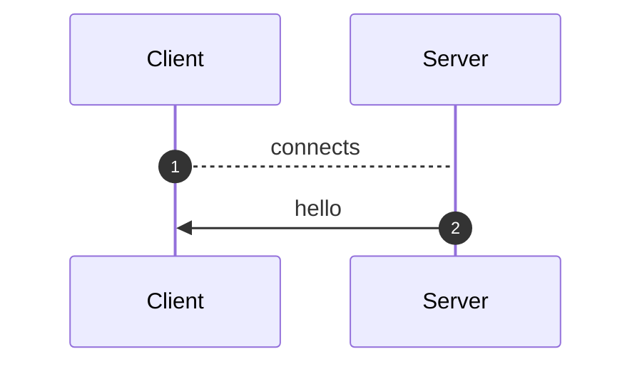
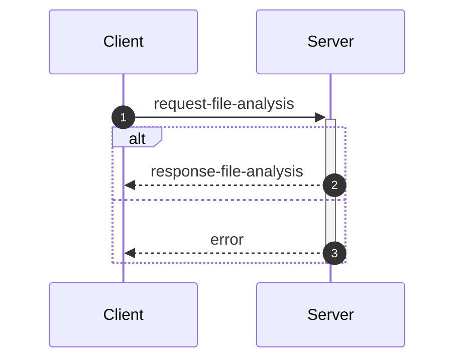
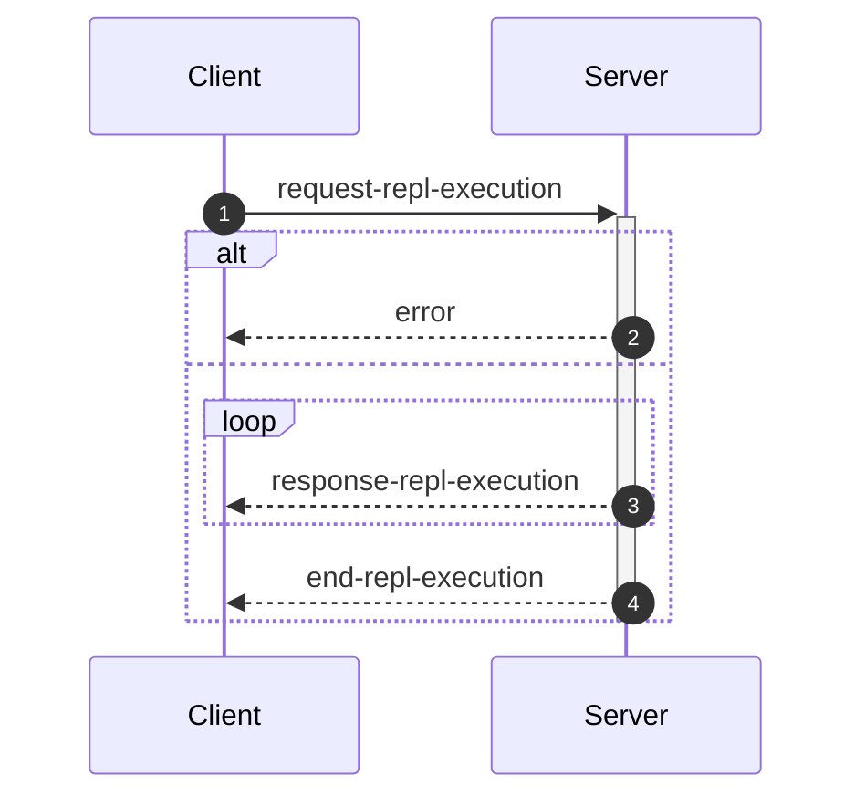
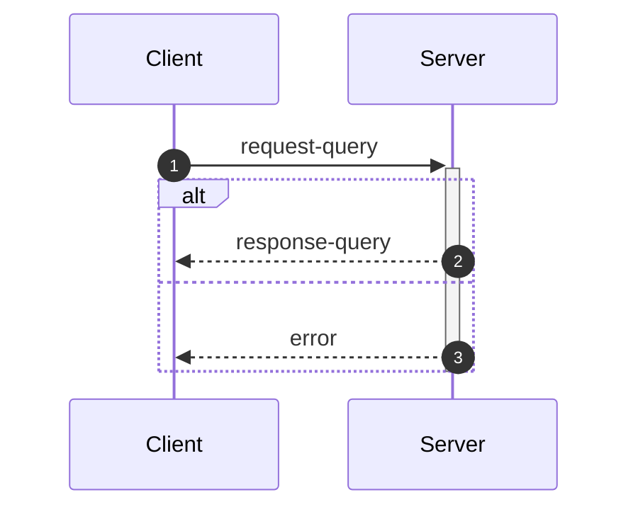

_<span title="an overview of flowR's interface">Generated</span> from '[wiki-interface.ts](https://github.com/flowr-analysis/flowr/tree/main/src/documentation/wiki-interface.ts "src/documentation/wiki-interface.ts")' on 2026-11-03, 06:39:52 UTC (v2.16.8, R v4.6.1), do not edit directly._

Although far from being as detailed as the in-depth explanation of [_flowR_](https://github.com/flowr-analysis/flowr/wiki/Core),
this wiki page explains how to interface with _flowR_ in more detail.
In general, command line arguments and other options provide short descriptions on hover over.

* [💻 Using the REPL](#using-the-repl)
* [⚙️ Configuring FlowR](#configuring-flowr)
* [⚒️ Writing Code](#writing-code)
* [💬 Communicating with the Server](#communicating-with-the-server)

<a id='using-the-repl'></a>
## 💻 Using the REPL

> [!NOTE]
> To execute arbitrary R commands with a repl request, _flowR_ has to be started explicitly with <span title="Description (Command Line Argument): Allow to access the underlying R session when using flowR (security warning: this allows the execution of arbitrary R code!)">`--r-session-access`</span>.
> Please be aware that this introduces a security risk and note that this relies on the [`r-shell` engine](https://github.com/flowr-analysis/flowr/wiki/Engines) .

Although primarily meant for users to explore,
there is nothing which forbids calling _flowR_ as a subprocess to use standard-in, -output, and -error
for communication (although you can access the REPL using the server as well,
with the [REPL Request](#message-request-repl-execution) message).

The read-eval-print loop&nbsp;(REPL) works relatively simple.
You can submit an expression (using <kbd>Enter</kbd>),
which is interpreted as an R&nbsp;expression by default but interpreted as a *command* if it starts with a colon (`:`).
The best command to get started with the REPL is <span title="Description (Repl Command): Show help information (aliases: :h, :?)">`:help`</span>.
Besides, you can leave the REPL either with the command <span title="Description (Repl Command): End the repl (aliases: :q, :exit)">`:quit`</span> or by pressing <kbd>Ctrl</kbd>+<kbd>C</kbd> twice.
When writing a *command*, you may press <kbd>Tab</kbd> to get a list of completions, if available.
Multiple commands can be entered in a single line by separating them with a semicolon (`;`), e.g. `:parse "x<-2"; :df*`.
If a command is given without R code, the REPL will re-use R code given in a previous command.
The prior example will hence return first the parsed AST of the program and then the dataflow graph for `"x <- 2"`.

> [!NOTE]
> If you develop flowR, you may want to launch the repl using the `npm run main-dev` command, this way, you get a non-minified version of flowR with debug information and hot-reloading of source files.

<details>
<summary>Available Commands</summary>

We currently offer the following commands (this with a `[*]` suffix are available with and without the star):

| Command | Description |
| ------- | ----------- |
| **<span title="Description (Repl Command): End the repl (aliases: :q, :exit)">:quit</span>** | End the repl (aliases: **:<span title="Alias of ':quit'. End the repl">q</span>**, **:<span title="Alias of ':quit'. End the repl">exit</span>**) |
| **<span title="Description (Repl Command): Execute the given code as R code. This requires the `--r-session-access` flag to be set and requires the r-shell engine. (aliases: :e, :r)">:execute</span>** | Execute the given code as R code. This requires the `--r-session-access` flag to be set and requires the r-shell engine. (aliases: **:<span title="Alias of ':execute'. Execute the given code as R code. This requires the `--r-session-access` flag to be set and requires the r-shell engine.">e</span>**, **:<span title="Alias of ':execute'. Execute the given code as R code. This requires the `--r-session-access` flag to be set and requires the r-shell engine.">r</span>**) |
| **<span title="Description (Repl Command): Get mermaid code for the control-flow graph of R code (aliases: :cfg, :cf)">:controlflow[*]</span>** | Get mermaid code for the control-flow graph of R code (star: Returns the URL to mermaid.live) (aliases: **:<span title="Alias of ':controlflow'. Get mermaid code for the control-flow graph of R code">cfg</span>**, **:<span title="Alias of ':controlflow'. Get mermaid code for the control-flow graph of R code">cf</span>**) |
| **<span title="Description (Repl Command): Get mermaid code for the control-flow graph with basic blocks (aliases: :cfgb, :cfb)">:controlflowbb[*]</span>** | Get mermaid code for the control-flow graph with basic blocks (star: Returns the URL to mermaid.live) (aliases: **:<span title="Alias of ':controlflowbb'. Get mermaid code for the control-flow graph with basic blocks">cfgb</span>**, **:<span title="Alias of ':controlflowbb'. Get mermaid code for the control-flow graph with basic blocks">cfb</span>**) |
| **<span title="Description (Repl Command): Get mermaid code for the dataflow graph (aliases: :d, :df)">:dataflow[*]</span>** | Get mermaid code for the dataflow graph (star: Returns the URL to mermaid.live) (aliases: **:<span title="Alias of ':dataflow'. Get mermaid code for the dataflow graph">d</span>**, **:<span title="Alias of ':dataflow'. Get mermaid code for the dataflow graph">df</span>**) |
| **<span title="Description (Repl Command): Get mermaid code for the normalized AST of R code (aliases: :n)">:normalize[*]</span>** | Get mermaid code for the normalized AST of R code (star: Returns the URL to mermaid.live) (alias: **:<span title="Alias of ':normalize'. Get mermaid code for the normalized AST of R code">n</span>**) |
| **<span title="Description (Repl Command): Get mermaid code for the simplified dataflow graph (aliases: :ds, :dfs)">:dataflowsimple[*]</span>** | Get mermaid code for the simplified dataflow graph (star: Returns the URL to mermaid.live) (aliases: **:<span title="Alias of ':dataflowsimple'. Get mermaid code for the simplified dataflow graph">ds</span>**, **:<span title="Alias of ':dataflowsimple'. Get mermaid code for the simplified dataflow graph">dfs</span>**) |
| **<span title="Description (Repl Command): Inspect and extend the signature database: `query` (identical to :query @signature), `info <name>` for where a function comes from (identical to :query @function-info), `add <path>` to mount another database/source, `download` to fetch the full-history database. (aliases: :sig)">:signature</span>** | Inspect and extend the signature database: `query` (identical to :query @signature), `info <name>` for where a function comes from (identical to :query @function-info), `add <path>` to mount another database/source, `download` to fetch the full-history database. (alias: **:<span title="Alias of ':signature'. Inspect and extend the signature database: `query` (identical to :query @signature), `info <name>` for where a function comes from (identical to :query @function-info), `add <path>` to mount another database/source, `download` to fetch the full-history database.">sig</span>**) |
| **<span title="Description (Repl Command): Just calculates the DFG, but only prints summary info (aliases: :d#, :df#)">:dataflowsilent</span>** | Just calculates the DFG, but only prints summary info (aliases: **:<span title="Alias of ':dataflowsilent'. Just calculates the DFG, but only prints summary info">d#</span>**, **:<span title="Alias of ':dataflowsilent'. Just calculates the DFG, but only prints summary info">df#</span>**) |
| **<span title="Description (Repl Command): Prints ASCII Art of the parsed, unmodified AST (aliases: :p)">:parse</span>** | Prints ASCII Art of the parsed, unmodified AST (alias: **:<span title="Alias of ':parse'. Prints ASCII Art of the parsed, unmodified AST">p</span>**) |
| **<span title="Description (Repl Command): Prints the version of flowR as well as the current version of R">:version</span>** | Prints the version of flowR as well as the current version of R
| **<span title="Description (Repl Command): Query the given R code (use 'help' for more information)">:query[*]</span>** | Query the given R code (use 'help' for more information) (star: Similar to query, but returns the output in json format.)
| **<span title="Description (Repl Command): Returns an ASCII representation of the dataflow graph (aliases: :df!)">:dataflowascii</span>** | Returns an ASCII representation of the dataflow graph (alias: **:<span title="Alias of ':dataflowascii'. Returns an ASCII representation of the dataflow graph">df!</span>**) |
| **<span title="Description (Repl Command): Returns summarization stats for the normalized AST (aliases: :n#)">:normalize#</span>** | Returns summarization stats for the normalized AST (alias: **:<span title="Alias of ':normalize#'. Returns summarization stats for the normalized AST">n#</span>**) |
| **<span title="Description (Repl Command): Show help information (aliases: :h, :?)">:help</span>** | Show help information (aliases: **:<span title="Alias of ':help'. Show help information">h</span>**, **:<span title="Alias of ':help'. Show help information">?</span>**) |

</details>

> [!TIP]
> 
> As indicated by the examples before, all REPL commands that operate on code keep track of the state.
> Hence, if you run a command like <span title="Description (Repl Command, starred version): Returns the URL to mermaid.live; Base Command: Get mermaid code for the dataflow graph (aliases: :d*, :df*)">`:dataflow*`</span> without providing R code,
> the REPL will re-use the R code provided in a previous command.
> Likewise, doing this will benefit from incrementality!
> If you request the dataflow graph with `:df* x <- 2 * y` and then want to see the parsed AST with `:parse`,
> the REPL will re-use previously obtained information and not re-parse the code again.
> 		

Generally, many commands offer shortcut versions in the REPL. Many queries, for example, offer a shortened format (see the example below).
Of special note, the [Config Query](https://github.com/flowr-analysis/flowr/wiki/%5BQuery%5D-Config)
can be used to also modify the currently active configuration of _flowR_ within the REPL (see the [wiki page](https://github.com/flowr-analysis/flowr/wiki/%5BQuery%5D-Config) for more information).

### Example: Retrieving the Dataflow Graph

To retrieve a URL to the [mermaid](https://mermaid.js.org/) diagram of the dataflow of a given expression,
use <span title="Description (Repl Command, starred version): Returns the URL to mermaid.live; Base Command: Get mermaid code for the dataflow graph (aliases: :d*, :df*)">`:dataflow*`</span> (or <span title="Description (Repl Command): Get mermaid code for the dataflow graph (aliases: :d, :df)">`:dataflow`</span> to get the mermaid code in the cli):

```shell
$ docker run -it --rm eagleoutice/flowr # or npm run flowr 
flowR repl v2.16.8, R grammar v14 (tree-sitter engine)
R> :dataflow* y <- 1 + x
```

<details>
<summary style='color:gray'>Output</summary>

```text
https://mermaid.live/view#base64:eyJjb2RlIjoiZmxvd2NoYXJ0IFREXG4gICAgMXt7XCJgKiM5MTtSTnVtYmVyIzkzOyogKioxKipcbiAgICAgICoxLjYqICgqKmlkOiAxKiopYFwifX1cbiAgICAyKFtcImAqIzkxO1JTeW1ib2wjOTM7KiAqKngqKlxuICAgICAgKjEuMTAqICgqKmlkOiAyKiopYFwiXSlcbiAgICAzW1tcImAqIzkxO1JCaW5hcnlPcCM5MzsqIGJhc2UjNTg7IzU4OyoqIzQzOyoqXG4gICAgICAqMS42LTEwKiAoKippZDogMyoqKVxuICAgIGFyZzogKDEsIDIpYFwiXV1cbiAgICBidWlsdC1pbjpfNDNfW1wiYEJ1aWx0LUluOlxuIzQzO2BcIl1cbiAgICBzdHlsZSBidWlsdC1pbjpfNDNfIHN0cm9rZTpncmF5LGZpbGw6Z3JheSxzdHJva2Utd2lkdGg6MnB4LG9wYWNpdHk6Ljg7XG4gICAgMFtcImAqIzkxO1JTeW1ib2wjOTM7KiAqKnkqKlxuICAgICAgKjEuMSogKCoqaWQ6IDAqKiwgdjogMylgXCJdXG4gICAgNFtbXCJgKiM5MTtSQmluYXJ5T3AjOTM7KiBiYXNlIzU4OyM1ODsqKiM2MDsjNDU7KipcbiAgICAgICoxLjEtMTAqICgqKmlkOiA0KiopXG4gICAgYXJnOiAoMCwgMylgXCJdXVxuICAgIGJ1aWx0LWluOl82MF8tW1wiYEJ1aWx0LUluOlxuIzYwOyM0NTtgXCJdXG4gICAgc3R5bGUgYnVpbHQtaW46XzYwXy0gc3Ryb2tlOmdyYXksZmlsbDpncmF5LHN0cm9rZS13aWR0aDoycHgsb3BhY2l0eTouODtcbiAgICAxIC0uLT58XCJmbG93XCJ8IDJcbiAgICBsaW5rU3R5bGUgMCBzdHJva2U6Z3JheSxjb2xvcjpncmF5O1xuICAgIDIgLS4tPnxcImZsb3dcInwgM1xuICAgIGxpbmtTdHlsZSAxIHN0cm9rZTpncmF5LGNvbG9yOmdyYXk7XG4gICAgMyAtLT58XCJyZWFkcywgYXJnXCJ8IDFcbiAgICAzIC0tPnxcInJlYWRzLCBhcmdcInwgMlxuICAgIDMgLS4tPnxcImZsb3dcInwgMFxuICAgIGxpbmtTdHlsZSA0IHN0cm9rZTpncmF5LGNvbG9yOmdyYXk7XG4gICAgMyAtLi0+fFwicmVhZHMsIGNhbGxzXCJ8IGJ1aWx0LWluOl80M19cbiAgICBsaW5rU3R5bGUgNSBzdHJva2U6Z3JheTtcbiAgICAwIC0tPnxcImRlZmluZWQtYnksIGZsb3dcInwgNFxuICAgIDAgLS0+fFwiZGVmaW5lZC1ieVwifCAzXG4gICAgNCAtLT58XCJyZWFkcywgYXJnXCJ8IDNcbiAgICA0IC0tPnxcInJldHVybnMsIGFyZ1wifCAwXG4gICAgNCAtLi0+fFwicmVhZHMsIGNhbGxzXCJ8IGJ1aWx0LWluOl82MF8tXG4gICAgbGlua1N0eWxlIDEwIHN0cm9rZTpncmF5OyIsIm1lcm1haWQiOnsiYXV0b1N5bmMiOnRydWV9fQ==
```

Retrieve the dataflow graph of the expression `y <- 1 + x`. It looks like this:


<details>

<summary style="color:gray">R Code of the Dataflow Graph</summary>

The analysis ran (parse and normalize with the [tree-sitter](https://github.com/flowr-analysis/flowr/wiki/Engines) engine) in the generation environment. No [signature database](https://github.com/flowr-analysis/flowr/wiki/Signature-Database) is mounted, so `library()` attaches no exports (base-R names are still qualified, e.g., `stats::acf`). 
We encountered no unknown side effects during the analysis.

```r
y <- 1 + x
```

</details>

</details>

For small graphs like this, <span title="Description (Repl Command): Returns an ASCII representation of the dataflow graph (aliases: :df!)">`:dataflowascii`</span> also provides an ASCII representation directly in the REPL:

```shell
$ docker run -it --rm eagleoutice/flowr # or npm run flowr 
flowR repl v2.16.8, R grammar v14 (tree-sitter engine)
R> :df! y <- 1 + x
```

<details open>
<summary style='color:gray'>Output</summary>

```text
                        v<0>v
 c<4>c──────────────────| y |
 |<- |     ┌────────────v---v
 c---c     │
    │   c<3>c   0<1>0
    └───| + |───| 1 |───u<2>u
        c---c   0---0   | x |
           └────────────u---u
Edges:
3 -> 1: reads, arg          3 -> 2: reads, arg
3 -> 0: flows-to            1 -> 2: flows-to
2 -> 3: flows-to            4 -> 3: reads, arg
4 -> 0: returns, arg        0 -> 4: defined-by, flows-to
0 -> 3: defined-by
```

Retrieve the dataflow graph of the expression `y <- 1 + x` as ASCII art.

</details>

For the slicing with <span title="Description (Repl Command): Static backwards executable slicer for R">`:slicer`</span>, you have access to the same [magic comments](#slice-magic-comments) as with the [slice request](#message-request-slice).
Pass `--inline` to splice resolvable `source()` calls into the reconstruction so the slice is a single self-contained R text (the same as the static slice query's `inlineSources` flag).
See `--help` for more flags!

### Example: Interfacing with the File System

Many commands that allow for an R-expression (like <span title="Description (Repl Command, starred version): Returns the URL to mermaid.live; Base Command: Get mermaid code for the dataflow graph (aliases: :d*, :df*)">`:dataflow*`</span>) allow for a file as well
if the argument starts with `file://`.
If you are working from the root directory of the _flowR_ repository, the following gives you the parsed AST of the example file using the <span title="Description (Repl Command): Prints ASCII Art of the parsed, unmodified AST (aliases: :p)">`:parse`</span> command:

> **Watch mode**: Replace `file://` with `watch://` to enter watch mode.
> flowR runs the command immediately and then re-runs it every time the file (or any file inside the folder) changes.
> Enter any other command to leave watch mode.
> For example: `:df watch://analysis.R`

```shell
$ docker run -it --rm eagleoutice/flowr # or npm run flowr 
flowR repl v2.16.8, R grammar v14 (tree-sitter engine)
R> :parse file://test/testfiles/example.R
```

<details>
<summary style='color:gray'>Output</summary>

```text
File: test/testfiles/example.R

program
├ binaryoperator
│ ├ identifier "sum" (1:1─4)
│ ├ <- "<-" (1:5─7)
│ ╰ float "0" (1:8─9)
├ binaryoperator
│ ├ identifier "product" (2:1─8)
│ ├ <- "<-" (2:9─11)
│ ╰ float "1" (2:12─13)
├ binaryoperator
│ ├ identifier "w" (3:1─2)
│ ├ <- "<-" (3:3─5)
│ ╰ float "7" (3:6─7)
├ binaryoperator
│ ├ identifier "N" (4:1─2)
│ ├ <- "<-" (4:3─5)
│ ╰ float "10" (4:6─8)
├ forstatement
│ ├ for "for" (6:1─4)
│ ├ ( "(" (6:5─6)
│ ├ identifier "i" (6:6─7)
│ ├ in "in" (6:8─10)
│ ├ binaryoperator
│ │ ├ float "1" (6:11─12)
│ │ ├ : ":" (6:12─13)
│ │ ╰ parenthesizedexpression
│ │   ├ ( "(" (6:13─14)
│ │   ├ binaryoperator
│ │   │ ├ identifier "N" (6:14─15)
│ │   │ ├ - "-" (6:15─16)
│ │   │ ╰ float "1" (6:16─17)
│ │   ╰ ) ")" (6:17─18)
│ ├ ) ")" (6:18─19)
│ ╰ bracedexpression
│   ├ { "{" (6:20─21)
│   ├ binaryoperator
│   │ ├ identifier "sum" (7:3─6)
│   │ ├ <- "<-" (7:7─9)
│   │ ╰ binaryoperator
│   │   ├ binaryoperator
│   │   │ ├ identifier "sum" (7:10─13)
│   │   │ ├ + "+" (7:14─15)
│   │   │ ╰ identifier "i" (7:16─17)
│   │   ├ + "+" (7:18─19)
│   │   ╰ identifier "w" (7:20─21)
│   ├ binaryoperator
│   │ ├ identifier "product" (8:3─10)
│   │ ├ <- "<-" (8:11─13)
│   │ ╰ binaryoperator
│   │   ├ identifier "product" (8:14─21)
│   │   ├  "" (8:22─23)
│   │   ╰ identifier "i" (8:24─25)
│   ╰ } "}" (9:1─2)
├ call
│ ├ identifier "cat" (11:1─4)
│ ╰ arguments
│   ├ ( "(" (11:4─5)
│   ├ argument
│   │ ╰ string
│   │   ├ stringopen "\"" (11:5─6)
│   │   ├ stringcontent "Sum:" (11:6─10)
│   │   ╰ stringclose "\"" (11:10─11)
│   ├ comma "," (11:11─12)
│   ├ argument
│   │ ╰ identifier "sum" (11:13─16)
│   ├ comma "," (11:16─17)
│   ├ argument
│   │ ╰ string
│   │   ├ stringopen "\"" (11:18─19)
│   │   ├ stringcontent
│   │   │ ╰ escapesequence "\\n" (11:19─21)
│   │   ╰ stringclose "\"" (11:21─22)
│   ╰ ) ")" (11:22─23)
╰ call
  ├ identifier "cat" (12:1─4)
  ╰ arguments
    ├ ( "(" (12:4─5)
    ├ argument
    │ ╰ string
    │   ├ stringopen "\"" (12:5─6)
    │   ├ stringcontent "Product:" (12:6─14)
    │   ╰ stringclose "\"" (12:14─15)
    ├ comma "," (12:15─16)
    ├ argument
    │ ╰ identifier "product" (12:17─24)
    ├ comma "," (12:24─25)
    ├ argument
    │ ╰ string
    │   ├ stringopen "\"" (12:26─27)
    │   ├ stringcontent
    │   │ ╰ escapesequence "\\n" (12:27─29)
    │   ╰ stringclose "\"" (12:29─30)
    ╰ ) ")" (12:30─31)
```

Retrieve the parsed AST of the example file.

<details>

<summary>File Content</summary>

```r
sum <- 0
product <- 1
w <- 7
N <- 10

for (i in 1:(N-1)) {
  sum <- sum + i + w
  product <- product * i
}

cat("Sum:", sum, "\n")
cat("Product:", product, "\n")
```

</details>

As _flowR_ directly transforms this AST the output focuses on being human-readable instead of being machine-readable.
		
</details>

### Example: Run a Query

You can run any query supported by _flowR_ using the <span title="Description (Repl Command): Query the given R code (use 'help' for more information)">`:query`</span> command.
For example, to obtain the shapes of all data frames in a given piece of code, you can run:

```shell
$ docker run -it --rm eagleoutice/flowr # or npm run flowr 
flowR repl v2.16.8, R grammar v14 (tree-sitter engine)
R> :query @absint df-shape "x <- data.frame(a = 1:10, b = 1:10)\ny <- x$a"
```

<details open>
<summary style='color:gray'>Output</summary>

```text
Query: absint (2 ms)
   ╰ $12: (colnames: [{"a", "b"}, {}], cols: [2, 2], rows: [10, 10])
   ╰ $0: (colnames: [{"a", "b"}, {}], cols: [2, 2], rows: [10, 10])
```

Retrieve the shapes of all data frames in the given code.

</details>

To run the linter on a file, you can use (in this example, we just issue the `dead-code` linter on a small piece of code):

```shell
$ docker run -it --rm eagleoutice/flowr # or npm run flowr 
flowR repl v2.16.8, R grammar v14 (tree-sitter engine)
R> :query @linter rules:dead-code "if(FALSE) x <- 2"
```

<details open>
<summary style='color:gray'>Output</summary>

```text
Query: linter (2 ms)
   ╰ Dead Code (dead-code):
       ╰ certain:
           ╰ Code at 1.11-16 (1 quick fix(es) available)
```

Run the linter on the given code, with only the `dead-code` rule enabled.

</details>

For more information on the available queries, please check out the [Query API](https://github.com/flowr-analysis/flowr/wiki/Query-API).

<a id='configuring-flowr'></a>
## ⚙️ Configuring FlowR

When running _flowR_, you may want to specify some behaviors with a dedicated configuration file.
By default, flowR looks for a file named `flowr.json` in the current working directory (or any higher directory).
You can also specify a different file with <span title="Description (Command Line Argument): The name of the configuration file to use">`--config-file`</span> or pass the configuration inline using <span title="Description (Command Line Argument): The flowR configuration to use, as a JSON string">`--config-json`</span>.
A `flowr.json` found this way belongs to the analyzed project, so flowR ignores its options that decide what flowR executes or loads
(`engines.*.wasmPath`, `engines.*.treeSitterWasmPath`, `engines.*.rPath`, `solver.sigdb.additionalPaths`, `solver.sigdb.downloadRepo`, `solver.sigdb.installedLibrary.paths`),
unless you pass <span title="Description (Command Line Argument): Keep the security-sensitive options (e.g., the R executable) of the flowr.json found in the working directory or a parent. Only use this for projects you trust.">`--trust-config`</span>.
To analyze code you do not trust, use the secure mode (<span title="Description (Command Line Argument): Run in secure mode for analyzing untrusted code: flowR does not start R (or any other process), does not access the network, does not search for project configs, and ignores security-sensitive options in every config. Cannot be disabled once enabled. Can also be enabled with the environment variable {italic FLOWR_SECURE_MODE=1}.">`--secure`</span>, see the [security policy](https://github.com/flowr-analysis/flowr/blob/main/.github/SECURITY.md)).
To inspect the current configuration, you can run flowr with the <span title="Description (Command Line Argument): Run with verbose logging (will be passed to the corresponding script)">`--verbose`</span> flag, or use the `config` [Query](https://github.com/flowr-analysis/flowr/wiki/Query-API).
Within the REPL this works by running the following:

```shell
:query @config
```

To work with the <a href="https://github.com/flowr-analysis/flowr/tree/main/src/config.ts#L119"><code><span title="The configuration file format for flowR.">FlowrConfig</span></code></a> you can use the provided helper objects alongside its methods like
<a href="https://github.com/flowr-analysis/flowr/tree/main/src/config.ts#L914"><code><span title="Creates a new flowr config that has the updated values.">FlowrConfig::<b>amend</b></span></code></a>.
The schema below documents every option; the ones you most likely want are:

- <a href="https://github.com/flowr-analysis/flowr/wiki/Interface#configuring-flowr" title="Configuration Option (boolean): Whether source calls should be ignored, causing {@link processSourceCall}&#39;s behavior to be skipped.">ignoreSourceCalls</a>: ignore source calls when analyzing the code, i.e., ignore the inclusion of other files.
- <a href="https://github.com/flowr-analysis/flowr/wiki/Interface#configuring-flowr" title="Configuration Option (boolean): Whether load calls should be ignored, causing {@link processLoadCall}&#39;s behavior to be skipped.">ignoreLoadCalls</a>: ignore load calls when analyzing the code, i.e., ignore the loading of r-data files.
- <a href="https://github.com/flowr-analysis/flowr/wiki/Interface#configuring-flowr" title="Configuration Option (object): Do you want to overwrite (parts) of the builtin definition?">semantics.environment.overwriteBuiltIns</a>: overwrite _flowR_'s handling of built-in functions, or clear the preset definitions entirely.
  See [Configure BuiltIn Semantics](#configure-builtin-semantics) for more information.
- <a href="https://github.com/flowr-analysis/flowr/wiki/Interface#configuring-flowr" title="Configuration Option (string): How to resolve variables and their values. (one of &quot;disabled&quot;, &quot;alias&quot;, &quot;builtin&quot;)">solver.variables</a>: how to resolve variables and their values (`disabled`, `alias`, `builtin`).
- <a href="https://github.com/flowr-analysis/flowr/wiki/Interface#configuring-flowr" title="Configuration Option (array): The engine or set of engines to use for interacting with R code. An empty array means all available engines will be used.">engines</a> and <a href="https://github.com/flowr-analysis/flowr/wiki/Interface#configuring-flowr" title="Configuration Option (string): The default engine to use for interacting with R code. If this is undefined, an arbitrary engine from the specified list will be used. (one of &quot;tree-sitter&quot;, &quot;r-shell&quot;)">defaultEngine</a>: the engines used to interact with R code, see the [Engines wiki page](https://github.com/flowr-analysis/flowr/wiki/Engines).
- <a href="https://github.com/flowr-analysis/flowr/wiki/Interface#configuring-flowr" title="Configuration Option (array): Files a framework loads on its own, without any source() call (e.g. global.R in a shiny app), in the order they are loaded; flowR orders the matching project files accordingly and analyzes them as one program. Entries are case-insensitive globs matched against the file path, a plain name matches any file with that name, and entries matching no project file are warned about. Usually set per project kind via specializeConfig.">project.implicitSources</a>: the files a framework loads without any `source()` call, in the order in which they are
  loaded. Entries are globs (e.g. `R/*.R`) matched against the file path ignoring capitalization; one matching no file is reported.
- <a href="https://github.com/flowr-analysis/flowr/wiki/Interface#configuring-flowr" title="Configuration Option (object): Overwrite (parts of) the configuration depending on the project kind flowR detects, e.g. to give a shiny app its implicit sources.">specializeConfig</a>: overwrite (parts of) the configuration depending on the kind of project _flowR_ detects
  (e.g. `shiny-app`), which is how a shiny app gets its implicit sources by default. What you configure directly wins.
- <a href="https://github.com/flowr-analysis/flowr/wiki/Interface#configuring-flowr" title="Configuration Option (string): Overwrite the project kind flowR would otherwise infer from the analyzed files, e.g. when auto-detection guesses wrong. (one of &quot;package&quot;, &quot;script&quot;, &quot;shiny-app&quot;, &quot;notebook&quot;, &quot;project&quot;, &quot;unknown&quot;)">project.useProjectType</a>: skip that detection and force a project kind yourself, when auto-detection guesses wrong.
- <a href="https://github.com/flowr-analysis/flowr/wiki/Interface#configuring-flowr" title="Configuration Option (array): The default plugins to load when creating a new instance of FlowrAnalyzer">defaultPlugins</a> and <a href="https://github.com/flowr-analysis/flowr/wiki/Interface#configuring-flowr" title="Configuration Option (array): The plugins to load in REPL mode">repl.plugins</a>: the plugins to load for a new <a href="https://github.com/flowr-analysis/flowr/tree/main/src/project/flowr-analyzer.ts#L210"><code><span title="Central class for conducting analyses with FlowR. Use the FlowrAnalyzerBuilder to create a new instance. If you want the original pattern of creating a pipeline and running all steps, you can still do this with FlowrAnalyzer#runFull . To inspect the context of the analyzer, use FlowrAnalyzer#inspectContext (if you are a plugin and need to modify it, use FlowrAnalyzer#context instead).">FlowrAnalyzer</span></code></a> and in the REPL
  (use `flowr:default` to reference the former).

So you can configure _flowR_ by adding a file like the following:

<details>

<summary>Example Configuration File</summary>

```json
{
  "ignoreSourceCalls": true,
  "ignoreLoadCalls": true,
  "semantics": {
    "environment": {
      "overwriteBuiltIns": {
        "definitions": [
          {
            "type": "function",
            "names": [
              "foo"
            ],
            "processor": "builtin:assign",
            "config": {}
          }
        ]
      }
    }
  },
  "defaultPlugins": [
    "file:description",
    "versions:description"
  ],
  "repl": {
    "quickStats": false,
    "dfProcessorHeat": false,
    "hints": true,
    "plugins": [
      "flowr:default"
    ]
  },
  "project": {
    "resolveUnknownPathsOnDisk": true,
    "implicitSources": [
      "global.R",
      "app.R"
    ]
  },
  "linter": {
    "disabledRules": []
  },
  "specializeConfig": {
    "shiny-app": {
      "project": {
        "implicitSources": [
          "global.R",
          "ui.R",
          "server.R",
          "app.R"
        ]
      }
    }
  },
  "engines": [
    {
      "type": "r-shell"
    }
  ],
  "solver": {
    "variables": "alias",
    "evalStrings": true,
    "trackEnvironments": true,
    "sigdb": {
      "enabled": true,
      "loadProjectDependencies": true,
      "eagerlyLoad": false,
      "eagerlyLoadExports": false,
      "linkBaseR": false,
      "linkDescriptionDependencies": false
    },
    "resolveSource": {
      "dropPaths": "no",
      "ignoreCapitalization": true,
      "inferWorkingDirectory": "active-script",
      "searchPath": []
    },
    "instrument": {},
    "slicer": {
      "threshold": 50
    }
  },
  "abstractInterpretation": {
    "wideningThreshold": 4,
    "followCalls": true,
    "dataFrame": {
      "maxColNames": 20,
      "readLoadedData": {
        "readExternalFiles": true,
        "maxReadLines": 1000000
      }
    }
  },
  "incremental": {
    "alwaysIncremental": false,
    "parsing": {
      "activated": false,
      "heuristics": {
        "activated": true,
        "mtime": true,
        "linesFrom": 500,
        "bytesFrom": 50000,
        "alwaysWithEdits": false,
        "minFiles": 1
      }
    }
  },
  "gas": {
    "thresholds": {
      "memory": {
        "problematic": 0.7,
        "critical": 0.9
      },
      "timeMs": {
        "problematic": 100000,
        "critical": 120000
      }
    },
    "features": {}
  }
}
```

</details>

<details>
<a id='configure-builtin-semantics'></a>
<summary>Configure Built-In Semantics</summary>

`semantics/environment/overwriteBuiltins` accepts two keys:

- `loadDefaults` (boolean, initially `true`): If set to `true`, the default built-in definitions are loaded before applying the custom definitions. Setting this flag to `false` explicitly disables the loading of the default definitions.
- `definitions` (array, initially empty): Allows to overwrite or define new built-in elements. Each object within must have a `type` which is one of the below. Furthermore, they may define a string array of `names` which specifies the identifiers to bind the definitions to. You may use `assumePrimitive` to specify whether _flowR_ should assume that this is a primitive non-library definition (so you probably just do not want to specify the key).

  | Type            | Description                                                                                                                                                                                                                                                                                              | Example                                                                                                    |
  | --------------- | -------------------------------------------------------------------------------------------------------------------------------------------------------------------------------------------------------------------------------------------------------------------------------------------------------- | ---------------------------------------------------------------------------------------------------------- |
  | `constant`    | Additionally allows for a `value` this should resolve to.                                                                                                                                                                                                                                                | `{ type: 'constant', names: ['NULL', 'NA'],  value: null }`                                                |
  | `function`    | Is a rather flexible way to define and bind built-in functions. For the time, we do not have extensive documentation to cover all the cases, so please either consult the sources with the `default-builtin-config.ts` or open a [new issue](https://github.com/flowr-analysis/flowr/issues/new/choose). | `{ type: 'function', names: ['next'], processor: 'builtin:d', config: { cfg: ExitPointType.Next } }` |
  | `replacement` | A comfortable way to specify replacement functions like `$<-` or `names<-`. `suffixes` describes the... suffixes to attach automatically. | `{ type: 'replacement', suffixes: ['<-', '<<-'], names: ['[', '[['] }` |

</details>

<details>

<summary style='color:gray'>Full Configuration-File Schema</summary>

- _The configuration file format for flowR._ (object)
    - **logLevel** [optional] _flowR's global minimum log level, applied when the config is loaded._ (string)
        Only allows: 'silly', 'trace', 'debug', 'info', 'warn', 'error', 'fatal'
    - **ignoreSourceCalls** [optional] _Whether source calls should be ignored, causing {@link processSourceCall}'s behavior to be skipped._ (boolean)
    - **ignoreLoadCalls** [optional] _Whether load calls should be ignored, causing {@link processLoadCall}'s behavior to be skipped._ (boolean)
    - **semantics** _Configure language semantics and how flowR handles them._ (object)
        - **environment** [optional] _Semantics regarding how to handle the R environment._ (object)
            - **overwriteBuiltIns** [optional] _Do you want to overwrite (parts) of the builtin definition?_ (object)
                - **loadDefaults** [optional] _Should the default configuration still be loaded?_ (boolean)
                - **definitions** [optional] _The definitions to load/overwrite._ (array)
                Valid item types:
                    - (object)
    - **defaultPlugins** [optional] _The default plugins to load when creating a new instance of FlowrAnalyzer_ (array)
    Valid item types:
        - (alternatives)
            - (string)
            - (array)
    - **repl** _Configuration options for the REPL._ (object)
        - **quickStats** [optional] _Whether to show quick stats in the REPL after each evaluation._ (boolean)
        - **dfProcessorHeat** [optional] _This instruments the dataflow processors to count how often each processor is called._ (boolean)
        - **hints** [optional] _Whether to show dim inline hints on the empty prompt (automatically disabled on non-interactive terminals)._ (boolean)
        - **plugins** [optional] _The plugins to load in REPL mode_ (array)
        Valid item types:
            - (alternatives)
                - (string)
                - (array)
        - **autoUseFileProtocol** [optional] _Prepend the file protocol to a repl input that looks like a path, instead of only warning about it._ (boolean)
        - **queryStats** [optional] _Whether `:query` closes with the line stating how long the queries took (`:query*` never prints it)._ (boolean)
        - **showPlugins** [optional] _Whether `:version` grays out the plugins that did not activate during the last analysis._ (boolean)
    - **project** _Project specific configuration options._ (object)
        - **resolveUnknownPathsOnDisk** [optional] _Whether to resolve unknown paths loaded by the r project disk when trying to source/analyze files._ (boolean)
        - **failOnInaccessiblePath** [optional] _Whether a directory that cannot be traversed during file discovery (e.g. due to permissions) aborts the analysis; when false (the default) such paths are logged and skipped._ (boolean)
        - **basePackages** [optional] _The packages considered part of R itself (base and recommended); if unset, flowR uses its built-in list._ (array)
        Valid item types:
            - (string)
        - **implicitSources** [optional] _Files a framework loads on its own, without any source() call (e.g. global.R in a shiny app), in the order they are loaded; flowR orders the matching project files accordingly and analyzes them as one program. Entries are case-insensitive globs matched against the file path, a plain name matches any file with that name, and entries matching no project file are warned about. Usually set per project kind via specializeConfig._ (array)
        Valid item types:
            - (string)
        - **useProjectType** [optional] _Overwrite the project kind flowR would otherwise infer from the analyzed files, e.g. when auto-detection guesses wrong._ (string)
            Only allows: 'package', 'script', 'shiny-app', 'notebook', 'project', 'unknown'
        - **assumeImplicitEcho** [optional] _Whether the top level of the analyzed code is echoed, so that every visible result printed there is collected as an output by the dependencies query (default true, false for a package)._ (boolean)
        - **discovery** [optional] _Scoping options for the default project discovery._ (object)
            - **full** [optional] _Collect every file below the project root (greedy) instead of only the files the detected project kind needs (default false)._ (boolean)
            - **perKind** [optional] _Per-kind include/exclude glob overrides layered on the default scoping._ (object)
            - **ignore** [optional] _Case-insensitive globs that drop matching files from the intelligent discovery, regardless of kind (e.g. .Renviron to ignore environment files)._ (array)
            Valid item types:
                - (string)
        - **classification** [optional] _Overrides for the signals flowR uses to classify the project kind._ (object)
            - **shinyDescriptionTypes** [optional] _DESCRIPTION Type: values that mark a shiny app._ (array)
            Valid item types:
                - (string)
            - **shinyEntryFiles** [optional] _File names a shiny app is assembled from._ (array)
            Valid item types:
                - (string)
            - **shinyUsagePattern** [optional] _Regex source evidencing shiny usage in an entry file._ (string)
            - **notebookExtensions** [optional] _File extensions marking a notebook._ (array)
            Valid item types:
                - (string)
    - **linter** _Linter configuration options._ (object)
        - **disabledRules** _Linting rule names excluded from the default rule set (a rule requested explicitly via a linter query still runs). Usually set per project kind via specializeConfig._ (array)
        Valid item types:
            - (string)
        - **disabledTags** [optional] _Linting rule tags whose rules are excluded from the default rule set (a rule requested explicitly via a linter query still runs). By default the cmd-check rules are disabled for everything but a package; a configured list replaces that default._ (array)
        Valid item types:
            - (string)
    - **inputSources** [optional] _Further frameworks the input-sources analysis should know about; entries are added to flowR's defaults._ (object)
        - **pure** [optional] _Functions that only pass the constantness of their arguments on._ (array)
        Valid item types:
            - (string)
        - **param** [optional] _Functions whose result is a 'param' input._ (array)
        Valid item types:
            - (string)
        - **file** [optional] _Functions whose result is a 'file' input._ (array)
        Valid item types:
            - (string)
        - **tempfile** [optional] _Functions whose result is a 'tempfile' input._ (array)
        Valid item types:
            - (string)
        - **glob** [optional] _Functions whose result is a 'glob' input._ (array)
        Valid item types:
            - (string)
        - **net** [optional] _Functions whose result is a 'net' input._ (array)
        Valid item types:
            - (string)
        - **rand** [optional] _Functions whose result is a 'rand' input._ (array)
        Valid item types:
            - (string)
        - **system** [optional] _Functions whose result is a 'system' input._ (array)
        Valid item types:
            - (string)
        - **ffi** [optional] _Functions whose result is a 'ffi' input._ (array)
        Valid item types:
            - (string)
        - **lang** [optional] _Functions whose result is a 'lang' input._ (array)
        Valid item types:
            - (string)
        - **options** [optional] _Functions whose result is a 'options' input._ (array)
        Valid item types:
            - (string)
        - **cmdline** [optional] _Functions whose result is a 'cmdline' input._ (array)
        Valid item types:
            - (string)
        - **user** [optional] _Functions whose result is a 'user' input._ (array)
        Valid item types:
            - (string)
        - **const** [optional] _Functions whose result is a 'const' input._ (array)
        Valid item types:
            - (string)
        - **scope** [optional] _Functions whose result is a 'scope' input._ (array)
        Valid item types:
            - (string)
        - **dconst** [optional] _Functions whose result is a 'dconst' input._ (array)
        Valid item types:
            - (string)
        - **unknown** [optional] _Functions whose result is a 'unknown' input._ (array)
        Valid item types:
            - (string)
        - **linkedObjects** [optional] _Objects a framework provides without a definition in the code, e.g. shiny's input._ (array)
        Valid item types:
            - (object)
        - **linkedEntryPoints** [optional] _Calls that hand a function to a framework, which binds its objects to the parameters by position._ (array)
        Valid item types:
            - (object)
    - **specializeConfig** [optional] _Overwrite (parts of) the configuration depending on the project kind flowR detects, e.g. to give a shiny app its implicit sources._ (object)
    - **engines** _The engine or set of engines to use for interacting with R code. An empty array means all available engines will be used._ (array)
    Valid item types:
        - (alternatives)
            - _The configuration for the tree sitter engine._ (object)
                - **type** [required] _Use the tree sitter engine._ (string)
                    Only allows: 'tree-sitter'
                - **wasmPath** [optional] _The path to the tree-sitter-r WASM binary to use. If this is undefined, this uses the default path._ (string)
                - **treeSitterWasmPath** [optional] _The path to the tree-sitter WASM binary to use. If this is undefined, this uses the default path._ (string)
                - **lax** [optional] _Whether to use the lax parser for parsing R code (allowing for syntax errors). If this is undefined, the strict parser will be used._ (boolean)
            - _The configuration for the R shell engine._ (object)
                - **type** [required] _Use the R shell engine._ (string)
                    Only allows: 'r-shell'
                - **rPath** [optional] _The path to the R executable to use. If this is undefined, this uses the default path._ (string)
                - **pipeBind** [optional] _Whether to enable R's experimental pipe-bind operator "=>" by setting _R_USE_PIPEBIND_ for the R session (default false); R itself keeps this off by default, as it is experimental and has never shipped in a release version of R._ (boolean)
    - **defaultEngine** [optional] _The default engine to use for interacting with R code. If this is undefined, an arbitrary engine from the specified list will be used._ (string)
        Only allows: 'tree-sitter', 'r-shell'
    - **solver** _How to resolve constants, constraints, cells, ..._ (object)
        - **variables** _How to resolve variables and their values._ (string)
            Only allows: 'disabled', 'alias', 'builtin'
        - **evalStrings** _Should we include eval(parse(text="...")) calls in the dataflow graph?_ (boolean)
        - **trackEnvironments** [optional] _Track user-created environments (new.env, assign/get/local with envir=, dollar-assign, attach). When false, all envir-style calls fall through conservatively._ (boolean)
        - **sigdb** _Resolving library exports from a signature database._ (object)
            - **enabled** [optional] _Resolve library()/use() exports from a signature database (default true); when false no database is consulted._ (boolean)
            - **loadProjectDependencies** [optional] _Load the project's declared dependencies from its metadata files (DESCRIPTION Imports/Depends, rproject.toml, uvr.toml, renv.lock, rv.lock, uvr.lock) (default true); when false these files are not read for dependencies._ (boolean)
            - **eagerlyLoad** [optional] _Parse the database up front rather than on the first package load (default false, ignored if disabled)._ (boolean)
            - **eagerlyLoadExports** [optional] _Add a vertex for every export on load rather than on demand (default false); keeps the dataflow graph small._ (boolean)
            - **assumedRVersion** [optional] _R version assumed when resolving versioned (base-R) exports: a pin like "4.5" or "auto" to detect the installed R (default "auto")._ (string)
            - **linkBaseR** [optional] _Eagerly attach base-R namespaces so bare base calls resolve without library() (default false)._ (boolean)
            - **linkBaseRCalls** [optional] _Add a lightweight Reads edge from a bare base-R call to its signature-database function vertex (default false; base-R qualification is edge-free otherwise)._ (boolean)
            - **linkPackageCalls** [optional] _Add a lightweight Reads edge from a resolved package call to its signature-database function vertex (default false)._ (boolean)
            - **linkDescriptionDependencies** [optional] _Eagerly attach the namespaces of the project's declared DESCRIPTION dependencies (Imports/Depends) so their exports resolve without an explicit library() (default false)._ (boolean)
            - **warmInBackground** [optional] _Decompress the hot shards (base + most-downloaded) in a background task on startup so the first library() lookup is warm (default false; for long-running servers/REPLs)._ (boolean)
            - **additionalPaths** [optional] _Extra directories or bundle/manifest files searched for signature databases (alongside the shipped default and $FLOWR_SIGDB_DIR); a downloaded full-history bundle placed here is mounted automatically._ (array)
            Valid item types:
                - (string)
            - **downloadRepo** [optional] _GitHub owner/repo the full-history bundle is downloaded from via ":signature download" (default "flowr-analysis/flowr"; the release tag comes from the committed sigdb.remote.json unless a version is given)._ (string)
            - **autoSync** [optional] _On startup, re-download shards whose committed sigdb.remote.json hash no longer matches the cache, in the background (default false; opt-in network sync after a git pull)._ (boolean)
            - **installedLibrary** [optional] _Recovering packages no signature database knows from the copy installed on this machine._ (object)
                - **enabled** [required] _Recover packages no signature database knows from their installed copy (default false)._ (boolean)
                - **paths** [optional] _Library directories to search; when empty they are discovered from the environment and the project._ (array)
                Valid item types:
                    - (string)
                - **useEnvironment** [optional] _Search the libraries R_LIBS_USER/R_LIBS/R_LIBS_SITE name (default true)._ (boolean)
                - **useProjectLibrary** [optional] _Search a project-local renv/packrat library (default true)._ (boolean)
                - **maxDepth** [optional] _How far to descend into the nested layout of a project-local library (default 3)._ (number)
                - **packages** [optional] _Only recover packages whose name matches one of these regular expressions; empty means any._ (array)
                Valid item types:
                    - (string)
            - **blobCacheBudgetMb** [optional] _How many MiB of decoded package blobs every open bundle may hold together (default 16)._ (number)
            - **versionSelection** [optional] _When a project constrains a dependency, resolve to the newest (default), oldest, or system-installed version satisfying it; system needs R and falls back to newest. Base-R packages always resolve against the assumed R version._ (string)
                Only allows: 'newest', 'oldest', 'system'
            - **versionOverrides** [optional] _Force an exact version for specific packages (name -> version), overriding both the project constraint and the versionSelection policy (default {})._ (object)
        - **versionManagement** _Policies for reasoning about dependency versions._ (object)
            - **linkedVersionGroups** [optional] _Groups of packages that must resolve to the same version; version guessing intersects each group so its members stay mutually compatible (default [])._ (array)
            Valid item types:
                - (array)
                Valid item types:
                    - (string)
        - **assumeAttachedPackages** [optional] _Packages to treat as attached without a `library()` call, so what the built-in configuration states about them applies to the analyzed code. The base packages R attaches on startup already resolve without it._ (array)
        Valid item types:
            - (string)
        - **transitiveSideEffectRounds** [optional] _How many rounds the transitive side-effect fixpoint may run before it is cut off (default 32); the propagation stops on its own as soon as a round adds nothing._ (number)
        - **maxOverlayDepth** [optional] _How many binding overlays may stack on one environment frame before a write flattens them (default 4); a pure performance knob, trading lookup cost against copy cost without changing any result._ (number)
        - **instrument** (object)
            - **dataflowExtractors** [optional] _These keys are only intended for use within code, allowing to instrument the dataflow analyzer!_ (any)
        - **resolveSource** [optional] _If lax source calls are active, flowR searches for sourced files much more freely, based on the configurations you give it. This option is only in effect if `ignoreSourceCalls` is set to false._ (object)
            - **dropPaths** _Allow to drop the first or all parts of the sourced path, if it is relative._ (string)
                Only allows: 'no', 'once', 'all'
            - **ignoreCapitalization** _Search for filenames matching in the lowercase._ (boolean)
            - **inferWorkingDirectory** _Try to infer the working directory from the main or any script to analyze._ (string)
                Only allows: 'no', 'main-script', 'active-script', 'any-script'
            - **searchPath** _Additionally search in these paths._ (array)
            Valid item types:
                - (string)
            - **repeatedSourceLimit** [optional] _How often the same file can be sourced within a single run? Please be aware: in case of cyclic sources this may not reach a fixpoint so give this a sensible limit._ (number)
            - **applyReplacements** _Provide name replacements for loaded files_ (array)
            Valid item types:
                - (object)
            - **assumeFilesExist** [optional] _Assume a sourced file is always there, making what it defines certain instead of conditional on the source call._ (boolean)
        - **slicer** [optional] _The configuration for the slicer._ (object)
            - **threshold** [optional] _The maximum number of iterations to perform on a single function call during slicing._ (number)
            - **autoExtend** [optional] _If set, the slicer will gain an additional post-pass._ (boolean)
    - **abstractInterpretation** _The configuration options for abstract interpretation._ (object)
        - **wideningThreshold** _The threshold for the number of visitations of a node at which widening should be performed to ensure the termination of the fixpoint iteration._ (number)
        - **followCalls** _Whether the abstract interpretation is interprocedural, i.e. whether it steps into the functions a call may dispatch to._ (boolean)
        - **dataFrame** _The configuration of the shape inference for data frames._ (object)
            - **maxColNames** _The maximum number of columns names to infer for data frames before over-approximating the column names to top._ (number)
            - **readLoadedData** _Configuration options for reading data frame shapes from loaded external data files, such as CSV files._ (object)
                - **readExternalFiles** _Whether data frame shapes should be extracted from loaded external files, such as CSV files._ (boolean)
                - **maxReadLines** _The maximum number of lines to read when extracting data frame shapes from loaded files, such as CSV files._ (number)
    - **incremental** (object)
        - **alwaysIncremental** _Always take the incremental path, regardless of heuristics._ (boolean)
        - **parsing** (object)
            - **activated** _If set, incremental parsing will be used._ (boolean)
            - **heuristics** (object)
                - **activated** [optional] _If set, the heuristics for incremental parsing will be used._ (boolean)
                - **mtime** [optional] _Skip reparsing entirely if the file's modification time is unchanged since the last parse._ (boolean)
                - **linesFrom** [optional] _Only consider incremental parsing for files with at least this many lines._ (number)
                - **bytesFrom** [optional] _Only consider incremental parsing for files with at least this many bytes._ (number)
                - **alwaysWithEdits** [optional] _Always take the incremental path whenever there is a computed edit region, regardless of the other thresholds._ (boolean)
                - **minFiles** [optional] _Only apply these heuristics once the project has at least this many files loaded._ (number)
    - **gas** [optional] _Resource-usage guard (gas) configuration. All feature factors default to 0 (disabled). See https://github.com/flowr-analysis/flowr/wiki/Core#gas-resource-guard._ (object)
        - **thresholds** [optional] _Thresholds for all gas checks (scaled by per-feature factor), boundable per feature._ (object)
            - **memory** [optional] _Heap-usage fraction thresholds (0-1), either shared or given per feature key (with `default` covering the rest)._ (object)
                - **problematic** [optional] _Heap fraction (0-1) above which Problematic is returned, for every feature without an entry of its own._ (number)
                - **critical** [optional] _Heap fraction (0-1) above which Critical is returned, for every feature without an entry of its own._ (number)
            - **timeMs** [optional] _Elapsed analysis time thresholds in milliseconds, either shared or given per feature key (with `default` covering the rest)._ (object)
                - **problematic** [optional] _Elapsed ms above which Problematic is returned, for every feature without an entry of its own._ (number)
                - **critical** [optional] _Elapsed ms above which Critical is returned, for every feature without an entry of its own._ (number)
            - **steps** [optional] _Processed-AST-node thresholds, counted rather than sampled; only a key that arms a budget (`dataflow`) reads them._ (object)
                - **problematic** [optional] _Processed AST nodes above which Problematic is returned, for every feature without an entry of its own._ (number)
                - **critical** [optional] _Processed AST nodes above which the extraction is cut short, for every feature without an entry of its own._ (number)
            - **vertices** [optional] _Created-dataflow-vertex thresholds, counted like `steps`._ (object)
                - **problematic** [optional] _Created dataflow vertices above which Problematic is returned, for every feature without an entry of its own._ (number)
                - **critical** [optional] _Created dataflow vertices above which the extraction is cut short, for every feature without an entry of its own._ (number)
        - **features** [optional] _Per-feature sensitivity factors. 0 or absent disables gas checking for that feature. A factor of 2 makes the feature twice as sensitive. Recognised keys: `source`, `side-effect-linking`, `linter`, `slicer`, `dataflow`._ (object)
        - **countedCheckEvery** [optional] _How many counted steps pass between two accountings of an armed check, be it a dataflow budget or the slicer's traversal (default 128); trades overshoot against the cost of the check._ (number)
        - **heapProvider** [optional] _Custom heap statistics source (programmatic configs only), overriding the built-in v8/performance.memory detection._ (function)

</details>

<a id='writing-code'></a>
## ⚒️ Writing Code

_flowR_ can be used as a [module](https://www.npmjs.com/package/@eagleoutice/flowr) and offers several main classes and interfaces that are interesting for extension writers 
(see the [Visual Studio Code extension](https://marketplace.visualstudio.com/items?itemName=code-inspect.vscode-flowr) or the [Core](https://github.com/flowr-analysis/flowr/wiki/Core) wiki page for more information).

### Creating Analyses with _flowR_

Nowadays, instances of the <a href="https://github.com/flowr-analysis/flowr/tree/main/src/project/flowr-analyzer.ts#L210"><code><span title="Central class for conducting analyses with FlowR. Use the FlowrAnalyzerBuilder to create a new instance. If you want the original pattern of creating a pipeline and running all steps, you can still do this with FlowrAnalyzer#runFull . To inspect the context of the analyzer, use FlowrAnalyzer#inspectContext (if you are a plugin and need to modify it, use FlowrAnalyzer#context instead).">FlowrAnalyzer</span></code></a> should be used as central frontend to get analysis results from _flowR_.
The entry points an analysis is written against are re-exported from the package root (`import { FlowrAnalyzerBuilder } from '@eagleoutice/flowr'`);
everything else stays reachable under its own path, as in `@eagleoutice/flowr/dataflow/graph/graph`.
For example, a program slice can be created like this:

```ts
const analyzer = await new FlowrAnalyzerBuilder()
    .setEngine('tree-sitter')
    .build();
analyzer.addRequest('x <- 1\ny <- x\nx');
const result = await analyzer.query([
    {
        type:     'static-slice',
        criteria: ['3@x']
    }
]);
```

For more information, please have a look at the [Analyzer](https://github.com/flowr-analysis/flowr/wiki/Analyzer) wiki page, which explains how to construct and use the <a href="https://github.com/flowr-analysis/flowr/tree/main/src/project/flowr-analyzer.ts#L210"><code><span title="Central class for conducting analyses with FlowR. Use the FlowrAnalyzerBuilder to create a new instance. If you want the original pattern of creating a pipeline and running all steps, you can still do this with FlowrAnalyzer#runFull . To inspect the context of the analyzer, use FlowrAnalyzer#inspectContext (if you are a plugin and need to modify it, use FlowrAnalyzer#context instead).">FlowrAnalyzer</span></code></a> in more detail.
To work with specific perspectives, you can also consult the respective pages like the [Dataflow Graph](https://github.com/flowr-analysis/flowr/wiki/Dataflow-Graph) or the [Abstract Interpretation](https://github.com/flowr-analysis/flowr/wiki/Abstract-Interpretation) wiki pages.
### The Pipeline Executor (Low-Level Interface)

Once, in the beginning, _flowR_ was meant to produce a dataflow graph merely to provide *program slices*. 
However, with continuous updates, the [Dataflow Graph](https://github.com/flowr-analysis/flowr/wiki/Dataflow-Graph) repeatedly proves to be the more interesting part.
With this, we restructured _flowR_'s originally *hardcoded* pipeline to be far more flexible. 
Now, it can be theoretically extended or replaced with arbitrary steps, optional steps, and what we call 'decorations' of these steps. 
In short, a slicing pipeline using the <a href="https://github.com/flowr-analysis/flowr/tree/main/src/core/pipeline-executor.ts#L97"><code><span title="**Please note:** The PipelineExecutor is now considered to be a rather low-level API for flowR. While it still works and is the basis for all other layers, we strongly recommend using the FlowrAnalyzer and its builder to create and use an analyzer instance that is pre-configured for your use-case. The pipeline executor allows to execute arbitrary pipelines in a step-by-step fashion. If you are not...">PipelineExecutor</span></code></a> looks like this:

```ts

const slicer = new PipelineExecutor(DEFAULT_SLICING_PIPELINE, {
  parser:    new RShell(),
  request:   requestFromInput('x <- 1\nx + 1'),
  criterion: ['2@x']
})
const slice = await slicer.allRemainingSteps()
// console.log(slice.reconstruct.code)
```

<details><summary>More Information</summary>

If you compare this, with what you would have done with the old (and removed) `SteppingSlicer`, 
this essentially just requires you to replace the `SteppingSlicer` with the <a href="https://github.com/flowr-analysis/flowr/tree/main/src/core/pipeline-executor.ts#L97"><code><span title="**Please note:** The PipelineExecutor is now considered to be a rather low-level API for flowR. While it still works and is the basis for all other layers, we strongly recommend using the FlowrAnalyzer and its builder to create and use an analyzer instance that is pre-configured for your use-case. The pipeline executor allows to execute arbitrary pipelines in a step-by-step fashion. If you are not...">PipelineExecutor</span></code></a>
and to pass the <a href="https://github.com/flowr-analysis/flowr/tree/main/src/core/steps/pipeline/default-pipelines.ts#L18"><code>DEFAULT_SLICING_PIPELINE</code></a> as the first argument.
The <a href="https://github.com/flowr-analysis/flowr/tree/main/src/core/pipeline-executor.ts#L97"><code><span title="**Please note:** The PipelineExecutor is now considered to be a rather low-level API for flowR. While it still works and is the basis for all other layers, we strongly recommend using the FlowrAnalyzer and its builder to create and use an analyzer instance that is pre-configured for your use-case. The pipeline executor allows to execute arbitrary pipelines in a step-by-step fashion. If you are not...">PipelineExecutor</span></code></a>...

1. Provides structures to investigate the results of all intermediate steps
2. Can be executed step-by-step
3. Can repeat steps (e.g., to calculate multiple slices on the same input)

See the in-code documentation for more information.

</details>

### Using the <a href="https://github.com/flowr-analysis/flowr/tree/main/src/r-bridge/shell.ts#L144"><code><span title="The RShell represents an interactive session with the R interpreter. You can configure it by RShellOptions . At the moment we are using a live R session (and not networking etc.) to communicate with R easily, which allows us to install packages etc. However, this might and probably will change in the future (leaving this as a legacy mode :D)">RShell</span></code></a> to Interact with R

The <a href="https://github.com/flowr-analysis/flowr/tree/main/src/r-bridge/shell.ts#L144"><code><span title="The RShell represents an interactive session with the R interpreter. You can configure it by RShellOptions . At the moment we are using a live R session (and not networking etc.) to communicate with R easily, which allows us to install packages etc. However, this might and probably will change in the future (leaving this as a legacy mode :D)">RShell</span></code></a> class allows interfacing with the `R`&nbsp;ecosystem installed on the host system.
Please have a look at [flowR's Engines](https://github.com/flowr-analysis/flowr/wiki/Engines) for more information on alternatives (for example, the <a href="https://github.com/flowr-analysis/flowr/tree/main/src/r-bridge/lang-4.x/tree-sitter/tree-sitter-executor.ts#L29"><code><span title="Synchronous and (way) faster alternative to the RShell using tree-sitter.">TreeSitterExecutor</span></code></a>).

> [!IMPORTANT]
> 
> Each <a href="https://github.com/flowr-analysis/flowr/tree/main/src/r-bridge/shell.ts#L144"><code><span title="The RShell represents an interactive session with the R interpreter. You can configure it by RShellOptions . At the moment we are using a live R session (and not networking etc.) to communicate with R easily, which allows us to install packages etc. However, this might and probably will change in the future (leaving this as a legacy mode :D)">RShell</span></code></a> controls a new instance of the R&nbsp;interpreter, 
> make sure to call <code><a href="https://github.com/flowr-analysis/flowr/tree/main/src/r-bridge/shell.ts#L350"><span title="Close the current R session, makes the object effectively invalid (can no longer be reopened etc.)">RShell::<i>close</i></span></a>()</code> when you are done.

You can start a new "session" by constructing a new object with <code>new <a href="https://github.com/flowr-analysis/flowr/tree/main/src/r-bridge/shell.ts#L144"><span title="The RShell represents an interactive session with the R interpreter. You can configure it by RShellOptions . At the moment we are using a live R session (and not networking etc.) to communicate with R easily, which allows us to install packages etc. However, this might and probably will change in the future (leaving this as a legacy mode :D)">RShell</span></a>()</code>.

However, there are several options that may be of interest 
(e.g., to automatically revive the shell in case of errors or to control the name location of the R process on the system).

With a shell object (let's call it `shell`), you can execute R code by using <a href="https://github.com/flowr-analysis/flowr/tree/main/src/r-bridge/shell.ts#L213"><code><span title="sends the given command directly to the current R session will not do anything to alter input markers!">RShell::<i>sendCommand</i></span></code></a>,
for example <code>shell.<a href="https://github.com/flowr-analysis/flowr/tree/main/src/r-bridge/shell.ts#L213"><span title="sends the given command directly to the current R session will not do anything to alter input markers!">sendCommand</span></a>("1 + 1")</code>.
However, this does not return anything, so if you want to collect the output of your command, use
<a href="https://github.com/flowr-analysis/flowr/tree/main/src/r-bridge/shell.ts#L296"><code><span title="Send a command and collect the output">RShell::<i>sendCommandWithOutput</i></span></code></a> instead.

<a id='communicating-with-the-server'></a>
## 💬 Communicating with the Server

As explained in the [Overview](https://github.com/flowr-analysis/flowr/wiki/Overview), you can run the [TCP](https://de.wikipedia.org/wiki/Transmission_Control_Protocol)&nbsp;server by adding the <span title="Description (Command Line Argument): Do not drop into a repl, but instead start a server on the given port (default: 1042) and listen for messages.">`--server`</span> flag (and, due to the interactive mode, exit with the conventional <kbd>CTRL</kbd>+<kbd>C</kbd>).
Currently, every connection is handled by the same underlying `RShell` - so the server is not designed to handle many clients at a time.
Additionally, the server is not well guarded against attacks (e.g., you can theoretically spawn an arbitrary number of&nbsp;RShell sessions on the target machine).

Every message has to be given in a single line (i.e., without a newline in-between) and end with a newline character. Nevertheless, we will pretty-print example given in the following segments for the ease of reading.

> [!NOTE]
> 
> The default <span title="Description (Command Line Argument): Do not drop into a repl, but instead start a server on the given port (default: 1042) and listen for messages.">`--server`</span> uses a simple [TCP](https://de.wikipedia.org/wiki/Transmission_Control_Protocol)
> connection. If you want _flowR_ to expose a [WebSocket](https://de.wikipedia.org/wiki/WebSocket) server instead, add the <span title="Description (Command Line Argument): If the server flag is set, use websocket for messaging">`--ws`</span> flag (i.e., <span title="Description (Command Line Argument): Do not drop into a repl, but instead start a server on the given port (default: 1042) and listen for messages.">`--server`</span> <span title="Description (Command Line Argument): If the server flag is set, use websocket for messaging">`--ws`</span>) when starting _flowR_ from the command line.

<ul><li>
<a id="message-hello"></a>
<b>Hello</b> Message (<code>hello</code>) 
<details>

<summary style="color:gray"> View Details. <i>The server informs the client about the successful connection and provides Meta-Information.</i> </summary>



After launching _flowR_, for example, with <code>docker run -it --rm eagleoutice/flowr <span title="Description (Command Line Argument): Do not drop into a repl, but instead start a server on the given port (default: 1042) and listen for messages.">-<span/>-server</span></code>&nbsp;(🐳️), connecting should present you with a `hello` message, that amongst others should reveal the versions of&nbsp;_flowR_ and&nbsp;R, using the [semver 2.0](https://semver.org/spec/v2.0.0.html) versioning scheme.
The message looks like this:

```json
{
  "type": "hello",
  "clientName": "client-0",
  "versions": {
    "flowr": "2.16.8",
    "r": "4.6.1",
    "engine": "r-shell"
  }
}
```

There are currently a few messages that you can send after the hello message.
If you want to _slice_ a piece of R code you first have to send an [analysis request](#message-request-file-analysis), so that you can send one or multiple slice requests afterward.
Requests for the [REPL](#message-request-repl-execution) are independent of that.
	
<hr>

<details>
<summary style="color:gray">Message schema (<code>hello</code>)</summary>

For the definition of the hello message, please see it's implementation at [`./src/cli/repl/server/messages/message-hello.ts`](https://github.com/flowr-analysis/flowr/tree/main/src/cli/repl/server/messages/message-hello.ts).

- [required] (object)
    - **type** [required] _The type of the hello message._ (string)
        Only allows: 'hello'
    - **id** [forbidden] _The id of the message is always undefined (as it is the initial message and not requested)._ (any)
    - **clientName** [required] _A unique name that is assigned to each client. It has no semantic meaning and is only used/useful for debugging._ (string)
    - **versions** [required] (object)
        - **flowr** [required] _The version of the flowr server running in semver format._ (string)
        - **r** [required] _The version of the underlying R shell running in semver format._ (string)
        - **engine** [required] _The parser backend that is used to parse the R code._ (string)

</details>

<hr>

</details>
	</li>

<li>
<a id="message-request-file-analysis"></a>
<b>Analysis</b> Message (<code>request-file-analysis</code>) 
<details>

<summary style="color:gray"> View Details. <i>The server builds the dataflow graph for a given input file (or a set of files).</i> </summary>



The request allows the server to analyze a file and prepare it for slicing.
The message can contain a `filetoken`, which is used to identify the file in later slice or query requests (if you do not add one, the request will not be stored and therefore, it is not available for subsequent requests).

> **Please note!**\
> If you want to send and process a lot of analysis requests, but do not want to slice them, please do not pass the `filetoken` field. This will save the server a lot of memory allocation.

Furthermore, the request must contain either a `content` field to directly pass the file's content or a `filepath` field which contains the path to the file (this path must be accessible for the server to be useful).
If you add the `id` field, the answer will use the same `id` so you can match requests and the corresponding answers.
See the implementation of the request-file-analysis message for more information.

You can drop one or more stored file tokens by adding the `invalidateToken` field (a single token or an array of tokens).
The server frees the corresponding analyses _after_ it has answered the request.

> **Tip!**\
> If you only want to drop tokens, you do not need a separate message: send a `request-file-analysis` that contains _just_ the `invalidateToken` field (and no `content` or `filepath`).
> Such a request behaves like an empty file analysis and the server replies with an empty `results` object.
> Because invalidation happens after the response, you may even pass the _current_ `filetoken` in `invalidateToken` to analyze a file once and have the server forget it right after you received the results.

<details>
<summary>Example of the <code>request-file-analysis</code> Message</summary>

_Note:_ even though we pretty-print these messages, they are sent as a single line, ending with a newline.

The following lists all messages that were sent and received in case you want to reproduce the scenario:

<ol>
<li> <code>hello</code> (response)
<details> 

<summary> Show Details </summary>

The first message is always a hello message.

```json
{"type":"hello","clientName":"client-0","versions":{"flowr":"2.16.8","r":"4.6.1","engine":"r-shell"}}
```

</details>
</li>

<li> <b><code>request-file-analysis</code> (request)</b>
<details open> 

<summary> Show Details </summary>

Let's suppose you simply want to analyze the following script:
 
```r
x <- 1
x + 1
```

 For this, you can send the following request:

```json
{"type":"request-file-analysis","id":"1","filetoken":"x","content":"x <- 1\nx + 1"}
```

</details>
</li>

<li> <code>response-file-analysis</code> (response)
<details> 

<summary> Show Details </summary>

The `results` field of the response effectively contains three keys of importance:

- `parse`: which contains 1:1 the parse result in CSV format that we received from the `RShell` (i.e., the AST produced by the parser of the R interpreter).
- `normalize`: which contains the normalized AST, including ids (see the `info` field and the [Normalized AST](https://github.com/flowr-analysis/flowr/wiki/Normalized-AST) wiki page).
- `dataflow`: especially important is the `graph` field which contains the dataflow graph as a set of root vertices (see the [Dataflow Graph](https://github.com/flowr-analysis/flowr/wiki/Dataflow-Graph) wiki page).
			
_As the code is pretty long, we inhibit pretty printing and syntax highlighting (JSON, hiding built-in):_

```text
{"type":"response-file-analysis","format":"json","id":"1","results":{"parse":{"files":[{"parsed":"[1,1,1,6,7,0,\"expr\",false,\"x <- 1\"],[1,1,1,1,1,3,\"SYMBOL\",true,\"x\"],[1,1,1,1,3,7,\"expr\",false,\"x\"],[1,3,1,4,2,7,\"LEFT_ASSIGN\",true,\"<-\"],[1,6,1,6,4,5,\"NUM_CONST\",true,\"1\"],[1,6,1,6,5,7,\"expr\",false,\"1\"],[2,1,2,5,16,0,\"expr\",false,\"x + 1\"],[2,1,2,1,10,12,\"SYMBOL\",true,\"x\"],[2,1,2,1,12,16,\"expr\",false,\"x\"],[2,3,2,3,11,16,\"'+'\",true,\"+\"],[2,5,2,5,13,14,\"NUM_CONST\",true,\"1\"],[2,5,2,5,14,16,\"expr\",false,\"1\"]","filePath":"/tmp/tmp-3717902-NBvtNrI6fsJ0-.R"}],".meta":{}},"normalize":{"ast":{"type":"RProject","files":[{"root":{"type":"RExpressionList","children":[{"type":"RBinaryOp","location":[1,3,1,4],"lhs":{"type":"RSymbol","location":[1,1,1,1],"content":"x","lexeme":"x","info":{"fullRange":[1,1,1,1],"adToks":[],"id":0,"parent":2,"role":"bin-l","index":0,"nest":0,"file":"/tmp/tmp-3717902-NBvtNrI6fsJ0-.R"}},"rhs":{"location":[1,6,1,6],"lexeme":"1","info":{"fullRange":[1,6,1,6],"adToks":[],"id":1,"parent":2,"role":"bin-r","index":1,"nest":0,"file":"/tmp/tmp-3717902-NBvtNrI6fsJ0-.R"},"type":"RNumber","content":{"num":1,"complexNumber":false,"markedAsInt":false}},"operator":"<-","lexeme":"<-","info":{"fullRange":[1,1,1,6],"adToks":[],"id":2,"parent":6,"nest":0,"file":"/tmp/tmp-3717902-NBvtNrI6fsJ0-.R","index":0,"role":"el-c"}},{"type":"RBinaryOp","location":[2,3,2,3],"lhs":{"type":"RSymbol","location":[2,1,2,1],"content":"x","lexeme":"x","info":{"fullRange":[2,1,2,1],"adToks":[],"id":3,"parent":5,"role":"bin-l","index":0,"nest":0,"file":"/tmp/tmp-3717902-NBvtNrI6fsJ0-.R"}},"rhs":{"location":[2,5,2,5],"lexeme":"1","info":{"fullRange":[2,5,2,5],"adToks":[],"id":4,"parent":5,"role":"bin-r","index":1,"nest":0,"file":"/tmp/tmp-3717902-NBvtNrI6fsJ0-.R"},"type":"RNumber","content":{"num":1,"complexNumber":false,"markedAsInt":false}},"operator":"+","lexeme":"+","info":{"fullRange":[2,1,2,5],"adToks":[],"id":5,"parent":6,"nest":0,"file":"/tmp/tmp-3717902-NBvtNrI6fsJ0-.R","index":1,"role":"el-c"}}],"info":{"adToks":[],"id":6,"nest":0,"file":"/tmp/tmp-3717902-NBvtNrI6fsJ0-.R","role":"root","index":0}},"filePath":"/tmp/tmp-3717902-NBvtNrI6fsJ0-.R"}],"info":{"id":7}},".meta":{}},"dataflow":{"unknownReferences":[],"in":[{"nodeId":2,"name":"<-","type":2},{"nodeId":5,"name":"+","type":2}],"out":[{"nodeId":0,"name":"x","type":4,"definedAt":2,"value":[1]}],"environment":{"current":{"id":1535,"parent":"<BuiltInEnvironment>","memory":[["x",[{"nodeId":0,"name":"x","type":4,"definedAt":2,"value":[1]}]]],"globalEnv":true},"level":0},"graph":{"rootVertices":[1,0,2,3,4,5],"vertexInformation":[[1,{"tag":"value","id":1}],[0,{"tag":"vdef","id":0,"source":[1]}],[2,{"tag":"fcall","id":2,"name":"<-","onlyBuiltin":true,"args":[{"nodeId":0,"type":32},{"nodeId":1,"type":32}],"origin":["builtin:assign"]}],[3,{"tag":"use","id":3}],[4,{"tag":"value","id":4}],[5,{"tag":"fcall","id":5,"name":"+","onlyBuiltin":true,"args":[{"nodeId":3,"type":32},{"nodeId":4,"type":32}],"origin":["builtin:d"]}]],"edgeInformation":[[2,[[1,{"types":65}],[0,{"types":72}],["built-in:<-",{"types":5}],[3,{"types":4096}]]],[1,[[0,{"types":4096}]]],[0,[[2,{"types":4098}],[1,{"types":2}]]],[5,[[3,{"types":65}],[4,{"types":65}],["built-in:+",{"types":5}]]],[3,[[0,{"types":1}],[4,{"types":4096}]]],[4,[[5,{"types":4096}]]]],"_unknownSideEffects":[]},"entryPoint":2,"cfgEntry":1,"exitPoints":[{"type":0,"nodeId":5}],"hooks":[],".meta":{}}}}
```

</details>
</li>
</ol>

The complete round-trip covers validating the messages as well as starting and stopping the internal mock server.

</details>

You receive an error if, for whatever reason, the analysis fails (e.g., the message or code you sent contained syntax errors).
It contains a human-readable description *why* the analysis failed (see the error message implementation for more details).

<details>
<summary>Example Error Message</summary>

_Note:_ even though we pretty-print these messages, they are sent as a single line, ending with a newline.

The following lists all messages that were sent and received in case you want to reproduce the scenario:

<ol>
<li> <code>hello</code> (response)
<details> 

<summary> Show Details </summary>

The first message is always a hello message.

```json
{"type":"hello","clientName":"client-0","versions":{"flowr":"2.16.8","r":"4.6.1","engine":"r-shell"}}
```

</details>
</li>

<li> <code>request-file-analysis</code> (request)
<details> 

<summary> Show Details </summary>

```json
{"type":"request-file-analysis","id":"1","filename":"sample.R","content":"x <-"}
```

</details>
</li>

<li> <b><code>error</code> (response)</b>
<details open> 

<summary> Show Details </summary>

```json
{
  "id": "1",
  "type": "error",
  "fatal": false,
  "reason": "Error while analyzing file sample.R: GuardError: unable to parse R code (see the log for more information) for request {\"request\":\"text\",\"content\":\"x <-\"}}\n Report a Bug: https://github.com/flowr-analysis/flowr/issues/new?body=%3C!%2D%2D%20Please%20describe%20your%20issue%20in%20more%20detail%20below!%20%2D%2D%3E%0A%0A%0A%3C!%2D%2D%20Automatically%20generated%20issue%20metadata%2C%20please%20do%20not%20edit%20or%20delete%20content%20below%20this%20line%20%2D%2D%3E%0A%2D%2D%2D%0A%0AflowR%20version%3A%202.16.8%0Anode%20version%3A%20v26.10.0%0Anode%20arch%3A%20x64%0Anode%20platform%3A%20linux%0Amessage%3A%20%60unable%20to%20parse%20R%20code%20%28see%20the%20log%20for%20more%20information%29%20for%20request%20%7B%22request%22%3A%22text%22%2C%22content%22%3A%22x%20%3C%2D%22%7D%7D%60%0Astack%20trace%3A%0A%60%60%60%0A%20%20%20%20at%20guard%20%28%3C%3E%2Fsrc%2Futil%2Fassert.ts%3A128%3A9%29%0A%20%20%20%20at%20guardRetrievedOutput%20%28%3C%3E%2Fsrc%2Fr%2Dbridge%2Fretriever.ts%3A155%3A7%29%0A%20%20%20%20at%20%2Fhome%2Fostwind%2Fgit%2Fphd%2Fflowr%2Dfield%2Fflowr%2Fsrc%2Fr%2Dbridge%2Fretriever.ts%3A122%3A4%0A%20%20%20%20at%20processTicksAndRejections%20%28node%3Ainternal%2Fprocess%2Ftask_queues%3A104%3A5%29%0A%20%20%20%20at%20async%20Object.parseRequests%20%5Bas%20processor%5D%20%28%3C%3E%2Fsrc%2Fr%2Dbridge%2Fparser.ts%3A108%3A19%29%0A%20%20%20%20at%20async%20PipelineExecutor.nextStep%20%28%3C%3E%2Fsrc%2Fcore%2Fpipeline%2Dexecutor.ts%3A192%3A25%29%0A%20%20%20%20at%20async%20FlowrAnalyzerCache.stepTapeUntil%20%28%3C%3E%2Fsrc%2Fproject%2Fcache%2Fflowr%2Danalyzer%2Dcache.ts%3A124%3A4%29%0A%60%60%60%0A%0A%2D%2D%2D%0A%09"
}
```

</details>
</li>
</ol>

The complete round-trip covers validating the messages as well as starting and stopping the internal mock server.

</details>

&nbsp;

<a id="analysis-include-cfg"></a>
**Including the Control Flow Graph**

The control flow graph is a view on the dataflow graph: the dataflow analysis records the control flow while it walks
the program, and the graph projects those edges on demand. The server can expose that structure as well (please create
a [new issue](https://github.com/flowr-analysis/flowr/issues/new/choose) for any bug you may encounter).
For this, the analysis request may add `cfg: true` to its list of options.

<details>
<summary>Requesting a Control Flow Graph</summary>

_Note:_ even though we pretty-print these messages, they are sent as a single line, ending with a newline.

The following lists all messages that were sent and received in case you want to reproduce the scenario:

<ol>
<li> <code>hello</code> (response)
<details> 

<summary> Show Details </summary>

The first message is always a hello message.

```json
{"type":"hello","clientName":"client-0","versions":{"flowr":"2.16.8","r":"4.6.1","engine":"r-shell"}}
```

</details>
</li>

<li> <b><code>request-file-analysis</code> (request)</b>
<details open> 

<summary> Show Details </summary>

```json
{
  "type": "request-file-analysis",
  "id": "1",
  "filetoken": "x",
  "content": "if(unknown > 0) { x <- 2 } else { x <- 5 }\nfor(i in 1:x) { print(x); print(i) }",
  "cfg": true
}
```

</details>
</li>

<li> <code>response-file-analysis</code> (response)
<details> 

<summary> Show Details </summary>

The response looks basically the same as a response sent without the `cfg` flag. However, additionally it contains a `cfg` field. 
If you are interested in a visual representation of the control flow graph, see the 
[visualization with mermaid](https://mermaid.live/view#base64:eyJjb2RlIjoiZmxvd2NoYXJ0IFREXG4gICAgbjAoW1wiYFJTeW1ib2wgKDApXG4qKnVua25vd24qKmBcIl0pXG4gICAgbjEoW1wiYFJOdW1iZXIgKDEpXG4qKjAqKmBcIl0pXG4gICAgbjIoW1wiYFJCaW5hcnlPcCAoMilcbioqdW5rbm93biAjNjI7IDAqKmBcIl0pXG4gICAgbjYoW1wiYFJOdW1iZXIgKDYpXG4qKjIqKmBcIl0pXG4gICAgbjUoW1wiYFJTeW1ib2wgKDUpXG4qKngqKmBcIl0pXG4gICAgbjdbXCJgUkJpbmFyeU9wICg3KVxuKip4ICM2MDsjNDU7IDIqKmBcIl1cbiAgICBuOChbXCJgUkV4cHJlc3Npb25MaXN0ICg4KWBcIl0pXG4gICAgbjEyKFtcImBSTnVtYmVyICgxMilcbioqNSoqYFwiXSlcbiAgICBuMTEoW1wiYFJTeW1ib2wgKDExKVxuKip4KipgXCJdKVxuICAgIG4xM1tcImBSQmluYXJ5T3AgKDEzKVxuKip4ICM2MDsjNDU7IDUqKmBcIl1cbiAgICBuMTQoW1wiYFJFeHByZXNzaW9uTGlzdCAoMTQpYFwiXSlcbiAgICBuMTVbXCJgUklmVGhlbkVsc2UgKDE1KVxuKippZih1bmtub3duICM2MjsgMCkgIzEyMzsgeCAjNjA7IzQ1OyAyICMxMjU7IGVsc2UgIzEyMzsgeCAjNjA7IzQ1OyA1ICMxMjU7KipgXCJdXG4gICAgbjE2KFtcImBSU3ltYm9sICgxNilcbioqaSoqYFwiXSlcbiAgICBuMTcoW1wiYFJOdW1iZXIgKDE3KVxuKioxKipgXCJdKVxuICAgIG4xOChbXCJgUlN5bWJvbCAoMTgpXG4qKngqKmBcIl0pXG4gICAgbjE5KFtcImBSQmluYXJ5T3AgKDE5KVxuKioxIzU4O3gqKmBcIl0pXG4gICAgbjIzKFtcImBSU3ltYm9sICgyMylcbioqeCoqYFwiXSlcbiAgICBuMjVbXCJgUkZ1bmN0aW9uQ2FsbCAoMjUpXG4qKnByaW50KHgpKipgXCJdXG4gICAgbjI3KFtcImBSU3ltYm9sICgyNylcbioqaSoqYFwiXSlcbiAgICBuMjlbXCJgUkZ1bmN0aW9uQ2FsbCAoMjkpXG4qKnByaW50KGkpKipgXCJdXG4gICAgbjMwKFtcImBSRXhwcmVzc2lvbkxpc3QgKDMwKWBcIl0pXG4gICAgbjMxW1wiYFJGb3JMb29wICgzMSlcbioqZm9yKGkgaW4gMSM1ODt4KSAjMTIzOyBwcmludCh4KTsgcHJpbnQoaSkgIzEyNTsqKmBcIl1cbiAgICBuMiAtLi0+fFwiYnJhbmNoIG9uIHVua25vd24gIzYyOyAwICgyKSBpZiBUXCJ8IG42XG4gICAgbjIgLS4tPnxcImJyYW5jaCBvbiB1bmtub3duICM2MjsgMCAoMikgaWYgRlwifCBuMTJcbiAgICBuMCAtLT58XCJmbG93cyB0b1wifCBuMVxuICAgIG4xIC0tPnxcImZsb3dzIHRvXCJ8IG4yXG4gICAgbjcgLS0+fFwiZmxvd3MgdG9cInwgbjhcbiAgICBuNiAtLT58XCJmbG93cyB0b1wifCBuNVxuICAgIG41IC0tPnxcImZsb3dzIHRvXCJ8IG43XG4gICAgbjggLS0+fFwiZmxvd3MgdG9cInwgbjE1XG4gICAgbjE1IC0tPnxcImZsb3dzIHRvXCJ8IG4xN1xuICAgIG4xMyAtLT58XCJmbG93cyB0b1wifCBuMTRcbiAgICBuMTIgLS0+fFwiZmxvd3MgdG9cInwgbjExXG4gICAgbjExIC0tPnxcImZsb3dzIHRvXCJ8IG4xM1xuICAgIG4xNCAtLT58XCJmbG93cyB0b1wifCBuMTVcbiAgICBuMTkgLS0+fFwiZmxvd3MgdG9cInwgbjE2XG4gICAgbjE4IC0tPnxcImZsb3dzIHRvXCJ8IG4xOVxuICAgIG4xNyAtLT58XCJmbG93cyB0b1wifCBuMThcbiAgICBuMjUgLS0+fFwiZmxvd3MgdG9cInwgbjI3XG4gICAgbjIzIC0tPnxcImZsb3dzIHRvXCJ8IG4yNVxuICAgIG4yOSAtLT58XCJmbG93cyB0b1wifCBuMzBcbiAgICBuMjcgLS0+fFwiZmxvd3MgdG9cInwgbjI5XG4gICAgbjMwIC0tPnxcImZsb3dzIHRvXCJ8IG4xNlxuICAgIG4xNiAtLi0+fFwiYnJhbmNoIG9uIGkgKDE2KSBpZiBUXCJ8IG4yM1xuICAgIG4xNiAtLi0+fFwiYnJhbmNoIG9uIGkgKDE2KSBpZiBGXCJ8IG4zMVxuICAgIHN0eWxlIG4wIHN0cm9rZTpjeWFuLHN0cm9rZS13aWR0aDo2LjVweDsgICAgc3R5bGUgbjMxIHN0cm9rZTpncmVlbixzdHJva2Utd2lkdGg6Ni41cHg7IiwibWVybWFpZCI6eyJhdXRvU3luYyI6dHJ1ZX19).
			
_As the code is pretty long, we inhibit pretty printing and syntax highlighting (JSON, hiding built-in):_

```text
{"type":"response-file-analysis","format":"json","id":"1","cfg":{"graph":{"roots":[0,1,2,6,5,7,8,12,11,13,14,15,16,17,18,19,23,25,27,29,30,31],"vtxInfos":[[0,[2,0]],[1,[2,1]],[2,[2,2]],[6,[2,6]],[5,[2,5]],[7,[1,7]],[8,[2,8]],[12,[2,12]],[11,[2,11]],[13,[1,13]],[14,[2,14]],[15,[1,15]],[16,[2,16]],[17,[2,17]],[18,[2,18]],[19,[2,19]],[23,[2,23]],[25,[1,25]],[27,[2,27]],[29,[1,29]],[30,[2,30]],[31,[1,31]]],"bbChildren":[],"edgeInfos":[[2,[[6,{"id":15,"when":true}],[12,{"id":15,"when":false}]]],[0,[[1,0]]],[1,[[2,0]]],[7,[[8,0]]],[6,[[5,0]]],[5,[[7,0]]],[8,[[15,0]]],[15,[[17,0]]],[13,[[14,0]]],[12,[[11,0]]],[11,[[13,0]]],[14,[[15,0]]],[19,[[16,0]]],[18,[[19,0]]],[17,[[18,0]]],[25,[[27,0]]],[23,[[25,0]]],[29,[[30,0]]],[27,[[29,0]]],[30,[[16,0]]],[16,[[23,{"id":31,"when":true}],[31,{"id":31,"when":false}]]]],"mayHaveBasicBlocks":false},"entryPoints":[0],"exitPoints":[31],"returns":[],"breaks":[],"nexts":[]},"results":{"parse":{"files":[{"parsed":"[1,1,1,42,38,0,\"expr\",false,\"if(unknown > 0) { x <- 2 } else { x <- 5 }\"],[1,1,1,2,1,38,\"IF\",true,\"if\"],[1,3,1,3,2,38,\"'('\",true,\"(\"],[1,4,1,14,9,38,\"expr\",false,\"unknown > 0\"],[1,4,1,10,3,5,\"SYMBOL\",true,\"unknown\"],[1,4,1,10,5,9,\"expr\",false,\"unknown\"],[1,12,1,12,4,9,\"GT\",true,\">\"],[1,14,1,14,6,7,\"NUM_CONST\",true,\"0\"],[1,14,1,14,7,9,\"expr\",false,\"0\"],[1,15,1,15,8,38,\"')'\",true,\")\"],[1,17,1,26,22,38,\"expr\",false,\"{ x <- 2 }\"],[1,17,1,17,12,22,\"'{'\",true,\"{\"],[1,19,1,24,19,22,\"expr\",false,\"x <- 2\"],[1,19,1,19,13,15,\"SYMBOL\",true,\"x\"],[1,19,1,19,15,19,\"expr\",false,\"x\"],[1,21,1,22,14,19,\"LEFT_ASSIGN\",true,\"<-\"],[1,24,1,24,16,17,\"NUM_CONST\",true,\"2\"],[1,24,1,24,17,19,\"expr\",false,\"2\"],[1,26,1,26,18,22,\"'}'\",true,\"}\"],[1,28,1,31,23,38,\"ELSE\",true,\"else\"],[1,33,1,42,35,38,\"expr\",false,\"{ x <- 5 }\"],[1,33,1,33,25,35,\"'{'\",true,\"{\"],[1,35,1,40,32,35,\"expr\",false,\"x <- 5\"],[1,35,1,35,26,28,\"SYMBOL\",true,\"x\"],[1,35,1,35,28,32,\"expr\",false,\"x\"],[1,37,1,38,27,32,\"LEFT_ASSIGN\",true,\"<-\"],[1,40,1,40,29,30,\"NUM_CONST\",true,\"5\"],[1,40,1,40,30,32,\"expr\",false,\"5\"],[1,42,1,42,31,35,\"'}'\",true,\"}\"],[2,1,2,36,84,0,\"expr\",false,\"for(i in 1:x) { print(x); print(i) }\"],[2,1,2,3,41,84,\"FOR\",true,\"for\"],[2,4,2,13,53,84,\"forcond\",false,\"(i in 1:x)\"],[2,4,2,4,42,53,\"'('\",true,\"(\"],[2,5,2,5,43,53,\"SYMBOL\",true,\"i\"],[2,7,2,8,44,53,\"IN\",true,\"in\"],[2,10,2,12,51,53,\"expr\",false,\"1:x\"],[2,10,2,10,45,46,\"NUM_CONST\",true,\"1\"],[2,10,2,10,46,51,\"expr\",false,\"1\"],[2,11,2,11,47,51,\"':'\",true,\":\"],[2,12,2,12,48,50,\"SYMBOL\",true,\"x\"],[2,12,2,12,50,51,\"expr\",false,\"x\"],[2,13,2,13,49,53,\"')'\",true,\")\"],[2,15,2,36,81,84,\"expr\",false,\"{ print(x); print(i) }\"],[2,15,2,15,54,81,\"'{'\",true,\"{\"],[2,17,2,24,64,81,\"expr\",false,\"print(x)\"],[2,17,2,21,55,57,\"SYMBOL_FUNCTION_CALL\",true,\"print\"],[2,17,2,21,57,64,\"expr\",false,\"print\"],[2,22,2,22,56,64,\"'('\",true,\"(\"],[2,23,2,23,58,60,\"SYMBOL\",true,\"x\"],[2,23,2,23,60,64,\"expr\",false,\"x\"],[2,24,2,24,59,64,\"')'\",true,\")\"],[2,25,2,25,65,81,\"';'\",true,\";\"],[2,27,2,34,77,81,\"expr\",false,\"print(i)\"],[2,27,2,31,68,70,\"SYMBOL_FUNCTION_CALL\",true,\"print\"],[2,27,2,31,70,77,\"expr\",false,\"print\"],[2,32,2,32,69,77,\"'('\",true,\"(\"],[2,33,2,33,71,73,\"SYMBOL\",true,\"i\"],[2,33,2,33,73,77,\"expr\",false,\"i\"],[2,34,2,34,72,77,\"')'\",true,\")\"],[2,36,2,36,78,81,\"'}'\",true,\"}\"]","filePath":"/tmp/tmp-3717902-59DZSUzsqk9I-.R"}],".meta":{}},"normalize":{"ast":{"type":"RProject","files":[{"root":{"type":"RExpressionList","children":[{"type":"RIfThenElse","condition":{"type":"RBinaryOp","location":[1,12,1,12],"lhs":{"type":"RSymbol","location":[1,4,1,10],"content":"unknown","lexeme":"unknown","info":{"fullRange":[1,4,1,10],"adToks":[],"id":0,"parent":2,"role":"bin-l","index":0,"nest":1,"file":"/tmp/tmp-3717902-59DZSUzsqk9I-.R"}},"rhs":{"location":[1,14,1,14],"lexeme":"0","info":{"fullRange":[1,14,1,14],"adToks":[],"id":1,"parent":2,"role":"bin-r","index":1,"nest":1,"file":"/tmp/tmp-3717902-59DZSUzsqk9I-.R"},"type":"RNumber","content":{"num":0,"complexNumber":false,"markedAsInt":false}},"operator":">","lexeme":">","info":{"fullRange":[1,4,1,14],"adToks":[],"id":2,"parent":15,"nest":1,"file":"/tmp/tmp-3717902-59DZSUzsqk9I-.R","role":"if-c"}},"then":{"type":"RExpressionList","children":[{"type":"RBinaryOp","location":[1,21,1,22],"lhs":{"type":"RSymbol","location":[1,19,1,19],"content":"x","lexeme":"x","info":{"fullRange":[1,19,1,19],"adToks":[],"id":5,"parent":7,"role":"bin-l","index":0,"nest":1,"file":"/tmp/tmp-3717902-59DZSUzsqk9I-.R"}},"rhs":{"location":[1,24,1,24],"lexeme":"2","info":{"fullRange":[1,24,1,24],"adToks":[],"id":6,"parent":7,"role":"bin-r","index":1,"nest":1,"file":"/tmp/tmp-3717902-59DZSUzsqk9I-.R"},"type":"RNumber","content":{"num":2,"complexNumber":false,"markedAsInt":false}},"operator":"<-","lexeme":"<-","info":{"fullRange":[1,19,1,24],"adToks":[],"id":7,"parent":8,"nest":1,"file":"/tmp/tmp-3717902-59DZSUzsqk9I-.R","index":0,"role":"el-c"}}],"grouping":[{"type":"RSymbol","location":[1,17,1,17],"content":"{","lexeme":"{","info":{"fullRange":[1,17,1,26],"adToks":[],"id":3,"role":"el-g","index":0,"nest":1,"file":"/tmp/tmp-3717902-59DZSUzsqk9I-.R"}},{"type":"RSymbol","location":[1,26,1,26],"content":"}","lexeme":"}","info":{"fullRange":[1,17,1,26],"adToks":[],"id":4,"role":"el-g","index":0,"nest":1,"file":"/tmp/tmp-3717902-59DZSUzsqk9I-.R"}}],"info":{"adToks":[],"id":8,"parent":15,"nest":1,"file":"/tmp/tmp-3717902-59DZSUzsqk9I-.R","index":1,"role":"if-then"}},"location":[1,1,1,2],"lexeme":"if","info":{"fullRange":[1,1,1,42],"adToks":[],"id":15,"parent":32,"nest":1,"file":"/tmp/tmp-3717902-59DZSUzsqk9I-.R","index":0,"role":"el-c"},"otherwise":{"type":"RExpressionList","children":[{"type":"RBinaryOp","location":[1,37,1,38],"lhs":{"type":"RSymbol","location":[1,35,1,35],"content":"x","lexeme":"x","info":{"fullRange":[1,35,1,35],"adToks":[],"id":11,"parent":13,"role":"bin-l","index":0,"nest":1,"file":"/tmp/tmp-3717902-59DZSUzsqk9I-.R"}},"rhs":{"location":[1,40,1,40],"lexeme":"5","info":{"fullRange":[1,40,1,40],"adToks":[],"id":12,"parent":13,"role":"bin-r","index":1,"nest":1,"file":"/tmp/tmp-3717902-59DZSUzsqk9I-.R"},"type":"RNumber","content":{"num":5,"complexNumber":false,"markedAsInt":false}},"operator":"<-","lexeme":"<-","info":{"fullRange":[1,35,1,40],"adToks":[],"id":13,"parent":14,"nest":1,"file":"/tmp/tmp-3717902-59DZSUzsqk9I-.R","index":0,"role":"el-c"}}],"grouping":[{"type":"RSymbol","location":[1,33,1,33],"content":"{","lexeme":"{","info":{"fullRange":[1,33,1,42],"adToks":[],"id":9,"role":"el-g","index":0,"nest":1,"file":"/tmp/tmp-3717902-59DZSUzsqk9I-.R"}},{"type":"RSymbol","location":[1,42,1,42],"content":"}","lexeme":"}","info":{"fullRange":[1,33,1,42],"adToks":[],"id":10,"role":"el-g","index":0,"nest":1,"file":"/tmp/tmp-3717902-59DZSUzsqk9I-.R"}}],"info":{"adToks":[],"id":14,"parent":15,"nest":1,"file":"/tmp/tmp-3717902-59DZSUzsqk9I-.R","index":2,"role":"if-other"}}},{"type":"RForLoop","variable":{"type":"RSymbol","location":[2,5,2,5],"content":"i","lexeme":"i","info":{"adToks":[],"id":16,"parent":31,"role":"for-var","index":0,"nest":1,"file":"/tmp/tmp-3717902-59DZSUzsqk9I-.R"}},"vector":{"type":"RBinaryOp","location":[2,11,2,11],"lhs":{"location":[2,10,2,10],"lexeme":"1","info":{"fullRange":[2,10,2,10],"adToks":[],"id":17,"parent":19,"role":"bin-l","index":0,"nest":1,"file":"/tmp/tmp-3717902-59DZSUzsqk9I-.R"},"type":"RNumber","content":{"num":1,"complexNumber":false,"markedAsInt":false}},"rhs":{"type":"RSymbol","location":[2,12,2,12],"content":"x","lexeme":"x","info":{"fullRange":[2,12,2,12],"adToks":[],"id":18,"parent":19,"role":"bin-r","index":1,"nest":1,"file":"/tmp/tmp-3717902-59DZSUzsqk9I-.R"}},"operator":":","lexeme":":","info":{"fullRange":[2,10,2,12],"adToks":[],"id":19,"parent":31,"nest":1,"file":"/tmp/tmp-3717902-59DZSUzsqk9I-.R","index":1,"role":"for-vec"}},"body":{"type":"RExpressionList","children":[{"type":"RFunctionCall","named":true,"location":[2,17,2,21],"lexeme":"print","functionName":{"type":"RSymbol","location":[2,17,2,21],"content":"print","lexeme":"print","info":{"fullRange":[2,17,2,24],"adToks":[],"id":22,"parent":25,"role":"call-name","index":0,"nest":1,"file":"/tmp/tmp-3717902-59DZSUzsqk9I-.R"}},"arguments":[{"type":"RArgument","location":[2,23,2,23],"lexeme":"x","value":{"type":"RSymbol","location":[2,23,2,23],"content":"x","lexeme":"x","info":{"fullRange":[2,23,2,23],"adToks":[],"id":23,"parent":24,"role":"arg-v","index":0,"nest":1,"file":"/tmp/tmp-3717902-59DZSUzsqk9I-.R"}},"info":{"fullRange":[2,23,2,23],"adToks":[],"id":24,"parent":25,"nest":1,"file":"/tmp/tmp-3717902-59DZSUzsqk9I-.R","index":1,"role":"call-arg"}}],"info":{"fullRange":[2,17,2,24],"adToks":[],"id":25,"parent":30,"nest":1,"file":"/tmp/tmp-3717902-59DZSUzsqk9I-.R","index":0,"role":"el-c"}},{"type":"RFunctionCall","named":true,"location":[2,27,2,31],"lexeme":"print","functionName":{"type":"RSymbol","location":[2,27,2,31],"content":"print","lexeme":"print","info":{"fullRange":[2,27,2,34],"adToks":[],"id":26,"parent":29,"role":"call-name","index":0,"nest":1,"file":"/tmp/tmp-3717902-59DZSUzsqk9I-.R"}},"arguments":[{"type":"RArgument","location":[2,33,2,33],"lexeme":"i","value":{"type":"RSymbol","location":[2,33,2,33],"content":"i","lexeme":"i","info":{"fullRange":[2,33,2,33],"adToks":[],"id":27,"parent":28,"role":"arg-v","index":0,"nest":1,"file":"/tmp/tmp-3717902-59DZSUzsqk9I-.R"}},"info":{"fullRange":[2,33,2,33],"adToks":[],"id":28,"parent":29,"nest":1,"file":"/tmp/tmp-3717902-59DZSUzsqk9I-.R","index":1,"role":"call-arg"}}],"info":{"fullRange":[2,27,2,34],"adToks":[],"id":29,"parent":30,"nest":1,"file":"/tmp/tmp-3717902-59DZSUzsqk9I-.R","index":1,"role":"el-c"}}],"grouping":[{"type":"RSymbol","location":[2,15,2,15],"content":"{","lexeme":"{","info":{"fullRange":[2,15,2,36],"adToks":[],"id":20,"role":"el-g","index":0,"nest":1,"file":"/tmp/tmp-3717902-59DZSUzsqk9I-.R"}},{"type":"RSymbol","location":[2,36,2,36],"content":"}","lexeme":"}","info":{"fullRange":[2,15,2,36],"adToks":[],"id":21,"role":"el-g","index":0,"nest":1,"file":"/tmp/tmp-3717902-59DZSUzsqk9I-.R"}}],"info":{"adToks":[],"id":30,"parent":31,"nest":1,"file":"/tmp/tmp-3717902-59DZSUzsqk9I-.R","index":2,"role":"for-b"}},"lexeme":"for","info":{"fullRange":[2,1,2,36],"adToks":[],"id":31,"parent":32,"nest":1,"file":"/tmp/tmp-3717902-59DZSUzsqk9I-.R","index":1,"role":"el-c"},"location":[2,1,2,3]}],"info":{"adToks":[],"id":32,"nest":0,"file":"/tmp/tmp-3717902-59DZSUzsqk9I-.R","role":"root","index":0}},"filePath":"/tmp/tmp-3717902-59DZSUzsqk9I-.R"}],"info":{"id":33}},".meta":{}},"dataflow":{"unknownReferences":[],"in":[{"nodeId":15,"name":"if","type":2},{"nodeId":0,"name":"unknown","type":1024},{"nodeId":2,"name":">","type":2},{"nodeId":7,"name":"<-","cds":[{"id":15,"when":true}],"type":2},{"nodeId":13,"name":"<-","cds":[{"id":15,"when":false}],"type":2},{"nodeId":8,"name":"{","cds":[{"id":15,"when":true}],"type":2},{"nodeId":14,"name":"{","cds":[{"id":15,"when":false}],"type":2},{"nodeId":31,"name":"for","type":2},{"nodeId":19,"name":":","type":2},{"nodeId":25,"name":"print","type":2},{"nodeId":29,"name":"print","type":2}],"out":[{"nodeId":5,"name":"x","type":4,"definedAt":7,"cds":[{"id":15,"when":true}],"value":[6]},{"nodeId":11,"name":"x","type":4,"definedAt":13,"cds":[{"id":15,"when":false}],"value":[12]},{"nodeId":16,"name":"i","type":1}],"environment":{"current":{"id":1557,"parent":"<BuiltInEnvironment>","memory":[["x",[{"nodeId":5,"name":"x","type":4,"definedAt":7,"cds":[{"id":15,"when":true}],"value":[6]},{"nodeId":11,"name":"x","type":4,"definedAt":13,"cds":[{"id":15,"when":false}],"value":[12]}]],["i",[{"nodeId":16,"name":"i","type":1,"definedAt":31,"value":[19],"iterated":true}]]],"globalEnv":true},"level":0},"graph":{"rootVertices":[0,1,2,6,5,7,8,12,11,13,14,15,16,17,18,19,23,25,27,29,30,31],"vertexInformation":[[0,{"tag":"use","id":0}],[1,{"tag":"value","id":1}],[2,{"tag":"fcall","id":2,"name":">","onlyBuiltin":true,"args":[{"nodeId":0,"type":32},{"nodeId":1,"type":32}],"origin":["builtin:d"]}],[6,{"tag":"value","id":6}],[5,{"tag":"vdef","id":5,"cds":[{"id":15,"when":true}],"source":[6]}],[7,{"tag":"fcall","id":7,"name":"<-","onlyBuiltin":true,"cds":[{"id":15,"when":true}],"args":[{"nodeId":5,"type":32},{"nodeId":6,"type":32}],"origin":["builtin:assign"]}],[8,{"tag":"fcall","id":8,"name":"{","onlyBuiltin":true,"cds":[{"id":15,"when":true}],"args":[{"nodeId":7,"type":32}],"origin":["builtin:el"]}],[12,{"tag":"value","id":12}],[11,{"tag":"vdef","id":11,"cds":[{"id":15,"when":false}],"source":[12]}],[13,{"tag":"fcall","id":13,"name":"<-","onlyBuiltin":true,"cds":[{"id":15,"when":false}],"args":[{"nodeId":11,"type":32},{"nodeId":12,"type":32}],"origin":["builtin:assign"]}],[14,{"tag":"fcall","id":14,"name":"{","onlyBuiltin":true,"cds":[{"id":15,"when":false}],"args":[{"nodeId":13,"type":32}],"origin":["builtin:el"]}],[15,{"tag":"fcall","id":15,"name":"if","onlyBuiltin":true,"args":[{"nodeId":2,"type":32},{"nodeId":8,"type":32},{"nodeId":14,"type":32}],"origin":["builtin:ite"]}],[16,{"tag":"vdef","id":16,"source":[19]}],[17,{"tag":"value","id":17}],[18,{"tag":"use","id":18}],[19,{"tag":"fcall","id":19,"name":":","onlyBuiltin":true,"args":[{"nodeId":17,"type":32},{"nodeId":18,"type":32}],"origin":["builtin:d"]}],[23,{"tag":"use","id":23,"cds":[{"id":31,"when":true}]}],[25,{"tag":"fcall","id":25,"name":"print","onlyBuiltin":true,"cds":[{"id":31,"when":true}],"args":[{"nodeId":23,"type":32}],"origin":["builtin:d"]}],[27,{"tag":"use","id":27,"cds":[{"id":31,"when":true}]}],[29,{"tag":"fcall","id":29,"name":"print","onlyBuiltin":true,"cds":[{"id":31,"when":true}],"args":[{"nodeId":27,"type":32}],"origin":["builtin:d"]}],[30,{"tag":"fcall","id":30,"name":"{","onlyBuiltin":true,"cds":[{"id":31,"when":true}],"args":[{"nodeId":25,"type":32},{"nodeId":29,"type":32}],"origin":["builtin:el"]}],[31,{"tag":"fcall","id":31,"name":"for","onlyBuiltin":true,"args":[{"nodeId":16,"type":32},{"nodeId":19,"type":32},{"nodeId":30,"type":32}],"origin":["builtin:fl"]}]],"edgeInformation":[[2,[[0,{"types":65}],[1,{"types":65}],[6,{"types":8192,"cd":{"id":15,"when":true}}],[12,{"types":8192,"cd":{"id":15,"when":false}}],["built-in:>",{"types":5}]]],[0,[[1,{"types":4096}]]],[1,[[2,{"types":4096}]]],[7,[[6,{"types":65}],[5,{"types":72}],["built-in:<-",{"types":5}],[8,{"types":4096}]]],[6,[[5,{"types":4096}]]],[5,[[7,{"types":4098}],[6,{"types":2}]]],[8,[[7,{"types":72}],["built-in:{",{"types":5}],[15,{"types":4096}]]],[15,[[8,{"types":72}],[14,{"types":72}],[2,{"types":65}],["built-in:if",{"types":5}],[17,{"types":4096}]]],[13,[[12,{"types":65}],[11,{"types":72}],["built-in:<-",{"types":5}],[14,{"types":4096}]]],[12,[[11,{"types":4096}]]],[11,[[13,{"types":4098}],[12,{"types":2}]]],[14,[[13,{"types":72}],["built-in:{",{"types":5}],[15,{"types":4096}]]],[19,[[17,{"types":65}],[18,{"types":65}],[16,{"types":4096}],["built-in::",{"types":5}]]],[18,[[5,{"types":1}],[11,{"types":1}],[19,{"types":4096}]]],[17,[[18,{"types":4096}]]],[25,[[23,{"types":73}],["built-in:print",{"types":5}],[27,{"types":4096}]]],[23,[[5,{"types":1}],[11,{"types":1}],[25,{"types":4096}]]],[29,[[27,{"types":73}],["built-in:print",{"types":5}],[30,{"types":4096}]]],[27,[[16,{"types":1}],[29,{"types":4096}]]],[30,[[25,{"types":64}],[29,{"types":72}],["built-in:{",{"types":5}],[16,{"types":4096}]]],[16,[[19,{"types":2}],[23,{"types":8192,"cd":{"id":31,"when":true}}],[31,{"types":8192,"cd":{"id":31,"when":false}}]]],[31,[[16,{"types":64}],[19,{"types":65}],[30,{"types":320}],["built-in:for",{"types":5}]]]],"_unknownSideEffects":[{"id":25,"linkTo":{"type":"link-to-last-call","callName":{}}},{"id":29,"linkTo":{"type":"link-to-last-call","callName":{}}}]},"entryPoint":15,"cfgEntry":0,"exitPoints":[{"type":0,"nodeId":31}],"hooks":[],".meta":{}}}}
```

</details>
</li>
</ol>

The complete round-trip covers validating the messages as well as starting and stopping the internal mock server.

</details>

&nbsp;

<a id="analysis-format-n-quads"></a>
**Retrieve the Output as RDF N-Quads**

The default response is formatted as JSON.
However, by specifying `format: "n-quads"`, you can retrieve the individual results (e.g., the [Normalized AST](https://github.com/flowr-analysis/flowr/wiki/Normalized-AST)),
as [RDF N-Quads](https://www.w3.org/TR/n-quads/).
This works with and without the control flow graph as described [above](#analysis-include-cfg).

<details>
<summary>Requesting RDF N-Quads</summary>

_Note:_ even though we pretty-print these messages, they are sent as a single line, ending with a newline.

The following lists all messages that were sent and received in case you want to reproduce the scenario:

<ol>
<li> <code>hello</code> (response)
<details> 

<summary> Show Details </summary>

The first message is always a hello message.

```json
{"type":"hello","clientName":"client-0","versions":{"flowr":"2.16.8","r":"4.6.1","engine":"r-shell"}}
```

</details>
</li>

<li> <b><code>request-file-analysis</code> (request)</b>
<details open> 

<summary> Show Details </summary>

```json
{"type":"request-file-analysis","id":"1","filetoken":"x","content":"x <- 1\nx + 1","format":"n-quads","cfg":true}
```

</details>
</li>

<li> <code>response-file-analysis</code> (response)
<details> 

<summary> Show Details </summary>

The base message format is still JSON, only the individual results get converted.
While the context is derived from the `filename`, we currently offer no way to customize other parts of the quads 
(please open a [new issue](https://github.com/flowr-analysis/flowr/issues/new/choose) if you require this).

_As the code is pretty long, we inhibit pretty printing and syntax highlighting (JSON, hiding built-in):_

```text
{"type":"response-file-analysis","format":"n-quads","id":"1","cfg":"<https://uni-ulm.de/r-ast/unknown/0> <https://uni-ulm.de/r-ast/rootIds> \"1\"^^<http://www.w3.org/2001/XMLSchema#integer> <unknown> .\n<https://uni-ulm.de/r-ast/unknown/0> <https://uni-ulm.de/r-ast/rootIds> \"0\"^^<http://www.w3.org/2001/XMLSchema#integer> <unknown> .\n<https://uni-ulm.de/r-ast/unknown/0> <https://uni-ulm.de/r-ast/rootIds> \"2\"^^<http://www.w3.org/2001/XMLSchema#integer> <unknown> .\n<https://uni-ulm.de/r-ast/unknown/0> <https://uni-ulm.de/r-ast/rootIds> \"3\"^^<http://www.w3.org/2001/XMLSchema#integer> <unknown> .\n<https://uni-ulm.de/r-ast/unknown/0> <https://uni-ulm.de/r-ast/rootIds> \"4\"^^<http://www.w3.org/2001/XMLSchema#integer> <unknown> .\n<https://uni-ulm.de/r-ast/unknown/0> <https://uni-ulm.de/r-ast/rootIds> \"5\"^^<http://www.w3.org/2001/XMLSchema#integer> <unknown> .\n<https://uni-ulm.de/r-ast/unknown/0> <https://uni-ulm.de/r-ast/vertices> <https://uni-ulm.de/r-ast/unknown/1> <unknown> .\n<https://uni-ulm.de/r-ast/unknown/1> <https://uni-ulm.de/r-ast/next> <https://uni-ulm.de/r-ast/unknown/2> <unknown> .\n<https://uni-ulm.de/r-ast/unknown/1> <https://uni-ulm.de/r-ast/id> \"1\"^^<http://www.w3.org/2001/XMLSchema#integer> <unknown> .\n<https://uni-ulm.de/r-ast/unknown/0> <https://uni-ulm.de/r-ast/vertices> <https://uni-ulm.de/r-ast/unknown/2> <unknown> .\n<https://uni-ulm.de/r-ast/unknown/2> <https://uni-ulm.de/r-ast/next> <https://uni-ulm.de/r-ast/unknown/3> <unknown> .\n<https://uni-ulm.de/r-ast/unknown/2> <https://uni-ulm.de/r-ast/id> \"0\"^^<http://www.w3.org/2001/XMLSchema#integer> <unknown> .\n<https://uni-ulm.de/r-ast/unknown/0> <https://uni-ulm.de/r-ast/vertices> <https://uni-ulm.de/r-ast/unknown/3> <unknown> .\n<https://uni-ulm.de/r-ast/unknown/3> <https://uni-ulm.de/r-ast/next> <https://uni-ulm.de/r-ast/unknown/4> <unknown> .\n<https://uni-ulm.de/r-ast/unknown/3> <https://uni-ulm.de/r-ast/id> \"2\"^^<http://www.w3.org/2001/XMLSchema#integer> <unknown> .\n<https://uni-ulm.de/r-ast/unknown/0> <https://uni-ulm.de/r-ast/vertices> <https://uni-ulm.de/r-ast/unknown/4> <unknown> .\n<https://uni-ulm.de/r-ast/unknown/4> <https://uni-ulm.de/r-ast/next> <https://uni-ulm.de/r-ast/unknown/5> <unknown> .\n<https://uni-ulm.de/r-ast/unknown/4> <https://uni-ulm.de/r-ast/id> \"3\"^^<http://www.w3.org/2001/XMLSchema#integer> <unknown> .\n<https://uni-ulm.de/r-ast/unknown/0> <https://uni-ulm.de/r-ast/vertices> <https://uni-ulm.de/r-ast/unknown/5> <unknown> .\n<https://uni-ulm.de/r-ast/unknown/5> <https://uni-ulm.de/r-ast/next> <https://uni-ulm.de/r-ast/unknown/6> <unknown> .\n<https://uni-ulm.de/r-ast/unknown/5> <https://uni-ulm.de/r-ast/id> \"4\"^^<http://www.w3.org/2001/XMLSchema#integer> <unknown> .\n<https://uni-ulm.de/r-ast/unknown/0> <https://uni-ulm.de/r-ast/vertices> <https://uni-ulm.de/r-ast/unknown/6> <unknown> .\n<https://uni-ulm.de/r-ast/unknown/6> <https://uni-ulm.de/r-ast/id> \"5\"^^<http://www.w3.org/2001/XMLSchema#integer> <unknown> .\n<https://uni-ulm.de/r-ast/unknown/0> <https://uni-ulm.de/r-ast/edges> <https://uni-ulm.de/r-ast/unknown/7> <unknown> .\n<https://uni-ulm.de/r-ast/unknown/7> <https://uni-ulm.de/r-ast/next> <https://uni-ulm.de/r-ast/unknown/8> <unknown> .\n<https://uni-ulm.de/r-ast/unknown/7> <https://uni-ulm.de/r-ast/from> \"2\"^^<http://www.w3.org/2001/XMLSchema#integer> <unknown> .\n<https://uni-ulm.de/r-ast/unknown/7> <https://uni-ulm.de/r-ast/to> \"3\"^^<http://www.w3.org/2001/XMLSchema#integer> <unknown> .\n<https://uni-ulm.de/r-ast/unknown/7> <https://uni-ulm.de/r-ast/type> \"0\"^^<http://www.w3.org/2001/XMLSchema#integer> <unknown> .\n<https://uni-ulm.de/r-ast/unknown/0> <https://uni-ulm.de/r-ast/edges> <https://uni-ulm.de/r-ast/unknown/8> <unknown> .\n<https://uni-ulm.de/r-ast/unknown/8> <https://uni-ulm.de/r-ast/next> <https://uni-ulm.de/r-ast/unknown/9> <unknown> .\n<https://uni-ulm.de/r-ast/unknown/8> <https://uni-ulm.de/r-ast/from> \"1\"^^<http://www.w3.org/2001/XMLSchema#integer> <unknown> .\n<https://uni-ulm.de/r-ast/unknown/8> <https://uni-ulm.de/r-ast/to> \"0\"^^<http://www.w3.org/2001/XMLSchema#integer> <unknown> .\n<https://uni-ulm.de/r-ast/unknown/8> <https://uni-ulm.de/r-ast/type> \"0\"^^<http://www.w3.org/2001/XMLSchema#integer> <unknown> .\n<https://uni-ulm.de/r-ast/unknown/0> <https://uni-ulm.de/r-ast/edges> <https://uni-ulm.de/r-ast/unknown/9> <unknown> .\n<https://uni-ulm.de/r-ast/unknown/9> <https://uni-ulm.de/r-ast/next> <https://uni-ulm.de/r-ast/unknown/10> <unknown> .\n<https://uni-ulm.de/r-ast/unknown/9> <https://uni-ulm.de/r-ast/from> \"0\"^^<http://www.w3.org/2001/XMLSchema#integer> <unknown> .\n<https://uni-ulm.de/r-ast/unknown/9> <https://uni-ulm.de/r-ast/to> \"2\"^^<http://www.w3.org/2001/XMLSchema#integer> <unknown> .\n<https://uni-ulm.de/r-ast/unknown/9> <https://uni-ulm.de/r-ast/type> \"0\"^^<http://www.w3.org/2001/XMLSchema#integer> <unknown> .\n<https://uni-ulm.de/r-ast/unknown/0> <https://uni-ulm.de/r-ast/edges> <https://uni-ulm.de/r-ast/unknown/10> <unknown> .\n<https://uni-ulm.de/r-ast/unknown/10> <https://uni-ulm.de/r-ast/next> <https://uni-ulm.de/r-ast/unknown/11> <unknown> .\n<https://uni-ulm.de/r-ast/unknown/10> <https://uni-ulm.de/r-ast/from> \"3\"^^<http://www.w3.org/2001/XMLSchema#integer> <unknown> .\n<https://uni-ulm.de/r-ast/unknown/10> <https://uni-ulm.de/r-ast/to> \"4\"^^<http://www.w3.org/2001/XMLSchema#integer> <unknown> .\n<https://uni-ulm.de/r-ast/unknown/10> <https://uni-ulm.de/r-ast/type> \"0\"^^<http://www.w3.org/2001/XMLSchema#integer> <unknown> .\n<https://uni-ulm.de/r-ast/unknown/0> <https://uni-ulm.de/r-ast/edges> <https://uni-ulm.de/r-ast/unknown/11> <unknown> .\n<https://uni-ulm.de/r-ast/unknown/11> <https://uni-ulm.de/r-ast/from> \"4\"^^<http://www.w3.org/2001/XMLSchema#integer> <unknown> .\n<https://uni-ulm.de/r-ast/unknown/11> <https://uni-ulm.de/r-ast/to> \"5\"^^<http://www.w3.org/2001/XMLSchema#integer> <unknown> .\n<https://uni-ulm.de/r-ast/unknown/11> <https://uni-ulm.de/r-ast/type> \"0\"^^<http://www.w3.org/2001/XMLSchema#integer> <unknown> .\n<https://uni-ulm.de/r-ast/unknown/0> <https://uni-ulm.de/r-ast/entryPoints> \"1\"^^<http://www.w3.org/2001/XMLSchema#integer> <unknown> .\n<https://uni-ulm.de/r-ast/unknown/0> <https://uni-ulm.de/r-ast/exitPoints> \"5\"^^<http://www.w3.org/2001/XMLSchema#integer> <unknown> .\n","results":{"parse":"<https://uni-ulm.de/r-ast/unknown/0> <https://uni-ulm.de/r-ast/token> \"exprlist\" <unknown> .\n<https://uni-ulm.de/r-ast/unknown/0> <https://uni-ulm.de/r-ast/text> \"\" <unknown> .\n<https://uni-ulm.de/r-ast/unknown/0> <https://uni-ulm.de/r-ast/id> \"0\"^^<http://www.w3.org/2001/XMLSchema#integer> <unknown> .\n<https://uni-ulm.de/r-ast/unknown/0> <https://uni-ulm.de/r-ast/parent> \"0\"^^<http://www.w3.org/2001/XMLSchema#integer> <unknown> .\n<https://uni-ulm.de/r-ast/unknown/0> <https://uni-ulm.de/r-ast/line1> \"1\"^^<http://www.w3.org/2001/XMLSchema#integer> <unknown> .\n<https://uni-ulm.de/r-ast/unknown/0> <https://uni-ulm.de/r-ast/col1> \"1\"^^<http://www.w3.org/2001/XMLSchema#integer> <unknown> .\n<https://uni-ulm.de/r-ast/unknown/0> <https://uni-ulm.de/r-ast/line2> \"2\"^^<http://www.w3.org/2001/XMLSchema#integer> <unknown> .\n<https://uni-ulm.de/r-ast/unknown/0> <https://uni-ulm.de/r-ast/col2> \"5\"^^<http://www.w3.org/2001/XMLSchema#integer> <unknown> .\n<https://uni-ulm.de/r-ast/unknown/0> <https://uni-ulm.de/r-ast/children> <https://uni-ulm.de/r-ast/unknown/1> <unknown> .\n<https://uni-ulm.de/r-ast/unknown/1> <https://uni-ulm.de/r-ast/next> <https://uni-ulm.de/r-ast/unknown/2> <unknown> .\n<https://uni-ulm.de/r-ast/unknown/1> <https://uni-ulm.de/r-ast/line1> \"1\"^^<http://www.w3.org/2001/XMLSchema#integer> <unknown> .\n<https://uni-ulm.de/r-ast/unknown/1> <https://uni-ulm.de/r-ast/col1> \"1\"^^<http://www.w3.org/2001/XMLSchema#integer> <unknown> .\n<https://uni-ulm.de/r-ast/unknown/1> <https://uni-ulm.de/r-ast/line2> \"1\"^^<http://www.w3.org/2001/XMLSchema#integer> <unknown> .\n<https://uni-ulm.de/r-ast/unknown/1> <https://uni-ulm.de/r-ast/col2> \"6\"^^<http://www.w3.org/2001/XMLSchema#integer> <unknown> .\n<https://uni-ulm.de/r-ast/unknown/1> <https://uni-ulm.de/r-ast/id> \"7\"^^<http://www.w3.org/2001/XMLSchema#integer> <unknown> .\n<https://uni-ulm.de/r-ast/unknown/1> <https://uni-ulm.de/r-ast/parent> \"0\"^^<http://www.w3.org/2001/XMLSchema#integer> <unknown> .\n<https://uni-ulm.de/r-ast/unknown/1> <https://uni-ulm.de/r-ast/token> \"expr\" <unknown> .\n<https://uni-ulm.de/r-ast/unknown/1> <https://uni-ulm.de/r-ast/terminal> \"false\"^^<http://www.w3.org/2001/XMLSchema#boolean> <unknown> .\n<https://uni-ulm.de/r-ast/unknown/1> <https://uni-ulm.de/r-ast/text> \"x <- 1\" <unknown> .\n<https://uni-ulm.de/r-ast/unknown/1> <https://uni-ulm.de/r-ast/children> <https://uni-ulm.de/r-ast/unknown/3> <unknown> .\n<https://uni-ulm.de/r-ast/unknown/3> <https://uni-ulm.de/r-ast/next> <https://uni-ulm.de/r-ast/unknown/4> <unknown> .\n<https://uni-ulm.de/r-ast/unknown/3> <https://uni-ulm.de/r-ast/line1> \"1\"^^<http://www.w3.org/2001/XMLSchema#integer> <unknown> .\n<https://uni-ulm.de/r-ast/unknown/3> <https://uni-ulm.de/r-ast/col1> \"1\"^^<http://www.w3.org/2001/XMLSchema#integer> <unknown> .\n<https://uni-ulm.de/r-ast/unknown/3> <https://uni-ulm.de/r-ast/line2> \"1\"^^<http://www.w3.org/2001/XMLSchema#integer> <unknown> .\n<https://uni-ulm.de/r-ast/unknown/3> <https://uni-ulm.de/r-ast/col2> \"1\"^^<http://www.w3.org/2001/XMLSchema#integer> <unknown> .\n<https://uni-ulm.de/r-ast/unknown/3> <https://uni-ulm.de/r-ast/id> \"3\"^^<http://www.w3.org/2001/XMLSchema#integer> <unknown> .\n<https://uni-ulm.de/r-ast/unknown/3> <https://uni-ulm.de/r-ast/parent> \"7\"^^<http://www.w3.org/2001/XMLSchema#integer> <unknown> .\n<https://uni-ulm.de/r-ast/unknown/3> <https://uni-ulm.de/r-ast/token> \"expr\" <unknown> .\n<https://uni-ulm.de/r-ast/unknown/3> <https://uni-ulm.de/r-ast/terminal> \"false\"^^<http://www.w3.org/2001/XMLSchema#boolean> <unknown> .\n<https://uni-ulm.de/r-ast/unknown/3> <https://uni-ulm.de/r-ast/text> \"x\" <unknown> .\n<https://uni-ulm.de/r-ast/unknown/3> <https://uni-ulm.de/r-ast/children> <https://uni-ulm.de/r-ast/unknown/5> <unknown> .\n<https://uni-ulm.de/r-ast/unknown/5> <https://uni-ulm.de/r-ast/line1> \"1\"^^<http://www.w3.org/2001/XMLSchema#integer> <unknown> .\n<https://uni-ulm.de/r-ast/unknown/5> <https://uni-ulm.de/r-ast/col1> \"1\"^^<http://www.w3.org/2001/XMLSchema#integer> <unknown> .\n<https://uni-ulm.de/r-ast/unknown/5> <https://uni-ulm.de/r-ast/line2> \"1\"^^<http://www.w3.org/2001/XMLSchema#integer> <unknown> .\n<https://uni-ulm.de/r-ast/unknown/5> <https://uni-ulm.de/r-ast/col2> \"1\"^^<http://www.w3.org/2001/XMLSchema#integer> <unknown> .\n<https://uni-ulm.de/r-ast/unknown/5> <https://uni-ulm.de/r-ast/id> \"1\"^^<http://www.w3.org/2001/XMLSchema#integer> <unknown> .\n<https://uni-ulm.de/r-ast/unknown/5> <https://uni-ulm.de/r-ast/parent> \"3\"^^<http://www.w3.org/2001/XMLSchema#integer> <unknown> .\n<https://uni-ulm.de/r-ast/unknown/5> <https://uni-ulm.de/r-ast/token> \"SYMBOL\" <unknown> .\n<https://uni-ulm.de/r-ast/unknown/5> <https://uni-ulm.de/r-ast/terminal> \"true\"^^<http://www.w3.org/2001/XMLSchema#boolean> <unknown> .\n<https://uni-ulm.de/r-ast/unknown/5> <https://uni-ulm.de/r-ast/text> \"x\" <unknown> .\n<https://uni-ulm.de/r-ast/unknown/1> <https://uni-ulm.de/r-ast/children> <https://uni-ulm.de/r-ast/unknown/4> <unknown> .\n<https://uni-ulm.de/r-ast/unknown/4> <https://uni-ulm.de/r-ast/next> <https://uni-ulm.de/r-ast/unknown/6> <unknown> .\n<https://uni-ulm.de/r-ast/unknown/4> <https://uni-ulm.de/r-ast/line1> \"1\"^^<http://www.w3.org/2001/XMLSchema#integer> <unknown> .\n<https://uni-ulm.de/r-ast/unknown/4> <https://uni-ulm.de/r-ast/col1> \"3\"^^<http://www.w3.org/2001/XMLSchema#integer> <unknown> .\n<https://uni-ulm.de/r-ast/unknown/4> <https://uni-ulm.de/r-ast/line2> \"1\"^^<http://www.w3.org/2001/XMLSchema#integer> <unknown> .\n<https://uni-ulm.de/r-ast/unknown/4> <https://uni-ulm.de/r-ast/col2> \"4\"^^<http://www.w3.org/2001/XMLSchema#integer> <unknown> .\n<https://uni-ulm.de/r-ast/unknown/4> <https://uni-ulm.de/r-ast/id> \"2\"^^<http://www.w3.org/2001/XMLSchema#integer> <unknown> .\n<https://uni-ulm.de/r-ast/unknown/4> <https://uni-ulm.de/r-ast/parent> \"7\"^^<http://www.w3.org/2001/XMLSchema#integer> <unknown> .\n<https://uni-ulm.de/r-ast/unknown/4> <https://uni-ulm.de/r-ast/token> \"LEFT_ASSIGN\" <unknown> .\n<https://uni-ulm.de/r-ast/unknown/4> <https://uni-ulm.de/r-ast/terminal> \"true\"^^<http://www.w3.org/2001/XMLSchema#boolean> <unknown> .\n<https://uni-ulm.de/r-ast/unknown/4> <https://uni-ulm.de/r-ast/text> \"<-\" <unknown> .\n<https://uni-ulm.de/r-ast/unknown/1> <https://uni-ulm.de/r-ast/children> <https://uni-ulm.de/r-ast/unknown/6> <unknown> .\n<https://uni-ulm.de/r-ast/unknown/6> <https://uni-ulm.de/r-ast/line1> \"1\"^^<http://www.w3.org/2001/XMLSchema#integer> <unknown> .\n<https://uni-ulm.de/r-ast/unknown/6> <https://uni-ulm.de/r-ast/col1> \"6\"^^<http://www.w3.org/2001/XMLSchema#integer> <unknown> .\n<https://uni-ulm.de/r-ast/unknown/6> <https://uni-ulm.de/r-ast/line2> \"1\"^^<http://www.w3.org/2001/XMLSchema#integer> <unknown> .\n<https://uni-ulm.de/r-ast/unknown/6> <https://uni-ulm.de/r-ast/col2> \"6\"^^<http://www.w3.org/2001/XMLSchema#integer> <unknown> .\n<https://uni-ulm.de/r-ast/unknown/6> <https://uni-ulm.de/r-ast/id> \"5\"^^<http://www.w3.org/2001/XMLSchema#integer> <unknown> .\n<https://uni-ulm.de/r-ast/unknown/6> <https://uni-ulm.de/r-ast/parent> \"7\"^^<http://www.w3.org/2001/XMLSchema#integer> <unknown> .\n<https://uni-ulm.de/r-ast/unknown/6> <https://uni-ulm.de/r-ast/token> \"expr\" <unknown> .\n<https://uni-ulm.de/r-ast/unknown/6> <https://uni-ulm.de/r-ast/terminal> \"false\"^^<http://www.w3.org/2001/XMLSchema#boolean> <unknown> .\n<https://uni-ulm.de/r-ast/unknown/6> <https://uni-ulm.de/r-ast/text> \"1\" <unknown> .\n<https://uni-ulm.de/r-ast/unknown/6> <https://uni-ulm.de/r-ast/children> <https://uni-ulm.de/r-ast/unknown/7> <unknown> .\n<https://uni-ulm.de/r-ast/unknown/7> <https://uni-ulm.de/r-ast/line1> \"1\"^^<http://www.w3.org/2001/XMLSchema#integer> <unknown> .\n<https://uni-ulm.de/r-ast/unknown/7> <https://uni-ulm.de/r-ast/col1> \"6\"^^<http://www.w3.org/2001/XMLSchema#integer> <unknown> .\n<https://uni-ulm.de/r-ast/unknown/7> <https://uni-ulm.de/r-ast/line2> \"1\"^^<http://www.w3.org/2001/XMLSchema#integer> <unknown> .\n<https://uni-ulm.de/r-ast/unknown/7> <https://uni-ulm.de/r-ast/col2> \"6\"^^<http://www.w3.org/2001/XMLSchema#integer> <unknown> .\n<https://uni-ulm.de/r-ast/unknown/7> <https://uni-ulm.de/r-ast/id> \"4\"^^<http://www.w3.org/2001/XMLSchema#integer> <unknown> .\n<https://uni-ulm.de/r-ast/unknown/7> <https://uni-ulm.de/r-ast/parent> \"5\"^^<http://www.w3.org/2001/XMLSchema#integer> <unknown> .\n<https://uni-ulm.de/r-ast/unknown/7> <https://uni-ulm.de/r-ast/token> \"NUM_CONST\" <unknown> .\n<https://uni-ulm.de/r-ast/unknown/7> <https://uni-ulm.de/r-ast/terminal> \"true\"^^<http://www.w3.org/2001/XMLSchema#boolean> <unknown> .\n<https://uni-ulm.de/r-ast/unknown/7> <https://uni-ulm.de/r-ast/text> \"1\" <unknown> .\n<https://uni-ulm.de/r-ast/unknown/0> <https://uni-ulm.de/r-ast/children> <https://uni-ulm.de/r-ast/unknown/2> <unknown> .\n<https://uni-ulm.de/r-ast/unknown/2> <https://uni-ulm.de/r-ast/line1> \"2\"^^<http://www.w3.org/2001/XMLSchema#integer> <unknown> .\n<https://uni-ulm.de/r-ast/unknown/2> <https://uni-ulm.de/r-ast/col1> \"1\"^^<http://www.w3.org/2001/XMLSchema#integer> <unknown> .\n<https://uni-ulm.de/r-ast/unknown/2> <https://uni-ulm.de/r-ast/line2> \"2\"^^<http://www.w3.org/2001/XMLSchema#integer> <unknown> .\n<https://uni-ulm.de/r-ast/unknown/2> <https://uni-ulm.de/r-ast/col2> \"5\"^^<http://www.w3.org/2001/XMLSchema#integer> <unknown> .\n<https://uni-ulm.de/r-ast/unknown/2> <https://uni-ulm.de/r-ast/id> \"16\"^^<http://www.w3.org/2001/XMLSchema#integer> <unknown> .\n<https://uni-ulm.de/r-ast/unknown/2> <https://uni-ulm.de/r-ast/parent> \"0\"^^<http://www.w3.org/2001/XMLSchema#integer> <unknown> .\n<https://uni-ulm.de/r-ast/unknown/2> <https://uni-ulm.de/r-ast/token> \"expr\" <unknown> .\n<https://uni-ulm.de/r-ast/unknown/2> <https://uni-ulm.de/r-ast/terminal> \"false\"^^<http://www.w3.org/2001/XMLSchema#boolean> <unknown> .\n<https://uni-ulm.de/r-ast/unknown/2> <https://uni-ulm.de/r-ast/text> \"x + 1\" <unknown> .\n<https://uni-ulm.de/r-ast/unknown/2> <https://uni-ulm.de/r-ast/children> <https://uni-ulm.de/r-ast/unknown/8> <unknown> .\n<https://uni-ulm.de/r-ast/unknown/8> <https://uni-ulm.de/r-ast/next> <https://uni-ulm.de/r-ast/unknown/9> <unknown> .\n<https://uni-ulm.de/r-ast/unknown/8> <https://uni-ulm.de/r-ast/line1> \"2\"^^<http://www.w3.org/2001/XMLSchema#integer> <unknown> .\n<https://uni-ulm.de/r-ast/unknown/8> <https://uni-ulm.de/r-ast/col1> \"1\"^^<http://www.w3.org/2001/XMLSchema#integer> <unknown> .\n<https://uni-ulm.de/r-ast/unknown/8> <https://uni-ulm.de/r-ast/line2> \"2\"^^<http://www.w3.org/2001/XMLSchema#integer> <unknown> .\n<https://uni-ulm.de/r-ast/unknown/8> <https://uni-ulm.de/r-ast/col2> \"1\"^^<http://www.w3.org/2001/XMLSchema#integer> <unknown> .\n<https://uni-ulm.de/r-ast/unknown/8> <https://uni-ulm.de/r-ast/id> \"12\"^^<http://www.w3.org/2001/XMLSchema#integer> <unknown> .\n<https://uni-ulm.de/r-ast/unknown/8> <https://uni-ulm.de/r-ast/parent> \"16\"^^<http://www.w3.org/2001/XMLSchema#integer> <unknown> .\n<https://uni-ulm.de/r-ast/unknown/8> <https://uni-ulm.de/r-ast/token> \"expr\" <unknown> .\n<https://uni-ulm.de/r-ast/unknown/8> <https://uni-ulm.de/r-ast/terminal> \"false\"^^<http://www.w3.org/2001/XMLSchema#boolean> <unknown> .\n<https://uni-ulm.de/r-ast/unknown/8> <https://uni-ulm.de/r-ast/text> \"x\" <unknown> .\n<https://uni-ulm.de/r-ast/unknown/8> <https://uni-ulm.de/r-ast/children> <https://uni-ulm.de/r-ast/unknown/10> <unknown> .\n<https://uni-ulm.de/r-ast/unknown/10> <https://uni-ulm.de/r-ast/line1> \"2\"^^<http://www.w3.org/2001/XMLSchema#integer> <unknown> .\n<https://uni-ulm.de/r-ast/unknown/10> <https://uni-ulm.de/r-ast/col1> \"1\"^^<http://www.w3.org/2001/XMLSchema#integer> <unknown> .\n<https://uni-ulm.de/r-ast/unknown/10> <https://uni-ulm.de/r-ast/line2> \"2\"^^<http://www.w3.org/2001/XMLSchema#integer> <unknown> .\n<https://uni-ulm.de/r-ast/unknown/10> <https://uni-ulm.de/r-ast/col2> \"1\"^^<http://www.w3.org/2001/XMLSchema#integer> <unknown> .\n<https://uni-ulm.de/r-ast/unknown/10> <https://uni-ulm.de/r-ast/id> \"10\"^^<http://www.w3.org/2001/XMLSchema#integer> <unknown> .\n<https://uni-ulm.de/r-ast/unknown/10> <https://uni-ulm.de/r-ast/parent> \"12\"^^<http://www.w3.org/2001/XMLSchema#integer> <unknown> .\n<https://uni-ulm.de/r-ast/unknown/10> <https://uni-ulm.de/r-ast/token> \"SYMBOL\" <unknown> .\n<https://uni-ulm.de/r-ast/unknown/10> <https://uni-ulm.de/r-ast/terminal> \"true\"^^<http://www.w3.org/2001/XMLSchema#boolean> <unknown> .\n<https://uni-ulm.de/r-ast/unknown/10> <https://uni-ulm.de/r-ast/text> \"x\" <unknown> .\n<https://uni-ulm.de/r-ast/unknown/2> <https://uni-ulm.de/r-ast/children> <https://uni-ulm.de/r-ast/unknown/9> <unknown> .\n<https://uni-ulm.de/r-ast/unknown/9> <https://uni-ulm.de/r-ast/next> <https://uni-ulm.de/r-ast/unknown/11> <unknown> .\n<https://uni-ulm.de/r-ast/unknown/9> <https://uni-ulm.de/r-ast/line1> \"2\"^^<http://www.w3.org/2001/XMLSchema#integer> <unknown> .\n<https://uni-ulm.de/r-ast/unknown/9> <https://uni-ulm.de/r-ast/col1> \"3\"^^<http://www.w3.org/2001/XMLSchema#integer> <unknown> .\n<https://uni-ulm.de/r-ast/unknown/9> <https://uni-ulm.de/r-ast/line2> \"2\"^^<http://www.w3.org/2001/XMLSchema#integer> <unknown> .\n<https://uni-ulm.de/r-ast/unknown/9> <https://uni-ulm.de/r-ast/col2> \"3\"^^<http://www.w3.org/2001/XMLSchema#integer> <unknown> .\n<https://uni-ulm.de/r-ast/unknown/9> <https://uni-ulm.de/r-ast/id> \"11\"^^<http://www.w3.org/2001/XMLSchema#integer> <unknown> .\n<https://uni-ulm.de/r-ast/unknown/9> <https://uni-ulm.de/r-ast/parent> \"16\"^^<http://www.w3.org/2001/XMLSchema#integer> <unk
... [23500 more characters cut, run the example to see the whole response]
```

</details>
</li>
</ol>

The complete round-trip covers validating the messages as well as starting and stopping the internal mock server.

</details>

<a id="analysis-format-compact"></a>
**Retrieve the Output in a Compacted Form**

The default JSON response can get very big quickly.
By specifying `format: "compact"`, you can retrieve the results heavily compacted (using [lz-string](https://www.npmjs.com/package/lz-string)).
This works with and without the control flow graph as described [above](#analysis-include-cfg).

<details>
<summary>Requesting Compacted Results</summary>

_Note:_ even though we pretty-print these messages, they are sent as a single line, ending with a newline.

The following lists all messages that were sent and received in case you want to reproduce the scenario:

<ol>
<li> <code>hello</code> (response)
<details> 

<summary> Show Details </summary>

The first message is always a hello message.

```json
{"type":"hello","clientName":"client-0","versions":{"flowr":"2.16.8","r":"4.6.1","engine":"r-shell"}}
```

</details>
</li>

<li> <b><code>request-file-analysis</code> (request)</b>
<details open> 

<summary> Show Details </summary>

```json
{"type":"request-file-analysis","id":"1","filetoken":"x","content":"x <- 1\nx + 1","format":"compact","cfg":true}
```

</details>
</li>

<li> <code>response-file-analysis</code> (response)
<details> 

<summary> Show Details </summary>

The base message format is still JSON, only the individual results are printed as binary objects.
			
_As the code is pretty long, we inhibit pretty printing and syntax highlighting (JSON, hiding built-in):_

```text
{"type":"response-file-analysis","format":"compact","id":"1","cfg":"ᯡ࡙䂼ࢀܠ墠⹰ₛ⨢灓䤦栱䀭&℡ᤨ೨‶™堥樲Wؠ㰤䠧〬檧ᅎŢ尵礻ᬅᜲ╌⋈夥峴獊嗳䧊彬⢳ʰfጡ䊐ŌŒlဢ䲙獑җ㘱瞠傱▊祵ᄨ咸䕍ᖳ䮦嗵㢔ᤉ㛎άᜀג䀢㰠ተ噧0䨫րٔᓺ僪ö⅞ᐭ䬱怫熆㢀⃒*呋བ༲⻱拐挗笧䉬ᙇؠᗢϧ玑ᥙℋ⹌ṧܴ眱䋴  ","results":"ᯡࠣ䄬Ԁ朥ᢠ⹰ڀ■㚑䤦檲ⲐŒ≎ĸó⻀ᬵǸ吠拀ຨ㠠禥Ꮚᐰᨀ㢦瀠‣怫₱⧠ᝪ劭᫺⨡䲂ƴŔƄ¤Ȅ„Ƞ峀˙憮牲凃㮓✾㸢䉧溔㤦⫋㗈L⨠ጳ౬怪ဣࠠ吡稠䄽ຠበเβ嫹籡㉮唦㴵᱀૦ᗨˈ඲â፼仂⃎晀吮㥳䰚呕睎⽟аⱊᔁ甥⏈兕ਦᬧ䲛敔Ⲱͳ敫玱畖Դ㎿Ⲏ㔊瀍吮❔ٕ垤柺㹃㻲䒦椾†犍倅㦩嬻䛈声←厯⩔ⵖ䏁᭸崹䰸㥍憅䱩玭፿ᯄ偬ₔଠH₶\"晠ȉᘠ᛬φᥒ⚱䃂ᠠ✫ı䡐:孊䨈KਠҐnj㨠ࣳ↰”2䐠̛ᑀ˞䮢ⰰሴӑ儔娠ϐǬ䠨啺啰″ ㊣槢ᨠ̐↰ဤ̤娕၅䀤禠Ằॺ╡皱⸠̺緖䥛Ϣ䀱緗洖ϡ天ⶩ䛸భߔ䶆ᨧ橇⎴昸䊡恆功樬䍪冴溠͆ᠨ䣣深䕀巎ს᪴ჴゴ丽ᢍ㍚ž䦷洸➛帎஘஦䃷⎥斦孯䒽伮۵䣼ᅔ楣涞䨦惠な䐼椖呎ۂق጖擜㷠㖈⤱΃䂈Ϛ⵻ℹげ͊䵞⪘䶂ϡဠኋご怤፺⃩᤬᫫奎⏩祡ⱉ䕉⭋斅⛈洰ԡ䝟◸筣⋘ܪ你䜣撚ူŠ愓榛⽻澙䵧擧稷朘㽏搙羊ࠧ⬳⚹≪὘䍨ኈ摈̥悳梡Ⓞ᩻羘榠䎆⦤奖⇫㥾⁉ձ⅋╙⣈唪ᆺ᭼䎂杘ۆ浭歇ï⊊峄Ն㝦▣㠷ᜅ哤ଓ氰ഉ⁩≢券ল擄Է⵻⾋͈Ūᵒୃ瞎࢘䎜安伫樉⼻枘ή滃ӻ⬛彯枠⒰ᵄ粦ދႤῇ䄖ᒅഌᚅ烫ᡤ沲ᾇ唘ោᓞ嗠〹഻䣊Š➖ᓸ孈۸㭻⭧ឞ殡㹣䧀䞊ᅚ㎕嵚枙棙棞枠ນ䇙㜿៚盶ሸ佲劋㢪寧⪡ᄖ溕惶䔆做嫤ස媴墠橹哅₥渔㒾嗶瓴ႇ僦⡖䳼ᆄऋᱥ泒Ặ⣓娡眚႔Ⅵ䋦૖ᇥ㤒媣缞ᤚ槁䉅ᬑ᩵羐䌭厘㘦ᆵሄ䁳⪭㓻⏄僾墄ー㎧䴜ᖅࣻᩤ᳻┅㍐卋峒挖懰ࠇ椠娇涀叡疣㤶㙻⬷挂ࢷዔ暴⣬弄犨刣㘢呵䡟㸖绶㕷姀パ㧰㏬嫞㒣懢Ǵ明单儞壍ボ㋎䛂㇎⚴㵕⒱㙡急哗ⴿ搔姏☮禩㠚㫹㚭厰V㐅㉖ਕㅕ䣰ᣅ䠴朸◸ᵔ塒セ䥊⶯೐ї燵㙗৭㛊⮰罽ၦ٭㔽⟋千⪈ⵍᙯࠪ℠偎怣崝ජ㕅ρ㹭዇p㮳ⷃ⊁ߞ嶀甀晧縄䧀䁦ㅊ竡㩶䋔皾榟倓懀ٓ႕¯⋔൯㑖ڹ砲πⴹ悇椲໔‡㎢琤䋮杅㚠ý䈮慷ᅣ啍僶㤫
慔浬㙀സ㘪„䵒䁏瀥ᕣ傆ж㽧慓⍈㘳Ō᥊戩厰刦⊈围穨琡䞡㠤Ȋೡ䰤悀縫偢ພ占䫛乃ቆⅭᄢ㒖䑰唨穟ᇜᦄƯ䇂甫⊩ٳ㴢Šဓ䁟炢ऱ䂶ຂ⚲捼㭧唰₈橡棵僚紻㑤ᒃ⑟括⋦牔⓸䘦億Â᰷䁱ἃṗ児㟥缨ʸ恮ӫຩࢲ偱Ჱ⚻㠤䨣ሬ♀刧䒰ѩሺ䡆ဲ䅍፲LJ㳓⛔普攀ש✿䨉᱒䵝擦㳅ગ䕠楩⓪䰹㦷Ãዝᅖ㏋ᡡ䚎䗍❮甃ཹƲਛᜡ݈䥈⭄㵄晘嬷⤋䷙孡爐౲㹏揸䋆⺕❄Ǩ恶䷉垴ᥡ☠Ⅸ玂⏲亁䔔彭Ⓥ䢥䮅՜࣓睂㋆☇檄ᝢ慪粵䫡㾿極᭓磃஖⻄⦅፠Х䘥䮉㴰㇤ẓⓙଡ㳓榃ᓔ巭夝⇥朻╜巘糃玶♺嚏枴奌洎⻪幺֪ߒ့ᆹ┆奲✔䗯ዕ々޴䄖ᆡ佘Ⱅ≵ॴ咲泌狼䟵べ哹׸ṃ„⹤呌ᒔ囌⋽⣑դ瘖䌊滀毑㓷犟坚炦ګ⬑⭶夼凒⅂ᬣ⩖撕ៈ䋂ᡯ௕浣°༝凘猂㯷奭噆戤朌檑㳰斐ഺ‫ା⡷䍶㟠ຎ悜母㓳෿ᵊ敟狊㋕宕㚖炈㫁欍睴ⶐ剻䥁ᨡ⊗殃㘪墈๭▍䧸◑割㋀㬝⎕䝪嗴扢⩚䖨ർ⴩Ⴋ●㩢┕佨㒚ʭ⼕࿝珳淤强旀૿㵔䁂⁾䴊廖⮽濵⤠㹒俐偿䀕㞏㝺渌†ᢕ碪䢆ρ濚㫝㠯㕲ា樿∗梍ŷ㜘䞉卍㨨挭愇眎峉ӊὝᑘϸ㗳埔ܰ繂ᾊ⯻㤽拎ᤝ㣷⎼嗦໙ᑰ֮ၜᒡ仏今伳湘䃦匦ઐ⚗㿗椂I䏉䡵᫣⥛᷒㘦ᙗ⚞兯ᓿམ榸䧕ᨙ൙时㠚怭ń穮焏咤玼⧭tਪ࠴ձᲢᄈૂ㐵†݇ᆒ㑓擕欓字派㢠庁欂ᅂቌ⅊ລ㧣ᯣv䬹㖷ઝ≒␡ఱᅔᅀ1ᅂᆡᤠ沤␠ńⒹѨ*⑨:⑩噄,ࢳ喍傸ᅅቂ†䕂ⅴ孭䯖䄦‮傩ᾱठωठ‰ा䄲\"殜䔿⢢峫委妶廆䦈皪懵ぅ䆪丠笖䡓᱓疒ㆂ㞎瞪毳屹ㄲ⤧僂⇓အ㓖䵩╨䡥ࢲ╇ㄲ᧑䭂⃜季婀่䒼⸎翱भ䇼兂彻⌚ဪ凖䬉算௾緫切枎嶺◒㶠㿼凒⥨ઢ…ٰ猓泾暸㏊⚇嚙簍㾘䒾ᄀ඾洡䍠ᅅ⑞Ʉ熘❀໶㟣埏ቼ汐Რຣ䁄㥐壨ᰖ伊‪嚃ҿᲗᵓ䭝௳嫇䓚筁᪏㴍丽⻽牣泒䝘燎㫼⚜矤㢊毀⼜嗑ר廸ₛఈ݌䦗悸͎ီ⸵椩ᗦǫ橥⮻Ռ᧙埻临䒻⽌ၔ෍匄Ờẝ㜶䎞绹縂ކᕝ慳㸅ῡ堌⇇㺹ݰž䥒㤁㜎䚑ٛ拸纺ȿ⠤㭴䊠㍣©⹎〩注ᡣᆨІ∕悕ేᘩ৪ᜥ䣢Ⴏ㰠⌸ή㋤梐崨ੇ惽䞹ຽ婎⋧ࡊ䨊ి矫㲏慞ⴽ焊〦悅ḡ捞䶗供斵╟渞ᵤᭀ綧挴栤䨸籇敞潥俛ਇ捀焲Ӛƀќ琐ᾠ⢤⯈ਗ擕䈏̠珢㨬„ʜ嵦ᒲ糴✔烔䒢刈ᅐ娭僂᱃༜ᠡ䀵籈渚尒ቌⷴⰡ‑冰丌湺ĭc吨ኈ∬㩌ᴟ愰漓ㆬ䴠ᆂ䤮䡳僠Ạ࠭࿘絇挠樐⁷傏ಡ㐱䠺ϳ柞䳄ᾮɀޡ㗵⢑Љ੡爫樦僈ၘ甲絍̊⽡դな哯櫡䰒䁕縇⏡ᡗ塬䊤ẖᮔ․⏴ᅁ众䡠ʲ摜⽄桿児ᖁ涁塷爝ප⤨㡳䍯䥡∖偷楙ݡت倥⎸ᆁ㘨炐⋘‒尗忏ϋ摜ܕ冨䈡Ⰸ䞗㥀᡽曔耔⢛䲂᷈爐†緲ẸᲯ悞⋴ᤁ㈮ᑦ兒ဴ㨠ѥ緸᧡䚆㑨┏涴㚭拘戦ᴞ⺪◑戰ĊᬫᩕロŨ䦫䡢䋮⼎乶岍搎ᇁ助䲍䏴✱䖮㢑╶ᗄ疩ゆ戺ሱ渫沋⊀朑涰粍傝Ũᰣᱬ⎁ទ淣纾㑐ڠ怔窶䢲ቑ៖ᦨⓑᎩ侨䂎Β᠑⊨偪搗梞ၫ呰≁ᯑ䐧汣経澲剨璄嗂ᱩ䐦犆᎕സ⢔౥榦ᴑ弔槂ብṩ㽤剼挨ᡱ▭劈ዐᰩද咖抴俲ᚨᱬಅᩉဣ⃆Ʊ᱁ⓔ᩿璏䦉ㅨ稤司敉乶媐劭ᚱ⾨ᩌ挌ὑ敨ɽፌᛑ䵮㉳⎕ᔩ絬牺疽ც⍩ᩨ䁿深⪴䚌刽⵸ᠣ勆ㆍဴɬ䪒䉢⊹㓬䲛ԫ൑ཀྵ籾⊵ፁᩩ㢀㋖ᣱᶩٻᏁḹ申晤dzᣞ嵤堹匙ᢦ᛬昵揨ℑ㱯婲䊲愠ǫ䪗拉ḉ૩⩵㍡ᗉ嫩檄䔕ᇩ㸪穘爱ᇹ⻮及Ꮷᄊ歪䊹ቓᾩ➨㩮㌰™汭⑱㏽ 佭粔牨᭙䂦嚘Ꭳ᳙僭⺕㵏ᒙ厯ᩬ⊟ᯱ⏷⣇䈏ౠա屿֯᱙冯犈஀䄥⠢䆁㏠Ὁ篫ᙡ⊇ᰉ埮橭絟ᢑ朷䆘ୀ堖㿮皆䲨墥㸶巌䊧ᖹ㏩双ᱰ屹ଯ⩴䠵ᛚ䑬ᨯ僰സ摩憂猐價ル⹦¸嗥淮察ዤ堚㍡䦔ఈ剙᢫䥳૽ᄡ㆚૘剸䍣煫琇ᐹ㫨纐䫟᮪ᕊሤ䬃ᒶ獈㪩冃Ⴥ只⦟ጌ庮㕈撝Ꮽ䞙勮楯ଔ孱琐⹫ᐋứɏ撫䩌嗙⭉䒘⨽␼䞮⑬∰✅你榞䑸Մ㜩⾷Ř䥰ਡ〵⅂✠ࢠ䱟丒态͉噰⮬刵ᡐ⃇␟Ῡ㾁槂⌼嬥䑑䠤爨ȅ恭њ⨱ᘑⳋ䀮⭪偵㪲ᕩ⬒偵罌҅⯿ᠲᗭպ瑚傶є榧⨽†⨶呅㾲孵᣻曅㟊ᥰ᪰ᜭ㊋ռ⫼喵㪊悻䋰䠁☬筶⊽服〔㒭嫢⚓厵潿嬕ផ㦀䝿欅窽⊊敶᫫咭㳊䲻᫃៭∊䶺湈䓝ㄭ潰甠Ȉ㻛ᥩユ濷峟楝Ⰺ挘仛ᗀ洺䠴⇜畗Ⱚ島ാඋ䧦珵ⓑظ梕\"䥹妭ى䒛᭚嫥٬ͱᮡ剭⯋፷I嶕Ŋ啼ᩬ壕由獪檻槆ẋ㍭ၙ儅᷌⇋᭵寭䏌ᎆ⩡前்፴ᨢ墅◮䭭⨱嗍㖌㎊歙ⶍ㿰浾氂娕ឯᚳ媕怕₎偰殭席掊卹媤妍㗨筢孿怪ྈ㪠ƙ凹曇ᙁ噛ỿ䚠㘋㢻㻸㜟㘻ずヾ㛺㓫☬䧾༘摸䥚ເbᲗ嗕涮位▗Ꮝ䖉⹚僔㏒൹沦井彖น椮疛毘嵩㟎䏈/伽㛌槈箑劵翊㞗导ᱍ㜏፠㭅卭׉䇄箍壍乵ལ哄ٝ≬↾竇嗵ᔍ侀媝嚕り⾖㩷巽㘈⍱筗儽⪳潨立匍ⲉ䒐立峥ω你尕僝珏㞅ᮏ垽簋⺗窱哭਋䞎篿坥囈ᾆ䳄Н擉ᾃ㨠㺽䰍஘檏兵⼏ýᯋ檣栻宙㕨㛭෋⭧站忩嚎僣㨹Პ碄ę⍂⡮᪫Đ㬻ᛙع宝⯨徍䘻㎉傈㢣ඊ⭸䚸㨅㘸䰥⌊⯈ᥧŕ≭单䈹烨䯋櫭椸ྗᯄㄊ癆垇簙ᒃ怋綉穸㝝ⳉ․ㆁ棝罠⎧㯘㾕̈⍹䜤㲭䵗ㄥ㰗嘕㬉䣡ᮻ噱昈ჽ歁ᜃ㗯᝹ۗ倳ݰ_࿦滰դ伿㴛珱亨䀨䣻ᄭ䧮瞤疳㷻䕴伺ヱㆲ䔞♄笌㖦㑉猸溧ࢅ䂓⇴糦磹䇢㒑㵥E憛ⁿᒣ倧䃷ܳⰈᲦ击嘩㗦䕜煆仴琼俲⺰䣬檘໌⁃⅄盚Ê姵ᓾ⋧浙勲枔扐絓အ䶖⹦㐨恑佳⼛䑛䕍䳤稛㠆妧⢶୰ᒤ䋏勰慛᪊稇⍸ഡ礎䇞㗌⁻ᵞ⌾似甆┴ᚱ乼罆ፑ৉倄堇潐֧䱌焠⣟禳惜映瘊犗጑㶇枺秳㈲榈楛圝伄ㄇ㵟榽ݢ摆᝕㧀癬瞧嘊▢ⵁ⊷獔䭮⾬⢷啜樊Ᏼ簇᳄妱⻔窛ᙞ஘ㆢ皷ა旁䳢抁⍗⥔秠ໝ嗁ᡭ½Ḷ勳漖⺳䛆咡❾▘籶⛝≼。朑䓗旜⼺偆䠋ᘌ䐼稠䝟◡佸揣⫗ַโ棷义旛⸈羲⇐尻Ⱞ㙑㥪ᘑ皒嘇凗侑ㄢ畊噕犺Ⲛ溶❔喿ⷝᒇ竚廻伦漶䧛෾ⳤㅖㆬ䷟櫜慴ೆᖛ⹶漷痛文ⷰᵗ狕䷥⾚絆奻ֶ⼇㍧♲ⶥ⋖燖懘䍚淲兵ී㗎憺ឫ䈤渐渂憖䯐彴泯㏗桰嗏ⶼ碆绘ᶭි歧㣊稕洖ƝṓƤ淎绱௕㷺渂欐⚫ಛ処礦矐呷濞斑ᓝ巷Ⲇ汋巟左⿯ₗד㧨䲒昖㟧緺扮栆炖縊㍞慱墾住俦糔៓化洎緶ზЅⵒ惖ǘ⧀潂涗碔䐏溁栫ᅊ稂ˀ奧θ笸ᖞ眮磒描磈橶ᡜ懀ᶖ碮㧛渓侱汆ࣙ⏓溮瞮沞䖧ⱊṯ恣㗦䮌䃝墕掠⫝̸絯䵀␁Ἆ琮抐㶵⽒樮䑓Г渂潮؁ⷵ汊ᛮ橣㗪⪜扦㗲▶淂䑈ڗᗃẩ樷⒑σ汹碗㋱ᙏᵻἼ㟞↽ṥ紴㣜ʨ届ᭉ㤅吟෥敎ါ䜡ἢ砳ҙ䶠弆濗㻞㎪ἥ⪮毊秴幉秖妕㸻〆ᳰ⩞䰄䵴嘆䶗ኢ斎晶纔⏯ⲹ簯緒ఒ彵㋏橁殣琑晏ㅙ䯮廉楎⚤㦵湁䦏㵜痗⸵悏Ɨ䷨ậ拻掗㒅己糔殐毥庎᤹ⶑ姊䧞月’仭岡棏折㷒嵩惶ၝ⽛彾糷㟚㯫帞址䪢さ媞捏擂ߐ㼅捪侖嵝渭桏䎞簈㒾灗㊓᥈㻵羳䄚߀㳔᫥垞㳼䀳掏䂟ࠃᴍ擏租疯崶櫯䋊➳尢䒿昮䏁æ揨䔔厮㳶戎汷ߎ乳磎ኛ⟴㰴拎ᤕ⮷汖糖㎘禰䫜瞿㥣㘇Ԟ筈䞮ߖ屸妯⟮堉䰓焝̞؍岫渏ኞ᠉ṫ撗咜叝㻸惿皕ᶾΏ捿᜴䯷乚ษ喧箎㷵毿⿪⊾尫精䌒篳ᶱ汿⛴ᷳ泻穾ઠ྿㾃秾ਕ㲰န孓䆛娛羲娝嗣㲢浚暑㠈緃普爞农缆奟᪍⿤拹⃟㨚客糣耛䘙ဃ汫沎匔ឺ罓眏嫐疈悀ᯰ㨞玳แ䒞搛珽岭溿傔䗕歯綣㘙攵紀ᥓ㵝侵庉䤆㰘〉㍳澎ఙ㏅罖㮟⸟ឬ』梞䦙㮣罗獬ယ瀀紻礟琙㟯弶罄〟濇㽟潘༜ ∶ᡮ৸矡Ꭾ࢘Ᵽ瑍䂀ݶٯ‬ઢ喸兵ොወ䮦吙䌀㓈ƶΠᛟ⢥㠯恖攥⦗甅ถ᧺栊ྩ廹女橏⑨㫣⁝⊙禚㝩ݶᏁ橯੆岌ֈߋ㻽ە矮桲ȧ烑ʡ঒ᷢⱇ⺄޶䲈㬤ߢ偂✾↧ԫ噞烚搵ၨ䇖牨ὀ䏈瓄侼㺉ȡ⏰☢䐧ৌ眾⨱͈ῠ埽㣆ᡀ悧ゕӄਤ䥊挅⤽䄶䂟倄ᛜ㞑䁋惖絯勡䡺Ἣ撅澵幝穷棞ᾣ堐婿搧⧯昗䊞ں㓯࢛㚡ݰⰰ檬⨯⏢Ⴔ䍔๫ɐ删␸䎳纼区ࢧ㾢筓曣წ˟矇崞ᣂ䴠⁠ᒅ߳䄠ᮼᲔ⥧ކ䋺൨⏞程⨺ࢗ縬簄䴈㑼羕㡂扱䌟⟨䂂ኧ䭣ᢗ⹛᧔濭ὢ奰ోႪ緢灸⧁⪳㘷࡫⇾޾☠Ǣᔪ৵䎂㗶໐⠞㣐丽࡬⋧ٔῐ佣ܪ▸焇䍮୸嵖␤〸᡽↧㧜ᙐ姸ᛗᚠࣟ椳瑐⫄灦ဂ痙慡Ԝᇐ痝憒䉀î⧡૘䓰䊑昰՝炒營樐倽弭硳჋䎦୽ܱᶤⱮ⑪曎砻斨啨欐㯳⼯䊯瑄⊀ბ⨪࠴橄䟴შ寜ᒫ汦䣃恄ᆇ׎䒥䖎ⴲ䜜㨂የ䗢唷㉓䣿䌷瑛剱˩渿撪冟卦ೄɢᴪ⃺°䣕ಶេ橺ᕉ䊳狞䥴ᝈ啠Ც牋õʀ摔㘨繦ဨ璁Ⅹ㥠෈䑂ᙀ穈椈⋯匥媲柩ሁ䴵兖䙊᚟⇼㺪㩏჈拽಩ሠὠ‴ᣇ⇺㥴䂸䙄纪籖⣂∴㠀卼Ⴄᄾ࢘⼉䛊Ṑ泼榮稣क़䍋஠֠⽦㳣ⱽㆹ䐲ᶸ䡢畇䀧㐺䋫眏䄎䄤䬴汪ᅀ䙖᠚ʀત䀮博≌┼㲑㦻┳҅兙䙤䊠ނ֮牐瞉扉ι䵱䑐㜼姝绎⊟䭥⻃቗⿠磟̇୞崆峦㔯Ѻ熢Ґ䤁ᑢ斨⯥棓拭䘿嗨岦✰㒇焥ܺ᝟ጢ㞬⹐壾扂࢜㝁䇤Ůɿ焿䟲Ր䯢㄰㹞Ԇ⍳嘩塎䁆⸷㒖∁㥁ἐ眃倕㤪ヸሮ༜㘑㡆ᨷ瑺∈❾ᦤ浢䪯幐䒪ፀ䫉ऩ䞥ግ琸癓塖槇ᣂ崪咣䔑洌烜⪩撘梻㱶঻Ӣ⋻ᜲ淓摀Ⓓጇ㞂⼶᫘Ⴟ撧ॊⓁᦘ导扮Ŏ碨䏴仫姱͇企弭擥ܑ᪸擢普㫨≋捊ᗲ≩䑤惭呀岙ә᭸૬校…晲፶㜒⛩D璺岃䥥䓡䠄恙硬犼ᓬ┽פ夑མⵋ੠⧴ئᆈ䠝k䄺ᠣ䡔෵廩情梱ಀ䄭ऒ␨翼ÆᕚヘÇ⃒㽱䐣⬯圼燖➉឴煂Ⅽŋナ厽࿊⫲፡倮ᑕӊ♁䎜ὲͩ⅚慲敲乸偉♙漈摝ᒌ㯽䐴歲ծ恁ඁ吚䵌㓉ত䉮媕ы᣸࢙ᴰᨔൎ弣发ቚ⡞▧▆抳⦆㭾᪈⑉獪怱㒶勛ཱ䟑Ĥ∼‹楫宎੥⑳旆結甛䔃௉Ω㾸㺏ⲂĀ曂栫ᗳʖ恺㔔ȼ䥺㻱҈憽䖱䦘塣ᚫᗤ⼕樿⽭㵨䤂㞱䞚᪴䙥縷憊濿㘃ᥦ匹㭾;伬㖉㗨䦸ᒆ楶玍ᴬ繒ဤ፝潨䡘䢃䨹䆆椆ᩥᥠ⠅᷸塣浪䥃ݱ㈡令⚮勡熼朷ӑ猫ឫߍ櫮䉖瓆Ⲷ䮚㲆↧樱扶妒灋ῤ曒櫭⢷₻䢕ಠ║嫆⤫㚒⦖❃᥌篳勬絜ᝇ㍿ӧೆᜧ䬱ㄯ姀朜℠㒘❬犷⢐狥佪㽹暅冶岴㤫烦‼䰂䧯厤䁔ż䵂㭰喺岳຋奢磅欮⹲滮ⵊⳃ㌮痮⭙犦ⳁ⧓㲹昫䄊㽳瞣ᓩᤑ␽价䑄ᜆ撥䘮娂曱ᅼ忣ȩ睍岨咱ኪ徲刅ㆢ嚒幼磵ᗼ睒㿕䯥ᮘ㌒獢㑩⚄䂵皌妓斃᳜杜⎩⽊ೝ珁࠾㱩咇コ͉秬╮Ნ䫓ਖᵘ䳜ⴿ䳚㔪毇怈⹤娅撛᥼悢ᱭ㽟㳠਽Ⓛẙ磆⠉午׆׽ᗜ庳憒䃓㤩琋䲡㱡ⓘ性㚒㆚䙏Ả琪竭䃍咽爱凡ㄥ仪➸䌮Պ教懌掼⍂्㳊ⶭ灧亡曅䮰㚕暥⠉ᎇ⴫拧᭒䣎ఆ⚓䥩ౘᾁ巕ַ塓ᧄ桍纕᯵眸୸⾮⬙璇澈綤䗜ᒤ䡌䢪俑⭌䮎ⷈ⧱⢶䩄㪍ᆍƆ秨券䩒䏯兓䌜Ⱕ㈅䵥☇瑾⸰䕊㯗ញ➒㸯⣇䝶᳅࿁㷞፤⨎ྰ滅㧧ᷜ䶣乁፛抮㋨ⳳɅ㹛禶ڜ⹞㡧Ṻ³店䄰挟ૣ熱≞橇灹㺄䥪ᖮ暲恃ᳬݓ拂䫂琝Ω秚屹䲶Ծᕏ፲牲⊖擈዗偢⮡㙹⚵撷䖳╖娠䔬楌Ჶै挞屬ⶱ⼥傷⸱ᯃ嘼䯸呒筝⚡扶劳摯༃䠖▴㌹ᆈ敻㮬厲朒卍ቆ㊭䮚䫹㺅៺㙿঑文䉼塒圫䑆ⳟ礊ʸⵑ㊅亴ᇋ叀糇ᕤ岢砌㝎糝ݠ৬伡⥁濹Ŵ祫▛ᗔ廣⇫甪೜儓䫕ㄒㆎ坣к≩僈噰᳸彽㭉盿㌀䨴⡉ⶒ౷л㹨⑄噰ሞ㣀倣䕞洚䯯ᆠ᪵毫徰䙰⛳⛢増⍊㓎㩋䫦᳡伟᡹Ŵ㉾斛旌攪噪瑒ˈ㪼粛Ↄ㕂♵狸䙱幡ᔼ嘨჊伫侨拽⫭⌀Ӡṡ撵₻喖ጆ䅜垄櫊恪᫟⪩⯿䏵⓵प氦綴᧨䉚届沓ӊ㥁ඇ⬌⳵╂ݵᱸ⫏p暘ઊ獳曏׸᫜䎣⻛Ȗ䯊䢰巅櫻ᝊ廲篋Ⅸ⍾ᬇ⏳⺭⳰㳉↰嶮㗎喺婊疘秈๞抲歑ሿᠵ㩵噾⪅㔪ڦ呺湈䰀⋇檸䖻ⰝᏠ穠狊⊇㕙⪉ᖸ䰪應䆷嬇≧⫭⊠᷁捰綤瘕嘮壺瓭及⎬嫥橋⫍㌥᫵D扥焣嗜偢塪岲ㅞ拆嵕࿔Პၷ䔵ʉ痓圎徲䟊殴測歍勪⦔⬕慥坱溝ᕉఇᷚ䮂珋滚㋛摻⪝ⵙ✅ᒱ⊓祻團寷࣋翊᳋梃檚⮂⁹߷ֲ䎖ᕐ㛾媺歒梈䫁䩷毸䷴ḕ㜶㽺䓁෷圄呚穒撋䥌䚯祭ԧᒩ⛚朵΃㩛呱彚䈊⚢湕嬞Ⓒ楝㕒⢄ὼ捫ᘋ撖氚下ᙈ烇ӳ毘渣⌶⅕罨⍣ഫ摔哆示݈燎憛憄浉␭⹕⩷捡唶柱廆䫋᪎ぐ曼ᬘ櫘䅭⍖⤻㎟㘂㟑嬦燒ຏ壏ڡᫎ፳⻭男㳸玌ᄲ㜟ᱜ纲纏㧍⛍粏䃡␕෷㴺䅔ㆩ垫᫓⌍⑉罐洀嫖஫䀉Ṕ等䭥㖆䌕ᐄ䪺ೌ囋撰櫬⬉࢜ᱨ庹⍺狭嚵垰嵺ኂ曗ᪧ泪毡⻄ܒ勾慫᧥囕垰䌍એ丷匾ᏯⰂ╢⇔⾧Ⅸ䶉奙准䮻䪨䷎枛ଓ擞øप偦6⡮咍嗖稺滉嗝儽媶滫㍬㴐ີ宝啦䈔攊刵璦巌紊͓䴌䙠堧搼ಒ㖕ၿŸҙ೬緂墍悋➞᷹㓕Ȿ௟暗㙞密䙍愎巁橪㦽敂㸽㊄壶㡾㙓䜣巶䊓嘂⏉䤛ઑ櫙⋍⠠ᇴ⭲ⳋᤳ岮瓻מ㶔㫚涅入㗩䧿⼩浱═䞲ψ俢䍓仝嬠㙇ຽᤘ᧽⽗ᴲ嚓噆ሃ嗈╆ᅬ䇖㓇㨭檙秶憝ᵤ坷䵎珃⬈㪠恈ࣁ䳷⸙ᙈ曽❶⨪瓆卌䉔㬎㩌溧⡬ਓㄠ⮗糷䶱崧㜂䮎綪☨㪩偢恁曗㷽።㷷㞜崸畋垚疙弍篞抰笟⒑⨹䤔秼⚤嘡琫峎湉刈䫒ἁ簴䤻≽࠷堎侊秒监孖窨爏珜彀箑␲⍵㥕ዮ⽿甂ᕽ扮䱥㘍ᧄB笵桯㓝״呻篅㴭皈峛௭屌ೀ㺸窥冏㣽䈵坅ⅾⅴᓌ椲呒⹊㟔㻧㮼➿⽁稗ፈ㊕崺┞傎憚囗䟄廌ᯋ惲㻥᫙棼殪数ހ啗⋢稌罖ờ箫椚㾕之⿳斋絀᝶杊綛粳ᛷờ㫉毭厜䦪䮻徐圛畟倦瀛亪䂑渪ⅳ灴ᩖ⢅纏Ă̯㘠擗ᮂ嵐勵庣穭歼夣䝠ၔ㜻䦐ะ㢡䫒倾寃䓪ܝ欞⠣瘥䟼罥䵤฿Ᏺ䬦㗖♳⺄䂺㊦㫐〣㡓ⰳ㸌᧴䅋ʜ桇“泆݈䌀枣ᣤ摘ᄃ㸩笺୪笋ጎ㥷䳫㆟ᝆ╉䟫繅᪕ạ兦ώز៬䧇囄穔Ṱ粙制繺㯅䎄䬯愸㬤微翊㽇ܓ␜㢝盖埡ჿ禀⟘ㄤ綪奭ể懍㩄ᘨ秣伮䢹〤⏁་堝᳚忬烱䆠᪂ᠨ珣ॵ剒࣪℮厐؞棻ᙩүᇟ稲᤯䥃弯勳͑⏮䝴㿾巹嗔࿞刃ٰ伶㥃☗ᆍ爱í࿬姱簠㬇湷唟浨为䀖ᚭ嵷⤻␆㜺⡑债儊▤㈄⭂∟ᩉ殗ᙕ犀Დ䛔ㅱ桚ڱ樥ㆩ⫶‒㘣᢯ᓰ⤍⦟ᤝ堎摊磎䋓Ǜ搴琢⇰ம䇯㪌榤ªᢸ␛ሸǙ爇⎞᪘┃⢅常Ӿ混ಱ湌䛂弻碘壿䜒ฤ扜㔗‫ԉप勢㖑熪㜿㷘⇰爾᧠戣㡖兑⑅捡೮瀑䟜磕ᜨ吴凍涙劳嘳᥿羃滯ᜫ慒䙭䣦幐ⅈ❊ᤙ⊳Ⱓ楜璍᎜伡಑禁⫮Χ᳂⛭某ⲃのሇ䶠暗ྶྈ⼵Ἰ䐥䁰䄑Ἐ渭枭䕗礄叚䶙徘ⲋ⸹䓐䚤毗毭奃㪰慵ᤉ硆䁆嘶准翄䄲怫煲ڬㄽᱩ嵟୥叴硟䶘棙᪾䊆ط⟝᫫㯝繪䍞瓨㨅ᆚ㊀ᠫᨍ˜婰栃᪏㿳䢲͒䣼൉䱷坑䱤㦾㪋樕娒ᱬ挕⪲䍜⳩⏛᫃堉巧ᦿ㒍㨪朅熇㥓⋬嘄䯈㍚vʠ□ԑ᪓䩮柛Ḍ浓㮮ᄄഗᎋ䨮㘄焆礪亇娐䡛ᬔ毓槯⛩甋叫䴖㵖ⴧ䓷⚎剑曓Ὲ⺓䬡㝗䝲獣䱙ࣙ毆䘁⢚ᛕܰ攬笓ᇭ㥓壢ᨯ仆ഈ将糏⢦煭㤋歘熙῭Ⅵ₌召ᔫ⹘壉箾媎燪欽ӵ䟐⾲绾儶⣨悠㱨M䝭Ↄ⭃#'↣ۯ㽗惷㶙倒⠥撌桍樦䪸v懤唃勭䛲⒥஽䭱㋳⿆⁽㳗ዚ䤘ё۳秕સ拵୔ⴒ忥猷咠㪦墂$墼㿓狳䓙ጐ䶬倇厪珽ⵊ抎燯秜䭥娓⥗ݻȼ䯃圉㉅敳Ꮞ䦀ਫ਼ޭસ泫㤬㬡缼Ă䃰厙焺ㆉቶ昛៬市扁砡泘椯ᕎ⾙㈞㴀᮴㇀ᖻ稴嫐䪃ศ〡岡握⵴喴㣛⨺柅ዘ嚌䷔祋㥇ዝᕬ䈴䂿ᖵ䍇㞲²пᄑᚰ瘐ᤡ榷汚ᴑ…றቺ喉掷砶䵦଼⤪橬⫼䮏║䏃䇋㱡瞦䘠ᢑ墌լᅐൢ嚃⴩捆Жٜ᫄夷ಜ挍䟔塦䇢泍爴嫷珲චଅ望ᬄ涟暫៖弒櫫坏ࠌ⦀䵇⾂啑殽京嶘燨㏍槦⸹尗焳彷Ⓢݾᚗ⤇Ĕņ⠠憮畢绞櫕♟㫾厸敼▌烒惿ᶝ昐嵭䩒ⰻ揌〣倡燇ⱃ㒭摗ᢋ悚幫崱岐䬋秣㇙忛凝ᰃ㯡兗⣽涊ම᢮㙆晑劌營ۡ䂆▾坥慦⿈怡䷢֜烚纐皍⑋䛻ᮬ潬᯳བ䳸▉᧳ᚥ堶活㌭ㇻ䔱曢涕ᅍ䝖扺ྰ∋㮕⠲᳁渕♞圊嬲唋㣑嵩z䍈淏ډ棄ȫ㮯ㅑᙞⷐⶮ摲∷性㤥֮ϴ♽ǻ琢ધ筆ఐ΁㮥䏗⚠๻䫦㐐娧ያॵෙ炈岬㖟䰥稴侍ၵ皳⯾漢編䡏ᭋ納㔜両ᖍ䰷喣宁״ឰ墀滄ྌヒ眑剞洁㨑湲⇾g䪸瘽₿ٛ殕ᯑ㝋஑滌洖抖ᚦ➜淴眎᱂獛恃㏝˭宙濡㰡禖䗿㮝׏㟫嫢櫛篐毕ᤋ㯮䛏㤽氢僨ࡺ恸睫ឮ昍羹Ꮮᚂቡ沒㞾➂޼狋繭瘺滞枛ฎ࿞ᓩ䭠৿㋵嫙添澓嶤眿安㮐渡挭㱹䈠Ṥ䩟㪙掹㺖囷盍⩝⨧㭷䣛A爮ⷴ唅䃅嘤ੴম益桞減宮¾䈀ߓ漷㒥取䑘垎㟋尀⊻∵傘䇰䬨ᵾ⑉ᜩ禭Ⲛ恐盕廁盍㘼墐㤗߶⿿捛༗圈⪨␔❟嫡篛絋凞ᾆᮢἆ㴲皛倧從Ϝ硼斁暵敭їⴝ尀ᱍ㗣䚮橝焀揪判䌸ឣ൙䲕ᛰⴰᴿ冃瓘爽ᤚ⹦瞎ᇤ᣻᜾Ⲟ✔䝲ഞ㤃粯㘸ʧ揷མᵑ碣則岜ℇ䟲渫孍䖮ᅙῖᐟ⩫巪狌殖囒䨄⟶Ḉ絾ᩯ亩攊煭寤帶⃇Ὤ凰੊⯡䏥弆煮ㆼ恡⡨❨䷉爳ᑅ♘槧揮䛔烇૭‶寎ќ埋ᭉ玧欒窜璐朿牲U僶寿ഐ㗍䬇༪窇䦼᫰姵㈎䞌䴑柦慛ⴒ⧯䚅᳡毛‌䏛㣚枰瑈罐囮✸㟾缲来孌拤䷡⭜塠松ᰡ従疧⧯䧝姨䥗ۊ䀓ڷ㺜疷ᰚ燷ჵᔜ笃线綶㡥巜煋p↞ᕼ枣ἂ䜫穙䃚ࣼ媄⻊⢔ኤ憅㆜ᦉ❺⎭᮱ྵ㩷煱ఐ䮑㮙甇汤⦞䑬ðǀݳ睰吺䡾䯦⿬ᛰ氶找磊☓析㘰⫫䁚䏥⌘ऊ⼉㩢䶷㗌㱣▛氲嵣ᕋ斠㋜ଙ勍ᑛᇲ宷⤽⊘侓䔒幊瓫箄䡉̓☽⺕Ӑᙷ揍‫ᘐ䞤ൊ翼產峛祫䶫⺍㿵曣䍿堍㘗⣲垂⾶箱ᛟ䫛毄Ⴝ㯵掷ᕾ笫犯ឺ志徲㨑ᗍ笙氁⻪䫉ٗώΜ噲⻖ᧀɠ㏀⚣笙緉抰勭缐䭼掹昊堁岊禳禧乀朐宼瀃㲪忧⓼ஜ⁖㞆嵅楈ⶠ㐆࠷᯿俯ᄍ浜䥣㮜痨㟾⦶牫䖎ℊ攗ઞ滛㣠ᣗӽ㦳Ḁ瞓嵊焊⠀㷞㎖唕澧㿥掰掛涑ฅ㝒潘䷛廎௞㻔篔湗悠۠狡Ꮱ巭栔⹀ഈ⸏ᒧ弇㯧嘩㿽沗畼䏒緽眡䏮烻寎㈩开ߖ湗斵㰪᭼玵Б㝃崲琛䏎擙౎ࠚ渭㭥私㑞㶔䮫㦐⁞紫壖啃戓⬯潢屦⻷⑞ྙ᷵㠙Ⴑ琧䘾⋞ሆ恷慨秣憡ɞ᳗㴉渐㼎硫坄咘伓༈侼╕累坾ㄕ⤸倌㼾䎀ᕶ䶁栦嚋㬲γ渠àᔔ叩㟁徑⹛䢖⪟䨑⟪⼻㣑Ὧ㕜㔗絈ּ㽀緧杉᚛ሔ冹坫㬭睯⦭洖㸐ྲ㱸䜇嘏ᾌ怳㢎Ì絹⛯狰⾧琝倡㿹翳堏ᒞ㨗築䝢磠`ٜ└揥䐩㵅竛笲惚傛៽佧㶫礯广ර䰙睏䑠ث屛⚤嬰៫稺⹲᫏䣞Ẕ㾳佚㷥犧掆喟刹᠗亲柋每䳞≤じ⽕㿘庙ჾᆞܗ㰏渪练硯⵿牮ᰗ⽴嵴䣗䃾畇ᘤ塛 篭惱ૢ᥻搇瞹ᓚ盋慿ᇜῌ廝廖羓熯䓽溙㯤ཅ沶Ԍ檎䡚؆௄溾箭犏䏟✚氉潧岩紻柾⾚ᨄޠ⧰լ䰏Ὗ呭䷾尯灪ㅫ䏺⶙Ḗ㟠篮祗ἐ㢞䈙琍岸羂笡瞱⎠䀦報幨瀄字淡਒⠃⼿暙ⲯ禎翝㝔屚⧉绛敏寞爘⟫ᾕ峩猯璀䡥䔴侴ဉࠇ焐栠༞␓⿺㳃瑇婞᣺ᱴ⿡㿤程沂䖟䘖尚䒥䇠ƜⲘ䌞؀੍㺕簣暿噵༐㸌徍矃羲⇟㬞Ⱉ㞫ࢍ繗瞿䁁ᡪజí⺅ߏ篾ᙄ䀵澲慕㒉簏䦝丘Ꮸ㯞絠܏䂟簂⸘枦挝羗灟梜帑ဟ徕ᶛ瑧俞懩⠝瀉Ό㪻晏㿞则㠜忮Ꭷ礿媞眝䠙ᙌ翫緯涋㌞吞䰐濻㼖笐䶟ป؂㟜纞硏晿ㄟ尞石㽽紪爇橾爞栓⭁績穢祳ⶨ稕䎮濩㋯燡㴞絚㘄Ᾱ幍締晧山䀬态け綣皸缟Ⱋ纴䡲⇳緙摄琜☐珽ῲ籓畑丟ᘚ 抇羽籯瘏嫝฽࿩怋朝矿䗇〞㚜⬛祄耄猷羬䢈Ṭ尺㩠༲殟䩏ܞ䌜尛煗呈槪缼㼙՝筸ޠᇏ农᪄☱皢〒㼊䲵失¤ȋ簠ٟ瞋濡Ⴀ䒀䰢搘Շ值 w浾ᓔⴿ㣓㞀ᦑ䐛⹊቙熛㻱槏㟤ሯñᙩ㣤ל枈⧛写⒡摄簧ᓒ䋂໮⁾श映側م撩݀㰭⌞洣᫺瞓ৄ勠ኪ䭡ļ˕Ⱦ印ᕲའ晄孌ȹࣶ娍矹旘偛Ǜ渘ك未殀㙣Ǧ伢ਹ偵堼ူ堳筶纍嘜֖ŕ↣䲅♆༣两ȯн灆ၸ₯ʞɱ拌㗒挌嗑ᚶ婝ᱱ刨㗆䡎ი₦云ʡ〵㓭欬Ὤࠠ侀⩡悤イݦ桑⬫灨⧗ʸ⁒ʫ墺ʀ析ↁ㐨㖂磲ሳ奁碴䆠㯨圑଄ᓜڜ墩ԡ档日⠭⧑幊惹㥨ჼ▌世崼ᨰ孠ധᙷ拆䋩匡幮䇞㶨Ǵ曜⟰⳰á㮭Ϩȗ万ମၭ扣㡕Φ嫟甓ܣ剄ࣀ惠䄤搨㓌硛㉏ᨲ䅞⇪ٴୀ䕴䕳ᫀ࠱础䀧ⰴ桁ᡋ⃁㔍ʖګ┫濐⟀嵨⎢✤䱖Ńᘤむ㺙࠳̝Ꮚ⚸ဤశ᳡掹ଥ䀦ⰰܯ峈ღ䆗ω獢೷䯐㵤᱁Σ㴧嗖∱楶䁨/䆊燎Т஀䉀ㄠ㭁杭ಡ斐ਸ਼䦻灹ℂ嚟ϊآைᤖᲰ狪暣佨ⳃ㐰㈣傌ᄎ䆗ಱج஺榰䴰硰ㆢੂ☪ɫ䑖り⸥䇹↩ߊ瞶ήʰ曡橣ጲ椭Ⱥ呐Ӛ僳䇆෮զ璌摈㑛෡ᕭ‧潐਱Ⴝㆳ唠懢䎇ʴཡو⋇㿡客䂧樨刷ᑇ㏀ػ↌䑵ߢ୴ᓨ⍰砒᪩媦䘫縧呛࢘灣⇴ЩҺ੸Ẉ⮀䆄っᒤጪ⨳ы偪ョ↉䎽Ѹ喔ᖏ仢ႁ佢岦⤪〸㐨熺࣏֒˘۵ᆠ߸Ⰰ䢁ᾣ憤欤䘹ᑘࡺ根∀䉺ъતᵸ⚰犁٣ࢤᬩ∰Ⱬᡦᄑ䆖ȕޕ⁌ᾨ㣰䲠≢⒤⴫ⰵ㑍勂ㄞ䁋䈱߈䊔ᇘ㍀爎⹩䎦洤爻㡇梔劁懣磓篺٨ؠᢠⅺ患粰笢့籀Ѩ烢囂䏅ުऌᴸ㩰䖁㣣Ⴇ⡂帷㑞䢍炰ė䉢⦎੯䏘⸠ἁ粈ާ僂ᘼ㱔梉烒憶䉖پ੼ᮈ✐檁纣榥丩刄籙㼯烐ᆠ烿ޚ਄ሤ≐ᬱ❑恧ⷷ縱壭㲨僐懰≃Ѫ෈ᵘ⌈ⴁ㠡ࡤᜮℷ湮梃ţ䈋䏏ুಌ᧘⻰㩁᱃㦧⛗䜣ᡐ塱炳懅䍶ө໔ᣄ㑺㊱䙣瑥湗⤰籗⎶⃄᜜⏻ߞ਄ᡄ⧬⨊仨奩倣%翴㟋慯ᅐǜ䜙ࢢᨸ⻐ࡁᡂ冥┩Ȱ䉂࢜䤙瓋ʴ䙮ߌᎄ〩ᶱⱂ婤甩昵䑏⑼ᠣᆧ䐆ұौៅഐ妱⩂⩑ኯ♢剕ᑺ䢧⅌䊪簜ᐪᰴ⢘ܱ湢嘙砑稤੉Ԩ⣼䜉্殐Њ᮷Ѩ硱᧣ᅥ✩䘻ᑎᑾ㙤冶⎲䝵๘Ẹ㵈園汃㪤犪䰿䩈䑱䣲ᅆ⋩Ѷདྷᅴ㚈啱歂୦沫唷䥬瞩㾜䠣⍪ዞઠ؈ⷈ緡䐡坥ረ暃䒹桑䭀ሗ䳾䛖┪ᙘⱨ䔁ृᜱ⒩ثਫ਼㢔梫ᄬԆ䜽ຄ᭸㖐曁䳣ᥧ㌬戻屏ᢞ䣜↻〉䜹ॊṤ㴐攱矔㍦↪ᴶ屆和ᤔᆬ⌆秚ཱ̉师兀囃ᶤ㨔‭♇瑼ⅾᒟ没᫓ཀྵ⑔㒐吱ࣃ扦悮䔳᱔ಜ儐ㄧ〈䙬➺ጬ⾀屑ೣ㰂䶢⌻䉟ѮႭ凅䦨䖃ॸᯔ⌐繑ࢃੑ↮ጲ㩍ᑹ棁䅍᱙䠃䏆መ㎴㎸䙱ᨥ橦吷⼻⾼絊劖抒獪၌᱔㴈ࢀ㇃ቦಬ挽婟瞳࣠㺋再䕁ǫ䚌➰傑箂ໃ因倭浱㾴㣞橎戬䗛༼ᕰ㾸凁ᾃ䕧凣䄥拢璪Í✕ԃ䛳௚ᇸ㳸禈̃㤻⎪䍍怢岁繷ㇼ折␝८ᔴⵘ慁徃᧦㗦嘣乄ᶵ㣞櫁拋算ఝ਷嘨ᵌ⢅Ϥ备巌摶岄च燜戡䛇༖ዼ⍘濸眂ㆠ䆵朼ೡൈ礁燗␎䟳ଆ⧜㘽⸾ᙜ㓉秵ᅂ湸粀♩熁⏽䖰Ԗᐬ㺘熁㍣壥㎨眺幄ᶹ磫œ瑼䚑૏漜㢼ψ䈃ࡱᘩ༺㐰ʑႫ熩挋䟪┺៬⧘縑⋃࿥宮机繞ឨҳ憥抗䒷཰᪢㒨䄑ဳ媢甥ⰺ≠ʞӓ炄䈳䐡ɮჼ㊐埑˂௤ၪ⼴䅏璺碩曵熨┏Ւ᯼㈈嬩Ȳ㏨␩µ༺䦱Ԟ्⳷竳珪ᅢ㈤瘑癁㟥ī䂶噁䉫磆৪Τ␽㌞ᄔ⬠䀩IJ歸๧ŧ抧玻愓摚ዧㄮฆ䘫ᓨ亩緂㑦᤭㈁爵֪煠ጝ┶㭾ᓪ➑䒰㏖⾽ᛣ楔煁᜾撎籗㈅ʔ◩शᖂⶐ䶩刽癇⼴㢱䱹抑̢ແ奰夥̑᱀䍈峑淢楢ຕ孌ㅟ⸪㤾Ⅶጔ⚂∌ྀ⸏ڞቩՆ䱯Ⅾㅖ泚Იӄࡕ㇉˶ᩌ㔸繼ᐐൢ⑨һ㙨ትႨ㇣˒䔑䘐່᱋ᥩ۔敆㡕㸬厺ᡀࢣ३ガ✰¹Ṳ㓒╩埡ᙅጮⴺ፸縠墟৥ⴢ╭ଉᩌ⢀䫱㿡楅盓಻᥂ᓅ䄏⊹፮♵ጹአ̘ⓩǣ௩౭岴ቄ⚹䓒ℶᏪ䒤侦᠂ⷄ囩າ㭅⬫沽祇劜壃䧌䊾◼䰖⪉ᝄ晩枳均ࠢ㼫ᄨ䁱┏绳ᎍ䩂䲁ೢ®ၸ掙ୄⓓ㓋❮梚慶䥳扦䝩໹ᘬ㪾ⅉ冉䓆ᆫⒹ堠㊘ᔔ⤬ᆱ▕ᚅᒪ⬴棩灈㶹媒涃㥉厰ᙗ䨜㡞⑔䬙ፌ☐⿩楢ᓇ֭沶ᕖ䪊Ⓖᆀ刺䘨ኙᓳ哏ผ塲᪫皲਻牳磖ᔙၢ叫ڋ௭䑌倩ő網庢╩䔻ీઌ㵺Ბጅ⟢ၙ៲㸠⍉敲彩畭⿇啚⪿㦙⪄ዷ䦢擈ᩡິⰰ繘磇凣洶楮з⢿ᆈ㧏܏䆻⇒⫴惑᭳ᓆ†䚼橃筇₰⨔吚⒧㕒ᾂ䴨⎖坡ц᠓ᨢⵟ檋攔ᑡ劄¦乀غ㸄啩੃㡻廰暽橎᪖㓼兎墳⚲䠼Ŕ⺐䳉瓳堢㍯绩济䪂咦⥁淫␶余ሲ᪔漩೬ᗆ䔴紴㗩㩨⭻撡削㬦䬢䃺㡴厉岂ⷅ玃㚻ോᩴ橎概㒛╿཈ᑌ㹐煔揳㹦佭䬽剌ひ咫兛緕㧎䤜樚㝃⠉练㿆猄溳ⰻ㪈㒢攁去♶௝ᱚ㷔搉⚳巄䥪庿浖⒍品㔗剛▾伽ጚ㊔哦渡翇汱憴ⵉᜭ砳熫粨柬䷨䍺⻔漉˨ὄཨ䆲䍊٩瓱樈㌳⟡䰚ᶊ㊈媉䡒㇄Ὢㆴ絗劉౷⥁浨昄ᕃᐊ㮨⩮⽄ऀî嚵嵖婮瓰᦭劶➡䳸᪦☬稉疳Ⲅ禩⚱捐㩷ಱ榨㣧⑊䳣ឺ⪃㨠煒ዉ䳨帯岪?獉䤠⢌斱仗歆㊬䆄⑁⺺ᴢᩢᕈ穣ಾᤦ㎸昡敟૨㎤ᄶṣ䆄抱੣吻溲ࠤᱻ淛ϥӐԶ㫖ࠌ楓▰⣯䦻悧⠥砯ᧈ炻⟝劐⺾ಔ抉烌熆⋬ᘭ୎᪔⬨天㋪故䥼΅䨠ₖᴠ▅粫ᐎⅽ摃ⴆ妮㋷⇅䤣ᆶ㷬屰᳒䪅独礲奖٥璯ĭ㏼䅕䫋ᐅ劌吠槓熇☶旨䭆ᚆ綅奕㍶擅佃ᴆ㵌篺䌬ഹ㔫Ⲳ㼢旚河℅㎲撿啛ẖ⻌剼䀍喅仭喲䕟摬≛奋㉊朴ಱ᲼♠᷹䗀ᮅ億㤣ፈټ䳾妛㊅ĸ㘡晖㶄哦埒羄⻭亻ࢧ䁝洋夦淴₯敝↞娌瀱⻠ࡻᤴ塉博㲖䲡椭禭燃侠ద㻔眈䀸幢ᡀ倩搼巙ᣙ㼏原玃䨙⤔㒼䅚皒䕈ửⶲ䓥乷ᴄ㨚向敠亲᎚㎞ख़ᚓ攇䂧㷍❊䁘ⱺ㨅洸ુょ᱿䦼猜㺒幠׫摉权⺃沱批ဤ櫄矷ὅ伟∠㲓ᛆ筬↷ቂ䐵ᴟ沒猉晿㍵⒎㝇Ꮩ战ⴆ刡带筂嗀䵗㤾玁昶֒侫䅢ᡌ皓ጅ㱠嶃睃G崟㥷ⱃ敧丆旪㣐ະ猽⾢Ꮹ洈ᕂ劂䴜⧲玘明㏘战ᒧໞ⊕⑙徢䂯啣䧄倿ᅎ⇼♣䦉Ẏℬ哉羳ᲅׁ䮷㑍ᶥ⃱Ⓢ⴫晁敢找㖆㡡猓ᘇᗦތ畀♾ࢬ䥉犬₼狏揂㕜䅖䢰㩇ᬢ㶺歏㽍奥祽㏴↡仯᠆⅔䁹→緄ᯭᖌ䍚䄫㴔ᥦ㌮▁䪅ᬘග岦Ⱂ䢉橡梴栫૆杷悯犜▍䨧柚⢌庌ᐒ㰄斄庶捆㢔哻槭玘攆䢽ኆ㌜焠堒繚Ẩ㾹╵㏋灅⁵ㆆ损䡥Ს㶜乑ዌ娇ɭ඾卖庆撣禗炯摅༉቞㘔玁䯂毀瑪⁲㬾Ꮒ̔Ջᠤ䃕䥡池ঢ䘥丒㠷捨䪻浝劁糆礪⌺▰⣟Ἂ㱎⬥溼ዉ䑋ⶁⱖ㹨碪⅒୓ं什⪄㉔䬤䚱ᬥ滬⪃住ᢥ箕ⲵ洝壷㏿ᶚ㕔溹ↈᨶ±羾汥䏕焥眚କㄨ⢠剁☬㒥䨓享᱊➿繂䢕糂াୀ樽焍䣁ヴ犹㚵箇ౖ幃罛䆝㴖ᥤ犰䟯ℨ庸㱂綥䅓熘籍䲃摂塺粯׫ᗀᛨ⫨喪忕eഓ粒⍭ξݓ↖粨䔠੥朸⸠嵡โ奥尪ᢇ俨㡶絊↥ㄌ䖙Ӻ០⩸晙ภഥ⸌㴵穈⡰㕐共哜㆙夊ᖺ䵀坾㋂䡑檪ㄵ㋀䱰畁兹粷⦃珢堬⽠僶䎂癸တ㴷穊䖍嵠兢播ㆃ௉瀬ᄰ澊⦑ᓥȪ儵ჯ灿桧炥拐๷ତᙔ⵸圊◂䀺㩼兹ཱི汻壀㥃亇⃓Է箜⳵䒈ۢ㬉⣜䈄䙊Ѻᕁ六拢㦗੬ᐨ⫑ᘡ㣬剥噣₶ň䉳敧冖ዠヿ䎜䞠ጰ榀ఠ㢦愽ⶱ瀳枊䄴䦙጗禋冴᜺䭘夑⎜监春啚䢔⮾⻽Ρ䌉䕺㋊ᔉ䧈儑㆑⏾⁲庠㥈㮅擉ㆽށ福୧撜⣀嫎㔼故扪㒵䥊༣䥊徯あ◴䫰⏊⤼₄Ű༠ᵈ僙㤔㠹ਰ榑勮刌୓暌ࣨ⡶㞜彅兂₥O䱹呐暓瓆䔸䬼ᙍ㓔巠Ӳ湮㽪ƴ絪怣ⅼ♿哰斅₍᚟仠峩⢱υ䀓ص繫灼䓘⦒拯☏ఓ☺⪬動孒喐ͫ↷猧㨢㹰楱㋨█⦮ᓦ⯔喈䠄伥擪䐷湋ⱃⳍॷ動䗌䍧শⰬ塹ⷰŚ凥璢ഢፈ忯奠猒斳䡟東䷫ი帲犉牳ฆ半㙿೔繦㌙╹䭣᠖⩔૮⬠焅෫ᨓ畉甇峟ᆐ拪旃ଝ娏䍰宣䦂圥⓫灥晏䔹年⦊ዤ䖍䪝ᙓ停徂墠㻅䲪ᦫ㱌㳈㾺঑狀䗊஄䊌૖恬⋂罅妫ʵ嵈緊擕煪抵早டᑪ僌ၜ⊰磩箳ҙ〔‡ⱝր⚟旙हᚼ⬞☥㬒淥亳䑵♏䅾⃟汥惚ↈ⫎⒔⿂坒Ⱂ椾干㾷㜣唋教䣞଑旐䯥䮺侄关些⑨⢳ᏹᙒ塻Ⳓᆂጒᕌᖀ喪䶌䑅㒧⢵炲ቴ孌晸䋃䕳❭╼ደ喊䢰ᚥ㽄痚᱋ٷ㣍抲㣐窌欼ㆃ刱ᐪ⺨垙₵Ѕ瓫粇⣈匲汎䖒敌䥰只ㄉ⤒徲▪噩捬⯆㥦ᥴᱜ槀㳓ᕥહᑱ⶘厅㈪嶵繋ᑷᝉ㥸杕兡䫰啾⭐╸୪幢ᣊᝉ乊༺偏敳煪婠૰Ⴓ䮅❮⯌塡♪持㡊䥷ь籷ͨ扶䬟㉐勦☉⾿ᦒ㓘᫬㹳恱㟡畿Ⓨ▀泸斠匿ᕚ⭅ሸᗲ綵⭊䮷᳈㕸哊↬攎啬⧔喀੺嶩ḑȥ崳楶竈սೂ㥷粪啷䯦堏䦔坙⡲䶬䓊獷ᩈ⵰ͯቮ櫲䳰叇暄䯱᮵⮊犼旋ŵ泯牮嫈核⪲唤⮍᚜䳊啅㚒䪅ொ䍷໊兿᫆䖅ᣌԿ⩖呆啺哠㠊絀㟋ᅁ䞫奯㐦犏哥纸櫛ă⹊奏䞪籜䳓妆䪮ᑷ䶬᚜㒻㇨․哥Ґ◎䇤䒨溽⡻桗ᡰ攩沩䀾堮洱栊ⅲᎂ☉׉壊搢䗮䵽⛎梔㓫Ĕ氐╘ᐛल►岀㚋⭂ᕔ獷;䶑㴟眜毌➛戶尪⨒䋅墊湵㩦濠⛛䩹ᄄ㔬搑垃⽖僗਀乄৹⑨䔠㭵᭥䕅Ұℤ䍴䇺噗侱֮᧐啍ᄡ᜶Ὂ怠Ⳓ䐻炑䇷悧㚖宖ᤍ҆䑑凶ᒲⲄ㐺硜ቦ᫩歧独瘲ᨖ㩰柕⊔Ḩ緋ũ㘰ब窐圉氁ლ瓪匠䳚䫮溪团㛔㇄Ľਮ欯夶犓囅挖徽㪡⿕⌊㘆˩㹽⼮䮽㫵য়ધ哅׸喌ῂ䔕惣ⷴ㷏㝷他≸ᚎ瘞毶ᕯ⡘棽⻺縙懄ᡵ䵉ᒷ⩫㶏棖࣓毒炗⡾庥চ猩ᬽ㋻矉჉⻗ᥞ笄搮䇴኏咞华䷺皕␊០俈κⲼ綁朷痸籱堟⹬䟷垣࠭樊埧૕杽盋嶁㬅瘀勠㑷ⷩሣ㥒἞ዡ㰺傈޲፽浬烈ල欷因棞啛姤ᐠ఺Tᦩ჻ῲ哀㕍围᫙䓯⧡坝㨦縭∂灗築䔋⇝⩺ᓠ櫩䤎ᇡឧ棟岜ဨ杠ߴ৮䤻䇔絯窢ටᶘ㜨槞宲♦廀怺㯢䂎⣾Lj喻㬃瘓毟圄☞内彸Ԥ㤻吇璌⣾瑧塋睬∢᫬㞶פ▽㺦墭䘺硕俊䣱㋪掅ၙ㢼᪂ᅠ֑嶌哦旾帬ᮚᥱࣼᝄᡘ䜍นᆔ㞢䠩劰ㄦ甙⢻匨Ң᝹彡ᎋ笜圏樸㚈檁唃▦愭䝃ᑣኋჵ晢ㄱ㬄撎ᮖ榤畉嬍㕆嶭Ⴚ๔⒉棼燜੥⛔㣃編㕔溸↠‚朚ົᄱ和὾䧓絶䚢痹ᬮ㮔檞匳㘢棭䷋琇垅ᩰ灗㵭䲱સ᫿坴歀ਲ਼⢆忕᲻䱧ᭁ䳰⧙窢曥沓琏柲ۜ୭ᅆ塮掺烲ኋ僱ǃ⍠曬䶲ᮦ㑹ベ媓㱪୭䊻佖㬖䱂㐬͸➏䶿ᮚ㚨槉决㇦䏭ය翴ႈ磳竏獳掉䋭嘒ኪ〈末㼐⯄嬺㝔㿊罾姇嵥䭄⷗憖㓞ᖠॺ帶瓢昫笚瘵ࢺ;Ν䜀ⶕᯢ㑔殁屣⒟෾䊻婇㟋䳵䋊+攅䶈尚㒂榡夓㰴恘䡺㶱᫷㩉᭭X䑰沁᳥㑪泽䪫㵦積䆺糕䆈妍ᗗ䐾ᚻ糊嬍㍆∿毡䝶䁍悻⭖檋ӵ⃎䮃⬚䉉紲箥睵嵒❶桖灪ણ猧䖉䋉篝ជ‮娦哗⼅啫⼆䡍窻糗榏撪痗䳃國ⷈ䦎欦溙任巩Ⳮ抲塶┦䛴৊≷⑃ⶸ學㖺汛伻㉻㣭Ⱓ᧕ᗒ◣䐯ᠧ瘾櫙䄄બ㎼⊞፠㲰噤⇴䏐᛺ⷕᅵ㽚渙䂎暕⭔ʒ䗰㯀Ӭང᩵屮淛े㛤涟ሮ㖪䚈ᠢῖ嫺㳹ጰ⠢⹊喲ሶ徟╪欌ᔽ䰎嚋⏉ᮍ戰ᷖ揎ᆃ治㈿㚾斢ᕂ↺Å䩤䤖愍⥲㟢䞌滷✺溑᩠皓䀫宷ㅬ䫭㳛╰欒破垍嵶撼ᝉ盜䋇害ᅚ槾廫╆戡細Ɂ❉ݴ磂ᶜㅋ樰㩠傒䢸ໞໄ㴺䉸⦊⏉ቆ᧍㤸暳穳ᬊ⎵㚯ᶎ伮潖絺䧔翣ᖋ獌⺚禖ₔ 䍶溽嬪䤱㤽来Җຏ⢭ᰣ嗖炎棄⓸瑚槴âഖ䡁剚啻ັ㬂య䞍偊圃䅰Ǹ掿๞¶Ⲱᤡ䀨⢣桇⠶籝砳⁚ƟǶ䜒⵻Ა㐈兕岠֥凰㳼᝗຿碂㩅⪹渃嚺Ǵ㜽番投㤎喆ᱭə仯⸒媇ة歳汇⮪⢽滰†┌席ᏑŌ会☪㪧煉演ˇ⼘㜜൚灢戦槻ష➔ಕ兔㩒ױ漄⊇㇮嶽彛癊洎㧽㏉᝗་⑶㰔➖潜䡷⩢ㅽ繛溔甡䠤Ꮤ䕗亲烞㰜瑵Ы嵄৤Ԍ䆉A⥎㢢㰪席㹕棝㫩䍉浳崷㍮屽᠀গᆮ䔪䪠枘໔嵎㑒瘂手凧㽼๽䝛䮕礉姸珇績梅槿⬰批桵擘ࢺ啭⽺↠㴈إ珃夨ぽ崥䦺畩橎廤ḃ㸩㭙䷈⤧恂扉刪䑻僢É掊攛巒ᰎ䛀ἠᠠ㱥䩮戬怳⁔䂎Ⴆ瑥椻儜َ嚽৛⑊炯ẻᯎᦌ眚ᵐㄮ盽溔⎯㤎䅚䏚昣碡㈌ӈᖙ㑂㵄窑ᜱ潈ᆗ⬎䟤癁㤗䔋⨉Ꮨ䡋⻏Ⴈ䥺奵㍀ڀᕀ⹠沠產刦搤挠Ⲕ䣚㸕㯎癕濷ྗⶾ揽ᑉᴕަ珱ߏ你廁㵂穕̭檫傯Ⲏ籽ᒚ窔നᤴ㏋རᩪ㸆䅩皎⪀᪏⳰㧝嚥ᮉᏢ₀勞潺♩ぜlÀި༧മ೰ᰰ演㸍⇧氦ļ份愑Ċĭ䚸橅⿾䱹咚䞆㪤â࿈㘵″䁍ⒸႲၲ囀凾姒碓潥Ⅱ磲ǣᾎ㖜緮穧䎐ؗ娏㼈ሜᾛ漕䰌ᘨ࿟䧛࢘綸灭g滏忸὾怼夛䓲㛥䮹ड彰恄綅摳盡卯匦ᒞᷝ䴚燶㓥࿳係柁㻲ኴყ眓↗剿⫞翝ف婡ᱥ៺忄桍㻷僝篣瓬玠ि⯾宝᥸ḕׂ矵炽≏㻤絛焊⏧桴࿨ബЈޡ䨕㍖࿰䚾㾔络䊿簍県⡿嫑僞湼☛ᰕ␏⿽吤ĕᠽ緐恠ȏ槞೿⮞哽峂嗖㰋硧㿔ὤ总総笮⯟淋⠠砂䌝粼怗ষ翴˜彤Ȓ素ၗ瓏档䔠硞稣孠瀬ည῾⿄羚剃敳䧫Ꮊ៰栣௞渝䵢梕ࠌ淍ۤ䃵➉緢䘟睤㐠㐫ᠡ産⾛ᐯ䀽䡐࿘ណ缚Л窦子ᢂૠ粐㬣卤ଲ⭃㓋悅咠䇾⹘ߺሀᾧᯈ¡剼熐ὧ県榣ゑ㽹ǥ̬ℰ䅰ᣰ㷟㥡琣䂑య吹㟸䂏ᝒLjℸࠛ皊ి劀桡䰸ܦ礨᰸㪣Ⓝỉ⻄墑ؾ㪚ư㼀淈▝眧㐭䠥䁔濉䃿䈈絠䤢཰⃟夲ᮌ㞝㐦ਔ䈾罆࢑喉䇼⡩ڸ睙桝垟㉤㱣杺⳻戥㑜䢗䈳䇔䏾竼೗櫨㻤ᯡ湣弦ࠬਾ畤⢁ᒐ⇞͔ࣿ瑤ᡦ䧰灄ᜍṢ䬮Ꮙ㑑瓱㿇↲乂㕲ငᶐダ獁枣巠⌯怺䟵傍吢ス䎱ᅜᏯ䵪᥻㉄Ꮶ䥬縳〸ⱖ岻ㄘ㎍涺ぞ඿畝⎩ࣖ挞剠缯廫⽇墜メ戕㗮ཻٜ每屨ᇞ姣搚䦖ਾ䴽㢊י∆攗ކ൜ᤤ捰琖嵣朰䂯猠喿ㅰ䤟憶渗玟ᬝყ᳞㎴ℶ⩧ő☺敦潕揚ᇂ㓡⃜䨳䂘㲏㌮敃⏄泇Ʊ坷⤩籗楀㫶疥໾甼台捨㤣ᜧ⛀放䉔࿌䁉懜䐃َົ䥤㟿➜⯣⒐殳䔽੒ᝤ䀤凅夲ؤ㕨ᴤ㯰罁堣䡦䜬愽㴬和ㄙ懄␍篦ᖣ䡛᭐曬ⳣนἺᄊ埬縰ሢ໾䈋㦀瞟ᙐ㭰渁刚猦ᐖ椿柷ࡤ≰ፘ掉ᣘঠ׀㊀ᱣ㒝䶚檖ሏෳ叀殃ỳ₲䇞柺Єॸ冈㴘㋡琀䉄䲡∲䮄檮䧬㭁惓濩୵䕍㷁㫣ူ̒梻笲囇㈾᷸揚嬕㠊悟⯒⣶燥斠⛐℡墭䃠塐ⱺበ咀὚ᨛ㒪ᬄ仦点挿缽7咡⃽Ļ䛍⤢扬㊸浑庽೧⎖挍毺柄࢑唢掙熫ചՌ㨻ᶤփ੐喯哪ᱻ䢶㣻┬䋖䒪箥挏ᴣ帼瀃䞢畂獣匆⟎愉⅜惴箒琎Ṙ㪸浐ሃ㢚嬗唉毼䟜磬烫接䚏ത䋝䧛ሑ嬰柦禐䧊ↂᅚ奱ᅏ揋宼䡡ᥘ侂堩久缕ృ猠ᕸ忠ᶩゑⵇ㩀፡ᷔ㭄ᘩ羣㓸甄³ᅘ岜ᝓদᏳ㨁朩ᶂ㯹ㇰ⣃祴剮┻秷3⸡燘፮䚹ᮼ怲㒍⋺㡼戩窮୭䥛ⶮя㥠患ᐬ为ɒ㢸慩犃ᡇެ咻ᒆ箽┋䫭ፐㅔ瘹Ἷ嘐慖঳ᱩ㨕橣㖭㝧擴ফ፪⚘䶛⟻⺷╬᫚䱩枈卂冃岜栬㛴⦍啂丆Ż̴漢㦳䕆噯ᒺ琭➥䤈婏␗㆑ಉᨎ丷ᐜ⛺⣇䥭ৰἥὑ瑩⧎ᜌ৪于ᯠ䨀哉庀ڍ氰⅋䕙䝜䋂⨖Ӎ♠䷇䭾⇤桞眳椛P犺紊Ǭ乫懰卤ᗚ丈Ⓜ㏓䘧㍳ệ獬夌䑄媆Yေ␰䪔ɑず⯴緉圖姇᭮ސण媉⎾榵叜椦俲㘺㟇㒉斮峆፮㹐ᕐ犈員剃危䧖伍ᬠ࿔恨ᕳⰢ㕭⊾ᵕ窜瓯槫厑ӛ²潔唪ḓᩬ揧嬖伹⅛䲙廞ㆬᏀ᳐䶶ᴒத槔㇍⬘学ឯ㷁䡮䝲ȟ禝᫡嗿䞱ᙬᲩ䉔ᢆ╪♂䔮橒഍㙀◴䙰㮢⥘䡊℄■䓁焠䴢㐦Ⲃ呍㑫éh各䔿俌ܐǐ媩热Ⴜ⍓䲉ᮚ਋搈朏ഁ᧜ॸ沸⴩ࠂ⒦঺呬⚀ᄉ᧠ⴣ恚♳Ẻㅞ䖹憑䘂碣怢堎暀亼灾l柍毻᷆㪂⮹体㺆ˮ倢୒ᚉԿ灢穌煫䆀߉ḷ☠⑽䳧䡯斾ᖈ嚈夒娌ᐅ䛵䵞᣶ㆬ⺤盓㧛䀅✻澿Ⳟɩ჊㎢♣ᮥ熖㮔㋹䍓䟃仭ᦼ硃稵㚩ۧ㏱测伭囎㬬睎೓⳦枯ᆾ䝙䊅ⴜ㦬Ċ枑但潮ὢ❹兂㶇Ԭ඾⍘ॄ波漗厕杆桗ᦊ᫼☀⛠⬝ ➿㤢皎໔b玨瑗乛ᠣᜌ映⽓纆盒ֿ㼬ᚔ⳺璑㎡曅䲧ᬮ㊘椾撓楣淮掼捐粁᳾ৄ獊搑䰯᭮㓲⳼䶃⎇╸➾繒೻㴃㨙ॶ最ŷ犵曜楎Ỿ⢇㯶恽獬溂ᴄ溥㏈暵䲶ᮮ㖬瘙乓朂嫮羖罒⚓ᴕ⫠௴曷၀婎㽢㰥喞з䝺撥₥淝儍⥏ႇ㗚ಁࡢ㸼湹䨫⤆桌掸惜纛ӯ㧼௹栐ⲃ潼М璙劍爇珮玼ᕖࢡ൓ؚଶ杈ⲷ᫠Ⴢ玤Ꮈ犑㘬ሿ屉冑̛׻珹䛘ⱟᨁㇼ猥䰓漇৮箽⬿Ẑ㴆Ợେ⫓䲰寮㍬睥䔫叢⩍ᠪ攧䴾义畐狱䅗乏癱ݫ垪↓✇穌ᆻ彔ㆂ磩䗇琗䘤⹸娱㽂㛥墫笶翯墢䣘幆⌋槙ఘගⲤ姾㘢揥䍑₶繏⁺ⲏ禬(䝍瘵ᛊⷣἩ㭌牅䩝渷㟡冻烗ছഀ呋ி杳亨帾㥐扥掫椷⛬߉哘ᇩ⌛䗥珵❦ⵈ瓤䴆नk犛敩晽纈溈ଲ׮୭ឬⳔ彡㮘泥籫㠆嵏箹瓔㟕ዺ✒㏢᜔冄奪埑ᣉ狫傷Վ♸͗㦜峲⺐總⚉മኁӓ㜒㫫䚷⡯⒬㽖榕⳥䖣䮩ᚌⰰ忶㑢洊䀫↷Ꮼ榺栎䜡猏䂖儨圫ᡌ嬢㫹呅嫫窶ⷭᆽ⃝妗䌎昞ଽᚒ∼奮㉂攅摋ܷ䑎慺Ú糧摮秫ᑴᝫ䱒徜戞୉ֳᬆ₴㥹Ⳟ◍䌈㨘㴭ᜬ⺌庩な瓥煋氷ᵍ䅸ፑք㳴ᗠצ枉⺰堾只瑅卋⊶峩㪬狖斕猄ᧇㅠ䴕⼧௱お焩湋簇⋍⼼ዑ䚝匄嗲⯲囟伔彮㹘ŢᩫⰪᝎ㠆೛忰欝壗ఆ䉕⽞嗆㿊睃⥄ԑ絤䍻䥛禘⬟斻嵑ᚡ⶗ᰱ㝂㰵揋⚲⻍乽噓֓ጇ喾币埦⸚岙㓠㮠຋࿥ᎆӴ炠㣀᩾禣玾枩Λ᭞䀌批傓⤽ᇎ宿拙㖜⫭喰⭘ᜳ⳪幭㮴㕕䫭璷૎㍻䋟㵬嫡㉄⯶曹斮峯䪸ᛅ澲姶捍橹᫑憏狻㧸此噛ⱆ島㼊搑滓❶䠣筻᷿纂䳲嘇஬琷ⳬ帕㉴㿵䰂ᙘ✸晾᲎䖛⌙Ἢ⁸噋⳼䜆㿜揹刓⾆⟬綽ࢯⶒ紐㦰㡘垰Ⲫ孢㻚竵灋ⷷ䧭灻祫ᖛ啁痗ḇᚼ⻨姙㴄嘕䅫稇䳍〫糦⦝壒䑴悴䂔DZҖ利キ啀ቖ緺塾㛗䖙勻㗸䯰㘲⾖墕㥪栲ሻ㊇槌佾໗▖嚥ขᯄ㜌灮墡㵴羭唻ᤋ䴯呧ਮᐩ笃ץ狲㛿ⲩ嗃㺊戭壋䙗燏᣾滔䦁ܞᨮᮦ朧Ⲇ忁ᖒ敼乫欐઎᥼䕣䎉䂙䶽⬹䷈㙃嗁嶪禕䆫ᛷ璎婸滔掔૫ฃ䯉㰗⹀ϳ㙜梕冻⳷祀攥僼᎒̗ۅሼਜⶒ屹ㆌ䙍抻ᙉ䪍≽⧐掎᫶׮歲埜汲帓㊺繵䨻叶梍㾊䥈䮋ܑ㨜欬拧玖ߣ㇞㺥稀ఠ᾵拸拞߾圜灆寋ᛷ䣅弣〪爭枓䳖れ㾺᳛䮎ࢰ租ᬡ㝄ⴥ姮㈶憲孻䛗睏ヹ廕啮㛧⸚纚埘x澫㐏嶍䶭╗₌㙾䛖‰૧䶭᭾㛔浆它㢦惍圻᷷䚏㠕᧕疕ᠢ倭寙埏⹵嬆⠺昍䑓⟖ะ又᫓箆ℿ淅歗時ⵦ孽㛆捍禫䇖㕻㩹ෞ䡯㬞⸊⯰埘漥夽㵾ၕ濻则⾏滢ⷚ硯⬆ᶳฑ䔕ⴰ䇝瀈恨煛栁┍祾痘㮏ᣤᶳ嬣㝔满姽㲲濅溻毗䟎滹䷔䋢仰䀳䷸瘷佂岚ᠺ撽罛濗⛛⍫囎➉眄帜嫦噡洪嶓㗒絍䍛⢖䴍ۿዟΗ嫡ম㬦㙱潭孧㤖扽瘠⦗⇸⫺௕䁄⻩巙㭀׀Ϝ奡抝尅䐤᪗愌嗺䇚㮋嬙涾殷㟹浃塵㢆惽漻ᆶ県׺姐晑滩畹ᮠ㪿㪎ɫ㐒羍欋囷溏巼㏖㮙伖不㰌㞕淚嵣㶲紭粫䳁斏ᑿ㷜絶ừ旣涗ࣵ䣵Ǝ楾箁せ䅶曎勽痟➅Ỻ巔笺眀沱ᯑ㏎濽慻ṗ䫎ᦣᨫ⾜᱃棁筺撊䉗㍔ټ瘹䨍⨖׬瞺㧐垑廯ⶸ歍砚淗崗㺾挍幻㻷娌㉽⏔ྐ㻼綧㎭暸ԯ庿㛕䢝偱橗䛸⟤৓⎁Ỹ᷄筛᝻瀌峿ㇾ施亻畨ᎎٿ矖㶋䄵縛篜࠹䘠㧟㺋嚙槶⸰爏᷼㿔垂欒㸕箏矒涛嶃㏞柝毋縗Ȍ߹د㧢ǻ᳧‰࿥瀞媫ⴾ斻ⵓ戯猌᯻Ǜ➅೺緝䭄堐䳀㨓㩖篝嚛弖㞎現峒⮜ᥘh㌴ྥ渐㴶㈁㗒 䢇眎䦋☊㑔∊ぇ㮞䁽潟嫕㢡憣簓ᢗ䎍㗹篝羏㻴渕⺗㝰ٍ❄ቁ皹穘☢ദ౛࢓⽪哉㡈箌媿㦀<䆠ᨣ岧堮璏ᗸ₟№欃ύ篾盰᷐㣠緁猅䳻朕ᘼ᱙潔恎懵䐒筨㩹䶮ᚋ㴚檖㑧䜯ả摛㧒羉⇧䎵ݭ䞁濈㨐疖綣杛丮⚏珽䖡ᘡለ⎦㇖暂ỹ婣姱䇖ᾀ䪮灍ハ⧫ᶮ刂⏰éོỄ㾐疶滵乻沮ⰼ剿ₖ䶟ᇱⷜ篼็棴㡣佱犷ᢛ⺄䴾橘​⮟桛䢀偓眷禪䅸絮秣䪻朖漍剞璙焃绦㶭߮囔ᰧ姰緮榃叀㕷ᚎ燹㶼夑㈙πۖ㌂ὄ᐀甑犣構樯⼍屘䫟夃ሀ㣌䝽瘦Ἐ㨸矎殽懛ს༾噠⾩熍爔Ꭾ欄ⓔⷩ墉⢘ᣰቘ䘖吼໾粙椗爔ᷬ䞊ມᷓ峰瞱氳䅧篖䔽㡅⊓牘Ƿ᥊⠜᷀瞾⠲᳉堪毓࿷滮ྸ⸬㺇⠥Г猡杅伡怅㓞氃䊧盷ẏ忽⢙垐䧿䷿珀亓沬㬀瓘紽獇ᛦᆏ׾⪚媘檦来纺侄ῆӍ㸚玳瀋湮痏᯳犘涚⳶揆篋瞖ᶔ㯤瀩悳漋㇗扎也毞㤂৸妷շ嚑沷妜⏉煭≙❴ƽ劅怱␽䨕㖮㳦依䶫᭔疜搭玻傖瀽勹粙嶝⻤叮箮佸—妔縩焝梾⃮朏௸寕汀ᨓ㦑₽᭯䖶㨉寜涳堋๯អ歺䚛攁嬌㏡➸伳泄㱰箉畓繇䥮ᦿŚ暒┎⧿縂宪侑⍩崉墣⚃琊燯ᄱ⹆⣤㄰⫆叶⟁例ᾦ㢌瀦瓳率ů洿恙抒䴝建㏯箹瞒Ḙ㭘瀱緳奂积⇌୘䳔ⴊ囵玢㬝䪣ᴇፐ嵹斓喋ῶ㗍罹᪑㺟䧳㗫❋皮渕嬌炙染窇嚗掏㍛ኗ儙擋珵⟘㙔᝴惶扡曣䭖Ⱑ䡿᝜绑紐槷珨朻侟Ὰ㻞㛹樝䞇兮Ἇၚ碚䄟凱Ꮃ䞣佐ᷚ㷬癌据㱺硎愿ᣙ䚊㊏㝫揨牘䣸俪⟴睹殳樓䛯罘媟഑⻫䏽枽侑ᾖ㿔篹戫扛可⺿作㆚汁⯘痥孞俁欑㡇⛰䴦唦罫㪼ഠখ崛秨䯭杠㠟ᱩ㹿㍡礍氛攮擏䃚翛⌙◮㐌ޡ媬座巘盄䯫屢秠ơ䴢ಈ忯㾲㱀堚;⚹㴜焹硫縷ᣯ宼Û妜̖☈ఙ៮⾯Ἓ宒紥潘熂Ï慿㳞榐ੌᘙᆹ繩熉桔瀪筮专嘷ͯ疿䳛䖕崚旰双❂俴滇弴瘥椓燧϶偿敜ᒖᤉ⧹⯭戥⼏Ო峊籕斸歓यẂ㎔憖ചᘚ珟㎶⻤崱㴘狵璫孷ถᑾ๞濝⌒׽టܾ噏ᵁ㖺瘉災攋䮗㍾㡖ᢉ姹凇ᦺ柸⼊币㩺灥旓伇⓮箽䕞涘㴈燮⏬埒倈廉㤒畡ℌ万㳷⍽皈㒃㋬桝᎑ࠆ䰀ã㧼ಅ潂Ϸ嫎䉼祝ঘ⌎ᨓⰖ朽ຄ怎㤊皵毋忷扮好竟ነᬉ媺杄㝃⹎嵐ࡦ笭櫅ㄼ炍ố曝⺐嬞嗫氘坭⾨幆㧸粹氋佧☮焍协皟笀㫰玣篠澸୓㭚留泏㍗တ㎡朧奨捹⸜炄㝁亊帩㩔笵殻捷煎㣼䣛掖⌝嘗毮域⼖嵉㠦碕禈᪷縩櫿泃Ζ箂෫焸®潶佩婼綎䯻䌇惮兼烙䖑䜙㗶᯶枋⾑彩㵖痕桻攷是焍ᵝ濐㬌秱氛㟨燥Λ㲼琅焬⿗ԑ氊ጲ䀭᝺佸✺戥濭倛㵦珍眫廗森۾囙⻜㜒Ḇ毄ݑ準徘㫖碽治焇冯⎿ࢉម⼄煋ఒඝ濭但╷௡䲛禗矮棾痞ޚ笁ᗭ䰁✻⽁潗㡘琕瞋粗䳯拽ཽኞ✆ע᩻<䋔廛㧟䙝秧ᐴᏺ冾⟞殖㌙痭㯋ឦ澙嵩㤚羭灻欗ஏ毾䗙冓欉ᷪ䮴矲潣孁␾痬䡣䞆⭺仭䂞喟ᬐḂ毛睋⿑幟㻸綉恻礷ᜎ毽寘澖᜔䷭射瞖瀟忻᷆牆欠縯垓咿Җ扮䔝竴篪睡溟ᾓ㢞總懛琗⤎⯿繛捐甑◧㰌࿟澐䀟孏⹣悧囅縿࿏啘㯺Ⓞ⏵篈཯⿋嵖㿞睽旭吗纏ὼ傛㾔✒淦ߏ砞㞚嶗㡴线Ⱨ捇枏庿࿟ᱪ綄␑损➗ⱉθ粡续稧杗堿⇿廜⤒缙␋ߞ猪⹼徟㴎畍瞧䙞սẼಟᶘ∉䁿晟❽ᷨ⇻ㇴ啕糲淑浫嶖秆扣ᐷ䴟䇧ཨẴ㶻㵡缝紧栗捚慪ᶭ䔟䁻㲑㣐熙ṵᑀጩ炿Ῡ཮䞃皢⪘伿㠥ം⟶絩㭽⿓仁វ╇倷㨮⥾৛ㄛ洓搤崀㤴獩٥⩂垶挃淑ᪿ汥஭㤵⿢㏯ャ淍扊㻒涭唛䵸勯瀲`ኚ┝࿅叫᳖佤䀥上ྡ烣澻橯朿楜咝甞䴟吚ᳰ秣ṯᗱ佱玳愺᫯䦿桅ચ堊稞㐍ᬐ侼䶜䩛ഄ杳繨ᛯ⚾奮嵹䀪௤燞柇៤溥冨೧幓怷碥串堦涬࡮⨉џ笧㈁ὑ㸒塔έ搷羣灿ჟ䬦䌟㖎Ḝ窘⾂ᜱ㴂翬犫榠碑Ɀ敝㣑ᗼ䔜祍墶⼷戩㾪滹矇㢷乄剿ä榍⤑缋ᔵ᠙巉湙㾕ᑉ獓爈哏仄ເ 兣ᙵ皴狩朳䬡㝬油嚆劙琑⏵⽸ε㳹㖔报文䭖‐៣扐䁮؆坶Ⳙ倧惨ᅐ䔟◔ᙤ䚴⩚⦔僪ク᫸ᵑ⧬妿ڙѺ禬桷㧰ഘ⢅䇟恂嗶ំ坣⺲ੁ䀠̲岠䜛㐣㒶栱ᙔ䮈ๅ淼ᚯ㵳…ᖋྦᆄⷰ吱ᰈ㟜䌁彣㼺稃唜䐲什䫾囝紡嬔ऱ⭬溼潪媛嘆枠ಔ嬑֙棤潹㋓伍渞ⶍ㫆産忝㹬昕窋䏗翏☆㗞➛纤吿佨矑⌫徝୼湣㺗⛎紕煛ዣ戤׵᫴⛄Ɱ僬᫡㘆摽篻槰㞎叾䏞䍌弝撈⻒矪伐琇㾄Ľ眮䨤⛻ᛗ方徘粟⼅嫺冪5嬹ಏ䱷ྻ烆㡼㧡䐢岹爾Ћ擽⸓濊溧ᘖ繦罁瀗䀿槃䂜Ძ༝㹱ࠎ➌‖喋⃽埣罾攇幋㵚惑⪶⻮筫盒歫綅䧿䋸䢨࣠ᆠᴠô䞲⮌㈜搌಼〺Ὃ䘾࿖ᓍ⼗℡⭃⿕⿢倹ũ滧⬶冫䜤࢔䱸ᱵn䖴猨ⴌ㷈㥬ᘥ们ዢ箶垚㩌┎磃߇ㆱ߀䉇刻価槺ク䣞ᤀᾖ犷㔵乚痠կ䬨戌竹洟犎ᴮ娕崥⃎㿴紻㸝璷⤡㩨̡激ᆮ桫¯⅜ɑ䆈ⷰሀ䀮砈ᷯ䃓೰纟你樠吧ᠤஅ沋倵ϥ繉༇籔ٿ䓟焢抷摭䰕ၟ俬忩㽳嬨ي䚷杏淀ᣞ㞢䁩ሹⰈ埢《必㿩槮瞱ჷ磏䷴ᯅ㵳䋠岓Ⰴᙵ㾞徟傲耟㍋紑涷剸ᇞ⦞斋淑向ỽ榫䈹㼮攥緰俁౏倮䣞ᗿ⭺ฑ氉堆倶徃嬪纕绋祶ត晿㳞㓈ଛḘ䰀砙⿃徛䀚緵罵涗秏棿回依瓆帙ᲊ愯⿞志㸦繝઻癗碏䩮剄妝ङ缒␇栂濦徺≶締↿໗氅儐ⶏ቞㴡渗ఖ࿭濗徧㹾纊՛禯礏曀௟ሳ漙ᘓ䠎矾ῧ怍㼩籝耛爗睂㩿ⲟ徟ぅ縓㐜࿤啌怃偩簵箓珯簕᝻䓏縮紝䐜尊Ĭɵ忁㻪₍绶Է紿悷媟攟✛ᐘ䰀倆偊忤耒縫䋇耗拏拟喟琀ᨙⰚ簚㟱忏彽匸Ǔ絮烈᾿䎍䂟㜟ܝ氕٨ဋ〟嗩㚥粭ᦧ籷汿屰ঞजు䰒䜊䐖澥䀊绑粻縧畯浿卟⊞㜝㘘ᴦဖῳ忈羦纉繇篇煯淏紓玟ᒕ⸟羒砌㭣厘㤥缎糙絯綦氿䝇⎞ᄟ撟䭐專Ⴒ濠怂纔ᐛ穧焷癿囿修᤟吚Ⱉဟ⿩瀃㾺罎羋耏翗獟廟἞ܞ欛⠓ဃ 徹罙㹹簲珯球籔ᖟ〷ᴟ堞䣔䮤忶㿫㎀耉粏磤籧滟瑟ܟ⌝ᰝ簒瀄᠂ 㿨罖缧笏稿皟澟囟Н㌚吐砇〘耗罻缷䞟羿盯矷牿焄ſ焼眫䗿盏甇瑟盿瑊䟙ȭ➠੏儿䇐΢ސ㐲珚㝛▪⍠࠶㊪ڇ哷Ε٥Ꮟ啃玮枠ྛↄ㎃璃瑊䞣吢⎞ۧᓲᛓ瘅权熤盏ʀഽ➠༜ႈ熯㙺攓灡狔甉燔眉盫ㄶ匤矌㚇囊抌㜌キ႔ឌ㚊敱ᚌㄊ搌㞠Ȋ掝䐼㈺故擗ᙀ偼喑ዚ唥ᒽᆜㇰや坒凹果㙩㓜园ი珂˚曪感Ņ甀Ⴛ玍◐ଘᙸ㝇⑔<䂷燽璛劲õ䑪ܬܹ䈲䂥瀵玹䟷⏭䖨ݻՄڻã灍灔䒐ࢋ⒐ഀ拄剿ᅡ曌hฆ䂹ᑞʲۚㇼ˵狪㜐ࣺㄖ∲䙨ഁ݈☨໇䎖柒ㇱ畽ڰ慨ච凴Ɉ਴䓪ۉよ୩䗨ฐࡼ䠐ཞ捌Šў6ƻ⁰䉗僘爔ʈก悈࿕➝眂炴↕獩䙱䎫ᅎđ憓Ꮗǩҽ哑恦ႀಊ囐ηѮⒸ೨憕甸ဆㄤ暨拺ϸ฀፾⚸༧唸ߑ掁ㄣၸഠޒ¬Ȗטཌྷ䃽凜ձظㆌژන៚㟑扺ⓠ㒛挽劗勩䚃瘎兄❸ଧ⑘ຘ㏨❸੘༰ገዄĄ灞ʋ޳Ꮗɒ凂掤པd૘๦畘ધނƄ㌔μӂ數儣ヤॽ۪㙸ঊⓠ㈤ඣℤઐ兤྿ޤ౤ယㅐ痄ড়߄ไூㄜ؈噢ӝ㕂‮愄ઞŞ搅㐡䄒êᕸൿ狋䖱Є଄ਮ悵☄ྪࠄಂ柈ຓŠ”Ԁཕ睞挒ⅴຕ䐣焬〭␀ߛָ㇤Ő֔㙐斸㗻倬㑙␸ੴ೴ৠ⓪ôಎ㉝❴๴ૈ狆ၙe呿憴֔ฆ䆈࿨එ䄔৙֔䌈ஊԴ༠ೈఔࢠɔ䊀ጬધג䚜瑿日畨బદޝ吨瞬ಚឬ࢕Ԡۗ⓬໼栈狐▣╎߰盬઀ᔠࠒ攁ڲㄤ埁㟴㚰㎝䋩ՠএ坠੫囲㑟垼Ӟф୹ᖜ㘂半剳េՀഀ响圫բ捔ฆ剴敁拱ቔ呠ฃ焢䌸ɾ悃犃璲冸唇㓰ದ堌఼๛噏ᄼ࢖挼඀૰Tຼࢳ瞃球ᗰ৚噋㄀䍌ඓှ哌ࣗ圯㓜೤䛻凜൸揜ଡ଼༝痏煡㍴㑓猣ሌࣃ琌ྰ䈏ᛀक़fᘰக㉼০ᅼཎ恳畵䂨fᚦ噜༎癊㒜଑勜೵㞢෈ቫ䝱ۗ⍢໊癪չ䎀䑪Ǻ㇡政᝝ᄲₒ唨㎟嚬ȅ䙈烢઀᝱•˪䝢࣢࿚烄ˢ༔ᗢਞ恂ະ悪怼䔈㕎۪ዪめⓒ僨↚㌀炅݂଀䗂ૠዪ䂕 ł䍆䤪徒ㄩ愩䀣愯䡆䟱♦ւ焬㗒Րхⱆᄬ牥擤ȭ⟳ᄯ梕䤪怶䤨㪠 ॣၹשۡ͑ىۑ։简ljچ炉Ѭᩄ㋩⬉ТڱҩٓŹրࡹظ愸抱ቀƸ捶݋科ؠ憠ɪ̣䆂ᠻ憊ᭆۡ全₼憱؆Ј㬥Ӳ㭞凅Хإُ猥ҥ޺ᦥ߷筰≥ݥٜ᫥ؙ宖䢲ቅܩӅٴ܅߅ӞᇵӜ捌篥ᮦ抒櫾⃻䭦ጕ⊒ƤⰛ䤺⩸独ᬨʺ烒ᩧ⯥ܒ煁⬴㯵冀વ兕ڷAㄒӟ̘Ɯࡒ抚ƙƴ䍚牽殮3䄌灚ưčҠ؆惺独ᢍѬƂᡃ䉩竡厭Ғ恍ԃ䯬卽г凐⣗㎨⡈ৎ䋐Ч⡰ټ抑メ橮۹窂䧼㏓⫁㍁橔ॏㅰ猒灝Ӝ箨⯸凐⩗ㄊŖႾ棣ۘఄ䋝СᏝհܝءᐝ޷㈣׵㐛ㅚݫ⬅傡篶↣׎⅐⪶口䢳ӷ凣㬏⥛㡾ჿ樆捛䍾႕ࡩ竃֚稡ሻ砿掝Ӈㄷ䫒ᬵႁ㎽ِۨ䌝䮙Ò㢯橒ѓ૦⋤ᬺӅ励ᇤ⭃㫅⋳ݳ揳ݡ森ݓܪЫድ篓۬᪓ف惱礓֛㈓ٕ⡐䈫ґ棖᧎⃫Ց橫Ҋ㤉⁤Ϲ殊㥻ә核તʤȔߙޡӰϨↆけ捻ܙ檩⇻ޅ毣䪛ڍ楅揲]ԇᆣݝҡ⌖߅Ⴣ֭⍰ݾႃՑ挃޾ɥ卡㆑僁欣ֆㄳݷ䌧ѣև楣ࠆ椹㥫ُ煺⣖ᤢ戴Գ僠В±䌀Խ䤸ࡧ֞էۮҝײଢ଼猠〺ۧՎሒᄎ١燡ʰ熃Ӆ协㋡劇܂䌷ګ۲㠷ۍᤊ㋞抨窪ㅯՃ炰߷ק毰᧑秫䢃⬮䨴熗ؼ儯ܘ磯ܡ硪副ً䍽䎪殅ɬצ儿ڧ䋎窑妰Ϋ歸㏎箧䉲èŵ㣫櫸懫歝欑槃䐑秤秥䊝ᢼ⅛ၘ㤲ɓ܍Ϊ欨儒掷假懹⋈䈕梟Ł㎟ގ䊩⦴䊠䘶̟楏穐8ط僻⪰␆䂽ᠶ⎻㇋⢀䓠䐲䰀䘧⦷ኦ᪞桄箥恄笿١祷灰䘧䊐㐕ᅚ箸珰䘩硿ࠉ婏䃵槵棿տӼ䆘毿ٟٖᣕ棟߲䃝毟ࠅ倩窷爰䒁ॸ㰟ӡ桔笠䖶ć冠䟻橠䗞ᰀ䒊Ǡ䖰@䞠䔐砤ᆡ歰ᆻ⨀䖍ᢼ℀䞶΀_Ѩ䒸䒪‸䖀䐰䘸䙬⋬ᢄႰ䜵妰䙳㋹と䍐䟤煐䘉㫽䊓⯖䈣兤笏⬸䙲̘䚖䉦篎礤䂐䛦禐䗿ָ䓔慟ە櫟ҕ槝檟֔揃䀠䗑䄩⯃䄐̀ԗޝ΄䚊所䑠䚺䃲搑ⁱη偭㏻櫙ڀ挈䖢搈䖸䛸䐼箘䒸䕸䔂⯝儱檋ӡ椚ᯄ䛩〦᦭⎐Ȅ䒽ӭሄ䙈䘳䐋ڰ䞪正㉔䔤䒮䈱笁剬䜤䠁称䗘䗠Ϭ䞶֍嬆⋘䕚磌䗩ᮇ抖䎴䓜؉榴䖈䙴䠓⍴䟁⋴䚀䙡ᡸ䚞Ǵ䝸䜗㏴䔰䠐ᢛެ䓘䚘䖌䗒䫜䝬䓁Ҡ烻⧜䝻冻⬜䜅愌䛶䈌䠘ᨼ䑴䘞簈䅛ܻ掼䛈䗃到䟸䕴≘䚬㭘䗆儜䚜䙁ݞ吜䟂䐺⡁⁼䚡ᮬޣ牫ƮᎸ䠂瀢ҳ䥛ቸ䓼䓔䞟᡼㬰䎡∂䒂䓞ᇲ䜲䟴䠗剂≫᯲䓠䙳ٔ㥨⌊’䓒䖀䛫٬᪼䚶ⅼ䝔䘣ɉ㡼㪺ϒ䖀ʒ䛸䖕㋕⣻ᬒ䟯䂰*䐽᭶ዸ䠒γ䀢᧌䝷犊䞊䖶檲䒪䜄↪䕲䑪䓲䓹硒䖊䐲檬㉻⢝壠䝺䝖棃䨡˸䘻䎑䧦䡔烠䗚䠉䡒ᬺ䜟恲䝼䑒䘖㡪簟㡒䞚䝡䫺䙊䜫妚䔙䰝䨱䧭ұ䤃䤢揻᧴Ɯ䌼䒏ˀ䝗叀䖺䞀䙬䚸䔦䗼䝸䑜䜯Ĭ䐴䐬䘼僂䗎₊捚፶䜏⍍⊱Ⴀ䄢戴䤸ʒբ䄯㋣b䚒ᆿ楒括᧛ㅧ戂᧨ᇫ婴Ҡ䅐అçⅣᇀ懏ፖ䛖䚯恷䄙ʖ䜈䞼挖䐪䅐ǟ樮䞴ጴ㤟⅐ৠ捥奫孟Ꮦ匦㠬愊ɷՁ⇔獧歚ω焔⪋卶k簘ᡉ竉礎¸ᄂݰک冖䐡ჱ秛㎑禝ח׃֗䃭፝玃֒᫇毎䝣ァ䔔取区穷ނ⊗ㆬ߸ܑ匾䓚á䒀⪅ኯ惆⌴䆯扶凷梚≸¾䖇၉掾䛧䁂Ю⍾䗠˾䝧毾䟹竩Ş䔝֚窴䑭᮷䄁㯛㩆ᆻϑàʤ1⅞䜐䌰ʉbᦰŔm᫨䭶‡⮷椛䌞ʙ᫚箕⃀䘆怩䓯挶䛫⥓⫬ᬩ稩祂䖐㢏拉ʷЍή祡䞩䖹ᡓ⥲͘ဦ硁䝡䑩䜺窄Β䚰ऊι䝁䓦ˁ䙲࢏扑䘚͑䖇䅿ґ䚺䆑䟷̑䙴ҏ抑ʴ䖎Ƨᅨₙ䜞ʉźᢈ䑭ᬅ⦵⢩䑑e扩䠃⍩䝳愙䐬䟍玥䕅䜜⅒犔䚎ϙʪ᪔䘯㎅䒆㇏䆈ࣗԔ䛃䡑䝟̵䚬‘楚䔺ڴ⬦ᣑ換养†ዉ䠕㯉䜩䖉䜌ㅨ䏃䁉䛦⯳㥹䛍᤟䁓〹䚺磕ו䩸-䗫⨁⫬ૹ䔡Ɩ₁䠅史㌶ϥǁ℁䘁䖾䐼䟾Ö䕟ǖ䗮䛣ͷѱ㇐⣄ᤑ䞀䆐⅕偂⃾н䚉Ϩᢤ桂䆲ᢙၛˌ䐏ᩚΌ簐ₑ䛴₋㎲愥䘽䠔ᩓ½䟐䁭᮱䒀䌥䚙⌴㥄䜰ᐃૅ䚕榨䞵䞔䃽䞣䝉䙬⊔䙖䋩䛏挦ᯠ̝樝䅕䑳㣕䚉䑵䫵儊ƭ䕓Ⰹ䗫⫿⠪∃䙓⣦ㄟ䊍䛮䗠Ѓ䔭䚕᭪ℊɳ䛶䃳䑭䘶७䗁䓞ώ䟭䗀ɍ䓬⍍䟲狍䕅歮䙓䞍䗛̑䈍䔊Ƀら㊉̴͍⇾℁䒨䊝䘑䜬ᢜֽ䞑䑽䙴ݣ䠝䧽䝦䡽祝䙏䃝䑱ǝ䞒悝䖙䔐㤝䔻䜑≫䒛㈅˫䒏搝䗋䔣䖐₣䖴禣䜶䝛䟣䛏ќ処䥉䔵䜦ᩃ䘩䓃䓼䋪䞺Ҳᆃ䕥䒎䐯⡓䒇㏟͓䑘ር䜳䑳䝧䝳䖳䛔Ꮵ˄Ϟ怮≏䨗䰖ৡ䝗䎦ֱ䒇䞰牫̎ᠦ䤾䜁䠓䐱䘉桾䜱䝳䛡㎱䗍䓾ɉֽ䘉橱䟲ヱ䞹樽≎䜳⏛㫣䃱端Ԝס毚䈞䞀ᦡ䑃⍚LJ䘷䖇䘞ᥦ᪡灯䛘Է䓹ءᬚ᪯扽歛ơ䠜磏䑅ʯ䘎᡹ᠰى篮䕅檩⥕䥞ݧ殫䞷䚾䙷䕅歷䕾䗷䝍ӗ䕙穞䐸ቀ⏎䔺⬙檗䞖䟁ፎ䘺䌄惱祐۟䟚䍾ይ䔆熩氞׎䐾䑃↏䋧䆏䞠⟞⪉䛏䙅a䕅慨µV䙖䗏Ⴕᯙ@⚁䐿䖅ᤫ䕇䔰ފ碢憗䖹憟䐭ᐖ䜵夠⠈㭀⛫䚮䖮䕅惨ɯ⊱ၐ✓⁢竖⌿䑁ݦ㉄Ʒ䚢䟍䓮䟖䚅᭭楩䞊ؖ䓼᮶䜡䞠✴㭐♝୐┉䌯≐♏灐⒏™悀╠ƀ◭䔀❥ː■ϐ⟟ʐ➐❧樀▍䕲〨✅௥䘠您◂᪬䑰⚯䙨◨⟵҂扈⚇拀ጙዀፒᆸ␽ኀ⚓䒈➡檔䚺䮑稰䜘┠䛱ε䗾毃䮵䛛ڔ䜷䁧灲ࢧ䓙卾䆩抨⫘◺䝞倢⁚䀠Ʊ剅↰㉇折•崣癥ጉᠥᔡ䜠囡ᶲ䆚х岥䴁㪧⼲ৡ㪦ҧ竚䡁朠画⯣㉅爳㉄ᵠ 緺዁䥚ኒጒጏ␎₪ወ奪ዻɪϮナቘな偸řĊ቉尺ኦ˷ႚጒ࢚Ᏺዒ᎚ቾϋ䌘䍦䵏傻䋥兡凨፦ᴆኺ᎑⅒፺ጟ⃚Ꮝ槮᎒照焚ዸ䍖Ꮠㄖኒㅪ刖ዘᴮᏢ煎ᐌ⣚ቚᐄ᎕⏺ኴᐈ⢜䔀ũÉ押ऺ淼䁁ᄶ₠ዬî䇋䋫䊫ǁ᎘愠ㅧȒ万摥ㄓΙ㦼惻ᆪᶞᐌኲ懑ዹ凫冧凤㆕⍹倩ኍ关〡ኡᎋ⁡Ꮭ灁Ⴉ਀榻⣁Ꮷᎊʩ椹ዻˈ䄔ለ䑻⋎䁵嶥綃桥よ籙ቪ僓ᡑᏯ̹䁩ጩኑᏙ兩ቧज൲㤅᎒焠〦ㅭ╜䎚␌㣒ジᅦ䌺呰Ȟԡ憪ᶟゑ戹䐭ᐎ䀽⇸$Ũ䣭ቸኗ᧧恵Ꮢヵቜ䁕ዓᢕከ∔ᵍጾ䕍Ꮋ䠯瓁䦴哲ㅤ呓㱤壐䍧䄐ˠė房≛⌨ዔ䅰絩ϵጒど࢝ሱ刃ᐌ⦴唁條ጱ樃ኡㄝᎮഄ夣፭抜౑ᄞ∃ኳൣወ扬ሢ෵ᦽ䉻刚䎃ᎀ樃ፇᤳᐁ撅Ƴደ⤏墑ᆼ甮䷟慬䳻᎝ሯ瘝ኈ墓ዱ䀸₀ማኯ炫ሿ揣᎘䐞僃፞Ƚግጧ拆䲋ዝ᏾䱛፻ዮ⨁旗塷ሩ梧ˇ⢿ㆥֶ䊎˳↿⋱䏮Ўˬ㢏㕋ᐌ㦐ㄟϽ䉋⋷ɧ疏ቅ⣭П䔤妱ɸ姰ጏ╰ࡈŔŚ≹ఱ⊩ࡦ䍤桩ु㴆ヷႠ卼ᔤ墿ዉ”֕⊠厜ᑸ倣ঔᨔൻ⑟ዟ᎕Ƚኬ෪䌹ᄺ啠劉̀匍籔⒈夏據㇕稟拃榨名䉤椠ㄔॡ慚⌳䇉ᥚ⍛ᒋ㓕፟㒰䇝䏞烨匝䊇戡↣䑨厭㲿䁰±扌揭㳃搘刣捬啹揇燹搚㳧焼捝Ƽ振'䇜䋨抿戽拞扣$厄▸Ⱒ搔ࡀᄡ揵ಘᵔ叅⎄⒴Ⅻ戍捜挽揞掼䐑◕䀻˜䌐䑀↔劂惘ლ捚择捓㶿ᔠㇴ厫⏰ǘ䐎恒搜挬厣඼只持揪挛䎡䰦ᅚ∼⋓᧴払姧㴘卜匩挬揇㶯ᦿ䇴医奃₺ㅹ㵨ᶊ䤄偳⅒刬灟㑯ɽႄǬ疩䉒召畁䏪吒瑓ᥜ₍䎕⍉懨厣秦斀椭ၪ卸厑›剘勼䶳ᦊ及勦儹ģĊ剟㱌ℯƜ䕎疜璟⤪刮Ꭺ卪剸Ȧ另卶瘁敦匦匚厸᥻控妿䨟挨ȼ籦⤗㸟屘䧶卺姼桉ᣧᐋ碠䆄䁨判䗮劦䉆刬Ӂ敍⏎华剅⦈劎匄⃤奮叏惵塞剉梺后即崮卌Ş匼絑ⓣጡ卻慾ⵯ⤊㦨Ҧ利⎯礑ㄓ悾卆剎ᱚ䓁劾同⡱刱匣䐃ा吔粡ᢑ卛䌦咬糐2畬緆ⅉͳ屾匙䧺㨑叡券ॊӒ印嶊䧯夺剗⓯唝౬綑叩吟嶹勚劙ҙ勾勰⤼疑刿ɿ〩务㆑協㳛嗹剩卙劸剣ʨ⢥利劯⤵厉叻ࡵ君烵嵥卿烷䡅匬緋Ƭ粅勬紅厀䈭ᇵ制䳷ይ剕᲍呺榝䥈䤝⌬ˋᖡ嘚ƴ२嘝氻ᘇᕁ嘔ℯΓ◝ᔺ哭嗨⏍吚槍史匒剶戶䦭塒勣劅▯絁絯籇᎝渑ӹ挾㸇倯煕䈢ሥ䦨DZ挕㷋憒剽⃃劖㦲ቿও厤ȓ卶䴢⎥䥆⍢⋘⏢⍜瑅琹瓸⏂⌘⏤Ȥ⍸拺疤∷Ӛ瑞疻䏘˲⏝惛擙撃㥆疴≠点ࣈ綝ô∯疌劄Ⳋ≟拥㴉℃Ǻ⎜卪䍕煚␛勲ᇮ䥰瓿畋劁ᇗ历⎥ᇁΉ嘗刽䒯厨疪姏䍂⋸揘⍩㲻卹疿䍻刲⍾瑟䋛厔䏠„⊏䈝卜䀴⋫␃Ĕ䶧剉炯G劦娀⋟勔⏇刹ᇱ痰ᠭ炈剚⍂⇿匣叞䍔⊽痞䊻ʹ䎏㴎゗䆩ᨁ斚㥙呧ৎ㦓捔憨ᄥ敪ʜ┽ፌᑲӠ䐚䊽ᎸϞ揫ジԨ㍘ᦣƶ奖㤸㌑㷗ㄴᗇንビᠼ敊̘ᡟⳅኞ啕愘㐟䑋Ø帐㎢呤㌄䶘䷕Ͷ䍆Ꮪ䍰勤ᎀ桏䇈㉡䑄㐘㌰懸ї哋熨Ր⸇ⴍ夂ⷭළುೱ䄓ጯ瘒ഔ瑫IJ½䠻Ѓ吓椯㸇䈷ň縇司਄ᇇ㓡䠹〩䎬刑಻ු㎿䷿ᒜ㋕㒲煳⎳挦拁䢢㎃抦䔗ኡ悋ǩヨM抙ㄊᗄ╅䎂揺そ㷈ᄂ㏡扆ᓌሮᐅ_ᗢ烢㉳挒਒㉢㈽→ı斃捨䥪㐟姢㎪Ղ㏲㏸䇲㉒䂲㌲㍪ᑈ䃯Ǽ䁜Љ$捯⡞畛≸Ų㐇债㍂ኲ㎣ೂ前ʒ㊮Ꭵ⃪㈪㉅⥊㍦扳掭㷒ǂ㎔⥲ՌĶ㌣㠬⤩剰揆揰捂㎪ᷝ惇䎦య䉞ⅅ䃼匉䋪䎉和慚⊎ၖ桢ᎌ⅜卷厝抈右匘絤⌂㶣ඒ̭愙泩泎㊶㎘僲౱抭DZ↲䀠挨槿䁡⌸删剺匸4痕禯֞㌴務႕ö㊂㌃抩抬捶㐁㉃條ⷱ⢝ⶒ焍掶䈡挵捊˲叾楜原ᎂ᎙㧸抄Nj⊀悭⵱㊲勳Ƀ䒲炸ᕜ匁䈲敤劻⌞戩㉴劵扠i㉩ࣉ㊉㏡䏹㌄挲叚扠ᵂ攤揁䉥㏸ᅞ㎭奅㏄勪拲㈑㊞႙㎩㋅㉍͢lj㊑斩䈵㎅㊵㋥㎩批㍪扥㔯㑅揬ᴾ䍌”M㌑㋙㍵㋬却吘払㈥㋕㊥㎕㋍㊍㊢卞㷭㊄ᵑᅁ䶜⋗娝㏕剤桵㋟õ㊘ḙ㉺卽㊕㈧咣㐟烝㏊䴃㍎㢸灋䊸ℐতŹ㊸䵳㊉⡸祃摙㋇⌍㋣㈽㎙㍃㍉㏃㋥ቫ㈙ó㎓㈲刳㋆䏓㏳㌓㊇煘ᦴ‧ᅓ㎕⏋Ż㌀2卙㋧煬厔剫㎽㋃㏕㉋㏢㔯ƫ憋㍼劁ⓛ㉩㍚咟懻㎦叶␇㐓㉣㌫㌋'㏵㎻㍕㉧㉚䦷㍥㌋㉱嗐ĕ㍶䲸ᒔ抰捍㋯㉄掵㋷㐗摗㉃㊧㋫㊗㊀慯㌰拏㌭㊙ѿ㉬抬䴑䡕䥲ʏ㌩㉢捗㍷煆Ԡㅒ㍂⃩㏪ⷙダ疚⋀痗㋽㏋懝惇㋋礰玑ㄎ⤟㌛㏙㈽㍢揸䁗烾命ಊ捝౲挣唀犃㏌炰球抙Ӱ㖭㴲䃗墕ƈ猟ᕆ扄同搟㏣㐕Ꮔ畆֎႔凩恭揬剣ē恞˺ׄ疫∤玫≽Ꭻ⎒扝挞桤粋㑽㊿㊨⨈牼午玲厈狤姧䏪㊫䏴珆㊡㄂㎘猽㎵搈捐琍㎔劐牁挂㱠狺ס揽揪捦㌄琀玧䋔牢㐉㏥㋧䉭ᖹ掔ঢ়T玕⌔৊㋷䦔玴厫㍊ʞ捣㏷㍞捬珌牌犢೽抿剴揰卨獧㋷ₜ珆㈯㈹䒲玪㎹㍩押狹㎜牤樜犔助㋭扔卸珐獊ɂ獽掆෌牦㌱⋓ᤥ㋨玼₸ᗢ㉲玠㵒珦抌妩匆㋒珋㷺犒牸儒爵捭搕ኪ犬犫㉬獪犂珽灕ొ珦犌珊琂玝㷚玲现珊䵉ᦃǼ獶㣛㋜猷㌊䧧㉨揔猜琁㌔玙㎢玪獦犘ᳪ獆犳啾㈪㵂历猌猊狧㉖猶玴犊̾珲珤咅㌤匧֯㉹挳厸狛ለᥘ偾拄吕㉧炼揊塼拸拼捌愮犠版琬匢戢玪ḁ版疬卐ዐ獮玪ᴘᢿ㖄䃺挰⃇剀↡抍㊼䃇匝ᄓ悼䄔獎拨ǯ惩獇é䁜刣掆೑犯㊑猃⒈剃‰珳ᄜ劑爢刱捿㋬䵚⏊䎱戾㊄爱戭⌰爈劣掮䢾㐎⍚⊔Ŕ¢剱才㋒㉾Ꮑ㏧掄䑙疐ঈ㍃扞版狱㎲厇㍌ᑞ牴璕⋖猗㏸ᆭ猭⍟㤬糖㍄劋悛䌡玪‼掌拡牸捼捘戢猏㌖㍻怸ಆᤔ獬獱珏㓯Ꮘᆽ憆ణ犷叄玂牍͵琓挥䎀এ㤙瀴犭犆ᦕ爹㈡䶯㉍玽⍪㏱ሜ⋐哓珫咡ㅬ᳠Ƨሠ䆁烉׎ೃ犄õ玃獕珥䃷ᄓ獷ፘ叩℁ᄥ෴⃕⍙炛ᓁ䣻玳せ狲ㄫ玫狛┓㇏璳瑋狋牕猀࠳狷მ猽›牅⣇犰冫ᗧ⇣ȗ䈇掽粷玴ᣰǫⶖ్෡ಝ爱౸ಲ畴䍂妜ƫᎁණ刷憣᳜ͦ㋲糷琞ಞᖫ綏牷珧ⅽ䆡糼籿狿粫甬㌚ఠ䁬㌚఼䉘䎯獯獾䇯琟䈢敳痣එ‵ǿ献紒ࣀ୚᤮累䈷禕⍭⒓ɐ㲆ᐑᡰઝ䏬ძ⨐灙桷䕅㔷碿䄖⳷䤩㵝縚ḟፏ狘᱿䘏ඕฐਡ糐Ҩ૫ವ屰炙摡ᒥ刵ኡㅨଔ璏䄰䱆墫恭–懼䈍¿≰絢ŋ㘃ę७昍右堭厾榅叉烉㱑搑ᧈழ㋙ᇸਰ఺槴ં斧焤棺楥巰૕ᢈᨏ⣎墌ӡ剕友㳬చ䲛祠玦㋾妁慂͠緺戣㌬㖶獌ଚ挼琯禭ᕵ̧ќ஠ሷ㖿ȳ᳁粌㊤烆削ȵ剿䤜டᆵ剂ଚ䈼ᢴ䦞⎿䠡⊃剿̕瑆Ҍ緝!⎮勾∦ᦩ榕⊏䇝憲ଢଃ匌即帒ଽ爌⣪થࢲ烩棧ベ䲓犿㢊ਖ਼⸓猥紆粿汁⍔[Ƚ刾㲆抇ᔂ咱ᗖ䐊咀䋢ହ梸↊੟ⴹ≑ㄺଊଟ⇘痫ŗ惣㴼甆਩挪ୄ嶪ఔɂ嗚௰掚୥喏ᐭ哰㎼ↆ୉Ȇ୫㴶મૢᤨ攌刓ು䧿勎ઋ粪୿Ƀኯ慚ୁ哪䗠喽ᗄ咖◀䎝勥ϴ₎஑㑤敎஑㑣ᕕㅛ㎫恫ᕣᕡୗ珽絺௜糒䴢ᖈ擛ၸ摮咬ᓀ喘ᄦ௞అ勷ᅧु੆લ懑ખ玛ᔭᒄ䆉ࢧᒩઋž吃沁ઢூ䈁୾௿㕽厌嘚஬ᷱிᘟ帑ஹ椻狇ࣩ௹槳㤭ᖃ涀插匷䥧ਙਢ୶ਾଁઁᐱ஫唳ᖱ੔͉ⓞ୹ઞ૫Ҫ⣠È⌾䖥୒䂀綵୏෡୕ゕ଎૥୲੅୪唉ஷ㐹ଚ୚␵ଭ呭厝ᕣᘕੌ攭ᒕ஡ஹ恅ᑃᕕ〴嗷䊘ɯ緥ઉ୅୭઱ଠ䋥唖உ⌭ᑝਿ㵙੢Ⅷࣣણ㴼瑥ąሼ甑㄃੔૝ஃ劝੖ଘ喅એᕱணઌ緘璳ୖ擶申ଜ೯棽Ε⊺灱㓐㗖୏劢₃㱤瓨ă㷫଀䓨喠䌲䑽包ᗲ◶઴ᒬζ▽叓劻⦎ਮᣎோ࠸ⴥ਺⤨V㷓浨瑗米㳻mt璐↨´䎂东ಇଳ敟ǿǑᷮ㷃帐䴂⌅琦ィ畢瘟熓妼‽r熍䣫⎈₁㳴㵥嵚⍯ઔ◟労઒岀懧૮山ⵄ浭ᰣ‰ᐫ畟ଉᗨ╇ઊ畉䷩㱥峔ω㲌籷拟୿ା䗠䯤᧹ⷋŵ夸梙ⱂ嵅祏䓷㷋厎沠䬚Ჾ㸖૙ᄰ䨥沷䶐䭽旱搽㖐䫨㲨䫕ⶕ够ଧ᳇௄ⱐ䫅᷐䫵擨䩨䨢㴤㴸䬀䮽⏙ᆨ䫸䫗夰㥘䨴䲰䩭昅䈻㷰䮚ᴈ䨦ʘ䯨䯪ࡓ渉巤䨨䭾⶞璃唑勩恇ૈ䪊畀´䫏୥㵽塷≣⊵૴䩭㥔屐⓼䘄䩻爺㵈⎴瀣Ā↓⣯䋖䇬䭌䨭஌帜೘੃ቋᎯ敉c珑后⍭ʢᏛǡ换ሰ奚⍧ࢣ᲎猟ጛெ㇌䬠础紌䨿Ꮲ䮌䪠↋ㆵ⎊簹⍞猷䧅⌙⌇㢲䭥਼䯃璼䮢௟帅ラ否摉咹ᔣ஖௻ઁ咍௦ᲅ⋵⌞䱒哈爲䯲䫙⋡ू௜ଷ䥜జદᑡ憅⧑Ωt䃜ਮ㵂㍼㧮抮挹䂢㥡䄟t卬獿Ũ入渝ฅᐺ䂛ᦍ䁴卉猰ံ䯥䂆䨤ጉ珳兌㠥獓只拯䁇ㄿદࣀƋⓚ䪱঺䪸痮䮧ਲ਼⎕⌨³⌎别槟䢔䭑௱洍涑ఎॾ䪸㡂ŧ烗೫ௌÞ䰘䂻梩䵢䨤磀Ȟ䬂н͡䯞䩾䗻ञ䪻㑭玁劀ঁ䩫㒽⌡䨱氦ʱ䮊䱱䨺桑䫂䱭ኲ瀸灖⦥䕯䊝ĩ䫌଀匝ઈ撡憽
⌊〳ᘓ桄⶘ᗽ刦௎呑੊䮫⢔兩䭧䍑≙䬂䕜䡧ହ匷䣩樖喦唱ⷉ䮛妉䰜撅ଠ䋆咓୅㱹䉄ᔈ搑䩙䫩榲䨺⠩䩵䮥䫛ˌ勉䬣₉䭡愉䩢௭ଷЅ੹்஦௹䩩䩕䰚榵䫞Ⲇ଼疓制଑〽䬯≭୉䨽䯥䩥〭䰑࠹䫓䵞୭䰈䭸瘍䯉䩮ઽ䯉䩵䢔㌷砤䨘⶗㡯惁⎳ⱎ᳃䰏ථ匔㋨堥䡉ᦱ䰁䫤㉲⧳䭑䮲旅ࣵᥚ√ϲઓ䮑䭦ᦳ䬁䩪巬ⴤ槃䬮磇ዦ㲌糬Ⲣᢸત⦒૖牘䠪ઃ䫤௕ʡ䨣䰀槉䣾䫴䦆⣊૳䨽㔽巈⢛掙Ꮑऋ䫍尳䮚⣧䫸ᡇ䪎䅡奲䶩䧼㉰䧇䫐䨳䫷䯼根ペ㦎䰊੹壓䑞䫇䫛䩍⍅㵕憯䩄ᑏ䪨[⥦ෟᒫ䌏䭄㍆෫ዯ䰟岋ȋቃରǿ䫝጗䭾䪃䖕⊯䪨ȃ䕩≿䰃䪌素Ⰰě⦀ᐗ䮜抣䐕ᡃ䮕⊕ᦨ஋䨤ⅰ䅄૩⋠⭳岰⮜㋓瘀⮻䪶ᤶ୑䵕剳䮽ㆅ㇈瑄ੈ恐⪫䭳嶸扨⭔੻㈐⫵券⬻拗夨⩸⫇䭰⩈⫸䃈Ⰻ䪈⫸⪽巂ੳ䭶䷚ぷ䬃ˁじ⯨⫹瑈恌ब疘Ⱏ層⫙䩿࠴⮏̽ㆥ厨⪞䃥劃䭘⫄⫸䂄⭿䪵ஈ⩔⯪੍却⬙࣎ᅭ▩䡰ఓ䭠⯋㕜䎛䩽ǐఁ搼⫶墸ɲқ⨎⇂㕼畏䊑ˑ∎ႄǴ≠˃የ絃䉘㎘ࢴࡵ䍧㳂ȱ兼⫸Τq惤娎↩⏘‰ϛ㡾匼ഒ⏐ʯ䱐͖棐ЋʐΘ慧ቡ剫ቦኤ⋿䈣㉾䉜㦋vᇎ劔糸䃵೵ᤃ䮢⨷䋖䰌㧃䋚ㅂ⭹ᇗς⬲⫲⭃⢚⯎卓灌䮤⦍厜䢦⩟勦䨜憇单Ҿ䫹䬎ユ⬣剄ᘆ⮝䧅㌍∇抙ᐇǤ怱惹㍶⩗猀Ƕ⩐Ŗ⪌䢚縔⮾䫬傕–⨧ሖ⬮⮟㗮⮛Ŏ⬽崮⫖璽䭊痍様璸ᑹ剠瓲偮⮆⨮఍䩾⩌甞⩶甍䰎⣖⬷秘璓ᕔ䣞⭐Ⱏ巡Ⱃᑣ䫣ᓌ搪甡⮼憉扞Ⱑ⃾⪕q⯻チ⯈⪁⮱⮰儫ੀ兑⯈傲炵?瓥狙槩⪍␘䭞⮚凞⯭䮑⃩⬽⌁敟䪹⩉⪾⬊㢗ᕾ⬼瑧ᗑ⬉⯁⪵௘疙Ⰱ⮙⩙⩧ᕽÕ礽䭙⯕E⯏ᱏ࢑⬄⬥⪙⩗ᖅ⨧䨮疵⪅⭅⯉ਏ䨠⮺ଜᐵ⪇䯠⯫嗿ᑞᆃෛDž⨯䮊䠢偍⬙Ⱊ㉠䪆⨹⭫祸ႍ⭷෭⭥⩝灆ᱷ犉ᥝ⮖⮍ⰉⰚ岛屚ᣥ↊ḏ獟䬆ᴫ掄倹挣壑䫹㊵ǃ⬓䪭⋆⬾䮡䫷₸ᔃ⩉⪎⮯ᨃ⭋䯘瑰࢕⫖玓⬕⭅碘⬭⭳崫⨻珚叱⬼甓Ⰾ䌝㸅㉭㳋吊㎍㱜搽㳩榽㷍䧯␭⭗䪌粸ᕍ㳷夋⯅㏻]⋫⒕§⨳⭋੅岸ᓨ瓕捤棛⯒㶛䪸ᓧ⫫䫩䍧⮜摯⤘㖀䆏⋍㡗⮽䃷䰅Ⱉ⮣敜ⓠ儙7ᵅ∻䪯⭗
... [2180 more characters cut, run the example to see the whole response]
```

</details>
</li>
</ol>

The complete round-trip covers validating the messages as well as starting and stopping the internal mock server.

</details>

<hr>

<details>
<summary style="color:gray">Message schema (<code>request-file-analysis</code>)</summary>

For the definition of the hello message, please see it's implementation at [`./src/cli/repl/server/messages/message-analysis.ts`](https://github.com/flowr-analysis/flowr/tree/main/src/cli/repl/server/messages/message-analysis.ts).

- (object)
    - **type** [required] _The type of the message._ (string)
        Only allows: 'request-file-analysis'
    - **id** [optional] _You may pass an id to link requests with responses (they get the same id)._ (string)
    - **filetoken** [optional] _A unique token to identify the file for subsequent requests. Only use this if you plan to send more queries!_ (string)
    - **filename** [optional] _A human-readable name of the file, only for debugging purposes._ (string)
    - **content** [optional] _The content of the file or an R expression (either give this or the filepath)._ (string)
    - **filepath** [optional] _The path to the file(s) on the local machine (either give this or the content)._ (alternatives)
        - (string)
        - (array)
        Valid item types:
            - (string)
    - **cfg** [optional] _If you want to extract the control flow information of the file._ (boolean)
    - **format** [optional] _The format of the results, if missing we assume json._ (string)
        Only allows: 'json', 'n-quads', 'compact'
    - **invalidateToken** [optional] _One or more file tokens to drop from the server store after this request has been answered._ (alternatives)
        - (string)
        - (array)
        Valid item types:
            - (string)

</details>

<details>
<summary style="color:gray">Message schema (<code>response-file-analysis</code>)</summary>

For the definition of the hello message, please see it's implementation at [`./src/cli/repl/server/messages/message-analysis.ts`](https://github.com/flowr-analysis/flowr/tree/main/src/cli/repl/server/messages/message-analysis.ts).

- [required] _The response to a file analysis request (based on the `format` field)._ (alternatives)
    - _The response in JSON format._ (object)
        - **type** [required] _The type of the message._ (string)
            Only allows: 'response-file-analysis'
        - **id** [optional] _The id of the message, if you passed one in the request._ (string)
        - **format** [required] _The format of the results in json format._ (string)
            Only allows: 'json'
        - **results** [required] _The results of the analysis (one field per step)._ (object)
        - **cfg** [optional] _The control flow information of the file, only present if requested._ (object)
    - _The response as n-quads._ (object)
        - **type** [required] _The type of the message._ (string)
            Only allows: 'response-file-analysis'
        - **id** [optional] _The id of the message, if you passed one in the request._ (string)
        - **format** [required] _The format of the results in n-quads format._ (string)
            Only allows: 'n-quads'
        - **results** [required] _The results of the analysis (one field per step). Quads are presented as string._ (object)
        - **cfg** [optional] _The control flow information of the file, only present if requested._ (string)
    - (object)
        - **type** [required] _The type of the message._ (string)
            Only allows: 'response-file-analysis'
        - **id** [optional] _The id of the message, if you passed one in the request._ (string)
        - **format** [required] _The format of the results in compact format._ (string)
            Only allows: 'compact'
        - **results** [required] _The results of the analysis (one field per step)._ (string)
        - **cfg** [optional] _The control flow information of the file, only present if requested._ (string)

</details>

<hr>

</details>
	</li>

<li>
<a id="message-request-slice"></a>
<b>Slice</b> Message (<code>request-slice</code>) 
<details>

<summary style="color:gray"> View Details. <i>(<a href="https://github.com/flowr-analysis/flowr/wiki/Query%20API">deprecated</a>) The server slices a file based on the given criteria.</i> </summary>


**We deprecated the slice request in favor of the `static-slice` [Query](https://github.com/flowr-analysis/flowr/wiki/Query-API).**

To slice, you have to send a file analysis request first. The `filetoken` you assign is of use here as you can re-use it to repeatedly slice the same file.
Besides that, you only need to add an array of slicing criteria, using one of the formats described on the [terminology wiki page](https://github.com/flowr-analysis/flowr/wiki/Terminology#slicing-criterion) 
(however, instead of using `;`, you can pass separate array elements).
See the implementation of the request-slice message for more information.

Additionally, you may pass `"noMagicComments": true` to disable the automatic selection of elements based on magic comments (see below).

<details>
<summary>Example of the <code>request-slice</code> Message</summary>

_Note:_ even though we pretty-print these messages, they are sent as a single line, ending with a newline.

The following lists all messages that were sent and received in case you want to reproduce the scenario:

<ol>
<li> <code>hello</code> (response)
<details> 

<summary> Show Details </summary>

The first message is always a hello message.

```json
{"type":"hello","clientName":"client-0","versions":{"flowr":"2.16.8","r":"4.6.1","engine":"r-shell"}}
```

</details>
</li>

<li> <code>request-file-analysis</code> (request)
<details> 

<summary> Show Details </summary>

Let's assume you want to slice the following script:

```r
x <- 1
x + 1
```

For this we first request the analysis, using a `filetoken` of `x` to slice the file in the next request.

```json
{"type":"request-file-analysis","id":"1","filetoken":"x","content":"x <- 1\nx + 1"}
```

</details>
</li>

<li> <code>response-file-analysis</code> (response)
<details> 

<summary> Show Details </summary>

See [above](#message-request-file-analysis) for the general structure of the response.
			
_As the code is pretty long, we inhibit pretty printing and syntax highlighting (JSON, hiding built-in):_

```text
{"type":"response-file-analysis","format":"json","id":"1","results":{"parse":{"files":[{"parsed":"[1,1,1,6,7,0,\"expr\",false,\"x <- 1\"],[1,1,1,1,1,3,\"SYMBOL\",true,\"x\"],[1,1,1,1,3,7,\"expr\",false,\"x\"],[1,3,1,4,2,7,\"LEFT_ASSIGN\",true,\"<-\"],[1,6,1,6,4,5,\"NUM_CONST\",true,\"1\"],[1,6,1,6,5,7,\"expr\",false,\"1\"],[2,1,2,5,16,0,\"expr\",false,\"x + 1\"],[2,1,2,1,10,12,\"SYMBOL\",true,\"x\"],[2,1,2,1,12,16,\"expr\",false,\"x\"],[2,3,2,3,11,16,\"'+'\",true,\"+\"],[2,5,2,5,13,14,\"NUM_CONST\",true,\"1\"],[2,5,2,5,14,16,\"expr\",false,\"1\"]","filePath":"/tmp/tmp-3717902-lQOV85Y3OJtS-.R"}],".meta":{}},"normalize":{"ast":{"type":"RProject","files":[{"root":{"type":"RExpressionList","children":[{"type":"RBinaryOp","location":[1,3,1,4],"lhs":{"type":"RSymbol","location":[1,1,1,1],"content":"x","lexeme":"x","info":{"fullRange":[1,1,1,1],"adToks":[],"id":0,"parent":2,"role":"bin-l","index":0,"nest":0,"file":"/tmp/tmp-3717902-lQOV85Y3OJtS-.R"}},"rhs":{"location":[1,6,1,6],"lexeme":"1","info":{"fullRange":[1,6,1,6],"adToks":[],"id":1,"parent":2,"role":"bin-r","index":1,"nest":0,"file":"/tmp/tmp-3717902-lQOV85Y3OJtS-.R"},"type":"RNumber","content":{"num":1,"complexNumber":false,"markedAsInt":false}},"operator":"<-","lexeme":"<-","info":{"fullRange":[1,1,1,6],"adToks":[],"id":2,"parent":6,"nest":0,"file":"/tmp/tmp-3717902-lQOV85Y3OJtS-.R","index":0,"role":"el-c"}},{"type":"RBinaryOp","location":[2,3,2,3],"lhs":{"type":"RSymbol","location":[2,1,2,1],"content":"x","lexeme":"x","info":{"fullRange":[2,1,2,1],"adToks":[],"id":3,"parent":5,"role":"bin-l","index":0,"nest":0,"file":"/tmp/tmp-3717902-lQOV85Y3OJtS-.R"}},"rhs":{"location":[2,5,2,5],"lexeme":"1","info":{"fullRange":[2,5,2,5],"adToks":[],"id":4,"parent":5,"role":"bin-r","index":1,"nest":0,"file":"/tmp/tmp-3717902-lQOV85Y3OJtS-.R"},"type":"RNumber","content":{"num":1,"complexNumber":false,"markedAsInt":false}},"operator":"+","lexeme":"+","info":{"fullRange":[2,1,2,5],"adToks":[],"id":5,"parent":6,"nest":0,"file":"/tmp/tmp-3717902-lQOV85Y3OJtS-.R","index":1,"role":"el-c"}}],"info":{"adToks":[],"id":6,"nest":0,"file":"/tmp/tmp-3717902-lQOV85Y3OJtS-.R","role":"root","index":0}},"filePath":"/tmp/tmp-3717902-lQOV85Y3OJtS-.R"}],"info":{"id":7}},".meta":{}},"dataflow":{"unknownReferences":[],"in":[{"nodeId":2,"name":"<-","type":2},{"nodeId":5,"name":"+","type":2}],"out":[{"nodeId":0,"name":"x","type":4,"definedAt":2,"value":[1]}],"environment":{"current":{"id":1571,"parent":"<BuiltInEnvironment>","memory":[["x",[{"nodeId":0,"name":"x","type":4,"definedAt":2,"value":[1]}]]],"globalEnv":true},"level":0},"graph":{"rootVertices":[1,0,2,3,4,5],"vertexInformation":[[1,{"tag":"value","id":1}],[0,{"tag":"vdef","id":0,"source":[1]}],[2,{"tag":"fcall","id":2,"name":"<-","onlyBuiltin":true,"args":[{"nodeId":0,"type":32},{"nodeId":1,"type":32}],"origin":["builtin:assign"]}],[3,{"tag":"use","id":3}],[4,{"tag":"value","id":4}],[5,{"tag":"fcall","id":5,"name":"+","onlyBuiltin":true,"args":[{"nodeId":3,"type":32},{"nodeId":4,"type":32}],"origin":["builtin:d"]}]],"edgeInformation":[[2,[[1,{"types":65}],[0,{"types":72}],["built-in:<-",{"types":5}],[3,{"types":4096}]]],[1,[[0,{"types":4096}]]],[0,[[2,{"types":4098}],[1,{"types":2}]]],[5,[[3,{"types":65}],[4,{"types":65}],["built-in:+",{"types":5}]]],[3,[[0,{"types":1}],[4,{"types":4096}]]],[4,[[5,{"types":4096}]]]],"_unknownSideEffects":[]},"entryPoint":2,"cfgEntry":1,"exitPoints":[{"type":0,"nodeId":5}],"hooks":[],".meta":{}}}}
```

</details>
</li>

<li> <b><code>request-slice</code> (request)</b>
<details open> 

<summary> Show Details </summary>

The second slice criterion `2:1` is redundant for the input, as they refer to the same variable. It is only for demonstration purposes.

```json
{"type":"request-slice","id":"2","filetoken":"x","criterion":["2@x","2:1"]}
```

</details>
</li>

<li> <code>response-slice</code> (response)
<details> 

<summary> Show Details </summary>

The `results` field of the response contains two keys of importance:

- `slice`: which contains the result of the slicing (e.g., the ids included in the slice in `result`).
- `reconstruct`: contains the reconstructed code, as well as additional meta information. 
                   The automatically selected lines correspond to additional filters (e.g., magic comments) which force the unconditional inclusion of certain elements.

```json
{"type":"response-slice","id":"2","results":{}}
```

</details>
</li>
</ol>

The complete round-trip covers validating the messages as well as starting and stopping the internal mock server.

</details>

The semantics of the error message are similar. If, for example, the slicing criterion is invalid or the `filetoken` is unknown, _flowR_ will respond with an error.

&nbsp;

<a id="slice-magic-comments"></a>
**Magic Comments**

Within a document that is to be sliced, you can use magic comments to influence the slicing process:

- `# flowr@include_next_line` will cause the next line to be included, independent of if it is important for the slice.
- `# flowr@include_this_line` will cause the current line to be included, independent of if it is important for the slice.
- `# flowr@include_start` and `# flowr@include_end` will cause the lines between them to be included, independent of if they are important for the slice. These magic comments can be nested but should appear on a separate line.

<hr>

<details>
<summary style="color:gray">Message schema (<code>request-slice</code>)</summary>

For the definition of the hello message, please see it's implementation at [`./src/cli/repl/server/messages/message-slice.ts`](https://github.com/flowr-analysis/flowr/tree/main/src/cli/repl/server/messages/message-slice.ts).

- (object)
    - **type** [required] _The type of the message._ (string)
        Only allows: 'request-slice'
    - **id** [optional] _The id of the message, if you passed one in the request._ (string)
    - **filetoken** [required] _The filetoken of the file to slice must be the same as with the analysis request._ (string)
    - **criterion** [required] _The slicing criteria to use._ (array)
    Valid item types:
        - (string)
    - **direction** _The direction to slice in. Defaults to backward slicing if unset._ (string)
        Only allows: 'backward', 'forward'

</details>

<details>
<summary style="color:gray">Message schema (<code>response-slice</code>)</summary>

For the definition of the hello message, please see it's implementation at [`./src/cli/repl/server/messages/message-slice.ts`](https://github.com/flowr-analysis/flowr/tree/main/src/cli/repl/server/messages/message-slice.ts).

- _The response to a slice request._ (object)
    - **type** [required] _The type of the message._ (string)
        Only allows: 'response-slice'
    - **id** [optional] _The id of the message, if you passed one in the request._ (string)
    - **results** [required] _The results of the slice (one field per step slicing step)._ (object)

</details>

<hr>

</details>
	</li>

<li>
<a id="message-request-repl-execution"></a>
<b>REPL</b> Message (<code>request-repl-execution</code>) 
<details>

<summary style="color:gray"> View Details. <i>Access the read evaluate print loop of flowR.</i> </summary>



> [!WARNING]
> To execute arbitrary R commands with a request, the server has to be started explicitly with <span title="Description (Command Line Argument): Allow to access the underlying R session when using flowR (security warning: this allows the execution of arbitrary R code!)">`--r-session-access`</span>.
> Please be aware that this introduces a security risk.

The REPL execution message allows to send a REPL command to receive its output. 
For more on the REPL, see the [introduction](https://github.com/flowr-analysis/flowr/wiki/Overview#the-read-eval-print-loop-repl), or the [description below](#using-the-repl).
You only have to pass the command you want to execute in the `expression` field. 
Furthermore, you can set the `ansi` field to `true` if you are interested in output formatted using [ANSI escape codes](https://en.wikipedia.org/wiki/ANSI_escape_code).
We strongly recommend you to make use of the `id` field to link answers with requests as you can theoretically request the execution of multiple scripts at the same time, which then happens in parallel.

> [!WARNING]
> There is currently no automatic sandboxing or safeguarding against such requests. They execute the respective&nbsp;R code on your machine.
> Please be very careful (and do not use <span title="Description (Command Line Argument): Allow to access the underlying R session when using flowR (security warning: this allows the execution of arbitrary R code!)">`--r-session-access`</span> if you are unsure).

The answer on such a request is different from the other messages as the `response-repl-execution` message may be sent multiple times. 
This allows to better handle requests that require more time but already output intermediate results.
You can detect the end of the execution by receiving the `end-repl-execution` message.

The semantics of the error message are similar to that of the other messages.

<details>
<summary>Example of the <code>request-slice</code> Message</summary>

_Note:_ even though we pretty-print these messages, they are sent as a single line, ending with a newline.

The following lists all messages that were sent and received in case you want to reproduce the scenario:

<ol>
<li> <code>hello</code> (response)
<details> 

<summary> Show Details </summary>

The first message is always a hello message.

```json
{"type":"hello","clientName":"client-0","versions":{"flowr":"2.16.8","r":"4.6.1","engine":"r-shell"}}
```

</details>
</li>

<li> <b><code>request-repl-execution</code> (request)</b>
<details open> 

<summary> Show Details </summary>

```json
{"type":"request-repl-execution","id":"1","expression":":help"}
```

</details>
</li>

<li> <code>response-repl-execution</code> (response)
<details> 

<summary> Show Details </summary>

The `stream` field (either `stdout` or `stderr`) informs you of the output's origin: either the standard output or the standard error channel. After this message follows the end marker.

<details>
<summary>Pretty-Printed Result</summary>

```text

If enabled ('--r-session-access' and if using the 'r-shell' engine), you can just enter R expressions which get evaluated right away:
R> 1 + 1
[1] 2

Besides that, you can use the following commands. The scripts can accept further arguments. In general, those ending with [*] may be called with and without the star. 
There are the following basic commands:
  :controlflow[*]     Get mermaid code for the control-flow graph of R code (star: Returns the URL to mermaid.live) (aliases: :cfg, :cf)
     variants: :controlflowbb[*] (:cfgb, :cfb)
  :dataflow[*]        Get mermaid code for the dataflow graph (star: Returns the URL to mermaid.live) (aliases: :d, :df)
     variants: :dataflowascii (:df!), :dataflowsilent (:d#, :df#), :dataflowsimple[*] (:ds, :dfs)
  :execute            Execute the given code as R code. This requires the `--r-session-access` flag to be set and requires the r-shell engine. (aliases: :e, :r)
  :help               Show help information (aliases: :h, :?)
  :normalize[*]       Get mermaid code for the normalized AST of R code (star: Returns the URL to mermaid.live) (alias: :n)
     variants: :normalize# (:n#)
  :parse              Prints ASCII Art of the parsed, unmodified AST (alias: :p)
  :query[*]           Query the given R code (use 'help' for more information) (star: Similar to query, but returns the output in json format.)
  :quit               End the repl (aliases: :q, :exit)
  :signature          Inspect and extend the signature database: `query` (identical to :query @signature), `info <name>` for where a function comes from (identical to :query @function-info), `add <path>` to mount another database/source, `download` to fetch the full-history database. (alias: :sig)
  :version            Prints the version of flowR as well as the current version of R

Furthermore, you can directly call the following scripts which accept arguments. If you are unsure, try to add --help after the command.
  :benchmark          Benchmark the static backwards slicer
  :slicer             Static backwards executable slicer for R
  :summarizer         Summarize the results of the benchmark

You can combine commands by separating them with a semicolon ;.

Commands that accept a file path support two path prefixes:
  file://<path>   run the command once on the given file or folder
  watch://<path>  re-run the command whenever the file (or any file in the folder) changes
                     Press Ctrl+C or enter any other command to leave watch mode.

You are running flowR v2.16.8 (use :version for details). Check for newer releases and per-install upgrade steps (Docker, npm, source) at:
  https://github.com/flowr-analysis/flowr/releases
```

</details>
				
```json
{
  "type": "response-repl-execution",
  "id": "1",
  "result": "\nIf enabled ('--r-session-access' and if using the 'r-shell' engine), you can just enter R expressions which get evaluated right away:\nR> 1 + 1\n[1] 2\n\nBesides that, you can use the following commands. The scripts can accept further arguments. In general, those ending with [*] may be called with and without the star. \nThere are the following basic commands:\n  :controlflow[*]     Get mermaid code for the control-flow graph of R code (star: Returns the URL to mermaid.live) (aliases: :cfg, :cf)\n     variants: :controlflowbb[*] (:cfgb, :cfb)\n  :dataflow[*]        Get mermaid code for the dataflow graph (star: Returns the URL to mermaid.live) (aliases: :d, :df)\n     variants: :dataflowascii (:df!), :dataflowsilent (:d#, :df#), :dataflowsimple[*] (:ds, :dfs)\n  :execute            Execute the given code as R code. This requires the `--r-session-access` flag to be set and requires the r-shell engine. (aliases: :e, :r)\n  :help               Show help information (aliases: :h, :?)\n  :normalize[*]       Get mermaid code for the normalized AST of R code (star: Returns the URL to mermaid.live) (alias: :n)\n     variants: :normalize# (:n#)\n  :parse              Prints ASCII Art of the parsed, unmodified AST (alias: :p)\n  :query[*]           Query the given R code (use 'help' for more information) (star: Similar to query, but returns the output in json format.)\n  :quit               End the repl (aliases: :q, :exit)\n  :signature          Inspect and extend the signature database: `query` (identical to :query @signature), `info <name>` for where a function comes from (identical to :query @function-info), `add <path>` to mount another database/source, `download` to fetch the full-history database. (alias: :sig)\n  :version            Prints the version of flowR as well as the current version of R\n\nFurthermore, you can directly call the following scripts which accept arguments. If you are unsure, try to add --help after the command.\n  :benchmark          Benchmark the static backwards slicer\n  :slicer             Static backwards executable slicer for R\n  :summarizer         Summarize the results of the benchmark\n\nYou can combine commands by separating them with a semicolon ;.\n\nCommands that accept a file path support two path prefixes:\n  file://<path>   run the command once on the given file or folder\n  watch://<path>  re-run the command whenever the file (or any file in the folder) changes\n                     Press Ctrl+C or enter any other command to leave watch mode.\n\nYou are running flowR v2.16.8 (use :version for details). Check for newer releases and per-install upgrade steps (Docker, npm, source) at:\n  https://github.com/flowr-analysis/flowr/releases\n",
  "stream": "stdout"
}
```

</details>
</li>

<li> <code>end-repl-execution</code> (response)
<details> 

<summary> Show Details </summary>

```json
{"type":"end-repl-execution","id":"1"}
```

</details>
</li>
</ol>

The complete round-trip covers validating the messages as well as starting and stopping the internal mock server.

</details>

<hr>

<details>
<summary style="color:gray">Message schema (<code>request-repl-execution</code>)</summary>

For the definition of the hello message, please see it's implementation at [`./src/cli/repl/server/messages/message-repl.ts`](https://github.com/flowr-analysis/flowr/tree/main/src/cli/repl/server/messages/message-repl.ts).

- (object)
    - **type** [required] _The type of the message._ (string)
        Only allows: 'request-repl-execution'
    - **id** [optional] _The id of the message, will be the same for the request._ (string)
    - **ansi** [optional] _Should ansi formatting be enabled for the response? Is `false` by default._ (boolean)
    - **expression** [required] _The expression to execute._ (string)

</details>

<details>
<summary style="color:gray">Message schema (<code>response-repl-execution</code>)</summary>

For the definition of the hello message, please see it's implementation at [`./src/cli/repl/server/messages/message-repl.ts`](https://github.com/flowr-analysis/flowr/tree/main/src/cli/repl/server/messages/message-repl.ts).

- (object)
    - **type** [required] _The type of the message._ (string)
        Only allows: 'response-repl-execution'
    - **id** [optional] _The id of the message, will be the same for the request._ (string)
    - **stream** [required] _The stream the message is from._ (string)
        Only allows: 'stdout', 'stderr'
    - **result** [required] _The output of the execution._ (string)

</details>

<details>
<summary style="color:gray">Message schema (<code>end-repl-execution</code>)</summary>

For the definition of the hello message, please see it's implementation at [`./src/cli/repl/server/messages/message-repl.ts`](https://github.com/flowr-analysis/flowr/tree/main/src/cli/repl/server/messages/message-repl.ts).

- (object)
    - **type** [required] _The type of the message._ (string)
        Only allows: 'end-repl-execution'
    - **id** [optional] _The id of the message, will be the same for the request._ (string)

</details>

<hr>

</details>
	</li>

<li>
<a id="message-request-query"></a>
<b>Query</b> Message (<code>request-query</code>) 
<details>

<summary style="color:gray"> View Details. <i>Query an analysis result for specific information.</i> </summary>



To send queries, you have to send an [analysis request](#message-request-file-analysis) first. The `filetoken` you assign is of use here as you can re-use it to repeatedly query the same file.
This message provides direct access to _flowR_'s Query API. Please consult the [Query API documentation](https://github.com/flowr-analysis/flowr/wiki/Query-API) for more information.

<details>
<summary>Example of the <code>request-query</code> Message</summary>

_Note:_ even though we pretty-print these messages, they are sent as a single line, ending with a newline.

The following lists all messages that were sent and received in case you want to reproduce the scenario:

<ol>
<li> <code>hello</code> (response)
<details> 

<summary> Show Details </summary>

The first message is always a hello message.

```json
{"type":"hello","clientName":"client-0","versions":{"flowr":"2.16.8","r":"4.6.1","engine":"r-shell"}}
```

</details>
</li>

<li> <code>request-file-analysis</code> (request)
<details> 

<summary> Show Details </summary>

Let's assume you want to query the following script:

```r
library(ggplot)
library(dplyr)
library(readr)

# read data with read_csv
data <- read_csv('data.csv')
data2 <- read_csv('data2.csv')

m <- mean(data$x) 
print(m)

data %>%
	ggplot(aes(x = x, y = y)) +
	geom_point()
	
plot(data2$x, data2$y)
points(data2$x, data2$y)
	
print(mean(data2$k))
```
.

For this we first request the analysis, using a dummy `filetoken` of `x` to slice the file in the next request.

```json
{
  "type": "request-file-analysis",
  "id": "1",
  "filetoken": "x",
  "content": "library(ggplot)\nlibrary(dplyr)\nlibrary(readr)\n\n# read data with read_csv\ndata <- read_csv('data.csv')\ndata2 <- read_csv('data2.csv')\n\nm <- mean(data$x) \nprint(m)\n\ndata %>%\n\tggplot(aes(x = x, y = y)) +\n\tgeom_point()\n\t\nplot(data2$x, data2$y)\npoints(data2$x, data2$y)\n\t\nprint(mean(data2$k))"
}
```

</details>
</li>

<li> <code>response-file-analysis</code> (response)
<details> 

<summary> Show Details </summary>

See [above](#message-request-file-analysis) for the general structure of the response.
			
_As the code is pretty long, we inhibit pretty printing and syntax highlighting (JSON, hiding built-in):_

```text
{"type":"response-file-analysis","format":"json","id":"1","results":{"parse":{"files":[{"parsed":"[1,1,1,15,10,0,\"expr\",false,\"library(ggplot)\"],[1,1,1,7,1,3,\"SYMBOL_FUNCTION_CALL\",true,\"library\"],[1,1,1,7,3,10,\"expr\",false,\"library\"],[1,8,1,8,2,10,\"'('\",true,\"(\"],[1,9,1,14,4,6,\"SYMBOL\",true,\"ggplot\"],[1,9,1,14,6,10,\"expr\",false,\"ggplot\"],[1,15,1,15,5,10,\"')'\",true,\")\"],[2,1,2,14,23,0,\"expr\",false,\"library(dplyr)\"],[2,1,2,7,14,16,\"SYMBOL_FUNCTION_CALL\",true,\"library\"],[2,1,2,7,16,23,\"expr\",false,\"library\"],[2,8,2,8,15,23,\"'('\",true,\"(\"],[2,9,2,13,17,19,\"SYMBOL\",true,\"dplyr\"],[2,9,2,13,19,23,\"expr\",false,\"dplyr\"],[2,14,2,14,18,23,\"')'\",true,\")\"],[3,1,3,14,36,0,\"expr\",false,\"library(readr)\"],[3,1,3,7,27,29,\"SYMBOL_FUNCTION_CALL\",true,\"library\"],[3,1,3,7,29,36,\"expr\",false,\"library\"],[3,8,3,8,28,36,\"'('\",true,\"(\"],[3,9,3,13,30,32,\"SYMBOL\",true,\"readr\"],[3,9,3,13,32,36,\"expr\",false,\"readr\"],[3,14,3,14,31,36,\"')'\",true,\")\"],[5,1,5,25,42,-59,\"COMMENT\",true,\"# read data with read_csv\"],[6,1,6,28,59,0,\"expr\",false,\"data <- read_csv('data.csv')\"],[6,1,6,4,45,47,\"SYMBOL\",true,\"data\"],[6,1,6,4,47,59,\"expr\",false,\"data\"],[6,6,6,7,46,59,\"LEFT_ASSIGN\",true,\"<-\"],[6,9,6,28,57,59,\"expr\",false,\"read_csv('data.csv')\"],[6,9,6,16,48,50,\"SYMBOL_FUNCTION_CALL\",true,\"read_csv\"],[6,9,6,16,50,57,\"expr\",false,\"read_csv\"],[6,17,6,17,49,57,\"'('\",true,\"(\"],[6,18,6,27,51,53,\"STR_CONST\",true,\"'data.csv'\"],[6,18,6,27,53,57,\"expr\",false,\"'data.csv'\"],[6,28,6,28,52,57,\"')'\",true,\")\"],[7,1,7,30,76,0,\"expr\",false,\"data2 <- read_csv('data2.csv')\"],[7,1,7,5,62,64,\"SYMBOL\",true,\"data2\"],[7,1,7,5,64,76,\"expr\",false,\"data2\"],[7,7,7,8,63,76,\"LEFT_ASSIGN\",true,\"<-\"],[7,10,7,30,74,76,\"expr\",false,\"read_csv('data2.csv')\"],[7,10,7,17,65,67,\"SYMBOL_FUNCTION_CALL\",true,\"read_csv\"],[7,10,7,17,67,74,\"expr\",false,\"read_csv\"],[7,18,7,18,66,74,\"'('\",true,\"(\"],[7,19,7,29,68,70,\"STR_CONST\",true,\"'data2.csv'\"],[7,19,7,29,70,74,\"expr\",false,\"'data2.csv'\"],[7,30,7,30,69,74,\"')'\",true,\")\"],[9,1,9,17,98,0,\"expr\",false,\"m <- mean(data$x)\"],[9,1,9,1,81,83,\"SYMBOL\",true,\"m\"],[9,1,9,1,83,98,\"expr\",false,\"m\"],[9,3,9,4,82,98,\"LEFT_ASSIGN\",true,\"<-\"],[9,6,9,17,96,98,\"expr\",false,\"mean(data$x)\"],[9,6,9,9,84,86,\"SYMBOL_FUNCTION_CALL\",true,\"mean\"],[9,6,9,9,86,96,\"expr\",false,\"mean\"],[9,10,9,10,85,96,\"'('\",true,\"(\"],[9,11,9,16,91,96,\"expr\",false,\"data$x\"],[9,11,9,14,87,89,\"SYMBOL\",true,\"data\"],[9,11,9,14,89,91,\"expr\",false,\"data\"],[9,15,9,15,88,91,\"'$'\",true,\"$\"],[9,16,9,16,90,91,\"SYMBOL\",true,\"x\"],[9,17,9,17,92,96,\"')'\",true,\")\"],[10,1,10,8,110,0,\"expr\",false,\"print(m)\"],[10,1,10,5,101,103,\"SYMBOL_FUNCTION_CALL\",true,\"print\"],[10,1,10,5,103,110,\"expr\",false,\"print\"],[10,6,10,6,102,110,\"'('\",true,\"(\"],[10,7,10,7,104,106,\"SYMBOL\",true,\"m\"],[10,7,10,7,106,110,\"expr\",false,\"m\"],[10,8,10,8,105,110,\"')'\",true,\")\"],[12,1,14,20,158,0,\"expr\",false,\"data %>%\\n\\tggplot(aes(x = x, y = y)) +\\n\\tgeom_point()\"],[12,1,13,33,149,158,\"expr\",false,\"data %>%\\n\\tggplot(aes(x = x, y = y))\"],[12,1,12,4,116,118,\"SYMBOL\",true,\"data\"],[12,1,12,4,118,149,\"expr\",false,\"data\"],[12,6,12,8,117,149,\"SPECIAL\",true,\"%>%\"],[13,9,13,33,147,149,\"expr\",false,\"ggplot(aes(x = x, y = y))\"],[13,9,13,14,120,122,\"SYMBOL_FUNCTION_CALL\",true,\"ggplot\"],[13,9,13,14,122,147,\"expr\",false,\"ggplot\"],[13,15,13,15,121,147,\"'('\",true,\"(\"],[13,16,13,32,142,147,\"expr\",false,\"aes(x = x, y = y)\"],[13,16,13,18,123,125,\"SYMBOL_FUNCTION_CALL\",true,\"aes\"],[13,16,13,18,125,142,\"expr\",false,\"aes\"],[13,19,13,19,124,142,\"'('\",true,\"(\"],[13,20,13,20,126,142,\"SYMBOL_SUB\",true,\"x\"],[13,22,13,22,127,142,\"EQ_SUB\",true,\"=\"],[13,24,13,24,128,130,\"SYMBOL\",true,\"x\"],[13,24,13,24,130,142,\"expr\",false,\"x\"],[13,25,13,25,129,142,\"','\",true,\",\"],[13,27,13,27,134,142,\"SYMBOL_SUB\",true,\"y\"],[13,29,13,29,135,142,\"EQ_SUB\",true,\"=\"],[13,31,13,31,136,138,\"SYMBOL\",true,\"y\"],[13,31,13,31,138,142,\"expr\",false,\"y\"],[13,32,13,32,137,142,\"')'\",true,\")\"],[13,33,13,33,143,147,\"')'\",true,\")\"],[13,35,13,35,148,158,\"'+'\",true,\"+\"],[14,9,14,20,156,158,\"expr\",false,\"geom_point()\"],[14,9,14,18,151,153,\"SYMBOL_FUNCTION_CALL\",true,\"geom_point\"],[14,9,14,18,153,156,\"expr\",false,\"geom_point\"],[14,19,14,19,152,156,\"'('\",true,\"(\"],[14,20,14,20,154,156,\"')'\",true,\")\"],[16,1,16,22,184,0,\"expr\",false,\"plot(data2$x, data2$y)\"],[16,1,16,4,163,165,\"SYMBOL_FUNCTION_CALL\",true,\"plot\"],[16,1,16,4,165,184,\"expr\",false,\"plot\"],[16,5,16,5,164,184,\"'('\",true,\"(\"],[16,6,16,12,170,184,\"expr\",false,\"data2$x\"],[16,6,16,10,166,168,\"SYMBOL\",true,\"data2\"],[16,6,16,10,168,170,\"expr\",false,\"data2\"],[16,11,16,11,167,170,\"'$'\",true,\"$\"],[16,12,16,12,169,170,\"SYMBOL\",true,\"x\"],[16,13,16,13,171,184,\"','\",true,\",\"],[16,15,16,21,179,184,\"expr\",false,\"data2$y\"],[16,15,16,19,175,177,\"SYMBOL\",true,\"data2\"],[16,15,16,19,177,179,\"expr\",false,\"data2\"],[16,20,16,20,176,179,\"'$'\",true,\"$\"],[16,21,16,21,178,179,\"SYMBOL\",true,\"y\"],[16,22,16,22,180,184,\"')'\",true,\")\"],[17,1,17,24,209,0,\"expr\",false,\"points(data2$x, data2$y)\"],[17,1,17,6,188,190,\"SYMBOL_FUNCTION_CALL\",true,\"points\"],[17,1,17,6,190,209,\"expr\",false,\"points\"],[17,7,17,7,189,209,\"'('\",true,\"(\"],[17,8,17,14,195,209,\"expr\",false,\"data2$x\"],[17,8,17,12,191,193,\"SYMBOL\",true,\"data2\"],[17,8,17,12,193,195,\"expr\",false,\"data2\"],[17,13,17,13,192,195,\"'$'\",true,\"$\"],[17,14,17,14,194,195,\"SYMBOL\",true,\"x\"],[17,15,17,15,196,209,\"','\",true,\",\"],[17,17,17,23,204,209,\"expr\",false,\"data2$y\"],[17,17,17,21,200,202,\"SYMBOL\",true,\"data2\"],[17,17,17,21,202,204,\"expr\",false,\"data2\"],[17,22,17,22,201,204,\"'$'\",true,\"$\"],[17,23,17,23,203,204,\"SYMBOL\",true,\"y\"],[17,24,17,24,205,209,\"')'\",true,\")\"],[19,1,19,20,235,0,\"expr\",false,\"print(mean(data2$k))\"],[19,1,19,5,215,217,\"SYMBOL_FUNCTION_CALL\",true,\"print\"],[19,1,19,5,217,235,\"expr\",false,\"print\"],[19,6,19,6,216,235,\"'('\",true,\"(\"],[19,7,19,19,230,235,\"expr\",false,\"mean(data2$k)\"],[19,7,19,10,218,220,\"SYMBOL_FUNCTION_CALL\",true,\"mean\"],[19,7,19,10,220,230,\"expr\",false,\"mean\"],[19,11,19,11,219,230,\"'('\",true,\"(\"],[19,12,19,18,225,230,\"expr\",false,\"data2$k\"],[19,12,19,16,221,223,\"SYMBOL\",true,\"data2\"],[19,12,19,16,223,225,\"expr\",false,\"data2\"],[19,17,19,17,222,225,\"'$'\",true,\"$\"],[19,18,19,18,224,225,\"SYMBOL\",true,\"k\"],[19,19,19,19,226,230,\"')'\",true,\")\"],[19,20,19,20,231,235,\"')'\",true,\")\"]","filePath":"/tmp/tmp-3717902-P1pOvpYf0u11-.R"}],".meta":{}},"normalize":{"ast":{"type":"RProject","files":[{"root":{"type":"RExpressionList","children":[{"type":"RFunctionCall","named":true,"location":[1,1,1,7],"lexeme":"library","functionName":{"type":"RSymbol","location":[1,1,1,7],"content":"library","lexeme":"library","info":{"fullRange":[1,1,1,15],"adToks":[],"id":0,"parent":3,"role":"call-name","index":0,"nest":0,"file":"/tmp/tmp-3717902-P1pOvpYf0u11-.R"}},"arguments":[{"type":"RArgument","location":[1,9,1,14],"lexeme":"ggplot","value":{"type":"RSymbol","location":[1,9,1,14],"content":"ggplot","lexeme":"ggplot","info":{"fullRange":[1,9,1,14],"adToks":[],"id":1,"parent":2,"role":"arg-v","index":0,"nest":0,"file":"/tmp/tmp-3717902-P1pOvpYf0u11-.R"}},"info":{"fullRange":[1,9,1,14],"adToks":[],"id":2,"parent":3,"nest":0,"file":"/tmp/tmp-3717902-P1pOvpYf0u11-.R","index":1,"role":"call-arg"}}],"info":{"fullRange":[1,1,1,15],"adToks":[],"id":3,"parent":90,"nest":0,"file":"/tmp/tmp-3717902-P1pOvpYf0u11-.R","index":0,"role":"el-c"}},{"type":"RFunctionCall","named":true,"location":[2,1,2,7],"lexeme":"library","functionName":{"type":"RSymbol","location":[2,1,2,7],"content":"library","lexeme":"library","info":{"fullRange":[2,1,2,14],"adToks":[],"id":4,"parent":7,"role":"call-name","index":0,"nest":0,"file":"/tmp/tmp-3717902-P1pOvpYf0u11-.R"}},"arguments":[{"type":"RArgument","location":[2,9,2,13],"lexeme":"dplyr","value":{"type":"RSymbol","location":[2,9,2,13],"content":"dplyr","lexeme":"dplyr","info":{"fullRange":[2,9,2,13],"adToks":[],"id":5,"parent":6,"role":"arg-v","index":0,"nest":0,"file":"/tmp/tmp-3717902-P1pOvpYf0u11-.R"}},"info":{"fullRange":[2,9,2,13],"adToks":[],"id":6,"parent":7,"nest":0,"file":"/tmp/tmp-3717902-P1pOvpYf0u11-.R","index":1,"role":"call-arg"}}],"info":{"fullRange":[2,1,2,14],"adToks":[],"id":7,"parent":90,"nest":0,"file":"/tmp/tmp-3717902-P1pOvpYf0u11-.R","index":1,"role":"el-c"}},{"type":"RFunctionCall","named":true,"location":[3,1,3,7],"lexeme":"library","functionName":{"type":"RSymbol","location":[3,1,3,7],"content":"library","lexeme":"library","info":{"fullRange":[3,1,3,14],"adToks":[],"id":8,"parent":11,"role":"call-name","index":0,"nest":0,"file":"/tmp/tmp-3717902-P1pOvpYf0u11-.R"}},"arguments":[{"type":"RArgument","location":[3,9,3,13],"lexeme":"readr","value":{"type":"RSymbol","location":[3,9,3,13],"content":"readr","lexeme":"readr","info":{"fullRange":[3,9,3,13],"adToks":[],"id":9,"parent":10,"role":"arg-v","index":0,"nest":0,"file":"/tmp/tmp-3717902-P1pOvpYf0u11-.R"}},"info":{"fullRange":[3,9,3,13],"adToks":[],"id":10,"parent":11,"nest":0,"file":"/tmp/tmp-3717902-P1pOvpYf0u11-.R","index":1,"role":"call-arg"}}],"info":{"fullRange":[3,1,3,14],"adToks":[],"id":11,"parent":90,"nest":0,"file":"/tmp/tmp-3717902-P1pOvpYf0u11-.R","index":2,"role":"el-c"}},{"type":"RBinaryOp","location":[6,6,6,7],"lhs":{"type":"RSymbol","location":[6,1,6,4],"content":"data","lexeme":"data","info":{"fullRange":[6,1,6,4],"adToks":[],"id":12,"parent":17,"role":"bin-l","index":0,"nest":0,"file":"/tmp/tmp-3717902-P1pOvpYf0u11-.R"}},"rhs":{"type":"RFunctionCall","named":true,"location":[6,9,6,16],"lexeme":"read_csv","functionName":{"type":"RSymbol","location":[6,9,6,16],"content":"read_csv","lexeme":"read_csv","info":{"fullRange":[6,9,6,28],"adToks":[],"id":13,"parent":16,"role":"call-name","index":0,"nest":0,"file":"/tmp/tmp-3717902-P1pOvpYf0u11-.R"}},"arguments":[{"type":"RArgument","location":[6,18,6,27],"lexeme":"'data.csv'","value":{"type":"RString","location":[6,18,6,27],"content":{"str":"data.csv","quotes":"'"},"lexeme":"'data.csv'","info":{"fullRange":[6,18,6,27],"adToks":[],"id":14,"parent":15,"role":"arg-v","index":0,"nest":0,"file":"/tmp/tmp-3717902-P1pOvpYf0u11-.R"}},"info":{"fullRange":[6,18,6,27],"adToks":[],"id":15,"parent":16,"nest":0,"file":"/tmp/tmp-3717902-P1pOvpYf0u11-.R","index":1,"role":"call-arg"}}],"info":{"fullRange":[6,9,6,28],"adToks":[],"id":16,"parent":17,"nest":0,"file":"/tmp/tmp-3717902-P1pOvpYf0u11-.R","index":1,"role":"bin-r"}},"operator":"<-","lexeme":"<-","info":{"fullRange":[6,1,6,28],"adToks":[{"type":"RComment","location":[5,1,5,25],"lexeme":"# read data with read_csv","info":{"fullRange":[6,1,6,28],"adToks":[]}}],"id":17,"parent":90,"nest":0,"file":"/tmp/tmp-3717902-P1pOvpYf0u11-.R","index":3,"role":"el-c"}},{"type":"RBinaryOp","location":[7,7,7,8],"lhs":{"type":"RSymbol","location":[7,1,7,5],"content":"data2","lexeme":"data2","info":{"fullRange":[7,1,7,5],"adToks":[],"id":18,"parent":23,"role":"bin-l","index":0,"nest":0,"file":"/tmp/tmp-3717902-P1pOvpYf0u11-.R"}},"rhs":{"type":"RFunctionCall","named":true,"location":[7,10,7,17],"lexeme":"read_csv","functionName":{"type":"RSymbol","location":[7,10,7,17],"content":"read_csv","lexeme":"read_csv","info":{"fullRange":[7,10,7,30],"adToks":[],"id":19,"parent":22,"role":"call-name","index":0,"nest":0,"file":"/tmp/tmp-3717902-P1pOvpYf0u11-.R"}},"arguments":[{"type":"RArgument","location":[7,19,7,29],"lexeme":"'data2.csv'","value":{"type":"RString","location":[7,19,7,29],"content":{"str":"data2.csv","quotes":"'"},"lexeme":"'data2.csv'","info":{"fullRange":[7,19,7,29],"adToks":[],"id":20,"parent":21,"role":"arg-v","index":0,"nest":0,"file":"/tmp/tmp-3717902-P1pOvpYf0u11-.R"}},"info":{"fullRange":[7,19,7,29],"adToks":[],"id":21,"parent":22,"nest":0,"file":"/tmp/tmp-3717902-P1pOvpYf0u11-.R","index":1,"role":"call-arg"}}],"info":{"fullRange":[7,10,7,30],"adToks":[],"id":22,"parent":23,"nest":0,"file":"/tmp/tmp-3717902-P1pOvpYf0u11-.R","index":1,"role":"bin-r"}},"operator":"<-","lexeme":"<-","info":{"fullRange":[7,1,7,30],"adToks":[],"id":23,"parent":90,"nest":0,"file":"/tmp/tmp-3717902-P1pOvpYf0u11-.R","index":4,"role":"el-c"}},{"type":"RBinaryOp","location":[9,3,9,4],"lhs":{"type":"RSymbol","location":[9,1,9,1],"content":"m","lexeme":"m","info":{"fullRange":[9,1,9,1],"adToks":[],"id":24,"parent":32,"role":"bin-l","index":0,"nest":0,"file":"/tmp/tmp-3717902-P1pOvpYf0u11-.R"}},"rhs":{"type":"RFunctionCall","named":true,"location":[9,6,9,9],"lexeme":"mean","functionName":{"type":"RSymbol","location":[9,6,9,9],"content":"mean","lexeme":"mean","info":{"fullRange":[9,6,9,17],"adToks":[],"id":25,"parent":31,"role":"call-name","index":0,"nest":0,"file":"/tmp/tmp-3717902-P1pOvpYf0u11-.R"}},"arguments":[{"type":"RArgument","location":[9,11,9,16],"lexeme":"data$x","value":{"type":"RAccess","location":[9,15,9,15],"lexeme":"$","accessed":{"type":"RSymbol","location":[9,11,9,14],"content":"data","lexeme":"data","info":{"fullRange":[9,11,9,14],"adToks":[],"id":26,"parent":29,"role":"acc","index":0,"nest":0,"file":"/tmp/tmp-3717902-P1pOvpYf0u11-.R"}},"operator":"$","access":[{"type":"RArgument","location":[9,16,9,16],"lexeme":"x","value":{"type":"RSymbol","location":[9,16,9,16],"content":"x","lexeme":"x","info":{"fullRange":[9,16,9,16],"adToks":[],"id":27,"parent":28,"role":"arg-v","index":0,"nest":0,"file":"/tmp/tmp-3717902-P1pOvpYf0u11-.R"}},"info":{"fullRange":[9,16,9,16],"adToks":[],"id":28,"parent":29,"nest":0,"file":"/tmp/tmp-3717902-P1pOvpYf0u11-.R","index":1,"role":"idx-acc"}}],"info":{"fullRange":[9,11,9,16],"adToks":[],"id":29,"parent":30,"nest":0,"file":"/tmp/tmp-3717902-P1pOvpYf0u11-.R","index":0,"role":"arg-v"}},"info":{"fullRange":[9,11,9,16],"adToks":[],"id":30,"parent":31,"nest":0,"file":"/tmp/tmp-3717902-P1pOvpYf0u11-.R","index":1,"role":"call-arg"}}],"info":{"fullRange":[9,6,9,17],"adToks":[],"id":31,"parent":32,"nest":0,"file":"/tmp/tmp-3717902-P1pOvpYf0u11-.R","index":1,"role":"bin-r"}},"operator":"<-","lexeme":"<-","info":{"fullRange":[9,1,9,17],"adToks":[],"id":32,"parent":90,"nest":0,"file":"/tmp/tmp-3717902-P1pOvpYf0u11-.R","index":5,"role":"el-c"}},{"type":"RFunctionCall","named":true,"location":[10,1,10,5],"lexeme":"print","functionName":{"type":"RSymbol","location":[10,1,10,5],"content":"print","lexeme":"print","info":{"fullRange":[10,1,10,8],"adToks":[],"id":33,"parent":36,"role":"call-name","index":0,"nest":0,"file":"/tmp/tmp-3717902-P1pOvpYf0u11-.R"}},"arguments":[{"type":"RArgument","location":[10,7,10,7],"lexeme":"m","value":{"type":"RSymbol","location":[10,7,10,7],"content":"m","lexeme":"m","info":{"fullRange":[10,7,10,7],"adToks":[],"id":34,"parent":35,"role":"arg-v","index":0,"nest":0,"file":"/tmp/tmp-3717902-P1pOvpYf0u11-.R"}},"info":{"fullRange":[10,7,10,7],"adToks":[],"id":35,"parent":36,"nest":0,"file":"/tmp/tmp-3717902-P1pOvpYf0u11-.R","index":1,"role":"call-arg"}}],"info":{"fullRange":[10,1,10,8],"adToks":[],"id":36,"parent":90,"nest":0,"file":"/tmp/tmp-3717902-P1pOvpYf0u11-.R","index":6,"role":"el-c"}},{"type":"RBinaryOp","location":[13,35,13,35],"lhs":{"type":"RFunctionCall","named":true,"infixSpecial":true,"lexeme":"data %>%\n\tggplot(aes(x = x, y = y))","location":[12,6,12,8],"functionName":{"type":"RSymbol","location":[12,6,12,8],"lexeme":"%>%","content":"%>%","info":{"id":37,"parent":52,"role":"call-name","index":0,"nest":0,"file":"/tmp/tmp-3717902-P1pOvpYf0u11-.R"}},"arguments":[{"type":"RArgument","location":[12,1,12,4],"value":{"type":"RSymbol","location":[12,1,12,4],"content":"data","lexeme":"data","info":{"fullRange":[12,1,12,4],"adToks":[],"id":38,"parent":39,"role":"arg-v","index":0,"nest":0,"file":"/tmp/tmp-3717902-P1pOvpYf0u11-.R"}},"lexeme":"data","info":{"id":39,"parent":52,"nest":0,"file":"/tmp/tmp-3717902-P1pOvpYf0u11-.R","index":1,"role":"call-arg"}},{"type":"RArgument","location":[13,9,13,14],"value":{"type":"RFunctionCall","named":true,"location":[13,9,13,14],"lexeme":"ggplot","functionName":{"type":"RSymbol","location":[13,9,13,14],"content":"ggplot","lexeme":"ggplot","info":{"fullRange":[13,9,13,33],"adToks":[],"id":40,"parent":50,"role":"call-name","index":0,"nest":0,"file":"/tmp/tmp-3717902-P1pOvpYf0u11-.R"}},"arguments":[{"type":"RArgument","location":[13,16,13,32],"lexeme":"aes(x = x, y = y)","value":{"type":"RFunctionCall","named":true,"location":[13,16,13,18],"lexeme":"aes","functionName":{"type":"RSymbol","location":[13,16,13,18],"content":"aes","lexeme":"aes","info":{"fullRange":[13,16,13,32],"adToks":[],"id":41,"parent":48,"role":"call-name","index":0,"nest":0,"file":"/tmp/tmp-3717902-P1pOvpYf0u11-.R"}},"arguments":[{"type":"RArgument","location":[13,20,13,20],"lexeme":"x","name":{"type":"RSymbol","location":[13,20,13,20],"content":"x","lexeme":"x","info":{"fullRange":[13,20,13,20],"adToks":[],"id":42,"parent":44,"role":"arg-n","index":0,"nest":0,"file":"/tmp/tmp-3717902-P1pOvpYf0u11-.R"}},"value":{"type":"RSymbol","location":[13,24,13,24],"content":"x","lexeme":"x","info":{"fullRange":[13,24,13,24],"adToks":[],"id":43,"parent":44,"role":"arg-v","index":1,"nest":0,"file":"/tmp/tmp-3717902-P1pOvpYf0u11-.R"}},"info":{"fullRange":[13,20,13,20],"adToks":[],"id":44,"parent":48,"nest":0,"file":"/tmp/tmp-3717902-P1pOvpYf0u11-.R","index":1,"role":"call-arg"}},{"type":"RArgument","location":[13,27,13,27],"lexeme":"y","name":{"type":"RSymbol","location":[13,27,13,27],"content":"y","lexeme":"y","info":{"fullRange":[13,27,13,27],"adToks":[],"id":45,"parent":47,"role":"arg-n","index":0,"nest":0,"file":"/tmp/tmp-3717902-P1pOvpYf0u11-.R"}},"value":{"type":"RSymbol","location":[13,31,13,31],"content":"y","lexeme":"y","info":{"fullRange":[13,31,13,31],"adToks":[],"id":46,"parent":47,"role":"arg-v","index":1,"nest":0,"file":"/tmp/tmp-3717902-P1pOvpYf0u11-.R"}},"info":{"fullRange":[13,27,13,27],"adToks":[],"id":47,"parent":48,"nest":0,"file":"/tmp/tmp-3717902-P1pOvpYf0u11-.R","index":2,"role":"call-arg"}}],"info":{"fullRange":[13,16,13,32],"adToks":[],"id":48,"parent":49,"nest":0,"file":"/tmp/tmp-3717902-P1pOvpYf0u11-.R","index":0,"role":"arg-v"}},"info":{"fullRange":[13,16,13,32],"adToks":[],"id":49,"parent":50,"nest":0,"file":"/tmp/tmp-3717902-P1pOvpYf0u11-.R","index":1,"role":"call-arg"}}],"info":{"fullRange":[13,9,13,33],"adToks":[],"id":50,"parent":51,"nest":0,"file":"/tmp/tmp-3717902-P1pOvpYf0u11-.R","index":0,"role":"arg-v"}},"lexeme":"ggplot","info":{"id":51,"parent":52,"nest":0,"file":"/tmp/tmp-3717902-P1pOvpYf0u11-.R","index":2,"role":"call-arg"}}],"info":{"adToks":[],"id":52,"parent":55,"nest":0,"file":"/tmp/tmp-3717902-P1pOvpYf0u11-.R","role":"bin-l"}},"rhs":{"type":"RFunctionCall","named":true,"location":[14,9,14,18],"lexeme":"geom_point","functionName":{"type":"RSymbol","location":[14,9,14,18],"content":"geom_point","lexeme":"geom_point","info":{"fullRange":[14,9,14,20],"adToks":[],"id":53,"parent":54,"role":"call-name","index":0,"nest":0,"file":"/tmp/tmp-3717902-P1pOvpYf0u11-.R"}},"arguments":[],"info":{"fullRange":[14,9,14,20],"adToks":[],"id":54,"parent":55,"nest":0,"file":"/tmp/tmp-3717902-P1pOvpYf0u11-.R","index":1,"role":"bin-r"}},"operator":"+","lexeme":"+","info":{"fullRange":[12,1,14,20],"adToks":[],"id":55,"parent":90,"nest":0,"file":"/tmp/tmp-3717902-P1pOvpYf0u11-.R","index":7,"role":"el-c"}},{"type":"RFunctionCall","named":true,"location":[16,1,16,4],"lexeme":"plot","functionName":{"type":"RSymbol","location":[16,1,16,4],"content":"plot","lexeme":"plot","info":{"fullRange":[16,1,16,22],"adToks":[],"id":56,"parent":67,"role":"call-name","index":0,"nest":0,"file":"/tmp/tmp-3717902-P1pOvpYf0u11-.R"}},"arguments":[{"type":"RArgument","location":[16,6,16,12],"lexeme":"data2$x","value":{"type":"RAccess","location":[16,11,16,11],"lexeme":"$","accessed":{"t
... [769610 more characters cut, run the example to see the whole response]
```

</details>
</li>

<li> <b><code>request-query</code> (request)</b>
<details open> 

<summary> Show Details </summary>

```json
{
  "type": "request-query",
  "id": "2",
  "filetoken": "x",
  "query": [
    {
      "type": "compound",
      "query": "call-context",
      "commonArguments": {"kind":"visualize","subkind":"text","callTargets":"global"},
      "arguments": [{"callName":"^mean$"},{"callName":"^print$","callTargets":"local"}]
    }
  ]
}
```

</details>
</li>

<li> <code>response-query</code> (response)
<details> 

<summary> Show Details </summary>

```json
{
  "type": "response-query",
  "id": "2",
  "results": {
    "call-context": {".meta":{},"kinds":{"visualize":{"subkinds":{"text":[{"id":31,"name":"mean","calls":["built-in"]},{"id":87,"name":"mean","calls":["built-in"]}]}}}},
    ".meta": {}
  }
}
```

</details>
</li>
</ol>

The complete round-trip covers validating the messages as well as starting and stopping the internal mock server.

</details>

<hr>

<details>
<summary style="color:gray">Message schema (<code>request-query</code>)</summary>

For the definition of the hello message, please see it's implementation at [`./src/cli/repl/server/messages/message-query.ts`](https://github.com/flowr-analysis/flowr/tree/main/src/cli/repl/server/messages/message-query.ts).

- _Request a query to be run on the file analysis information._ (object)
    - **type** [required] _The type of the message._ (string)
        Only allows: 'request-query'
    - **id** [optional] _If you give the id, the response will be sent to the client with the same id._ (string)
    - **filetoken** [required] _The filetoken of the file/data retrieved from the analysis request._ (string)
    - **query** [required] _The query to run on the file analysis information._ (array)
    Valid item types:
        - _A virtual or an active query!_ (alternatives)
            - _Supported queries_ (alternatives)
                - _Call context query used to find calls in the dataflow graph_ (object)
                    - **type** [required] _The type of the query._ (string)
                        Only allows: 'call-context'
                    - **callName** [required] _Regex regarding the function name!_ (string)
                    - **callNameExact** [optional] _Should we automatically add the `^` and `$` anchors to the regex to make it an exact match?_ (boolean)
                    - **kind** [optional] _The kind of the call, this can be used to group calls together (e.g., linking `plot` to `visualize`). Defaults to `.`_ (string)
                    - **subkind** [optional] _The subkind of the call, this can be used to uniquely identify the respective call type when grouping the output (e.g., the normalized name, linking `ggplot` to `plot`). Defaults to `.`_ (string)
                    - **callTargets** [optional] _Call targets the function may have. This defaults to `any`. Request this specifically to gain all call targets we can resolve._ (string)
                        Only allows: 'global', 'must-include-global', 'local', 'must-include-local', 'any'
                    - **callTargetNamespace** [optional] _Only keep calls that resolve to (or are explicitly qualified with) this package (e.g. `bar` to find `bar::foo`)._ (string)
                    - **ignoreParameterValues** [optional] _Should we ignore default values for parameters in the results?_ (boolean)
                    - **includeAliases** [optional] _Consider a case like `f <- function_of_interest`, do you want uses of `f` to be included in the results?_ (boolean)
                    - **fileFilter** [optional] _Filter that, when set, a node's file attribute must match to be considered_ (object)
                        - **fileFilter** [required] _Regex that a node's file attribute must match to be considered_ (string)
                        - **includeUndefinedFiles** [optional] _If `fileFilter` is set, but a nodes `file` attribute is `undefined`, should we include it in the results? Defaults to `true`._ (boolean)
                    - **linkTo** [optional] _Links the current call to the last call of the given kind. This way, you can link a call like `points` to the latest graphics plot etc._ (alternatives)
                        - (alternatives)
                            - _Links the current call to the last call of the given kind. This way, you can link a call like `points` to the latest graphics plot etc._ (object)
                                - **type** [required] _The type of the linkTo sub-query._ (string)
                                    Only allows: 'link-to-last-call'
                                - **callName** [required] _Test regarding the function name of the last call. Similar to `callName`, strings are interpreted as a regular expression, and string arrays are checked for containment._ (alternatives)
                                    - (string)
                                    - (array)
                                    Valid item types:
                                        - (string)
                                - **ignoreIf** [optional] _Should we ignore this (source) call? Currently, there is no well working serialization for this._ (function)
                                - **cascadeIf** [optional] _Should we continue searching after the link was created? Currently, there is no well working serialization for this._ (function)
                                - **attachLinkInfo** [optional] _Additional information to attach to the link._ (object)
                            - _Allows to link nested calls to their parent calls. This way, you can link an `assert_equal` call to the parent `test_that` call etc._ (object)
                                - **type** [required] _The type of the linkTo sub-query._ (string)
                                    Only allows: 'link-to-nested-call'
                                - **callName** [required] _Test regarding the function name of the last call. Similar to `callName`, strings are interpreted as a regular expression, and string arrays are checked for containment._ (alternatives)
                                    - (string)
                                    - (array)
                                    Valid item types:
                                        - (string)
                                - **ignoreIf** [optional] _Should we ignore this (source) call? Currently, there is no well working serialization for this._ (function)
                                - **attachLinkInfo** [optional] _Additional information to attach to the link._ (object)
                        - (array)
                        Valid item types:
                            - (alternatives)
                                - _Links the current call to the last call of the given kind. This way, you can link a call like `points` to the latest graphics plot etc._ (object)
                                    - **type** [required] _The type of the linkTo sub-query._ (string)
                                        Only allows: 'link-to-last-call'
                                    - **callName** [required] _Test regarding the function name of the last call. Similar to `callName`, strings are interpreted as a regular expression, and string arrays are checked for containment._ (alternatives)
                                        - (string)
                                        - (array)
                                        Valid item types:
                                            - (string)
                                    - **ignoreIf** [optional] _Should we ignore this (source) call? Currently, there is no well working serialization for this._ (function)
                                    - **cascadeIf** [optional] _Should we continue searching after the link was created? Currently, there is no well working serialization for this._ (function)
                                    - **attachLinkInfo** [optional] _Additional information to attach to the link._ (object)
                                - _Allows to link nested calls to their parent calls. This way, you can link an `assert_equal` call to the parent `test_that` call etc._ (object)
                                    - **type** [required] _The type of the linkTo sub-query._ (string)
                                        Only allows: 'link-to-nested-call'
                                    - **callName** [required] _Test regarding the function name of the last call. Similar to `callName`, strings are interpreted as a regular expression, and string arrays are checked for containment._ (alternatives)
                                        - (string)
                                        - (array)
                                        Valid item types:
                                            - (string)
                                    - **ignoreIf** [optional] _Should we ignore this (source) call? Currently, there is no well working serialization for this._ (function)
                                    - **attachLinkInfo** [optional] _Additional information to attach to the link._ (object)
                - _The config query retrieves the current configuration of the flowR instance and optionally also updates it._ (object)
                    - **type** [required] _The type of the query._ (string)
                        Only allows: 'config'
                    - **update** [optional] _An optional partial configuration to update the current configuration with before returning it. Only the provided fields will be updated, all other fields will remain unchanged._ (object)
                    - **inspect** [optional] _An optional `.`-separated path (as a string array) to read a single configuration value instead of returning the whole configuration._ (array)
                    Valid item types:
                        - (string)
                    - **reset** [optional] _If true, discard every prior update and revert to the config the analyzer was created with, before returning it._ (boolean)
                - _The control flow query provides the control flow graph of the analysis, optionally simplified._ (object)
                    - **type** [required] _The type of the query._ (string)
                        Only allows: 'control-flow'
                    - **config** [optional] _Optional configuration for the control flow query._ (object)
                        - **simplificationPasses** _The simplification passes to apply to the control flow graph. If unset, the default simplification order will be used._ (array)
                        Valid item types:
                            - (string)
                                Only allows: 'unique-cf-sets', 'analyze-dead-code', 'remove-dead-code', 'to-basic-blocks'
                - _A query to compute the Call Graph of the analyzed project._ (object)
                    - **type** [required] _The type of the query._ (string)
                        Only allows: 'call-graph'
                    - **expandLibraryInternals** [optional] _Expand library/built-in leaf calls into their internal callees via the signature database (default false)._ (boolean)
                    - **reportUnreachable** [optional] _Also report the calls that top-level execution never reaches (default false)._ (boolean)
                - _The dataflow query simply returns the dataflow graph, there is no need to pass it multiple times!_ (object)
                    - **type** [required] _The type of the query._ (string)
                        Only allows: 'dataflow'
                    - **environments** [optional] _Whether to include the environments of the vertices and function definitions (default: true). They make up most of the answer, so leave them out if only the graph itself is of interest._ (boolean)
                - _Either returns all function definitions alongside whether they are recursive, or just those matching the filters._ (object)
                    - **type** [required] _The type of the query._ (string)
                        Only allows: 'does-call'
                    - **queryId** [optional] _An optional unique identifier for this query, to identify it in the output._ (string)
                    - **call** _The function from which calls are being made. This is a slicing criterion that resolves to a function definition node._ (string)
                    - **calls** [required] _The constraints on which functions are being called. This can be a combination of name-based or id-based constraints, combined with logical operators (and, or, one-of)._ (object)
                    - **expandLibraryInternals** [optional] _Expand a reached library/built-in leaf call into its internal callees via the signature database and match constraints against those too (default false)._ (boolean)
                - _The dataflow-lens query returns a simplified view on the dataflow graph_ (object)
                    - **type** [required] _The type of the query._ (string)
                        Only allows: 'dataflow-lens'
                - _The abstract interpretation query retrieves inferred abstract values_ (object)
                    - **type** [required] _The type of the query._ (string)
                        Only allows: 'absint'
                    - **inference** [required] _The type of abstract interpretation inference._ (string)
                        Only allows: 'df-shape'
                    - **criteria** [optional] _The slicing criteria of the nodes to get the inferred abstract values for._ (array)
                    Valid item types:
                        - (string)
                - _The taint query conducts taint analyses and returns their results._ (object)
                    - **type** [required] _The type of the query._ (string)
                        Only allows: 'taint'
                    - **defs** _The taint analyses to run._ (array)
                - _The file query finds files in the project based on their roles and path patterns._ (object)
                    - **type** [required] _The type of the query._ (string)
                        Only allows: 'files'
                    - **roles** [optional] _Optional roles of the files to query. If not provided, all roles are considered._ (array)
                    Valid item types:
                        - (string)
                            Only allows: 'description', 'namespace', 'news', 'vignette', 'test', 'install', 'data', 'documentation', 'license', 'virtual-env', 'manifest', 'startup', 'environment', 'source', 'other'
                    - **matchesPathRegex** [optional] _An optional regular expression to match the file paths against._ (string)
                - _The id map query retrieves the id map from the normalized AST._ (object)
                    - **type** [required] _The type of the query._ (string)
                        Only allows: 'id-map'
                - _The normalized AST query simply returns the normalized AST, there is no need to pass it multiple times!_ (object)
                    - **type** [required] _The type of the query._ (string)
                        Only allows: 'normalized-ast'
                - _The cluster query calculates and returns all clusters in the dataflow graph._ (object)
                    - **type** [required] _The type of the query._ (string)
                        Only allows: 'dataflow-cluster'
                - _Slice query used to slice the dataflow graph_ (object)
                    - **type** [required] _The type of the query._ (string)
                        Only allows: 'static-slice'
                    - **criteria** [required] _The slicing criteria to use._ (array)
                    Valid item types:
                        - (string)
                    - **direction** [optional] _The direction to slice in. Defaults to backward slicing if unset._ (string)
                        Only allows: 'backward', 'forward'
                    - **removal** [optional] _Compute the removal slice instead: the code that only exists for the criteria, which can go while the rest keeps working. The result holds the removed statements, the reconstruction the program without them._ (boolean)
                    - **name** [optional] _What to call this slice: the results are keyed by it instead of by the serialized query._ (string)
                    - **noReconstruction** [optional] _Do not reconstruct the slice into readable code._ (boolean)
                    - **noMagicComments** [optional] _Should the magic comments (force-including lines within the slice) be ignored?_ (boolean)
                    - **inlineSources** [optional] _Inline resolvable source() calls into the reconstruction so the result is a single self-contained R text; "banner" marks where each spliced file begins and ends with a banner comment naming it._ (alternatives)
                        - (boolean)
                        - (string)
                            Only allows: 'banner'
                    - **inlineFull** [optional] _Inline all files into the reconstruction, in flowR's loading order and independent of whether they are sourced explicitly; "banner" precedes every file with a banner comment naming it._ (alternatives)
                        - (boolean)
                        - (string)
                            Only allows: 'banner'
                    - **includeCallees** [optional] _If set (and slicing backward), continue the slice past a function-definition boundary, also including the definition's binding and call sites._ (boolean)
                    - **perFile** [optional] _Reconstruct the slice as the project's files, reported in `reconstruct.files` in loading order with their paths, instead of only the entry file._ (boolean)
                    - **reportPackages** [optional] _Also report the packages the slice calls into, i.e. what this selection needs installed rather than what the whole program loads._ (boolean)
                - _Provenance query definition_ (object)
                    - **type** [required] _The type of the query._ (string)
                        Only allows: 'provenance'
                    - **criterion** [required] _The slicing criterion to use._ (string)
                    - **restrictFdef** [required] _Whether to stop on fdef boundaries._ (boolean)
                - _Input Sources query definition_ (object)
                    - **type** [required] _The type of the query._ (string)
                        Only allows: 'input-sources'
                    - **criterion** [required] _The slicing criterion or array of criteria to use._ (alternatives)
                        - (string)
                        - (array)
                        Valid item types:
                            - (string)
                    - **config** [optional] (object)
                        - **pure** [optional] _Deterministic/pure functions: functions that preserve constantness of their inputs (e.g., arithmetic, parse)._ (array)
                        Valid item types:
                            - (string)
                        - **file** [optional] _Functions that read from the filesystem and produce data (e.g., read.csv, readRDS)._ (array)
                        Valid item types:
                            - (string)
                        - **tempfile** [optional] _Functions that produce a temporary file path, which on its own touches no file system (e.g., tempfile, tempdir)._ (array)
                        Valid item types:
                            - (string)
                        - **glob** [optional] _Functions that answer with the paths they match at run time (e.g., list.files, Sys.glob)._ (array)
                        Valid item types:
                            - (string)
                        - **net** [optional] _Functions that fetch data from the network (e.g., download.file, url connections)._ (array)
                        Valid item types:
                            - (string)
                        - **rand** [optional] _Functions that produce randomness (e.g., runif, rnorm)._ (array)
                        Valid item types:
                            - (string)
                        - **system** [optional] _Functions that execute system commands (e.g., system, system2, shell, pipe)._ (array)
                        Valid item types:
                            - (string)
                        - **ffi** [optional] _Functions that call native code via the R FFI (.C, .Call, .Fortran, .External, dyn.load)._ (array)
                        Valid item types:
                            - (string)
                        - **lang** [optional] _Functions that produce language objects (e.g., substitute, quote, bquote, expression)._ (array)
                        Valid item types:
                            - (string)
                        - **options** [optional] _Functions that access or set global options (e.g., options, getOption)._ (array)
                        Valid item types:
                            - (string)
                        - **cmdline** [optional] _Functions that hand back what the program was invoked with (e.g., commandArgs)._ (array)
                        Valid item types:
                            - (string)
                        - **user** [optional] _Functions that read interactive user input (e.g., file.choose, readline, menu, askYesNo)._ (array)
                        Valid item types:
                            - (string)
                        - **sanitizers** [optional] _Functions whose result counts as a derived constant whatever flows in (e.g., an escaping function)._ (array)
                        Valid item types:
                            - (string)
                        - **evaluating** [optional] _Functions that evaluate code or look up names at run time, whose result is unknown (e.g., eval, do.call, exists)._ (array)
                        Valid item types:
                            - (string)
                        - **editing** [optional] _Functions that cut or replace parts of a string, undoing what a sanitizer escaped (e.g., gsub, substr)._ (array)
                        Valid item types:
                            - (string)
                        - **linkedObjects** [optional] _Objects a framework provides without a definition in the code, e.g. shiny's input._ (array)
                        Valid item types:
                            - (object)
                                - **name** [required] _Name of the object, e.g. input._ (string)
                                - **type** [required] _How reads of the object (or of its fields) are classified._ (string)
                                    Only allows: 'param', 'file', 'tempfile', 'glob', 'net', 'rand', 'system', 'ffi', 'lang', 'options', 'cmdline', 'user', 'const', 'scope', 'dconst', 'unknown'
                                - **withParams** [optional] _Only link the object if the function binding it declares all of these parameters as well._ (array)
                                Valid item types:
                                    - (string)
                        - **linkedEntryPoints** [optional] _Calls that hand a function to a framework, which binds its objects to the parameters by position._ (array)
                        Valid item types:
                            - (object)
                                - **call** [required] _The call taking the function, e.g. shiny::shinyApp._ (string)
                                - **argName** [required] _Name of the argument holding the function._ (string)
                                - **argIdx** [required] _Index of that argument when it is passed positionally._ (number)
                                - **params** [required] _Which linkedObject the framework binds to each parameter, by position._ (array)
                                Valid item types:
                                    - (string)
                                        Only allows: 'null'
                - _The dependencies query retrieves and returns the set of all dependencies in the dataflow graph, which includes libraries, sourced files, read data, and written data._ (object)
                    - **type** [required] _The type of the query._ (string)
                        Only allows: 'dependencies'
                    - **ignoreDefaultFunctions** [optional] _Should the set of functions that are detected by default be ignored/skipped? Defaults to false._ (boolean)
                    - **libraryFunctions** [optional] _The set of library functions to search for._ (array)
                    Valid item types:
                        - (object)
                            - **name** [required] _The name of the library function._ (string)
                            - **package** [optional] _The package name of the library function_ (string)
                            - **argIdx** [optional] _The index of the argument that contains the library name._ (number)
                            - **argName** [optional] _The name of the argument that contains the library name._ (string)
                    - **remoteFunctions** [optional] _The set of remote functions to search for._ (array)
                    Valid item types:
                        - (object)
                            - **name** [required] _The name of the library function._ (string)
                            - **package** [optional] _The package name of the library function_ (string)
                            - **argIdx** [optional] _The index of the argument that contains the library name._ (number)
                            - **argName** [optional] _The name of the argument that contains the library name._ (string)
                    - **sourceFunctions** [optional] _The set of source functions to search for._ (array)
                    Valid item types:
                        - (object)
                            - **name** [required] _The name of the library function._ (string)
                            - **package** [optional] _The package name of the library function_ (string)
                            - **argIdx** [optional] _The index of the argument that contains the library name._ (number)
                            - **argName** [optional] _The name of the argument that contains the library name._ (string)
                    - **readFunctions** [optional] _The set of read functions to search for._ (array)
                    Valid item types:
                        - (object)
                            - **name** [required] _The name of the library function._ (string)
                            - **package** [optional] _The package name of the library function_ (string)
                            - **argIdx** [optional] _The index of the argument that contains the library name._ (number)
                            - **argName** [optional] _The name of the argument that contains the library name._ (string)
                    - **writeFunctions** [optional] _The set of write functions to search for._ (array)
                    Valid item types:
                        - (object)
                            - **name** [required] _The name of the library function._ (string)
                            - **package** [optional] _The package name of the library function_ (string)
                            - **argIdx** [optional] _The index of the argument that contains the library name._ (number)
                            - **argName** [optional] _The name of the argument that contains the library name._ (string)
                    - **visualizeFunctions** [optional] _The set of visualize functions to search for._ (array)
                    Valid item types:
                        - (object)
                            - **name** [required] _The name of the library function._ (string)
                            - **package** [optional] _The package name of the library function_ (string)
                            - **argIdx** [optional] _The index of the argument that contains the library name._ (number)
                            - **argName** [optional] _The name of the argument that contains the library name._ (string)
                    - **transformFunctions** [optional] _The set of transform functions to search for._ (array)
                    Valid item types:
                        - (object)
                            - **name** [required] _The name of the library function._ (string)
                            - **package** [optional] _The package name of the library function_ (string)
                            - **argIdx** [optional] _The index of the argument that contains the library name._ (number)
                            - **argName** [optional] _The name of the argument that contains the library name._ (string)
                    - **testFunctions** [optional] _The set of test functions to search for._ (array)
                    Valid item types:
                        - (object)
                            - **name** [required] _The name of the library function._ (string)
                            - **package** [optional] _The package name of the library function_ (string)
                            - **argIdx** [optional] _The index of the argument that contains the library name._ (number)
                            - **argName** [optional] _The name of the argument that contains the library name._ (string)
                    - **statisticsFunctions** [optional] _The set of statistics functions to search for._ (array)
                    Valid item types:
                        - (object)
                            - **name** [required] _The name of the library function._ (string)
                            - **package** [optional] _The package name of the library function_ (string)
                            - **argIdx** [optional] _The index of the argument that contains the library name._ (number)
                            - **argName** [optional] _The name of the argument that contains the library name._ (string)
                    - **enabledCategories** [optional] _A set of flags that determines what types of dependencies are searched for. If unset, all dependency types are searched for._ (array)
                    Valid item types:
                        - (string)
                    - **focus** [optional] _Focus on the dependencies at these slicing criteria: the result names every node taking part in them in `.meta.focus`._ (array)
                    Valid item types:
                        - (string)
                    - **assumedPackages** [optional] _Also report the base packages R attaches on startup (e.g. `stats` for a bare `sd()`) that the code uses but never asks for explicitly, as `library` entries marked `implicit`. `base` is reported too, additionally marked `alwaysAttached`. Defaults to false._ (boolean)
                    - **additionalCategories** [optional] _A set of additional, user-supplied dependency categories, whose results will be included in the query return value. Using the name of a built-in category extends it instead of replacing it._ (object)
                        Only allows: '[object Object]'
                - _The location map query retrieves the location of every id in the ast._ (object)
                    - **type** [required] _The type of the query._ (string)
                        Only allows: 'location-map'
                    - **ids** [optional] _Optional list of ids to filter the results by._ (array)
                    Valid item types:
                        - (string)
                    - **span** [optional] _How much of the source the reported range covers: the token itself (default), the whole subtree of the node, or the top-level statement it belongs to._ (string)
                        Only allows: 'token', 'full', 'statement'
                - _The search query searches the normalized AST and dataflow graph for nodes that match the given search query._ (object)
                    - **type** [required] _The type of the query._ (string)
                        Only allows: 'search'
                    - **search** [required] _The search query to execute._ (object)
                - _Happens-Before tracks whether a always happens before b._ (object)
                    - **type** [required] _The type of the query._ (string)
                        Only allows: 'happens-before'
                    - **a** [required] _The first slicing criterion._ (string)
                    - **b** [required] _The second slicing criterion._ (string)
                - _Query to inspect which functions throw exceptions._ (object)
                    - **type** [required] _The type of the query._ (string)
                        Only allows: 'inspect-exception'
                    - **filter** [optional] _If given, only function definitions that match one of the given slicing criteria are considered. Each criterion can be either `line:column`, `line@variable-name`, or `$id`, where the latter directly specifies the node id of the function definition to be considered._ (array)
                    Valid item types:
                        - [required] (string)
                - _Either returns all function definitions alongside whether they are higher-order functions, or just those matching the filters._ (object)
                    - **type** [required] _The type of the query._ (string)
                        Only allows: 'inspect-higher-order'
                    - **filter** [optional] _If given, only function definitions that match one of the given slicing criteria are considered. Each criterion can be either `line:column`, `line@variable-name`, or `$id`, where the latter directly specifies the node id of the function definition to be considered._ (array)
                    Valid item types:
                        - [required] (string)
                - _Either returns all function definitions alongside whether they are recursive, or just those matching the filters._ (object)
                    - **type** [required] _The type of the query._ (string)
                        Only allows: 'inspect-recursion'
                    - **filter** [optional] _If given, only function definitions that match one of the given slicing criteria are considered. Each criterion can be either `line:column`, `line@variable-name`, or `$id`, where the latter directly specifies the node id of the function definition to be considered._ (array)
                    Valid item types:
                        - [required] (string)
                - _Either returns all function definitions alongside what they and their formals do, or just those matching the filters._ (object)
                    - **type** [required] _The type of the query._ (string)
                        Only allows: 'inspect-fn-props'
                    - **filter** [optional] _If given, only function definitions that match one of the given slicing criteria are considered. Each criterion can be either `line:column`, `line@variable-name`, or `$id`, where the latter directly specifies the node id of the function definition to be considered._ (array)
                    Valid item types:
                        - [required] (string)
                    - **maxDepth** [optional] _How far a value is followed back through names and calls when deciding what a formal stands for (default 6)._ (number)
                    - **only** [optional] _Infer only what the formals do, or only what the function itself does; both are inferred when this is left out._ (string)
                        Only allows: 'arguments', 'function'
                    - **formals** [optional] _Keep only the formals written as one of these names._ (array)
                    Valid item types:
                        - (string)
                    - **props** [optional] _Keep only these properties, named as the ArgProp/CallProp/SemanticCallTag members they are._ (array)
                    Valid item types:
                        - (string)
                            Only allows: 'Forced', 'NoDefault', 'Alias', 'Value', 'Shape', 'Flag', 'Resource', 'Written', 'Nse', 'Callee', 'Presence', 'Bounds', 'Atomic', 'Handle', 'Lazy', 'Injectable', 'Deparsed', 'Pure', 'MayPure', 'Throws', 'Invisible', 'Generic', 'Method', 'Scope', 'NonDet', 'Ambient', 'Configures', 'Ffi', 'Lang', 'Strict', 'Concurrent', 'Primitive', 'Random', 'File', 'TempFile', 'Network', 'Process', 'User', 'CommandLine', 'Glob', 'Graphics', 'Database', 'Opens', 'Closes', 'Reads', 'Writes', 'Prints', 'Narrows', 'Edits', 'Statistics', 'Transforms', 'Deprecated', 'Eval', 'Html', 'JavaScript', 'LoadsPackage', 'AttachesPackage', 'ChecksPackage', 'Declares', 'Frames'
                - _The resolve value query used to get definitions of an identifier_ (object)
                    - **type** [required] _The type of the query._ (string)
                        Only allows: 'resolve-value'
                    - **criteria** [required] _The slicing criteria to use._ (array)
                    Valid item types:
                        - (string)
                - _The project query provides information on the analyzed project._ (object)
                    - **type** [required] _The type of the query._ (string)
                        Only allows: 'project'
                    - **withDf** [optional] _Whether to include Dataflow information in the result._ (boolean)
                    - **showFiles** [optional] _Whether to include the list of files in the result._ (boolean)
                - _Inspects the loaded signature database(s): loaded databases, a package, a function, or wildcard matches (optionally filtered by parameter name or required-parameter count). Names no database records are answered from flowR's own built-in configuration instead and marked as such._ (object)
                    - **type** [required] _The type of the query._ (string)
                        Only allows: 'signature'
                    - **package** [optional] _The package to inspect (glob wildcards allowed); omit for a summary of the loaded databases._ (string)
                    - **function** [optional] _A function/symbol to inspect (glob wildcards allowed)._ (string)
                    - **version** [optional] _A version spec: an exact version, a glob (3.*), a semver range (>=3.0.0, 3.x), or a release-date bound (<=2026, >=2021.05 in YYYY.MM.DD)._ (string)
                    - **parameters** [optional] _Keep only functions that have a parameter matching every one of these names (glob wildcards allowed, position-independent)._ (array)
                    Valid item types:
                        - (string)
                    - **requiredParameters** [optional] _Keep only functions with exactly this many required (no-default) parameters, excluding `...`._ (number)
                    - **flowr** [optional] _A spec over flowR's own built-in view: name(arg, [role], name[role], *) [prop], e.g. p*([alias]) [invisible]._ (string)
                    - **callGraph** [optional] _For a single function, also render its transitive call graph as a mermaid.live link (`--cg`)._ (boolean)
                    - **callGraphMaxNodes** [optional] _How many nodes the rendered call graph may hold before the expansion stops (default 300, `--cg-max <n>`)._ (number)
                - _The resolve value query used to get definitions of an identifier_ (object)
                    - **type** [required] _The type of the query._ (string)
                        Only allows: 'origin'
                    - **criterion** [required] _The slicing criteria to use_ (string)
                - _The linter query lints for the given set of rules and returns the result._ (object)
                    - **type** [required] _The type of the query._ (string)
                        Only allows: 'linter'
                    - **format** [optional] _Print the findings in a machine-readable format instead of the human-readable summary._ (string)
                        Only allows: 'text', 'sarif', 'github'
                    - **rules** _The rules to lint for. If unset, all rules will be included._ (array)
                    Valid item types:
                        - (string)
                            Only allows: 'deprecated-functions', 'file-path-validity', 'seeded-randomness', 'absolute-file-paths', 'unused-definitions', 'naming-convention', 'network-functions', 'dataframe-access-validation', 'dead-code', 'useless-loop', 'problematic-inputs', 'stop-call', 'roxygen-arguments', 'software-has-license', 'software-has-tests', 'no-leaked-credentials', 'undefined-symbol', 'unused-import', 'syntactically-valid', 'unclosed-connection', 'overwritten-file', 'unescaped-arguments', 'namespace-access', 'class-string-comparison', 'description-metadata', 'documentation-mismatch', 'non-ascii-code', 'true-false-abbreviation', 'bogus-return', 'package-hooks', 'global-environment-modification', 'namespace-tampering', 's3-method-consistency', 'foreign-function-calls', 'dependency-declaration', 'call-arguments', 'package-structure', 'compiled-code', 'package-metafiles', 'rd-files', 'package-data', 'package-runtime', 'secret-exfiltration', 'process-state-in-session'
                        - (object)
                            - **name** [required] (string)
                                Only allows: 'deprecated-functions', 'file-path-validity', 'seeded-randomness', 'absolute-file-paths', 'unused-definitions', 'naming-convention', 'network-functions', 'dataframe-access-validation', 'dead-code', 'useless-loop', 'problematic-inputs', 'stop-call', 'roxygen-arguments', 'software-has-license', 'software-has-tests', 'no-leaked-credentials', 'undefined-symbol', 'unused-import', 'syntactically-valid', 'unclosed-connection', 'overwritten-file', 'unescaped-arguments', 'namespace-access', 'class-string-comparison', 'description-metadata', 'documentation-mismatch', 'non-ascii-code', 'true-false-abbreviation', 'bogus-return', 'package-hooks', 'global-environment-modification', 'namespace-tampering', 's3-method-consistency', 'foreign-function-calls', 'dependency-declaration', 'call-arguments', 'package-structure', 'compiled-code', 'package-metafiles', 'rd-files', 'package-data', 'package-runtime', 'secret-exfiltration', 'process-state-in-session'
                            - **config** (object)
                    - **tags** [optional] _Lint for every rule carrying one of these tags, e.g. cmd-check for the R CMD check rules._ (array)
                    Valid item types:
                        - (string)
                            Only allows: 'bug', 'deprecated', 'documentation', 'experimental', 'performance', 'robustness', 'rver3', 'rver4', 'readability', 'reproducibility', 'security', 'shiny', 'smell', 'style', 'usability', 'cmd-check', 'quickfix'
                - _Dice query: selects only paths from the given start nodes that reach the given end nodes._ (object)
                    - **type** [required] _The type of the query._ (string)
                        Only allows: 'dice'
                    - **from** [required] _Slicing criteria for the start of the dice (forward slice seeds)._ (array)
                    Valid item types:
                        - (string)
                    - **to** [required] _Slicing criteria for the end of the dice (backward slice seeds)._ (array)
                    Valid item types:
                        - (string)
                    - **name** [optional] _What to call this slice: the results are keyed by it instead of by the serialized query._ (string)
                    - **noReconstruction** [optional] _Do not reconstruct the slice into readable code._ (boolean)
                    - **noMagicComments** [optional] _Should the magic comments (force-including lines within the slice) be ignored?_ (boolean)
                    - **inlineSources** [optional] _Inline resolvable source() calls into the reconstruction so the result is a single self-contained R text; "banner" marks where each spliced file begins and ends with a banner comment naming it._ (alternatives)
                        - (boolean)
                        - (string)
                            Only allows: 'banner'
                    - **inlineFull** [optional] _Inline all files into the reconstruction, in flowR's loading order and independent of whether they are sourced explicitly; "banner" precedes every file with a banner comment naming it._ (alternatives)
                        - (boolean)
                        - (string)
                            Only allows: 'banner'
                    - **includeCallees** [optional] _If set (and slicing backward), continue the slice past a function-definition boundary, also including the definition's binding and call sites._ (boolean)
                    - **perFile** [optional] _Reconstruct the slice as the project's files, reported in `reconstruct.files` in loading order with their paths, instead of only the entry file._ (boolean)
                    - **reportPackages** [optional] _Also report the packages the slice calls into, i.e. what this selection needs installed rather than what the whole program loads._ (boolean)
                - _Guesses the possible version range of every dependency from declared constraints and signature-database usage._ (object)
                    - **type** [required] _The type of the query._ (string)
                        Only allows: 'guess-dep-versions'
                    - **packages** [optional] _Restrict the guess to these packages; omit to guess for every declared and used dependency._ (array)
                    Valid item types:
                        - (string)
                    - **date** [optional] _Only consider versions released on or before this day, written YYYY.MM.DD (also YYYY or YYYY.MM)._ (string)
                    - **maxCandidates** [optional] _Cap the number of candidate versions listed per dependency._ (number)
                    - **maxIterations** [optional] _Bound both fixpoint loops (mutual transitive refinement and arc consistency)._ (number)
                    - **clean** [optional] _Ignore the project declared constraints (DESCRIPTION/lockfile/transitive); guess purely from code usage and the date/R bounds._ (boolean)
                    - **disabled** [optional] _Exclude these evidence sources from consideration entirely (repl: --disabled followed by their one-letter codes, e.g. --disabled ds for declared+signature)._ (array)
                    Valid item types:
                        - (string)
                            Only allows: 'declared', 'transitive', 'signature', 'date', 'base-r', 'available', 'indirect'
                    - **explode** [optional] _Also explode the guessed space into concrete per-dependency version assignments._ (object)
                        - **order** [optional] _Iterate each dependency newest-first (default) or oldest-first._ (string)
                            Only allows: 'newest', 'oldest'
                        - **prefer** [optional] _A version to prefer per dependency when it survives the constraints._ (object)
                        - **limit** [optional] _Cap the number of version combinations considered. Combinations whose versions cannot be loaded together are skipped, so fewer assignments may come out._ (number)
                - _Reports which packages export a function name, its signature/details in each, and whether flowR itself carries a built-in definition for it._ (object)
                    - **type** [required] _The type of the query._ (string)
                        Only allows: 'function-info'
                    - **name** [required] _The bare function/symbol name to look up._ (string)
                    - **packages** [optional] _Restrict the package list to these names; every exporting package is considered when omitted._ (array)
                    Valid item types:
                        - (string)
            - _Virtual queries (used for structure)_ (alternatives)
                - _Compound query used to combine queries of the same type_ (object)
                    - **type** [required] _The type of the query._ (string)
                        Only allows: 'compound'
                    - **query** [required] _The query to run on the file analysis information._ (string)
                    - **commonArguments** [required] _Common arguments for all queries._ (object)
                    - **arguments** [required] _Arguments for each query._ (array)
                    Valid item types:
                        - (object)

</details>

<details>
<summary style="color:gray">Message schema (<code>response-query</code>)</summary>

For the definition of the hello message, please see it's implementation at [`./src/cli/repl/server/messages/message-query.ts`](https://github.com/flowr-analysis/flowr/tree/main/src/cli/repl/server/messages/message-query.ts).

- _The response to a query request._ (object)
    - **type** [required] (string)
        Only allows: 'response-query'
    - **id** [optional] _The id of the message, will be the same for the request._ (string)
    - **results** [required] _The results of the query._ (object)

</details>

<hr>

</details>
	</li>

</ul>

### 📡 Ways of Connecting

If you are interested in clients that communicate with _flowR_, please check out the [R adapter](https://github.com/flowr-analysis/flowr-r-adapter)
as well as the [Visual Studio Code extension](https://github.com/flowr-analysis/vscode-flowr).

<ol>

<li>
<a id="using-netcat-without-websocket"></a>Using Netcat

<details>

<summary>Without Websocket</summary>

Suppose, you want to launch the server using a docker container. Then, start the server by (forwarding the internal default port):

```shell
docker run -p1042:1042 -it --rm eagleoutice/flowr --server
```

Now, using a tool like [_netcat_](https://linux.die.net/man/1/nc) to connect:

```shell
nc 127.0.0.1 1042
```

Within the started session, type the following message (as a single line) and press enter to see the response:

```json
{"type":"request-file-analysis","content":"x <- 1","id":"1"}
```

</details>
</li>

<li> Using Python
<details>
<summary>Without Websocket</summary>

In Python, a similar process would look like this. After starting the server as with using [netcat](#using-netcat-without-websocket), you can use the following script to connect:

```python

import socket

with socket.socket(socket.AF_INET, socket.SOCK_STREAM) as s:
    s.connect(('127.0.0.1', 1042))
    print(s.recv(4096))  # for the hello message

    s.send(b'{"type":"request-file-analysis","content":"x <- 1","id":"1"}\n')

    print(s.recv(65536))  # for the response (please use a more sophisticated mechanism)
```

</details>
</li>

</ol>
